# 学习 JavaScript：JavaScript 语言基础指南

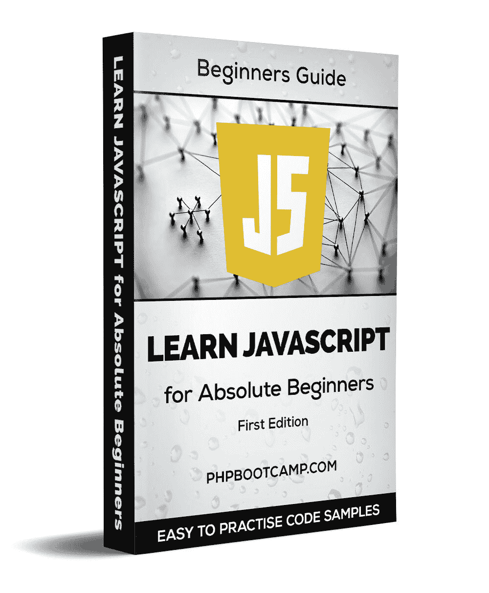

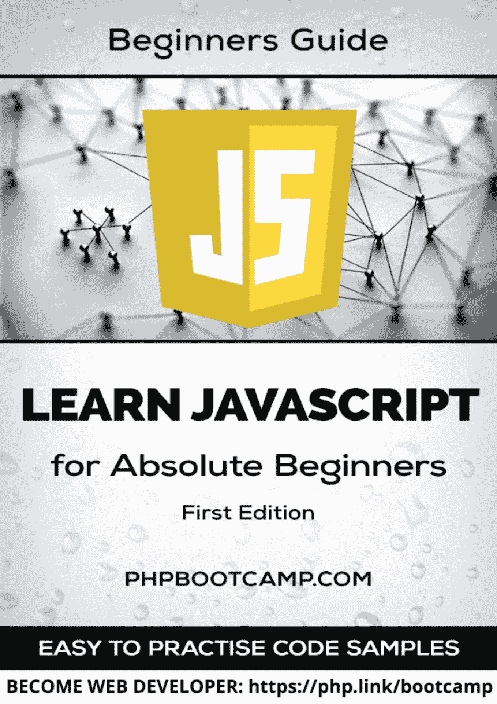

# 关于本书

`JavaScript` 是一种客户端编程语言，允许 Web 开发人员创建可以在浏览器中运行的脚本。`JavaScript` 语言基本上用于在客户端运行程序。本书将帮助你理解 `JavaScript` 语言的基础知识，以及如何将其应用以构建网站。

## 读者群

本教程旨在满足所有渴望学习 `JavaScript` 基础知识读者的需求。

## 前提条件

本书假设你没有任何编程方面的知识，并假设你处于初级水平。

## 如何使用本书

本书包含 `JavaScript` 语言基础、练习和示例，这些都是 `PHP Bootcamp Program` 的一部分。该训练营已帮助许多学生在短短 30 天内成为 `PHP 全栈 Web 开发人员`。

[>>>在此处查看更多关于该计划的信息](https://srini.link/phpbootcamp) ..

## 发现错误与损坏链接

如果您在课程或书中发现任何拼写错误和损坏链接，请通过此电子邮件地址告诉我。contact@SrinivasIT.com

## 支持

您可以从这里联系我进行技术讨论和其他支持相关的查询。support@SrinivasIT.com。

感谢您的支持！

## 免费课程

|  | [1 小时学习 HTML](https://srini.link/html-free-course) |

|  | [1 小时学习 CSS](https://srini.link/css-free-course) |

|  | [1 小时学习 JavaScript](https://srini.link/js-free-course) |

---

# 1 JavaScript 基础

## 1.1 JavaScript 简介

## 1.2 内部 JavaScript

## 1.3 JavaScript 注释

## 1.4 外部 JavaScript

## 1.5 内联 JavaScript

## 1.6 Hello 示例

## 1.7 JavaScript 术语

## 1.8 JavaScript 测试与调试

# 2 数据处理

## 2.1 标识符

## 2.2 变量

## 2.3 基本类型

## 2.4 关键字

## 2.5 保留字

# 3 JavaScript 中的表达式

## 3.1 赋值表达式

## 3.2 比较表达式

## 3.3 算术表达式

## 3.4 逻辑表达式

## 3.5 字符串操作

## 3.6 引号

## 3.7 布尔值

## 3.8 数组

## 3.9 日期与时间

# 4 语句

## 4.1 if 语句

## 4.2 switch 语句

## 4.3 while 语句

## 4.4 for 语句

# 5 函数、对象与事件

## 5.1 函数

## 5.2 对象

## 5.3 事件

# 6 测试

## 6.1 调试

## 6.2 错误

## 6.3 Try Catch

# 7 文档对象模型 (DOM)

## 7.1 通过 ID 查找元素

## 7.2 更新数据

## 7.3 表单元素

# 8 代码片段

## 8.1 获取 URL

# 9 项目

## 9.1 表单验证

## 9.2 猜数字

 

`alert()` 是一个在网页上显示警报框的函数。`alert('some text here');` 在行末尾添加分号 `;`。

`<script>` 标签用于在该标签内编写 JavaScript。此标签 `<script>` 可以定义在 `<head>` 或 `<body>` 中。在 `<script>` 标签内编写的 JavaScript 代码会在编写时被执行。

如果你有两个连续的 `<script>` 标签，那么 `<script>` 内部的代码会顺序执行。如果你将 `<script>` 标签放在 `<body>` 标签的末尾，则脚本会在页面加载后最后执行。

### 示例

[下载示例](https://phpbootcampdemo.com/js/internal/downloads/js-internal-em1.zip)

```html
<!DOCTYPE html>
<html>
<head>
<meta charset="utf-8">
<meta name="viewport" content="width=device-width, initial-scale=1.0">
<meta name="description" content="Page Description">
<title>Internal JavaScript</title>
<script>alert('This is called from Head Section!');</script>
</head>
<body>
<h1>Heading</h1>
<p>Paragraph Text</p>
<ul>
<li>Item 1</li>
<li>Item 2</li>
<li>Item 3</li>
</ul>
</body>
</html>
```

* * *

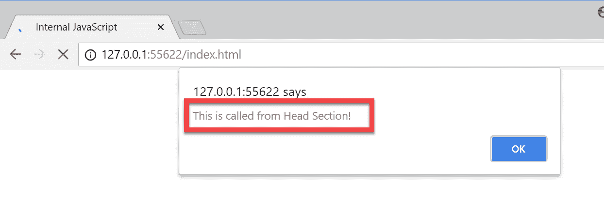 [实时预览](https://phpbootcampdemo.com/js/internal/em1)

### 练习 1

[下载练习 1](https://phpbootcampdemo.com/js/internal/downloads/js-internal-ex1.zip)

**练习 1：** 将带有 `alert()` 的 `<script>` 标签放在页面末尾 `<body>` 区域。

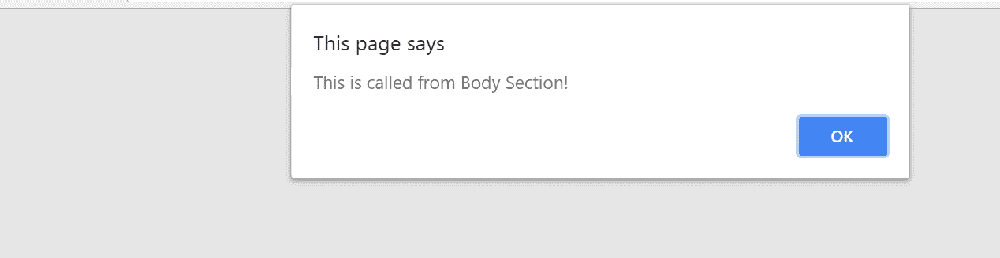 [实时预览](https://phpbootcampdemo.com/js/internal/ex1)

### 练习 2

[下载练习 2](https://phpbootcampdemo.com/js/internal/downloads/js-internal-ex2.zip)

**练习 2：** 在 `<body>` 区域放置带有 `alert()` 的脚本标签并看看它是否有效。此外，点击“OK”按钮然后按 F5 查看警报框是否再次出现。

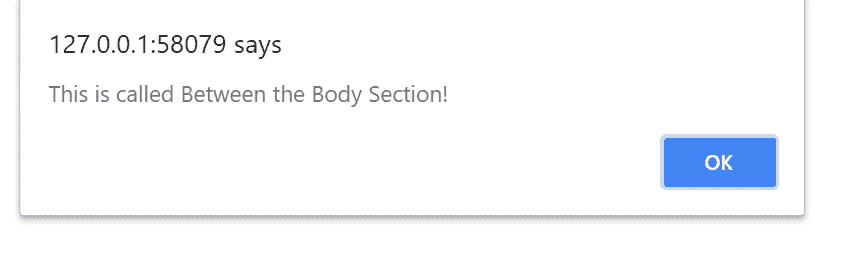 [实时预览](https://phpbootcampdemo.com/js/internal/ex2)

# 1.3 JavaScript 注释

## 注释用法

你可以使用特殊符号对 JavaScript 内部的代码进行注释。注释有助于单行或多行对代码进行说明。JavaScript 引擎会忽略注释，它们不会显示在浏览器上。

HTML 注释和 JavaScript 注释是不一样的。不要混淆 JavaScript 中的注释与 HTML 中的注释。

JavaScript 中有两种类型的注释：

- **单行注释**：`//` – 这是单行注释。用于注释单行代码。

- **多行注释**：`/*` – 用于指示注释开始 / `*/` – 用于指示注释结束。`/*` 和 `*/` 之间的任何内容都不会被浏览器执行。

#### 语法

```html
<head>
<script>
// 这将向用户发出警报 – 单行注释
alert('This is alerted on the browser');
/* 多行注释开始
alert('This is not executed by the browser');
多行注释结束 */
</script>
</head>
```

### 示例

[下载示例](https://phpbootcampdemo.com/js/comments/downloads/js-comments-em1.zip)

```html
<!DOCTYPE html>
<html>
<head>
<meta charset="utf-8">
<meta name="viewport" content="width=device-width, initial-scale=1.0">
<meta name="description" content="Page Description">
<title>如何在 JavaScript 中编写注释</title>
<!-- 这是 HTML 注释 -->
<script>
/*
这是 JS 中的多行注释。
这与 HTML 注释不同。
此块内的任何内容都将被忽略。
alert('This is Multi Line Comment Blok. Ignored by the Browser');
*/
// 使用文本向用户报警
alert('Welcome to JavaScript!');
</script>
<!-- 这是 HTML 注释 -->
</head>
<body>
<h1>Heading</h1>
<p>Paragraph Text</p>
<ul>
<li>Item 1</li>
<li>Item 2</li>
<li>Item 3</li>
</ul>
</body>
</html>
```

* * *

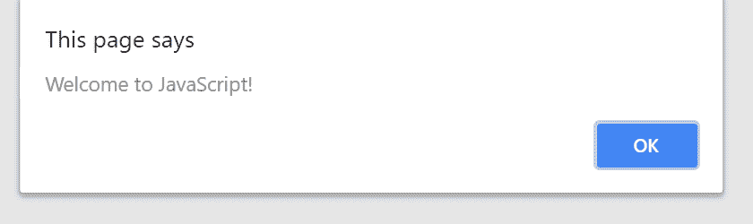 [实时预览](https://phpbootcampdemo.com/js/comments/em1)

### 练习 1

[下载练习 1](https://phpbootcampdemo.com/js/comments/downloads/js-comments-ex1.zip)

**练习 1：** 让多行注释看起来像单行注释一样。

 [实时预览](https://phpbootcampdemo.com/js/comments/ex1)

### 练习 2

[下载练习 2](https://phpbootcampdemo.com/js/comments/downloads/js-comments-ex2.zip)

**练习 2：**

1. 使用 HTML 注释注释整个 `<script>` 块。观察 HTML 注释的效果。

2. 在 `<body>` 区域放置带有标签的脚本并查看效果。

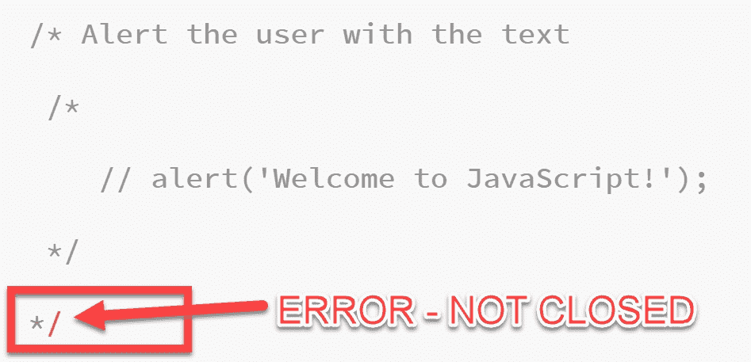 [实时预览](https://phpbootcampdemo.com/js/comments/ex2)

# 1.4 外部 JavaScript

## 外部 JavaScript 的用法

JavaScript (JS) 可以写在另一个文件中并包含在 HTML 页面中。使用外部 JS 的好处是，你只需要在一个地方更改 JS，就会影响整个网站的设计。

外部 JS 文件名应为 `.js`，它可以包含在 HTML 页面的任何位置。在 HTML 页面中使用：`<script type='text/javascript' src="..."></script>`。

#### 语法

```html
<head>
<!-- 确保 javascriptcode.js 文件存在于 'javascript' 文件夹中 -->
<script type='text/javascript' src="javascript/javascriptcode.js"></script>
</head>
```

`<script>` 标签用于将资源链接到 HTML 页面。脚本属性会让浏览器知道资源的类型。`src` 属性类似于 `` 标签，用于映射服务器上的文件位置。你甚至可以使用文件夹名/文件名来引用文件路径。

### 示例

[下载示例](https://phpbootcampdemo.com/js/external/downloads/js-external-em1.zip)

有两个文件：`index.html`, `javascript/javascriptcode.js`。

`javascriptcode.js` 文件通过 `<script>` 标签链接在 `index.html` 文件内部。`javascript` 是文件夹名称，它可以是任何名称，并非强制要求。`type` 属性告诉文件内容的类型。在这种情况下，它是 `text/javascript`。

```html
<!DOCTYPE html>
<html>
<head>
<meta charset="utf-8">
<meta name="viewport" content="width=device-width, initial-scale=1.0">
<meta name="description" content="Page Description">
<title>External JavaScript</title>
<script type='text/javascript' src="javascript/javascriptcode.js"></script>
</head>
<body>
<h1>External JavaScript!</h1>
<p>Paragraph Text</p>
<ul>
<li>Item 1</li>
<li>Item 2</li>
<li>Item 3</li>
</ul>
</body>
</html>
```

文件名：`javascriptcode.js`

```javascript
alert('I am called from javascriptcode.js file!');
```

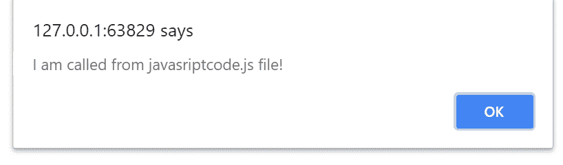[实时预览](https://phpbootcampdemo.com/js/external/em1)

### 练习 1

[下载练习 1](https://phpbootcampdemo.com/js/external/downloads/js-external-ex1.zip)

### 练习 1：创建 `js1.js` 和 `js2.js` 并在 HTML 页面中链接它们。不要创建文件夹，将 js 文件与 HTML 文件放在一起。

文件名：`js1.js`

`alert( ‘This is called from js1.js’ );`

文件名：`js2.js`

`alert( ‘This is called from js2.js’ );`

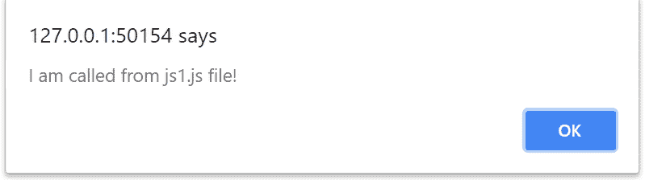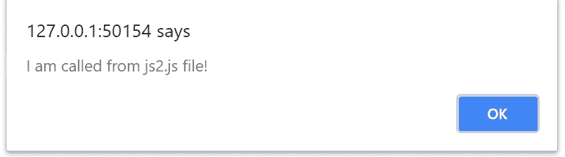[实时预览](https://phpbootcampdemo.com/js/external/ex1)

### 练习 2

[下载练习 2](https://phpbootcampdemo.com/js/external/downloads/js-external-ex2.zip)

### 练习 2：在 `<head>` 标签内放置一个 `<script>` 标签，在 `<body>` 标签末尾放置另一个 `<script>` 标签。交换顺序，先放 `js2.js`，后放 `js1.js`。

[实时预览](https://phpbootcampdemo.com/js/external/ex2)

# 1.5 内联 JavaScript

## 内联 JavaScript 的用法

内联 JavaScript 定义在 HTML 标签内部，类似于一个属性。内联 JS 会覆盖在内部 JS 和外部 JS 中定义的所有样式。内联 JS 代码首先执行。这在 HTML 标签中作为属性定义。

**语法：**

`<a href="#" onclick="alert('欢迎来到 JavaScript!');">点击我</a>`

`onclick` 是 `<a>` 标签的事件，当用户点击链接时会调用。调用此 `alert()` 由浏览器本身处理。当用户点击链接时，浏览器会在此标签上触发 `click` 事件，因为我们要求在触发此事件时弹出一个 `alert()`，因此调用了该方法。`onClick` 值中提到的任何内容都将作为 JavaScript 执行。JavaScript 写在双引号 “”内的这个 `onClick` 事件中。所有的 JavaScript 与内部和外部 JavaScript 中的完全相同。

### 示例

[下载示例](https://phpbootcampdemo.com/js/inline/downloads/js-inline-em1.zip)

```html
<!DOCTYPE html>
<html>
<head>
<meta charset="utf-8">
<meta name="viewport" content="width=device-width, initial-scale=1.0">
<meta name="description" content="Page Description">
<title>内联 JavaScript</title>
</head>
<body>
  <a href="#" onclick="alert('Welcome to JavaScript!');">点击我</a>
</body>
</html>
```

* * *

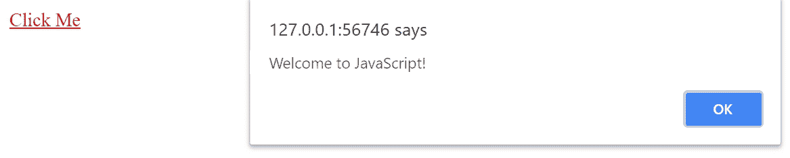[实时预览](https://phpbootcampdemo.com/js/inline/em1)

### 练习 1

[下载练习 1](https://phpbootcampdemo.com/js/inline/downloads/js-inline-ex1.zip)

### 练习 1：添加一张图片，并在点击图片时显示弹窗消息。

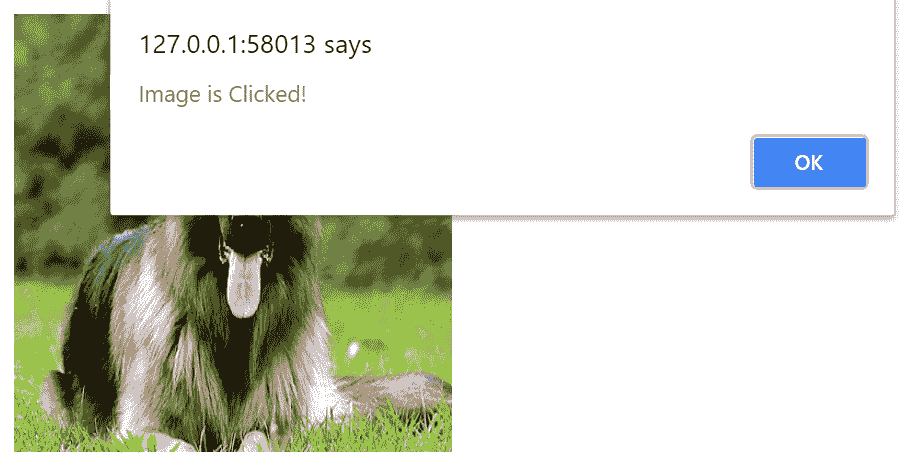[实时预览](https://phpbootcampdemo.com/js/inline/ex1)

### 练习 2

[下载练习 2](https://phpbootcampdemo.com/js/inline/downloads/js-inline-ex2.zip)

### 练习 2：点击页面任意位置处时显示弹窗消息。找到点击时会触发 `alert()` 的区域，并找到 `body` 上不会触发弹窗的区域。

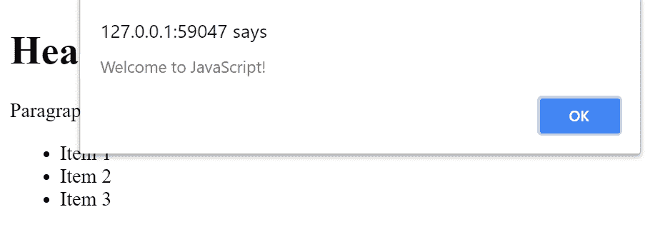[实时预览](https://phpbootcampdemo.com/js/inline/ex2)

# 1.6 Hello 示例 JavaScript

## Hello World 程序

你可以选择编写 JavaScript 内部、外部或内联代码，它们都能工作。但最好的方法是将代码组织在一个文件中，这样就可以为整个网站在某处修复问题。对于这个 hello world 示例，我们将使用内联 JavaScript。一旦我们知道如何编写函数并从点击事件调用它们，我们就会改进这个程序。我们将使用 `confirm()` 方法代替 `alert()`，它会显示“确定”和“取消”按钮。然而，我们对用户按了任何键不执行任何操作，只需在用户点击链接时显示一个不同的确认框即可。

`confirm('享受 JavaScript 的乐趣！');`

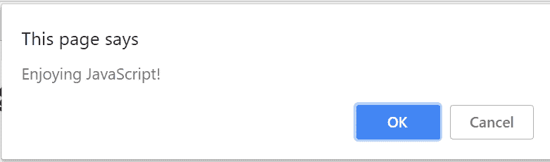示例

[下载示例](https://phpbootcampdemo.com/js/sample/downloads/js-sample-em1.zip)

```html
<!DOCTYPE html>
<html>
<head>
<meta charset="utf-8">
<meta name="viewport" content="width=device-width, initial-scale=1.0">
<meta name="description" content="Page Description">
<title>示例 JavaScript 程序!</title>
</head>
<body>
  <h1>示例 JavaScript 程序</h1>
  <p>段落文本</p>
  <a href="#" onclick="alert('Hello World!');">你好消息!</a>
  <br>
  <a href="#" onclick="confirm('Enjoying JavaScript!');">你喜欢吗？</a>
</body>
</html>
```

* * *

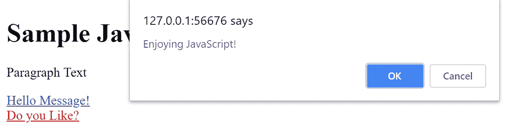[实时预览](https://phpbootcampdemo.com/js/sample/em1)

### 练习 1

[下载练习 1](https://phpbootcampdemo.com/js/sample/downloads/js-sample-ex1.zip)

### 练习 1：显示项目 1, 2 和 3 的列表。当用户点击任何链接时，显示他们点击了什么。

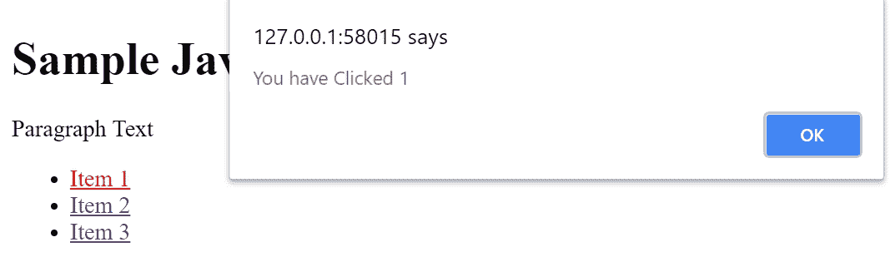[实时预览](https://phpbootcampdemo.com/js/sample/ex1)

### 练习 2

[下载练习 2](https://phpbootcampdemo.com/js/sample/downloads/js-sample-ex2.zip)

### 练习 2：在上面的示例中将 `onclick` 替换为 `onmouseover`，查看 `alert()` 是如何触发的。

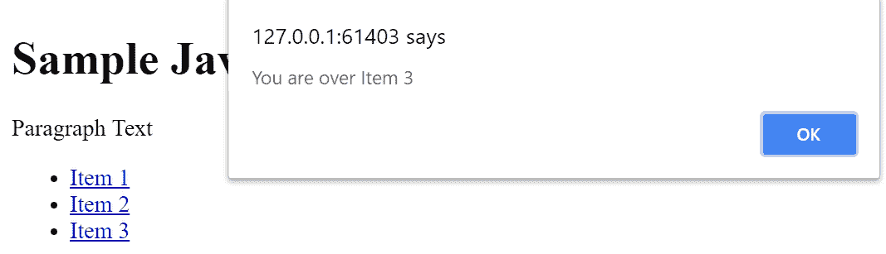[实时预览](https://phpbootcampdemo.com/js/sample/ex2)

# 1.7 JavaScript 术语

如果你是一个 JavaScript 程序员，你需要了解这些术语：

- **分号** (`;`)：分号符号用于表示行结束。

- **方括号** (`[]`)：这些用于表示数组。

- **大括号** (`{}`)：花括号用于定义作用域，如起始和结束点。

- **括号** (`()`)：用于调用函数。

- **标识符**：是变量、函数、属性或对象的名称。

- **变量**：存储值的标识符。

- **运算符**：用于操作的特殊符号。例如算术运算符 `+` 用于相加数字。

- **表达式**：解析为某些内容的变量或运算符。例如 `a = 1 + 2` 是一个表达式。

- **语句**：执行操作的命令组或单个语句。它们以 `;` 结束。语句旨在执行某些操作。

```javascript
{
  y = sum(1, 2);
  alert("value of" + y);
}
```

# 1.8 JavaScript 测试与调试

由于 JavaScript 在浏览器中运行，调试 JavaScript 程序的唯一方法是使用浏览器工具。Chrome 和 Firefox 拥有大量的调试工具，可以帮助发现并修复问题。你需要学习这种方法来发现并修复 JavaScript 问题。

### 检查窗口

在 Chrome 中加载任何 HTML 程序并按 `CTRL + SHIFT + I`。这将加载检查窗口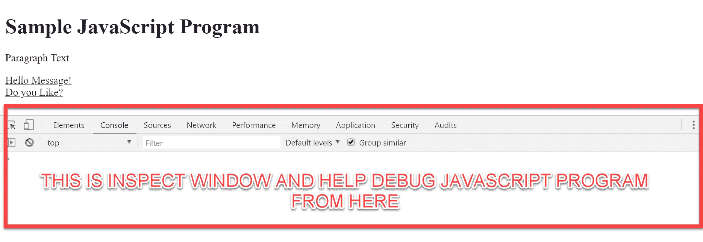

### 控制台标签

控制台标签是输出标签，你可以在这里编写程序日志并查看。即使 HTML 程序中有任何问题，浏览器也会在这里显示自己的日志。

```javascript
console.log('This is a log from JavaScript program');
```


```html
<!DOCTYPE html>
<html>
<head>
<meta charset="utf-8">
<meta name="viewport" content="width=device-width, initial-scale=1.0">
<meta name="description" content="Page Description">
<title>外部 JavaScript</title>
<script type='text/javascript' src="js1.js"></script>
</head>
<body>
  <h1>外部 JavaScript!</h1>
  <p>段落文本</p>
  <ul>
    <li>项目 1</li>
    <li>项目 2</li>
    <li>项目 3</li>
  </ul>
</body>
</html>
```

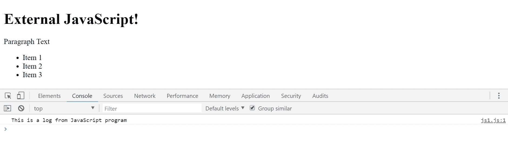[Live Preview](https://phpbootcampdemo.com/js/testing/em1)

### 练习 1

[下载练习 1](https://phpbootcampdemo.com/js/testing/downloads/js-testing-ex1.zip)

练习 1：在 head 部分中引入另一个 js 文件 `js2.js`，但不要创建该文件。在控制台窗口中验证错误。

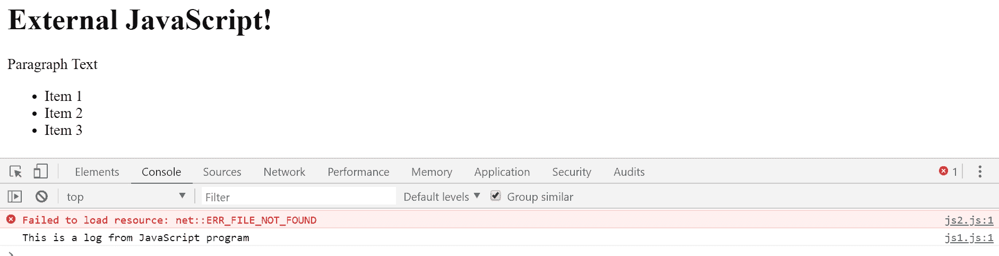[Live Preview](https://phpbootcampdemo.com/js/testing/ex1)

### 练习 2

[下载练习 2](https://phpbootcampdemo.com/js/testing/downloads/js-testing-ex2.zip)

练习 2：删除 `console.log()` 或 `alert()` 结尾的 `)` 并查看控制台窗口中的错误。

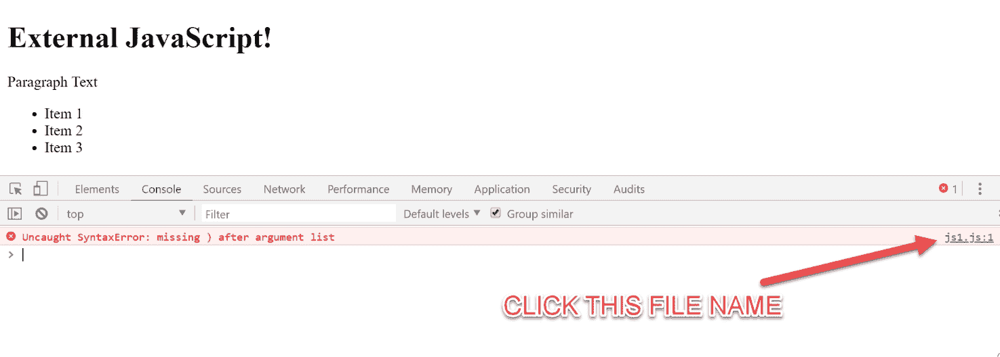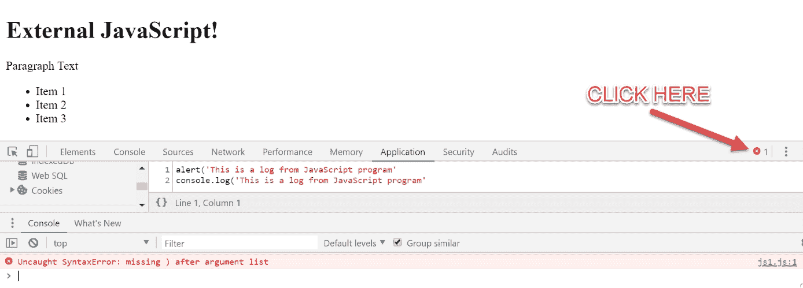[Live Preview](https://phpbootcampdemo.com/js/testing/ex2)

# 2 数据处理

## 2.1 标识符

### 标识符的使用

标识符是赋予变量、函数、对象、属性和事件的名称。定义标识符时需要遵循一些规则。

* 标识符只能包含字母、数字、下划线和美元符号 `$`

* 标识符不能以数字开头。

* 标识符是区分大小写的。

* 标识符可以是任意长度。

* 标识符不能使用关键字和保留字。

#### 一些有效的标识符：

* `strFirstName`

* `$var`

* `index_1`

* `crashReport`

#### 无效的标识符：

* `1PhoneNumber`

* `false`

* `long`

* `package`

#### 示例代码

[下载示例](https://phpbootcampdemo.com/js/identifiers/downloads/js-identifiers-em1.zip)

```html
<!DOCTYPE html><html><head><meta charset="utf-8"><meta name="viewport" content="width=device-width, initial-scale=1.0"><meta name="description" content="Page Description"><title>Identifiers JavaScript</title><script>Alert('JavaScript is Case Sensitive');</script></head><body><a href="#" onclick="ALERT('Welcome to JavaScript!');">Click Me</a></body></html>
```

* * *

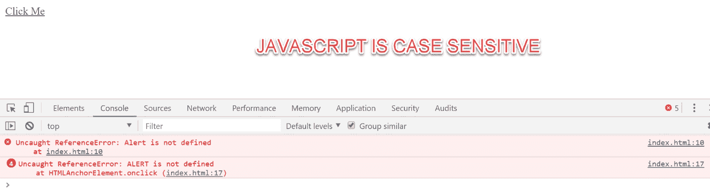[Live Preview](https://phpbootcampdemo.com/js/identifiers/em1)

### 练习 1

[下载练习 1](https://phpbootcampdemo.com/js/identifiers/downloads/js-identifiers-ex1.zip)

练习 1：尝试将 `console.log()` 改为 `CONSOLE.LOG()` 并观察发生什么。

```javascript
CONSOLE.LOG('JavaScript is Case Sensitive');
```

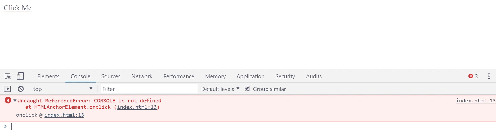[Live Preview](https://phpbootcampdemo.com/js/identifiers/ex1)

### 练习 2

[下载练习 2](https://phpbootcampdemo.com/js/identifiers/downloads/js-identifiers-ex2.zip)

练习 2：将 `onclick` 改为 `ONCLICK` 查看点击命令是否仍然有效。编写正确的 JavaScript 语法。

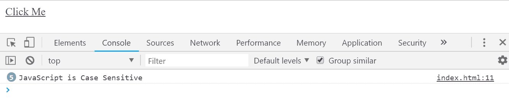 `OnClick` 是 HTML 标签的属性，而不是 JavaScript 的属性。[Live Preview](https://phpbootcampdemo.com/js/identifiers/ex2)

## 2.2 变量

### 变量的使用

变量用于存储程序内部使用的信息。

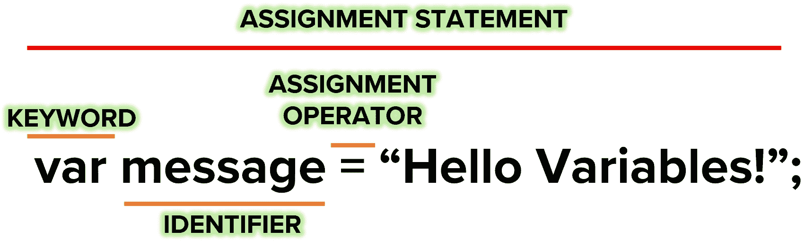 `var` 关键字用于定义变量。`var message = "This is a test message";` `=` 是赋值运算符，用于给变量赋值。`""` 双引号用于表示字符串值；`;` 分号用于结束赋值语句。

#### 语法

#### 声明变量

```javascript
var variableName;
```

#### 使用空字符串初始化变量

```javascript
variableName = "";
```

#### 给变量赋值

```javascript
variableName = "This is a Test Message!";
```

#### 多变量声明

```javascript
var name1, name2, name3;
name1 = "firstName", name2 = "middleName", name3 = "lastName"
```

#### 定义整数和小数

```javascript
var counter = 0;
counter = 10;
var total = 10.98;
counter = total;
```

#### 在 alert 消息中显示变量：

```javascript
var firstName = "WPFreelancer.com";
alert('Welcome to ' + firstName );
```

`+` 符号用于将变量附加到字符串并显示。

#### 在 HTML 文档中写入变量

`document.write()` 方法可用于在 HTML 页面上写入任何内容。`alert()` 用于显示提示类似，`document.write()` 方法用于在 HTML 页面上写入内容。它也可以访问在 head -> script 部分定义的变量。

```html
<script type="text/javascript">
document.write("Your Message" + message + "<br>");
</script>
```

### 示例

[下载示例](https://phpbootcampdemo.com/js/variables/downloads/js-variables-em1.zip)

```html
<!DOCTYPE html><html><head><meta charset="utf-8"><meta name="viewport" content="width=device-width, initial-scale=1.0"><meta name="description" content="Page Description"><title>Variables</title><script>
// 声明变量
var message;
// 使用空字符串初始化变量
message = "";
// 给变量赋值
message = "2 to Variables";
// 显示变量
alert(message);
// 变量赋值
message = "3 to Variables";
// 显示变量
alert(message);
// 变量赋值
var counter = 0;
// 变量赋值
counter = 100;
// 显示变量
alert(counter);
// 变量赋值
counter = "2 to Variables";
// 显示变量
alert(counter);
// 变量赋值
counter = "3 to Variables";
// 显示变量
alert(counter);
// 变量赋值
var firstName = "WPFreelancer.com";
// 在 alert 消息中显示变量
alert('Welcome to ' + firstName );
// 变量赋值
message = "2 to Variables";
// 显示变量
alert(message);
// 变量赋值
message = "3 to Variables";
// 显示变量
alert(message);
// 在 HTML 文档中写入变量
document.write("Your Message" + message + "<br>");
// 变量赋值
message = "2 to Variables";
// 显示变量
alert(message);
// 变量赋值
message = "3 to Variables";
// 显示变量
alert(message);
// 在 HTML 文档中写入变量
document.write("Your Message" + message + "<br>");
</script></head><body><h1>Variables</h1></body></html>
```

* * *

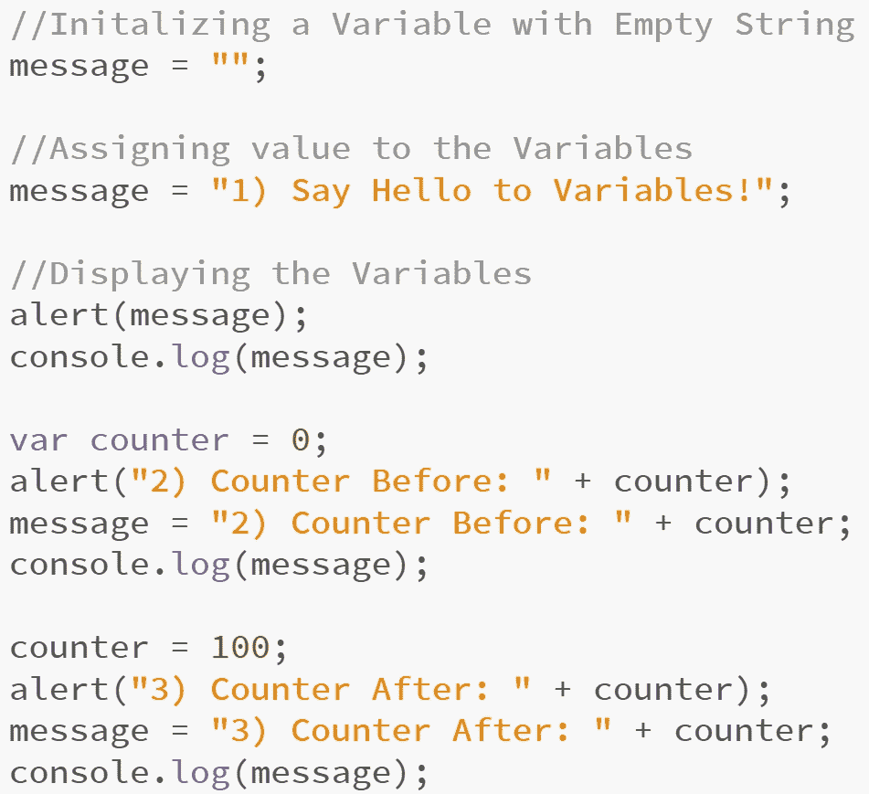[Live Preview](https://phpbootcampdemo.com/js/variables/em1)

### 练习 1

[下载练习 1](https://phpbootcampdemo.com/js/variables/downloads/js-variables-ex1.zip)

练习 1：使用 `prompt()` 接收两个数字。将这些数字相加并显示。

提示：使用 `parseInt()` 方法将字符串转换为整数。

```javascript
var firstName = prompt("Enter the First Value: ");
var firstValue = parseInt(firstValue);
```

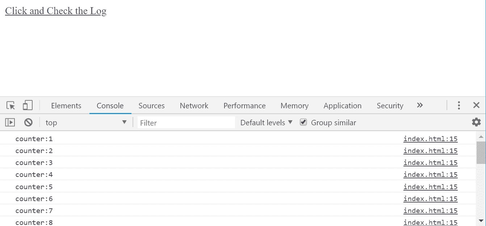

[Live Preview](https://phpbootcampdemo.com/js/variables/ex1)

### 练习 2

[下载练习 2](https://phpbootcampdemo.com/js/variables/downloads/js-variables-ex2.zip)

练习 2：使用 `prompt()` 接收两个名字。在 HTML 页面上显示。

```javascript
firstName = prompt("Enter Name");
document.write("First Name: " + firstName + "br>");
```

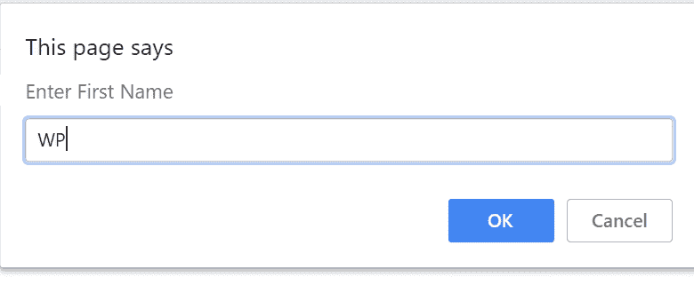

## 2.3 基本类型

#### 基本类型的使用

基本类型是指在 JavaScript 程序中使用的基础数据类型。有 3 种基本类型：

1. 数字类型

2. 字符串类型

3. 布尔类型

数字类型用于存储整数和小数。字符串类型用于存储字符数据。布尔类型用于存储 true 和 false 值。

#### 数字类型：

```javascript
var count = 1;
```

#### 字符串类型：

// 使用单引号或双引号

```javascript
var fullName = "WPFreelancer";
var lastName = 'WPFreelancer';
```

#### 布尔类型：

```javascript
var flag = true;
var results = false;
```

#### 示例代码

[下载示例](https://phpbootcampdemo.com/js/primitives/downloads/js-primitives-em1.zip)

```html
<!DOCTYPE html><html><head><meta charset="utf-8"><meta name="viewport" content="width=device-width, initial-scale=1.0"><meta name="description" content="Page Description"><title>Primitive</title><script>
// 数字类型
var counter = 0;
counter = 100;
console.log("Counter : " + counter);
var decimalcount = 1.45;
decimalcount = decimalcount + 74.32;
console.log("Decimals : " + decimalcount);
// 字符串类型
var fullName = "WPFreelancer";
fullName = fullName + '.com';
console.log("Website Name: " + fullName);
// 布尔类型
var flag = true;
console.log("Flag Value: " + flag);
</script></head><h1>Check the Console Log</h1></body></html>
```

* * *

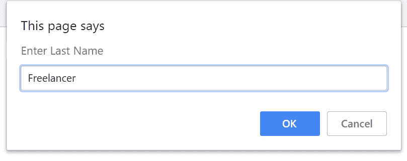[Live Preview](https://phpbootcampdemo.com/js/primitives/em1)

### 练习 1

[下载练习 1](https://phpbootcampdemo.com/js/primitives/downloads/js-primitives-ex1.zip)

练习 1：使用 `prompt()` 接收两个数字。将这些数字相加并显示在浏览器上。

提示：使用 `parseInt()` 方法将字符串转换为整数。

```javascript
var firstValue = prompt("Enter the First Value: ");
var firstValue = parseInt(firstValue);
```

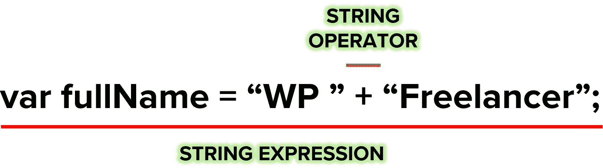[Live Preview](https://phpbootcampdemo.com/js/primitives/ex1)

### 练习 2

[下载练习 2](https://phpbootcampdemo.com/js/primitives/downloads/js-primitives-ex2.zip)

练习 2：向用户提问并打印他们点击了 ok 还是取消。

`var userAnswer = confirm("Do you like grapes?");`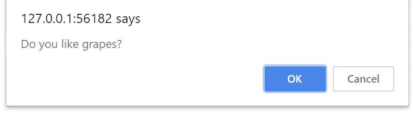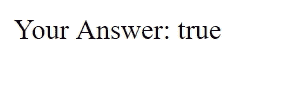[Live Preview](https://phpbootcampdemo.com/js/primitives/ex2)

## 2.4 关键字

这些是你不应该用于定义变量的关键字列表。关键字不应作为[标识符](https://phpbootcampdocs.com/article/js/identifiers-javascript/)。用空格分隔的关键字：

`abstract arguments boolean break byte case catch char class const continue debugger default delete do double else enum eval export extends false final float for function goto if implements import in instanceof int interface let long native null package private protected public return short static super switch synchronized this throw throws transient true try typeof var void volatile while with yield`

## 2.5 保留字

定义变量、函数、对象或属性的保留字列表。保留字不应作为[标识符](https://phpbootcampdocs.com/article/js/identifiers-javascript/)。用空格分隔的保留字：

`Array Date eval function hasOwnProperty Infinity isFinite isNaN isPrototypeOf length Math NaN name Number Object prototype String toString undefined value`

# 3 JavaScript 中的表达式

## 3.1 赋值表达式

### 赋值表达式的使用

表达式被求得为一个结果值、最终值或单值。有几种表达式：

1. 赋值表达式

2. 比较表达式

3. 算术表达式

4. 逻辑表达式

我们将在本主题中介绍赋值表达式。表达式使用运算符来执行操作。`=` 是赋值运算符，将值赋给变量。`message = "something";` 是一个给 `message` 变量赋值的赋值表达式。

#### 复合赋值运算符

复合赋值运算符有助于完成超过一个运算符的工作。它将两个运算符结合在一起执行一个操作。复合赋值运算符有：

* `+=`

* `-=`

* `*=`

```javascript
counter += 1;
counter = counter + 1;
counter -= 1;
counter = counter - 1;
counter *= 1;
counter = counter * 1;
```

### 示例

[下载示例](https://phpbootcampdemo.com/js/assignments/downloads/js-assignments-em1.zip)

```html
<!DOCTYPE html>
<html>
<head>
<meta charset="utf-8">
<meta name="viewport" content="width=device-width, initial-scale=1.0">
<meta name="description" content="Page Description">
<title>Assignment Expressions</title>
<script>var counter = 10;</script>
</head>
<body>
<h1>Assignment Expressions</h1>
<a href="#" onclick="counter+=1;console.log(counter);">增加计数器</a>
<a href="#" onclick="counter-=1;console.log(counter);">减小计数器</a>
<a href="#" onclick="counter*=2;console.log(counter);">倍增计数器</a>
</body>
</html>
```

* *

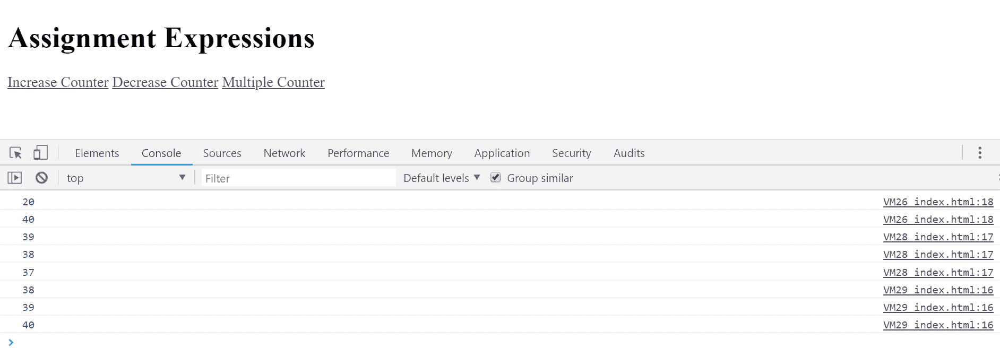[Live Preview](https://phpbootcampdemo.com/js/assignments/em1)

### 练习 1

[下载练习 1](https://phpbootcampdemo.com/js/assignments/downloads/js-assignments-ex1.zip)

练习 1：要求用户输入一个数字并显示该数字的平方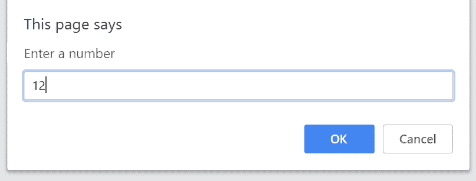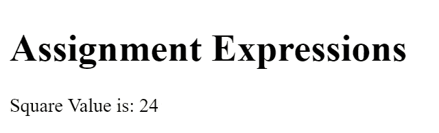[Live Preview](https://phpbootcampdemo.com/js/assignments/ex1)

### 练习 2

[下载练习 2](https://phpbootcampdemo.com/js/assignments/downloads/js-assignments-ex2.zip)

练习 2：创建两个 `<script>` 标签。在第一个 `<script>` 标签中定义变量并在另一个 `<script>` 中赋值。最后在 body 中显示它。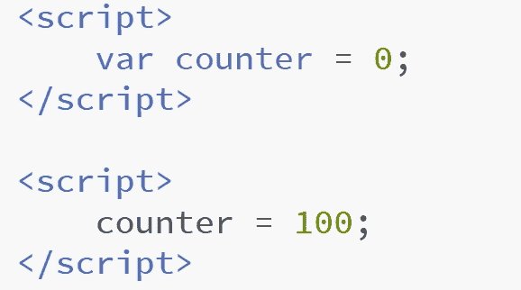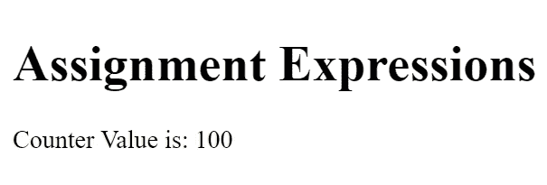[Live Preview](https://phpbootcampdemo.com/js/assignments/ex2)

## 3.2 比较表达式

### 比较表达式的使用

表达式被求得为一个结果值、最终值或单值。有几种表达式：

1. 赋值表达式

2. 比较表达式

3. 算术表达式

4. 逻辑表达式

我们将在本主题中介绍比较表达式。表达式使用运算符来执行操作。比较表达式始终求得真或假值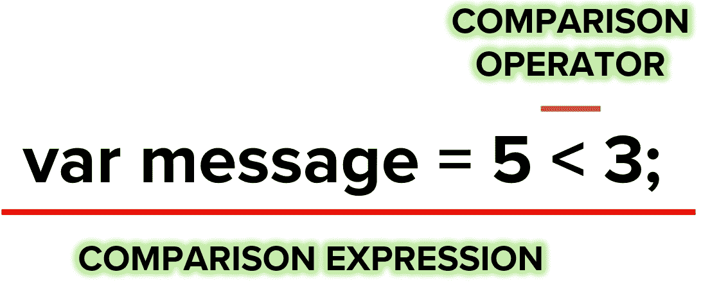`>` 是比较运算符，用于比较两个值。`message` 变量将获得真或假值。

比较操作：

* `<` – 小于

* `>` – 大于

* `==` – 等于

* `===` – 值相等且数据类型相等

* `!==` – 值不相等且数据类型相等

* `!=` – 不相等

* `>=` – 大于或等于

* `<=` – 小于或等于

#### 条件运算符（三元运算符）

JavaScript 还包含一种条件运算符，根据某些条件给变量赋值。

`variablename = (condition) ? value1:value2`

`counter = (10<=10) ? 10 : 0;`

### 示例

[下载示例](https://phpbootcampdemo.com/js/comparison/downloads/js-comparison-em1.zip)

```html
<!DOCTYPE html>
<html>
<head>
<meta charset="utf-8">
<meta name="viewport" content="width=device-width, initial-scale=1.0">
<meta name="description" content="Page Description">
<title>Comparison Expressions</title>
<script>var counter = 10;
//Conditional (Ternary) Operator
var resultValue = (10<=10) ? 10:0;
</script>
</head>
<body>
<h1>Comparison Expressions</h1>
<script>
document.write("Compared: " + counter);
document.write("Result: " + resultValue);
</script>
</body>
</html>
```

* *

[Live Preview](https://phpbootcampdemo.com/js/comparison/em1)

### 练习 1

[下载练习 1](https://phpbootcampdemo.com/js/comparison/downloads/js-comparison-ex1.zip)

练习 1：让用户猜数字。当数字匹配 7 时显示“WINNER”，否则显示“TRY AGAIN”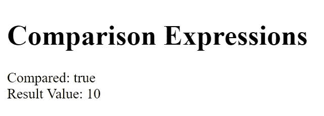[Live Preview](https://phpbootcampdemo.com/js/comparison/ex1)

### 练习 2

[下载练习 2](https://phpbootcampdemo.com/js/comparison/downloads/js-comparison-ex2.zip)

练习 2：让用户输入一个数字。找出：从用户输入的数字中找出偶数和奇数。提示：`var resultValue = (counter%2) ? "ODD NUMBER": "EVEN NUMBER";`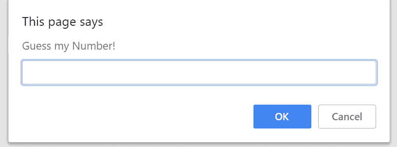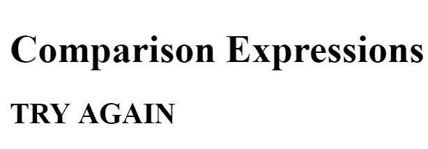[Live Preview](https://phpbootcampdemo.com/js/comparison/ex2)

## 3.3 算术表达式

### 算术表达式的使用

表达式被求得为一个结果值、最终值或单值。有几种表达式：

1. 赋值表达式

2. 比较表达式

3. 算术表达式

4. 逻辑表达式

我们将在本主题中介绍算术表达式。表达式使用运算符来执行操作。算术表达式始终求得一个单值。一组产生单值的操作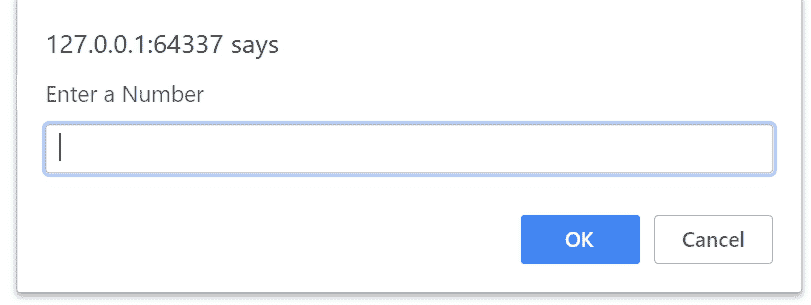`+` 是算术运算符，将两个值相加。`message`变量

算术操作：

* `+` – 加法

* `-` – 减法

* `*` – 乘法

* `/` – 除法

* `%` – 取模

* `++` – 增

* `--` – 减

### 优先级

优先级决定先执行哪个。从左到右，这些运算符的优先级较高

* `++`

* `--`

* `* / %`

* `+ -`

增示例：

```javascript
counter = 10;
counter++; // 这意味着 counter = counter + 1;
```

### 示例

[下载示例](https://phpbootcampdemo.com/js/arithmetic/downloads/js-arithmetic-em1.zip)

```html
<!DOCTYPE html>
<html>
<head>
<meta charset="utf-8">
<meta name="viewport" content="width=device-width, initial-scale=1.0">
<meta name="description" content="Page Description">
<title>Arithmetic Expressions</title>
<script>var counter = 10;
console.log(counter);
counter = counter + 10;
</script>
</head>
<body>
<h1>Arithmetic Expressions</h1>
<a href="#" onclick="counter++;console.log(counter);">增加计数器</a>
<a href="#" onclick="counter--;console.log(counter);">减小计数器</a>
</body>
</html>
```

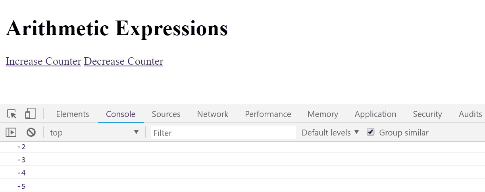[实时预览](https://phpbootcampdemo.com/js/arithmetic/em1)

### 练习 1

[下载练习 1](https://phpbootcampdemo.com/js/arithmetic/downloads/js-arithmetic-ex1.zip)

练习 1：从用户处获取两个数字，并显示这两个数字的加、减、乘、除结果。

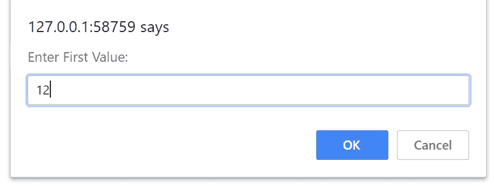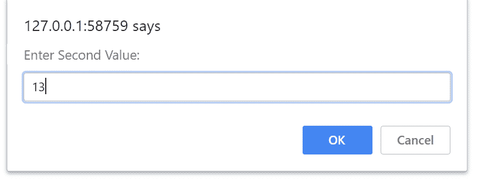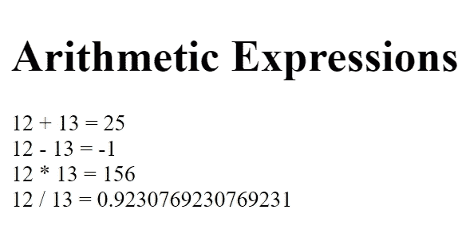[实时预览](https://phpbootcampdemo.com/js/arithmetic/ex1)

### 练习 2

[下载练习 2](https://phpbootcampdemo.com/js/arithmetic/downloads/js-arithmetic-ex2.zip)

练习 2：要求用户输入长度和宽度，并计算矩形的面积并显示在页面上。

提示：

`var resultValue = length * breadth;`[实时预览](https://phpbootcampdemo.com/js/arithmetic/ex2)

## 3.4 逻辑表达式

### 逻辑表达式的使用

表达式会被求值为结果值、最终值或单一值。

有以下几种表达式：

1. 赋值表达式

2. 比较表达式

3. 算术表达式

4. 逻辑表达式

我们将在本主题介绍逻辑表达式。表达式使用运算符来执行操作。逻辑运算符用于根据多个条件检查条件是否为真或假。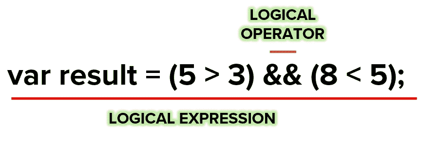`&&` 是逻辑运算符，它检查左侧和右侧的值并判断条件为真为假。

* `(5 > 3)` – true

* `(8 < 5)` – false

* `true && false = false`

变量 `result` 将具有布尔值 false。

#### 逻辑运算：

* `&&` – 与 (AND)

* `||` – 或 (OR)

* `!` – 非 (NOT)

### 优先级

优先级决定了哪个操作先求值。

* `NOT`

* `AND`

* `OR`

### 示例

[下载示例](https://phpbootcampdemo.com/js/logical/downloads/js-logical-em1.zip)

```html
<!DOCTYPE html>
<html>
<head>
<meta charset="utf-8">
<meta name="viewport" content="width=device-width, initial-scale=1.0">
<meta name="description" content="Page Description">
<title>Arithmetic Expressions</title>
<script>
var input1 = prompt("Enter First Value: ");
var input2 = prompt("Enter Second Value: ");
var result = (input1 < input2) || (input1 == input2)
</script>
</head>
<body>
<h1>Arithmetic Expressions</h1>
<script type="text/javascript">
document.write(input1 + " <= " + input2 + " is "+ result);
</script>
</body>
</html>
```

* * *

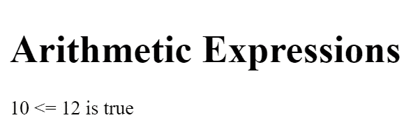[实时预览](https://phpbootcampdemo.com/js/logical/em1)

### 练习 1

[下载练习 1](https://phpbootcampdemo.com/js/logical/downloads/js-logical-ex1.zip)

练习 1：要求用户以小写字母输入星期几拼写，并检查拼写是否正确。根据满足的条件打印“CORRECT”或“WRONG”。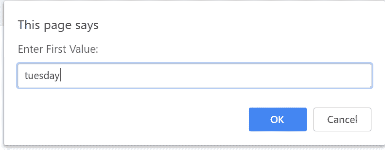[实时预览](https://phpbootcampdemo.com/js/logical/ex1)

### 练习 2

[下载练习 2](https://phpbootcampdemo.com/js/logical/downloads/js-logical-ex2.zip)

练习 2：要求用户输入 1 到 10 之间的值，并确认其正确或错误。根据满足的条件打印“CORRECT”或“WRONG”。[实时预览](https://phpbootcampdemo.com/js/logical/ex2)

## 3.5 字符串操作

### 字符串操作的使用

有两个用于连接字符串的运算符：

1. `+`

2. `+=`

`+` 是可以在地方连接两个字符串的运算符。

示例：

`var name = "Firstname" + "lastname";`

`var name += "!; // 在末添加值`

#### 字符串方法：

* `indexOf(search, position)`

* `substr(start, length)`

* `substring(start, stop)`

* `toLowerCase()`

`var name = "Freelancer";`

`alert( name.toLowerCase() );`

### 示例

[下载示例](https://phpbootcampdemo.com/js/string/downloads/js-string-em1.zip)

```html
<!DOCTYPE html>
<html>
<head>
<meta charset="utf-8">
<meta name="viewport" content="width=device-width, initial-scale=1.0">
<meta name="description" content="Page Description">
<title>String Expressions</title>
<script>
var input1 = prompt("Enter First Name: ");
var input2 = prompt("Enter Last Name: ");
var userName = "<strong>Welcome " + input1 + ", " + input2 + "</strong>";
</script>
</head>
<body>
<h1>String Expressions</h1>
<script type="text/javascript">
document.write(userName);
</script>
</body>
</html>
```

* * *

[实时预览](https://phpbootcampdemo.com/js/string/em1)

### 练习 1

[下载练习 1](https://phpbootcampdemo.com/js/string/downloads/js-string-ex1.zip)

练习 1：尝试使用 `+` 和 `+=` 运算符准备字符串并打印它[实时预览](https://phpbootcampdemo.com/js/string/ex1)

### 练习 2

[下载练习 2](https://phpbootcampdemo.com/js/string/downloads/js-string-ex2.zip)

练习 2：根据输出定义字符串[实时预览](https://phpbootcampdemo.com/js/string/ex2)

## 3.6 引号

### 字符串中引号的使用

单引号和双引号可用于表示 JavaScript 中的字符串

#### 转义序列

有时你需要显示单引号或双引号等特殊字符。`var message = 'We\'ll going to soon!'` 用于转义字符串中的字符。`\n` 用于在双引号中换行。

### 示例

[下载示例](https://phpbootcampdemo.com/js/quotes/downloads/js-quotes-em1.zip)

```html
<!DOCTYPE html>
<html>
<head>
<meta charset="utf-8">
<meta name="viewport" content="width=device-width, initial-scale=1.0">
<meta name="description" content="Page Description">
<title>String Expressions</title>
<script>
var input1 = prompt("Enter First Name: ");
var input2 = prompt("Enter Last Name: ");
var userName = "<strong>Welcome " + input1 + ", " + input2 + "</strong>";
</script>
</head>
<body>
<h1>String Expressions</h1>
<script type="text/javascript">
document.write(userName);
</script>
</body>
</html>
```

* * *

[实时预览](https://phpbootcampdemo.com/js/quotes/em1)

### 练习 1

[下载练习 1](https://phpbootcampdemo.com/js/quotes/downloads/js-quotes-ex1.zip)

练习 1：使用单引号和双引号写一段话并转义单引号[实时预览](https://phpbootcampdemo.com/js/quotes/ex1)

### 练习 2

[下载练习 2](https://phpbootcampdemo.com/js/quotes/downloads/js-quotes-ex2.zip)

练习 2：用双引号写上面相同的段落并转义双引号[实时预览](https://phpbootcampdemo.com/js/quotes/ex2)

## 3.7 布尔值

### 布尔的使用

布尔变量有助于根据表达式做出决策或存储决策。布尔值可以是 true 或 false。

你可以使用布尔变量作为条件来检查值是否真为假。

`var result = 2 > 1;`

`var message = (result) ? "CORRECT": "WRONG";`

### 示例：

`var isTrue = "Henry" == "H3nry";`

根据条件运算符，输出可以存储在布尔原始数据类型中。`isTrue` 将持有 false 值。[下载示例](https://phpbootcampdemo.com/js/boolean/downloads/js-boolean-em1.zip)

[Live Preview](https://phpbootcampdemo.com/js/boolean/em1)

### 练习 1

[下载练习 1](https://phpbootcampdemo.com/js/boolean/downloads/js-boolean-ex1.zip)

练习 1：从用户处接收数字，如果数字是 7 则显示“FOUND”，否则显示“TRY AGAIN!!”。

[Live Preview](https://phpbootcampdemo.com/js/boolean/ex1)

### 练习 2

[下载练习 2](https://phpbootcampdemo.com/js/boolean/downloads/js-boolean-ex2.zip)

练习 2：让用户猜一个以 A 开头的单词，然后与你猜的单词进行匹配。

[Live Preview](https://phpbootcampdemo.com/js/boolean/ex2)

## 3.8 数组

## 数组的使用

数组是特殊的对象类型，用于存储一个或多个被称为“元素”的项。每个元素可以是原始数据类型或对象。`length` 用于指示数组中元素的个数。

### 定义数组

**数组字面量：**

```javascript
var arrayName = [1, 2, 'white', false];
```

**数组构造函数：**

```javascript
var arrayName = new Array(length / values);
```


### 访问数组元素

```javascript
arrayName[index]
```

### 数组元素的长度

```javascript
var lenofArray = arrayName.length;
```

### 向数组添加值

```javascript
var newArray = [];
newArray[0] = 'white';
newArray[1] = 'red';
```

### 从数组中获取值

```javascript
var color1 = newArray[0];
```

### 在末尾添加新元素

```javascript
newArray[newArray.length] = 'Black';
```

### 数组的第一个元素

```javascript
var firstElement = newArray[0];
```

[下载示例文件](https://phpbootcampdemo.com/js/arrays/downloads/js-arrays-em1.zip)

```html
<!DOCTYPE html>
<html>
<head>
<meta charset="utf-8">
<meta name="viewport" content="width=device-width, initial-scale=1.0">
<meta name="description" content="Page Description">
<title>布尔表达式</title>
<script>
var colorsArray = ['white', 'black', 'green', 'blue'];
console.log(colorsArray);
console.log(colorsArray.length);
console.log(colorsArray[0]);
console.log(colorsArray[1]);
console.log(colorsArray[2]);
console.log(colorsArray[3]);
colorsArray[colorsArray.length] = 'red';
console.log(colorsArray[4]);
console.log(colorsArray);
console.log(colorsArray.length);
</script>
</head>
<body>
<h1>Arrays</h1>
</body>
</html>
```

* *

[Live Preview](https://phpbootcampdemo.com/js/arrays/em1)

### 练习 1

[下载练习 1](https://phpbootcampdemo.com/js/arrays/downloads/js-arrays-ex1.zip)

练习 1：创建一个包含字符串、数字和布尔值的数组并显示它们。

[Live Preview](https://phpbootcampdemo.com/js/arrays/ex1)

### 练习 2

[下载练习 2](https://phpbootcampdemo.com/js/arrays/downloads/js-arrays-ex2.zip)

练习 2：使用数组完成以下练习：

1. 定义一个空数组

2. 添加 1 个元素

3. 显示长度

4. 添加 2 个元素

5. 显示这两个元素

6. 显示数组的长度

[Live Preview](https://phpbootcampdemo.com/js/arrays/ex2)

## 3.9 日期与时间

## 日期时间的使用

`Date()` 是一个用于访问日期的类库。然而 `Date` 并不是原始数据类型。你需要创建一个 `Date` 实例来访问日期。

```javascript
var today = new Date();
```

默认情况下，`today` 将包含系统日期，并可以通过它的方法进行显示。

### 日期方法

- `toDateString()` – 返回格式化字符串形式的日期。

- `getFullYear()` – 返回 `Date` 中的 4 位年份。

- `getDate()` – 返回 `Date` 中的每月几号。

- `getMonth()` – 获取月份。

### 示例

```javascript
var today = new Date();
alert( today.toDateString() );
```

[下载示例文件](https://phpbootcampdemo.com/js/datetime/downloads/js-datetime-em1.zip)

```html
<!DOCTYPE html>
<html>
<head>
<meta charset="utf-8">
<meta name="viewport" content="width=device-width, initial-scale=1.0">
<meta name="description" content="Page Description">
<title>日期与时间</title>
<script>
var today = new Date();
console.log(today.toDateString());
console.log(today.getFullYear());
console.log(today.getDate());
console.log(today.getMonth());
</script>
</head>
<body>
<h1>Date and Time</h1>
<script>
</body>
</html>
```

* *

[Live Preview](https://phpbootcampdemo.com/js/datetime/em1)

### 练习 1

[下载练习 1](https://phpbootcampdemo.com/js/datetime/downloads/js-datetime-ex1.zip)

练习 1：显示日期。

[Live Preview](https://phpbootcampdemo.com/js/datetime/ex1)

### 练习 2

[下载练习 2](https://phpbootcampdemo.com/js/datetime/downloads/js-datetime-ex2.zip)

练习 2：显示今天是星期几。

[Live Preview](https://phpbootcampdemo.com/js/datetime/ex2)

# 4 语句

## 4.1 if 语句

### if 语句的使用

`if` 语句用于检查条件并根据结果做出决策。当条件为真时执行某些操作，为假时执行其他操作。你可以将多个条件组合起来，根据条件选择操作。

**语法：**

```javascript
if ( condition1 ){
// 语句
} else if ( condition2 ){
// 语句
} else {
// 语句
}
```

### 示例 1

```javascript
if( marks > 35 ){
alert("Passed!");
}else{
alert("Try Again!");
}
```

### 示例 2

```javascript
if( marks > 35 && marks < 60 ){
alert("Passed with Grade C");
}else if ( marks > 60 && marks < 80 ){
alert("Passed with Grade B");
}else if ( marks > 80 ){
alert("Passed with Grade A");
}else{
alert("Try Again!");
}
```

[下载示例文件](https://phpbootcampdemo.com/js/statements-if/downloads/js-statements-if-em1.zip)

```html
<!DOCTYPE html>
<html>
<head>
<meta charset="utf-8">
<meta name="viewport" content="width=device-width, initial-scale=1.0">
<meta name="description" content="Page Description">
<title>if Statements</title>
<script>
var dayOfWeek = prompt("Enter the Day of Week");
var result;
dayOfWeek = dayOfWeek.toLowerCase();
if( dayOfWeek == 'monday' || dayOfWeek == 'mon'){
result = "First Day of Week";
}else if( dayOfWeek == 'tuesday' || dayOfWeek == 'tue' ){
result = "Second Days of Week";
}else if( dayOfWeek == 'wednesday' || dayOfWeek == 'wed' ){
result = "Mid Week";
}else if( dayOfWeek == 'thursday' || dayOfWeek == 'thurs' ){
result = "Preparing for Weekend";
}else if( dayOfWeek == 'friday' || dayOfWeek == 'fri' ){
result = "It's Friday!";
}else if( dayOfWeek == 'saturday' || dayOfWeek == 'sat' ){
result = "Enjoying Day!";
}else if( dayOfWeek == 'sunday' || dayOfWeek == 'sun' ){
result = "Resting Day!";
}else{
result = "Cannot find that Value!";
}
</script>
</head>
<body>
<h1>if Statements</h1>
  <script type="text/javascript">
  document.write( result );
  </script>
</body>
</html>
```

### 练习 1

练习 1：接受 1 到 10 之间的数字，并使用 `if` 语句检查用户输入的数字是否在要求的 1 到 10 之间。

### 练习 2

练习 2：要求用户输入年龄，并判断他是儿童、成年人（age > 21）还是老年人（age > 55）。

---

## 4.2 switch 语句

### switch 语句的使用

`switch` 语句用于检查一个值，并根据值匹配的结果做出决策。

**语法：**

```javascript
switch( variable ){
  case value:
    //Statement
    break;
  case value:
    //Statement
    break;
  default:
    //Statement
    break;
}
```

**示例 1：**

```javascript
switch ( dayOfWeek ){
  case 'Mon':
    alert("Welcome Monday");
    break;
  case 'Tuesday':
    alert("Welcome Tuesday");
    break;
  default:
    alert("Try Again!");
    break;
}
```

```html
<!DOCTYPE html>
<html>
<head>
<meta charset="utf-8">
<meta name="viewport" content="width=device-width, initial-scale=1.0">
<meta name="description" content="Page Description">
<title>Switch Statements</title>
<script>
  var dayOfWeek = prompt("Enter the Day of Week");
  var result;
  dayOfWeek = dayOfWeek.toLowerCase();
  switch(dayOfWeek){
    case 'monday':
      result = "First Day of Week";
      break;
    case 'tuesday':
      result = "Second Days of Week";
      break;
    case 'wednesday':
      result = "Mid Week";
      break;
    case 'thursday':
      result = "Preparing for Weekend";
      break;
    case 'friday':
      result = "It's Friday!";
      break;
    case 'saturday':
      result = "Enjoying Day!";
      break;
    case 'sunday':
      result = "Resting Day!";
      break;
    default:
      result = "Cannot find that Value!";
  }
</script>
</head>
<body>
<h1>Switch Statements</h1>
<script type="text/javascript">
  document.write( result );
</script>
</body>
</html>
```

---

### 练习 1

练习 1：接受 1 到 10 之间的数字，并使用 `Switch` 语句检查用户输入的数字是否在要求的 1 到 10 之间。

### 练习 2

练习 2：要求用户输入年龄，并判断他是儿童、成年人（age > 21）还是老年人（age > 55）。使用 `Switch` 语句。

**提示：**


```javascript
switch(true){
  case (input > 21):
    //Statements
    break
}
```

---

## 4.3 while 语句

### while 循环的使用

`while` 语句用于循环执行一段代码块，运行直到满足条件为止。不断执行相同的代码块，直到条件被满足。

**语法：**

```javascript
while( condition ) {
  //Statement
}
```

**示例 1：**

```javascript
var counter = 0;
while ( counter <= 10 ){
  counter++;
}
```

**语法：**

```javascript
do{
  //Statement
} while ( condition );
```

**示例 1：**

```javascript
var counter = 0;
do{
  counter++;
} while ( counter <= 10 );
```

```html
<!DOCTYPE html>
<html>
<head>
<meta charset="utf-8">
<meta name="viewport" content="width=device-width, initial-scale=1.0">
<meta name="description" content="Page Description">
<title>While Statements</title>
<script>
  var counter = 0;
  while( counter <= 10){
    console.log("While Counter: " + counter++);
  }
  counter = 0;
  do{
    console.log("Do Counter: " + counter++);
  }while( counter <= 10);
</script>
</head>
<body>
<h1>While Statements</h1>
</body>
</html>
```

---

### 练习 1

练习 1：从用户接受两个数字，并打印它们之间的所有数字。最多打印 10 个数字。

- `break;` – 是一个关键字，用于在循环中跳出循环。
- `continue;` – 是一个关键字，用于在循环中通过跳过下面的语句来继续循环。

**提示：**

```javascript
if( counter >= 10){
  break;
}
```

### 练习 2

练习 2：从用户接受两个数字，并只打印它们之间的偶数。最多打印 10 个数字。

---

## 4.4 for 语句

### for 循环的使用

`for` 循环用于循环执行一段代码块，运行直到满足条件为止。不断执行相同的代码块，直到条件被满足。

**语法：**

```javascript
for( counter initialization; condition; increments ) {
  //Statement
}
```

**示例 1：**

```javascript
for(var counter = 0; counter <= 10; counter++){
  alert(counter);
}
```

```html
<!DOCTYPE html>
<html>
<head>
<meta charset="utf-8">
<meta name="viewport" content="width=device-width, initial-scale=1.0">
<meta name="description" content="Page Description">
<title>For Statements</title>
<script>
  for(var counter=0; counter<=10; counter++){
    console.log("For Counter: " + counter);
  }
</script>
</head>
<body>
<h1>For Statements</h1>
</body>
</html>
```

[实时预览](https://phpbootcampdemo.com/js/statements-js/for/em1/after)练习 1[下载练习 1](https://phpbootcampdemo.com/js/statements-js/for/downloads/js-statements-js-for-ex1.zip)

### 练习 1

接受用户输入的两个数字并打印它们之间的所有数字。最多只打印 10 个数字。

- `break;` – 关键字，用于在循环中跳出循环。
- `continue;` – 关键字，用于在循环中跳过后面的语句并继续循环。

[实时预览](https://phpbootcampdemo.com/js/statements-js/for/ex1/after)练习 2[下载练习 2](https://phpbootcampdemo.com/js/statements-js/for/downloads/js-statements-js-for-ex2.zip)

### 练习 2

接受用户输入的两个数字并只打印它们之间的偶数。最多只打印 10 个数字。

[实时预览](https://phpbootcampdemo.com/js/statements-js/for/ex2/after)

# 5 函数、对象和事件

## 5.1 函数

### 函数的使用

函数是执行特定操作的语句块。你可以向函数传递参数，并可以使用 `return` 关键字从函数返回值。

#### 函数声明的语法：

```javascript
function nameOfFunction(Parameters){
  return someValue;
}
```

#### 示例 1:

```javascript
function area(width, height){
  return width * height;
}
var size = area(10, 20);
```

#### 函数表达式的语法：

```javascript
var nameOfFunction = function(Parameters){
  return someValue;
}
```

#### 示例 1:

```javascript
var area = function(width, height){
  return width * height;
}
var size = area(10, 20);
```

#### 立即执行函数的示例：

```javascript
var size = ( function(){
  var width = 10;
  var height = 20;
  return width * height;
}() );
```

[下载示例](https://phpbootcampdemo.com/js/foe-js/functions/downloads/js-foe-js-functions-em1.zip)

```html
<!DOCTYPE html>
<html>
<head>
  <meta charset="utf-8">
  <meta name="viewport" content="width=device-width, initial-scale=1.0">
  <meta name="description" content="Page Description">
  <title>Functions</title>
  <script>
    function sum(a, b){
      return a + b;
    }
    var size = function(width, height){
      return width * height;
    }
  </script>
</head>
<body>
  <h1>Functions</h1>
  <a href="#" onclick="alert( sum(2,5) );">加 2 + 5</a>
  <br>
  <a href="#" onclick="alert( size(10,20) );">10 * 20 的面积</a>
</body>
</html>
```

---

[实时预览](https://phpbootcampdemo.com/js/foe-js/functions/em1/after)练习 1[下载练习 1](https://phpbootcampdemo.com/js/foe-js/functions/downloads/js-foe-js-functions-ex1.zip)

### 练习 1

接受用户输入的两个数字并使用函数相这两个数字。

[实时预览](https://phpbootcampdemo.com/js/foe-js/functions/ex1/after)练习 2[下载练习 2](https://phpbootcampdemo.com/js/foe-js/functions/downloads/js-foe-js-functions-ex2.zip)

### 练习 2

接受用户输入的两个数字并只打印它们之间的偶数。最多只打印 10 个数字。为此此创建函数并执行它。

[实时预览](https://phpbootcampdemo.com/js/foe-js/functions/ex2/after)

## 5.2 对象

### 对象的使用

对象将变量和函数组合在一起。对象中的变量被称为属性（Properties）。对象中的函数被称为方法（Methods）。

如果 `Hotel` 是一个对象，那么 `numberOfRoom` 就是一个属性，`checkAvailability()` 就是一个函数。

#### 对象字面量：

```javascript
var hotel = {
  numberOfRooms: 10,
  bookedRooms: 5,
  checkAvailability(): function(){
    return numberOfRooms – bookedRooms;
  }
};
var hotelTotalRooms = hotel.numberOfRooms;
// 或
var hotelTotalRooms = hotel['numberOfRooms'];
var roomsFree = hotel.checkAvailability();
```

#### 创建对象：

```javascript
var hotel = new Object();
hotel.numberOfRooms = 10;
hotel.bookedRooms = 5;
hotel.checkAvailability = function(){
  return this.numberOfRooms – this.bookedRooms
}
```

#### 对象函数符号：

### 将函数创建对象

```javascript
function hotel(totalRooms, roomLeft){
  hotel.numberOfRooms = totalRooms;
  hotel.bookedRooms = roomLeft;
  hotel.checkAvailability = function(){
    return this.numberOfRooms – this.bookedRooms;
  }
}
var h1 = new hotel(10, 5);
var h2 = new hotel(10, 4);
```

[下载示例](https://phpbootcampdemo.com/js/foe-js/objects/downloads/js-foe-js-objects-em1.zip)

```html
<!DOCTYPE html>
<html>
<head>
  <meta charset="utf-8">
  <meta name="viewport" content="width=device-width, initial-scale=1.0">
  <meta name="description" content="Page Description">
  <title>Objects</title>
  <script>
    function Area(a, b){
      this.input1 = a;
      this.input2 = b;
      this.getArea = function(){
        return this.input1 * this.input2;
      }
    }
  </script>
</head>
<body>
  <h1>Objects</h1>
</body>
</html>
```

---

[实时预览](https://phpbootcampdemo.com/js/foe-js/objects/em1/after)练习 1[下载练习 1](https://phpbootcampdemo.com/js/foe-js/objects/downloads/js-foe-js-objects-ex1.zip)

### 练习 1

接受用户输入的两个数字并使用函数相这两个数字。创建对象并实现加减法。

[实时预览](https://phpbootcampdemo.com/js/foe-js/objects/ex1/after)练习 2[下载练习 2](https://phpbootcampdemo.com/js/foe-js/objects/downloads/js-foe-js-objects-ex2.zip)

### 练习 2

接受用户输入的两个数字并只打印它们之间的偶数。最多只打印 10 个数字。为此创建一个对象并使用它。

[实时预览](https://phpbootcampdemo.com/js/foe-js/objects/ex2/after)

## 5.3 事件

### 事件的使用

事件是用户在浏览器上执行的操作。处理事件的函数被称为事件处理器（Event Handlers）。常见的事件有：

- `onClick`
- `ondblClick`
- `onmouseover`
- `onmouseup`
- `onmouseout`

示例：`<a href="#" onmouseover="alert('hello')">鼠标悬停</a>`

---

[实时预览](https://phpbootcampdemo.com/js/foe-js/events/em1/after)练习 1[下载练习 1](https://phpbootcampdemo.com/js/foe-js/events/downloads/js-foe-js-events-ex1.zip)

### 练习 1

当在链接上发生鼠标悬停和鼠标离开事件时触发警告。

[实时预览](https://phpbootcampdemo.com/js/foe-js/events/ex1/after)练习 2[下载练习 2](https://phpbootcampdemo.com/js/foe-js/events/downloads/js-foe-js-events-ex2.zip)

### 练习 2

在 body 上使用 `onload()` 事件来显示用户欢迎消息。

# 6 测试

## 6.1 调试

#### 步骤 1: 编写带有错误的 JavaScript 代码

编写一个外部 JavaScript 文件 `scripts.js` 并将其包含在 HTML 文件中。尝试以下错误：

1. 将 JavaScript 文件链接错误命名为 `scripting.js` 而不是 `scripts.js`
2. 使用下方的开发者工具验证并修复程序。

 点击文件名 – `scripts.js` [下载练习 2](https://phpbootcampdemo.com/js/testing-js/debug/downloads/js-testing-js-debug-ex1.zip) [实时预览 2](https://phpbootcampdemo.com/js/testing-js/debug/ex1/after)

### 第 2 步：使用 Chrome 打开 HTML 页面

下载源代码并使用 `chrome` 浏览器打开 HTML 文件进行测试。

### 第 3 步：打开开发者工具

 打开 Chrome 开发者工具的 3 种：

1. `CTRL` + `SHIFT` + `I`
2. `F12`
3. 右角菜单 -> 更多工具 -> 开发者工具

### 第 4 步：调试

找到错误文件的 2 种：

1. 一旦打开控制台窗口，它会用红色显示错误。点击链接将带你进入 javascript 错误代码。
2. 点击 `Source`（源）标签页并打开文件。它将用红色叉号显示文件中的任何错误。

## 6.2 常见错误

### Common JavaScript 错误

这些是你在编写 JavaScript 时可能犯的最常见 JavaScript 错误。

- **末尾忘记分号 ‘;’。**
- **JavaScript 是大小敏感的。** 所以请确保名称与描述的一致。
- **赋值运算符与比较运算符的区别。**

  示例：// 使用赋值运算符代替比较运算符。

  ```javascript
  if( a = b ){
    // 语句
  }
  ```

- **将数字与字符串比较。**
- **字符串中忘记 ‘+ ‘ 符号。**

  示例：`"This is a sample ” + message + ” Program” + message1 ” to do it!”`

- **忘记单引号的开头和结尾。**

  示例：`‘This is a sample ‘ + message + ‘ Program’s ‘ + message1 + ‘ to do it!’`

- **If 语句中缺少括号**

  示例：//缺少括号

  ```javascript
  if ( x > y) && (y > 100) {}
  ```

- **使用了错误的大小的关键字。**

  示例：

  ```javascript
  Funtion add(){
  }
  ```

- **将关键字作为变量名。**

  示例：//关键字作为变量

  ```javascript
  var name = “hello”;
  ```

- **忘记关闭括号**

  示例：

  ```javascript
  function add(){
  }
  var total = add;
  ```

- **访问错误的数组索引。**

  示例：

  ```javascript
  var myArray = new Array();
  myArray[0] = “hello”;
  alert( myArray[1] );
  ```

## 6.3 Try Catch 块

### Try Catch 块的使用

编程中的异常被称为运行时错误（Runtime Errors）。当发生运行时错误时，有一种方法可以捕获这些错误并将它们传递给应用程序，让程序整洁地退出。这被称为异常处理（Exception Handling）。

确保代码不会崩溃，并且如果崩溃了也能知道原因并整洁退出的过程。

为了在 JavaScript 中处理运行时错误，我们使用了 `try-catch` 块。使用它，我们可以捕获错误并决定下一步做什么。

**语法：**

```javascript
try{
  // 语句
}
catch(errorName) {
  // 语句
}
```

**示例：**

```javascript
try {
  var firstName = "";
  if( firstName == “” ) throw “Name is empty”
}catch (error){
  alert(error);
}finally {
  alert(“Thanks for playing!”);
}
```

`try {}` 块包含所有语句；`throw` 是一个从程序中抛出错误的关键字。一旦程序抛出错误，它将停止处理后续步骤。它将跳转到 `catch {}` 块。一旦调用 `throw`，就会执行 `catch {}` 块。程序安全地从 catch 块执行。`finally{}` 块无论是否有错误都会执行。它是关闭所有打开连接的好地方。处理整洁退出。

 [下载示例](https://phpbootcampdemo.com/js/testing-js/trycatch/downloads/js-testing-js-trycatch-em1.zip)

```html
<!DOCTYPE html>
<html>
<head>
<meta charset="utf-8">
<meta name="viewport" content="width=device-width, initial-scale=1.0">
<meta name="description" content="Page Description">
<title>Try Catch JavaScript</title>
<script>
try{
  var input1 = prompt("Enter some Number");
  // 当输入为空时抛出错误
  if( input1 == "") throw "No value mentioned";
  // 如果上面的代码出错，则此处不执行
  alert("Input is correct!");
}catch(error){
  // 捕获错误
  alert(error);
}finally{
  // 无论是否有错误，这都会每次执行
  alert("Have a good Day!");
}
</script>
</head>
<body>
  <h1>Heading</h1>
  <p>Paragraph Text</p>
  <ul>
    <li>Item 1</li>
    <li>Item 2</li>
    <li>Item 3</li>
  </ul>
</body>
</html>
```

---

 [实时预览](https://phpbootcampdemo.com/js/testing-js/trycatch/em1/after)

# 7 DOM 模型

### 通过 ID 元素

Document Object Model（简称 DOM）本质上是 HTML 元素的树形表示。DOM 由浏览器创建，以便你可以轻松地导航并修改元素。

### 读取元素的值

你可以通过 JavaScript 函数从 DOM 读取任何元素：

1. `getElementById(id)`
2. `getElementsByTagName(tagName)`
3. `getElementsByName(name)`
4. `getElementsByClassName(className)`

[下载示例](https://phpbootcampdemo.com/js/dom-js/getid/downloads/js-dom-js-em1.zip)

```html
<!DOCTYPE html>
<html>
<head>
<meta charset="utf-8">
<meta name="viewport" content="width=device-width, initial-scale=1.0">
<meta name="description" content="Page Description">
<title>Inline JavaScript</title>
<script>
function show(){
  var txtValue = document.getElementById('txtName').value;
  alert( txtValue );
}
</script>
</head>
<body>
  <h1>Access the DOM Elements</h1>
  <form>
    <input type="text" id="txtName" />
    <input type="button" onclick="show();" Value="Show Value" />
  </form>
</body>
</html>
```

---

[实时预览](https://phpbootcampdemo.com/js/dom-js/getid/em1/after)

### 练习 1

[下载练习 1](https://phpbootcampdemo.com/js/dom-js/getid/downloads/js-dom-js-getid-ex1.zip)

**练习 1：** 复制示例并将 `id="txtName"` 改为 `name="txtName"`，使用此方法访问相同的值。

**getElementsByName. 提示：**

```javascript
var txtValue = document.getElementsByName('txtName’)[0].value;
```

[实时预览](https://phpbootcampdemo.com/js/dom-js/getid/ex1/after)

### 练习 2

[下载练习 2](https://phpbootcampdemo.com/js/dom-js/getid/downloads/js-dom-js-getid-ex2.zip)

**练习 2：** 使用数组访问所有的表单文本框元素，并通过名称访问它们。

**提示：** `<input type="text" name="txtName" />`

<input type="text" name="txtName" />

## 7.2 更新数据

`innerHTML` 属性可以更新任何元素的数据。向此属性添加数据将修改 DOM 元素，更改将立即反映在页面上。

示例：`document.getElementById(id).innerHTML = "This is a added element";`

[下载示例](https://phpbootcampdemo.com/js/dom-js/updatedid/downloads/js-dom-js-updatedid-em1.zip)

```html
<!DOCTYPE html>
<html>
<head>
  <meta charset="utf-8">
  <meta name="viewport" content="width=device-width, initial-scale=1.0">
  <meta name="description" content="Page Description">
  <title>Inline JavaScript</title>
  <script>
    function update(){
      document.getElementById("txtValue").innerHTML = document.getElementById("txtName").value;
    }
  </script>
</head>
<body>
  <h1>Update the DOM Elements</h1>
  <p id="txtValue"></p>
  <form>
    <input type="text" id="txtName" onkeypress="update();"/>
  </form>
</body>
</html>
```

---

### 练习 1

创建两个文本框，如果用户在一个文本框中输入数据，则在另一个文本框中显示该文本。

提示：`document.getElementsByName("txtName")[1].value = document.getElementsByName("txtName")[0].value;`

### 练习 2

显示一个按钮，当用户按下时，要求他们输入标题，然后用新值更改标题。

[实时预览](https://phpbootcampdemo.com/js/dom-js/updatedid/ex2/after)

---

## 7.3 访问表单元素

你可以使用 DOM 访问所有的表单元素。当你需要在将数据发送到服务器保存之前检查用户输入了什么时，这非常有帮助。这被称为`客户端验证`。

[下载示例](https://phpbootcampdemo.com/js/dom-js/forms/downloads/js-dom-js-forms-em1.zip)

```html
<!DOCTYPE html>
<html>
<head>
  <meta charset="utf-8">
  <meta name="viewport" content="width=device-width, initial-scale=1.0">
  <meta name="description" content="Page Description">
  <title>Inline JavaScript</title>
  <script>
    function checkFormData(){
      // 查询所有标签名为为 input 的元素
      var inputs = document.getElementsByTagName("input");
      var message = "Form Elements\n\n";
      for (var i=0; i < inputs.length; i++){
        if (inputs[i].getAttribute('type') == 'text'){
          message += inputs[i].getAttribute('name') + ": ";
          message += inputs[i].value + "\n";
        }
      }
      alert(message);
    }
  </script>
</head>
<body>
  <form name="user" id="userfrm" action="#">
    Your Name: <input type="text" name="name" id="txt_name" />
    Your Email: <input type="text" name="email" id="txt_email" />
    <input type="button" name="submit" value="Submit" onclick="checkFormData(); />
  </form>
</body>
</html>
```

---

### 练习 1

使用 JavaScript 读取表单上被选中的复选框

提示：`<input type="checkbox" id="chkbox" onclick="showFormData()">` `document.getElementById("chkbox").checked`

### 练习 2

在表单提交时调用 JavaScript 函数。

提示：

```html
<form name="search" onsubmit="return callFunction()" >
```

---

# 8 JavaScript 代码片段

## 8.1 访问浏览器 URL

这段代码片段将帮助你根据页面历史记录向前或向后导航。你可以通过 JavaScript 让页面后退或前进。

[下载代码片段](https://phpbootcampdemo.com/js/snippets-js/downloads/js-snippets-js-snippets-em1)

```html
<!DOCTYPE html>
<html>
<head>
  <meta charset="utf-8">
  <meta name="viewport" content="width=device-width, initial-scale=1.0">
  <meta name="description" content="Page Description">
  <title>Snippets JavaScript</title>
  <script>
    function goBack(){
      history.back();
    }
  </script>
</head>
<body>
  <a href="#" onclick="goBack()">Go Back</a>
  <br>
  <a href="#" onclick="history.forward()">Go Forward</a>
</body>
</html>
```

# 9 项目

## 9.1 表单验证

此项目将展示如何使用 JavaScript 验证表单。

```html
<!DOCTYPE html>
<html>
<head>
  <meta charset="utf-8">
  <meta name="viewport" content="width=device-width, initial-scale=1.0">
  <meta name="description" content="Page Description">
  <title>Form Validations</title>
  <script>
    function checkFormData(){
      var message = "";
      // 访问文本框
      var tname = document.getElementById("name").value;
      // 访问邮箱
      var temail = document.getElementById("email").value;
      // 访问年龄
      var tage = document.getElementById("age").value;
      // 访问单选按钮
      var tgender1 = document.getElementById("radio1").checked;
      // 访问单选按钮
      var tgender2 = document.getElementById("radio2").checked;
      // 访问复选框
      var tchkbox = document.getElementById("chkbox").checked;
      message = "Name: " + tname + "<br>";
      message += "Email: " + temail + "<br>";
      message += "Age: " + tage + "<br>";
      message += "Male: " + tgender1 + "<br>";
      message += "Female: " + tgender2 + "<br>";
      message += "Agreed: " + tchkbox + "<br>";
      document.getElementById("tmessage").innerHTML = message;
    }
  </script>
</head>
<body>
  <p id="tmessage"></p>
  <h1>Form Validations</h1>
  <form action="https://freelancer.com/" method="get">
    Your Name: <input type="text" name="name" id="txt_name" /> <br><br>
    Your Email: <input type="text" name="email" id="txt_email" /> <br><br>
    Your Age: <input type="text" name="age" id="txt_age" /> <br><br>
    Male <input type="radio" name="gender" id="radio1" checked> <br>
    Female <input type="radio" name="gender" id="radio2"> <br><br>
    <input type="checkbox" id="chkbox" /> Agree to Terms <br><br>
    <input type="button" name="submit" value="Submit" onclick="checkFormData(); />
  </form>
</body>
</html>
```

## 9.2 猜数字

此项目将要求用户猜 1 到 10 之间的正确数字。它会一直询问直到用户猜中。

```html
<!DOCTYPE html>
<html>
<head>
  <meta charset="utf-8">
  <meta name="viewport" content="width=device-width, initial-scale=1.0">
  <meta name="description" content="Page Description">
  <title>Guess The Number</title>
  <script>
    var message = "";
    var answer = 5;
    do{
      var input1 = prompt("Guess the Number Between 1 to 10!");
      input1 = parseInt(input1);
      if( input1 != answer ){
        alert("Nope - Wrong.");
      }
    }while(answer != input1);
    message = "You Guessed it Right - " + answer + " is the answer!";
  </script>
</head>
<body>
  <h1>Guess the Number</h1>
  <script type="text/javascript">
    document.write(message);
  </script>
</body>
</html>
```
