# 学习 JavaScript DOM：创建动态交互式网页


JavaScript 代码可用于通过浏览器选择并与 HTML 页面元素交互。网页的内容不必是静态的，通常用户更喜欢并更愿意参与到能够响应的内容中。在网页中添加 JavaScript 可以提升用户体验，创造出一种有趣且现代的内容呈现方式。大多数网页都包含 JavaScript，学习 `DOM` 以及如何将 `JavaScript` 与网页元素结合使用是现代 Web 开发的一项基本技能。

本书的内容基于练习，旨在开发和提高使用 `JavaScript` 以及与网页元素交互的技能。练习以分步进阶的形式呈现，并配有供尝试的挑战。学习编程最好的方法是尝试代码并观察它的运行效果。编写代码应该是乐趣的，这些练习设计得有趣且富有启发性。有大量的编码示例和源代码引导你开始编码。在学习课程的过程中，请打开你的编辑器并亲自尝试代码。这些项目是入门项目，可以在此基础上进行构建，添加更多功能并让它们变得更好。让你的想象力引导你将它们带入下一个阶段。

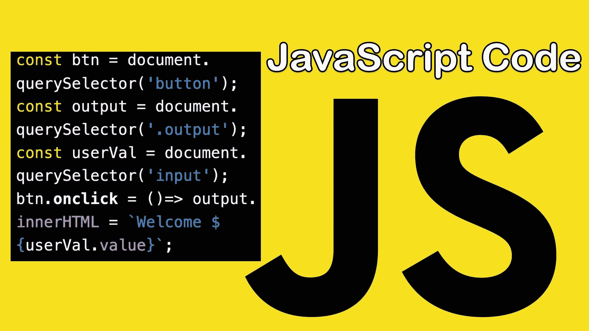


## 关于作者

Laurence Svekis 是一位课程作者和创作者，拥有 20 年的应用开发经验。曾在全球通过在线和线下教过超过 100 万学生。专长 `JavaScript` 编码、Web 以及多种编程语言。Laurence 有机会为许多学生提供畅销的视频和书面内容。2019 年，Laurence Svekis 被 Google 认定为 `Google Workspace` 的 `GDE`（`Google 开发者专家`）。由于对代码实现的各种功能充满热情，创建这本基于项目的书籍是一件真正快乐的事，以便让他学习并尝试 `JavaScript`。本书的内容包含许多编码练习，以实践并更多地了解如何应用 `JavaScript` 代码。请注意，虽然不需要之前的 `HTML` 和 `CSS` 编码经验，但强烈建议具备，因为本书的内容侧重于应用 `JavaScript` 创建交互式和动态网页内容。

## 目录

- 认识 JavaScript
- JavaScript 简介
- 开始编码
- JavaScript 编码技巧
- 如何在 JavaScript 中使用变量
- JavaScript 动态类型转换
- JavaScript 变量
- JavaScript 数组和对象
- JavaScript 函数
- 用于交互式网页的 DOM
- 使用 JavaScript 选择页面元素
- 使用条件应用逻辑
- JavaScript 运算符
- 使用三元运算符的条件
- JavaScript Math Random
- JavaScript 循环代码块
- JavaScript 对象
- 使用 JavaScript 编码构造对象
- JavaScript 数组值
- 遍历数组项
- 数组数据更新方法
- 使用 Sort 更新数组数据
- 查找数组值
- JavaScript 字符串方法
- 如何打乱字符串字符
- 使用 JavaScript 使用 Storage
- 用于交互式网页的 JavaScript
- 用代码创建和删除页面元素
- 移动页面元素练习
- 交互式网页的 JavaScript
- 页面元素
- JavaScript

# 认识 JavaScript

JavaScript 广泛用于 Web，是最受欢迎的编程语言之一。它允许 Web 开发人员和设计师通过代码赋予网页生命。除了 `HTML` 和 `CSS`，JavaScript 是互联网上使用的代码技术之一。它直接在浏览器中运行，你可以在计算机上使用文本编辑器创建 `html` 文件并在浏览器选择 `html` 文件并用任何浏览器打开，然后引入 JavaScript 代码让事情发生。

# 开始编码

代码是你希望发生的事情的指令集。示例：当新用户访问你的网站时，询问他们的姓名。显示带有他们姓名的欢迎消息，是你可能要求 JavaScript 执行的操作示例。要编写代码，你需要将完成此任务的步骤分解开。从获取姓名开始，因为在第二步将姓名返回给网站用户时将需要它。

## 第一步 - 获取用户姓名

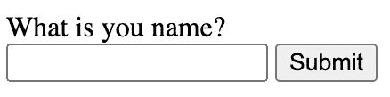

## 第二步 - 使用用户的输入值显示欢迎消息。

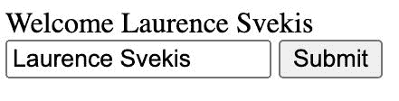

代码指令将是：

1. 为用户提供一个输入区域
2. 从输入获取用户姓名的输入值
3. 使用该值向用户返回响应

## 概述

然后代码将能够选择页面元素，用包含欢迎消息更新元素更新，其中包含了用户输入的姓名值。

下面的代码将是后续课程中将涵盖内容的示例，并将为实现上述结果创建步骤。

```html
<!DOCTYPE html>
<html>
<head>
  <title>JavaScript Course</title>
</head>
<body>
<div class="output">What is you name?</div>
<input type="text" name="userName">
<button>Submit</button>
<script>
  const btn = document.querySelector('button');
  const output = document.querySelector('.output');
  const userVal = document.querySelector('input');
  btn.onclick = () => output.innerHTML = `Welcome ${userVal.value}`;
</script>
</body>
</html>
```

这是一个为网页访问者创建自定义交互式 Web 体验的步骤的简单示例。该代码将为该用户创建一个独特的体验，并根据用户在输入区域提供的内容进行定制。

你越能为 Web 用户定制化 Web 体验，用户就越倾向于享受并留在网页上。创建出色的网页体验正是 JavaScript 的核心所在。在你的网页元素中执行操作并让事情发生，运行在用户的浏览器中。这就是 JavaScript 可以做到的，创建 Web 用户寻找的这种一对一体验。Web 用户对网站有更多期待，JavaScript 可以帮助你实现它。

你需要一些工具，你可能已经在计算机上拥有它们。当然，需要一个 Web 浏览器来运行代码，所有的 Web 浏览器都能运行 JavaScript，但请注意它们对新版本的代码兼容性可能不相同。像 `Chrome` 这样的浏览器自带了开发者工具仪表板，这在创建网页时非常有用。`DevTools` 仪表板有助于调试，并能够看到代码后台发生了什么。

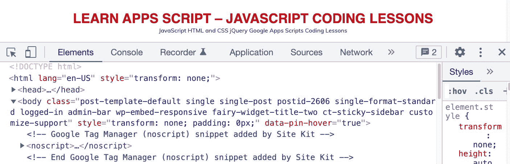

网站上打开的 Web 工具示例。

开发者控制台向你显示有关当前加载网页的信息，并包含一个你可以在当前网页内执行 JavaScript 表达式的控制台。打开你的浏览器，选择开发者工具并尝试一下，我们将在本课程中使用它。在大多数现代浏览器中，你可以直接从浏览器编写并执行 JavaScript。在 `Chrome` 浏览器中，当你想要处理 `DOM` 或 `CSS` 时，可以打开 `DevTools`，右键点击页面上的元素并选择 `Inspect`（检查）跳转到 `Elements`面板。或者按下 `Command+Option+C` (Mac) 或 `Control+Shift+C` (Windows, Linux, Chrome OS)。当你想查看日志消息或运行 JavaScript 时，按下 `Command+Option+J` (Mac) 或 `Control+Shift+J` (Windows, Linux, Chrome OS) 直接跳转到 `Console`面板。

你还需要一个编辑器来编写代码。所谓的 `IDE`（集成开发环境）是用于构建应用程序的软件。`IDE` 可创建代码文件、将其保存到计算机并编辑文件。使用 `IDE` 的优点之一是代码更具读性，而且通常有插件、样式选项和多个内置工具帮助编写代码。一旦创建了文件，你可以使用 FTP 将代码文件传输到你的 Web 服务器。如果你还没有编辑器，可以使用 `Visual Studio Code`。第一节课将帮助你在计算机上进行设置并开始编码。

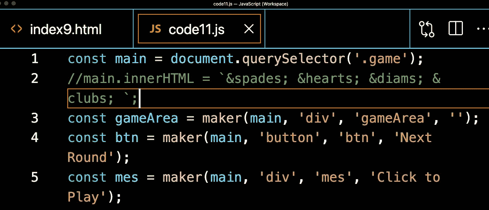

Web 编辑器打开并在名为 `code11.js` 的文件中创建 JavaScript 代码的示例

开始学习 JavaScript 很容易：你只需要一个现代 Web 浏览器和一个编写代码的编辑器。开始之前，创建一个名为 `index.html` 的文件并在浏览器中打开它。这就是在浏览器中运行计算机上文件所需的所有内容。要向 html 中添加 JavaScript，你可以通过链接到扩展名为 `JS` 的脚本文件，或者直接在 HTML 的 `script` 标签之间编写 JavaScript 代码来实现。

在第一节课结束时，你应该已经设置好了编辑器和浏览器，并准备好编码。你可以通过 Google 找到代码编辑器列表，几乎所有的编辑器都支持前端代码。如有需要，可以在 `https://code.visualstudio.com/` 下载编辑器。

# JavaScript 简介

探索 JavaScript，了解它是如何工作的以及你如何编写代码

JavaScript 是 Web 上的核心技术，与 `HTML` 和 `CSS`。`HTML` 元素可以作为对象访问，对象具有属性、方法和事件。在学习本书的过程中，我们将更详细地探讨这一点。

`HTML` 是用于结构化和为 Web 内容提供意义的标记语言。`CSS` 是用于包含 `HTML` 内容样式规则的语言。JavaScript 是允许你在网页内创建交互式和动态内容的脚本语言。

你可以用 JavaScript 做很多事情，例如存储值、运行代码块、使用条件应用逻辑以及为你的页面添加事件。使用 JavaScript 可以做很多事情，可能性是无限的。JavaScript 直接在浏览器中运行并由浏览器渲染。你可以使用 `DOM` 连接到 HTML 元素，`DOM` 是 JavaScript 用于添加、更新和删除 HTML 的编程接口。

JavaScript 代码是单线程的，这意味着线程上一次只能发生一件事。其他请求在操作完成之前会被阻塞，然后这些请求才会运行。JavaScript 代码是逐行执行的，这很重要因为你在尝试使用变量之前需要声明它们，还有许多其他方面将在后续页面中探讨。

API 是预构建的组件集，允许开发者连接并访问这些对象。把它想象成一个控制面板，JavaScript 让你与之交互。浏览器也有 API，JavaScript 代码可以访问，这正是允许代码与可见 Web 内容交互的原因。浏览器 API 允许访问网页元素和其他数据。你可以访问 API 并进行实用的编程。`DOM`（文档对象模型）API 允许你操作 `HTML` 和 `CSS`。本书将详细介绍 `DOM`，以及你使用 JavaScript 选择和操作元素的方法和方式。

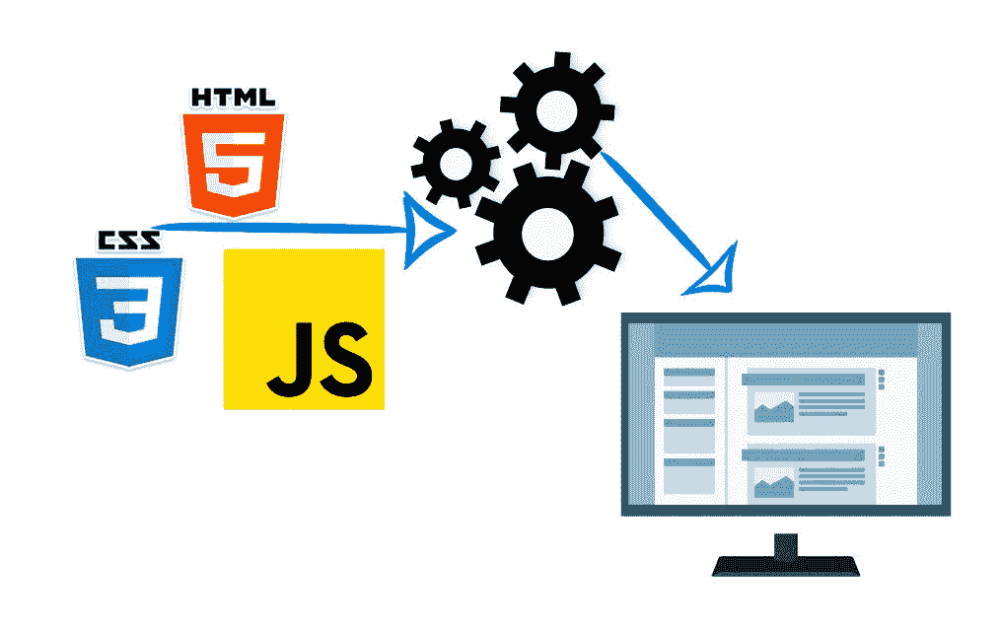

通过浏览器与网页交互。`HTML` `CSS` 和 JavaScript

服务端与客户端的区别是指代码运行的位置。服务端代码在服务器上运行，而不是在用户的计算机或浏览器中。客户端代码直接运行在用户的计算机中，当涉及到 JavaScript 时如此。当用户在浏览器中查看网页时，代码被下载、运行并由浏览器显示。

JavaScript 可用于动态网页内容，因为它可以更新网页的显示内容并生成内容。JavaScript 在客户端或用户计算机的浏览器中运行。因此，我们可以在没有互联网连接的情况下运行代码，因为我们需要的所有内容都已经在计算机的浏览器应用程序中了。一个没有更新内容且始终显示相同内容的网页被称为静态页面。通常情况下，静态页面已成为过去式，在互联网刚创建时，HTML 并不具有交互性，且页面输出对所有用户都是一样的。

## 课程 JavaScript 编码练习

1. 打开你的代码编辑器并创建一个基础的 `html` 文件。
2. 保存该 `html` 文件并在浏览器中打开它。

```html
<!doctype html>
<html>
<head>
 <title>JavaScript</title>
</head>
<body>
  Hello World
</body>
</html>
```

搭建你的 Web 开发环境，从开始开始编写代码。使用编辑器 `Visual Studio Code`。使用 `Chrome` 浏览器和 `Chrome DevTools` 查看控制台消息。

# 开始编程

探索如何开始编写 JavaScript 代码以及如何将 JavaScript 添加到你的 HTML 文件中以便在浏览器中运行代码。

在本节中，我们将探索如何向 HTML 文件中添加 JavaScript。JavaScript `JS` 文件不会在浏览器中独立运行，它们将作为文本文件输出并显示 JavaScript 代码。要运行 JavaScript，它必须位于 HTML 文件中，要么在 HTML 代码内部，要么在 HTML 代码中链接到一个带有 JavaScript 代码的 `JS` 文件。将 JavaScript 整合到网页中有多种方法。下面我们将探索这 3 种方法，包括作为元素内的属性、在 HTML 的 script 标签之间，以及作为从 HTML 代码链接的 `JS` 文件。

你可以将 JavaScript 作为内联属性添加到 HTML 元素中，尽管不建议使用这种格式。它们很难识别，且不是良好的做法。

```html
<div onclick="alert('hello')">Hello World 1</div>
```

HTML `script` 标签内部的内部 JavaScript。如果你将与页面元素进行交互，应将其添加到 `body` 标签结束标签之前。代码从上到下加载到浏览器，如果 HTML 尚未完全加载而你尝试使用 JavaScript 访问元素，你将会遇到错误。

```html
<script>
  document.write('<div>Hello World 2</div>');
</script>
```

最佳实践是使用外部文件，使用 `js` 扩展从 HTML 文件创建一个单独的文件。放置 `script` 标签并使用 `src` 属性链接到你文件所在的路径。它可以是相对于 `html` 文件的相对路径，也可以是使用完整路径的文件地址绝对路径来加载它。如果你使用绝对路径，你应该可以将路径粘贴到你的网络浏览器并看到该文件。

```html
<script src="app.js"></script>
<script src="http://www.example.com/app.js"></script>
```

使用 `document.write()` 方法向网页输出文本的示例代码。你可以使用 `document` 对象，它是由浏览器创建的代表网页元素的对象。`document` 对象有几个方法可以应用于编码逻辑。使用 `document.write()` 将在遇到代码时直接将圆括号内的任何字符串值写入网页中。我们将在接下来的课程中更详细地介绍 `document` 对象。这仅仅是 `document` 对象的许多功能之一，以及它如何被通过 JavaScript 代码直接在浏览器中与 HTML 页面元素进行交互。

```javascript
document.write('<div>Hello World 3</div>');
document.write('<div>Hello World 4</div>');
document.write('<div>Hello World 5</div>');
```

## 课程 JavaScript 编码练习

1. 创建一个 `HTML` 文件和一个 `JS` 文件。
2. 使用 `script` 标签链接 `JS` 文件作为源文件。
3. 使用 `document.write()` 向网页添加文本。
4. 使用 `document.write()` 向你的网页添加 HTML 格式的内容。

# JavaScript 编码技巧

学习如何开始使用 JavaScript 并创建你的第一段 JavaScript 代码。

本节将介绍如何使用注释对语句和代码进行文档说明。尽可能使用注释为编码语法提供上下文，你可以在 JavaScript 中使用单行注释或多行注释。使代码更具人类可读性的最佳实践是使用缩进并利用空白提高代码的可读性。浏览器会忽略空白，可以使用它来结构化代码以便于查看。在单独的 `JS` 文件中创建代码并从 HTML 文件链接到它，是将你的 HTML 文件连接到 JavaScript 代码的最佳方法。你可以使用 `console` 进行调试并查看值。

为了确保你的代码按预期工作，你可以利用某些语法来向浏览器输出值和信息。使用 `console.log()` 向浏览器输出调试数据。

代码中的空白会被忽略，使用空白和缩进使代码更具人类可读性。注意不要在语句之间添加空格，因为这会在代码被渲染时导致错误。可以使用大括号来指示代码块，这将在接下来的课程中的各种代码语法中使用。代码周围的大括号表示一个旨在一起运行的代码块。代码块的缩进允许编辑器更容易读取代码。

```javascript
{
  document.write('<br>Output Message');
  document.write('<br>Output Message');
}
```

使用单行或多行注释为代码提供更多上下文。你可以通过 `//` 注释语句来调试应用程序。注释会被忽略且不会输出到页面。

```javascript
/*
这是我的代码！
Laurence Svek
*/
//alert('Hello');
```

使用 `console` 方法允许你从 JavaScript 代码向浏览器进行调试和通信。这可以在 JavaScript 代码运行时提供额外的信息。控制台消息仅输出到浏览器的控制台中，对用户不可见。


控制台输出示例及其在 Chrome 浏览器中的显示方式。

```javascript
console.log('Hello');
console.error('Hello');
console.info('Hello');
console.warn('Hello');
//console.clear();
console.log('New line');
```

`Window` 对象是 `document` 对象的父级。`window` 对象是顶层父级，包含了可以使用的方法。`alert()` 和 `prompt()` 都是 `window` 对象的一部分。你可以使用这些与用户创建交互。两者都会在浏览器中显示标准的弹出消息，用户必须进行操作后才能与窗口的其他部分进行交互。尽管它们提供了与用户交互的简单方法，但这些并不常用，因为用户体验较差，且现在 JavaScript 和 DOM 中有更多交互选项。警报和提示旨在与网络用户进行交互。从创建 `index.html` 和 `app.js` 文件开始。然后编写一些 JavaScript 代码并尝试。在浏览器中打开并运行 HTML 文件。你可以使用课程中的函数如 `alert()` 或 `document.write('Hello');`；Alert 会停止代码执行，如果在顶部，则在点击按钮之前不会输出内容。将 JavaScript 放在底部以便其余代码可以渲染。

```javascript
window.alert('Hello World');
```

Window prompt（窗口提示）与 alert（警告）略有不同，因为 prompt 有一个回调函数，这意味着输入值会被返回到 JavaScript 代码中并作为值在代码中使用。这两者都可以在代码中使用不包含 `window` 对象的情况下编写。代码会自动默认指向顶层对象，如果代码中没有指定，它将查找顶层对象，默认情况下就是 `window` 对象。

```javascript
prompt('How are you?');
```

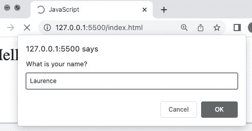

带有问题和响应回调的 window `prompt()` 示例

```javascript
alert('Hello');

const res = prompt('What is your name?');

alert(res);
```

### JavaScript 课程练习：

1. 在你的 JavaScript 文件中注释掉一行代码。
2. 使用多行注释注释掉一个代码块。
3. 尝试使用不同的消息测试各种 `console` 输出方法。
4. 创建一个以你的名字为消息 `alert`。
5. 创建一个返回网页用户名的 `prompt`。设置一个变量来捕获 `prompt` 的响应值，并使用 `document.write()` 方法将值输出到文档。

# 在 JavaScript 中使用变量

- 变量是编程的基础概念之一
- 使用 `const` 或 `let` 避免使用 `var`
- `const` 和 `let` 是基于作用域的
- 父级作用域 vs 局部作用域
- 给变量赋值并重新赋值更新后的新值
- 使用字符串和数字作为变量的值
- JavaScript 改变数据类型时的动态类型
- `Math` 以及 JavaScript 的直接输出

变量允许开发者存储值，这些值可以在代码中根据需要进行更新。通常，变量在代码开头声明，并在整个代码中使用它们存储应用程序的值。当你声明变量时可以使用“let”改变值。如果你希望值在整个代码中保持不变，请使用“const”。这可以避免代码中错误重新赋值导致的错误和问题。

双引号、单引号或反引号可包含字符串内容。如果语句单独写一行，则不需要分号（`;`）。但如果希望在一行中编写多个语句，则必须用分号分隔。然而，最佳实践是即使在严格不需要的情况下也始终在语句后写分号。JavaScript 代码忽略空白符；你可以利用它来编写更易读、更易理解的代码。

## 创建变量

- `var` - 声明变量，可选地初始化为一个值。
- `let` - 声明一个块作用域的局部变量，可选地初始化为一个值。代码块由 `{}` 表示。
- `const` - 声明一个块作用域的、只读的常量。不可更改。

在使用变量之前必须声明它们。用逗号分隔来声明多个变量。如下所示，驼峰命名（CamelCase）更具读性。

```javascript
let a,b,c,d;

let userfirstname = “Laurence”;

let userFirstName = “Laurence”;
```

### JavaScript 课程练习：

1. 使用 `let` 和 `const` 声明数字和字符串变量。
2. 使用使用单引号、双引号和反引号创建字符串的不同格式。
3. 将结果输出到 `console` 和文档中。
4. 给变量分配新值并输出结果。
5. 尝试使用 JavaScript 包裹在 `${}` 中的模板字面量字符串，并检查控制台和网页中的输出。

```javascript
let a = 'Laurence Svekis';

let b = 10;

let e = 5;

let f = 20;

let myStr1 = 'Hello\'s "world"';

let myStr2 = "\"Hello\" 'world'";

let myStr3 = `Hello'      s    

"world"`;

let tempLit = `Math ${b  +  e  +  f} Hello`;

const myName = 'Laurence Svekis';
//myName = 'Svekis';

{
 const b = 1000;
  console.log(b);
 //var c = 100;
 //let d = 100;
}

//console.log(c);
console.log(b);

console.log(myName);

a = 'Hello World';

let val = b + e + f;

val = myStr1 + ' ' + myStr2 + ' ' + myStr3;

val = tempLit;

val = `${myStr1} ${myStr2} ${myStr3}`;

console.clear();

console.log(val);

document.write(val);
```

# JavaScript 动态类型转换

- JavaScript 数据类型
- 数据类型 `string`, `number`, `boolean` - `typeof` 类型转换
- 数据类型 `Booleans`, `Null`, `Undefined`
- `number.toString()` `Number(string)`
- `typeof` 运算符
- 数据类型包括数字、字符串、布尔、对象

JavaScript 动态类型转换及其工作原理。JavaScript 变量可以转换为不同的数据类型，它们并不是设置为声明时的数据类型。JavaScript 使用不同的数据类型，JavaScript 会动态地分配它认为所需的类型，如果有需要你也可以更改变量的数据类型。

### JavaScript 课程练习：

1. 声明多个变量但不给它们赋值。
2. 获取变量的数据类型并将其输出到页面。
3. 将数字和字符串相加。
4. 将字符串转换为数字。
5. 将字符串转换为数字。
6. 创建布尔值。

```javascript
let myStr = 'Laurence';

let myNum = 0;

let a;

let b,c,d;

let val;

myStr = 5;

myNum = 'test';

b = 5;

c = 10;

d = '20';

d = null;

d = true;

d = false;

d = c.toString();

a = '100X';

d = parseInt(a);

val = b + c;

val = d;

val = typeof(d);
```

# JavaScript 变量

变量命名规则提供了可以使用名称以及如何在代码中声明 JavaScript。

- 变量标识符必须使用唯一名称
- 变量标识符应具有意义
- 标识符可以包含字母、数字、下划线和美元符号
- 变量名必须以字母、下划线或美元符号开头
- 名称大小写敏感
- 名称不能与 JavaScript 单词重复
- 变量名中不能有空格

命名规则必须以字母、下划线 (`_`) 或美元符号 (`$`) 开始。后续可以是字母或数字。大写或小写。变量名长度没有限制。

### JavaScript 课程练习：

1. 创建一些字符串值。
2. 为变量名赋予有意义的名字。
3. 使用驼峰命名变量名。

```javascript
let _test5 = 'Laurence';

let $test_ = 'Svekis';

let test$ = 'hello';

let TESTtest = 'hello';

let myFirstName = 'Laurence';
//let let = 'Not a good idea';

let myLastName = $test_;

let output = myFirstName;

let fullName = `${myFirstName} ${myLastName}`;

output = fullName;

console.log(output);

document.write(output);
```

# JavaScript 数组和对象

数组是具有预设项目顺序的对象，通过元素的索引来选择和标识列表中的元素。数组还具有内置方法，这些方法使其成为数据以及操作和选择数组中包含项目的强大方式。对象也可以在同一个变量中包含多个项目，它们通过属性名进行标识，该属性名用于从对象中选择项目。每个属性名在对象中只能使用一次，且是唯一的。属性名可以使用引号设置或作为单个单词在对象中设置。它们与属性名成对赋值值，使用冒号分配值，并用逗号分隔多个命名的键值对。

### JavaScript 编码练习

1. 创建一个包含各种数据类型的数组。
2. 创建一个包含各种数据类型的对象。
3. 从数组和对象中检索一个值并将其输出到控制台。
4. 尝试同时使用点符号表示法和方括号表示法获取对象内部的值。
5. 使用数组的索引值和对象的属性名更新数组和对象的值。
6. 声明一个新变量并将现有数组赋值给新变量。修改新变量的内容并观察第一个数组是否也随之更新。

```javascript
const arr1 = ['one',100,false,null,[1,2,3]];

const obj1 = {
  first:'Laurence',
  'full Name':'Laurence Svekis',
  id : 100,
  status : true,
  arr : [1,2,3,'Hello World']
};

const arr2 = arr1;

const obj2 = obj1;

obj2.id = 5000;
arr2[0] = 'Hello World';
arr1[3] = `Laurence Svekis`;
obj1.first = `Linda Jones`;

let val = arr1[4][0];
val = obj1['full Name'];
val = obj1.first;
val = obj2.arr[3];
console.log(val);
document.write(val);
```

# JavaScript 函数

探索如何在代码中使用函数来运行代码块。尝试避免重复代码，函数提供了一种运行代码块的极佳方式。

- 函数可用于运行代码块
- 两种类型的函数：函数表达式和函数声明
- 函数可以接收参数
- 函数命名规则与变量相同
- 你可以在括号内向函数传递值，参数名可以用逗号分隔以添加多个值
- 当函数被调用时，参数被称为函数参数，它们是函数在参数中接收的值
- 函数可以返回；`return` 语句将结束函数执行并返回值
- 函数在花括号内具有作用域。函数作用域内的局部值只能在函数内部访问
- 函数的益处是你可以编写一次代码并根据需要重复使用。你可以通过不同的参数值和返回值获得不同的结果。

函数允许开发者运行代码块，当函数运行时，是在定义函数并调用函数时执行代码的。函数在代码中提供了一种运行代码块的强大方式，它们还包含自己的作用域，因此在函数内部设置的变量只在该函数内存在。在代码中创建函数来完成重复的任务并处理特定的编码目标。你可以向函数传递值，然后在函数代码中使用这些值，并从函数代码返回结果。函数可以在参数中使用参数，尽管这不是强制的。函数也可以使用 `return`，尽管不是强制从函数返回响应。你可以向函数传递值以便在代码中使用。

函数有两种类型：使用 `function` 关键字分配函数代码的函数声明，或者类似于给变量赋值的函数表达式（但在这种情况下赋值的是函数代码）。

```javascript
// Function declaration
function test(num) {
  return num;
}

// Function expression
var test = function (num) {
  return num;
};
```

### JavaScript 编码练习

1. 创建一个全局值，每执行一次函数时都会递增。在每个函数中添加该值的增量。`counter++`。
2. 创建一个函数表达式，在其代码内部可以将一个值输出到控制台。
3. 调用函数。为函数更新一个参数，让函数使用该参数值并将该值输出到控制台。
4. 创建一个函数声明。添加 3 个参数，它们将接收值并将它们全部相加。使用 `return` 返回传入函数的值的总和。
5. 将函数的返回值赋值给变量，并将变量输出到网页上。

```javascript
const fun1 = function (val) {
  counter=counter+val;
  const output = `<div>Hello ${counter}</div>`;
  document.write(output);
}

let counter = 0;
let word = '';

fun1(21);
fun1(2);
fun1(3);
fun2('h');
fun2('e');
fun2('l');
fun2('l');
fun2('o');
//fun1 = 100;

console.log(fun1);
const fun5 = fun1;
fun5(1000);

function fun2(val){
  word = word + val;
  counter++;
  let output = `<div>Hello ${counter}</div>`;
  document.write(output);
}

let valTotal = 0;
valTotal += fun3(10,44,55);

function fun3(num1,num2,num3){
  let total = num1 + num2 + num3;
  console.log(total);
  return total;
}

const temp = 5000;
fun4(100);

function fun4(val){
  const temp = 9;
  const myVal = val + temp;
  console.clear();
  console.log(myVal);
}
```

# 用于交互页面的 DOM

JavaScript 可以通过事件监听器创建交互内容。事件监听器等待用户执行操作，从而触发事件的发生。DOM 可以表示页面元素。文档模型（DOM）是页面的数据表示。DOM 以树状结构组织，作为构成网页和 HTML 文档的对象。DOM 是 HTML 文档的编程接口，即如何访问和页面内容。使用 JavaScript 让你的网页活跃起来。DOM 和 JavaScript 允许你在不刷新网页的情况下创建向用户展示新元素和更新的内容。

### JavaScript 编码练习

1. 创建你的 HTML 文件并添加页面元素
2. 将 `document.body.children` 数组赋值给变量，它将代表 body 内的所有子元素。
3. 选择第一个元素使用索引值 `0`，就像数组一样基于索引。使用 `console.dir()` 输出对象。
4. 从元素中选择一些属性并将其输出到控制台。
5. 将元素的 `textContent` 更新为你的名字。
6. 打开喜欢的网站并打开开发者工具，输入 `document.body.textContent = "Laurence Svekis"`。

```html
<!doctype html>
<html>
<head>
 <title>JavaScript</title>
</head>
<body>
<div id="one" class="red">Hello World 1</div>
<div>Hello World 2</div>
<script src="dom1.js"></script>
</body>
</html>
```

```javascript
const ele = document.body.children[0];
console.dir(ele);

let val = 'Laurence Svekis';
document.body.children[0].textContent = val;

ele.textContent = 'UPDATED';
```

# 使用 JavaScript 选择页面元素

使用 JavaScript 的 DOM 方法可以选择 HTML 页面元素。一旦选中了元素，就可以使用代码对其属性进行操作。

`Document` 对象中存在一些方法，允许我们更好地选择想要用代码操作的元素。`querySelector()` 和 `querySelectorAll()` 允许 JavaScript 从文档对象的内容中选择页面元素。

JavaScript `querySelectorAll` 获取页面元素全部。使用 `querySelector` 和 `querySelectorAll` 选择匹配的页面元素。不同的选择器包括标签、id 和类（class）。选择页面元素，遍历节点列表的内容输出并更新页面元素。

## JavaScript 编程练习：

1. 更新你的 HTML 以包含 2 个 `div` 和一个 `input` 元素。
2. 使用 `querySelector()` 和 `querySelectorAll()` 选择所有页面元素并将页面元素对象赋值给变量。
3. 更新第一个元素的文本内容。
4. 给 `input` 元素赋值一个值 `myInput.value`。
5. 更新第二个 `div` 的某些样式属性，使其看起来更像一个按钮。
6. 为按钮添加事件监听器，将一个函数分配给元素的点击事件 `onclick`。
7. 在 `click` 函数内部获取输入框的值，将第一个 `div` 的 `textContent` 更新为输入字段的值。给输入字段的值赋值一个空字符串。

```html
<div id="one" class="red">Hello World 1</div>
<input type="text">
<div>Hello World 2</div>
```

```javascript
const ele1 = document.querySelector('div');
const ele2 = document.querySelector('#one');
const ele3 = document.querySelector('.red');

ele1.textContent = 'Laurence Svekis';

const eles = document.querySelectorAll('div');

console.log(ele1);
console.log(ele2);
console.log(ele3);
console.dir(eles);

eles[0].textContent = 'Hello World';
console.log(ele1.textContent);

const myInput = document.querySelector('input');
console.log(myInput.value);
myInput.value = 'Laurence';

eles[1].textContent = 'Click Me';
eles[1].style.border = '1px solid black';
eles[1].style.width = '200px';
eles[1].style.textAlign = 'center';
eles[1].onclick = clicker;

function clicker(){
  let temp = myInput.value;
  ele2.textContent = temp;
  myInput.value = '';
}
```

# 使用条件应用逻辑

逻辑条件可以根据条件当前返回的布尔结果来创建不同的响应。根据语句中条件的数量，可以使用各种 JavaScript 语法，如 `if` 语句、`Switch` 语句或三元运算符。所有这些都可以用于返回依赖于所检查结果的响应。

条件可以在代码中使用，以应用逻辑，并根据条件的结果运行不同的操作。根据 `True`（真）或 `False`（假）的值，可以运行不同的代码块。

`if` 语句将检查条件，如果为真则运行指定的代码。如果为假则不运行代码。`Else` 在条件不成立时提供另一种选择，那么 `else` 语句允许我们在之前的所有条件都不真的情况下，在假时运行代码块。你还可以使用 `else if` 语句来检查另一个条件，如果之前的条件返回假，则运行另一个独立的代码块。

使用 `switch` 语句允许我们指定多个替代方案，检查是否有任何条件匹配，并允许执行相应的代码。

JavaScript 代码可以使用比较运算符来检查语句是真是假。要检查多个条件，你可以应用逻辑运算符来检查条件之间的逻辑关系。下面的示例将展示如何使用逻辑运算符以及在真或假的各种组合下可以预期的结果。

## JavaScript 编程练习：

1. 选择你想要使用的页面元素并为它们分配变量。
2. 为 `counter` 创建一个全局值 `0`。
3. 一旦按钮被点击，将 `counter` 加 1。
4. 检查 `counter` 的值是否小于 2，如果是，则将样式颜色更新为红色。
5. 在条件中添加一个 `else if`，检查 `counter` 的值是否小于 4，如果是，则将输出元素的颜色更新为绿色。
6. 在条件中添加一个 `else if`，检查 `counter` 的值是否小于 6，如果是，则将输出元素的颜色更新为紫色。
7. 使用 `else if` 在所有条件都不真时，将元素的样式更新为蓝色。
8. 创建一个 `switch` 来检查 `counter` 的值。为你想要跟踪的值创建 `cases`，根据不同的 `case` 使用不同的字符串值更新输出区域文本。尝试带有 `break` 关键字和不带 `break` 关键字的 `switch`。
9. 在 `switch` 语句中添加一个 `default`。

```html
<!doctype html>
<html>
<head>
  <title>JavaScript</title>
</head>
<body>
<div>Hello World 1</div>
<input type="text">
<button type="button">Click</button>
<script src="dom3.js"></script>
</body>
</html>
```

```javascript
const output = document.querySelector('div');
const myInput = document.querySelector('input');
const btn = document.querySelector('button');
myInput.value = 'Laurence';
let counter = 0;

btn.onclick = () => {
  counter++;
  if (counter < 2) {
    output.style.color = 'red';
  } else if (counter < 4) {
    output.style.color = 'green';
  } else if (counter < 6) {
    output.style.color = 'purple';
  } else {
    output.style.color = 'blue';
  }

  switch (counter) {
    case 1:
      output.innerText = 'Case 1';
      break;
    case 2:
      output.innerText = 'Case 2';
      break;
    case 3:
      output.innerText = 'Case 3';
      break;
    default:
      output.innerText = 'Default';
  }
};
```

# JavaScript 运算符

JavaScript 运算符可以进行算术运算、给变量赋值、拼接字符串以及对值进行比较。JavaScript 还有方法可以转换数据类型以确保预期结果。当字符串相加时，结果是字符串。JavaScript 有多种方法可以帮助这些操作顺利进行。

## JavaScript 编程练习：

1. 获取输入字段的值。使用 `Number()` 方法将值转换为数字。
2. 使用 `isNaN()` 检查输入的结果是否为数字。
3. 使用模（modulus）检查输入是奇数还是偶数。如果有余数，则为奇数，否则为偶数。
4. 对输入值进行数学计算，并将结果返回给用户的输出字段。

```javascript
const output = document.querySelector('div');
const myInput = document.querySelector('input');
const btn = document.querySelector('button');
let a, b = 100;
let c = a * b / 100;
let d = 504 % 50;

a = a + 1;
a++;
a--;
console.log(a);
console.log(d);

let e = 10;
e *= a;
console.log(e);

console.clear();
console.log('5' == 5);
console.log('5' === 5);
console.log('5' != 6);
console.log('5' !== 5);
console.log(10 <= 10);
console.log(('5' == 5) && true);
console.log(('5' == 5) && false);
console.log(('5' != 5) || true);
console.log(('5' == 5) || false);

btn.onclick = () => {
  let val = Number(myInput.value);
  console.log(typeof val);
  console.log(isNaN(val));
  let html = `<div>Results ${val}</div>`;
  if (!isNaN(val)) {
    html += `<div>Was a number</div>`;
  } else {
    html += `<div>NOT a number</div>`;
  }
  if (val % 2) {
    html += `<div>Odd number</div>`;
  } else {
    html += `<div>Even number</div>`;
  }
  html += `<div>${val * 50} = ${val} X 50</div>`;
  html += `<div>${val / 10} = ${val} / 10</div>`;
  output.innerHTML = html;
};
```

```javascript
html += `<div>${val **val} = ${val} X ${val}</div>`;

output.innerHTML = html;

}
```

# 使用三元运算符的条件

JavaScript 三元运算符提供了一种创建短单语句条件的方法，其返回的值取决于条件的布尔值结果。

## 课程 JavaScript 编码练习：

1. 获取输入框中输入的值，检查它是否为数字。如果不是数字，则在条件中更新输出文本，向用户显示消息。更改输出元素的背景样式和颜色。
2. 如果是数字，使用三元运算符根据输入框中输入的值，为用户创建一个输出消息。
3. 检查输入的数字是否大于 19 或等于 19，如果是，则显示允许该人员进入的消息；否则拒绝该人员进入。

```javascript
const output = document.querySelector('div');

const myInput = document.querySelector('input');

const btn = document.querySelector('button');

btn.onclick = clickedMe;

let val = (true) ? 'true' : 'false';

val = (true && false) ? 'true' : 'false';

val = (10 > 5) ? 'true' : 'false';

val = (isNaN('test')) ? 'true' : 'false';

output.textContent = 'How old are you?';

btn.textContent = 'Entry Checker';

console.log(val);

function clickedMe(){

  const myAge = myInput.value;

  if(!isNaN(myAge)){

      console.log('ready');
      output.style.backgroundColor = 'white';
      output.style.color = 'black';
      output.textContent = 'Please enter your Age?';

     const message = myAge >= 19 ? `${myAge} is allowed to enter.` : `${myAge} is not old enough!`;

      output.innerHTML += `<div>${message}</div>`;

      myInput.value = '';

  }else{
      myInput.value = '';
      output.style.backgroundColor = 'red';
      output.style.color = 'white';
      output.textContent = 'Please enter a number for your Age!';
  }
}
```

# JavaScript 数学随机

随机值可以用于生成更具吸引性的交互，使用 JavaScript 获取随机数。随机值非常适合游戏，因为为用户提供了更具挑战性的体验。

`Math` 对象包含了多种可以用于数学功能的方法，此外，它还包含 `random` 方法，用于在 JavaScript 中创建随机值。`Math.random()` 方法返回一个从 0（包含 0）到小于 1（不包含 1）之间的浮点数。然后可以将随机值进行相乘并四舍五入到最近的整数，以包含开发者所需的随机范围值。

随机值是游戏以及为网络用户创建独特自定义体验的理想选择。

## 使用 JavaScript 和 DOM 的随机数交互猜数字游戏编码练习

在此练习中，创建一个随机猜数字游戏，该游戏将提供一个随机范围，用户必须从中猜数字。应用程序将向用户提供反馈，说明猜测太高还是太低，允许用户缩小隐藏数字的范围。一旦找到输入值与隐藏数字匹配的解决方案，游戏将重新生成随机数和新的猜数字范围。反馈通过 HTML 元素提供给用户，这样玩游戏的玩家就知道结果以及下一步该做什么。这是一个使用 JavaScript 和与 DOM 页面元素交互创建简单游戏的完美示例。

玩家在游戏中猜出正确数字的步骤示例。正确数字需要通过应用程序返回给用户的反馈来确定。

从询问一个范围内的数字开始。

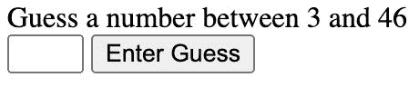

向玩家提供关于隐藏值的反馈，以便玩家可以使用这些信息在下一轮进行更好的猜测。

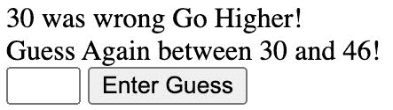

再次向用户提供反馈，以保持参与度并让玩家进入下一轮。

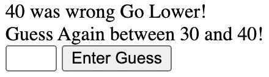

一旦玩家猜中了隐藏数字的正确值，为玩家提供结束反馈。

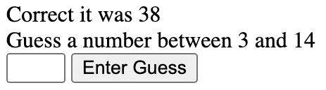

## 课程 JavaScript 编码练习：

1. 在 JavaScript 代码中将 HTML 页面元素选择为变量。
2. 全局声明变量 `lowValue`、`highValue` 和 `hiddenNumber`。
3. 创建一个名为 `starter()` 的函数来启动游戏。
4. 创建一个使用 `min` 和 `max` 值作为参数生成随机数的函数。将 `Math.random()` 封装在 `Math.floor()` 中以向下取整到最近的整数。`Math.floor(Math.random())`。将随机值乘以最大值减去最小值，为了包含最大值，在乘积上加 1。在结果中加 1 以从 0 增加到 1。
5. 在 `starter()` 函数内部生成随机数。
6. 更新 HTML 以提供指令。
7. 对于输入元素，设置属性 `min` 和 `max`。
8. 为按钮添加 `onclick` 事件监听器。
9. 在 `clickedMe()` 函数中，获取输入值。
10. 检查数字是否与输入值匹配。
11. 如果猜错了，则更新值。
12. 游戏应一直持续，直到猜出正确数字。

```html
<!doctype html>
<html>
<head>
<title>JavaScript</title>
</head>
<body>
<div>Hello World</div>
<input type="text">
<button type="button">Click</button>
<script src="app.js"></script>
</body>
</html>
```

```javascript
const output = document.querySelector('div');
const myInput = document.querySelector('input');
const btn = document.querySelector('button');

let lowValue = 1;
let highValue = 10;
let hiddenNumber = 0;

output.innerHTML = '';

function starter(){
  myInput.value = '';
  lowValue = getRan(0,5);
  highValue = getRan(lowValue,50);
  hiddenNumber = getRan(lowValue,highValue);
  output.innerHTML += `<div>Guess a number between ${lowValue} and ${highValue}</div>`;
  btn.onclick = clickedMe;
  myInput.setAttribute('type','number');
  myInput.setAttribute('min',lowValue);
  myInput.setAttribute('max',highValue);
  btn.textContent = 'Enter Guess';
}

function clickedMe(){
  const valInput = myInput.value;
  if(valInput == hiddenNumber){
    console.log('correct');
    output.innerHTML = `<div>Correct it was ${hiddenNumber}</div>`;
    starter();
  } else {
    let message;
    if(valInput < hiddenNumber){
      message = `${valInput} was wrong Higher!`;
      lowValue = valInput;
    } else {
      message = `${valInput} was wrong Lower!`;
      highValue = valInput;
    }
    output.innerHTML = `<div>${message}</div>`;
    console.log(hiddenNumber);
    myInput.value = '';
    output.innerHTML += `<div>Guess Again between ${lowValue} and ${highValue}!</div>`;
  }
}

function getRan(min,max){
  return Math.floor(Math.random() * (max-min+1) + min);
}
```

# JavaScript 循环代码块

JavaScript `For`、`While`、`Do While` 循环多次执行代码块，直到满足条件为止。

循环允许我们多次执行代码块，它们还允许我们遍历项目列表（例如数组中的项），直到数组项的长度条件不再为真，或者满足其他跳出循环的条件。

循环始终需要几个参数，例如起始值、停止循环的条件以及在循环中移动到下一个项目的方法。我们可以通过设置一个带有起始值的变量来建立一个简单的 `for` 循环，然后应用一个条件，如果该条件为真则继续执行循环，并增加变量的值，使得条件最终不再为真。

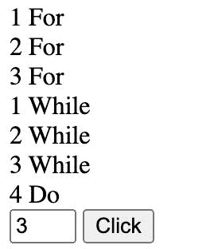

### 课程 JavaScript 编程练习：

1. 将页面元素选择为 JavaScript 变量。
2. 更新输入字段属性，设置为数字输入类型，并带有 `min` 和 `max` 值。
3. 为按钮元素添加点击事件监听器。
4. 当点击按钮时，获取输入值并赋值给变量 `num`。创建一个 `for` 循环，根据输入值 `num` 的循环次数执行一个代码块。
5. 创建一个 `while` 循环，根据输入值的次数输出 `html`。
6. 创建一个 `do while` 循环，根据输入值的次数创建 `html` 输出。
7. 使用新内容更新 `html`。

```html
<!doctype html>
<html>
<head>
 <title>JavaScript</title>
</head>
<body>
<div>JavaScript</div>
<input type="text" >
<button type="button">Click</button>
<script src="dom7.js"></script>
</body>
</html>
```

```javascript
const output = document.querySelector('div');
const myInput = document.querySelector('input');
const btn = document.querySelector('button');

myInput.setAttribute('type','number');
myInput.setAttribute('max',20);
myInput.setAttribute('min',0);
myInput.value = 5;
btn.onclick = btnClicked;

function btnClicked(){
  console.clear();
  let num = myInput.value;
  let html = '';
  for(let i=0;i<num;i++){
    console.log(i);
    html += `<div>${i+1} For</div>`;
  }
  let i = 10;
  while(i<num){
    i++;
    html += `<div>${i} While</div>`;
  }
  do{
    i++;
    html += `<div>${i} Do</div>`;
  } while(i<num);
  output.innerHTML = html;
  console.log('ready');
}
```

# JavaScript 对象

JavaScript 对象可以用于包含许多相关数据，此示例将演示如何在代码中使用 `Objects`。

JavaScript 的数据类型之一是 `object`。这些可以用于存储各种键值对集合甚至更复杂的实体。文档是一个包含许多实体的巨大 `object`。学习更多关于对象的知识将有助于更好地定义 `DOM` 实体可以做什么、它们的行为及其原因，以及如何使用它们。

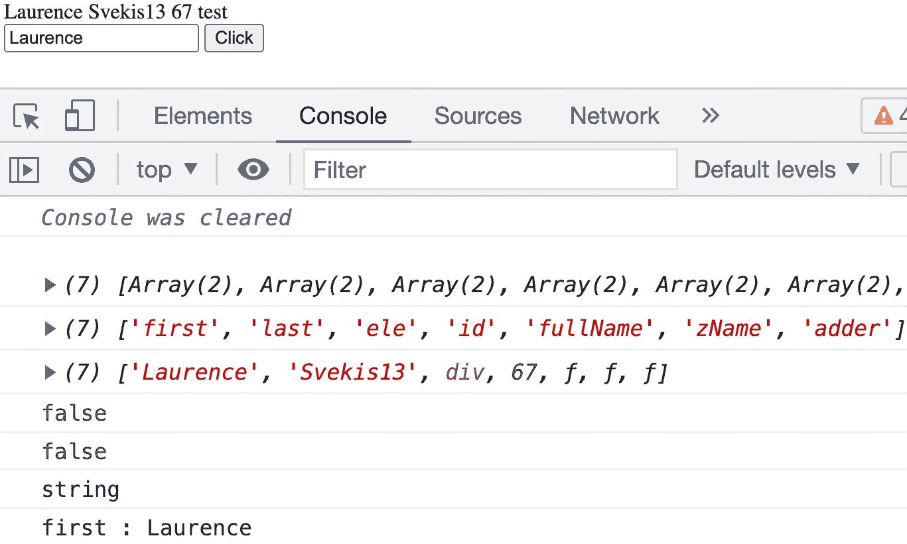

### 课程 JavaScript 编程练习：

1. 从 HTML 文件选择页面元素作为 JavaScript `objects`。
2. 创建一个全局对象，其具有 `first`、`last`、`id` 的值，并在对象中创建几个方法。
3. 在对象中创建一个方法，使用对象中的 `first` 和 `last` 名称值并将它们组合成字符串，包括 `id` 和作为参数发送给函数的任何值。
4. 在对象内部创建一个方法，可以更新对象的 `first` 和 `last` 姓名。为对象 `id` 生成随机值。返回组合后的当前对象属性值。
5. 当点击按钮时，更新对象 `first` 属性的值。
6. 在页面和控制台上输出调用对象中的 `fullName` 方法生成的新字符串。
7. 获取对象项作为嵌套数组值并使用 `Object.entries()` 创建新数组。
8. 使用 `Object.keys()` 获取并创建一个包含对象键的数组。
9. 使用 `Object.values()` 获取并创建一个包含对象值的数组。
10. 使用 `in` 或 `condition` 检查键是否包含在对象中。
11. 遍历对象的属性名并在控制台中输出它们。
12. 检查属性值的数据类型，如果是 `string` 或 `number`，则将其输出到控制台，否则在控制台输出警告。

```javascript
const output = document.querySelector('div');
const myInput = document.querySelector('input');
const btn = document.querySelector('button');
btn.onclick = btnClicked;
myInput.value = 'Laurence';

const myObj = {
  first : 'Laurence',
  last : 'Svekis',
  ele : output,
  id : 0,
  fullName : function(val){
    return `${this.first} ${this.last} ${this.id} ${val}`
  },
  zName(val){
    return `${this.first} ${this.last} ${this.id} ${val}`
  },
  adder(first,last){
    this.first = first;
    this.last = last;
    this.id = Math.floor(Math.random()*100);
    return `${this.first} ${this.last} ${this.id}`;
  }
};

function btnClicked(){
  const newFirst = 'Laurence';
  const ranNum = Math.floor(Math.random()*100);
  const newLast = 'Svekis';
  myObj.adder(newFirst, newLast);
  output.innerHTML = `<div>${myObj.fullName('test')}</div>`;
  console.log(myObj.fullName('test'));
  const arr1 = Object.entries(myObj);
  const arr2 = Object.keys(myObj);
  const arr3 = Object.values(myObj);
  const key = myInput.value;
  if (key in myObj){
    for(const prop in myObj){
      console.log(prop);
      const val = myObj[prop];
      if(typeof val === 'string' || typeof val === 'number'){
        console.log(val);
      } else {
        console.warn(val);
      }
    }
  }
}
```

# 使用 JavaScript 构建对象

你可以使用函数来构建对象，这创建了对象的实例。代码块将与对象相关。

### 课程 JavaScript 编程练习：

1. 从输入字段获取值，用于创建一个人的对象。这应该设置 `first`、`last` 并使用这两者创建对象的 `full` 姓名。
2. 在 `arguments` 没有值的情况下为函数添加默认值。

```javascript
const output = document.querySelector('div');
const myInput = document.querySelector('input');
const btn = document.querySelector('button');
btn.onclick = btnClicked;
myInput.value = 'Laurence';

function FullName(first='Laurence',last='Svekis'){
  this.firstName = first;
  this.lastName = last;
  this.full = `${first} ${last}`;
}

function btnClicked(){
  const person = new FullName(myInput.value, 'Smith');
  output.innerHTML = `<div>${person.full}</div>`;
  console.log(person.full);
}
```

# JavaScript 数组值

更新数组值的常用 JavaScript 数组方法用于利用数据。数组方法提供了一种强大的方法来交互和使用数组包含的数据。

- `arr.push(val)` // 添加到数组返回数组长度
- `arr.pop()` // 删除最后一个
- `arr.shift()` // 删除第一个
- `arr.unshift(val)` // 添加到数组开头返回数组长度
- `arr.splice(1)` // 返回索引 1 之后的所有项
- `splice(start, deleteCount, val)` // 修改数组内容
- `arr.slice(start, end)` // 将数组的一部分拷贝到新数组中
- `arr.slice()` // 复制数组为新数组
- `arr.slice(5)` // 从索引 5 开始返回数组项
- `arr.slice(1,4)` // 使用 slice 返回数组部分
- `arr.toString()` // 返回数组项的字符串表示

```javascript
arr.join(' - '); // 返回数组项的字符串表示，使用参数值作为数组项之间的分隔符。
```

## 课程 JavaScript 编码练习：

1. 将 HTML 元素设置为 JavaScript 对象，并为按钮添加一个 `onclick` 事件。
2. 创建 2 个数组，使用 `concat` 和 `join` 将它们合并创建第 3 个数组，将原始数组其中一个添加两次到新数组中。
3. 尝试不同的数组方法 `push()`、`pop()`、`shift()` 和 `unshift()` 来更新数组中的数据。
4. 使用 `splice()` 更新原始数组，并从被切出的数组项创建一个新数组。
5. 使用 `slice()` 从现有数组的片段创建一个新数组。
6. 将数组转换为字符串，同时使用破折号作为分隔符将数组转换为字符串。
7. 将结果输出到控制台和网页上。

```javascript
const output = document.querySelector('div');
const myInput = document.querySelector('input');
const btn = document.querySelector('button');

btn.onclick = btnClicked;
myInput.value = 'Laurence';

const arr1 = ['One'];
const tempArr = ['onex','twox','threex'];
const arr = arr1.concat(tempArr,tempArr);

function btnClicked() {
  const val = myInput.value;
  let temp = arr.push(val,'LAST'); // 添加到数组并返回数组长度
  console.log(temp);

  temp = arr.pop(); // 移除最后一个
  console.log(temp);

  temp = arr.shift(); //移除第一个项
  console.log(temp);

  temp = arr.unshift('First'); // 添加到数组开头，返回数组长度
  console.log(temp);

  console.log(arr.length);

  arr[arr.length - 1] = 'LAST';
  //delete arr[0];
  //console.log(arr);

  arr.push('one1','two2','three3');
  //temp = arr.splice(1);  返回从索引 1 之后的所有项组成的数组
  //temp = arr.splice(1,3);
  temp = arr.splice(1,3,'Add1','Add2','Add3');
  console.log(temp);

  temp = arr.splice(3,0,'New1','New2','New3');
  console.log(temp);

  temp = arr.slice(); //复制数组为新数组
  temp[0] = 'TEST';
  temp = arr.slice(5); // 返回从索引 5 开始的数组项
  temp = arr.slice(1,4); // 使用 slice 返回数组的一部分

  console.clear();
  console.log(temp);
  console.log(arr);

  const myStr = arr.toString();
  const myStr1 = arr.join(' - ');

  output.innerHTML = `<div>${myStr}</div>`;
  console.log(arr);
  console.log(myStr);
  console.log(myStr1);
}
```

# 遍历数组项

遍历数组以获取内容，有一些方法如 `forEach` 方法，它们非常适合循环内容并与数组数据进行交互。

遍历数组中的所有项，选择项及其值。你可以在 `for` 循环中使用数组的 `length` 属性，或者使用数组方法 `forEach(item,index,array)` 并返回数组项的值。

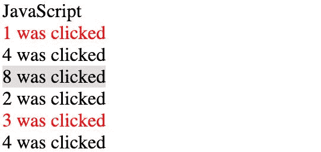

## 课程 JavaScript 编码练习：

1. 将所有 HTML 元素引入 JavaScript 代码中。
2. 使用 `for` 循环用新的 `divs` 更新输出元素。
3. 使用 `document.querySelectorAll()` 选择 `div` 内部所有匹配 `divs` 的结果。
4. 使用 `forEach` 循环遍历所有新的 `div`，为每个新 `div` 添加一个值为 0 的新属性值 `val`。
5. 为每个新 `div` 添加点击事件，该事件将在控制台中输出该元素、索引值和 `event.target` 元素。将元素的 `val` 值递加 1。检查 `style.color` 是否为红色，如果不是则设置为红色，否则设置为黑色。在元素文本中输出每个 `div` 被点击的次数。
6. 在主按钮点击时，添加一个遍历所有 `arr` 项的循环，使用 `for` 循环并将数组项的值输出到控制台。
7. 使用 `forEach` 获取所有数组项，并将它们作为 `div` 输出到页面，在新元素中列出索引加一以及项的值。

```javascript
const output = document.querySelector('div');
const myInput = document.querySelector('input');
const btn = document.querySelector('button');

btn.onclick = btnClicked;
myInput.value = 'Laurence';

const arr = [];

for(let i=0;i<10;i++){
  output.innerHTML += `<div>${i} Test Div</div>`;
}

const eles = document.querySelectorAll('div div');
console.log(eles);

eles.forEach((ele)=>{
  console.log(ele);
  ele.val = 0;
  ele.onclick = (e)=>{
    console.clear();
    console.log(ele);
    console.log(e.target);
    ele.val++;
    ele.innerText = `${ele.val} clicked`;

    if(ele.style.color == 'red'){
      ele.style.color = 'black';
    }else{
      ele.style.color = 'red';
    }
  }
})

btn.onclick = () => {
  for(let i=0;i<arr.length;i++){
    console.log(arr[i]);
  }
  arr.forEach((item,index)=>{
    output.innerHTML += `<div>${index+1}. ${item}</div>`;
  })
};
```

# 数组方法

JavaScript 有多种数组方法用于处理内容。


## JavaScript 编码练习：

1. 创建一个字符串数组。
2. 创建一个包含随机数字的数字数组。
3. 使用 `map()` 创建一个新的数组。
4. 使用 `map()` 方法将数值乘以 2。
5. 使用 `filter()` 返回大于 50 的值。
6. 使用 `reduce()` 将所有值相加得到总和。
7. 使用 `every()` 检查所有值是否小于 150。
8. 使用 `some()` 检查是否有任何值小于 50。
9. 将结果输出到控制台。
10. 使用 `map()` 方法将数组项到输入框。
11. 使用 `forEach()` 遍历项并将结果输出到页面。


# JavaScript DOM 编码练习与挑战

## 数组方法演示

```javascript
const output = document.querySelector('div');
const myInput = document.querySelector('input');
const btn = document.querySelector('button');

btn.onclick = btnClicked;
myInput.value = 10;
myInput.setAttribute('type', 'number');

const arr = ['one', 'two', 'three', 'four', 'five'];
const temp1 = [];

for (let i = 0; i < 10; i++) {
  const ranValue = Math.floor(Math.random() * 100);
  temp1.push(ranValue);
}

function btnClicked() {
  const arr1 = arr.map((item, ind, array) => {
    console.log(item);
    return `${item} ${ind}`;
  });

  const arr2 = temp1.map(val => val * 2);

  const arr3 = temp1.filter((val) => {
    return val > 50;
  });

  const arr4 = temp1.reduce((previous, current, index) => {
    console.log(previous);
    console.log(current);
    return previous + current;
  });

  const arr5 = temp1.every((val) => {
    console.log(val);
    return val < 150;
  });

  const arr6 = temp1.some((val) => {
    console.log(val);
    return val < 50;
  });

  console.log(arr1);
  console.log(arr2);
  console.log(arr3);
  console.log(arr4);
  console.log(arr5);
  console.log(arr6);

  const arr7 = temp1.map((val) => {
    console.log(val);
    return val * myInput.value;
  });

  let html = '';
  arr7.forEach((ele, ind) => {
    html += `<div>${temp1[ind]} x ${myInput.value} = ${ele}</div>`;
  });
  output.innerHTML = html;
}
```

## 如何对数组进行反序和字母顺序排序

### JavaScript 编码练习

1. 创建一个包含某些值的数组，并向数组中添加随机数。
2. 当按钮被点击时，从现有数组创建一个新数组，过滤出数据类型为数字或字符串的数据。
3. 使用 `array.length` 和 `Math.random()` 为数组项选择一个随机的索引值。
4. 点击时，切换 `sort()` 或 `reverse()` 方法对数组进行就地排序（in-place）。
5. 将数组作为字符串输出到页面的 HTML 中。
6. 使用 `sort()` 添加一个 `Math.random()` 的返回值，结果为正数或负数，这将使数组在就地的情况下进行随机化。
7. 将数组的随机化操作封装在一个循环中，测试 10 次以查看随机的数组顺序，将其输出到页面的 HTML 中。
8. 使用 `forEach()` 循环遍历所有数组项并将它们添加到 HTML 中。

```javascript
const output = document.querySelector('div');
const myInput = document.querySelector('input');
const btn = document.querySelector('button');

btn.onclick = btnClicked;
myInput.value = 10;
myInput.setAttribute('type', 'number');

const arr = ['one', 'two', 'three', 'four', 'five'];
let boo = true;

for (let i = 0; i < 10; i++) {
  const ranValue = Math.floor(Math.random() * 100);
  arr.push(ranValue);
}

console.log(arr);

function btnClicked() {
  const arr1 = arr.filter((ele) => {
    return typeof(ele) == 'string';
  });
  const ind = Math.floor(Math.random() * arr.length);
  output.innerHTML = `Random Array Item with index of ${ind} value ${arr[ind]}`;
  let html = '';
  if (boo) {
    arr.sort();
    boo = false;
  } else {
    arr.reverse();
  }
  html += `<div>${arr.toString()}</div>`;
  for (let i = 0; i < 10; i++) {
    arr.sort(() => {
      return Math.random() - 0.5;
    });
    html += `<div>${arr.toString()}</div>`;
  }
  arr.forEach((ele, ind) => {
    html += `<div>${ind} - ${ele}</div>`;
  });
  output.innerHTML += html;
  console.log(arr1);
}
```

## 查找数组值

JavaScript 数组拥有在数组中查找项的方法，此练习提供了如何查找数组项的示例。JavaScript 有几种方法可以检查数组中包含的值。

### JavaScript 编码练习

1. 创建一个包含一些字符串和数字数值的数组。
2. 使用 `arr.includes()` 检查输入框中的值是否在数组中。
3. 创建一个名为 `html` 的变量，用于构建并返回数组方法响应的字符串。使用三元运算符，根据输入中的术语是否在数组中创建一个响应消息。
4. 在 html 中添加 `includes` 的响应。
5. 创建一个 `arr.indexOf()` 检查，数组中的某个值，它将返回索引值，如果未找到则返回 -1。将结果输出到 HTML 中。
6. 找到匹配的最后一个项的索引值 `arr.lastIndexOf()`，将结果输出到 HTML 中。
7. 使用 `find()` 返回数组中数字的第一个匹配项，将结果输出到 HTML 中。
8. 使用 `find()` 返回满足条件（`==` 输入值和数组项值）的第一个匹配项。如果没有找到，它将返回 `undefined`。将响应结果输出到 HTML 中。
9. 使用 `find()` 返回数组中大于 10 的值的第一个匹配结果。注意，它也应该包含并返回字符串。

```javascript
const output = document.querySelector('div');
const myInput = document.querySelector('input');
const btn = document.querySelector('button');

btn.onclick = btnClicked;

const arr = ['Svekis', 'Laurence', '100', 50, 10];

function btnClicked() {
  const val = myInput.value;
  const res = arr.includes(val);
  const message = (res) ? `was found` : `Not Found`;
  let html = `<h2>Search Results for ${val}</h2>`;
  html += `<div>${val} - ${message}</div>`;
  html += `<div>Includes ${res}</div>`;
  const indexPos = arr.indexOf(val);
  html += `<div>IndexOf ${indexPos}</div>`;
  const indexPosLast = arr.lastIndexOf(val);
  html += `<div>IndexLast ${indexPosLast}</div>`;
  const finderVal = arr.find((v) => {
    return typeof(v) == 'number';
  });
  html += `<div>Find 1 ${finderVal}</div>`;
  const finderValP = arr.find((v) => {
    return v == val;
  });
  html += `<div>Find 2 ${finderValP}</div>`;
  const finderValNum = arr.find((v) => {
    return v > 10;
  });
  html += `<div>Find 3 ${finderValNum}</div>`;
  output.innerHTML = html;
  console.log(res);
  console.log(indexPos);
  console.log(indexPosLast);
  console.log(finderVal);
  console.log(finderValP);
  console.log(finderValNum);
}
```

## String 方法

字符串方法提供了与字符串交互的方式。


### JavaScript 编码练习

1. 使用 `trim()` 移除输入中的空白。
2. 当按钮被点击时，输出字符串的长度。
3. `slice()` 切取字符串部分。
4. 检查它是否 `includes` 某个值。
5. `replace()` 输出字符串值。
6. `toLowerCase()` 和 `toUpperCase()` 处理相同的。
7. `indexOf` 获取字符串值。
8. `lastIndexOf()` 处理相同的字符串值。
9. `search()` 获取字符串索引。
10. 创建一个可以对单词进行大写的函数。

```javascript
const output = document.querySelector('div');
const myInput = document.querySelector('input');
const btn = document.querySelector('button');

btn.onclick = btnClicked;
myInput.value = 'Laurence Svekis';

function btnClicked() {
  const val = myInput.value.trim();
  let html = `<div>${val}</div>`;
  html += `<div>Length : ${val.length}</div>`;
  const key = 'Svekis';
  const inChecker = val.includes(key);
  const mes1 = inChecker ? ` was There` : ` was NOT`;
  html += `<div>'${key}' ${mes1}</div>`;
  const index1 = val.indexOf('re');
  html += `<div>IndexOf ${index1}</div>`;
  const index2 = val.lastIndexOf('e');
  html += `<div>LastIndexOf ${index2}</div>`;
  const sea1 = val.search('e');
  html += `<div>Search ${sea1}</div>`;
  html += `<div>Capitals ${makeCap(val)}</div>`;
  output.innerHTML = html;
}

function makeCap(words) {
  const arr = words.split(' ');
  const temp = [];
  arr.forEach((word) => {
    const f = word.charAt(0).toUpperCase();
    const remainLetters = word.slice(1);
    temp.push(f + remainLetters);
  });
  return temp.join(' ');
}
```

## 如何打乱字符串字符

此 JavaScript 交互式单词乱序游戏演示了如何使用字符串方法打乱字符串中的字母。


### JavaScript 编码练习

1. 创建一个你想要在游戏使用的单词和短语数组。
2. 创建一个全局游戏对象，用于存储已乱序的单词。
3. 创建一个启动游戏的函数，名为 `starter`。调用 `starter` 函数。
4. 更新按钮文本为“检查答案”。
5. 更新输入框的边框和显示属性为实黑色，并显示为块级。
6. 清空输入框的当前值。
7. 使用 `Math.random()` 从单词数组中随机选择一个项。
8. 创建一个打乱短语中单词的函数，名为 `maker()`。
9. 在 `maker()` 函数中，将字符串转换为每个单词的数组。创建一个 `holder` 数组，在创建单词的打乱版本时使用。
10. 遍历字符串中的所有单词，将单词转换为 `toLowerCase()`。
11. 将单词的字母拆分为单独的数组。使用 `sort()` 随机化数组中的字母。使用 `join()` 将数组转换回由单词中随机排序字母组成的字符串。将其添加到 `holder` 数组中。
12. 返回 `holder` 数组，将单词合并回字符串。
13. 将打乱的单词赋值给游戏的隐藏值。将短语的打乱版本输出到 HTML 页面。
14. 点击按钮时，检查按钮文本，如果是 `new game`，则启动 `starter()` 函数重新启动游戏。
15. 将输入转换为 `lowerCase()`。将该值与数组中选中字符串的隐藏值进行比较。如果匹配，则玩家解决了问题。将按钮文本更新为 `new game`。
16. 如果错误，向玩家提供反馈，让他们尝试新的字母组合。将继续游戏，直到找到正确答案。

```html
<!doctype html>
<html>
<head>
  <title>JavaScript</title>
</head>
<body>
  <div>JavaScript</div>
  <input type="text">
  <button type="button">Click</button>
  <script src="dom16.js"></script>
</body>
</html>
```

```javascript
const output = document.querySelector('div');
const myInput = document.querySelector('input');
const btn = document.querySelector('button');

btn.onclick = btnClicked;

const arr = ['JavaScript', 'Laurence Svekis', 'Html', 'code'];

const game = {
  hidden: ''
};

starter();

function btnClicked() {
  if (btn.textContent == 'New Game') {
    starter();
  } else {
    const checkVal = myInput.value.toLowerCase();
    if (checkVal == game.hidden) {
      console.log('correct');
      output.innerHTML += `<div>Correct it was ${checkVal}</div>`;
      btn.textContent = 'New Game';
      myInput.style.border = 'black solid 1px';
      myInput.style.display = 'none';
    } else {
      console.log('wrong');
      myInput.style.border = 'red solid 1px';
      output.innerHTML += `<div style="color:red">X ${checkVal}</div>`;
    }
  }
}

function starter() {
  btn.textContent = 'Check Answer';
  myInput.style.border = 'black solid 1px';
  myInput.style.display = 'block';
  myInput.value = '';
  const ind = Math.floor(Math.random() * arr.length);
  game.hidden = arr[ind].toLowerCase();
  const rep = maker(game.hidden);
  output.innerHTML = `<div>${rep}</div>`;
}

function maker(words) {
  const tempArr = words.split(' ');
  const holder = [];
  tempArr.forEach(word => {
    word = word.toLowerCase();
    const letters = word.split('');
    letters.sort(() => {
      return Math.random() - 0.5;
    });
    holder.push(letters.join(''));
  });
  console.log(holder);
  return holder.join(' ');
}
```

## 使用 JavaScript 使用 LocalStorage

使用 `JSON.parse` 和 `JSON.stringify` 将对象转换为单个字符串值。该字符串值可以用于存储在 `localStorage` 中，并作为键的值返回。

`localStorage` 提供了一种将值以字符串形式存储在浏览器中的方法，用户下一次访问网页时可以使用 JavaScript 获取这些值。

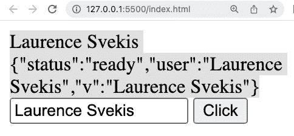

### JavaScript 编码练习

1. 尝试将数组转换为字符串，然后从字符串将其解析回可用的数组。对对象执行相同操作。`JSON.stringify(arr)`，`JSON.parse(strArr)`。
2. 当 HTML 加载时，调用一个函数使用键检查本地存储中的某个值。如果返回了值，则将字符串解析为对象。将对象的内容输出到页面。
3. 点击按钮后，创建一个转换为字符串并存入 `localStorage` 的对象。

```javascript
const output = document.querySelector('div');
const myInput = document.querySelector('input');
const btn = document.querySelector('button');

btn.onclick = btnClicked;

const arr = ['JavaScript', 'Laurence Svekis', 'Html', 'code'];

const game = {
  hidden: ''
};

starter();

function btnClicked() {
  if (btn.textContent == 'New Game') {
    starter();
  } else {
    const checkVal = myInput.value.toLowerCase();
    if (checkVal == game.hidden) {
      console.log('correct');
      output.innerHTML += `<div>Correct it was ${checkVal}</div>`;
      btn.textContent = 'New Game';
      myInput.style.border = 'black solid 1px';
      myInput.style.display = 'none';
    } else {
      console.log('wrong');
      myInput.style.border = 'red solid 1px';
      output.innerHTML += `<div style="color:red">X ${checkVal}</div>`;
    }
  }
}
```

## 遍历 `NodeList` 和 `HTMLCollection`

遍历 `nodeList` 和 `HTMLCollection`，输出元素并更新它们的 `innerHTML`。观察 `NodeList` 和 `HTMLCollection` 之间的差异。

```html
<!doctype html>
<html>
<head>
 <title>JavaScript</title>
</head>
<body>
<div class="one" id="one">JavaScript 1</div>
<div class="one" id="two">JavaScript 2</div>
<div class="two" id="three"><div class="one">JavaScript 3</div></div>
<script src="apps1.js"></script>
</body>
</html>
```

```javascript
const ele1 = document.querySelector('.one');
const ele2 = document.querySelector('#two');
const ele3 = document.querySelector('div > div');
const ele4 = document.getElementById('one');
const eles1 = document.querySelectorAll('div');
const eles2 = document.getElementsByTagName('div');
const eles3 = document.getElementsByClassName('one');

console.log(ele1);
console.log(ele2);
console.log(ele3);
console.log(ele4);
console.log(eles2['one']);
console.clear();
console.log(eles1);
console.log(eles2);
console.log(eles3);

eles1.forEach((ele, ind, arr) => {
  console.log(ele.textContent);
  ele.innerHTML = `<div>JavaScript List ${ind+1} </div>`;
})

console.log(eles1);
console.log(eles2);
for (let i = 0; i < eles2.length; i++) {
  console.log(eles2[i].innerHTML);
}
```

## 使用代码创建和删除页面元素

在本次练习中，将使用 JavaScript 通过代码动态创建和删除元素。

### 课程编码练习

1. 选择 HTML 元素，作为后续使用 `document.createElement()` 创建的元素的父元素。
2. 创建一个可以用于生成新页面元素的函数。在参数中添加元素标签类型、父元素以及元素的 HTML 或内容。
3. 使用该函数创建一个输入框（input）元素和一个按钮（button）元素。
4. 将输入框的属性设置为文本（text），并将值设置为字符串。
5. 为按钮添加 `onclick` 事件，点击时它将向列表添加一个新项。
6. 创建一个附加到页面上的列表。使用 `for` 循环创建多个列表项（list items）。
7. 创建一个向无序列表（ul）添加列表项的函数。更新内部文本的值，并为文本添加颜色样式。
8. 在创建列表项的函数内部，为列表项添加 `onclick` 事件，选中该列表项并从父元素中移除它。`removeChild()`。
9. 点击按钮时，添加一个函数来添加新的列表项，计算当前列表项的数量。在新列表项的文本中添加当前输入框的值以及 DOM 中列表项的计数。在新列表项中设置红色字体。
10. 检查 `append()`、`prepend()` 和 `appendChild()` 方法之间的区别。

```html
<!doctype html>
<html>
<head>
 <title>JavaScript</title>
</head>
<body>
<div class="one" id="one">JavaScript 1</div>
<div class="one" id="two">JavaScript 2</div>
<div class="two" id="three"><div class="one">JavaScript 3</div></div>
<script src="apps2.js"></script>
</body>
</html>
```

```javascript
const div1 = document.querySelector('div');
const div5 = document.querySelector('#three');
const div6 = document.querySelector('div .one');
const ul1 = document.createElement('ul');
const myInput = maker('input', div1, '');
myInput.setAttribute('type', 'text');
myInput.value = 'Laurence Svekis';
const btn = maker('button', div1, 'Add to List');
btn.onclick = () => {
  const lis = document.querySelectorAll('li');
  let temp = `${myInput.value} ${lis.length+1}`;
  addListItem(temp, 'red');
}
div6.style.color = 'purple';
div6.textContent = 'Hello WOrld 2';
console.log(div6.parentNode);
div6.parentNode.removeChild(div6);
console.log(div1);
div1.append(ul1);
console.log(ul1);
for (let i = 0; i < 10; i++) {
  addListItem(`List item ${i+1}`, 'blue');
}

function addListItem(val, col) {
  const li = document.createElement('li');
  li.innerText = val;
  li.style.color = col;
  li.onclick = (e) => {
    li.parentNode.removeChild(li);
  }
  return ul1.appendChild(li);
}
const div2 = document.createElement('div');
div1.prepend(div2);
div2.innerHTML = `Hello World`;
const div3 = maker('div', div1, 'Laurence Svekis');
div3.style.color = 'red';
div5.append(div3);
div5.prepend(ul1);
div5.append(div6);

function maker(eleT, parent, html) {
  const ele = document.createElement(eleT);
  ele.innerHTML = html;
  return parent.appendChild(ele);
}
```

## 移动元素

此编码练习将提供创建和移除元素的良好方法。在代码中，对象一次只能占据一个位置。

### 练习

1. 创建一个包含值的数组。
2. 创建 `ul`。
3. 创建 `div`。
4. 遍历 `div`。
5. 创建 `ul` 并更新 `div`。
6. 将 `ul` 附加到父元素。
7. `ul` 项。
8. 设置 `contenteditable` 为 true。
9. 为元素添加 `sel` 类。
10. 为列表添加一个按钮。
11. 点击按钮时，运行 `mover` 函数。
12. 在 `mover` 函数中，选择按钮的父元素。
13. 选择所有带有 `sel` 的元素。
14. 使用 `replaceChildren(...eles, ...parentEle.children)`。
15. 从父元素中移除 `sel` 类。

```html
<!doctype html>
<html>
<head>
 <title>JavaScript</title>
 <style>
 .sel{color:red;}
</style>
</head>
<body>
<div>JavaScript 1</div>
<div>JavaScript 2</div>
<div>JavaScript 3</div>
<div>JavaScript 4</div>
<script src="apps3.js"></script>
</body>
</html>
```

```javascript
const divs = document.querySelectorAll('div');

document.body.style.display = 'grid';
document.body.style.gridTemplateColumns = '1fr 1fr';

const arr = ['Laurence', 'Jane', 'Mike', 'Laurence', 'Jane', 'Mike', 'Laurence', 'Jane', 'Mike'];

const uls = [];

console.log(divs);

divs.forEach((ele, ind) => {
  ele.textContent = `List #${ind+1}`;
  const ul = document.createElement('ul');
  ele.style.border = '1px solid #ddd';
  ele.style.textAlign = 'center';
  ele.append(ul);
  uls.push(ul);
  if (ind == 0) addItems();
  const btn = document.createElement('button');
  ele.append(btn);
  btn.textContent = `Move here ${ind+1}`;
  btn.onclick = mover;
})

function mover(e) {
  const parentEle = e.target.parentNode.querySelector('ul');
  console.log(parentEle.children);
  const eles = document.querySelectorAll('.sel');
  console.log(eles);
  parentEle.replaceChildren(...eles, ...parentEle.children);
  eles.forEach(ele => {
    ele.classList.remove('sel');
  })
}

function addItems() {
  arr.forEach((val, ind) => {
    const li = document.createElement('li');
    li.textContent = `${ind+1}. ${val}`;
    li.setAttribute('contenteditable', true);
    li.style.textAlign = 'left';
    li.onclick = () => {
      li.classList.add('sel');
    }
    uls[ind].appendChild(li);
  })
}
```

## 使用事件进行页面交互

DOM 元素可以拥有各种事件，这些事件可以在页面上发生时后用于运行代码块。还可以通过 `AddEventListener()` 方法或各种元素事件将事件添加到 `Window` 对象以及 `Document` 对象中。`window` 和 `document` 对象可以在选定的事件发生时运行函数，例如 JavaScript 中的 `onLoad` 和 `DOMContentLoaded` 事件。此练习练习将提供一个如何使用这些事件的示例。

### 课程编码练习

1. 添加一个在 DOM 内容加载时触发的事件。尝试 `window.onload`、`document.body.onload` 和 `document.addEventListener('DOMContentLoaded',(){})`。
2. 使用 `addEventListener()` 为同一个元素添加多个事件，也尝试对 `onclick` 使用。
3. 将一个元素嵌套在其父元素中，使用 `useCapture` 将布尔值设置为 `true` 并观察顺序上的差异。
4. 为事件添加选项使其仅运行一次。`{once: true}`。
5. 从元素中移除事件监听器 `removeEventListener`。

```html
<!doctype html>
<html>
<head>
 <title>JavaScript</title>
 <script src="apps4.js"></script>
</head>
<body>
<div>JavaScript 1</div>
</body>
</html>
```

```javascript
window.onload = init;
document.addEventListener('DOMContentLoaded', init3);

function init3() {
  const div = document.querySelector('div');
  div.style.backgroundColor = '#ddd';
  const h1 = document.createElement('h1');
  h1.textContent = 'Laurence Svekis';
  div.append(h1);
  div.addEventListener('click', click1, {
    once: true
  });
  h1.addEventListener('click', click2);
  h1.addEventListener('click', click3);
}

function init2() {
  const div = document.querySelector('div');
  div.style.backgroundColor = '#ddd';
  const h1 = document.createElement('h1');
  h1.textContent = 'Laurence Svekis';
  div.append(h1);
  h1.onclick = click1;
  h1.onclick = click2;
}

function click1(e) {
  console.log('DIV');
}

function click2(e) {
  console.log('H1');
}

function click3(e) {
  e.target.removeEventListener('click', click2);
  console.log('Event #3');
}

function init1() {
  console.log('doc');
  const div = document.querySelector('div');
  const h1 = document.createElement('h1');
  h1.textContent = 'Laurence Svekis';
  h1.onclick = () => {
    console.log('h1 #2');
  };
  h1.addEventListener('click', (e) => {
    console.log('h1 #1');
  });
  h1.onclick = () => {
    console.log('h1 #3');
  };
  h1.addEventListener('click', (e) => {
    console.log('h1 #4');
  });
  h1.addEventListener('click', (e) => {
    console.log('h1 #5');
  });
  div.append(h1);
  console.log(div);
}

function init() {
  console.log('window');
}
```

## JavaScript 表单字段元素

表单值和交互选择可以通过从 HTML 页面中选择元素然后使用 JavaScript 获取属性值来实现。不同的元素可以包含不同的默认属性，此示例将演示如何交互表单元素（如输入字段和表单提交事件）。使用 JavaScript 代码获取输入字段值并在代码中动态创建元素。

### 课程编码练习

1. 为主页面元素添加几个文本节点（Text Nodes）。选择它们并更新文本节点的节点。
2. 创建一个文本输入框，为该输入字段设置一些常用属性。
3. 创建一个数字类型的输入字段，设置 `min` 和 `max` 属性。
4. 创建一个设置为日期类型的输入字段。
5. 创建一个设置为颜色类型的输入字段。
6. 在页面上创建并添加 `label` 和 `select` 元素。为 `select` 字段添加属性以允许选择多个项目。
7. 为 `select` 字段创建多个选项。
8. 添加一个按钮，将 `select` 字段中所有选中的选项列到无序列表中。
9. 在页面上添加单选按钮，并为其值添加标签。
10. 添加一个按钮以获取所选单选按钮的值。
11. 列出除单选按钮以外的所有输入值。

```javascript
const output = document.querySelector('div');
console.log(output);
output.innerHTML = '';

const out1 = document.createTextNode('Hello');
const out2 = document.createTextNode('World');
output.append(out1);
output.append(out2);

out1.textContent = 'Laurence';
out2.textContent = 'Svekis';

const myInput1 = document.createElement('input');
output.append(myInput1);
myInput1.setAttribute('type', 'text');
myInput1.setAttribute('name', 'first');

const myInput2 = document.createElement('input');
output.append(myInput2);
myInput2.setAttribute('type', 'number');
myInput2.setAttribute('min', '1');
myInput2.setAttribute('max', '10');

const myInput3 = document.createElement('input');
output.append(myInput3);
myInput3.setAttribute('type', 'date');

const myInput4 = document.createElement('input');
output.append(myInput4);
myInput4.setAttribute('type', 'color');

const label1 = document.createElement('label');
output.append(label1);
const sel1 = document.createElement('select');
output.append(sel1);
sel1.setAttribute('multiple', '');

for (let i = 0; i < 5; i++) {
  const opt = document.createElement('option');
  opt.textContent = `Option ${i + 1}`;
  sel1.append(opt);
}

const btn = document.createElement('button');
output.append(btn);
btn.textContent = 'List Selected Options';

const ul = document.createElement('ul');
output.append(ul);

for (let i = 0; i < 3; i++) {
  const radio = document.createElement('input');
  output.append(radio);
  radio.setAttribute('type', 'radio');
  radio.setAttribute('name', 'group');
  radio.value = `Value ${i + 1}`;
  const label2 = document.createElement('label');
  output.append(label2);
  label2.textContent = `Value ${i + 1}`;
  label2.setAttribute('for', `radio${i}`);
}

const btn2 = document.createElement('button');
output.append(btn2);
btn2.textContent = 'Get Selected Value';

const output2 = document.createElement('div');
output.append(output2);

const inputs = document.querySelectorAll('input');
inputs.forEach((input) => {
  if (input.type !== 'radio') {
    console.log(input.value);
  }
});
```

## 鼠标和键盘事件

元素拥有各种可以在元素上进行监听的事件。一旦事件在元素上发生，就可以用于运行代码块。用户交互可以通过鼠标或键盘进行。此示例将探索它们可以用于元素这些类型用户交互的事件。

### 课程编码练习

1. 创建一个 `div` 和一个无序列表，用于添加内容。
2. 添加一个按钮，用于更新样式的背景颜色。
3. 创建一个空数组，用作稍后更新页面元素的元素的数组。
4. 创建一个函数，可以为背景颜色返回随机的十六进制值。
5. 创建 10 个 `divs`，设置元素的样式属性，并包含一个随机背景颜色。
6. 添加一个点击事件，将主体（body）的背景颜色设置为与点击元素的背景颜色一致。
7. 为所有 `divs` 添加 `mouseover`、`mouseleave`、`mouseout`、`mousedown`、`mouseup` 和 `mouseenter` 事件。创建一个函数，将事件触发和自定义消息输出到输出元素以及控制台中。
8. 创建 10 个 `input` 元素，为这些元素添加 `onfocus`、`focusout`、`onchange` 事件监听器。在不同事件上更新样式属性。
9. 添加一个键盘事件来跟踪文档。跟踪按下的键位。
10. 为 `input` 元素添加键盘事件 `onkeydown`，如果按了 `enter` 键，则将输入框的值作为列表项添加到无序列表中。
11. 创建辅助函数来更改主体的背景、随机颜色生成器，以及一个可以将值输出到控制台和页面输出元素的日志函数。

```javascript
const div = document.querySelector('div');
div.innerHTML = '';
console.log(div);

const output = document.createElement('div');
div.append(output);

const ul = document.createElement('ul');
div.append(ul);

const btn = document.createElement('button');
btn.textContent = 'Reset Colors';
btn.style.display = 'block';
div.append(btn);

const holder = [];

btn.onclick = (e) => {
  holder.forEach(ele => {
    ele.style.backgroundColor = ranColor();
  })
}

for (let i = 0; i < 10; i++) {
  const ele = document.createElement('div');
  holder.push(ele);
  ele.style.width = '50px';
  ele.style.height = '50px';
  ele.style.border = '1px solid #ddd';
  ele.style.display = 'inline-block';
  ele.style.backgroundColor = ranColor();
  ele.style.lineHeight = '50px';
  ele.style.textAlign = 'center';
  ele.textContent = `${i+1}`;
  ele.addEventListener('click', () => {
    document.body.style.backgroundColor = ele.style.backgroundColor;
  });
  ele.onmouseover = (e) => {
  }
  ele.addEventListener('mouseover', () => {
    logger(`mouseOver ${i+1}`);
  })
  ele.addEventListener('mouseleave', () => {
    logger(`mouseLeave ${i+1}`);
  })
  ele.addEventListener('mouseout', () => {
    logger(`mouseOut ${i+1}`);
  })
  ele.addEventListener('mousedown', () => {
    logger(`mouseDown ${i+1}`);
  })
  ele.addEventListener('mouseup', () => {
    logger(`mouseUp ${i+1}`);
  })
  ele.addEventListener('mouseenter', () => {
    logger(`mouseEnter ${i+1}`);
  })
  div.append(ele);
}

for (let i = 0; i < 10; i++) {
  const ele = document.createElement('input');
  ele.style.display = 'block';
  ele.setAttribute('type', 'text');
  ele.value = `${i+1} Input value`;
  div.append(ele);
  ele.onfocus = () => {
    ele.style.color = 'red';
  }
  ele.addEventListener('focusout', () => {
    ele.style.color = 'black';
  });
  ele.onchange = () => {
    ele.style.backgroundColor = 'blue';
  }
  ele.onkeydown = (e) => {
    if (e.key === 'Enter') {
      adder(ele.value);
      console.log(ele.value);
    }
  }
}

document.addEventListener('keydown', tracker);
document.addEventListener('keyup', tracker);

function adder(val) {
  console.log(val);
  const li = document.createElement('li');
  li.textContent = val;
  ul.append(li);
}

function tracker(e) {
  console.log(e.key);
}

function logger(val) {
  console.log(val);
  output.innerHTML = val;
}

function updateColor() {
  document.body.style.backgroundColor = ranColor();
}

function ranColor() {
  return `#${Math.random().toString(16).slice(2,8)}`;
}
```

## 页面元素动画

JavaScript `requestAnimationFrame()` 方法为页面元素提供了平滑的动画。`requestAnimationFrame()` 告诉浏览器正在执行动画，并请求浏览器在下一次重绘之前调用特定的函数来更新页面。作为参数的 `callback` 是在下一次重绘之前应该调用的函数。在这个示例中，代码被用于在页面上创建一个平滑移动的小球元素。它在页面上的位置样式值通过 `top` 和 `left` 值进行更新。`requestAnimationFrame()` 方法可以用于在元素内部创建平滑动画。浏览器随后调用指定的函数，在下一次重绘之前更新动画。该方法接收一个回调函数。

### 练习

1. 选择一个元素作为容器。
2. 创建一个 `div` 来显示小球。
3. 更新元素的样式，使其变为 `absolute`（绝对定位）。
4. 创建一个对象来存储 `x`、`y`、`direction` 和 `speed`。
5. 使用 `requestAnimationFrame()` 在下一次重绘之前运行函数。
6. 给 `pos` 赋值 `left` 和 `top` 属性值。
7. 在 `animation` 函数中，检查 `pos` 是否超出边界。
8. 在 `animation` 函数中更新 `pos` 位置。
9. 如果按了 `enter` 键，则启动或停止动画。
10. 添加一个点击事件来重置小球的颜色。
11. 创建一个 `score` 元素显示分数。

```javascript
const div = document.querySelector('div');
const score = document.createElement('div');
score.style.textAlign = 'center';
document.body.prepend(score);

const ball = document.createElement('div');
ball.style.border = '3px solid white';
ball.style.width = '50px';
ball.style.height = '50px';
ball.style.backgroundColor = 'red';
ball.style.borderRadius = '50%';
ball.style.position = 'relative';
div.append(ball);

let pos = {
  x: 100,
  y: 100,
  dx: 1,
  dy: 1,
  speed: 5,
  move: true,
  score: 0
};

function adderScore() {
  score.innerHTML = `<div>Score :${pos.score}</div>`;
}

function gameHit() {
  pos.score++;
  ball.style.backgroundColor = `#${Math.random().toString(16).slice(2,8)}`;
  adderScore();
  pos.x = Math.floor(Math.random()*450);
  pos.y = Math.floor(Math.random()*350);
  ball.style.left = `${pos.x}px`;
  ball.style.top = `${pos.y}px`;
}

let mover;

function ani() {
  pos.move = true;
  if(pos.move) {
    if(pos.x > 450 || pos.x < 0) {
      pos.dx *= -1;
    }
    if(pos.y > 350 || pos.y < 0) {
      pos.dy *= -1;
    }
    pos.x += pos.speed * pos.dx;
    pos.y += pos.speed * pos.dy;
    ball.style.left = `${pos.x}px`;
    ball.style.top = `${pos.y}px`;
  }
  mover = requestAnimationFrame(ani);
}

ball.onclick = gameHit;

document.addEventListener('keydown', (e) => {
  if(e.key === 'Enter') {
    if(pos.move) {
      pos.move = false;
      cancelAnimationFrame(mover);
    } else {
      pos.move = true;
      mover = requestAnimationFrame(ani);
    }
  }
});
```

## 网页动态欢迎消息

该网页练习是一个简单的示例，展示了如何从用户处获取输入，然后在 JavaScript 中应用该输入值来创建动态网页响应。输入字段为用户与网页的交互提供了方式。要获取输入值，需要选择页面元素，然后在该元素的属性值中，有一个属性名值存储了输入字段的值。将该值返回到一个变量，然后在字符串响应中使用该值，最后作为自定义消息输出到网页中给网络用户。

代码示例展示了：选择页面元素 `document.querySelector()`、更新元素的样式属性（通过给属性 `userVal.style.borderColor` 赋值新值）、以及为元素 `btn.onclick` 添加事件监听器。

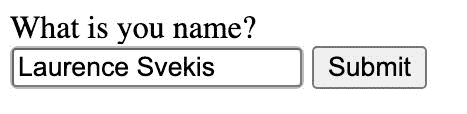
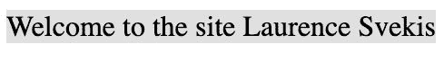

询问网页用户其姓名，并将输入值连同欢迎消息一起返回给用户。

### 创建一个页面欢迎消息

1. 在输入框中获取用户名
2. 当按下按钮时，添加一个事件来获取用户名并在页面上创建欢迎消息
3. 添加一个检查以确保输入长度大于 3 个字符

```html
<!DOCTYPE html>
<html>
<head>
  <title>JavaScript Course</title>
</head>
<body>
<div class="output">What is you name?</div>
<input type="text"  name="userName">
<button>Submit</button>
<script src="app.js"></script>
</body>
</html>
```

```javascript
const output = document.querySelector('.output');
const userVal = document.querySelector('input[name="userName"]');
const btn = document.querySelector('button');

userVal.style.borderColor = '#333';

btn.onclick = () => {
  if(userVal.value.length > 3) {
    const message = `Welcome to the site ${userVal.value}`;
    output.textContent =  message;
    userVal.style.display = 'none';
    btn.style.display = 'none';
  } else {
    output.textContent = 'Name length must be 3+ characters';
    userVal.style.borderColor = 'red';
  }
}
```

## 函数表达式 vs 声明 vs 箭头函数

最常被问的问题之一关于函数以及应该使用哪种函数。创建函数有多种方法，此练习旨在强调如何使用它们。同时也包含了函数的箭头格式，以及使用 `this` 关键字来引用函数作用域内的当前对象。

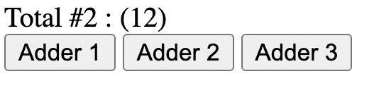

当对象被创建时，即使使用了相同的函数来创建它们，它们也会独立地持有值。由于是独立的实例，此示例将演示函数代码如何创建独立的对象，因为函数内部的代码块会将函数中创建的值应用到父对象上。这些值随后会被绑定到父对象上，在本例中即绑定到调用点击事件的元素上。

此练习的目标是创建函数，可以通过函数表达式、函数声明以及使用匿名函数的箭头格式来实现。文中提供了使用不同语法的示例。还展示了 `this` 关键字如何应用于父对象元素，并能够分别跟踪点击值。

练习涵盖了函数的使用及其工作原理。使用 `querySelector()` 选择元素并通过 `onclick` 添加点击事件。

使用不同的函数、表达式、声明和箭头格式创建 3 个页面的计数器。所有计数器都将独立工作，因为总值包含在使用 `this` 的函数对象实例中。

### 使用函数的页面计数器

1. 选择所有页面按钮
2. 创建一个函数表达式，在按下按钮时增加计数器
3. 创建一个箭头格式的函数表达式，用于跟踪并增加页面上的计数
4. 创建一个函数声明，用于跟踪并增加页面上的计数。

```html
<!DOCTYPE html>
<html>
<head>
  <title>JavaScript Course</title>
</head>
<body>
<div  class="output"></div>
<button  class="btn1">Adder 1</button>
<button  class="btn2">Adder 2</button>
<button  class="btn3">Adder 3</button>
<script  src="app1.js"></script>
</body>
</html>
```

```javascript
const btn1 = document.querySelector('.btn1');
const btn2 = document.querySelector('.btn2');
const btn3 = document.querySelector('.btn3');
const output = document.querySelector('.output');

// Function Expression
const adder2 = function() {
  if(!this.total) {
    this.total = 1;
  } else {
    this.total++;
  }
  output.textContent = `Total #2 : (${this.total})`;
}

const adder3 = () => {
  if(!this.total) {
    this.total = 1;
  } else {
    this.total++;
  }
  output.textContent = `Total #3 : (${this.total})`;
}

btn1.onclick = adder1;
btn2.onclick = adder2;
btn3.onclick = adder3;

// Function Declaration
function adder1() {
  if(!this.total) {
    this.total = 1;
  } else {
    this.total++;
  }
  output.textContent = `Total #1 : (${this.total})`;
}
```

## 动态 DOM 元素

元素是对象，可以像其他对象一样持有值。扩展了每个元素如何在共享同一个点击事件的同时跟踪值。此练习将演示如何从元素获取值并将其应用于其他元素。

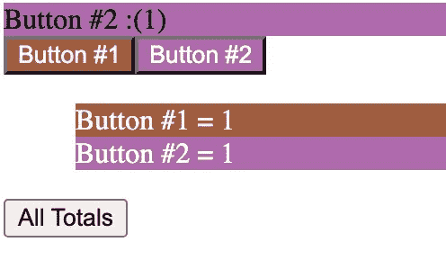

此练习将演示如何创建元素以及如何使用全局值来更新内容。使用 `document.createElement()` 创建页面元素并通过 `appendChild()` 将它们添加到网页中。

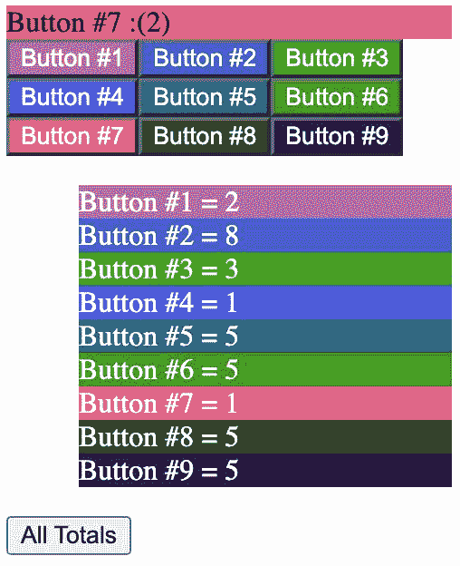

动态创建可以独立计数的页面按钮。创建一个按钮来输出总计。仅使用 JavaScript。存储元素的值，获取值并输出到网页。

### JavaScript 动态计数器

1. 创建一个全局对象来设置要创建的按钮数量
2. 创建一个包含所有新元素的页面元素
3. 创建一个元素的函数，将元素类型添加到父对象。在函数中包含一个参数用于元素的内部内容。
4. 循环创建所有按钮，为每个按钮设置默认值为 0。点击时，创建一个函数来更新并输出当前元素的总值。你可以为按钮添加样式。
5. 为每个新按钮添加 `btn` 类，以便它们与主总计按钮区分开来。创建一个按钮来输出所有按钮计数的结果。
6. 当总计按钮被点击时，创建一个函数来选择所有带有 `btn` 类的元素并遍历它们。
7. 对于每个带有 `btn` 类的元素，创建一个新的列表项，将其输出到主页面的无列表中。列表项内容应显示元素的元素和元素的 `textContent`。你也可以选择样式以匹配按钮的样式属性值。

```html
<!DOCTYPE html>
<html>
<head>
 <title>JavaScript Course</title>
</head>
<body>
<script src="app2.js"></script>
</body>
</html>
```

```javascript
const val = {
  num : 2
};

const main = elemaker('div', document.body, '');
const output = elemaker('div', main, '');

for(let i=0; i<val.num; i++) {
  const btn = elemaker('button', main, `Button #${i+1}`);
  btn.total = 0;
  btn.style.backgroundColor = '#'+Math.random().toString(16).slice(2,8);
  btn.style.color = 'white';
  btn.classList.add('btn');
  btn.onclick = adder;
}

const output1 = elemaker('div', main, '');
const btnMain = elemaker('button', main, `All Totals`);
btnMain.onclick = () => {
  const btns = document.querySelectorAll('.btn');
  output1.innerHTML = '';
  const ul = elemaker('ul', output1, '');
  btns.forEach((ele, index) => {
    const li = elemaker('li', ul, `${ele.textContent} = ${ele.total}`);
    li.style.backgroundColor = ele.style.backgroundColor;
    li.style.color = ele.style.color;
  })
}

function elemaker(eleT, parent, html) {
  const ele = document.createElement(eleT);
  ele.innerHTML = html;
  return parent.appendChild(ele);
}

function adder(e) {
  this.total++;
  output.style.backgroundColor = this.style.backgroundColor;
  output.innerHTML = `${this.textContent} :(${this.total})`;
}
```

## 背景颜色表格：使用 JavaScript 创建表格

此练习将构建一个交互式彩色单元格表格，点击单元格即可将其背景颜色应用到页面。此外，还有几个按钮可以更新表格单元格的背景颜色。表格将根据列和行的值进行动态生成。应用程序还将包含 3 个交互式按钮来更新页面元素。

### 如何使用 JavaScript 代码创建响应式表格

按钮点击时的动作：

1. 为表格中所有的 `td` 元素添加随机背景颜色。
2. 从上一行的元素中获取颜色值，将其应用到下一行，形成行色的向下移动。第一行将获得新的随机颜色。
3. `MoveLeft` 效果，点击时将获取下一个元素的背景颜色并将其应用到当前元素。表格中的最后一个元素将获得随机生成的背景颜色。

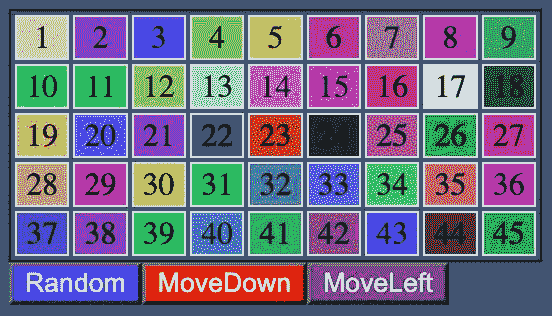

### 练习

1. 为表格的行数和列数创建一个变量对象。
2. 创建一个函数将表格添加到页面中。该函数应创建主表格元素，循环行和列并添加 `tr` 和 `td` 页面元素。
3. 使用 `cols` 值生成并设置单元格宽度样式，使单元格占据页面的全宽。
4. 在向表格添加 `td` 单元格时，使用 `document.createElement('td')`，添加数字文本值，然后添加如边框和文本对齐等样式。
5. 为 `td` 元素添加事件监听器，点击时将 `document.body` 的背景更新为与表格单元格相同的背景颜色。
6. 创建一个生成随机颜色的函数 `Math.random().toString(16).slice(2,8)`。
7. 创建一个创建按钮的函数，在页面上添加 3 个按钮。
8. 为第一个按钮添加事件监听器，点击时它应该选择主表格中的所有页面 `td` 单元格。在循环元素时将背景更新为随机颜色。
9. 创建第二个页面按钮，该按钮将具有颜色向下移动一行的效果。选择主表中所有的 `td` 单元格。创建一个临时数组，在循环单元格时，第一行生成随机值。将这些值添加到数组中。当移动到第二行时，从 `td` 元素的 `ind` 值中减去列数。这将给你位于上方行中元素的值。获取上方元素的背景颜色并将其添加到数组中。
10. 一旦完成临时数组的构建，它应包含所有颜色值且有一行向下平移，现在循环该数组，并将背景颜色应用到节点列表中匹配的 `td` 元素上。
11. 创建第三个按钮。当点击此按钮时，循环主表格中所有的 `td` 元素。将当前元素的背景更新为其右侧一个索引值的元素背景颜色。对于最后一个 `td` 单元格，添加随机背景颜色。

```javascript
const output = document.querySelector('div');
console.log(output);
output.innerHTML = '';

const tabValue = {
  rows: 5,
  cols: 9
}

const main = addTable(output, tabValue.rows, tabValue.cols);

const btn1 = btnMaker(output, 'Random', 'blue', 'white');
const btn2 = btnMaker(output, 'MoveDown', 'red', 'white');
const btn3 = btnMaker(output, 'MoveLeft', 'purple', 'white');

btn3.addEventListener('click', (e) => {
  const tds = main.querySelectorAll('td');
  for (let i = 0; i < tds.length; i++) {
    console.log(tds.length, i);
    const bgColor = (i + 1 == tds.length) ? ranColor() : tds[i + 1].style.backgroundColor;
    console.log(bgColor);
    tds[i].style.backgroundColor = bgColor;
  }
})

btn1.addEventListener('click', (e) => {
  const tds = main.querySelectorAll('td');
  console.log(tds);
  tds.forEach(ele => {
    console.log(ele);
    ele.style.backgroundColor = ranColor();
  })
})

btn2.addEventListener('click', (e) => {
  const tds = main.querySelectorAll('td');
  let holder = [];
  tds.forEach((ele, ind) => {
    let temp = ind - tabValue.cols;
    let tempColor = '';
    console.log(temp);
    if (temp >= 0) {
      const el = tds[temp];
      console.log(el);
      tempColor = el.style.backgroundColor;
    } else {
      tempColor = ranColor();
    }
    holder.push(tempColor);
  })
  console.log(holder);
  holder.forEach((val, ind) => {
    tds[ind].style.backgroundColor = val;
  })
})

function ranColor() {
  return `#${Math.random().toString(16).slice(2,8)}`;
}

function btnMaker(parent, html, clr, fntColor) {
  const btn = document.createElement('button');
  btn.innerHTML = html;
  btn.style.backgroundColor = clr;
  btn.style.color = fntColor;
  return parent.appendChild(btn);
}

function addTable(parent, rows, cols) {
  const tbl = document.createElement('table');
  tbl.style.border = '1px solid black';
  const tbody = document.createElement('tbody');
  tbl.append(tbody);
  let counter = 0;
  let wid = (100 / cols) * 100;
  for (let y = 0; y < rows; y++) {
    const tr = document.createElement('tr');
    for (let x = 0; x < cols; x++) {
      const td = document.createElement('td');
      counter++;
      td.textContent = counter;
      td.style.width = `${wid}px`;
      td.style.border = '1px solid #ddd';
      td.style.textAlign = 'center';
      tr.append(td);
      td.addEventListener('click', () => {
        document.body.style.backgroundColor = td.style.backgroundColor;
      })
    }
    tbody.append(tr);
  }
  return parent.appendChild(tbl);
}
```


# 元素选择练习

1. 从 HTML 中选择主容器元素。
2. 使用循环在主元素中创建 20 个 `span`。
3. 为 `span` 应用并添加样式。为元素添加事件监听器。
4. 点击时运行一个函数获取事件目标元素。创建一个全局对象来存储选中的元素。添加一个条件检查持有元素中是否存在值。如果有，则使用 `insertBefore` 将原始元素插入到父元素中新选中的元素之前。

5. 如果持有元素（holding element）不存在，则选择事件目标元素并将其作为持有元素。为元素添加一些样式和 `active` 类。这将使其需要时更容易被选中，并在视觉上告知用户，以便让他们知道哪个元素是激活状态。

6. 添加一个条件来检查元素上是否存在 `active` 类，如果找到，则从元素中移除它。

```javascript
const output = document.querySelector('div');

console.log(output);

output.innerHTML = '';

const holder = {
  ele: null
};

for (let i = 0; i < 20; i++) {
  const ele = document.createElement('span');
  output.append(ele);
  ele.textContent = `${i + 1} - Cell`;
  ele.style.border = '1px solid #ddd';
  ele.style.padding = '10px';
  ele.style.display = 'inline-block';
  ele.addEventListener('click', mover);
}

function mover(e) {
  const ele = e.target;
  if (holder.ele) {
    const parent = ele.parentNode;
    parent.insertBefore(holder.ele, ele);
    holder.ele.style.color = 'black';
    holder.ele.borderColor = '#ddd';
    holder.ele = null;
  } else {
    const withActive = document.querySelector('.active');
    if (withActive) {
      withActive.classList.remove('active');
    }
    holder.ele = ele;
    holder.ele.classList.add('active');
    holder.ele.style.color = 'red';
    holder.ele.borderColor = 'red';
  }
}
```

# 网页模态弹框元素

探索如何从一个数据对象创建一个 JavaScript 动态模态框（Modal）。模态框是有用的信息组件，提供了一种交互方式来显示额外内容。用户与页面上显示模态的元素进行交互，模态通常会高亮新元素，并呈现出悬浮在页面其他内容之上的外观。用户随后可以关闭模态框将其从视图中隐藏。

此练习将演示如何从数据创建模态框，并动态将按钮和模态框添加到你的网页中。每个模态框都可以拥有自己的数据，用于创建和自定义它们。它们的行为是相同的，因此使用的代码可以为数据对象中的每个项目动态创建动作。

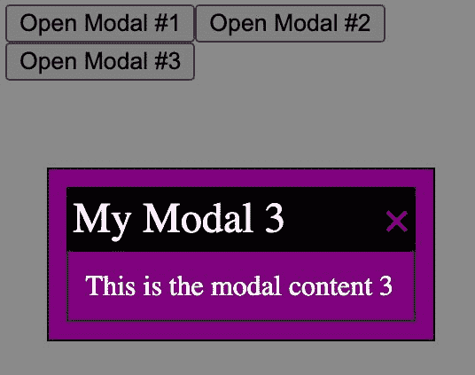

## 练习：

1. 使用 HTML 代码作为此项目的启动代码。
2. 选择页面上的主 `div`。
3. 创建一个包含多个项的数据对象，每项都包含标题（title）、正文（body）、颜色（color）和字体颜色（font color）。
4. 遍历数组中的项，为每一项创建一个页面按钮。在页面上为每个项添加一个可以打开模态的按钮，点击按钮后应该切换模态的显示设置，从 `none` 切换到 `block`。这将在点击按钮时隐藏和显示模态框。
5. 创建一个生成模态框的函数命名为 `genModal`。在该函数中返回主模态，以便该元素可以被使用。为元素添加一个事件监听器，检查目标事件元素是否与父模态相同，如果是，则使用模态对象调用 `closer` 函数。
6. 在 `genModal` 函数内部将数据作为参数传递给函数。这些数据随后可以用于设置模态元素的 `textContent` 和 `style`。
7. 创建一个主父元素作为遮层（overlay）。在主模态元素上添加 `overlay` 类。
8. 在模态遮层父元素内，添加一个主模态容器，该容器将包含标题和正文。
9. 在标题中创建一个文本区域元素（text area）和一个关闭按钮元素。
10. 为关闭按钮元素添加一个 `addEventListener`。
11. 在模态标题中添加一个 `x`，当该元素被点击时，也会关闭模态框。
12. 为模态元素创建并应用样式属性，为模态框创建样式和结构。

```html
<!doctype html>
<html>
<head>
  <title>JavaScript</title>
  <style>
    .overlay {
      display: none;
      left: 0;
      top: 0;
      width: 100%;
      height: 100%;
      background-color: rgb(0,0,0);
      background-color: rgba(0,0,0,0.5);
      position: fixed;
      z-index: 1;
    }
    .main {
      width: 70%;
      border: 1px solid black;
      margin: auto;
      padding: 10px;
      margin-top: 100px;
    }
    .close {
      color: red;
      float: right;
      font-size: 1em;
    }
    .close:hover, .close:focus {
      cursor: pointer;
    }
  </style>
</head>
<body>
<div></div>
<script src="code.js"></script>
</body>
</html>
```

```javascript
const output = document.querySelector('div');
const data = [
  {
    title: 'Modal 1',
    body: 'This is content 1',
    color: 'ddd',
    font: 'black'
  },
  {
    title: 'Modal 2',
    body: 'This is content 2',
    color: 'yellow',
    font: 'black'
  },
  {
    title: 'Modal 3',
    body: 'This is content 3',
    color: 'purple',
    font: 'white'
  }
];

data.forEach((mod, ind) => {
  const btn = document.createElement('button');
  btn.textContent = `Modal ${ind + 1}`;
  output.append(btn);
  const modal = genModal(mod, ind);
  output.append(modal);
  btn.addEventListener('click', (e) => {
    const temp = modal.style.display;
    if (temp === 'block') {
      modal.style.display = 'none';
    } else {
      modal.style.display = 'block';
    }
  });
});

function closer(ele) {
  ele.style.display = 'none';
}

function genModal(mData, id) {
  const overlay = document.createElement('div');
  const main = document.createElement('div');
  const mTitle = document.createElement('h2');
  const mBody = document.createElement('div');
  const closeX = document.createElement('span');
  const innerTitle = document.createElement('div');
  closeX.classList.add('close');
  closeX.onclick = () => {
    closer(overlay);
  };
  closeX.innerHTML = '&times;';
  mTitle.style.fontSize = '1.5em';
  mBody.style.border = '1px solid #111';
  mBody.style.padding = '10px';
  mTitle.append(closeX);
  mTitle.style.backgroundColor = 'black';
  mTitle.style.color = 'white';
  mTitle.style.padding = '4px';
  innerTitle.textContent = mData.title;
  mTitle.append(innerTitle);
  overlay.classList.add('overlay');
  main.classList.add('main');
  main.append(mTitle);
  main.append(mBody);
  overlay.append(main);
  main.style.color = mData.font;
  main.style.backgroundColor = mData.color;
  mBody.textContent = mData.body;
  console.log(main);
  return overlay;
}
```

# 页面计数器编码挑战

探索如何使用 JavaScript 创建动态计数器，使它们独立工作，并将计数值存储在元素对象中。

## 练习：

1. 选择将更新的主页面元素。
2. 创建一个输入框和一个按钮。为输入框设置属性，使其成为数字类型，并设置最小值为 1，最大值为 20。为输入框设置默认值为 5。
3. 创建一个创建元素的函数，参数为元素标签名称以及该元素将追加的父元素。
4. 创建一个空数组来存储主计数器元素以及点击值。

### 5. 添加一个按钮来生成点击器数值的报告。当点击该按钮时，遍历 `holding` 数组，并在报告中添加 `clicker` 元素的值及其被点击的次数。

### 6. 点击输入框旁的按钮，获取输入值并根据该值创建相应数量的点击器。创建一个独立的函数来生成 `clicker`。

### 7. 在 `clicker` 生成器函数中，创建一个主元素容器。为该元素添加一个 `trackingValue` 属性，并将其设置为 `0`。将新元素添加到 `holder` 数组中。

### 8. 创建一个 `div` 用于存储点击值，一个用于减少的按钮，一个用于增加的按钮，以及一个带有按钮的 `input`，该按钮用于将 `input` 中的值保存到点击元素的点击值中。

### 9. 为元素应用样式，并创建一个函数为每个 `input` 字段添加属性。

### 10. 创建一个用于更新点击值的函数，使用 `input` 元素、文本输出元素和 `clicker` 的值作为参数。将其命名为 `updater()`。

### 11. 为 `clicker` 按钮添加点击监听器以进行增加和减少。将值发送给 `updater()` 函数。

### 12. 第 3 个按钮应该从 `input` 获取值并在按下时将该值应用到点击值上。

```javascript
const main = document.querySelector('div');
console.log(main);
main.customValues = 1000;
const myInput = makeElement(document.body, 'input');
const btn = makeElement(document.body, 'button');
btn.textContent = 'Make Clickers';
myInput.setAttribute('type', 'number');
myInput.setAttribute('min', 1);
myInput.setAttribute('max', 20);
myInput.value = 5;
const holder = [];
const main2 = makeElement(document.body, 'div');
const btnReport = makeElement(main2, 'button');
btnReport.textContent = 'Generate Report';
btnReport.onclick = () => {
  console.log(holder);
  const report = makeElement(main2, 'div');
  main2.prepend(report);
  let html = 'New Report';
  holder.forEach((ele, ind) => {
    html += `<div>${ind + 1}. = ${ele.trackingVal}</div>`;
  });
  html += '<hr>';
  report.innerHTML = html;
};
btn.onclick = () => {
  for (let i = 0; i < myInput.value; i++) {
    maker(main);
  }
};
function maker(parent) {
  const div = makeElement(parent, 'div');
  div.trackingVal = 0;
  holder.push(div);
  const div1 = makeElement(div, 'div');
  const btn1 = makeElement(div, 'button');
  const btn2 = makeElement(div, 'button');
  const inField = makeElement(div, 'input');
  const btn3 = makeElement(div, 'button');
  div1.style.fontSize = '2em';
  inputToNum(inField);
  div1.style.display = 'inline-block';
  btn1.textContent = '-';
  btn2.textContent = '+';
  btn3.textContent = 'Update';
  btn1.style.backgroundColor = 'red';
  btn2.style.backgroundColor = 'green';
  btn1.style.color = 'white';
  btn2.style.color = 'white';
  updater(inField, div1, div.trackingVal);
  btn1.onclick = () => {
    div.trackingVal--;
    if (div.trackingVal <= 0) div.trackingVal = 0;
    updater(inField, div1, div.trackingVal);
  };
  btn2.onclick = () => {
    div.trackingVal++;
    updater(inField, div1, div.trackingVal);
  };
  btn3.onclick = () => {
    div.trackingVal = inField.value;
    if (div.trackingVal <= 0) div.trackingVal = 0;
    updater(inField, div1, div.trackingVal);
  };
}
function updater(inputEle, txtEle, num) {
  inputEle.value = num;
  txtEle.innerHTML = ` ${num} : `;
}
function inputToNum(ele) {
  ele.setAttribute('type', 'number');
  ele.setAttribute('min', 0);
  ele.setAttribute('max', 10000);
  ele.value = 0;
}
function makeElement(parent, eleType) {
  const ele = document.createElement(eleType);
  return parent.appendChild(ele);
}
```

# 使用 JavaScript 字符串方法的随机单词生成器

此练习将创建一个占位符随机单词生成器。将有一个用于创建单词数量的输入框和一个用于将它们添加到页面的按钮。编码将关注 JavaScript 字符串方法以及我们如何更新字符串、如何从字符串获取随机字母以及我们如何使用 `random` 使输出内容随机化。此外，还将使用 `Math` 来添加随机性。

此处使用的字符串方法：`toUpperCase()`、`slice()`、`substring()`、`trim()`。

练习：

1. 选择 `main`、`input` 和 `button`。
2. 为 `button` 添加一个 `onclick` 事件。
3. 调用函数 `makeWords()` 并传递 `input` 的值。
4. 使用循环创建指定数量的单词。
5. 在循环内部，确定一个随机单词长度。
6. 使用 `random` 决定字母是元音还是辅音。
7. 如果是第一个单词，将其字母大写。
8. 在句末添加一个句号。
9. 将完成的字符串显示在 `output` 元素中。

本次练习将练习更新页面元素的样式属性。包括 `textAlign`、`border`、`padding`、`position`、`width`、`backgroundColor`、`height`、`color`、`top`、`left`、zIndex。还将使用主 HTML 元素的值，它在文档中以属性名为 `document.documentElement` 的对象存在。`document.documentElement` 将返回文档的根元素，即 HTML 元素。`document.documentElement` 的 `scrollHeight`、`scrollTop` 和 `clientHeight` 可用于计算文档当前的滚动位置以及文档的剩余部分。这可以获取当前滚动到的文档百分比。

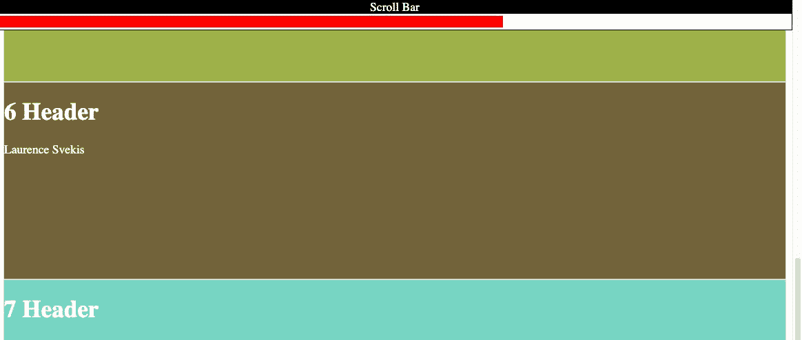

## 练习

1. 选择主页面元素，向其中添加新的 `div`。为 `div` 创建随机高度，以便你可以使用滚动条，且页面内容大于浏览器区域。
2. 创建一个主滚动条容器，以及两个嵌套在父元素中的 `div`。
3. 为主滚动条容器应用样式，设置固定位置（fixed）和 100% 的宽度。根据需要添加样式。
4. 创建一个高度和宽度均为 100% 的空滚动指示器。这可以作为用户向下滚动页面时，内部滚动条填充的空白区域。
5. 添加内部滚动条，将宽度设置为 0，并设置一个与其父元素不同的背景颜色。
6. 使用 `window.onscroll` 事件计算滚动器的位置。获取浏览器中当前文档的顶部值。使用 `document.documentElement.scrollTop`，它会在滚动时发生变化，并在顶部时为 0。如果你的 `body` 位于页面顶部，`document.body.scrollTop` 将为 0。
7. `document.documentElement.scrollHeight` 始终是所有 `body` 内容的总高度。`document.documentElement.clientHeight` 是页面在浏览器中的可见区域。
8. 减去 `document.documentElement.scrollHeight - document.documentElement.clientHeight`，这将得到滚动可用总高度的值。减去 `clientHeight` 后，一旦到达页面底部，高度将设为 0。
9. 将顶部的 `document.documentElement.scrollTop`（用户向下滚动时该值会增加）除以总可用主体高度。这将返回一个百分比，然后可以乘以 100 得到百分比值（%）。
10. 使用页面滚动百分比值设置滚动条的宽度。

```javascript
const main = document.querySelector('div');
const scrollInd = document.createElement('div');
const scrBarP = document.createElement('div');
const scrBarC = document.createElement('div');
document.body.prepend(scrollInd);
scrollInd.textContent = 'Scroll Bar';
scrollInd.append(scrBarP);
scrBarP.append(scrBarC);
scrollInd.style.textAlign = 'center';
scrollInd.style.border = '1px solid black';
scrollInd.style.padding = '0px';
scrollInd.style.position = 'fixed';
scrollInd.style.width = '100%';
scrollInd.style.backgroundColor = 'black';
scrollInd.style.color = 'white';
scrollInd.style.top = '0';
scrollInd.style.left = '0';
scrollInd.style.zIndex = '1';
scrBarP.style.width = '100%';
scrBarP.style.height = '21px';
scrBarP.style.padding = '3px';
scrBarP.style.backgroundColor = 'white';
scrBarC.style.width = '0%';
scrBarC.style.height = '15px';
scrBarC.style.backgroundColor = 'green';
window.onscroll = (e) => {
  const sTop = document.body.scrollTop || document.documentElement.scrollTop;
  const pos = document.documentElement.scrollHeight - document.documentElement.clientHeight;
  const scrolMeter = (sTop / pos) * 100;
  console.log(scrolMeter);
  const bgColor = scrolMeter > 50 ? 'red' : 'green';
  scrBarC.style.width = `${scrolMeter}%`;
  scrBarC.style.backgroundColor = bgColor;
};
for (let i = 0; i < 10; i++) {
  const div = document.createElement('div');
  main.append(div);
  div.style.border = '1px solid #ddd';
  div.style.height = `${ranV(300) + 150}px`;
  div.innerHTML = `<h1>${i + 1} Header</h1><div>Laurence Svekis</div>`;
  div.style.backgroundColor = ranC();
  div.style.color = 'white';
}
function ranC() {
  return `#${Math.random().toString(16).slice(2, 8)}`;
}
function ranV(max) {
  return Math.floor(Math.random() * max) + 1;
}
```

# 带计时器的数学测验

如何使用间隔器（intervals）跟踪时间。使用 JavaScript 创建一个可以暂停计数的计数开始和停止计数器。此编码练习将包含一个简单的数学测验，向用户展示数学问题并跟踪响应。此练习将使用 `setInterval()` 和 `setTimeout()` 方法向用户显示问题。


## 练习

1. 为游戏创建页面元素。
2. 在全局对象中设置问题数量并跟踪计数器。
3. 创建问题并将它们存储在一个空数组中。
4. 问题准备就绪后，启动计时器并向玩家展示。
5. 创建一个显示问题的函数。
6. 填充文本区域的字符串值。
7. 在输入字段上添加 `keydown` 事件监听器，如果按键是 `Enter`，则提交答案并检查是否正确。
8. 如果答案不正确，为玩家提供反馈。
9. 如果输入值正确并匹配正确答案，则移动到下一个问题。向用户提供反馈。
10. 添加并为问题的输入字段设置获取焦点。
11. 在下一个问题中，检查玩家是否处于最后一个问题，如果是，则结束游戏。显示所有答案。停止计时器。

```javascript
const main = document.querySelector('div');
const btn = document.createElement('button');
const btn1 = document.createElement('button');
const div1 = document.createElement('div');
const div2 = document.createElement('div');
const questions = 3;
const ques = [];
const timerVal = { cur: 0, counter: 0, running: false, int: {} };
main.innerHTML = '';
main.append(div1);
main.append(btn);
main.append(btn1);
main.append(div2);
div1.textContent = 0;
btn.textContent = 'Start';
btn1.textContent = 'Create Questions';
btn1.onclick = () => {
  btn1.style.display = 'none';
  createQuestions();
};
function createQuestions() {
  for (let i = 0; i < questions; i++) {
    const first = ranNum(1, 5);
    const sec = ranNum(1, 5);
    const que = `${first} + ${sec}`;
    const ans = first + sec;
    const myObj = { que: que, ans: ans };
    ques.push(myObj);
  }
}
function showQuestion(ind) {
  div2.innerHTML = '';
  const ele = document.createElement('div');
  const ele1 = document.createElement('div');
  const inEle = document.createElement('input');
  const ele2 = document.createElement('div');
  inEle.setAttribute('type', 'number');
  inEle.style.width = '100px';
  ele1.style.display = 'inline-block';
  ele1.textContent = ques[ind].que + ' = ';
  inEle.addEventListener('keydown', (e) => {
    if (e.code == 'Enter') {
      const val1 = inEle.value;
      let mes = 'wrong';
      inEle.value = '';
      if (val1 == ques[ind].ans) {
        mes = 'correct';
        setTimeout('movetoNextQuestion()', 500);
      }
      ele2.textContent = `${mes} ${ques[ind].que} = ${val1}`;
    }
  });
  ele.append(ele1);
  ele.append(inEle);
  ele.append(ele2);
  div2.append(ele);
  inEle.focus();
}
function movetoNextQuestion() {
  timerVal.cur++;
  if (timerVal.cur >= ques.length) {
    console.log('end');
    div2.innerHTML = '';
    ques.forEach((q) => {
      div2.innerHTML += `<div>${q.que} = ${q.ans}</div>`;
    });
    stopTimer();
  } else {
    showQuestion(timerVal.cur);
  }
}
function startTimer() {
  timerVal.running = true;
  timerVal.int = setInterval('updater()', 1000);
  btn.textContent = 'Stop';
}
function stopTimer() {
  timerVal.running = false;
  clearInterval(timerVal.int);
  btn.textContent = 'Start';
}
function ranNum(min, max) {
  return Math.floor(Math.random() * (max - min + 1)) + min;
}
btn.onclick = () => {
  if (timerVal.running) {
    stopTimer();
  } else {
    startTimer();
  }
};
function updater() {
  if (timerVal.running) {
    timerVal.counter++;
    div1.textContent = timerVal.counter;
  }
}
```

# 动态交互 DOM 记忆游戏

记忆游戏的目标是找到匹配的方块。每回合翻转一组方块。如果找到匹配项，该方块将保持翻转状态，游戏将继续进行，直到找到所有匹配项为止。

此练习旨在探索 JavaScript 的更多功能，以及如何应用游戏逻辑通过代码实现所需目标。该项目还将演示如何使用代码和 CSS Grid 创建一个动态网格。无论方块的大小和数量如何，游戏都应该能够工作。

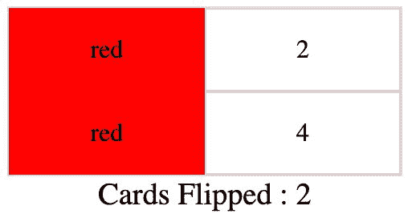

该游戏设计为支持不同的值，可以轻松调整游戏中方块的数量。代码是动态的，并适用于不同的值。这使得代码更具活性和自包含性，因为代码指令以及代码内部应发生的行为不依赖于任何静态值。这也是一种良好的做法，使得当值发生时，代码更具活性且不易出错，而逻辑保持不变。

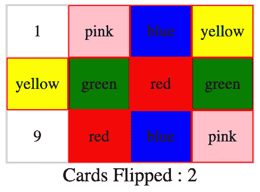

## 练习

1. 设置 HTML 以创建若干类，这些类可以应用于通过 JavaScript 创建的页面元素。将主游戏板设置为使用网格的显示属性，并能够对该元素应用 CSS Grid。你可以使用以下 HTML 作为起始文件，以跳过 HTML 和 CSS 的创建，并根据需要进行调整和自定义。

2. 设置默认游戏值、网格大小、用于可能内容的 `arr` 以及一个可以包含分数、总数、游戏和翻转数组、计时器以及游戏暂停操作的全局游戏对象。

3. 计算所需的方块总数，添加一个条件以确保 `arr` 中有足够的内容来构建带有值的页面元素。

4. 添加一个事件监听器 `document.addEventListener('DOMContentLoaded', makeGrid);`，它会在页面加载时被调用。它应该调用函数 `makeGrid()`。

5. 循环处理放置在网格上的项目总数，添加一个事件监听器 `document.addEventListener('DOMContentLoaded', makeGrid);`，它会在页面加载时被调用。它应该调用函数 `makeGrid()`。

6. 循环处理放置在网格上的项目总数，添加一个事件监听器 `document.addEventListener('DOMContentLoaded', makeGrid);`，它会在页面加载时被调用。它应该调用函数 `makeGrid()`。

7. 循环处理放置在网格上的项目总数，添加一个事件监听器 `document.addEventListener('DOMContentLoaded', makeGrid);`，它会在页面加载时被调用。它应该调用函数 `makeGrid()`。

```javascript
total = arr.length * 2 < total ? arr.length * 2 : total;
game.total = total / 2;
document.addEventListener('DOMContentLoaded', makeGrid);
function makeGrid() {
  for (let i = 0; i < total; i++) {
    const el = maker('div', main, '', 'box');
    el.onclick = flipBox;
  }
  main.style.setProperty(`grid-template-columns`, `repeat(${grid.y}, 1fr)`);
  addBoxes();
}
function toggleFlip(parent, boo) {
  const bEle = parent.querySelector('.back');
  const fEle = parent.querySelector('.front');
  if (boo) {
    bEle.style.display = 'none';
    fEle.style.display = 'block';
  } else {
    bEle.style.display = 'block';
    fEle.style.display = 'none';
  }
}
function checkCards() {
  game.pause = true;
  let match = null;
  let found = false;
  game.flip.forEach((ele) => {
    if (ele.val == match) {
      console.log('match found');
      found = true;
    } else {
      match = ele.val;
    }
    console.log(ele.val);
  });
  if (!found) {
    game.timer = setTimeout(flipback, 500);
  } else {
    game.score++;
    game.flip.forEach((ele) => {
      ele.found = true;
    });
    game.pause = false;
    game.flip.length = 0;
    if (game.score >= game.total) {
      message.textContent = 'Game Over';
    }
  }
}
function flipback() {
  game.flip.forEach((ele) => {
    toggleFlip(ele, false);
    ele.classList.remove('active');
  });
  game.pause = false;
  game.flip.length = 0;
}
function flipBox(e) {
  const parent = e.target.parentNode;
  const tempv = parent.classList.contains('active');
  console.log(tempv);
  if (!game.pause && !tempv) {
    console.log(parent.found);
    if (parent.found) {
      message.textContent = 'Already Found';
    } else {
      parent.classList.add('active');
      if (game.flip.length >= 2) {
        toggleFlip(parent, false);
      } else {
        toggleFlip(parent, true);
      }
      game.flip.push(parent);
      message.textContent = `Cards Flipped : ${game.flip.length}`;
      if (game.flip.length >= 2) {
        checkCards();
      }
    }
  } else {
    message.textContent = `Can't Click Right now`;
  }
}
function addBoxes() {
  let gameItems = total / 2;
  const temp = [];
  arr.sort(() => {
    return Math.random() - 0.5;
  });
  for (let i = 0; i < gameItems; i++) {
    temp.push(arr[i]);
  }
  game.game = temp.concat(temp);
  game.game.sort(() => {
    return Math.random() - 0.5;
  });
  const boxes = main.querySelectorAll('.box');
  boxes.forEach((ele, ind) => {
    ele.val = game.game[ind];
    ele.found = false;
    const front = maker('div', ele, game.game[ind], 'front');
    front.style.backgroundColor = game.game[ind];
    front.style.display = 'none';
    const back = maker('div', ele, ind + 1, 'back');
    back.style.display = 'block';
  });
}
function maker(eleType, parent, html, cla) {
  const ele = document.createElement('div');
  ele.classList.add(cla);
  ele.innerHTML = html;
  return parent.appendChild(ele);
}
```

# 动态硬币游戏

这项编程挑战是创建一个交互游戏，加载几枚硬币并允许玩家选择硬币翻转的结果。如果他们猜对了，该玩家的分数将加一。代码设计是动态的，易于更新新玩家。此练习基于两个部分：第一部分创建一个静态数量的玩家，第二部分更新代码以创建动态数量的硬币。你可以使用 JavaScript 进行样式处理，或使用下面的默认 HTML 和 CSS。目标是练习并学习更多关于 JavaScript 以及如何使用 JavaScript 创建交互式页面元素。这项练习还将提供应用游戏逻辑的练习，通过评分在代码中实现预期的结果。

## 用于创建硬币和游戏区域样式的 HTML 和 CSS 源代码

```html
<!doctype html>
<html>
<head>
  <title>JavaScript</title>
  <style>
    .game {
      width: 90vw;
      margin: auto;
      background-color: black;
      color: white;
    }
    .gameArea {
      display: grid;
      grid-template-columns: repeat(2, 1fr);
    }
  </style>
</head>
<body>
</body>
</html>
```


# 动态硬币游戏

这项编程挑战是创建一个交互游戏，加载几枚硬币并允许玩家选择硬币翻转的结果。如果他们猜对了，该玩家的分数将加一。代码设计是动态的，易于更新新玩家。此练习基于两个部分：第一部分创建一个静态数量的玩家，第二部分更新代码以创建动态数量的硬币。你可以使用 JavaScript 进行样式处理，或使用下面的默认 HTML 和 CSS。目标是练习并学习更多关于 JavaScript 以及如何使用 JavaScript 可以创建交互式页面元素。这项练习还将提供应用游戏逻辑的练习，通过评分在代码中实现预期的结果。

## 用于创建硬币和游戏区域样式的 HTML 和 CSS 源代码

```html
<!doctype html>
<html>
<head>
  <title>JavaScript</title>
  <style>
    .game {
      width: 90vw;
      margin: auto;
      background-color: black;
      color: white;
    }
    .gameArea {
      display: grid;
      grid-template-columns: repeat(2, 1fr);
    }
  </style>
</head>
<body>
  <div class="game"></div>
  <script src="code10.js"></script>
</body>
</html>
```

## 练习

硬币游戏的目标是在页面下方选择硬币翻转的结果。通过代码实现匹配的硬币并得分。

1. 从 HTML 中选择元素。

2. 创建一个 `vals` 数组，包含正面和反面。

3. 创建一个 `game` 的游戏对象，记录玩家的得分和总次数。

4. 在 `gameArea` 中创建玩家 div。为每个玩家设置硬币。

5. 使用名为 `coins` 的数组设置游戏按钮。

6. 为硬币按钮添加点击事件，点击时禁用按钮。通过 `coins` 数组，根据点击结果更新硬币的样式。

7. 使用 `setTimeout` 调用一个名为 `flipper` 的函数。这个超时用于延迟效果，向玩家显示操作。

8. 在 `flipper()` 函数中，将游戏回合计数加 1。遍历 `coins` 数组，生成 0 或 1 的随机值。使用 `innerHTML` 设置正面或反面。将按钮 `disabled` 设置为 `false` 以便可以再次点击。创建一个函数来检查翻转结果。

9. 在 `checker()` 函数中，传入硬币值、按钮的 `val` 以及硬币的 `ind` 值。如果硬币值与对应的按钮值匹配，该玩家将得分。将结果输出到消息区域以便玩家查看。

10. 现在可以再次点击翻币进入下一轮游戏。

```javascript
const btn = maker('button', dashboard, 'btn', 'Flip Coin');

const btn1 = maker('button', player1, 'btn', `Heads ${vals[1]}`);

btn1.val = 1;

const btn2 = maker('button', player2, 'btn', `Heads ${vals[1]}`);

btn2.val = 1;

const btns = [btn1, btn2];

btn1.style.backgroundColor = 'white';

btn1.style.color = 'black';

btn2.style.backgroundColor = 'white';

btn2.style.color = 'black';

btn1.onclick = flipSelection;

btn2.onclick = flipSelection;

btn.onclick = (e) => {
  btn.disabled = true;
  coins.forEach(ele => {
      ele.style.backgroundColor = 'black';
      ele.textContent = ' ';
  })
  setTimeout(flipper, 500);
}

function  flipSelection(e) {
 const ele = e.target;
  console.log(ele.val);
 if ele.val == 1) {
      ele.innerHTML = `Tails ${vals[0]}`;
      ele.style.backgroundColor = 'black';
      ele.style.color = 'white';
      ele.val = 0;
} else {
      ele.innerHTML = `Heads ${vals[1]}`;
      ele.style.backgroundColor = 'white';
      ele.style.color = 'black';
      ele.val = 1;
  }
}

function  maker(t, p, c, h) {
 const el = document.createElement(t);
  el.classList.add(c);
  el.innerHTML = h;
 return p.appendChild(el);
}

function  flipper() {
  game.total++;
  coins.forEach((ele, ind) => {
const boo = Math.floor(Math.random() + 0.5);
      ele.innerHTML = vals[boo];
      console.log(btns[ind].val);
      console.log(ele.val);
      ele.val = boo;
      ele.style.backgroundColor = 'gold';
      btn.disabled = false;
      checker(ele.val, btns[ind].val, ind);
  })
}

function  checker(coinVal, btnVal, ind) {
 if (btnVal == coinVal) {
      console.log(`${ind} was correct`);
      game.players[ind]++;
} else {
      console.log(`${ind} was wrong`);
  }
  scoreDiv.innerHTML = `${game.players[0]} vs ${game.players[1]} in total ${game.total} `;
}
```

硬币游戏目前固定为 2 个玩家和 2 枚硬币。为了让游戏更有趣，请更新上述代码以支持动态的玩家人数运行。硬币和玩家的数量应该相同，并且可以通过索引值绑定。代码中的函数对玩家人数已经具有了灵活性，你需要更新静态元素对象，根据所需的玩家数量添加它们。

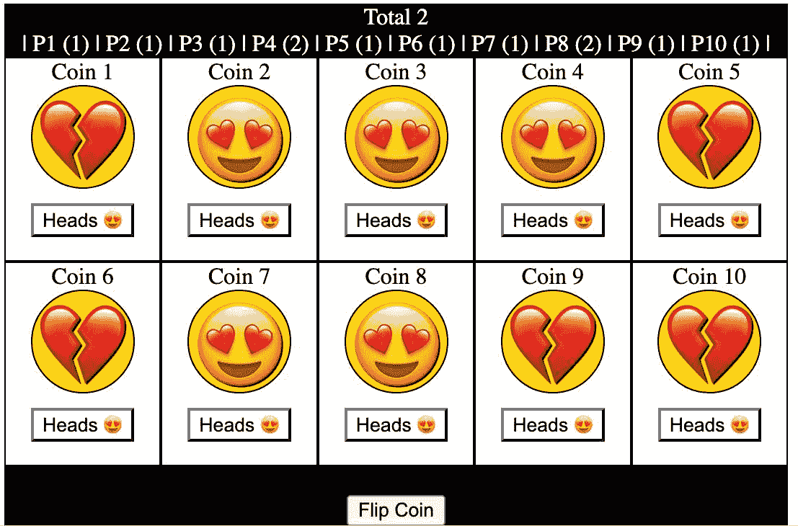

### 练习题：

1. 创建一个玩家数量的变量，这将生成相应数量的硬币，每枚硬币都带有一个可点击的按钮，用于选择正面或反面。

2. 更新 CSS 网格和样式，以适应屏幕上更多的硬币。清空 `coins` 和 `btns` 数组。

3. 创建一个函数，通过循环选定的玩家数量来创建玩家。

4. 创建玩家元素，并在每个中添加一个硬币和一个按钮。将硬币和 `btn` 的值设置为相应的元素。

5. 更新样式属性并将新元素推入 `coins` 和 `btns` 数组中。

6. 添加一个点击事件来运行 `flipselection` 函数。

7. 更新 `checker` 函数，为所有硬币玩家生成并检查报告。

8. 玩游戏并根据需要进行调试，以确保游戏运行仍然如以前一样正常。在需要时使用 `console.log` 输出变化的值。

```javascript
const main = document.querySelector('.game');

const vals = ['🦅','🦅'];

const numPlayers = 9;

const numsA = numPlayers > 3 ? 3 : numPlayers;

const game = {players : [],total:0};

const scoreDiv = maker('div',main,'score','Score');

const gameArea = maker('div',main,'gameArea','');

gameArea.style.setProperty(`grid-template-columns`, `repeat(${numsA },1fr)`);

const coins = [];

const btns = [];

const dashboard = maker('div',main,'dash','');

makerPlayers();

const btn = maker('button',dashboard,'btn','Flip Coin');

function  makerPlayers(){
 for(let i=0;i<numPlayers;i++){
 const player = maker('div',gameArea,'gamer',`Coin ${i+1}`);
 const coin = maker('div',player,'coin','🦅');
      coin.val = 1;
      coins.push(coin);

 const btn1 = maker('button',player,'btn',`Heads ${vals[1]}`);
      btn1.val = 1;
      btn1.style.backgroundColor = 'white';
      btn1.style.color = 'black';
      btn1.onclick = flipSelection;
      btns.push(btn1);
 }

btn.onclick = (e) => {
  btn.disabled = true;
  coins.forEach(ele => {
      ele.style.backgroundColor = 'black';
      ele.textContent = ' ';
  })
  setTimeout(flipper, 500);
}

function  flipSelection(e) {
 const ele = e.target;
  console.log(ele.val);
 if (ele.val == 1) {
      ele.innerHTML = `Tails ${vals[0]}`;
      ele.style.backgroundColor = 'black';
      ele.style.color = 'white';
      ele.val = 0;
} else {
      ele.innerHTML = `Heads ${vals[1]}`;
      ele.style.backgroundColor = 'white';
      ele.style.color = 'black';
      ele.val = 1;
  }
}

function  maker(t, p, c, h) {
 const el = document.createElement(t);
  el.classList.add(c);
  el.innerHTML = h;
 return p.appendChild(el);
}

function  flipper() {
  game.total++;
  coins.forEach((ele, ind) => {
const boo = Math.floor(Math.random() + 0.5);
      ele.innerHTML = vals[boo];
      console.log(btns[ind].val);
      console.log(ele.val);
      ele.val = boo;
      ele.style.backgroundColor = 'gold';
      btn.disabled = false;
      checker(ele.val, btns[ind].val, ind);
  })
}

function  checker(coinVal, btnVal, ind) {
 if (btnVal == coinVal) {
      console.log(`${ind} was correct`);
      game.players[ind]++;
} else {
      console.log(`${ind} was wrong`);
  }
  scoreDiv.innerHTML = `${game.players[0]} vs ${game.players[1]} in total ${game.total} `;
}
```

```javascript
b(...arr);
```

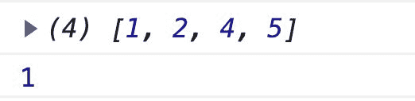

该代码将使用许多数组方法和几个 `Math` 方法。`Math.max()` 函数将返回输入参数中的数字最大值，如果参数不是数字且无法转换为数字，则返回 `NaN`。

```javascript
const arr = [1,2,4,5];

console.log(Math.max(1,2,4,5));

console.log(Math.max(...arr));

console.log(Math.max(arr));
```

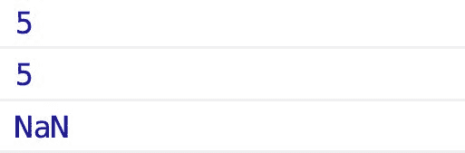

```html
<!doctype html>
<html>
<head>
 <title>JavaScript</title>
 <style>
 * {
 box-sizing: border-box;
}
 .gameArea {
width: 80vw;
margin: auto;
text-align: center;
}
 .info {
background-color: blue;
color: white;
}
 .card {
min-height: 60px;
background-color: #eee;
border: 1px solid #111;
margin: 5px;
line-height: 60px;
font-size: 1.5em;
}
 .mes {
text-align: center;
padding: 10px;
border: 1px solid #ccc;
clear: both;
}
 .btn {
display: block;
clear: both;
margin: auto;
}
 .player {
width: 33%;
border: 1px solid #ddd;
min-height: 100px;
float: left;
padding: 10px;
margin-bottom: 20px;
}
 </style>
</head>
<body>
 <div class="game"></div>
 <script src="code11.js"></script>
</body>
</html>
```

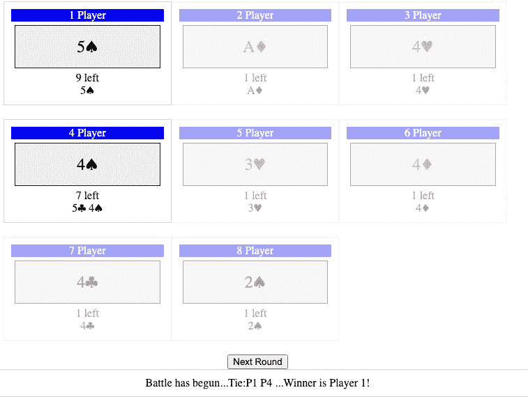

扑牌组数据，因为花色和数字都会重复。这可以用于构建带有特定值的牌牌。

```javascript
const cardData = {suits:['spades','hearts','diams','clubs'],val:['A','2','3','4','5','6','7','8','9','10','J','Q','K']}

function buildDeck() {
 cardData.suits.forEach((suit) => {
   cardData.val.forEach((v, ind) => {
const bgC = (suit == 'hearts') || (suit == 'diams') ? 'red' : 'black';
const card = {
suit: suit,
icon: `&${suit};`,
clr: bgC,
cardNum: v,
cardValue: ind + 1
}
deck.push(card);
   })
 })
 deck.sort(() => {
return Math.random() - 0.5;
})
}
```

## 练习：

1. 创建一个函数，可以通过元素标签、父元素、元素内容和元素类参数来创建页面元素。现在可以用来在代码中快速创建元素了。

2. 设置游戏板，包括游戏区域元素、用于游戏的按钮以及用于游戏向玩家传递信息的消息区域。

3. 创建一个全局游戏对象，用于存储玩家人数、每个玩家的牌组，以及玩家在游戏过程中所需的视觉元素数组（卡牌视图和得分反馈）。

4. 创建一个包含卡牌详情的数据数组，包括主牌组所需的所有花色和数值。如果你使用了花色的 HTML 字符值，则可以在应用程序输出视觉效果时重复使用它们（`&spades;` `&hearts;` `&diams;` `&clubs;`）。

5. 创建一个主牌组数组并用牌组数据填充。创建一个用于构建牌组的函数 `buildDeck()`。

6. 在 `buildDeck()` 函数中，遍历所有卡牌数据，循环遍历花色以及卡牌数值，以构建一副标准的 52 张牌。创建一个包含数据的卡牌对象，然后可以用它输出卡牌的视觉效果并计算卡牌值。

7. 在牌组构建后进行洗牌，你可以使用数组排序方法 `deck.sort(() => {return Math.random() - 0.5;})`。

8. 将玩家添加到游戏中。创建一个用于添加玩家的函数 `addPlayers()`。

9. 在 `addPlayers()` 函数中，计算每个玩家从主牌组中获得的牌数。

10. 使用 `for` 循环遍历每个玩家并将其添加到页面上，同时添加玩家数据（包括该玩家的牌组）。添加页面元素、玩家信息、卡牌显示区域、得分以及回合反馈。将这些元素添加到 `game` 中。

11. 在 `addPlayers()` 函数中，遍历每个玩家并将其添加到页面上，同时添加玩家数据（包括该玩家的牌组）。

12. 在 `addPlayers()` 函数中，遍历每个玩家并将其添加到页面上，同时添加玩家数据（包括该玩家的牌组）。

13. 在 `addPlayers()` 函数中，遍历每个玩家并将其添加到页面上，同时添加玩家数据（包括该玩家的牌组）。

14. 在 `addPlayers()` 函数中，遍历每个玩家并将其添加到页面上，同时添加玩家数据（包括该玩家的牌组）。

15. 在 `addPlayers()` 函数中，遍历每个玩家并将其添加到页面上，同时添加玩家数据（包括该玩家的牌组）。

16. 在 `addPlayers()` 函数中，遍历每个玩家并将其添加到页面上，同时添加玩家数据（包括该玩家的牌组）。

17. 在 `addPlayers()` 函数中，遍历每个玩家并将其添加到页面上，同时添加玩家数据（包括该玩家的牌组）。

```javascript
addPlayers();

btn.addEventListener('click', (e) => {
  const temp = [];
  for (let i = 0; i < game.players; i++) {
    game.s[i].lastChild.innerHTML = '';
    if (game.cards[i].length > 0) {
      temp.push(i);
    } else {
      const ele = game.view[i];
      ele.innerHTML = 'X';
      game.s[i].firstChild.innerHTML = 'OUT';
      ele.style.backgroundColor = '#bbb';
    }
  }
  mes.innerHTML = 'Battle has begun...';
  gamer(temp, []);
})

function gamer(inPlay, holder) {
  const vals = [];
  console.log(inPlay);
  inPlay.forEach((i) => {
    if (game.cards[i].length > 0) {
      const ele = game.view[i];
      const first = game.cards[i].shift();
      showCard(first, ele);
      vals.push(first.cardValue);
      holder.push(first);
      game.s[i].lastChild.innerHTML += `${first.cardNum}${first.icon} `;
    }
  })
  const winners = [];
  const highValue = Math.max(...vals);
  console.log(highValue);
  vals.forEach((e, i) => {
    if (e >= highValue) winners.push(inPlay[i]);
  })
  console.log(winners);
  if (winners.length > 1) {
    mes.innerHTML += `Tie:`;
    winners.forEach(v => {
      mes.innerHTML += `P${v+1} `;
    })
    mes.innerHTML += `...`;
    return gamer(winners, holder);
  } else if (winners.length == 0) {
    mes.innerHTML += 'No winner';
  } else {
    const temp = winners[0];
    game.cards[temp].push(...holder);
    mes.innerHTML += `Winner is Player ${temp+1}!`;
  }
  updateScores();
}

function updateScores() {
  let tempPlay = [];
  game.s.forEach((el, i) => {
    const cardCount = game.cards[i].length;
    if (cardCount) {
      el.firstChild.innerHTML = `${cardCount} left`;
      tempPlay.push(i);
    } else {
      el.parentNode.style.opacity = 0.4;
    }
  })
  if (tempPlay.length <= 1) {
    mes.innerHTML = `Game Over! Player ${tempPlay[0]+1} Wins`;
    btn.disabled = true;
    btn.textContent = 'GAME OVER';
  }
}

function showCard(cc, ele) {
  ele.innerHTML = `<div>${cc.cardNum}${cc.icon}</div>`;
  ele.style.color = cc.clr;
}

function addPlayers() {
  let start = 0;
  let num = Math.floor(deck.length / game.players);
  let end = start + num;
  for (let i = 0; i < game.players; i++) {
  const el = maker(gameArea, 'div', 'player');
    const ele = maker(el, 'div', `${i+1} Player`);
    const card = maker(el, 'div', 'card');
    game.view.push(card);
    game.cards[i] = deck.slice(start, end);
    const score = maker(el, 'div', 'score');
    const cardLeft = maker(score, 'div', `${game.cards[i].length} left`);
    const cardPlayed = maker(score, 'div', '');
    game.s.push(score);
    start = end;
    end = end + num;
  }
  console.log(game.cards);
}

function buildDeck() {
  cardData.suits.forEach((suit) => {
    cardData.val.forEach((v, ind) => {
      const bgC = (suit == 'hearts') || (suit == 'diams') ? 'red' : 'black';
      const card = {
        suit: suit,
        icon: `&${suit};`,
        clr: bgC,
        cardNum: v,
        cardValue: ind + 1
      };
      deck.push(card);
    })
  })
  deck.sort(() => {
    return Math.random() - 0.5;
  })
}

function maker(par, eleType, cla, html) {
  const ele = document.createElement(eleType);
  ele.classList.add(cla);
  ele.innerHTML = html;
  return par.appendChild(ele);
}
```

# JavaScript DOM 动态元素练习

你想了解更多关于 JavaScript 以及元素是如何运作的吗？元素是对象，可以像 JavaScript 中的其他对象一样存储值。以下三个练习将演示如何使用 JavaScript 创建页面元素、如何向元素对象添加值以及如何更新页面元素。此外，还有一个关于它们如何与页面元素对象交互，以及函数表达式与函数声明之间区别的练习。

## DOM 创建页面元素并添加样式

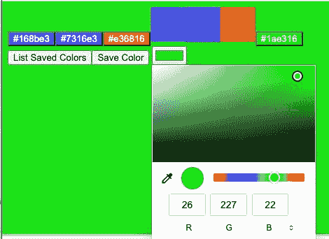

创建交互式元素，将当前的颜色值输入存储在数组中以供日后使用。同时创建按钮，将 body 的背景颜色更新为按钮文本的值。

## 动态元素 DOM 中的颜色样式与事件

当需要创建多个元素时，最佳实践是创建一个处理元素创建函数，这可以避免代码重复。此练习将演示如何创建元素、如何将值存储元素对象、如何更新元素的样式属性以及从页面中移除元素。存储元素的值、获取元素的值，并将这些元素值用于创建新的页面元素。使用 `appendChild()` 与 `append()` 的区别允许代码返回被添加到父元素的元素。这可以节省了一行代码，因为可以将函数的返回值与将新创建的元素添加到页面合并。

### 页面元素事件与样式练习：

1. 使用 JavaScript 在页面上创建两个按钮。

2. 为第一个按钮添加点击事件，按下时应列出存储数组中所有存储的颜色值。按下时，创建具有存储数组中颜色值且是可点击的页面元素。一旦点击，该元素应从页面上被移除。

3. 第二个按钮应将输入框中的颜色值存储到存储数组中。

4. 第二个按钮还应创建一个页面元素按钮，其文本内容为输入框颜色值的值。

5. 当输入值改变时，更新背景颜色以匹配输入值。

在轮播图中显示的内容并不包含在 JavaScript 文件中。此示例将帮助演示如何分离数据，从而可以在不更新代码的情况下进行更新。代码中的代码逻辑应该独立于数据运行。更改 JSON 文件数据将改变 HTML 网页上的输出，而不会破坏 JavaScript 代码。JSON 文件数据具有四个属性（`"title": "slide 1", "html": "<h1>Laurence</h1>", "back": "purple", "color": "white"`），添加或删除属性将需要更新 JavaScript 代码。数组中的 JSON 数据项应都具有相同的属性名称和值；JSON 内部结构非常重要，以便能够正确使用 JSON 数据包含的内容。

使用 JSON 数据，在 DOM 内容加载时加载 json 文件。使用 JavaScript 代码动态创建页面幻灯片。添加交互功能，通过监听按钮点击在幻灯片之间导航。

# JSON 幻灯片：使用 JavaScript 导航练习

1. 在 JavaScript 中将主滑器元素选择为名为 `slider` 的变量。

2. 创建一个在 DOM 内容加载后被调用的函数。将函数命名为 `adder()`。

3. 在 `adder()` 中，使用来自 JSON 文件的数据创建幻灯片，为幻灯片元素应用文本标题、`html` 内容和样式。将它们添加到页面。

4. 如果是数据中的第一项，则仅为第一个项添加 `active` 类。

5. 为按钮添加事件监听器，点击点击时检查它是否包含 `next` 类，创建一个名为 `mover()` 的函数来处理结果。

6. 获取带有 `active` 类的当前元素。通过遍历获取当前元素的下一个兄弟元素，如果不存在下一个元素，则选择父元素 `slider` 的第一个子元素。

7. 获取上一个元素，如果为 `null` 则选择父元素 `slider` 的最后一个子元素。

8. 移除当前元素的 `active` 类，为新元素（上一个或下一个）添加 `active` 类。

## HTML 和 CSS

```html
<!DOCTYPE html>
<html>
<head>
 <title>JavaScript Course</title>
 <style>
 * {
  box-sizing: border-box;
 }
 .main {
  width: 90vw;
  margin: auto;
  background-color: black;
  position: relative;
  height: 300px;
  overflow: hidden;
  color:white;
 }
 .slide {
  text-align:center;
  position: absolute;
  top: 0;
  left: 0;
  width: 100%;
  height: 100%;
  background-color: blue;
  opacity: 0;
 }
 .slide.active {
  opacity: 1;
 }
 .btn {
  position: absolute;
  bottom: 2rem;
  padding: 10px;
  background-color: rgba(0, 0, 0, 0.5);
  border-radius: 10px;
  font-size: 0.9em;
  color: white;
  cursor:pointer;
 }
 .btn:hover{
  background-color: rgb(0, 0, 0);
 }
 .next {
  right: 3rem;
 }
 .prev {
  left: 3rem;
 }
 </style>
</head>
<body>
 <div class="main">
  <div>
   <div class="slider">
   </div>
   <div class="prev btn">< Prev</div>
   <div class="next btn">Next ></div>
  </div>
</div>
 <script src="app5.js"></script>
</body>
</html>
```

## JAVASCRIPT 代码

```javascript
const slider = document.querySelector('.slider');
const btns = document.querySelectorAll('.btn');

window.addEventListener('DOMContentLoaded',init);

btns.forEach(btn =>{
  btn.onclick = ()=>{
      console.log('clicked');
      mover(btn.classList.contains('next'));
  }
})

function mover(dir){
 const cur = document.querySelector('.active');
  cur.classList.remove('active');
 const nex = cur.nextElementSibling || slider.firstElementChild;
 const pre = cur.previousElementSibling || slider.lastElementChild;
 const newActive = (dir) ? nex : pre;

  newActive.classList.add('active');
}

function init(){
  fetch('app5.json')
      .then(response => response.json())
      .then(data =>{
          adder(data);
      })
}

function adder(data){
  data.forEach((item,index)=>{
    const slide = document.createElement('div');
    slide.classList.add('slide');
    if(index === 0) slide.classList.add('active');
    slide.innerHTML = item.html;
    slide.style.backgroundColor = item.back;
    slide.style.color = item.color;
    slider.appendChild(slide);
  })
}
```

## JSON 数据

```json
[
  {
    "title": "slide 1",
    "html": "<h1>Laurence</h1>",
    "back": "purple",
    "color": "white"
  },
  {
    "title": "slide 2",
    "html": "<h1>Sis</h1>",
    "back": "blue",
    "color": "white"
  },
  {
    "title": "slide 3",
    "html": "<h1>Exercise</h1>",
    "back": "yellow",
    "color": "black"
  },
  {
    "title": "slide 4",
    "html": "<h1>Sis</h1>",
    "back": "blue",
    "color": "white"
  }
]
```

## 使用 fetch 的 JSON 数据

### AJAX 请求示例

1. 创建按钮以发送请求。在页面上设置一个元素来显示输出。

2. 点击第一个按钮时，连接到 json 文件并使用 fetch 返回内容。将文件的结果输出到页面。

### 以下是 JavaScript 代码：

```javascript
const slider = document.querySelector('.slider');
const btns = document.querySelectorAll('.btn');

window.addEventListener('DOMContentLoaded',init);

btns.forEach(btn =>{
  btn.onclick = ()=>{
      console.log('clicked');
      mover(btn.classList.contains('next'));
  }
})

function mover(dir){
 const cur = document.querySelector('.active');
  cur.classList.remove('active');
 const nex = cur.nextElementSibling || slider.firstElementChild;
 const pre = cur.previousElementSibling || slider.lastElementChild;
 const newActive = (dir) ? nex : pre;

  newActive.classList.add('active');
}

function init(){
  fetch('app5.json')
      .then(response => response.json())
      .then(data =>{
          adder(data);
      })
}

function adder(data){
  data.forEach((item,index)=>{
    const slide = document.createElement('div');
    slide.classList.add('slide');
    if(index === 0) slide.classList.add('active');
    slide.innerHTML = item.html;
    slide.style.backgroundColor = item.back;
    slide.style.color = item.color;
    slider.appendChild(slide);
  })
}
```

```javascript
Promise.all(urls.map(url =>
    fetch(url).then(res => res.json())
  )).then((data) => {
    let html = '';
    data.forEach((val, ind) => {
      console.log(val);
      html += `<div>${ind+1}. ${val.first} ${val.last}</div>`;
    })
    output.innerHTML = html;
  });
}
```

```javascript
function  fetchAllUrls2() {
  Promise.all([
      fetch(urls[0]).then(resp => resp.json()),
      fetch(urls[1]).then(resp => resp.json()),
      fetch(urls[2]).then(resp => resp.json()),
  ]).then(console.log);
}
```

```javascript
function  fetchNow() {
  fetch(urls[1])
    .then(response => response.json())
    .then(data => {
      console.log(data);
      output.textContent = `${data.first} ${data.last}`;
    })
    .catch(error => console.log(error));
}
```

```javascript
async function  fetchData() {
  let rep = await fetch(urls[0]);
  let data = await rep.json();
  output.textContent = `${data.first} ${data.last}`;
}
```

### JSON #1

```json
{
 "first" : "Laurence",
 "last" : "svekis"
}
```

### JSON #2

```json
{
 "first" : "Jack",
 "last" : "Doe"
}
```

### JSON #3

```json
{
 "first" : "Kim",
 "last" : "Smith"
}
```

# JavaScript DOM 元素碰撞检测

元素的重叠可以被称为碰撞检测。这是大多数游戏中的标准部分，在移动页面元素时，能够检测其位置并计算它们是否重叠。

此练习旨在测试并让你深入学习如何检查在页面上移动元素的重叠。它将演示如何设置页面元素的移动，并输出计算两个页面元素之间碰撞所需的数值。

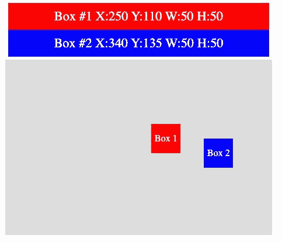

移动页面上的元素可以通过跟踪用户的按键输入来实现。创建一个对象来存储特定按键的 `keydown` 和 `keyup` 布尔值，然后可以在动画帧中使用该对象，根据按键对象中的布尔值来移动元素。如果按键被按下，该对象将具有 `true` 值，这可以用来判断哪些键被按下，并相应地应用移动。

通过创建一个可以移动元素的交互界面，跟踪以像素为单位的 `X` 和 `Y` 轴值以及元素的高度 `Height` 和宽度 `Width`，我们就可以看到重叠发生时的数值。这还允许我们直观地看到水平轴或垂直轴上的连接点。通过元素的实时数字和值，查看计算和碰撞公式的运行情况。

### 设置页面元素移动并跟踪位置的练习：

1. 创建一个允许创建页面元素的函数，这样我们就可以根据需要动态向页面添加元素。给函数命名为 `adder()` 以获取新元素将要追加的父元素。使用元素标签的字符串值创建元素。为元素添加内部 HTML 内容，并使用字符串值添加类。

```javascript
function adder(parent,t,html,c){ const ele = document.createElement(t);  ele.innerHTML = html;    ele.classList.add(c);  return parent.appendChild(ele); }
```

2. 创建四个页面元素：2 个将移动的框和 2 个输出框坐标和尺寸的区域。

3. 创建一个全局游戏对象，用于跟踪动画帧，包含每个框的 `x,y`（水平、垂直）位置，以及每个框的 `h,w`（高度和宽度）。这些值随后可以更新位置。

4. 设置一个名为 `keyz` 的对象来跟踪哪些键盘键将用于元素移动。添加 8 个键码名称作为属性名，并将值设置为 `false`。一旦按下按键，这些值将被更新。

5. ```javascript
const keyz = {   ArrowLeft:false, ArrowRight:false, ArrowUp:false, ArrowDown:false,   KeyA:false, KeyW:false, KeyS:false, KeyZ:false, };
```

6. 在 `document` 上添加事件监听器，监听 `keydown` 和 `keyup` 事件。如果 `keyz` 对象中的按键与对象属性名匹配，则在按下时将设置为 `true`，释放时设置为 `false`。现在这可以用于元素移动了。

7. 创建并启动 `mover()` 函数，它将处理按键时的页面移动。

8. 在 `mover()` 函数内部添加条件来检查哪些键为 `true`，相应地更新 `game` 对象的 `x,y`。还要应用一个条件，在允许移动之前检查元素是否在 `main` 容器对象的边界内。

9. 使用每个框的新 `game` `x,y` 值更新其 `style` 中的 `left` 和 `top`。

10. 在元素移动时，将每个元素的 `x,y,h,w` 输出到页面；这些值应随着新的 `x,y` 坐标而变化。这些值将用于计算元素之间的碰撞。

```html
<!DOCTYPE html>
<html>
<head>
<title>JavaScript Course</title>
<style>
 .container {
 position: relative;
 width: 90vw;
 height: 300px;
 border: 1px solid #ddd;
 }
 .box {
 position: absolute;
 width: 50px;
 height: 50px;
 color: white;
 }
 .info {
 position: absolute;
 width: 50px;
 height: 50px;
 text-align: center;
 }
</style>
</head>
<body>
<div class="container">
 <div class="box" id="box1"></div>
 <div class="box" id="box2"></div>
</div>
<div id="output1"></div>
<div id="output2"></div>
<script src="app.js"></script>
</body>
</html>
```

页面元素是可以移动的；通过这个对 DOM 页面元素的实时检测器，可以帮助你更直观地看到碰撞检测公式的运行效果。此练习还将演示如何使用 `getBoundingClientRect()` 方法在检测函数内部获取元素的边界和尺寸，从而简化碰撞检测。使用 `getBoundingClientRect()` 方法可以消除在对象中跟踪元素位置的需要，并在需要时返回所需的 `X`、`Y`、`height`、`width` 值。使用之前相同的重叠公式并放置元素返回的对象值，可以提供一个用于任何元素碰撞检测的快速检查函数。在函数参数中，只需要元素对象，这些对象也可以通过选择或从预定义的元素变量中使用。

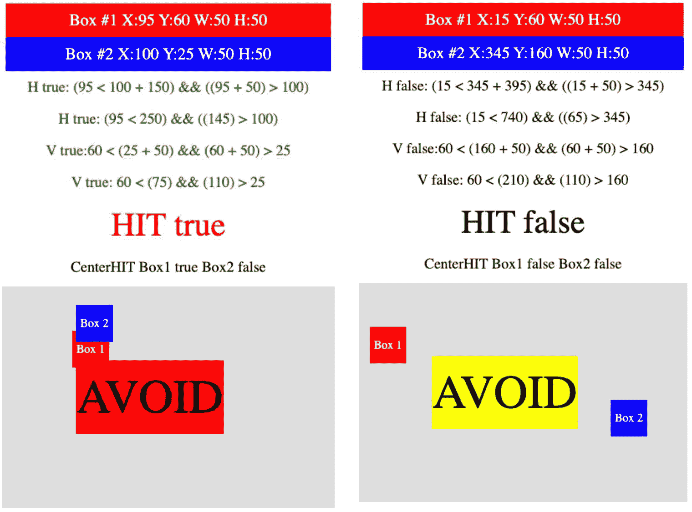

要检查任何两个元素是否重叠，你需要两个元素的 `x,y`、`height` 和 `width` 值。然后可以使用这些值来计算角，以检查水平轴上的重叠和垂直轴上的重叠。如果水平和垂直方向重叠，则页面上的两个元素之间发生了碰撞。

使用 `getBoundingClientRect()` 将返回元素的尺寸。该方法返回一个值对象，其属性包括 `bottom`、`height`、`left`、`right`、`top`、`width`、`x`、`y`。

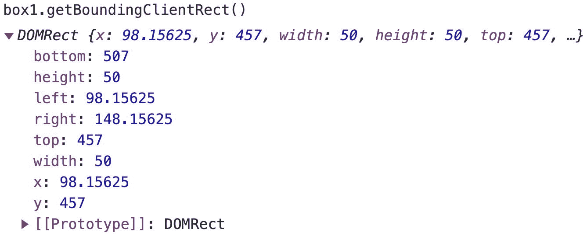

这些元素值可以用于碰撞公式以检查重叠。

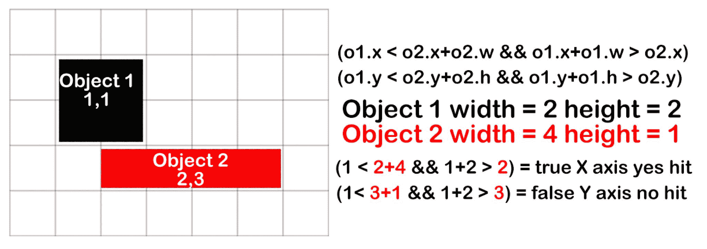

### X-水平检测公式

```
(a.x < (b.x + b.width)) && ((a.x + a.width) > b.x);
```

### y-垂直检测公式

```
(a.y < (b.y+b.height)) && ((a.y + a.height) > b.y);
```

### 检查元素重叠移动练习：

1. 创建移动输出区域以显示元素的当前状态和碰撞值。如果发生重叠，则更新元素的样式。

2. 在中心创建一个新元素，用于碰撞检查函数。

3. 创建一个需要两个参数的新函数，每个参数对应一个待检查的元素。获取元素的边界。

4. 创建函数 `col()`，它可以检查边界并在两个元素重叠时返回一个布尔值。使用此公式检查屏幕上不同框之间的元素重叠。

5. 根据碰撞检测的结果更新元素样式和输出信息样式。

```html
<!DOCTYPE html>
<html>
<head>
 <title>JavaScript Course</title>
 <style>
 .container {
 position: relative;
 background-color: #ddd;
 width: 90vw;
 margin: auto;
 }
 .box {
 position: absolute;
 width: 50px;
 height: 50px;
 left: 0;
 top: 0px;
 line-height: 50px;
 text-align: center;
 color: white;
 }
 .info {
 background-color: white;
 padding: 5px;
 text-align: center;
 font-size: 1.4em;
 color: white;
 }
 .output1{
 color:black;
 font-size: 0.9em;
 padding:0px;
 }
 .blocker{
 width:200px;
 left:100px;
 top:100px;
 position:absolute;
 height:100px;
 background-color:yellow;
 text-align:center;
 line-height:100px;
 font-size:4em;
 }
 .output2{
 color:black;
 font-size:2em;
 }
 .info  div {
 padding: 10px;
 }
 .game {
 position: relative;
 min-height: 300px;
 }
 </style>
</head>
<body>
 <div  class="container"></div>
 <script  src="app8.js"></script>
</body>
</html>
```


# JavaScript 游戏开发教程

## 基础交互元素创建

```javascript
const main = document.querySelector('.container');
const message = adder(main, 'div', '', 'info');
const output1 = adder(message, 'div', 'Content 1', 'output');
const output2 = adder(message, 'div', 'Content 2', 'output');
const output3 = adder(message, 'div', 'Content 3', 'output1');
const output4 = adder(message, 'div', 'Content 4', 'output1');
const output5 = adder(message, 'div', 'Content 5', 'output1');
const output6 = adder(message, 'div', 'Content 6', 'output1');
const output7 = adder(message, 'div', 'Content 7', 'output2');
const output8 = adder(message, 'div', 'Content 8', 'output1');
const gameBoard = adder(main, 'div', '', 'game');
const box3 = adder(gameBoard, 'div', 'AVOID', 'blocker');
const box1 = adder(gameBoard, 'div', 'Box 1', 'box');
box1.style.backgroundColor = 'red';
output1.style.backgroundColor = 'red';
const box2 = adder(gameBoard, 'div', 'Box 2', 'box');
box2.style.backgroundColor = 'blue';
output2.style.backgroundColor = 'blue';
box2.style.left = '100px';
const game = {
  x1: box1.offsetLeft,
  y1: box1.offsetTop,
  x2: box2.offsetLeft,
  y2: box2.offsetTop,
  speed: 5,
  w1: box1.offsetWidth,
  h1: box1.offsetHeight,
  w2: box2.offsetWidth,
  h2: box2.offsetHeight
};
const keyz = {
  ArrowLeft: false,
  ArrowRight: false,
  ArrowUp: false,
  ArrowDown: false,
  KeyA: false,
  KeyS: false,
  KeyZ: false,
};
document.addEventListener('keydown', (e) => {
  if (e.code in keyz) {
    keyz[e.code] = true;
  }
});
document.addEventListener('keyup', (e) => {
  if (e.code in keyz) {
    keyz[e.code] = false;
  }
});
window.addEventListener('DOMContentLoaded', mover);

function mover() {
  const dim = [gameBoard.offsetWidth, gameBoard.offsetHeight];
  // Box 1
  if (keyz.ArrowRight && game.x1 < dim[0]) game.x1 += game.speed;
  if (keyz.ArrowLeft && game.x1 > 0) game.x1 -= game.speed;
  if (keyz.ArrowDown && game.y1 < dim[1]) game.y1 += game.speed;
  if (keyz.ArrowUp && game.y1 > 0) game.y1 -= game.speed;
  box1.style.left = game.x1 + 'px';
  box1.style.top = game.y1 + 'px';
  // Box 2
  if (keyz.KeyS && game.x2 < dim[0]) game.x2 += game.speed;
  if (keyz.KeyA && game.x2 > 0) game.x2 -= game.speed;
  if (keyz.KeyZ && game.y2 < dim[1]) game.y2 += game.speed;
  if (keyz.KeyW && game.y2 > 0) game.y2 -= game.speed;
  box2.style.left = game.x2 + 'px';
  box2.style.top = game.y2 + 'px';
  output1.innerHTML = `Box #1 X:${game.x1} Y:${game.y1} W:${game.w1} H:${game.h1}`;
  output2.innerHTML = `Box #2 X:${game.x2} Y:${game.y2} W:${game.w2} H:${game.h2}`;
  const o3 = game.x1 < (game.x2 + game.w2) && (game.x1 + game.w1) > game.x2;
  const o4 = game.y1 < (game.y2 + game.h2) && (game.y1 + game.h1) > game.y2;
  output3.style.color = (o3 ? 'green' : 'black');
  output4.style.color = (o3 ? 'green' : 'black');
  output5.style.color = (o4 ? 'green' : 'black');
  output6.style.color = (o4 ? 'green' : 'black');
  output3.innerHTML = `H ${o3}: (${game.x1} < ${game.x2 + game.w2}) && ((game.x1 + game.w1) > game.x2)`;
  output4.innerHTML = `H ${o3}: (${game.x1} < ${game.x2 + game.w2}) && ((game.x1 + game.w1) > game.x2)`;
  output5.innerHTML = `V ${o4}:${game.y1} < (${game.y2 + game.h2}) && ((game.y1 + game.h1) > game.y2})`;
  output6.innerHTML = `V ${o4}: ${game.y1} < (${game.y2 + game.h2}) && (${game.y1 + game.h1}) > game.y2}`;
  const val1 = col(box1, box2);
  output7.style.color = val1 ? 'red' : 'black';
  output7.innerHTML = `HIT ${val1}`;
  const val2 = col(box1, box3);
  const val3 = col(box2, box3);
  box3.style.backgroundColor = val2 ? 'red' : '';
  if (!val2) {
    box3.style.backgroundColor = val3 ? 'blue' : '';
  }
  output8.innerHTML = `Center Box1 ${val2} Box2 ${val3}`;
}

function col(el1, el2) {
  const a = el1.getBoundingClientRect();
  const b = el2.getBoundingClientRect();
  //console.log(a);
  return (a.x < (b.x + b.width)) && ((a.x + a.width) > b.x) && (a.y < (b.y + b.height)) && ((a.y + a.height) > b.y);
}

function adder(parent, t, html, c) {
  const ele = document.createElement(t);
  ele.innerHTML = html;
  ele.classList.add(c);
  return parent.appendChild(ele);
}
```

游戏的目标是在元素掉落时点击它们，尝试让它们落在移动的平台上以得分。第一节课是设置基础游戏板，以及与元素和移动的简单交互。此练习将演示如何创建元素、如何通过更新样式值来移动元素，以及如何创建响应用户交互的交互元素。

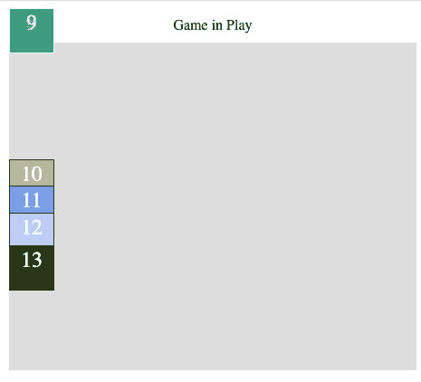

使用 `requestAnimationFrame()` 方法创建页面上元素之间的平滑移动。

### 创建移动的基础交互式元素练习

1. 创建一个可以设置新页面元素的函数。使用父元素作为参数，新元素将被添加到该元素中。元素标签类型的字符串名称。元素的内部 HTML 内容，以及添加到新创建元素中的类名。

```javascript
function maker(parent, t, html, c) {
  const ele = document.createElement(t);
  ele.innerHTML = html;
  ele.classList.add(c);
  return parent.appendChild(ele);
}
```

2. 添加一个事件监听器，等待 `DOMContentLoaded` 触发并调用 `init` 函数来创建游戏板内容。

3. 为新元素添加点击事件。

4. 为创建的新元素框创建随机背景颜色。`Math.random().toString(16).slice(2,8)`

5. 当元素框被点击时，为元素添加 `active` 类。

6. 创建一个新函数来处理元素的动画。该函数应在点击"开始游戏"时被调用，并在内部运行 `requestAnimationFrame()` 调用该函数。

7. 在 `mover()` 函数中，获取所有激活的元素，获取元素的 `offsetTop` 值，并将其增加游戏速度值。将新的 `top` 样式位置值应用到元素上使其移动。

8. 添加一个条件，当元素到达游戏容器底部时，通过移除元素的 `active` 类来停止其移动。

```html
<!DOCTYPE html>
<html>
<head>
  <title>JavaScript Course</title>
  <style>
    * {
      box-sizing: border-box;
    }
    .container {
      position: relative;
      width: 90vw;
      margin: auto;
      background-color: #ddd;
      min-height: 400px;
      text-align: center;
      overflow: hidden;
    }
    .message {
      padding: 10px;
      background-color: white;
    }
    .btn {
      min-width: 50%;
      height: 40px;
      font-size: 1.4em;
      border-radius: 10px;
    }
    .box {
      position: absolute;
      left: 0;
      top: 0;
      height: 50px;
      width: 50px;
      line-height: 30px;
      text-align: center;
      border: 1px solid white;
      font-size: 1.5em;
      color: white;
      opacity: 0.5;
    }
    .box:hover {
      cursor: pointer;
      border-color: red;
    }
    .active {
      border-color: black;
      opacity: 1;
    }
  </style>
</head>
<body>
  <div class="container"></div>
  <script src="app7.js"></script>
</body>
</html>
```

```javascript
const main = document.querySelector('.container');
const message = maker(main, 'div', 'Click Start Button', 'message');
const btn1 = maker(main, 'button', 'Start Game', 'btn');
console.log(message);
const game = {box: [], num: 15, ani: {}, speed: 1};

btn1.onclick = startGame;

window.addEventListener('DOMContentLoaded', init);

function init() {
  for (let i = 0; i < game.num; i++) {
    const ele = maker(main, 'div', i + 1, 'box');
    ele.style.backgroundColor = '#' + Math.random().toString(16).slice(2, 8);
    ele.onclick = dropper;
  }
}

function mover() {
  const actives = document.querySelectorAll('.active');
  actives.forEach((ele) => {
    console.log(ele.offsetTop);
    let y = ele.offsetTop + game.speed;
    if (y > 400) {
      ele.classList.remove('active');
    }
    ele.style.top = y + 'px';
  })
  game.ani = requestAnimationFrame(mover);
}

function dropper(e) {
  console.log(this);
  this.classList.add('active');
}

function startGame() {
  btn1.style.display = 'none';
  message.textContent = 'Game';
  mover();
}

function maker(parent, t, html, c) {
  const ele = document.createElement(t);
  ele.innerHTML = html;
  ele.classList.add(c);
  return parent.appendChild(ele);
}
```

## 元素移动与碰撞

使用 `requestAnimationFrame()` 处理掉落元素的动画。框的位置根据其 `offsetTop` 和 `game.speed` 进行更新。如果框到达容器底部，则移除 `active` 类。

碰撞检测通过检查框是否与挡板重叠来实现。逻辑检查以下内容：

- 水平重叠：`o1.x < o2.x + o2.w` 和 `o1.x + o1.w > o2.x`
- 垂直重叠：`o1.y < o2.y + o2.h` 和 `o1.y + o1.h > o2.y`

当发生碰撞时，移除元素并更新得分。


## 完整游戏实现

```html
<!DOCTYPE html>
<html>
<head>
  <title>JavaScript</title>
  <style>
    * {
      box-sizing: border-box;
    }
    .container {
      position: relative;
      width: 90vw;
      margin: auto;
      border: 1px solid #ddd;
      text-align: center;
    }
    .gameboard {
      position: relative;
      background-color: #ddd;
      min-height: 400px;
    }
    .message {
      padding: 10px;
      background-color: white;
      font-size: 1.5em;
    }
    .btn {
      min-width: 50%;
      height: 40px;
      font-size: 1.4em;
      border-radius: 10px;
      display: block;
      margin: auto;
    }
    .paddle {
      position: absolute;
      left: 0;
      top: 380px;
      height: 20px;
      width: 100px;
      background-color: black;
    }
    .box {
      position: absolute;
      left: 0;
      top: 0px;
      height: 50px;
      width: 50px;
      line-height: 30px;
      text-align: center;
      border: 1px solid white;
      font-size: 1.5em;
      color: white;
      opacity: 0.5;
    }
    .box:hover {
      cursor: pointer;
      border-color: red;
    }
    .active {
      border-color: black;
      opacity: 1;
    }
  </style>
</head>
<body>
  <div class="container"></div>
  <script src="app7.js"></script>
</body>
</html>
```

```javascript
const main = document.querySelector('.container');
const info = maker(main, 'div', '', 'info');
const gameboard = maker(main, 'div', '', 'gameboard');
const message = maker(info, 'div', '点击开始按钮', 'message');
const btn1 = maker(info, 'button', '开始游戏', 'btn');
const paddle = maker(gameboard, 'div', '', 'paddle');

paddle.val = 5;
gameboard.style.display = 'none';

const game = {
  box: [],
  num: 15,
  ani: {},
  pspeed: 1,
  speed: 2,
  width: main.offsetWidth,
  play: false,
  score: 0
};

btn1.onclick = startGame;
// window.addEventListener('DOMContentLoaded', init);

function init() {
  for (let i = 0; i < game.num; i++) {
    const ele = maker(gameboard, 'div', i + 1, 'box');
    ele.style.backgroundColor = '#' + Math.random().toString(16).slice(2, 8);
    ele.onclick = dropper;
    ele.speedVal = Math.floor(Math.random() * 1) + 1;
    ele.style.left = Math.floor(Math.random() * (game.width - 50)) + 'px';
  }
}

function mover() {
  const actives = document.querySelectorAll('.active');
  actives.forEach((ele) => {
    let y = ele.offsetTop + game.speed;
    ele.style.top = y + 'px';
    if (y > 400) {
      ele.classList.remove('active');
      ele.style.left = Math.floor(Math.random() * (game.width - 50)) + 'px';
      ele.style.top = '0px';
    }
    const poff = paddle.offsetTop;
    if (y + 50 > poff && y < poff + 20) {
      const x = ele.offsetLeft;
      const xend = x + 50;
      const px = paddle.offsetLeft;
      const pxend = px + 100;
      let valHit = 'miss 中';
      if ((xend > px) && (xend < pxend)) {
        valHit = '命中';
        message.style.color = 'green';
        ele.remove();
        game.score++;
      } else {
        message.style.color = 'red';
      }
      message.textContent = `${valHit}!) 得分 : ${game.score}`;
      if (game.score >= game.num) {
        // 游戏结束
        game.play = false;
        btn1.style.display = 'block';
        btn1.textContent = '重新开始';
        message.style.color = 'black';
        message.innerHTML += '<div>游戏结束</div>';
      }
    }
  })
  let paddleY = paddle.offsetLeft + (game.pspeed * paddle.val);
  if (paddleY > game.width - 100 || paddleY < 0) {
    paddle.val *= -1;
  }
  paddle.style.left = paddleY + 'px';
  if (game.play) {
    game.ani = requestAnimationFrame(mover);
  } else {
    cancelAnimationFrame(game.ani);
  }
}

function dropper(e) {
  console.log(this);
  this.classList.add('active');
}

function startGame() {
  game.play = true;
  game.score = 0;
  init();
  btn1.style.display = 'none';
  gameboard.style.display = 'block';
  message.textContent = 'Click the boxes Hit the paddle.';
  mover();
}

function maker(parent, t, html, c) {
  const ele = document.createElement(t);
  ele.innerHTML = html;
  ele.classList.add(c);
  return parent.appendChild(ele);
}
```

请注意，学习最好的方法之一是在自己的账户中尝试这些代码。`Project Source Code` 位于 GitHub 上的 [`github.com/lsvekis/javascript`](https://github.com/lsvekis/javascript)。

欲需了解更多关于 Apps Script 以及通过视频和资源进行编程，请访问 [`basescripts.com/`](https://basescripts.com/)。

感谢您的支持！

特别感谢 Sebastian 和 Alexis
