# JavaScript 周末学习指南，第 2 版

由 Internet Archive 于 2022 年数字化

资金来自 Kahle/Austin 基金会

https://archive.org/details/learnjavascript0000ford_d4i8

# 致谢

有几位人士值得对他们为本书所付出的努力给予高度赞扬。我特别要感谢担任本书组稿编辑的 Arlie Hartman。我还要感谢本书的项目编辑 Kim Benbow，感谢她的指导和建议。最后，我要感谢本书的文字编辑 Gene Redding 和技术编辑 Burt LaFontaine，以及 Premier Press 的所有其他人，感谢他们的辛勤工作。

# 引言

祝贺你决定学习JavaScript和JScript。JavaScript是一种强大的脚本语言，与HTML结合使用时，可以让你创建令人兴奋且功能强大的网页。你可以使用这些网页来经营小型企业，或通过互联网与家人和朋友分享信息。JScript是Microsoft对JavaScript的实现，可用作自动化重复性或复杂桌面和系统任务的脚本语言。

你可能在问自己：“我真的能在单个周末内学会使用JavaScript和JScript编程吗？”答案是“是的！”我并不承诺你将在短短几天内成为编程大师，但如果你能花一个完整的周末时间学习这本书并跟随其示例实践，你将能够编写自己的JavaScript和JScript脚本。你很快就能对网页进行显著改进，并开发脚本自动化许多Windows桌面任务。

从语法上讲，JavaScript和JScript几乎完全相同。因此，学习编写JavaScript的过程，也是在学习如何使用JScript。两种语言的不同之处在于它们执行的环境。JavaScript嵌入在HTML页面中，由Web浏览器运行。而JScript则是作为纯文本文件编写，由Windows Script Host或WSH直接从Windows桌面执行。

只要你具备基本的Windows技能和良好的HTML基础，你就会发现这本书将为你提供所有必要的信息和示例，让你在单个周末内快速上手并运行这两种令人兴奋的脚本语言。

## 本书内容

本书是关于学习如何编写JavaScript以创建令人激动的网站。它也旨在教你如何利用在使用JavaScript过程中发展出的技能和知识，来创建自动化桌面任务的JScript。本书假定你具备基本的Windows和HTML经验。其余内容将由本书提供。在这个周末结束时，你将学会如何完成以下任务：

- 将JavaScript集成到你的网页中

- 使用JavaScript控制浏览器状态栏

- 使用JavaScript显示弹出警报、提示和确认对话框，以便与访问者交互

- 使用JavaScript为网页添加图形效效果

- 使用JavaScript创建网页横幅、时钟和其他动画效果

- 使用JavaScript验证表单并将表单内容通过电子邮件发送给自己

- 编写收集和保存访问者信息的JavaScript脚本

- 编写自动化Windows任务的JScript脚本，例如创建新用户账户以及磁盘和打印机管理

- 编写可读取文本文件并创建日志和报告文件的JScript脚本

- 编写可创建快捷方式并配置Windows“开始”菜单和快速启动栏的JScript脚本

## 谁应该阅读本书？

本书适合任何准备开始使用JavaScript为网页增添色彩的人，或任何希望通过学习自动化重复性或复杂Windows任务来提高效率的人。在开始使用JavaScript之前，你需要熟练使用Netscape Navigator或Microsoft Internet Explorer。当然，你还需要懂一点HTML知识。同样，你需要了解使用Windows的基础知识，以便能够利用JScript的强大功能。这意味着你应该已经知道如何执行此类任务，以及如何创建快捷方式、如何创建、删除和修改文本文件和文件夹，此外还要知道如何配置Windows“开始”菜单。

> **注意** 如果你觉得你的HTML技能有点薄弱，你可能需要通过阅读Premier Press出版的《一周内学会HTML》来温习一下。但是，如果你只是有点生疏，通过复习本书中使用的HTML代码，你可能就能重新拾起它们。

了解另一种编程语言（如Basic、Perl或C）也是有帮助的（但不是必需的）。对于经验更丰富的程序员来说，本书提供了一个理想的快速入门指南。虽然了解另一种计算机编程语言不是成功的先决条件，但拥有这种背景会让你这个周末的学习体验更轻松、压力更小。不要担心缺乏这种经验；每个人都必须从某个地方开始。JavaScript和JScript是完美的入门语言。

## 开始前的准备

JavaScript和JScript的最大优点是它们易于创建。你不必在开始开发脚本前在编程工具上花费大量资金。要开始开发JavaScript，你所需要的只是

- **一台计算机。** 几乎任何计算机都可以，因为开发和测试JavaScript不需要很强的性能。

- **互联网访问。** 无论是在家还是在工作，你必须能够访问互联网，以便将网页上传到你的网站。

- **一个Internet Web浏览器。** 多种Internet浏览器支持JavaScript，包括Microsoft Internet Explorer、Netscape Navigator和Opera。你至少需要其中一个浏览器来测试你的JavaScript。然而，最好拥有所有浏览器的副本，以确保你的JavaScript在每个浏览器中都能正常工作。

- **一个网站。** 如果你还没有自己的网站，很可能你当地的互联网服务提供商可以为你设置一个。

- **一个文本编辑器。** 你可以使用任何基本的文本编辑器来编写和保存你的JavaScript。你甚至可以使用Windows的记事本应用程序。

- **一个图形编辑器。** 这个工具是可选的，但如果你打算在网页中添加任何图形图像，它就是必需的。例如，你可能想要设计自己的横幅页面或网站标志。

与许多编程语言不同，JScript不要求你在学习如何使用复杂的*集成开发环境*（IDE）后才能开发直接从Windows桌面运行的脚本。要开始开发JScript，你所需要的只是

- **Windows 95、98、Me、NT、XP、2000或2003。** 只有Windows计算机支持JScript。

- **Windows Script Host或WSH，版本5.6。** 可从http://msdn.microsoft.com/scripting免费获取。

- **JScript 5.6。** 可从http://msdn.microsoft.com/scripting免费获取。

- **一个文本编辑器。** 与JavaScript一样，任何文本编辑器，包括记事本，都可以。

## 本书如何组织

本书设计让你能在单个周末的七个时段内完成阅读。当然，你也可以随时阅读。前五章旨在为你奠定坚实的 JavaScript 编程基础。最后两章则在此基础上，教你如何将所学应用于 JScript 的开发。本书的基本大纲如下：

-   **周五晚上：“JavaScript 与 JScript 简介。”** 本章提供使用 JavaScript 和 JScript 所需的预备背景知识。它概述了你可以使用 JavaScript 对网页进行的各种增强。背景信息包括 JavaScript 的简要历史和浏览器兼容性讨论。然后，你将学习如何编写你的第一个 JavaScript。本章还包括 JScript 和 WSH 的概述。这将涵盖这两种技术的概览，并简要介绍 WSH 的架构——它为 JScript 的执行提供了运行环境。

-   **周六上午：“学习 JavaScript 编码基础。”** 本章为你提供编程基础。在开始一系列概述构成 JavaScript 和 JScript 语言的基本编程语句的课程之前，它会讨论脚本和脚本语法。你将学习如何处理变量、字面量、函数、表达式、运算符、语句和数组。本章最后涵盖面向对象编程，并概述 JavaScript 对象模型。

-   **周六下午：“使用 JavaScript 构建更好的网页。”** 本章回顾浏览器为 JavaScript 提供的对象，并演示如何访问这些对象。本章还讨论了 JavaScript 事件以及如何使用事件处理程序来处理它们。本章最后讨论如何使用 JavaScript 控制 HTML 框架和表单。

-   **周六晚上：“用你的网页做真正酷的事情。”** 在本章中，事情开始变得真正令人兴奋。你将学习如何编写能够操纵浏览器状态栏、创建滚动消息和打开弹出对话框的 JavaScript。本章包括关于 Netscape Navigator 和 Internet Explorer 之间差异的讨论，以及如何使用 JavaScript 与这两种浏览器协同工作。本章最后涵盖插件的使用以及图形和动画的应用。

-   **周日上午：“高级 JavaScript 编码。”** 本章通过探索如何使用 cookie 存储和检索有关网站访问者的信息，来结束本书的 JavaScript 内容。本章还对调试 JavaScript 涉及的技术进行了扎实的回顾。最后，本章通过演示如何将你的新 JavaScript 编程技能应用于开发“在线书店”网站来结束。

-   **周日下午：“学习如何使用 JScript 和 WSH。”** 本章涵盖构成 WSH 对象模型的对象，包括它们的属性和方法。它还介绍了 JScript 的运行时对象。它教你如何编写能够访问 Windows 文件系统的 JScript，并向你展示执行文件和文件夹管理的不同方法。你将学习如何创建文本文档和日志文件，以及如何打开和读取文本文件。

-   **周日晚上：“使用 JScript 自动化 Windows 任务。”** 本章重点展示如何使用 JScript 和 WSH 来执行多种不同的自动化任务。这些任务将包括创建 Windows 快捷方式、自定义 Windows 开始菜单和快速启动工具栏、如何将消息写入 Windows 事件日志，以及如何读写 Windows 注册表。此外，你还将学习如何使用 Windows 命令、访问网络资源以及调度脚本执行。

-   **“网站上有什么？”** 这告诉你可以在哪里找到本书中所有脚本的示例。每种示例的副本均可从 http://www.courseptr.com 下载。

-   **术语表：** 这里列出了贯穿本书使用的术语列表。

> 注意 请访问 http://www.courseptr.com 查找附录 A、B 和 C。

-   **附录 A：“JavaScript 和 JScript 对象简要参考。”** 本附录简要概述 JavaScript 对象，并指出与它们相关的属性和方法。

-   **附录 B：“JavaScript 事件和事件处理程序摘要。”** 本附录简要概述 JavaScript 事件及其相关的事件处理程序。

-   **附录 C：“JavaScript 和 JScript 保留字。”** 本附录列出了 JavaScript 和 JScript 的保留字。

## 本书的特殊功能

本书运用了一些惯例，以帮助你更轻松地使用，包括

> 注意 提供补充信息，这些信息值得了解，但可能对正在讨论的主题不是必需的。

> 提示 建议替代技巧和捷径，可以帮助你更快、更高效地工作。

> 警告 警告你可能出现错误或意外问题的情况。

*斜体*用于突出新术语并强调关键信息。

# 周五晚上

## JavaScript 与 JScript 简介

-   什么是 JavaScript 和 JScript？

-   将 JavaScript 集成到 HTML 页面中

-   编写你的第一个 JavaScript

-   理解 JScript 和 Windows 脚本宿主

-   配置 JScript 执行环境

欢迎来到《在周末学习 JavaScript》。本书将教你所需的一切知识，让你开始使用这种令人兴奋和有趣的 Web 脚本语言。当这个周末结束时，你将准备好更新你的网站，使其对访客来说更具互动性和娱乐性。本书还将教你如何使用 JScript（微软版本的 JavaScript）创建脚本，以在 Windows 操作系统上自动化各种任务。

在本章中，你将学习关于 JavaScript 所需的背景知识。这将包括了解它的起源、哪些浏览器支持它，以及创建和测试你的 JavaScript 所涉及的步骤。

为了开发直接在 Windows 桌面上运行的 JScript，你还需要了解 Windows 脚本宿主。本章将解释 WSH 的基本架构，并向你展示如何配置它以及如何使用它来运行你的第一个 JScript。到今晚睡觉时，你将拥有完成本书其余部分所需的基础，并开始你的 JavaScript 和 JScript 程序员之旅。

## JavaScript 与 JScript 简介

*JavaScript* 是一种专门为与 Internet 浏览器配合工作而设计的计算机语言。它让你能够创建称为*脚本*的小程序，并将其嵌入超文本标记语言页面中，以便在网页上提供交互式内容。*JScript* 是微软对 JavaScript 的实现。除了在 Internet Explorer 中运行外，微软还提供了一个版本的 JScript，该版本可与 Windows 脚本宿主一起用作桌面脚本语言。

WSH 是一个可选的脚本环境，为 Windows 操作系统提供了直接在 Windows 桌面上运行脚本的能力。这两种语言支持相同的编程语句集合。

JavaScript 和 JScript 是*解释型*语言。这意味着用这些语言编写的脚本在执行前不会被编译（不像大多数编程语言如 C++ 那样）。每个脚本语句都必须首先转换为*二进制代码*（一种由 0 和 1 组成的计算机能理解的计算机语言）才能执行。

与提前转换为二进代码的编译程序不同，JavaScript 和 JScript 语句在执行时处理。这意味着它们的运行速度比编译程序稍慢。好处在于，这使得编写和测试 JavaScript 和 JScript 非常直观和容易。你只需编写几行代码，保存脚本并测试它，而无需停下来将其编译成可执行代码。

JavaScript 和 JScript 是*基于对象*的脚本语言。这意味着它们将一切都视为*对象*。对于 JavaScript，浏览器是一个对象，窗口是一个对象，窗口中的按钮也是一个对象。JScript 可以访问一组不同的对象。例如，JScript 能够访问诸如文件、驱动器和打印机之类的对象。

每个对象都有*属性*，你可以使用 JavaScript 和 JScript 来操作这些属性。例如，使用 JavaScript，你可以更改浏览器窗口的背景颜色或图形图像的大小。除了属性之外，对象还有方法。*方法*是对象可以执行的操作。例如，JavaScript 可以用来打开和关闭浏览器窗口。通过操作它们的属性并执行方法，你可以控制对象并让事情发生。

JavaScript 支持*事件驱动*编程。*事件*是当用户执行诸如单击按钮或移动

将鼠标指针悬停在图形图像上。JavaScript使你能够编写由事件触发的脚本。你是否曾好奇过，在某些网站上，当你将鼠标移动到按钮上时，按钮是如何动态变色的？这实际上是一种被称为*悬停切换*的JavaScript技术。事件就是鼠标移动到按钮（对象）上。这会触发一个*事件处理程序*的执行，该处理程序是一组JavaScript语句，用于将原始按钮替换为另一个使用不同颜色的按钮。

在Web浏览器中运行的JavaScript和JScript可以访问位于网页上的对象。另一方面，在WSH中运行的JScript则可以访问桌面资源，例如工具栏、文件、打印机和Windows注册表。

由于JavaScript和JScript运行在不同的环境中，它们处理不同的对象，并具有不同的能力。例如，使用JScript，你可以创建能够复制和移动文件、访问存储在网络驱动器上的数据、管理本地和网络打印机以及配置Windows桌面和“开始”菜单的脚本。

由于JavaScript和JScript关系密切，你可以通过学习其中一种语言来掌握另一种。两者之间的区别在于它们执行的环境以及它们所能访问的对象。明天上午，你将对构成JavaScript和JScript的所有语句进行一次全面的语言复习。由于本书第一部分侧重于JavaScript，所有示例都将使用该语言呈现。然而，从编程的角度来看，你将看到的大多数脚本语句都可以直接应用于JScript编程。

### 你能用JavaScript和JScript做些什么？

在1990年代中期帮助互联网迅速普及的相对简单直观的HTML，使你能够创建显示静态信息的网页。多年来，HTML的光环已褪去不少。标记语言非常适合格式化文本显示，但它们缺乏与访问者交互的能力。上网冲浪的人们已经期望并要求网站提供的不仅仅是静态的数据展示。如果你想让人们访问你的网站，享受其中，并再次光临，那么你就必须找到方法让它变得更有趣。最好的方法之一就是使用JavaScript。

JavaScript为你的网页提供了执行许多令人兴奋的功能的能力。以下列表预览了你将在本书中学到的如何使用JavaScript完成的一些事情。

- 显示弹出消息，向访问者展示信息并收集他们的信息

- 创建旋转横幅

- 打开新窗口

- 将使用旧版浏览器的用户重定向到非JavaScript的HTML页面

- 检测访问你网站的人们正在使用的浏览器和插件

- 验证表单并将其内容打包为电子邮件消息

- 执行简单的动画效果，例如悬停切换

- 对HTML框架和表单实施更精细的控制

- 控制状态栏并创建滚动消息

JavaScript可以做许多不同且令人兴奋的事情。然而，有一件事它做不到。JavaScript无法在浏览器之外运行。这个“限制”有助于使JavaScript更加安全，因为用户不必担心有人会编写一个可能擦除他们硬盘驱动器或读取他们的地址簿并提取私人信息的JavaScript。

### 周五晚上：介绍JavaScript和JScript

> **注意** 本书所涵盖的JavaScript侧重于客户端脚本。我所说的客户端脚本是指在访问你网页的用户的浏览器内执行的脚本。也存在一个服务器端版本的JavaScript。这个版本的JavaScript旨在Web服务器上运行，专业网站开发者使用它来创建基于从访问者以及存储在服务器端数据库中的信息提供动态内容的脚本。对服务器端JavaScript的讨论超出了本书的范围。从现在起，当我提到JavaScript时，我指的是客户端脚本。

与JavaScript一样，JScript也受限于其执行环境。当由WSH运行时，JScript无法访问Web内容。它们不处理HTML框架或表单。相反，WSH开辟了一个全新的执行环境，为JScript提供了访问本地和网络计算机资源的能力。在这种背景下，JScript存在的主要原因是促进开发能够自动化任务的脚本。

JScript为开发能够自动化重复性、平凡的任务，或在手动执行时复杂且容易出错的任务提供了一个特别强大的工具。以下列表预览了你将在本书中学到的如何使用JScript完成的一些事情。

- 创建和配置桌面快捷方式

- 生成文本报告和日志文件

- 通过复制、移动和删除文件和文件夹来管理Windows文件系统

- 管理操作系统资源，如Windows服务、注册表和事件日志

- 创建和管理用户帐户

- 管理本地和网�资源，如网络打印机和磁盘驱动器

- 与其他应用程序交互并控制它们

### 一点历史课

多年前，Netscape通信公司的程序员们认识到，仅靠HTML不足以支持交互式Web编程。1995年，他们开发了一种名为LiveScript的脚本语言，赋予了网页开发者对浏览器更大的控制权。

后来，Sun Microsystems出现并开发了一种名为Java的新编程语言。Java迅速成为热门项目，并获得了媒体和行业的巨大关注。Netscape在Netscape Navigator 2中增加了对Java的支持。与此同时，Netscape决定将LiveScript更名为JavaScript，这个名称为该脚本语言赢得了一些额外的关注。这两种语言的共同点仅此而已。两者互不相关，尽管现代互联网浏览器都支持它们，作为提供交互式Web内容的方式。

多年来，Netscape一直在增强和改进JavaScript，并在此过程中发布了多个新版本的Netscape Navigator，如表1.1所示。

| JavaScript | Netscape 版本 | Internet Explorer 版本 |

| :--- | :--- | :--- |

| 1.0 | Navigator 2 | Internet Explorer 3 |

| 1.1 | Navigator 3 | Internet Explorer 4 |

| 1.2 | Navigator 4 | Internet Explorer 4 |

| 1.3 | Navigator 4.5 | Internet Explorer 5 |

| 1.5 | Navigator 6 和 7 | Internet Explorer 5.5 和 6 |

多年来困扰互联网开发的一个问题是缺乏标准化。欧洲计算机制造商协会（ECMA）在推动JavaScript标准化方面发挥了主导作用，它将其称为ECMAScript。ECMA-262规范概述了JavaScript 1.3所遵循的标标准。JavaScript 1.5符合ECMA-262第3版。

与JavaScript 1.5一样，JScript 5.6也基于ECMA-262第3版。

> **注意** Netscape目前正在开发JavaScript 2.0，他们承诺它将与ECMAScript第四版兼容。与此同时，微软的下一个版本的JScript——JScript .NET，也正在基于ECMAScript第4版进行开发。

微软于1996年首次发布JScript，作为Internet Explorer 3.0的脚本语言，这基本上只是微软自己对JavaScript 1.0的实现。后来，JScript 2作为IIS 3.0的一部分发布，将JScript转变为一种服务器端脚本语言，当嵌入到ASP页面中时，它可以访问服务器端数据库并创建具有动态内容的HTML页面。

> **注意** Internet Information Server (IIS) 是一个微软Web服务器应用程序，支持创建网站，世界各地的公司都用它来托管他们的网站。Active Server Pages (ASP) 是在IIS上运行的可执文件，用于提供动态HTML内容。

JScript 3在多个不同的环境中发布，包括：

- Internet Explorer 4

- IIS 4

- Windows Scripting Host

作为Microsoft新Windows脚本宿主提供的两种默认脚本语言之一，JScript 3成为了一种能够直接与计算机资源交互的桌面脚本语言。接下来，JScript 4作为Microsoft Visual Studio开发套件的一部分发布。这个版本JScript的主要新增功能是能够直接与Windows文件系统交互。

> 注意：Microsoft的Visual Studio开发套件是多种不同软件语言和软件开发工具的集合，旨在协助软件开发者创建稳健的专业应用程序。

JScript 5版本随Internet Explorer 5和Windows 2000一同发布。当前版本的JScript——版本5.6，于2001年随Windows XP和Internet Explorer 6推出。

### JavaScript与浏览器兼容性

当JScript由WSH处理时，浏览器兼容性问题不会影响JScript程序员。

然而，对于JavaScript程序员来说，浏览器兼容性一直是一个主要问题。自1990年代中期以来，最受欢迎的两款互联网浏览器一直是Microsoft的Internet Explorer和Netscape的Communicator。Microsoft和Netscape在浏览器应如何工作方面历来存在分歧。因此，Netscape Communicator 2、3和4版本在许多情况下与Internet Explorer 3、4和5版本表现不同。当要求在任一浏览器上执行相同操作时，HTML页面和JavaScript的行为往往不同。

早期版本的Internet Explorer和Netscape Communicator之间的一个关键区别在于它们的对象模型。浏览器以对象的形式抽象其内容和功能。JavaScript通过与这些对象交互来与浏览器交互。问题在于，Netscape和Internet Explorer拥有不同的对象模型，因此一个浏览器中存在的某些对象在另一个浏览器中并不存在。然而，随着ECMAScript标准的出现，近年来事情变得一致得多。因此，在大多数情况下，由Netscape Communicator 6或7版本处理的HTML或JavaScript，其处理方式应与Internet Explorer 5.5或6版本处理时基本相同。但是，即使使用这两个浏览器的最新版本，实现上的细微差异仍然存在。确保你的JavaScript在两个浏览器上都按预期运行的唯一方法，就是使用两个浏览器进行测试。

JavaScript程序员仍需关注的另一个浏览器问题是各种浏览器支持的JavaScript版本。JavaScript支持始于Netscape 2浏览器，但该浏览器仅支持初始版本的JavaScript。Microsoft从Internet Explorer 3开始才提供JavaScript支持。问题是，仍有大量用户在运行两个浏览器的旧版本，试图满足所有这些用户是非常困难的。

并非所有浏览器都是生而平等的。事实上，情况变得更加复杂，因为Microsoft和Netscape并非唯一制作浏览器的公司。其他浏览器提供不同程度的JavaScript支持。例如，图1.1所示的Lynx浏览器是一个简单的基于文本的浏览器，不支持图形或JavaScript。

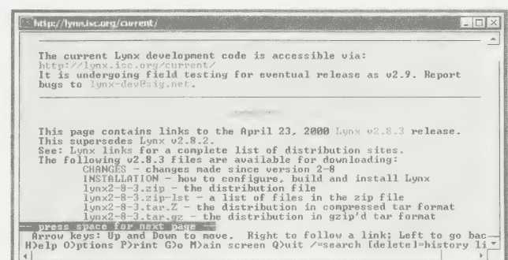

一个选择是忽略所有非JavaScript浏览器，只使用Netscape Navigator和Internet Explorer。你也可以编写只支持这两个浏览器最新版本的脚本。这大概可以满足你98%的潜在访客。但是，如果你想吸引尽可能多的人访问你的网站，你可能需要考虑寻找方法来适应旧版浏览器。明天我们将探讨处理该问题的不同方案。

另一个你可能需要注意的互联网浏览器叫做Opera，如图1.2所示。目前可以在www.opera.com下载试用。它的体积不到其竞争对手Netscape和Internet Explorer的一半。尽管如此，它提供了你所期望的所有功能支持，包括对JavaScript的支持。最重要的是，它加载网页速度很快。只有一个缺点：它不是免费的。越来越多的人开始关注它，你可能需要获取一份副本用于测试。

### 将JavaScript与HTML集成

JavaScript是通过将编程语句嵌入HTML文档中（置于`<SCRIPT>`和`</SCRIPT>`标签内）而形成的集合。这些标签可以放置在HTML页面的头部或主体部分。图1.3概述了在HTML页面中使用这些标签时必须遵循的语法。

> 使用多个浏览器测试你的JavaScript很简单，只需下载并安装它们，然后全部使用以查看它们如何处理你的脚本。如果你还想测试这些浏览器的旧版本如何工作，你可能需要另一台计算机。在撰写本书时，我能够从www.tucows.com和www.download.com等流行的共享软件站点下载到像Netscape 3和Internet Explorer 3这样旧的版本。

图1.2 Opera互联网浏览器

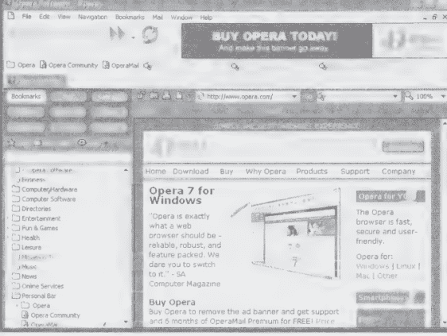

图1.3 与JavaScript一起使用时，`<SCRIPT>`和`</SCRIPT>`标签的语法。

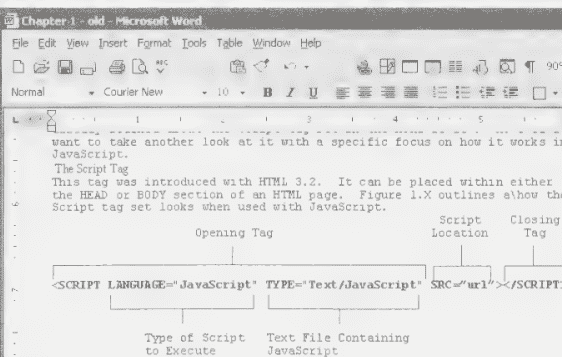

第一个`<SCRIPT>`标签内可以包含多个属性。`LANGUAGE`属性指指定你想要使用的JavaScript版本。

以下是可用的选项：

```
LANGUAGE="JavaScript"
LANGUAGE="JavaScript1.1"
LANGUAGE="JavaScript1.2"
LANGUAGE="JavaScript1.3"
LANGUAGE="JavaScript1.5"
```

**注意**：不同版本的Netscape Navigator和Internet Explorer浏览器支持不同版本的JavaScript（如本节前面的表1.1所示）。面对如此多不同版本的JavaScript和浏览器，情况可能会变得非常混乱。你可能希望编写JavaScript时遵循最低公分母原则（即，你的脚本不使用比网站访客可能拥有的最旧版本JavaScript更新的版本中的功能）。另一个选择是编写能够适应不同浏览器版本的JavaScript。

`LANGUAGE`属性是在HTML页面中指定嵌入脚本类型的老方法。根据HTML 4.0规范，`TYPE`属性现在是正确的方式。但是，如果你想确保旧版浏览器不会混淆，你可以继续同时使用这两个属性。使用JavaScript时，`TYPE`属性始终为`Text/JavaScript`。

另一种使用JavaScript的方法是将它们存储在具有.js文件扩展名的外部文件中，然后从HTML页面内引用这些文件。为此，你可以使用`SRC`属性指定外部JavaScript文件的位置。引用外部脚本使得用户更难查看你的JavaScript源代码。它还使得在多个HTML页面之间共享相同的JavaScript成为可能。一旦你定义了开始和结束标签，就可以开始在它们之间放置JavaScript语句了。

### 你的第一个JavaScript——“Hello World”

到目前为止，我们已经介绍了JavaScript和JScript，讨论了它们的能力和区别，并回顾了它们的历史。接着我们讨论了JavaScript浏览器兼容性问题，并学习了使用`<SCRIPT>`和`</SCRIPT>`标签将JavaScript嵌入HTML页面所需的语法。现在是时候创建你的第一个JavaScript了。这将是一个非常基础的例子，所以别抱太大期望。到明晚，你就能编写更复杂的脚本了。

在这个例子中，你将创建经典的“Hello World”脚本，这是有史以来每本编程书都用作其入门示例的脚本。毕竟，我是谁，敢违背如此光荣的传统？

在开始之前，我想简单谈谈HTML和JavaScript编辑器。市面上有很多可用的编辑器，它们的功能和性能差异很大，价格也各不相同。最终使用哪个编辑器其实并不重要。事实上，对于本书中看到的代码，我使用的是Windows XP Home Edition自带的Notepad程序。

> **提示**：大多数JScript程序员都有一个他们一直使用的脚本编辑器。现代脚本编辑器提供了许多功能，可以促进和加快脚本开发，使它们比Notepad实用得多。例如，大多数脚本编辑器都会提供语句颜色编码。此外，它们可以配置为自动缩进脚本语句。脚本编辑器还可能提供向导或模板，以帮助创建新脚本。有些编辑器甚至允许你直接在编辑器内测试脚本，省去每次测试时都必须将HTML页面加载到Web浏览器的麻烦。例如，HomeSite是Web开发者中非常流行的一款编辑器，也可用于开发JScript。要了解更多关于HomeSite的信息，请查看其主页：http://www.macromedia.com/software/homesite。

## 周末学 JavaScript

在开始本书中任何编码示例之前，我做的第一件事是创建一个可以反复使用的 HTML 模板。每次我编写新脚本时，都会用记事本打开模板并输入 JavaScript 语句。然后从记事本菜单中选择“文件”，再选择“另存为”，用新的文件名保存我的脚本。如果你使用功能齐全的 HTML 编辑器，它可能会在你创建新 HTML 页面时自动提供一个起始模板。如果没有，你可能需要像我一样构建并使用一个模板。我的模板如下所示：

```
<HTML>
    <HEAD>
        <TITLE>Script 1.1 - Insert Descriptive Title Here</TITLE>
    </HEAD>
    <BODY>
    </BODY>
</HTML>
```

如你所见，我的模板包含 `<HEAD> </HEAD>`、`<TITLE> </TITLE>` 和 `<BODY> </BODY>` 标签组，它们都包含在起始和结束的 `<HTML> </HTML>` 标签组中。如果你想这样做，现在就创建你自己的模板。完成后，在 body 部分内添加以下几行：

```
<SCRIPT LANGUAGE="JavaScript" TYPE="Text/JavaScript">
    document.write("Hello World");
</SCRIPT>
```

这三行语句将构成你的第一个 JavaScript。你应该能认出第一行和最后一行是脚本标签，它们告诉浏览器执行包含的 JavaScript 语句。这个脚本只有一个语句。这个语句告诉浏览器在当前文档（即 HTML 页面打开的窗口）上写入消息 "Hello World"。

一旦你将这三行 JavaScript 添加到模板中，它应该看起来像这样：

```
<HTML>
  <HEAD>
    <TITLE>Script 1.2 - Sample HTML Page</TITLE>
  </HEAD>
  <BODY>
    <SCRIPT LANGUAGE="JavaScript" TYPE="Text/JavaScript">
      document.write("Hello World");
    </SCRIPT>
  </BODY>
</HTML>
```

### 测试你的第一个脚本

既然你已经输入了第一个脚本，你需要保存它。我将我的脚本命名为 HelloWorld.html。HTML 扩展名将该页面标识为 HTML 页面。你的计算机使用文件扩展名中的信息将文件与特定应用程序关联。.html 扩展名告诉操作系统打开其默认浏览器并将 HTML 文件传递给它。或者，你也可以使用 .htm 扩展名，它也被识别为 HTML 页面的扩展名。

如果你使用功能齐全的 HTML 编辑器，该编辑器可能会让你只需点击一个按钮即可测试脚本。由于记事本没有这种自动的 HTML 测试功能，我只需启动一个浏览器并用它打开 HelloWorld.html 文件。浏览器打开我的页面并运行脚本。

根据你计算机上安装的浏览器，测试脚本的过程略有不同，如下所述的步骤所示。

使用 Netscape Communicator 测试：

1.  启动 Netscape Navigator。

2.  在菜单栏中，单击“文件”，然后单击“打开 Web 位置”。

3.  输入 HTML 页面的位置，然后单击“打开”。或者，单击“选择文件”按钮浏览并找到 HTML 页面，然后选中它，再单击“打开”。Netscape Navigator 打开页面，如图 1.4 所示。

使用 Internet Explorer 测试：

1.  启动 Internet Explorer。

2.  在 Internet Explorer 菜单栏中，单击“文件”，然后单击“打开”。“打开”对话框出现。

3.  输入 HTML 页面的位置，然后单击“确定”。或者，单击“浏览”按钮，找到并选择你的 HTML 文件，然后单击“确定”。Internet Explorer 打开页面，如图 1.5 所示。

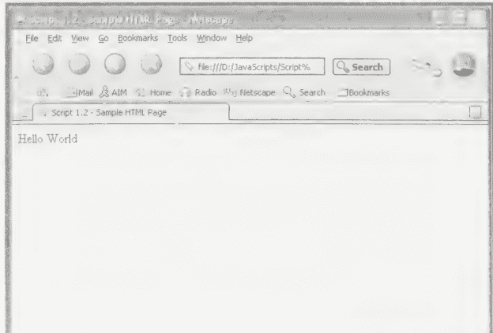

**图 1.4**

使用 Netscape Communicator 测试你的第一个 JavaScript

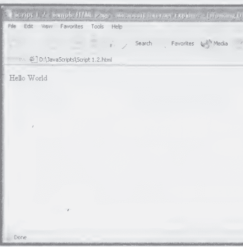

**图 1.5**

使用 Internet Explorer 测试你的第一个 JavaScript

加载你的新脚本并确保它在 Netscape Navigator 和 Internet Explorer 中都能按预期工作后，你就知道你可能拥有一个不错的脚本。然而，Internet Explorer 和 Netscape Communicator 在发生错误时都非常善于隐藏它们。我将在周日上午向你展示如何查找和修复这些错误。如果你没有看到显示 Hello World 消息，那么你可能输错了什么，所以请返回并重新打开你的 HTML 页面，仔细检查你的工作。现在，我将假设你在加载网页时看到了预期的内容，并且一切都正常。

### JavaScript 与大小写敏感性

输入 JavaScript 文本时，你必须极其小心。JavaScript 是一种区分大小写的编程语言（不像 HTML，它允许你在定义 HTML 标签时使用不同的大小写）。*大小写敏感*意味着你必须按照本书中出现的原样输入 JavaScript 元素，它们才能工作。例如，就 JavaScript 而言，单词 `document` 和 `Document` 指的是两件不同的事情，因此在输入脚本时要特别注意。如果我不小心在前面示例中使用的 `document.write()` 语句中输入了大写的 `D`，我的脚本就会出现错误。结果，`Hello World` 消息就不会如我所愿显示。

### 将 JavaScript 集成到 HTML 页面的不同方式

如你所知，有两个地方可以将 JavaScript 放入 HTML 页面：在 head 或 body 部分。此外，我告诉你，你可以将 JavaScript 直接嵌入到 HTML 页面中，也可以将其作为外部 .js 文件引用。你还可以将 JavaScript 集成到 HTML 页面的另一种方式是作为 HTML 标签中的一个组件。

### 将 JavaScript 放置在 HTML 页面的 body 部分

使用 `<SCRIPT>` 和 `</SCRIPT>` 标签嵌入的 JavaScript 可以放置在 HTML 页面 body 部分的任何位置。嵌入在 body 部分的脚本在页面加载时作为 HTML 文档的一部分执行。这使得脚本可以在页面加载时自动开始执行。例如，下面的语句演示了如何将 JavaScript 嵌入到 HTML 页面的 body 部分。

```
<BODY>
<SCRIPT LANGUAGE="JavaScript" TYPE="Text/JavaScript">
document.write("This JavaScript is located in the body section");
</SCRIPT>
</BODY>
```

同样，你可以在 HTML 页面中嵌入多个 JavaScript：

```
<BODY>
<SCRIPT LANGUAGE="JavaScript" TYPE="Text/JavaScript">
document.write("This first JavaScript is located in the body section");
</SCRIPT>
<BR>
<SCRIPT LANGUAGE="JavaScript" TYPE="Text/JavaScript">
document.write("This second JavaScript is also located in the body section");
</SCRIPT>
</BODY>
```

### 将 JavaScript 放置在 HTML 页面的 head 部分

JavaScript 也可以放置在 HTML 页面 head 部分的任何位置。与嵌入在 HTML 页面 body 部分的脚本不同，嵌入在 head 部分的脚本在页面加载时不一定自动执行。在某些情况下，它们只有在页面内其他语句调用执行时才会执行。大多数 JavaScript 程序员将所有函数和大多数变量移到 head 部分，因为这确保了它们在被页面 body 部分的脚本引用之前就已经定义。

> **注意** *变量*是在计算机内存中存储信息的容器。*函数*是可以调用以执行特定任务的 JavaScript 语句组。明天我将更多地谈论使用函数和变量的好处。

以下语句显示了一个在 head 部分嵌入了 JavaScript 的 HTML 页面。当 HTML 页面加载时，此脚本将自动执行。

```
<HTML>
    <HEAD>
        <TITLE>Script 1.3 - Sample HTML Page</TITLE>
        <SCRIPT LANGUAGE="JavaScript" TYPE="Text/JavaScript">
            window.alert("This JavaScript is located in the head section");
        </SCRIPT>
    </HEAD>
    <BODY>
    </BODY>
</HTML>
```

如图 1.6 所示，此脚本在一个弹出对话框中显示一条消息。明天我将解释这个脚本是如何做到这一点的。

下一个 HTML 页面包含一个嵌入的 JavaScript，当浏览器加载 HTML 时，它不会自动执行。

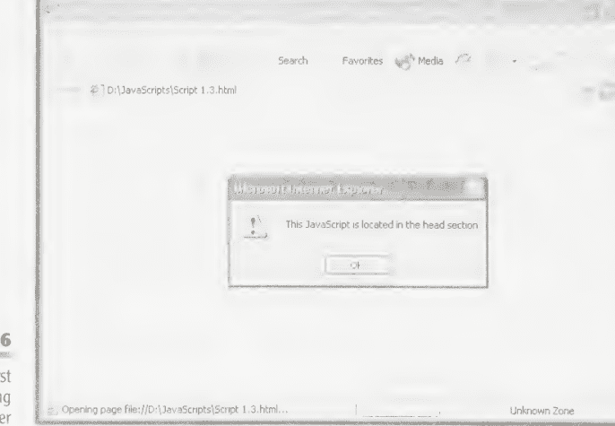

**图 1.6**

使用 Internet Explorer 测试你的第一个 JavaScript

### 周五晚上 介绍 JavaScript 和 JScript

```html
<HTML>
<HEAD>
<TITLE>Script 1.4 - 示例 HTML 页面</TITLE>
<SCRIPT LANGUAGE="JavaScript" TYPE="Text/JavaScript">
function DisplayMsg() {
    window.alert("此 JavaScript 位于 head 部分");
}
</SCRIPT>
</HEAD>
<BODY>
</BODY>
</HTML>
```

此次不会显示此弹出对话框，因为显示它的 JavaScript 语句已被嵌入到名为 `DisplayMsg()` 的函数中。因此，只有在 HTML 页面的其他地方调用执行时，JavaScript 才会执行。目前，不必担心什么是函数。只需理解，它们可用于在 HTML 页面的 head 部分创建不会自动执行的 JavaScript。

### 在外部 .js 文件中引用 JavaScript

要将 JavaScript 存储在外部文件中，需要将其保存为扩展名为 `.js` 的纯文本文件。然后，你需要在 HTML 页面的 `<SCRIPT>` 开始标签中添加 SRC 属性，如下所示。

```
<SCRIPT SRC="Test.js" LANGUAGE="JavaScript" TYPE="Text/JavaScript"> </SCRIPT>
```

在此示例中，指定了一个名为 `Test.js` 的外部 JavaScript。此外部 JavaScript 可以包含任意数量的 JavaScript 语句。但是，它不能包含任何 HTML。否则，你将最终得到一个错误。例如，`Test.js` 脚本的内容可能像这样简单：

```
document.write("这是一个外部 JavaScript。");
```

将 JavaScript 放在外部引用文件中有许多优点。首先，通过将 JavaScript 移出 HTML 页面，你可以使 HTML 页面更小，更易于处理。此外，你可以通过从任意数量的 HTML 页面引用它们，来重复使用存储为外部文件的 JavaScript。这样，如果你创建了一个希望从多个 HTML 页面引用的脚本，你可以这样做，而不必在不同的 HTML 页面中反复嵌入相同的脚本。作为额外好处，如果你希望修改外部存储的脚本的功能，你可以这样做，而不必访问所有本应嵌入该脚本的 HTML 页面。

> 注意：对外部 JavaScript 的引用可以放在 HTML 页面的 head 或 body 部分。你可以进行的外部引用数量没有限制，你可以在外部 JavaScript 中放置的语句数量也没有限制。

### 将 JavaScript 放在 HTML 标签中

JavaScript 也可以放在 HTML 标签内，如以下示例所示。

```
<BODY onLoad=document.write("Hello World!")></BODY>
```

在此示例中，JavaScript `onLoad=document.write("Hello World!")` 语句已被添加到 HTML `<BODY>` 标签中。这个特定的 JavaScript 语句告诉浏览器在浏览器首次加载 HTML 页面时写入包含的文本。

将小型 JavaScript 语句放在 HTML 标签内提供了一种执行小型 JavaScript 代码的简便方法。当然，此选项仅在执行小型 JavaScript 语句时真正有益，对于较大的 JavaScript 语句或需要多行代码的情况则不切实际。然而，正如你明天将了解到的，你也可以通过将调用语句嵌入 HTML 标签来触发对嵌入 HTML 页面 head 部分的 JavaScript 的执行。

> **注意** 你可能已经注意到前一个示例中 *onLoad* 一词的不寻常拼写。单词中间的 **L** 是大写的，其余字母是小写的。这种表示法称为 *驼峰表示法*。这是 JavaScript 区分大小写的一个完美示例。如果你以任何方式更改此单词的大小写，运行 JavaScript 时都会出错。

### 休息一下

好的，现在可能是休息几分钟、伸展一下腿脚的好时机，然后再继续。当你回来时，我将开始概述 JScript 和 WSH。这将包括对 WSH 架构的考察，以及 JScript 如何融入其中。此外，你将学到一些关于如何使用 Windows 命令提示符的知识。最后，本章将向你展示如何配置 WSH，使其既能从 Windows 命令提示符又能从 Windows 桌面按你希望的方式工作。

### 介绍 JScript

JScript 是微软为 WSH 提供的两种默认脚本语言之一。WSH 附带的另一种脚本语言是 VBScript。在功能上，JScript 和 VBScript 基本相当。两者都是用于自动化小型任务的优秀脚本语言。

> 注意：VBScript 是基于 Visual Basic 编程语言子集的脚本语言。与 JavaScript 类似，VBScript 也可用于网页开发。但是，虽然 Internet Explorer 支持 VBScript，但它不与 Netscape Communicator 一起使用。这使得 VBScript 成为一种不那么普遍接受的脚本语言。此外，VBScript 是专有的。这意味着微软拥有它，而当前版本的 JavaScript 和 JScript 基于 ECMAScript 标准，因此没有单一公司控制其未来。因此，许多人更喜�欢 JavaScript 和 JScript 而不是 VBScript。

JScript 和 JavaScript 提供了更好的内置数学函数集合，有助于执行复杂计算。另一方面，VBScript 为处理数组提供了更好的支持。我将在周六上午更多地讨论函数和数组。决定使用 JScript 还是 VBScript 来自动化 Windows 任务实际上只是个人偏好的问题。具有 JavaScript 背景的人将能够轻松地过渡到 JScript。同样，具有扎实 Visual Basic 编程背景的人可能更喜欢学习 VBScript。

> 注意：还有其他几种第三方脚本语言也可与 WSH 一起使用。这些语言包括 PERL、Python 和 REXX。讨论这些脚本语言超出了本书的范围。要了解更多关于兼容版本的 PERL 和 Python 的信息，请访问 www.activestate.com。要了解更多关于 REXX 的信息，请访问 www-4.ibm.com/software/ad/obj-rexx。

使用 JScript 和 WSH 的主要原因是通过自动化系统任务来节省你的时间。微软所有 Windows 操作系统的核心都是一个直观的图形用户界面（GUI）。此 GUI 旨在使计算机易于使用。你所要做的就是抓住鼠指向并点击即可。

不幸的是，GUI 并不非常适合许多任务，特别是那些高度重复或涉及多个步骤的任务。例如，假设你负责在工作部门的共享计算机上定义新的用户帐户，有一天你的老板带着一张软盘进来，上面有一个包含 100 名新雇佣员工名单的文件。

使用 GUI，你可能会在计算机前花费数小时来定义新的用户帐户，在此期间没有其他人可以使用计算机完成任何工作。另一方面，你可以编写 JScript 并使用 WSH 在不到一小时的时间内运行它。此脚本甚至可以设计成读取老板提供的文件，并为列表中存储的每个姓名创建一个新的用户帐户。一旦执行，该脚本将在几秒钟内创建新的用户帐户。最重要的是，一旦编写完成，你将来可以再次运行该脚本，而无需你额外工作来创建新的用户帐户。

> **注意** 在 Windows NT、XP、2000 和 2003 操作系统中，微软还提供了一种名为 *Windows shell scripting* 的内置脚本语言。与支持在所有 Windows 操作系统（从 Windows 95 开始）上执行脚本的 WSH 不同，Windows shell scripting 不被 Windows 95、98 和 Me 支持。虽然不如 WSH 强大，但 Windows shell scripting 确实提供了一个可行的脚本选项。如果你想了解更多关于 Windows shell scripting 的信息，我建议你查阅由 Jerry Lee Ford, Jr. 撰写的 *Windows Shell Script Programming for the Absolute Beginner*。你可能还想查阅同样由 Jerry Lee Ford, Jr. 撰写的 *Microsoft Windows Shell Scripting and the WSH Administrator's Guide*（Premier Press）。

### 介绍 Windows 脚本宿主

WSH 是一个可选的软件组件，支持在 Windows 操作系统上执行脚本。它与操作系统紧密耦合，这意味着它提供了对许多 Windows 资源的直接访问，包括：

- Windows 桌面和开始菜单

- Windows 快速启动栏

## 28 周末学习 JavaScript

-   Windows 文件系统

-   本地与网络打印机及驱动器

-   Windows 应用程序

-   Windows 服务

-   用户账户

-   Windows 注册表

WSH 为当今所有 Windows 操作系统提供了最完整的脚本环境。当与 JScript 等脚本语言结合使用时，它为开发几乎可以自动化任何 Windows 任务的脚本提供了完美的平台。

### 哪些操作系统与 WSH 兼容？

到目前为止，微软已经发布了三个版本的 WSH。WSH 1.0 最初是作为 Windows NT 和 95 的附加组件发布的。它也随 Windows 98 操作系统一起提供。WSH 2.0 是随 Windows Me 和 2000 推出的。WSH 的当前版本是 5.6 版，随 Windows XP 和 2003 一起提供。

表 1.2 总结了随各种 Windows 操作系统一起提供的 WSH 版本。如您所见，WSH 不支持在 Windows 3.X 操作系统上执行。

无论您拥有或支持哪种微软操作系统，您都需要确保已将安装的 WSH 版本升级到最新版本。微软通过其官方脚本网站 msdn.microsoft.com/scripting 提供最新版本的 WSH，您可以免费下载 WSH。

### 表 1.2 WSH 操作系统支持

| 操作系统 | 对 WSH 的支持 | 版本号 |

| :--- | :--- | :--- |

| Windows 3.X | 否 | - |

| Windows 95 | 是 | - |

| Windows 98 | 是 | 1.0 |

| Windows Me | 是 | 2.0 |

| Windows NT | 是 | - |

| Windows 2000 | 是 | 2.0 |

| Windows XP | 是 | 5.6 |

| Windows 2003 | 是 | 5.6 |

### WSH 架构简要概述

WSH 为 JScript 和 VBScript 都提供内置支持。此外，它可以支持任何第三方、WSH 兼容的脚本语言，包括 PERL、Python 和 REXX。未来，第三方软件开发人员可能会提供其他 WSH 兼容的脚本语言。微软设计 WSH 时使其具有高度的可扩展性，这已经有许多第三方脚本语言被设置为与其协同工作所证明。但是，由于 JScript 和 VBScript 是随 WSH 一起提供的，它们是最常用的脚本语言。

要有效地使用 WSH，您需要了解其架构。图 1.7 描绘了组成 WSH 的不同组件。如您所见，WSH 由脚本引擎、执行宿主和核心对象模型组成。此外，它可以直接与其他软件应用程提供的对象模型协同工作。

**注意** 如果您习惯使用多种 WSH 支持的脚本语言开发脚本，WSH 使您能够创建一种称为 Windows 脚本文件的特殊脚本。这些脚本文件使您能够将两个或多个脚本合并为一个脚本。这使您能够创建在自动化任务时利用不同语言优势的脚本。例如，您可能希望创建一个 Windows 脚本文件，利用 JavaScript 的数学函数集合和 VBScript 强大的数组创建和操作支持。由于向您教授除 JavaScript 和 JScript 之外的脚本语言超出了本书的范围，我将不再进一步讨论 Windows 脚本文件。但是，如果您已经了解另一种脚本语言，在完成阅读本书后，您可能希望访问 msdn.microsoft.com/scripting 以了解更多关于此 WSH 功能的信息。

WSH 是一个 32 位应用程序。它的架构由三个独立的层组成。首先是各种 WSH 支持的脚本引擎。这些脚本引擎解释脚本语句并将其传递给执行宿主进行处理。

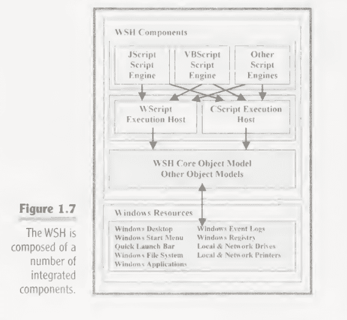

### 周五晚上 介绍 JavaScript 和 JScript

WSH 提供两个不同的执行宿主。WScript 执行宿主设计用于直接从 Windows 桌面执行脚本。另一方面，CScript 执行宿主设计用于从 Windows 命令提示符执行脚本。每个执行宿主都作为独立的可执行文件存在，分别是 `wscript.exe` 和 `cscript.exe`。

除一个例外，WScript 和 CScript 执行宿主提供相同级别的功能。这个例外是 WScript 执行宿主能够使脚本使用图形弹出对话框显示文本消息和收集用户输入。这使得 WScript 执行宿主成为需要直接与用户交互的脚本的合适选择。另一方面，CScript 执行宿主通常用于运行不与用户交互的脚本或为习惯从 Windows 命令提示符工作的用户运行脚本。但是，WScript 执行宿主也可以用于从命令行运行脚本。除非您的脚本设计为生成图形弹出对话框，否则选择哪个脚本执行宿主完全是任意的。

WSH 核心对象模型的目的是提供对 Windows 资源的访问。它通过定义代表实际资源的对象来实现这一点。然后脚本可以访问和操作这些对象，从而允许脚本访问和操作对象所代表的资源。WSH 提供的对象类型示例包括代表 Windows 快捷方式、文件、文件夹和磁盘驱动器的对象。WSH 还提供代表网络资源（如网络驱动器和打印机）的对象。除此之外，WSH 对象模型还提供对系统资源（如 Windows 事件日志和 Windows 注册表）的访问。

WSH 呈现的每个对象都与一组属性和方法相关联。例如，文件是一个对象的例子。文件对象具有文件名和文件扩展名。通过访问这些文件对象属性，您的 JScript 可以定位它们想要处理

的文件。此外，通过修改文件对象属性，您的 JScript 可以重命名文件和更改其文件类型。

文件对象还为 JScript 提供了许多不同方法的访问，这些方法使您能够创建、删除、重命名、复制和移动 Windows 文件。图 1.7 提供了 WSH 核心对象模型暴露的系统资源类型的部分列表。在周日下午，我将介绍 WSH 核心对象模型暴露的对象，并为您提供如何访问和操作它们的示例。

### 编写您的第一个 JScript

要创建 JScript，您只需要打开文本编辑器，创建一个纯文本文件，向其中添加一些 JScript 语句，然后将其保存为 .js 文件扩展名。例如，创建一个名为 Script 1.5.js 的新 JScript 并向其中添加以下语句。

```
//Script 1.5 - Your first JScript
WScript.Echo("Hello World!");
```

第一条语句是嵌入在文件中的注释，用于记录脚本的名称和用途。第二条语句显示一条文本消息。第二条语句的组成如下。首先引用 WScript 对象。此对象不同于 WScript 执行宿主。然后执行属于 WScript 对象的名为 Echo 的方法，并传递文本字符串 "Hello World!"。如果这一切现在听起来有点混乱或令人难以承受，请不要担心。到您完成周日晚上时，您将理解这些东西是如何工作的。现在，只需跟着做并专注于创建和执行您的第一个 JScript 所涉及的步骤。

当由 WScript 或 CScript 执行宿主执行时，此 JScript 会显示其消息。但是，根据您选择使用哪个执行宿主运行脚本，结果将会有很大差异。例如，如果您使用 CScript 执行宿主从 Windows 命令提示符运行此脚本，您将看到图 1.8 中所示的输出。

星期五晚上 介绍 JavaScript 和 JScript

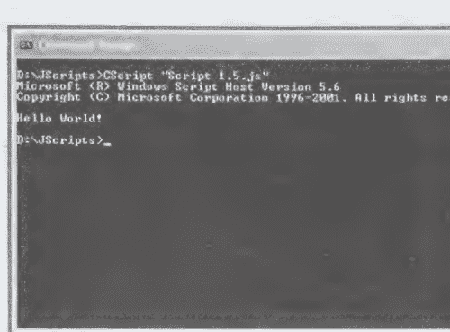

图 1.8 在 Windows 命令提示符下运行你的第一个 WSH JScript

> **注意** 你可能在图 1.8 中注意到，要运行的 JScript 文件名被包含在一对匹配的双引号中。我必须这样做，因为脚本的文件名包含空格。否则，就不需要使用双引号。

如果你直接从 Windows 桌面双击脚本运行它，Windows 默认将使用 WScript 执行主机运行它。结果，脚本的输出将以图形弹出对话框的形式显示，如图 1.9 所示。

> **注意** 你也可以使用 WScript 执行主机从 Windows 命令提示符运行脚本，在这种情况下，脚本的运行将与你从 Windows 桌面启动它完全相同。

### 熟悉 Windows 命令提示符

即使是一些最有经验的计算机用户，在使用 Windows 命令提示符方面的经验也有限，对可用的 Windows 命令也知之甚少。然而，如果你计划成为一名认真的 JScript 程序员，你需要熟练掌握 Windows shell 的操作。

Windows shell 提供了用户和操作系统之间的基于文本的接口。你无需使用计算机的鼠标在 Windows 图形用户界面中指点和点击，而是通过键入文本来使用 Windows shell 工作。Windows shell 将这些命令翻译成操作系统能够理解的格式。同样，Windows shell 也将操作系统返回的任何输出翻译成人们能够理解的格式。

你通过在 Windows 命令提示符下键入命令来让 Windows shell 处理。例如，在运行 Windows XP 的计算机上，你可以通过单击“开始”、“所有程序”、“附件”，然后单击“命令提示符”来启动一个新的 Windows shell 会话。命令提示符窗口出现并显示 Windows 命令提示符，如图 1.10 所示。

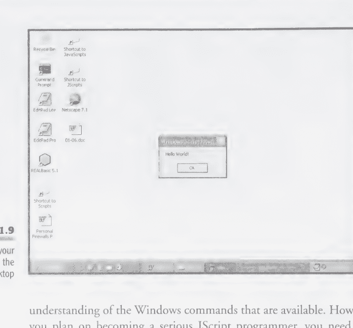

**图 1.9**

从 Windows 桌面运行你的 JScript

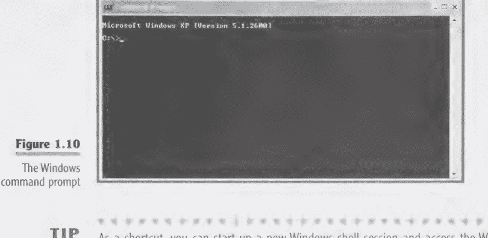

> **提示** 作为快捷方式，你可以通过单击“开始”、“运行”，键入 CMD，然后单击“确定”来启动一个新的 Windows shell 会话并访问 Windows 命令提示符。

如你在图 1.11 中所见，默认情况下，Windows 命令提示符以驱动器号后跟冒号、反斜杠和大于号（>）的形式表示。在命令提示符的右侧，你将看到一个闪烁的光标，表示 Windows shell 已准备好接受新的命令输入。例如，键入 VER，然后按回车键。VER 命令指示 Windows shell 显示有关计算机上当前运行的 Windows 版本的信息，如下所示。

```
C:\>ver

Microsoft Windows XP [版本 5.1.2600]

C:\>
```

Windows shell 将命令传递给操作系统，收集命令的结果，并将它们显示在 Windows 控制台中，之后 Windows 命令提示符会重新显示。

### 一个周末学会 JavaScript

现在，让我们看看如何使用命令提示符来运行你的新 JScript，使用 CScript 执行主机。你所要做的就是键入 CScript、一个空格和你的脚本名称，然后按 Enter 键，如下所示。

```
CScript "Script 1.5.js"
```

同样，要使用 WScript 执行主机从命令提示符运行你的脚本，你需要键入以下内容。

```
WScript "Script 1.5.js"
```

> **注意** 如果你的脚本位于 Windows shell 当前未聚焦的文件夹中，你必须提供脚本所在文件夹的完整路路径。例如，如果你的脚本存储在 `C:\Jscripts` 中，那么你需要使用以下命令来使用 WScript 执行主机运行它。

```
WScript C:\Jscripts\"Script 1.5.vbs"
```

当你完成脚本运行并想要关闭命令提示符窗口时，你可以通过单击 Windows 右上角的“关闭”来执行此操作。你也可以通过右键单击窗口左上角的命令提示符图标并选择“关闭”来关闭命令提示符窗口。

> **提示** 如果你使用键盘比使用鼠标更快，你也可以通过键入 `EXIT` 并按回车键来关闭命令提示符窗口。

> **注意** 对 Windows shell 的详�讨论超出了本书的范围。如果你想了解更多信息，请查看由 Jerry Lee Ford, Jr. 撰写的 *《Microsoft Windows Shell Scripting and the WSH Administrator’s Guide》*（Premier Press）。

### 配置命令行执行

WScript 和 CScript 执行主机都支持命令行执行。为 CScript 和 WScript 执行主机配置执行设置所需的语法概述如下。

```
CScript ScriptName [//Options] [Arguments]
WScript ScriptName [//Options] [Arguments]
```

ScriptName 指定要执行的脚本的名称。//Options 代表一个或多个可选参数的集合，用于配置执行主机操作的特定方面。Arguments 属性代表可以传递给脚本进行处理的参数列表。

两个执行主机可用的执行设置是相同的。表 1.3 简要概述了这些设置。

#### 表 1.3 WSCRIPT 和 CSCRIPT 命令行选项

| 选项 | 描述 |

|---|---|

| //? | 显示使用 WScript 和 CScript 命所需的语法要求。 |

| //b | 指示执行主机以批处理模式运行脚本，以抑制错误和任何其他文本输出的显示。 |

| //d | 打开活动调试。 |

| //e:jscript \| //e:vbscript | 指定用于解释脚本语句并将其转换为二进制代码的 WSH 脚本引擎类型。 |

| //h:wscript \| //h:cscript | 指定执行脚本时要使用的 WSH 执行主机。 |

| //i | 指示执行主机以交互方式执行脚本，以便能够显示错误和文本输出。 |

| //job:id | 标识 Windows 脚本文件中要执行的特定作业。 |

| //logo | 告诉 CScript 或 WScript 执行主机在执行脚本之前显示其徽标。 |

| //nologo | 告诉 CScript 或 WScript 执行主机在执行脚本之前不显示其徽标。 |

| //s | 保存指定的执行设置，使其成为将来脚本执行的默认设置。 |

| //t:nn | 指定用于限制脚本最大执行时间的超时值。默认情况下，不对脚本执行施加时间限制。 |

| //x | 以调试模式执行脚本。 |

让我们看几个配置CScript和WScript执行宿主的不同方式的示例。例如，以下命令可用于告诉CScript执行宿主运行名为Script 1.5.js的脚本，而无需永久修改执行宿主的任何配置设置。

```
CScript "Script 1.5.js"
```

同样，你可以使用以下命令，通过WScript执行宿主运行相同的脚本。

```
WScript "Script 1.5.js"
```

你不必使用执行宿主的默认设置来运行JScript，而是可以临时覆盖执行宿主的配置设置，如下所示。

```
WScript "Script 1.5.js" //T:10
```

在此示例中，JScript运行时带有10秒的执行时间限制。默认情况下，Windows操作系统将WScript执行宿主设置为默认的WSH执行宿主。换句话说，如果你输入脚本名称而未指定使用哪个WSH执行宿主，则将使用WScript执行宿主。要将CScript执行宿主设置为默认执行宿主，你可以输入以下命令。

```
CScript //H:CScript
```

同样，你可以将执行宿主更改回WScript，如下所示。

```
WScript //H:WScript
```

你可以通过添加更多选项一次覆盖多个执行设置，每个选项前必须带有//字符，如下所示。

```
WScript "Script 1.5.js" //T:10 //nologo
```

在此示例中，WScript执行宿主用于运行名为`Script 1.5.js`的脚本，该脚本具有10秒的时间限制，并且不会先显示WScript执行宿主。

到目前为止，我们看到的每个命令都只影响指定脚本的执行。要使更改永久生效，你需要添加`//s`选项，如下所示。

```
WScript //nologo //s
```

此语句配置WScript宿主，使其在每次从Windows命令提示符运行脚本时不显示其徽标。由于你可以分别配置WScript和CScript执行宿主的命令行执行，因此你可以为CScript执行宿主分配一套完全不同的配置。

> 注意 对WSH执行宿主进行的配置更改特定于进行更改的人员。因此，你所做的任何更改不会对你共享同一台计算机的其他人生效。

### 配置WScript桌面执行

WScript执行宿主从Windows桌面的执行与其命令行执行是分开配置的。当为Windows桌面执行进行配置时，你可以限制脚本允许执行的时间，以及指定是否显示WScript执行宿主的徽标。以下过程概述了修改WScript执行宿主桌面执行设置所涉及的步骤。

1.  单击“开始”，然后单击“运行”。“运行”对话框出现。

2.  输入`wscript`，然后单击“确定”。“Windows Script Host设置”对话框出现，如图1.11所示。

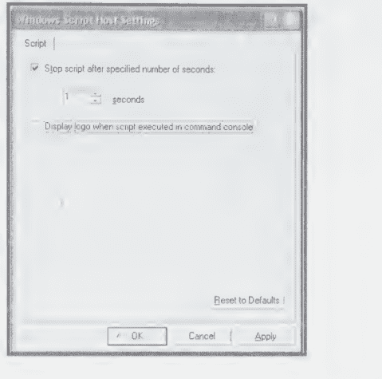

**图 1.11**

配置WScript执行宿主运行从Windows桌面启动的脚本的方式

3.  默认情况下，脚本执行没有应用执行时间限制。要指定限制，请选择“在指定秒数后停止脚本”，然后输入一个数字，指定脚本必须在其中完成执行的秒数。

4.  默认情况下，当你运行JScript时会显示WScript徽标。要防止显示，请清除“在命令控制台中执行脚本时显示徽标”选项。

5.  单击“确定”。

### 配置单个脚本执行

如果你编写的JScript在运行时从不希望应用默认执行宿主设置，你可以创建一个单独的Windows脚本主机或.wsh文件，为该脚本指定自定�执行宿主设置。.wsh文件必须分配与它关联的脚本相同的文件名，但扩展名为.wsh。名为Script 1.5.js的脚本将被命名为Windows脚本主机文件Script 1.5.wsh。

以下过程概述了为给定脚本创建Windows脚本主机文件所涉及的步骤。

1.  右键单击你的脚本，然后选择“属性”。脚本的属性对话框出现。

2.  选择“脚本”属性表，如图1.12所示。

3.  如果需要，选择“在指定秒数后停止脚本”选项，然后指定脚本应允许执行的最大秒数。

4.  要防止显示执行宿主的徽标，请清除“在命令控制台中执行脚本时显示徽标”选项。

5.  单击“确定”。

完成上述过程后，你应该会看到一个与你的JScript存储在同一文件夹中的新文件，该文件具有相同的文件名和.wsh扩展名。其内容将类似于：

```
[ScriptFile]
Path=D:\Script 5.1.wsf
[Options]
Timeout=5
DisplayLogo=0
```

`[ScriptFile]`是一个标头，用于将文件标识为Windows脚本文件。`Path`标识你的JScript的路径和名称。`[Options]`是一个标头，标识执行宿主配置设置列表的开始。`Timeout`设置脚本的超时设置。`DisplayLogo`指定当脚本从Windows命令提示符执行时是否应显示执行宿主的徽标。将`DisplayLogo`设置为0以防止显示执行宿主的徽标，将其设置为1以启用其显示。

**注意** 如果你愿意，可以手动创建脚本的Windows脚本主机文件。但是，在执行此操作时要小心，确保在编辑文件时没有打错字。

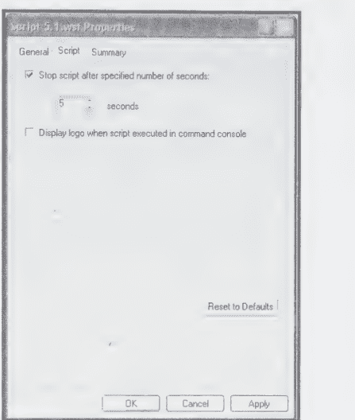

**图 1.12**

为单个脚本配置执行设置

为你的JScript创建.wsh文件后，WSH会在下次运行脚本时自动引用它。但是，如果你删除.wsh文件或将脚本移动到不同的文件夹并忘记同时移动其关联的.wsh文件，则执行宿主将使用其默认执行宿主配置设置运行该脚本。

### 下一步是什么？

好了，我想今晚就到这里了。睡个好觉，因为明天还有很多事要做。明天早上，你将获得JavaScript和JScript编程的基本概述。然后在下午和晚上，你将开始专注于JavaScript，学习如何使用它来使你的网页更具交互性和图形化，从而使其更加生动。你甚至将学习如何控制浏览器本身。

早上好！希望你昨晚睡了个好觉，休息好了，准备开始。今天你有很多事情要做。

昨天，我重点为你提供了开始使用JavaScript和JScript所需的背景知识。今天你将开始学习构成这两种语言的编程语句。为了尽可能保持简单，并且因为本书前半部分的重点是JavaScript，我将在本章中使用JavaScript示例介绍所有内容。但是，正如你将在周日看到的，你在本章中学到的几乎所有内容都可以应用于JScript。

如果你还没有这样做，现在是整理所有计划使用的工具的好时机。虽然你当然可以使用Windows记事本应用程序编写所有脚本，但你可能还想从Internet下载更高级的脚本编辑器。下载Internet浏览器（如Netscape、Internet Explorer和Opera）的副本也是一个好主意。此外，你可能还想查看各种共享软件网站，如www.shareware.com、www.download.com和www.tucows.com，寻找其他替代方案。

假设你拥有所需的一切，让我们回顾一下我为今天上午计划的内容，然后直接开始。你将首先学习JavaScript和JScript中可用的基本编程语句。这些语句使你能够执行诸如存储信息以供后续使用、比较值以及开发逻辑例程以处理不同情况等操作。你还将学习使用循环、函数和数组来简化脚本。最后，我将介绍内置的JavaScript和JScript对象，解释它们是什么以及如何使用它们。


# 关于脚本的一些说明

也许你正在好奇*脚本*和*编程*有什么区别。答案是没什么区别，它们是同一回事。许多人喜欢将脚本视为执行特定功能的小型程序代码单元，而将程序视为更大、更健壮的代码集合。正如你即将了解到的，你可以编写出同时满足这两种定义的脚本。

区分脚本与程序的一种可能方式是将脚本定义为逐行处理的解释型程序，而将程序定义为必须经过编译才能执行的代码集合。*编译*是将程序指令转换为机器语言的过程，以便计算机能够处理它们。由于JavaScript和JScript是*解释型语言*，它们在执行时需要某种机制来解释代码。这正是互联网浏览器和WSH（Windows脚本宿主）的工作，它们还为脚本提供了一个完整的编程环境，其中包含特定环境的*对象模型*，这些对象模型允许JavaScript访问窗口和浏览器历史记录等资源，允许JScript访问文件、文件夹、驱动器等资源。

我知道我一直都在提及对象和对象模型；在整个上午的剩余时间里，我还会继续这样做，最终将在今天上午晚些时候和下午前半部分提供详细讲解。学习一门新的编程语言并非总是易事，而几乎每个新概念都依赖于你对另一个概念的理解，这使得学习变得更加困难。不幸的是，我一次只能教你一个概念。所以，请坚持住！

# 熟悉语句语法

JavaScript和JScript区分大小写。这意味着在输入脚本语句时，你必须注意使用正确的拼写和大小写。例如，稍后你将学习如何使用变量。如果你在脚本开头创建了一个名为`totalValue`的变量，那么在整个脚本中你都必须使用这个完全相同的拼写。改变拼写中的任何一个元素，你都会得到一个错误，因为JavaScript和JScript会认为你是在引用一个不同的变量。

> 提示：如果你和我一样，你永远无法记住每个JavaScript语言元素的正确拼写。这意味着你会经常查阅附录A“JavaScript和JScript简明参考手册”。本附录提供了JavaScript对象、属性和方法的列表。如果你对这些元素中任何一个的拼写有疑问，请先查阅附录。这将为你节省大量时间并避免挫败感。

除了区分大小写的要求之外，JavaScript和JScript是非常宽松的语言，因为它们不对脚本的格式化方式施加严格的规则集。语句可以从一行开始并在下一行结束，你也可以通过在每个语句末尾输入分号（;）将多个语句放在单行上。分号明确地告诉JavaScript和JScript一个语句在哪里结束。但是，如果过度使用，将多个语句堆砌在单行代码中会使代码变得难以阅读。

> 提示：虽然任何JavaScript语句都不要求必须使用 ;，但养成以分号结束所有语句的习惯是个好主意。这会让你的脚本更易于他人阅读和使用。

# 隐藏JavaScript语句

HTML注释以字符`<!--`开始，以`-->`结束。浏览器知道不显示这些字符之间的任何内容。你也知道HTML的`<SCRIPT>`标签用于将JavaScript嵌入到HTML页面中。支持JavaScript和不支持JavaScript的浏览器都知道不显示`<SCRIPT>`标签本身。

然而，不支持JavaScript的浏览器不知道如何处理`<SCRIPT>`标签内的语句，因此它们会在HTML页面的中间直接显示脚本的实际行。我确信这不是你希望访客看到的样子。为了解决这个难看的混乱，你可以将所有从开始`<SCRIPT>`标签之后到结束`</SCRIPT>`标签之前的JavaScript语句用HTML注释包裹起来，如下例所示：

```
<HTML>
    <HEAD>
        <TITLE>Script 2.1 -Example of Comment Statements</TITLE>
    </HEAD>
    <BODY>
        <SCRIPT LANGUAGE="JavaScript" TYPE="Text/JavaScript">
        <!-- Start hiding JavaScript statements
        document.write("Non-JavaScript browsers will not see this message.");
        // End hiding JavaScript statements -->
        </SCRIPT>
    </BODY>
</HTML>
```

由于浏览器足够智能，不会处理它们不理解的任何HTML，因此开始和结束的`<SCRIPT>`标签会被不支持JavaScript的浏览器忽略。同时，不支持JavaScript的浏览器将HTML注释标签之间的所有内容视为一个大注释并忽略它，从而隐藏所有JavaScript语句并防止它们显示。

另一方面，支持JavaScript的浏览器将识别开始和结束的`<SCRIPT>`标签并相应地处理它们。这些浏览器还会识别开始的HTML注释标签并忽略它，同时将`//`字符开头的行视为JavaScript注释并忽略它。

> 你也可以使用注释通过在脚本中添加描述性注释来使你的JavaScript和JScript脚本具有自文档化能力。

只要你按照这个示例来构建你的脚本，你就会让旧浏览器误以为你的JavaScript语句只是HTML注释，而不会影响支持JavaScript的浏览器所看到的内容。

# 处理值

JavaScript和JScript将信息存储为值。例如，如果你为用户创建一个要填写的表单，表单中的每个条目都将包含一个单独的值。你的脚本可以将这些值存储在变量中，然后在整个脚本中使用这些变量。

表2.1列出了JavaScript和JScript支持的值类型。

| 值 | 描述 |

| :--- | :--- |

| 布尔值 | 表示条件为真或假的值 |

| 空值 | 一个空值 |

| 数字 | 一个数值，如99或3.142 |

| 字符串 | 一串文本，如"Welcome"或"Click here to visit ptpmagazine.com" |

# 声明变量

要在脚本中使用变量，首先必须声明该变量。你有两种方法可以做到这一点。第一种选择是使用`var`关键字，如下例所示：

```
var firstName = "Alexander";
```

此示例创建了一个名为`firstName`的变量，并将其赋值为Alexander。你的脚本可能还会包含其他变量，这些变量也包含诸如姓氏、电话号码等信息。

或者，你也可以通过首次引用变量来声明它，如下例所示：

```
firstName = "Alexander";
```

# 使用 `<NOSCRIPT>` 标签与不支持JavaScript的浏览器通信

尽管当今使用的浏览器中超过95%都支持JavaScript，但仍有许多浏览器不支持。此外，Netscape和Internet Explorer浏览器都允许用户关闭JavaScript支持。你可以做些什么来让你的JavaScript增强页面对那些想要查看它们的访客可用，同时又为那些没有启用JavaScript浏览器的访客提供基本信息呢？

你可以探索的一个选择是同时创建HTML页面的JavaScript版本和非JavaScript版本，并根据对用户浏览器的检查来显示相应的一组页面。我将在今天晚些时候更多地讨论这个选择。

一个更简单的解决方案是显示一个HTML页面，该页面提供两个链接，并指示你的访客，如果他们的浏览器支持JavaScript，则点击一个链接，如果不支持，则点击另一个链接。然而，假设所有访客甚至知道JavaScript是什么，并且他们的浏览器支持它，你可能会承担很大风险。

一个真正简单的替代方法是使用`<NOSCRIPT>`标签。每个浏览器，即使是禁用了JavaScript支持的浏览器，都会识别这些HTML标签。它们的目的是为不处理你的JavaScript的浏览器显示一条消息。支持JavaScript的浏览器将忽略`<NOSCRIPT>`标签内的所有内容。

以下示例演示了如何设置一个页面，该页面无论浏览器的JavaScript支持级别如何，都能为其提供信息。


<HTML>
	<HEAD>
		<TITLE>Script 2.2 - The NOSCRIPT tag</TITLE>
	</HEAD>
	<BODY>
		<SCRIPT LANGUAGE="JavaScript" TYPE="Text/JavaScript">
		<!--Start hiding JavaScript statements
			document.write("Non-JavaScript browsers will not see this message " +
```

## 处理变量

在此示例中，值 `Alexander` 被赋给一个名为 `firstName` 的变量（如果该变量存在），从而改变其值。如果引用的变量尚不存在，则会创建该变量并为其赋值。

在创建变量时，是否选择使用 `var` 关键字实际上只是个人偏好问题。使用 `var` 的主要好处是它使脚本更易于阅读，并且允许你声明变量以供脚本后续使用，而无需为它们分配初始值。

在继续之前，我还需要讲解一些与变量相关的其他内容。变量的这些重要方面包括命名变量的规则以及如何定义变量作用域。

### 变量命名规则

在创建变量时，请记住以下规则：

- 变量名只能由大小写字母、下划线字符和数字 0 到 9 组成。
- 变量名不能以数字开头。
- JavaScript 和 JScript 区分大小写。如果你使用名称 `totalCount` 声明了一个变量，则在整个脚本中必须使用完全相同的大小写来引用它。
- 变量名不能包含空格。
- 你不能使用任何 *保留字* 作为变量名。有关 JavaScript 和 JScript 保留字的列表，请参阅附录 C "JavaScript 和 JScript 保留字"。

以下列表不是一组规则，而是一组你在处理变量时可能想要遵循的指南：

- JavaScript 和 JScript 被认为是 *松散类型* 语言，因为它们不强制你在使用变量之前定义它们。但是，使用 `var` 关键字使你的代码更易于理解。
- 你应创建描述其内容的变量名。例如，`lastName` 是一个比 `ln` 好得多的变量名。只有几个字符的变量名可能更容易输入，并且在编写脚本时可能看起来相当明显，但一年后或者对于试图阅读你的脚本的其他人来说，它们可能就不那么明显了。

### 定义变量作用域

你可以创建可由位于整个 HTML 页面的 JavaScript 访问的变量，或者可由 JScript 中任何位置访问的变量。或者，你可以创建只能在称为 `function` 的小代码段内访问的变量。定义变量有效空间被称为定义变量的 `scope`。变量的作用域可以是 *局部* 的，也可以是 *全局* 的。

### 局部变量

*局部变量* 是使用 `var` 语句在函数内显式声明的变量。*函数* 是一组脚本语句的集合，可以被另一个脚本语句调用以执行特定操作。

例如，以下代码显示了一个名为 `ShowNotice()` 的函数，该函数每次被调用时都会显示一条消息。此函数使用属于 `window` 对象的 `alert` 方法来显示由名为 `textMessage` 的局部变量指定的文本消息，该变量已设置为 "Are you sure you want to quit?"。因为此变量是局部作用域的，所以位于定义它的函数外部的任何语句都无法引用它。

```javascript
function ShowNotice()
{
    var textMessage = "Are you sure you want to quit?";
    window.alert(textMessage);
}
```

稍后你将了解更多关于函数的信息。

> **注意** 上例中的 `window.alert(textMessage)` 语句是 JavaScript 和 JScript 可以显示的多种弹出对话框类型之一。这个特定示例仅适用于 JavaScript，因为它依赖于浏览器的 `window` 对象。稍后我将更详细地介绍如何使用其他选项显示文本消息。

### 全局变量

*全局变量* 是在函数外定义的任何变量。这样的变量是全局的，因为位于网页或脚本文件中的任何脚本语句都可以引用它。你可以通过多种方式创建全局变量，包括：

- 通过在函数内引用它而不先使用 `var` 关键字声明它来创建变量。
- 在 JavaScript 中的任何其他地方创建变量，无论是否使用 `var` 关键字。

以下示例演示了局部和全局变量作用域之间的差异。创建了三个具有全局作用域的变量。第一个是页面标题部分中的 `glVarMsg1`。第二个和第三个变量是页面正文部分中的 `glVarMsg2` 和 `glVarMsg3`。`glVarMsg2` 变量是全局作用域的，即使它位于函数内，因为它没有使用 var 关键字创建。`lcVarMsg1` 变量是局部作用域的，因为它在函数中并且是使用 var 关键字创建的。

```html
<HTML>
    <HEAD>
        <TITLE>Script 2.3 - 变量作用域演示</TITLE>
        <SCRIPT LANGUAGE="JavaScript" TYPE="Text/JavaScript">
            <!-- 开始隐藏 JavaScript 语句
            glVarMsg1 = "在 HEAD 部分创建的全局变量可以在" +
                        "此页面的任何位置被引用。";
            function CreateVariables()
            {
                var lcVarMsg1 = "在函数内创建的局部变量不能" +
                            "在任何其他地方被引用。";
                glVarMsg2 = "在 HEAD 部分函数内创建的全局变量可以在" +
                            "此页面的任何位置被引用。";
            }
            // 结束隐藏 JavaScript 语句 -->
        </SCRIPT>
    </HEAD>
    <BODY>
        <SCRIPT LANGUAGE="JavaScript" TYPE="Text/JavaScript">
            <!-- 开始隐藏 JavaScript 语句
            CreateVariables();
            glVarMsg3 = "在 BODY 部分创建的全局变量可以在" +
                        "此页面的任何位置被引用。";
            document.write(glVarMsg1 + "<BR>");
            document.write(glVarMsg2 + "<BR>");
            document.write(glVarMsg3 + "<BR>");
            document.write(lcVarMsg1 + "<BR>");
            // 结束隐藏 JavaScript 语句 -->
        </SCRIPT>
    </BODY>
</HTML>
```

> **提示** 注意前一个示例中 `+` 字符的用法。它提供了将长字符串分割并分布在多行上的能力。

> **提示** 你可能已经注意到我将 `<BR>` 标签嵌入到 `document.write()` 语句中。这样做为我提供了一种在 JavaScript 中控制换行的方式。为了使其工作，我将 `<BR>` 标签放在括号中，并使用 `+` 运算符将其与 `document.write()` 语句中的其余文本连接起来。

> **提示** 你可能还注意到标题部分中的 JavaScript 包含一个名为 `CreateVariables()` 的函数。此行及其后的语句是函数的一部分。此函数在被页面正文部分的 `CreateVariables()` 语句调用之前不会执行。如果这看起来有点令人困惑，请不要担心；稍后我将更详细地解释函数。你可能想要将此示例添加到书签中，以便在阅读完关于函数的材料后回来再次查看。

图 2.1 显示了执行上述脚本时发生的情况。四个 `document.write()` 语句尝试显示每个变量的值。但是，由于 `lcVarMsg1` 不是全局作用域的，因此它不会显示。相反，只有三个 `document.write()` 语句正确执行。

第四条语句（尝试显示分配给 lcVarMsg1 的值）会生成一个错误。

脚本已运行但遇到错误。

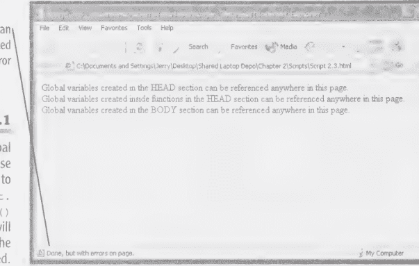

当页面显示时，只有全局变量或其作用域局部于 `document.write()` 语句的变量才会出现。

> **注意** 根据你的浏览器配置方式，错误消息可能会也可能不会显示。例如，如果你使用 Internet Explorer 加载包含脚本的 HTML 页面，并且你未配置它显示所有错误消息，那么错误的唯一指示将是浏览器状态栏上显示的一个小黄色图标和一条错误消息。

### 操作变量

你可以通过简单地为变量分配一个新值来更改其值，如下所示：

`variableName = 100;`

JavaScript 还提供了许多其他运算符，你可以使用它们来修改变量的值。这些在表 2.2 中概述。

我敢打赌你一定想知道表 2.2 中最后四个运算符的作用。我将花一点时间进一步解释它们。

## 表 2.2 JavaScript 和 JScript 运算符

| 运算符 | 描述 | 示例 |
| :--- | :--- | :--- |
| `x + y` | 将 x 的值加上 y 的值 | `total = 2 + 1` |
| `x - y` | 从 x 中减去 y 的值 | `total = 2 - 1` |
| `x * y` | 将 x 的值乘以 y 的值 | `total = x * 2` |
| `x / y` | 将 x 的值除以 y 的值 | `total = x / 2` |
| `-x` | 反转 x 的符号 | `count = -count` |
| `x++` | 后置递增（先返回 x，然后将 x 的值加一） | `x = y++` |
| `++x` | 前置递增（先将 x 的值加一，然后返回 x） | `x = ++y` |
| `x--` | 后置递减（先返回 x，然后将 x 的值减一） | `x = y--` |
| `--x` | 前置递减（先将 x 的值减一，然后返回 x） | `x = --y` |

`x++` 和 `++x` 运算符都将 x 的值增加 1。它们的区别在于更新操作发生的时间。我可以用一个例子最好地说明这种差异。假设我有一个脚本，其中包含两个变量 `totalCount` 和 `noUnitsSold`。假设 `noUnitsSold` 的值等于 10，并且我在脚本下方的某个地方添加了以下代码行：

```
totalCount = ++noUnitsSold;
```

这里发生的情况是：首先 `noUnitsSold` 的值将增加 1，变为 11。然后 `totalCount` 将被设置为 11。现在假设我将赋值语句改写为如下形式：

```
totalCount = noUnitsSold++;
```

这里发生的情况与前面的例子完全不同。这一次，`totalCount` 首先被设置为 `noUnitsSold` 的值，即 10。然后 `noUnitsSold` 的值增加 1，变为 11。

`--x` 和 `x--` 运算符的工作方式相同，只是它们将变量的值减少 1。

## 赋值

正如我之前已经暗示的，你使用赋值运算符为变量赋值。例如，以下语句为名为 `totalCount` 的变量赋值 44：

```
totalCount = 44
```

在这个例子中，赋值运算符是传统的等号。JavaScript 和 JScript 提供了许多为变量赋值的方式，如表 2.3 所概述。

### 表 2.3 赋值运算符（假设 y = 5）

| 运算符 | 描述 | 示例 | 结果 |
| :--- | :--- | :--- | :--- |
| `=` | 将变量值设置为某个值 | `x = y + 1` | 6 |
| `+=` | `x = x + y` 的简写形式 | `x += y` | 11 |
| `-=` | `x = x - y` 的简写形式 | `x -= y` | 6 |
| `*=` | `x = x * y` 的简写形式 | `x *= y` | 30 |
| `/=` | `x = x / y` 的简写形式 | `x /= y` | 6 |
| `%=` | `x = x % y` 的简写形式 | `x %= y` | 1 |

下面的示例演示了这些运算符的使用。在此示例中，脚本建立了两个变量 `x` 和 `y`，并将 `x` 赋值为 10，`y` 赋值为 5。接下来的语句测试表 2.3 中列出的五种赋值运算符，以确保它们按预期工作。前两条语句设置 `x = y + 1`，然后使用 `document.write()` 语句显示结果。其余语句重复此方法，仅更改每次的数学公式。图 2.2 显示了运行此脚本的结果。

```html
<HTML>
    <HEAD>
        <TITLE>Script 2.4 - JavaScript 运算符演示</TITLE>
    </HEAD>
    <BODY>
        <SCRIPT LANGUAGE="JavaScript" TYPE="Text/JavaScript">
        <!-- Start hiding JavaScript statements
            var y = 5;
            var x= y + 1;
            document.write("x = y + 1 ...Result = " + x);
            x += y;
            document.write("<BR>x += y ...Result = " + x);
            x -= y;
            document.write("<BR>x -= y ...Result = " + x);
            x *= y;
            document.write("<BR>x *= y ...Result = " + x);
            x /= y;
            document.write("<BR>x /= y ...Result = " + x);
        // End hiding JavaScript statements -->
        </SCRIPT>
    </BODY>
</HTML>
```

## 图 2.2

JavaScript 和 JScript 运算符演示

## 值比较

你会发现脚本中常做的事情之一是比较变量的值。例如，如果一个变量的值小于 10，你可能会采取一种操作，而当变量大于 10 时，则采取不同的操作。表 2.4 提供了可以在脚本中使用的 JavaScript 和 JScript 比较运算符列表。

以下 JavaScript 演示了大于运算符的使用。在此示例中，变量 `x` 和 `y` 分别初始化为 12 和 5。接下来，脚本测试 `x` 是否大于 10。此条件为真，因此脚本向浏览器窗口写入一条消息。然后脚本测试 `y` 的值是否大于 10。此测试为假，因此不执行任何操作。

```html
<HTML>
  <HEAD>
    <TITLE>Script 2.5 - 值比较示例</TITLE>
  </HEAD>
  <BODY>
    <SCRIPT LANGUAGE="JavaScript" TYPE="Text/JavaScript">
    <!-- Start hiding JavaScript statements
    var x = 12;
    var y = 5;
    if (x > 10);
    {
      document.write("x is greater than 10!");
    }
    if (y > 10)
    {
        document.write("y is greater than 10!");
    }
    // End hiding JavaScript statements -->
    </SCRIPT>
  </BODY>
</HTML>
```

## 表 2.4 JavaScript 和 JScript 比较运算符

| 运算符 | 描述 | 示例 | 结果 |
|---|---|---|---|
| `==` | 等于 | `x == y` | 如果 x 和 y 相同则为 true |
| `!==` | 不等于 | `x !== y` | 如果 x 和 y 不同则为 true |
| `>` | 大于 | `x > y` | 如果 x 大于 y 则为 true |
| `<` | 小于 | `x < y` | 如果 x 小于 y 则为 true |
| `>=` | 大于或等于 | `x >= y` | 如果 x 大于或等于 y 则为 true |
| `<=` | 小于或等于 | `x <= y` | 如果 x 小于或等于 y 则为 true |
| `!x` | 非 | `!x` | 如果 x 为 false 则为 true |
| `&&` | 两者皆为真 | `x && y` | 如果 x 和 y 都为 true 则为 true |
| `\|\|` | 任一为真 | `x \|\| y` | 如果 x 或 y 任一为 true 则为 true |

## 使用字符串编写文本

今天上午我们已经花了很多时间学习如何处理值。其中一个特别对象，即 `String` 对象，你会发现自己在脚本中反复使用它。我想现在花点时间回顾一下 `String` 对象，尽管关于 JavaScript 和 JScript 对象的课程是在今天晚些时候。可以将此视为一个预览。

`String` 对象由文本字符的集合构成。你可以使用 `new` 关键字创建 `String` 对象的实例，如下面的示例所示：

```
MyString = new String("This is an example of a text string.");
```

此语句创建一个名为 `MyString` 的 `String` 对象并为其赋值文本。`new` 关键字用于创建对象。但是，你不必使用它。你也可以通过简单地引用它来创建 `String` 对象，如下例所示：

```
MyString = "This is an example of a text string.";
```

你可以通过为 `String` 对象分配一个新值来更改分配给它的值。以下示例更改 `MyString` 字符串的值：

```
MyString = "This is a second example of a text string.";
```

## 字符串属性

因为 `string` 对象是 JavaScript 和 JScript 的内置对象，所以它有属性。对于 `string` 对象，它只有一个属性，即它的 `length`。你可以通过键入对象的名称，后跟一个句点和属性的名称来引用对象的属性。对于 `MyString` 对象的 `length` 属性，你将使用 `MyString.length`。`length` 属性包含字符串中的字符数。以下示例演示了如何显示此属性的值，即 40。

```
document.write("The length of MyString is " +
MyString.length);
```

## 字符串方法

虽然 `string` 对象只有一个属性，但它有许多方法。*方法*是可以对对象执行的操作。例如，你可以使用 `string` 对象的 `bold()` 方法以粗体显示字符串，如本例所示：

```
document.write(MyString.bold());
```

引用对象的方法时，正确的语法是：对象的名称、一个句点、方法的名称以及左右括号。在此示例中，括号内没有任何内容。某些方法允许你通过将 *参数* 放在括号内来传递给方法。

例如，你可以使用 `toUpperCase()` 方法以大写字符显示字符串：

```
document.write(MyString.toUpperCase());
```

同样，有一个 `toLowerCase()` 方法。其他方法允许你设置字符串的字体颜色和字体大小，或以斜体、闪烁或删除线文本显示它。一个特别有用的方法是 `substring()`。此方法允许你提取字符串文本的一部分。

例如，你可能创建一个包含人名和地址的字符串。你可以为该字符串的前 15 个字符位置保留该人的姓名，接下来的20个字符用于街道地址，最后17个字符用于城市、州和邮政编码信息。下面您将找到这种类型字符串的三个示例。

```
cust1Info = "Bobby B Jones  9995 Park Place Ct  Richmond VA 23232  ";
cust2Info = "Sue K Miller   1112 Rockford Lane  Richmond VA 23232  ";
cust3Info = "Bobby B Jones  9995 Richland Drive Richmond VA 23223  ";
```

现在，使用 `String` 对象的 `substring()` 方法，您可以提取任何字符串中的姓名部分，如下例所示：

```html
<HTML>
  <HEAD>
    <TITLE>脚本 2.6 - 子字符串方法示例</TITLE>
  </HEAD>
  <BODY>
    <SCRIPT LANGUAGE="JavaScript" TYPE="Text/JavaScript">
    <!-- 开始隐藏JavaScript语句
    var cust1Info = "Bobby B Jones  9995 Park Place Ct  Richmond VA 23232";
    var cust2Info = "Sue K Miller   1112 Rockford Lane  Richmond VA 23232";
    var cust3Info = "Bobby B Jones  9995 Richland Drive Richmond VA 23223";
    document.write(cust1Info.substring(0,14),"<BR>");
    document.write(cust2Info.substring(0,14),"<BR>");
    document.write(cust3Info.substring(0,14),"<BR>");
    // 结束隐藏JavaScript语句 -->
    </SCRIPT>
  </BODY>
</HTML>
```

## 星期六早晨 学习JavaScript编码基础

如您所见，`document.write(cust1Info.substring(0,14), "<BR>");`语句复制字符串中前15个字符的内容（从字符0开始，到字符14结束），并将这些字符写入浏览器窗口。然后脚本对剩余的 `String` 对象重复此逻辑。图2.3显示了加载此页面的结果。

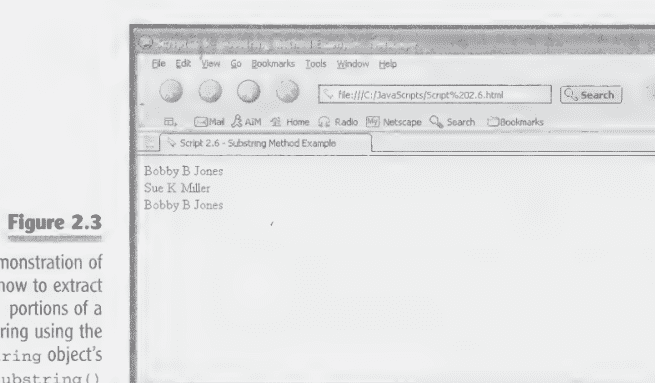

## 字符串连接

您可以对字符串做很多有趣的事情。例如，您可以使用 `+` 运算符将两个或多个字符串连接在一起，如下例所示：

```html
<HTML>
<HEAD>
<TITLE>脚本 2.7 - 字符串连接示例</TITLE>
</HEAD>
<BODY>
<SCRIPT LANGUAGE="JavaScript" TYPE="Text/JavaScript">
<!-- 开始隐藏JavaScript语句
var stringOne = "从前，";
var stringTwo = "山上有座小房子。";
var stringThree = stringOne + stringTwo;
document.write(stringThree);
// 结束隐藏JavaScript语句 -->
</SCRIPT>
</BODY>
</HTML>
```

脚本首先建立两个字符串，`stringOne`和`stringTwo`，并给它们赋值一些文本。然后它连接这两个字符串，创建一个名为`stringThree`的新对象。最后，脚本在浏览器窗口中显示结果。

请注意，在`stringOne`对象的末尾添加了一个额外的空格，这样当它与`stringTwo`连接时，生成的`stringThree`读起来更通顺，如图2.4所示。

> **注意** 在许多计算机语言中，程序员必须指定变量将包含的数据类型。这被称为变量的数据类型。JavaScript和JScript支持多种数据类型，包括数值、布尔值和字符串值。这些语言的一个优点是，它们不要求您指定数据类型。事实上，它们甚至不允许这样做。根据创建值的上下文，JavaScript和JScript知道它是什么类型的值。如果您对两个数值变量使用 `+` 号，它们将相加。如果您对两个字符串使用 `+` 号，它们将自动连接。最后，如果您对数值和字符串使用 `+` 号，该数值将自动转换为字符串，然后连接到另一个字符串。

### Math对象

在向您介绍了 `String` 对象之后，在当前讨论中，谈论一下 `Math` 对象似乎也是恰当的。这个对象在每个JavaScript和JScript中都是自动创建的，因此您不必像创建String对象那样创建它的实例。您只需在需要时引用 `Math` 对象即可。与其他对象一样，`Math` 对象也有与之相关的属性和方法。

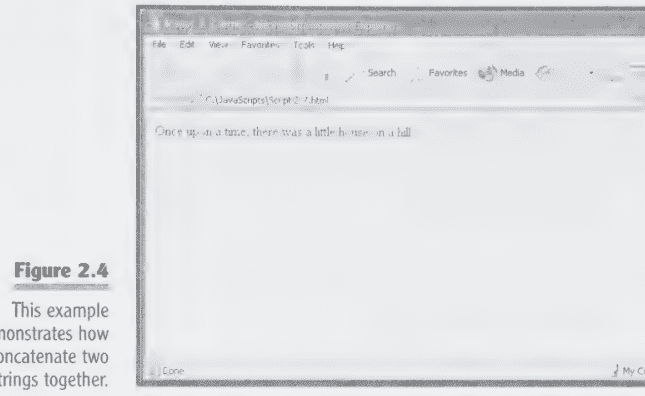

`Math` 对象的属性包含数学常量。例如，`Math` 属性 `PI` 存储 π 的值。`Math` 对象的方法包含内置的数学函数。有向上和向下舍入数字、生成随机数以及返回数字绝对值的方法。

以下示例演示了如何使用 `Math` 对象的几个属性和方法：

```html
<HTML>
  <HEAD>
    <TITLE>脚本 2.8 - 使用Math对象的示例</TITLE>
  </HEAD>
  <BODY>
    <SCRIPT LANGUAGE="JavaScript" TYPE="Text/JavaScript">
    <!-- 开始隐藏JavaScript语句
    //生成一个0到1之间的随机数
    document.write("<B>0到1之间的随机数 = </B>", +
    Math.random(), "<BR>");
    //生成一个0到10之间的随机数
    document.write("<B>0到10之间的随机数 = </B>", +
    Math.random() * 10, "<BR>");
    //将数字四舍五入到最接近的整数
    document.write("<B>将6.777四舍五入 = </B>",
    Math.round(6.777), "<BR>");
    //获取PI的值
    document.write("<B>PI的值 = </B>", Math.PI, "<BR>");
    //获取一个数字的绝对值
    document.write("<B>-55的绝对值 = </B>",
    Math.abs(-55));
    // 结束隐藏JavaScript语句 -->
    </SCRIPT>
  </BODY>
</HTML>
```

> **注意** 您可能已经注意到，我在JavaScript中插入了 `<B>` 和 `</B>` HTML标签，为我的文本添加了粗体格式。使用HTML标签的关键是将它们保持在引号内。我同样可以使用相同的技术在脚本中插入任何其他HTML标签。

前三个 `document.write()` 语句使用了 `Math` 对象的 `random()` 和 `round()` 方法。第四个 `document.write()` 语句没有使用 `Math` 方法。相反，它访问了 `Math` `PI` 属性，这从缺少括号可以看出。最后一个 `document.write()` 语句演示了 `Math` `abs()` 方法，该方法返回任何给定数字的绝对值。图2.5显示了使用Netscape Communicator加载此页面的结果。

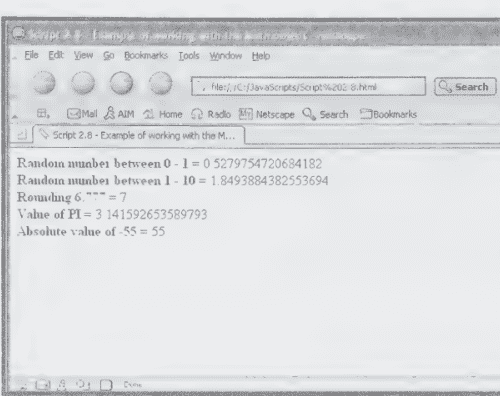

图2.5：如何访问 `Math` 对象的属性和方法的示例

### 休息一下

好的，我们休息一下。自早餐以来，我们已经涵盖了相当多的材料。为什么不给自己几分钟时间让它消化一下呢。当您回来时，您将回顾构成JavaScript和JScript语言的编程语句示例。对这些语句的扎实理解将使您能够开始编写更强大的脚本。我们还将讨论JavaScript和JScript内置的对象。

## JavaScript和JScript语句

JavaScript和JScript由一系列语句组成。这些语句是您编写的编程指令或逻辑，用于告诉脚本您希望它们做什么。

## 使用条件语句改变脚本流程

条件语句使您能够测试各种条件，并根据测试结果采取行动。具体来说，当被测试的条件被证明为真时，条件语句执行。条件语句包括 `if`、`if...else` 和 `switch` 语句。

### if语句

`if` 语句检查逻辑条件是否为真；如果是，则执行一个或多个语句。`if` 语句的基本语法如下所示：

```
if (condition)
    statement
```

例如，以下一对语句显示了一个简单的 `if` 语句。第一行设置条件测试。如果测试结果为真（例如，如果计数器变量当前小于10），则立即执行后面的语句。在此示例中，变量 `counter` 的当前值随后增加1。

```
if (counter < 10)
    counter++;
```

有时执行单个语句是不够的。在这种情况下，您可以使用以下格式编写 `if` 语句：

```
if (counter > 10) {
    counter++;
    window.alert("这是一个测试");
}
```

前面的示例显示了一个 `if` 语句，其中条件后面紧跟 `{` 符号，并以 `}` 符号结束。在花括号之间可以是任意数量的脚本语句。

以下示例脚本使用了您刚刚看到的两种类型的 `if` 语句以及第三种变体：

```html
<HTML>
    <HEAD>
        <TITLE>脚本 2.9 - if语句演示</TITLE>
    </HEAD>
    <BODY>
```

## 周六上午 学习 JavaScript 编程基础

```html
<SCRIPT LANGUAGE="JavaScript" TYPE="Text/JavaScript">
<!-- Start hiding JavaScript statements
    var accountStatus = "open";  //assume all accounts are open by default

    //Prompt the user for an account name
    var accountName = window.prompt("Enter your account name:");

    //Test whether the supplied account name equals Morganstern
    if (accountName == "Morganstern")
        document.write("The account number for this account is 12321. <BR>");

    //Set accountStatus equal to warning if the account name equals Davidson
    if (accountName == "Davidson") {
        document.write("The account number for this account is 88844. <BR>");
        accountStatus = "warning";
    }

    //Display one of two messages based on the value of accountStatus
    if (accountStatus != "warning") {
        document.write("You may accept new orders from this customer.");
    }
    else {
        document.write("Do not accept new orders for this account.");
    }
// End hiding JavaScript statements -->
</SCRIPT>
```

这个示例首先通过 `window.prompt()` 方法显示一个提示对话框，要求用户输入一个业务账户的名称。接着，它执行三个 `if` 语句，每个语句都根据用户输入与三个不同的条件进行比较。任何证明为 `true` 的条件测试都会导致某个动作被执行。如你所见，`if` 语句使你能够根据用户输入创建不同的逻辑流程。

第三个 `if` 语句通过添加一个 `else` 语句引入了新的变化。如果 `if` 语句的条件测试结果为 `true`，则执行 `if` 语句后的语句，并跳过 `else` 语句。但如果 `if` 语句的结果为 `false`，则处理 `else` 语句中的逻辑。`else` 语句使你能够为任何条件测试提供备选的操作方案。

图 2.6 和图 2.7 展示了当用户输入账户名 "Morganstern" 时脚本的逻辑流程。

**图 2.6** `window.prompt()` 方法使你能够创建一个交互式收集用户输入的对话框。


**图 2.7** 这是当用户输入有效的业务账户名时发生的情况。

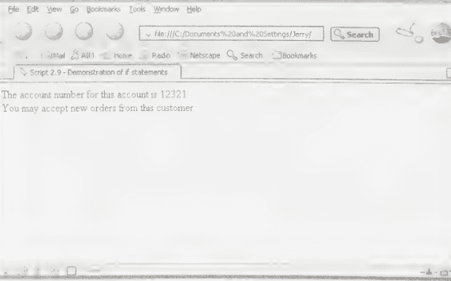

在继续之前，我想提到 `if` 语句的最后一个变体。这就是 *嵌套 if 语句*。嵌套 if 语句是一系列两个或更多个 if 语句嵌套或嵌入彼此内部。以下示例展示了一个嵌套的 if，它有两层 if 语句深度。只有当第一个 if 语句证明为 true 时，才会执行第二个 if 语句：

```javascript
if (accountStatus != "warning") {
    if (accountNumber > 10000) {
        document.write("You may accept new orders from this customer.");
    }
    else {
        document.write("Invalid account number. Notify bank security.");
    }
}
else {
    document.write("This Account has been marked with a warning!");
}
```

### switch 语句

`switch` 语句评估一系列条件测试或 case，并根据 case 是否为 true 执行额外的语句。`switch` 语句的语法如下所示：

```javascript
switch (expression) {
    case label:
        statements;
        break;
    .
    .
    .
    case label:
        statements;
        break;
    default:
        statements;
}
```

`switch` 语句将表达式的结果与每个 case 的标签进行比较。执行第一个为 true 的 case 所对应的语句。如果没有 case 为 true，并且包含了可选的 `default` 语句，则执行与 `default` 语句关联的语句。

每个 case 末尾的 `break` 语句是可选的。其目的是告诉脚本，在执行完第一个匹配的 case 中的语句后立即退出 `switch` 语句，并继续执行 `switch` 语句之后的下一个脚本语句。如果你移除可选的 `break` 语句，脚本将继续检查每个 case，并执行与表达式匹配的任何 case 的语句。

在以下示例中，系统提示用户输入一个业务账户的名称。从第一个 case 语句开始，脚本将分配给 `accountName` 变量的值与分配给第一个 case 语句的标签进行比较。如果条件为 true（即匹配），则执行该 case 语句中的语句，并且 case 末尾的 `break` 告诉脚本跳转到 `switch` 语句之后的第一个语句，在本示例中恰好是一个 `if` 语句。如果没有一个 case 语句为 true，则执行与 `default` 语句关联的语句，说明用户输入的账户名未注册。图 2.8 展示了此示例执行时的情况。

```html
<HTML>
<HEAD>
<TITLE>Script 2.10 - Demonstration of the switch statement</TITLE>
</HEAD>
<BODY>
<SCRIPT LANGUAGE="JavaScript" TYPE="Text/JavaScript">
<!-- Start hiding JavaScript statements
    var accountStatus = "None";
    var accountName = window.prompt("Enter your account name:");
    switch (accountName) {
        case "Morganstern":
            document.write("The account number for this account is 12321.");
            accountStatus = "approved";
            break;
        case "Davidson":
            document.write("The account number for this account is 88844.");
            accountStatus = "warning";
            break;
        default:
            document.write("The account is not registered in this system.");
            accountStatus = "error";
    }
    if (accountStatus == "warning") {
        document.write(accountStatus);
        window.alert("Contact the on-duty supervisor");
    }
// End hiding JavaScript statements -->
</SCRIPT>
</BODY>
</HTML>
```

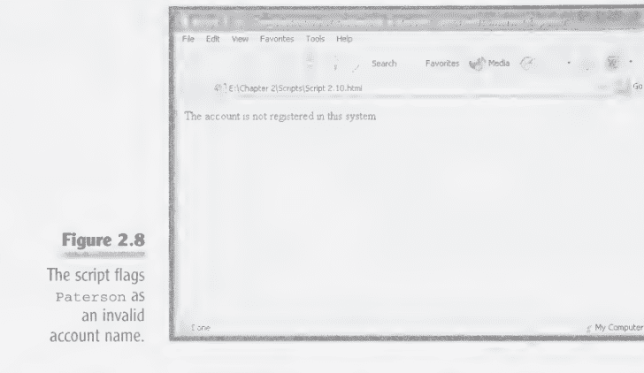

### 添加注释以提高清晰度

注释语句对脚本的逻辑性能没有影响。然而，它们可以通过提供一种内部记录脚本的方式来使脚本更容易理解。你可以通过两种方式在脚本中放置注释。要在脚本主体中放置单行注释，请键入 `//` 后跟你的注释，如下所示：

```javascript
//This is an example of a script comment
```

你也可以在脚本语句的末尾添加注释，如下面所示。

```javascript
document.write("Hello World"); //Write a message to the current Window
```

如果一行空间不足以让你写出完整的注释，你总是可以添加额外的注释，如下所示。

```javascript
//The following statement writes a message in the currently open browser window
//using the document object's write() method.
document.write("Hello World");
```

或者，你可以通过将注释放在 `/*` 和 `*/` 字符内来创建多行注释，如以下示例所示。

```javascript
/* The following statement writes a message in the currently open browser window
using the document object's write() method. */
document.write("Hello World");
```

注释并不总是为别人准备的；它们也为你自己准备。例如，你可能有一个很长的脚本，有几页长，允许客户填写表单并订购某种类型的产品。如果税率发生变化，你将不得不找到脚本中执行此计算的部分并进行修改。如果你添加了如下所示的注释来标识执行税收计算的代码行，那么多年后修改脚本会更容易。

```javascript
//Compute the amount of tax to apply to the order
totalOrder = totalOrder + (totalOrder * .05);
```

以下脚本提供了一个如何为自己的脚本编写文档的示例：

```html
<HTML>
<HEAD>
    <TITLE>Script 2.11 - Comment Example</TITLE>
</HEAD>
<BODY>
<SCRIPT LANGUAGE="JavaScript" TYPE="Text/JavaScript">
<!-- Start hiding JavaScript statements

//Define a variable representing the cost of a customer order
var totalOrder = 100;

//计算订单应缴税额
totalOrder = totalOrder + (totalOrder * .05); //税率 = 5%

/*以下语句仅用于演示document语句的用法，
用于在当前浏览器窗口中输出一条消息。*/
document.write(totalOrder);

// 隐藏JavaScript语句结束 -->
</SCRIPT>
</BODY>
</HTML>
```

> **注意** 另一种提高脚本可读性的技巧是在不同的语句组之间插入空行。

### 声明和赋值

我们已经在本节开头介绍了变量声明和赋值语句。大多数赋值使用等号 (`=`) 进行，但你也可以使用表2.3中列出的任何赋值运算符。

### 使用循环逻辑优化代码

循环是一系列重复执行的语句，允许你在脚本中执行迭代操作。支持循环逻辑的 JavaScript 和 JScript 语句包括 `for`、`while`、`do...while`、`label`、`break` 和 `continue` 语句。循环的好处在于，它们能让你只编写几行代码就能反复执行，使脚本更易于编写和维护。

### for 语句

`for` 语句会一直执行直到条件为假，并使用一个变量来控制循环执行的次数。`for` 循环由三部分组成：起始表达式、测试条件和递增语句。`for` 语句的语法如下所示：

```
for (expression; condition; increment) {
    statements;
}
```

例如，语句 `for (i=0; i<5; i++)` 建立了一个 `for` 循环，其初始计数为0，只要 i 小于5就继续运行，并且在每次迭代后将 i 的值加一。起始和结束花括号内的所有语句都会在每次执行 `for` 循环时执行。

以下示例展示了如何使用 `for` 语句设置一个迭代五次的循环。当脚本开始执行时，i 的值为0。每次循环执行时，i 的值都会增加1（在 `i++` 子句中）。虽然这个示例只显示了五行文本，展示了 i 值逐渐增大的过程，但我认为你可以看到它很容易被修改以执行几乎任何操作，例如反复提示用户输入并迭代处理这些输入。

```html
<HTML>
    <HEAD>
        <TITLE>脚本 2.12 - for 循环演示</TITLE>
    </HEAD>
    <BODY>
        <SCRIPT LANGUAGE="JavaScript" TYPE="Text/JavaScript">
            <!-- 开始隐藏JavaScript语句
for (i=0; i<5; i++) {
    document.write("观察变量在每次迭代中的增长: ",i,"<BR>");
}

// 隐藏JavaScript语句结束 -->
</SCRIPT>
</BODY>
</HTML>
```

图2.9显示了加载上一个示例的结果。如果你自己运行这个脚本，你应该注意到脚本执行得有多快。

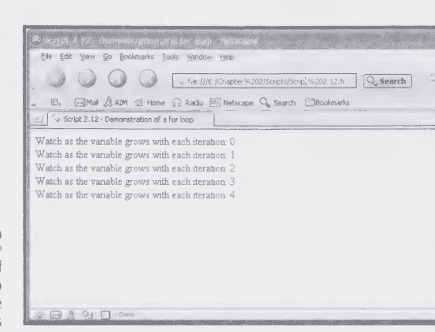

图2.9

使用for循环执行迭代过程的示例

### while 语句

`while` 语句会在条件为真时执行循环。`while` 语句的语法如下所示：

```
while (condition) {
    statements;
}
```

例如，你可以编写一个如下所示的 `while` 循环：

```
while (counter > 0) {
    counter++;
    document.write("counter = ", counter , "<BR>");
}
```

在下一个示例中，我设置了一个循环，只要分配给名为 `counter` 的变量的值大于0就一直运行。一旦 `counter` 变为0或更小，循环就会终止。为了控制循环的终止，我每次循环都将 `counter` 的值减1。使用 `while` 循环时，务必确保设置得当，以便它们能正确地跳出循环；否则，它们将永远运行下去，使用户除了关闭HTML页面或终止JScript的执行外别无选择。这是因为 `while` 循环的设计目的是只要测试条件保持为真就持续迭代，如下例所示。

```html
<HTML>
    <HEAD>
        <TITLE>脚本 2.13 - while 语句演示</TITLE>
    </HEAD>
    <BODY>
        <SCRIPT LANGUAGE="JavaScript" TYPE="Text/JavaScript">
        <!-- 开始隐藏JavaScript语句
        var counter = 10;
        document.write("<B>看我倒数!</B><BR>");
        while (counter > 0) {
            counter--;
            document.write("counter = ", counter , "<BR>");
        }
        // 隐藏JavaScript语句结束 -->
        </SCRIPT>
    </BODY>
</HTML>
```

图2.10显示了使用Internet Explorer加载此示例的结果。

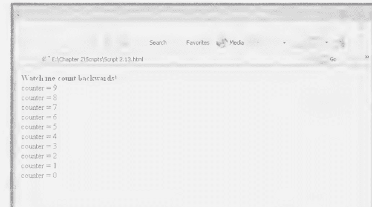

### do...while 语句

`do...while` 语句会执行循环直到条件为假。`do...while` 语句的语法概述如下：

```
do {
    statements;
} while (condition)
```

`do...while` 循环和 `while` 循环的区别在于，`do...while` 循环总是至少执行一次。这是因为条件是在循环首次执行结束时检查，而不是在开始时。但是，你可以使用任一风格来达到相同的目的，如下例所示。

```html
<HTML>
    <HEAD>
        <TITLE>脚本 2.14 - do...while 语句演示</TITLE>
    </HEAD>
    <BODY>
        <SCRIPT LANGUAGE="JavaScript" TYPE="Text/JavaScript">
        <!-- 开始隐藏JavaScript语句

            var counter = 10;

            document.write("<B>看我倒数!</B><BR>");
            do {
                counter--;
                document.write("counter = ", counter , "<BR>");
            } while (counter > 0)

        // 隐藏JavaScript语句结束 -->
        </SCRIPT>
    </BODY>
</HTML>
```

运行此脚本的结果与图2.11中显示的结果完全相同。

> **注意** 你可能已经注意到我在前面示例中的 `document.write()` 语句中使用了逗号。在此上下文中，逗号用于分隔 `document.write()` 语句使用的参数列表。例如，在 `document.write("counter = ", counter , "<BR>");` 中，传递了三个参数。第一个参数是用双引号括起来的文本消息，第二个参数是一个名为 `counter` 的变量，其值将在执行语句时显示，最后一个参数是HTML换行标签。

### label 语句

`label` 语句允许你在脚本中指定一个引用点。通常，`label` 语句与循环相关联。`label` 语句可以被 `break` 或 `continue` 语句引用。`label` 语句的语法如下所示：

```
label:
    statements;
```

在以下示例中，我创建了一个名为 `CounterLoop` 的标签。当脚本第一次执行时，`label` 语句被忽略。在 `while` 循环内，我设置了一个测试来检查 `counter` 的值是否等于5。如果是，脚本执行 `continue` 语句，该语句告诉脚本跳过 `while` 语句中的其余语句，继续执行循环的下一次迭代。

```html
<HTML>
    <HEAD>
        <TITLE>脚本 2.15 - label 语句演示</TITLE>
    </HEAD>
    <BODY>
        <SCRIPT LANGUAGE="JavaScript" TYPE="Text/JavaScript">
        <!-- 开始隐藏JavaScript语句

            var counter = 10;
            document.write("<B>看我倒数!</B><BR>");

            CounterLoop:

            while (counter > 0) {
                counter--;
                if (counter == 5 ) continue CounterLoop;
                document.write("counter = " , counter , "<BR>");
            }

        // 隐藏JavaScript语句结束 -->
        </SCRIPT>
    </BODY>
</HTML>
```

加载此脚本时，你会看到 `continue` 语句的效果是跳过了第五个语句的显示。

### break 语句

`break` 语句允许你终止一个 `label`、`switch` 或 `loop`。然后，脚本将继续处理被终止的 `label`、`switch` 或 `loop` 语句之后的语句。

以下示例展示了如何使用 `break` 语句终止 `while` 循环的执行。在这种情况下，当 `counter` 的值等于5时，`break` 语句终止循环。由于 `while` 循环之后没有其他语句，脚本在处理 `break` 语句后停止执行。

```html
<HTML>
    <HEAD>
        <TITLE>脚本 2.16 - break 语句演示</TITLE>
    </HEAD>
```

### continue 语句

`continue` 语句与 `break` 语句类似。但是，它不是终止循环的执行，而只是终止当前迭代。

下面的示例演示了如何使用 `continue` 语句来跳过给定的循环迭代。在此示例中，循环在一个 `switch` 语句中检查四种不同的情况。结果是，当计数器变量的值等于8、6、4或2时，该循环迭代会被跳过，但循环的处理不会终止，不像使用 `break` 语句时那样。相反，循环只是继续执行下一次迭代。

## SATURDAY MORNING 学习 JavaScript 编程基础

```html
<HTML>
    <HEAD>
        <TITLE>Script 2.17 - continue 语句的演示</TITLE>
    </HEAD>
    <BODY>
        <SCRIPT LANGUAGE="JavaScript" TYPE="Text/JavaScript">
            <!-- Start hiding JavaScript statements

            var counter = 10;

            document.write("<B>看我倒数计数！</B><BR>");

            CounterLoop:

            while (counter > 0) {
                counter--;
                switch (counter) {
                    case 8:
                        continue CounterLoop;
                    case 6:
                        continue CounterLoop;
                    case 4:
                        continue CounterLoop;
                    case 2:
                        continue CounterLoop;
                }
                document.write("counter = ", counter , "<BR>");
            }
        // End hiding JavaScript statements -->
        </SCRIPT>
    </BODY>
</HTML>
```

## 操作对象

正如我之前所述，JavaScript 和 JScript 使你能够创建与对象一起工作的脚本。你可以将对象想象成类似于变量的东西，只不过对象可以包含多个值，这些值称为它的属性。对象也可以包含内置函数，这些函数是为了与对象及其数据一起工作而设计的预定义脚本语句集合。浏览器对象的例子包括浏览器窗口和表单元素。WSH 对象的例子包括打印机和驱动器。

有许多 JavaScript 和 JScript 语句使你能够操作与对象关联的属性。这些语句包括 `for...in` 和 `with` 语句。`for...in` 语句使你能够访问指定对象的所有属性，而 `with` 语句提供了对特定对象属性和方法的便捷访问。

### for...in 语句

`for...in` 语句用于遍历属于指定对象的所有属性。`for...in` 语句的语法如下：

```javascript
for (variable in object) {
    statements;
}
```

此语句通过创建一个变量来工作，该变量用于遍历对象的所有属性。下面的示例展示了如何循环访问属于 `navigator` 对象的所有属性。`navigator` 对象包含有关用于查看包含 JavaScript 的 HTML 页面的浏览器类型的信息。

```html
<HTML>
    <HEAD>
        <TITLE>Script 2.18 - for...in 语句的演示</TITLE>
    </HEAD>
    <BODY>
        <SCRIPT LANGUAGE="JavaScript" TYPE="Text/JavaScript">
        <!-- Start hiding JavaScript statements

            for (i in navigator) {
                document.write(i,"<BR>");
            }

        // End hiding JavaScript statements -->
        </SCRIPT>
    </BODY>
</HTML>
```

图2.11显示了使用Internet Explorer加载前面页面的结果。通过修改此示例，你可以轻松地查看任何对象的所有属性。但是，我建议你省去修改此示例的麻烦，直接参考附录A“简明 JavaScript 和 JScript 对象参考”来获取有关任何对象各种属性的信息。

### with 语句

`with` 语句是在编写脚本时节省少量按键的一种便捷方式。它允许你为一组语句设置一个默认对象。`with` 语句的语法如下。

```javascript
with (object) {
    statements;
}
```

下面的示例展示了如何使用 `with` 语句将 `document` 对象设置为默认对象，然后将花括号内包含的所有语句应用于该对象。如你所见，通过使用这个快捷语句，我能够用 `write()` 代替 `document.write()`。虽然在这个示例中这并没有为我节省多少工作量，但在需要频繁操作给定对象的情况下，它肯定能节省大量时间。

```javascript
<HTML>
    <HEAD>
        <TITLE>Script 2.19 - with 语句的演示</TITLE>
    </HEAD>
    <BODY>
        <SCRIPT LANGUAGE="JavaScript" TYPE="Text/JavaScript">
        <!-- Start hiding JavaScript statements

            with (document) {
                write("with 语句为我节省了一些按键。<BR>");
                write("它的使用完全是可选的！");
            }

        // End hiding JavaScript statements -->
        </SCRIPT>
    </BODY>
</HTML>
```

### 使用函数简化脚本

函数是执行给定任务的语句集合。大多数函数在HTML页面的头部部分定义。将你的函数放在头部部分是个好主意，原因有二：第一，你总是知道你的函数在哪里，因为它们位于一个公共位置。第二个原因是头部部分总是首先执行，确保函数在脚本后面需要时可用。如果 JavaScript 语句在浏览器加载函数之前尝试调用该函数，则会发生错误，因为从技术上讲该函数仍然未定义。我也建议将你的函数放在 WSH JScript 文件中的公共位置。

> 注意：你可能想知道函数和方法之间有什么区别。答案是差别不大。方法只是预定义的函数。方法与特定对象相关联，这意味着每个对象都提供自己的方法集合，你可以在脚本中调用它们。

### 定义函数

使用函数的第一步是定义它，这通过下面概述的语法完成。

```javascript
function FunctionName (p1, p2,....pn) {
    statements;
    return
}
```

`function` 语句定义了一个具有你指定名称的新函数。函数的名称后跟一对括号，括号可以包含一个可选的参数列表，函数可以用作输入。多个参数用逗号分隔。所有 `function` 语句都放在花括号 `{}` 中。函数可以以可选的 `return` 语句结束，该语句允许将可选信息返回给调用该函数的语句。

例如，下面的示例展示了一个名为 `SayHello()` 的函数，它接受一个参数，即一个人的名字。然后它使用 `name` 参数来显示带有用户名的欢迎消息。`return` 语句将脚本的控制权返回给调用该函数的脚本语句。

```javascript
function SayHello(visitorName) {
    window.alert("Hello and welcome, " + visitorName);
    return
}
```

在脚本中定义函数并不会导致其执行。函数必须由另一个脚本语句调用才能执行。函数的优点在于你可以根据需要反复调用它们。

### 调用函数

现在你知道了函数是什么以及如何定义它，问题仍然是：你如何调用它？调用语句可以采用两种形式之一。第一种形式调用函数但不接受函数返回的任何结果。下面的两个函数调用演示了这种调用形式。第一个示例调用一个名为 `SayHello()` 的函数，不传递任何参数。第二个示例调用一个名为 `SayGoodbye()` 并传递单个参数。当函数执行完毕后，控制权将返回给紧随函数调用语句之后的语句。

```
SayHello();
SayGoodbye("William");
```

**注意** 务必确保函数能够处理传递给它的参数数量。

或者，你可以以表达式的形式调用函数。这使得函数能够将一个值返回给调用语句。例如，下面的语句调用了一个名为 `GetUserName()` 的函数，并将该函数返回的结果存储在名为 `UserName` 的变量中。

```
UserName = GetUserName();
```

以下示例展示了 HTML 页面 `<head>` 部分中的一个名为 `SayHello()` 的函数。它由 HTML 页面 `<body>` 部分中的 `SayHello()` 语句执行，并接收一个名为 `name` 的参数。`name` 参数是由函数调用之前的语句所建立的变量。该函数接收 `name` 参数，并用它来向用户显示一个包含问候语的弹出对话框。脚本会暂停，直到用户点击“确定”，此时函数终止，并将控制权返回给 `<body>` 部分中紧随函数调用语句之后的语句。

```html
<HTML>
    <HEAD>
        <TITLE>脚本 2.20 - 一个简单的函数</TITLE>
        <SCRIPT LANGUAGE="JavaScript" TYPE="Text/JavaScript">
        <!-- 开始隐藏 JavaScript 语句

        function SayHello(visitorName) {
    window.alert("你好，欢迎，" + visitorName);
}

// 结束隐藏 JavaScript 语句 -->
</SCRIPT>
</HEAD>
<BODY>
<SCRIPT LANGUAGE="JavaScript" TYPE="Text/JavaScript">
<!-- 开始隐藏 JavaScript 语句

var name;

name = window.prompt("你叫什么名字？","");
SayHello(name);

// 结束隐藏 JavaScript 语句 -->
</SCRIPT>
</BODY>
</HTML>
```

图 2.12 展示了脚本执行时如何与用户交互。

**图 2.12**

将用户的姓名作为对话框消息的一部分

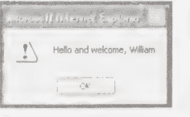

以下示例展示了如何编写一个向调用语句返回值的函数。这个例子实际上只是前一个例子的重写，结果是相同的。唯一的区别是，这次函数调用没有提供参数，而是从函数内部获取用户的姓名。

```html
<HTML>
    <HEAD>
        <TITLE>脚本 2.21 - 从函数返回值</TITLE>
        <SCRIPT LANGUAGE="JavaScript" TYPE="Text/JavaScript">
        <!-- 开始隐藏 JavaScript 语句

        var name;
        var result;

        function SayHello() {
            name = window.prompt("你叫什么名字？","");
            return name;
        }

        // 结束隐藏 JavaScript 语句 -->
        </SCRIPT>
    </HEAD>
    <BODY>
        <SCRIPT LANGUAGE="JavaScript" TYPE="Text/JavaScript">
        <!-- 开始隐藏 JavaScript 语句

        result = SayHello();

        window.alert("你好，欢迎，" + result);

        // 结束隐藏 JavaScript 语句 -->
        </SCRIPT>
    </BODY>
</HTML>
```

### 使用数组

一个 *数组* 是一个索引值的列表，可以作为一个单元来引用。数组可以包含任何类型的值。在使用数组之前，你必须先声明它。以下示例展示了如何创建一个数组，该数组将包含 10 个字符串，存储有关汽车库存的信息。

```
Auto = new Array(10);
Auto[0] = "98 Ford Explorer";
Auto[1] = "97 Ford Explorer";
Auto[2] = "85 Plymouth Mustang";
Auto[3] = "96 Plymouth Voyager";
Auto[4] = "90 Honda Civic";
Auto[5] = "97 Honda Civic";
Auto[6] = "96 Plymouth Neon";
Auto[7] = "98 Plymouth Neon";
Auto[8] = "92 Ford Explorer Wagon";
Auto[9] = "95 Honda Civic Hatchback";
```

第一条语句使用 `new` 关键字创建一个名为 `Auto` 的 `Array` 对象，它将包含 10 个条目。其余语句为数组赋值字符串。如你所见，数组的索引从 0 开始，一直到 9。

### 定义数组

以下脚本使用前面的数组示例，演示如何通过使用 `document.write()` 语句、数组名称和索引号来显示数组元素。

```html
<HTML>
  <HEAD>
    <TITLE>脚本 2.22 - 示例数组</TITLE>
  </HEAD>
  <BODY>
    <SCRIPT LANGUAGE="JavaScript" TYPE="Text/JavaScript">
<!-- 开始隐藏 JavaScript 语句

Auto = new Array(10);
Auto[0] = "98 Ford Explorer";
Auto[1] = "97 Ford Explorer";
Auto[2] = "85 Plymouth Mustang";
Auto[3] = "96 Plymouth Voyager";
Auto[4] = "90 Honda Civic";
Auto[5] = "97 Honda Civic";
Auto[6] = "96 Plymouth Neon";
Auto[7] = "98 Plymouth Neon";
Auto[8] = "92 Ford Explorer Wagon";
Auto[9] = "95 Honda Civic Hatchback";

document.write("数组中的第一个元素是 <B>", Auto[0], "</B>");

// 结束隐藏 JavaScript 语句 -->
</SCRIPT>
</BODY>
</HTML>
```

图 2.13 显示了加载前面示例的结果。在这种情况下，显示的是第一个数组元素 `Auto[0]`。

### 使用 for 循环处理数组

在下一个示例中，我们将使用 `for` 循环遍历整个数组并显示其全部内容。循环从数组开头 `Auto[0]` 开始，使用增量为 1 的步长遍历数组元素，直到到达数组末尾。为了确定数组的末尾，脚本创建了一个名为 `arrayLength` 的变量，并将其值设置为数组的 `length` 属性，在本例中为 10。

## 图 2.13

可以通过引用数组中的索引号来单独提取数组元素。

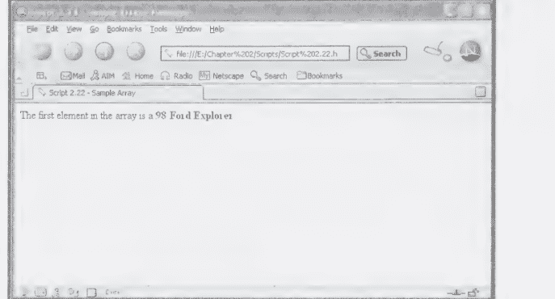

```html
<HTML>
<HEAD>
<TITLE>脚本 2.23 - 遍历数组</TITLE>
</HEAD>
<BODY>
<SCRIPT LANGUAGE="JavaScript" TYPE="Text/JavaScript">
<!-- 开始隐藏 JavaScript 语句

var arrayLength;
Auto = new Array(10);
Auto[0] = "98 Ford Explorer";
Auto[1] = "97 Ford Explorer";
Auto[2] = "85 Plymouth Mustang";
Auto[3] = "96 Plymouth Voyager";
Auto[4] = "90 Honda Civic";
Auto[5] = "97 Honda Civic";
Auto[6] = "96 Plymouth Neon";
Auto[7] = "98 Plymouth Neon";
Auto[8] = "92 Ford Explorer Wagon";
Auto[9] = "95 Honda Civic Hatchback";

arrayLength = Auto.length;

document.write("<B>当前库存清单</B><BR>");

for (var i = 0; i < arrayLength;i++) {
    document.write(Auto[i], "<BR>");
}

// 结束隐藏 JavaScript 语句 -->
</SCRIPT>
</BODY>
</HTML>
```

图 2.14 演示了 `for` 循环如何能够处理每个数组元素。

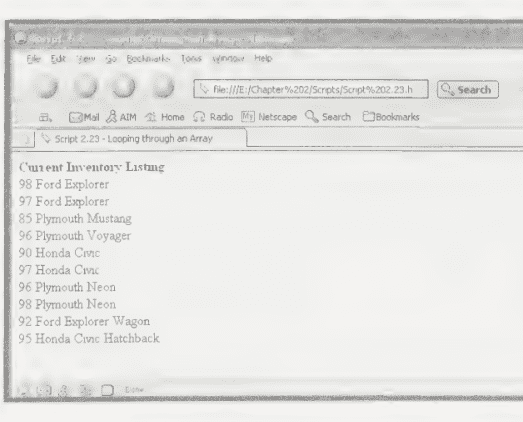

**图 2.14** `for` 循环使你能够读取数组的全部内容。

### 稠密数组

你也可以创建稠密数组。一个 *稠密数组* 是在声明时就被填充的数组。这是一种创建小型数组的高效技术。以下示例展示了如何创建一个名为 `animals` 的稠密数组，它由五个条目组成。该数组将具有以下结构：

`animals = new Array("mice", "dog", "cat", "hamster", "fish");`

创建数组后，脚本使用 `for` 循环和 `Animals.length` 属性打印其内容。

```html
<HTML>
  <HEAD>
    <TITLE>脚本 2.24 - 稠密数组</TITLE>
  </HEAD>
  <BODY>
    <SCRIPT LANGUAGE="JavaScript" TYPE="Text/JavaScript">
    <!-- 开始隐藏 JavaScript 语句

    var arrayLength;

    Animals = new Array("mice", "dog", "cat", "hamster",
    "fish");

    arrayLength = Animals.length;

    document.write("<B>动物园动物名单</B><BR>");

    for (var i = 0; i < arrayLength;i++) {
      document.write(Animals[i], "<BR>");
    }

    // 结束隐藏 JavaScript 语句 -->
</SCRIPT>
</BODY>
</HTML>
```

图 2.15 显示了将此示例加载到浏览器中的结果。每个数组条目从索引 0 开始列出，一直显示到数组末尾。

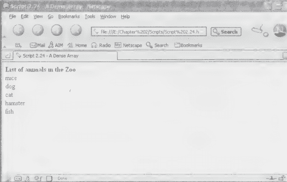

## 图 2.15

稠密数组的结果

### 数组排序

数组有一个 `sort()` 方法，可用于对其内容进行排序。以下示例展示了如何显示数组内容的排序列表。脚本首先定义了一个包含五个条目的稠密数组。接下来，它显示一个标题，然后在 `document.write()` 语句内使用 `sort()` 方法来显示排序后的列表。请注意，我不需要创建 `for` 循环来遍历数组索引。`sort()` 方法为我处理了这件事。

```html
<HEAD>
<TITLE>脚本 2.25 - 数组排序</TITLE>
</HEAD>
```

### 使用动态数据填充数组

你可以创建脚本，让用户能够提供自己的数据，而不是将其硬编码到脚本中。例如，以下脚本会提示用户输入他们最喜欢的三样东西，然后创建一个数组来包含这个列表。

该脚本使用 `for` 语句来控制程序执行。每次循环执行时，它都会要求用户输入一个响应，并通过分配下一个可用的数组索引号（由当前的 `i` 值指定）将该响应赋值给数组。

```html
<HTML>
    <HEAD>
        <TITLE>Script 2.26 - Building a dynamic Array</TITLE>
    </HEAD>
    <BODY>
        <SCRIPT LANGUAGE="JavaScript" TYPE="Text/JavaScript">
            <!-- Start hiding JavaScript statements

            document.write("What are your 3 most favorite things?<BR>");

            NumberArray = new Array(3);

            for (var i = 0; i < 3;i++) {
                var yourNumber = prompt('I like: ', ' ');
                NumberArray[i] = yourNumber;
                document.write(NumberArray[i], "<BR>");
            }

            // End hiding JavaScript statements -->
        </SCRIPT>
    </BODY>
</HTML>
```

**提示** 上面的例子向你展示了如何编写一个脚本，使用户能够动态地填充其内容，而不是要求你硬编码其内容。另一种动态使用数组的方法是在脚本执行期间增加其长度。你可以通过添加一个索引号高于数组中最后一个索引号的新数组元素来扩展数组的大小。例如，如果我声明一个索引为 50 的数组，我稍后可以通过添加一个索引号为 99 的新数组元素来扩展该数组。这将使数组的大小增加到 100。

图 2.17 显示了将前面的例子加载到浏览器中的结果。如你所见，标题显示在前，后面是新数组的内容。

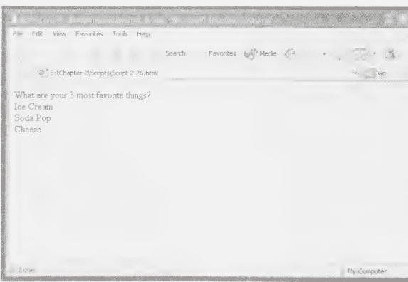

**图 2.17** 动态数组使得显示用户刚刚填充的数组内容成为可能。

## 基于对象的编程

JavaScript 和 JScript 通过对象提供对资源的访问，从而支持脚本执行。这两种语言共享相同的内置对象模型，该模型由少量对象组成。根据脚本执行的环境，浏览器或 WSH 会向脚本提供对其他对象的访问。

并非每个对象都同时具有属性和方法，尽管大多数对象都有。有关对象的详细列表，请参阅附录 A。

### 创建自定义对象

自定义对象是使用 `new` 关键字创建的。例如，你可以创建一个 `Array` 对象的新实例，如下所示。

```javascript
Animals = new Array("mice", "dog", "cat", "hamster", "fish");
```

如你所见，`new` 关键字用于创建 `Array` 对象的一个实例（`Animals`）。

## 使用内置对象

JavaScript 和 JScript 提供对一组内置对象的访问。无论脚本在何种环境中执行，这些对象始终可用。这些对象包括 `Array`、`Boolean`、`Date`、`Function`、`Math`、`Number`、`Object` 和 `String` 对象。

请注意，内置对象名称始终以大写字母开头。

### Array 对象

今天早上我已经简要介绍过 `Array` 对象。要使用数组，你必须创建 `Array` 对象的一个实例。

数组是一个值的索引列表，可以作为一个整体来引用。你可以通过引用它们的名称和索引号来处理数组元素。数组有一个 `length` 属性，它告诉你数组有多大，以及一组用于操作其内容的方法。这些方法包括对数组排序、将两个数组连接成一个数组、从数组中添加或删除元素以及反转数组顺序。数组中的第一个条目被分配索引 0。

我之前没有向你展示的是如何创建多维数组；我只展示了单维数组。单维数组的一个例子是汽车列表。例如，以下列表包含三个元素，是一个单维数组：

- Ford
- Honda
- Jeep

多维数组可用于表示以表格格式存储的数据。例如，以下信息可以存储在二维数组中：

| Ford | Red | $4,000 |
| Honda | Blue | $4,888 |
| Jeep | Green | $12,500 |

以下脚本演示了如何构建和显示多维数组的内容：


# 创建多维数组

```html
<HTML>
  <HEAD>
    <TITLE>Script 2.27 - Creating a Multi-Dimensional Array</TITLE>
  </HEAD>
  <BODY>
    <SCRIPT LANGUAGE="JavaScript" TYPE="Text/JavaScript">
      <!--Start hiding JavaScript statements

      var arraySize

      //Part 1 - Prompt user for array size
      arraySize = window.prompt("How many cars do you plan to list?","");

      MyArray = new Array(arraySize);

      //Part 2 - Populate the array with user supplied information
      for (row=0; row < arraySize; row++ ) {
          MyArray[row] = new Array(3);
          MyArray[row][0] = window.prompt("Type of car?","");
          MyArray[row][1] = window.prompt("Color of car?","");
          MyArray[row][2] = window.prompt("Sale price?","");
      }

      //Part 3 - Display the contents of the array
      for (row=0; row < arraySize; row++ ) {
          for (column=0; column < 3; column++ ) {
              document.write(MyArray[row][column] + " ");
          }
          document.write("<BR>");
      }

      // End hiding JavaScript statements -->
    </SCRIPT>
  </BODY>
</HTML>
```

我使用了注释将这个脚本分成三部分，每一部分执行一个特定的活动。在第 1 部分，我定义了一个名为 `arraySize` 的变量，它包含用户想要输入的汽车数量。然后我使用 `arraySize` 中包含的值创建了一个名为 `MyArray` 的数组。如果你将多维数组看作一个表格，那么这一步就定义了表格的长度。

在第 2 部分，我添加了一个 `for` 循环来创建数组的第二个维度。在这种情况下，`for` 循环从 0 开始，每次递增 1，直到为数组中的每个元素都执行一次。同样，如果你将多维数组看作一个表格，你可以看到这一步在逐行从上到下迭代时填充表格中的每一列。在每次迭代中，都会要求用户输入汽车的类型、颜色和价格。在第一次迭代中，脚本从第 0 行（`MyArray[0]`）开始，并填充第 0 行的每一列（`MyArray[0][0]`、`MyArray[0][1]`、`MyArray[0][2]`）。在下一次迭代中，`row` 的值已递增 1 变为 1。同样，脚本会提示用户输入汽车信息，并填充第二行的单元格（`MyArray[1][0]`、`MyArray[1][1]`、`MyArray[1][2]`）。这个过程会根据用户拥有的汽车数量重复多次。

结果是一个可以表示为表格的多维数组。在这个例子中，表格是三行三列深，可以如图 2.18 所示绘制出来。如图 2.19 所示，可以引用单个单元格。

| 0,0 | 0,1 | 0,2 |
|-----|-----|-----|
| 1,0 | 1,1 | 1,2 |
| 2,0 | 2,1 | 2,2 |

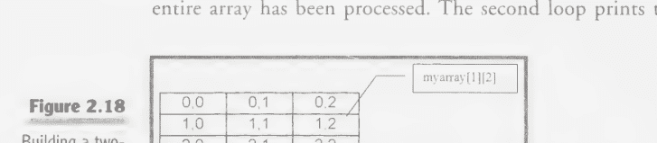

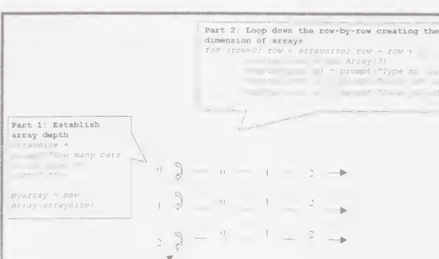


## 周六早晨 学习 JavaScript 编码基础

通过为表格中的每一行重复执行操作来处理多维数组，从第 0 列开始，到第 2 列结束。

图 2.21 展示了我测试脚本时得到的结果。

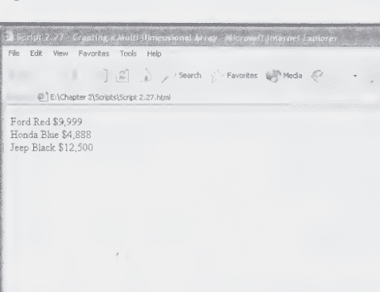

**图 2.21** 一个二维数组示例

### Boolean 对象

JavaScript 和 JScript 允许你像对象一样处理布尔值。你需要使用以下语法来创建新的 `Boolean` 对象。

`BooleanObject = new Boolean(value);`

在此语法中，`value` 必须是 `true` 或 `false`。如果你给一个 `Boolean` 对象赋值 `true` 或 `false` 以外的值，该值将被转换为布尔值。如果值为 `NaN`、`null`、`undefined`、`-0` 或 `0`，则赋值将为 `false`；否则值将转换为 `true`。

以下是示例 `Boolean` 对象列表：

```
TestObject1 = new Boolean();      // 初始值为 false
TestObject2 = new Boolean(-0);     // 初始值为 false
TestObject3 = new Boolean(false);  // 初始值为 false
TestObject4 = new Boolean(true);   // 初始值为 true
TestObject5 = new Boolean("Hello"); // 初始值为 true
TestObject6 = new Boolean("false"); // 初始值为 true
```

> 注意：最后两个示例中，`false` 和 `"false"` 是有区别的。这是因为 `"false"` 是一个字符串，而 `false` 是一个关键字。

通过使用 `Boolean` 对象而不是简单的布尔值，你可以利用三个 `Boolean` 对象方法：

- `toSource()`。在内部使用，返回表示 `Boolean` 对象源代码的字符串。
- `toString()`。返回表示对象的字符串。
- `valueOf()`。获取对象的值。

每个方法都在以下示例中演示：

```html
<HTML>
  <HEAD>
    <TITLE>脚本 2.28 - 使用 Boolean 对象</TITLE>
  </HEAD>
  <BODY>
    <SCRIPT LANGUAGE="JavaScript" TYPE="Text/JavaScript">
    <!--开始隐藏 JavaScript 语句

    TestObject = new Boolean(false); // 初始值为 false

    document.write(TestObject.toString() + "<BR>");
    document.write(TestObject.valueOf());
    // 结束隐藏 JavaScript 语句 -->
    </SCRIPT>
  </BODY>
</HTML>
```

### Date 对象

JavaScript 和 JScript 不提供日期值。相反，你必须使用 `Date` 对象在脚本中插入日期和时间。`Date` 对象没有任何属性，但提供了对大量内置方法的访问。

日期信息基于自 1970 年 1 月 1 日以来经过的百万毫秒数。你可以使用下面演示的 `new` 运算符创建 `Date` 对象的实例。

```
Today = new Date();
document.write(today);
```

此示例创建一个名为 `today` 的变量，并将其设置为当前日期。第二行显示 `today` 变量的结果。如果你将这些语句放入脚本并运行，当由 Netscape Communicator 处理时，你会得到类似以下的结果：

`Thu Dec 10 12:21:29 GMT-0500 (Eastern Standard Time) 2000`

如你所见，`Date` 对象的默认格式是星期几，后跟当前月份的名称、数字日期、当前时间、与格林威治标准时间的偏移量、时区信息，最后是当前年份。

如果这些信息超出了你想要或需要的范围，你可以使用各种 `Date` 方法来检索更具体的信息。以下示例演示了一些更常用的 `Date` 方法。在此脚本中，每个方法的结果被分配给名为 `MyDate` 的数组中的一个数组元素，该数组总长度为八个元素（`MyDate[x] = "message = " + TodaysDate.datemethod()`）。在执行 `Date` 对象的方法并加载数组后，脚本执行一个 `for` 循环来遍历数组并打印其内容。循环从数组元素 0（`i = 0`）开始，每次迭代递增 1（`i = i + 1`），直到到达数组末尾（即，直到 `i < arrayLength` 不再为真）。

## 周末学 JavaScript

```html
<HTML>
	<HEAD>
<TITLE>脚本 2.29 - 使用 Date 对象</TITLE>
</HEAD>
<BODY>
<SCRIPT LANGUAGE="JavaScript" TYPE="Text/JavaScript">
<!-- 开始隐藏 JavaScript 语句

var arrayLength;

TodaysDate = new Date();

document.write("<B>今天的日期是: </B>" + TodaysDate + "<P>");

MyDate = new Array(8);
MyDate[0] = "thedate = " + TodaysDate.getDate();
MyDate[1] = "theday = " + TodaysDate.getDay();
MyDate[2] = "theyear = " + TodaysDate.getFullYear();
MyDate[3] = "thehour = " + TodaysDate.getHours();
MyDate[4] = "theminute = " + TodaysDate.getMinutes();
MyDate[5] = "themonth = " + TodaysDate.getMonth();
MyDate[6] = "thesecond = " + TodaysDate.getSeconds();
MyDate[7] = "thetime = " + TodaysDate.getTime();

arrayLength = MyDate.length;

document.write("<B>Date 方法示例数组</B>
<BR>");

for (var i = 0; i < arrayLength; i++ ) {
    document.write(MyDate[i], "<BR>");
}
// 结束隐藏 JavaScript 语句 -->
</SCRIPT>
</BODY>
</HTML>
```

图 2.22 展示了执行此脚本的结果。

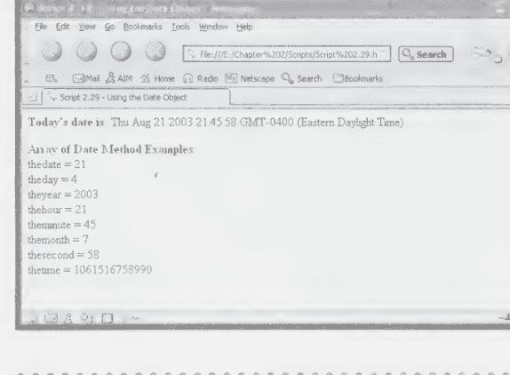

**图 2.22** 使用数组存储和显示使用 `Date` 对象方法收集的结果

> **注意**

使用 `Date` 对象的方法时，表示分钟和秒必须使用 0 到 59，表示小时使用 0 到 23，表示天使用 0 到 6，处理日期时使用 1 到 31，表示月份使用 0 到 11。在示例中，给出的日期是 1996 年 2 月 23 日星期五。但请注意，`getMonth()` 方法返回的是 1 而不是 2 来表示二月，不像你预期的那样。记住计算机逻辑将一月设为 0 月，二月设为 1 月，以此类推。

`Date` 对象还提供了一组用于设置 `Date` 对象值的方法，包括：

- `setDate(12)`
- `setFullYear(2000)`
- `setHours(11)`
- `setMinutes(30)`
- `setMonth(4)`
- `setYear(2000)`

### Function 对象

JavaScript 和 JScript 还允许你创建 `Function` 对象，并提供对普通函数无法使用的 `Function` 属性和方法的访问。当你的函数由单行代码组成时，`Function` 对象更易于使用。然而，由于 `Function` 对象固有的低效性，最好坚持使用声明式函数。以下示例概述了使用 `Function` 对象时必须遵循的语法。

```
FunctionName = new Function([p1,.......pn] body)
```

在此语法中，`p1` 到 `pn` 是 `Function` 对象在调用时接收的参数，`body` 是被编译为函数的脚本语句。

例如，以下代码创建了一个名为 `Warn` 的 `Function` 对象：

```
Warn = new Function("alert('HI!')");
```

你可以这样调用此函数：

```
Warn();
```

前面的 `Function` 对象等效于以下声明式函数：

```
function Warn() {
    window.alert("Warning: You should not run this script!");
    return;
}
```

> 注意：因为 `Function` 对象是编译的，它比使用声明式函数效率低。因此，我建议你避免使用编译函数和 `Function` 对象。

以下脚本演示了前面 `Function` 对象示例的使用。

```html
<HTML>
    <HEAD>
        <TITLE>脚本 2.30 - 使用 Function 对象</TITLE>
    </HEAD>
    <BODY>
        <SCRIPT LANGUAGE="JavaScript" TYPE="Text/JavaScript">
            <!--开始隐藏 JavaScript 语句

            Warn = new Function("window.alert('Warning: You should not run this script!')");
            Warn();

            // 结束隐藏 JavaScript 语句 -->
        </SCRIPT>
    </BODY>
</HTML>
```

图 2.23 展示了加载此页面时会发生什么。

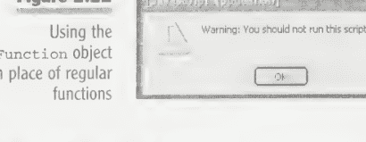

### Math 对象

`Math` 对象以属性的形式提供数学常量。它还以方法的形式提供数学函数。今天上午早些时候，我演示了几个 `Math` 属性和方法。表 2.5 和表 2.6 回顾了 `Math` 对象的主要属性和方法。

#### 表 2.5 数学属性摘要

| 属性 | 描述 |
| :--- | :--- |
| E | 欧拉常数 (2.718) |
| LN2 | 2 的自然对数 (0.693) |
| LN10 | 10 的自然对数 (2.302) |
| LOG2E | 以 2 为底 e 的对数 (1.442) |
| LOG10E | 以 10 为底 e 的对数 (0.434) |
| PI | 圆的周长与直径的比值 (3.14159) |
| SQRT1_2 | 1/2 的平方根 (0.707) |
| SQRT2 | 2 的平方根 (1.414) |

#### 表 2.6 数学方法摘要

| 方法 | 描述 |
|---|---|
| abs() | 返回绝对值 |
| cos(), sin(), tan() | 三角函数 |
| acos(), asin(), atan() | 反三角函数 |
| exp(), log() | 指数函数和自然对数 |
| ceil() | 返回大于或等于参数的最小整数 |
| floor() | 返回小于或等于参数的最大整数 |
| min(x, y) | 返回 x 或 y 中较小的一个 |
| max(x, y) | 返回 x 或 y 中较大的一个 |
| pow(x, y) | 返回 x^y 的值 |
| random() | 返回一个介于 0 和 1 之间的随机数 |
| round() | 将参数四舍五入到最接近的整数 |
| sqrt() | 返回参数的平方根 |

### Number 对象

`Number` 对象允许你像处理对象一样处理数字，并将数值常量存储为属性。这些常量的值不可更改。你可能永远不需要了解或使用 `Number` 对象，但以防万一，表 2.7 概述了其属性。

你可以使用 `new` 关键字定义 `Number` 对象的实例，如下所示。

```
MyNumber = new Number(99.99);
```

#### 表 2.7 Number 对象属性

| 属性 | 描述 |
| --- | --- |
| MAX_VALUE | 最大可能值 |
| MIN_VALUE | 最小可能值 |
| NaN | 非数字 |
| NEGATIVE_INFINITY | 负无穷大 |
| POSITIVE_INFINITY | 正无穷大 |

> **注意** 构造函数是每个对象提供的一种函数，你可以用它来创建对象的实例。例如，要创建一个名为 `MyString` 的 `String` 对象实例，你需要指定以下内容：`MyString = new String("Add your message text here.")`。

你可能永远看不到有人以这种方式创建对象。相反，你会看到使用特定于每种对象类型的构造函数来创建对象，例如这些构造函数：

- `Array()`
- `Boolean()`
- `Function()`
- `Number()`
- `String()`

### Object 对象

这是所有其他对象的基础对象。这意味着所有对象都继承了该对象的属性和方法。

你可以通过在 `Object()` 构造函数中指定 `Array`、`Boolean`、`Function`、`Number` 或 `String` 对象来创建新的 `Object` 对象，如下所示：

```
MyNumberObject = new Object(99.99);
MyStringObject = new Object("Testing");
```

### String 对象

正如你已经了解的，`String` 对象使你能够将字符串作为对象来操作。然而，你可能不需要使用此对象，因为 JavaScript 和 JScript 在你对简单字符串使用 `String` 对象方法或属性时，会自动将其转换为临时的 `String` 对象。

`String` 对象只有一个属性 `length`，它包含组成 `String` 对象的字符数。但是，`String` 对象有许多用于操作字符串的有用方法，如表 2.8 所述。

#### 表 2.8 常用字符串对象方法

| 方法 | 描述 |
| :--- | :--- |
| charAt() | 返回字符串中指定位置的字符，其中 `String` 对象的索引从零开始 |
| charCodeAt() | 返回指定位置字符的 Unicode 编码 |
| concat() | 将两个字符串组合成一个新字符串 |
| fromCharCode() | 根据提供的字符代码集创建一个字符串值 |
| indexOf() | 返回指定子字符串的位置 |
| lastIndexOf() | 返回指定子字符串的最后一个位置 |
| slice() | 使用当前字符串的一部分创建一个新字符串 |
| split() | 将字符串组织成一个数组 |
| substring() | 返回字符串的指定部分 |
| toLowerCase() | 返回全部小写字符的字符串 |
| toUpperCase() | 返回全部大写字符的字符串 |

以下示例创建两个 `String` 对象，然后演示了如何使用各种 `String` 方法操作这些对象，并通过 `document.write()` 方法显示其结果。

```html
<HTML>
  <HEAD>
    <TITLE>脚本 2.31 - 使用 String 对象</TITLE>
  </HEAD>
  <BODY>
    <SCRIPT LANGUAGE="JavaScript" TYPE="Text/JavaScript">
    <!-- Start hiding JavaScript statements

    MyString1 = new String(" He is gone now!");

    MyString2 = new String("Once upon a time there was a little boy " +
                           "who cried wolf.");

    document.write("<B>MyString1 - </B>" + MyString1 + "<BR>");
    document.write("<B>MyString2 - </B>" + MyString2 + "<BR>");

    document.write("<B>MyString2.charAt(5) - </B>" + MyString2.charAt(5) + "<BR>");
    document.write("<B>MyString2.charCodeAt(5) - </B>" + MyString2.charCodeAt(5) + "<BR>");

    document.write("<B>MyString2.indexOf('little') - </B>" + MyString2.indexOf("little") + "<BR>");
    document.write("<B>MyString2.lastIndexOf('who') - </B>" + MyString2.lastIndexOf("who") + "<BR>");

    document.write("<B>MyString2.substring(15) - </B>" + MyString2.substring(15) + "<BR>");
    document.write("<B>MyString2.substring(15,22) - </B>" + MyString2.substring(15,22) + "<BR>");

    document.write("<B>MyString2.toUpperCase() - </B>" + MyString2.toUpperCase() + "<BR>");
    document.write("<B>MyString2.toLowerCase() - </B>" + MyString2.toLowerCase() + "<BR>");

    document.write("<B>MyString2.concat(MyString1) - </B>" + MyString2.concat(MyString1) + "<BR>");

    document.write("<B>MyString2.slice() - </B>" + MyString2.slice() + "<BR>");

    // End hiding JavaScript statements -->
    </SCRIPT>
  </BODY>
</HTML>
```

图 2.24 显示了加载此示例创建的页面的结果。

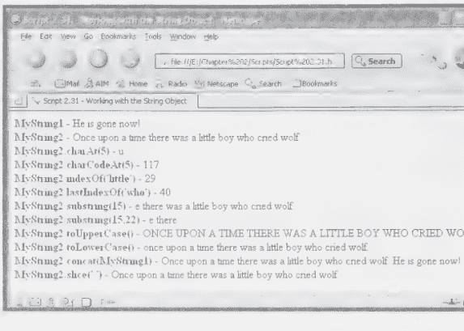

**图 2.24** `String` 对象方法演示

# 接下来是什么？

天哪！我得说这工作量可不小。你为什么不把书放下一会儿，伸个懒腰，去吃点东西呢？事情开始变得非常有趣了，你需要保持体力。等你回来后，我们将直接开始学习基于浏览器的对象和事件。在下午结束之前，你将为基于对象的编程打下坚实的基础。

## 使用基于浏览器的对象

当 HTML 页面在 Netscape Communicator 或 Internet Explorer 等浏览器中加载时，浏览器会根据在页面上发现的内容定义一组对象。这些对象在页面加载过程中按从上到下的顺序创建。当浏览器构建对象引用时，它是以分层方式进行的。

对于给定的浏览器而言，其对象组织层级结构被称为*对象模型*。在互联网浏览器发展的早期，不同浏览器提供的对象模型存在许多差异。此外，随着微软和网景等公司多年来不断改进其浏览器，它们持续添加新功能并支持新对象。结果，专为这两款浏览器最新版本设计的 JavaScript 往往无法在较旧的浏览器上运行——即便在今天，许多人仍在使用这些旧版浏览器。更糟糕的是，你无法确保你的 JavaScript 在 Internet Explorer 或 Netscape Communicator 中运行时表现完全一致。所有这些导致了一种非常混乱的局面。

由于多年来开发出了多个版本的 Internet Explorer 和 Netscape Communicator，我无法在本书有限的篇幅内涵盖这两款浏览器每个版本特有的问题。涉及的对象实在太多，而且这些对象拥有大量的方法和属性，无法在一个周末内全部讲解清楚。因此，我计划重点介绍你最有可能需要用到的对象。此外，本书中提供的脚本将使用 Internet Explorer 和 Netscape Communicator 的最新版本进行编写和测试。

### 浏览器视角下的对象

当浏览器加载一个 HTML 页面时，它会同时创建一个所有相关对象的逻辑视图，呈现为树状结构。这些对象彼此关联，具有父子关系和兄弟关系。例如，考虑以下 HTML 页面：

```html
<HTML>

<HEAD>
    <TITLE>Script 3.1 - A Typical HTML page</TITLE>
</HEAD>
<BODY>
<P>Hello.</P>
<P>Welcome to my Web site.</P>
</BODY>
</HTML>
```

当它被浏览器加载时，你会看到如图 3.1 所示的输出。

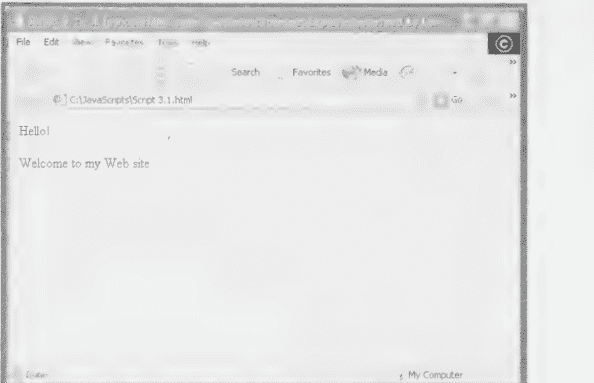

**图 3.1** 从浏览器的角度看，此网页中显示的内容由相互关联的对象组成。

另一方面，浏览器对 HTML 页面内容的理解略有不同，如图 3.2 所示。

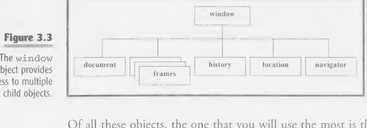

如你所见，`document` 对象位于此树的顶部。其下是定义其内容的各个 HTML 标签，而这些标签之下则是它们所包含的内容。

### 浏览器对象模型概述

为了帮助稳定 Web 开发，一个名为万维网联盟（World Wide Web Consortium）的组织制定了一种称为文档对象模型（Document Object Model，DOM）的浏览器对象标准。此模型定义了 HTML 页面上的每个元素，并提供了访问它们的能力。微软和网景都在致力于在其浏览器中全面集成对 DOM 的支持。因此，Internet Explorer 和 Netscape Communicator 的最新版本在支持浏览器对象方面非常一致，使得你的 HTML 页面无论使用哪种浏览器查看，看起来都基本相同。这对 JavaScript 程序员来说尤其是个好消息，因为这意味着你基本可以确信可以使用相同的对象集合。

> 注意：本书无法完全涵盖 DOM 的所有细节。如果你想了解更多，请访问 www.w3c.org/DOM。

### 支持旧版浏览器对象模型

正如我已经指出的，Internet Explorer 和 Netscape Communicator 的旧版本支持其各自特定的对象模型，而这两款浏览器的最新版本在提供对旧版浏览器对象模型的向后支持的同时，也整合了对 DOM 的支持。由于仍有大量用户在使用旧版浏览器上网，理解旧版浏览器如何支持对象访问非常重要。旧版浏览器对象模型支持的最顶层对象是 `window` 对象。此对象提供了对许多下级或子对象的访问，如下所列。

- **document object（文档对象）**。提供访问和操作当前加载的 HTML 页面的能力。
- **frames collection（框架集合）**。提供对浏览器窗口中定义的框架的索引列表的访问。
- **history object（历史记录对象）**。提供可用于浏览 `document` 对象历史记录列表（例如先前访问过的网页）的方法。
- **location object（位置对象）**。提供对当前 URL 信息的访问以及加载新 URL 的能力。
- **navigator object（导航器对象）**。提供对用于访问 HTML 页面的浏览器信息的访问。


在所有这些对象中，你将使用最多的是 `document` 对象。`document` 对象提供了对大量额外对象和集合的访问，如图 3.4 所示。

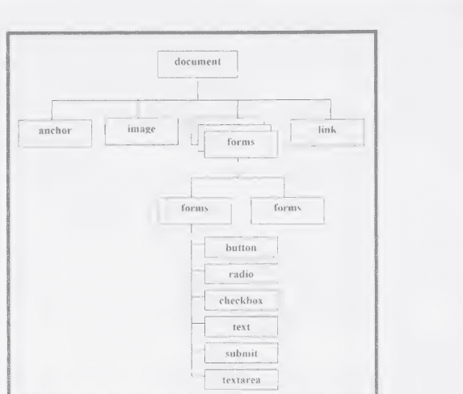

**图 3.4** 属于 `document` 对象的常用对象和集合

要支持旧版浏览器，你必须通过名称来引用对象。例如，以下语句引用了 `document` 对象的 `write()` 方法。

```
document.write("Welcome to my Web page!");
```

在你继续学习今天剩余的内容时，我将提供更多示例，进一步演示如何通过名称引用对象。

### 使用文档对象模型

Internet Explorer 和 Netscape Communicator 的最新版本支持 DOM。因此，你有两种不同的方式来访问浏览器对象。首先，你可以如前所述通过名称来访问它们。使用此选项的优点是它有助于使你的 HTML 页面和 Javascript 与旧版浏览器向后兼容。此选项的缺点是与使用 DOM 提供的属性相比，它提供的灵活性要少得多。

表 3.1 提供了一个完整的 DOM 属性列表，你可以在 Javascript 中使用这些属性来访问浏览器对象。这些属性通过提供在树中上下遍历的能力（而无需硬编码对特定 HTML 元素的引用，例如通过 NAME 属性），让你能全面控制 HTML 页面上的所有内容。

#### 表 3.1 DOM 属性

| 属性 | 描述 |
| :--- | :--- |
| firstChild | 属于某个对象的第一个子节点 |
| lastChild | 某个对象的最后一个子节点 |
| childNodes | 属于某个对象的子对象的集合（例如数组） |
| parentNode | 某个对象的父对象 |
| nextSibling | 在树中位于前一个子节点之后的子节点 |
| previousSibling | 位于当前子节点之前的子节点 |
| nodeName | 分配给对象的 HTML 标签的名称 |
| nodeType | 标识与对象相关联的 HTML 元素（标签、属性或文本）的类型 |
| nodeValue | 检索分配给文本节点的值 |
| data | 检索指定文本节点的值 |
| specified | 确定是否已指定某个属性 |
| attributes | 由某个对象所有属性组成的集合（例如数组） |

为了演示如何使用表 3.1 中列出的 DOM 属性来访问和操作 HTML 内容，请看以下示例。

```html
<HTML>

<HEAD>
<TITLE>Script 3.2 - DOM Navigation and Access Example</TITLE>
</HEAD>
<BODY ID="bodyTag">
    <P ID="Tag1" Name="helloTag">Hello.</P>
    <P ID="Tag2" NAME="welcomeMsg"> Welcome to my Web site.</P>
</BODY>

</HTML>
```

从图形上看，此脚本可以表示为图 3.5。`document` 对象位于树的根部，只有一个子对象 `documentElement`。`documentElement` 代表 HTML 页面的开始 `<HTML>` 标签。

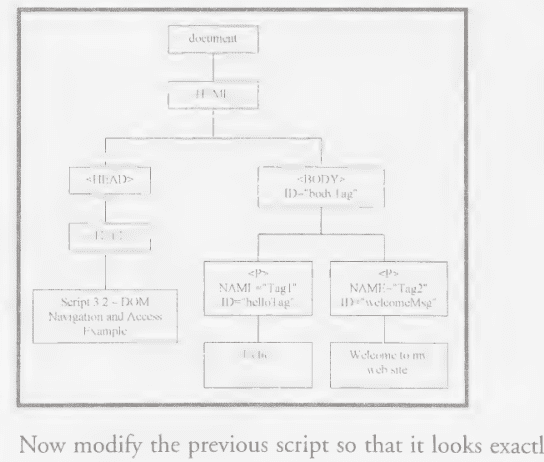

现在修改前面的脚本，使其与下面所示的示例完全相同。

```html
<HTML>

    <HEAD>
        <TITLE>Script 3.3 - DOM Navigation and Access Example</TITLE>
    </HEAD>
</HEAD>
<BODY ID="bodyTag">
    <P ID="Tag1" NAME="helloTag">你好。</P>
    <P ID="Tag2" NAME="welcomeMsg">欢迎来到我的网站。</P>
    <SCRIPT LANGUAGE="JavaScript" TYPE="Text/JavaScript">
    <!-- Start hiding JavaScript statements
        window.alert("分配给第一个 HTML 标签的 ID 是: " + document.documentElement.firstChild.tagName);
        window.alert("分配给第二个 HTML 标签的 ID 是: " + document.documentElement.lastChild.tagName);
        window.alert("分配给第一个 HTML 标签的子标签的 ID 是: " + document.documentElement.firstChild.firstChild.tagName);
        window.alert("点击确定以动态修改 Tag2 的值");
        document.getElementById("Tag2").firstChild.nodeValue="欢迎来到 " + 
            "我的全新升级网站。";
    // End hiding JavaScript statements -->
    </SCRIPT>
</BODY>
</HTML>
```

第一条 JavaScript 语句显示的是文档对象下存在的第一个 HTML 标签（例如 `<HEAD>` 标签）的标签名，如图 3.6 所示。

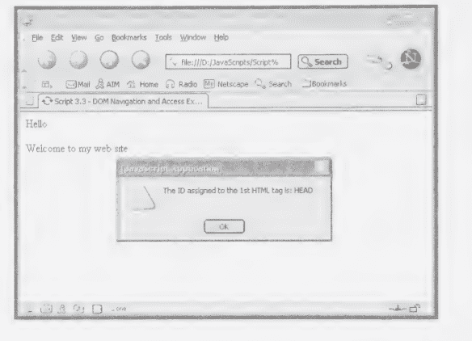

**图 3.6** 使用 DOM 属性来浏览和引用 HTML 页面上的不同元素

请查看图 3.5 所示的树状层次结构，并将其与构成此语句的各个部分进行比较。接下来，JavaScript 使用 `lastChild` 属性来引用 `<BODY>` 标签。然后，脚本引用 `<TITLE>` 标签，它恰好是脚本中第一个标签下的第一个标签。下一条语句显示一条消息，说明脚本即将重写分配给 HTML 页面第二个标签的值。最后，脚本中的最后一条语句（如下所示）重写了屏幕上显示的部分文本。它通过使用 `getElementById()` 方法建立对 Tag2 的引用来完成此任务。这就建立了对 HTML 页面第二个 `<P>` 标签的引用。然后，该语句引用标签的 `firstChild` 的 `nodeValue`（例如标签的内容）并为其赋予一个新值。

```
document.getElementById("Tag2").firstChild.nodeValue="欢迎来到 " +
"我的全新升级网站。";
```

图 3.7 显示了其内容被动态更改后的 HTML 页面的外观。

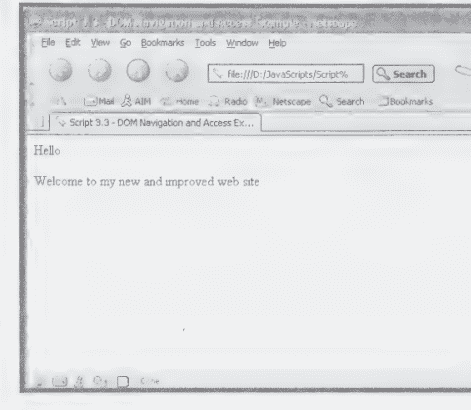

DOM 提供了引用 HTML 页面上任何元素的功能。它提供了无需引用硬编码标签名即可浏览 HTML 页面以及动态修改内容的功能。然而，这种灵活性的代价是复杂性。

遗憾的是，Internet Explorer 浏览器 5 之前的版本不支持 DOM，Netscape Communicator 6 之前的版本也不支持 DOM。因此，您网页的许多访客可能正在使用不支持它的浏览器。

### 浏览器对象

互联网浏览器提供了对大量浏览器对象的访问。在接下来的几个小节中，我将向您介绍一些更常用的浏览器对象，并演示如何使用 JavaScript 与它们一起工作。

### window 对象

`window` 对象是页面上所有其他对象的祖先。可以同时打开多个窗口。`window` 对象有数十个相关的对象和方法，其中许多您已经使用过。例如，您已经使用了 `window.alert()` 方法在警报对话框中显示消息，使用 `window.prompt()` 来获取用户输入，并使用 `window.confirm()` 在采取操作之前寻求用户许可。

根据您使用的浏览器，还有一些用于控制导航的方法。例如，Netscape Communicator 支持 `window.back()`、`window.forward()` 和 `window.home()`。但是，Internet Explorer 不支持这些方法。这指出了这两种浏览器之间的一个细微差异。以下示例演示了在 Netscape Communicator 中处理这些 `window` 对象方法时的用法。

```html
<HTML>
<HEAD>
<TITLE>脚本 3.4 - 使用 window 对象 - 1</TITLE>
</HEAD>
<BODY>
<FORM NAME="form1">
<INPUT TYPE="button" VALUE="后退" onClick="window.back()">
<INPUT TYPE="button" VALUE="主页" onClick="window.home()">
<INPUT TYPE="button" VALUE="前进" onClick="window.forward()">
</FORM>
</BODY>
</HTML>
```

该脚本定义了一个包含三个按钮的表单。点击一个按钮会触发其 `onClick` 事件执行。以标记为“后退”的按钮为例，`onClick` 事件执行 `window.back()` 方法，导致浏览器加载上一个网页。点击“前进”按钮会产生完全相反的效果，而点击“主页”按钮则会重新加载当前页面。现在不要担心 `onClick` 事件处理程序；您将在今天下午结束时学习事件处理程序。现在，只需知道事件处理程序使您能够将 JavaScript 语句和函数与用户操作（例如点击对象上的鼠标）相关联即可。

图 3.8 显示了在 Netscape Communicator 中加载上述内容时的样子。点击“主页”按钮会告知浏览器加载用户设置为默认主页的 URL。点击“后退”或“前进”按钮的效果与点击浏览器的“后退”或“前进”按钮相同。

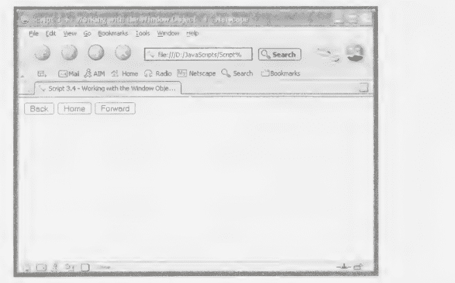

**图 3.8** 创建您自己的导航按钮

以下脚本为您提供了使用 `window` 对象方法的另一个示例。在此示例中，浏览器在网页加载后立即使用 `window` 对象的 `open()` 方法打开第二个窗口。该窗口被命名为 `window1`。

## 一个周末学 JavaScript

```html
<HTML>

<HEAD>
<TITLE>脚本 3.5 - 使用 window 对象 - 2</TITLE>
</HEAD>

<BODY>

<SCRIPT LANGUAGE="JavaScript" TYPE="Text/JavaScript">
<!-- Start hiding JavaScript statements
window1=window.open();
// End hiding JavaScript statements -->
</SCRIPT>

<FORM NAME="form1">
<INPUT TYPE="button" VALUE="关闭窗口" onClick="window1.close()">
<INPUT TYPE="button" VALUE="调整大小" onClick="window1.resizeTo(300,400)">
</FORM>

</BODY>

</HTML>
```

> **注意** 毫无疑问，您已经见过许多网站在您点击链接时会打开多个窗口。通常，其他窗口以较小窗口的形式出现，试图向您推销产品或引导您访问其他链接。

该脚本包含一个定义了两个按钮的表单，每个按钮都包含一个 `onClick` 事件处理程序。如果您点击第一个标记为“关闭窗口”的按钮，则会执行 `window` 对象的 `close()` 方法。为了使浏览器知道您想要关闭哪个窗口，您必须指定窗口的名称（在本例中为 `window1`）。

表单中的第二个按钮“调整大小”执行 `window` 对象的 `resizeTo()` 方法。此方法告诉浏览器将 `window1` 窗口对象的大小更改为 300x400 像素。

图 3.9 演示了当您首次使用 Internet Explorer 加载此页面时会看到的内容。打开了两个窗口。第一个窗口显示包含脚本的表单，第二个窗口是由脚本的 `window1=window.open()` 语句打开的。

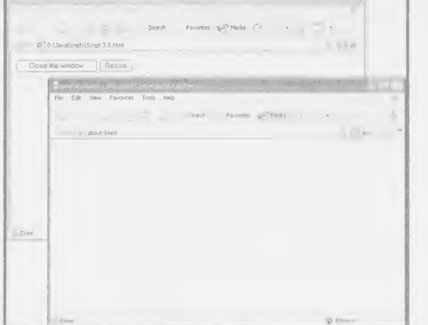

**图 3.9** 打开和控制浏览器窗口

`window` 对象的 `open()` 方法使您能够对窗口的外观进行大量控制。例如，您可以控制窗口是否具有某些功能，如菜单栏、工具栏、滚动条和状态栏，以及窗口是否可以调整大小。

图 3.10 显示了这些功能在浏览器窗口上的位置。

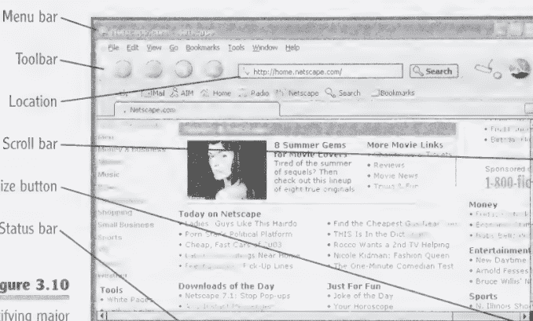

下面的示例演示了如何控制这些窗口功能：

```html
<HTML>

<HEAD>
    <TITLE>脚本 3.6 - 使用 window 对象 - 3</TITLE>
</HEAD>

<BODY>

    <SCRIPT LANGUAGE="JavaScript" TYPE="Text/JavaScript">
    <!-- Start hiding JavaScript statements
        window.open("", "Window1", "menubar=no,toolbar=yes," +
            "scrollbar=yes,resizable=yes,status=yes,location=yes");

        // End hiding JavaScript statements -->
```

### 文档对象

`document` 对象是 JavaScript 的核心与灵魂。每个网页都可以包含一个 `document` 对象。你已经广泛使用它，通过 `document.write()` 方法向屏幕输出内容。

`document` 对象的属性取决于页面 HTML 的内容。例如，如果一个网页包含图像，那么该页面的文档属性将包含一个 `images[]` 数组，该数组列出了页面上的每一个图像。

`document` 对象拥有大量可用的属性，用于控制页面外观和收集内容信息。例如，`document` 对象存储了以下数组的属性值：

- **anchors[]**。一个包含文档中所有锚点的数组。
- **applets[]**。一个包含文档中所有小程序的数组。
- **embeds[]**。一个包含文档中所有嵌入对象的数组。
- **forms[]**。一个包含文档中所有表单的数组。
- **images[]**。一个包含文档中所有图像的数组。
- **links[]**。一个包含文档中所有链接的数组。
- **plugins[]**。一个包含文档中所有插件的数组。

其他文档对象属性可以用来影响外观：

- **bgColor**。指定文档的背景色。
- **fgColor**。指定文档文本的颜色。
- **linkColor**。指定链接的颜色。
- **alinkColor**。指定活动链接的颜色。
- **vlinkColor**。指定已访问链接的颜色。

以下是其他一些有用的文档属性的部分列表：

- **cookie**。允许你获取和设置 cookie 值。
- **lastModified**。一个字符串，显示文档最后被修改的日期和时间。
- **referrer**。一个字符串，显示用户来自哪个 URL。
- **title**。一个字符串，包含 HTML `<TITLE>` 标签的内容。
- **URL**。一个字符串，包含文档的 URL。

以下示例演示了两个文档对象属性的使用。脚本中的第一条语句使用 `document.title` 属性打印位于 HTML `<TITLE>` 标签中的标题。第二条语句使用 `document.lastModified` 属性显示页面最后修改的日期和时间。图 3.12 显示了在 Netscape Communicator 中加载此示例的结果。

```html
<HTML>

<HEAD>
    <TITLE>Script 3.7 - Setting the Modification Date and Time</TITLE>
</HEAD>

<BODY>
    <SCRIPT LANGUAGE="JavaScript" TYPE="Text/JavaScript">
    <!-- Start hiding JavaScript statements
    document.write("<B>Document Title:</B> " +
    document.title + "<BR>");
    document.write("<B>Last Modified on:</B> " +
    document.lastModified);
    // End hiding JavaScript statements -->
    </SCRIPT>
</BODY>
</HTML>
```

**图 3.12** 显示文档对象的属性。

### 表单对象

今天下午晚些时候，我将用相当一部分内容来探讨如何使用 JavaScript 控制表单。可以将本节提供的信息视为关于表单对象的一个预览。

文档对象的 `forms[]` 数组维护着页面上每个表单的列表，从 `form[0]` 开始，每增加一个表单索引加 1。你可以通过 `forms[]` 数组的索引号或通过名称来引用单个表单。

例如，以下代码创建了一个名为 `form1` 的表单，其中包含一个按钮：

```html
<FORM NAME="form1">
    <INPUT TYPE="button" NAME="backButton" VALUE="Back" onClick="window.back()">
</FORM>
```

假设这是页面上唯一的表单，你可以通过 `document.forms[0]` 或 `document.form1` 来引用它。表单可以包含许多元素，例如文本框和按钮。为了管理这些表单元素，每个 `form` 对象都包含自己的数组，名为 `elements[]`。表单中的第一个元素存储为 `element[0]`，第二个元素存储为 `element[1]`，依此类推。

### location 对象

`location` 对象相对简单。其属性包含关于自身 URL 的信息。例如，`location.href` 指定了页面的 URL，而 `location.pathname` 仅指定 URL 的路径部分。如果你更改 `location` 对象，浏览器会自动尝试重新加载该 URL。

`location` 对象只有两个方法：`reload()` 方法允许你强制重新加载页面，而 `replace()` 方法让你指定要加载的新 URL。因为 `replace()` 方法会在历史记录列表中当前条目之上写入新条目，此方法会阻止用户使用浏览器的“后退”按钮返回到上一个页面。

以下脚本展示了如何使用 `location` 对象强制浏览器重新加载当前页面或加载新的 URL。首先，脚本定义一个名为 `myUrl` 的变量，并将其设置为 `location.href` 的值（即当前页面的 URL）。然后它定义了一个包含两个按钮的表单。`onClick` 事件处理程序已分配给第一个按钮。当用户单击此按钮时，`location.replace()` 方法指示浏览器加载 `http://www.netscape.com`。当用户单击第二个按钮时，`location.reload()` 方法指示浏览器重新加载当前网页。图 3.13 显示了加载此示例的结果。

```html
<HTML>

<HEAD>
    <TITLE>Script 3.8 - Working with the location object</TITLE>
</HEAD>

<BODY>

<SCRIPT LANGUAGE="JavaScript" TYPE="Text/JavaScript">
<!-- Start hiding JavaScript statements
    myUrl = location.href;
    document.write("myUrl = " + myUrl + "<BR>");
// End hiding JavaScript statements -->
</SCRIPT>

<FORM NAME="form1">
    <INPUT TYPE="button" VALUE="go to www.netscape.com"
           onClick="location.replace('http://www.netscape.com')">
    <INPUT TYPE="button" VALUE="Reload this page"
           onClick="location.reload()">
</FORM>

</BODY>

</HTML>
```

**图 3.13** 使用 `location` 对象控制浏览器导航和页面重载。

### history 对象

`history` 对象维护着一个 URL 列表，这些 URL 是浏览器在当前会话开始以来访问过的。此对象的一个有用属性是 `length` 属性，你可以使用以下语法访问它：

```javascript
history.length
```

`history` 对象有三个方法：

- `back()` 方法加载历史记录列表中先前访问的 URL。这与点击浏览器的“后退”按钮效果相同。
- `forward()` 方法加载历史记录列表中的下一个 URL。这与点击浏览器的“前进”按钮效果相同。
- `go()` 方法加载历史记录列表中指定的 URL。例如，`history.go(4)` 加载历史记录列表中向前四个条目的 URL，`history.go(-4)` 加载向后四个条目的 URL，而 `history.go(0)` 则重新加载当前 URL。

### navigator 对象

`navigator` 对象是一个顶层对象，类似于 `window` 对象。这意味着 `navigator` 对象在对象层次结构中不位于任何其他对象之下。它包含了加载网页的浏览器信息。Netscape Navigator 和 Internet Explorer 都支持这个对象，尽管 Internet Explorer 对该对象的使用可能看起来有点奇怪。`navigator` 对象的一些有用属性包括：

- `navigator.appCodeName`。包含浏览器的代码名称
- `navigator.appName`。包含浏览器的名称
- `navigator.appVersion`。包含浏览器的版本号

你的脚本可以使用这些属性的值来确定加载网页的浏览器（及其版本号）。然后，你可以利用这些信息将浏览器定向到你编写的、适用于该特定浏览器的 JavaScript。

以下示例向你展示了如何创建变量并将 `navigator` 对象属性的值赋给它们。然后，此脚本打印变量的值。但是，你可以向此脚本添加额外的逻辑，以查询这些变量的值，然后将用户的浏览器定向到你设计的、适用于该特定浏览器的网页。

```html
<HTML>

<HEAD>
    <TITLE>脚本 3.10 - 显示 navigator 对象属性</TITLE>
</HEAD>

<BODY>
    <SCRIPT LANGUAGE="JavaScript" TYPE="Text/JavaScript">
        <!-- 开始隐藏 JavaScript 语句
        document.write("<B>navigator.appCodeName = </B>" + navigator.appCodeName + "<BR>");
        document.write("<B>navigator.appName = </B>" + navigator.appName + "<BR>");
        document.write("<B>navigator.appVersion = </B>" + navigator.appVersion + "<BR>");
        // 结束隐藏 JavaScript 语句 -->
    </SCRIPT>
</BODY>

</HTML>
```

图 3.15 显示了我在 Netscape Communicator 中加载此脚本后的结果。

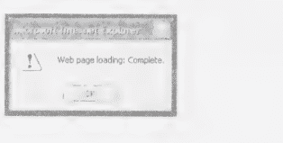

### 创建自定义对象

除了核心 JavaScript 对象和基于浏览器的对象之外，JavaScript 还提供了构建自己的对象的能力。创建一个对象实例需要三个基本步骤：

1. 定义其结构
2. 赋予其属性
3. 赋予将充当对象方法的函数

有两种方法可以创建新对象。第一种是编写一个定义新对象格式的函数，然后使用 `new` 运算符实例化一个新对象。例如，以下函数定义了一个包含两个属性和一个方法的新对象：

```
function Customer(name, phone) {
    this.name = name;
    this.phone = phone;
    this.ShowAlert = ShowAlert;
}
```

第一行定义了一个接受两个参数的函数。接下来的两行使用这些参数来建立属性特征。最后一行赋予一个名为 `ShowAlert` 的方法。请注意，定义的方法没有关联的参数。

`ShowAlert` 方法本身只是一个函数。如此处所示，`ShowAlert()` 显示一个警告提示，揭示客户对象的 `name` 和 `phone` 属性：

```
function ShowAlert() {
    window.alert("Customer: " + this.name + " - Phone: " + this.phone)
}
```

然后可以使用以下代码行来使用 `Customer()` 函数实例化一个新对象：

```
Customer1 = new Customer("Robert Robertson", 8043334444)
```

此语句创建一个名为 `Customer1` 的新对象，它具有以下属性：

```
Customer1.name
Customer1.phone
```

你可以反复调用该函数来创建其他新对象。`Customer1` 对象还有一个方法，可以使用以下语句调用：

```
Customer1.ShowAlert()
```

如果你将整个示例组合在一起，最终会得到以下脚本：

```html
<HTML>
    <HEAD>
        <TITLE>脚本 3.11 - 创建自定义对象</TITLE>
        <SCRIPT LANGUAGE="JavaScript" TYPE="Text/JavaScript">
        <!--开始隐藏 JavaScript 语句

        function Customer(name, phone) {
            this.name = name;
            this.phone = phone;
            this.ShowAlert = ShowAlert;
        }

        function ShowAlert() {
            window.alert("Customer: " + this.name + " - Phone: " + this.phone);
        }

        // 结束隐藏 JavaScript 语句 -->
        </SCRIPT>

    </HEAD>

    <BODY>

    <SCRIPT LANGUAGE="JavaScript" TYPE="Text/JavaScript">
    <!--开始隐藏 JavaScript 语句
        Customer1 = new Customer("Robert Robertson", 8043334444);
        Customer1.ShowAlert();
    // 结束隐藏 JavaScript 语句 -->
    </SCRIPT>

    </BODY>
</HTML>
```

图 3.16 显示了运行此脚本时你将看到的内容。


### 使用对象初始化器创建对象

创建新对象实例的另一种方法是编写函数，而替代方法是利用对象初始化器。在这种情况下，你通过将属性和方法放在一对花括号内来以表达式的形式创建对象，用冒号将属性或方法名与其值分开。例如，可以使用以下语句创建一个名为 `Customer1` 的对象：

```
Customer1 = {name:"Robert Robertson", phone:8043334444,
    showAlert:ShowAlert};
```

花括号内的前两个条目定义了以下属性对并设置它们的值：

```
Customer1.name = "Robert Robertson";
Customer1.phone = 8043334444;
```

最后一个条目定义了一个方法：

```
Customer1.ShowAlert();
```

如果你使用对象初始化器，可以将前面示例中的代码重写如下：

```html
<HTML>
    <HEAD>
        <TITLE>脚本 3.12 - 创建自定义对象的另一种方式</TITLE>
        <SCRIPT LANGUAGE="JavaScript" TYPE="Text/JavaScript">
            <!--开始隐藏 JavaScript 语句
            function ShowAlert() {
                window.alert("Customer: " + this.name + " - Phone: " + this.phone);
            }
            //结束隐藏 JavaScript 语句-->
        </SCRIPT>
    </HEAD>
    <BODY>
        <SCRIPT LANGUAGE="JavaScript" TYPE="Text/JavaScript">
            var Customer1 = {name:"Robert Robertson", phone:8043334444, showAlert:ShowAlert};
            Customer1.showAlert();
        </SCRIPT>
    </BODY>
</HTML>
```

### 删除你的对象

JavaScript 提供了一个 `delete` 运算符，你可以用它来删除任何你不再需要的对象。你可以添加以下代码行来删除你刚刚创建的 `Customer1` 对象：

```
delete Customer1;
```

你也可以使用 `delete` 运算符删除单个对象属性或方法，而无需删除整个对象。例如，要删除 `Customer1` 对象的 `name` 属性，请输入以下内容：

```
delete Customer1.name;
```

### 扩展对象定义

你可以通过以下三种方式之一为对象添加额外的属性：

- 重写函数以适应新的对象属性
- 使用 `prototype` 属性为对象的所有实例添加额外的属性
- 为单个对象添加新属性而不影响其他对象

重写函数以适应新属性是一个显而易见的选择。`prototype` 属性可用于为所有对象实例添加新属性。例如，要为所有 `Customer` 类型的对象添加一个名为 `nickname` 的属性，你可以编写以下语句：

```javascript
Customer.prototype.nickname = null;
```

然后，你可以使用以下语句为单个对象的 `nickname` 属性赋值：

```javascript
Customer1.nickname = "Leeman";
```

要为单个对象添加新属性而不将该属性添加到对象的其他实例，请输入对象的名称、一个句点，然后是新属性的名称并为其赋值，如以下示例所示。这里为 `Customer1` 对象创建了一个新属性 `zipcode`，并赋值为 `23116`。

```javascript
Customer1.zipcode = 23116;
```

## 处理事件

到目前为止，你所见到的大多数 JavaScript 都是自上而下执行的。我的意思是，浏览器在页面加载后立即开始执行你的脚本，从第一条 JavaScript 语句开始，然后继续执行后续语句，直到处理完最后一条语句。

一个例外情况是使用放置在页面 `<head>` 部分或 `<body>` 部分顶部的函数，这些函数通过脚本后面的函数调用执行。在某些情况下，添加 `if...then` 语句或 `switch` 语句可能使语句或函数的执行成为可选的。但即使在存在多种逻辑脚本执行路径的情况下，脚本语句也是以串行方式逻辑执行的。

### 定义事件

在 JavaScript 中，事件发生在浏览器的范围内。事件包括诸如鼠标单击、鼠标移动、按下键盘按键、打开和关闭窗口和框架以及调整窗口大小等活动。浏览器会识别事件并在这些事件发生时执行默认操作。例如，当用户单击链接时，会发生 `click` 事件，浏览器的默认操作是加载链接指定的网页或图像。

要使你的网页真正具有交互性，你必须在你的脚本技能工具包中添加另一个工具：事件处理程序。*事件处理程序* 是识别特定类型事件发生的陷阱。你可以将代码添加到你的脚本中，以改变浏览器对事件的默认响应。例如，不是自动加载链接指定的 URL，你可以显示一个确认对话框，要求用户在继续之前同意某些条款。

> **注意** 事件处理程序的名称基于触发它们的事件。将单词 `on` 放在事件名称前面会创建事件处理程序的名称。例如，`click` 事件的事件处理程序是 `onClick`。

每个事件都与一个特定的对象相关联。当给定对象发生事件时，其事件处理程序会执行（假设你已经编写了一个）。例如，每当用户单击按钮、文档、复选框、链接、单选选项、重置按钮或提交按钮时，`click` 事件就会发生。

### event 对象

考虑到其强大的功能，事件处理程序定义起来异常简单。你将它们放置在定义对象的 HTML 标签中。例如，你可以通过将 `onLoad` 事件处理程序放在第一个 HTML `<BODY>` 标签内来定义在网页加载时发生的事件，如下所示：

```html
<BODY onLoad="window.alert('Web page loading: Complete.')">
```

在此示例中，当页面完成加载时会出现一个警告对话框。请注意，事件处理程序紧跟在标签之后，其值放在引号内。你可以使用任何 JavaScript 语句作为事件处理程序的值。你甚至可以使用多个语句，前提是用分号将它们分隔开。或者，你可以使用函数调用，这使你能够执行更复杂的操作来响应事件。

在本课程的其余部分，你将看到大量关于如何以及在何处将事件处理程序放置在各种 HTML 标签中的示例。

> **注意** 有关完整的事件、事件处理程序以及特定事件适用的对象列表，请参见附录 B “JavaScript 事件和事件处理程序摘要”。

`event` 对象在每次发生事件时都会被填充。事件处理程序可以引用其属性中的信息，使你的脚本能够访问有关事件的详细信息。

例如，`event.modifiers` 属性指定与鼠标或键盘事件关联的任何修饰键。如果用户在单击鼠标按钮时按下了 Alt 键，则 `event.modifiers` 属性包含值 `Alt`。`event.type` 属性包含一个表示所发生事件类型的字符串，而 `event.which` 属性包含一个数字，该数字指定按下的鼠标按钮或按下的键盘键的 ASCII 值。

### 事件类型

JavaScript 目前支持 24 种不同的事件和事件处理程序。这些事件可以大致分为几类：

- 窗口和框架事件
- 鼠标事件
- 键盘事件
- 错误事件

在接下来的脚本中，将演示其中一些事件及其相关的事件处理程序。有关完整的事件和事件处理程序列表，请参见附录 B。

### 窗口和框架事件

影响窗口和框架对象的事件包括 `load`、`resize`、`unload` 和 `move` 事件。这些事件的事件处理程序是 `onLoad`、`onResize`、`onUnload` 和 `onMove`。这些事件处理程序放置在 `<BODY>` 标签内。以下脚本使用 `alert()` 方法来演示如何响应这些事件的发生来执行 JavaScript 语句：

```html
<HTML>

<HEAD>
<TITLE>Script 3.13 - onLoad, onResize, onUnload & onMove Example</TITLE>
</HEAD>

<BODY onLoad="window.alert('Web page loading: Complete.')"
onResize="window.alert('What is the matter with my current size?')"
onUnload="window.alert('Oh no, I am melting......')"
</BODY>

</HTML>
```

运行此脚本时，你将看到的第一件事是一个提示，通知你网页已完成加载（参见图 3.17）。当 `onLoad` 事件处理程序响应 `load` 事件执行时，会触发此消息。

如果你调整窗口大小，`resize` 事件将导致 `onResize` 事件处理程序执行并显示警告消息。同样，移动窗口会导致类似的警告消息。`unload` 事件处理程序在你关闭窗口或用另一个 URL 加载它之前不会执行。


**图 3.17** 使用 `onLoad` 事件处理程序通知用户整个页面已完成加载

### 鼠标事件

当你对鼠标执行操作时，鼠标事件会执行。这包括以下任何操作：

- **MouseOver** 事件发生在指针移到对象上方时。
- **MouseOut** 事件发生在指针移出对象时。
- **MouseDown** 事件发生在按下鼠标按钮时。
- **MouseUp** 事件发生在释放鼠标按钮时。
- **MouseMove** 事件发生在移动鼠标时。
- **Click** 事件发生在单击对象时。
- **DblClick** 事件发生在双击对象时。

以下脚本演示了 `onMouseOver`/`onMouseOut` 和 `onMouseDown`/`onMouseUp` 事件的使用。此脚本定义了两个链接。单击任一链接都会指示浏览器加载 www.microsoft.com 上的网页。通过将 `onMouseOver` 和 `onMouseOut` 事件处理程序添加到第一个 HTML 链接标签中，我指示浏览器更改当指针移过链接时，文档的背景会变为红色。当指针移开链接时，`onMouseOut` 事件处理程序随后会将背景改为白色。

与第二个链接相关的 `onMouseDown` 和 `onMouseUp` 事件处理程序会指示浏览器在用户点击链接时（即用户按下鼠标按钮时）将文档的背景变为红色，并在用户释放鼠标按钮时将背景色改为白色。`onMouseDown` 和 `onMouseUp` 事件处理程序都不会改变链接的默认操作。因此，如果你点击第二个链接，仍然会加载位于 www.microsoft.com 的网页。

```html
<HTML>

<HEAD>
    <TITLE>Script 3.14 - Mouse Event Handler Example</TITLE>
</HEAD>

<BODY>

    <A HREF="http://www.microsoft.com"
        onMouseOver='document.bgColor="red"';
        onMouseOut='document.bgColor="white";'>
        onMouseOver and onMouseOut example</A><P>

    <A HREF="http://www.microsoft.com"
        onMouseDown='document.bgColor="red"';
        onMouseUp='document.bgColor="white";'>
        onMouseDown and onMouseUp example</A><P>

</BODY>

</HTML>
```

图 3.18 展示了当指针未置于第一个或第二个链接上时浏览器窗口的外观。

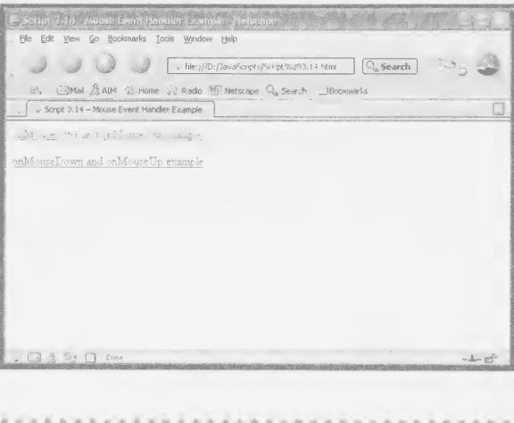

**图 3.18** 使用鼠标事件处理程序控制文档属性

> **注意** `onMouseOver` 和 `onMouseOut` 事件处理程序的一个用途是创建鼠标悬停效果，即当鼠标指针经过按钮时，按钮会改变其外观。你无疑在许多网站上见过这种效果。今天下午晚些时候，我将向你展示如何创建自己的按钮悬停脚本。

以下脚本演示了 `onClick` 和 `onDblClick` 事件处理程序的使用。该脚本创建了一个包含两个按钮的表单。`onClick` 事件被分配给第一个按钮的 `<INPUT>` 标签；`onDblClick` 事件处理程序被分配给第二个按钮的 `<INPUT>` 标签。

```html
<HTML>
<HEAD>
    <TITLE>Script 3.15 - onClick & onDblClick Example</TITLE>
</HEAD>

<BODY>
    <FORM>
        <INPUT TYPE="button" VALUE="Click on me!"
            onClick="window.alert('You single-clicked.')">
        <INPUT TYPE="button" VALUE="Double-Click on ME"
            onDblClick="window.alert('You double-clicked!')">
    </FORM>
</BODY>

</HTML>
```

当你加载此页面并点击其中一个按钮时，会出现一个提示，告知你点击了哪个按钮（见图 3.19）。

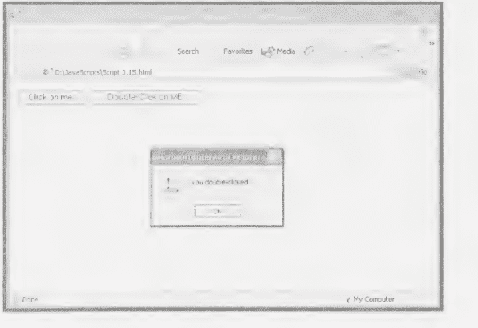

**图 3.19** 演示 `onClick` 和 `onDblClick` 事件处理

### 键盘事件

键盘事件类似于鼠标事件，它们发生在用户按下或释放键盘按键时。有三种键盘事件：`KeyDown`、`KeyUp` 和 `KeyPress`。以下示例演示了如何使用 `onKeyDown` 事件处理程序来捕获来自 Netscape Navigator 的键盘信息。

# 一个周末学会 JavaScript

```html
<HTML>

<HEAD>
<TITLE>Script 3.16 - onKeyDown Example</TITLE>

<SCRIPT LANGUAGE="JavaScript" TYPE="Text/JavaScript">
<!-- Start hiding JavaScript statements
var totalKeyStrokes = 0;
// End hiding JavaScript statements -->
</SCRIPT>

<SCRIPT LANGUAGE="JavaScript" TYPE="Text/JavaScript">
<!-- Start hiding JavaScript statements
function CountKeyStrokes() {
  totalKeyStrokes = ++totalKeyStrokes;
}
// End hiding JavaScript statements -->
</SCRIPT>

</HEAD>

<BODY>
<P>输入一些字符，然后点击按钮：</P>
<FORM>
<TEXTAREA ROWS="4" COLS="70" onKeyDown="CountKeyStrokes()"></TEXTAREA>
<P></P>

<INPUT TYPE="button" VALUE="Count Keystrokes"
onClick="window.alert('Total # of keystrokes = ' +
totalKeyStrokes)">
</FORM>
</BODY>
</HTML>
```

该脚本定义了一个简单的表单，由两个元素组成：一个 `TEXTAREA` 字段和一个按钮。`onKeyDown` 事件处理程序用于跟踪用户在 `TEXTAREA` 字段中输入的总按键次数。`onKeyDown` 事件被设置为每次用户输入新按键时触发。它调用 `CountKeyStrokes()` 函数，该函数将名为 `totalKeyStrokes` 的变量加 1。此变量存储用户当前按键次数的累计总数。当用户点击表单的按钮时，会显示一个弹出对话框，显示用户到目前为止输入的总按键次数。

> **注意** 事件对象的 `event.which` 属性指定所按键的 ASCII 值或所点击鼠标按钮的 ASCII 值。

图 3.20 演示了当你运行脚本、在 `TEXTAREA` 字段中输入一些单词，然后点击表单按钮时发生的情况。

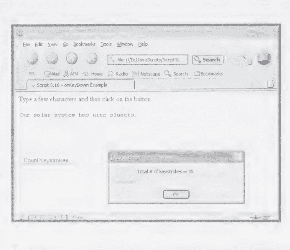

### 错误事件

每当你的 JavaScript 脚本遇到错误时，就会发生错误事件。错误事件会自动触发 `onerror` 事件。通过在脚本中添加 `onerror` 事件处理程序，你可以拦截这些错误并抑制它们。抑制后，你可以尝试以编程方式修复它们，或者显示自定义错误消息。

> **注意** 与其他事件处理程序不同，`onerror` 事件处理程序全部使用小写字母拼写。

当触发时，`onerror` 事件处理程序会自动接收三个参数：错误消息本身、网页的 URL 以及脚本中发生错误的行号。你可以使用 `onerror` 事件处理程序来响应错误。例如，你可以显示警报提示、将用户重定向到另一个网页、调用一个函数、建议用户升级浏览器或获取特定的插件等。

`onerror` 事件处理程序的工作方式与其他事件处理程序略有不同，其语法如下。

```
window.onerror = FunctionName
```

请注意，`onerror` 事件处理程序的拼写全部为小写，并且它不像其他事件处理程序那样嵌入在 HTML 标签中。相反，它在 `<SCRIPT> </SCRIPT>` 标签内定义为一条 JavaScript 语句。触发时，`onerror` 事件处理程序会调用一个函数。

但是，函数调用末尾省略了匹配的圆括号。使用时，`onerror` 事件处理程序及其相关函数一起设置在 HTML 页面的头部部分。

以下脚本演示了如何使用 `onerror` 事件处理程序，通过一个名为 `ErrorTrap()` 的函数来显示错误信息。该函数接受三个参数，它们映射到传递给 `onerror` 事件处理程序的三个参数。该函数使用这些参数来格式化三行文本，呈现错误信息。为了在页面上产生错误，我故意在 HTML 页面的 body 标签中的单词 `window` 末尾添加了一个 `s`。`windows` 不是有效的浏览器对象。

```html
<HTML>

    <HEAD>
        <TITLE>Script 3.17 - onError Example</TITLE>

        <SCRIPT LANGUAGE="JavaScript" TYPE="Text/JavaScript">
        <!--Start hiding JavaScript statements

            function ErrorTrap(msg, url, line_no) {
                document.write("<P>此脚本中发生了一个错误。</P>");
                document.write("错误 = " + msg + "，位于第 " + line_no + " 行<BR>");
                document.write("URL = " + url + "<BR>");
                return true;
            }

            onerror = ErrorTrap;

        // End hiding JavaScript statements -->
        </SCRIPT>

</HEAD>

<BODY onLoad="windows.alert('Hi')">

    欢迎来到我的网页。

</BODY>

</HTML>
```

> **注意** 请注意前面示例中 `ErrorTrap` 函数末尾的 `return true;` 语句。此语句告诉浏览器抑制错误。

图 3.21 展示了使用 Internet Explorer 加载此脚本的结果。如你所见，写入窗口的消息告诉你错误是什么、在网页的哪个位置发生了错误以及页面的位置。

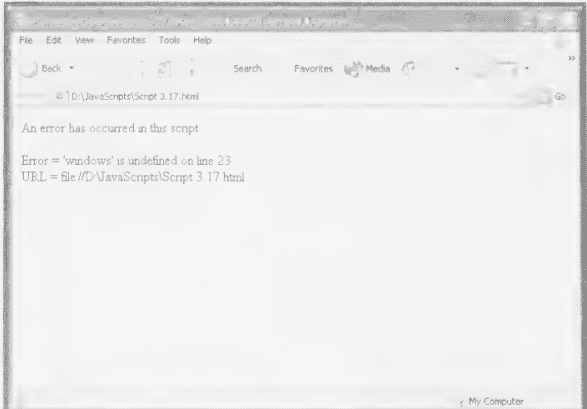

**图 3.21** 使用 `onerror` 事件处理程序捕获错误

`onerror` 事件处理程序也可以在 HTML 标签内使用。通过将 `onerror` 事件处理程序放在特定的 HTML 标签内，你可以针对每个对象分别定义错误事件的不同操作。例如，下面的 JavaScript 使用了这一技术，以便在指定的图形文件无法找到时创建一个错误消息。


```html
<HTML>
    <HEAD>
        <TITLE>Script 3.18 - Another onError Example</TITLE>
    </HEAD>
    <BODY>
        
    </BODY>
</HTML>
```

图 3.22 显示了加载前面脚本后的结果。当浏览器无法找到指定的 xxxx.jpg 图像文件时，会立即显示一个警告提示。

### 使用 onClick 事件作为决策点

在结束今天下午的前半部分之前，我想向你展示一个使用链接和 onClick 事件处理程序的巧妙小技巧。在下面的示例中，我定义了一个指向网站的链接，并为该链接添加了 onClick 事件。在事件处理程序内部，我使用了 window.confirm() 方法，在浏览器加载链接之前向用户请求确认。window.confirm() 提示为用户提供了两个选项。点击“确定”返回 true 值，这使浏览器能够加载网页；点击“取消”返回 false 值，这会阻止浏览器加载指定的 URL。

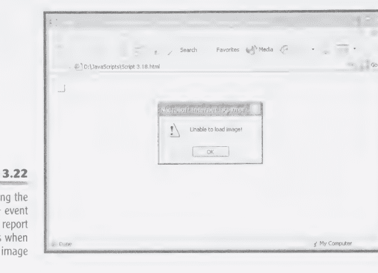

**图 3.22**

使用 onerror 事件处理程序报告加载图像时的问题

```html
<HTML>
    <HEAD>
        <TITLE>Script 3.19 - Age Verification Example</TITLE>
    </HEAD>
    <BODY>
        <A HREF="http://www.ptpmagazine.com"
            onClick="return(window.confirm('You must be older than 30 to visit ' +
            'this site. Are you?'))">ptpmagazine.com</A>
    </BODY>
</HTML>
```

> **提示** 你可以使用此示例的一个变体，在用户点击链接离开你的网站时，询问他们是否确定要离开。

图 3.23 展示了加载前面页面后会发生的情况。

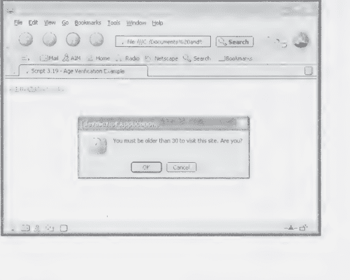

### 休息一下

好的，我们休息一下。也许你应该走动一下，或者打开电视看会儿新闻。当你回来时，我们将看看如何使用 JavaScript 来控制 HTML 框架和表单。你将学习如何控制框架并在其中显示内容。你还将学习如何验证表单内容，以确保访问你网站的访客在你的表单上提供你所需的信息。

## 使用 JavaScript 管理框架

到目前为止，我展示的每一个 HTML 页面都是基于 window 对象的。换句话说，你所处理的所有网页，其页面对象层次结构的顶部都是 window 对象。此外，到目前为止，每个 HTML 页面都包含一个 head 和一个 body 部分。你在这两个部分中都嵌入了 JavaScript。

现代浏览器提供了一种替代方法来组织和呈现浏览器中的数据。使用框架，HTML 页面可以将一个窗口划分为多个较小的窗口，每个窗口都是一个独立的实体，拥有自己的 URL。事实上，就 JavaScript 而言，框架只是 window 对象的一种变体。因此，即使存在一个 JavaScript frame 对象，这个对象实际上只是引用一个专门化的 window 对象的便捷方式。因为框架是一个 window 对象，所以框架对象支持与 window 对象相同的方法和属性。当你使用框架时，页面上定义的每个框架都会有一个框架对象。

框架是使用 HTML 的 `<FRAMESET>` 和 `<FRAME>` 标签创建的。`<FRAMESET>` 标签取代了 HTML 页面中的 body 部分。这个标签定义了你的框架将如何布局，以及每个框架如何分配空间。

### 一个典型的框架示例

在其最简单的形式中，使用框架的示例涉及三个不同的 HTML 页面。第一个页面包含 `<FRAMESET>` 和 `<FRAME>` 标签，并定义了其他页面将显示的布局。这些页面提供加载到框架中的内容；每个页面都由 HTML 和 JavaScript 语句组成。

以下示例可用于使用框架创建一个 HTML 页面。这个 HTML 页面在一个 `<FRAMESET>` 标签内包含两个 `<FRAME>` 标签。`<FRAMESET>` 标签使用 `COLS="*,*"` 属性定义了两个框架，该属性指示浏览器将所有可用空间分配给框架。第一个框架命名为 `left`，并加载指定的页面。由于框架集使用 `COLS` 属性定义了两个列框架，因此第一个框架是左列。第二个框架命名为 `right`，并被分配加载不同的页面。

```html
<HTML>
<HEAD>
<TITLE>Script 3.20 - Building your first frame </TITLE>
</HEAD>

<FRAMESET COLS="*,*">
  <FRAME SRC="Script3.21b.html" NAME="left">
  <FRAME SRC="Script3.21c.html" NAME="right">
</FRAMESET>

</HTML>
```

### 使用 JavaScript 创建框架内容

你可以使用 JavaScript 来控制框架和框架内容。JavaScript 为你提供了同时控制多个框架的能力。这是 HTML 无法实现的。

在你利用 JavaScript 控制框架的能力之前，你必须首先了解浏览器如何在网页中构建框架层次结构。每个框架都属于一个框架集，该框架集可以称为该框架的父级（parent）或顶层（top）。框架集中的每个框架都按照页面加载的顺序，列在一个名为 `frames[]` 的数组中。数组中的第一个框架是 `frames[0]`，第二个是 `frames[1]`，依此类推。

例如，以下页面定义了一个简单的双框架显示：

```html
<HTML>

<HEAD>
  <TITLE>Script 3.23 - Using JavaScript to add dynamic content to frames</TITLE>
</HEAD>

<FRAMESET COLS="*,*">
<FRAME SRC="Script 3.24.html" NAME="left">
<FRAME SRC="Script 3.25.html" NAME="right">
</FRAMESET>

</HTML>
```

顶层或父框架集位于层次结构的顶部，框架集中的每个框架都按照其定义的顺序列出。现在你了解了浏览器如何创建这个框架层次结构，你就可以使用 JavaScript 来引用和控制框架了。例如，`parent.frames[0]` 和 `top.frames[0]` 都引用第一个框架；`parent.frames[1]` 和 `top.frames[1]` 引用第二个框架。

正如你可能注意到的，一个数组会自动创建，其中包含网页上每个框架的条目，从索引 0 开始，基于框架定义的顺序。

> **注意** 如果你给 `<FRAME>` 标签添加了 `NAME=""` 属性，你也可以通过分配的名称来引用单个框架。在前面的示例中，框架被命名为 `left` 和 `right`，你可以将层次结构中的第一个框架引用为 `parent.left` 或 `top.left`。

使用 JavaScript 与框架的好处之一是，你可以在一个框架中提供动态内容。换句话说，你可以直接写入一个框架，而不是将网页加载到其中。以下示例演示了这种技术。

前面的示例展示了一个定义了两个框架的网页。以下示例展示了加载到左框架中的 HTML 页面。

```html
<HTML>

<HEAD>
<TITLE>Script 3.24 - Writing dynamic content</TITLE>
</HEAD>

<BODY>
    <FORM>
        <INPUT TYPE="button" NAME="button1" VALUE="Click Me"
               OnClick="top.right.document.write('<H3>Hello world!</H3>')">
    </FORM>
</BODY>

</HTML>
```

这个 HTML 页面定义了一个包含按钮的表单，当点击该按钮时，执行 JavaScript 语句 `top.right.document.write('Hello world!')`，结果是在右框架中显示消息 Hello world!。你可能记得，`top` 或 parent 引用表示框架层次结构的顶部。`top.right` 调用引用了与左框架在同一框架集中的名为 right 的框架（它的“兄弟”框架，以及包含 `top.right` 语句的框架）。如果你在 `document.write()` 语句中省略了 `top.right` 引用，消息将被写入左框架。

以下页面展示了最初加载到网页右框架中的 HTML 页面。

```html
<HTML>

<HEAD>
    <TITLE>Script 3.25 - The initial content displayed in the right frame</TITLE>
</HEAD>

<BODY>
    <H3>This is the right frame.</H3>
```

### 使用 JavaScript 控制框架

您已经了解如何使用 HTML 链标签将网页加载到目标框架中，如下面示例所示：

```html
<A HREF="link1.html" TARGET="right">示例链接 1</A>
```

此外，您可以使用 JavaScript 将页面加载到您的框架中。得益于 JavaScript 的编程逻辑，您可以对框架的卸载和加载时机及方式施加更精细的控制。以下示例展示了如何用 JavaScript 替换您的 HTML 链接来管理框架。该示例由四个页面组成。

图 3.24 展示了加载第一个 HTML 页面并点击“Click Me”按钮后的显示效果。

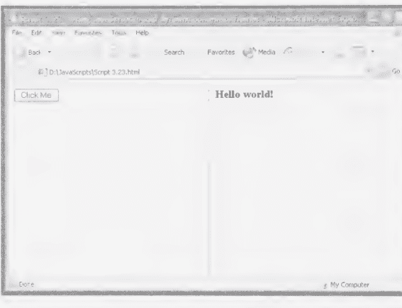

**图 3.24** 使用 JavaScript 将消息发布到框架而非卸载和加载新页面的示例

第一个页面包含 `<FRAMESET>` 和 `<FRAME>` 标签，定义了网站的整体结构。在此例中，定义了两个名为 `left` 和 `right` 的框架；两者均占据浏览器可用显示区域的 50%。

```html
<HTML>

<HEAD>
    <TITLE> 脚本 3.26- 使用 JavaScript 控制框架</TITLE>
</HEAD>

<FRAMESET COLS="*,*">
    <FRAME SRC="Script 3.27.html" NAME="left">
    <FRAME SRC="Script 3.28.html" NAME="right">
</FRAMESET>

</HTML>
```

左侧框架包含一个表单，其中定义了一个名为 `button1`、显示文本“Click Me”的按钮。点击该按钮时，其 `onClick` 事件处理程序将被执行。利用浏览器层次结构，事件处理程序中的 JavaScript 语句首先引用层次结构的顶层（或父层）。接下来，该语句指定将加载新页面的框架。此处并非通过 `parent.right` 引用该框架，而是通过其在 `frames[]` 数组中的位置来识别。因为目标框架是定义的第二个框架，且 `frames[]` 数组的索引值从 0 开始，所以使用 `parent.frames[1]` 来引用第二个框架。接着，添加 `location` 属性。最后，指定要加载的 HTML 页面。

```html
<HTML>

<HEAD>
<TITLE> 脚本 3.27- 添加 JavaScript 控件</TITLE>
</HEAD>

<BODY>
  <FORM>
    <INPUT TYPE="button" NAME="button1" VALUE="Click Me"
      onClick="parent.frames[1].location='Script 3.29.html'">
  </FORM>
</BODY>
</HTML>
```

最初加载到右侧框架的页面非常简单，如下所示。

```html
<HTML>
  <HEAD>
    <TITLE> 脚本 3.28 - 加载到右侧框架的初始内容 </TITLE>
  </HEAD>
  <BODY>
    <H3>这是右侧框架。</H3>
  </BODY>
</HTML>
```

当按钮被点击时加载到右侧框架的页面同样简单，包含一条格式化为 HTML 标题的消息，如下所示。

```html
<HTML>
  <HEAD>
    <TITLE> 脚本 3.29 - 新页面</TITLE>
  </HEAD>
  <BODY>
    <H3>这是您刚刚加载的新框架！</H3>
  </BODY>
</HTML>
```

图 3.25 展示了加载此示例并点击“Click Me”按钮后的结果。在下一个示例中，我将向您展示如何使用 JavaScript 完成仅靠 HTML 无法做到的事情：同时控制多个框架。

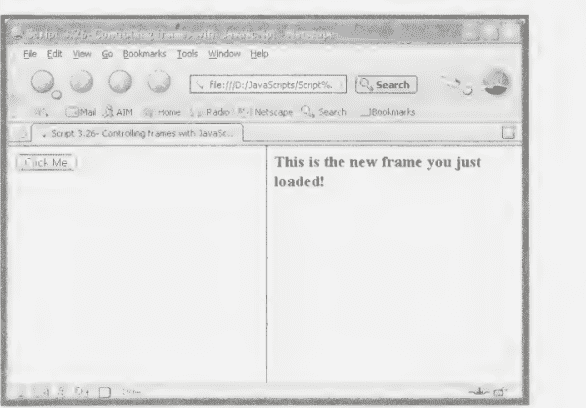

### 同时控制多个框架

下一个示例展示了使用 JavaScript 同时控制多个框架是多么容易。在此示例中，我修改了上一个示例中左侧框架的表单。如您所见，`onClick` 事件处理程序现在指定了第二条 JavaScript 语句。我通过在第一条语句末尾放置分号，将第二条语句添加到了事件处理程序中。如果我想添加更多语句到事件处理程序，我可能会选择创建一个函数，将所有语句放入函数括号内，然后从 `onClick` 事件处理程序中调用该函数。

```html
<HTML>
    <HEAD>
        <TITLE> 脚本 3.27a- 使用 JavaScript 同时控制多个框架</TITLE>
    </HEAD>
    <BODY>
        <FORM>
            <INPUT TYPE="button" NAME="button1" VALUE="Click Me" onClick="parent.frames[0].location='Script3.30.html'; parent.frames[1].location='Script3.29.html'">
        </FORM>
    </BODY>
</HTML>
```

第二条语句的结构与第一条语句相同，只是它引用了不同的框架（`parent.frames[1]` 框架或右侧框架）。

### 使用框架显示其他网站

许多人喜欢在他们的 HTML 页面上添加指向其他网站的链接。向访问者提供其他网站链接的一个缺点是，他们可能会跟随链接离开，而不再返回您的网站。然而，如果您使用框架，您可以提供指向其他网页的链接，而无需真正将访问者发送出去。您只需将其他网站加载到您 HTML 页面上的一个框架中即可。除了让您的访问者留在您的网站并提供非常流畅的界面外，您只需将其他 URL 加载到您的框架中，就能让即使是小型网站也看起来像一个庞大的综合站点。

以下示例使用框架创建了一个网站。左侧框架提供导航菜单；右上角框架显示您的网站标题或其他有用信息。剩余的框架用于显示其他网站的 URL。

第一个页面定义了框架的布局。在此例中，一个 `<FRAMESET>` 标签将显示区域分为两列，为第一列分配 15% 的空间，剩余的 85% 分配给第二列。接着，一个 `<FRAME>` 标签指定将用作导航索引的页面。第二个嵌套的 `<FRAMESET>` 标签将分配给第二列的空间分为两行，为第一行分配 8%，剩余的 92% 分配给第二行。然后定义了两个框架。第一个将一个本地网页加载到顶部的小框架中，第二个将流行的互联网搜索引擎 www.yahoo.com 的 URL 加载到较大的框架中。

```html
<HTML>
<HEAD>
<TITLE> 脚本 3.31- 将其他 URL 加载到您的框架中</TITLE>
</HEAD>
<FRAMESET COLS="15%,85%">
    <FRAME SRC="Script 3.32.html" NAME="left" SCROLLING="auto">
    <FRAMESET ROWS="8%,92%">
        <FRAME SRC="Script 3.33.html" NAME="right1" SCROLLING="auto">
        <FRAME SRC="http://www.yahoo.com" NAME="right2" SCROLLING="auto">
    </FRAMESET>
</FRAMESET>
</HTML>
```

加载到左侧框架的导航页面定义了几个指向其他流行互联网搜索引擎的链接。在此例中，由于指向这些 URL 的链接都加载到同一个框架中，我选择使用带有 `target` 属性的 HTML 链接标签：

```html
<HTML>

<HEAD>
<TITLE> 脚本 3.32- 将左侧框架用作导航页面</TITLE>
</HEAD>

<BODY>
<P><B>搜索引擎：</B></P>
<A HREF="http://www.excite.com" TARGET="right2">Excite</A><BR>
<A HREF="http://www.alta-vista.com" TARGET="right2">AltaVista</A><BR>
<A HREF="http://www.yahoo.com" TARGET="right2">Yahoo</A><BR>
</BODY>

</HTML>
```

下面显示的页面被加载到顶部框架中，用于显示网站名称；这个框架有助于赋予网站精致的外观和感觉。

```html
<HTML>
<HEAD>
    <TITLE> 脚本 3.33- 为您的网站添加标题框架</TITLE>
</HEAD>

<BODY>
    <CENTER>
        <H2>欢迎访问我的互联网搜索引擎网站。</H2>
    </CENTER>
</BODY>
</HTML>
```

图 3.26 展示了首次加载此示例时的初始显示效果。如您所见，通过使用框架和三个简单的脚本，您可以创建一个网站，为用户提供一组流行 URL 的访问入口。

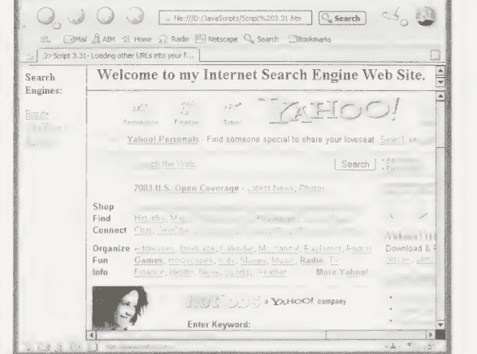

图 3.26

使用 JavaScript 同时控制多个框架

**注意**

在互联网上赚钱的方法有很多。其中一种方式是加入各种互联网公司的联盟计划。在这些计划中，每当你引导一位客户访问他们的网站并完成购买，你就能获得报酬。例如，利用前面示例的一个修改版本，你可以轻松创建自己的在线书店，通过多个页面重点推荐你认为能吸引客户的书籍；然后，你提供指向其他在线书店的链接，这些书店的联盟计划你已经加入。你网站的访客可以购买书籍或其他任何在线公司销售的商品。事实上，明天早上，我将演示如何构建这样一个书店。

### 框架（Frames）——不，谢谢

虽然你可能欣赏将其他 URL 轻松加载到框架中的便利，但你可能不希望自己的网页出现在其他人的框架中，尤其是当你的页面被加载到过小的框架中，导致你的网站看起来很糟糕时。这就是下一个示例的用武之地。它向你展示如何使用几行 JavaScript 阻止他人将你的网页加载到他们的框架中。

```
<HTML>
<HEAD>
    <TITLE>脚本 3.34 - 阻止框架加载你的网页</TITLE>
    <SCRIPT LANGUAGE="JavaScript" TYPE="Text/JavaScript">
    <!-- 开始隐藏 JavaScript 语句
        if (top.frames.length!=0) {
            top.location=self.document.location;
        }
    // 结束隐藏 JavaScript 语句 -->
    </SCRIPT>
</HEAD>
<BODY>
  <CENTER>
    <H1>欢迎来到我的页面！</H1><BR>
    <H3>感谢您的访问！！！</H3>
  </CENTER>
</BODY>
</HTML>
```

我将脚本放在页面的 head 部分，以便它能尽快执行。脚本中的第一行是一个 if 语句，通过检查 `top.frames.length` 的值来判断是否有人试图将页面加载到框架中。如果条件为 0 或 true，则语句 `top.location=self.document.location` 会告诉浏览器将页面的 location 属性设置为自身，从而阻止其被加载到框架中。

任何试图将此网页加载到自己框架中的人都会惊讶地发现，你的页面不仅没有被加载，反而完全替换掉了他自己的网页。

## 使用 JavaScript 管理表单

在 HTML 页面的上下文中，表单是使用 `<FORM>` 标签创建的。在 `<FORM>` 标签内，定义了单个表单元素，如复选框或文本字段。

你可以在不使用 JavaScript 的情况下使用网页上表单的功能。然而，JavaScript 提供了强大的验证功能，并允许你在访问者填写表单时与他们进行交互。

### form 对象

浏览器为每个由 `<FORM>` 标签定义的表单元素创建一个 form 对象。你可以为每个元素分配一个名称（使用可选的 `NAME=""` 属性），或者使用 `forms[]` 数组，该数组包含页面上每个表单元素的索引列表，索引从 0 开始。此外，每个表单包含自己的 `elements[]` 数组，该数组包含该特定表单上每个表单元素的条目。例如，名为 `myForm` 的表单上的第四个表单元素可以引用为 `myForm.elements[3]`。

### 表单属性和方法

`form` 对象具有许多属性，其中许多本身也是对象。你可以使用下面列出的这些属性来访问和操作表单内容。

- `action`。基于 `<FORM>` 标签的 `ACTION` 属性创建。

- `button`。一个用户可以点击以触发操作的对象。

- `checkbox`。一个使用户能够通过点击来选择或清除选项的对象。

- `elements[]`。所有表单元素的数组。

- `encoding`。基于 `<FORM>` 标签的 `ENCTYPE` 属性创建。

- `fileUpload`。一个用户可以指定可作为表单数据包含的文件的对象。

- `hidden`。一个不出现在表单上，但你可以通过编程填充数据的对象。

- `length`。一个指定 `forms[]` 数组中元素数量的属性。

- `method`。基于 `<FORM>` 标签的 `METHOD` 属性创建。

- `name`。基于 `<FORM>` 标签的 `NAME` 属性创建。

- `password`。一个屏蔽其输入的任何文本的对象。

- `radio`。一个组织成类似对象集合的对象，其中只能选择一个。

- `reset`。一个按钮对象，使你能够清除表单并将其重置为默认值。

- `select`。一个提供可选选项列表的对象。

- `submit`。一个按钮对象，使你能够提交表单以进行处理。

- `target`。基于 `<FORM>` 标签的 `TARGET` 属性创建。

- `text`。一个用于保存单行文本的对象。

- `textarea`。一个类似于文本对象但接受多行文本的对象。

form 对象还有几个可以应用于它的方法：

- `handleEvent()`。使你能够在指定对象上模拟特定事件，例如 click 或 dblclick 事件。

- `reset()`。使你能够通过编程清除表单并将其重置为默认值。

- `submit()`。使你能够通过编程提交表单以进行处理。

> 注意：在这三种表单方法中，只有表单的 `handleEvent()` 方法允许你向其传递参数。例如，`handleEvent(click)`。

### 表单事件

除了单个表单元素提供的事件处理程序外，form 对象还提供以下两个事件处理程序：

- onReset 事件处理程序允许你在表单被重置之前执行 JavaScript 语句或调用函数。

- onSubmit 事件处理程序允许你在表单被提交之前执行 JavaScript 语句或调用函数。

这些事件处理程序使你能够在执行访问者请求的重置或提交操作之前执行命令或调用子程序。正如接下来的示例将演示的那样，这为你提供了创建警告消息的机会，告知访问者其操作的后果，或者验证表单内容并协助访问者正确填写表单，同时确保只提供有效的数据。

以下列表标识了哪些事件与每个表单元素相关联，可以作为参考，查看在开发表单时每个表单元素允许你使用哪些事件：

| 事件 | 受影响的表单元素 |

| :--- | :--- |

| Click | button, checkbox, radio, reset, submit |

| Blur | button, checkbox, fileUpload, password, radio, reset, select, submit, text, textarea |

| Focus | button, checkbox, fileUpload, password, radio, reset, select, submit, text, textarea |

| Select | fileUpload, password, text, textarea |

在下一节中，我将向你展示如何利用事件处理程序，以便在表单上触发对用户输入的验证。

### 其他与表单相关的方法

大多数表单元素提供了许多你可以用来以编程方式处元素的方法。这些方法使你能够在不依赖访问者的情况下调用事件。例如，你可能创建一个包含多个文本字段和一个重置按钮的表单。如果用户决定点击重置按钮并重新开始填写表单，你可以将 `focus()` 方法添加到重置按钮的 `onClick` 事件中，通过将光标放回第一个文本来协助访问者。表单元素支持的方法列表包括：

- `click()` 方法的效果与用户点击该对象相同。

- `blur()` 方法将焦点从对象移开。

- `focus()` 方法将焦点置于对象上。

- `select()` 方法突出显示包含文本的表单元素中的文本。

### 表单验证

将 JavaScript 与表单结合使用的真正好处在于验证访问者输入。表单验证使你能够确保访问者已填写所有必填字段，并且这些字段中输入了有效的数据。当访问者犯错时，你可以显示警报消息，解释错误，并要求访问者在重新提交表单之前纠正问题。

以下示例为一家自行车店创建了一个表单，使互联网客户能够在线订购新自行车。客户可以从选项列表中进行选择，并被要求指定他们计划在提取新自行车时使用的支付方式。

首先，我将展示完整的示例，然后我将逐步分解并解释它：

```
<HTML>
<HEAD>
<TITLE>脚本 3.35- 表单验证示例</TITLE>
<SCRIPT LANGUAGE="JavaScript" TYPE="Text/JavaScript">
<!-- 开始隐藏 JavaScript 语句
function ValidateOrder() {
    if (document.myForm.firstName.value.length < 1) {
        window.alert("缺少名！请更正");
        return;
    }
    if (document.myForm.lastName.value.length < 1) {
        window.alert("缺少姓氏！请更正");
        return;
    }
    if (document.myForm.address.value.length < 1) {
        window.alert("Missing Address! Please correct");
        return;
    }
    option_selected = "no";
    for (i=0; i < document.myForm.radio_option1.length; i++) {
        if (document.myForm.radio_option1[i].checked) {
            option_selected = "yes";
        }
    }
    if (option_selected == "no") {
        window.alert("Please specify a bike model!");
        return;
    }
    window.alert("Your order looks good. Click on Submit!");
}
// End hiding JavaScript statements -->
</SCRIPT>
</HEAD>
<BODY>
    <CENTER>
        <H2>欢迎来到杰瑞的定制自行车店</H2>
        <H5>提货时付款</H5>
    </CENTER>
    <FORM NAME="myForm" METHOD="post" ACTION="cgi-bin/myscript">
        <B>名：</B> <INPUT NAME="firstName" TYPE="text" SIZE="15"
MAXLENGTH="20"><BR>
<B>姓：</B> <INPUT NAME="lastName" TYPE="text" SIZE="15"
MAXLENGTH="20">
<P><B>邮寄地址：</B> <INPUT NAME="address" TYPE="text"
SIZE="30" MAXLENGTH="50"></P>
<P><B>选择您想订购的自行车：</B></P>
10速豪华型： <INPUT NAME="radio_option1" TYPE="radio"
VALUE="10Speed"><BR>
15速竞速型： <INPUT NAME="radio_option1" TYPE="radio"
VALUE="15Speed"><BR>
<P><B>补充说明：（可选）</B></P>
<TEXTAREA NAME="myTextarea" TYPE="textarea" ROWS="4"
COLS="40"></TEXTAREA>
<P><B>请指定付款方式：</B>
<SELECT NAME="myList">
<OPTION SELECTED VALUE="check">个人支票
<OPTION VALUE="creditCard">信用卡
<OPTION VALUE="moneyOrder">汇票
</SELECT></P>
<INPUT TYPE="reset" VALUE="重置表单">
<INPUT TYPE="submit" VALUE="提交订单"
onClick="window.alert('Your' +
` bike will be ready in 5 days')">
<INPUT TYPE="button" VALUE="验证订单"
onClick="ValidateOrder()">
</FORM>
</BODY>
</HTML>
```

首先检查页面主体部分的内容。该部分以两个标题开头，并定义了一个表单，该表单将使用 post 方法将其内容发送到名为 `myscript` 的 CGI 程序。由于 CGI `ACTION` 属性未指定 URL 或路径，因此您知道该程序必须与示例页面位于同一位置。

```
<FORM NAME="myForm" METHOD="post" ACTION="cgi-bin/myscript">
```

> **注意** CGI 代表通用网关接口。CGI 不是一种编程语言。它是一种规范，被 PERL 等语言用于在 Web 服务器上运行程序。在此示例中，假设客户端 JavaScript 应将表单内容传递给 Web 服务器进行进一步处理。

> **提示** 您无需访问 Web 服务器上的 CGI 或服务器端脚本和程序，即可收集访问您网站的访客填写的表单内容。您始终可以使用电子邮件来检索表单内容。实现此功能的诀窍是如所示修改 `<FORM>` 标签：

```
<FORM NAME="myForm" ACTION="mailto:jlf04@yahoo.com" ENCTYPE="text/plain">
```

`ACTION="mailto:jlf04@yahoo.com"` 属性设置告诉浏览器将表单内容以电子邮件形式提交到 `mailto:` 设置指定的电子邮件地址。`ENCTYPE="text/plain"` 属性以纯文本的非编码格式发送文本。

浏览器在尝试以电子邮件形式提交表单内容之前，始终需要访客的确认。一旦确认，表单内容将作为电子邮件正文发送到指定的电子邮件账户。

接下来，定义了三个 `text` 字段以收集访客的名、姓和地址信息。两个姓名字段宽15个字符，每个字段最多可收集20个字符的信息。地址字段长30个字符，最多可包含50个字符。

```
<INPUT NAME="firstName" TYPE="text" SIZE="15" MAXLENGTH="20">
<INPUT NAME="lastName" TYPE="text" SIZE="15" MAXLENGTH="20">
<INPUT NAME="address" TYPE="text" SIZE="30" MAXLENGTH="50">
```

然后定义了一对单选按钮，并使用组名 `radio_option1` 进行分组。

```
<INPUT NAME="radio_option1" TYPE="radio" VALUE="10Speed">
<INPUT NAME="radio_option1" TYPE="radio" VALUE="15Speed">
```

下一个表单元素是一个 `textarea`。它最多可包含160个字符的关于自行车订单的补充信息：

```
<TEXTAREA NAME="myTextarea" TYPE="textarea" ROWS="4"
COLS="40"></TEXTAREA>
```

一个名为 `myList` 的下拉列表定义了三种付款选项。

```
<SELECT NAME="myList">
  <OPTION SELECTED VALUE="check">个人支票
  <OPTION VALUE="creditCard">信用卡
  <OPTION VALUE="moneyOrder">汇票
</SELECT>
```

最后三个表单元素是按钮。第一个按钮是一个重置按钮，用于清除表单并恢复所有默认设置。第二个按钮是一个提交按钮。在提交表单进行处理之前，提交按钮的 `onClick` 事件处理程序会显示一个警告消息，告知客户所选自行车将在五天内准备好提货。当客户点击“确定”时，表单将被提交。最后一个按钮使客户能够在提交前验证订单。单击此按钮时，它会调用函数 `validateOrder()`。

```
<INPUT TYPE="reset" VALUE="重置表单">
<INPUT TYPE="submit" VALUE="提交订单" onClick="window.alert('Your bike will be ready in 5 days')">
<INPUT TYPE="button" VALUE="验证订单" onClick="ValidateOrder()">
```

`validateOrder()` 函数由一系列 `if` 语句组成，这些语句检查特定表单元素的值，以确保它们已被正确填写。

第一个 `if` 语句检查表单的 `firstName` 文本字段的 `length` 属性的值。如果该字段不包含任何字符信息，将弹出一个警告对话框，指示用户填写该字段。`alert()` 语句之后的 `return` 语句阻止了 `ValidateOrder()` 函数的进一步处理。

```
if (document.myForm.firstName.value.length < 1) {
    window.alert("Missing First name! Please correct");
    return;
}
```

`validateOrder()` 函数的下一部分检查是否已选择其中一个单选选项来指定所订购自行车的类型。您可能已经注意到，当表单定义单选按钮元素时，它并未将其中一个设置为默认答案；客户可能忘记选择这两个选项中的一个。为了检查表单上的所有单选按钮，设置了一个 `for` 循循环，该循环从0开始遍历所有单选按钮，每次递增1，直到处理完所有单选选项。`radio_option1` 对象的 `length` 属性指定了作为该组一部分的单选按钮的总数，并提供了这个上限。

在循环的每次迭代中，一个 `if` 语句检查每个单选按钮，查看其 `CHECKED` 属性是否已设置；如果已设置，则将名为 `option_selected` 的变量设置为 `yes`。否则，该变量保持为 `no`。在检查完所有单选按钮元素后，另一个 `if` 语句检查 `option_selected` 的值是否曾被设置为 `yes`；如果情况并非如此，将弹出一个警告对话框，指示用户选择其中一个单选选项。此 `if` 语句也以 `return` 语句结束，以防止 `validateOrder()` 函数的进一步处理。

```
option_selected = "no";
for (i=0; i < document.myForm.radio_option1.length; i++) {
    if (document.myForm.radio_option1[i].checked) {
        option_selected = "yes";
    }
}

if (option_selected == "no") {
    window.alert("You must select the bike model that you wish to order! Please correct");
    return;
}
```

`validateOrder()` 函数中的最后一条语句仅在函数的所有前置验证逻辑发现表单已正确填写后才会执行。最后这条语句显示一个弹出对话框，通知客户订单已准备好处理。

```
alert("Your order looks good. Click on Submit!")
```

图 3.27 显示了加载页面时表单的外观。当然，依靠客户主动发起订单验证可能不是最佳做法。相反，您可能希望在用户单击提交按钮时自动执行 `validateOrder()` 函数。您可以通过修改 `<FORM>` 标签，使用 `onSubmit` 事件处理程序包含对 `validateOrder()` 的调用来实现这一点：

```
<FORM NAME="myForm" METHOD="post" ACTION="cgi-bin/myscript"
    onSubmit="return validateOrder();">
```

在一个周末内学会 JavaScript


**图 3.27**

一个在允许表单提交处理之前验证其内容的示例

要使这种验证技术生效，您还必须修改函数中所有 if 语句中的 return 语句，使其为 return false，如下面的示例所示。此修改不仅会在发现验证错误时立即停止 `validateOrder()` 函数的处理，还会阻止 submit 事件的执行。

```
if (document.myForm.firstName.value.length < 1) {
    window.alert("Missing First name! Please correct");
    return false;
}
```

您可能考虑的另一种验证技术是，在客户完成每个表单元素时对其进行验证。要使用此技术，您必须理解焦点（focus）和失焦（blur）的概念。当光标被放置在文本字段中时，该字段被认为获得了文档的焦点。输入的任何按键都会被发送到该字段。如果您然后将光标移动到表单中的不同位置，文本字段将失去焦点，这种情况称为 *blur*。选择一个表单元素会触发其 focus 事件，而将焦点移动到另一个表单元素会触发失去焦点的表单对象的 blur 事件。

在下面的示例中，`onBlur` 事件处理程序已被添加到定义文本对象的 `<INPUT>` 标签中。`ValidateOrder()` 函数在客户选择文本字段然后将表单的焦点更改为另一个对象后执行。当然，如果客户忘记填写此字段并且从未选择它，这种验证技术将无济于事。

```
<INPUT NAME="firstName" TYPE="text" SIZE="15" MAXLENGTH="20"
VALUE=""
onBlur="ValidateOrder()">
```

> **提示** 您可以使用的一种验证技术是添加一条语句，将焦点置于未正确填写的表单对象上，从而为用户提供尽可能简单的操作。例如，您可以如下修改验证客户姓名的 `if` 语句：

```
if (document.myForm.firstName.value.length < 1) {
    window.alert("Missing First name! Please correct");
    document.myForm.firstName.focus();
}
```

### 下一步是什么？

好了，是时候再休息一下了。为什么不在开始本章内容之前去吃点晚餐？回来后，我将向您展示如何使用 JavaScript 控制浏览器的状态栏。您还将学习如何控制浏览器导航以及如何与访客进行交互……

……弹出对话框。同时，您将了解如何使用 JavaScript 创建图形效果。最后，您将研究如何通过添加图形动画来美化页面。

## 周六晚上

用 JavaScript 做些真正酷炫的网页效果

- 向浏览器状态栏添加消息内容

- 使用 JavaScript 增强导航功能

- 使用强大的对话框

- 检测和处理不同类型的浏览器

- 使用图形和动画

现在您已经休息过了，我希望您准备好重新投入学习。您已经花了一整天学习 JavaScript 语句、编程逻辑、语法等基础知识。从今晚开始，您将有机会开始实践，并将所有这些实用知识付诸实践。

今晚，您将看到一个又一个如何将 JavaScript 应用于网页的示例。重点将是如何运用您所学的知识来创建真正有用的脚本。毕竟，这就是您开始阅读这本书的原因。当然，我也会在这个过程中为您提供一些新的信息供您消化，但今晚的重点更多在于实践而非学习。

### 控制状态栏

您可以使用 JavaScript 完成的最简单且最强大的技巧之一是控制浏览器的状态栏。您可以使用 `window` 对象的 `status` 属性来实现这一点。在接下来的四节中，我将向您展示示例，包括如何向状态栏发布消息、如何发布闪烁消息、如何发布并让其不断滚动消息，以及最后如何将状态栏用作显示链接描述的工具。

> **提示** 处理浏览器状态栏时，切勿过度使用。您可能见过一些网页设计师过度使用状态栏的例子。与任何事情一样，请适度使用此信息。

### 向状态栏发布消息

通常，浏览器使用状态栏来显示当前所选链接的 URL 或所选浏览器工具栏或菜选项的描述。但是，如下例所示，您可以更改此默认行为。

```
<HTML>

<HEAD>
    <TITLE>Script 4.1 - 在状态栏发布消息</TITLE>

    <SCRIPT LANGUAGE="JavaScript" TYPE="Text/JavaScript">
    <!-- 开始隐藏 JavaScript 语句
        function PostMsg() {
            window.status = "You should see the new message in the status bar"
        }
    // 结束隐藏 JavaScript 语句 -->
    </SCRIPT>

</HEAD>

<BODY onLoad="window.status = 'Welcome to my status bar script!'">
    <FORM>
        <INPUT NAME="myButton" TYPE="button" VALUE="Post Status Bar Message"
               onClick="PostMsg()">
    </FORM>
</BODY>

</HTML>
```

此示例首先在 head 部分创建一个脚本，定义一个名为 `PostMsg()` 的函数。此函数用于在浏览器的状态栏中显示信息。该函数包含一条语句，使用 `window` 对象的 `status` 属性在状态栏上发布一条消息，如下所示。

```
function PostMsg() {
  window.status = "You should see the new message in the status bar"
}
```

请注意，在此 HTML 页面中，`<BODY>` 标签已被修改以包含 `onLoad` 事件处理程序，如下所示。

```
onLoad="window.status = 'Welcome to my status bar script!'"
```

此语句使用 `window.status` 属性在页面加载后立即将消息放置在浏览器的状态栏上。脚本接下来定义了一个包含一个名为 `myButton` 的按钮的表单。当用户点击该按钮时，按钮的 `onClick` 事件处理程序会执行 `PostMsg()` 函数，该函数随后将其消息写入浏览器的状态栏。

当您加载此页面并点击“Post Status Bar Message”按钮时，您将看到如图 4.1 所示的结果。


### 向状态栏发布闪烁消息

下面的示例向您展示如何让发布到状态栏的消息更花哨一些。在这个脚本中，您将在状态栏中发布一条每秒闪烁一次的消息。您可以使用此技术来吸引访客对可能被忽略的消息的注意。

```
<HTML>

<HEAD>
<TITLE>Script 4.2 - 在状态栏发布闪烁消息</TITLE>

<SCRIPT LANGUAGE="JavaScript" TYPE="Text/JavaScript">
<!-- 开始隐藏 JavaScript 语句
window.status="";
msg_on = "yes";
function CycleStatusbar() {
    if (msg_on == "yes") {
        msg_on = "no";
        window.status="This message should be blinking in your status bar!";
    }
    else {
        msg_on = "yes";
        window.status="";
    }
    setTimeout("CycleStatusbar();",1000);
}
// 结束隐藏 JavaScript 语句 -->
</SCRIPT>

</HEAD>

<BODY onLoad="CycleStatusbar()">
    <H3>状态栏闪烁示例</H3>
</BODY>
</HTML>
```

此脚本的主要工作在 head 部分完成。首先，通过 `window.status=""` 语句清除状态栏上的任何现有消息。接下来，一个名为 `msg_on` 的变量被赋予初始值 `yes`。随后的 `CycleStatusbar()` 函数在每次执行时切换此变量的值。

顾名思义，`CycleStatusbar()` 函数在状态栏中反复显示和移除消息以产生闪烁效果。首次调用时，该函数检查 `msg_on` 的值；因为变量等于 `yes`，所以函数将其消息写入浏览器的状态栏。然后该函数将控制权传递给脚本中的下一条语句。

`setTimeout("CycleStatusbar();",1000);` 语句告诉浏览器在 1000 毫秒（一秒）后再次运行 `CycleStatusbar()` 函数。一旦激活，`setTimeout()` 方法会再次执行 `CycleStatusbar()` 函数。这次运行时，`msg_on` 的值将等于 `no`，因此函数执行 `window.status=""` 语句（清除状态栏中的任何文本）并将 `msg_on` 的值切换回 `yes`。如您所见，`CycleStatusbar()` 函数和 `setTimeout()` 方法的组合创建了一个循环，向状态栏写入和清除消息。

> **注意** `setTimeout()` 方法属于 `window` 对象。其目的是在指定的毫秒数过去后自动执行 JavaScript 语句或函数。此方法不会强制脚本等待执行。相反，它使浏览器能够继续处理。

### 一个周末学会 JavaScript

页面的 `<BODY>` 标签已被修改，添加了 `onLoad="CycleStatusbar()"`，这会启动页面头部部分的循环。

如果你运行这个示例，你会看到消息在浏览器的状态栏中每秒出现和消失一次。图 4.2 显示了在消息显示期间状态栏的样子。


图 4.2：在浏览器状态栏上发布闪烁的消息

### 在状态栏中滚动消息

上一个示例使用 `window.setTimeout()` 方法在浏览器的状态栏中产生闪烁效果，而接下来的这个 JavaScript 使用相同的方法来显示一条在状态栏上滚动的消息。消息出现然后移出屏幕，接着又重新出现。

```
<HTML>

<HEAD>
    <TITLE>脚本 4.3 - 在状态栏中滚动消息</TITLE>
    <SCRIPT LANGUAGE="JavaScript" TYPE="Text/JavaScript">
    <!-- 开始隐藏 JavaScript 语句
        msg = "                   让我用这条信息催眠你.... " +
              "          ";
        i = 0;
        function CycleMsg() {
            window.status = msg.substring(i, msg.length) +
    msg.substring(0, i);
            i++;
            if (i > msg.length) {
                i = 0;
            }
            window.setTimeout("CycleMsg()", 200);
        }
    // 结束隐藏 JavaScript 语句 -->
    </SCRIPT>
</HEAD>

<BODY onLoad="CycleMsg()">
    <H3>状态栏滚动消息示例</H3>
</BODY>

</HTML>
```

与前面的示例一样，此页面主体部分中唯一的代码是一个 `onLoad` 语句，它调用一个名为 `CycleMsg()` 的函数：

```
<BODY onLoad="CycleMsg()">
```

此函数在 HTML 页面的头部部分启动一个循环，该循环管理滚动消息。脚本中的第一条语句定义了一个名为 `msg` 的变量，并将其赋值为要滚动的文本消息。请注意，我在消息文本本身前后添加了许多空白空格，如下所示。这些空格创建了一个更长的消息字段，使得消息在开始从状态栏左侧消失之前，能够完整显示更长的时间。

```
msg = " " + "让我用这条信息催眠你.... " + " ";
```

脚本随后将一个名为 `i` 的变量设置为等于 0。`CycleMsg()` 函数使用此变量来控制消息在状态栏上的移动。函数中的第一条语句显示消息；它使用 `msg.substring()` 方法显示从位置 0 开始到位置 `msg.length`（一个表示消息总长度的数字）结束的消息部分。在第一次迭代中，整个消息从位置 0 开始一直显示到消息中的最后一个字符（位置 `msg.length`）。附加到此字符串的是消息的一个子字符串，在此第一次迭代中，该子字符串从位置 0 开始到位置 0 结束。

```
function CycleMsg() {
  window.status = msg.substring(i, msg.length) + msg.substring(0, i);
  i++;
  if (i > msg.length) {
    i = 0;
  }
  window.setTimeout("CycleMsg()",200);
}
```

显示此初始消息后，函数将 `i` 的值递增 1。它还检查函数是否已执行足够多次，使得 `i` 的值超过存储在 `msg.length` 中的值。

当这种情况发生时，函数将 `i` 设置回 0，以便整个过程可以重新开始。在完成第一次执行之前，函数使用 `window.setTimeout("CycleMsg()",200)` 语句安排自己在 0.2 秒后再次执行。

当下一次函数执行时，`i` 的值等于 1。当这次设置 `window.status` 属性时，第一个 `msg.substring()` 方法包含的字符少一个，因为它从字符位置 1 开始而不是 0。第二个 `msg.substring()` 方法从 0 开始一直到 1，因此包含了一个额外的字符。如你所见，随着每次迭代，消息的前导字符从第一个子字符串中剥离并放入第二个子字符串。其效果是将消息的初始字符移到显示消息的末尾，从而创建滚动效果。在整个消息处理完毕后，`i` 的值重置为 0，脚本回到其起点，一切重复。

如果你加载此页面，你会看到消息出现然后从右向左缓慢滚动，直到开始从状态栏左侧消失，然后又开始在状态栏右侧重新出现。图 4.3 显示了消息在滚动过程中的样子。


图 4.3：在浏览器状态栏上发布滚动消息

### 在状态栏中提供链接描述

这最后一个状态栏示例向你展示，当访问者将鼠标指针移到网页上的链接上时，如何在浏览器的状态栏中显示这些链接的描述性短语。

```
<HTML>

<HEAD>
    <TITLE> 脚本 4.4 - 在状态栏中提供链接描述</TITLE>

    <SCRIPT LANGUAGE="JavaScript" TYPE="Text/JavaScript">
    <!-- 开始隐藏 JavaScript 语句
        function PostMsg(msg) {
            window.status = msg;
        }

        function ClearMsg() {
            window.status="";
        }
    // 结束隐藏 JavaScript 语句 -->
    </SCRIPT>

</HEAD>
<BODY>

    <A HREF="http://www.netscape.com" onMouseOver="PostMsg('访问 Netscape');
    return true;" onMouseOut="ClearMsg();"> Netscape 的网站</A><P>

    <A HREF="http://www.microsoft.com" onMouseOver="PostMsg('访问 Microsoft');
    return true;" onMouseOut="ClearMsg();"> Microsoft 的网站</A><P>
```

图 4.4 显示了加载此页面并将指针移到 Microsoft 链接上的结果。点击该链接会指示浏览器加载该链接关联的 URL。

一个周末学会 JavaScript


图 4.4：当访问者将鼠标指针移到链接上时，在浏览器状态栏上发布描述性消息

### 改进浏览器导航

今天下午早些时候，我向你展示了如何创建浏览器导航按钮，这些按钮使你能够模仿浏览器工具栏上的后退、前进、重新加载和主页按钮。以下部分为你的工具箱增添了许多新技巧，使你能够为访问者创建复杂的导航工具。你将学习如何做以下事情：

-   创建一个 URL 字段

-   启用用户使用下拉列表跳转到你的网站或其他网站中的位置

-   添加按钮，使用户能够快速滚动或跳转到长页面内的其他位置

-   为你的链接和图形添加悬停效果

### 创建你自己的 URL 字段

如下例所示，在网页上创建一个 URL 字段不需要大量代码。你只需要一个带有文本字段、一个按钮和 `onClick` 事件处理程序的表单。

## 在周末学会 JavaScript

以下 HTML 语句定义了一个名为 myForm 的表单，该表单包含一个名为 URL\_Field 的文本字段和一个名为 GoButton 的按钮。如你所见，我通过在 `<INPUT>` 标签中添加 `VALUE="http://"` 子句，在文本字段中添加了一个初始值：

```
<FORM NAME="myForm">
    <INPUT NAME="URL_Field" TYPE="text" VALUE="http://" SIZE="30">
    <INPUT NAME="GoButton" TYPE="button" VALUE="Load URL" onClick="window.location=myForm.URL_Field.value">
```

> **注意** `window.location` 语句会自动加载任何被赋值的 URL。除非你在 URL 前加上 `http://`，否则脚本将无法加载该 URL。确保不要移除附加在 URL\_Field 开头的 `http://` 文本，否则示例将无法工作。

为按钮添加 `onClick="window.location=myform.URL_Field.value"` 作为事件处理程序，会将文本字段中的值（在本例中为 `myform.URL_Field.value`）赋值给 window 对象的 location 属性。任何时候对 `window.location` 进行更改，浏览器都会立即尝试加载该 URL。

图 4.5 展示了此 URL 脚本在浏览器中加载后的样子。通过填写完整的 URL 地址并点击“加载 URL”按钮，用户可以在当前窗口中加载任何网页。


### 创建自动下拉导航菜单

有时你可能想为网站访问者提供大量链接供其选择。逐一创建每个链接可能会很繁琐，并导致页面过于拥挤且缺乏吸引力。一个简单的解决方案是使用下拉列表，如本例所示：

```
<HTML>
<HEAD>
<TITLE> 脚本 4.6 - 创建下拉菜单 - 1</TITLE>
</HEAD>

<BODY>
    <FORM NAME="myForm">
        <SELECT NAME="myList" onChange="window.location=
document.myForm.myList.options[document.myForm.myList.selected
Index].value">
            <OPTION SELECTED VALUE="javascript:void(0)">-- 请选择 --
            <OPTION VALUE="http://www.microsoft.com"> Microsoft
            <OPTION VALUE="http://www.netscape.com"> Netscape
            <OPTION VALUE="http://www.myopera.com"> Opera
        </SELECT>
    </FORM>
</BODY>

</HTML>
```

在 HTML 页面的 body 部分，定义了一个名为 `myForm` 的表单。其中，声明了一个名为 `myList` 的列表。`onChange` 事件处理程序用于将 `window.location` 属性设置为以下语句指指定的值：

```
document.myForm.myList.options[document.myForm.myList.selectedIndex].value
```

列表中的每个选项都有一个隐式的索引号。大致来说，前面的语句获取你从列表中选择的选项的索引号（`document.myForm.myList.selectedIndex` 中的值），并用它将所选选项的值赋给 `window.location`。

如果你查看表单内的 `<OPTION>` 标签，会注意到第一个标签有所不同。我使用了 `VALUE="javascript:void(0)"` 在列表中放置一个条目，如果被选中，则会被忽略。这个技巧使我可以在列表顶部添加一条实际上不起作用的说明。其余的选项则很直接。每个 `<OPTION>` 标签都包含一个 `VALUE`，其中保存着 URL；如果选择了此选项，则打开指定的 URL。请注意，每个 `VALUE` 条目后面都跟着一个描述，用于标识列表中的该条目。

图 4.6 展示了加载此页面时列表的外观。选择“-- 请选择 --”条目没有任何效果。选择任何其他条目会导致浏览器加载与该选择相关联的 URL。


### 创建带按钮控制的下拉菜单

以下示例在上一节的基础上进行了扩展，为用户提供额外的控制级别。以下脚本允用户从下拉列表中选择一个条目，而不会自动处理该条目（如前例所示）。延迟处理选择操作适用于需要用户在表单被处理前完成多项活动的表单。

以下代码与上一节中的代码类似。但请注意，我从列表中移除了 `onChange` 事件处理程序，这防止了表单自动处理所选选项。相反，我在表单的按钮上添加了 `onClick` 事件处理程序。当用户点击按钮时，`onclick` 事件处理程序将 `window.location` 属性设置为所选列表选项的值，从而导致加载相应的 URL。

```
<HTML>

<HEAD>
    <TITLE> 脚本 4.7 - 创建下拉菜单 - 2</TITLE>
</HEAD>

<BODY>
    <FORM NAME="myForm">
        <SELECT NAME="myList">
            <OPTION SELECTED VALUE="javascript:void(0)">-- 请选择 --
            <OPTION SELECTED VALUE="http://www.microsoft.com"> Microsoft
            <OPTION VALUE="http://www.netscape.com"> Netscape
            <OPTION VALUE="http://www.myopera.com"> Opera
        </SELECT>
        <INPUT NAME="Load_URL" TYPE="button" VALUE="Load URL"
               onClick="window.location=document.myForm.myList.options[document.myForm.myList.selectedIndex].value">
    </FORM>
</BODY>

</HTML>
```

图 4.7 展示了加载此页面时列表的外观。选择“-- 请选择 --”条目仍然没有任何效果。选择任何其他选项不再导致该选项被加载。相反，“加载 URL”按钮赋予用户控制权，决定何时以及是否处理从列表中选择的条目。


**图 4.7**

使访问者能够从预定义的 URL 列表中加载页面

### 滚动和跳转

根据其内容，网页有时会变得相当大。JavaScript 提供了滚动或跳转到页面内预定义位置的能力。除了使页面更易于导航外，赋予用户跳转的能力还能产生令人惊叹的视觉效果，如下面的示例所示。

```
<HTML>

<HEAD>

<TITLE> 脚本 4.8 - 滚动和跳转示例</TITLE>

<SCRIPT LANGUAGE="JavaScript" TYPE="Text/JavaScript">
<!-- 开始隐藏 JavaScript 语句

function ScrollDown(){
    for (i=1; i<=600; i++) {
        parent.scrollTo(1,i);
    }
}

function ScrollUp(){
    for (i=600; i>=1; i--) {
        parent.scrollTo(1,i)
    }
}

function JumpDown(){
    parent.scrollTo(1,600);
}

function JumpUp(){
    parent.scrollTo(1,1);
}

// 结束隐藏 JavaScript 语句 -->
</SCRIPT>
</HEAD>

<BODY>
<FORM NAME="myForm">
<INPUT TYPE="button" VALUE="向下滚动"
onClick="ScrollDown()">
    <INPUT TYPE="button" VALUE="向下跳转"
onClick="JumpDown()">
</FORM>
<BR><BR><BR><BR><BR><BR>
<H3>这是一个示例...</H3>
<BR><BR><BR><BR><BR><BR>
<H3>关于滚动和跳转...</H3>
<BR><BR><BR><BR><BR><BR>
<H3>从页面顶部到底部...</H3>
<BR><BR><BR><BR><BR><BR>
<H3>然后再回来！！</H3>
<FORM>
    <INPUT TYPE="button" VALUE="向上滚动"
onClick="ScrollUp()">
    <INPUT TYPE="button" VALUE="向上跳转"
onClick="JumpUp()">
</FORM>
</BODY>
</HTML>
```

在页面的 head 部分定义了四个函数。其中两个函数管理滚动效果，另外两个管理跳转效果。以 `ScrollDown()` 函数为例。该函数首先建立一个由变量 i 控制的 for 循环。变量 i 初始值为 1，然后每次递增 1，直到达到 600。每次迭代，循环都执行 window 对象的 `scrollTo()` 方法。此方法将窗口的视图区域滚动到坐标 x 和 y 指定的位置。实际上，for 循环执行 600 次，每次将显示内容向下滚动 1 像素位置。`ScrollUp()` 函数则执行相反的操作。

function ScrollDown() {

    for (i=1; i<=600; i++) {

        parent.scrollTo(1,i);

    }

}

`JumpDown()` 函数通过直接指定目标坐标，完全跳过了滚动效果。`JumpUp()` 函数则执行相反的操作。

```
function JumpDown() {
    parent.scrollTo(1,600);
}
```

两个表单分别放置在页面主体部分的顶部和底部。这些表单定义了两个用户调用函数的按钮。顶部表单中的按钮使用 `onClick` 事件处理器来执行 `ScrollDown()` 和 `JumpDown()` 函数；底部表单中的按钮则使用 `onClick` 事件处理器来执行 `ScrollUp()` 和 `JumpUp()` 函数。

为了提供有效的演示效果，我在两个表单之间放置了文本，使页面足够长。加载此页面将显示如图4.8所示的窗口。点击“向下滚动”或“向下跳转”按钮，视图区域会滚动或跳转到页面底部，那里放置了“向上滚动”和“向上跳转”按钮。

### 使用鼠标悬停效果

我个人最喜欢的 JavaScript 效果是鼠标悬停。*鼠标悬停* 是指当鼠指针移动到图片上时，图片会发生变化。悬停效果的实质是使用 `onMouseOver` 和 `onMouseOut` 事件处理器在两个相似的链接或图像之间切换，从而产生它们正在变化的外观。这种非常流行的技术在 Web 上已经十分常见。

224  **一个周末学会 JavaScript**


**图 4.8**  添加滚动和跳转按钮，帮助访问者更快地浏览你的网页

**注意**  确保你使用的鼠标悬停图像的两个副本大小完全相同。否则，效果会丢失，因为第二张图像看起来会变形。

在下面的脚本中，你将看到一个如何使用悬停效果为三张图像制作动画的示例。虽然这些图像对用户来说看起来是文本，但它们实际上是图形图像。

```
<HTML>

<HEAD>
<TITLE> 脚本 4.9 - 使用鼠标悬停效果</TITLE>

<SCRIPT LANGUAGE="JavaScript" TYPE="Text/JavaScript">
<!-- 开始隐藏 JavaScript 语句
netscape1           =new Image;
netscape2         =new Image;
microsoft1        =new Image;
microsoft2        =new Image;
opera1            =new Image;
opera2            =new Image;
netscape1.src     ="netscape1.jpg";
netscape2.src     ="netscape2.jpg";
microsoft1.src    ="microsoft1.jpg";
microsoft2.src    ="microsoft2.jpg";
opera1.src        ="opera1.jpg";
opera2.src        ="opera2.jpg";
// 结束隐藏 JavaScript 语句 -->
</SCRIPT>

</HEAD>

<BODY>
  <A HREF="http://www.netscape.com"
     onMouseover="document.mybutton1.src=netscape2.src"
     onMouseout="document.mybutton1.src=netscape1.src">
    
  </A><P>
  <A HREF="http://www.microsoft.com"
     onMouseover="document.mybutton2.src=microsoft2.src"
     onMouseout="document.mybutton2.src=microsoft1.src">
    
  </A><P>
  <A HREF="http://www.myopera.com"
     onMouseover="document.mybutton3.src=opera2.src"
     onMouseout="document.mybutton3.src=opera1.src">
    </A>
```

</BODY>

</HTML>

使悬停效果正常工作的诀窍是将图像预加载到访问者计算机的缓存中，这样当脚本引用它们时，它们就可以立即显示出来。页面头部的脚本实现了这一点。悬停菜单由三张图像组成，每张图像都需要第二张略有不同的版本。因此，我必须定义六张图像。以下语句定义每个图像对象，并在页面开始加载时立即将它们预加载到缓存中。

```
netscape1          =new Image;
netscape2          =new Image;
microsoft1         =new Image;
microsoft2         =new Image;
opera1             =new Image;
opera2             =new Image;
netscape1.src      ="netscape1.jpg";
netscape2.src      ="netscape2.jpg";
microsoft1.src     ="microsoft1.jpg";
microsoft2.src     ="microsoft2.jpg";
opera1.src         ="opera1.jpg";
opera2.src         ="opera2.jpg";
```

当页面首次加载时，会显示三张图像。每张图像都由主体部分中的链接定义。以下 HTML 标签显示了第一个链接。

```
<A HREF=http://www.netscape.com
   onMouseover="document.mybutton1.src=netscape2.src"
   onMouseout="document.mybutton1.src=netscape1.src">
   </A><P>
```

如你所见，当鼠标指针经过图像上方时，onMouseOver 事件处理器会自动加载该图像的另一个版本；当鼠标指针移开时，onMouseOut 事件处理器会恢复原始图像。其他两个链接的定义方式类似。

图 4.9 显示了用户将指针放在 Microsoft 链接上后页面的外观。如果用户点击该链接，则会加载与该链接关联的 URL。否则，当用户移开指针时，会重新加载 Microsoft 链接的原始图形。


> **注意**：要真正欣赏悬停示例，你需要自己加载并运行它。它位于本书附带的 CD-ROM 上，以及你在本书中看到的所有其他示例。

### 利用对话框

除了打开窗口和显示 HTML，JavaScript 还提供了对几种预定义弹出对话框的访问，你可以用它们与访问者交互。对话框的类型有以下三种：

一个周末学会 JavaScript

- 警告对话框

- 提示对话框

- 确认对话框

你在前面的示例中已经见过这些对话框的使用。以下章节将详细解释你如何使用 window 对象的 `alert()`、`prompt()` 和 `confirm()` 方法来充分利用这些对话框。

### 测试弹出对话框

下面的示例展示了如何使用 window 对象的所有三种方法来创建弹出对话框：

```
<HTML>
<HEAD>
<TITLE>脚本 4.10 - 测试弹出对话框</TITLE>

<SCRIPT LANGUAGE="JavaScript" TYPE="Text/javascript">
<!-- 开始隐藏 JavaScript 语句

function AlertUsr(msg) {
    window.alert(msg);
}

function PromptUsr(msg) {
    age = window.prompt(msg, 55);
}

function ConfirmUsr(msg) {
    answer = window.confirm(msg);
}
```

```
// 结束隐藏 JavaScript 语句 -->
</SCRIPT>
</HEAD>
<BODY>
<FORM>
<INPUT NAME="button1" TYPE="button" VALUE="Alert"
       onClick="AlertUsr('This is an alert prompt!')">
<INPUT NAME="button2" TYPE="button" VALUE="Prompt"
       onClick="PromptUsr('This is a prompt. How old are you?')">
<INPUT NAME="button3" TYPE="button" VALUE="Confirm"
       onClick="ConfirmUsr('This is a confirmation!')">
</FORM>
</BODY>
</HTML>
```

头部的脚本定义了三个函数，每个函数对应一种方法。AlertUsr() 函数通过将接收到的消息作为参数传递来执行 window 对象的 alert() 方法。不支持其他参数。

```
function AlertUsr(msg) {
    window.alert(msg);
}
```


# PromptUsr() 函数与 ConfirmUsr() 函数

`PromptUsr()` 函数执行 `window` 对象的 `prompt()` 方法，并传递两个参数。第一个参数是要在提示框中显示的消息，第二个参数是自动显示在对话框文本字段中的默认值。如果你想让文本字段为空，应该用空引号 (`""`) 代替该参数。如果你选择不包含第二个参数，当对话框弹出时，文本字段中会显示 `undefined`。这既不美观，也给用户带来不便。

```javascript
function PromptUsr(msg) {
    age = window.prompt(msg, 55);
}
```

`ConfirmUsr()` 函数执行 `window` 对象的 `confirm()` 方法，将接收到的消息作为参数传递。不支持其他参数。

```javascript
function ConfirmUsr(msg) {
    answer = window.confirm(msg);
}
```

## 测试函数

为了测试每个函数，我接下来在代码的主体部分定义了一个包含三个按钮的表单。我为每个按钮添加了 `onClick` 事件处理器，并将事件处理器分配给其中一个函数。例如，对于名为 `button1` 的按钮，`onClick` 事件处理器执行 `AlertUsr()` 函数，并传递文本 `'This is an alert prompt!'`，如下所示：

```html
<INPUT NAME="button1" TYPE="button" VALUE="Alert"
       onClick="AlertUsr('This is an alert prompt!')">
```

> **注意** 注意在 `onClick` 事件处理器中消息文本周围使用的单引号。使用单引号是因为分配给 `onClick` 事件处理器的 JavaScript 语句本身必须放在双引号内。任何时候你在引号内使用引号时，都必须区分不同的引号对。我可以将情况反过来，在外层使用单引号，内层使用双引号；结果将是相同的。

图 4.10 展示了使用 Netscape Navigator 加载页面时的外观。


**图 4.10** 测试 window 对象的弹出对话框

图 4.11、4.12 和 4.13 展示了这些弹出对话框在 Netscape Communicator 中打开时的样子。

**图 4.11** Netscape Communicator 中显示的警报对话框


**图 4.12** Netscape Communicator 中显示的提示对话框


**图 4.13** Netscape Communicator 中显示的确认对话框


## 添加欢迎消息

使用 `window` 对象的 `alert()` 方法的一种非常礼貌的方式，是在访问者访问您的网页时向他们显示欢迎消息。如下例所示，可以通过在 HTML 页面的 body 部分放置 `alert()` 语句来实现这一点。

```html
<HTML>
    <HEAD>
        <TITLE>Script 4.11 - Adding a simple welcome message</TITLE>
    </HEAD>
    <BODY>
        <SCRIPT LANGUAGE="JavaScript" TYPE="Text/JavaScript">
        <!-- Start hiding JavaScript statements
        window.alert('Welcome to my Web Site!');
        // End hiding JavaScript statements -->
        </SCRIPT>
    </BODY>
</HTML>
```

> 问候消息通常通过在 `<BODY>` 标签内使用 `onLoad` 事件处理程序来创建。

图 4.14 展示了在 Netscape Navigator 中加载前面示例的结果。

**图 4.14** 当访问者首次访问您的主网页时显示通用问候语


## 在消息中使用访问者的姓名

更复杂的问候方式涉及使用 `window` 对象的 `prompt()` 方法要求用户输入他的姓名，然后显示使用该姓名的问候语。以下示例演示了此技术：

```html
<HTML>
<HEAD>
<TITLE> Script 4.12 - Using the visitor's name in a message</TITLE>
</HEAD>
<BODY>
<SCRIPT LANGUAGE="JavaScript" TYPE="Text/JavaScript">
<!-- Start hiding JavaScript statements
    your_name = window.prompt('Welcome! What is your name?','');
    window.alert('Thanks for visiting us ' + your_name + '.  We hope that you enjoy your experience!');
// End hiding JavaScript statements -->
</SCRIPT>
</BODY>
</HTML>
```

此示例使用 `prompt()` 和 `alert()` 两种方法与用户通信。`prompt()` 方法用于收集信息，然后由 `alert()` 方法使用该信息向用户表示感谢。

图 4.15 显示了页面加载时用户看到的交互的第一部分。请注意，提示对话框没有显示初始消息或未定义的消息。

### 图 4.15 使用 `window` 对象的 `prompt()` 方法收集用户输入


如果用户单击“确定”，警报对话框将出现，如图 4.16 所示。

### 图 4.16 使用 `window` 对象的 `alert()` 方法向用户发送信息性消息


> **注意** 您是否曾想过，为什么有些网站似乎记得您是谁，并且每次访问时都能用您的名字问候您？那是因为他们使用了 cookies。明天，我将向您展示如何自己制作一些 cookies。Cookies 是您可以存储在访问者计算机上并在他们下次返回时检索的小型、无害的信息片段。例如，在收集访问者的姓名后，您可以将该信息存储为 cookie。当访问者下次返回您的网页时，您可以通过查看访问者的计算机是否存储了您的 cookie 来检查该访问者是否之前访问过您的网站。如果您找到了 cookie，您可以使用姓名问候访问者。如果您的脚本找不到您的 cookie，脚本可以提示输入访问者的姓名并将其保存以供下次访问使用。
>
> 当然，询问用户的姓名还有许多其他好处。例如，您可以将其存储在变量中，并反复引用它以与用户交互，或在 `onUnload` 事件处理程序执行时表示用户正在离开或关闭页面时向用户表示感谢。如果您的页面还包含表单，您可以使用用户的姓名填充姓名字段，从而为用户节省一些输入。

## 休息一下

现在正是休息的好时机。您当之无愧。当您回来时，我将给您一些关于如何准备应对市面上所有不同版本 Internet 浏览器的建议。我还将向您展示如何在网页上添加时钟以及如何设置可用于宣传您自己或他人网站的横幅。此外，您将学习如何创建基本动画效果。几分钟后见！

# 处理不同类型的浏览器

在本书中，我一再强调，由于 JavaScript 和 Internet 浏览器的不断发展性质，创建每个人都能使用的网页是一项有点繁琐的任务。随着新技术（如现在开始访问互联网但没有任何 JavaScript 支持的小型手持设备和电器）的出现，这项任务变得更加困难。

接下来的两节将描述如何查询每个访问者的浏览器以获取有关其 JavaScript 功能的信息，并介绍您可能尝试支持各种浏览器的方法。

## 收集浏览器信息

以下示例展示了如何确定访问者用于加载您网页的浏览器类型和版本号。该脚本使用 `navigator` 对象收集特定于浏览器的信息。

```html
<HTML>
    <HEAD>
        <TITLE>Script 4.13 - Gathering Browser information</TITLE>
    </HEAD>
    <BODY>
        <SCRIPT LANGUAGE="JavaScript" TYPE="Text/JavaScript">
        <!-- Start hiding JavaScript statements
            document.write("You are using " + navigator.appName + "<BR>");
            document.write("Version: " + navigator.appVersion);
        // End hiding JavaScript statements -->
        </SCRIPT>
    </BODY>
</HTML>
```

该脚本仅包含两条语句。第一条语句使用 `document.write()` 方法显示一条消息。该消息使用 `navigator.appName` 属性显示查看页面的浏览器名称：

```javascript
document.write("You are using " + navigator.appName + "<BR>");
```

第二条 `document.write()` 语句使用 `navigator.appVersion` 属性显示另一条消息：

```javascript
document.write("Version: " + navigator.appVersion);
```

当您加载此示例时，根据您使用的浏览器，您将看到类似于图 4.17 的结果。


### 浏览器重定向示例

一旦您知道如何使用 `navigator` 对象的属性来捕获浏览器信息，您就可以编写脚本将访问者重定向到您为支持这些特定浏览器而编写的页面。以下示例展示了您可以做到这一点的一种方式。

```html
<HTML>
<HEAD>
    <TITLE> Script 4.14 - A browser redirection example</TITLE>
</HEAD>
<BODY>
<SCRIPT LANGUAGE="JavaScript" TYPE="Text/JavaScript">
<!-- Start hiding JavaScript statements
if ((navigator.appName=="Microsoft Internet Explorer") ||
    (navigator.appName=="Netscape")) {
    if (navigator.appName=="Microsoft Internet Explorer") {
        if (navigator.appVersion.indexOf("5") > -1) {
            window.location = "Default.html";
        } else {
            document.write("Please upgrade to IE version 5 or above.");
        }
    }
    if (navigator.appName=="Netscape") {
        if (navigator.appVersion.indexOf("5") > -1) {
            window.location = "Default.html";
        } else {
            document.write("Please upgrade to Netscape version 6 or above.");
        }
    }
} else {
    document.write("This site requires Internet Explorer 5 or above ");
    document.write("or Netscape Communicator 6 and above.");
}
// End hiding JavaScript statements -->
</SCRIPT>
</BODY>
</HTML>
```

首先，脚本会检查是否正在使用 Microsoft Internet Explorer 或 Netscape Communicator，如下所示。

```javascript
if ((navigator.appName=="Microsoft Internet Explorer") ||
    (navigator.appName=="Netscape")) {
```

如果未使用这两种浏览器中的任何一种，系统会通知访客该网站需要以下两种浏览器之一，如下所示。

```javascript
} else {
    document.write("This site requires Internet Explorer 5 or above ");
    document.write("or Netscape Communicator 6 and above.");
}
```

假设正在使用这两种浏览器之一来查看 HTML 页面，则会执行以下 if 语句集合。

```javascript
if (navigator.appName=="Microsoft Internet Explorer") {
    if (navigator.appVersion.indexOf("5") > -1) {
        window.location = "Default.html";
    } else {
        document.write("Please upgrade to IE version 5 or above.");
    }
}

if (navigator.appName=="Netscape") {
    if (navigator.appVersion.indexOf("5") > -1) {
        window.location = "Default.html";
    } else {
        document.write("Please upgrade to Netscape version 6 or above.");
    }
}
```

第一组语句在使用 Internet Explorer 时执行。第二组在使用 Netscape Communicator 时执行。两组语句执行相同的操作，确保使用的是特定版本或更高版本的每种浏览器。如果使用了正确的浏览器版本，访客的浏览器将被重定向到名为 `Default.html` 的 HTML 页面。否则，将显示一条消息，通知访客需要升级浏览器才能查看您的网页。

## 其他实用技巧

在本章的接下来几节中，您将学习三个非常有用的技巧。首先，我将向您展示如何轻松地在您的网页上添加一个时钟。如果您创建的页面是访客可能花费大量时间的页面，时钟尤其有用。例如，您可能会编写一个页面，每隔几分钟自动刷新一次，以便您可以为访客提供您在网站上发布的实时信息。在页面上放置一个数字时钟，可以让您的访客了解他们已访问了多长时间，以及现有信息的时效性。

您将看到的第二个示例展示了针对 JavaScript 一个主要弱点（即无法为您的网页提供有意义、受密码保护的访问）的解决方案。此示例向您展示了一种应用相对简单的密码方案的方法，该方案足以阻止普通未授权用户访问您的网站。

然后，我将向您展示如何创建自己的横幅广告。横幅是宣传网站其他部分或通过向希望在您网页上做广告的人出租横幅空间来赚钱的好方法。

# 构建 JavaScript 时钟

在您的网页上添加数字时钟是一项相对简单的任务。只需要使用 `Date` 对象和 `setTimeout()` 方法。您可以使用 `document.write()` 方法以最简单的形式创建时钟。但是，此示例通过将时钟显示在表单文本框内来达到更好的效果。

```html
<HTML>
<HEAD>
<TITLE> Script 4.15 - Building a JavaScript Clock</TITLE>
<SCRIPT LANGUAGE="JavaScript" TYPE="Text/JavaScript">
<!-- Start hiding JavaScript statements
function ShowClock() {
    the_time_is = new Date;
    the_minute = the_time_is.getMinutes();
    the_hour = the_time_is.getHours();
    the_second = the_time_is.getSeconds();
    if (the_minute < 10) {
        the_minute = "0" + the_minute;
    }
    if (the_hour < 10) {
        the_hour = "0" + the_hour;
    }
    if (the_second < 10) {
        the_second = "0" + the_second;
    }
    document.myForm.displayTime.value = the_hour + ":" + the_minute + ":" + the_second;
    setTimeout("ShowClock()", 1000);
}
// End hiding JavaScript statements -->
</SCRIPT>
</HEAD>
<BODY onLoad="ShowClock()">
    <FORM NAME="myForm">
        <B>The time is:</B>
        <INPUT NAME="displayTime" TYPE="TEXT" SIZE="8">
    </FORM>
</BODY>
</HTML>
```

此示例将脚本放在 head 部分。脚本首先定义一个名为 `ShowClock()` 的函数，用于获取、格式化和显示时钟数据。

`ShowClock()` 函数首先将名为 `the_time_is` 的变量值设置为当前日期。然后，它使用 `Date` 对象的 `getMinutes()`、`getHours()` 和 `getSeconds()` 方法提取时间的各个元素：

```javascript
the_time_is = new Date
the_minute = the_time_is.getMinutes()
the_hour = the_time_is.getHours()
the_second = the_time_is.getSeconds()
```

为了提供一致的显示，脚本会检查每个元素以确保其为两位数。如果分钟、小时或秒的值在 0 到 9 之间，脚本会在该值前面补一个 0。因此，0 小时变为 00 小时，6 秒变为 06 秒，依此类推。

```javascript
if (the_minute < 10) {
    the_minute = "0" + the_minute
}
if (the_hour < 10) {
    the_hour = "0" + the_hour
}
if (the_second < 10) {
    the_second = "0" + the_second
}
```

在每个元素都经过适当格式化后，脚本会将这些元素组装起来，并显示在表单 `myForm` 上的文本框 `displayTime` 中，如下所示：

```javascript
document.myForm.displayTime.value = the_hour + ":" + 
    the_minute + ":" + the_second
```

为了保持时钟运行，`ShowClock()` 函数最后使用 `setTimeout()` 方法在一秒后调度其自身执行：

```javascript
setTimeout("ShowClock()", 1000)
```

图 4.18 显示了加载页面后此示例的外观。


**图 4.18** 创建一个简单的数字时钟

# 一个简单的密码脚本

正如我之前所述，客户端 JavaScript 缺乏为网站实现真正密码保护方案的能力。但是，当与基于 Web 服务器的程序结合使用时，JavaScript 可以提供一个前端，该前端收集用户的姓名和密码，将用户信息发送到服务器程序，并显示服务器返回的 HTML 页面。图 4.19 展示了这一过程。在此示例中，服务器执行一个 CGI 程序，根据数据库验证用户，然后根据验证过程的成功或失败返回一个 HTML 页面。


仅靠客户端 JavaScript 无法完成这种类型的密码验证。当然，您总是可以编写一个脚本，并在代码中嵌入用户名和密码。尽管这种方法可能会阻止一些不受欢迎的访客，但任何知道如何查看 HTML 源代码的人都可以阅读它并发现用户名和密码。为了更巧妙一点，您可以将用户名和密码放在一个外部 `.js` 文件中，这可能足以阻止普通未授权用户。

您可以用来为您的网站提供一定程度密码保护的一个技巧是发布一个中间网页，要求访客在加载您网站的真实主页之前提供密码。诀窍是让所需的密码与您主页的名称相同。

图 4.20 显示了一个示例，其中访客找到了通往您的中间页面的路径，并面对一个密码表单。在此示例中，用户必须在密码字段中输入 `ivworld` 才能获得对网站的访问权限。当然，如果用户意识到密码是网站真实主页的名称，他们完全可以加载该页面，而不是打开中间密码页面并输入密码。但是，除非您向用户提供密码，否则他们无法找到该页面；如果您将密码给了他们，那么他们直接加载页面可能也没问题。


以下是实现图 4.21 所示示例所需的脚本：

```html
<HTML>
<HEAD>
    <TITLE> Script 4.16 - A simple password-protection example</TITLE>
    <SCRIPT LANGUAGE="JavaScript" TYPE="Text/JavaScript">
    <!-- Start hiding JavaScript statements
        function LoadTheURL() {
            document.location.href = "http://www.xxxxxxxxxx.com/" +
                document.myForm.psswdField.value + ".html";
        }
    // Stop hiding JavaScript statements -->
    </SCRIPT>
</HEAD>
<BODY>
    <CENTER>
    <H1>Welcome to Our Web Site</H1>
    <HR>
    <FORM NAME="myForm">
        Password: <INPUT TYPE="password" NAME="psswdField" SIZE="10">
        <BR><BR>
        <INPUT TYPE="button" VALUE="Submit" onClick="LoadTheURL()">
    </FORM>
    <HR>
    </CENTER>
</BODY>
</HTML>
```

### 为你的网站添加密码保护

```html
<SCRIPT LANGUAGE="JavaScript" TYPE="Text/JavaScript">
<!-- Start hiding JavaScript statements
    function LoadTheURL() {
        document.location.href = "http://www.xxxxxxxxxx.com/" +
            document.myForm.psswdField.value + ".html";
    }
// End hiding JavaScript statements -->
</SCRIPT>
</HEAD>
<BODY>
    <B>Please type your password:</B>
    <FORM NAME="myForm">
        <INPUT NAME="psswdField" TYPE="password" size="15">
        <INPUT NAME="Login" TYPE="button" VALUE="Login" onClick="LoadTheURL()">
    </FORM>
</BODY>
</HTML>
```

**注意** 为了使前面的示例正常工作，你需要将 `http://www.xxxxxxxxx.com` 更改为一个真实网站的 URL。

首先，在 `<head>` 部分定义一个名为 `LoadTheURL()` 的函数。该函数包含一条语句。`document` 对象的子对象 `location` 对象的 `href` 属性被设置为一个 URL 地址的值。这个地址是一个拼接的字符串，它包含了 `document.myForm.psswdField.value` 的值。这个值包含了用户输入的密码。

```javascript
function LoadTheURL() {
    document.location.href = "http://www.xxxxxxxxxx.com/" +
    document.myForm.psswdField.value + ".html";
}
```

`document.myForm.psswdField.value` 的值是在页面的表单中确定的。这个表单被命名为 `myForm`，包含两个元素：第一个元素是一个名为 `psswdField` 的密码字段。这个字段类似于你在其他表单示例中见过的文本字段，不同之处在于它会在用户输入时自动隐藏字符，从而防止密码被窥视。第二个表单元素是一个带有 `onClick` 事件处理程序的按钮，当按钮被点击时，该处理程序会调用 `LoadTheURL()` 函数。

```html
<FORM NAME="myForm">
    <INPUT NAME="psswdField" TYPE="password" size="15">
    <INPUT NAME="Login" TYPE="button" VALUE="Login" onClick="LoadTheURL()">
</FORM>
```

结果是，一旦脚本设置了 `document.location.href` 属性，浏览器就会尝试加载目标 URL。如果用户输入了错误的密码，会出现错误；否则，你的主页将会加载。

> **注意** 这是一个非常简单的脚本。在现实生活中，你可能需要在处理之前添加代码来验证表单的内容。例如，你可以确保用户没有将密码字段留空。

图 4.21 显示了当浏览器加载前面的脚本时的样子。


**图 4.21** 为你的网站添加密码保护

> **注意** 使用 JavaScript 创建横幅的另一种替代方法是使用图形应用程序创建一个动画 GIF 图像，该图像会自动循环显示一系列 GIF 文件。然而，使用 JavaScript 创建横幅比使用动画 GIF 具有几个优势：使用 JavaScript，你可以轻松地调整横幅的行为。使用 JavaScript，你可以使用 JPEG 文件，它比 GIF 文件产生更清晰的图像并且文件更小，因此下载速度更快。你可以打赌，访问你网站的人会对此表示赞赏！

# 一个旋转横幅示例

下一个示例展示了在网站上创建循环横幅的一种方法。在这种情况下，脚本循环显示四个横幅；该脚本可以轻松地修改以适应你想要显示的任意数量的横幅。

```html
<HTML>
<HEAD>
	<TITLE> Script 4.17 - A Rotating Banner Example </TITLE>
<SCRIPT LANGUAGE="JavaScript" TYPE="Text/JavaScript">
<!-- Start hiding JavaScript statements
MyBannerArray = new Array(4);
MyBannerArray[0]="banner0.jpg";
MyBannerArray[1]="banner1.jpg";
MyBannerArray[2]="banner2.jpg";
MyBannerArray[3]="banner3.jpg";
current_banner=0;
no_of_banners=MyBannerArray.length;
function CycleBanner() {
    if (current_banner==no_of_banners) {
        current_banner=0;
    }
    document.myBanner.src=MyBannerArray[current_banner];
    current_banner ++;
    setTimeout("CycleBanner()", 5*1000);
}
// End hiding JavaScript statements -->
</SCRIPT>
</HEAD>
<BODY onLoad="CycleBanner()">
    <CENTER>  </CENTER>
</BODY>
</HTML>
```

脚本首先定义并填充一个名为 `MyBannerArray` 的数组，其中包含四个 JPEG 图像文件：

```javascript
MyBannerArray = new Array(4);
MyBannerArray[0]="banner0.jpg";
MyBannerArray[1]="banner1.jpg";
MyBannerArray[2]="banner2.jpg";
MyBannerArray[3]="banner3.jpg";
```

接下来，创建两个变量。第一个变量用于跟踪数组中当前选定的元素。第二个变量表示数组中的元素总数：

```javascript
current_banner=0;
no_of_banners=MyBannerArray.length;
```

然后创建一个名为 `CycleBanner()` 的函数。它包含一个 `if` 语句，该语句将 `current_banner` 的值与 `no_of_banners` 进行比较。在该函数的每次迭代中，`current_banner` 的值增加 1。当 `current_banner` 等于 `no_of_banners` 时，意味着所有的横幅都已经显示过了。此时 `if` 语句将 `current_banner` 重置为 0，从而为下一轮横幅轮换做好准备。

```javascript
if (current_banner==no_of_banners) {
    current_banner=0;
}
```

然后，脚本将 `myBanner` 图像（`document.myBanner.src`）的图像源设置为当前的横幅（`MyBannerArray[current_banner]`）。然后，它将 `current_banner` 的值递增，以表示数组中的下一张 JPEG 图像：

```javascript
document.myBanner.src=MyBannerArray[current_banner];
current_banner++;
```

该函数最后做的事情是使用 `setTimeout()` 方法在 5 秒后再次调用自身，从而建立一个无限循环：

```javascript
setTimeout("CycleBanner()", 5*1000);
```

> 注意 为了确保横幅滚动时效果流畅且吸引人，请确保所有横幅图像具有相同的物理尺寸。

图 4.22 显示了在浏览器中加载此脚本的结果。四个横幅中的第一个出现在页面的主体中；五秒后，它将被数组中的第二张图像替换。


**图 4.22** 旋转横幅脚本

# 基础图形与动画

你已经看到 JavaScript 如何用于控制浏览器中的动画和图形的示例。接下来的三个示例将进一步演示你可以使用 JavaScript 在网页上操作图形和动画的方法。

第一个示例展示了如何使用 JavaScript 创建动画效果。第二个示例演示了如何让用户控制文档的背景颜色。最后一个示例创建了一个在线相册，以便你可以与全世界分享你喜爱的照片。

## 眨动的眼睛

使用 JavaScript 和一系列大小相同的图像，你可以创建基础的图形动画。下一个示例显示一只眨动的眼睛，它在凝视你的访客时睁合。实际效果非常简单：首先，你需要创建一组具有相同物理尺寸且彼此略有不同的图像文件，如图 4.23 所示。


**图 4.23** 眼睛图像

在接下来的示例中，我将演示如何使用 JavaScript 创建一个简单的图形动画。在这个示例中，脚本将使用八张略有不同的图像来产生眨动眼睛的错觉。

```html
<HTML>
<HEAD>
    <TITLE>Script 4.18 - Blinking eye example</TITLE>
    <SCRIPT LANGUAGE="JavaScript" TYPE="Text/JavaScript">
    <!-- Start hiding JavaScript statements
    current_img = 0;
    function BlinkEye() {
        current_img++;
        if (current_img > images.length - 1) {
            current_img=0;
        }
        document.myEye.src = images[current_img];
        setTimeout("BlinkEye()",100);
    }
    image1 = new Image; image1.src = "eye1.jpg";
    image2 = new Image; image2.src = "eye2.jpg";
    image3 = new Image; image3.src = "eye3.jpg";
    image4 = new Image; image4.src = "eye4.jpg";
    image5 = new Image; image5.src = "eye5.jpg";
    image6 = new Image; image6.src = "eye6.jpg";
    image7 = new Image; image7.src = "eye7.jpg";
    image8 = new Image; image8.src = "eye8.jpg";
    images= new Array(8);
    images[0] = image1.src;
    images[1] = image2.src;
    images[2] = image3.src;
    images[3] = image4.src;
    images[4] = image5.src;
    images[5] = image6.src;
    images[6] = image7.src;
    images[7] = image8.src;
    // End hiding JavaScript statements -->
    </SCRIPT>
</HEAD>
<BODY>
    
    <SCRIPT LANGUAGE="JavaScript" TYPE="Text/JavaScript">
    <!-- Start hiding JavaScript statements
        BlinkEye();
    // End hiding JavaScript statements -->
    </SCRIPT>
</BODY>
</HTML>
```

脚本首先定义一个变量来跟踪当前图像：

```javascript
currentImg = 0;
```

接下来，脚本定义了一个名为 `BlinkEye()` 的函数，该函数在被调用时会将当前图像编号加 1。然后，该函数将 `document.myEye.src` 设置为当前图像（由数组位置 `images[current_img]` 指定）；这条语句的效果是更改页面主体部分中名为 `myEye` 的 `` 标签所显示的图像。然后，该函数通过 `setTimeout('BlinkEye()',100)` 语句设置自己在 0.1 秒后再次执行。

```javascript
function BlinkEye() {
    current_img++;
    if (current_img > images.length - 1) {
        current_img=0;
    }
    document.myEye.src = images[current_img];
    setTimeout('BlinkEye()',100);
}
```

为确保图形快速加载，应将它们预加载到访问者计算机的缓存中。如下行所示，脚本为每个图形定义了一个图像对象，然后将其与图形关联。最终结果是所有图像在效果开始执行之前就被下载并放入用户的缓存中。

```javascript
image1 = new Image; image1.src = "eye1.jpg";
```

当然，要使 `BlinkEye()` 函数能够循环显示图像，必须将图像加载到一个数组中：

```javascript
images= new Array(8);
images[0] = image1.src;
images[1] = image2.src;
images[2] = image3.src;
images[3] = image4.src;
images[4] = image5.src;
images[5] = image6.src;
images[6] = image7.src;
images[7] = image8.src;
```

主体部分中的 `` 标签定义了页面首次加载时显示的初始图形，以及其物理尺寸和特性。`BlinkEye()` 语句启动了整个动画过程。图 4.24 展示了眼睛开始闭合时的动画效果。


**图 4.24** 使用 JavaScript 制作简单的动画图形

## 背景更换器

下一个示例演示了如何让用户控制文档的背景颜色。通过修改此示例，您可以允许访客自定义他们查看您页面的方式。然后，如果您将此方法与 cookie 技术结合使用，就可以存储此信息，并在该用户每次访问您的网页时检索它。

此示例为用户提供了两种设置背景颜色的选项。第一种方法是从预定义选项列表中选择，第二种方法是输入颜色偏好。

```html
<HTML>
    <HEAD>
        <TITLE>脚本 4.19 - 背景动画示例</TITLE>
    </HEAD>
    <BODY>
        <SCRIPT LANGUAGE="JavaScript" TYPE="Text/JavaScript">
        <!-- Start hiding JavaScript statements
        function ChangeBackground(color_num) {
            document.bgColor = color_num;
        }
        // End hiding JavaScript statements -->
        </SCRIPT>
```

### 选择您的背景偏好：

```html
<FORM NAME="myForm">
    <SELECT NAME="myList"
        onChange="ChangeBackground(
            document.myForm.myList.options[
            document.myForm.myList.selectedIndex].value)">
        <OPTION VALUE="red"> 红色
        <OPTION VALUE="green"> 绿色
        <OPTION VALUE="yellow"> 黄色
        <OPTION VALUE="blue"> 蓝色
        <OPTION VALUE="pink"> 粉色
        <OPTION VALUE="purple"> 紫色
        <OPTION VALUE="orange"> 橙色
        <OPTION VALUE="brown"> 棕色
        <OPTION VALUE="white"> 白色
    </SELECT>
```

### 或在此输入您自己的颜色：

```html
<INPUT NAME="myText" TYPE="text" SIZE="10" MAXLENGTH="15" VALUE="">
<INPUT NAME="myButton1" TYPE="button" VALUE="更换"
    onClick="ChangeBackground(document.myForm.myText.value)">
</FORM>
</BODY>
</HTML>
```

此示例定义了一个名为 `ChangeBackground()` 的函数，该函数将文档的 `bgColor` 属性更改为与接收到的参数匹配：

```javascript
function ChangeBackground(color_num) {
    document.bgColor = color_num;
}
```

该脚本定义了一个颜色选项下拉列表供访客选择，并使用 `<SELECT>` 标签的 `onChange` 事件在用户选择其中一个选项时调用 `ChangeBackground()` 函数：

```javascript
onChange="ChangeBackground(
    document.myForm.myList.options[
    document.myForm.myList.selectedIndex].value)"
```

脚本的最后一部分使您更有鉴别力的访客能够指定他们自己偏好的背景颜色。它首先定义一个文本字段，用户可以在其中输入其颜色选择，然后定义一个按钮，当点击该按钮时，执行 `ChangeBackground()` 函数并传递用户指定的颜色（例如 `document.myForm.myText.value`）。

图 4.25 显示了此示例首次加载到浏览器时的外观。


**图 4.25** 一个允许您的访客设置背景颜色偏好的脚本示例

## 图片查看器

这个最后的图形示例结合使用了框架和 JavaScript，提供了一个令人印象深刻但简单的在线图片查看器。如下例所示，位于 head 部分的 JavaScript 定义了所有图像并将其加载到访客计算机的缓存中。

```html
<HTML>
<HEAD>
<TITLE>脚本 4.20 - 图片查看器示例</TITLE>
<SCRIPT LANGUAGE="JavaScript" TYPE="Text/JavaScript">
<!-- Start hiding JavaScript statements
birthday = new Image(); birthday.src = "birthday.jpg";
puppydog = new Image(); puppydog.src = "puppydog.jpg";
stuffed = new Image(); stuffed.src = "stuffed.jpg";
// End hiding JavaScript statements -->
</SCRIPT>
</HEAD>
<BODY>
<CENTER>
<TABLE BORDER="10">
<TR>
<TD>
<H3>您好，欢迎来到我的个人相册！</H3>
</TD>
</TR>
<TR>
    <TD>
        <FORM NAME = myForm>
            <B>选择一张图片：</B>
            <INPUT NAME="myButton1" TYPE="button" VALUE="birthday"
                onClick = "document.myImage.src = birthday.src">
            <INPUT NAME="myButton2" TYPE="button" VALUE="puppydog"
                onClick = "document.myImage.src = puppydog.src">
            <INPUT NAME="myButton3" TYPE="button" VALUE="stuffed"
                onClick = "document.myImage.src = stuffed.src">
        </FORM>
    </TD>
</TR>
<TR>
    <TD>
        
    </TD>
</TR>
</TABLE>
</CENTER>
</BODY>
</HTML>
```

在主体部分中，定义了一个包含一列三行的表格。第一行包含一个使用三级 HTML 标题 `<H3>` 格式化的欢迎消息。第二行包含一个表单，其中有三个按钮，每个按钮都有一个 `onClick` 事件处理程序，用于将图像的 `src` 属性更改为不同的图片。

```html
<INPUT NAME="myButton1" TYPE="button" VALUE="birthday"
        onClick = "document.myImage.src = birthday.src">
<INPUT NAME="myButton2" TYPE="button" VALUE="puppydog"
	onClick = "document.myImage.src = puppydog.src">
<INPUT NAME="myButton3" TYPE="button" VALUE="stuffed"
	onClick = "document.myImage.src = stuffed.src">
```

表格中的最后一行包含一个简单的 `` 标签，用于加载初始图像并定义显示的物理尺寸。图 4.26 显示了此示例首次加载时的外观。


**图 4.26** 通过结合使用 JavaScript 和框架，您可以创建非常强大的演示文稿

### 下一步是什么？

呼！一个单元要涵盖这么多内容。到现在为止，您应该对自己的 JavaScript 技能感觉相当不错了。我敢打赌，基于您目前所学的知识，您对于想在网页上尝试的事情已经有了很多想法。明天早上，您将学习如何创建 JavaScript cookies 以及如何调试您的脚本。然后，您将通过完成一个项目来结束您的 JavaScript 培训，这个项目将为您提供一个将所学知识付诸实践的机会。

从明天下午开始，本书将转向 JScript，你将开始学习如何自动化执行计算机上的各种任务。所以今晚好好睡一觉，我们明早再继续。

# 周日早晨

## 高级 JavaScript 编程

- 烘焙你的第一个 JavaScript 饼干
- 检索你的饼干
- 调试你的 JavaScript
- 创建一个完整的网站项目

本章将完成本书对 JavaScript 的讲解。它将首先教你如何使用饼干来收集、存储和检索关于访客的信息。这将使你能够提供定制化的内容，并为访客提供个性化的体验。

接下来，本章将为你提供关于如何调试 JavaScript 的建议和信息。你将了解各种编程技巧和诀窍。我还将教你如何配置 Internet Explorer 以显示错误消息，以便你在测试和调试 JavaScript 时能自动看到它们。然后，我将向你展示如何使用 Netscape Communicator 的 JavaScript 控制台作为故障排除工具。

最后，我将通过引导你开发一个名为 "在线书店" 的虚构网站来结束本章。这个练习将让你有机会运用新学到的 JavaScript 编程技巧，并为你提供一个如何将 JavaScript 集成到网站中的实用示例。

### 烘焙 JavaScript 饼干

*饼干*是可以存储在访问你网站的计算机上的小型文本字符串。你可以使用饼干来存储有关访客活动或偏好的信息。稍后，当访客再次访问你的网站时，你可以检索这些信息并用它来呈现定制化的内容。例如，你可以使用饼干来存储和检索访客的姓名或他们喜欢的颜色设置。


饼干几乎被今天互联网上的每一个主要网站使用。饼干以纯文本文件的形式存储在用户的计算机上。饼干技术非常有限。饼干不能用于在访客的计算机上种植病毒，也不能用于存储大量数据。事实上，饼干的大小限制为 4KB。Internet Explorer 和 Netscape Communicator 都将计算机上可存储的饼干数量限制为 300 个。此外，任何网站都不允许在访客的计算机上存储超过 20 个饼干。因此，任何计算机上可存储的饼干总数将占用不超过 1.2MB 的磁盘空间。

> **注意** 重要的是要理解，你的 JavaScript 实际上不能直接在访客的计算机上存储饼干。相反，你的脚本创建的饼干存储在浏览器的缓存中。它们最终是否保存在访客的计算机上取决于浏览器是否被配置为保存它们。

Internet Explorer 和 Netscape Communicator 都提供了阻止饼干存储在计算机上的功能。然而，大多数用户很快发现禁用饼干是不切实际的，因为太多的网站依赖它们来提供内容。

饼干只能由创建它们的网站检索。因此，你创建的任何饼干都不会被其他网站看到。这提供了一定程度的安全性。然而，由于饼干以纯文本文件存储，它们很容易被任何在存储它们的计算机上工作的人读取。这使得饼干不适合存储高度敏感的信息，如密码或信用卡号码。

> **提示** 要了解关于饼干比你想知道的更多信息，请访问 www.cookiecentral.com。

#### 理解饼干语法

要创建和检索饼干，你需要知道如何使用文档对象的 `cookie` 属性。通过为 `document.cookie` 属性赋值，你创建一个新的饼干。例如，以下语句定义了一个存储访客姓名的饼干：

```javascript
document.cookie = "name=" + name + ";expires=" +
expirationDate.toGMTString();
```

`expires` 字段是必需的，它告诉浏览器在删除饼干之前存储多长时间。如果你忘记添加这个字段，饼干将在当前会话结束时立即过期。

类似地，你可以在访客下次加载你的网页时使用以下语句检索饼干：

```javascript
myCookie = document.cookie;
```

在下面的示例中，我将向你展示如何创建和检索你的第一个 JavaScript 饼干。

#### 创建一个饼干

这个第一个饼干示例显示一个表单，要求访客输入他们的姓名。然后它创建一个包含访客姓名和从当前日期起一个月过期日期的饼干。

> **注意** 这个非常简单的示例不包含首先确保访客还没有你的饼干就询问其姓名的逻辑。该示例也不包含检查饼干是否即将过期以便用新饼干替换它的逻辑。我将把那部分代码留给你来设计。

```html
<HTML>
<HEAD>
	<TITLE>Script 5.1 - 烘焙你的第一个饼干</TITLE>
<SCRIPT LANGUAGE="JavaScript" TYPE="Text/JavaScript">
<!-- Start hiding JavaScript statements
expirationDate = new Date;
expirationDate.setMonth(expirationDate.getMonth() + 1);
function BakeTheCookie(name) {
    document.cookie = "name=" + name + ";expires=" + expirationDate.toGMTString();
}
// End hiding JavaScript statements -->
</SCRIPT>
</HEAD>
<BODY>
    <H3>饼干信息收集器</H3>
    <FORM NAME="myForm">
        <B>你的名字是什么？ </B>
        <INPUT TYPE="text" NAME="visitorName">
        <INPUT NAME="myButton" TYPE="button" VALUE="保存饼干"
            onClick="BakeTheCookie(document.myForm.visitorName.value)">
    </FORM>
</BODY>
</HTML>
```

这个示例在头部部分包含一个脚本。脚本首先做的第一件事是定义一个名为 `expirationDate` 的对象。接下来，它使用 `Date` 对象的 `setMonth()` 方法在当前日期上加一个月来设置饼干的过期日期：

```javascript
expirationDate = new Date;
expirationDate.setMonth(expirationDate.getMonth() + 1);
```

“烘焙”饼干的逻辑位于名为 `BakeTheCookie()` 的函数中。该函数接受访客的姓名作为参数：

```javascript
function BakeTheCookie(name) {
    document.cookie = "name=" + name + ";expires=" + expirationDate.toGMTString();
}
```

该示例的其余部分是一个收集访客姓名然后调用 `BakeTheCookie()` 函数的表单。

```javascript
onClick="BakeTheCookie(document.myForm.visitorName.value)"
```

图 5.1 展示了该示例首次加载到你的浏览器时的样子，


**图 5.1** 你可以使用饼干来存储关于访客的信息，并在他们每次访问你的网站时重用这些信息

#### 查看你的饼干

好了，你已经烘焙了饼干并将其保存在访客的计算机上。接下来呢？答案是——没什么。你只需要等待访客返回。当访客返回时，你可以检查他是否有你的一个饼干，如下例所示。

> 注意 在实际操作中，你将需要编写一个脚本，将本例和前面示例的饼干逻辑结合起来，以便在分配另一个饼干之前首先检查用户是否已有你的一个饼干。

```html
<HTML>
<HEAD>
    <TITLE>Script 5.2 - 检索你的饼干</TITLE>
    <SCRIPT LANGUAGE="JavaScript" TYPE="Text/JavaScript">
    <!-- Start hiding JavaScript statements
        function CookieCheck() {
            visitorName = "";
            cookieName = "";
            if (document.cookie != "") {
                cookieName = document.cookie.split("=")[0];
                visitorName = document.cookie.split("=")[1];
                window.alert("cookieName = " + cookieName +
                "\nCookie Contents = " + visitorName);
            }
            else {
                window.alert("未找到你的饼干！");
            }
        }
    // End hiding JavaScript statements -->
    </SCRIPT>
```

检索到您的 Cookie 的逻辑位于一个名为 `CookieCheck()` 的函数中，该函数嵌入在 HTML 页面的 `<HEAD>` 部分。该函数由 `<BODY>` 标签的 `onLoad` 事件调用。

脚本执行的第一件事是检查访问者是否已拥有您的 Cookie：

```javascript
if (document.cookie != "")
```

如果访问者没有您的 Cookie，将使用 `document` 对象的 `alert()` 方法显示一个弹出对话框，说明未找到 Cookie。但是，如果找到了 Cookie，脚本将使用 Cookie 对象的 `split()` 方法检索其值。`split()` 方法将 Cookie 分解为字段。第一条语句将一个名为 `cookieName` 的变量设置为保存 Cookie 时使用的名称。第二条语句将另一个变量 `visitorName` 设置为存储在 Cookie 中的名称。

```javascript
cookieName = document.cookie.split("=")[0];
visitorName = document.cookie.split("=")[1];
```

然后，脚本使用 `window` 对象的 `alert()` 方法显示 Cookie 的内容：

```javascript
window.alert("cookieName = " + cookieName + "\nCookie Contents = " + visitorName);
```

> 注意：尽管此示例向您展示了如何检索和显示 Cookie，但更有效的用法可能是显示一条按访问者姓名问候他们的欢迎消息。

图 5.2 演示了脚本在找到 Cookie 时如何格式化结果。

**图 5.2** 通过检索 Cookie 信息，您可以避免反复向访问者询问相同的信息，并在他们返回您的网站时按其姓名问候他们


本章后面介绍的在线书店项目提供了一个在创建网站时使用 Cookie 的绝佳示例。

### 调试您的 JavaScript

在编程中，有一个普遍的真理：每个人都会犯错。脚本中的错误被称为 *bug*。查找和修复 bug 的过程称为 *debugging*，是开发过程的正常组成部分。即使您编写了一个从一开始就似乎运行良好的脚本，您仍然应该进行一定程度的测试和调试，以验证 JavaScript 在不同场景下是否按预期工作。

在大多数情况下，在脚本开发过程中测试 JavaScript 时，浏览器会为您提供关于问题所在的线索。然而，有时事情没有正常工作，浏览器不会提供任何错误信息，完全由您来定位和解决问题。幸运的是，您可以遵循一些步骤来定位和修复 bug。

调试 JavaScript 既不光鲜也不有趣，而且似乎总是比预期花费更长时间。坏消息是，程序越长，您看到的错误就越多。好消息是，随着时间的推移、经验的积累、编程规范和健全的调试过程，您将熟练掌握脚本调试。

编写 JavaScript 时，您会遇到三种类型的错误，如下所列。这些不同类型的错误将在后续章节中详细解释。

- 加载时错误
- 运行时错误
- 逻辑错误

#### 加载时错误

当浏览器尝试加载包含 HTML 或脚本错误的 HTML 页面时，会发生加载时错误。这些错误往往相当明显，通常涉及基本语法问题。语法错误的发生是因为浏览器无法确定脚本试图做什么。与人类交流不同，计算机代码中的一个小语法错误就足以破坏所有通信。请记住，JavaScript 区分大小写，您必须一致地定义和引用变量、函数、对象、方法、属性和事件。

Internet Explorer 和 Netscape Communicator 过去会在错误发生时以弹出对话框的形式显示错误信息。这两个浏览器的当前版本现在将错误消息隐藏起来，因为普通用户既不需要也不想看到它们。真正需要看到错误消息的人是程序员，因为一旦脚本完全调试并可在 Internet 上使用，它就不应该有任何错误（即使有错误，除了程序员也无人能采取任何措施）。Netscape 和 Microsoft 的理念是尽量减少脚本 bug 对用户的可能影响。稍后，我将向您展示如何查看 Internet Explorer 和 Netscape Communicator 的错误消息。

> 提示：处理语法错误的最佳方法是从一开始就避免它们。仔细输入并在运行脚本前仔细检查，确保一切正常。例如，确保避免使用保留字作为变量名，并且不要忘记匹配所有开头和结尾的括号和花括号。记住用逗号分隔各种循环语句的属性（`for` 语句除外，它使用分号分隔其参数）。

通常，错误消息会告诉您查找和修正问题所需的一切信息。除了简要的问题描述外，错误消息甚至可能显示导致错误的实际代码部分。例如，如果您尝试加载以下 HTML 页面，将会发生错误。

```html
<HTML>
  <HEAD>
    <TITLE>Script 5.3 - Sample syntax error</TITLE>
  </HEAD>
  <BODY>
    <SCRIPT LANGUAGE="JavaScript" TYPE="Text/JavaScript">
    <!-- Start hiding JavaScript statements
      var testColor = "blue";
      if (testColor == "blue" {
       document.write("We have a match");
     }
   // End hiding JavaScript statements -->
  </SCRIPT>
</BODY>
</HTML>
```

您能通过肉眼查看脚本来发现错误吗？该脚本只包含几行代码，但错误可能仍然不明显。当我加载此脚本时，Netscape 报告了以下错误消息：

```
Error: missing ) after condition
Source File: file:///D:/JavaScripts/Script%205.3.html
Line: 9, Column: 30
Source Code:
    if (testColor == "blue" {
```

同样，当我使用 Internet Explorer 加载此 HTML 页面时，发生了以下错误。

```
Line: 9
Char: 31
Error: Expected `)`
Code: 0
URL: file:///C:\Documents and Settings\Jerry Ford\Desktop\Script 5.3.html
```

如您所见，错误消息表明第 9 行缺少一个右括号。如果您查看错误消息的错误文本部分，您将看到应在何处插入 `)`，如下所示：

> 提示：为了更好地展示错误消息中提供的行号信息的价值，我在前面的示例左侧添加了行号。这些数字不是您通常键入的示例代码的一部分。当您寻找 JavaScript 编辑器时，您可能希望找到一个自动提供行号的编辑器。

- 错误发生的行号：第 9 行
- 错误消息本身：missing ) after condition 或 Expected `)`
- 错误文本（导致错误的实际代码行）：if (testColor == "blue" {

#### 运行时错误

当您的脚本尝试执行违反规则的操作时，会发生运行时错误。例如，如果脚本尝试引用一个未声明的变量或调用一个尚未定义的函数，将发生运行时错误。运行时错误的其他示例包括错误地使用 JavaScript 命令。当 Web 浏览器加载以下脚本时，将产生运行时错误：

```html
<HTML>
  <HEAD>
    <TITLE>Script 5.4 - Sample runtime error</TITLE>
  </HEAD>
  <BODY>
    <SCRIPT LANGUAGE="JavaScript" TYPE="Text/JavaScript">
    <!-- Start hiding JavaScript statements
      myFunction();
      function Myfunction() {
       document.write("Hello World!");
     }
   // End hiding JavaScript statements -->
  </SCRIPT>
</BODY>
</HTML>
```

如果您使用 Netscape Communicator 加载此 HTML 页面，将发生以下错误：

```
Error: myFunction is not defined
Source File: file:///D:/JavaScripts/Script%205.4.html
Line: 8
```

此错误消息告诉您浏览器认为错误发生的行号，并提供错误的简要描述。在上面的示例中，我打算创建并调用一个名为 `myFunction()` 的函数。即使错误消息指向第 8 行，但实际错误在第 9 行，我将函数名错误地输入为 `Myfunction()`。

正如前一个例子所示，错误信息中的行号并不总是准确的，但通常来说，它确实能相当接近地定位错误。如果错误信息中指示的行并未包含错误，你通常会在该行号的前后几行内找到它。

#### 逻辑错误

逻辑错误可能是最难追踪的错误类型。这些错误并非由语法或运行时错误引起。相反，它们发生在你编写驱动脚本的逻辑时犯了错误，导致没有得到预期的结果。不幸的是，就 JavaScript 而言，脚本运行得很好。因此，浏览器不会生成错误信息。结果就是，你在定位问题所在时不会得到任何帮助。

例如，下面的脚本包含一个逻辑错误。这个脚本本应从 1 计数到 10，然后终止。然而，在编写控制循环逻辑的 `for` 语句时，我意外地输入了 `i--` 而不是 `i++`。脚本没有从 1 开始数到 10，而是从 1 开始倒数。因为 `i` 的值永远不会达到 11，脚本进入了死循环并永不停止运行。尽管脚本完全按照它被告知的去做，但它并没有做我想要它做的事情。

```html
<HTML>
<HEAD>
    <TITLE>Script 5.5 - Sample logical error</TITLE>
</HEAD>
<BODY>
<SCRIPT LANGUAGE="JavaScript" TYPE="Text/JavaScript">
<!-- Start hiding JavaScript statements
document.write(" Let's count from 1 to 10 <BR>")
for (i=1;i<11;i--) {
  document.write(i + "<BR>")
}
// End hiding JavaScript statements -->
</SCRIPT>
</BODY>
</HTML>
```

另一个逻辑错误的常见例子是每个人都会犯的，涉及到将赋值运算符误用为 `==` 比较运算符。例如，下面的脚本即使在 `apples` 和 `oranges` 变量的值不相同的情况下，也显示了“我们匹配了”的信息。显然，这不是我想要的逻辑。当我将 `if` 语句重写为 `if (apples == oranges)` 并加载它时，这个示例按预期工作，并显示了“我们不匹配”的信息。

```html
<HTML>
<HEAD>
  <TITLE>Script 5.6 - A second sample logical error</TITLE>
</HEAD>
<BODY>
<SCRIPT LANGUAGE="JavaScript" TYPE="Text/JavaScript">
<!-- Start hiding JavaScript statements
apples = 5;
oranges = 15;
if (apples = oranges) {
    document.write("We have a match");
}
else {
    document.write("We do not have a match");
}
// End hiding JavaScript statements -->
</SCRIPT>
</BODY>
</HTML>
```

**提示** 调试前面示例的一种方法是在 `if` 语句之前向脚本添加一个检查点。*检查点* 是一个显示变量值的语句，这样你就知道它被设置成了什么。我将在几分钟后更详细地描述这种调试技术。

#### 高效程序员的习惯

在我进一步深入讨论调试脚本之前，我想给你提供一些技巧，你可以用它们来减少脚本中的错误数量，并使调试过程变得稍微容易一些。

- 记住使用大量的注释。注释使你能够解释为什么以这种方式编写脚本，并解释特别困难的代码部分。注释使其他人更容易接手你的工作，也使你在几个月或几年后更容易理解自己的代码。
- 始终使用 **缩进** 使你的代码易于阅读。缩进语句也使你更容易匹配开始和结束标签、花括号以及其他 HTML 和脚本元素。
- **编写模块化代码**。尽可能将你的语句分组到函数中。函数允许你将相关的语句分组，并以最少的努力测试和重用代码部分。通过只给一个函数分配一个任务来简化你的设计。
- **在脚本顶部声明函数和变量**。这种方法使这些元素易于查找和修改，并且比将它们嵌入长脚本的不同部分要清晰得多。这种技术还有助于确保函数和变量在被引用之前就被定义。
- **在命名变量和函数时保持一致性**。尝试使用足够长且有意义的名称，描述变量的内容或函数的目的。
- **在命名变量和函数时使用一致的语法**。换句话说，全部使用小写或全部使用大写；如果你喜欢驼峰命名法，请始终如一地使用它。
- **不要仅仅因为脚本运行了一次没有错误就假设它是无错的**。确保你在不同的浏览器中测试脚本，并且如果可能的话，在同一浏览器的不同版本中测试。
- **确保你使用不支持 JavaScript 的浏览器测试脚本，以确保你的脚本正确地提供了替代内容**。尝试在浏览器中禁用对框架等功能的支持，以确保所有浏览器都按你预期的方式显示你的信息。
- **测试所有可能的场景**。这包括使用好数据和坏数据进行测试。如果你的页面有表单，请输入无效数据并检查以确保验证程序按你预期的方式工作。测试每个链接并点击每个按钮。
- **以模块化方式测试长脚本**。换句话说，不要在测试任何部分之前尝试编写整个脚本。编写一部分并使其工作，然后再添加下一部分代码。
- 使用不同的分辨率加载你的页面，以确保它们在任何大小下都如你所愿地显示。同时尝试调整浏览器窗口的大小，看看你的 HTML 页面在不同大小下的样子。
- 测试每个事件处理程序，以确保它按预期执行。
- 使用 `var` 关键字显式声明变量。
- 使用描述性的变量和函数名，避免使用单字符名称。
- 使用对象名称时请注意。核心 JavaScript 对象以大写字母开头（例如，`Array`、`Boolean`、`Date`、`Function`、`Math`、`Number`、`Object`、`RegExp` 和 `String`）。
- 注意你的引号。记住引号成对用于字符串周围，并且两个引号必须是相同的样式（单引号或双引号）。如果你想在文本消息中显示引号，请将它们嵌入另一种类型的引号内（例如，将单引号放在双引号内，反之亦然）。

#### 使用检查点

一种非常简单的调试技术是在编写和测试脚本时在脚本中放置检查点。你可以通过利用 `document` 对象的 `alert()` 方法来做到这一点，该方法可以在脚本中计算或更改变量之前和之后显示变量的值，以确保它们被正确设置。检查点的另一个用途是监控脚本的执行流程，以确保它们按你预期的顺序执行。例如，你可以在每个函数中放置一个 `alert()` 语句，以便在每次调用该函数时显示一条消息。

> 注意：或者，你可以使用 `document.write()` 方法在当前窗口显示消息，或者打开一个新窗口并向其中写入。使用这些检查点技术中的哪一种并不重要。根据情况，有些可能比其他效果更好。

只需记住一件重要的事情：为了不让访客感到沮丧，记得在完成测试时删除或注释掉所有的检查点。

#### 先测试再编写

在任何语言中编程最困难的事情之一是弄清楚你想在脚本中执行的命令的正确语法。在 Netscape Communicator 或 Internet Explorer 中，你可以使用一个非常巧妙的技巧，那就是在浏览器的 URL 字段中输入 `javascript:` 后跟你想测试的语句，如图 5.3 所示。

**图 5.3** 你可以在浏览器的 URL 字段中输入 JavaScript 命令和语句，以在脚本中使用这些语句之前测试其结果


#### 使用 onError 捕获错误

每当脚本在加载窗口、框架或图像时遇到问题，都会触发 JavaScript 错误事件。可以设置一个 JavaScript `onerror` 事件处理程序例程来处理这些情况。三个参数会自动传递给 `onerror` 事件处理程序：

- 错误信息
- URL 信息
- 行号

#### Internet Explorer 错误消息

Internet Explorer 可以抑制或显示 JavaScript 错误消息。此功能在“Internet 选项”对话框（请参见图 5.5）的“高级”属性页上配置，该对话框可在“工具”菜单中找到。默认情况下，Internet Explorer 6 不会显示 JavaScript 错误消息。但是，您可能会发现在创建和测试 JavaScript 时打开此功能非常方便。要启用此功能，请选中“显示每个脚本错误的通知”复选框，然后单击“确定”。


下次加载包含 JavaScript 错误的网页时，您将看到一个类似于图 5.6 所示的 Internet Explorer 错误对话框。如您所见，您可以单击“隐藏详细信息”按钮来控制显示的信息量。


您可以安全地阻止显示 Internet Explorer 错误消息，方法是清除“显示每个脚本错误的通知”选项并单击“确定”，而不会失去对错误信息的便捷访问。相反，当遇到错误时，浏览器左下角会显示一个小型警报图标，如图 5.7 所示。双击该图标即可查看错误对话框。


**图 5.7** 启用错误通知后，您可以通过双击状态栏中的警报图标来查看 Internet Explorer 脚本错误消息

#### 使用 Netscape JavaScript 控制台

Netscape 附带一个集成的 JavaScript 工具，称为 Netscape JavaScript 控制台。不幸的是，Internet Explorer 没有内置等效工具。因此，您可能会发现，在调试 JavaScript 时，Netscape Communicator 是更好的浏览器。Netscape Communicator 将所有错误消息发送到 JavaScript 控制台。

> **提示** 当我准备进行一些认真的调试时，我会打开 JavaScript 控制台并始终保持其显示状态。这使我更容易查看错误消息。

Netscape JavaScript 控制台（如图 5.8 所示）分为两个部分。下部显示一个可滚动的错误消息列表。此部分使您能够查看当前和以前的错误。您可以随时通过在 Netscape Communicator 的 URL 字段中输入 `javascript:` 并按 Enter 键来打开 JavaScript 控制台。我认为您会发现控制台的错误运行历史非常有帮助，但如果您愿意，可以单击“清除”按钮来清除显示区域中的消息。


#### 测试 JavaScript 语句

JavaScript 控制台的上部包含“求值”字段，您可以在其中键入 JavaScript 语句并查看其结果。例如，图 5.9 演示了如何使用 JavaScript 控制台测试两个 JavaScript 语句的语法。第一条语句定义了一个变量，第二条语句使用 `alert()` 方法显示分配给该变量的值。请注意，为了使其正常工作，这两个命令必须用分号分隔。

您还可以使用“求值”字段测试 JavaScript 表达式并执行数学计算，以确保在将公式集成到脚本中之前，它们会返回预期的结果。

例如，以下文本演示了如何测试一个函数及其语句的语法。如您所见，该语句通过调用一个名为 `DisplayMsg()` 的小函数并传递一个参数来测试它。当此语句执行时，您将看到一个警报对话框出现。

```javascript
function DisplayMsg(var1) { window.alert(var1) };
DisplayMsg("Hi");
```

下一个示例包含三条语句。第一条语句定义一个变量，第二条语句更改其值，第三条语句在其条件测试为 true 时显示一个警报对话框。

```javascript
var oranges = 5; oranges = oranges + 5; if (oranges < 12)
window.alert("Order more oranges");
```

### 休息一下


您刚刚学习了如何烘焙 JavaScript cookie 以及如何测试测和调试您的 JavaScript。现在是再次休息的时候了。当您回来时，我将指导您完成构建“在线图书商城”所需的步骤。当您完成此项目时，您将准备好为自己的网站增添活力，并处理更大的项目。这是最后的冲刺阶段，您应该能看到隧道尽头的光芒。去休息一下吧，我们稍后见。

## Jerry's 在线图书商城网站概述

本章的其余部分为您提供了一个机会，将您新学的 JavaScript 编程技能付诸实践，创建一个名为 Jerry's On-line Bookmall 的网站。这个网站背后的理念是，一位书商（我）加入了多家在线书店的附属计划。这些附属计划为任何通过 Jerry's On-line Bookmall 进入书店网站而产生的销售支付一定比例的佣金。

之所以可行，是因为每个在线书店都提供一个特定格式的链接，当该链接被点击时，任何来自 Jerry's On-line Bookmall 的流量都可以被跟踪。因为有些人可能有他们喜欢购物的在线书店，所以您可能决定不只加入一家主要在线书店的附属计划。

> 您可以通过访问各个在线书店的网站了解更多关于其附属计划的信息，在那里您可以阅读所有关于该计划的规则并立即申请。正如您可能猜测的那样，书店并非互联网上唯一通过附属计划提供机会的企业。只需稍加浏览，您就可以找到数十个其他机会。

Jerry's On-line Bookmall 是一个相对较小的网站，由少量 HTML 页面组成。该网站以一个典型的索引页开始，该页链接到网站中的其他页面。除了显示欢迎消息和标准 HTML 链接外，索引页还包含添加以下功能的 JavaScript 语句：

-   用于收集和显示访客名称的 Cookie 逻辑

-   用于打开新窗口并显示特色书籍精选的代码

-   一个轮播广告横幅，用于宣传 Jerry 拥有的其他虚构网站

-   一个浏览器检测示例

该网站中下一个使用 JavaScript 的页面是实际书店部分中的导航框架。在这里，鼠标事件处理程序被嵌入到 HTML 链接中，为五个目标选项（包括欢迎页面、指向三个主要在线书店的链接和 Jerry's Picks 页面）提供悬停效果。

以下脚本演示了如何编写一个可以放置在任何脚本中的函数，以显示与错误事件发生相关联的信息。一个名为 `ErrorTrap()` 的函数在页面的 head 部分定义；该函数接受三个参数。这些参数对应于自动传递给 `onerror` 事件处理程序的三个参数。`ErrorTrap()` 函数随后在警报弹出对话框中格式化错误信息。head 部分脚本中的语句 `onerror = ErrorTrap` 告诉浏览器在任何错误事件发生时调用该函数。

```
<HTML>

<HEAD>
    <TITLE>Script 5.7 - 使用 onError 事件处理程序捕获错误</TITLE>

    <SCRIPT LANGUAGE="JavaScript" TYPE="Text/JavaScript">
    <!-- 开始隐藏 JavaScript 语句

        function ErrorTrap(msg, url, lineNo) {
            window.alert("错误: " + msg + "\n行: " + lineNo + "\nURL: " + url);
        }

        onerror = ErrorTrap;

    // 结束隐藏 JavaScript 语句 -->
    </SCRIPT>

</HEAD>

<BODY>
<SCRIPT LANGUAGE="JavaScript" TYPE="Text/JavaScript">
<!-- 开始隐藏 JavaScript 语句
document.write("");
// 结束隐藏 JavaScript 语句 -->
</SCRIPT>
</BODY>
</HTML>
```

图 5.4 显示了加载此脚本后弹出的对话框。如您所见，所有错误信息都显示出来，在本例中，它准确地指出了问题所在的位置。

**图 5.4**

`onerror` 事件处理程序可以与 `document` 对象的 `alert()` 方法结合使用，以显示调试信息。


> **提示** 您可能已经注意到，我在 `alert()` 语句中使用了 `\n` 字符来格式化消息输出。这个特殊的格式字符会导致回车符，并用于控制弹出对话框中文本的布局方式。

### 杰瑞精选页面

杰瑞精选页面展示了如何利用鼠标事件在浏览器窗口的状态栏上发布和清除信息。这些信息为访问者鼠标悬停的书籍提供了更多详情。

正如你将看到的，一小段精心编写的JavaScript代码就能为任何网站带来巨大影响。当你在示例网站中探索时，我将指出其他使用JavaScript增强网站功能的方法。

> **注意** 你已经通过本书学习了大量JavaScript知识。本次最终课程的重点在于应用你所学的内容，因此我不会逐行详细讲解代码，也不会重复解释你已经见过的内容，以免浪费你的时间。相反，我将介绍网站的基本结构，列出其代码，并从较高的层面讨论JavaScript的使用位置和方式。由于今天上午的课程时间有限，这个网站不会100%完整，但它可以作为一个示例和模板，帮助你开启自己的JavaScript实践之旅。

### 制作索引页面

构成杰瑞在线书店索引页面的HTML和JavaScript语句如下所示。

```html
<HTML>

<HEAD>
    <TITLE>Script 5.8 - Jerry's On-line Bookmall Index Page</TITLE>

    <SCRIPT LANGUAGE="JavaScript" TYPE="Text/JavaScript">
    <!-- Start hiding JavaScript statements

    //Define an array that will be used to manage banner advertisements
    MyBannerArray = new Array(3);
    MyBannerArray[0]="banner0.jpg";
    MyBannerArray[1]="banner1.jpg";
    MyBannerArray[2]="banner2.jpg";
    currentBanner=0;
    noOfBanners=MyBannerArray.length;

    function CycleBanner() {
        if (currentBanner==noOfBanners) {
            currentBanner=0;
        },
        document.myBanner.src=MyBannerArray[currentBanner];
        currentBanner++;
        setTimeout("CycleBanner()", 5*1000);
    }

    //Declare a variable used to set the cookie expiration date
    ExpirationDate = new Date;
    ExpirationDate.setMonth(ExpirationDate.getMonth() + 3);

    //Define a function that stores a cookie on the visitor's computer
    function BakeTheCookie(name) {
        document.cookie = "name=" + name + ";expires=" + ExpirationDate.toGMTString();
    }

    //Define a function to check for the cookie and use it
    // in the welcome message if found
    function CookieCheck() {
        visitorName = "";
        cookieName = "";
        if (document.cookie != "") {
            visitorName = document.cookie.split("=")[1];
            document.write("<H4>Hello " + visitorName + ",</H4>");
        }
        else {
            input = window.prompt("Welcome to the Bookmall. " +
                "What is your name?","");

            //user click on cancel
            if (input != null) {
                //user left blank and clicked on OK
                if (input != "") {
                    BakeTheCookie(input);
                    document.write("<H4>Welcome " + input + "," +
                        "</H4>");
                }
                else {
                    document.write("<H4>Welcome.</H4>");
                }
            }
            else {
                document.write("<H4>Welcome.</H4>");
            }
        }
    }

    //Define a function to load an html page Into a new window
    function OpenNewWindow() {
        window.open('Script 5.9.html', 'window1', 'width=640,height=420');
    }

    //Define a function that determines the visitor's browser type
    //and version
    function BrowserCheck() {

        if ((navigator.appName=="Microsoft Internet Explorer") ||
            (navigator.appName=="Netscape")) {

            if (navigator.appName=="Microsoft Internet Explorer") {
                if (navigator.appVersion.indexOf("6.") < 0) {
                    window.alert("Please upgrade to IE version 6 or above.");
                }
            }

            if (navigator.appName=="Netscape") {
                if (navigator.appVersion.indexOf("5") < 0) {
                    window.alert("Please upgrade to Netscape version 7 or above.");
                }
            }

        } else {
            window.alert("This Web site requires Netscape 7 or Internet Explorer 6 or higher!");
        }
    }

    // End hiding JavaScript statements -->
    </SCRIPT>
</HEAD>

<BODY onLoad="CycleBanner()">

<TABLE BORDER="0" WIDTH="590">
  <TR>
    <TD>
      <CENTER>
        <P></P>
        
      </CENTER>
    </TD>
  </TR>
</TABLE>

<TABLE BORDER="0" WIDTH="590" STYLE="HEIGHT: 25px; WIDTH: 643px">
  <TR>
    <TD>
    </TD>
  </TR>
</TABLE>

<TABLE BORDER="0" WIDTH="590" STYLE="HEIGHT: 254px; WIDTH: 643px">
<TR>
<TD>

<SCRIPT LANGUAGE="JavaScript" TYPE="Text/JavaScript">
<!-- Start hiding JavaScript statements

//Execute the function that determines the visitor's browser
//type and version
BrowserCheck();

//Execute the function that looks for the Web site's cookie
CookieCheck();

// End hiding JavaScript statements -->
</SCRIPT>

<H2 ALIGN="left">
<FONT COLOR="red">Welcome to Jerry's Bookmall.</FONT>
</H2>
<HR>
<FONT SIZE="5">F</FONT>or your convenience I have assembled a collection of the finest bookstores on the World Wide Web. Jerry's On-line Bookmall is your one stop shopping place for all your reading needs. Whether you are interested in fiction, non-fiction, history, literature, or computer books, you will find exactly what you are looking for here. Don't forget that you can also purchase your favorite toys, videos, and CDs as well. Feel free to browse to your heart's content and thanks for visiting us!

<HR>
</TD>
<TD>
  <CENTER>
    <H3>Featured Book!</H3>
    <A HREF="javascript:OpenNewWindow()">
      
    </A>
    <BR>
    <B>Learn HTML In a Weekend</B>
  </CENTER>
</TD>
</TR>
</TABLE>

<TABLE BORDER="0" STYLE="HEIGHT: 25px; WIDTH: 643px" WIDTH="590">
  <TR>
    <TD>
      <CENTER>
        <BR>
        [ <A>Main Menu</A> ]
        [ <A HREF="Script 5.10.html">Bookstore</A> ]
        [ <A HREF="script 5.18.html">Email Us</A> ]
      </CENTER>
    </TD>
  </TR>
</TABLE>
</BODY>
</HTML>
```

如你所见，与本书中其他示例相比，这个HTML页面及其包含的JavaScript代码相当长。它首先在头部区域定义了页面使用的所有变量和函数：

- **ExpirationDate** 一个用于构建网站Cookie过期日期的变量。

- **MyBannerArray[]** 一个包含三个图形文件的数组，用于显示轮播横幅广告。

- **CycleBanner()** 一个循环函数，持续遍历`MyBannerArray[]`数组以显示页面的横幅广告。

- **BakeTheCookie()** 一个调用时会创建并存储一个包含访问者姓名的Cookie到其计算机上的函数。

- **CookieCheck()** 一个调用时会检查访问者计算机上是否存有Cookie的函数。如果未找到Cookie，该函数会询问访问者的姓名，然后调用`BakeTheCookie()`函数。

- **OpenNewWindow()** 一个调用时会打开一个新浏览器窗口并加载展示网站当月特色书籍网页的函数。

- **BrowserCheck()** 一个调用时会检查访问者是否使用Netscape Navigator 4或更高版本，或Internet Explorer 4或更高版本的函数。

页面的`<BODY>`标签已修改，使得加载页面时首先执行`CycleBanner()`函数（通过`onLoad="CycleBanner()"`）。页面本身使用一系列表格进行布局，以组织和呈现信息。在主体部分的中间位置，`BrowserCheck()`和

调用了 `CookieCheck()` 函数。接下来，特色书籍的链接已修改为调用 `OpenNewWindow()` 函数，如下所示：

```html
<A HREF="javascript:OpenNewWindow()"></A>
```

页面上的最后一个表格提供了一个简单的导航菜单，该菜单在整个网站中使用。

当有人第一次访问 Jerry 的在线书城，或者他在超过 90 天后首次访问（例如，在网站 cookie 过期后，该过期日期由 `expirationDate.setMonth(expirationDate.getMonth() + 3)` 设置），`CheckCookie()` 函数会显示如图 5.10 所示的提示，要求访问者输入他的名字。然后 `BakeTheCookie()` 函数会将 cookie 存储在访问者的计算机上。

**图 5.10**

document 对象的 `prompt()` 方法提供了从访问者交互式收集少量信息的完美工具。


### 特色书籍

当访问者点击特色书籍的链接时，会打开一个宽 640 像素、高 420 像素的新窗口，并将网站特色书籍的网页加载到其中。此页面仅包含 HTML，尽管您可能想要添加一些使用鼠标事件的 JavaScript，通过打开新窗口来显示有关该书的更详细信息。当访问者将指针移到图形评分上时，您可能还想要显示一条解释评分系统的消息。这可以使用 `` 标签的 ALT 属性、使用 JavaScript 打开新窗口，或启用状态栏并向其发布消息来完成。构成此页面的 HTML 语句如下所列：


由于其作为主页的作用，网站的索引页通常是较为冗长和复杂的页面之一，大量使用了 JavaScript。

```html
<HTML>

<HEAD>
    <TITLE>Script 5.9 - This month's featured book</TITLE>
</HEAD>

<BODY>
    <CENTER>
        <H2 ALIGN="left"></H2>
    </CENTER>
    <H2 ALIGN="center"><FONT COLOR="#ff0000">This month's featured book:</FONT></H2>
    <P ALIGN="center"></P>
    <CENTER>
Learn HTML In a Weekend is your ultimate source for HTML programming.
<B>Rating:</B>


</CENTER>
</BODY>
</HTML>
```

图 5.12 显示了特色书籍页面加载后的样子。

### 浏览书城

当访问者点击索引页底部的书城链接时，实际的书城就会打开。书城实际上是一个简单的 HTML 页面，定义了两个框架，如下所示。左框架加载一个导航页面，访问者从中选择一个选项；右框架保存由所选链接指定的页面内容。

```html
<HTML>
<HEAD>
  <TITLE>Script 5.10 - Bookmall frame's page</TITLE>
</HEAD>

<FRAMESET COLS="175,*">
  <FRAME SRC="Script 5.11.html" NAME="left" SCROLLING="no" FRAMEBORDER="1" NORESIZE>
  <FRAME SRC="Script 5.12.html" NAME="right2" SCROLLING="auto" FRAMEBORDER="1" NORESIZE>
</FRAMESET>
</HTML>
```

接下来列出导航页面的内容。JavaScript 语句已添加到 head 部分，以定义和预加载用于创建页面翻转效果的所有图形图像。页面的其余部分包含在 body 部分中，由五个 HTML 链接组成。第一个链接重新加载欢迎页面。接下来的三个链接加载各种在线书店的 URL。我还修改了标签以包含驱动翻转效果的 `onMouseOver` 和 `onMouseOut` 事件。


**图 5.12**

打开一个新窗口是强调特定页面的有效演示工具。

**注意：** 这是您剪切并粘贴每个在线书店在您加入其联盟计划时提供的特殊 HTML 链接的地方。当然，您必须对每个链接进行修改，以便将其加载到右侧框架中（即，您必须添加属性 `TARGET="right2"`）。

```html
<HTML>

<HEAD>
    <TITLE>Script 5.11 - Navigation/Rollover page</TITLE>

    <SCRIPT LANGUAGE="JavaScript" TYPE="Text/JavaScript">
    <!-- Start hiding JavaScript statements
        amazon1                 =new Image;
        amazon2                 =new Image;
        bn1                     =new Image;
        bn2                     =new Image;
        albooks1                =new Image;
        albooks2                =new Image;
        bookstore1              =new Image;
        bookstore2              =new Image;
        featured1               =new Image;
        featured2               =new Image;
        amazon1.src             ="amazon1.jpg";
        amazon2.src             ="amazon2.jpg";
        bn1.src                 ="bn1.jpg";
        bn2.src                 ="bn2.jpg";
        albooks1.src            ="albooks1.jpg";
        albooks2.src            ="albooks2.jpg";
        bookstore1.src          ="bookstore1.jpg";
        bookstore2.src          ="bookstore2.jpg";
        featured1.src           ="featured1.jpg";
        featured2.src           ="featured2.jpg";
        // End hiding JavaScript statements -->
    </SCRIPT>
</HEAD>

<BODY>
<P></P>

<A HREF="Script 5.12.html" TARGET="right2"
onMouseover="document.mybutton1.src=bookstore2.src"
onMouseout="document.mybutton1.src=bookstore1.src"> </A><P>

<A HREF="http://www.amazon.com" TARGET="right2"
onMouseover="document.mybutton2.src=amazon2.src"
onMouseout="document.mybutton2.src=amazon1.src">
</A><P>

<A HREF="http://www.bn.com" TARGET="right2"
onMouseover="document.mybutton3.src=bn2.src"
onMouseout="document.mybutton3.src=bn1.src"> </A><P>

<A HREF="http://www.albooks.com" TARGET="right2"
onMouseover="document.mybutton5.src=albooks2.src"
onMouseout="document.mybutton5.src=albooks1.src">
</A><P>

<A HREF="Script 5.13.html" TARGET="right2"
onMouseover="document.mybutton6.src=featured2.src"
onMouseout="document.mybutton6.src=featured1.src"> </A>
</BODY>
</HTML>
```

图 5.13 显示了浏览器在不使用框架的情况下打开导航页面时的样子。书籍的图形图像不是链接；它的唯一目的是装饰。其余每个链代表一个不同的菜单选项，将被加载到右框架中（当框架启用时）。每个按钮都是绿色背景配金色字母，但当指针滑过其中一个按钮时，它会变为金色背景配绿色字母。


**图 5.13**

当此页面作为导航页面加载到框架中时，它实际上只是一个普通的网页，只不过它的链接包含将 URL 加载到第二个框架中的额外属性。

以下显示了当书城加载时，最初加载到右框架中的网页。如您所见，它是一个简单的 HTML 页面，显示基本的欢迎信息。此页面提供了许多 JavaScript 的机会。例如，您可以再次按姓名称呼访问者，在状态栏上发布消息，或添加一些动画效果，例如一本打开和关闭的书。

```html
<HTML>

<HEAD>
    <TITLE>Script 5.12 - Bookstore welcome page</TITLE>
</HEAD>

<BODY>
    <TABLE BORDER="0" WIDTH="590">
        <TR>
            <TD>
                <CENTER>
                    
                    <P><H2>Hello and welcome to Jerry's On-line Bookmall!</H2></P>
                    <P>Feel free to shop some of the finest online bookstores on the Web.</P>
                    <P><FONT COLOR="red">Thanks for stopping by!</FONT></P>
                </CENTER>
            </TD>
        </TR>
    </TABLE>
</BODY>

</HTML>
```

# 完成书城

图5.14展示了当浏览器在任何框架外打开欢迎页面时的样子。


**图5.14**

并非每个页面都需要JavaScript。

图5.15展示了当访客前来购物时，书城呈现的样子。

如你所见，框架、翻转图形和简单HTML的组合，呈现出了一个既优雅简洁又功能强大的界面。


**图5.15**

当组合使用时，框架、HTML和JavaScript构成了任何网页设计师可用的最强大的组织和呈现工具之一。

当访客准备好购物时，他只需点击代表在线书店的按钮之一。图5.16展示了如果用户点击AMAZON.COM按钮会发生什么。如你所见，amazon.com网站被加载到右侧框架中，访客可以开始购物。由于访客是通过你导航网页上的特殊链接进入amazon.com网站，因此这位访客的每笔购买你都能获得一部分佣金。最重要的是，访客实际上从未离开你的网站。这使他可以轻松地在其他书店之间跳转，或者加载你可能添加了有价值内容的其他页面。这项技术使得小型网站看起来比实际规模大得多。通过添加指向其他在线企业的翻转链接，你可以轻松扩展网站，以利用多样化的商业机会。


**图5.16**

框架技术使得将其他网站的URL加载到你的某个框架成为可能，这样你的访客就可以在不离开你网站的情况下继续探索互联网。

Jerry精选页是导航菜单上的最后一个选项。它被加载到书城的右侧框架中，展示了Jerry精心挑选的四本个人推荐书籍。使用单个HTML `<TABLE>` 标签来组织书籍图片的显示。每个书籍链接中都嵌入了`onMouseOver`和`onMouseOut`事件处理程序，用于在浏览器窗口的状态栏中显示描述性信息。这些鼠标事件调用位于头部的两个JavaScript函数。`PostMsg()`函数将`onMouseOver`事件处理程序传递给它的消息写入状态栏；当鼠标指针移开链接时，`ClearMsg()`函数会清除状态栏中的消息。

```html
<HTML>

<HEAD>
	<TITLE>Script 5.13 - Jerry's picks page</TITLE>

	<SCRIPT LANGUAGE="JavaScript" TYPE="Text/JavaScript">
	<!-- Start hiding JavaScript statements

		//Define a function that writes the message onto the browser's statusbar
		function PostMsg(msg) {
			window.status = msg;
		}  //Define a function that clears the message off of the browser's status bar
		function ClearMsg() {
			window.status="";
		}

	// End hiding JavaScript statements -->
	</SCRIPT>
</HEAD>

<BODY>

<TABLE BORDER="0" WIDTH="590">
  <TR>
    <TD>
      <CENTER>
        <H2 ALIGN="left"></H2>
        <BR>
        <H1>Jerry's picks of the month!</H1>
        <A HREF="Script 5.14.html" onMouseOver="PostMsg('Electrify Your Web Site In a Weekend'); return true;" onMouseOut="ClearMsg();"></A>
        <A HREF="Script 5.15.html" onMouseOver="PostMsg('Learn Microsoft Windows Me Millenium Edition In a Weekend'); return true;" onMouseOut="ClearMsg();"></A>
        <A HREF="Script 5.16.html" onMouseOver="PostMsg('Learn Windows 98 In a Weekend'); return true;" onMouseOut="ClearMsg();"></A>
        <A HREF="Script 5.17.html" onMouseOver="PostMsg('Learn HTML on the MAC In a weekend'); return true;" onMouseOut="ClearMsg();"></A>
    </CENTER>
</TD>
</TR>
</TABLE>

</BODY>
</HTML>
```

图5.17展示了Jerry精选页在书城中的显示效果。请注意，状态栏正在显示*Electrify Your Web Site In a Weekend*这本书的信息，因为鼠标指针当前正悬停在该书的图形上。每本书的图片实际上是一个链接，会在右侧框架中打开一个新页面。或者，你也可以选择借鉴首页的一些JavaScript逻辑，在框架外的新窗口中显示每本书的链接页面，而不是在框架内显示。


**图5.17**

Jerry精选页使用浏览器的状态栏提供每本书的描述性信息。

接下来的四页展示了与四本书中每一本相关联的网页内容。这些页面仅包含HTML，并使用单个表格组织。第一页的代码如下所示。此页面代表*Electrify Your Web Site In a Weekend*这本书。

```html
<HTML>

<HEAD>
    <TITLE>Script 5.14 - Book pick number 1</TITLE>
</HEAD>

<BODY>
<H2 ALIGN="left"></H2></CENTER>

<BR>

<TABLE BORDER="3" WIDTH="590" STYLE="HEIGHT: 254px; WIDTH: 633px">
    <TR>
        <TD>
            <H2 ALIGN="left">
                <FONT COLOR="red">Electrify Your Web Site In a Weekend</FONT>
            </H2>
            <P ALIGN="left">Learn everything that you need to know to start building your own super-charged Web site!</P>
        </TD>
<TD>
    <H3 ALIGN="center">Featured Book!</H3>
    <P ALIGN="center"></P>
</TD>
</TR>
</TABLE>
</BODY>
</HTML>
```

图5.18展示了当使用框架直接加载到书店网站时，前面示例的样子。


**图5.18**

访客可以选择单本书籍以查看更详细的信息。

下一页代表*Learn Microsoft Windows ME In a Weekend*这本书。它的结构与前面的示例相同，因为它仅依赖于HTML的使用。毕竟，仅仅因为JavaScript功能强大且能做很多事情，并不意味着必须在每个页面上都使用它。像任何其他工具一样，它更适合在某些地方使用，而在其他地方则不必使用。

```html
<HTML>
    <HEAD>
        <TITLE>Script 5.15 - Book pick number 2</TITLE>
    </HEAD>

    <BODY>
        <H2 ALIGN="left">
            
        </H2>
        <BR>
        <TABLE BORDER="3" WIDTH="590" STYLE="HEIGHT: 254px; WIDTH: 633px">
            <TR>
                <TD>
                    <H2 ALIGN="left"><FONT COLOR="red">Learn Microsoft Windows ME Millenium Edition In a Weekend</FONT></H2>
                    <P ALIGN="left">Learn everything that you need to know about this exciting Microsoft operating system.</P>
                </TD>
                <TD>
                    <H3 ALIGN="center">Featured Book!</H3>
                    <P ALIGN="center"></P>
                </TD>
            </TR>
        </TABLE>
    </BODY>
</HTML>
```

图5.19展示了当Jerry在线书城的访客选择该页面时，前面页面的样子。


**图5.19**

从书城访客的角度查看Jerry精选书籍之一

接下来的两个脚本展示了代表Jerry最后两本精选书籍的页面的HTML内容。这些页面的结构与前两个示例类似，此处提供以保持一致性。第一个脚本是关于*Learn Windows 98 In a Weekend*这本书的：

```html
<HTML>
```

接下来的网页展示了为《*一周学会Mac上的HTML*》这本书描述内容的HTML语句：

```html
<HTML>
<HEAD>
    <TITLE>脚本 5.17 - 图书推荐编号 4</TITLE>
</HEAD>
<BODY>
    <H2 ALIGN="left"></H2>
    <BR>
    <TABLE BORDER="3" WIDTH="590" STYLE="HEIGHT: 254px; WIDTH: 633px">
        <TR>
            <TD>
                <H2 ALIGN="left"><FONT COLOR="red">一周学会Mac上的HTML</FONT></H2>
                <P ALIGN="left">学习使用Mac创建精彩网站所需的一切知识。</P>
            </TD>
            <TD>
                <H3 ALIGN="center">精选书籍！</H3>
                <P ALIGN="center"></P>
            </TD>
        </TR>
    </TABLE>
</BODY>
</HTML>
```

# 接收客户电子邮件

Jerry在线书店的最后一个网页是一个简单的HTML页面，包含一个链接，当被点击时，会打开访客的电子邮件客户端，并将指定的电子邮件地址放入地址栏。虽然这个页面不包含JavaScript，但我在这里列出它，以便让你完整地了解这个网站的所有页面。

```html
<HTML>
<HEAD>
    <TITLE>脚本 5.18 - 电子邮件页面</TITLE>
</HEAD>
<BODY>
    <TABLE BORDER="0" WIDTH="590">
        <TR>
            <TD>
                
                <CENTER>
                    <BR>
                    <BR>
                    <BR>
                    <BR>
                    <H3>如果您有任何建议或意见，我们非常乐意听取。</H3>
                    <P><B>请通过电子邮件联系我们：</B><A HREF="mailto:jlf04@yahoo.com">jlf04@yahoo.com</A>
                    <BR>
                    <BR>
                    <BR>
                    <BR>
                    <BR>
                    <BR>
                    <BR>
                    <BR>
                    [ <A HREF="script 5.8.html">主菜单</A> ]
                    [ <A HREF="script 5.10.html">书店</A> ]
                    [ <A>联系我们</A> ]
                </CENTER>
            </TD>
        </TR>
    </TABLE>
</BODY>
</HTML>
```

图5.20展示了加载后的电子邮件页面的样子。

# 接下来是什么？

恭喜！你已准备好开始在互联网上创造属于自己的精彩冒险，在这里，只需一点想象力、努力工作和JavaScript，你就可以开始构建世界级的网页。从现在开始，本书将专注于教你JScript开发的方方面面。所以去吃点午饭吧；下午回来时，我们将开始通过教你如何开发脚本来自动化计算机上的各种任务，从而让你变得更高效。

每个优秀的网站都提供一种方式让访客与网站所有者沟通；电子邮件提供了最简单的解决方案。

# 图5.20

# 周日下午

# 学习如何使用JScript和WSH

- 构成WSH核心对象模型的对象

- JScript的运行时对象

- 如何访问Windows文件系统并检查磁盘和文件属性

- 如何创建报告和日志文件

- 如何创建执行文件和文件夹管理任务的JScript

好了，是时候稍微转换一下方向了。从今天下午开始直到晚上，本书将专门专注于如何使用你已经学过的知识，教你如何使用JScript和WSH。正如你今天下午将看到的，你已经知道如何使用JScript编程；你需要做的就是学习如何使用WSH对象模型。

通过访问和操作WSH对象，你的JScript将能够自动化各种Windows任务。你的JScript将能够访问和操作文件和文件夹的内容。你将能够开发可以创建报告和日志文件的JScript。你还将能够创建可以读取和处理文本文件的JScript。此外，你将学习如何复制、移动、重命名和删除文本文件和文件夹。

除此之外，今天晚上你将学习如何编写可以访问本地和网络打印机及驱动器的JScript。你还将看到如何直接与Windows桌面、开始菜单和注册表交互。你将学习如何使用WSH向Windows事件日志写入消息并执行Windows命令和命令行实用程序。

# WSH对象模型概述

WSH对象模型为JScript提供了访问Windows资源的能力。简单地说，WSH对象模型为JScript所做的，就像浏览器DOM为JavaScript所做的那样。WSH不是暴露浏览器对象，而是提供对各种Windows对象的访问，这些对象又提供了对数十个对象属性和方法的访问，从而直接访问和控制各种Windows资源。

WSH对象模型由14个不同的对象组成。图6.1列出了这些对象，并展示了它们之间的相互关系。

`wScript`对象位于WSH对象模型的顶端。默认情况下，在脚本执行时会自动创建一个`wScript`对象的实例。因此，你可以访问`wScript`对象的所有属性和方法，而无需先设置对它的引用。但是，WSH对象模型中的所有其他对象必须先被定义或*实例化*，然后才能开始使用它们的属性和方法。

`wScript`对象有时被称为*公共*对象。除了`wScript`对象外，WSH还支持另外三个公共对象。这些对象是`WshController`、`WshShell`和`WshNetwork`对象。要实例化其他这三个对象，你必须使用`wScript`对象的`CreateObject()`方法。构成WSH对象模型的所有其他对象都是使用四个WSH公共对象之一提供的属性或方法来实例化的。表6.1列出了另外10个WSH对象，并指明了用于实例化它们的属性或方法。

# 表6.1 非公共WSH对象

| 对象 | 实例化方法 |

|---|---|

| WshArguments | WScript.Arguments |

| WshNamed | WScript.Arguments.Named |

| WshUnnamed | WScript.Arguments.Unnamed |

| WshRemote | WshController.CreateScript() |

| WshRemoteError | WshRemote.Error |

| WshShortcut | WshShell.CreateShortcut() |

| WshUrlShortcut | WshShell.CreateShortcut() |

| WshEnvironment | WshShell.Environment |

| WshSpecialFolders | WshShell.SpecialFolders |

| WshScriptExec | WshShell.Exec() |

每个WSH对象都提供对其自身属性和方法集合的访问。表6.2提供了WSH对象及其相关属性的完整列表。

# 表6.2 WSH对象及其属性和方法

| 对象 | 描述 |

|---|---|

| WScript | 此对象提供对众多属性和方法以及构成WSH对象模型的其他对象的访问。<br>属性：Arguments, BuildVersion, FullName, Interactive, Name, Path, ScriptFullName, ScriptName, StdErr, StdIn, StdOut, 和 Version<br>方法：ConnectObject(), CreateObject(), DisconnectObject(), Echo(), GetObject(), Quit(), 和 Sleep() |

| WshArguments | 此对象提供对在脚本执行开始时传递给脚本的任何命令行参数的访问。<br>属性：Item, 和 Length; Named 和 Unnamed<br>方法：Count() 和 ShowUsage() |

| WshNamed | 此对象提供对命名命令行参数集合的访问。<br>属性：Item 和 Length<br>方法：Count() 和 Exists() |

| WshUnnamed | 此对象提供对未命名命令行参数集合的访问。<br>属性：Item 和 Length<br>方法：Count() |

| WshController | 此对象用于设置远程脚本执行。<br>属性：此对象不支持任何属性。<br>方法：CreateScript |

## 周日下午 学习如何使用 JScript 和 WSH

| 对象 | 描述 |

| :--- | :--- |

| WshRemote | 此对象提供对远程脚本执行的控制。属性：Status 和 Error。方法：Execute() 和 Terminate() |

| WshRemoteError | 此对象提供检索远程脚本错误信息的功能。属性：Description、Line、Character、SourceText、Source 和 Number。方法：此对象不支持任何方法。 |

| WshNetwork | 此对象提供访问和操作网络打印机与驱动器的功能。属性：ComputerName、UserDomain 和 UserName。方法：AddWindowsPrinterConnection()、AddPrinterConnection()、EnumNetworkDrives()、EnumPrinterConnection()、MapNetworkDrive()、RemoveNetworkDrive()、RemovePrinterConnection()、SetDefaultPrinter() |

| WshShell | 此对象提供访问和操作环境变量、Windows 应用程序、Windows 注册表和 Windows 事件日志的功能。属性：CurrentDirectory、Environment 和 SpecialFolders。方法：AppActivate()、CreateShortcut()、ExpandEnvironmentStrings()、LogEvent()、Popup()、RegDelete()、RegRead()、RegWrite()、Run()、SendKeys() 和 Exec() |

### 表 6.2 WSH 对象及其属性和方法（续）

| 对象 | 描述 |

|---|---|

| WshShortcut | 此对象提供对可用于创建 Windows 快捷方式的属性和方法的访问。**属性：** Arguments、Description、FullName、Hotkey、IconLocation、RelativePath、TargetPath、WindowStyle 和 WorkingDirectory。**方法：** Save() |

| WshUrlShortcut | 此对象提供对可用于创建 URL 快捷方式的属性和方法的访问。**属性：** FullName 和 TargetPath。**方法：** Save() |

| WshEnvironment | 此对象提供检索存储在环境变量中的数据的功能。**属性：** Item 和 Length。**方法：** Remove() 和 Count() |

| WshSpecialFolders | 此对象提供配置 Windows 桌面、开始菜单和快速启动工具栏的功能。**属性：** Item、Length。**方法：** Count() |

| WshScriptExec | 此对象提供对使用 Exec() 方法启动的脚本生成的错误信息的访问。**属性：** ExitCode、ProcessID、Status、StdOut、StdIn 和 StdErr。**方法：** Terminate() |

## WSH 对象属性

属于 WSH 对象的属性提供对其所表示资源的信息的访问。通过修改对象属性，JScript 可以操纵其执行环境。表 6.3 列出了 WSH 对象支持的所有属性，并简要描述了其用途。

| 属性 | 描述 |

|---|---|

| Arguments | 返回 WshArguments 对象的参数，或设置和检索快捷方式参数 |

| AtEndOfLine | 返回 True 或 False，具体取决于是否已到达流的行尾标记 |

| AtEndOfStream | 返回 True 或 False，具体取决于是否已到达输入流的末尾 |

| BuildVersion | 检索 WSH 的构建版本号 |

| Character | 返回发生错误的代码行中的字符 |

| Column | 返回输入流中的当前列位置 |

| ComputerName | 返回分配给计算机的名称 |

| CurrentDirectory | 检索或修改脚本的工作目录 |

| Description | 返回快捷方式的描述 |

| Environment | 建立对 WshEnvironment 对象的引用 |

| Error | 公开 WshRemoteError 对象以提供对错误信息的访问 |

| ExitCode | 返回使用 Exec() 运行的脚本的退出代码 |

### 表 6.3 WSH 对象属性摘要（续）

| 属性 | 描述 |

| :--- | :--- |

| FullName | 返回指定快捷方式或可执程序的路径 |

| HotKey | 设置或检索与快捷方式关联的按键序列 |

| IconLocation | 设置或检索快捷方式的图标位置 |

| Interactive | 设置或检索脚本执行模式 |

| Item | 从集合中检索指定项，提供对存储在 WshNamed 对象中的项的访问，或检索存储在 WshUnnamed 对象中的项 |

| Length | 返回枚举项的数量 |

| Line | 返回输入流中的当前行，或检索发生错误的行号 |

| Name | 返回指定 WScript 对象名称的文本字符串 |

| Number | 返回与错误关联的错误号 |

| Path | 返回包含 CScript 和 WScript 执行主机的文件夹路径 |

| ProcessID | 检索分配给由 WshScriptExec 对象启动的进程的进程 ID |

| Relativepath | 设置或检索相对快捷方式路径 |

| ScriptFullName | 返回脚本的完整路径和名称 |

| ScriptName | 返回脚本的名称 |

| Source | 标识生成脚本错误的对象 |

| SourceText | 返回导致错误的源代码 |

### 表 6.3 WSH 对象属性摘要（续）

| 属性 | 描述 |

| :--- | :--- |

| SpecialFolders | 提供对 Windows 开始菜单文件夹、Windows 桌面文件夹和其他特殊文件夹的访问 |

| Status | 返回有关远程脚本执行状态的信息 |

| StdErr | 提供向错误输出流写入文本的功能 |

| StdIn | 提供从输入流读取的功能 |

| StdOut | 提供向输出流写入文本的功能 |

| TargetPath | 返回指定快捷方式的路径 |

| UserDomain | 返回运行脚本的计算机所属的 Windows 域的名称 |

| UserName | 返回当前登录到计算机的用户帐户名称 |

| Version | 返回 WSH 的当前版本号 |

| WindowStyle | 返回指定快捷方式的窗口样式 |

| WorkingDirectory | 返回指定快捷方式的工作目录 |

> **注意** 您可能已经注意到，在表 6.2 中，许多对象提供对相同属性的访问，这为您提供了访问某些信息的不同方式。

### 访问 WSH 对象属性

您使用 WSH 对象属性的方式与您在编写 JavaScript 时学习使用对象属性的方式基本相同。例如，以下 JScript 演示了如何访问并显示属于 WScript 和 WshNetwork 对象的属性值。

```
//*********************************************************************************
//Script Name: Script 6.1.js
//Author: Jerry Ford
//Created: 09/12/03
//Description: This JScript shows how to access properties belonging to the
//WScript and WshNetwork objects
//*********************************************************************************

//Initialization Section

  //Instantiate the WshShell object
  var wshObject = WScript.CreateObject("WScript.Shell");

  //Instantiate the WshNetwork object
  var wshNetwork = WScript.CreateObject("WScript.Network")

//Main Processing Section

  //Call the function that displays script information
  DisplayScriptInfo()

  //Call the function that displays network information
  DisplayNetworkInfo()
```

## 周日下午 学习如何使用 JScript 和 WSH

```
//Terminate script execution
WScript.Quit()

//Procedure Section

//This subroutine displays script information

function DisplayScriptInfo() {

    wshObject.Popup("Execution Environment: \t" + WScript.Name + "\r\r" +
                   "Version: \t\t\t" + WScript.Version + "\r\r" +
                   "Location of Execution Host: \t" + WScript.Path + "\r\r" +
                   "Script name and path: \t" + WScript.ScriptFullname + "\r\r");

}

//This subroutine displays network information

function DisplayNetworkInfo() {

    wshObject.Popup("Domain Name: \t" + wshNetwork.UserDomain + "\t\t\r\r" +
                   "User Name: \t" + wshNetwork.UserName    + "\r\r" +
                   "Computer Name: \t" + wshNetwork.ComputerName + "\r\r");

}
```

此脚本首先实例化 WshShell 和 WshNetwork 对象。两个对象的实例都通过执行 WScript 对象的 CreateObject() 方法并指定相应的 WSH 对象来建立，如下所示。

```
var wshObject = WScript.CreateObject("WScript.Shell");
var wshNetwork = WScript.CreateObject("WScript.Network")
```

一旦实例化，通过引用 `wshObject` 即可访问 WshShell 对象关联的属性和方法。同样，通过引用 `wshNetwork` 即可访问 WshNetwork 对象关联的属性和方法。

接下来，脚本进行了两次函数调用。第一次调用 `DisplayScriptInfo()` 函数。该函数使用 WshShell 对象的 `Popup()` 方法，在图形弹出对话框中显示一个文本字符串，如下所示。

```javascript
wshObject.Popup("Execution Environment: \t" + WScript.Name +
"\r\r" +
"Version: \t\t\t" + WScript.Version + "\r\r" +
"Location of Execution Host: \t" + WScript.Path + "\r\r" +
"Script name and path: \t" + WScript.ScriptFullname +
"\r\r");
```

如您所见，显示的文本字符串由多个元素组成，所有元素都被连接在一起。`DisplayScriptInfo()` 函数显示的信息包括脚本环境的名称、版本号、运行脚本的执行主机位置，以及脚本本身的全路径和名称。

> **注意** 您可能在前面的示例中注意到了 `\r` 和 `\t` 转义字符的使用。这两个转义字符提供了在弹出对话框中控制文本格式的能力。`\t` 转义字符相当于制表符操作，因此允许您在对话框中的任意位置添加额外的空格。`\r` 转义字符提供了执行回车换行的能力，允许您控制换行的发生位置。

脚本进行的第二次函数调用是 `DisplayNetworkInfo()`。该函数使用 WScript 对象的 `Popup()` 方法来显示存储在 `wshNetwork` 对象属性中的信息。这里显示的信息包括计算机所属的 Windows 域的名称、启动脚本的用户的名称，以及运行脚本的计算机的名称。

## 周日下午 学习如何使用 JScript 和 WSH

脚本执行的最后一条语句是 `wScript.Quit()`。这条语句执行 `wScript` 对象的 `quit()` 方法。此方法会终止脚本的执行。图 6.2 和 6.3 展示了当我运行此脚本时显示的输出结果。


## WSH 对象方法

通过执行 WSH 对象方法，您的 JScript 可以直接影响其执行环境并操作其中的资源。这包括执行诸如创建和删除文件和文件夹、向 Windows 注册表添加和删除数据，以及操作 Windows 桌面和开始菜等任务。表 6.4 是 WSH 对象支持的方法的完整列表。

### 使用 WSH 对象方法

以下示例演示了 JScript 如何使用 WSH 对象方法来控制 Windows 资源。在此示例中，脚本使用属于 `wshShell` 对象的方法来与 Windows 记事本应用程序交互并控制它。

#### 表 6.4 WSH 对象方法摘要

| 方法 | 描述 |

| :--- | :--- |

| AddPrinterConnection() | 使用 MS-DOS 打印机端口设置到本地安装的打印机的新连接 |

| AddWindowsPrinterConnection() | 设置到本地或网络打印机的新连接 |

| AppActivate() | 激活指定的应用程序窗口 |

| Close() | 终止一个打开的文本流 |

| ConnectObject() | 建立到指定对象的连接 |

| Count | 返回 WshNamed 和 WshUnnamed 对象中找到的参数数量 |

| CreateObject() | 实例化一个新的对象引用 |

| CreateScript() | 实例化一个表示远程脚本的 WshRemote 对象 |

| CreateShortcut() | 提供创建新 Windows 快捷方式的能力 |

| DisconnectObject() | 终止与指定对象的连接 |

| Echo() | 在弹出对话框或 Windows 命令控制台中显示一个文本字符串 |

| EnumNetworkDrives() | 返回有关当前映射网络驱动器的信息 |

| EnumPrinterConnections() | 返回有关当前网络打印机连接的信息 |

| Exec() | 在子命令 shell 中运行一个应用程序，并提供对其 StdIn、StdOut 和 StdErr 流的访问 |

| Execute() | 开始执行一个远程脚本对象 |

| Exists() | 确定 WshNamed 对象中是否存在指定的键 |

| ExpandEnvironmentStrings() | 检索环境变量的展开值 |

| GetObject() | 返回一个自动化对象 |

| GetResource() | 返回由 <resource> 标签指定的资源的值 |

| LogEvent() | 在 Windows 应用程序事件日志中记录一个文本字符串 |

| MapNetworkDrive() | 建立映射的网络驱动器连接 |

| Popup() | 在图形弹出对话框中显示一个文本字符串 |

| Quit() | 终止脚本的执行 |

| Read() | 从输入流中检索指定长度的字符串 |

| ReadAll() | 检索输入流中当前所有数据 |

| ReadLine() | 从输入流中检索一整行数据 |

| RegDelete() | 删除指定的注册表项或值 |

| RegRead() | 检索指定的注册表项或值 |

| RegWrite() | 创建指定的注册表项或值 |

| Remove() | 删除指定的环境变量 |

| RemoveNetworkDrive() | 移除到网络驱动器的连接 |

| RemovePrinterConnection() | 移除到网络打印机的连接 |

| Run() | 启动一个新进程 |

| Save() | 保存指定的快捷方式 |

| SendKeys() | 向指定的窗口或应用程序发送击键 |

| SetDefaultPrinter() | 定义默认的 Windows 打印机 |

| ShowUsage() | 检索有关脚本应如何运行的说明（如果可用） |

| Sign() | 向存储在字符串中的脚本添加签名 |

| SignFile() | 对脚本进行签名或添加数字签名 |

| Skip() | 在从输入流读取数据时跳过指定数量的字符 |

| SkipLine() | 在从输入流读取数据时跳过一行数据 |

| Sleep() | 暂停脚本执行指定的秒数 |

| Terminate() | 停止由 `Exec()` 启动的进程的执行 |

| Verify() | 验证作为字符串返回的数字签名 |

| VerifyFile() | 验证已签名或添加到脚本的数字签名 |

| Write() | 将指定的文本字符串放入输出流 |

| WriteBlankLines() | 将一行空白数据放入输出流 |

| WriteLine() | 将指定的文本字符串放入输出流，后跟一个回车换行符 |

## 周日下午 学习如何使用 JScript 和 WSH

```javascript
//***********************************************************************************
//Script Name: Script 6.2.js
//Author: Jerry Ford
//Created: 09/12/03
//Description: This JScript shows how to use methods belonging to the
//WScript object in order to open Notepad and type a text string
//***********************************************************************************

//Initialization Section
    //Instantiate the WScript Shell
    var wshObject = WScript.CreateObject("WScript.Shell");

//Main Processing Section
    //Call the function that starts the Notepad application
    OpenNotepad();

    //Pause for 1 second before continuing
    PauseExecution(1000);

    //Call the function that writes text
    WriteSampleText();

    //Terminate the script's execution
    WScript.Quit();

//Procedure Section
//This subroutine Display network information

function OpenNotepad() {

    wshObject.Run("Notepad");

}

//Pause for script execution for a specified number of seconds

function PauseExecution(timeLimit) {

    WScript.Sleep(timeLimit);

}

//Type a text string into the currently active application

function WriteSampleText() {

    wshObject.SendKeys(Date() + "       Daily Journal Entry");
    wshObject.SendKeys("~");
    wshObject.SendKeys("~");

}
```

此脚本首先使用 WScript 对象的 `CreateObject()` 方法实例化 WshShell 对象，如下所示。

```javascript
var wshObject = WScript.CreateObject("WScript.Shell");
```

## **周日午后：学习如何使用 JScript 与 WSH**

接下来，脚本的主处理部分执行三个函数调用。第一个被调用的函数是 `OpenNotepad()`。它通过执行 WshShell 对象的 `Run()` 方法来启动记事本应用程序。下一个被调用的函数是 `PauseExecution()`，它被传入一个 `1000` 的参数。该函数接收这个参数，并在执行 `wScript` 对象的 `Sleep()` 方法时使用它。此方法会暂停脚本的执行，时间单位为毫秒。这为脚本调用 `WriteSampleText()` 函数之前，留出了记事本应用程序启动的时间。

`WriteSampleText()` 函数使用 WshShell 对象的 `SendKeys()` 方法，向记事本应用程序输入一系列按键，如下所示。

```
wshObject.SendKeys(Date() + "          Daily Journal Entry");
wshObject.SendKeys("~");
wshObject.SendKeys("~");
```

这三条语句中的第一条向记事本应用程序发送一个文本字符串。该字符串由当前日期和一个小的文本字符串连接而成。函数中的下两条语句模拟按下回车键，从而执行两次回车。图 6.4 展示了脚本运行并输入数据后，记事本应用程序在屏幕上的显示效果。

## JScript 运行时对象

除了构成 WSH 对象模型的对象外，你的 JScript 还能访问一系列在执行时提供给它的运行时对象。这些运行时对象为你的 JScript 提供了对属性和方法的访问权限，你可以使用它们来操作 Windows 文件系统。

利用 JScript 运行时对象提供的属性和方法，你将能够自动化各种任务，包括创建、删除、重命名、复制和移动 Windows 文件和文件夹。

此外，你将能够开发能够创建报告和日志文件的 JScript。你还将能够以编程方式打开和读取文本文件。表 6.5 提供了 JScript 运行时对象列表及其属性和方法。

### 表 6.5 JScript 运行时对象

| 对象 | 描述 |

| :--- | :--- |

| Dictionary | 存储数据键、项对<br><br>属性：CompareMode, Count, Item, Key<br><br>方法：Add, Exists, Items, Keys, Remove, RemoveAll |

| Drive | 提供访问磁盘驱动器属性的能力<br><br>属性：AvailableSpace, DriveLetter, DriveType, FileSystem, FreeSpace, IsReady, Path, RootFolder, SerialNumber, ShareName, TotalSize, VolumeName<br><br>方法：此对象不支持任何方法。 |

| Drives Collection | 提供访问磁盘驱动器信息的能力<br><br>属性：Count, Item<br><br>方法：此对象不支持任何方法。 |

| File | 提供访问文件属性的能力<br><br>属性：Attributes, DateCreated, DateLastAccessed, DateLastModified, Drive, Name, ParentFolder, Path, ShortName, ShortPath, Size, Type<br><br>方法：Copy, Delete, Move, OpenAsTextStream |

| Files Collection | 提供处理指定文件夹中所有文件的能力<br><br>属性：Count, Item<br><br>方法：此对象不支持任何方法。 |


# JScript 运行时对象参考

## 核心运行时对象

| 对象 | 描述 |
| :--- | :--- |
| `FileSystemObject` | 提供访问 Windows 文件系统并与其他运行时对象协同工作的能力<br>**属性**：`Drives`<br>**方法**：`BuildPath()`, `CopyFile()`, `CopyFolder()`, `CreateFolder()`, `CreateTextFile()`, `DeleteFile()`, `DeleteFolder()`, `DriveExists()`, `FileExists()`, `FolderExists()`, `GetAbsolutePathName()`, `GetBaseName()`, `GetDrive()`, `GetDriveName()`, `GetExtensionName()`, `GetFile()`, `GetFileName()`, `GetFolder()`, `GetParentFolderName()`, `GetSpecialFolder()`, `GetTempName()`, `MoveFile()`, `MoveFolder()`, `OpenTextFile()` |
| `Folder` | 提供访问文件夹属性的能力<br>**属性**：`Attributes`, `DateCreated`, `DateLastAccessed`, `DateLastModified`, `Drive`, `Files`, `IsRootFolder`, `Name`, `ParentFolder`, `Path`, `ShortName`, `ShortPath`, `Size`, `SubFolders`, `Type`<br>**方法**：`Copy()`, `Delete()`, `Move()`, `OpenAsStream()` |
| `Folders Collection` | 提供处理指定文件夹中存储的所有子文件夹的能力<br>**属性**：`Count`, `Item`<br>**方法**：`Add()` |
| `TextStream` | 提供顺序文件访问<br>**属性**：`AtEndOfLine`, `AtEndOfStream`, `Column`, `Line`<br>**方法**：`Close()`, `Read()`, `ReadAll()`, `ReadLine()`, `Skip()`, `SkipLine()`, `Write()`, `WriteBlankLines()`, `WriteLine()` |

## 运行时对象属性

JScript 运行时对象提供了对大量属性的访问。通过访问或修改这些属性，你可以以多种方式与 Windows 文件系统交互。下表完整列出了 JScript 运行时对象属性。

### 表：JScript 运行时对象属性

| 属性 | 描述 |
| :--- | :--- |
| `AtEndOfLine` | 根据文件指针位置是否位于行尾标记之前，返回 `true` 或 `false` 的值。 |
| `AtEndOfStream` | 根据是否已到达文件末尾，返回 `true` 或 `false` 的值。 |
| `Attributes` | 设置或返回文件和文件夹属性。 |
| `AvailableSpace` | 返回指定驱动器上的可用空间量。 |
| `Column` | 返回文件中的当前列位置。 |
| `CompareMode` | 设置或返回比较 `Dictionary` 对象字符串键时使用的比较模式。 |
| `Count` | 返回表示集合或 `Dictionary` 对象中项数的值。 |
| `DateCreated` | 返回指定文件或文件夹的创建日期和时间。 |
| `DateLastAccessed` | 返回指定文件或文件夹上次被访问的日期和时间。 |
| `DateLastModified` | 返回指定文件或文件夹上次被修改的日期和时间。 |
| `Drive` | 返回一个字符串，表示指定文件或文件夹所在的驱动器盘符。 |
| `DriveLetter` | 返回一个字符串，表示指定驱动器的驱动器盘符。 |
| `Drives` | 返回一个 `Drives` 集合，表示计算机上找到的所有 `Drive` 对象。 |
| `DriveType` | 返回一个字符串，表示指定驱动器的类型。 |
| `Files` | 返回一个 `Files` 集合，表示位于指定文件夹内的所有 `File` 对象。 |
| `FileSystem` | 返回一个字符串，表示指定驱动器上实现的文件系统类型。 |
| `FreeSpace` | 返回一个值，表示指定驱动器上用户可用的可用空间量。 |
| `IsReady` | 根据驱动器当前是否可用，返回 `true` 或 `false` 的值。 |
| `IsRootFolder` | 根据文件夹是否为根文件夹，返回 `true` 或 `false` 的值。 |
| `Item` | 根据指定的 `Dictionary` 对象键设置或返回一个项。 |
| `Key` | 指定一个 `Dictionary` 对象键。 |
| `Line` | 返回 `TextStream` 文件中指针所在的当前行号。 |
| `Name` | 设置或返回文件或文件夹的名称。 |
| `ParentFolder` | 返回一个对象引用，指向文件或文件夹的父文件夹。 |
| `Path` | 返回指定文件、文件夹或驱动器的路径。 |
| `RootFolder` | 返回一个 `Folder` 对象，表示指定驱动器上的根文件夹。 |
| `SerialNumber` | 返回指定磁盘卷的序列号。 |
| `ShareName` | 返回指定网络驱动器的共享名称。 |
| `ShortName` | 返回文件或文件夹的 8.3 格式名称。 |
| `ShortPath` | 返回文件或文件夹的 8.3 格式名称的短路径。 |
| `Size` | 返回一个值，表示文件或文件夹的大小（以字节为单位）。 |
| `SubFolders` | 返回一个由指定文件夹内所有文件夹组成的 `Folders` 集合。 |
| `TotalSize` | 返回一个值，表示驱动器上剩余可用空间量（以字节为单位）。 |
| `Type` | 返回指定文件或文件夹的类型。 |
| `VolumeName` | 设置或返回指定驱动器的卷名。 |

## 运行时对象方法

JScript 的运行时对象还提供了对数十个方法的访问。使用下表中列出的这些方法，你可以创建能够完全控制 Windows 文件系统的 JScript。

### 表：JScript 运行时对象方法

| 方法 | 描述 |
| :--- | :--- |
| `Add()` (`Dictionary`) | 向 `Dictionary` 对象添加键和项对。 |
| `Add()` (`Folders`) | 向集合添加一个 `Folder`。 |
| `BuildPath()` | 将名称追加到路径的末尾。 |
| `Close()` | 关闭已打开的 `TextStream` 文件。 |
| `Copy()` | 复制指定的文件或文件夹。 |
| `CopyFile()` | 复制一个或多个指定的文件。 |
| `CopyFolder()` | 递归复制一个文件夹及其内容。 |
| `CreateFolder()` | 创建指定的文件夹。 |
| `CreateTextFile()` | 创建指定的文本文件。 |
| `Delete()` | 删除指定的文件或文件夹。 |
| `DeleteFile()` | 删除指定的文件。 |
| `DeleteFolder()` | 删除指定的文件夹及其内容。 |
| `DriveExists()` | 根据指定的驱动器是否存在返回 `true` 或 `false` 值。 |
| `Exists()` | 根据键是否存在于 `Dictionary` 对象中返回 `true` 或 `false` 值。 |
| `FileExists()` | 根据是否找到指定的文件返回 `true` 或 `false` 值。 |
| `FolderExists()` | 根据是否找到指定的文件夹返回 `true` 或 `false` 值。 |
| `GetAbsolutePathName()` | 返回完整路径名。 |
| `GetBaseName()` | 返回不带文件扩展名的指定文件的文件名。 |
| `GetDrive()` | 根据指定的路径返回 `Drive` 对象引用。 |
| `GetDriveName()` | 返回指定驱动器的名称。 |
| `GetExtensionName()` | 返回指定文件的文件扩展名。 |
| `GetFile()` | 返回 `File` 对象引用。 |
| `GetFileName()` | 返回指定路径中最后一个文件或文件夹的名称。 |
| `GetFileVersion()` | 返回指定文件的版本号。 |
| `GetFolder()` | 返回指定路径的 `Folder` 对象引用。 |
| `GetParentFolderName()` | 返回父文件夹的名称。 |
| `GetSpecialFolder()` | 返回指定的特殊文件夹的名称。 |
| `GetTempName()` | 返回指定临时文件或文件夹的名称。 |
| `Items()` | 返回一个数组，由存储在 `Dictionary` 对象中的项目组成。 |
| `Keys()` | 返回一个数组，由存储在 `Dictionary` 对象中的键组成。 |
| `Move()` | 移动指定的文件或文件夹。 |
| `MoveFile()` | 移动一个或多个指定的文件。 |
| `MoveFolder()` | 移动一个或多个指定的文件夹。 |
| `OpenAsTextStream()` | 打开指定的文件，并返回指向该文件的 `TextStream` 对象引用。 |
| `OpenTextFile()` | 打开指定的文件，并返回指向该文件的对象引用。 |
| `Read()` | 返回一个字符串，包含从文件中读取的指定数量的字符。 |
| `ReadAll()` | 读取文件的全部内容。 |
| `ReadLine()` | 从指定的文件中读取一整行。 |
| `Remove()` | 删除 `Dictionary` 对象的键-项目对。 |
| `Skip()` | 在读取文件时跳过指定数量的字符位置。 |
| `SkipLine()` | 提供在读取文件时跳过一行的功能。 |
| `Write()` | 将字符串写入指定的文件。 |
| `WriteBlankLines()` | 将指定数量的换行符写入指定的文件。 |
| `WriteLine()` | 将一整行文本写入指定的文件。 |

---

# 使用 Windows 文件系统

主要的 JScript 运行时对象是 `FileSystemObject` 和 `Dictionary` 对象。`Dictionary` 对象提供了建立数组的功能，其内容可以通过键而不是索引位置来访问。所有其他 JScript 运行时对象都派生自 `FileSystemObject`。

> **注意** `Dictionary` 对象提供了数组的所有优点，在检索与关联键（可用于以后检索项目的值）一起存储的数据时具有更好的灵活性。使用 `Dictionary` 对象是一个高级编程主题，超出了本书的范围。要了解更多关于 `Dictionary` 对象的信息，请查看 *Microsoft JScript Professional Projects*，由 Premier Press 出版。

## 实例化 FileSystemObject

要使用 `FileSystemObject`，你必须首先实例化它。

```javascript
var fsoObject = new ActiveXObject("Scripting.FileSystemObject");
```

在这个例子中，`fsoObject` 是为 `FileSystemObject` 对象引用分配的名称。使用此引用，你可以访问 `FileSystemObject` 对象的任何属性和方法，以及实例化其他运行时对象。

### 示例：获取 C 盘可用空间

以下 JScript 演示了如何实例化 `FileSystemObject`，然后使用其 `GetDrive()` 方法实例化 `Drive` 对象，以便使用该对象的 `FreeSpace` 属性。

```javascript
//***************************************************************************************
// 脚本名称：Script 6.3.js
// 作者：Jerry Ford
// 创建日期：09/12/03
// 描述：此 JScript 演示如何使用 JScript 运行时对象访问有关计算机 C: 驱动器的信息
//***************************************************************************************

// 初始化部分
// 实例化 FileSystemObject 对象
var fsoObject = new ActiveXObject("Scripting.FileSystemObject");

// 实例化 Drive 对象
var diskDrive = fsoObject.GetDrive(fsoObject.GetDriveName("c:"));

// 主要处理部分
// 调用显示驱动器信息的函数
GetDriveInfo();

// 终止脚本的执行
WScript.Quit();

// 过程部分
// 此子程序显示驱动器的可用空间量
function GetDriveInfo() {
    WScript.Echo("C: 上当前可用的空闲空间量为 " +
    ((diskDrive.FreeSpace / 1024) / 1024) + " MB");
}
```

脚本首先实例化 `FileSystemObject`，然后是 `Drive` 对象：

```javascript
var fsoObject = new ActiveXObject("Scripting.FileSystemObject");
var diskDrive = fsoObject.GetDrive(fsoObject.GetDriveName("c:"));
```

一旦 `FileSystemObject` 对象被建立，就使用其 `GetDrive()` 方法创建 `Drive` 对象引用。请注意，返回的引用是针对计算机的 C 驱动器的。

接下来，脚本调用 `GetDriveInfo()` 函数：

```javascript
function GetDriveInfo() {
    WScript.Echo("C: 上当前可用的空闲空间量为 " +
    ((diskDrive.FreeSpace / 1024) / 1024) + " MB");
}
```

此函数使用 `WScript` 对象的 `Echo()` 方法来显示一个字符串。此字符串由包含对 `Drive` 对象的 `FreeSpace` 属性的嵌入式引用的文本组成。此属性返回的值是指定磁盘驱动器上未使用的磁盘空间量（以字节为单位）。然后，该值除以 1,024 两次以将其转换为 MB。最后，脚本使用 `WScript.Quit()` 语句终止其自身的执行。

---

## 打开和关闭文件

要做的第一件事是实例化 `FileSystemObject`：

```javascript
var fsoObject = new ActiveXObject("Scripting.FileSystemObject");
```

完成此操作后，你应该接下来检查计划使用的报告或日志文件是否已存在：

```javascript
if (fsoObject.FileExists("c:\\MyDocs\\Summary.txt"))
```

> **注意** 请注意前面语句中双反斜杠的使用。在 JScript 中，`\` 字符是一个特殊字符，所以要使用它，必须对其进行转义，这意味着必须在它前面加上另一个斜杠字符。

在此示例中，`FileSystemObject` 对象的 `FileExists()` 方法用于确定计算机 C 盘上名为 `MyDocs` 的文件夹中是否已存在名为 `Summary.txt` 的文件。通过首先检查文件是否存在，你可以有机会决定接下来应该发生以下哪种情况：
- 脚本应该打开它并将其新数据附加到文件末尾。
- 脚本应该在文件不存在时创建它。
- 脚本应该用一个新的空文件覆盖它。

要处理文件，首先必须打开它们。这通过 `FileSystemObject` 对象的 `OpenTextFile()` 方法来完成。此方法要求你传递以下信息：
- 文件的名称及其路径
- 文件应以何种模式打开
- 如果文件尚不存在，是否要创建该文件的指令

### 表：OpenTextFile() 常量

| 常量 | 功能 | 值 |
| :--- | :--- | :--- |
| `ForReading` | 以读模式打开指定文件 | 1 |
| `ForWriting` | 以写模式打开指定文件 | 2 |
| `ForAppending` | 以追加模式打开指定文件 | 8 |

### 表：OpenTextFile() 选项

| 值 | 描述 |
| :--- | :--- |
| `True` | 打开一个现有文件，或者创建一个新文件然后打开它 |
| `False` | 打开一个现有文件，但如果指定的文件不存在，则不会创建新文件 |

> **注意** 遗憾的是，你只能使用上表中列出的模式之一来打开文件。因此，如果你的脚本需要同时读写输出文件，你将必须确保在每次需要执行不同类型的文件处理操作时，关闭文件并使用适当的模式重新打开它。

请确保在打开文件时特别注意指定正确的操作。否则，你会遇到问题。例如，如果你以 `ForWriting` 模式打开一个文件，而同名文件已存在，该文件将被一个新文件覆盖，导致文件中先前存储的所有数据丢失。同样，如果你希望脚本每次运行时都创建一个全新的报告，请确保以 `ForWriting` 模式而不是 `ForAppending` 模式打开输出文件。否则，你最终会得到一个不断增长的报告，如果你正在创建的是日志文件而不是报告的新副本，这倒是没问题。

> **注意** 当你在运行 Windows NT、XP、2000 或 2003 的计算机上使用 WSH 运行 JScript 时，该脚本运行时使用的是分配给你的用户账户的相同安全访问权限。因此，如果你没有手动访问或修改给定文件的能力，你的脚本也将无法处理它。

使用 JScript 有效处理文本文件的诀窍是理解文件指针的目的和位置。文件指针标记文件中下一个键入字符将被放置的位置。当一个新文件首次打开时，文件指针将位于第 0 行第 0 列。输入到文件中的第一个字符会导致指针移动到第 0 行第 1 列。如果发生回车操作，文件指针会移动到下一行的第 0 列。了解文件指针的位置尤其重要，如果你需要从具有固定记录格式的文件读取数据或向其写入数据，其中数据组织在固定的列位置中。

当你以 `ForReading` 模式打开一个现有文件时，所有现有数据都会被覆盖，因为文件指针会自动重新定位回第 0 行第 0 列。另一方面，如果你以 `ForAppending` 模式打开一个现有文件，文件指针会自动放置在文件末尾。

### 示例：根据文件存在性决定打开模式

```javascript
//**********************************************************************************
// Script Name: Script 6.4.js
// Author: Jerry Ford
// Created: 09/14/03
// Description: This JScript demonstrates how to open a file
// and then write data to it
//*************************************************************************************

// Initialization Section
var fsoObject = new ActiveXObject("Scripting.FileSystemObject");

// Main Processing Section
// Determine what mode the output file should be opened in
if (fsoObject.FileExists("c:\\MyDocs\\Sample.txt")) {
    var outputFile = fsoObject.OpenTextFile("c:\\MyDocs\\Sample.txt", 8, true);
    AppendToFile();
} else {
    var outputFile = fsoObject.OpenTextFile("c:\\MyDocs\\Sample.txt", 2, true);
    WriteToFile();
}

// Close the output file when done working with it
CloseFile();

// Terminate the script's execution
WScript.Quit();

// Procedure Section
function WriteToFile() {
    outputFile.WriteLine(Date() + " - File opened in ForWriting Mode.");
}

function AppendToFile() {
    outputFile.WriteLine(Date() + " - File opened in ForAppending mode.");
}

function CloseFile() {
    outputFile.Close();
}
```

脚本首先实例化 `FileSystemObject`。接下来，它使用 `FileSystemObject` 对象的 `FileExists` 方法来确定名为 `Sample.txt` 的文件是否已存在于 `c:\MyDocs` 中。如果确实存在，则执行 `AppendToFile()` 函数。否则，调用 `WriteToFile()` 函数。

> **注意** 此脚本假设文件夹 `C:\MyDocs` 已经存在。如果不存在，将会发生错误。因此，你可能需要修改脚本以验证该文件夹也存在。

`AppendToFile()` 函数使用 `FileSystemObject` 对象的 `OpenTextFile()` 方法来设置对 `C:\MyDocs\Sample.txt` 的引用。请注意，传递给 `OpenTextFile()` 的第二个参数是 `8`，它告诉方法以 `ForAppending` 模式打开文件。然后执行 `TextStream` 对象的 `WriteLine()` 方法。此方法将文本字符串写入文件并执行回车。

```javascript
function AppendToFile() {
    outputFile.WriteLine(Date() + " - File opened in ForAppending mode.");
}
```

`WriteToFile()` 函数与 `AppendToFile()` 函数非常相似，不同之处在于它以 `ForWriting` 模式打开文件，并且将一个值为 `true` 的附加参数传递给 `OpenTextFile()`，该参数指示如果文件不存在则创建它。

```javascript
function WriteToFile() {
    outputFile.WriteLine(Date() + " - File opened in ForWriting Mode.");
}
```

最后，调用 `CloseFile()` 函数，脚本终止自身的执行。此函数使用 `TextStream` 对象的 `Close()` 方法来关闭文件并写入文件结束标记。

```javascript
function CloseFile() {
    outputFile.Close();
}
```

> **注意** 始终确保你的 JScripts 在停止执行之前关闭任何打开的文件。不这样做可能会导致下次尝试访问该文件时出错，因为文件结束标记将缺失。

当你第一次运行此脚本时，你应该看到类似这样的一行文本：
```
Sat Sep 20 06:08:58 2003  -  File opened in ForWriting Mode.
```

---

## 创建报告和日志文件

一旦你以 `ForWriting` 或 `ForAppending` 模式打开了一个文件，就可以开始向其写入输出。

### 一次写入少量字符

如果你愿意，你可以向输出文件写入特定数量的字符。这通过 `TextStream` 对象的 `Write()` 方法来完成。`Write()` 方法将你传递的任何文本写入文件指针当前所在位置的输出文件行中。写入新文本后，文件指针向右移动，但不会执行回车。因此，下一次写入操作将在与上一次写入操作相同的行上进行，其输出将追加到先前输出的末尾。

```javascript
var fsoObject = new ActiveXObject("Scripting.FileSystemObject");
var outputFile = fsoObject.OpenTextFile("c:\\MyDocs\\Sample.txt", 2, true);
outputFile.Write("Once upon a time there were ");
outputFile.Write("three little bears.");
outputFile.Close();
```

> **注意** 前面的示例假设文件夹 `c:\MyDocs` 已经存在。如果运行脚本时它不存在，将会发生错误。因此，始终建议在尝试访问文件夹内容之前检查并确保该文件夹存在。你可以使用 `FileSystemObject` 对象的 `CreateFolder()` 方法来实现这一点。

### 一次写入一行

通常，你会想一次一行地将输出写入文本文件。你可以使用 `TextStream` 对象的 `WriteLine()` 方法来实现。

```javascript
var fsoObject = new ActiveXObject("Scripting.FileSystemObject");
var outputFile = fsoObject.OpenTextFile("c:\\MyDocs\\Sample.txt", 2, true);
outputFile.WriteLine("Once upon a time there were ");
outputFile.WriteLine("three little bears.");
outputFile.Close();
```

### 使用空行格式化输出文件

你可以在生成报告时向输出文件添加空行，使其更具吸引力且更易于阅读。为此，你需要使用 `TextStream` 对象的 `WriteBlankLines()` 方法。此方法将指定数量的空行追加到输出文件的末尾，然后执行回车。

```javascript
//*******************************************
// Script Name: Script 6.5.js
// Author: Jerry Ford
// Created: 09/14/03
// Description: This JScript demonstrates how to create and
// format a typical reports file.
//*******************************************

// Initialization Section
// Instantiate the FileSystemObject
var fsoObject = new ActiveXObject("Scripting.FileSystemObject");

// Set up an object reference for the output file
var outputFile = fsoObject.OpenTextFile("c:\\MyDocs\\Sample.txt", 2, true);

// Set up an object reference for the computer's hard drive
var hardDrive = fsoObject.GetDrive("c:");

// Main Processing Section
WriteToFile();
CloseTheFile();

// Terminate the script's execution
WScript.Quit();

// Procedure Section
function WriteToFile() {
    outputFile.WriteBlankLines(1);
    outputFile.WriteLine("==============================");
    outputFile.WriteBlankLines(1);
    outputFile.WriteLine(Date() + "       C: Drive Analysis:");
    outputFile.WriteBlankLines(1);
    outputFile.WriteLine("==============================");
    outputFile.WriteBlankLines(1);
    outputFile.WriteBlankLines(1);

    outputFile.WriteLine("Serial No. \t\t" + hardDrive.SerialNumber);
    outputFile.WriteBlankLines(1);

    outputFile.WriteLine("Volume Name \t\t" + hardDrive.VolumeName);
    outputFile.WriteBlankLines(1);

    outputFile.WriteLine("Drive Type \t\t" + hardDrive.DriveType);
    outputFile.WriteBlankLines(1);

    outputFile.WriteLine("File System \t\t" + hardDrive.FileSystem);
    outputFile.WriteBlankLines(1);

    outputFile.WriteLine("Total Size \t\t" + hardDrive.TotalSize);
    outputFile.WriteBlankLines(1);

    outputFile.WriteLine("Free Space \t\t" + hardDrive.FreeSpace);
    outputFile.WriteBlankLines(1);

    outputFile.WriteLine("====================================");
}

function CloseTheFile() {
    outputFile.Close();
}
```

> **注意** `WriteBlankLines()` 方法也允许你传递一个数字，表示要写入的空行数。

---

## 处理文件内容

使用 JScript 读取和处理文本文件并不比创建和写入它难多少。你需要做的第一件事是使用 `FileSystemObject` 对象的 `FileExists()` 方法进行检查，以确定要读取的文件是否存在。如果存在，你的脚本可以打开并开始读取它。接下来你的脚本需要确保文件包含一些要处理的数据。你可以使用 `TextStream` 对象的 `AtEndOfStream` 属性来实现。此外，在每次额外的读取操作之前，都需要检查 `AtEndOfStream` 属性，以确保尚未到达文件末尾。

### 示例：读取并处理文本文件

```javascript
//**********************************************************************************
// Script Name: Script 6.6.js
// Author: Jerry Ford
// Created: 09/14/03
// Description: This JScript demonstrates how to read and
// process data stored in text files.
//**********************************************************************************

// Initialization Section
// Instantiate the FileSystemObject
var fsoObject = new ActiveXObject("Scripting.FileSystemObject");

// Define variable that will be use to set up an object
// reference to the input file
var inputLine;

// Main Processing Section
if (fsoObject.FileExists("c:\\MyDocs\\Sample.txt")) {
    var inputFile = fsoObject.OpenTextFile("c:\\MyDocs\\Sample.txt", 1, true);
    ProcessTheFile();
    CloseTheFile();
}

// Terminate the script's execution
WScript.Quit();

// Procedure Section
// Verify that the input file exists and process it
function ProcessTheFile() {
    while (!inputFile.AtEndOfStream) {
        inputLine = inputFile.ReadLine();
        WScript.Echo(inputLine);
    }
}

function CloseTheFile() {
    inputFile.Close();
}
```

此脚本首先实例化 `FileSystemObject`。接下来，它定义一个变量，该变量将用于后续设置对 `c:\MyDocs\Sample.txt` 文件的对象引用。然后，脚本检查 `Sample.txt` 文件是否存在。如果文件存在，则建立文件对象引用，并调用 `ProcessTheFile()` 函数。该函数使用 `while` 循环从输入文件中逐行读取数据，直到到达文件末尾。一旦整个文件读取完毕，`CloseTheFile()` 函数将执行，脚本随即终止其自身执行。

### 在处理文件时跳过行

`FileSystemObject` 提供了两个方法来跳过输入文件的部分内容：
- **`Skip()`**：跳过处理指定数量的字符。
- **`SkipLine()`**：跳过处理单行。

使用 `Skip()` 方法，你可以在处理已知列位置的格式化报告中存储的数据时，跳过给定数量的字符。通常，你会将此方法与 `TextStream` 对象的 `Read()` 方法结合使用。

```javascript
inputFile.Skip(10);
```

与 `Skip()` 方法不同，`SkipLine()` 方法不接受允许你指定要跳过行数的参数。相反，你只能用它一次跳过一行：

```javascript
inputFile.SkipLine();
```

不过，你总可以将此语句包装在循环中以跳过多行：

```javascript
for (var i = 0; i < 10; i++) {
    inputFile.SkipLine();
}
```

### 处理格式化数据

对于已知起始和结束列位置的文件，你可能希望使用 `TextStream` 对象的 `Read()` 方法来读取存储在输入文件中的数据。

```javascript
var fsoObject = new ActiveXObject("Scripting.FileSystemObject");
var inputFile = fsoObject.OpenTextFile("c:\\myDocs\\Employee.txt", 1, true);

for (var i = 0; i < 7; i++) {
    inputFile.SkipLine();
}

while (!inputFile.AtEndOfStream) {
    inputFile.Skip(27);
    var userID = inputFile.Read(8);
    WScript.Echo(userID);
    inputFile.Skip(46);
}

inputFile.Close();
```

此脚本首先实例化 `FileSystemObject`，然后为输入文件设置对象引用。接下来，设置一个 `for` 循环，使用 `SkipLine()` 方法跳过处理输入文件的前 7 行。设置一个 `while` 循环，使用 `Skip()` 方法跳过每行的前 27 个字符，使用 `Read()` 方法提取接下来的 8 个字符，然后使用 `Skip()` 方法跳过该行文件的其余字符，从而将文件指针移动到文件下一行的第一列，以提取每个员工的用户 ID。`while` 循环一直运行直到 `inputFile.AtEndOfStream` 为 `true`，即当文件中的最后一行被处理完毕时。

### 处理整个文件的内容

除了逐行或一次读取几个字符外，你还可以选择使用 `TextStream` 对象的 `ReadAll()` 方法在单个读取操作中读取整个输入文件。

```javascript
var fsoObject = new ActiveXObject("Scripting.FileSystemObject");
var inputFile = fsoObject.OpenTextFile("c:\\MyDocs\\Sample.txt", 1, true);
var reportFile = inputFile.ReadAll();
inputFile.Close();
WScript.Echo(reportFile);
```

运行时，此示例使用 `ReadAll()` 方法将输入文件中的所有数据存储到名为 `reportFile` 的变量中。然后关闭输入文件，并显示文件内容。

---

## 管理文件和文件夹

除了使用 JScript 的运行时对象创建和处理文件外，你还可以使用它们自动化执行许多文件和文件夹管理任务，包括复制、移动和删除文件和文件夹。

### 使用 FileSystemObject 对象

`FileSystemObject` 提供了大量方法，你可以使用它们自动化执行各种文件管理任务。

**文件管理方法：**
- `CopyFile()`：将一个或多个文件复制到指定的文件夹。
- `MoveFile()`：将一个或多个文件移动到指定的文件夹。
- `DeleteFile()`：从指定的文件夹中删除一个或多个文件。
- `FileExists()`：确定文件是否存在。

**文件夹管理方法：**
- `CopyFolder()`：将一个或多个文件夹复制到指定的文件夹。
- `MoveFolder()`：将一个或多个文件夹移动到指定的文件夹。
- `DeleteFolder()`：从指定的文件夹中删除一个或多个文件夹。
- `FolderExists()`：确定文件夹是否已存在。
- `CreateFolder()`：创建一个新的空文件夹。

> **提示** 始终记住在尝试执行文件或文件夹操作之前，使用 `FileExists()` 和 `FolderExists()` 方法确定文件或文件夹是否已存在。这样，你可以通过创建不存在的文件或文件夹，或者终止脚本的执行来避免任何不必要的错误。

#### 复制、移动和删除文件

```javascript
var fsoObject = new ActiveXObject("Scripting.FileSystemObject");
fsoObject.CopyFile("c:\\source\\*.txt", "c:\\destination\\");
```

#### 创建、复制、移动和删除文件夹

```javascript
var fsoObject = new ActiveXObject("Scripting.FileSystemObject");

if (!fsoObject.FolderExists("c:\\JScripts")) {
    var newFolder = fsoObject.CreateFolder("c:\\JScripts");
    WScript.Echo("JScripts folder created on C:");
} else {
    WScript.Echo("Folder already exists!");
}
```

要复制文件夹，你可以使用 `FileSystemObject` 对象的 `CopyFolder()` 方法。此方法会复制文件夹及其所有内容：

```javascript
var fsoObject = new ActiveXObject("Scripting.FileSystemObject");
fsoObject.CopyFolder("c:\\JScripts", "d:\\JScripts");
```

如果你更改目标文件夹的名称，可以在一次操作中复制并重命名文件夹：

```javascript
fsoObject.CopyFolder("c:\\JScripts", "d:\\Scripts");
```

你可以使用 `MoveFolder()` 方法将文件夹移动到其他位置：

```javascript
fsoObject.MoveFolder("c:\\JScripts", "c:\\Temp\\JScripts");
```

你可以使用 `FileSystemObject` 对象的 `DeleteFolder()` 方法来删除文件夹：

```javascript
fsoObject.DeleteFolder("c:\\Temp\\JScripts");
```

> **注意** 删除文件夹时要格外小心。请记住，文件夹及其所有内容都将被删除。此外，当使用通配符与 `DeleteFolder()` 方法时，要特别小心，确保不会意外删除你本不打算删除的文件夹。

### 使用 File 对象

虽然 `FileSystemObject` 对象提供一次处理一个或多个文件的能力，但 `File` 对象仅限于一次处理单个文件。为了使用 `File` 对象，你必须先实例化 `FileSystemObject`，然后使用其 `GetFile()` 方法来实例化 `File` 对象。

**File 对象方法：**
- `Copy()`：将单个文件复制到指定文件夹。
- `Delete()`：从指定文件夹中移除单个文件。
- `Move()`：将单个文件移动到指定文件夹。

```javascript
var fsoObject = new ActiveXObject("Scripting.FileSystemObject");
var sourceFile = fsoObject.GetFile("c:\\JScripts\\TestScript.js");
sourceFile.Copy("c:\\Temp\\TestScript.js");
```

> **注意** `Copy()` 方法一次处理一个文件。因此，它不支持使用通配符。

```javascript
var sourceFile = fsoObject.GetFile("c:\\JScripts\\TestScript.js");
sourceFile.Move("c:\\Temp\\TestScript.js");
```

```javascript
var sourceFile = fsoObject.GetFile("c:\\Temp\\TestScript.js");
sourceFile.Delete();
```

### 使用 Folder 对象

`Folder` 对象与 `File` 对象非常相似，只是它处理的是文件夹而不是文件。`Folder` 对象提供了对多个方法的访问：

- `Copy()`：将单个文件夹复制到指定文件夹。
- `Delete()`：从指定文件夹中移除单个文件夹。
- `Move()`：将单个文件夹移动到指定文件夹。

> **注意** 因为它的方法只允许你一次处理一个文件夹，所以你不能在任何 `Folder` 对象的方法中使用通配符。

要使用它，你必须先实例化 `FileSystemObject` 对象，然后使用 `FileSystemObject` 对象的 `GetFolder()` 方法来设置 `Folder` 对象引用。

> **注意** 因为 `File` 和 `Folder` 对象支持相同的方法集，在处理它们时很容易混淆。要特别注意不要这样做；否则，当你只打算管理同名的文件时，最终可能会复制、移动或删除整个文件夹。

```javascript
var fsoObject = new ActiveXObject("Scripting.FileSystemObject");
var sourceFolder = fsoObject.GetFolder("c:\\JScripts");
sourceFolder.Copy("D:\\JScripts");
```

```javascript
var sourceFolder = fsoObject.GetFolder("c:\\JScripts");
sourceFolder.Move("c:\\Temp\\JScripts");
```

```javascript
var sourceFolder = fsoObject.GetFolder("c:\\Temp\\JScripts");
sourceFolder.Delete();
```

---

# 自动化 Windows 任务

## 使用快捷方式

快捷方式代表对其他 Windows 资源的链接。你可以通过脚本创建、配置和删除快捷方式。

### 用脚本创建快捷方式

创建快捷方式的第一步是实例化 `WshShell` 对象：

```javascript
var wshObject = WScript.CreateObject("WScript.Shell");
```

接下来，你需要一个地方来保存快捷方式。例如，要在 Windows 桌面上保存新的快捷方式，你需要设置对名为 `Desktop` 的特殊文件夹的引用：

```javascript
var desktopFolder = wshObject.SpecialFolders("Desktop");
```

现在你有了放置快捷方式的地方，是时候实例化 `WshShortcut` 对象并定义快捷方式了：

```javascript
var newShortcut = wshObject.CreateShortcut(desktopFolder + "\\WordPad.lnk");
```

指定快捷方式将表示的 Windows 资源的名称和路径：

```javascript
newShortcut.TargetPath = "c:\\Program Files\\Windows NT\\Accessories\\WordPad.exe";
```

最后，保存快捷方式：

```javascript
newShortcut.Save();
```

### 为 Windows 文件夹设置快捷方式

当处理常规文件夹而非特殊文件夹时，你需要实例化 `FileSystemObject` 并使用它来设置文件夹引用：

```javascript
var fsoObject = new ActiveXObject("Scripting.FileSystemObject");
var destinationFolder = fsoObject.GetFolder("c:\\MyDocs");
var wshObject = WScript.CreateObject("WScript.Shell");
var newShortcut = wshObject.CreateShortcut(destinationFolder + "\\Notepad.lnk");
newShortcut.TargetPath = "%windir%\\notepad.exe";
newShortcut.Save();
```

> **注意** `%windir%` 是由 Windows 创建和维护的环境变量的一个示例。`%windir%` 指定了存储 Windows 系统文件的文件夹的位置。你可以像定义和引用自己的变量一样轻松地在脚本中引用环境变量。

### 删除不再使用的快捷方式

```javascript
var wshObject = WScript.CreateObject("WScript.Shell");
var desktopFolder = wshObject.SpecialFolders("Desktop");
var fsoObject = new ActiveXObject("Scripting.FileSystemObject");
var shortcutFile = fsoObject.GetFile(desktopFolder + "\\WordPad.lnk");
shortcutFile.Delete();
```

同样，你可以删除添加到 `C:\MyDocs` 文件夹的快捷方式：

```javascript
var fsoObject = new ActiveXObject("Scripting.FileSystemObject");
fsoObject.DeleteFile("c:\\MyDocs\\Notepad.lnk");
```

### 配置快捷方式属性

你可以使用 `WshShortcut` 对象来配置快捷方式属性。

#### 表：属于 WshShortcut 对象的属性

| 属性 | 描述 |
| :--- | :--- |
| `Arguments` | 指定启动时传递给应用程序的参数 |
| `Description` | 为快捷方式添加注释 |
| `Hotkey` | 定义可用于打开快捷方式的组合键 |
| `IconLocation` | 标识快捷方式的图标 |
| `RelativePath` | 设置快捷方式所代表对象的相对路径 |
| `TargetPath` | 指定快捷方式所代表对象的名称和路径 |
| `WindowStyle` | 设置打开应用程序时使用的窗口样式 |
| `WorkingDirectory` | 设置应用程序保存文件时使用的默认文件夹 |

> **注意** 在所有 `WshShortcut` 属性中，只有 `TargetPath` 属性是必须指定的，以便创建并保存新的快捷方式。

```javascript
// 示例：配置快捷方式属性
function CreateShortcut() {
    newShortcut.TargetPath = "c:\\Program Files\\Windows NT\\Accessories\\WordPad.exe";
    newShortcut.Arguments = "c:\\MyDocs\\Journal.rtf";
    newShortcut.Hotkey = "CTRL+ALT+P";
    newShortcut.IconLocation = "c:\\Program Files\\Windows NT\\Accessories\\WordPad.exe, 2";
    newShortcut.WindowStyle = 1;
    newShortcut.Description = "Personal diary file";
    newShortcut.WorkingDirectory = "C:\\Temp";
    newShortcut.Save();
}
```


特定图标代表许多 Windows 资源。不过，其中一些包含一个内置的可选图标索引列表。你可以通过右键单击应用程序的图标，选择“属性”，然后单击“更改图标”按钮来查看这些图标并确定哪些是哪个。例如，如果你对写字板应用程序执行此操作，你将看到如图 7.5 所示的图标列表。


### 使用快捷方式配置 Windows 开始菜单

此时你已经知道如何在 Windows 桌面和常规 Windows 文件夹中创建快捷方式。现在让我们看看如何使用快捷方式配置 Windows 开始菜单。Windows 开始菜单是一组特殊文件夹的集合。因此，要创建新的菜单项，你只需将快捷方式添加到相应的特殊文件夹中即可。

以下 JScript 语句演示了如何将一个指向记事本应用程序的快捷方式添加到 Windows 开始菜单下的“所有程序”子菜单中。

```
var wshObject = WScript.CreateObject("WScript.Shell");
destinationFolder = wshObject.SpecialFolders("Programs");
var newShortcut = wshObject.CreateShortcut(destinationFolder + "\\notepad.lnk");
newShortcut.TargetPath = "%windir%\\notepad.exe";
newShortcut.Save();
```

图 7.6 显示了运行上一个示例后 Windows 开始菜单的外观。


图 7.6 向 Windows 所有程序菜单添加快捷方式

### 使用快捷方式配置快速启动工具栏

Windows 快速启动工具栏位于 Windows 任务栏上，如图 7.7 所示。它显示一个快捷方式列表，并提供单击访问其代表的 Windows 资源的功能。默认情况下，快速启动工具栏显示 Internet Explorer、Outlook Express 和 Windows 桌面的快捷方式。


> 快速启动工具栏实际上只是你可以让 Windows 在任务栏上显示的一组可选工具栏之一。如果你没有看到它，可以通过右键单击 Windows 任务栏上的空白区域，单击“工具栏”，然后选择“快速启动”来启用它。

与快速启动工具栏关联的特殊文件夹称为 AppData。要引用它，你必须设置对其的引用，并指定其在 AppData 特殊文件夹中的位置，如以下示例所示：

```
var wshObject = WScript.CreateObject("WScript.Shell");
quickLaunchToolbar = wshObject.SpecialFolders("AppData");
destinationFolder = quickLaunchToolbar + 
"\\Microsoft\\Internet Explorer\\Quick Launch";
var newShortcut = wshObject.CreateShortcut(destinationFolder + 
"\\notepad.lnk");
newShortcut.TargetPath = "%windir%\\notepad.exe ";
newShortcut.Save();
```

### 执行 Windows 命令

好了，快捷方式就讲到这里。让我们看看如何在 JScript 中执行 Windows 命令。为此，你将需要使用 WshShell 对象的 Run() 方法。正如你将看到的，使用此方法，你可以创建自动执行任何 Windows 命令或命令行实用程序的脚本。

### 控制 Windows 服务

Windows NT、XP、2000 和 2003 以服务的形式提供了其大部分功能。服务就是向操作系统提供一组特定能力的软件程序。例如，后台打印程序服务处理与打印打印作业相关的所有工作。同样，即插即用服务负责检测并帮助安装新硬件。

Windows 会自动启动大量服务，无论你是否使用它们。每个活动服务都会消耗少量的 Windows CPU 和内存资源。通过停止那些你不需要使用的服务，你可能能够稍微提高计算机的性能。

> 注意：要查看计算机上正在运行的服务列表，请右键单击“我的电脑”，然后选择“管理”。然后，在将显示的控制台树上展开“服务和应用程序”节点，并选择“服务”。已安装服务的列表将显示在控制台右侧，连同它们的状态及其用途的简要说明。

你可以使用以下任何命令从 Windows 命令提示符控制 Windows 服务的执行。

- **NET START。** 启动 Windows 服务。

- **NET PAUSE。** 暂停 Windows 服务的执行。

- **NET CONTINUE。** 恢复已暂停的 Windows 服务的执行。

- **NET STOP。** 停止 Windows 服务。

以下 JScript 语句演示了如何使用 WshShell 对象的 Run() 方法来停止 Windows Alerter 服务：

```
var wshObject = WScript.CreateObject("WScript.Shell");
wshObject.Run("net stop Alerter", 0, "True");
```

一旦服务停止，可以使用以下语句重新启动它：

```
var wshObject = WScript.CreateObject("WScript.Shell");
wshObject.Run("net start Alerter", 0, "True")
```

### 创建新用户账户

Windows NT、XP、2000 和 2003 操作系统还通过以下命令提供命令行支持，用于创建和配置用户账户：

- **net user。** 提供从 Windows 命令行创建和删除用户账户的能力。

- **net group。** 提供将用户账户添加到全局组账户的能力。

- **net localgroup。** 提供将用户账户添加到本地组的能力。

以下 JScript 语句演示了如何创建新用户账户：

```
var wshObject = WScript.CreateObject("WScript.Shell");
cmdResult = wshObject.Run("net user WilliamF qwerty /add", 0);
```

在此示例中，创建了一个名为 WilliamF 的账户，临时密码为 qwerty。用户账户是在运行脚本的计算机上建立的。如果计算机是基于 Windows 的局域网的一部分，并且你对该 Windows 域拥有管理权限，你可以通过添加 /Domain 开关来修改前面的示例，如下所示，以在域级别创建用户账户。

```
var wshObject = WScript.CreateObject("WScript.Shell");
cmdResult = wshObject.Run("net user WilliamF qwerty /add /domain", 0);
```

### 使用网络和网络资源

如果你的计算机连接到家庭或公司网络，你也可以创建与网络资源交互并控制这些资源的 JScript（假设你对这些资源拥有安全权限）。为此，你需要使用 `WshNetwork` 对象。此对象提供了对多个属性的访问，这些属性提供了有关计算机所连接网络的信息。这些属性包括：

- **UserName**。返回当前登录用户的账户名。

- **ComputerName**。返回计算机对其他网络用户显示的名称。

- **UserDomain**。返回计算机当前登录的域名。

除了这些属性之外，`WshNetwork` 对象还提供了对多个方法的访问。使用这些方法，你的 JScript 可以连接并访问网络驱动器和打印机。这些方法包括：

- **EnumNetworkDrives**。返回有关当前网络驱动器连接的信息。

- **MapNetworkDrive**。建立与网络驱动器或文件夹的连接。

- **RemoveNetworkDrive**。删除与网络驱动器或文件夹的连接。

- **EnumPrinterConnection**。返回有关当前网络打印机连接的信息。

- **AddPrinterConnection**。建立与网络打印机的连接。

- **RemovePrinterConnection**。删除与网络打印机的连接。

- **SetDefaultPrinter**。将某个打印机设置为自动提交所有打印作业的打印机。

## 404 周末学完 JavaScript

> 注意

网络驱动器是一种磁盘驱动器，网络用者可以访问它来存储或检索文件。网络文件夹是单个文件夹，其内容已通过网络共享。网络打印机是一种打印设备，它接受并打印来自连接到网络的用户的打印作业。通过建立与网络驱动器、文件夹和打印机的连接，你可以使它们看起来和表现得就像它们直接连接到你的计算机上一样。

以下 JScript 语句演示了如何建立与网络驱动器或文件夹的连接：

```
var WshNetwork = WScript.CreateObject("WScript.Network");
WshNetwork.MapNetworkDrive("x:", "\\\\FileSvr\\d");
```

在此示例中，建立了与名为 FileSvr 的计算机上的 D 驱动器的网络连接。该连接由驱动器盘符分配 x: 表示，它将与所有本地连接的网络驱动器一起显示在“我的电脑”对话框中，如图 7.8 所示。

请记住，要连接到网络资源，你必须使用通用命名约定 (UNC)。还要记住，`\` 字符在 JScript 中表示特殊字符，当你想使用它时，必须通过在其前面加上另一个 `\` 来转义它。因此，为了在 JScript 中指定 UNC 地址 `\\FileSvr\d`，你必须将其写为 `\\\\FileSvr\\d`。

如果你不再需要访问网络驱动器，你可能希望删除其连接。你可以使用 WshNetwork 对象的 RemoveNetworkDrive() 方法来执行此操作，如下所示：

```
var WshNetwork = WScript.CreateObject("WScript.Network");
WshNetwork.RemoveNetworkDrive("x:");
```

在此示例中，实例化了 WshNetwork 对象，然后删除了先前建立的网络驱动器连接。

### 休息一下

在今晚冲向终点线之前，是时候休息最后一次了。今晚你已经学到了很多，包括如何创建和配置快捷方式、如何控制 Windows 服务、如何创建新的用户帐户以及如何连接到网络资源。还有很多事情要做，包括学习如何使用 Windows 注册表和应用程序事件日志。休息 15 到 30 分钟，当你回来时，我们将重新开始。

## 与 Windows 注册表和应用程序事件日志交互

除了 Windows 桌面、开始菜单、快速启动工具栏、打印机、磁盘驱动器、文件和文件夹之外，你还可以创建与 Windows 其他资源交互并控制它们的 JScripts。这些其他资源包括 Windows 注册表和 Windows 应用程序事件日志。

Windows 应用程序事件日志是 Windows 操作系统维护的一组日志文件之一。当 Windows 应用程序运行时，它们会在日志中记录事件消息，以提供其活动的记录。此外，应用程序通常会在 Windows 应用程序事件日志中记录错误消息。你也可以修改你的 JScripts 将信息写入此日志，特别是错误消息。

Windows 注册表是 Windows 操作系统内置的一个专用数据库，其中存储了关于所有计算机硬件和软件的信息。此外，注册表还包含有关用者和 Windows 配置设置的信息。你可以创建利用 Windows 注册表的 JScripts，将其用于存储脚本配置设置，否则你可能需要在脚本中硬编码这些设置。

### 在 Windows 应用程序事件日志中记录消息

Windows 计算机自动维护一组日志文件，其中记录了消息。这些日志文件包括

-   应用程序日志。存储由 Windows 应用程序记录的事件消息。

-   安全日志。存储安全和审计事件消息。

-   系统日志。存储由 Windows 操作系统生成的事件消息。

> **注意** Windows 应用程序事件日志仅在 Windows NT、XP、2000 和 2003 上受支持。如果你想在其他 Windows 操作系统上记录日志信息，你需要创建并维护自己的自定义日志文件。

Windows 应用程序生成的消息会写入应用程序事件日志。你可以通过右键单击“我的电脑”图标并选择“管理”来打开 Windows 应用程序事件日志并查看其内容。这将打开计算机管理控制台。要查看当前存储在应用程序事件日志中的事件列表，请展开“事件查看器”节点，直到看到“应用程序”节点，然后选择它，如图 7.9 所示。

**图 7.9**

查看当前存储在 Windows 应用程序事件日志中的消息列表

如你所见，显示了关于事件消息的许多不同信息，包括其类型以及记录的时间和日期。要查看有关事件的详细信息，请双击它。

使用 WshShell 对象的 LogEvent() 方法，你可以修改你的 JScripts，使其能够将消息记录到 Windows 应用程序事件日志中，从而为所有脚本消息报告创建一个中心存储库。例如，以下 JScript 语句演示了如何在应用程序日志中记录消息：

```
var WshShell = WScript.CreateObject("WScript.Shell");
WshShell.LogEvent(0, "Script 7.X has finished executing without any errors.");
```

如你所见，此示例首先实例化 WshShell 对象。然后它使用 LogEvent() 方法将消息记录到应用程序日志。传递给 LogEvent() 方法的信息由两个参数组成。第一个参数是一个数值，表示正在记录到应用程序事件日志的错误类型。在编码此参数时，你可以指定六种不同的事件类型，如表 7.3 所述。传递给 `LogEvent()` 方法的第二个参数是要记录在日志中的文本字符串。

图 7.10 显示了此示例记录到 Windows 应用程序事件日志的消息在运行 Windows XP 的计算机上查看时的样子。

#### 表 7.3 支持的事件类型

| 值 | 事件类型 |

| :--- | :--- |

| 0 | 成功事件 |

| 1 | 错误事件 |

| 2 | 警告事件 |

| 4 | 信息事件 |

| 8 | 成功的审计事件 |

| 16 | 失败的审计事件 |

**图 7.10**

JScript 发布到应用程序事件日志的消息

正如这个例子所示，修改你的 JScripts 以开始将消息记录到 Windows 应用程序事件日志并不需要做太多工作。

> 提示 至少，你可能希望开始设置你的 JScripts，使其将消息记录到 Windows 应用程序事件日志，以指示它们何时启动、完成或遇到错误。

### 与 Windows 注册表交互

Windows 注册表为你提供了一个中心存储库，你可以在其中存储和检索脚本配置设置。所有数据都以树状层次结构存储在注册表中。注册表由五个高级根键组成，如表 7.4 所述。

#### 表 7.4 根级注册表键

| 键 | 缩写 | 内容 |

| :--- | :--- | :--- |

| HKEY_LOCAL_MACHINE | HKLM | 包含全局影响计算机的设置配置数据 |

| HKEY_CLASSES_ROOT | HKCR | 存储有关 Windows 文件扩展名关联的信息 |

| HKEY_CURRENT_USER | HKCU | 存储与当前登录到计算机的用户相关的信息 |

| HKEY_USERS | - | 存储有关计算机所有用户的信息 |

| HKEY_CURRENT_CONFIG | - | 存储有关当前配置设置的信息 |

**注意**

根据你正在使用的 Windows 操作系统，可能存在其他根键。

**注意**

Windows 注册表存储的信息对于计算机及其软件和硬件的正常运行至关重要。因此，每当你处理它时，都必须格外小心。即使是一个小错误也可能导致灾难性的影响，可能会阻止你的计算机重新启动。

在注册表中，数据存储在键和值中。*键*是存储其他键或值的容器。存储在注册表中的实际数据存储在*值*中。你可以将注册表键想象成 Windows 文件夹，将值想象成 Windows 文件，这样可能更容易理解。

注册表使用以下格式存储所有数据：

`Key : KeyType : Value`

*Key* 指定注册表键或子键的名称。*KeyType* 标识存储在键中的数据类型。*Value* 代表存储的数据。Windows 注册表支持存储许多不同类型的数据，包括以下内容。

-   `REG_SZ`。表示一个文本字符串。

-   `REG_MULTI_SZ`。表示多个字符串。

-   `REG_EXPAND_SZ`。表示可以展开的字符串，例如 %windir%。

-   `REG_BINARY`。表示一个二进制值。

-   `REG_DWORD`。表示一个十六进制 DWORD 值。

Windows 提供了一个名为 Regedit 的注册表编辑器，如图 7.11 所示，你可以使用它来查看和修改 Windows 注册表。要启动此实用程序，请单击“开始”、“运行”，然后键入 Regedit 并单击“确定”。

## 周日晚间：使用 JScript 自动化 Windows 任务


**图 7.11** 使用 Regedit 工具查看 Windows 注册表的结构

通过 `wshShell` 对象提供的方法，你可以以编程方式读取、写入和删除存储在 Windows 注册表中的数据。`wshShell` 对象提供的与注册表相关的方法包括：

*   **RegWrite()。** 提供创建注册表项和值以及修改现有项和值的功能。

*   **RegRead()。** 提供读取注册表项和值的功能。

*   **RegDelete()。** 提供删除注册表项和值的功能。

### 在 Windows 注册表中存储数据

使用 `wshShell` 对象的 `RegWrite()` 方法，你可以创建新的注册表子项和值。你只需传递完整路径，该路径指向注册表中你想要创建新项或值的位置。例如，以下 JScript 语句在 `HKEY_Current_User` 根键下创建了一个新的项和值：

```javascript
var WshShell = WScript.CreateObject("WScript.Shell");
WshShell.RegWrite("HKCU\\MyJScripts\\Logging", "On");
```

运行此示例时，它会在 `HKEY_CURRENT_USER` 根键下的 Windows 注册表中创建一个新的项和值。但是，如果该项或值已存在，它将直接被覆盖。

创建的项名为 `MyJScripts`。存储在其中的值名为 `Logging`。分配给该值的数据是 `On`。例如，你可以设置你的 JScript 脚本，根据存储在 `Logging` 值中的数据来记录错误消息和其他信息。当设置为 `On` 时，你的脚本会将消息写入 Windows 应用程序事件日志；当设置为 `Off` 时，则不会写入事件消息。图 7.12 显示了创建后新的注册表项和值的外观。

> **提示** 为了在注册表中安全地工作，建议在一个主键下创建子项和值。这样，你总能在注册表中有一个固定的位置来存储数据，从而降低意外覆盖注册表其他部分存储数据的可能性。

### 读取存储在 Windows 注册表中的数据

从注册表读取数据与写入数据一样简单。首先，你需要实例化 `WshShell` 对象。然后，你可以使用 `WshShell` 对象的 `RegRead()` 方法读取存储在任何值中的数据，如下所示：

```javascript
var WshShell = WScript.CreateObject("WScript.Shell");
logMode = WshShell.RegRead("HKCU\\MyJScripts\\Logging");
if (logMode == "On") {
    WshShell.LogEvent(0, "Script 7.X is now executing.");
}
```

在此示例中，读取了存储在 `HKCU\JScripts\Logging` 中的值，如果存储的数据等于 `On`，则会将一条消息写入 Windows 应用程序事件日志。


**图 7.12**

验证新的注册表子项和值已添加到 HKEY_Current_User 根键下

### 删除存储在 Windows 注册表中的数据

如果你不再需要使用存储在 Windows 注册表中的数据，最好将其删除。这可以使用 wshShell 对象的 RegDelete() 方法来完成。例如，以下 JScript 语句展示了如何删除 HKCU\MyJScripts\Logging 值：

```javascript
var WshShell = WScript.CreateObject("WScript.Shell");
WshShell.RegDelete("HKCU\\MyJScripts\\Logging");
```

此示例移除了 Logging 值，同时保留了 MyJScripts 子键。当你在 MyJScripts 子键下存储了其他子键或值时，这很有用。但是，如果你已完全用完了这个键，你可以使用以下示例将其及其下存储的所有子键和值一并移除：

```javascript
var WshShell = WScript.CreateObject("WScript.Shell");
WshShell.RegDelete("HKCU\\MyJScripts\\");
```

> 注意 要使用 JScript 删除注册表子键，必须在子键名称末尾添加 \\ 字符。

### 通过 Windows 注册表执行系统配置

由于 Windows 在注册表中存储了影响计算机几乎所有操作方面的信息，因此你通常可以通过修改注册表值来改变计算机的行为。举个例子，请看以下 JScript。这个脚本在运行时会重新配置你的 Windows 屏幕保护程序设置。

```javascript
//**************************************************************
//Script Name: Script 7.3.js
//Author: Jerry Ford
//Created: 09/21/03
//Description: This JScript configures the Windows screensaver
//**************************************************************

//Initialization Section

    var getConfirmation;

    //Instantiate the WshShell object
    var wshObject = WScript.CreateObject("WScript.Shell");

//Main Processing Section

    //Get confirmation before continuing

    getConfirmation = wshObject.Popup("This script configure the Windows " +
        "screen saver. \r\r Do you want to continue?", 10,
        "Please confirm", 36)

if (getConfirmation == 6) {
    ChangeScreenSaver()
    NotifyUser()
}

//Terminate script execution

WScript.Quit()

//Procedure Section

//This subroutine changes desktop settings

function ChangeScreenSaver() {

    //Turn on the Windows screen saver
    wshObject.RegWrite("HKCU\\Control Panel\\Desktop\\ScreenSaveActive", 1);

    //Turn on password protection
    wshObject.RegWrite("HKCU\\Control Panel\\Desktop\\ScreenSaverIsSecure", 1);

    //Set up a 20 minute delay
    wshObject.RegWrite("HKCU\\Control Panel\\Desktop\\ScreenSaveTimeOut", 1200);

    //Enable the Mystify screen saver
    wshObject.RegWrite("HKCU\\Control Panel\\Desktop\\SCRNSAVE.EXE", "C:\\" +
        "\\Windows\\System32\\ssmyst.scr");
}

function NotifyUser() {

    WScript.Echo("The next time you log in the changes will take effect.")

}
```

此脚本首先在初始化部分定义了 `getConfirmation` 变量并实例化了 `WshShell` 对象。接下来，使用 `WshShell` 对象的 `Popup()` 方法显示一个弹出对话框，提示用户允许修改屏幕保护程序设置，如图 7.13 所示。


如果用户选择允许脚本运行，分配给 `getConfirmation` 的值将被设置为 6，在这种情况下，将执行 `ChangeScreenSaver()` 和 `NotifyUser()` 函数。`ChangeScreenSaver()` 函数执行四次 `RegWrite()` 操作。第一次操作通过将 `HKCU\Control Panel\Desktop\ScreenSaveActive` 的值更改为 1 来修改它。这将启用当前已关闭的屏幕保护程序。接下来，将 `HKCU\Control Panel\Desktop\ScreenSaverIsSecure` 的值设置为 1。这将启用密码保护，这将强制用户重新输入他的密码（如果他设置了密码）以便与操作系统重新认证。

接下来，将 `HKCU\Control Panel\Desktop\ScreenSaveTimeOut` 的值设置为 1200，这是操作系统在没有用户活动的情况下等待多少秒后开始执行屏幕保护程序。最后，将 `HKCU\Control Panel\Desktop\SCRNSAVE.EXE` 的值设置为 `C:\Windows\System32\ssmyst.scr`。`ssmyst.scr` 是 Mystify 屏幕保护程序的名称。

`ChangeScreenSaver()` 函数完成后，`NotifyUser()` 函数将执行。此函数在弹出对话框中显示一条文本消息，通知用户脚本所做的更改将在用户下次登录 Windows 时生效，如图 7.14 所示。

**图 7.14**

脚本在重新配置屏幕保护程序设置后通知用户。


> 注意 默认情况下，Windows 将其屏幕保护程序存储在 `C:\Windows\System32` 中。它们可以通过 `.scr` 文件扩展名来识别。要查看哪个是哪个，只需双击它们即可看到其运行效果。

你可以通过查看“显示属性”对话框上的“屏幕保护程序”选项卡来验证 JScript 所做的更改。要打开此对话框，请在 Windows 桌面上的空白区域单击鼠标右键，然后选择“属性”。图 7.15 显示了脚本执行完成后的屏幕保护程序设置外观。

### 自动化脚本执行

根据你设计的 JScript 的用途，你可能希望在不使用计算机时运行它们。例如，你可能希望编写一个 JScript 来运行 Windows `defrag.exe` 命令行实用程序。此命令行实用程序提供了运行 Windows 磁盘碎片整理程序实用程序的功能，该程序可以对存储在硬盘驱动器上的文件进行碎片整理。

### 从 Windows 命令行安排脚本执行

你可以从 Windows 命令提示符或脚本内部执行 Windows AT 命令。从命令提示符执行时，可以交互式地查看和管理计划任务。从脚本内部执行时，可以创建 JScript 来自动创建和管理计划任务。

要查看计算机上当前计划任务的列表，请打开 Windows 命令提示符，输入 AT 并按 Enter 键，如下所示：

```
C:\>at
Status ID Day Time Command Line
---------------------------------------------------------
1 Each M W F 11:30 PM cmd /c TestScript.js
2 Each M W F 10:30 PM cmd /c Cleanup.js
3 Each F 10:00 PM cmd /c Archive.js
C:\>
```

如你所见，此示例的输出显示了三个计划任务，每个任务都与不同的 JScript 相关联。第一个脚本名为 TestScript.js，已设置为在每周一、三、五晚上 11:30 执行的计划任务。第二个脚本名为 Cleanup.js，已设置为在每周一、三、五晚上 10:30 执行。第三个 JScript 是 Archive.js，已安排在每周五晚上 10:00 执行。另外请注意，每个计划任务都被分配了一个唯一的状态 ID。

以下示例演示如何为名为 CopyTempFiles.js 的脚本创建新的计划任务：

```
AT 23:59 /EVERY:Su CMD /C CopyTempFiles.js
```

此语句设置的计划任务将在每个星期日晚午夜前执行脚本。如果这是计算机上设置的第四个计划任务，则将为其分配状态 ID 4。通过将数字 4 作为参数与 /DELETE 开关一起传递给 AT 命令，如下所示，你可以删除该计划任务。

```
AT 4 /DELETE
```

或者，如果你想删除所有当前配置的计划任务，可以运行带 /DELETE 开关的 AT 命令而不指定任何状态 ID，如下所示：

```
AT /DELETE
```

使用 AT 命令而不是 Windows 计划任务向导的一个好处是，AT 命令支持在其他网络计算机上远程设置计划任务的功能，如下所示：

```
AT \\NtkFileServer 22:00 /EVERY:M,T,W,Th,F,S,Su CMD /C CopyTempFiles.js
```

在此示例中，设置了一个计划任务，在名为 NtkFileServer 的计算机上每周七天晚上 10:00 运行名为 CopyTempFiles.js 的脚本。

> **注意** 请注意前面示例中网绨计算机名称前使用的 \\ 字符。这是使用通用命名约定或 UNC 表示法的一个例子，其中网络资源以 \\ComputerName\Path\SharedResource 的格式引用。

> **注意** 要了解有关 AT 命令的更多信息，请打开 Windows 命令提示符并输入 AT HELP。

在结束关于 AT 命令的讨论时，让我们使用该命令来安排执行本节前面显示的两行 Defrag.js 脚本，使其每个星期五晚上自动运行，如下所示：

```
at 23:30 /every:F cmd /c Defrag.js
```

注意：当你从 Windows 命令提示符或 Windows 桌面运行 JScript 时，脚本在你的安全权限上下文中执行。此外，它可以访问你当前配置的执行环境。换句话说，如果脚本需要执行所需的网络资源已建立连接，它会使用这些连接。但是，如果你设置 JScript 在非工作时间运行，而你不在使用计算机，它将无法访问你的网络驱动器连接。因此，你必须提供脚本自行建立连接的能力，如本章前面所示。

### 运行 Windows 计划任务向导

如果你更喜欢使用向导，可以使用 Windows 计划任务向导来配置 JScript 的自动执行。向导将指导你完成设置过程，并帮助你设置以下任何自动执行计划：

-   每天

-   每周

-   每月

-   仅一次

-   当我的计算机启动时

-   当我登录时

默认情况下，计划任务使用名为 `LocalSystem` 的特殊内置账户提供的权限运行。此账户的问题在于其安全权限非常有限。因此，你的一些脚本可能无法运行。幸运的是，使用 Windows 计划任务向导，你可以配置计划任务以使用不同的用户账户运行，该账户具有足够的安全权限来完成工作。

> **提示** 为简化操作，你可能需要创建一个具有足够安全权限的特殊用户账户来处理 JScript 的自动执行。此外，你可能需要设置这个特殊用户账户，使其密码永不过期。否则，下次更改账户密码后，你的 JScript 将停止执行。

### 设置计划任务

以下步骤概述了使用 Windows 计划任务向导创建新计划任务的过程。

1. 单击“开始”和“控制面板”。出现 Windows 控制面板。

2. 单击“性能和维护”。出现“性能和维护”对话框。

3. 单击“计划任务”。出现“计划任务”文件夹。

4. 双击“添加计划任务”图标。计划任务向导开始运行。单击“下一步”开始。

5. 如图 7.16 所示，显示应用程列表。单击“浏览”以找到你的 JScript，然后单击“打开”。

6. 输入任务的描述性名称并选择任务计划，如图 7.17 所示。单击“下一步”。

**图 7.17**

始终为计划任务提供描述性名称。

7. 如果你选择了“每天”选项，接下来会看到一个对话框，提示你从以下选项列表中进行选择：

    -   **开始时间。** 设置任务运行的时间。

    -   **执行此任务。** 配置任务每天、工作日或每 _ 天运行一次。

    -   **开始日期。** 设置任务应开始运行的日期。

    进行选择后单击“下一步”，然后跳至步骤 13。

8. 如果你选择了“每周”选项，接下来会看到一个对话框，提示你从选项列表中进行选择，如图 7.18 所示。

    -   **开始时间。** 设置任务的开始时间。

    -   **每 _ 周。** 配置任务每 X 周运行一次。

    -   **在下面选择星期几。** 设置任务应运行的一个或多个星期几。

**图 7.18**

配置你的 JScript 以每周运行

完成选择后，点击“下一步”，然后跳转到第13步。

9.  如果您选择了“每月”选项，接下来将看到一个对话框，提示您从以下选项列表中进行选择：

    - **开始时间**。设置任务运行的时间。

    - **日期**。设置任务运行的每月日期。

    - **每月第__天**。指定任务运行的每月日期。

    - **月份**。设置任务运行的月份。

完成选择后点击“下一步”，然后跳转到第13步。

10. 如果您选择了“仅一次”选项，将提示您从以下选项列表中进行选择：

    - **开始时间**。设置任务的开始时间。

    - **开始日期**。设置任务的开始日期。

完成选择后点击“下一步”，然后跳转到第13步。

11. 如果您选择了“计算机启动时”选项，将提示您提供以下信息，如图7.19所示。

    - **输入用户名**。设置一个用户账户的名称，运行任务时应使用该账户的安全权限。

    - **输入密码**。设置该账户的密码。

    - **确认密码**。确认该账户的密码。

完成选择后点击“下一步”，然后跳转到第14步。

12. 如果您选择了“我登录时”选项，将提示您提供以下信息：

    - **输入用户名**。设置一个用户账户的名称，运行任务时应使用该账户的安全权限。

    - **输入密码**。设置该账户的密码。

    - **确认密码**。确认该账户的密码。

完成选择后点击“下一步”，然后跳转到第14步。

周日晚上 使用JScript自动化Windows任务 425

图7.19

设置计划任务使用具有足够安全权限的用户账户运行


13. 接下来，向导将提示您提供以下信息：

    - 输入用户名。设置一个用户账户的名称，运行任务时应使用该账户的安全权限。

    - 输入密码。设置该账户的密码。

    - 确认密码。确认该账户的密码。

14. 点击“完成”。

创建后，新的计划任务将存储在“计划任务”文件夹中，如图7.20所示。

图7.20

查看由Windows计划任务向导创建的计划任务


### 下一步？

恭喜您，您已读完本书。在此过程中，您已经学习了使用JavaScript和JScript进行编程所需的一切知识。通过实现这一目标，您已经获得了创建交互式网页和开始自动化Windows任务所需的知识。但请不要止步于此。请将此视为您编程教育的开始，而非结束。您可以通过浏览涵盖JavaScript和JScript的网站学到更多知识。最重要的是，开始编写您自己的脚本吧。实践是学习的最佳途径。祝您好运！

## 网站上的内容？

为节省您重新输入本书中所有示例的时间和精力，每个脚本的副本都可以从 http://www.courseptr.com 下载，如图D.1所示。


图A.1

下载本书的JavaScript和JScript副本

### 将JavaScript与HTML集成

我已将本书的脚本按章节组织成Zip文件。这样，您只需下载所需的脚本。当然，如果您愿意，也可以一次性下载所有脚本的单个Zip文件。除了JavaScript和JScript的示例脚本外，您还会发现，在给定章节的下载文件中，也包含了该章节示例脚本所使用的任何图形图像。

### 术语表

**abort。** 当用户中止页面加载并触发`onAbort`事件处理程序时发生的事件。

**ActiveX。** 一种专有的Microsoft技术，用于将Windows组件嵌入到网页中。

**alert()方法。** 一种文档对象方法，调用后可向用户显示警告对话框。此对话框显示一条文本消息，并在将控制权返回给调用语句之前，等待用户单击“确定”按钮。

**anchor对象。** 表示网页中作为链接目标的某个位置。

**applet。** 一种用Java编写的小型程序，在客户端计算机上执行。

**applet对象。** 由HTML `<APPLET>`标签创建的对象，用于提供对该小程序的访问。

**area对象。** 一种链接对象，用于提供对图像映射中某个区域的访问。

**argument。** 作为输入传递给函数的一段数据。

**array。** 一个经过索引且可通过编程操作的有组织的相关数据集合。

**array对象。** 一个使您能够在JavaScript中使用数组的对象。

**blur。** 当一个对象因另一个对象获得焦点而失去焦点时，浏览器检测到的事件。`blur`事件触发`onBlur`事件处理程序。

**Boolean。** 一种可以存储true或false值的变量。

**Boolean对象。** 一种将布尔值视为对象的对象。

**break。** 一个JavaScript语句，可用于终止循环的处理。

**browser。** 一种显示网页并可能提供JavaScript环境的软件应用程序。

**button对象。** 表示表单上按钮的对象，它有自己的方法和属性，并可响应各种事件。

**camelback。** 一种编程命名法，使用大小写字母组合来创建描述性名称。

**comments。** 添加到网页和脚本中的语句，浏览器会忽略它们，但它们为编辑或阅读页面或脚本的人提供了有价值的信息。

**case。** 一个JavaScript语句，与`switch`语句结合使用来测试特定条件。

**compiling。** 在程序执行之前将其转换为机器码的过程。

**change。** 当用户更改对象（例如表单文本字段的内容）时，浏览器检测到的事件，触发`onChange`事件处理程序。

**concatenation。** 将两个或多个字符串组合成一个字符串的过程。

**CGI（通用网关接口）。** 一种用于创建基于Web服务器应用程序（使用PERL等语言）的接口或通信规范。

**confirm()方法。** 一种文档对象方法，调用后可向用户显示确认对话框。此对话框显示一条文本消息，并在将控制权返回给调用语句之前，等待用户单击“确定”或“取消”按钮。

**checkbox对象。** 表示表单上复选框的对象。该对象有自己的方法和属性，并可响应各种事件。

**continue。** 一个JavaScript语句，允许您跳过循环中剩余的语句，并继续执行循环的下一次迭代。

**check points。** 一种调试技术，在脚本处理期间显变量的值，以便在测试脚本时可以检查这些变量。检查点也可用于验证脚本的逻辑流程。

**CScript。** 一种WSH脚本执行主机，支持从Windows命令提示符在后台运行的基于文本的脚本。

**click。** 当用户在指针位于对象上方时单击鼠标按钮时，浏览器检测到的事件。此事件触发`onClick`事件处理程序。

**date对象。** 一个允许您的脚本访问和操作时间和日期信息的对象。

**dblclick。** 当用户在指针位于对象上方时双击鼠标按钮时，浏览器检测到的事件。此事件触发`onDblClick`事件处理程序。

**collection。** 一个提供对一组对象引用的数组。

**cookie。** 存储在客户端计算机上的小段信息，包含用户访问网站时收集的信息。

**debug。** 测试和修复程序和脚本中错误的过程。

### 术语表

**密集数组。** 在创建时即填充了数据的数组。

**字典。** 一个VBScript运行时对象，使用键和项对来存储数据。

**文档对象。** 一个提供对当前加载到浏览器窗口中的文档进行访问的对象，其属性和方法可提供对查看和更改页面内容的访问。

**DOM（文档对象模型）。** 一个浏览器对象模型，为JavaScript提供对HTML页面上所有元素的访问。

**do...while。** 一种只要给定条件为真就会执行的循环类型。

**驱动器。** 一个JScript运行时对象，提供对磁盘驱动器的访问。

**drives。** 一个JScript运行时集合，提供对计算机上所有驱动器的访问。

**元素。** 数组中的单个条目，可以通过名称或索引号进行引用。

**else。** 与if语句相对应，当if条件为假时提供替代操作。

**错误。** 当窗口、框架或图像出现错误时，由浏览器检测到的事件。此事件触发onError事件处理程序。

**事件。** 在网页中对象上发生的预定义动作，例如鼠标点击。

**事件对象。** 一个提供对描述事件的属性进行访问的对象。

**事件处理程序。** 一个JavaScript构造，当给定事件发生时自动执行。例如，当对象发生click事件时，onClick事件处理程序会执行。

**执行主机。** 一个解释和执行脚本的应用程序，例如WSH或Web浏览器。

**表达式。** 一个评估变量和常量值的语句。

**文件。** 一个JScript运行时对象，提供对文件的直接访问。

**fileUpload对象。** 一个表示文件上传HTML元素的对象。

**Files集合。** 一个JScript运行时集合，提供对存储在给定文件夹内的文件的访问。

**FileSystemObject。** 两个主要运行时对象之一，提供对Windows文件系统和其他运行时对象的访问。

**焦点。** 当用户选择一个对象（如表单文本框）时，由浏览器检测到的事件。此事件触发onFocus事件处理程序。

**文件夹。** 一个JScript运行时对象，提供对文件夹的访问。

**Folders集合。** 一个JScript运行时集合，提供对存储在给定文件夹内的子文件夹的访问。

**for。** 一个JavaScript语句，重复执行一系列语句，直到条件为假。

**for...in。** 一个循环，用于遍历指定对象的属性列表。

**HREF。** 用于指定URL的超文本引用。

**form对象。** 一个由HTML &lt;FORM&gt; 标签创建的对象，提供对表单上所有元素的访问。

**超文本标记语言（HTML）。** 一种用于在互联网上传输文本和图形信息的编程语言。

**frame对象。** 一个由HTML &lt;FRAME&gt; 标签创建的对象，允许JavaScript引用框架。

**IDE（集成开发环境）。** 一个促进脚本或程序开发的软件应用程序，并提供用于测试和调试脚本和程序的工具。

**函数。** 一个JavaScript语句集合，执行特定操作，并可从网页的不同位置被重复引用和调用。

**if。** 一个条件语句，用于测试条件是真还是假。

**function对象。** 一个被编译为函数的JavaScript语句。

**image对象。** 一个由HTML &lt;IMG&gt; 标签创建的对象，提供对图像属性的访问。

**GIF。** 一种保存图形图像的格式。GIF文件通常比JPEG文件大，提供的图像质量略低，但加载时间较短。

**Internet Explorer。** 一个由微软开发的流行互联网浏览器，支持JScript、VBScript、ActiveX和其他高级功能。

**全局变量。** 一个作用域使其在整个网页中都可用的变量。

**解释型语言。** 一种用于开发程序或脚本的语言，在执行前不进行预编译。相反，解释型语言脚本中的每条语句在读取时都会被处理。

**隐藏对象。** 一个基于文本的对象，不在表单上显示，但可以通过编程方式访问。

**Java。** 一种源自C和C++的面向对象语言。Java的一个变体允许将称为applet的小程序添加到网页中。

**history对象。** 一个数组，包含有关已加载到浏览器窗口中的所有URL的信息。

**JavaScript。** 由网景公司开发的一种编程语言，支持在互联网浏览器内执行的客户端脚本的开发。

**HomeSite。** 一个支持HTML和JavaScript语言的程序编辑器。HomeSite包括颜色编码、集成浏览器支持、可视化布局、代码模板和向导等高级功能。

**JavaScript控制台。** 一个网景导航者调试工具，接收JavaScript错误消息，并允许您测试JavaScript命令和表达式。

**JPEG。** 一种保存高质量图形图像的格式。JPEG文件通常比GIF文件小，提供更优的图像质量，但加载时间稍长。

**JScript。** 微软版本的JavaScript。目前唯一支持JScript的互联网浏览器是Internet Explorer。

**keyDown。** 当用户按下键盘按键时，由浏览器检测到的事件。此事件触发`onKeyDown`事件处理程序。

**keyPress。** 当用户按下并释放键盘按键时，由浏览器检测到的事件。此事件触发`onKeyPress`事件处理程序。

**keyUp。** 当用户释放键盘按键时，由浏览器检测到的事件。此事件触发`onKeyUp`事件处理程序。

**标签。** 一个JavaScript语句，允许您将标签与JavaScript语句关联，以便可以从脚本的其他部分引用它。

**layer对象。** 一个表示HTML层的对象。

**link对象。** 一个表示HTML超文本链接的对象。

**LiveScript。** 在网景导航者2.0版本中引入的一种脚本语言，后来更名为JavaScript。

**load。** 当浏览器完成加载网页时发生的事件。此事件触发`onLoad`事件处理程序。

**加载时错误。** 在浏览器中加载网页时发生的错误，通常涉及基本语法问题。

**局部变量。** 一个作用域使其值仅限于声明它的函数的变量。

**location对象。** 一个提供对`window`对象的`location`属性进行访问的对象。

**逻辑错误。** 由人为错误导致并产生意外结果的错误。

**循环。** 无限期重复一组指令的过程。

**Lynx。** 一个基于文本、非图形的互联网浏览器，以其速度和卓越性能而闻名。

**网景JavaScript调试器。** 一个以Java小程序形式在网景浏览器内运行的调试工具。它适用于网景浏览器4.02及以上版本。

**Math对象。** 一个提供对各种数学函数和常量进行访问的对象。

**方法。** 与对象关联的函数。

**Microsoft脚本调试器。** 一个与Internet Explorer兼容的调试工具，可用于调试ActiveX、VBScript和JavaScript。

**mimeType对象。** 一个预定�的JavaScript对象，提供对特定浏览器支持的MIME类型的访问。

**mouseDown。** 当用户在对象上按下鼠标按钮时，由浏览器检测到的事件。此事件触发对象的`onMouseDown`事件处理程序。

**mouseMove。** 当用户移动鼠标时，由浏览器检测到的事件。此事件触发对象的`onMouseMove`事件处理程序。

**基于对象的语言。** 一种提供面向对象编程语言部分（而非全部）功能的编程语言。

**mouseOut。** 当用户将鼠标移出对象时，由浏览器检测到的事件。此事件触发对象的`onMouseOut`事件处理程序。

**onAbort。** 当浏览器检测到abort事件时触发的事件处理程序，表示用户已中止网页的加载。

**mouseOver。** 当用户将鼮标悬停在对象上时，由浏览器检测到的事件。此事件触发对象的`onMouseOver`事件处理程序。

**onBlur。** 当浏览器检测到blur事件时触发的事件处理程序，表示对象已失去焦点。

**mouseUp。** 当用户在对象上释放鼠标按钮时，由浏览器检测到的事件。此事件触发对象的`onMouseUp`事件处理程序。

**onChange。** 当浏览器检测到change事件时触发的事件处理程序，表示对象（如表单文本框）已被更改。

**网景导航者。** 一个支持JavaScript、插件和其他高级功能的流行互联网浏览器。

**onClick。** 当浏览器检测到click事件时触发的事件处理程序，表示当指针在对象上时用户点击了鼠标。

**navigator对象。** 一个提供对浏览器支持的网景导航者版本信息进行访问的对象。

**onDblClick。** 当浏览器检测到dblClick事件时触发的事件处理程序，表示当指针在对象上时用户双击了鼠标。

**new。** 一个支持声明新JavaScript对象的JavaScript关键字。

**onerror。** 当浏览器检测到error事件时触发的事件处理程序，表示窗口、框架或图像发生了错误。

**number对象。** 一个允许将数字表示为对象的预定义对象。

**onFocus。** 当浏览器检测到focus事件时触发的事件处理程序，表示对象已被选中或获得焦点。

**null。** 一个空值。

**对象。** 一个包含自身属性和方法的编程构造。

**onKeyDown。** 当浏览器检测到keyDown事件时触发的事件处理程序，表示用户按下了键盘按键。

**对象。** 所有对象都源自的根对象。

### 术语表

**onKeyPress.** 当浏览器检测到 keyPress 事件时触发的事件处理程序，表示用户已按下一个键盘键。

**onResize.** 当浏览器检测到 resize 事件时触发的事件处理程序，表示用户已更改了浏览器窗口的尺寸。

**onKeyUp.** 当浏览器检测到 keyUp 事件时触发的事件处理程序，表示用户已释放了一个按下的键盘键。

**onSelect.** 当浏览器检测到 select 事件时触发的事件处理程序，表示用户已选择了一个对象，例如表单的文本字段。

**onLoad.** 当浏览器检测到 load 事件时触发的事件处理程序，表示一个网页已被浏览器完全加载。

**onSubmit.** 当浏览器检测到 submit 事件时触发的事件处理程序，表示用户已点击了表单的提交按钮。

**onMouseDown.** 由 mouseDown 事件触发的事件处理程序，表示用户已在某个对象上按下了鼠标按钮。

**onUnload.** 当浏览器检测到 unLoad 事件时触发的事件处理程序，表示一个网页已被浏览器关闭。

**onMouseMove.** 由 mouseMove 事件触发的事件处理程序，表示用户已移动了鼠标。

**Opera.** 一款支持 JavaScript、插件和其他高级功能的新型互联网浏览器。

**onmouseout.** 由 mouseOut 事件触发的事件处理程序，表示用户已将指针移出了一个对象。

**option object.** 由 HTML `<OPTION>` 标签创建的对象，提供对选择列表中选项列表的访问。

**onmouseover.** 由 mouseOver 事件触发的事件处理程序，表示用户已将指针移动到一个对象上。

**parameter.** 在运行时作为输入传递给脚本的参数。

**onmouseup.** 由 mouseUp 事件触发的事件处理程序，表示用户已在某个对象上释放了鼠标按钮。

**password object.** 由 HTML `<INPUT>` 标签的 `TYPE="password"` 选项创建的对象，表示表单的密码字段。

**onReset.** 当浏览器检浗到 reset 事件时触发的事件处理程序，表示用户已点击了表单的重置按钮。

**PERL.** 一种常与 CGI 结合使用以提供基于服务器的 Web 内容的编程语言。

**plug-ins.** 可安装的附加模块，用于添加或扩展 Netscape 浏览器的功能。

**plug-in object.** 一个其属性代表浏览器所有插件的对象。

**reset.** 当用户点击表单的重置按钮时由浏览器检测到的事件。此事件会触发 `onReset` 事件处理程序。

**program.** 一组构成脚本或应用程序的已存储编程语句。

**reset object.** 一种特殊类型的按钮对象，拥有自己的方法和属性，并受各种事件约束。重置对象用于清除表单内容并恢复表单的默认值。

**prompt() method.** 一种文档对象方法，可调用以向用户显示提示对话框。此对话框显示一条文本消息，并允�用户在点击“确定”或“取消”按钮并返回控制权给调用语句之前输入响应。

**resize.** 当用户更改浏览器窗口尺寸时由浏览器检测到的事件。此事件会触发 `onResize` 事件处理程序。

**property.** 与对象相关联的变量，用于控制或描述特定的对象特征。

**rollover.** 一种图形效果，当指针选择或经过一个图形图像时，会在两个图像之间切换。翻滚效果用于模拟选择或标识所选图形图像的焦点。

**RAD (rapid application development).** 一种专门的编程工具或工具套件，旨在支持快速创建程序和应用程。

**runtime error.** 当脚本尝试执行违反规则的操作时发生的错误，例如引用未定义的函数或变量。

**radio object.** 表单上单选按钮的表示。此对象拥有自己的方法和属性，并受各种事件约束。单选按钮成组创建；一组中只能选择一个选项。

**scope.** 网页中可以访问变量的部分，可以是局部的或全局的。

**registry.** 一个专门的 Windows 数据库，存储有关软件、硬件、系统、用户和应用程序设置的配置信息。

**screen object.** 一个包含当前屏幕显示信息的对象。

**reserved words.** 一组特定于语言的词语，不能在脚本中用作变量和函数名。

**script.** 一组由 Web 浏览器或 WSH 解释为可执行文件的程序语句。

**scripting engine.** 一种特定语言的解释器，处理脚本语句并将其转换为计算机可以执行的格式。

**select.** 当用户选择一个对象（如表单文本字段）时由浏览器检测到的事件。此事件会触发 onSelect 事件处理程序。

**switch.** 一种 JavaScript 语句，允许你使用一系列 case 语句来测试多个条件。

**select object.** 由 HTML `<SELECT>` 标签创建的对象，提供对表单选择列表的访问。

**table.** 一种 HTML 结构，允许将页面内容组织并呈现在预定义的表格中。

**statement.** 网页或 JavaScript 中的一行代。

**text object.** 表单上单行文本字段的表示，拥有自己的方法和属性，并受各种事件约束。

**status bar.** 位于互联网浏览器底部的区域，用于显示基于文本的消息。

**textarea object.** 表单上多行文本框的表示，拥有自己的方法和属性，并受各种事件约束。

**string.** 一组文本字符，例如 "Hello world!"。

**unLoad.** 当浏览器关闭网页时发生的事件。此事件会触发 onUnload 事件处理程序。

**string object.** 一个引用字符串值的对象，并提供用于处理该字符串的方法。

**URL (Universal Resource Locator).** 用于在万维网上标识网站的地址。

**style object.** 一个描述 HTML 元素所用样式的对象，其属性提供对特定样式属性的访问。

**validation.** 验证输入到表单中的数据是否符合所需规格的过程。

**submit.** 当用户点击表单的提交按钮时由浏览器检测到的事件，导致表单内容被发送到 Web 服务器或通过电子邮件发送到指定的电子邮件地址。此事件会触发 onSubmit 事件处理程序。

**var.** 用于显式声明变量的关键字。

**variable.** 一种编程结构，提供在内存中存储和检索数据的功能，可以通过其名称进行访问。

**submit object.** 表单上一种特殊类型的按钮对象，拥有自己的方法和属性，并受各种事件约束。提交对象用于将表单数据提交到 Web 服务器进行处理或通过电子邮件发送表单内容。

**VBScript.** 一种由 Microsoft 开发的脚本语言，作为 JavaScript 的替代方案。VBScript 源自 Visual Basic 编程语言。目前唯一支持 VBScript 的互联网浏览器是 Internet Explorer。

**Visual JavaScript.** 一个用于构建大型跨平台应用程序的专业开发人员工具。它包含一个所见即所得 HTML 编辑器，并支持可视化 JavaScript 开发。此外，你可以使用此工具将预构建的 HTML、Java 和 JavaScript 组件剪切并粘贴到 JavaScript 应用程序中。

**while.** 一种循环结构，会持续迭代直到条件变为 false。

**window object.** 一个表示浏览器窗口或框架的对象，其方法可用于控制该窗口或框架。

**WScript.** WSH 对象模型中的根对象或父对象，或一个 WSH 脚本执行主机，支持以图形弹出对话框的形式呈现数据。

**WSH (Windows Script Host).** 一种 Windows 脚本环境，支持执行不同的脚本语言，并提供基于对象的 Windows 资源访问。

**WSH Core Object Model.** Windows 脚本宿主的一个核心组件，提供基于对象的 Windows 资源访问。

**WshArguments.** 一个提供对命令行参数访问的 WSH 对象。

**WshController.** 一个提供创建远程脚本能力的 WSH 对象。

**WshEnvironment.** 一个提供对环境变量访问的 WSH 对象。

**WshNamed.** 一个提供对命名命令行参数访问的 WSH 对象。

**WshNetwork.** 一个提供对网络资源访问的 WSH 对象。

**WshRemote.** 一个提供运行远程脚本能力的 WSH 对象。

**WshRemoteError.** 一个提供对远程脚本生成的错误进行访问的 WSH 对象。

**WshScriptExec.** 一个提供对使用 Exec() 运行的远程脚本的错误信息进行访问的 WSH 对象。

**WshShell.** 一个提供对环境变量和 Windows 注册表进行访问的 WSH 对象。

**WshShortcut.** 一个提供创建快捷方式能力的 WSH 对象。

**WshSpecialFolders.** 一个提供对 Windows 文件夹访问的 WSH 对象。

**WshUnnamed.** 一个提供对未命名命令行参数访问的 WSH 对象。

**WshUrlShortcut.** 一个提供创建 URL 快捷方式能力的 WSH 对象。

**WWW.** 万维网。

**WYSIWYG.** 所见即所得。

### 索引

#### A

- JScript 中的 ActiveXObject 对象，440

- Add() (字典) 方法，347

- Add() (文件夹) 方法，347

- AddPrinterConnection() 方法，336，403

- AddWindowsPrinterConnection() 方法，336

- 警告对话框，228

- alert() 方法

  - 框架事件与，161–162

  - 在欢迎消息中添加访问者姓名，233–235

  - 窗口事件与，161–162

- AlertUsr() 函数，229

- AllUsersDesktop 文件夹，392

- AllUsersPrograms 文件夹，392

- AllUsersStartMenu 文件夹，392

- AMAZON.com 按钮，306

- JavaScript 中的 Anchor 对象，433

- anchors[] 数组，144

- 动画，6，251–261

  - 创建闪烁的眼睛，252–256

- AppActivate() 方法，336

- AppData 文件夹，400

- AppendToFile() 函数，360

- applets[] 数组，144

- 应用程序日志，406

- 应用程序，WSH (Windows 脚本宿主) 与，28

- JavaScript 中的 Area 对象，433

- 参数。*另请参阅函数*

  - 列表中的逗号，86

  - 方法传递参数，65

  - 名称参数，95

  - WSH 对象属性，329

- JScript 中的 Arguments 对象，440

- Array 对象

  - 在 JavaScript 中，107–111，431

  - 在 JScript 中，440

- 数组，98–106

  - 创建，98

  - 使用数据填充数组，105–106

  - 定义，98–99

  - 密集数组，102–103

  - 使用 for 循环处理数组，99–101

  - 多维数组，108–111

  - 单维数组，108

  - 对数组排序，103–104

- 赋值运算符，60

  - 赋值运算符的逻辑错误，278–279

- 关联程序，186，289，302

- 星号 (*) 通配符，376

- AT 命令，418，419–421

  - 使用 AT 命令删除计划任务，420

- AtEndOfLine 属性，329，345

- AtEndOfStream 属性，329,345,368

- Attributes 属性，345

- 创建自动下拉导航菜单，216–218

- 自动化脚本执行，417–425

- AvailableSpace 属性，345

#### B

- \<B\> 标签，70

- history 对象的 back() 方法，150

- 创建背景切换器，256–258

- JScript 中的反斜杠，355

- BakeTheCookie() 函数，269,297

- 横幅，6

  - 旋转横幅示例，247–251

- 二进制代码，4

- 空行

  - 向输出文件添加空行，364–367

  - 在语句之间插入空行，80

- 创建闪烁的眼睛，252–256

- 闪烁文本

  - 在状态栏显示闪烁消息，206–208

  - 字符串的闪烁，65

- blur() 方法与表单，190,198–199

- \<BODY\> 标签，24–25

  - 框架事件与，161–162

  - 在在线书店索引页使用，297

  - 窗口事件与，161–162

- 粗体

  - 使用 \<B\> 标签，70

  - 字符串的粗体，65

- 书店。*参见* 在线书店

- 布尔数据类型，68

  - 值，51

- Boolean 对象

  - 在 JavaScript 中，111–112,431

  - 在 JScript 中，440

- 两者皆真运算符，63

- \<BR\> 标签，57

- break 语句，76,87–88

  - break 语句引用的标签语句，86–87

- 浏览器对象模型，48

  - 对旧模型的支持，130–132

  - 概述，129–137

- 浏览器对象，127–129,137–152

  - document 对象，143–146

  - form 对象，146–147

  - history 对象，149–150

  - 列表，433–439

  - location 对象，147–149

  - navigator 对象，150–152

  - window 对象，138–143

- BrowserCheck() 函数，297

- 浏览器。*另请参阅* 浏览器对象；Cookie；事件；状态栏

  - 兼容性问题，10–12

  - 支持的历史观点，8

  - 收集浏览器信息，235–237

  - 将访问者重定向到受支持的浏览器，237–240

  - 使用浏览器测试 JavaScript，12

  - 浏览器对对象的视图，128–129

- BuildPath() 方法，347

- BuildVersion 属性，329

- 使用内置对象，107–124

- 创建按钮控制的下拉导航菜单，218–220

- JavaScript 中的 Button 对象，433

#### C

- 调用函数，94–97

- 驼峰式命名法，25

- 大小写敏感，48–49

  - JavaScript 与大小写敏感，19–20

  - 变量名的大小写敏感，54

- CGI (通用网关接口)，194

- ChangeBackground() 函数，258

- Character 属性，329

- JavaScript 中的 Checkbox 对象，433

- 检查点，调试与，279,281–282

- 圆周率，118

- ClearMsg() 函数，213

  - 在在线书店最后一页使用，308

- click() 方法与表单，190

- 关闭

  - 命令提示符窗口，36

  - 使用 JScript 关闭文件，354–361

- 颜色

  - 创建背景切换器，256–258

  - document 对象的颜色属性，145

  - 设置字符串的字体颜色，65

- Column 属性，329,345

- 命令行执行，37–40

- 逗号的用法，86

- 注释，50

  - 添加注释，78–80

  - 避免注释错误，279

  - 多维数组的注释，109

- CompareMode 属性，345

- 比较运算符，63

- 编译，48

  - 编译函数，116

- 计算机管理控制台，406–407

- ComputerName 属性，329,403

- 连接字符串，67–68

- 条件语句，71–78

  - if 语句，72–75

  - switch 语句，75–78

- 确认对话框，228

- ConfirmUsr() 函数，230

- ConnectObject() 方法，336

- 一致性，避免错误与，280

- 构造函数，120

- continue 语句，88–90

  - continue 语句引用的标签语句，86–87

- CookieCheck() 函数，271,297,298

- Cookie，234,265–272

  - 阻止 Cookie，266

  - 创建 Cookie，267–269

  - document 对象属性，145

  - 设置过期日期，268–269

  - 检索 Cookie，266,267–269

  - Cookie 的语法，266–267

  - 查看 Cookie，269–272

- Copy() 方法，347,379

  - 与 Folder 对象一起使用，380–381

- CopyFile() 方法，348,375–376

- CopyFolder() 方法，348,375

  - 与 File 对象一起使用，377–378

- 复制文件夹，377–378

- 核心对象

  - 在 JavaScript 中，430–432

  - 在 JScript 中，440–443

- Count() 方法，336

- Count 属性，345

- CountKeyStrokes() 函数，167

- CreateFolder() 方法，348,375

- CreateObject() 方法，336

- CreateScript() 方法，336

- CreateShortcut() 方法，336,390

- CreateTextFile() 方法，348

- CreateVariables() 函数，57

- CScript 执行宿主，31

  - 命令行执行，37–40

  - 从命令提示符运行 JScript，36

- 函数的花括号 {}，94

- CurrentDirectory 属性，329

- 创建自定对象，107,152–158

- CycleBanner() 函数，250,297

- CycleMsg() 函数，209–210,210

- CycleStatusbar() 函数，207

- 数据类型

  - 数组的数据类型，105–106

  - 变量的数据类型，68

- Date 对象，113–116

  - 创建时钟，240–243

  - 在 JavaScript 中，113–116,431

  - 在 JScript 中，441

- DateCreated 属性，345

- DateLastAccessed 属性，345

- DateLastModified 属性，345

- 调试

  - 调试检查点，281–282

  - 错误消息与调试，274–275

  - 调试 JavaScript，272–288

  - 加载时错误，273–275

  - 逻辑错误，277–279

  - 使用 onError 事件处理程序，282–284

  - 运行时错误，275–277

- document.write() 语句，57–58

- 声明变量，51–53,80

- DOM (文档对象模型)，129–130

  - 属性列表，132–133

  - 使用 DOM，132–137

- defrag.exe，417–418

- do...while 语句，84–86

- 运行磁盘碎片整理程序，414–417

- Drive 对象，444

- Delete() 方法，348,379

  - 与 Folder 对象一起使用，380–381

- Drive 属性，342,345

- DriveExists() 方法，348

- DriveLetter 属性，345

- Drives Collection 对象，343,444

- Drives 属性,345

- DriveType 属性,345

- DeleteFile() 方法，348,375,376–377

- DeleteFolder() 方法，348,375

  - 与 File 对象一起使用，378

- 下拉导航菜单

  - 创建自动窗口下拉菜单，216–218

  - 创建按钮控制的菜单，218–220

- 删除

  - 文件夹，377–378

  - 对象，157

  - 计划任务，420

  - 快捷方式，393–394

  - 存储在 Windows 注册表中的数据，413

- 使用数组处理动态数据，105–106

#### E

- 密集数组，102–103

- 电子邮件，在线书店接收电子邮件示例，317–319

- 桌面。*另请参阅* 快捷方式

  - 配置 WScript 桌面执行，40–41

  - WSH (Windows 脚本宿主) 与桌面，27

- Echo() 方法，32,336,353

- ECMAScript，9,11

- 任一为真运算符，63

- else 语句，74

- Desktop 特殊文件夹，392

- 在 HTML 页面中嵌入 JavaScript，20–25

- embeds[] 数组，144

- 对话框，55,227–235

  - Internet Explorer 错误对话框，285

  - 测试对话框，228–231

- JScript 中的 Enumerator 对象，441

- EnumNetworkDrives() 方法，336,403

- EnumPrinterConnection() 方法，336,403

- Environment 属性，329

- 与变量一起使用的等号 (=)，80

- 等于运算符，63

- Dictionary，342,350–354,444

- DisconnectObject() 方法，336

- “显示有关每个脚本错误的通知”复选框，285–286

- 错误事件，167–171

- 错误消息

  - 浏览器显示的错误消息，58

  - 隐藏错误消息，273

  - 错误消息中的信息，274–275

  - Internet Explorer 错误消息，284–286

  - Netscape JavaScript 控制台中的错误消息，286–288

  - onError 事件处理程序与错误消息，282–284

### 索引

错误。*另请参阅* 调试

- 加载时错误，273–275

- 逻辑错误，277–279

- 使用 onError 事件处理程序，282–284

- 运行时错误，275–277

- 语法错误，273

- 避免错误的提示，279–281

ErrorTrap() 函数，169–170,283–284

欧拉常数，118

欧洲计算机制造商协会 (ECMA)，9

事件驱动编程，4–5

事件处理程序，5,159

- 定义，160

- 表单对象事件处理程序，189–190

- 鼠标事件的处理程序，163–165

- 名称，159

- 使用 onError 事件处理程序，282–284

- onKeyDown 事件处理程序，165–167

- JavaScript 事件处理程序摘要，449–451

- 测试，281

事件日志，7

Event 对象，160,434

event.modifiers 属性，160

事件，4–5,158–173

- 错误事件，167–171

- 表单事件，189–190

- 框架事件，161–162

- 键盘事件，165–167

- 鼠标事件，162–165

- JavaScript 事件摘要，449–451

- 类型，161–171

- 窗口事件，161–162

Execute() 方法，336

执行宿主

- 配置单独脚本执行，41–43

- 设置 WSH 执行宿主，37–43

Exists() 方法，337,348

ExitCode 属性，329

ExpandEnvironmentStrings() 方法，337

扩展对象定义，158

ExpirationDate 变量，297

指数对数，119

带表达式的函数调用，95

在外部文件中存储 JavaScript，14,23–24

#### F

File，343,444

屏幕保护程序的文件扩展名，417

File 对象，374

- 使用，379–380

JScript 中的文件指针，357

FileExists() 方法，348,375

Files 集合，343,444

Files 属性，346

FileSystem 属性，346

FileSystemObject 对象，343,350–354,445

- 用于文件夹，392–393

- 使用，375–379

JavaScript 中的 FileUpload 对象，434

firstChild 属性，136

表单的焦点概念，198–199

表单的 focus() 方法，190

Folder 对象，344,374,445

- 使用，380–381

FolderExists() 方法，348,375,377–378

文件夹。*另请参阅* 快捷方式

- Desktop 特殊文件夹，392

- JScript，使用，377–378

- 网络文件夹，定义，404

- 中的快捷方式，387–388

- Windows Shell 脚本，36

Folders 集合对象，344,445

字符串的字体，65

for 语句，81–82

- 带数组，99–101

for...in 语句，90–91,92

ForAppending 模式，356

Ford, Jerry Lee, Jr.，27,36

Form 对象，146–147,187–191,434

表单，187–199

- 地址字段，195

- blur 概念，198–199

- CGI（通用网关接口）与，194

- 事件，189–190

- 焦点概念，198–199

- 方法列表，190–191

- 方法，188–191

- 支付字段，195

- 属性，188–189

- 验证，6


# 使用 JavaScript™ 增强您的网站功能

## **一个周末搞定**

使用 JavaScripts 和 JScript 创建激动人心且功能强大的网页！如果您了解 HTML 基础知识，只需一个周末，您就能学会编写可以显著增强您网站的脚本。您将从周五晚上的 JavaScript 和 JScript 基础知识开始。到周日早上，您将涵盖高级 JavaScript 编程主题，并在开发实际网站时将您的新技能付诸实践。

JScript 编程内容占据了本书三分之一的篇幅，在您的周末学习中收尾。学习如何使用它来自动化各种桌面任务，包括自定义您的开始菜单和创建快捷方式。

## 您将学会如何：

- 通过弹出窗口、提示和对话框与您的访问者互动
- 创建横幅、时钟和动画效果
- 收集和保存访问者信息
- 使用 JScript 自动化 Windows® 任务
- 使用 JScript 和 WSH

本书的所有源代码都可以从 <http://www.courseptr.com/downloads> 下载


**PREMIER PRESS**

Course Technology 旗下部门

<http://www.courseptr.com>

用户级别：初级到中级

类别：编程

美国 24.99 美元 加拿大 37.95 美元


ISBN 1-59200-086-X
