# 周末学 JavaScript


# 在线更新查询：
若要查询与本书和/或 CD-ROM 相关的更新或更正信息，请访问我们的在线更新页面：http://www.prima-tech.com/updates。

# 向我们发送您的评论：
若要对本书或任何其他 PRIMA TECH 标题发表评论，请访问我们的读者反馈页面：http://www.prima-tech.com/comments。

# 如何订购：
如需了解批量折扣信息，请联系出版社：Prima Publishing，P.O. Box 1260BK, Rocklin, CA 95677-1260；电话：(916) 787-7000。请在您的信头纸上注明书籍的预定用途和购买数量。


献给我的母亲和父亲。
感谢你们一直以来的陪伴。


Jerry Lee, Jr. Ford 是一位作家、教育工作者和 IT 专业人士，拥有超过 13 年的信息技术经验。Jerry 是一名 MCSE（微软认证系统工程师），并获得了弗吉尼亚州里士满市弗吉尼亚联邦大学的工商管理硕士学位。Jerry 还在约翰泰勒社区学院担任兼职教师，在信息技术服务系教授网络课程。Jerry 居住在弗吉尼亚州里士满，与妻子 Mary 和儿子 William、Alexander 一起生活。


有许多人因对本书的贡献而值得我感谢。我特别要感谢 Lynette Quinn 作为策划编辑所做的工作，感谢 Kelly Talbot 作为项目编辑的出色表现，以及感谢 Melba Hopper 的编辑贡献。我还要感谢本书的文字编辑 Alice Martina Smith、技术编辑 Jason Wyatt 和版式设计者 Randall Clark。特别感谢 Arlie Hartman 在制作本书 CD-ROM 方面完成的出色工作，以及 Prima Tech 的所有其他工作人员的辛勤付出。


- LEFT 将段落对齐到网页的左侧。


`LANGUAGE="JavaScript"`


</SCRIPT>


>
>
>


*属性*是包含存储值的对象的属性。这些值代表对象的某些特性。例如，`String`对象的`length`属性包含一个表示字符串长度的值。JavaScript属性可以是JavaScript变量或其他对象。例如，`form`对象实际上是`document`对象的一个属性。

您可以通过键入对象的名称、一个句点，然后是属性的名称来访问对象的属性，如下所示：

`object.property`

例如，以下JavaScript可用于显示JavaScript对象的所有属性：

```html
<HTML>
    <HEAD>
        <TITLE>Script 3.1 - Retrieving an Object's Properties</TITLE>
    </HEAD>
    <BODY>
        <SCRIPT LANGUAGE="JavaScript" TYPE="Text/JavaScript">
            function Customer(name, phone) {
                this.name = name;
                this.phone = phone;
            }
//Call the Customer function and pass a name and phone number
Customer1 = new Customer("Robert Robertson", 8043334444);
//Define a dense array called animals
animals = new Array("mice", "dog", "cat", "hamster", "fish");
//Prompt the user to enter a object
input = window.prompt("Type the name of a object to view its properties", "");
//Loop through the object and display Its properties
for (i in eval(input)) {
    document.write(i + " " + eval(input)[i] + "<BR>");
}
// End hiding JavaScript statements -->
</SCRIPT>
</BODY>
</HTML>
```

此脚本创建了两个对象。第一个对象在执行以下语句时创建：

```javascript
Customer1 = new Customer("Robert Robertson", 8043334444);
```

此语句调用名为Customer()的函数，并传递两个参数：一个名字和一个电话号码。创建的对象被命名为Customer1，是Customer对象类型的一个实例。Customer()函数使用这两个参数为对象创建两个属性，如下所示：

```javascript
function Customer(name, phone) {
    this.name = name;
    this.phone = phone;
}
```

> 您可能已经注意到，在这两个函数中都使用了`this`这个词。JavaScript关键字`this`为您提供了引用当前对象的一种便捷方式。

这些属性可以从脚本的其他地方作为`Customer1.name`和`Customer1.phone`来引用。此脚本创建的第二个对象是一个名为`Animals`的数组对象的实例，该数组包含一个由五个元素组成的索引列表，如下所示：

```javascript
Animals = new Array("mice", "dog", "cat", "hamster", "fish");
```

在建立了这两个对象之后，脚本会显示一个提示，要求用户输入一个对象的名称以查看其属性。然后脚本建立一个for循环，遍历指定对象中的每个属性。脚本使用内置的JavaScript `eval()`函数来评估对象中的属性数量。for循环包含一条语句，用于打印属性的索引号及其名称，如下所示：

```javascript
input = window.prompt("Type the name of a object to view its properties", "");
for (i in eval(input)) {
    document.write(i + " " + eval(input)[i] + "<BR>");
}
```

如果您运行此脚本，您将看到一个类似于图3.1的提示。如果您键入页面上存在的对象名称（**Animals**或**Customer1**），脚本将显示该对象所有属性的列表。图3.2显示了指定**Animals**对象时发生的情况。

> **注意** 要使此脚本正常工作，您必须输入页面上已定义的对象的名称来响应提示。除了`Animals`和`Customer1`对象之外，浏览器在打开网页时还会自动创建其他几个对象。例如，`window`和`document`对象始终存在。您可以运行此脚本并键入这两个对象中任一个的名称来查看它们的属性。但是，如果您键入一个不存在的对象名称，将会收到错误提示。


## 使用对象方法

*方法*是对象提供的一个函数，其目的是处理对象。例如，Date 对象提供了 getDay()、getHours()、getMinutes() 和 getYear() 方法，你可以使用这些方法从对象中提取信息。

你可以使用与访问对象属性类似的方式来执行对象的方法。执行方法的语法如下所示：

```
objectname.method(p1, p2, ...pn)
```

在此语法中，`objectname` 是你想要执行其方法的对象的名称，而 `method()` 是该对象方法的名称。有些方法接受括号内传递并用逗号分隔的参数。但是，即使你不传递任何参数，也必须包含括号：

```
objectname.method()
```

你已经广泛使用过的一个方法示例是 document 对象的 write() 方法，它通过以下方式执行：

```
document.write();
```

当你使用此方法时，将你要打印的文本作为参数传递给 write() 方法的括号内。

## 利用事件

当浏览器中的对象发生某些事情时，就会发生事件。例如，如果用户将指针移到链接上或在文本字段中输入信息，就会发生事件。

JavaScript 允许你的脚本识别事件何时发生并对其做出反应。关于事件就讲到这里。我渴望开始谈论 JavaScript 对象模型。我将在本章末尾回到事件这个话题。

## JavaScript 对象模型

使 JavaScript 如此强大和灵活的特性之一是其处理对象的能力。JavaScript 可以处理来自各种来源的对象，包括：

- 内置 JavaScript 对象
- 基于浏览器的对象
- 你在 JavaScript 中定义的对象

## 使用内置对象

JavaScript 包含一组内置对象。这些对象始终可用，并且不依赖于你或浏览器。这些对象包括 `Array`、`Boolean`、`Date`、`Function`、`Math`、`Number`、`Object` 和 `String` 对象。

> **注意** 请注意，内置 JavaScript 对象名称始终是大写的。

### Array 对象

我今天早上早些时候提到了 `Array` 对象。要处理数组，你必须创建一个 `Array` 对象的实例。

数组是一个索引值列表，可以作为一个单元来引用。你可以通过引用元素的名称和索引号来处理数组元素。数组有一个 `length` 属性，用于告诉你数组的大小，以及一系列用于操作其内容的方法。这些包括用于对数组排序、将两个数组连接成一个数组、从数组中添加或删除元素以及反转数组顺序的方法。数组中的第一个条目被分配索引 0。

我之前没有向你展示的是如何创建多维数组；我只向你展示了单维数组。单维数组的一个例子是汽车列表。例如，以下列表包含三个元素，是一个单维数组：

- 福特
- 本田
- 吉普

多维数组可用于表示以表格格式存储的数据。例如，以下信息可以存储在一个二维数组中：

|         |      |       |
|---------|------|-------|
| 福特    | 红色  | 4000美元|
| 本田   | 蓝色 | 3300美元|
| 吉普    | 绿色| 6950美元|

以下示例向你展示如何创建一个脚本来构建和显示多维数组的内容：

```
<HTML>
  <HEAD>
    <TITLE>脚本 3.2 - 创建多维数组</TITLE>
  </HEAD>
  <BODY>
    <SCRIPT LANGUAGE="JavaScript" TYPE="Text/JavaScript">
    <!--开始隐藏 JavaScript 语句
      //第 1 部分 - 提示用户输入数组大小
      array_size = window.prompt("你计划列出多少辆车？","");
      MyArray = new Array(array_size);
      //第 2 部分 - 用用户提供的信息填充数组
      for (row=0; row < array_size; row++ ) {
        MyArray[row] = new Array(3);
        MyArray[row][0] = window.prompt("汽车类型？","");
        MyArray[row][1] = window.prompt("汽车颜色？","");
        MyArray[row][2] = window.prompt("售价？","");
      }
    //-->停止隐藏 JavaScript 语句
    </SCRIPT>
  </BODY>
</HTML>
```

```
    }
    //第 3 部分 - 显示数组的内容
    for (row=0; row < array_size; row++ ) {
        for (column=0; column < 3; column++ ) {
            document.write(MyArray[row][column] + " ");
        }
        document.write("<BR>");
    }

    // 结束隐藏 JavaScript 语句 -->
    </SCRIPT>
</BODY>
</HTML>
```

我使用了注释将这个脚本分为三个部分，每个部分执行特定的活动。在第 1 部分，我定义了一个名为 `array_size` 的变量，其中包含用户想要输入的汽车数量。然后，我使用 `array_size` 中包含的值创建了一个名为 `MyArray` 的数组。如果你将多维数组视为一个表格，那么此步骤定义了表格的长度，如图 3.3 所示。

在第 2 部分，我添加了一个 for 循环来创建数组的第二维。在这种情况下，for 循环从 0 开始，每次递增 1，直到它为数组中的每个元素执行一次。再次，如果你将多维数组视为一个表格，你可以看到此步骤在逐行从上到下迭代时填充表格中的每一列。在每次迭代中，都会要求用户输入汽车的类型、颜色和价格。在第一次迭代中，脚本从第 0 行 (MyArray[0]) 开始，并填充第 0 行的每一列 (MyArray[0][0], MyArray[0][1], MyArray[0][2])。在下一次迭代中，row 的值已递增 1 变为 1。同样，脚本会提示用户输入有关汽车的信息，并填充第二行中的单元格 (MyArray[1][0], MyArray[1][1], MyArray[1][2])。该过程会根据用户需要输入的汽车数量重复多次。

最终结果是一个多维数组，可以表示为一个表格。在本例中，该表格是三行三列深的，可以如图 3.4 所示进行映射。如图 3.4 所示，可以引用单个单元格。

在第 3 部分，脚本使用嵌套的 for 循环打印多维数组的内容。第一个循环控制处理的表格行。它从数组元素 0 开始，每次递增 1，直到整个数组被处理。第二个循环通过为表格中的每一行重复执行来打印多维数组的内容，从第 0 列开始，到第 2 列结束。

```
for (row=0; row < array_size; row++) {
    for (column=0; column < 3; column = column + 1) {
        document.write(MyArray[row][column] + " ");
    }
    document.write("<BR>");
}
```

图 3.5 显示了我测试脚本时得到的结果。

### Boolean 对象

JavaScript 允许你将布尔值当作对象来处理。使用以下语法创建新的 Boolean 对象：

```
BooleanObject = new Boolean(value)
```

在此语法中，`value` 必须是 true 或 false。如果你为 Boolean 对象分配一个 true 或 false 以外的值，该值将根据以下规则转换为布尔值：

值为 NaN、null、undefined、-0 或 0 时转换为 false；否则值转换为 true。

以下是示例 Boolean 对象的列表：

```
TestObject1 = new Boolean();       //初始值是 false
TestObject2 = new Boolean(-0);     //初始值是 false
TestObject3 = new Boolean(false);  //初始值是 false
TestObject4 = new Boolean(true);   //初始值是 true
TestObject5 = new Boolean("Hello"); //初始值是 true
TestObject6 = new Boolean("false"); //初始值是 true
TestObject7 = new Boolean(false);  //初始值是 false
```


### Date 对象

JavaScript 没有日期值。相反，你必须使用 Date 对象在脚本中处理日期和时间。Date 对象没有任何属性，但提供了很多方法。

注意：在最后两个示例中，`false` 和 `"false"` 之间存在区别。这是因为 `"false"` 是一个字符串，而 `false` 是一个关键字。

通过使用 Boolean 对象而不是简单的布尔值，你可以利用三个 Boolean 对象方法：

- `toSource()` 浏览器内部使用，返回表示 Boolean 对象源代码的字符串。
- `toString()` 返回表示该对象的字符串。
- `valueOf()` 获取对象的值。

以下示例演示了每种方法的使用：

```
<HTML>
  <HEAD>
    <TITLE>Script 3.3 - Working with the Boolean Object</TITLE>
  </HEAD>
  <BODY>
    <SCRIPT LANGUAGE="JavaScript" TYPE="Text/JavaScript">
      <!--Start hiding JavaScript statements
        TestObject = new Boolean(false);
        //initial value is false
        document.write(TestObject.toString() + "<BR>");
        document.write(TestObject.valueOf());
      // End hiding JavaScript statements -->
    </SCRIPT>
  </BODY>
</HTML>
```

JavaScript 基于自 1970 年 1 月 1 日以来经过的毫秒数来存储日期信息。

你可以使用 `new` 运算符创建 Date 对象的实例，如下所示：

```
Today = new Date();
document.write(Today);
```

此示例创建一个名为 `today` 的变量并将其设置为当前日期。第二行显示 `today` 变量的结果。如果你将这些语句放入脚本并运行，你将得到类似以下结果：

Thu Dec 10 12:21:29 GMT-0500 (Eastern Standard Time) 2000

如你所见，Date 对象的默认格式是星期几，后跟当前月份的名称、其数字日期、当前时间、与 GMT 时间的偏移量、时区信息，最后是当前年份。

如果这比你想要或需要的信息稍多，你可以使用各种 Date 方法来检索更具体的信息。以下示例演示了一些更常用的 Date 方法：

```
Today = new Date();
the_Date = Today.getDate();
the_day = Today.getDay();
the_year = Today.getFullYear();
the_hour = Today.getHours();
the_minute = Today.getMinutes();
the_month = Today.getMonth();
the_second = Today.getSeconds();
the_time = Today.getTime();
the_localYear = Today.getYear();
```

以下示例演示了如何使用各种 Date 方法。每个方法的结果被分配到名为 `MyDate` 的数组中的一个数组元素，该数组的总长度为八个元素（`MyDate[x] = "message = " + TodaysDate.datemethod()`）。执行 Date 对象的方法并加载数组后，脚本执行一个 `for` 循环遍历数组并打印其内容。循环从数组元素 0（`i = 0`）开始，并在每次迭代中递增 1（`i = i + 1`），直到达到数组末尾（即，直到 `i < array_length` 不再为真）。图 3.6 显示了执行此脚本的结果。

```
<HTML>
    <HEAD>
        <TITLE>Script 3.4 - Using the Date Object</TITLE>
    </HEAD>
    <BODY>
        <SCRIPT LANGUAGE="JavaScript" TYPE="Text/JavaScript">
        <!-- Start hiding JavaScript statements
            TodaysDate = new Date();
            document.write("<B>Today's date is: </B>" + TodaysDate + "<P>");
            MyDate = new Array(8);
            MyDate[0] = "thedate = "    + TodaysDate.getDate();
            MyDate[1] = "theday = "     + TodaysDate.getDay();
            MyDate[2] = "theyear = "    + TodaysDate.getFullYear();
            MyDate[3] = "thehour = "    + TodaysDate.getHours();
            MyDate[4] = "theminute = "  + TodaysDate.getMinutes();
            MyDate[5] = "themoth = "    + TodaysDate.getMonth();
            MyDate[6] = "thesecond = "  + TodaysDate.getSeconds();
            MyDate[7] = "thetime = "    + TodaysDate.getTime();
            array_length = MyDate.length;
            document.write("<B>Array of Date Method Examples</B><BR>");
            for (var i = 0; i < array_length; i++ ) {
                document.write(MyDate[i], "<BR>");
            }
        // End hiding JavaScript statements -->
        </SCRIPT>
    </BODY>
</HTML>
```

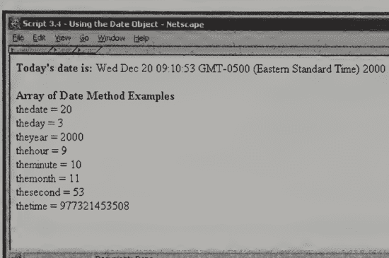

> 使用 Date 对象的方法时，表示分钟和秒数必须使用 0 到 59，表示小时使用 0 到 23，表示星期使用 0 到 6，表示日期使用 1 到 31，表示月份使用 0 到 11。在示例中，给出的日期是 2000 年 12 月 20 日，星期三。但是请注意，`getMonth()` 方法返回 11——而不是你预期的 12（代表十二月）。记住，计算机逻辑将一月设为 0，二月设为 1，依此类推。

Date 对象还提供了一组用于设置 Date 对象值的方法，包括：

- `setDate(12)`
- `setFullYear(2000)`
- `setHours(11)`
- `setMinutes(30)`
- `setMonth(4)`
- `setYear(2000)`

### Function 对象

你已经知道可以使用函数来简化你的脚本。稍后，我将向你展示如何编写函数并将其用作自定义对象的方法。

JavaScript 还允许你创建 Function 对象，并为你提供对普通函数不可用的 Function 属性和方法的访问。当你的函数由单行代码组成时，Function 对象更容易使用。然而，由于 Function 对象固有的低效性，最好坚持使用声明式函数。

你可以使用以下语法创建 Function 对象：

```
FunctionName = new Function([p1,......pn] body)
```

在此语法中，`p1` 到 `pn` 是 Function 对象在调用时接收的参数，`body` 是被编译为函数的 JavaScript 语句。

例如，以下代码创建一个名为 `Warn` 的 Function 对象：

```
Warn = new Function("alert('HI!')");
```

你可以按如下方式调用此函数：

```
Warn();
```

前面的 Function 对象等效于以下声明式函数：

```
function Warn() {
    window.alert("Warning: You should not run this script!");
    return;
}
```

> 注意：因为 Function 对象是编译的，所以它比使用声明式函数效率低。因此，我建议你避免使用编译函数和 Function 对象。

以下脚本演示了前面 Function 对象示例的使用。图 3.7 显示了加载此页面时会发生什么。

```
<HTML>
    <HEAD>
        <TITLE>Script 3.5 - Working with the Function Object</TITLE>
    </HEAD>
    <BODY>
        <SCRIPT LANGUAGE="JavaScript" TYPE="Text/JavaScript">
        <!--Start hiding JavaScript statements
        Warn = new Function("window.alert('Warning: You should not run this script!')");
        Warn();
        // End hiding JavaScript statements -->
        </SCRIPT>
    </BODY>
</HTML>
```

**图 3.7**
使用 Function 对象代替常规函数。

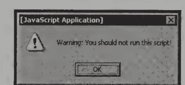

## Math 对象

Math 对象以属性的形式提供数学常数；以方法的形式提供数学函数。今天早上早些时候，我演示了几个 Math 属性和方法。表 3.1 和表 3.2 回顾了 Math 对象的属性和方法。

## Number 对象

Number 对象让你能够像处理对象一样处理数字，并将数字常量存储为其属性。这些常量的值无法更改。你很可能永远不需要了解或使用 Number 对象，但以防万一，表 3.3 概述了其属性。

#### 表 3.1 数学属性摘要

| 属性 | 描述 |
| :--- | :--- |
| E | 欧拉常数 (2.718) |
| LN2 | 2 的自然对数 (2.302) |
| LN10 | 10 的自然对数 (2.693) |
| LOG2E | e 的以 2 为底的对数 (1.442) |
| LOG10E | e 的以 10 为底的对数 (0.434) |
| PI | 圆的周长与其直径的比率 (3.14159) |
| SQRT1_2 | 1/2 的平方根 (0.707) |
| SQRT2 | 2 的平方根 (1.414) |

#### 表 3.2 数学方法摘要

| 方法 | 描述 |
| :--- | :--- |
| abs() | 返回绝对值 |
| cos(), sin(), tan() | 三角函数 |
| acos(), asin(), atan() | 反三角函数 |
| exp(), log() | 指数和自然对数 |
| ceil() | 返回大于或等于参数的最小整数 |
| floor() | 返回小于或等于参数的最大整数 |
| min(x, y) | 返回 x 或 y 中较小的一个 |


#### 表 3.2 数学方法摘要（续...）

| 方法 | 描述 |
| :--- | :--- |
| max(x, y) | 返回 x 或 y 中较大的值 |
| pow(x, y) | 返回 $x^y$ 的值 |
| random() | 返回 0 到 1 之间的随机数 |
| round() | 将参数四舍五入到最接近的整数 |
| sqrt() | 返回参数的平方根 |

#### 表 3.3 数字对象属性摘要

| 属性 | 描述 |
| :--- | :--- |
| MAX_VALUE | 可能的最大数字 |
| MIN_VALUE | 可能的最小数字 |
| NaN | 非数字 |
| NEGATIVE_INFINITY | 负无穷大 |
| POSITIVE_INFINITY | 正无穷大 |

您可以使用 `new` 关键字定义一个数字对象，如下所示：

```
ANumber = new Number(99.99);
```

### Object 对象

此对象是所有其他对象的基础。这意味着所有对象都继承此对象的属性和方法。

您可以通过在 Object() 构造函数中指定一个 Array、Boolean、Function、Number 或 String 对象来创建新的 Object 对象，如下所示：

```
MyNumberObject = new Object(99.99);
MyStringObject = new Object("Testing");
```

> 注意：构造函数是每个对象都提供的一种函数，您可以使用它来创建对象的实例。例如，要创建一个名为 MyString 的 String 对象的实例，您需要指定以下内容：`MyString = new String("在此处添加您的消息文本。")`。

您可能永远不会看到有人以这种方式创建对象。相反，您会看到使用特定于每种对象类型的构造函数创建对象，例如这些构造函数：

- Array()
- Boolean()
- Function()
- Number()
- String()

### String 对象

字符串对象允许您将字符串作为对象来处理。但是，您应该不需要使用此对象，因为 JavaScript 会在您对简单字符串使用 String 对象方法或属性时，自动将其转换为临时的 String 对象。

字符串对象只有一个属性 `length`，它包含构成 String 对象的字符数。然而，String 对象提供了许多有用的方法来操作 String 对象，如表 3.4 所述。

以下示例创建了两个 String 对象，然后使用这些 String 对象演示了各种 String 方法的用法，并使用 `document.write()` 方法显示其结果。图 3.8 展示了加载此示例中创建的页面的结果。

```
<HTML>
<HEAD>
```

#### 表 3.4 字符串对象方法摘要

| 方法 | 描述 |
| :--- | :--- |
| charAt() | 返回字符串中指定位置的字符，其中 String 对象的索引从零开始 |
| concat() | 将两个字符串组合成一个新字符串 |
| fromCharCode() | 基于提供的字符码集创建一个字符串值 |
| indexOf() | 返回指定子字符串的位置 |
| lastIndexOf() | 返回指定子字符串的最后出现位置 |
| splice() | 使用当前字符串的一部分创建一个新字符串 |
| split() | 将字符串组织成一个数组 |
| substring() | 返回字符串的指定部分 |
| toLowerCase() | 返回全为小写字母的字符串 |
| toUpperCase() | 返回全为大写字母的字符串 |

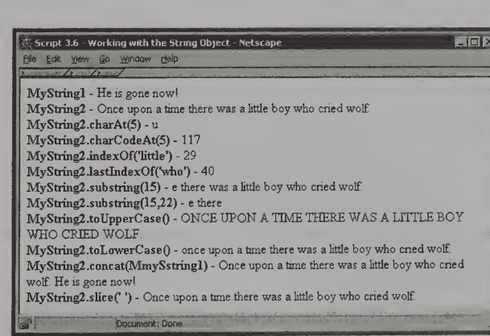

#### 图 3.8

字符串对象方法演示。

```
<TITLE>脚本 3.6 - 使用 String 对象</TITLE>
</HEAD>
<BODY>

<SCRIPT LANGUAGE="JavaScript" TYPE="Text/JavaScript">
<!-- 开始隐藏 JavaScript 语句
    MyString1 = new String(" He is gone now!");
    MyString2 = new String("Once upon a time there was a little boy who cried wolf.");
    document.write("<B>MyString1 - </B>" + MyString1 + "<BR>");
    document.write("<B>MyString2 - </B>" + MyString2 + "<BR>");
    document.write("<B>MyString2.charAt(5) - </B>" + MyString2.charAt(5) + "<BR>");
    document.write("<B>MyString2.charCodeAt(5) - </B>" + MyString2.charCodeAt(5) + "<BR>");
    document.write("<B>MyString2.indexOf('little') - </B>" + MyString2.indexOf("little") + "<BR>");
    document.write("<B>MyString2.lastIndexOf('who') - </B>" + MyString2.lastIndexOf("who") + "<BR>");
    document.write("<B>MyString2.substring(15) - </B>" + MyString2.substring(15) + "<BR>");
    document.write("<B>MyString2.substring(15,22) - </B>" + MyString2.substring(15,22) + "<BR>");
    document.write("<B>MyString2.toUpperCase() - </B>" + MyString2.toUpperCase() + "<BR>");
    document.write("<B>MyString2.toLowerCase() - </B>" + MyString2.toLowerCase() + "<BR>");
    document.write("<B>MyString2.concat(MyString1) - </B>" + MyString2.concat(MyString1) + "<BR>");
    document.write("<B>MyString2.slice(' ') - </B>" + MyString2.slice(" ") + "<BR>");
// 结束隐藏 JavaScript 语句 -->
</SCRIPT>
</BODY>
</HTML>
```

## 休息一下

现在是休息 10 或 15 分钟的好时机。当您回来时，我将继续向您展示如何使用基于浏览器的对象以及如何创建自己的自定义对象。然后，您将通过学习有关事件的所有内容以及 JavaScript 如何让您捕获和响应事件来结束下午的学习。

### 使用基于浏览器的对象

您刚刚回顾了内置 JavaScript 对象的列表。稍后，您将学习如何定义自己的自定义对象。现在，您准备好查看浏览器提供的对象了。

当 HTML 页面在 Netscape Navigator 或 Internet Explorer 等浏览器中加载时，浏览器会基于其在页面上找到的 HTML 标签构建一个对象集合。这些对象是在页面被扫描和加载的过程中自上而下依次创建的。当浏览器构建对象引用时，它采用分层方式，所有对象都源自最顶层的父对象——window 对象。给定浏览器的对象组织层次结构称为其对象模型。

> 注意：由于浏览器以自上而下的方式扫描页面，您必须小心，在对象被建立之前，您的脚本不要引用该对象。例如，如果您的页面在底部包含一个图像对象，但页面顶部的脚本引用了该图像，您将得到一个错误，因为脚本在图像建立之前就执行了。

随着 JavaScript 和浏览器多年的发展，它们的对象模型也在不断演进。图 3.9 展示了一个对象模型，该模型适用于 Netscape Navigator 4.x 及之前的所有版本以及 Internet Explorer 5 及之前的所有版本。此图向您展示了两个浏览器共有的对象。如您所见，所有透明方框中的对象都受到所有支持 JavaScript 的浏览器的支持。如果您在 JavaScript 代码中仅使用这些对象，您的脚本将能够在尽可能广泛的浏览器上执行。图 3.9 还标识了在 Netscape Navigator 和 Internet Explorer 的第 3 版和第 4 版中引入的对象。在您的脚本中引用这些对象将为您提供更丰富的功能，但也可能意味着失去使用较旧版本浏览器的那部分受众。

您有多种选择：您可以坚持使用最广泛支持的对象集，或者您可以使用 Netscape Navigator 3.x 和 Internet Explorer 4.x 支持的对象，并接受少量受众的损失。即使您决定充分利用所有可用对象，您也不一定非要失去部分受众。您可以在脚本中放置逻辑来检查访问者的浏览器类型和版本级别，然后要求使用旧版浏览器的访问者升级到最新版本，或者添加逻辑将访问者重定向到您创建的、支持其特定浏览器对象模型的页面。

我想提到的一点是，图 3.9 仅包含 Netscape Navigator 和 Internet Explorer 4 及之前所有版本共有的那些对象。这两个浏览器还提供仅受该浏览器支持的对象。此外，Internet Explorer 5.x 最近发布了；它包含一些早期版本的 Internet Explorer 或任何 Netscape 浏览器不支持的其他对象。当然，您可以编写利用这些新对象的脚本，但使用特定于浏览器的脚本意味着您的脚本只能在遵循其对象模型的特定版本的浏览器上运行。这可能会显著减少您的目标受众。

归根结底，没有一个简单的答案。我只是想指出您的选择有哪些，以便您自己决定什么对您最有利。

如图 3.9 所示，所有对象都是 window 对象的后代。列出的许多对象仅在浏览器在加载页面时检测到它们的实例时才存在。换句话说，如果您没有在页面上放置图像，就不会有图像对象。但是，每个支持 JavaScript 的浏览器都会自动提供一些对象：

- document 对象包含基于文档当前内容的属性。


## `window` 对象

`window` 对象是页面上所有其他对象的祖先。可以同时打开多个窗口。`window` 对象有数十个与之关联的对象和方法，其中许多你已经使用过。例如，你已经使用 `window.alert()` 方法在警报对话框中显示消息，使用 `window.prompt()` 来获取用户输入，以及在采取行动之前使用 `window.confirm()` 来征求用户许可。

还有一些用于控制导航的方法，例如 `window.back()`、`window.forward()` 和 `window.home()`，这些方法在 Netscape Navigator 浏览器版本 4 或更高版本中得到支持。下面的示例演示了这些 `window` 对象方法中的每一个：

```html
<HTML>
    <HEAD>
        <TITLE>Script 3.7 - Working with the Window Object - 1</TITLE>
    </HEAD>
    <BODY>
        <FORM NAME="form1">
            <INPUT TYPE="button" VALUE="Back" onClick="window.back()">
            <INPUT TYPE="button" VALUE="Home" onClick="window.home()">
            <INPUT TYPE="button" VALUE="Forward" onClick="window.forward()">
        </FORM>
    </BODY>
</HTML>
```

该脚本定义了一个包含三个按钮的表单。点击按钮会触发其 `onClick` 事件执行。对于标记为 *Back* 的按钮，`onClick` 事件执行 `window.back()` 方法，使浏览器加载上一个网页。点击 *Forward* 按钮会产生完全相反的操作，而点击 *Home* 按钮会重新加载当前页面。现在不用担心 `onClick` 事件处理程序；你将在下午结束时学习事件处理程序。现在，只需知道事件处理程序允许你将 JavaScript 语句和函数与用户操作（例如点击对象）关联起来。

图 3.10 显示了当你加载前面的示例时浏览器的样子。点击 *Home* 按钮会告诉浏览器加载用户设置为默认主页的 URL。点击 *Back* 或 *Forward* 按钮的效果与点击浏览器的 *Back* 或 *Forward* 按钮相同。

以下脚本为你提供了另一个使用 `window` 对象方法的示例。在此示例中，浏览器在网页加载时立即使用 `window` 对象的 `open()` 方法打开第二个窗口。该窗口被命名为 `window1`。

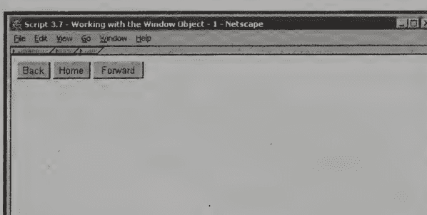

**图 3.10** 构建你自己的导航按钮。

```html
<HTML>
  <HEAD>
    <TITLE>Script 3.8 - Working with the Window Object - 2</TITLE>
  </HEAD>
  <BODY>
    <SCRIPT LANGUAGE="JavaScript" TYPE="Text/JavaScript">
    <!-- Start hiding JavaScript statements
    window1=window.open();
    // End hiding JavaScript statements -->
    </SCRIPT>
    <FORM NAME="form1">
      <INPUT TYPE="button" VALUE="Close the window"
        onClick="window1.close()">
      <INPUT TYPE="button" VALUE="Resize"
        onClick="window1.resizeTo(300,400)">
    </FORM>
  </BODY>
</HTML>
```

> **注意** 你肯定见过许多网站，当你点击链接时会打开多个窗口。通常，其他窗口会以较小的窗口形式出现，试图向你推销产品或引导你点击其他链接。

该脚本包含一个定义了两个按钮的表单，每个按钮都包含一个 `onClick` 事件处理程序。如果你点击第一个标记为 *Close the window* 的按钮，则会执行 `window` 对象的 `close()` 方法。

为了让浏览器知道你想关闭哪个窗口，你必须指定窗口的名称——在本例中，它是 `window1`。

表单中的第二个按钮 *Resize* 执行 `window` 对象的 `resizeTo()` 方法。此方法告诉浏览器将 `window1` 窗口对象的大小更改为 300 像素乘以 400 像素。

图 3.11 演示了你首次加载此页面时看到的内容。打开了两个窗口。第一个显示包含脚本的表单，第二个窗口是脚本的 `window1=window.open()` 语句的结果。

`window` 对象的 `open()` 方法允许你对窗口的外观进行大量控制。例如，你可以控制窗口是否具有某些功能，如菜单栏、工具栏、滚动条和状态栏，以及窗口是否可以调整大小。图 3.12 显示了这些功能在浏览器窗口上的位置。

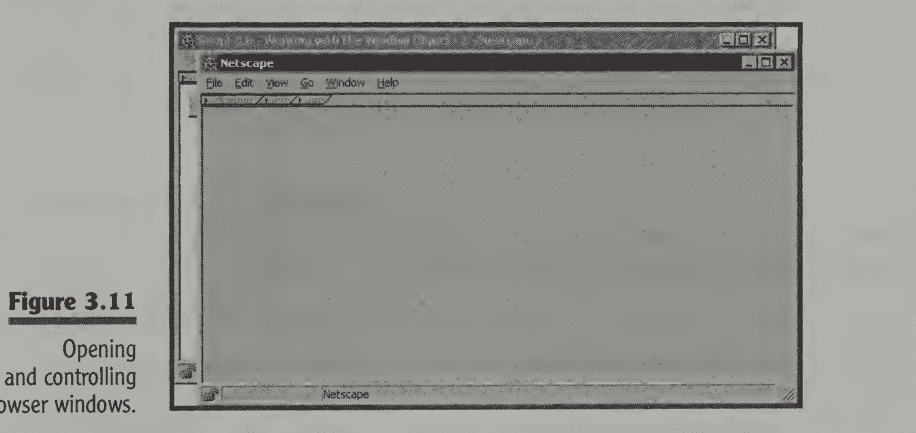

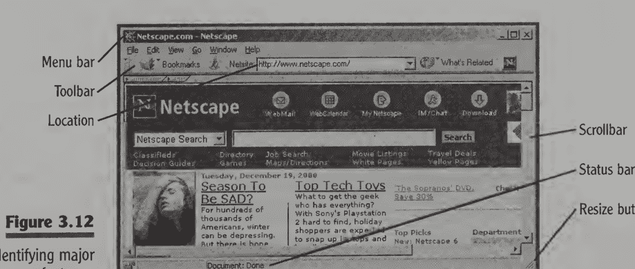

以下示例演示了如何控制这些窗口功能中的每一个：

```html
<HTML>
<HEAD>
<TITLE>Script 3.9 - Working with the Window Object - 3</TITLE>
</HEAD>
<BODY>
<SCRIPT LANGUAGE="JavaScript" TYPE="Text/JavaScript">
<!-- Start hiding JavaScript statements
window.open("", "Window1", "menubar=no,toolbar=yes,scrollbar=yes,resizable=yes,status=yes,location=yes");
// End hiding JavaScript statements -->
</SCRIPT>
</BODY>
</HTML>
```

默认情况下，所有窗口功能都是启用的。要控制它们，你需要重写包含 `open()` 方法的语句，如下所示：

```javascript
window.open("", "Window1", "menubar=no,toolbar=yes,scrollbar=yes,resizable=yes,status=yes,location=yes");
```

以这种方式编写时，`open()` 方法接受三组参数。第一个参数是应在新窗口中打开的 URL。在前面的示例中，我将此参数留空，导致浏览器打开一个空窗口。第二个参数是你分配给窗口的名称。你必须为窗口分配一个名称，以便可以从脚本的其他部分引用它。最后一个参数由一个或多个用逗号分隔的参数组成。每个参数标识一个窗口功能并为其赋值为 `yes` 或 `no`。赋值为 `yes` 告诉浏览器在创建窗口时包含该选项。赋值为 `no` 告诉浏览器消除指定的功能。默认情况下，所有功能都是启用的。因此，我可以编写如下语句来获得相同的结果：

```javascript
window.open("", "Window1", "menubar=no")
```

然而，按照我最初的方式编写语句，以后更容易回来进行更改；我也认为这使得事情更容易理解。图 3.13 显示了在浏览器中加载此示例时第二个窗口的样子。

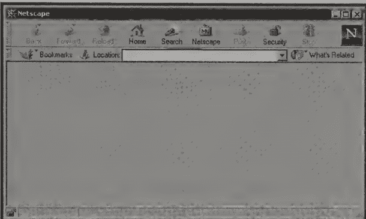

**图 3.13** 防止在新窗口上显示菜单栏。

## `document` 对象

`document` 对象是 JavaScript 的核心。每个网页都可以包含一个 `document` 对象。你已经广泛使用它来使用 `document.write()` 方法将输出写入屏幕。

`document` 对象的属性取决于页面的 HTML 内容。例如，如果一个网页包含图像，则该页面的 `document` 属性将包含一个 `images[]` 数组，列出页面上的每个图像。

`document` 对象有许多可用的属性，你可以使用它们来控制页面的外观并收集有关其内容的信息。例如，`document` 对象存储以下数组的属性值：

- `anchors[]`：包含文档中所有锚点列表的数组。
- `applets[]`：包含文档中所有小程序列表的数组。
- `embeds[]`：包含文档中所有嵌入对象列表的数组。
- `forms[]`：包含文档中所有表单列表的数组。
- `images[]`：包含文档中所有图像列表的数组。
- `links[]`：包含文档中所有链接列表的数组。
- `plugins[]`：包含文档中所有插件列表的数组。


其他文档对象属性允许你影响页面外观：

- bgColor 指定文档背景颜色。
- fgColor 指定文档文本颜色。
- linkColor 指定链接颜色。
- alinkColor 指定活动链接颜色。
- vlinkColor 指定已访问链接颜色。

以下是其他一些有用的文档属性部分列表：

- cookie 允许你获取和设置 cookie 值。
- lastModified 一个字符串，显示文档最后修改的日期和时间。
- referrer 一个字符串，显示用户来源的 URL。
- title 一个字符串，包含 HTML `<TITLE>` 标签的内容。
- URL 一个字符串，包含文档的 URL。

以下示例演示了两个文档属性的用法。脚本中的第一条语句使用 `document.title` 属性打印位于 HTML `<TITLE>` 标签中的标题。第二条语句使用 `document.lastModified` 属性显示页面的最后修改日期和时间。图 3.14 显示了加载此示例的结果。

```
<HTML>
  <HEAD>
    <TITLE>脚本 3.10 - 设置修改日期和时间</TITLE>
  </HEAD>
  <BODY>
    <SCRIPT LANGUAGE="JavaScript" TYPE="Text/JavaScript">
    <!-- 开始隐藏 JavaScript 语句
    document.write("<B>文档标题：</B> " + document.title + "<BR>");
    document.write("<B>最后修改于：</B> " + document.lastModified);
    // 结束隐藏 JavaScript 语句 -->
    </SCRIPT>
  </BODY>
</HTML>
```

## 表单对象

今天下午，我使用了几个小表单，明天上午我将用相当一部分时间进一步探讨它们。本节提供的信息应能让你对表单对象及其功能有良好的基础。

文档对象的 `forms[]` 数组维护着页面上每个表单的列表，从 `form[0]` 开始，每增加一个表单递增 1。你可以使用表单在 `forms[]` 数组中的索引号或通过名称来引用单个表单。

例如，以下代码创建了一个名为 `form1` 的表单，其中包含一个按钮：

```
<FORM NAME="form1">
    <INPUT TYPE="button" NAME="backButton" VALUE="返回" onClick=
    "window.back()">
</FORM>
```

假设这是页面上的唯一表单，你可以通过 `document.forms[0]` 或 `document.form1` 来引用它。表单可以包含许多元素，如文本框和按钮。为了管理这些表单元素，每个表单对象都包含一个名为 `elements[]` 的数组。表单中的第一个元素存储为 `element[0]`，第二个元素存储为 `element[1]`，依此类推。

## location 对象

`location` 对象相对简单。其属性包含有关其自身 URL 的信息。例如，`location.href` 指定页面的 URL，而 `location.pathname` 仅指定 URL 的路径部分。如果你更改 `location` 对象，浏览器会自动尝试重新加载该 URL。

`location` 对象只有两个方法：`reload()` 方法允许你强制重新加载页面，`replace()` 方法让你指定一个要加载的新 URL。因为 `replace()` 方法会在历史列表顶部写入一个新条目，所以此方法会阻止用户使用浏览器的“后退”按钮返回到上一页。

以下脚本展示了如何使用 `location` 对象强制浏览器重新加载当前页面或加载新 URL。首先，脚本定义了一个名为 `myurl` 的变量，并将其设置为 `location.href` 的值（即当前页面的 URL）。然后它定义了一个包含两个按钮的表单。`onClick` 事件处理程序已分配给第一个按钮。当用户点击此按钮时，`location.replace()` 方法指示浏览器加载 `http://www.netscape.com`。当用户点击第二个按钮时，`location.reload()` 方法指示浏览器重新加载当前网页。图 3.15 显示了加载此示例的结果。

```
<HTML>
	<HEAD>
		<TITLE>脚本 3.11 - 使用 location 对象</TITLE>
	</HEAD>
	<BODY>
		<SCRIPT LANGUAGE="JavaScript" TYPE="Text/JavaScript">
		<!-- 开始隐藏 JavaScript 语句
			my_url= location.href;
			document.write("my_url = " + my_url + "<BR>");
// 结束隐藏 JavaScript 语句 -->
</SCRIPT>
<FORM NAME="form1">
    <INPUT TYPE="button" VALUE="前往 www.netscape.com"
        onClick="location.replace('http://www.netscape.com')">
    <INPUT TYPE="button" VALUE="重新加载此页"
        onClick="location.reload()">
</FORM>
</BODY>
</HTML>
```

图 3.15
使用 `location` 对象控制浏览器导航和页面重新加载。

## history 对象

`history` 对象维护着一个 URL 列表，该列表包含浏览器自开始当前会话以来访问过的所有 URL。此对象一个有用的属性是 `length` 属性，你可以使用以下语法访问它：

```
history.length
```

`history` 对象有三个方法：

- `back()` 方法加载历史列表中上一个访问过的 URL。这与点击浏览器的“后退”按钮效果相同。
- `forward()` 方法加载历史列表中的下一个 URL。这与点击浏览器的“前进”按钮效果相同。
- `go()` 方法加载历史列表中的指定 URL。例如，`history.go(4)` 加载历史列表中向前四个条目的 URL，`history.go(-4)` 加载向后四个条目的 URL，而 `history.go(0)` 则重新加载当前 URL。

以下示例演示了 `history` 对象的 `back()`、`go()` 和 `forward()` 方法的用法。它定义了一个包含三个按钮的表单，每个按钮被分配其中一个方法。`onClick` 事件处理程序用于将每个方法与对应按钮关联。

```
<HTML>
    <HEAD>
        <TITLE>脚本 3.12 - 使用 History 对象方法进行导航</TITLE>
    </HEAD>
    <BODY>
        <FORM NAME="form1">
            <INPUT TYPE="button" VALUE="后退"
                onClick="history.back()">
            <INPUT TYPE="button" VALUE="重新加载"
                onClick="history.go(0)">
            <INPUT TYPE="button" VALUE="前进"
                onClick="history.forward()">
        </FORM>
    </BODY>
</HTML>
```

图 3.16 显示了加载此示例的结果。点击表单上的这三个按钮与点击浏览器工具栏上的“后退”、“前进”和“重新加载”按钮效果相同。

图 3.16 为你的网页添加导航按钮。

## navigator 对象

`navigator` 对象是一个顶层对象，就像 `window` 对象一样。这意味着 `navigator` 对象在对象层次结构中不位于任何其他对象之下。它包含了加载网页的浏览器的信息。Netscape Navigator 和 Internet Explorer 都支持此对象，尽管 Internet Explorer 使用该对象的方式可能看起来有点奇怪。`navigator` 对象的一些有用属性包括：

- `navigator.appCodeName` 包含浏览器的代码名称。
- `navigator.appName` 包含浏览器的名称。
- `navigator.appVersion` 包含浏览器的版本号。

你的脚本可以使用这些属性的值来确定正在加载网页的浏览器（及其版本号）。然后你可以利用这些信息将浏览器定向到你为该特定浏览器编写的 JavaScript。

以下示例向你展示如何创建变量并将 `navigator` 对象属性的值赋给它们。然后此脚本打印变量的值。不过，你可以为此脚本添加额外的逻辑，以查询这些变量的值，然后将用户的浏览器定向到你设计的、适用于该特定浏览器的网页。

```
<HTML>
  <HEAD>
    <TITLE>脚本 3.13 - 显示 navigator 对象属性</TITLE>
```


## 创建自定义对象

除了核心 JavaScript 对象和基于浏览器的对象外，JavaScript 还提供了构建自定义对象的能力。

创建对象实例需要三个基本步骤：

1.  定义其结构。
2.  为其赋值属性。
3.  为其分配将充当对象方法的函数。

有两种方法可以创建新对象。第一种是编写一个函数来定义新对象的格式，然后使用 `new` 运算符实例化一个新对象。例如，下面的函数定义了一个包含两个属性和一个方法的新对象：

```
function Customer(name, phone) {
    this.name = name;
    this.phone = phone;
    this.ShowAlert = ShowAlert;
}
```

第一行定义了一个接受两个参数的函数。接下来的两行使用这些参数来建立属性。最后一行分配了一个名为 `ShowAlert` 的方法。请注意，定义的函数没有关联的参数。

`ShowAlert` 方法本身就是一个函数。如图所示，`ShowAlert()` 显示一个警告提示，揭示客户对象的 `name` 和 `phone` 属性：

```
function ShowAlert() {
    window.alert("Customer: " + this.name + " - Phone: " + this.phone);
}
```

然后，可以使用以下代码行通过 `Customer()` 函数实例化一个新对象：

```
Customer1 = new Customer("Robert Robertson", 8043334444);
```

此语句创建了一个名为 `Customer1` 的新对象，该对象具有以下属性：

- Customer1.name
- Customer1.phone

你可以反复调用该函数来创建其他新对象。

`Customer1` 对象还有一个方法，可以使用以下语句调用：

```
Customer1.ShowAlert()
```

现在，如果你将这个完整的示例组合在一起，你将得到以下脚本：

```
<HTML>
  <HEAD>
    <TITLE>Script 3.14 - 创建自定义对象</TITLE>
    <SCRIPT LANGUAGE="JavaScript" TYPE="Text/JavaScript">
      <!--Start hiding JavaScript statements
      function Customer(name, phone) {
        this.name = name;
        this.phone = phone;
        this.ShowAlert = ShowAlert;
      }
      function ShowAlert() {
        window.alert("Customer: " + this.name + " - Phone: " + this.phone);
      }
      // End hiding JavaScript statements -->
    </SCRIPT>
  </HEAD>
  <BODY>
    <SCRIPT LANGUAGE="JavaScript" TYPE="Text/JavaScript">
      <!--Start hiding JavaScript statements
      Customer1 = new Customer("Robert Robertson", 8043334444);
      Customer1.ShowAlert();
      // End hiding JavaScript statements -->
    </SCRIPT>
  </BODY>
</HTML>
```

图 3.18 展示了运行此脚本时你将看到的效果。

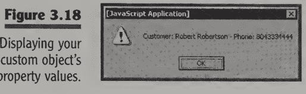

### 使用对象初始化器创建对象

除了编写一个函数来创建对象的新实例外，另一种方法是利用 *对象初始化器*。在这种情况下，你通过将属性和方法放在一对花括号内，以表达式的形式创建对象，并用冒号分隔属性或方法的名称及其值。例如，以下语句可用于创建一个名为 `Customer1` 的对象：

```
Customer1 = {name:"Robert Robertson", phone:8043334444,
               showAlert:showAlert};
```

花括号内的前两项定义了以下属性对并设置其值：

```
Customer1.name = "Robert Robertson";
Customer1.phone = 8043334444;
```

最后一项定义了一个方法：

```
Customer1.ShowAlert();
```

如果你使用对象初始化器，你可以将前面示例中的代码重写如下：

```
<HTML>
  <HEAD>
    <TITLE>Script 3.15 - 创建自定义对象的另一种方式</TITLE>
    <SCRIPT LANGUAGE="JavaScript" TYPE="Text/JavaScript">
    <!--Start hiding JavaScript statements
      function ShowAlert() {
        window.alert("Customer: " + this.name + " - Phone: " +
                     this.phone);
      }
    }
    //End hiding JavaScript statements -->
    </SCRIPT>
  </HEAD>
  <BODY>
    <SCRIPT LANGUAGE="JavaScript" TYPE="Text/JavaScript">
    <!--Start hiding JavaScript statements
      Customer1 = {name:"Robert Robertson", phone:8043334444,
                    ShowAlert:ShowAlert};
      Customer1.ShowAlert();
      // End hiding JavaScript statements -->
    </SCRIPT>
  </BODY>
</HTML>
```

### 删除你的对象

JavaScript 提供了 `delete` 运算符，你可以用它来删除任何不再需要的对象。你可以添加以下代码行来删除刚刚创建的 `Customer1` 对象：

```
delete Customer1;
```

你也可以使用 `delete` 运算符删除单个对象属性或方法，而无需删除整个对象。例如，要删除 `Customer1` 对象的 `name` 属性，请输入以下内容：

```
delete Customer1.name;
```

### 扩展对象定义

你可以通过以下三种方式中的任何一种向对象添加额外的属性：

- 重写函数以容纳新的对象属性。
- 使用 `prototype` 属性向对象的所有实例添加额外的属性。
- 向单个对象添加新属性，而不影响其他对象。

重写函数以容纳新属性是一个显而易见的选项。*原型属性* 可用于向所有对象实例添加新属性。例如，要向所有 `customer` 类型的对象添加名为 `nickname` 的属性，你可以编写以下语句：

```
Customer.prototype.nickname=null;
```

然后你可以使用以下语句为单个对象的 `nickname` 属性赋值：

```
Customer1.nickname="Leeman";
```

要向单个对象添加新属性而不将属性添加到对象的其他实例，请输入对象的名称、一个点号，然后输入新属性的名称并为其赋值，如以下示例所示。此处为 `Customer1` 对象创建了一个新属性 `zipcode`，并赋值为 `23116`。

```
Customer1.zipcode = 23116;
```

## 处理事件

到目前为止，你所看到的大多数 JavaScript 都是自上而下执行的。我的意思是，浏览器一旦加载页面就开始执行脚本，从第一个 JavaScript 语句开始，然后处理后续语句，直到处理完最后一个语句。

唯一的例外是放置在页面 `<head>` 部分或 `<body>` 部分顶部的函数，它们通过脚本后面的函数调用来执行。在某些情况下，添加 `if...then` 语句或 `switch` 语句可能使某个语句或函数的执行成为可选。但即使在存在多个脚本执行逻辑路径的情况下，脚本语句也是以串行方式逻辑执行的。

### 定义事件

在 JavaScript 中，事件发生在浏览器环境中。事件包括鼠标单击、鼠标移动、按下键盘按键、打开和关闭窗口和框架以及调整窗口大小等活动。浏览器会识别事件并在这些事件发生时执行默认操作。例如，当用户单击链接时，`onClick` 事件发生，浏览器的默认操作是加载链接指定的网页。

要真正使你的网页具有交互性，你必须将另一个工具添加到你的脚本技能集中：事件处理程序。*事件处理程序* 是识别特定类型事件发生的陷阱。你可以在脚本中编写代码来改变浏览器对事件的默认响应。例如，不是自动加载链接指定的 URL，而是显示一个确认对话框，要求用户在继续之前同意某些条款。

> **注意** 事件处理程序的名称基于触发它们的事件。在事件名称前加上 `on` 就创建了事件处理程序的名称。例如，`click` 事件的事件处理程序是 `onClick`。

每个事件都与一个特定对象关联。当给定对象发生事件时，其事件处理程序会执行（假设你已编写一个）。例如，每当用户单击按钮、文档、复选框、链接、单选按钮、重置按钮或提交按钮时，`click` 事件都会发生。

事件处理程序的定义出乎意料地简单，尽管功能强大。你将它们放置在定义对象的 HTML 标签内。例如，你可以通过将 `onLoad` 事件处理程序放在第一个 HTML `<BODY>` 标签内来定义在网页加载时发生的事件，如下所示：

```
<BODY onLoad="window.alert('网页加载：完成。')">
```

在此示例中，页面加载完成后会出现一个警告对话框。请注意，事件处理程序紧跟在标签之后，其值放在引号内。你可以将任何 JavaScript 语句用作事件处理程序的值。你甚至可以使用多个语句，只要用分号将它们分隔开。或者，你可以使用函数调用，这允许你执行更复杂的操作来响应事件。

在本节的其余部分，你将看到大量关于如何以及在何处将事件处理程序放置在各种 HTML 标签中的示例。


**注意** 有关完整的事件、事件处理程序以及特定事件所适用对象的列表，请参见CD中的附录B，“JavaScript事件摘要”。

### event 对象

每当事件发生时，都会填充event对象。事件处理程序可以引用其属性中的信息，从而使你的脚本能够访问有关事件的详细信息。

例如，`event.modifiers`属性指定了与鼠标或键盘事件相关的任何修饰键。如果用户在单击鼠标按钮时按下了Alt键，则`event.modifiers`属性包含值`Alt`。`event.type`修饰符包含一个字符串，表示发生的事件类型，而`event.which`修饰符包含一个数字，该数字指定了按下的鼠标按钮或按下的键盘键的ASCII值。

### 事件类型

JavaScript目前支持23种不同的事件和事件处理程序。这些事件大致可分为几类：

- 窗口和框架事件
- 鼠标事件
- 键盘事件
- 错误事件

以下脚本演示了其中许多事件及其关联的事件处理程序。有关事件和事件处理程序的完整列表，请参见CD中的附录B，“JavaScript事件摘要”。

### 窗口和框架事件

影响窗口和框架对象的事件包括`load`、`resize`、`unload`和`move`事件。这些事件的事件处理程序是`onLoad`、`onResize`、`onUnload`和`onMove`。这些事件处理程序放在`<BODY>`标签内。以下脚本使用`alert()`方法来演示如何在响应这些事件的发生时执行JavaScript语句：

```html
<HTML>
    <HEAD>
        <TITLE>Script 3.16 - onLoad, onResize, onUnload & onMove Example</TITLE>
    </HEAD>
    <BODY onLoad="window.alert('Web page loading: Complete.')"
          onResize="window.alert('What is the matter with my current size?')"
          onUnload="window.alert('Oh no, I am melting......')"
          onMove="window.alert('What's wrong with this spot?')">
    </BODY>
</HTML>
```

运行此脚本时，你首先会看到一个提示，通知你网页已加载完成（参见图3.19）。当`onLoad`事件处理程序响应`load`事件而执行时，将触发此消息。

如果你调整窗口大小，`resize`事件将导致`onResize`事件处理程序执行并显示警报消息。同样，移动窗口也会导致类似的警报消息。`onUnload`事件处理程序在你关闭窗口或使用另一个URL加载它之前不会执行。

#### 图 3.19

使用`onLoad`事件处理程序通知用户整个页面已完成加载。

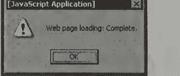

### 鼠标事件

每当用鼠标执行操作时，就会执行鼠标事件。这包括以下任何一种情况：

- 当指针移到对象上时，会发生`MouseOver`事件。
- 当指针移出对象时，会发生`MouseOut`事件。
- 当按下鼠标按钮时，会发生`MouseDown`事件。
- 当释放鼠标按钮时，会发生`MouseUp`事件。
- 当移动鼠标时，会发生`MousePress`事件。
- 当你单击对象时，会发生`Click`事件。
- 当你双击对象时，会发生`DblClick`事件。

以下脚本演示了`onMouseOver`/`onMouseOut`和`onMouseDown`/`onMouseUp`事件的用法。此脚本定义了两个链接。单击任一链接都会指示浏览器加载`www.microsoft.com`处的网页。通过将`onMouseOver`和`onMouseOut`事件处理程序添加到第一个HTML链接标签，我指示浏览器在指针经过链接时将文档背景更改为红色。当指针移开链接时，`onMouseOut`事件处理程序随后将背景更改为白色。

与第二个链接关联的`onMouseDown`和`onMouseUp`事件处理程序指示浏览器在用户单击链接时（即用户按下鼠标按钮时）将文档背景更改为红色，并在用户释放鼠标按钮时将背景颜色更改为白色。`onMouseDown`和`onMouseUp`事件处理程序都不会更改链接的默认操作。因此，如果你单击第二个链接，`www.microsoft.com`处的网页仍将被加载。

```html
<HTML>
<HEAD>
    <TITLE>Script 3.17 - onMouseover, onMouseOut, onMouseDown & onMouseUp Example</TITLE>
</HEAD>
<BODY>
    <A HREF="http://www.microsoft.com"
onMouseOver='document.bgColor="red"'
onMouseOut='document.bgColor="white"'>
onMouseOver and onMouseOut example</A><P>
<A HREF="http://www.microsoft.com"
onMouseDown='document.bgColor="red"'
onMouseUp='document.bgColor="white"'>
onMouseDown and onMouseUp example</A><P>
</BODY>
</HTML>
```

图3.20显示了当指针未定位在第一个链接或第二个链接上时浏览器窗口的外观。

> 注意
> `onMouseOver`和`onMouseOut`事件处理程序的一种用途是创建悬停效果，即当鼠标指针经过按钮时，按钮会改变其外观。你无疑在许多网站上见过这种效果。我将在周日上午向你展示如何创建自己的按钮悬停脚本。

以下脚本演示了`onClick`和`onDblClick`事件处理程序的用法。此脚本创建了一个包含两个按钮的表单。`onClick`事件分配给第一个按钮的`<INPUT>`标签；`onDblClick`事件处理程序分配给第二个按钮的`<INPUT>`标签。

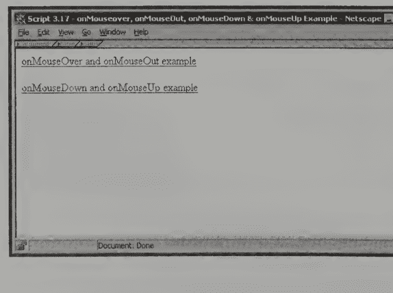

```html
<HTML>
<HEAD>
<TITLE>Script 3.18 - onClick & onDblClick Example</TITLE>
</HEAD>
<BODY>
<FORM>
<INPUT TYPE="button" VALUE="Click on me!"
       onClick="window.alert('You single-clicked.')">
<INPUT TYPE="button" VALUE="Double-Click on ME"
       onDblClick="window.alert('You double-clicked!')">
</FORM>
</BODY>
</HTML>
```

当你加载此页面并单击其中一个按钮时，会出现一个提示，通知你单击了哪个按钮（参见图3.21）。

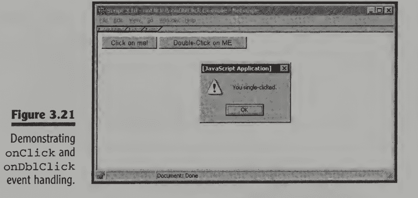

### 键盘事件

键盘事件与鼠标事件类似，因为它们在用户按下或释放键盘键时发生。有三个键盘事件：`KeyDown`、`KeyUp`和`KeyPress`。以下示例演示了如何使用`onKeyDown`事件处理程序从Netscape Navigator捕获键盘信息。

该脚本定义了一个简单的表单，该表单由单个元素（一个文本字段）组成。`onKeyDown`事件处理程序包含在`<INPUT>`标签内，并在用户按下键时创建一个警报对话框。用户单击对话框的“确定”按钮后，控制权返回到脚本，并且用户键入的字符在文本框中可见。

```html
<HTML>
  <HEAD>
    <TITLE>Script 3.19 - onkeyDown Example</TITLE>
  </HEAD>
  <BODY>
    <FORM>
      <INPUT TYPE="text" VALUE=""
        onkeyDown="window.alert('You pressed: ' +
        String.fromCharCode(event.which))">
    </FORM>
  </BODY>
</HTML>
```

此示例中与`onKeyDown`事件处理程序关联的JavaScript语句值得稍微多解释一下。键盘击键以ASCII值的形式传递给脚本，该值对你和我来说可能都没有什么价值。为了理解`KeyDown`事件返回的值，我不得不将其转换回英文表示。为此，我使用了event对象的`event.which`属性。此属性为我提供了导致此事件发生的按键的ASCII值。然后我使用`String.fromCharCode()`方法将ASCII值转换为字符串值。

> 注意 event对象的`event.which`属性指定了按下的键的ASCII值或单击的鼠标按钮的ASCII值。

图3.22演示了运行脚本并键入字母a时会发生什么。


### 错误事件

每当加载窗口、框架或图像时出现问题，就会发生错误事件。`onError` 事件处理程序在触发时会自动接收三个参数：错误消息本身、网页的 URL 以及脚本中发生错误的行号。你可以使用 `onError` 事件处理程序来响应错误。例如，你可以显示警告提示、将用户重定向到另一个网页、调用一个函数、建议用户升级浏览器或获取特定插件等等。

以下脚本演示了如何使用 `onError` 事件处理程序来显示错误信息。定义了一个名为 `ErrorTrap()` 的函数，它接受三个参数，这些参数对应于传递给 `onError` 事件处理程序的三个参数。该函数使用这些参数来格式化三行文本，以呈现错误信息。`onError = ErrorTrap` 语句告诉浏览器，如果页面上任何地方发生错误，就调用 `ErrorTrap()` 函数。为了在页面上产生一个错误，我故意在 `document.wrrite()` 方法调用中拼写错误，在 `document` 方法中多输入了一个 *r*。

```
<HTML>
    <HEAD>
        <TITLE>Script 3.20 - onError Example</TITLE>
    </HEAD>
    <BODY>
        <SCRIPT LANGUAGE="JavaScript" TYPE="Text/JavaScript">
        <!--Start hiding JavaScript statements
           function ErrorTrap(msg,url,line_no) {
              document.write("<B>An error has occurred in this script.
        </B><BR>");
              document.write("Error = " + msg + " on line " + line_no +
                 "<BR>");
              document.write("URL = " + url + "<BR>");
              return;
           }
           onError = ErrorTrap;
           document.write("This statement will produce an error event");
        // End hiding JavaScript statements -->
        </SCRIPT>
    </BODY>
</HTML>
```

图 3.23 显示了加载此脚本的结果。如你所见，写入窗口的消息会告诉你发生了什么错误、错误在网页中的位置以及页面的位置。

以下脚本也旨在产生一个错误事件。这一次，错误是由于所引用的图像文件不存在而引起的。在这个示例中，`onError` 事件处理程序在图像 HTML 标签内使用。通过将 `onError` 事件处理程序放在特定的 HTML 标签中，而不是将其作为一个独立的 JavaScript 语句（如前面示例中的情况），我可以为不同对象的错误事件定义不同的操作。

```
<HTML>
   <HEAD>
      <TITLE>Script 3.21 - Another onError Example</TITLE>
   </HEAD>
   <BODY>
        
   </BODY>
</HTML>
```

图 3.24 显示了加载前一个脚本的结果。当浏览器无法找到指定的 xxxx.jpg 图像文件时，会立即显示一个警告提示。

### 使用 onClick 事件作为决策点

在结束下午之前，我想向你展示一个使用链接和 `onClick` 事件处理程序的巧妙小技巧。在下面的示例中，我定义了一个指向网站的链接，并为其添加了 `onClick` 事件。在事件处理程序内部，我使用 `window.confirm()` 方法在允许浏览器加载链接之前请求用户确认。`window.confirm()` 提示会为用户提供两个选项。点击“确定”会返回一个 `true` 值，允许浏览器加载网页；点击“取消”会返回一个 `false` 值，阻止浏览器加载指定的 URL，并使程序继续执行链接之后的下一条语句。

```
<HTML>
    <HEAD>
        <TITLE>Script 3.22 - Age Verification Example</TITLE>
        <SCRIPT LANGUAGE="JavaScript">
            msg = "You must be older than 30 to" +
                  "visit this site. Are you?";
        </SCRIPT>
    </HEAD>
    <BODY>
        <A HREF="http://www.ptpmagazine.com"
           onClick="return(window.confirm(msg));">ptpmagazine.com</A>
    </BODY>
</HTML>
```

你可以使用此示例的一个变体，在用户点击链接时询问他们是否确定要离开你的网站。

图 3.25 显示了如果你加载前面的页面会发生什么。

### 下一步是什么？

恭喜！你已经完成了本书最困难的部分。既然你已经掌握了 JavaScript 编程基础，你就可以真正开始享受乐趣了。为什么不休息一下，去吃点东西呢？今晚回来时，你将开始整合你所学的一切。到今晚结束时，你将知道如何控制浏览器状态栏、根据定时间隔自动刷新数据、更好地利用弹出对话框、检测和使用不同类型的浏览器，以及使用文档对象来发布编辑日期、清除窗口和创建链接。

# 星期六晚上

## 用你的网页做一些真正酷的事情

- 控制状态栏
- 改善浏览器导航
- 利用对话框
- 使用不同类型的浏览器
- 尝试其他有趣的东西

既然你已经休息好了，我希望你准备好重新投入学习。在过去的 24 小时里，你已经学习了所有基础知识：HTML 标签、JavaScript 语句、编程逻辑、语法等等。从今晚开始，你将有机会将这些实用知识付诸实践。

今晚，你将看到一个又一个关于如何将 JavaScript 应用于你的网页的示例。重点将放在应用你所知道的知识来创建真正有用的脚本上。毕竟，这就是你开始阅读本书的原因。当然，我会提供一些新的信息片段让你在学习过程中消化，但今晚的重点更多在于实践而非学习。

### 控制状态栏

你能用 JavaScript 做的最简单、最强大的技巧之一就是控制浏览器的状态栏。你可以使用窗口对象的 status 属性来做到这一点。在接下来的四个小节中，我将向你展示示例，包括如何在状态栏中发布消息、如何发布闪烁的消息、如何发布消息并让它反复滚动，以及最后如何使用状态栏作为显示链接描述的工具。

在使用浏览器状态栏时，不要做得太过火。你可能见过一些网页设计师在使用状态栏时做得有点过头。和任何事情一样，请适度使用这些技巧。

### 在状态栏中发布消息

通常，浏览器使用状态栏来显示当前选定链接的 URL 或选定浏览器工具栏或菜单选项的描述。然而，如以下示例所示，你可以更改此默认行为。

```
<HTML>
	<HEAD>
		<TITLE>Script 4.1 - Posting a message in the status bar</TITLE>
		<SCRIPT LANGUAGE="JavaScript" TYPE="Text/JavaScript">
		<!-- Start hiding JavaScript statements
			function PostMsg() {
				window.status = "You should see the new message in the status bar";
			}
			// End hiding JavaScript statements -->
		</SCRIPT>
	</HEAD>
	<BODY onLoad="window.status = 'Welcome to my status bar script!'">
		<FORM>
			<INPUT NAME="myButton" TYPE="button"
				VALUE="Post Status Bar Message" onClick="PostMsg()">
		</FORM>
	</BODY>
</HTML>
```

这个示例首先在 head 部分创建一个脚本，定义一个名为 PostMsg() 的函数。此函数将用于在状态栏中显示信息。该函数包含一条语句，该语句使用窗口对象的 status 属性在浏览器的状态栏上发布消息：

```
function PostMsg() {
	window.status = "You should see the new message in the status bar"
}
```


#### 图 4.1

在状态栏中手动发布消息。

### 在状态栏中发布闪烁消息

以下示例展示了如何让你在状态栏中发布的消息更加引人注目。在这个例子中，你将在状态栏中放置一条每秒闪烁的消息。你可以使用此技术来吸引访问者的注意力，让他们注意到一条原本可能被忽略的消息。

```
<HTML>
	<HEAD>
		<TITLE>Script 4.2 - Posting a blinking message
			in the status bar
	</TITLE>
	<SCRIPT LANGUAGE="JavaScript" TYPE="Text/JavaScript">
		<!-- Start hiding JavaScript statements
window.status="";
msg_on = "yes";
function CycleStatusbar() {
  if (msg_on == "yes") {
    msg_on = "no";
    window.status="This message should be blinking in" +
                  " your status bar!";
  }
  else {
    msg_on = "yes";
    window.status="";
  }
  setTimeout("CycleStatusbar();",1000);
}
// End hiding JavaScript statements -->
</SCRIPT>
</HEAD>
<BODY onLoad="CycleStatusbar()">
<H3>Blinking Status bar Example</H3>
</BODY>
</HTML>
```

该脚本的大部分工作都在 `<head>` 部分完成。首先，`window.status=""` 语句清除了状态栏中的任何现有消息。接下来，一个名为 `msg_on` 的变量被赋予初始值 `yes`。随后的 `CycleStatusbar()` 函数在每次执行时将此变量的值从 `yes` 切换到 `no`。

顾名思义，`CycleStatusbar()` 函数在状态栏中反复显示和移除一条消息，以产生闪烁效果。首次调用时，该函数会检查 `msg_on` 的值；因为变量等于 `yes`，所以函数将其消息发布到状态栏。然后，函数将控制权传递给脚本中的下一条语句。

`setTimeout("CycleStatusbar();", 1000)` 语句告诉浏览器在 1000 毫秒（一秒）后再次运行 `CycleStatusbar()` 函数。一旦被激活，`setTimeout()` 方法会再次执行 `CycleStatusbar()` 函数。这次运行时，`msg_on` 的值将等于 `no`，因此函数执行 `window.status=""` 语句（清除状态栏中的所有文本），并将 `msg_on` 的值切换回 `yes`。如你所见，`CycleStatusbar()` 函数与 `setTimeout()` 方法的结合在脚本中产生了一种循环效果，用于向状态栏写入和清除消息。

> **注意** `setTimeout()` 方法属于 `window` 对象。其目的是在指定的时间段（以毫秒为单位）过后，自动执行 JavaScript 语句或函数。此方法不会导致脚本等待执行。相反，它允许浏览器在等待其自身执行的同时继续处理页面。

页面的 `<BODY>` 标签已修改，添加了 `onLoad="CycleStatusbar()"`，这会启动页面 `<head>` 部分中的循环逻辑。

如果你运行此示例，你会看到消息在状态栏中每秒出现并消失一次。图 4.2 显示了消息显示期间状态栏的样子。

### 在状态栏中滚动消息

前面的示例使用了 `window.setTimeout()` 方法在浏览器的状态栏中产生闪烁效果，而这个示例使用相同的方法创建一条在状态栏中滚动的消息。消息出现后会移出屏幕，然后一遍又一遍地重新出现。

```
<HTML>
    <HEAD>
        <TITLE>Script 4.3 - Scrolling a message in the status bar</TITLE>
        <SCRIPT LANGUAGE="JavaScript" TYPE="Text/JavaScript">
        <!-- Start hiding JavaScript statements
            msg = "            Let me hypnotize you with this " +
                  "message....            ";
            i = 0;
            function CycleMsg() {
                window.status = msg.substring(i, msg.length) +
                                msg.substring(0, i);
                i++;
                if (i > msg.length) {
                    i = 0;
                }
                window.setTimeout("CycleMsg()",200);
            }
        // End hiding JavaScript statements -->
        </SCRIPT>
    </HEAD>
    <BODY onLoad="CycleMsg()">
        <H3>Scrolling Status Bar Message Example</H3>
    </BODY>
</HTML>
```

与之前的示例一样，此页面 `<body>` 部分中唯一的代码是一个 `onLoad` 语句，它调用一个名为 `CycleMsg()` 的函数：

```
<BODY onLoad="CycleMsg()">
```

然后，该函数在页面的 `<head>` 部分启动一个循环过程来管理滚动消息。`<head>` 部分脚本中的第一条语句创建了一个名为 `msg` 的变量，其中包含要滚动的消息。请注意，我在消息文本本身前后添加了许多空格。这些空格创建了一个更长的消息字段，使得消息在开始从状态栏左侧消失之前，能够完整显示更长时间。

```
msg = "            Let me hypnotize you with this message....            ";
```

然后，脚本将一个名为 `i` 的变量设置为 0。随后的 `CycleMsg()` 函数使用此变量来控制消息在状态栏中的移动。函数中的第一条语句显示消息；它使用 `msg.substring()` 方法显示从位置 0 开始到位置 `msg.length`（表示消息总长度的数字）结束的消息部分。在第一次迭代中，整个消息从位置 0 开始一直显示到最后一个字符（位置 `msg.length`）。附加到此字符串的是一个消息子字符串，在第一次迭代中，它从位置 0 开始并以位置 0 结束。

```
function CycleMsg() {
    window.status = msg.substring(i, msg.length) + msg.substring(0, i);
    i++;
    if (i > msg.length) {
        i = 0;
    }
    window.setTimeout("CycleMsg()", 200);
}
```

显示完此初始消息后，函数将 `i` 的值递增 1。它还检查函数是否已执行足够多次，以至于 `i` 的值超过了存储在 `msg.length` 中的值。当这种情况发生时，函数将 `i` 重置为 0，以便整个过程可以重新开始。在完成第一次执行之前，函数通过 `window.setTimeout("CycleMsg()", 200)` 语句安排自己在 0.2 秒后再次执行。

当下一次执行函数时，`i` 的值等于 1。这次设置 `window.status` 属性时，第一个 `msg.substring()` 方法包含的字符少了一个，因为它从字符位置 1 而不是 0 开始。第二个 `msg.substring()` 方法则多包含了一个字符，从位置 0 开始一直到位置 1。如你所见，随着每次迭代，消息的前导字符从第一个子字符串中剥离出来并放入第二个子字符串中。这使得消息的初始字符被移到显示消息的末尾，从而产生滚动效果。在整个消息被处理完之后，`i` 的值被重置为 0，脚本回到起始点，所有过程重复进行。

如果你加载此页面，你会看到消息出现后从右向左缓慢滚动，直到它开始从状态栏左侧消失，然后又开始在状态栏右侧重新出现。图 4.3 显示了消息在开始滚动消失之前的样子。

### 在状态栏中提供链接描述

这个最后的状态栏示例展示了如何在用户将鼠标指针移到页面上的链接上时，在状态栏中发布该链接的描述性短语。

```
<HTML>
  <HEAD>
    <TITLE> Script 4.4 - Providing link descriptions in the status bar </TITLE>
    <SCRIPT LANGUAGE="JavaScript" TYPE="Text/JavaScript">
```


# 改进浏览器导航

今天下午早些时候，我向你展示了如何创建浏览器导航按钮，这些按钮允许你模拟浏览器工具栏上的“后退”、“前进”、“刷新”和“主页”按钮。以下章节将为你的工具箱增添许多新技巧，让你能为访客创建功能丰富的导航工具。你将学习如何执行以下操作：

-   创建一个 URL 字段
-   允许用户使用下拉列表跳转到你的网站或其他网站的指定位置
-   添加按钮，使用户能够快速滚动或跳转到长页面中的其他位置
-   为你的链接和图形添加鼠标悬停效果

## 创建你自己的 URL 字段

如下例所示，在网页上创建一个 URL 字段不需要太多代码。你只需要一个包含文本字段、按钮和 `onClick` 事件处理程序的表单。

```
<HTML>
  <HEAD>
    <TITLE> Script 4.5 - Creating your own URL field</TITLE>
  </HEAD>
  <BODY>
    <H3>Enter a URL and click on Load URL!</H3>
    <FORM NAME="myForm">
      <INPUT NAME="URL_Field" TYPE="text" VALUE="http://" SIZE="30">
      <INPUT NAME="GoButton" TYPE="button" VALUE="Load URL"
             onClick="window.location=myForm.URL_Field.value">
    </FORM>
  </BODY>
</HTML>
```

以下 HTML 语句定义了一个名为 `myForm` 的表单，其中包含一个名为 `URL_Field` 的文本字段和一个名为 `GoButton` 的按钮。你可以看到，我通过向 `<INPUT>` 标签添加 `VALUE="http://"` 子句，在文本字段中设置了一个初始值：

```
<FORM NAME="myForm">
    <INPUT NAME="URL_Field" TYPE="text" VALUE="http://" size="30">
    <INPUT NAME="GoButton" TYPE="button" VALUE="Load URL"
        onClick="window.location=myform.URL_Field.value">
```

> 注意：`window.location` 语句会自动加载任何被赋值的 URL。除非你以 `http://` 作为 URL 的前缀，否则脚本将无法加载该 URL。因此，请确保不要删除附加在 `URL_Field` 开头的 `http://` 文本，否则示例将无法工作。

将 `onClick="window.location=myform.URL_Field.value"` 作为按钮的事件处理程序，会获取文本字段中的值（在此例中为 `myform.URL_Field.value`），并将其赋给 `window` 对象的 `location` 属性。每当对 `window.location` 进行修改时，浏览器都会立即尝试加载该 URL。

图 4.5 展示了此 URL 脚本在浏览器中加载后的样子。通过填写完整的 URL 地址并点击 "Load URL" 按钮，用户可以在当前窗口中加载任何网页。

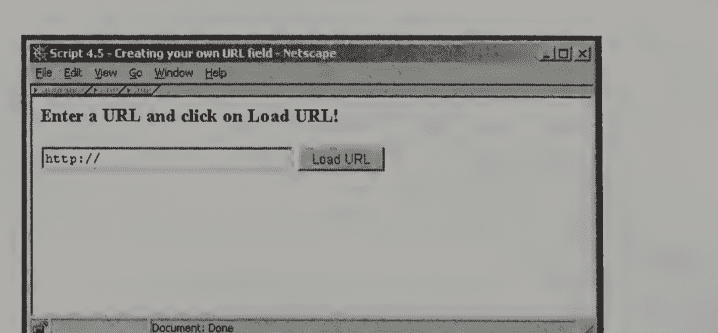

## 创建自动下拉导航菜单

有时，你可能希望为网站访客提供大量可供选择的链接。但逐一创建每个链接可能很繁琐，并且可能导致页面过于拥挤、缺乏吸引力。解决此问题的一个简单方法是使用下拉列表，如下例所示：

```
<HTML>
  <HEAD>
    <TITLE> Script 4.6 - Creating a drop-down menu - 1</TITLE>
  </HEAD>
  <BODY>
    <FORM NAME="myForm">
      <SELECT NAME="myList" onChange="window.location=
        document.myForm.myList.options[
        document.myForm.myList.selectedIndex].value">
        <OPTION SELECTED VALUE="javascript:void(0)">-- Pick One --
        <OPTION VALUE="http://www.microsoft.com"> Microsoft
        <OPTION VALUE="http://www.netscape.com"> Netscape
        <OPTION VALUE="http://www.myopera.com"> Opera
      </SELECT>
    </FORM>
  </BODY>
</HTML>
```

在页面主体中，定义并命名了一个名为 `myForm` 的表单。在其内部，声明了一个名为 `myList` 的列表。`onChange` 事件处理程序用于将 `window.location` 属性设置为以下语句指定的值：

```
document.myForm.myList.options[
    document.myForm.myList.selectedIndex].value
```

列表中的每个选项都有一个隐式的索引号。大致翻译一下，上面的语句获取你从列表中选择的选项的索引号（即 `document.myForm.myList.selectedIndex` 的值），并用它将所选选项的值赋给 `window.location`。

如果你查看表单中的 `<OPTION>` 标签，你会注意到第一个标签看起来不同。我使用了 `VALUE="javascript:void(0)"` 在列表中添加了一个条目，如果选中它，则会被忽略。这个技巧允许我在列表顶部添加一个实际上没有效果的指令。其余选项则很简单。每个 `<OPTION>` 标签都包含一个 `VALUE`，其中保存着 URL；如果选择了此选项，指定的 URL 将被打开。请注意，每个 `VALUE` 条目后面都跟着一个描述，用于标识列表中的该条目。

图 4.6 展示了加载此页面时列表的样子。选择 "-- Pick One --" 条目没有任何效果。选择任何其他条目都会导致浏览器加载与该选择相关联的 URL。

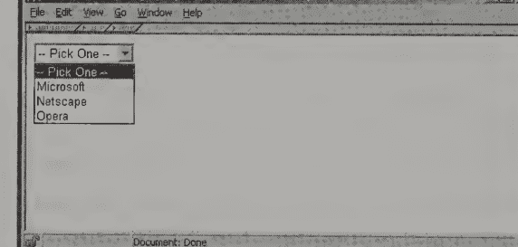

### 图 4.6
使用下拉列表帮助用户导航。

## 创建带按钮控件的下拉菜单

以下示例在上一节示例的基础上，为用户提供了额外一级的控制。下面的脚本允许用户从下拉列表中选择一个条目，而不会立即自动处理该条目（不像前面的示例那样）。在要求用户在处理表单前完成多项活动的表单中，延迟处理选择是合适的。

以下代码与上一节中的代码类似。但请注意，我从表单中移除了 `onchange` 事件处理程序，这阻止了表单自动处理所选选项。取而代之的是，我向表单的按钮添加了 `onclick` 事件处理程序。当用户点击按钮时，`onclick` 事件处理程序将 `window.location` 属性设置为所选列表选项的值，从而导致加载相应的 URL。

此脚本在头部部分创建了两个函数。一个函数在状态栏中显示作为参数传递给它的消息；另一个函数则清除该消息：

```
function PostMsg(msg) {
    window.status = msg;
}

function ClearMsg() {
    window.status="";
}
```

脚本主体部分中的三个链接执行 `onMouseOver` 和 `onMouseOut` 事件来调用状态栏函数。当用户将鼠标指针移到这些链接之一上时，其 `onMouseOver` 事件处理程序会调用 `PostMsg()` 函数，并传递一条描述该链接的消息。当用户将鼠标移开链接时，该链接的 `onMouseOut` 事件处理程序会调用 `ClearMsg()` 函数并清除状态栏。

```
<A HREF="http://www.netscape.com"
    onMouseOver="PostMsg('Jump to the Netscape
    home page'); return true;" onMouseOut="ClearMsg();">Netscape</A><P>
```

```
<A HREF="http://www.microsoft.com"
    onMouseOver="PostMsg('Jump to the Microsoft home page');
    return true;" onMouseOut="ClearMsg();"> Microsoft</A><P>
```

```
<A HREF="http://www.myopera.com"
    onMouseOver="PostMsg('Jump to the Opera home page');
    return true;" onMouseOut="ClearMsg();"> Opera</A>
```

图 4.4 展示了加载此页面并将指针移到 Netscape 链接上时的结果。点击该链接会指示浏览器加载该链接相关联的 URL。

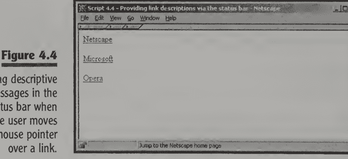


### 滚动与跳转

网页有时会因内容而变得相当大。JavaScript提供了在页面内滚动或跳转到预定义位置的功能。除了使页面更易于导航外，赋予用户跳转的能力还能产生令人惊叹的视觉效果，如下例所示：

```html
<HTML>
    <HEAD>
        <TITLE> Script 4.8 - 滚动与跳转示例</TITLE>
        <SCRIPT LANGUAGE="JavaScript" TYPE="Text/JavaScript">
        <!-- 开始隐藏 JavaScript 语句
            function ScrollDown(){
                for (i=1; i<=600; i++) {
                    parent.scrollTo(1,i);
                }
            }
            function ScrollUp(){
                for (i=600; i>=1; i--) {
                    parent.scrollTo(1,i);
                }
            }
            function JumpDown(){
                parent.scrollTo(1,600);
            }
            function JumpUp(){
                parent.scrollTo(1,1);
            }
        // 结束隐藏 JavaScript 语句 -->
        </SCRIPT>
    </HEAD>
    <BODY>
<FORM NAME="myForm">
    <INPUT NAME="scrollButton1" TYPE="button"
        VALUE="向下滚动" onClick="scrollDown()">
    <INPUT NAME="jumpButton1" TYPE="button"
        VALUE="跳转到底部" onClick="jumpDown()">
</FORM>
<BR><BR><BR><BR><BR><BR>
<H3>这是一个示例...</H3>
<BR><BR><BR><BR><BR><BR>
<H3>关于滚动和跳转...</H3>
<BR><BR><BR><BR><BR><BR>
<H3>从页面顶部到底部...</H3>
<BR><BR><BR><BR><BR><BR>
<H3>然后再返回！！</H3>
<FORM>
    <INPUT NAME="scrollButton2" TYPE="button"
        VALUE="向上滚动" onClick="scrollUp()">
    <INPUT NAME="jumpButton2" TYPE="button"
        VALUE="跳转到顶部" onClick="jumpUp()">
</FORM>
</BODY>
</HTML>
```

在页面的头部部分定义了四个函数。其中两个函数管理滚动效果，另外两个管理跳转效果。以 `ScrollDown()` 函数为例。该函数首先设置一个由变量 `i` 控制的 for 循环。变量 `i` 初始值为 1，然后每次递增 1，直到达到 600。在每次迭代中，循环执行窗口对象的 `scrollTo()` 方法。此方法将窗口的可视区域滚动到由 x 和 y 坐标指定的位置。实际上，for 循环执行了 600 次，每次都将显示区域向下滚动 1 个像素位置。`ScrollUp()` 函数则以相反的顺序执行相同的操作。

```javascript
function ScrollDown(){
    for (i=1; i<=600; i++) {
        parent.scrollTo(1,i);
    }
}
```

`JumpDown()` 函数通过直接指定目标坐标来完全跳过滚动效果。`JumpUp()` 函数则以相反的方式执行相同的操作。

```javascript
function JumpDown(){
    parent.scrollTo(1,600);
}
```

在定义了函数之后，此示例脚本创建了两个表单，并将它们分别放置在页面主体部分的顶部和底部。这两个表单都定义了两个按钮来调用这些函数。顶部表单中的按钮使用 `onClick` 事件处理程序来执行 `ScrollDown()` 和 `JumpDown()` 函数；底部表单中的按钮则使用 `onClick` 事件处理程序来执行 `ScrollUp()` 和 `JumpUp()` 函数。

在这两个表单之间，我放置了足够的文本，使页面足够长，以提供有效的演示。加载此页面会显示如图 4.8 所示的窗口。点击“向下滚动”或“跳转到底部”按钮，可视区域将滚动或跳转到页面底部，那里放置了“向上滚动”和“跳转到顶部”按钮。

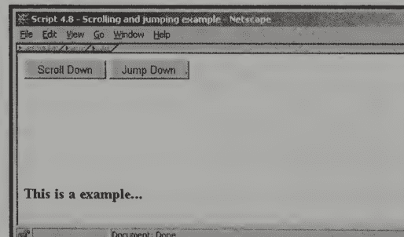

### 使用鼠标悬停效果

我个人最喜欢的 JavaScript 效果是鼠标悬停（rollover）。鼠标悬停是一种当鼠标指针经过时会发生变化的图像。它的原理是使用 `onMouseOver` 和 `onMouseOut` 事件处理程序在两个相似的链接或图像之间切换，从而产生图像正在变化的外观。这种非常流行的技术在 Web 上已很常见。

> 注意
> 确保你使用的悬停图像的两个副本尺寸相同。否则，效果会丢失，因为第二个图像看起来会扭曲变形。

在以下示例中，你将看到一个使用悬停效果来为三个图像添加动画的示例。虽然这些图像在用户看来是文本，但它们实际上是图形图像。遗憾的是，悬停技术仅适用于图形。

```html
<HTML>
<HEAD>
<TITLE> Script 4.9 - 使用鼠标悬停效果</TITLE>
<SCRIPT LANGUAGE="JavaScript" TYPE="Text/JavaScript">
<!-- 开始隐藏 JavaScript 语句
netscape1           =new Image;
netscape2           =new Image;
microsoft1          =new Image;
microsoft2          =new Image;
oper1               =new Image;
oper2               =new Image;
netscape1.src       ="netscape1.jpg";
netscape2.src       ="netscape2.jpg";
microsoft1.src      ="microsoft1.jpg";
microsoft2.src      ="microsoft2.jpg";
oper1.src           ="opera1.jpg";
oper2.src           ="opera2.jpg";
// 结束隐藏 JavaScript 语句 -->
</SCRIPT>
</HEAD>
<BODY>
    <A HREF="http://www.netscape.com"
        onMouseover="document.mybutton1.src=netscape2.src"
        onMouseout="document.mybutton1.src=netscape1.src">
        </A><P>
    <A HREF="http://www.microsoft.com"
        onMouseover="document.mybutton2.src=microsoft2.src"
        onMouseout="document.mybutton2.src=microsoft1.src">
        </A><P>
    <A HREF="http://www.myopera.com"
        onMouseover="document.mybutton3.src=opera2.src"
        onMouseout="document.mybutton3.src=opera1.src">
        </A>
</BODY>
</HTML>
```

让你的鼠标悬停效果生效的诀窍在于将图像预加载到用户的缓存中，这样当脚本引用它们时，它们可以立即显示。页面头部部分的脚本正是这样做的。悬停菜单由三个图像组成，每个图像都需要一个稍有不同的第二版本。因此，我必须定义六个图像。以下语句定义每个图像对象，并在页面开始加载时立即将其预加载到缓存中：

```javascript
netscape1       =new Image;
netscape2       =new Image;
microsoft1      =new Image;
microsoft2      =new Image;
opera1          =new Image;
opera2          =new Image;
netscape1.src   ="netscape1.jpg";
netscape2.src   ="netscape2.jpg";
microsoft1.src = "microsoft1.jpg";
microsoft2.src = "microsoft2.jpg";

opera1.src = "opera1.jpg";

opera2.src = "opera2.jpg";
```

页面首次加载时，会显示三个图像。每个图像都由主体部分中的链接定义。以下 HTML 标签显示了第一个链接：

```html
<A HREF=http://www.netscape.com
    onMouseover="document.mybutton1.src=netscape2.src"
    onmouseout="document.mybutton1.src=netscape1.src">
    </A><P>
```

如你所见，当鼠标指针经过图像时，`onMouseOver` 事件处理程序会自动加载该图像的另一个版本；当鼠标指针移开时，`onMouseOut` 事件处理程序会将原始图像放回。另外两个链接的定义方式类似。

图 4.9 显示了用户将指针放在 Opera 链接上后的页面外观。如果用户点击该链接，则会加载与该链接关联的 URL。否则，当用户移开指针时，会重新加载 Opera 链接的原始图形。

> 注意
> 为了真正欣赏鼠标悬停示例，你需要自己加载并运行它。它位于本书附带的 CD-ROM 上，连同你在本书中看到的所有其他示例。

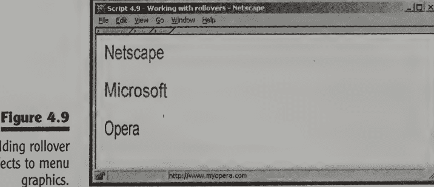


## 休息一下

现在正是休息的好时机。你已经完成了任务。当你回来时，我将分享更多关于 `window` 对象对话框方法的信息，并给你一些关于如何应对各种网络浏览器版本的建议。作为额外奖励，我将向你展示如何为你的网页添加时钟，以及如何设置用于宣传你自己或他人网站的横幅。几分钟后见！

### 利用对话框

欢迎回来。希望你休息得不错。夜晚会比你想象中更快过去，所以我们开始吧。除了打开窗口并显示 HTML，JavaScript 还允许你访问几种预定义的弹出式对话框，你可以用它们与访问者进行交互。这里列出了三种类型的对话框：

-   警报对话框
-   提示对话框
-   确认对话框

你已经在之前的示例中看到过这些对话框的使用。接下来的部分将详细解释如何使用 `window` 对象的 `alert()`、`prompt()` 和 `confirm()` 方法来充分利用这些对话框。

### 测试弹出式对话框

接下来的示例展示了如何使用 `window` 对象的所有三种方法来创建弹出式对话框：

```
<HTML>
    <HEAD>
        <TITLE> Script 4.10 - Testing pop-up dialog boxes</TITLE>
        <SCRIPT LANGUAGE="JavaScript" TYPE="Text/JavaScript">
        <!-- Start hiding JavaScript statements
            function AlertUsr(msg) {
                window.alert(msg);
            }

            function PromptUsr(msg) {
                age = window.prompt(msg, 55);
            }

            function ConfirmUsr(msg) {
                answer = window.confirm(msg);
            }

        // End hiding JavaScript statements -->
        </SCRIPT>
    </HEAD>
    <BODY>
        <FORM>
            <INPUT NAME="button1" TYPE="button" VALUE="Alert"
                onClick="AlertUsr('This is an alert prompt!')">
            <INPUT NAME="button2" TYPE="button" VALUE="Prompt"
                onClick="PromptUsr('This is a prompt. How old are you?')">
            <INPUT NAME="button3" TYPE="button" VALUE="Confirm"
                onClick="ConfirmUsr('This is a confirmation!')">
        </FORM>
    </BODY>
</HTML>
```

头部区域中的脚本定义了三个函数，分别对应一个方法。`AlertUsr()` 函数通过将接收到的消息作为参数传递，来执行 `window` 对象的 `alert()` 方法。该方法不支持其他参数。

```
function AlertUsr(msg) {
    window.alert(msg);
}
```

`PromptUsr()` 函数执行 `window` 对象的 `prompt()` 方法，并传递两个参数。第一个参数是要在提示框中显示的消息，第二个参数是自动显示在对话框文本字段中的默认值。如果你想让文本字段为空，应该用空引号 (`""`) 代替参数。如果你选择不包含第二个参数，当对话框弹出时，文本字段中会出现 "undefined" 一词。这既不美观，也给用户带来不便。

```
function PromptUsr(msg) {
    age = window.prompt(msg, 55);
}
```

`ConfirmUsr()` 函数执行 `window` 对象的 `confirm()` 方法，并将接收到的消息作为参数传递。该方法不支持其他参数。

```
function ConfirmUsr(msg) {
    answer = window.confirm(msg);
}
```

为了测试每个函数，我接下来在代码的主体部分定义了一个包含三个按钮的表单。我为每个按钮添加了 `onClick` 事件处理程序，并将该处理程序分配给其中一个函数。例如，对于名为 `button1` 的按钮，其 `onClick` 事件处理程序执行 `AlertUsr()` 函数，并传递文本 'This is an alert prompt!'，如下所示：

```
<INPUT NAME="button1" TYPE="button" VALUE="Alert" onClick="AlertUsr('This is an alert prompt!')">
```

> 注意 注意 `onClick` 事件处理程序中消息文本周围的单引号。使用单引号是因为分配给 `onClick` 事件处理程序的 JavaScript 语句本身必须被置于双引号内。任何时候，当你在引号内嵌套引号时，你必须区分这两对引号。我也可以反过来，在外面用单引号，里面用双引号；结果是一样的。

图 4.10 展示了如果你使用 Netscape Navigator 加载此页面，它会是什么样子。

### 让你的网页变得非常酷

每个浏览器对于由 `window` 对象的 `alert()`、`prompt()` 和 `confirm()` 方法打开的对话框的显示方式都略有不同。例如，图 4.11 展示了警报对话框在 Internet Explorer 中打开时的样子。图 4.12 展示了提示对话框在 Netscape Navigator 中打开时的样子。图 4.13 展示了确认对话框在 Opera 中打开时的样子。如你所见，每个浏览器的标题栏外观都存在差异。

### 添加欢迎消息

利用 `window` 对象的 `alert()` 方法的一个非常礼貌的方式是，当访问者访问你的网页时，向他们显示一条欢迎消息。如下例所示，在页面的主体部分放置一个 `alert()` 语句很容易做到：

```
<HTML>
<HEAD>
    <TITLE>Script 4.11 - Adding a simple welcome message</TITLE>
</HEAD>
<BODY>
    <SCRIPT LANGUAGE="JavaScript" TYPE="Text/JavaScript">
        <!-- Start hiding JavaScript statements
        window.alert('Welcome to my Web Site!');
        // End hiding JavaScript statements -->
    </SCRIPT>
</BODY>
</HTML>
```

> **注意**  问候消息通常通过在 `<BODY>` 标签内使用 `onLoad` 事件处理程序来创建。

图 4.14 展示了在 Netscape Navigator 中加载上一个示例的结果。

**图 4.14** 当访问者首次进入你的网站时，显示一条通用问候语。

### 在消息中使用访问者的姓名

一个更复杂的问候方式是使用 `window` 对象的 `prompt()` 方法来询问用户输入他或她的姓名，然后显示一条使用该姓名的问候语。以下示例演示了此技术：

```
<HTML>
<HEAD>
    <TITLE> Script 4.12 - Using the visitor's name in a message</TITLE>
</HEAD>
<BODY>
    <SCRIPT LANGUAGE="JavaScript" TYPE="Text/JavaScript">
        <!-- Start hiding JavaScript statements
            your_name =
                window.prompt('Welcome to my Web Site! What is your name?','');
            window.alert('Thanks for visiting us ' + your_name +
                '.  We hope that you enjoy your experience!');
        // End hiding JavaScript statements -->
    </SCRIPT>
</BODY>
</HTML>
```

此示例同时使用了 `prompt()` 和 `alert()` 方法与用户交流。`prompt()` 方法用于收集信息，然后 `alert()` 方法使用这些信息来感谢用户的访问。

图 4.15 展示了用户在此页面加载时看到的交互的第一部分。请注意，提示对话框没有显示初始消息或 "undefined" 消息。

如果用户点击确定，警报对话框将出现，如图 4.16 所示。

**图 4.15** 使用 `window` 对象的 `prompt()` 方法收集用户输入。

**图 4.16** 使用 `window` 对象的 `alert()` 方法向用户发送信息性消息。

当然，询问用户的姓名还有许多其他好处。例如，你可以将其存储在一个变量中，并反复引用它来与用户互动，或者在 `onUnload` 事件处理程序执行时（表示用户正在离开或关闭页面）感谢用户的访问。如果你的页面还包含一个表单，你可以使用用户的姓名来填写姓名字段，从而为用户省去一些输入工作。

> 注意 你是否曾好奇为什么有些网站似乎记得你是谁，并且每次访问都能以姓名向你问好？嗯，这是因为他们一直在使用 Cookie。明天，我将向你展示如何自己制作一些 Cookie。Cookie 是小段、无害的信息，你可以将其存储在用户的计算机上，并在用户下次返回时检索。例如，在收集了用户的姓名后，你可以将该信息存储为一个 Cookie。当用户下次返回你的网页时，你可以通过检查用户的计算机是否存储了你的某个 Cookie 来查看用户是否以前访问过你的网站。如果你找到了该 Cookie，你就可以用姓名问候用户。如果你的脚本找不到你的 Cookie，脚本可以提示输入用户的姓名，并将其保存以备下次访问使用。


### 处理不同类型的浏览器

在整本书中，我反复强调，由于 JavaScript 和互联网浏览器的不断发展，编写每个人都能使用的网页是一项有些繁琐的任务。如今，新的技术（如小型手持设备和现在开始访问互联网但完全不支持 JavaScript 的家电产品）的出现，使得这项任务变得更加困难。

接下来的两节将描述如何查询每位访客的浏览器以获取其 JavaScript 功能信息，并展示你可能尝试用来支持各种浏览器的方法。

### 收集浏览器信息

以下示例展示了如何确定访客用于加载你网页的浏览器类型和版本号。该脚本使用 `navigator` 对象收集特定于浏览器的信息。

```html
<HTML>
    <HEAD>
        <TITLE> Script 4.13 - Gathering Browser information</TITLE>
    </HEAD>
    <BODY>
        <SCRIPT LANGUAGE="JavaScript" TYPE="Text/JavaScript">
        <!-- Start hiding JavaScript statements
        document.write("You are using the " + navigator.appName +
            " browser <BR>");
        document.write("Version: " + navigator.appVersion);
        // End hiding JavaScript statements -->
        </SCRIPT>
    </BODY>
</HTML>
```

该脚本仅包含两条语句。第一条语句使用 `document.write()` 方法显示一条消息。该消息使用 `navigator.appName` 属性显示查看页面的浏览器名称：

```javascript
document.write("You are using the " + navigator.appName +
    " browser <BR>");
```

第二条 `document.write()` 语句使用 `navigator.appVersion` 属性显示另一条消息：

```javascript
document.write("Version: " + navigator.appVersion);
```

加载此示例时，你将看到与图 4.17 类似的结果，具体取决于你使用的浏览器。

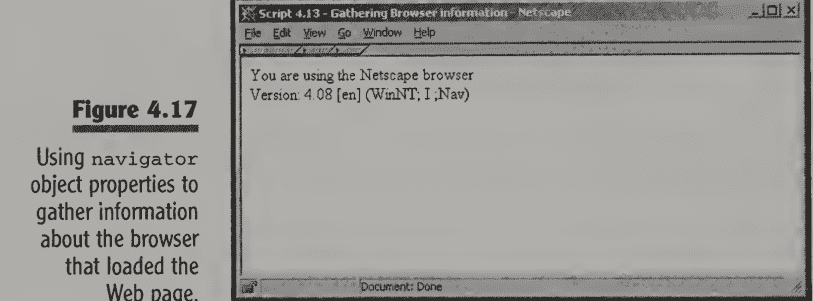

### 浏览器重定向示例

一旦你知道如何使用 `navigator` 对象的属性来捕获浏览器信息，你就可以编写脚本，将访客重定向到你为这些特定浏览器编写的页面。以下示例展示了你可以这样做的其中一种方式：

```html
<HTML>
    <HEAD>
        <TITLE> Script 4.14 - A browser redirection example</TITLE>
    </HEAD>
    <BODY>
        <SCRIPT LANGUAGE="JavaScript" TYPE="Text/JavaScript">
        <!-- Start hiding JavaScript statements
            browser_name=navigator.appName;
            browser_ver=parseInt(navigator.appVersion);
            if ((browser_name=="Netscape") ||
                (browser_name=="Microsoft Internet Explorer")) {
                if (browser_name=="Netscape") {
                    if (browser_ver==2) {
                        //window.location="http://fillthispartin.com/NSver2.html";
                        document.write("NS Vers 2");
                    }
                    if (browser_ver==3) {
                        //window.location="http://fillthispartin.com/NSver3.html";
                        document.write("NS Vers 3");
                    }
                    if (browser_ver==4) {
                        //window.location="http://fillthispartin.com/NSver4.html";
                        document.write("NS Vers 4");
                    }
                }
                else {
                    if (browser_name=="Microsoft Internet Explorer") {
                        if (browser_ver==3) {
                            //window.location="http://fillthispartin.com/ver3.html";
                            document.write("IE Vers 3");
                        }
                        if (browser_ver==4) {
                            //window.location="http://fillthispartin.com/ver4.html";
                            document.write("IE Vers 4");
                        }
                        if (browser_ver==5) {
                            //window.location="http://fillthispartin.com/ver5.html";
                            document.write("IE Vers 5");
                        }
                    }
                }
            }
            else {
                //window.location=
                //"http://fillthispartin.com/unsupported.html";
                document.write("Other browsers will see this message.");
            }
        // End hiding JavaScript statements -->
        </SCRIPT>
    </BODY>
</HTML>
```

首先，脚本创建两个变量，并将它们分别赋值为 `navigator` 对象的 `appName` 和 `appVersion` 属性的值。

> **注意** 你注意到设置 `browser_ver` 变量的语句中包含了 `parseInt()` 方法吗？此方法解析一个字符串并返回一个整数值。`parseInt()` 方法在找到一个非数字字符后会忽略其后的所有字符。我使用的 Netscape Navigator 版本是 4.08。语句 `browser_ver=parseInt(navigator.appVersion)` 返回值 4，因为 `parseInt()` 方法在遇到句点时就停止了。

接下来，脚本执行一个 `if` 语句，检查浏览器的 `appName` 是否为 Netscape 或 Microsoft Internet Explorer：

```javascript
if ((browser_name=="Netscape") ||
    (browser_name=="Microsoft Internet Explorer")) {
.......
}
```

如果此语句结果为假，则与该 `if` 语句关联的 `else` 语句将执行，并在浏览器上显示一条消息。`else` 语句之后紧跟一个被注释掉的 `window.location` 语句；此语句提供了一个示例，展示了如何将非 Netscape 和非 Internet Explorer 浏览器重定向到一个通用页面：

```javascript
else {
    document.write("You are not using a Netscape " +
        "or Internet Explorer.");
    //window.location="http://fillthispartin.com/unsupported.html";
}
```

如果打开页面的是 Netscape Navigator 的某个版本，第一个 `if` 语句结果将为真，然后处理以下代码部分。由于浏览器是 Netscape Navigator 浏览器，下一个 `if` 语句结果也为真。如果情况并非如此（即，如果浏览器不是 Netscape Navigator 的某个版本），则一个结构类似的代码部分将用于测试 Internet Explorer 的各个版本。如以下代码部分所示，将对 Netscape Navigator 的版本 2、3 和 4 进行测试，直到找到匹配项。找到匹配项后，将向窗口写入一条消息。注释语句提供了一个模板，你可以修改它以将用户的浏览器重定向到适当的页面。

```javascript
if (browser_name=="Netscape") {
    if (browser_ver==2) {
        //window.location="http://fillthispartin.com/NSver2.html";
        document.write("NS Vers 2");
    }
    if (browser_ver==3) {
        //window.location="http://fillthispartin.com/NSver3.html";
        document.write("NS Vers 3");
    }
    if (browser_ver==4) {
        //window.location="http://fillthispartin.com/NSver4.html";
        document.write("NS Vers 4");
    }
}
```

图 4.18 显示了使用 Opera 浏览器加载此页面的结果。如你所见，浏览器声称是 Netscape 版本 4，这意味着该浏览器应能提供与 Netscape Navigator 版本 4 浏览器相同级别的 JavaScript 支持。

**图 4.18**
根据用于加载页面的浏览器版本，将访客重定向到备用网页。

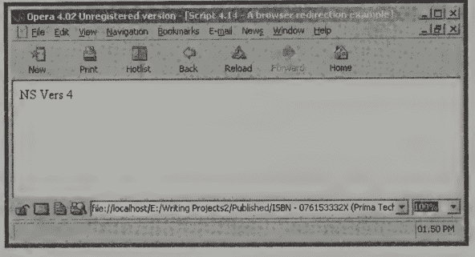

### 尝试其他有趣的功能

在今晚学习的最后一个部分，你将学习三个非常有用的技巧。首先，我将向你展示在网页中添加一个时钟是多么容易。如果你创建的页面访客可能会花大量时间浏览，那么时钟就特别有用。例如，你可以编写一个每隔几分钟就重新加载自身的页面，以便你可以向访客提供你发布在网站上的实时信息。在你的页面上放置一个数字时钟，可以让访客看到他们访问了多长时间，以及现有信息的时效性。

第二个示例将展示一种绕过 JavaScript 主要弱点之一的解决方案：它无法为你的网页提供有意义的、受密码保护的访问控制。这个示例向你展示了一种应用相对简单的密码方案的方法，这足以将普通的未授权网络浏览者挡在你的网站之外。

今晚我将向你展示的最后一件事是如何创建你自己的横幅。*横幅*是宣传你网站其他部分或通过向想在你网页上做广告的人出租横幅空间来赚钱的好方法。


### 构建 JavaScript 时钟

在你的网页上添加一个数字时钟是一项相对简单的任务。只需用到 `Date` 对象和 `setTimeout()` 方法。你可以使用 `document.write()` 方法来显示时钟，从而创建一个最简单形式的时钟。然而，本示例通过将时钟显示在表单文本字段中，增添了最后的点睛之笔。

```html
<HTML>

    <HEAD>
        <TITLE> Script 4.15 - Building a JavaScript Clock</TITLE>
        <SCRIPT LANGUAGE="JavaScript" TYPE="Text/JavaScript">
        <!-- Start hiding JavaScript statements
        function ShowClock() {
            the_time_is = new Date;
            the_minute = the_time_is.getMinutes();
            the_hour = the_time_is.getHours();
            the_second = the_time_is.getSeconds();
            if (the_minute < 10) {
                the_minute = "0" + the_minute;
            }
            if (the_hour < 10) {
                the_hour = "0" + the_hour;
            }
            if (the_second < 10) {
                the_second = "0" + the_second;
            }
            document.myForm.displayTime.value = the_hour + ":" + the_minute + ":" + the_second;
            setTimeout("ShowClock()",1000);
        }
        // End hiding JavaScript statements -->
        </SCRIPT>

    </HEAD>

    <BODY onLoad="ShowClock()">
    <FORM NAME="myForm">
    <B>The time is:</B>
    <INPUT NAME="displayTime" TYPE="TEXT" SIZE="8">
    </FORM>
    </BODY>
</HTML>
```

本示例将脚本放在了头部区域。脚本首先做的就是建立一个名为 `ShowClock()` 的函数，该函数用于获取、格式化并显示时钟数据。

`ShowClock()` 函数做的第一件事就是将一个名为 `the_time_is` 的变量的值设置为当前日期。然后，它使用 `Date` 对象的 `getMinutes()`、`getHours()` 和 `getSeconds()` 方法来提取时间的各个独立部分：

```javascript
the_time_is = new Date
the_minute = the_time_is.getMinutes()
the_hour = the_time_is.getHours()
the_second = the_time_is.getSeconds()
```

为了提供一致的显示格式，脚本会检查每个元素，确保其为两位数长度。如果分钟、小时或秒数的值在 0 到 9 之间，脚本会在数值前面补一个 0。因此，0 小时会变成 00 小时，6 秒会变成 06 秒，依此类推。

```javascript
if (the_minute < 10) {
    the_minute = "0" + the_minute
}

if (the_hour < 10) {
    the_hour = "0" + the_hour
}

if (the_second < 10) {
    the_second = "0" + the_second
}
```

在每个元素都被正确格式化后，脚本将它们组合起来，并显示在表单 `myForm` 的 `displayTime` 文本字段中，如下所示：

```javascript
document.myForm.displayTime.value = the_hour + ":" +
    the_minute + ":" + the_second
```

为了保持时钟持续运行，`ShowClock()` 函数最后使用 `setTimeout()` 方法安排自己在一秒钟后再次执行：

```javascript
setTimeout("ShowClock()", 1000)
```

图 4.19 展示了加载此页面时的示例效果。

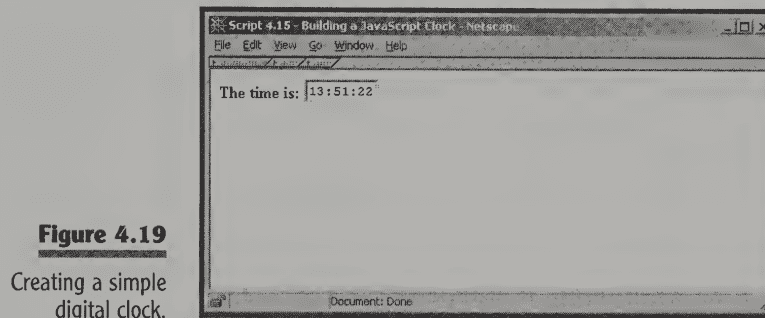

### 简单密码脚本

正如我已经指出的，客户端 JavaScript 缺乏为网站实现真正密码保护方案的能力。然而，当与基于 Web 服务器的程序结合使用时，JavaScript 可以提供一个前端，用于收集用户的用户名和密码，将用户信息发送到服务器程序，并显示服务器返回的 HTML 页面。图 4.20 展示了这一过程。在此示例中，服务器执行一个 CGI 程序，根据数据库验证用户，然后根据验证过程的成功或失败返回一个 HTML 页面。

但仅靠客户端 JavaScript 本身无法完成这种类型的密码验证。当然，你总是可以编写一个脚本，并将用户名和密码嵌入代码中。虽然这种方法可能会阻止一些不受欢迎的访问者，但任何知道如何查看 HTML 源代码的人都可以读取它并发现用户名和密码。要更巧妙一点，你可以将用户名和密码放在一个外部 `.js` 文件中，这可能足以阻止普通的未授权用户。

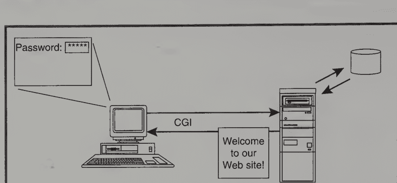

**图 4.20** 典型密码验证过程的示意图。

你可以使用的一个小技巧来为你的网站提供一定程度的密码保护，是发布一个中间页面，要求访问者在加载你网站的真实主页之前提供密码。这个技巧的关键在于，使所需的密码与你的主页名称相同。

图 4.21 展示了一个示例，其中访问者找到了你的中间页面，并面对一个密码表单。用户必须在“Password”字段中输入 *ivworld* 才能访问你的网站。当然，如果用户知道密码就是网站真实主页的名称，他们可以直接加载该页面，而不是打开中间密码页面并输入密码。然而，除非你向用户提供了密码，否则他们无法找到该页面；如果你已经把密码告诉了他们，那么他们直接加载该页面可能也没问题。

以下是实现图 4.21 中示例所需的脚本：

```html
<HTML>

<HEAD>

<TITLE> Script 4.16 - A simple password-protection example</TITLE>

<SCRIPT LANGUAGE="JavaScript" TYPE="Text/JavaScript">

<!-- Start hiding JavaScript statements

function LoadTheURL() {

document.location.href = "http://www.xxxxxxxx.com/" +

document.myForm.psswdField.value + ".html";

}

// End hiding JavaScript statements -->
</SCRIPT>
</HEAD>
<BODY>
<B>Please type your password:</B>
<FORM NAME="myForm">
    <INPUT NAME="psswdField" TYPE="password" size="15">
    <INPUT NAME="Login" TYPE="button" VALUE="Login"
           onClick="LoadTheURL()">
</FORM>
</BODY>
</HTML>
```

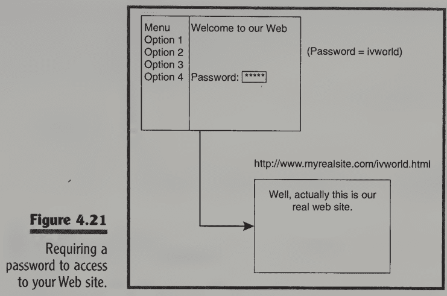

> 注意：要使前面的示例正常工作，你需要将 `http://www.xxxxxxxx.com` 替换为一个真实网站的 URL。

首先在头部区域定义了一个名为 `LoadTheURL()` 的函数。该函数包含一条语句。`document` 对象的子对象 `location` 的 `href` 属性被设置为一个 URL 地址的值。这个地址是一个拼接的字符串，包含了 `document.myForm.psswdField.value` 的值。该值包含用户输入的密码。

```javascript
function LoadTheURL() {
    document.location.href = "http://www.yourwebsite.com/" +
    document.myForm.psswdField.value + ".html"
}
```

`document.myForm.psswdField.value` 的值是在页面的表单中确定的。该表单名为 `myForm`，包含两个元素。第一个元素是名为 `psswdField` 的密码字段。这个字段类似于你在其他表单示例中看到的文本字段，不同之处在于它会自动隐藏用户输入的字符，从而将密码隐藏起来，不被窥视。第二个表单元素是一个按钮，带有一个 `onClick` 事件处理程序，当按钮被点击时调用 `LoadTheURL()` 函数。

```html
<FORM NAME="myForm">
    <INPUT NAME="psswdField" TYPE="password" size="15">
    <INPUT NAME="Login" TYPE="button" VALUE="Login"
           onClick="LoadTheURL()">
</FORM>
```

结果是，一旦脚本设置了 `document.location.href` 属性，浏览器就会尝试加载目标 URL。如果用户输入了错误的密码，会出现错误；否则，你的主页就会加载。

> 注意：这是一个非常简单的脚本。在现实生活中，你可能需要添加代码来在处理之前验证表单的内容。例如，你可以确保用户没有将密码字段留空。我明天将详细讲解如何验证你的表单。

图 4.22 展示了当浏览器加载前面的脚本时的样子。

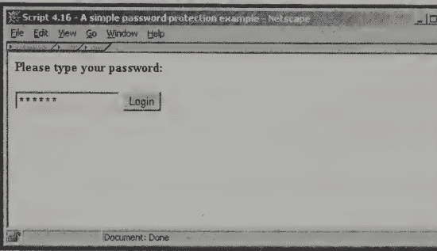

图 4.22 为你的网站添加密码保护。

### 轮播横幅示例

今晚的最后一个示例向你展示一种在网站上创建循环横幅的方法。在这个例子中，脚本循环播放四个横幅；该脚本可以轻松修改，以适应你想要显示的任意数量的横幅。

> 注意：创建横幅的另一种方法是使用图形应用程序创建一个动画 GIF 图像，该图像可以自动循环播放一系列 GIF 文件。然而，使用 JavaScript 创建横幅比使用动画 GIF 有几个优点：使用 JavaScript，你可以轻松调整横幅的行为。使用 JavaScript，你可以使用 JPEG 文件，它产生的图像更清晰，并且比相应的 GIF 文件更小，从而下载更快。你可以打赌，访问你网站的人会欣赏这一点！

```html
<HTML>
    <HEAD>
        <TITLE> Script 4.17 - A Rotating Banner Example</TITLE>
        <SCRIPT LANGUAGE="JavaScript" TYPE="Text/JavaScript">
        <!-- Start hiding JavaScript statements
            MyBannerArray = new Array(4);
            MyBannerArray[0]="banner0.jpg";
            MyBannerArray[1]="banner1.jpg";
```


# 什么是JavaScript？

## JavaScript是什么？

JavaScript是一种轻量级的、解释型的编程语言。它被设计用来在Web浏览器中创建动态交互式的内容。

## JavaScript的主要特点

- **客户端执行**：JavaScript代码通常在用户的浏览器中运行，而不是在服务器上。
- **事件驱动**：JavaScript可以响应用户操作（如点击、鼠标移动等）。
- **跨平台**：由于在浏览器中运行，它可以在任何操作系统上工作。
- **与HTML和CSS集成**：JavaScript可以与HTML（结构）和CSS（样式）协同工作，创建丰富的用户体验。

## 一个简单的JavaScript示例

下面是一个简单的JavaScript示例，它会在网页加载时显示一个问候信息：

```javascript
// 定义一个函数，显示问候信息
function greetUser() {
    alert("欢迎来到我的网站！");
}

// 当页面加载完成后调用函数
window.onload = greetUser;
```

## 如何在HTML中嵌入JavaScript

有两种主要方式可以在HTML文档中嵌入JavaScript：

1. **内部脚本**：直接在HTML的 `<script>` 标签内编写JavaScript代码。
    ```html
    <script type="text/javascript">
        // JavaScript代码写在这里
        document.write("Hello, World!");
    </script>
    ```

2. **外部脚本**：将JavaScript代码保存在单独的文件中（通常以 `.js` 结尾），然后在HTML中通过 `<script>` 标签的 `src` 属性引入。
    ```html
    <script type="text/javascript" src="script.js"></script>
    ```
    使用外部脚本有助于代码的组织和重用。

## JavaScript的基本语法

JavaScript语法类似于其他C风格的语言（如Java、C++），主要特点包括：

- **变量**：使用 `var`（现代代码中更常用 `let` 和 `const`）来声明变量。
    ```javascript
    let message = "Hello"; // 使用 let 声明变量
    const pi = 3.14;       // 使用 const 声明常量
    ```
- **数据类型**：JavaScript支持多种数据类型，包括数字、字符串、布尔值、对象、数组等。
- **运算符**：支持算术、比较、逻辑等运算符。
- **控制结构**：包括 `if...else` 语句、`for` 循环、`while` 循环等。

## 与用户的交互

JavaScript可以轻松地与用户进行交互。一个常见的方法是使用 `alert()` 函数显示一个弹出框：

```javascript
alert("这是一个提示信息！");
```

另一个常用的方法是使用 `prompt()` 函数获取用户输入：

```javascript
let userName = prompt("请输入您的姓名：", "用户");
if (userName != null) {
    document.write("<h1>你好，" + userName + "！</h1>");
}
```

## 操纵HTML内容

JavaScript可以动态地修改网页的内容和结构。通过 `document` 对象，你可以访问和操作HTML元素。

例如，修改一个元素的内容：

```javascript
// 假设HTML中有一个id为"demo"的段落：<p id="demo">原始文本</p>
document.getElementById("demo").innerHTML = "这是新的文本内容！";
```

## 总结

JavaScript是现代Web开发中不可或缺的一部分。它为静态的HTML页面增添了生命力，使得创建交互式、动态的网页成为可能。从简单的表单验证到复杂的单页应用程序，JavaScript都扮演着核心角色。


默认情况下，浏览器在显示框架集中的框架时，会使用100%的可用空间。当指定了具体的 `COLS` 和 `ROWS` 属性时，浏览器会按照从上到下、从左到右的顺序，为框架分配指定的长度值。

> **注意** 如果你在定义 `COLS` 和 `ROWS` 属性时高估了所需空间，浏览器会自动缩小框架的相应维度。例如，如果你错误地指定了 `COLS="80%, 80%"`，浏览器会自动将两列的尺寸缩小到各占50%。

`onLoad` 和 `onUnload` 事件处理程序允许你在页面所有框架加载或卸载时，执行你想要运行的 JavaScript 语句或函数。

> **注意** 你应该始终考虑在页面中添加 `<NOFRAMES>` 标签。除了显得礼貌之外，这些标签有助于确保每个人都能从你的网页中获得价值。下面的示例演示了如何显示一条不支持框架的浏览器将会显示的消息。请注意，`<BODY>` 和 `</BODY>` 标签被包含在 `<NOFRAMES>` 和 `</NOFRAMES>` 标签内部。

```
<NOFRAMES>
  <BODY>
    Browsers that do not support frames will show this message.
  </BODY>
</NOFRAMES>
```

`<FRAME>` 标签仅存在于 `<FRAMESET>` 标签内部；它们指定了框架集内的一个矩形区域。默认情况下，一个框架会占据其被分配到的整个框架集区域。`<FRAME>` 标签可以包含多个属性：

-   `NAME`：引用该框架时使用的名称。
-   `SRC`：加载到该框架中的 URL。
-   `LONGDESC`：一个可选的长描述，用于进一步说明框架的内容。
-   `FRAMEBORDER`：值为 0 或 1。值为 1 会在框架周围显示可见边框。
-   `MARGINWIDTH`：一个值，用于在指定像素数内为框架分配区域的宽度部分添加边距。
-   `MARGINHEIGHT`：一个值，用于在指定像素数内为框架分配区域的高度部分添加边距。
-   `NORESIZE`：如果指定了此参数，将阻止用户调整框架大小。
-   `SCROLLING`：如果指定了此参数，允许你确定何时为框架添加滚动条（选项为 yes、no 或 auto）。如果未指定此参数，默认值为 auto。

> 通过将 FRAMEBORDER 属性设置为 0 来移除框架边框，会自动阻止用户调整框架大小，并且无需指定 NORESIZE 属性。

> 即使你指定了 FRAMEBORDER=1，一个相邻的、FRAMEBORDER 设置为 0 的框架仍然可以在两个框架之间建立边框。

# 构建你的第一个框架

最简单的形式中，一个使用框架的示例涉及三个不同的 HTML 页面。第一个页面包含 `<FRAMESET>` 和 `<FRAME>` 标签，并定义了其他页面显示的布局。另外两个页面提供加载到框架中的内容；每个页面由典型的 HTML 和 JavaScript 语句组成。

下面是一个这样的示例。第一个页面在一个 `<FRAMESET>` 标签内包含两个 `<FRAME>` 标签。`<FRAMESET>` 标签使用 `COLS="*,*"` 属性定义了两个框架，该属性指示浏览器将所有可用空间分配给这些框架。第一个框架命名为 left，并加载指定的页面。由于框架集使用 `COLS` 属性定义了两个列框架，第一个框架就是左列。第二个框架命名为 right，并被分配了另一个要加载的页面。

```
<HTML>
    <HEAD>
        <TITLE>Script 5.1a - Building your first frame </TITLE>
    </HEAD>
    <FRAMESET COLS="*,*">
        <FRAME SRC="Script5.1b.html" NAME="left">
        <FRAME SRC="Script5.1c.html" NAME="right">
    </FRAMESET>
</HTML>
```

> 注意 本章中引用的并非每个 HTML 文件都会显示。但是，它们可以在随书附带的 CD 上找到。

左框架中的页面包含一个简单的 HTML 标题标签，显示一条消息，使得可以轻松识别该页面加载到了哪个框架中，如下例所示。

```
<HTML>
    <HEAD>
        <TITLE>Script 5.1b - left.html</TITLE>
    </HEAD>
    <BODY>
        <H3>This is the left frame.</H3>
    </BODY>
</HTML>
```

同样，右框架中的页面包含一个 HTML 标题标签，显示一条消息，可以轻松判断该页面加载到了哪个框架中：

```
<HTML>
    <HEAD>
        <TITLE>Script 5.1c - right.html</TITLE>
    </HEAD>
    <BODY>
        <H3>This is the right frame.</H3>
    </BODY>
</HTML>
```

图 5.1 展示了如果你使用 Netscape Navigator 加载该示例，框架的显示效果。

> **注意** 前面的示例加载的页面与包含框架集定义的页面位于同一服务器上。或者，你也可以将任何 URL 地址加载到框架中。例如，`<FRAME SRC="http://www.netscape.com" NAME="left">` 和 `<FRAME SRC="http://www.microsoft.com" NAME="right">` 会将 Netscape 和 Microsoft 的主页分别加载到左框架和右框架中。

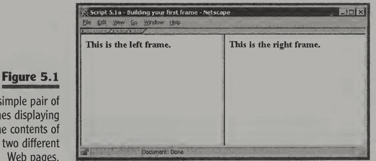

## 创建导航框架

框架最常见的用途或许是在网站上提供导航菜单。在这种情况下，在页面左侧定义一个小框架，其中包含一系列链接。当点击其中一个链接时，内容会加载到右侧框架中。你创建这种布局的方式与前面的示例非常相似，只是左框架包含特殊格式的链接，这些链接将指定的 URL 加载到右侧框架中，而不是加载到自身的框架中。

以下三个 HTML 页面演示了如何使用这种框架导航技术创建一个网站。第一个页面在一个 `<FRAMESET>` 标签内包含两个 `<FRAME>` 标签。`<FRAMESET>` 标签根据 `COLS="162, *"` 参数定义了两个框架，该参数告诉浏览器创建一个包含两个基于框架的列的窗口。第一列宽 162 像素。所有剩余的可用空间都分配给第二列及其框架。

```
<HTML>
  <HEAD>
    <TITLE>Script 5.2a - Building a Web site with a
              navigation frame
    </TITLE>
  </HEAD>
  <FRAMESET COLS="162,*">
    <FRAME SRC="Script5.2b.html" NAME="left" SCROLLING="auto">
    <FRAME SRC="Script5.2c.html" NAME="right" SCROLLING="auto">
  </FRAMESET>
</HTML>
```

此页面中的两个 `<FRAME>` 标签将初始内容加载到每个框架中。以下页面加载到左框架中，作为网站的导航菜单。它包含三个链接，每个链接被选中时都会将一个新页面加载到右侧框架中。链接的 `TARGET=""` 属性指示浏览器覆盖将页面加载到当前选定框架的默认行为，而是将其加载到指定的框架中——在此例中，是名为 right 的框架。

```
<HTML>
  <HEAD>
    <TITLE>Script 5.2b - The Web site's navigation page</TITLE>
  </HEAD>
  <BODY>
    <P><B>Sample Index</B></P>
    <A HREF="Script5.2d.html" TARGET="right">Sample Link 1</A><BR>
    <A HREF="Script5.2e.html" TARGET="right">Sample Link 2</A><BR>
    <A HREF="Script5.2f.html" TARGET="right">Sample Link 3</A><BR>
  </BODY>
</HTML>
```

此示例中的第三个页面只是当浏览器打开框架页面时加载到右侧框架的初始主页（参见图 5.2）。一旦用户点击导航页面中的某个链接，此页面就会被卸载。

```
<HTML>
  <HEAD>
    <TITLE>Script 5.2c - The main page for the Web site</TITLE>
  </HEAD>
  <BODY>
    <H3>This is the initial content page that is
        displayed in the right frame.
    </H3>
  </BODY>
</HTML>
```

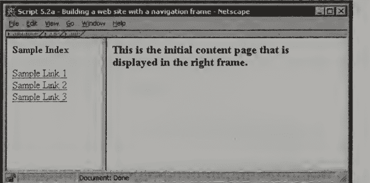

**图 5.2**
一个使用框架为网站提供导航菜单的示例。


## 嵌套框架集

当然，你可以在单个页面上拥有两个以上的框架。实际上，你可以在页面上放置任意数量的框架（尽管屏幕上的可用空间存在一个明显的实际限制）。

以下示例演示了如何将一个框架集嵌套在另一个框架集中，以创建基于多行多列的框架页面。在此示例中，创建了四个框架。

第一个 `<FRAMESET>` 标签定义了两个框架，并将20%的可用空间分配给第一个框架，80%分配给第二个框架。下一行定义了一个名为 `left` 的框架。该框架为页面的其余部分提供导航索引。接下来，添加了一个新的 `<FRAMESET>` 标签；这个框架集占用了原本属于第二个框架的空间，并将其分配给三个新框架。第一和第二个框架各分配了三分之一的可用空间，第三个框架分配了剩余的34%空间。最后三行包含 `<FRAME>` 语句，用于命名每个框架并加载其初始内容。

```
<HTML>
    <HEAD>
        <TITLE> Script 5.3a -嵌套框架集示例</TITLE>
    </HEAD>

    <FRAMESET COLS="20%,80%">
        <FRAME SRC="Script5.3b.html" NAME="left" SCROLLING="auto">
        <FRAMESET ROWS="33%,33%,34%">
            <FRAME SRC="Script5.3c.html" NAME="right1" SCROLLING="auto">
            <FRAME SRC="Script5.3d.html" NAME="right2" SCROLLING="auto">
            <FRAME SRC="Script5.3e.html" NAME="right3" SCROLLING="auto">
        </FRAMESET>
    </FRAMESET>
</HTML>
```

以下是加载在 `left` 框架中的导航页面的代码。请注意，每个链接的 `TARGET` 属性都设置为将页面加载到不同的框架中。

```
<HTML>
<HEAD>
<TITLE> Script 5.3b- 嵌套FRAMESET示例的导航页面
</TITLE>
</HEAD>
<BODY>
<P><B>示例索引</B></P>

<A HREF="Script5.3f.html" TARGET="right1">替换框架1</A>
<BR>
<A HREF="Script5.3g.html" TARGET="right2">替换框架2</A>
<BR>
<A HREF="Script5.3h.html" TARGET="right3">替换框架3</A>
<BR>
</BODY>
</HTML>
```

构成此示例的其余页面是简单的HTML页面，包含格式化为HTML标题的消息。这些页面命名为 `Script5.3c` 到 `Script5.3h`，可在随书附带的CD上查看。图5.3显示了该页面及其四个框架在浏览器中加载时的样子。

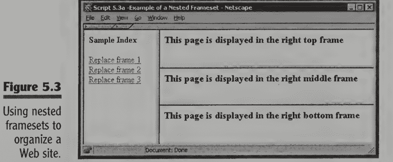

图5.3
使用嵌套框架集来组织网站。

## 处理无法显示框架的浏览器

许多旧版浏览器不支持框架。此外，一些浏览器允许用户禁用框架支持。例如，你可以通过在Opera浏览器中选择"文件"、"首选项"来禁用框架支持；当首选项对话框如图5.4所示打开时，在类别列表中点击"文档"选项，然后取消选中"启用框架"复选框。

为了预见此类浏览器可能会尝试打开你的框架页面的情况，你可以使用 `<NOFRAMES>` 标签来显示替代内容。`<NOFRAMES>` 标签放置在 `<FRAMESET>` 标签内，并且必须包含使用以下语法的 `<BODY>` 标签：

```
<FRAMESET>
  <NOFRAMES>
    <BODY>
      .
      .
      .
    </BODY>
  </NOFRAMES>
</FRAMESET>
```

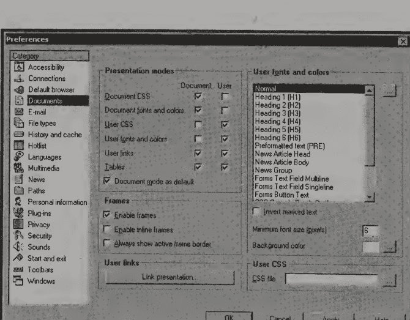

图5.4 在Opera 4.02中禁用框架支持前选择"文档"。

以下示例展示了你如何可能使用 `<NOFRAMES>` 标签来与使用框架功能受限的浏览器的访客进行沟通：

```
<HTML>
  <HEAD>
    <TITLE>Script 5.4a- 为框架受限的浏览器显示替代内容
    </TITLE>
  </HEAD>
  <FRAMESET COLS="162,*">
    <FRAME SRC="Script5.4b.html" NAME="left" SCROLLING="auto">
    <FRAME SRC="Script5.4c.html" NAME="right" SCROLLING="auto">
    <NOFRAMES>
      <BODY>
        <P>此文本为不支持框架的浏览器提供替代内容。
        </P>
      </BODY>
    </NOFRAMES>
  </FRAMESET>
</HTML>
```

> **注意** 你可能会忍不住包含一条消息，指导框架受限的浏览器的访客下载并安装更新的浏览器。请记住，你的访客的浏览器可能支持显示框架，但他们只是选择了禁用框架支持。请考虑措辞你显示的任何消息，使其同时涵盖浏览器无法显示框架的两种可能性。

图5.5显示了当加载此脚本时，禁用了框架的Opera浏览器显示的内容。

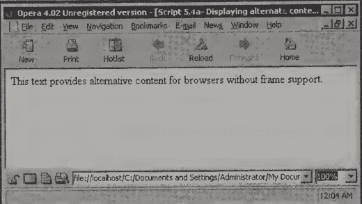

### 图5.5
从框架受限的浏览器查看替代内容。

> **提示**
通常认为，每次使用框架时都包含 `<NOFRAMES>` 标签是一种良好的编程实践。这样做可以确保无论访客的浏览器是否支持框架，他们都能从你的网页中受益。一个选择是放置一个链接到你的主页或作为导航索引的网页。

## 使用JavaScript管理框架

到目前为止，你只在HTML编程的上下文中研究了框架。然而，你也可以使用JavaScript来控制框架和框架内容。JavaScript为你提供了同时控制多个框架的能力——这是仅用HTML无法实现的。

在利用JavaScript控制框架的能力之前，你必须首先了解浏览器如何在你的网页中构建框架层次结构。每个框架都属于一个框架集，该框架集可以称为框架的父级或顶层。框架集中的每个框架都根据页面加载的顺序排列在一个名为 `frames[]` 的数组中。数组中的第一个框架是 `frames[0]`，第二个是 `frames[1]`，依此类推。

例如，以下页面定义了一个简单的双框架显示：

```
<HTML>
    <HEAD>
        <TITLE> Script 5.5a- 演示框架层次结构</TITLE>
    </HEAD>
    <FRAMESET COLS="*,*">
        <FRAME SRC="Script5.5b.html" NAME="left">
        <FRAME SRC="Script5.5c.html" NAME="right">
    </FRAMESET>
</HTML>
```

在结构上，加载此页面的浏览器将创建一个逻辑上组织如图5.6所示的框架层次结构。

如你所见，顶层或父框架集位于层次结构的顶部，并且框架集中的每个框架都按其定义的顺序列出。现在你了解了浏览器如何创建此框架层次结构，你可以使用JavaScript来引用和控制框架。例如，`parent.frames[0]` 和 `top.frames[0]` 都指向第一个框架；`parent.frames[1]` 和 `top.frames[1]` 引用第二个框架。会自动创建一个数组，其中包含网页上每个框架的条目，索引从0开始，基于框架定义的顺序。

> **注意** 如果你在 `<FRAME>` 标签中添加了 `NAME=""` 属性，你也可以通过分配的名称来引用单个框架。在前面的示例中，将框架命名为 `left` 和 `right`，你可以使用 `parent.left` 或 `top.left` 语句来引用层次结构中的第一个框架。

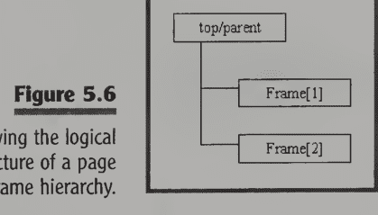

## 使用JavaScript创建框架内容

HTML仅提供静态内容。将JavaScript与框架一起使用的好处之一是你可以为框架提供动态内容。换句话说，你可以直接写入框架，而不是将网页加载到其中。以下示例演示了这种技术。

此示例中的第一个页面包含定义网站结构的 `<FRAMESET>` 和 `<FRAME>` 标签。在这种情况下，定义了两个框架，采用列格式，并分配了相等的空间。为简单起见，我将框架命名为 `left` 和 `right`。

```
<HTML>
  <HEAD>
    <TITLE>Script 5.6a- 使用JavaScript为框架添加动态内容</TITLE>
  </HEAD>
  <FRAMESET COLS="*,*">
    <FRAME SRC="Script5.6b.html" NAME="left">
    <FRAME SRC="Script5.6c.html" NAME="right">
  </FRAMESET>
</HTML>
```

`left` 框架包含一个带按钮的表单，当点击该按钮时，执行JavaScript语句 `top.right.document.write('Hello world!')`，结果是在右侧框架中显示消息 *Hello world!*。你可能记得 *top* 或 *parent* 引用代表框架层次结构的顶层。`top.right` 调用引用了与 *left* 框架位于同一框架集中名为 *right* 的框架（它的“兄弟”框架，即包含 `top.right` 语句的框架）。如果你在 `document.write()` 语句中省略了 `top.right` 引用，该消息将被写入 *left* 框架。

```
<HTML>
  <HEAD>
    <TITLE>Script 5.6b- 写入动态内容</TITLE>
  </HEAD>
  <BODY>
```

左侧框架包含一个表单，该表单定义了一个名为button1的按钮，按钮上显示文本*Click Me*。点击该按钮时，会执行按钮的onClick事件处理程序。使用浏览器层次结构，事件处理程序中的JavaScript语句首先引用层次结构的顶部（或父级）。接着，语句指定将加载新页面的框架。这里没有使用`parent.right`来引用该框架，而是通过其在`frames[]`数组中的位置来标识。因为目标框架是定义的第二个框架，且`frames[]`数组的索引值从0开始，所以使用`parent.frames[1]`来引用第二个框架。然后，添加`location`属性。最后，指定要加载的HTML页面。

```
<HTML>
  <HEAD>
    <TITLE> Script 5.7b- Adding the JavaScript control</TITLE>
  </HEAD>
  <BODY>
    <FORM>
      <INPUT TYPE="button" NAME="button1" VALUE="Click Me"
        onClick="top.right.document.write('<H3>Hello world!</H3>')">
    </FORM>
  </BODY>
</HTML>
```

最初加载到右侧框架的页面非常简单：

```
<HTML>
    <HEAD>
        <TITLE> Script 5.7c- Initial content loaded into the right frame
        </TITLE>
    </HEAD>
    <BODY>
        <H3>This is the right frame.</H3>
    </BODY>
</HTML>
```

当按钮被点击时，将加载到右侧框架的页面也同样简单，包含一条格式为HTML标题的单条消息：

```
<HTML>
    <HEAD>
        <TITLE> Script 5.7d- The new page</TITLE>
    </HEAD>
    <BODY>
        <H3>This is the new frame you just loaded!</H3>
    </BODY>
</HTML>
```

图5.8展示了加载此示例并点击Click Me按钮的结果。在下一个示例中，我将向你展示如何使用JavaScript做些仅靠HTML无法完成的事情：同时控制多个框架。

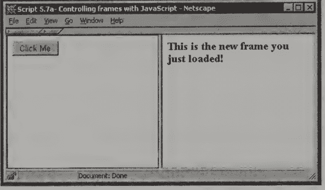

**图5.8** 在JavaScript控制下加载页面的示例。

## 同时控制多个框架

下一个示例展示了使用JavaScript同时控制多个框架是多么容易。在这个例子中，我修改了上一个例子中左侧框架的表单。你可以看到，onClick事件处理程序现在指定了第二个JavaScript语句。我通过将分号放在第一个语句的末尾，成功地将第二个语句添加到了事件处理程序中。如果我想再添加一个语句到事件处理程序，我可能会选择创建一个函数，将所有语句放在函数括号内，然后在onClick事件处理程序中调用该函数。

第二个语句的结构与第一个语句相同，只是它引用了不同的框架（即`parent.frames[1]`框架，或右侧框架）。

```
<HTML>
    <HEAD>
        <TITLE> Script 5.8b- Controlling more than one
                       frame at a time with JavaScript
        </TITLE>
    </HEAD>
    <BODY>
        <FORM>
            <INPUT TYPE="button" NAME="button1" VALUE="Click Me"
              onClick="parent.frames[0].location='Script5.8d.html';
              parent.frames[1].location='Script5.8e.html'">
        </FORM>
    </BODY>
</HTML>
```

## 使用框架显示其他网站

在这个例子中，我将向你展示如何为你的访客提供其他网站的链接，并允许他们访问这些网站而无需离开你的网站。

为你的访客提供其他网站链接的缺点之一是，他们可能会跟随链接离开并且再也不回到你的网站。然而，如果你使用框架，你可以两全其美。除了将访客留在你的网站并提供一个非常流畅的界面之外，你只需将其他URL加载到你的框架中，就可以让即使是小型网站也给人一种大型超级网站的印象。

以下示例创建了一个使用框架的网站。左侧的框架提供了一个导航菜单；右上方的框架显示你的网站标题或其他有用信息。剩余的框架用于显示其他网站的URL。

第一个页面定义了框架的布局。在这种情况下，`<FRAMESET>`标签将显示区域分为两列，第一列分配15%的空间，第二列分配剩余的85%。接着，一个`<FRAME>`标签指定将用作导航索引的页面。第二个嵌套的`<FRAMESET>`标签将分配给第二列的空间分为两行，第一行分配8%，第二行分配剩余的92%。然后定义了两个框架。第一个将本地网页加载到顶部的小框架中，第二个将流行互联网搜索引擎www.yahoo.com的URL加载到较大的框架中。

```
<HTML>
  <HEAD>
    <TITLE> Script 5.9a- Loading other URLs into your frames</TITLE>
  </HEAD>
  <FRAMESET COLS="15%,85%">
    <FRAME SRC="Script5.9b.html" NAME="left">
    <FRAMESET ROWS="8%,92%">
      <FRAME SRC="Script5.9c.html" NAME="right1">
      <FRAME SRC="http://www.yahoo.com" NAME="right2">
    </FRAMESET>
  </FRAMESET>
</HTML>
```

加载到左侧框架的导航页面定义了几个指向其他流行互联网搜索引擎的链接。在这种情况下，由于这些URL的链接都加载到同一个框架中，我选择使用带有`target`属性的HTML链接标签：

```
<HTML>
<HEAD>
<TITLE> Script 5.9b- Using the left frame as
              a navigation page
</TITLE>
</HEAD>
<BODY>
<P><B>Search Engines:</B></P>
<A HREF="http://www.excite.com" TARGET="right2">Excite</A>
<BR>
<A HREF="http://www.alta-vista.com" TARGET="right2">AltaVista</A>
<BR>
<A HREF="http://www.yahoo.com" TARGET="right2">Yahoo</A>
<BR>
</BODY>
</HTML>
```

下一个页面将加载到顶部框架，用于显示网站的名称；这个框架有助于赋予网站一种精致的外观和感觉。

```
<HTML>
    <HEAD>
        <TITLE> Script 5.9c- Adding a title frame to your Web site</TITLE>
    </HEAD>
    <BODY>
        <CENTER>
            <H2>Welcome to my Internet Search Engine Web Site.</H2>
        </CENTER>
    </BODY>
</HTML>
```

图5.9展示了你第一次加载此示例时初始显示的样子。你可以看到，通过使用框架和三个简单的脚本，你可以创建一个为用户提供访问一系列流行URL的网站。

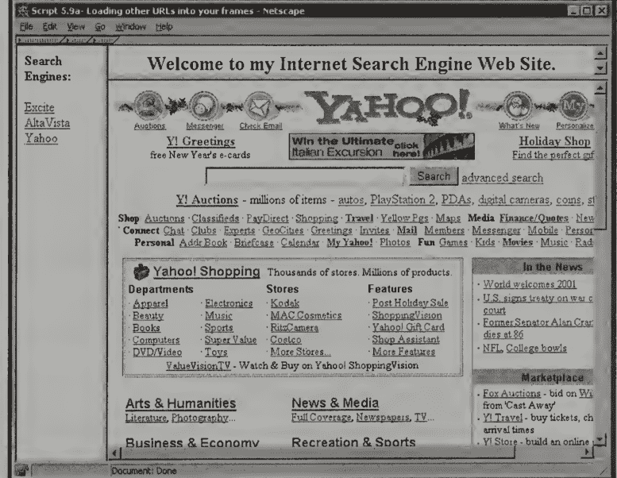

注意：在互联网上赚钱的方法有很多。一种方法是与各种互联网公司加入联属计划。在这些计划中，每当你引导一位客户访问他们的网站并进行购买，你就能获得报酬。例如，使用上一个示例的修改版本，你可以轻松创建自己的在线书店，包含多个页面，突出展示你认为会吸引客户的书籍，并提供指向你已加入其联属计划的其他在线书店的链接。你网站的访客可以购买书籍或那家在线公司销售的任何其他商品。事实上，在今晚的最后一课中，我将演示如何构建这样一个书店。

## 框架...不，谢谢

尽管你可能欣赏将其他URL加载到你的框架中是多么容易，但你可能不希望自己的网页出现在其他人的框架中——特别是如果你的页面被加载到太小的框架中，从而让你的网站看起来很糟糕。

这就是这个框架示例派上用场的地方。它向你展示如何仅用几行JavaScript来防止其他人将你的网页加载到他们的框架中。

我将脚本放在页面的`<head>`部分，以便它能尽快执行。脚本中的第一行是一个`if`语句，通过检查`top.frames.length`的值来检查是否有人正试图将页面加载到框架中。如果条件为0或为真，则语句`top.location=self.document.location`告诉浏览器将页面的`location`属性设置为自身，从而防止它被加载到框架中。

```
<HTML>
  <HEAD>
    <TITLE>Script 5.10- Preventing your Web page
                from being loaded into a frame
    </TITLE>
    <SCRIPT LANGUAGE="JavaScript" TYPE="Text/JavaScript">
    <!-- Start hiding JavaScript statements
      if (top.frames.length!=0) {
        top.location=self.document.location;
      }
    // Stop hiding JavaScript statements -->
    </SCRIPT>
  </HEAD>
  <BODY>
    <H1>Welcome to my Web Site!</H1>
    <P>This page is not meant to be displayed in a frame.
    </P>
  </BODY>
</HTML>
```


top.location=self.document.location;
}

// 结束隐藏 JavaScript 语句 -->
</SCRIPT>
</HEAD>

<BODY>
<CENTER>
<H1>欢迎访问我的页面！</H1><BR>
<H3>感谢您的访问！！！</H3>
</CENTER>
</BODY>
</HTML>

任何尝试将此网页加载到其框架中的人，都会惊讶地发现你的页面不仅没有被加载，反而完全取代了他们自己的网页，如图 5.10 所示。

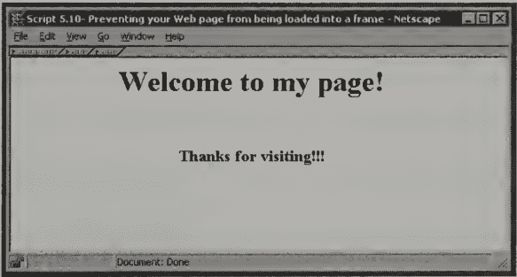

### 图 5.10

防止你的网页加载到框架中。

## 休息一下

框架是在网页上呈现和管理信息的一个极佳工具，我可以就这个话题滔滔不绝。然而，这个周末剩下的时间有限，而你还有很多新材料要学习。何不站起来活动一下腿脚呢？当你回来时，我将向你展示如何创建表单，以便你可以收集和处理访问者网站的信息。

## 介绍表单

你当然知道什么是表单，所以我不会用技术性的解释让你感到厌烦。在 HTML 页面的上下文中，表单是使用 `<FORM>` 标签创建的。在 `<FORM>` 标签内，定义了各个表单元素，如复选框或文本字段。HTML 表单的语法概述如下：

```
<FORM NAME="" METHOD="" ACTION="">
```

在此语法中，使用了以下参数：

- **NAME**：你可以分配给表单的可选名称。
- **METHOD**：get 或 post。这是两个可用于向 Web 服务器发送和接收文档的命令。get 方法用于向 Web 服务器发送文档请求。post 方法用于将表单内容发送到 Web 服务器。这两种选项都超出了本书的范围。
- **ACTION**：标识接收表单内容的 Web 服务器和程序的 URL 地址，或 mailto，这是一个允许你以电子邮件形式发送表单内容的选项。前者超出了本书的范围；后者将在今天上午结束时进行演示。

考虑以下示例语句：

```
<FORM NAME="myForm" METHOD="POST" ACTION="myprog.cgi">
```

此语句将表单 `myForm` 的内容发送到名为 `myprog.cgi` 的 CGI 程序，该程序位于包含网页的同一文件夹中。

你可以在不使用 JavaScript 的情况下利用网页上表单的强大功能。然而，JavaScript 提供了强大的验证功能，并允许你在访问者填写表单时与他们进行交互。

### form 对象

浏览器为 `<FORM>` 标签定义的每个表单元素创建一个 form 对象。你可以为每个元素使用可选的 `NAME=""` 属性分配名称，或者你可以使用 `forms[]` 数组，该数组包含从索引值 0 开始的页面上每个表单元素的索引列表。此外，每个表单包含自己的 `elements[]` 数组，该数组包含该特定表单上每个表单元素的条目。例如，名为 `myForm` 的表单上的第四个表单元素可以被引用为 `myForm.elements[3]`。

form 对象具有许多属性，其中许多本身也是对象：

- **action**：基于 `<FORM>` 标签的 ACTION 属性创建。
- **button**：用户可以点击以启动操作的对象。
- **checkbox**：允许用户选择或清除其值的对象。
- **elements[]**：所有表单元素的数组。
- **encoding**：基于 `<FORM>` 标签的 ENCTYPE 属性创建。
- **fileUpload**：用于指定可作为表单数据包含的文件的对象。
- **hidden**：不出现在表单上但可以通过程序用数据填充的对象。
- **length**：指定 forms[] 数组中元素数量的属性。
- **method**：基于 `<FORM>` 标签的 METHOD 属性创建。
- **name**：基于 `<FORM>` 标签的 NAME 属性创建。
- **password**：屏蔽键入其中的任何文本的对象。
- **radio**：组织成相似对象集合的对象，其中只能选择一个。
- **reset**：允许你清除表单并将其重置为默认值的按钮对象。
- **select**：提供可选选项列表的对象。
- **submit**：允许你提交表单进行处理的按钮对象。
- **target**：基于 `<FORM>` 标签的 TARGET 属性创建。
- **text**：用于保存单行文本的对象。
- **textarea**：类似于 text 对象，但接受多行文本的对象。

form 对象还有几个可以应用于它的方法：

- **handleEvent()**：允许你在指定对象上模拟特定事件，如 click 或 dblclick 事件。
- **reset()**：允许你通过程序清除表单并将其重置为默认值。
- **submit()**：允许你通过程序提交表单进行处理。

> **注意** 在三种表单方法中，只有 form 的 `handleEvent()` 方法允许你传递参数。例如，`handleEvent(click)`。

### 表单组件

三种不同类型的标签可以放置在 `<FORM>` 标签内：

- **`<INPUT>`**：允许你指定一系列表单元素，包括文本和密码字段、按钮以及单选和复选框选项。
- **`<SELECT>`**：允许你创建可选选项的列表。
- **`<TEXTAREA>`**：指定多行文本字段。

在今天上午剩余的时间里，你将看到每个标签的示例。

### 使用 HTML 创建表单

在整本书中，你已经看到了一个又一个表单的示例。今天上午剩下的时间将用于更详细地解释这些表单的工作原理。我的意图是使用简短的示例单独解释每个主要表单元素，然后在上午结束时演示如何构建一个更大、更复杂的表单，将所有部分组合在一起。

#### button 元素

`button` 表单元素通过在 `<INPUT>` 标签中指定 `TYPE="button"` 属性来创建。默认情况下，表单上会显示一个矩形按钮。但是，`<INPUT>` 标签允许你通过在标签内放置 `IMG` 元素来使用图形图像代替默认按钮。`<INPUT>` 标签的 button 实现支持以下属性：

- **NAME**：按钮的名称。
- **TYPE**：此元素的类型等于 "button"。
- **VALUE**：指定出现在按钮上的文本。

以下页面定义了一个包含单个名为 `myButton` 且标签为 *Click Here* 的按钮的表单。按钮上添加了一个 `onClick` 事件处理程序，以便当按钮被点击时，会出现一个警报提示来显示欢迎消息。

```
<HTML>
  <HEAD>
    <TITLE>脚本 5.11 - 表单：按钮示例</TITLE>
  </HEAD>
  <BODY>
    <FORM>
      <INPUT NAME="myButton" TYPE="button" VALUE="Click Here"
             onClick="window.alert('Welcome!')">
    </FORM>
  </BODY>
</HTML>
```

图 5.11 显示了加载前面的示例并显示 Click Here 按钮的结果。

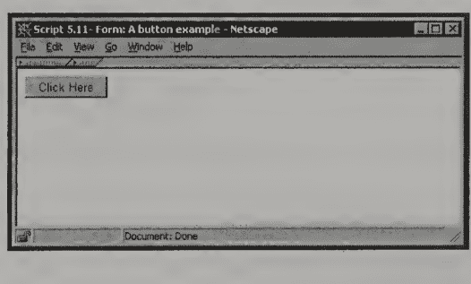

**图 5.11** 使用表单的 button 对象显示警报对话框。

#### checkbox 元素

checkbox 表单元素通过在 `<INPUT>` 标签中指定 `TYPE="checkbox"` 属性来创建。它用于在表单上显示一个只有两种可能值（选中或未选中）的复选框。复选框元素的值独立于任何其他表单元素。`<INPUT>` 标签的 checkbox 实现支持以下选项：

- **CHECKED**：指定此选项时，它将复选框元素的默认值设置为 CHECKED。默认情况下，所有复选框元素都以未选中状态创建。
- **NAME**：复选框元素的名称。
- **VALUE**：指定在复选框被选中时分配的值。

以下页面定义了一个包含三个名为 `checkbox1`、`checkbox2` 和 `checkbox3` 的复选框的表单。分配给第二个和第三个复选框的 CHECKED 属性导致这些复选框在表单加载时被选中。每当一个复选框被选中时，它就被分配一个值。例如，当第一个复选框被选中时，值 *retired* 被分配给 `checkbox1`。

```
<HTML>
  <HEAD>
    <TITLE>脚本 5.12 - 表单：复选框示例</TITLE>
  </HEAD>
  <BODY>
    <FORM>
      <P><B>选择适用于你的任何选项：</B>
      </P>
      你是否超过 65 岁？
      <INPUT NAME="checkbox1" TYPE="checkbox" VALUE="retired">
      <BR>
      你每年度假超过两次吗？
      <INPUT NAME="checkbox2" TYPE="checkbox" VALUE="rich" CHECKED>
      <BR>
      你是否曾乘坐过邮轮？
      <INPUT NAME="checkbox3" TYPE="checkbox" VALUE="very_rich" CHECKED>
    </FORM>
  </BODY>
</HTML>
```

图 5.12 显示了浏览器首次加载页面时此表单的外观。


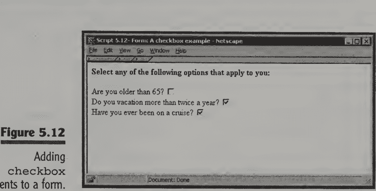

**图 5.12** 向表单中添加复选框元素。

#### fileUpload 元素

`fileUpload` 表单元素通过在 `<INPUT>` 标签中指定 `TYPE="file"` 属性来创建。`fileUpload` 元素允许用户指定一个文件作为表单输入。`<INPUT>` 标签对 `fileUpload` 元素的实现支持以下属性：

- **NAME**：`fileUpload` 字段的名称。
- **TYPE**：此元素的类型等于 "file"。
- **VALUE**：指定所选文件的名称。

以下页面定义了一个名为 `myForm` 的表单，其中包含两个元素。首先，`<FORM>` 标签使用 `METHOD` 和 `ACTION` 属性来标识表单提交后将处理表单的基于服务器的程序。第一个 `<INPUT>` 标签定义了一个名为 `selectedFile` 的 `fileUpload` 元素；第二个 `<INPUT>` 标签创建了一个按钮，点击该按钮会提交表单以进行处理。

```
<HTML>
  <HEAD>
    <TITLE>Script 5.13- Form: A fileUpload example</TITLE>
  </HEAD>
  <BODY>
    <FORM NAME="myform" METHOD="post" ACTION="cgi-bin/myscript">
      <INPUT NAME="selectedFile" TYPE="file"><BR>
      <INPUT NAME="myButton" TYPE="submit">
    </FORM>
  </BODY>
</HTML>
```

```
</FORM>
</BODY>
</HTML>
```

图 5.13 显示了页面首次被浏览器加载时该表单的样子。点击“浏览”按钮会打开图 5.14 所示的“文件上传”对话框。从该对话框中，您可以选择一个文件并点击“打开”。您选择的文件的名称和路径会显示在 `fileUpload` 元素的显示字段中。点击表单中的“提交查询”按钮会调用指定的服务器程序，并将表单的内容传递给该程序。

> 上一个示例中的“浏览”按钮是由 `fileUpload` 元素自动创建的。您无法更改此按钮的文字。但是，如果您愿意，可以通过添加 `VALUE` 属性并将其设置为希望显示的文本来更改“提交”按钮上显示的文本。

> 如果您直接运行上一个示例，将会收到错误，因为该示例期望能找到一个名为 `cgi-bin/myscript` 的 CGI 程序，而您并没有这个程序。此示例仅用于向您展示如何将您的网页与基于服务器的程序集成。本章中还有更多示例以相同方式运行。如果您愿意，可以将 `ACTION=" "` 设置为 `ACTION=""` 以在不查看错误消息的情况下测试这些脚本。

##### 图 5.13

`fileUpload` 表单元素允许您将整个文件作为表单的一部分提交。

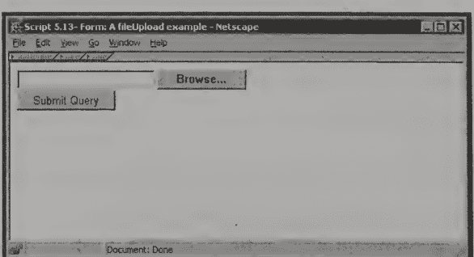

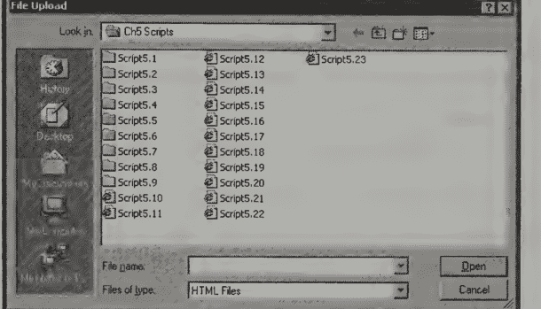

**图 5.14**
“文件上传”对话框允许您查找并选择要作为表单数据添加的文件。

#### hidden 元素

hidden 表单元素通过在 `<INPUT>` 标签中指定 `TYPE="hidden"` 属性来创建。hidden 元素是表单上无法直接看到的元素，尽管它可以用于保存通过编程方式添加到表单的数据。`<INPUT>` 标签对 hidden 元素的实现支持以下属性：

- **NAME**：hidden 字段的名称。
- **TYPE**：此元素的类型等于 "hidden"。
- **VALUE**：指定分配给 hidden 字段的值。

以下页面定义了一个名为 myForm 的表单。第一个表单元素名为 myField，是一个 hidden 表单元素。接下来的两个元素是按钮。点击第一个按钮会触发其 onClick 事件处理程序，将 myField 的值设置为文本字符串 User\_did\_not\_listen。点击第二个按钮会执行其 onClick 事件处理程序，并显示一个警报对话框，其中显示 myField 表单元素的值。如果您加载此页面并首先点击第二个按钮，页面将显示一个空值，因为 document.myForm.myField.value 尚未设置。

```
<HTML>
<HEAD>
<TITLE>Script 5.14- Form: A hidden field example</TITLE>
</HEAD>
<BODY>
    <FORM NAME="myForm">
        <INPUT NAME="myField" TYPE="hidden" VALUE="empty">
        <INPUT NAME="myButton1" TYPE="button" VALUE="Do not click me!"
            onClick="document.myForm.myField.value='User_did_not_listen!'">
        <INPUT NAME="myButton2" TYPE="button" VALUE="Show Hidden"
            onClick="window.alert(document.myForm.myField.value)">
    </FORM>
</BODY>
</HTML>
```

图 5.15 显示了加载此示例并点击第一个按钮，然后点击第二个按钮的结果。

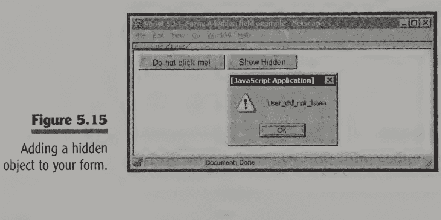

#### password 元素

password 表单元素通过在 `<INPUT>` 标签中指定 `TYPE="password"` 属性来创建。password 元素会将用户键入的字符以星号形式掩码显示，以防止字符被直接看到。顾名思义，此表单元素的一个常见用途是在键入时隐藏密码。其他用途可能包括隐藏信用卡号码或社会安全号码等隐私信息。`<INPUT>` 标签对 password 元素的实现支持以下属性：

- **NAME**：password 字段的名称。
- **MAXLENGTH**：可以输入到字段中的最大字符数。
- **SIZE**：字段可以显示的字符数。
- **TYPE**：此元素的类型等于 "password"。
- **VALUE**：指定字段的初始默认值。

以下页面定义了一个包含单个名为 myPasswd 的 password 字段的表单。`SIZE="20"` 属性允许字段显示 20 个字符的文本，而 `MAXLENGTH="30"` 属性将字段可接受的总字符数限制为 30 个字符。

```
<HTML>
<HEAD>
<TITLE>Script 5.15- Form - A password field example</TITLE>
</HEAD>
<BODY>
<FORM>
Type your password:
<INPUT NAME="myPasswd" TYPE="password" SIZE="20" MAXLENGTH="30">
</FORM>
</BODY>
</HTML>
```

图 5.16 显示了加载此示例并键入几个字符时的样子。如您所见，无论您键入什么文本，都会被星号字符掩盖。

**图 5.16**

使用 password 对象在表单上隐藏机密信息。

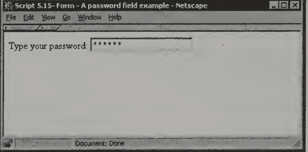

#### radio 元素

radio 表单元素通过在 `<INPUT>` 标签中指定 `TYPE="radio"` 属性来创建。radio 元素用于在表单上显示单选按钮。选中的选项只能有两个可能的值之一：checked（已选中）或 cleared（未选中）。尽管 radio 元素与 checkbox 元素非常相似，但 radio 元素被分组放置，并且一次只能选择一个组中的选项。您可以通过将组中所有 radio 元素的 `NAME=" "` 属性设置为相同的值来对 radio 元素进行分组。如果您想创建第二组 radio 元素，则为第二组中的所有 radio 元素分配不同的名称。
`<INPUT>` 标签对 radio 元素的实现支持以下属性：

- **CHECKED**：指定时，此属性将 radio 选项的默认值设置为 CHECKED。
- **NAME**：此单选按钮所属的组的名称。
- **VALUE**：指定选择此特定单选按钮选项时分配给该组的值。

以下页面定义了一个包含四个单选按钮的表单，这四个按钮都属于名为 radio_option1 的组。四个单选按钮中的每一个都包含不同的值。选中的单选按钮决定了分配给 radio_option1 组的值。当此页面首次加载时，第三个单选按钮会自动选中，这由定义该单选按钮的 `<INPUT>` 标签中的 CHECKED 属性指示。

```
<HTML>
    <HEAD>
        <TITLE>Script 5.16- Form: A radio option example</TITLE>
    </HEAD>
    <BODY>
        <FORM>
            <P><B>Select the option that applies to you:</B></P>
            Less than 20:
            <INPUT NAME="radio_option1" TYPE="radio" VALUE="Selection1"><BR>
            Between 21-35:
            <INPUT NAME="radio_option1" TYPE="radio" VALUE="Selection2"><BR>
```


#### 重置元素

重置表单元素通过在 `<INPUT>` 标签中指定 `TYPE="reset"` 属性来创建。重置元素在表单上显示为一个带有“重置”标签的矩形按钮。重置元素内置一种方法，可将表单内容重置为默认值。`<INPUT>` 标签对重置元素的实现支持以下属性：

-   **VALUE**：指定要在重置按钮上显示的描述性文本。

以下页面定义了一个包含四个单选按钮的表单，所有单选按钮都属于名为 radio_option1 的组。第三个单选按钮被设为默认选项。表单中的最后一个元素是重置元素。

```
<HTML>
<HEAD>
<TITLE>Script 5.17- 表单：重置按钮示例</TITLE>
</HEAD>
<BODY>
<FORM NAME="myForm">
<P><B>选择适用于您的选项：</B></P>
小于 20 岁：
<INPUT NAME="radio_option1" TYPE="radio" VALUE="Selection1"><BR>
21-35 岁之间：
<INPUT NAME="radio_option1" TYPE="radio" VALUE="Selection2"><BR>
36-55 岁之间：
<INPUT NAME="radio_option1" TYPE="radio"
    VALUE="Selection3" CHECKED><BR>
大于 56 岁：
<INPUT NAME="radio_option1" TYPE="radio" VALUE="Selection4">
<P>
<INPUT TYPE="reset">
</P>
</FORM>
</BODY>
</HTML>
```

图 5.18 显示了页面首次加载或点击重置按钮后表单的外观。

#### 下拉列表元素

`select` 表单元素以可滚动列表的形式呈现一个选项列表，用户可以从中选择单个选项。`select` 元素支持以下属性：

-   **MULTIPLE**：指定后，允许从列表中选择多个选项。
-   **NAME**：分配给所选元素的名称。
-   **SIZE**：列表中显示的选项数量。

> 如果不包含 `select` 元素的 `SIZE` 属性，或者将该属性设置为 1，则 `select` 元素中的选项将以可滚动列表的形式呈现。如果将 `SIZE` 设置为 2 或更大，选项则以可滚动列表的形式显示。

开始和结束的 `<SELECT>` 和 `</SELECT>` 标签标识了 `select` 元素。列表中出现的所有选项都通过单独的 `<OPTION>` 标签指定。`<OPTION>` 标签支持以下两个属性：

-   **SELECTED**：指定默认选项。
-   **VALUE**：指定与此选项关联的值。

以下页面定义了一个包含名为 `myList` 的下拉列表的表单，该列表提供四个选项。第一个选项被设为默认选项。列表中的每个选项都分配了不同的值，并显示不同的描述。

```
<HTML>
    <HEAD>
        <TITLE>Script 5.18- 表单：下拉菜单示例</TITLE>
    </HEAD>
    <BODY>
        <FORM NAME="myForm">
            请选择您今天要开立的账户类型：
            <SELECT NAME="myList">
<OPTION SELECTED VALUE="ccAccount">信用卡
<OPTION VALUE="chkAccount">支票账户
<OPTION VALUE="savAccount">储蓄账户
<OPTION VALUE="mmAccount">货币市场账户
</SELECT>
</FORM>
</BODY>
</HTML>
```

图 5.19 显示了页面加载后以及点击下拉字段中的箭头后表单的外观。

**图 5.19**

为表单添加下拉选项列表。

#### 提交元素

提交表单元素通过在 `<INPUT>` 标签上指定 `TYPE="submit"` 属性来创建。提交元素提供了一种内置方法，用于将表单内容提交到 `<FORM>` 标签中指定的服务器端程序。`<INPUT>` 标签对提交元素的实现支持以下属性：

-   **VALUE**：指定要在提交按钮上显示的描述性文本。

点击提交按钮时执行的操作取决于 `<FORM>` 标签中的 METHOD 和 ACTION 属性。

以下示例修改了之前的脚本。在本例中，我修改了两行代码。第一次修改是针对 `<FORM>` 标签，我将其改为如下所示：

```
<FORM NAME="myform" METHOD="post" ACTION="cgi-bin/myscript">
```

`<FORM>` 标签现在包含了 METHOD 和 ACTION 属性，它们告诉浏览器在点击提交按钮时如何处理表单。第二次修改是添加了一个提交按钮。定义该按钮的 `<INPUT>` 标签非常简单，其唯一的属性允许你为提交按钮添加标签：

```
<INPUT TYPE="submit" VALUE="点击此处提交您的答案">
```

修改后的脚本如下所示。如你所见，除了对 `<FORM>` 标签的更改和定义提交按钮的 `<INPUT>` 标签的添加之外，该脚本与其早期版本保持不变：

```
<HTML>
    <HEAD>
        <TITLE>Script 5.19- 表单：提交按钮示例</TITLE>
    </HEAD>
    <BODY>
        <FORM NAME="myform" METHOD="post" ACTION="cgi-bin/myscript">
            <P><B>选择适用于您的选项：</B></P>
            小于 20 岁：
            <INPUT NAME="radio_option1" TYPE="radio" VALUE="Selection1"><BR>
            21-35 岁之间：
            <INPUT NAME="radio_option1" TYPE="radio" VALUE="Selection2"><BR>
            36-55 岁之间：
            <INPUT NAME="radio_option1" TYPE="radio" 
                VALUE="Selection3" CHECKED><BR>
            大于 56 岁：
            <INPUT NAME="radio_option1" TYPE="radio" VALUE="Selection4">
            <P>
            <INPUT TYPE="submit" VALUE="点击此处提交您的答案">
            </P>
        </FORM>
    </BODY>
</HTML>
```

图 5.20 显示了浏览器加载页面后的效果。

#### 文本元素

文本表单元素通过在 `<INPUT>` 标签中指定 `TYPE="text"` 属性来创建。`<INPUT>` 标签对文本元素的实现支持以下属性：

-   **NAME**：文本字段的名称。
-   **MAXLENGTH**：可在字段中输入的最大字符数。
-   **SIZE**：字段可显示的字符数。
-   **TYPE**：对于此元素，类型等于 "text"。
-   **VALUE**：指定初始默认值。

以下页面定义了一个包含单个名为 myText 的文本字段的表单。`SIZE="25"` 属性设置允许该字段显示 25 个字符的文本，而 `MAXLENGTH="40"` 属性将该字段可接受的文本量限制为 40 个字符。使用 `VALUE="http://"` 在文本字段中放置一个初始值。

```
<HTML>

  <HEAD>

    <TITLE>Script 5.20- 表单：文本字段示例</TITLE>

  </HEAD>

  <BODY>

    <FORM>

      <INPUT NAME="myText" TYPE="text" SIZE="25"

        MAXLENGTH="40" VALUE="http://">

</FORM>
</BODY>
</HTML>
```

图 5.21 显示了浏览器加载页面时表单的外观。虽然你无法阻止用户覆盖字段中的 http:// 文本，但你可以验证他们输入的文本。我稍后将更详细地讨论数据验证。

图 5.21
在表单中添加文本字段允许你收集和处理尽可能广泛的数据范围。

#### 多行文本元素

多行文本表单元素使用其自己的标签创建。它的功能类似于文本字段元素，但它允许你在表单中收集多行信息。它支持以下选项：

-   **NAME**：多行文本字段的名称。
-   **TYPE**：对于此元素，类型等于 "textarea"。
-   **ROWS**：构成多行文本元素的行数。
-   **COLS**：构成多行文本元素的列数。

以下示例演示了如何将多行文本字段添加到表单中。你添加的元素深度为 4 行，宽度为 40 个字符，允许它收集多达 160 个字符的信息。如你所见，可以通过在 `<TEXTAREA>` 标签之间输入来添加初始值。

```
<HTML>
  <HEAD>
    <TITLE>Script 5.21- 表单：多行文本示例</TITLE>
```


### 使用JavaScript管理表单

大多数表单元素提供了一系列方法，你可以通过编程方式操作这些元素。这些方法使你能够不依赖用户操作来触发事件。例如，你可能创建一个包含多个文本字段和一个重置按钮的表单。如果用户点击重置按钮并决定重新填写表单，你可以将`focus()`方法添加到重置按钮的onClick事件中，通过自动将光标放回第一个文本字段来协助用户。表单元素支持的方法列表包括：

-   `click()`方法的效果与用户点击该对象相同。
-   `blur()`方法将焦点移出对象。
-   `focus()`方法将焦点置于对象上。
-   `select()`方法高亮显示表单元素中包含的文本。

### 表单事件

除了单个表单元素提供的事件处理程序外，表单对象还提供了以下两个事件处理程序：

-   `onReset`事件处理程序允许你在表单重置之前执行JavaScript语句或调用函数。
-   `onSubmit`事件处理程序允许你在表单提交之前执行JavaScript语句或调用函数。

这些事件处理程序允许你在执行用户请求的重置或提交操作之前执行命令或调用子程序。正如后续示例所示，这使你能够创建警告消息，告知用户其操作的后果，验证表单内容，并在确保仅提供有效数据的同时协助用户正确填写表单。

以下列表标识了与每个表单元素关联的事件，可作为参考，查看在开发表单时每个表单元素允许你利用哪些事件：

| 事件 | 受影响的表单元素 |
| :--- | :--- |
| Click | `button`、`checkbox`、`radio`、`reset`、`submit` |
| Blur | `button`、`checkbox`、`fileUpload`、`password`、`radio`、`reset`、`select`、`submit`、`text`、`textarea` |
| Focus | `button`、`checkbox`、`fileUpload`、`password`、`radio`、`reset`、`select`、`submit`、`text`、`textarea` |
| Select | `fileUpload`、`password`、`text`、`textarea` |

在下一节中，我将向你展示如何利用事件处理程序，以便在表单上触发用户输入的验证。

### 表单验证

将JavaScript与表单结合使用的真正好处在于对用户输入进行验证。验证允许你确保用户已填写所有必填字段，并在这些字段中输入了有效数据。当用户出错时，你可以显示警报消息，解释错误并要求用户在再次提交表单前纠正问题。

以下示例为一家自行车店创建了一个表单，允许互联网客户在线订购新自行车。客户可以从一系列选项中进行选择，并被要求在提取新自行车时指定计划使用的付款方式。

首先，我将展示完整的示例，然后我将逐步分解并解释：

```html
<HTML>
  <HEAD>
    <TITLE>Script 5.22- A form validation example</TITLE>
    <SCRIPT LANGUAGE="JavaScript" TYPE="Text/JavaScript">
    <!-- Start hiding JavaScript statements
      function ValidateOrder() {
        if (document.myForm.firstName.value.length < 1) {
          window.alert("Missing First name! Please correct");
          return;
        }

        if (document.myForm.lastName.value.length < 1) {
          window.alert("Missing Last name! Please correct");
          return;
        }

        if (document.myForm.address.value.length < 1) {
          window.alert("Missing Address! Please correct");
          return;
        }
        option_selected = "no";
        for (i=0; i < document.myForm.radio_option1.length; i++) {
            if (document.myForm.radio_option1[i].checked) {
                option_selected = "yes";
            }
        }
        if (option_selected == "no") {
            window.alert("You must select the bike " +
                         "model that you wish to order! Please correct");
            return;
        }
        window.alert("Your order looks good. Click on Submit!");
    }
    // End hiding JavaScript statements -->
    </SCRIPT>
  </HEAD>
  <BODY>
  <CENTER>
  <H2>Welcome to Jerry's Custom Bike Shop</H2>
  <H5>Payment due at pickup</H5>
  </CENTER>
  <FORM NAME="myForm" METHOD="post" ACTION="cgi-bin/myscript">
  <B>First name:</B> <INPUT NAME="firstName" TYPE="text" SIZE="15"
                         MAXLENGTH="20" VALUE=""><BR>
  <B>Last name:</B> <INPUT NAME="lastName" TYPE="text" SIZE="15"
                        MAXLENGTH="20">
  <P><B>Mailing Address:</B></P>
  <INPUT NAME="address" TYPE="text" SIZE="30" MAXLENGTH="50"></P>
  <P><B>Select the bike you wish to order:</B></P>
  10 Speed Deluxe:
  <INPUT NAME="radio_option1" TYPE="radio" VALUE="10Speed"><BR>
  15 Speed Racer:
  <INPUT NAME="radio_option1" TYPE="radio" VALUE="15Speed"><BR>
  <P><B>Additional Comments: (Optional)</B></P>
  <TEXTAREA NAME="myTextarea" TYPE="textarea" ROWS="4" COLS="40">
  </TEXTAREA>
  <P><B>Please specify method of payment:</B>
  <SELECT NAME="myList">
      <OPTION SELECTED VALUE="check">Personal Check
      <OPTION VALUE="creditCard">Credit Card
      <OPTION VALUE="moneyOrder">Money Order
  </SELECT></P>
  <INPUT TYPE="reset" VALUE="Reset Form">
  <INPUT TYPE="submit" VALUE="Submit Order"
         onClick="window.alert('Your bike will be ready in 5 days')">
  <INPUT TYPE="button" VALUE="Validate Order"
         onClick="ValidateOrder()">
  </FORM>
  </BODY>
</HTML>
```

首先，检查页面主体部分的内容。此部分以两个标题开始，并定义了使用post方法将表单内容发送到名为`myscript`的CGI程序的表单。由于CGI ACTION属性未指定URL或路径，因此你可以知道该程序必须与示例页面位于同一位置。

```html
<FORM NAME="myForm" METHOD="post" ACTION="cgi-bin/myscript">
```

接下来，创建三个文本字段，将包含名字、姓氏和地址信息。两个姓名字段宽度为15个字符，每个字段最多可收集20个字符的信息。地址字段长度为30个字符，最多可包含50个字符。

```html
<INPUT NAME="firstName" TYPE="text" SIZE="15" MAXLENGTH="20" VALUE="">
<INPUT NAME="lastName" TYPE="text" SIZE="15" MAXLENGTH="20">
<INPUT NAME="address" TYPE="text" SIZE="30" MAXLENGTH="50">
```

然后定义一对单选按钮，并使用组名`radio_option1`进行分组。第一个单选按钮的值分配为`10Speed`，第二个单选按钮的值分配为`15Speed`。

```html
<INPUT NAME="radio_option1" TYPE="radio" VALUE="10Speed">
<INPUT NAME="radio_option1" TYPE="radio" VALUE="15Speed">
```

下一个表单元素是一个文本区域。它可以包含最多160个字符的有关自行车订单的附加信息：

```html
<TEXTAREA NAME="myTextarea" TYPE="textarea" ROWS="4" COLS="40"></TEXTAREA>
```

一个名为`myList`的下拉列表定义了三个付款选项。每个选项由一个`<OPTION>`标签指定，并包含一个值和一个描述：

```html
<SELECT NAME="myList">
    <OPTION SELECTED VALUE="check">Personal Check
    <OPTION VALUE="creditCard">Credit Card
    <OPTION VALUE="moneyOrder">Money Order
</SELECT>
```

最后的表单元素是三个按钮。第一个按钮是重置按钮，用于清除表单并恢复其所有默认设置。第二个按钮是提交按钮。在提交表单进行处理之前，提交按钮的onClick事件处理程序会显示一条警报消息，告知客户所选自行车将在五天内准备好提取。当客户点击确定时，表单将被提交。最后一个按钮允许客户在提交前验证订单。单击此按钮时，它会调用函数`ValidateOrder()`。

```html
<INPUT TYPE="reset" VALUE="Reset Form">
<INPUT TYPE="submit" VALUE="Submit Order"
       onClick="window.alert('Your bike will be ready in 5 days')">
<INPUT TYPE="button" VALUE="Validate Order" onClick="ValidateOrder()">
```


`ValidateOrder()` 函数由一系列 `if` 语句组成，用于检查特定表单元素的值，以确保它们已被正确填写。

第一个 `if` 语句检查表单 `firstName` 文本字段的 `length` 属性值。如果此字段不包含任何字符信息，将弹出一个警告对话框，指示用户填写该字段。`alert()` 语句后面的 `return` 语句可防止 `ValidateOrder()` 函数的进一步处理。

```javascript
if (document.myForm.firstName.value.length < 1) {
    window.alert("Missing First name! Please correct");
    return;
}
```

`ValidateOrder()` 函数的下一部分检查是否已选择其中一个单选按钮选项来指定所订购自行车的类型。您可能已经注意到，当表单定义单选按钮元素时，并未将其中一个设置为默认答案；客户可能会忘记选择这两个选项中的任何一个。为了检查表单上的所有单选按钮元素，设置了一个 `for` 循环，该循环从 0 开始，每次递增 1，遍历所有单选按钮元素，直到处理完所有选项。`radio_option1` 对象的 `length` 属性指定了属于该组的单选按钮总数，并提供了这个上限。

对于循环的每次迭代，一个 `if` 语句会检查每个单选按钮，查看其 `CHECKED` 属性是否已设置；如果已设置，则将名为 `option_selected` 的变量设置为 `"yes"`。否则，此变量将保持为 `"no"`。在检查完每个单选按钮元素后，另一个 `if` 语句会检查 `option_selected` 的值是否曾被设置为 `"yes"`；如果不是这种情况，将弹出一个警告对话框，指示用户选择一个单选按钮选项。此 `if` 语句也以一个 `return` 语句结束，该语句可防止 `ValidateOrder()` 函数的进一步处理。

```javascript
option_selected = "no";
for (i=0; i < document.myForm.radio_option1.length; i++) {
    if (document.myForm.radio_option1[i].checked) {
        option_selected = "yes";
    }
}

if (option_selected == "no") {
    window.alert("You must select the bike model that " +
                "you wish to order! Please correct");
    return;
}
```

只有当函数的所有前置验证逻辑发现表单已正确填写时，才会执行 `ValidateOrder()` 中的最后一条语句。这最后一条语句会显示一个弹出对话框，通知客户订单已准备好进行处理。

```javascript
alert("Your order looks good. Click on Submit!")
```

图 5.23 显示了加载页面时表单的样式。

当然，依赖客户来发起订单验证可能不是最佳做法。相反，您可能希望在用户单击提交按钮时自动执行 `ValidateOrder()` 函数。您可以通过修改 `<FORM>` 标签，使用 `onSubmit` 事件处理程序调用 `ValidateOrder()` 来实现此目标：

```html
<FORM NAME="myForm" METHOD="post" ACTION="cgi-bin/myscript"
    onSubmit="return ValidateOrder();">
```

在验证技术生效之前，您还必须修改函数中所有 `if` 语句的 `return` 语句，将其改为 `return false`，如下例所示。此修改不仅会在发现验证错误时立即停止 `ValidateOrder()` 函数的处理，还会阻止提交事件的执行。

```javascript
if (document.myForm.firstName.value.length < 1) {
    window.alert("Missing First name! Please correct");
    return false;
}
```

您可能考虑的另一种验证技术是在客户完成每个表单元素时进行验证。要使用此技术，您必须理解焦点和失焦的概念。当光标被放置在文本字段中时，该字段就获得了文档的焦点。任何键入的击键都会发送到该字段。如果您随后将光标移动到表单中的其他位置，该文本字段就会失去焦点——这种情况称为失焦。选择表单元素会执行其焦点事件，而将焦点移动到另一个表单元素会执行已失去焦点的表单对象的失焦事件。

在以下示例中，`onBlur` 事件处理程序已被添加到定义文本对象的 `<INPUT>` 标签中。当客户选择文本字段然后将表单焦点更改为另一个对象时，将执行 `ValidateOrder()` 函数。当然，如果客户忘记填写此字段并且从未选择它，此验证技术将无济于事。

```html
<INPUT NAME="firstName" TYPE="text" SIZE="15" MAXLENGTH="20" VALUE=""
       onBlur="ValidateOrder()">
```

> 一种可用来简化用户操作的验证技术是添加一条语句，将焦点置于未正确完成的表单对象上。例如，您可以修改验证客户姓名的 `if` 语句，如下所示：

```javascript
if (document.myForm.firstName.value.length < 1) {
    window.alert("Missing First name! Please correct");
    document.myForm.firstName.focus();
}
```

### 通过电子邮件发送表单结果

您无需访问 Web 服务器的 CGI 程序即可收集网站访问者填写的表单内容。在这个上午的最后一个示例中，您将学习如何使用电子邮件作为检索表单内容的方法。使此方法生效的技巧是修改 `<FORM>` 标签，如下所示：

```html
<HTML>
    <HEAD>
        <TITLE> Script 5.23- E-mailing form contents</TITLE>
    </HEAD>
    <BODY>
        <FORM NAME="myForm" ACTION="mailto:jlf04@yahoo.com"
            ENCTYPE="text/plain">
            <INPUT NAME="selectedFile" TYPE="file"><BR>
            <INPUT NAME="myButton" TYPE="submit">
        </FORM>
    </BODY>
</HTML>
```

如您所见，`<FORM>` 标签包含 `ACTION` 和 `ENCTYPE` 属性。`ACTION="mailto:jlf04@yahoo.com"` 属性设置告诉浏览器将表单内容作为电子邮件消息提交到 `mailto:` 设置指定的电子邮件地址。`ENCTYPE="text/plain"` 属性以纯文本非编码格式发送文本。

图 5.24 显示了加载并执行前面示例的结果。如您所见，浏览器在尝试将表单内容作为电子邮件消息提交之前，始终需要用户的确认。一旦确认，表单内容将作为电子邮件正文发送到指定的电子邮件账户。

**图 5.24**
使用电子邮件发送表单内容。

### 接下来是什么？

好了，午餐时间！去吃点东西，放松一下脑子。回来后，您将学习如何利用插件为网站访问者提供更丰富的体验。您还将了解如何使用基本的图形动画来美化页面。正如我昨天承诺的那样，我将向您展示如何制作您的第一个 JavaScript 小甜饼。下午结束时，我将给您一些关于如何调试脚本以及如何使您的编程体验尽可能高效和愉快的建议。

# 星期日下午
## JavaScript 高级编程

- 利用插件
- 理解基本图形和动画
- 制作 JavaScript 小甜饼
- 调试您的 JavaScript

欢迎回来。希望您休息得很好，准备好继续工作了。今天上午，您学习了有关框架和表单的所有知识——包括如何创建带有导航框架的网站，这些框架允许您加载自己和其他人的网页。您还学习了关于表单的所有知识。到现在，您应该能够设计表单、验证其内容并将结果通过电子邮件发送给自己。

现在是时候进入最后一组主题了。首先，您将学习如何使用插件。*插件*是专门设计用于与浏览器配合工作并扩展其功能的程序。然后，您将扩展关于基本 JavaScript 动画的知识。最后，您将有机会制作我一直承诺作为对您辛勤工作奖励的小甜饼。

完成所有这些主题后，您将用下午剩余的时间讨论调试 JavaScript。我将为您提供各种好的编程技巧和窍门。然后，我将向您展示如何使用 Netscape JavaScript 控制台来排除 JavaScript 错误。下午结束时，您将了解如何利用 Netscape 和 Microsoft 提供的其他 JavaScript 调试工具。

到今天下午结束时，您已经学习了整整两天的 JavaScript 内容，应该对所学的一切感觉良好。今晚，您将通过构建一个利用您新掌握的 JavaScript 编程技能的网站来结束。


### 利用插件

插件技术由网景公司发明，允许你为浏览器安装小程序扩展，从而为其提供播放视频和音频等额外功能。插件使第三方软件开发者能够将新技术集成到现有浏览器中。

听起来很棒，不是吗？确实如此——但与Web开发相关的所有事物一样，使用插件也有一些缺点。首先，你无法指望所有访客都拥有相同的插件。即使你将他们引导到相应的下载地址，也不能期望他们愿意下载和安装它们。依赖插件的最大缺点是，在某些情况下，它们可能无法在微软的浏览器上运行。例如，尽管某些插件可能适用于Internet Explorer，但后续示例中使用的LiveAudio插件就不被Internet Explorer支持。微软没有在Internet Explorer上全面支持插件技术，而是专注于开发其专有的ActiveX技术。不幸的是，ActiveX在Netscape Navigator浏览器中无法工作。

目前，有数百种插件可用，都可以从网上轻松下载。这种丰富的技术可用性使得你的工作更加困难，因为它增加了访客安装了你不支持的插件，而不是你支持的插件的可能性。

> 注意：插件存储在名为`plugins`的文件夹中。对于Netscape 3浏览器，请查看`\program_files\netscape\navigator\program\plugins`。对于Netscape 4浏览器，请查看`\program_files\netscape\communicator\program\plugins`。对于Internet Explorer浏览器，请查看`\program_files\plus!\microsoft_internet\plugins`。

### 检查访客计算机上存储的插件

如果你想在代码中使用插件，应该包含一些额外的代码来检查访客的计算机上是否存在该插件。如果未安装，你可以建议用户下载并安装该插件。或者，你可能希望将访客重定向到提供替代内容的页面。

以下示例演示了如何获取访客计算机上安装的所有插件列表。如你所见，该脚本使用`navigator`对象和`plugins`对象（`navigator`对象的子对象）来显示已安装的插件。

```
<HTML>
  <HEAD>
    <TITLE>Script6.1 - 插件分析示例</TITLE>
  </HEAD>
  <BODY>
    <SCRIPT LANGUAGE="JavaScript" TYPE="Text/JavaScript">
    <!-- 开始隐藏JavaScript语句
    document.write("<H3>插件分析：</H3>");
    for (i = 0; i < navigator.plugins.length; i++) {
        document.write("<B>名称：</B> " + navigator.plugins[i].name +
                        "<BR>");
    }
    document.write("<P>已安装插件总数 = " +
                    navigator.plugins.length + "</P>");
    // 结束隐藏JavaScript语句 -->
    </SCRIPT>
  </BODY>
</HTML>
```

`plugins`对象是一个数组，为每个已安装的插件包含一个条目。该脚本使用一个`for`循环遍历`plugins`数组中的元素列表并显示内容。如上所示，`for`循环从`plugins`数组的第一个元素开始，并使用`navigator.plugins.length`属性来确定何时检查完所有元素：

```
for (i = 0; i < navigator.plugins.length; i++) {
    document.write("<B>名称：</B> " + navigator.plugins[i].name +
                    "<BR>");
}
```

图6.1显示了我在计算机上运行该示例的结果。

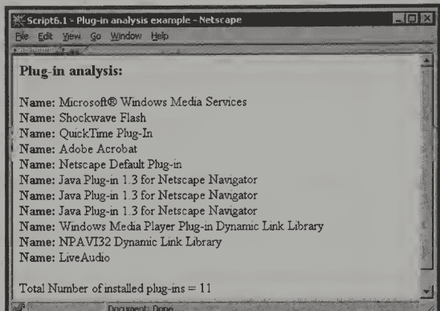

**图6.1** 分析访问你网站的人员计算机上存储的插件。

在大多数情况下，你只想知道访客是否运行了特定插件，而不需要检查整个`plugins`数组。以下示例展示了如何检查特定插件的安装情况。在这个例子中，我查找的是Adobe Acrobat插件：

```
my_plugin = navigator.plugins["Adobe Acrobat"]

if (my_plugin) {
    document.write("Adobe Acrobat已安装")
}
else {
    document.write("Adobe Acrobat未安装")
}
```

> 注意：你可能想知道我怎么知道要检查Adobe Acrobat插件时需要检查“Adobe Acrobat”，而不是“Adobe”、“ADBAcrobat”或其他拼写。嗯，在这个例子中，我只是安装了插件并运行了之前的脚本。查找关于单个插件的文档有时可能很困难。最好的地方是在编写该插件的软件供应商的网站上查找。

> 提示：每当软件供应商发布产品的新版本时，事情都会发生变化。插件也是如此。你永远不知道供应商何时会更改插件的名称，因此请记住密切关注并相应地更改你的脚本。

### 使用Netscape LiveAudio插件

此示例使用内置的Netscape LiveAudio插件，在用户点击按钮时播放`.wav`文件。LiveAudio插件默认包含在Netscape的安装中。但正如我之前所说，此示例无法在Internet Explorer浏览器中工作，因为Internet Explorer使用ActiveX技术而不是插件。

> 注意：你可以在《客户端JavaScript指南》中找到关于LiveAudio插件的文档，在撰写本书时，该指南可在http://developer.netscape.com/docs/manuals/javascript.html免费获取。

该脚本首先定义一个函数，该函数首先检查确保访客已安装LiveAudio插件。如果未安装，则显示一个警报对话框。如果已安装，接下来发生什么取决于传递给函数的参数。有效选项有`play`、`pause`和`stop`。参数通过一个`switch`语句进行分析。当某个`case`语句匹配时，将采取相应的操作。例如，当选择`pause`选项时，执行`document.myWav.pause()`语句。此语句引用一个属于在HTML页面的body部分定义的`myWav`对象的方法。

LiveAudio插件提供了`myWav`对象的方法。LiveAudio插件提供的、本示例使用的三个方法是`play()`、`pause()`和`stop()`。正如你所料，这三个方法提供了对音频文件播放的控制。`stop()`和`pause()`方法不支持参数。`false`被传递给`play()`方法，作为不要在循环中持续播放音频文件的指令。如果传递给`play()`方法的参数是`true`，文件将会持续播放。

```
<HTML>
  <HEAD>
    <TITLE>Script6.2 - 使用
                Netscape LiveAudio插件的示例
    </TITLE>
    <SCRIPT LANGUAGE="JavaScript" TYPE="Text/JavaScript">
    <!-- 开始隐藏JavaScript语句
        function Jukebox(instruction) {
            my_plugin = navigator.plugins["LiveAudio"];
            if (my_plugin) {
                switch (instruction) {
                    case "play":
                        document.myWav.play(false);
                        break;
                    case "pause":
                        document.myWav.pause();
                        break;
                    case "stop":
                        document.myWav.stop();
                        break;
                }
            }
            else {
                window.alert("抱歉。你的浏览器不支持" +
                     "Netscape LiveAudio插件。");
            }
        }
    // 结束隐藏JavaScript语句 -->
    </SCRIPT>
  </HEAD>
  <BODY>
<EMBED SRC="testing.wav" NAME="myWav" HIDDEN="true" MASTERSOUND>
</EMBED>
<FORM NAME="myForm">
    <INPUT TYPE="button" VALUE="开始" onClick="Jukebox('play')">
    <INPUT TYPE="button" VALUE="暂停" onClick="Jukebox('pause')">
    <INPUT TYPE="button" VALUE="停止" onClick="Jukebox('stop')">
</FORM>
</BODY>
</HTML>
```

`<EMBED>`标签用于将对象与页面关联。指定了`NAME=myWav`属性，以便head部分中的脚本可以引用该对象及其方法。`HIDDEN=true`属性防止浏览器显示该对象。`MASTERSOUND`选项是一个必需的属性。

页面的其余部分定义了一个包含三个按钮的表单，当被点击时，它们的`onClick`事件处理程序会调用`Jukebox()`函数。图6.2展示了将示例加载到Netscape Navigator中时的外观。

**图6.2** LiveAudio插件随Netscape Navigator自动安装，允许你播放音频文件。

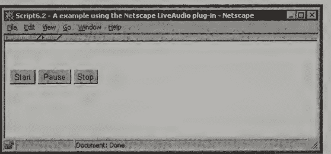

### 理解基本图形和动画

你已经看到了如何使用JavaScript来控制浏览器中的动画和图形的示例。之前周末的示例向你展示了如何创建菜单悬停效果和旋转横幅。接下来的三个示例进一步演示了你可以使用JavaScript在网页上操作图形和动画的方法。


#### 眨动的眼睛

使用JavaScript和一系列尺寸相同的图像，你可以创建基本的图形动画。这个示例展示了一个眨动的眼睛，它盯着你的访客，同时会睁开和闭合。实际效果非常简单：首先，你需要创建一组物理尺寸相同但彼此略有不同的图像文件，如图6.3所示。

在下面的例子中，我将演示如何使用JavaScript创建一个简单的图形动画。在这个示例中，脚本将使用八个略有不同的图像来产生眨眼的错觉。

```html
<HTML>
<HEAD>
<TITLE>Script6.3 - 眨眼示例</TITLE>
<SCRIPT LANGUAGE="JavaScript" TYPE="Text/JavaScript">
<!-- 开始隐藏JavaScript语句
current_img = 0;
function BlinkEye() {
  current_img++;
  if (current_img > images.length - 1) {
    current_img=0;
  }
  document.myEye.src = images[current_img];
  setTimeout('BlinkEye()',100);
}

image1 = new Image; image1.src = "eye1.jpg";
image2 = new Image; image2.src = "eye2.jpg";
image3 = new Image; image3.src = "eye3.jpg";
image4 = new Image; image4.src = "eye4.jpg";
image5 = new Image; image5.src = "eye5.jpg";
image6 = new Image; image6.src = "eye6.jpg";
image7 = new Image; image7.src = "eye7.jpg";
image8 = new Image; image8.src = "eye8.jpg";

images= new Array(8);
images[0] = image1.src;
images[1] = image2.src;
images[2] = image3.src;
images[3] = image4.src;
images[4] = image5.src;
images[5] = image6.src;
images[6] = image7.src;
images[7] = image8.src;
// 结束隐藏JavaScript语句 -->
</SCRIPT>
</HEAD>
<BODY>
    
    <SCRIPT LANGUAGE="JavaScript" TYPE="Text/JavaScript">
<!-- 开始隐藏JavaScript语句
    BlinkEye();
// 结束隐藏JavaScript语句 -->
</SCRIPT>
</BODY>
</HTML>
```

脚本首先定义一个用于跟踪当前图像的变量：

```javascript
currentImg = 0;
```

接下来，脚本定义一个名为`BlinkEye()`的函数，当被调用时，它会将当前图像索引加1。然后，该函数将`document.myEye.src`设置为当前图像（由数组位置`images[current_img]`指定）；这条语句的效果是更改页面正文部分中名为`myEye`的``标签所显示的图像。函数随后通过语句`setTimeout('BlinkEye()',100)`设置自己在0.1秒后再次执行。

```javascript
function BlinkEye() {
    current_img++;
        if (current_img > images.length - 1) {
            current_img=0;
        }
    document.myEye.src = images[current_img];
    setTimeout('BlinkEye()',100);
}
```

为了确保图形快速加载，你应该将它们预加载到用户的缓存中。如下面的代码所示，脚本为每个图形定义一个图像对象，然后将其与图形关联。最终结果是，在效果开始执行之前，所有图像都已被下载并放入用户的缓存中。

```javascript
image1 = new Image; image1.src = "eye1.jpg";
```

当然，为了使`BlinkEye()`函数能够循环显示图像，必须将图像加载到数组中：

```javascript
images= new Array(8);
images[0] = image1.src;
images[1] = image2.src;
images[2] = image3.src;
images[3] = image4.src;
images[4] = image5.src;
images[5] = image6.src;
images[6] = image7.src;
images[7] = image8.src;
```

正文部分中的``标签定义了页面首次加载时显示的初始图形，以及其物理尺寸和特征。`BlinkEye()`语句启动了整个动画过程。图6.4演示了眼睛开始闭合时的动画效果。

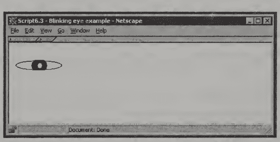

##### 图6.4
使用JavaScript生成简单的动画图形。

#### 背景更改器

下一个示例演示了如何允许用户控制文档的背景颜色。通过调整此示例，你可以让访客自定义他们查看页面的方式。如果你随后将此方法与cookie技术结合使用，你就可以存储此信息，并在该用户每次访问你的网页时检索它。

此示例为用户提供了两种设置背景颜色的方法。第一种方法是从预定义的选项列表中选择，第二种方法是输入他们喜欢的颜色。

```html
<HTML>
	<HEAD>
		<TITLE>Script 6.4 - 背景动画示例</TITLE>
	</HEAD>
	<BODY>
		<SCRIPT LANGUAGE="JavaScript" TYPE="Text/JavaScript">
		<!-- 开始隐藏JavaScript语句
			function Change_Background(color_num) {
				document.bgColor = color_num;
			}
		// 结束隐藏JavaScript语句 -->
		</SCRIPT>
		<H3>选择你的背景偏好：</H3>
		<FORM NAME="myForm">
			<SELECT NAME="myList"
				onChange="change_Background(
				document.myForm.myList.options[
				document.myForm.myList.selectedIndex].value)"
				<OPTION VALUE="red"> 红色
				<OPTION VALUE="green"> 绿色
				<OPTION VALUE="yellow"> 黄色
				<OPTION VALUE="blue"> 蓝色
				<OPTION VALUE="pink"> 粉色
				<OPTION VALUE="purple"> 紫色
				<OPTION VALUE="orange"> 橙色
				<OPTION VALUE="brown"> 棕色
				<OPTION VALUE="white"> 白色
			</SELECT>
		<H3>或者在这里输入你自己的颜色：</H3>
		<INPUT NAME="myText" TYPE="text" SIZE="10" MAXLENGTH="15" VALUE=" ">
		<INPUT NAME="myButton1" TYPE="button" VALUE="更改"
			onClick="Change_Background(document.myForm.myText.value)">
		</FORM>
	</BODY>
</HTML>
```

此示例定义了一个名为`Change_Background()`的函数，它将文档的`bgColor`属性更改为与接收到的参数匹配：

```javascript
function Change_Background(color_num) {
    document.bgColor = color_num;
}
```

脚本定义了一个访客可以从中选择的颜色选项下拉列表，并使用`<SELECT>`标签的`onChange`事件在用户选择其中一个选项时调用`Change_Background()`函数：

```javascript
onChange="Change_Background(
    document.myForm.myList.options[
    document.myForm.myList.selectedIndex].value)"
```

脚本的最后一部分允许更有鉴赏力的访客指定他们自己偏好的背景颜色，方法是首先定义一个文本字段，用户可以在其中输入他或她选择的颜色，以及一个按钮，当点击时，执行`Change_Background()`函数并传递用户指定的颜色（例如，`document.myForm.myText.value`）。

图6.5显示了此示例首次加载到浏览器时的样子。

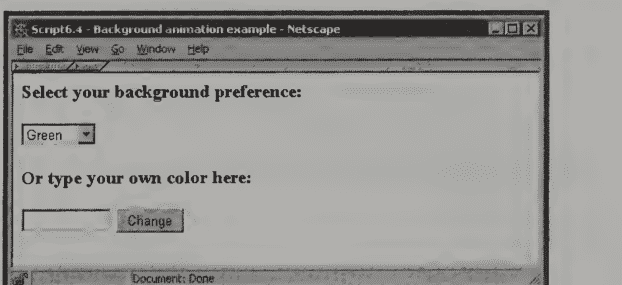

##### 图6.5
一个允许访客设置背景颜色偏好的脚本示例。

#### 图片查看器

这最后一个图形示例结合使用了框架和JavaScript来提供一个令人印象深刻但简单的在线图片查看器。如下面的例子所示，位于头部部分的脚本定义了所有图像并将它们加载到访客的缓存中。

```html
<HTML>
    <HEAD>
        <TITLE>Script 6.5 - 图片查看器示例</TITLE>
        <SCRIPT LANGUAGE="JavaScript" TYPE="Text/JavaScript">
            <!-- 开始隐藏JavaScript语句
            birthday = new Image(); birthday.src = "birthday.jpg";
            puppydog = new Image(); puppydog.src = "puppydog.jpg";
            stuffed  = new Image(); stuffed.src  = "stuffed.jpg";
            // 结束隐藏JavaScript语句 -->
        </SCRIPT>
    </HEAD>
    <BODY>
        <CENTER>
        <TABLE BORDER="10">
            <TR>
                <TD>
                    <H3>你好，欢迎来到我的个人相册！</H3>
                </TD>
            </TR>
            <TR>
                <TD>
                    <FORM NAME = myForm>
                    <B>选择一张图片：</B>
                    <INPUT NAME="myButton1" TYPE="button" VALUE="birthday"
```


在body部分，定义了一个一列三行的**TABLE**。第一行包含一个使用3级HTML标题`<H3>`格式化的欢迎信息。第二行包含一个表单，其中有三个按钮，每个按钮都有一个onClick事件处理程序，该程序会将图像的src属性更改为不同的图片。

```html
<INPUT NAME="myButton1" TYPE="button" VALUE="birthday"
    onClick = "document.myImage.src = birthday.src">
<INPUT NAME="myButton2" TYPE="button" VALUE="puppydog"
    onClick = "document.myImage.src = puppydog.src">
<INPUT NAME="myButton3" TYPE="button" VALUE="stuffed"
    onClick = "document.myImage.src = stuffed.src">
```

表格的最后一行包含一个简单的``标签，它加载初始图像并定义显示的物理尺寸。图6.6展示了此示例首次加载时的外观。

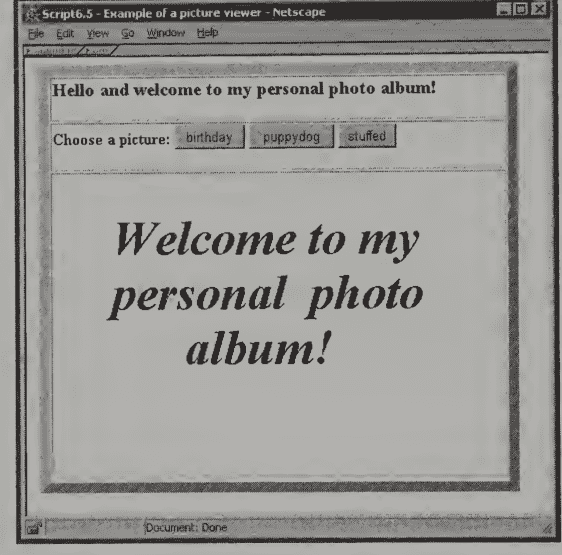

**图6.6**
通过结合使用JavaScript和框架，你可以创建非常强大的演示文稿。

### 烘焙JavaScript Cookie

*Cookies*是你可以存储在访问者计算机上并从中检索的小段信息。无论你是否意识到，你每天都在使用cookies。几乎任何时候你访问一个专业的网站，一个cookie都会被存储在你的计算机上。这些网站使用cookie来记录关于你的少量信息，例如你的名字或你上次访问的时间。

Cookie以纯文本文件的形式存储在用户的计算机上。Cookie技术非常有限。它不能用于植入病毒或损害用户的计算机。Cookie是`document`对象的一个属性。为`document.cookie`属性赋值会创建一个cookie。例如，以下语句定义了一个存储访问者姓名的cookie：

```javascript
document.cookie = "name=" + name + ";expires=" + expirationDate.toGMTString();
```

expires字段是必需的，它告诉浏览器在删除cookie之前要存储多长时间。如果你忘记添加这个字段，cookie将在当前会话结束时立即过期。

类似地，你可以使用以下语句在访问者下次加载你的网页时检索cookie：

```javascript
myCookie = document.cookie;
```

在接下来的两个示例中，我将向你展示如何创建和检索一个简单的cookie。

> 注意
> Netscape Communicator浏览器将cookies存储在一个名为cookies.txt的文件中。Internet Explorer将cookies作为单个文件存储在一个名为cookies的文件夹内。无法覆盖浏览器存储其cookie的位置。

#### 创建Cookie

这个第一个cookie示例显示一个表单，并要求访问者输入他们的姓名。然后创建一个cookie，其中包含访问者的姓名和从当前日期起一个月后的过期日期。

> 注意
> 这个非常简单的示例不包含逻辑来首先确保访问者在你麻烦地询问他或她的姓名之前，已经没有你的cookie。该示例也不包含逻辑来检查cookie是否即将过期，以便用一个新的cookie替换它。我将那段代码留给你来设计。

```html
<HTML>
    <HEAD>
        <TITLE>Script 6.6 - 烘焙你的第一个cookie</TITLE>
        <SCRIPT LANGUAGE="JavaScript" TYPE="Text/JavaScript">
            <!-- 开始隐藏JavaScript语句
            expiration_date = new Date;
            expiration_date.setMonth(expiration_date.getMonth() + 1);

function BakeTheCookie(name) {
    document.cookie = "name=" + name + ";expires=" +
    expiration_date.toGMTString();
}
// 结束隐藏JavaScript语句 -->
</SCRIPT>
</HEAD>
<BODY>
<H3>Cookie信息收集器</H3>
<FORM NAME="myForm">
    <B>你的名字是什么？ </B>
    <INPUT TYPE="text" NAME="visitorName">
    <INPUT NAME="myButton" TYPE="button" VALUE="保存Cookie"
    onClick="BakeTheCookie(document.myForm.visitorName.value)">
</FORM>
</BODY>
</HTML>
```

这个cookie示例在head部分包含一个脚本。它做的第一件事是定义一个名为`expiration_date`的数据对象。接下来，它使用Date对象的setMonth()方法为cookie设置过期日期，在当前日期上增加一个月：

```javascript
expiration_date = new Date;
expiration_date.setMonth(expiration_date.getMonth() + 1);
```

“烘焙”cookie的逻辑位于一个名为`BakeTheCookie()`的函数中，该函数接受访问者的姓名作为参数：

```javascript
function BakeTheCookie(name) {
    document.cookie = "name=" + name + ";expires=" +
    expiration_date.toGMTString();
}
```

示例的其余部分是一个表单，它收集访问者的姓名，然后调用BakeTheCookie()函数。图6.7演示了此示例首次加载到浏览器时的外观。

```html
onClick="BakeTheCookie(document.myForm.visitorName.value)"
```

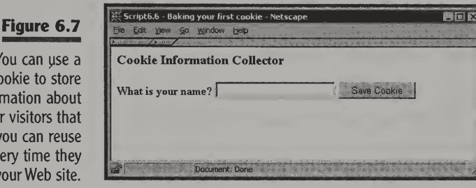

**图6.7**
你可以使用cookie来存储关于你的访问者的信息，并在他们每次访问你的网站时重复使用这些信息。

#### 查看你的Cookie

好了，你已经烘焙了你的cookie并将其保存在访问者的计算机上。接下来怎么办？答案是*没什么*。你只需等待访问者返回。当访问者返回时，你可以检查他或她是否有你的cookie之一。下面是一个如何做到这一点的示例。

> 注意：在实际操作中，你将需要编写一个脚本，将这个示例和前一个示例的cookie逻辑结合起来，以便在你分配另一个cookie之前，首先检查用户是否已经有你的一个cookie。

```html
<HTML>
<HEAD>
<TITLE>Script 6.7 - 检索你的cookie</TITLE>
<SCRIPT LANGUAGE="JavaScript" TYPE="Text/JavaScript">
<!-- 开始隐藏JavaScript语句

function CookieCheck() {
visitor_name = "";
cookie_name = "";
if (document.cookie != "") {
    cookie_name = document.cookie.split("=")[0];
    visitor_name = document.cookie.split("=")[1];
    window.alert("cookie_name = " + cookie_name +
        "\nCookie内容 = " + visitor_name);
}
else {
    window.alert("未找到你的cookie！");
}

// 结束隐藏JavaScript语句 -->
</SCRIPT>
</HEAD>
<BODY onLoad="CookieCheck()">
</BODY>
</HTML>
```

这个示例的cookie逻辑位于head部分脚本中的一个名为CookieCheck()的函数中。该函数由`<BODY>`标签中的onLoad事件调用。

脚本做的第一件事是检查访问者是否已经有你的一个cookie：

```javascript
if (document.cookie != "")
```

如果访问者没有你的cookie，则使用document对象的alert()方法显示一个弹出对话框，说明未找到cookie。但是，如果*确实*找到了cookie，脚本将使用cookie对象的split()方法检索cookie的值。split()方法将cookie分解为字段。第一条语句将一个名为cookie_name的变量设置为cookie保存时的名称。第二条语句将另一个名为visitor_name的变量设置为存储在cookie中的名称。

```javascript
cookie_name = document.cookie.split("=")[0];
visitor_name = document.cookie.split("=")[1];
```

然后脚本使用document对象的alert()方法显示cookie的内容：

```javascript
window.alert("cookie_name = " + cookie_name +
    "\nCookie内容 = " + visitor_name);
```

> 注意：虽然这个示例向你展示了如何检索和显示你的cookie，但更有效地使用这些信息可能是显示一条欢迎信息，以访问者的名字问候他或她。

图6.8演示了当脚本找到cookie时如何格式化结果。

> 注意：管理cookie创建和检索的最重要安全规则之一是，只有它们的创建者才能检索它们。每次创建cookie时，都会向cookie添加一个称为domain的属性。domain属性被设置为创建cookie的计算机所属的Internet域名URL的名称。例如，来自Netscape的cookie的domain属性可能类似于.netscape.com。每当收到cookie检索请求时，都会将请求计算机的Internet域名URL与每个cookie列出的domain属性进行比较，以查看是否找到匹配项。

**图6.8** 通过检索cookie信息，你可以避免重复向访问者询问相同的信息，并在他们返回你的网站时用名字问候他们。

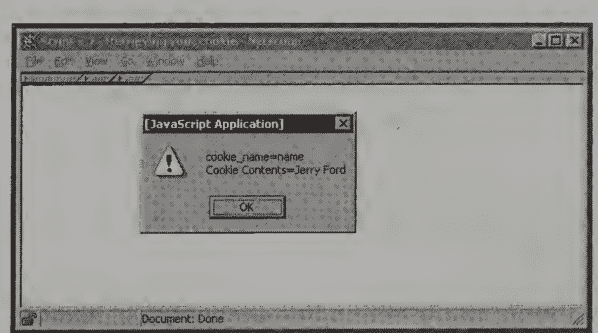


## 休息一下

是时候休息一下了。为什么不出去散散步，伸展一下双腿，然后吃点零食补充能量呢？当你回来时，我们将直接进入JavaScript调试的学习。毕竟，调试可能是脚本开发过程中最耗时、最困难的部分。幸运的是，正如你将看到的，有一些技巧、技术和工具可以帮助你最大限度地减少调试所花费的时间。

### 调试你的JavaScript脚本

在编程中，有一个普遍真理：每个人都会犯错。在编程中，程序代码中的错误被称为*bug*。查找和修复bug的过程被称为*debugging*，这是开发过程的正常组成部分。即使你编写的脚本从一开始看起来运行良好，你仍然应该进行一定程度的测试和调试，以验证JavaScript在不同场景下是否能按预期工作。

在大多数情况下，JavaScript会为你提供有关问题所在的线索。但也会出现JavaScript不提供任何错误信息的情况——这完全需要你自己来解决问题。在这两种情况下，你都可以遵循一些流程来帮助你调试代码并找到错误。这就是今天下午剩余时间要涵盖的内容。

调试并不十分光鲜或有趣，而且通常似乎比你预期的要花更长时间。坏消息是，你的程序越长，你遇到的错误就会越多。好消息是，随着时间、经验、编程规范和健全的调试流程，你将熟练掌握脚本调试。

> 注意：在Netscape和Opera中，浏览器在遇到错误时会停止处理脚本。Internet Explorer浏览器会显示一条错误消息，并提供是否允许脚本继续执行的选项。

编写JavaScript时，你会遇到三种类型的错误：

- 加载时错误
- 运行时错误
- 逻辑错误

## 加载时错误

加载时错误发生在你尝试将网页加载到浏览器中时。这些错误往往相当明显，通常涉及基本的语法问题。语法错误的发生是因为浏览器无法确定脚本试图做什么。与人类交流不同，计算机代码中一个小小的语法错误就足以破坏所有通信。请记住，JavaScript区分大小写，你必须在定义和引用变量、函数、对象、方法、属性和事件时保持一致性。

Netscape Navigator和Microsoft Internet Explorer过去常常显示弹出式错误对话框，为你提供有关错误的信息。这两个浏览器的当前版本现在会将错误消息隐藏起来，因为典型用户既不需要也不希望看到它们。真正需要看到错误消息的唯一人是程序员，因为脚本完全调试并在互联网上发布后，就不应该再有任何错误（即使有错误，除了程序员，其他人也无能为力）。Netscape和Microsoft的理念是尽量减少脚本错误对用户可能产生的影响。今天下午晚些时候，我将向你展示如何查看Netscape和Internet Explorer的错误消息。

> 提示：处理语法错误的最佳方法是首先避免它们。仔细输入，在运行脚本之前仔细检查，确保一切正常。例如，确保你避免使用保留字作为变量名，或者不要忘记匹配所有开括号和闭括号、开花括号和闭花括号。请记住，用逗号分隔各种循环语句的属性——除了`for`语句，它使用分号来分隔其参数。

通常，错误消息会提供你查找和修复问题所需的所有信息——包括问题的简要描述，甚至可能包括导致错误的实际代码部分。例如，加载以下脚本时，将发生语法错误：

```html
<HTML>
  <HEAD>
    <TITLE>Script 6.8 - Sample syntax error</TITLE>
  </HEAD>
  <BODY>
  <SCRIPT LANGUAGE="JavaScript" TYPE="Text/JavaScript">
  <!-- Start hiding JavaScript statements
  var test_color = "blue";
  if (test_color == "blue" {
  document.write("We have a match");
  }
  // End hiding JavaScript statements -->
  </SCRIPT>
  </BODY>
</HTML>
```

你能通过肉眼观察脚本发现错误吗？脚本只包含几行代码，但错误可能仍然不会跳出来。当我加载这个脚本时，Netscape记录了以下错误消息：

```
JavaScript Error: file:/A|/JavaScript Syntax error 1.html,
line 9:

missing ) after condition.

if (test_color == "blue" {
........................................^
```

掌握这些信息后，调试脚本的工作就容易多了。正如你所看到的，错误消息中提供了几条非常有用的信息：

- 错误发生的行号：第9行
- 错误消息本身：条件后缺少右括号
- 错误文本（生成错误的实际代码行）：if (test_color == "blue" {

> 为了更好地展示错误消息中提供的行号信息的价值，我在上一个示例的左侧添加了行号。这些数字通常不是你输入的示例代码的一部分。在寻找JavaScript编辑器时，你可能需要找一个能自动提供行号显示的编辑器。

如你所见，错误消息表明第9行缺少一个右括号。如果你查看错误消息的错误文本部分，你会看到应该在何处插入右括号：

```javascript
if (test_color == "blue" ) {
    document.write("We have a match");
}
```

#### 运行时错误

运行时错误是由于你的脚本试图做一些违反规则的事情而发生的。例如，如果脚本试图引用未声明的变量或调用尚未定义的函数，就会发生运行时错误。其他示例包括错误使用JavaScript命令。例如，以下脚本将产生运行时错误：

```html
<HTML>
    <HEAD>
        <TITLE>Script 6.9 - Sample runtime error</TITLE>
    </HEAD>
    <BODY>
        <SCRIPT LANGUAGE="JavaScript" TYPE="Text/JavaScript">
        <!-- Start hiding JavaScript statements
            myFunction();
            function Myfunction() {
               document.write("Hello World!");
           }
       // End hiding JavaScript statements -->
        </SCRIPT>
    </BODY>
</HTML>
```

下面的错误消息告诉你浏览器认为错误发生的行号，并简要描述了错误。在上面的例子中，我本打算创建并调用一个名为`MyFunction()`的函数。尽管错误消息将我指向第8行，但实际的错误在第9行，我误将函数名拼写为`Myfunction()`。

```
JavaScript Error: file:/A|/JavaScript runtime error 2.html, line 8:

myFunction is not defined.
```

> 提示：如上一个示例所示，错误消息中的行号并不总是准确的。但总的来说，它非常接近于精确定位错误。如果错误消息中指示的行不包含错误，你通常会在该行号前后几行内找到它。

## 逻辑错误

*逻辑错误*可能是最难发现的一类错误。这些错误不是语法错误或运行时错误的结果。相反，它们发生在你犯了驱动脚本的逻辑错误，并且没有得到预期结果时。不幸的是，就JavaScript而言，脚本运行良好，浏览器不会生成任何错误。因此，你不会收到任何帮助来确定问题所在。

例如，以下脚本包含一个逻辑错误。该脚本本应从1计数到10然后终止。但是，在编写控制循环逻辑的`for`语句时，我不小心输入了`i--`而不是`i++`。脚本不是从1开始计数到10，而是从1开始向后计数到负数。因为`i`的值从未达到11，所以脚本永远不会停止运行。尽管脚本完全按照它被*指示*的方式执行，但它并没有做我*想要*它做的事情。


#### 高效程序员的习惯

逻辑错误的另一个常见例子是每个人都可能犯错的，即误用赋值运算符代替 `=` 比较运算符。例如，下面的脚本即使 `apples` 和 `oranges` 变量的值并不相同，也会显示 "We have a match" 消息。显然，这不是我想要的逻辑。当我将 `if` 语句重写为 `if (apples == oranges)` 并加载它时，示例按预期工作，并显示了 "We do not have a match" 消息。

```html
<HTML>
  <HEAD>
    <TITLE>Script 6.11 - A second sample logical error</TITLE>
  </HEAD>
  <BODY>
    <SCRIPT LANGUAGE="JavaScript" TYPE="Text/JavaScript">
    <!-- Start hiding JavaScript statements
      apples = 5;
      oranges = 15;
      if (apples = oranges) {
          document.write("We have a match");
      }
      else {
          document.write("We do not have a match");
      }
      // End hiding JavaScript statements -->
    </SCRIPT>
  </BODY>
</HTML>
```

> **提示** 调试前面示例的一种方法是在 `if` 语句之前的脚本中添加一个检查点。*检查点* 是一条显示变量值的语句，以便你知道它被设置了什么。我将在几分钟后更详细地描述这种调试技术。

在我进一步讨论调试脚本之前，我想谈谈你可以做的一些事情来减少脚本中的错误数量，并使调试过程稍微容易一些。

-   记得使用大量的注释。注释允许你解释为什么以这种方式编写脚本，并解释特别困难的代码部分。注释使其他人更容易跟随你，也使你在几个月或几年后更容易理解自己的代码。
-   始终使用缩进使你的代码易于阅读。缩进语句也使你更容易匹配开始和结束标签、花括号以及其他 HTML 和脚本元素。
-   **编写模块化代码。** 尽可能将你的代码语句分组到函数中。函数允许你将相关的语句分组，并以最小的努力测试和重用代码部分。通过只给一个函数分配一个任务来简化你的设计。
-   **在脚本顶部声明函数和变量。** 这种方法使这些元素易于查找和修改，比将它们嵌入冗长脚本的不同部分更不容易混淆。这种技术还有助于确保函数和变量在被引用之前已定义。
-   **在命名变量和函数时保持一致。** 尝试使用足够长的名字，使其有意义，并描述变量的内容或函数的目的。
-   **在命名变量和函数时使用一致的语法。** 换句话说，保持它们全部小写或全部大写；如果你喜欢驼峰命名法，请始终如一地使用它。
-   **不要认为仅仅因为你的脚本运行了一次没有错误就是无错的。** 确保使用不同的浏览器测试脚本，如果可能的话，使用相同浏览器的不同版本进行测试。
-   **确保使用不支持 JavaScript 的浏览器测试你的脚本，以确保你的脚本正确地提供替代内容。** 尝试在你的浏览器中禁用对框架等功能的支持，以确保所有浏览器都按照你希望的方式显示你的信息。
-   **测试所有可能的场景。** 这包括使用好数据和坏数据进行测试。如果你的页面有表单，请尝试输入无效数据，并检查以确保验证例程按你预期的那样工作。测试每个链接并点击每个按钮。
-   **以模块化方式测试长脚本。** 换句话说，不要试图在测试任何部分之前编写整个脚本。编写一个部分并使其工作，然后再添加下一个代码部分。
-   **使用不同的分辨率加载你的页面，以确保它们在任何大小下都看起来像你期望的那样。**  also try resizing your browser windows to see how they look at different sizes.  also try resizing your browser windows to see how they look at different sizes.  also try resizing your browser windows to see how they look at different sizes.  也尝试调整浏览器窗口的大小，以查看它们在不同大小下的外观。
-   **测试每个事件处理程序，以确保它按预期执行。**
-   **使用 `var` 关键字显式声明变量。**
-   **使用描述性的变量和函数名，避免使用单字符名。**
-   **使用对象名称时要小心。** 只有核心 JavaScript 对象以大写字母开头（例如，`Array`, `Boolean`, `Date`, `Function`, `Math`, `Number`, `Object`, `RegExp`, 和 `String`）。
-   **注意你的引号。** 记住引号成对用于字符串，并且两个引号必须是相同的样式（单引号或双引号）。如果你想在文本消息中显示引号，请将它们嵌入到另一种类型的引号中（例如，将单引号放在双引号内，反之亦然）。

#### 使用检查点

一个非常简单的调试技术是在编写和测试脚本时将检查点放入脚本中。你可以通过利用 `document` 对象的 `alert()` 方法在脚本中评估或更改变量之前和之后显示变量的值来做到这一点，以确保它们被设置为你认为的值。检查点的另一个用途是监控脚本的执行流程，以确保它们按你预期的顺序执行。例如，你可以在每个函数中放置一个 `alert()` 语句，该语句在每次调用函数时显示一条消息。

> 或者，你可以使用 `document.write()` 方法在当前窗口中显示消息，或打开一个新窗口并向其写入。使用哪种检查点技术并不重要。根据情况，有些可能比其他技术更有效。

只需要记住一件重要的事情：为了节省访问者的挫折感，记得在测试完成后删除或注释掉所有检查点。

#### 编写前测试

用任何语言编程最困难的事情之一是找出要在脚本中执行的命令的正确语法。你可以使用 Netscape 做的一个非常巧妙的技巧是在浏览器的 URL 字段中输入 `javascript:` 后跟你要测试的语句（见图 6.9）。

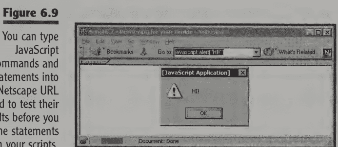

#### 使用 onError 捕获错误

每当脚本在加载窗口、框架或图像时遇到问题时，JavaScript 错误事件就会执行。可以设置一个 JavaScript `onError` 事件处理程序来处理这些情况。三个参数会自动传递给 `onError` 事件处理程序：

-   错误消息
-   URL 信息
-   行号

下面的脚本演示了如何编写一个可以放置在任何脚本中的函数，以显示与错误事件发生相关的信息。一个名为 `errorTrap()` 的函数在页面的头部部分定义；该函数接受三个参数。这些参数对应于自动传递给 `onError` 事件处理程序的三个参数。`errorTrap()` 函数然后在警报弹出对话框中格式化错误信息。

主体部分脚本中的语句 `onError = errorTrap` 告诉浏览器为任何错误事件调用该函数。我在此语句后添加了一行包含拼写错误的内容，以演示这一切是如何工作的。

```html
<HTML>
<HEAD>
<TITLE>Script 6.12 - Capturing errors with the onError event handler</TITLE>
```


<SCRIPT LANGUAGE="JavaScript" TYPE="Text/JavaScript">
<!-- Start hiding JavaScript statements
    function ErrorTrap(msg,url,line_no) {
        window.alert("Error: " + msg + "\nLine: " + line_no + 
                     "\nURL: " + url);
    }
// End hiding JavaScript statements -->
</SCRIPT>
</HEAD>
<BODY>
    <SCRIPT LANGUAGE="JavaScript" TYPE="Text/JavaScript">
    <!-- Start hiding JavaScript statements
        onError = ErrorTrap;
        document.write("");
    // End hiding JavaScript statements -->
    </SCRIPT>
</BODY>
</HTML>

图 6.10 显示了加载此脚本后弹出的警报对话框。如你所见，所有错误信息都被显示了出来——在这种情况下，它直接指向了问题的确切位置。

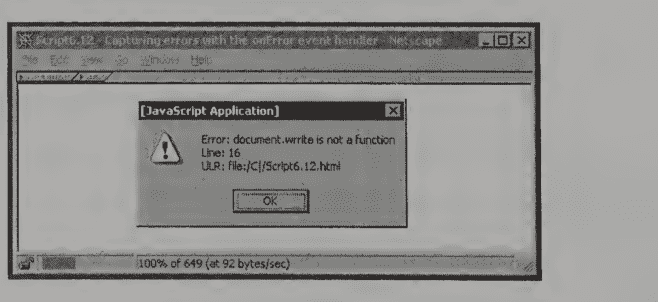

onError 事件处理程序可以与文档的 alert() 方法结合使用来显示调试信息。

> 你可能已经注意到，我在 alert() 语句中使用了 /n 字符来格式化消息输出。这个特殊的格式化字符会导致换行。

#### 理解 Internet Explorer 错误消息

Internet Explorer 可以抑制或显示 JavaScript 错误消息。此功能在“工具”菜单中的“Internet 选项”对话框（参见图 6.11）的“高级”属性页上进行配置。默认情况下，Internet Explorer 5 不显示 JavaScript 错误消息。要启用此功能，请选中“显示每个脚本错误的通知”复选框，然后单击“确定”。

下次加载包含 JavaScript 错误的网页时，你将看到一个类似于图 6.12 所示的 Internet Explorer 错误对话框。如你所见，你可以通过单击“隐藏详细信息”按钮来控制显示的信息量。

你可以安全地阻止显示 Internet Explorer 错误消息，只需清除“显示每个脚本错误的通知”复选框并单击“确定”，而不会失去便捷的错误信息访问。相反，当遇到错误时，浏览器左下角会显示一个小型警报图标，如图 6.13 所示。双击该图标即可查看图 6.12 所示的错误对话框。

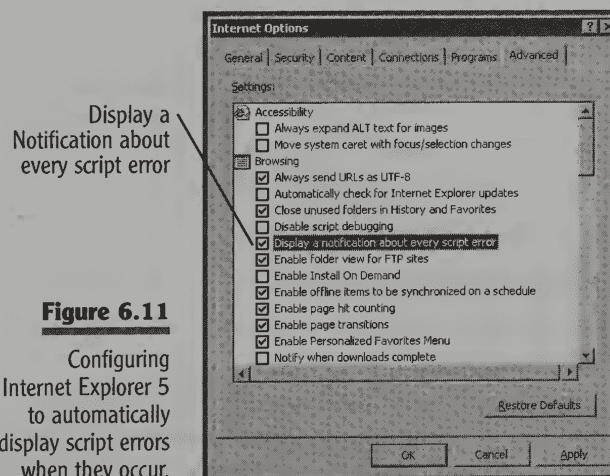

**图 6.12**
查看 Internet Explorer 错误消息的所有详细信息。

**图 6.13**
当启用错误通知时，你可以通过双击状态栏中的警报图标来查看 Internet Explorer 脚本错误消息。

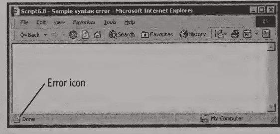

#### 使用 Netscape JavaScript 控制台

Netscape 内置了一个名为 Netscape JavaScript 控制台的集成 JavaScript 工具。Internet Explorer 中没有等效的工具。

你无疑已经注意到，我主要使用了 Netscape Navigator。这有两个原因：第一个是我个人更喜欢 Netscape 而非其他主要浏览器。第二个原因是因为在编写和调试脚本时，我喜欢使用 Netscape JavaScript 控制台。

Netscape 将所有消息发送到 JavaScript 控制台。我喜欢这样做有几个原因：

- 当我不在编写 JavaScript 时，我使用 Netscape 浏览互联网，因为我可能在上网时遇到的所有 JavaScript 错误消息都会被发送到 JavaScript 控制台，我不必看到它们。
- 当我正在编写 JavaScript 时，我并不总是需要看到错误消息。如果我的脚本加载失败，我通常能在没有协助的情况下快速找到错误。
- 当我准备好进行一些认真的调试时，我可以打开 JavaScript 控制台并一直保持其显示。我更喜欢这种安排，而不是 Internet Explorer 的弹出式错误消息。

当我想测试命令语法或查看命令如何工作时，我也喜欢利用 JavaScript 控制台的 `typein` 字段。

如图 6.14 所示，Netscape JavaScript 控制台分为两个窗格。上窗格显示可滚动的错误消息列表。此窗格允许你查看当前和以前的错误。在 Netscape Navigator 的 URL 字段中输入 `javascript:` 即可启动 JavaScript 控制台。我认为你会觉得控制台的错误运行历史非常有帮助，但如果你愿意，可以单击“清除控制台”按钮来清空显示区域中的消息。

> **注意** JavaScript 控制台有时也称为 Communicator 控制台。事实上，JavaScript 控制台窗口的标题栏实际上显示的是 Communicator 控制台。

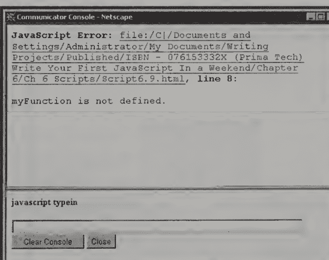

**图 6.14**
Netscape Navigator 提供了一个内置的 JavaScript 调试器，允许你查看错误消息和测试命令语法。

#### 测试 JavaScript 语句

JavaScript 控制台底部的窗格包含 `typein` 字段，你可以在其中键入 JavaScript 语句并测试其结果。例如，如果你想测试两个命令的语法，这两个命令设置一个变量，然后在 `alert()` 语句中使用该变量，你可以将这两个命令用分号隔开输入，然后如图 6.15 所示查看结果。

你还可以使用 typein 字段测试 JavaScript 表达式并进行数学计算，以确保在将它们添加到脚本之前，你的公式会返回预期的结果。

例如，以下行演示了如何测试一个函数及其语句的语法。如你所见，该语句通过调用一个名为 `DisplayMsg()` 的小函数并传递一个参数来测试它。当此语句执行时，你应该会看到一个警报对话框出现。

```
function DisplayMsg(var1) { window.alert(var1) }; DisplayMsg("Hi");
```

下一个示例包含三个语句。第一个语句定义一个变量，第二个语句更改其值，第三个语句在其条件测试结果为 `true` 时显示警报对话框。

```
var oranges = 5; oranges = oranges + 5;
```

```
if (oranges < 12) window.alert("Order more oranges");
```

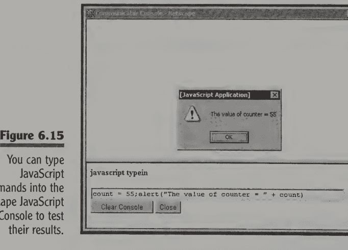

#### 显示弹出式错误消息

在 Netscape 4.06 之前，使用弹出式对话框来报告错误。此后，JavaScript 控制台成为所有 Netscape JavaScript 错误消息的默认位置。如果你更喜欢使用旧的弹出式风格的错误对话框而不是 Netscape JavaScript 控制台，你可以通过修改 Navigator 偏好设置文件来配置 Navigator 以适应此偏好。此文件名为 prefs.js，通常位于 Program Files\netscape\users\ 目录下以你的用户名命名的目录中。使用以下过程修改此文件，以便自动显示弹出式错误对话框：

1. 关闭所有活动的 Netscape Navigator 会话。
2. 使用记事本打开 prefs.js 文件。
3. 在文件中的某处单独一行添加以下语句：
    `user_pref("javascript.classic.error_alerts", true);`
4. 保存并关闭 prefs.js 文件。

> **注意** 如果你在修改 prefs.js 文件时让 Netscape Navigator 保持运行状态，你的更改将在稍后关闭 Netscape 时被覆盖。

#### 显示 JavaScript 控制台

如果你愿意，可以配置 Netscape Navigator 在每次出现错误时自动打开 JavaScript 控制台，而不是弹出错误对话框，使用以下过程：

1. 关闭所有活动的 Netscape Navigator 会话。
2. 使用记事本打开 prefs.js 文件。
3. 在文件中的某处单独一行添加以下语句：
    `user_pref("javascript.console.open_on_error", true);`
4. 保存并关闭文件。

#### 使用高级调试工具

Netscape 和 Microsoft 都提供了高级脚本调试工具，提供了强大的调试功能。Netscape 的调试器称为 Netscape JavaScript Debugger；Microsoft 的调试器称为 Microsoft Script Debugger。


两者都与各自公司的浏览器紧密集成，并且都提供了一组相同的基本功能。

截至本书撰写时，你可以在以下网址找到 Microsoft 脚本调试器：http://msdn.microsoft.com/scripting/default.htm?/scripting/vbscript/default.htm。Netscape JavaScript 调试器可在此处获取：http://developer.netscape.com/tech/javascript/index.html。

两个调试器都允许你在脚本执行时进行调试。这意味着你可以监控变量和对象属性值，并观察它们在脚本执行过程中如何变化。以下是这两个调试器提供的一些其他功能的简要列表：

-   **断点：**允许你在任何给定位置中断脚本执行。断点是标记，用于告诉调试器何时暂停脚本执行。暂停时，你可以使用每个调试器的命令控制台执行命令，运行函数和对象方法，或查看变量和属性值。你可以设置的断点数量没有限制。当脚本运行时，它会在每个断点处停止，并等待你点击“运行”按钮后继续。
-   **中断：**允许你随时停止脚本执行。一旦当前执行的语句完成，脚本就会暂停。
-   **单步执行：**允许你在从断点或中断恢复后控制脚本的执行方式。例如，你可以选择正常运行脚本的其余部分，或逐行单步执行脚本，在每行处理完后暂停。
-   **调用堆栈：**显示窗口，向你展示脚本当前正在执行哪些组件，以便你可以确定逻辑执行的顺序。

没有足够的时间详细讨论这两种调试工具中的任何一种，因此我将尝试专注于一些关键点，以帮助你理解每个调试器的工作原理。

## Netscape JavaScript 调试器

Netscape JavaScript 调试器是一个在 Netscape Navigator 浏览器内运行的 Java 小程序。不幸的是，它仅适用于 Netscape Navigator 4.02 或更高版本。

首次安装调试器时，你会看到几个要求各种权限的对话框。你必须批准每个请求。安装完成后，你将看到主 JavaScript 调试器 HTML 页面，建议你将该页面添加到书签中，并在将来使用书签加载 Netscape JavaScript 调试器（参见图 6.16）。

你也可以通过在你安装它的计算机上加载 `jsdebugger.html` 来启动 Netscape JavaScript 调试器。它位于 Netscape 目录中。

要使用调试器，请启动 Netscape Navigator 并单击“Netscape JavaScript Debugger Start Page”书签。调试器将开始监控你从此点加载的所有脚本。在 Netscape 中打开包含你要调试的脚本的 HTML 页面。单击调试器工具栏上的“打开”按钮。将显示已打开的 HTML 页面列表。选择包含你的脚本的 HTML 页面对应的条目。脚本将出现在调试器的顶部窗格中，如图 6.17 所示。调试器随后将跟踪此脚本的活动。

如图 6.17 所示，Netscape JavaScript 调试器分为三个窗格。顶部窗格是“源视图”窗格，显示你的脚本内容。左下方窗格是“调用堆栈”，显示脚本中当前的执行点。右下方窗格包含“控制台”。控制台分为两部分：上半部分显示“监视”工具监控的信息以及你选择评估的任何表达式的结果。当脚本未执行时，你可以通过在控制台窗格的下部命令行中键入表达式来评估它们。


**图 6.16**
Netscape JavaScript 调试器的初始启动屏幕。


**图 6.17**
Netscape JavaScript 调试器是一个强大的调试工具，你可以从 Netscape 下载。

“源视图”窗格使用窗格左边距的不同颜色显示有关脚本组件的信息。例如，红点标识已设置的任何断点，深色箭头显示当前正在执行的行，黄线标识脚本代码，橙色条标识函数。

Netscape JavaScript 调试器包含其他工具，包括图 6.18 所示的“检查器”。检查器允许你查询任何对象及其属性的当前状态。如果任何对象属性是具有自身属性的对象，你也可以深入查看这些属性。

Netscape JavaScript 调试器允许你设置断点和中断来暂停执行，以便你可以查看对象的状态并使用命令窗格执行表达式和查询变量值。你还可以设置监视点，它们是调试器在每次激活时持续评估的表达式。此外，你可以单击工具栏上的“Intrpt”按钮，调试器将在当前语句处理完后立即暂停执行。调试器也会在它到达你设置的断点或遇到错误时停止。

Netscape 支持两种类型的断点：

-   **无条件：**遇到断点时立即停止解释器。
-   **有条件：**指示解释器在遇到断点时评估一个条件，仅当结果为真时才停止执行。

调试器提供了各种恢复执行的选项，位于调试器的工具栏上，如图 6.17 所示：

-   **“运行”图标：**单击以从下一条语句恢复执行。
-   **“单步进入”图标：**允许你在函数内逐条执行语句，或者如果你不在函数中，则执行单条语句。
-   **“单步跳过”图标：**允许你一次执行函数内的所有语句，或者如果你不在函数中，则执行单条语句。
-   **“单步跳出”图标：**允许你在执行再次暂停前完成执行函数内的任何剩余语句。

## Microsoft 脚本调试器

Microsoft 脚本调试器需要 Internet Explorer 4 或更高版本。它可用于调试 ActiveX、VBScript 和 JavaScript。你可以通过启动 Internet Explorer，选择“视图”、“脚本调试器”，然后单击“打开”来启动 Microsoft 脚本调试器。调试器安装后，脚本中发生的任何错误都会自动提示 Internet Explorer 提供启动调试器的选项，如图 6.19 所示。

如果你想调试脚本，脚本必须首先正在执行。图 6.20 显示了调试器的“运行文档”窗口，允许你从活动的 Internet Explorer 窗口列表中选择要调试的脚本。

选择要调试的脚本后，脚本将出现在主调试器窗口中，如图 6.21 所示。这个调试器提供的一个不错的功能是颜色编码的文本，这使得你的脚本更易于阅读。与 Netscape JavaScript 调试器类似，Microsoft 脚本调试器的左边距用于标识特定信息。例如，红点表示断点，黄箭头显示当前执行点。与 Netscape JavaScript 调试器类似，Microsoft 脚本调试器工具栏上的图标提供了控制脚本执行以下方面的功能：

-   **运行：**单击以从下一条语句恢复执行。


#### 调试工具与命令

-   停止调试
-   在下一条语句中断
-   逐语句
-   逐过程
-   跳出
-   切换断点
-   清除所有断点
-   运行文档
-   调用堆栈
-   命令窗口

调用堆栈（如图6.22所示）显示了一个当前活动的函数和事件处理程序列表，以帮助您跟踪脚本执行。此调用堆栈与 Netscape JavaScript 调试器的调用堆栈非常相似。

命令窗口（如图6.23所示）允许您执行命令、查询变量和属性值以及运行对象方法和子程序。

总而言之，Microsoft Script Debugger 为 Microsoft Internet Explorer 提供的调试功能，与 Netscape JavaScript Debugger 为 Netscape Navigator 提供的功能相当。然而，Microsoft Script Debugger 的优势在于它不仅能调试 JavaScript；如果您支持多种脚本语言，它可能是更适合您的工具。


**图 6.22**
Microsoft Script Debugger 的调用堆栈对话框允许您在调试脚本时查看所有活动函数和事件处理程序的列表。

图 6.23
Microsoft Script Debugger 的命令窗口允许您在脚本暂停时查看变量和属性内容以及执行方法。


### 下一步是什么？

恭喜！你已经完成了本书中所有的 JavaScript 课程。你应该为自己感到骄傲。学习一门新的编程语言是一项重大的成就。当然，你的学习并没有结束——事实上，它才刚刚开始。就像生活中的大多数事情一样，你确实是通过实践来学习的。在这种情况下，你通过编写自己的 JavaScript 代码来学习。在学习过程中，你会遇到问题，然后学会解决它们。随着你处理的项目越来越困难，你对 JavaScript 的熟练程度也会不断提高。有了 HTML、JavaScript 以及互联网提供的强大功能和自由，你现在拥有了在当今电子社会中真正表达自我的所有基本工具。

但在你跑去征服世界之前，本书今晚还提供最后一课，我想你会想要复习一下。今晚我将向你展示一个利用 JavaScript 功能构建在线书店的网站示例。这个例子向你展示了一点点 JavaScript 如何能给任何网站带来巨大的不同。那么，你何不去吃点东西，过一会儿我们再在这里见面。


## 星期天晚上

### 融会贯通

-   在线书城网站概览
-   制作索引页
-   特色图书
-   导航书城
-   完善书城
-   收集访客注册信息
-   接收客户电子邮件

欢迎参加周末的最后一课。今晚你将通过查看一个虚构的、已使用 JavaScript 增强功能的网站来结束本书的学习。这个网站背后的想法是，一位书商（我）加入了几个在线书店的联属计划。这些*联属计划*会支付每一笔销售的一定比例作为佣金，前提是有人通过我的网站进入书店的网站。这个网站恰当地被称为“杰瑞在线书城”。

这一切之所以有效，是因为每个在线书店都提供一个特定格式的链接，当被点击时，可以跟踪所有来自杰瑞在线书城的流量。由于人们可能有自己偏好的在线购物书店，你可能不会只加入一个主要的在线书店的联属计划。

你可以通过访问每个在线书店的网站来了解更多关于其联属计划的信息，在那里你可以阅读该计划的所有规则并即时申请加入。正如你可能推测的那样，书店并不是互联网上唯一通过联属计划提供机会的企业。只需稍微浏览一下，你就能找到数十个其他机会。今晚课程的重点不在于你是否决定建立自己的在线业务，或者只是为此寻求乐趣。重要的是你在这里学习；虚构的杰瑞在线书城只是今晚演示的一个渠道。

在本书中，你已经学到了很多关于 JavaScript 的知识。这最后一课的重点是应用你所学的大部分内容，因此我不会浪费你的时间去逐行详细地讲解代码，也不会解释你已经见过的东西。相反，我将介绍网站的基本结构，列出其代码，并从相对较高的层面讨论 JavaScript 的使用位置和方式。

由于这最后一课的篇幅有限，该网站将不会达到 100% 的完整，但它将作为一个示例和模板，你可以以此开始自己的 JavaScript 体验。

以下是本节课涵盖内容的概览：

-   设计一个新网站
-   欢迎回头客访问你的网站
-   使用框架来组织你的网站
-   收集用户信息和评论

#### 在线书城网站概览

杰瑞在线书城是一个相对较小的网站，由少量网页组成，如图 7.1 所示。该网站从一个典型的索引页开始，网站的其他页面都链接到该页面。

除了欢迎消息和标准 HTML 链接外，索引页还包含添加以下功能的 JavaScript 语句：

-   用于收集和显示访客名称的 Cookie 逻辑
-   用于打开新窗口并显示特色图书选择的代码


-   一个轮播广告横幅，用于宣传其他属于杰瑞的虚构网站
-   一个浏览器检测示例

该网站中下一个使用 JavaScript 的页面是实际书店区域中的导航框架。在这里，鼠标事件处理程序嵌入在 HTML 链接中，为六个目标选项提供了完美而惊艳的视觉呈现，包括一个欢迎页面、指向四个主要在线书店的链接以及一个“杰瑞精选”页面。

“杰瑞精选”页面演示了如何使用鼠标事件在浏览器窗口的状态栏上发布和清除消息。当访客将鼠标悬停在书名上时，这些消息会提供关于该书的额外信息。

该网站的注册页面演示了如何使用 JavaScript 执行多项任务：

-   表单验证
-   显示消息对话框
-   在浏览器的状态栏上显示循环消息
-   使用 Cookie 逻辑检索存储的信息并自动填写表单信息

正如你将看到的，一小部分精心布置的 JavaScript 可以对任何网站产生重大影响。在你浏览这个示例网站的过程中，我将指出其他利用 JavaScript 进一步增强网站的方法。闲话少说，让我们开始吧！

#### 制作索引页

构成杰瑞在线书城索引页的 HTML 和 JavaScript 语句已在此列出。如你所见，与你在本书中看到的其他示例相比，其元素列表相当冗长。它首先在 head 部分定义了页面上使用的所有变量和函数：

-   `expiration_date`：一个用于构建网站 Cookie 过期日期的变量。
-   `MyBannerArray[]`：一个加载了三个图形图像的数组，用于显示轮播广告横幅。

324 周末学通 JavaScript

-   **CycleBanner()**：一个持续循环遍历 MyBannerArray[] 以显示页面横幅广告的函数。
-   **BakeTheCookie()**：一个在被调用时创建并存储包含访客姓名的 Cookie 到访客计算机上的函数。
-   **CookieCheck()**：一个在被调用时检查访客计算机上是否存有 Cookie 的函数。如果未找到 Cookie，则该函数会询问访客的姓名，然后调用 `BakeTheCookie()` 函数。
-   **OpenNewWindow()**：一个在被调用时打开一个新的浏览器窗口并加载展示网站本月特色图书的网页的函数。
-   **BrowserCheck()**：一个在被调用时检查访客是否使用 Netscape Navigator 4.0 版或 Internet Explorer 4.0 版的函数。

页面的 `<BODY>` 标签已被修改，以便首先执行的是使用 `onLoad="CycleBanner()"` 调用 `CycleBanner()` 函数。页面本身使用一系列表格进行布局，以组织和显示呈现的信息。在正文部分的中间，调用了 `BrowserCheck()` 和 `CookieCheck()` 函数。接下来，特色图书的链接被修改为调用 `OpenNewWindow()` 函数，如下所示：

```html
<A HREF="javascript:OpenNewWindow()"></A>
```

页面上的最后一个表格提供了一个简单的导航菜单，该菜单在整个网站中使用。

以下是设置并定义杰瑞在线书城索引页的 JavaScript 代码：

```html
<HTML>
  <HEAD>
    <TITLE>脚本 7.1 - 杰瑞在线书城索引页</TITLE>
    <SCRIPT LANGUAGE="JavaScript" TYPE="Text/JavaScript">
      <!-- Start hiding JavaScript statements
```


//定义一个用于管理横幅广告的数组
MyBannerArray = new Array(3);
MyBannerArray[0]="banner0.jpg";
MyBannerArray[1]="banner1.jpg";
MyBannerArray[2]="banner2.jpg";
current_banner=0;
no_of_banners=MyBannerArray.length;
function CycleBanner() {
    if (current_banner==no_of_banners) {
        current_banner=0;
    }
    document.myBanner.src=MyBannerArray[current_banner];
    current_banner++;
    setTimeout("CycleBanner()", 5*1000);
}

//声明一个用于设置Cookie过期日期的变量
ExpirationDate = new Date;
ExpirationDate.setMonth(ExpirationDate.getMonth() + 3);

//定义一个函数，用于在访客的计算机上存储Cookie
function BakeTheCookie(name) {
    document.cookie = "name=" + name + ";expires=" +
    Expiration_date.toGMTString();
}

//定义一个函数来检查Cookie，如果找到则用于欢迎信息
function CookieCheck() {
    visitor_name = "";
    cookie_name = "";
    if (document.cookie != "") {
        visitor_name = document.cookie.split("=")[1];
        document.write("<H4>你好 " + visitor_name + "，</H4>");
    }
    else {
        input = window.prompt("欢迎来到图书商场。请问你叫什么名字？","");

        //用户点击取消
        if (input != null) {
            //用户留空并点击确定
            if (input != "") {
                BakeTheCookie(input);
                document.write("<H4>欢迎 " + input + "，" + "</H4>");
            }
            else {
                document.write("<H4>欢迎。</H4>");
            }
        }
        else {
            document.write("<H4>欢迎。</H4>");
        }
    }
}

//定义一个函数，用于将HTML页面加载到新窗口中

function OpenNewWindow() {
    window.open('script7.2.html', 'window1', 'width=640,height=420');
}

//定义一个函数，用于确定访客的浏览器类型和版本
function BrowserCheck() {
    browser_name=navigator.appName;
    browser_ver=parseInt(navigator.appVersion);
    if ((browser_name=="Netscape") ||
        (browser_name=="Microsoft Internet Explorer")) {
        if (browser_name=="Netscape") {
            if (browser_ver!=4) {
                window.alert("本网站最适合使用 " +
                    "Netscape 4.X 或更高版本查看！");
            }
        }
        else {
            if (browser_name=="Microsoft Internet Explorer") {
                if (browser_ver!=4) {
                    window.alert("本网站最适合使用 " +
                        "Internet Explorer 4.X 或更高版本查看！");
                }
            }
        }
    }
    else {
        window.alert("本网站最适合使用 " +
            "Netscape 4.X 或 Internet Explorer 4.X 或更高版本查看！");
    }
}
// 结束隐藏JavaScript语句 -->
</SCRIPT>
</HEAD>
<BODY onLoad="CycleBanner()">
  <TABLE BORDER="0" WIDTH="590">
    <TR>
      <TD>
        <CENTER>
          <P></P>
          
        </CENTER>
      </TD>
    </TR>
  </TABLE>
  <TABLE BORDER="0" WIDTH="590" STYLE="HEIGHT: 25px; WIDTH: 643px">
    <TR>
      <TD>
      </TD>
    </TR>
  </TABLE>
  <TABLE BORDER="0" WIDTH="590" STYLE="HEIGHT: 254px; WIDTH: 643px">
    <TR>
      <TD>
        <SCRIPT LANGUAGE="JavaScript" TYPE="Text/JavaScript">
        <!-- 开始隐藏JavaScript语句
        //执行用于确定访客浏览器类型和版本的函数
        BrowserCheck();
        //执行用于查找网站Cookie的函数
        CookieCheck();
        // 结束隐藏JavaScript语句 -->
        </SCRIPT>
        <H2 ALIGN="left">
            <FONT COLOR="red">欢迎来到Jerry的图书商场。</FONT>
        </H2>
        <HR>
        <FONT SIZE="5">为</FONT>了方便您，我汇集了万维网上最优秀的书店。Jerry的在线图书商场是您满足所有阅读需求的一站式购物场所。无论您对小说、非小说、历史、文学还是计算机书籍感兴趣，您都能在这里找到您想要的。别忘了，您还可以购买您喜欢的玩具、视频和CD。请随意浏览，并感谢您的访问！
        <HR>
      </TD>
      <TD>
        <CENTER>
            <H3>精选图书！</H3>
            <A HREF="javascript:OpenNewWindow()">
                </A>
            <BR>
            <B>在周末学会HTML</B>
        </CENTER>
      </TD>
    </TR>
  </TABLE>
  <TABLE BORDER="0" STYLE="HEIGHT: 25px; WIDTH: 643px" WIDTH="590">
    <TR>
      <TD>
        <CENTER>
          <BR>
          [ <A>主菜单</A> ]
          [ <A HREF="script7.3.html">书店</A> ]
          [ <A HREF="script7.11.html">注册</A> ]
          [ <A HREF="script7.12.html">给我们发邮件</A> ]
        </CENTER>
      </TD>
    </TR>
  </TABLE>
</BODY>
</HTML>

当有人首次访问Jerry的在线图书商场，或者自上次访问以来超过90天（即网站Cookie的过期日期已过，如`expiration_date.setMonth(expiration_date.getMonth() + 3)`所设定）时，`CheckCookie()`函数会显示图7.2所示的提示框，要求访客输入其姓名。然后，`BakeTheCookie()`函数会将Cookie存储在访客的计算机上。

如果提供了访客姓名，则该姓名会以“欢迎 xxxxxxx”的形式显示在页面图形Logo下方，如图7.3所示。下次访客返回该网站时，除非Cookie已过期，否则他或她会看到“你好 xxxxxxx”的问候语。如果用户选择不提供姓名，无论是点击取消还是干脆不输入姓名，消息将只显示“欢迎”，并且下次访问网站时会再次提示访客输入其姓名。

图7.2
document对象的prompt()方法提供了一个完美的工具，用于从访客交互式地收集少量信息。


图7.3
由于其主页的作用，网站的索引页通常是涉及大量JavaScript使用的、较长且较复杂的页面之一。

#### 精选图书

当访客点击精选图书的链接时，会打开一个宽度为640像素、高度为420像素的新窗口，并将网站的精选图书网页加载到其中。该页面仅包含HTML，尽管您可能想添加一些JavaScript，利用鼠标事件通过打开新窗口来显示关于该书的更详细信息。当访客将指针移到评分图形上时，您可能还想显示一条解释评分系统是什么的消息。这可以使用标签的ALT属性来完成，或者使用JavaScript打开新窗口，或者通过启用状态栏并向其发布消息来完成。构成此页面的HTML语句如下：

```
<HTML>
  <HEAD>
    <TITLE>脚本 7.2 - 本月精选图书</TITLE>
  </HEAD>
  <BODY>
    <CENTER>
      <H2 ALIGN="left">
        
      </H2>
    </CENTER>
    <H2 ALIGN="center">
      <FONT COLOR="#ff0000">本月精选图书：</FONT>
    </H2>
    <P ALIGN="center">
      </P>
    <CENTER>
      在周末学会HTML是您学习HTML编程的终极
      资源。
      <B>评分：</B>
        
        
        
        
        
    </CENTER>
  </BODY>
</HTML>
```

图7.4显示了精选图书页面加载后的样子。


**图 7.4**
打开一个新窗口是一种有效的演示工具，可用于特别强调某个特定页面。


#### 导航书城

当访问者点击索引页底部的“书城”链接时，实际的书城就会打开。书城实际上是一个简单的 HTML 页面，它定义了两个框架，如下所示。左侧框架加载一个导航页面，访问者从中选择一个选项；右侧框架则包含所选链接指定的页面内容。

```html
<HTML>
    <HEAD>
        <TITLE>Script 7.3 - Bookmall frame's page</TITLE>
    </HEAD>
    <FRAMESET COLS="175, *">
        <FRAME SRC="script7.4.html" NAME="left"
                    SCROLLING="no" FRAMEBORDER="1" NORESIZE>
        <FRAME SRC="script7.5.html" NAME="right2"
                    SCROLLING="auto" FRAMEBORDER="1" NORESIZE>
    </FRAMESET>
</HTML>
```

接下来列出了导航页面的内容。已在头部部分添加了 JavaScript 语句，用于定义和预加载所有用于创建页面翻转效果的图形图像。页面的其余部分包含在主体部分中，由六个 HTML 链接组成。第一个链接重新加载一个欢迎页面。接下来的四个链接加载各种在线书店的 URL。我还修改了标签，添加了 `onMouseOver` 和 `onMouseOut` 事件，以驱动翻转效果。

> **注意** 这里正是你可以剪切并粘贴各在线书店在你加入其联盟计划时为你提供的特殊 HTML 链接的地方。当然，你必须对每个链接进行修改，以便在右侧框架中加载它（即，你必须添加属性 `TARGET="right2"`）。

```html
<HTML>
    <HEAD>
        <TITLE>Script 7.4 - Navigation/Rollover page</TITLE>
        <SCRIPT LANGUAGE="JavaScript" TYPE="Text/JavaScript">
            <!-- Start hiding JavaScript statements
                amazon1                 =new Image;
                amazon2                 =new Image;
                bn1                     =new Image;
                bn2                     =new Image;
                borders1                =new Image;
                borders2                =new Image;
                albooks1                =new Image;
                albooks2                =new Image;
                bookstore1              =new Image;
                bookstore2              =new Image;
                featured1               =new Image;
                featured2               =new Image;
                amazon1.src             ="amazon1.jpg";
                amazon2.src             ="amazon2.jpg";
                bn1.src                 ="bn1.jpg";
                bn2.src                 ="bn2.jpg";
                borders1.src            ="borders1.jpg";
                borders2.src            ="borders2.jpg";
                albooks1.src            ="albooks1.jpg";
                albooks2.src            ="albooks2.jpg";
                bookstore1.src          ="bookstore1.jpg";
                bookstore2.src          ="bookstore2.jpg";
                featured1.src           ="featured1.jpg";
                featured2.src           ="featured2.jpg";
            // End hiding JavaScript statements -->
        </SCRIPT>
    </HEAD>
    <BODY>
        <P></P>
        <A HREF="script7.5.html" TARGET="right2"
            onmouseover="document.mybutton1.src=bookstore2.src"
            onmouseout="document.mybutton1.src=bookstore1.src">
        </A>
        <P>
        <A HREF="http://www.amazon.com" TARGET="right2"
            onmouseover="document.mybutton2.src=amazon2.src"
            onmouseout="document.mybutton2.src=amazon1.src">
        </A>
        <P>
        <A HREF="http://www.bn.com" TARGET="right2"
            onmouseover="document.mybutton3.src=bn2.src"
            onmouseout="document.mybutton3.src=bn1.src">
        </A>
        <P>
        <A HREF="http://www.borders.com" TARGET="right2"
            onmouseover="document.mybutton4.src=borders2.src"
            onmouseout="document.mybutton4.src=borders1.src">
        </A>
        <P>
        <A HREF="http://www.albooks.com" TARGET="right2"
            onmouseover="document.mybutton5.src=a1books2.src"
            onmouseout="document.mybutton5.src=a1books1.src">
        </A>
        <P>
        <A HREF="script7.6.html" TARGET="right2"
            onmouseover="document.mybutton6.src=featured2.src"
            onmouseout="document.mybutton6.src=featured1.src">
        </A>
    </BODY>
</HTML>
```

图 7.5 显示了在不使用框架的情况下，浏览器打开导航页面时的样子。书籍的图形图像不是一个链接；它的唯一目的是装饰性的。其余每个链接都代表一个不同的菜单选项，当启用框架时，该选项将被加载到右侧框架中。每个按钮都是绿色背景配金色文字，但当指针滑过其中一个按钮时，它会变为金色背景配绿色文字。


**图 7.5**
当此页面作为导航页面加载到框架中时，它实际上只是一个普通的网页，只不过其链接包含额外的属性，可以将 URL 加载到第二个框架中。

以下清单显示了在加载书城时最初加载到右侧框架中的网页。如你所见，它是一个简单的 HTML 页面，显示基本的欢迎信息。这个页面为 JavaScript 提供了很多机会。例如，你可以再次按姓名称呼访问者，运行插件播放音频问候消息，在状态栏上发布消息，或者添加一些动画效果，比如一本会打开和关闭的书。

```html
<HTML>
    <HEAD>
        <TITLE>Script 7.5 - Bookstore welcome page</TITLE>
    </HEAD>
    <BODY>
        <TABLE BORDER="0" WIDTH="590">
            <TR>
                <TD>
                    <CENTER>
                        
                        <P><H2>Hello and welcome to Jerry's On-line Bookmall!</H2></P>
                        <P>Feel free to shop some of the finest on-line bookstores on the Web.</P>
                        <P><FONT COLOR="red">Thanks for stopping by!</FONT></P>
                    </CENTER>
                </TD>
            </TR>
        </TABLE>
    </BODY>
</HTML>
```

图 7.6 显示了在浏览器中于任何框架之外打开欢迎页面时的样子。


**图 7.6**
并非每个页面都需要 JavaScript。

图 7.7 显示了当访问者前来购物时书城的样子。如你所见，框架、翻转图形和简单 HTML 的结合呈现了一个优雅简洁而又功能齐全的界面。

当访问者准备开始购物时，他或她只需点击代表在线书店的按钮之一。图 7.8 显示了如果用户点击 amazon.com 按钮会发生什么。如你所见，amazon.com 网站被加载到右侧框架中，访问者可以开始购物。因为访问者是使用你导航网页上的特殊链接进入亚马逊网站的，所以该访问者进行的每笔销售你都能获得一部分佣金。最重要的是，访问者从未真正离开你的网站。这使得他或她可以轻松地跳转到其他书店，或者加载你可能添加了有价值内容的其他页面。这种技术也使得小型网站看起来比实际要大得多。通过添加指向其他在线业务的翻转链接，你可以轻松地扩展网站，以利用多样化的商业机会。

# 周日夜晚 综合运用


**图 7.7**
将框架、HTML 和 JavaScript 结合起来，为任何网页设计师创建了最强大的组织和演示工具之一。


**图 7.8**
框架技术使得将其他网站的 URL 加载到你的某个框架中成为可能，这样你的访问者就可以继续探索互联网，而无需离开你的网站。


## 休息一下

好的，是时候进行最后的休息了。去吧，你已经赢得了休息时间。当你回来时，我将完成对构成在线书店框架部分其余页面的复习。然后，你将通过查看网站的注册表单和电子邮件页面来收尾。这是最后冲刺阶段，你应该能看到隧道尽头的曙光了。去休息一下吧，我们稍后见。

## 完成书店

“Jerry 的精选”页面是导航菜单上的最后一个选项。它被加载到书店的右框架中，展示了 Jerry 亲自挑选的四本书。一个单独的 HTML `<TABLE>` 标签用于组织书籍图片的展示。每个书籍的链接中都嵌入了 `onMouseOver` 和 `onMouseOut` 事件处理程序，以便在浏览器窗口的状态栏中显示描述性信息。这些鼠标事件调用位于 `<HEAD>` 部分的两个 JavaScript 函数。`PostMsg()` 函数将 `onMouseOver` 事件处理程序从每个书籍链接传递给它的消息写入状态栏；当鼠标指针移开链接时，`ClearMsg()` 函数会清除状态栏中的消息。

```
<HTML>
    <HEAD>
        <TITLE>Script7.6 - Jerry's picks page</TITLE>
        <SCRIPT LANGUAGE="JavaScript" TYPE="Text/JavaScript">
            <!-- Start hiding JavaScript statements
            //Define a function that writes the message
            //onto the browser's statusbar
            function PostMsg(msg) {
                window.status = msg;
            }
            //Define a function that clears the message off of
            //the browser's status bar
            function ClearMsg() {
                window.status="";
            }
            // End hiding JavaScript statements -->
        </SCRIPT>
    </HEAD>
    <BODY>
        <TABLE BORDER="0" WIDTH="590">
            <TR>
                <TD>
                    <CENTER>
                        <H2 ALIGN="left">
                            
                        </H2>
                        <BR>
                        <H1> Jerry's picks of the month!</H1>
                        <A HREF="script7.7.html"
                            onMouseOver="PostMsg('Electrify Your Web Site In a Weekend');
                            return true;" onMouseOut="ClearMsg();">
                        </A>
                        <A HREF="script7.8.html"
                            onMouseOver="PostMsg('Learn Microsoft Windows Me
                            Millenium Edition In a Weekend'); return true;"
                            onMouseOut="ClearMsg();">
                        </A>
                        <A HREF="script7.9.html"
                            onMouseOver="PostMsg('Learn Windows 98 In a Weekend');
                            return true;" onMouseOut="ClearMsg();">
                        </A>
                        <A HREF="script7.10.html"
                            onMouseOver="PostMsg('Learn HTML on the MAC In a weekend');
                            return true;" onMouseOut="ClearMsg();">
                        </A>
                    </CENTER>
                </TD>
            </TR>
        </TABLE>
    </BODY>
</HTML>
```

图 7.9 展示了“Jerry 的精选”页面在书店中的外观。请注意，状态栏正在显示《Electrify Your Web Site In a Weekend》一书的信息，因为当前鼠标指针正位于该书的图片上方。每本书的图片实际上是一个链接，点击后会在右框架中打开一个新页面。或者，你可能更倾向于借用首页中的一些 JavaScript 逻辑，将每个书籍的链接页面显示在框架外的新窗口中，而不是框架内。

接下来的四个页面展示了与这四本书相关的网页内容。这些页面仅包含 HTML，并使用单个表格进行组织。第一个页面的代码如下所示。此页面代表《Electrify Your Web Site In a Weekend》这本书。

```
<HTML>
    <HEAD>
        <TITLE>Script 7.7 - Book pick number 1</TITLE>
    </HEAD>
    <BODY>
        <H2 ALIGN="left"></H2>
        <BR>
        <TABLE BORDER="3" WIDTH="590" STYLE="HEIGHT: 254px; WIDTH: 633px">
            <TR>
                <TD>
                    <H2 ALIGN="left">
                        <FONT COLOR="red">Electrify Your Web Site In a Weekend</FONT></H2>
                    <P ALIGN="left">Learn everything that you need to know to start building your own super-charged Web site!</P>
                </TD>
                <TD>
                    <H3 ALIGN="center">Featured Book!</H3>
                    <P ALIGN="center">
                        
                    </P>
                </TD>
            </TR>
        </TABLE>
    </BODY>
</HTML>
```

图 7.10 展示了上述示例直接加载到浏览器窗口时的样子。

访问者可以选择单个书籍以查看更多详细信息。下一页代表《*Learn Microsoft Windows ME In a Weekend*》这本书。它的结构与前面的示例相同，因为它仅依赖于 HTML 的使用。毕竟，仅仅因为 JavaScript 功能强大且能做很多事情，并不意味着它必须在每个页面上都使用。像任何其他工具一样，它更适合在某些地方使用，而在其他地方则不然。

```
<HTML>
    <HEAD>
        <TITLE>Script 7.8 - Book pick number 2</TITLE>
    </HEAD>
    <BODY>
        <H2 ALIGN="left">
            
        </H2>
        <BR>
        <TABLE BORDER="3" WIDTH="590" STYLE="HEIGHT: 254px; WIDTH: 633px">
            <TR>
                <TD>
                    <H2 ALIGN="left">
                        <FONT COLOR="red">Learn Microsoft Windows ME Millenium
                        Edition In a Weekend</FONT></H2>
                    <P ALIGN="left">Learn everything that you need to know
                        about this exciting Microsoft operating system.</P>
                </TD>
                <TD>
                    <H3 ALIGN="center">Featured Book!</H3>
                    <P ALIGN="center">
                        
                    </P>
                </TD>
            </TR>
        </TABLE>
    </BODY>
</HTML>
```

图 7.11 展示了 Jerry 的在线书店访问者选择上述页面后的外观。

346 在一个周末内学习 JavaScript

图 7.11：书店访问者看到的 Jerry 的精选之一。

接下来的两个脚本展示了代表最后两本 Jerry 精选书籍的页面的 HTML 内容。这些页面的结构与前两个示例类似，此处提供是为了保持一致性。第一个脚本是关于《*Learn Windows 98 In a Weekend*》这本书的：

```
<HTML>
    <HEAD>
        <TITLE>Script 7.9 - Book pick number 3</TITLE>
    </HEAD>
    <BODY>
        <H2 ALIGN="left">
            </H2>
        <BR>
        <TABLE BORDER="3" WIDTH="590" STYLE="HEIGHT: 254px; WIDTH: 633px">
            <TR>
                <TD>
                    <H2 ALIGN="left">
                        <FONT COLOR="red">Learn Windows 98 In a Weekend</FONT>
                    </H2>
                    <P ALIGN="left">Learn everything that you need to know about this exciting Microsoft operating system.</P>
                </TD>
                <TD>
                    <H3 ALIGN="center">Featured Book!</H3>
                    <P ALIGN="center">
                        
                    </P>
                </TD>
            </TR>
        </TABLE>
    </BODY>
</HTML>
```

下一个网页展示了《*Learn HTML on the Mac In a Weekend*》这本书描述的 HTML 语句：

```
<HTML>
    <HEAD>
        <TITLE>Script 7.10- Book pick number 4</TITLE>
    </HEAD>
    <BODY>
        <H2 ALIGN="left">
            
        </H2>
    </CENTER>
```


在 Mac 上用一个周末学习 HTML

学习使用 Mac 创建精彩网站所需了解的一切。

精选书籍！


### 收集访客注册信息

下面的列表展示了构成书城注册页面的 HTML 和 JavaScript 语句。如你所见，这是另一个相当长的示例。它首先在 head 部分定义了页面上使用的所有变量和函数。这些包括：

- **msg**：要在浏览器窗口状态栏中显示的消息。
- **i**：在 CycleMsg() 函数中用作计数器的变量。
- **CycleMsg()**：一个在浏览器状态栏上持续循环滚动消息的函数。
- **ValidateOrder()**：一个用于验证表单的姓名和地址条目的函数。
- **CookieCheck()**：一个检查访客计算机是否包含网站 Cookie 的函数；如果包含，该函数会将 user_name 变量设置为 Cookie 中存储的值。

```html
<HTML>
  <HEAD>
    <TITLE>Script 7.11 - Registration page</TITLE>
    <SCRIPT LANGUAGE="JavaScript" TYPE="Text/JavaScript">
    <!-- Start hiding JavaScript statements
      //Define the message that will be
      //displayed on the browser's statusbar
      msg = " Thank you for taking the time to " +
            "register with Jerry's On-line Bookmall.................. " +
            " ";
      i = 0;
      //Define a function that displays a message on the statusbar
      //using a wrap around affect
      function CycleMsg() {
        window.status = msg.substring(i, msg.length) +
                        msg.substring(0, i);
        i++;
        if (i > msg.length) {
          i = 0;
        }
        window.setTimeout("CycleMsg()",200);
      }
      //Define a function that verifies that various
      //form elements have been properly filled out
      function ValidateOrder() {
          if (document.myForm.visitor_name.value.length < 1) {
              window.alert("Missing name! Please correct");
              return;
          }
          if (document.myForm.address.value.length < 1) {
              window.alert("Missing Address! Please correct");
              return;
          }
          window.alert("Validation complete. Please submit " +
                       "when ready!");
      }
      //Define a function that extracts the visitor's
      //name from the web site's cookie
      function CookieCheck() {
          visitor_name = "";
          cookie_name = "";
          if (document.cookie != "") {
              user_name = document.cookie.split("=")[1];
          }
          else {
              user_name = "empty";
          }
      }
      // End hiding JavaScript statements -->
    </SCRIPT>
  </HEAD>
  <BODY onLoad="CycleMsg()">
      <CENTER>
```

在周末学习 JavaScript

```html
      <H2 ALIGN="left">
      </H2>
      </CENTER>
      <DIV ALIGN="left">
      <H4>
      <FONT COLOR="blue">Please complete the following
      registration form</FONT></H4>
      </DIV>
      <FORM NAME="myForm" ACTION="mailto:jlf04@yahoo.com"
      ENCTYPE="text/plain">
      <P><B>Name:</B>
      <INPUT NAME="visitor_name" SIZE="15" MAXLENGTH="20" ></P>
      <P><B>Mailing Address:</B>
      <INPUT NAME="address" SIZE="30" MAXLENGTH="50" ></P>
      <P><B>What is you overall opinion of this Web site?</B>
      High:
      <INPUT NAME="radio_option1" TYPE="radio"
      VALUE="high" CHECKED>
      Average:
      <INPUT NAME="radio_option1" TYPE="radio" VALUE="average">
      Low:
      <INPUT NAME="radio_option1" TYPE="radio" VALUE="low"><BR></P>
      <P><B>Additional Comments: (Optional) </B>
      <TEXTAREA COLS="40" NAME="myTextarea" ROWS="4" ></TEXTAREA>
      </P>

      <P><B>How did you learn about this Web site?:</B>
      <SELECT NAME="myList">
      <OPTION SELECTED VALUE="wom">Word of mouth
      <OPTION VALUE="banner">Banner Advertisement
      <OPTION VALUE="search">Internet Search Engine
      <OPTION VALUE="other">Other</OPTION>
      </SELECT></P>
      <P>
      <FONT COLOR="blue">Please validate before submitting
          your registration!</FONT></P>
      <INPUT TYPE="reset" VALUE="Reset Form">
      <INPUT TYPE="submit" VALUE="Submit Order"
          onClick="window.alert('Thanks For Registering!')">
      <INPUT onclick="ValidateOrder()" TYPE="button"
          VALUE="Validate Order?">

      </FORM>
      <SCRIPT LANGUAGE="JavaScript" TYPE="Text/JavaScript">
      <!-- Start hiding JavaScript statements
          CookieCheck();
          if (user_name != "empty") {
              document.myForm.visitor_name.value = user_name;
          }
      // End hiding JavaScript statements -->
      </SCRIPT>
      <TABLE BORDER="0" WIDTH="590">
          <TR>
              <TD>
                  <CENTER>
                      [ <A HREF="script7.1.html">Main Menu</A> ]
                      [ <A HREF="script7.3.html">Bookstore</A> ]
                      [ <A>Register</A> ]
                      [ <A HREF="script7.12.html">email Us</A> ]
                  </CENTER>
              </TD>
          </TR>
      </TABLE>
  </BODY>
</HTML>
```

页面的 `<BODY>` 标签已被修改，以便首先执行 CycleMsg() 函数。然后定义 `<FORM>` 标签，以便当用户点击表单的提交按钮时，表单内容将通过电子邮件发送：

```html
<FORM NAME="myForm" ACTION="mailto:jlf04@yahoo.com"
ENCTYPE="text/plain">
```

接下来，定义各个表单元素。onClick 事件处理程序被添加到表单的提交按钮上，用于显示一个警报对话框，感谢访客花时间注册。还定义了一个验证按钮；当被点击时，它会调用 validateOrder() 函数。最后，在页面底部添加了一些执行 CookieCheck() 函数的 JavaScript 语句，该函数设置了 user_name 变量的值。一个 if 语句检查该变量是否包含访客的姓名；如果包含，if 语句会自动填写表单的“姓名”字段：

```javascript
document.myForm.visitor_name.value = user_name
```

> **提示**
> 通过扩展对 Cookie 的使用来在索引页收集访客的地址，你可以让访客免去填写邮寄地址字段的麻烦。你还可以选择使用邮寄地址字段上的 onChange 事件处理程序来修改表单，以存储地址 Cookie。这里的想法是只从访客那里获取一次信息，并尽可能重复使用该数据，以节省访客的时间和精力。

图 7.12 显示了用户首次加载注册表单时的外观。如示例所示，用户的姓名会自动添加到“姓名”字段中。


**图 7.12**
JavaScript 可用于验证表单内容，甚至帮助填写所需信息。

图 7.13 显示了当用户尝试验证一个不完整的表单时出现的警报对话框。

> **注意** 在此示例中，只有用户的姓名和地址是表单完成所必需的。其他一切都是可选的。

**图 7.13**
良好的验证程序不仅能检测表单填写中的错误，还能向访客清楚地解释问题。


图 7.14 显示了当用户使用 Netscape 浏览器提交表单时显示的警报消息示例。

**图 7.14**
礼貌总没有坏处，尤其是当访客愿意花时间填写注册表单时。


**图 7.15**
通过电子邮件提交表单信息会打开一个小小的安全漏洞，并非每个访客都可能对此感到放心，因此浏览器总会给访客一个终止提交的机会。


图 7.15 显示了当浏览器准备通过电子邮件提交表单内容时出现的消息。如你所见，Netscape 会发布一条警告消息，并给访客一个终止提交的机会。Internet Explorer 会显示类似的消息。你无法避免浏览器显示此消息。

### 接收客户电子邮件

Jerry 在线书城的最后一个网页是一个简单的 HTML 页面，其中包含一个链接，当被点击时，会打开访客的电子邮件客户端并将指定的电子邮件地址放入地址字段中。虽然此页面不包含 JavaScript，但我在这里列出它，以便让你完整了解此网站中的所有页面。

```html
<HTML>
    <HEAD>
        <TITLE>Script7.12 - email page</TITLE>
    </HEAD>
```


### 接下来做什么？

恭喜！阅读本书可能不如在山上或海边度过一个周末假期那样有趣，但我希望你觉得它很有价值。现在，你已准备好开始在互联网上创造属于自己的精彩冒险——只需一点想象力、努力和JavaScript，你就能构建出世界一流的网页。

不要让这本书成为你JavaScript学习之路的终点。相反，立即开始编写你自己的脚本，并花些时间在互联网上浏览成千上万的可用免费脚本。再付出一点努力，你就能找到新的想法和方法，从而拓展你的JavaScript知识和想象力。

## 光盘内容

本书附带的光盘包含HomeSite 4.5.1的30天试用版。HomeSite是一款HTML和脚本编辑器，具有“所见即所得”界面和众多功能，例如HTML和JavaScript向导。你还会发现一个特别的链接页面，其中提供了数十个指向网站的链接，在这些网站上可以找到关于JavaScript及相关主题的更多信息。

本书中使用的所有示例代码和示例文件都包含在光盘中。此外，你还会发现五个额外的附录：

-   附录A，“简明JavaScript对象参考”
-   附录B，“JavaScript事件摘要”
-   附录C，“JavaScript保留字”
-   附录D，“使用HomeSite 4.5”
-   附录E，“HTML基础概述”

### 在 Windows 95/98/2000/NT 上运行光盘

为了使光盘更易于使用并节省磁盘空间，查看光盘内容无需安装。这意味着只有你选择复制或安装的文件才会被传输到硬盘上。你可以在任何能够查看图形HTML页面的操作系统上运行光盘；但是，并非所有程序都可以在所有操作系统上安装。

如果启用了自动播放，HTML界面将自动加载到你的默认浏览器中。

如果自动播放被关闭，请按照以下步骤访问光盘：

1.  将光盘插入CD-ROM驱动器并关闭托盘。
2.  转到“我的电脑”或“Windows资源管理器”，然后双击CD-ROM驱动器。
3.  找到并打开 `start_here.html` 文件（此操作适用于大多数HTML浏览器）。

> **注意** 你看到的第一个窗口包含Prima许可协议。请花点时间阅读该协议，如果你同意，请点击“我同意”按钮以接受许可并继续到用户界面。如果你不同意许可条款，请点击“我不同意”按钮。光盘将不会加载。

### 在 Macintosh OS 7.0 或更高版本上运行光盘

为了使光盘更易于使用并节省磁盘空间，查看光盘内容无需安装。这意味着只有你选择复制或安装的文件才会被传输到硬盘上。你可以在任何能够查看图形HTML页面的操作系统上运行光盘；但是，并非所有程序都可以在所有操作系统上安装。

如果自动播放被关闭，请按照以下步骤访问光盘：

1.  将光盘插入CD-ROM驱动器并关闭托盘。
2.  双击代表CD-ROM的图标。
3.  找到并打开 `start_here.html` 文件（此操作适用于大多数HTML浏览器）。

> **注意** 你看到的第一个窗口包含Prima许可协议。请花点时间阅读该协议，如果你同意，请点击“我同意”按钮以接受许可并继续到用户界面。如果你不同意许可条款，请点击“我不同意”按钮。光盘将不会加载。

### Prima 用户界面

Prima用户界面的启动屏幕包含一个双面板窗口。左侧面板包含光盘上程序的目录。右侧面板显示左侧面板中所选条目的描述。

#### 使用左侧面板

如果你想查看一个示例HTML文件，请点击 `/Book Files`。会出现一个下拉菜单，列出示例文件。接下来，点击你想要访问的主题。要查看光盘上的程序，请点击 `/Programs` 并选择你想要的程序。

#### 使用右侧面板

右侧面板描述了你在左侧面板中选择的条目。提供的信息会告诉你关于你的选择的内容，例如一个可安装程序的功能。要下载特定文件，请将鼠标放在文件图标上，按住鼠标左键，然后将文件拖动到已打开的Windows资源管理器窗口中的文件夹中。

#### 调整用户界面大小和关闭

要调整窗口大小，请将鼠标放在任何边缘或角落，按住鼠标左键，将边缘或角落拖动到新位置，然后在大小合适时释放鼠标。

要关闭并退出用户界面，请选择“文件”，然后选择“退出”。

# 术语表

**abort（中止）。** 当用户中止页面加载时发生的事件，它会触发 `onAbort` 事件处理程序。

**ActiveX。** 一种专有的Microsoft技术，用于将Windows组件嵌入网页。

**`alert()` 方法。** 一种文档对象方法，可以调用它来向用户显示警告对话框。此对话框显示一条文本消息，并等待用户点击“确定”按钮，然后才将控制权返回给调用语句。

**anchor 对象。** 表示网页中作为链接目标的位置。

**Applet（小程序）。** 用Java编写的在客户端计算机上执行的小程序。

**applet 对象。** 由HTML `<APPLET>` 标签创建的对象，提供对该小程序的访问。

**area 对象。** 一种链接对象，提供对图像映射中某个区域的访问。

**Argument（参数）。** 作为输入传递给函数的一段数据。

**Array（数组）。** 相关数据的逻辑集合，具有索引，并且可以通过编程进行操作。

**Array 对象。** 允许你在JavaScript中使用数组的对象。

**blur（失去焦点）。** 当对象因其他对象获得焦点而失去焦点时，浏览器检测到的事件。blur事件会触发 `onBlur` 事件处理程序。

**Boolean（布尔值）。** 可以存储 true 或 false 值的变量。

**Boolean 对象。** 将布尔值视为对象的对象。

**Break（中断）。** 你可以用来终止循环处理的JavaScript语句。

## B

## A

# 术语表

**Browser（浏览器）。** 显示网页并可能提供JavaScript环境的软件应用程序。

**button 对象。** 表示表单上按钮的对象，它有自己的方法和属性，并受各种事件的影响。

## C

**CamelBack（驼峰命名法）。** 一种编程表示法，使用大写和小写字母的组合来创建描述性名称。

**case。** 与 `switch` 语句结合使用以测试特定条件的JavaScript语句。

**change（更改）。** 当用户更改对象（例如表单文本字段的内容）时，浏览器检测到的事件，它会触发 `onChange` 事件处理程序。

**CGI（通用网关接口）。** 一种用于创建基于Web服务器应用程序的接口或通信规范，使用诸如Perl等语言。

**checkbox 对象。** 表示表单上复选框的对象。该对象有自己的方法和属性，并受各种事件的影响。

**Check points（检查点）。** 一种调试技术，在脚本处理过程中显示变量的值，以便在测试脚本时可以检查变量。检查点也可用于验证脚本的逻辑流程。

**click（单击）。** 当用户在指针位于对象上方时点击鼠标按钮，浏览器检测到的事件。此事件会触发 `onClick` 事件处理程序。

**Cookie（Cookie）。** 存储在客户端计算机上的小段信息，包含用户访问网站时收集的信息。

**Comments（注释）。** 添加到网页和脚本中的语句，浏览器会忽略它们，但它们为编辑或阅读页面或脚本的人提供了宝贵的信息。

**Compiling（编译）。** 在程序执行之前将其转换为机器代码的过程。

**Concatenation（连接）。** 将两个或多个字符串组合成一个字符串的过程。

**`confirm()` 方法。** 一种文档对象方法，可以调用它来向用户显示确认对话框。此对话框显示一条文本消息，并等待用户点击“确定”或“取消”按钮，然后才将控制权返回给调用语句。

**`continue`。** 一种JavaScript语句，允许你跳过循环中的其余语句，并继续执行循环的下一次迭代。

## D

**Date 对象。** 允许你的脚本访问和操作时间和日期信息的对象。

**`dblclick`。** 当用户在指针位于对象上方时双击鼠标按钮，浏览器检测到的事件。此事件会触发 `onDblClick` 事件处理程序。


## 调试
测试和修复程序及脚本中错误的过程。

## 表达式
计算变量和常量值的语句。

## 稀疏数组
在创建时即填充数据的数组。

## 文档对象
提供对当前加载到浏览器窗口中文档的访问权限的对象，其属性和方法可用于查看和更改页面内容。

## fileUpload 对象
代表文件上传 HTML 元素的对象。

## do...while
一种在给定条件保持为真时执行的循环类型。

## 焦点
浏览器在用户选择对象（例如表单文本字段）时检测到的事件。此事件触发 onFocus 事件处理程序。

## 元素
数组中可通过名称或索引号引用的单个条目。

## for
一种重复执行一系列语句直到条件为假的 JavaScript 语句。

## else
if 语句的对应部分，在 if 条件为假时提供替代操作。

## for...in
一种重复遍历指定对象属性列表的循环。

## 错误
浏览器在窗口、框架或图像出现错误时检测到的事件。此事件触发 onError 事件处理程序。

## 表单对象
由 HTML `<FORM>` 标签创建的对象，提供对表单上所有元素的访问权限。

## 事件
网页中对象上预定义操作的发生，例如鼠标单击。

## 框架对象
由 HTML `<FRAME>` 标签创建的对象，允许 JavaScript 引用框架。

## 事件对象
提供对描述事件的属性的访问权限的对象。

## 函数
执行特定操作的 JavaScript 语句集合，可从网页中的不同位置重复引用和调用。

## 事件处理程序
当给定事件发生时自动执行的 JavaScript 构造。例如，当对象的 click 事件发生时，onClick 事件处理程序会执行。

## 函数对象
被编译为函数的 JavaScript 语句。

## GIF
一种保存图形图像的格式。GIF 文件通常比 JPEG 文件大，图像质量稍低，但加载时间较短。

# 术语表

## 全局变量
其作用域使其值在整个网页中可用的变量。

## 隐藏对象
一种基于文本的对象，不在表单上显示，但可通过编程方式访问。

## history 对象
包含有关已加载到浏览器窗口中的所有 URL 信息的数组。

## HomeSite
一个同时支持 HTML 和 JavaScript 语言的程序编辑器。HomeSite 包含颜色编码、集成浏览器支持、可视化布局、代码模板和向导等高级功能。

## HREF
用于指定 URL 的超文本引用。

## 超文本标记语言 (HTML)
一种用于通过互联网传输文本和图形信息的编程语言。

## if
一种测试条件是真还是假的条件语句。

## 图像对象
由 HTML `` 标签创建的对象，提供对图像属性的访问权限。

## Internet Explorer
由 Microsoft 开发的流行互联网浏览器，支持 JScript、VBScript、ActiveX 和其他高级功能。

## 解释型语言
一种用于开发程序或脚本的语言，这些程序或脚本在执行前未经预编译。相反，解释型语言脚本中的每条语句在读取时即被处理。

## Java
一种从 C 和 C++ 派生的面向对象语言。Java 的一个变体允许将称为小程序的小程序添加到网页中。

## JavaScript
由 Netscape 开发的编程语言，支持在互联网浏览器内执行的客户端脚本的开发。

## JavaScript 控制台
Netscape Navigator 的一个调试工具，接收 JavaScript 错误消息并允许您测试 JavaScript 命令和表达式。

## JPEG
一种保存高质量图形图像的格式。JPEG 文件通常比 GIF 文件小，图像质量更高，但加载时间稍长。

## Jscript
Microsoft 版本的 JavaScript。目前唯一支持 Jscript 的互联网浏览器是 Internet Explorer。

## keyDown
浏览器在用户按下键盘按键时检测到的事件。此事件触发 onKeyDown 事件处理程序。

## keyPress
浏览器在用户按下并释放键盘按键时检测到的事件。此事件触发 `onKeyPress` 事件处理程序。

## location 对象
提供对 window 对象的 `location` 属性的访问权限的对象。

## keyUp
浏览器在用户释放键盘按键时检测到的事件。此事件触发 `onKeyUp` 事件处理程序。

## 逻辑错误
由人为错误导致并产生意外结果的错误。

## 循环
重复处理一组指令的过程。

## 标签
一种允许您将标签与 JavaScript 语句关联的 JavaScript 语句，以便可以从脚本的其他部分引用该语句。

## Lynx
一种基于文本的、非图形化的互联网浏览器，以其速度和卓越性能而闻名。

## 图层对象
代表 HTML 图层的对象。

## 链接对象
代表 HTML 超文本链接的对象。

## LiveAudio 插件
一种为 Netscape Navigator 浏览器提供播放音频文件功能的插件。此插件默认包含在 Netscape Navigator 中。

## Math 对象
提供对各种数学函数和常量的访问权限的对象。

## 方法
与对象关联的函数。

## LiveScript
在 Netscape Navigator 2.0 版中引入的一种脚本语言，后更名为 JavaScript。

## Microsoft 脚本调试器
一种与 Internet Explorer 兼容的调试工具，可用于调试 ActiveX、VBScript 和 JavaScript。

## 加载
浏览器完成加载网页时发生的事件。此事件触发 `onLoad` 事件处理程序。

## mimeType 对象
一个预定义的 JavaScript 对象，提供对特定浏览器支持的 MIME 类型的访问权限。

## 加载时错误
在浏览器中加载网页时发生的错误，通常涉及基本语法问题。

## mouseDown
浏览器在用户在对象上按下鼠标按钮时检测到的事件。此事件触发对象的 `onMouseDown` 事件处理程序。

## 局部变量
其作用域使其值限于声明它的函数的变量。

## mouseMove
浏览器在用户移动鼠标时检测到的事件。此事件触发对象的 `onMouseMove` 事件处理程序。

## mouseOut
浏览器在用户将鼠标移出对象时检测到的事件。此事件触发对象的 `onmouseout` 事件处理程序。

## mouseOver
浏览器在用户将鼠标移到对象上时检测到的事件。此事件触发对象的 `onmouseover` 事件处理程序。

## mouseUp
浏览器在用户在对象上释放鼠标按钮时检测到的事件。此事件触发对象的 `onmouseup` 事件处理程序。

## object 对象
所有对象所基于的根对象。

## 基于对象的语言
一种提供面向对象编程语言部分（而非全部）功能的编程语言。

## onAbort
当浏览器检测到中止事件（表示用户已中止网页加载）时触发的事件处理程序。

## onBlur
当浏览器检测到失焦事件（表示对象已失去焦点）时触发的事件处理程序。

## Netscape JavaScript 调试器
一种以 Java 小程序形式在 Netscape 浏览器内运行的调试工具。它适用于 Netscape 浏览器 4.02 或更高版本。

## onChange
当浏览器检测到更改事件（表示对象（例如表单文本字段）已被更改）时触发的事件处理程序。

## Netscape Navigator
一种流行的互联网浏览器，支持 JavaScript、插件和其他高级功能。

## onClick
当浏览器检测到点击事件（表示用户在指针位于对象上时单击了鼠标）时触发的事件处理程序。

## navigator 对象
提供对浏览器支持的 Netscape Navigator 版本信息的访问权限的对象。

## onDblClick
当浏览器检测到双击事件（表示用户在指针位于对象上时双击了鼠标）时触发的事件处理程序。

## new
一种支持声明新 JavaScript 对象的 JavaScript 关键字。

## onError
当浏览器检测到错误事件（表示窗口、框架或图像发生错误）时触发的事件处理程序。

## Number 对象
一个预定义对象，允许将数字表示为对象。

## null
一个空值。

## onFocus
当浏览器检测到焦点事件（表示对象已被选中或已获得焦点）时触发的事件处理程序。

## 对象
一种包含自身属性和方法的编程构造。

## O

**onKeyDown.** 当浏览器检测到`keyDown`事件时触发的事件处理程序，表明用户按下了键盘上的一个键。

**onReset.** 当浏览器检测到`reset`事件时触发的事件处理程序，表明用户点击了表单的重置按钮。

**onKeyPress.** 当浏览器检测到`keyPress`事件时触发的事件处理程序，表明用户按下了键盘上的一个键。

**onResize.** 当浏览器检测到`resize`事件时触发的事件处理程序，表明用户更改了浏览器窗口的尺寸。

**onKeyUp.** 当浏览器检测到`keyUp`事件时触发的事件处理程序，表明用户释放了按下的键盘键。

**onSelect.** 当浏览器检测到`select`事件时触发的事件处理程序，表明用户选择了一个对象，例如表单的文本字段。

**onLoad.** 当浏览器检测到`load`事件时触发的事件处理程序，表明网页已被浏览器完全加载。

**onSubmit.** 当浏览器检测到`submit`事件时触发的事件处理程序，表明用户点击了表单的提交按钮。

**onMouseDown.** 由`mouseDown`事件触发的事件处理程序，表明用户在某个对象上按下了鼠标按钮。

**onUnload.** 当浏览器检测到`unLoad`事件时触发的事件处理程序，表明网页已被浏览器关闭。

**onMouseMove.** 由`mouseMove`事件触发的事件处理程序，表明用户移动了鼠标。

**Opera.** 一款支持JavaScript、插件和其他高级功能的新式网络浏览器。

**onMouseOut.** 由`mouseOut`事件触发的事件处理程序，表明用户将指针移出了某个对象。

**option object.** 由HTML `<OPTION>` 标签创建的一个对象，提供对选择列表中选项的访问。

**onMouseOver.** 由`mouseOver`事件触发的事件处理程序，表明用户将指针移动到了某个对象上。

**onMouseUp.** 由`mouseUp`事件触发的事件处理程序，表明用户在某个对象上释放了鼠标按钮。

**Perl.** 一种常与CGI结合使用的编程语言，用于提供基于服务器的Web内容。

## P

**password object.** 由HTML `<INPUT>` 标签的 `TYPE="password"` 选项创建的一个对象，表示表单的密码字段。

**Plug-ins.** 可以安装的附加模块，用于添加或扩展Netscape浏览器的功能。

**plug-in object.** 一个对象，其属性代表浏览器的所有插件。

**Program.** 一组存储的编程语句，构成一个脚本或应用程序。

**prompt() method.** 一个文档对象方法，可以调用它来向用户显示一个提示对话框。此对话框显示一条文本消息，并允许用户在点击确定或取消按钮并将控制权返回给调用语句之前输入回复。

**Property.** 与对象关联的一个变量。

**reset object.** 一种特殊类型的按钮对象，具有自己的方法和属性，并且会响应各种事件。重置对象用于清除表单内容并恢复表单的默认值。

**resize.** 当用户更改浏览器窗口尺寸时，由浏览器检测到的一个事件。此事件会触发onResize事件处理程序。

**Rollover.** 一种图形效果，当指针选中或经过图形图像时，会在两个图像之间切换。翻转效果用于模拟选择或标识所选图形图像的焦点。

**Runtime error.** 当脚本尝试执行违反规则的操作（例如引用未定义的函数或变量）时发生的错误。

## R

**RAD (Rapid Application Development).** 一种专业的编程工具或工具套件，旨在支持快速创建程序和应用程序。

**radio object.** 表单上单选按钮的表示。此对象具有自己的方法和属性，并且会响应各种事件。单选按钮成组创建；一个组中一次只能选择一个选项。

**reset.** 当用户点击表单的重置按钮时，由浏览器检测到的一个事件。此事件会触发onReset事件处理程序。

## S

**Scope.** 网页中可以访问变量的区域，可以是局部或全局的。

**screen object.** 一个包含当前屏幕显示信息的对象。

**Script.** 嵌入在网页中的一组程序语句，浏览器将其作为一种单独的语言进行解释。

**select.** 当用户选择一个对象（如表单文本字段）时，由浏览器检测到的一个事件。此事件会触发onSelect事件处理程序。

**select object.** 由HTML `<SELECT>` 标签创建的一个对象，提供对表单选择列表的访问。

**Statement.** 网页或JavaScript中的一行代码。

**Status bar.** 位于Internet浏览器底部的区域，用于显示基于文本的消息。

**String.** 一组文本字符，例如“Hello world!”

**String object.** 一个引用字符串值的对象，并提供用于处理该字符串的方法。

**style object.** 一个描述HTML元素所使用样式的对象，其属性提供对特定样式属性的访问。

**submit.** 当用户点击表单的提交按钮时，由浏览器检测到的一个事件，导致表单内容被发送到Web服务器或通过电子邮件发送到指定的电子邮件地址。此事件会触发onSubmit事件处理程序。

**submit object.** 表单上一种特殊类型的按钮对象，具有自己的方法和属性，并且会响应各种事件。提交对象用于将表单数据提交到Web服务器进行处理，或通过电子邮件发送表单内容。

**switch.** 一个JavaScript语句，允许你使用一系列case语句来测试多个条件。

## T

**Table.** 一种HTML构造，允许将页面内容组织和呈现到预定义的表格中。

**text object.** 表单上单行文本字段的表示，具有自己的方法和属性，并且会响应各种事件。

**textarea object.** 表单上多行文本框的表示，具有自己的方法和属性，并且会响应各种事件。

## U

**onLoad.** 当浏览器关闭网页时发生的一个事件。此事件会触发onUnload事件处理程序。

**URL (Universal Resource Locator).** 用于在万维网上标识一个站点的地址。

## V

**Validation.** 验证输入到表单中的数据是否符合所需规范的过程。

**var.** 用于显式声明变量的关键字。

**Variable.** 一种包含值的编程构造，可以通过其名称进行访问。

**VBScript.** 由Microsoft开发的一种脚本语言，作为JavaScript的替代方案。VBScript源自Visual Basic编程语言。目前唯一支持VBScript的Internet浏览器是Internet Explorer。

**Visual JavaScript.** 一种用于构建大型跨平台应用程序的专业开发者工具。它包含一个所见即所得的HTML编辑器，并支持可视化JavaScript开发。此外，你可以使用此工具将预先构建的HTML、Java和JavaScript组件剪切并粘贴到JavaScript应用程序中。

## W

**while.** 一个循环，会迭代直到条件为假。

**window object.** 一个表示浏览器窗口或框架的对象，其方法可用于控制该窗口或框架。

**WWW.** 万维网。

**WYSIWYG.** 所见即所得。


# 索引

## A

- abs( ) 方法，78
- 随附 CD-ROM 及查找源代码，48
- ActiveX，8–9，276
- ActiveX 控件，9
- 加法 (x+y) 运算符，68
- <ADDRESS> 标签，14
- Adobe Acrobat 插件，278
- 警告对话框，140，197，199
- alert( ) 方法，160，195，197–199，268，294–295，304，309–310
- AlertUsr( ) 函数，195–196
- anchors[ ] 数组，145
- 锚点标签，15–16
- animals[ ] 数组，107–108
- Animals 对象，119
- 动画 GIF，213
- 动画，282–290
    - 闪烁的眼睛，282–285
- 小程序，7–8
- applets[ ] 数组，145
- <APPLET> 标签，7
- appName 属性，204
- appVersion 属性，204
- 参数，11，73
- Array( ) 构造函数，134
- array_length 变量，106
- Array 对象，121–124
- 数组，104，121–124
    - 定义，105
    - 密集数组，107–108
    - 动态数组，110–111
    - 第一个条目，121
    - 索引，104
    - 多维数组，122–124
    - 使用 for 循环处理，106–107
    - 单维数组，121–122
    - 大小，121
    - 排序，108–109
- arraysize 变量，123
- 赋值运算符 (=)，68，87，301
- 关联程序，242，321
- Auto[ ] 数组，105–106
- 自动
    - 执行脚本，46
    - 加载指定的 URL，184
- 自动下拉导航菜单，185–186

## B

- BACKGROUND 参数，13
- 背景更换器，285–287
- back() 方法，149–150
- bakeTheCookie() 函数，292–293，324，330
- <B> 和 </B> 标签，78
- 横幅，206，213–215
- bgColor 属性，287
- 自行车店来源，264–271
- BlinkEye() 函数，284–285
- 闪烁的眼睛，282–285
- 块引用，16–17
- <BLOCKQUOTE> 标签，16–17
- 失焦，270
- Blur 事件，263
- blur() 方法，263
- 主体，11–13
    - 分组元素，21–23
- <BODY></BODY> 标签，12，230，324，353
    - 参数，13
    - onLoad 事件处理器，198
- bold() 方法，73
- Boolean() 构造函数，134
- Boolean 对象，125–126
- 布尔值，62
    - 视为对象处理，125–126
- 同时为真 (&&) 运算符，71
- 断点，312
- break 语句，83，92，94
- 浏览器依赖性，5
- 基于浏览器的对象，137–152
- BrowserCheck() 函数，324
- 浏览器
    - 兼容性，48–52
    - 控制状态栏，173–182
    - 改进导航，183–193
    - 相关信息，150–152，201–202
    - 解释代码，58
    - 解释 HTML 标签，10
    - 支持 JavaScript，60
    - JavaScript 支持，6
    - JavaScript 版本，51
    - 访问过的 URL 列表，149–150
    - 非 JavaScript 浏览器，59–61
    - 不支持框架，221，230–232
    - 对象模型，116，137
    - 旧版浏览器，52
    - 重定向，202–206
    - 测试脚本，43–45
- browser_ver 变量，204
- <BR> 标签，29–30，66
- 错误，296
- 按钮表单元素，246–247
- button1 按钮，196，236
- 按钮，141，246–247

## C

- 调用栈，312
- 驼峰命名法，47
- <CAPTION></CAPTION> 标签，40
- 标题，40
- 回车符 (/n) 字符，306
- 大小写敏感，45，58
- case 语句，83–84
- CD-ROM，查找其上的源代码，48
- 文本居中，17–18
- <CENTER> 标签，17–18
- CGI（通用网关接口），7
- 基于 CGI 的 Perl 程序，7
- cgi-bin/myscript CGI 程序，250
- Change_Background() 函数，287
- 字符强调标签，18–20
- 复选框元素，247–249
- CheckCookie() 函数，330
- 检查点，302，304
- ClearMsg() 函数，182，340
- Click 事件，158，161，263
- click() 方法，263
- 客户端 JavaScript 指南网站，279
- 时钟，206–209
- close() 方法，142
- 代码
    - 缩进，302
    - 模块化，303
- 注释，14，20–21，59，85–87，302
- 通信器控制台。*参见* Netscape JavaScript 控制台
- 比较值，70–72
- 比较运算符 (=)，301
- 编译函数，130
- 编译，58
- 连接字符串，75–76
- 条件语句
    - if 语句，79–82
    - switch 语句，83–85
- 确认对话框，197
- confirm() 方法，196–197
- ConfirmUsr() 函数，196
- 构造函数，134
- continue 语句，92–93，95
- CookieCheck() 函数，294，324，349，353
- Cookie，200，290
    - 创建，291–293
    - 域属性，295
    - 过期时间，291
    - 检索，295
    - 存储，291
    - 存储访客姓名，290
    - 查看，293–295
- counter_loop 标签，92
- counter 变量，80，89
- CreateVariables() 函数，66
- current_banner 变量，215
- 自定义对象，152–157
- customer() 函数，118，153
- Customer1 对象，118–119，153，155
- CycleBanner() 函数，215，324
- CycleMsg() 函数，178–179，348–349，353
- CycleStatusbar() 函数，176–177

## D

- 数据类型，76
- Date() 方法，127
- Date 对象，120，207–208，292
    - 默认格式，127
    - 实例创建，127
    - 方法，127–129
    - 设置值，129
- 日期和时间，126–129
- DblClick 事件，161
- 调试
    - 高级工具，311–312
    - 断点，312
    - 调用栈，312
    - 检查点，302，304
    - 有效编程，302–304
    - 中断，312
    - 加载时错误，297–299
    - 逻辑错误，300–302
    - Netscape JavaScript 控制台，308–311
    - 运行时错误，299–300
    - 逐步执行，312
    - 语法错误，297–299
    - 捕获错误，305–306
- 声明变量，62–63
- default 语句，83–84
- delete 运算符，156
- 删除方法、对象或属性，156
- 密集数组，107–108
- 对话框
    - 弹出窗口，64
    - 测试弹出窗口，194–197
    - 欢迎消息，198
- 数字时钟，207–209
- 数字签名，9
- displayTime 文本字段，209
- 除法 (x/y) 运算符，68
- <DIV> 标签，21–23
- do...while 语句，90–92
- document 对象，99，117，119，138，140，145–147
- 文档，145–147
    - 背景颜色，285–287
    - 当前内容，138
- document.write( ) 方法，66，92，105，134，201–202，207，304
- download.com 网站，52，57
- 下载脚本，48
- 下拉列表，185–186
- 带按钮控件的下拉菜单，186–187
- 动态数组，110–111
- 事件类型，159–167
    - 窗口和框架，159–160
- expiration_date 变量，292，323
- 表达式，101
- 外部 JavaScript 文件，47

## E

- 有效编程，302–304
- 或为真 (||) 运算符，71
- elements[ ] 数组，147，245
- else 语句，81，205
- 通过电子邮件发送表单结果，271–272
- embeds[ ] 数组，145
- <EMBED> 标签属性，281
- <EM></EM> 标签，20
- 等于 (==) 运算符，71
- 错误消息
    - 显示弹出错误消息，310–311
    - 错误文本，298
    - 查找并修复问题，297–299
    - 行号信息不准确，300
    - Internet Explorer，306–307
    - 行号信息，298–299
- errorTrap() 函数，165，305
- eval() 函数，119
- 事件驱动编程，4
- 事件处理器，4，58，158，303
- event 对象，159
- 事件，4，120–121
    - 定义，157–158
    - 错误事件，165–167
    - 表单事件，263
    - 键盘事件，163–164
    - 鼠标事件，161–163

## F

- false 关键字，126
- 非运算 (!x) 运算符，71
- “false” 字符串，126
- 特色书籍，331–332
- FileName.js 文件，47
- 文件上传对话框，250
- fileUpload 元素，249–250
- first_name 变量，62–63
- 聚焦，270
- Focus 事件，263
- focus() 方法，262–263
- for...in 语句，97–98
- for 循环，106，119，124，189，268，277
- for 语句，87–89，110，300
- form 表单，147
- form 对象，117，147
    - 方法，245–246
    - 属性，245
- <FORM> 标签，271，353
    - ACTION 属性，244–245，249，258–259，272
    - ENCTYPE 属性，245，272
    - METHOD 属性，244–245，249，258–259
    - NAME 属性，244–245
    - 其内放置的标签，246
    - TARGET 属性，245
- 表单，147，244
    - 按钮，246–247
    - 复选框，247–249
    - 组件，246
    - 下拉菜单，256–258
    - 电子邮件发送结果，271–272
    - 事件，263
    - 文件作为输入，249–250
    - 表单对象，244–246
    - 隐藏元素，251–252
    - 隐藏私有信息，252–253
    - HTML 创建，246–262
    - 列表，147
    - 管理，262–272
    - 密码，252–253
    - 单选按钮，254–255
    - 重置按钮，267
    - 重置为默认值，255–256
    - 可滚动列表，256–258
    - 滚动条，262
    - 单文本字段，260–261
    - 提交按钮，258–259，267
    - 验证，264–271
- forms[ ] 数组，145，147，244–245
- forward() 方法，149–150
- frame 对象，220
- <FRAME> 标签，220–221，226，228，234，236，239
    - 属性，222–223
- 框架，220，222
    - 浏览器不支持，230–232
    - 构建，223–225
    - 内容创建，233–235
    - 控制，236–238
    - 控制多个框架，238–239
    - 使用框架显示其他网站，239–242
    - 动态内容，233–234
    - 层级结构，233
    - HTML 创建，220–232
    - JavaScript 管理，232–243
    - 加载，222
    - 将内容加载到框架中，226–227
    - 加载 URL 地址，225
    - 将网页加载到框架中，236–238
    - 导航，225–227
    - 阻止将网页加载到框架中，242–243
    - 加载问题，165–167
    - 通过指定名称引用，233
    - 移除边框，223
    - 静态内容，233
    - 卸载，222
- frames[ ] 数组，232–233，236
- <FRAMESET> 标签，226，228，234，236，239
    - COLS 属性，221–223
    - ROWS 属性，221–222
- 框架集
    - 属性，221
    - 尺寸，221
    - 框架，222，232
    - 长度，221
    - 嵌套，228–229
    - 百分比，221
    - 像素，221
    - 相对值，221
- Function( ) 构造函数，134
- Function 对象，129–131
- function 语句，100
- 函数，64，129–131
    - 参数，100
    - 调用，101–104
    - 编译函数，130
    - 声明，303
    - 定义，100–101
    - 在引用前定义，46
    - 头部区域，100
    - 命名，303
    - 预定义函数，100
    - 重写以适应属性，157
    - var 语句，64

## G

- get( ) 方法，244
- getDate( ) 方法，127
- getDay( ) 方法，120，127
- getFullYear( ) 方法，127
- getHours( ) 方法，120，127，208
- getMinutes( ) 方法，120，127，208
- getMonth( ) 方法，127，129
- getSeconds( ) 方法，127，208
- getTime( ) 方法，127
- getUserName( ) 函数，101


## H

`getYear( )` 方法，第120、127页
GIF 图像，第28–29页
全局变量，第64–65页
术语表列表，第31–33页
`gl_var_mes2` 变量，第65页
`gl_var_msg1` 变量，第65页
`gl_var_msg3` 变量，第65页
`go( )` 方法，第149–150页
`GoButton` 按钮，第184页
图形，第281–290页
    *另见* 图像
    图片查看器，第287–290页
    滚动效果，第191页
大于 (>) 运算符，第71页

`handleEvent( )` 方法，第245–246页
`head`，第11–12页
`<HEAD></HEAD>` 标签，第11、46页
标题，第23–25页
"Hello World" 程序，第42–43页
`HelloWorld.html` 脚本，第43页
隐藏元素，第251–252页
隐藏语句，第59–60页
历史列表，第149–150页
`history` 对象，第139、149–150页
水平线，第26–27页
`<HR>` 标签，第26–27页
`href` 属性，第212页
`.htm` 文件扩展名，第10、43页

HTML（超文本标记语言），第59页。
    *另见* 标签
    常用标签，第13–40页
    表单创建，第246–262页
    框架创建，第220–232页
    与 JavaScript 集成，第40–48页
    概述，第10页
    普通文本，第13页
    标签，第10页

HTML 文档
    作者、地址或签名信息，第14页
    块引用，第16–17页
    主体，第11页
    标题，第40页
    注释，第20–21页
    分区，第21–23页
    `head`，第11–12页
    标题，第23–25页
    水平线，第26–27页
    图像，第28–29页
    换行，第29–30页
    列表，第31–33页
    段落，第34–35页
    预格式化文本，第36页
    脚本，第37–38页
    表格，第38–39页

HTML 编辑器和测试脚本，第43页
`.html` 文件扩展名，第10、43页
HTML 页面
    主体，第12–13页
    描述，第12页
    集成 JavaScript，第45–47页
    结构，第10–13页
HTML 模板，第42页
`<HTML></HTML>` 标签，第10页
`<Hx>` 标签，第23–25页

## I

`i` 变量，第189、348页
`if` 语句，第79–82、204、242、268、271页
    `else` 语句，第81页
    嵌套，第82页
`image` 对象，第284页
图像，第28–29页
    *另见* 图形
    横幅，第215页
    加载问题，第165–167页
`images[ ]` 数组，第145页

`` 标签，第28–29、285、290页
`ALT` 属性，第331页
缩进，第302页

`<INPUT>` 标签
- 属性，第246、252–253页
- `CHECKED` 属性，第248、254页
- `MAXLENGTH` 属性，第253、260页
- `NAME` 属性，第246、248–249、251–252、254、260页
- `SIZE` 属性，第253、260页
- `TYPE` 属性，第247、249、251、253、260页
- `TYPE="button"` 属性，第246页
- `TYPE="checkbox"` 属性，第247页
- `TYPE="file"` 属性，第249页
- `TYPE="hidden"` 属性，第251页
- `TYPE="password"` 属性，第252页
- `TYPE="radio"` 属性，第254页
- `TYPE="reset"` 属性，第255页
- `TYPE="submit"` 属性，第258页
- `TYPE="text"` 属性，第260页
- `VALUE` 属性，第247–248、251、253–255、258、260页

Internet Explorer
- ActiveX，第9页
- 错误消息，第297、306–307页
- Internet 选项对话框，第306–307页
- JavaScript 版本，第41页
- JScript，第8页
- Microsoft 脚本调试器，第315–317页
- 对象模型，第51、116、137–138页
- 对象，第51、116页
- 插件，第276页
- 重定向，第205页
- 存储 Cookie，第291页
- 测试脚本，第44页

解释型语言，第3、58页
中断，第312页
Java，第7–8页
Java 小程序，第7–8页

## JavaScript

- 访问 Web 服务器信息，第5页
- 在 `body` 部分中，第46页
- 浏览器依赖性，第5页
- 浏览器支持，第6页
- 区分大小写，第45、58页
- 在 `head` 部分中，第46页
- 历史，第5–6页
- 在 HTML 页面中集成，第45–47页
- 与 HTML 集成，第40–48页
- 作为松散类型语言，第63页
- 管理表单，第262–272页
- 对象模型，第51、58、115、121–152页
- 概述，第3–4页
- 放置在 HTML 标签中，第47页
- 在外部 `.js` 文件中引用，第46–47页
- 服务器端版本，第5页
- 语法，第58–59页
- 使用完成的任务，第4–5页
- 版本，第40–41页

JavaScript City 网站，第48页
JavaScript.com 网站，第48页
支持 JavaScript 的浏览器，第60页
The JavaScript Source 网站，第48页
JavaScript World 网站，第48页

Jerry's On-Line Bookmall，第321页
- 收集访客注册，第348–355页
- 特色书籍，第331–332页
- 索引页，第323–330页
- Jerry's Picks 页面，第323、340–348页
- 导航，第333–339页
- 概述，第322–323页
- 接收客户电子邮件，第355–356页
- 欢迎页，第337–338页

JPEG 图像，第28–29页
`.js` 文件扩展名，第41页
`.js` 文件，第46–47页
JScript，第8页
`jsdebugger.html` 文件，第313页
`Jukebox()` 函数，第281页
`JumpDown()` 函数，第190页
跳转到网页上的位置，第188–190页
`JumpUp( )` 函数，第190页

## K

键盘事件，第163–164页
`KeyDown` 事件，第163–164页
`KeyPress` 事件，第163页
按键的 ASCII 值，第164页
`KeyUp` 事件，第163页

## L

`label` 语句，第92–93页
标签，终止，第94页
`lastModified` 属性，第146页
`lc_var_msg1` 变量，第65–66页
Learn HTML in a Weekend，第10页
左框架，第223–224、226、228、234–237、240页
`length` 属性，第73、106、117、121页
小于 (<) 运算符，第71页
小于等于 (<=) 运算符，第71页
`<LI> </LI>` 标签，第31页
换行，第29–30、66页
链接标签，第240页

链接
- 状态栏中的描述，第180–182页
- 源或目标，第15–16页
- 链接到其他网站，第239–242页
- `TARGET` 属性，第228页

`links[ ]` 数组，第145页
列表，第31–33页
LiveAudio 插件，第276、279–281页
LiveScript，第5页
`load` 事件，第159–160页
加载框架，第222页
`LoadTheURL( )` 函数，第212页
加载时错误，第297–299页
局部变量，第64–65页
`location` 对象，第139、148–149、212页
`location` 属性，第184、236、242页
逻辑错误，第300–302页

循环
- 取消当前迭代，第95–96页
- `do...while` 语句，第90–92页
- `label` 语句，第92–93页
- `for` 语句，第87–89页
- 终止，第94页
- `while` 语句，第89–90页

## M

管理
- 表单，第262–272页
- 框架，第232–243页

`Math` 对象，第76–78、131页
- 方法，第77、132–133页
- 属性，第77、132页

数学常量，第77、131页
`message` 变量，第64页
方法，第4、120页
- 参数，第73页
- 删除，第156页
- 字符串，第73–74页

Microsoft 脚本调试器，第311、315–317页
Microsoft Script Debugger 网站，第312页
模块化代码，第303页
鼠标按钮和 ASCII 值，第164页
鼠标事件，第161–163页
`MouseOut` 事件，第161页
`MouseOver` 事件，第161页
`MousePress` 事件，第161页
`MouseUp` 事件，第161页
`move` 事件，第159–160页
`msg_on` 变量，第176–177页
`msg` 变量，第179、348页
`msg.length( )` 方法，第179页
`msg.substring( )` 方法，第179–180页
多维数组，第122–124页
多行注释，第86页
乘法 (x*y) 运算符，第68页
`MyArray[ ]` 数组，第123页
`MyBannerArray[ ]` 数组，第214、323页
`myBanner` 图像，第215页
`myButton` 按钮，第175、247页
`MyDate[ ]` 数组，第127页
`myForm` 表单，第184–185、209、212、244、249、251页
`MyFunction()` 函数，第300页
`myList` 下拉列表，第257页
`myList` 列表，第185页
`my script` CGI 程序，第266页
`MyString` 字符串，第72页
`myWay` 对象，第279页

## N

`name` 参数，第102页
导航框架，第225–227页
`navigator` 对象，第139、150–152、202、277页
- `appName` 属性，第204页
- `appVersion` 属性，第204页
- 属性，第151页

嵌套 `if` 语句，第82页
嵌套框架集，第228–229页
Netscape Communicator 和存储 Cookie，第291页

Netscape JavaScript 控制台，第308–311页
- 显示，第311页
- 显示弹出错误消息，第310–311页
- 可滚动的错误消息列表，第309页
- 测试 JavaScript 语句，第309–310页
- 输入字段，第309–310页

Netscape JavaScript 调试器，第311页
- 断点和中断，第315页
- 调用堆栈，第313页
- 控制台，第313–314页
- 检查器，第314页
- 恢复执行的选项，第315页
- 权限，第313页
- 源代码视图窗格，第313–314页
- 监视，第315页
- 监视实用程序，第313页

Netscape JavaScript Debugger 网站，第312页
Netscape LiveAudio 插件，第279–281页

Netscape Navigator
- Active X，第276页
- 错误消息，第297页
- JavaScript 版本，第41页
- Netscape JavaScript 调试器，第312–315页
- 对象模型，第51、116、137–138页
- 对象，第51、116页
- 测试脚本，第44页

Netscape 网站，第6、9、59页
`new` 关键字，第72页
`new` 运算符，第127、153页
`nickname` 属性，第157页
`no_of_banners` 变量，第215页
`no_units_sold` 变量，第67–68页
`<NOFRAMES>` 标签，第221–222、230–232页
非 JavaScript 浏览器，第59–61页
非 Netscape 浏览器，第205页
普通文本，第20页
`<NOSCRIPT>` 标签，第60–61页
不等于 (!==) 运算符，第71页
不支持框架的浏览器，第221页
`Null`，第62页
`Number()` 构造函数，第134页
`Number` 对象，第131、133页
数字，第62、131页

## O

`Object()` 构造函数，第134页
对象初始化器，第155–156页
对象模型，第58、115、137页
`Object` 对象，第133–134页
基于对象的编程，第115–116页
基于对象的脚本语言，第3–4页
对象，第3–4、58、117页
- 添加属性，第156–157页
- 基于浏览器的，第137–152页
- 内置的，第121–136页
- 创建，第153页
- 自定义的，第152–157页
- 默认的，第98–99页
- 删除，第156页
- 事件，第120–121、158页
- 实例，第134页
- 实例化，第153页
- Internet Explorer，第51、116页
- 遍历属性，第97–98页
- 操作，第96–99页
- 方法，第4、120页
- 命名，第304页
- Netscape Navigator，第51、116页
- 父子关系，第116页
- 属性，第4、72–73、117–120页
- 字符串作为对象，第134–136页

旧版浏览器，第52页
`<OL> </OL>` 标签，第31页
`onBlur` 事件处理程序，第270页
`onChange` 事件处理程序，第185、287、353页
`onClick` 事件处理程序，第58、141–142、148、158、162、175、183–184、186、190、212、236、238、247、251、263、267、281、289页
    作为决策点，第168页
    消息文本使用单引号，第196页
`onDblClick` 事件处理程序，第162页
`onError` 事件处理程序，第165–166、305–306页
`onKeyDown` 事件处理程序，第163–164页
`onLoad` 事件处理程序，第158–160、175、178、198、222、294页
`onMouseDown` 事件处理程序，第161页
`onMouseOut` 事件处理程序，第161–162、182、190、193、340页
`onMouseOver` 事件处理程序，第4、161–162、182、190、193、340页
`onMouseUp` 事件处理程序，第161页
`onMove` 事件处理程序，第159–160页
`onReset` 事件处理程序，第263页
`onResize` 事件处理程序，第159–160页
`onSubmit` 事件处理程序，第263页
`onUnload` 事件处理程序，第159–160、222页
`open( )` 方法，第141、143–144页
`OpenNewWindow( )` 函数，第324页
Opera，第52页
Opera 网站，第52页
运算符，第67–68页

`option_selected` 变量，第268页
`<OPTION>` 标签
- 属性，第257页
- `VALUE` 属性，第267页

有序列表，第31页

`<P>` 标签，第34–35页
成对标签，第10页
段落，第34–35页
父子关系，第116页
父框架集，第233页
`parseInt( )` 方法，第204页
`passwdField` 字段，第212页
密码元素，第252–253页
密码保护网页，第209–212页
密码和表单，第252–253页
`pause( )` 方法，第279页
物理格式，第20页
`PI` 属性，第78页
图片查看器，第287–290页
`play( )` 方法，第279页
`playMsg( )` 函数，第310页
插件，第275页
- Adobe Acrobat，第278页
- 检查，第276–278页
- 显示已安装的，第277页
- 缺点，第276页
- Internet Explorer，第276页
- Netscape Liveaudio，第279–281页
- 版本，第279页

`plugins[ ]` 数组，第145、277页
`plugins` 文件夹，第276页
`plugins` 对象，第277页
弹出对话框，第64、194–197页
显示弹出错误消息，第310–311页
`post` 方法，第244、266页
后自减 (x--) 运算符，第68页
后自增 (x++) 运算符，第68页
`PostMsg( )` 函数，第174–175、182、340页


# 索引

+   `<PRE>` 标签，36
- 前置递减（`--`）运算符，68
- 预格式化文本，36
- prefs.js 文件，311
- 前置递增（`++`）运算符，68
- 编程，58
    - 构造结构，57
    - 基于对象的，115-116
- 程序
    - 基于CGI的Perl，7
    - 编译，58
- 提示对话框，199
- `prompt()` 方法，195, 197, 199
- `PromptUsr()` 函数，195
- 属性，4, 72-73, 117-120, 156
- prototype 属性，157

+   鼠标悬停效果，4, 190-193
    - 图形，191
    - 图像尺寸，190
- 旋转横幅，213-215
- `round()` 方法，78
- 运行时错误，299-300

## S

+   `SayGoodbye()` 函数，101
- `SayHello()` 函数，101-102
- 作用域与变量，64
- Script5.3 文件，229
- 脚本编写，58
- 脚本，3, 37-38
    - 备选内容，303
    - 自动执行，46
    - 断点，312
    - 调用栈，312
    - 大小写敏感，45
    - 检查点，304
    - 注释，85-87
    - 调试，296-317
    - 下载，48
    - 中断，312
    - 引用点，92-93
    - 逐步执行，312
    - 测试，43-45, 303
- `<SCRIPT></SCRIPT>` 标签，37-38, 59-60
    - LANGUAGE 属性，40-41
- 滚动条与表单，262
- `ScrollDown()` 函数，189-190
- 滚动网页，188-190
- `ScrollTo()` 方法，189
- `ScrollUp()` 函数，189-190
- 选择元素，256-258
- Select 事件，263
- `select()` 方法，263
- `<SELECT>` 标签，246, 256-257
- `setDate()` 方法，129
- `setFullYear()` 方法，129
- `setHours()` 方法，129
- `setMinutes()` 方法，129
- `setMonth()` 方法，129, 292
- `setTimeout()` 方法，177, 207, 209, 215
- `setYear()` 方法，129
- shareware.com 网站，57
- ShowAlert 方法，153
- `ShowClock()` 函数，208-209
- `ShowNotice()` 函数，64
- 一维数组，121-122
- 单标签，10
- 单文本字段，260-261
- `sort()` 方法，108-109
- 数组排序，108-109
- CD-ROM上的源代码，48
- `split()` 方法，294
- SRC 属性，41

+   语句，79
    - for，87-89
    - with，98-99
    - break，94
    - 注释，85-87
    - 条件语句，79-85
    - continue，95
    - do...while，90-92
    - 结尾，59
    - for...in，97-98
    - 隐藏，59-60
    - if，79-82
    - 标签，92-93
    - 循环，87-96
    - 设置默认对象，98-99
    - switch，83-85
    - 测试，304, 309-310
    - while，89-90

+   状态栏，173
    - 闪烁消息，175-177
    - 链接描述，180-182
    - 发布消息到，174-175
    - 滚动消息，177-180

+   status 属性，174
- 逐步执行，312
- `stop()` 方法，279
- `String()` 构造函数，134
- String 对象，72, 117, 134-135
- 字符串，62
    - 粗体，73
    - 更改值，72
    - 连接，75-76
    - 创建，72
    - 长度，73
    - 小写，73
    - 方法，73-74
    - 作为对象，134-136
    - 解析并返回整数，204
    - 属性，72
    - 子字符串，73
    - 大写，73

+   提交按钮，267
- 提交元素，258-259
- 提交事件，270
- `submit()` 方法，246
- `substring()` 方法，73
- 子字符串，73
- 减法（`x-y`）运算符，68
- 开关，终止，94
- switch 语句，83-85, 279
- 语法错误，297-299

## Q

+   引号，304

## R

+   RAD（快速应用开发），9
- 单选按钮，254-255
- 单选元素，254-255, 268
- `random()` 方法，78
- 常规列表，31-33
- 常规文本，13
- `reload()` 方法，148
- `replace()` 方法，148
- 保留字，63
- 重置按钮，267
- 重置元素，255-256
- `reset()` 方法，246
- 调整大小事件，159-160
- `resizeTo()` 方法，143
- 检索用户输入，140
- return 语句，100-101
- 取反符号（`-x`）运算符，68
- 右侧框架，223, 226, 234-235

## T

+   `<TABLE>` 标签，38-39, 340
- 表格，38-39
- 标签，10。*另见* HTML
    - `<ADDRESS>` 标签，14
    - 锚点，15-16
    - 参数，11
    - 大小写不敏感，20
    - 字符强调，18-20
    - 常用，13-40
    - 成对的，10
    - 在其中放置JavaScript，47
    - 单个，10
- 模板，42
- 测试
    - 事件处理器，303
    - 弹出对话框，194-197
    - 脚本，43-45, 303
    - 语句，304, 309-310
- 文本，72-73
    - 粗体，78
    - 居中，17-18
    - 格式化，20
    - 逻辑格式化，20
    - 正常，20
    - 物理格式化，20
    - 预格式化，36
- `<TEXTAREA>` 标签，246
- 文本元素，260-261
- this 关键字，118
- title 属性，146
- `<TITLE></TITLE>` 标签，12
- `toLowerCase()` 方法，73
- 顶部框架集，233
- `toSource()` 方法，126
- `toString()` 方法，126
- total_count 变量，67-68
- 陷阱错误，305-306
- tucows 网站，52, 57
- TYPE 属性，41

+   URL，加载到框架中，225
- URL，下一个，149
- URL，之前访问过的，149
- user_name 变量，353
- UserName 对象，101
- 用户，140

## V

+   `ValidateOrder()` 函数，267-270, 349, 353
- `valueOf()` 方法，126
- 值，62
    - 赋值，68-70
    - 布尔值，62
    - 比较，70-72
    - Null，62
    - 数字，62
    - 字符串，62
- var 关键字，62-64, 303
- 变量，58
    - 更改值，67-68
    - 赋值，68-70
    - 比较值，70-72
    - 创建，63
    - 数据类型，76
    - 声明，62-63, 303
    - 声明并赋值数据，87
    - 在函数外定义，64
    - 全局，64-65
    - 局部，64-65
    - 操作，67-68
    - 命名，63, 303
    - 作用域，64
- VBScript（Visual Basic Scripting Edition），8
- visitor_name 变量，294
- Visual JavaScript，9
- Visual JavaScript Pro，9

## U

+   `<UL> </UL>` 标签，31
- 卸载事件，159-160
- 卸载事件处理器，200
- 卸载框架，222
- 无序列表，31
- URL_Field 文本字段，184
- URL（统一资源定位符），148-149
    - 自动加载指定的，184
    - 已访问列表，149-150

## W

+   `Warn()` 函数，130
- 监视器，315
- .wav 文件，播放，279-281
- 网页
    - 横幅，213-215
    - 浏览器重定向，202-206
    - 时钟，206-209
    - 不同分辨率，303
    - 加载到框架中，236-238
    - 密码方案，206, 209-212
    - 防止加载到框架中，242-243
    - 重新加载，148
    - 替换，148
    - 鼠标悬停效果，190-193
    - 滚动和跳转，188-190
    - URL 字段，183-184
    - URL（统一资源定位符），148-149
    - 消息中的访问者姓名，199-200
    - 欢迎消息，198
- Web 服务器，访问其上的信息，5
- 网站
    - 关联程序，242, 321
    - 自动下拉导航菜单，185-186
    - 横幅，206
    - Cookie，200
    - 使用框架显示，239-242
    - 带按钮控制的下拉菜单，186-187
    - 导航菜单，225-227
    - 欢迎消息，198
- while 语句，89-90, 92
- 窗口和框架事件，159-160
- window 对象，119, 138-145, 220
    - location 属性，184
    - status 属性，173-174
- `window.alert()` 方法，140
- `window.alert()` 语句，64
- `window.back()` 方法，140-141
- `window.confirm()` 方法，140, 168
- `window.forward()` 方法，140
- `window.home()` 方法，140
- `window.location` 语句，184
- `window.prompt()` 方法，81, 140

+   窗口
    - 关闭，142
    - 控制，143
    - 导航，140-141
    - 打开，141-142
    - 加载问题，165-167
    - 调整大小，143
- with 语句，98-99
- `write()` 方法，120

- Yahoo 网站，239

## 终极在线拍卖体验... X 4!


**开启你的在线拍卖事业**
0-7615-2921-7 • 美元 $24.99
加元 $37.95 • 英镑 £18.99
现已上市！


**一个互联网拍卖迷的自白**
0-7615-3085-1 • 美元 $29.99
加元 $44.95 • 英镑 £21.99
现已上市！


**eBay上的在线拍卖（第二版）**
0-7615-2414-2 • 美元 $19.99
加元 $29.95 • 英镑 £14.99
现已上市！


**拍卖这个！你的在线拍卖世界完全指南**
0-7615-2316-2 • 美元 $19.99
加元 $29.95 • 英镑 £14.99
现已上市！

## 需要计算机书籍吗？

## 我们为你准备好了！

试试 Prima Tech 系列...


周末搞定®


快速轻松®


Linux®


快速轻松® Web 开发


SAP®/ERP


电子商务

## 电子商务

让电子商务像点击一样简单。

点击此处立即订购。

PRIMA TECH的电子商务系列为您提供了在虚拟商业新时代取得成功所需的信息。无论您是新手还是专家，本系列中的书籍都提供了从创建电子商务到掌握最新电子商务技术的实践方法。PRIMA TECH的电子商务系列帮助您将业务迁移到线上，并在迁入后进行智能而高效的业务操作。

+   - 构建智能电子商务 0-7615-2763-X 美元 $49.99 加元 $74.95 英镑 £36.99 2001年1月
- 网站分析与报告 0-7615-2842-3 美元 $49.99 加元 $74.95 英镑 £36.99 2001年1月
- XML 门户解决方案 0-7615-3030-4 美元 $49.99 加元 $74.95 英镑 £36.99 2001年6月
- 内容管理：从数据到信息 0-7615-3183-1 美元 $49.99 加元 $74.95 英镑 £36.99 2001年4月

+   - Allaire Spectra 精要 0-7615-3432-6 美元 $49.99 加元 $74.95 英镑 £36.99 2001年5月
- 管理 BizTalk Server 2000 0-7615-3430-X 美元 $39.99 加元 $59.95 英镑 £29.99 2001年5月
- 在电子商务中获得竞争优势 0-7615-2844-X 美元 $39.99 加元 $59.95 英镑 £29.99 2001年8月


客户关系管理精要 0-7615-2845-8 美元 $39.99 加元 $59.95 英镑 £29.99 2000年10月


使用 ColdFusion 的商业智能 0-7615-2843-1 美元 $55.99 加元 $89.95 英镑 £43.99 现已上市

PRIMA TECH A Division of Prima Publishing www.prima-tech.com 今天就打电话订购！ 1.800.632.8676, ext. 4444


## 这个周末想找点事做吗？

想创建自己的网页吗？整理财务？升级你的电脑？是时候利用PRIMA TECH的“周末完成”®系列，让你的周末为你所用。该系列每本书都是一本实用、动手操作的指南，专注于帮助你掌握实现目标所需的技能。趁着有时间，让我们的“周末完成”系列教你如何充分利用它。

| 书名 | ISBN | 价格 |
| :--- | :--- | :--- |
| 周末完成你的遗嘱 | 0-7615-2378-2 | U.S. $24.99 |
| 周末优化你的PC | 0-7615-2451-7 | U.S. $19.99 Can. $29.95 U.K. £14.99 |
| 周末创建你的第一个Mac网页 | 0-7615-2135-6 | U.S. $24.99 Can. $37.95 U.K. £18.99 |
| 周末创建你的第一个网页，第3版 | 0-7615-2482-7 | U.S. $24.99 Can. $37.95 U.K. £18.99 |

## 其他热门主题

| 书名 | ISBN | 价格 |
| :--- | :--- | :--- |
| 周末搭建你的家庭影院 | 0-7615-2744-3 | U.S. $24.99 Can. $37.95 U.K. £18.99 |
| 周末使用FrontPage 2000创建网页 | 0-7615-1929-7 | U.S. $24.99 Can. $37.95 U.K. £18.99 |
| 周末增加你的网站流量，第3版 | 0-7615-2313-8 | U.S. $24.99 Can. $37.95 U.K. £18.99 |
| 周末学会Access 97 | 0-7615-1379-5 | U.S. $19.99 Can. $29.95 U.K. £14.99 |
| 周末学会HTML，修订版 | 0-7615-1800-2 | U.S. $24.99 Can. $37.95 U.K. £18.99 |
| 周末创建Flash页面 | 0-7615-2866-0 | U.S. $24.99 Can. $37.95 U.K. £18.99 |
| 周末让你的网站动起来 | 0-7615-2505-X | U.S. $24.99 Can. $37.95 U.K. £18.99 |
| 周末启动你的在线求职 | 0-7615-2452-5 | U.S. $24.99 Can. $37.95 U.K. £18.99 |
| 周末学会数码摄影 | 0-7615-1532-1 | U.S. $24.99 Can. $37.95 U.K. £18.99 |
| 周末搭建你的家庭办公室 | 0-7615-3054-1 | U.S. $24.99 Can. $37.95 U.K. £18.99 |

## 周末搞定

PRIMA TECH
Prima Publishing旗下品牌
www.prima-tech.com

立即致电订购！
1.800.632.8676, ext. 4444

## 快速事实，轻松获取

### PRIMA TECH的快速&轻松系列

以超值价格提供非凡价值的“快速&轻松”系列致力于一个理念：帮助读者尽可能快速、轻松地完成任务。无需费力阅读冗长无聊的文字。其独特且精心设计的视觉教学方法结合了简洁的教程和数百张“所见即所得”屏幕截图，显著提高了学习速度和内容保留率。借助PRIMA Tech的 *快速&轻松* 系列，你只需看看就能学会。

Prima Publishing旗下品牌
www.prima-tech.com

立即致电订购
(800)632-8676
ext. 4444

Prima Publishing和“快速&轻松”是Prima Communications, Inc.的注册商标。所有其他产品和公司名称均为其各自公司的商标。

- Quicken® 2001
  0-7615-2908-X ▪ U.S. $18.99 Can. $28.95 ▪ U.K. £13.99

- WordPerfect® Office 2000 for Linux
  0-7615-2857-1 ▪ U.S. $18.99 Can. $28.95 ▪ U.K. £13.99

- Paint Shop Pro™ 7
  0-7615-3241-2 ▪ U.S. $18.99 Can. $28.95 ▪ U.K. £13.99

- Red Hat® Linux® 7
  0-7615-2679-X ▪ U.S. $18.99 Can. $28.95 ▪ U.K. £13.99

- Photoshop® 6 for Windows®
  0-7615-2850-4 ▪ U.S. $18.99 Can. $28.95 ▪ U.K. £13.99

- iMovie™
  0-7615-2907-1 ▪ U.S. $18.99 Can. $28.95 ▪ U.K. £13.99

- Microsoft® Works Suite 2001
  0-7615-3371-0 ▪ U.S. $18.99 Can. $28.95 ▪ U.K. £13.99

- Microsoft® Windows® Millennium Edition
  0-7615-2739-7 ▪ U.S. $18.99 Can. $28.95 ▪ U.K. £13.99

- Family Tree Maker® 8 官方指南
  0-7615-2998-5 ▪ U.S. $18.99 Can. $28.95 ▪ U.K. £13.99

- Photoshop® 6 for Mac®
  0-7615-3000-2 ▪ U.S. $18.99 Can. $28.95 ▪ U.K. £13.99

- iMac™ 修订版
  0-7615-3136-X ▪ U.S. $18.99 Can. $28.95 ▪ U.K. £13.99

## 快速&轻松 Web 开发

### 更少时间。更少 effort。更多开发。

不要把时间浪费在翻阅冗长的手册上查找你需要的信息。把时间用在你最擅长的事情上——Web开发。PRIMA TECH的快速&轻松™ Web开发系列引领潮流，提供分步说明和真实屏幕截图，帮助你快速、轻松地掌握概念和技能。

| Adobe® LiveMotion™ 快速&轻松® Web 开发 | Macromedia® Dreamweaver® 4 快速&轻松® Web 开发 | HomeSite™ 4.5 快速&轻松® Web 开发 |
| :--- | :--- | :--- |
| 0-7615-3254-4 • 附带光盘 $29.99 U.S. • $44.95 Can. • £21.99 U.K. | 0-7615-3518-7 • 附带光盘 $29.99 U.S. • $44.95 Can. • £21.99 U.K. | 0-7615-3182-3 • 附带光盘 $29.99 U.S. • $44.95 Can. • £21.99 U.K. |
| ASP 3 快速&轻松® Web 开发 | Macromedia® Dreamweaver® UltraDev™ 4 快速&轻松® Web 开发 | Java™ 2 快速&轻松® Web 开发 |
| 0-7615-2854-7 • 附带光盘 $24.99 U.S. • $37.95 Can. • £18.99 U.K. | 0-7615-3517-9 • 附带光盘 $29.99 U.S. • $44.95 Can. • £21.99 U.K. | 0-7615-3056-8 • 附带光盘 $24.99 U.S. • $37.95 Can. • £18.99 U.K. |
| CGI 快速&轻松® Web 开发 | Macromedia® Fireworks® 4 快速&轻松® Web 开发 | PHP 快速&轻松® Web 开发 |
| 0-7615-2938-1 • 附带光盘 $24.99 U.S. • $37.95 Can. • £18.99 U.K. | 0-7615-3519-5 • 附带光盘 $29.99 U.S. • $44.95 Can. • £21.99 U.K. | 0-7615-3055-x • 附带光盘 $24.99 U.S. • $37.95 Can. • £18.99 U.K. |
| ColdFusion® 快速&轻松® Web 开发 | Macromedia® Flash™ 5 快速&轻松® Web 开发 | XHTML 快速&轻松® Web 开发 |
| 0-7615-3016-9 • 附带光盘 $24.99 U.S. • $37.95 Can. • £18.99 U.K. | 0-7615-2930-6 • 附带光盘 $24.99 U.S. • $37.95 Can. • £18.99 U.K. | 0-7615-2785-0 • 附带光盘 $24.99 U.S. • $37.95 Can. • £18.99 U.K. |
| Macromedia® Director® 8 and Lingo™ 快速&轻松® Web 开发 | | |
| 0-7615-2949-6 • 附带光盘 $24.99 U.S. • $37.95 Can. • £18.99 U.K. | | |

立即致电订购！
1.800.632.8676, ext. 4444

PRIMA TECH
Prima Publishing旗下品牌
www.prima-tech.com

## 你准备好改变了吗？

为了改变。

一些出版商认为你想要什么，就创造什么书。我们知道你想要什么，所以我们创造那样的书。这是因为当计算机用户交谈时，我们倾听。是时候改变了吗？PRIMA TECH。

## PRIMA TECH 在网上！

今天就访问 www.prima-tech.com

阅读关于PRIMA TECH的最新书目。

按系列或类别搜索PRIMA TECH书目。

发送你对所读书籍的评论。

给PRIMA TECH客户服务部发送电子邮件。

查找关于PRIMA TECH计算机书籍的常见问题解答。

获取PRIMA TECH书籍中包含的CD的技术支持。

阅读特定书目的技术更新。

访问PRIMA TECH书目的完整列表。

PRIMA TECH
Prima Publishing旗下品牌
www.prima-tech.com

www.prima-tech.com
你还在等什么？

# 许可协议/有限质保通知

打开本书中的密封光盘容器，即表示您同意以下条款和条件。如果，在阅读以下许可协议和有限质保通知后，您不同意其中规定的条款和条件，请将未使用且未开封光盘的书籍退还至购买处以获得退款。

**许可：**
所附软件由软件光盘上注明的版权所有者享有版权。您被授权将软件复制到一台计算机上供单个并发用户使用，并复制到备份磁盘。除非获得版权所有者的书面许可，否则您不得全部或部分复制、制作副本、分发副本或出租或租赁该软件。您只能连同本许可一起转让所附光盘，并且仅当您销毁软件的所有其他副本并且受让方同意许可条款时。您不得反编译、反汇编或反向工程该软件。

**有限质保通知：**
Prima Publishing保证所附光盘在最终用户购买书/盘组合之日起六十（60）天内，材料和工艺方面不存在物理缺陷。在有限质保的六十天期限内，Prima将在退回有缺陷的光盘后提供替换光盘。

**有限责任：**
违反本有限质保的唯一补救措施应完全在于更换有缺陷的光盘。在任何情况下，Prima或作者均不对任何其他损害负责，包括数据丢失或损坏、硬件或操作系统功能特性的更改、与其他软件的有害交互，或可能发生的任何其他特殊、附带或后果性损害，即使Prima和/或作者事先已被告知存在此类损害的可能性。

**免责声明：**
Prima和作者明确否认任何及其他所有其他保证，无论是明示或暗示的，包括适销性、适合特定任务或目的或无错误的保证。某些州不允许排除暗示保证或限制附带或后果性损害，因此这些限制可能不适用于您。

**其他：**
本协议受加利福尼亚州法律管辖，不考虑法律选择原则。明确否认《联合国国际货物销售合同公约》。本协议构成您与Prima Publishing之间关于使用软件的全部协议。


## 全面掌握你需要了解的 JavaScript 知识

你无需成为编程专家，也能使用 JavaScript 创造出令人惊叹、功能强大的网站！《*周末轻松学 JavaScript*™》® 将为你提供打造难忘网站所需的全部信息和示例。周五晚上，你将学习使用 JavaScript 的所有预备知识。课程结束时，你就能开始编写你的第一个 JavaScript 了！周六，你将学习 JavaScript 编程的基础知识，掌握面向对象编程，并了解如何具体地为网站增添亮点。周日，你将接触到 JavaScript 高级编程的概念，以及一章专门整合所有已学内容的总结。

### 你将从本书中学习如何：
- 编写能够收集并保存访客信息的 JavaScript，使用 Cookie 技术
- 调试你的 JavaScript 代码
- 将 JavaScript 集成到你的网页中
- 显示弹出式警告、提示框和确认对话框，与访客进行交互
- 创建横幅、时钟和其他动画效果
- 检测访客使用的浏览器类型，并据此自定义你的网页

**随书光盘内容**
HomeSite™ 30天试用版
作者脚本
对象、事件和保留字快速参考附录

PRIMA TECH
Prima Publishing 旗下分支
www.prima-tech.com
封面设计：Prima 设计团队
类别：编程语言
美国：$24.99 加拿大：$37.95 英国：£18.99
ISBN 0-7615-3332-X
