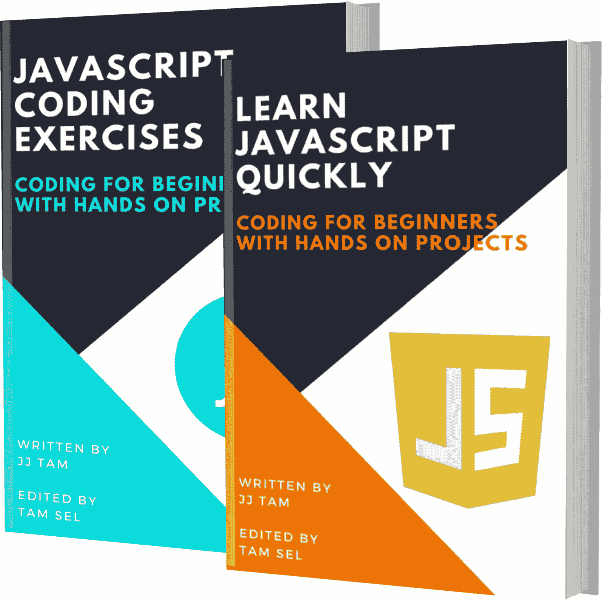

# 快速学习 JavaScript 与 JavaScript 编码练习：初学者编码指南





## 目录
Javascript 简介
- Javascript: 问候程序
- Javascript: 变量
- Javascript: 语句
- Javascript: 注释
- JavaScript: 类型
- Javascript: 运算符
- Javascript: 算术运算符
- Javascript: 增/减运算符：++, --
- Javascript: 位运算运算符
- JavaScript: 逻辑运算符
- JavaScript: 赋值运算符
- JavaScript: 复合赋值运算符
- Javascript: 三元运算符
- JavaScript: 处理布尔值
- JavaScript: 决策：if, if-then
- Javascript: if-else-if-else 阶链
- JavaScript: 使用 switch 语句进行决策
- JavaScript: 循环
- JavaScript: do-while 循环
- JavaScript: for 循环
- JavaScript: break 语句
- JavaScript: continue 语句
- JavaScript: 标签形式的 break
- JavaScript: for in 循环
- JavaScript: for-of 循环
- JavaScript: 获取变量类型
- JavaScript: 处理字符串
- JavaScript: 嵌套函数
- JavaScript: 数组
- JavaScript: 类初类
- JavaScript: 使用类表达式定义类

## JavaScript 编程练习](#part0029.xhtml)
- 显示当前的日期和时间
- 打印内容
- 显示当前日期
- 计算三角形面积
- 检查给定年份是否为闰年
- 计算乘法和除法
- 温度转换
- 寻找最大值
- 反转给定字符串
- 替换每个字符
- 首字母大写化
- 将数字转换为小时和分钟
- 统计给定字符串中的元音
- 创建一个新字符串
- 拼接两个字符串
- 移动最后三个字符
- 计算和
- 两个数字相加
- 检查给定年份是否为闰年
- 检查给定的正数
- 检查字符串是否以 'Java' 开头
- 检查两个给定的整数值
- 找到最  100 的值

## Javascript 简介
Javascript 是一种脚本语言，用于在提交数据到服务器之前验证 HTML 表单数据。如今，JavaScript 也用于服务器端开发（阅读 `node.js`）。

### 我可以用 Javascript 做什么？
a. 你可以进行客户端验证。
b. 你可以为静态 HTML 页面添加动态行为。
c. 在网页上显示动画。你可以使用 `AJAX` 更新页面的部分内容。
e. 使用 `node.js` 等框架开发服务器应用程序。

### JavaScript 是解释型语言
Javascript 是解释型语言，编写一次并附加到 HTML 页面。不需要进一步编译。

### JavaScript 和 Java 之间有关系吗？
JavaScript 和 Java 之间没有任何关系。

### 什么是 ECMAScript？
ECMAScript 是一个标准，JavaScript 是实现 ECMAScript 标准的语言。

### JavaScript 支持 Unicode 吗？
JavaScript 程序是用 Unicode 编写的。ECMAScript `5` 标准支持 Unicode `3`。

### JavaScript 对大小写敏感吗？
是的，JavaScript 是一种大小写敏感的语言。

### 必须使用 `;` 结束语句吗？
许多语言如 `Java`、`C`、`C++` 使用 `;` 作为语句终止符。在 JavaScript 中使用 `;` 是可选的，但我倾向于使用 `;` 以保持一致性。

### JavaScript 支持自动垃圾回收吗？
是的，JavaScript 支持自动垃圾回收，当 JavaScript 解释器发现无法访问的对象或变量时，它会释放分配给该变量或对象的内存。

### JavaScript 是一种面向对象的语言吗？
是的，JavaScript 是一种面向对象的语言，但它所提供的继承类型与 `Java` 和 `C++` 等语言提供的继承不同。JavaScript 支持原型继承。

### Javascript: 问候程序
`helloWorld.html`


```html
<!DOCTYPE html><html><head><title>Hello world</title></head><body><script type="text/javascript">document.write("Hello World");</script></body></html>
```


```javascript
document.write("Hello World");
```
上述语句指示浏览器写入 "Hello World"。JavaScript 嵌入在 `<script></script>` 标签之间。

## Javascript: 变量

变量 `Variable` 存储一个值。以下是变量的一些示例。

```javascript
var name = "Krishna"
var id=123
```
上述语句定义了两个变量 `name` 和 `id`。使用 `var` 关键字来定义变量。

### 命名限制
a. 变量名必须以字母、`_`（或 `$`）开头。
b. 变量名可以包含任何字符。
c. 变量名之间不允许有空格。
d. 不要使用 Javascript 关键字作为变量名。
e. 变量名大小敏感。`Name`、`NAme`、`name` 是三个不同的变量。

```html
<!DOCTYPE html><html><head><title>Variables</title></head><body><script type="text/javascript">var name = "Krishna" ;var id=123;document.write("name = " + name + "<br />");document.write("id = " + id);</script></body></html>
```
![image_rsrc3JZ.jpg]
Javascript 是大小敏感的，因此 `banana` 和 `BaNa` 是不同的。

## Javascript: 语句

语句是可执行的语句，Javascript 中的语句使用 `;` 结束。

```html
<!DOCTYPE html><html><head><title>Variables</title></head><body><script type="text/javascript">document.write("Hello World" + "<br />");document.write("");</script></body></html>
```
在上面的示例中，下面是语句。

```javascript
document.write("Hello World" + "<br />");
document.write("");
```
![image_rsrc3K.jpg]

注释用于记录源代码。在 JavaScript 中，注释使程序更具读性。假设你写了数千行程序但没有适当的文档，一段时间后，很难弄清楚写了什么。通过注释，你可以在编写程序时对代码进行说明。注释不会影响程序的执行。注释仅说明你的代码。

### Javascript 支持 2 类注释
a. 单行注释
b. 多行注释

#### 单行注释
单行注释以 `//` 开始。这是一个单行注释。

#### 多行注释
多行注释编码在 `/* ... */` 中。

```html
/* I am a multiline comment */
```
<!DOCTYPE html><html><head><title>Variables</title></head><body><script type="text/javascript">/*JavaScript is weakly typed*/var a = 10;document.write("Value of a is " + a + "<br />");a = "Hello World"; // Assigning stringdocument.write("Value of a is " + a + "<br />");a = true; // Assigning booleandocument.write("Value of a is " + a + "<br />");a = 10.0; // Assigning numberdocument.write("Value of a is " + a + "<br />");</script></body></html>
```

## JavaScript: 类型

类型用于表示数据的类型。主要有两类类型：
a. 原始类型：数字、字符串和布尔值被视为原始类型。除了这些之外，特殊值 `null` 和 `undefined` 也被视为原始类型。
b. 引用类型：对象和数组被视为引用类型。对象是键值值对的集合。数组是元素的集合。另一点需要注意的是，JavaScript 也将函数视为对象。

```html
<!DOCTYPE html><html><head><title>Data Types</title></head><body><script >var a = 10;var b = 10.0;var c = true;var d = "Hello World";var e = {name : "Hari krishna",city : "Bangalore"};var f = [2, 3, 5, 7];document.write("a = " + a + " Type of " + (typeof a) + "<br />");document.write("b = " + b + " Type of " + (typeof b) + "<br />");document.write("c = " + c + " Type of " + (typeof c) + "<br />");document.write("d = " + d + " Type of " + (typeof d) + "<br />");document.write("e = " + e + " Type of " + (typeof e) + "<br />");document.write("f = " + f + " Type of " + (typeof f) + "<br />");</script></body></html>
```
在浏览器中打开上述页面，你可以在 html 页面中看到以下消息：
- `a = 10` Type of number
- `b = 10.0` Type of number
- `c = true` Type of boolean
- `d = Hello World` Type of string
- `e = [object Object]` Type of object
- `f = 2,3,5,7` Type of

## Javascript: 运算符

运算符是用于操作的指令。Javascript 运算符提供以下操作：
a. 算术运算符
b. 递增减运算符
c. 位运算符
d. 逻辑运算符
e. 赋值运算符
f. 字符串拼接
g. 比较运算符
h. 三元运算符

### 算术运算符

下表总结了 Javascript 支持的算术运算符。

| 运算符 | 说明 |
| :--- | :--- |
| `+` | 加法（用于字符串拼接） |
| `-` | 减法 |
| `/` | 除法 |
| `*` | 乘法 |
| `%` | 取余 |

```html
<!DOCTYPE html><html><head><title>Arithmetic Operators</title></head><style>p { font-size : 2em ; color : seagreen ;}</style></head><body><p><script type="text/javascript" >var a = 23 ;var b = 3 ; document .write( "a = " + a + "<br />" );document .write( "b = " + b + "<br />" );document .write( "a+b = " + (a + b) + "<br />" );document .write( "a-b = " + (a - b) + "<br />" );document .write( "a/b = " + (a / b) + "<br />" );document .write( "a*b = " + (a * b) + "<br />" );document .write( "a%b = " + (a % b) + "<br />" );</script></p></body></html>
```
与 Java 不同，JavaScript 中的除法返回浮点数。

### 递增减运算符： ++, --

递增减运算符 `++` 运算符将值加 1。`--` 运算符将值减 1。

#### 前递增
语法：`++variable`。立即将变量加 1。

#### 后递增
语法：`variable++`。在执行语句后将变量加 1。

#### 前递减
语法：`--variable`。立即将变量减 1。

#### 后递减
语法：`variable--`。在执行语句后将变量减 1。

```html
<!DOCTYPE html><html><head><title> Increment & Decrement Operators </title></head><style>p { font-size : 2em ; color : seagreen ;}</style></head><body><p><script type="text/javascript" >var a = 23 ;var b = 3 ; document .write( "a = " + a + "<br />" );document .write( "a++ = " + (a ++ ) + "<br />" );document .write( "++a = " + ( ++ a) + "<br />" );document .write( "a-- = " + (a -- ) + "<br />" );document .write( "--a = " + ( -- a) + "<br />" );</script></p></body></html>
```

## Javascript: 位运算符

下表总结了 Javascript 支持的位运算符。

| 运算符 | 说明 |
| :--- | :--- |
| `~` | 取反位模式 |
| `<<` | 执行左移 |
| `>>` | 执行右移 |
| `>>>` | 执行无符号右移 |
| `&` | 按位与 |
| `\|` | 按位或 |
| `^` | 按位异或 |


在讨论位运算符之前，我们先来讨论数字的二进制表示法。

## 反码 (1's complement)
反码简单地反转所有位：如果位为 0，则将其设置为 1；如果位为 1，则将其设置为 0。
示例：
`8` 的二进制形式 = `0 0 0 0 1 0 0 0`
`1's complement(8)` = `1 1 1 1 0 1 1 1`

## 补码 (2's complement)
负数以补码的形式存储。例如，`-8` 是 `8` 的补码。
补码是（一个数字的反码` + `1`）之和。

示例：
`8` 的二进制形式 = `0 0 0 0 1 0 0 0`
`1's complement(8)` = `1 1 1 1 0 1 1 1`
`2's complement(8)` =
```
  1 1 1 1 0 1 1 1
(+)             1
-----------------
1 1 1 1 1 0 0 0
-----------------
```
`8` 的补码形式为 `11111000`

## 取反 (~)
取反运算符将位为 1 的值改为 0，将位为 0 的值改为 1。
示例：
`a = 7;`
`a` 的二进制格式为 `0 0 0 0 0 1 1 1`
`~(a)` 的二进制格式为 `1 1 1 1 1 0 0 0`
`~(a)` 在二进制格式中表示 `-8`。

## 位左移 (<<)
左移运算符将所有位向左移动一位，即：使数值翻倍。
语法：`variable << n`
将变量向左移动 `'n'` 次。
`Variable << n` 等于 `variable = variable * 2 power n`

```javascript
var1 = 2;
var1 << 1 = 2 * 2 power 1 = 4
var1 << 2 = 2 * 2 power 2 = 8
var1 << 9 = 2 * 2 power 9 = 1024
```

## 位右移 (>>)
右移运算符简单是将所有位向右移动一位，即：使数值减半（除以 2）。
语法：`variable >> n`
将变量向右移动 `'n'` 次。
`Variable >> n` 等于 `variable = variable / 2 power n`

```javascript
var1 = 128;
var1 >> 1 = 128 / (2 power 1) = 64
var1 >> 2 = 128 / (2 power 2) = 32
```

## 位无符号右移 (>>>)
将所有位向右移动一位，并将最左位设置为 0。
`-128` 的补码形式为 `11111111 11111111 11111111 10000000`
`>>>` 将位向右移并用 0 替换最左位
所以 `(-128>>>1)` 如下所示：
`01111111 11111111 11111111 11000000` = `2147483584`（十进制）

## 位与 (&), 位或 (|), 位异异 (^)

| 位 1 | 位 2 | & | | | |
| :--- | :--- | :--- | :--- |
| 0 | 0 | 0 | 0 |
| 0 | 1 | 0 | 1 |
| 1 | 0 | 0 | 1 |
| 1 | 1 | 1 | 1 |

当 `a = 8` 且 `b = 9` 时。
`a` = `0000 1000`
`b` = `0000 1001`
`a & b` = `0000 1000`（十进制 8）
`a | b` = `0000 1001`（十进制 9）
`a ^ b` = `0000 0001`（十进制 1）

```html
<!DOCTYPE html>
<html>
<head>
  <title> 位运算符</title>
  <style>
    p {
      font-size: 2em;
      color: green;
    }
  </style>
</head>
<body>
  <p>
    <script type="text/javascript">
      var a = 7;
      var b = 2;
      var c = 128;
      var d = -128;
      var e = 8;
      var f = 9;
      document.write("a = " + a + "<br />");
      document.write("~a = " + ~a + "<br />");
      document.write("b = " + b + "<br />");
      document.write("b << 1 = " + (b << 1) + "<br />");
      document.write("b << 2 = " + (b << 2) + "<br />");
      document.write("b << 9 = " + (b << 9) + "<br />");
      document.write("c = " + c + "<br />");
      document.write("c >> 1 = " + (c >> 1) + "<br />");
      document.write("c >> 2 = " + (c >> 2) + "<br />");
      document.write("d = " + d + "<br />");
      document.write("d >>> 1 = " + (d >>> 1) + "<br />");
      document.write("e = " + e + "<br />");
      document.write("f = " + f + "<br />");
      document.write("e & f = " + (e & f) + "<br />");
      document.write("e | f = " + (e | f) + "<br />");
      document.write("e ^ f = " + (e ^ f) + "<br />");
    </script>
  </p>
</body>
</html>
```

## JavaScript: 逻辑运算符
JavaScript 提供了三种逻辑运算符：`&&`、`||` 和 `!`。
逻辑与被称为短路与。
逻辑或被称为短路或。
`&&` 和 `||` 被称为短路运算符，原因如下：

### 与 运算符
| 操作数 1 | 操作数 2 | 结果 |
| :--- | :--- | :--- |
| true | true | true |
| true | false | false |
| false | true | false |
| false | false | false |
如果表达式中的第一个语句为假，JavaScript 将不会执行整个表达式。

### 或运算符
| 操作数 1 | 操作数 2 | 结果 |
| :--- | :--- | :--- |
| true | true | true |
| true | false | true |
| false | true | true |
| false | false | false |
如上表所示，如果任一操作数为真，`||` 运算符返回真，否则返回假。如果第一个语句为真，JavaScript 将不会执行整个表达式。

### 非 运算符
| 操作数 | 结果 |
| :--- | :--- |
| false | true |
| true | false |
如果操作数为假，`!` 将其变为真。如果操作数为真，`!` 将其变为假。

```html
<!DOCTYPE html>
<html>
<head>
  <title> 运算符</title>
  <style>
    p {
      font-size: 2em;
      color: green;
    }
  </style>
</head>
<body>
  <p>
    <script type="text/javascript">
      var a = true;
      var b = true;
      var c = false;
      var d = false;
      document.write("a = " + a + "<br />");
      document.write("b = " + b + "<br />");
      document.write("c = " + c + "<br />");
      document.write("d = " + d + "<br />");
      document.write("a && b = " + (a && b) + "<br />");
      document.write("a && c = " + (a && c) + "<br />");
      document.write("c && d = " + (c && d) + "<br /><br />");
      document.write("a || b = " + (a || b) + "<br />");
      document.write("a || c = " + (a || c) + "<br />");
      document.write("c || d = " + (c || d) + "<br />");
    </script>
  </p>
</body>
</html>
```

## JavaScript: 赋值运算符
赋值运算符用于给变量赋值。由于 JavaScript 是一种弱类型语言，你可以为变量分配任何类型的值。
语法：`var variableName = value;`

```html
<!DOCTYPE html>
<html>
<head>
  <title> 变量</title>
</head>
<body>
  <script type="text/javascript">
    var a = 10;
    document.write("a 的值为: " + a + "<br />");
    a = "Hello World"; // 赋值字符串
    document.write("a 的值为: " + a + "<br />");
    a = true; // 赋值布尔值
    document.write("a 的值为: " + a + "<br />");
    a = 10.09; // 赋值数字
    document.write("a 的值为: " + a + "<br />");
  </script>
</body>
</html>
```

## JavaScript: 复合赋值运算符
JavaScript 支持复合赋值。

### 复合赋值
语法：`variable operator= value`
示例：
假设
```javascript
var a = 10;
```
`a+=10` 等于 `a=a+10`

| 复合运算符 | 示例 | 描述 |
| :--- | :--- | :--- |
| += | a+=10 | a=a+10 |
| -= | a-=10 | a=a-10 |
| *= | a*=10 | a=a*10 |
| /= | a/=10 | a=a/10 |
| >>= | a>>=10 | a=a>>10 |
| <<= | a<<=10 | a=a<<10 |
| >>>= | a>>>=10 | a=a>>>10 |
| &= | a&=10 | a=a&10 |
| |= | a&#124;=10 | a=a&#124;10 |
| ^= | a^=10 | a=a¹⁰ |


# 复合运算符

## Javascript: 三元运算符
三元运算符 `(?: )` 根据条件返回两个表达式中的一个。

### 语法
```
test ? expression1 : expression2
```
如果 `test` 条件求值为真，则返回 `expression1`，否则返回 `expression2`。

### 示例
```javascript
var x = prompt("Enter an Integer", "100");
var y = (x > 10)? "x is greater than 10": "x is less than 11";
```
如果你输入的一个值 `> 10`，则 `y` 被赋值为消息 `"x is greater than 10"`；否则，`y` 被赋值为消息 `"x is less than 11"`。

```html
<!DOCTYPE html>
<html>
<head>
    <title> 三元运算符 </title>
</head>
<body>
    <script type= "text/javascript" >
        var x = prompt( "Enter an Integer" , "100" );
        var y = (x > 10 ) ? "x is greater than 10" : "x is less than 1" ;
        document .write( "value of x is " + x + "<br />" );
        document .write(y);
    </script>
</body>
</html>
```

## Javascript: 与布尔值操作
以下值被视为 `false`：
a. `undefined`
b. `Null`
c. `0`、`-0` 或 `NaN`

所有未提到的上述值都被视为 `true`。

```html
<!DOCTYPE html>
<html>
<head>
    <title> true and false </title>
</head>
<body>
    <script type= "text/javascript" >
        var x = "" ;
        var y = "h" ;
        var z = 0 ;
        if (x) {
            document .write( "x is true" + "<br />" );
        } else {
            document .write( "x is false" + "<br />" );
        }
        if (y) {
            document .write( "y is true" + "<br />" );
        } else {
            document .write( "y is false" + "<br />" );
        }
        if (z) {
            document .write( "z is true" + "<br />" );
        } else {
            document .write( "z is false" + "<br />" );
        }
    </script>
</body>
</html>
```

## Javascript: 决策：if, if-then

### if 语句
`if` 告诉程序当条件求值为真时执行部分代码。

### 语法
```javascript
if(condition){
    // 如果条件为真则执行
}
```

```html
<!DOCTYPE html>
<html>
<head>
    <title> if 语句 </title>
</head>
<body>
    <script type= "text/javascript" >
        var a = prompt( "Enter any Integer" , 100 );
        if (a % 2 == 0 ) {
            document .write( "You entered even number" );
        }
    </script>
</body>
</html>
```
在浏览器中打开上面的 html 文件，它会提示输入。如果你输入偶数，它会打印消息 `'You entered even number'`，否则什么都不打印。

### if-else 语句
如果条件为真，则执行 if 块代码；否则执行 else 块代码。

### 语法
```javascript
if(condition){}else{}
```

```html
<!DOCTYPE html>
<html>
<head>
    <title> if-else 语句 </title>
</head>
<body>
    <script type= "text/javascript" >
        var a = prompt( "Enter any Integer" , 100 );
        if (a % 2 == 0 ) {
            document .write( "You entered even number" );
        } else {
            document .write( "You odd number" );
        }
    </script>
</body>
</html>
```
在浏览器中打开上面的 html，它会提示输入。如果你输入偶数，它会打印消息 `'You entered number'`，否则它打印 `"You odd number"`。

### Javascript: if-else-if 阶梯
在我的之前的文章中，我解释了语句和 if-else 语句。除了这些之外，Javascript 提供了 if-else if 阶梯，用于选择解决方案。

### 语法
```javascript
if(condition){
    // 语句块
}else if(condition){
    // 语句块
}else{
    // 语句块
}
```

```html
<!DOCTYPE html>
<html>
<head>
    <title> if-else-else 语句 </title>
</head>
<body>
    <script type= "text/javascript" >
        var marks = prompt( "Enter marks" ,100 );
        if (marks < 35 ) {
            document .write( "You are failed" );
        } else if (marks < 50 ) {
            document .write( "You are passed and got third class" );
        } else if (marks < 60 ) {
            document .write( "You are passed and got second class" );
        } else if (marks < 70 ) {
            document .write( "You are passed and got first class" );
        } else {
            document .write( "You are passed and got distinction" );
        }
    </script>
</body>
</html>
```

## Javascript: 使用 switch 语句决策
switch 体被称为 switch 块。switch 块可以使用一个或多个 case 或 default 标签。switch 语句评估其表达式，然后执行匹配的 case。

### 语法
```javascript
switch(expression){
    case expression1:
        // 语句
        break;
    case expression2:
        // 语句
        break;
    default:
        // 语句
}
```

```html
<!DOCTYPE html>
<html>
<head>
    <title> switch 语句 </title>
</head>
<body>
    <script type= "text/javascript" >
        var day = parseInt (prompt( "Enter an integer between 1 and 7" , 6 ));
        switch (day) {
            case 1 :
                document .write( "Sunday" );
                break;
            case 2 :
                document .write( "Monday" );
                break;
            case 3 :
                document .write( "Tueday" );
                break;
            case 4 :
                document .write( "Wednesday" );
                break;
            case 5 :
                document .write( "ThursDay" );
                break;
            case 6 :
                document .write( "Friday" );
                break;
            case 7 :
                document .write( "Saturday" );
                break;
            default :
                document .write( "You entered day" );
        }
    </script>
</body>
</html>
```
在浏览器中打开上面的 html 页，它会提示输入。如果你输入 1，它打印 Sunday；如果你输入 2，它打印 Monday；如果你输入 3，它打印 Tueday；如果你输入 4，它打印 Wednesday；如果你输入 5，它打印 ThursDay；如果你输入 6，它打印 Friday；如果你输入 7，它打印 Saturday；对于其他输入，它打印 "You entered day"。

## Javascript: 循环
循环用于重复一段代码直到给定条件为真。JavaScript 支持以下循环结构：
a. `while`
b. `do…while`
c. `for`

### Javascript: while 循环
`while` 语句执行语句块直到表达式为真。

### 语法
```javascript
while (expression) {
    // 语句
}
```

```html
<!DOCTYPE html>
<html>
<head>
    <title> while 循环 </title>
</head>
<body>
    <script type= "text/javascript" >
        var number = parseInt (prompt( "Enter a number" , "10"));
        document .write( "<h2>Even numbers from 0 to " + number + " are </h2>" );
        var i = 0 ;
        while (i <= number) {
            document .write(i + "<br />" );
            i += 2 ;
        }
    </script>
</body>
</html>
```
在浏览器中打开上面的页面，它会提示输入，并打印从 0 到用户数字的所有偶数。

### Javascript: do-while 循环
`do-while` 也是像 `while` 的循环结构，但它在循环的底部评估表达式。

### 语法
```javascript
do {
    // 语句
} while (expression);
```
上面的语句执行语句块直到条件为真。

```html
<!DOCTYPE html>
<html>
<head>
    <title> do-while 循环 </title>
</head>
<body>
    <script type= "text/javascript" >
        var number = parseInt (prompt( "Enter a number" , "0"));
        document .write( "<h2>Even numbers from 0 to " + number + " are </h2>" );
        var i = 0 ;
        do {
            document .write(i + "<br />" );
            i += 2 ;
        } while (i <= number);
    </script>
</body>
</html>
```
在浏览器中打开上面的页面，它会提示输入，并打印从 0 到用户数字的所有偶数。

### Javascript: for 循环
`for` 语句提供了一种紧凑的方法范围的方法。

### 语法
```javascript
for(initialization; condition; update){
    // 要执行的语句
}
```
`for` 循环执行语句直到条件求值为假。
a. `Initialization` 部分在循环开始时执行一次。
b. `Condition` 部分在每次执行循环语句之前评估。
c. `update` 部分在循环执行完成后立即执行。

```html
<!DOCTYPE html>
<html>
<head>
    <title> for 循环 </title>
</head>
<body>
    <script type= "text/javascript" >
        var number = parseInt (prompt( "Enter a number" , "10" ));
        document .write( "<h2>Even numbers from 0 to " + number + " are </h2>" );
        for ( var i = 0 ; i <= number; i += 2 ) {
            document .write(i + "<br />" );
        }
    </script>
</body>
</html>
```
在浏览器中打开上面的页面，它会提示输入，并打印从 0 到用户数字的所有偶数。

### Javascript: break 语句
我们已经见过 `switch` case 中 `break` 的用法。同样，`break` 用于 `while`、`do-while` 和 `for` 循环以跳出循环。

```html
<!DOCTYPE html>
<html>
<head>
    <title> while 循环 </title>
</head>
<body>
    <script type= "text/javascript" >
        var number = parseInt (prompt( "Enter a number less than100" , "10"));
        document .write( "<h2>Even numbers from 0 to " + number + " are </h2>" );
        var i = 0 ;
        while (i <= number) {
            if (number >= 100 ) {
                document .write( "Input should be <100" );
                break ;
            }
            document .write(i + "<br />" );
            i += 2 ;
        }
    </script>
</body>
</html>
```
在浏览器中打开上面的页面，它会提示输入。如果你输入一个 `>=100` 的数字，它会打印 "Input should be <100" 并跳出循环；否则它打印从 0 到数字的所有偶数。

### Javascript: continue 语句
`continue` 语句跳过 `for`、`while`、`do-while` 循环的当前迭代。

```html
<!DOCTYPE html>
<html>
<head>
    <title> continue 语句 </title>
</head>
<body>
    <script type= "text/javascript" >
        var number = parseInt (prompt( "Enter a number lessthan10" , "0"));
        document .write( "<h2>Even numbers from 0 to " + number + " are </h2>" );
        var i = 0 ;
        while (i <= number) {
            if ((i % 4 ) == 0 ) {
                i += 2 ;
                continue ;
            }
            document .write(i + "<br />" );
            i += 2 ;
        }
    </script>
</body>
</html>
```
在浏览器中打开上面的页面，它会提示输入，并打印直到数字不被 4 整除的所有偶数。

## Javascript: label 中的 break
`label` 是由 `name` 标识的语句组。

### 语法
```javascript
labelName:{
    statement 1
    statement 2
    ....
    statement N
}
```
`break` 在标签形式也可用。

### 语法
```javascript
break labelName;
```

```html
<!DOCTYPE html>
<html>
<head>
    <title> break label 示例 </title>
</head>
<body>
    <script type= "text/javascript" >
        outer :
        for ( var i = 0 ; i < 10 ; i ) {
            inner : for ( var j = 0 ; j < 10 ; j ) {
                document .write(i + "," + j + "<br />" );
                if (i * j > 10 )
                    break outer;
            }
        }
    </script>
</body>
</html>
```

## Javascript: for in 循环
`for in` 循环用于获取对象的可枚举属性。

```html
<!DOCTYPE html>
<html>
<head>
    <title> for in loop 示例 </title>
</head>
<body>
    <script>
        var employee = {
            firstName : "Hari Krishna" ,
            lastName : "Gurram" ,
            age : 26 ,
            getDetails : function () {
                return "[firstName = " + firstName + ", lastName = " + lastName + "]";
            }
        }
        for (property in employee) {
            document .write(property + " : " + employee[property] + "<br />" );
        }
    </script>
</body>
</html>
```
在浏览器中打开上面的页面，你可以看到以下文本。观察输出，`for in` 循环没有显示 `toString` 等内置属性，因为内置方法不是枚举的。由于数组也是 JavaScript 中的一种特殊对象，你可以使用 `for in` 遍历数组。

```html
<!DOCTYPE html>
<html>
<head>
    <title> for in 循环 </title>
</head>
<body>
    <script>
        var arr = [ "Hari Krishna" , "Gurram" , 26 ];
        for (index in arr) {
            document .write(index + " : " + arr[index] + "<br />" );
        }
    </script>
</body>
</html>
```
在浏览器中打开上面的页面，你可以看到：0 : Hari Krishna
1 : Gurram
2 : 26

### Javascript: for-of 循环
`for-of` 循环用于迭代可迭代对象，如 `String`、`Array`、`TypedArray` 和 `Set`。

```javascript
var arr = [ 2 , 3 , 5 , 7 ,1 , 3 ];
for ( var i of arr) {
    console.log(i);
}
```
输出: 2357113

### Javascript: 获取变量类型
Javascript 提供了 `typeof` 运算符来获取变量类型。

### 语法
```javascript
typeof variable
```

```html
<!DOCTYPE html>
<html>
<head>
    <title> 变量类型 </title>
</head>
<body>
    <script type= "text/javascript" >
        var a = 10 ;
        var b = 10 ;
        var c = true ;
        var d = "Hello" ;
        var e = new String ( "Hello" );
        document .write( "a = " + a + ", type = " + typeof (a) + "<br />" );
        document .write( "b = " + b + ", type = " + typeof (b) + "<br />" );
        document .write( "c = " + c + ", type = " + typeof (c) + "<br />" );
        document .write( "d = " + d + ", type = " + typeof (d) + "<br />" );
        document .write( "e = " + e + ", type = " + typeof (e) + "<br />" );
    </script>
</body>
</html>
```

## Javascript: 字符串操作
字符串是字符的集合。与其他语言不同，JavaScript 没有任何数据类型来表示字符。

### 如何定义字符串？
使用单引号或双引号包裹字符。
```javascript
var str1 = "Hello";
var str2 = 'World';
```
也可以通过 `String` 对象创建字符串。
```javascript
var str3 = new String("Hello");
```

```html
<!DOCTYPE html>
<html>
<head>
    <title> 字符串 </title>
</head>
<body>
    <script type= "text/javascript" >
        var str1 = "Good Morning" ;
        var str2 = 'Good Afternoon' ;
        var str3 = new String ( "Good Night" );
        document .write(str1 + "<br />");
        document .write(str2 + "<br />");
        document .write(str3 + "<br />");
    </script>
</body>
</html>
```

## Javascript: 嵌套函数
你可以在函数内部定义函数。嵌套函数可以访问外部函数中定义的变量。

```html
<!DOCTYPE html>
<html>
<head>
    <title> 嵌套函数 </title>
</head>
<body>
    <script type= "text/javascript" >
        function descriminator(a, b, c) {
            return (square(b) - 4 * c) / twice(a);
        }
        function square(x) {
            return (x * x);
        }
        function twice(x) {
            return 2 * x;
        }
        document .write( "Discriminator of 5, 10, 3 is : + descriminator(5, 10, 3));
    </script>
</body>
</html>
```
变量作用域：嵌套函数可以访问父函数中定义的变量以及父函数有权访问的变量。

## Javascript: 数组
数组是元素的有序集合。

### 语法
```javascript
var array = [elem1, elem2 ....N];
var array = new Array(size)
```

### 如何访问数组元素？
通过索引表示法访问数组元素。索引从 0 开始。

### 语法
```javascript
array[index]
arr[0] : 返回第一个元素
arr[1] : 返回第二个元素
…..arr[n] : 返回 n-1 个元素
```

```html
<!DOCTYPE html>
<html>
<head>
    <title> 数组 </title>
</head>
<body>
    <script type= "text/javascript" >
        var arr = [ 2 , "Hello" ,123.5 , true ];
        document .write( "arr[0] : " + arr[0] + "<br />" );
        document .write( "arr[1] : " + arr[1] + "<br />" );
        document .write( "arr[2] : " + arr[2] + "<br />" );
         . .write( "arr[3] : " + arr[3] + "<br />" );
        document .write( "arr[4] : " + arr[4] + "<br />" );
        document .write( typeof arr);
    </script>
</body>
</html>
```
在浏览器中打开上面的页面，你可以看到以下数据：
0 : 2
1 : Hello
2 : 123.5
3 : true
4 : undefined

### 数组中的最大索引是多少？
JavaScript 数组使用 32 位的索引。因此最大的数组索引是 `((2³²)-2) = 4294967294`（因为数组是零索引的）。

## Javascript: 类介绍
类被用于创建对象。让我尝试用一个例子来解释。

```javascript
class Employee {
    constructor(id, firstName, lastName){
        this.id = id;
        this.firstName = firstName;
        this.lastName = lastName;
    }
}
```
如你所看到的代码片段，我定义了一个 `Employee` 类，它有 3 个属性 `id`、`firstName` 和 `lastName`。
a. `class` 关键字用于创建类。
b. `constructor` 函数用于初始化属性。
你可以使用 `new` 运算符结合 `constructor` 函数来创建对象。

```javascript
class Employee {
    constructor(id, firstName, lastName){
        this.id = id;
        this.firstName = firstName;
        this.lastName = lastName;
    }
}
var emp1 = new Employee(1, "John", "Doe");
```

```html
<!DOCTYPE html>
<html>
<head>
    <title> 类的介绍 </title>
</head>
<body>
    <script type= "text/javascript" >
        class Employee {
            constructor(id, firstName, lastName){
                this.id = id;
                this.firstName = firstName;
                this.lastName = lastName;
            }
        }
        function print_employee_info(emp){
            console.log("id : " + emp.id);
            console.log("firstName : " + emp.firstName);
            console.log("lastName : " + emp.lastName);
        }
        var emp1 = new Employee(1, "John", "Doe");
        print_employee_info(emp1);
    </script>
</body>
</html>
```

## Javascript: 使用表达式定义类
你可以使用表达式来定义类。

```javascript
var MyEmployee = class {
    constructor(id, firstName, lastName){
        this.id = id;
        this.firstName = firstName;
        this.lastName = lastName;
    }
};
```

## Javascript 编码练习

### 显示当前日期和时间
```html
<!DOCTYPE html>
<html>
<head>
    <meta charset="utf-8">
    <title>JavaScript 当前日期和时间</title>
</head>
<body></body>
</html>
```
```javascript
var today = new Date();
var day = today.getDay();
var daylist = ["Sunday","Monday","Tuesday","Wednesday","Thursday","Friday","Saturday"];
var hour = today.getHours();
var minute = today.getMinutes();
var second = today.getSeconds();
var prepand = (hour >= 12)? " PM ":" AM ";
hour = (hour >= 12)? hour - 12: hour;
console.log("Today is : " + daylist[day] + ".");
console.log("Current Time : "+hour + prepand + " : + minute + " " + second);
```

### 查找三角形面积
```html
<!DOCTYPE html>
<html>
<head>
    <meta charset="utf-8">
    <title>三角形的面积</title>
</head>
<body></body>
</html>
```
```javascript
var side1 = 5;
var side2 = 6;
var side3 = 7;
var s = (side1 + side2 + side3)/2;
var area = Math.sqrt((s-side1)*(s-side2)*(s-side3));
console.log(area);
```

### 检查给定年份是否为闰年
```html
<!DOCTYPE html>
<html>
<head>
    <meta charset="utf-8">
    <title>闰年</title>
</head>
<body></body>
</html>
```
```javascript
function leapyear(year){
    return (year % 100 === 0) ? (year % 400 === 0) : (year % 4 === 0);
}
console.log(leapyear(2016));
console.log(leapyear(2000));
console.log(leapyear(1700));
console.log(leapyear(1800));
```
Output: true true false false

### 计算两个数字的乘法和除法
```html
<!DOCTYPE html>
<html>
<head>
    <meta charset="utf-8">
    <title>两个数字的乘法和除法</title>
</head>
<body>
    <form>
        1st Number : <input type="text" id="firstNumber" /><br>
        2nd Number: <input type="text" id="secondNumber" /><br>
        <input onClick="multiplyBy()" Value="Multiply" />
        <input onClick="divideBy()" Value="Divide" />
    </form>
    <p>The Result is : <br><span id="result"></span></p>
</body>
</html>
```
```javascript
function multiplyBy(){
    var num1 = document.getElementById("firstNumber").value;
    var num2 = document.getElementById("secondNumber").value;
    document.getElementById("result").innerHTML = num1 * num2;
}
function divideBy(){
    var num1 = document.getElementById("firstNumber").value;
    var num2 = document.getElementById("secondNumber").value;
    document.getElementById("result").innerHTML = num1 / num2;
}
```

### 将温度从摄氏转换为华氏
```html
<!DOCTYPE html>
<html>
<head>
    <meta charset="utf-8">
    <title>温度从摄氏转换为华氏</title>
</head>
<body></body>
</html>
```
```javascript
function cToF(celsius){
    var cTemp = celsius;
    var cToF = cTemp * 9 / 5 + 32;
    var message = cTemp+'C is ' + cToF + '°F.';
    console.log(message);
}
function fToC(fahrenheit){
    var fTemp = fahrenheit;
    var fToCel = (fTemp - 32) * 5 / 9;
    var message = fTemp+'F is ' + fToCel + '°C.';
    console.log(message);
}
cToF(60);
fToC(45);
```
Output: 60°C is 140°F.,45°F is 22.2222222222°C.

