# JavaScript 可视化学习：运用科学与创造力的加速学习法，为右脑型非程序员设计

平装书号: 978-1495233005

联系方式: jsvisually.com

## 为什么选择JavaScript？

JavaScript是一种动态计算机编程语言，它允许我们通过脚本在客户端执行许多动态操作。因为它易于学习且功能强大，所以广受欢迎。JavaScript用于验证表单、制作游戏以及在浏览网站的计算机上执行更多功能。它被广泛用作脚本，尽管它具备面向对象的能力。另一个优点是它也可用于服务器端，这增强了它作为网站伴侣的功能。JavaScript具有动态类型和一等函数，这有助于它不仅支持面向对象编程，还支持命令式和函数式编程风格。JavaScript也用于网络之外的领域，如PDF文档、桌面小部件等。这意味着无论你是想创建交互式网站、为现有网站添加功能，甚至是为你的Web服务器编写一些脚本，这门语言都能帮助你实现目标。

由于JavaScript只是文本，它不需要编译——你可以使用任何你选择的文本编辑器来编写或修改它。这使其易于使用。还有许多可用的工具供你调试、查看甚至在浏览网站时从Web浏览器中编辑JavaScript代码。

如果你熟悉Web开发，你可能听说过jQuery、Dojo等。它们用于扩展JavaScript，增强其潜力和实用性。它们是可供你使用的代码库，可以简化一些更复杂的常用代码。毕竟，JavaScript非常强大且快速，但从头开始编写所有内容可能会非常繁琐。

### 我应该把JavaScript放在哪里？

既然JavaScript用于网站，你可能认为可以将其放在网站代码中的任何位置。嗯，不完全是。

你可以将其添加在`<head></head>`标签之间，也可以添加在`<body></body>`标签内。

必须记住，任何JavaScript代码都必须包含在`<script></script>`标签中，这一点非常重要。

此外，你也可以添加位于服务器、客户端甚至网络上任何其他位置的脚本，只要提供清晰的路径即可。这些被称为外部脚本。当你需要在不同网站上重用相同的脚本时，它们非常方便。

你只需将它们放置在其他网站可以访问和链接的位置即可。

以下代码展示了放置JavaScript代码的位置示例，以及如何同时使用内部和外部代码。

请记住，它们必须在脚本标签的范围内才能正常工作。每次访问该网站时，代码都会创建一个弹出窗口。这对于在其他任何内容之前向用户提供重要信息非常有用。

```html
1. <!DOCTYPE html>
2. <html>
3.    <head>
4.      <title>我的标题</title>
5. <script type="text/javascript"> alert("我最好坐低一点。");</script>  <!--嵌入脚本-->
6. </head>
7. <body>
8.    <h1>我应该把JavaScript放在哪里？</h1>
9.    <!--第5行和第10行创建了一个带有消息的弹出窗口-->
10.   <script src = "main.js"></script><!--外部脚本-->
11. </body>
12. </html>
```

```javascript
1. alert("我从外部文件弹出！")
```

## 练习：1

### 我应该把JavaScript放在哪里？

问题：编写一个简单的HTML文件，并将其与一个*javascript.js*文件链接起来。

你的代码：在此处编写你的代码，并与下面的答案进行比较

答案：[jsvisually.com/1.html](http://jsvisually.com/1.html)

## 我如何练习JavaScript？

到目前为止，JavaScript对你来说听起来很有趣，对吧？那么你可能想知道如何开始，或者可以使用什么程序来开始交互式地使用JavaScript。正如我们之前提到的，有许多可用的工具，但JavaScript如今如此流行，以至于大多数常见Web浏览器都有自己的JavaScript调试工具，你可以使用。只需查找浏览器的*开发者工具*并打开JavaScript控制台，你就可以直接从浏览器测试小段代码，而无需安装任何新东西。如果你想要更多控制权，那么可以安装Firebug扩展。

如果你想在本地处理代码，那么可以使用专门的文本编辑器，如Notepad++或Sublime Text，它们除了纯文本外还支持许多脚本和编程语言。这意味着你不仅可以编辑JavaScript，还可以编辑网站本身的HTML（如果你有权访问的话）。我提到的这两个程序都是免费提供的，并且是多平台的。

```javascript
>>2+2
4
>>a=3
3
>>a*2-a/3
5
```

在控制台中输入2+2并按回车键

安装Firebug扩展以获得更多控制权

点击红色箭头打开/关闭代码面板

## 练习：2 练习JavaScript。

问题：打开浏览器的控制台并计算下面直角三角形的面积

答案：jsvisually.com/2.html

## 解释器/编译器。

# 我是私有JS。

我将从上到下、从左到右读取、解释/编译并执行你的命令。

# 我将运行`<script>`标签之间的所有内容

```html
1. <script>
2.   alert("这一行先执行");
3.   //忽略这一行。这是注释
4.   alert("这一行后执行");
5. </script>
```

解释器或编译器是解释、编译和执行代码的软件。JavaScript可以被解释或编译。大多数现代浏览器在执行前都会编译代码。

## 练习：3

解释器/编译器。

问题：修改代码以将执行顺序更改为以下顺序：

- *首先*

- *其次*

- *最后*

```
alert("execute this first");
alert("execute this second");
alert("execute this third");
```

答案：[jsvisually.com/3.html](http://jsvisually.com/3.html)

## 分号。

分号用于分隔语句。与其他编程语言不同，它们在 JavaScript 中是可选的。

在你的代码中始终使用它们是一种良好的实践。

缺少分号可能不会导致错误，但你的代码可能无法按预期运行。

当你的语句位于一行时，第一个分号是必需的。

当你的语句由换行符分隔时，分号是可选的，因为换行符起到了分隔作用。

然而，有些情况下你可以将一条语句分成多行，它会像第 8 行的例子一样工作，而其他情况则会引起问题，就像第 13 行代码中的情况。

你还应该避免在闭合花括号后放置分号，但有一个例外——当你进行赋值语句时。`var obj = {};`

```
// 在 } 之后没有分号。
if (...) {...} else {...}
for (...) {...}
while (...) {...}
```

```
// 但是：
do {...} while (...);

// 函数语句：
function (arg) { /*do this*/ } // 在 } 之后没有分号。
```

你可以在 `if`、`for`、`while` 或 `switch` 语句的圆括号后放置分号。否则，JavaScript 会将其视为空语句，而不是循环或条件的一部分。

```
if (0 === 1); { alert("hi") }

// 等同于：

if (0 === 1) /*do nothing*/;
alert("hi");
```

## 练习：4

分号。

问题：添加缺少的分号。

```
x = 2;
y = 3;
z = x + y;
```

答案：[jsvisually.com/4.html](http://jsvisually.com/4.html)

## 方括号、花括号、圆括号。

方括号、花括号和圆括号是始终成对出现的分组符号。方括号用于容纳数组，花括号用于创建对象或分组语句，而圆括号则用于提供参数、分组表达式和执行函数。

虽然你可以使用方括号或花括号来创建数组，但它们各有特点，默认情况下方括号 `[]` 是标准。

你可以创建数字数组、字符串数组，甚至是空数组。

```
// 数字数组
var numArray = [1, 2, 3, 4, 5, 6, 7, 8, 9];
// 字符串数组
var stringArray = ["John", "Paul"];
// 空数组
var emptyArray = [];
```

花括号最常用于分组元素和创建对象：

```
// 创建新对象
var myObj = {};
// 分组语句
var a = function(){
  alert("Statement 1");
  alert("Statement 2");
};
```

圆括号用于为函数提供参数，正如你可以在上面的例子中看到的 `alert()` 函数。它们用于分组表达式，并在单行中进行复杂数学运算时给出正确的顺序：

```
var a = (3 + 2) * 7; // a= 35
```

在更复杂的代码中，看到所有三种括号在同一个函数中使用是非常常见的。需要记住的一点是，一旦你打开了其中任何一种括号，就必须在某个时候关闭它，并且要符合程序的作用域，以避免错误。

对于初学者来说，在编写大量代码时，这是最常见也最难发现的问题之一，不仅在 JavaScript 中，在许多其他编程语言中也是如此。

**方括号：**

容纳数组

```
// 数字数组
var num = [1, 2, 3, 4, 5, 6, 7, 8];
// 名字数组
var names = ["John", "Paul"];
// 空数组
var myArray = [];
```

**花括号：**

创建对象

分组语句

```
// 创建新对象
var myObj = {};
// 分组语句
var a = function () {
  alert("statement 1");
  alert("statement 2");
};
```

**圆括号：**

提供参数

分组表达式

执行函数

```
// 提供参数 x 和 y
function myParents(x, y) {
  return x + y;
}
```

```
// 分组表达式以控制执行顺序
var a = (3 + 2) * 7;      //a = 35
// 执行函数
myParents(2, 3);      //5
```

## 练习 5

方括号、花括号、圆括号。

问题：将方括号更改为花括号以解决代码错误。

暂时不要担心其含义，只需识别方括号并学会输入和测试代码。

```
var a = function () {
    alert("statement 1");
    alert("statement 2");
};
a();
```

答案：[jsvisually.com/5.html](jsvisually.com/5.html)

## 注释。

解释器将忽略 `//` 符号后的一行内容。

```html
<html>
  <head>
    <title>Single Comments</title>
  </head>
  <body>
    <script>
      //one comment per line
    </script>
  </body>
</html>
```

解释器将忽略 `/*` 和 `*/` 之间的任何内容。

```html
<html>
  <head>
    <title>Multiline Comments</title>
  </head>
  <body>
    <script>
      /* Long multiline comments
        are useful for "disabling" some
        part of your code
      var = 123;
      console.log("comments");
      */
      /* but are good for single line too */
    </script>
  </body>
</html>
```

解释器会忽略注释，但它们非常有用，因为它们为我们和其他编码者留下了信息。解释器将忽略 `//` 符号后的一行内容。解释器也会忽略 `/*` 和 `*/` 之间的任何内容。

JavaScript 注释除了用于解释代码并使其更具可读性之外，另一个用途是在测试替代代码时阻止代码执行。

你可以将单行代码放在代码上方或行尾以留下你的解释。

```
// 更改段落：
document.getElementById("myP").innerHTML = "My first paragraph.";

var x = 5; // 声明 x，并将其值设为 5
```

单行注释的使用最为常见，然而，出于正式文档目的，块注释是标准。

```
/*
下面的代码将更改
id = "myHeader" 的标题
和 id = "myParagraph" 的段落
在我的网页中：
*/
document.getElementById("myH").innerHTML = "My First Page";
document.getElementById("myP").innerHTML = "My first paragraph.";
```

在进行代码测试时，单行注释和块注释都可以通过使用适当的方法将其转换为注释来阻止代码执行。

阻止单行代码：

```
// document.getElementById("myH").innerHTML = "My First Page";
```

阻止多行代码执行：

```javascript
/*
document.getElementById("myH").innerHTML = "My First Page";
document.getElementById("myP").innerHTML = "My first paragraph.";
*/
```

## 练习：6

注释。

**问题：** 注释掉以下代码以使其不被执行。

```javascript
var myObj = {};
var a = function () {
    alert("statement 1");
    alert("statement 2");
};
```

**答案：** [jsvisually.com/6.html](http://jsvisually.com/6.html)

## 数据类型。

### 基本类型

- 数字

```javascript
age = 26;           //number
weight = 156.7;    //floating point
```

- 字符串

```javascript
firstName = "Mark";       //double quote
famillyName = 'Twain';    //single quote
```

- 布尔值

```javascript
z = true;
y = false;
```

### 特殊数据类型

- null

```javascript
age = null;    //was 26 before. null is an object
```

- undefined

```javascript
address;           //no value
a = function(){};  //no return statement
```

### 对象类型

- 对象

```javascript
employee = {name:"Joe", age:21, id:99};
function x() {};
```

- 数组

```javascript
name = ["Joe", "Mike", "Freddy"];
```

数据类型是程序中所操作值的种类。JavaScript 变量可以保存许多不同的数据类型，例如数字、字符串、数组、对象等，你将在学习过程中发现更多。

```javascript
var age = 26;                  // Number
var lastName = "Rodriguez";    // String
var cars = ["Saab", "Volvo", "BMW"];    // Array
var x = {firstName:"John", lastName:"Doe"}; // Object
```

不仅在 JavaScript 中，在任何编程语言中，数据类型都非常重要，因为当你使用变量时，你需要声明它们或能够识别它们，你不能将数字加到字符串上。因此，你使用相同的数据类型来操作变量。你可以将一种数据类型转换为另一种。

JavaScript 从左到右计算表达式。所以，虽然 JavaScript 使用第二个表达式来确定要使用的数据类型，但如果你有多个连续的操作，结果就会不同。

```javascript
var x = 16 + "Blue";
```

JavaScript 会将上述代码解读为：

```javascript
var x = "16" + "Blue"; //因此你会得到 x = 16Blue。
var x = 16 + 4 + "Blue"; //你会得到 20Blue。
var x = "Blue" + 16 + 4; //你会得到 Blue164。
```

JavaScript 还具有**动态类型**。这意味着同一个变量可以被用作多种类型，如下所示。

```javascript
var x; // x 是 undefined。
var x = 5; // 现在 x 是一个数字。
var x = "John"; // 现在 x 是一个字符串。
```

## 练习：7 数据类型。

**问题：** 将以下信息赋值给字母表中的不同字母：

你的名字、

你的年龄、

你喜欢啤酒

为每个赋值添加一个注释，标明其数据类型。

**答案：** [jsvisually.com/7.html](http://jsvisually.com/7.html)

## 变量。


名为 "box" 的空（未定义）变量

null 就像真空。它是一个对象，它存在，但它是空无一物的。

```javascript
//这个变量被声明了一个名字但
//值是 undefined
var box;
//null 是一个对象
var box2 = null;
```


box 现在具有数字值 26

box2 和 box3 指向内存中相同的值 24

```javascript
//我们的变量有了新值
//'box' 现在被初始化为数字 26，
//'box2' 不再是 null
var box = 26;
var box2 = 24;
//通过逗号分隔将相同的值赋给两个不同的
//变量
var box2 = 24,
    box3 = 24;
```

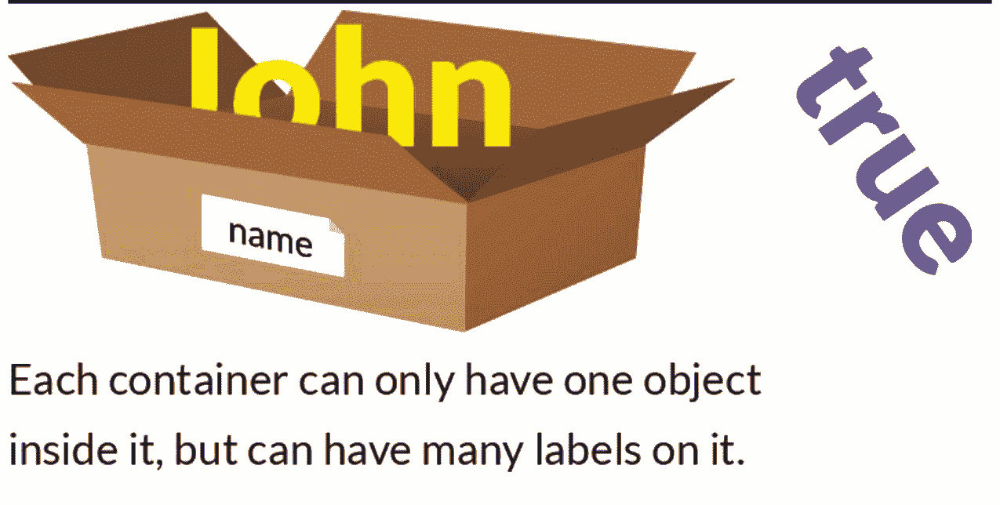

每个容器内部只能放一个对象，但可以有很多标签。

```javascript
var name = true;
//最后赋的值会替换之前的值
var name = "John";
//显示变量 'name' 的值
console.log(name);
//John
```

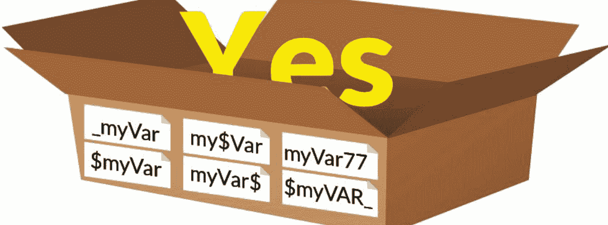

变量名（标签）区分大小写，并且只能以字母（A-Z, a-z）、下划线（ _ ）或美元符号（$）开头。

```javascript
//有效的变量名：
var _myVar = "Yes";
var $myVar = "Yes";
var my$Var = "Yes";
var myVar$ = "Yes";
var myVar77 = "Yes";
var $myVAR_ = "Yes";
```

变量就像识别装有信息的容器的标签，正如其名称所暗示的，它们能够变化。变量用于存储信息，并通过给它们一个名字来方便地引用它们。赋予变量的名字将保持不变，但你总是可以改变它所包含的值或信息。这意味着你可以有一个名为 "price" 的变量用于存储商品的当前价格；你可以给它赋一个 "null" 值，这将创建一个空变量，或者赋任何数字值。

使用描述性名称作为变量名总是一个好习惯，以便轻松理解它们在程序中的用途。这对你或任何其他阅读你代码的人都很有用。使用有效的变量名也非常重要。

- 变量名不应包含在引号中。

- 变量不能是数字或以数字开头。

- 变量不能是任何 JavaScript 保留关键字。然而，变量名中可以包含关键字。

- 变量名区分大小写，因此在命名时应牢记这一点。

- 变量只能包含字母、数字、下划线和美元符号。

当使用数字而不是字符串时，你可以对它们进行数学运算，因为对于 JavaScript 来说它们就是数字。

```javascript
var age = 26;
var currentYear = 2015;
```

这里你可以用第三个变量以如下方式计算出生年份：

```javascript
var birthYear = currentYear – age;
```

这等同于说 birthYear = 2015 – 26。这就是 JavaScript 如何处理最初只包含变量的表达式。

类似地，你可以让一个变量计算或改变它自己的值。

```javascript
var originalNumber = 20;
var newNumber = originalNumber + 3;
```

## 练习：8 变量。

**问题：** John 是一个 25 岁的来自英国的男性。

将我们已知的所有关于他的信息赋值给不同的变量，以便我们稍后使用。

**答案：** [jsvisually.com/8.html](http://jsvisually.com/8.html)

### 声明与初始化。

最简单的记忆方法是将计算机内存想象成盒子，其中声明是你分配给盒子的标签，而初始化是你放入盒子的值。

你可以将计算机内存想象成一个盒子数组。

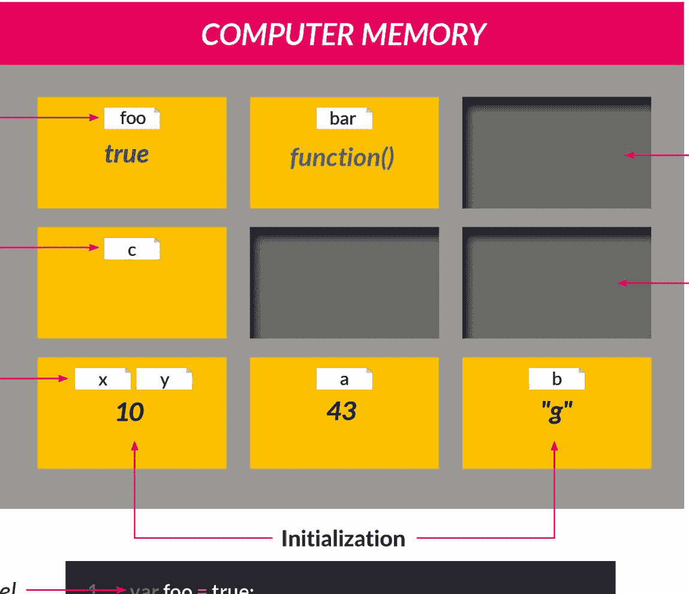

```javascript
var foo = true;
var bar = function () { return 8; };

//'c' 已声明但未初始化
var c;               //undefined

//x 和 y 指向（引用）内存中相同的值 (10)
var x = 10, y = 10;  //注意逗号
var a = 43;
var b = "g";
```

声明是在内存中预留空间。它可以是一个或多个变量和对象。初始化它们也很常见，至少变量是这样。初始化意味着赋予一个初始值，这个值以后可以被改变，也可以保持不变。

当你声明一个变量而不初始化它时，数据类型在你使用该变量之前将无法识别。

```javascript
var x;    //它没有被初始化，因此其数据类型是 undefined。
```

大多数时候，你会看到变量被声明和初始化。只有在更复杂和专业的代码中，优化至关重要且内存非常有限时，你才会看到变量被声明但未初始化以预留空间。

## 练习：9

### 声明与初始化。

**问题：** 声明 5 个不同的变量：a、b、c、d 和 e。

为每个变量赋予不同类型的值。

让一个变量保持未定义状态。

**答案：** [jsvisually.com/9.html](http://jsvisually.com/9.html)

### 一元运算符。

需要*单一*操作数的运算符。

**a++, a--** 取值然后加/减1

**++a, --a** 加/减1然后取值

**!a** **a**的逻辑非

**+a, -a** **a**的正/负值

一元运算符需要一个操作数。它们很容易识别，因为格式与操作数和运算符相同。

操作数：是要进行操作的对象——基本上就是变量。

运算符：是将要对操作数执行的操作。

最常见的一元运算符是：a++, a--; 它们先取值，然后加/减1，再将结果赋回变量。类似于 a = a + 1; 或 a = a - 1;

* ++a, --a; 它们先加/减1，然后取值。

* !a; 取a的逻辑非。

* +a, -a; 取值的正/负。

++ 也称为自增运算符，而 -- 称为自减运算符。

一元运算符的一个混淆点是后置（a++）和前置（++a）自增或自减运算符。下面的代码将帮助你理解它们的区别，这在循环中至关重要，但在循环外则不太明显。

```
1. var a = 4;
2. var b = a++; //首先 b 是 4，然后它会被改为 5。JavaScript 从左到右执行。
3. //现在 a 的值是 5。
4. var c = ++a; //首先 a 会变成 6，然后 c 被赋值为 6
```

## 练习：10

### 一元运算符。

问题：使用一个一元运算符，将变量 'a' 的值增加1。

输出："The value of 'a' is: 11"

答案：[jsvisually.com/10.html](http://jsvisually.com/10.html)

## 二元运算符。

## +, -, *, /, % 算术运算符

## =, *=, /=, %=, +=, -=, <<=, >>=, >>>=, &=, ^=, |= 赋值运算符

## &, |, ^, ~, <<, >>, >>> 位运算符

## ==, !=, ===, !==, >, >=, <, <= 比较运算符

## &&, ||, ! 逻辑运算符

二元运算是所有 JavaScript 运算符中最常见、最丰富的。你可能不熟悉所有这些符号，因此为了方便起见，下面将简要解释一些最常用的符号。

假设 A 的值为 10，B 的值为 20。

## 1. 算术运算符

* 运算符：将两个操作数相乘。A * B 将得到 200。

/ 运算符：用分子除以分母。B / A 将得到 2。

% 运算符：取模运算符，返回整数除法后的余数。B % A 将得到 0。

加法运算符（+）：将两个操作数相加。A + B 将得到 30。

减法运算符（-）：从第一个操作数中减去第二个操作数。A - B 将得到 -10。

## 2. 赋值运算符

= 运算符：简单赨值运算符；将右侧操作数的值赋给左侧操作数。C = A + B 将把 A + B 的值赋给 C。

*= 运算符：乘法并赋值运算符；它将右侧操作数与左侧操作数相乘，并将结果赋给左侧操作数。C *= A 等同于 C = C * A。

/= 运算符：除法并赋值运算符；它用左侧操作数除以右侧操作数，并将结果赋给左侧操作数。C /= A 等同于 C = C / A。

%= 运算符：取模并赋值运算符；它使用两个操作数进行取模运算，并将结果赋给左侧操作数。C %= A 等同于 C = C % A。

+= 运算符：加法并赋值运算符；它将右侧操作数加到左侧操作数上，并将结果赋给左侧操作数。C += A 等同于 C = C + A。

-= 运算符：减法并赋值运算符；它从左侧操作数中减去右侧操作数，并将结果赋给左侧操作数。C -= A 等同于 C = C - A。

## 3. 位移运算符

左移运算符（<<）：将第一个操作数中的所有位向左移动第二个操作数指定的位数。新位用零填充。将值左移一位相当于乘以2，左移两位相当于乘以4，依此类推。(A << 1) 是 20。

有符号右移运算符（>>）：将第一个操作数中的所有位向右移动第二个操作数指定的位数。左侧填入的位取决于原始操作数的符号位，以保留结果的符号。如果第一个操作数为正，则高位填入零；如果第一个操作数为负，则高位填入一。

将值右移一位相当于除以2（丢弃余数），右移两位相当于整除4，依此类推。(A >> 1) 是 5。

无符号右移运算符（>>>）：此运算符与 >> 运算符类似，只是左侧移入的位始终为零。(A >>> 1) 是 5。

## 4. 比较运算符或关系运算符

小于运算符（<）：检查左操作数的值是否小于右操作数的值；如果是，则条件为真。(A < B) 为真。

大于运算符（>）：检查左操作数的值是否大于右操作数的值；如果是，则条件为真。(A > B) 为假。

小于或等于运算符（<=）：检查左操作数的值是否小于或等于右操作数的值；如果是，则条件为真。(A <= B) 为真。

大于或等于运算符（>=）：检查左操作数的值是否大于或等于右操作数的值；如果是，则条件为真。(A >= B) 为假。

## 5. 相等运算符

等于运算符（==）：检查两个操作数的值是否相等；如果是，则条件为真。(A == B) 为假。

不等于运算符（!=）：检查两个操作数的值是否相等；如果不相等，则条件为真。(A != B) 为真。

## 练习：11 二元运算符。

**问题：** 将两个变量的值相加，并使用 console.log() 方法在控制台显示结果。

**输出：** "30"

**答案：** [jsvisually.com/11.html](http://jsvisually.com/11.html)

## 位操作。

位运算符也是二元运算符的一部分，但它们严格用于逻辑运算，就像在离散数学中一样，通过位运算符操作位（零和一）。

1. 二进制位运算符（&, ^, |）：

- ~ 运算符：称为按位非运算符。它是一个一元运算符，通过翻转操作数中的所有位来操作。( ~B) 是 -21。

- ^ 运算符：称为按位异或运算符。它对整数参数的每一位执行布尔异或操作。异或意味着操作数1为真或操作数2为真，但不能同时为真。(A ^ B) 是 30。

- | 运算符：称为按位或运算符。它对整数参数的每一位执行布尔或操作。(A | B) 是 30。

- & 运算符：称为按位与运算符。它对整数参数的每一位执行布尔与操作。(A & B) 是 0。

2. 二进制逻辑运算符（&&, ||, !）：

- && 运算符：称为逻辑与运算符。如果两个操作数都非零，则条件为真。(A && B) 为真。

- || 运算符：称为逻辑或运算符。如果两个操作数中任何一个非零，则条件为真。(A || B) 为真。

- ! 运算符：称为逻辑非运算符。用于反转其操作数的逻辑状态。如果条件为真，则逻辑非运算符使其为假。!(A && B) 为假。

## 练习：12

### 位运算符。

问题：使用位运算符将数字 2 和 3 相加，并使用 console.log() 方法在控制台显示结果。

输出："3"

答案：[jsvisually.com/12.html](http://jsvisually.com/12.html)

## 运算符优先级。

* / %

+ -

<< >> <= >=

1.  **2** （高优先级）

2.  **3**

3.  **4** （低优先级）

高优先级 ... 低优先级

| | | |

|---|---|---|

| 乘法 | 加法 | 位移 |

| 除法 | 减法 | 比较 |

| 取模 | | |

运算符优先级决定了运算符的求值顺序。优先级较高的运算符会先被求值，就像在数学中一样。回顾算术中的运算顺序，我们意识到指数和根号运算先于乘法和除法，而乘法和除法又优先于加法和减法。

```
4 + 6 * 2    //返回 16。
```

## 练习：13 运算符优先级。

问题：修改代码使结果为 10.5

```
var result = 33 -12 / 2;
document.write(result);
//27
```

答案：[jsvisually.com/13.html](http://jsvisually.com/13.html)

## 语句。

```
//这是一条很长的语句
document.getElementById("bold").innerHTML = "My text";

//控制流（条件）语句
if (true) {
    x = 8;    //{ x = 8; } 是一个块语句
}
else {
    x = 6;
}
```

## JavaScript 区分大小写

```
//JavaScript 区分大小写
//这些变量完全不同
var myApple = "red";
var myapple = "red";
var MyApple = "red";
```

## 空白字符

```
//JavaScript 忽略多个空格和制表符
//它们是相同的。第一个空格是必需的
varwhiteSpace ="empty";
var                    whiteSpace                    =                            "empty";
//字符串中的空白字符会被保留
var strings = "preservemyformat";
```

## 代码块

```
//函数是代码块的一个例子
//或者是任何由大括号分隔的语句组
function myFunction () {
    var a = 3;
    alert ("my group" + a);
}
```

语句是按编写顺序逐条执行的命令，除非它们是条件语句。我们使用了一段时间，它们用分号分隔。因此，即使是声明并为变量赋值本身也是一条语句。

JavaScript 语句可以使用花括号组合成块。你会经常在函数和控制流语句中看到这种结构。

```
while (x < 10) {
    x++;
}
```

JavaScript 没有块级作用域。相反，其作用域与前面的函数或脚本相同。这一点非常重要，因为它们不引入新的作用域，所以如果你使用相同的变量名并认为它们有不同的作用域，那么你的脚本就会出现错误。虽然允许使用独立的块语句，但它们的作用通常不是你期望的，因此，你可能根本不需要使用它们。

```
var x = 1;
{
    var x = 2;
}
alert(x);    // 输出 2
```

这里的块语句干扰了外部代码，这就是为什么输出是 2 而不是 1。

条件语句是仅在其条件满足时才运行的语句。关于这一点的更多细节将在后续章节中介绍。

另一种语句是异常处理。它们用于通过使用 *throw* 语句来处理异常，然后使用 try ... *catch* 语句来捕获它们。

当你抛出一个异常时，你需要指定包含要抛出值的表达式。此外，你可以抛出任何表达式、字符串、数字、布尔值，甚至函数！

```
throw "Error2"; //字符串类型
throw 42; //数字类型
throw true; //布尔类型
throw {toString: function() { return "I'm an object!"; } };
```

*try ... catch* 语句是一个特殊的语句。它标记一个要尝试执行的语句块，然后你可以指定一个或多个在异常抛出时的响应。如果是这种情况，catch 语句就会捕获它。这是目前控制代码以处理异常的最佳方式。

```
try {
  throw "myException" // 生成一个异常
}
catch (e) {
  // 处理任何异常的语句
  logMyErrors(e) // 将异常对象传递给错误处理器
}
```

*finally* 块是最后一部分，负责在 try 和 catch 块之后、但在程序或脚本其余语句之前执行语句。即使没有 catch 块，finally 块也会被执行。基本上，finally 用于让你的程序或脚本提供有关其失败原因的有用信息，而不是简单地突然崩溃。

```
openMyFile();
try {
  writeMyFile(theData); //这可能会抛出错误
}
catch(e) {
  handleError(e); // 如果我们得到错误，就处理它
}
finally {
  closeMyFile(); // 始终关闭资源
}
```

## 练习：14 语句。

问题：编写一条语句，其中包含一个区分大小写的变量名，该变量名包含一个带有许多空白字符的字符串。

答案：[jsvisually.com/14.html](http://jsvisually.com/14.html)

## 表达式。

## 表达式类型

**算术：** 求值为一个数字

**逻辑：** 求值为 true 或 false

**字符串：** 求值为一个字符串

**对象：** 求值为一个对象

表达式是字面量、变量和运算符的集合，它们求值为一个值。因此，如果一行代码给你一个值，那么它就是一个表达式。表达有两种类型：一种是将值赋给变量，另一种是简单地拥有一个值。

```
var z = 8;       //第一种类型的表达式。
6 + 2;           // 第二种类型的表达式。
```

JavaScript 有四种表达式类别：

1.  算术：它们求值为一个数字，通常使用算术运算符。

2.  字符串：它们求值为一个字符串，通常使用字符串运算符。

3.  逻辑：它们求值为一个对象（实际上求值为布尔值），通常涉及逻辑运算符。

4.  对象：它们求值为一个对象。

```
//算术表达式
var a = 3;
//逻辑表达式
var b = true;
//字符串表达式
var c = "String";
//对象表达式
var apple = new Apple("Machintosh");
```

## 练习：15 表达式。

问题：编写一个表达式，表示下面矩形的周长。任何矩形的周长都是其各边长度之和。

a = 5

b = 4

答案：[jsvisually.com/15.html](http://jsvisually.com/15.html)

## 字符串。

通过反斜杠字符，我可以转义引号命令。我会将其视为一个字符。

字符串是构成常规文本的字符组。要创建一个字符串，你可以在引号（单引�或双引号）中编写任何字符集。

```
var fullName = "John Doe"
var fullName2 = 'Mary Jane'
```

也可以同时使用两种引号——这是为了在字符串内部添加引号。唯一规则是，如果你为字符串使用一种类型的引号，那么字符串内的引号必须使用另一种类型。

```
var question = "What are 'quotations'?"
```

由于字符串使用非常广泛，它们有许多可用的属性。如果需要查找字符串的长度，可以使用 `.length` 属性，它返回一个表示字符串中字符数的整数。

如果你必须使用相同的引号，可以使用 `\` 转义字符。反斜杠转义字符可用于将特殊字符转换为字符串，也可以在字符串中插入字符。

```
var x = 'It\'s alright';
var y = "We are the so-called \"Vikings\" from the north."
```

关于特殊字符，我们有：

| 代码 | 输出 |

|---|---|

| \' | 单引号 |

| \" | 双引号 |

| \\ | 反斜杠 |

| \n | 换行 |

| \r | 回车 |

| \t | 制表符 |

| \b | 退格 |

| \f | 换页符 |

字符串还有广泛的方法可以使用——你可以使用 `charAt()` 查找特定字符的索引；你也可以使用 `split()` 将字符串分割成子字符串数组，或者使用 `slice()` 切割字符串以获取其一部分并转换为新字符串。

你可能已经注意到字符串与数组有一些相似之处。

从某种程度上说，你可以严格地将它们视为字符数组。

字符串与数组类似，使用索引并从0开始计数。

同时，空格也算作字符。大多数字符串方法直接使用索引进行操作，

无论是搜索、替换还是其他修改。

## 练习：16 字符串

问题：使用 console.log() 方法精确显示以下消息

- 1. 你好，我的朋友，

这条消息及其含义

使用"JavaScript"©进行格式化

答案：[jsvisually.com/16.html](http://jsvisually.com/16.html)

## 字符串连接

cone + cat + ten + ate


```
1. //字符串连接
2. var conString = "con" + "cat" + "enate";
3. //结果为：concatenate
```

```
1. //引号中的数字会变成字符串
2. var a = "1";
3. var b = "2";
4. var c = a + b;
5. //结果是一个字符串：c = "12"
```

```
1. //连接与加法运算不同
2. var a = 1;
3. var b = 2;
4. var c = a + b;
5. //结果是一个数字：c = 3
```

```
1. //只要有一个是字符串，所有内容都会变成字符串
2. var a = "1";       //这是一个字符串
3. var b = 2;         //这是一个数字
4. var c = a + b;
5. //结果是一个字符串：c = 12
```

```
1. //只有当我们使用"+"号时才是连接操作
2. var a = "3";       //这是一个字符串
3. var b = 2;         //这是一个数字
4. var c = a * b;
5. //结果是一个数字：c = 6
```

在我看来，你好像忘记了给b加上引号，我会将其视为字符串处理

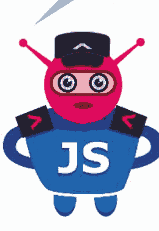

你在做数学运算吗？我会把字符串转换成数字

连接是将字符串组合在一起的术语。将字符串组合在一起相当简单，因为我们已经在使用数学运算所需的运算符。当你想要连接两个或多个字符串时，你所要做的就是使用加号。请记住，如果你需要在新字符串中添加空格，你必须通过连接一个空格来手动添加。

```
1. var conString = "con"+"cat"+"enate";
```

在JavaScript中还有两种其他连接字符串的方式：

- 使用赋值运算符（+=）

- 使用内置的concat方法

```
1. var str1 = "Welcome";
2. str1 += " To";
3. str1 += " Javascript";
4.
5. var str1 = "".concat("Welcome "," To ","Javascript");
```

对于concat()方法，现有字符串不会被更改。相反，会创建一个包含连接后文本内容的新字符串。但是，当使用+和+=时，你是在修改现有字符串，除非你手动将连接结果赋值给一个新变量。你可以将数字转换为字符串以连接它们。但是，如果你有一个数字和一个字符串，JavaScript会将两者都视为字符串。

```
1. var a = "1";
2. var b = 2;
3. var c = a + b;
4. //结果将是"12"作为变量c的值。
```

如果你使用除+以外的其他运算符，结果会有所不同。

```
1. var c = a * b;
2. //根据前面的例子，结果将是2而不是"12"。
```

## 练习：17 字符串连接

问题：用数字13连接"java"和"script"。

确保数字前有一个空格。

在控制台中打印它。

答案：[jsvisually.com/17.html](http://jsvisually.com/17.html)

## 保留字

JavaScript有一些被保留的标识符，它们不能用作变量或函数名，因为它们总是被解释为保留字。因为有些保留字很容易成为名称的一部分，如果你坚持要在变量或函数命名中使用其中一个，那么你应该按照引入变量时解释的命名约定，在名称中添加更多内容。

以下是保留字：

| abstract | arguments | boolean | break | byte |

| case | catch | char | class | const |

| continue | debugger | default | delete | do |

| double | else | enum | eval | export |

| extends | false | final | finally | float |

| for | function | goto | if | implements |

| import | in | instanceof | int | interface |

| let | long | native | new | null |

| package | private | protected | public | return |

| short | static | super | switch | synchronized |

| this | throw | throws | transient | true |

| try | typeof | var | void | volatile |

| while | with | yield | | |

此外，还有一些具有保留名称的JavaScript对象、属性和方法，你应该避免使用，因为它们是JavaScript内置的：

| Array | Date | eval | function | hasOwnProperty |

| Infinity | isFinite | isNaN | isPrototypeOf | length |

| Math | NaN | name | Number | Object |

| prototype | String | toString | undefined | valueOf |

你还应该记住，JavaScript经常与Java一起使用，因此避免使用一些Java保留字非常重要。类似于Windows保留字，JavaScript不仅限于HTML，还可以用作其他应用程序的编程语言。最后，也建议避免使用所有HTML事件处理程序。

## 练习：18 保留字

问题：找出并纠正错误

```
1. //声明一些变量
2. var default = "1";
3. var export = "Export Number";
4. var modify = default + " " + export;
```

答案：[jsvisually.com/18.html](https://jsvisually.com/18.html)

## 比较运算

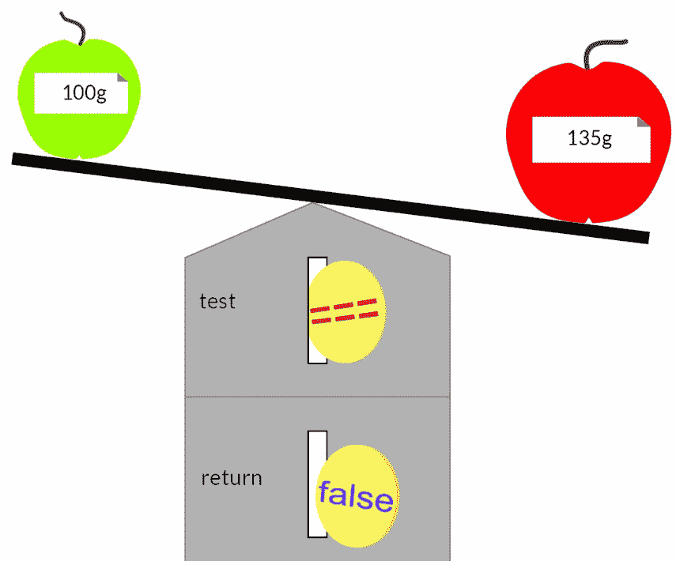

比较运算符用于比较（测试）两个值并返回true或false，这取决于基于相等性的查询。

使用最广泛的比较运算符可能是"等于"（==）运算符。

它可以用于不同类型的变量，例如：

- 字符串

- 数字

- 带有数学表达式的变量

- 变量与变量比较

当你比较字符串时，大小写敏感性很重要！接下来最常用的运算符是"等于"的反义词，即"不等于"（!==），并且它与其对应运算符具有相同的特性。

以下是在if语句中使用==或!==的有效方式：

```
1. if (fullName == "John" + " " + "Doe") {
2. if (fullName == firstName + " " + "Doe") {
3. if (fullName == firstName + " " + lastName) {
4. if (totalCost == 3.14 + 234) {
5. if (totalCost == materialsCost + 678) {
6. if (totalCost == materialsCost + laborCost) {
7. if (x + y == a - b) {
```

现在，===是"值和类型都相等"，而!==是"值不相等或类型不相等"，它们确保你不会将字符串与数字等进行比较。

与前面的运算符不同，以下运算符直接用于数字：

- >

- <

- >=

- <=

## 练习：19 比较运算

问题：比较橙子和苹果的颜色，并在文档中显示结果

答案：[jsvisually.com/19.html](http://jsvisually.com/19.html)

## 条件语句

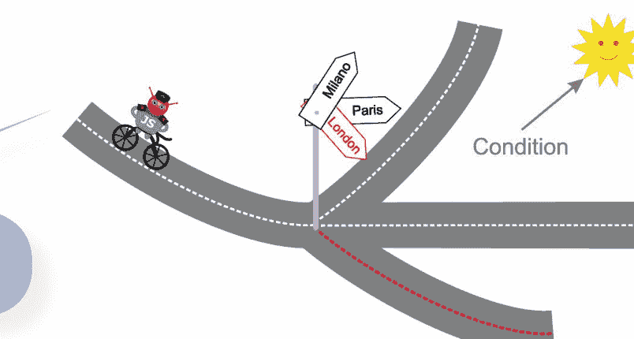

条件语句是一组仅在满足条件时才执行的命令。当你需要从用户那里获取输入时，它们非常有用，因为你需要检查用户是否输入了正确信息，如果没有，则需要采取行动。这是通过使用 *if ... else* 语句完成的。

```
1. if (条件) {
2.     语句_1
3. } else {
4.     语句_2
5. }
```

条件可以是计算结果为true或false的表达式。拥有计算出某种结果或执行自身其他操作的表达式本身是无效的。但是，你可以有一个计算出某个结果的条件，然后使用任何比较运算符来获得true或false的返回值。

如果你想测试多个条件，那么你可以使用逻辑运算符，并且还可以组合语句以允许在另一个if语句内部使用另一个if语句。

组合语句：

```
1. if (条件_1)
2.     语句_1
3. [else if (条件_2)
4.     语句_2]
5. ...
6. [else if (条件_n_1)
7.     语句_n_1]
8. [else
9.     语句_n]
```

### 使用逻辑运算符：

```
1. if (条件) && (条件2) {
2.   语句_1
3. } else {
4.   语句_2
5. }
```

```
1. switch (表达式) {
2.   case 标签_1:
3.     语句_1
4.     [break;]
5.   case 标签_2:
6.     语句_2
7.     [break;]
8.   ...
9.   default:
10.    语句_n
11.    [break;]
12. }
```

然而，虽然你可以在彼此内部拥有无限个if语句（只要保持正确），或者甚至连续使用多个if语句，但这仍然是检查多种可能性的非常低效的方式。因此，创建了另一种称为switch的结构。

Switch语句的工作方式与if语句相同，不同之处在于它们无需使用更多相同的结构就能检查多个值，这是使用if语句的缺点。

优点是，使用一个switch语句，你可以让一个程序计算一个表达式并检查分配给case标筓的无限数量的值。如果找到匹配项，则程序执行与该case关联的代码。

程序会首先寻找一个与表达式值匹配的case子句，并将控制权转移到该子句。如果未找到，则会寻找一个default子句作为备选，如果未找到，则什么都不执行，因为没有任何子句会被执行。建议有一个default子句来处理否则不会执行且无法发现的情况。

## 练习：20个条件。

问题：Private JS想知道从加利福尼亚州弗里蒙特到加利福尼亚州圣何塞的距离是多少？

如果车程少于30分钟，他就会去拜访。请使用谷歌地图和条件运算符，帮助他决定是去还是待在家里。

https://goo.gl/maps/wJwU9

答案：[jsvisually.com/20.html](http://jsvisually.com/20.html)

## 循环。

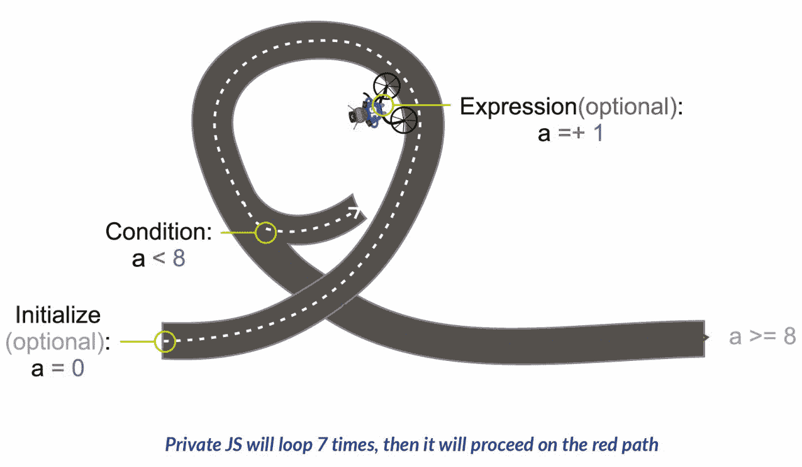

*Private JS将循环7次，然后沿着红色路径继续*

循环在JavaScript以及任何其他编程语言中都被广泐使用。原因是它们在处理重复性代码时非常方便。如果你需要在脚本中多次重复某些代码块，那么你可以使用函数来封装那个代码块，并在需要时调用它。

然而，当你需要连续多次重复某些代码块时，循环将是最高效的方式。

JavaScript支持两种主要的循环类型，每种类型又有其变体：

1.  for – 它按指定的次数循环执行一个代码块。

    for/in – 用于遍历对象的属性。

2.  while – 当满足指定条件时，它将不断循环执行一个代码块。

    do/while – 就像while循环一样，只要满足指定条件，就会循环执行一个代码块。

必须添加一些语句来改变用于条件检查的变量值，这一点至关重要。否则，你将得到一个无限循环，这会导致运行该代码的系统冻结、崩溃或出现其他多种故障，因为它将无休止地运行并耗尽所有可用内存，直到程序崩溃。

for循环的语法如下：

```
for (语句1; 语句2; 语句3) {
    要执行的代码块
}
```

语句1在循（代码块）开始之前执行。

语句2定义运行循环（代码块）的条件。

语句3在每次循环（代码块）执行后执行。

```
//此循环将在停止前运行5次
for (i = 0; i < 5; i++) {
    text += "The number is " + i + "<br>";
}

//For/In循环，遍历person对象
var person = {fname:"John", lname:"Doe", age:25};

var text = "";
var x;
for (x in person) {
    text += person[x];
}
```

while循环的语法如下：

```
while (条件) {
    要执行的代码块
}
```

在此示例中，代码将在变量i小于10时进行循环。

```
while (i < 10) {
    text += "The number is " + i;
    i++;
}
```

如果在主代码执行后不添加i++，那么循环将永远不会结束，如前所述，你的浏览器将会崩溃。对于for循环，这种错误更难出现，因为递增语句是必需的。根据系统情况，你可能需要让它运行很长时间才会耗尽内存。

while循环和do/while循环的区别在于，while循环在运行代码之前检查条件，而do/while则会先运行代码，然后在循环之前检查条件。

```
do {
    text += "The number is " + i;
    i++;
}
while (i < 10);
```

## 练习：21个循环。

问题：在文档窗口中打印数字11到23，用逗号分隔。

暂时不用担心最后一个逗号。

答案：[jsvisually.com/21.html](http://jsvisually.com/21.html)

## 数组。

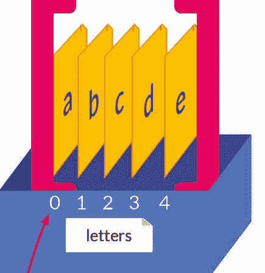

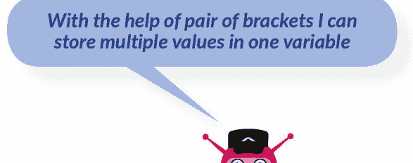

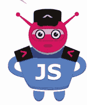


### 基于零的索引：

- [0]是第一个元素（a），

- [1]是第二个元素（b），

- [2]是第三个元素（c）...

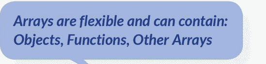


数组是一种特殊的变量，普通变量只被赋予一个值。它们之所以特殊，原因很简单——你可以给它赋多个值，而不是创建一整套变量来建立你自己的迷你数据库。

定义数组时，你只需将用逗号分隔的值放在方括号内即可。

```
var colors = ["Blue", "Red", "Green"];
```

它可以包含你想要的任意多的值，如果你知道自己在做什么，甚至可以混合类型。然而，最好保持数组中的值类型相同。

现在，假设你需要访问新数组中的一个值——你只需按如下方式使用变量名和值在数组中的位置：

```
colors[1]
```

这将是值“Blue”，你可以像使用普通变量一样对它进行任何操作。

需要记住的是，数组的第一个项目总是0而不是1。这可能有点难记，因为我们习惯从1开始计数，而不是从0。

这意味着数组colors的索引为2，列表中有三个项目。普通变量的命名约定也适用于数组。在检查源代码时，你通常可以通过名称（通常是复数形式，如colors而不是color等）来识别JavaScript中的数组。这是因为数组是一个项目列表。此外，就像普通变量一样，你只声明一次数组，然后可以通过以下格式赋值来更改值：

```
arrayName[index] = newValue;
```

注意，这里不使用关键字var，因为那会声明一个新变量，而不是更改数组中当前索引的值。

## 练习：22个数组。

问题：创建一个包含5个数字（1到5）的数组

将第一个元素更改为你的名字。

将最后一个元素更改为你最喜欢的3种颜色。

答案：[jsvisually.com/22.html](http://jsvisually.com/22.html)

## 数组方法。

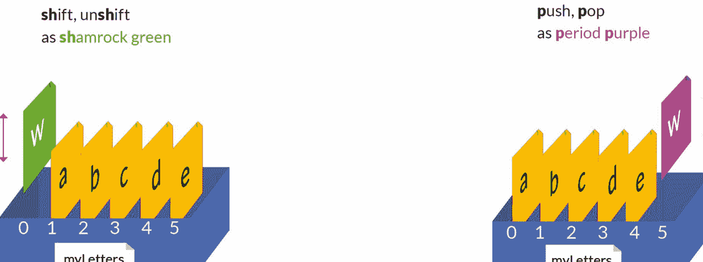

数组对象具有预定义的方法，它们是JavaScript中数组功能的核心。这些方法将允许你将值转换为字符串、添加或删除值、移动以及进行更多数据操作。

在使用数组时，删除元素很容易。你只需像戳破气球一样将它们`pop()`掉。

```
var colors = ["Blue", "Red", "Orange"];
colors.pop();
```

从这个例子中，你将删除数组中的最后一个元素。如果你想向数组添加一个新元素，那么数组方法`push()`会将新元素添加到数组的末尾。

```
colors.push("Yellow");
```

这将使我们的colors数组包含蓝色、红色和黄色，而不仅仅是蓝色和红色。

现在，`pop()`和`push()`方法在数组的末尾工作，如果你想操作数组的开头，那么你可以使用数组方法`shift()`来弹出数组的第一个元素，然后将所有剩余元素向左移动。与压入第一个元素相对应的是数组方法`unshift()`，它会在数组的开头添加一个新元素。

一个非常有用且常用的数组方法是`sort()`，它按字母顺序排序数组。但是，当你有一个数字数组时，你需要做一些额外的工作以避免不正确的排序，因为sort()适用于字符串，因此，你的数字将被当作字符串排序，“30”会比“20”大，仅仅是因为3比2大。解决这个问题的巧妙方法是在sort方法内提供一个比较函数。

```
var scores = [30, 95, 90, 50, 20, 10];
scores.sort(function(a, b){return a-b});
```

这将为数字产生正确的排序。

另一个广泛使用的数组方法是reverse()，顾名思义，它会反转数组中的元素。一个不错的技巧是先对数组排序，然后使用reverse方法使其降序排列。

# 练习：23

数组方法。

问题：使用循环创建一个包含数字 11 到 23 的数组。

在屏幕上显示这些数字。

答案：[jsvisually.com/23.html](http://jsvisually.com/23.html)

# 函数。

函数（有趣的操作）是一组可以稍后调用并共同执行特定任务的代码。它们在程序中被调用时执行。基本上，它们在你调用它们时运行。

由于你可以根据需要多次调用函数并向它们传递参数，因此它们是清理代码的最佳方式，方法是将需要多次使用的代码块封装成函数。即使只调用一次，它们也是组织代码的一种方式，这样你可以轻松定位需要修改的代码块，而无需在大量代码行中滚动查找需要的那几行。

函数的语法如下：

```
function myFunction(p1, p2) {
    return p1 * p2;     // 函数返回 p1 和 p2 的乘积
}
```

函数通过 `function` 关键字定义，后跟函数名和括号。如果你想添加参数，则将它们放在括号内，用逗号分隔（如果多于一个）。这些参数是将在函数内部使用的变量值。

把你的身体想象成一个程序，你的器官就是函数。你的器官是函数，它们通过共享作为参数传递的信息来相互沟通，并完成各自的工作，整个身体协调运作。

调用函数有三种方式：

1. 当事件发生时，例如用户点击按钮。

2. 当从代码中的某处调用时。

3. 当自我调用时。

函数中的 `return` 语句为调用者提供结果值。这就是为什么你通常将带返回值的函数结果赋值给一个变量。

```
var x = myFunction(4, 3);    // 函数被调用，返回值将存入 x
function myFunction(a, b) {
    return a * b;             // 函数返回 a 和 b 的乘积
}
```

调用函数就像写函数名后跟 `()` 操作符一样简单。如果需要参数，则也必须添加它们。在 JavaScript 中，你可以将函数用作变量。这意味着你可以直接调用变量本身，而不是将函数赋值给一个变量再使用该变量，结果是一样的。

使用：

```
var text = "The temperature is " + toCelsius(32) + " Centigrade";
```

而不是：

```
var x = toCelsius(32);
var text = "The temperature is " + x + " Centigrade";
```

# 练习：24 函数。

问题：创建一个名为 `cm2in` 的函数，将厘米（CM）转换为英寸（IN）。使用 `Math.round()` 对结果进行四舍五入，并在数值后添加英寸符号（"）。

结果：6"

答案：[jsvisually.com/24.html](https://jsvisually.com/24.html)

# 嵌套。

**尽可能避免深度嵌套，因为它会减慢脚本运行速度，并可能让其他程序员感到困惑**

嵌套是将一个代码块嵌入另一个代码块中。你应该尽可能避免深度嵌套，因为它会减慢脚本运行速度，并可能让其他程序员感到困惑。类似于在另一个语句中使用多个 `if` 语句，嵌套具有相同的缺点。

这是一个普通函数内部包含另一个函数的模式：

```
function foo(a, b) {
    function bar() {
        return a + b;
    }

    return bar();
}

foo(1, 2);
```

应避免此类模式。另一方面，以下示例是完全可以接受的：

```
function hypotenuse(a, b) {
    function square(x) { return x * x; }

    return Math.sqrt(square(a) + square(b));
}
```

对于 `hypotenuse()` 函数，你从数学库中获得了一个内部函数 `sqrt()`。因此每次调用 `hypotenuse` 时，它也会调用 `sqrt()` 函数。然而，`foo` 函数必须为每个 `foo()` 实例创建一个 `bar` 函数。有人可能认为这没问题，但这会导致 JavaScript 引擎执行不必要的工作，并在函数被多次调用时浪费 CPU 周期。因为函数不会改变，它们总是做同样的事情，最好通过将 `bar()` 函数放在 `foo()` 外部并让 `foo()` 在需要时调用它来优化代码，就像 `hypotenuse()` 函数那样。

```
function foo(a, b) {
    return bar(a, b);
}

function bar(a, b) {
    return a + b;
}

foo(1, 2);
```

这个新代码将更加高效，即使在短时运行中差异微乎其微。巨大的收益体现在大型计算上。节省了时间资源。

# 练习：25 嵌套。

问题：修复嵌套的 `if else` 语句中的错误。

```
if (true) {
    return 1;
} else {
    return 0;
}
语法错误
```

答案：[jsvisually.com/25.html](jsvisually.com/25.html)

# DOM 节点树。

每个选项卡都有自己的 `window` 对象

DOM 的 HTML 表示

```
<html>
  <head>
    <title>Title Text</title>
  </head>
  <body>
    <h1 id="hdr">H1 Text</h1>
    <p>Paragraph Text</p>
  </body>
</html>
```

所有 HTML 元素和属性都是文档对象模型（DOM）中的节点。以下面的 HTML 代码作为起点：

```
<html>
  <head>
    <title>The title</title>
  </head>
  <body>
    The body
  </body>
</html>
```

DOM 节点树将如下所示：

HTML 标签是 DOM 树中的元素节点，文本片段成为文本节点。在图中，你得到了 HTML 节点及其两个子节点 HEAD 和 BODY，其中只有 HEAD 有一个子标签。

文档对象模型的理念是，每个节点都是一个对象，其属性可以通过 CSS 代码更改。你还可以通过搜索 DOM 找到目标节点并动态创建要插入的新元素来更改节点的内容。要做到这一点，你首先需要知道 DOM 的样子以及它包含什么。一旦你了解了，就可以开始进行 DOM 操作。这是你将在下一章学到的内容。

# 练习：26

DOM 树。

问题：绘制一个节点树图，表示以下 HTML。

```
<html>
  <head>
          <title>Draw me</title>
  </head>
  <body>
        <h1 id="hdr">Hello</h1>
        <h2>Header tag</h2>
        <p id="para">My text</p>
        <script src="my.js"></script>
  </body>
</html>
```

答案：jsvisually.com/26.html

# 操作 DOM。

```
<html>
  <head>
    <title>Title Text</title>
  </head>
  <body>
    <h1 id="hdr">H1 Text</h1>
    <p class="cls">Paragraph Text</p>
    <p class="cls">Paragraph 2</p>
    <script src="main.js"></script>
  </body>
</html>
```

当网页加载时，浏览器会自动创建页面的文档对象模型。如你之前所学，页面的每个元素（不包括文档本身）都是另一个元素的子元素。通过对象模模型，你可以使用 JavaScript 创建动态 HTML。JavaScript 可以更改页面上的所有 HTML 元素、属性和 CSS 样式。此外，添加和删除元素和属性，甚至创建新的 HTML 事件都是可能的。

通过在 HTML 中使用 `id`，你可以访问特定节点，而不仅仅是某个类型的所有节点。这就是为什么建议使用不同的 `id` 名称，以便进行更精确的控制。

## 练习：27 操作 DOM

要操作特定的 id，你可以使用 `getElementById` 方法；如果你想与同一元素的内容进行交互，则使用 `innerHTML` 属性。这是定位特定节点并使用 JavaScript 进行修改的最简单方式。

```html
<html>
<body>
<p id="demo"></p>
<script>
document.getElementById("demo").innerHTML = "Hello World!";
</script>
</body>
</html>
```

在前面的例子中，我们通过 `getElementById` 使用其 id 与段落元素进行交互，并使用 `innerHTML` 属性修改了它。你也可以通过 `document.getElementsByTagName()` 方法获取元素标签，通过 `document.getElementsByClassName()` 获取类名。

这就是为方法使用描述性名称的优势。

如果你想更改 HTML 元素，可以使用 `element.attribute=` 来更改属性。如果要设置属性，则使用 `element.setAttribute(attribute,value)`。要操作样式，使用 `element.style.property=`。

关于添加和删除元素：

-   `document.createElement()` 创建一个 HTML 元素。

-   `document.removeChild()` 移除一个元素的子节点。

-   `document.appendChild()` 为一个元素添加子节点。

-   `document.replaceChild()` 用另一个子元素替换现有子元素。

-   `document.write(text)` 写入 HTML 输出流。

-   `document.getElementById(id).onclick=function()` 将为一个 onclick 事件添加事件处理代码。

问题：选择 id 为 "cls" 的 `<p>` 标签，并将其文本更改为 "something else"

```html
<html>
<head>
    <title>Draw me</title>
</head>
<body>
    <h1 id="hdr">Hello</h1>
    <h2>Header tag</h2>
    <p id="cls">Paragraph 2</p>
    <script src = "my.js"></script>
</body>
</html>
```

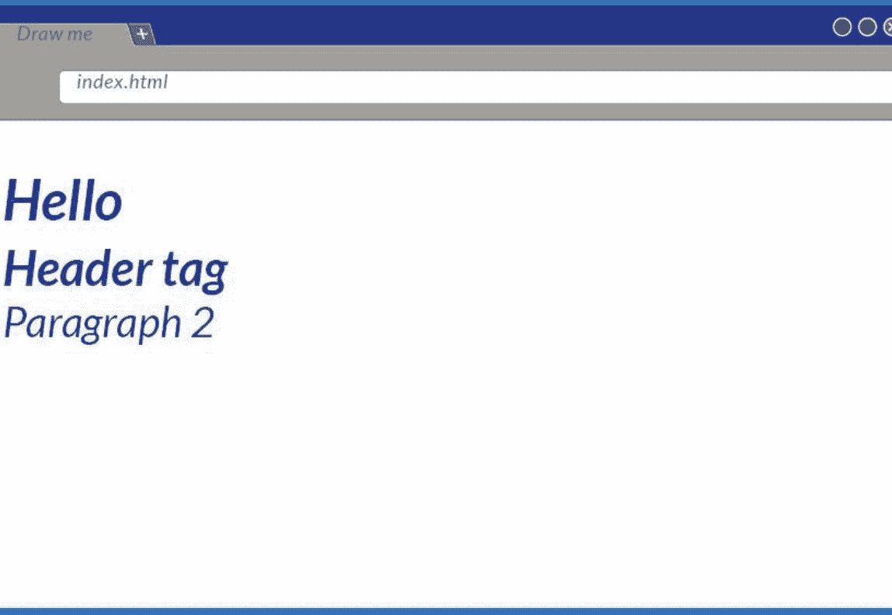

答案：[jsvisually.com/27.html](http://jsvisually.com/27.html)

## 函数语句与函数表达式

```javascript
//Functions are values
//function Statements (Declarations) require a name,
//are defined at parse time and
//can be called before being declared because of hoisting
foo();
function foo() { return 8; }
```

> 关键字 "function" 前没有任何内容，所以它是一个语句

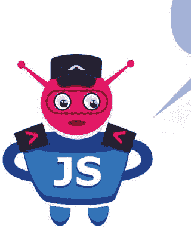

> 我更喜欢函数表达式，因为它们更灵活

```javascript
//function Expression.
//name is optional
//defined at run time
var foo = function foo() { return 8; };
foo();        //8

//function Expression with parameters
var boo = function (x, y) { return x + y; };
boo(2,3); //5

//anonymous function Expression
var moo = function() { return 1; };
moo();    //1

//this is a function Expression
//because it is inside a grouping operator ()
( function doo() { return 8; }() );
//8
```

由于赋值运算符的存在，这是一个表达式

分组运算符只能包含表达式

函数语句是指以关键字 “function” 开头的语句。如果不是，则它是函数表达式。

当函数被声明时，它会被保存以供调用后执行。由于在 JavaScript 中，函数是对象，它们既有属性也有方法。

```javascript
function functionName(parameters) {
    code to be executed
}
```

其中 functionName 是必需的，并且必须遵循前面章节中解释的命名约定，参数是可选的，可以为零个或按需要的数量用逗号分隔。需要注意的是，如果调用函数时缺少参数，其值将被设置为 undefined。

另一方面，函数表达式的语法如下：

```javascript
var variableName = function(parameters) {
    code to be executed
};
```

如你所见，它非常相似，主要区别在于函数名，在函数表达式中可以省略函数名以创建匿名函数。但是，如果你想在函数体内引用当前函数，则需要创建一个命名函数表达式。该名称将仅在函数体内局部有效。

```javascript
var math = {
    'factorial': function factorial(n) {
        if (n <= 1)
            return 1;
        return n * factorial(n - 1);
    }
};
```

如你所见，函数表达式比函数语句更灵活。

## 练习：28 函数语句与函数表达式

问题：在 JavaScript 中，我们可以使用 `Math.pow(x,y)` 方法将一个数提升到一个幂。X 是底数，Y 是指数。

重构以下函数，将其改为函数表达式：

```javascript
//将数字2提升到10次幂
function power(x) {
    //不太好。我们重写一下
    var raise= x * x * x * x * x * x * x * x * x * x + x;      // (x10)
    return raise;
}
power(2);
//1026
```

答案：[jsvisually.com/28.html](http://jsvisually.com/28.html)

## 立即调用的函数表达式

```javascript
//我们永远不会调用它，所以不需要名字
( function () {
    console.log("no need to call me");
}() );
//末尾的第二对括号立即调用了该函数
var x = function() {
    console.log("no need to call me");
}();
//末尾的第二对括号调用并结束了该函数
//如果我们稍后尝试调用它，会得到错误：
x();
TypeError: undefined is not a function
```

任何强制解释器评估接下来内容的东西，都会调用该函�

```javascript
//以下任何一种都可以做到：
//+, -, ~, !, void, true, &&, new
!function () {
    console.log("no need to call me");
}();
//true
+function () { //尝试转换为数字
    console.log("no need to call me");
}();
//NaN
0, function () {
    console.log("no need to call me");
}();
//undefined
```

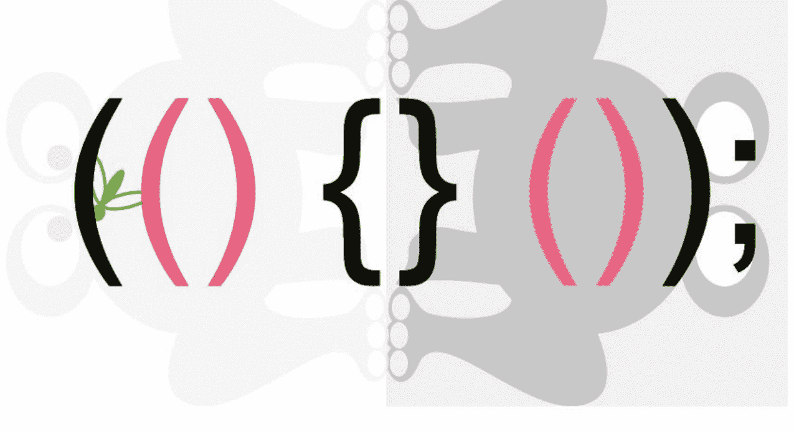

## 记住“镜像青蛙”模式

也称为 IIFE，是自执行函数，用于避免变量提升并保护全局空间不被“污染”。这意味着 IIFE 提供了局部作用域，这就是为什么像 JQuery、BackBone.js 这样的流行库使用它来将所有库代码放置在局部作用域内。

创建基本 IIFE 的语法如下：

```javascript
// 匿名函数
function(){
  // 我的特殊代码
}();  // 括号确保匿名函数被立即调用
```

基本上，它是一个没有名字的匿名函数，因为我们不会调用它，它通过末尾的括号被创建并立即调用。

我们将匿名函数包装在括号内，以便 JavaScript 解析器将其视为函数表达式而不是函数声明。如果它被视为函数声明，那么我们将需要一个函数名以避免语法错误，并且它还需要在某个时刻被调用。仅为了提醒并区分函数表达式和声明，请查看以下内容：

1.  函数表达式 - `var test = function() {};`

2.  函数声明 - `function test() {};`

由于 IIFE 中的函数是函数表达式，并且没有被赋值给全局变量，因此没有创建全局属性，所有属性都是在局部创建的，所以我们得到了局部作用域。

IIFE 的另一个好处是减少了作用域查找，这提供了一点性能优势，因为我们可以将常用的全局对象传递给 IIFE 的匿名函数，然后通过局部作用域在 IIFE 内引用它们。

```javascript
// 有三个参数的匿名函数
function(window, document, $) {
// 现在你可以在局部作用域中引用 window、document 和 jQuery 对象
// 全局 window、document 和 jQuery 对象被传入匿名函数
}(window, document, window.jQuery);
```

由于我们能够将全局对象作为局部参数传递给匿名函数，我们也获得了压缩优化，这是 IIFE 的另一个优势。

IIFE 曾经的一个缺点是，当内部代码很多时，可读性较差。如果你想找到传递给 IIFE 的参数，必须一直向下滚动。

解决方案是使用一种更具可读性的模式，它已经变得非常流行：

```javascript
(function (library) {
    // 调用第二个 IIFE 并局部传入全局 jQuery、window 和 document 对象
    library(window, document , window.jQuery);
}
// 局部作用域参数
(function (window, document, $) {
// 库代码放在这里
}));
```

这种 IIFE 模式允许你看到传递给 IIFE 的全局对象，而无需一直滚动到文件底部。

## 练习：29

立即执行函数表达式。

问题：请添加不超过4个字符，使此函数自执行：

```javascript
function selfExecute() {
    console.log("Make me IIFE, please!");
}
```

答案：[jsvisually.com/29.html](http://jsvisually.com/29.html)

## 作用域。

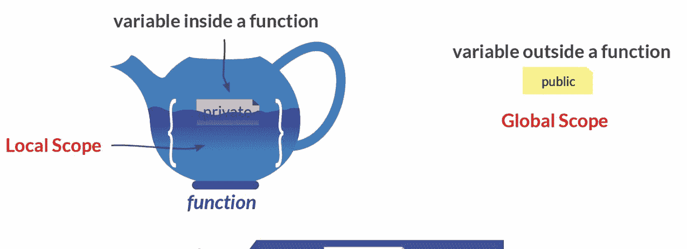


你已经在本书中广泛见过“作用域”这个词，如果到现在你还没弄明白它的意思，那么请记住：JavaScript具有函数级作用域。函数内部的变量对外部是不可见的。局部作用域可以“看到”全局作用域，但全局作用域无法“看到”局部作用域。

在JavaScript中，作用域是你能访问到的变量、对象和函数的集合。此外，对象和函数在JavaScript中也是变量。

由于局部变量具有局部作用域，你只能在函数内部访问它们：

```javascript
// 此处代码无法使用carName
function myFunction() {
  var carName = "Toyota";
  // 此处代码可以使用carName
}
```

然而，由于局部变量仅在其局部作用域内被识别，你可以在其他函数中使用同名变量。

这里我们有相同的函数，但使用了一个全局变量：

```javascript
var carName = "Volvo";
// 此处代码可以使用carName
function myFunction() {
    // 此处代码可以使用carName
}
```

需要注意的是自动成为全局变量的情况。当你给一个未声明的变量赋值时，它将自动成为全局变量。

```javascript
// 此处代码可以使用carName
function myFunction() {
    carName = "Volvo";
    // 此处代码可以使用carName
}
```

变量的生命周期也是其作用域的一部分。JavaScript变量从声明时开始存在。局部变量在函数执行完毕后被删除，而全局变量仅在程序或页面关闭时才被删除。

```javascript
// 此处代码可以使用carName
function myFunction() {
    carName = "Volvo";
}
```

## 练习：30

作用域。

问题：下面的函数本应计算10个苹果。

请修复这个问题！

```javascript
var i = "red";
function countApples() {
    for (i; i <= 10; i++) {
        console.log();
    }
}
countApples();
```

答案：[jsvisually.com/30.html](http://jsvisually.com/30.html)

## 变量提升。


变量提升是指函数和变量声明被移动到其作用域顶部。这是JavaScript的默认行为。

在JavaScript中，一个变量可以在声明后使用，也可以在声明前使用。

以下两个示例产生相同的结果：

示例 A：

```javascript
x = 5;        // 将5赋值给x
elem = document.getElementById("demo");  // 查找一个元素
elem.innerHTML = x;              // 在该元素中显示x

var x; // 声明x
```

示例 B：

```javascript
var x;        // 声明x
x = 5;        // 将5赋值给x

elem = document.getElementById("demo");  // 查找一个元素
elem.innerHTML = x;              // 在该元素中显示x
```

JavaScript只提升声明，不提升初始化。因此，你必须在使用变量之前对其进行初始化。

```javascript
var x = 5;    // 初始化x

elem = document.getElementById("demo");  // 查找一个元素
elem.innerHTML = x + " " + y;    // 显示x和y

var y = 7;    // 初始化y
```

在上面的示例中，由于变量提升，`y`在使用前已被声明。然而，它的值仍然是`undefined`，因为初始化不会被提升。

由于并非所有开发者都熟悉JavaScript中的变量提升，建议在每个作用域的开头声明所有变量。这个良好的实践将避免许多bug，并且由于这是JavaScript解释代码的方式，因此它是一个很好的准则。

## 练习：31 变量提升。

问题：以下代码的结果是什么？为什么？

请尝试在不运行代码的情况下回答。

```javascript
test();
var test = function () {
    return 1;
};
```

答案：[jsvisually.com/31.html](http://jsvisually.com/31.html)

## 闭包。

### 内部函数remember它被创建时的环境

内部函数也能访问全局作用域

X和Z对内部函数是自由变量


变量'z'在外部函数执行结束后依然存在

```javascript
function upperFn(x) {
    var z = 8;    //局部变量

    //闭包在函数实例化时形成，而非在调用时
    function innerFn(y) {     //闭包
        console.log(x + y + z);
    }
    innerFn(3);              //y = 3
}
upperFn(2);                  //x = 2

//当'upperFn'被调用时，函数'innerFn'
//被实例化，并且可以访问变量'z'
```

我们已经了解了JavaScript变量中的局部作用域和全局作用域。然而，还有另一种类型的作用域，我们可以通过闭包创建私有变量。闭包是一个可以访问外部函数变量的内部函数。它具有三条作用域链：

1.  访问其自身的作用域，即在其花括号之间定义的变量。

2.  访问外部函数的变量。

3.  访问全局变量。

```javascript
function showName (firstName, lastName) {
  var nameIntro = "Your name is ";
  // 这个内部函数可以访问外部函数的变量，包括参数
  function makeFullName () {
    return nameIntro + firstName + " " + lastName;
  }
  return makeFullName ()
}
showName ("John", "Doe"); // Your name is John Doe
```

闭包最重要的特性之一是，即使外部函数已经返回，内部函数仍然可以访问外部函数的变量。通常，函数返回后，其生命周期就结束了。但闭包不是这样，你可以在程序后期调用内部函数，即使外部函数已经返回。

闭包存储的是对外部函数变量的引用，而不是实际的值。由于闭包可以访问并更新外部函数变量的值，当变量因循环而改变时，这可能会导致bug。要避免这个问题，你可以简单地使用一个立即执行函数表达式。

## 练习：32 闭包。

问题：创建一个接受参数x的函数，该函数返回一个接受参数y的函数，该返回的函数计算x与y的和。

使用`console.log`输出3和5的和。

答案：[jsvisually.com/32.html](http://jsvisually.com/32.html)

## 事件。


```html
element.event = function;
```

事件是JavaScript用来使网页具有交互性的东西——当你点击一个按钮、悬停在图片上使其发生变化，或者任何其他形式的交互。事件是JavaScript对事件作出反应后，直接发生在HTML元素上的动作。

HTML事件可以是浏览器或用户执行的操作，例如网页加载完成、输入字段的变化，以及非常常见的鼠标点击。

HTML允许事件处理程序属性添加JavaScript代码。

```html
<some-HTML-element some-event='some JavaScript'>
<some-HTML-element some-event="some JavaScript">
```

你可以使用单引号或双引号。

一种使超链接行为异于常规的方法是使用事件处理程序：

```html
<a href="#" onClick="alert('Hi');">Click</a>
```

这将显示一个警告框，而不是将用户带到另一个地方。

与按钮交互，我们使用“onClick”处理程序。

```html
<button onclick='getElementById("demo").innerHTML=Date()'>The time is?</button>
```

这将显示一个警告框，而不是将用户带到另一个地方。

与按钮交互，我们使用“onClick”处理程序。

```html
<button onclick='getElementById("demo").innerHTML=Date()'>The time is?</button>
```

该代码将改变id为"demo"的元素的内容。如果你希望改变按钮自身元素的内容，那么你可以使用`this.innerHTML`。

```html
<button onclick="this.innerHTML=Date()">The time is?</button>
```

你也可以使用图像来触发这些更改，而不是创建按钮。

```html

```

最常见的HTML事件如下：

-   onchange：HTML元素已被更改。

-   onclick：用户点击HTML元素。

-   onmouseover：当用户将鼠户悬停在HTML元素上时。

-   onmouseout：当用户将鼠标移开HTML元素时。

-   onkeydown：用户按下键盘按键。

-   onload：浏览器已完成页面加载。

## 练习：33 事件。

问题：创建一个事件监听器，用于计算按钮点击次数，并在屏幕上显示该数字。

```html
<html>
    <head>
        <title>Click me</title>
        <p id="hdr">0</p>
        <button onclick="countClicks();">Click!</button>
    </head>
    <body>
        <script src="my.js"></script>
    </body>
</html>
```

答案：[jsvisually.com/33.html](http://jsvisually.com/33.html)

## 对象。

我可以使用“点表示法”来获取或设置属性或方法。

```javascript
object.property;
object.method;
```

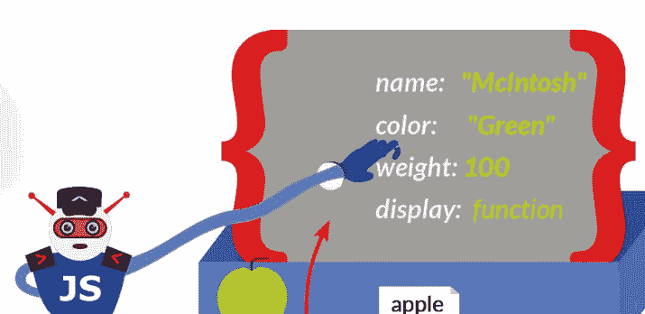

将“点表示法”视为对象上的一个开口，用于访问其内容。

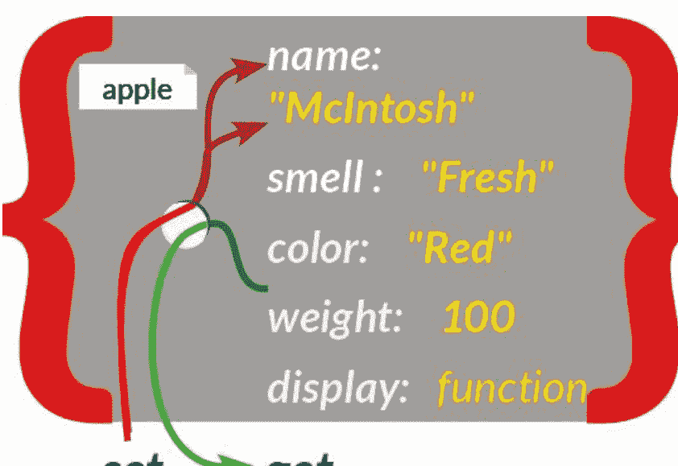

```javascript
//创建一个空对象
var apple = {};
//创建一个对象并为其添加属性
var apple = {
    name: "McIntosh",
    color: "Green",
    weight: 100,
    //添加方法
    display: function () { alert("I weigh " + this.weight + "g");}
};
```

```javascript
//使用"."点表示法更改属性
apple.color = "Red";
//添加新的smell属性
apple.smell = "Fresh";
```

```javascript
//调用apple对象的方法
apple.display();
//结果：I weigh 100 g
//获取属性的值
var getValue = apple.weight;
```

据说，当你理解了JavaScript中的对象，你就理解了JavaScript。这是因为在JavaScript中，几乎一切都是对象。数字、布尔值和字符串等原始数据可以被视为对象。此外，日期、数学运算、正则表达式、数组和函数也总是对象。这听起来好像一切都是对象，然而，重要的是要知道原始值不是对象——它们只是可以被当作对象来对待。对象是属性和方法的集合。

虽然你可以使用变量来存储信息，而不是对象，但这非常不切实际，在某些情况下，要将所有信息链接在一起极其困难，特别是当它们属于不同类型时。例如，你想创建一个名为`apple`的对象，它将包含苹果的类型、颜色和重量。所有这些属性都可以存储在变量中，但当你拥有更多对象以及更复杂的对象（如装配线上的汽车对象）时，所有这些变量可能会混淆，并且很难跟踪它们。如果你将它们视为一种对象类型，它将拥有自己的函数、属性和方法，所有这些都易于访问，也更容易从源代码中读取。

```javascript
//创建一个空对象
var apple = {};
//创建一个对象并为其添加属性
var apple = {
    name: "Machintosh",
    color: "Green",
    weight: 100,
    //添加方法
    display: function(){alert("I weigh "+this.weight+"g");}
};
```

这是一个简单的`apple`对象。如果需要更改其值，你可以创建getter和setter。顾名思义，一个用于设置值，另一个用于获取值。这也是一种安全措施，因为你不想让外部代码直接访问对象的属性。相反，你创建“门”来安全地调节信息的进出。

**Setter（设置器）：**

```javascript
//使用"."点表示法更改属性。
apple.color = "Red";
//添加新的smell属性
apple.smell = "Fresh";
```

**Getter（获取器）：**

```javascript
//调用apple对象的方法
apple.display();
//结果：I weigh 100g
//获取属性的值
var getValue = apple.weight;
```

- 使用对象字面量定义和创建单个对象。通过使用对象字面量，你可以同时定义和创建一个对象。

正如你从`apple`示例中注意到的，对象就像一个变量，但它可以包含多个变量，格式如下：`name : value`。变量的集合是无序的，它们被称为命名值。

在JavaScript中有多种创建对象的方式：

```javascript
var person = {
    firstName: "John",
    lastName: "Doe",
    age: 50,
    eyeColor: "blue"
};
```

- 使用关键字`new`定义和创建单个对象。这与对象字面量的作用相同，但推荐使用对象字面量。

```javascript
var person = new Object();
person.firstName = "John";
person.lastName = "Doe";
person.age = 50;
person.eyeColor = "blue";
```

- 定义一个对象构造函数，然后创建该构造类型的对象。与前面的示例相比，此方法功能更强，因为前面的示例只能创建一个对象，而不能作为模板来创建具有相似属性的多个对象。

```javascript
function person(first, last, age, eyecolor) {
    this.firstName = first;
    this.lastName = last;
    this.age = age;
    this.eyeColor = eyecolor;
}
var myFather = new person("John", "Doe", 50, "blue");
var myMother = new person("Sally", "Rally", 48, "green");
```

## 练习：34 对象。

问题：创建一个对象字面量，包含此车辆登记表的详细信息。删除“制造年份”属性，并在控制台中显示该对象。


| 标签 | 值 |

|---|---|

| 车主姓名： | John Smith |

| 底盘号： | 451265-458 |

| 发动机号： | 6565-5656-98 |

| 品牌名称： | Stealth |

| 登记日期： | 2019年7月1日 |

| 车辆价格： | $145 000 |

| 颜色： | 酒红色 |

| 制造年份： | 2018 |

答案：[jsvisually.com/34.html](http://jsvisually.com/34.html)

## 方法。

## 方法以提升对象

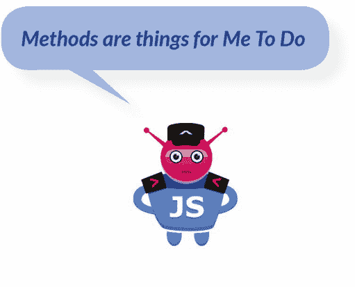

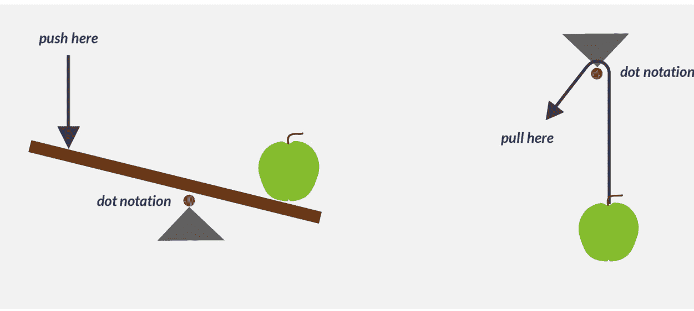

对象方法是包含函数定义的对象属性，这些函数定义又创建了在对象上执行的操作。你可以使用以下语法创建一个对象方法：

```javascript
methodName : function() { code lines }
```

要访问已创建的对象方法，你需要使用以下语法：

```javascript
objectName.methodName()
```

在尝试访问对象方法时，记住括号`()`很重要。否则，你将得到的是函数定义，而不是执行它。

你可以在对象中使用内置方法。例如，如果你正在处理字符串，那么你可以使用内置的字符串方法来操作数据，就像处理变量一样。

```javascript
var message = "Hello world!";
var x = message.toUpperCase();
```

回顾我们在上一章创建的`person`对象，我们可以通过编辑构造函数为对象定义一个新方法。

```javascript
function person(first, last, age, eyecolor) {
    this.firstName = first;
    this.lastName = last;
    this.age = age;
    this.eyeColor = eyecolor;
    this.changeName = function (name) {
        this.last = name;
    }
}
```

现在我们有了一个`changeName()`方法，它将一个名字的值分配给`person`对象的`last`属性。

```javascript
myMother.changeName("Doe");
```

对象的另一个重要部分是“this”关键字。在函数中使用时，“this”的值是该函数所属的对象。然而，当“this”用在对象中时，它就是对象本身。“this”是一个关键字，而不是变量，因此它的值不能被更改。

看看对象构造函数的例子：你可以使用属于`person`函数的“this”，而不是使用`person.firstName`。当它用在全局作用域时，它将不是`person`函数，而是包含它的函数或对象。

## 练习：35 方法。

问题：JavaScript有一些预定义的方法，如`'toUpperCase()'`，用于将小写字符串转换为大写。

使用它将你的名字转换为大写。

答案：[jsvisually.com/35.html](https://jsvisually.com/35.html)

## 构造函数。

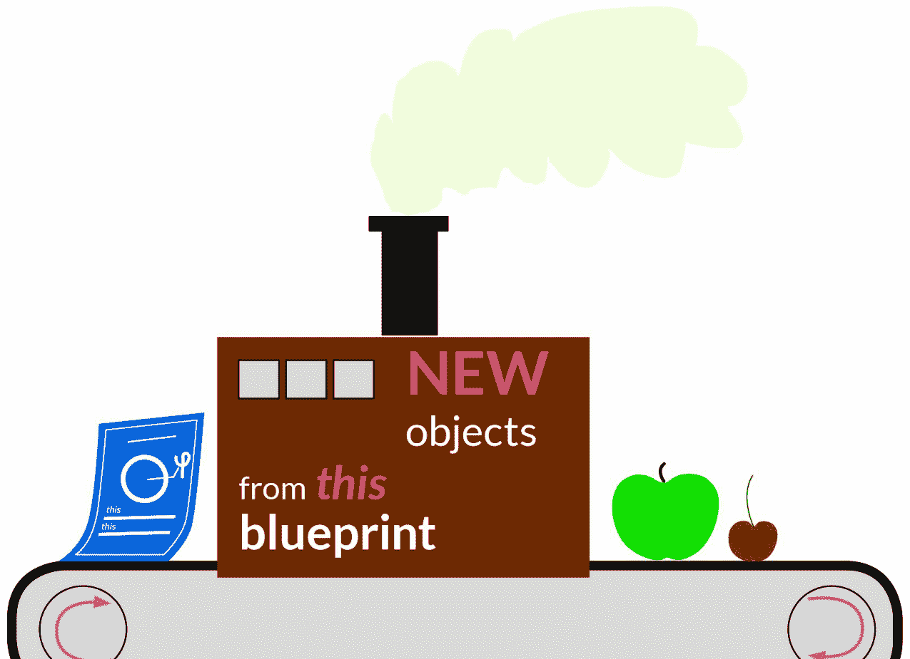

构造函数是用于创建对象多个实例的函数，它使用`'new'`关键字。我们在“对象”章节中已经简要讨论过它们。我们看到了几种创建对象的方法，但它们都仅限于创建单个对象。如果你需要创建多个相同类型的对象，那么你需要创建一个对象构造函数，然后你就可以用不同的值创建该对象的新实例。

这种方式的工作原理是从一开始就把参数赋值给对象变量，而不是实际的值。这将允许我们使用`new`关键字创建新对象，并将值作为参数传递，类似于我们在函数之间传递参数的方式。

在某种程度上，我们可以将构造函数想象成蓝图。当使用相同的蓝图建造房子时，所有的房子都会是一样的；唯一的区别将是油漆和地址。让我们看一个水果对象的构造函数示例：

按照惯例，构造函数的名称以大写字母开头。

```javascript
var Fruit = function Fruit(name, color) {
    this.name = name; //属性
    this.color = color;
```

## 方法

```javascript
this.info = function() {return "I am a " +this.color + " " + this.name};
```

现在我们可以轻松创建同一对象的大量实例。关键字 `new` 会将 “this” 的上下文设置为新创建的对象。

```javascript
var Cherry = new Fruit();
var Apple = new Fruit();
var Mango = new Fruit();
```

现在我们使用同一个构造函数创建了三种不同的水果。这为我们节省了大量时间和代码，而不是从头开始创建所有三个。虽然这些水果在很多方面都不同，但我们利用了它们的共同点，将它们链接到同一个构造函数，那就是它们都是水果，并且都有名称和颜色。如果需要，我们可以进一步扩展构造函数以添加重量或其他任何共同属性。

## 练习：36 构造函数。

**问题：** 修复以下代码：

```javascript
var user = function (name) {
    this.name = name;
};
var john = user("John");
```

**答案：** [jsvisually.com/36.html](http://jsvisually.com/36.html)

## 原型。

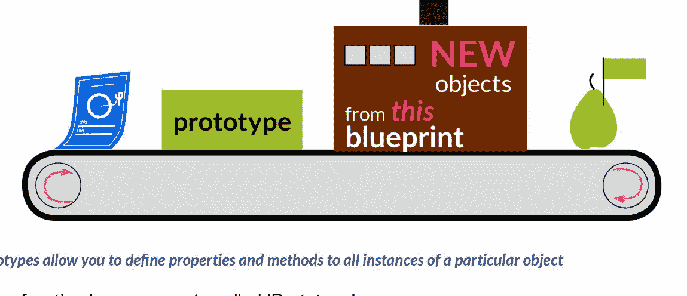

*原型允许你为特定对象的所有实例定义属性和方法。*

每个函数都有一个名为 'Prototype' 的属性。它允许向对象添加属性和方法，以便它们可以更容易地共享信息。所有 JavaScript 对象都从其原型继承属性和方法。当使用对象字面量或 `new Object()` 创建对象时，它们从名为 `Object.prototype` 的原型继承。

创建对象原型的标准方法是使用对象构造函数函数，就像我们过去所做的那样。然后你会使用 `new` 关键字从同一个原型创建新对象。如果你想向原型添加新方法或属性，那么你必须将它们直接添加到构造函数。然而，JavaScript 的 prototype 属性允许你向现有原型添加新属性：

```javascript
var Fruit = function Fruit(name, color) {
    this.name = name;  //property
    this.color = color;
    //Method
    this.info = function() {return "I am a " + this.color + " " + this.name};
}
//This adds a property to the Fruit prototype object
Fruit.prototype.price = 100;
```

你也可以使用 prototype 属性向现有原型添加新方法：

```javascript
Fruit.prototype.cost = function() {
    return 'This ' + this.name + ' cost ' + this.price;
};
```

你只能修改自己的原型，而不能修改 JavaScript 中的标准原型。现在让我们创建一个 Fruit 对象的新实例。

```javascript
var pear = new Fruit('pear', 'golden');
console.log(pear.price);
//100
console.log(pear.info());
//I am a golden pear
console.log(pear.cost());
//This pear cost 100
```

如果你遇到一个对象并需要获取其原型，那么你可以使用 `Object.getPrototypeOf`，然而，并不存在 `Object.setPrototype` 这样的东西。

## 练习：37 原型。

**问题：** 以下构造函数计算其实例数量。修复代码使其正常工作。

```javascript
var Counter = function() {
    this.count++;
};
Counter.prototype.count = 0;
new Counter();
new Counter();
console.log((new Counter() ).count); //should be 3
```

**答案：** [jsvisually.com/37.html](jsvisually.com/37.html)
