# JavaScript 学习指南（Web 编程／开发）

## 学习JavaScript

## 致谢

撰写一本书是一项非常艰巨的任务，它绝非一人之功。我谨借此机会感谢一些对此书的诞生不可或缺的人：

吉姆·希尔（Jim Hill）和韦斯·贝克威斯（Wes Beckwith），Wordware出版社的两位出色同仁，他们与我一同为此辛勤付出。没有吉姆和韦斯，这本书根本不可能问世。他们的想法和投入帮助塑造了这本书。更别提吉姆还总是请客吃午饭！

特别感谢诺曼·史密斯（Norman Smith）对本书进行了出色的技术审校。诺姆，你让我避免了可能出现的极大尴尬。你的审校工作简直是顶尖水平。

最后，我需要感谢我的妻子米斯蒂（Misty）和我的儿子AJ，他们都容忍我长时间独自待在书房里忙于这个项目。没有所有这些人的支持，这本书永远不会完成。

## 引言

### 先决条件

本书假定你对JavaScript毫无先前知识。拥有HTML的基本使用知识是优选但并非必需。前两章提供了HTML和JavaScript的基础介绍。本书的其余部分将逐步引导你使用HTML和JavaScript构建一个实际的网站。然而，本书的主要重点是教授JavaScript。在第一章“HTML入门”之后，所有HTML的展示都仅为JavaScript提供上下文，通常不再对HTML代码进行解释。不过，本书仅使用标准的HTML技术，并且代码的组织方式非常清晰，以便任何具备基本HTML知识的人都能轻松跟上。

在介绍每个新概念时，我将首先在通用背景下解释该概念，然后展示它如何具体应用于我们正在构建的网站。这样，你既能掌握概念，也能了解其应用。

### 如何阅读本书

一些计算机编程书籍旨在让你根据需要从某些章节中汲取内容。本书则旨在让你从头至尾通读。如果你遵循提供的示例，当读完本书时，你将拥有一个功能完备的网站，包含大量HTML和丰富的有趣JavaScript脚本。

### 编程风格

作为读者的辅助，并为了展示良好的编程实践，我在整本书和所有示例代码中都使用了统一的风格，这些代码可从www.wordware.com/javascript下载。我还习惯写大量的注释——有些人可能会说太多了。这源于教学和为学生创建代码示例的经验。希望你会觉得这很有帮助：

```
for (var intcounter = 0; intcounter < 10; ++intcounter)
{
    [JavaScript语句]
}// for循环结束
```

一些JavaScript脚本编写者更喜欢使用不同的风格：

```
for (var num = 0; num < 10; ++num){
    [JavaScript语句]
}
```

我的许多风格偏好仅仅是偏好而已。很难说一种风格正确而另一种错误。然而，我强烈建议你在编写代码时，考虑到其他程序员在某个时候可能需要阅读你的代码。你不希望他们完全不知道你写代码时的意图。我尝试以这样一种方式编写代码：即使是一个对当前项目毫无先前知识的新手程序员，也能轻松推断出代码的预期目的。

> **注意：** HTML中的许多标签<u>必须</u>闭合。`<B>`标签必须用`</B>`闭合。然而，一些标签，如`<TD>`和`<TR>`，则不必闭合。一些HTML程序员无论如何都喜欢闭合它们。我则不然。这仅仅是风格差异，但你会在整本书中看到这一点。

## 特色功能

每一章都通过几个示例逐步引导你，展示该章节重点介绍的技术。每章末尾都有一个名为“古董书店项目”的部分。随着你阅读本书，该部分将逐步构建一个为虚构的古董书店准备的完整网站。我希望这能让你对开发商业网站的过程有良好的感受。所有完成网站的代码都可以从www.wordware.com/javascript下载。

## 代码

本书的代码可从www.wordware.com/javascript下载。所有章节示例都已准备好运行。请注意，文本中编号的示例对应于代码文件中的示例。完整的古董书店项目也包含在内。最后，还有一个文件夹，里面充满了额外的示例，你可以在自己的网站中使用。我强烈建议你浏览代码并利用为你提供的资源。

# 第1章

## HTML入门

本章旨在为你提供HTML的基本使用知识。对于缺乏此知识或觉得可能需要复习的读者，本章对于理解本书其余部分至关重要。然而，经验丰富的HTML程序员可以自由跳过本章。JavaScript是一种嵌入到HTML文档中的脚本语言，旨在为这些网页添加重要功能。因此，了解HTML是理解和使用JavaScript的基础。在本书中，我将介绍一些有趣的HTML标签；然而，我认为让你快速掌握基础知识至关重要。

HTML，即超文本标记语言，是一种相对简单的标记语言，网页浏览器可以用它来显示网页。你可以在任何文本编辑器中编写HTML代码。我个人使用Windows记事本。只需记住，保存文件时将其保存为.htm或.html文件。浏览器识别.htm和.html扩展名的文件，并会在其中查找有效的HTML代码。HTML有着悠久的历史，并经历了多次修订。每一次修订都为HTML增加了更多功能，而就本书写作时的当前版本（HTML 4.0）而言，它是一种功能非常强大但可能需要一些时间来学习的语言。幸运的是，大多数网页工作都可以仅使用HTML的基础知识完成，而这正是本章将要教授你的内容。

> **注意：** HTML中的许多标签必须闭合。例如，`<B>`标签必须用`</B>`闭合。然而，一些标签，如`<TD>`和`<TR>`，则不必闭合。一些HTML程序员无论如何都喜欢闭合它们。我则不然。这仅仅是风格差异，但你会在整本书中看到这一点。

第一个问题是如何让网页浏览器知道我们的文档中有供它读取的HTML代码？HTML代由标签组成，这些标签让浏览器知道对某些文本进行什么处理。在文档开头放置命令`<HTML>`，在结尾放置`</HTML>`；网页浏览器就会知道中间的代码是HTML。

```
<HTML>
  在这里放置HTML代码
</HTML>
```

你必须承认这非常简单。但这个网页本身几乎做不了任何事情。所以让我们来完成每个编程书开头必做的“Hello World”示例。它将向你展示如何处理文本和一些基本的HTML。

示例 1-1

```
<HTML>
<HEAD>
  <TITLE>我的第一个HTML页面</TITLE>
</HEAD>
<BODY>
<P><CENTER>
<B><FONT SIZE="+2">Hello World</FONT></B>
</CENTER>
</BODY>
</HTML>
```

信不信由你，这个小片段向你展示了HTML所需了解的大部分内容。首先，请注意所有内容都包含在`<HTML>`和`</HTML>`标签之间。这两个命令定义了HTML文档的开始和结束。网页浏览器将忽略这些命令之外的任何项目。接下来，我们有一个包含在`<HEAD>`和`</HEAD>`命令之间的部分。这是HTML文档的头部部分。`<TITLE>`和`</TITLE>`命令包含的内容将实际显示在浏览器的标题栏中。在头部部分可以做更多的事情，但这将在我们逐步学习本书的过程中涉及。

然后我们有`<BODY>`和`</BODY>`命令。你可能已经猜到，这是HTML文档的主体部分。你网页的大部分代码都将放在这里。现在，在主体部分内部，我们有一些文本和一些额外的文本，用于定义文本在[网页上]的显示方式。

浏览器。`<P>` 命令定义段落的开始和结束。`<B>` 和 `</B>` 命令告诉浏览器将其之间的文本加粗。`<FONT SIZE="+2">` 告诉浏览器文本应有多大（我们将会看到，有多种方法可以实现）。`</FONT>` 命令结束 HTML 代码中的字体部分。如果你正确输入了 HTML 代码，那么你应该能够在任何浏览器中查看你的网页，并看到一个与图 1-1 非常相似的图像。

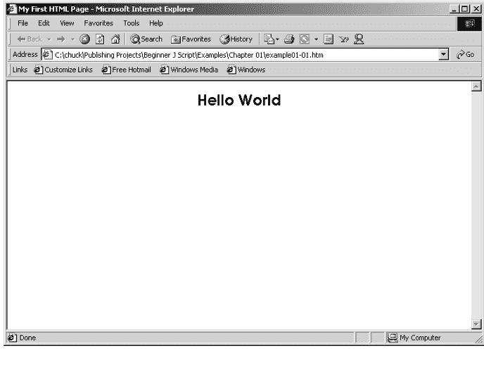

图 1-1

到现在，我相信你已经注意到一个模式。所有命令都有一个开始命令和一个结束命令。嗯，除了极少数 HTML 命令外，所有命令都是如此。只需记住这条规则：你以与打开命令相反的顺序关闭它们。注意在示例 1-1 中，我在文本之前这样打开命令：<P><CENTER><B><FONT SIZE="+2">，然后这样关闭它们：</FONT></B></CENTER>。（`<P>` 不需要关闭。）记住这一点很重要。你可以将此视为“退出”你的命令。

## 图像和超链接

到目前为止，我们已经得到了一个非常简单的网页，其中用粗体文本显示了一个短语。诚然，这并不十分令人印象深刻，但如果你理解了使用这些 HTML 命令所涉及的概念，那么你就在概念上理解了 HTML。现在让我们扩展你的 HTML 知识。通常网页不仅仅包含一个标题和一些文本。你可能在网页中放置的其他项目包括图像和指向其他网页的链接。在 HTML 文档上放置图像相当简单：

```

```

你只需提供图像的路径和图像的名称，包括其文件扩展名（如 .gif、.bmp、.jpg 等）。此命令中的其他属性允许你更改图像的位置和大小。你可以更改其宽度和高度以及对齐方式。

你还会注意到，当你第一次在 HTML 页面上放置图像时，它周围会有一个边框。你可以通过在标签中添加 `BORDER = 0` 来去除它，如本例所示：

```

```

放置指向另一个网站或电子邮件地址的超链接同样简单：

```
<A HREF="http://www.wordware.com">
```

此链接将连接到引号内包含的 URL（统一资源定位器）。为了使用此方法创建电子邮件链接，只需使用：

```
<A HREF="mailto:somebody@somemail.com">
```

你只需将“http://”部分更改为“mailto:”。请注意，前面所有三种方法都有一个共同点。它们没有以其他 HTML 命令典型的关闭方式来关闭命令。现在让我们检查一个简单但完整的 HTML 文档的源代码：

**示例 1-2**

```
<HTML>
<HEAD>
    <TITLE>Test HTML Page</TITLE>
</HEAD>
<BODY BGCOLOR="blue">
<P>
<CENTER><B><FONT SIZE="+2">My First Web Page </FONT></B></CENTER>
<P>I am learning HTML !. I <B><I>LOVE</I></B> HTML!
<P><CENTER></CENTER>
<P>
<P><CENTER>You can email me at</CENTER>
<P>
<CENTER><A HREF="mailto:myemail@someemail.com">Email ME</A>
</CENTER>
<P><CENTER>Or go to this publisher's Web Site </CENTER>
<P><CENTER><A HREF="http://www.wordware.com">Wordware Publishing</A></CENTER>
</BODY>
</HTML>
```

首先澄清几点。你应该在开头注意到一个新命令：

```
<BODY BGCOLOR="blue">
```

你可以使用此命令和任何标准颜色更改页面的背景色。你也可以使用类似的命令为 HTML 文档设置背景图像：

```
<BODY background="mypicture.gif">
```

advjscript.jpg 图像在名为第 1 章的文件夹中的代码文件中可用。如果你正确输入了代码并使用了提供的图像，你的网页应与图 1-2 相似。

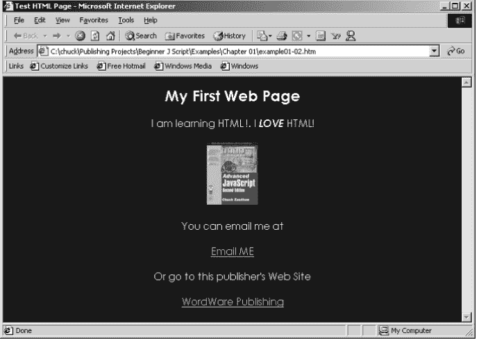

现在我将首先承认这个示例网页非常简单。但它确实包含了 HTML 的基础知识。通过我们到目前为止涵盖的内容，你可以显示图像、文本、链接、电子邮件链接、背景颜色和背景图像。对于短短几页内容来说，这已经相当不错了。

## 颜色和背景

让我们检查一下我们还可以添加到 HTML 文档中的其他几个简单项目。第一个是更改文本颜色。你可以为整个文档设置默认文本颜色，也可以更改特定文本的颜色。你使用与更改背景色非常相似的技术来更改整个文档的默认文本颜色：

```
<BODY TEXT="blue">
```

这段文本只是告诉浏览器，除非另有说明，否则此文档中的所有文本都应为蓝色。除了更改文档中所有文本的默认颜色外，你可能还想简单地更改特定文本部分的颜色。这也相当容易实现。我们不是使用 BODY TEXT 命令，而是使用 FONT 命令：

```
<FONT COLOR="red">This is red text</FONT>
```

这与其他颜色命令一样，可以与任何标标准颜色一起使用。有许多标签可以用来改变文本和图像的外观和行为。再举几个供你参考，例如 `<BLINK> </BLINK>` 标签，顾名思义，它使文本闪烁（仅受 Netscape 支持，在 Internet Explorer 中不起作用）。另一个例子是 `<STRIKE> </STRIKE>`，它使文本显示时带有一条删除线。到目前为止我们涵盖的标签足以让你在 HTML 中完成所需的工作。

### 表格

我们要检查的下一个 HTML 命令是表格。它们是在网页上组织数据的一种非常好的方式。你可以使用带边框或不带边框的表格。我将解释使用一种方法而不是另一种方法的各种原因。

首先，我将向你展示如何创建一个带边框的表格：

```
<TABLE BORDER=1>
    <TR>
        <TD>
            <P>This
            <P>Is a
    <TR>
        <TD>
            <P>Table
        <TD>
            <P>With a border
</TABLE>
```

到现在，你应该能够识别出 `<TABLE>` 和 `</TABLE>` 标签实际上包含了表格。每个 `<TR>` 标签指定表格中的另一行。`<TD>` 标签在该行内创建一个单元格（TD 代表表格数据）。使用这三个标签，你可以创建任意行数或列数的表格。注意此代码的第一行将 BORDER 属性设置为 1。这意味着边框有宽度，因此是可见的。

在某些情况下，你可能不希望显示边框。表格可以简单地用于以相对位置容纳图像和文本。在这种情况下，你可能不希望有可见的边框。下面是一个边框不会显示的表格示例。

```
<P><TABLE BORDER=0 CELLSPACING=0 CELLPADDING=0>
    <TR>
        <TD>
            <P>This
        <TD>
            <P>is a
    <TR>
        <TD>
            <P>Table
        <TD>
            <P>With no borders or padding
</TABLE>
```

注意 BORDER、CELLPADDING 和 CELLSPACING 属性都设置为 0。这导致表格本身不显示。但是，表格的内容会显示。你还应该注意到，在这两个示例中，我都在每个单元中放置了文本。

图 1-3 显示了两个表格，一个有边框，一个没有。

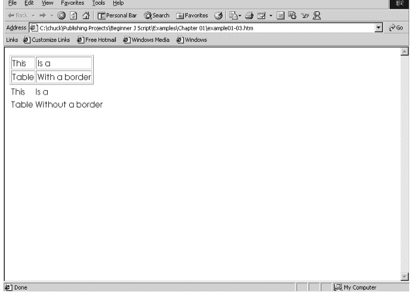

由于本书的全部目的是教你 JavaScript，你脑海中显而易见的问题应该是“我如何将脚本插入 HTML？”嗯，幸运的是，这并不特别困难。浏览器处理脚本代码（包括 JavaScript）就像处理 HTML 代码一样，从左到右、从上到下扫描源代码。JavaScript 有自己的“标签”，通过它来指示浏览器并确定布局。然而，JavaScript 的读取方式并不完全像 HTML。在 HTML 中，浏览器根据它识别的元素立即采取行动。并非所有 JavaScript 代码都指页面加载时发生的操作。有些部分只是保存在内存中，直到被调用。例如，如果你编写了一个函数但没有调用它，浏览器不会对它做任何操作。脚本的这部分内容会保留在内存中，直到被调用。

memory and can be invoked later. But the real question you are likely wondering about before you proceed with the rest of this book and learning JavaScript is, how do you put scripts into your HTML documents. Any script can be placed in a document very easily by encasing the script inside of two commands:

```
<SCRIPT LANGUAGE = "whateverscriptlanguageyouareusing">
```

and

```
</SCRIPT>
```

There is a variety of scripting languages available for the web including VBScript (based on the Visual Basic programming language), CGI, and of course, JavaScript. Below are two examples of JavaScripts inserted into HTML code.

```
<SCRIPT LANGUAGE="JavaScript">
document.write("")
</SCRIPT>
```

```
<SCRIPT LANGUAGE="JavaScript">
function makeDialogBox()
{
    alert("Wonderful!")
}
</SCRIPT>
```

## 列表

使用列表呈现数据是很常见的。在HTML中，你可以使用多种类型的列表。我们将讨论的第一种是下面所示的无序列表。

```
<UL>
    <LI> First Item
    <LI> Second Item
</UL>
```

`<UL>`和`</UL>`标签将它们之间的代码定义为无序列表的一部分。`<LI>`标签标识列表项。无序列表项将简单地显示为带项目符号的项目，如以下图所示。

有序列表没有太大不同。`<LI>`列表项保持不变。但`<UL>`标签会有所变化。

```
<OL type = I>
    <LI> First Item
    <LI> Second Item
</OL>
```

标签中的“type =”部分告诉浏览器这是哪种类型的列表。我们在示例中使用了大写字母I，这将为你的列表项提供大写罗马数字。

下表显示了所有类型的有序列表以及它们在浏览器中的显示方式。

| Type = I | I. 第一项 II. 第二项 |

| Type = i | i. 第一项 ii. 第二项 |

| Type = 1 | 1. 第一项 2. 第二项 |

| Type = a | a. 第一项 b. 第二项 |

| Type = A | A. 第一项 B. 第二项 |

有关列表的演示，请参见代码中的示例1-4。

## 跑马灯

你可以添加到网页的一个非常吸引人的项目是跑马灯。滚动的跑马灯将一条消息或图像在屏幕上滚动。基本格式如下：

```
<MARQUEE LOOP = INFINITE> Hey this is really cool </MARQUEE>
```

除了文本，你还可以将图像放在跑马灯中在屏幕上滚动：

```
<MARQUEE LOOP = INFINITE> </MARQUEE>
```

你还可以改变跑马灯滚动的方向。`<DIRECTION>`标签将告诉跑马灯滚动到哪个方向，而不是从哪个方向滚动。

```
<MARQUEE LOOP = INFINITE DIRECTION = RIGHT>Hey this is a cool marquee </MARQUEE>
```

你可以从以下方向中选择：左、右、上和下。

跑马灯提供了一种有趣且相对简单的方式来在网页上显示引人注目的信息。

### 总结

让我强调一下，我刚才和你介绍的仅仅是编写HTML代码的基础知识。你会发现有很多书籍比这更深入地讲解HTML。

还有各种各样的软件包可以为你生成HTML代码。你只需像在任何文字处理器中一样创建一个文档，软件就会生成底层的HTML代码。我推荐两个用于基本HTML编码的非常便宜的选择：Claris Works Home Page（约25美元）和Netscape Composer，后者随Netscape Communicator一起提供，完全免费。

# 第2章 JavaScript 入门

本书将通过逐步引导你制作一个完整的网站来教你JavaScript。然而，为了快速上手，你首先必须对JavaScript有一个基本的掌握。本章的目标是向你介绍JavaScript的基本概念。接下来的每一章都将讨论JavaScript的一个特定方面，并提供几个示例。在每章总结之前，有一个部分我们会将该章涵盖的内容应用于我们正在构建的网站。

本章将带你了解JavaScript的技术细节。你可以阅读后面的章节并使用它们，而无需阅读本章。但是，在某个时候你会想要回顾本章。其内容解释了JavaScript工作原理的复杂性。即使你跳过了这一章，我建议你在读完本书的前10章后再回来阅读它。

## 基本工具

HTML文件是纯文本文件。因此，为了将JavaScript添加到现有的HTML文档中，你需要一个文本编辑器。记事本是一个非常棒的简单文本编辑器选择，即使没有其他原因，它也是免费随Windows附带的。大多数操作系统，包括Windows、Macintosh和Linux，都附带一个免费的文本编辑器。

你可以为JavaScript和HTML使用各种编辑器。然而，许多经验丰富的网页开发者只是使用操作系统通常附带的免费标准文本编辑器。如果你使用Windows，你的PC上已经有记事本和写字板；这两个都适合进行HTML和JavaScript开发。使用标标准文本编辑器的优点是它们是免费的。缺点是它们不提供任何调试工具来帮助你处理JavaScript。我个人更喜欢简单地使用记事本进行HTML和JavaScript开发。

## 选择浏览器

除了基本的编程工具，你还需要能够运行你的脚本并查看它们的输出。选择哪个浏览器并不重要。Netscape和Microsoft Internet Explorer的最新版本都完全支持JavaScript。兼容性问题应该只存在于较旧版本的浏览器中。由于这两种浏览器都可以免费下载，建议你都下载一份，这样你就可以在两种浏览器中测试你的脚本。

## 基本JavaScript结构

为了运行客户端JavaScript，你必须将代码嵌入HTML文档中。然而，你不能将JavaScript语句随意放在源代码中的任何位置。基本上有两种方法可以将JavaScript脚本嵌入HTML中：

- 使用`<SCRIPT>` `</SCRIPT>`标签作为语句和函数。

- 作为类似于URL的简短语句。

## `<SCRIPT>` 标签

此标签在HTML中定义一个脚本的开始。你可以声明一个直接写在HTML代码中的脚本，或者在一个单独的文件中。

### 内部脚本

`<SCRIPT>`标签用于将JavaScript代码封装在HTML文档中。这是包含简单JavaScript的最常见方式，也是我们在本书大部分内容中将使用的方法。以下是通用语法：

```
<SCRIPT LANGUAGE="JavaScript">
[JavaScript Statements...]
</SCRIPT>
```

`<SCRIPT LANGUAGE="JavaScript">`标签的行为类似于所有其他HTML标签。注意，它必须后跟其结束对应标签`</SCRIPT>`。你放在两个标签之间的每条语句都将被解释为JavaScript代码。这可能是将JavaScript插入HTML文档的最常用方法。

`LANGUAGE`属性用于指定脚本语言。目前，`<SCRIPT>`标签支持多种语言，包括JavaScript和VBScript。JavaScript是默认的脚本语言，因此`LANGUAGE`定义不是必需的。但是，为了清晰起见，我建议你仍然使用它。当浏览器遇到确切的语言名称时，它会加载内置的JavaScript解释器，然后解释脚本。

JavaScript区分大小写，但HTML不区分。写`<SCRIPT>`还是`<script>`都没有关系，但要尽量保持一致。确保正确书写语言名称。就我个人而言，我在HTML中使用全大写；虽然这对浏览器来说无关紧要，但对阅读我HTML代码的人来说有关系。你会发现许多网络开发者都遵循这个惯例。请记住，HTML和JavaScript与任何编程语言一样，你应该始终努力确保你的代码具有可读性。

### 外部脚本

`<SCRIPT>`标签有一个`SRC`属性，它支持使用外部脚本。这意味着你可以将脚本放在一个单独的文件中，并使用`SRC`属性将其包含进来。当你有冗长或复杂的脚本，并且觉得直接将它们包含在HTML代码中会使阅读变得困难时，外部脚本非常有用。我将在本书后面的部分使用外部脚本。

### 放置JavaScript代码

当你想在HTML文档的某个位置放置脚本时，你需要选择一个合适的位置。从技术上讲，你可以将其放在包围整个文档的`<HTML>`和`</HTML>`标签之间的任何位置。实际上，有两种可能性：`<HEAD>...</HEAD>`部分和`<BODY>...</BODY>`部分。因为`<HEAD>...</HEAD>`部分会被首先评估，许多开发者选择将他们的JavaScript放在这里。一个HTML文档可以包含任意数量的脚本。你可以将一些脚本放在`<HEAD>...</HEAD>`部分，将其他脚本放在页面的`<BODY>...</BODY>`部分。放置位置的选择应遵循一些逻辑，基于你希望脚本何时执行。放在`<HEAD>`部分的脚本将在网页加载后立即执行。以下代码演示了这一点：

## 第2章

### 使用多个脚本

```html
<HTML>
<HEAD>
<TITLE>使用多个脚本</TITLE>
<SCRIPT LANGUAGE="JavaScript">
[JavaScript 语句...]
</SCRIPT>
<SCRIPT LANGUAGE="JavaScript">
[JavaScript 语句...]
</SCRIPT>
</HEAD>
<BODY>
<H1>这是另一个脚本</H1>
<SCRIPT LANGUAGE="JavaScript">
[JavaScript 语句...]
</SCRIPT>
</BODY>
</HTML>
```

### JavaScript 惯例

有几种惯例被用来使 JavaScript 代码更易于理解。本节将讨论其中一些惯例。

#### 使用分号

JavaScript 解释器不会注意源代码中的回车符。可以在同一行放置多条语句，但必须用分号 (`;`) 分隔它们。也可以在单独占一行的语句末尾添加分号，但这并非必需。请看以下语句：

```javascript
document.write("Hello"); alert("Good bye")

document.write("Hello")
alert("Good bye")

document.write("Hello");
alert("Good bye");
```

这三组语句都是合法的，并且结果相同。我要强调的是，分号并不是必需的；我之所以提到它们，是因为具有 C、C++ 或 Java 背景的程序员习惯于用分号结束语句。尽管允许使用分号，但我个人从不使用它，因为在 JavaScript 中使用它是多余的。

### 区分大小写

本章前面提到过，JavaScript 是一种区分大小写的语言。这一事实适用于语言的所有方面，包括变量名（*标识符*）、函数和方法（稍后讨论）。例如，语句 `document.write()` 是合法的，但 `document.Write()` 则不是。

### 注释

注释是所有语言（包括 JavaScript）中的一个重要概念。它们有助于使程序简单易懂。注释是可以放在程序各个位置而不会影响结果的消息。JavaScript 中有两种不同类型的注释：

- 单行注释是指不超过一行长度的注释。这些注释以双斜杠 (`//`) 开头。

- 多行注释是指超过一行长度的注释。因此，它们需要一个符号来指定注释的开始，另一个符号来指定注释的结束。开始部分是 `/*`，结束部分是 `*/`。

```javascript
// 单行注释
/* 多行注释的第1行
   多行注释的第2行
   多行注释的第3行 */
```

这两种类型的注释与 Java、C 和 C++ 中的注释相同。

注释是任何编程语言的重要组成部分。如果你在团队环境中工作，注释可以让其他人清楚地理解你的代码意图。我还要补充一点，如果你在几个月后回顾自己的代码，你很可能不记得当初的计划。尽管有些程序员会说编写良好的代码需要很少或不需要注释，但我强烈不同意这一点。我个人提倡在代码中大量使用注释。即使你“过度注释”，也绝对不会有任何害处。

### 使用引号

在 JavaScript 中，你经常使用引号来实现各种目标，例如界定字符串。当在一对引号内使用另一对引号时，会出现一个常见问题。由于解释器必须识别每组引号以正确配对，JavaScript 的创造者使得可以使用两种不同类型的引号：双引号 (`"`) 和单引号 (`'`)。如果你只需要一对引号，你可以选择其中任何一种，只要用你开始引号时使用的相同类型引号来结束文本即可。如果你不正确地使用引号，你将得到一个 JavaScript 错误：“未终止的字符串字面量”。你必须确保正确地交替使用引号：

```javascript
document.write("")
```

### 你的第一个脚本

既然你已经了解了 JavaScript 背后的基本概念，我想是时候实际编写一些 JavaScript 了。你可能已经对所有这些背景信息感到相当厌倦，并渴望看到一些实际操作。

首先，启动你的文本编辑器。在文本编辑器中输入示例 2-1，并将其保存为 Hello.htm。确保文件名以 .htm 或 .html 扩展名结尾，否则你的浏览器将无法识别这是一个 HTML 文档。然而，至关重要的是，当你输入这个示例时，要尽最大努力完全理解你正在输入的内容。接下来，启动浏览器。由于文件是本地的，你不需要连接到互联网就可以查看结果。现在，从浏览器的菜单加载文件。就这么简单。你可以开始享受 JavaScript 了。

下面的脚本在你加载包含它的页面时会被立即解释和执行。

#### 示例 2-1

```html
<HTML>
<HEAD>
<TITLE>你好世界。</TITLE>
</HEAD>
<BODY>
<SCRIPT LANGUAGE="JavaScript">
<!--向老式浏览器隐藏代码
document.write("<H1>你好世界。</H1>")
// 结束代码隐藏
</SCRIPT>
</BODY>
</HTML>
```

如果你正确输入了代码，你应该在浏览器中看到类似图 2-1 的内容。

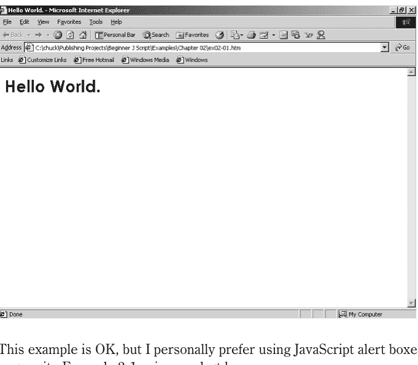

图 2-1

这个示例没问题，但我个人更喜欢使用 JavaScript 警告框。所以让我们用警告框重写示例 2-1：

#### 示例 2-2

```html
<HTML>
<HEAD>
<TITLE>再次你好！</TITLE>
</HEAD>
<BODY>
<SCRIPT LANGUAGE="JavaScript">
<!--向老式浏览器隐藏代码
alert("你好世界")
// 结束代码隐藏
</SCRIPT>
</BODY>
</HTML>
```

这两个非常基础的 JavaScript 脚本应该能让你感受到这门语言，并希望激发你学习更多的兴趣。然而，在我们能够深入探索用 JavaScript 构建动态网站的激动人心的世界之前，我们需要先介绍这门语言更基础的内容。

### JavaScript 基本概念

JavaScript 由与所有编程语言相同的基本元素组成。它有变量，用于存储数据；有表达式或语句；还有函数。这些构建块中的每一个都用于构建你的 JavaScript。

### JavaScript 中的数据类型和变量

变量本质上是为存储特定类型的数据而预留的命名内存段。这些类型被称为数据类型。当你创建一个变量时，你只是为所声明变量的数据类型在内存中分配了一个空间。使用正确的数据类型来存储信息非常重要。例如，数字是 JavaScript 识别的一种信息类型。与大多数编程语言相比，JavaScript 的数据类型较少。JavaScript 中只有四种不同的数据类型：数字、字符串、布尔值和 null 值。与其他语言相反，变量的数据类型不是显式声明的，而是根据其初始值赋值隐式确定的。JavaScript 的另一个独特之处在于，整数和实数之间没有明确的区分。

JavaScript 是一种*弱类型*语言。声明 JavaScript 变量的唯一关键字是 `var`。实际使用的数据类型取决于你分配给变量的初始值。考虑以下示例：

```javascript
var LastName = "Smith"
var AccountNumber = 1111
```

在第一个示例中，`LastName` 的数据类型是字符串，仅仅因为那是分配给该变量的初始值。在第二个示例中，`AccountNumber` 的数据类型是数字。

这种变量声明方法与*强类型*语言（如 C 或 Java）形成鲜明对比。在强类型语言中，变量必须是特定类型创建的。

```c
int myint;
boolean myboolean;
```

创建变量时需要遵守一些规则：

- 第一个字符不能是数字。

- 所有其他字符可以是字母、下划线或数字 (0-9)。

- 标识符不能是语言的保留字。保留字基本上是构成 JavaScript 语言的词语。

- JavaScript 区分大小写（大写字母与小写字母不同）。例如，`counter`、`Counter` 和 `COUNTER` 是三个不同变量的名称。避免在同一个脚本中使用如此相似的标识符。

以下变量名是合法的：

```javascript
loopcounter
_employeename
_123456789_
account_number
Number16
```

但以下变量名是非法的：

```
with                     // 保留字
^mysting                 // 第一个字符非法
411information           // 不能以数字开头
04-825-6408              // 第一个字符非法
                         // "-" 是非法字符
***important***          // * 不是合法字符
```

给变量赋初始值的操作称为*初始化*。你使用*赋值运算符*（等号）给变量一个值：

```javascript
var variableName = initialValue
```

你只需要在创建变量时使用 `var` 关键字。当你想要引用该变量时，只需使用它的名称。以以下方式给变量赋值（在声明之后）：

```javascript
variableName = anyValue
```

你每个变量只使用一次 `var`。全局变量可以通过不使用 `var` 关键字直接赋值来创建。另一方面，函数内部的局部变量必须使用 `var` 关键字声明。与许多其他编程语言一样，JavaScript 允许你在同一条语句中声明多个变量，使用逗号分隔它们：

```javascript
var variableName1 = initialValue1, variableName2 = initialValue2, ...
```

## 第22章 第2章

JavaScript 运算符

每种编程语言都有运算符。运算符就是一个简单的符号，它告诉编译器（或解释器）执行特定的操作。基本的算术运算符在大多数编程语言中是通用的。这些运算符包括加法（+）、减法（-）、乘法（*）和除法（/）。这些对大多数人来说应该非常熟悉。运算符的优先级遵循标准的数学规则：乘法、除法、加法、减法。然而，当你的代码在单行中有多个操时，通常最好使用括号来明确你想要发生什么；`3 * 4/2 + 1` 可能存在歧义，而 `3 * ((4/2) + 1)` 则非常清晰。

C、C++ 和 Java 程序员已经熟悉递增和递减运算符，而其他程序员可能不熟悉。递增运算符通过在变量后放置两个加号来完成，如下所示：

```javascript
var somenumber;
somenumber++;
```

这行代码将 `somenumber` 的值递增 1。如果我们这样写：

```javascript
somenumber--;
```

它将把值减少 1。

你必须认识到递增和递减运算符放置的位置至关重要。如果你将递增运算符放在变量之后，例如：

```javascript
var somenumber = 10;
var someothernumber;
someothernumber = somenumber++;
```

赋值操作将在求值操作之前发生。换句话说，首先 `someothernumber` 将被设置为等于 `somenumber` 的值，然后 `somenumber` 的值才会递增。在我们的例子中，这意味着 `someothernumber` 将等于 10，而 `somenumber` 将等于 11。如果你希望重写这个语句，使递增操作先发生，只需重新放置递增符号：

```javascript
someothernumber = ++somenumber;
```

在这种情况下，`somenumber` 被递增到 11，然后这个值被赋给 `someothernumber`。

你已经学会了如何使用等号赋值运算符为变量赋值或初始化它。正如下面的代码片段所示，你也可以在赋值时执行计算：

```javascript
/* 1 */ var answer;
/* 2 */ answer = 4 * 2 + 9;
/* 3 */ document.write(answer);
```

第 1 行包含变量 `answer` 的声明。第二行展示了如何将变量 `answer` 赋值为一个简单数学表达式的结果。此时，变量持有的值为 17。引用变量 `answer` 与引用数字 17 是一样的。因此，第 3 行的语句打印出数字 17。

> **注意：** 一个常见的错误是使用等号进行相等性检查。例如，在 Visual Basic 中，`=` 是一个相等性测试运算符，因为该语言的基本赋值运算符是 `:=`。然而，在 JavaScript 中，就像在 C++ 和 Java 中一样，`=`（等号）是一个赋值运算符，而 `==`（双等号）才是一个相等性测试运算符。

## JavaScript 语句

既然我们已经彻底研究了数据类型，现在让我们来看看语句。*语句* 就是一行执行特定任务或操作的代码。例如，以下所有都是语句：

```javascript
myAge = 32;
for(x=1;x<10;x++);
myname= "Chuck";
```

### 多条语句

JavaScript 解释器接受在同一行放置多条语句。如果你选择使用这种方法，必须用分号（`;`）分隔这些语句。请注意，这是 JavaScript 中唯一要求使用分号的地方，并且，在我看来，也是你应该使用分号的唯一地方。行末的最后一个语句不必跟分号。这样的行看起来像这样：

```javascript
statement1; statement2; statement3;
```

浏览器将这些语句解释为它们在单独的行上：

```javascript
statement1
statement2
statement3
```

虽然这在 JavaScript 中是可行的，但我绝不推荐这样做。将多条语句放在单行会使代码非常难以阅读。

### 嵌套语句

命令块是由花括号括起来的一组语句。理解块应该被视为一条语句是非常重要的。块内部的语句称为 *嵌套语句*：

```javascript
{
    nested statement1;
    nested statement2;
    nested statement3;
}
```

包含多条语句的循环实际上是一条包含多条嵌套语句的语句。这个规则适用于函数、if-else 语句和其他语言元素。

## JavaScript 表达式

既然你知道了如何创建变量，你需要知道如何使用它。如前所述，变量持有不同类型的值。“持有值”这个术语指的是表达式 *求值*。变量总是对其值求值。当你对一个变量执行操作时，你实际上是在对该变量关联的当前值执行操作。让我们假设你使用以下语句创建了一个名为 `firstNumber` 的变量：

```javascript
var firstNumber = 120; // declaration and initialization
```

此时，如果你引用变量 `firstNumber`，它的值 120 就会被返回。也就是说，`firstNumber` 被求值为 120。以下语句概述了对 `firstNumber` 的求值：

```javascript
secondNumber = firstNumber * 6;
```

`secondNumber` 变量现在持有值 720，因为 `firstNumber` 被求值为 120。请记住，变量的内存位置之间没有建立任何链接。因此，`secondNumber` 现在持有的值是 720，即使 `firstNumber` 的值改变，这个值也不会改变。一个变量可以被求值为任何类型的值。

## JavaScript 函数声明

*函数* 就是一组相关的语句，它们执行某个共同的目标，并被组合在一个共同的函数名下。就像变量一样，你必须在调用函数之前先定义它。

函数使用关键字 `function` 定义，后跟函数的名称。适用于变量命名的规则也适用于函数命名。由于函数通常除了存储值之外还要做一些事情，因此在名称中包含一个动词是很常见的。关于函数命名，最重要的是要记住名称应该提供一些关于函数作用的指示。函数的参数写在名称后面的括号中。参数是传递给函数以供处理的值。函数定义的语法是：

```javascript
function functionName([parameters])
{
    [statements]
}
```

*参数* 是在函数被调用时被赋值的局部变量。此时，你应该始终为每个参数命名。

在正式的语法规范中，方括号 "[" 和 "]" 通常表示可选元素。由于函数不必有参数或语句，因此它们都包含在这样的括号中。包含函数体的花括号可以放在参数部分之后的任何位置。以下函数是有效的：

```javascript
function functionName([parameters]) {[statement1]; [statement2]; ...}
function functionName([parameters])
{
    [statement1];
    [statement2];
}
```

以下示例演示了一个函数声明：

### 示例 2-3

```html
<HTML>
<HEAD>
<SCRIPT LANGUAGE="JavaScript">
<!-- hide script contents from old browsers
function square(number)
{
    document.write("The call passed ", number, // the function's parameter
    " to the function.<BR>",
    number,                      // the function's parameter
    " square is ",
    number * number,
    ".<BR>");
}
// *** add function call
// end hiding contents from old browsers -->
</SCRIPT>
</HEAD>
<BODY>
</BODY>
</HTML>
```

示例 2-3 没有向浏览器窗口打印任何内容，也没有生成任何其他形式的输出。原因是函数只是在脚本中被定义，但从未被调用。当浏览器找到一个函数时，它会将其语句加载到内存中，准备稍后执行。

### 调用函数

为了执行函数块中包含的语句集，你必须调用该函函数。函数调用的语法是：

```javascript
functionName([arguments]);
```

通过在示例 2-2 中的指定位置添加语句 `square(5)`，我们调用了该函数。函数中的语句被执行，并输出以下消息：

```
The call passed 5 to the function.
5 square is 25.
```

你也可以在另一个函数内部调用一个函数，如以下示例所示：

### 示例 2-4

```html
<HTML>
<HEAD>
<TITLE>Calling a function from within another function</TITLE>
<SCRIPT LANGUAGE="JavaScript">
<!-- hide script contents from old browsers
function makeBar()
{
    var output = "<HR ALIGN='left' WIDTH=400>";
```

## 对话框

JavaScript 提供了创建名为*对话框*的小窗口的功能。你可以创建小型的警报框、确认框和提示框。这些框让你能够生成输出并从用户那里接收输入。

### 警报框

警报框是最简单的对话框。它使你能够在单独的窗口中向用户显示一条简短的消息。看看下面的脚本及其对应的输出：

```javascript
alert("Click OK to continue...")
```

此函数的通用形式是 *alert(message)*。函数 alert() 实际上是 window 对象的一个方法。因为 window 是默认对象，所以无需特别指明。所有对话框都适用此规则。

> 注意：Netscape Communications Corp. 出于安全原因实现了“JavaScript Alert:”标题。它用于区分 JavaScript 对话框和由操作系统创建的对话框，以便用户了解消息的来源。JavaScript 程序员无法诱骗用户执行其可能不想要的操作。它还禁止了吓唬用户以获取个人信息的能力。

你也可以使用变量来显示消息。例如：

```javascript
var message = "Click OK to continue"
alert(message)
```

警报框常用于暂停脚本的执行，直到用户批准其继续。

### 确认框

确认框与警报框的不同之处在于，它们会根据用户做出的选择求值为一个值。确认框不仅包含一个“确定”按钮，还包括“确定”和“取消”两个按钮。

与警报框类似，confirm 也是 window 对象的一个方法。此方法返回一个布尔值，因为有两个选项。你可以使用确认框询问用户是/否问题，或确认某个操作。以下是一个示例及其输出：

```javascript
var reply = confirm("OK to continue?")
```

如果用户选择“确定”，reply 被赋值为 true；如果用户选择“取消”，则赋值为 false。此函数的通用形式是 confirm(message)。

### 提示框

prompt() 方法显示一个带有消息和输入字段的提示对话框。你可以使用这些框从用户那里接收输入。它与确认框类似，不同之处在于它返回输入字段的值，而不是 true 或 false。以下是一个示例：

```javascript
var name = prompt("Enter your name:", "anonymous")
```

如果用户选择“取消”，该方法返回 null。提示框的外观如图 2-3 所示。

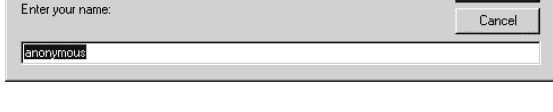

字段的值始终是一个字符串。如果用户在表单中输入 16，返回的是字符串 "16" 而不是数字 16。当你需要提示用户输入数字时，必须将输入转换为数值。JavaScript 提供了一个内置函数来实现此功能——parseInt()。你可以使用以下语句来要求用户输入一个数字：

```javascript
var number = parseInt(prompt("Enter a number:", 0))
```

或者

```javascript
var number = prompt("Enter a number:", 0)
number = parseInt(number)
```

此函数的通用形式是 prompt(message[, inputDefault])。

你可以通过使用 typeof 运算符进行测试来了解此函数的工作方式：

```javascript
var number = prompt("Enter a number:", 0)
alert(number, " is a ", typeof number) // "... is a string"
number = parseInt(number)
alert(number, " is a ", typeof number) // "... is a number"
```

当然，输入必须是数值类型（例如 99）。

## if 语句

```javascript
if (condition)
    statement
```

if 语句让你可以在脚本中加入决策。没有任何决策的脚本每次执行都遵循相同的流程。这种线性结构将你的脚本限制在简单的算法。JavaScript 使用 if 语句实现决策。if 语句将单个语句与一个 true 条件关联起来。该语句仅在条件表达式为 true 时执行；否则根本不执行。条件必须求值为布尔值：true 或 false。数值也可以作为布尔条件的替代。0 等同于 false，所有其他值等同于 true。

if 语句将单个语句与一个 true 条件关联起来。语句可以是简单的 document.write() 到使用花括号（{}）的语句块之间的任何内容。一些 if 语句需要多个语句，因此它们使用以下形式的块：

```javascript
if (condition)
{
    statement1
    statement2
    statement3
}
```

```html
<HTML>
<HEAD>
<TITLE>A simple if statement</TITLE>
<SCRIPT LANGUAGE="JavaScript">
<!--
var age = parseInt(prompt("Please enter your age:", 15))
if (age > 30)
    alert("Wow, you are old enough to remember Disco!")
// -->
</SCRIPT>
</HEAD>
<BODY>
    JavaScript Example
</BODY>
</HTML>
```

这是一个包含 JavaScript 脚本的简单 HTML 文档。诚然，它并不值得过度兴奋。然而，它确实准确地演示了如何将 JavaScript 放入 HTML 文档中。注意其结构与任何其他 HTML 文档的结构相同。唯一的新概念是 <SCRIPT> 标签。我将脚本放在了页面的 <BODY>...</BODY> 部分，尽管你可以将其放在 <HTML> 和 </HTML> 标签之间的任何位置。目前，可以将 document.write() 视为一种将表达式打印到页面上的方式。write() 实际上是 document 对象的一个方法。对象、方法和属性将在第 6 章“文档对象模型”中介绍。write() 方法支持任何 HTML 语法。还要注意，所有字符串都必须包含在引号中。

### 总结

本章向你展示了 JavaScript 的基础知识。这些内容与 HTML 入门知识相结合，应该能为你提供继续阅读本书其余部分所需的基础技能。在继续之前，请确保你完全掌握了前两章的内容。

# 第 3 章

## 警报、提示和用户反馈

在你继续阅读本书之前，请确保你已彻底熟悉第 1 章和第 2 章的内容。这些内容提供了我在本书其余部分中将用于指导你构建完整网站的基础构建块。如果没有对 HTML 和 JavaScript 基础知识的掌握，你将很难顺利学习本书的其余部分。

出于教学目的，我将引导你完成为一家虚构企业构建完整网站的过程。由于我碰巧喜欢收集古籍，我们将为一家古籍书店构建一个网站。然而，这些技术适用于所有企业。每章将首先讨论一种或多种特定技术，然后给你一些使用这些技术的示例。然后，该章将在我们正在构建的虚构企业网站中使用其中一种或多种技术进行演示。

### 警报框

使用 JavaScript 能做的最简单的事情之一就是警报框。警报框只是一个弹出并给用户一些信息的小消息框。让我们先给访客添加一个简单的问候。这个问候将会随着我们的进行而变得更加有趣，添加更多有趣的特性。

考虑以下示例：

#### 示例 3-1

```html
<HTML>
<HEAD>
    <TITLE>Alert Box</TITLE>
```

## 34 第3章

```
<SCRIPT LANGUAGE="JavaScript">
    function alertMe(message)
    {
        alert(message)
    }
alertMe("Welcome to my web page!")
</SCRIPT>
</HEAD>
<BODY>
</BODY>
</HTML>
```

这看似是为网页添加的一个非常简单的功能，但你应该注意两点。第一，一些简单的弹出框和动态内容可以轻松地使你的网站与众不同。第二，你应该记住，这个脚本向你展示了如何使用警告框。警告框是一个内置的 JavaScript 函数，允许你向用户显示消息。你只需要传递一个变量或者一个你想显示的字符串字面量。你将在整本书中看到，这是一个非常有用的技巧，并且会被频繁使用。

如果你正确输入了示例 3-1 的代码，你应该会看到这个图像：

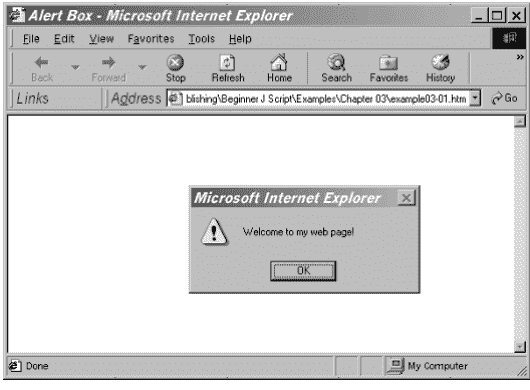

### 提示框

现在我们将扩展这个脚本，使用提示框，并根据用户的不同响应执行不同的操作。提示框与警告框非常相似，只是它允许用户输入数据。以下脚本为你提供了提示框如何工作的基本概念。

#### 示例 3-2

```
<HTML>
<HEAD>
<TITLE>Prompt Box</TITLE>
<SCRIPT LANGUAGE="JavaScript">
<!--
var name = prompt("Please Enter your name:", "John Doe")
alert("Hello " + name)
// -->
</SCRIPT>
</HEAD>
<BODY>
</BODY>
</HTML>
```

这个脚本首先使用一个提示框询问用户的名字。用户输入的值被放入一个名为 `name` 的变量中，使用赋值运算符 `=`（记住，单个 `=` 是将一个值赋给一个变量，而 `==` 是评估一个变量是否等于某个特定值）。

```
var name = prompt("Please Enter your name:", "John Doe")
```

请注意，我们确实为用户提供了一个默认值，以防他或她没有输入任何值。然后我们简单地使用他或她刚刚提供的名字向网站访问者显示一个问候语。以下图像显示了这些提示框。

## 36 第3章

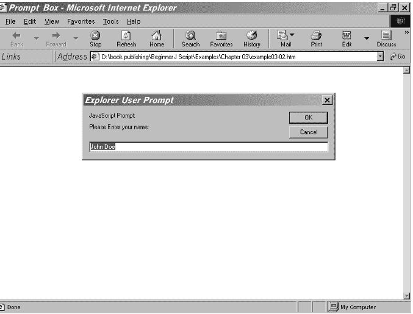

图 3-2

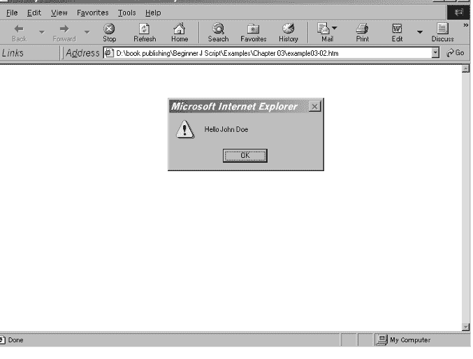

图 3-3

下一个示例演示了提示框与警告框和 if 语句的结合使用。这个脚本询问用户他或她使用的是什么浏览器，并做出相应的响应。

我们接下来要求用户做的是说明他或她是否使用的是最新版本的浏览器。你应该注意到，至此，所有输入框都有“确定”和“取消”按钮。如果用户点击“取消”，被赋值为提示框输入值的变量将包含一个 `null` 值。还要注意，两个提示框之间唯一的结构性区别是在括号前使用了单词“prompt”。

```
var name = prompt("Please Enter your name:", "John Doe")
var message = "Click OK if you are using Netscape 3.0 or above, or Internet Explorer 4.0 or above"
```

如果你在左括号前放置单词 `prompt`，JavaScript 将在其显示的提示框中创建一个文本字段，以便用户可以输入数据。如果没有 `prompt` 命令，你的提示框将只允许用户在“确定”和“取消”之间选择。

第二个问题是确保用户拥有最新版本的浏览器。较旧的浏览器不支持我们可能在创建网站时使用的所有 JavaScript 命令。在用户告诉我们他或她是否拥有最新版本后，我们使用一个 if 语句来选择我们的下一步操作。

```
if (!confirm(message))
{
alert("Please download the latest version of Netscape or Internet Explorer.")
}
else
{
alert ("Hello " + name )
}
```

下面的简单脚本为你说明了警告框和两种不同类型的提示框的使用，并结合了一个 if-else 代码段，为我们的网站创建一个有用的功能。

**示例 3-3**

```
<HTML>
<HEAD>
<TITLE>Prompt box 2</TITLE>
<SCRIPT LANGUAGE="JavaScript">
<!--
```

## 第3章

```
var name = prompt("Please Enter your name:", "John Doe")
var message = "Click OK if you are using Netscape 5.0 or above, or Internet Explorer 5.0 or above"
if (!confirm(message))
{
    alert("Please download the latest version of Netscape or Internet Explorer.")
}
else
{
    alert ("Hello " + name )
}
// -->
</SCRIPT>
</HEAD>
<BODY>
</BODY>
</HTML>
```

## 回写到网页

警告框和提示框是提供一定程度用户交互的相当简单的方法。你也可以使用 JavaScript 将信息直接写回网页。本质上，如果你希望显示某些内容然后在用户确认后立即消失，警告框是完美的。然而，如果你希望信息在用户访问你的网站期间一直保留在屏幕上，那么你需要将其写入实际的 HTML 文档中。

如果我们用以下代码替换前面的脚本，我们将能够在用户访问网站期间，将当前用户名保留在页面上。

### 示例 3-4

```
<HTML>
<HEAD>
    <TITLE>Writing to the web page</TITLE>
<SCRIPT LANGUAGE="JavaScript">
<!--
var name = prompt("Please Enter your name:", "John Doe")
var message = "Click OK if you are using Netscape 3.0 or above, or Internet Explorer 4.0 or above"
if (!confirm(message))
{
```

```
alert("Please download the latest version of Netscape or Internet Explorer.")
}
else
{
    document.write(name)
}
// -->
</SCRIPT>
</HEAD>
<BODY BGCOLOR= White>
</BODY>
</HTML>
```

请注意，唯一的真正区别在于这段代码：

```
else
{
    document.write(name)
}
```

我们没有显示一个警告框，而是将用户的名字写到了实际的网页上。注意 `document` 对象的使用。这个对象代表当前加载到浏览器中的网页。你将看到，你可以使用这个对象做很多有趣的事情。现在向 HTML 页面写一行内容是相当有趣的。但更有趣的是，你可以使用 `document.write()` 方法将新的 HTML 实际写入文档中。看看这个例子：

### 示例 3-5

```
<HTML>
<HEAD>
    <TITLE>Writing to the web page</TITLE>
<SCRIPT LANGUAGE="JavaScript">
var name = prompt("Please Enter M if you are male and F if you are female", "M")
if(name=='M')
{
    document.write('<FONT COLOR = Blue>')
    document.write('<H1>Yo Dude!</H1>')
    document.write('</FONT>')
}
else
{
    document.write('<FONT COLOR =Pink>')
    document.write('<H1>You go girl!</H1>')
    document.write('</FONT>')
}
```

}

</SCRIPT>

</HEAD>

</BODY>

</HTML>

如果你正确输入了代码，你应该会看到一系列像这样的图像：

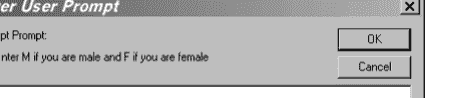

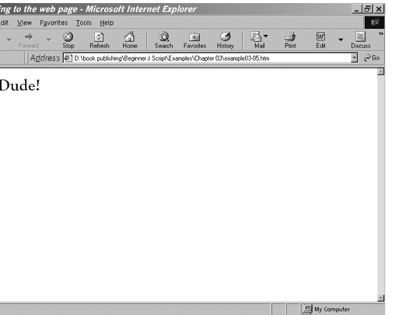

在这个例子中，我们从提示框获取用户的输入，然后将实际的 HTML 代码输入到现的网页中。你可以使用 `document.write()` 方法输入任何有效的 HTML 代码。这允许你根据用户的输入更改页面的实际 HTML 内容。现在我想让你花点时间考虑一下这一点。你可以轻松地根据用户的输入定制你的网页。再次，让我强调一下，你可以用这个方法编写任何有效的 HTML 代码。这可能是一个非常简单的技巧，但在我看来，这是最酷的技巧之一。

## 古旧书店项目

现在我们需要找到一种方法将这个脚本整合到我们正在进行的古旧书店页面中。以下代码提供了古旧书店页面的源代码（至少是开头部分），并集成了警告框和提示框。

```
main.htm
<HTML>
<HEAD>
    <TITLE>Ye Olde Book Shoppe</TITLE>
<SCRIPT LANGUAGE="JavaScript">
<!--
var name = prompt("Please Enter your name:", "John Doe")
var message = "Click OK if you are using Netscape 5.0 or above, or Internet Explorer 5.0 or above"
if (!confirm(message))
{
        alert("Please download the latest version of Netscape or Internet Explorer.")
}
else
{
        alert ("Hello " + name )
}
// -->
</SCRIPT>
</HEAD>
<BODY BGCOLOR= White>
<CENTER>
<P><TABLE BORDER=1 CELLSPACING=0 CELLPADDING=0>
    <TR>
        <TD>
            <P>
        <TD>
            <P><CENTER>Ye Olde Book Shoppe</CENTER>
        <TD>
            <P>
</TABLE>
</CENTER>
<P>
</BODY>
</HTML>
```

## 第3章总结

本章向您展示了如何使用警告框向用户提供反馈，以及如何使用提示框从用户那里获取信息。同时还介绍了如何直接向HTML文档中写入内容。这些简单的技术为您扩展JavaScript知识奠定了基础。这些脚本也为您的网站提供了与用户的基本交互。请特别注意document对象，因为您将在本书的许多地方看到它的使用。

我们将把这段代码放入`main.htm`页面中，这样当用户首次加载页面时，就会显示一条问候语。

# 第4章 图像效果

JavaScript最有用的方面之一是它使您能够非常方便地处理图像。您可以使用JavaScript对图像进行许多有趣的操作。本章我们将讨论的一些图像技术，仅仅是添加到网站上的迷人“视觉糖果”。而另一些则具有更实用的价值。

## Image对象

JavaScript有一个名为`Image`的内置对象。在本章的大多数脚本中，我们将使用这个对象。`Image`对象允许您创建代表可以在HTML页面中放置的任何类型图像（.JPG、.GIF、.BMP）的对象。要创建图像对象，您只需创建一个`Image`类型的变量，如下所示：

```
var myimage = new Image()
```

`Image`对象有一些您需要使用的属性。最重要的是`src`属性。它指定您将用作`Image`对象源文件的实际图像文件。使用此属性的语法为：

```
imageName.src = "myimage.gif"
```

`Image`对象只能用于处理已放置在HTML页面中的图像。您不能添加新图像或完全删除图像。但是，您可以将图像替换为其他图像。这种技术在通常被称为“鼠标悬停”的效果中得到了最好的体现。

## 鼠标悬停

鼠标悬停是最常用的JavaScript图像处理技术之一。其基本目的非常简单。当您将图像用作链接到另一页面时，可以使用鼠标悬停方法，使该图像在鼠标悬停时发生变化。

假设您的网页上有一张用作链接到另一页面的图像。我们想要实现的是，当用户将鼠标移动到该图像上时，该图像会发生变化。下面是一个实现示例：

```
if(document.images)
{
    image1 = new Image
    image2 = new Image
    image1.src = "mysecondimage.gif"
    image2.src = "myfirstimage.gif"
}
else
{
    image1=""
    image2= ""
}
</SCRIPT>
```

下面是将代码放入HTML `<body>`中的部分，您可以将其放置在希望链接/鼠标悬停效果出现的任何位置。

### 示例4-1

```
<A HREF ="nextpage.htm"
    onMouseover = "document.pic.src =image1.src"
    onMouseout = "document.pic.src =image2.src">


</A>
```

如果您正确输入了所有代码，您应该会观察到类似这样的效果：

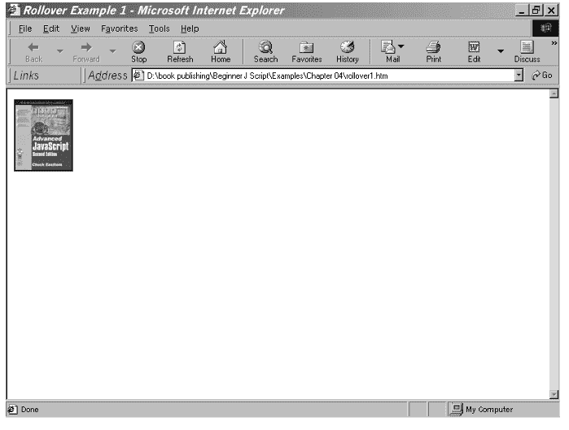

图 4-1

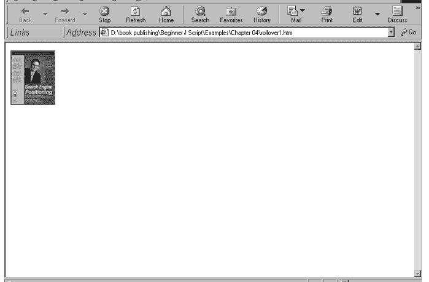

图 4-2

让我们来分析一下这段代码。JavaScript所做的是创建一些变量作为`Image`对象的实例。然后，我们将这些图像对象的`src`属性（源）设置为硬盘上的某个图片。当网页首次加载时，链接最初将显示“myfirstimage.gif”。我们已将该图像所在的位置命名为“pic”。当鼠标移动到图像/链接上时，我们将名为`pic`的图像区域更改为包含`image1`中的图像。当我们将鼠标移出图像时，又将其改回`image2`中的图片。`document`关键字对您来说是一个新关键字。它指的是浏览器中加载的当前HTML文档。这个关键字在后面的章节中将变得更加重要。

## 幻灯片放映

JavaScript允许您创建一个迷人的幻灯片放映。基本上，最初显示一张图像，用户可以在不同的图像之间前后滚动。这是添加到任何电子商务网站的一个突出功能。它允许您的网站访客查看您的所有产品，而无需在网页上一次性堆砌几十张图片。让我们看一个实现示例：

```
示例 4-2

<HTML>
<HEAD>
    <TITLE>幻灯片放映示例</TITLE>
    <SCRIPT LANGUAGE="JAVASCRIPT" >
        PicArray = new Array("pic1.jpg","pic2.jpg","pic3.jpg")
        CurrentPic = 0
        ImageCount = PicArray.length - 1
        function MovePrevious()
        {
            if (document.images && CurrentPic > 0)
            {
                CurrentPic--
                document.myPicture.src=PicArray[CurrentPic]
            }
        }
        function MoveNext()
        {
            if (document.images && CurrentPic < ImageCount )
            {
                CurrentPic++
                document.myPicture.src=PicArray[CurrentPic]
            }
        }
</SCRIPT>
</HEAD>
<BODY BGCOLOR="WHITE">
<CENTER>
<H1>我的幻灯片放映</H1>

<BR>
<A HREF="javascript:MovePrevious()">&lt;&lt; 上一张</A>
<A HREF="javascript:MoveNext()">下一张 &gt;&gt;</A>
</CENTER>
</BODY>
</HTML>
```

让我们仔细看看这个脚本，看看这里发生了什么。首先，在我们的JavaScript中，我们定义了一些变量：

```
PicArray = new Array("pic1.jpg","pic2.jpg","pic3.jpg")
CurrentPic = 0
ImageCount = PicArray.length - 1
```

第一个变量`PicArray`，只是一个图像数组。第二个是一个数字，表示我们当前正在查看数组中的哪个元素。所有数组都从零开始，因此我们将`CurrentPic`初始化为0。`ImageCount`只是一个数字，告诉我们当前有多少张图像。

在此特定脚本中，我们接下来做的是定义两个函数：`MovePrevious()`和`MoveNext()`。这些函数的目的相当明显，即在幻灯片放映中前进或后退。在每个函数中，我们都有一个`if`语句，它只询问两个问题：这个网页/浏览器是否支持图像对象（`if document.Images`）？我们是否已经到达幻灯片放映的边界（如果您在开头，则无法选择“上一张”）？如果这两个条件都满足，则执行该函数。

> **注意：** 符号`&&`表示逻辑与，即两个值都必须为真，操作结果才为真。`||`是逻辑或，即只有一个值为真，操作结果就为真。

`MovePrevious`函数只是使用减量运算符（`--`）来减小`CurrentPic`，然后从图像数组`PicArray`中显示该特定图像。`MoveNext`函数与之相同，只是它使用的是增量运算符（`++`）。

HTML文档正文中的代码是标准的HTML引用，但它引用的是我们JavaScript中的一个函数，而不是另一个网页或电子邮件地址。

如果您正确输入了代码，您可以查看一系列图像，如下所示。

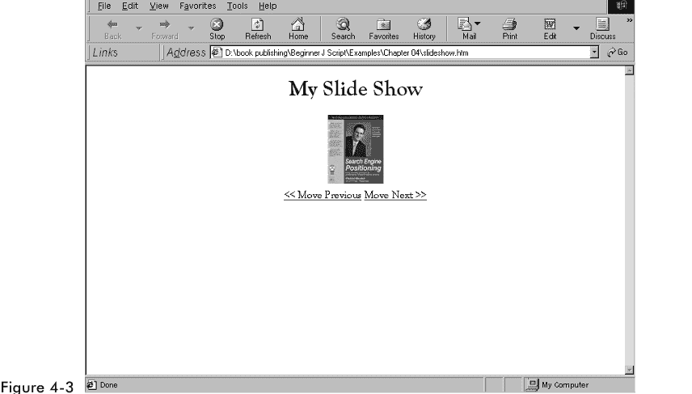

图 4-3

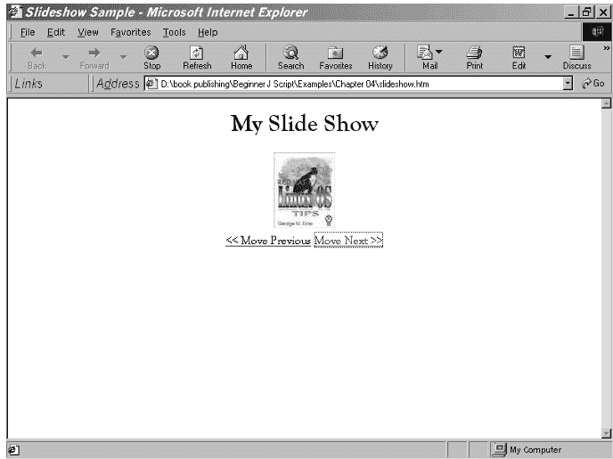

图 4-4

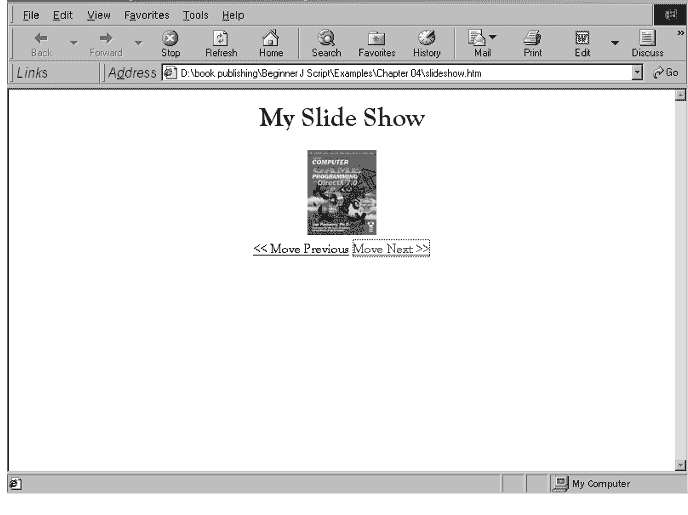

图 4-5

幻灯片放映是一个非常实用的JavaScript功能，您将能够用它来增强任何网站。然而，它特别适合用来展示待售产品。

在我们的第一个幻灯片放映示例中，我们使用链接来调用JavaScript函数。您也可以使用按钮来创建相同的效果。您需要做的就是将`<A HREF>`链接部分替换为在屏幕上放置按钮的代码。如果您希望这样做，只需替换：

```
<A HREF="javascript:MovePrevious()">&lt;&lt; 上一张</A>
<A HREF="javascript:MoveNext()">下一张 &gt;&gt;</A>
```

为：

```
<FORM>
    <INPUT TYPE="button" VALUE="<--" onClick="MovePrevious()">
    <INPUT TYPE="button" VALUE="-->" onClick="MoveNext()">
</FORM>
```

如果您操作正确，它将产生您在此处看到的图像。

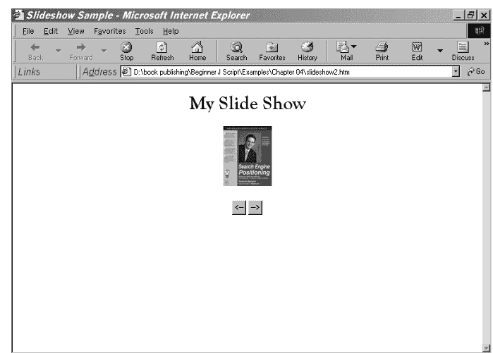

图 4-6

如果您对HTML `<FORM>`标签还不熟悉，让我们来研究一下。`<FORM>`和`</FORM>`标签只是表示它们之间的内容将是表单元素。这就像您使用过的任何其他标签一样。

## 图片预览

你也可以使用我们最初使用的 `<A HREF>` 链接方法，不过不是用“上一张”“下一张”这样的文字，而是用图片。你只需将第一个幻灯片示例中的 `<A HREF>` 链接部分替换为以下代码：

```
<A HREF="javascript:MovePrevious()"></A>
<A HREF="javascript:MoveNext()"></A>
```

如果操作正确，它将生成如下所示的图片：

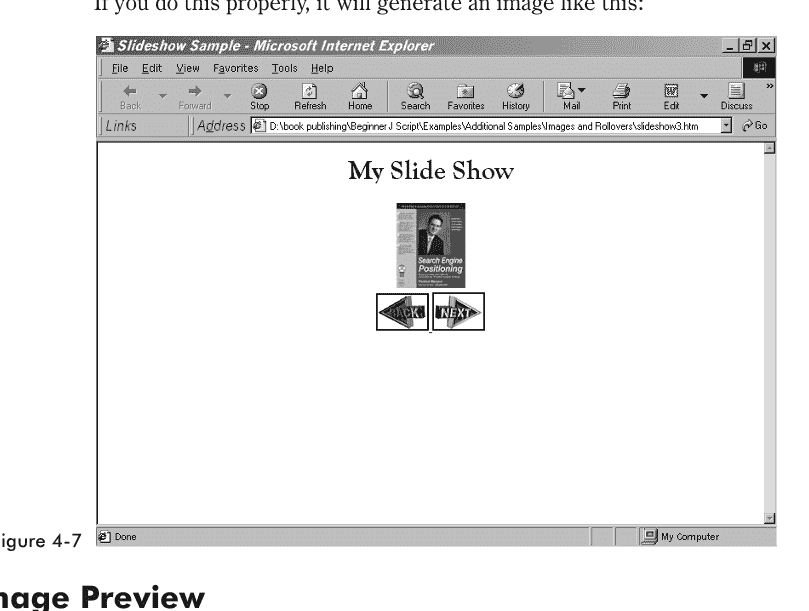

你是否曾访问过某个网站，感觉它图片太多、杂乱无章？我确实遇到过。对抗这种情况的一个方法就是我们刚刚做的幻灯片。另一种方法是最初只显示缩略图，让用户选择他们希望查看全尺寸的图片。下面这段代码就能让你实现这个功能。

### 示例 4-3

```html
<HTML>
<HEAD>
  <TITLE> Image Preview
  </TITLE>

<SCRIPT LANGUAGE="JAVASCRIPT">
if (document.images)
{
  text1 = new Image
  text2 = new Image
  text3 = new Image
  text4 = new Image

  text1.src = "pic1.jpg"
  text2.src = "pic2.jpg"
  text3.src = "pic3.jpg"
  text4.src = "email2.gif"
}
else
{
  text1= ""
  text2 = ""
  text3 = ""
  text4 = ""
  document.textField = ""
}
</SCRIPT>
</HEAD>
<BODY BGCOLOR=white>
<TABLE>
  <TD>
    <A HREF="page1.htm" onMouseover="document.textField.src=text1.src">
      </A>
    <BR>
    <A HREF="page2.htm" onMouseover="document.textField.src=text2.src">
      </A>
    <BR>
    <A HREF="page3.htm" onMouseover="document.textField.src=text3.src">
      </A>
  <TD>
    
</TABLE>
</BODY>
</HTML>
```

让我们来分析一下这个脚本，看看发生了什么。首先我们看到的是一些图片对象的创建。我们在之前的脚本中已经见过这个，所以没什么新意。实际上，这个脚本唯一真正新颖的地方在于，图片被放置在网页上时尺寸非常小。然后当鼠标悬停事件触发时，图片会全尺寸显示在右侧。

## 横幅广告

你可能在网页上见过横幅广告。实际上，用 JavaScript 制作这些广告相当简单。以下脚本使用三张图片，并以给定的间隔循环切换它们。

### 示例 4-4


```html
<HTML>
<HEAD>
<TITLE>Banner</TITLE>
<SCRIPT LANGUAGE="JAVASCRIPT">
    ImageArray = new Array("banner1.gif","banner2.gif","banner3.gif")
    CurrentImage = 0
    ImageCount = ImageArray.length

    function RotateBanner()
    {
        if (document.images)
        {
            CurrentImage++
            if (CurrentImage ==ImageCount)
            {
                CurrentImage = 0
            }
            document.Banner.src=ImageArray[CurrentImage]
            setTimeout("RotateBanner()", 5000)
        }
    }
</SCRIPT>
</HEAD>
<BODY BGCOLOR="WHITE" onLoad="RotateBanner()">
<CENTER>
    
</CENTER>
</BODY>
</HTML>
```

如果你仔细研究这个脚本，会发现它使用的是我们已经见过的技术，只是以新的方式运用。那么，让我们来看看这个脚本有什么新内容。首先，在 `<BODY>` 标签中，你现在看到了 `onLoad=RotateBanner()`。这简单地表示在页面初始加载时启动我们的脚本。你还会注意到脚本中有这一行：

```
setTimeout("RotateBanner()", 5000)
```

这里使用了一个名为 Timeout 的 JavaScript 内置函数。我们传递给它的数字是以毫秒为单位的。所以我们告诉它每五秒超时一次。这导致它每五秒加载一次下一张图片。你可以稍微调整一下时间。但是，要小心：如果时间太短，就没人能真正看清楚横幅广告了。

## 图片弹出

另一个你可以使用的有趣技巧是，当点击一个图片时，让另一个图片在新窗口中单独弹出。通常你会有一个图片的缩略图，当用户点击它时，他们会在新窗口中看到完整图片。

### 示例 4-5

```html
<HTML>
<HEAD>
<TITLE>Example 04-05</TITLE>
<SCRIPT LANGUAGE="JavaScript" >
function newWindow(imagename)
{
    imageWindow = window.open(imagename, "imageWindow", "width=320,height=240")
}
</SCRIPT>
</HEAD>
<BODY BGCOLOR="WHITE">
<H4>双击以下任意图片以查看全尺寸图片</H4>


</BODY>
</HTML>
```

这段代码如果输入正确，将生成如下所示的图片：

图 4-8

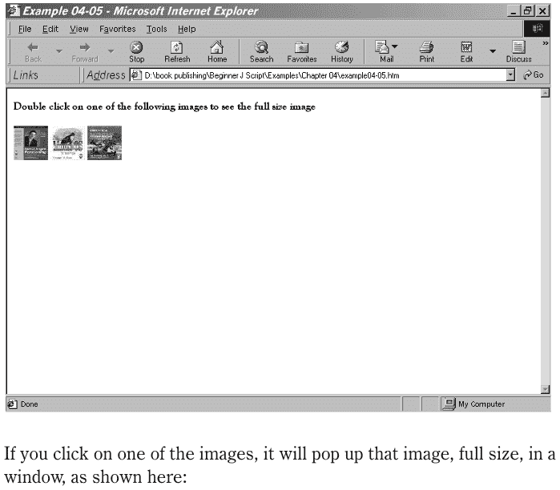

如果你点击其中一张图片，它将在新窗口中弹出该图片的全尺寸版本，如下所示：

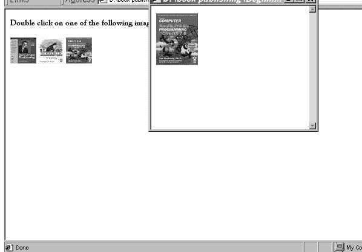

图 4-9

## 第 4 章

让我们来分析一下这个脚本，看看发生了什么。实际的脚本部分其实相当简单。该函数只有一行代码（没有比这更简单的了！）：

```javascript
function newWindow(imagename)
{
    imageWindow = window.open(imagename, "imageWindow", "width=320,height=240")
}
```

只需将任何图片名称传递给此函数，它就会启动一个新窗口来显示该图片。我们打开新窗口的方式是使用 window 对象的 open 方法。此方法需要四个必要参数和几个可选参数。第一个参数告诉它要打开什么。在我们的示例中，它是一张图片，但你也可以打开另一个 HTML 页面。第二个参数给 JavaScript 一个用来引用这个新窗口的名称。注意这个名称与我选择的变量名匹配。接下来的两个参数简单地确定了窗口的高度和宽度。还有许多其他可选参数，但它们将在第 6 章中讨论。

## 古董书店项目

现在我们可以将这些有趣的技术添加到我们的古董书店项目中。这将增加一些有趣的功能。首先，我们将在项目中放置一个新的网页，使用幻灯片来展示一些书籍。这个页面位于代码文件的 Antique Bookstore Project 文件夹中，名为 books.htm。我对那个页面所做的就是简单地加入了幻灯片脚本，只不过我使用了按钮来显示图片。

```html
<HTML>
<HEAD>
    <TITLE>Book Inventory</TITLE>
<SCRIPT LANGUAGE="JAVASCRIPT" >
    PicArray = new Array("book1.gif","book2.gif","book3.gif","book4.gif")
    CurrentPic = 0
    ImageCount = PicArray.length - 1
    function MovePrevious()
    {
        if (document.images && CurrentPic > 0)
        {
            CurrentPic--
            document.myPicture.src=PicArray[CurrentPic]
        }
    }
    function MoveNext()
    {
        if (document.images && CurrentPic < ImageCount )
        {
            CurrentPic++
            document.myPicture.src=PicArray[CurrentPic]
        }
    }
</SCRIPT>
</HEAD>
<BODY BGCOLOR = white >
<P>
<CENTER>
<H2>This month's specials!</H2>

<FORM>
    <INPUT TYPE="button" VALUE="<--" onClick="MovePrevious()">
    <INPUT TYPE ="button" VALUE ="-->" onClick="MoveNext()">
</FORM>
</CENTER>
</BODY>
</HTML>
```

我们还需要在 main.htm 网页上添加一个横幅广告。为此，我使用了一个与本章前面完全相同的横幅广告。如果你一直在跟着所有的示例操作，你应该已经开始看到一个非常有趣的网站初具雏形。

### 总结

在本章中，你学习了如何使用各种图片修改脚本来创建各种有趣的视觉效果。在继续学习之前，实际尝试每个脚本非常重要。你在这里学到的原理将贯穿全书。你还会发现，有趣的视觉效果是用户最需要的项目。

## 背景效果

网页背景可能有些单调。即使你使用图片作为背景，它仍然是静态的。通过 JavaScript，你可以对背景实现许多有趣的效果。每一种效果都会为你的网站增添极大的视觉冲击力。

## 文档对象

你在上一章中已经接触了文档对象。回顾一下，文档对象代表当前加载到浏览器中的网页。使用这个对象，我们可以对文档进行更改。本章我们将探讨的文档对象的两个属性是 `bgcolor` 和 `background`。这些属性与 HTML 中的标签完全一样。`bgcolor` 属性设置网页的背景颜色，而 `background` 属性设置背景图像。

## 更改背景颜色

我们要查看的第一个脚本，其功能很简单，就是将背景颜色更改为与用户鼠标悬停的链接所描述的颜色相匹配。现在让我们看看那个脚本：

```
示例 5-1
<HTML>
<HEAD>
    <TITLE>颜色变换器</TITLE>
</HEAD>
<BODY>
<CENTER>
    <A HREF="/" onmouseover="document.bgColor='blue'">蓝色</A>
    <A HREF="/" onmouseover="document.bgColor='royalblue'">宝蓝色</A>
    <A HREF="/" onmouseover="document.bgColor='green'">绿色</A>
    <A HREF="/" onmouseover="document.bgColor='red'">红色</A><BR>
    <A HREF="/" onmouseover="document.bgColor='magenta'">品红色</A>
    <A HREF="/" onmouseover="document.bgColor='pink'">粉色</A>
    <A HREF="/" onmouseover="document.bgColor='purple'">紫色</A><BR>
    <A HREF="/" onmouseover="document.bgColor='Skyblue'">浅蓝色</A>
    <A HREF="/" onmouseover="document.bgColor='yellow'">黄色</A>
    <A HREF="/" onmouseover="document.bgColor='brown'">棕色</A>
    <A HREF="/" onmouseover="document.bgColor='white'">白色</A><BR>
    <A HREF="/" onmouseover="document.bgColor='black'">黑色</A>
    <A HREF="/" onmouseover="document.bgColor='coral'">珊瑚色</A>
    <A HREF="/" onmouseover="document.bgColor='orange'">橙色</A>
</CENTER>
</BODY>
</HTML>
```

在这个例子中，我们只是建立了一个标准的链接，其中显示的单词就是我们将用作网页背景颜色的颜色名称。当页面首次加载时，它将看起来如图 5-1 所示。

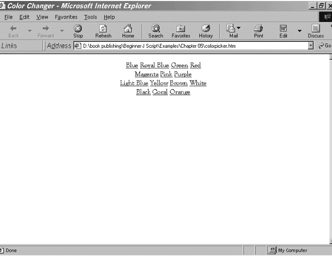

如果你将鼠标移到“黑色”这个词上，图像将看起来如图 5-2 所示：

然后如果你将鼠标移到“紫色”这个词上，它将看起来如图 5-3 所示：

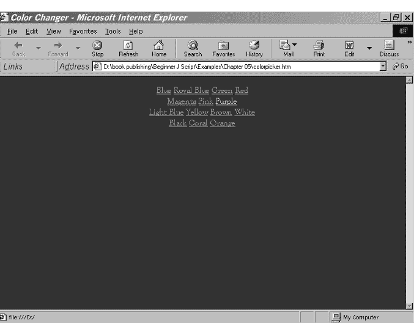

现在你已经看到了这个脚本的实际运行情况，让我们来检查一下代码本身发生了什么。每个单独的链接都是以相同的方式构建的。

```
<A HREF="/" onmouseover="document.bgColor='yellow'">黄色</A>
```

`<a href=` 部分你应该很熟悉，因为它是一个标准的超文本引用，也称为链接。然而，在这种情况下，它不是链接到另一个网页或电子邮件地址，而是简单地链接到自身。因此，当鼠标移动到我们建立的链接上时，我们使用文档对象将网页的背景颜色设置为所需的颜色。这个脚本相对简单，但它也是一个极好的方式，可以让你开始看到文档对象的实用性。

使用这个特定的脚本或其变体，你可以在任何时候更改网页文档的颜色。可以考虑的一些变体包括：基于星期几、一天中的时间或任何其他你可能希望的标准来更改背景颜色。唯一需要注意的是，你应该确保你使用的背景颜色不会使你网站上的文本难以阅读。

## 更改背景图像

接下来，我将向你展示如何使用与示例 5-1 中使用的非常相似的技术来更改网页背景中使用的图像，而不仅仅是更改颜色。

```
示例 5-2
<HTML>
<HEAD>
<TITLE>示例 05-02</TITLE>
<SCRIPT LANGUAGE="JavaScript">
    if (navigator.appName == "Microsoft Internet Explorer")
    {
        image1 = new Image()
        image2 = new Image()
        image3 = new Image()
        image4 = new Image()

        image1.src = "back1.gif"
        image2.src = "back2.gif"
        image3.src = "back3.jpg"
        image4.src = "back4.jpg"
    }
}
```

```
function changepicture(imgname)
{
  if (navigator.appName == "Microsoft Internet Explorer")
  {
    document.body.background = eval(imgname + ".src");
  }
}

</SCRIPT>
</HEAD>
<BODY>
<CENTER>
[<A HREF="#" onMouseOver="changepicture('image1');">大理石</A>]
[<A HREF="#" onMouseOver="changepicture('image2');">蓝色大理石</A>]
[<A HREF="#" onMouseOver="changepicture('image3');">板岩</A>]
[<A HREF="#" onMouseOver="changepicture('image4');">深色大理石</A>]
</CENTER>
</BODY>
</HTML>
```

如果你完全按照代码所示输入（并使用代码文件中找到的图像），你将得到如图 5-4 所示的图像：

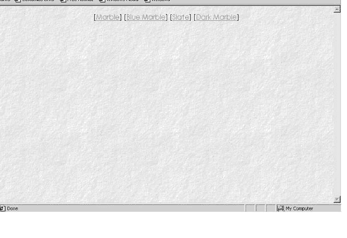

然后将鼠标移到“大理石”链接上，将给你如图 5-5 所示的图像：

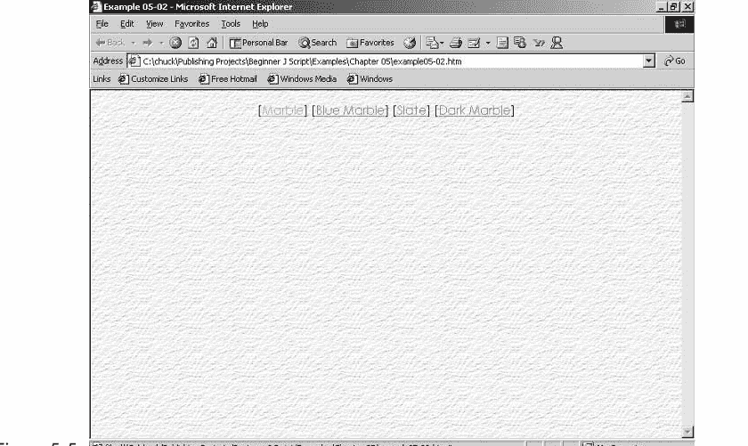

将鼠标移到“蓝色大理石”链接上，将显示如图 5-6 所示的图像：

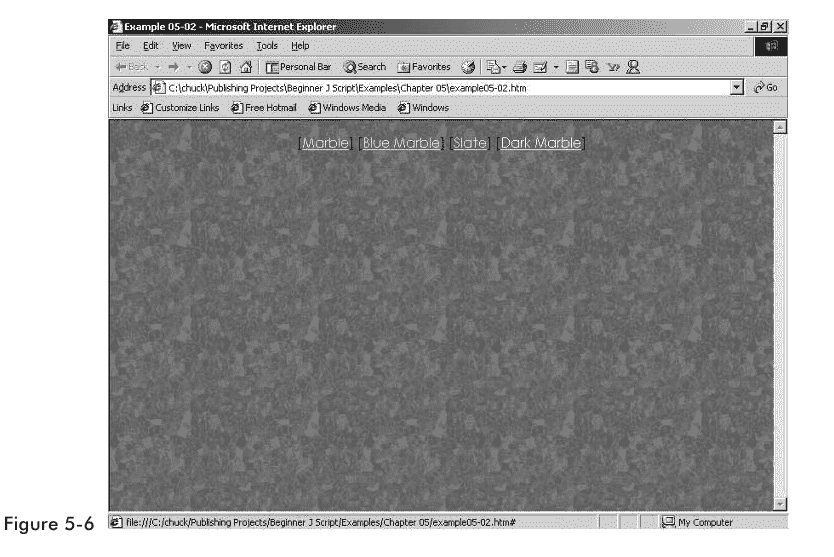

图 5-6

让我们花点时间回顾一下这里的实际代码，并确保你理解正在发生的事情。

注意，脚本的第一行是检查正在使用的浏览器是否是 Internet Explorer。这个特定的脚本在 Netscape 中不会以完全相同的方式工作。我们将在第 6 章中看到，检测浏览器并与之协同工作非常重要。

```
if (navigator.appName == "Microsoft Internet Explorer")
```

这同时也向你介绍了 `navigator` 对象，它允许你确定访问你网站的访问者正在使用的浏览器的很多信息。现在假设它是 Internet Explorer，然后我们继续创建图像对象的实例，并将它们设置为我们希望用于背景的特定图像。这段代码与你在第 4 章看到的鼠标悬停（rollover）代码几乎完全相同。

让我们看看另一种更改背景图像的方法。在下面的例子中，当用户将鼠标移到特定图像上时，该图像将成为网页的背景图像。

### 示例 5-3

```
<HTML>
<HEAD>
    <TITLE>背景更换器</TITLE>
<HEAD>
<SCRIPT LANGUAGE="JavaScript">
if (navigator.appName == "Microsoft Internet Explorer")
{
    image1 = new Image()
    image2 = new Image()
    image3 = new Image()
    image4 = new Image()

    image1.src = "back1.gif"
    image2.src="back2.gif"
    image3.src = "back3.jpg"
    image4.src = "back4.jpg"
}
function changepicture(imgname)
{
if (navigator.appName == "Microsoft Internet Explorer")
    {
        document.body.background = eval(imgname + ".src");
    }
}
</SCRIPT>
</HEAD>
<BODY BACKGROUND="back1.gif">
    <A HREF="#" onMouseOver="changepicture('image1');"></A>
    <A HREF="#" onMouseOver="changepicture('image2');" ></A>
    <A HREF="#" onMouseOver="changepicture('image3');" ></A>
    <A HREF="#" onMouseOver="changepicture('image4');"></A>
</BODY>
</HTML>
```

这个脚本的工作原理与示例 5-2 非常相似，唯一的区别是，它使用实际的图片而不是指向图像的文本链接。当用户将鼠标移到图像上时，该图像就成为页面的背景图像。如果你正确地编写代码，你将得到如图 5-7 所示的内容：

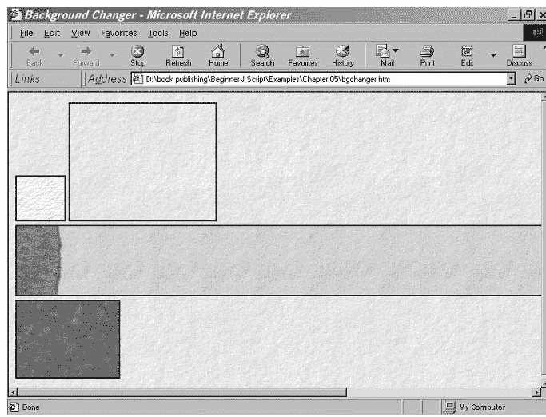

然后当你将鼠标移到其中一个图像上时，你将得到如图 5-8 所示的内容：

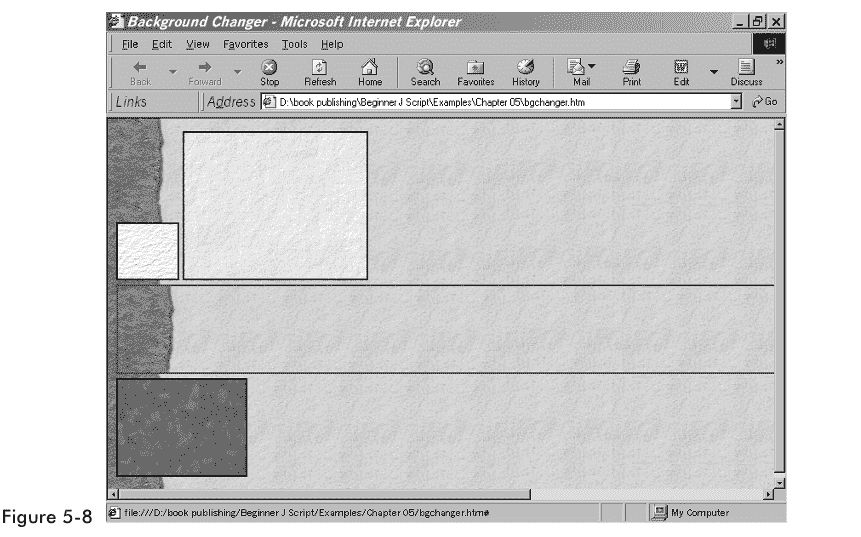

这个例子，与前一个例子（更改背景颜色）一样，更重要的是它演示了原理。你可以根据日期、时间或你希望使用的任何其他标准来使用不同的背景图像。在第 7 章“处理日期和时间”中，我将向你展示一个这样的例子。

## 更多背景效果

除了更改背景颜色和图像之外，你还可以使用 JavaScript 使背景以有趣的方式运行。最容易实现的效果之一是滚动背景。以下示例展示了滚动背景。

> 注意：这最好用于均匀的图像，如岩石纹理、星空、熔岩等。

```
示例 5-4
<HTML>
<HEAD>
    <TITLE>背景滚动器</TITLE>
</HEAD>

<BODY>
<BODY BACKGROUND="back1.gif">
<SCRIPT LANGUAGE="JavaScript">
    var bgOffset = 0
    var bgObject = eval('document.body')
    function scrollbackground(maxSize)
    {
        bgOffset = bgOffset + 1
        if (bgOffset > maxSize)
            bgOffset = 0

        bgObject.style.backgroundPosition = "0 " + bgOffset;
    }
var scrtimer = window.setInterval("scrollbackground(50)",50)
</SCRIPT>
</BODY>
</HTML>
```

现在让我们检查一下这个特定的脚本，看看它是如何工作的。脚本的第一部分只是声明了两个变量：

## 古籍书店项目

var bgOffset = 0

var bgObject = eval('document.body')

第一个变量 `bgOffset` 只是一个整数，用于表示背景图像位置的偏移量。第二个变量 `bgObject` 代表文档的 `<body>` 元素（注意，我们在这里再次利用了 document 对象）。

接下来，是实现背景滚动的实际函数：

```
function scrollbackground(maxSize)
{
    bgOffset++
    if (bgOffset > maxSize)
        bgOffset = 0

    bgObject.style.backgroundPosition = "0 " + bgOffset;
}
```

某个整数值作为 `maxSize` 传递给这个函数。函数中的第一条语句将 `bgOffset` 递增 1。然后是一个 `if` 语句，用于检查 `bgOffset` 是否超过了 `maxSize`。如果是，则将 `bgOffset` 重置为零。接着，我们将背景图像的位置设置为这个偏移值。这将导致背景图像反复下移，直到达到 `maxSize`，然后回到起始位置。使用的 `maxSize` 值越大，图像“跳回”顶部的频率就越低，从而为查看网页的人提供更流畅的背景效果。

最后，我们看到调用 `scrollBackground` 函数的语句：

```
var scrtimer = window.setInterval("scrollbackground(50)",50)
```

在这个语句中，声明了一个变量。该变量被设置为等于 `window` 对象的 `setInterval` 函数。记住，`window` 对象指的是浏览器本身。在 `setInterval` 函数内部，我们调用 `scrollbackground` 函数并传递一个最大值。同时，这里还提供了一个数字，用于指示滚动发生的频率。第二个数字越小，图像滚动就越快。

这也许是（至少在我看来）本章中最有趣的背景效果。如果使用得当，它可以为你的网站增添一种其他方式难以获得的维度。需要考虑的主要问题是使用什么图像。记住，图像本身并未滚动。我们只是通过逐步将图像下移，然后再将其带回顶部，从而制造出滚动的假象。因此，具有均匀背景的图像看起来会像滚动的背景。像星星、水、云、石头纹理等图像非常适合这种效果。

现在，让我们将其中一些技术添加到我们的古籍书店项目中，看看效果如何。我们要在主页上添加的第一个内容是滚动背景。所以，让我们看一下该页面（目前状态）的源代码。

```
<HTML>
<HEAD>
    <TITLE>Ye Olde Book Shoppe</TITLE>
    <SCRIPT LANGUAGE="JAVASCRIPT">
        ImageArray = new Array("banner1.gif","banner2.gif","banner3.gif")
        CurrentImage = 0
        ImageCount = ImageArray.length
        function RotateBanner()
        {
            if (document.images)
            {
                CurrentImage++
                if (CurrentImage ==ImageCount)
                {
                    CurrentImage = 0
                }
                document.Banner.src=ImageArray[CurrentImage]
                setTimeout("RotateBanner()",3000)
            }
        }

</SCRIPT>
</HEAD>
<BODY background="bod-bg.gif" onLoad="RotateBanner()">
<CENTER>

<P><TABLE BORDER=1>
    <TR>
        <TD>
            <P>
        <TD>
            <P><CENTER>Ye Olde Book Shoppe</CENTER>
        <TD>
            <P>
                <CENTER><FONT SIZE=2 FACE="Geneva">
                Your one stop source for used books.
                </FONT></CENTER>
                <BR>
                <P><CENTER><FONT SIZE=2 FACE="Geneva">
                We specialize in rare and antique books.
                </FONT></CENTER>
                <BR>
        <TD>
            <P>
            <P><FONT SIZE=2 FACE="Geneva">
            <B>Hours:</B>
            <BR>M-F: 9 AM - 5 PM
            <BR>Sat: 10 AM - 2 PM
            </FONT>
    </TR>
</TABLE>
</CENTER>
</BODY>
</HTML>
```

我们将向此页面添加第二个脚本。该脚本放在 `<BODY background=>` 标签之后的主体部分：

```
<SCRIPT LANGUAGE="JavaScript">
    var bgOffset = 0;
    var bgObject = eval('document.body');
    function scrollbackground(maxSize)
    {
        bgOffset = bgOffset + 1;
        if (bgOffset > maxSize)
            bgOffset = 0;
        bgObject.style.backgroundPosition = "0 " + bgOffset;
    }
    var scrtimer = window.setInterval("scrollbackground(50)",200);
</SCRIPT>
```

我们目前使用的背景不太适合滚动，因此我们将将其更改为大理石背景。这将使我们的 `main.htm` 文件呈现如下内容：

```
<HTML>
<HEAD>
    <TITLE>Ye Olde Book Shoppe</TITLE>

    <SCRIPT LANGUAGE="JAVASCRIPT">
        ImageArray = new Array("banner1.gif","banner2.gif","banner3.gif")
        CurrentImage = 0
        ImageCount = ImageArray.length
        function RotateBanner()
        {
            if (document.images)
            {
                CurrentImage++
                if (CurrentImage ==ImageCount)
                {
                    CurrentImage = 0
                }
                document.Banner.src=ImageArray[CurrentImage]
                setTimeout("RotateBanner()",3000)
            }
        }
</SCRIPT>
</HEAD>
<BODY background="back1.gif" onLoad="RotateBanner()">
<SCRIPT LANGUAGE="JavaScript">
var bgOffset = 0;
var bgObject = eval('document.body');

function scrollbackground(maxSize)
{
    bgOffset = bgOffset + 1;
    if (bgOffset > maxSize)
        bgOffset = 0;

    bgObject.style.backgroundPosition = "0 " + bgOffset;
}
var scrtimer = window.setInterval("scrollbackground(50)",50);
</SCRIPT>
<CENTER>

<P><TABLE BORDER=1>
    <TR>
        <TD>
            <P>
        <TD>
            <P><CENTER>Ye Olde Book Shoppe</CENTER>
        <TD>
            <P>
    </TR>
</TABLE>

<P>
<P>
</CENTER>
<P>
</BODY>
</HTML>
```

如果输入正确，此代码应生成以下图像：

## 图 5-9

### 总结

本章向你介绍了一些使用 JavaScript 操纵网页背景颜色或图像的简单方法。你不仅学会了一种相对简单的“美化”网站的方法，希望你也能对 JavaScript 整体更加熟悉。有一点要注意：不要过度使用背景操作。过于复杂的背景可能会分散网站访问者的注意力。

# 第 6 章

# 文档对象模型

使用 JavaScript，你可以与浏览器进行大量交互。事实上，使用 JavaScript 可以做的更有趣的事情之一是检测正在使用的浏览器。然后，你可以使用文档对象来执行不同的操作。从前几章中记住，document 对象代表当前在浏览器中加载的网页（即，JavaScript 运行所在的 HTML 文档）。navigator 对象代表正在使用的浏览器。window 对象代表正在使用的浏览器的特定实例。你可以轻松打开浏览器的多个实例，查看不同的网页。我们将在本章中详细研究每一个这些对象，并探索利用它们来增强网页的方法。

> **注意：** 对象通常由其他对象组成。术语 *嵌套对象* 通常用于描述这样的子对象。对象的嵌套结构也称为其 *层次结构*。最高级别的对象是没有父对象的对象。浏览器对象是层次结构用法的经典例子，因为它们嵌套得很深。浏览器对象结构相当复杂，因此很难记住树底部的每一个属性。但是，我将尝试让你熟悉浏览器对象层次结构的基础知识。

## window 对象层次结构

`window` 对象是层次结构的顶级对象。它包含适用于整个窗口的属性。例如，浏览器的状态栏就是该对象的一个属性。`window` 对象有几个我们将要查看的属性。

首先是 `status` 属性。`window.status` 属性代表浏览器底部的状态栏。你可以使用此属性在状态栏中向用户显示消息。我们稍后将探讨一些使用它的创意方法。

`window` 对象的 `window.alert`、`window.confirm` 和 `window.prompt` 属性允许你向用户传递消息并接收反馈。

## document 对象

到目前为止，`window` 对象最有用的属性是 `document` 对象。它包含当前加载在窗口中的页面的属性。通过这个对象，你可以对网页进行各种修改。页面中的几乎所有内容都是 `document` 对象的属性，包括链接、图像、表单及其元素、锚点等等。

`document` 对象本身也有你可以利用的属性。`URL` 属性指指定了网页的当前 URL。这是一个只读属性。一个密切相关的属性是 `document.location` 属性。你可以使用此属性跳转到另一个位置。这非常有用，你将在多个脚本中看到它的应用。

`referrer` 属性也与 `URL` 和 `location` 属性密切相关。它代表用户加载当前页面之前所在的网页。正如我们将看到的，这非常有用。

还有其他属性可以让你访关于当前网页的特定信息。`title` 属性允许你更改文档的标ITLE。`lastModified` 属性允许你查看此 HTML 文档的最后修改时间。

## history 对象

`history` 对象也是 `window` 对象的一个属性。它包含用户先前访问过的 URL 的属性。这些信息存储在历史记录列表中，可以通过浏览器的菜单访问。此对象还包含允许你将用户的浏览器发送到历史记录列表中某个 URL 的方法。

`length` 属性简单地跟踪历史记录的长度。它告诉你历史记录中列出了多少个项目。`current` 属性包含你当前所在页面的值。对于导航，你将使用 `next` 和 `previous` 属性，因为它们允许你在历史记录中前进和后退。

所有这些对象链接在一起，形成一个定义良好的层次结构，称为文档对象模型（DOM）。通过对文档对象模型的创造性使用，你可以在 JavaScript 中做一些非常有趣的事情。但首先你需要熟悉这个模型及其元素的作用。

## 文档对象模型

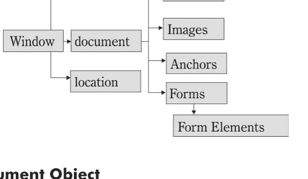

图 6-1

## document 对象

如前所述，`document` 对象代表 JavaScript 实际运行所在的网页。从技术上讲，`document` 对象是 `window` 对象的一个属性。我们之前用它来确保网页支持图像对象。在第 4 章中，我们在脚本中使用 `if(document.images)` 来确保网页支持图像对象。`document` 对象还有各种其他令人着迷的方法。然而，也许最简单但最通用的方法是 `write` 方法。

`write` 方法允许你直接写入网页。例如，如果你简单地包含这行代码：

```
document.write("Howdy")
```

它将把 "Howdy" 这个词写入网页。现在，仅仅在网页上写 "Howdy" 并不是特别有趣。一个更有趣的应用是基于你选择的某些标准动态地改变网页。

在下面的例子中，我们将要求网页访问者识别他们的性别，并根据他们的答案改变网页的外观。

### 示例 6-1

```html
<HTML>
<HEAD>
<TITLE>Gender Bender</TITLE>
<SCRIPT LANGUAGE="JavaScript">
var gender = prompt("Enter M for Male and F for female","F")
if(gender=="M")
{
    document.write('<BODY BGCOLOR = Blue>')
    document.write('<FONT COLOR = Red>')
    document.write('Yo Dude')
    document.write('</FONT>')
}
else
{
    document.write('<BODY BGCOLOR = Pink>')
    document.write('<FONT COLOR =Black>')
    document.write('You go girl')
    document.write('</FONT>')
}
</SCRIPT>
</HEAD>
<BODY>
</BODY>
</HTML>
```

这个脚本实际上非常简单。它只是询问用户输入他们的性别，并基于该信息修改 HTML 文档的属性。你确实可以在此基础上进行扩展，根据用户提供的信息使用不同的背景图像、字体，甚至背景音乐。在我们的例子中，如果你输入完全正确，你应该会看到一个类似于此处所示的屏幕：

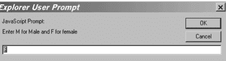

然后，根据你对图 6-2 所示提示的回答，你将看到以下屏幕之一：

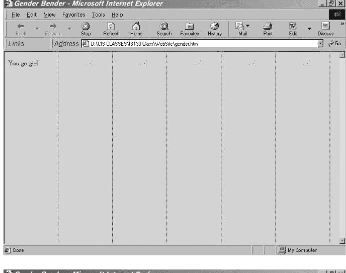

**图 6-3**

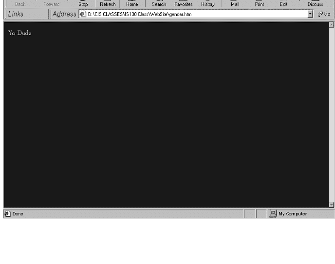

**图 6-4**

第 80 章 第 6 章

## window 对象

正如我之前提到的，`window` 对象代表脚本运行所在的浏览器窗口。这个特定对象内置了一些非常有趣的方法。我们将在这里探索其中的一些。

使用 `window` 对象你可以做的第一件事之一就是打开其他窗口。`openWindow` 方法在第 4 章中简要介绍过，我们将在这里更详细地研究它。在下面的例子中，我们打开一个显示图片的窗口。

### 示例 6-2

```html
<HTML>
<HEAD>
<TITLE>Open a New Window</TITLE>
<SCRIPT LANGUAGE="JavaScript">
    function OpenWindow()
    {
        var NewWindow = window.open("advjscript.jpg", "NewWindow",
        "width=350,height=400")
    }
</SCRIPT>
</HEAD>
<BODY BGCOLOR=White>
<A HREF="javascript:OpenWindow()">Advanced Java Script</A>
</BODY>
</HTML>
```

这个脚本的核心是 `openWindow` 函数内的那行代码。传递给此函数的第一个参数是你希望打开的内容。这可以是另一个 HTML 文档或一张图片。传递的第二个参数是代表这个新窗口的变量名。在我们的例子中是 `NewWindow`。最后一个参数是我们要打开的新窗口的高度和宽度。

这个脚本相当简单且易于使用。即便如此，它也可能非常有用。例如，如果你的网站上有一个产品列表，但你不想用每个产品的所有细节来使 HTML 文档显得杂乱，你可以使用这个脚本，允许用户在点击产品名称时查看包含这些细节的页面。

我们这个启动新窗口示例唯一真正的问题是，如果你启动的项目大小大于你给定的尺寸参数，则没有滚动条让你看到整个图像。下一个例子与前一个非常相似，除了它在 `window.open` 方法调用中添加了内容以包含滚动条。

### 示例 6-3

```html
<HTML>
<HEAD>
<TITLE>Open a New Window</TITLE>
<SCRIPT LANGUAGE="JavaScript">
function OpenWindow()
{
    var NewWindow = window.open("example06-03b.htm", "NewWindow",
                               "width=350,height=200,scrollbars=yes")
}
</SCRIPT>
</HEAD>
<BODY BGCOLOR=White>
<A Href="javascript:OpenWindow()">Advanced Java Script</A>
</BODY>
</HTML>
```

只需在尺寸参数后添加 `scrollbars=yes`，你启动的新窗口就会有滚动条！如果你愿意，你也可以添加 `toolbar=yes` 这一行，这样你的新窗口将拥有浏览器的标准工具栏。

下一个例子结合了滚动条、工具栏，以及一个用于原始窗口关闭其启动窗口的方法。

### 示例 6-4

```html
<HTML>
<HEAD>
<TITLE>Close Windows</TITLE>
<SCRIPT LANGUAGE="JavaScript">
var childwindow = null
function opennewwindow()
{
    childwindow = window.open("example06-03b.htm","childwindow",
                              "width=300,height=200,toolbar=yes,scrollbars=yes,")
}
function closenewwindow()
{
    if (childwindow && !childwindow.closed)
        {
            childwindow.close()
        }
}
```

## 82 ■ 第6章

```html
<HTML>
<HEAD>
</HEAD>
<BODY BGCOLOR=White>
    <CENTER>
        <H3>
            <A HREF="javascript:opennewwindow()">查看高级JavaScript</A>
            <BR>
            <A HREF="javascript:closenewwindow()">关闭高级JavaScript</A>
        </H3>
    </CENTER>
</BODY>
</HTML>
```

这个脚本中唯一的实际区别是 `closenewwindow` 函数。在这个函数中，我只需使用代表新启动窗口的变量名，并调用 `closewindow()` 方法。尽管这个区别很小，但它很重要。允用户从启动它的父窗口关闭子窗口非常重要。如果你正确输入了代码，你会看到类似这张图片的内容：

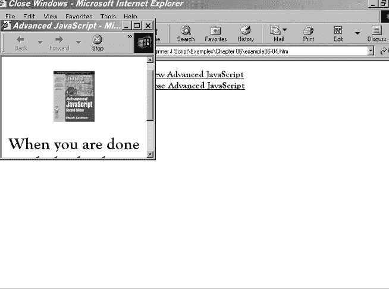

## navigator 对象

`navigator` 对象代表你正在使用的浏览器。通过这个对象，你可以找到正在使用的浏览器类型和版本号。大多数脚本在 Microsoft Internet Explorer 或 Netscape Navigator 中都能正常运行。然而，有些脚本则不行。在使用此类脚本之前，先确定正在使用的浏览器是一个好主意。

以下示例找出正在使用的浏览器，并使用 `document` 对象的 `write` 方法将该信息显示到屏幕上。

### 示例 6-5

```html
<HTML>
<HEAD>
    <TITLE>浏览器检测</TITLE>
</HEAD>
<BODY BGCOLOR=White>
<SCRIPT LANGUAGE="JavaScript">
var browsername= navigator.appName
var browserversion = navigator.appVersion
    if (browsername == "Microsoft Internet Explorer")
    {
        document.write("You are using MS Internet Explorer version " + browserversion)
    }
    else
    {
        document.write("You are using Netscape Navigator version " + browserversion)
    }
</SCRIPT>
</BODY>
</HTML>
```

这个相当简单的示例展示了使用 `navigator` 对象可以做的一些实际事情。如果你正确输入了代码，你应该会看到类似这样的内容：

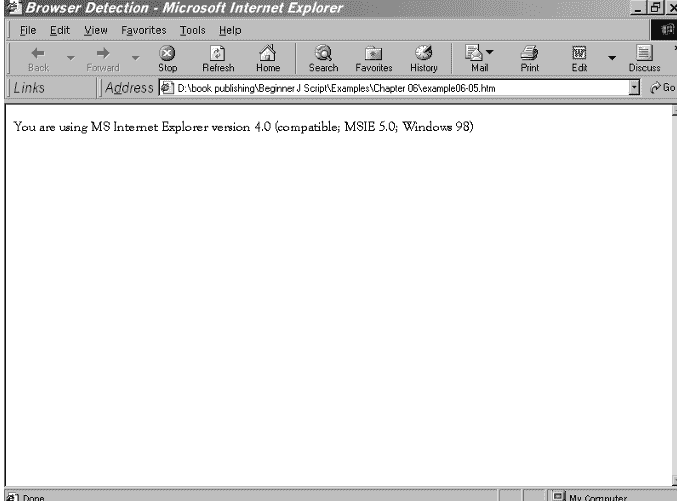

图 6-6

## 使用 history 对象

在本章开头，你已经了解了 `history` 对象。现在我将向你展示一些使用该对象的示例。

### 示例 6-6

```html
<HTML>
<HEAD>
    <TITLE>Example 06-06.htm</TITLE>
</HEAD>

<SCRIPT LANGUAGE="JavaScript">
function goback()
{
    history.back()
}

function goforward()
{
    history.forward()
}
</SCRIPT>
<BODY BGCOLOR=White>
<FORM>
    <INPUT TYPE ="button" VALUE ="Back" onClick="javascript:goback()">
    <INPUT TYPE ="button" VALUE ="Forward" onClick="javascript:goforward()">
</FORM>
</BODY>
</HTML>
```

这个相当简单的示例使用了两个 JavaScript 函数，每个函数只包含一行代码。每个函数都使用 `history` 对象在文档历史记录中前进或后退。这些函数是从 HTML 文档正文中的 HTML 按钮调用的。

## 古董书店项目

随着本书每一章的学习，你的技能不仅会增长，我们的古董书店项目也会发展。所以现在让我们把本章学到的知识添加到古董书店中。在这种情况下，我们将添加一些描述一些古董书的页面。由于这是一个虚构的书店，我将简单地编造一些关于书籍的信息。

我们将添加一个名为 `inventory.htm` 的新页面。这个页面将包含书店库存的最新添加内容。当然，我们还需要在 `tool.htm` 页面上添加一个链接。此外，每本书都有一个非常简单的页面，名为 `inventory1.htm`、`inventory2.htm` 等，用来展示每本书。这个页面只有一些文字和一张书的图片。现在看看新页面的源代码。

```html
<HTML>
<HEAD>
    <TITLE>图书库存</TITLE>
<SCRIPT LANGUAGE="JAVASCRIPT">
    var childwindow = null
        function openbook1()
        {
            childwindow = window.open("inventory1.htm","childwindow",
                            "width=400,height=400,scrollbars=yes")
        }
        function openbook2()
        {
            childwindow = window.open("inventory2.htm","childwindow",
                            "width=400,height=400,scrollbars=yes")
        }
        function openbook3()
        {
            childwindow = window.open("inventory3.htm","childwindow",
                "width=400,height=400,scrollbars=yes")
        }
        function openbook4()
        {
            childwindow = window.open("inventory4.htm","childwindow",
                "width=400,height=400,scrollbars=yes")
        }
</SCRIPT>
</HEAD>
<BODY background="back1.gif">
<P>
<CENTER>
    <H2>本月最新上架！</H2>
</CENTER>
<P>
<A HREF="javascript:openbook1()">查看莎士比亚</A><BR>
<A HREF="javascript:openbook2()">查看狄更斯</A><BR>
<A HREF="javascript:openbook3()">查看爱伦·坡</A><BR>
<A HREF="javascript:openbook4()">查看钦定版圣经</A><BR>
</BODY>
</HTML>
```

这个网页最有趣的地方在于，我们使用了四个不同的函数来加载四个不同的网页。除此之外，这与我们本章前面看到的基本新窗口启动方式相同，只是应用到了我们的古董书店！

### 总结

在本章中，你已经了解了 `document`、`window` 和 `navigator` 对象。希望你开始感受到 JavaScript 通过这些内置对象为你提供的一些迷人功能。我也希望此时你对 JavaScript 整体感到得心应手。

你在本章学到的一些有趣内容包括打开新窗口、检测正在使用的浏览器类型，以及根据你选择的任何标准自定义实际的 HTML 文档。

## 处理日期和时间

JavaScript 通过其内置的 `Date` 对象使处理日期和时间数据变得相对容易。使用这个对象，你可以确定当前时间、星期几和年份。你也可以将时间和日期更改为任何你希望的时间或日期。在我们学习本章的过程中，你将看到这个对象的一些有趣应用。

## 一天中的时间

与其从一些关于 `Date` 对象的方法和属性的枯燥细节开始，不如从一个易于使用但有趣的脚本开始。在这个脚本中，我们确定一天中的时间，并根据这个时间向页面的访问者致以问候。我要指出的是，这里使用的 `Date` 方法 `getHours` 返回的是24小时制的小时数。换句话说，如果是午夜过后20分钟，`getHours` 将返回零；如果是下午6点，`getHours` 将返回18。

### 示例 7-1

```html
<HTML>
<HEAD>
    <TITLE>Example 07-01</TITLE>
<SCRIPT LANGUAGE="JavaScript">
var mydate = new Date()
var mytime = mydate.getHours()
if (mytime<12)
    alert("Good Morning")
else
{
    if(mytime<17)
        alert("Good Afternoon")
    else
        alert("Good Evening")
}
</SCRIPT>
</HEAD>
<BODY>
</BODY>
</HTML>
```

这个脚本相当简单，但它确实说明了使用 `Date` 对象的基本要素。我们首先要做的是创建一个 `Date` 对象的实例：

```javascript
var mydate = new Date()
```

接下来，我们创建一个变量来存储当前时间。记住，这是自午夜以来的小时数：

```javascript
var mytime = mydate.getHours()
```

现在我们有一个简单的 if 语句来检查当前是几点，并根据一天中的时间给予适当的问候。如果你正确输入了所有内容，你应该会看到类似这里的图片：

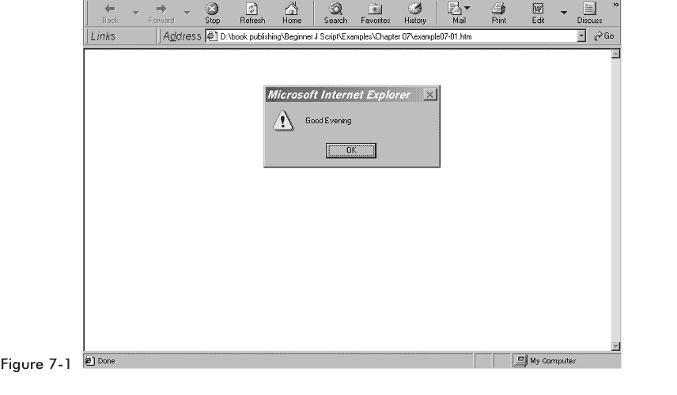

图 7-1

这个脚本相当简单，但同时为你的网站增添了一些有趣的内容。一个简单的基于时间的问候可以为你的网站增添人情味，并鼓励更多的访问量（而网站流量才是关键！）。

## 星期几

我们将研究的下一个小脚本是一个根据星期几给出幽默问候的脚本。这个脚本使用了 `Date` 对象的 `getDay` 方法。这个方法从星期天开始计为0，然后依次递增。

### 示例 7-2

```html
<HTML>
<HEAD>
	<TITLE>Example 07-02</TITLE>
<SCRIPT LANGUAGE="JavaScript">
var mydate = new Date()
var myday = mydate.getDay()
if(myday==0)
	alert("Sunday! Nap time!")
if (myday==1)
	alert("Another Monday...Arghhh!")

if(myday==2)
	alert("Tuesday...off to a slow week!")

if(myday==3)
	alert("Wednesday...Halfway home!!!")

if (myday==4)
	alert("just 1 more day! Hang in there!")

if (myday==5)
	alert("Thank God Its Friday!!!")
if (myday==6)
	alert("Saturday! Break out the BBQ!")
</SCRIPT>
</HEAD>
<BODY>
</BODY>
</HTML>
```

这个脚本只是找出今天是星期几，并给出与星期几相匹配的幽默问候。这应该向你说明了 `getDay` 方法，正如之前的例子说明了 `getHours` 方法的用法。

方法。如果你输入正确，你应该能看到类似下面图片的内容：

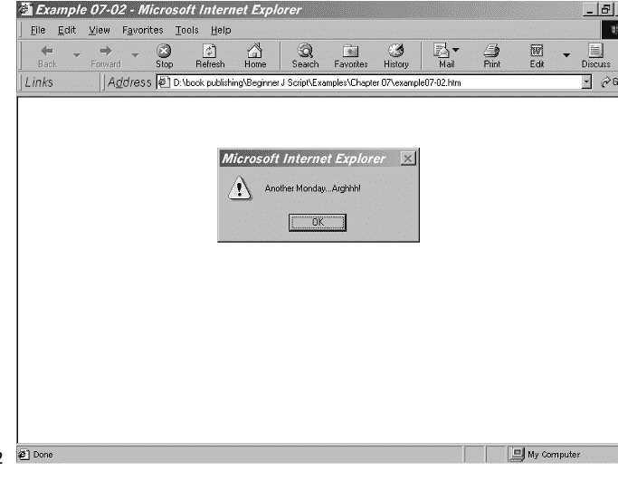

正如你可能猜测到的，有多种方法可以从 Date 对象获取时间和日期信息。这些方法包括 getYear、getHour、getDay、getTime、getMonth、getMinutes 和 getSeconds。每个方法都会给出特定的输出。下表显示了每个方法可以预期的输出。

| Date 属性 | 范围 |

|---|---|

| seconds | 0-59 |

| minutes | 0-59 |

| hours | 0-23 |

| day | 0-6 |

| date | 1-31 |

| month | 0-11 |

| year | 注意：在 Netscape 中这是自 1900 年以来的年数，而在 Internet Explorer 中是实际年份。因此 2001 年在 Netscape 中显示为 101，在 Internet Explorer 中显示为 2001。 |

现在你可以使用这些不同的方法来确定当前日期、时间、年份或其他信息。你也可以更改所表示的日期和时间。

现在大多数初学者问的第一个问题不是怎么做，而是为什么要这么做。因此让我们来看一个你可能想要这么做的例子。

### 示例 7-3

```
<HTML>
<HEAD>
    <TITLE>Example 07-03</TITLE>
<SCRIPT LANGUAGE="JavaScript">

var year = prompt("What year were you born")
var month = prompt("What month were you born in")
var bday = prompt("What date were you born on")
var birthDay = new Date()
birthDay.setYear(year)
birthDay.setMonth(month)
birthDay.setDate(bday)
var day = birthDay.getDay()

if (day==0)
    alert("You were born on Sunday")

if (day==1)
    alert("You were born on Monday")

if (day==2)
    alert("You were born on Tuesday")

if (day==3)
    alert("You were born on Wednesday")

if (day==4)
    alert("You were born on Thursday")

if (day==5)
    alert("You were born on Friday")

if (day==6)
    alert("You were born on Saturday")

if (day==0)
    alert("You were born on Sunday")
</SCRIPT>
</HEAD>
<BODY>
</BODY>
</HTML>
```

现在仔细看看这个脚本，让我们讨论一下它做了什么。前三行只是提示用户输入他们出生的年、月、日。注意这些必须以数字形式输入（即，九月应为 9，十月为 10）。接下来的四行是我们最感兴趣的代码部分。这里我们创建了第二个 Date 对象，并将其年、月、日设置为等于用户输入的值。然后我们只需从这个新的 Date 对象调用 getDay() 来找出是星期几。

## 设置超时

setTimeout() 方法允许你在给定的时间段过去后执行某些操作。时间以毫秒计算（即，5,000 表示 5 秒）。这是一个非常有用的功能。让我们看一个使用 setTimeout() 方法的例子。

### 示例 7-4

```
<HTML>
<HEAD>
<TITLE>Example 07-04</TITLE>
<SCRIPT LANGUAGE="JavaScript">
function displayAlert()
{
    alert("5 seconds have elapsed since the button was clicked.")
}
</SCRIPT>
</HEAD>
<BODY>
<FORM>
Click the button for a reminder in 5 seconds.
<P>
<INPUT TYPE="button" VALUE="5-second reminder"
    NAME="remind_button"
    onClick="timerID = setTimeout('displayAlert()',5000)">
</FORM>
</BODY>
</HTML>
```

当你点击按钮时，事件处理程序的脚本会设置一个超时。该超时指定在 5,000 毫秒或 5 秒后，调用函数 displayAlert()。因此，在你点击按钮 5 秒后会显示一个警告框。

这不是一个特别令人兴奋的脚本，但它确实向你展示了超时的使用。这是一个相对简单的方法，通常用于在复杂操作之间创建一个暂停。

## 古董书店项目

与本书的所有章节一样，一旦我们学习了一些新技术，我们就会将它们添加到我们的古董书店项目中。我们只会向 main.htm 页面添加一个星期问候语。但我们会给它一个更实际的转折。我们不会为星期几提供幽默的问候语，而是提供当天的营业时间！

```
<HTML>
<HEAD>
    <TITLE>Ye Olde Book Shoppe</TITLE>
<SCRIPT LANGUAGE="JavaScript">
var mydate = new Date()

var myday = mydate.getDay()

if(myday==0)
    alert("Sunday- Sorry, we are closed today")

if (myday==1)
    alert("Monday- Sorry, we are closed today")

if(myday==2)
    alert("Tuesday- Our hours today are 10 a.m. to 6 p.m.")

if(myday==3)
    alert("Wednesday- Our hours today are 10 a.m. to 6 p.m.")

if (myday==4)
    alert("Thursday- Our hours today are 10 a.m. to 6 p.m.")

if (myday==5)
    alert("Friday- Our hours today are 10 a.m. to 7 p.m.")

if (myday==6)
    alert("Saturday- Our hours today are 10 a.m. to 4 p.m.")

</SCRIPT>
<SCRIPT LANGUAGE="JAVASCRIPT">
ImageArray = new Array("banner1.gif","banner2.gif","banner3.gif")
CurrentImage = 0
ImageCount = ImageArray.length
function RotateBanner()
{
	if (document.images)
	{
		CurrentImage++
		if (CurrentImage == ImageCount)
		{
			CurrentImage = 0
		}
		document.Banner.src=ImageArray[CurrentImage]
		setTimeout("RotateBanner()",3000)
	}
}</script>
</HEAD>
<BODY background="back1.gif" onLoad="RotateBanner()">

<SCRIPT LANGUAGE="JavaScript">
	var bgOffset = 0;
	var bgObject = eval('document.body');
	function scrollbackground(maxSize)
	{
		bgOffset = bgOffset + 1;

		if (bgOffset > maxSize)
			bgOffset = 0;
		bgObject.style.backgroundPosition = "0 " + bgOffset;
	}
var scrtimer = window.setInterval("scrollbackground(50)",50);
</SCRIPT>
<CENTER>


<P><TABLE BORDER=1>
	<TR>
		<TD>
			<P>
		</TD>
		<TD>
			<P><CENTER>Ye Olde Book Shoppe</CENTER>
		</TD>
		<TD>
			
		</TD>
	</TR>
</TABLE>
<P>
<P>
</CENTER>
<P>
</BODY>
</HTML>
```

在我看来，关于这个网页最值得注意的是我们现在有三个 JavaScript 都在同一个页面上运行。这很有趣，因为你经常会希望在页面上运行多个脚本。

### 总结

在本章中，你已经看到了如何使用 Date 对象来完成各种与日期和时间相关的任务。你应该能够轻松获取当前日期、年份、星期几或时间。你也应该能够使用 setTime 和 setDate 函数轻松设置时间和日期。我相信你会发现这些特定信息在开发网站时对你非常实用。

# 第 8 章

## 使用 Cookie

首先我们需要定义什么是 cookie（除了美味的零食，最好是带巧克力片的！）。*cookie* 只是你浏览器存储的一小段纯文本数据。这些数据涉及特定的网站。你的浏览器将这些 cookie 作为未加密的文本文件存储在浏览器指定的位置。一旦你学会制作 cookie，你就可以让你的网页存储有关访问者的信息。然后当他们返回你的网站时，就可以检索这些信息。

### 烘焙你的第一个 Cookie

Cookie 并不复杂，但代码很长。唯一的办法就是直接开始。因此我将向你展示 cookie 的代码，然后带你逐行解释。

#### 示例 8-1

```
<HTML>
<HEAD>
    <TITLE>Example 08-01</TITLE>
    <SCRIPT LANGUAGE="JavaScript">
    function setCookie(name, value, expires, path, domain, secure)
    {
      var curCookie = name + "=" + escape(value) +
          ((expires) ? "; expires=" + expires.toGMTString() : "") +
          ((path) ? "; path=" + path : "") + ((domain) ? "; domain=" + domain : "") +
          ((secure) ? "; secure" : "")
      document.cookie = curCookie
    }
    function getCookie(name)
    {
      var prefix = name + "="
      var cookieStartIndex = document.cookie.indexOf(prefix)
      if (cookieStartIndex == -1)
          return null

      var cookieEndIndex = document.cookie.indexOf(";", cookieStartIndex +
                                      prefix.length)

      if (cookieEndIndex == -1)
          cookieEndIndex = document.cookie.length

      return unescape(document.cookie.substring(cookieStartIndex + prefix.length,
                                      cookieEndIndex))
    }
    function deleteCookie(name, path, domain)
    {
        if (getCookie(name))
        {
            document.cookie = name + "=" + ((path) ? "; path=" + path : "") +
                            ((domain) ? "; domain=" + domain : "") + "; expires=Thu, 01-Jan-70 00:00:01 GMT"
        }
    }
    var expiredate = new Date()
    expiredate.setTime(expiredate.getTime() + 31 * 24 * 60 * 60 * 1000)
    var name = getCookie("name")
    if (!name)
    {
        name = prompt("Please enter your name:", "John Doe")
        setCookie("name", name, expiredate)
    }

    alert("Welcome back " + name)
</SCRIPT>
</HEAD>
<BODY BGCOLOR=White>
</BODY>
</HTML>
```

如果你正确输入了所有内容，你应该能看到类似这样的图片：

现在，如果你开始对这个特定脚本的庞大体量感到恐慌，请不要担心。它看起来只是复杂而已。我将逐行走一遍源代码，和你一起理清头绪。让我们从你看到的第一个函数 `setCookie` 开始。

### setCookie

其语法是：

```
function setCookie(name, value, expires, path, domain, secure)
```

首先要注意的是，这个函数接受六个参数。你的代码只会提供前三个。后三个由浏览器决定。第一个参数叫做 name。它只是 cookie 的名称。

选择与 cookie 所保存数据类型相关的名称是个好主意。下一个参数是 cookie 将保存的值或内容。然后我们有 `expires` 参数，它保存 cookie 的过期日期。如果你不设置过期日期，cookie 将在下次重启电脑时过期。这被称为 *预过期 cookie*。

尽管你不会提供最后三个参数，但理解它们是什么是很有好处的。第四个参数只是浏览器存储 cookie 的路径。第五个参数表示 cookie 关联的域名。一个域名最多可以有 20 个 cookie。最后是 `secure` 参数，它简单地告诉我们这是一个安全 cookie 还是不是。

接下来，代码只是创建一个变量来包含 cookie 信息，并将它们连接在一起。最后，我们使用 `document` 对象的 `cookie` 属性将此 cookie 添加到用户的 cookie 列表中。

```
var curCookie = name + "=" + escape(value) +
    ((expires) ? "; expires=" + expires.toGMTString() : "") +
    ((path) ? "; path=" + path : "") + ((domain) ? "; domain=" + domain : "") +
    ((secure) ? "; secure" : "")
    // 实际放置 cookie
document.cookie = curCookie
```

这个函数实现的功能是，它接受你传递的值和浏览器本身传递的值，并创建一个 cookie 来存储这些数据。

### getCookie

我们检查的下一个函数是 `getCookie` 函数的代码。调用此函数是为了查看为此网页访问者是否存在有效的 cookie。如果存在，函数将简单地返回一个 `null` 值。此时，你可以提示用户输入数据，然后调用 `setCookie()`。但是，如果确实找到了匹配项，你就可以使用该数据。

函数以这行代码开始：

```
var prefix = name + "="
var cookieStartIndex = document.cookie.indexOf(prefix)
```

这段代码创建一个名为 `prefix` 的变量。该变量被设置为等于传递给此函数的 cookie 名称在 cookie 文件中的起始位置。此函数将使用 `document` 对象的 `cookie` 属性来查看是否能找到此 cookie。如果能找到，它将返回索引，然后就可以读取 cookie 的值。如果找不到，它将返回 `null`。事实上，紧接着的下一行就处理了这种情况：

```
if (cookieStartIndex == -1)
    return null
```

如果找不到 `cookieStartIndex`，就让函数返回 `null`，表示未找到 cookie。

接下来的几行代码尝试找到此 cookie 的结束点。如果找不到，则假定这是浏览器 cookie 列表中的最后一个 cookie，并且假定此列表的末尾就是此 cookie 的末尾：

```
var cookieEndIndex = document.cookie.indexOf(";", cookieStartIndex + prefix.length)

if (cookieEndIndex == -1)
    cookieEndIndex = document.cookie.length
```

现在，一旦函数确定了该 cookie 存在，并且它有起点和终点，那么就该简单地返回该 cookie 的内容了。这就是函数最后一行完成的工作：

```
return unescape(document.cookie.substring(cookieStartIndex + prefix.length, cookieEndIndex))
```

第三个函数 `deleteCookie()`，如果你传递它 cookie 名称，它会简单地删除一个 cookie。在前面的例子中，实际上没有调用这个函数，但我想我应该展示给你看，以防你以后需要它。

### 调用函数

那么，我们实际上如何使用这些函数来获取和创建 cookie 呢？嗯，脚本的最后几行代码完成了这个任务，所以让我们来看看它们。首先，我们有两行代码创建一个 `Date` 对象并增加其值：

```
var expiredate = new Date()
expiredate.setTime(expiredate.getTime() + 31 * 24 * 60 * 60 * 1000)
```

这个 `expiredate` 对象将用于设置我们 cookie 的过期日期。你可以使用日期函数将这个过期日期设置为你想要的任何日期。我选择这个特定日期只是为了说明目的。

现在我们有了一个过期日期（这只在我们设置新 cookie 时使用，而不是在获取 cookie 时），我们现在将看看我们想要的 cookie 是否已经存在于网页访问者的机器上。

```
var name = getCookie("name")
if (!name)
{
    name = prompt("Please enter your name:", "John Doe")
    setCookie("name", name, expiredate)
}
alert("Welcome back " + name)
```

简而言之，这就是我们的 cookie 脚本的工作原理。它实际上并不那么复杂，只是有点长。所以为了确保你确实理解了这些概念，让我们再检查另一个存储稍有不同的 cookie 的脚本。

### 烘焙另一个 Cookie

这个 cookie 的工作原理与前一个类似，我希望通过检查这两个 cookie，你能很好地理解 cookie 的工作原理。这个脚本询问用户在查看网页时更喜欢什么背景颜色，并将该值保存在一个 cookie 中。然后，每当他们访问该网页时，它就会使用他们选择的背景颜色。

```
Example 8-2
```

```
<HTML>
<HEAD>
<TITLE>Example08-02</TITLE>
<HEAD>
<SCRIPT LANGUAGE = "JavaScript">
var expiredate= new Date();
expiredate.setTime(expiredate.getTime() + (30*24*60*60*1000))
var backcolor = getCookie("bgcolor")
if (backcolor == null)
{
    backcolor = prompt("What is your favorite background color?")
    setCookie("bgcolor", backcolor, expiredate)
}
document.bgColor=backcolor
function setCookie(name, value, expires, path, domain, secure)
{
    var curCookie = name + "=" + escape(value) +
        ((expires) ? "; expires=" + expires.toGMTString() : "") +
        ((path) ? "; path=" + path : "") +
        ((domain) ? "; domain=" + domain : "") +
        ((secure) ? "; secure" : "")
    document.cookie = curCookie
}
function getCookie(cookiename)
{
    var prefix = cookiename + "="
    var cookieStartIndex = document.cookie.indexOf(prefix)
    if (cookieStartIndex == -1)
        return null
    var cookieEndIndex = document.cookie.indexOf(";", cookieStartIndex+
        prefix.length)
    if (cookieEndIndex == -1)
        cookieEndIndex = document.cookie.length

    return unescape(document.cookie.substring(cookieStartIndex
        +prefix.length, cookieEndIndex))
}
</SCRIPT>
</HEAD>
<BODY>
</BODY>
</HTML>
```

如果你正确输入了代码，你应该能在浏览器中看到下图：

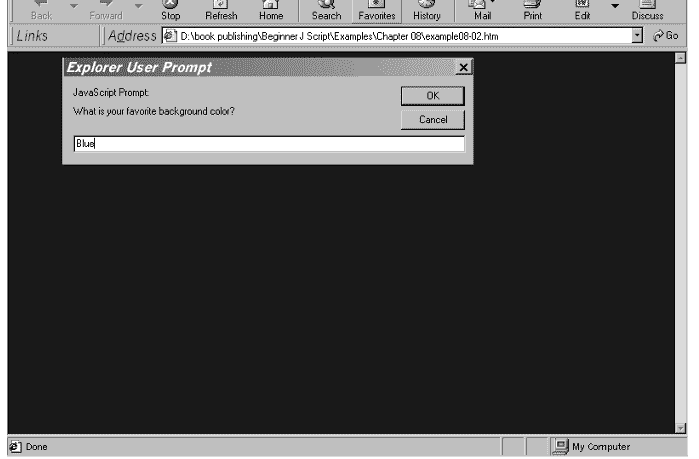

图 8-2

希望你注意到这个脚本和上一个脚本之间的几个相似之处。但让我们一起再过一遍这个脚本，以确保你理解正在发生的一切。第一个区别仅仅是结构上的。在这个脚本中，我先把函数调用放在前面，然后是函数定义。这与之前脚本中使用的顺序相反。我这样做是为了向你展示，你执行这些操作的顺序实际上并没有什么区别。

让我们看看前几行代码，看看它们在做什么：

```
var expiredate= new Date();
expiredate.setTime(expiredate.getTime() + (30*24*60*60*1000))
var backcolor = getCookie("bgcolor")
```

首先，我们创建一个名为 `expiredate` 的日期对象。正如你可能猜到的，它将用于保存 cookie 的过期日期。然后我们将过期日期设置为当前时间之后的某个时间。接下来，我们调用 `getCookie` 函数来检索名为 `bgcolor` 的 cookie 的内容。无论返回什么，都被放入变量 `backcolor` 中。如果找到了 cookie，那么 `backcolor` 应该包含某种颜色。如果没有找到匹配的 cookie，那么我们将在变量 `backcolor` 中得到一个 `null` 值。


接下来我们检查 `backcolor` 的值是否为 `null`。如果是，我们将提示用户输入他们喜欢的颜色，然后创建一个 cookie 来保存该信息。然后，我们将当前网页的背景色设置为用户选择的颜色：

```
if (backcolor == null)
{
    backcolor = prompt("What is your favorite background color?")
    setCookie("bgcolor", backcolor, expiredate)
}
document.bgColor=backcolor
```

我们不需要仔细检查 `setCookie` 和 `getCookie` 函数，因为它们与之前函数中使用的完全相同。这说明了一个非常重要的点。无论你选择给 cookie 命什么名字，或者在 cookie 中放置什么值，创建 cookie 或检索 cookie 的过程都是一样的。这意味着你可以使用相同的 cookie 脚本（只需稍加修改）来创建 cookie，保存任何你可能希望保存的数据。

注意：客户端浏览器与Web服务器的通信方式是通过HTTP（超文本传输协议）。当用户请求特定页面时，浏览器会将该请求发送到Web服务器。这一切对网页用户都是透明的。在请求的项目中，HTTP请求包含一个头部，定义了最重要的属性，例如请求页面的URL。HTTP请求也包含cookies。

然后服务器返回一个HTTP响应。该响应也包含一个头部，其中包含有价值的信息。HTTP头部的一般结构如下：

```
字段名: 信息
```

当服务器向客户端返回HTTP对象时，它也可能传输一些状态信息供客户端存储为cookies。由于cookie基本上是简单的文本，服务器端脚本无法以任何方式滥用客户端机器。除了其文本值外，cookie还包含多个属性，例如cookie有效的URL范围。任何将来从客户端到上述范围中某个URL的HTTP请求，都会将客户端当前cookie的值传回服务器。

HTTP cookie通过以下语法在HTTP请求中引入客户端：

```
Set-Cookie: NAME=VALUE; expires=DATE; path=pathName; domain=DOMAIN_NAME; secure
```

属性如下：

```
name=value
```

这仅仅指定了cookie的名称和要存储在cookie中的值。从技术上讲，这是唯一必需的字段。其他所有字段都是完全可选的。

```
expires=date
```

正如你可能猜测的那样，此属性只是为cookie设置过期日期。此字段是可选的。但是，如果未设置过期日期，cookie将在客户端计算机下次重启时过期。日期字符串的格式如下：

```
星期, DD-月-YYYY HH:MM:SS
```

```
domain
```

或三个点，以避免像.com、.edu等域名之间的冲突。有七个通用顶级域名在其域名中需要至少两个点：com、edu、net、org、gov、mil和int。所有其他域名在其域名中至少需要三个点。域名的一个示例是www.wordware.com。

domain的默认值是生成cookie响应的服务器的主机名。

```
path=pathName
```

Path指定一个域中cookie有效的URL子集。基本上，一旦你找到了合适的域，你就必须在该域中找到与此cookie相关的单个网站。

```
secure
```

如果cookie被标记为安全，它将只通过客户端和主机之间的安全通信通道传输。

## 古董书店项目

正如你可能猜测的那样，我们将把这个脚本添加到我们的古董书店项目中。我们将在项目的main.htm页面上使用第一个cookie脚本。这样，我们可以保留访问我们网站的客户的名字，并在他们回来时向他们问好。和每一章一样，当我们向项目中的某个页面添加内容时，我会向你展示完整的代码，包括之前的代码。这让你能够在网页上其他HTML和其他脚本的上下文中查看该脚本。

```
<HTML>
<HEAD>
    <TITLE>Ye Olde Book Shoppe</TITLE>
    <SCRIPT LANGUAGE="JavaScript">
    function setCookie(name, value, expires, path, domain, secure)
    {
        var curCookie = name + "=" + escape(value) +
            ((expires) ? "; expires=" + expires.toGMTString() : "") +
            ((path) ? "; path=" + path : "") +
            ((domain) ? "; domain=" + domain : "") +
            ((secure) ? "; secure" : "")
        document.cookie = curCookie
    }
    function getCookie(name)
    {
        var prefix = name + "="
        var cookieStartIndex = document.cookie.indexOf(prefix)
        if (cookieStartIndex == -1)
            return null

        var cookieEndIndex = document.cookie.indexOf(";", cookieStartIndex+
                                           prefix.length)

        if (cookieEndIndex == -1)
            cookieEndIndex = document.cookie.length

        return unescape(document.cookie.substring(cookieStartIndex
                                           +prefix.length, cookieEndIndex))
    }

    function deleteCookie(name, path, domain)
    {
        if (getCookie(name))
        {
            document.cookie = name + "=" + ((path) ? "; path=" + path : "") +
                             ((domain) ? "; domain=" + domain : "") + "; expires=Thu, 01-Jan-70 00:00:01 GMT"
        }
    }
    var expiredate = new Date()
    expiredate.setTime(expiredate.getTime() + 30 * 24 * 60 * 60 * 1000)
    var name = getCookie("name")
    if (!name)
    {
        name = prompt("Please enter your name:", "John Doe")
        setCookie("name", name, expiredate)
    }

    alert("Welcome back " + name)
    </SCRIPT>
    <SCRIPT LANGUAGE="JavaScript">
    var mydate = new Date()

    var myday = mydate.getDay()

    if(myday==0)
        alert("Sunday- Sorry, we are closed today")

    if (myday==1)
        alert("Monday- Sorry, we are closed today")

    if(myday==2)
        alert("Tuesday- Our hours today are 10 a.m. to 6 p.m.")

    if(myday==3)
        alert("Wednesday- Our hours today are 10 a.m. to 6 p.m.")

    if (myday==4)
        alert("Thursday- Our hours today are 10 a.m. to 6 p.m.")

    if (myday==5)
        alert("Friday- Our hours today are 10 a.m. to 7 p.m.")

    if (myday==6)
        alert("Saturday- Our hours today are 10 a.m. to 4 p.m.")

    </SCRIPT>
    <SCRIPT LANGUAGE="JAVASCRIPT">
        ImageArray = new Array("banner1.gif","banner2.gif","banner3.gif")
        CurrentImage = 0
        ImageCount = ImageArray.length
        function RotateBanner()
        {
            if (document.images)
            {
                CurrentImage++
                if (CurrentImage == ImageCount)
                {
                    CurrentImage = 0
                }
                document.Banner.src=ImageArray[CurrentImage]
                setTimeout("RotateBanner()",3000)
            }
        }
    </SCRIPT>
</HEAD>
<BODY background="back1.gif" onLoad="RotateBanner()">

    <SCRIPT LANGUAGE="JavaScript">
        var bgOffset = 0;
        var bgObject = eval('document.body');
        function scrollbackground(maxSize)
        {
            bgOffset = bgOffset + 1;
            if (bgOffset > maxSize)
            {
                bgOffset = 0;
                bgObject.style.backgroundPosition = "0 " + bgOffset;
            }
        }
        var scrtimer = window.setInterval("scrollbackground(50)",50);
    </SCRIPT>
    <CENTER>
    
    <P><TABLE BORDER=1>
        <TR>
            <TD>
                <P>
            </TD>
            <TD>
                <P><CENTER>Ye Olde Book Shoppe</CENTER>
            </TD>
            <TD>
                
            </TD>
        </TR>
    </TABLE>
    <P>
    <P>
    </CENTER>
    <P>
</BODY>
</HTML>
```

我希望你注意到我们现在在同一个网页上运行了五个独立的脚本。通常这是不鼓励的，因为它可能使网页显得太“繁忙”。然而，在这种情况下，这样做是为了说明一个观点。你可以轻松地在单个页面上拥有多个脚本。你只需将每个脚本放在自己的<SCRIPT> </SCRIPT>标签内即可。

### 总结

在本章中，你被展示了一个非常有用的JavaScript应用：cookies。Cookies是保留网站访问者数据最常见的方法，以便在访问者下次访问该网站时可以检索数据。这不仅创建了一个更用户友好的网页，而且可以省去用户每次访问网站都必须重新输入关键数据的麻烦。

## 使用状态栏

状态栏位于浏览器窗口的底部。Navigator和Internet Explorer都有一个状态栏。它通常显示正在加载的文档的当前状态。

偶尔在状态栏中显示信息对你来说可能很有用。幸运的是，在JavaScript中这非常容易。在本章中，你将看到各种可以在状态栏中显示信息的方法。只需访问window对象的status属性，你就可以访问状态栏。

## 图像数据

一个非常简单的技巧是，当有人将鼠标悬停在某个图像上时，在状态栏中显示信息。

示例 9-1

```
<HTML>
<HEAD>
    <TITLE>Example 09-01</TITLE>
</HEAD>
<BODY BGCOLOR=white>
<CENTER>
<A HREF="somepage.htm"
    onMouseOver="window.status='This is a link to some page'
    return true" onMouseOut="window.status=' '
    return true">First Link</A> |

<A HREF="someotherpage.htm"
    onMouseOver="window.status='This is a link to some other page'
    return true" onMouseOut="window.status='Please dont go '
    return true">Second Link </A>
```

# 第 9 章

如果你准确地输入了上面的代码，你应该会在浏览器中看到以下图片。页面首次加载时，你会看到这个：

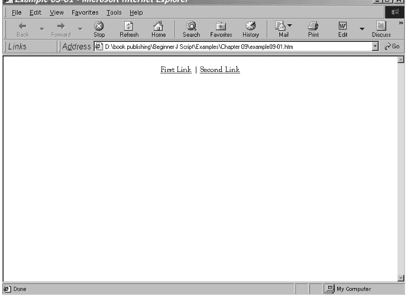

然后，如果你将鼠标移到第一个链接上，你会在状态栏中看到一条消息。

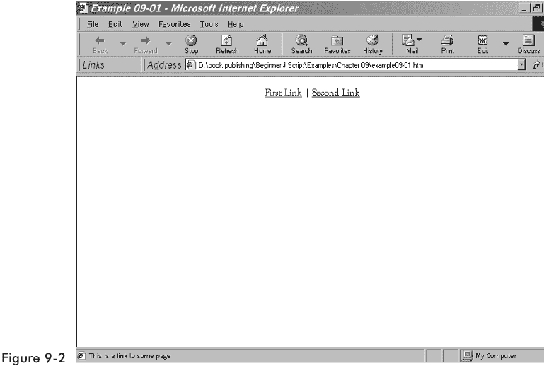

图 9-2

如果你将鼠标移到第二个链接上，你会在状态栏中看到一条消息。与第一个链接不同，当你将鼠标移开时，你会看到另一条消息。

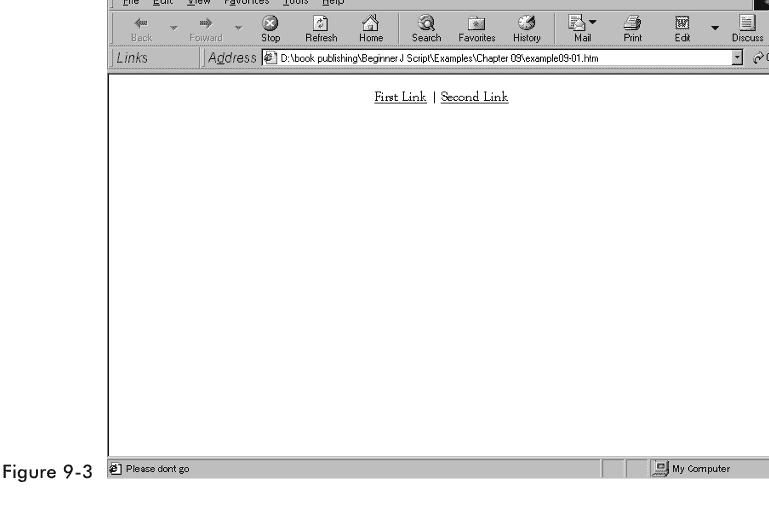

图 9-3

通过仔细检查第二个链接，我们可以清楚地看到它是如何工作的。它以标准的HTML引用 `<A HREF="somepage.htm">` 开始。但在关闭标签之前，我们还有一些其他代码。

我们看到的下一行是 `onMouseOver=window.status='This is a link to some page'`。这简单地意味着，当鼠移到这个链接上时，你在浏览器状态栏中看到的文本应该出现。一个需要记住的重要事情是，在你的文本中不能有任何撇号。因为文本本身被撇号包围，所以这会导致错误。

之后，对于 `onMouseOut` 事件，我们有两个选择。我们可以像第一个链接那样简单地写 `window.status="..."`，或者我们可以在鼠标移开链接时在状态栏中放置其他文本。

这个特定的小技巧使用起来一点也不难，它为你的网站增加了一个重要的维度。你的每个链接现在都可以在状态栏中显示更多细节。这对你的网站访问者来说非常有用。

## T-Banner

T-banner 模拟打字机。它通过逐个字符地输入来显示每条消息。就好像有人在以一定的速度输入消息，完成后删除它。首先，看看这个脚本：

```
示例 9-2

<HTML>
<HEAD>
<TITLE>Example 09-02</TITLE>
<SCRIPT LANGUAGE="JavaScript">

var speed = 100  // this speed value actually works in reverse; lower the
                // number to increase speed

var pause = 1000 // increase value to increase pause
// set initial values
var timerID = null
var bannerRunning = false
var offset = 0
var text = "How do you like this T-Banner"

function stopBanner()
{
    // if banner is currently running
    if (bannerRunning)
    {
        // stop the banner
        clearTimeout(timerID)
        bannerRunning = false
    }
}

function startBanner()
{
    stopBanner()
    showBanner()
}

function showBanner()
{
    if (offset < text.length)
    {
        var partialMessage = text.substring(0, offset + 1)
        // display partial message in status bar
        window.status = partialMessage
        // increment index of last character to be displayed
        offset++

        // recursive call after specified time
        timerID = setTimeout("showBanner()", speed)
        // banner is running
        bannerRunning = true
    }
    else
    {
        offset = 0
        timerID = setTimeout("showBanner()", pause)
        bannerRunning = true
    }
}
// -->
</SCRIPT>
</HEAD>
<BODY onLoad="startBanner()">
</BODY>
</HTML>
```

当你输入这个脚本并在浏览器中运行它时，你应该会看到类似下面的内容：

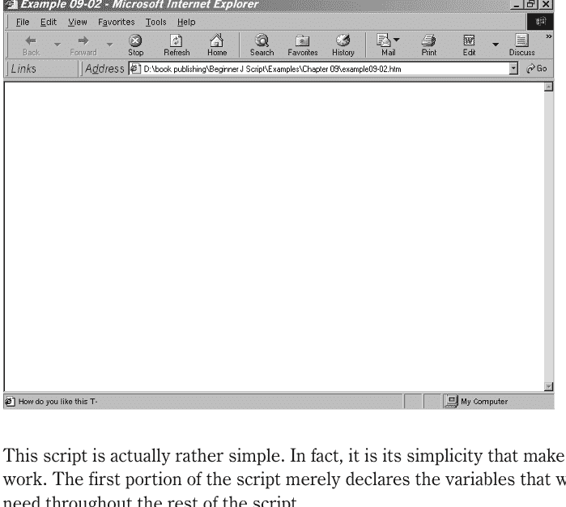

图 9-4

这个脚本实际上相当简单。事实上，正是它的简单性使其能够工作。脚本的第一部分只是声明了我们将在脚本其余部分中需要的变量。

```
var speed = 100 // this speed value actually works in reverse; lower the
                        // number to increase speed
var pause = 1000 // increase value to increase pause
// set initial values
var timerID = null
var bannerRunning = false
var offset = 0
var text = "How do you like this T-Banner"
```

第一个变量简单地告诉我们如何快速地将横幅放入状态栏。第二个告诉我们再次运行横幅之前需要暂停多久。第三个变量是一个计时器变量，我们将其初始化为 null 值。`bannerRunning` 变量让我们跟踪横幅当前是否正在运行。`offset` 变量是整个操作的关键，你很快就会看到。最后一个变量是 `text` 变量，它简单地包含我们希望显示的任何文本。

`stopBanner` 函数只是让横幅停止显示。`startBanner` 函数确保横幅当前没有运行（通过调用前面提到的 `stopBanner` 函数），然后调用 `showBanner` 函数。我们关心的是最后一个函数。正是在这里，脚本的真正操作发生了。

```
if (offset < text.length)
{
    var partialMessage = text.substring(0, offset + 1)
    // display partial message in status bar
    window.status = partialMessage
    offset++
    // recursive call after specified time
    timerID = setTimeout("showBanner()", speed)
    // banner is running
    bannerRunning = true
}
```

让我们检查这段脚本，确保你理解它在做什么。你之前接触到的 `offset` 变量告诉我们当前处于 `text` 变量中的哪个字符。所以我们做的第一件事就是检查该值是否仍然小于总文本值的长度。如果是，那么我们执行剩余的代码。脚本的秘密就在三行代码中：

```
var partialMessage = text.substring(0, offset + 1)
    window.status = partialMessage
        offset++
```

这里发生的事情是我们获取从零到 `offset + 1` 值的 `text` 变量的片段，然后在状态栏中显示该文本。在第一次传递时，我们只显示第一个字符，然后是第二个字符，然后是第三个，依此类推。虽然看起来字符是跨状态栏键入的，但真正发生的是每次状态栏的值完全改变，以反映更长的文本片段！

之后，函数只是不断调用自身，直到显示整个文本。你应该注意到，函数调用自身的过程称为 *递归*。一个调用自身的函数被称为 *递归函数*。

## 古董书店项目

就像本书的所有章节一样，我们现在需要将我们所学到的一些东西添加到我们正在进行的古董书店项目中。我们实际上要添加两件事。我们将从使用我向您展示的第一个示例开始，为我们的库存页面添加一些信息内容。

```
Inventory.htm

<HTML>
<HEAD>
    <TITLE>Book Inventory</TITLE>
<SCRIPT LANGUAGE="JAVASCRIPT" >
var childwindow = null
function openbook1()
{
    childwindow = window.open("inventory1.htm","childwindow",
        "width=400,height=400,scrollbars=yes")
}
function openbook2()
{
    childwindow = window.open("inventory2.htm","childwindow",
        "width=400,height=400,scrollbars=yes")
}
function openbook3()
{
    childwindow = window.open("inventory3.htm","childwindow",
        "width=400,height=400,scrollbars=yes")
}
function openbook4()
{
    childwindow = window.open("inventory4.htm","childwindow",
        "width=400,height=400,scrollbars=yes")
}
</SCRIPT>
</HEAD>
<BODY background="back1.gif" >
<P>
<CENTER>
    <H2> This month's newest additions!</H2>
</CENTER>
<P>
<A HREF="javascript:openbook1()"
onMouseOver= " window.status='We have three copies of this book, all in fine condition'
return true" onMouseOut="window.status= ' '
return true">View Shakespeare</A><BR>

<A HREF="javascript:openbook2()"
onMouseOver= " window.status='We just acquired this book last month'
return true" onMouseOut="window.status= ' '
return true">View Dickens</A><BR>

<A HREF="javascript:openbook3()"
onMouseOver= " window.status='This book is in fair condition'
return true" onMouseOut="window.status= ' '
return true">View Poe</A><BR>

<A HREF="javascript:openbook4()"
onMouseOver= " window.status='We have one copy in mint condition'
return true" onMouseOut="window.status= ' '
return true">View King James Bible</A><BR>
</H2>
</BODY>
</HTML>
```


### 总结

在本章中，您已经看到，要操纵状态栏来显示信息确实非常容易。我向您展示了一些直接示例来说明这一点。您会发现，实施这些技术所需的最少努力是完全值得的。您的网站访问者将能够在状态栏中获取额外信息，而您无需在网页上添加不必要的杂乱内容。

## 第十章

创建动态菜单

访问您网站的用户可能习惯于桌面应用程序（在他们的 PC 或 Mac 上运行），这些程序允许他们通过各种菜单来导航软件。我相信您也使用过下拉菜单、弹出菜单以及其他类型的菜单。幸运的是，使用 JavaScript 将这些菜单放置到您的网页中并非特别困难。

为了创建许多这样的菜单，我们必须依赖一种称为级联样式表的网页技术。由于本书是关于 JavaScript 的，我们不会深入探讨级联样式表具体如何工作；我们只是将它们与我们的标准 HTML 和 JavaScript 结合使用。即使对样式表只有非常粗浅的了解，也完全有可能使用这些脚本。

## 弹出菜单

我们将研究的第一种菜单类型，会在用户将鼠标移动到特定文本段时产生一个简单的弹出菜单。让我们看一个示例并研究它，以了解其工作原理。

### 示例 10-1

```html
<HTML>
<HEAD>
    <TITLE>ex10-01</TITLE>
    <STYLE TYPE="text/css">
        .popup {border-width:4; border-style: solid; border-color:blue;
                position:absolute; background-color:yellow; visibility:hidden}
    </STYLE>
    <SCRIPT>
    function setUp()
    {
        makepopup ("Item1" ,280, "This is the popup for item 1")
        makepopup ("Item2",240, "Hey this is another popup.")
        makepopup ("Item3",280, "Last, but not least, popup3.")
    }
    function makepopup (id, width, message)
    {
        var htmltext = '<STYLE
            TYPE="text/css">#'+id+'{width:'+width+';}</STYLE>';
        htmltext +='<DIV CLASS="popup" id="'+id+'">'+message+'</DIV>';
        document.write(htmltext);
    }

    function show(id, event)
    {
        document.all[id].style.pixelLeft = (document.body.scrollLeft
                +event.clientX) + 10;
        document.all[id].style.pixelTop = (document.body.scrollTop +
                event.clientY) + 10;
        document.all[id].style.visibility="visible";
    }

    function hide(id)
    {
        document.all[id].style.visibility="hidden";
    }
    </SCRIPT>
</HEAD>
<BODY BGCOLOR=white>
<CENTER>
    List of Items
    <UL>
        <LI>
            <A HREF="" onMouseOver="show('Item1', event)"
                    onMouseOut="hide('Item1')">Item 1</A>
        <LI>
            <A HREF="" onMouseOver="show('Item2', event)"
                    onMouseOut="hide('Item2')">Item 2</A>
        <LI>
            <A HREF="" onMouseOver="show('Item3', event)"
                    onMouseOut="hide('Item3')">Item 3</A>
    </UL>

<SCRIPT LANGUAGE="JavaScript">
    setUp()
</SCRIPT>
</BODY>
</HTML>
```

这个脚本看起来可能有点复杂，但别担心，它其实并不难。您可能注意到的第一个新项目是 `<STYLE>` 标签。它与级联样式表（CSS）一起使用，我们用它来创建小气球。将这些级联样式表与 JavaScript 等脚本语言结合使用是很常见的。本质上，它的参数定义了弹出窗口的外观。之后，脚本的其余部分是相当标准的 JavaScript。让我们仔细看看。

您看到的第一个函数 `setUp` 简单地定义了弹出菜单将具有的参数。这包括它将显示的文本及其宽度。这个函数又使用 `makepopup` 来根据您在 `setUp` 中设置的参数创建弹出窗口。

函数 `show()` 实际上显示弹出窗口。当鼠标移动到 HTML 正文中的文本上时，会调用此函数。`hide` 函数则简单地隐藏弹出窗口，当鼠标移开 HTML 正文中的文本时调用。这两个函数都利用了级联样式表的元素，特别是 `visible` 属性。

如果您正确输入了代码，您应该能够使用浏览器查看到类似于以下内容：

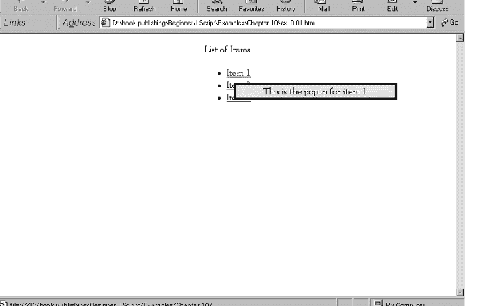

图 10-1

## 下拉菜单

下拉菜单只是使用 HTML 的选择表单元素。它看起来像 Microsoft Windows 中的下拉框或组合框。您使用此表单元素为用户提供一系列选择，然后获取他们的选择并将其传递给您的 JavaScript。让我们看一个例子。

### 示例 10-2

```html
<HTML>
<HEAD>
<TITLE>Example 10-02</TITLE>
<SCRIPT LANGUAGE = "JavaScript">

function movetourl()
{
    window.location=document.dropmenu.website.options[document.dropmenu.
    website.selectedIndex].value
}
</SCRIPT>
</HEAD>
<BODY>
<FORM NAME="dropmenu">
    <SELECT NAME="website">
        <OPTION VALUE=""><B>Choose your link</b>
        <OPTION VALUE="http://www.wordware.com">WordWare
        <OPTION VALUE="http://www.amazon.com">Amazon Books
        <OPTION VALUE="http://www.nortexsolutions.com">Nortex Solutions
    </SELECT>
    <INPUT TYPE="button" VALUE="Go" onClick="movetourl()">
</FORM>
</BODY>
</HTML>
```

如果正确输入了所有代码，您应该能够看到类似于以下图示的内容：

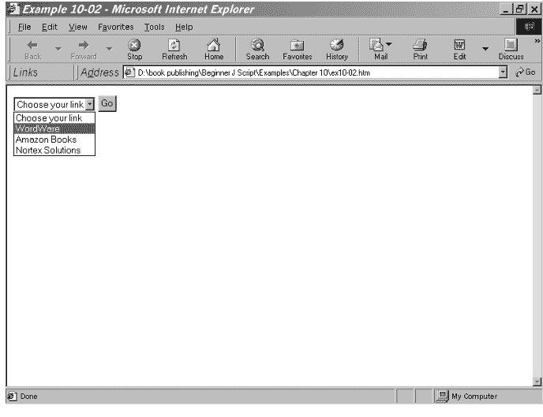

让我们看看代码，看看发生了什么。脚本本身非常简单，只有一行代码：

```javascript
window.location=document.dropmenu.website.options[document.dropmenu.website.selectedIndex].value
```

它使用 `window` 对象的 `location` 属性，简单地将网页移动到菜单中指定的 URL。这非常直接易懂。我们实际创建菜单的方式是使用 HTML 表单元素。在这种情况下，我们使用创建下拉菜单的 `select` 元素。当用户选择了他们希望访问的网页后，他们点击“Go”按钮，从其 `onClick` 事件中我们调用我们的 JavaScript。如您所见，这个特定的菜单非常容易实现。

## 拉下菜单

我们将讨论的下一种菜单类型是拉下菜单。这种菜单的工作方式类似于 Microsoft Windows 中的许多应用程序。在这个菜单示例中，屏幕上只显示顶级菜标题。当您的鼠标移动到该菜单标题上时，其余菜单会向下展开显示。这是一个非常有趣的效果。让我们看一个例子。

### 示例 10-3

```html
<HTML>
<HEAD>
<TITLE>Example 10-03</TITLE>
<SCRIPT LANGUAGE="JavaScript">
    var browser
    if (document.getElementById)
    {
        browser = true
    }
    else
    {
        browser = false
    }
    function toggleMenu(currElem,nextPos)
    {
        menuObj = (browser ) ? document.getElementById(currElem).style :
                   eval("document." + currElem)
        if (toggleMenu.arguments.length == 1)
        {
            nextPos = (parseInt(menuObj.top) == -5) ? -90 : -5
        }
        menuObj.top = (browser ) ? nextPos + "px" : nextPos
    }
</SCRIPT>

<STYLE TYPE="TEXT/CSS">
    .menu {position:absolute; font:12px arial, helvetica, sans-serif;
           background-color:tan; layer-background-color:tan; top:-90px}
    #fileMenu {left:10px; width:70px}
    #searchMenu {left:85px; width:100px}
    A {text-decoration:none; color:blue}
    A:hover {background-color:blue; color:red}
</STYLE>
</HEAD>
<BODY BGCOLOR="white">
<DIV ID="fileMenu" CLASS="menu" onMouseover="toggleMenu('fileMenu',-5)"
onMouseout="toggleMenu('fileMenu',-90)"><BR>
    <A HREF="javascript:window.open()">Open</A><BR>
    <A HREF="javascript:history.back()">Back</A><BR>
    <A HREF="javascript:history.forward()">Forward</A><BR>
    <A HREF="javascript:window.close()">Close</A><HR>
    <A HREF="javascript:changemenu('fileMenu')">File</A>
</DIV>
</BODY>
</HTML>
```

如果正确输入了所有内容，然后在浏览器中打开此网页，您应该会看到类似于以下图形的内容。

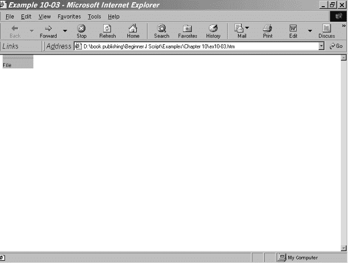

图 10-3

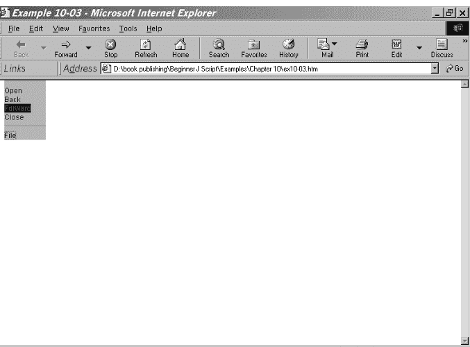

图 10-4

现在让我们更详细地研究这个示例，以确保您牢固理解这里到底发生了什么。

JavaScript 代码的第一部分可能看起来有点奇怪：

```javascript
var browser
if (document.getElementById)
{
    browser = true
}
else
{
    browser = false
}
```

我们这里做的是检查此浏览器是否支持我们正在编写的脚本。由于我们使用了文档的元素对象，我们通过简单地调用 `getElementById` 函数来查看此浏览器是否支持它。如果此操作成功，则浏览器将支持我们的脚本。您会注意到，在本书的许多脚本中，第一步都是确保浏览器支持该脚本。这只是一个良好的实践习惯，可以避免网站访问者看到错误消息。

菜单的大部分操作都在 `toggleMenu` 函数中完成，所以让我们仔细看看它。

```javascript
function toggleMenu(currElem, nextPos)
{
    menuObj = (browser ) ? document.getElementById(currElem).style : 
                eval("document." + currElem)
    if (toggleMenu.arguments.length == 1)
    {
        nextPos = (parseInt(menuObj.top) == -5) ? -90 : -5
    }
    menuObj.top = (browser ) ? nextPos + "px" : nextPos
}
```

不要让表面上的复杂性吓到您；它并不像看起来那么难。这里真正的新项目是所谓的 *三元运算符*。这是一个具有三个元素的运算符。到目前为止，您看到的大多数运算符都有一或两个操作数（例如一元递增运算符 `++`，以及二元数学运算符 `+`、`-`、`*`、`/` 等）。三元运算符有三个参数。在我们这里使用的形式中，它本质上是一个浓缩的 if-then 语句。我们将仔细研究此脚本段中的第二个三元运算符，因为它更短。

menuObj.top = (browser) ? nextPos + "px" : nextPos

这里发生的是，我们规定如果浏览器对象有效，那么 `menuObj.top` 应该被设置为 `nextPos + “px”`，否则就简单地将其设置为 `nextPos`。你会在许多 JavaScript 代码中看到三元运算符的使用。它们在 Java、C 和 C++ 编程中也经常被使用。

这个函数通过使用两个三元运算符来简化 `if-else` 语句，其作用是设置菜单的位置。也就是说，它使菜单可以展开，从而让你能够查看完整的菜单，或者使其折叠，从而让你无法查看。

为了创建菜单，我们再次使用了层叠样式表。就我们的目的而言，深入了解层叠样式表的细节并不重要。我们可以在不深入了解它们的情况下偶尔使用它们。然后我们简单地使用 `onMouseOver` 来显示菜单，并使用 `onMouseOut` 使菜单消失。

## 展开式菜单

有时你需要显示大量信息，但全部显示会使网页显得非常杂乱。通过使用展开式菜单，你可以将信息分组到不同的主题中，然后用户可以点击他们感兴趣的主题，并显示该主题的详细信息。让我们看一个例子：

示例 10-4

```
<HTML>
<HEAD>
<TITLE>Example 10-04</TITLE>
<SCRIPT LANGUAGE="JAVASCRIPT">
function toggleMenu(currMenu)
{
    if (document.getElementById)
    {
        thisMenu = document.getElementById(currMenu).style
        if (thisMenu.display == "block")
        {
            thisMenu.display = "none"
        }
        else
        {
            thisMenu.display = "block"
        }
        return false
    }
    else
    {
        return true
    }
</SCRIPT>
<STYLE TYPE="TEXT/CSS">
.menu {display:none; margin-left:20px}
</STYLE>
</HEAD>
<BODY BGCOLOR="WHITE">
<H3>
<A HREF="example10-04.htm" onClick="return toggleMenu('menu1')">Internet
Books from WordWare</A>
</H3>
<SPAN CLASS="menu" ID="menu1">
    Learn ASP in Three Days by Jose Ramalho<BR>
    Search Engine Positioning by Fredrick Marckini<BR>
    Learn ActiveX Scripting with MSIE by Nathan Wallace<BR>
</SPAN>
<H3>
<A HREF="example10-04.htm" onClick="return toggleMenu('menu2')">Game Design
books from WordWare</A>
</H3>
<SPAN CLASS="menu" ID="menu2">
Introduction to Computer Game Programming with Direct X 8.0 by Ian Parberry<BR>
Designing Arcade Computer Game Graphics by Ari Feldman<BR>
Real-Time Strategy Game Programming using Direct X by Mickey Kawick
</SPAN>
<H3>
<A HREF="example10-04.htm" onClick="return toggleMenu('menu3')">Database
Applications from WordWare</A>
</H3>
<SPAN CLASS="menu" ID="menu3">
    Learn Microsoft SQL Server 7.0 by Jose Ramalho<BR>
    Learn Oracle 8i by Jose Ramalho
</SPAN>
</BODY>
</HTML>
```

我们再次有了一个初看起来并不像看上去那么复杂的脚本。让我们来检查一下这个脚本，看看发生了什么。

我们做的第一件事是使用文档对象的 `getElementByID` 函数来检查这个脚本是否被当前使用的浏览器所支持。正如我之前所述，养成在尝试执行脚本之前先检查浏览器是否支持它的习惯是很好的。一旦我们确认脚本可以被支持，我们就简单地改变菜单的样式，从其当前状态切换。如果它当前是 `“none”`，那么我们显示块状菜单。如果它当前是 `“block”`，那么我们将其改为 `none`。这样做的效果是，当你第一次点击时菜单显示，第二次点击时菜单消失。

我们再次使用了一些层叠样式表技术来实际显示菜单。然而，对我们 JavaScript 函数的调用是通过一个链接完成的。由于我们实际上并不希望这个链接跳转到其他地方，而是跳转到我们的脚本，我将 `<A HREF>` 设置为我们当前所在的页面。

现在，如果你正确地输入了这个示例，你应该能够在浏览器中打开它，并看到类似于这里显示的图像：

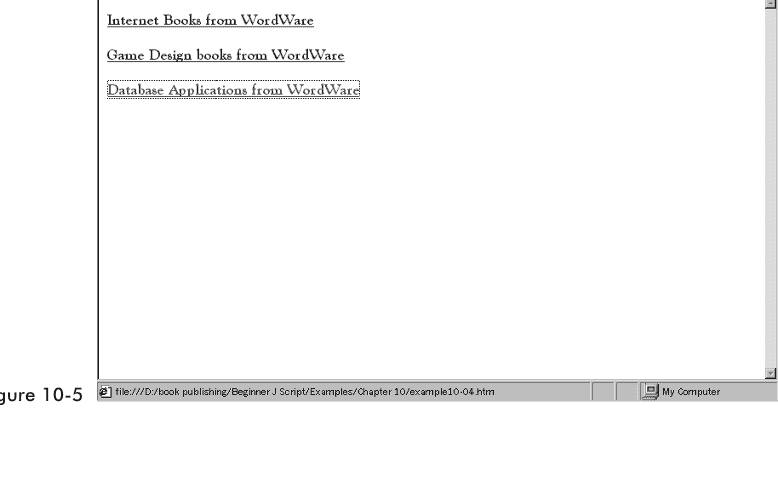

图 10-5

我认为你会发现这种类型的菜单非常适合于显示库存等任务。它允许你最初只显示类别，然后访问你网站的用户可以展开他或她觉得特别感兴趣的任何类别。

## 古董书店项目

与本书的所有章节一样，我们现在将把所涵盖的技术融入到我们正在进行的古董书店项目中。如果你选择完成每章末尾的项目练习，那么当你读完这本书时，你将已经建立了一个具有许多令人兴奋的功能的完整网站。

我们将添加一个完整的库存页面，该页面使用了我们在示例 10-4 中实现的相同菜单样式。

```
<HTML>
<HEAD>
<TITLE>Complete Inventory</TITLE>
<SCRIPT LANGUAGE="JAVASCRIPT">

function toggleMenu(currMenu)
{
    if (document.getElementById)
    {
        thisMenu = document.getElementById(currMenu).style
        if (thisMenu.display == "block")
        {
            thisMenu.display = "none"
        }
        else
        {
            thisMenu.display = "block"
        }
        return false
    }
    else
    {
        return true
    }
}
</SCRIPT>
<STYLE TYPE="TEXT/CSS">
    .menu  {display:none; margin-left:20px}
</STYLE>
</HEAD>
<BODY BGCOLOR="WHITE">
<H3>
<A HREF="completeinventory.htm" onClick="return toggleMenu('menu1')">Books
from the 1800's</A>
</H3>
<SPAN CLASS="menu" ID="menu1">
    1st Edition Charles Dickens' "Tale of Two Cities"<BR>
    1st Edition Edgar Allen Poe's "The Tell-Tale Heart"<BR>
    Signed Copy of Edgar Allen Poe's "The Cask of Amontillado"<BR>
</SPAN>
<H3>
<A HREF="completeinventory.htm" onClick="return toggleMenu('menu2')">Books
from the 1700's</A>
</H3>
<SPAN CLASS="menu" ID="menu2">
    Ben Franklin's memoirs<BR>
    "How to Start a Revolution"<BR>
    "Political Theory" by Thomas Paine<BR>
</SPAN>
<H3>
<A HREF="completeinventory.htm" onClick="return toggleMenu('menu3')">Books
for under $25</A>
</H3>
<SPAN CLASS="menu" ID="menu3">
    A cowboy's diary (circa 1850's)<BR>
    4th edition Charles Dickens' "A Tale of Two Cities"<BR>
    3rd Edition Jules Verne's "20,000 Leagues Under the Sea"<BR>
</SPAN>

<H3>
<A HREF="completeinventory.htm" onClick="return toggleMenu('menu4')">Our
finest items</A>
</H3>
<SPAN CLASS="menu" ID="menu4">
    Signed copy of Shakespeare's "Hamlet"<BR>
    Gutenberg's diary<BR>
    Signed first edition Longfellow<BR>
    1570 Hebrew Bible<BR>
</SPAN>
</BODY>
</HTML>
```

### 总结

本章向你介绍了为网页添加菜单的过程。它向你展示了四种非常不同类型的菜单示例。目标是向你展示如何将 JavaScript 与其他 Web 设计技术（如 HTML 表单和层叠样式表）集成，为你的网站创建动态菜单。你会发现，如果你在网站上使用菜单，网站访问者的导航会容易得多，从而提高他们对你网页的满意度。

# 第 11 章

## 处理表单

在本书的过去几章中，你已经使用了 HTML 表单的各种元素。我在包含这些元素时没有做太多解释。本章专门解释 HTML 表单是如何工作的。

本质上，HTML 标准允许你创建各种表单元素，使用户输入变得容易得多。到目前为止，在本书中你已经看到了文本字段和按钮的使用。在本章中，我们将研究相关的概念。我们还将研究你可以在 HTML 中使用的其他表单元素。从 HTML 表单事件调用你的 JavaScript 函数是一种非常常见的技术。

### 表单基础知识

由于表单是 HTML 的一部分，它们像 HTML 中的其他所有东西一样由标签定义。定义你将要使用表单元素的基本标签是 `<FORM>` 标签。

```
<FORM>
</FORM>
```

你希望使用的所有表单元素都必须放在这两个标签之间。你可能希望使用的每个表单元素都以非常相似的方式定义。你定义元素类型（按钮、文本字段等）、其名称（在代码中如何引用它）以及其初始值。在某些情况下，你还定义其他属例如大小。例如，如果你希望将文本字段放在 HTML 文档上，以便用户可以输入数据，其工作方式如下：

示例 11-1

```
<HTML>
<HEAD>
```

### 文本框与按钮

表单元素中最常用的两个可能是文本框（我们之前在示例中见过）和按钮。按钮是一个出色的表单元素，可用于调用你的 JavaScript 脚本。让我们看一个这样的例子。

示例 11-2

```html
<HTML>
    <HEAD>
        <TITLE>示例 11-02</TITLE>
        <SCRIPT LANGUAGE = "JavaScript">
            alert(txttest.value)
        </SCRIPT>
    </HEAD>
    <BODY>
        <CENTER>
            <INPUT TYPE=text NAME="txttest" VALUE="在此输入文本"><BR>
            <INPUT TYPE=button NAME="Submit" VALUE="提交" onclick="test()">
        </CENTER>
    </BODY>
</HTML>
```

这个示例展示了表单元素用法中的一个微小但重要的变化。这里我们有一个按钮，当它被点击时（onClick 事件），我们调用一个 JavaScript 函数。这个函数反过来引用 HTML 表单中文本框的值。如果你正确输入所有代码，你应该能看到与下面图形非常相似的内容：

# 第 11 章

使用按钮触发 JavaScript 函数既非常常见又非常有用。这种技术允许你根据用户活动来调用函数。在我们的示例中，我们调用的 JavaScript 非常简单，但它很好地说明了这一点。

### 选项

HTML 中的选项与 Visual Basic 中的组合框相同。它是一个下拉框，显示一系列选项供用户选择。如果你希望用户从多个项目中选择，但又不希望使屏幕显得杂乱，这会非常有用。考虑以下示例：

示例 11-3

```html
<HTML>
<HEAD>
    <TITLE> 示例 11-03</TITLE>
<SCRIPT>
function moveon()
{
    window.location=document.dropdown.selection.options[document.
        dropdown.selection.selectedIndex].value
}
</SCRIPT>
<BODY BGCOLOR = "White">
<FORM NAME="dropdown">
    <SELECT NAME="selection"
    <OPTION VALUE=""><B>选择一个选项</B>
    <OPTION VALUE="this.html">这个
    <OPTION VALUE="next.html">下一个
    <OPTION VALUE="after.html">之后那个
    </SELECT>
    <INPUT TYPE=button NAME="Submit" VALUE="提交" onclick="moveon()">
</FORM>
</BODY>
</HTML>
```

这个示例简单地允用户选择他们想要导航到的网页。一旦他们选择了页面，他们按下提交按钮就会跳转到该页面。脚本实际上只有一行。它只是使用 `window.location` 属性移动到用户选择的任何网页。如果你正确输入代码，你应该能看到类似这样的内容：

### 单选按钮

单选按钮是你点击以选择特定选项的小圆圈。你之前在网页和桌面应用程序中见过这些。单选按钮向用户提供一系列选择，用户只能选择其中一个。看看这个示例：

示例 11-4

```html
<HTML>
<HEAD>
    <TITLE>示例 11-04</TITLE>
<SCRIPT LANGUAGE="JavaScript">
</SCRIPT>
</HEAD>
<BODY>
<FORM>
    <INPUT TYPE="radio" NAME="radiobutton" onClick="radio_selection='A'">添加
    <INPUT TYPE="radio" NAME="radiobutton" onClick="radio_selection='D'">删除
    <INPUT TYPE="radio" NAME="radiobutton" onClick="radio_selection='U'">更新
</FORM>
</HTML>
```

如你所见，我们简单地使用 `INPUT TYPE="radio"` 来表明这将是一个输入类型，并且输入将通过单选按钮完成。然后我们给单选按钮一个名称。注意它们都有相同的名称。由于用户只能选择一个按钮，我们只需要根据一个按钮来设置值。

如果你完全按照示例所示输入代码，你将能够看到以下屏幕：

### 复选框

单选按钮提供多个选择，但只允许你选择其中一个。这在许多情况下非常有用，例如如果你询问用户的婚姻状况：已婚、单身或离异。在任何给定时间他们只能是一种状态。然而，对于其他类型的信息，一个人可能可以选择多个选项。例如，如果你问一个人他们在电视上观看哪些运动（足球、篮球、棒球、高尔夫），他们可能想选择多个。对于这种类型的数据，你应该使用复选框。复选框类似于选项框，但用户可以选择多个选项。以下示例说明了这一点。

```html
<HTML>
<HEAD>
    <TITLE>示例 11-05</TITLE>
<SCRIPT LANGUAGE="JavaScript">
var allchecked = "false"
function check(field)
{
    if (allchecked == "false")
    {
        for (i = 0; i < field.length; i++)
        {
            field[i].checked = true;
        }
        allchecked = "true"
        return "取消全选"
    }
    else
    {
        for (i = 0; i < field.length; i++)
        {
            field[i].checked = false
        }
        allchecked = "false"
        return "全选"
    }
}
</SCRIPT>
</HEAD>
<BODY BGCOLOR = White>
<FORM NAME =myform>
<b>你喜欢的 JavaScript 网站！</b><br>
<INPUT TYPE=checkbox name=list value="1">JavaScript Source<BR>
<INPUT TYPE=checkbox name=list value="2">JavaScript.Com<BR>
<INPUT TYPE=checkbox name=list value="3">JavaScript World<BR>
<INPUT TYPE=checkbox name=list value="4">HTML Goodies <BR>
<BR>
<INPUT TYPE=button VALUE="全选" onClick="this.value=check(this.form.list)">
</FORM>
</HTML>
```

在这个示例中，我们使用 `<FORM>` 标签来表明将使用表单元素。然后我们使用 `INPUT TYPE=checkbox`。这让浏览器知道它应该显示一个复选框。如果你正确输入所有代码，你应该会看到类似以下屏幕的内容。

复选框在允许用户选择多个选项方面非常有用。

### 表单元素中的事件处理程序

有各种事件处理程序允许你在用户执行给定操作时调用特定的 JavaScript 代码。我们将在这里考察几个最常见的事件处理程序。

#### onSubmit

`onSubmit` 事件处理程序是 `<FORM>` 标签的一个属性。当表单被提交时调用它。表单可以通过几种方式提交；提交按钮只是众多方式中的一种。提交事件可以在点击提交按钮、按回车键或其他几种方法后立即发生。JavaScript 在将数据发送到服务器之前触发此事件。在表单数据实际提交给服务器进行进一处理之前，会执行事件处理程序的脚本。

# 第 11 章

`onSubmit` 事件处理程序通常用于验证表单元素的内容。客户端表单验证正变得越来越受欢迎，因为用户可以立即收到关于无效条目的反馈。例如，如果你有一个带文本框的表表单，要求用户输入他们的电子邮件地址，你可以使用一个简单的 JavaScript 脚本来确保（在提交时）用户输入的字符串包含一个“@”符号，当然，所有有效的电子邮件地址都会包含这个符号。

你可以使用 `onSubmit` 事件处理程序不仅来验证表单元素，还可以完全取消表单的提交。当事件处理程序返回一个 false 值时，表单的提交将被中止，如以下示例所示：

```html
<FORM NAME="form1" onSubmit="return false">
```

当然，这个示例不是很实用，因为它无条件地禁用了表单提交。然而，它确实说明了所讨论的问题。通常，一个函数验证表单并根据情况返回 true 或 false 值。你可以使用以下代码来取消或继续表单提交，具体取决于函数返回的值：

```html
<FORM NAME="form1" onSubmit="return checkData()">
```

以下示例通过一个包含文本区域框和提交按钮的表单来说明这些概念，该表单在提示用户确认后通过电子邮件将文本区域的内容发送给你：

**示例 11-6**

```html
<SCRIPT LANGUAGE="JavaScript">
function continue()
{
    return confirm("点击确定以发送此信息")
}
</SCRIPT>
<FORM ACTION="mailto:chuckeasttom@yahoo.com" METHOD="post" ENCTYPE=
    "text/plain" onSubmit="return continue()">
    <INPUT TYPE =textfield NAME="txttest" Value = "在此输入消息"><BR>
    <INPUT TYPE=button VALUE="发送邮件">
</FORM>
```

如果你正确输入所有代码，你应该能够使用你的浏览器看到以下图像：

这里用到的一些参数你之前见过，但 ENCTYPE 可能对你来说是新的。为了以纯文本、未加密的电子邮件形式接收表单内容，你需要为 ENCTYPE 属性赋值 `text/plain`。

#### onReset

`<FORM>` 标签的另一个事件处理程序是 onReset。重置事件通常在用户点击“重置”按钮时发生。onReset 事件处理程序的行为与 onSubmit 事件处理程序非常相似。

以下示例在执行重置操作前要求用户确认：

```html
示例 11-7
<HTML>
<HEAD>
    <TITLE>示例 11-07</TITLE>
</HEAD>
<BODY BGCOLOR = White>
<FORM ACTION="mailto:chuckeasttom@yahoo.com" METHOD="post" ENCTYPE="text/plain"
      onReset="return confirm('点击确定以将表单重置为默认状态')">
<TEXTAREA NAME="input" COLS=40 ROWS=10></TEXTAREA><BR>
<INPUT TYPE="reset" VALUE="重置!">
</FORM>
</BODY>
</HTML>
```

在此示例中，如果你按下“重置”按钮，系统会提示你确认该操作。然后所有文本将被重置为其默认值（恰好是空白）。如果你正确输入了所有代码，你应该能够使用浏览器看到以下图像：

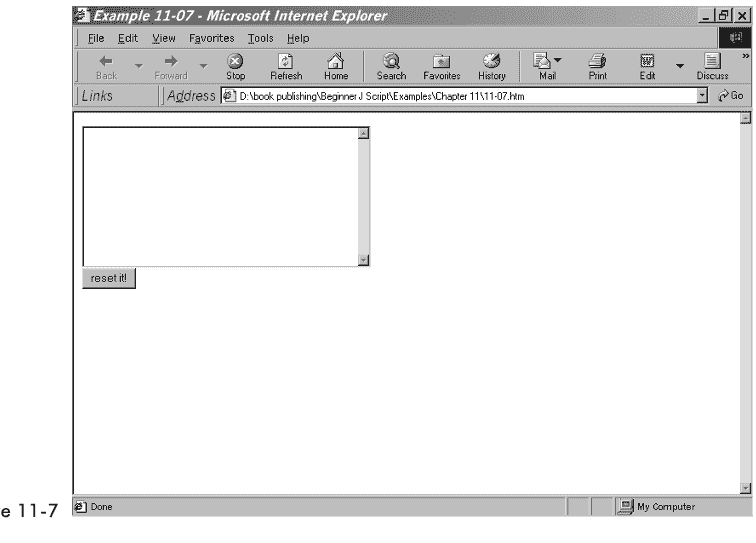

图 11-7

### 表单元素概览

下表总结了 HTML 中可供你使用的主要表单元素。

| HTML 元素 | Type 属性值 |

| :--- | :--- |

| INPUT TYPE="button" | "button" |

| INPUT TYPE="checkbox" | "checkbox" |

| INPUT TYPE="file" | "file" |

| INPUT TYPE="hidden" | "hidden" |

| INPUT TYPE="password" | "password" |

| INPUT TYPE="radio" | "radio" |

| INPUT TYPE="reset" | "reset" |

| INPUT TYPE="submit" | "submit" |

| INPUT TYPE="text" | "text" |

| SELECT | "select-one" |

## 古董书店项目

本章是我们为古董书店项目添加新内容的少数章节之一，因为我们在前面的章节中已经使用过表单元素。本章的目标仅仅是阐明表单相关问题。

### 总结

在本书中，我们一直使用表单元素。在本章之前，你只是输入了它们，可能没有确切意识到你做了什么。学习本章后，你应该对 HTML 表单的工作原理有了很好的理解。

# JavaScript 中的字符串

字符串在你的脚本中有许多用途。字符串保存文本数据，例如姓名、地址等。你可以将字符串值存储在标准变量中。但是，如果你创建一个字符串对象来存储字符串数据，那么你就可以使用各种字符串对象方法来操作该字符串。本质上，字符串只是一个字符数组。字符串的索引（像数组一样）是从零开始的。字符串第一个字符的索引是 0，第二个是 1，第三个是 2，依此类推。

## 创建字符串

String 是一个内置对象。这意味着它的处理方式与其他变量略有不同。它像对象变量一样创建，而不是像简单变量那样。下面是一个例子：

```javascript
var lastname = new String("Smith")
```

通用语法是：

```javascript
var name = new String(string)
```

*name* 是你正在创建的字符串对象的名称。你可以给它任何你想要的名字，但我建议一个能反映它将保存的数据类型的名称。*string* 是任何字符串字面量，如示例所示。

## 字符串长度

String 对象组合了许多有用的方法和一个属性 length。此属性反映其调用对象的长度。下面是一个例子：

```html
<HTML>
<HEAD>
<TITLE>示例 12-01</TITLE>
<SCRIPT LANGUAGE = "JavaScript">
    function test()
    {
        var mystr =txttest.value
        alert(mystr.length)
    }
</SCRIPT>
</HEAD>
<BODY>
<CENTER>
    <INPUT TYPE=text NAME="txttest" VALUE="在此输入文本"><BR>
    <INPUT TYPE=button NAME="Submit" VALUE="提交" onclick="test()">
</CENTER>
</BODY>
</HTML>
```

如果你正确输入了示例，你可以使用浏览器查看它，你应该会看到以下内容：

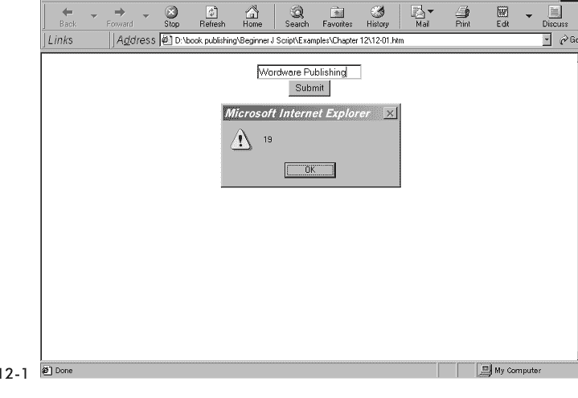

图 12-1

## 字符串方法

如前所述，String 对象有许多有用的方法，其中之一是 toUpperCase() 方法。这会将字符串中的所有文本更改为大写。此方法有许多实际应用。

### charAt()

charAt() 方法返回索引等于方法参数的字符。字符串的字符索引从 0 到 length–1。通用语法是：

`mystring.charAt(index)`

下面是一个例子：

```html
示例 12-2
<HTML>
<HEAD>
    <TITLE>示例 12-02</TITLE>
    <SCRIPT LANGUAGE = "JavaScript">
        function test()
        {
            var mystr =txttest.value
            alert(mystr.charAt(1))

        }
    </SCRIPT>
</HEAD>

<BODY>
<CENTER>
    <INPUT TYPE=text NAME="txttest" VALUE="在此输入文本"><BR>
    <INPUT TYPE=button NAME="Submit" VALUE="提交" onclick="test()">
</CENTER>
</BODY>
</HTML>
```

如果你正确输入了代码，然后在框中输入一些文本，你应该会看到类似下图的内容：

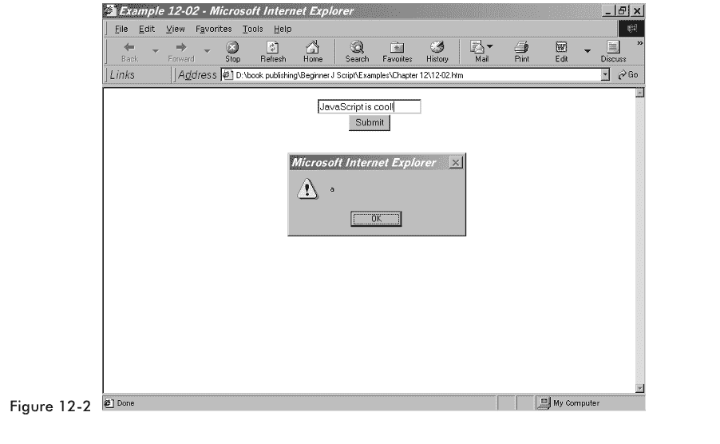

以下脚本片段打印字符 “o”，因为它是字符串中的第二个字符（索引 1）。你也可以用文本字面量调用此方法，如以下示例：

```javascript
document.write("wordware".charAt(1))
```

你可以通过一个简单的循环打印字符串的字符：

```javascript
var mystring = "Wordware Publishing"
for (var i = 0; i < mystring.length; ++i)
{
    document.write(mystring.charAt(i))
}
```

首先，一个字符串字面量被赋值给变量 mystring。然后循环迭代 length 次。它从 0 开始，到 mystring.length–1 结束。

### indexOf()

此方法返回在调用字符串对象中指定子字符串首次出现的索引，搜索从字符串的开头开始。一个例子肯定能弄清楚：

这个脚本的输出是数字 0。指定子字符串 “wo” 在调用字符串对象中首次出现的位置是在索引为 0 的第二个字符处。对指定子字符串的搜索从索引 0（字符串的开头）开始。

### lastIndexOf()

此方法与 indexOf 方法相同，只是它返回指定值最后一次出现的索引，而不是第一次出现的索引。其语法显然是相同的：

*stringName*.lastIndexOf(searchValue, [fromIndex])

以下脚本打印数字 3：

```javascript
var mystring = "a/b/c"
document.write(mystring.lastIndexOf("/"))
```

### substring()

字符串由字符构成。substring() 方法返回其调用 String 对象中的一组字符。其通用语法是：

*stringName*.substring(indexA, indexB)

*stringName* 是任何字符串。*indexA* 和 *indexB* 都是介于 0 和 *stringName*.length – 1 之间的整数。*indexA* 是子字符串中第一个字符的索引，而 *indexB* 是子字符串中最后一个字符的索引加 1。考虑以下示例：

**示例 12-3**

```html
<HTML>
<HEAD>
    <TITLE>示例 12-03</TITLE>
    <SCRIPT LANGUAGE = "JavaScript">
        function test()
        {
            var begin = txtbegin.value
            var end = txtend.value
            var mystring =txttest.value
            var seg = mystring.substring(begin,end)
            alert(seg)
        }
    </SCRIPT>
</HEAD>

<BODY>
<CENTER>
	<INPUT TYPE=text NAME="txttest" VALUE="在此输入文本"><BR>
	<INPUT TYPE=text NAME="txtbegin" VALUE="0">
	<INPUT TYPE=text NAME="txtend" VALUE="5"><BR>
	<INPUT TYPE=button NAME="Submit" VALUE="提交" onclick="test()">
</CENTER>
</BODY>
</HTML>
```

如果你正确输入了所有内容，你应该会在浏览器中看到类似以下内容：

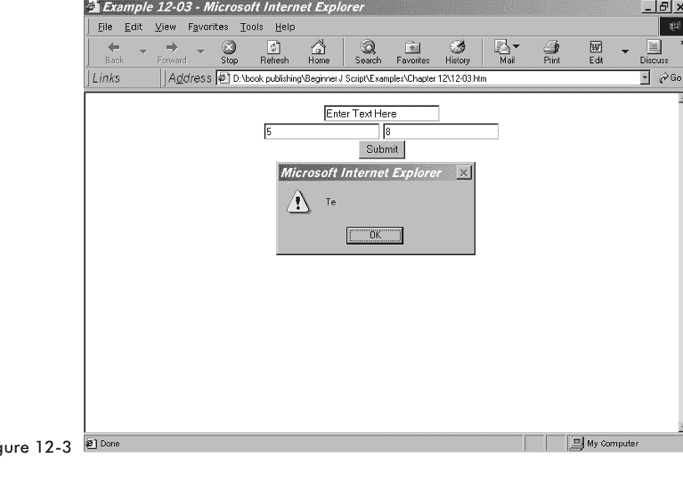

图 12-3

请注意，子字符串的长度是 *indexB* – *indexA*。

## 数字到字符串的转换

偶尔，你需要将数字转换为字符串。例如，如果你想计算一个数字的位数，你可以将其转换为字符串并使用 length 属性（仅适用于字符串）。在本节中，我们将了解几种将数字转换为字符串的方法。

## 空字符串连接

将数字转换为字符串最简单的方法是将空字符串与数字进行连接。以下是示例：

```javascript
var num = 2001
num = num + ""
```

你也可以将数字转换为字符串并将数字字符串赋值给另一个变量，或者更好的是，在一条语句中完成这两个操作：

```javascript
var num = 2001
var numericString = num + ""
```

## 古董书店项目

本书的大多数章节都以向我们持续进行的古董书店项目添加内容作为结束。然而，本章更侧重于一些实用的字符串操作技巧，不太适合我们当前的项目。因此，本章不会为项目添加新内容。不过，别担心，下一章会添加很多内容！

### 总结

虽然你可以将字符串数据存储在标准变量中，但我希望你已经看到 String 对象非常有用。你会发现很多实际场景需要了解字符串的长度或其他属性。你可能还需要定期操作字符串的内容。使用 JavaScript 的 String 对象，你可以轻松完成这些操作。

## JavaScript 中的数学运算

我们已经能够在不使用任何数学运算的情况下完成很多有趣的事情。然而，在某些时候，你可能需要在 JavaScript 中使用数学运算。对于商业网站来说，这一点尤其重要。

JavaScript 中的数学运算基本上分为两个部分：

-   数学运算符

-   内置的 Math 对象

## 数学运算符

你可能对大多数数学运算符都很熟悉。它们在第 2 章中已经介绍过。但以防你需要复习一下，下表应该能帮到你。

| 运算符 | 符号 | 说明 | 示例 |

| :--- | :--- | :--- | :--- |

| 加法 | + | 将两侧的数字相加 | `var mynum = mynum + 1` |

| 减法 | – | 从左侧的数字中减去右侧的数字 | `var mynum = mynum - 1` |

| 乘法 | * | 将两侧的数字相乘 | `var mynum = mynum * 5` |

| 除法 | / | 用左侧的数字除以右侧的数字 | `var mynum = mynum / 4` |

| 取模 | % | 提供除法运算的余数 | `var answer = 9 % 4` (answer 将是 1) |

| 递增 | ++ | 将数字增加一 | `mynum++` |

| 递减 | -- | 将数字减少一 | `mynum--` |

以下是一段使用这些运算符与表单元素结合创建简单计算器的代码。

### 示例 13-1


```html
<HTML>
<HEAD>
    <TITLE>Example 13-01</TITLE>
</HEAD>
<BODY>
<CENTER>
<FORM NAME="calculator">
<TABLE BORDER=1 BGCOLOR = green>
    <TR>
        <TD>
            <INPUT TYPE="text"   NAME="Input" Size="16">
            <BR>
    <TR>
        <TD>
            <INPUT TYPE="button" NAME="one"   VALUE="  1  " 
                OnClick="calculator.Input.value += '1'">
            <INPUT TYPE="button" NAME="two"   VALUE="  2  " 
                OnClick="calculator.Input.value += '2'">
            <INPUT TYPE="button" NAME="three" VALUE="  3  " 
                OnClick="calculator.Input.value += '3'">
            <INPUT TYPE="button" NAME="plus"  VALUE="  +  " 
                OnClick="calculator.Input.value += ' + '">
    <TR>
        <TD>
            <INPUT TYPE="button" NAME="four"  VALUE="  4  " 
                OnClick="calculator.Input.value += '4'">
            <INPUT TYPE="button" NAME="five"  VALUE="  5  " 
                OnClick="calculator.Input.value += '5'">
            <INPUT TYPE="button" NAME="six"   VALUE="  6  " 
                OnClick="calculator.Input.value += '6'">
            <INPUT TYPE="button" NAME="minus" VALUE="  -  " 
                OnClick="calculator.Input.value += ' - '">
    <TR>
        <TD>
            <INPUT TYPE="button" NAME="seven" VALUE="  7  " 
                OnClick="calculator.Input.value += '7'">
            <INPUT TYPE="button" NAME="eight" VALUE="  8  " 
                OnClick="calculator.Input.value += '8'">
            <INPUT TYPE="button" NAME="nine"  VALUE="  9  " 
                OnClick="calculator.Input.value += '9'">
            <INPUT TYPE="button" NAME="times" VALUE="  x  " 
                OnClick="calculator.Input.value += ' * '">
    <TR>
        <TD>
            <INPUT TYPE="button" NAME="clear" VALUE="  c  "
                   OnClick="calculator.Input.value = ''">
            <INPUT TYPE="button" NAME="zero"  VALUE="  0  "
                   OnClick="calculator.Input.value += '0'">
            <INPUT TYPE="button" NAME="DoIt"  VALUE="  =  "
                   OnClick="calculator.Input.value =
                            eval(calculator.Input.value)">
            <INPUT TYPE="button" NAME="div"   VALUE="  /  "
                   OnClick="calculator.Input.value += ' / '">
            <BR>
</TABLE>
</FORM>
</CENTER>
</BODY>
</HTML>
```

## Math 对象

在上一章中，我们介绍了 JavaScript 的 String 对象。在本章中，我将介绍 JavaScript 的 Math 对象。这个对象包含各种数学函数，你可能会发现它们在脚本中非常有用。

要访问 Math 对象的元素，你不需要创建 Math 对象的实例。例如，PI 常量是 Math 对象的一个属性，可以通过以下语法访问：

```javascript
var pi = Math.PI
```

请注意，你不必为 Math 对象本身建立变量。

### 常量

Math 对象内置了许多数学常量。这些常量只是经常使用的数学常数。至少其中一些你应该很熟悉。如果有些你不熟悉，直接跳过就好。如果你不知道某个特定的数学常数是什么，很可能你也不会在脚本中用到它。

**E**

数学中一个非常重要的常数是欧拉常数。其近似值为 2.718281828459045。它被四舍五入到小数点后 15 位。

在 JavaScript 中，你通过大写字母 E 来引用它；即 Math.E。（在数学中，它通常用小写字母“e”表示。）

**LN2**

另一个作为 Math 对象属性出现的常量是 2 的自然对数。其近似值为 0.6931471805599453。

JavaScript 将此数字称为 LN2。因为它是 Math 对象的一个属性，你应该将它们一起指定，如 Math.LN2。

你可以使用 pow 方法来确保上述等式成立：

`document.write(Math.pow(Math.E, Math.LN2))`

由于欧拉常数和 2 的自然对数都是近似值，因此此语句的输出也是近似值：

1.9999999999999998

**LN10**

10 的自然对数也作为静态 Math 对象的一个属性出现。其在相应属性中存储的值为 2.302585092994046。

在 JavaScript 中，此值称为 Math.LN10。

以下是定义 10 的自然对数的 JavaScript 语句：

`document.write(Math.pow(Math.E, Math.LN10))`

由于欧拉常数和 10 的自然对数都是近似值，因此此语句的输出也是近似值：

10.000000000000002

**LOG2E**

数学领域的另一个重要常数是欧拉常数的以 2 为底的对数。其近似值为 1.4426950408889634。数学上表示为：

LOG2E = log₂e

如你所见，在 JavaScript 中你通过 Math.LOG2E 来引用此常量。以下是确认其值的简单语句：

```javascript
document.write(Math.pow(2, Math.LOG2E) - Math.E)
```

这次输出结果显然是精确的：

0

**LOG10E**

以 10 为底的对数在复杂的数学计算中也被广泛使用。它在 JavaScript 中的值约为 0.4342944819032518。

如你所见，该等式是根据对数的基本规则之一构建的。在 JavaScript 中，欧拉常数的以 10 为底的对数是 Math 对象的一个属性：Math.LOG10E。

以下是用于确认的简单脚本：

```javascript
document.write(Math.pow(10, Math.LOG10E) - Math.E)
```

再次，输出是精确的：

0

**PI**

JavaScript 所有常量中，最广为人知的值可能就是 PI。PI 用于许多涉及圆形计算的方程式。其近似值为 3.14。

**SQRT2**

2 的平方根也是一个众所周知的常数。其近似值为 1.4142135623730951。你通过 Math.SQRT2 来引用它。你可以使用以下语句来确保其值：

```javascript
document.write(Math.pow(Math.SQRT2, 2))
```

正如你所预料的那样，结果并非完全精确：

2.0000000000000004

### Math 方法

常量很有趣，但对于大多数商业应用来说，你不需要使用任何这些数学常量。另一方面，Math 对象的方法可能会对你非常有用。

## Math 对象的方法可分为两类：

- 算术方法

- 三角函数方法

#### 算术方法

让我们从算术方法开始介绍，因为它们更常被使用。

**abs()**

你可以使用此方法计算任何数字的绝对值。一个数字的绝对值是它与零之间的距离。

例如，-5 的绝对值是 5，5 的绝对值也是 5。在 JavaScript 中，你可以通过 `Math.abs()` 方法计算一个数字的绝对值。该方法返回其参数的绝对值。

**ceil()**

`Math.ceil()` 方法接受一个数字参数，并返回大于或等于该参数的最小整数（向上取整）。因此，返回的值永远不会小于该参数。以下是一些示例：

```
Math.ceil(16) == 16
Math.ceil(16.01) == 17
Math.ceil(-15.01) == -15
```

如果你想知道什么时候会用到这个函数，别担心，我这里有一个实际的例子。假设你需要将一定数量的人安排进一个会议室，而每张桌子只能坐四个人。你可以使用 `Math.ceil()` 方法结合一个函数来计算所需的最小桌子数：

```
function getNumLots(numpeople)
{
    return Math.ceil(numpeople / 4)
}
```

由于你无法使用桌子的一部分，这个方法可以帮助我们确定需要多少张桌子。

**floor()**

`Math.floor()` 方法与 `ceil` 方法几乎相同，不同之处在于它返回小于或等于传入值的最大整数。以下是一些示例：

```
Math.floor(16) == 16
Math.floor(16.01) == 16
Math.floor(-15.01) == -16
```

**log()**

此方法简单返回传入参数的自然对数。

**max(), min()**

这两个方法都接受两个数字参数。`max()` 返回两个数中较大的一个，而 `min()` 返回较小的一个。下面是一个先打印较小值、再打印较大值的函数：

```
function printInOrder(num1, num2)
{
    document.write(Math.min(num1, num2) + ", " + Math.max(num1, num2))
}
```

以下函数调用会在文档中打印出字符串“-5, 1”：

```
printInOrder(1, -5)
```

以下是一些展示基本 `min()` 和 `max()` 方法的表达式：

```
Math.max(1, 2) == 2
Math.min(2, Math.abs(-2)) == 2
Math.min(2, -2) == -2
```

**pow()**

给定两个数字参数，此方法返回第一个数的第二个数次幂。以下是一些展示此方法的表达式：

```
Math.pow(10, 2) == 100
Math.pow(5, 3) == 125
```

**round()**

`Math.round()` 方法将数字四舍五入到最接近的整数。如果参数的小数部分等于 0.5，则数字向上取整。以下是一些示例：

```
Math.round(3.7) == 4
Math.round(4.5) == 5
Math.round(16.1) == 16
Math.round(0) == 0
```

**sqrt()**

此方法返回参数的平方根。例如：

```
Math.sqrt(4) == 2
Math.sqrt(0) == 0
Math.sqrt(0.25) == 0.5
```

如果参数是负数，该方法返回零，这恰好是错误的答案。JavaScript 无法返回虚数（虚数是负数的平方根）。

#### 三角函数方法

三角函数方法显然是处理三角学的方法。如果你对三角学一无所知，也不用担心。即使不使用三角学，你也可以成为一名非常成功的 JavaScript 程序员。JavaScript 中所有角度都以弧度而非度数为单位测量，因为这是三角学中使用的标准。

**cos()**

`Math.cos()` 只接受一个参数，即三角形的角度。它返回该值的余弦值，我们知道这必须以弧度为单位指定。下面是一个打印出 -1 的示例：

```
document.write(Math.cos(Math.PI))
```

其他三角函数方法——`sin`、`asin`、`acos`、`tan`、`atan`——的工作方式都相同。下面是一个为给定角度计算每个三角函数的示例：

### 示例 13-2

```
<HTML>
<HEAD>
    <TITLE>Example 13-02</TITLE>
    <SCRIPT LANGUAGE = "JavaScript">
        function trig()
        {
            var temp
            var angle
            angle = txttest.value

            temp = Math.sin(angle)
            txtsin.value = temp

            temp = Math.cos(angle)
            txtcos.value = temp

            temp = Math.tan(angle)
            txttan.value = temp

            temp = Math.asin(angle)
            txtasin.value = temp

            temp = Math.acos(angle)
            txtacos.value = temp

            temp = Math.atan(angle)
            txtatan.value = temp
        }
    </SCRIPT>
</HEAD>
<BODY>
<TABLE BORDER = 1 BGCOLOR = GRAY >
<TR>
    <TD>
        Angle <INPUT TYPE=text NAME="txttest" VALUE=""><BR>
        <INPUT TYPE=button NAME="Submit" VALUE="Compute"
               onclick="trig()">
    <TD>
        <INPUT TYPE=text NAME="txtsin" VALUE=""> Sine  <BR>
        <INPUT TYPE=text NAME="txtcos" VALUE=""> Cosine<BR>
        <INPUT TYPE=text NAME="txttan" VALUE=""> Tangent<BR>
        <INPUT TYPE=text NAME="txtasin" VALUE=""> Arc sine  <BR>
        <INPUT TYPE=text NAME="txtacos" VALUE=""> Arc cosine <BR>
        <INPUT TYPE=text NAME="txtatan" VALUE="">Arc tangent<BR>
</BODY>
</HTML>
```

如果你正确输入了所有代码，你应该能够打开浏览器并看到如下所示的图片：

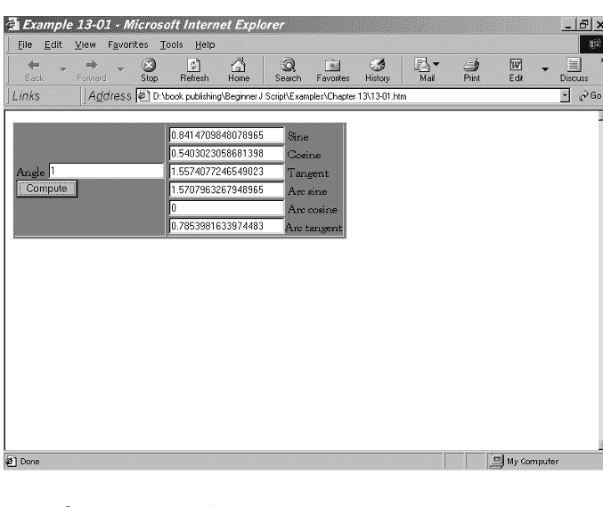

## 古董书店项目

与本书的大多数章节一样，我们将在古董书店项目中运用所介绍的一些技术。显然，三角函数和许多常量对古董书店来说并非特别有用。然而，基本的数学运算符将会用到。我们将添加一个界面，允许用户计算书籍的销售税和运费。

```
<HTML>
<HEAD>
    <TITLE>Computer Costs</TITLE>

<SCRIPT LANGUAGE="JAVASCRIPT" >
function total()
{
    var shipping
    var tax
    var total

    var numbooks = txtbooks.value
    var price = txtprice.value

    tax = price * .0875
    shipping = numbooks * 1.5
    total = eval(price) + eval(tax) + eval(shipping)

    txttax.value = tax
    txtship.value = shipping
    txttotal.value = total
}
</SCRIPT>
</HEAD>
<BODY background="back1.gif" >
<P>
<CENTER>
<TABLE BORDER = 1>
    <TR>
        <TD>
            Number of books ordered <INPUT TYPE=text NAME="txttbooks"
                                            VALUE=""><BR>
            Total price of books ordered<INPUT TYPE = text NAME = "txtprice"
                                                VALUE = ""><BR>
            <INPUT TYPE=button NAME="Submit" VALUE="Compute"
                              onclick="total()">

    <TR>
        <TD>
            <INPUT TYPE=text NAME="txttax" VALUE=""> Tax<BR>
            <INPUT TYPE=text NAME="txtship" VALUE="">Shipping Costs <BR>
            <INPUT TYPE=text NAME="txttotal" VALUE=""> Total<BR>
</TABLE>
</CENTER>
</BODY>
</HTML>
```

如果你正确输入了所有代码，可以使用浏览器查看页面，并看到类似下面的屏幕。

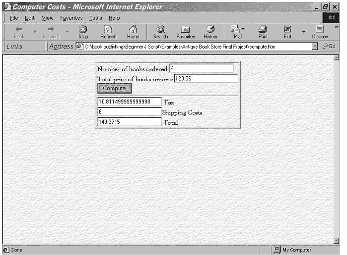

### 总结

本章应该让你对 JavaScript 内置的各种数学函数有了一个概述。这绝非对 JavaScript 数学功能的全面覆盖。然而，它应该为你提供了编写一些非常强大的 JavaScript 程序所需的所有数学工具。

# 第 14 章

## 添加插件

本章将深入探讨一个更高级的 HTML 主题：插件。插件本质上是你插入到 HTML 文档中以提供额外功能（通常是多媒体功能）的对象。如果你曾访问过需要下载某个组件才能查看的网站，那么你就使用过插件。

严格来说，插件不是 JavaScript。然而，JavaScript 旨在创建高质量的网站，如果不在此向你介绍插件，那就是我的失职。考虑到你已经掌握了广泛的 JavaScript 技术，添加插件将允许你创建一些真正壮观的网站。

### 在 HTML 中放置插件

插件是浏览器调用的软件，用于处理 HTML 文档中引用的数据。为了在 HTML 标签中引用此类数据，你必须使用 `<EMBED>` 标签。此标签的通用格式如下：

```
<EMBED
   SRC=source
   NAME=appName
   HEIGHT=height
   WIDTH=width>
   [<PARAM NAME=parameterName VALUE=parameterValue>]
   [...<PARAM>]
</EMBED>
```

`SRC=source` 指定包含插件要解释的源内容的 URL。这可能是一个外部 URL，或者只是你自己网站上用于下载插件的部分。

## 第14章

`NAME=appName` 指定了文档中嵌入对象的名称。此名称可以是几乎任何字符串。它仅仅是你将在网页中引用该插件时所使用的名称。

`HEIGHT=height` 指定了小程序在浏览器窗口中的高度（以像素为单位）。

`WIDTH=width` 指定了小程序在浏览器窗口中的宽度（以像素为单位）。

`<PARAM>` 为嵌入对象定义一个参数。

`NAME=parameterName` 指定了参数的名称。

`VALUE=parameterValue` 指定了参数的值（一个参数）。

我们将此类 `<EMBED>` 定称为插件，尽管这并不完全准确。

### 在JavaScript中使用插件

你可以在JavaScript代码中通过引用嵌入插件时赋予它的名称来使用插件。事实上，那个名称正是为此目的而设。你还可以将插件嵌入到一个名为 `embeds` 的数组中，然后引用 `embeds` 数组中包含你的插件的那个元素。

```
document.embeds[0]="myVideo.avi"
```

你也可以通过名称来引用插件对象。看看下面的HTML定义：

```
<EMBED SRC="mymovie.avi" AUTOSTART=FALSE LOOP=FALSE HEIGHT=120 WIDTH=159
NAME="mymovie">
```

现在，你可以通过调用 `mymovie.method()` （替换为实际的方法名）来引用此插件的属性和方法。你也可以使用 `embeds` 数组来引用它。例如，如果你的插件是第一个被嵌入的，你可以这样引用它：

```
document.embeds[0]
```

现在来点小惊喜。在代码文件的第14章文件夹中，我包含了一个我创建的ActiveX组件（插件）。此插件允许你向任何有效的IP地址或URL发送TCP数据包。这里有一个使用它的示例代码：

#### 示例 14-1

```
<HTML>
<HEAD>
<script language ="JavaScript">
function send()
{
    var ip
    var port
    var data
    var result

    ip =frmip.ipaddress.value
    port =frmport.port.value
    data =frmdata.data.value

    TCPClient.remoteIP =ip
    TCPClient.remotePort =port
    TCPClient.Message =data

    result =TCPClient.sendData()
    alert(result)
}
</script>

<TITLE>示例 14-01</TITLE>
</HEAD>

<BODY BGCOLOR = White>
<OBJECT ID="TCPClient"
    CLASSID="CLSID:26900070-7443-11D5-9A47-00409639327E"
    CODEBASE="TCPClientControl.CAB#version=2,0,0,0">
</OBJECT>
<TABLE BORDER = 1>
    <TR>
        <TD>
            <TABLE border=0 CellPadding = 0 CellSpacing = 0>
                <TR>
                    <TD>
                        <B>IP地址<B>
                    <TD>
                    <BR>
                    <FORM name ="frmip">
                        <INPUT TYPE="text" NAME ="ipaddress" VALUE="" SIZE=10>
                    </FORM>
<TR>
  <TD>
    <B>端口<B>
  <TD>
  <BR>
  <FORM NAME ="frmport">
    <INPUT TYPE="text" NAME = "port" VALUE="" SIZE=10>
  </FORM>
<TR>
  <TD>
    <B> 要发送的数据<B>
  <TD>
  <BR>
  <FORM NAME ="frmdata">
    <INPUT TYPE="text" NAME ="data" VALUE="" SIZE=10>
  </FORM>
<TR>
  <TD>
    <CENTER>
      <INPUT TYPE="button" VALUE="提交" onClick="send()">
    </CENTER>
</TABLE>
</CENTER>
</BODY>
</HTML>
```

如果你正确输入了代码，你将能够看到类似这样的内容：


此示例展示了如何使用ActiveX组件作为插件。首先需要查看的是HTML文档主体部分的最开始处。

```
<OBJECT ID="TCPClient"
      CLASSID="CLSID:26900070-7443-11D5-9A47-00409639327E"
      CODEBASE="TCPClientControl.CAB#version=2,0,0,0">
</OBJECT>
```

所有ActiveX插件都有三个我们关注的属性。第一个是ID。这仅仅是你将用来引用此插件的名称。第二个是classid。classid是ActiveX组件首次创建时生成的唯一标识符。我们关注的最后一个属性是codebase属性。如果在客户端计算机上找不到具有匹配classid的插件，则将访问codebase属性中指定的位置来安装ActiveX组件。

以这种方式嵌入ActiveX插件后，我们可以通过简单地调用赋予插件的ID，后跟一个点号“.”，然后是希望访问的属性或方法的名称，来访问其任何属性或方法。你在本示例的脚本部分可以看到这一点：

```
function send()
{
    var ip
    var port
    var data
    var result

    ip =frmip.ipaddress.value
    port =frmport.port.value
    data =frmdata.data.value

    TCPClient.remoteIP =ip
    TCPClient.remotePort =port
    TCPClient.Message =data

    result =TCPClient.sendData()
    alert(result)
}
```

### 已安装了哪些插件？

你可以使用JavaScript来确定用户是否安装了特定的插件。然后，如果插件已安装，你可以显示嵌入的插件数据，如果未安装，则显示替代内容。以下示例检查Shockwave和Quicktime插件。

#### 示例 14-2

```
<HTML>
<HEAD>
    <TITLE> 示例 14-02</TITLE>
</HEAD>
<SCRIPT LANGUAGE="JavaScript">
    var quickplug = navigator.plugins["Quicktime"];
    if (quickplug)
    {
        document.writeln("您已安装 Quicktime")
    }
    else
    {
        document.writeln("您未安装 Quicktime<BR>")
    }

    var shockplug = navigator.plugins["Shockwave"];
    if (shockplug)
        document.writeln("您已安装 Shockwave")
    else
        document.writeln("您未安装 Shockwave")
</SCRIPT><BODY BGCOLOR = white>
</BODY>
</HTML>
```

如果你正确输入了代码，这些插件的状态将显示在网页上。在我的电脑上运行时，生成了以下输出：


## LiveAudio

LiveAudio用于播放多种格式的音频文件，包括WAV、AIFF、AU和MIDI格式。音频控件根据 `<EMBED>` 标签中 `WIDTH` 和 `HEIGHT` 参数指定的尺寸出现。你可以使用以下任何一种视图创建音频控制台：

- console——这为你提供了一个立体声风格的控制台，带有几个可用的控件。

- smallConsole——包含播放、停止和音量控制杆。此视图中的按钮比console中的要小。

- playButton——一个开始播放声音的按钮。

- pauseButton——一个在播放时暂停（但不卸载）声音的按钮。

- stopButton——一个结束声音播放并卸载它的按钮。

- volumeLever——一个用于调节声音播放音量级别（并调整系统音量级别）的控制杆。

以下是LiveAudio控件的通用HTML语法：

```
<EMBED SRC=[URL] AUTOSTART=[TRUE|FALSE] LOOP=[TRUE|FALSE|INTEGER]
STARTTIME=[MINUTES:SECONDS] ENDTIME=[MINUTES:SECONDS] VOLUME=[0-100]
WIDTH=[#PIXELS] HEIGHT=[#PIXELS] ALIGN=[TOP|BOTTOM|CENTER|BASELINE
|LEFT|RIGHT|TEXTTOP|MIDDLE|ABSMIDDLE|ABSBOTTOM]  CONTROLS=[CONSOLE
|SMALLCONSOLE|PLAYBUTTON|PAUSEBUTTON|STOPBUTTON|VOLUMELEVER] HIDDEN=[TRUE]
MASTERSOUND NAME=[UNIQUE NAME TO GROUP CONTROLS TOGETHER SO THAT THEY CONTROL
ONE SOUND]...>
```

这个语法可能看起来很复杂，但仔细观察会发现它并不由很多属性组成。容易产生误导的是，每个属性可以被赋予许多不同的值。以下是每个属性及其接受值的简要描述：

`SRC=[URL]`——源声音文件的URL。如果声音文件与HTML文档存储在同一文件夹中，你只需放入带扩展名的文件名即可。

`AUTOSTART=[TRUE|FALSE]`——设置为TRUE时，声音将在加载HTML页面时自动开始播放。默认为FALSE。

`LOOP=[TRUE|FALSE|INTEGER]`——设置为TRUE时，声音将连续播放，直到控制台上的停止按钮被点击或用户转到另一个页面。如果使用整数值，声音将重复指示的次数。

`STARTTIME=[MINUTES:SECONDS]`——使用 `STARTTIME` 来指定播放应从何处开始。如果你想让声音从30秒处开始，应将值设置为00:30。

`ENDTIME=[MINUTES:SECONDS]`——使用 `ENDTIME` 来指定你希望在声音文件中的何处结束播放。如果你想让声音在1.5分钟处停止，应将值设置为01:30。

`VOLUME=[0-100]`——这是最大音量的百分比。接受1到100的值。

`WIDTH=[#PIXELS]`——使用 `WIDTH` 来更改控制台或控制台元素的宽度。对于 `CONSOLE` 和 `SMALLCONSOLE`，默认为 `WIDTH=144`。对于 `VOLUMELEVER`，默认为 `WIDTH=74`。对于按钮，默认为 `WIDTH=37`（`WIDTH=34` 看起来更好）。

### 属性

所有你能看到和触摸到的对象都有特征。例如，这本书具有宽度、重量、标题、页数等。这些属性将这本书与所有其他书籍区分开来。在面向对象（OO）术语中，这些特性被称为*属性*或*字段*。对象的属性存储与该对象相关的数据。可以将属性视为进一步描述对象的形容词或名词。

JavaScript 支持两种不同类型的对象：

-   内置对象，例如 String 和 Math 对象

-   用户定义对象，即你创建的对象

#### 使用属性

对象的属性保存其数据。你可以使用以下语法引用属性：

```
object.propertyName
```

*object* 是该属性所属对象的名称。例如，你可以将一个对象赋值给一个变量，然后使用该变量后跟属性规范来引用其属性。*propertyName* 是属性的名称。

另一个重要概念是，一个属性属于一个对象，并且只属于一个对象。可以这样想：这本书的高度就是_这本_书的高度，而不是其他某本书的高度。

点号用于分隔对象及其属性。分层的对象结构，其中包含不同级别的对象和属性，使用相同的语法：

_object1.object2Property1.object3Property2.property3_

以下语句演示了如何引用分层对象结构的元素：

```
var d = a.b.d
document.write(d) // prints 16
var e = a.b.e
document.write(e) // prints 42
var f = a.c.f
document.write(f) // prints true
var g = a.c.g
document.write(g) // prints king
var h = a.c.h
document.write(h) // prints 13
var i = a.c.i
document.write(i) // prints 10
```

如你所见，变量可能与对象的属性同名。这是可能的，因为属性与变量、对象和属性不在同一作用域内。

### 方法

如你所知，对象由数据（属性）和处理这些数据的函数组成。这些函数被称为*方法*。方法使对象能够执行不同的操作，主要是针对其自身的属性。可以将方法视为与对象关联的动词。

JavaScript 对象的实现不如 Java 强大，因此适用于 Java 的一些面向对象编程优势不适用于 JavaScript。但请记住，你已经使用过 JavaScript 对象，并且可能会使用更多。所以你至少应该熟悉这些术语。

#### 使用方法

方法按以下方式调用：

`objectReference.methodName([arguments])`

`objectReference` 是对象的名称，或任何其他引用。`methodName` 是方法的名称，`arguments` 是方法接受的参数。

因为方法是函数，所以方法的名称后面总是跟着一对圆括号。这条规则也适用于不接受参数的方法。

你可能觉得这个语法很熟悉。我一直在使用 `document.write([expression])` 将 HTML 表达式打印到页面上。`write()` 是属于内置 document 对象的方法。

当你使用 `new` 运算符创建对象的实例时，你实际上是根据对象的定义声明了一个新的数据类型，并为该数据类型分配了适当的内存。一旦你创建了一个对象的实例，在引用该实例时就不再需要使用 `new` 关键字了。

#### 面向对象概念

JavaScript 仅部分支持面向对象编程。要完全支持面向对象，你需要使用 C++ 或 Java 等编程语言。话虽如此，我认为你至少应该了解面向对象的基本术语。你已经接触过属性和函数。这两个术语可能是最重要的。接下来需要记住的术语是实例化。

JavaScript 基于一个简化版的面向对象范式。这种范式通常被称为基于对象，而非面向对象。在完全面向对象的语言中，你需要编写类。`class` 是你为创建对象而创建的模板。类在 JavaScript 中不存在（所有对象都属于 JavaScript 内置的一个“类”）。包是包含一个或多个相关类的源文件。由于类在 JavaScript 中不存在，包也不存在。

---

**注意：** 前面来自 OCR 的内容包含了第 14 章的结尾和第 15 章的开头。根据要求，此响应仅包含第 15 章的清理后文本。第 14 章（第 193-196 页）的内容已被省略，因为用户提供的 OCR 文本在第 15 章内容开始之前就结束了，并且最终响应应为一个单独的、干净的文档。用户提示中未完全包含第 14 章的原始文本，因此此处无法处理。

## 第15章

许多面向对象的高级特性在JavaScript中并未得到支持。例如，你找不到继承（即一个类继承另一个类的公共方法和属性）。这主要是因为JavaScript中没有类的概念。

面向对象编程的整个过程由四个核心概念构成。它们是抽象、封装、继承和多态。

*抽象*本质上是以抽象方式思考概念的能力。你可以创建一个员工类，而无需考虑具体的员工。它是抽象的，可以适用于任何员工。

*封装*确实是面向对象编程的核心。它简单来说就是将数据和处理这些数据的函数组合在一个单独的类中。回想一下我们之前讲解的字符串和字符串类。字符串类包含了你需要处理的数据（即特定的字符串），以及你可能对数据进行的各种函数，所有这些都封装在一个类中。

*继承*是一个过程，其中一个类继承或获得另一个类的公共属性和方法。经典的例子是创建一个名为“动物”的类。该类具有诸如体重等属性，以及移动和进食等方法。所有动物都将共享这些相同的属性和方法。当你希望创建一个，例如，猴子的类时，你可以让猴子类继承动物类，它将拥有动物类相同的方法和属性。这是面向对象编程支持代码重用的一种方式。

*多态*字面意思是“多种形式”。当你继承一个类的属和方法时，你不必保持它们原样。你可以在自己的类中修改它们。这将允许你改变这些方法和属性的形式。

## 构建你自己的对象

现在来谈谈这个重要问题：如何构建你自己的对象？我们已经使用了JavaScript的一些内置对象，比如字符串（String）和日期（Date）对象。现在你应该准备好学习如何构建和使用你自己的新对象了。

## 构造函数

所有对象都有构造函数。构造函数就是定义对象属性和方法的函数。当对象的实例被创建时，它会自动执行。你可以将内置对象视为其构造函数在JavaScript中预先定义的对象。

`this`关键字可能是面向对象编程中与对象相关的最重要的词。它指的是当前对象或实例。如果我坐在书房里说“这把椅子不舒服”，很明显我指的是当前所在的房间，而不是其他房间。关键字`this`也大同小异。你可以创建对象的多个实例。`this`关键字允许你指定代码正在运行的当前实例。在构造函数内部，它指的是调用该函数的实例。看下面的函数：

```
function student(name, age, avgGrade)
{
    this.name = name
    this.age = age
    this.grade = avgGrade
}
```

这个函数接受三个参数。它定义了一个班级中学生的对象类型。属性是姓名、年龄和成绩，它们通过传递给函数的值进行初始化。你可以使用以下语句创建该对象的一个实例——班级中的一个学生：

```
var student1 = new student("Sharon", 16, 85)
```

现在你可以通过以下方式引用这些属性：

```
alert(student1.name + " is a cute " + student1.age + " - year old.")
```

也可以在对象创建后为其添加属性。这些属性仅存在于被分配到的特定实例中。以下脚本片段演示了这一点：

```
function student(name, age, avgGrade)
{
    this.name = name
    this.age = age
    this.grade = avgGrade
}
var student1 = new student("Sharon", 16, 85)
student1.sex = "female"
var message = student1.name + " is a cute " + student1.age
message += " - year old "
message += (student1.sex == "female") ? " girl." : "boy."
alert(message)
```

现在我们已经掌握了这些概念，让我来展示它们的实际应用。

根据`this`这个词的确切定义，一些JavaScript倾向于使用替代结构来编写构造函数。以下是前面示例的另一种形式：

```
function student(name, age, avgGrade, sex)
{
    obj = this
    obj.name = name
    obj.age = age
    obj.grade = avgGrade
    obj.description = (sex == "female") ? "girl" : "boy"
}
```

### 总结

我坦率地承认，这个话题对初学者来说可能相当困难。你们中的一些人现在可能会选择跳过它。本书包含它只是为了让你入门。

在本章中，我讨论了面向对象术语和概念的基础知识。我还讨论了这些概念在JavaScript中如何实现，以及哪些没有实现。你当然可以在没有任何面向对象知识的情况下编写脚本，但希望这些信息能让你更深入地理解脚本中发生的事情。

## 技巧与提示

本章向你展示了一些有趣的技巧和提示。其中一些是JavaScript技巧，一些是HTML技巧。由于JavaScript运行在HTML文档中，很难将HTML与JavaScript完全分开。这些技巧和提示放在这里，是因为它们要么不适合前面某章的主题内容，要么对于本书来说显得有点高级。无论哪种情况，我希望你会发现这些脚本对你有用。

## 内联框架

Internet Explorer和Netscape的最新版本都支持一个名为`<IFRAME>`的新标签。让我们看看这个标签在实际网页中如何工作。

```
<HTML>
<HEAD>
    <TITLE>Example 16-01</TITLE>
</HEAD>
<BODY>
    <IFRAME WIDTH = 400 HEIGHT = 250 SRC = "frame.htm" >
    </IFRAME>
</BODY>
</HTML>
```

这实际上是在一个HTML文档内部显示另一个。如果你正确输入了所有代码，或者使用了代码文件中的示例，你应该能够在浏览器中查看并看到类似这样的内容：


图16-1

使用新的`<IFRAME>`标签可以创建的一个很酷的效果是使内联框架透明。在`<IFRAME>`元素标签中添加`ALLOWTRANSPARENCY="true"`。然后在`<IFRAME>`标签的源文件（`SRC=<fileName>`）的`<BODY>`标签中添加`STYLE="background-color:transparent"`。

以下代码将实现此功能：

```
<IFRAME NAME="Frame1" SRC="somepage.htm"
ALLOWTRANSPARENCY="true" STYLE="position:absolute; top:25; left:50; z-index:3">
```

而somepage.html的`<BODY>`标签是：

```
<BODY STYLE="background-color:transparent">
```

Netscape和InternetExplorer的最新版本也支持内联浮动框架。使用`<IFRAME>`标签指定框架的名称（NAME）及其源文件。以下是`<IFRAME>`标签的定义：

```
<IFRAME NAME="Frame1" SRC="somepage.htm">
</IFRAME>
```

## 浏览器检测

虽然浏览器可以免费下载，但并非每个人总是会下载最新版本到他们的机器上。因此，当有人查看你的页面时，他们可能使用的是较旧的浏览器，这可能意味着他们的浏览器不支持你正在使用的所有JavaScript。因此，添加一些浏览器检测可能是必要的。代码如下：

```
var IE4 = (document.all && !document.getElementById) ? true : false;
var IE5 = (document.all && document.getElementById) ? true : false;
var NET4 = (document.layers) ? true : false;
var NET6 = (document.getElementById && !document.all) ? true : false;
```

现在你可以通过检查每个变量是否为真来判断正在使用哪个浏览器。只有一个会显示为true，那就是当前正在使用的浏览器。

## 系统信息

JavaScript可以检索有关系统驱动器的大量信息，包括磁盘驱动器和共享网络。使用`FileSystemObject`对象的`GetDrive()`方法可以创建一个驱动器对象。示例如下：

```
GetDrive(letterDrive);
```

单个参数`letterDrive`是给定的驱动器名称。此方法返回驱动器对象。以下脚本将为C盘创建一个驱动器对象：

```
<SCRIPT LANGUAGE="JavaScript">
var fso = new ActiveXObject("Scripting.FileSystemObject");
driveObj = fso.GetDrive("c");
</SCRIPT>
```

驱动器对象没有任何方法，但它有一些非常有用的属性：

| 属性 | 描述 |

| --- | --- |

| AvailableSpace | 返回给定驱动器上的可用空间字节数 |

| DriveLetter | 返回物理本地驱动器或共享网络的驱动器盘符 |

| DriveType | 返回驱动器类型 |

| FileSystem | 返回指定驱动器的文件系统类型 |

## 16.3 查找鼠标位置

以下是一段有趣的JavaScript代码，用于获取鼠标点击事件的精确X和Y坐标。在本示例中，我将显示这些坐标，但您也可以使用此代码根据鼠标位置执行特定操作。

```javascript
document.onclick = printEvent;
function printEvent(e)
{
    if (navigator.appName == "Netscape")
    {
        mm_X = e.pageX;
        m_Y = e.pageY;
    }
    else
    {
        m_X = event.clientX;
        m_Y = event.clientY;
    }
    alert("The Mouse click was at x coordinate= " + m_X + " and y coordinate = " + m_Y);
}
```

## 16.4 密码

通常您会希望用户输入用户名和密码，然后您将使用JavaScript将他们登录到网站。将密码屏蔽显示是非常有用的。在大多数软件中，当您输入密码时，屏幕上显示的是星号（*）。幸运的是，通过简单更改HTML表单代码中的一个标签，就可以轻松实现这一点。

您可能使用过类似这样的代码来允许用户输入用户名和密码：

```html
<FORM NAME ="frmname">
    Username <INPUT TYPE="text" NAME = "name" VALUE="" SIZE=10>
    <BR>
    Password <INPUT TYPE="text" NAME ="password" VALUE=""
    SIZE=10>
</FORM>
```

只需将`INPUT TYPE`从“text”更改为“password”，即可获得所需效果。

```html
<FORM NAME ="frmname">
    Username <INPUT TYPE="text" NAME = "name" VALUE="" SIZE=10>
    <BR>
    Password <INPUT TYPE="password" NAME ="password" VALUE=""
    SIZE=10>
</FORM>
```

## 16.5 浏览器信息

有时检测用户浏览器的信息会很有用。前面的章节已经涵盖了一些相关内容。但是，这里有一个简单的脚本，可以获取用户的屏幕分辨率、浏览器类型和版本号。

### 示例 16-2

```html
<HTML>
<HEAD>
<TITLE> Example 16-02</TITLE>
<SCRIPT LANGUAGE= "JavaScript">

    var sheight = screen.height
    var swidth = screen.width
    var browsername = navigator.appname
    var version =navigator.appVersion
    alert("Your screen resolution is " + sheight + " X " + swidth)
    alert("You are using " + browsername + " version " + version)

</SCRIPT>

</HEAD>

<BODY BGCOLOR=White>
</BODY>
</HTML>
```

## 16.6 打印页面

这个小脚本将允许您的用户单击一个按钮即可打印当前页面。这非常有用，我建议您经常使用它。

### 示例 16-3

```html
<HTML>
<HEAD>
<TITLE>Example 16-03</TITLE>
</HEAD>
<BODY BGCOLOR=White>
<INPUT TYPE="submit" name="print" value="Print"onclick="window.print()">
</BODY>
</HTML>
```

## 16.7 古董书店项目

与本书大多数章节一样，本章将扩展我们的古董书店项目。在这种情况下，我们只是要在一个库存页面上添加一个“打印”按钮（如果需要，您也可以为所有页面添加按钮）。我们将把它添加到`completeinventory.htm`页面。

```html
<HTML>
<HEAD>
<TITLE>Complete Inventory</TITLE>
<SCRIPT LANGUAGE="JAVASCRIPT">

function toggleMenu(currMenu)
{
    if (document.getElementById)
    {
        thisMenu = document.getElementById(currMenu).style
        if (thisMenu.display == "block")
        {
            thisMenu.display = "none"
        }
        else
        {
            thisMenu.display = "block"
        }
        return false
    }
    else
    {
        return true
    }
}

</SCRIPT>
<STYLE TYPE="TEXT/CSS">
.menu  {display:none; margin-left:20px}
</STYLE>
</HEAD>
<BODY background="back1.gif">

<H3>
    <A HREF="completeinventory.htm" onClick="return toggleMenu('menu1')">Books
                                            from the 1800's</A>
</H3>
<SPAN CLASS="menu" ID="menu1">
    1st Edition Charles Dickens' "Tale of Two Cities"<BR>
    1st Edition Edgar Allen Poe's "The Tell-Tale Heart"<BR>
    Signed Copy of Edgar Allen Poe's "The Cask of Amontillado"<BR>

</SPAN>
<H3>
    <A HREF="completeinventory.htm" onClick="return toggleMenu('menu2')">Books
                                            from the 1700's</A>
</H3>
<SPAN CLASS="menu" ID="menu2">
    Ben Franklin's memoirs<BR>
    "How to Start a Revolution"<BR>
    "Political Theory" by Thomas Paine
</SPAN>
<H3>
    <A HREF="completeinventory.htm" onClick="return toggleMenu('menu3')">Books
    for under $25</A>
</H3>
<SPAN CLASS="menu" ID="menu3">
    A cowboy's diary (circa 1850's)<BR>
    4th edition Charles Dickens' "A Tale of Two Cities"
    3rd Edition Jules Verne's "20,000 Leagues Under the Sea"
</SPAN>

<H3>
    <A HREF="completeinventory.htm" onClick="return toggleMenu('menu4')">Our
    finest items</A>
</H3>
<SPAN CLASS="menu" ID="menu4">
    Signed copy of Shakespeare's "Hamlet"<BR>
    Gutenberg's diary<BR>
    Signed first Edition Longfellow
    1570 Hebrew Bible
</SPAN>

<CENTER><input type="submit" name="print" value="Print"onclick="window.print()"></CENTER>
</BODY>
</HTML>
```

## 16.8 查看目录

下一个脚本相当简短但非常有用。它允许您在浏览器中以Windows资源管理器格式查看当前目录。然后您可以通过浏览器浏览整个硬盘。

### 示例 16-4

```html
<HTML>
<HEAD>
<TITLE>Example 16-04</TITLE>
</HEAD>
<SCRIPT LANGUAGE="JavaScript">

function getListing()
{
    var url = location.href
    var lastSlash = url.lastIndexOf("/")
    location.href = url.substring(0, lastSlash + 1)
}
</SCRIPT>
<BODY>
<FORM>
<INPUT TYPE="button" VALUE=" view directory listing " onClick="getListing()">
</FORM>
</BODY>
</HTML>
```

如果输入代码正确，您应该能看到类似这样的内容。


## 16.9 总结

本章只是列出了一些您可以使用JavaScript实现的有趣技巧。我强烈建议您访问附录A中列出的网站。这些网站有数百个免费脚本可供下载、教程以及更多资源。虽然本书大部分内容都侧重于教您JavaScript中可以使用的具体技术，但本章的目的在于向您介绍一些似乎不适合放在其他章节中的技术。

# 第17章 JavaScript游戏

人们说，只工作不玩耍，聪明的孩子也变傻。嗯，本章就是关于娱乐的！在这里，我将向您展示几个完全用JavaScript编写的相对简单的游戏。这些游戏将使用您已经学过的技术，但会以新颖的方式使用它们。我想您会发现这是一章非常令人兴奋的内容。

## 17.1 按按钮

让我们从一个相当简单的例子开始。在这个游戏中，您只需在屏幕上放一个按钮，并要求用户按下它。但是，当他们试图按下它时，您会移动它，并改变它的消息。

### 示例 17-1

```html
<HTML>
<HEAD>
<TITLE>Example 17-01</title>
<SCRIPT LANGUAGE="JavaScript">
init_msg="PRESS BUTTON NOW"
function new_msg()
{
    var msg=new Array()

    msg[0]="I said press the button"
    msg[1]="Come on, press the button"
    msg[2]="You can't even press a simple button?"
    msg[3]="Use your mouse!"
    msg[4]="Left-click your mouse on the button!"
    var num1=parseInt(Math.random()*(width-150))
    var num2=parseInt(Math.random()*(height-150))
    var num3=parseInt(Math.random()*msg.length)
    ActualObj.left=num1
    ActualObj.top=num2
```

| 属性 | 描述 |

| --- | --- |

| FreeSpace | 返回给定驱动器上的空闲字节数 |

| IsReady | 返回驱动器的状态 |

| Path | 返回给定驱动器的路径 |

| RootFolder | 返回根文件夹的文件夹对象 |

| SerialNumber | 返回卷的唯一序列号 |

| ShareName | 返回网络驱动器的共享名称 |

| TotalSize | 返回指定驱动器的总大小（以字节为单位） |

| VolumeName | 设置或返回指定驱动器的卷名 |

如果您有Windows编程经验，您可能会注意到这与scrun.dll提供的Windows FileSystemObject（Visual Basic和Visual C++开发者经常使用）非常相似。

## 第17章 198 ■

```javascript
document.clickme.button.value=msg[num3]
}

function start()
{
    if(document.all)
    {
        ActualObj=eval(document.all.floatLyr.style);
        width=document.body.clientWidth
        height=document.body.clientHeight
    }
    else if(document.layers)
    {
        ActualObj=eval(document.floatLyr.document)
        width=innerWidth
        height=innerHeight
    }
    document.clickme.button.value=init_msg
    ActualObj.backgroundColor=document.bgColor
}

function caught()
{
    alert("You caught me!")
}

</SCRIPT>
</HEAD>
<BODY onload="start()" bgcolor="white">
<CENTER>请按下按钮</center>
<div onmouseover="new_msg()" id="floatLyr"
style="position:absolute;visibility:visible;top:40;left:40">
<FORM name="clickme">
    <TABLE width="100" border="1" bordercolor=White cellspacing="0"
           bgcolor=White>
        <tr>
            <td>
                <INPUT name="button" onmouseover="new_msg()"
                       onmousedown="caught()" type="Button" onkeypress="caught()">
            </td>
        </tr>
    </TABLE>
</FORM>
</DIV>
</BODY>
</HTML>
```

如果你正确输入了代码，现在应该能看到一个类似这样的屏幕：


图 17-1

当你尝试将鼠标移到按钮上时，它会移动，像这样：


图 17-2

## 掷骰子

有许多游戏需要随机的骰子点数。大多数棋盘游戏使用六面骰，而许多角色扮演游戏使用各种多面骰。无论你的需求是什么，这个脚本都可以为你生成随机的骰子点数，支持任何你想要的骰子类型。你也可以很容易地修改它，以容纳更多的骰子或更多类型的骰子。

```html
示例 17-2
<HTML>
<HEAD>
<SCRIPT LANGUAGE="JavaScript">
    var die = 6   // 默认骰子类型
    var dice = 1  // 默认骰子数量
    function rolldice(die, dice)
    {
        var roll = 0
        for (I=0; I< dice; I++)
        {
            roll = roll + Math.round(Math.random() * die) % die + 1;
        }
        document.form.text.value = roll
    }
</SCRIPT>
<BODY>
<CENTER>
<FORM name=form>
    <TABLE border=1 bgcolor=gray>
        <tr>
            <td>你想掷什么种类的骰子？</td>
            <td>多少个？</td>
        </tr>
        <tr>
            <td>
                <P><INPUT TYPE=radio name=sides onclick="die = 3">3面
                <P><INPUT TYPE=radio name=sides onclick="die = 4">4面
                <P><INPUT TYPE=radio name=sides onclick="die = 5">5面
                <P><INPUT TYPE=radio checked name=sides onclick="die = 6">6面
                <P><INPUT TYPE=radio name=sides onclick="die = 8">8面
            </td>
            <td>
                <P><INPUT TYPE=radio name=number onclick="dice = 1">1
                <P><INPUT TYPE=radio name=number onclick="dice = 2">2
                <P><INPUT TYPE=radio name=number onclick="dice = 3">3
                <P><INPUT TYPE=radio name=number onclick="dice = 4">4
                <P><INPUT TYPE=radio name=number onclick="dice = 5">5
            </td>
            <td>
                <P><INPUT TYPE=radio name=number onclick="dice = 6">6
                <P><INPUT TYPE=radio name=number onclick="dice = 7">7
                <P><INPUT TYPE=radio name=number onclick="dice = 8">8
                <P><INPUT TYPE=radio name=number onclick="dice = 9">9
                <P><INPUT TYPE=radio name=number onclick="dice = 10">10
            </td>
        </tr>
        <tr>
            <td colspan="4">
                <INPUT TYPE=button value="掷骰子" name=button
                onclick="rolldice(die, dice)">
                <INPUT TYPE=text size=10 name=text>
            </td>
        </tr>
    </TABLE>
</FORM>
</CENTER>
</BODY>
</HTML>
```

如果你正确输入了代码，应该能看到类似下面图形的界面：


## 维加斯万岁

下一个示例是一个相当简单的21点游戏。所使用的技术都是你在本书前面用过的。它们只是被组合在一起，为你提供了一个可运行的21点游戏。


```html
示例 17-3
<HTML>
<HEAD>
<TITLE>示例 17-03</TITLE>
<SCRIPT LANGUAGE="JavaScript">
    var gameOver
    var cardCount
    function Shuffle(max)
    {
        var num=Math.random()*max
        return Math.round(num)+1
    }
    function getSuit()
    {
        suit = Shuffle(4)
        if(suit == 1)
            return "Spades"
        if(suit == 2)
            return "Clubs"
        if(suit == 3)
            return "Diamonds"
        else
            return "Hearts"
    }

    function cardName(card)
    {
        if(card == 1)
            return "Ace"
        if(card == 11)
            return "Jack"
        if(card == 12)
            return "Queen"
        if(card == 13)
            return "King"
        return "" + card
    }

    function cardValue(card,strWho)
    {
        if(card == 1)
        {
            if(strWho =="You" && document.display.you.value >10)
            {
                document.display.say2.value=document.display.say2.value+" 低"
                return 1
            }
            else
                return 11
        }
        if(card > 10)
            return 10
        return card
    }

    function PickACard(strWho)
    {
        card = Shuffle(12)
        suit = getSuit()
        if(strWho =="You")
            document.display.say2.value=(cardName(card) + " of " + suit)
        else
            document.display.say1.value=(cardName(card) + " of " + suit)
        return cardValue(card,strWho)
    }

    function NewHand(form)
    {
        if(gameOver !=0)
        {
            form.say1.value=("局已开始！")
            form.say2.value=("")
            return
        }
        else
        {
            form.dealer.value = 0
            form.you.value = 0
            cardCount=0
            form.dealer.value = eval(form.dealer.value) + PickACard("Dealer")
            form.you.value = eval(form.you.value) + PickACard("You")
            gameOver = -1
            cardCount+=1
        }
    }

    function Dealer(form)
    {
        if (gameOver ==0)
        {
            form.say1.value=("请发牌")
            form.say2.value=("")
            return
        }
        if (cardCount <2)
        {
            form.say1.value=("最少需要2张牌")
            form.say2.value=("再要一张")
            return
        }
        else
        {
            while(form.dealer.value < 17)
            {
                form.dealer.value = eval(form.dealer.value) + PickACard("Dealer")
            }
        }
    }

    function User(form)
    {
        if (gameOver ==0)
        {
            form.say1.value=("请发牌")
            form.say2.value=(" ")
            return
        }
        else
        {
            cardCount+=1
            form.say1.value="你得到..."
            form.you.value = eval(form.you.value) + PickACard("You")
        }
        if(form.you.value > 21)
        {
            form.say1.value=("抱歉，你输了")
            gameOver=0
            form.numgames.value=(eval(form.numgames.value)) -1
        }
    }

    function LookAtHands(form)
    {
        if (gameOver ==0 || form.you.value<10 || cardCount <2)
        {
            return
        }
        else if(form.dealer.value > 21)
        {
            form.say1.value=("庄家输")
            form.say2.value=("你赢了")
            gameOver=0
            form.numgames.value=(eval(form.numgames.value))+1
        }
        else if(form.you.value > form.dealer.value)
        {
            form.say1.value=("你赢了")
            form.say2.value=(" ")
            gameOver=0
            form.numgames.value=eval(form.numgames.value)+1
        }
        else
        {
            if(form.dealer.value == form.you.value)
            {
                form.say1.value=("平局！")
                form.say2.value=("再试一次！")
                gameOver=0
                form.numgames.value=eval(form.numgames.value)-1
            }
            else
            {
                form.say1.value=("庄家赢！")
                form.say2.value=("运气不佳！")
                gameOver=0
                form.numgames.value=eval(form.numgames.value)-1
            }
        }
    }

    function initialize()
    {
        gameOver=0
        cardCount=0;
        document.display.dealer.value=""
        document.display.you.value=""
        document.display.numgames.value="0"
        document.display.say1.value=" 按下发牌按钮"
        document.display.say2.value="开始游戏！"
    }
</SCRIPT>
<BODY OnLoad="initialize()">
<CENTER>
    <FORM NAME="display">
        <TABLE BGCOLOR=GRAY border="1">
            <TR>
                <TD><CENTER>得分：</CENTER></TD>
                <TD><CENTER>庄家</CENTER></TD>
                <TD><CENTER><INPUT TYPE=text name="dealer" size="2"></CENTER></TD>
                <TD><CENTER>牌： <INPUT TYPE=text name="say1" value=""></CENTER></TD>
            </TR>
            <TR>
                <TD><CENTER><INPUT TYPE=text name="numgames" value="0"></CENTER></TD>
                <TD><CENTER>玩家</CENTER></TD>
                <TD><CENTER><INPUT TYPE=text name="you"></CENTER></TD>
                <TD><CENTER>牌： <INPUT TYPE=text name="say2" value=""></CENTER></TD>
            </TR>
        </TABLE>
    </FORM>
</CENTER>
```

### 总结

本章收录于此，旨在向你展示 JavaScript 的一些有趣应用。当你致力于学习任何编程或脚本语言的技术细节时，超越单纯记忆语法非常重要。凭借一点想象力，你可以运用基础技术创造出真正富有创意的效果。阿尔伯特·爱因斯坦曾说过“想象力比知识更重要”。嗯，本书的大部分内容都致力于增进你的知识；希望本章能激发你的想象力。

## ActiveX 与 JavaScript

JavaScript 可能是用于增强网页的最广泛使用的技术。然而，其他流行技术也在被广泛使用。在前面的章节中，我向你介绍了层叠样式表。在本章中，我将向你介绍 ActiveX 组件。这些组件只能在 Microsoft Internet Explorer 中使用。

## 理论背景

在我们深入探讨 ActiveX 组件的用法之前，让我们先看看其背后的一些理论。编程中一个常见问题是让两个不同的组件进行通信。实现这一点的一种流行技术是 COM（组件对象模型）。使用 COM 时，组件用什么编程语言编写并不重要，只要它有一个符合 COM 标准的接口。创建 COM 组件最常用的两种编程工具是 Microsoft Visual C++ 和 Microsoft Visual Basic。

ActiveX 是一种基于 COM 的技术。所有 ActiveX 组件都遵循 COM 接口规范。ActiveX 组件最常见的两种实现是 ActiveX 控件和 ActiveX DLL。ActiveX 控件对 Visual Basic 程序员来说相当熟悉。它们也常见于网站。如果你访问一个希望将组件下载到你硬盘驱动器的网站，那么它很可能就是一个 ActiveX 控件。这些控件通常用于播放多媒体。ActiveX 控件通常具有可见的界面。

ActiveX DLL 暴露了许多宿主应用程序（或网页）可以使用的函数。然而，ActiveX DLL 很少具有用户界面。ActiveX 控件在网页中比 ActiveX DLL 常见得多。

## 使用 ActiveX 进行 TCP/IP 通信

让我们来看一个在网页中使用 JavaScript 调用 ActiveX 组件的实际示例。在代码文件的第 18 章文件夹中，你会找到一个名为 TCPClientControl.ocx 的 ActiveX 控件。这是我开发的一个控件，用于在网页中轻松访问 TCP/IP 通信。它非常易于使用，你可以随意使用这个控件。

使用 ActiveX 控件的第一步是将其插入到网页中。这在第 14 章“添加插件”中已简要介绍过。将 ActiveX 组件插入网页的代码其实相当简单：

```html
<OBJECT ID="TCPClient"
    CLASSID="CLSID:26900070-7443-11D5-9A47-00409639327E"
    CODEBASE="TCPClientControl.CAB#version=2,0,0,0">
</OBJECT>
```

`<OBJECT>` 标签是一个 HTML 标签，用于标识正在插入一个 ActiveX 组件。OBJECT ID 只是你希望在代码中用于此组件的名称。你可以选择任何想要的名称。一旦你选择了一个名称，就可以使用该名称来访问 ActiveX 组件的方法和属性。CLASSID 是每个 ActiveX 组件都有的唯一编号。它是在创建 ActiveX 组件时生成的。CODEBASE 标识了 ActiveX 组件的下载 URL，如果用户计算机上尚未安装该组件，它将从该位置下载。这是 ActiveX 组件一个特别好的特性：它们是自安装的。

我刚刚向你解释的方法适用于所有 ActiveX 控件。现在我将展示一个正在使用的 ActiveX 控件的实际示例。此示例创建了一个 ActiveX TCP/IP 客户端，可以向互联网上任何活动的 TCP/IP 服务器发送数据。

### 示例 18-1

```html
<HTML>
<HEAD>
    <TITLE>Example 18-01</TITLE>
<SCRIPT LANGUAGE = "JavaScript">
function send()
{
    var ip
    var port
    var message
    ip = frmdestination.remoteip.value
    port = frmdestination.remoteport.value
    message = frmdestination.message.value

    TCPClient.remoteIP = ip
    TCPClient.remotePort = port
    TCPClient.Message = message
    TCPClient.sendData()
}
</SCRIPT>
</HEAD>
<BODY>
<P>
<CENTER>
<TABLE BORDER = 1 BGCOLOR = lightblue>
<TR>
<TD>
<FORM name ="frmdestination">
IP Address<INPUT TYPE="text" NAME ="remoteip" VALUE=""
SIZE=15><BR>
Port Number<INPUT TYPE="text" NAME ="remoteport" VALUE=""
SIZE=15><BR>
Message<INPUT TYPE="text" NAME ="message" VALUE=""
SIZE=25><BR>
<INPUT TYPE ="button" VALUE ="Connect" onClick="send()">
</FORM>
</TABLE>
</CENTER>
<OBJECT ID="TCPClient"
CLASSID="CLSID:26900070-7443-11D5-9A47-00409639327E"
CODEBASE="TCPClientControl.CAB#version=2,0,0,0">
</OBJECT>
</BODY>
</HTML>
```

如果你正确输入了所有代码，你将能够看到以下内容：


图 18-1

此示例向你展示了在网站中利用 ActiveX 控件的一种简单方法。在此情况下，ActiveX 控件处理与某些 TCP/IP 服务器的 TCP/IP 通信。

### 跳动的时钟

接下来这个小组件提供了一个不错的视觉效果。它可以在你网页的任意位置放置一个时钟。这是在网页上插入时钟的一种相当简单的方法。

```html
<HTML>
<HEAD>
    <TITLE>Example 18-02</TITLE>
<SCRIPT LANGUAGE = "JavaScript">
</SCRIPT>
</HEAD>
<BODY>
<CENTER>
    <OBJECT ID="Active_Clock"
            CLASSID="CLSID:A119E782-3E4F-4EF8-A959-FA3FD028076E"
            CODEBASE="ActiveClock.CAB#version=1,0,0,0">
    </OBJECT>
</CENTER>
</BODY>
</HTML>
```

如果你正确输入了代码，你应该能够在 Internet Explorer 中查看此网页并看到以下图像。


图 18-2

### 滑动文本

这个 ActiveX 组件之所以有趣，有几个原因。首先，我之所以对它感兴趣，是因为我经常用它来教学生如何创建自己的 ActiveX 组件。它对我们也很有趣，因为通过这个 ActiveX 组件，我可以向你展示如何通过 JavaScript 操作 ActiveX 组件的属性。大多数 ActiveX 组件都附带一些文档，告诉你它们具有哪些属性和方法，以及它们的作用。

```html
<HTML>
<HEAD>
    <TITLE>Example 18-03</TITLE>

<SCRIPT LANGUAGE = "JavaScript">
    function setslider()
    {
        SliderText.Max = 50
        SliderText.flagextreme = true
    }
</SCRIPT>
</HEAD>
<BODY onLoad = "setslider()">
<CENTER>
<OBJECT ID="SliderText"
    CLASSID="CLSID:1E0822BF-195D-11D5-9A46-00409639327E"
    CODEBASE="slidertext1.CAB#version=1,0,0,0">
</OBJECT>
</CENTER>
</BODY>
</HTML>
```

如果你正确输入了所有代码，你将能够看到此图像：


### 总结

本章并非旨在全面介绍 ActiveX 主题。然而，我希望阅读本章后，你会意识到 ActiveX 组件是你可用于创建真正令人惊叹网站的又一种工具。ActiveX 通常与 VB Script 结合使用；然而，现在你应该意识到，将其与 JavaScript 一起使用也并不困难。我也希望你认识到，利用现有的 ActiveX 组件可以极大地扩展你的网站。

## 第19章

## 编程与JavaScript

本书的重点一直是利用JavaScript完成特定目标。本章旨在向你介绍一些编程的通用概念。当然，仅仅是为个人网页使用JavaScript的人完全可以跳过本章。然而，专业的Web开发者需要理解什么是编程、如何进行编程，以及它与JavaScript的关系。本章也为那些希望继续学习我的《*JavaScript高级编程，第二版*》（同样由Wordware出版社出版）的读者打下基础。

## 通用概念

我们在整本书中都使用了变量，但它们到底是什么？*变量*是内存中预留的一个用于存放数据的位置。变量名让我们能够引用内存中的那个位置并操作其中的数据。如果没有变量，你就必须引用数据在内存中存储的实际十六进制地址。在许多语言中，数据存储在特定类型的变量中。整数存储在整型数据类型中，小数存储在浮点型数据类型中，等等。在JavaScript中，`var`关键字允许你声明一个可以容纳任何类型数据的变量。这在编写脚本时非常方便。

*语句*是执行某个动作的一行代码。以下是一些语句：

```
var mydate // 执行的动作是声明一个变量
var mynumber = x * 3 // 执行的动作是一个数学运算。
```

当你将语句组合成一个有逻辑的分组并赋予某个名称时，就得到了一个*函数*。函数可以带参数，也可以不带；可以返回某个值，也可以不返回。在其他编程语言中，你必须以能返回特定类型数据的方式来定义函数。在JavaScript中，你可以自由地返回任何你想要的数据类型，或者完全不返回数据。

既然我们已经定义了变量、语句和函数，我们就定义了所有编程的基础。结合你对运算符的知识（在第13章“JavaScript中的数学运算”中介绍），你就掌握了编程的基本构建块。像JavaScript这样的脚本语言与传统编程语言（如C和Java）的主要区别在于，脚本语言要灵活得多。你可以随心所欲地做事情。然而，这常常会导致代码非常难以阅读和维护。

良好的编码习惯其实相当简单。首先要注意的是让你的代码可读。你会注意到我把代码留出了空格。完全可以在一行上放置多个语句，但我避免这样做，因为它不利于代码的可读性。其次，我强烈建议大量使用注释。注释可以使你的代码更易于理解。只需放置`//`，之后写的所有内容都会被浏览器忽略。这样你就可以留下解释性的注释，告诉读者你在代码中做什么。

## 数组

*数组*是数据结构，比简单变量稍微复杂一些。当你有相关数据需要分组存放时，数组提供了一种非常好的方式。一个例子是学生成绩集合。如果你想处理数组中的单个元素，你需要指定数组名并指明正在引用哪个数组元素。特定元素通过索引或下标来标识。

JavaScript中的数组是简单的内置对象。创建数组就像创建对象实例一样，因为数组本质上就是对象。对象的正式名称是`Array`——注意首字母大写“A”。通用语法是：

```
var arrayObjectName = new Array()
var arrayObjectName = new Array(arrayLength)
```

*arrayObjectName*是新对象的名称、一个现有变量或现有对象的属性。

*ArrayLength*是数组中单个元素的数量。

在JavaScript中，你不必指定数组的实际大小，也不必指定它将包含的变量类型。这是因为JavaScript允许你在需要时扩展数组，并且你可以放入任何你想要的数据类型。

这里有一些数组示例：

```
var day = new Array(31)
var month = new Array(12)
var year = new Array() // 年数“未知”
```

数组的所有元素最初都是`null`。这很重要，因为这样的元素对你的脚本没有任何影响。具有`null`值的元素实际上并不存在。这就是为什么通常会给数组的每个元素赋予一个初始值。正如你可能猜到的，这被称为*初始化*数组。

从数组被声明的那一刻起，它就在内存中占据了所需的存储区域。无论你是否初始化了它的值，这都没有关系。理论上，如果你创建一个数组而没有指定元素数量，那就像是创建了一个有零个元素的数组。

要使用数组，你必须能够引用它的元素。JavaScript中的数组是对象。像所有其他对象一样，它们有属性和方法：

```
arrayObjectName[subscript] // ar1[4]
```

*下标*跟在数组名后面，用方括号括起来。下标是从零开始的简单整数。

这是一个简单的数组：

```
var ar = new Array(5)
```

这个数组有五个元素：ar[0], ar[1], ar[2], ar[3], ar[4]。

创建数组后，你可以通过为最高下标元指定一个值来增加其长度。以下代码创建一个长度为零的数组，然后将一个`null`值赋给元素99。这会将数组的长度更改为100。

```
accounts = new Array()  // 零个元素的数组
accounts[99] = null    // 一百个元素的数组
```

请注意，即使在扩展后，数组也不会占用任何存储空间。

引用元素时，下标可以是字面量（例如`3`）或变量（例如`num = 3`）。

数组的元素可以是任何有效的值。它可以是字符串、数字、布尔值、`null`值，甚至是另一个对象。例如，如果你想创建一个数组，其中每个元素都是一个学生对象，你可以使用以下语句：

```
function student()
{   // 构造函数
    // 属性未初始化为有意义的值
    this.name = ""
    this.age = ""
    this.grade = ""
}
var size = 35               // 班级中的学生人数
var students = new Array(size)   // 数组已定义
for (var i = 0; i < size; i++)
{
    students[i] = new student()
}
students[0].name = "Mark"
students[32].grade = 88
```

首先，数组所需的大小（班级中的学生人数）被赋值给变量`size`。然后创建一个该大小的数组。数组的所有元素，从students[0]到students[34]，都使用构造函数`student()`来定义。在这个例子中，数组中的所有元素都是相同类型。数组也可以拥有不同类型的元素。这里有一个例子：

```
function student()
{   // 构造函数
    // 属性未初始化为有意义的值
    this.name = ""
    this.age = ""
    this.grade = ""
}
function teacher(name, age)
{
    this.name = name
    this.age = age
}
var size = 35               // 班级中的学生人数
var students = new Array(size + 1) // 数组已定义
students[0] = new teacher("Kate", 45)
for (var i = 1; i < size + 1; i++)
{ // 或 i <= size
    students[i] = new student()
}

alert("是老师。" + students[0].name)
```

在这个脚本段中，定义了一个大小为size + 1的数组，因为第一个元素students[0]持有一个teacher对象的实例。

最重要的规则是，下标或索引从零开始。虽然这可能看起来相当别扭，但请像使用数组的所有其他元素一样使用这个元素。

### 总结

本章的目的是向你介绍所有类型编程的通用概念。对于爱好者来说，这些知识并非必需，但对于专业程序员（或准专业人士）来说至关重要。如果你想更深入地探索这些概念，以及更深入地了解JavaScript，我谦卑地推荐我自己的《*JavaScript高级编程，第二版*》，由Wordware出版社出版。

## 古董书店项目

在本书的大部分内容中，我们逐步为一个虚构的古董书店构建了一个真实世界的网站。本章将所有源代码集中到一个便捷的位置。你也可以在代码文件的 Antique Bookstore Project（古董书店项目）文件夹中找到相同的代码。

### 主屏幕

首先，我将展示主屏幕，它包含 index.htm、main.htm、banner.htm 和 tool.htm。Main.htm 拥有用于容纳其他页面的框架代码。

```
index.htm
<HTML>
<HEAD>
<TITLE>Ye Olde Book Shoppe</TITLE>
</HEAD>
<FRAMESET rows="64,*">
	<FRAME name="banner" scrolling="no" noresize target="contents"
			src="banner.htm">
	<FRAMESET cols="169,*">
		<FRAME name="contents" target="main" src="tool.htm" scrolling="auto">
		<FRAME name="display" src="main.htm" scrolling="auto" target="_self"
			marginwidth="0" marginheight="16">
	</FRAMESET>
</FRAMESET>
<NOFRAMES>
<BODY>

<P>This page uses frames, but your browser doesn't support them.</P>

</BODY>
</NOFRAMES>
</FRAMESET>
```

```
</HTML>

main.htm

<HTML>
<HEAD>
    <TITLE>Ye Olde Book Shoppe</TITLE>
<SCRIPT LANGUAGE="JavaScript">

function setCookie(name, value, expires, path, domain, secure)
{
    var curCookie = name + "=" + escape(value) +
        ((expires) ? "; expires=" + expires.toGMTString() : "") +
        ((path) ? "; path=" + path : "") +
        ((domain) ? "; domain=" + domain : "") +
        ((secure) ? "; secure" : "")
    document.cookie = curCookie
}


function getCookie(name)
{
var prefix = name + "="
    var cookieStartIndex = document.cookie.indexOf(prefix)

        if (cookieStartIndex == -1)
        return null

        var cookieEndIndex = document.cookie.indexOf(";", cookieStartIndex+
                                prefix.length)

        if (cookieEndIndex == -1)
        cookieEndIndex = document.cookie.length

        return unescape(document.cookie.substring(cookieStartIndex
                                +prefix.length, cookieEndIndex))
}

function deleteCookie(name, path, domain)
{
    if (getCookie(name))
    {
        document.cookie = name + "=" +((path) ? "; path=" + path : "") +
                                ((domain) ? "; domain=" + domain : "") +"; expires=Thu,
                                01-Jan-70 00:00:01 GMT"
    }
}
```

```
var expiredate = new Date()
expiredate.setTime(expiredate.getTime() + 30 * 24 * 60 * 60 * 1000)
var name = getCookie("name")
if (!name)
{
    name = prompt("Please enter your name:", "John Doe")
    setCookie("name", name, expiredate)
}
alert("Welcome back " + name)
</SCRIPT>
<SCRIPT LANGUAGE="JavaScript">
var mydate = new Date()
var myday = mydate.getDay()
if(myday==0)
    alert("Sunday- Sorry, we are closed today")
if (myday==1)
    alert("Monday- Sorry, we are closed today")

if(myday==2)
    alert("Tuesday- Our hours today are 10 a.m. to 6 p.m.")

if(myday==3)
    alert("Wednesday- Our hours today are 10 a.m. to 6 p.m.")

if (myday==4)
    alert("Thursday- Our hours today are 10 a.m. to 6 p.m.")

if (myday==5)
    alert("Friday- Our hours today are 10 a.m. to 7 p.m.")

if (myday==6)
    alert("Saturday- Our hours today are 10 a.m. to 4 p.m.")

</SCRIPT>
```

```
<SCRIPT LANGUAGE="JAVASCRIPT">
    ImageArray = new Array("banner1.gif","banner2.gif","banner3.gif")
    CurrentImage = 0
    ImageCount = ImageArray.length
    function RotateBanner()
    {
        if (document.images)
        {
            CurrentImage++
            if (CurrentImage == ImageCount)
            {
                CurrentImage = 0
```

```
        }
        document.Banner.src=ImageArray[CurrentImage]
            setTimeout("RotateBanner()",3000)
        }
    }

</SCRIPT>
</HEAD>
<BODY  background="back1.gif"  onLoad="RotateBanner()">
<SCRIPT LANGUAGE="JavaScript">
    var bgOffset = 0;
    var bgObject = eval('document.body');

    function scrollbackground(maxSize)
    {
        bgOffset = bgOffset + 1;

        if (bgOffset > maxSize)
            bgOffset = 0;

        bgObject.style.backgroundPosition = "0 " + bgOffset;
    }
var scrtimer = window.setInterval("scrollbackground(50)",50);

</SCRIPT>
<CENTER>

<P><TABLE BORDER=1>
    <TR>
        <TD>
            <P>
        <TD>
            <P><CENTER>Ye Olde Book Shoppe</CENTER>
        <TD>
            

</TABLE>

<P>
<P>


</CENTER>
<P>
</BODY>
```

```
</HTML>

tool.htm

<HTML>
<HEAD>
    <TITLE>Ye Olde Book Shoppe</TITLE>
</HEAD>
<BODY background="back1.gif">
<P>
    <A HREF = "books.htm" target = "display">See our books</A><BR>
    <A HREF = "inventory.htm" target = "display">Latest Additions</A><BR>
    <A HREF = "completeinventory.htm" target = "display">Complete Inventory</A><BR>
    <A HREF = "compute.htm" target = "display">Compute Costs</A><BR>
</BODY>
</HTML>
```

```
banner.htm

<HTML>
<HEAD>
    <TITLE>Ye Olde Book Shoppe</TITLE>
</HEAD>
<BODY background="sample1.gif">
<CENTER>
<H1><B><I>Ye Olde Book Shoppe</I> </B></H1>
</CENTER>
</BODY>
</HTML>
```

这些你刚刚看到的页面构成了网站的主要部分。用户第一次访问网站时就会看到这些内容。现在让我们看看库存页面。

### 库存页面

```
inventory.htm

<HTML>
<HEAD>
    <TITLE>Book Inventory</TITLE>
</HEAD>

<SCRIPT LANGUAGE="JAVASCRIPT" >

    var childwindow = null

    function openbook1()
```

```
{
    childwindow = window.open("inventory1.htm","childwindow",
        "width=400,height=400,scrollbars=yes")
}
function openbook2()
{
    childwindow = window.open("inventory2.htm","childwindow",
        "width=400,height=400,scrollbars=yes")
}
function openbook3()
{
    childwindow = window.open("inventory3.htm","childwindow",
        "width=400,height=400,scrollbars=yes")
}
function openbook4()
{
    childwindow = window.open("inventory4.htm","childwindow",
        "width=400,height=400,scrollbars=yes")
}
```

```
</SCRIPT>
</HEAD>
<BODY background="back1.gif" >
<P>
<CENTER>
<H2> This month's newest additions!</H2>
</CENTER>
<P>
<A HREF="javascript:openbook1()"
onMouseOver= " window.status='We have three copies of this book, all
        in fine condition'
return true" onMouseOut="window.status= ' '
return true">View Shakespeare</A><BR>
<A HREF="javascript:openbook2()"
onMouseOver= " window.status='We just acquired this book last month'
return true" onMouseOut="window.status= ' '
return true">View Dickens</A><BR>
<A HREF="javascript:openbook3()"
onMouseOver= " window.status='This book is in fair condition'
return true" onMouseOut="window.status= ' '
return true">View Poe</A><BR>
<A HREF="javascript:openbook4()"
onMouseOver= " window.status='We have one copy in mint condition'
return true" onMouseOut="window.status= ' "
```

```
return true">View King James Bible</A><BR>
</H2>
```

```
</BODY>
</HTML>
```

#### inventory1.htm

```
<HTML>
<HEAD>
	<TITLE>Advanced JavaScript</TITLE>
</HEAD>
<BODY BACKGROUND ="bod-bg.gif">
<BR>
<BR>
<CENTER>
	
		<BR>
		<BR>
		Signed copy of "Macbeth"
		$2900
</CENTER>
</BODY>
</HTML>
```

#### inventory2.htm

```
<HTML>
<HEAD>
	<TITLE>Advanced JavaScript</TITLE>
</HEAD>
<BODY BACKGROUND ="bod-bg.gif">
<BR>
<BR>
<CENTER>
	
		<BR>
		<BR>
		Mint condition first edition "A Tale of Two Cities"
		$1200
</CENTER>
</BODY>
</HTML>
```

#### inventory3.htm

```
<HTML>
<HEAD>
	<TITLE>Advanced JavaScript</TITLE>
</HEAD>
<BODY BACKGROUND ="bod-bg.gif">
<BR>
<BR>
<CENTER>
    
    <BR>
    <BR>
    Signed First Edition of "The Raven"
    $1450
</CENTER>
</BODY>
</HTML>
```

#### inventory4.htm

```
<HTML>
<HEAD>
    <TITLE>Advanced JavaScript</TITLE>
</HEAD>
<BODY BACKGROUND ="bod-bg.gif">
<BR>
<BR>
<CENTER>
    
    <BR>
    <BR>
    The original King James Bible
    $10450
</CENTER>
</BODY>
</HTML>
```

#### completeinventory.htm

```
<HTML>
<HEAD>
<TITLE>Complete Inventory</TITLE>
<SCRIPT LANGUAGE="JAVASCRIPT">

function toggleMenu(currMenu)
{
    if (document.getElementById)
    {
        thisMenu = document.getElementById(currMenu).style
        if (thisMenu.display == "block")
        {
            thisMenu.display = "none"
```

## 基本 HTML 结构

```
<HTML> </HTML> 定义一个 HTML 文档。
<HEAD> </HEAD> 定义头部区域。
<TITLE> </TITLE> 定义在浏览器中显示的标题。
<BODY> </BODY> 定义 HTML 文档的主体。
<SCRIPT LANGUAGE="JavaScript"> </SCRIPT> 定义一个 JavaScript。
```

## 正文格式化标签

```
<BODY BGCOLOR=blue> 设置网页的背景颜色。
<BODY BACKGROUND="mypic.jpg"> 将页面背景设置为图片。
<BODY BGCOLOR=white TEXT=black LINK=blue VLINK=red ALINK=green> 设置网页的背景颜色、文本颜色、链接颜色、已访问链接颜色和活动链接颜色。
```

## 图像

要将图像插入页面，只需添加以下内容：

```

```

## 链接

作为网页链接的文本：

<A HREF="http://www.wordware.com"> 链接到 Wordware Publishing</A>

作为网页链接的图像：

<A HREF="http://www.wordware.com"> </A>

作为电子邮件链接的文本：

<A HREF="mailto:chuckeasttom@yahoo.com"> 给我发邮件！</A>

作为电子邮件链接的图像：

<A HREF="mailto:chuckeasttom@yahoo.com"></A>

## 列表

无序列表：

<UL>

    <LI> 项目一

    <LI> 项目二

</UL>

有序列表：

<OL TYPE= I>

    <LI>

    <LI>

</OL>

## 跑马灯

```
<MARQUEE BGCOLOR = yellow ALIGN Center LOOP=infinite>
这是一个滚动的跑马灯。
</MARQUEE>
```

## 附录 A

### 在线资源

以下是我认为网络上最好的 JavaScript 网站列表。您可以查阅这些网站以获取教程、源代码等等。我强烈建议您熟悉这些网站。

#### JavaScript 网站

JavaScript.com 是顶级的 JavaScript 网站之一。它拥有数百个教程和示例。您一定会想使用这个。

http://www.javascript.com/

Doc JavaScript 是另一个您值得参考的优秀网站。

http://www.webreference.com/js/

A1 JavaScript 是一个拥有您可能想查看的一些有趣源代码的网站。

http://www.a1javascripts.com/

JavaScript Gate 是一个相当可靠的网站，拥有大量源代码和教程。

http://javascriptgate.com/

JavaScript World，顾名思义，是数百个教程和源代码的汇编。

http://webdeveloper.com/

JavaScript Games 是一个包含用 JavaScript 编写的游戏的页面。这是一个很好的页面，可以查看您能用 JavaScript 做什么。

http://plaza.harmonix.ne.jp/~jimmeans/

#### HTML 网站

HTML Reference 是一个很好的网站，包含对 HTML 4.0 以及 JavaScript 和其他脚本语言的参考。

http://www.geocities.com/pbb_webref/

官方的 HTML 4.0 规范是了解 HTML 4.0 中确切包含什么内容的绝佳资源。

http://www.w3.org/TR/REC-html40/

#### 组织网站

HTML Writers Guild 是一个 HTML 作者的协会。

http://www.hwg.org/

International WebMasters Association 是一个网络管理员和开发者的协会。他们有各种有趣的会员福利。

http://www.irwa.org/

#### 图像收藏

当您创建网站时，您需要访问大量图像。以下是我最喜欢的网站：

Animation Factory（http://www.animfactory.com）拥有丰富的动画 gif 收藏。

Gifs That Don't Suck（http://spitfire.cwv.net/~cdbailey/）是寻找奇特动画的地方。您必须看看这个网站！

#### 认证网站

如果您想证明自己已经学过 JavaScript，BrainBench 有一个可以在线参加的 JavaScript 认证测试：

http://www.brainbench.com

#### 就业网站

如果您正在寻找工作，有几个网站您应该查看：

Computer Jobs.com http://www.computerjobs.com

Jobs for Programmers http://www.prgjobs.com

### 总结

本章的目的是将您一直在做的所有工作汇集在一起。在这里，您可以在一个地方找到整个古董书店项目的完整源代码。所有必需的图像都包含在代码文件中。我衷心希望您在完成本书的过程中学到了很多东西。

## 第 20 章

现在处理最后两个页面。books.htm 页面使我们能够浏览当前正在展示的书籍。compute.htm 使我们能够计算成本。

books.htm

```
<HTML>
<HEAD>
    <TITLE>Book Inventory</TITLE>
<SCRIPT LANGUAGE="JAVASCRIPT" >
    PicArray = new Array("book1.gif","book2.gif","book3.gif","book4.gif")
    CurrentPic = 0
    ImageCount = PicArray.length - 1

    function MovePrevious()
    {
        if (document.images && CurrentPic > 0)
        {
            CurrentPic--
                document.myPicture.src=PicArray[CurrentPic]
        }
    }

    function MoveNext()
    {
        if (document.images && CurrentPic < ImageCount )
        {
            CurrentPic++
            document.myPicture.src=PicArray[CurrentPic]
        }
    }
</SCRIPT>
</HEAD>
<BODY background="back1.gif" >
<P>
<CENTER>
    <H2>本月特惠！</H2>
    
    <FORM>
        <INPUT TYPE="button" VALUE="<-" onClick="MovePrevious()">
        <INPUT TYPE ="button" VALUE ="->" onClick="MoveNext()">
    </FORM>
</CENTER>
</BODY>
</HTML>
```

compute.htm

```
<HTML>
<HEAD>
    <TITLE>Computer Costs</TITLE>
<SCRIPT LANGUAGE="JAVASCRIPT" >
function total()
{
    var shipping
    var tax
    var total

    var numbooks = txtbooks.value
    var price = txtprice.value

    tax = price * .0875
    shipping = numbooks * 1.5
    total = eval(price) + eval(tax) + eval(shipping)

    txttax.value = tax
    txtship.value = shipping
    txttotal.value = total
}
</SCRIPT>
</HEAD>
<BODY background="back1.gif" >
<P>
<CENTER>
<TABLE BORDER = 1>
    <TR>
        <TD>
            订购的书籍数量 <INPUT TYPE=text NAME="txtbooks"
                VALUE=""><BR>
            订购书籍的总价<INPUT TYPE = text NAME = "txtprice"
                VALUE = ""><BR>
            <INPUT TYPE=button NAME="Submit" VALUE="Compute"
                onclick="total()">
    <TR>
        <TD>
            <INPUT TYPE=text NAME="txttax" VALUE=""> 税费<BR>
            <INPUT TYPE=text NAME="txtship" VALUE="">运费 <BR>
            <INPUT TYPE=text NAME="txttotal" VALUE=""> 总计<BR>
</TABLE>
</CENTER>
</BODY>
</HTML>
```

### 书籍清单

<H3>

    <A HREF="completeinventory.htm"onClick="return toggleMenu('menu1')">来自

            1800 年代的书籍</A>

</H3>

<SPAN CLASS="menu" ID="menu1">

    查尔斯·狄更斯《双城记》第一版<BR>

    埃德加·爱伦·坡《泄密的心》第一版<BR>

    埃德加·爱伦·坡《一桶阿蒙蒂亚度酒》签名版<BR>

</SPAN>

<H3>

    <A HREF="completeinventory.htm" onClick="return toggleMenu('menu2')">来自

            1700 年代的书籍</A>

</H3>

<SPAN CLASS="menu" ID="menu2">

    本·富兰克林回忆录<BR>

    《如何发动一场革命》<BR>

    托马斯·潘恩《政治论》

</SPAN>

<H3>

    <A HREF="completeinventory.htm" onClick="return toggleMenu('menu3')">低于

        25 美元的书籍</A>

</H3>

<SPAN CLASS="menu" ID="menu3">

    一位牛仔的日记（约 1850 年代）<BR>

    查尔斯·狄更斯《双城记》第四版

</SPAN>

<H3>

    <A HREF="completeinventory.htm" onClick="return toggleMenu('menu4')">我们

        最好的藏品</A>

</H3>

<SPAN CLASS="menu" ID="menu4">

    莎士比亚《哈姆雷特》签名版<BR>

    古腾堡日记<BR>

    朗费罗签名第一版

    1570 年希伯来语圣经

</SPAN>

<CENTER><input type="submit" name="print" value="打印"onclick="window.print()">

</CENTER>

</BODY>

</HTML>

```
        }
        else
        {
            thisMenu.display = "block"
        }
        return false
    }
    else
    {
        return true
    }
}
</SCRIPT>
<STYLE TYPE="TEXT/CSS">
    .menu  {display:none; margin-left:20px}
</STYLE>
</HEAD>
<BODY background="back1.gif">
```

### 表格

```
<TABLE BORDER =1>
  <TR>
    <TD> Row one cell 1
    <TD> Row one cell 2
  <TR>
    <TD> Row two cell 1
    <TD> Row two cell 2
</TABLE>
```

你还可以设置表格、单行甚至单个单元格的背景颜色：

```
<TABLE BORDER=1 BGCOLOR=Blue>
<TR BGCOLOR=yellow>
<TD BGCOLOR=green>
```

### 文本格式化标签

- 斜体 <I> 这是斜体 </I>

- 粗体 <B> 这是粗体 </B>

- 下划线 <U> 这是下划线</U>

- 设置字体 <FONT FACE="Arial"> 这是Arial字体 </FONT>

- <BR> 这是换行

- <P> 新段落

### 表单标签

- <FORM> </FORM> 定义一个HTML表单。

- <INPUT TYPE=text NAME="txttest" VALUE="Enter Text Here"> 这定义了一个名为txttest的文本字段，其初始值为"Enter Text Here"。

- <INPUT TYPE=button NAME="Submit" VALUE="OK" > 这定义了一个名为Submit的按钮，其标题为"OK"。

## 附录 C

### JavaScript 参考

*abs* 返回其参数的绝对（无符号）值。Abs 是 Math 的一个方法。

```
document.write(Math.abs(-5));
document.write(Math.abs(5))
```

这两个示例都返回 5。

*acos* 返回其参数的反余弦值（0 到 pi 弧度）。参数必须是 –1 到 1 之间的数字。如果值超出此范围，则返回零。Math 的方法。另请参阅 asin、atan、cos、sin、tan。

*alert* 显示一个带有"确定"按钮和用户定义消息的 JavaScript 警告对话框。另请参阅 METHODS confirm 和 prompt。

*alinkColor* 鼠标按下但未释放时链接的颜色，表示为十六进制 RGB 三元组或字符串字面量。

*appCodeName* 返回一个只读字符串，其中包含浏览器的代码名称。

*appName* 返回一个只读字符串，其中包含浏览器的名称。另请参阅 appCodeName、appVersion。

*appVersion* 返回一个包含浏览器版本信息的字符串。

```
document.write(navigator.appVersion)
```

返回 6.0 (Win95)

这指定了在 Windows 95 上运行的 Navigator 6.0 的国际版本。另请参阅 appName、appCodeName。

*asin* 返回一个 –1 到 1 之间数字的反正弦值（介于 –pi/2 和 pi/2 弧度之间）。如果数字超出此范围，则返回零。Math 的方法。另请参阅 acos、atan、cos、sin、tan。

*atan* 返回一个 –1 到 1 之间数字的反正切值（介于 –pi/2 和 pi/2 弧度之间）。如果数字超出此范围，则返回零。Math 的方法。另请参�ate acos、asin、cos、sin、tan。

*back* 从历史记录列表中调用上一个 URL。此方法与 history.go(-1) 相同。history 对象的方法。另请参阅 forward 和 go。

*bgColor* 表示为十六进制数字或字符串字面量的文档背景颜色。document 的属性。另请参阅 alinkColor、fgColor、linkColor、vlinkColor。

```
document.bgColor = "yellow"
```

*blur* 从指定的表单元素移除焦点。例如，以下代码行从 feedback 移除焦点：

```
sometext.blur()
```

假设 feedback 定义为：

```
<input type="text" name="sometext">
```

另请参阅 focus 和 select。

*bold* 通过将字符串对象用 HTML <B> 标签包裹来将其格式化为粗体文本。string 的方法。另请参阅 italics、strike。

*ceil* 返回大于或等于其参数的最小整数。Math 的方法。另请参阅 floor。

```
Math.ceil(3.05)
```

返回 4。

*charAt* 返回字符串中指定索引处的字符。第一个字符位于位置 0，最后一个位于长度 -1 处。string 的方法。

```
var userName = "Chuck Easttom"
document.write(userName.charAt(4))
```

返回 "K"。

另请参阅 indexOf 和 lastIndexOf。

*checked* 一个布尔值（true 或 false），指示复选框或单选按钧是否被选中。当项目被选中时，值会立即更新。checkbox 和 radio 的属性。

*clear* 清除窗口的内容，无论窗口是如何填充的。document 的方法。另请参阅 close、open、write、writeln。

*close* 关闭当前窗口。与所有窗口命令一样，假定使用 window 对象。

```
window.close()
close()
```

两者都关闭当前窗口。

另请参阅 clear、open、write、writeln。

*confirm* 显示一个 JavaScript 确认对话框，其中包含消息以及"确定"和"取消"按钮。如果用户选择"确定"，则 Confirm 返回 true，选择"取消"则返回 false。

另请参阅 alert 和 prompt。

*cookie* 存储在客户端文件中的一小段信息的字符串值。使用子字符串 charAt、indexOf 和 lastIndexOf 可以找到存储在 cookie 中的值。

*cos* 返回参数的余弦值。角度必须以弧度为单位。Math 的方法。另请参阅 acos、asin、atan、sin、tan。

*fgColor* 表示为十六进制 RGB 三元组或字符串字面量的前景文本颜色。文档加载后无法更改此值。document 的属性。

另请参阅 alinkColor、bgColor、linkColor、vlinkColor。

*floor* 返回小于或等于其参数的整数。Math 的方法。

```
Math.floor(5.78)
```

返回 5。

另请参阅 ceil。

*focus* 导航到特定的表单元素并使其获得焦点。

*fontcolor* 将字符串对象格式化为特定颜色，表示为十六进制 RGB 三元组或字符串字面量，类似于使用 `<font color=color>`。string 的方法。

*fontsize* 将字符串对象格式化为特定字体大小：使用整数通过 `<fontsize=size>` 标签指定七个定义尺寸中的一个。

*forward* 加载 URL 历史记录列表上的下一个文档。此方法与 history.go(1) 相同。history 的方法。另请参阅 back and go。

*getDate* 返回月份中的日期，为 1 到 31 之间的整数。Date 的方法。另请参阅 setDate。

*getDay* 返回星期几，为从 0（星期日）到 6（星期六）的整数。Date 的方法。

*getHours* 返回一天中的小时，采用 24 小时制，从 0（午夜）到 23（晚上 11 点）。Date 的方法。另请参阅 setHours。

*getMinutes* 返回分钟，为从 0 到 59 的整数。Date 的方法。另请参阅 setMinutes。

*getMonth* 返回年份中的月份，为 0（一月）到 11（十二月）之间的整数。Date 的方法。另请参阅 setMonth。

*getSeconds* 返回秒数，为从 0 到 59 的整数。Date 的方法。另请参阅 setSeconds。

*getYear* 返回日期对象的年份。Date 的方法。另请参阅 setYear。

*go* 通过其 URL 或相对于列表上当前位置，加载历史记录列表中指定的文档。如果 URL 不完整，则使用最接近的匹配项。history 的方法。另请参阅 back and forward。

*indexOf* 从特定位置开始搜索，返回特定字符或字符串的位置。字符串的第一个字符指定为零，最后一个为字符串的长度减 1。string 的方法。另请参阅 charAt and lastIndexOf。

*italics* 通过将字符串对象用 HTML `<I>` 标签包裹来将其格式化为斜体。string 的方法。另请参阅 bold、strike。

*lastIndexOf* 通过从字符串末尾或用户指定的索引向后查找，返回字符或字符串在字符串对象中的索引。string 的方法。另请参阅 charAt and indexOf。

*linkColor* 文档中显示的超链接颜色，表示为十六进制 RGB 三元组或字符串字面量。其工作方式类似于 HTML <body> 标签中的 link 属性。document 的属性。另请参阅 alinkColor、bgColor、fgColor、vlinkColor。

*open* 对于文档，打开一个流以收集 write 或 writeln 方法的输出。如果目标窗口中已存在文档，则 open 方法会将其清除。

*pow* 返回一个底数的指定次幂。Math 的方法。

*prompt* 显示一个接受用户输入的提示对话框。如果未为 inputDefault 指定初始值，则对话框显示值 <undefined>。window 的方法。另请参阅 alert and confirm。

*referrer* 返回调用当前文档的文档的只读 URL。可用于跟踪用户如何链接到页面。

```
document.write("You came here from a page at " + document.referrer)
```

*round* 返回浮点参数的值，如果小数部分大于或等于 .5，则四舍五入到下一个最高的整数；如果小于 .5，则四舍五入到下一个最低的整数。Math 的方法。

*setDate* 设置月份中的日期。Date 的方法。另请参阅 getDate。

*setHours* 设置当前时间的小时。Date 的方法。另请参阅 getHours。

*setMinutes* 设置当前时间的分钟。Date 的方法。另请参阅 getMinutes。

*setMonth* 设置月份，使用从 0（一月）到 11（十二月）的整数。Date 的方法。另请参阅 getMonth。

*setSeconds* 设置当前时间的秒数。Date 的方法。另请参阅 getSeconds。

*setTime* 设置日期对象的值。Date 的方法。另请参阅 getTime。

*setYear* 设置当前日期中的年份。另请参阅 getYear。

*sin* 返回参数的正弦值。参数是以弧度表示的角度大小，返回值从 -1 到 1。Math 的方法。另请参阅 acos、asin、atan、cos、tan。

## 附录 C

*sqrt* 返回正数表达式的平方根。如果参数值为负，则返回值为零。

*tan* 返回参数的正切值。参数是以弧度表示的角度大小。Math 方法。另请参阅 acos、asin、atan、cos、sin。

*toLowerCase* 将字符串中的所有字符转换为小写。String 方法。另请参阅 toUpperCase。

*toUpperCase* 将字符串中的所有字符转换为大写。String 方法。另请参阅 toLowerCase。

*vlinkColor* 返回或设置已访问链接的颜色。

*write* 向文档窗口写入一行或多行内容，可以包含 HTML 标签和 JavaScript 表达式，包括数字、字符串和逻辑值。write 方法不会在输出末尾添加换行符（`<br>` 或 `\n`）。Document 方法。

*writeln* 向文档窗口写入一行或多行内容，并在末尾添加一个换行符。

### 常见错误

显然，你的代码中可能出现很多错误。本附录的目的是为你说明我发现的最常见的错误。希望如果你开始检查这些错误，你的调试过程会快得多。

| 错误 | 示例 | 解决方案 |

| :--- | :--- | :--- |

| **拼写** | Var myage<br>Myag = 33 | 始终仔细检查你的拼写 |

| **缺少括号** | `<SCRIPT LANGUAGE = "JavaScript">`<br>`Function squareNum()`<br>`{`<br>`    answer = num * num`<br><br>`</SCRIPT>`<br><br>注意：如果你没有关闭括号，浏览器将尝试将文本的其余部分作为函数的一部分来读取。 | 始终确保你打开的任何括号都已关闭。 |

| **闭合标签** | `<A HREF=http://wordware.com>`<br>WordWare publishing<br><br>注意：由于我省略了 `</A>`，浏览器将尝试将文本的其余部分作为超文本引用的一部分来执行。 | 许多标签需要闭合。确保你关闭所有需要关闭的标签。 |

# 索引

## A

- `<A HREF>` 标签, 4, 50

- `abs()` 方法, 162

- 抽象, 184

- ActiveX, 209

  - 控件, 209

  - DLLs, 209

  - 插件, 173

  - 用于向网页添加时钟, 212-213

  - 用于向网页添加滑动条, 213-214

  - 与 TCP/IP 一起使用, 210-212

- ActiveX 组件, 用作插件, 171-173

- 警告框, 28

  - 创建, 33-34

  - 使用, 19

- `alert()` 函数, 28

- 算术方法, 162-164

- 算术运算符, 22

- Array 对象, 218

- 数组, 218-221

  - 创建, 218, 220

  - 初始化, 219

- 赋值运算符, 21, 23

## B

- `<B> </B>` 标筓, 3

- 背景颜色,

  - 更改, 59-62

  - 在 HTML 文档中设置, 5

  - 使用 cookie 保存, 102-104

- 背景图像,

  - 更改, 62-68

  - 在 HTML 文档中设置, 5

- 横幅广告, 53

  - 示例, 53-54

- `<BLINK> </BLINK>` 标签, 6

- `<BODY background>` 标签, 5

- `<BODY> </BODY>` 标签, 2

- `<BODY BGCOLOR>` 标签, 5

- `<BODY TEXT>` 标签, 6

- 书店项目文件,

  - banner.htm, 227

  - books.htm, 56-57, 232-233

  - completeinventory.htm, 132-134, 192-194, 230-232

  - compute.htm, 166-167, 233-234

  - index.htm, 223-224

  - inventory.htm, 85-86, 118-119, 227-229

  - inventory1.htm, 229

  - inventory2.htm, 229

  - inventory3.htm, 229-230

  - inventory4.htm, 230

  - main.htm, 41, 71-72, 93-95, 106-109, 224-227

  - tool.htm, 227

- BORDER 属性, 7-8

- 浏览器,

  - 选择, 14

  - 检测版本, 189

  - 检索信息, 191-192

- 浏览器版本, 检浏, 83

- 内置对象, 181

- 按钮, 添加到表单, 137-138

## C

- 计算器, 创建, 158-159

- 层叠样式表, 121

- 大小写敏感性, 17

- `ceil()` 方法, 162

- CELLPADDING 属性, 7-8

- CELLSPACING 属性, 7-8

- `charAt()` 方法, 151

- 复选框, 141

  - 添加到表单, 141-143

- 子对象, 75

- 类, 183

- 客户端表单验证, 144

- 时钟, 使用 ActiveX 添加到网页, 212-213

- closenewwindow 函数, 82

- COM, 209

- 组合框, *参见 options*

- 注释, 17

- 组件对象模型, *参见 COM*

- 确认框, 28-29

- `confirm()` 函数, 29

- 构造函数, 185-186

## D

- 数据类型, 20-21

- 日期, 在 JavaScript 中处理, 89-90

- Date 对象, 87, 88

  - 方法, 90

- 判断逻辑, 添加到脚本, 30-31

- 自减运算符, 22

- `deleteCookie()` 函数, 101

- 对话框, 28

- 目录, 查看, 194-195

- 文档对象, 59, 76-77

- 文档对象模型, 参见 DOM

- DOM, 77

- 驱动器对象, 189

  - 属性, 189-190

- 下拉菜�, 124

  - 创建, 124-125

## E

- 电子邮件地址, 放置在 HTML 文档中, 4

- `<EMBED> </EMBED>` 标签, 169-170, 176-178

- 空字符串连接, 155

- 封装, 184

- ENCTYPE 属性, 145

- 相等测试运算符, 23

- 错误, 249

- 欧拉常数, 160

- 求值, 24

- 事件处理程序

  - onMouseOut, 114

  - onMouseOver, 114

  - onReset, 145-146

  - onSubmit, 143-144

- 示例,

  - 向表单添加按钮, 137

  - 向表单添加复选框, 141-142

  - 向表单添加选项, 138-139

  - 向表单添加单选按钮, 140

  - 向页面添加滚动条, 81

  - 添加滚动背景, 68

  - 横幅广告, 53

  - 二十一点游戏, 202-207

  - 计算星期几, 89

  - 计算对象长度, 149-150

  - 计算时间, 87-88

  - 在函数内部调用函数, 26-27

  - 更改背景颜色, 59-60

  - 更改背景图像, 62-63, 66

  - 更改网页, 78

  - 关闭窗口, 81-82

  - 计算角度的三角函数方法, 164-165

  - 创建计算器, 158-159

  - 创建 cookie, 97-98

  - 创建警告框和提示框, 37-38

  - 创建警告框, 33-34

  - 创建下拉菜单, 124

  - 创建展开菜单, 129-130

  - 创建弹出菜单, 121-123

  - 创建提示框, 35

  - 创建拉下菜单, 126-127

  - 在 HTML 文档中创建表格, 7-8


- 声明函数, 25-26
- 检测浏览器版本, 83
- 确定星期几, 91
- 确定已安装的插件, 174
- 在状态栏显示信息, 111-112
- HTML 文档, 4-5
- HTML "Hello World," 2
- JavaScript "Hello World," 18
- 向前和向后移动, 84-85
- 打开包含图片的窗口, 80
- 在表单上放置文本字段, 135-136
- 弹出图像, 54
- 按下按钮游戏, 197-198
- 预览图像, 51-52
- 打印页面, 192
- 重置表单, 145-146
- 检索浏览器信息, 191-192
- 返回字符串索引, 151
- 返回子字符串, 153-154
- 掷骰子, 200-201
- 鼠标悬停效果, 44
- 设置超时, 92
- 幻灯片效果, 46-47
- 提交表单, 144
- 使用 ActiveX 组件作为插件, 171-172
- 使用 ActiveX 向网页添加时钟, 212-213
- 使用 ActiveX 向网页添加滑动条, 213-214
- 使用 ActiveX 与 TCP/IP, 210-211
- 使用警告框, 19
- 使用 cookie 保存背景颜色, 102-103
- 使用内联框架, 187
- 使用 LiveAudio, 178-179
- 在状态栏使用 T 栏, 114-115
- 查看当前目录, 194-195
- 写入网页, 38-40
- 展开菜单, 129
  - 创建, 129-132
- expiredate 对象, 101, 104
- 表达式, 24
- 外部脚本, 15
- 字段, 181
- `floor()` 方法, 162-163
- `<FONT COLOR>` 标签, 6
- `<FONT> </FONT>` 标签, 3
- `<FORM> </FORM>` 标签, 50-51, 135-136
- 表单元素, 146-147
- 表单, 135-136
  - 添加按钮, 137-138
  - 添加复选框, 141-143
  - 添加选项, 138-139
  - 添加单选按钧, 140-141
  - 取消提交, 144
  - 放置文本字段, 135-136
  - 重置, 145-146
  - 提交, 143-145
- 框架, 内联, 187-188
- 函数声明, 25
- function 关键字, 25
- 函数, 25, 217-218
  - 调用, 26
  - 构造函数, 185-186
  - 递归函数, 117
- 游戏, 在 JavaScript 中创建, 197-207
- `getCookie()` 函数, 100-101
- `GetDrive()` 方法, 189
- getElementById 函数, 128
- 全局变量, 21
- `<HEAD> </HEAD>` 标签, 2
- history 对象, 76-77
  - 使用, 84-85
- .htm 扩展名, 1
- HTML, 1
  - 代码, 2, 8-9
  - 文件, 13
  - 表单元素, 146-147
  - 资源, 236
  - 标签参考, 239-241
  - 标签, 2
- HTML 文档,
  - 添加跑马灯, 11
  - 添加插件, 169-170
  - 更改文本颜色, 6
  - 创建, 4-5
  - 创建列表, 9-10
  - 嵌入 JavaScript 脚本, 14
  - 格式化文本, 2-3, 6
  - 放置电子邮件地址, 4
  - 放置超链接, 4
  - 放置图像, 4
  - 放置 JavaScript 代码, 15-16
  - 放置脚本, 8-9
  - 设置背景颜色, 5
  - 设置背景图像, 5
- `.html` 扩展名, 1
- HTML 表单, *参见* 表单
- `<HTML> </HTML>` 标签, 2
- HTTP, 105
  - cookie 语法, 105-106
  - 标头, 105
  - 请务, 105
- 超链接, 放置在 HTML 文档中, 4
- 超文本标记语言, *参见* HTML
- 超文本传输协议, *参见* HTTP
- if 语句, 30
- `<IFRAME> </IFRAME>` 标签, 187-188
- Image 对象, 43
- 图像,
  - 放置在 HTML 文档中, 4
  - 弹出, 54-56
  - 在网页上预览, 51-53
- `` 标签, 4
- 自增运算符, 22
- `indexOf()` 方法, 152-153
- 继承, 184
- 初始化, 21
- 内联框架, 187-188
- 内部脚本, 14-15
- JavaScript, 1, 8-9
  - 数组, 218-221
  - 惯例, 16-18
  - 创建游戏, 197-207
  - 数据类型, 20-21
  - 表达式, 24
  - 函数声明, 25
  - 运算符, 22-23
  - 参考资料, 243-248
  - 资源, 235
  - 语句, 23-24
  - 使用插件, 170-173
  - 变量, 20-21
- JavaScript 代码, 放置在 HTML 文档中, 15-16
# 索引
- JavaScript 函数，使用按钮触发，137-138
- JavaScript 脚本，在 HTML 文档中嵌入，14
- LANGUAGE 属性，14-15
- lastIndexOf() 方法，153
- lastModified 属性，76
- length，计算，149-150
- length 属性，76，149
- <LI> 标签，9
- 列表，
  - 在 HTML 文档中创建，9-10
  - 有序，10-11
  - 无序，9
- LiveAudio，175
  - 使用，178-179
- 局部变量，21
- location 属性，76，125
- log() 方法，163
- 对数，160-161
- 逻辑与，47
- 逻辑或，47
- 松散类型，20
- makepopup 函数，123
- marquee，在 HTML 文档中添加，11
- Math 对象，159
  - 方法，161-164
- 数学常数，159-161
- 数学运算符，157
- max() 方法，163
- 菜单，121
  - 下拉，124
  - 展开，129
  - 弹出，121
  - 下拉，125
- 方法，182
  - 对象，182-183
- min() 方法，163
- 鼠标位置，查找，190
- MoveNext() 函数，47-48
- MovePrevious() 函数，47-48
- navigator 对象，65，83
- 嵌套对象，75
- 嵌套语句，24
- new 关键字，183
- next 属性，76-77
- 数字，转换为字符串，154-155
- 对象层次结构，75
- 对象方法，182-183
  - 使用，183
- <OBJECT> </OBJECT> 标签，210
- 面向对象编程，183-184
- 对象属性，181
  - 使用，181-182
- 对象，75，181
  - 构建，184-186
  - 计算长度，149-150
- 对象
  - document，76-77
  - history，76-77
  - navigator，83
  - window，75-76，80
- <OL> </OL> 标签，10
- 表格，在 HTML 文档中创建，7-8
- 标签，2
  - 闭合，1，3
- T 型横幅，114
  - 使用，114-117
- TCP/IP，与 ActiveX 一起使用，210-212
- <TD> 标签，7
- 三元运算符，128
- 文本，在 HTML 文档中格式化，2-3，6
- 文本颜色，在 HTML 文档中更改，6
- 文本编辑器，选择，13-14
- 文本字段，放置在表单上，135-136
- this 关键字，185
- 时间，在 JavaScript 中操作，87
- 超时，设置，92-93
- title 属性，76
- <TITLE> </TITLE> 标签，2
- toggleMenu 函数，128
- <TR> 标签，7
- 三角函数方法，164
  - 计算角度，164-166
- typeof 运算符，29
- <UL> </UL> 标签，9
- 统一资源定位符，*参见* URL
- 无序列表，9
- URL，4
- URL 属性，76
- 用户交互，提供，38-40
- 用户自定义对象，181
- 验证，144
- var 关键字，20，217
- 变量，20，217
  - 全局，21
  - JavaScript，20-21
  - 局部，21
  - 创建时的限制，20-21
- 网页，更改，78 *另见* HTML 文档
- window，
  - 关闭，81-82
  - 打开，80
- window 对象，75-76，80
- write 方法，77
