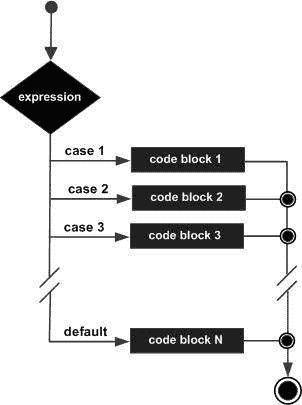
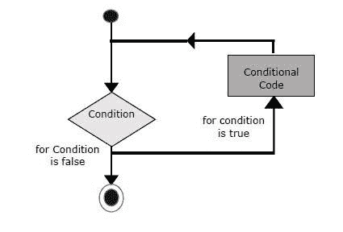
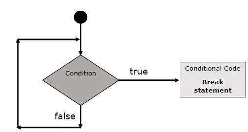
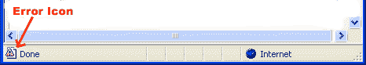
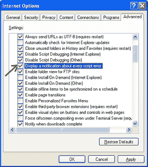
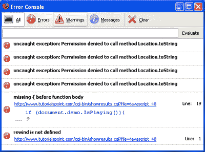

# JavaScript 入门指南

我想将这本书献给使用它的的学生们。祝你们未来职业取得成功，并希望你们永停止学习。

## 概述

### 什么是 JavaScript？

JavaScript 是一种动态计算机编程语言。它是轻量级的，最常用作网页的一部分，其实现方式允许客户端脚本与用户交互并创建动态页面。它是一种具有面向对象能力的解释型编程语言。

JavaScript 最初被称为 `LiveScript`，但 Netscape 将其更名为 JavaScript，可能是因为 Java 带来的轰热。JavaScript 于 1995 年以 `LiveScript` 的名称在 Netscape 2.0 中首次出现。该语言通用核心已嵌入 Netscape、Internet Explorer 和其他网络浏览器中。

`ECMA-262 Specification` 定义了 JavaScript 核心语言的标准版本。

- JavaScript 是一种轻量级的解释型编程语言。
- 为创建以网络中心的应用程序而设计。
- 与 Java 互补并集成。
- 与 HTML 互补并集成。
- 开放且跨平台

### 客户端 JavaScript

客户端 JavaScript 是该语言最常见的形式。脚本应该包含在 HTML 中或通过 HTML 引用。

### JavaScript 的优势

使用 JavaScript 的优点是：

- **减少服务器负载**
- **给用户提供即时反馈**
- **增强交互性**
- **更丰富的界面**

### JavaScript 的局限性

我们不能将 JavaScript 视为完全

- **客户端**
- **多线程或多处理器能力**：JavaScript 不具备任何多线程或多处理器能力。

JavaScript 是一种轻量级的解释型编程语言，允许你使用简单的文本编辑器在静态页面中构建交互。

### JavaScript 开发工具

JavaScript 的主要优点之一是不需要贵的开发工具。你可以从 Notepad 等简单的文本编辑器开始。

为了让生活更简单，各种厂商提供了优秀的 JavaScript 工具：

- **Microsoft FrontPage**：微软开发了一个名为 FrontPage 的流行 HTML 编辑器。FrontPage 还为网页开发者提供了许多辅助创建的工具。
- **Macromedia Dreamweaver MX**：专业网页领域流行的 HTML 和 JavaScript 编辑器。它提供了许多实用的 JavaScript 组件，与数据库良好集成，并符合 XHTML 和 XML 等标准。
- **Macromedia HomeSite 5**：HomeSite 5 是 Macromedia 受欢迎的 HTML 和 JavaScript 编辑器，可用于个人网站。

### 现在的 JavaScript？

ECMAScript 第 5 版标准是多年来的首次更新。JavaScript 2.0 符合 ECMAScript 第 5 版标准，两者之间的差异极小。

JavaScript 2.0 的规范可以在以下网站找到：`http://www.ecmascript.org/`

今天，Netscape 的 JavaScript 和微软的 JScript 都符合 ECMAScript 标准，尽管这两种语言仍然支持标准之外的功能。

#### 语法

JavaScript 可以通过放在网页 `<script>... </script>` HTML 标签内的 JavaScript 语句来实现。

你可以将包含 JavaScript 的 `<script>` 标签放置在网页的任何位置，但通常建议将其保留在 `<head>` 标签内。

`<script>` 标签通知浏览器开始将这些标签之间的所有文本视为脚本。

```
<script ...>

JavaScript 代码

</script>
```

script 标签带有两个重要的属性：

- **Language**：此属性指定你正在使用的脚本语言。通常，它的值为 `javascript`。尽管最新版本的 HTML（及其继任者 XHTML）已经废弃了该属性的使用。
-   **Type** − 此属性是目前推荐用于指示所使用的脚本语言的，其值应设置为 "text/javascript"。

因此，你的 JavaScript 段将如下所示 −

```html
<script language = "javascript" type = "text/javascript">
JavaScript code
</script>
```

### 你的第一段 JavaScript 代码

让我们通过一个示例来打印 "Hello World"。我们添加了一个可选的 HTML 注释并包裹在我们的 JavaScript 代码周围。这是为了防止代码被不支持 JavaScript 的浏览器执行。注释以 `//-->` 结束。在这里，`//` 表示 JavaScript 中的注释，因此我们添加了它以防止浏览器将 HTML 注释的结束标记读取为 JavaScript 代码。接下来，我们调用了函数 `document.write`，它会向我们的 HTML 文档写入一个字符串。

此函数可以用于写入文本、HTML 或两者兼有。请看以下代码。

```html
<html>
<body>
<script  language  =  "javascript"  type  =  "text/javascript">
<!--
document.write("Hello World!")
//-->
</script>
</body>
</html>
```

这段代码将产生以下结果 −

Hello World!

### 空格与换行

JavaScript 会忽略出现在 JavaScript 程序中的空格、制表符和换行符。你可以在程序中自由使用空格、制表符和换行符，并自由以整洁一致的方式格式化和缩进你的程序，使代码易于阅读和理解。

### 分号可选

JavaScript 中的简单语句通常跟着一个分号字符，就像在 C、C++ 和 Java 中一样。然而，如果你的每个语句都单独成行，JavaScript 允许你省略此分号。例如，以下代码可以在不写分号的情况下编写。

```html
<script  language  =  "javascript"  type  =  "text/javascript">
<!--
var1 =  10
var2 =  20
//-->
</script>
```

但当如下格式化为单行时，你必须使用分号 −

```html
<script  language  =  "javascript"  type  =  "text/javascript">
<!--
var1 =  10; var2 =  20;
//-->
</script>
```

**注意** − 使用分号是一个良好的编程习惯。

### 大写敏感

JavaScript 是一种大小写敏感的语言。这意味着语言关键字、变量、函数名和任何其他标识符必须始终使用一致的大小写进行输入。

因此，标识符 `Time` 和 `TIME` 在 JavaScript 中具有不同的含义。

**注意** − 在 JavaScript 中编写变量和函数名时应小心。

### JavaScript 中的注释

JavaScript 同时支持 C 风格和 C++ 风格的注释，因此 −

-   `//` 和行尾之间的任何文本都被视为注释，并被 JavaScript 忽略。
-   字符 `/*` 和 `*/` 之间的任何文本都被视为注释。这可以跨多行。
-   JavaScript 还能识别 HTML 注释开启序列 `<!--`。JavaScript 将其视为单行注释，就像处理 `//` 注释一样。
-   HTML 注释结束序列 `-->` 不被 JavaScript 识别，因此应写为 `-->`。

#### 示例

下面的示例了如何在 JavaScript 中使用注释。

```html
<script  language  =  "javascript"  type  =  "text/javascript">
<!--
// 这是一个注释。它类似于 C++ 中的注释
/*
* 这是 JavaScript 中的多行注释
* 它与 C 语言中的注释非常相似
*/
//-->
</script>
```

# 在浏览器中启用 JavaScript

所有现代浏览器都内置了对 JavaScript 的支持。经常，你可能需要手动启用或禁用此支持。本章解释了在你的浏览器中 Internet Explorer、Firefox、Chrome 和 Opera 中启用和禁用 JavaScript 支持的步骤。

### Internet Explorer 中的 JavaScript

是在 Internet Explorer 中开启或关闭 JavaScript 的简单步骤 −

-   从菜单中跟随 **Tools（工具）→ Internet Options（Internet 选项）**。
-   在对话框中选择 **Security（安全）** 标签。
-   点击 **Custom Level（自定义级别）** 按钮。
-   向下滚动找到 **Scripting（脚本）** 选项。
-   在 **Active scripting（活动脚本）** 下选择 *Enable* 单选按钮。
-   最后点击 OK 并退出。

要在 Internet Explorer 中禁用 JavaScript 支持，需要在 **Active scripting（活动脚本）** 下选择 **Disable（禁用）** 单选按钮。

### Firefox 中的 JavaScript

是在 Firefox 中开启或关闭 JavaScript 的步骤 −

-   打开新标签页 → 在地址栏中输入 `about: config`。
-   你将看到警告对话框。选择 **I’ll be careful, I promise!（我会小心的，我保证！）**。
-   你将在浏览器中找到 **configure options（配置选项）** 列表。
-   在搜索栏中输入 `javascript.enabled`。
-   在那里你可以通过右键点击该选项的值 → **select toggle（选择切换）** 来启用或禁用 JavaScript。

如果 `javascript.enabled` 为 true；点击 **toggle** 后它将变为 false。如果 JavaScript 被禁用；点击切换 后它将启用。

### Chrome 中的 JavaScript

是在 Chrome 中开启或关闭 JavaScript 的步骤 −

-   点击浏览器右上角的 Chrome 菜单。
-   选择 **Settings（设置）**。
-   点击 **Show advanced settings（显示高级设置）**。
-   页面底部的 Script。
-   在 **Privacy（隐私）** 部分，点击 **Content（内容）**。
-   在 "Javascript" 部分，选择 "Do not allow any site to run（不允许任何网站运行）" 或 "Allow all sites to run（允许所有网站运行）"。

### Opera 中的 JavaScript

是在 Opera 中开启或关闭 JavaScript 的步骤 −

-   跟随 **Tools（工具）→ Preferences（首选项）**。
-   在对话框中选择 **Advanced（高级）** 标签。
-   点击 **Content（内容）** 按钮。
-   向下滚动找到 **Scripting（脚本）** 选项。
-   在 **Active scripting** 下选择 *Enable* 单选按钮。
-   最后点击 OK 并退出。

要在你的 Opera 中禁用 JavaScript 支持，你不应该勾选 **Enable JavaScript checkbox**。

如果你需要使用 JavaScript 执行某些操作，可以使用 `<noscript>` 标签向用户显示警告消息。

你可以紧接脚本添加 `<noscript>` 块，如下 −

```html
<html>
<body>
<script language = "javascript" type = "text/javascript">
<!--
document.write("Hello World!")
//-->
</script>
<noscript>
Sorry...需要 JavaScript
</noscript>
</body>
</html>
```

现在，如果用户的浏览器不支持 JavaScript 或 JavaScript 未启用，`<noscript>` 中的消息将显示在屏幕上。

# 在 HTML 文件中的放置

在 HTML 文档的任何位置都提供了包含 JavaScript 的灵活性。然而，在 HTML 文件中包含 JavaScript 的常用方式如下

-   `<head>...</head>` 部分。
-   `<body>.../</body>` 部分。
-   `<body>...</</body>>` 和 `<head>...</head>` 部分。
-   外部文件并在 `<head>...</head>` 部分中包含。

在接下来的部分，我们将查看如何以不同的方式在 HTML 文件中放置 JavaScript。

### `<head>.../head>` 部分

如果你希望在某些事件运行时脚本（例如当用户点击某处时），你将把脚本放在 head 中：

```html
<html>
<head>
<script type = "text/javascript">
<!--
function sayHello() {
alert("Hello World")
}
//-->
</script>
</head>
<body>
<input type="button" onclick="sayHello()" value="Say Hello" />
</body>
</html>
```

### `<body>.../</body>` 部分

如果你需要在页面加载时运行脚本，以便在页面中生成内容，那么脚本位于文档的 `<body>` 部分。在这种情况下，你将使用 JavaScript 定义任何函数。请看以下代码。

```html
<html>
<head>
</head>
<body>
<script type = "text/javascript">
<!--
document.write("Hello World")
//-->
</script>
<p>This is web page body </p>
</body>
</html>
```

你可以将 JavaScript 代码分别存放在 `<head>` 和 `<body>` 部分，如下所示 −

```html
<<html>
<head>
<script type="text/javascript">
<!--
function sayHello() {
  alert("Hello World")
}
//-->
</script>
</head>
<body>
<script type="text/javascript">
<!--
document.write("Hello World")
//-->
</script>
<input type="button" onclick="sayHello()" value="Say Hello" />
</body>
</html>
```

这段代码将产生以下结果 −

### # 外部文件中的 JavaScript

当你开始更广泛地使用 JavaScript 时，你很可能会会发现，在某些情况下，你需要在网站的多个页面上复用相同的 JavaScript 代码。

你并不受限于在多个 HTML 文件中维护相同的代码。`script` 标签提供了一种机制，允许你将 JavaScript 存储在外部文件中，然后将其包含在 HTML 文件中。

以下示例展示了如何使用 `script` 标签及其 `src` 属性在 HTML 代码中包含外部 JavaScript 文件。

```html
<html
<head>
<script type="text/javascript" src="filename.js"></script>
</head>
<body>
.......
</body>
</html>
```

要使用来自外部文件源的 JavaScript，你需要将所有的 JavaScript 源代码写入扩展名为为 `.js` 的简单文本文件中，然后如上所示包含该文件。

例如，你可以在 `filename.js` 文件中保留以下内容，之后在包含 `filename.js` 文件后，你就可以在 HTML 文件中使用 `sayHello` 函数了。

```javascript
function sayHello() {
  alert("Hello World")
}
```

### # 变量

#### ## JavaScript 数据类型

编程语言最基本的特征之一是它支持的数据类型集合。这些是在编程语言中可以表示和操作的值类型。

JavaScript 允许你处理三种原始数据类型 −

* `Numbers`（数字），例如 123, 120.50 等。
* `Strings`（字符串），例如 "This text string" 等。
* `Boolean`（布尔值），例如 true 或 false。

JavaScript 还定义了两个特殊数据类型：`null` 和 `undefined`，每个类型只定义了一个值。除了这些原始数据类型外，JavaScript 还支持一种名为 `object` 的复合数据类型。我们将在单独的章节详细介绍对象。

**注意** − JavaScript 不区分整数值和浮点值。JavaScript 中的所有数字都表示为浮点值。JavaScript 使用 IEEE 754 标准定义的 64 位浮点格式表示数字。

#### ## JavaScript 变量

与许多其他编程语言一样，JavaScript 也拥有变量。变量可以被视为命名的容器。你可以将数据放入这些容器中，然后通过命名容器来引用这些数据。

在 JavaScript 程序中使用变量之前，必须先声明它。使用 `var` 关键字声明变量如下：

```javascript
<script type="text/javascript">
<!--
var money;
var name;
//-->
</script>
```

你也可以如下使用相同的 `var` 关键字声明多个变量 −

```javascript
<script type="text/javascript">
<!--
var money, name;
//-->
</script>
```

在变量中存储值被称为 `变量初始化`。你可以在创建变量时进行初始化，也可以在之后需要该变量的某时刻进行。

例如，你可能会创建一个名为 `money` 的变量，稍后给它赋值 2000.50。

```javascript
<script type="text/javascript">
<!--
var name = "Ali";
var money;
money = 2000.50;
//-->
</script>
```

**注意** − `var` 关键字仅用于声明或初始化，在文档的变量名生命周期内使用一次。你不应该重复声明同一个变量。

JavaScript 是一种 `无类型` 语言。这意味着 JavaScript 变量可以持有任何数据类型的值。与许多其他语言不同，你不需要在变量变量时告诉 JavaScript 变量将持有什么类型的值。变量类型可以在程序执行过程中更改，JavaScript 会自动处理。

#### ## JavaScript 变量作用域

变量的作用域是其定义的程序区域。JavaScript 变量只有两种作用域。

* `Global Variables`（全局变量） − 全局变量具有全局作用域，意味着可以在 JavaScript 代码的任何地方定义。
* `Local Variables`（局部变量） − 局部变量在其定义的函数内部可见。函数参数始终是该函数的局部变量。

在函数体内，局部变量的优先级高于同名的全局变量。如果你声明了一个与全局变量同名的局部变量或函数参数，你实际上隐藏了该全局变量。请看以下示例。

```html
<body onload=checkscope();>
<script type="text/javascript">
<!--
var myVar = "global";
function checkscope() {
  document.write(myVar);
}
//-->
</script>
</body>
</html>
```

### # 变量名

在 JavaScript 中为变量命名时，请记住以下规则：

* JavaScript 名称不应以数字（0-9）开头。它们必须以字母或下划线开头。
* JavaScript 名称对大小写敏感。

### # 关键字

所有保留字列表如下所示。

| abstract | else | instanceof | switch |
| boolean | enum | int | synchronized |
| break | export | interface | this |
| byte | extends | long | throw |
| case | false | native | transient |
| char | finally | new | true |
| class | float | package | try |
| const | for | private | typeof |
| continue | function | protected | var |
| debugger | goto | public | void |
| default | if | return | volatile |
| delete | implements | short | while |
| do | import | static | with |
| double | in | super | |
| double | in | super | |

这些词不能作为变量名。

### # 运算符

#### ## 什么是运算符？

让我们来看简单的表达式 `4 + 5 等于 9`。这里 4 和 5 被`操作数`，而 `+` 是`运算符`。JavaScript 支持以下类型的运算符。

* 算术运算符
* 比较运算符
* 逻辑（或关系）运算符
* 赋值运算符
* 条件（或三元）运算符

让我们逐个查看所有运算符。

#### ## 算术运算符

JavaScript 支持以下算术运算符 −

假设变量 `A` 值为 10，变量 `B` 值为 20，则 −

| 序号 | 运算符 & 描述 |
| :--- | :--- |
| 1 | `+` (加法) 相加两个操作数 **例如**：`A + B` 得到 30 |
| 2 | `-` (减法) 从第一个操作数中减去第二个操作数 **例如**：`A - B` 得到 -10 |
| 3 | `*` (乘法) 乘积两个操作数 **例如**：`A * B` 得到 200 |
| 4 | `/` (除法) 被除数除以除数 **例如**：`B / A` 得到 2 |
| 5 | `%` (取模) 输出整数除法的余数 **例如**：`B % A` 得到 0 |
| 6 | `++` (自增) 将整数值加一 **例如**：`A++` 得到 11 |
| 7 | `--` (自减) 将整数值减一 **例如**：`A--` 得到 9 |

**注意** − 加法运算符 (+) 既适用于数值，也适用于字符串。例如 `"a" + 10` 将得到 `"a10"`。

以下代码展示了如何在 JavaScript 中使用算术运算符。

```html
<html>
<body>
<script type  =  "text/javascript">
<!--
var a =  33;
var b =  10;
var c =  "Test";
var linebreak =  "<br />";
document.write("a + b = ");
result = a + b;
document.write(result);
document.write(linebreak);
document.write("a - b = ");
result = a - b;
document.write(result);
document.write(linebreak);
document.write("a / b = ");
result = a / b;
document.write(result);
document.write(linebreak);
document.write("a % b = ");
result = a % b;
document.write(result);
document.write(linebreak);
document.write("a + b + c = ");
result = a + b + c;
document.write(result);
document.write(linebreak);
a =  ++a;
document.write("++a = ");
result =  ++a;
document.write(result);
document.write(linebreak);
b =  --b;
document.write("--b = ");
result =  --b;
document.write(result);
document.write(linebreak);
//-->
</script>
将变量设置为不同的值然后尝试...
</body>
</html>
```

### 输出

a + b = 43

a - b = 23

a / b = 3.3

a % b = 3

a + b + c = 43Test

++a = 35

--b = 8

将变量设置为不同的值然后尝试...

### 比较运算符

JavaScript 支持以下比较运算符 −

假设变量 `A` 存储值为 10，变量 `B` 存储值为 20，则 −

| 序号 | 运算符与描述 |
| :--- | :--- |
| 1 | `==` (等于)检查两个操作数的值是否相等，如果相等，则条件为真。例：`(A == B)` 不为真。 |
| 2 | `!=` (不等于)检查两个操作数的值是否相等，如果值不相等，则条件为真。例：`(A != B)` 为真。 |
| 3 | `>` (大于)检查左侧操作数的值是否大于右侧操作数的值，如果是，则条件为真。例：`(A > B)` 不为真。 |
| 4 | `<` (小于)检查左侧操作数的值是否小于右侧操作数的值，如果是，则条件为真。例：`(A < B)` 为真。 |
| 5 | `>=` (大于等于)检查左侧操作数的值是否大于或等于右侧操作数的值，如果是，则条件为真。例：`(A >= B)` 不为真。 |
| 6 | `<=` (小于等于)检查左侧操作数的值是否小于或等于右侧操作数的值，如果是，则条件为真。例：`(A <= B)` 为真。 |

### 示例

以下代码展示了如何在 JavaScript 中使用比较运算符。

```html
<html>
<body>
<script type  =  "text/javascript">
<!--
var a =  10;
var b =  20;
var linebreak =  "<br />";
document.write("(a == b) => ");
result =  (a == b);
document.write(result);
document.write(linebreak);
document.write("(a < b) => ");
result =  (a < b);
document.write(result);
document.write(linebreak);
document.write("(a > b) => ");
result =  (a > b);
document.write(result);
document.write(linebreak);
document.write("(a != b) => ");
result =  (a != b);
document.write(result);
document.write(linebreak);
document.write("(a >= b) => ");
result =  (a >= b);
document.write(result);
document.write(linebreak);
document.write("(a <= b) => ");
result =  (a <= b);
document.write(result);
document.write(linebreak);
//-->
</script>
将变量设置为不同的值和不同的运算符然后尝试...
</body>
</html>
```

### 输出

(a == b) => false

(a < b) => true

(a > b) => false

(a != b) => true

(a >= b) => false

a <= b) => true

将变量设置为不同的值和不同的运算符然后尝试...

### 逻辑运算符

JavaScript 支持以下逻辑运算符 −

假设变量 `A` 存储值为 10，变量 `B` 存储值为 20，则 −

 | 序号 | 运算符与描述 |
| :--- | :--- |
| 1 | `&&` (逻辑与)如果两个操作数均非零，则条件为真。例：`(A && B)` 为真。 |
| 2 | `||` (逻辑或)如果两个操作数中任意一个非零，则条件为真。例：`(A || B)` 为真。 |
| 3 | `!` (逻辑非)反转操作数的逻辑状态。例：`A` 为假。 |

### 示例

尝试通过以下代码在 JavaScript 中实现逻辑运算符。

```html
<html>
<body>
<script type  =  "text/javascript">
<!--
var a =  10;
var b =  20;
var linebreak =  "<br />";
document.write("(a == b) => ");
result =  (a ==
);
document.write(
);
document.write(
);
write.write <a < b)


result =  (a < b);
document.write(result);
document.write(
);
document.write
a
 b)


result =  (a
 b);
document.write(result);
document.write(


document.write.a != b) => ");
result =  (a != b);
document.write(result);
document.write(linebreak);
document.write.a >= b) => ");
result =  (a >= b);
document.write(result);
document.write(linebreak);
document.write.a <= b) => ");
result =  (a <= b);
document.write(result);
document.write(linebreak);
//-->
</script>
将变量设置为不同的值然后尝试...
</body>
</html>
```

### 输出

(a == b) => false

(a < b) => true

(a > b) => false

(a != b) => true

(a >= b) => false

a <= b) => true

将变量设置为不同的值然后尝试...

### 位 运算符

JavaScript 支持以下位 运算符 −

假设变量 `A` 存储值为 2，变量 `B` 存储值为 3，则 −

 | 序号 | 运算符与描述 |
| :--- | :--- |
| 1 | `&` (位与)对两个操作数的位进行与运算。例：`(A & B)` 为 2。 |
| 2 | `|` (位或)对两个操作数的位进行或运算。例：`(A | B)` 为 3。 |
| 3 | `^` (位异或)对两个操作数的位进行异或运算。即两个操作数中仅有一个为真时结果为真。例：`(A ^ B)` 为 1。 |
| 4 | `~` (位取反)反转操作数的位。例：`(~B)` 为 -4。 |
| 5 | `<<` (左移)将第一个操作数的位向左移动第二个操作数指定的位数。新填充的位补零。例：`(A << 1)` 为 4。 |
| 6 | `>>` (右移)将第一个操作数的位向右移动第二个操作数指定的位数。例：`(A >> 1)` 为 1。 |
| 7 | `>>>` (无右移)该运算符与 `>>` 类似，但左侧填充的位始终为零。例：`(A >>> 1)` 为 1。 |

### 示例

尝试以下代码在 JavaScript 中实现位 运算符。

```html
<html>
<body>
<script type  =  "text/javascript">
<!--
var a =  2; // 二进制 10
var b =  3; // 二进制 11
var linebreak =  "<br />";
document.write("(a & b) => ");
result =  (a & b);
document.write(result);
document.write(linebreak);
document.write("(a | b) => ");
result =  (a | b);
document.write(result);
document.write(linebreak);
document.write("(a ^ b) => ");
result =  (a ^ b);
document.write(result);
document.write(linebreak);
document.write("(~b) => ");
result =  (~b);
document.write(result);
document.write(linebreak);
document.write("(a << b) => ");
result =  (a << b);
document.write(result);
document.write(linebreak);
document.write("(a >> b) => ");
result =  (a >> b);
document.write(result);
document.write(linebreak);
//-->
</script>
<p>将变量设置为不同的值和不同的运算符然后尝试...</p>
</body>
</html>
```

### 输出

(a & b) => 2

(a | b) => 3

(a ^ b) => 1

(~b) => -4

(a << b) => 16

(a >> b) => 0

### 赋值运算符

JavaScript 支持以下赋值运算符 −

 | 序号 | 运算符与描述 |
| :--- | :--- |
| 1 | `=` (简单赋值 )将右侧操作数的值赋给左侧操作数。例：`C = A + B` 将 A + B 的值赋给 `C` |
| 2 | `+=` | (加赋值) 将右操作数加到左操作数，并将结果赋值给左操作数。**例：** `C += A` 等于 `C = C + A` |
| 3 | `-=` | (减赋值) 从左操作数中减去右操作数，并将结果赋值给左操作数。**例：** `C -= A` 等于 `C = C - A` |
| 4 | `*=` | (乘赋值) 将右操作数与左操作数相乘并将结果赋值给左操作数。**例：** `C *= A` 等于 `C = C * A` |
| 5 | `/=` | (除赋值) 将左操作数除以右操作数，并将结果赋值给左操作数。**例：** `C /= A` 等于 `C = C / A` |
| 6 | `%=` | (取模赋值) 使用两个操作数取模并将结果赋值给左操作数。**例：** `C %= A` 等于 `C = C % A` |

**注意** — 相同的逻辑也适用于位运算符，因此它们将变为 `<<=`、`>>=`、`>>=`、`&=`、`|=` 和 `^=`。 |

### 示例

尝试运行以下代码在 JavaScript 中实现赋值运算符。

```html
<html>
<body>
<script type="text/javascript">
<!--
var a = 33;
var b = 10;
var linebreak = "<br />";
document.write("Value of a => (a = b) => ");
result = (a = b);
document.write(result);
document.write(linebreak);
document.write("Value of a => (a += b) => ");
result = (a += b);
document.write(result);
document.write(linebreak);
document.write("Value of a => (a -= b) => ");
result = (a -= b);
document.write(result);
document.write(linebreak);
document.write("Value of a => (a *= b) => ");
result = (a *= b);
document.write(result);
document.write(linebreak);
document.write("Value of a => (a /= b) => ");
result = (a /= b);
document.write(result);
document.write(linebreak);
document.write("Value of a => (a %= b) => ");
result = (a %= b);
document.write(result);
document.write(linebreak);
//-->
</script>
<p>将变量设置为不同的值和不同的运算符，然后尝试...</p>
</body>
</html>
```

### 输出

Value of a => (a = b) => 10

Value of a => (a += b) => 20

Value of a => (a -= b) => 10

Value of a => (a *= b) => 100

Value of a => (a /= b) => 10

Value of a => (a %= b) => 0

将变量设置为不同的值和不同的运算符，然后尝试...

## 杂运算符

我们在这里讨论两个在 JavaScript 中非常有用的运算符：**条件运算符** `? :` 和 **typeof 运算符**。

### 条件运算符 (`?:`)

条件运算符首先求一个表达式以得到真或假值，然后根据求值结果执行给定的两个语句之一。

| 序号 | 运算符和描述 |
| :--- | :--- |
| 1 | `? :` (条件) 如果条件为真？取值 X : 否则取值 Y |

### 示例

尝试运行以下代码以理解条件运算符在 JavaScript 中是如何工作的。

```html
<html>
<body>
<script type="text/javascript">
<!--
var a = 10;
var b = 20;
var linebreak = "<br />";
document.write ("((a > b) ? 100 : 200) => ");
result = (a > b) ? 100 : 200;
document.write(result);
document.write(linebreak);
document.write ("((a < b) ? 100 : 200) => ");
result = (a < b) ? 100 : 200;
document.write(result);
document.write(linebreak);
//-->
</script>
<p>将变量设置为不同的值和不同的运算符，然后尝试...</p>
</body>
</html>
```

### 输出

((a > b) ? 100 : 200) => 200

((a < b) ? 100 : 200) => 100

将变量设置为不同的值和不同的运算符，然后尝试...

### typeof 运算符

**typeof** 运算符是一个一元运算符，放置在其单个操作数之前，该操作数可以是任何类型。它的值是一个表示操作数数据类型的字符串。

如果操作数是数字、字符串或布尔值，`typeof` 运算符求值为 "number"、string" 或 "boolean"，并根据求值结果返回真或假。

以下是 **typeof** 运算符的返回值列表。

| 类型 | typeof 返回的字符串 |
| :--- | :--- |
| Number | "number" |
| String | "string" |
| Boolean | "boolean" |
| Object | "object" |
| Function | "function" |
| Undefined | "undefined" |
| Null | "object" |

### 示例

**typeof** 运算符用于确定数据类型。

```html
<html>
<body>
<script type="text/javascript">
<!--
var a = 33;
var b = 10;
var linebreak = "<br />";
document.write("Value of a => (a = b) => ");
result = (a = b);
document.write(result);
document.write(linebreak);
document.write("Value of a => (a += b) => ");
result = (a += b);
document.write(result);
document.write(linebreak);
document.write("Value of a => (a -= b) => ");
result = (a -= b);
document.write(result);
document.write(linebreak);
document.write("Value of a => (a *= b) => ");
result = (a *= b);
document.write(result);
document.write(linebreak);
document.write("Value of a => (a /= b) => ");
result = (a /= b);
document.write(result);
document.write(linebreak);
document.write("Value of a => (a %= b) => ");
result = (a %= b);
document.write(result);
document.write(linebreak);
//-->
</script>
<p>将变量设置为不同的值和不同的运算符，然后尝试...</p>
</body>
</html>
```

*(注：由于原文中包含大量重复且混乱的格式描述，译文已根据要求提取了核心逻辑。)*

```
如果 `expression 2` 为真，则执行语句(s)

} else if (`expression 3`) {

如果 `expression 3` 为真，则执行语句(s)

} else {

如果没有一个表达式为真，则执行语句(s)

}

这段代码并没有特别之处。它是一系列 `if` 语句，每个 `if` 都是上一个语句 `else` 子句的一部分。语句根据真值条件执行，如果没有一个条件为真，则执行 `else` 块。

### 示例

尝试以下代码来学习如何在 JavaScript 中实现 `if-else-if` 语句。

```html

<html>

<body>

<script  type  =  "text/javascript">

<!--

var book =  "maths";

if( book ==  "history"  ){

document.write("<b>History Book</b>");

}  else  if( book ==  "maths"  ){

document.write("<b>Maths Book</b>");

}  else  if( book ==  "economics"  ){

document.write("<b>Economics Book</b>");

}  else  {

document.write("<b>Unknown Book</b>");

}

//-->

</script>

<p>将变量设置为不同的值，然后尝试...</p>

</body>

</html>

```

### 输出

Maths Book

将变量设置为不同的值，然后尝试...

# Switch Case

你可以像上一节中那样，使用多个 `if...else…if` 语句来执行多路分支。然而，这并不总是最佳解决方案，特别是当所有分支都依赖于单个变量的值时。

从 JavaScript 1.2 开始，你可以使用 `switch` 语句，它恰好处理这种情况，而且比重复的 `if...else if` 语句执行得更高。

### 流程图

下面的流程图解释了 switch-case 语句的工作原理。



### 语法

`switch` 语句的目标是给出一个表达式进行求值，并根据表达式的值执行几个不同的语句。解释器会将表达式的值与每个 `case` 进行比较，直到找到匹配项为止。如果没有匹配项，则将使用 `default` 条件。

```javascript

switch (expression) {

case condition 1: statement(s)

break;

case condition 2: statement(s)

break;

...

case condition n: statement(s)

break;

default: statement(s)

}

```

`break` 语句表示特定 case 的结束。如果省略了它们，解释器将继续执行后续每个 case 中的每个语句。

我们将在 `循环控制` 章节解释 `break` 语句。

### 示例

尝试以下示例来实现实现 switch-case 语句。

```html

<html>

<body>

<script  type  =  "text/javascript">

<!--

var grade =  'A';

document.write("Entering switch block<br />");

switch  (grade)  {

case  'A': document.write("Good job<br />");

break;

case  'B': document.write("Pretty good<br />");

break;

case  'C': document.write("Passed<br />");

break;

case  'D': document.write("Not so good<br />");

break;

case  'F': document.write("Failed<br />");

break;

default: document.write("Unknown grade<br />")

}

document.write("Exiting switch block");

//-->

</script>

<p>将变量设置为不同的值，然后尝试...</p>

</body>

</html>

```

### 输出

Entering switch block

Good job

Exiting switch block

将变量设置为不同的值，然后尝试...

Break 语句在 switch-case 语句中起着重要作用。尝试以下没有使用任何 break 语句的 switch-case 语句。

```html

<html>

<body>

<script  type  =  "text/javascript">

<!--

var grade =  'A';

document.write("Entering switch block<br />");

switch  (grade)  {

case  'A': document.write("Good job<br />");

case  'B': document.write("Pretty good<br />");

case  'C': document.write("Passed<br />");

case  'D': document.write("Not so good<br />");

case  'F': document.write("Failed<br />");

default: document.write("Unknown grade<br />")

}

document.write("Exiting switch block");

//-->

</script>

<p>将变量设置为不同的值，然后尝试...</p>

</body>

</html>

```

### 输出

Entering switch block

Good job

Pretty good

Passed

Not so good

Failed

Unknown grade

Exiting switch block

将变量设置为不同的值，然后尝试...

# While 循环

在编写程序时，你可能会遇到需要反复执行某项操作。在这种情况下，你需要编写循环语句来减少行数。

JavaScript 支持所有必要的循环来减轻编程压力。

## while 循环

JavaScript 中最基本的循环是 `while` 循环，将在本章中讨论。`while` 循环的目的是只要 `expression` 为真，就重复执行语句。一旦表达式变为 `false`，循环就会终止。

### 流程图

`while` 循环的流程图如下。

### 语法

JavaScript 中 `while` 循环的语法如下：

```javascript

while (expression) {

如果表达式为真，则执行语句(s)

}

```

### 示例

尝试以下示例来实现 while 循环。

```html

<html>

<body>

<script  type  =  "text/javascript">

<!--

var count = 0;

document.write("Starting Loop ");

while(count < 10) {

document.write("Current Count : " + count + "<br />");

count++;

}

document.write("Loop stopped!");

//-->

</script>

<p>将变量设置为不同的值，然后尝试...</p>

</body>

</html>

```

### 输出

Starting Loop

Current Count : 0

Current Count : 1

Current Count : 2

Current Count : 3

Current Count : 4

Current Count : 5

Current Count : 6

Current Count : 7

Current Count : 8

Current Count : 9

Loop stopped!

## do...while 循环

`do...while` 循环与 `while` 循环类似，但发生在循环结束时。这意味着即使条件为 `false`，循环也会至少执行一次。

### 流程图

`do-while` 循环的流程图如下：


### 语法

JavaScript 中 `do...while` 循环的语法如下：

```javascript

do {

语句(s);

} while (expression);

```

**注意**：不要忘记 `do...while` 循环末尾的分号。

### 示例

尝试以下示例学习如何在 JavaScript 中实现 `do...while` 循环。

```html

<html>

<body>

<script  type  =  "text/javascript">

<!--

var count = 0;

document.write("Starting Loop<br />");

do {

document.write("Current Count : " + count + "<br />");

count++;

}

while(count < 5);

document.write ("Loop stopped!");

//-->

</script>

<p>将变量设置为不同的值，然后尝试...</p>

</body>

</html>

```

### 输出

Starting Loop

Current Count : 0

Current Count : 1

Current Count : 2

Current Count : 3

Current Count : 4

Loop stopped!

# For 循环

`for` 循环是循环最紧凑的形式。它包含了以下重要部分：

*   `循环初始化`：我们在此处初始化计数器的起始值。初始化语句在循环开始之前执行。
*   `测试语句`：测试给定的条件是否为真。如果为真，则执行循环内部的代码，否则控制将跳出循环。
*   `迭代语句`：我们可以在此处增加或减少计数器。

你可以将这三个部分放在同一行并用分号隔开。

### 流程图

JavaScript `for` 循环的流程图如下：



### 语法

JavaScript `for` 循环的语法如下：

```javascript

for (initialization; test condition; iteration statement) {

如果测试条件为真，则执行语句(s)

}

```

### 示例

尝试以下示例学习 JavaScript 中的 `for` 循环是如何工作的。

```html

<html>

<body>

<script  type  =  "text/javascript">

<!--

var count;

for (count = 0; count < 10; count++) {

document.write("Current Count : " + count + "<br />");

}

document.write("Loop stopped!");

//-->

</script>

<p>将变量设置为不同的值，然后尝试...</p>

</body>

</html>

```


```javascript

document.write("Starting Loop"  +  "<br />");

for(count =  0; count <  10; count++)  {

  document.write("Current Count : "  + count );

  document.write("<br />");

}

document.write("Loop stopped!");

```

<p>将变量设置为不同的值并尝试...</p>

### 输出
Starting Loop
Current Count : 0
Current Count : 1
Current Count : 2
Current Count : 3
Current Count : 4
Current Count : 5
Current Count : 6
Current Count : 7
Current Count : 8
Current Count : 9
Loop stopped!
将变量设置为不同的值并尝试...

# JavaScript `for...in` 循环

# JavaScript `for...in` 循环

`for...in` 循环用于遍历对象的属性。由于我们还没有讨论过对象（Objects），你可能对这个循环感到不太熟悉。但一旦你理解了 JavaScript 中对象的行为，就会发现这个循环非常有用。

### 语法
`for..in` 循环的语法如下 −：

```javascript

for (variablename in object) {

  要执行的语句或块

}

```

在每次迭代中，`object` 中的一个属性会被赋值给 `variablename`，此循环会一直持续直到对象的所有属性都被遍历完毕。

### 示例
尝试以下示例来实现 `for-in` 循环。它会打印网络浏览器的 `Navigator` 对象。

```html

<html>

<body>

<script type  =  "text/javascript">

<!--

var aProperty;

document.write("Navigator Object Properties<br /> ");

for  (aProperty in navigator)  {

  document.write(aProperty);

  document.write("<br />");

}

document.write ("Exiting from the loop!");

//-->

</script>

<p>将变量设置为不同的对象并尝试...</p>

</body>

</html>

```

### 输出
Navigator Object Properties
serviceWorker
webkitPersistentStorage
webkitTemporaryStorage
geolocation
doNotTrack
onLine
languages
language
userAgent
product
platform
appVersion
appName
appCodeName
hardwareConcurrency
maxTouchPoints
vendorSub
vendor
productSub
cookieEnabled
mimeTypes
plugins
javaEnabled
getStorageUpdates
getGamepads
webkitGetUserMedia
vibrate
getBattery
sendBeacon
registerProtocolHandler
unregisterProtocolHandler
Exiting from the loop!
将变量设置为不同的对象并尝试...

# 循环控制
JavaScript 提供了完全控制来处理循环和 switch 语句。可能会出现这种情况：你需要在到达循环底部之前退出循环。也可能这种情况：你想跳过代码块的一部分并开始循环的下一次迭代。

为了处理所有此类情况，JavaScript 提供了 `break` 和 `continue` 语句。这些语句分别用于立即退出任何循环或开始任何循环的下一次迭代。

## break 语句
`break` 语句在 `switch` 语句中曾简要介绍过，用于提前退出循环，跳出外层的大括号。

### 流程图
break 语句的流程图所示 −



### 示例
以下示例说明了在 while 循环中使用 `break` 语句。请注意当 `x` 达到 5 时，循环是如何提前退出并到达紧接闭合大括号下方的 `document.write (..)` 语句的 −


```html

<html>

<body>

<script type  =  "text/javascript">

<!--

var x =  1;

document.write("Entering the loop<br /> ");

while  (x <  20)  {

  if  (x ==  5)  {

    break;  // 完全跳出循环

  }

  x = x +  1;

  document.write( x +  "<br />");

}

document.write("Exiting the loop!<br /> ");

//-->

</script>

<p>将变量设置为不同的值并尝试...</p>

</body>

</html>

```

### 输出
Entering the loop
2
3
4
5
Exiting the loop!
将变量设置为不同的值并尝试...

我们已经见过 `break` 语句在 switch 内部的用法。

## continue 语句
`continue` 语句告诉解释器立即开始循环的下一次迭代并跳过剩余代码块。当遇到 `continue` 语句时，程序流会立即移动到循检查表达式，如果条件仍为真，则开始下一次迭代，否则控制将退出循环。

### 示例
此示例说明了在 while 循环中使用 `continue` 语句。请注意当变量 `x` 中的索引达到 5 时，如何使用 `continue` 语句跳过打印 −

```html

<html>

<body>

<script type  =  "text/javascript">

<!--

var x =  1;

document.write("Entering the loop<br /> ");

while  (x <  10)  {

  x = x +  1;

  if  (x ==  5)  {

    continue;

  }

  document.write( x +  "<br />");

}

document.write("Exiting the loop!<br /> ");

//-->

</script>

<p>将变量设置为不同的值并尝试...</p>

</body>

</html>

```

### 输出
Entering the loop
2
3
4
5
6
7
8
9
10
Exiting the loop!
将变量设置为不同的值并尝试...


在我们使用函数之前，需要先对其进行定义。在 JavaScript 中，定义函数最常用的方法是使用 `function` 关键字，后跟一个唯一的函数名、参数列表（可以为空）以及一个用大括号括围的语句块。

### 语法

基本语法所示。

```html

<script type="text/javascript">

<!--

function functionname(parameter-list) {

statements

}

//-->

</script>

```

### 示例

尝试以下示例。它定义了一个名为 `sayHello` 的函数，不接受任何参数——

```html

<script type  = "text/javascript">

<!--

function sayHello()  {

alert("Hello there");

}

//-->

</script>

```

## 调用函数

要在脚本的后续某个地方调用函数，你只需要像下面的代码所示编写该函数的名称即可。

```html

<html>

<head>

<script type = "text/javascript">

function sayHello()  {

document.write ("Hello there!");

}

</script>

</head>

<body>

<p>点击下面的按钮调用函数</p>

<form>

<input type = "button" onclick = "sayHello()" value = "Say Hello">

</form>

<p>在 write 方法中使用不同的文本然后尝试...</p>

</body>

</html>

```

### 输出

## 函数参数

到目前为止，我们已经了没有参数的函数。但在调用函数时，可以传递不同的参数。这些传递的参数可以在函数内部被捕获，并对这些参数进行任何操作。函数可以接受多个由逗号分隔的参数。

### 示例

尝试以下示例。我们在这里修改了 `sayHello` 函数。现在它接受两个参数。

```html

<html>

<head>

<script type = "text/javascript">

function sayHello(name, age)  {

document.write (name + " is "  + age + " years old.");

}

</script>

</head>

<body>

<p>点击下面的按钮调用函数</p>

<form>

<input type = "button" onclick = "sayHello('Zara', 7)" value = "Say Hello">

</form>

<p>在函数内部使用不同的参数然后尝试...</p>

</body>

</html>

```

### 输出

## return 语句

JavaScript 函数可以有一个可选的 `return` 语句。如果你想从函数返回一个值，则需要该语句。该语句应该是应该是函数中的最后一条语句。

例如，你可以向函数传递两个数字，然后可以在调用程序中期望函数返回它们的乘积。

### 示例

尝试以下示例。它定义了一个接受两个参数的函数，并在调用程序中返回结果之前对它们进行拼接。

```html

<html>

<head>

<script type = "text/javascript">

function concatenate(first, last)  {

var full;

full = first + last;

return full;

}

function secondFunction()  {

var result;

result = concatenate('Zara', 'Ali');

document.write (result );

}

</script>

</head>

<body>

<p>点击下面的按钮调用函数</p>

<form>

<input type = "button" onclick = "secondFunction()" value = "Call Function">

</form>

<p>在函数内部使用不同的参数然后尝试...</p>

</body>

</html>

```

### 输出

关于 JavaScript 函数有很多要学习，但我们在本教程中已经涵盖了最重要的概念。

* **JavaScript 嵌套函数**
* **JavaScript Function( ) 构造函数**
* **JavaScript 函数字面量**

# 事件

## 什么是事件？

JavaScript 与 HTML 的交互通过事件处理，这些事件会在用户或浏览器操作页面时发生。

当页面加载时，它被称为一个事件。当用户点击按钮时，该点击操作也是一个事件。其他示例包括按下任何按键、关闭窗口、调整窗口大小等事件。

开发者可以使用这些事件来执行 JavaScript 代码编写的响应，这会导致按钮关闭窗口、向用户显示消息、验证数据以及几乎可以想象的任何其他类型的响应。

事件是文档对象模型（DOM）Level 3 的一部分，每个 HTML 元素都包含一组可以触发 JavaScript 代码的事件。

请阅读这个小型教程以更好地理解 `HTML 事件参考`。在这里，我们将看到通过几个示例来理解事件与 JavaScript 之间的关系——

## onclick 事件类型

这是最常用的事件类型，当用户点击鼠标左键时发生。你可以针对此事件类型编写验证、警告等内容。

### 示例

尝试以下示例。

```html

<html>

<head>

<script type = "text/javascript">

<!--

function sayHello()  {

alert("Hello World")

}

//-->

</script>

</head>

<body>

<p>点击下面的按钮查看结果</p>

<form>

<input type = "button" onclick = "sayHello()" value = "Say Hello" />

</form>

</body>

</html>

```

### 输出

## onsubmit 事件类型

`onsubmit` 是用户点击鼠标左键时发生的事件。你可以针对此事件类型编写验证、警告等内容。

### 示例

下面的示例展示了如何使用 `onsubmit`。在这里 `validate()` 在表单之前被触发。

```html

<html>

<head>

<script type = "text/javascript">

<!--

function validate()  {

all here

}

//-->

</script>

</head>

<body>

<form>

<input type = "button" onsubmit = "validate()" value = "Submit" />

</form>

</body>

</html>

```

## onmouseover 和 onmouseout

这两个事件类型可以帮助你为图像甚至文本创建效果。`onmouseover` 事件在你将鼠标移到任何元素上时触发，而 `onmouseout` 在你移出时触发。尝试以下示例。

```html

<html>

<head>

<script type = "text/javascript">

<!--

function over()  {

document.write ("Mouse Over");

}

function out()  {

document.write ("Mouse Out");

}

//-->

</script>

</head>

<body>

<p>将鼠标移入 div 内查看结果：</p>

<div onmouseover = "over()" onmouseout = "out()">

<h2> 在 div 内部</h2>

</div>

</body>

</html>


### HTML5 标准事件

这里列出了标准的 HTML5 事件供参考。这里的 `script` 表示针对事件执行的 JavaScript 函数。

| 属性 | 值 | 说明 |
| :--- | :--- | :--- |
| Offline | script | 文档离线时触发 |
| Onabort | script | 中止事件时触发 |
| onafterprint | script | 文档打印后触发 |
| onbeforeonload | script | 文档加载前触发 |
| onbeforeprint | script | 文档打印前触发 |
| onblur | script | 窗口失去焦点时触发 |
| oncanplay | script | 媒体可以播放，但可能需要停止缓冲 |
| oncanplaythrough | script | 媒体可以播放到结束，无需停止缓冲 |
| onchange | script | 元素改变时触发 |
| onclick | script | 鼠标点击时触发 |
| oncontextmenu | script | 触发键菜单时触发 |
| ondblclick | script | 鼠标双击时触发 |
| ondrag | script | 元素被拖动时触发 |
| ondragend | script | 拖放操作结束时触发 |
| ondragenter | script | 元素拖入有效目标区域时触发 |
| ondragleave | script | 元素拖过有效目标区域时触发 |
| ondragover | script | 拖放操作开始时触发 |
| ondragstart | script | 拖放操作开始时触发 |
| ondrop | script | 拖放元素被释放时触发 |

| 事件 | 类型 | 描述 |
| :--- | :--- | :--- |
| `ondurationionchange` | script | 当媒体长度发生变化时触发 |
| `onemptied` | script | 当媒体资源元素突然变空时触发 |
| `onended` | script | 当媒体播放结束时触发 |
| `onerror` | script | 当发生错误时触发 |
| `onfocus` | script | 当窗口获得焦点时触发 |
| `onformchange` | script | 当表单发生变化时触发 |
| `onforminput` | script | 当表单获取用户输入时触发 |
| `onhaschange` | script | 当文档发生变化时触发 |
| `oninput` | script | 当元素获取用户输入时触发 |
| `oninvalid` | script | 当元素无效时触发 |
| `onkeydown` | script | 当按键按下时触发 |
| `onkeypress` | script | 当按键被按下并释放时触发 |
| `onkeyup` | script | 当按键释放时触发 |
| `onload` | script | 当文档加载完成时触发 |
| `onloadeddata` | script | 当媒体数据加载完成时触发 |
| `onloadedmetadata` | script | 当媒体元素的持续时间和和其他媒体数据加载时触发 |
| `onloadstart` | script | 当浏览器开始加载媒体数据时触发 |
| `onmessage` | script | 当消息被触发时触发 |
| `onmousedown` | script | 当鼠标按钮被按下时触发 |
| `onmousemove` | script | 当鼠标指针移动时触发 |
| `onmouseout` | script | 当鼠标指针移出元素范围时触发 |
| `onmouseover` | script | 当鼠标指针悬在元素上时触发 |
| `onmouseup` | script | 当鼠标按钮被释放时触发 |
| `onmousewheel` | script | 当鼠标轮正在旋转时触发 |
| `onoffline` | script | 当文档离线时触发 |
| `onine` | script | 当文档上线时触发 |
| `ononline` | script | 当文档上线时触发 |
| `onpagehide` | script | 当窗口被隐藏时触发 |
| `onpageshow` | script | 当窗口变为可见时触发 |
| `onpause` | script | 当媒体数据暂停时触发 |
| `onplay` | script | 当媒体数据准备开始播放时触发 |
| `onplaying` | script | 当媒体数据开始播放时触发 |
| `onpopstate` | script | 当窗口历史记录变化时触发 |
| `onprogress` | script | 当浏览器正在获取媒体数据时触发 |
| `onratechange` | script | 当媒体数据的播放速率变化时触发 |
| `onreadystatechange` | script | 当就状态（ready-state）变化时触发 |
| `onredo` | script | 当文档执行重做时触发 |
| `onresize` | script | 当窗口被调整尺寸时触发 |
| `onscroll` | script | 当元素的滚动条正在滚动时触发 |
| `onseeked` | script | 当媒体元素的寻求属性不再为 true 且寻求结束时触发 |
| `onseeking` | script | 当媒体元素的寻求属性为 true 且开始寻求时触发 |
| `onselect` | script | 当元素被选中时触发 |
| `onstalled` | script | 当获取媒体数据发生错误时触发 |
| `onstorage` | script | 当文档加载时触发 |
| `onsubmit` | script | 当表单被提交时触发 |
| `onsuspend` | script | 当浏览器一直在获取媒体数据，但在整个媒体文件获取完成之前停止时触发 |
| `ontimeupdate` | script | 当媒体改变其播放位置时触发 |
| `onundo` | script | 当文档执行撤销时触发 |
| `onunload` | script | 当用户离开文档时触发 |
| `onvolumechange` | script | 当媒体改变音量或当音量被设置为“静音”时触发 |
| `onwaiting` | script | 当媒体停止播放但预计恢复时触发 |

# JavaScript 与 Cookies

## 什么是 Cookie？

浏览器和服务器使用 HTTP 协议进行通信，而 HTTP 是一个无状态协议。但对于商业网站来说，需要在不同页面之间维持会话信息。例如，一个用户的注册在完成多个页面后才结束。但如何在所有网页中维持该用户的会话信息呢？

在许多情况下，使用 cookie 是记忆和跟踪偏好、购买、佣金以及为了改善访问体验或网站统计所需的其他信息的有效方法。

## 它是如何工作的？

你的服务器以 cookie 的形式向访问者的浏览器发送一些数据。浏览器可能会接受该 cookie。如果接受，它将以纯文记录存储在访问者的硬盘上。现在，当访问者到达你网站的另一个页面时，浏览器会将相同的 cookie 发送到服务器进行检索。一旦检索到，你的服务器就知道/记得之前存储了什么。

Cookies 是包含 5 个变长字段的纯文数据记录——

- `Expires` — Cookie 过期日期。如果为空，Cookie 将在访问者退出浏览器时过期。
- `Domain` — Cookie 的域名。
- `Path` — 设置 Cookie 的目录或路径。如果为空，则适用于当前页面。
- `Secure` — 如果此字段包含“secure”字样，则 Cookie 只能通过安全连接检索。
- `Name=Value` — Cookie 最初以键值对的形式设计，用于 CGI 编程。Cookie 中的数据会在浏览器和服务器之间自动传输，因此服务器上的 CGI 脚本可以读取和写入。JavaScript 使用 `Document` 对象的 `cookie` 属性来创建、修改和删除适用于页面的 Cookie。

## 存储 Cookie

创建 Cookie 的简单方法是给 `document.cookie` 赋值一个字符串，如下：

```javascript
document.cookie = "key1 = value1;key2 = value2;expires = date";
```

在这里 `expires` 属性是可选的。如果你提供了有效的日期或时间，Cookie 将在该之后过期。

**注意** — Cookie 值可能包含分号、逗号或空格。由于这些原因，你可能需要在存储 Cookie 之前使用 `escape()` 函数对值进行编码。如果你这样做，在读取 Cookie 值时也使用相应的 `unescape()` 函数。

### 示例

尝试以下代码。它会在输入 cookie 中设置用户名称。

```html
<html>
<head>
<script type="text/javascript">
function WriteCookie() {
  if(document.myform.customer.value == "") {
    alert("请输入某些值！");
    return;
  }
  cookievalue = escape(document.myform.customer.value) + ";";
  document.cookie = "name=" + cookievalue;
  document.write ("设置的 Cookie : " + "name=" + cookievalue );
}
</script>
</head>
<body>
<form name="myform" action="">
输入名称: <input type="text" name="customer"/>
<input type="button" value="设置 Cookie" onclick="WriteCookie();"/>
</form>
</body>
</html>
```

### 输出

现在你的机器有一个名为 `name` 的 Cookie。你可以使用用逗号分隔的多个键值对来设置多个 Cookie。

## 读取 Cookie

读取 Cookie 与写入 Cookie 一样简单，因为 `document.cookie` 对象的值就是 Cookie。所以当你想要访问 Cookie 时，可以使用这个字符串。`document.cookie` 字符串将保留一个由分号分隔的名称=值对列表，其中 `name` 是 Cookie 的名称，value 是它的字符串值。

你可以使用字符串的 `split()` 函数将字符串拆分为键和值，如下——

### 示例

尝试以下示例以获取所有的 Cookie。

```html
<html>
<head>
<script type="text/javascript">
function ReadCookie() {
  var allcookies = document.cookie;
  document.write ("All Cookies : " + allcookies);
  // Get all the cookies pairs in an array
  cookiearray = allcookies.split(';');
  // Now take key value pair out of this array
  for(var i=0; i<cookiearray.length; i++) {
    name = cookiearray[i].split('=')[0];
    value = cookiearray[i].split('=')[1];
    document.write ("Key is : " + name + " and Value is : " + value);
  }
}
</script>
</head>
<body>
<form name="myform" action="">
  <p> 点击以下按钮并查看结果：</p>
  <input type="button" value="Get Cookie" onclick="ReadCookie()"/>
</form>
</body>
</html>
```

**Note** — 在这里 `length` 是 `Array` 类的一个方法，用于返回数组的长度。我们将在单独的章节中讨论数组。在此之前，请尝试理解它。

**Note** — 你的机器上可能已经设置了其他 Cookie。上述代码将显示你机器上设置的所有 Cookie。

## 设置 Cookie 过期日期

你可以通过设置过期日期并将过期日期保存到 Cookie 中，将 Cookie 的寿命超出当前的浏览器会话。这可以通过将 `expires` 属性设置为一个日期和时间来实现。

### 示例

尝试以下示例。它演示了如何将 Cookie 的过期日期延长 1 个月。

```html
<html>
<head>
<script type="text/javascript">
function WriteCookie() {
  var now = new Date();
  now.setMonth( now.getMonth() + 1 );
  cookievalue = escape(document.myform.customer.value) + ";";
  document.cookie = "name=" + cookievalue;
  document.cookie = "expires=" + now.toUTCString() + ";";
  document.write ("Setting Cookies : " + "name=" + cookievalue );
}
</script>
</head>
<body>
<form name="myform" action="">
  输入名称: <input type="text" name="customer"/>
  <input type="button" value="Set Cookie" onclick="WriteCookie()"/>
</form>
</body>
</html>
```

### 输出

## 删除 Cookie

有时你会想要删除一个 Cookie，以便后续读取该 Cookie 的尝试返回空。要实现这一点，你只需要将过期日期设置为过去的时间即可。

### 示例

尝试以下示例。它演示了如何通过将过期日期设置为当前日期的一个月前来删除 Cookie。

```html
<html>
<head>
<script type="text/javascript">
function WriteCookie() {
  var now = new Date();
  now.setMonth( now.getMonth() - 1 );
  cookievalue = escape(document.myform.customer.value) + ";";
  document.cookie = "name=" + cookievalue;
  document.cookie = "expires=" + now.toUTCString() + ";";
  document.write("Setting Cookies : " + "name=" + cookievalue );
}
</script>
</head>
<body>
<form name="myform" action="">
  输入名称: <input type="text" name="customer"/>
  <input type="button" value="Set Cookie" onclick="WriteCookie()"/>
</form>
</body>
</html>
```

### 输出

# 页面重定向

## 什么是页面重定向？

你可能遇到过这种情况：点击一个 URL 到页面 X，但内部你被重定向另一个页面 Y。这是由于**页面重定向**导致的。这个概念与**JavaScript 页面刷新**不同。

有多种原因可能让你将用户从原始页面重定向。我们列出了其中一些原因：

* 你不喜欢你的域名名称，正在迁移到新域名。在这种情况下，你可能希望将所有访问者引导到新网站。你可以保留旧域名，但放置一个带有页面重定向的页面，以便所有旧域名的访问者都能进入你的新域名。
* 你根据浏览器版本、名称或不同的国家构建了多个页面，那么与其使用服务器端页面重定向，不如使用客户端页面重定向来让用户落在适当页面。
* 搜索引擎可能已经索引了你的页面。但在移动到另一个域名时，你不希望丢失通过搜索引擎带来的访问者。因此，你可以使用客户端页面重定向。但请记住，这不应该是为了欺骗搜索引擎，这可能会导致你的网站被封禁。

## 页面重定向是如何工作的？

页面重定向的实现如下。

### 示例 1

这非常简单。

```html
<html>
<head>
<script type="text/javascript">
function Redirect() {
  window.location = "https://tutorialpoint.com";
}
</script>
</head>
<body>
  <p>点击以下按钮来重定向你的站点。</p>
  <form>
    <input type="button" value="Redirect" onclick="Redirect()"/>
  </form>
</body>
</html>
```

### 输出

### 示例 2

你可以在重定向之前显示一个适当的消息。这里 `setTimeout()` 是一个内置函数，可以在给定时间后。

```html
<html>
<head>
<script type="text/javascript">
function Redirect() {
  window.location = "tutorialpoint.com";
}
document.write("You will be redirected.");
setTimeout('Redirect()', 10000);
</script>
</head>
<body>
</body>
</html>
```

### 输出

你将被重定向到 tutorialpoint.com

### 示例 3

以下示例显示了如何根据浏览器进行重定向。

```html
<html>
<head>
<script type="text/javascript">
var browsername = navigator.appName;
if( browsername == "Netscape") {
  window.location = "http://tutorialpoint.com/ns.htm";
} else if (browsername =="Microsoft Explorer") {
  window.location = "http://tutorialpoint.com/ie.htm";
} else {
  window.location = "http://tutorialpoint.com/other.htm";
}
</script>
</head>
<body>
</body>
</html>
```

# 对话框

JavaScript 支持三种重要的对话框。这些对话框可以用于引起警告、对任何输入进行确认或从用户处获取输入。在这里我们将讨论每一个对话框。

## Alert 对话框

Alert 警告对话框主要用于向用户提供警告消息。例如，如果一个输入字段需要输入文本但用户没有提供任何输入，那么作为验证的一部分，你可以使用警框提供警告消息。

尽管如此，alert 对话框仍可用于友好的消息。警示框只提供一个“OK”按钮供选择并继续。

### 示例

```html
<html>
<head>
<script type="text/javascript">
function Warn() {
  alert ("这是一个警告消息！");
  document.write ("这是一个警告消息！");
}
</script>
</head>
<body>
  <p>点击以下按钮查看结果：</p>
  <form>
    <input type="button" value="Click Me" onclick="Warn();"/>
  </form>
</body>
</html>
```

### 输出

## Confirmation 对话框

确认对话框主要用于获取用户对任何选项的同意。它显示一个包含两个按钮的对话框：OK 和 Cancel。

如果用户点击 OK 按钮，窗口方法 `confirm()` 将返回 `true`。如果用户点击 Cancel 按钮，则 `confirm()` 返回 `false`。你可以如下使用确认对话框。

### 示例

```html
<html>
<head>
<script type="text/javascript">
function getConfirmation() {
  var retVal = confirm("你想继续吗？");
  if( retVal == true ) {
    document.write ("用户想要继续！");
    return true;
  } else {
    document.write ("User does not want to continue!");
    return false;
  }
}
</script>
</head>
<body>
<p>点击以下按钮查看结果：</p>
<form>
<input type="button" value="Click Me" onclick="getConfirmation();" />
</form>
</body>
</html>
```

### 输出

## 提示对话框 (Prompt Dialog Box)

当你想要弹出一个文本框来获取用户输入时，提示对话框非常有用。因此，它允许你与用户进行交互。用户需要填写字段，然后点击 OK。

此对话框通过名为 `prompt()` 的方法显示，该方法接受两个参数：(i) 你想在文本框中显示的标签，以及 (ii) 显示在文本框中的默认字符串。

此对话框有两个按钮：`OK` 和 `Cancel`。如果用户点击 OK 按钮，窗口方法 `prompt()` 将返回文本框中输入的值。如果用户点击 Cancel 按钮，窗口方法 `prompt()` 返回 `null`。

### 示例

下面的示例展示了如何使用提示对话框 ——

```html
<html>
<head>
<script type="text/javascript">
function getValue() {
var retVal = prompt("Enter your name : ", "your name here");
document.write("You have entered : " + retVal);
}
</script>
</head>
<body>
<p>点击以下按钮查看结果：</p>
<form>
<input type="button" value="Click Me" onclick="getValue();" />
</form>
</body>
</html>
```

### 输出

# JavaScript - Void 关键字 (Void Keyword)

`void` 是 JavaScript 中一个重要的关键字，可以作为一元运算符使用，出现在它的单个操作数之前，该操作数可以是任何类型。此运算符指定了一个要进行求的表达式，但不返回任何值。

### 语法

`void` 的语法可以是以下两种之一 ——

```javascript
void func()
javascript:void func()
or:
void(func())
javascript:void(func())
```

### 示例 1

该运算符最常见的用法是在客户端 `javascript:` URL 中，它允许你对表达式的副作用进行求值，而无需浏览器显示求值表达式的结果。

在这里，表达式 `alert ('Warning!!!')` 被求值，但它没有被加载回当前文档 ——

```html
<html>
<head>
<script type="text/javascript">
</script>
</head>
<body>
<p>点击这里，这没有任何反应...</p>
<a href="javascript:void(alert('Warning!!!'))">点击我！</a>
</body>
</html>
```

### 输出

### 示例 2

看看下面的示例。下面的链接没有任何作用，因为表达式 "0" 在 JavaScript 中没有效果的。在这里，表达式 "0" 被求值，但它没有被加载回当前文档。

```html
<html>
<head>
<script type="text/javascript">
</script>
</head>
<body>
<p>点击这里，这没有任何反应...</p>
<a href="javascript:void(0)">点击我！</a>
</body>
</html>
```

### 输出

### 示例 3

`void` 的另一个用法是故意生成 `undefined` 值，如下所示。

```html
<html>
<head>
<script type="text/javascript">
function getValue() {
var a,b,c;
a = void ( b = 5, c = 7 );
document.write('a = ' + a + ' b = ' + b +' c = ' + c );
}
</script>
</head>
<body>
<p>点击以下查看结果：</p>
<form>
<input type="button" value="Click Me" onclick="getValue();" />
</form>
</body>
</html>
```

### 输出

# 页面打印 (Page Printing)

很多时候，你可能想在网页上放置一个按钮，通过实际打印机打印该网页的内容。JavaScript 帮助你使用 `window` 对象的 `print` 函数来实现此功能。

JavaScript 打印函数 `window.print()` 在执行时会打印当前网页。你可以像下面的示例所示使用 `onclick` 事件直接调用此函数。

### 示例

尝试下面的示例。

```html
<html>
<head>
<script type="text/javascript">
</script>
</head>
<body>
<form>
<input type="button" value="Print" onclick="window.print()" />
</form>
</body>
</html>
```

### 输出

## 自定义对象 (User-Defined Objects)

所有自定义对象和内置对象都是名为 `Object` 的对象的后代。

### new 运算符

`new` 运算符用于创建对象的实例。要创建一个对象，`new` 运算符后面跟着构造方法。

在下面的示例中，构造方法是 `Object()`、`Array()` 和 `Date()`。这些构造方法是内置的 JavaScript 函数。

```javascript
var employee = new Object();
var books = new Array("C++", "Perl", "Java");
var day = new Date("August 15, 1947");
```

### Object() 构造函数

构造函数（constructor）是一个创建并初始化对象的函数。JavaScript 提供了一个名为 `Object()` 的特殊构造函数来构建对象。`Object()` 构造函数的返回值会被赋值给变量。

该变量包含指向新对象的引用。赋值给对象的属性不是变量，且不是使用 `var` 关键字定义的。

### 示例 1

尝试以下示例；它演示了如何创建一个 Object（对象）。

```html
<html>
<head>
<title>User-defined objects</title>
<script type = "text/javascript">
var book = new Object();  // 创建对象
book.subject = "Perl";  // 给对象分配属性
book.author = "Mohtashim";
</script>
</head>
<body>
<script type = "text/javascript">
document.write("Book name is : " + book.subject + "<br>");
document.write("Book author is : " + book.author + "<br>");
</script>
</body>
</html>
```

### 输出
Book name is : Perl
Book author is : Mohtashim

### 示例 2

此示例演示了如何使用自定义函数（User-Defined Function）创建一个对象。这里使用 `this` 关键字引用引用传递函数的对象。

```html
<html>
<head>
<title>User-defined objects</title>
<script type = "text/javascript">
function book(title, author) {
this.title = title;
this.author = author;
}
</script>
</head>
<body>
<script type = "text/javascript">
var myBook = new book("Perl", "Mohtashim");
document.write("Book title is : " + myBook.title + "<br>");
document.write("Book author is : " + myBook.author + "<br>");
</script>
</body>
</html>
```

### 输出
Book title is : Perl
Book author is : Mohtashim

## 为对象定义方法

之前的示例演示了构造函数如何创建对象并分配属性。但我们需要通过为对象分配方法来完成对象的定义。

### 示例

尝试以下示例；它展示了如何随对象一起添加函数。

```html
<html>
<head>
<title>User-defined objects</title>
<script type = "text/javascript">
// 定义一个充当方法的函数
function addPrice(amount) {
this.price = amount;
}
function book(title, author) {
this.title = title;
this.author = author;
this.addPrice = addPrice;  // 将该方法作为属性赋值。
}
</script>
</head>
<body>
<script type = "text/javascript">
var myBook = new book("Perl", "Mohtashim");
myBook.addPrice(100);
document.write("Book title is : " + myBook.title + "<br>");
document.write("Book author is : " + myBook.author + "<br>");
document.write("Book price is : " + myBook.price + "<br>");
</script>
</body>
</html>
```

### 输出
Book title is : Perl
Book author is : Mohtashim
Book price is : 100

## 'with' 关键字

`with` 关键字用作引用对象属性或方法的简写形式。

作为 `with` 参数指定的对象在随后的块执行期间将成为默认对象。可以使用对象的属性和方法而无需指明对象名称。

### 语法

`with object` 的语法如下——

```javascript
with (object) {
不使用对象名和点操作符的属性
}
```

### 示例

尝试以下示例。

```html
<html>
<head>
<title>User-defined objects</title>
<script type = "text/javascript">
// 定义一个充当方法的函数
function addPrice(amount) {
with(this) {
price = amount;
}
}
function book(title, author) {
this.title = title;
this.author = author;
this.price = 0;
this.addPrice = addPrice;  // 将该方法作为属性赋值。
}
</script>
</head>
<body>
<script type = "text/javascript">
var myBook = new book("Perl", "Mohtashim");
myBook.addPrice(100);
document.write("Book title is : " + myBook.title + "<br>");
document.write("Book author is : " + myBook.author + "<br>");
document.write("Book price is : " + myBook.price + "<br>");
</script>
</body>
</html>
```

### 输出
Book name is : Perl
Book author is : Mohtashim
Book price is : 100

# JavaScript 原生对象

JavaScript 有几个内置或原生对象。这些对象可以在程序的任何地方访问，并在运行于任何操作系统的任何浏览器中以相同的方式工作。

以下是所有原生对象的列表——

* `Number Object`（数字对象）
* `Boolean Object`（布尔对象）
* `String Object`（字符串对象）
* `Array Object`（数组对象）
* `Date Object`（日期对象）
* `Math Object`（数学对象）
* `RegExp Object`（正则表达式对象）

## Number 对象

`Number` 对象表示整数或浮点数。通常，你不需要担心 `Number` 实例，因为 JavaScript 会自动将字面量转换为相应的类型。

### 语法

创建 `number` 对象的语法如下——

```javascript
var val = Number(number)
```

## Number 属性

以下是每个属性的列表：

| 序号 | 属性 | 描述 |
| :--- | :--- | :--- |
| 1 | `MAX_VALUE` | 数字可能的最大值 (1.7976931348623157+308) |
| 2 | `MIN_VALUE` | 数字可能的最小值 (5e-324) (等一下，确实是 5e-324) |
| 3 | `NaN` | 非数字的值 |
| 4 | `NEGATIVE_INFINITY` | 小于 `MIN_VALUE` 的值 |
| 5 | `POSITIVE_INFINITY` | 大于 `MAX_VALUE` 的值 |
| 6 | `prototype` | Number 对象的静态属性 |
| 7 | `constructor` | 返回创建对象的函数引用 |

## Number 方法

`Number` 对象包含了每个对象都拥有的方法：

| 序号 | 方法 | 描述 |
| :--- | :--- | :--- |
| 1 | `toExponential()` | 将数字以指数计数法显示 |
| 2 | `toFixed()` | 以特定的小数位数格式化数字 |
| 3 | `toLocaleString()` | 返回本地设置下的数字字符串值 |
| 4 | `toPrecision()` | 定义显示的总数字个数 |
| 5 | `toString()` | 返回数值的字符串表示 |
| 6 | `valueOf()` | 返回数值 |

## Boolean 对象

`Boolean` 对象表示两个值："true" 或 "false"。

### 语法

使用以下语法创建 `Boolean` 对象：

```javascript
var val = new Boolean(value)
```

## Boolean 属性

| 序号 | 属性 | 描述 |
| :--- | :--- | :--- |
| 1 | `constructor` | 返回创建对象的函数引用 |
| 2 | `prototype` | 允许向对象添加属性和方法 |

## Boolean 方法

| 序号 | 方法 | 描述 |
| :--- | :--- | :--- |
| 1 | `toSource()` | 返回包含 Boolean 对象源码的字符串 |
| 2 | `toString()` | 返回 "true" 或 "false" 的字符串 |
| 3 | `valueOf()` | 返回 `Boolean` 对象的原始值。 |

在接下来的章节中，我们将通过几个示例来演示 `Boolean` 方法的使用。

## String 对象

`String` 对象允许你处理一系列字符；它通过许多辅助方法封装了 JavaScript 的字符串原始数据类型。

由于 JavaScript 会自动在字符串原始值和 `String` 对象之间进行转换，因此你可以在字符串原始值上调用 `String` 对象的任何辅助方法。

### 语法

使用以下语法来创建一个 `String` 对象 ——

```javascript
var val = new String(string);
```

`String` 参数是一系列经过正确编码的字符。

## String 属性

以下是 `String` 对象的属性列表及其描述。

| 序号 | 属性 & 描述 |
| :--- | :--- |
| 1 | `constructor` 返回创建该对象的 `String` 函数的引用。 |
| 2 | `length` 返回字符串的长度。 |
| 3 | `prototype` `prototype` 属性允许你向对象添加属性和方法。 |

在接下来的章节中，我们将通过几个示例来演示 `String` 属性的使用。

## String 方法

以下是 `String` 对象中可用的方法列表及其描述。

| 序号 | 方法 & 描述 |
| :--- | :--- |
| 1 | `charAt()` 返回指定索引处的字符。 |
| 2 | `charCodeAt()` 返回一个数字，表示指定索引处字符的 Unicode 值。 |
| 3 | `concat()` 合并两个字符串的文本并返回一个新字符串。 |
| 4 | `indexOf()` 返回指定值在调用 `String` 对象中首次出现的索引，如果未找到则返回 -1。 |
| 5 | `lastIndexOf()` 返回指定值在调用 `String` 对象中最后一次出现的索引，如果未找到则返回 -1。 |
| 6 | `localeCompare()` 返回一个数字，表示引用字符串在排序顺序上是在给定字符串之前、之后还是与之相同。 |
| 7 | `match()` 用于对字符串进行正则表达式匹配。 |
| 8 | `replace()` 用于查找正则表达式与字符串之间的匹配项，并将匹配到的子字符串替换为新的子字符串。 |
| 9 | `search()` 执行正则表达式与指定字符串之间的匹配搜索。 |
| 10 | `slice()` 提取字符串的一个部分并返回一个新字符串。 |
| 11 | `split()` 通过将字符串拆分为子字符串，将 `String` 对象拆分为字符串数组。 |
| 12 | `substr()` 返回字符串中从指定位置开始的指定数量的字符。 |
| 13 | `substring()` 返回字符串中两个索引之间的字符。 |
| 14 | `toLocaleLowerCase()` 在尊重当前语言区域的情况下，将字符串内的字符转换为小写。 |
| 15 | `toLocaleUpperCase()` 在尊重当前语言区域的情况下，将字符串内的字符转换为大写。 |
| 16 | `toLowerCase()` 返回转换成小写的调用字符串值。 |
| 17 | `toString()` 返回一个表示指定对象的字符串。 |
| 18 | `toUpperCase()` 返回转换成大写的调用字符串值。 |
| 19 | `valueOf()` 返回指定对象的原始值。 |

## String HTML 包装器

以下是返回的包装在适当 HTML 标签内部的字符串副本的方法列表。

| 序号 | 方法 & 描述 |
| :--- | :--- |
| 1 | `anchor()` 创建一个用作超文本目标的 HTML 锚点。 |
| 2 | `big()` 创建一个以大字体显示的字符串，就像在 `<big>` 标签中一样。 |
| 3 | `blink()` 创建一个闪烁的字符串，就像在 `<blink>` 标签中一样。 |
| 4 | `bold()` 创建一个粗体显示的字符串，就像在 `<b>` 标签中一样。 |
| 5 | `fixed()` 让字符串以等宽字体显示，就像在 `<tt>` 标签中一样。 |
| 6 | `fontcolor()` 让字符串以指定的颜色显示，就像在 `<font color="color">` 标签中一样。 |
| 7 | `fontsize()` 让字符串以指定的字体大小显示，就像在 `<font size="size">` 标签中一样。 |
| 8 | `italics()` 让字符串变为斜体，就像在 `<i>` 标签中一样。 |
| 9 | `link()` 创建一个请求另一个 URL 的 HTML 超文本链接。 |
| 10 | `small()` 让字符串以小字体显示，就像在 `<small>` 标签中一样。 |
| 11 | `strike()` 让字符串以删除线文本显示，就像在 `<strike>` 标签中一样。 |
| 12 | `sub()` 让字符串以下标显示，就像在 `<sub>` 标签中一样。 |
| 13 | `sup()` 让字符串以上标显示，就像在 `<sup>` 标签中一样。 |

在接下来的章节中，我们将通过几个示例来演示 `String` 方法的使用。

## Array 对象

`Array` 对象允许你在单个存储器中存储多个值。

### 语法

使用以下语法创建一个 `Array` 对象 ——

```javascript
var fruits = new Array("apple", "orange");
```

`Array` 参数是一系列经过正确编码的字符序列。

由于 JavaScript 会自动在字符串原始值和 `String` 对象之间进行转换，因此你可以在字符串原始值上调用 `String` 对象的任何辅助方法。

## Array 属性

以下是 `Array` 对象的属性列表及其描述。

| 序号 | 属性 & 描述 |
| :--- | :--- |
| 1 | `constructor` 返回创建该对象的 `Array` 函数的引用。 |
| 2 | `index` 该属性表示从零开始的索引。 |
| 3 | `input` 该属性仅存在于由正则表达式创建。 |
| 4 | `length` 反映数组中元素的数量。 |
| 5 | `prototype` `prototype` 属性允许你向对象添加属性和方法。 |

在接下来的章节中，我们将通过几个示例来演示 `Array` 属性的使用。

## Array 方法

以下是 `Array` 对象可用的方法列表及其描述。

| 序号 | 方法 & 描述 |
| :--- | :--- |
| 1 | `concat()` 返回一个由与其他数组和/或值合并的新数组。 |
| 2 | `every()` 如果数组中的每个元素都满足测试函数，则返回 true。 |
| 3 | `filter()` 创建一个包含数组中所有过滤函数返回真的元素的新数组。 |
| 4 | `forEach()` 为数组中的每个元素调用一次函数。 |
| 5 | `indexOf()` 返回指定值在数组中首次出现的（最小的）索引，如果未找到则返回 -1。 |
| 6 | `join()` 将数组的所有元素连接成一个字符串。 |
| 7 | `lastIndexOf()` 返回指定值在数组中最后一次出现的（最大的）索引，如果未找到则返回 -1。 |
| 8 | `map()` 创建一个新的数组，其结果是对数组中每个元素调用提供的函数的结果。 |
| 9 | `pop()` 从数组中删除最后一个元素并返回该元素。 |
| 10 | `push()` 在数组末尾添加一个或多个元素并返回数组的新长度。 |
| 11 | `reduce()` 对数组中的两个值（从左到右）同时应用函数，以将其归约为单个值。 |
| 12 | `reduceRight()` 对数组中的两个值（从右到左）同时应用函数，以将其归约为单个值。 |
| 13 | `reverse()` 反转数组元素的顺序 —— 第一个变成最后一个，最后一个变成第一个。 |
| 14 | `shift()` 从数组中移除第一个元素并返回该元素。 |
| 15 | `slice()` 提取数组的一个部分并返回新数组。 |
| 16 | `some()` 如果数组中至少有一个元素满足提供的测试函数，则返回 true。 |
| 17 | `toSource()` 代表对象的源代码。 |
| 18 | `sort()` 对数组的元素进行排序。 |
| 19 | `splice()` 在数组中添加和或删除元素。 |
| 20 | `toString()` 返回一个表示数组及其元素的字符串。 |
| 21 | `unshift()` 在数组开头添加一个或多个元素，并返回数组的新长度。 |

在接下来的章节中，我们将通过几个示例来演示 Array 方法的使用。

## Date 对象

`Date` 对象是 JavaScript 语言中内置的数据类型。`Date` 对象通过如下所示的 `new Date()` 创建。

一旦创建了 `Date` 对象，就可以使用许多方法对其进行操作。大多数方法仅允许你使用本地时间或 UTC（通用时间，或 GMT）时间获取和设置对象的年、月、日、小时、分、秒和毫秒字段。

ECMAScript 标准要求 `Date` 对象能够表示 1970/1/1 前后 1 亿天范围内的任何日期和时间，精度达到毫秒。这是一个正负 273,785 年的范围，因此 JavaScript 可以表示直到 275755 年的日期时间。

### 语法

你可以使用以下任何语法通过 `Date()` 构造函数创建 `Date` 对象。

```javascript
new Date()
new Date(milliseconds)
new Date(datestring)
new Date(year,month,date[,hour,minute,second,millisecond ])
```

**注意** — 括号中的参数始终可选可选。

以下是参数的说明：

* **无参数** — 在不带参数的情况下，`Date()` 构造函数创建一个设置为当前日期和时间的 `Date` 对象。
* **milliseconds** — 当传递一个数字参数时，它被视为毫秒级的日期内部数值表示，由 `getTime()` 方法返回。例如，传递参数 5000 将创建一个代表 1970/1/1 午夜后五秒的日期。
* **datestring** — 当传递一个字符串参数时，它是日期的字符串表示，格式为 `Date.parse()` 方法接受的格式。
* **7 个参数** — 用于使用上面所示的构造函数的最后形式。以下是每个参数的说明：
    * **year** — 表示年份的整数值。为了兼容性（为了避免千年问题），你应该始终指定完整的年份；使用 1998 而不是 98。
    * **month** — 表示月份的整数值，从 0（一月）开始到 11（十二月）。
    * **date** — 一个月中第几（整数值）。
    * **hour** — 一天中的小时数（整数值，24 小时制）。
    * **minute** — 时间读取中的分钟部分的整数值。
    * **second** — 时间读取中的秒部分的整数值。
    * **millisecond** — 时间读取中的毫秒部分的整数值。

## Date 属性

以下是 `Date` 对象的属性列表及其其描述。

| 序号 | 属性与描述 |
| :--- | :--- |
| 1 | `constructor` - 指定创建对象原型的函数。 |
| 2 | `prototype` - 原型属性允许向对象添加属性和方法 |

在接下来的章节中，我们将通过几个示例来演示不同 Date 属性的使用。

## Date 方法

以下是与 `Date` 使用的方法列表及其描述。

| 序号 | 方法与描述 |
| :--- | :--- |
| 1 | `Date()` - 返回今日的日期和时间。 |
| 2 | `getDate()` - 根据本地时间返回指定日期的几几。 |
| 3 | `getDay()` - 根据本地时间返回指定日期的星期几。 |
| 4 | `getFullYear()` - 根据本地时间返回指定日期的年份。 |
| 5 | `getHours()` - 根据本地时间返回指定日期的小时。 |
| 6 | `getMilliseconds()` - 根据本地时间返回指定日期的毫秒。 |
| 7 | `getMinutes()` - 根据本地时间返回指定日期的分钟。 |
| 8 | `getMonth()` - 根据本地时间返回指定日期的月份。 |
| 9 | `getSeconds()` - 根据本地时间返回指定日期的秒。 |
| 10 | `getTime()` - 返回指定日期的数值值，表示自 1970 年 1 月 1 日 00:00:00 UTC 的毫秒数。 |
| 11 | `getTimezoneOffset()` - 返回当前本地时区的偏移量（单位为分钟）。 |
| 12 | `getUTCDate()` - 根据通用时间返回指定日期的几几（日期）。 |
| 13 | `getUTCDay()` - 根据通用时间返回指定日期的星期几。 |
| 14 | `getUTCFullYear()` - 根据通用时间返回指定日期的年份。 |
| 15 | `getUTCHours()` - 根据通用时间返回指定日期的小时。 |
| 16 | `getUTCMilliseconds()` - 根据通用时间返回指定日期的毫秒。 |
| 17 | `getUTCMinutes()` - 根据通用时间返回指定日期的分钟。 |
| 18 | `getUTCMonth()` - 根据通用时间返回指定日期的月份。 |
| 19 | `getUTCSeconds()` - 根据通用时间返回指定日期的秒。 |
| 20 | `getYear()` - **已弃用** 返回指定日期的年份。 |
| 21 | `setDate()` - 根据本地时间设置指定日期的几几。 |
| 22 | `setFullYear()` - 根据本地时间设置指定日期的年份。 |
| 23 | `setHours()` - 根据本地时间设置指定日期的小时。 |
| 24 | `setMilliseconds()` - 根据本地时间设置指定日期的毫秒。 |
| 25 | `setMinutes()` - 根据本地时间设置指定日期的分钟。 |
| 26 | `setMonth()` - 根据本地时间设置指定日期的月份。 |
| 27 | `setSeconds()` - 根据本地时间设置指定日期的秒。 |
| 28 | `setTime()` - 设置 Date 对象为自 1970 年 1 月 1 日 00:00:00 UTC 来的毫秒数。 |
| 29 | `setUTCDate()` - 根据通用时间设置指定日期的几几。 |
| 30 | `setUTCFullYear()` - 根据通用时间设置指定日期的年份。 |
| 31 | `setUTCHours()` - 根据通用时间设置指定日期的小时。 |
| 32 | `setUTCMilliseconds()` - 根据通用时间设置指定日期的毫秒。 |
| 33 | `setUTCMinutes()` - 根据通用时间设置指定日期的分钟。 |
| 34 | `setUTCMonth()` - 根据通用时间设置指定日期的月份。 |
| 35 | `setUTCSeconds()` - 根据通用时间设置指定日期的秒。 |
| 36 | `setYear()` - **已弃用** 根据本地时间设置指定日期的年份。 |
| 37 | `toDateString()` - 返回 Date 对象的日期部分的类可读字符串。 |
| 38 | `toGMTString()` - **已弃用** 使用 Internet GMT 约定将日期转换为字符串。请使用 `toUTCString()`。 |
| 39 | `toLocaleDateString()` - 根据本地化习惯返回 Date 对象的日期部分的字符串。 |
| 40 | `toLocaleFormat()` - 使用格式字符串将日期转换为字符串。 |
| 41 | `toLocaleString()` - 根据本地化习惯将日期转换为字符串。 |
| 42 | `toLocaleTimeString()` - 根据本地化习惯返回 Date 对象的时间部分的字符串。 |
| 43 | `toSource()` - 返回表示等效 Date 对象的源代码字符串；你可以使用此值创建新对象。 |
| 44 | `toString()` - 返回表示指定 Date 对象的字符串。 |
| 45 | `toTimeString()` - 将 `Date` 的“时间”部分返回为人类可读的字符串。 |
| 46 | `toUTCString()` - 将日期转换为字符串，使用通用时间表示法。 |
| 47 | `valueOf()` - 返回 `Date` 对象的原始值。 |

## Date 静态方法

除了之前列出的许多实例方法外，`Date` 对象还定义了两个静态方法。这些方法通过 `Date()` 构造函数本身进行调用。

| Sr.No. | 方法 & 描述 |
| :--- | :--- |
| 1 | `Date.parse()` 解析日期和时间的字符串表示，并返回该日期的内部毫秒表示。 |
| 2 | `Date.UTC()` 返回指定的 UTC 日期时间的毫秒表示。 |

在接下来的章节中，我们将通过几个示例来演示 `Date` 静态方法的用法。

## Math 对象

`Math` 对象为你提供了用于数学常数和函数的属性和方法。与其他全局对象不同，`Math` 不是一个构造函数。`Math` 的所有属性和方法都是静态的，可以通过 `Math` 作为对象直接调用，无需创建实例。

因此，你将常量 `pi` 引用为 `Math.PI`，调用 `sine` 函数为 `Math.sin(x)`，其中 `x` 是该方法的参数。

### 语法

调用 `Math` 属性和方法的语法如下：

```javascript
var pi_val = Math.PI;
var sine_val = Math.sin(30);
```


## Math 属性

这里是 `Math` 所有属性列表及其描述。

| Sr.No. | 属性 & 描述 |
| :--- | :--- |
| 1 | `E` 欧拉常数，即自然对数的底，约为 2.718。 |
| 2 | `LN2` 2 的自然对数，约为 0.693。 |
| 3 | `LN10` 10 的自然对数，约为 2.302。 |
| 4 | `LOG2E` E 的以 2 为底的对数，约为 1.442。 |
| 5 | `LOG10E` E 的以 10 为底的对数，约为 0.434。 |
| 6 | `PI` 圆周长与直径的比，约为 3.14159。 |
| 7 | `SQRT1_2` 1/2 的平方根；等同于 2 的平方根的分之一，约为 0.707。 |
| 8 | `SQRT2` 2 的平方根，约为 1.414。 |

在接下来的章节中，我们将通过几个示例来演示 `Math` 属性的用法。

## Math 方法

这里是与 `Math` 对象关联的方法列表及其描述

| Sr.No. | 方法 & 描述 |
| :--- | :--- |
| 1 | `abs()` 返回数字的绝对值。 |
| 2 | `acos()` 返回数字的反余弦（弧度）。 |
| 3 | `asin()` 返回数字的反正弦（弧度）。 |
| 4 | `atan()` 返回数字的反正切（弧度）。 |
| 5 | `atan2()` 返回其参数商的反正切。 |
| 6 | `ceil()` 返回大于或等于该数字的最小整数。 |
| 7 | `cos()` 返回数字的余弦。 |
| 8 | `exp()` 返回 `E^N`，其中 `N` 是参数，`E` 是欧拉常数，即自然对数的底。 |
| 9 | `floor()` 返回小于或等于该数字的最大整数。 |
| 10 | `log()` 返回数字的自然对数（以 E 为底）。 |
| 11 | `max()` 返回零或多个数字中的最大值。 |
| 12 | `min()` 返回零或多个数字中的最小值。 |
| 13 | `pow()` 返回基数的指数幂，即基的指数幂次方。 |
| 14 | `random()` 返回一个 0 到 1 之间的伪随机数。 |
| 15 | `round()` 返回四舍五入到最近整数的数字。 |
| 16 | `sin()` 返回数字的正弦。 |
| 17 | `sqrt()` 返回数字的平方根。 |
| 18 | `tan()` 返回数字的正切。 |
| 19 | `toSource()` 返回字符串 "Math"。 |

在接下来的章节中，我们将通过几个示例来演示与 `Math` 关联的方法。

# 正则表达式和 RegExp 对象

正则表达式是一个描述字符模式的对象。

JavaScript 的 `RegExp` 类表示正则表达式，`String` 和 `RegExp` 都定义了使用正则表达式对文本执行强大的模式匹配以及搜索替换功能的方法。

### 语法

正则表达式可以使用 `RegExp()` 构造函数定义，如下−

```javascript
var pattern = new RegExp(pattern, attributes);
```

或者简单地使用

```javascript
var pattern = /pattern/attributes;
```

这里是参数的描述−

- `pattern`: 模式字符串。
- `attributes`: 属性。

## 括号

括号 `[]` 在正则表达式中有特殊含义。

| Sr.No. | 表达式 |
| :--- | :--- |
| 1 | `[...]` 匹配括号内的任意字符。 |
| 2 | `[^...]` 不匹配括号内的任意字符。 |
| 3 | `[0-9]` 匹配任意数字。 |
| 4 | `[a-z]` 匹配任意小写字母。 |
| 5 | `[A-Z]` 匹配任意大写字母。 |
| 6 | `[a-zA-Z]` 匹配任意字母。 |

## 量词

量词决定了字符出现的次数。

| Sr.No. | 表达式 | 描述 |
| :--- | :--- |
| 1 | `p+` 匹配一个或多个 `p`。 |
| 2 | `p*` 匹配零或多个 `p`。 |
| 3 | `p?` 匹配最多一个 `p`。 |
| 4 | `p{N}` 匹配正好 N 个 `p`。 |
| 5 | `p{2,3}` 匹配两个到三个 `p`。 |
| 6 | `p{2,}` 匹配至少两个 `p`。 |

### 示例

以下示例详细解释了关于匹配的内容。

| Sr.No. | 表达式 | 描述 |
| :--- | :--- |
| 1 | `^[a-zA-Z]` 匹配以字母（不区分大小写）开头的字符串的开头。 |
| 2 | `p.` 匹配 `p` 后跟的任意字符。 |
| 3 | `^{2}$` 匹配正好两个字符。 |
| 4 | `<b>(.*)</b>` 匹配 `<b>` 之间的任意字符串。 |
| 5 | `p(hp)*` 匹配 `p` 后跟的零或多个 `hp`。 |

## 字面量

| Sr.No. | 字符 |
| :--- | :--- |
| 1 | `\\` 转义字符本身 |
| 2 | `\0` NUL 字符 (`\u000`) |
| 3 | `\t` 制表符 (`\u009`) |
| 4 | `\n` 换行符 (`\u00A`) |
| 5 | `\v` 垂直制表符 (`\u00B`) |
| 6 | `\f` 换页符 (`\u00C`) |
| 7 | `\r` 回车符 (`\u00D`) |
| 8 | `\xnn` 由十六进制数 `nn` 指定的拉丁字符；例如 `\x0A` 等同于 `\n`。 |
| 9 | `\uxxxx` 由十六进制数 `xxxx` 指定的 Unicode 字符；例如 `\u0009` 等同于 `\t`。 |
| 10 | `\cX` 控制字符 `^X`；例如 `\cJ` 相当于换行符 `\n`。 |

## 元字符

元字符是反斜杠引导的字母，用于赋予该组合特殊含义。

例如，你可以使用 `\d` 元字符搜索大额金额：`/([\d]+)000/`。在这里 `\d` 将搜索任何数字字符串。

下表列出了可以在 PERL 风格正则表达式中使用的元字符集合。

| Sr.No. | 字符 & 描述 |
| :--- | :--- |
| 1 | `.` 单个字符 |
| 2 | `\s` 空白字符（空格、制表符、换行符） |
| 3 | `\S` 非空白字符 |
| 4 | `\d` 数字 (0-9) |
| 5 | `\D` 非数字 |
| 6 | `\w` 单词字符 (a-z, A-Z, 0-9, _) |
| 7 | `\W` 非单词字符 |
| 8 | `[\b]` 字面量退格符（特殊情况）。 |
| 9 | `[aeiou]` 匹配给定集合中的单个字符 |
| 10 | `[^aeiou]` 匹配给定集合之外的单个字符 |
| 11 | `(foo\|bar\|baz)` 匹配指定的任何备选方案 |

## 修饰符

提供了几种修饰符，可以简化你处理 `regexps` 的方式，例如大小写敏感、多行搜索等。

| Sr.No. | 修饰符 & 描述 |
| :--- | :--- |
| 1 | `i` 执行大小不敏感匹配。 |
| 2 | `m` 指定如果字符串包含换行符或回车符，`^` 和 `$` 运算符现在将匹配换行边界，而不是字符串边界 |
| 3 | `g` 执行全局匹配，即找到所有匹配项而不是在找到第一个匹配后停止。 |

## RegExp 属性

以下是与 `RegExp` 相关的属性及其描述。

| Sr.No. | 属性 & 描述 |
| :--- | :--- |
| 1 | `constructor` 指指定创建对象原型的函数。 |
| 2 | `global` 指定是否设置了 `g` 修饰符。 |
| 3 | `ignoreCase` 指定是否设置了 `i` 修饰符。 |
| 4 | `lastIndex` 开始下次匹配的索引。 |
| 5 | `multiline` 指定是否设置了 `m` 修饰符。 |
| 6 | `source` 模式的文本。 |

在接下来的章节中，我们将通过几个示例来演示 `RegExp` 属性的用法。

## RegExp 方法

以下是与 `RegExp` 关联的方法及其描述。

| Sr.No. | 方法 & 描述 |
| :--- | :--- |
| 1 | `exec()` 在其字符串参数中执行匹配搜索。 |
| 2 | `test()` 测试其字符串参数中是否存在匹配。 |
| 3 | `toSource()` 返回一个表示指定对象的对象字面量；你可以使用此值来创建一个新对象。 |
| 4 | `toString()` 返回一个表示指定对象的字符串。 |

在接下来的章节中，我们将通过几个示例来演示 `RegExp` 方法的用法。

# 文档对象模型或 DOM

每个网页都存在于浏览器窗口中，窗口可以被视为一个对象。

`Document` 对象表示在该窗口中显示的 HTML 文档。`Document` 对象具有各种属性，引用其他对象，从而允许访问和修改文档内容。

访问和修改文档内容被称为`文档对象模型`，或 `DOM`。对象按层级结构组织。这种层级结构适用于 Web 文档中对象的组织。

*   **Window 对象** – 层级结构的顶端。它是对象层级结构的最外元素。
*   **Document 对象** – 每个加载到窗口的 HTML 文档都会变成一个文档对象。文档包含了页面的内容。
*   **Form 对象** – 封装在 `<form>...</form>` 标签中的一切内容定义了 Form 对象。
*   **Form 控制元素** – Form 对象包含该对象定义的所有元素，如文本字段、按钮、单选按钮和复选框。

以下是一些重要对象的简单层级结构：


存在多个 DOM。接下来的章节将详细解释这些每一个 DOM，并描述你可以如何使用它们来访问和修改文档内容。

*   **遗留 DOM (The Legacy DOM)** – 这是 JavaScript 语言早期引入的模型。它被所有浏览器支持，但仅允许访问文档的某些部分，例如表单、表单元素图像。
*   **W3C DOM** – 该文档对象模型允许访问和修改所有文档内容，并由万维网联盟（W3C）标准化。该模型几乎被所有现代浏览器支持。
*   **IE4 DOM** – 该文档对象模型是在微软 Internet Explorer 浏览器的第 4 版本中引入的。IE5 及更高版本包含了对大多数基本 W3C DOM 特性的支持。

## DOM 性

如果你想编写一个灵活的脚本，根据可用性使用 W3C DOM 或 IE 4 DOM，那么你可以使用能力测试方法，首先检查方法或属性是否存在，以判断浏览器是否具有你所需的能力。例如——

```javascript
if (document.getElementById) {
    // 如果 W3C 方法存在，则使用它
} else if (document.all) {
    // 如果 all[] 数组存在，则使用它
} else {
    // 否则使用遗留 DOM
}
```

# 错误与异常处理

编程中有三种错误：(a) 语法错误，(b) 运行时错误以及 c) 逻辑错误。

## 语法错误

语法错误也称为`解析错误`，在传统编程语言中发生在编译时，在 JavaScript 中发生在解释时。

例如，以下这一行会导致语法错误，因为缺少了右括号。

```html
<script type="javascript">
window.print(;
//</script>
```

当 JavaScript 中发生语法错误时，只有该线程的代码受影响。

## 运行时错误

运行时错误也称为`异常`，发生在执行期间（编译之后）。

例如，以下这一行的语法是正确的，但在运行时它尝试调用一个不存在的方法。

```html
<script type="javascript">
window.print();
</script>
```

异常也会影响它们发生的线程，允许其他线程继续。

## 逻辑错误

逻辑错误是最难追踪的错误类型。它们不是语法或运行时错误。相反，当你在逻辑上出错且没有得到预期的结果时就会发生。你无法捕获这些错误，因为这取决于你想放在程序中的逻辑类型。

## try...catch...finally 语句

JavaScript 的最新版本增加了异常能力。JavaScript 实现了 `try...catch...finally` 结构以及处理异常的 `throw` 操作符。你可以捕获程序员生成的和运行时异常，但无法捕获 JavaScript 错误。

这是 `try...catch...finally` 块的语法：

```javascript
try {
    // 执行的代码
} catch (e) {
    // 当发生异常时执行的代码
} finally {
    // 无论是否发生异常都会执行的代码
}
```

`try` 块必须后跟一个 `catch` 块或一个 `finally` 块（或两者都有）。当 `try` 块中发生异常时，异常会被放入 `e` 中并执行 `catch` 块。可选的 `finally` 块在 try/catch 之后执行。

### 示例

这里的示例正在尝试调用一个不存在的函数，这引发了异常。让我们看看在不使用 `try...catch` 的情况下它是如何的：

```html
<html>
<head>
<script type="text/javascript">
function myFunc() {
    var a = 100;
    alert("变量 a 的值为：" + a );
}
</script>
</head>
<body>
<p>点击下方查看结果：</p>
<form>
<input type="button" value="点击我" onclick="myFunc();" />
</form>
</body>
</html>
```

### 输出

现在让我们尝试使用 `try...catch` 捕获此异常并显示用户友好的消息。如果你想向用户隐藏此错误，也可以抑制此消息。

```html
<html>
<head>
<script type="text/javascript">
function myFunc() {
    var a = 100;
    try {
        printme();
    } catch (e) {
        alert("发生错误：" + e);
    }
}
</script>
</head>
...
```

```javascript
alert("Value of variable a is : "  + a );
}

catch ( e ) {
  alert("Error: "  + e.description );
}

}

//-->
</script>
</head>
<body>
<p>点击以下按钮查看结果：</p>
<form>
  <input type = "button" value = "Click Me" onclick = "myFunc();" />
</form>
</body>
</html>
```

### 输出

你可以使用 `finally` 块，它会在 `try/catch` 之后始终无条件地执行。这里是一个示例。

```html
<html>
<head>
<script type = "text/javascript">
<!--
function myFunc() {
var a = 100;
  try {
    alert("Value of variable a is : "  + a );
  }
  catch ( e ) {
    alert("Error: "  + e.description );
  }
  finally {
    alert("Finally block will always execute!"  );
  }
}
//-->
</script>
</head>
<body>
<p>点击以下按钮查看结果：</p>
<form>
  <input type = "button" value = "Click Me" onclick = "myFunc();" />
</form>
</body>
</html>
```

### 输出

## throw 语句

你可以使用 `throw` 语句来抛出内置异常或自定义异常。稍后这些异常可以被捕获，你可以采取相应的措施。

### 示例

下面的示例演示了如何使用 `throw` 语句。

```html
<html>
<head>
<script type = "text/javascript">
<!--
function myFunc() {
var a = 100;
var b = 0;
  try {
    if ( b == 0 ) {
      throw(  "Divide by zero error."  );
    }  else {
      var c = a / b;
    }
  }
  catch ( e ) {
    alert("Error: "  + e );
  }
}
//-->
</script>
</head>
<body>
<p>点击以下按钮查看结果：</p>
<form>
  <input type = "button" value = "Click Me" onclick = "myFunc();" />
</form>
</body>
</html>
```

### 输出

你可以使用字符串、整数、布尔值或对象在一个函数中抛出异常，然后你可以像上面那样在同一个函数中捕获该异常，或者在另一个函数中使用 `try...catch` 块来捕获它。

## onerror() 方法

`onerror` 事件处理器是 JavaScript 中促进错误处理的第一功能。当页面上发生异常时，`error` 事件就会在 `window` 对象上触发。

```html
<html>
<head>
<script type = "text/javascript">
<!--
window.onerror = function () {
  alert("发生了一个错误.");
}
//-->
</script>
</head>
<body>
<p>点击以下按钮查看结果：</p>
<form>
  <input type = "button" value = "Click Me" onclick = "myFunc();" />
</form>
</body>
</html>
```

### 输出

`onerror` 事件处理器提供三个信息来识别错误的确切性质——

- `Error message` − 浏览器为给定错误显示的相同消息

- `URL` − 发生错误的文件

- `Line number` − 给定 URL 中导致错误的行号

这里是显示如何提取这些信息的示例。

### 示例

```html
<html>
<head>
<script type = "text/javascript">
<!--
window.onerror = function (msg, url, line) {
  alert("Message : "  + msg );
  alert("url : "  + url );
  alert("Line number : "  + line );
}
//-->
</script>
</head>
<body>
<p>点击以下按钮查看结果：</p>
<form>
  <input type = "button" value = "Click Me" onclick = "myFunc();" />
</form>
</body>
</html>
```

### 输出

你可以用你认为更好的任何方式显示提取的信息。

你可以使用如下所示的 `onerror` 方法在加载图像时出现任何问题时显示错误消息。

```html

```

你可以在许多 HTML 标签上使用 `onerror`，在发生错误时显示适当的消息。

# 表单验证

表单验证通常发生在服务器端，在客户端输入了所有必要数据并点击“提交”按钮之后。如果客户端输入的数据错误或简单缺失，服务器将把所有数据发回客户端，并要求使用正确的信息重新提交表单。这是一个非常冗长的过程，过去给服务器带来了很大负担。

JavaScript 提供了一种在将数据发送到服务器之前在客户端验证数据的方法。表单验证通常执行以下功能：

- `基础验证` ― 首先，必须检查表表单以确保必填字段已填写。

- `数据验证` ― 其次，必须检查输入数据的正确性。

### 示例

让我们看看如何进行基础验证。

```html
<html>
<head>
<title>表单验验证</title>
<script type = "text/javascript">
<!--
// 验证函数将在这里
function validate() {
  if( myform.Name.value == "" ) {
    alert("请提供姓名!");
    document.myForm.Name.focus() ;
    return false;
  }
  if( myform.EMail.value == "" ) {
    alert("请提供电子邮件!");
    document.myForm.EMail.focus() ;
    return false;
  }
  if( myform.Zip.value == "" || isNaN( document.myForm.Zip.value ) || document.myForm.Zip.value.length != 5 ) {
    alert("请提供格式正确的邮编.");
    document.myForm.Zip.focus() ;
    return false;
  }
  if( myform.Country.value == "-1" ) {
    alert("请提供国家!");
    return false;
  }
  return( true );
}
//-->
</script>
</head>
<body>
<form name="myForm" action="/cgi-test.cgi" onsubmit="return(validate());" method="post" cellpadding="2" cellspacing="0">
  <table>
    <tr>
      <td>姓名</td>
      <td><input type="text" name="Name"></td>
    </tr>
    <tr>
      <td>电子邮件</td>
      <td><input type="text" name="EMail"></td>
    </tr>
    <tr>
      <td>邮编</td>
      <td><input type="text" name="Zip"></td>
    </tr>
    <tr>
      <td>国家</td>
      <td>
        <select name="Country">
          <option value="-1">[选择]</option>
          <option value="1">美国</option>
          <option value="2">英国</option>
          <option value="3">印度</option>
        </select>
      </td>
    </tr>
  </table>
  <input type="submit" value="提交" />
</form>
</body>
</html>
```

### 输出

现在我们将看到如何在提交数据到 Web 服务器之前验证输入的表单数据。下面的示例演示了如何验证输入的电子邮件地址。电子邮件地址必须包含一个 `@` 符号和一个点（.）。此外，`@` 不能是电子邮件地址的第一个字符，且最后一个点在 `@` 之后至少有一个字符。

### 示例

尝试以下代码进行电子邮件验证。

```javascript
<script type = "text/javascript">
<!--
function validateEmail() {
  var emailID = document.myForm.EMail.value;
  atpos = emailID.indexOf("@");
  dotpos = emailID.lastIndexOf(".");
  if (atpos < 1 || ( dotpos - atpos < 2 )) {
    alert("请输入正确的电子邮件 ID");
    document.myForm.EMail.focus() ;
    return false;
  }
  return( true );
}
//-->
</script>
```

## 动画

你可以使用 JavaScript 创建复杂的动画，包含但不限于以下元素——

- 烟花

- 淡入淡出

- 滚入或滚出

- 页面进入或页面退出

- 对象移动

你可能对现有的 JavaScript 动画库感兴趣：**Script.Aculo.us**。

本教程将提供关于如何使用 `JavaScript` 创建动画的基础知识。

`JavaScript` 可用于根据逻辑方程或函数确定的某种模式，让许多 DOM 元素（``、`<div>` 或任何其他 HTML 元素）在页面上移动。

`JavaScript` 提供了以下两个在动画程序中频繁使用的函数：

- `setTimeout(function, duration)` − 此函数在当前 `duration` 毫秒后调用 `function`。

- `setInterval(function, duration)` − 此函数每每隔 `duration` 毫秒调用一次 `function`。

- `clearTimeout(setTimeout_variable)` − 此函数清除由 `setTimeout()` 函数设置的任何计时器。

`JavaScript` 还可以设置 DOM 对象的属性，包括其在屏幕上的位置。你可以设置对象的 `top` 和 `left` 属性来将其放置在屏幕的任何位置。以下是其语法结构。

```javascript
// 设置距离屏幕左边缘的距离。
object.style.left = distance in pixels or points;
```

```javascript
// 设置距离屏幕顶边缘的距离。
object.style.top = distance in pixels or points;
```

## 手动动画

现在，让我们使用 DOM 对象属性和 `JavaScript` 函数来实现这样一个简单的动画。以下列表包含了不同的 DOM 方法。

- 我们正在使用 `JavaScript` 函数 `getElementById()` 来获取一个 DOM 对象，然后将其赋值给全局变量 `imgObj`。

- 我们定义了一个初始化函数 `init()` 来初始化 `imgObj`，其中我们设置了它的 `position` 和 `left` 属性。

- 我们在窗口加载时调用初始化函数。

- 最后，我们调用 `moveRight()` 函数将左侧距离增加 10 像素。你也可以将其设置为负值以将其移动到左侧。

### 示例

尝试以下示例。

```html
<html>
<head>
<title>JavaScript Animation</title>
<script type="text/javascript">
<!--
var imgObj = null;
function init() {
imgObj = document.getElementById('myImage');
imgObj.style.position= 'relative';
imgObj.style.left = '0px';
}
function moveRight() {
imgObj.style.left = parseInt(imgObj.style.left) + 10 + 'px';
}
window.onload = init;
//-->
</script>
</head>
<body>
<form>

<p>Click button below to move the image to right</p>
<input type="button" value="Click Me" onclick="moveRight();" />
</form>
</body>
</html>
```

### 输出

## 自动动画

在上面的示例中，我们看到了图像每次点击时如何向右移动。我们可以通过使用 `JavaScript` 函数 `setTimeout()` 来自动化此过程，如下 ——

在这里我们添加了更多方法。让我们看看这里有什么新内容 ——

- `moveRight()` 函数调用 `setTimeout()` 函数来设置 `imgObj` 的位置。

- 我们添加了一个新函数 `stop()` 来清除由 `setTimeout()` 函数设置的计时器，并将对象设置到初始位置。

### 示例

尝试以下示例代码。

```html
<html>
<head>
<title>JavaScript Animation</title>
<script type="text/javascript">
<!--
var imgObj = null;
var animate ;
function init() {
imgObj = document.getElementById('myImage');
imgObj.style.position= 'relative';
imgObj.style.left = '0px';
}
function moveRight() {
imgObj.style.left = parseInt(imgObj.style.left) + 10 + 'px';
animate = setTimeout(moveRight,20); // 在 20 毫秒后调用 moveRight
}
function stop() {
clearTimeout(animate);
imgObj.style.left = '0px';
}
window.onload = init;
//-->
</script>
</head>
<body>
<form>

<p>Click the buttons below to handle animation</p>
<input type="button" value="Start" onclick="moveRight();" />
<input type="button" value="Stop" onclick="stop();" />
</form>
</body>
</html>
```

## 鼠标事件滚停

这是一个显示使用鼠标事件实现图像滚停的简单示例。

让我们看看下面的示例中使用了什么 ——

- 在加载此页面时，`if` 语句检查图像对象是否存在。如果图像对象不可用，则此块不会执行。

- `Image()` 构造函数创建并预加载了一个名为 `image` 的新图像对象。

- 同样，我们创建了 `image2`。

- `onOver` 事件由鼠标触发。

- `onOut` 事件由鼠标触发。

```html
<html>
<head>
<title>Rollover with a Mouse Event</title>
<script type="text/javascript">
<!--
... (等待，提供的文本在此处中断，但我将根据提供的片段进行格式化)
```

```javascript
function play() {
  if (!document.demo.IsPlaying()) {
    document.demo.Play();
  }
}

function stop() {
  if (document.demo.IsPlaying()) {
    document.demo.StopPlay();
  }
}

function rewind() {
  if (document.demo.IsPlaying()) {
    document.demo.StopPlay();
  }
  document.demo.Rewind();
}
```

//-->

</script>

</head>

<<body>

<embed id="demo" name="demo" src="http://www.amrood.com/games/kumite.swf" width="318" height="300" play="false" loop="false" pluginspage="http://www.macromedia.com/go/getflashplayer" swliveconnect="true">

<form name="form" id="form" action="#" method="get">

<input type="button" value="Start" onclick="play();" />

<input type="button" value="Stop" onclick="stop();" />

<input type="button" value="Rewind" onclick="rewind();" />

</form>

</body>

</html>
```

如果你正在使用 Mozilla、Firefox 或 Netscape，那么

# 调试

开发者在编写代码时偶尔会犯错。程序或脚本中的错误被称为 `bug`。

查找和修复 bug 的过程被称为 `debugging`（调试），它是开发过程的正常部分。本节涵盖了可以帮助你调试任务的工具和技术。

## IE 中的错误消息

追踪错误的最基本方法是在你的浏览器中开启错误信息。默认情况下，当页面发生错误时，Internet Explorer 会状态栏中显示错误图标。



双击此图标将带你进入一个对话框，显示有关发生特定错误的信息。

由于此图标很容易被忽略，Internet Explorer 为你提供了选项，可以在每次发生错误时自动显示错误对话框。

要启用此选项，选择 `Tools → Internet Options → Advanced tab.`，然后最后勾选如下所示的 `"Display a Notification About Every Script Error"` 复框选项 −



## Firefox 或 Mozilla 中的错误消息

其他浏览器如 Firefox、Netscape 和 Mozilla 将错误消息发送到名为 `JavaScript Console` 或 `Error Consol` 的特殊窗口。要查看控制台，选择 `Tools → Error Consol or Web Development`。

遗憾的是，由于这些浏览器在发生错误时没有视觉指示，你必须保持控制台打开，并在脚本执行时留意错误。



## 错误通知

显示在控制台或通过 Internet Explorer 对话框出现的错误通知是语法错误和运行时错误共同的结果。这些错误通知包含了发生错误的行号。

如果你正在使用 Firefox，可以点击错误控制台中提供的错误，跳转到脚本中出现错误的准确行。

## 如何调试脚本

有多种方法可以调试你的 JavaScript −

### 使用 JavaScript 验证器

检查 JavaScript 代码中是否存在奇怪 bug 的一种方法是运行一个程序来对其进行检查，以确保它是有效的并遵循语言的官方语法规则。这些程序被称为 `validating parsers`（验证解析器）或简称为 `validators`（验证器），通常随商业 HTML 和 JavaScript 编辑器一起。

JavaScript 最方便的验证器是 Douglas Crockford 的 JavaScript Lint，它可以在 `Douglas Crockford's JavaScript Lint` 免费获取。

只需访问该网页，将你的 JavaScript（仅 JavaScript）代码粘贴到提供的文本区域，并点击 jslint 按钮。此程序将解析你的 JavaScript 代码，确保所有的变量和函数定遵循正确的语法。它还会检查 JavaScript 语句（如 `if` 和 `while`），以确保它们也遵循正确的格式。

### 在程序中添加调试代码

你可以使用程序中的 `alert()` 或 `document.write()` 方法来调试代码。例如，你可能会编写如下内容 −

```javascript
var debugging = true;
var whichImage = "widget";
if( debugging )
  alert( "Calls swapImage() with argument: " + whichImage );
var swapStatus = swapImage( whichImage );
if( debugging )
  alert( "Exits swapImage() with swapStatus=" + swapStatus );
```

通过检查 `alert()` 出现的内容和顺序，你可以非常容易地检查程序的健康状况。

### 使用 JavaScript 调试器

调试器是一种将脚本执行的所有各个方面置于程序员控制下的应用程序。调试器通过一个允许你检查和设置值以及控制执行流的界面，对脚本的状态提供细粒度的控制。

一旦脚本加载到调试器中，就可以逐行运行或被指令为停止运行。

最新版本的调试器（名为 Venkman）可以在 `http://www.hacks.com/~ginda` 下载。

## 给开发者的实用提示

你可以记住以下提示以减少错误的数量

- 使用大量的 `comments`（注释）。注释允许你解释为什么你这样写脚本，并解释复杂的章节。

- 始终使用 `indentation`（缩进）来使你的代码易于阅读。缩进也更容易匹配开始和结束标签、大括号。

- 编写 `modular code`（模块化代码）。尽可能将你的语句分组为函数。函数让你能够以最小的精力测试和重用代码部分。

- 在命名变量时保持一致。尝试使用足够长且描述函数目的的名称。 统一使用全小写或全大写；如果你使用驼峰命名法，就使用它。以模块化的方式测试长脚本。不要尝试编写整个脚本。写一部分并让其工作，再添加下一部分。

- 使用 `描述性的变量和函数名`，避免使用单字符名称。

- 注意你的引号。记住引号用于成对字符串，且两个引号必须类型相同（单引号或双引号）。

- 注意你的等号。你不应该用单符号进行比较。

- 使用 `var` 关键字显式声明变量。

# 图片映射

你可以使用 JavaScript 创建客户端。客户端图片映射通过 `` 标签的 `usemap` 启用，并由特殊的 `<map>` 和 `<area>` 扩展标签定义。

形成映射的图像像往常一样使用  元素插入页面，只是它携带了一个名为 `usemap` 的额外属性。`usemap` 属性的值是 `<map>` 元素的 `name` 属性的值，前面带一个井号或 # 号。

以下代码结合了图像映射（imagemaps）和 JavaScript，当鼠标移动在图像的不同部分时，会在文本框中生成消息。

```html
<html>
<head>
<title>Using JavaScript Image Map</title>
<script  type  =  "text/javascript">
<!--
function showTutorial(name)  {
document.myform.stage.value = name
}
//-->
</script>
</head>
<body>
<form  name  =  "myform">
<input  type  =  "text"  name  =  "stage"  size  =  "20"  />
</form>
<!-- Create Mappings -->

<map  name  =  "tutorials">
<area  shape="poly" coords  =  "74,0,113,29,98,72,52,72,38,27" href  =  "/perl/index.htm"  alt  =  "Perl Tutorial" target  =  "_self" onMouseOver  =  "showTutorial('perl')" onMouseOut  =  "showTutorial('')"/>
<area  shape  =  "rect" coords  =  "22,83,126,125" href  =  "/html/index.htm"  alt  =  "HTML Tutorial" target  =  "_self" onMouseOver  =  "showTutorial('html')" onMouseOut  =  "showTutorial('')"/>
<area  shape  =  "circle" coords  =  "73,168,32" href  =  "/php/index.htm"  alt  =  "PHP Tutorial" target  =  "_self" onMouseOver  =  "showTutorial('php')" onMouseOut  =  "showTutorial('')"/>
</map>
</body>
</html>
```

### 输出

你可以通过将鼠标光标放置在图像对象上来体验映射的概念。

# 浏览器兼容性

了解不同浏览器之间的差异对于以预期的方式处理它们非常重要。因此，知道你的网页运行在哪个浏览器中至关重要。

要获取有关网页当前运行的浏览器的信息，请使用内置的 `navigator` 对象。

## Navigator 属性

有几个可以在 Web 页面使用的 `Navigator` 相关属性。以下是每个属性的名称和描述列表。

| 序号 | 属性与描述 |
| :--- | :--- |
| 1 | `appCodeName` 该属性是一个字符串，包含了浏览器的代码名，Netscape 对应 Netscape，Microsoft Internet Explorer 对应 Internet Explorer。 |
| 2 | `appVersion` 该属性是一个字符串，包含了浏览器的版本以及其他有用信息，如语言和兼容性。 |
| 3 | `language` 该属性包含浏览器使用的语言的两个字母缩写。仅限 Netscape。 |
| 4 | `mimTypes[]` 该属性是一个数组，包含了客户端支持的所有 MIME 类型。仅限 Netscape。 |
| 5 | `platform[]` 该属性是一个字符串，包含了浏览器编译的平台。32 位操作系统为 "Win32"。 |
| 6 | `plugins[]` 该属性是一个数组，包含了安装在客户端上的所有插件。仅限 Netscape。 |
| 7 | `userAgent` 该属性是一个字符串，包含了浏览器的代码名和版本。此值发送到源服务器以识别客户端。 |

## Navigator 方法

有几个特定的 `Navigator` 方法。以下是它们的名称列表。

| 序号 | 描述 |
| :--- | :--- |
| 1 | `javaEnabled()` 该方法判断客户端是否启用了 JavaScript。如果启用了 JavaScript，该方法返回 true；否则返回 false。 |
| 2 | `plugins.refresh` 该方法使新安装的插件可用，并用新的插件名称填充 `plugins` 数组。仅限 Netscape。 |
| 3 | `preference(name,value)` 该方法允许签名的脚本获取并设置某些 Netscape 偏好。如果省略第二个参数，该方法将返回指定偏好的值；否则它将设置该值。仅限 Netscape。 |
| 4 | `taintEnabled()` 如果启用了数据污染，则该方法返回 true；否则返回 false。 |

## 浏览器检测

有一个简单的 JavaScript 可以用于查找浏览器名称，然后根据此为用户提供相应的 HTML 页面。

```html
<html>
<head>
<title>Browser Detection Example</title>
</head>
<body>
<script  type  =  "text/javascript">
<!--
var userAgent = navigator.userAgent;
var opera =  (userAgent.indexOf('Opera')  !=  -1);
var ie =  (userAgent.indexOf('MSIE')  !=  -1);
var gecko =  (userAgent.indexOf('Gecko')  !=  -1);
var netscape =  (userAgent.indexOf('Mozilla')  !=  -1);
var version = navigator.appVersion;

if  (opera)  {
document.write("Opera based browser");
// 在此处保留你的 Opera 特有的 URL。
}  else  if(gecko)  {
document.write("Mozilla based browser");
// 在此处保留你的 gecko 特有的 URL。
}  else  if(ie)  {
document.write("IE based browser");
// 在此处保留你的 IE 特有的 URL。
}  else  if(netscape)  {
document.write("Netscape based browser");
// 在此处保留你的 Netscape 特有的 URL。
}  else  {
document.write("Unknown browser");
}

// 你可以在上述任何条件中同时包含版本信息。
document.write("<br /> Browser version info : "  + version );
//-->
</script>
</body>
</html>
```
