# Meteor 入门指南


## 1. 引言

### 1.1 这本书不是什么

我尽力让这本书保持简短，这样你可以快速学习 Meteor，而不会迷失在繁琐的细节中。如果你正在寻找一本参考书，希望在未来四年的 Meteor 实践中能从中找到所有问题的答案，你会发现其他更厚重的书籍适合那个目的。

我的目的是迅速为你提供编写第一个 Meteor 应用所需的工具，并在需要时能够自己寻找更多资源。当一些作者似乎以拥有最厚的书而自豪时，在这个系列中，我很高兴我实现了为我的目标写出尽可能薄的书。尽管我尽了最大努力保留所有看似必要的内容，这是基于我 14 年的教学经验。

我假设你知道 Meteor 是什么以及何时使用它。如果你不知道，请阅读下面的 *为什么选择 Meteor？* 章节。

### 1.2 前提条件

为了使本书达到其目标，你必须：
- 具有使用 JavaScript 创建应用的基本经验。
- 具备 HTML 的实用知识。
- 知道什么是 Web 应用。

### 1.3 如何阅读本书

本书的目标是让你尽快提高生产力。为此，我们将使用一些理论、多个演示以及练习。练习如下所示：

> 自己动手：是时候抓住你的键盘，编码以达到给定的目标了。

### 1.4 你需要的工具

学习本书所需的唯一工具是：
- 一台 Windows、Linux 或 OS X 机器。
- 一个文本编辑器。我个人喜欢免费的 [Visual Studio Code](https://code.visualstudio.com)，选择你喜欢的即可。

### 1.5 源代码

所有演示和自己动手解答的源代码都可在 https://bitbucket.org/epobb/learnmeteorexercises 获取。

可以将其下载为 ZIP 文件²，或者如果你安装了 GIT，可以简单地输入：

```
git clone https://bitbucket.org/epobb/learnmeteorexercises.git
```

²https://bitbucket.org/epobb/learnmeteorexercises/get/c50195f7592a.zip

## 2. 为什么选择 Meteor？

如果你赶时间，可以安全地跳过本章，直接进入 Meteor 入门章节。本 *为什么选择 Meteor* 章节是为那些想知道为什么应该使用 Meteor 的人准备的。

### 2.1 我如何爱上 Meteor

我使用各种技术栈编写了大量以数据为中心的应用。它们通常涉及通过用户界面和 API 显示和更新来自某个存储（主要是数据库）的数据，并在过程中添加一些功能逻辑。

问题在于：大多数技术栈涉及为基本功能编写大量代码，并且通常需要在客户端和服务器上使用不同的编码逻辑。

我的一个客户向我提出了一个具有挑战性的应用。在粗略评估所需时间后，编写概念验证需要数十天。这太长了，所以我花了一整天时间寻找可用的技术栈。一天结束时，我偶然发现了 Meteor。它承诺了很多，但它会信守承诺吗？

嗯，它信守了。五天内，我编写了概念验证并将其部署到预发布服务器上。几天后，

看起来Meteor也能满足另一个客户项目的需求，只是该项目需要底层的网络I/O操作。事实证明，Meteor让我能够轻松利用Node.js，我在几个小时内就完成了初稿。

我喜欢那些能让我在处理常见任务时保持高效，同时又能在需要时提供更强大功能和自定义能力的工具。Meteor正是如此，它用简单的方式满足了当今应用的大多数需求。

### 2.2 为什么Meteor如此高效？

Meteor让编写应用的过程比许多其他JavaScript环境都要快得多。以下是部分原因：

-   开发者所需的一切都能在任何主流操作系统（Linux、Windows、OS X）上轻松安装；
-   服务器和客户端都使用JavaScript代码，部分代码甚至可以在两者之间共享；
-   原生支持MongoDB集合（如果你不了解MongoDB，我们稍后会讨论）；
-   客户端与服务器之间的数据自动同步；
-   编写的代码量非常少；
-   开发者通常需要的大多数功能都以易于安装的包的形式提供；
-   非常实用的命令行工具；
-   开箱即用、轻松实现的文件压缩与合并；
-   简单的包创建；
-   直接在浏览器中集成服务器代码调试；
-   创建的包可以进行直接的单元测试。

### 2.3 有什么缺点吗？

很多时候，你投入时间和精力使用一套技术栈，却在一段时间后才发现其缺点。

在大量使用之后，Meteor的缺点在部署时显现出来。这是我的个人经验，但我当时面临两个问题。

首先，只要你愿意将应用托管在Meteor的云解决方案（*Galaxy*）上，一切都很顺利。如果你想在自定义环境中托管Meteor应用，最好使用Linux机器。在这种情况下，当你不需要服务器集群时，事情会相当顺利。

截至本文撰写时，部署到生产环境的Windows服务器非常困难，以至于我中途放弃了。这简直是痛苦不堪。这很奇怪，因为Meteor团队努力为Windows环境下的开发提供了出色的支持。然而，当我使用Docker进行部署时，我的问题得到了解决。经过Docker化的Meteor应用可以部署在任何支持Docker的平台上，这意味着Linux、Windows或云平台都不成问题。

其次，部署的应用存在性能问题。为了提高Meteor应用的性能可以做很多事情，但在开发阶段如此迅速的情况下，却要花费大量时间进行性能优化，这相当令人失望。

总而言之，尽管你可以非常快速地学习Meteor（这也是本书的目的），但请记住，完全理解Meteor是需要时间的。由于Meteor技术栈的“大胆断言”以及底层运行的许多机制，它提供了创建应用的快速途径。你可以在几天内创建出出色的Meteor应用，但你需要投入一些时间来完全理解Meteor的引擎。

我的意思是，大多数通常需要数小时编码的任务，使用Meteor只需几分钟，但在最初几天，要准备好在阅读文档时卡住几次。总之，无论如何你应该节省了大量时间，但你需要投入自己才能真正掌握Meteor技术栈。

# 3. 入门Meteor

### 3.1 搭建你的开发机器

你可以使用Windows、Linux或OS X机器开发Meteor应用，本书适用于所有这些系统。

要设置你的机器，只需将浏览器指向安装页面¹。

对于Windows机器，有一个安装程序。在Linux或OS X机器上，只需输入：

```
curl https://install.meteor.com/ | sh
```

### 3.2 创建Meteor应用

Meteor提升了你作为开发者的生产力。虽然大多数JavaScript开发环境依赖像Yeoman这样的脚手架工具来隐藏即使是基本应用也需要许多文件的事实，但Meteor只需要三个文件就能编码你的应用。

¹https://www.meteor.com/install

你没看错：三个文件。仅此而已。当然，你可以使用完整的文件夹层次结构和所需的任意多文件来组织你的应用，但这是可选的。简单来说，Meteor从一开始就应用了良好的编码模式：KISS（保持简单）。

尽管你只需要三个文件，Meteor甚至让这个过程变得更容易。让我向你展示我如何创建我的*demos*应用。我将用我的demos来展示我希望你学习的技术，之后你将在练习中亲自实践。你很快就会创建自己的应用，但现在请耐心听我说：坐下来放松，看看我的演示。

我希望我的应用叫做*demos*，所以我只需打开命令行并输入：

```
meteor create demos
cd demos
```

就是这样！第一行创建了一个“demos”目录并向其中添加了三个文件。它还添加了一个`.meteor`文件夹，但这只是一个本地存储，你不需要管理或进入。是时候运行我的应用了。猜猜怎么着？是的，你猜对了：Meteor让它变得简单。同样，使用我的命令行，我输入：

```
meteor
```

这是`meteor run`的简写。它构建我的应用，运行一个本地MongoDB数据库服务器，并运行一个HTTP服务器（使用Node.js）来提供应用服务。

现在我可以简单地打开Web浏览器并输入应用URL：

http://localhost:3000

> 如果你不喜欢默认端口（3000），可以使用`meteor run`命令的`--port`参数。

我在浏览器里看到什么？嗯，不多，但这是一个好的开始：

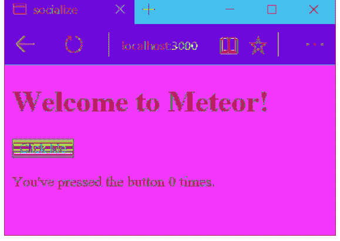

好吧，我还没编写任何代码，但我已经有了一个渲染HTML页面的本地数据库和服务器。开箱即用的页面除了点击按钮时增加一个计数器外，别无他用，但用不了多久就能让这个页面充满数据和功能。

### 3.3 那些文件是什么？

如前所述，目前构成我应用的共有三个文件。事实上，我完全可以用这三个文件编写整个应用。当然，出于维护目的，将它们拆开是个好主意，但这完全是可选的。

让我们看看这些文件。我们有：

-   `demos.html` 包含在客户端渲染的HTML；
-   `demos.js` 包含在服务器和/或客户端执行的代码，并可被HTML代码使用；
-   `demos.css` 是应用于你的HTML的CSS；

听起来很显然？很好！事实上确实如此，但我们刚刚忽略了Meteor的一个节省时间的特性：你可以在同一个文件中混合编写服务器**和**客户端代码。稍后会详细介绍。

### 3.4 Meteor在监听你的代码

见证一些魔法的时刻：如果我更改这些文件中的任何一个，结果会自动在几秒钟后出现在我的浏览器中。如果你从未使用过好的开发技术栈，这可能感觉不那么自然。

当我在命令行中输入`meteor`命令时，它不仅仅是构建应用并监听HTTP查询。它还会一直监听文件更改。当检测到更改时，它会再次构建应用，并向已连接的浏览器发送消息，让它们重新加载。

作为开发者，这意味着你所要做的就是更改你的文件，然后你的浏览器就会刷新。最棒的是，这在生产环境中同样有效：任何连接到你应用的浏览器，在你发布新版本时，都会自动刷新到最新版本。

### 3.5 HTML文件

让我打开`demos.html`文件。我们在里面看到了什么：

```
<head>
  <title>demos</title>
</head>

<body>
  <h1>Welcome to Meteor!</h1>

  {{> hello}}
</body>

<template name="hello">
  <button>Click Me</button>
  <p>You've pressed the button {{counter}} times.</p>
</template>
```

你可以看到三个基本元素：head、body和template。这些是HTML根节点下仅有的三个元素。template元素会被重复使用，但任何其他HTML元素都应该放在这三个元素之一之内。

让我们详细看看这三个元素。

#### head

当Meteor运行你的应用时，它会为你做很多事情，包括引用JavaScript和CSS文件，以及对它们进行打包和压缩。为此，它会定位head元素，并在其中添加指向这些生成资源的链接。


#### body

这是你放置首次呈现给用户的 HTML 内容的地方。当然，你可能觉得这是放置 HTML 元素最简单的地方，但那样会让维护工作变成一场噩梦。

既然你是一个追求代码整洁的开发者（我知道你是，因为你还在阅读），你就不会想在 `body` 元素里放置超过几行代码。之后，我们将主要用它作为路由引擎的显示容器。不过，嘿，我们不一定要用路由引擎才能保持整洁。所以我建议你在这里只使用对模板的引用。

我刚才说的是*模板*。是时候看看第三个元素了。

#### template

正如我所说，这个元素将会被重复使用。你可以创建任意多个模板，只要为每个模板分配一个不同的 `name` 属性即可。

然后，你可以在 `body` 元素或其他模板中，使用带有 `>` 元素的 mustache 语法来引用你的模板元素：

```
{{> templateName}}
```

> 好吧，这不是纯 HTML，我们添加了一些 *mustache* 语法。稍后会详细介绍。现在，先接受它。

#### body + template + template + ...

实际上，如果我们再次查看 `demos.html` 文件，可以看到这样的引用：

```
<body>
  ...
  {{> hello}}
</body>

<template name="hello">
  ...
</template>
```

这意味着名为 *hello* 的 `template` 元素的内容必须放入 `body` 元素中。这意味着我可以这样写：

```
<body>
  {{> header}}
  {{> someGreatInfo}}
  {{> footer}}
</body>
```

```
<template name="header">
  ...
</template>
```

```
<template name="someGreatInfo">
  ...
</template>
```

```
<template name="footer">
  ...
</template>
```

我也可以从一个模板内部引用另一个模板：

```
<body>
  {{> home}}
</body>
```

```
<template name="home">
  {{> latestNews}}
  ...
</template>
```

```
<template name="latestNews">
  ...
</template>
```

当然，我可以详细解释这个语法，但我会留到后面。现在，你已经学了很多新东西，是时候把它们付诸实践了。

### 3.6 轮到你编码了：动手实践

现在轮到你拿起键盘开始编码了。哦，让我先解释一下这是怎么回事，以防你不熟悉我的 *Learn* 系列书籍。

### 关于本书中的练习

所有的练习都是相互关联的：你将构建一个小型电子商务应用。你将允许用户浏览你的产品，将它们加入购物车，同时你还将创建一个完整的后端，让网站管理员能够列出、创建、修改和删除产品。

### 万一你卡住了

你应该能够独立解决练习。如果你卡住了或者手边没有电脑（或者你没有本书的先修知识，这没关系！），这里是解决方案。我会在本书每个练习之后提供所有练习的解决方案。

### 3.7 练习 - 创建应用

创建一个名为 meteorshop 的新 Meteor 应用。在页面中添加一个 `<h1>` 标题，内容为 “Shop in a hurry”。移除按钮和计数器。

你的应用应如下所示：

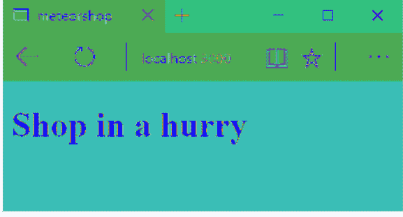

我知道，这很基础，但在你能做更多之前需要再学一些东西。初学者徽章已解锁：让我们进入下一关。

### 3.8 练习解答

- 打开命令行，导航到一个空的开发文件夹或创建一个。
- 在命令行中，输入 `meteor create meteor-shop`。
- 在命令行中，输入 `cd meteorshop`。
- 打开 `meteorshop.html` 文件。找到以下代码：

```
<body>
  ...
</body>
```

- 用以下代码替换它：

```
<body>
  <h1>Shop in a hurry</h1>
</body>
```

- 在命令行中，输入 `meteor`。
- 等待应用生成并运行。
- 打开你的浏览器并输入以下 URL：
  `http://localhost:3000`

## 4. Blaze, Spacebars 和响应式

### 4.1 Spacebars

mustache 或双花括号语法 {{ ... }} 是因为 Meteor 使用 Spacebars 作为视图引擎。

#### 如果我更喜欢 Angular 或 React 怎么办？

使用 Spacebars 不是强制性的，你可以使用其他视图引擎。有一些 Meteor 包允许你使用 Angular、Angular2、React 或 Knockout。

本书将坚持使用默认的 Spacebars 语法，因为它是开箱即用的。

#### Spacebars 基础

正如你所见，Spacebars 是强化版的 HTML。你可以插入三种主要类型的 Spacebars 块：

- `{{someValue}}` 将计算 `someValue` 并将其内容渲染为文本。稍后会详细介绍；
- `{{> templateName}}` 将插入一个名为 `templateName` 的模板，就像我们上面看到的；
- `{{#block}}你的 HTML 内容{{/block}}` 将插入一个名为 block 的模板，并将内部 HTML 提供给该模板。我们稍后会看到一些内置的块模板，比如 if 或 each。

### 4.2 数据从哪里来？

一旦进入 Spacebars 的花括号内，你经常会需要数据。考虑以下代码：

```
<div>You have {{messagesCount}} messages.</div>
{{#if hasMessages}}
  {{> messagesList data=messages}}
{{/if}}
```

在这段代码中，我们引用了三个值：messagesCount、hasMessages 和 messages。你必须提供这些值。Spacebars 会先在当前上下文中查找（稍后详述），然后作为辅助函数（helpers）查找。让我们看看辅助函数。

### 4.3 辅助函数 (Helpers)

在 JavaScript 文件中，我可以添加为视图提供数据的辅助函数。也就是说，这些数据可以从我的 HTML 文件中的 Spacebars 语法中访问。

为了提供一个值，我们只需使用以下语法：

```
Template.templateName.helpers({
  someValue: function() {
    return ...;
  },
  someOtherValue: function(param1, param2) {
    return ...;
  },
});
```

这些辅助函数在我的 HTML 文件中是现成可用的，所以我可以这样写：

```
<div>Here's a value: {{someValue}},
and another one: {{someOtherValue 'first param' 'second one'}}</div>
```

现在让我们再看看我之前的例子，这次编写辅助函数。

```
Template.messagesDisplay.helpers({
  messagesCount: function() {
    return 2;
  },
  hasMessages: function() {
    return true;
  },
  messages: function(param1, param2) {
    return ['Hello', 'Important message'];
  },
});
```

##### demos.html

```
<template name="messagesDisplay">
  <div>You have {{messagesCount}} messages.</div>
  {{#if hasMessages}}
    {{> messagesList data=messages}}
  {{/if}}
</template>
<template name="messagesList">
  <div>This one needs to be coded...</div>
</template>
```

### 4.4 客户端和服务器代码

你在 JavaScript 文件中编写的代码将在客户端和服务器端执行。这可能非常实用：Meteor 的高效性很大程度上源于我们可以将描述数据及其结构的代码共享在同一个地方，并让它在客户端和服务器端都执行。

但有时你的 JavaScript 代码应该只在服务器端或客户端执行。例如，我的模板需要只在客户端定义。有两种方法可以实现这一点。

#### 在服务器或客户端执行 - 在 JavaScript 中测试

你可以测试 `Meteor.isClient` 或 `Meteor.isServer` 的值，它们返回布尔值。

在这里，我确保我的模板只在客户端定义：

```
if(Meteor.isClient) {
  Template.messagesDisplay.helpers({
    ...
  });
}
```

#### 在服务器或客户端执行 - 使用文件夹

你可以在应用程序内部创建 `client` 和 `server` 文件夹，Meteor 会自动确保这些文件只在相应的端上被处理。

例如，这是确保我的模板只在客户端定义的第二种方法（注意文件名）：

```
Template.messagesDisplay.helpers({
  ...
});
```

不过，如果你想编写在客户端和服务器端都执行的代码，你可以将 JavaScript 文件放在根文件夹或一个不名为 `client` 或 `server` 的文件夹中。

你更喜欢哪种方式？这显然取决于你项目的规模。你可能希望有一个单独的 JavaScript 文件用于客户端代码，一个用于服务器端代码，或者为两者编写共享代码。你将看到，随着时间的推移，Meteor 鼓励你将共享代码分离出来，但同时也鼓励你将代码分离为仅限客户端或服务器端。这是一个权衡，你可以根据你的具体情况进行选择。

在小项目中，可以使用 `Meteor.isClient` 进行测试。但在较大项目中，将文件放在 `client` 和 `server` 文件夹中会更易于维护。

使用文件夹的另一个好处是，当你只修改 `client` 文件夹中的文件时，Meteor 构建应用的速度会比修改主文件夹或 `server` 文件夹中的文件更快。因此，使用文件夹也能加快代码审查的体验。

> 如果你的应用确实很大，你可以将 `client` 和 `server` 文件夹创建为子文件夹，同样的逻辑依然适用。这意味着你可以在应用的根目录下创建以功能命名的文件夹，并且在必要时，每个主文件夹都可以包含 `client` 和 `server` 子文件夹。

### 4.5 组织方式

实际上，你可以使用任意数量的文件。Meteor 会查找所有 HTML 和 CSS 文件中的 `template` 元素，无论它们位于根文件夹、`client` 子文件夹（或子子文件夹）中。

JavaScript 文件也是如此：Meteor 会合并你所有的 JavaScript。唯一的细节是，正如我们之前看到的，位于 `client` 文件夹中的 JavaScript 文件只会在客户端执行，而位于 `server` 文件夹中的文件只会在服务器端执行。任何其他 JavaScript 文件都将在客户端和服务器端同时执行。

### 4.6 练习 - 显示当前时间

又是有趣时刻：你将实践我们刚刚学到的内容。

和之前的练习一样，解决方案附在后面，以防你需要。但我打赌你不需要。

- 添加一个名为 "timeDisplay" 的新模板，用于显示当前时间。在 `body` 元素中引用 `timeDisplay` 模板。

你的应用应如下所示：

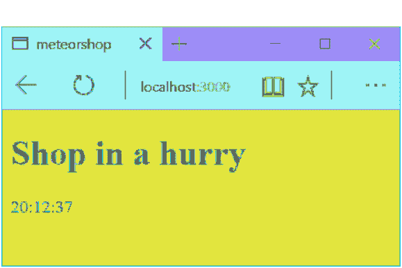

### 4.7 练习解决方案

- 保持浏览器打开，并让 meteor 命令行运行。
- 打开 meteorshop.html 文件。在文件末尾添加以下代码：

**meteorshop.html**

```
<template name="timeDisplay">
  {{currentTime}}
</template>
```

- 在 meteorshop.html 文件中，找到以下代码：

Blaze, Spacebars 和响应式 28

**meteorshop.html**

```
<body>
  <h1>Shop in a hurry</h1>
</body>
```

- 将该代码替换为以下代码：

**meteorshop.html**

```
<body>
  <h1>Shop in a hurry</h1>
  {{> timeDisplay}}
</body>
```

- 创建一个名为 `client` 的文件夹。在其中添加一个 `client.js` 文件。
- 打开 `client/client.js` 文件。添加以下代码：

client/client.js

```
Template.timeDisplay.helpers({
    currentTime: function() {
        var now = new Date();
        return now.toLocaleTimeString();
    }
});
```

- 切换回浏览器并查看结果：
  http://localhost:3000

### 4.8 响应式

#### 一个例子

现在，我敢肯定你在想：让时间自动刷新怎么样？的确，那会很好。因为我们应用中显示的时间已经过时了。

我有个好消息：Meteor 以非常优雅的方式处理了这个问题，就像其他高效的框架一样：你在 JavaScript 中更新值，HTML 就会自动刷新。

如果你使用过 Angular 或 Knockout 等框架，你已经习惯了那种让程序员工作变得更轻松的“魔法”。Meteor 更进一步，因为它可以在服务器上的内容发生变化时自动刷新 HTML。事实上，它甚至可以在数据库中的内容发生变化时刷新 HTML！

目前，我们没有任何数据库，并且是在客户端编码。所以它不会令人印象深刻。但请相信我，几段之后，我们将使用更简单的代码来实现从数据库到浏览器的数据自动刷新。

让我打开你的 `client/client.js` 文件，并将以下代码：

```
Template.timeDisplay.helpers({
    currentTime: function() {
        var now = new Date();
        return now.toLocaleTimeString();
    }
});
```

替换为以下代码：

client/client.js

```
Meteor.setInterval(function() {
  var currentDate = new Date();
  Session.set('now',
    currentDate.toLocaleTimeString()
  );
}, 1000);

Template.timeDisplay.helpers({
  currentTime: function() {
    return Session.get('now');
  }
});
```

让我们保存它。如果我再次查看浏览器，我可以看到时间在刷新。同样，你可能对此印象不深，因为用更少行的 jQuery 或纯 JavaScript 也能实现相同的功能。这是因为我的例子太简单了，结果对于 Meteor 来说过于简单，无法展现其优势。

然而，你已经可以看到我们代码中一个非常有趣的地方：`currentTime` helper 并没有声明它必须刷新。它所做的只是从一个“Session”中获取某个值并返回。代码中一个完全不同的部分正在定期更新那个“Session”值。

#### Session 是一个客户端存储

Session 是一个存储键值对的地方。它是全局的：存储在客户端，并对整个应用可用。

要存储一个值，你可以这样写：

```
var myObject = {
  A: 'my value',
  B: 5
}
Session.set('someKey', myObject);
```

然后在其他地方使用以下代码检索该值（注意键 `someKey` 与存储数据时使用的键相同）：

```
var storedValue = Session.get('someKey');
console.log(storedValue.A); // 打印 'my value'
```

#### Session 是一个响应式源

使用 `Session.get` 读取 session 值的代码将在该值发生变化时被重新评估。当然，代码被重新评估有一些条件（这完全取决于它被调用的位置），但 helper 中的代码满足这个条件。这就是 Meteor 所说的响应式。

在上面的例子中，一旦我将新的时间值写入 session，`timeDisplay` helper 就会被重新评估，并将其值插入到声明了 `{{timeDisplay}}` 的 HTML 中。

响应式将为我们节省大量样板代码：只要我们使用响应式数据，我们只需要更新数据，相关的 UI 就会自动更新。

#### 还有更多响应式源

Session 只是众多响应式源之一。还有更多响应式源，以下是一些：

- ReactiveVar，你可以实例化它来存储任何值。
- 数据库查询，我们稍后会看到，用于存储来自数据库的数据。
- Meteor.user，它保存有关当前用户的信息。
- Meteor.status，它保存有关客户端-服务器连接的信息。

Meteor 包将为你提供其他响应式源。

### 4.9 可用的块

正如我们所看到的，除了你可以自己定义的模板之外，Spacebars 中还有几个内置的块模板。让我们来看看它们。

#### if

这个块只在条件为真时才会显示其包含的内容。例如：

```
<h1>Comments</h1>
{{#if comments}}
    <div>{{comments.length}} comments</div>
{{else}}
    <div>No comment yet.</div>
{{/if}}
```

注意 else 块是可选的。记住：这一切都是响应式的。你在 Blaze HTML 代码中使用的 helper 变量是响应式的。这意味着 if 块会在 comments 值发生变化的任何时刻显示或隐藏。

另外，有一个方便的 unless 块。它的工作方式与 if 块完全相同，只是当条件为真时块会隐藏——与 if 块完全相反。我们可以这样重写上面的示例：

```
<h1>Comments</h1>
{{#if comments}}
    <div>{{comments.length}} comments</div>
{{/if}}
{{#unless comments}}
    <div>No comment yet.</div>
{{/unless}}
```

#### each

each 块会根据需要重复其内容多次。你为它提供一个集合，包含的块就会根据元素的数量插入相应次数。

使用 `each` 块有两种方式：隐式和显式。考虑以下示例：

#### 两个示例的 Javascript

```
Template.commentsIndex.helpers({
  comments: function() {
    return [
      { title='Some comment', author='Jane' },
      { title='Another one', author='Ted' }
    ];
  }
});
```

然后我们有两种使用方法：

#### 隐式 each

```
<h1>Comments</h1>
<ul>
{{#each comments}}
  <li>{{title}} - by {{author}}</li>
{{/each}}
</ul>
```


#### 显式 each

```
<h1>Comments</h1>
<ul>
  {{#each comment in comments}}
    <li>{{comment.title}}
      - by {{comment.author}}</li>
  {{/each}}
</ul>
```

两种方式产生相同的结果：都显示两条评论。区别在于，第一种方式改变了内部块（这里是 `<li>`）求值时所依据的数据上下文。

使用第一种方式时，内部块的数据上下文是当前正在被复制的那个特定评论对象。这就是为什么我们在双花括号内只写了 `title`：因为数据上下文是一个评论对象，我们指的是当前评论对象的 `title` 属性。在内部块内部，我不能再引用 `comments` 对象了，因为它属于父级上下文。

相反，使用第二种方式时，内部块的数据上下文与父级数据上下文保持相同。只有 `comment` 变量包含了当前评论。

乍一看，隐式语法因其更简单而颇具吸引力。问题在于，你从内部块中失去了引用父级上下文的能力，这在实际应用场景中常常会成为限制。

考虑对上面示例的修改：

#### 隐式 each - 不可用

```
<h1>Comments</h1>
<ul>
  {{#each comments}}
    <li>{{title}} - by {{author}}
      (out of comments.length comments)</li>
  {{/each}}
</ul>
```

#### 显式 each - 正确

```
<h1>Comments</h1>
<ul>
  {{#each comment in comments}}
    <li>{{comment.title}}
      - by {{comment.author}}
      (out of comments.length comments)</li>
  {{/each}}
</ul>
```

这不是一个真实的示例，因为我希望我的示例保持简单。然而，请尝试使用两个嵌套的 `each` 语句来生成一个动态列的表格，如果你选择隐式语法，你就会陷入困境。

我推荐哪种方式？我想很明显，除了最简单的视图之外，显式语句更强大、更易于维护，甚至更具可读性。

#### 还有一些

还有其他块，你也可以定义自己的块。例如，`let` 块允许你在数据上下文中定义一个新变量。作为开发者，你知道最重要的工具是循环和条件执行，而这正是 `each` 和 `if` 块提供的功能。让我们保持简单：现在我们已经了解了必要的块。

### 4.10 模板事件

我们现在能够显示内容，并且是以一种响应式的方式显示。这意味着我们的用户将始终看到最新的信息。那么，如果他们能与这些信息交互，岂不是更好？好吧，这不仅仅是好，而且是必要的：如果我们无法让用户对其数据采取行动，那我们不如现在就去找另一份工作。

对于用户交互，我们可以像编写辅助函数一样编写事件处理器。辅助函数用于显示信息，事件用于用户交互。假设我想向用户显示一条消息，并在用户点击按钮时更改它。这是 HTML（嗯，Blaze HTML）：

#### client/timeDisplay.html

```
<template name="messageDisplay">
  <p>Message: {{sessionMessage}}</p>
  <button>Be nice</button>
</template>
```

我的消息将存储为一个会话变量，以便它具有响应性。这是返回该会话值的辅助函数：

#### client/timeDisplay.js

```
Template.messageDisplay.helpers({
  sessionMessage: function() {
    return Session.get('message');
  }
});
```

现在，我希望消息在用户每次点击按钮时都发生更改。所以我只需为它添加一个事件处理器：

#### client/timeDisplay.js

```
Template.messageDisplay.helpers({
    ...
});

Template.messageDisplay.events({
    'click': function () {
        Session.set('message', 'Hello!');
    }
});
```

这个事件处理器告诉 Meteor，每当从 `messageDisplay` 模板触发一个 `click` 事件时，就执行函数内部的代码。我编写的代码更改了一个会话变量，因此依赖于该会话变量的 `sessionMessage` 辅助函数会重新求值，HTML 也会随之更新。

这是用户在浏览器中看到的：

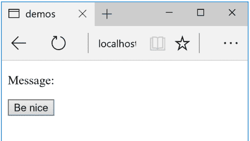

这是点击按钮后他们看到的：

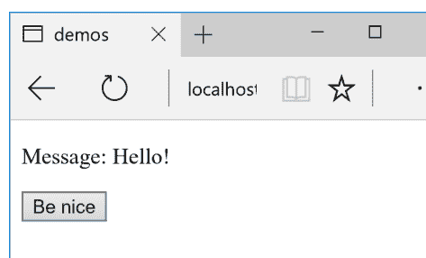

那么，添加第二个按钮怎么样？如果我这样做，两个按钮都会触发 `click` 事件，所以我需要一种区分它们的方法。幸运的是，事件处理器接受 CSS 选择器。因此，我可以为我的 HTML 元素添加 `id` 或 `class`，并在事件处理器选择器中使用它。我个人更喜欢使用 `class`，因为 `id` 不能重复。而且谁知道呢：我的模板以后可能会在同一个页面中多次使用。

所以这是我更新后的 HTML，包含两个按钮和 CSS 类：

#### client/timeDisplay.html

```
<template name="messageDisplay">
  <p>Message: {{sessionMessage}}</p>
  <button class="nice">Be nice</button>
  <button class="cute">Be cute</button>
</template>
```

以及更新后的事件处理器：

#### client/timeDisplay.js

```
Template.messageDisplay.helpers({
  ...
});

Template.messageDisplay.events({
  'click .nice': function () {
    Session.set('message', 'Hello!');
  },
  'click .cute': function () {
    Session.set('message', 'I love you.');
  }
});
```

现在每个按钮显示不同的消息。
当然，你可以为一个模板添加任意数量的事件处理器，通过事件名称和 CSS 选择器来区分它们。更重要的是，当你编写事件处理器时，你的函数可以接收事件作为参数。更多信息请参阅 Meteor 文档<sup>1</sup>。

### 4.11 数据上下文

如前所述，在 Blaze 语法中引用一个字段时，它会在当前数据上下文和辅助函数中查找。例如，以下代码将在当前数据上下文中查找 `title` 字段：

```
<p>You are looking at {{title}}.</p>
```

数据上下文可以使用以下几种工具提供：

+   - *each* 和 *with* 块，它们改变当前数据上下文；
- *each* .. *in* 和 *let* 块，它们向当前数据上下文添加字段；
- 模板代码（*onCreated, onRendered*），你可以在其中使用 *this* 字段（指向当前模板实例）向数据上下文添加字段。

<sup>1</sup>http://docs.meteor.com/api/templates.html#eventmaps

# # 我需要你，超级英雄！

非常感谢你阅读这本书。我确实希望它能帮助你理解并建立对 Meteor 的信心。

作为一名读者，你某种程度上也是一位超级英雄：你获得了使用 Meteor 创建 Web 应用程序的力量，并让网络变得更好。

猜怎么着？你还有另一种超能力：在你购买这本书的网站上为它评分。你可能觉得这没什么，但对于像这样自动出版的书籍来说，这超级重要。请花几分钟宝贵的时间为本书评分。

作为感谢，我想向你提供我即将出版的新书。只需给我发送一封电子邮件至 books@aweil.com，并附上你的评分链接，你就能在出版之前免费获得我的下一本书。以及我所有的感激之情。

# # 5. 管理来自 MongoDB 数据库的数据

### 5.1 什么是 MongoDB？

我们将要编写一个应用程序，对吧？大多数应用程序需要以一种持久化的方式在某个服务器上存储数据，并且这些数据可以被所有用户共享。Meteor 为此选择了包含 MongoDB，据报道正在研究包含其他数据库引擎。

MongoDB 作为一种 *no-SQL* 数据库引擎非常受欢迎。使其如此受欢迎的原因之一是它使用一种非常接近 JSON 的文档格式。

默认情况下，MongoDB 不会强制你使用任何模式，因此你可以根据需要简单地存储和读取数据。这对于尽快让应用程序准备就绪非常有利。

当然，你可能需要一些你的数据应该遵守的模式。别担心：这部分内容将由 Meteor 轻松而广泛地涵盖，正如你将在[本书后面](#)学到的那样。

### 5.2 集合

在 MongoDB 数据库中，你定义集合，它们非常类似于关系数据库中的表。只是集合可以包含具有不同结构的对象，并且这些对象可以具有对象或数组属性。如果你想感觉自己在使用关系数据库，只需确保给定集合中的每个对象具有相似的属性即可。

Meteor 对 MongoDB 提供了无缝支持，我们很快就会学习。但是，你始终可以从命令行直接访问 MongoDB 数据库。

在我的命令行中，我可以输入以下内容：

```
meteor mongo
```

现在我所有的命令都发送到 MongoDB Node.JS 引擎，因此我可以发出直接的 JavaScript 命令来管理数据库。例如，让我们向一个名为 `books` 的集合中添加一个描述书籍的对象：

```
db.books.insert({
    title: 'Learn METEOR',
    bought: true
});
```

此语句在集合不存在时创建它，并将对象添加到其中。

你可能会觉得，学习如何直接向 MongoDB 引擎发出命令是多余的。特别是我们还想快速学习 Meteor 的情况下。这种想法可不对。确实，我们通常不必手动执行那些命令，但这并不是在浪费时间：Meteor（几乎）接受与 MongoDB 相同的命令，无论是在客户端还是服务器端。这意味着我们不仅在学习 MongoDB，同时也在学习 Meteor。我有没有说过我爱 Meteor？哦，说过了。

那么，我们来写一条查询语句，检查这本书现在是否已成为 MongoDB 数据库的一部分（技术上讲，就是我们向 `books` 集合添加了一个文档）。查询语句如下：

```
db.books.find({});
```

这条语句会返回数据库中所有的书籍。它相当于 MongoDB 版的 SQL `SELECT`。

### 5.3 练习 - 在 MongoDB 中手动创建一个新闻集合

终于轮到你来实践了。我猜你已经摩拳擦掌、迫不及待地想写代码了，所以请原谅我讲了这么多理论。这部分是因为你在进行这个练习之前需要具备这些背景知识……也部分是因为我真的很喜欢谈论 Meteor。

打开一个 Meteor MongoDB 命令行，创建一个名为 `news` 的集合，其中包含以下文档：

`{ title: 'Site just opened!' }`

`{ title: 'Special offers today.' }`

查询 `news` 集合，确保你的操作正确。你应该会看到如下显示（ObjectID 值会不同）：

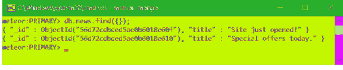

### 5.4 练习解答

-   保持浏览器打开，`meteor` 命令行正在运行。
-   打开一个新的命令行，进入你的应用文件夹。
-   输入以下命令：

```
meteor mongo
```

-   在出现的 MongoDB 命令行中，输入以下代码：

```
db.news.insert({ title: 'Site just opened!'} );
db.news.insert({ title: 'Special offers today.'} );
```

-   在同一个命令行中，输入以下代码：

```
db.news.find({});
```

-   确保该命令显示的结果中出现了这两个对象。

### 5.5 Mongo.Collection

现在我们来看看 Meteor 中最节省时间的功能之一。在开发传统的客户端-服务器应用时，你必须编写服务器代码来访问数据源，将其暴露给客户端（即编写一个 API），然后在客户端调用那个 API。你必须跟踪客户端上的变更，将其提交给服务器（又是 API），并编写服务器代码将这些变更推送到数据源。此外，你可能还需要编写代码来检测数据源中的变更并将其推送到客户端。

Meteor 采用了一种默认方式，只要创建了 `Mongo.Collection`，它就会完成所有这些工作。这意味着需要编写和维护的代码更少，你可以有更多时间去度假、陪孩子玩乐，或者玩你喜欢的那款很棒的 MMORPG 游戏。

基本上，你创建一个 `Mongo.Collection`，查询它，Meteor 就会处理好使其工作所需的一切。这意味着只需编写两行代码：

```
Books = new Meteor.Collection('books');

var allBooks = Books.find({});
```

实际上，这两行简单的代码有几个效果：

-   使你在服务器端可以访问该集合。
-   在客户端创建一个 MiniMongo 数据库。MiniMongo 在客户端保存查询结果，并提供与 MongoDB 数据库（几乎）相同的接口。
-   确保 MiniMongo 数据库与服务器端的 MongoDB 数据库保持同步：查询结果的任何更改都会被推送到客户端。

在 Meteor 中，这个（以及其他）集合的数据管理架构如下所示：

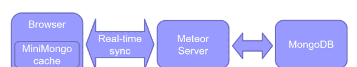

记得我在“集合”章节中创建了一个 `books` 集合吗？我将在我的应用中展示它。

为了让客户端和服务器知道这个集合，我只需要创建一个 `Meteor.Collection`。为了让集合在模板中显示，我会添加一个辅助函数。以下是完整的 JavaScript 代码：

```
demos.js
Books = new Meteor.Collection('books');

if (Meteor.isClient) {
  Template.books.helpers({
    books: function () {
      return Books.find({});
    }
  });
}
```

第一行代码在客户端和服务器端都会执行。它确保双方都能访问存储在 MongoDB 数据库中的 `books` 集合。然后，我们创建了一个模板辅助函数，将所有的书作为一个“books”变量暴露在上下文中。注意，我们使用了 MongoDB 接受的 `find()` 方法，语法相同。

现在，我们可以编写 HTML 了：

```
demos.html
<template name="books">
    <ul>
        {{#each book in books}}
        <li>{{book.title}}</li>
        {{/each}}
    </ul>
</template>
```

结果如下：

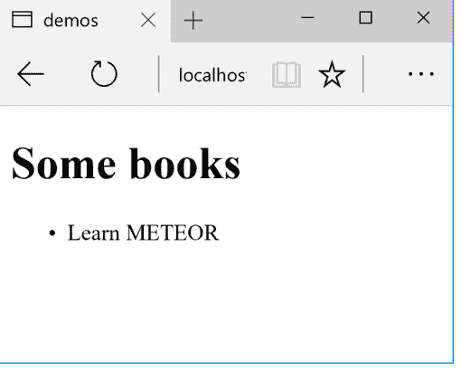

现在到了最棒的部分：这段简单的代码从服务器到客户端完全是响应式的。这意味着我不需要做任何事情，就能让已连接的浏览器显示 `books` 集合中的任何更改。别光听我说，让我演示一下。

我将打开一个命令行，输入：

```
meteor mongo
```

```
db.books.insert({
  title: 'Learn WebSockets',
  bought: false
});
```

让我们切回浏览器。我甚至不需要刷新它。显示如下：

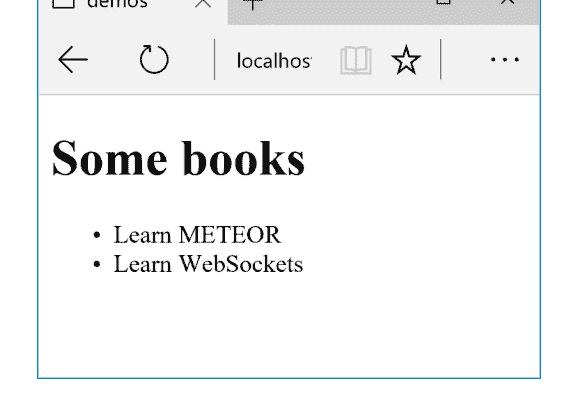

是的，插入的书出现了。每当我们查询一个 `Mongo.Collection` 时，Meteor 会确保查询结果在服务器和客户端之间实时同步。它为此使用了 WebSocket。在内部，Meteor 的 *DDP* 协议用于将变更推送给客户端。

这真是个好消息。我告诉过你 Meteor 让我们效率很高，我希望你在阅读本书的过程中能更清楚地感受到这一点。这是一个很好的例子：仅使用基础代码，我们无需付出额外努力，就能在所有连接的客户端之间实现实时同步。只需想一秒钟，编写像聊天或协作这样的实时应用有多容易：一个客户端上的更改会反映到服务器和所有连接的客户端上。既巧妙又省力。

### 5.6 练习：显示新闻


添加一个名为“news”的新模板，显示你在上一个练习中创建的 `news` 集合中的所有新闻。在 *body* 元素中引用 `news` 模板。

你的应用应该如下所示：

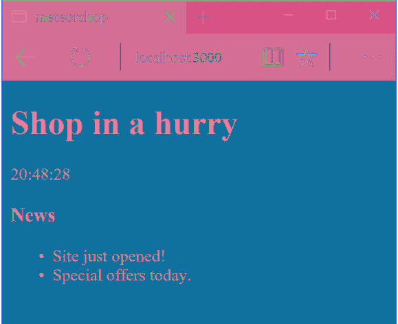

### 5.7 练习解答

-   保持浏览器打开，`meteor` 命令行正在运行。
-   打开 `meteorshop.js` 文件。添加以下代码：
-   打开 `client/client.js` 文件。添加以下代码：

```
meteorshop.js
News = new Mongo.Collection('news');
```

```
client/client.js
Template.news.helpers({
    news: function () {
        return News.find();
    }
});
```

-   在 `client` 文件夹中添加一个 `news.html` 文件。添加以下代码：

```
client/news.html
<template name="news">
    <h3>News</h3>
    <ul>
        {{#each news}}
        <li>{{title}}</li>
        {{/each}}
    </ul>
</template>
```

-   在 `meteorshop.html` 文件中，找到以下代码：

```
meteorshop.html
<body>
  <h1>Shop in a hurry</h1>
  {{> timeDisplay}}
</body>
```

-   将其替换为以下代码：

```
meteorshop.html
<body>
  <h1>Shop in a hurry</h1>
  {{> timeDisplay}}
  {{> news}}
</body>
```

切回你的浏览器，确保新闻已经显示出来。

### 5.8 查询选择器

为了获取我示例中的书籍，我写了以下语句：

```
Books.find({});
```

也就是说，我使用了 `Mongo.Collection` 类的 `find` 方法。此命令返回集合中的所有文档。第一个参数是一个查询选择器。

> 查询选择器在任何需要使用 MongoDB 引用某些文档的地方都会用到。它们大致相当于 SQL 语句中的 WHERE 部分。我们稍后在更新数据时会用到它们。

选择器是一个 JavaScript 对象。默认的空选择器是 {}，表示集合中的所有文档。让我们学习如何进一步细化我们的查询。由于我们向 Books 集合添加了 title 和 bought 字段，我们可以使用这些字段进行查询。

假设我们只想获取已经购买的书籍。我们可以使用以下查询：

```
Books.find({
    bought: true
});
```

如果我们想要那些标题是“Diet”且尚未购买的书，我们可以这样写：

```
Books.find({
    title: 'Diet',
    bought: false
});
```

正如你所知，MongoDB 是一个无结构数据库，即使 Books 集合中的某些文档没有这些字段，我们也可以使用这个选择器。


### 5.9 使用 Mongo.Collection 更新数据

`Mongo.Collection` 类提供的更新方法与 MongoDB 几乎相同。你肯定记得，为了添加一本书，我曾直接连接到数据库命令行界面并输入：

```
db.books.insert({
  title: 'Learn METEOR',
  bought: true
});
```

现在，得益于 Meteor，我可以在客户端或服务器端编写以下 JavaScript 代码：

```
Books.insert({
  title: 'Learn METEOR',
  bought: true
});
```

在客户端运行时，它实际上会先将这本书添加到客户端的集合缓存中（这使其即时生效），然后再添加到 MongoDB 中的服务器集合，接着将服务器端的任何更改同步回客户端，从而让客户端能够考虑到服务器端可能发生的任何变化。

以下是可用（及其他）的一些方法：

*   `insert(document)` 在集合中插入一个新文档，并返回其 ID；
*   `remove(selector)` 从集合中移除所有匹配给定选择器的文档；
*   `update(selector, modifier)` 使用给定的修改器，更新集合中所有匹配给定选择器的文档。

对于 `update` 方法，修改器是一个 MongoDB 修改器，或者是一个文档。修改器包含 `$` 字段，而文档则不包含。如果你提供的是一个文档，它会完全替换现有的文档。修改器则允许你仅指定对匹配文档需要进行的部分更新。

假设我想将所有价格低于 10 的书的价格提高到 15。我可以编写：

```
Books.update(
    { price: { $lt: 10 } },
    { $set: { price: 15 } }
);
```

> 在客户端，使用 *insert*、*update* 和 *remove* 方法能执行的更新是有限制的。这些限制可以通过 *Mongo.Collection* 类的 *allow* 和 *deny* 方法来部分解除。你可以在[手册](http://docs.meteor.com/api/collections.html#Mongo-Collection-allow)中了解更多相关信息。

### 5.10 练习：启用添加新闻功能

在名为 "news" 的模板内，在一个 `form` 元素内添加一个新的 `input` 元素。当用户输入文本并按下回车键时，确保将一个新的文档添加到 `news` 集合中，其中 `title` 字段对应于输入的文本。

你的应用应该如下所示：

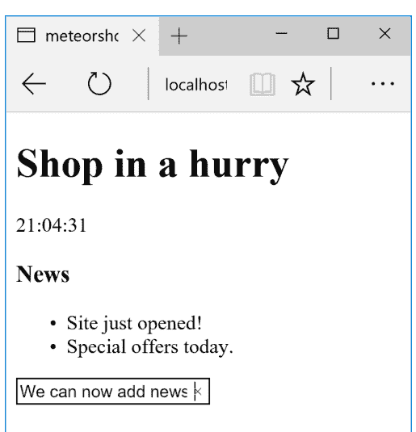

### 5.11 练习解答

*   保持浏览器打开，并让 `meteor` 命令行继续运行。
*   在 `client/news.html` 文件中，找到以下代码：

**client/news.html**

```
<template name="news">
  <h3>News</h3>
  <ul>
    ...
  </ul>
</template>
```

*   将其替换为以下代码：

**client/news.html**

```
<template name="news">
  <h3>News</h3>
  <ul>
    ...
  </ul>
  <form>
    <input type="text" name="title" placeholder="Title" />
  </form>
</template>
```

*   打开 `client/client.js` 文件。添加以下代码：

**client/client.js**

```
Template.news.events({
  'submit form': function (e) {
    e.preventDefault();
    var title = e.target.title.value;
    News.insert({title: title, created: new Date()});
  }
});
```

切换回你的浏览器，确保你可以在新创建的输入框中输入并添加一些新闻。

> **Meteor 的魔法**
>
> 正如你已经知道的，Meteor 确保服务器端的任何更改都会推送到所有连接的客户端。但不要只听我说：你现在就可以验证这一点。
>
> 使用以下 URL 打开两个浏览器窗口：
> *http://localhost:3000*
>
> 在其中一个窗口中添加一条新闻，它应该会立即出现在另一个窗口中。很棒，不是吗？即使你将该应用部署到远程服务器，它的工作方式也完全相同。

### 5.12 练习：启用用户删除新闻功能

在名为 "news" 的模板内，在每条新闻旁边添加一个按钮。当用户点击该按钮时，应从数据库中删除对应的新闻。

你的应用应该如下所示：

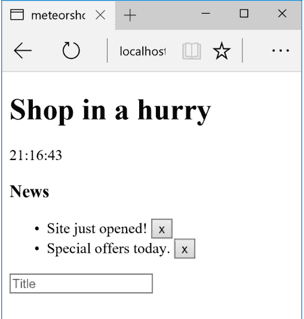

### 5.13 练习解答

*   保持浏览器打开，并让 `meteor` 命令行继续运行。
*   在 `client/news.html` 文件中，找到以下代码：

**client/news.html**

```
<li>{{title}}</li>
```

*   将其替换为以下代码：

**client/news.html**

```
<li>{{title}} <button class="removeAction">x</button></li>
```

*   完整的新闻模板现在应如下所示：

**client/news.html**

```
<template name="news">
    <h3>News</h3>
    <ul>
        {{#each news}}
            <li>{{title}} <button class="removeAction">x</button></li>
        {{/each}}
    </ul>
    <form>
        <input type="text" name="title" placeholder="Title" />
    </form>
</template>
```

*   打开 `client/client.js` 文件。找到以下代码：

**client/client.js**

```
Template.news.events({
  'submit form': function (e) {
    ..
  }
});
```

*   将其替换为以下代码：

**client/client.js**

```
Template.news.events({
  'submit form': function (e) {
    ..
  },
  'click .removeAction': function(e, a) {
    News.remove({_id: this._id});
  }
});
```

切换回你的浏览器，确保你可以通过点击新闻右侧的按钮来删除新闻。

## 6. 包：管理面板、导航、验证、表单生成

### 6.1 什么是包

到目前为止，我们一直在手动为应用编写代码。Meteor 让这部分工作变得快速而轻松，但如果你现在停止阅读，你会发现自己在大多数应用中都在重复类似的代码。

为输入创建用户界面、验证数据、处理导航、跟踪以及许多其他任务，并不是某个特定应用所独有的。它们的代码可以被提取并重用到**包**中。

你可能已经听说过在 JavaScript 社区中著名的 npm 包管理器。既然 Meteor 是关于 JavaScript 的，我们当然可以使用 npm 并访问其活跃且广泛的包生态。这很棒，然而 Meteor 也有自己的包管理器，它提供了专门为 Meteor 编写的包。Meteor 特定包的优势在于，它们了解并受益于使 Meteor 如此高效的**所有工具**：客户端同步的数据库缓存、同构代码、认证以及许多其他 Meteor 预设。

Meteor 的包管理器是 Atmosphere。它由一个网站组成，并作为 Meteor 命令行的一部分集成。

> Atmosphere 最终将被逐步淘汰，转而支持 npm。正如 Meteor 指南[所述](https://guide.meteor.com/atmosphere-vs-npm.html)：
>
> 随着 1.3 版本的发布，Meteor 已完全支持 npm。未来，所有的包都将迁移到 npm，但目前两种系统各有利弊。

然而，就目前而言，Atmosphere 是一个推荐的工具，因为它既易于使用又高效。

[https://guide.meteor.com/atmosphere-vs-npm.html](https://guide.meteor.com/atmosphere-vs-npm.html)

### 6.2 搜索和安装包

搜索包是使用 [Atmosphere 网站](https://atmospherejs.com/)完成的：

[https://atmospherejs.com/](https://atmospherejs.com/)

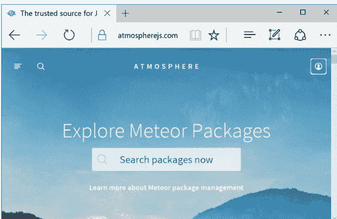

假设我需要为我的集合创建一个用于 CRUD 操作的 REST API。有几个包可以实现这一点。值得庆幸的是，Atmosphere 显示了每个包的星标数和安装次数。选择包时另一个有用的信息是项目活跃度（在包页面上）：它最后一次更新是什么时候，是否定期更新？快速搜索让我找到了 *nimble:restivus* 这个包：


软件包：管理仪表板、导航、验证、表单生成

72

一旦找到某个软件包，你只需通过命令行添加它。例如，如果我想使用 `nimble:restivus` 软件包，我只需输入以下命令：

```
meteor add nimble:restivus
```

你可以让你的 Meteor 应用保持运行状态，同时打开一个新的命令行来输入该命令。

只需确保当前目录是你的应用程序目录即可。

现在来看看一些常用的软件包。这将帮助你熟悉 Meteor 软件包带来的生产力提升，一旦面临常见任务，你很快就会发现自己会在 Atmosphere 上搜索合适的软件包。

### 6.3 后台管理

我们的应用程序中会有多个集合。虽然最终用户界面将允许与集合进行大多数常见的交互操作，但如果有一个工具能通过一个美观的图形界面来执行所有 CRUD 操作，那将是极好的。管理类软件包正是为此而生的。

例如，*houston:admin* 软件包仅通过安装就能为我们提供一个精美的管理界面。它与 Meteor 的用户管理功能挂钩，这反过来又使我们能够将其与几乎任何用户认证方式或默认集合集成。

*houston:admin* 软件包无需配置，但必要时可以根据你的需求进行定制。使用它是一个简单的过程：

1.  通过输入 `meteor add houston:admin` 添加它
2.  导航至 `http://localhost:3000/admin` 页面
3.  创建一个账户并授予其管理员权限

> 如果你使用另一个账户管理软件包或者已经创建了用户，系统会简单地提示你确认是否要将当前用户设为管理员。

### 6.4 练习：为数据管理创建后台

将 *houston:admin* 软件包添加到你的应用程序中。创建一个用户并授予其管理员权限，以便你可以访问管理页面。确保你能使用管理页面来创建、更新和删除新闻条目。

你的管理页面应如下所示：

### 6.5 练习解答

- 保持浏览器打开，并且 `meteor` 命令行在运行。
- 打开另一个命令行，导航到你的应用程序目录，然后输入：

```
meteor add houston:admin
```

- 一旦显示 "houston:admin: A zero-config Meteor Admin" 消息，关闭最近打开的命令行。
- 在你的浏览器中，导航至以下 URL：`http://localhost:3000/admin`
- 按照提示创建一个管理员用户账户：填写字段并点击“Create account”按钮。
- 点击屏幕左侧的“news”链接。
- 双击某条新闻的标题并进行修改。
- 点击页面右上角的“New news”按钮，创建一条新闻。

### 6.6 导航

你的应用程序很可能由多个页面组成。这些页面应该可以通过不同的 URL 访问。此外，在显示页面之前，客户端可能需要某些数据。例如，你可能希望在新闻加载时，在主页显示之前先显示一个进度消息。

路由软件包负责处理此事。Meteor 有几个可用的路由软件包，其中之一是 *iron:router*。它支持客户端或服务器端路由。

首先，我们当然需要使用命令行添加该软件包：

```
meteor add iron:router
```

路由告诉 iron router 根据传入的 URL 显示什么内容。它们在客户端和服务器端的 JavaScript 文件中描述，因此你可以将它们添加到根文件夹中的 routes.js 文件中。

在最简单的形式中，你可以为给定路由渲染一个模板。在我之前的示例中，我有名为 messagesDisplay 和 messagesList 的模板。假设我希望 messagesList 显示在应用程序的根页面，而 messagesDisplay 通过 http://localhost:3000/message URL 可用。我可以这样写：

```
Router.route('/', function () {
  this.render('messagesList');
});

Router.route('/message', function () {
  this.render('messagesDisplay');
});
```

现在，我们可以使用 HTML 链接或 JavaScript 导航到这些 URL：

**HTML 导航**

```
<a href="/message">查看一条消息</a>
```

#### JavaScript 导航

```
Router.go('/message');
```

messagesDisplay 模板可能期望一个参数来说明它应该显示哪条消息。路由可以包含参数，render 函数可以将数据添加到模板的数据上下文中。因此，例如，我可以这样重写 /message 路由：

```
Router.route('/message/:id', function () {
    var id = this.params.id;
    this.render('messagesDisplay',
        { data: { id: id } }
    );
});
```

默认情况下，应用程序的主体内容将显示在每个页面上。但你可以提供一个通用的布局作为模板。这很简单。只需创建你的布局作为一个模板，然后配置 iron router 使其用于所有路由，或者在每个路由中选择布局。别忘了移除 `body`（模板标签之外的任何 HTML）。

例如，以下是为所有页面配置的布局和代码。布局应包含一个 yield 指令，指明页面渲染发生的位置。

#### 在任何 HTML 文件中

```
<template name="mainLayout">
  <h1>我的超棒应用</h1>

  <div class="mainContent">
    {{> yield}}
  </div>

  <div class="footer">
    版权所有。
  </div>
</template>
```

#### routes.js

```
Router.configure({
  layoutTemplate: 'mainLayout'
});
```

更多关于 iron router 的信息可以在 iron router 指南[^2]中找到。

[^2]: http://iron-meteor.github.io/iron-router/

### 6.7 练习：启用路由并创建布局

将 `iron:router` 软件包添加到你的应用程序中。配置以下路由：

| 路径 | 模板 |
| --- | --- |
| / | news |
| /time | time |

删除 `body` 元素并创建一个包含以下链接的头部的布局：

| 路径 | 标题 |
| --- | --- |
| / | Home |
| /time | Time |

在头部，还要添加一个指向你之前创建的管理页面的链接。
主页应如下所示：

### 6.8 练习解答

- 将你的浏览器指向 http://localhost:3000。
- 保持浏览器打开，并且 meteor 命令行在运行。
- 打开另一个命令行，导航到你的应用程序目录，然后输入：

```
meteor add iron:router
```

- 找到以下代码：

#### meteorshop.html

```
<body>
    <h1>Shop in a hurry</h1>
    ...
</body>
```

- 将其替换为：

#### meteorshop.html

```
<body>
</body>
```

- 在 `client` 文件夹中添加一个 `layout.html` 文件，内容如下：

#### client/layout.html

```
<template name="layout">
  <div>
    <a href="/">Home</a>
    <a href="/time">Time</a>
    <a href="/time">Admin</a>
  </div>
  <div>
    {{>yield}}
  </div>
</template>
```

- 在你的应用程序根文件夹中创建一个 `routes.js` 文件，并将以下代码添加到其中：

#### routes.js

```
Router.configure({
  layoutTemplate: 'layout'
});

Router.route('/', function () {
  this.render('news');
});

Router.route('/time', function () {
  this.render('timeDisplay');
});
```

- 切换回你的浏览器，尝试使用顶部的两个链接导航应用程序。

### 6.9 模式、验证

使用 Meteor 时，我们将数据库暴露给了最终用户。基本的安全考虑使得有必要确保最终用户无法通过其数据输入来破坏系统。例如，目前你的应用程序可能容易受到脚本注入和其他几种危险的影响。

此外，MongoDB 是一个无模式数据库，这使得向其添加非结构化文档成为可能，


包：管理后台、导航、验证、表单生成

集合。虽然这可能是一个很棒的生产力功能，尤其是在快速发展的项目中，但它与安全性相悖。例如，我们的应用程序依赖于所有新闻文章都包含一个`title`字段这一事实，因此我们应该确保创建和更新的文档都满足该条件。

幸运的是，有两个包可以解决这个问题：*aldeed:simple-schema* 和 *aldeed:collection2*。第一个，*aldeed:simple-schema*，允许我们创建用于验证数据的模式。此功能可在应用程序中的任何地方使用，例如用于验证通过方法参数或路由传递的数据。下面的示例展示了如何检查某个对象是否有一个少于100个字符的`title`字段，以及如果存在`price`字段，它是否是一个数字。

#### 单次验证

```
var untrustedData = ...;

var schema = new SimpleSchema({
  title: {
    type: String,
    max: 200
  },
  price: {
    type: Number,
    optional: true
  }
});
```

```
var isValid = Match.test(untrustedData, schema);
```

此外，*aldeed:simple-schema* 可以与其他包结合使用，以使你的工作更加轻松。例如，与 *aldeed:collection2* 包结合时，对 MongoDB 集合的任何更新都会根据模式进行验证。换句话说，模式被应用于你的 MongoDB 集合。你所要做的就是在集合上调用 `attachSchema` 方法并为其提供一个模式。

例如，以下代码将确保添加或更新到 `Books` 集合中的文档有一个少于100个字符的`title`字段，并且如果存在`price`字段，它是一个数字：

#### MongoDB 集合验证

```
var Schemas = {};

Schemas.Book = new SimpleSchema({
  title: {
    type: String,
    max: 200
  },
  price: {
    type: Number,
    optional: true
  }
});

Books.attachSchema(Schemas.Book);
```

请注意，在上面的例子中，我们的模式定义方式与前一个单次验证示例相同。更棒的是，这些检查是在客户端和服务器端同时进行的，因此用户会快速得到通知，**同时**服务器数据也得到了保护。

### 6.10 练习：为产品创建一个集合和模式


你的应用程序是一个电子商店，因此你需要一种方法来存储你所售产品的信息。

创建一个 `products` 集合。使用 `aldeed:simple-schema` 包为该集合创建一个模式。该模式应强制执行以下约束：

- 必须存在一个 `title` 字段，且类型为 String；
- 必须存在一个 `price` 字段，且类型为 Number。

确保每当在 `products` 集合中添加或修改文档时，都使用你刚刚创建的模式进行验证。

### 6.11 练习解答

- 保持你的浏览器和 meteor 命令行打开。
- 打开另一个命令行，导航到你的应用程序目录并输入：

```
meteor add aldeed:simple-schema
meteor add aldeed:collection2
```

- 包成功安装后关闭该命令行。
- 在 meteor-shop.js 文件的顶部添加以下代码：

```
meteorshop.js
Products = new Mongo.Collection('products');

Products.attachSchema(new SimpleSchema({
  title: {
    type: String
  },
  price: {
    type: Number
  }
}));
```

### 6.12 CRUD 表单生成

在编写以数据为中心的 Web 应用程序时，大量时间都花在创建表单上。表单允许用户从你的数据存储中创建、更新和删除数据。但它们需要相当多的工作：创建用户界面、处理事件、执行验证并就任何验证错误通知用户。这种“相当多的工作”会随着集合数量的增加而倍增，总计占项目的重要一部分。

如果能在那部分节省大量时间，岂不是很好？这就是另一个提高生产力的 Meteor 包 *aldeed:autoform* 发挥作用的地方。这个包将自动创建表单，包括验证用户界面，甚至可以将它们连接到你的集合。

更重要的是，*aldeed:autoform* 非常灵活。它可以做任何事情，从：

- 创建一个连接到 MongoDB 集合的表单，包括验证，只需一行代码；
- 创建一个连接到 MongoDB 集合的自定义表单，包括验证，并附带你编写的钩子；
- 创建一个使用你提供的模式进行验证的用户界面，并在数据验证通过时调用你自己的函数。

换句话说，AutoForm 可以与集合或仅与模式结合使用。兼顾生产力**和**灵活性。不用说，这个包应该成为你大多数（如果不是所有）项目的一部分。

在其最基本的用法中，AutoForm 非常简单。只需使用 `quickForm` 模板引用你的集合。你需要提供一个唯一的 id。例如，这是一个允许用户添加新书的表单：

```
{{> quickForm collection="Books" id="someId" type="insert"}}
```

你可以将 `type` 更改为 `update`，这样你所需要做的就是提供要修改的文档的 id。

如果你需要自定义生成的表单，你可以使用 `autoForm` 模板代替 `quickForm`。然后你可以指定字段并自定义 HTML 内容。如果你需要插入、更新和删除表单显示为弹出窗口，有几个包可以轻松做到这一点。

AutoForm 非常灵活，在[包页面](https://github.com/aldeed/meteor-autoform)了解更多。

### 6.13 练习：创建带有验证的用户界面，用于显示和添加产品


创建一个名为 `products` 的模板，显示 `products` 集合中的所有文档。对于每个产品，显示其标题和价格。

确保用户可以通过以下 URL 导航到 `products` 模板：http://localhost:3000/products。在应用程序的标题中添加一个指向该 URL 的链接，放在另外两个链接旁边。

将 *aldeed:autoform* 包添加到你的应用程序。在 `products` 模板中添加一个表单，允许用户添加新产品。

你的 `products` 页面应如下所示：

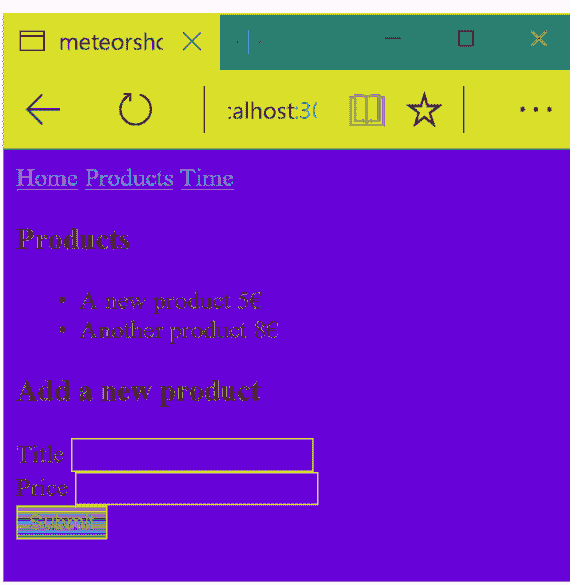

### 6.14 练习解答

- 保持你的浏览器和 meteor 命令行打开。
- 在 client 文件夹中添加一个 products.html 文件。添加以下代码：

client\products.html

```
<template name="products">
  <h3>Products</h3>
  <ul>
    {{#each list}}
      <li>{{title}} {{price}}$</li>
    {{/each}}
  </ul>
</template>
```

- 在 `client` 文件夹中添加一个 `products.js` 文件。添加以下代码：

client\products.js

```
Template.products.helpers({
  list: function () {
    return Products.find();
  }
});
```

- 打开 `route.js` 文件。在文件中已有的代码之后添加以下代码：

#### route.js

```
Router.route('/products', function () {
  this.render('products');
});
```

- 在 `client/layout.html` 文件中，找到以下代码：

#### client/layout.html

```
...
<a href="/">Home</a>
<a href="/time">Time</a>
<a href="/admin">Admin</a>
...
```

- 将该代码替换为以下内容：

#### client/layout.html

```
...
<a href="/">Home</a>
<a href="/products">Products</a>
<a href="/time">Time</a>
<a href="/admin">Admin</a>
...
```

- 打开另一个命令行，导航到你的应用程序目录并输入：


包：管理面板、导航、验证、表单生成

```
meteor add aldeed:autoform
```

-   包添加完成后，关闭刚刚打开的命令行窗口。
-   在 `client/products.html` 文件中，找到以下代码：

```
client/products.html
...
</ul>
</template>
```

-   将该代码替换为以下代码：

```
client/products.html
...
</ul>
<h3>添加新产品</h3>
{{> quickForm collection="Products" id="insertProductForm" type="insert"}}
</template>
```

-   切换回浏览器并点击 "Products" 链接。
-   使用表单创建一些产品。
-   检查产品是否已被添加。
-   尝试创建一个没有价格和标题的产品。检查是否出现验证信息，并且产品未被添加。

### 6.15 Bootstrap

你肯定知道 Bootstrap，这是一个广泛使用的、采用响应式设计的 HTML 框架。深入使用 Bootstrap 超出了本书的范围，但如果你不熟悉它，可以通过[阅读官方文档](http://getbootstrap.com/css/)来快速上手。

虽然将 Bootstrap 添加到应用中并非难事，但使用 Meteor 包会更加简单。只需输入

```
meteor add twbs:bootstrap
```

基本上，Bootstrap 依赖于你的页面有一个带有 `container` 类的根元素。如果你的应用使用了某种布局（就像我们的练习中 `client/layout.html` 那样），那就很简单了：将该元素添加到布局中即可。

例如，使用 iron router 的布局会是这样：

```
<div class="container">
  {{>yield}}
</div>
```

你也可以创建一个可折叠的导航栏（在小屏幕尺寸下会折叠），使用带有 `navbar` 类的 `nav` 元素。详细信息和示例可在[Bootstrap 文档此处](http://getbootstrap.com/components/#navbar)查看。

### 6.16 练习：为应用程序添加一些样式

> 为你的应用程序设置样式是可选的，因此这个练习也是可选的。如果你不想花时间在样式设计上，这完全没问题，你可以完全跳过这个练习。

将 Bootstrap 添加到你的应用程序。确保任何页面内容都显示在一个 CSS 类为 `container` 的 `div` 中。

将导航链接移入一个可折叠的 `nav` 元素中。

更改新闻页面，使新闻成为 Bootstrap 列表组的一部分，并让删除新闻的按钮样式更好看。

你的 `news` 页面现在应该如下所示：

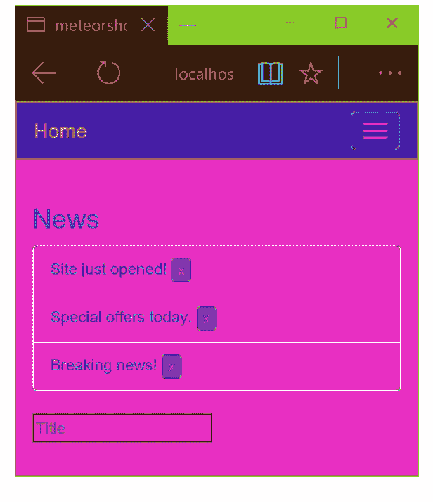

### 6.17 练习解决方案

-   保持浏览器打开并让 `meteor` 命令行窗口保持运行。
-   打开另一个命令行窗口，导航到你的应用程序目录并输入：

```
meteor add twbs:bootstrap
```

-   包添加完成后，关闭刚刚打开的命令行窗口。
-   在 `client/layout.html` 文件中，找到以下代码：

```
client/layout.html
<template name="layout">
  <div>
    <a href="/">Home</a>
    <a href="/products">Products</a>
    <a href="/time">Time</a>
    <a href="/admin">Admin</a>
  </div>
  <div>
    {{> yield}}
  </div>
</template>
```

-   将该代码替换为以下代码：

```
client/layout.html
<template name="layout">
  <nav class="navbar navbar-inverse">
    <div class="container-fluid">
      <div class="navbar-header">
        <button type="button"
          class="navbar-toggle collapsed"
          data-toggle="collapse"
          data-target="#nvbcl"
          aria-expanded="false">
          <span class="icon-bar"></span>
          <span class="icon-bar"></span>
          <span class="icon-bar"></span>
        </button>
        <a class="navbar-brand" href="/">Home</a>
      </div>
      <div class="collapse navbar-collapse" id="nvbcl">
        <ul class="nav navbar-nav">
          <li><a href="/products">Products</a></li>
          <li><a href="/time">Time</a></li>
          <li><a href="/admin">Admin</a></li>
        </ul>
      </div>
    </div>
  </nav>
  <div class="container">
    {{>yield}}
  </div>
</template>
```

-   在 `client/news.html` 文件中，找到以下代码：

```
client/news.html
...
<ul>
  {{#each news}}
    <li>{{title}} <button class="removeAction">x</button></li>
  {{/each}}
</ul>
...
```

-   将该代码替换为以下代码：

```
client/news.html
...
<ul class="list-group">
  {{#each news}}
    <li class="list-group-item">
      {{title}}
      <button class="btn btn-danger btn-xs removeAction">x</button>
    </li>
  {{/each}}
</ul>
...
```

-   切换回浏览器并点击 "Home" 链接。
-   查看新样式。
-   调整浏览器窗口大小，使其宽度变小和变大。导航栏应在宽度较小时折叠。

## 7. 账户：用户管理

### 7.1 Meteor 的账户系统

Meteor 依赖于包来进行用户管理。Meteor 团队提供了几个包，此外还有许多第三方包。

用户管理的核心是 `accounts-base` 包，它提供了一个 `Meteor.users` 集合和一个 API。出于明显的安全原因，对集合的完全访问权限仅限于服务器端代码，而客户端代码可以访问一个受限的 API，使你能够检查用户是否已认证：`Meteor.user()`。当用户未认证时，它返回 `null`，否则你将获得部分用户详情（服务器端可用字段的一个子集）。

> 由于几个与账户相关的包依赖于 `accounts-base` 包并会自动添加它，因此通常不需要从命令行添加它。

当然，你可以从 *accounts-base* 开始手动编码所有内容。但请记住：Meteor 是关于生产力的。所以他们提供了许多包来帮助你快速上手。
基本上，我们需要的是一个验证用户身份的方法和一个相应的 UI。对于第一部分，你只需添加一个登录提供程序包。对于第二部分，你可以选择一个现成的 UI 包或者允许你自定义外观的扩展包。让我们分别看看这两部分。

#### 登录提供程序

用户可以对你的数据库进行身份验证，也可以使用第三方服务，或者任何你能想到的方式，比如两步验证或基于令牌的一次性密码。为此有许多可用的包，例如：

-   *accounts-password*：基于密码的登录；
-   *accounts-facebook*、*accounts-google*、*accounts-twitter* 以及其他一些包：使用 OAuth 进行第三方身份验证；
-   还有很多其他的，只需[在 Atmosphere 上搜索](https://atmospherejs.com/?q=accounts-)。

#### 登录 UI 包

创建认证 UI 有两种方式：
超级快速的方式，非常适合原型设计：添加 *accounts-ui* 包，使用 {{> loginButtons}} 模板即可获得登录按钮，搞定。缺点是：你无法自定义生成的 UI 的外观。
完全可自定义的方式，稍微花点时间，你可以使用基于 *useraccounts* 的包之一。例如，你可以使用为流行框架预先制作好的 *useraccounts:bootstrap*、*useraccounts:materialize* 或 *useraccounts:polymer*，或者在需要自定义 HTML 时使用 *useraccounts:unstyled*。
使用任何基于 *useraccounts* 的包，你所要做的就是包含 `{{> atForm}}` 模板。它会根据用户当前的登录状态进行调整，以创建登录或注册表单。此外，你可以使用 `{{> atNavButton}}` 模板，它将创建一个 "登录" / "注销" 按钮。

完整的 *useraccounts* UI 包列表[可以在这里找到](https://github.com/meteor-useraccounts/core/blob/master/Guide.md)。

#### 限制对应用程序部分的访问

一旦你的用户通过了身份验证，你肯定需要将某些页面限制为仅认证用户或用户组可以访问。为此，*useraccounts:iron-routing* 可以与我们[之前使用](https://github.com/meteor-useraccounts/core/blob/master/Guide.md)的 *iron:router* 包结合使用。

实际上，*useraccounts:iron-routing* 使用简单且可配置。你只需要做两件事。首先声明应使用哪个布局：


### 7.2 练习：保护产品管理

你必须在你的应用中启用一个使用登录名和密码的身份验证系统。

只有经过身份验证的用户才应该能够访问 `Products` 页面。未经身份验证的用户在尝试访问 `Products` 页面时应被重定向到登录页面。

在应用的头部，添加一个"登录"/"登出"按钮。

以下是未登录用户点击 `Products` 链接时应看到的内容：


账户：用户管理 107

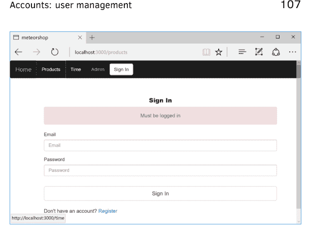

### 7.3 练习解答

- 将你的浏览器指向 http://localhost:3000。
- 保持浏览器打开，并保持 meteor 命令行运行。
- 打开另一个命令行，导航到你的应用目录并输入：
  - 将以下代码添加到 route.js 文件的末尾：

```
meteor add accounts-password
meteor add useraccounts:bootstrap
meteor add useraccounts:iron-routing
```

#### route.js

```
AccountsTemplates.configure({
  defaultLayout: 'layout',
});

Router.plugin('ensureSignedIn', {
  only: ['products']
});
```

- 定位以下代码：

#### client/layout.html

```
<li><a href="/admin">Admin</a></li>
</ul>
```

- 将其替换为：

#### client/layout.html

```
<li><a href="/admin">Admin</a></li>
<li>{{> atNavButton}}</li>
</ul>
```

- 切换回你的浏览器，尝试使用顶部的两个链接导航应用。注意，如果你未登录，*Products* 页面将无法访问。

# 账户：用户管理

- 使用登录页面底部的链接创建一个账户，并检查你是否能访问整个应用。
- 登出，检查*Products*页面是否已无法访问。
- 登录并检查你是否能访问整个应用。

## 8. 进一步探索

### 8.1 MiniMongo：你甚至不需要 MongoDB

正如我们之前看到的，`Mongo.Collection` 允许你进行实时的、同步的、客户端**和**服务器端对 MongoDB 集合的访问。这很棒，但如果你需要一个简单的内存数据存储呢？嗯，你可以，并且你已经知道如何做。

当你创建一个 `Mongo.Collection` 时，它在客户端使用 MiniMongo 来缓存查询结果。好消息是，你可以单独创建一个 MiniMongo 实例。只需使用 `null` 作为构造函数参数（而不是你通常提供的 MongoDB 集合名称）创建一个新的 `Mongo.Collection`，你就得到了一个内存中的 MiniMongo。此外，这个 MiniMongo 不像普通的 `Mongo.Collection` 那样在服务器和客户端之间同步：它只保留在你声明它的地方：在服务器端声明时保留在服务器端，在客户端声明时则保留在客户端。

总结一下，只需写：

```
var store = new Meteor.Collection(null);
```

仅此而已。你现在可以[查询该集合](query that collection)，使用 `find` 方法，并[使用更新方法](using update methods)（几乎）像更新 MongoDB 集合一样更新它。

MiniMongo 是一个响应式集合，这意味着显示来自 MiniMongo 集合数据的页面将在 MiniMongo 中持有的数据发生变化时立即更新。

使用仅客户端或仅服务器端的内存 MiniMongo 对于你存储临时数据的应用部分非常方便。对于持久性数据，请使用 [Mongo 存储的集合](Mongo-stored collections) 的全部功能。也就是说，创建一个 `Mongo.Collection` 并提供 MongoDB 集合作为字符串参数。

### 8.2 练习：创建和管理购物车

在主页上显示产品列表。在列表中每个产品的旁边，添加一个"购买"按钮。
创建一个内存中的集合来保存购物车中的物品。当用户点击"购买"按钮时，向购物车添加一个新物品，数量为1。
添加一个"购物车"页面，并从头部链接到它。
在"购物车"页面上，显示购物车中的物品列表及其数量。在每个购物车物品旁边，添加"+"和"-"按钮以增加或减少数量。

以下是"购物车"页面应有的样子：

进一步探索 113

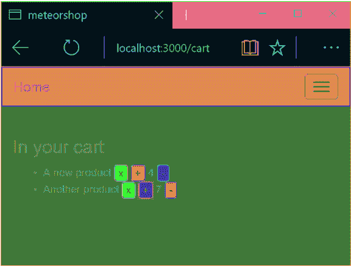

### 8.3 练习解答

- 将你的浏览器指向 `http://localhost:3000`。
- 保持浏览器打开，并保持 `meteor` 命令行运行。
- 在 `client` 文件夹中添加一个 `store.html` 文件，包含以下代码：

#### client/store.html

```
<template name="store">
  <h3>Store</h3>
  <ul>
    {{#each list}}
    <li>
      {{title}} {{price}}$
      <button class="btn btn-success btn-xs buyAction">
        Buy
      </button>
    </li>
    {{/each}}
  </ul>
</template>
```

- 在 client 文件夹中添加一个 store.js 文件，包含以下代码：

#### client/store.js

```
Basket = new Mongo.Collection(null);

Template.store.helpers({
  list: function () {
    return Products.find();
  }
});

Template.store.events({
  'click .buyAction': function () {
    Basket.insert({ product: this, quantity: 1});
  }
});
```

- 在 client 文件夹中添加一个 home.html 文件，包含以下内容：

#### client/home.html

```
<template name="home">
  <div class="row">
    <div class="col-sm-7">
      {{> store}}
    </div>
    <div class="col-sm-5">
      {{> news}}
    </div>
  </div>
</template>
```

> 在上面的模板中，div 元素是为了使用 Bootstrap CSS 类实现并排的列。我们本可以避免使用它们，因为它们并没有改变功能。

- 定位以下代码：

#### route.js

```
Router.route('/', function () {
  this.render('news');
});
```

- 将其替换为：

#### route.js

```
Router.route('/', function () {
  this.render('home');
});

Router.route('/cart', function () {
  this.render('cart');
});
```

- 定位以下代码：

#### client/layout.html

```
...
<li><a href="/products">Products</a></li>
...
```

- 将其替换为：

#### client/layout.html

```
...
<li><a href="/products">Products</a></li>
<li><a href="/cart">Cart</a></li>
...
```

- 在 `client` 文件夹中添加一个 `cart.html` 文件，包含以下内容：

#### client/cart.html

```
<template name="cart">
  <h3>In your cart</h3>
  <ul>
    {{#each contents}}
      <li>{{product.title}}
        <button class="removeAction btn btn-xs btn-danger">
          x
        </button>
        <button class="incrementAction btn btn-xs btn-primary">
          +
        </button>
        {{quantity}}
        <button class="decrementAction btn btn-xs btn-primary">
          -
        </button>
      </li>
    {{/each}}
  </ul>
</template>
```

- 在 client 文件夹中添加一个 cart.js 文件，包含以下内容：

#### client/cart.js

```
Template.cart.helpers({
    contents: function () {
        return Basket.find();
    }
});

Template.cart.events({
  'click .removeAction': function() {
    Basket.remove({_id: this._id});
  },
  'click .incrementAction': function() {
    Basket.update({_id: this._id},
    {$inc: {quantity: 1}});
  },
  'click .decrementAction': function() {
    Basket.update({
      _id: this._id,
      quantity: { $gt: 1 },
    },
    {$inc: {quantity: -1 }});
  }
});
```

> 在上面的代码中，`quantity: { $gt: 1 }` 是一个条件，用于检查数量是否大于等于1然后再进行递减。这样我们确保数量不会为负数。

- 切换回你的浏览器。
- 导航到主页。检查它是否显示了产品列表。
- 使用产品旁边的"购买"按钮将一些产品添加到你的购物车。
- 导航到"购物车"页面。检查你添加到购物车的产品是否显示在那里。
- 尝试增加和减少购物车中产品的数量。

### 8.4 脱离原型开发

到目前为止，我们的代码编写速度非常快，这对原型开发很有帮助。然而，为了使我们的代码编写如此高效，Meteor 使用了两个在投入生产环境前应该被移除的包，因为它们会危害安全性：


#### 移除 *autopublish*

首先，你需要移除该包。只需在你的命令行中运行以下命令：

```
meteor remove autopublish
```

现在，你需要告诉 Meteor 哪些数据应该被发布和获取。这通过两个步骤完成：

1.  在服务器上使用 `Meteor.publish` 函数；
2.  在客户端调用 `Meteor.subscribe` 函数。

对于这两个函数，你都提供一个字符串形式的发布名称，该名称在客户端和服务器上应保持一致（这是订阅与发布匹配的方式）。你也可以在发布方法中接受参数，这些参数在订阅方法中提供。

为保持简单，应在客户端从集合中获取文档之前完成订阅，例如在使用集合的 find 方法之前。一个合适的地方是在使用数据的模板的 onCreated 事件中。

让我们看一个例子。还记得我用来显示所有书籍的代码吗：

```
demos.js

Books = new Meteor.Collection('books');

if (Meteor.isClient) {
  Template.books.helpers({
    books: function () {
      return Books.find({});
    }
  });
}
```

##### demos.html

```
<template name="books">
    <ul>
        {{#each book in books}}
        <li>{{book.title}}</li>
        {{/each}}
    </ul>
</template>
```

这段代码基于 *autopublish* 包的存在。一旦移除 *autopublish* 包，它将不再工作。我们来修复它。首先，我必须发布该模板使用的数据。我将为这个订阅选择一个名为 `books-all` 的名称。在 `server/publications.js` 文件中，我编写：

##### server/publications.js

```
Meteor.publish("books-all", function () {
  return Books.find({});
});
```

接下来，我在 `books` 模板的 `onCreated` 事件中订阅该发布。我创建一个 `client/books.js` 文件并添加以下代码：

##### client/books.js

```
Template.books.onCreated(function() {
  this.subscribe('books-all');
});
```

现在，经过这两个步骤后，书籍列表再次显示。注意我使用 `this.subscribe` 而不是 `Meteor.subscribe`。这允许在模板不再显示时优雅地处理订阅。当使用 `iron:router` 时，你可以让路由器在订阅在客户端实际可用之前渲染一个等待模板。为此，你提供一个 `waitOn` 选项，该选项获取一个订阅或订阅数组：

```
Router.route('/books', {
  loadingTemplate: 'loading',

  waitOn: function () {
    return Meteor.subscribe('books-all');
  },

  action: function () {
    this.render('books');
  }
});
```

### 8.5 练习：移除 *autopublish* 包

移除 *autopublish* 包以使应用程序更安全。注意应用程序页面不再显示数据。

确保添加对 *publish* 和 *subscribe* 方法的适当调用以显示数据。


### 8.6 练习解答

1.  将你的浏览器指向 `http://localhost:3000`。
2.  保持浏览器打开，并保持 `meteor` 命令行运行。
3.  打开另一个命令行，导航到你的应用程序目录并输入：

```
meteor remove autopublish
```

4.  切换回你的浏览器，注意首页和 *产品* 页面上不再显示新闻和产品。
5.  创建一个 `server/publications.js` 文件，包含以下代码：

```
server/publications.js
Meteor.publish("news-all", function () {
  return News.find();
});
Meteor.publish("products-all", function () {
  return Products.find();
});
```

6.  创建一个 client/subscriptions.js 文件，包含以下代码：

```
client/subscriptions.js
Template.news.onCreated(function() {
  this.subscribe('news-all');
});
Template.products.onCreated(function() {
  this.subscribe('products-all');
});
Template.store.onCreated(function() {
  this.subscribe('products-all');
});
```

7.  切换回你的浏览器，注意首页和 *产品* 页面上新闻和产品再次显示。

#### 移除 insecure

首先，你需要移除该包。只需在你的命令行中运行以下命令：

```
meteor remove insecure
```

当你这样做时，客户端只能对集合执行有限的更新操作。例如，它可以提供 `_id` 字段来更新文档，但不能删除文档或插入新文档。如果你决定客户端代码甚至不应该能够通过提供 `_id` 字段来更新文档，你可以在创建 Meteor.Collection 时使用 deny 选项。

现在，只有服务器代码才能访问完整的更新操作范围。由于你的客户端代码也需要进行更新，你可以使用方法来启用它们。方法在客户端和服务器上（公共代码）用名称和参数声明，并使用相同的名称从客户端调用。

> 方法比基本的 API 调用更强大。当在客户端调用一个方法时，它首先在客户端使用 MiniMongo 已经缓存的数据进行评估。这样，用户可以立即看到其操作的结果。然后在服务器上评估该方法，并将任何更改推送到客户端，以便用户看到考虑了完整服务器端数据的真实结果。

以下是你如何声明方法：

##### commoncode.js

```
Meteor.methods({
  'deletebook': function(id) {
    Books.remove({_id: id});
  },
  'dosomething': function(first, second) {
    ...
  }
});
```

以下是你如何在客户端事件中调用这些方法：

```
Template.books.events({
  'click .deleteAction': function(e, a) {
    Meteor.call('deletebook', this._id);
  },
  'click .doAction': function(e, a) {
    var first = ...;
    var second = ...;
    Meteor.call('dosomething', first, second);
  }
});
```

### 8.7 练习：移除 insecure 包

移除 insecure 包以使应用程序更安全。检查你是否无法再使用首页添加或删除新闻条目。确保添加对方法的适当调用并调用方法，以使用户能够使用首页添加或删除新闻条目。

### 8.8 练习解答

1.  将你的浏览器指向 `http://localhost:3000`。
2.  保持浏览器打开，并保持 meteor 命令行运行。
3.  打开另一个命令行，导航到你的应用程序目录并输入：

```
meteor remove insecure
```

4.  切换回你的浏览器，注意你无法在首页上添加或删除新闻条目。
5.  创建一个 methods.js 文件，包含以下代码：

```
methods.js

Meteor.methods({
  'removenews': function(id) {
    News.remove({_id: id});
  },
  'insertnews': function(title) {
    News.insert({
      title: title,
      created: new Date()
    });
  }
});
```

6.  找到以下代码：

#### client/client.js

```
Template.news.events({
  'submit form': function (e) {
    e.preventDefault();
    var title = e.target.title.value;
    News.insert({title: title, created: new Date()});
  },
  'click .removeAction': function(e, a) {
    News.remove({_id: this._id});
  }
});
```

7.  将其替换为：

#### client/client.js

```
Template.news.events({
  'submit form': function (e) {
    e.preventDefault();
    var title = e.target.title.value;
    Meteor.call('insertnews', title);
  },
  'click .removeAction': function(e, a) {
    Meteor.call('removenews', this._id);
  }
});
```

> 注意，对集合方法的直接调用已被方法调用所取代。

8.  切换回你的浏览器，注意你现在可以在首页上添加或删除新闻条目。


#### 定义

#### 打包

打包是将多个 JavaScript 或 CSS 文件合并到一个文件中的过程。由于浏览器从服务器获取文件的数量有限，并且每次 HTTP 请求都有开销，打包能够实现客户端更快的加载时间。

打包通常与压缩一起进行。

#### 压缩

在不改变文件含义的前提下，缩减 CSS 和 JavaScript 文件大小的过程。这可以通过移除多余空格、将局部变量重命名为更短的名称来实现。

压缩在构建过程中于服务器端完成，这样提供给客户端的文件体积更小。因此，文件能更快地传送到客户端，从而意味着更快的加载速度。

压缩通常与打包一起进行。

#### npm

npm 是一个流行的 JavaScript 包管理器。基本上，包管理器允许你将一个库下载到你的应用文件夹中，以便你可以使用它。为什么不直接手动下载呢？嗯，npm 还会管理该特定包所需的依赖项（即该特定包所需的包），并在需要时下载它们。它还允许你轻松地管理版本和更新包。

#### Spacebars

Spacebars 是用于编写 Meteor 模板的默认语法。它源自 [Handlebars](http://handlebarsjs.com)¹ 语法。

Spacebars 是带有扩展的 HTML。扩展采用 mustache 标签的形式，如下所示：

```
{{#each product in products}}
  <li>Buy {{product.name}} now!</li>
{{/each}}
```

> ¹ http://handlebarsjs.com

#### 作者寄语

我真诚地希望你喜欢阅读这本书，就像我喜欢写作一样，并且你能够很快地熟练掌握 Meteor。

如果你想联系我，可以使用：

- 电子邮件：books@aweil.fr
- Facebook：https://facebook.com/learncollection

如果你的项目有需要，我也可以提供演讲、教学、咨询和编码服务。世界各地皆可。

如果你喜欢这本书，你可能因此节省了大量时间。如果你能抽出几分钟宝贵的时间，在你购买这本书的网站上留下评论，我将不胜感激。非常感谢！

#### Learn 系列丛书

本书是 *Learn 系列丛书* 的一部分。*Learn 系列丛书* 让开发者能够在几天内自学新技术。

##### 已出版的书籍

- [Learn ASP.NET MVC](http://tinyurl.com/h6hjwce)
- [Learn Meteor](https://leanpub.com/learnmeteor)

##### 计划于 2016 年出版

- [Learn WPF MVVM](https://leanpub.com/learnwpf)
- Learn Knockout

¹ http://tinyurl.com/h6hjwce
² https://leanpub.com/learnmeteor
³ https://leanpub.com/learnwpf
