# 周末掌握微软 VBScript


## 关于作者

**小杰里·李·福特** 是一位作家、教育工作者和 IT 专业人士，拥有 14 年信息技术经验，曾担任自动化分析师、技术经理、技术支持分析师、自动化工程师和安全分析师。杰里是 MCSE，并获得了 Microsoft 的 MCP 和 MCP + Internet 认证。此外，他拥有弗吉尼亚州里士满弗吉尼亚联邦大学的工商管理硕士学位。杰里还是另外七本书的作者，包括《一个周末速成 JavaScript》和《Microsoft Windows Shell Scripting and WSH》。他拥有超过五年在信息技术领域担任兼职讲师教授网络课程的经验。杰里与妻子玛丽以及他们的孩子威廉、亚历山大和莫莉住在弗吉尼亚州里士满。


## 引言

祝贺您购买了本书，并决定学习如何使用 VBScript 进行编程。*VBScript* 是一种强大但易于学习的脚本语言，可用于执行许多有用的活动，包括增强您的网页以及自动化重复或复杂的桌面和系统任务。

您可能想知道是否真的能在一个周末内学会如何使用 VBScript 编程。答案是肯定的。我并不是说到了周一早上您就会成为 VBScript 编程专家，但如果您周五晚上坐下来，在整个周末投入这项任务，您将掌握所有基础知识，并取得良好的进展。

除了教授 VBScript 编程语言外，本书还将向您展示如何将 VBScript 集成到 HTML 页面中，从而为您的网站增添活力并添加交互性。您还将了解 Windows 脚本宿主（WSH），以及如何编写与 WSH 配合使用的 VBScript 来自动化许多 Windows 任务。您不仅会获得很多乐趣，还会发现自己的生产力和效率得以提高。

### 本书关于什么

本书是关于 VBScript 的。我写本书的目的是教您如何编写自己的 VBScript。无论您是经验丰富的程序员还是初次尝试，您都会找到使用 VBScript 来改进网页和自动化在自己计算机上定期执行的任务所需的一切知识。

本书将为您提供开始所需的所有信息和背景知识。到了周一早上，您将学到：

- 构成 VBScript 语言的基本语法和编程语句
- 如何使用 VBScript 通过弹出对话框为网页添加交互性
- 如何为网页添加图形效果
- 如何验证 HTML 表单并通过电子邮件发送其内容
- 如何检测访问您网站的访客所使用的类型和浏览器版本
- 如何在网页的横幅中宣传和显示消息
- 如何创建 VBScript cookie，以存储和检索有关网站访客的信息
- 如何将 VBScript 与 WSH 集成以自动化多项系统任务，例如创建新用户帐户和管理打印机
- 如何将 VBScript 与另一种脚本语言结合到 Windows 脚本文件中，从而利用两种脚本语言的优势
- 如何使用 VBScript 和 WSH 读写文件、创建日志和报告
- 如何使用 VBScript 和 WSH 处理 Windows 开始菜单、快捷方式和快速启动栏
- 如何调试 VBScript

### 谁应该阅读本书

我写本书是为任何想要学习如何通过自动化 Windows 计算机上的任务来为其网页增色或提高效率的人。本书面向 VBScript 或一般编程的新手，尽管它也为想学习 VBScript 的经验丰富的程序员提供了理想的快速入门指南。

唯一的先决条件是了解基本的计算机概念、有一点 HTML 经验，以及一些使用 Internet Explorer 和 Microsoft 操作系统的实践经验。这意味着您应该已经知道如何手动执行诸如创建 Windows 快捷方式、移动和复制文件和文件夹以及配置 Windows 开始菜单等任务。如果您觉得需要复习一下 HTML，您可能需要首先查看 Premier Press 的 *一周内学会 HTML*。

当然，如果您已经有其他编程语言（例如 VBScript 所基于的 Visual Basic）的经验，事情会进展得更快。然而，这并非先决条件。每个程序员都必须从某个地方开始学习，而 VBScript 是一门绝佳的入门编程语言。本书将全面回顾 VBScript 基础知识，并提供帮助您入门所需的各种示例。

### 开始所需条件

与某些编程语言（如 C++ 或 Visual Basic）不同，VBScript 不要求您掌握完整的*集成开发环境*（IDE）。事实上，编写 VBScript 所需的一切都已包含在 Windows 中。


#### 简介

这是一款能将文件保存为纯文本的文本编辑器。它不仅让学习曲线变得平缓许多，也使得脚本开发过程变得简单直接。

以下列表概述了完成本书内容所需的工具。

- **一台Windows计算机。** 你需要一台运行Windows 95或更高版本操作系统的计算机。本书中所有示例均使用Windows XP家庭版或Windows XP专业版。
- **互联网接入。** 如果你计划在网页开发中使用VBScript，那么你将需要互联网接入，以便将网页上传到你的网站。
- **Internet Explorer浏览器。** VBScript与Microsoft Internet Explorer浏览器配合工作。你需要该浏览器来测试你的网页，并查看你的VBScript是否按预期运行。
- **一个网站托管服务。** 如果你尚未建立网站，那么你可能可以安排你的互联网服务提供商来托管你的网页。此外，互联网上有很多免费的网页托管网站，你可以注册使用。
- **WSH和VBScript 5.6。** 如果你正在运行Windows XP，你已经拥有了这个版本的WSH。否则，你应该从msdn.microsoft.com/scripting下载此版本。
- **一个文本编辑器。** 任何可以将脚本保存为纯文本文件的文本编辑器都可以。例如，可以使用Windows记事本应用程序。不过，你可能希望找到一个更高级的脚本编辑器，它应具备诸如脚本语句着色、语法检查和脚本模板等功能。
- **一个图形编辑器。** 这个工具可以让你创建图形图像，然后将其整合到你的网页中。不过，它是可选的，你可能可以不使用任何图形，或者使用互联网上可以找到的免费图形来完成工作。

#### 本书的组织结构

本书的设计旨在让你在周末的七个阅读时段内就能读完。当然，你可以按照任何你希望的方式阅读。它从周五晚上开始，你将学习VBScript编程的基本概念，并持续到周六，你将学习构成VBScript语言的编程语句以及如何将VBScript添加到你的网页中。本书在周日结束，你将花一天时间学习如何使用VBScript和WSH。

以下是本书组织结构的更详细大纲。

- **周五晚上：“VBScript简介”。** 本章提供了你完成本书其余部分所需的概念框架。你将接触到一个关于使用VBScript可以做的事情的想法列表。你还会找到一段关于VBScript的简短历史，以及VBScript与Visual Basic编程家族中其他语言的比较。在本章结束前，你将看到你的第一个VBScript示例，并学习如何使用VBScript来增强你的HTML页面，并提高你在使用Windows操作系统时的工作效率。
- **周六上午：“VBScript编程入门”。** 本章为你提供VBScript编程基础。首先，你将从学习VBScript语法开始。然后，你将学习构成VBScript语言的基本编程语句。你将学习的VBScript编程结构包括常量、变量、表达式、条件逻辑、循环、过程、数组以及弹出对话框的使用。
- **周六下午：“在Internet Explorer中编写脚本”。** 本章向你介绍面向对象编程，并解释VBScript对象模型。你将学习对象及其属性和方法。此外，你将复习最常用的对象，并学习如何将它们整合到你的VBScript中。你还将了解浏览器事件以及如何使用VBScript来响应这些事件并创建交互式网页。
- **周六晚上：“网页技巧”。** 本章继续讨论如何将VBScript集成到你的网页中。在这里，你将找到具体的示例，说明如何使用VBScript来控制Internet Explorer的状态栏，以及执行各种技巧，包括创建导航菜单和图形翻转效果。你还会找到示例，向你展示如何使用弹出对话框，以及如何验证HTML表单的内容和创建VBScript cookie。
- **周日上午：“使用Windows Script Host”。** 本章解释Windows Script Host的工作原理以及如何配置其操作。你还将接触一点XML，以了解如何将VBScript与其他脚本语言结合到Windows脚本文件中。本章最后介绍了WSH对象模型，并解释了如何使用它来创建真正强大的脚本。
- **周日下午：“处理文件和文件夹”。** 本章向你展示如何使用VBScript和WSH来控制Windows文件系统。你将学习如何复制、移动和删除文件和文件夹。你将学习如何创建新文件并写入内容。你还将了解如何重新打开它们并读取或修改其内容。当你完成本章时，你将掌握开始创建日志文件和报告所需的所有知识。
- **周日晚上：“桌面、计算机和网络自动化”。** 本章介绍了一些主题，向你展示如何自动化各种Windows任务。你将学到的示例包括如何创建快捷方式、处理Windows应用程序以及配置Windows开始菜单。你还将看到如何执行高级系统管理任务的示例，包括如何读取Windows事件日志、管理打印机以及停止和启动Windows服务。
- **附录A：“VBScript语言参考”。** 本附录为你提供VBScript编程语言参考，你可以用它来查找关于VBScript对象、属性、方法、语句、函数运算符、事件、保留字和常量的信息。
- **附录B：“网站上有什么”。** 本附录为你介绍了本书配套网站上有哪些内容。
- **术语表：** 本书中出现的所有术语的汇总列表。

#### 本书使用的约定

本书使用了一些约定，以帮助你更轻松地学习，包括：

> NOTE 注意。提供额外的信息，这些信息对了解主题有帮助，但可能不是讨论主题的核心。

> TIP 提示。建议可使用的替代技术和快捷方式，以帮助你更快速、更高效地工作。

斜体。用于突出显示新术语和强调关键信息。

## 周五晚上
### VBScript简介

- 了解VBScript的不同用途
- 查看如何将VBScript集成到HTML页面中
- 研究Internet浏览器的兼容性
- 研究Windows Script Host的架构
- 学习如何使用VBScript和Windows Script Host

晚上好！今晚，你将通过奠定一些基础，开始VBScript编程之旅。这包括解释VBScript的功能和局限性。今晚的内容还包括VBScript的简短历史，并解释它与Visual Basic和Visual Basic for Applications的关系。

在你对VBScript的起源有了一点了解之后，我将介绍本书的两个主要主题中的第一个——使用VBScript来增强你的个人网页。我将谈论如何使用VBScript为你的网页添加交互性以及执行其他有用的功能。本章还将向你展示如何编写包含VBScript的第一个网页，以便你看到VBScript和HTML如何结合并一起使用。

今晚阅读的最后一部分涵盖了本书的第二个主要主题，VBScript和Windows Script Host。Windows Script Host是微软的高级脚本解决方案。它允许你使用VBScript等脚本语言来自动化各种Windows任务。本章最后向你展示了如何使用WSH编写和测试你自己的VBScript。


#### 什么是 VBScript？

VBScript 是一种脚本语言。它旨在让你能够编写脚本，从而自动化各种活动，例如为网页添加简单动画。与某些编程语言不同，VBScript 无法独立运行。它需要一个执行宿主。*执行宿主* 是另一个程序，例如 Web 浏览器，它负责解释并执行你的脚本。

与其他脚本语言一样，VBScript 是一种解释型语言。这使它有别于那些需要编译程序的其他类型编程语言。每个脚本或软件程序在执行之前都必须编译成 *二进制代码*（那些由 0 和 1 组成、只有计算机才能理解的语言）。像 C++ 和 Visual Basic 这样的编程语言要求你在执行前先编译你的程序。编译过程解释并转换构成你程序的语句，将其转换为计算机能够理解的二进制代码。程序编译完成后即可执行。因为已经过编译，所以执行速度很快。

像 VBScript 这样的脚本语言不会在脚本实际执行或解释之前进行编译。这意味着每次运行 VBScript 时，它都必须先被解释然后才能执行。这使得脚本的运行速度比编译后的程序慢。

脚本和编译程序之间的另一个区别是，编译程序在编译过程中会进行语法检查。如果程序包含语法问题，就会发生错误，并要求你进行修复。另一方面，脚本中的语法错误在运行之前不会显现出来。

你可以使用简单的文本编辑器（如记事本）来创建 VBScript。VBScript 以纯文本文件的形式存储。因为 VBScript 是以纯文本文件形式存储的，所以你可以使用任何文本编辑器来创建它们。这使得它们易于使用和修改。

> **提示** 大多数 VBScript 程序员都有自己喜欢的编辑器。脚本编辑器通常支持多种脚本语言，允许你将其用于多种用途。现代脚本编辑器通常提供许多便捷功能，使其远比记事本实用。这些功能包括脚本语句的自动颜色编码、语句的自动缩进、测试脚本的能力以及帮助你掌握基本语法的代码模板。在编写和测试本书中的所有脚本时，我使用了一个非常出色的编辑器，名为 HomeSite。为了方便你，本书网站 **www.premierpressbooks.com/downloads.asp** 上提供了 HomeSite 的 30 天试用版。

#### VBScript 能做什么？

可以编写 VBScript 来执行无限多的任务。但是，VBScript 受到其执行环境的限制，我将在下一节中介绍。例如，在 Internet Explorer 中执行时，VBScript 无法访问计算机的文件系统来存储或检索数据。这通过阻止网站更改用户的计算机及其文件来保护网络冲浪者。但是，当 VBScript 由 WSH 运行时，它可以完全访问 Windows 文件系统。此外，它还可以访问 Windows 桌面，甚至可以操作注册表。

以下列表为你提供了在网页中使用 VBScript 时可能想要实现的一些想法。

- 在将 HTML 表单内容作为电子邮件提交之前对其进行验证。
- 创建动画效果，例如翻转效果，当鼠标指针移过图形（如按钮）时，该效果会改变图形的外观。
- 创建旋转横幅。
- 使用弹出对话框与访客交互，显示消息并收集信息。
- 检测浏览器类型，并将访客重定向到专为其浏览器版本设计的 HTML 页面。
- 在 Internet Explorer 状态栏上发布消息并创建滚动消息。
- 使用 VBScript 更好地管理 HTML 框架。
- 当用户访问你的网站时，自动打开多个自定义的 Internet Explorer 窗口。
- 基于用户提供的输入执行计算。
- 使用 VBScript 管理 Cookie，按名称称呼访问你网站的访客。

虽然嵌入 HTML 页面的 VBScript 在影响操作系统和计算机上其他资源方面的能力有限，但由 WSH 运行的 VBScript 则不然。事实上，WSH 的主要目的是允许脚本自动化系统任务。这使得由 WSH 运行的 VBScript 特别擅长自动化那些可能花费你数小时但脚本却能在片刻之间完成的重复且平凡的任务。VBScript 也很好地用于自动化那些不经常执行但可能复杂且冗长，从而容易出错的任务。以下列表仅展示了你可以使用 VBScript 和 WSH 自动化的一些任务类型。

- 创建桌面快捷方式
- 通过自动复制、移动、存档和删除文件来管理你的文件系统
- 管理家庭和企业网络上的网络资源
- 生成显示系统和状态信息的报告
- 与其他应用程序协同工作
- 管理本地和网络打印机
- 设置自动化脚本，可以在你的计算机不使用时在非工作时间运行
- 创建新的用户帐户
- 管理操作系统资源，例如服务和事件日志

#### VBScript 执行环境

VBScript 无法独立运行。它们需要一个执行宿主环境来执行它们。当 Microsoft 在 1996 年首次推出 VBScript 时，它被设计为在 Internet Explorer 浏览器内运行。然而，从那时起，Microsoft 不断扩展 VBScript 的角色和功能。因此，VBScript 现在可以在多种不同的环境中运行。尽管本书重点介绍了其中的两种环境——HTML 页面和 WSH——但我想简要介绍一下这些环境以及其他一些可以使用 VBScript 的环境。这不仅将让你了解 VBScript 功能的范围，还将为你提供一些想法，以便你后来可能决定利用新掌握的 VBScript 编程技能去探索其他途径。

- **Internet Explorer。** 当 VBScript 首次推出时，它仅作为 Internet Explorer 3 浏览器的脚本语言受到支持。VBScript 可以通过响应用户输入使网页更具交互性。它也可以用于验证表单和添加图形效果。
- **Windows Script Host。** Windows 脚本宿主或 WSH 是 Microsoft 为 Windows 操作系统提供超出其内置批处理脚本语言能力的解决方案。WSH 为 VBScript 提供了一个可以访问 Windows 资源（如桌面、注册表、文件系统和网络）的执行环境。使用 WSH 和 VBScript，你可以开发执行重复任务并加速复杂繁琐工作的脚本。
- **Internet Information Server 和 ASP。** *Internet Information Server (IIS)* 是 Microsoft 的 Web 服务器应用程序。它允许你创建和管理自己的网站，并被互联网上的许多公司用于运营业务。IIS 使用 *Active Server Pages (ASP)* 以 HTML 页面的形式向互联网用户传递信息。VBScript 在 ASP 开发中扮演着重要角色，它提供了一种强大的脚本语言，可以处理传入请求、访问本地数据库并返回动态构建的 HTML 内容。
- **Outlook Express。** VBScript 可用于自动化 Outlook Express 电子邮件客户端的行为和功能。
- **Microsoft Windows Script Console。** 这是一项新功能，允许第三方应用程序的开发人员将脚本功能直接集成到其应用程序中。这使你能够使用 VBScript 或 JScript 来自动化应用程序功能并扩展其能力。

#### VBScript 简史

Microsoft 于 1996 年随 Internet Explorer 3 首次推出了 VBScript。然而，它并不是第一个出现的脚本语言。Netscape 已经推出了 LiveScript，后来更名为 JavaScript。VBScript 表现并不出色。当时 Netscape 在浏览器市场仍占主导地位，其脚本语言拥有先发优势。更让 VBScript 困难的是，Netscape 浏览器不支持它，这意味着虽然 Internet Explorer 和 Netscape 浏览器都支持 JavaScript，但只有 Internet Explorer 支持 VBScript。尽管如此，Microsoft 仍继续开发和完善 VBScript。

> **注意** 如果你想了解更多关于 JavaScript 以及如何使用它进行网页开发，我推荐你阅读 Jerry Lee Ford, Jr. 撰写、Premier Press Books 出版的 **《Learn JavaScript In a Weekend》** (ISBN 0-76156-3332-X)。


尽管原始版本的 VBScript 支持在 Internet 浏览器内进行脚本编写，但与 IIS 3 一起发布的 VBScript 版本 2 将 VBScripting 带到了 Web 服务器。通过将 VBScript 嵌入到 ASP 页面中，Web 开发人员可以访问本地数据库并构建动态 HTML 页面，然后将这些页面返回到 Internet 浏览器。

VBScript 版本 3 部署到了多个环境中，包括：

-   Internet Explorer 4
-   IIS 4
-   Outlook 98
-   Windows 脚本宿主

除了支持基于客户端和服务器的 Web 开发外，VBScript 版本 3 还为 Microsoft 的电子邮件客户端提供了脚本功能，并为 Microsoft 新推出的 Windows 脚本宿主提供了两种默认脚本语言之一。WSH 支持的另一种脚本语言是 JScript。*JScript* 是 Microsoft 为其自身的 JavaScript 实现所起的名称。

VBScript 版本 4 作为 Microsoft Visual Studio 开发包的一部分发布。然而，该语言本身与前一版本相比没有变化。伴随此版本的一个主要变化是增加了文件系统支持，允许 VBScript 访问和操作本地文件系统。

VBScript 版本 5 于 2000 年随着 Windows 2000 和 Internet Explorer 5 的推出而发布。2001 年 Windows XP 家庭版和专业版的发布，以及 Internet Explorer 6 和 WSH 5.6，带来了当前版本的 VBScript，即版本 5.6。我将在本书中始终使用此版本的 VBScript 来开发您将看到的所有 Web 和 WSH 脚本。

##### Visual Basic 编程语言家族

VBScript 是组成 Microsoft Visual Basic 编程语言家族的几种语言之一。这些编程语言包括：

-   Visual Basic
-   Visual Basic for Applications
-   VBScript

这个编程语言家族的原始成员是 Visual Basic。Visual Basic 最初于 1991 年推出。在过去的 10 多年里，它已发展成为世界上最流行的编程语言之一。Visual Basic 提供了一个强大的*集成开发环境 (IDE)*，以支持构建桌面、网络和基于 Web 的应用程序。其当前版本称为 Visual Basic .NET，反映了它与 Microsoft 的 .NET 基于 Web 的框架的关系。Visual Basic 通常用于创建完整的独立程序。

> **注意** Microsoft 的 .NET Framework 是一个开发平台，旨在支持使用基于 XML 的 Web 服务创建 Web 应用程序。.NET 旨在允许应用程序无论使用何种编程语言或操作系统，都能通过 Internet 交换数据。要了解更多关于 .NET 的信息，请查看 **www.microsoft.com/net**。

Visual Basic for Applications (VBA) 代表了 Visual Basic 的一个子集。VBA 首次发布于 1993 年。它旨在为应用程序提供类似 Visual Basic 的编程能力。最好的例子是 Microsoft Office，它提供 VBA 允许人们开发宏。*宏*是可用于自动化应用程序功能或使用 VBA 和宿主应用程序创建新应用程序的程序。例如，使用 VBA 和 Microsoft Excel，可以开发会计或记账应用程序。VBA 可以编译成 p-code，这类似于部分编译，允许 VBA 代码快速运行（但不如常规编译的 Visual Basic 程序快）。

VBScript 于 1996 年推出，是 VBA 的一个子集。VBScript 不能提前编译，必须在执行时由执行主机进行解释。这使得 VBScript 成为 Visual Basic 家族中最慢的成员。然而，与 VBA 一样，VBScript 提供了同样易于使用的 Visual Basic 编程语言，尽管根据脚本编写的需求进行了缩减。

表 1.1 提供了 Visual Basic、VBA 和 VBScript 主要特性的比较。如您所见，Visual Basic 和 VBA 都提供了先进的 IDE 和编译其程序的能力。然而，只有 Visual Basic 可用于创建独立程序。

VBScript 不提供 IDE。然而，这一缺陷可以通过购买优秀的第三方脚本编辑器来部分克服。由于它是一种解释型语言，VBScript 无法编译；但是，解释型脚本语言也有一些优点。因为您不必编译它们，所以可以直接从开发进入执行。

###### 表 1.1 比较 Visual Basic、VBA 和 VBScript

| 语言 | IDE | 可编译 | 独立 |
| :--- | :--- | :--- | :--- |
| Visual Basic | 是 | 是 | 是 |
| VBA | 是 | 是 | 否* |
| VBScript | 否** | 否 | 否*** |

*VBA 需要宿主应用程序，例如 Microsoft Office
**尽管 VBScript 不提供 IDE，但您可以使用众多优秀的脚本编辑器中的任何一个，它们提供相当不错的开发环境
***VBScript 需要执行主机，例如 Internet Explorer 或 WSH

VBScript 不支持开发独立程序。您必须在执行主机内运行 VBScript；但是，脚本并非用于完全成熟的应用程序开发。它们旨在提供快速解决方案或将其他应用程序粘合在一起。因此，这不应被视为缺失的功能，而是一个不必要的功能。

##### 网页开发所需的脚本工具

创建网页不需要太多东西，只需要一个文本编辑器和一个 Web 浏览器来测试您的网页。因为 VBScript 只是嵌入在 HTML 页面中的文本，所以您不需要任何额外的工具。事实上，您可以使用记事本和当前安装在计算机上的 Windows 资源管理器副本来创建和测试网页。

由于记事本是一个非常简单的文本编辑器，我建议您找一个更适合脚本编写的编辑器。这就是为什么我在本书网站 **www.premierpressbooks.com/downloads.asp** 上包含了一个 30 天的 HomeSite 共享软件副本。如图 1.1 所示的 HomeSite 是一个 HTML 和脚本编辑器，它提供了许多高级脚本编辑器中常见的功能，包括：

-   脚本语句的彩色编码，使脚本更易于阅读
-   在开发过程中预览网页的能力
-   HTML 标记完成和代码验证
-   支持其他语言，如 HTML、XHTML 和 JavaScript，允许您将其用作通用编辑器
-   有助于编写 HTML 代码的模板

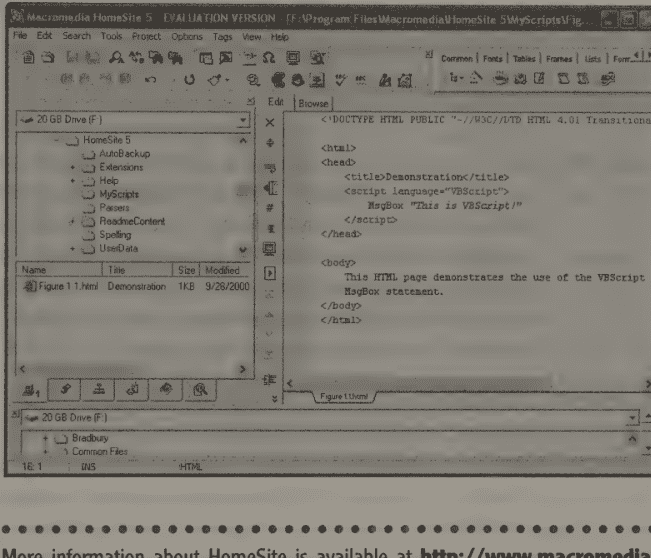

**图 1.1** HomeSite 5.0 是一个多功能编辑器，提供了许多高级脚本开发功能。

**注意** 有关 HomeSite 的更多信息，请访问 http://www.macromedia.com/software/homesite。

由于 VBScript 在过去几年中发展迅速，每个新版本的 Internet Explorer 都必须调整其对 VBScript 的支持，以适应新的 VBScript 特性和功能。这意味着尽管 Internet Explorer 6 支持 VBScript 5.6 的所有功能，但浏览器的早期版本则不支持。对于更早版本的浏览器也是如此。例如，Internet Explorer 5 完全支持 VBScript 版本 5，而版本 3 和 4 则不支持。

由于不同版本的 Internet Explorer 对使用不同版本 VBScript 编写的脚本会有不同的反应，因此使用您打算支持的每个版本的浏览器测试您的网页非常重要。与 Netscape 允许您在同一台计算机上安装不同版本的浏览器不同，Internet Explorer 仅允许您在给定的计算机上安装一个版本。


##### 浏览器兼容性

正如我之前已经暗示的，网景浏览器不支持VBScript。它们只支持JavaScript。因此，当你选择在网页中添加VBScript时，你就将脚本支持限制在了Internet Explorer用户。考虑到Internet Explorer在浏览器市场日益占据主导地位，这为你提供了触及大多数用户的能力。

> **注意** 微软在浏览器大战中的主导地位在可预见的未来可能将持续下去。微软已将Internet Explorer紧密集成到Windows XP中，使得它永远无法被彻底移除。相比之下，你必须下载网景通信者（Netscape Communicator）才能使用它。大多数人会选择使用他们最初接触到的浏览器，而这通常意味着Internet Explorer。此外，现代软件应用体积的不断增大，使得对于没有高速互联网连接（如DSL或电缆调制解调器）的人来说，下载它们变得几乎不可能。毕竟，截至本书撰写时最新版本的网景通信者6.2.1，体积为26MB。因此，大多数使用拨号上网的用户——这代表了互联网上的大多数人——就被困在了Internet Explorer上。

仅仅因为在你的网页中添加了一点VBScript代码，并不意味着你就不能继续支持你的网景访客。通过恰当地使用注释（我将在明天上午向你展示如何做），你可以对网景浏览器隐藏你的VBScript代码，同时仍然允许它们查看你的HTML页面。

> **注意** 还有另一个名为Opera的网络浏览器，它正获得一小部分用户群。这个浏览器基于与网景通信者相同的代码。因此，你的VBScript同样无法在其中运行。

##### 将VBScript集成到你的网页中

至此，我已经涵盖了很多内容，包括浏览器兼容性以及你开始为HTML页面编写VBScript所需的工具。现在似乎是一个介绍你的第一个VBScript的好时机。这个第一个脚本将是一个基础脚本。其目的是向你展示将VBScript集成到HTML代码中是多么容易，而不是试图解释VBScript编程。我们将在下一章开始讨论那个主题。

VBScript使用`<SCRIPT>`和`</SCRIPT>`标签插入或嵌入到HTML页面中。脚本标签可以放在HTML页面的head或body部分。在本书中，你将看到两种形式的脚本标签。最常用的语法如下所示：

```html
<SCRIPT LANGUAGE="Script_Language" TYPE="TEXT/Language" SRC="url">
</SCRIPT>
```

这个版本的脚本标签允许你在开始和结束标签之间放置任意数量的VBScript语句。`<SCRIPT>`标签标识脚本或脚本引用的开始。`LANGUAGE`标识正在使用的脚本语言。因为本书是关于VBScript的，你将看到的所有脚本都会如下设置语言属性。

```
LANGUAGE="VBScript"
```

或者，如果你愿意，也可以将此属性重写为：

```
LANGUAGE="VBS"
```

`TYPE`属性提供了一种指定脚本类型的替代方法。当用于标识VBScript时，其类型如下：

```
TYPE="TEXT/VBScript"
```

尽管以下格式同样有效：

```
TYPE="TEXT/VBS"
```

在本书中，你将看到的所有脚本我都使用`LANGUAGE`属性。如果你愿意，可以将你的VBScript存储在单独的文本文件中，并使用`SRC`属性引用其URL。外部VBScript文件必须具有`.vbs`的文件扩展名。你可能出于以下几个原因想这样做，包括：

-   通过将VBScript放在外部引用文件中，使你的HTML代码更易于阅读
-   将冗长的VBScript文件与你的HTML代码分开
-   创建一个可共享的VBScript库，供多个HTML页面引用

`</SCRIPT>`标签标记脚本或脚本引用的结束。

你将看到我使用的第二种版本的脚本标签如下所示：

```html
<SCRIPT FOR="Object" EVENT="Event_Type" LANGUAGE="Script_Language" >
</SCRIPT>
```

这个版本允许你根据预定义事件的发生来触发VBScript代码的执行，例如在HTML表单中创建的按钮上点击鼠标。

`FOR`属性指定VBScript被分配到的HTML对象。`EVENT`属性标识将触发脚本的特定事件。一个事件的例子包括`onClick`事件，当用户点击HTML对象（如表单按钮）时，该事件会自动执行。

我将在接下来的两节中向你展示如何使用这两种版本的脚本标签的示例。

在接下来的几页中，我将向你展示向HTML页面添加一个简单的VBScript是多么容易。首先，我将创建一个简单的HTML页面，如下所示：

```html
<HTML>
  <HEAD>
    <TITLE>Script 1.1 - 在HTML页面中添加VBScript</TITLE>
  </HEAD>
  <BODY>
    <H3>我的第一个VBScript！</H3>
  </BODY>
</HTML>
```

如你所见，这是一个基本的HTML页面，在head部分包含一个描述性标题，在body部分包含一个简单的标题。现在让我们添加我们的VBScript。

首先，让我们在HTML页面的head部分添加以下几行：

```html
<SCRIPT LANGUAGE="VBScript">
</SCRIPT>
```

这些HTML语句将用于包含VBScript代码。第一行告诉浏览器后面是VBScript代码，需要进行解释和处理。最后一行标识VBScript的结束。

现在，在脚本标签之间插入以下几行VBScript代码。

```vbscript
sub window_onload
    msgbox "欢迎来到VBScript编程世界！"
end sub
```

这三行代码构成了你的第一个VBScript。我现在不打算详细解释它们，因为我只是想向你展示如何集成VBScript和HTML。让我们等到明天上午回顾完VBScript编程，再担心具体细节。总体上，这里发生的是定义了一个VBScript子程序，其中包含一条语句，当Internet Explorer加载HTML页面时，该语句将在弹出的Windows对话框中显示一条消息。

此时，你完成的HTML页面应该如下例所示：

```html
<HTML>
    <HEAD>
        <TITLE>Script 1.1 - 在HTML页面中添加VBScript</TITLE>
        <SCRIPT LANGUAGE="VBScript">
            sub window_onload
                msgbox "欢迎来到VBScript编程世界！"
            end sub
        </SCRIPT>
    </HEAD>
```

一次安装一个版本的浏览器。我对这个困境的解决方案是在我的家庭网络上的每台计算机上安装不同版本的浏览器。

> **注意** 另一个替代方案是将你的计算机设置为双启动，并安装尽可能多的Internet Explorer实例。双启动是一个高级过程，允许你在单台计算机上安装多个操作系统，然后使用任何一个给定的实例启动。关于双启动的进一步讨论超出了本书的范围。如果你想了解更多，我建议你查看Windows XP帮助和支持中心，或者在网上进行一些搜索以获取更多信息。

另一种尝试缓解支持不同版本Internet Explorer用户困难的方法是编写能在多个版本的Internet Explorer上运行的VBScript代码。当然，走这条路意味着不使用最新版本VBScript中的一些特性。

另一种应对试图服务多个版本的Internet Explorer和其他网络浏览器困境的方法是，在你的脚本中加入逻辑，询问浏览器以确定其类型和版本，然后呈现专门定制的HTML页面。我将在周六向你展示如何做到这一点。

不幸的是，我无法给你一个完美的解决方案，让你能支持所有类型浏览器的所有版本。恐怕互联网还太新，发展太快，以至于微软和世界其他地方尚未就一套共同的标准达成一致。


##### 测试你的 VBScript

好了，现在你已经将 HTML 和脚本输入到编辑器中，保存它吧。我已经将这个脚本保存为 Script 1.1。你可以在随书附带的网站 **www.premierpressbooks/downloads.asp** 上找到它以及本书中展示的其他脚本。你会注意到这个文件名与 HTML 标题标签中显示的文件名相同。这是我在这本书中将遵循的一个惯例，以便你能够轻松识别任何脚本，并在书的网站上找到它。

> 如果你愿意，你可以将文件的 `.html` 扩展名替换为 `.htm`。这两种扩展名都被 Internet Explorer 支持，并且不会对你的 VBScript 产生任何影响。

以下步骤展示了如何使用在 Windows XP Professional 上运行的 Internet Explorer 6 来打开和测试你的脚本。虽然其他 Microsoft 操作系统和 Internet Explorer 版本可能略有不同，但无论你使用的是这些产品的哪个版本，这里描述的过程应该仍然准确。

> 根据你使用的脚本编辑器，你可能无需离开编辑器即可加载 HTML 页面并测试脚本。

- 1. 单击“开始”，“所有程序”，然后单击“Internet Explorer”。
- 2. 单击“文件”，然后选择“打开”。此时会出现“打开”对话框。
- 3. 输入你的 HTML 文件的名称（包括完整路径），然后单击“确定”，或者单击“浏览”并找到 HTML 文件，然后单击“确定”。
- 4. Internet Explorer 打开 HTML 页面，并立即运行你的 VBScript，如图 1.2 所示。

如图 1.2 所示，Internet Explorer 在网页加载后立即显示了你的 VBScript 代码中指定的弹出对话框。

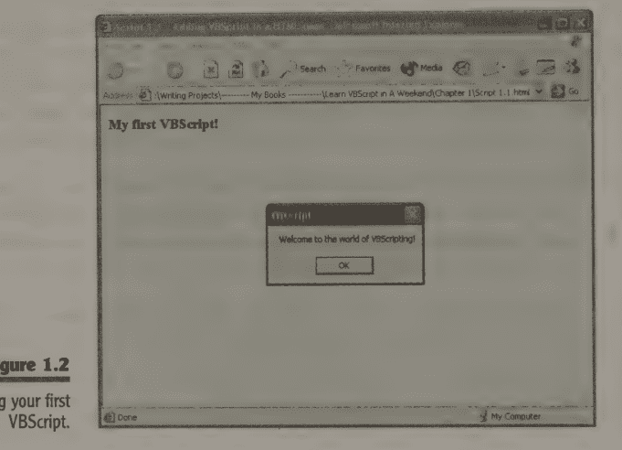

**图 1.2** 测试你的第一个 VBScript。

##### 响应事件执行 VBScripts

通过设置 VBScripts 在用户与你的 HTML 页面交互时运行，你可以为网页添加大量的交互性。例如，如果用户点击一个图形，你可以触发一个 VBScript 执行，并询问用户是否确实要执行某个操作，比如打开一个链接。如果用户回答否，那么你的脚本可以取消该操作，否则它可以允许操作继续正常进行。同样，如果你有一个收集用户信息的网页，你可以创建一个触发 VBScript 的事件。例如，你可以向表单添加一个“提交”按钮，并使用它来触发 VBScript。然后 VBScript 可以验证表单中的每个条目，并确保其填写正确。如果一切检查无误，那么脚本可以允许表单提交。

以下示例演示了如何设置 VBScript，使其在用户点击表单按钮时执行。在这种情况下，脚本显示一个弹出对话框，演示脚本拦截事件并对其做出反应的能力。明天，我将向你展示如何利用这个功能创建真正与用户交流的 HTML 页面。

```
<HTML>
<HEAD>
<TITLE>Script 1.2 - Processing events with VBScript</TITLE>
</HEAD>
<BODY>
<FORM NAME="myForm">
<INPUT TYPE=button NAME="myButton" VALUE="My Button">
<SCRIPT FOR="myButton" EVENT="onClick" LANGUAGE="VBScript">
msgbox "You clicked on My Button!"
</SCRIPT>
</FORM>
</BODY>
</HTML>
```

在这个例子中，VBScript 被嵌入在 body 部分。实际上，我将其放在了表单对象（在本例中是按钮）之后，而它正是为这个按钮定义的。虽然我本可以将 VBScript 代码移动到任何地方，但将其放在定义按钮的 INPUT 标签之后，可以更容易地看出 VBScript 和 HTML 表单是如何结合在一起的。在这个例子中，创建了一个 HTML 表单按钮，显示文本消息 "My Button"。分配给按钮的名称是 myButton。第一个脚本标签上的 FOR 属性指定当 myButton 的 onClick 事件触发时，VBScript 将执行。因此，当用户点击按钮时，脚本标签内定义的 VBScript 代码运行，并显示一个弹出对话框，如图 1.3 所示。

> **注意** 明天你将学习更多关于使用 VBScript 事件的知识。你还可以在附录 A “VBScript 语言参考”中找到事件列表。

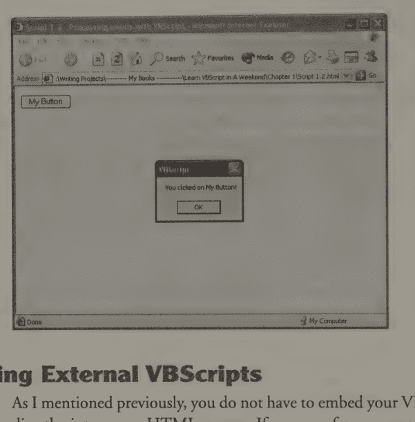

**图 1.3** 使用 VBScript 创建与访客互动的网页。

##### 引用外部 VBScripts

正如我之前提到的，你不必将 VBScript 代码直接嵌入到你的 HTML 页面中。如果你愿意，可以将你的 VBScripts 存储在外部文件中。这样你就可以创建一个 VBScripts 库。你甚至可以使用这种方法将单个 VBScript 共享给任意数量的 HTML 页面。此外，将你的 VBScript 代码与 HTML 代码分开也可以使两者都更容易查看和处理。

以下示例演示了如何在 HTML 页面内引用外部 VBScript。HTML 页面名为 Script 1.3.html，如下所示：

```
<HTML>
    <HEAD>
        <TITLE>Script 1.3 - Referencing an external VBScript</TITLE>
    </HEAD>
    <BODY>
        <SCRIPT SRC="Script 1.4.vbs" LANGUAGE="VBScript"> </SCRIPT>
    </BODY>
</HTML>
```

如你所见，位于 HTML 页面 body 部分内的脚本标签中没有嵌入 VBScript 代码。相反，SRC 属性指定一个名为 `Script 1.4.vbs` 的外部文件的名称，该文件包含 VBScript 代码。

> **注意** 要将你的 VBScripts 放入外部文件，你必须确保这些文件只包含 VBScript 语句，而不是 HTML。否则，你的脚本将失败，并且你会收到错误信息。

文件 `Script 1.4.vbs` 的内容如下所示：

```
'Script 1.4 - An example of an externally referenced VBScript
msgbox "Welcome to the world of VBScripting!"
```

如你所见，外部的 .vbs 文件只有两行代码。第一行是一个注释，用于标识脚本及其功能。明天早上我会更多地讨论注释。第二行是 VBScript。当以这种方式引用时，VBScript 被插入到 HTML 中，然后就像直接嵌入到 HTML 页面中一样被解释执行。

##### 休息一下

在我们深入探讨今晚 VBScript 介绍的第二部分之前，何不稍事休息，放松一下。当你回来时，我将通过研究其架构和运作方式来更详细地介绍 WSH。我还将为你提供一些有用的链接，指向一些网站，你可以在那里找到关于 VBScript 的好资料，更不用说一些示例脚本，你可以在学习编写自己的 VBScript 时下载并试用。

##### 介绍 Windows 脚本宿主

尽管 VBScript 作为客户端 Internet 脚本语言的角色有些模糊，但它作为 WSH 脚本语言的角色是明确的。VBScript 和 JScript 是 Microsoft 随 WSH 提供的默认脚本语言。在这个环境中，VBScript 是两者中更受欢迎的一个。VBScript 是处理只需几行代码的小任务的绝佳工具，而使用完整的 Visual Basic 解决方案则显得大材小用。

Windows XP 与早期的 Windows 操作系统一样，提供了一个直观的 *图形用户界面 (GUI)* 来操作操作系统。然而，有时使用 GUI 可能会很慢且繁琐。例如，假设你刚刚购买了两台运行 Windows XP 的新电脑，需要为每台电脑添加 25 个用户帐户。手动创建这些帐户可能需要一两个小时。然而，在不到一半的时间内，你就可以编写一个脚本来完成这项工作，并且一旦编写完成，你可以反复使用该脚本。

除了 WSH，Microsoft 还为其操作系统提供了内置的 shell 脚本功能。在 Windows 95、98 和 ME 上，shell 脚本功能有限。要在这些操作系统上进行真正的脚本编写，你必须使用 WSH。然而，在 Windows NT、2000 和 XP 上，内置的 shell 脚本语言功能更加强大，包括变量支持、条件编程逻辑、循环和过程等功能。除了 shell 编程语句，shell 脚本还可以包含操作系统命令，并可以执行 Windows 命令行实用程序。这些脚本还可以执行 Windows 资源工具包中提供的实用程序。但是，内置的 Windows shell 脚本功能远不及 WSH 提供的强大。

> **注意** 如果你想了解更多关于 Windows Shell 脚本的知识，我推荐你查阅 **Microsoft Windows Shell Scripting and the WSH Administrator's Guide**，作者是 Jerry Lee Ford, Jr.，由 Prima 出版（ISBN 1-931841-26-8）。


WSH 与操作系统紧密耦合，能够访问和操作多种 Windows 资源。这些资源包括：

-   - Windows 注册表
- Windows 桌面
- Windows 文件系统
- Windows 开始菜单
- Windows 快速启动栏
- Windows 应用程序
- 网络打印机和驱动器
- Windows 服务
- 用户账户

WSH 为 Windows 操作系统提供了最完整、最强大的脚本解决方案，可应用于从 Windows 95 开始的所有 Windows 操作系统版本。因此，除非您只支持 Windows NT、2000 和 XP 操作系统，否则 WSH 应该是您的主要脚本语言。

> **注意** Windows 操作系统上还有其他可用的脚本语言。这些语言包括 REXX、Perl 和 Python。这些脚本语言的版本也可以与 WSH 结合使用。

WSH 的当前版本是 5.6。之前的版本是 2.0 和 1.0。如果您使用的是 Windows XP，那么您已经拥有了 WSH 5.6 版本。如果您支持其他 Windows 操作系统，那么您可能已经安装了之前版本的 WSH。表 1.2 总结了 Windows 操作系统及其附带的 WSH 版本。

您可以在任何 Windows 95 或更高版本的操作系统上安装或升级到 WSH 5.6 版本。您可以从 **www.msdn.microsoft.com/scripting** 下载 WSH 5.6。

表 1.2 Microsoft 操作系统对 WSH 的支持

| 操作系统 | WSH 支持 | 版本 |
| :--- | :--- | :--- |
| Windows 3.X | 否 | - |
| Windows 95 | 是* | - |
| Windows 98 | 是 | 1.0 |
| Windows Me | 是 | 2.0 |
| Windows NT | 是 | ** |
| Windows 2000 | 是 | 2.0 |
| Windows XP | 是 | 5.6 |

*Windows 95 从未预装 WSH。但您可以下载并安装它。
**安装 Service Pack 4 后，Windows NT 4 会安装 WSH 1.0。

##### WSH 架构

WSH 脚本由特定语言的编程语句组成。默认情况下，WSH 附带 VBScript 和 JScript。此外，还有第三方提供的脚本语言也可与 WSH 配合使用。这些语言包括 REXX、Perl 和 Python。Perl 和 Python 都是从 UNIX 演变而来并移植到 Windows 的脚本语言。REXX 是一种起源于 IBM 大型机，从 OS/2 操作系统开始进入 PC 领域的脚本语言。

> **注意** 可以在 [www.activestate.com](http://www.activestate.com) 找到与 WSH 兼容的 Perl 和 Python 版本。IBM 还提供了一个名为 Object REXX 的 REXX 版本，可以与 WSH 一起使用。有关 Object REXX 的信息可在 [www-4.ibm.com/software/ad/obj-rexx](http://www-4.ibm.com/software/ad/obj-rexx) 查到。

因为 WSH 提供了一个可扩展的脚本宿主环境，第三方开发者有可能继续为 WSH 提供额外的脚本语言。然而，在 WSH 支持的所有语言中，VBScript 仍然是最受欢迎的。这是因为：

-   - 它是 WSH 附带的两种默认脚本语言之一。
- 作为 Visual Basic 编程家族的一员，它拥有为数百万 Visual Basic 和 VBA 程序员所熟悉的优势。
- 它是一种功能强大但易于学习的脚本语言。

> **注意** 要使用 WSH，您必须至少精通一种脚本语言。如果您知道多种支持的脚本语言，WSH 允许将它们组合成一个特殊的 Windows 脚本文件。因为所有脚本语言都有自己独特的优势和劣势，WSH 允许您利用每种脚本语言的长处。我将在周日更详细地讨论 Windows 脚本文件，并给您一个如何使用 VBScript 和 JScript 创建它的示例。

要使用 WSH，了解其基本架构和组件（如图 1.4 所示）会很有帮助。

WSH 作为 32 位应用程序在 Windows 操作系统上运行。WSH 架构的核心是核心对象模型。这个组件为脚本提供直接访问 Windows 资源（如文件系统、网络和注册表）的能力。

WSH 提供两种执行环境。`Wscript.exe` 支持从 Windows 桌面执行脚本，并提供了利用图形弹出对话框功能的能力。而 `Cscript.exe` 则设计用于支持从 Windows 命令提示符执行脚本。

您可以使用任何 WSH 支持的脚本语言创建脚本，并将其提交给其中一种执行环境。除了 Wscript.exe 执行环境支持图形弹出对话框外，两个执行主机提供相同的功能和特性。

如我之前所述，WSH 核心对象模型公开了许多 Windows 特定的资源或对象。这些对象的示例包括 Windows 快捷方式、文件、文件夹和驱动器。WSH 核心对象模型公开的每个对象都有自己的一组属性和方法。属性是对象的特征，用于描述和控制对象的特定方面。例如，快捷方式对象有一个可以编程更改的 name 属性。方法是可以由对象执行或用于影响对象的操作。例如，在处理 Windows 文件系统时，有允许您创建和删除文件和文件夹的方法。通过将 Windows 资源公开为对象并使其属性和方法可访问，WSH 核心对象模型提供了以编程方式自动化多种 Windows 任务的能力。如果所有这些关于对象、方法和属性的讨论听起来有点复杂，请不要担心。我将在后续章节中更详细地介绍它。

与 WSH 一起使用的 VBScript 实现缺乏 Internet 浏览器功能。这意味着它不适用于表单、链接和框架等内容，因为这些对象在 Internet 浏览器之外不使用。VBScript 用于 WSH 时，不是嵌入到 HTML 页面中，而是以纯文本文件存储，文件扩展名为 .vbs。

##### 编写 WSH VBScript

与 WSH 一起使用时，VBScript 被保存为纯文本文件，使用 .vbs 文件扩展名，并且仅使用 VBScript 编程语句。以下示例显示了一个简单的两行 VBScript。第一行是描述脚本的注释，第二行在脚本运行时显示一条消息。

```
'Script 1.5 - An example of a WSH VBScript
Wscript.Echo "This script works differently depending on which WSH execution environment runs it!"
```

尽管 Wscript.exe 和 Cscript.exe 执行环境提供等效功能，但它们的用途不同。Wscript.exe 执行主机支持 Windows GUI，而 Cscript.exe 支持 Windows 命令提示符。前面的脚本有助于说明这种差异。例如，如果您通过双击其图标从 Windows GUI 运行该脚本，您会看到如图 1.5 所示的弹出对话框出现在屏幕上。

但是，如果您从 Windows 命令提示符运行相同的脚本，您将收到如图 1.6 所示的输出。

##### 使用 Windows 命令提示符

即使您使用 Windows 操作系统多年，您可能也仅限于使用其命令提示符的经验。如果您要成为一名熟练的 VBScript 程序员，那么您需要习惯于从命令提示符使用 Windows。

Windows 命令提示符是您与操作系统之间的基于文本的接口。要访问命令提示符，请打开 Windows 控制台。在 Windows XP 上，您可以通过单击“开始”、“所有程序”、“附件”，然后选择“命令提示符”来执行此操作。这将打开如图 1.7 所示的 Windows 控制台。

> **注意** 您也可以通过单击“开始”，“运行”，然后键入 `CMD` 并单击“确定”来访问 Windows 命令提示符。

命令提示符以驱动器号后跟冒号、反斜杠和大于号的形式显示。在命令提示符的右侧，您会看到一个闪烁的光标。这表示命令提示符已准备好接受新输入。例如，键入

DIR 并按 Enter 键。DIR 命令告诉 Windows 显示当前工作目录中所有文件的目录列表，如下所示：

```
C:\>dir
  Volume in drive C is IBMDOS_6
  Volume Serial Number is 2B6A-58F8

  Directory of C:\

  11/10/2001  11:07 AM    <DIR>          DOS
  06/29/1993  12:00 PM         9,349 WINA20.386
  11/10/2001  12:40 PM           127 AUTOEXEC.BAT
  11/10/2001  12:40 PM            90 CONFIG.SYS
  11/10/2001  11:18 AM    <DIR>          WINDOWS
  11/10/2001  11:43 AM            65 CONFIG.BAK
  11/10/2001  01:24 PM    <DIR>          Program Files
  11/10/2001  12:35 PM         1,330 SCANDISK.LOG
  12/01/2001  10:45 AM        90,112 ffastunT.ffl
  11/10/2001  01:01 PM    <DIR>          Documents and Settings
          6 File(s)        101,073 bytes
          4 Dir(s)    197,525,504 bytes free

C:\>
```

Windows 处理该命令然后显示其输出。随后命令提示符再次显示，表明它已准备好接受新的命令。

Windows 命令提示符提供了你与操作系统之间的接口或外壳（参见图 1.8）。你键入的任何命令都会被翻译成操作系统可以理解的指令。然后该命令被执行，操作系统返回的任何结果都会在 Windows 控制台中显示。

你可以使用以下命令来运行名为 Script 1.5.vbs 的 VBScript，该文件位于当前工作目录中：

```
Cscript "Script 1.5.vbs"
```

**图 1.8** Windows 命令提示符提供了一个接口或外壳，将你与操作系统的复杂性隔离开来。

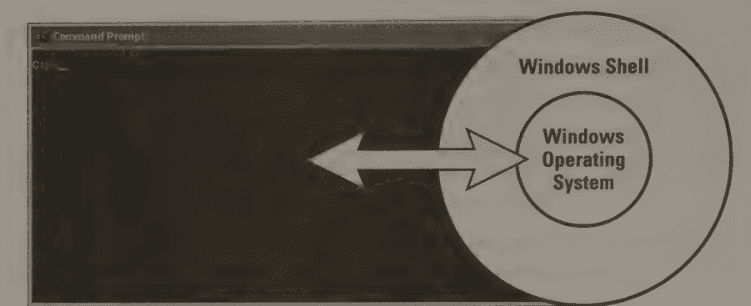

此命令告诉 Windows 使用 WSH Cscript.exe 执行主机来运行名为 Script 1.5.vbs 的 VBScript。因为文件名包含一个空格，我不得不将其放在引号内。如果你愿意，也可以使用以下命令在命令提示符下使用 Wscript.exe 执行主机来运行 VBScript：

```
Wscript "Script 1.5.vbs"
```

因为 wscript.exe 执行主机设计用于 Windows GUI，所以脚本的输出将显示为一个弹出对话框。

**注意** 在命令提示符下键入 exit 并按 Enter 键可关闭 Windows 控制台。

**注意** 我没有足够的时间和空间来详细讲解如何使用 Windows 命令提示符。如果你认为需要比我提供的更多信息，我建议你查看 Windows 帮助系统。你可能还想阅读 Jerry Lee Ford, Jr. 所著、Prima 出版的 **《Microsoft Windows Shell Scripting and the WSH Administrator's Guide》**（ISBN 1-931841-26-8）。

##### 寻找 VBScript 源代码

学习 VBScript 没有比坐下来开始编写自己的代码更好的方法了。然而，每个人都需要一个起点。你在本书中看到的所有脚本都位于本书的网站上，网址为 www.premierpressbooks.com/downloads.asp。

以下是一些优秀的网站，我在那里找到了很多好的 VBScript 信息。这些网站也是寻找 VBScript 源代码示例的好地方。我建议花些时间访问这些网站，以及你在浏览万维网时可能遇到的其他网站。尝试下载一些你会发现的免费脚本，并弄清楚它们是如何工作的。一个很好的学习方法是尝试对脚本进行修改，看看你是否能改进它们。其中许多网站还允许你上传自己的 VBScript 作品，以便与世界其他人分享。

我首先要查看的地方是 Microsoft 的官方 VBScript 文档，如图 1.9 所示。在撰写本书时，你可以通过键入 **www.msdn.microsoft.com/scripting** 访问

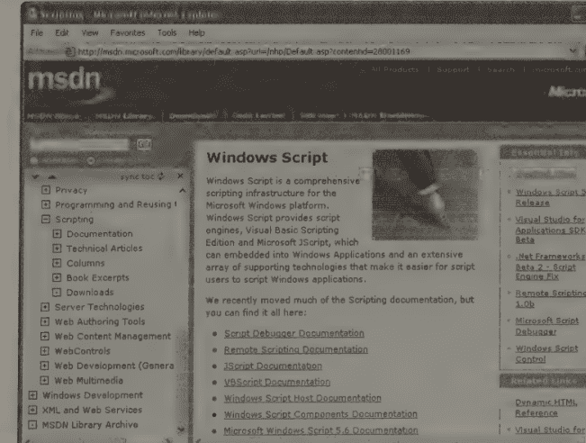

此站点。然后你会被重定向到这个站点。在这里，你将找到完整的 VBScript 用户和参考指南。你还会找到大量的 VBScript 示例。这也是查找 WSH 文档的地方。

另一个不错的网站是 **www.vbscript.myscripting.com**，如图 1.10 所示。在这里，你将找到有关 VBScript 书籍、链接和教程的信息，以及大量的 VBScript 示例。

你可能还想访问 **www.win32scripting.com**，如图 1.11 所示。在这里，你将找到大量包含大量编码示例的文章合集。然而，这是一份订阅杂志，因此要获得大量优质内容，你需要订阅。

我推荐你访问的另一个网站是 **www.cwashington.netreach.net**，如图 1.12 所示。在这里，你将找到大量的 VBScript、指向包含 WSH 信息页面的链接，以及关于 Windows 操作系统脚本编写几乎所有方面的信息。

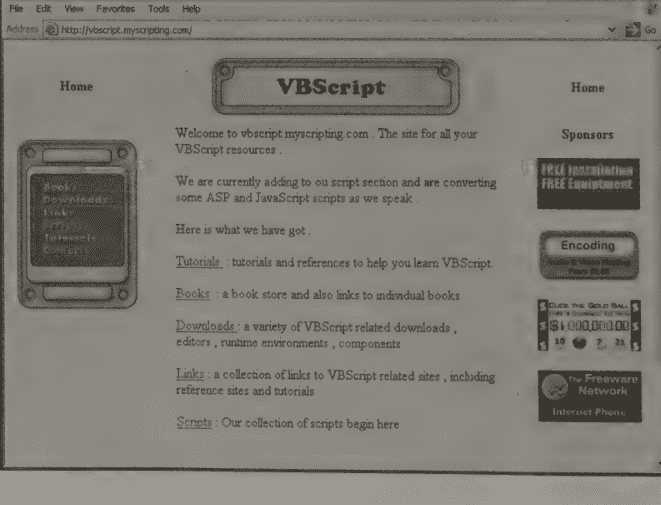

**图 1.10** www.vbscript.myscripting.com 是寻找示例 VBScript 和其他有用信息的良好来源。

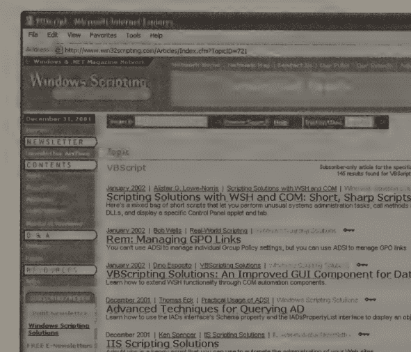

**图 1.11** Windows Scripting Solutions 是一份订阅杂志，但也提供大量免费文章和内容。

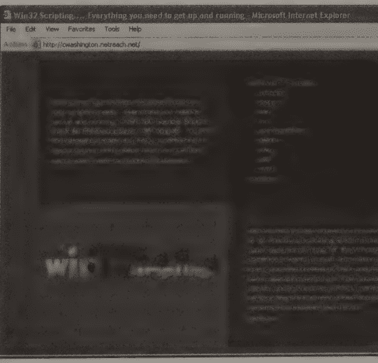

**图 1.12** Win32scripting 免费提供大量 VBScript 资源。

## 下一步是什么？

好了，我想今晚的内容差不多了。你为什么不让你的大脑休息一下，让今晚涵盖的所有内容都消化吸收呢。明天早上我们将通过回顾 VBScript 编程开始。然后我们将花下午和晚上的时间学习如何使用 VBScript 增强你的 HTML 页面。

周六上午

#### VBScript 编程简介

- 学习 VBScript 语法的基础知识
- 了解 VBScript 如何处理变量和常量
- 发现如何使用条件和循环逻辑控制脚本执行
- 了解如何使用 VBScript 运算符和表达式
- 发现如何将你的 VBScript 组织成过程
- 学习如何使用数组组织大量数据

早上好！希望你休息好了，准备好开始工作了。昨天我们看了 VBScript 的历史和功能。我们还讨论了如何将 VBScript 集成到 HTML 页面中并将其保存为 WSH VBScript 文件。今天早上我们将开始研究构成 VBScript 编程语言的编程语句。

本章的主要重点是为你提供编写自己的 VBScript 所需的一切知识。在介绍每个不同的 VBScript 语句时，我会指出它的语法和用途。我还将提供这些语句在 HTML 页面或 WSH VBScript 文件中可能如何使用的示例。在本章的学习过程中，我将尽量平衡地涵盖 Web 脚本和 WSH 脚本。

##### 入门

现在是确保你拥有开始编写 VBScript 所需所有工具的好时机。你需要

- 一个脚本编辑器
- Internet Explorer 6
- Windows Script Host 5.6

只要它能将你的脚本保存为纯文本，任何编辑器都可以。如果你打算使用记事本，可以通过单击“开始”、“所有程序”、“附件”，然后单击“记事本”来启动它。

我将在 Windows XP Home Edition 和 Windows XP Professional 上对本书中你将看到的所有脚本进行测试和开发。然而，任何 Windows 95 或更高版本的 Microsoft 操作系统都可以正常工作。

如果你的计算机运行 Windows XP，那么你已经拥有 Internet Explorer 6。但是，如果你使用的是较旧的操作系统，你可能需要访问 http://www.microsoft.com/windows/ie 并下载它。

你可能想查看像 www.tucows.com、www.download.com 或 www.jumbo.com 这样的共享软件网站，以寻找一些好的脚本编辑器。

##### VBScript 语法

VBScript 是用纯文本编写的，无论是嵌入在 HTML 页面中还是存储为具有 .vbs 文件扩展名的文件。就编程语言而言，VBScript 相当宽松。例如，VBScript 变量名不区分大小写。这意味着只要你在脚本中引用变量名时拼写正确，它就会被正确解释。例如，如果你在脚本开头定义了一个名为 myVar 的变量，然后在脚本后面将其引用为 myvar 或 MYVAR，一切仍然会正常工作。在其他一些脚本语言中，情况并非如此，大小写稍有变化就会导致错误。

VBScript 在其他方面也非常宽容。例如，只要拼写正确，VBScript 将允许你使用不同的大小写来引用对象、方法和函数。例如，VBScript 会将以下所有语句视为相同。

```
WScript.Echo "Good morning!"
WSCRIPT.ECHO "Good morning!"
Wscript.echo "Good morning!"
WsCrIpT.eChO "Good morning!"
```


然而，编写 VBScript 时最好保持统一的格式风格。尽管 VBScript 允许混合大小写，但这会使脚本难以阅读。

VBScript 是一种灵活的语言，因为它在格式化脚本方面为你提供了很大的自由度。例如，你可以在语句之间添加空行以提高可读性，并在语句前缩进多个空格，从而为它们提供一个易于阅读的视觉组织结构。

##### 避免语法错误

理解 VBScript 语法是成为优秀 VBScript 程序员的关键部分。每个 VBScript 语句都有自己独特的语法，你必须遵守。否则，运行脚本时就会出错。例如，以下 VBScript 的第二行就包含一个错误。

```
'Script 2.1 - An example of a VBScript syntax error in a HTML page
MsgBox "Good morning
```

VBScript MsgBox() 语句的语法要求文本消息必须包含在匹配的引号内。但在前面的示例中，缺少了结束引号。如果你将此脚本保存为扩展名为 .vbs 的文件，然后使用 WScript.exe 执行宿主运行它，你将看到如图 2.1 所示的错误消息。

> 在你使用 VBScript 编程多年之前，你可能会发现自己花很多时间查阅 VBScript 语句的语法。当你积累了自己的一套脚本后，你会发现通常可以通过从旧脚本中复制和粘贴代码语句并进行修改来创建新脚本。但即便如此，你可能仍需要仔细检查命令语法。你可以随时回到本章查看此处给出的示例。此外，不要忘记附录 A “VBScript 语言参考”。另一个很好的资源是 Microsoft 的 VBScript 语言参考，你可以在 http://msdn.microsoft.com/scripting 找到它。

#### 周末学习 VBScript

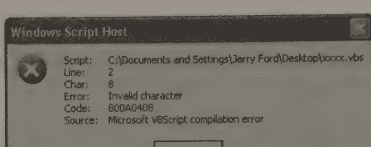

图 2.1
WSH VBScript 执行期间发生的 VBScript 语法错误。

如果你将脚本嵌入到 HTML 页面中，如下面所示，也会出现错误。

```
<HTML>
    <HEAD>
        <TITLE>Script 2.2 - An example of a VBScript syntax error in a HTML page</TITLE>
        <SCRIPT LANGUAGE="VBScript">
            Sub Window_Onload
                MsgBox "Good morning!"
            End Sub
        </SCRIPT>
    </HEAD>
    <BODY>
    </BODY>
</HTML>
```

根据你的 Internet Explorer 配置方式，错误发生时你可能看不到它。默认情况下，Internet Explorer 会抑制所有脚本错误。这样，当你的脚本出现问题时，网站访问者就不会受到错误消息的打扰。

> **注意** 一个可能出错的原因是访问者运行的是旧版本的 Internet Explorer，而你的脚本并非针对该版本设计。

如果你的 Internet Explorer 副本正在抑制你的 VBScript 错误消息，那么你将看不到错误，只会在浏览器的左下角看到一个黄色图标，如图 2.2 所示。

如果你双击此图标，你将看到 VBScript 错误消息，如图 2.3 所示。

##### 周六上午 VBScript 编程入门

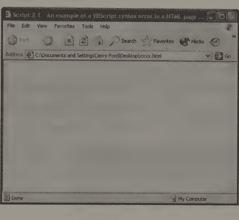

**图 2.2**
默认情况下，Internet Explorer 会隐藏 VBScript 错误。

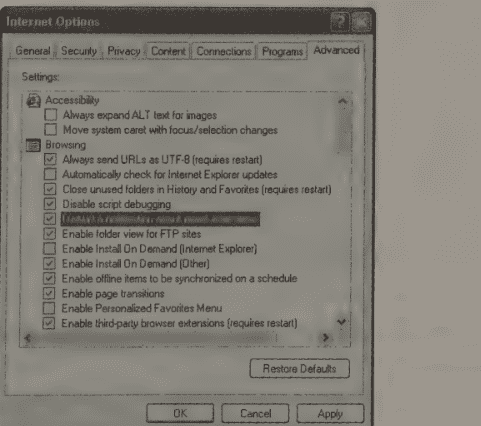

**图 2.3**
Internet Explorer 报告的 VBScript 错误。

当你为 HMTL 页面开发脚本时，如果在错误发生时能看到它们，通常会容易得多。你可以按照以下过程中概述的步骤配置 Internet Explorer 6 以自动显示脚本错误。

#### 周末学习 VBScript

###### 配置 Internet Explorer 6 以显示脚本错误

1.  启动 Internet Explorer。
2.  从“工具”菜单中选择“Internet 选项”。出现 Internet 选项对话框。
3.  选择“高级”属性表，如图 2.4 所示。
4.  选中“显示每个脚本错误的通知”选项，然后单击“确定”。

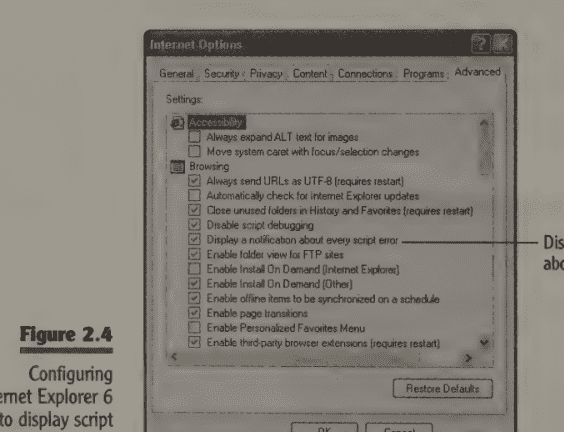

###### 对非 Internet Explorer 浏览器隐藏 VBScript 语句

只有 Internet Explorer 支持 VBScript。如果你正在为你的网站添加 VBScript，而有人使用非 Internet Explorer 或 3 版之前的 Internet Explorer 浏览器访问，你的 VBScript 不会运行，而且访问者还会看到你的 VBScript 语句直接打印在网页中间。

##### 周六上午 VBScript 编程入门

这是因为不理解 VBScript 的浏览器会将你的 VBScript 语句视为文本并显示出来。显然，这不是你想要的效果。防止这种情况发生的解决方案是使用 HTML 注释标签和 VBScript 注释语句。

<!-- 是 HTML 注释的开始标签，--> 是结束标签。所有浏览器都足够智能，不会显示 HTML 注释标签之间的任何内容。将这些标签放在开始的 <SCRIPT> 标签之后和结束的 </SCRIPT> 标签之前，如下面的示例所示。同时，在 HTML 注释标签的开头放置一个 VBScript 注释。

```
<HTML>
<HEAD>
<TITLE>Script 2.3 - Hiding VBScript from non-supporting browsers</TITLE>
<SCRIPT LANGUAGE="VBScript">
<!-- Start hiding VBScript statements
Sub Window_Onload
  MsgBox "Good morning!"
End Sub
' End hiding VBScript statements -->
</SCRIPT>
</HEAD>
<BODY>
</BODY>
</HTML>
```

现在，当不支持 VBScript 的浏览器处理此页面时，它会将你的脚本视为注释并直接忽略它。支持 VBScript 的浏览器会识别出 HTML 注释的开始标签并忽略它。这些浏览器也会将第二个 HTML 标签视为 VBScript 注释并忽略它。你会发现我在本书其余的 VBScript 示例中都使用了这个简单的技巧。我强烈建议你在所有嵌入的 VBScript 中都使用它。

##### VBScript 语句

VBScript 由一个或多个 VBScript 语句组成。VBScript 提供了一套完整的编程语句集，本章其余部分将概述和解释这些语句。我们将涵盖的编程语句类型包括

-   VBScript 注释
-   变量声明和赋值
-   VBScript 常量
-   条件语句
-   循环语句
-   函数和子过程

####### 为 VBScript 添加注释

使用注释可以使你的脚本更易于处理。注释允许你使脚本自我文档化。VBScript 解释器在执行脚本时会忽略注释。虽然向脚本添加注释可能会在解释过程中减慢速度，但执行包含大量注释的脚本所损失的时间是无法察觉的。因此，我强烈建议你在所有脚本中大量添加注释。虽然你在第一次编写脚本时可能完全理解脚本的功能，但一年后当你需要修改脚本时，你可能不太确定自己当时的想法。

你可以通过两种方式为脚本添加注释。第一种是使用 Rem 语句。

```
Rem Script 2.4 - Documenting your script with comments
MsgBox "This script was documented using the REM statement"
```

或者，你可以使用单引号字符为脚本添加注释。

```
' Script 2.5 - Documenting your script with comments
MsgBox "This script was documented using the quotation character"
```

无论你选择哪种选项，结果都是一样的。

VBScript 在注释的应用上很灵活，允许你将它们放在单独的行上，或者与程序语句放在同一行，如此处所示。只要确保 VBScript 语句和注释之间至少有一个空格。

```
MsgBox "This is a VBScript!"    'This statement displays a message in a pop-up dialog
```

> 你也可以使用 Rem 在 VBScript 语句末尾添加注释。但是，你还必须在 VBScript 语句之后和 Rem 关键字之前添加一个冒号。
MsgBox "This is a VBScript!" : Rem This statement displays a message in a pop-up dialog

注释的另一个好用途是构建脚本模板。然后，你可以将该模板作为每次坐下来编写新 VBScript 时的起点。下面的示例展示了我将在本书中用于记录 WSH VBScript 的模板。

```
' **************************************************
' * Script Name:      template.vbs
' * Description:      This script
' * Author:           Jerry L. Ford, Jr.
' * Address:          Hanover Virginia
' * Created:          01/05/02
' **************************************************

' **** Script initialization statements go here ****

' *********** Main processing section ***********

' ******* Subroutines & Functions go here ********
```

模板首先提供了一个记录基本信息的位置。模板概述了三个部分：第一个部分是我定义和设置变量及其初始值的地方；第二个部分是我

编写脚本的主要处理逻辑；最后一部分用于存放脚本定义的所有子程序和函数。

###### 使用常量

*常量*包含一个永不改变的值。例如，PI 的值就是一个常量。使用常量来定义那些在脚本执行期间已知永远不会改变的值。

与其他一些脚本语言类似，VBScript 提供了一系列预定义常量。你可以在附录 A 中找到 VBScript 常量的列表。VBScript 也允许你定义自己的常量。

例如，你可以定义一个包含 Windows 文件夹名称和路径的常量，如下所示。

```
Const cDefaultFolder = "C:\Temp"
```

在这个例子中，常量的名称是 cDefaultFolder，其静态赋值为 C:\Temp。因为这是一个文本值，所以必须用引号括起来。在定义数字值的常量时，你需要省略引号，如下所示。

```
Const cMaxValue = 100
```

如果你创建一个日期值的常量，那么你需要使用以下格式。

```
Const cFixedDate = #01-05-02#
```

如你所见，分配给日期常量的值用 # 字符括了起来。

> 我建议你考虑为常量开发一个命名约定。例如，你刚才看到的所有常量示例都以小写字母 c 开头，这将它们标记为常量，而不是变量（我将在接下来讨论变量）。这使你的代码更具可读性，并有助于确保你不会混淆常量和变量。

###### 在变量中存储数据

VBScript 允许你编写可以在执行时将数据存储在内存中的脚本。这样，你就可以向你的 WSH 脚本用户或网站访客询问信息，然后在脚本执行过程中反复引用它。

与大多数其他编程语言不同，VBScript 只支持一种称为 *variant* 的变量类型。*Variant* 可以保存多种不同类型的数据。VBScript 在识别存储在变量中的数据类型并相应处理方面做得很好。例如，如果你将一个数字值赋给一个变量，那么它将像数字一样表现，允许你在操作其值的表达式中使用它。另一方面，如果你给它赋一个文本消息，该变量将像文本一样表现。

类似于你可以定义存储在常量中的数据类型的方式，你可以通过应用引号来控制 VBScript 如何处理存储在变量中的值。例如，如果你创建一个变量并为其赋值 100，它将被视为数字值。但如果你将数字括在引号中，例如 "100"，它将被存储为文本值。

尽管 VBScript 只支持 variant 变量类型，但它确实允许你使用 variant 子类型进一步对变量进行分类。表 2.1 列出了 VBScript 支持的 variant 子类型。

| 子类型 | 描述 |
|---|---|
| Empty | 创建一个未初始化的变量 |
| Null | 建立一个具有空值的变量 |
| Boolean | 值为 *true* 或 *false* |
| Byte | 设置一个介于 0 到 255 之间的整数值 |
| Integer | 设置一个介于 -32,768 到 32,767 之间的整数值 |
| Currency | 货币值 |
| Long | 一个介于 -2,147,483,648 到 2,147,483,647 之间的整数值 |
| Single | 单精度浮点数 |
| Double | 双精度浮点数 |
| Date | 表示日期的数字 |
| String | 文本字符串 |
| Object | 对象 |
| Error | 错误号 |

VBScript 允许你使用内置的转换函数将 variant 子类型从一种类型转换为另一种类型。这些函数的列表在附录 A 中提供。通过使用转换函数，你可以设置 variant 的子类型。例如，你可以创建一个 variant 变量，如下所示。

```
myBirthday = "November 20, 1964"
```

这将变量存储为 variant，并告诉 VBScript 将其视为文本。要将变量的值转换为日期，你可以使用 Cdate() 函数，如下所示。

```
myBirthDate = Cdate(myBirthday)
```

###### 命名变量

在向 VBScript 添加第一个变量之前，你需要了解一些需要遵循的规则。

- 变量名在其使用范围内必须是唯一的。
- 变量名不能超过 255 个字符。
- 变量名必须以字母字符开头。
- 变量名不能包含嵌入的句点。

虽然不是强制性的，但我建议你为变量起描述性的名称，以帮助记录其内容。例如，定义为 totalValue 的变量比名为 x 的变量更容易理解。描述性的变量名将使你的脚本更易于阅读和维护。

###### 使用变量

在可以在 VBScript 中使用变量之前，你应该声明它们。你可以使用两种选项之一在 VBScript 中声明变量。第一种选项是在代码中简单地引用该变量。

```
userName = "JerryFord"
```

但是，将变量纳入 VBScript 的首选方法是使用 Dim 关键字正式声明它们。使用 Dim 关键字使你的脚本更易于阅读。使用 Dim 所需的语法如下。

```
Dim variableName
```

variableName 是被声明的变量的名称。因此，要使用 Dim 来声明前面显示的变量，你应该这样写。

```
Dim userName
```

声明变量后，你可以为它赋值，如下所示。

```
userName = "Jerry Ford"
```

如果你有一个脚本将使用大量变量，VBScript 允许你通过用逗号分隔变量来一次声明多个变量。

```
Dim userName, userBirthday, userAge, userId
```

在使用变量之前正式声明变量被认为是良好的编程实践。为了强制在你的 VBScript 中正式声明变量，你可以使用 Option Explicit 语句。使用时，Option Explicit 必须是脚本的第一行。Option Explicit 告诉 VBScript，如果你尝试使用一个尚未使用 Dim 关键字定义过的变量，将生成一个错误。

例如，以下示例演示了如何在嵌入 HTML 页面的 VBScript 中使用 Option Explicit。

```
<HTML>
  <HEAD>
    <TITLE>Script 2.6 - Using Option Explicit to enforce formal variable declaration</TITLE>
    <SCRIPT LANGUAGE="VBScript">
    <!-- Start hiding VBScript statements
      Option Explicit
      Dim userName
      userName = "Jerry Ford"
    ' End hiding VBScript statements -->
    </SCRIPT>
  </HEAD>
  <BODY>
    <SCRIPT LANGUAGE="VBScript">
    <!-- Start hiding VBScript statements
      Sub Window_Onload
        MsgBox "Greetings " & userName
      End Sub
    ' End hiding VBScript statements -->
    </SCRIPT>
  </BODY>
</HTML>
```

在这个例子中，一个 VBScript 嵌入在 HTML 页面的 HEAD 部分，其中声明了一个变量并为其赋值。另一个 VBScript 嵌入在 HTML 页面的 BODY 部分，包含一个子程序，当浏览器加载 HTML 页面时执行。这个 VBScript 在弹出对话框中显示分配给变量的值。

###### 检查变量作用域

在上一个示例中，在 HEAD 部分声明的名为 userName 的变量被 BODY 部分中的另一个脚本引用。这是一个具有全局作用域的变量的示例。全局作用域允许从脚本中的任何位置访问变量的值。另一方面，具有局部作用域的变量只能在其创建的范围内访问。

在 VBScript 中，局部变量只能在过程内部创建。VBScript 支持两种类型的过程——子程序和函数——这两者都将在稍后更详细地介绍。现在我只想说，过程是一组 VBScript 语句，可以从脚本中的任何点调用和执行。过程在 VBScript 中用作改进脚本组织的一种方式。

以下示例展示了定义局部和全局变量的 WSH VBScript。

```
' *********************************************
' * Script Name:      Script 2.7.vbs
' * Description:      This script demonstrates the
' *                   use of local and global variables
' * Author:           Jerry L. Ford, Jr.
' * Address:          Hanover Virginia
' * Created:          01/06/02
' *********************************************

' ***** Script initialization statements go here *****

Option Explicit

dim userName
userName = "William Ford"

' *********** Main processing section **************

WScript.Echo "Global Scope = " + userName
Display_Names()
WScript.Echo "Global Scope = " + userName

' ********* Subroutines & Functions go here *********

Function Display_Names()
    Dim userName
```


###### 使用运算符操作 VBScript 变量

正如你已经看到的，VBScript 的 `=` 赋值运算符用于为变量赋值。当你处理包含数值的变量时，可以使用任何 VBScript 算术运算符（如表 2.2 所示）来更改分配给变量的值。

以下 VBScript 语句展示了如何应用表 2.2 中列出的一些运算符。

```
Option Explicit

Dim myAge
myAge = 37
WScript.Echo "myAge = " & myAge
```

| 运算符 | 描述 |
|---|---|
| ^ | 幂运算 |
| - | 取负 |
| * | 乘法 |
| / | 除法 |
| \ | 整数除法 |
| Mod | 取模 |
| + | 加法 |
| - | 减法 |
| & | 字符串连接 |

###### 一个周末学会 VBScript

```
myAge = myAge + 3
WScript.Echo "myAge = " & myAge

myAge = myAge - 10
WScript.Echo "myAge = " & myAge

myAge = myAge * 2
WScript.Echo "myAge = " & myAge
```

> 你可能已经注意到前面示例中使用了 `&` 字符串连接运算符。这个运算符实际上用于连接两个文本段，并且在示例中用于将变量的值（作为文本）附加到文本消息的末尾。

如果你将这个脚本保存为 WSH VBScript 的一部分，并从 CScript.exe 执行主机运行它，你将看到此处显示的输出。

```
myAge = 37
myAge = 40
myAge = 30
myAge = 60
```

VBScript 使用一组称为运算符优先级的严格规则执行算术运算。此顺序在表 2.2 中概述。如你所见，幂运算在取负之前发生，取负在乘法之前发生，依此类推。但是，通过将表达式的部分括在括号内，你可以改变运算符的优先级顺序。括号内的表达式部分总是首先计算，尽管优先级顺序在括号内仍然保持。

####### 比较运算符

VBScript 提供了一组运算符，你可以使用它们来比较 VBScript 中表达式的值。这些运算符列在表 2.3 中。

####### **表 2.3 比较运算符**

| 运算符 | 描述 |
| :--- | :--- |
| = | 等于 |
| <> | 不等于 |
| < | 小于 |
| > | 大于 |
| <= | 小于或等于 |
| >= | 大于或等于 |

在脚本中测试变量的值是你将发现自己反复做的事情。当与条件执行逻辑（我稍后会介绍）结合时，你将能够编写可以测试特定条件，然后基于这些测试的结果在多个执行路径之间切换的脚本。

与算术运算符不同，比较运算符的执行没有优先级顺序。它们按照在语句中出现的顺序执行（例如，它们从左到右开始计算）。

例如，以下语句测试两个变量的值是否相等。

```
Option Explicit
Dim myAge, yourAge
If myAge = yourAge Then
    WScript.Echo "Lets have a party"
End If
```

同样，你可以测试大于或小于的值。

```
If myAge > yourAge Then
    WScript.Echo "May I see some ID?"
End If
If myAge < yourAge Then
    WScript.Echo "Would you like to see my ID?"
End If
```

###### 稍作休息

好吧，我认为这是一个快速休息的好地方。从今天早上开始，我们已经学习了很多材料。何不给自己一个休息时间，让知识慢慢消化。当你回来时，我将通过介绍条件逻辑、循环、过程、数组和弹出对话框的使用来完成 VBScript 编程的复习。完成早上的学习后，你将准备好继续前进，开始编写 VBScript 来增强你的 HTML 页面并自动化你的计算机管理任务。

###### 条件逻辑

VBScript 提供两个语句，允许你添加可以改变脚本逻辑执行方式的逻辑。这样，你的脚本就可以根据用户或环境标准做出决策。这些语句如下所列。

- **If...Then...Else。** 基于一个或多个测试条件指导脚本的逻辑执行。
- **Select...Case。** 基于对同一条件执行的多个测试指导脚本的逻辑执行。

####### If...Then...Else

If...Then...Else 语句执行一个或多个条件的测试，并根据测试结果是否为真或假来改变脚本的执行。If...Then...Else 语句有两个版本。第一个版本允许你测试单个条件。其语法如下所示。

```
If *condition* Then *statement* [Else *statement*]
```

*Condition* 是一个计算结果为真或假的表达式，*statement* 代表如果条件计算结果为真时要执行的 VBScript 语句。*Else* 提供一个可选语句，如果测试条件为假则执行。例如，你可以使用此版本的 If...Then...Else 语句来测试两个变量是否相等，如这里所示。

```
If unitsSent = unitsReceived Then MsgBox "This item is not in stock "
Else MsgBox " This item is in stock "
```

前面的示例测试分配给两个变量 `unitsSent` 和 `unitsReceived` 的值。如果这两个变量的值相等（或为真），则显示“无剩余库存”消息。如果这两个变量的值不相等（或为假），则显示不同的消息。

如果你需要作为比较的结果执行多个 VBScript 语句，那么你需要使用以下 If...Then...Else 语句的语法。

```
If *condition* Then
    *statements*
ElseIf *condition-n* Then
    *statements*
.
.
Else
    *statements*
End If
```

例如，你可以如这里所示修改前面示例中的 IF...Then...Else 语句。

```
If unitsSent = unitsReceived Then
    MsgBox "No inventory remaining"
    unitsOnhand = 0
Else
    MsgBox "This item is in stock"
    unitsOnhand = unitsSent - unitsReceived
End If
```

在 If...Then...Else 语句的多行版本中，可以包含的语句数量没有限制。如果你包含一个或多个 `ElseIf` 关键字，你可以扩展 If...Then...Else 语句的逻辑以包含对多个条件的测试，如以下示例所示。

```
If unitsSent = unitsReceived Then
    MsgBox "No inventory remaining"
    unitsOnhand = 0
ElseIf unitsSent > unitsReceived Then
    MsgBox "Inventory error: Units sent cannot exceed _
             units received"
ElseIf unitsSent < unitsReceived Then
    MsgBox "This item is in stock"
    unitsOnhand = unitsSent - unitsReceived
End If
```

**注意** 你可能已经注意到我在前面的示例中使用了 `_` 字符。`_` 字符是一个续行字符，允许你将一个很长的 VBScript 语句分布在多行上。

如本例所示，你可以使用 `ElseIf` 根据需要执行任意多次测试。

有时你需要对一组值执行比单个 If...Then...Else 语句能提供的更复杂的分析。VBScript 通过允许你将 If...Then...Else 语句嵌套或嵌入其他 If...Then...Else 语句中来解决此需求，从而开发出更复杂的测试，如以下示例所示。

```
If unitsSent < unitsReceived Then
    unitsOnhand = unitsReceived - unitsSent
```


###### 星期六早晨 VBScript 编程入门

```vbscript
If unitsOnhand > 5 then
    MsgBox "库存中还有大量单位"
Else
    MsgBox "是时候重新订购更多单位了"
End If
End If
```

如你所见，`If` 语句测试是否还有库存单位。如果单位仍然可用，单位数量将记录在 `unitsOnhand` 变量中。然后，一个嵌套的 `IF...Then...Else` 语句会查询该变量，以确定是否是时候重新订购更多单位了。

####### Select Case

`Select...Case` 语句提供的功能与 `If...Then...Else` 语句非常相似。然而，虽然 `If...Then...Else` 语句可以测试大量不同的条件，但 `Select...Case` 语句更适用于针对单个条件测试大量标准。`Select...Case` 语句的语法如下

```vbscript
Select Case value
    Case expression
        statements
    .
    .
    Case expression
        statements
    Case Else
        statements
End Select
```

`Select...Case` 评估 `Select...Case` 语句中指定的单个值，并将其与后续每个 `Case` 语句中存储的值进行比较，如下面的示例所示。

```vbscript
Select Case myColor
    Case "blue"
        MsgBox "匹配的颜色是蓝色"
    Case "yellow"
        MsgBox "匹配的颜色是黄色"
    Case "red"
        MsgBox "匹配的颜色是红色"
    Case Else
        MsgBox "未找到匹配的颜色"
End Select
```

###### 使用循环

与任何高级编程语言一样，VBScript 提供了多种语句，允许 VBScript 循环或迭代重复执行，以快速高效地处理大量数据。这些语句使得编写能够处理海量数据的小型脚本成为可能。

VBScript 提供了五种不同类型的循环，此处进行了总结，每种都有其独特的目的和优势。

-   - **Do While.** 设置一个循环，在指定条件保持为真时进行迭代。
-   - **Do Until.** 设置一个循环，在指定条件变为真之前进行迭代。
-   - **For...Next.** 设置一个循环以执行指定次数。
-   - **While...Wend.** 设置一个在条件保持为真时执行的循环。
-   - **For...Each...Next.** 创建一个循环，遍历对象的属性。

####### Do While

VBScript `Do While` 语句用于创建在条件保持为真时运行的循环。在你的 VBScript 中，有两种方法可以设置 `Do While` 循环。第一种方法的语法如下

```vbscript
Do While condition
    statements
Loop
```

你可以在开头的 `Do` 和结尾的 `Loop` 关键字之间插入任意多条编程语句。`While` 关键字包含在循环的开头。因此，如果正在测试的条件已经为假，则循环将永远不会执行。例如，以下 VBScript 语句展示了一个 `Do While` 循环，该循环从 1 计数到 10。在此示例中，一个名为 `myCount` 的变量被初始化为 0，然后每次循环执行时递增 1。当变量的值最终超过 10 时，循环终止，处理继续执行脚本中的下一条语句。因此，`myCount` 用于控制循环的执行和终止。

```vbscript
' ***************************************
' * 脚本名称：      Script 2.8.vbs
' * 描述：          此脚本演示了
' *                 VBScript Do While
' *                 循环的用法
' * 作者：          Jerry L. Ford, Jr.
' * 地址：          弗吉尼亚州汉诺威
' * 创建日期：      02/01/13
' ***************************************

' ***** 脚本初始化语句放在这里 *****

Option Explicit

Dim myCount '用于控制循环终止的计数器
myCount = 0

Dim crlf ' 包含回车和换行指令
crlf = Chr(13) & Chr(10)

' ************* 主处理部分 **************

WScript.Echo "使用 Do While 循环计数到 10" & crlf

Do While myCount < 10
    myCount = myCount + 1
    WScript.Echo(myCount) & crlf
Loop

' *********** 子程序和函数放在这里 ***********
```

**64 周末学习 VBScript**

> 注意 你可能注意到我在示例中创建了一个名为 `crlf` 的变量，并将其设置为由 `Chr(13)` 和 `Chr(10)` 组成的连接字符串。`CHR()` 是一个 VBScript 函数，调用时返回传递给它的 ANSI 字符代码值。`Chr(13)` 返回等同于换行符的值，`Chr(10)` 返回回车符值。

图 2.5 显示了使用 WSH Script.exe 执行主机运行前面示例的结果。

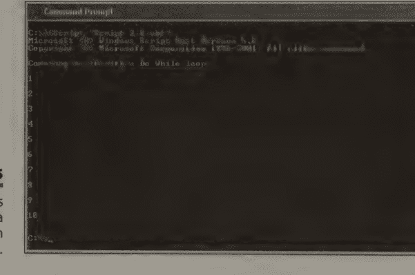

**图 2.5** Do While 循环会一直处理，直到测试的条件变为假。

`Do While` 语句的第二种格式将 `While` 关键字移到循环的末尾。这种格式的 `Do While` 循环语法如下

```vbscript
Do
statements
Loop While condition
```

将 `While` 关键字从循环开头移到末尾的效果是，即使测试的条件最初为假，也会强制循环至少处理一次。

####### Do Until

VBScript `Do Until` 语句用于创建在测试条件保持为假时运行的循环。与 `Do While` 语句一样，`Do Until` 语句有两种形式。第一种形式的语法如下

```vbscript
Do Until *condition*
    *statements*
Loop
```

例如，以下 VBScript 语句创建了一个 `Do Until` 循环，该循环设置一个循环，执行直到分配给名为 `myCount` 的变量的值超过 9。

```vbscript
Option Explicit

Dim myCount
myCount = 0

WScript.Echo "使用 Do Until 循环计数到 10"
Do Until myCount > 9
    myCount = myCount + 1
    WScript.Echo(myCount)
Loop
```

如果你将此示例保存为 WSH VBScript 并使用 CScript 执行主机运行它，你将看到以下输出。

```
使用 Do Until 循环计数到 10
1
2
3
4
5
6
7
8
9
10
```

`Do Until` 语句第二种形式的语法如下所示。这种形式的 `Do Until` 语句确保循环至少执行一次。

```vbscript
Do
    statements
Loop Until condition
```

例如，以下 VBScript 语句设置了一个 `Do` 循环，该循环将始终至少执行一次。

```vbscript
Do
    statements
Loop Until condition
```

以下 VBScript 语句设置了一个循环，只要控制变量的值不大于 9，就会执行。

```vbscript
Option Explicit

Dim myCount
myCount = 0

WScript.Echo "使用 Do Until 循环计数到 10"
Do
    myCount = myCount + 1
    WScript.Echo(myCount)
Loop Until myCount > 9
```

如果你完全按照前面所示执行这些语句，你将看到与前面示例相同的输出。但是，尝试将 `myCount` 变量的初始值更改为 10。你会看到，与前面的示例不同，循环将执行并显示以下输出。

```
使用 Do Until 循环计数到 10
11
```

> 注意 在脚本中创建循环时要小心，确保它们能适当地结束。否则，你可能会意外地创建一个无限循环。一种跳出循环的方法是使用 `Exit Do` 语句。如下面的示例所示，一个名为 `noOfExecutions` 的变量用于计算循环迭代的次数，并防止其无限制地执行。如果循环运行超过 50 次，`Exit Do` 语句将终止循环。

###### 星期六早晨 VBScript 编程入门

```vbscript
Option Explicit

Dim myCount
Dim noOfExecutions

myCount = 0
noOfExecutions = 0
Do Until myCount > 10
    myCount = myCount - 1
    noOfExecutions = noOfExecutions + 1
    WScript.Echo(myCount)
    If noOfExecutions > 49 then
        WScript.Echo "循环执行失控"
        Exit Do
    End If
Loop
```

####### For...Next

VBScript `For...Next` 语句用于创建将执行特定操作次数的循环。第一种方法的语法如下

```vbscript
For counter = begin To end [Step step_value]
    statements
Next
```

`counter` 指定控制变量。`begin` 指定其初始值，`end` 设置其结束值。`step_value` 是一个可选参数，指定每次迭代后用于递增变量的值。

例如，以下 `For...Next` 循环设置了一个将执行 10 次的循环，并在每次迭代时显示控制变量 `i` 的值。变量 `i` 用于控制循环执行，并在每次循环结束时自动递增 1。


####### For...Next 循环

通过添加 `Step` 关键字，你可以控制计数器递增的值。

```
Option Explicit
Dim i
For i = 1 To 10 Step 2
    WScript.Echo i
Next
```

在此示例中，循环的执行次数减少了一半。你不会看到输出显示数字1到10，而是会看到以下内容。

```
C:\>CScript.exe test.vbs
Microsoft (R) Windows Script Host Version 5.6
Copyright (C) Microsoft Corporation 1996-2001. All rights reserved.

1
3
5
7
9
```

> **注意** 你可以使用 `Exit For` 语句来强制提前结束 `For...Next` 循环。

####### While...Wend 循环

VBScript 的 `While...Wend` 语句用于创建只要测试条件保持为真就会执行的循环。第一种方法的语法如下所示。

```
While *条件*
    *语句*
Wend
```

`While...Wend` 语句提供的功能与 `Do` 循环重复。通常建议你使用 `Do` 循环来替代它。不过，以防万一，我给你一个使用它的示例。

```
Option Explicit
Dim i

WScript.Echo "使用 While Wend 循环从1数到10"

i = 1
While i < 11
    WScript.Echo i
    i = i + 1
Wend
```

> **注意** 尽管我试图保持前面的示例尽可能简单，以展示 VBScript 语句如何运作而不被复杂的例子弄糊涂，但我想最好指出一点。最好给你的变量起描述性的名字来标识它们的内容。然而，这个经验法则的一个例外是，用于控制循环的简单单字符变量名通常更容易处理，因为它们的目的显而易见，并且使代码更易于阅读。

如果你将前面的语句插入到 WSH VBScript 中并使用 CScript 执行主机运行它，你会看到以下输出。

```
使用 While Wend 循环从1数到10
1
2
3
4
5
6
7
8
9
10
```

####### For...Each...Next 循环

VBScript 允许你处理对象，例如磁盘驱动器和打印机。每个对象都有一组独特的属性，这些属性描述并控制其特征。例如，文件有一个名称，打印机也有一个名称。使用 For...Each...Next 语句，你可以创建一个循环来处理与对象关联的所有属性。

For...Each...Next 语句的语法是

```
For Each 元素 In 集合
    语句
Next [元素]
```

元素（Element）是一个代表与集合（或对象）关联的属性的变量。你也可以使用 For...Each...Next 语句来处理数组的内容。数组是索引数据的关联连接，它提供了一种比使用变量更有效的方式来存储大量相关信息。稍后你会学到更多关于数组的知识，并会找到如何使用 For...Each...Next 循环的示例。

###### 使用过程改进脚本组织

到目前为止，你在本书中研究的 VBScript 示例都相当小。然而，创建数百行长的脚本是可能的。随着你的脚本在大小和复杂性上开始增长，你会发现它们变得更难阅读和处理。

为了帮助使你的脚本更易于处理，VBScript 允许你将脚本的部分内容组织成过程。过程就是一组作为单元执行的相关 VBScript 语句的集合。例如，如果你有一个设计用于执行三个任务的脚本，你可能会将每个任务分解成自己的过程，然后在需要时从脚本的主体调用每个过程。

过程也适用于将一组可能需要由脚本的不同部分重复执行的语句分组。通过将这些语句组合到一个过程中，你就可以在脚本中根据需要多次调用它们来执行。

VBScript 提供了两种不同类型的过程。

- **函数（Function）**。一个执行后返回结果给调用它的语句的过程。
- **子程序（Subroutine）**。一个执行但不返回结果的过程。

> **提示** 我建议你将所有的过程放在脚本中的一个共同位置。这使它们易于查找和维护。例如，大多数网页程序员将他们的函数和子例程嵌入到 HTML 页面的 HEAD 部分。这确保了所有过程在被 BODY 部分的 VBScript 调用之前都已初始化并可用。我建议你使用本章前面展示过的类似模板，将所有过程放在你的 WSH VBScript 的末尾。

####### 函数

VBScript 函数是作为单元被调用和执行的相关 VBScript 语句的集合。函数也可以将结果返回给调用语句。创建函数的语法是

```
[Public | Private] Function 函数名 [(参数列表)]
   语句
End Function
```

Private 和 Public 是可选关键字。Private 关键字用于设置一个只能从定义它的脚本内部调用的函数。当使用 Public 关键字时，允许该函数被其他脚本调用。函数名（Name）标识函数的名称。参数列表（Arglist）用于指定可以传递给函数的一个或多个参数。

要将结果返回给调用该函数的语句，你必须确保该函数有一个与函数同名的变量。函数分配给此变量的值就是要返回的内容。

以下示例展示了一个包含两个函数的 WSH VBScript。

```
'  *******************************************************
' * 脚本名称:   Script 2.9.vbs
' * 描述:       本脚本演示如何使用
' *             函数来组织你的脚本
' * 作者:       Jerry L. Ford, Jr.
' * 地址:       弗吉尼亚州汉诺威
' * 创建日期:   01/13/02
'  *******************************************************

' ***** 脚本初始化语句放在这里 *****

Option Explicit

Const cGreetingMsg = "你好，欢迎"

Dim userFirstName
Dim userLastName

' *********** 主处理部分 ************

' 收集用户的名字
userFirstName = GetFirstName()

' 收集用户的姓氏
userLastName = GetLastName()

' 显示欢迎消息
WScript.Echo cGreetingMsg & " " & userFirstName & " " & userLastName

' ********** 子程序和函数放在这里 **********

Function GetFirstName()
   GetFirstName = InputBox("你的名字是什么？")
End Function

Function GetLastName()
   GetLastName = InputBox("你的姓氏是什么？")
End Function
```

脚本分为三个部分。在第一部分中，定义了一个常量和脚本其余部分使用的变量集合。脚本的控制逻辑位于主处理部分，包括两个函数调用和一个使用函数调用返回信息来显示消息的语句。

第一个函数调用是调用名为 `GetFirstName()` 的过程。此函数显示一个输入对话框，要求用户输入他的名字。然后用户输入的名字从该过程返回并存储在变量 `userFirstName` 中。类似地，调用名为 `GetLastName()` 的过程，它收集用户的姓氏，然后返回并存储在 `userLastName` 中。主处理部分中的最后一条语句显示一条以用户的姓和名称呼用户的消息。

> **注意** 不要担心 `InputBox()` 语句如何工作。我将在本章末尾详细解释它。

> **注意** 你也可以通过在其他 VBScript 语句中引用来调用函数。例如，你可以像下面这样调用 `GetFirstName()` 函数并显示其返回的结果。

`WScript.Echo "你好，欢迎 " & GetFirstName()`

####### 子程序

子程序的工作方式与函数几乎完全相同，只是它们不能向调用语句返回任何结果。创建子程序的语法如下所示。

```
[Public | Private] Sub 子程序名 [(参数列表)]
    语句
End Sub
```


`Private` 和 `Public` 是可选的关键字。`Private` 关键字用于设置一个只能从定义它的脚本内部调用的子程序。使用 `Public` 关键字则允许其他脚本调用该子程序。`Name` 标识函数的名称。`Arglist` 用于指定一个或多个可以传递给该子程序的参数。

当子程序被调用时，它会执行，然后将处理控制权返回给调用语句之后的语句。例如，下面的例子展示了如何在嵌入 HTML 页面的 VBScript 中使用子程序。

```
<HTML>
<HEAD>
    <TITLE>Script 2.10 - Using a subroutine in your VBScript</TITLE>
    <SCRIPT LANGUAGE="VBScript">
    <!-- Start hiding VBScript statements
    Sub SayHello(name)
        MsgBox "Good morning " & name
    End Sub
    ' End hiding VBScript statements -->
    </SCRIPT>
</HEAD>
<BODY>
    <SCRIPT LANGUAGE="VBScript">
    <!-- Start hiding VBScript statements
    SayHello("Jerry")
    ' End hiding VBScript statements -->
    </SCRIPT>
</BODY>
</HTML>
```

这个子程序名为 `Say_Hello()`，位于 HTML 页面的 `<HEAD>` 部分。当被调用时，它会显示一个文本消息弹出对话框。位于 HTML 页面 `<BODY>` 部分的以下语句调用了该子程序。

Say_Hello("Jerry")

###### 处理大量相关数据

VBScript 允许你将数据存储在变量中，然后进行引用和操作。虽然在单个 VBScript 中可以创建的变量数量没有限制，但你会发现在尝试管理太多变量时会变得困难。

VBScript 提供了另一种用于管理大量相关数据的存储结构，称为数组。*数组*是一个索引集合，其值作为一个单元进行管理。例如，你无需创建一长串单独的变量来存储诸如人名列表的值，而是可以创建一个数组，并将每个名字作为数组元素进行赋值。

VBScript 支持创建一维和多维数组。事实上，VBScript 允许创建最多 60 维的数组，尽管你可能永远不需要处理超过一维或两维的情况。

VBScript 允许你使用 `Dim` 语句创建数组。用于建立数组的 `Dim` 语句的语法如下：

```
Dim arrayname(dimensions)
```

*Dimensions* 是一个逗号分隔的列表，用于指定数组每个维度的长度。例如，以下语句定义了一个名为 `myArray` 的一维数组，它最多可以容纳四个元素。

```
Dim myArray(3)
```

数组是一个索引列表。存储在数组中的第一个值自动被分配索引值 0。存储在数组中的第二个元素索引值为 1，依此类推。因为数组的索引总是从零开始，所以数组维度的实际长度等于声明语句中提供的数字加一。因此，上面定义的数组最多可以容纳 4 个元素。

一旦你定义了一个数组，就可以像下面这样填充它。

```
myArray(0) = "Ford, Jerry"
myArray(1) = "Mahoney, Mike"
myArray(2) = "Canzoneri, Nick"
myArray(3) = "Benson, Markland"
```

填充数组后，你可以引用其内容。例如，你可以使用以下语句来显示存储为数组中第三个元素的值。

```
WScript.Echo myArray(2)
```

下面的例子展示了如何创建一个包含多个维度的数组。在这个例子中，使用 `Dim` 语句创建了一个二维数组，其数据可以存储在类似电子表格的格式中。

```
Dim myArray (4,4)
```

你可以将这个例子创建的数组想象为有五行五列。请记住，任何数组维度的长度等于 1 加上指定其长度的值。类似地，你可以通过在 `Dim` 语句中添加额外的逗号分隔值来定义一个三维数组，如下所示。

```
Dim myArray (4,4,4)
```

####### 处理数组元素

虽然你可以逐条语句地访问数组的每个元素，但使用 VBScript 的 `For...Each...Next` 循环通常要高效得多。这个循环为你的脚本提供了一种方便快捷的方式来处理存储在数组中的每个元素。下面的例子展示了嵌入 HTML 页面的 VBScript 如何仅用几行代码，使用 `For...Each...Next` 循环来显示存储在数组中的内容。

```
<HTML>
	<HEAD>
		<TITLE>Script 2.11 - Processing the elements in a single dimension array</TITLE>
	</HEAD>
	<BODY>
	<SCRIPT LANGUAGE="VBScript">
	<!-- Start hiding VBScript statements

	Option Explicit

	Dim i ' Variable used to control a For...Each loop

	Dim myArray(3)
	myArray(0) = "Ford, Jerry"
	myArray(1) = "Mahoney, Mike"
	myArray(2) = "Canzoneri, Nick"
	myArray(3) = "Benson, Markland"

	Document.Write "<B>My little test array:</B> <BR>"

	For Each i IN myArray
	  Document.Write i & "<BR>"
	Next

	' End hiding VBScript statements -->
	</SCRIPT>
	</BODY>
</HTML>
```

如你所见，VBScript 以 `Option Explicit` 语句开始，然后定义了一个变量。这个变量 `i` 将在脚本后面的 `For...Each...Next` 循环中用于控制循环执行。接着，定义了一个名为 `myArray` 的数组并用四个元素填充。然后 `Document.Write` 语句显示了一条 HTML 消息。

> **注意** `Document` 是一个 Internet 浏览器对象，VBScript 可以访问它来操作当前显示的网页。`Write` 是属于 `Document` 对象的一个方法，它提供了一种在 HTML 页面上显示文本的方式。今天下午你将更多地了解如何使用 Internet Explorer 对象模型。现在只需知道 `Document.Write` 允许你打印文本信息到网页上，并且它可以在支持 HTML 格式化标签（如粗体 `<B></B>` 标签）的情况下执行此操作。

接下来是 `For...Each...Next` 循环，它从索引位置 0 开始遍历数组，一直持续到数组的末尾。每次迭代都会执行一个 `Document.Write` 语句，显示当前正在处理的数组元素的值。

图 2.6 展示了如果你运行这个脚本将会看到的结果。

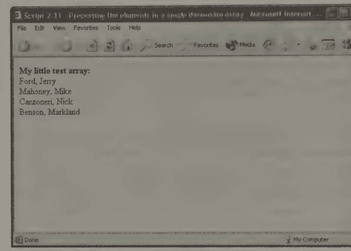

####### 动态更改数组大小

上一个例子展示了一个在填充数据之前就静态设置了大小的数组。然而，有时更改数组的大小可能会很有用。例如，如果你正在收集用户输入，而用户希望提供的数据超出了预期。

一种设置数组以便稍后在脚本中更改其大小的方法是使用 `Dim` 语句，并指定一个空括号集，如下所示：

```
Dim myArray()
```

以这种方式定义数组允许你在程序的后面设置数组的大小，也许是在询问用户计划提供多少数据之后。你使用 `ReDim` 语句来更改数组的大小。例如，以下语句将数组的大小设置为五个元素。

```
ReDim myArray(4)
```

另一种在脚本中创建可能需要稍后调整大小的数组的方法是使用 `ReDim` 语句而不是 `Dim` 语句来定义数组。

在更改已填充数据的数组大小时要小心。例如，以下语句不仅将数组的大小扩展为包含八个元素，而且还会清除所有数组的初始元素，使其变为空。

```
ReDim myArray(7)
```

如果你想删除数组的内容，前面的语句就可以了，但如果你想保留重定义数组中的内容，你需要将 `Preserve` 关键字添加到 `ReDim` 语句中，如下所示。

```
ReDim Preserve myArray(7)
```

一旦数组被调整大小，你就可以继续填充它而不会丢失任何现有数据。例如，下面的 HTML 页面包含一个 VBScript，它使用 `ReDim` 语句定义了一个可以容纳四个元素的数组。然后它填充数组，并使用 `For...Each...Next` 循环来显示数组的内容。第二个 `ReDim` 语句使用 `Preserve` 关键字来增加数组的大小。然后向数组添加新元素，再使用另一个 `For...Each...Next` 循环来显示扩展后数组的内容。

```
<HTML>
  <HEAD>
    <TITLE>Script 2.12 - Resizing a array</TITLE>
  </HEAD>
  <BODY>
    <SCRIPT LANGUAGE="VBScript">
      <!-- Start hiding VBScript statements

      Option Explicit

      Dim i ' Variable used to control a For...Each loop

      Dim myArray()
      ReDim myArray(3)

      myArray(0) = "Ford, Jerry"
      myArray(1) = "Mahoney, Mike"
      myArray(2) = "Canzoneri, Nick"
      myArray(3) = "Benson, Markland"

      Document.Write "<B>My little test array:</B> <BR>"

      For Each i IN myArray
        Document.Write i & "<BR>"
      Next

      ReDim Preserve myArray(5)

      myArray(4) = "Martin, Kelly"
      myArray(5) = "Martin, Kelly"

      Document.Write "<BR><B>My expanded test array:</B> <BR>"

      For Each i IN myArray
        Document.Write i & "<BR>"
      Next

      ' End hiding VBScript statements -->
    </SCRIPT>
  </BODY>
</HTML>
```


`Option Explicit`

`Dim i` ' 用于控制 `For...Each` 循环的变量

`ReDim myArray(3)`
`myArray(0) = "Ford, Jerry"`
`myArray(1) = "Mahoney, Mike"`
`myArray(2) = "Canzoneri, Nick"`
`myArray(3) = "Benson, Markland"`

`Document.Write "<B>我的小测试数组：</B> <BR>"`

`For Each i IN myArray`
    `Document.Write i & "<BR>"`
`Next`

`ReDim Preserve myArray(6)`

`myArray(4) = "Ford, Alexander"`
`myArray(5) = "Ford, William"`
`myArray(6) = "Ford. Molly"`

`Document.Write "<P><B>我扩展后的测试数组：</B> <BR>"`

`For Each i IN myArray`
    `Document.Write i & "<BR>"`
`Next`

' 结束隐藏 VBScript 语句 -->
`</SCRIPT>`
`</BODY>`
`</HTML>`

图 2.7 展示了运行此脚本后你将看到的结果。

> **注意** 使用 `ReDim` 语句时要小心，不要减小数组的大小，因为你会丢失一些数据。例如，如果你定义了一个能容纳十个条目的数组，然后用十个名字填充它，最后将其大小调整为原来的一半，那么最后添加到数组中的五个名字就会丢失。

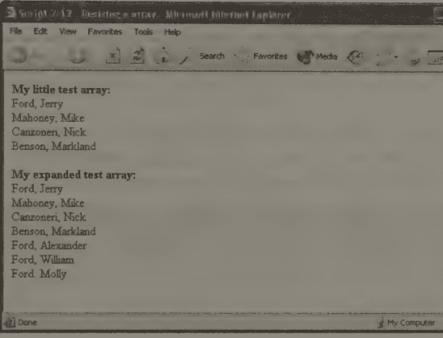

**图 2.7**
使用 `ReDim` 语句调整动态数组的大小。

##### VBScript 弹出对话框

VBScript 提供了两个内置函数，允许你添加弹出对话框，可以在你的 VBScript 中用来与用户交流。你可以像调用自己编写的任何函数一样，在脚本中调用这些函数来执行。

无论你是将 VBScript 嵌入到 HTML 页面中还是编写 WSH 脚本，都可以使用这两个函数。这里描述了这两个函数。

- **MsgBox()**。一个执行过程，然后返回一个结果给调用它的语句。
- **InputBox()**。一个执行过程，但不返回结果。

> **注意** 你已经在本书中看到了使用 `WScript.Echo` 语句创建的弹出对话框的示例。`Echo` 是属于 WSH `WScript` 对象的一种方法，允许你向用户显示消息，这些消息根据处理它们的执行主机而有所不同。如果 WScript 执行主机处理 `WScript.Echo` 命令，它会在弹出对话框中显示结果。但是，如果使用 CScript 执行主机来处理 `WScript.Echo` 语句，结果将作为打印文本出现在 Windows 命令控制台中。你将在明天了解更多关于 `WScript.Echo` 的信息。

> **注意** 显示弹出对话框的另一种方法是使用 WSH Popup() 函数。Popup() 函数提供了与 VBScript MsgBox() 函数相同的基本功能。创建它是因为 Microsoft 为 WSH 提供的另一种脚本语言 JScript 没有提供任何用于显示对话框的内置函数或方法。但是，Popup() 函数可以像 MsgBox() 函数一样轻松地在 VBScript 中使用。你将在明天了解更多关于 Popup() 函数的信息。

####### VBScript MsgBox 函数

MsgBox 函数为你提供了一种显示弹出对话框并请求用户通过单击相应按钮进行响应的方法。MsgBox 函数的语法如下所示。

```
MsgBox(prompt [, buttons] [, title] [, helpfile, context])
```

`Prompt` 是对话框显示的文本消息，最长可达 1,024 个字符。`Button` 是一个数字表达式或值，它是许多其他值的总和，这些值用于指定：

- 要显示的按钮类型
- 要在对话框中显示的图标类型
- 默认选中的按钮
- 对话框的模式

这四个按钮属性的每个可能数字值都在以下四个表格中概述。表 2.4 列出了指定对话框上将显示的按钮数量和类型的数字值。表 2.5 列出了指定对话框上将显示的图标类型的数字值。表 2.6 列出了指定对话框上哪个按钮将被设为默认按钮的数字值。表 2.7 列出了指定对话框将应用的模式类型的数字值。

######## 表 2.4 VBSCRIPT MSGBOX 按钮

| 常量 | 值 | 描述 |
| --- | --- | --- |
| vbOKOnly | 0 | 显示“确定”按钮 |
| vbOKCancel | 1 | 显示“确定”和“取消”按钮 |
| vbAbortRetryIgnore | 2 | 显示“中止”、“重试”和“忽略”按钮 |
| vbYesNoCancel | 3 | 显示“是”、“否”和“取消”按钮 |
| vbYesNo | 4 | 显示“是”和“否”按钮 |
| vbRetryCancel | 5 | 显示“重试”和“取消”按钮 |

######## 表 2.5 VBSCRIPT MSGBOX 图标

| 常量 | 值 | 描述 |
| --- | --- | --- |
| vbCritical | 16 | 显示严重图标 |
| vbQuestion | 32 | 显示问号图标 |
| vbExclamation | 48 | 显示感叹号图标 |
| vbInformation | 64 | 显示信息图标 |

######## 表 2.6 VBSCRIPT MSGBOX 默认按钮

| 常量 | 值 | 描述 |
| --- | --- | --- |
| vbDefaultButton1 | 0 | 使第一个按钮成为默认按钮 |
| vbDefaultButton2 | 256 | 使第二个按钮成为默认按钮 |
| vbDefaultButton3 | 512 | 使第三个按钮成为默认按钮 |
| vbDefaultButton4 | 768 | 使第四个按钮成为默认按钮 |

######## 表 2.7 VBSCRIPT MSGBOX 模式设置

| 常量 | 值 | 描述 |
| --- | --- | --- |
| vbApplicationModal | 0 | 用户必须做出响应后脚本才能继续执行 |
| vbSystemModal | 4096 | 用户必须做出响应后脚本才能继续执行。此外，弹出对话框将保持在其他活动应用程序的顶部显示 |

> **注意** 对话框的模式控制其行为。例如，当对话框被设置为应用程序模式时，用户必须先响应对话框，VBScript 才能继续执行。

MsgBox 函数的其余参数是 `title`、`helpfile` 和 `context`。`Title` 是将在弹出对话框标题栏中显示的可选文本消息。`Helpfile` 和 `context` 允许你将帮助文件与对话框关联起来。

了解如何使用 MsgBox() 函数的最佳方法是查看一些示例。第一个示例以最简单的形式使用 MsgBox() 函数，如下所示。仅提供了必需的 `prompt` 参数。

```
Option Explicit
Dim myCount
MsgBox("感谢您的访问，期待您再次光临！")
```

执行时，这些语句会告诉 VBScript 显示你在图 2.8 中看到的对话框。默认情况下，对话框上只显示“确定”按钮。因此，MsgBox() 函数默认使用 `vbOKOnly` 常量。请参考表 2.4 查看 `vbOKOnly` 常量及其值。

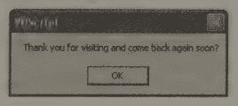

**图 2.8**
使用 MsgBox() 函数显示通知消息。

当你如上所示执行 MsgBox() 函数时，不会返回值。但是，如果你重新构造 MsgBox() 函数的使用方式，VBScript 可以返回一个值，指示用户单击的按钮。表 2.8 提供了 MsgBox() 函数可能返回的返回值列表。

例如，以下语句通过为 MsgBox() 的 `button` 参数指定值 1，创建了一个包含两个按钮“确定”和“取消”的对话框。值 1 指定了 `vbOKCancel` 常量，如表 2.4 所示。此外，还显示了提示消息和标题栏消息。一旦执行，用户选择的按钮的值将被赋给名为 `myResponse` 的变量。然后你可以以编程方式查询此变量的值。如果用户单击“确定”按钮，则变量的值为 1；如果用户单击“取消”按钮，则变量的值为 2。

```
Option Explicit
Dim myResponse
myResponse = MsgBox("您希望退出吗？", 1, "您希望做什么？")
```

**表 2.8 VBScript MsgBox 返回值**

| 常量 | 值 | 描述 |
| --- | --- | --- |
| vbOK | 1 | 用户单击了“确定”按钮 |
| vbCancel | 2 | 用户单击了“取消”按钮 |
| vbAbort | 3 | 用户单击了“中止”按钮 |
| vbRetry | 4 | 用户单击了“重试”按钮 |
| vbIgnore | 5 | 用户单击了“忽略”按钮 |
| vbYes | 6 | 用户单击了“是”按钮 |
| vbNo | 7 | 用户单击了“否”按钮 |

> **注意** 如果用户按下 **Esc** 键，则返回的值将是 2，这与单击 **Cancel** 按钮的值相同。

下一个示例展示了如何稍微增加一些复杂性。这次我们将显示一个同时具有 **确定** 和 **取消** 按钮以及 **严重** 图标的消息框。参考表 2.4，你会看到要显示 **确定** 和 **取消** 按钮，你需要使用值为 1 的 **vbOKCancel** 常量。此外，表 2.5 显示，要显示 **严重** 图标，你必须指定值为 16 的 **vbCritical** 常量。通过将这两个常量的值相加，你得到的值是 17，这就是你将在下面示例中使用的值。

```
Option Explicit
Dim myResponse
myResponse = MsgBox("您希望退出吗？", 17, "您希望做什么？")
```


如图2.9所示，该对话框包含了所有三个元素。

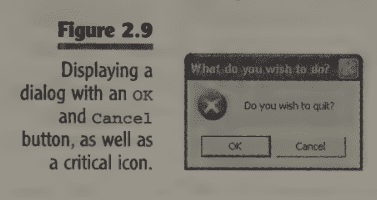

为了确保我已经清楚说明了如何对表示你希望出现在 `MsgBox()` 弹出对话框上的功能的 VBScript 常量值进行求和，让我们再做一个例子。这次，让我们创建一个带有“确定”和“取消”按钮以及一个严重错误图标的弹出对话框，并将默认按钮设置为第二个按钮，即“取消”按钮。

要创建满足所有这些条件的对话框，你需要使用以下 VBScript 常量。

- **`vbOKCancel`** 值为 1
- **`vbCritical`** 值为 16
- **`vbDefaultbutton2`** 值为 256

将这三个 VBScript 常量关联的值相加，得到 273，这就是本例中使用的数字。

```
Option Explicit
Dim myResponse
myResponse = MsgBox("Do you wish to quit?", 273, "What do you wish to do?")
```

####### VBScript 的 InputBox 函数

`InputBox()` 函数提供了一种方式，让你显示一个弹出对话框，提示用户输入文本。InputBox 允许你向用户提问并收集文本输入。`InputBox()` 函数的语法如下所示。

```
InputBox(prompt [, title] [, default] [, xpos] [, ypos] [, helpfile, context])
```

Prompt 是对话框显示的文本消息，最多可包含 1,024 个字符。Title 是一个可选的文本消息，将显示在弹出对话框的标题栏中。你可以包含 default 参数来指定对话框文本字段中的默认答案。Xpos 和 ypos 可以用来可选地指定对话框的初始位置。最后，helpfile 和 context 允许你将一个帮助文件与对话框关联起来。

例如，以下语句提示用户输入其所在国家的名称。

```
Option Explicit
Dim myInput
myInput = InputBox("What country do you reside in?")
```

传递给 InputBox() 函数的唯一参数是提示文本。如图 2.10 所示，对话框上显示了两个按钮——“确定”和“取消”按钮。如果用户单击“确定”或按回车键，则用户键入的任何文本都将被赋值给 myInput 变量。如果用户单击“取消”或单击“关闭”按钮，则会将一个零长度字符串赋值给 myInput 变量。

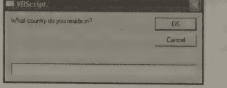

以下示例演示了如何在弹出对话框标题栏中显示消息，以及如何为用户提供默认答案。

```
Option Explicit
Dim Input
Input = InputBox("What country do you reside in?", "Welcome to my script!", "USA")
```

图 2.11 显示了执行这些语句时显示的对话框。

**图 2.11**
向弹出对话框添加标题栏消息和默认答案。

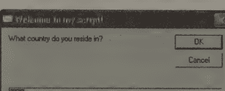

如果你想在对话框中显示大量文本并想花哨一点，你可以使用 Chr(13) 和 Chr(10) 来格式化显示的提示文本。Chr(13) 等于回车符，而 Chr(10) 提供换行符。以下示例演示了一个典型的格式化示例。

```
Option Explicit
Dim Input
Input = InputBox("What country do you reside in? If you prefer not" _
    + Chr(13) + Chr(10) + "to provide this information please type NA.", "", "USA")
```

图 2.12 显示了由上一个示例创建的对话框。

**图 2.12**
创建带有格式化文本的弹出对话框。


### 接下来是什么？

嗯，我想说我们一个上午已经涵盖了相当多的材料。现在可能是你放下这本书，伸展一下腿脚，吃点东西的好时机。我们下午将继续，开始两章中的第一章，介绍如何将 VBScript 集成到你的 HTML 页面中。到一天结束时，你将准备好开始为你的网页增添色彩。


## 周六下午

### 在 Internet Explorer 中进行脚本编写

- 检查 Internet Explorer 支持的对象模型
- 学习如何使用对象的方法和属性来操作浏览器对象
- 了解如何在 Internet Explorer 状态栏上发布消息
- 学习如何响应键盘击键和鼠标点击
- 了解如何跟踪和响应鼠标移动


欢迎回来。希望你准备好迎接一个充满工作的下午。今天上午你学习了构成 VBScript 语言的所有基本编程语句。这包括学习如何使用变量、常量、条件逻辑、过程、循环和数组。

今天下午，你将完成两章中的第一章，向你展示如何将你新的 VBScript 编程技能应用于 HTML 页面。你将看到 VBScript 如何与 Internet Explorer 交互并使用对象模型来控制许多浏览器功能，例如打开和关闭浏览器窗口。你还将学习使用许多 Internet Explorer 对象，这些对象允许你编写脚本来显示弹出对话框、控制浏览器导航以及响应浏览器和用户事件（如鼠标点击和双击）。

> 注意
Internet Explorer 支持 VBScript，但 Netscape Communicator 不支持。这也意味着基于 Netscape Communicator 开源代码的 Opera 浏览器不支持 VBScript。然而，市场上还有许多其他 Internet 浏览器，其中大量是基于 Internet Explorer 引擎构建的，这使得 VBScript 的支持范围比大多数人意识到的要广泛得多。例如，美国在线支持许多自定义浏览器。一些基于 Netscape，另一些基于 Internet Explorer。但是，AOL 分发给其用户的浏览器是基于 Internet Explorer 的，因此支持 VBScript。那么，微软分发给其 MSN 用户的 MSN Explorer 浏览器也支持 VBScript，这大概不会让你感到惊讶。总的来说，我知道至少有十几种基于 Internet Explorer 并支持 VBScript 的浏览器。这些包括

- Internet Explorer
- MSN Explorer
- AOL
- EarthLink LiteAOL
- CompuServe
- Oligo
- UltraBrowser
- CrystalPort
- NeoPlanet
- Kidnet
- ExplorerRapidBrowser
- SmartExplorer
- Fast Browser Pro

我确信还有更多基于 Internet Explorer（也支持 VBScript）的浏览器没有列在这里。这些只是我听说并尝试过的。

#### 使用对象进行编程

基于浏览器的对象是一种编程构造，它包含方法和属性，并代表特定的浏览器功能或部分功能。Internet Explorer 根据 HTML 页面的内容公开对象。然后，你可以使用 VBScript 来操作与对象关联的属性和方法，以影响 Internet Explorer 和当前加载的 HTML 页面的操作。

每个版本的 Internet Explorer 都提供其自己的对象模型。这个模型在每次新版本发布时都会进行修改和扩展。因此，在 Internet Explorer 6 中发现的一些对象、方法和属性不被该浏览器的早期版本支持。这意味着，如果你创建的 VBScript 使用了由较新版本的 Internet Explorer 引入的对象、方法或属性，它们在早期版本中将不可用，你的脚本将经历运行时错误。这使得脚本开发变得困难。

有些人选择编写忽略较新对象、方法和属性的脚本，并坚持使用所有版本的 Internet Explorer 都支持的一组对象。这样他们就知道他们的脚本总是会按预期运行。然而，这可能会限制你可以做的事情，因为许多在较新版本中引入的功能在早期版本中无法使用。


##### 理解对象组织

对象在逻辑上被组织成一个树状结构，包含父、子和兄弟关系。例如，看看下面这个 HTML 页面。如你所见，它只包含几个元素。

```html
<HTML>
<HEAD>
<TITLE>Script 3.1 - A simple HTML page</TITLE>
</HEAD>
<BODY>
    <P>Good morning.</P>
    <P>Welcome to my web page!</P>
</BODY>
</HTML>
```

当你仅使用 HTML 创建网页时，你无需关心页面的逻辑树结构。然而，你需要至少了解一点，才能成功添加 VBScript。让我们以上一个示例为例，描绘其组织树结构，如图 3.1 所示。

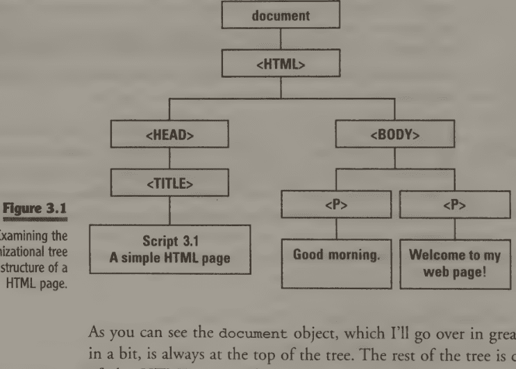

如你所见，文档对象——我稍后将更深入地讲解——始终位于树的顶部。树的其余部分由 HTML 标签及其内容组成。例如，文档对象的子元素是 `<HTML>` 元素。`<HTML>` 元素本身有两个子元素，即 `<HEAD>` 和 `<BODY>` 元素。同样，这两个元素也有各自的子元素。

###### 对象属性

对象的 *属性* 是存储代表对象某些方面值的属性。例如，我之前提到的文档对象有一对名为 bgColor 和 fgColor 的属性。你可以操作这些属性来更改 HTML 页面上的背景色和前景色。

为了从 VBScript 中引用对象，你需要键入对象名称，后跟一个点，然后是属性名称，如下所示。

document.bgColor
document.fgColor

例如，以下 HTML 页面包含一个 VBScript，该脚本将 HTML 页面上默认的白色背景黑色前景颜色反转。

```html
<HTML>
<HEAD>
<TITLE>Script 3.2 - Working with document object properties</TITLE>
</HEAD>
<BODY>
<SCRIPT LANGUAGE="VBScript">
<!-- Start hiding VBScript statements
document.bgColor="black"
document.fgColor="white"
' End hiding VBScript statements -->
</SCRIPT>
<P>Good morning.</P>
<P>Welcome to my web page!</P>
</BODY>
</HTML>
```

图 3.2 显示了上述示例在 Internet Explorer 中加载后的效果。如你所见，前面显示的两个 VBScript 语句已被添加到 HTML 页面中。它们操作了位于页面对象树顶部的文档对象的属性。

####### 图 3.2 操作文档对象的属性。

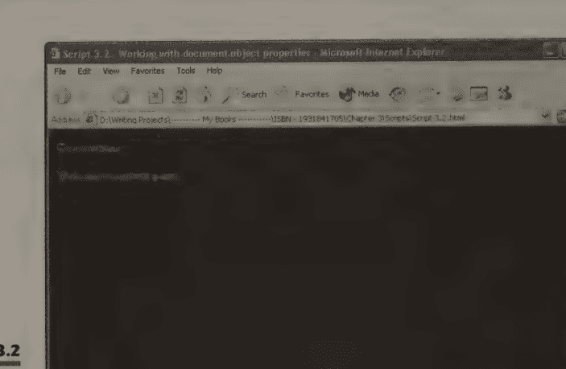

###### 对象方法

对象的方法是操作对象或其数据的函数。例如，window 对象是 document 对象的父对象。window 对象提供了一个名为 alert() 的方法，你可以在 VBScript 中使用它来在弹出对话框中显示消息，如下所示。

```
window.alert("Welcome to my web site!")
```

引用对象的方法时，你首先键入对象的名称，一个点，方法的名称，以及一对括号，括号内包含一个以逗号分隔的方法要处理的参数列表。即使你不向方法传递任何参数进行处理，也必须提供 () 字符。例如，以下 VBScript 使用 window.alert 方法来欢迎访问者。

```html
<HTML>
<HEAD>
    <TITLE>Script 3.3 - Working with window object's alert method</TITLE>
</HEAD>
<BODY>
    <SCRIPT LANGUAGE="VBScript">
        <!-- Start hiding VBScript statements
        window.alert("Welcome to my web site!")
        ' End hiding VBScript statements -->
    </SCRIPT>
    <P>Good morning.</P>
    <P>Welcome to my web page!</P>
</BODY>
</HTML>
```

###### 对象事件

事件代表 Internet Explorer 中发生的动作。事件的示例包括鼠标移动或鼠标单击等。例如，如果你在 HTML 页面上创建一个表单，当访问者将指针移动到任何表单元素上、将数据输入到文本字段中，以及在表单按钮、复选框和单选按钮上发生鼠标单击时，都会触发事件。

你可以在 VBScript 中定义事件处理程序来响应事件。这样，你的脚本可以在访问者在其网页上指点和单击时与他们互动。今天下午晚些时候，我将提供有关如何处理事件的更多信息和示例。

##### Internet Explorer 对象模型概述

除了在访问者可能使用四个版本的 Internet Explorer 中的任何一个来开发脚本所带来的困难之外，你还需要了解一些关于使用两种不同的 Internet Explorer 对象模型的知识。没错，有两种不同的对象模型。

Internet Explorer 3 和 4 版支持一个称为 DHTML 对象模型的单一对象模型。该模型提供了对 HTML 页面上大多数元素的访问。

近年来，一个名为万维网联盟（World Wide Web Consortium）的组织开发了一个名为 *文档对象模型*（*Document Object Model* 或 *DOM*）的对象模型标准。该模型提供了对 HTML 页面上每个元素的访问，并正在被所有主要的 Internet 浏览器开发人员（包括 Microsoft Internet Explorer）逐渐采用。

> 如果你有兴趣了解更多关于此对象模型的信息，请查看 **www.w3c.org/DOM**。

####### DHTML 模型

Internet Explorer 3 和 4 版支持 DHTML 模型的变体。Internet Explorer 5 和 6 版也支持此模型，从而提供了向后兼容性。DHTML 模型将 HTML 页面视为对象的层次结构。要操作树中的任何对象，你必须能够按名称引用它。例如，你可以如下在 HTML 上定义一个表单。

```html
<FORM NAME="myForm">
    <INPUT NAME="myButton" TYPE="button" VALUE="Click on me!">
</FORM>
```

要从 VBScript 中引用 HTML 表单上的按钮，你必须为 HTML FORM 和 INPUT 标签都添加 NAME 属性并指定一个名称。例如，分配给表单的名称是 myForm，而表单上的按钮被命名为 myButton。

**注意** DHTML 模型缺少指定树中特定对象然后以编程方式在树中向上、向下或横向导航的能力。本章稍后讨论的 DOM 模型提供了此功能。

DHTML 模型的顶部是 `window` 对象。每个 HTML 页面都有一个 `window` 对象——除非使用框架——在这种情况下，每个框架都有一个单独的 `window` 对象，以及一个父 `window` 对象，该对象代表定义每个框架的页面。

`window` 对象提供了对许多子对象的访问，如图 3.3 所示。`window` 对象提供了属性和方法，使其能够执行许多操作，包括：

-   在 Internet Explorer 状态栏中放置文本消息
-   打开一个新窗口并在其中加载 URL
-   关闭一个窗口
-   创建弹出对话框以显示消息、提示用户单击预设选项或键入文本响应

`window` 对象下的对象包括：

-   **Navigator 对象。** 提供有关加载 HTML 页面的浏览器的信息，包括浏览器类型和版本。
-   **History 对象。** 提供可用于浏览文档对象历史记录列表（例如，自浏览器窗口打开以来访问过的地方）的方法。
-   **Document 对象。** 表示 Internet Explorer 当前显示的 HTML 页面，并提供用于操作它的属性和方法。
-   **Location 对象。** 提供有关当前加载的 URL 的信息，并提供重新加载 HTML 页面或加载新 URL 的能力。
-   **Frames 集合。** 提供当前位于浏览器窗口中的框架的索引列表（一个数组）。


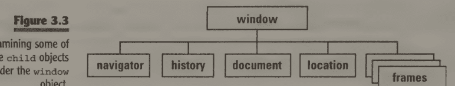

> **注意** 集合 simply 是一个数组，它包含对 HTML 页面中相同类型对象的引用。例如，`frames` 集合是一个数组，列出了当前加载的 HTML 页面中的所有框架，而 `forms` 数组则包含当前 HTML 页面上所有表单的列表。

在你的 VBScript 中，你会发现自己最常操作的对象是 `document` 对象。它提供了对许多其他对象和集合的访问。图 3.4 展示了 `document` 对象下的一些对象和集合。随着下午内容的深入，我们将更仔细地研究这些对象。

####### 文档对象模型

有多种 DOM 标准。Internet Explorer 5 支持大部分 DOM Level 1 标准。Internet Explorer 6 则更接近支持该标准。然而，两个版本都未达到 100% 兼容。

除了帮助为现代浏览器标准化对象模型外，这个通常被称为 W3C DOM 的模型，还提供了对脚本导航 HTML 页面并更改其内容的能力的更全面控制。事实上，DHTML 对象模型中所有可用的对象仍然可用，但现在它们更容易被访问。每个对象仍然有其独特的方法和属性集。然而，在 DOM 下，对象拥有第二套方法和属性，用于导航 HTML 页面的树形层次结构。

######## 图 3.4 检查 document 对象的子对象。

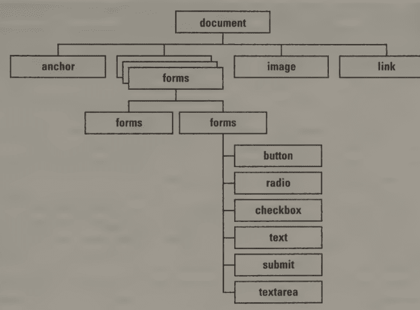

与 DHTML 模型不同（在 DHTML 模型中，你必须通过名称直接访问 HTML 页面中的各种元素），DOM 允许你使用表 3.1 中所示的任何属性来访问 HTML 页面上的元素。

我能想到的解释这些属性用法的最佳方式是向你展示一个例子。首先，让我们创建一个如下的简单 HTML 页面。

```
<HTML>
  <HEAD>
    <TITLE>Script 3.4 - Advanced DOM Example</TITLE>
  </HEAD>

  <BODY ID="myBodyNode">
    <P ID="paraTag1" Name="Tag1">This is paragraph one.</P>
    <p ID="paraTag2">This is paragraph two.</P>
  </BODY>
</HTML>
```

######## 表 3.1 文档对象模型属性

| 属性 | 描述 |
| :--- | :--- |
| firstChild | 对象的第一个子节点 |
| lastChild | 对象的最后一个子节点 |
| childNodes | 所有子对象的集合/数组 |
| parentNode | 对象的父对象 |
| nextSibling | DOM 树中紧随其后的子节点 |
| prevSibling | 当前子节点之前的子节点 |
| nodeName | HTML 标签的名称 |
| nodeType | 指定一个代表 HTML 元素类型的值（标签、属性或文本） |
| nodeValue | 分配给文本节点的值 |
| data | 指定文本节点的值 |
| specified | 指示属性是否已设置 |
| attributes | 所有对象属性的集合/数组 |

接下来，让我们创建一个表示此 HTML 页面树结构的模型，如图 3.5 所示。如图 3.5 所示，`document` 对象是树的根。它只有一个子对象——`documentElement`——它对应于页面上的第一个 `<HTML>` 标签。

现在让我们向 HTML 页面添加一个 VBScript，演示如何使用 DOM 属性和方法来导航 HTML 页面并操作其内容。

星期六下午 在 Internet Explorer 中进行脚本编写

105

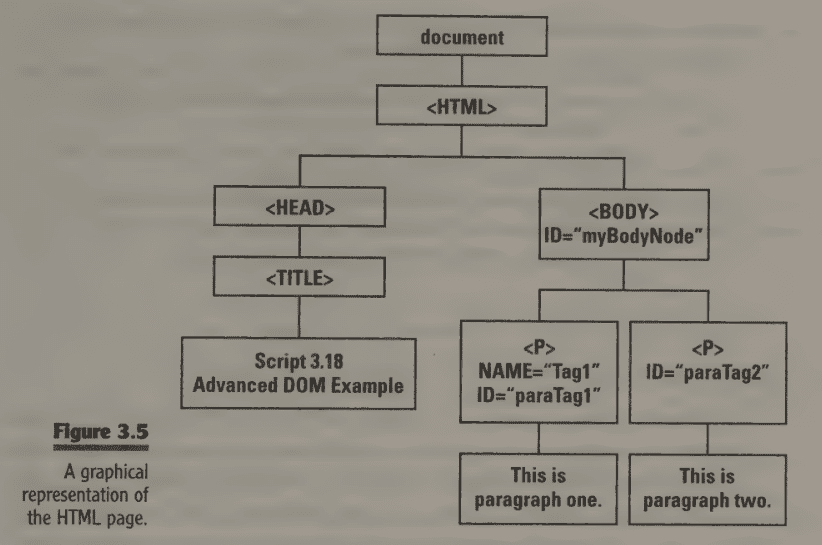

```
<HTML>
<HEAD>
<TITLE>Script 3.5 - Advanced DOM Example</TITLE>
</HEAD>

<BODY ID="myBodyNode">
<P ID="paraTag1" Name="Tag1">This is paragraph one.</P>
<p ID="paraTag2">This is paragraph two.</P>

<SCRIPT LANGUAGE="VBScript">
<!-- Start hiding VBScript statements
window.alert("The ID for the first element is: " & document.documentElement.firstChild.tagName)
window.alert("The ID for the second element is: " & document.documentElement.firstChild.nextSibling.tagName)
window.alert("The ID for the child of the first element is: " & document.documentElement.firstChild.firstChild.tagName)
window.alert("The type of tag associated with the myBodyNode ID is: " & myBodyNode.tagName)
window.alert("The type of tag associated with the paraTag2 ID is: " & paraTag2.tagName)

window.alert("The Value associated with the paraTag2 element is: " & document.getElementById("paraTag2").firstChild.nodeValue)

window.alert("When you click on OK the value associated with the paraTag2 " & "ID will be changed.")

document.getElementById("paraTag2").firstChild.nodeValue="This is the " & "new and improved paragraph two!"

' End hiding VBScript statements -->
</SCRIPT>
</BODY>
</HTML>
```

现在让我们逐一检查 VBScript 中的每条语句。第一条语句如下所示，它显示 `document` 对象下第一个子元素的标签名，即 `<HEAD>` 标签。查看构成标签名引用的每个组成部分（例如 `document.documentElement.firstChild.nextSibling.tagName`），并将其与图 3.5 中显示的树层次结构进行比较。

```
window.alert("The ID for the first element is: " & document.documentElement.firstChild.tagName)
```

图 3.6 显示了执行此语句时出现的弹出对话框。

**图 3.6**
Internet Explorer DOM 允许你访问 HTML 页面上的每个元素。

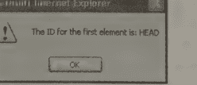

下一条 VBScript 语句使用 `nextSibling` 属性显示 `BODY` 标签的标签名。

```
window.alert("The ID for the second element is: " & document.documentElement.firstChild.nextSibling.tagName)
```

#### 星期六下午 在 Internet Explorer 中进行脚本编写

下一条 VBScript 语句显示 `document` 对象的第一个子元素的第一个子元素的标签名，即 `TITLE` 标签。

```
window.alert("The ID for the child of the first element is: " & document.documentElement.firstChild.firstChild.tagName)
```

前面的每条语句都是通过从 `document` 元素开始引用到其在页面中的位置来引用 HTML 页面中的特定元素。下一条 VBScript 语句通过指定其 ID 来显示 `BODY` 标签的标签名。

```
window.alert("The type of tag associated with the myBodyNode ID is: " & myBodyNode.tagName)
```

下一条 VBScript 语句显示 ID 为 `paraTag2` 的 `<P>` 标签的标签名。

```
window.alert("The type of tag associated with the paraTag2 ID is: " & paraTag2.tagName)
```

下一条 VBScript 语句展示了如何使用 DOM 的 `getElementById()` 方法显示 ID 为 `paraTag2` 的 `<P>` 标签的第一个子节点的值。

```
window.alert("The Value associated with the paraTag2 element is: " & document.getElementById("paraTag2").firstChild.nodeValue)
```

图 3.7 显示了上一条语句产生的弹出对话框。

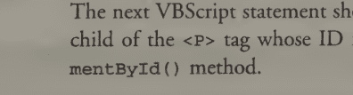

接下来，以下语句通知用户，当单击“确定”按钮时，脚本将更改存储在第二个 `<P>` 标签中的值。

```
window.alert("When you click on OK the value associated with the paraTag2 " & "ID will be changed.")
```

最后，最后一条 VBScript 语句更改了第二个 `<P>` 标签中显示的文本。

```
document.getElementById("paraTag2").firstChild.nodeValue="This is " & "new and improved paragraph two!"
```

此语句可以分解如下。

- 从 `document` 对象开始
- 添加 `getElementById()` 方法并指定 `paraTag2`。这让你到达第二个 `<P>` 标签。
- 添加对 `firstChild` 和 `nodeValue` 属性的引用。这创建了一个对存储在 `<P>` 标签中的文本的引用。

图 3.8 显示了修改第二段中存储的文本后 HTML 页面的外观。

如你所见，DOM 提供了强大的功能，用于导航 HTML 页面并操作其内容。这可以成为一个强大的工

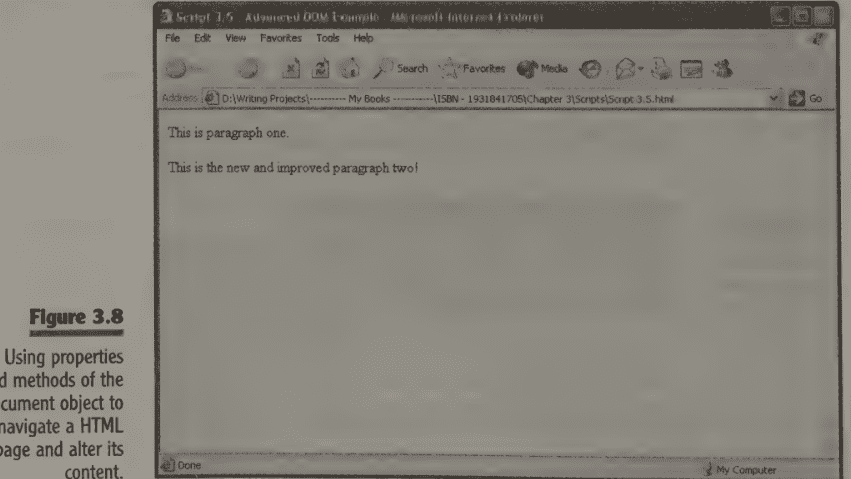


编程技巧；然而，它也为你的VBScript增加了一层复杂性。要完整介绍如何实现文档对象模型（DOM）的所有对象、方法和属性，将超出本书可用的篇幅。你可以访问**www.w3c.org/DOM**来了解更多关于这个对象模型的信息。此外，通过搜索**www.microsoft.com**也能找到大量有用的信息。

使用DOM的一个大问题是，5.0版本之前的Internet Explorer浏览器不支持它，这意味着访问你网页的许多访客可能无法正常处理你的HTML页面。

归根结底，在网页开发方面，我们仍处于起步阶段。标准及其采纳和实施处于不断变化的状态。任何时候你选择实现最新的Internet Explorer特性，如DOM的对象、属性和方法，都面临着创建无法被所有人支持的HTML页面的风险。使用DOM的document对象的属性和方法也增加了你的VBScript的复杂性。然而，虽然不使用新特性可能让你开发出适合更广泛受众的HTML页面，但这将把你限制在昨天的技术中。两种选择都不理想，也没有正确答案。因此，如何利用可用的对象模型，实际上只是个人选择的问题。

就本书而言，我将依赖于演示利用DHTML模型的示例。这将使我的VBScript示例更容易理解，并有助于简化它们的呈现。

##### 常用浏览器对象

到目前为止，我花了很多时间讨论对象及其方法和属性的概念。我还花了大量时间试图解释使用Internet Explorer支持的对象模型的基础知识。如果你感到头晕目眩，并且没有理解你读到的所有内容，请不要担心。对象模型是一个高级的编程概念，需要一些时间才能真正消化吸收。事实上，你可能需要在几周后回来重新阅读本章的第一部分。不过，我也建议你在互联网上搜索，尽可能多地找到关于DHTML和DOM对象模型的额外信息。

接下来，让我们花点时间来了解一下你在VBScript中会用到的一些对象。这些对象包括：

- window
- document
- location
- history
- navigator

####### window对象

window对象位于对象模型层次结构的顶层，是document对象的父对象。如果使用了框架，那么每个框架都会创建一个window对象，还有一个额外的父窗口代表定义了框架集的HTML页面。window对象提供以下访问方式：

- window对象方法
- window对象属性
- 其他对象
- 集合

你可以操作window对象的属性并执行其方法，以多种方式影响浏览器。以下示例展示了如何使用window对象的`prompt()`和`alert()`方法按姓名问候访客。

```html
<HTML>

<HEAD>
    <TITLE>Script 3.6 - Working with the Window object's prompt and alert methods</TITLE>
</HEAD>

<BODY>
    <H3>ABC Company web page</H3>

    <SCRIPT LANGUAGE="VBScript">
        <!-- Start hiding VBScript statements
            visitorName = window.prompt("What is your name?", "")
            window.alert("Welcome to my Web Page " & visitorName & "!")
        ' End hiding VBScript statements -->
    </SCRIPT>

</BODY>

</HTML>
```

下面的语句将`prompt()`方法返回的文本值赋给名为`visitorName`的变量。

```vb
visitorName = window.prompt("What is your name?", "")
```

然后使用`alert()`方法显示问候消息，其中通过`&`连接运算符附加了`visitorName`的值，如下所示。

```vb
window.alert("Welcome to my Web Page " & visitorName & "!")
```

图3.9和图3.10展示了访客看到的交互效果。

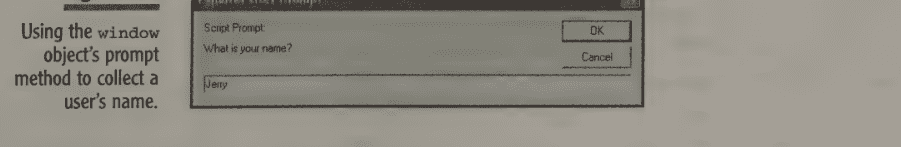

###### 周末学习VBScript

####### 图3.10

使用window对象的alert方法按姓名问候用户。

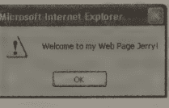

接下来的这个示例使用了window对象的`confirm()`、`alert()`和`close()`方法。

```html
<HTML>
<HEAD>
<TITLE>Script 3.7 - Working with the Window object's confirm, alert and close methods</TITLE>
</HEAD>
<BODY>
<H3>ABC Company web page</H3>
<SCRIPT LANGUAGE="VBScript">
<!-- Start hiding VBScript statements
decision = window.confirm("Click on OK to exit or Cancel to stick around?")
If decision = "True" Then
    window.alert("Bye. Please visit again soon!")
    window.close()
Else
    window.alert("Great. Thanks for sticking around!")
End If
' End hiding VBScript statements -->
</SCRIPT>
</BODY>
</HTML>
```

`confirm()`方法用于显示图3.11所示的弹出对话框。这里，访客有两个选择：要么点击“确定”离开，要么点击“取消”留在你的网站。点击“确定”会返回一个`true`值，此时window对象的`alert()`方法会显示一条消息，要求访客再次光临。当访客点击“确定”时，会执行`close()`方法，然后关闭Internet Explorer窗口。但是，如果访客在第一次提示时点击“取消”，则会返回一个`false`值，If...Then...Else语句的Else部分会显示一条感谢访客留下的消息。

####### 图3.11

使用window对象的`confirm()`方法询问用户是否确实要离开你的网站。

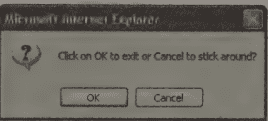

正如下面的VBScript所示，window对象可以做的远不止显示弹出对话框。此脚本包含一个带有三个按钮的HTML表单。当HTML页面最初加载时，嵌入在`<BODY>`标签中的`onLoad`语句通过为window对象的`status()`属性赋值，在Internet Explorer状态栏中显示一条消息。

一个VBScript嵌入在HTML页面的HEAD部分，定义了三个函数。每个函数在表单的相应按钮被点击时执行，并在浏览器的状态栏中显示不同的消息。

> 注意：当每个关联按钮的`onClick`事件触发时，这三个函数会被执行。你可以通过函数名称的前半部分来判断每个函数与哪个按钮关联。稍后我会更详细地讨论VBScript事件的工作原理。

###### 周末学习VBScript

```html
<HTML>

<HEAD>
    <TITLE>Script 3.8 - Posting Messages to the IE Status Bar</TITLE>

    <SCRIPT LANGUAGE="VBScript">
    <!-- Start hiding VBScript statements
    Sub myButton1_onclick
        window.status = "You should see message 1 displayed in the statusbar"
    End Sub

    Sub myButton2_onclick
        window.status = "You should see message 2 displayed in the statusbar"
    End Sub

    Sub myButton3_onclick
        window.status = "You should see message 3 displayed in the statusbar"
    End Sub
    ' End hiding VBScript statements -->
    </SCRIPT>

</HEAD>

<BODY onLoad="window.status = 'This message is displayed on the IE status bar when the HTML page loads'">

    <H3>Taking Control of the IE Status Bar!</H3>

    <FORM>
        <INPUT NAME="myButton1" TYPE="button" VALUE="Display Message # 1"> <P>
        <INPUT NAME="myButton2" TYPE="button" VALUE="Display Message # 2"> <P>
        <INPUT NAME="myButton3" TYPE="button" VALUE="Display Message # 3">
    </FORM>

</BODY>

</HTML>
```

图3.12展示了前一个示例中创建的HTML页面执行时的外观。

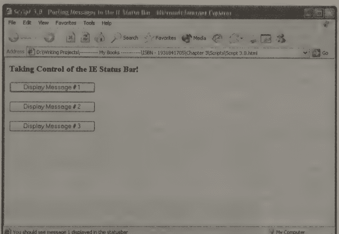

####### 图3.12
通过操作window对象的status属性，你可以在Internet Explorer状态栏上发布消息。

最后一个示例演示了如何使用window对象的`open()`方法打开第二个浏览器窗口并自定义其外观。通过将此示例应用于你自己的网页，你可以轻松创建在访客加载主页时打开任意数量浏览器窗口的网站。这样，你就可以加载显示广告页面、提供控制菜单以及大量其他信息的页面。

```html
<HTML>

<HEAD>
    <TITLE>Script 3.9 - Working with the Window object's open method</TITLE>

    <SCRIPT LANGUAGE="VBScript">
    <!-- Start hiding VBScript statements
```


window.open "http://www.premierpressbooks.com", "Window1", "toolbar=no", "menubar=No", "scrollbar=no"
' 隐藏 VBScript 语句结束 -->
</SCRIPT>

```
</HEAD>
<BODY>
<H3>欢迎访问我的网页！</H3>
</BODY>
</HTML>
```

图 3.13 展示了上一个示例创建的 HTML 页面加载后的样子。你可以看到显示了两个浏览器窗口。使用 `open()` 方法打开的浏览器窗口显示在上方。

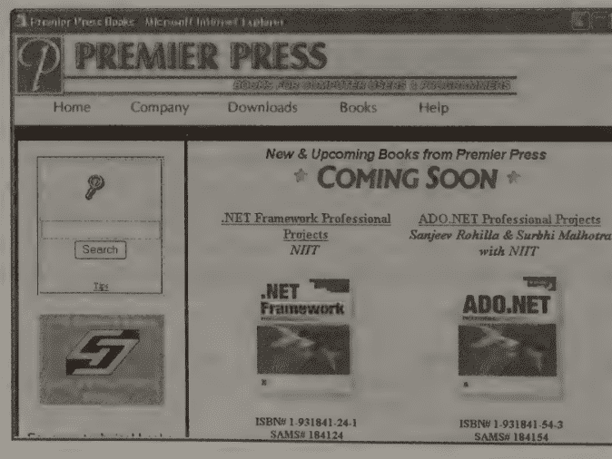

图 3.13

`window` 对象的 `open()` 方法允许你打开新的浏览器窗口并在其中加载新的网页。

##### 休息一下

我不知道你怎么想，但所有这些关于对象模型、属性、方法和事件的讨论让我有点疲倦了。让我们休息 15 分钟，让这些知识有时间消化一下。当你回来时，我们将通过研究更多浏览器对象来结束下午的课程，然后更深入地探讨事件处理。你将学习如何创建既能响应键盘和鼠标事件，又能响应浏览器生成的事件（例如加载或卸载 HTML 页面时）的事件处理器。

##### document 对象

`document` 对象是 `window` 对象的子对象，也是你会发现自己最常使用的对象。它代表当前加载的 HTML 页面。你可以使用它的属性和方法以多种方式操作 HTML 页面。例如，下面的 VBScript 更改了分配给 `document` 对象的 `bgColor` 和 `fgColor` 属性的值，然后使用 `write()` 方法在 HTML 页面上显示文本。

```
<HTML>
<HEAD>
<TITLE>脚本 3.10 - 使用 document 对象的属性和方法</TITLE>
</HEAD>
<BODY>
<H3>收集浏览器和操作系统信息</H3>
<SCRIPT LANGUAGE="VBScript">
<!-- 开始隐藏 VBScript 语句
document.bgColor="black"
document.fgColor="white"
document.write("<B>文档标题：</B> " & document.title & "<P>")
document.write("<B>最后修改时间：</B> " & document.lastModified & "<P>")
document.write("<B>文档 URL：</B> " & document.URL)
```

118 在周末学会 VBScript

```
' 隐藏 VBScript 语句结束 -->
</SCRIPT>
</BODY>
</HTML>
```

此示例还演示了如何使用 `&` 连接运算符将 HTML 标签与 VBScript 语句混合使用。图 3.14 展示了由此示例生成的 HTML 页面的样子。

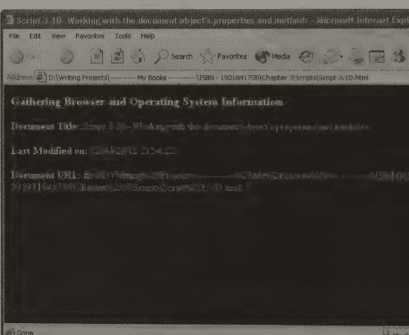

图 3.14

你可以通过操作 `document` 对象的属性来影响网页的外观。

你可能想尝试的其他 `document` 对象属性包括

- **linkColor。** 指定文档链接的颜色
- **alinkColor。** 指定活动文档链接的颜色
- **vlinkColor。** 指定已访问链接的颜色
- **anchor**。一个对象，其 `length` 属性指定 HTML 页面上的锚点数量
- **link**。一个对象，其 `length` 属性指定 HTML 页面上的链接数量
- **cookie**。提供在访客计算机上创建、存储和检索 cookie 的能力
- **elements**。一个对象，其 `length` 属性指定表单上的控件数量
- **form**。代表 HTML 页面上的一个表单
- **lastModified**。检索当前 HTML 页面最后修改的日期和时间
- **title**。检索存储在 HTML 页面 TITLE 标签中的值

##### location 对象

`location` 对象允许你以编程方式控制加载到浏览器中的 URL。使用此对象的 `href` 属性，你可以检索当前加载的 HTML 页面的 URL。使用 `location` 对象的 `replace()` 和 `reload()` 方法，你可以替换或刷新 Internet Explorer 显示的 HTML 页面。

以下示例演示了如何创建一个可以更改 Internet Explorer 加载的 HTML 页面的自定义控件。

```
<HTML>

<HEAD>
  <TITLE>脚本 3.11 - 创建手动自定义导航控件</TITLE>
</HEAD>

<BODY>
  <H3>选择一个在线书店</H3>

  <SCRIPT LANGUAGE="VBScript">
  <!-- 开始隐藏 VBScript 语句
Function myButton_onClick()
    window.location=document.myForm.myList.value
End Function
' 隐藏 VBScript 语句结束 -->
</SCRIPT>

<FORM NAME="myForm">
    <SELECT NAME="myList" size=3>
        <OPTION VALUE="http://www.amazon.com"> Amazon.com
        <OPTION VALUE="http://www.bn.com"> Barnes & Noble
        <OPTION VALUE="http://www.bamm.com"> Books-A-Million
    </SELECT>
    <INPUT NAME="myButton" TYPE="button" VALUE="访问书店">
</FORM>
</BODY>

</HTML>
```

HTML 表单由一个静态大小的下拉列表和一个按钮组成。当访客从下拉列表中选择一个选项，然后单击按钮（名为 `myButton`）时，`myButton_onClick` 函数将被执行。此函数通过将所选选项关联的 URL 分配给 `location` 对象来更改当前加载的 URL，如下所示。

```
window.location=document.myForm.myList.value
```

> 注意
> 引用其子对象时不需要 `window` 对象。换句话说，以下两种语句都可以正常工作。
> ```
> window.location=document.myForm.myList.value
> location=document.myForm.myList.value
> ```
> 我只是使用更长的版本以使我的示例更容易理解。

图 3.15 展示了上一个示例生成的 HTML 页面。
下一个示例包含两个 VBScript。第一个 VBScript 嵌入在 `HEAD` 部分。它定义了两个子例程：`ppBooks_onClick` 使用 `location` 对象的 `replace()` 方法将新的 URL 加载到 Internet Explorer 窗口中。`reload_onClick` 子例程执行 `location` 对象的 `reload()` 方法，该方法刷新当前加载的 HTML 页面。

第二个 VBScript 嵌入在 HTML 页面的 `BODY` 部分。它由一个 VBScript 语句组成。此语句使用 `document` 对象的 `write()` 方法在 HTML 页面上显示一条文本消息，其中包含存储在 `location` 对象的 `href` 属性中的值。

```
<HTML>

<HEAD>
	<TITLE>脚本 3.12 - 使用 location 对象</TITLE>

<SCRIPT LANGUAGE="VBScript">
	<!-- 开始隐藏 VBScript 语句
	Sub ppBooks_onClick
	location.replace("http://www.premierpressbooks.com")
End Sub
Sub reload_onClick
    location.reload()
End Sub
' 隐藏 VBScript 语句结束 -->
</SCRIPT>

</HEAD>

<BODY>
    <H3>使用 Location 对象</H3>

    <SCRIPT LANGUAGE="VBScript">
    <!-- 开始隐藏 VBScript 语句
    document.write("此 HTML 页面的 URL 是: " & location.href _
        & "<BR>")
    ' 隐藏 VBScript 语句结束 -->
    </SCRIPT>

    <FORM NAME="form1">
        <INPUT NAME="ppBooks" TYPE="button" _
            VALUE="www.premierpressbooks.com">
        <INPUT NAME="reload" TYPE="button" VALUE="刷新此页">
    </FORM>
</BODY>

</HTML>
```

图 3.16 展示了 Internet Explorer 加载此 HTML 页面时生成的网页。

##### history 对象

`history` 对象提供了另一种控制 Internet Explorer 导航的方式。此对象提供了一种在 `document` 对象的历史记录列表中前后移动的方法。

以下示例展示了一个使用 `history` 对象的 `back()`、`go()` 和 `forward()` 方法的 VBScript。它将每个方法分别放在位于 HTML 页面 `HEAD` 部分 VBScript 中的一个独立子例程中。


图 3.16

`location` 对象的方法允许你加载任何 URL 或刷新当前 URL。

```
<HTML>

<HEAD>
    <TITLE>脚本 3.13 - 使用 history 对象</TITLE>

    <SCRIPT LANGUAGE="VBScript">
    <!-- 开始隐藏 VBScript 语句
    Sub backButton_onclick
        history.back()
    End Sub
    Sub reloadButton_onclick
        history.go(0)
    End Sub
    Sub forwardButton_onclick
        history.forward()
    End Sub
    Sub lengthButton_onclick
        alert("历史记录队列中的条目数 = " & history.length)
    End Sub
```


##### 一个周末学 VBScript

```html
' End hiding VBScript statements -->
</SCRIPT>
</HEAD>
<BODY>
    <H3>使用 VBScript history 对象控制浏览器导航！</H3>
    <FORM NAME="form1">
        <INPUT NAME="backButton" TYPE="button"
               VALUE="   后退按钮   "> <P>
        <INPUT NAME="reloadButton" TYPE="button"
               VALUE="重新加载按钮"> <P>
        <INPUT NAME="forwardButton" TYPE="button"
               VALUE="前进按钮"> <P>
        <INPUT NAME="lengthButton" TYPE="button"
               VALUE="历史记录队列">
    </FORM>
</BODY>
</HTML>
```

`backButton_onclick` 子程序执行 `back()` 方法，如图所示。此方法用于将先前访问的 URL 加载到浏览器窗口中。

```vbscript
history.back()
```

`reloadButton_onclick` 子程序执行 history 对象的 `go()` 方法，如下所示。这种情况下，只是刷新当前加载的 URL。

```vbscript
history.go(0)
```

通过在 `go()` 方法的括号中输入一个数字值，你可以加载不同的 URL。例如，`go(-1)` 会加载文档对象历史记录列表中向后一级的 URL，而 `go(1)` 则加载列表中向前一级的 URL。

`forwardButton_onclick` 子程序执行以下语句。

```vbscript
history.forward()
```

`forward()` 方法与 `go()` 方法类似，允许你通过指定 URL 在文档对象历史记录列表中向前存储的位置来加载它。图 3.17 显示了在 Internet Explorer 中加载前一个示例的结果。

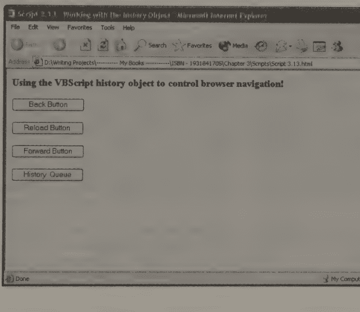

**图 3.17**
你可以使用 `history` 对象的方法以编程方式浏览 Internet Explorer 的历史记录列表。

##### navigator 对象

`navigator` 对象包含提供有关加载 HTML 页面的浏览器的信息的属性。你可以使用 `navigator` 对象的属性来确定访问者使用的浏览器和操作系统，并添加相应的编程逻辑来处理事情。例如，你可能会自动将运行 Internet Explorer 的访问者重定向到专门设计以支持其浏览器版本的不同 HTML 页面。

以下示例显示了一些 navigator 属性。这些属性包括：

- **appCodeName**。检索加载 HTML 页面的浏览器的代号。
- **appName**。检索加载 HTML 页面的浏览器的名称。
- **appVersion**。检索有关加载 HTML 页面的浏览器的版本信息。

```html
<HTML>

<HEAD>
    <TITLE>脚本 3.14 - 使用 navigator 对象的属性</TITLE>
</HEAD>

<BODY>
    <H3>收集浏览器和操作系统信息</H3>

    <SCRIPT LANGUAGE="VBScript">
    <!-- Start hiding VBScript statements
        document.write("navigator.appCodeName = <B>" & navigator.appCodeName & "</B><P>")
        document.write("navigator.appName =      <B>" & navigator.appName & "</B><P>")
        document.write("navigator.appVersion =   <B>" & navigator.appVersion & "</B><P>")
    ' End hiding VBScript statements -->
    </SCRIPT>

</BODY>

</HTML>
```

图 3.18 显示了当在运行 Windows XP 操作系统的计算机上使用 Internet Explorer 浏览器加载 HTML 页面时显示的结果。

#### SATURDAY AFTERNOON 在 Internet Explorer 内部编写脚本

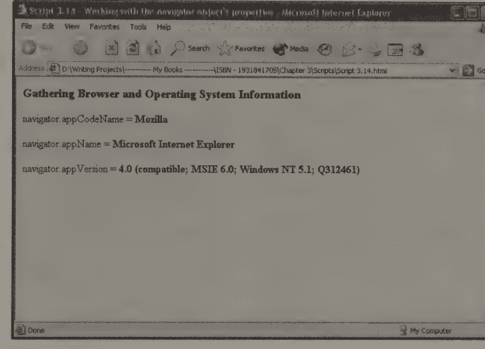

**图 3.18**
使用 navigator 对象的属性收集有关浏览器的信息。

应用程序代号是 Mozilla。你可能不会太多地使用此属性。返回的应用程序名称是 Microsoft Internet Explorer。最后，应用程序版本是 4.0（兼容；MSIE 6.0；Windows NT 5.1；Q312461）。

以下示例显示了一个 VBScript，它查询 `appName` 和 `appVersion` 属性的值，以确定将访问者的浏览器重定向到何处。

```html
<HTML>

<HEAD>
    <TITLE>脚本 3.15 - 检测浏览器类型和版本</TITLE>
</HEAD>

<BODY>
    <H3>收集浏览器和操作系统信息</H3>

    <SCRIPT LANGUAGE="VBScript">
    <!-- Start hiding VBScript statements
```

```vbscript
browserName=navigator.appName

If browserName = "Microsoft Internet Explorer" Then
    document.write("Your browser is <B>" & browserName & "</B><P>")

    '使用 navigator appVersion 属性收集
    '    关于访问者的
    'Internet 浏览器和操作系统的信息

    browserVersion = navigator.appVersion

    'Instr() 函数在字符串中搜索指定的
    '    字符集

    findString = Instr(1, browserVersion, "MSIE")

    If findString = 0 Then
        '如果 findString = 0，则字符串 MSIE 未找到
        document.write("Hum...... Something is wrong!")
        'window.location="http://www.myHtmlPages.com"
    Else
        findString = findString + 5
        '下面给我版本号
        versionNumber = Mid(browserVersion, findString, 3)
        document.write("Your IE browser is at version number <B> " & versionNumber & "</B>")
        'window.location="http://www.myVbscriptPages.com"
    End If

Else
    document.write("You are not using an Internet Explorer browser <P>")
    'window.location="http://www.myHtmlPages.com"
End If

' End hiding VBScript statements -->
</SCRIPT>

</BODY>

</HTML>
```

让我们逐步分解这个示例，一次查看一部分。首先，VBScript 将 `navigator` 对象的 `appName` 属性的值分配给名为 `browserName` 的变量，如下所示。

```vbscript
browserName=navigator.appName
```

然后，检查 `browserName` 的值，以查看正在使用的浏览器是否是 Microsoft Internet Explorer。如果是，则在弹出对话框中显示 `browserName` 的值。

```vbscript
If browserName = "Microsoft Internet Explorer" Then
    document.write("Your browser is <B>" & browserName & "</B><P>")
```

接下来，将 `navigator` 对象的 `appVersion` 属性的值分配给名为 `browserVersion` 的变量。

```vbscript
browserVersion = navigator.appVersion
```

然后，使用 `Instr()` 函数（该函数返回一个字符串在另一个字符串中第一次出现的位置）在分配给 `browserVersion` 的字符串中定位 "MSIE" 字符。

```vbscript
findString = Instr(1, browserVersion, "MSIE")
```

接下来，检查 `findString` 的值。如果它等于 0，则表示发生了奇怪的事情，因为每个版本的 Internet Explorer 都应该有这个字符串。因此，应该执行 If...Then...Else 语句的 Else 部分。它将 "MSIE" 字符串的字符位置（应该是 18）加 5，以确定浏览器版本号的起始位置（例如，第二十三个字符位置）。接下来，使用 `Mid()` 函数从 `browserVersion` 中获取接下来的三个字符（第 24-26 个字符）。最后，将此值分配给一个名为 `versionNumber` 的变量，然后显示它。

```vbscript
If findString = 0 Then
    '如果 findString = 0，则字符串 MSIE 未找到
    document.write("Hum...... Something is wrong!")
    'window.location="http://www.myHtmlPages.com"
Else
    findString = findString + 5
    '下面给我版本号
```

```vbscript
versionNumber = Mid(browserVersion, findString, 3)
document.write("Your IE browser is at version number <B> " & versionNumber & "</B>")
'window.location="http://www.myVbscriptPages.com"
End If
```

在你自己的 HTML 页面上使用此示例之前，你可能需要进行一些更改。实际上，显示浏览器名称和版本号没有太大意义。相反，你可能希望取消注释 VBScript 中的以下语句。

`'window.location="http://www.myHtmlPages.com"`
`'window.location="http://www.myVbscriptPages.com"`

这些语句将浏览器重定向到适合该浏览器的 HTML 页面。图 3.19 显示了当在运行 Internet Explorer 浏览器的 Windows XP 计算机上执行脚本时，HTML 页面的外观。

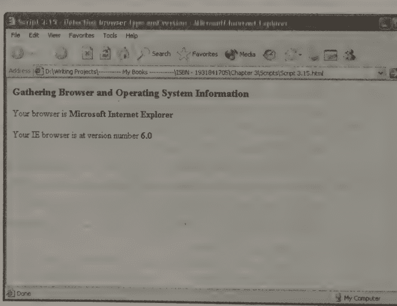

**图 3.19**
根据访问者的浏览器类型和版本进行重定向。

前面的 VBScript 如果由 Netscape 浏览器打开，对你没有太大用处，因为 Netscape 浏览器不支持 VBScript，并且会忽略任何 VBScript 语句。然而，你可以将其作为构建脚本的模型，用于询问 Internet Explorer 的版本号。然后，你可以将访问者的浏览器重定向到你设计的支持所使用浏览器版本的 HTML 页面。

##### 与访问者交互

默认情况下，VBScript 按从上到下的顺序执行。换句话说，VBScript 中的语句先执行第一条，然后是第二条，依此类推。当然，这个规则也有例外。位于 HTML 页面 `HEAD` 部分的函数和子程序只有在被其他 VBScript 语句调用时才会执行。在其他情况下，`If...Then...Else` 和 `Switch` 语句的实现使得某些 VBScript 语句的执行成为可选的。

当 HTML 页面发生某些事情时，浏览器事件就会发生。例如，当 HTML 页面加载时，`onLoad` 事件会触发；当页面卸载时（例如，访问者关闭浏览器或加载新的 URL），`onUnload` 事件会触发。当访问者移动鼠标、单击鼠标按钮或在键盘上打字时，也会发生其他事件。通过在你的 VBScript 中添加响应浏览器事件的逻辑，你可以显著增强访问者在你网站上的体验。

###### 设置事件处理程序

为了处理浏览器事件，你需要向你的 VBScript 中添加事件处理程序。*事件处理程序* 是一个识别事件何时发生的陷阱。事件处理程序与特定事件相关联。参考附录 A 中的表 A.19，获取浏览器事件和事件处理程序的列表。示例包括 `click` 事件和 `onClick` 事件处理程序，以及 `load` 事件和 `onLoad` 事件处理程序。你可能已经注意到，事件处理程序是通过在事件名称前加上 `on` 来命名的，以执行它们的事件命名。

事件与特定对象相关联。当事件被触发时，如果为其编写了事件处理程序，则该事件处理程序会自动执行。

有几种方法可以定义事件。首先，你可以将它们直接嵌入 HTML 标签中，如这里所示。

```html
<BODY onLoad="window.status = 'Welcome to my web site!'">
```

在这种情况下，当 HTML 页面加载到浏览器窗口中时，`onLoad` 事件处理程序会被触发。要更花哨一点，你可以在 HTML 标签内添加多个事件处理程序。

```html
<BODY onLoad="window.alert('Hello!')"
      onUnload="window.alert('Good Bye!')">
```

你还可以通过定义以事件命名的子程序和函数来设置事件处理程序，这些事件处理程序将以执行它们的事件命名。例如，下面的 VBScript 子程序名为 `myButton_onMouseOver`。当访问者使用鼠标将指针移动到名为 `myButton` 的按钮上时，它会自动执行。

```vb
Sub myButton_onMouseOver
    window.status = "Hello world!"
End Sub
```

在 VBScript 中使用事件处理程序的第三种方法是在 HTML `SCRIPT` 标签内设置它们，如此处所示。

```html
<SCRIPT FOR="myButton" EVENT="onDblClick" LANGUAGE="VBScript">
    window.status="Hello World!"
</SCRIPT>
```

在这个示例中，为特定表单按钮定义了一个 VBScript，只有当访问者单击相应的表单按钮时才会执行。

###### 处理不同类型的事件

事件处理程序可以根据它们的执行时间来定义。这些类别包括

- 窗口和框架事件
- 鼠标事件
- 键盘事件
- 错误事件
- 与表单一起使用的常用事件

这些事件的详细列表在附录 A 中提供。今天下午剩余的时间将专门用于演示如何使用与上表中前三个类别事件处理程序相关的事件处理程序。剩下的两个类别将在今天晚上晚些时候介绍。

####### 窗口和框架事件处理程序

当影响窗口和框架对象的事件发生时，会触发窗口和框架事件处理程序。这些事件处理程序包括

- **onLoad**。当 HTML 或图像加载完成时执行。
- **onResize**。当访问者调整框架或窗口大小时执行。
- **onUnload**。当访问者关闭浏览器窗口或框架或加载不同的 URL 时执行。
- **onMove**。当访问者移动框架或窗口时执行。

要使用这些事件处理程序，请将它们放在 HTML `BODY` 标签内，如接下来的两个示例所示。第一个示例将 `onLoad` 事件处理程序放在 `BODY` 标签中。当 HTML 页面加载时，它会执行并调用 `DisplayMsg()` 函数。此外，它通过将参数放在函数的括号内（在本例中，参数是一个名称）来传递一个参数供函数处理。因为传递的值是文本，所以它也包含在一对引号内。传递数字不需要引号。

函数接收传递的参数并将其赋值给名为 `name` 的变量，然后使用 `MsgBox()` 函数显示该变量。

```html
<HTML>
<HEAD>
    <TITLE>Script 3.16 - 将 VBScript 语句嵌入 HTML 标签的示例</TITLE>
    <SCRIPT LANGUAGE="VBScript">
        <!-- Start hiding VBScript statements
        Function DisplayMsg(name)
            MsgBox("Hello and good morning " & name)
        End Function
        ' End hiding VBScript statements -->
    </SCRIPT>
</HEAD>
<BODY onLoad=DisplayMsg("Jerry")>
    <H3>将 VBScript 语句嵌入 HTML 标签的示例！</H3>
</BODY>
</HTML>
```

图 3.20 显示了加载到 Internet Explorer 中时 HTML 页面的外观。

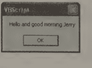

第二个示例演示了如何执行 `onLoad()`、`onResize()` 和 `onUnload()` 事件处理程序。因为所有这些事件处理程序都必须位于 `BODY` 标签内，所以我将它们一个接一个地列出，中间用空格隔开。

```html
<HTML>
<HEAD>
<TITLE>Script 3.17 - 使用窗口事件</TITLE>
</HEAD>
<BODY onLoad="window.alert('I load therefore I am!')"
onResize="window.alert('What is wrong with the way I am?')"
onUnload="window.alert('You killed me. What did I ever do to you?')">
<H3>事件演示！</H3>
</BODY>
</HTML>
```

图 3.21 到 3.23 显示了执行此脚本时出现的各种弹出对话框。

**图 3.21**

当 HTML 页面加载到浏览器时，会出现此消息。

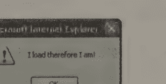

**图 3.22**

当用户调整浏览器窗口大小时，使用 `onResize` 事件处理程序显示此弹出对话框。

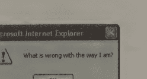

**图 3.23**

当用户关闭浏览器窗口从而触发 `onUnload` 事件处理程序时，会出现此弹出对话框。


####### 鼠标事件处理程序

每当访问者用鼠标做一些事情时，鼠标事件就会执行，例如单击表单按钮或将指针移到图像上。以下鼠标事件处理程序可供你使用。

- **onMouseOver**。当访问者将指针移动到对象上时执行。
- **onMouseOut**。当访问者将指针移出对象时执行。
- **onMouseDown**。当访问者按下鼠标按钮时执行。
- **onMouseUp**。当访问者释放鼠标按钮时执行。
- **onMouseMove**。当访问者移动鼠标时执行。
- **onMouseWheel**。当鼠标滚轮被旋转时执行。
- **onClick**。当访问者单击对象时执行。
- **onDblClick**。当访问者双击对象时执行。

接下来的 VBScript 示例展示了如何将 `onMouseOver` 和 `onMouseOut` 事件处理程序合并到你的脚本中。在这个示例中，创建了一个由一个名为 `myButton` 的按钮组成的 HTML 表单。在 HTML 页面的 `HEAD` 部分定义了两个子程序。第一个函数名为 `myButton_onMouseOver`，每当访问者使用鼠标将指针移动到 `myButton` 按钮上时，它会自动执行。类似地，当指针移出 `myButton` 按钮时，`myButton_onMouseOut` 子程序会执行。

当 HTML 页面首次执行嵌入在 `BODY` 标签中的 `onLoad` 语句时，它会在 Internet Explorer 状态栏中放置一条文本消息。`myButton_onMouseOver` 子程序中的 VBScript 语句将一条文本消息赋值给 window 对象的 `status` 属性，从而在 Internet Explorer 状态栏中显示该消息。`myButton_onMouseOut` 子程序中的语句用空字符串替换文本消息，从而清除状态栏。


让一切得以运作的关键在于，为 myButton 按钮分配 NAME 属性，并在为每个子例程分配名称时，将相应的事件处理程序名称附加到按钮名称之后。

```html
<HTML>

<HEAD>
<TITLE>Script 3.18 - onMouseOver 和 onMouseOut 事件</TITLE>

<SCRIPT LANGUAGE="VBScript">
<!-- Start hiding VBScript statements
Sub myButton_onMouseOver
    window.status = "Hello world!"
End Sub
Sub myButton_onMouseOut
    window.status = ""
End Sub
' End hiding VBScript statements -->
</SCRIPT>

</HEAD>

<BODY onLoad="window.status = 'This message is displayed on the IE status bar!'">
<H3>将鼠标悬停在按钮上，并留意 IE 状态栏</H3>
<Form NAME="myForm">
    <INPUT NAME="myButton" TYPE="button" VALUE="Demonstrating mouse events">
</FORM>
</BODY>

</HTML>
```

图 3.24 展示了当页面加载到 Internet Explorer 中并将指针移动到按钮上方时，上述示例的显示效果。

下一个示例同样演示了 onMouseOver 和 onMouseOut 事件处理程序，同时也展示了 onMouseDown 和 onMouseUp 事件处理程序。在 HTML 页面的 BODY 部分有两个指向网站的链接，分别命名为 link1 和 link2。在 HTML 页面的 HEAD 部分嵌入了一段 VBScript，其中定义了四个函数。其中两个函数用于为第一个链接提供事件处理程序，另外两个函数则为第二个链接提供事件处理程序。将指针移动到第一个链接上或移开会改变 HTML 页面的前景和背景颜色。类似地，点击第二个链接会导致在加载指定网站之前，先改变页面的背景和前景颜色。

```html
<HTML>

<HEAD>
    <TITLE>Script 3.19 - onMouseOver、onMouseOut、onMouseDown 及 onMouseUp 事件</TITLE>

    <SCRIPT LANGUAGE="VBScript">
<!-- Start hiding VBScript statements
Function link1_onMouseOver()
    document.bgColor="red"
    document.fgColor="white"
End Function
Function link1_onMouseOut()
    document.bgColor="white"
    document.fgColor="black"
End Function
Function link2_onMouseDown()
    document.bgColor="blue"
    document.fgColor="white"
End Function
Function link2_onMouseUp()
    document.bgColor="white"
    document.fgColor="black"
End Function
' End hiding VBScript statements -->
</SCRIPT>
</HEAD>
<BODY>
<H3>Testing mouse events!</H3>
<A HREF="http://www.premierpressbooks.com" NAME="link1">Visit my publisher</A>
<A HREF="http://www.amazon.com" NAME="link2">Visit amazon.com</A>
</BODY>
</HTML>
```

图 3.25 显示了上述示例创建的 HTML 页面首次加载时的状态。

下一个示例展示了如何实现 onClick 和 onDblClick 事件处理程序。创建一个包含两个按钮（分别命名为 button1 和 button2）的表单。当你单击第一个按钮时，会弹出如图 3.26 所示的对话框。当你双击第二个按钮时，会弹出类似的对话框。

```html
<HTML>

<HEAD>
<TITLE>Script 3.20 - 使用 onClick 和 onDblClick 事件</TITLE>

<SCRIPT LANGUAGE="VBScript">
<!-- Start hiding VBScript statements
Function button1_onClick()
    window.alert("You single clicked!")
End Function
Function button2_onDblClick()
    window.alert("You double clicked!")
End Function
' End hiding VBScript statements -->
</SCRIPT>

</HEAD>

<BODY>
<H3>Testing mouse events!</H3>
<FORM>
<INPUT NAME="button1" TYPE="button" VALUE="Click on me!">
<INPUT NAME="button2" TYPE="button" VALUE="Double click on ME">
</FORM>
</BODY>

</HTML>
```

**图 3.26**
onClick 和 onDblClick 事件允许 VBScript 响应任何鼠标点击。

######## 键盘事件处理程序

每当访问者在键盘上输入时，鼠标事件就会执行。提供了三种键盘事件，包括：

- **onKeyDown**：当访问者按下某个键时执行
- **onKeyUp**：当访问者释放某个键时执行
- **onKeyPress**：当访问者按下并释放某个键时执行

以下示例演示了 onKeyDown 事件处理程序的使用。定义了一个 HTML 表单，其中包含一个名为 entryField 的文本输入字段。在 HEAD 部分定义了一个名为 entryField_onKeyDown() 的函数，当访问者将焦点给予文本字段（例如，将光标置于文本字段中）并按下某个键时，该函数将执行。

```html
<HTML>

<HEAD>
<TITLE>Script 3.21 - 使用 onKeyDown 事件</TITLE>

<SCRIPT LANGUAGE="VBScript">
<!-- Start hiding VBScript statements
Function entryField_onKeyDown()
    window.alert("I am sorry to interrupt but what do you think you are doing?")
End Function
' End hiding VBScript statements -->
</SCRIPT>

</HEAD>

<BODY>
<H3>Testing keyboard events!</H3>
<FORM>
<INPUT NAME="entryField" TYPE="text" VALUE="">
</FORM>
</BODY>

</HTML>
```

图 3.27 展示了当访问者按下键盘按键时弹出的对话框。

### 接下来是什么？

好的，你已经学到了很多关于浏览器内部工作原理的知识，以及如何使用 VBScript 通过其属性和方法来操作浏览器对象。你还了解了编写能在不同版本的 Internet Explorer 中运行的脚本所面临的挑战。是时候花些时间与家人朋友相处，暂时将 VBScript 放在脑后了。今晚回来时，我们将结束关于在网页中使用 VBScript 的讨论，看看其他使用 VBScript 与网页访问者交互的方式。你还将了解如何使用表单从访问者那里收集信息，如何验证表单数据，以及如何使用 VBScript 的 cookies 存储和随后检索有关访问者的信息。

## 周六晚上

### 网页技巧

- 学习如何在 VBScript 中处理错误
- 学习使用 Internet Explorer 状态栏的新技巧
- 探索如何执行定时操作
- 使用翻转效果为你的网页增添趣味
- 查看如何使用 VBScript 控制 HTML 框架
- 了解如何使用 VBScript 验证 HTML 表单
- 学习如何烘焙 VBScript cookies

晚上好！希望你的休息很愉快，并且准备好享受一些真正的乐趣了。今天下午，你学习了大量关于浏览器对象模型以及如何使用对象属性和方法来操作 Internet Explorer 和 HTML 页面的知识。

今晚，我们将通过探讨一些高级脚本主题来扩展你的 VBScript 编程专业知识。这些主题将包括如何为你的 VBScript 添加错误处理逻辑，以及如何使用 Internet Explorer 状态栏完成一些巧妙的操作。我们还将通过创建 VBScript 时钟和使用翻转控件来增加一些乐趣。

我们还将学习如何编写能对框架和表单提供高级控制的 VBScript。此外，我将向你展示如何捕获和存储每个访问你网站的人的信息，以便在他们再次访问时能够按姓名问候他们。在此过程中，我将向你介绍许多 VBScript 函数，这些函数将帮助你更轻松地构建和使用 VBScript。那么，如果你准备好了，我们就出发吧。

#### 管理 VBScript 错误

今天下午，你学习了大量关于如何处理浏览器事件的知识。还有另一个浏览器事件我想介绍，那就是错误事件。


VBScript 会遇到两种类型的错误——语法错误和运行时错误。*语法错误*是由于脚本中的拼写错误或未正确遵循 VBScript 语句语法而导致的。*运行时错误*则由多种不同原因引起。例如，如果您的 VBScript 试图操作已被用户关闭的浏览器窗口，就会发生运行时错误。

> **注意** 有关 VBScript 语法错误和运行时错误的完整列表，请参阅附录 A，“VBScript 语言参考”。

VBScript 为您提供了两种处理错误的方式。

-   让您的 VBScript 忽略错误
-   在您的 VBScript 中添加逻辑来处理错误

> **提示** 默认情况下，Internet Explorer 会向用户隐藏 VBScript 错误消息。这是合理的，因为大多数用户无法理解 VBScript 错误消息的含义。但是，作为 VBScript 程序员，在编写和测试自己的 VBScript 时，看到错误消息可能会对您有所帮助。要设置此选项，请打开 Internet Explorer 并单击“工具”、“Internet 选项”，选择“高级”选项卡，然后启用“显示每个脚本错误的通知”选项，如图 4.1 所示。

##### 忽略错误

要让您的 VBScript 在错误发生时忽略它，请在您的脚本中放置以下语句。

```
On Error Resume Next
```

将此语句放置在任何可能发生错误的 VBScript 语句之前。此语句告诉 VBScript 继续执行，从错误发生语句的下一条语句开始。

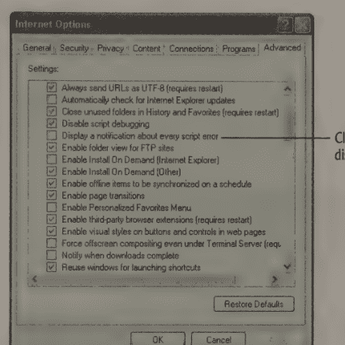

单击此处启用脚本错误的显示

图 4.1
配置 Internet Explorer 对脚本错误的处理。

以下示例展示了一个包含 VBScript 错误的简单 VBScript。

```
<HTML>
    <HEAD>
        <TITLE>脚本 4.1 - VBScript 运行时错误示例</TITLE>
    </HEAD>
    <BODY>
        <B>错误演示</B><P>
        <SCRIPT LANGUAGE="VBScript">
        <!--
            document.write("This is line 1" & "<P>")
            document.write("This is line 2" & "<P>")
            document.writ("This is line 3" & "<P>")
            document.write("This is line 4" & "<P>")
            document.write("This is line 5" & "<P>")
        // -->
        </SCRIPT>
    </BODY>
</HTML>
```

脚本中的第三行包含一个拼写错误。

```
document.writ("This is line 3" & "<P>")
```

具体来说，document 对象的 write() 方法拼写错误。如果您将此示例加载到 Internet Explorer 中，将会看到如图 4.2 所示的错误。

图 4.2

一条错误消息，指出 document 对象不支持名为 writ() 的属性或方法。

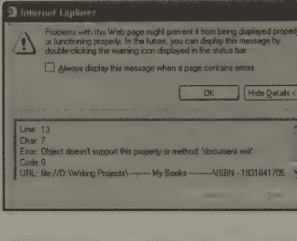

以下脚本展示了如何通过添加 On Error Resume Next 语句，使脚本在错误发生后能继续执行。

```
<HTML>
  <HEAD>
    <TITLE>脚本 4.2 - On Error Resume Next 示例</TITLE>
  </HEAD>

  <BODY>
    <B>错误演示</B><P>

    <SCRIPT LANGUAGE="VBScript">
    <!--
      On Error Resume Next
      document.write("This is line 1" & "<P>")
      document.write("This is line 2" & "<P>")
      document.writ("This is line 3" & "<P>")
      document.write("This is line 4" & "<P>")
      document.write("This is line 5" & "<P>")
    -->
    </SCRIPT>
  </BODY>
</HTML>
```

```
// -->
</SCRIPT>

</BODY>
</HTML>
```

图 4.3 显示了将此脚本加载到 Internet Explorer 时创建的输出。此示例演示了如何在不影响 VBScript 剩余执行的情况下跳过错误。然而，更多时候，简单地忽略错误会导致脚本执行后期出现其他错误。因此，请谨慎使用 On Error Resume Next 语句来忽略 VBScript 错误。

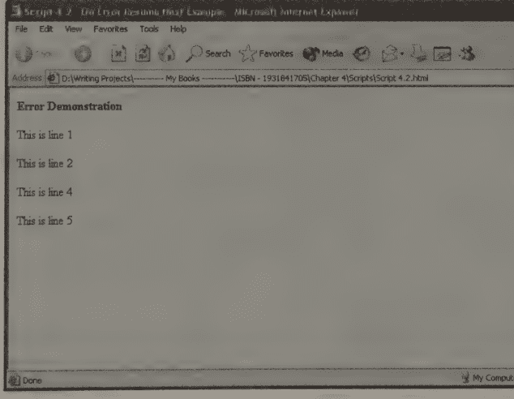

**图 4.3**
使用 On Error Resume Next 语句绕过 VBScript 错误。

当 On Error Resume Next 语句放置在过程外部、VBScript 的开头时，它的作用域是全局的，这意味着它会告诉 VBScript 忽略脚本中任何位置或脚本调用的过程中发生的错误。但是，当 On Error Resume Next 语句放置在过程内部时，它的作用域是局部的，当退出该过程时，其作用域也就结束了。例如，查看以下脚本。

```
<HTML>
<HEAD>
<TITLE>脚本 4.3 - 在过程中管理错误</TITLE>
<SCRIPT LANGUAGE="VBScript">
<!--
Function Display_Msg1()
    On Error Resume Next
    document.write("This is line 1" & "<P>")
End Function

Function Display_Msg2()
    document.write("This is line 2" & "<P>")
End Function

Function Display_Msg3()
    document.writ("This is line 3" & "<P>")
End Function

Function Display_Msg4()
    document.write("This is line 4" & "<P>")
End Function

Function Display_Msg5()
    document.write("This is line 5" & "<P>")
End Function
// -->
</SCRIPT>
</HEAD>
<BODY>
<B>错误演示</B><P>
<SCRIPT LANGUAGE="VBScript">
<!--
    Display_Msg1()
    Display_Msg2()
    Display_Msg3()
    Display_Msg4()
    Display_Msg5()
// -->
</SCRIPT>
</BODY>
</HTML>
```

如您所见，嵌入在 HTML 页面 BODY 部分的 VBScript 调用了五个 VBScript 函数。被调用的第一个函数包含 On Error Resume Next 语句。如果在此过程中发生错误，它将被忽略。但是，其他函数都不包含 On Error Resume Next 语句。当第三个有错误的函数执行时，VBScript 终止并显示错误。

要防止此错误终止脚本，您可以将 On Error Resume Next 语句移动到 BODY 部分 VBScript 的开头，或者在每个过程内部放置该语句的副本。

##### Err 对象

正如我已提到的，忽略错误并不总是一个好的选择。处理错误的一种更好的方法是向脚本中添加额外的代码来处理它们。为此，您需要使用 Err 对象的属性和方法。

> **提示**
如果您想在 VBScript 的某个点禁用 On Error Resume Next 语句的效果，那么在适当的位置添加以下语句。

On Error Goto 0

Err 对象包含有关最近错误的信息。您可以通过引用 Err 对象的属性来获取此信息，这些属性如下所列。

-   **Number**。检索或设置与错误关联的错误编号。
-   **Description**。检索或设置与错误关联的消息。
-   **Source**。检索或设置导致错误的对象名称。

以下示例演示了如何通过查询 Err 对象的 number 属性的值来处理错误。

```
<HTML>

<HEAD>
  <TITLE>脚本 4.4 - 捕获 VBScript 错误</TITLE>
</HEAD>

<BODY>
  <H3>VBScript 错误处理示例</H3>

  <SCRIPT LANGUAGE="VBScript">
  <!-- 开始隐藏 VBScript 语句
    Option Explicit
    On Error Resume Next

    MsgBox("Welcome to my web site")
    Document.bogusmethod()
    If Err > 0 then
      MsgBox "Error: " & Err.Number & " - " & Err.description
      Err.Clear
    End if

    Document.Write "This message will appear only if no errors"
    & " occurred or if errors were properly"
    & " handled!"

    ' 结束隐藏 VBScript 语句 -->
  </SCRIPT>

</BODY>

</HTML>
```

如您所见，VBScript 中的第二条语句是 `On Error Resume Next` 语句。然后脚本尝试执行一个名为 `bogusmethod()` 的 document 对象方法。然而，此方法不存在，因此会产生错误。然后以下语句处理该错误。

```
If Err > 0 then
    MsgBox "Error: " & Err.Number & " - " & Err.description
    Err.Clear
End if
```

> **注意** `number` 属性是 `Err` 对象的默认属性。因此，以下语句是等效的。

`Err`
`Err.number`

以下是这些语句的功能。首先，检查上一条命令（例如 `document.bogusmethod()`）的返回码。如果错误码大于零（例如发生了错误），则使用 `MsgBox()` 函数显示 `Err` 对象的 `number`、`description` 和 `source` 属性。然后执行 `Err` 对象的 `clear()` 方法。此方法清除当前存储在 `Err` 对象属性中的错误信息。

> **提示** 在此示例中，更好地使用 `Err` 对象的 `description` 属性可能是在显示其内容之前，将其分配给一个更友好的错误消息，从而使用户更容易理解。

图 4.4 显示了 VBScript 显示的错误消息。图 4.5 显示了脚本完成执行时用户看到的输出。


##### 图 4.4

捕获 VBScript 错误并防止其停止脚本执行。

##### 图 4.5

脚本在发生错误后继续执行。

> **注意**

`Err` 对象的 `clear()` 方法在以下情况下会自动执行。

- 当执行 `On Error Resume Next` 语句时
- 当执行 `Exit Sub` 语句时
- 当执行 `Exit Function` 语句时

`Exit Sub` 和 `Exit Function` 语句在 VBScript 子程序和函数中使用，作为在到达子程序或函数末尾之前结束其执行的一种方式。

你可能会发现另一个有用的 `Err` 对象方法是 `raise()` 方法。你可以使用此方法生成运行时错误。这样你可以测试脚本中的错误处理逻辑，看它是否按预期工作。例如，将以下语句添加到 VBScript 中会产生一个 For 循环未初始化的运行时错误。

```
Err.Raise(92)
```

类似地，以下语句不仅产生运行时错误，还自定义 `Err` 对象的 `source` 和 `description` 属性。

```
Err.Raise(92)
Err.Source = "New source text"
Err.Description = "New descriptive text"
```

##### 增强状态栏

今天下午你学习了如何使用 window 对象的 status 属性在浏览器状态栏中放置消息。现在让我们通过编写一对脚本来让状态栏更有趣，这些脚本可以发布闪烁和滚动的消息。你可以在自己的 VBScript 中使用这两个示例，以吸引用户对状态栏中可能被忽略的文本的注意。但请谨慎使用这些技术。许多用户会对所有网页上无休止的闪烁和滚动消息感到厌倦。

以下 VBScript 演示了如何在浏览器状态栏上放置闪烁消息。

```
<HTML>

<HEAD>
    <TITLE> Script 4.5 - A blinking status bar message example</TITLE>

    <SCRIPT LANGUAGE="VBScript">
    <!-- Start hiding VBScript statements
    Option Explicit
    Dim loopAgain
    Dim msgTrigger
    msgTrigger = "true"
    window.status = " "

    Function Msg_Blink()
        If msgTrigger = "true" Then
            window.status = "This message should be blinking in your status bar!"
            msgTrigger = "false"
        Else
            window.status = " "
            msgTrigger = "true"
        End If
        loopAgain = window.setTimeout("Msg_Blink()", 1000)
    End Function

    ' End hiding VBScript statements -->
    </SCRIPT>

</HEAD>

<BODY>
<H3>Keep your eye on the Internet Explorer status bar</H3>
<SCRIPT LANGUAGE="VBScript">
<!-- Start hiding VBScript statements
Msg_Blink()
' End hiding VBScript statements -->
</SCRIPT>
</BODY>

</HTML>
```

在这个例子中，位于 BODY 部分的 VBScript 通过执行 `Msg_Blink()` 函数来启动。此函数每次调用时都会检查 `msgTrigger` 变量的值。如果变量的值等于 true，则向浏览器状态栏写入一条消息，并将变量的值更改为 false。相反，当发现变量的值等于 false 时，会向浏览器状态栏写入一个空字符串，并将变量的值更改为 true。因此，变量的值在每次执行 `Msg_Blink()` 函数时在 true 和 false 之间切换，导致函数在浏览器状态栏上发布然后清除文本消息。

函数中的最后一条语句，如下所示，通过再次调用函数来创建一个循环。

```
loopAgain = window.setTimeout("Msg_Blink()", 1000)
```

此语句使用 window 对象的 `setTimeout()` 方法在等待 1000 毫秒（1 秒）后执行 `Msg_Blink()` 函数。

图 4.6 显示了当 HTML 页面加载到浏览器中时，Internet Explorer 状态栏上出现的闪烁消息。

##### 图 4.6

这是发布在浏览器状态栏上的闪烁消息。

下一个示例展示了一种在浏览器状态栏中创建滚动消息的方法。在此示例中，状态栏被清除，然后使用 window 对象的 `setTimeout()` 方法在 `Scroll_Msg()` 函数中创建一个循环，该函数每 200 毫秒显示消息的一个字符。

```
<HTML>

<HEAD>
    <TITLE> Script 4.6 - A scrolling status bar message example</TITLE>

    <SCRIPT LANGUAGE="VBScript">
    <!-- Start hiding VBScript statements

        Option Explicit
        Dim msg
        Dim loopAgain
        Dim i
        window.status = " "

        msg = "Let me hypnotize you with this message.................... "
        i = 1

        Function Scroll_Msg()

            window.status = Left(msg, i)

            i = i + 1
            If i > Len(msg) Then
                i = 1
            End If
            loopAgain = window.setTimeout("Scroll_Msg()", 200)
        End Function

    ' End hiding VBScript statements -->
    </SCRIPT>

</HEAD>

<BODY>
    <H3>Keep your eye on the Internet Explorer status bar</H3>
    <SCRIPT LANGUAGE="VBScript">
    <!-- Start hiding VBScript statements
        Scroll_Msg()
    ' End hiding VBScript statements -->
    </SCRIPT>
</BODY>

</HTML>
```

在浏览器状态栏中显示的消息存储在一个名为 `msg` 的变量中，如下所示。

```
msg = "Let me hypnotize you with this message................................. "
```

此示例使用 `Left()` 函数和一个名为 `i` 的变量来控制在函数的每次迭代中显示消息的哪一部分。`Left()` 函数显示从字符串左侧开始到由 `i` 表示的字符位置的所有字符。函数第一次执行时，`i` 的值等于 1，因此只显示消息的第一个字符。消息本身长 60 个字符。当 `i` 大于 60 时（例如，`If i > Len(msg) then`），`i` 的值会重置为 1，整个过程重新开始。

图 4.7 显示了在 Internet Explorer 中查看时滚动消息的显示效果。

##### 图 4.7

为你的网页添加滚动消息。

##### 执行定时操作

你可能想添加到网页的另一个巧妙技巧是 VBScript 数字时钟。如以下示例所示，设置一个数字时钟只需要一个带有文本框的表单、window 对象的 `setTimeout()` 方法和 `Time()` 函数。

```
<HTML>

<HEAD>
<TITLE>Script 4.7 - A VBScript clock example</TITLE>
</HEAD>

<BODY>

<SCRIPT LANGUAGE="VBScript">
<!-- Start hiding VBScript statements

Option Explicit
Dim loopAgain

Function Display_Clock()
    document.myForm.myClock.value = time()
    loopAgain = setTimeout("Display_Clock()", 1000)
End Function

' End hiding VBScript statements -->
</SCRIPT>

<BODY onLoad="Display_Clock()">

<FORM NAME="myForm">
    <B>The time is: </B>
    <INPUT TYPE="text" NAME="myClock" SIZE="10">
</FORM>

</BODY>

</HTML>
```

此示例的编程逻辑包含在 HTML 页面 HEAD 部分的 VBScript 中，形式为一个名为 `Display_Clock()` 的函数。此函数由嵌入在 BODY 标签中的 `onLoad="Display_Clock()"` 语句调用。

一旦执行，该函数通过使用 `setTimeout()` 方法创建循环来继续每秒执行自身。在每次执行 `Display_Clock()` 期间，通过调用 `Time()` 函数检索的当前系统时间会显示在表单的文本字段中，如下所示。

```
document.myForm.myClock.value = time()
```

图 4.8 显示了将此示例加载到 Internet Explorer 时数字时钟的外观。

##### 实现鼠标悬停效果

你可以添加到网页的最佳视觉效果之一是鼠标悬停效果。鼠标悬停是一种图像、按钮或链接，当你使用鼠标将指针移到对象上时，其外观会发生变化。鼠标悬停效果最常用于创建菜单，以向访问者显示当前突出显示的菜单选项。


<HTML>
<HEAD>
<TITLE>脚本 4.8 - 创建按钮悬停效果</TITLE>

<SCRIPT LANGUAGE="VBScript">
<!-- 隐藏 VBScript 语句开始
Function myButton1_onMouseOver
  myForm.myButton1.VALUE="<< NBC >>"
End Function
Function myButton1_onMouseOut
  myForm.myButton1.VALUE="NBC News"
End Function
Function myButton1_onClick
  window.location="http://www.nbc.com"
End Function

Function myButton2_onMouseOver
  myForm.myButton2.VALUE="<< ABC >>"
End Function
Function myButton2_onMouseOut
  myForm.myButton2.VALUE="ABC News"
End Function
Function myButton2_onClick
  window.location="http://www.abc.com"
End Function

Function myButton3_onMouseOver
  myForm.myButton3.VALUE="<< CBS >>"
End Function
Function myButton3_onMouseOut
  myForm.myButton3.VALUE="CBS News"
End Function
Function myButton3_onClick
  window.location="http://www.cbs.com"
End Function

Function myButton4_onMouseOver
  myForm.myButton4.VALUE="<< Email>>"
End Function
Function myButton4_onMouseOut
  myForm.myButton4.VALUE="Contact Us"
End Function
Function myButton4_onClick
    window.alert("Please feel free to email us at: jlf04@yahoo.com")
End Function

' 隐藏 VBScript 语句结束 -->
</SCRIPT>
</HEAD>

<BODY>
    <B>网络新闻</B><P>
    <FORM NAME="myForm">
        <INPUT NAME="myButton1" TYPE="button" VALUE="NBC News"><P>
        <INPUT NAME="myButton2" TYPE="button" VALUE="ABC News"><P>
        <INPUT NAME="myButton3" TYPE="button" VALUE="CBS News"><P>
        <INPUT NAME="myButton4" TYPE="button" VALUE="Contact Us">
    </FORM>
</BODY>
</HTML>

要让悬停效果生效，你只需创建一些过程来响应特定对象的 MouseOver（鼠标悬停）和 MouseOut（鼠标移出）事件，并利用这些过程来触发对象外观的变化。例如，前面这个 HTML 页面包含一个名为 myForm 的表单，表单上有四个按钮。每个按钮都定义了一个提供按钮标签的默认值。此外，为每个按钮编写了一对函数。一个函数在用户将指针移到其关联按钮上时执行，另一个函数在指针移开按钮时执行。

通过切换分配给按钮 value 的文本，这些函数更改了按钮上显示的标签。

> **注意** 使用按钮创建悬停效果时要小心。重要的一点是，每个按钮上显示的两个版本的文本必须在按钮上占据相同的空间。否则，悬停动画可能会显得不流畅。

图 4.9 展示了当用户将指针移到表单上的其中一个按钮时的效果。

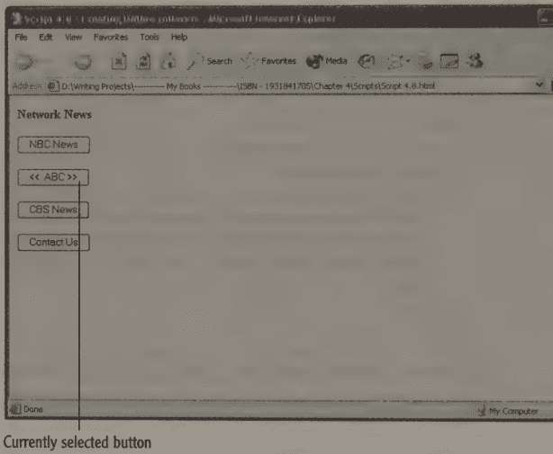

**图 4.9** 创建按钮悬停效果。当前选中的按钮

下一个示例展示了如何创建改变文本链接颜色的悬停效果。这个示例与前面的示例类似，因为它定义了四个链接以及每个链接的 MouseOver 和 MouseOut 事件对应的一对函数。这些函数不是更改分配给按钮标签的文本，而是更改分配给其关联链接的文本颜色。

<HTML>
  <HEAD>
    <TITLE>脚本 4.9 - 链接悬停示例</TITLE>

    <SCRIPT LANGUAGE="VBScript">
    <!-- 隐藏 VBScript 语句开始
    Function amazon_onMouseOver
      amazon.style.color="red"
    End Function
    Function amazon_onMouseOut
        amazon.style.color="blue"
    End Function

    Function bamm_onMouseOver
        bamm.style.color="red"
    End Function
    Function bamm_onMouseOut
        bamm.style.color="blue"
    End Function

    Function bn_onMouseOver
        bn.style.color="red"
    End Function
    Function bn_onMouseOut
        bn.style.color="blue"
    End Function

    Function borders_onMouseOver
        borders.style.color="red"
    End Function
    Function borders_onMouseOut
        borders.style.color="blue"
    End Function
    ' 隐藏 VBScript 语句结束 -->
    </SCRIPT>
  </HEAD>

  <BODY>
  <B>选择一个链接：</B><P>
  <A HREF="http://www.amazon.com" NAME="amazon"> amazon.com</A><P>
  <A HREF="http://www.bamm.com" NAME="bamm"> Books-A-Million</A><P>
  <A HREF="http://www.bn.com" NAME="bn"> Barnes & Noble</A><P>
  <A HREF="http://www.borders.com" NAME="borders"> Borders</A>
  </BODY>
</HTML>

图 4.10 展示了前面这个示例在 Internet Explorer 中加载时的外观。然而，书中展示的图片确实无法完全展现这个示例的效果，所以请务必花一分钟时间加载这个示例，亲自看看它是如何工作的。

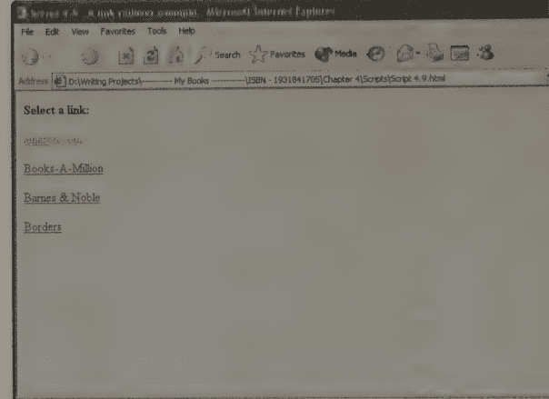

**图 4.10** 将文本链接变成悬停效果。

##### 休息一下

是时候休息一下了。为什么不花半小时放松一下呢。回来时，我们将继续学习如何使用 VBScript 来控制 HTML 框架。我们还将讨论如何使用 VBScript 来控制表单并验证其内容。然后，我们将通过学习如何使用 VBScript cookie 来存储和检索有关访问你网站的人员的信息来结束今晚的学习。

##### 用 VBScript 控制框架

如果你的网站使用了框架，那么你会很高兴知道你可以使用 VBScript 来帮助控制它们。对 VBScript 而言，框架只是另一个窗口对象。因此，在处理框架时，你可以使用与窗口对象相关的相同属性和方法。

框架通常用于将网页分成多个部分，其中一个部分提供导航框架，其余框架用于提供某种内容。

以下示例由四个 HTML 页面组成，向你展示如何使用 VBScript 控制你的框架。这里显示的第一个 HTML 页面定义了网页的框架将如何设置。如你所见，这里没有 VBScript，只有普通的 HTML。

```
<HTML>
  <HEAD>
    <TITLE>Script 4.10 - Frameset Page</TITLE>
  </HEAD>
  <FRAMESET COLS="175,*">
    <FRAME SRC="Script 4.11.html" NAME="left" SCROLLING="no" FRAMEBORDER="1" NORESIZE>
    <FRAME SRC="Script 4.12.html" NAME="right" SCROLLING="auto" FRAMEBORDER="1" NORESIZE>
  </FRAMESET>
</HTML>
```

页面被分成两个框架，分别命名为 `left` 和 `right`。左框架将用于构建导航菜单，并控制右框架中显示的内容。要向框架添加 VBScript，你需要了解框架在网页中是如何组织的。每个框架都列在一个名为 `frames[]` 的索引列表或数组中。框架按照它们在页面上出现的顺序添加到 `frames[]` 数组中。名为 `left` 的框架是 `frames` 数组中的第一个框架，可以通过其名称或其在 `frames` 数组中的索引位置来引用。因此，以下两个引用是等效的。

```
left
frames[0]
```

框架也可以根据它们在框架集中的位置来引用。在此上下文中，框架集语句被称为 `top` 或 `parent`。以下语句都引用框架集中的第二个框架，该框架也被称为 `right`。

```
top.frame[1]
parent.frame[1]
```

本示例中的第二个脚本为框架提供导航控制。

```
<HTML>
  <HEAD>
    <TITLE>Script 4.11 - Frame controls page</TITLE>
    <SCRIPT LANGUAGE="VBScript">
    <!--
      Function myButton1_onMouseOver
        myForm.myButton1.VALUE="<< NBC >>"
      End Function
      Function myButton1_onMouseOut
        myForm.myButton1.VALUE="NBC News"
      End Function
      Function myButton1_onClick
        top.right.location="http://www.nbc.com"
      End Function
      Function myButton2_onMouseOver
        myForm.myButton2.VALUE="<< ABC >>"
      End Function
      Function myButton2_onMouseOut
        myForm.myButton2.VALUE="ABC News"
      End Function
      Function myButton2_onClick
        top.right.location="http://www.abc.com"
      End Function
      Function myButton3_onMouseOver
        myForm.myButton3.VALUE="<< CBS >>"
      End Function
      Function myButton3_onMouseOut
        myForm.myButton3.VALUE="CBS News"
      End Function
      Function myButton3_onClick
        top.right.location="http://www.cbs.com"
      End Function
      Function myButton4_onMouseOver
        myForm.myButton4.VALUE="<< Email>>"
      End Function
      Function myButton4_onMouseOut
        myForm.myButton4.VALUE="Contact Us"
      End Function
```


#### 已验证的 HTML 表单

你可以向网页添加 HTML 表单，以收集访问者的信息。然而，仅使用 HTML，你无法验证访问者可能提供的任何信息，这可能导致无用的数据。这时 VBScript 就派上用场了。VBScript 允许你在访问者提交表单之前验证表单上的所有信息。

Internet Explorer 会为 HTML 页面上包含的每个表单创建一个 `forms[]` 对象或 `array` 对象。然后，你可以通过引用其在数组中的索引位置来访问页面上的每个表单。例如，`forms[0]` 引用 HTML 页面上的第一个表单，而 `forms[1]` 引用页面上的第二个表单。或者，如果你在创建表单时在 `FORM` 标签中添加了 `NAME` 属性，则可以通过名称引用表单。

每个表单都有自己的 `elements[]` 数组，其中包含表单上所有元素（按钮、文本框、复选框等）的列表。因此，你可以通过 `elements[]` 数组中的索引位置或其 `NAME` 属性来引用表单上的每个元素。例如，如果你创建了一个只有一个名为 `myForm` 的表单且该表单仅包含一个名为 `myButton` 的按钮的 HTML 页面，你可以使用以下任何选项来引用该按钮。

```
myForm.myButton
myForm.element[0]
forms[0].elements[0]
```

HTML 表单包含许多属性。其中一些属性本身就是对象，并在此列出。

- button
- checkbox
- hidden
- password
- radio
- reset
- select
- submit
- text
- textarea

除了这些属性外，还有其他几个表单属性可以在使用表单时提供帮助，包括

- **name.** 由 HTML 标签的 NAME 属性创建。
- **length.** 标识 forms[] 和 elements[] 数组中的元素数量。
- **action.** 由 <FORM> 标签的 ACTION 属性创建。
- **encoding.** 由 <FORM> 标签的 ENCTYPE 属性创建。

表单对象还具有许多方法。你最常用到的两种方法是

- **submit().** 可用于通过电子邮件发送表单内容。
- **reset().** 可用于清除表单内容并将其重置回默认值。

##### button

button 对象用于定义一个按钮。单独的 HTML 按钮作用不大。然而，当你添加一些 VBScript 后，你就可以实现各种功能。例如，下面的 HTML 页面包含一个带有名为 myButton 的按钮的表单。

在 HEAD 部分定义了一个 VBScript，其中包含一个名为 myButton_onClick() 的函数。如你所见，该函数被设置为按钮 onClick 事件的事件处理程序。其目的是在用户单击按钮时显示一个弹出消息。

```
<HTML>
  <HEAD>
    <TITLE>Script 4.14 - A form button example</TITLE>
    <SCRIPT LANGUAGE="VBScript">
    <!-- Start hiding VBScript statements

      Function myButton_onClick()
        window.alert("Hello and welcome to my web site!")
      End Function

    ' End hiding VBScript statements -->
    </SCRIPT>
  </HEAD>
  <BODY>
    <H3>Jerry Ford's Web Site!</H3><P>
    <FORM>
      <INPUT NAME="myButton" TYPE="button" VALUE="Click Here">
    </FORM>
  </BODY>
</HTML>
```

图 4.13 显示了用户加载 HTML 页面并单击按钮时创建的输出。

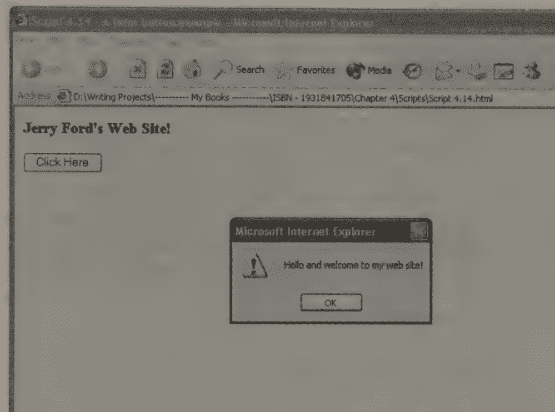

##### Checkbox

复选框是非常简单的表单元素。复选框要么被选中，要么未被选中。下面的示例展示了一个定义了两个复选框和一个按钮的 HTML 页面。这两个复选框分别命名为 chkbx1 和 chkbx2。

```
<HTML>
  <HEAD>
    <TITLE>Script 4.15 - A form checkbox example</TITLE>
    <SCRIPT LANGUAGE="VBScript">
    <!-- Start hiding VBScript statements
    Function myButton_onClick()
        If myForm.chkbx1.checked = "True" Then
            selection = "You selected the first option. "
        Else
            selection = "You did not select the first option. "
        End If
        If myForm.chkbx2.checked = "True" Then
            selection = selection & "You selected the second option."
        Else
            selection = selection & "You did not select the second option."
        End If
        MsgBox(selection)
    End Function

    ' End hiding VBScript statements -->
    </SCRIPT>

  </HEAD>
  <BODY>
    <H3>Jerry Ford's Web Site!</H3><P>
    <FORM NAME="myForm">
        <B>Please customize your purchase:</B><P>
        Would you like to supersize your order?
        <INPUT NAME="chkbx1" TYPE="checkbox"><BR>
        Would you like to receive notification when your order ships?
        <INPUT NAME="chkbx2" TYPE="checkbox"><P>
        <INPUT NAME="myButton" TYPE="button" VALUE="Click here when done!">
    </FORM>
    <SCRIPT LANGUAGE="VBScript">
    <!-- Start hiding VBScript statements
        myForm.chkbx1.checked = "True"
        myForm.chkbx2.checked = "False"
    ' End hiding VBScript statements -->
    </SCRIPT>
  </BODY>
</HTML>
```

BODY 部分中定义的一个 VBScript 用于设置这些复选框的初始默认设置，如下所示。

```
myForm.chkbx1.checked = "True"
myForm.chkbx2.checked = "False"
```

在 HEAD 部分定义了一个名为 myButton_onClick() 的函数。当访问者单击表单的按钮时，此函数会显示一条弹出消息，指明选择了哪些选项。例如，下面的语句验证第一个复选框的状态。

```
If myForm.chkbx1.checked = "True" Then
```

图 4.14 显示了访问者加载此示例并选择第一个复选框时产生的输出。


##### 单选按钮

单选按钮与复选框非常相似，不同之处在于用户只能从一组单选按钮中选择一个。要将单选按钮分组，只需在定义时为它们分配相同的名称即可。在此示例中，定义了五个单选按钮，每个按钮都被分配了名为 myRadio 的名称（例如，NAME="myRadio"）。

```html
<HTML>
<HEAD>
<TITLE>Script 4.16 - Form Radio button example</TITLE>
<SCRIPT LANGUAGE="VBScript">
<!-- Start hiding VBScript statements
Option Explicit
Dim i
Dim radioSelected
radioSelected = "No"

Function myButton_onClick()
    For i = 0 To myForm.myRadio.length - 1
        If myForm.myRadio(i).Checked = "True" Then
            radioSelected = "Yes"
        End If
    Next
    If radioSelected = "Yes" Then
        MsgBox("Thanks for picking a color!")
    Else
        MsgBox("You must select a color!")
    End If
End Function
' End hiding VBScript statements -->
</SCRIPT>
</HEAD>
<BODY>
<FORM NAME="myForm">
<H3>What color would you like to paint your car?</H3>
Red <INPUT NAME="myRadio" TYPE="radio" VALUE="Red"><BR>
Blue <INPUT NAME="myRadio" TYPE="radio" VALUE="Blue"><BR>
Green <INPUT NAME="myRadio" TYPE="radio" VALUE="Green"><BR>
Purple <INPUT NAME="myRadio" TYPE="radio" VALUE="Purple"><BR>
Yellow <INPUT NAME="myRadio" TYPE="radio" VALUE="Yellow">
<INPUT NAME="myButton" TYPE="button" VALUE="Click here to confirm your color selection">
</FORM>
</BODY>
</HTML>
```

在单选按钮下方，定义了一个名为 myButton 的常规按钮。当访问者点击此按钮时，`myButton_onClick()` 函数将执行。该函数设置一个循环来处理组中的每个单选选项，以确定哪个选项被选中，如下所示：

```vb
For i = 0 To myForm.myRadio.length - 1
```

在循环的每次迭代中，函数会查找被选中的单选选项，如下所示。

```vb
If myForm.myRadio(i).Checked = "True" Then
```

该函数会显示一个弹出消息，该消息要么指明被选中的选项，要么要求访问者再次尝试。图 4.15 显示了当访问者未进行选择时，上一个示例生成的输出。

**图 4.15**
使用 VBScript 验证访问者是否已选择单选按钮。

> **注意** 你始终可以预设一个默认的单选选项。然而，这样做你可能会面临访问者忘记进行选择而保留默认选项选中，从而导致不理想选择的风险。相反，通常更好的做法是让所有单选按钮都保持未选中状态，并强制访问者进行选择。最终，这实际上是一个关于界面设计和个人偏好的问题，取决于你是否在设计 HTML 表单时选择设置默认值。

##### 文本框

下一个脚本提供了一个快速示例，展示如何使用 VBScript 捕获访问者在表单文本字段中输入的文本。该表单名为 myForm。文本字段名为 urlField，并自动分配了一个默认值 `http://`，以便访问者在输入 URL 时可以快速开始。在 HTML 页面的 `<HEAD>` 部分设置了一个名为 `goButton_onClick()` 的子程序。当用户点击表单按钮时，该子程序将执行，并使用 `window` 对象的 `location` 属性来加载访问者在文本框中输入的 URL。

```html
<HTML>
<HEAD>
<TITLE>Script 4.17 - Working with the form text and buttons</TITLE>
<SCRIPT LANGUAGE="VBScript">
<!-- Start hiding VBScript statements
Sub goButton_onClick
    window.location=myForm.urlField.value
End Sub
' End hiding VBScript statements -->
</SCRIPT>
</HEAD>
<BODY>
<H3>Type a URL and click on the Load URL button!</H3>
<FORM NAME="myForm">
<INPUT NAME="urlField" TYPE="text" VALUE="http://" size="35">
<INPUT NAME="goButton" TYPE="button" VALUE="Load URL">
</FORM>
</BODY>
</HTML>
```

图 4.16 显示了该表单在首次加载到浏览器时的外观。

**图 4.16**
使用 VBScript 访问表单文本字段的内容。

##### 文本区域

`textarea` 对象是 `text` 对象的近亲，不同之处在于它允许多行文本输入。下面的示例并没有使用 `textarea` 对象从用户那里收集信息，而是另辟蹊径，演示了如何根据用户选择的类别，使用 `textarea` 对象显示预定义的文本集合。

```html
<HTML>
<HEAD>
<TITLE>Script 4.18 - A example of the form textarea element</TITLE>
<SCRIPT LANGUAGE="VBScript">
<!-- Start hiding VBScript statements
Option Explicit
Dim loadText

Sub myList_OnChange()
    Select Case myList.Selectedindex
        Case 0: myForm.myText.value="Welcome to my web site!"
        Case 1: myForm.myText.value="This is the place where I will add more " & _
            "information about VBScript as it becomes " & _
            "available. So please keep checking!"
        Case 2: myForm.myText.value="There is nothing new for me to report this " & _
            "week. However, word on the street says that " & _
            "there may be some exciting new surprise " & _
            "information about to be released!"
        Case 3: myForm.myText.value="If you wish to contact us you may do so by " & _
            "emailing us at jlf04@yahoo.com"
        Case 4: myForm.myText.value="Hum............ I have nothing else to add"
    End Select
End Sub
' End hiding VBScript statements -->
</SCRIPT>
</HEAD>
<BODY>
<H3>Index</H3>
<SELECT NAME=myList SIZE=6>
<OPTION SELECTED>Welcome!
<OPTION>VBScript Links
<OPTION>What's New?
<OPTION>Contact us
<OPTION>Miscellaneous
</SELECT>
<p>
<CENTER>
<FORM NAME="myForm">
<TEXTAREA COLS="80" ROWS="8" NAME="myText">Welcome to my web site!</TEXTAREA>
</FORM>
</CENTER>
</BODY>
</HTML>
```

位于 `<BODY>` 部分的 `SELECT` 对象决定了在 `textarea` 字段中显示的文本，该字段定义在 `<BODY>` 部分的一个表单中。

每当访问者点击 `SELECT` 对象列出的某个选项时，位于 `<HEAD>` 部分的 `myList_OnChange()` 子程序就会执行。这里使用了一个 `Select Case` 语句来设置一系列对应于 `SELECT` 对象条目的 `Case` 选项，如下所示。

```vb
Select Case myList.Selectedindex
```

此语句后跟多个 `Case` 语句。这些语句提供了在 `textarea` 字段中显示的文本，如下所示。

```vb
Case 0: myForm.myText.value="Welcome to my web site!"
```

此语句显示了第一个 `Case` 选项，它通过为 `textarea` 字段分配一个新值，在 `textarea` 字段中显示欢迎消息。图 4.17 显示了当访问者选择第二个选项时此示例的外观。

##### 密码框

`password` 对象用于从用户那里收集文本输入，同时屏蔽输入字符的值。除此之外，`password` 对象的工作方式与 `text` 对象完全相同。以下示例显示了一个包含密码字段和按钮的 HTML 页面表单。访问者被提示输入密码，然后点击按钮。这将执行 `myButton_onClick()` 函数，该函数随后显示访问者在密码字段中输入的字符。

```html
<HTML>
<HEAD>
<TITLE>Script 4.19 - A form password field example</TITLE>
<SCRIPT LANGUAGE="VBScript">
<!-- Start hiding VBScript statements
Function myButton_onClick()
    MsgBox("The password that you typed is: " & myForm.myPsswd.value)
End Function
' End hiding VBScript statements -->
</SCRIPT>
</HEAD>
<BODY>
<FORM NAME="myForm">
Please type your password:
<INPUT NAME="myPsswd" TYPE="password" SIZE="10" MAXLENGTH="10">
<INPUT NAME="myButton" TYPE="button" VALUE="Submit">
</FORM>
</BODY>
</HTML>
```


图4.18展示了当访问者输入密码“qwerty”时该示例的外观。如图所示，尽管访问者在密码字段中输入时文本已被掩盖，但VBScript仍然可以访问并显示其实际值。

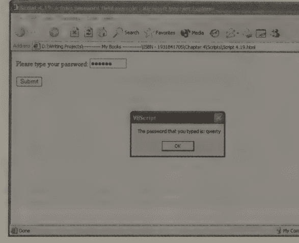

##### hidden对象

`hidden`对象与`text`对象非常相似，都可以向其分配和检索文本信息。唯一的区别在于，隐藏字段永远不会在HTML页面上显示。这意味着您可以以与存储变量大致相同的方式，将文本存储在隐藏字段中。然而，由于变量更易于操作，您可能不会经常使用隐藏字段。以下示例简要展示了`hidden`对象的工作原理。

```html
<HTML>
<HEAD>
<TITLE>Script 4.20- A form hidden field example</TITLE>
<SCRIPT LANGUAGE="VBScript">
<!-- Start hiding VBScript statements

Function myButton1_onClick
document.myForm.myField.value="I told you not to click the other button!"
End Function

Function myButton2_onClick
window.alert(document.myForm.myField.value)
End Function

' End hiding VBScript statements -->
</SCRIPT>
</HEAD>

<BODY>
<FORM NAME="myForm">
<INPUT NAME="myField" TYPE="hidden" VALUE="Nothing to see here!">
<INPUT NAME="myButton1" TYPE="button" VALUE="Do not click me!">
<INPUT NAME="myButton2" TYPE="button" VALUE="Show Hidden">
</FORM>
</BODY>

</HTML>
```

当HTML页面首次加载时，该字段中存储了一个值"Nothing to see here!"，如下所示。

```html
<INPUT NAME="myField" TYPE="hidden" VALUE="Nothing to see here!">
```

此示例为用户提供了两个按钮。其中一个按钮指示用户点击它。另一个按钮则显示由隐藏对象存储的文本。如果用户点击第一个按钮，则使用以下语句来更改隐藏对象存储的文本。

```javascript
document.myForm.myField.value="I told you not to click the other button!"
```

如果用户随后点击第二个按钮，他们将看到图4.19中显示的消息。

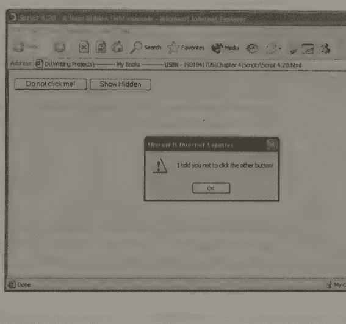

###### 图 4.19
使用隐藏对象隐藏文本。

##### SELECT

您在本书中已经多次看到SELECT对象的使用。它可以用于显示一个下拉列表或可滚动的选项列表，供访问者选择。以下示例演示了如何将SELECT对象与VBScript结合使用来创建导航控件。

```html
<HTML>

<HEAD>
<TITLE>Script 4.21 - A Creating a custom navigation tool with the select element</TITLE>

<SCRIPT LANGUAGE="VBScript">
<!-- Start hiding VBScript statements
Function myList_onChange()
    window.location=document.myForm.myList.value
End Function
' End hiding VBScript statements -->
</SCRIPT>

</HEAD>

<BODY>
<H3>Select an on-line bookstore</H3>

<FORM NAME="myForm">
    <SELECT NAME="myList" size=1>
        <OPTION VALUE="http://www.amazon.com"> Amazon.com
        <OPTION VALUE="http://www.bn.com"> Barnes & Noble
        <OPTION VALUE="http://www.bamm.com"> Books-A-Million
    </SELECT>
</FORM>
</BODY>
</HTML>
```

SELECT对象用于定义一个在线书店网站列表。当用户点击其中一个选项时，myList_onChange()函数中的以下语句将被执行。

```javascript
window.location=document.myForm.myList.value
```

此语句将window对象的location属性设置为指定的URL，从而强制浏览器加载该URL。图4.20展示了此示例在Internet Explorer中加载后的外观。

##### reset

reset按钮会自动将所有表单元素重置为其原始值。当用户意识到自己在填写表单时犯了许多错误，并且认为重新开始比尝试纠正所有错误更容易时，这可能会很有用。通过设置一个响应reset按钮onClick事件的过程，您可以在表单被清除之前进行干预。reset按钮onClick事件的另一个用途可能是要求用户再次尝试填写表单，如以下示例所示。

```html
<HTML>

<HEAD>
    <TITLE>Script 4.22 - A form reset example</TITLE>

    <SCRIPT LANGUAGE="VBScript">
    <!-- Start hiding VBScript statements

    Function myReset_onClick()
        MsgBox("The form has been reset. Please try again!")
    End Function

    ' End hiding VBScript statements -->
    </SCRIPT>

</HEAD>

<BODY>

    <FORM NAME="myForm">

        <H3>What color would you like to paint your car?</H3>
        Red <INPUT NAME="myRadio" TYPE="radio" VALUE="Red"><BR>
        Blue <INPUT NAME="myRadio" TYPE="radio" VALUE="Blue"><BR>
        Green <INPUT NAME="myRadio" TYPE="radio" VALUE="Green"><BR>
        Purple <INPUT NAME="myRadio" TYPE="radio" VALUE="Purple" Checked><BR>
        Yellow <INPUT NAME="myRadio" TYPE="radio" VALUE="Yellow"><P>
        <INPUT Name="myReset" TYPE="reset">
    </FORM>
</BODY>
</HTML>
```

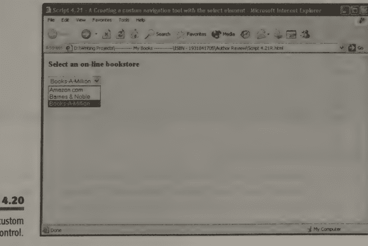

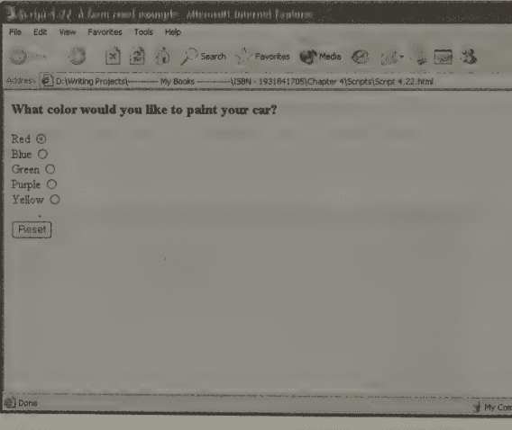

###### 图 4.21

向HTML表单添加重置按钮提供了一种快速将表单重置回默认值的方法。

##### 一个注册表单

接下来的示例演示了如何应用您刚刚学到的关于使用VBScript操作表单的知识。在此示例中，我创建了一个注册表单，要求访问者提供一些关于他们自己的信息以及他们对网站的看法。

该表单使用以下HTML语句定义。

```html
<FORM NAME="myForm" ACTION="mailto:jlf04@yahoo.com"
ENCTYPE="text/plain">
```

此语句告诉浏览器，当访问者点击提交按钮时，将表单内容以纯文本形式通过电子邮件发送到指定的电子邮件地址。表单本身由一组文本字段、单选按钮、一个SELECT下拉列表和三个按钮（其中两个是重置和提交按钮）组成，如图4.22所示。

```html
<HTML>
  <HEAD>
    <TITLE>Script 4.23 - A form validation example</TITLE>

    <SCRIPT LANGUAGE="VBScript">
    <!-- Start hiding VBScript statements

      Option Explicit
      Dim radioSelected
      Dim i

      Function process_Order()
        If Len(document.myForm.firstName.value) < 1 Then
          window.alert("You must provide your first name.")
          Exit Function
        End If
        If Len(document.myForm.lastName.value) < 1 Then
          window.alert("You must provide your last name.")
          Exit Function
        End If
        If Len(document.myForm.emailAddress.value) < 1 Then
          window.alert("You must provide your email address.")
          Exit Function
        End If
        radioSelected = "No"
        For i = 0 To myForm.myRadio.length - 1
          If myForm.myRadio(i).Checked = "True" Then
            radioSelected = "Yes"
          End If
        Next
        If radioSelected = "No" Then
          window.alert("You must select a newsletter option.")
          Exit Function
        End If
        window.alert("Your registration form looks good. Click on Submit!")
      End Function

    ' End hiding VBScript statements -->
    </SCRIPT>
  </HEAD>
  <BODY>
    <CENTER>
        <H3>Registration Page</H3>
    </CENTER>
    <B>Please fill out the following information to register at our web site!</B>

    <FORM NAME="myForm" ACTION="mailto:jlf04@yahoo.com" ENCTYPE="text/plain">
        <B>What is your first name:</B> <INPUT NAME="firstName" TYPE="text" SIZE="10" MAXLENGTH="30"><P>
        <B>What is your last name: </B> <INPUT NAME="lastName" TYPE="text" SIZE="10" MAXLENGTH="30"><P>
        <B>What is your email address:</B> <INPUT NAME="emailAddress" TYPE="text" SIZE="20" MAXLENGTH="30"><P>
        <B>Select which of our newsletters you'd like to receive:</B><P>
        Weekly Update Newsletter: <INPUT NAME="myRadio" TYPE="radio" VALUE="weekly"><BR>
        Monthly Recap Newsletter: <INPUT NAME="myRadio" TYPE="radio" VALUE="monthly"><BR>
        No Newsletter: <INPUT NAME="myRadio" TYPE="radio" VALUE="none"><BR>

        <P><B>What do you think of our web site?</B>
        <SELECT NAME="myList">
            <OPTION SELECTED VALUE="high">I like it a lot
            <OPTION VALUE="medium">Not bad
            <OPTION VALUE="low">Needs more work
        </SELECT></P>
    </FORM>
</BODY>
</HTML>
```


##### 为您的网站构建注册表单

您是否希望提供任何额外信息：（可选）

当用户点击标记为“验证您的订单”的按钮时，将执行一个名为 `process_Order()` 的函数。此函数会验证表单内容，如下所述。

以下语句用于检查访问者是否输入了其名。

```
If Len(document.myForm.firstName.value) < 1 Then
```

以下语句用于检查访问者是否输入了其姓。

```
If Len(document.myForm.lastName.value) < 1 Then
```

同样，接下来的这个语句检查访问者是否输入了其电子邮件地址。

```
If Len(document.myForm.emailAddress.value) < 1 Then
```

接下来，以下语句遍历表单上的单选按钮集合，以确保已选择了一个选项。

```
For i = 0 To myForm.myRadio.length - 1
```

如果用户未能填写文本字段或选择单选按钮，当点击标记为 `Validate your Order` 的按钮时，系统将提示他返回并完成这些操作。

此表单上的其余字段被视为可选，因此不会进行验证。这是一个基本的表单验证示例。您可以通过添加过程来使其更完善，当访问者点击 `reset` 和 `submit` 按钮时进行干预，以确保访问者确实想执行这些操作。

> **注意** 还有两个事件我尚未提及。它们是 `Reset` 和 `Submit` 事件。这些事件与 `reset` 和 `submit` 表单按钮相关联。通过为这些事件创建 VBScript 事件处理程序，您可以创建警告消息，告知访问者点击这些按钮的后果。您可以移除前一个示例中的 `onSubmit` 事件处理程序，转而调用一个表单验证过程，从而消除对访问者主动发起验证过程的依赖。

您还可以更进一步地验证文本字段中的信息。例如，您可以使用 `length()` 函数确保输入到此字段的文本具有特定的最小长度，或者使用 `InStr()` 函数确保用户在其电子邮件地址中包含 @ 字符。

##### 烘焙 VBScript Cookies

在今晚的最后一个示例中，我们将探讨如何烘焙 VBScript cookie。Cookie 是一段小信息，可以存储在访问您网页的人们的计算机上。专业网站一直使用 cookie 来记录您及其活动的信息，当您访问他们的网站时。例如，任何以您的名字问候您的网站都在使用 cookie 来识别您每次访问该网站。

Cookie 技术极其有限。您无法使用 cookie 植入计算机病毒或填满访问者的硬盘驱动器。但是，它们非常适合存储小片段信息，例如访问者的名称或首选的自定义设置。

要存储或检索 cookie，您使用 `document` 对象的 `cookie` 属性。Cookie 有必须遵循的特定语法。要创建一个 cookie，您必须按此处所示定义您的 cookie。

```
document.cookie = "name=" & name & ";expires=" & exp_Date
```

此语句的组成部分可分解如下。

- **"name="**。标识存储在 cookie 中的信息。
- **Name**。一个变量，包含实际存储在访问者计算机上的值。
- **";expires="**。为 cookie 的过期日期提供标签（所有 cookie 必须有一个过期日期）。
- **exp_Date**。过期日期的值。

Cookie 的过期日期必须按此处所示的格式设置：
Monday, 02-Feb-2002 12:45:00 GMT

以下语句展示了当访问者返回时如何检索此 cookie。
```
myCookie = document.cookie
```

###### 烘焙一个 Cookie

让我们看一个快速示例，展示如何烘焙一个完整的 VBScript cookie。在此示例中，我们将创建一个脚本，提示访问者输入他们的名字。然后该脚本构建一个包含访问者名称的 cookie 并将其保存在他们的计算机上。

```
<HTML>
<HEAD>
<TITLE>脚本 4.24 - 烘焙一个 VBScript cookie</TITLE>
<SCRIPT LANGUAGE="VBScript">
<!-- 开始隐藏 VBScript 语句

Function Bake_The_Cookie(name)
    exp_Date = Weekdayname(DatePart("w",Date())) & ", " _
    & Date_Format(DatePart("d",Date())) & "-" _
    & Monthname(DatePart("m",Date(),1) + 1) & "-" _
    & DatePart("yyyy",Date()) _
    & " 00:00:00 GMT"
    myCookie = "name=" & name & ";expires=" & exp_Date
    document.cookie = myCookie
    MsgBox(myCookie)
End Function

Function Date_Format(rawDate)
    If Len(rawDate) = 1 Then rawDate = "0" & rawDate
    date_Format = rawDate
End Function

' 结束隐藏 VBScript 语句 -->
</SCRIPT>
</HEAD>
<BODY>

  <H3>Cookie 信息收集器</H3>

  <FORM NAME="myForm">
    <B>您叫什么名字？ </B>
    <INPUT TYPE="text" NAME="visitorName">
    <INPUT NAME="myButton" TYPE="button" VALUE="保存 Cookie"
      onClick="Bake_The_Cookie(document.myForm.visitorName.value)">
  </FORM>

</BODY>

</HTML>
```

此脚本在 HTML 页面的 HEAD 部分定义了两个函数。第一个函数名为 `Bake_The_Cookie()`。它的工作是烘焙 VBScript cookie。第二个函数名为 `Date_Format()`。它由 `Bake_The_Cookie()` 函数调用，用于将日期值格式化为两位数格式（例如，所有日期值必须由两位数字组成，如果日期或月份是单个数字，此函数会在其前面添加一个零）。

在 HTML 页面的 BODY 部分定义了一个名为 `myForm` 的表单。它包含一个文本字段和一个按钮。用户被提示输入他或她的名字，然后点击按钮。当这种情况发生时，与按钮关联的 onClick 事件会调用 `Bake_The_Cookie()` 函数，并将访问者的名称（例如，`document.myForm.visitorName.value`）传递给它。

`Bake_The_Cookie()` 函数执行多项操作。首先，它设置 cookie 的过期日期，如下所示。

```
exp_Date = Weekdayname(DatePart("w",Date())) & ", "
                  & date_Format(DatePart("d",Date())) & "-"
                  & Monthname(DatePart("m",Date(),1) + 1) & "-"
                  & DatePart("yyyy",Date())
                  & " 00:00:00 GMT"
```

过期日期必须按照之前讨论的特定格式设置。为了完成此任务，使用了 `weekdayname()` 函数。此函数检索一个包含指定星期几的字符串。`weekdayname()` 函数接收一个日期参数，该日期本身是使用 `DatePart()` 函数检索的。此函数检索指定日期的指定部分。在此情况下，`DatePart("w", Date())` 中的 `w` 告诉 `DatePart()` 函数检索当前日期的星期几。

接下来，该函数再次调用 `DatePart()` 函数来检索一周中的天数。然后将该值传递给 `Date_Format()` 函数，在必要时用零填充。接着调用 `Monthname()` 函数。它基于以下表达式的值检索一个表示月份值的字符串。

```
DatePart("m", Date(), 1) + 1
```

此表达式调用 `DatePart()` 函数来检索月份的数值（由字母 m 表示）并将其加 1。将此值加 1 会创建一个过期日期为当前日期后一个月的 cookie。当然，您可以根据需要更改此值以延长您自己的 VBScript cookie 的有效期。

最后，该函数检索当前年份的四位数值并在末尾附加短语“ 00:00:00 GMT”。此短语设置了 cookie 过期的小时、分钟和秒。

`Bake_The_Cookie()` 函数做的最后一件事是将 cookie 存储在访问者的计算机上，如下所示。

```
document.cookie = myCookie
```

然后该函数使用 `MsgBox()` 函数显示完整的 cookie，以便您可以看到最终产品，如图 4.23 所示。


###### 检索 Cookie

好的，现在你知道了如何创建和存储 VBScript cookie，让我们来看一个示例，展示当访问者稍后返回你的网页时，如何检索该 cookie。

正如本示例所示，检索 cookie 比最初创建它要容易得多。

```
<HTML>
    <HEAD>
        <TITLE>Script 4.25 - Reading your VBScript cookie</TITLE>
    </HEAD>
    <BODY>
        <SCRIPT LANGUAGE="VBScript">
            <!-- Start hiding VBScript statements

            If document.cookie <> "" Then
                MsgBox(document.cookie)
                MsgBox(Mid(document.cookie,6))
            Else
                window.alert("Your cookie was not found!")
            End If

            ' End hiding VBScript statements -->
        </SCRIPT>
    </BODY>
</HTML>
```

该脚本位于 HTML 页面的 BODY 部分。它首先检查访问者是否已有来自你网站的 cookie，如下所示。

```
If document.cookie <> "" Then
```

如果找到 cookie，则使用 MsgBox() 函数显示它。第二个 MsgBox() 函数使用 Mid() 函数显示分配给 cookie 的值（例如，访问者的姓名）。通过更改 MsgBox() 函数中的措辞，你可以轻松地将弹出对话框转变为个性化的问候语。

> **注意**
> 你只能检索由你自己的网站创建的 cookie。每次创建 cookie 时，都会添加一个称为域的属性，并将其设置为等于你的 Internet 域 URL，该 URL 唯一标识你为其创建者。当访问者返回你的网站时，将再次使用此属性以确保该 cookie 确实属于你的网站。

图 4.24 显示了对于名为 Jerry 的访问者，第一个弹出对话框的输出。

###### 将 VBScript Cookie 添加到你的 HTML 页面

好的，现在让我们将你学到的关于 cookie 的所有知识应用到一个实际示例中。此示例包含一个逻辑，首先检查访问者是否已有你的一个 cookie。如果有，则使用 cookie 中存储的名称显示个性化的问候消息。如果未找到 cookie，则提示访问者输入其姓名。

如果访问者选择提供姓名，则将其烘焙成一个 cookie，并用于创建个性化的问候语。如果访问者选择不提供姓名，则显示通用问候语；但是，当访问者下次返回你的网页时，他将再次被提示确认自己的身份。

```
<HTML>
    <HEAD>
        <TITLE>Script 4.26 - Adding a VBScript cookie to your HTML page</TITLE>
    </HEAD>

    <SCRIPT LANGUAGE="VBScript">
    <!-- Start hiding VBScript statements

        'Define a function to bake the VBScript cookie
        Function Bake_The_Cookie(name)
            exp_Date = Weekdayname(DatePart("w",Date())) & ", " & Date_Format(DatePart("d",Date())) & "-" & Monthname(DatePart("m",Date(),1) + 1) & "-" & DatePart("yyyy",Date()) & " 00:00:00 GMT"
            myCookie = "name=" & name & ";expires=" & exp_Date
            document.cookie = myCookie
        End Function

        'Define a function to format the day of the week as 2 characters when necessary
        Function Date_Format(rawDate)
            If Len(rawDate) = 1 Then rawDate = "0" & rawDate
            date_Format = rawDate
        End Function

        'Define a function to check for the cookie and use it in the welcome message if found
        Function Cookie_Check()
            visitor_name = ""
            cookie_name = ""
            If document.cookie <> "" Then
                visitor_name = Mid(document.cookie,6)
                document.write("<H4>Hello " & visitor_name & ",</H4>")
            Else
                input = window.prompt("Welcome to the Bookmall. What is your name?","")
                //User did not click on cancel or leave the field blank and click on OK
                If input <> "" Then
                    Bake_The_Cookie(input)
                    document.write("<H4>Welcome " & input & "," & "</H4>")
                Else
                    document.write("<H4>Welcome.</H4>")
                End If
            End If
        End Function

        ' End hiding VBScript statements -->
    </SCRIPT>
    </HEAD>
    <BODY>
        <H3><CENTER>Welcome to my web site!</CENTER></H3>
        <SCRIPT LANGUAGE="VBScript">
        <!-- Start hiding VBScript statements
        Cookie_Check()
        ' End hiding VBScript statements -->
        </SCRIPT>
        I hope you do not mind but this web site uses cookies!
    </BODY>
</HTML>
```

此示例由位于 BODY 部分的一个 VBScript 和位于 HEAD 部分的 VBScript 中定义的三个函数组成。正如你可能已经注意到的，你已经看到了本示例中使用的大部分代码。`Bake_the_Cookie()` 函数和 `Date_Format()` 函数借自我向你展示的第一个 cookie 示例，负责格式化和烘焙 cookie。`Cookie_Check()` 函数由位于 BODY 部分的 VBScript 调用，它是之前 cookie 示例的一个改编版本，负责检索你的 cookie 并在个性化问候语中使用它。但是，这次如果未找到你的 cookie，该函数将调用 `Bake_The_Cookie()` 函数来提示访问者输入其姓名，以便可以烘焙新的 cookie。

图 4.25 显示了为名为 Jerry 的用户创建的个性化问候语。

## 下一步是什么？

嗯，我想今晚我们已经讲得够多了。自今天下午以来，你已经学到了很多关于如何使用 VBScript 为你的 HTML 页面增添趣味的知识。让我们今晚到此为止，明天早上我们将开始学习如何使用 VBScript 和 Windows 脚本宿主（WSH）来自动化计算机上复杂且重复的任务。

星期日上午

#### 使用 Windows 脚本宿主

- 了解使用 VBScript 和 WSH 的不同方式
- 研究 Windows 脚本宿主的基本架构
- 复习 VBScript 运行时对象及其方法和属性
- 了解 XML 基础知识以及如何创建 Windows 脚本文件

早上好！你昨天大部分时间都在学习如何将你的 VBScript 编程技能应用到网页上。现在是时候转换思路，将注意力集中在如何使用 VBScript 和 Windows 脚本宿主来自动化计算机上的任务了。今天上午的第一部分，我们将对 WSH 及其组件进行全面的复习。

上午的后半部分将专门研究 WSH 如何使用 XML 将 VBScript 与其他脚本语言结合起来创建 Windows 脚本文件。然后，我们将通过研究 WSH 对象模型以及如何使用它向你的 VBScript 公开 Windows 操作系统的功能来结束这些内容。

你会发现今天上午的章节与其前面的章节有些不同。我们不会花很多时间编写脚本。相反，我们将对 WSH、其组件以及它的工作原理进行深入研究，为当天的其余内容奠定基础。所以，如果你准备好了，让我们开始吧。

##### 什么是 Windows 脚本宿主？

Windows 脚本宿主（WSH）是 Microsoft 的高级脚本环境。WSH 允许你使用不同的脚本语言编写脚本，包括 VBScript。事实上，WSH 甚至允许你使用多种脚本语言和少量 *可扩展标记语言（XML）* 来构建脚本。这些脚本被称为 Windows 脚本文件。

Windows NT、2000 和 XP 系列操作系统还支持一种称为 *Windows Shell 脚本* 的内置脚本语言。然而，与 WSH 相比，Windows Shell 脚本在功能上是有限的。Windows Shell 脚本缺乏与 Windows 桌面和注册表直接交互的能力。它们对 Windows 文件系统和基于 Windows 的网络上的资源的访问粒度也较低。Windows 95、98 和 Me 操作系统不支持 Windows Shell 脚本。相反，这些操作系统的用户只能使用功能有限的简单批处理文件。

另一方面，WSH 为从 Windows 95 开始的每个 Microsoft 操作系统提供了强大而强大的脚本功能。WSH 还允许使用任何 WSH 兼容的脚本语言开发脚本。Microsoft 随 WSH 提供了 VBScript 和 JScript 脚本语言。但是，第三方开发人员提供了其他脚本语言，允许你将 WSH 与 Perl、Python 和 Rexx 脚本语言一起使用。

在架构上，WSH 由几个组件组成，包括：

- **脚本宿主**。两个脚本执行宿主中的任何一个。执行宿主提供了一个环境，脚本可以在其中执行，其方式与浏览器为嵌入 HTML 页面中的 VBScript 提供执行环境非常相似。
- **脚本引擎**。脚本解释器，旨在处理和执行使用特定脚本语言（如 VBScript）编写的编程语句。
- **对象模型**。提供对对象集合的访问，这些对象公开了 Windows 操作系统的功能，并允许 WSH 脚本以编程方式与 Windows 资源进行交互和操作。


WSH 脚本可以使用任何能够将数据保存为纯文本文件的编辑器来创建。WSH 脚本由属于一种或多种脚本语言的程序语句组成。完全由 VBScript 编写的 WSH 脚本将被保存为扩展名为 `.vbs` 的纯文本文件。同样，完全由 JScript 编写的 WSH 脚本将被保存为扩展名为 `.js` 的文件。

由不同脚本语言编写的脚本组成的 WSH 脚本被称为 Windows 脚本文件，其文件扩展名为 `.wsf`。每种脚本语言都有其自身的优点和缺点。通过创建 Windows 脚本文件，你可以开发出能够利用不同脚本语言最佳特性的脚本。

##### 使用 VBScript 和 WSH 可以做的不同事情

在我深入探讨 WSH 的工作原理之前，让我们花一点时间来看看你可以用它做的一些事情。当然，因为这本书是关于 VBScript 的，你将能够使用 VBScript 来完成我将要提到的任何任务。

WSH 存在的原因是为你提供一种自动化 Windows 任务的方法。它特别适合自动化那些重复性的任务。例如，如果你需要在每天开始时删除位于给定文件夹中的所有文件，那么就编写一个任务来完成它。如果你需要在你的计算机上创建大量用户帐户，不要手动完成。那太耗时了。相反，编写一个脚本来处理存储在文本文件中的用户名列表。

WSH 也非常适合自动化复杂任务，例如注册表修改。人为会犯错，而在处理注册表时出错可能对你的计算机是致命的。另一方面，一个编写良好的脚本不会输错注册表项或意外删除错误的注册表值。最重要的是，你可以与他人分享你的脚本，让他们能够安全地对你的计算机进行更改，否则你永远不会信任他们来执行这些操作。

也许你有一些任务会消耗大量计算机资源，并在执行时导致计算机运行速度过慢。通过利用 Windows 计划任务服务的功能，你可以设置 WSH 脚本来执行任务，然后在晚上你离开计算机时运行它们。例如，假设你编写了一个脚本，旨在在每个月末处理大量文件。如果你有数千个文件要处理，脚本运行可能需要数小时。如果没有脚本，你可能需要整个周末来手动处理这些文件。脚本可能会将这个时间缩短到仅仅一小时。通过将脚本的执行安排在晚上你不使用计算机时运行，它在运行时不会对你造成影响。这使你即使在不工作时也能提高生产力。

还有许多其他任务示例，你可能想要使用 VBScript 和 WSH 来自动化。这些任务包括：
- 创建桌面快捷方式
- 管理文件和文件夹
- 配置 Windows 开始菜单
- 配置 Windows 快速启动栏
- 管理 Windows 服务
- 管理 Windows 打印机
- 收集系统信息
- 创建报告
- 创建网络驱动器映射
- 安排非工作时间任务
- 与其他 Windows 应用程序交互
- 管理 Windows 事件日志

##### WSH 操作系统兼容性

根据你使用的 Windows 操作系统，你可能已经安装并准备好了 WSH。但是，除非你运行的是 Windows XP 或者已经保持其他 Windows 操作系统更新，否则你可能也有一个较旧版本的 WSH。

表 5.1 提供了 Windows 操作系统及其附带的 WSH 版本的摘要。如你所见，任何从 Windows 95 或更高版本开始的 Windows 操作系统都可以支持 WSH。但是，除非你运行的是 Windows XP，否则你可能需要升级到 WSH 5.6。

> **注意** 在功能上，WSH 2.0 和 WSH 5.6 是等同的。主要区别在于 Microsoft 已更改了版本号。然而，VBScript 和 JScript 也发生了变化，它们同样处于 5.6 版本。由于 Microsoft 将 WSH、VBScript 和 JScript 打包在一起，升级到 WSH 5.6 也是升级你的脚本语言的简便方法。

**表 5.1 Microsoft 操作系统附带的 WSH 版本**

| 操作系统 | 是否支持 WSH | 提供的版本 |
| :--- | :---: | :--- |
| Windows 3.X | 否 | 不支持 |
| Windows 95 | 是 | 无 |
| Windows 98 | 是 | WSH 1.0 |
| Windows Me | 是 | WSH 2.0 |
| Windows NT | 是 | WSH 1.0 (通过 Service Pack 4 安装) |
| Windows 2000 | 是 | Wsh 2.0 |
| Windows XP | 是 | WSH 5.6 |

你可以访问 [http://msdn.microsoft.com/scripting](http://msdn.microsoft.com/scripting) 并下载最新版本的 WSH 以升级到最新的发布版本。

##### 探讨 VBScript 如何融入 WSH 架构

Microsoft 将 WSH 设计为模块化方式，功能分布在多个组件中，如图 5.1 所示。这种设计允许 Microsoft 升级单个组件，而无需对整个模型进行大修。例如，可以在不影响其他 WSH 组件的情况下升级 VBScript。此外，由于 WSH 可以与任何兼容 WSH 的脚本引擎一起工作，这种架构提供了使用不同脚本引擎的能力，包括 JScript、Perl、Python 和 REXX。

> 注意 虽然图 5.1 旨在描述 VBScript 与 WSH 的关系，但任何兼容 WSH 的脚本引擎都可以使用。有关查找替代脚本引擎的信息，请参阅周五晚上“介绍 VBScript”部分。

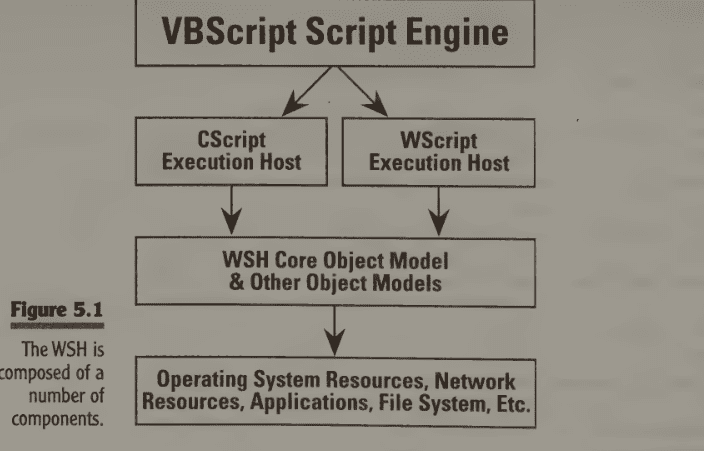

如你所见，WSH 架构由以下组件组成。
- **脚本引擎。** WSH 脚本引擎（如 VBScript）将脚本编程语句解释为机器可读的代码，以便计算机可以执行该脚本。
- **CScript.exe。** 一个脚本执行主机，为不实现图形弹出对话框的脚本提供支持。
- **WScript.exe。** 一个脚本执行主机，为通过图形弹出对话框与最终用户交互的脚本提供支持。
- **WSH 核心对象模型。** 核心对象模型作为名为 `wsh.ocx` 的 ActiveX 控件实现，提供对可用于与 Windows 资源交互和操作的对象的访问。

脚本引擎的选择是可选的。显然，本书讨论的是使用 VBScript 脚本引擎开发脚本。由 WSH 执行的脚本存储为纯文本文件。用于处理脚本的脚本引擎由脚本的文件扩展名隐式指定。例如，VBScripts 保存时扩展名为 `.vbs`，告诉 WSH 应该使用哪个脚本引擎来处理它们。

WSH 提供了两个脚本执行主机，它们提供了脚本实际执行的环境。这些执行主机执行的功能与浏览器为嵌入在 HTML 页面中的脚本所执行的功能相同。你可以使用任一执行主机。两者之间唯一的区别是 WScript 执行主机提供了显示图形弹出对话框的功能。

核心对象模型提供了对各种 Windows 和网络资源的访问和控制，包括：
- 文件和文件夹
- 快捷方式
- 驱动器和打印机
- Windows 注册表

> 提示 此外，使用 WSH 运行的任何脚本都能够执行任何 Windows 命令行命令。因此，你可以编写能够执行从 Windows 命令提示符可以执行的任何任务的脚本。这包括使用 Windows NET 命令（如 `NET STOP` 和 `NET START`）来控制 Windows 服务。此外，这也意味着如果你有权访问 Windows 资源工具包，你可以从脚本中执行其任何命令行实用程序。

> 注意 WSH 脚本使用运行它们的人员的权限执行。因此，如果你在计算机上没有适当的权限级别来手动执行某个任务，你的脚本也将无法执行该任务。

Microsoft 构建 WSH 的一个伟大之处在于它允许你引用其他对象模型。例如，要在 WSH 脚本中访问文件和文件夹，你需要使用 `FileSystemObject` 的方法和属性。今天下午我们将花很多时间来研究如何使用这个对象。

你还可以开发可以与任何公开其对象模型的 Windows 应用程序交互的脚本。例如，Microsoft Access、Excel 和 Word 都公开了一个对象模型，这允许你编写可以直接与它们交互的脚本。今天晚上稍后我还将给你一个关于这如何工作的例子。

> 注意 当然，要使用任何公开其对象模型的应用程序，你必须首先将其安装在你的计算机上。

##### 决定使用哪个 WSH 执行主机

正如我已经指出的，WSH 支持两个独立的执行主机：CScript 和 WScript。CScript 旨在支持执行产生基于字符的输出或根本不产生输出的脚本，这使得它


##### 选择脚本引擎

与 WSH 执行宿主一样，选择脚本引擎归根结底是个人偏好问题。换句话说，如果你熟悉 VBScript，那么就用 VBScript 编写脚本，并将其保存为纯文本文件，文件扩展名为 `.vbs`。另一方面，如果你是一名长期的 JavaScript 程序员，那么你可能更倾向于使用 JScript。

> **注意** JScript 是微软自己对 Netscape JavaScript 语言的实现。

从功能上讲，所有兼容 WSH 的脚本引擎都提供等效的功能，尽管每种语言都有其独特的优势和劣势。例如，VBScript 对数组的支持比 JScript 好得多，而 JScript 则提供了更广泛的方法集合供调用。

> **注意** 微软通常在每个新版本的 Internet Explorer 中包含新版本的 VBScript 脚本引擎。当你安装或升级 Internet Explorer 副本时，新的 VBScript 引擎会自动安装。如果你没有运行最新版本的 Internet Explorer，可以访问 www.microsoft.com/windows/ie 进行下载。

正如你可能预料的那样，WSH 对 VBScript 和 JScript 的支持是有限的，因为当由 WSH 执行时，这两种脚本语言都无法执行与浏览器相关的任务，例如显示表单或图形效果。毕竟，这些功能是特定于浏览器环境的。类似地，嵌入在 HTML 页面中的 VBScript 和 JScript 无法访问本地计算机的文件系统或操作其资源。

> **注意** 在 HTML 页面中执行的脚本能够影响本地计算机的一个例外情况是使用 Cookie。Cookie 技术确实允许在本地计算机上存储少量的文本数据。这些文本数据之后可以由创建它的网站检索。

> **注意** 如果你选择创建 Windows 脚本文件，这允许你使用多种脚本语言开发自动化任务，Windows 脚本文件中的每个脚本将被提交到相应的脚本引擎。我们将在稍后的部分更详细地介绍如何创建 Windows 脚本文件。

##### 使用 WSH 的执行宿主

CScript 和 WScript 执行宿主都可用于执行任何 WSH 脚本。CScript 设计用于处理作为后台任务运行或只需要基于字符界面的脚本。而 WScript 设计用于执行通过显示图形弹出对话框与用户交互的脚本。

这两个脚本执行宿主的确切行为取决于它们的配置方式。它们各自有独立的配置设置。实际上，有两种方法可以配置 WScript 执行宿主。一种是从 Windows 桌面，另一种是从 Windows 命令提示符。

> **注意** 是的，我说过 WScript 执行宿主也支持命令行执行。这意味着你可以从桌面和 Windows 命令提示符使用 WScript 运行你的脚本。

你不仅可以更改 CScript 和 WScript 执行宿主执行脚本的默认方式，还可以通过一些简单的命令行参数即时覆盖它们的执行默认值，我稍后会介绍。最后，你还可以创建 `.wsh` 文件，为特定脚本指定自定义执行设置。

##### CScript 和 WScript 命令行配置

CScript 和 WScript 执行宿主的命令行执行设置是相同的。这两个执行宿主的语法如下所示。

```
cscript scriptname [//options] [arguments]
wscript scriptname [//options] [arguments]
```

指定 `cscript` 来配置 CScript 执行宿主，或指定 `wscript` 来配置 WScript 执行宿主。`scriptname` 参数标识要执行的脚本的名称。`//options` 用于指定一个或多个可选参数，这些参数定义了脚本执行的某些方面。`arguments` 代表要传递给脚本进行处理的一个或多个参数的列表。

表 5.2 概述了在配置 CScript 和 WScript 执行宿主时可以使用的 `//options` 参数列表。

###### 表 5.2 CSCRIPT 和 WSCRIPT 命令行选项

| 选项 | 用途 |
|---|---|
| //? | 显示 CScript 和 WScript 命令的命令语法。 |
| //b | 告诉执行宿主在批处理模式下运行脚本，抑制所有错误和消息输出。 |
| //d | 禁用脚本调试。 |
| //e:jscript \| //e:vbscript | 指定用于执行脚本的脚本引擎。 |
| //h:wscript \| //h:cscript | 指定用于执行脚本的 WSH 执行宿主。 |
| //i | 告诉执行宿主在交互模式下运行脚本，允许显示错误和消息输出。 |
| //job:id | 指定要执行的 Windows 脚本文件中的特定任务。 |
| //logo | 导致在脚本执行开始时显示 CScript 或 WScript 徽标。 |
| //nologo | 阻止在脚本执行开始时显示 CScript 或 WScript 徽标。 |
| //s | 将指定的选项保存为新的默认执行设置。 |
| //t:nn | 设置超时值，用于限制脚本可以执行的时间。默认情况下，脚本执行没有时间限制。 |
| //x | 禁用脚本调试。 |

##### 配置 CScript 和 WScript 命令行执行

既然你已经了解了 WSH 执行宿主的配置选项，让我们通过几个示例来应用它们。首先，让我们看看如何从 Windows 命令提示符使用 CScript 执行宿主运行名为 `Script 5.1.vbs` 的脚本。

```
cscript "Script 5.1.vbs"
```

> **注意** 上一个示例中脚本名称周围的引号是必需的，因为 Windows 脚本文件的名称包含空格。

要使用 WScript 执行宿主运行相同的脚本，请键入以下命令并按 Enter。

```
wscript "Script 5.1.vbs"
```

使用这些命令运行的脚本是使用每个执行宿主的默认设置执行的。现在，让我们在覆盖执行宿主的一个默认选项的同时重新运行脚本。例如，你可以使用以下命令使用 CScript 执行宿主执行脚本并为其设置五秒的执行时间限制。

```
cscript "Script 5.1.vbs" //T:5
```

你可以通过简单地指定额外的选项并在每个选项前加上 `//` 字符来一次覆盖多个执行设置，如这里所示。

```
cscript "Script 5.1.vbs" //T:5 //nologo
```

在这里，我使用 CScript 执行宿主运行脚本，同时施加五秒的执行时间限制并阻止显示 CScript 徽标。

默认情况下，WSH 将 WScript 执行宿主设置为默认执行宿主。你可以使用以下命令更改此行为：

```
cscript //H:cscript
```

同样，你可以将默认执行宿主改回 WScript，如下所示。

```
wscript //H:wscript
```

到目前为止，我向你展示的命令仅更改了执行宿主在当前脚本执行时的方式。但是，如果你愿意，可以通过添加 `//s` 选项使配置更改永久化，如这里所示。

```
cscript //nologo //s
```

此示例配置 CScript 执行宿主，使其不再在每个脚本执行开始时显示其徽标。此配置更改从此刻起一直有效，当然，除非你稍后更改此执行宿主的配置设置。

> **注意** 对执行宿主所做的更改仅影响进行更改的用户。因此，当其他用户运行自己的脚本时，这些更改不会影响他们。

##### 从 Windows 桌面配置 WScript

你可以直接从 Windows 桌面配置 WScript 执行宿主的一些执行设置。有两个配置选项可用。它们包括限制脚本执行时间以及指定在使用 WScript 执行宿主时是否显示 WScript 徽标。

使用以下过程从 Windows 桌面修改 WScript 执行宿主的默认执行设置。

1.  单击“开始”、“运行”，然后键入 `WScript` 并单击“确定”。出现 Windows Script Host Settings 对话框，如图 5.2 所示。
2.  默认情况下没有执行时间限制。你可以通过选择“在指定的秒数后停止脚本”，然后在秒数字段中键入时间限制，从而对 WScript 执行宿主处理的所有脚本应用时间限制。


##### 配置执行主机处理单个脚本的方式

有时你可能会发现，你有一个脚本，总是希望使用与默认执行设置不同的设置，通过 WScript 执行主机来执行它。在这种情况下，你可以为该脚本创建一个 Windows 脚本宿主文件。要创建 Windows 脚本宿主文件，只需创建一个包含适当配置设置的新文本文件，并将其保存为与它所关联的脚本相同的文件名，只是新文件名的扩展名为 .wsh。因此，如果我有一个名为 Script 5.1.vbs 的脚本，我会将其 Windows 脚本宿主文件保存为 Script 5.1.wsh。

有两种方法可以为脚本创建 Windows 脚本宿主文件。一种是让 Windows 为你完成，另一种是手动创建。我建议不要手动创建 Windows 脚本宿主文件，因为这样更费事，而且一个拼写错误就很容易把事情搞砸。

你可以使用以下过程为任何脚本创建 Windows 脚本宿主文件。

1.  右键单击要为其创建 Windows 脚本宿主文件的脚本，然后选择“属性”。将出现该脚本的“属性”对话框。
2.  选择“脚本”属性表，如图 5.3 所示。
3.  你可以通过选择“在指定秒数后停止脚本”选项并在“秒数”字段中输入一个数字来为脚本创建时间限制。
4.  要在从 Windows 命令提示符执行脚本时禁用显示标志信息，请清除“在命令控制台执行脚本时显示标志”选项。
5.  单击“确定”。

你会注意到，在脚本所在的同一位置创建了一个与脚本同名但具有 .wsh 文件扩展名的新文件。

> 注意：确保如果你以后决定将脚本移动到其他位置，也要移动其关联的 .wsh 文件。否则，WScript 执行主机将开始使用其默认设置运行脚本。

一个典型的 Windows 脚本宿主文件的内容如下：

```
[ScriptFile]
Path=D:\Script 5.1.wsf
[Options]
Timeout=5
DisplayLogo=0
```

`[ScriptFile]` 将文件标识为 Windows 脚本文件。`Path` 指定脚本的位置。`[Options]` 标识配置设置列表的开始。最后，`Timeout` 指定一个可选的超时设置，`DisplayLogo` 决定在从 Windows 命令提示符执行脚本时是否显示 WScript 标志。

> 注意：`DisplayLogo=0` 禁用显示标志，`DisplayLogo=1` 启用显示。

当你使用 WScript 执行主机运行脚本时，它首先查找是否能找到匹配的 Windows 脚本宿主文件。如果找到，它将使用文件中指定的配置设置来处理脚本。如果没有找到，则使用其默认设置。或者，你可以双击 Windows 脚本宿主文件，或在 Windows 命令提示符处键入其名称。这将导致 WScript 执行主机随后查找关联的脚本并执行它。

##### 理解 WSH 对象模型

现在让我们继续详细检查 WSH 核心对象模型。你会发现这里有很多有用的信息。然而，核心对象模型内容广泛，可能会有点让人应接不暇，所以如果今天上午不能完全理解，也不要气馁。现在我要向你展示的很多内容，在今天下午和晚上我开始向你展示如何将 WSH 核心对象模型中对象的属性和方法融入你的脚本的实际示例时，会变得更有意义。

> **提示**：你可能想在你的书上标记这一部分，以便将来回来参考。

也许 WSH 最重要的部分是其核心对象模型。WSH 核心对象模型为你的脚本提供了对对象的访问，这些对象的属性和方法可用于操作 Windows 操作系统。WSH 对象模型由九个核心对象组成，每个对象都提供对特定 Windows 功能子集的访问。

> **注意**：WSH 核心对象模型在 Windows 操作系统上对你的 VBScript 所起的作用，就像 DHTML 和 DOM 对象模型在 Windows 资源管理器中运行 VBScript 时所起的作用一样。只是 WSH 核心对象模型公开的是 Windows 功能，而不是浏览器功能。

图 5.4 描绘了 WSH 核心对象模型中的每个对象，并显示了它们与其他对象的关系。WScript 对象位于核心对象模型的顶部或根部。此对象在脚本执行开始时由 WSH 自动初始化。因此，它始终在你的 WSH 脚本中可用，甚至不需要由你的脚本正式定义。

WshShell 和 WshNetwork 对象是使用 WSH 的 `createObject()` 方法创建的。WScript、WshShell 和 WshNetwork 对象是公开对象。这意味着它们是在 WSH 脚本中直接创建和引用的。WSH 核心对象模型中的其他对象是非公开对象，只能通过执行其父对象的方法来实例化。表 5.3 概述了在你的 WSH 脚本中创建非公开对象实例所需的方法和对象。

表 5.4 提供了 WSH 核心对象模型中每个对象所提供的 Windows 功能的描述。你很快会看到，核心对象模型中的对象提供了大量的属性和方法。为了便于管理，此表还标识了哪些属性和方法与哪个 WSH 对象相关联。然后我将分别列出所有属性和方法。

图 5.4
WSH 对象模型为你的 VBScript 提供了可用于与 Windows 操作系统及其资源交互和操作的属性和方法的访问。

###### 表 5.3 使用非公开的 WSH 对象

| 对象 | 创建对象实例所需的方法 |
|---|---|
| WshArguments | WScript.Arguments |
| WshCollection | WshNetwork.EnumNetworkDrives |
| WshShortcut | WshShell.CreateShortcut |
| Wsh.Environment | WshShell.Environment |
| WshUrlShortcut | WshShell.CreatShortcut |
| WshSpecialFolders | WshShell.SpecialFolders |

###### 表 5.4 WSH 对象模型

| 对象名称 | 描述 |
|---|---|
| WScript | 这是 WSH 根对象。它提供了对 WSH 对象模型中其余对象的访问。<br>属性：Application、Arguments、FullName、Name、Path、ScriptFullName、ScriptName、StdErr、StdIn、StdOut 和 Version。<br>方法：ConnectObject、CreateObject、DisconnectObject、Echo、GetObject、Quit 和 Sleep。 |
| WshArguments | 此对象提供对命令行参数的访问。<br>属性：Count、Item 和 Length。<br>方法：此对象不支持任何方法。 |
| WshEnvironment | 此对象为脚本提供对 Windows 环境变量的访问。<br>属性：Count、Item 和 Length。<br>方法：Remove。 |
| WshNetwork | 此对象为脚本提供对各种网络资源的访问，包括共享的网络驱动器和打印机。<br>属性：ComputerName、UserDomain 和 UserName。<br>方法：AddPrinterConnection、EnumNetworkDrives、EnumPrinterConnection、MapNetworkDrive、RemoveNetworkDrive、RemovePrinterConnection 和 SetDefaultPrinter。 |
| WshShell | 此对象提供对 Windows 注册表和环境变量的访问。<br>属性：Environment 和 SpecialFolders。<br>方法：AppActivate、CreateShortcut、ExpandEnvironmentStrings、LogEvent、Popup、RegDelete、RegRead、RegWrite、Run 和 SendKeys。 |
| WshShortcut | 此对象提供创建 Windows 快捷方式的功能。<br>属性：Arguments、Description、FullName、Hotkey、IconLocation、TargetPath、WindowStyle 和 WorkingDirectory。<br>方法：Save。 |
| WshSpecialFolders | 此对象提供操作 Windows 文件夹和更改 Windows 开始菜单的功能。<br>属性：Count、Item 和 Length。<br>方法：此对象不支持任何方法。 |
| WshUrlShortcut | 此对象提供为 URL 创建快捷方式的功能。<br>属性：FullName 和 TargetPath。<br>方法：Save。 |


##### 检查 WSH 核心对象属性

构成 WSH 核心对象模型的对象公开了数十个属性。您可以在脚本中操作这些属性，直接影响 Windows 操作系统和其他 Windows 资源。此处提供了这些属性的列表。

> **提示** 请记住，可以使用表 5.4 来确定哪些属性与哪个对象相关联。

- **Application**。获取 WScript 对象的 IDispatch 接口。
- **Arguments**。设置指向 WshArguments 集合的指针引用。
- **AtEndOfLine**。返回 true 或 false，取决于是否已到达流中的行尾标记。
- **AtEndOfStream**。返回 true 或 false，取决于是否已到达输入流的末尾。
- **Column**。返回输入流中的当前列位置。
- **ComputerName**。检索计算机的名称。
- **Count**。检索枚举器值。
- **Description**。检索指定快捷方式的描述。
- **Environment**。设置指向 WshEnvironment 的指针引用。
- **FullName**。检索快捷方式或可执行程序的路径。
- **HotKey**。检索与指定快捷方式关联的快捷键。
- **IconLocation**。检索图标的位置。
- **Item**。从集合中检索指定的项。
- **Length**。检索枚举项目的数量。
- **Line**。返回输入流中当前行的行号。
- **Name**。返回表示 WScript 对象名称的字符串。
- **Path**。返回 CScript 或 WScript 执行宿主所在的文件夹位置。
- **ScriptFullName**。返回正在执行的脚本的路径。
- **ScriptName**。返回正在执行的脚本的名称。
- **SpecialFolders**。提供对 Windows 开始菜单和桌面文件夹的访问。
- **StdErr**。使脚本能够写入错误输出流。
- **StdIn**。使脚本能够读取输入流。
- **StdOut**。使脚本能够写入输出流。
- **TargetPath**。检索快捷方式指向其关联对象的路径。
- **UserDomain**。检索域名。
- **UserName**。检索当前登录用户的名称。
- **Version**。检索 WSH 版本号。
- **WindowStyle**。检索快捷方式的窗口样式。
- **WorkingDirectory**。返回与指定快捷方式关联的工作目录。

##### 检查 WSH 核心对象方法

WSH 核心对象模型中的对象也提供了数十个方法。您可以在脚本中执行这些方法来操作这些对象及其数据。这使您的脚本能够直接控制 Windows 操作系统及其资源。以下是 WSH 核心对象模型中的对象支持的方法列表。

- **AddPrinterConnection**。创建打印机映射。
- **AddWindowsPrinterConnection**。创建新的打印机连接。
- **AppActivate**。激活目标应用程序窗口。
- **Close**。终止或结束打开的数据流。
- **ConnectObject**。建立到对象的连接。
- **CreateObject**。创建对象的新实例。
- **CreateShortcut**。创建 Windows 快捷方式。
- **DisconnectObject**。终止与对象的连接。
- **Echo**。显示文本消息。
- **EnumNetworkDrives**。允许访问网络驱动器。
- **EnumPrinterConnections**。允许访问网络打印机。
- **ExpandEnvironmentStrings**。检索表示 Process 环境变量内容的字符串。
- **GetObject**。检索自动化对象。
- **GetResource**。检索由 `<resource>` 标签指定的资源值。
- **LogEvent**。在 Windows 事件日志中写入消息。
- **MapNetworkDrive**。创建网络驱动器映射。
- **Popup**。在弹出对话框中显示文本消息。
- **Quit**。终止或结束脚本。
- **Read**。从输入流中检索一串字符。
- **ReadAll**。检索由输入流中的字符组成的字符串。
- **ReadLine**。从输入流中检索包含整行数据的字符串。
- **RegDelete**。删除注册表项或值。
- **RegRead**。检索注册表项或值。
- **RegWrite**。创建注册表项或值。
- **Remove**。删除指定的环境变量。
- **RemoveNetworkDrive**。删除与指定网络驱动器的连接。
- **RemovePrinterConnection**。删除与指定网络打印机的连接。
- **Run**。启动新进程。
- **Save**。保存快捷方式。
- **SendKeys**。模拟按键操作，并将输入数据发送到指定的窗口。
- **SetDefaultPrinter**。设置默认的 Windows 打印机。
- **Skip**。在从输入流读取时跳过 x 个字符。
- **SkipLine**。在从输入流读取时跳过整行。
- **Sleep**。暂停脚本执行 x 秒。
- **Write**。将字符串放入输出流。
- **WriteBlankLines**。在输出流中放置空行。
- **WriteLine**。将字符串放入输出流。

##### 休息一下

好了，我想这是一个停下来休息 15 分钟的好时机。所以，去伸展一下腿脚，喝杯咖啡吧。当你回来时，我们将讨论 VBScript 运行时对象模型及其方法和属性。您还将学习如何使用 XML 创建 Windows 脚本文件。

#### 使用 VBScript 运行时对象

您知道 WSH 为您的 VBScript 提供了对 WSH 核心对象模型的访问，从而公开了 Windows 对象系统的大部分内容。现在让我们看看 VBScript 运行时对象。这些是仅在使用 WSH 运行 VBScript 时才可用的对象。这些对象提供了属性和方法，用于访问 Windows 文件系统，并允许您的 VBScript 复制、移动和删除 Windows 文件和文件夹，以及读取、写入和追加到 Windows 文件。

通过将这些对象的属性和方法整合到您的 VBScript 中，您可以执行各种巧妙的技巧，例如读取和写入日志文件以及创建报告。您还可以自动化这些日志和报告的管理和维护。表 5.5 列出了每个 VBScript 运行时对象，并指明了其关联的属性和方法。

| 对象 | 描述 |
| :--- | :--- |
| Dictionary | 存储数据键、项对。<br>属性：CompareMode、Count、Item、Key。<br>方法：Add、Exists、Items、Keys、Remove、RemoveAll。 |
| Drive | 提供对磁盘驱动器属性的访问。<br>属性：AvailableSpace、DriveLetter、DriveType、FileSystem、FreeSpace、IsReady、Path、RootFolder、SerialNumber、ShareName、TotalSize、VolumeName。<br>方法：此对象不支持任何方法。 |
| Drives Collection | 提供对有关驱动器在计算机上位置的各种信息的访问。<br>属性：Count、Item。<br>方法：此对象不支持任何方法。 |
| File | 提供对文件属性的访问。<br>属性：Attributes、DateCreated、DateLastAccessed、DateLastModified、Drive、Name、ParentFolder、Path、ShortName、ShortPath、Size、Type。<br>方法：Copy、Delete、Move、OpenAsTextStream。 |
| Files Collection | 提供对存储在文件夹中的所有文件的访问。<br>属性：Count、Item。<br>方法：此对象不支持任何方法。 |
| FileSystemObject | 提供对 Windows 文件系统的访问。<br>属性：Drives。<br>方法：BuildPath、CopyFile、CopyFolder、CreateFolder、CreateTextFile、DeleteFile、DeleteFolder、DriveExists、FileExists、FolderExists、GetAbsolutePathName、GetBaseName、GetDrive、GetDriveName、GetExtensionName、GetFile、GetFileName、GetFolder、GetParentFolderName、GetSpecialFolder、GetTempName、MoveFile、MoveFolder、OpenTextFile。 |
| Folder | 提供对文件夹属性的访问。<br>属性：Attributes、DateCreated、DateLastAccessed、DateLastModified、Drive、Files、IsRootFolder、Name、ParentFolder、Path、ShortName、ShortPath、Size、SubFolders、Type。<br>方法：Copy、Delete、Move、OpenAsTextStream。 |
| Folders Collection | 提供对存储在另一个文件夹中的所有文件夹的访问。<br>属性：Count、Item。<br>方法：Add。 |

##### VBScript 运行时属性

与 WSH 核心对象模型中的对象类似，VBScript 运行时对象提供了大量的属性。您可以使用这些属性来查看或更改众多文件系统属性。此处列出了这些属性。

> **提示** 请记住，可以使用表 5.5 来确定哪些属性与哪个 VBScript 运行时对象相关联。


##### VBScript 运行时属性

**AtEndOfLine**。返回 `true` 或 `false` 值，具体取决于文件指针是否位于 TextStream 文件的行尾标记之前。

**AtEndOfStream**。返回 `true` 或 `false` 值，具体取决于是否已到达 TextStream 文件的末尾。

**Attributes**。获取或设置文件和文件夹属性。

**AvailableSpace**。获取驱动器上可用的空闲空间量。

**Column**。获取 TextStream 文件中的当前列位置。

**CompareMode**。获取或设置用于比较 Dictionary 对象字符串键的比较模式。

**Count**。返回集合或 Dictionary 对象中的项目数。

**DateCreated**。返回文件或文件夹的创建日期和时间。

**DateLastAccessed**。返回文件或文件夹的上次访问日期和时间。

**DateLastModified**。返回文件或文件夹的上次修改日期和时间。

**Drive**。返回表示存储文件或文件夹的驱动器的驱动器号。

**DriveLetter**。返回驱动器的驱动器号。

**Drives**。创建一个 Drives 集合，表示计算机的 Drive 对象。

**DriveType**。返回一个值，指示驱动器的类型。

**Files**。创建一个 Files 集合，表示存储在文件夹内的 File 对象。

**FileSystem**。返回驱动器上实现的文件系统类型。

-   **IsReady**。返回 `true` 或 `false` 值，具体取决于驱动器是否可用。
-   **IsRootFolder**。返回 `true` 或 `false` 值，标识文件夹是否为根文件夹。
-   **Item**。根据指定的 Dictionary 对象键获取或设置项目。
-   **Key**。设置 Dictionary 对象的键。
-   **Line**。返回 TextStream 文件中的当前行号。
-   **Name**。获取或设置文件或文件夹的名称。
-   **ParentFolder**。获取文件或文件夹的父文件夹对象。
-   **Path**。获取与文件、文件夹或驱动器关联的路径。
-   **RootFolder**。获取与指定驱动器上的根文件夹关联的 Folder 对象。
-   **SerialNumber**。获取磁盘卷的序列号。
-   **ShareName**。获取网络驱动器的共享名称。
-   **ShortName**。获取文件或文件夹的 8.3 字符短名称。
-   **ShortPath**。获取与文件或文件夹的 8.3 字符名称关联的短路径。
-   **Size**。获取文件或文件夹的字节大小。
-   **SubFolders**。建立一个 Folders 集合，包含指定文件夹内的所有文件夹。
-   **TotalSize**。返回驱动器上剩余的总字节数。
-   **Type**。获取有关文件或文件夹类型的信息。
-   **VolumeName**。获取或设置驱动器的卷标。

##### VBScript 运行时方法

嗯，如果说 VBScript 运行时属性有几十个，那么相应地也应该有几十个方法。通过在你的 VBScript 中执行这些方法，你可以完全控制 Windows 文件系统。

**注意** 这里似乎是个好地方来提一下，当你运行脚本时，它使用的是你在计算机上拥有的相同权限级别来执行。如果你在 Windows 95、98 或 Me 系统上运行脚本，你应该能完全控制你的环境。但是，如果你使用的是 Windows NT、2000 或 XP，根据你的账户设置方式，你可能没有相同的访问级别。请记住，你的脚本将无法在计算机上执行任何你自己不被允许执行的操作。

属于 VBScript 运行时对象的方法在此列出。

-   **Add (Dictionary)**。向 Dictionary 对象添加一个键和项目对。
-   **Add (Folders)**。向集合中添加一个 Folder。
-   **BuildPath**。将名称附加到路径。
-   **Close**。关闭打开的 TextStream 文件。
-   **Copy**。复制文件或文件夹。
-   **CopyFile**。复制一个或多个文件。
-   **CopyFolder**。递归复制文件夹。
-   **CreateFolder**。创建新文件夹。
-   **CreateTextFile**。创建一个文件和一个 TextStream 对象，可用于读取和写入该文件。
-   **Delete**。删除文件或文件夹。
-   **DeleteFile**。删除文件。
-   **DeleteFolder**。删除文件夹的内容。
-   **DriveExists**。根据驱动器是否存在返回 `true` 或 `false`。
-   **Exists**。根据键是否存在于 Dictionary 对象中返回 `true` 或 `false`。
-   **FileExists**。根据是否能找到文件返回 `true` 或 `false`。
-   **FolderExists**。根据是否能找到文件夹返回 `true` 或 `false`。
-   **GetAbsolutePathName**。返回完整的路径名。
-   **GetBaseName**。获取不含文件扩展名的文件名。
-   **GetDrive**。返回与指定路径中的驱动器关联的 Drive 对象。
-   **GetDriveName**。获取驱动器的名称。
-   **GetExtensionName**。获取文件的扩展名。
-   **GetFile**。获取 File 对象。
-   **GetFileName**。获取指定路径中的最后一个文件名或文件夹。
-   **GetFileVersion**。获取文件的版本号。
-   **GetFolder**。获取与指定路径中的文件夹关联的 Folder 对象。
-   **GetParentFolderName**。获取父文件夹的名称。
-   **GetSpecialFolder**。获取特殊文件夹的名称。
-   **GetTempName**。获取临时文件或文件夹的名称。
-   **Items**。返回一个数组，其中包含 Dictionary 对象中的项目。
-   **Keys**。返回一个数组，其中包含 Dictionary 对象中的键。
-   **Move**。移动文件或文件夹。
-   **MoveFile**。移动一个或多个文件。
-   **MoveFolder**。移动一个或多个文件夹。
-   **OpenAsTextStream**。打开文件并返回可用于引用该文件的 TextStream 对象。
-   **OpenTextFile**。打开文件并返回可用于引用该文件的 TextStream 对象。
-   **Read**。返回一个字符串，包含从 TextStream 文件中读取的 x 个字符。
-   **ReadAll**。读取整个 TextStream 文件并返回其内容。
-   **ReadLine**。读取 TextStream 文件中的一行。
-   **Remove**。删除 Dictionary 对象的键、项目对。
-   **Skip**。在处理 TextStream 文件时跳过 x 个字符位置。
-   **SkipLine**。在处理 TextStream 文件时跳过一行。
-   **Write**。将字符串放入 TextStream 文件中。
-   **WriteBlankLines**。向 TextStream 文件写入 x 个换行符。
-   **WriteLine**。将字符串写入 TextStream 文件中。

##### VBScript 运行时常量

除了 VBScript 运行时对象集合外，WSH 执行的任何 VBScript 还可以使用一组新的 VBScript 运行时常量。

> **注意** 当你使用 VBScript 进行网页开发时，你不会看到这些常量。

VBScript 运行时常量提供了一组值，这些值在脚本执行时会自动提供给脚本。这些常量提供了有关本地计算机上文件、文件夹和驱动器资源的信息。表 5.6 提供了这些常量的列表。

###### 表 5.6 运行时常量

| 常量 | 描述 |
| :--- | :--- |
| DriveType | 提供对以下常量集合的访问：<br>Unknown：未确定的驱动器类型。<br>Removable：支持可移动介质的驱动器。<br>Fixed：包括计算机上的任何固定磁盘驱动器。<br>Remote：共享的网络驱动器。<br>CDROM：CD-ROM 驱动器。<br>RAMDisk：使用内存创建的逻辑驱动器。 |
| File Attribute | 提供对以下常量集合的访问：<br>Normal：没有任何设置属性的文件。<br>ReadOnly：只读文件。<br>Hidden：隐藏文件。<br>System：系统文件。<br>Directory：文件夹。<br>Archive：标识文件自上次备份后是否已更改。<br>Alias：快捷方式。<br>Compressed：压缩文件。 |
| File Input/Output | 提供对以下常量集合的访问：<br>ForReading：打开文件以进行读取。<br>ForWriting：打开文件以进行读取和写入。<br>ForAppending：打开文件并允许将数据追加到文件末尾。 |
| FileSystemObject | 以下列表描述了 VBScript FileSystemObject 提供的常量类型。<br>DriveType：标识所有可用的驱动器类型。<br>File Attribute：标识文件属性类型。<br>File Input/Output：标识可用于文件输入/输出操作的常量。<br>SpecialFolder：标识特殊文件夹。 |
| SpecialFolder | 提供对以下常量的引用：<br>WindowsFolder：标识包含 Windows 操作系统文件的文件夹。<br>SystemFolder：标识存储设备驱动程序和库文件的 System 文件夹。<br>TemporaryFolder：标识 Windows 临时文件夹。 |


#### 使用 XML 创建 Windows 脚本文件

正如我之前所说，VBScript 并非 WSH 唯一支持的脚本语言。微软也提供了 JScript，同时还有适用于 Perl、Python 和 Rexx 的第三方脚本引擎可用。通过使用 Windows 脚本文件，你可以将任何这些脚本语言的最佳特性组合到一个脚本中。

例如，使用 Windows 脚本文件，你可以结合 VBScript 和 JScript。能够将这两种不同的脚本语言或任何其他与 WSH 兼容的脚本语言绑定在一起的“粘合剂”是*可扩展标记语言*，即 XML。XML 是一种标记语言，允许你在 Windows 脚本文件中标识组件。具体来说，XML 允许你标识文件中嵌入的每个脚本，以及应使用哪个脚本引擎来处理它。最终的 Windows 脚本文件然后作为带有 .wsf 文件扩展名的纯文本文件保存。

XML 看起来非常像 HTML，并且具有类似的语法。在 Windows 脚本文件中，XML 使用标签来标识脚本组件。然而，与用于构建网页结构并影响其呈现方式的 HTML 不同，XML 在 Windows 脚本文件中仅用于提供有关文档内容的信息，而不用于定义其外观。

XML 对文档格式有严格的规则。例如，与 HTML 不同（HTML 有时允许省略一对标签中的第二个标签而不会报错），XML 始终需要第二个标签。XML 区分大小写。此外，当前的 XML 1.0 标准规定，推荐使用全小写字母的标签。

> 与 WSH VBScript 一样，你可以使用任何能将文件保存为纯文本的文本编辑器（包括 Windows 记事本应用程序）来创建 Windows 脚本文件。如果你愿意，也可以使用 HomeSite 编辑器来开发你所有的 XML 代码。你可以在本书的配套网站 www.premierpressbooks.com/downloads.asp 上找到 Macromedia 网站的链接，从那里可以下载 HomeSite 的试用版。还有许多优秀的 XML 编辑器可用。你可能想看看的一个是 XMLwriter，可在 www.xmlwriter.net 获取。

##### XML 标签

微软在 WSH 中对 XML 的实现仅使用了部分 XML 标签集。以下列表描述了你在使用 WSH 时将用到的 XML 标签。

- `<?job ?>`。启用或禁用任务的调试和错误处理。
- `<?XML ?>`。设置 Windows 脚本文件的 XML 级别。
- `<comment> </comment>`。允许你添加 XML 注释。
- `<job> </job>`。标记 Windows 脚本文件中任务的开始和结束。
- `<package> </package>`。允许将多个任务添加到 Windows 脚本文件中。
- `<object> </object>`。在 Windows 脚本文件中设置对象引用。
- `<reference> </reference>`。设置对外部库的引用。
- `<resource> </resource>`。定义 Windows 脚本文件中任何脚本都可以引用的静态数据。
- `<script> </script>`。标记 Windows 脚本文件中脚本的开始和结束。

随着晨间课程的继续，我将详细介绍这些 XML 标签中的每一个。

242 一个周末学会 VBScript

###### `<?job ?>` 标签

XML 标签用于启用和禁用 Windows 脚本文件的调试和错误报告。`<?job ?>` 标签没有匹配的关闭标签。它使用以下语法实现。

```
<?job error="flag" debug="flag" ?>
```

使用时，error 参数被赋予一个布尔值，为 true 或 false。因此，error="true" 启用错误报告，而 error="false" 禁用它。类似地，debug 参数用于开启和关闭调试。

以下示例展示了如何使用 `<?job ?>` 标签同时启用错误报告和调试。

```
<?job error="true" debug="true" ?>
```

> 注意：Windows 脚本调试器是微软提供的一种工具，可用于修复脚本开发过程中可能出现的问题。本书不涉及此工具的详细介绍。但是，如果你想了解更多，可以通过访问 msdn.microsoft.com/scripting 来获取信息。

###### `<?XML ?>` 标签

`<?XML ?>` 标签用于标识 Windows 脚本文件所编写的 XML 版本。此标签是可选的。如果存在，它会对 Windows 脚本文件中的 XML 语句施加更严格的解释。使用时，`<?XML ?>` 标签必须是 Windows 脚本文件中的第一个 XML 标签。

`<?XML ?>` 标签使用以下语法。

```
<?XML version="version" [standalone="DTDflag"] ?>
```

version 参数用于指定 Windows 脚本文件所编写的 XML 版本。其值指定为 X.X。目前 XML 仍处于 1.0 版本，尽管 2.0 版本的标准正在提议和讨论中。standalone 参数指定外部文档类型定义。此选项目前不支持，如果你选择添加它，则必须将其值指定为等于 yes。

以下示例演示了如何编写一个 `<?XML ?>` 语句，指定 XML 版本为 1.0，并将 standalone 参数设置为 yes。

```
<?XML version="1.0" standalone="yes" ?>
```

###### `<comment>` `</comment>` 标签

`<comment>` `</comment>` 标签允许你通过添加描述性文本来记录你的 XML 语句。当然，你仍然可以在 VBScript 中添加 VBScript 注释，从而在一定程度上弥补了此标签的一些优势。

`<comment>` `</comment>` 标签的语法如下所示。

```
<comment>描述性文本........ </comment>
```

###### `<job>` `</job>` 标签

每个 Windows 脚本文件都必须有一个根 XML 元素，所有其他 XML 标签都位于其树状结构中。有两对 XML 标签可以作为根标签。其中一对是 `<job>` `</job>` 标签。这些标签用于标识 Windows 脚本文件中的各个任务。

> 注意：另一对可以作为根标签的 XML 标签是 `<package>` `</package>` 标签，它允许你在一个 Windows 脚本文件中放置多个任务。

`<job>` `</job>` 标签具有以下语法。

```
<job [id=JobID]>
...
</job>
```

id 参数用于为特定任务分配一个标识符。Windows 脚本文件可以包含多个任务。当 Windows 脚本文件包含单个任务时，此参数是可选的。

在 Windows 脚本文件中，一个任务包含一个或多个脚本，每个脚本都可以使用不同的脚本语言编写。如果你运行一个包含多个任务的 Windows 脚本文件，默认情况下只会执行文件中的第一个任务。但是，通过指定特定任务的 id，你可以指定将执行哪个任务。

以下示例显示了一个包含单个任务的 Windows 脚本文件。该任务包含两个脚本，每个脚本都使用不同的脚本语言编写。因为这是 Windows 脚本文件中唯一的任务，我没有在第一个 `<job>` 标签中添加 ID 参数。

```
<job>
<?job error="true" debug="true"?>
<comment>脚本 5.1 - 一个包含单个任务的 Windows 脚本文件</comment>
<script language="VBScript">
    WScript.Echo "此消息是使用 VBScript 显示的。"
</script>
<script language="JScript">
    WScript.Echo ("此消息是使用 JScript 显示的。")
</script>
</job>
```

你可能还注意到脚本中使用了 `<comment>` `</comment>` 标签。你可以通过将其保存为带有 .wsf 文件扩展名的文件，然后双击执行它来查看此脚本的实际效果。

###### `<package>` `</package>` 标签

如果你计划在一个 Windows 脚本文件中放置多个任务，那么你将需要使用 `<package>` `</package>` 标签作为根元素，然后在这些标签内定义任务。你也可以在只包含单个任务的 Windows 脚本文件中使用 `<package>` `</package>` 标签，但这不是必需的。

> **提示**：为了保持一致性并使将来更新 Windows 脚本文件更容易，你可能还是想添加这些标签。

> **注意**：不要忘记，当你在 Windows 脚本文件中使用 `<package>` `</package>` 标签时，你还需要为第一个 `<job>` 标签内的每个任务分配一个 id。

`<package>` `</package>` 标签的语法是

```
<package>
...
</package>
```

以下示例展示了如何创建一个包含两个任务的 Windows 脚本文件。在这种情况下，每个任务包含一个脚本。

```
<package>
    <comment>脚本 5.2 - 一个包含两个任务的 Windows 脚本文件</comment>
    <job id="vbs_job">
        <script language="VBScript">
            WScript.Echo "此消息是使用 VBScript 显示的。"
        </script>
    </job>
    <job id="js_job">
        <script language="JScript">
            WScript.Echo ("此消息是使用 JScript 显示的。")
        </script>
    </job>
</package>
```


###### `<object>` 标签

`<object>` 标签用于建立对包含 Windows 脚本文件的对象的引用。这些对象的引用仅限于在同一任务中定义的所有脚本。

使用 `<object>` 标签的语法如下所示。

```
<object id="obj_ID" [classid="clsid:GUID" | progid="prog_ID"] />
```

`id` 参数用于分配对象的引用名称。`classid` 参数指定已注册对象的类 ID。`progid` 参数用于设置程序 ID。你必须指定 `classid` 或 `progid` 参数中的一个。

###### `<reference>` 标签

`<reference>` 标签用于包含对外部库的引用，这些外部库由安装在你计算机上的其他应用程序中存在的对象公开。外部库通常位于外部对象的可执行程序 (.exe) 或随应用程序提供的动态链接库 (.dll) 中。

WSH 允许你创建外部对象的新实例并执行其方法和属性。遗憾的是，WSH 不提供对外部对象库中任何常量的访问。但是，通过使用 `<reference>` 标签，你可以绕过这个问题，并建立对存储在外部对象库中任何常量值的引用。

`<reference>` 标签的语法为

```
<reference [object="prog_ID" | guid="typelibGUID"] [version="version"] />
```

`object` 参数使用其程序 ID 引用外部库。`guid` 参数使用类型库的 CLSID 建立引用。这两个参数是互斥的，意味着你必须使用其中一个，但不能同时使用两个。`version` 参数是可选的。可以添加它来指定外部库的版本号。

**注意** 我不会进一步解释 `<reference>` 标签。外部库引用的使用是一种高级编程技术，最好留给其他书籍。我在这里提到这些标签，只是为了让你了解该标签的作用，以防你将来遇到它。

###### `<resource>` 标签

XML 提供了 `<resource>` 标签，以简化在 Windows 脚本文件中创建常量的过程。`<resource>` 标签必须放置在 `<job>` 标签内。这将其范围限制在特定的任务内。因此，使用这些标签定义的常量可以被 Windows 脚本文件中任务内的任何脚本引用，从而省去了在给定任务的每个脚本中反复重新定义相同常量的麻烦。但是，在一个任务中使用 `<resource>` 标签创建的常量，在同一 Windows 脚本文件中位于不同任务的脚本中不可用。

`<resource>` 标签的语法为

```
<resource id="resourceID">
    . . .
</resource>
```

`id` 参数用于提供一个 ID，以便引用常量的值。`id` 必须在 Windows 脚本文件中是唯一的。

例如，以下 Windows 脚本文件展示了使用 `<resource>` 标签创建脚本常量的一种方式。在此示例中，定义的常量被分配了一个 ID 为 PI。然后，VBScript 使用 VBScript 的 MsgBox() 函数和 WSH 的 getResource() 方法显示分配给常量的值。

```
<job>
    <comment>脚本 5.3 – 在 Windows 脚本文件中创建常量</comment>
    <resource id="pi">
        3.14
    </resource>
    <script language="VBScript">
        MsgBox("PI 的值是: " & getResource("pi"))
    </script>
</job>
```

图 5.5 显示了执行 Windows 脚本文件时创建的弹出对话框。


###### `<script>` 标签

到现在，你已经多次看到 XML `<script>` 标签的实际应用。正如你所看到的，它们的外观和操作方式非常类似于 HTML 中的对应标签，允许你指定用于处理 Windows 脚本文件中每个脚本的脚本引擎。

`<script>` 标签的语法概述如下。

```
<script language="script_language" [src="external_script">
    ...
</script>
```

`language` 参数标识后续脚本的类型。`src` 参数是可选的，可用于建立对外部脚本的引用。当使用 `src` 参数时，外部脚本将被调用并执行，就好像它被嵌入到 Windows 脚本文件中一样。

例如，以下 Windows 脚本文件包含一个任务，该任务执行两个 VBScript。第一个 VBScript 嵌入在 `<job>` 标签内。执行的第二个脚本实际上是一个名为 Script 5.5 的外部脚本。

##### 执行你的 Windows 脚本文件

```
<job>
    <comment>脚本 5.4 - 从 Windows 脚本文件调用外部 VBScript</comment>
    <script language="VBScript">
        WScript.Echo ("此消息由嵌入的 VBScript 生成。")
    </script>
    <script language="VBScript" src="Script 5.5.vbs" />
</job>
```

Script 5.5 是一个简单的 VBScript。其内容如下所示。

```
' **********************************************
' * 脚本名称: Script 5.5.vbs                *
' * 作者: Jerry Ford                        *
' * 地址: 弗吉尼亚州里士满市                *
' * 创建日期: 02/28/02                      *
' **********************************************

' **** 在此处执行脚本初始化 ****

Option Explicit
On error Resume Next

' *********** 主处理部分 ***********
' 调用一个显示用户名的函数

DisplayMsg()

' ************ 过程在此处 ************
' 此函数显示传递给它的任何名称

Function DisplayMsg()
    WScript.Echo ("此消息由外部 VBScript 生成。")
End Function
```

接下来，让我们看看执行 Windows 脚本文件的各种方式。我将首先概述另一个 Windows 脚本文件。在此示例中，Windows 脚本文件由三个任务组成。因此，我将不得不使用 `<package>` 标签作为根元素。每个任务包含一个脚本。

```
<?xml version="1.0"?>
<package>
<comment>脚本 5.6 - Windows 脚本文件执行演示</comment>

    <job id="vbs_job1">
        <?job error="true" debug="true"?>
        <script language="VBScript">
            WScript.Echo "第一个 VBScript 生成了此消息。"
        </script>
    </job>

    <job id="js_job1">
        <?job error="true" debug="true"?>
        <script language="JScript">
            WScript.Echo ("第一个 JScript 生成了此消息。")
        </script>
    </job>

    <job id="vbs_job2">
        <?job error="true" debug="true"?>
        <script language="VBScript">
            WScript.Echo "第二个 VBScript 生成了此消息。"
        </script>
    </job>

</package>
```

可以像执行任何 VBScript 文件一样执行 Windows 脚本文件。首先，你可以双击它。你也可以在 Windows 命令提示符处输入其名称。但是，Windows 脚本文件的确切行为取决于其内容。例如，如果 Windows 脚本文件包含一个任务，那么该任务将运行。如果任务包含多个脚本，那么每个脚本都将执行。如果 Windows 脚本文件包含多个任务，那么双击它或在 Windows 命令提示符处输入其名称将只会导致 Windows 脚本文件中的第一个任务运行。

你也可以通过在命令中指定要处理脚本的 WSH 脚本执行宿主，从命令行运行 Windows 脚本文件。例如，要使用 CScript 执行宿主运行上一个 Windows 脚本文件，你需要在 Windows 命令提示符处键入以下命令并按 Enter。

```
cscript "Script 5.6.wsf"
```

图 5.6 显示了执行 Windows 脚本文件时显示的消息。


同样，你可以使用 WScript 执行宿主运行相同的脚本，如下所示。

```
wscript.exe "Script 5.6.wsf"
```

图 5.7 显示了执行 Windows 脚本文件时显示的消息。

但是，在这两个示例中，只有 Windows 脚本文件中的第一个任务会被执行。你可以通过指定脚本中要运行的任务来改变 Windows 脚本文件的默认行为。你可以使用以下语法来完成此操作。

```
cscript.exe script_name //job:jobname
```


##### 252 周末学习 VBScript

图 5.7 使用通过 XML `<resource>` `</resource>` 标签创建的 WSH WScript.exe 执行主机来执行 Windows 脚本文件。


```
wscript.exe script_name //job:jobname
```

例如，尝试输入以下命令。

```
wscript "Script 5.6.wsf" //job:vbs_job2
```

如你所见，此命令运行位于 Windows 脚本文件中第三个作业中的第三个脚本。

图 5.8 显示了此次运行脚本时显示的消息。


图 5.8 指定要在 Windows 脚本文件中执行的作业。

### 接下来是什么？

好了！是时候停下来吃午饭，让大脑休息一下了。当我们回来时，我们将用今天剩下的时间来探讨使用 VBScript 和 WSH 自动化计算机任务的各种方法。今天下午，你将学习如何操作 Windows 文件系统以及编写脚本任务，例如复制和移动文件以及读写文件。最后，我们将在今晚结束本书的学习，内容涉及如何编写与操作系统和桌面相关的各种任务的脚本。


## 周日下午

### 处理文件和文件夹

- 学习如何创建文本文档、报告和日志
- 学习如何编写脚本以执行文件管理
- 学习如何以编程方式处理 Windows 文件夹
- 了解如何安排你的文件和文件夹管理脚本的执行


欢迎回来！今天上午我们涵盖了很多内容。其中包括对 WSH 核心对象模型及其每个对象相关属性和方法的复习。此外，你还学习了仅在使用 WSH 执行 VBScript 时才可用的 VBScript 运行时对象。

今天下午，我们将扩展你对 VBScript 运行时对象的理解。我们将看一些示例，这些示例展示了这些对象如何为你的脚本提供访问和操作 Windows 驱动器、文件夹和文件内容的能力。

到今天下午结束时，你将知道如何编写能够显示磁盘、文件夹和文件属性、能够读写文件以及能够执行文件和文件夹管理的 VBScript。如果这还不够，我还会向你展示如何使用 Windows 任务计划程序设置自动计划，以便即使在你离开计算机时也能运行你的脚本。

#### 创建 WSH VBScript 模板

在我开始今天下午的工作之前，我认为最好花点时间谈谈创建一个良好的 VBScript 模板的重要性，这个模板可以在编写使用 WSH 运行的脚本时使用。

看看下面的 VBScript 示例。如你所见，它非常直接。首先，它设置了错误恢复，然后定义了一个变量并调用一个函数来显示变量的内容。现在再看一遍这个示例，但这次看看它的所有其他部分。我的意思当然是注释。

```
' ***************************************************
' * Script Name: Template.vbs           *
' * Author: Jerry Ford                 *
' * Address: Richmond Virginia         *
' * Created: 02/28/02                   *
' ***************************************************

' **** 在此处执行脚本初始化 ****

Option Explicit

On Error Resume Next

Dim welcomeMsg
welcomeMsg = "Good day and welcome to my VBScript template!"

' ********** 主处理部分 ***********

' 调用一个显示用户名的函数

Display_Msg(welcomeMsg)

' *********** 过程放在这里 ***********

' 此函数显示传递给它的任何名称

Function Display_Msg(msg)

    WScript.Echo msg

End Function
```

看看脚本中的前六行。它们用于提供一些基本的脚本文档，包括脚本名称、作者、作者联系方式以及脚本的创建日期。你可以轻松扩展此部分以包含描述或你认为有帮助的任何其他信息。

然后使用更多注释将脚本的其余部分分为三个部分。第一部分用于包含任何设置或初始化脚本执行环境的语句。这包括诸如：

- `Option Explicit` 语句
- `On Error Resume Next` 语句
- 变量的声明
- 变量值的初始赋值

脚本中的下一个部分称为主处理部分。这是放置脚本控制逻辑的地方。位于此部分的脚本语句可以调用脚本最后部分中的函数或子程序。通过将所有过程放在一个位置，你使它们更容易查找和修改。

创建自己的脚本模板并使用它来创建所有的 VBScript，将帮助你编写易于阅读和维护的结构化脚本。任何接手你的工作的人都会始终知道在哪里可以找到脚本的初始化语句、主处理逻辑及其过程。此外，如果你在编写脚本多年后发现需要回来修改自己的脚本，你可能还会感谢你自己。

#### 访问 Windows 文件系统

WSH 核心对象模型不提供与 Windows 文件系统交互或操作它的能力。换句话说，它没有给你提供处理驱动器、文件夹甚至文件的方法。相反，微软将此功能放入了我们今天上午介绍的 VBScript 运行时对象中。

主要的运行时对象是 FileSystemObject，所有其他运行时对象都源自它（字典对象除外，它独立于 FileSystemObject）。表 6.1 列出了 VBScript 运行时对象。

要在 VBScript 中使用 FileSystemObject，你必须首先建立它的一个实例。你可以使用 WScript 对象的 `CreateObject()` 方法并将其引用为 `Scripting.FileSystemObject` 来完成此操作。以下示例演示了这一点。

```
Set fsoObject = WScript.CreateObject ("Scripting.FileSystemObject")
```

这里的 `fsoObject` 只是我分配给一个变量的名称，脚本的其余部分现在可以使用它来引用 FileSystemObject 的属性和方法。现在建立了 FileSystemObject 的这个实例，脚本就可以与 Windows 文件系统交互了。

让我们将这个之前的 FileSystemObject 示例应用于几个快速示例，看看它实际是如何工作的。

| 对象 | 提供的访问 |
|---|---|
| Drive | 磁盘驱动器属性 |
| Drives 集合 | 系统驱动器信息 |
| File | 文件属性 |
| Files 集合 | 指定文件夹中包含的所有文件 |
| Folder | 文件夹属性 |
| Folders 集合 | 指定文件夹中包含的所有文件夹 |

> **注意**

Windows NT、2000 或 XP 操作系统可以使用 FAT 或 NTFS 文件系统。当使用 NTFS 文件系统时，可以将高级安全权限应用于 Windows 文件系统。当在这些操作系统上使用 FAT 时，则不会应用这些高级安全权限。Windows 95、98 或 Me 也不支持高级安全。请记住，如果你在使用 NTFS 作为文件系统的 Windows NT、2000 或 XP 上运行脚本，你还必须确保拥有执行你想编写脚本的任何任务的适当安全权限。

##### 显示驱动器可用空间

第一个示例演示了如何使用 VBScript 运行时对象的多个方法和属性来访问驱动器信息。具体来说，此处显示的示例显示了计算机 C: 和 D: 驱动器上的可用空间量。

```
' *****************************************************
' * Script Name: Script 6.1.vbs                       *
' * Author: Jerry Ford                                *
' * Address: Richmond Virginia                        *
' * Created: 02/28/02                                  *
' *****************************************************

' **** 在此处执行脚本初始化 ****

Option Explicit

On Error Resume Next

dim fsoObject, drive1, drive2

set fsoObject = WScript.CreateObject("Scripting.FileSystemObject")

set drive1 = fsoObject.GetDrive(fsoObject.GetDriveName("c:"))
set drive2 = fsoObject.GetDrive(fsoObject.GetDriveName("d:"))
```


##### 262 一个周末学会 VBScript

```
' ********* 主处理部分 *********

' 调用一个显示驱动器信息的函数

Display_Msg()

' ************ 过程放在这里 ************

' 此函数显示驱动器1和驱动器2的可用空间

Function Display_Msg()

    WScript.Echo( "驱动器1的可用空间为: " _
        & FormatNumber(drive1.FreeSpace / 1024 , 0) & " KB")
    WScript.Echo( "驱动器2的可用空间为: " _
        & FormatNumber(drive2.FreeSpace / 1024 , 0) & " KB")

End Function
```

脚本首先定义三个变量。第一个变量是 fsoObject。它将用于创建 FileSystemObject 的实例，正如之前讨论的。接下来的两个变量将用于建立对计算机 C: 和 D: 驱动器的引用。

设置这两个变量以引用计算机驱动器的两个语句，起初对你来说可能看起来有点复杂。所以，让我们花点时间来分解一下。首先，通过将 `GetDriveName()` 方法附加到变量 fsoObject 上（例如，`fsoObject.GetDriveName()`），使用了 FileSystemObject 的该方法。请记住，fsoObject 变量为脚本提供了对 FileSystemObject 及其属性和方法的引用。`GetDriveName()` 方法返回与指定驱动器字母（即 C: 或 D:）关联的驱动器名称。接下来，使用 FileSystemObject 对象的 `GetDrive()` 方法来检索与指定驱动器名称关联的 Drive 对象。我们需要建立对 Drive 对象的引用的原因是，我们稍后将在脚本中使用它的 FreeSpace 属性。

执行脚本初始化部分的语句后，主处理部分中的 VBScript 语句开始执行。此部分中只有一个 VBScript 语句，它调用一个名为 `Display_Msg()` 的函数。然后该函数执行。它的任务是显示每个驱动器的可用空间量。这是通过获取给定驱动器上 `Drive` 对象的 `FreeSpace` 属性中包含的剩余可用空间量，然后将其除以 1024（1 千字节或 1 KB）来实现的。然后使用 `Drive` 对象的 `FormatNumber()` 方法对结果进行格式化，在本例中，该方法将数字格式化为零小数位（即作为整数）。

当我在计算机上运行此脚本时，得到以下结果。

```
C:\>CScript "Script 6.1.vbs"
Microsoft (R) Windows Script Host Version 5.6
Copyright (C) Microsoft Corporation 1996-2001. All rights reserved.

驱动器1的可用空间为: 158,112 KB
驱动器2的可用空间为: 16,792 KB

C:\>
```

##### 检查文件系统类型

让我们来看另一个如何使用 VBScript 运行时对象方法和属性的示例。这次我们将编写一个 VBScript 示例，显示计算机 C: 和 D: 驱动器已格式化使用的文件系统类型。

```
' **************************************************
' * 脚本名称: Script 6.2.vbs                    *
' * 作者: Jerry Ford                              *
' * 地址: Richmond Virginia                      *
' * 创建于: 02/28/02                               *
' **************************************************

' **** 在此处执行脚本初始化 ****

Option Explicit
On Error Resume Next

dim fsoObject, drive1, drive2

set fsoObject = WScript.CreateObject("Scripting.FileSystemObject")

set drive1 = fsoObject.GetDrive("C:")
set drive2 = fsoObject.GetDrive("D:")

' ********* 主处理部分 *********

' 调用一个显示驱动器信息的函数

Display_Msg()

' *********** 过程放在这里 ************

' 此函数显示用于格式化驱动器1和驱动器2的文件系统

Function Display_Msg()

    WScript.Echo("驱动器1使用的文件系统是: " & drive1.FileSystem)
    WScript.Echo("驱动器2使用的文件系统是: " & drive2.FileSystem)

End Function
```

如您所见，此 VBScript 与前面的示例类似。在初始化部分定义了相同的变量。此外，设置了相同的 FileSystemObject 实例，并再次使用其 `GetDrive()` 方法检索计算机上每个驱动器的 Drive 对象引用。

接下来，主处理部分中的单个 VBScript 语句调用一个函数，显示每个驱动器的文件系统类型。这是通过使用 Drive 对象的 FileSystem 属性来实现的。

当我在计算机上运行此脚本时，收到以下结果。

```
C:\>CScript "Script 6.2.vbs"
Microsoft (R) Windows Script Host Version 5.6
Copyright (C) Microsoft Corporation 1996-2001. All rights reserved.

驱动器1使用的文件系统是: FAT
驱动器2使用的文件系统是: NTFS

C:\>
```

##### 检查文件属性

在我们急于开始掌握读写文本文件的艺术之前，让我们来看最后一个示例。此示例像前两个示例一样开始，定义变量并实例化 FileSystemObject 的实例。这次使用了 FileSystemObject 对象的 `GetFile()` 方法。此方法用于检索与指定文件关联的 File 对象，在本示例中是 c:\winzip.log。

同样，主处理部分中的 VBScript 语句调用一个名为 Display_Msg() 的函数。该函数包含多个 WScript.Echo 语句，每个语句显示与 File 对象关联的不同属性。

```
' ***********************************************
' * 脚本名称: Script 6.3.vbs              *
' * 作者: Jerry Ford                       *
' * 地址: Richmond Virginia               *
' * 创建于: 02/03/02                         *
' ***********************************************

' **** 在此处执行脚本初始化 ****

Option Explicit

On Error Resume Next

dim fsoObject, targetFile

set fsoObject = WScript.CreateObject("Scripting.FileSystemObject")
set targetFile = fsoObject.GetFile("c:\winzip.log")

' ******** 主处理部分 **********

' 调用一个显示驱动器信息的函数
Display_Msg()

' ********** 过程放在这里 *************

' 此函数显示文件属性
Function Display_Msg()
    WScript.Echo("c:\winzip.log 的文件属性")
    WScript.Echo("-------------------------------------")
    WScript.Echo("创建于:      " & targetFile.DateCreated)
    WScript.Echo("最后修改:   " & targetFile.DateLastModified)
    WScript.Echo("最后访问:   " & targetFile.DateLastAccessed)
    WScript.Echo("文件名:       " & targetFile.Name)
    WScript.Echo("文件路径:       " & targetFile.Path)
    WScript.Echo("文件类型:       " & targetFile.Type)
    WScript.Echo("文件大小:       " & targetFile.Size)
End Function
```

运行此脚本时，显示以下输出。

```
C:\>CScript "Script 6.3.vbs"
Microsoft (R) Windows Script Host Version 5.6
Copyright (C) Microsoft Corporation 1996-2001. All rights reserved.

c:\winzip.log 的文件属性
-------------------------------------
创建于:      2/3/2002 11:23:36 PM
最后修改:   3/9/2002 10:38:52 AM
最后访问:   3/9/2002
文件名:       winzip.log
文件路径:       C:\winzip.log
文件类型:       Text Document
文件大小:       79555

C:\>
```

#### 创建文档、报告和日志

至此，你应该对 VBScript 运行时对象是什么以及它们能做什么有了相当好的理解。现在让我们看看如何使用它们来生成报告、日志和其他类型的文本文档。

要处理文件及其内容，你必须首先在 VBScript 中建立一个 FileSystemObject 的实例，如下所示。

```
set fsoObject = WScript.CreateObject("Scripting.FileSystemObject")
```

接下来，你应该始终检查要处理的文件是否已存在。如果存在，可以打开它。如果不存在，可以创建它然后打开它。你可以使用 FileSystemObject 对象的 FileExists 属性来检查文件是否存在，如下所示。

```
If (fsoObject.FileExists("C:\myfile.txt")) Then
```

在处理文件之前，必须先打开它。你可以使用 FileSystemObject 对象的 `OpenTextFile()` 方法打开文件。要使用此方法，你需要提供一些信息，包括以下内容。

- 要打开的文件的名称和路径
- 你是要以读取、写入还是追加方式打开文件
- 如果文件不存在，是否创建该文件

表 6.2 定义了用于告诉 `OpenTextFile()` 方法一旦文件打开后要执行什么操作的常量。

表 6.3 定义了两个选项，用于控制当要打开的文件存在和不存在时，`OpenTextFile()` 方法应该做什么。

现在，使用表 6.2 和表 6.3 中提供的信息，你就可以打开一个文件了。


##### 表 6.2 OpenTextFile() 常量

| 常量 | 描述 | 值 |
| :--- | :--- | :--- |
| ForReading | 打开文件用于读取 | 1 |
| ForWriting | 打开文件用于写入 | 2 |
| ForAppending | 打开文件用于追加 | 8 |

##### 表 6.3 OpenTextFile() 文件创建选项

| 值 | 描述 |
| :--- | :--- |
| True | 如果文件存在则打开，否则创建并打开它 |
| False | 如果文件存在则打开，否则不创建 |

##### 打开和关闭文件

正确指定你打开文件的操作类型（读取、写入或追加）非常重要。如果你打开一个文件用于写入，并且该文件已存在，那么该文件将被重新初始化。换句话说，文件中已有的任何数据都将丢失，并且文件指针将被置于新文件的开头（文件的第一行第一列）。

通过追加到文件，你可以保留其内容并添加新内容。换句话说，文件被打开，文件指针被放置在文件的末尾，即最后一行最后一列的位置。

文件指针用于标识文件中下一个字符数据将被放置的位置。在一个新初始化的文件中，指针会自动定位在左上角（第0行，第0列）。如果添加一个新字符信息，指针将移动到第0行第1列的位置。如果添加了回车符（表示行结束标记），则文件指针将移动到第1行第0列。了解文件指针的位置及其移动方式很重要，特别是当你要向或从具有固定记录格式、数据字段在指定列位置开始和结束的文件进行写入或读取时。

好了，关于文件指针就讨论到这里。让我们看一个例子，它将我们讨论过的所有内容整合在一起。在这个例子中，我编写了一个VBScript，它打开一个名为 myFile.txt 的文件，该文件位于我的 C: 驱动器的根目录中。如果文件已经存在，脚本会打开它；如果文件不存在，则会创建并打开它。

```
' ******************************************************
' * Script Name: Script 6.4.vbs                     *
' * Author: Jerry Ford                                *
' * Address: Richmond Virginia                        *
' * Created: 02/13/02                                 *
' ******************************************************

' **** 在此处执行脚本初始化 ****

Option Explicit

On Error Resume Next

Dim fsoObject, open_File, target_File

Set fsoObject = WScript.CreateObject("Scripting.FileSystemObject")

target_File = "C:\myfile.txt"

' ********** 主要处理部分 **********

' 调用显示驱动器信息的函数

Open_My_File()

open_File.WriteLine "This line of data should be written to the text file."

Close_My_File()

' ************** 过程代码在这里 ***************

' 此函数打开一个文件

Function Open_My_File()

    If (fsoObject.FileExists(target_File)) Then
        Set open_File = fsoObject.OpenTextFile(target_File, 8)
    Else
        Set open_File = fsoObject.OpenTextFile(target_File, 2, "True")
    End If

End Function

' 此函数关闭一个文件

Function Close_My_File()

    open_File.Close()

End Function
```

如果文件已存在，则使用 forWriting 常量（值为 2）打开文件。如果文件不存在，则指定 forAppending 常量（值为 8）来打开文件并将文件指针置于文件末尾。

如果你查看脚本的主要处理部分，你会看到在打开和关闭文件的一对函数调用之间，有以下语句：

```
open_File.WriteLine "This line of data should be written to the text file."
```

此语句向文件写入一行数据，并执行回车，将文件指针置于下一行的第一列。稍后我将更详细地讨论此方法以及其他用于向文件写入数据的方法的用法。

主要处理部分中的最后一个语句调用一个函数，该函数执行以下语句。

```
open_File.Close()
```

此语句执行 FileSystemObject 对象的 close() 方法以关闭打开的文件。你必须记住，在允许脚本结束之前关闭你打开的任何文件。未能这样做可能会在下次打开文件时导致错误，因为文件结束标记将不会被创建。

> 你不能同时混合搭配不同的文件操作。换句话说，你不能在读取和写入文件之间来回切换。你必须先打开文件，执行一种类型的操作，然后关闭它，然后才能执行不同的操作。

运行此脚本并打开 myFile.txt 文件，你将看到以下数据行。

```
This line of data should be written to the text file.
```

再运行几次 VBScript 并再次打开文件，这次你将看到图 6.1 所示的输出。


**图 6.1**
创建文本文件并向其写入和追加数据。

##### 向文件写入

正如你刚刚了解到的，在创建文件之前，你应该始终检查文件是否存在。一旦打开，你有几种不同的方法可以向文件写入文本数据。

一个选项是一次写入特定数量的字符。当你需要向文件写入格式严谨的数据时，最好使用此技术，例如在编写包含列中数据的报告时。

向文件写入的另一个选项是一次写入整行数据。当你的文档格式更自由时，此技术最适合使用，并且可能是你最常使用的选项，特别是如果你计划创建日志文件来记录脚本执行时的错误消息和其他类型的事件信息。

最后，你可能需要向文件添加空行。空行对于格式化文档以改善其外观并使其更易于阅读特别有用。

###### 向文件添加字符

你可以使用 FileSystemObject 对象的 Write() 方法一次向文件写入特定数量的字符。此方法不会自动在每次写入操作结束时添加回车符。因此，下次发生写入操作时，附加文本将紧接在上一次写入操作所写入的文本之后插入。

以下示例演示了如何使用 Write() 方法向现有文件追加文本。

```
Set fsoObject = WScript.CreateObject("Scripting.FileSystemObject")
Set open_file = fsoObject.OpenTextFile("c:\myfile.txt", 8)
open_file.Write("Welcome to ")
open_file.Write("my VBScript!")
open_file.Close()
```

正如你所看到的，尽管发生了两次独立的写入操作，但这两次写入操作的文本都放在了同一行。

###### 向文件添加一行

通过将上一个示例中的 Write() 方法替换为 FileSystemObject 对象的 WriteLine() 方法，你可以更改之前的脚本，使其一次向文件写入一行数据。

```
Set fsoObject = WScript.CreateObject("Scripting.FileSystemObject")
Set open_file = fsoObject.OpenTextFile("c:\\myfile.txt", 8)
open_file.WriteLine("Welcome to my VBScript!")
open_file.Close()
```

WriteLine() 方法会自动在每行末尾添加回车符，将文件指针移至下一行的第一列。

###### 向文件添加空行

如果你想使用空行格式化文本文档，以创建更美观的报告或使其更易于阅读，可以使用 FileSystemObject 对象的 WriteBlankLines() 方法。执行时，此方法向文件写入一个空行并执行回车。

以下示例演示了如何使用 WriteBlankLines() 方法来格式化小型报告中的数据。

```
Set fsoObject = WScript.CreateObject("Scripting.FileSystemObject")
Set myCDrive = fsoObject.GetDrive("C:")
Set open_file = fsoObject.OpenTextFile("c:\\myfile.txt", 8)

open_file.WriteLine("-----------------------------------")
open_file.WriteBlankLines(1)
open_file.WriteLine("          My C: Drive Report          ")
open_file.WriteBlankLines(1)
open_file.WriteLine("-----------------------------------")

open_file.WriteBlankLines(2)
```


##### 从文件中读取

读取文件内容的方式与写入文件非常相似。首先，确保文件存在。如果存在，你的脚本就可以打开它。脚本接下来应做的是使用 `TextStream` 对象的 `AtEndOfStream` 属性来查明文件中是否还有任何数据。毕竟，读取一个空文件是没有意义的。实际上，你应该在每次读取操作之前检查 `AtEndOfStream` 属性的值，以确保你的脚本尚未到达文件结束标记（即，文件末尾）。

要开始读取文本文件，首先需要创建一个 FileSystemObject 实例，然后使用 FileSystemObject 对象的 OpenTextFile() 方法，如下所示。

```
Set fsoObject = CreateObject("Scripting.FileSystemObject")
Set open_file = fsoObject.OpenTextFile("c:\myfile.txt", 1)
```

如你所见，已指定 forReading 常量。接下来，你可以设置一个循环，该循环运行直到 `AtEndOfStream` 属性的值为 true（即到达文件末尾）。在循环的每次迭代中，你的脚本应使用 FileSystemObject 对象的 ReadLine() 方法读取一行文本，如下所示。

```
Do while False = open_file.AtEndOfStream
    WScript.Echo(open_file.ReadLine())
Loop
```

前面的 VBScript 语句将处理文件中的每一行，并在到达文件结束标记时终止。你的脚本读取完文件后，可以像下面这样关闭它。

```
open_file.Close
```

如果你将这些代码行组合在一起，并使用 CScript 执行主机作为脚本运行它们，你将看到类似于以下内容的输出。

```
C:\>CScript test.vbs
Microsoft (R) Windows Script Host Version 5.6
Copyright (C) Microsoft Corporation 1996-2001. All rights reserved.

-----------------------------------------------------------

                 My C: Drive Report

-----------------------------------------------------------


 File System  -  FAT
 Total Size   - 2146631680
 Free Space   -  234553344

C:\>
```

在这个例子中，我们通过一次读取一行的方式读取了整个文件。还有许多其他读取文件的技术，包括

-   读取文件时跳过行
-   从文件中读取指定数量的字符
-   一次性读取整个文件

###### 跳过文件的部分内容

如果文件包含你不想读取的标题或其他信息，你可以始终跳过它们，只读取文件中你感兴趣的部分。例如，我们一直在处理的文件包含一个五行的标题，后面跟着两个空行，之后才是报告中的数据。

你可以使用以下任一方法跳过文件中的文本，这两个方法都属于 `FileSystemObject`。

-   `Skip()`。跳过特定数量的字符
-   `SkipLine()`。跳过一行

`Skip()` 方法允许你提供一个数字，指示应跳过多少个字符。例如，以下语句将跳过引用为 `open_file` 的文件中的 25 个字符。

```
open_file.Skip(25)
```

不幸的是，`SkipLine()` 方法不允许你传递一个数字来指示要跳过多少行。如果你想跳过一行以上，可以将该方法包装在一个循环中，如下所示。

```
For i = 1 to 7
open_file.SkipLine()
Next
```

在这里，引用为 `open_file` 的文件的前七行将被跳过。

###### 读取格式化数据

如果你的文件已格式化以包含固定长度的数据，那么你可以选择按字符而不是按行读取它。为此，你将使用 `FileSystemObject` 对象的 `Read()` 方法。

以下示例演示了如何使用此方法。首先为名为 `myfile.txt` 的文件设置一个引用。然后设置一个 `For` 循环，使用 `SkipLine()` 方法跳过文件的前七行。接下来使用 `Skip()` 方法跳过第八行的前十四个字符。最后，从第二十三个字符开始读取接下来的四个字符，然后显示它们。然后关闭文件。

```
Set fsoObject = CreateObject("Scripting.FileSystemObject")
Set open_file = fsoObject.OpenTextFile("c:\myfile.txt", 1)
For i = 1 to 7
    open_file.SkipLine()
Next

open_file.Skip(14)
WScript.Echo("The file system in use on this drive is: " & open_file.Read(4))
open_file.Close
```

如果你运行此示例，你应该会看到你的主硬盘驱动器已格式化为哪种文件系统类型，如图 6.3 所示。

###### 读取整个文件

另一种读取文件的方法是使用 `FileSystemObject` 对象的 `ReadAll()` 方法一次性读取整个文件，如下例所示。

```
Set fsoObject = CreateObject("Scripting.FileSystemObject")
Set open_file = fsoObject.OpenTextFile("c:\myfile.txt", 1)

read_rpt = open_file.ReadAll()

open_file.Close()

MsgBox(read_rpt)
```

在这个例子中，整个文件使用单条语句读取，该语句将 `ReadAll()` 方法读取的数据分配给名为 `read_rpt` 的变量。然后关闭文件，并使用 VBScript 的 `MsgBox()` 函数显示 `read_rpt` 的值。

从图 6.4 可以看出，以这种方式使用 `ReadAll()` 方法可以非常轻松地使用弹出对话框显示大量信息。

##### 休息一下

掌握读取和编写文本文档、报告和日志的艺术需要时间。然而，凭借你今天下午学到的内容，你应该已经步入正轨了。让我们休息 15 分钟，当你回来时，我们将通过查看如何编写可用于自动化文件和文件夹管理的脚本来继续。然后，作为今天下午的总结，我将向你展示如何使用 Windows 任务计划程序来自动执行你的脚本。

#### 执行文件和文件夹管理

管理你的文件和文件夹可能涉及大量工作。使用 VBScript 和 WSH，你可以自动化其中大部分工作。例如，典型的文件和文件夹任务涉及将文件和文件夹从一个位置复制或移动到另一个位置，以创建备份或更好地组织它们。管理也可能包括在文件处理完毕或达到一定期限后将其删除。

你可以使用属于 FileSystemObject 的方法一次管理一个或多个文件或文件夹。处理文件的 FileSystemObject 方法包括

-   **CopyFile()**。复制一个或多个文件。
-   **MoveFile()**。将一个或多个文件移动到其他位置。
-   **DeleteFile()**。删除一个或多个文件。
-   **FileExists()**。验证文件是否包含数据。

FileSystemObject 还提供了许多可用于管理 Windows 文件夹的方法，包括

-   **CopyFolder()**。复制一个或多个文件夹。
-   **MoveFolder()**。将一个或多个文件夹移动到其他位置。
-   **DeleteFolder()**。删除一个或多个文件夹。
-   **FolderExists()**。验证文件夹是否存在。
-   **CreateFolder()**。创建一个新文件夹。

或者，你也可以使用 File 和 Folder 对象来管理你的文件和文件夹，而不是使用 FileSystemObject。这两个对象共享许多相同的方法，包括

-   **Copy()**。将文件或文件夹复制到指定位置。
-   **Delete()**。移除指定的文件或文件夹。
-   **Move()**。将文件或文件夹移动到指定位置。


> **注意**：由于 `File` 和 `Folder` 对象使用相同的方法，在使用时容易出错。例如，如果你有一个文件和一个文件夹名称相同或相似，当你只想删除一个文件时，可能会不小心删除了整个文件夹。请谨慎使用这些对象。

接下来，让我们通过一些示例来了解如何使用 `FileSystemObject`、`File` 和 `Folder` 对象及其方法来管理你的文件。

##### 使用 `FileSystemObject` 对象管理文件和文件夹

正如你今天下午已经看到的，`FileSystemObject` 实际上相当容易使用。你只需创建一个其实例，就可以开始使用它的属性和方法了。在接下来的部分中，你将看到如何使用这个对象来创建、复制、移动和删除文件和文件夹的示例。

> **提示**：我强烈建议你在对文件或文件夹执行任何操作之前，先检查其是否存在。你可以使用 `FileSystemObject` 对象的 `FileExists` 和 `FolderExists` 属性来做到这一点。

###### 复制文件

使用 `FileSystemObject` 对象的 `CopyFile()` 方法，你可以复制一个或多个文件。例如，你可能希望在每天结束时将计算机上文件夹中的所有文件复制到网络驱动器。我稍后会向你展示如何使用网络驱动器。现在，我们先关注 `CopyFile()` 方法的工作原理。

复制文件的第一步是设置 `FileSystemObject` 的一个实例。然后，你可以执行它的 `CopyFile()` 方法，如下所示。

####### 周日下午：处理文件和文件夹

```
Set fsoObject = CreateObject("Scripting.FileSystemObject")
fsoObject.CopyFile("c:\myfile.txt", "d:\myDocs\myfile.txt")
```

在此示例中，名为 myfile.txt 的文件从 C: 驱动器的根文件夹复制到位于计算机 D: 驱动器上名为 myDocs 的文件夹。你可以修改此示例，使用通配符复制多个文件，如下一个示例所示。这里，根目录下所有文件名为 myfile 的文件（无论其扩展名如何）都将被复制到目标文件夹。

```
Set fsoObject = CreateObject("Scripting.FileSystemObject")
fsoObject.CopyFile("c:\myfile.*", "d:\myDocs")
```

> **注意**：通配符包括 ? 和 * 字符。通配符允许你使用模式匹配来识别文件和文件夹。? 字符用于指定单个字符匹配，而 * 字符用于匹配任意数量的字符。例如，如果你指定 tes?.txt，那么任何以字母 tes 开头且具有 .txt 文件扩展名的四字符文件名都将匹配。同样，如果你指定 test.*，那么任何文件名为 test 的文件都将匹配，无论其扩展名如何。

`CopyFile()` 方法支持一个额外的参数，允许你在尝试将文件复制到另一个已存在同名文件的文件夹时，指定如何处理。此参数可以设置为 true 或 false。将其设置为 true 将导致任何匹配的文件被覆盖。将其设置为 false 将防止这种情况发生。让我们看几个示例。

第一个示例防止具有重复文件名的文件被覆盖。

```
Set fsoObject = CreateObject("Scripting.FileSystemObject")
fsoObject.CopyFile("c:\*.txt", "d:\myDocs", "False")
```

第二个示例允许覆盖具有重复名称的文件。

```
Set fsoObject = CreateObject("Scripting.FileSystemObject")
fsoObject.CopyFile("c:\*.txt", "c:\myDocs", "True")
```

###### 移动文件

移动文件与复制文件类似，不同之处在于，它不是保留原始文件并在目标位置放置一个副本，而是移动原始文件，只留下一份文件副本。你可以使用 `FileSystemObject` 对象的 `MoveFile()` 方法移动一个或多个文件。

例如，你可以使用以下 VBScript 语句将 C: 驱动器根目录中所有扩展名为 .txt 的文件移动到 D: 驱动器上的 myDocs 文件夹。

```
Set fsoObject = CreateObject("Scripting.FileSystemObject")
fsoObject.MoveFile("c:\*.txt", "c:\myDocs")
```

###### 删除文件

你可以使用 `FileSystemObject` 对象的 `DeleteFile()` 方法删除一个或多个文件。例如，你可能想编写一个脚本在每天结束时清理一个文件夹，或者在读取和处理文件后删除它们。你可以按照此处的演示删除一个或多个文件。

```
Set fsoObject = CreateObject("Scripting.FileSystemObject")
fsoObject.DeleteFile("c:\*.txt")
```

这里，C: 驱动器根目录下所有扩展名为 .txt 的文件都将被删除。

###### 创建文件夹

处理文件夹与处理文件类似。你可以使用 `FileSystemObject` 的 `FolderExists()` 方法来确定文件夹是否存在。如果文件夹不存在，你可以使用 `FileSystemObject` 对象的 `CreateFolder()` 方法来创建它，如下所示。

```
Set fsoObject = CreateObject("Scripting.FileSystemObject")
If (fsoObject.FolderExists("d:\myDocs") = false) Then
    Set myFolder = fsoObject.CreateFolder("d:\myDocs")
End If
```

此示例首先检查计算机的 D: 驱动器上是否已存在名为 myDocs 的文件夹。如果不存在，则创建该文件夹。否则，不执行任何操作。

> **注意**：你不能使用 `CreateFolder()` 方法覆盖已存在的文件夹。如果你尝试这样做，你的脚本将会出错。但是，你可以使用 `DeleteFolder()` 方法删除该文件夹及其所有内容，然后使用 `CreateFolder()` 方法重新创建它。

###### 复制文件夹

复制文件夹与复制文件几乎相同。文件夹及其所有内容被复制到新位置，而原始副本仍然保留。你可以使用 `FileSystemObject` 对象的 `CopyFolder()` 方法复制文件夹。

看下面的示例。它将计算机 D: 驱动器上名为 myDocs 的文件夹复制到其 C: 驱动器。

```
Set fsoObject = CreateObject("Scripting.FileSystemObject")
fsoObject.CopyFolder("d:\myDocs", "c:\myDocs")
```

如你所见，`CopyFolder()` 方法需要两个参数：源文件夹和目标文件夹的名称（包括它们的完整路径）。通过更改分配给目标文件夹的名称，你可以在复制操作期间重命名文件夹，如下所示。

```
Set fsoObject = CreateObject("Scripting.FileSystemObject")
fsoObject.CopyFolder("d:\myDocs", "c:\myNewDocs")
```

如果目标文件夹已存在，则源文件夹的内容将与其当前内容一起复制到其中。`CopyFolder()` 方法支持一个额外的第三参数，允许你在目标文件夹包含与源文件夹中同名的文件时，指定如何处理。此参数设置为 true 或 false。设置为 true 将导致任何匹配的文件被覆盖。设置为 false 将防止这种情况发生。让我们看几个示例。

第一个示例防止具有重复文件名的文件被覆盖。

```
Set fsoObject = CreateObject("Scripting.FileSystemObject")
fsoObject.CopyFolder("d:\myDocs", "c:\myDocs", "False")
```

第二个示例允许在目标文件夹中覆盖具有重复名称的文件。

```
Set fsoObject = CreateObject("Scripting.FileSystemObject")
fsoObject.CopyFolder("d:\myDocs", "c:\myDocs", "True")
```

###### 移动文件夹

移动文件夹与复制文件夹的工作原理几乎相同，不同之处在于移动文件夹后你只有一份副本。你可以使用 `FileSystemObject` 对象的 `MoveFolder()` 方法移动文件夹。此方法将一个文件夹及其所有内容（包括子文件夹）移动到新目标。

例如，以下 VBScript 语句将计算机 D: 驱动器上名为 myDocs 的文件夹移动到其 C: 驱动器。

```
Set fsoObject = CreateObject("Scripting.FileSystemObject")
fsoObject.MoveFolder("d:\myDocs", "c:\myDocs")
```

如果计算机 D: 驱动器根目录下已存在同名文件夹，则源文件夹的内容将与其当前内容一起复制到现有目标中。

> **注意**：与 `CopyFolder()` 不同，`MoveFolder()` 方法不提供覆盖选项，允许你的脚本覆盖目标文件夹中具有重复文件名的任何文件。


###### 删除文件夹

你可以使用 `FileSystemObject` 对象的 `DeleteFolder()` 方法删除一个或多个文件夹。此方法会删除文件夹及其所有内容，包括子文件夹。例如，以下 VBScript 语句可用于删除位于计算机 D: 驱动器上名为 `myDocs` 的文件夹。

```
Set fsoObject = CreateObject("Scripting.FileSystemObject")
fsoObject.DeleteFolder("c:\myDocs")
```

> **注意** 请谨慎使用 `DeleteFolder()` 方法！它不仅会删除文件夹，还会删除其中存储的所有内容。此外，如果你在脚本中使用通配符，很容易意外删除比预期更多的文件夹。

##### 使用文件对象管理文件

`File` 对象允许你一次处理一个文件，而 `FileSystemObject` 则可让你管理多个文件。使用 `File` 对象而非 `FileSystemObject` 需要稍多一些步骤。你仍然需要创建 `FileSystemObject` 的实例来与文件系统交互。你还需要使用 `FileSystemObject` 对象的 `GetFile()` 方法来获取一个代表你脚本将管理的文件的 `File` 对象。一旦这两项设置完成，你就可以执行任何 `File` 对象的方法。

###### 复制文件

使用 `File` 对象的 `Copy()` 方法，你可以将文件从一个位置复制到另一个位置。此方法不支持使用通配符，因此无法用于复制多个文件。

以下示例演示了如何使用 `File` 对象的 `Copy()` 方法，将计算机 D: 驱动器上 `myDocs` 文件夹中的名为 `myFile.txt` 的文件复制到 C: 驱动器的根目录。

```
Set fsoObject = CreateObject("Scripting.FileSystemObject")
Set source_file = fsoObject.GetFile("d:\myDocs\myFile.txt")
source_file.Copy("c:\\")
```

在此示例中，使用 FileSystemObject 对象的 GetFile() 方法建立对要复制文件的引用。然后使用 Copy() 方法设置文件要复制到的目标位置。

###### 移动文件

正如你现在可能预料的那样，使用 File 对象的 Move() 方法移动文件与使用 Copy() 方法复制文件非常相似。例如，以下 VBScript 语句演示了如何将文件从一个位置移动到另一个位置。

```
Set fsoObject = CreateObject("Scripting.FileSystemObject")
Set source_file = fsoObject.GetFile("d:\myDocs\myFile.txt")
source_file.Move("c:\\")
```

###### 删除文件

你可以使用 File 对象的 Delete() 方法删除单个文件。与 File 对象的其他方法一样，Delete() 方法不支持通配符，因此一次只能删除一个文件。

请看以下示例。这里将删除位于计算机 D: 驱动器上名为 myDocs 的文件夹中名为 myFile.txt 的文件。

```
Set fsoObject = CreateObject("Scripting.FileSystemObject")
Set source_file = fsoObject.GetFile("d:\myDocs\myFile.txt")
source_file.Delete()
```

##### 使用文件夹对象管理文件夹

文件夹对象与文件对象类似，只是一次处理一个文件夹而不是一个文件。与文件对象一样，它比简单使用 FileSystemObject 需要稍多一些设置步骤。首先，你需要实例化 FileSystemObject。然后，你必须使用 FileSystemObject 对象的 GetFolder() 方法来获取一个代表你的脚本将处理的文件夹的文件夹对象。一旦这两项设置完成，你就可以执行任何文件夹对象的方法。

###### 复制文件夹

与文件对象类似，文件夹对象支持 Copy() 方法。由于它不支持通配符，因此仅在需要一次处理单个文件夹时很有用。Copy() 方法会将文件夹及其所有内容（包括任何子文件夹）复制到新位置。

如果你需要一次复制多个文件夹，最好使用 FileSystemObject 对象的 CopyFolder() 方法。

例如，以下 VBScript 语句演示了如何使用 Copy() 方法。在此例中，名为 myDocs 的文件夹从计算机 D: 驱动器的根目录复制到计算机 C: 驱动器的根目录。

```
Set fsoObject = CreateObject("Scripting.FileSystemObject")
Set source_folder = fsoObject.GetFolder("d:\myDocs")
source_folder.Copy("c:\")
```

###### 移动文件夹

文件夹对象的 Move() 方法允许你将文件夹从一个位置移动到另一个位置。此方法会递归复制文件夹及其所有内容。由于它不支持通配符，此方法一次只能移动一个文件夹，而 FileSystemObject 对象的 MoveFolder() 方法可以在单个操作中移动任意数量的文件夹。

以下示例演示了如何使用此方法移动文件夹。在此例中，文件夹名为 myDocs，它从计算机的 D: 驱动器移动到其 C: 驱动器。

```
Set fsoObject = CreateObject("Scripting.FileSystemObject")
Set source_folder = fsoObject.GetFolder("d:\myDocs")
source_folder.Move("c:\")
```

###### 删除文件夹

你可以使用 `Folder` 对象的 `Delete()` 方法删除文件夹。它不支持通配符匹配，因此一次只能处理一个文件夹。如果你需要删除多个文件夹，可以使用本章前面讨论的 `FileSystemObject` 对象的 `DeleteFolder()` 方法。

此方法会删除指定的文件夹及其所有内容，包括子文件夹。其用法演示如下。

```
Set fsoObject = CreateObject("Scripting.FileSystemObject")
Set source_folder = fsoObject.GetFolder("d:\myDocs")
source_folder.Delete()
```

#### 计划文件和文件夹管理

好了，现在你已经了解了文件和文件夹管理的基础知识。但让我们面对现实——即使你已经编写了满足所有管理需求的 VBScript，不得不坐下来运行它们仍然很不方便。这就是 Windows 任务计划程序派上用场的地方。任务计划程序在 Windows XP 上作为后台服务运行。只要它正在运行，你就可以使用它来安排任何 VBScript 在任何时间执行，甚至在你未登录计算机时。这样，你可以安排文件和文件夹管理脚本，或任何其他脚本，在你不在使用计算机时的非工作时间执行。这将使你更高效、更富有成效。

Windows XP 让你可以使用以下两种方法之一来安排任务的执行。

⚙ **从命令提示符使用 AT 命令。** 一个 Windows 命令，你可以使用它通过在命令行指定脚本及其执行计划（以命令参数形式）来设置脚本的执行。

⚙ **使用计划任务向导。** 位于“计划任务”文件夹中的图形界面，它将指导你完成安排 VBScript 的过程。

##### 设置任务计划程序服务

当你登录计算机并手动启动脚本执行时，这些脚本将使用你在计算机上设置的任何权限级别进行处理。因此，除非你拥有手动执行特定任务所需的权限级别，否则你的脚本也无法自动化该任务。

当在运行 Windows 95、98 或 Me 操作系统的计算机上工作时，安全权限不是大问题，因为这些操作系统不实施严格的安全控制。但是，如果你在运行 Windows NT、2000 或 XP 的计算机上工作，并且未获得管理员级别的访问权限，安全权限就成为一个问题。查明你是否有适当的安全权限来编写任务脚本的最佳方法是尝试手动执行该任务。如果你能完成执行该任务所需的所有步骤，那么你的脚本很可能也不会有任何问题，除非你运行 Windows 任务计划程序。

> **注意** 如果你无法手动执行任务，请联系你的系统管理员，询问他/她是否可以为你的帐户分配额外的安全权限。

当你使用任务计划程序运行脚本时，脚本将使用分配给任务计划程序的安全权限运行。默认情况下

任务计划程序使用分配给本地系统账户的安全权限。然而，这些权限仅提供有限的访问级别，很可能不足以运行大多数VBScripts。要解决此问题，您需要创建一个新用户账户并为其分配适当级别的安全权限，以便其能够运行您的任务。

设置Windows任务计划程序的第一步是确保其正在运行。以下是在Windows XP系统上执行此任务的步骤。

1.  单击“开始”，然后单击“控制面板”。Windows XP控制面板出现。
2.  单击“性能和维护”链接。这将打开“性能和维护”对话框。
3.  单击“管理工具”链接。
4.  双击“服务”图标。这将打开“服务”控制台，如图6.5所示。
5.  向下滚动，直到看到“任务计划程序”服务并选中它。
6.  确保其状态列为“已启动”。如果不是，请单击对话框左侧显示的“启动服务”选项。


**图6.5**
Windows使用作为后台程序运行的服务来提供其大部分功能。

## 星期日下午：处理文件和文件夹

如果任务计划程序服务正在运行，那么您将不会在对话框左侧看到“启动服务”选项。相反，您将看到如图6.5所示的以下选项。

-   停止服务
-   暂停服务
-   重新启动服务

在任务计划程序服务启动并运行后，您需要将其配置为使用本地系统账户以外的账户。这个其他账户应设置足够的安全权限，以便能够运行您的VBScripts。一旦您创建了新账户并为其分配了密码，请使用以下过程配置任务计划程序以使用它。

1.  在“服务”控制台中向下滚动，直到可以看到“任务计划程序”服务。
2.  双击它。任务计划程序属性对话框出现，如图6.6所示。


3.  确保从“启动类型”下拉列表中选择了“自动”选项，然后选择“登录”属性页，如图6.7所示。


**图6.7** 指定任务计划程序服务要使用的替代用户账户。

4.  选择“此账户”选项，然后键入新用户账户的名称。接下来，在“密码”和“确认密码”字段中键入分配给此账户的密码。
5.  单击“确定”。

> **提示** 检查为Windows任务计划程序配置的用户账户是否设置了定期过期的密码。如果是，您可能需要研究更改该账户，使其密码无需更改。否则，您将必须记住，在每次账户密码更改时，也要按照任务计划程序服务的要求更改账户密码。

## 从Windows命令提示符计划VBScript执行

现在您已经启动并配置了任务计划程序，可以开始计划VBScripts的执行了。计划脚本的一种方法是从Windows命令提示符使用AT命令。AT命令允许您添加、删除和查看计划任务。

AT命令的语法如下所示。

### 语法

```
at [\\computername] [[id] [/delete] | /delete [/yes]]
at [\\computername] time [/interactive] [/every:date[,...] |
/next:date[,...]] command
```

-   **无参数。** 显示计划任务列表。
-   **\\computername。** 指定要执行任务的远程计算机。
-   **Id。** 标识分配给计划任务的ID号。
-   **/delete。** 终止计划的命令。
-   **/yes。** 需要确认。
-   **Time。** 设置执行任务的时间，以24小时制的 *hh:mm* 格式表示。
-   **/interactive。** 允许与桌面和登录用户进行交互。
-   **/every:date[,...]。** 基于指定的一周中的某天或一个月中的某天设置任务执行计划。日期指定为M, T, W, Th, F, S, Su或1–31。多个日期用逗号分隔。
-   **/next:date[,...]。** 在指定日期（M, T, W, Th, F, S, Su）或日期（1 - 31）的下一次出现时执行任务。
-   **Command。** 指定要执行的任务、应用程序或脚本。

您可以通过在命令提示符下键入AT来查看所有当前计划任务的列表，如下所示。

```
C:\>at
There are no entries in the list.
```

然而，在此示例中没有计划任务。下一个示例再次显示AT命令，但这次计划了三个VBScripts执行。

```
C:\>at
Status ID  Day                     Time            Command Line
---------   ----------------------   -----------     -----------------
      1     Each M W F              11:30 PM        cmd /c "Script 6.1.vbs"
      2     Each T Th               11:30 PM        cmd /c "Script 6.2.vbs"
      3     Each M T W Th F S Su    9:30 AM         cmd /c "Script 6.3.vbs"
```

第一个脚本名为Script 6.1.vbs，计划在每周一、周三和周五晚上11:30执行。同样，第二个脚本计划在每周二和周四的同一时间执行。第三个脚本计划在每周的每天上午9:30运行。

您也可以使用AT命令计划新任务。例如，要计划另一个VBScript在每周一下午1点运行，您可以键入。

```
at 13:00 /every:M cmd /c "Script 6.4"
```

您可以通过指定其ID来删除计划任务。Windows会自动为每个计划任务分配ID。您可以通过使用AT命令显示计划任务列表来找出分配给给定任务的ID。例如，要删除ID为3的第三个计划作业，您可以键入。

```
at 3 /delete
```

如果您省略ID规范，您将删除所有计划的作业，如下所示。

```
at /delete
```

> 注意：如果您在网络上工作，并且拥有在远程计算机上计划作业的适当安全级别权限，您可以指定两个反斜杠后跟网络计算机的名称来执行此操作，如下所示。

`\\ComputerA 12:00 /every:F cmd /c "Script 6.5.vbs"`

这里，一个名为`Script 6.5.vbs`的脚本被设置为在名为`ComputerA`的计算机上每周五中午执行。

## 使用计划任务向导

如果您更喜欢从Windows桌面而不是命令提示符进行操作，您可以使用计划任务向导来安排您的脚本。您可以在计划任务文件夹中找到计划任务向导，该文件夹可以通过单击“开始”、“控制面板”、“性能和维护”，然后单击“计划任务”来打开，如图6.8所示。

计划任务文件夹将显示每个当前计划任务的图标。此外，您将看到使用AT命令可用的关于每个计划任务的相同信息。当您选择一个任务时，对话框左侧的“文件夹任务”区域中会出现一个命令列表，如图6.9所示。从该列表中，您可以单击“删除此项”选项来删除计划任务。

296 一个周末学会VBScript


计划任务向导允许您以可视化方式管理VBScripts的计划和管理。


使用计划任务文件夹删除计划任务。

现在让我们看看如何使用任务计划程序。涉及的步骤在以下过程中概述。

1.  打开“计划任务”文件夹，然后双击“添加计划任务”图标。
2.  计划任务向导出现。单击“下一步”。
3.  系统会提示您从显示的Windows应用程序列表中选择要设置计划的程序，如图6.10所示。单击“浏览”。


4.  “选择要计划的程序”对话框出现，如图6.11所示。找到您的脚本，选中它，然后单击“打开”。
5.  计划任务向导接下来会提示您提供计划任务的名称，并提供有关任务应何时运行的信息，如图6.12所示。单击“下一步”继续。
6.  您接下来将看到的对话框取决于您刚才选择的计划选项。例如，图6.13显示了如果您选择每周运行任务时出现的对话框。在这种情况下，任务已设置为在接下来的一年中每周三上午10:00执行。单击“下一步”继续。


### 周末学VBScript

图6.11
选择您想为其创建自动执行计划的VBScript。


图6.12
为计划任务命名并选择其计划。


7.  接下来，系统会提示您输入一个帐户名和密码，如图6.14所示。任务计划程序将使用分配给此帐户的安全权限运行此脚本。点击“下一步”。
8.  向导宣布已成功完成计划任务的设置。点击“完成”。新的计划任务现在将出现在“计划任务”文件夹中。

**图6.13**

设置每周执行计划。


**图6.14**

提供一个应使用其安全权限来执行VBScript的帐户


### 计划任务的局限性

通过任务计划程序执行的脚本无法访问与手动运行时相同的资源。根据脚本的设计目的，您可能需要为其添加一些额外的编程逻辑，才能使其在任务计划程序执行时正常工作。

特别是，如果您的脚本要在您已在计算机上创建了驱动器映射的网络驱动器（例如，您已分配了驱动器号的网络驱动器）上执行文件和文件夹管理操作，那么您的驱动器映射对于计划脚本将是不可用的。

为了解决这个难题，您需要使用`WshNetwork`对象的`MapNetworkDrive()`方法。我将在今晚晚些时候讲解如何操作。

### 接下来是什么？

现在您已经掌握了开发能够自动化管理所有文件和文件夹的VBScript所需的所有基础模块。我想现在该是休息一下的时候了。去吃点东西，暂时忘记VBScript。等您回来时，我们将开始周末的最后一章，您将学习如何开发VBScript来执行一系列有用的杂务。您将学习的操作清单包括创建快捷方式、修改Windows开始菜单、更改Windows快速启动栏、将您的VBScript与Windows应用程序集成以及使用网络资源。


## 周日晚上

### 桌面、计算机和网络自动化

- 学习如何以编程方式创建和自定义快捷方式
- 了解如何运行Windows实用程序并与Windows应用程序交互
- 查看如何执行Windows控制面板实用程序
- 学习如何将VBScript代码包装在Windows命令周围
- 学习如何将消息写入Windows应用程序事件日志
- 了解如何通过更改注册表设置来配置Windows
- 学习如何设置网络驱动器的映射

欢迎来到本周末的最后一章。到目前为止，您应该对自己感觉相当不错。您不仅学习了VBScript，还学会了如何将其应用于网页开发和计算机自动化。这绝非易事。今晚，让我们通过完成对VBScript和WSH的介绍来结束本书。

今晚的材料涵盖了许多活动，并帮助您利用昨晚学到的知识。您将学习如何创建快捷方式，以及如何使用它们来配置Windows XP开始菜单和快速启动栏。您还将学习多种将VBScript与Windows及其应用程序集成的方法。我还将介绍处理Windows事件日志和注册表所需的一些技巧。

作为今晚的最后收尾，我将向您展示如何利用Windows命令行的功能，在您的VBScript中创建用户帐户、管理Windows服务，甚至自动化网络任务。一个晚上要学的东西很多，所以我们必须加快速度，为冲向终点线而冲刺。

#### VBScript的阴暗面

我想以一个快速的离题开始今晚的内容。您可能过去听说过VBScript与计算机病毒有关。它已被用于创建许多被称为蠕虫的计算机病毒。*蠕虫*是一种偷偷潜入计算机并执行破坏性操作的软件程序。VBScript因其强大功能和易用性而经常被用于创建这类程序。

基本上，其工作原理是：一个懂VBScript的人编写一个脚本，将其附加到电子邮件中并发送出去。附件（即脚本）被赋予一个巧妙的名字，以诱使收件人打开它。当收件人打开它时，Windows会根据其`.vbs`文件扩展名将其识别为VBScript，并自动将其提交给某个WSH执行宿主，然后运行它。这些程序通常首先做的是访问Outlook Express，并将自身的副本发送给收件人地址簿中的每个人。然后，脚本以执行其预设的破坏性操作来结束。

`ILOVEYOU`病毒是VBScript蠕虫的一个经典例子。它于2000年初出现，标题为`I Love You`，附件是一个名为`Love-Letter-For-You.txt.vbs`的VBScript。乍一看，该附件像一个具有三个字符`.txt`文件扩展名的文本文件；然而，文件的真实扩展名是`.vbs`。在将自身的副本发送给电子邮件地址簿中的每个人之后，`ILOVEYOU`蠕虫会搜索您计算机上的密码，并将这些密码发送回其创建者。然后，它用自身的副本替换多个文件，包括任何以以下文件扩展名结尾的文件：`.vbs`、`.vbe`、`.js`、`.wsh`、`.jpeg`、`.jpg`。这样，每次您尝试打开这些文件之一时，都会无意中重新执行该蠕虫。

VBScript的易用性和脚本编写能力很容易被用来对付任何在计算机上安装了WSH的Microsoft用户。为了应对这个难题，有些人卸载了WSH。显然，这不是一个好的解决方案。最近，许多防病毒程序和一些个人防火墙产品已经开始检查并隔离所有传入电子邮件中的VBScript文件附件，以便用户有机会在打开它们之前验证其来源。

关键在于，VBScript是一种编程工具，几乎可以用来完成任何任务，仅仅因为少数人选择滥用它，并不会使VBScript在解决您的计算需求方面变得不可行。

#### 控制Windows桌面

让我们从查看几种以编程方式管理Windows桌面环境的方法开始今晚的内容。例如，在Windows桌面上创建快捷方式可以让您快速访问喜欢的应用程序。但是，如果您不喜欢杂乱的桌面，也可以编写脚本将菜单项添加到Windows开始菜单中。另一个选择是使用Windows快速启动栏。快速启动栏是位于Windows任务栏上“开始”按钮右侧的工具栏，其目的是提供对Windows应用程序的快速单击访问。

> **注意** 控制Windows桌面的其他方法包括编写脚本更改其外观或进行配置更改，例如配置Windows屏幕保护程序。我将在今晚晚些时候讨论从Windows注册表配置Windows时，介绍这些其他的桌面管理技术。

##### 理解快捷方式的工作原理

快捷方式是指向Windows对象的链接。这些对象可以包括Windows应用程序、文件、文件夹、驱动器和打印机。和大多数计算机用户一样，您的桌面上可能也有一些快捷方式。手动创建一个典型的快捷方式并不太难，但是如果您有很多快捷方式，并且需要在多台计算机上工作呢？也许您在工作时有一台台式电脑，在家里有一台笔记本电脑。为了保持标准化，您可以编写一个VBScript，在每台计算机上为您的桌面填充标准集合的快捷方式。这样

如果你明天购买了一台新计算机，你需要做的就是运行该脚本，让它为你重新填充所有快捷方式。

正如我已经说明的，快捷方式只是指向另一个 Windows 对象的链接。例如，图 7.1 显示了 WordPad（Windows 操作系统附带的免费文字处理程序）的快捷方式。

**图 7.1**

指向 WordPad 文字处理应用程序的快捷方式。


你可以通过其图标左下角的小黑色箭头来识别快捷方式图标。除了图标外，快捷方式还包含许多属性，其中最重要的是它所代表对象的路径和名称。你可能会用到的其他快捷方式属性列在表 7.1 中。

**表 7.1 快捷方式属性**

| 属性 | 描述 |
|---|---|
| 目标 | 指定 Windows 对象的完整路径和文件名。 |
| 起始位置 | 指定应用程序的默认工作目录。 |
| 快捷键 | 指定可用于打开快捷方式的键盘按键序列。 |
| 运行方式 | 指定应用程序是以正常窗口打开，还是在最大化或最小化的窗口中打开。 |
| 备注 | 指定可选的快捷方式描述。 |
| 图标文件名 | 标识用于表示快捷方式的图标。 |

你可以通过右键单击快捷方式，单击“属性”，然后选择“快捷方式”属性表来查看快捷方式的属性，如图 7.2 所示。


**图 7.2**

WordPad 快捷方式的快捷方式属性表。

快捷方式也用于管理许多 Windows 资源，包括 Windows 开始菜单和快速启动栏。Windows 操作系统使用文件夹作为管理这两种资源以及桌面的组织结构。要向 Windows 桌面添加快捷方式，你所要做的就是创建它并将其放置在以下文件夹中（其中 xxxxxxxx 是你的用户名）。

```
C:\Documents and Settings\xxxxxxxx\Desktop
```

例如，图 7.3 显示了包含我 Windows 桌面上所有快捷方式的文件夹。


**图 7.3**
通过将快捷方式放入正确的文件夹，你可以配置许多 Windows 资源，包括 Windows 桌面。

##### 创建桌面快捷方式

既然你已经知道了快捷方式是什么、它们位于哪里以及它们的属性是什么，让我们尝试在 Windows 桌面上使用 VBScript 创建一个。

要创建桌面快捷方式，你需要建立一个 WshShell 对象的实例，如下所示。

```
Set wshObject = WScript.CreateObject("WScript.Shell")
```

接下来，你需要设置对 Windows 桌面的引用。你可以使用 Windows 桌面特殊文件夹来完成此操作。你可以使用 WScript 对象的 *SpecialFolders* 属性来完成此操作，如下所示。

```
desktopFolder = wshObject.SpecialFolders("Desktop")
```

现在你可以定义快捷方式了。你可以通过使用 WScript 对象的 *CreateShortCut()* 方法来完成此操作，如下所示。

```
Set myShortcut = wshObject.CreateShortcut(desktopFolder & _
"\\Notepad.lnk")
```

如你所见，这个 VBScript 语句将目标文件夹与 \\WordPad.lnk（分配给快捷方式的名称）连接起来。要创建快捷方式，你必须使用 wshShortcut 对象的 TargetPath 属性来指定快捷方式所要表示对象的位置。

```
myShortcut.TargetPath = "%windir%\Notepad.exe"
```

> **注意** %windir% 是一个 Windows 环境变量，它指定存储 Windows 系统文件的文件夹的位置。在 Windows 95、98、Me 和 XP 操作系统上，此文件夹默认命名为 c:\windows。在 Windows NT 和 2000 上，此文件夹为 c:\winnt。但是，此文件夹可以在安装过程中更改。通过将其引用为 %windir%，你始终可以定位它而无需知道其实际名称。

剩下的就是使用 WshShortcut 对象的 Save() 方法保存快捷方式，如下所示。

```
myShortcut.Save()
```

将所有这些语句放在一起，你就得到了以下脚本，执行该脚本会在 Windows 桌面上放置一个指向记事本应用程序的链接。

```
Set wshObject = WScript.CreateObject("WScript.Shell")
desktopFolder = wshObject.SpecialFolders("Desktop")
Set myShortcut = wshObject.CreateShortcut(desktopFolder &
 "\\Notepad.lnk")
myShortcut.TargetPath = "%windir%\Notepad.exe"
myShortcut.Save()
```

> **注意** 桌面特殊文件夹是你可以在 VBScript 中使用的许多特殊文件夹之一。其他特殊文件夹包括

*   **Desktop**。此文件夹代表你的 Windows 桌面。
*   **Programs**。此文件夹代表位于 Windows 开始菜单上的“程序”菜单。
*   **StartMenu**。此文件夹代表 Windows 开始菜单。

向这些文件夹中的任何一个添加快捷方式都会将其添加到特殊文件夹所代表的 Windows 资源中。对这些特殊文件夹的更改仅影响运行更改它们的脚本的用户。换句话说，如果你对 Desktop 特殊文件夹进行了更改，则仅影响你的桌面，而不影响可能共享你计算机的任何其他用户的桌面。但是，如果你将快捷方式添加到以下任何特殊文件夹，则会影响计算机的每个用户的桌面。

*   **AllUsersDesktop**。此文件夹代表计算机每个用户的桌面。
*   **AllUsersStartMenu**。此文件夹代表计算机每个用户的开始菜单。
*   **AllUsersPrograms**。此文件夹代表计算机每个用户的“程序”菜单。

##### 将快捷方式添加到 Windows 文件夹

虽然特殊文件夹使放置快捷方式变得容易，但有时你可能只想将快捷方式放在常规 Windows 文件夹内。例如，如果你发现桌面因快捷方式而变得过于杂乱，你可能想创建一个文件夹，将所有桌面快捷方式移入该文件夹，然后在 Windows 桌面上放置指向该文件夹的快捷方式。这样，你所有的快捷方式仍然触手可及，但桌面保持整洁。

以下示例演示了如何在计算机的 `C:` 驱动器上名为 `myFolder` 的文件夹内创建记事本应用程序的快捷方式。

```
Set fsoObject = CreateObject("Scripting.FileSystemObject")
Set trgtFolder = fsoObject.GetFolder("c:\\myFolder")
Set wshObject = WScript.CreateObject("WScript.Shell")
Set myShortcut = wshObject.CreateShortcut(trgtFolder & _
                                          "\\Notepad.lnk")
myShortcut.TargetPath = "%windir%\\notepad.exe"
myShortcut.Save()
```

此脚本首先实例化 FileSystemObject。然后使用该对象的 GetFolder() 方法来检索要保存快捷方式的文件夹的引用。接下来，创建 WshShell 对象的一个实例以使用其 CreateShortcut() 方法。然后创建并保存快捷方式。

##### 删除快捷方式

如果你不再需要快捷方式，你应该删除它。删除快捷方式就像创建快捷方式一样简单。例如，以下脚本从 Windows 桌面删除名为 notepad.lnk 的快捷方式。

```
Set wshObject = WScript.CreateObject("WScript.Shell")
trgtFolder = wshObject.SpecialFolders("Desktop")
Set fsoObject = CreateObject("Scripting.FileSystemObject")
Set myShortcut = fsoObject.GetFile(trgtFolder & "\\notepad.lnk")
myShortcut.Delete
```

类似地，以下 VBScript 使用 FileSystemObject 对象的 DeleteFile() 方法删除存储在常规 Windows 文件夹中的快捷方式。例如，以下语句删除存储在计算机 C: 驱动器上名为 myFolder 的文件夹中的快捷方式。

```
Set fsoObject = CreateObject("Scripting.FileSystemObject")
fsoObject.DeleteFile("c:\myFolder\notepad.lnk")
```

##### 定义快捷方式属性

WshShortcut 对象提供对许多属性的访问，你可以操作这些属性来指定快捷方式设置。表 7.2 列出了这些属性。其中，只有 TargetPath 属性是必需的。

例如，以下 VBScript 在 Windows 桌面上为 Windows 记事本应用程序创建一个快捷方式。

```
Set wshObject = WScript.CreateObject("WScript.Shell")
trgtFolder = wshObject.SpecialFolders("Desktop")
Set myShortcut = wshObject.CreateShortcut(trgtFolder + "\\Text_doc.lnk")
```


##### 配置Windows开始菜单

Windows开始菜单是作为一个特殊文件夹集合来管理的。因此，通过向相应的特殊文件夹添加快捷方式，你可以修改其菜单项。你可能想要修改的特殊文件夹示例包括“开始菜单”和“程序”特殊文件夹。或者，你可以修改“AllUsersStartMenu”和“AllUsersPrograms”特殊文件夹，来为计算机的每个用户修改“开始菜单”和“程序”菜单。

例如，以下VBScript可用于在你的“开始菜单”上为记事本应用程序添加一个新的菜单项。

```
Set wshObject = WScript.CreateObject("WScript.Shell")
trgtFolder = wshObject.SpecialFolders("StartMenu")
Set myShortcut = wshObject.CreateShortcut(trgtFolder & "\\notepad.lnk")
myShortcut.TargetPath = "%windir%\notepad.exe"
myShortcut.Save
```

图7.4显示了添加记事本快捷方式后Windows XP开始菜单的外观。


**图7.4**
通过添加快捷方式配置Windows开始菜单。

##### 自定义快速启动栏

Windows快速启动栏是位于Windows任务栏上的一个工具栏。它提供对Windows应用程序和实用程序的单击访问。它在Windows 98、Me、2000和XP操作系统上默认可用。默认情况下，你会发现其上包含Internet Explorer、Outlook Express和Windows桌面的快捷方式。

与开始菜单一样，你可以通过向相应的文件夹添加快捷方式来修改快速启动栏，在这种情况下，该文件夹是AppData文件夹。

以下示例演示了如何将记事本应用程序的快捷方式添加到快速启动栏。

```
Set wshObject = WScript.CreateObject("WScript.Shell")
quickAccessBar = wshObject.SpecialFolders("AppData")
appdataPath = quickAccessBar + "\Microsoft\Internet Explorer\Quick Launch"
Set myShortcut = wshObject.CreateShortcut(appdataPath + "\\notepad.lnk")
myShortcut.TargetPath = "%windir%\notepad.exe"
myShortcut.Save
```

如你所见，该脚本与我们刚才用于修改Windows开始菜单的脚本没有太大区别。一个主要区别在于识别快速启动栏位置的方式。在这里，你必须指定对快速启动栏及其在AppData特殊文件夹内位置的引用。

图7.5显示了脚本执行后的快速启动栏。

**图7.5**
将快捷方式添加到Windows快速启动栏。


这就是全部内容了。你现在掌握了创建快捷方式并将其存储在Windows文件夹和特殊文件夹中的知识，从而可以以编程方式配置你的“开始菜单”和“程序菜单”以及Windows桌面和快速启动栏。现在，让我们将注意力转向研究我们可以将VBScript和WSH与各种Windows实用程序和应用程序集成的不同方式。

#### 将WSH与Windows实用程序和应用程序集成

由于与WSH的集成，你可以编写能够启动Windows实用程序、控制面板小程序和应用程序的VBScript。事实上，你可以使用VBScript将文档加载到大多数Windows实用程序和应用程序中，甚至可以用新数据填充文档。这为你提供了生成一些真正令人印象深刻的脚本的能力。

例如，你可以编写一个VBScript，基于从用户（使用弹出对话框）收集的数据创建新的用户账户。或者，你可能会基于用户可以创建的文本输入文件中存储的信息创建新账户。（我稍后会展示如何使用VBScript创建新用户账户。）然而，如果用户提供无效数据，脚本可能会失败。在这种情况下，脚本可以简单地显示错误并退出，或者它可以提供启动“用户账户”小程序（如图7.6所示），以便用户可以手动创建新账户。这样，就没人会说你没有尽力帮助用户。

以这种方式使用Windows实用程序、控制面板小程序和应用程序，不仅使你的VBScript更具图形化感觉，还使你能够利用Windows已提供的功能，只需付出最小的努力。

##### 启动Windows实用程序

让我们首先研究如何从VBScript内部启动Windows实用程序。为此，你需要使用WScript对象的CreateObject()方法，如下所示。

```
Set shellApp = CreateObject("Shell.Application")
```

你可以从VBScript内部打开任何Windows控制面板小程序。


然后你可以打开Windows实用程序。

`shellApp.FileRun`

图7.7显示了Windows“运行”实用程序，它由此示例启动。


从VBScript内部启动Windows“运行”实用程序。

你可以打开的其他Windows实用程序示例包括：

- **FileRun**。Windows“运行”实用程序。
- **ShutdownWindows**。Windows XP“关闭计算机”实用程序。
- **FindFiles**。Windows“搜索结果”实用程序。
- **FindComputer**。Windows“搜索结果”实用程序（并自动选中计算机选项）。
- **SetTime**。Windows“日期和时间属性”对话框。
- **Help**。Windows“帮助和支持中心”。

从VBScript内部调用这些实用程序可能非常方便。例如，假设你编写了一个脚本，提示用户输入一个文件名，然后脚本以某种方式处理该文件名。如果用户输入了无效的文件名，你的脚本可以显示错误消息并退出。或者，它可以改为显示一个弹出对话框，提供运行Windows“搜索结果”实用程序，以便用户可以搜索正确的文件，然后重新运行你的脚本。

你利用这些实用程序功能的另一种方式是给用户一个他可以保存在桌面上的脚本，以便快速访问给定的实用程序。例如，以下脚本运行Windows XP“关闭计算机”实用程序。双击此脚本为用户省去了导航“开始菜单”来运行该实用程序的麻烦。

```
' ***********************************
' * Script Name: Script 7.1.vbs     *
' * Author: Jerry Ford              *
' * Address: Richmond Virginia      *
' * Created: 03/17/02               *
' ***********************************

' **** 在此处执行脚本初始化 ****

Option Explicit

On Error Resume Next

Dim shellApp, answer
Set shellApp = CreateObject("Shell.Application")

' *********** 主处理部分 ***********
' 验证用户是否要打开“关闭计算机”对话框

answer = MsgBox("将打开“关闭计算机”对话框。",
                1, "关闭计算机脚本！")
If answer = 1 then  ' 用户单击了“确定”
    Initiate_Logoff()
End if

' ************** 过程放在这里 **************

' 打开Windows“关闭计算机”对话框

Function Initiate_Logoff()
    shellApp.ShutdownWindows
End Function
```

##### 启动控制面板实用程序

另一组强大的Windows实用程序，通常称为小程序，可以在Windows控制面板中找到。在Windows XP操作系统上，Windows控制面板实用程序存储在C:\Windows\System32文件夹中，文件扩展名为.cpl。表7.3概述了你将在Windows XP家庭版或Windows XP专业版安装中找到的默认CPL文件。

> 注意：根据你是否安装了添加自己的控制面板实用程序的应用程序，你可能会在C:\Windows\System32中找到其他.cpl文件。

如果你运行的是其他Windows操作系统，可以搜索*.cpl来定位计算机上的控制面板实用程序。然后你可以双击它们来了解它们是什么。

以下示例显示了如何打开我之前提到的“用户账户”小程序。

```
' *****************************************
' * Script Name: Script 7.2.vbs      *
' * Author: Jerry Ford           *
```


###### 表格 7.3 控制面板实用程序

| CPL 文件 | 描述 |
| --- | --- |
| access.cpl | 辅助功能选项 |
| appwiz.cpl | 添加或删除程序 |
| desk.cpl | 显示属性 |
| findfast.cpl | 快速查找 |
| hdwwiz.cpl | 添加硬件向导 |
| inetcpl.cpl | Internet 属性 |
| intl.cpl | 区域和语言选项 |
| joy.cpl | 游戏控制器 |
| main.cpl | 鼠标属性 |
| mmsys.cpl | 声音和音频设备属性 |
| ncpa.cpl | 网络连接 |
| nusrmgr.cpl | 用户账户 |
| odbccp32.cpl | ODBC 数据源管理器 |
| powercfg.cpl | 电源选项属性 |
| sysdm.cpl | 系统属性 |
| telephon.cpl | 电话和调制解调器属性选项（拨号规则属性表） |
| timedate.cpl | 日期和时间属性 |

' * 地址：弗吉尼亚州里士满 *
' * 创建于：2002年3月23日 *
' **********************************************

' **** 在此处执行脚本初始化 ****

Option Explicit

On Error Resume Next

Dim shellApp, answer
Set shellApp = CreateObject("Shell.Application")

' ********** 主处理部分 **********

answer = MsgBox("点击确定以手动创建用户账户？", 1)
If answer = 1 then  ' 用户点击了确定
    Open_Control_Panel_File()
End if

' ************ 过程代码在此 *************

' 打开 Windows 关机对话框

Function Open_Control_Panel_File()
    shellApp.ControlPanelItem("nusrmgr.cpl")
End Function

如你所见，这个示例很简单。首先，它询问用户是否要打开该小程序，然后使用以下语句执行操作。

```
shellApp.ControlPanelItem("nusrmgr.cpl")
```

这里执行的是 `WshShell` 对象的 `ControlPanelItem()` 方法，控制面板小程序的名称作为参数被处理。

##### 使用 Windows 应用程序

除了 Windows 实用程序和控制面板小程序，你还可以使用 `WshShell` 对象的 `Run()` 方法将 Windows 应用程序集成到你的 VBScript 中。该命令的语法如下。

```
WScript.Run(command, [WindowStyle], [WaitonReturn])
```

`Command` 标识要运行的 Windows 应用程序、命令或实用程序。`WindowStyle` 是可选的，用于指定应用程序、命令或实用程序将在其中打开的窗口样式。表格 7.4 描述了可能的窗口样式。`WaitOnReturn` 是一个可选的 `True` 或 `False` 值，添加它以指定脚本是在执行 `Run` 方法后等待还是继续执行。默认情况下，脚本将继续执行。

| 样式 | 描述 |
|---|---|
| 0 | 窗口被隐藏，应用程序在后台运行 |
| 1 | 在新窗口中打开应用程序，或将最小化或最大化的窗口恢复到其先前大小 |
| 2 | 最小化窗口 |
| 3 | 最大化窗口 |
| 4 | 显示窗口，不影响当前活动窗口 |
| 5 | 激活并显示窗口，将焦点从当前活动窗口移开 |
| 6 | 最小化窗口并将焦点给予最近使用的窗口 |
| 7 | 以最小化状态打开窗口，不将焦点从当前活动窗口移开 |
| 8 | 使用默认设置显示窗口，不影响当前活动窗口 |
| 9 | 在新窗口中打开应用程序，或将最小化或最大化的窗口恢复到其先前大小 |
| 10 | 使用调用窗口的 Windows 设置来确定新窗口的设置 |

要在你的 VBScript 中使用 `Run()` 方法，你只需建立 `wshShell` 对象的一个实例并执行该方法。例如，以下语句可用于启动 Windows 记事本应用程序。

```
Set wshObject = WScript.CreateObject("WScript.Shell")
wshObject.Run("notepad")
```

你可以将文件名作为参数添加到 `Run()` 方法中，并指示它不仅打开记事本应用程序，还加载指定的文件，如下所示。

```
Set wshObject = WScript.CreateObject("WScript.Shell")
wshObject.Run("notepad c:\errorlog.txt")
```

你可以使用这种技术来执行各种巧妙的技巧。例如，假设你编写了一个创建文本报告的脚本。你可以设计脚本，将报告写入文件，然后显示一个弹出消息说明它已准备好供查看，或者你可以启动记事本并自动为用户加载报告。

让我们看另一个示例，这次使用 Windows 写字板应用程序。只不过现在不是加载文本文档，而是打开一个空文档，让 VBScript 在其中输入一些文本，即时创建报告。

```
' ***********************************************
' * 脚本名称：Script 7.3.vbs                 *
' * 作者：Jerry Ford                          *
' * 地址：弗吉尼亚州里士满                  *
' * 创建于：2002年3月24日                            *
' ***********************************************

' **** 在此处执行脚本初始化 ****

Option Explicit

On Error Resume Next

Dim wshObject

Set wshObject = WScript.CreateObject("WScript.Shell")
```

```
' ********** 主处理部分 **********

' 启动写字板应用程序

wshObject.Run "WordPad"

' 调用一个将写入文本消息的函数

Write_Text()

' ********** 过程代码在此 **********

' 打开写字板并写入一些文本

Function Write_Text()

    ' 暂停脚本执行，给 Windows 足够的时间加载写字板
    WScript.Sleep 500

    ' 写入几行文本
    wshObject.SendKeys "你好。这是一个演示如何使用 ➵
    wshObject.SendKeys "VBScript 和 WSH 打开 ➵
    wshObject.SendKeys "写字板并添加几行文本的示例。当然，这并不是 ➵
    wshObject.SendKeys "可以写入的文本量的限制。"

End Function
```

如你所见，这个脚本引入了一个新的 `WshShell` 对象方法，称为 `SendKeys()`。顾名思义，此方法通过向指定应用程序发送或输入击键来工作。

你可能还注意到了 `WScript` 对象的 `Sleep()` 方法的使用。此方法用于将脚本执行暂停 500 毫秒，以便在脚本尝试写入之前，给 Windows 足够的时间打开应用程序。

图 7.8 显示了执行此脚本时写字板文档的外观。


**图 7.8** 使用 VBScript 向写字板文档添加动态文本。

你可以使用 `Run()`、`Sleep()` 和 `SendKeys()` 方法将你的 VBScript 与不仅仅是 Windows 文字处理应用程序集成。例如，以下 VBScript 启动 Windows 计算器应用程序并使用它计算 100 除以 5 的值。

```
Set wshObject = WScript.CreateObject("WScript.Shell")
wshObject.Run "Calc"
WScript.Sleep 500
wshObject.SendKeys "100" & "{/}"
wshObject.SendKeys "5"
wshObject.SendKeys "~"
```

> **注意** 如果不太明显，我想指出前一个示例中的 `~` 字符用于表示计算器上的等号按钮。此外，`/` 字符必须放在 `{ }` 字符内，以便将其正确解释为除法运算。

图 7.9 显示了执行此脚本后计算器应用程序显示的结果。


**图 7.9** VBScript 和 WSH 如何与 Windows 计算器应用程序交互的一个示例。

####### # 使用应用程序对象模型进行集成

除了使用 WSH 对象模型提供的方法来处理 Windows 应用程序外，你还可以使用它们自己的自定义对象模型（前提是它们公开了一个对象模型）来处理其他应用程序。Microsoft Word 就是这样一个应用程序的例子。

如果你的计算机上安装了 Microsoft Word，那么你可以编写一个 VBScript，并指示它打开并访问 Microsoft Word 的一个实例及其对象模型，如下所示。

```
Set myWordDoc = WScript.CreateObject("Word.Application")
```

一旦实例化，你就可以使用 `myWordDoc` 对象来访问 Word 对象模型的任何方法和属性。以下 VBScript 示例展示了如何启动 Word，创建一个新文档，写入内容，打印并保存它，关闭文档，然后退出 Word。

```
'' '' '' '' '' '' '' '' '' '' '' '' '' '' '' '' '' '' '' '' '' '' '' '' '' '' '' '' '' '' '' '' '' '' '' '' '' '' '' ''
'* 脚本名称：Script 7.4.vbs                                *
'* 作者：Jerry Ford                                          *
'* 地址：弗吉尼亚州里士满                                  *
'* 创建于：2001年3月28日                                           *
'' '' '' '' '' '' '' '' '' '' '' '' '' '' '' '' '' '' '' '' '' '' '' '' '' '' '' '' '' '' '' '' '' '' '' '' '' '' '' ''

'' **** 在此处执行脚本初始化 ****

Option Explicit

Dim myWordDoc
```

326 | 一个周末脚本所用的

```vb
' Instantiate an instance of Microsoft Word
Set myWordDoc = WScript.CreateObject("Word.Application")

' ********** Main processing section **********

' Call a function that demonstrates how to work with the Word object model
Word_Demo()

' ************ Procedures go here ************

' Create, print and save the Word document
Function Word_Demo()
    ' Makes Word visible
    myWordDoc.Visible = TRUE

    ' Create a new document
    myWordDoc.Documents.Add()

    ' Add a line of text
    myWordDoc.Selection.Typetext("This is the first paragraph!")

    ' Add a paragraph marker
    myWordDoc.Selection.TypeParagraph

    ' Add a line of text
    myWordDoc.Selection.Typetext("This is the second paragraph!")

    ' Print the document
    myWordDoc.Printout()

    ' Save the document
    myWordDoc.ActiveDocument.SaveAs("c:\myReport.doc")

    ' Wait long enough for the document to print before continuing
    WScript.Sleep 1000

    ' Close the document
    myWordDoc.ActiveDocument.Close()

    ' Exit Word
    myWordDoc.Quit()

End Function
```

在此示例中，脚本首先打开 Microsoft Word，然后创建一个文本文档并将其提交打印，之后将其保存为 myreport.doc，最后关闭 Microsoft Word。

> **提示** 你可以使用这个 Word 示例作为模板来创建自动打印自身的报告。这样，当你需要这些报告时，它们将被打印好并等待在你的打印机的输出托盘中。

##### 其他计算机自动化任务

你还可以使用 VBScript 和 WSH 与另外两个关键的 Windows 资源进行交互。这些是 Windows 应用程序事件日志和注册表。Windows 事件日志被操作系统及其应用程序用于记录报告计算机操作的事件。这些日志提供了计算机上已发生事件的历史记录，还可以帮助调试问题和审计用户活动。

Windows 注册表是一个内部数据库，存储了你计算机几乎所有方面的关键配置信息。通过学习如何在脚本内部配置注册表，你可以开发出能够配置几乎任何 Windows 设置的脚本。

####### 写入 Windows 事件日志

如果你在运行 Windows NT、2000 或 XP 的计算机上工作，那么你可以访问由操作系统及其应用程序自动生成和管理的一组三个日志。这些日志包括

- **应用程序日志。** 记录由 Windows 应用程序生成的事件。
- **安全日志。** 记录与安全和审计事件相关的事件。
- **系统日志。** 记录由操作系统记录的事件。

**注意** 要在 Windows 应用程序事件日志中记录事件，应用程序必须设计为执行此操作。如果你使用的是旧版本的软件程序，它们可能不会生成事件。

你可以使用 Windows 事件查看器控制台查看这些日志的内容，如图 7.10 所示。


**图 7.10** 使用 Windows XP 事件查看器控制台检查事件日志中记录的事件消息。

如果需要，你可以使用 VBScript 记录你自己的消息事件。然后你可以将应用程序事件日志用作所有脚本的中心日志。

要将消息记录到应用程序事件日志，你需要使用 WshShell 对象的 LogEvent() 方法。其语法为

```
WshShell.LogEvent event_type, message_text, [target])
```

Event_type 是正在记录的事件类型的数字表示。有许多不同的事件类型可供使用，包括

- 0。表示成功事件。
- 1。表示已发生错误事件。
- 2。表示警告事件。
- 4。表示信息事件。
- 8。表示成功的审计事件。
- 16。表示失败的审计事件。

Message_text 是包含要记录的消息文本的字符串。Target 是一个可选参数。它允许你指定另一个应在其中记录事件的计算机。默认情况下，所有事件都记录在计算机的本地事件日志中。Target 在你想要尝试创建单个、集中的应用程序事件日志的情况下很有用，这样你就可以前往一个地方查看所有应用程序事件，无论事件发生在哪台计算机上。但是，除非你正在网络上工作，否则你将不需要此参数。

让我们看一个简单的例子。这里记录了一个事件，记录了脚本执行的开始。

```
Set wshObject = WScript.CreateObject("WScript.Shell")
wshObject.LogEvent 0, "Script 7.X Beginning script execution."
```

通过将此语句添加到 VBScript 的开头，并在脚本末尾添加类似的语句，你可以保留脚本执行的记录。如果你有在 Windows 任务计划程序控制下运行的脚本，并且希望能够验证你的脚本实际上确实按预期运行，这可能会被证明特别有益。

> **注意** Windows 95、98 和 Me 操作系统不支持 Windows 事件日志。如果你使用的是这些操作系统中的任何一个，你为所有脚本创建中心日志的唯一选择就是自己构建它。今天下午你已经学习了文件管理的所有基础知识，包括如何写入文件，你应该拥有所需的一切来建立你自己的个人日志文件。

图 7.11 显示了从 Windows XP 事件查看器查看时日志事件的显示方式。

> **注意**：你可以通过单击“开始”、“控制面板”、“性能和维护”、“管理工具”、“事件查看器”，然后选择“应用程序日志”来打开 Windows XP 应用程序事件查看器控制台。


**图 7.11** 检查你的应用程序事件消息。

####### 操作 Windows 注册表

Windows 控制面板上的实用程序用于配置 Windows。每个实用程序实际上都是编辑 Windows 注册表内容的界面。*注册表*是一个数据库，存储关于操作系统、硬件、应用程序和用户设置的配置信息。之前你学习了如何在 VBScript 中打开控制面板实用程序，这使得随时启动这些实用程序或小程序变得容易。但是，要更改任何配置设置，你仍然必须使用小程序手动进行更改。现在让我们看看如何通过直接操作注册表来进行配置更改。

> **注意** Windows 注册表包含关键的配置设置。在处理注册表时应非常小心。在对其进行更改之前，请始终备份注册表。即使是微小的配置错误也可能导致问题，甚至可能使你的计算机无法使用。

注册表由五个顶级根键组成，如表 7.5 所示。这些根键共同以树状层次结构存储 Windows 计算机的所有配置设置。

数据存储在注册表中位于各个根键下的各个键中，使用以下格式。

```
Key : key_type : value
```

**表 7.5 顶级注册表键**

| 键 | 缩写名称 | 内容 |
| :--- | :--- | :--- |
| HKEY_LOCAL_MACHINE | HKLM | 全局计算机设置 |
| HKEY_USERS | — | 关于计算机所有用户的信息 |
| HKEY_CURRENT_CONFIG | — | 关于计算机当前配置的信息 |
| HKEY_CLASSES_ROOT | HKCR | Windows 文件关联 |
| HKEY_CURRENT_USER | HKCU | 关于当前登录用户的信息 |

Key 表示注册表键的名称。Key_type 指定键中存储的数据类型，value 是实际存储的信息。可以在注册表中存储多种不同类型的数据。数据类型包括

- **REG_BINARY。** 二进制值。
- **REG_DWORD。** 十六进制 DWORD 值。
- **REG_EXPAND_SZ。** 可以扩展的字符串，例如 %windir%。
- **REG_MULTI_SZ。** 多个字符串。
- **REG_SZ。** 文本字符串。

你可以使用 Windows Regedit 实用程序手动配置 Windows 注册表。图 7.12 显示了此实用程序及其对 Windows 注册表的视图。

**图 7.12** 使用 Regedit 实用程序查看和更改存储在 Windows 注册表中的配置设置。


你可以使用 WshShell 对象提供的三种方法以编程方式配置注册表设置。这些方法及其功能概述如下。

- **RegWrite()。** 写入或更改注册表键或值。
- **RegRead()。** 返回注册表键或值。
- **RegDelete()。** 删除注册表键或值。


######## 写入注册表

让我们从学习如何使用 `RegWrite()` 方法添加或更改注册表键和值开始。要完成此任务，您需要提供键的名称及其在某个注册表根键内的位置。您还必须分配一个值。例如，以下 VBScript 语句在 `HKEY_Current_User` 根键下创建一个名为 `MyKey` 的新注册表键，并将其值分配为 `MyName`。然后将字符串 `Jerry Ford` 赋给 `MyName`。

```
Set wshObject = WScript.CreateObject("WScript.Shell")
wshObject.RegWrite "HKCU\MyKey\MyName", "Jerry Ford"
```

执行时，这些语句将创建新的键和值（除非它们已存在，在这种情况下，语句将修改分配给该值的字符串）。

######## 从注册表读取

现在我们已经创建了新的键，您可以使用 REGEDIT 查看它。您也可以使用以下脚本显示其值。

```
Set wshObject = WScript.CreateObject("WScript.Shell")
results = wshObject.RegRead("HKCU\MyKey\Myname")
WScript.Echo("The Value of HKCU\MyKey\Myname is: " & results)
```

在此示例中，使用了 `WshShell` 对象的 `RegRead()` 方法来检索分配给 `HKCU\MyKey\Myname` 的字符串。

######## 从注册表删除

现在您已经学习了如何创建、修改和检索注册表键和值，让我们尝试使用 `WshShell` 对象的 `RegDelete()` 方法删除它们。毕竟，您刚才使用的键实际上没有任何价值，没有理由将其保留在注册表中。

您可以使用以下示例删除值 `MyName`。

```
Set wshObject = WScript.CreateObject("WScript.Shell")
wshObject.RegDelete "HKCU\MyKey\MyName"
```

但是，此示例仍保留父键。如果您想摆脱整个键及其所有子值和子键，可以使用以下示例。

```
Set wshObject = WScript.CreateObject("WScript.Shell")
wshObject.RegDelete "HKCU\MyKey\"
```

####### 修改 Windows 配置设置

您现在知道如何读取、写入和删除注册表键和值了。让我们看一个更实际的例子，了解如何以编程方式操作 Windows 注册表。这次让我们编写一个可以重新配置计算机屏幕保护程序的 VBScript。

```
' ***************************************************
' * 脚本名称: Script 7.5.vbs                        *
' * 作者: Jerry Ford                                  *
' * 地址: 弗吉尼亚州里士满                            *
' * 创建日期: 2002年3月23日                            *
' ***************************************************

' **** 在此处执行脚本初始化 ****

Option Explicit

On Error Resume Next

Dim wshObject, response

Set wshObject = WScript.CreateObject("WScript.Shell")

' ********* 主要处理部分 *********

' 询问用户是否设置屏幕保护程序的权限

response = MsgBox("此 VBScript 将设置您的默认屏幕保护程序。" & "是否继续？", 4)

Set_Screen_Saver()
```

```
' ************** 过程在此 **************
Function Set_Screen_Saver()
    '如果用户点击“是”，则设置和配置我们的屏幕保护程序
    If response = 6 Then
        '启用屏幕保护程序
        wshObject.RegWrite "HKCU\Control Panel\Desktop\ScreenSaveActive", 1
        '启用屏幕保护程序密码保护
        wshObject.RegWrite "HKCU\Control Panel\Desktop\ScreenSaverIsSecure", 1
        '将等待值设置为 10 分钟（即 600 秒）
        wshObject.RegWrite "HKCU\Control Panel\Desktop\ScreenSaveTimeOut", 600
        '启用 3D 管道 (OpenGL) 屏幕保护程序
        wshObject.RegWrite "HKCU\Control Panel\Desktop\SCRNSAVE.EXE", "C:\%windir%\System32\sspipes.scr"
    End If
End Function
```

此示例首先在其初始化部分定义了两个变量。一个变量提供了对 WshShell 对象的引用。另一个变量存储用户对使用 MsgBox() 弹出对话框显示的问题的回答。此 MsgBox() 语句位于脚本的主要处理部分。如果用户点击“是”，则执行名为 Set_Screen_Saver() 的函数。

Set_Screen_Saver() 函数执行了 4 个 RegWrite() 方法操作。第一个 RegWrite() 操作将 `HKCU\Control Panel\Desktop\ScreenSaveActive` 的值设置为 1（或真）。这将启用 Windows 屏幕保护程序。接下来，将 `HKCU\Control Panel\Desktop\ScreenSaverIsSecure` 设置为 1。这将启用密码保护选项。然后将 `HKCU\Control Panel\Desktop\ScreenSaveTimeOut` 设置为 600，这设置了在没有用户活动的情况下，屏幕保护程序启动前的时间量。最后，将 `HKCU\Control Panel\Desktop\SCRNSAVE.EXE` 赋值为 `C:\WINNT\System32\sspipes.scr`。此语句选择了 3D 管道 (OpenGL) 屏幕保护程序。

> **注意**

在 Windows XP 上，您会在 `C:\Windows\System32` 中找到 Windows 屏幕保护程序。它们的文件名使其难以识别，但您可以双击它们以打开并辨别是哪一个。

运行此脚本，然后右键单击 Windows 桌面并从出现的菜单中选择“属性”。这将打开“显示属性”对话框。选择“屏幕保护程序”属性页，您将看到脚本已将您的屏幕保护程序配置为如图 7.13 所示。


##### 休息一下

好了。暂停一下。让我们休息 15 分钟。夜晚还很漫长，我们还有大量材料要学习。所以，伸展一下腿脚，为最后的冲刺积蓄力量。回来后，我们将研究 Windows 命令行，并学习如何在 VBScript 中利用 Windows 命令的强大功能。同时，您将学习如何创建新用户帐户、管理 Windows 服务、创建可以修改 Windows 任务计划程序的脚本，以及映射网络驱动器。

##### 使用命令和命令行实用程序

您已经了解了如何使用 `WshShell` 对象的 `Run()` 方法来启动 Windows 应用程序。当用作将 VBScript 和 WSH 与 Windows 命令行集成的一种手段时，`Run()` 方法甚至更加有用。这意味着您可以在 VBScript 中运行任何 Windows 命令或命令行实用程序。

Windows NT、2000 和 XP 操作系统提供了许多内置命令和实用程序，允许您执行管理任务。在接下来的部分中，我将演示如何使用其中一些命令来处理网络资源、管理 Windows 服务、创建用户帐户以及与 Windows 任务计划程序进行交互。

> **提示** 如果您可以访问 Windows 资源工具包，那么您也可以执行这些工具包中的任何命令行实用程序。例如，资源工具包的 `Dumpe1` 命令为您提供了读取 Windows 事件日志的能力。

####### 通过网络发送消息

Windows 命令可能难以使用，并且经常被许多拒绝离开 Windows GUI 的安全性和熟悉环境、冒险进入命令行管理更深层次的人所忽视。一个选择是使用 VBScript 和 WSH 为 Windows 命令创建一个包装器，允许用户通过响应收集运行命令所需信息的弹出对话框来执行它。例如，您接下来将看到的 VBScript 演示了如何为 NET SEND 命令提供 GUI 前端。

NET SEND 命令允许您向网络上的用户和计算机发送基于文本的消息。与其他一些命令相比，NET SEND 命令相对简单，因此是一个很好的示例。此命令的语法如下所示。

```
NET SEND [name | * | /DOMAIN[:name] | /USERS] message
```

*Name* 是消息应发送到的用户或计算机的名称。要将消息发送到工作组或域中的所有用户，请键入 * 代替名称。/DOMAIN[:name] 指定要向其发送消息的域。/Users 将消息发送到当前连接到您的计算机的所有用户，而 *message* 当然是要发送的消息。

NET SEND 命令使用起来相对简单。例如，您可以通过在 Windows 命令提示符处键入以下命令，向当前登录到名为 citrix-366 的计算机的用户发送一条显示“Hi there”的消息。

```
C:\>net send citrix-366 Hi there
The message was successfully sent to CITRIX-366.
```

如果您发现此命令有用，但不想每次发送消息时都必须打开 Windows 命令提示符，那么可以编写一个 VBScript。让脚本使用 VBScript 的 InputBox() 函数收集用户或计算机的名称以及要发送的消息。然后，如本例所示，将此数据作为参数传递给 WshShell 对象的 Run() 方法。

```
' ****************************************************
' * 脚本名称: Script 7.6.vbs
' * 作者: Jerry Ford
' * 地址: Richmond Virginia
' * 创建日期: 03/17/02
' ****************************************************

' **** 在此处执行脚本初始化 ****

Option Explicit

On Error Resume Next

Dim wshObject, destination, messageText

Set wshObject = WScript.CreateObject("WScript.Shell")

destination = InputBox("请输入您希望向其发送消息的用户名或 " & _
    "计算机名称: ")

messageText = InputBox("请输入您的消息: ")

' ********** 主处理部分 **********

' 调用一个使用 NET SEND 命令发送消息的函数

Send_Msg()

' ************* 过程定义于此 ***************

' 使用 NET SEND 命令向用户或计算机发送消息

Function Send_Msg()

    wshObject.Run "Net Send " & destination & " " & messageText, 7, False

End Function
```
如这个例子所示，使用 VBScript 和 WSH 来封装大多数 Windows 命令并使其更易于使用是相当简单的。

####### 管理 Windows 服务

Windows NT、2000 和 XP 是模块化的操作系统，它们以服务的形式提供了大量的功能。这些服务在启用时，会执行诸如管理 Windows 任务计划程序、打印后台处理程序、即插即用和 UPS（不间断电源）等任务。

> **提示** 您可以通过在 Windows 命令提示符下键入 **net start** 或打开“服务”控制台来显示计算机上安装的服务列表，在 Windows XP 上，可以通过单击“开始”、“控制面板”、“性能和维护”、“管理工具”，然后单击“服务”来找到该控制台。

通过控制这些服务，您可以限制用户或其计算机可以执行的操作。您甚至可以通过停止未使用的服务来释放资源，从而提供小幅性能改进。Windows 服务可以使用以下命令从 Windows 命令提示符进行管理。

- **NET START**。启动一项服务。
- **NET PAUSE**。暂停一项服务而不停止它。
- **NET CONTINUE**。恢复已暂停的服务。
- **NET STOP**。停止一项服务。

通过将这些命令与 **WshShell** 对象的 **Run()** 方法结合使用，您可以在 VBScript 内启动和停止任何服务。例如，以下 VBScript 语句可用于停止 Eventlog 服务。

```
Set wshObject = WScript.CreateObject("WScript.Shell")
wshObject.Run "net stop Eventlog ", 0, "True"
```

类似地，您可以启动 **Eventlog** 服务，如下所示。

```
Set wshObject = WScript.CreateObject("WScript.Shell")
wshObject.Run "net start Eventlog ", 0, "True"
```

####### 管理用户帐户

另一个如何将 VBScript 和 WSH 与 Windows 命令结合使用的良好示例是创建新的用户帐户。Windows NT、2000 和 XP 都支持使用以下命令创建用户和组帐户。

- **net user**。创建和删除用户帐户。
- **net group**。管理全局组中的用户帐户和全局帐户成员身份。
- **net localgroup**。管理本地组中的用户帐户成员身份。

> **注意** 组帐户用于管理用户帐户集合。通过使用户帐户成为组帐户的成员，该用户帐户会继承分配给该组的所有安全权限。管理几个组比管理大量单个用户帐户更容易。

例如，以下 VBScript 语句在本地计算机上创建一个名为 JFord 的新用户帐户，并为其分配初始密码 bluebird。

```
Set wshObject = WScript.CreateObject("WScript.Shell")
return = wshObject.Run("net user JFord bluebird /add", 0)
```

通过如后续代码所示在 NET USER 命令中添加 /domain，您可以创建一个网络帐户而不是本地帐户，前提是您正在 Windows 网络上操作并且具有网络管理员权限。

```
Set wshObject = WScript.CreateObject("WScript.Shell")
return = wshObject.Run("net user JFord bluebird /add /domain", 0)
```

让我们看一个更完整的例子。这里有一个 VBScript，它创建新的用户帐户并将它们添加到本地计算机的管理员组。新用户帐户的名称列在一个名为 c:\userlist.txt 的外部文本文件中。该脚本打开外部文件，并使用 Do...While 循环进行处理。在循环的每次迭代中，执行 NET USER 和 NET LOCALGROUP 命令，以创建新帐户并将它们添加到管理员组。

```
' ******************************************
' * 脚本名称: Script 7.7.vbs
' * 作者: Jerry Ford
' * 地址: Richmond Virginia
' * 创建日期: 06/09/01
' ******************************************

' **** 在此处执行脚本初始化 ****

Option Explicit

On Error Resume Next

Dim fsoObject, wshObject, workingFile, newAcct, return

'实例化 FileSystemObject，以便脚本可以使用
'Windows 文件系统

Set fsoObject = CreateObject("Scripting.FileSystemObject")

'实例化 WshShell 对象，以便脚本可以使用
'WshShell 的 Run 方法

Set wshObject = WScript.CreateObject("WScript.Shell")

'指定存储新帐户名称的外部文件的路径

Set workingFile = fsoObject.OpenTextFile("c:\userlist.txt", 1, "True")

' *********** 主处理部分 ***********

'调用处理新用户帐户的函数

Create_Accts()

' *********** 过程定义于此 ***********

'此函数执行实际的帐户创建和配置

Function Create_Accts()

    '循环读取文件，一次一行
    Do while False = workingFile.AtEndOfStream
        newAcct = workingFile.ReadLine()
        '创建新的域帐户
        return = wshObject.Run("net user " & newAcct & " newpasswd /add", 0)
        If return = 0 then
            '将该帐户添加到本地 Administrators 组
            return = wshObject.Run("net localgroup Administrators /add " & newAcct, 0)
        End If
    Loop

    '处理完毕后关闭文件
    workingFile.Close

End Function
```

####### 编写计划脚本执行

WshShell 对象的 Run() 方法的另一个用途是使用 AT 命令与 Windows 任务计划程序交互。这使您的脚本能够添加和删除计划任务。例如，假设您有一个脚本被安排每周运行一次，并且该脚本执行多个维护任务，包括检查多个文件夹集中是否存在文件。如果脚本发现存在文件，那么它可以安排另一个脚本的执行，该脚本可能在当天晚些时候删除文件之前将它们复制到网络驱动器。另一方面，如果没有找到文件，那么就不会在任务计划程序中添加任何内容。

以下 VBScript 语句演示了如何以编程方式安排一个 VBScript 的执行，该脚本将作为后台任务在周二和周四的晚上 10 点运行。

```
Set wshObject = WScript.CreateObject("WScript.Shell")
wshObject.Run "at 22:00 /every:T,Th cmd /c Script 7.7.vbs", 0, "True"
```

如您所见，在 VBScript 中利用 AT 的功能是直接了当的，它为您提供了自动化 VBScript 条件执行的能力。

####### 访问网络资源

我们已经看了一个使用 Windows NET SEND 命令通过网络发送文本消息的示例。我还解释了如何修改 NET USER、NET GROUP 和 NET LOCALGROUP 命令在网络上的新用户帐户。现在让我们看看 WshNetwork 对象以及如何使用它来开发与网络资源交互的脚本。

WshNetwork 对象提供了许多可用于收集网络信息的属性。WshNetwork 对象的属性包括：

- **UserName**。标识分配给用户帐户的名称。
- **ComputerName**。检索用户计算机的名称。
- **UserDomain**。检索用户当前登录的域的名称。

WshNetwork 对象还提供了几种方法，允许您查看和访问共享网络驱动器。这些方法包括：

- **EnumNetworkDrives**。提供对驱动器映射的访问。
- **MapNetworkDrive**。映射网络驱动器。
- **RemoveNetworkDrive**。删除网络驱动器映射。

WshNetwork 对象还提供了许多方法，您可以使用它们来查看网络打印机并与其协同工作。

- **EnumPrinterConnection**。提供有关网络打印机的信息。
- **AddPrinterConnection**。连接到网络打印机。


######## RemovePrinterConnection
移除与网络打印机的连接。

######## SetDefaultPrinter
设置默认打印机。

以如何使用 Wsh-Network 对象的方法为例，我们来看看连接和断开网络驱动器的步骤。网络驱动器就是一个可以通过网络访问的硬盘驱动器。通过创建与网络驱动器的连接，你建立了一个逻辑连接，使得该网络驱动器看起来和表现得就像你自己计算机上的一个本地驱动器一样。

> **注意：** 如果你已经映射了一个或多个网络驱动器，那么只要你亲自运行脚本，你的脚本就能自动访问这些驱动器，就好像它们本地连接到你的计算机一样。如果你使用任务计划程序来启动脚本执行，那么你的驱动器映射将对脚本不可用。因此，你需要在脚本中添加适当的语句来连接和断开网络驱动器。

在你建立了与网络驱动器的连接或映射后，你就可以像读写任何其他磁盘驱动器一样读写它（假设你拥有相应的安全权限）。你可以使用 WshNetwork 对象的 `MapNetworkDrive()` 方法创建与网络驱动器的映射。此方法的语法如下所示。

```
WshNetwork.MapNetworkDrive letter, name, [persistent], [username], [password]
```

*Letter* 是你想分配给该驱动器的盘符。*Name* 是共享资源的 UNC 名称。*Persistent* 是一个可选值，为 true 或 false。True 会在用户会话之间保留驱动器映射。如果省略，则使用默认值 false，连接仅持续当前登录会话。最后，*username* 和 *password* 是可选参数，用于指定访问驱动器可能需要的用户名和密码（例如，如果驱动器受安全权限保护）。

> **注意** 将真实用户名及其关联密码嵌入脚本中被认为是重大的安全漏洞，不被推荐。我建议不惜一切代价避免这样做。也许你可以设置脚本，在每次运行时使用 VBScript 的 `InputBox()` 函数来向你查询这些信息。

## 映射到网络驱动器

好的，让我们看看从 VBScript 内部映射到网络驱动器需要什么。首先，你必须使用 `WScript` 对象的 `CreateObject()` 方法来实例化一个 `WshNetwork` 对象的实例。然后，你可以按如下方式使用 `WshNetwork` 对象的 `MapNetworkDrive()` 方法。

```
Set wshNet = WScript.CreateObject("WScript.Network")
wshNet.MapNetworkDrive "x:", "\\OfficeSvr\C"
```

就是这样，只有两行代码。使用 VBScript 的功能如此强大却又如此简单，真是令人惊叹。如你所见，网络驱动器名为 `C:`，位于名为 `OfficeSvr` 的计算机上。执行脚本后，你会发现本地计算机上将出现一个新的盘符为 `x` 的驱动器。此处创建的驱动器映射是临时性的，下次用户登录时将不存在。

你可以通过图标的外观来区分映射的网络驱动器和本地硬盘驱动器。图 7.14 显示了使用前面的示例创建的图标。

## 断开映射的驱动器

创建驱动器映射如此简单，断开映射则更加容易。你应该断开不再使用的任何映射驱动器。你可以使用 `WshNetwork` 对象的 `RemoveNetworkDrive()` 方法来执行此操作。其语法如下所示。

```
WshNetwork.RemoveNetworkDrive letter, [kill], [persistent]
```


### 图 7.14
驱动器图标下方的电缆连接图片标识了映射的网络驱动器。

#### 映射的网络驱动器

Letter 是分配给映射驱动器的盘符。Kill 是可选的，值为 true 或 false。True 会断开与映射驱动器的连接，即使它当前正在使用。Persistent 是另一个可选的 true 或 false 值，允许你断开网络驱动器的持久映射。

作为本次周末学习的最后一个示例，让我们看看如何断开我们在前面示例中创建的网络驱动器映射。

```
Set wshNet = WScript.CreateObject("WScript.Network")
wshNet.RemoveNetworkDrive "x:"
```

一旦执行，此示例将移除映射驱动器的所有痕迹。

## 下一步是什么？

恭喜！你已经在为网页添加更多乐趣和精彩、以及开发能帮助你提高效率的 VBScript 方面取得了长足进步。那么，下一步是什么？我建议你继续深入研究 VBScript。还有很多东西需要学习。最好的方法是开始编写你自己的脚本。关注互联网，并养成搜索由他人开发的新想法和 VBScript 示例的习惯。祝你好运！

## 附录 A
VBScript 语言参考


VBScript 是 Microsoft 提供的一种脚本语言，受到 Internet Explorer 和 Windows Script Host 的支持。VBScript 也是 Visual Basic 编程语言家族的一员。

本附录旨在作为 VBScript 程序员的参考。在这里，你将找到列出和表格，用于标识构成 VBScript 编程语言的主要编程结构。

本附录涵盖的主题包括：
- VBScript 格式规则
- VBScript 常量回顾
- VBScript 变量命名规则
- 声明变量的不同方式列表
- VBScript 变量子类型回顾
- VBScript 对话框回顾
- VBScript 错误列表
- VBScript 事件回顾
- 浏览器处理器回顾
- VBScript 函数回顾
- VBScript 关键字回顾
- VBScript 对象和集合回顾
- VBScript 方法回顾
- VBScript 属性回顾
- VBScript 运算符回顾
- VBScript 保留字回顾
- VBScript 特殊字符回顾
- VBScript 语句回顾

### VBScript 格式规则

与任何编程语言一样，VBScript 在编写脚本时必须遵循某些规则。以下列表回顾了一些你应该记住的基本 VBScript 格式规则。

- VBScript 对变量、常量、子例程和过程名称不区分大小写。
- `Option Explicit` 语句可用于强制区分大小写。
- 空白空格被忽略，允许你缩进 VBScript 语句并为你的 VBScript 提供组织结构。
- 默认情况下，一个 VBScript 语句必须位于单行。
- 可以通过使用冒号 (:) 在每个前面的 VBScript 语句末尾标记，将多个 VBScript 语句放在单行上。
- 可以通过在续行末尾添加 `_` 字符，将 VBScript 语句分布在多行上。

#### VBScript 常量

常量是一个不会改变的值，例如 PI。VBScript 允许你创建自己的常量。此外，VBScript 提供了许多常量集合。VBScript 常量使你可以访问这些值，而无需自己知道它们。

##### VBScript 颜色常量

表 A.1 提供了定义已知颜色集合的常量列表。

##### VBScript 日期和时间常量

表 A.2 提供了定义星期几和其他日期相关值的常量列表。

###### 表 A.1 VBScript 颜色常量
| 常量 | 描述 |
| :--- | :--- |
| vbBlack | 黑色 |
| vbBlue | 蓝色 |
| vbCyan | 青色 |
| vbGreen | 绿色 |
| vbMagenta | 品红色 |
| vbRed | 红色 |
| vbWhite | 白色 |
| vbYellow | 黄色 |

###### 表 A.2 VBScript 日期和时间常量
| 常量 | 值 | 描述 |
| :--- | :--- | :--- |
| vbSunday | 1 | 星期日 |
| vbMonday | 2 | 星期一 |
| vbTuesday | 3 | 星期二 |
| vbWednesday | 4 | 星期三 |
| vbThursday | 5 | 星期四 |
| vbFriday | 6 | 星期五 |
| vbSaturday | 7 | 星期六 |


###### 表 A.2 续
| 常量 | 值 | 描述 |
|---|---|---|
| vbFirstFourDays | 2 | 新年中包含至少4天的首个完整周 |
| vbFirstFullWeek | 3 | 年度的首个完整周 |
| vbFirstJan1 | 1 | 包含1月1日的周 |
| vbUseSystemDayOfWeek | 0 | 操作系统指定的星期几 |

##### VBScript 日期和时间格式常量
表 A.3 提供了定义日期和时间格式的常量列表。

##### VBScript 错误常量
表 A.4 提供了定义分配给 VBScript 错误值的常量。

###### 表 A.3 VBScript 日期和时间格式常量
| 常量 | 值 | 描述 |
|---|---|---|
| vbGeneralDate | 0 | 显示日期和时间 |
| vbLongDate | 1 | 以长格式显示日期 |
| vbShortDate | 2 | 以短格式显示日期 |
| vbLongTime | 3 | 以长格式显示时间 |
| vbShortTime | 4 | 以短格式显示时间 |

###### 表 A.4 VBScript 错误常量
| 常量 | 值 | 描述 |
|---|---|---|
| vbObjectError | -2147221504 | 分配给 VBScript 错误的值。 |

##### VBScript MsgBox 按钮常量
表 A.5 提供了定义使用 VBScript `MsgBox()` 函数显示的弹出对话框上可能出现的按钮的常量列表。

##### VBScript MsgBox 图标常量
表 A.6 提供了定义使用 VBScript `MsgBox()` 函数创建的对话框上可能出现的图标的常量列表。

###### 表 A.5 VBScript MsgBox 按钮常量
| 常量 | 值 | 描述 |
|---|---|---|
| vbOKOnly | 0 | 显示“确定”按钮 |
| vbOKCancel | 1 | 显示“确定”和“取消”按钮 |
| vbAbortRetryIgnore | 2 | 显示“中止”、“重试”和“忽略”按钮 |
| vbYesNoCancel | 3 | 显示“是”、“否”和“取消”按钮 |
| vbYesNo | 4 | 显示“是”和“否”按钮 |
| vbRetryCancel | 5 | 显示“重试”和“取消”按钮 |

###### 表 A.6 VBScript MsgBox 图标常量
| 常量 | 值 | 描述 |
|---|---|---|
| vbCritical | 16 | 显示严重错误图标 |
| vbQuestion | 32 | 显示问题图标 |
| vbExclamation | 48 | 显示感叹号图标 |
| vbInformation | 64 | 显示信息图标 |

##### VBScript MsgBox 按钮默认值常量
表 A.7 提供了可用于定义使用 VBScript `MsgBox()` 函数显示的弹出对话框上的默认按钮的常量列表。

###### 表 A.7 VBScript MsgBox 按钮默认值常量
| 常量 | 值 | 描述 |
|---|---|---|
| vbDefaultButton1 | 0 | 使第一个按钮成为默认按钮 |
| vbDefaultButton2 | 256 | 使第二个按钮成为默认按钮 |
| vbDefaultButton3 | 512 | 使第三个按钮成为默认按钮 |
| vbDefaultButton4 | 768 | 使第四个按钮成为默认按钮 |

##### VBScript MsgBox 模态设置常量
表 A.8 提供了可用于定义使用 VBScript `MsgBox()` 函数显示的弹出对话框的模态的常量列表。

###### 表 A.8 VBScript MsgBox 模态设置常量
| 常量 | 值 | 描述 |
|---|---|---|
| vbApplicationModal | 0 | 用户必须响应后脚本才能继续 |
| vbSystemModal | 4096 | 用户必须响应后脚本才能继续。此外，弹出对话框将始终保持在其他活动应用程序的顶部 |

##### VBScript MsgBox 返回值常量
表 A.9 提供了可用于定义当用户单击使用 VBScript `MsgBox()` 函数显示的弹出对话框上的按钮时可以返回的值的常量列表。

###### 表 A.9 VBScript MsgBox 返回值常量
| 常量 | 值 | 描述 |
|---|---|---|
| vbOK | 1 | 用户单击了“确定”按钮 |
| vbCancel | 2 | 用户单击了“取消”按钮 |
| vbAbort | 3 | 用户单击了“中止”按钮 |
| vbRetry | 4 | 用户单击了“重试”按钮 |
| vbIgnore | 5 | 用户单击了“忽略”按钮 |
| vbYes | 6 | 用户单击了“是”按钮 |
| vbNo | 7 | 用户单击了“否”按钮 |

##### VBScript 脚本常量
表 A.10 提供了可用于定义与字符串相关的常量的常量列表。

###### 表 A.10 VBScript 字符串常量
| 常量 | 值 | 描述 |
|---|---|---|
| vbCr | `Chr(13)` | 回车符 |
| vbCrLf | `Chr(13)` 和 `Chr(10)` | 回车换行符 |
| vbFormFeed | `Chr(12)` | 换页符 |
| vbLf | `Chr(10)` | 换行符 |
| vbNewLine | `Chr(13)` 和 `Chr(10)` | 换行字符 |
| vbNullChar | `Chr(0)` | 0 |
| vbNullString | 无值字符串 | 空字符串 |
| vbTab | `Chr(9)` | 水平制表符 |
| vbVerticalTab | `Chr(11)` | 垂直制表符 |

##### VBScript 三态常量
表 A.11 提供了等于真值或假值的常量，或指定由操作系统定义的值的常量列表。

###### 表 A.11 VBScript 三态常量
| 常量 | 值 | 描述 |
|---|---|---|
| vbUseDefault | -2 | 从操作系统获取默认值 |
| vbTrue | -1 | 真 |
| vbFalse | 0 | 假 |

##### VBScript VarType 常量
表 A.12 提供了表示指示变体中存储的数据类型的整数的常量列表。

###### 表 A.12 VBScript VarType 常量
| 常量 | 值 | 描述 |
|---|---|---|
| vbEmpty | 0 | 未初始化的值 |
| vbNull | 1 | 空值/无数据 |
| vbInteger | 2 | 整型 |
| vbLong | 3 | 长整型 |
| vbSingle | 4 | 单精度型 |
| vbDouble | 5 | 双精度型 |
| vbCurrency | 6 | 货币型 |
| vbDate | 7 | 日期型 |
| vbString | 8 | 字符串型 |
| vbObject | 9 | 对象型 |
| vbError | 10 | 错误型 |
| vbBoolean | 11 | 布尔型 |
| vbVariant | 12 | 变体型 |
| vbDataObject | 13 | 数据访问对象 |
| vbDecimal | 14 | 小数型 |
| vbByte | 17 | 字节型 |
| vbArray | 8192 | 数组 |

##### VBScript 变量
VBScript 允许使用变量临时存储值。变量使脚本能够保留值并在整个脚本中引用它们。VBScript 在声明和使用变量时必须遵循特定的规则。VBScript 支持一种称为变体的变量类型。但是，VBScript 还提供了使用子类型对存储在变体中的数据类型进行进一步分类的能力。

###### VBScript 变量命名规则
VBScript 对 VBScript 变量的名称施加了一些严格的规则。VBScript 变量名：

-   在其作用域内必须是唯一的
-   长度必须少于 255 个字符
-   必须以字母字符开头
-   不能包含空格
-   只能由字母字符、数字字符和下划线（_）字符组成
-   不能是 VBScript 的保留字

###### 声明 VBScript 变量
VBScript 提供了多种可用于声明变量、数组和常量的语句。表 A.13 列出了这些语句。

**表 A.13 VBScript 变量声明**
| 语句 | 描述 |
|---|---|
| `Const` | 定义 VBScript 常量 |
| `Dim` | 定义 VBScript 变量或数组 |
| `Private` | 定义仅在声明它的脚本中可用的 VBScript 变量 |
| `Public` | 定义在整个脚本中全局作用域并可从其他脚本访问的 VBScript 变量 |
| `ReDim` | 定义动态数组 |

##### VBScript 数据类型
VBScript 仅支持一种称为变体的变量类型。但是，VBScript 确实允许您将变体分类为子类型。表 A.14 列出了 VBScript 支持的变体子类型。

**表 A.14 VBScript 变体子类型**
| 子类型 | 描述 |
|---|---|
| `Boolean` | 值为 True 或 False。 |
| `Byte` | 值介于 0 到 255 之间的整数。 |
| `Currency` | 介于 -922,337,203,685,477.5808 和 922,337,203,685,477.5807 之间的货币值。 |
| `Date` | 表示 100 年 1 月 1 日到 9999 年 12 月 31 日之间日期的数字。 |
| `Double` | 浮点数，其范围介于 -1.79769313486232E308 到 -4.94065645841247E-324 或 4.94065645841247E-324 到 1.79769313486232E308 之间。 |
| `Empty` | 未初始化的变体。 |
| `Error` | 错误号。 |
| `Integer` | 值介于 -32,768 到 32,767 之间的整数。 |
| `Long` | 值介于 -2,147,483,648 到 2,147,483,647 之间的长整型值。 |
| `Null` | 变体为空值。 |
| `Single` | 浮点数，其范围介于 -3.402823E38 到 -1.401298E-45 或 1.401298E-45 到 3.402823E38 之间。 |
| `String` | 长达 20 亿个字符的字符串。 |

##### VBScript 弹出对话框
VBScript 支持两个函数，它们提供了显示图形化弹出对话框并与用户直接交互的能力。表 A.15 描述了这些函数及其功能。


###### 表 A.15 VBScript 对话框
| 函数 | 描述 |
| --- | --- |
| MsgBox | 显示弹出对话框，可用于显示消息，并向用户提供供选择的选项列表 |
| InputBox | 显示一个弹出对话框，可用于收集文本响应 |

##### VBScript 错误

与任何编程语言一样，VBScript 执行过程中有时会发生错误。VBScript 错误分为运行时和语法两类。默认情况下，Internet Explorer 会抑制错误消息的显示，以对最终用户隐藏它们。

###### VBScript 运行时错误

VBScript 运行时错误是在脚本执行过程中发生的错误。当 VBScript 尝试执行不允许的操作（例如尝试打开不存在的文件）时，会发生运行时错误。表 A.16 列出了 VBScript 的运行时错误消息。

####### 表 A.16 VBScript 运行时错误
| 错误 | 描述 |
| --- | --- |
| 5 | 无效的过程调用或参数 |
| 6 | 溢出 |
| 7 | 内存不足 |
| 9 | 下标越界 |
| 10 | 此数组是固定的或临时锁定的 |
| 11 | 被零除 |
| 13 | 类型不匹配 |
| 14 | 字符串空间不足 |
| 17 | 无法执行请求的操作 |
| 28 | 堆栈空间不足 |
| 35 | 未定义子过程或函数 |
| 48 | 加载 DLL 时出错 |
| 51 | 内部错误 |
| 91 | 对象变量未设置 |
| 92 | For 循环未初始化 |
| 94 | Null 的使用无效 |
| 424 | 需要对象 |
| 429 | ActiveX 组件无法创建对象 |
| 430 | 类不支持自动化 |
| 432 | 在自动化操作期间找不到文件名或类名 |
| 438 | 对象不支持此属性或方法 |
| 445 | 对象不支持此操作 |
| 447 | 对象不支持当前区域设置 |
| 448 | 找不到命名参数 |
| 449 | 参数不是可选的 |
| 450 | 参数数量错误或属性赋值无效 |
| 451 | 对象不是集合 |
| 458 | 变量使用了 VBScript 不支持的自动化类型 |
| 462 | 远程服务器机器不存在或不可用 |
| 481 | 图片无效 |
| 500 | 变量未定义 |
| 502 | 对象对脚本不安全 |
| 503 | 对象初始化不安全 |
| 504 | 对象创建不安全 |
| 505 | 无效或未限定的引用 |
| 506 | 未定义类 |
| 507 | 发生异常 |
| 5008 | 非法赋值 |
| 5017 | 正则表达式中的语法错误 |
| 5018 | 意外的量词 |
| 5019 | 正则表达式中应有 ] |
| 5020 | 正则表达式中应有 ) |
| 5021 | 字符集中的范围无效 |

###### VBScript 语法错误

VBScript 语法错误是在 VBScript 开始加载但尚未实际开始执行时发生的错误。当未遵循 VBScript 语句的格式化规则时，会发生语法错误。例如，如果在 VBScript 语句中需要提供结束引号或括号时未能提供，则会发生 VBScript 语法错误。表 A.17 列出了 VBScript 的语法错误消息。

| 错误 | 描述 |
|---|---|
| 1001 | 内存不足 |
| 1002 | 语法错误 |
| 1005 | 应有 '(' |
| 1006 | 应有 ')' |
| 1010 | 应有标识符 |
| 1011 | 应有 '=' |
| 1012 | 应有 'If' |
| 1013 | 应有 'To' |
| 1013 | 无效数字 |
| 1014 | 应有 'End' |
| 1014 | 无效字符 |
| 1015 | 应有 'Function' |
| 1015 | 未终止的字符串常量 |
| 1016 | 应有 'Sub' |
| 1017 | 应有 'Then' |
| 1018 | 应有 'Wend' |
| 1019 | 应有 'Loop' |
| 1020 | 应有 'Next' |
| 1021 | 应有 'Case' |
| 1022 | 应有 'Select' |
| 1023 | 应有表达式 |
| 1024 | 应有语句 |
| 1025 | 应有语句结束 |
| 1026 | 应有整数常量 |
| 1027 | 应有 'While' 或 'Until' |
| 1028 | 应有 'While'、'Until' 或语句结束 |
| 1029 | 应有 'With' |
| 1030 | 标识符过长 |
| 1037 | 关键字 'Me' 使用无效 |
| 1038 | 没有 'do' 的 'loop' |
| 1039 | 无效的 'exit' 语句 |
| 1040 | 无效的 'for' 循环控制变量 |
| 1041 | 名称重定义 |
| 1042 | 必须是行上的第一条语句 |
| 1044 | 调用 Sub 时不能使用括号 |
| 1045 | 应有字面常量 |
| 1046 | 应有 'In' |
| 1047 | 应有 'Class' |
| 1048 | 必须在类内定义 |
| 1049 | 属性声明中应有 Let 或 Set 或 Get |
| 1050 | 应有 'Property' |
| 1051 | 参数数量在属性规范中必须一致 |
| 1052 | 类中不能有多个默认属性/方法 |
| 1053 | 类初始化或终止没有参数 |
| 1054 | 属性 Set 或 Let 必须至少有一个参数 |
| 1055 | 意外的 Next |
| 1057 | 'Default' 规范也必须指定 'Public' |
| 1058 | 'Default' 规范只能出现在 Property Get 中 |

##### VBScript 事件

VBScript 提供了两个事件，当关联类的实例被初始化或终止时执行。这些事件在表 A.18 中定义。

###### 表 A.18 VBScript 事件

| 事件 | 描述 |
| :--- | :--- |
| Initialize | 当关联类的实例被初始化时执行。 |
| Terminate | 当关联类的实例被终止时执行。 |

##### 浏览器事件处理程序

Internet Explorer 提供了许多事件，你可以为 VBScript 编程以响应这些事件。表 A.19 提供了浏览器事件及其响应的事件处理程序列表。

###### 表 A.19 文档对象模型属性

| 属性 | 事件 | 描述 |
| :--- | :--- | :--- |
| Abort | onAbort | 当访问者在图像加载过程中中止图像时执行 |
| Blur | onBlur | 当当前选定对象失去焦点时执行 |
| Change | onChange | 当访问者更改对象时执行 |
| Click | onClick | 当访问者单击对象时执行 |
| DblClick | onDblClick | 当访问者双击对象时执行 |
| DragDrop | onDragDrop | 当访问者将对象拖放到框架或窗口上时执行 |
| Error | onError | 当 HTML 页面上发生错误时执行 |
| Focus | onFocus | 当访问者选择对象时执行 |
| KeyDown | onKeyDown | 当访问者按下键时执行 |
| KeyPress | onKeyPress | 当访问者按下并释放键时执行 |
| KeyUp | onKeyUp | 当访问者释放键时执行 |
| Load | onLoad | 当 HTML 页面或图像完成加载时执行 |
| MouseDown | onMouseDown | 当访问者按下鼠标按钮时执行 |
| MouseMove | onMouseMove | 当访问者移动指针时执行 |
| MouseOut | onMouseOut | 当访问者将指针移出对象时执行 |
| MouseOver | onMouseOver | 当访问者将指针移入对象时执行 |
| MouseUp | onMouseUp | 当访问者释放鼠标按钮时执行 |
| MouseWheel | onMouseWheel | 当旋转鼠标滚轮时执行 |
| Move | onMove | 当访问者移动框架或窗口时执行 |
| Reset | onReset | 当访问者单击重置按钮时执行 |
| Resize | onResize | 当访问者调整框架或窗口大小时执行 |
| Select | onSelect | 当访问者选择表单文本字段的内容时执行 |
| Submit | onSubmit | 当访问者单击提交按钮时执行 |
| Unload | onUnload | 当访问者关闭浏览器窗口或框架或加载不同的 URL 时执行 |

##### VBScript 函数

VBScript 的优势之一是其函数集合。通过在脚本中引用 VBScript 函数，你可以节省编写自己的过程来执行 VBScript 内置函数所完成任务的时间和精力。表 A.20 提供了 VBScript 函数列表。

###### 表 A.20 VBScript 函数

| 函数 | 描述 |
| :--- | :--- |
| Abs | 返回数字的绝对值 |
| Array | 基于提供的参数列表返回数组 |
| Asc | 返回所提供参数中第一个字母的 ANSI 代码 |
| Atn | 返回参数的反正切值的反三角函数 |
| CBool | 将表达式转换为布尔值并返回结果 |


###### 表 A.20 续表

| 函数 | 描述 |
| :--- | :--- |
| CByte | 将表达式转换为 Byte 变体子类型并返回结果 |
| CCur | 将表达式转换为 Currency 变体子类型并返回结果 |
| CDate | 将表达式转换为 Date 变体子类型并返回结果 |
| CDbl | 将表达式转换为 double 变体子类型并返回结果 |
| Chr | 根据提供的 ANSI 代码返回一个字符 |
| CInt | 将表达式转换为 Integer 变体子类型并返回结果 |
| CLng | 将表达式转换为 Long 变体子类型并返回结果 |
| Cos | 三角函数，返回参数的余弦值 |
| CreateObject | 创建一个 Automation 对象并返回其引用 |
| CSng | 将表达式转换为 Single 变体子类型并返回结果 |
| Date | 返回当前日期 |
| DateAdd | 向当前日期添加一个额外的时间间隔并返回结果 |
| DateDiff | 比较两个日期并返回它们之间的间隔数 |
| DatePart | 返回指定日期的一部分 |
| DateSerial | 根据提供的年、月、日返回一个 Variant（子类型为 Date） |
| DateValue | 将字符串表达式转换为 Date 类型的变体并返回结果 |
| Day | 将表示日期的表达式转换为 1 到 31 之间的数字并返回结果 |
| Eval | 返回计算表达式的结果 |
| Exp | 返回参数提升到指定幂次的值 |
| Filter | 根据使用提供的筛选条件筛选出的元素集返回一个数组 |
| FormatCurrency | 返回一个已格式化为货币值的表达式 |
| FormatDateTime | 返回一个已格式化为日期或时间值的表达式 |
| FormatNumber | 返回一个已格式化为数值的表达式 |
| FormatPercent | 返回一个已格式化为百分比（包括伴随的 % 符号）的表达式 |
| GetLocale | 返回区域设置 ID |
| GetObject | 返回 Automation 对象的引用 |
| GetRef | 返回过程的引用 |
| Hex | 返回表示一个数字的十六进制字符串 |
| Hour | 返回表示一天中小时的整数（0–23） |
| InputBox | 从对话框返回用户输入 |
| InStr | 返回子字符串在字符串中首次出现的起始位置 |
| InStrRev | 返回子字符串在字符串中首次出现的结束位置 |
| Int | 返回所提供数字的整数部分 |
| IsArray | 根据变量是否为数组返回 True 或 False |
| IsDate | 根据表达式是否格式正确以进行数据转换返回 True 或 False |
| IsEmpty | 根据变量是否已初始化返回 True 或 False |
| IsNull | 根据表达式是否设置为 Null 返回 True 或 False |
| IsNumeric | 根据表达式是否计算为数字返回 True 或 False |
| IsObject | 根据表达式是否具有有效的 Automation 对象引用返回 True 或 False |
| Join | 返回一个通过连接数组内容创建的字符串 |
| LBound | 返回指定数组维度的最小可能下标 |
| LCase | 返回小写字符串 |
| Left | 返回字符串左侧的字符 |
| Len | 返回数字或字符串的字符长度 |
| LoadPicture | 返回图片对象 |
| Log | 返回指定参数的自然对数 |
| LTrim | 从字符串中修剪任何前导空格并返回结果 |
| Mid | 根据提供的起始位置和长度参数从字符串返回一定数量的字符 |
| Minute | 返回表示一小时中分钟的数字，范围为 0–59 |
| Month | 返回表示一年中月份的数字，范围为 1–12 |
| MonthName | 返回包含指定月份名称的字符串 |
| MsgBox | 返回一个值，指定用户在对话框中点击的按钮 |
| Now | 返回当前日期和时间 |
| Oct | 返回包含八进制数表示的字符串 |
| Replace | 将一个子字符串的所有出现替换为另一个子字符串后返回字符串 |
| RGB | 返回表示 RGB 颜色的数字 |
| Right | 返回字符串右侧的字符 |
| Rnd | 返回一个随机生成的数字 |
| Round | 按指定的小数位数舍入后返回数字 |
| RTrim | 从字符串中修剪任何尾随空格并返回结果 |
| ScriptEngine | 返回标识当前脚本语言的字符串 |
| ScriptEngineBuildVersion | 返回脚本引擎的内部版本号 |
| ScriptEngineMajorVersion | 返回脚本引擎的主版本号 |
| ScriptEngineMinorVersion | 返回脚本引擎的次版本号 |
| Second | 返回表示一分钟中秒的数字，范围为 0–59 |
| Sgn | 返回指定参数的符号 |
| Sin | 三角函数，返回参数的正弦值 |
| Space | 返回由多个空格组成的字符串 |
| Split | 将字符串组织成数组 |
| Sqr | 返回数字的平方根 |
| StrComp | 返回一个值，指定字符串比较的结果 |
| String | 返回由重复字符序列组成的字符串 |
| Tan | 三角函数，返回参数的正切值 |
| Time | 返回一个已设置为等于系统当前时间的 Date 子类型 Variant |
| Timer | 返回一个值，表示自午夜以来经过的秒数 |
| TimeSerial | 返回一个已设置为等于指定小时、分钟和秒的 Date 子类型 Variant |
| TimeValue | 返回一个已使用指定时间设置的 Date 子类型 Variant |
| Trim | 移除任何前导或尾随空格后返回字符串 |
| TypeName | 返回一个字符串，指定关于指定变量的 Variant 子类型信息 |
| UBound | 返回指定数组维度的最大下标 |
| UCase | 返回大写字符串 |
| VarType | 返回一个字符串，指定关于指定变量的 Variant 子类型信息 |
| Weekday | 返回一个 1–7 形式的整数，表示一周中的给定某天 |
| WeekdayName | 返回标识一周中特定某天的字符串 |
| Year | 返回指定年份的数字 |

##### 关键字

在 VBScript 中，关键字用于表示一系列独特或不常见的值。这些值可用于在表达式中比较变量的值。VBScript 关键字概述见表 A.21。

###### 表 A.21 VBScript 关键字

| 关键字 | 描述 |
| :--- | :--- |
| Empty | 表示未初始化的变量 |
| False | 表示值为零 |
| Nothing | 从对象中移除对象变量的关联 |
| Null | 表示变量没有有效值 |
| True | 表示值为 -1 |

##### 对象和集合

VBScript 提供对一组内置对象的访问。这些对象列于表 A.22 中。

###### VBScript 对象方法

VBScript 方法是与特定 VBScript 对象关联的预定义过程。方法旨在控制关联的对象及其数据。表 A.23 定义了属于 VBScript 对象的方法。


####### 表 A.22 VBScript 对象

| 对象 | 描述 |
|---|---|
| Class | 提供对事件的访问<br>属性：无<br>方法：无<br>事件：Initialize、Terminate |
| Err | 提供有关运行时错误的详细信息<br>属性：Description、HelpContext、HelpFile、Number、Source<br>方法：Clear、Raise<br>事件：无 |
| Match | 访问正则表达式匹配的只读属性<br>属性：FirstIndex、Length、Value<br>方法：无<br>事件：无 |
| Matches 集合 | 正则表达式 Match 对象的集合<br>属性：无<br>方法：无<br>事件：无 |
| RegExp | 支持正则表达式<br>属性：Global、IgnoreCase、Pattern<br>方法：Execute、Replace、Test。<br>事件：无 |
| SubMatches 集合 | 访问正则表达式子匹配字符串的只读值<br>属性：无<br>方法：无<br>事件：无 |

####### 表 A.23 VBScript 对象方法

| 方法 | 描述 |
|---|---|
| Clear | 清除 Err 对象的属性设置 |
| Execute | 对字符串执行正则表达式搜索 |
| Raise | 模拟运行时错误 |
| Replace | 替换正则表达式搜索中的文本 |
| Test | 对字符串执行正则表达式搜索 |

###### VBScript 对象属性

VBScript 属性是与 VBScript 对象关联的属性。属性包含表示对象特定特征的存储值。通过操作对象的属性，VBScript 影响对象本身。表 A.24 定义了属于 VBScript 对象的属性。

####### 表 A.24 VBScript 对象属性

| 属性 | 描述 |
|---|---|
| Description | 检索错误消息 |
| FirstIndex | 返回字符串中指定子字符串的第一个位置 |
| Global | 更改或检索布尔值 |
| HelpContext | 检索帮助文件主题的上下文 ID |
| HelpFile | 返回帮助文件的路径 |
| IgnoreCase | 检索一个布尔值，指示模式搜索是否区分大小写 |
| Length | 返回搜索字符串匹配的长度 |
| Number | 返回指定错误的错误号 |
| Pattern | 检索搜索操作中的正则表达式模式 |
| Source | 检索生成错误的对象名称 |
| Value | 返回搜索字符串匹配的值 |

##### VBScript 运算符

VBScript 运算符允许你执行数学计算，其结果可以赋给 VBScript 变量或在执行条件测试时由 VBScript 使用。

####### 算术运算符

算术运算符提供了操作数学值的能力。表 A.25 列出了 VBScript 支持的算术运算符。

######## 表 A.25 VBScript 算术运算符

| 运算符 | 描述 |
| --- | --- |
| + | 加 |
| - | 减 |
| * | 乘 |
| / | 除 |
| \ | 整数除法 |
| Mod | 取模 |
| -x | 反转 x 的符号 |
| ^ | 求幂 |

####### 比较运算符

VBScript 比较运算符用于测试表达式、变量和常量的值。比较运算符与 If...Then...Else 和 Select Case 语句结合使用，以确定 VBScript 中的逻辑流程。表 A.26 列出了 VBScript 支持的比较运算符。

######## 表 A.26 VBScript 比较运算符

| 运算符 | 描述 |
| --- | --- |
| = | 等于 |
| <> | 不等于 |
| > | 大于 |
| < | 小于 |
| >= | 大于或等于 |
| <= | 小于或等于 |

###### 运算符优先级

VBScript 对涉及多个运算符的表达式强制执行严格的运算符优先级。表 A.27 定义了 VBScript 计算数学运算符的顺序。

####### 表 A.27 VBScript 运算符优先级

| 运算符 | 描述 |
|---|---|
| \ | 转义 |
| (), (?:), (?=), [] | 圆括号和方括号 |
| *, +, ?, {n}, {n,}, {n,m} | 量词 |
| ^, $, \metacharacter | 锚点和序列 |
| \| | 交替 |

*注：表格开头列出的运算符比后面列出的先计算，同一行中列出的运算符按呈现顺序（从左到右）计算。*

##### 保留字

表 A.28 提供了 VBScript 保留的单词列表。这些单词不能用作 VBScript 中的常量、变量或其他类型的标识符。这些单词包含 VBScript 语言的关键元素或留作将来使用。你只能按其预期用途在脚本中使用这些单词。

###### 表 A.28 VBScript 保留字

| And | EndIf | LSet | RSet |
| As | Enum | Me | Select |
| Boolean | Eqv | Mod | Set |
| ByRef | Event | New | Shared |
| Byte | Exit | Next | Single |
| ByVal | False | Not | Static |
| Call | For | Nothing | Stop |
| Case | Function | Null | Sub |
| Class | Get | On | Then |
| Const | GoTo | Option | To |
| Currency | If | Optional | True |
| Debug | Imp | Or | Type |
| Dim | Implements | ParamArray | TypeOf |
| Do | In | Preserve | Until |
| Double | Integer | Private | Variant |
| Each | Is | Public | Wend |
| Else | Let | RaiseEvent | While |
| ElseIf | Like | ReDim | With |
| Empty | Long | Rem | Xor |
| End | Loop | Resume | |

##### VBScript 特殊字符

VBScript 有一些特殊字符，你在编写脚本时必须了解。要在 VBScript 中包含这些字符，必须使用 \ 字符进行转义。表 A.29 列出了所有 VBScript 特殊字符。

| 字符 | 描述 |
| --- | --- |
| $ | 匹配字符串末尾的位置 |
| ( ) | 标识子表达式的开始和结束 |
| * | 匹配子表达式零次或多次出现 |
| + | 匹配子表达式一次或多次出现 |
| . | 匹配单个字符 |
| [ | 标识方括号表达式的开始 |
| ? | 匹配子表达式零次或一次出现 |
| \ | 标识其后跟的字符为特殊字符 |
| ^ | 匹配字符串开头的位置 |
| { | 标识量词表达式的开始 |
| \| | 指定选择条件 |

##### VBScript 语句

表 A.30 列出了构成 VBScript 编程语言的编程语句。

###### 表 A.30 VBScript 语句

| 语句 | 描述 |
| --- | --- |
| Call | 将脚本中的流程控制重定向到过程 |
| Class | 定义类名 |
| Const | 定义常量 |
| Dim | 定义 VBScript 变量 |
| Do...Loop | 只要条件为 True 或直到条件变为 True，就重复执行一组语句 |
| Erase | 重新初始化数组中的元素。 |
| Execute | 运行指定的语句 |
| ExecuteGlobal | 在脚本的全局命名空间中运行指定的语句 |
| Exit | 终止循环、子程序或函数 |
| For Each...Next | 迭代处理数组或集合的内容 |
| For...Next | 重复循环指定次数 |
| Function | 定义函数名及其参数 |
| If...Then...Else | 基于测试表达式的值执行一个或多个语句 |
| On Error | 打开错误处理 |
| Option Explicit | 在脚本中显式声明所有变量 |
| Private | 定义私有变量 |
| Property Get | 定义属性名及其参数并返回其值 |
| Property Let | 定义属性过程的名称和参数 |
| Property Set | 定义属性过程的名称和参数 |
| Public | 定义公共变量 |
| Randomize | 初始化随机数生成器 |
| ReDim | 定义或重新定义动态数组变量 |
| Rem | 用于在脚本中放置注释 |
| Select Case | 定义一组测试，并仅根据表达式的值执行其中一个 |
| Set | 将对象引用赋给变量 |
| Sub | 定义 Sub 名称及其参数 |
| While...Wend | 只要指定条件保持为 True，就执行一个或多个语句 |
| With | 将一系列语句与要为其执行的指定对象关联 |


## 附录 B

### 网站内容

本书附有一个网站，您可以在那里找到本书的支持材料。要访问该网站，请打开您的互联网浏览器，在 URL 字段中输入 http://www.premierpressbooks.com/downloads.asp 并按 Enter 键，如图 B.1 所示。

您将在网站上找到的一些内容包括

-   一个链接页面，提供指向 VBScript 相关网站的链接列表，您可以在那里找到大量的 VBScript 文档和 VBScript 示例。
-   一个下载页面，您可以从中下载本书的示例 VBScript。您会发现示例脚本按章节组织。您还可以将它们全部作为一个 zip 文件下载。
-   一个包含有关 Macromedia HomeSite 编辑器信息的页面，以及一个指向 http://www.macromedia.com/software/homesite/ 的链接，您可以在那里下载 HomeSite 5.0 的 30 天试用版。

## 术语表

**.js.** JScripts 使用的文件扩展名。

**.vbs.** VBScripts 使用的文件扩展名。

**.wsf.** Windows Script 文件使用的文件扩展名。

**.wsh.** Windows Script Host 文件使用的文件扩展名。

**<?job ?>.** 一个 WSH XML 标签，用于指定在 Windows Script 文件中是否启用错误处理或调试。

**<?XML ?>.** 一个 WSH XML 标签，用于指定 Windows Script 文件中使用的 XML 级别。

**<comment>.** 一个 WSH XML 标签，允许您在 Windows Script 文件中添加注释。

**<job>.** 一个 WSH XML 标签，用于定义 Windows Script 文件中的作业名称。

**<object>.** 一个 WSH XML 标签，用于在 Windows Script 文件中设置对象引用。

**<package>.** 一个 WSH XML 标签，用于向 Windows Script 文件添加多个作业。

**<reference>.** 一个 WSH XML 标签，用于建立对外部库的引用。

**<resource>**。一个 WSH XML 标签，用于定义一个常量，该常量可被 Windows Script 文件中的脚本引用。

**<script>**。一个 WSH XML 标签，用于标识 Windows Script 文件中的脚本。

### A

**Abort.** 一个浏览器事件，当用户中止 HTML 页面或图像的加载时发生。此事件会触发 `onAbort` 事件处理程序。

**ActiveX.** ActiveX 是一组任何基于 Windows 的应用程序都可以使用的动态资源。微软使用 ActiveX 技术允许将 Windows 组件嵌入到网页中。

**Alert method.** 属于 `document` 对象的一种方法，可用于显示图形警报并等待用户响应。

**Argument.** 作为输入传递给脚本或过程的数据。

**Array.** 存储在内存中的索引值列表，可以作为一个整体进行访问。

**ASP (Active Server Pages).** 由 Internet Information Server (IIS) 提供的一种技术，用于提供动态 HTML 内容。

**At.** 一个 Windows 命令，允许您查看、添加或删除计划任务，包括计划的 VBScript 和 Windows Script 文件。

### B

**Binary code.** 构成计算机理解和处理的指令的 0 和 1 的集合。

**Blur.** 一个浏览器事件，当用户导致对象失去焦点时发生。此事件会触发 `onBlur` 事件处理程序。

**Boolean.** 一个存储真或假值的变量。

**Browser.** 一种显示 HTML 页面的软件应用程序。

**Button object.** 表单按钮的逻辑表示，提供可用于操作该按钮的方法和属性。

### C

**Change.** 一个浏览器事件，当用户更改对象时发生，例如表单文本字段中存储的值。此事件会触发 `onChange` 事件处理程序。

**Checkbox object.** 表单复选框的逻辑表示，提供可用于操作复选框和查询其值的方法和属性。

**Click.** 一个浏览器事件，当用户在指针位于对象（如链接或图像）上方时点击鼠标按钮时发生。此事件会触发 `onClick` 事件处理程序。

**Collection.** 一个数组，提供对 HTML 页面上对象集合的引用。例如，forms 数组包含 HTML 页面上存在的表单列表。

**Cookie.** 当您访问网站时，网站可以在您的计算机上存储的少量数据。此数据通常包含有关您或您在网站上活动的信息，并且可以在您下次访问时检索到。

**Comments.** 可以添加到脚本中的语句，用于记录其功能和构造，并在脚本执行期间被忽略。

**Compiling.** 将程序转换为计算机可以执行的格式的过程。

**Concatenation.** 一种编程技术，将两个字符串组合成一个字符串。

**Confirm method.** 属于 document 对象的一种方法，可用于显示图形文本消息并等待用户通过单击“确定”或“取消”来响应。

**Constant.** 在脚本执行期间不会改变的静态值。

**Core Object Model.** Windows Script Host 的一个组成部分，通过构成模型的对象的属性和方法提供对 Windows 资源的访问。

**CScript.** 一个 WSH 脚本执行宿主，支持在后台运行或通过 Windows 命令提示符与用户交互的脚本的执行。

### D

**DblClick.** 一个浏览器事件，当用户在指针位于对象上方时双击鼠标按钮时发生。此事件会触发 `onDblClick` 事件处理程序。

**Debug.** 在开发期间测试脚本并纠正可能出现的任何错误的过程。

**Dictionary.** 一个 VBScript 运行时对象，用于存储数据键项对。

**Dim.** 一个 VBScript 语句，用于定义 VBScript 变量。

**Document object.** 一个对象，通过其属性和方法提供对 Windows 资源的访问。

**DOM (Document Object Model).** 在 Internet 浏览器的上下文中，一个对象模型提供对 HTML 页面上每个元素的访问。

**Do...While.** 一个 VBScript 语句，用于创建一个循环，只要指定条件为真就执行。

**Do...Until.** 一个 VBScript 语句，用于创建一个循环，直到指定条件变为真才执行。

**Drive.** 一个 VBScript 运行时对象，为脚本提供对磁盘驱动器的访问。

**Drives.** 一个 VBScript 运行时集合，提供对执行脚本的计算机上所有驱动器信息的访问。

### E

**Element.** 数组中的单个条目，可以通过其指定的名称或在数组中的索引位置来引用。

**Error.** 一个浏览器事件，当浏览器检测到错误时发生。此事件会触发 `onError` 事件处理程序。

**Event.** 在 Internet 浏览器内发生的动作，例如鼠标单击，并触发事件处理程序。

**Event handler.** 在事件发生时执行的陷阱，允许您以编程方式响应浏览器事件。

**Execution host.** 一个解释并执行脚本的程序，例如 Web 浏览器或 WSH。

**Expression.** 一个计算变量值的编程语句。

### F

**File.** 一个 VBScript 运行时对象，提供对 Windows 文件系统上单个文件的访问。

**Files Collection.** 一个 VBScript 运行时集合，提供对存储在文件夹中的所有文件的访问。

**FileSystemObject.** VBScript 运行时库中的主要运行时对象。此对象公开文件系统资源，包括文件和文件夹。

**Focus.** 一个浏览器事件，当用户选择对象（例如表单文本字段）时发生。此事件会触发 `onFocus` 事件处理程序。

**Folder.** 一个 VBScript 运行时对象，提供对 Windows 操作系统上单个文件夹的访问。

**Folders Collection.** 一个 VBScript 运行时集合，提供对存储在指定文件夹中的所有文件夹的访问。


#### 394 周末学习 VBScript

**For...Next.** 一种 VBScript 编程语句，用于创建循环，该循环将执行指定的次数。

**Form 对象。** 一个对象，提供对其所代表的表单上元素的访问。

**Frame 对象。** 一个对象，提供操纵与其关联的 HTML 框架的能力。

**Function（函数）。** 一组语句的集合，被组织起来以执行特定操作，作为一个单元被引用，并且可以向调用语句返回结果。函数可以从 VBScript 中的任何位置调用，并且可以根据需要多次调用。

### G

**全局变量。** 在过程外部建立的脚本变量，可以从脚本中的任何位置引用。

**GUI（图形用户界面）。** 一种点击式图形界面，允许用户无需使用命令提示符即可与操作系统交互。

### H

**Hidden 对象。** 一种基于文本的表单元素，在 HTML 表单上不可见，但可以为其分配文本数据。

**History 对象。** 一个浏览器对象，提供对当前浏览器会话期间访问过的 URL 列表的访问。

**HomeSite。** 由 Macromedia 创建的多功能编辑器，支持 HTML 和脚本开发，可用于开发 HTML 页面和 VBScript。

**超文本标记语言（HTML）。** 一种使用纯文本来描述文档布局的数据格式。

### I

**IDE（集成开发环境）。** 一种高级的脚本或程序开发环境，提供辅助脚本和程序开发和测试的工具。

**If.** 一种 VBScript 语句，执行条件测试以确定一个值是否等于 true 或 false，并用于根据比较结果提供替代的逻辑执行路径。

**IIS（Internet 信息服务器）。** 一个 Microsoft Web 服务器应用程序，支持网站的开发和管理。

**Internet Explorer。** 一个 Microsoft 互联网浏览器，提供对 VBScript 和 JScript 的支持。

**解释型语言。** 一种用于开发脚本的编程语言，这些脚本以纯文本形式存储，必须在执行时进行解释。

### J

**JavaScript。** 一种由 Netscape 开发的互联网脚本语言，Netscape 和 Internet Explorer 浏览器都支持。

**JScript。** Microsoft 对 Netscape 的 JavaScript 脚本语言的实现。Windows 脚本宿主也支持 JScript。

### K

**KeyDown。** 当用户按下键盘按键时发生的浏览器事件。此事件触发 `onKeyDown` 事件处理程序。

**KeyPress。** 当用户按下并释放键盘按键时发生的浏览器事件。此事件触发 `onKeyPress` 事件处理程序。

**KeyUp。** 当用户释放键盘按键时发生的浏览器事件。此事件触发 `onKeyUp` 事件处理程序。

### L

**Load。** 浏览器加载网页后立即发生的浏览器事件。此事件触发 `onLoad` 事件处理程序。

**局部变量。** 在过程内部建立的脚本变量，无法从脚本中的任何其他位置引用。

**Location 对象。** 一个浏览器对象，其属性提供对浏览器导航信息的访问。

**循环。** 一系列被设置为重复执行的编程语句。

#### M

**宏。** 使用 VBA 和宿主应用程序开发的小型脚本，用于自动化应用程序功能。

**方法。** 由对象提供的预定义函数。

**MouseDown。** 当用户在指针位于对象上方时按下鼠标按钮时发生的浏览器事件。此事件触发对象的 `onMouseDown` 事件处理程序。

**MouseMove。** 当用户移动鼠标时发生的浏览器事件。此事件触发对象的 `onMouseMove` 事件处理程序。

**MouseOut。** 当用户将指针移出对象时发生的浏览器事件。此事件触发对象的 `onMouseOut` 事件处理程序。

**MouseOver。** 当用户将指针移入对象上方时发生的浏览器事件。此事件触发对象的 `onMouseOver` 事件处理程序。

**MouseUp。** 当用户在指针位于对象上方时释放鼠标按钮时发生的浏览器事件。此事件触发对象的 `onMouseUp` 事件处理程序。

## 术语表

**MsgBox。** 一个内置的 VBScript 函数，用于显示图形弹出对话框并收集用户响应。

**多维数组。** 一个包含两个以上维度的索引列表。

#### N

**Navigator 对象。** 一个浏览器对象，提供对识别已加载 HTML 页面的浏览器版本和类型的信息的访问。

#### O

**对象。** 一种编程构造，提供预定义的属性和方法，可用于收集关于所表示资源的信息或操纵该资源。

**onAbort。** 由 Abort 事件触发的事件处理程序。当用户中止加载网页或图像时，此事件执行。

**onBlur。** 由 Blur 事件触发的事件处理程序。当对象失去焦点时，此事件执行。

**onChange。** 由 Change 事件触发的事件处理程序。当用户更改对象（例如表单文本字段的内容）时，此事件执行。

**onClick。** 由 Click 事件触发的事件处理程序。当用户在指针位于对象上方时单击鼠标时，此事件发生。

**onDblClick。** 由 DblClick 事件触发的事件处理程序。当用户在指针位于对象上方时双击鼠标时，此事件发生。

**onError。** 由 Error 事件触发的事件处理程序。每当在脚本中检测到错误时，此事件发生。

**onFocus。** 由 Focus 事件触发的事件处理程序。当用户选择一个对象（如表单的文本字段）时，此事件发生。

**onKeyDown。** 由 KeyDown 事件触发的事件处理程序。当用户按下键盘按键时，此事件发生。

**onKeyPress。** 由 KeyPress 事件触发的事件处理程序。当用户按下键盘按键时，此事件发生。

**onKeyUp。** 由 KeyUp 事件触发的事件处理程序。当用户按下的键盘按键被释放时，此事件触发。

**onLoad。** 由 Load 事件触发的事件处理程序。当 HTML 页面完成加载时，此事件发生。

**onMouseDown。** 由 MouseDown 事件触发的事件处理程序。当用户在指针位于对象上方时按下鼠标按钮时，此事件发生。

**onMouseMove。** 由 MouseMove 事件触发的事件处理程序。每当用户移动鼠标时，此事件发生。

**onMouseOut。** 由 MouseOut 事件触发的事件处理程序。当用户将指针移出对象时，此事件发生。

**onMouseUp。** 由 MouseUp 事件触发的事件处理程序。当用户释放鼠标按钮且指针位于对象上方时，此事件发生。

**onMouseOver。** 由 MouseOver 事件触发的事件处理程序。当用户将指针移入对象上方时，此事件发生。

**onReset。** 由 Reset 事件触发的事件处理程序。当用户单击表单的重置按钮时，此事件发生。

**onResize。** 由 Resize 事件触发的事件处理程序。每当用户更改浏览器窗口的高度或宽度时，此事件发生。

**onSelect。** 由 Select 事件触发的事件处理程序。当用户选择一个对象（如链接或图像）时，此事件发生。

**onSubmit。** 由 Submit 事件触发的事件处理程序。当用户单击表单的提交按钮时，此事件发生。

**onUnload。** 由 Unload 事件触发的事件处理程序。当浏览器关闭或加载新的 HTML 时，此事件发生。

**Option 对象。** 表单 OPTION 标签的逻辑表示，提供可用于选中或取消选中选项及其状态测试的方法和属性。

#### P

**参数。** 传递给命令、实用程序、脚本或应用程序的参数，然后作为输入进行处理。

**Password 对象。** 表单密码字段的逻辑表示，提供可用于检索在该字段中键入的任何文本的方法和属性。

**Perl（实用提取和报告语言）。** 一种最初在 Unix 操作系统上使用的脚本语言，此后已移植到 Windows。

**PerlScript。** 与 WSH 兼容的 Perl 版本。

**过程。** 以函数或子程序形式出现的一组语句，作为一个单元被调用和执行。

**程序。** 构成脚本或应用程序的编程语句集合。

**提示。** 一种用于向用户请求信息或指令的机制。

**Prompt 方法。** 属于 document 对象的方法，可用于显示一个弹出对话框，要求用户提供键入的响应。

**属性。** 与对象关联的属性，用于控制或描述对象的特定特性或方面。


### A
- **中止事件**，390
- **Active X**，390
- **alert() 方法**，112
- **Alert 方法**，390
- **AllUsersDesktop 文件夹**，310
- **AllUsersPrograms 文件夹**，310
- **AllUsersStartMenu 文件夹**，310
- **动画**，5
- **appCodeName 属性，navigator 对象**，126
- **应用程序日志**，327
- **应用程序，Windows**，320–325
  - 使用对象模型进行集成，325–327
  - WSH 与，25
- **AppName，navigator 对象**，126
- **appVersion，navigator 对象**，126
- **参数**，390
- **算术运算符**，55–56
- **数组**，70, 75, 390
  - Dim 语句，75
  - 元素，处理，76–78
  - 多维数组，397
  - 动态调整大小，78–81
- **ASP（Active Server Pages）**，7–8, 390
- **at 命令**，390
- **AtEndOfStream 属性**，274–275
- **身份验证，HTML 表单**，172–194
- **自动化**，6

### B
- **back() 方法**，122–125
- **backButton_onclick 子程序**，124
- **Bake_The_Cookie() 函数**，197
- **横幅**，5
- **二进制代码**，4, 390
- **blur 事件**，390
- **布尔变量**，390
- **基于浏览器的对象**，94
- **浏览器**，390
  - 兼容性，14–15
  - 事件处理器，368–370
  - 事件，131–142
  - Internet Explorer 版本，13–14
  - 对象，109–110
    - window 对象，110–116
  - 支持 VBScript 的，93–94
- **Button 对象**，391
  - HTML 表单，173–174

## 术语表

#### P

**Python。** 一种因 Linux 操作系统而流行起来，后被移植到 Windows 的脚本语言。

#### Q

**快速启动栏。** 一项 Windows 功能，提供单击访问任何已添加到其中的 Windows 资源。

#### R

**Radio 对象。** 表单单选按钮的逻辑表示，提供可用于操作单选按钮和查询其值的方法和属性。

**ReDim。** 一个 VBScript 语句，用于创建和调整动态数组的大小。

**注册表。** 一个 Windows 数据库，用于存储配置信息，包括软件、硬件、系统、用户和应用程序设置。

**Rem。** 一个 VBScript 注释语句，允许在脚本内添加描述性注释，而不影响脚本执行。

**保留字。** 在编程语言中保留供当前或未来使用的一组单词，不能在脚本中用作变量和过程名称。

**重置。** 当用户点击表单的重置按钮时发生的浏览器事件。此事件触发 onReset 事件处理器。

**重置对象。** 表单重置按钮的逻辑表示，用于清除表单内容并恢复其默认值，提供可用于操作该按钮的方法和属性。

**调整大小。** 当用户更改浏览器窗口尺寸时发生的浏览器事件。此事件触发 onResize 事件处理器。

**REXX（结构化提取器语言）。** 由 IBM 开发的一种脚本语言，最初用于大型机和 OS/2 计算机，后被移植到 Windows。

**翻转。** 一种用于增强网页外观的图形效果，当指针移入然后移出对象时，两张图像会交换显示。

**运行时错误。** 在脚本执行期间发生的错误，通常是因为脚本尝试执行违反规则的操作，例如引用脚本中不存在的函数。

#### S

**计划任务文件夹。** 一个特殊的 Windows 文件夹，提供对计划任务的访问。

**计划任务向导。** 一个引导你完成设置新计划任务过程的向导。

**作用域。** 一个术语，指变量在整个脚本中的可访问性。

**脚本。** 嵌入在网页内或保存为纯文本文件的一组语句，由执行主机（如 Windows 脚本宿主或 Web 浏览器）解释和执行。

**脚本引擎。** 一个与宿主无关的脚本解释器，允许用特定脚本语言编写的脚本在 Windows 脚本宿主的控制下执行。

**选择。** 当用户选择一个对象（如表单文本字段）时发生的浏览器事件。此事件触发 `onSelect` 事件处理器。

**Select Case。** 一个 VBScript 语句，用于将一个值与一系列表达式或值进行比较，第一个匹配的值用于触发特定语句或语句组的执行。

**Select 对象。** 由 HTML SELECT 标签创建的下拉列表的逻辑表示，提供可用于操作下拉列表和查询其值的方法和属性。

**语句。** 脚本中的一行代码。

**状态栏。** 浏览器底部显示文本消息的区域。

**字符串。** 作为一个单元引用的一组文本字符。

**提交。** 当用户点击表单的提交按钮时发生的浏览器事件。此事件将表单内容发送到 Web 服务器或通过电子邮件发送内容。此事件触发 onSubmit 事件处理器。

**提交对象。** 表单提交按钮的逻辑表示，提供可用于操作该按钮的方法和属性。

**子程序。** 一种 VBScript 过程类型，执行一组语句但不会向其调用语句返回结果。

**语法错误。** 当加载包含一个或多个格式不正确语句的网页或 VBScript 时发生的错误。

**文本对象。** 表单文本字段的表示，提供可用于操作在文本字段中键入的值的方法和属性。

**Textarea 对象。** 表单 textarea 字段的表示，提供可用于操作在 textarea 字段中键入的值的方法和属性。

**TextStream。** 一个 VBScript 运行时对象，提供顺序文件访问。

### U

**卸载。** 当用户关闭浏览器或加载不同的网页时发生的浏览器事件。此事件触发 onUnload 事件处理器。

**URL（统一资源定位符）。** 用于标识网站内文档的地址。

### V

**验证。** 验证在表单上输入的数据是否符合所需规范的过程。

**变量。** 一种编程构造，提供在内存中存储和检索数据的功能，可以基于其分配的名称进行引用。

**变体。** VBScript 支持的唯一变量类型。变体可用于存储多种不同类型的数据。

**VBScript。** 微软创建的一种脚本语言，作为 JavaScript 的替代品。VBScript 是 Visual Basic 编程语言的一个子集。Windows 脚本宿主和 Internet Explorer 都支持它。

### W

**While...Wend。** 一个 VBScript 编程语句，设置一个只要条件保持为真就会执行的循环。

**Window 对象。** 表示浏览器窗口或框架的对象，提供可用于控制窗口或框架的方法。

**Windows Shell 脚本。** 内置于 Windows NT、2000 和 XP 中的脚本语言，其功能比 WSH 有限得多。

**WScript。** WSH 核心对象模型中的根对象，提供对脚本参数的访问并允许创建新对象。WScript 也是一个 WSH 脚本执行程序，提供将图形弹出对话框集成到脚本中的功能。

**WSF（Windows 脚本文件）。** 一种允许将两种不同类型的脚本组合到一个任务中的文件，具有 .wsf 文件扩展名。

**WSH（Windows 脚本宿主）。** 一种微软脚本技术，支持在 Windows 操作系统上执行不同的脚本语言，并使用对象模型直接访问 Windows 资源。

**WshArguments。** 一个 WSH 对象，提供对命令行参数的访问。

**WshEnvironment。** 一个 WSH 对象，可用于访问环境变量。

**WshNetwork。** 一个 WSH 对象，可用于访问网络资源。

**WshShell。** 一个 WSH 对象，可用于访问环境变量和 Windows 注册表。

**WshShortcut。** 一个 WSH 对象，可用于以编程方式创建快捷方式。

**WshSpecialFolders。** 一个 WSH 对象，提供对 Windows 文件夹的编程访问。

**WshUrlShortcut。** 一个 WSH 对象，可用于以编程方式创建 URL 快捷方式。

**WSH.ocx。** 为 Windows 脚本宿主提供核心对象模型的 ActiveX 控件。

### X

**XML（可扩展标记语言）。** XML 是纯文本文件的数据格式模型。WSI 实现了 XML 标签的一个子集，支持 Windows 脚本文件的开发。


### 406 索引

- **按钮**
  - 表单按钮，21
  - MsgBox，83
  - 单选按钮，177–179
  - 重置按钮，HTML 表单，188–190
- **大小写敏感，40**
- **更改事件，391**
- **字符，特殊字符，384**
- **复选框对象，391**
  - HTML 表单，174–177
- **clear() 方法，154**
- **点击事件，391**
- **close() 方法，112**
- **关闭文件，268–271**
- **集合数组，391**
- **集合，对象，102**
  - FileSystemObject，260
- **命令行实用程序（Windows），337–344**
  - 管理服务，340
- **命令提示符，Windows**
  - CScript 配置，217–220
  - 调度脚本执行，293–295
  - 编写 VBScript，30–32
  - WScript 配置，217–220
- **命令（Windows），337–344**
  - net group，341–343
  - net localgroup，341–343
  - NET SEND，338–339
  - net user，341–343
- **\<comment\> XML 标签，241，243，389**
- **注释，46–48，391**
  - 模板与注释，47
- **比较运算符，56–58，380–381**
- **编译，391**
- **连接，391**
- **连接运算符（&），56**
- **条件逻辑**
  - If...Then...Else 语句，58–61
  - Select Case 语句，61–62
- **配置**
  - CScript 命令行执行，217–220
  - 脚本处理，221–224
  - “开始”菜单，313
  - 修改 Windows 设置，334–336
  - WScript
    - 命令行执行，217–220
    - Windows 桌面，220–221
- **confirm() 方法，112**
- **confirm 方法，391**
- **常量，48，351，392**
  - 颜色常量，351，352
  - 日期和时间常量，351–353
    - 格式常量，353
  - 错误常量，353–354
  - 模态设置常量，355–356
  - MsgBox 按钮常量，354
    - 默认常量，355
  - MsgBox 图标常量，354，355
  - MsgBox 返回值常量，356
  - OpenTextFile() 方法，268
  - 运行时常量，238–239
  - 脚本常量，357
  - 字符串常量，357
  - Tristate 常量，357，358
  - VarType 常量，357–359
- **控制面板，实用程序，318–320**
- **Cookies，194–196，391**
  - 创建，196–199
  - 过期日期，195，198
  - 添加到 HTML 页面，200–203
  - 检索，199–200
- **CopyFile() 方法，280–281**
- **CopyFolder() 方法，283–284**
- **复制**
  - 文件
    - File 对象，285–286
    - FileSystemObject 对象，280–281
  - 文件夹
    - FileSystemObject 对象，283–284
    - Folder 对象，287
- **核心对象模型，392**
- **CreateFolder() 方法，282–283**
- **CreateObject() 方法，225**
- **CScript，WSH，213，214–215，392**
  - 命令行配置，217

### D

- **数据类型，360–361**
  - 注册表，332
- **日期和时间常量，351–353**
  - 格式常量，353
- **日期和时间属性对话框（Windows），317**
- **DatePart() 函数，198**
- **双击事件，392**
- **调试，392**
- **DeleteFile() 方法，282**
- **DeleteFolder() 方法，285**
- **删除**
  - 文件
    - File 对象，286
    - FileSystemObject 对象，282
  - 文件夹
    - FileSystemObject 对象，285
    - Folder 对象，288
  - 从注册表删除，333
  - 快捷方式，桌面，311
- **Description 属性，Err 对象，152**
- **桌面**
  - 快速启动栏与桌面，305
  - 快捷方式，6，305–308
    - 创建，308–310
    - 删除，311
  - WSH 与桌面，25
- **Desktop 文件夹，309**
- **DHTML 对象模型，100–102**
- **对话框，弹出式。参见 弹出式对话框**
- **字典，392**
- **数字时钟，160–161**
- **Dim 语句，392**
  - 创建数组，75
- **显示属性对话框，336**
- **Display_Clock() 函数，161**
- **Do Until 语句，65–67**
- **Do While 循环，62–64**
- **文档对象，392**
  - window 对象，101，117–119
  - 属性，118–119
- **文档，267–271**
- **DOM（文档对象模型），100，102–109，392**
  - Internet Explorer，109
  - 属性，104
- **Do...Until 语句，392**
- **Do...While 语句，392**
- **驱动器可用空间，Windows 文件系统，261–263**
- **驱动器对象，392**
- **驱动器，392**
  - 映射到网络驱动器，346
  - 断开连接，346–347
  - WSH 与驱动器，25
- **双引导，Internet Explorer 实例与双引导，14**

### E

- **元素，数组，393**
  - 处理，76–78
- **内嵌脚本错误，42**
- **读取整个文件，277–278**
- **Err 对象，151–155**
- **错误常量，353–354**
- **错误，362，393**
  - On Error Resume Next 语句，148–151
  - 忽略错误，146–151
  - 管理错误，145–155
  - 运行时错误，146，362–365
  - 语法错误，41–44，146，365–367，402
- **事件处理程序，393**
  - 浏览器事件处理程序，368–370
  - 框架事件处理程序，133–135
  - 框架，169
  - 键盘事件处理程序，141–142
  - 鼠标事件处理程序，136–141
  - onLoad 事件，132
  - 设置，131–132
  - 窗口事件处理程序，133–135
- **事件日志，写入 Windows 事件日志，327–330**
- **事件，99，368，393**
  - 浏览器事件，131–142
  - 加载事件，132
  - 响应事件执行脚本，20–22
  - 类型，133–142
- **执行脚本文件，249–252**
  - 命令提示符，293–295
  - 调度，343–344
- **执行环境，7–8**
- **执行宿主，4，393**
- **执行宿主，WSH，216–217**
  - 脚本处理，221–224
- **过期日期，Cookies，195，198**
- **表达式，393**
- **引用外部脚本，22–23**
- **文件，393**
  - 关闭，268–271
  - 复制
    - File 对象，285–286
    - FileSystemObject 对象，280–281
  - 删除
    - File 对象，286
    - FileSystemObject 对象，282
  - 外部脚本，22–23
  - 移动
    - File 对象，286
    - FileSystemObject 对象，282
  - 打开，268–271
  - 从文件读取，274–276
    - 读取整个文件，277–278
    - 格式化数据，277
    - 跳过部分内容，276
  - 脚本文件，执行，249–252
  - 写入文件
    - 添加字符，272–273
    - 添加行，273
    - 空行，273–274
  - WSH 与文件，25
- **Files 集合，393**
- **FileSystemObject，260，393**
  - 复制文件，280–281
- **焦点事件，393**
- **Folder 对象，286–287，393**
  - 复制文件夹，287
  - 删除文件夹，288
  - 移动文件夹，287–288
- **FolderExists() 方法，282–283**
- **文件夹，279**
  - AllUsersDesktop，310
  - AllUsersPrograms，310
  - AllUsersStartMenu，310
  - 复制
    - FileSystemObject 对象，283–284
    - Folder 对象，287
  - 删除
    - FileSystemObject 对象，285
    - Folder 对象，288
  - Desktop，309
  - 检查文件夹是否存在，FileSystemObject 对象，282–283
  - 移动
    - FileSystemObject 对象，284
    - Folder 对象，287–288
  - 新建，FileSystemObject 对象，282–283
  - Programs，309
  - 计划任务文件夹，401
  - 文件夹快捷方式，310–311
  - StartMenu，309
- **Folders 集合，393**
- **For Each…Next 语句，70，394**
- **表单按钮，21**
- **Form 对象，394**
- **格式化数据，从文件读取，277**
- **格式化，351**
- **表单，HTML**
  - 身份验证，172–194
  - 复选框对象，174–177
  - 隐藏对象，185–187
  - 密码对象，184–185
  - 属性，172–173
  - 单选按钮，177–179
  - 注册表单示例，190–194
  - 重置按钮，188–190
  - 选择对象，187–188
  - 文本，180–181
  - 文本区域，181–183
- **For…Next 语句，67–68**
- **forward() 方法，122–125**
- **框架事件处理程序，133–135**
- **Frame 对象，394**
- **框架，166–171**
- **frames[] 数组，167**
- **frames 集合，window 对象，101**
- **驱动器可用空间，Windows 文件系统，261–263**
- **函数，71–73，370–377，394**
  - Bake_The_Cookie()，197
  - Display_Clock()，161
  - 框架函数，169
  - InputBox()，81，87–89
  - Msg_Blink()，156–157
  - MsgBox 函数，397
  - MsgBox()，81，82–87
  - myButton_onClick()，173–174
  - process_Order()，193
  - Scroll_Msg() 函数，157–158
  - Set_Screen_Saver()，335–336
  - Time()，160–161
  - Weekdayname()，198
  - Windows 注册表函数，332

### G

- **GetDriveName() 方法，262**
- **Get_First_Name() 过程，73**
- **GetFolder() 方法，311**
- **全局变量，53，394**
- **go() 方法，122–125**
- **GUI（图形用户界面），24，394**

### H

- **帮助和支持中心（Windows），317**
- **隐藏对象，394**
  - HTML 表单，185–187
- **history 对象，122–125，394**
  - window 对象，101
- **HomeSite，5，12–13，394**
- **HTML（超文本标记语言），394–395**
  - Cookies，添加到页面，200–203
  - 内嵌脚本，错误，42
  - 表单，5
    - 身份验证，172–194
    - 按钮对象，173–174
    - 复选框对象，174–177
    - 隐藏对象，185–187
    - 密码对象，184–185
    - 属性，172–173
    - 单选按钮，177–179
    - 注册表单示例，190–194
    - 重置按钮，188–190
    - 选择对象，187–188
    - 文本，180–181
    - 文本区域，181–183
  - \<SCRIPT\> 标签，16
  - 内嵌 VBScript，6

### I

- **IDE（集成开发环境），10**
- **If...Then...Else 语句，58–61**
- **IIS（Internet 信息服务器），7，395**
- **爱虫病毒，304**
- **InputBox() 函数，81，87–89**
- **Internet Explorer，7，395**
  - DOM，109
  - 显示脚本错误，44
  - 版本，13–14
- **解释型语言，395**

### J

- **JavaScript，8，395**
- **\<?job?\> XML 标签，241–244，389**
- **.js 文件扩展名，209，389**
- **JScript，9，395**

### K

- **键盘事件处理程序，141–142**
- **KeyDown 事件，395**
- **KeyPress 事件，395**
- **KeyUp 事件，395**
- **关键字，377**
  - Private，71
  - Rem，47
  - While，63

### L

- **LiveScript，8**
- **加载事件，132，396**
- **局部变量，53，396**
- **location 对象，119–122，396**
  - window 对象，101
- **location 属性，window 对象，169**
- **LogEvent() 方法，328**
- **逻辑，条件逻辑**
  - If...Then...Else 语句，58–61
  - Select Case 语句，61–62
- **日志，267–271**
- **循环语句，396**
- **循环**
  - Do Until 语句，65–67
  - Do While 循环，62–64
  - For Each...Next 语句，70
  - For...Next 语句，67–68
  - While...Wend 语句，68–69

#### M

- **宏，396**
  - VBA，10–11
- **MapNetworkDrive() 方法，345**
- **映射到网络驱动器，346**
  - 断开映射的驱动器，346–347
- **通过网络发送消息，338–339**


### 索引

#### M
-   方法，396
    -   alert()，112、390
    -   back()，122-125
    -   clear()，154
    -   close()，112
    -   confirm，391
    -   confirm()，112
    -   CopyFile()，280-281
    -   CopyFolder()，283-284
    -   CreateFolder()，282-283
    -   CreateObject()，225
    -   DeleteFile()，282
    -   DeleteFolder()，285
    -   FolderExists()，282-283
    -   forward()，122-125
    -   GetDriveName()，262
    -   GetFolder()，311
    -   go()，122-125
    -   LogEvent()，328
    -   MapNetworkDrive()，345
    -   MoveFile()，282
    -   MoveFolder()，284
    -   对象方法，377-379
    -   对象，98-99
    -   OpenTextFile()，268
    -   prompt()，111、399
    -   raise() 方法，155
    -   Read()，277
    -   ReadAll()，277-278
    -   ReadLine()，275
    -   reload()，119-122
    -   replace()，119-122
    -   运行时方法，235-238
    -   setTimeout()，157-158、160-161
    -   Skip()，276
    -   SkipLine()，276
    -   Windows 注册表，332
    -   Write()，272
    -   WriteBlankLines()，274
    -   WriteLine()，273
-   WSH，28
-   WSH 核心对象模型，229-231
-   WshNetwork 对象，344-345
-   **模式设置常量，355-356**
-   **模型，对象模型。** 请参见对象模型
-   **鼠标事件处理程序，136-141**
-   **MouseDown 事件，396**
-   **MouseMove 事件，396**
-   **MouseOut 事件，396**
    -   与鼠标悬停，163-166
-   **MouseOver 事件，396**
    -   与鼠标悬停，163-166
-   **MouseUp 事件，396**
-   **MoveFile() 方法，282**
-   **MoveFolder() 方法，284**
-   **移动**
    -   文件
        -   File 对象，286
        -   FileSystemObject 对象，282
    -   文件夹
        -   FileSystemObject 对象，284
        -   Folder 对象，287-288
-   **Msg_Blink() 函数，156-157**
-   **MsgBox() 函数，81、82-87**
-   **MsgBox 按钮**
    -   常量，354
    -   默认常量，355
-   **MsgBox 函数，397**
-   **MsgBox 图标常量，354、355**
-   **MsgBox 返回值常量，356**
-   **多维数组，397**
-   **myButton_onClick() 函数，173-174**
    -   单选按钮，178-179

#### N
-   **命名约定，变量**，50-51、359
-   **Navigator 对象**，397
-   **navigator 对象**，125-131
    -   window 对象，101
-   **.NET**，10
-   **NET SEND 命令 (Windows)**，338-339
-   **Netscape**，14-15
-   **网络**，344-346
    -   驱动器，映射到，346
    -   发送消息，338-339
-   **非公开对象，WSH 对象模型**，226
-   **记事本**，4
-   **Number 属性，Err 对象**，152

#### O
-   组织，95-96
-   **密码对象**，399
    -   HTML 表单，184-185
-   **属性**，97-98、379-380
-   **单选对象**，400
-   **引用**，97
-   **重置对象**，400
-   **运行时对象**，231-233
-   **选择对象**，402
    -   HTML 表单，187-188
-   **提交对象**，402
-   **文本对象**，402
-   **文本区域对象**，402
-   **TextStream 对象**，402
-   **Window 对象**，403
-   **window 对象**，98
-   **WshShortcut**，309
    -   属性，312
-   **On Error Resume Next 语句**，148-151
-   **onAbort 事件处理程序**，397
-   **onBlur 事件处理程序**，397
-   **onChange 事件处理程序**，397
-   **onClick 事件处理程序**，136、397
-   **onDblClick 事件处理程序**，136、397
-   **onError 事件处理程序**，397
-   **onFocus 事件处理程序**，398
-   **onKeyDown 事件处理程序**，141、398
-   **onKeyPress 事件处理程序**，141、398
-   **onKeyUp 事件处理程序**，141、398
-   **onLoad 事件处理程序**，132、133、398
-   **onMouseDown 事件处理程序**，136、398
-   **onMouseMove 事件处理程序**，136、398
-   **onMouseOut 事件处理程序**，136、398
-   **onMouseOver 事件处理程序**，136、398
-   **onMouseUp 事件处理程序**，136、398
-   **onMouseWheel 事件处理程序**，136
-   **onMove 事件处理程序**，133
-   **onReset 事件处理程序**，398
-   **onResize 事件处理程序**，133、398
-   **对象方法**，377-379
-   **对象模型**，99-100
    -   DHTML，100-102
    -   Windows 应用程序，325-327
    -   WSH，208
-   **\<object\> XML 标签**，241、246、389
-   **对象**，94-95、397
    -   基于浏览器的，94
    -   浏览器对象，109-110
    -   window 对象，110-116
    -   按钮对象，HTML 表单，173-174
    -   复选框对象，HTML 表单，174-177
    -   集合，102
    -   document 对象，117-119
    -   **Err**，151-155
    -   事件，99
    -   **FileSystemObject**，260
    -   **隐藏**
        -   HTML 表单，185-187
    -   **history 对象**，122-125
    -   **location 对象**，119-122
    -   **方法**，98-99
        -   对象方法，377-379
    -   **onSelect 事件处理程序**，398
    -   **onSubmit 事件处理程序**，399
    -   **onUnload 事件处理程序**，133、399
    -   **打开文件**，268-271
    -   **OpenTextFile() 方法，常量**，268
    -   **操作系统，WSH 兼容性**，25-26、210-211
    -   **运算符**
        -   算术，55-56、380
        -   比较，56-58、380-381
        -   连接，56
        -   优先级顺序，382
    -   **选项对象**，399
    -   **优先级顺序，运算符**，382
    -   **对象的组织**，95-96
    -   **Outlook Express**，8
    -   **prompt 方法**，399
    -   **提示**，399
    -   **属性**，399
        -   AtEndOfStream，274-275
        -   document 对象，118-119
        -   DOM，104
        -   Err 对象，151-152
        -   文件，Windows 文件系统，265-266
        -   HTML 表单，172-173
        -   对象，97-98、379-380
        -   运行时对象，233-235
        -   快捷方式，306
            -   定义，311-312
        -   status 属性，window 对象，155-159
        -   WSH，28
        -   WSH 核心对象模型，228-229
        -   WshNetwork 对象，344-345
        -   WshShortcut 对象，312
    -   **Python**，400

#### P
-   **\<package\> XML 标签**，241、245、389
-   **参数**，399
-   **对象方法中的括号**，98
-   **密码对象**，399
    -   HTML 表单，184-185
-   **Perl (Practical Extraction and Reporting Language)**，399
-   **PerlScript**，399
-   **弹出对话框**，5、81-82、361-362
    -   InputBox() 函数，87-89
    -   MsgBox() 函数，82-87
-   **打印机，WSH 与**，25
-   **Private 关键字**，71
-   **过程**，70-71、399
    -   函数，71-73
-   **process_Order() 函数**，193
-   **编程语言，Visual Basic 系列**，10-12
-   **程序**，399
-   **程序文件夹**，309
-   **prompt() 方法**，111

#### Q
-   **快速启动栏**，305、400
    -   自定义，314-315
    -   WSH 与，25

#### R
-   **单选按钮，HTML 表单**，177-179
-   **单选对象**，400
-   **raise() 方法，Err 对象**，155
-   **Read() 方法**，277
-   **ReadAll() 方法**，277-278
-   **从文件读取**，274-276
    -   整个文件，277-278
    -   格式化数据，277
    -   跳过部分内容，276
-   **从注册表读取**，333
-   **ReadLine() 方法**，275
-   **ReDim 语句**，80、400
-   **\<reference\> XML 标签**，241、246-247、389
-   **引用，外部脚本**，22-23
-   **Regedit 实用工具**，332
-   **注册表单，HTML 表单示例**，190-194
-   **注册表。** 请参见 Windows 注册表
-   **reload() 方法**，119-122
-   **reloadButton_onclick 子程序**，124
-   **Rem 关键字，注释**，47、400
-   **replace() 方法**，119-122
-   **报告**，267-271
-   **保留字**，382-383、400
-   **重置按钮，HTML 表单**，188-190
-   **重置事件**，400
-   **重置对象**，400
-   **调整大小事件**，400
-   **\<resource\> XML 标签**，241、247-248、390
-   **获取 cookie**，199-200
-   **返回值，MsgBox**，86
-   **REXX (Restructured Extended Exactor language)**，401
-   **鼠标悬停**，161-166、401
    -   框架，169
-   **运行实用工具，打开 (Windows)**，316
-   **运行时常量**，238-239
-   **运行时错误**，146、362-365、401
-   **运行时方法**，235-238
-   **运行时对象**，231-233
    -   FileSystemObject，260
    -   属性，233-235

#### S
-   **计划任务文件夹**，401
-   **计划任务向导**，295-299、401
-   **调度脚本执行**，343-344
-   **作用域**，401
-   **作用域，变量**，52-54
-   **脚本常量**，357
-   **脚本编辑器，共享软件**，40
-   **脚本引擎，WSH**，213、215-216
-   **脚本文件，执行**，249-252
-   **\<SCRIPT\> 标签，HTML**，16
-   **\<script\> XML 标签**，241、248-249、390
-   **脚本引擎，WSH**，208、401
-   **脚本宿主，WSH 与**，208
-   **脚本语言**，4-5
    -   Shell 脚本，24
-   **脚本**，401。另请参见 VBScript
    -   功能，5-7
    -   注释，46-48
    -   创建，17-20
    -   嵌入式，错误，42
    -   响应事件执行，20-22
    -   执行，调度，293-295
    -   外部，引用，22-23
    -   与网页集成，15-17
    -   调度执行，343-344
    -   Shell 脚本，24
    -   语法，40-41
    -   测试，19-20
    -   实用工具，启动，315
    -   WSH，编写，29-32
-   **滚动消息，状态栏**，157-159
-   **Scroll_Msg() 函数**，157-158
-   **搜索结果实用工具，打开 (Windows)**，317
-   **安全日志**，327
-   **Select Case 语句**，61-62、401
-   **select 事件**，401
-   **select 对象**，402
    -   HTML 表单，187-188
-   **服务，WSH 与**，25
-   **Set_Screen_Saver() 函数**，335-336
-   **setTimeout() 方法**，157-158、160-161
-   **Shell 脚本**，24
-   **快捷方式属性表**，307
-   **快捷方式，桌面**，305-308
    -   创建，308-310
    -   删除，311
    -   指向文件夹，310-311


### 索引

**属性,** 306
  定义, 311–312

**Skip( ) 方法,** 276

**SkipLine( ) 方法,** 276

**在读取时跳过文件部分内容,** 276

**源代码,** 查看, 33–35

**Source 属性, Err 对象,** 152

**特殊字符,** 384

**开始菜单**
  配置, 313
  WSH 与, 25

**StartMenu 文件夹,** 309

**语句,** 46, 385–386, 402
  注释, 46–48
  对非 IE 浏览器隐藏, 44–45

**状态栏,** 402
  添加闪烁消息, 155–156
  增强功能, 155–159
  滚动消息, 157–159

**status 属性, window 对象,** 155–159

**字符串常量,** 357

**字符串,** 402

**submit 事件,** 402

**submit 对象,** 402

**子程序,** 73–74, 402

**语法,** 40–41
  错误, 41–44, 146, 365–367, 402

**系统日志,** 327

### T

**标签, XML,** 241

**任务计划程序**
  其局限性, 299–300
  设置, 289–292

**模板**
  注释与, 47
  创建, 257–259

**测试脚本,** 19–20

**文本编辑器,** 4–5
  HomeSite, 12–13
  共享软件, 40

**HTML 表单中的文本,** 180–181

**text 对象,** 402

**textarea, HTML 表单,** 181–183

**textarea 对象,** 402

**TextStream 对象,** 402

**Time( ) 函数,** 160–161

**定时操作,** 160–161

**网页开发所需工具,** 12–14

**Tristate 常量,** 357, 358

**关闭计算机实用程序, 打开 (Windows),** 316

### U

**UnLoad 事件,** 403

**URL (统一资源定位符),** 403

**用户帐户, Windows,** 341–343

**用户, WSH 与,** 25

**实用程序**
  命令行, 337–344
  Regedit, 332
  Windows, 从脚本启动, 315–318
  WSH/Windows 集成, 315–320

### V

**验证,** 403

**变量,** 49–50, 403
  数据类型, 360–361
  声明, 360
  全局, 53
  局部, 53
  命名, 50–51
  命名规则, 359
  运算符与, 55–56
  作用域, 52–54
  用途, 51–52

**变体,** 49, 403
  子类型, 50

**VarType 常量,** 357–358, 358–359

**VBA (Visual Basic for Applications),** 10
  对比表, 11

**.vbs 文件扩展名,** 29, 389

**VBScript,** 403. 另请参见脚本
  对比表, 11
  嵌入在 HTML 页面中, 6
  历史, 8–9
  概述, 4–5
  源代码, 查看, 33–35
  WSH 与, 27
  WSH 架构与, 212–216

**病毒,** 304. 另请参见蠕虫
  ILOVEYOU, 304

**Visual Basic 对比表,** 11

**Visual Basic 编程语言,** 10–12

### W

**网页**
  与脚本集成, 15–17
  必需工具, 12–14

**书籍网站,** 388

**Weekdayname( ) 函数,** 198

**While 关键字,** 63

**While...Wend 语句,** 68–69, 403

**wif 语句,** 395

**window 事件处理程序,** 133–135

**window 对象,** 98, 110–116, 403
  document 对象, 101
  frames 集合, 101
  history 对象, 101
  location 对象, 101
  navigator 对象, 101
  status 属性, 155–159

**Windows**
  应用程序, 320–325
    使用对象模型集成, 325–327
  命令行实用程序, 337–344
    命令, 337–344
      net group, 341–343
      net localgroup, 341–343
      NET SEND, 338–339
      net user, 341–343
    配置设置, 修改, 334–336
    事件日志, 写入, 327–330
    服务, 管理, 340
    开始菜单, 配置, 313
    用户帐户, 341–343
  实用程序
    从脚本启动, 315–318
    WSH 集成, 315–320
  窗口样式, 321

**Windows 事件查看器控制台, 日志与,** 328

**Windows 文件系统**
  访问, 259–261
  关闭文件, 268–271
  文件属性, 265–266
  磁盘可用空间, 261–263
  打开文件, 268–271

**Windows 注册表,** 330–332
  删除, 333
  函数, 332
  键, 顶级, 331–332
  方法, 332
  读取, 333
  写入, 333
  WSH 与, 25

**Windows 脚本控制台 (Microsoft),** 8

**Windows Shell 脚本编写,** 208, 403

**蠕虫,** 304. 另请参见病毒

**Write( ) 方法,** 272

**WriteBlankLines( ) 方法,** 274

**WriteLine( ) 方法,** 273

**写入**
  文件
    添加字符, 272–273
    添加行, 273
    空行, 273–274
  注册表, 333

**WScript, WSH,** 213, 214–215, 403–404
  命令行配置, 217
  Windows 桌面配置, 220–221

**Wscript.exe 文件,** 27

**.wsf 文件扩展名,** 389

**WSF (Windows 脚本文件),** 404

**WSH 核心对象模型,** 213, 224–228
  方法, 229–231
  未公开对象, 226
  属性, 228–229

**.wsh 文件扩展名,** 389

**WSH (Windows 脚本宿主),** 3, 7, 207, 404
  架构, 26–28
    VBScript 与, 212–216
  CScript, 214–215
  执行宿主, 214–215, 216–217
    CScript 配置, 217–220
    脚本处理, 221–224
    WScript 配置, 217–220
  方法, 28
  对象模型, 208
  操作系统与, 25–26
  操作系统兼容性, 210–211
  概述, 24–26
  属性, 28
  脚本引擎, 215–216
  脚本编写引擎, 208
  脚本编写宿主, 208
  模板, 创建, 257–259
  用途, 209–210
  实用程序, 集成, 315–320
  VBScript 与, 27
  VBScript 编写, 29
    Windows 命令提示符, 30–32
  版本, 操作系统与, 211
  WScript, 214–215
    Windows 桌面配置, 220–221

**WshArguments 对象,** 404

**WshEnvironment 对象,** 404

**WshNetwork 对象,** 404
  方法, 344–345
  属性, 344–345

**WSH.ocx 控件,** 404

**WshShell 对象,** 404

**WshShortcut 对象,** 309, 404
  属性, 312

**WshSpecialFolders 对象,** 404

**WshUrlShortcut 对象,** 404

### X

**XML (可扩展标记语言),** 208, 240–241, 404
  标签, 241–249

**<?XML?> XML 标签,** 241, 242–243, 389

## 这个周末想找点事做吗？

想创建自己的网页吗？整理财务吗？升级您的 PC？是时候让 Premier Press In a Weekend® 系列帮您利用周末时间了。该系列的每本书都是一本实用的、动手操作的指南，专注于帮助您掌握实现目标所需的技能。趁您还有时间，让我们的 In a Weekend 系列向您展示如何充分利用它。


**周末轻松创建 Macromedia Flash 影片**
0-7615-2866-0 • U.S. $29.99
Can. $44.95 • U.K. £21.99

**周末轻松优化您的 PC, 第2版**
1-941841-03-9 • U.S. $19.99
Can. $29.95 • U.K. £14.99

**周末轻松创建 Microsoft PowerPoint 2002 演示文稿**
0-7615-3397-4 • U.S. $24.99
Can. $37.95 • U.K. £18.99

**周末轻松学会 JavaScript, 第3版**
0-7615-3332-X • U.S. $24.99
Can. $37.95 • U.K. £18.99

### 其他热门主题

| 书籍 | 详情 | 价格 |
|---|---|---|
| 周末轻松搭建您的家庭影院 | 0-7615-2744-3 | U.S. $24.99, Can. $37.95, U.K. £18.99 |
| 周末轻松创建 FrontPage 2002 网页 | 0-7615-3447-4 | U.S. $24.99, Can. $37.95, U.K. £18.99 |
| 周末轻松提升您的网站流量, 第3版 | 0-7615-2313-8 | U.S. $24.99, Can. $37.95, U.K. £18.99 |
| 周末轻松创建您的第一个网页, 第3版 | 0-7615-2482-7 | U.S. $24.99, Can. $37.95, U.K. £18.99 |
| 周末轻松学会 HTML, 修订版 | 0-7615-1800-2 | U.S. $24.99, Can. $37.95, U.K. £18.99 |
| 周末轻松学会 Microsoft Windows Me | 0-7615-3297-8 | U.S. $19.99, Can. $29.95, U.K. £14.99 |
| 周末轻松让您的网站充满活力 | 0-7615-2505-X | U.S. $24.99, Can. $37.95, U.K. £18.99 |
| 周末轻松启动您的在线求职 | 0-7615-2452-5 | U.S. $24.99, Can. $37.95, U.K. £18.99 |
| 周末轻松学会数码摄影 | 0-7615-1532-1 | U.S. $24.99, Can. $37.95, U.K. £18.99 |
| 周末轻松搭建您的家庭办公室 | 0-7615-3054-1 | U.S. $24.99, Can. $37.95, U.K. £18.99 |

### 周末轻松完成


Premier Press
www.premierpressbooks.com

### 立即致电订购！
1.800.428.7267

## Premier Press fast&easy 系列


### 快速掌握，轻松上手

*fast & easy* 系列以极具吸引力的价格提供非凡价值，致力于一个理念：帮助读者尽可能快速、轻松地完成任务。独特的视觉教学方法结合了简明的教程和数百张屏幕截图，显著提高了学习速度和知识掌握程度。通过 Premier Press *fast & easy* 系列，您只需观看即可轻松学会。

- The Official Family Tree Maker Version 9 Fast & Easy
  1-931841-02-0
  U.S. $18.99 • Can. $28.95 • U.K. £13.99
- Microsoft Works Suite 2001 Fast & Easy
  0-7615-3371-0
  U.S. $24.99 • Can. $37.95 • U.K. £18.99
- Microsoft Office XP Fast & Easy
  0-7615-3388-5
  U.S. $18.99 • Can. $28.95 • U.K. £13.99
- Microsoft Windows Millennium Edition Fast & Easy
  0-7615-2739-7
  U.S. $18.99 • Can. $28.95 • U.K. £13.99
- Microsoft Access 2002 Fast & Easy
  0-7615-3395-8
  U.S. $18.99 • Can. $28.95 • U.K. £13.99
- Microsoft Outlook 2002 Fast & Easy
  0-7615-3422-9
  U.S. $18.99 • Can. $28.95 • U.K. £13.99
- Paint Shop Pro 7 Fast & Easy
  0-7615-3241-2
  U.S. $18.99 • Can. $28.95 • U.K. £13.99
- Microsoft Excel 2002 Fast & Easy
  0-7615-3398-2
  U.S. $18.99 • Can. $28.95 • U.K. £13.99
- Microsoft PowerPoint 2002 Fast & Easy
  0-7615-3396-6
  U.S. $18.99 • Can. $28.95 • U.K. £13.99
- Quicken 2001 Fast & Easy
  0-7615-2908-X
  U.S. $18.99 • Can. $28.95 • U.K. £13.99
- Microsoft FrontPage 2002 Fast & Easy
  0-7615-3390-7
  U.S. $18.99 • Can. $28.95 • U.K. £13.99
- Microsoft Word 2002 Fast & Easy
  0-7615-3393-1
  U.S. $18.99 • Can. $28.95 • U.K. £13.99


Premier Press www.premierpressbooks.com

### 立即致电订购 (800)428-7267

Fast & Easy 是 Premier Press 的注册商标。所有其他产品和公司名称都是其各自公司的商标。


### 快速简便的Web开发

更省时。更省力。更专注于开发。

不要把时间浪费在翻阅冗长的手册查找所需信息上。请把时间花在您最擅长的事情上——Web开发。Premier Press的*快速简便*® Web开发系列丛书，以分步指导和真实屏幕截图，助您快速轻松地掌握概念与技能。


- Adobe® LiveMotion™ 快速简便® Web开发
  0-7615-3254-4 • 含CD
  美国$29.99 • 加拿大$44.95 • 英国£21.99

- ASP 3 快速简便® Web开发
  0-7615-2854-7 • 含CD
  美国$24.99 • 加拿大$37.95 • 英国£18.99

- CGI 快速简便® Web开发
  0-7615-2938-1 • 含CD
  美国$24.99 • 加拿大$37.95 • 英国£18.99

- ColdFusion® 快速简便® Web开发
  0-7615-3016-9 • 含CD
  美国$24.99 • 加拿大$37.95 • 英国£18.99

- Macromedia® Director® 8 和 Lingo™ 快速简便® Web开发
  0-7615-3049-5 • 含CD
  美国$24.99 • 加拿大$37.95 • 英国£18.99

- Macromedia® Dreamweaver® 4 快速简便® Web开发
  0-7615-3518-7 • 含CD
  美国$29.99 • 加拿大$44.95 • 英国£21.99

- Macromedia® Dreamweaver® UltraDev™ 4 快速简便® Web开发
  0-7615-3517-9 • 含CD
  美国$29.99 • 加拿大$44.95 • 英国£21.99

- Macromedia® Fireworks® 4 快速简便® Web开发
  0-7615-3519-5 • 含CD
  美国$29.99 • 加拿大$44.95 • 英国£21.99

- Macromedia® Flash™ 5 快速简便® Web开发
  0-7615-2930-6 • 含CD
  美国$24.99 • 加拿大$37.95 • 英国£18.99

- HomeSite™ 4.5 快速简便® Web开发
  0-7615-3182-3 • 含CD
  美国$29.99 • 加拿大$44.95 • 英国£21.99

- Java™ 2 快速简便® Web开发
  0-7615-3056-8 • 含CD
  美国$24.99 • 加拿大$37.95 • 英国£18.99

- JavaServer Pages™ 快速简便® Web开发
  0-7615-3428-8 • 含CD
  美国$29.99 • 加拿大$44.95 • 英国£21.99

- PHP 快速简便® Web开发
  0-7615-3055-x • 含CD
  美国$24.99 • 加拿大$37.95 • 英国£18.99

- XHTML 快速简便® Web开发
  0-7615-2785-0 • 含CD
  美国$24.99 • 加拿大$37.95 • 英国£18.99

立即致电订购！
1.800.428.7267

Premier Press, Inc.
www.premierpressbooks.com

### 面向完全初学者

#### 有趣的学习编程方式


**让我们面对现实。** C++、JavaScript和Java可能有点令人生畏。这就是为什么Premier Press开发了我们的最新系列——*面向完全初学者*，一个有趣且不具威胁性的编程入门系列。

本系列中的每一本书都使用简单的游戏编程作为教学辅助工具，教授特定的编程语言。如果您是编程新手，想要学习并乐在其中，那么Premier Press的*面向完全初学者*系列正是您期待已久的！


- **面向完全初学者的ASP编程**
  ISBN 1-931841-01-2
  美国$29.99，加拿大$44.95，英国£21.99

- **面向完全初学者的JavaScript™编程**
  ISBN 0-7615-3410-5
  美国$29.99，加拿大$44.95，英国£21.99

- **面向完全初学者的C++编程**
  ISBN 1-931841-43-8
  美国$29.99，加拿大$44.95，英国£21.99

- **面向完全初学者的Palm™编程**
  ISBN 0-7615-3524-1
  美国$29.99，加拿大$44.95，英国£21.99

- **面向完全初学者的Java™编程**
  ISBN 0-7615-3522-5
  美国$29.99，加拿大$44.95，英国£21.99

- **面向完全初学者的Visual Basic®编程**
  ISBN 0-7615-3553-5
  美国$29.99，加拿大$44.95，英国£21.99

Premier Press
www.premierpressbooks.com

立即致电订购
**(800)428-7267**

### 掌握Microsoft® VBScript的威力
#### 在一个周末内

现在，您只需一个周末就能成为VBScript高手！周五，您将开始接触VBScript简介，并了解它与Visual Basic®编程家族中其他语言的比较。周六，您将开始学习语法、基本编程语句和网页技巧。周日，您将学习VBScript如何与Windows脚本宿主和XML协同工作，以及处理文件和文件夹的细节。周日晚上，您将通过学习如何自动化Windows任务，将新掌握的技能融会贯通。

#### 仅需一个周末，您将学会如何：

- 将VBScript集成到您的网页中
- 使用对象并处理事件
- 增强状态栏并在网页上实现悬停效果
- 将VBScript融入WSH架构
- 写入和读取文件
- 通过自定义和自动化掌控您的Windows桌面

**本书所有源代码以及额外的在线链接，可从以下地址下载：**
**http://www.premierpressbooks.com/downloads.asp**

**Premier Press, Inc.**
**www.premierpressbooks.com**

**用户级别：初级至中级**
**类别：编程**
**美国$29.99 加拿大$46.95 英国£21.99**

**ISBN 1-931841-70-5**
**9 781931 841702 52999**
