# 一天学会 NodeJS： Node JS 完全指南


# 第1章：简介

随着许多流行框架（如Bootstrap、Angular JS等）的引入，现代Web应用程序在多年里确实取得了长足的进步。所有这些框架都基于流行的JavaScript框架。

但在开发基于服务器的应用程序方面，过去一直存在空白，而Node.js正是在这个时候应运而生。

Node.js也基于JavaScript框架，但它用于开发基于服务器的应用程序。在整个教程中，我们将详细了解Node.js以及如何使用它来开发基于服务器的应用程序。

## 什么是Node.js

Node.js是一个开源的、跨平台的运行时环境，用于开发服务器端Web应用程序。Node.js应用程序使用JavaScript编写，可以在各种操作系统上运行。

Node.js基于事件驱动架构和非阻塞输入/输出API，旨在优化实时Web应用程序的吞吐量和可扩展性。

长期以来，可用于Web开发的框架都基于无状态模型。无状态模型是指在一个会话中生成的数据（如用户设置信息和发生的事件）不会被保留用于与该用户的下一次会话。

为了在用户请求之间维护会话信息，需要做大量的工作。但有了Node.js，Web应用程序终于有了一种实时双向连接的方式，客户端和服务器都可以发起通信，从而允许它们自由地交换数据。

## 为什么使用Node.js

我们将在接下来的章节中深入了解Node.js的真正价值，但究竟是什么让这个框架如此著名。多年来，大多数应用程序都基于无状态的请求-响应框架。在这类应用程序中，需要开发人员确保在用户使用系统时放置了正确的代码来维持Web会话的状态。

但使用Node.js Web应用程序，你现在可以实时工作并进行双向通信。状态得以维持，并且客户端或服务器都可以启动通信。

## Node.js的特性

让我们看看Node.js的一些关键特性

1. 异步事件驱动IO有助于并发请求处理——这可能是Node.js最大的卖点。此特性基本意味着，如果Node收到一个用于某些输入/输出操作的请求，它将在后台执行该操作，并继续处理其他请求。

这与其他编程语言非常不同。下面的代码给出了一个简单的例子

```
var fs = require('fs');
    fs.readFile("Sample.txt",function(error,data)
 {
             console.log("Reading Data completed");
});
```

- 上面的代码片段是读取一个名为Sample.txt的文件。在其他编程语言中，只有在读完整个文件后，才会执行下一行处理代码。
- 但在Node.js的情况下，需要注意的重要代码部分是函数声明（'function(error,data)'）。这就是所谓的回调函数。
- 所以这里发生的是，文件读取操作将在后台启动。其他处理可以在文件读取的同时进行。一旦文件读取操作完成，这个匿名函数将被调用，并将文本“Reading Data completed”写入控制台日志。

2. Node使用V8 JavaScript运行时引擎，也就是Google Chrome所使用的引擎。Node在JavaScript引擎之上有一个包装器，这使得运行时引擎快得多，因此Node内部的请求处理也变得更快。

3. 处理并发请求——Node的另一个关键功能是在单个进程中以非常小的开销处理并发连接的能力。

4. Node.js库使用JavaScript——这是Node.js开发的另一个重要方面。大部分开发社区已经精通JavaScript，因此，对于了解JavaScript的开发人员来说，Node.js的开发变得更加容易。

5. 有一个活跃且充满活力的Node.js框架社区。由于活跃的社区，框架总是会获得关键更新。这有助于使框架始终保持与Web开发最新趋势同步。

## 谁在使用Node.js

Node.js被许多大型公司使用。以下是其中一些。

- PayPal – PayPal内部的许多站点也已开始向Node.js迁移。
- LinkedIn - LinkedIn使用Node.js来支持其移动服务器，该服务器为iPhone、Android和移动Web产品提供支持。
- Mozilla已实现Node.js来支持浏览器API，该API有五亿次安装。
- Ebay在其HTTP API服务中托管Node.js

## 何时使用与不使用Node.js

Node.js最适合用于流媒体或基于事件的实时应用程序，例如

1. 聊天应用程序
2. 游戏服务器——需要一次处理数千个请求的快速高性能服务器，那么这是一个理想的框架。
3. 适合协作环境——这适用于管理文档的环境。在文档管理环境中，会有多人发布他们的文档，并通过签出和签入文档进行持续更改。因此，Node.js适用于这些环境，因为Node.js中的事件循环可以在文档管理环境中文档被更改时触发。
4. 广告服务器——同样，这里可能有成千上万的请求从中央服务器拉取广告，Node.js是处理此任务的理想框架。
5. 流媒体服务器——使用Node的另一个理想场景是多媒体流媒体服务器，客户端请求从此服务器拉取不同的多媒体内容。

Node.js在你需要高并发但较少专用CPU时间时表现良好。

最重要的是，由于Node.js建立在JavaScript之上，当你构建基于相同JavaScript框架的客户端应用程序时，它是最合适的。

## 何时不使用Node.js

Node.js可以用于许多具有各种用途的应用程序，唯一不应使用的情况是应用程序需要长时间的处理时间。

Node的结构是单线程的。如果任何应用程序需要在后台执行一些长时间运行的计算。因此，如果服务器正在进行某些计算，它将无法处理任何其他请求。如上所述，当处理需要较少的专用CPU时间时，Node.js是最佳选择。


# 第二章：下载与安装 Node.js

要开始构建你的 Node.js 应用程序，第一步是安装 Node.js 框架。Node.js 框架适用于从 Windows 到 Ubuntu 和 OS X 等多种操作系统。Node.js 框架安装完成后，你就可以开始构建你的第一个 Node.js 应用程序了。

Node.js 还能够通过使用自定义模块来嵌入外部功能或扩展功能。这些模块需要单独安装。模块的一个例子是 MongoDB 模块，它允许你从 Node.js 应用程序中操作 MongoDB 数据库。

## 如何安装 Node.js

使用 Node.js 的第一步是在客户端系统上安装 Node.js 库。要执行 Node.js 的安装，请执行以下步骤：

**步骤 1)** 访问网站 **https://nodejs.org/en/download/** 并下载必要的二进制文件。在我们的示例中，我们将下载 Node.js 的 32 位安装文件。

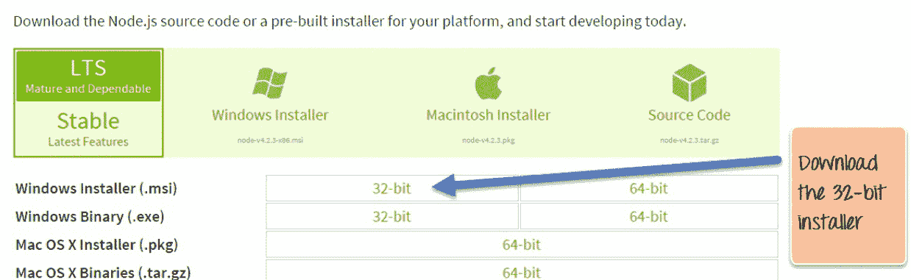

**步骤 2)** 双击下载的 .msi 文件以开始安装。在第一个屏幕中单击“运行”按钮开始安装。

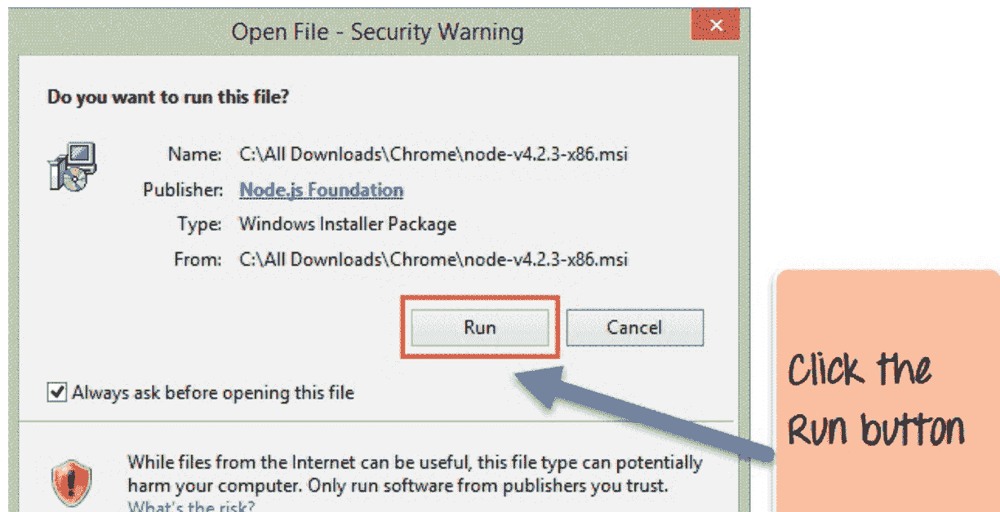

**步骤 3)** 在下一个屏幕中，单击“下一步”按钮继续安装。

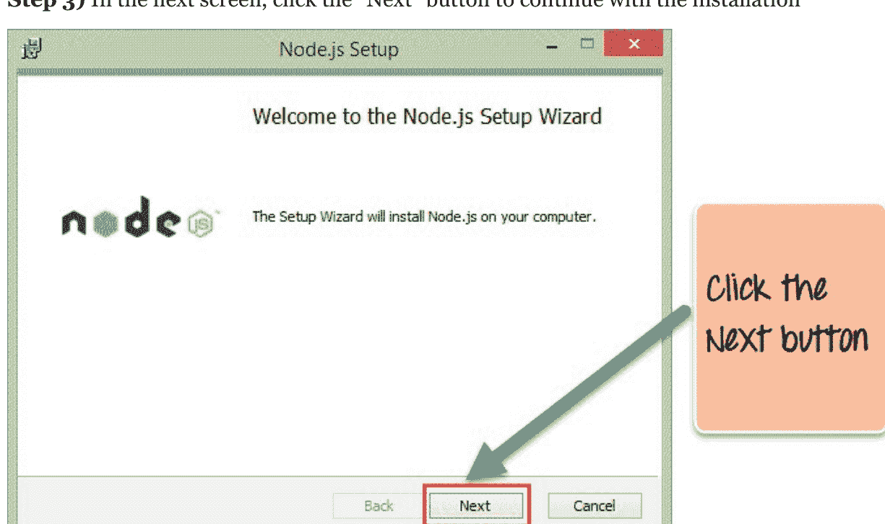

**步骤 4)** 在下一个屏幕中，接受许可协议，然后单击“下一步”按钮。

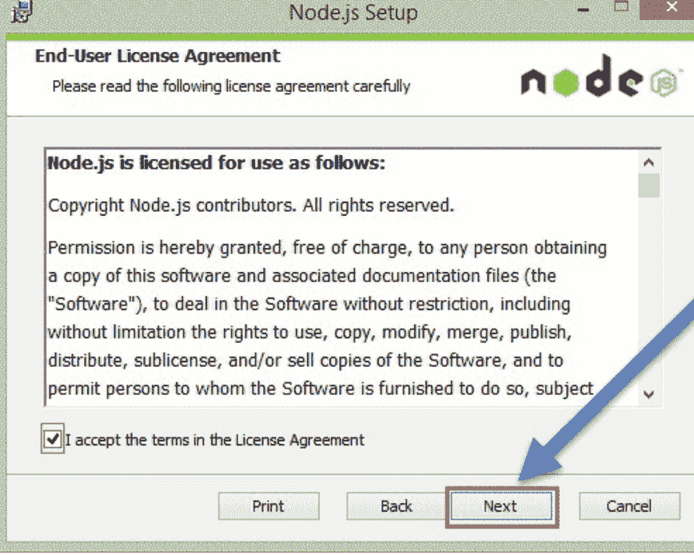

**步骤 5)** 在下一个屏幕中，选择 Node.js 的安装位置，然后单击“下一步”按钮。

1.  首先输入 Node.js 的安装文件位置。这是安装后 Node.js 文件的存储位置。
2.  单击“下一步”按钮继续安装。

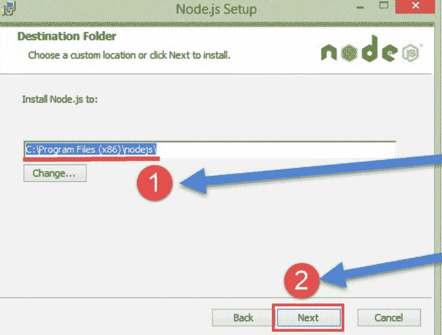


**步骤 6)** 接受默认组件，然后单击“下一步”按钮。

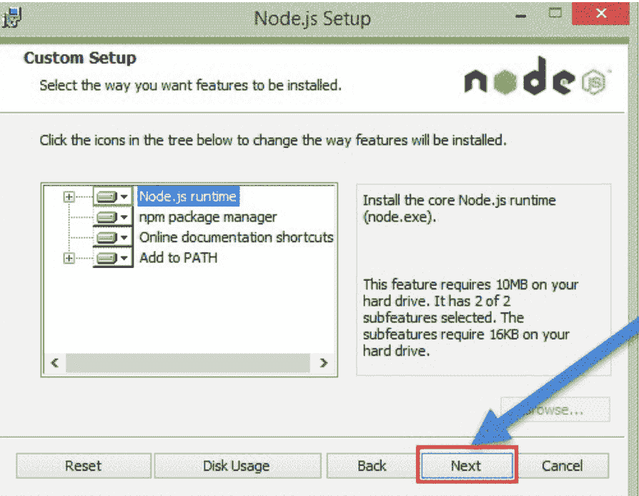


**步骤 7)** 在下一个屏幕中，单击“安装”按钮开始安装。

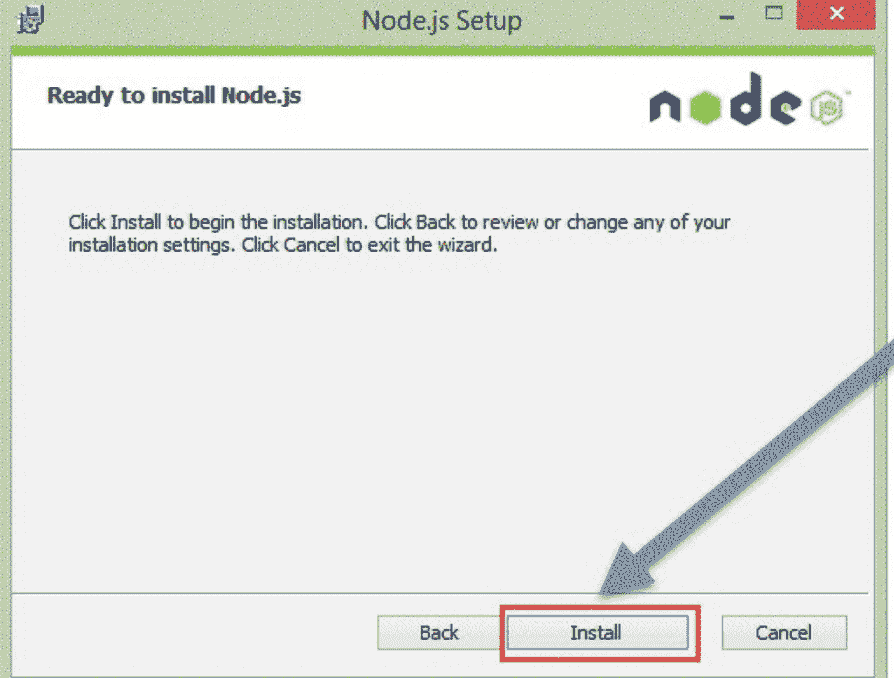

**步骤 8)** 单击“完成”按钮完成安装。

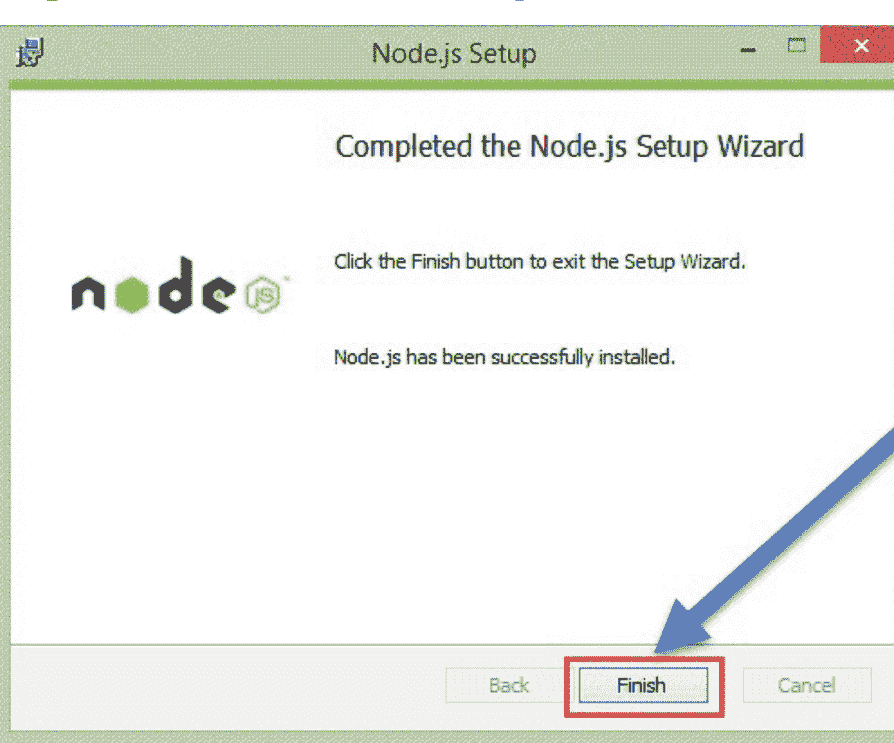

## 通过包管理器安装 Node

在任何客户端机器上安装 Node.js 的另一种方法是使用“包管理器”。

在 Windows 上，Node 包管理器被称为 Chocolatey。它被设计为一个去中心化的框架，用于快速安装你需要的应用程序和工具。

要通过 Chocolatey 安装 Node.js，需要执行以下步骤。

**步骤 1)** 安装 Chocolatey – Chocolatey 网站 (**https://chocolatey.org/**) 提供了关于如何安装此框架的非常清晰的说明。

-   第一步是在命令提示符窗口中运行以下命令。此命令取自 Chocolatey 网站，是通过 Chocolatey 安装 Node.js 的标准命令。
-   以下命令是一个 PowerShell 命令，它调用 Chocolatey 网站上的远程 PowerShell 脚本。此命令需要在 PowerShell 命令窗口中运行。
-   此 PowerShell 脚本执行下载所需组件并相应安装的所有必要工作。

```
@powershell -NoProfile -ExecutionPolicy Bypass -Command "iex ((new-object wet.webclient).DownloadString('https://chocolatey.org/install.ps1'))" && SET PATH=%PATH%;%ALLUSERSPROFILE%\chocolatey\bin
```

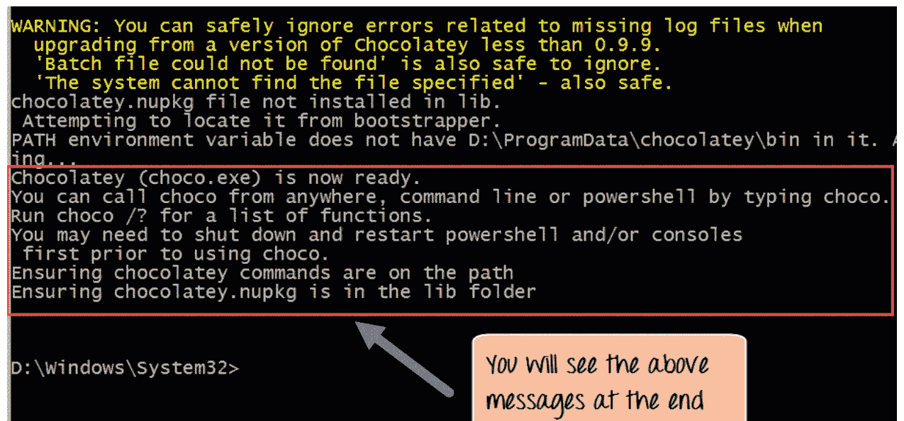

**步骤 2)** 下一步是使用 Chocolatey 包管理器将 Node.js 安装到你的本地计算机。这可以通过在命令提示符中运行以下命令来完成。

```
cinst nodejs install
```

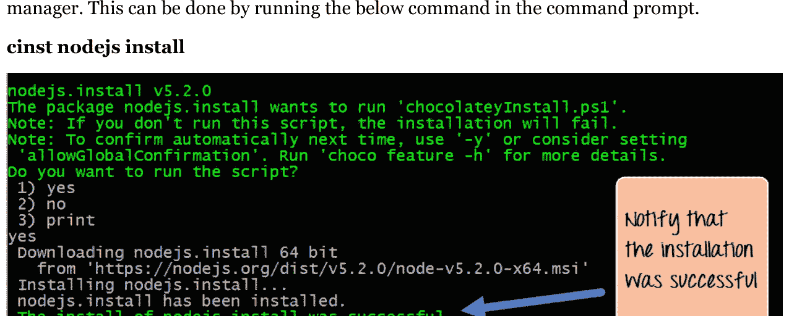

如果安装成功，你将收到 Node.js 成功安装的消息。

注意：如果你收到类似“C:\ProgramData\chocolatey\lib\libreoffice\tools\chocolateyInstall.ps1”的错误，然后在该路径中手动创建文件夹。

## 在 Node.js 中运行你的第一个 Hello world 应用程序

在你的计算机上下载并安装 Node.js 后，让我们尝试在 Web 浏览器中显示“Hello World”。

创建名为 firstprogram.js 的文件 Node.js

```
var http = require('http');

http.createServer(function (req, res) {
    res.writeHead(200, {'Content-Type': 'text/html'});
    res.end('Hello World!');
}).listen(8080);
```

### 代码解释：

1.  “require”函数的基本功能是读取一个 JavaScript 文件，执行该文件，然后返回一个对象。使用此对象，你可以使用 require 函数调用的模块中提供的各种功能。因此，在我们的案例中，由于我们要使用 http 的功能，我们使用 require(http) 命令。
2.  在这第 2 行代码中，我们正在创建一个基于简单函数的服务器应用程序。每当有请求发送到我们的服务器应用程序时，都会调用此函数。
3.  当收到请求时，我们要求函数向客户端返回“Hello World”响应。writeHead 函数用于向客户端发送头数据，而 end 函数将关闭到客户端的连接。
4.  然后我们使用 .listen 函数使我们的服务器应用程序在端口 8080 上监听客户端请求。你可以在此处指定任何可用的端口。

### 执行代码

**步骤 1)** 在你的计算机上保存文件：C:\Users\Your Name\ firstprogram.js

**步骤 2)** 在命令提示符中，导航到文件存储的文件夹。输入命令

```
Node firstprogram.js
```

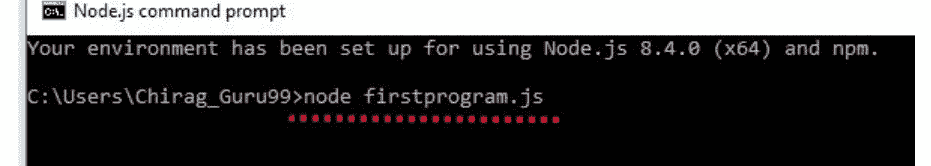

**步骤 3)** 现在，你的计算机作为服务器工作！如果有人尝试通过端口 8080 访问你的计算机，他们将收到“Hello World!”消息作为响应！

**步骤 4)** 启动你的互联网浏览器，然后输入地址：**http://localhost:8080**

### 输出


### 总结

-   我们已经了解了通过 Node.js 网站上可用的 msi 安装模块安装 Node.js。此安装安装了在客户端上运行 Node.js 应用程序所需的必要模块。
-   Node.js 也可以通过包管理器安装。Windows 的包管理器被称为 Chocolatey。通过在命令提示符中运行一些简单的命令，Chocolatey 包管理器会自动下载必要的文件，然后将它们安装在客户端计算机上。
-   一个简单的 Node.js 应用程序包括创建一个监听特定端口的服务器。当请求到达服务器时，服务器会自动向客户端发送 'Hello World' 响应。

# 第三章：模块

Node.js 中的模块是代码在单个单元中的逻辑封装。将代码以使其更具可管理性和可维护性的方式分隔始终是一种良好的编程实践。这就是 Node.js 中的模块发挥作用的地方。

由于每个模块都是一个具有其自身封装功能的独立实体，它可以作为一个独立的工作单元进行管理。

在本教程中，我们将了解如何在 Node.js 中使用模块。

## Node.js 中的模块是什么？

如前所述，Node.js 中的模块是将代码封装在单独逻辑单元中的方式。市场上有许多现成的模块可以在 Node.js 中使用。

以下是一些在 Node.js 应用程序中使用的流行模块：

1.  **Express 框架** – Express 是一个最小且灵活的 Node.js Web 应用程序框架，为 Web 和移动应用程序提供了一套强大的功能。
2.  **Socket.io** - Socket.IO 支持实时双向事件驱动的通信。此模块非常适合创建基于聊天的应用程序。
3.  **Jade** - Jade 是一个高性能的模板引擎，使用 JavaScript 为 node 和浏览器实现。
4.  **MongoDB** - MongoDB Node.js 驱动程序是 MongoDB 官方支持的 node.js 驱动程序。
5.  **Restify** - restify 是一个轻量级框架，类似于 express，用于构建 REST API。
6.  **Bluebird** - Bluebird 是一个功能齐全的 promise 库，专注于创新特性和性能。


## 在 Node.js 中使用模块

要在 Node.js 应用程序中使用模块，首先需要使用 Node 包管理器来安装它们。

以下命令行展示了如何安装名为 "express" 的模块。

npm install express

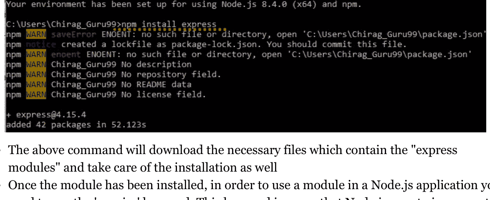

- 上述命令将下载包含 "express 模块" 的必要文件，并处理安装过程。
- 模块安装后，要在 Node.js 应用程序中使用它，你需要使用 'require' 关键字。这个关键字是 Node.js 用来在应用程序中集成模块功能的一种方式。

让我们看一个如何使用 "require" 关键字的例子。下面的 "Guru99" 代码示例展示了如何使用 require 函数。

```
var express=require('express');
var app=express();
app.set('view engine', 'jade');
app.get('/',function(req,res)
{
});
var server=app.listen(3000,function()
{
});
```

1. 在第一条语句中，我们就使用了 "require" 关键字来引入 express 模块。"express" 模块是一个针对 Node.js 开发优化的 JavaScript 库。这是最常用的 Node.js 模块之一。
2. 模块引入后，为了使用其内部功能，需要创建一个对象。这里创建了一个 express 模块的对象。
3. 一旦模块通过 "require" 命令引入并创建了 "对象"，就可以调用 express 模块所需的方法。这里我们使用 set 命令来设置视图引擎，用于设定 Node.js 中使用的模板引擎。**注意：**（仅为了让读者理解，模板引擎是一种通过从数据文件中提取数据来向应用程序注入值的方法。这个概念在 Angular JS 中非常流行，其中使用花括号 `{{ key }}` 来在网页中替换值。花括号中的 'key' 基本上表示当页面显示时将被一个值替换的变量。）
4. 这里我们使用 listen 方法使应用程序监听一个特定的端口号。

## 创建 NPM 模块

Node.js 能够创建自定义模块，并允许你将这些自定义模块包含在你的 Node.js 应用程序中。

让我们看一个简单的例子，了解如何创建自己的模块并将其包含在主应用程序文件中。我们的模块将只执行一个简单的任务：将两个数字相加。

请按照以下步骤了解如何创建模块并将其包含在应用程序中。

**步骤 1)** 创建一个名为 "Addition.js" 的文件，并包含以下代码。此文件将包含你的模块的逻辑。

以下是放入此文件的代码：

```
var exports=module.exports={};
exports.AddNumber=function(a,b)
{
return a+b;
};
```

1. "exports" 关键字用于确保此文件中定义的功能确实可以被其他文件访问。
2. 然后我们定义了一个名为 'AddNumber' 的函数。该函数定义为接受两个参数 a 和 b。该函数被添加到模块 "exports" 中，使其成为一个公共函数，可以被其他应用程序模块访问。
3. 最后，我们的函数返回参数的相加值。

现在我们已经创建了具有将两个数字相加功能的自定义模块。是时候创建一个调用此模块的应用程序了。

在下一步中，我们将实际了解如何创建将调用我们自定义模块的应用程序。

**步骤 2)** 创建一个名为 "app.js" 的文件，这是你的主应用程序文件，并添加以下代码。

```
var Addition=require('./Addition.js');
console.log(Addition.AddNumber(1,2));
```

1. 我们使用 "require" 关键字来引入 Addition.js 文件中的功能。
2. 由于 Addition.js 文件中的函数现在可以访问，我们现在可以调用 AddNumber 函数。在函数中，我们传递了两个数字作为参数。然后我们在控制台显示该值。

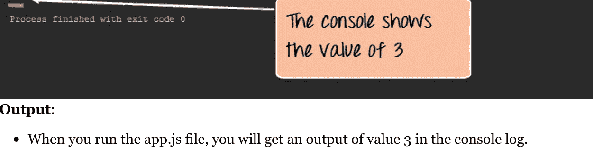

### 输出：

- 当你运行 app.js 文件时，你将在控制台日志中得到值为 3 的输出。
- 该结果是因为 Addition.js 文件中的 AddNumber 函数被成功调用，并返回了 3，显示在控制台中。

**注意：** 我们目前还没有使用 "Node 包管理器" 来安装我们的 Addition.js 模块。这是因为该模块已经是本地计算机上项目的一部分。Node 包管理器会在你将模块发布到互联网上时发挥作用，这将在后续主题中看到。

## 扩展模块

创建模块时，也可以从另一个模块扩展或继承一个模块。

在现代编程中，构建一个通用模块库，然后在需要时扩展这些通用模块的功能是非常常见的。

让我们看一个如何在 Node.js 中扩展模块的例子。

**步骤 1)** 创建基础模块。

在我们的示例中，创建一个名为 "Tutorial.js" 的文件，并放入以下代码。

在此代码中，我们只是创建一个函数，该函数返回一个字符串到控制台。返回的字符串是 "Guru99 Tutorial"。

```
var exports=module.exports={};
exports.tutorial=function()
{
console.log("Guru99 Tutorial")
}
```

1. 使用 exports 模块是为了使此文件中定义的任何函数在 Node.js 的其他模块中可用。
2. 我们正在创建一个名为 tutorial 的函数，该函数可以在其他 Node.js 模块中使用。
3. 当此函数被调用时，我们在控制台中显示一个字符串 "Guru99 Tutorial"。

现在我们已经创建了名为 Tutorial.js 的基础模块。是时候创建另一个模块来扩展这个基础模块了。

我们将在下一步中探讨如何执行此操作。

**步骤 2)** 接下来，我们将创建扩展模块。创建一个名为 "NodeTutorial.js" 的新文件，并在其中放入以下代码。

```
var Tutor=require('./Tutorial.js');
exports.NodeTutorial=function()
{
console.log("Node Tutorial")
function pTutor()
{
var PTutor=Tutor;
PTutor.tutorial();
}
}
```

请注意上述代码的以下关键点：

1. 我们在新的模块文件本身中使用了 "require" 函数。由于我们将扩展现有模块文件 "Tutorial.js"，因此在扩展之前需要先将其包含进来。
2. 然后我们创建一个名为 "NodeTutorial" 的函数。这个函数将做两件事，
    - 它将向控制台发送一个字符串 "Node Tutorial"。
    - 它将从基础模块 "Tutorial.js" 中获取字符串 "Guru99 Tutorial" 并发送到我们的扩展模块 "NodeTutorial.js"。
3. 这里我们正在执行第一步，向控制台发送一个字符串 "Node Tutorial"。
4. 下一步是调用我们 Tutorial 模块中的函数，这将把字符串 "Guru99 Tutorial" 输出到 console.log。

**步骤 3)** 创建你的主应用程序文件 app.js，并包含以下代码。

```
var localTutor=require('./NodeTutorial.js');
localTutor.NodeTutorial();
localTutor.NodeTutorial.pTutor();
```

上述代码执行以下操作：

1. 我们的主要应用程序文件现在调用 "NodeTutorial" 模块。
2. 我们调用 "NodeTutorial" 函数。通过调用此函数，文本 "Node Tutorial" 将显示在控制台日志中。
3. 由于我们扩展了 Tutorial.js 模块并公开了一个名为 pTutor 的函数。它还会调用 Tutorial.js 模块中的 tutorial 模块，文本 "Guru99 Tutorial" 也将显示在控制台中。

### 输出：

由于我们使用 Node 执行了上述 app.js 代码，我们将在 console.log 文件中获得以下输出。

- Node Tutorial
- Guru99 Tutorial

## 发布 NPM（Node 包管理器）模块

可以将你自己的模块发布到你自己的 Github 仓库。

通过将模块发布到中央位置，你就不必自己在每一台需要它的机器上安装。

相反，你可以使用 npm 的 install 命令来安装你已发布的 npm 模块。

发布你的 npm 模块需要遵循以下步骤：

**步骤 1)** 在 GitHub（一个在线代码仓库管理工具）上创建你的仓库。它可用于托管你的代码仓库。

**步骤 2)** 你需要告诉本地的 npm 安装你是谁。这意味着我们需要告诉 npm 此模块的作者是谁，电子邮件 ID 是什么，以及任何需要与此 ID 关联的公司 URL。所有这些详细信息将在发布时添加到你的 npm 模块中。

以下命令设置 npm 模块作者的姓名、电子邮件和 URL。

```
npm set init.author.name "Guru99."
npm set init.author.email "guru99@gmail.com"
npm set init.author.url "http://Guru99.com"
```

**步骤 3)** 下一步是使用上一步提供的凭据登录 npm。要登录，你需要使用以下命令。

```
npm login
```

**步骤 4)** 初始化你的包——下一步是初始化包以创建 package.json 文件。可以通过执行以下命令完成。

```
npm init
```

当你执行上述命令时，系统会提示你回答一些问题。最重要的是你模块的版本号。

**步骤 5)** 发布到 GitHub——下一步是将你的源文件发布到 GitHub。可以通过运行以下命令完成。

```
git add .
git commit -m "Initial release"
git tag v0.0.1
```

git push origin master --tags

**步骤 6) 发布您的模块** – 最后一步是将您的模块发布到 npm 注册表。这通过以下命令完成。

```
npm publish
```

## 使用 npm 管理第三方包

正如我们所看到的，"Node 包管理器"能够管理 Node.js 应用程序所需的模块。

让我们看看 node 包管理器中用于管理模块的一些可用功能：

1.  以全局模式安装包 – 模块可以在全局级别安装，这基本上意味着这些模块将可用于本地机器上的所有 Node.js 项目。

下面的示例展示了如何使用全局选项安装 "express 模块"。

**npm install express –global**

上述语句中的全局选项允许模块在全局级别安装。

2.  列出本地机器上安装的所有全局包。这可以通过在命令提示符下执行以下命令完成：

**npm list --global**

如果您之前在系统上安装过 "express 模块"，将显示以下输出。

这里您可以看到本地机器上安装的不同模块。

```
C:\Users\Administrator>npm list --global
C:\Users\Administrator\AppData\Roaming\npm
+-- express@4.13.3
|   +-- accepts@1.2.13
|   |   +-- mime-types@2.1.8
|   |   |   \-- mime-db@1.20.0
|   |   \-- negotiator@0.5.3
|   +-- array-flatten@1.1.1
|   +-- content-disposition@0.5.0
|   +-- content-type@1.0.1
|   +-- cookie@0.1.3
|   +-- cookie-signature@1.0.6
|   +-- debug@2.2.0
|   |   \-- ms@0.7.1
|   +-- depd@1.0.1
|   +-- escape-html@1.0.2
|   +-- etag@1.7.0
|   +-- finalhandler@0.4.0
|   |   \-- unpipe@1.0.0
|   +-- fresh@0.3.0
|   +-- merge-descriptors@1.0.0
|   +-- methods@1.1.1
|   +-- on-finished@2.3.0
|   |   \-- ee-first@1.1.1
|   +-- parseurl@1.3.0
|   +-- path-to-regexp@0.1.7
|   +-- proxy-addr@1.0.10
|   |   +-- forwarded@0.1.0
|   |   \-- ipaddr.js@1.0.5
|   +-- qs@4.0.0
|   +-- range-parser@1.0.3
|   +-- send@0.13.0
|   |   +-- destroy@1.0.3
|   |   +-- http-errors@1.3.1
|   |   |   \-- inherits@2.0.1
|   |   +-- mime@1.3.4
|   |   +-- ms@0.7.1
|   |   \-- statuses@1.2.1
|   +-- serve-static@1.10.0
|   +-- type-is@1.6.10
|   |   +-- media-typer@0.3.0
|   |   \-- mime-types@2.1.8
|   |       \-- mime-db@1.20.0
|   +-- utils-merge@1.0.0
|   \-- vary@1.0.1
```

3.  安装特定版本的包 – 有时可能需要安装特定版本的包。一旦您知道需要安装的包及其相关版本，您可以使用 npm install 命令来安装该特定版本。

下面的示例展示了如何安装名为 underscore 的特定版本 1.7.0 的模块。

```
npm install underscore@1.7.0
```

4.  更新包版本 – 有时系统中可能有一个旧版本的包，您可能希望更新到市场上可用的最新版本。为此，可以使用 npm update 命令。

下面的示例展示了如何将 underscore 包更新到最新版本：

```
npm update underscore
```

5.  搜索特定包 – 要搜索特定版本是否在本地系统上可用，您可以使用 npm 的 search 命令。下面的示例将检查 express 模块是否已安装在本地机器上。

```
npm search express
```

6.  卸载包 – 与安装包的方式相同，您也可以卸载包。包的卸载通过 npm 的 uninstall 命令完成。

下面的示例展示了如何卸载 express 模块：

```
npm uninstall express
```

## 什么是 package.json 文件

"package.json" 文件用于保存**关于特定项目的元数据**。这些信息为 Node 包管理器提供必要的信息，以了解如何处理该项目及其依赖关系。

package.json 文件包含诸如项目描述、特定发行版中项目的版本、许可证信息和配置数据等信息。

package.json 文件通常位于 Node.js 项目的根目录中。

让我们以一个模块通过 npm 安装时的结构为例。

下面的快照显示了当 express 模块包含在您的 Node.js 项目中时的文件内容。从快照中，您可以看到 express 文件夹中的 package.json 文件。

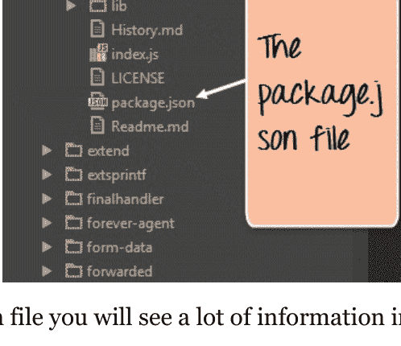

如果您打开 package.json 文件，您将看到文件中的大量信息。

以下是文件一部分的快照。**express@~4.13.1** 提到了所使用的 express 模块的版本号。

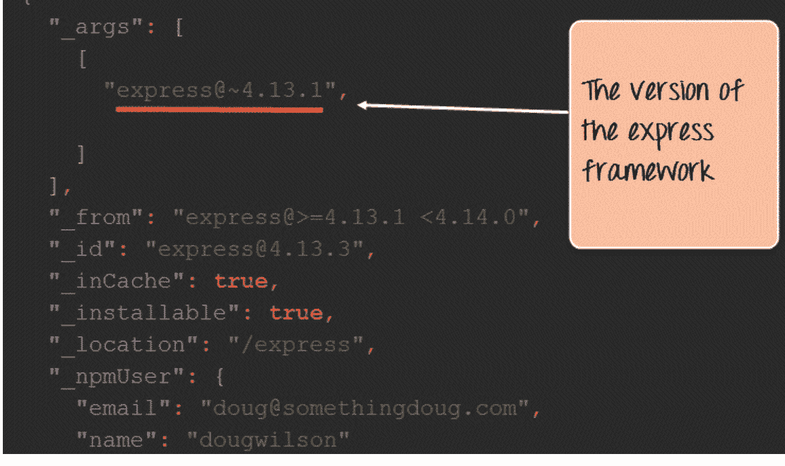

### 总结

-   Node.js 中的模块是代码在单个单元中的逻辑封装。分离成模块使代码更易于管理和维护，以备将来之用。
-   市场上有许多模块可以在 Node.js 中使用，例如 express、underscore、mongoDB 等。
-   Node 包管理器 (npm) 用于下载和安装模块，然后可以在 Node.js 应用程序中使用这些模块。
-   可以创建自定义 NPM 模块，扩展这些模块，也可以发布这些模块。
-   Node 包管理器拥有一套完整的命令来管理本地系统上的 npm 模块，例如安装、卸载、搜索等。
-   package.json 文件用于保存 npm 模块的整个元数据信息。

# 第 4 章：创建服务器并获取数据

Node.js 框架主要用于创建基于服务器的应用程序。该框架可以轻松用于创建 Web 服务器，为用户提供内容服务。

有多种模块，如 "http" 和 "request" 模块，有助于处理 Web 服务器空间中与服务器相关的请求。我们将看看如何使用 Node js 创建一个基本的 Web 服务器应用程序。

## 使用 HTTP 的 Node 作为 Web 服务器

让我们看一个如何创建和运行第一个 Node js 应用程序的示例。

我们的应用程序将创建一个简单的服务器模块，它将监听端口 7000。如果通过浏览器对这个端口号发出请求，那么服务器应用程序将向客户端发送 'Hello World' 响应。

```javascript
var http=require('http')
var server=http.createServer((function(request,response)
{
    response.writeHead(200,
    {"Content-Type" : "text/plain"});
    response.end("Hello World\n");
}));
server.listen(7000);
```

### 代码解释：

1.  require 函数的基本功能是读取一个 javascript 文件，执行该文件，然后继续返回导出对象。因此在我们的例子中，由于我们要使用 http 模块的功能，我们使用 require 函数从 http 模块获取所需的函数，以便在我们的应用程序中使用。
2.  在这行代码中，我们正在创建一个基于简单函数的服务器应用程序。每当向我们的服务器应用程序发出请求时，都会调用此函数。
3.  当接收到请求时，我们表示要发送一个头类型为 '200' 的响应。这个数字是当向客户端发送成功响应时，在 http 头中发送的正常响应。
4.  在响应本身中，我们正在发送字符串 'Hello World'。
5.  然后我们使用 server.listen 函数使我们的服务器应用程序在端口 7000 上监听客户端请求。您可以在此处指定任何可用端口。

如果命令执行成功，当您在浏览器中运行代码时，将显示以下输出。

### 输出：

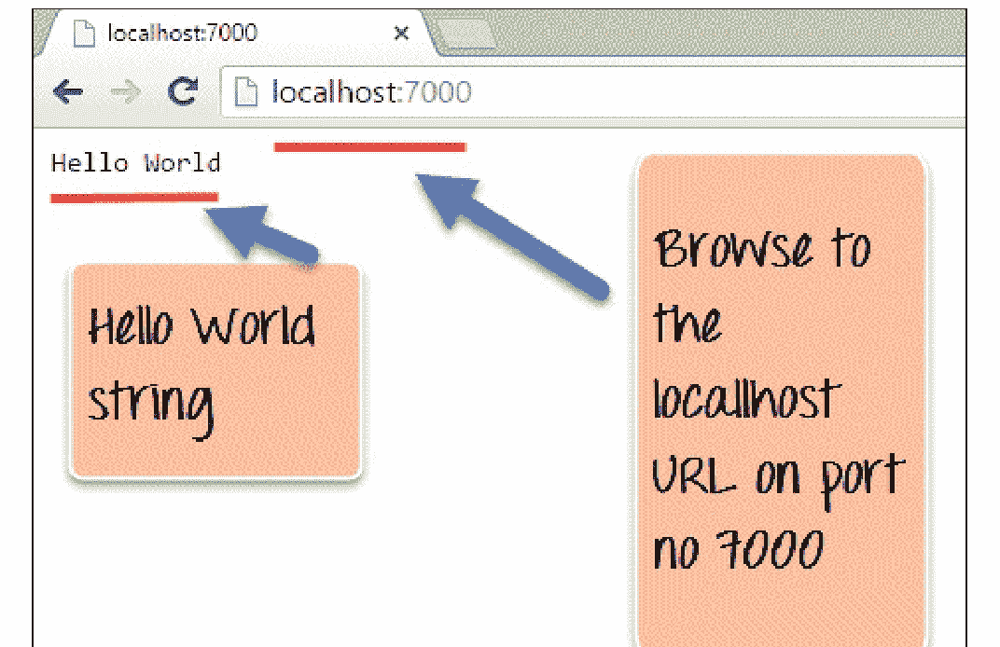

从输出中：

-   您可以清楚地看到，如果我们浏览到 localhost 的端口 7000，您将在页面上看到字符串 'Hello World'。
-   因为在我们的代码中我们特别提到服务器要监听端口号 7000，所以我们才能在浏览到这个 url 时查看到输出。

以下是供您参考的代码：

```javascript
var http=require('http')

var server=http.createServer((function(request,response)
{

response.writeHead(200,
{"Content-Type" : "text/plain"});

response.end("Hello World\n");
}));

server.listen(7000);
```


# 在Node.js中处理GET请求

在Node.js中发起GET请求以从其他站点获取数据相对非常简单。要在Node中发起GET请求，我们首先需要安装request模块。这可以通过在命令行中执行以下命令来完成：

```
npm install request
```

上述命令请求Node包管理器下载所需的request模块并相应地安装它们。

当你的npm模块成功安装后，命令行将显示已安装模块的名称和版本：<name>@<version>。

在上面的快照中，你可以看到 'request' 模块及其版本号2.67.0已被下载并安装。

现在让我们看看可以利用这个 'request' 命令的代码。

```
var request = require("request");
request("http://www.google.com", function(error, response, body)
{
    console.log(body);
});
```

### 代码解释

1. 我们正在使用上一步安装的 'require' 模块。该模块包含可用于向网站发起GET请求的必要函数。
2. 我们正在向www.google.com发起一个GET请求，并在收到响应后调用一个函数。当收到响应时，参数（error, response, 和 body）将具有以下值：
    a. Error – 如果在使用GET请求时收到任何错误，错误信息将记录在这里。
    b. Response - 响应将包含随响应发回的HTTP头信息。
    c. Body - 主体将包含Google发送的整个响应内容。
3. 在这里，我们只是将接收到的body参数的内容写入console.log。所以基本上，我们访问 **www.google.com** 所得到的任何内容都将被写入控制台。

以下是供你参考的代码：

```
var request = require("request");

request("http://www.google.com",function(error,response,body)
{

console.log(body);

});
```

### 总结

- Node.js框架可以使用 'http' 模块来开发Web服务器。应用程序可以监听特定端口，并在应用程序收到请求时向客户端发送响应。
- 'request' 模块可用于从网站获取信息。信息将包含从相关网站请求的整个网页内容。

# 第5章：Node.js与Express

在本教程中，我们还将了解Express框架。该框架被设计为一个最小且灵活的Node.js Web应用程序框架，为构建单页、多页和混合Web应用程序提供了一组强大的功能。

# 什么是Express.js

Express.js是一个Node.js Web应用服务器框架，专门用于构建单页、多页和混合Web应用程序。

它已成为Node.js的标准服务器框架。Express是被称为MEAN技术栈的后端部分。

MEAN是一个免费且开源的JavaScript技术栈，用于构建动态网站和Web应用程序，包含以下组件：

1. **MongoDB** - 标准的NoSQL数据库
2. **Express.js** - 默认的Web应用程序框架
3. **Angular.js** - 用于Web应用程序的JavaScript MVC框架
4. **Node.js** - 用于可扩展的服务器端和网络应用程序的框架。

Express.js框架使得开发能够处理多种类型请求（如GET、PUT、POST和DELETE请求）的应用程序变得非常容易。

# 安装和使用Express

Express通过Node包管理器安装。这可以通过在命令行中执行以下命令来完成：

```
npm install express
```

上述命令请求Node包管理器下载所需的express模块并相应地安装它们。

让我们使用新安装的Express框架创建一个简单的 "Hello World" 应用程序。

我们的应用程序将创建一个简单的服务器模块，监听3000端口。在我们的示例中，如果通过浏览器对此端口发出请求，那么服务器应用程序将向客户端发送 'Hello World' 响应。

```
var express=require('express');
var app=express();
app.get('/',function(req,res)
{
    res.send('Hello World!');
});

var server=app.listen(3000,function() {});
```

### 代码解释

1. 在我们的第一行代码中，我们使用require函数来包含 "express模块"。
2. 在开始使用express模块之前，我们需要创建一个express模块的对象。
3. 这里我们创建了一个回调函数。每当有人浏览到我们Web应用程序的根路径 **http://localhost:3000** 时，这个函数就会被调用。回调函数将用于向网页发送字符串 'Hello World'。
4. 在回调函数中，我们将字符串 "Hello World" 发送回客户端。'res' 参数用于向网页发送内容。这个 'res' 参数是由 'request' 模块提供的，用于将内容发送回网页。
5. 然后我们使用listen函数让我们的服务器应用程序监听3000端口的客户端请求。你可以在这里指定任何可用的端口。

如果命令执行成功，当你在浏览器中运行代码时，将显示以下输出。

### 输出

从输出中，你可以清楚地看到，如果我们浏览到localhost的3000端口URL，你将在页面上看到字符串 'Hello World' 被显示出来。因为我们在代码中明确指定了服务器监听3000端口，所以我们能够在这个URL浏览时查看到输出。

# 什么是路由

路由是指确定应用程序对特定端点的客户端请求的响应方式。

例如，客户端可以对各种URL（如下所示）发起GET、POST、PUT或DELETE HTTP请求：

http://localhost:3000/Books
http://localhost:3000/Students

在上面的例子中：

- 如果对第一个URL发起GET请求，那么响应理想情况下应该是一个书籍列表。
- 如果对第二个URL发起GET请求，那么响应理想情况下应该是一个学生列表。
- 因此，根据访问的URL，Web服务器上的不同功能将被调用，并相应地将响应发送给客户端。这就是路由的概念。

每个路由可以有一个或多个处理函数，当路由匹配时这些函数将被执行。

路由的一般语法如下所示：

```
app.METHOD(PATH, HANDLER)
```

其中：
1. app是express模块的实例
2. METHOD是HTTP请求方法（GET、POST、PUT或DELETE）
3. PATH是服务器上的路径。
4. HANDLER是路由匹配时执行的函数。

让我们看看如何在express中实现路由的示例。我们的示例将创建3个路由：

1. 一个 /Node 路由，如果访问此路由，将显示字符串 "Tutorial on Node"
2. 一个 /Angular 路由，如果访问此路由，将显示字符串 "Tutorial on Angular"
3. 一个默认路由 /，将显示字符串 "Welcome to Guru99 Tutorials."

我们的基本代码将与之前的示例保持相同。下面的代码片段是展示如何实现路由的补充内容。

```
app.route('/Node').get(function(req,res)
{
    res.send("Tutorial on Node");
});
app.route('/Angular').get(function(req,res)
{
    res.send("Tutorial on Angular");
});
app.get('/',function(req,res)
{
    res.send('Welcome to Guru99 Tutorials');
});
```

### 代码解释

1. 这里我们定义了一个路由，如果浏览器中选择了URL **http://localhost:3000/Node**。我们为该路由附加了一个回调函数，该函数将在我们浏览Node URL时被调用。

    该函数有2个参数。

    - 我们将主要使用 'res' 参数，它可以用于将信息发送回客户端。
    - 'req' 参数包含有关所发出请求的信息。有时，作为请求的一部分，可能会发送额外的参数，因此可以使用 'req' 参数来查找发送的额外参数。

2. 我们使用send函数，如果选择了Node路由，则将字符串 "Tutorial on Node" 发送回客户端。

3. 这里我们定义了一个路由，如果浏览器中选择了URL **http://localhost:3000/Angular**。我们为该路由附加了一个回调函数，该函数将在我们浏览Angular URL时被调用。

4. 我们使用send函数，如果选择了Angular路由，则将字符串 "Tutorial on Angular" 发送回客户端。


## 5. 默认路由与路由

当用户访问应用程序的根路由时——`http://localhost:3000`，就会选择此默认路由。当选择默认路由时，消息“Welcome to Guru99 Tutorials”将被发送给客户端。

如果命令执行成功，当你在浏览器中运行代码时，将显示以下输出。

**输出：**

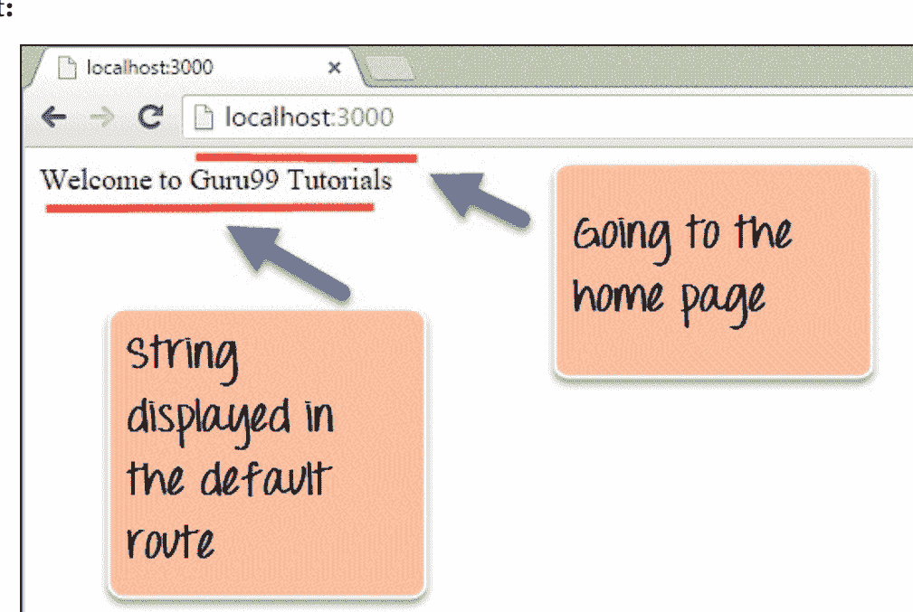

从输出中，你可以清楚地看到，如果我们访问本地主机上3000端口的URL，你将看到页面上显示字符串'Welcome to Guru99 Tutorials'。

- 因为在我们的代码中，我们指定了默认URL将显示此消息。

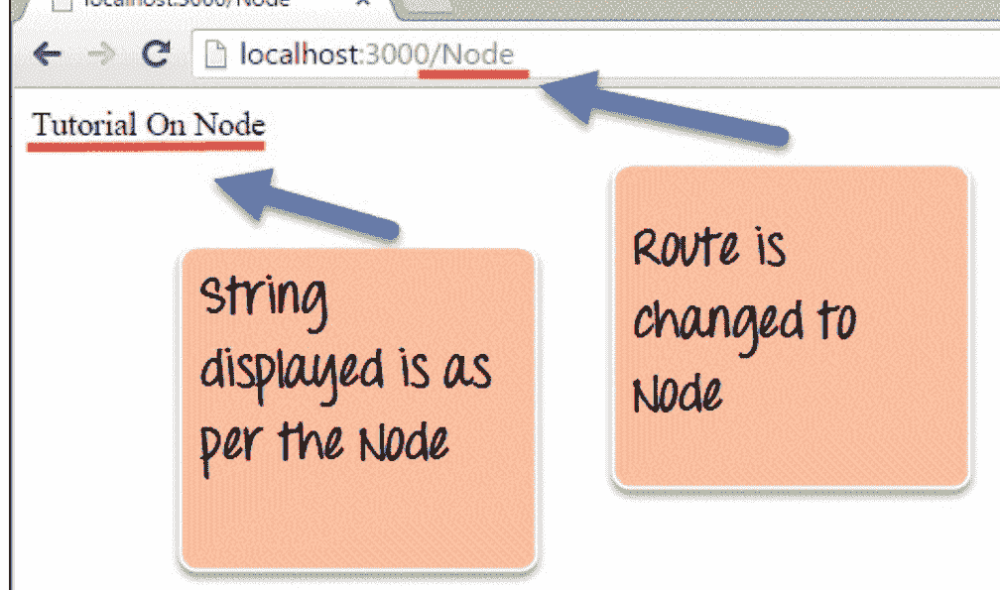

从输出中，你可以看到如果URL更改为/Node，相应的Node路由将被选择，并显示字符串"Tutorial On Node"。

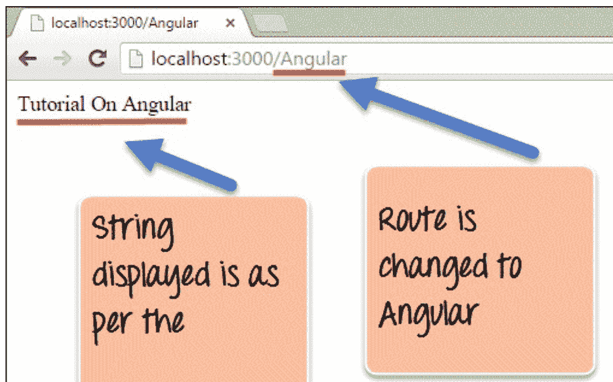

从输出中，你可以看到如果URL更改为/Angular，相应的Angular路由将被选择，并显示字符串"Tutorial On Angular"。

## 使用Express.js的示例Web服务器

从上面的例子中，我们已经了解了如何根据路由来决定显示什么输出。这种路由方式在大多数现代Web应用程序中都会用到。Web服务器的另一部分是关于在Node.js中使用模板。

在创建快速即时Node应用程序时，一个简单快捷的方法是为应用程序使用模板。市场上有许多用于制作模板的框架。在我们的案例中，我们将以jade框架为例进行模板化。

Jade通过Node包管理器安装。这可以通过在命令行中执行以下行来完成：

**npm install jade**

上述命令请求Node包管理器下载所需的jade模块并相应地安装它们。

让我们使用新安装的jade框架来创建一些基本模板。

### 步骤1)

第一步是创建一个jade模板。创建一个名为index.jade的文件，并插入以下代码：

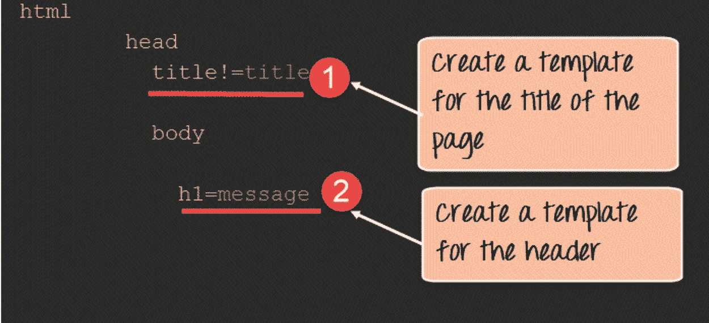

1. 这里我们指定页面的标题将更为此模板被调用时传递的任何值。
2. 我们还指定header标签中的文本将被替换为jade模板中传递的任何内容。

```
var express=require('express');

var app=express();

app.set('view engine','jade');

app.get('/',function(req,res)
{
		res.render('index',
				{title:'Guru99',message:'Welcome'})
});

var server=app.listen(3000,function() {});
```

### 代码解释：

1. 在应用程序中首先要指定的是用于渲染模板的"视图引擎"。由于我们将使用jade来渲染模板，我们相应地指定了它。
2. render函数用于渲染网页。在我们的例子中，我们正在渲染之前创建的模板（index.jade）。
3. 我们将值"Guru99"和"Welcome"分别传递给参数"title"和"message"。这些值将被index.jade模板中声明的'title'和'message'参数替换。

如果命令执行成功，当你在浏览器中运行代码时，将显示以下输出。

### 输出：

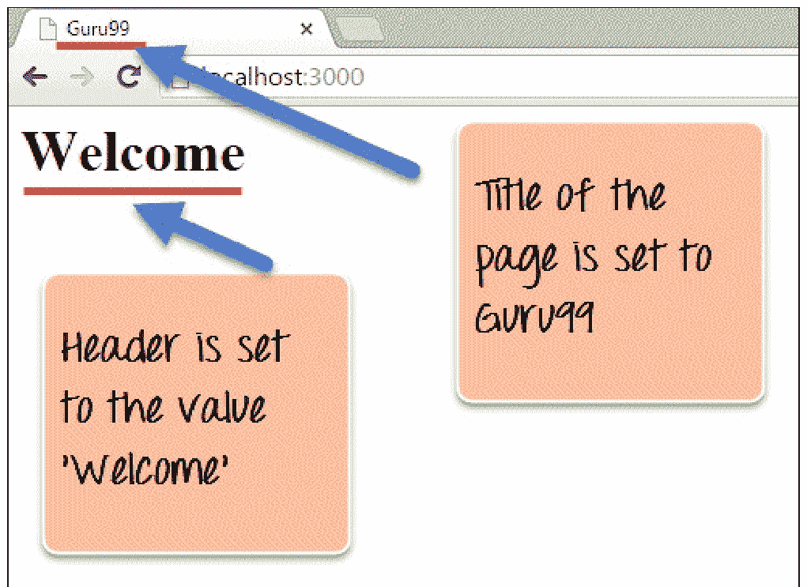

从输出中，我们可以看到页面的标题被设置为"Guru99"，页面的页眉被设置为"Welcome。"

- 这是因为在我们的Node.js应用程序中调用了jade模板。

### 总结

- Express框架是开发Node.js应用程序最常用的框架。Express框架构建在Node.js框架之上，有助于加速基于服务器的应用程序的开发。
- 路由用于根据发出的请求将用户重定向到Web应用程序的不同部分。每个路由的响应可以根据需要向用户显示的内容而变化。
- 模板可以用来高效地注入内容。Jade是Node.js应用程序中最流行的模板引擎之一。

# 第6章：Node.js与MongoDB

几乎所有现代Web应用程序在后端都有某种数据存储系统来存储数据。例如，以网络购物应用程序为例，物品的价格或特定类型物品的数量等数据将存储在数据库中。

Node.js框架具有与大多数现代Web应用程序所需的数据库协同工作的能力。Node.js既可以与关系型数据库（如Oracle和MS SQL Server）也可以与非关系型数据库（如MongoDB和MySQL）协同工作。在本教程中，我们将了解如何在Node.js应用程序中使用数据库。

## Node.js与NoSQL数据库

多年来，像MongoDB和MySQL这样的NoSQL数据库作为存储数据的数据库已经变得非常流行。这些数据库能够存储任何类型的内容，特别是以任何格式存储，正是这些特性使这些数据库如此著名。

Node.js能够与MySQL和MongoDB这两个数据库协同工作。要使用其中任何一个数据库，你需要使用Node包管理器下载并使用所需的模块。

对于MySQL，所需的模块名为"mysql"，而要使用MongoDB，需要安装的模块是"Mongoose。"

通过这些模块，你可以在Node.js中执行以下操作：

1. 管理连接池 – 在这里你可以指定Node.js应维护和保存的MySQL数据库连接数量。
2. 创建和关闭与数据库的连接。在任何情况下，你都可以提供一个回调函数，该函数可以在执行"创建"和"关闭"连接方法时被调用。
3. 可以执行查询以从各自的数据库获取数据。
4. 数据操作，如插入数据、删除和更新数据，也可以通过这些模块实现。

对于剩余的主题，我们将研究如何在Node.js中处理MongoDB数据库。

## 使用MongoDB和Node.js

如前面的主题所讨论，MongoDB是与Node.js一起使用的最流行的数据库之一。

在本章中，我们将了解：

- 如何与MongoDB数据库建立连接
- 如何执行从数据库读取数据以及向MongoDB数据库插入、删除和更新记录的常规操作。

出于本章的目的，让我们假设我们已有以下MongoDB数据：

- 数据库名称：EmployeeDB
- 集合名称：Employee

```
Documents
{
        {Employeeid: 1, EmployeeName: "Guru99"},
        {Employeeid: 2, EmployeeName: "Joe"},
        {Employeeid: 3, EmployeeName: "Martin"},
}
```

1. **安装NPM模块**：要从Node应用程序中访问Mongo，需要一个驱动程序。有许多可用的Mongo驱动程序，但MongoDB是最流行的之一。要安装MongoDB模块，请运行以下命令：**npm install mongodb**
2. **创建和关闭与MongoDB数据库的连接**：以下代码片段展示了如何创建和关闭与MongoDB数据库的连接。

```
var MongoClient = require('mongodb').MongoClient;
var url = 'mongodb://localhost/EmployeeDB';

MongoClient.connect(url, function(err, db) {

    console.log("Connected");

        db.close();

});
```

### 代码解释：

1. 第一步是包含mongoose模块，这是通过require函数完成的。一旦此模块就位，我们就可以使用此模块中可用的必要函数来创建与数据库的连接。
2. 接下来，我们指定连接数据库的连接字符串。在连接字符串中传递了3个关键值：
    - 第一个是'mongodb'，它指定我们正在连接到MongoDB数据库。
    - 下一个是'localhost'，这意味着我们正在连接到本地机器上的数据库。
    - 下一个是'EmployeeDB'，这是在我们的MongoDB数据库中定义的数据库名称。
3. 下一步是实际连接到我们的数据库。connect函数接受我们的URL，并具有指定回调函数的功能。当连接打开到数据库时，它将被调用。这让我们有机会知道数据库连接是否成功。
4. 在该函数中，我们正在将字符串"Connection established"写入控制台，以表示已成功建立连接。
5. 最后，我们使用db.close语句关闭连接。

如果上述代码执行正确，字符串"Connected"将被写入控制台，如下所示。

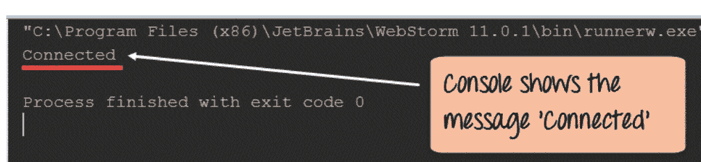

3. **查询MongoDB数据库中的数据** – 使用MongoDB驱动程序，我们还可以从MongoDB数据库中获取数据。

下面的部分将展示如何使用驱动程序从我们的Employee集合（这是MongoDB数据库中包含所有与员工相关文档的集合。每个文档都有一个对象id、员工姓名和员工id来定义文档的值）中获取所有文档。

```
var MongoClient = require('mongodb').MongoClient;
var url = 'mongodb://localhost/EmployeeDB';
```


### 代码解释：

+   1. 在第一步中，我们正在创建一个游标（游标是一个指针，用于指向从数据库获取的各种记录。然后游标被用于遍历数据库中的不同记录。这里我们定义了一个名为 `cursor` 的变量，用于存储指向从数据库获取记录的指针。），该游标指向从 MongoDB 集合中获取的记录。我们还可以指定从哪个集合（本例中为 `Employee`）获取记录。`find()` 函数用于指定我们要从 MongoDB 集合中检索所有文档。
2. 现在我们遍历游标，对于游标中的每个文档，我们将执行一个函数。
3. 我们的函数只是将每个文档的内容打印到控制台。

**注意：** 也可以从数据库中获取特定记录。这可以通过在 `find()` 函数中指定搜索条件来实现。例如，假设你只想获取员工名为 Guru99 的记录，那么此语句可以这样写：`var cursor=db.collection('Employee').find({"EmployeeName": "Guru99"});`

如果上述代码成功执行，以下输出将显示在你的控制台中。

### 输出：

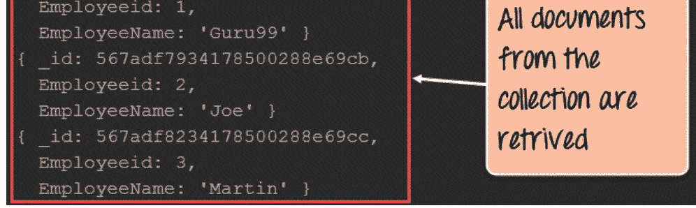

从输出中，

你将能够清楚地看到已检索到集合中的所有文档。这可以通过使用 mongoDB 连接（`db`）的 `find()` 方法并使用游标遍历所有文档来实现。

+   4. **向集合中插入文档** – 可以使用 MongoDB 库提供的 `insertOne` 方法将文档插入集合中。下面的代码片段展示了如何向 mongoDB 集合中插入文档。

```javascript
var MongoClient = require('mongodb').MongoClient;
var url = 'mongodb://localhost/EmployeeDB';

MongoClient.connect(url, function(err, db) {

    db.collection('Employee').insertOne({
        Employeeid: 4,
        EmployeeName: "NewEmployee"
    });
});
```

### 代码解释：

+   1. 这里我们使用 MongoDB 库中的 `insertOne` 方法将文档插入 Employee 集合。
2. 我们正在指定要插入 Employee 集合的文档详细信息。

如果你现在检查 MongoDB 数据库的内容，你将发现 Employeeid 为 4 且 EmployeeName 为 "NewEmployee" 的记录已插入到 Employee 集合中。

**注意：** 控制台不会显示任何输出，因为记录正在插入数据库，此处无法显示任何输出。

要检查数据是否已正确插入数据库，你需要在 MongoDB 中执行以下命令

+   1. Use EmployeeDB
2. db.Employee.find({Employeeid: 4})

第一条语句确保你连接到 EmployeeDb 数据库。第二条语句搜索 employee id 为 4 的记录。

## 5. 更新集合中的文档
可以使用 MongoDB 库提供的 `updateOne` 方法更新集合中的文档。下面的代码片段展示了如何更新 mongoDB 集合中的文档。

```javascript
var MongoClient = require('mongodb').MongoClient;
var url = 'mongodb://localhost/EmployeeDB';

MongoClient.connect(url, function(err, db) {

    db.collection('Employee').updateOne({
        "EmployeeName": "NewEmployee"
    }, {
        $set: {
            "EmployeeName": "Mohan"
        }
    });
});
```

### 代码解释：

+   1. 这里我们使用 MongoDB 库中的 "updateOne" 方法，该方法用于更新 mongoDB 集合中的文档。
2. 我们正在指定需要更新的文档的搜索条件。在我们的例子中，我们要查找 EmployeeName 为 "NewEmployee" 的文档。
3. 然后我们想将该文档的 EmployeeName 的值从 "NewEmployee" 设置为 "Mohan"。

如果你现在检查 MongoDB 数据库的内容，你将发现 Employeeid 为 4 且 EmployeeName 为 "Mohan" 的记录已在 Employee 集合中更新。

要检查数据是否已正确更新到数据库中，你需要在 MongoDB 中执行以下命令

+   1. Use EmployeeDB
2. db.Employee.find({Employeeid: 4})

第一条语句确保你连接到 EmployeeDb 数据库。第二条语句搜索 employee id 为 4 的记录。

## 6. 删除集合中的文档
可以使用 MongoDB 库提供的 "deleteOne" 方法删除集合中的文档。下面的代码片段展示了如何删除 mongoDB 集合中的文档。

```javascript
var MongoClient = require('mongodb').MongoClient;
var url = 'mongodb://localhost/EmployeeDB';

MongoClient.connect(url, function(err, db) {

    db.collection('Employee').deleteOne(
        {
            "EmployeeName": "Mohan"
        }
    );
});
```

### 代码解释：

+   1. 这里我们使用 MongoDB 库中的 "deleteOne" 方法，该方法用于删除 mongoDB 集合中的文档。
2. 我们正在指定需要删除的文档的搜索条件。在我们的例子中，我们要查找 EmployeeName 为 "Mohan" 的文档并删除此文档。

如果你现在检查 MongoDB 数据库的内容，你将发现 Employeeid 为 4 且 EmployeeName 为 "Mohan" 的记录已从 Employee 集合中删除。
要检查数据是否已正确更新到数据库中，你需要在 MongoDB 中执行以下命令

+   1. Use EmployeeDB
2. db.Employee.find()

第一条语句确保你连接到 EmployeeDb 数据库。第二条语句搜索并显示 employee 集合中的所有记录。在这里你可以查看记录是否已被删除。

## # 如何构建一个使用 MongoDB 存储和提供内容的 Node Express 应用
如今，构建一个同时使用 Express 和 MongoDB 的应用程序相当普遍。

在使用基于 JavaScript 的 Web 应用程序时，通常会听到 MEAN 栈这个术语。

-   MEAN 栈这个术语指的是一系列用于开发 Web 应用程序的基于 JavaScript 的技术的集合。
-   MEAN 是 MongoDB、ExpressJS、AngularJS 和 Node.js 的首字母缩写。

因此，理解 Node.js 和 MongoDB 如何协同工作以交付与后端数据库交互的应用程序总是有益的。

让我们来看一个简单的例子，说明如何一起使用 "express" 和 "MongoDB"。我们的例子将使用 MongoDB EmployeeDB 数据库中的同一个 Employee 集合。

我们现在将整合 Express，以便在用户请求时在我们的网页上显示数据。当我们的应用程序在 Node.js 上运行时，可能需要浏览到 URL http://localhost:3000/Employeeid。

当页面启动时，Employee 集合中的所有 employee id 将被显示。因此，让我们分段查看代码片段，以了解如何实现这一点。

**步骤 1)** 定义我们应用程序中需要使用的所有库，本例中包括 MongoDB 和 express 库。

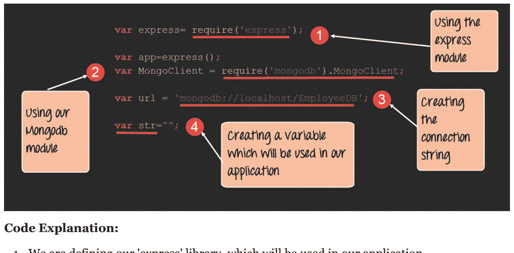

### 代码解释：

+   1. 我们正在定义 'express' 库，该库将在我们的应用程序中使用。
2. 我们正在定义 'express' 库，该库将在我们的应用程序中用于连接 MongoDB 数据库。
3. 这里我们正在定义要连接的数据库的 URL。
4. 最后，我们正在定义一个字符串，该字符串将用于存储我们需要稍后在浏览器中显示的 employee id 集合。

**步骤 2)** 在此步骤中，我们现在要获取 'Employee' 集合中的所有记录并相应地进行处理。

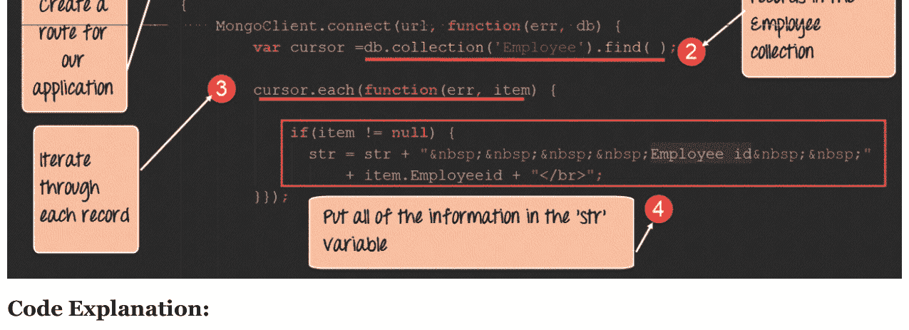

### 代码解释：


1.  我们正在为应用程序创建一个名为 'Employeeid' 的路由。因此，每当有人浏览到应用程序的 **http://localhost:3000/Employeeid** 时，为该路由定义的代码片段将被执行。
2.  这里我们通过 `db.collection('Employee').find()` 命令获取 'Employee' 集合中的所有记录。然后我们将这个集合赋值给一个名为 `cursor` 的变量。使用这个 `cursor` 变量，我们将能够浏览集合中的所有记录。
3.  我们现在使用 `cursor.each()` 函数来遍历集合中的所有记录。对于每条记录，我们将定义一个代码片段，说明在访问每条记录时要做什么。
4.  最后，我们看到如果返回的记录不为空，那么我们通过命令 "item.Employeeid" 获取员工信息。其余的代码只是为了构建一个合适的HTML代码，以便我们的结果能在浏览器中正确显示。

**步骤 3)** 在这一步中，我们将把输出发送到网页，并让我们的应用程序监听特定的端口。

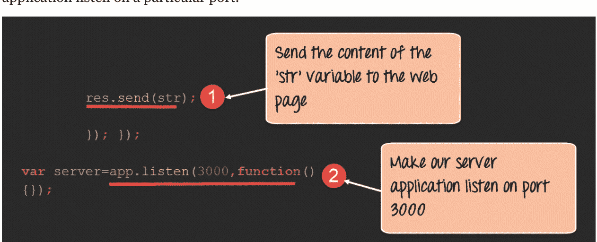

### 代码解释：

1.  这里我们将上一步构建的整个内容发送到我们的网页。参数 `res` 允许我们将内容作为响应发送到网页。
2.  我们让整个Node.js应用程序监听端口3000。

### 输出：

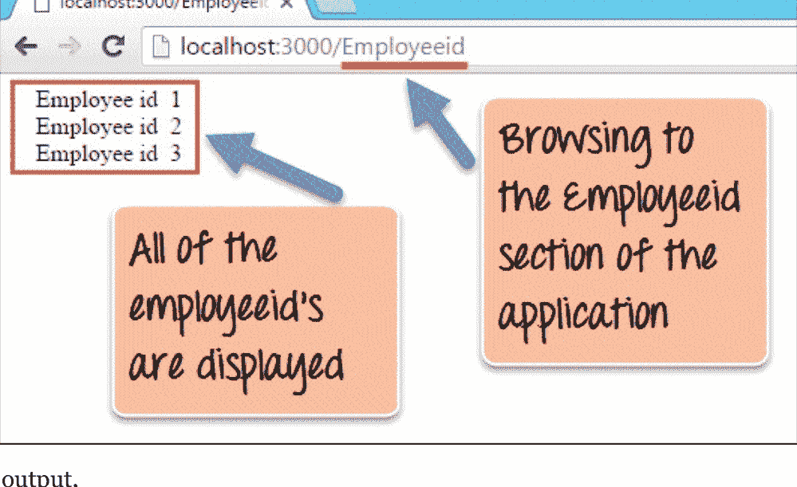

从输出中可以清楚地看到，员工集合中的所有 `employeeid` 都被检索出来了。这是因为我们使用MongoDB驱动程序连接到数据库并检索所有Employee记录，然后使用"express"来显示这些记录。

以下是供参考的代码：

```javascript
var express = require('express');
var app = express();
var MongoClient = require('mongodb').MongoClient;
var url = 'mongodb://localhost/EmployeeDB';
var str = "";

app.route('/Employeeid').get(function(req, res)

	{
		MongoClient.connect(url, function(err, db) {
			var cursor = db.collection('Employee').find();
			//noinspection JSUnresolvedSymbols
			cursor.each(function(err, item) {

				if (item != null) {
					str = str + "  Employee id  " + item.Employeeid + "";
				}
			});
			res.send(str);
			db.close();
		});
	});

var server = app.listen(3000, function() {});
```

**注意：** `cursor.each` 可能基于你的MongoDB驱动程序版本而被弃用。你可以在 `cursor.each` 之前添加 `//noinspection JSDeprecatedSymbols` 来规避此问题。或者，你可以使用 `forEach`。下面是使用 `forEach` 的示例代码：

```javascript
var express = require('express');
var app = express();
var MongoClient = require('mongodb').MongoClient;
var url = 'mongodb://localhost/EmployeeDB';
var str = "";

app.route('/Employeeid').get(function(req, res) {
    MongoClient.connect(url, function(err, db) {
        var collection = db.collection('Employee');
        var cursor = collection.find({});
        str = "";
        cursor.forEach(function(item) {
                if (item != null) {
                    str = str + "     Employee id   " + item.Employeeid + "";
                }
            }, function(err) {
                res.send(str);
                db.close();
            }
        );
    });
});
var server = app.listen(8080, function() {});
```

### 总结

Node.js与NoSQL数据库结合使用，构建了许多现代Web应用程序。一些常用的数据库是MySQL和MongoDB。

-   用于处理MongoDB数据库的常用模块之一是名为 'MongoDB' 的模块。该模块通过Node包管理器安装。
-   使用MongoDB模块，可以查询集合中的记录，并执行正常的更新、删除和插入操作。
-   最后，现代实践之一是使用Express框架与MongoDB一起交付现代应用程序。Express框架可以利用MongoDB驱动程序返回的数据，并在网页中相应地向用户显示数据。

# 第7章：Promise、Generator、事件和文件流

在之前的教程中，你可能见过用于异步事件的回调函数。但有时回调函数可能成为噩梦，因为它们开始嵌套，程序变得冗长而复杂。

在这种情况下，Node.js提供了额外的功能来解决使用回调时遇到的问题。这些功能被分类为Promise、Generator和事件。在本教程中，我们将进一步学习和了解这些概念。

## 什么是Promise

在开始学习Promise之前，让我们先回顾一下Node.js中的"回调"函数。我们在前面的章节中已经见过很多次这些回调函数了，所以让我们快速回顾一个例子。

下面的代码片段示例用于连接到MongoDB数据库并对数据库中的一条记录执行更新操作。

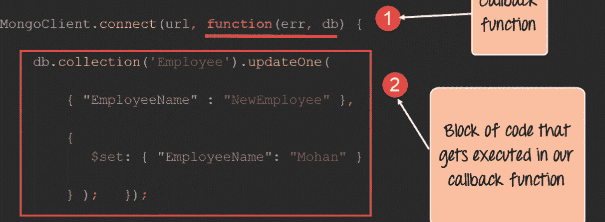

1.  在上面的代码中，函数 `(err,db)` 的部分被称为匿名函数或回调函数的声明。当MongoClient创建与MongoDB数据库的连接时，它将在连接操作完成后返回到回调函数。所以从某种意义上说，连接操作在后台发生，当它完成时，它会调用我们的回调函数。记住这是Node.js的关键点之一，允许多个操作并发发生，从而不会阻塞用户执行任何操作。
2.  第二个代码块是在回调函数实际被调用时执行的部分。回调函数只是更新MongoDB数据库中的一条记录。

那么什么是Promise呢？嗯，Promise只是对Node.js中回调函数的增强。在开发生命周期中，可能需要将多个回调函数嵌套在一起。这在某些时候会变得混乱且难以维护。简而言之，Promise是对回调的增强，旨在缓解这些问题。

Promise的基本语法如下：

```javascript
var promise = doSomethingAync()
promise.then(onFulfilled, onRejected)
```

-   `doSomethingAync` 是任何进行某种处理的回调或异步函数。
-   这次，在定义回调时，有一个返回值被称为 "promise"。
-   当返回一个promise时，它可能有2个输出。这由 `then` 子句定义。操作可能成功，由参数 `onFulfilled` 表示。或者它可能出错，由参数 `onRejected` 表示。

**注意：** 所以Promise的关键方面是返回值。在Node.js中处理普通回调时，没有返回值的概念。因为有了返回值，我们可以更好地控制如何定义回调函数。

在下一个主题中，我们将看到一个Promise的示例，以及它们如何从回调中受益。

## 从回调到Promise

现在让我们看一个如何在Node.js应用程序中使用"Promise"的例子。为了在Node.js应用程序中使用Promise，必须首先下载并安装 'promise' 模块。

我们将修改代码如下，该代码使用Promise来更新'Employee'集合中的一个Employeename。

### 步骤 1) 安装NPM模块

要从Node JS应用程序中使用Promise，需要promise模块。要安装promise模块，请运行以下命令：

```
npm install promise
```

### 步骤 2) 修改代码以包含Promise

```javascript
var Promise = require('promise');
var MongoClient = require('mongodb').MongoClient;
var url = 'mongodb://localhost/EmployeeDB';

MongoClient.connect(url)
    .then(function(err, db) {
        db.collection('Employee').updateOne({
            "EmployeeName": "Martin"
        }, {
            $set: {
                "EmployeeName": "Mohan"
            }
        });
    });
```

### 代码解释：

1.  第一部分是包含 'promise' 模块，这将允许我们在代码中使用promise功能。
2.  我们现在可以将 `then` 函数附加到 `MongoClient.connect` 函数上。它的作用是当与数据库的连接建立后，我们需要执行此后定义的代码片段。
3.  最后，我们定义了执行更新员工姓名工作的代码片段，将名为 "Martin" 的员工的EmployeeName更新为 "Mohan"。


## 注意：

现在检查 MongoDB 数据库的内容，如果存在员工名为 "Martin" 的记录，它将被更新为 "Mohan"。

要检查数据是否已正确插入数据库，你需要在 MongoDB 中执行以下命令：

1.  使用 EmployeeDB
2.  `db.Employee.find({EmployeeName: "Mohan"})`

第一条语句确保你连接到 EmployeeDB 数据库。第二条语句搜索员工名为 "Mohan" 的记录。

## 处理嵌套的 Promise

在定义 Promise 时，需要注意的是 `then` 方法本身会返回一个 Promise。因此，在某种意义上，Promise 可以彼此嵌套或链接。

在下面的例子中，我们使用链式调用来定义 2 个回调函数，它们都将一条记录插入 MongoDB 数据库。

**(注意：** 链式调用是一种将方法执行相互关联的概念。假设你的应用有 2 个名为 'methodA' 和 'methodB' 的方法，并且逻辑要求在 'methodA' 执行之后再调用 'methodB'，那么你会以某种方式链式调用，使得 'methodB' 在 'methodA' 之后直接被调用。**)**

这个例子中需要注意的关键点是，通过使用嵌套的 Promise，代码变得更简洁、可读且易于维护。

```
var Promise = require('promise');
var MongoClient = require('mongodb').MongoClient;
var url = 'mongodb://localhost/EmployeeDB';
MongoClient.connect(url)

.then(function(db) {
    db.collection('Employee').insertOne({
        Employeeid: 4,
        EmployeeName: "NewEmployee"
    })

    .then(function(db1) {
        db1.collection('Employee').insertOne({
            Employeeid: 5,
            EmployeeName: "NewEmployee1"
        })
    })
});
```

### 代码解释：

1.  我们现在定义了 2 个 `then` 子句，它们将依次执行。在第一个 `then` 子句中，我们传递了包含数据库连接的 'db' 参数。然后我们使用 'db' 连接的 `collection` 属性将记录插入 'Employee' 集合。`insertOne` 方法用于将实际的文档插入 Employee 集合。
2.  接着我们使用第二个 `then` 子句将另一条记录插入数据库。

现在检查 MongoDB 数据库的内容，你会找到已插入的 2 条记录。

## 使用 BlueBird 库生成 Promise

Bluebird 是一个功能齐全的 JavaScript Promise 库。Bluebird 最强大的功能是它允许你将其他 Node 模块 "Promise 化"，以便异步使用它们。Promise 化是应用于回调函数的概念。这个概念用于确保每个被调用的回调函数都返回某种值。

因此，如果一个 Node JS 模块包含一个不返回值的回调函数，如果我们将其 Promise 化，该特定 Node 模块中的所有函数都将被自动修改，以确保返回值。

所以你可以使用 BlueBird 让 MongoDB 模块异步运行。这为编写 Node.js 应用程序又增加了一层便利。

我们将看一个如何使用 bluebird 模块的例子。

我们的示例将首先建立与 "EmployeeDB" 数据库中 "Employee 集合" 的连接。如果连接建立成功，它将获取集合中的所有记录并相应地在控制台中显示。

### 步骤 1) 安装 NPM 模块
要在 Node 应用程序中使用 Bluebird，需要 Bluebird 模块。要安装 Bluebird 模块，请运行以下命令

```
npm install bluebird
```

### 步骤 2)
下一步是在你的代码中包含 bluebird 模块，并将整个 MongoDB 模块 Promise 化。Promise 化的意思是 bluebird 将确保 MongoDB 库中定义的每个方法都返回一个 Promise。

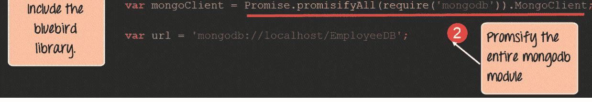

### 代码解释：

1.  `require` 命令用于引入 Bluebird 库。
2.  使用 Bluebird 的 `.promisifyAll()` 方法为 MongoDB 模块提供的每个方法创建异步版本。这确保了 MongoDB 模块的每个方法都将在后台运行，并确保为 MongoDB 库中的每次方法调用都返回一个 Promise。

### 步骤 3)
最后一步是连接到我们的数据库，检索集合中的所有记录，并在控制台日志中显示它们。

```
mongoClient.connectAsync('mongodb://localhost/EmployeeDB')
  .then(function(db) {
    return db.collection('Employee').findAsync({})
  })
  .then(function(cursor) {
    cursor.each(function(err, doc) {
      console.log(doc);
    })
  });
```

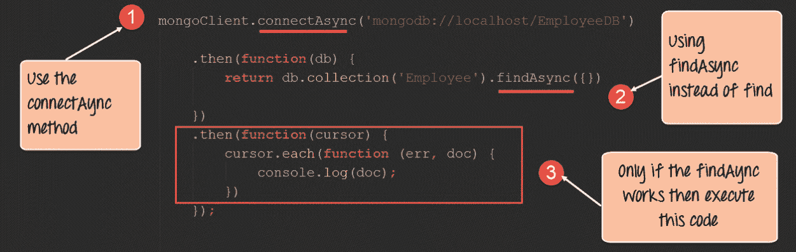

### 代码解释：

1.  你会注意到我们使用 `connectAsync` 方法而不是普通的连接方法来连接数据库。Bluebird 实际上在 MongoDB 库的每个方法后添加了 Async 关键字，以区分那些返回 Promise 的调用和那些不返回的调用。因此，没有保证不带 Async 关键字的方法会返回值。
2.  类似于 `connectAsync` 方法，我们现在使用 `findAsync` 方法来返回 mongoDB 'Employee' 集合中的所有记录。
3.  最后，如果 `findAsync` 返回一个成功的 Promise，然后我们定义一个代码块来遍历集合中的每条记录并在控制台日志中显示它们。

如果上述步骤执行正确，Employee 集合中的所有文档将显示在控制台中，如下所示。

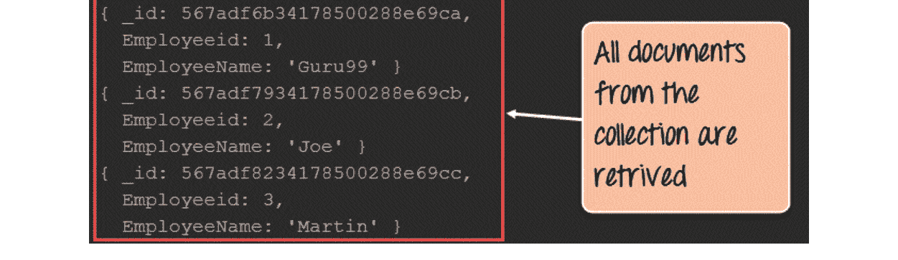

以下是供参考的代码

```
var Promise = require('bluebird');

var mongoClient = Promise.promisifyAll(require('mongodb')).MongoClient;

var url = 'mongodb://localhost/EmployeeDB';
mongoClient.connectAsync('mongodb://localhost/EmployeeDB')

.then(function(db) {
    return db.collection('Employee').findAsync({})

})
.then(function(cursor) {
    cursor.each(function(err, doc) {
        console.log(doc);
    })
});
```

## 创建自定义 Promise

可以使用名为 'q' 的 Node 模块创建自定义 Promise。'q' 库需要使用 node 包管理器下载和安装。使用 'q' 库后，可以调用 `denodeify` 方法，该方法会使任何函数变成返回 Promise 的函数。

在下面的例子中，我们将创建一个名为 "Add" 的简单函数，用于将两个数字相加。我们将把这个函数转换成一个返回 Promise 的函数。

完成后，我们将使用 Add 函数返回的 Promise 在 console.log 中显示消息。

让我们按照以下步骤创建返回 Promise 的自定义函数。

### 步骤 1) 安装 NPM 模块

要在 Node JS 应用程序中使用 'q'，需要 'q' 模块。要安装 'q' 模块，请运行以下命令

```
npm install q
```

### 步骤 2) 定义以下代码，用于创建自定义 Promise。

```
var Q = require('q');

function Add() {
    var a, b, c;
    a = 5; b = 6;
    c = a + b;
}

var Display_promise = Q.denodeify(Add);

var promise = Add;

promise.then
{console.log("Addition function complete");}
```

### 代码解释：

1.  第一部分是使用 require 关键字包含 'q' 库。使用这个库，我们将能够定义任何函数返回一个回调。
2.  我们创建了一个名为 Add 的函数，它将把变量 a 和 b 中定义的两个数字相加。这些值的和将存储在变量 c 中。
3.  然后我们使用 q 库来 denodeify（用于将任何函数转换为返回 Promise 的函数的方法）我们的 Add 函数，或者换句话说，将我们的 Add 函数转换为返回 Promise 的函数。
4.  我们现在调用 "Add" 函数，并由于之前执行的 denodeify Add 函数的操作，能够获得一个返回的 Promise 值。
5.  `then` 关键字用于指定如果函数执行成功，则在 console.log 中显示字符串 "Addition function completed"。

运行上述代码后，输出 "Addition function completed" 将显示在 console.log 中，如下所示。

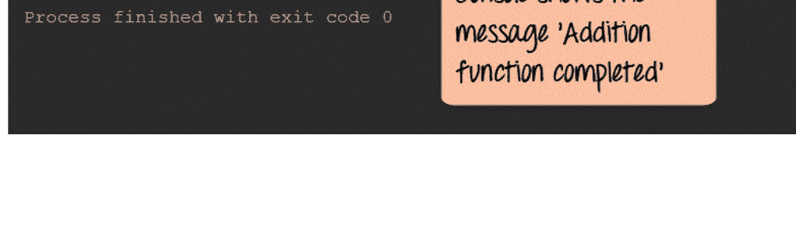


## 什么是生成器

生成器（Generators）近年来在 Node.js 中变得相当流行，这可能是因为它们能够做的事情。

- 生成器是可以在稍后时间点被暂停和恢复的函数执行。
- 生成器在执行诸如“惰性执行”等概念时非常有用。这基本上意味着，通过按需暂停和恢复执行，我们能够仅在需要时才拉取值。

生成器有以下 2 个关键方法

1. Yield 方法 – 在函数中调用 yield 方法，会在调用该方法的特定行暂停函数的执行。
2. Next 方法 – 此方法从主应用程序中调用，以恢复包含 yield 方法的函数的执行。函数的执行将继续，直到下一个 yield 方法或方法结束。

让我们看一个如何使用生成器的示例。

在我们的示例中，我们将有一个简单的 Add 函数，用于将两个数字相加，但我们会不断在不同点暂停方法执行，以展示如何使用生成器。

```
function* Add(x) {
    yield x + 1;
    var y = yield(null);
    y = 6
    return x + y;
}

var gen = Add(5);

gen.next();

gen.next();
```

### 代码解释：

1. 第一步是定义我们的生成器“函数”。请注意，这是通过在函数关键字前添加一个“*”来完成的。然后我们定义了一个名为 Add 的函数，它接受一个参数 x。
2. yield 关键字是生成器特有的。这使其成为一个强大的构造，可以在任何时刻暂停函数。因此在这里，函数执行将被暂停，直到我们调用 next() 函数，这将在步骤 4 中完成。此时，x 的值将变为 6，函数的执行将停止。
3. 这是我们第一次调用生成器函数并将值 5 发送到我们的 Add 函数。此值将被替换到 Add 函数的 x 参数中。
4. 一旦我们调用 next() 函数，Add() 函数将恢复执行。当下一条语句 `var y= yield(null)` 被执行时，Add() 函数将再次停止执行。
5. 现在再次调用 next() 函数后，接下来的语句将运行，并且将相加 x=6 和 y=6 的合并值并返回。

## 回调 vs. 生成器

生成器用于解决所谓的回调地狱问题。有时在开发 Node.js 应用程序时，回调函数会变得如此嵌套，以至于使用回调函数变得过于复杂。

这就是生成器有用的地方。最常见的例子之一是创建定时器函数。

让我们看下面的示例，了解生成器如何比回调更有用。

我们的示例将只创建一个简单的延时函数。然后我们想要调用此函数，分别包含 1000、2000 和 3000 毫秒的延迟。

**步骤 1)** 定义我们的回调函数，包含必要的延时代码。

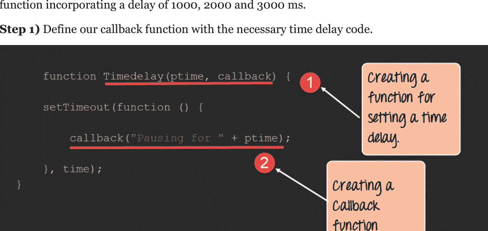

### 代码解释：

1. 这里我们创建了一个名为 Timedelay 的函数，带有一个参数 ptime。它将接收我们希望在应用程序中引入的必要延时。
2. 下一步是创建一条消息，将向用户显示，说明应用程序将暂停这么多毫秒。

**步骤 2)** 现在让我们看看如果我们使用回调的代码。假设我们想基于 1000、2000 和 3000 毫秒的值来使用回调，下面的代码展示了如何使用回调来实现这些。

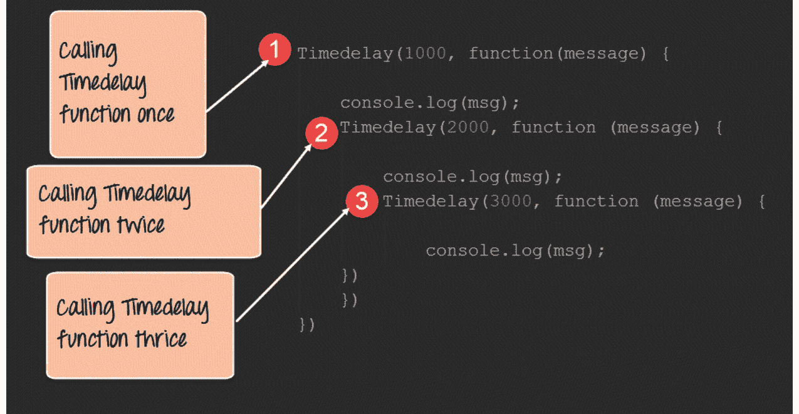

### 代码解释：

1. 我们使用 1000 作为值调用 Timedelay 作为回调。
2. 接下来，我们想再次调用 Timedelay 函数，使用 2000 作为值。
3. 最后，我们想再次调用 Timedelay 函数，使用 3000 作为值。

从上面的代码可以看出，当我们需要多次调用函数时，代码会变得越来越混乱。

**步骤 3)** 现在让我们看看如何使用生成器实现相同的代码。从下面的代码中，你现在可以看到使用生成器实现 Timedelay 函数变得多么简单。

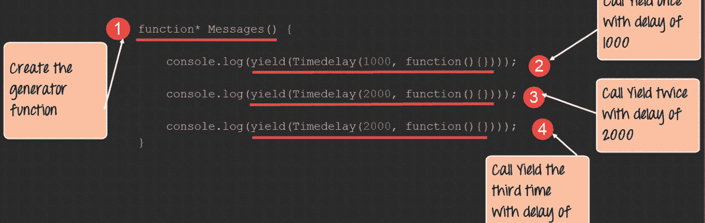

### 代码解释：

1. 我们首先定义了一个生成器函数，该函数将用于调用我们的 Timedelay 函数。
2. 我们调用 Yield 函数，并将 Timedelay 函数与参数值 1000 一起调用。
3. 然后我们调用 Yield 函数，并将 Timedelay 函数与参数值 2000 一起调用。
4. 最后，我们调用 Yield 函数，并将 Timedelay 函数与参数值 3000 一起调用。

## Node.js 中的文件流

Node 大量使用流作为数据传输机制。

例如，当你使用 console.log 函数向控制台输出任何内容时，你实际上是在使用流将数据发送到控制台。

Node.js 还能够从文件中流式传输数据，以便可以适当地读取和写入。我们现在将看一个如何使用流从文件读取和写入的示例。为此示例，我们需要遵循以下步骤

**步骤 1)** 创建一个名为 data.txt 的文件，其中包含以下数据。假设此文件存储在我们本地机器的 D 盘上。

- Node.js 教程
- 介绍
- 事件
- 生成器
- 数据连接
- 使用 Jasmine

**步骤 2)** 编写相关代码，利用流从文件读取数据。

```
var fs = require("fs");
var stream;
stream = fs.createReadStream("D://data.txt");

stream.on("data", function(data) {
    var chunk = data.toString();
    console.log(chunk);
});
```

### 代码解释：

1. 我们首先需要包含 'fs' 模块，该模块包含创建流所需的所有功能。
2. 接下来，我们使用方法 – createReadStream 创建一个可读流。作为输入，我们提供 data.txt 文件的位置。
3. stream.on 函数是一个事件处理程序，在其中我们将第一个参数指定为 'data'。这意味着每当数据从文件流入流中时，就执行一个回调函数。在我们的例子中，我们定义了一个回调函数，它将执行两个基本步骤。第一个是将从文件读取的数据转换为字符串。第二个是将转换后的字符串作为输出发送到控制台。
4. 我们从数据流中获取每个数据块，并将其转换为字符串。
5. 最后，我们将每个转换后的字符串块的输出发送到控制台。

### 输出：

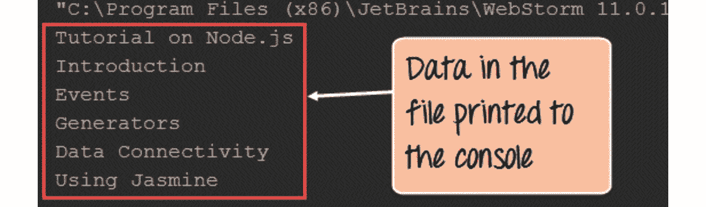

- 如果代码执行正确，你将在控制台上看到上述输出。此输出将与 data.txt 文件中的内容相同。

### 写入文件

以我们创建读取流相同的方式，我们也可以创建写入流来将数据写入文件。让我们首先创建一个名为 data.txt 的空文件，其中没有任何内容。假设此文件放在我们计算机的 D 盘中。

下面的代码展示了如何将数据写入文件。

```
var fs = require("fs");
var stream;
stream = fs.createWriteStream("D://data.txt");

stream.write("Tutorial on Node.js")
stream.write("Introduction")
stream.write("Events")
stream.write("Generators")
stream.write("Data Connectivity")
stream.write("Using Jasmine")
```

### 代码解释：

1. 我们正在使用方法 – createWriteStream 创建一个可写流。作为输入，我们提供 data.txt 文件的位置。
2. 接下来，我们使用 stream.write 方法将不同行的文本写入我们的文本文件。流将负责将这些数据写入 data.txt 文件。

如果你打开 data.txt 文件，你现在将看到文件中的以下数据

Node.js 教程
介绍
事件
生成器
数据连接
使用 Jasmine


## Node.js 中的管道

在 Node 应用程序中，可以使用 `pipe()` 方法将流连接在一起，该方法接受两个参数：

-   一个必需的可写流，作为数据传输的目标。
-   一个可选的对象，用于传入选项。

使用管道的一个典型示例是，如果你想将数据从一个文件传输到另一个文件。那么，让我们来看一个如何使用管道将数据从一个文件传输到另一个文件的示例。

**步骤 1)** 创建一个名为 `datainput.txt` 的文件，其中包含以下数据。假设该文件存储在我们本地机器的 D 盘上。

Node.js 教程

简介

事件

生成器

数据连接

使用 Jasmine

**步骤 2)** 创建一个名为 `dataOutput.txt` 的空白空文件，并将其放在本地机器的 D 盘上。

**步骤 3)** 编写以下代码，以执行从 `datainput.txt` 文件到 `dataOutput.txt` 文件的数据传输。

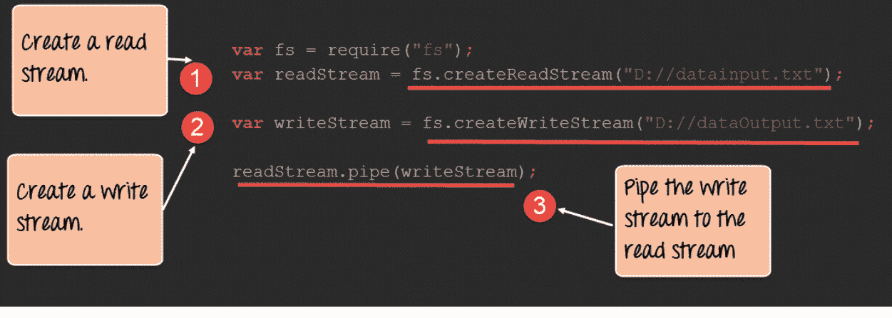

### 代码解释

1.  我们首先为 `datainput.txt` 文件创建一个 "readstream"，该文件包含所有需要传输到新文件的数据。
2.  然后我们需要为 `dataOutput.txt` 文件创建一个 "writestream"，这是我们的空文件，也是从 `datainput.txt` 文件传输数据的目标。
3.  然后我们使用 `pipe` 命令将数据从 readstream 传输到 write stream。`pipe` 命令会获取进入 readstream 的所有数据，并将其推送到 writestream。

如果你现在打开 `dataOutput.txt` 文件，你将看到 `datainput.txt` 文件中存在的所有数据。

## Node.js 中的事件

事件是 Node.js 的关键概念之一，有时 Node.js 被称为事件驱动框架。

基本上，事件是发生的事情。例如，如果与数据库建立了连接，则会触发数据库连接事件。事件驱动编程是创建在特定事件触发时将被触发的函数。让我们看一个在 Node.js 中定义事件的基本示例。

我们将创建一个名为 'data_received' 的事件。当此事件触发时，文本 "data received" 将被发送到控制台。

```
var events = require('events');
var eventEmitter = new events.EventEmitter();
eventEmitter.on('data_received', function() {
    console.log('data received successfully.');
});

eventEmitter.emit('data_received');
```

### 代码解释

1.  使用 `require` 函数引入 'events' 模块。有了这个模块，你将能够在 Node.js 中创建事件。
2.  创建一个新的 events emitter。这用于将事件（在我们的情况下是 "data_received"）绑定到在步骤 3 中定义的回调函数。
3.  我们定义了一个事件驱动函数，它表示如果 "data_received" 事件被触发，那么我们应该将文本 "data_received" 输出到控制台。
4.  最后，我们确实使用 `eventEmitter.emit` 函数手动触发了我们的事件。这将触发 `data_received` 事件。

当程序运行时，文本 "data received" 将被发送到控制台，如下所示。

```
"C:\Program Files (x86)\JetBrains\WebStorm 11.0.1\bin\runnerw.exe" "

data received successfully

Process finished with exit code 0
```

> 控制台显示消息 'data received successfully'

## 触发事件

在定义事件时，事件有不同的方法可以被调用。本主题将重点关注详细查看每一个方法。

1.  **一次性事件处理器**

有时你可能只对事件第一次发生时做出反应感兴趣。在这些情况下，你可以使用 `once()` 方法。

让我们看看如何利用 `once` 方法进行事件处理。

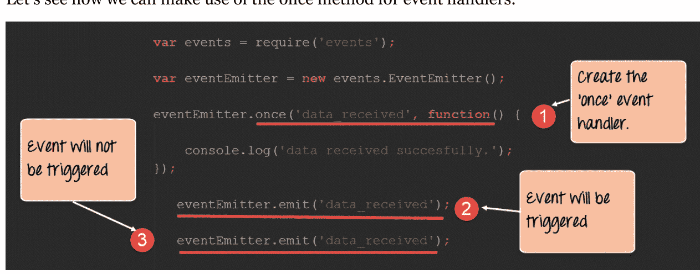

代码解释：

1.  这里我们使用 'once' 方法来表示对于事件 'data_received'，回调函数应该只执行一次。
2.  这里我们手动触发 'data_received' 事件。
3.  当 'data_received' 事件再次触发时，这次不会发生任何事情。这是因为第一步我们说过该事件只能触发一次。

如果代码执行正确，日志中的输出将是 'data received successfully'。此消息在控制台中只会显示一次。

2.  **检查事件监听器**

在其生命周期的任何时候，事件发射器都可以有零个或多个监听器附加到它。每种事件类型的监听器可以通过多种方式进行检查。

如果你只想确定附加的监听器数量，那么只需要查看 `EventEmitter.listenerCount()` 方法。

（注：监听器很重要，因为主程序应该知道监听器是否被动态添加到事件中，否则程序会因为额外的监听器被调用而出现故障。）

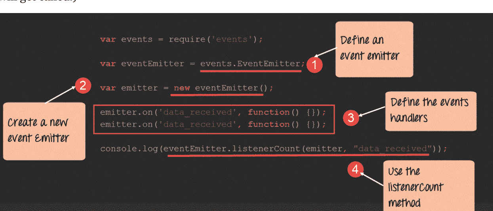

### 代码解释

1.  我们定义了一个 eventEmitter 类型，这是使用事件相关方法所必需的。
2.  然后我们定义一个名为 emitter 的对象，该对象将用于定义我们的事件处理器。
3.  我们创建了 2 个事件处理器，它们基本上什么都不做。为了我们的示例简单起见，只是为了展示 `listenerCount` 方法的工作原理。
4.  现在当你对我们 `data_received` 事件调用 `listenerCount` 方法时，它会将附加到此事件的事件监听器数量发送到控制台日志。

如果代码执行正确，控制台日志中将显示值 2。

3.  **newListener 事件**

每次注册新的事件处理器时，事件发射器都会发出一个 `newListener` 事件。此事件用于检测新的事件处理器。当你需要为每个新的事件处理器分配资源或执行某些操作时，通常使用 `newListener` 事件。

```
var events = require('events');
var eventEmitter = events.EventEmitter;
var emitter = new eventEmitter();
emitter.on("newListener", function(eventName, listener) {
    console.log("Added listener for " + eventName + " events");
});
emitter.on('data_received', function() {});
emitter.on('data_received', function() {});
```

### 代码解释

1.  我们为 'newListener' 事件创建了一个新的事件处理器。因此，每当注册一个新的事件处理器时，控制台将显示文本 "Added listener for" + 事件名称。
2.  这里我们为每个注册的事件将文本 "Added listener for" + 事件名称写入控制台。
3.  我们为事件 'data_received' 定义了 2 个事件处理器。

如果上述代码执行正确，控制台将显示以下文本。它只是表明 'newListener' 事件处理器被触发了两次。

```
Added listener for data_received events

Added listener for data_received events
```

### 总结

在 Node.js 中使用回调函数确实有其缺点。有时在开发过程中，回调函数的嵌套使用会使代码变得混乱且难以维护。

-   大多数嵌套回调函数的问题可以通过在 Node.js 中使用 Promises 和生成器来缓解。
-   Promise 是由异步函数返回的值，用于表示异步函数执行的处理已完成。
-   Promises 可以相互嵌套，当需要同时调用许多异步函数时，这可以使代码看起来更好并更易于维护。
-   生成器也可用于缓解嵌套回调的问题，并有助于消除所谓的回调地狱。生成器用于暂停函数的处理。这是通过在异步函数中使用 'yield' 方法来实现的。
-   流在 Node.js 中用于从输入输出设备读取和写入数据。Node.js 使用 'fs' 库创建可读和可写流到文件。这些流可用于从文件读取和写入数据。


管道可用于将多个流连接在一起。最常见的例子之一是将读取流和写入流管道化，以实现从一个文件到另一个文件的数据传输。

-   Node.js 常被归类为事件驱动框架，在 Node.js 中定义事件非常容易。可以定义函数来响应这些事件。
-   事件也暴露了响应关键事件的方法。例如，我们已经见过 `once()` 事件处理器，它可用于确保在事件触发时回调函数只执行一次。

# 第8章：使用 Jasmine 进行测试

测试是任何应用的关键要素。对于 Node.js，可用的测试框架叫做 Jasmine。在21世纪初，有一个名为 JsUnit 的框架用于测试 JavaScript 应用。后来该框架升级，现在被称为 Jasmine。

Jasmine 有助于自动化单元测试，这已成为开发和部署现代 Web 应用时的关键实践。

在本教程中，你将学习如何设置 Jasmine 环境，以及如何开始使用 Jasmine 测试你的第一个 Node.js 应用。

## 使用 Jasmine 测试 Node.js 应用概览

Jasmine 是一个用于 JavaScript 的 **行为驱动开发 (BDD)** 测试框架。它**不**依赖于浏览器、DOM 或任何 JavaScript 框架。因此，它适用于网站、Node.js 项目或任何可以运行 JavaScript 的地方。要开始使用 Jasmine，你需要首先下载并安装必要的 Jasmine 模块。

接下来，你需要初始化你的环境并检查 Jasmine 配置文件。以下步骤展示了如何在你的环境中设置 Jasmine。

**步骤 1)** 安装 NPM 模块

要在 Node 应用中使用 jasmine 框架，首先需要安装 jasmine 模块。要安装 jasmine-node 模块，请运行以下命令。

```
npm install jasmine-node
```

**步骤 2)** 初始化项目 – 通过这样做，jasmine 会为你创建一个 spec 目录和配置 json。spec 目录用于存储所有测试文件。通过这样做，jasmine 将知道你的所有测试在哪里，然后可以相应地执行它们。JSON 文件用于存储有关 jasmine 的特定配置信息。

要初始化 jasmine 环境，请运行以下命令：

```
jasmine init
```

**步骤 3)** 检查你的配置文件。配置文件将存储在 `spec/support` 文件夹中，名为 `jasmine.json`。此文件列举了你希望 Jasmine 运行器包含的源文件和规范文件。

下面的截图展示了 jasmine 典型的 `package.json` 文件示例。

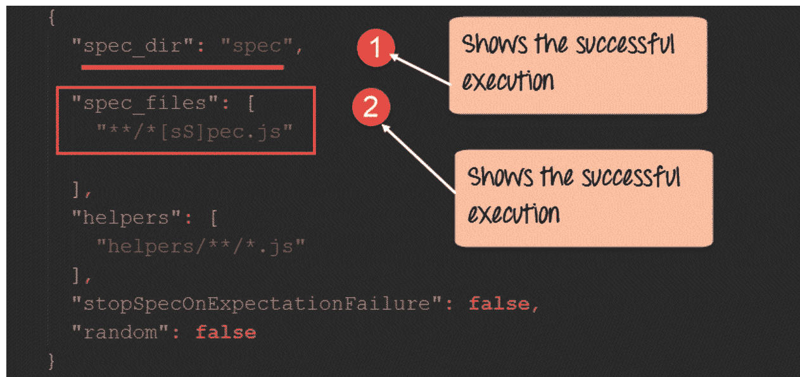

1.  请注意这里指定了 spec 目录。如前所述，当 jasmine 运行时，它会搜索此目录中的所有测试。
2.  下一个要注意的是 `spec_files` 参数 – 这表示无论创建什么测试文件，都应该以 'spec' 关键字结尾。

## 如何使用 Jasmine 测试 Node.js 应用

为了使用 Jasmine 测试 Node.js 应用，需要遵循一系列步骤。

在我们的示例中，我们将定义一个需要测试的模块，该模块将两个数字相加。然后，我们将定义一个包含测试代码的单独代码文件，并使用 jasmine 相应地测试 Add 函数。

步骤 1) 定义需要测试的代码。我们将定义一个函数，该函数将两个数字相加并返回结果。这段代码将写在一个名为 "Add.js" 的文件中。

```
var exports=module.exports={};
exports.AddNumber=function(a,b)
{
  return a+b;
};
```

### 代码解释：

1.  "exports" 关键字用于确保此文件中定义的功能实际上可以被其他文件访问。
2.  然后我们定义一个名为 'AddNumber' 的函数。此函数定义为接受两个参数 a 和 b。该函数被添加到模块 "exports" 中，以使该函数成为可被其他应用模块访问的公共函数。
3.  最后，我们使函数返回参数的相加值。

步骤 2) 接下来，我们需要定义我们的 jasmine 测试代码，该代码将用于测试我们在 Add.js 文件中的 "Add" 函数。以下代码需要放在一个名为 **add-spec.js** 的文件中。

> **注意：** - 单词 'spec' 需要添加到测试文件中，以便 jasmine 能够检测到它。

```
var app=require("../Add.js");
describe("Addition",function(){
  it("The function should add 2 numbers",function() {
    var value=app.AddNumber(5,6);
    expect(value).toBe(11);
  });
});
```

### 代码解释：

1.  我们首先需要包含我们的 Add.js 文件，以便我们可以测试此文件中的 'AddNumber' 函数。
2.  我们现在创建我们的测试模块。测试模块的第一部分是描述一个方法，该方法基本上为我们的测试命名。在本例中，我们的测试名称是 "Addition"。
3.  下一部分是使用 'it' 方法为我们的测试提供描述。
4.  现在我们调用 AddNumber 方法并传入两个参数 5 和 6。这将被传递给 App.js 文件中的 AddNumber 方法。返回值存储在名为 value 的变量中。
5.  最后一步是进行比较或我们的实际测试。由于我们期望 AddNumber 函数返回的值为 11，我们使用方法 `expect(value).toBe(预期值)` 来定义这一点。

### 输出

1.  为了运行测试，需要运行命令 `jasmine`。
2.  下面的截图显示，在运行 jasmine 命令后，它会检测到有一个名为 `add-spec.js` 的测试，并相应地执行该测试。如果测试中有任何错误，将会相应地显示出来。

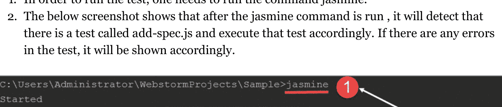

### 总结

-   为了测试 Node.js 应用，首先需要安装 jasmine 框架。这是通过使用 Node 包管理器完成的。
-   测试代码需要写在单独的文件中，并且文件名应附加 'spec' 单词。只有这样做，jasmine 才能检测到需要运行的文件。
-   要运行测试，你需要执行 `jasmine` 命令。这将找到所有附加了 'spec' 单词的文件，并相应地运行该文件。

## 最后一件事....

## 你喜欢这本书吗？

如果喜欢，请在亚马逊上留下评论让我知道！评论是独立作者的生命线。即使你只有时间写几句话和评分，我也会非常感激。


如果你不喜欢这本书，请告诉我！[给我发邮件](mailto:email@example.com) 并告诉我你不喜欢什么！也许我可以改变它。在当今世界，一本书不必是静止的，它可以随着时间和像你这样的读者的反馈而改进。你可以影响这本书，我欢迎你的反馈。帮助让这本书对每个人都更好！

## 更多书籍 -

1天学会 AngularJS：带示例的完整 Angular JS 指南

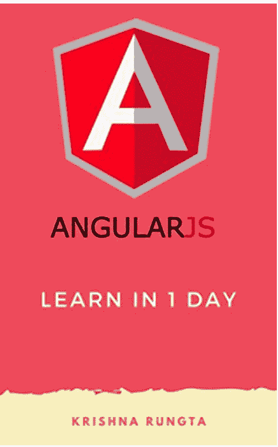

[立即购买](#)

1天学会 MongoDB：精通 Mongo DB 的权威指南


[立即购买](#)

### 1天学会 Java：完整初学者指南


[立即购买](#)

### 1天学会 SQL：初学者学习 SQL 的权威指南


[立即购买](http://example.com)

### 1天学会 PL/SQL：初学者学习 PL/SQL 的权威指南

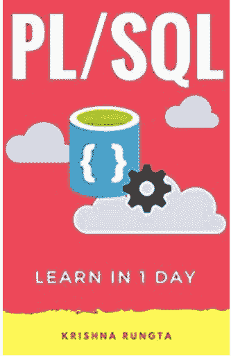

[立即购买](http://example.com)

### 1天学会 Python：带示例的完整 Python 指南


[立即购买](#)

### 1天学会 PHP：学习和掌握 PHP 编程的权威指南

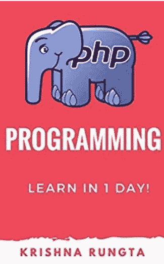

[立即购买](#)

### 1天学会 JSP：初学者学习 JSP 的权威指南


[立即购买](https://www.example.com)

1天学会ASP.Net：初学者学习ASP.Net的权威指南

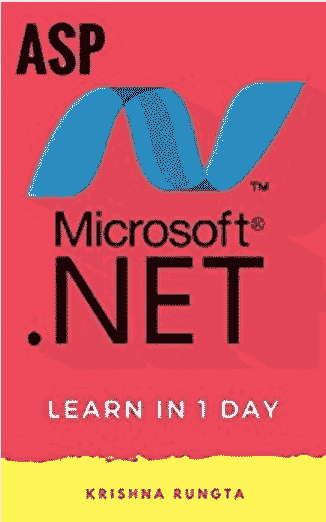

[立即购买](https://www.example.com)

### 1天学会SQLite：初学者学习SQLite的权威指南

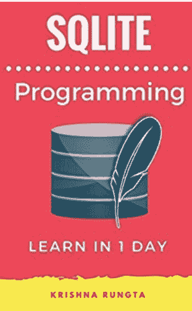

[立即购买](http://example.com)

### 1天学会Linux：带示例的完整Linux指南


[立即购买](http://example.com)
