# Perl 一周速成

此页有意留白。


**出版商：** Stacy L. Hiquet

**营销经理：** Heather Buzzingham

**执行编辑：** Sandy Doell

**组稿编辑：** Todd Jensen

**项目编辑：** Amy Pettinella

**编辑助理：** Margaret Bauer

**技术审校：** Michelle Jones

**文字编辑：** Cathleen Snyder

**内页版式：** Danielle Foster

**封面设计：** Christy Pierce

**索引编制：** Johnna Dinse

**校对：** Jenny Davidson

*本书献给 Small，它的及时膝上小憩，让我在准备放弃之后仍能伏案工作数小时。没有它的干预，我可能永远无法完成这本书。*

此页有意留白。

## 致谢

我感谢许多人对本书的贡献——尤其是 Premier Press 团队，包括 Amy Pettinella、Todd Jensen、Michelle Jones 和 Cathleen Snyder。文本属于他们，也属于我。我还要感谢 Brad Jones 和 Kieron Murphy 提供这个机会、他们有益的建议以及他们的支持。

我要感谢我的家人多年来的爱，以及我的工作同事对我能力和天赋的信心。我的朋友们也值得感谢；我从他们那里学到了许多宝贵的教训，其价值远超我所能回报的。

我特别要感谢我可爱的妻子 Susan，感谢她的毅力、耐心和编辑才能，以及让我成为地球上最快乐的男人。

此页有意留白。

## 关于作者

**托马斯·诺沃斯** 是一名软件工程师和自由撰稿人。他是 INT Media 集团的专栏作家，他的文章发表在许多网站上，包括 Gamelan、Earthweb 和 Developer.com。这是他的第一本书。Thomas 曾在多家软件和技术公司担任各种职务，包括 Northwest Link、Homegrocer、Webvan，以及最近的 Widevine Technologies。Thomas 和他可爱的妻子 Susan 以及他们的四只猫 Sidney、Jasmine、Hailey 和 Small 住在华盛顿州。

此页有意留白。

## 引言

欢迎阅读《一个周末学会 Perl》。Perl 是最广泛和最流行的编程语言之一。它被称为“互联网的胶带”，如果你曾经浏览过 Web，你很可能使用过 Perl。

本书的目标是教你 Perl 编程语言的基础知识。到星期日晚上，你将能够编写完整的 Perl 程序和模块。你还将理解基本的编程概念和构造，如变量、循环、子例程和数组。

同时，你将了解 Perl 编程社区的整体情况。我还将介绍高级编程技术和高级 Perl，并列出超出本书范围的高级主题资源，以便你可以将你的技能提升到新的水平。

### 谁应该阅读这本书？

这本书从最基础开始；我假设你从未做过任何编程。这并不意味着这本书是入门补救课程；编程和 Perl 都是复杂的学科。它仅仅意味着本书会详细解释每一课（有时是极其细致地）。

这些教程假设你有一些计算机经验，并且熟悉 Windows 操作系统。你应该能够自如地处理文件和文件夹，使用浏览器（例如 Internet Explorer，我在所有涉及浏览器的示例中都使用它），以及在计算机的文件系统中导航。如果你对 Windows 系统不熟悉，我建议你购买一本 Premier Press 出版的《一个周末学会 Windows XP》或《Windows XP 快速入门》。

Perl 实际上诞生于 UNIX，但如今大多数非程序员都没有接触过 UNIX 系统，所以我选择以 Windows 为重点来编写本书。

#### 开始前的准备

当你开始学习《*周末学会 Perl*》时，我假设你已具备以下必要条件。

- **一台计算机。** 几乎任何计算机都可以使用；但是，本书中的示例和截图均来自 Windows XP 操作系统。我编写本书时假设你正在使用某个版本的 Windows 平台。

- **互联网访问。** 所有代码片段和示例均可在 Premier Press 的网站上下载。你需要下载并安装一份 ActivePerl 5.6.1，以充分利用本书中的课程内容。

- **文本编辑器。** 本书中的所有示例均假设你正在使用 Windows 操作系统自带的默认文本编辑器——记事本编写脚本。

#### 本书结构

本书设计为可在周末完成学习。周末的七个部分安排如下：

- **周五晚上，“Perl 简介”。** 本节介绍 Perl 并引导你在家用计算机上安装 ActivePerl。它简要介绍了如何在 DOS 环境中运行示例 Perl 程序。然后，你将从头开始创建一个 HTML 页面，该页面使用一个简单的 Perl 脚本来显示文本。

- **周六上午，“变量与其他趣味内容”。** 本节介绍基本构建块，包括变量、标量、数据类型、名称、字符串、一元和二元运算符、内部数据类型以及环境变量。然后，你将学习如何通过将这些构建块组合成列表、数组和哈希来组织它们。

- **周六下午，“文件与 Perl 操作”。** 本节教你如何使用目录操作和文件句柄来操作文件和目录。本节还涵盖基本和常用的 Perl 运算符。

- **周六晚上，“表达式与语句”。** 本节解释与语句和表达式相关的概念，包括 `if` 和 `unless` 程序块以及循本节还探讨了结构化编程背后的理念，并对子程序进行了广泛讲解。

- **周日上午，“对象与面向对象编程”。** 本节涵盖面向对象编程以及 Perl 中类、对象和继承的使用方法。

- **周日下午，“综合运用”。** 本节将前面各课的内容联系起来，并以一个完整的 Perl 游戏程序的形式将各种概念整合在一起。

- **周日晚上，“学习高级 Perl 技巧”。** 最后一节简要介绍几个高级 Perl 主题，包括模块与包、程序调试、安全性、XML 集成以及在 CGI 中使用 Perl。

#### 本书特色

本书采用了一些印刷惯例以便于阅读。“注意” 提供了通常有趣或有帮助的附加信息，但这些信息对于完成特定课程或教程并非必需。

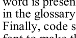

> “警告” 包含关于你可能遇到的常见错误和问题的信息。

当引入一个重要的新术语或新词汇时，该词会以 *斜体* 呈现。为了方便起见，所有这些斜体术语也定义在词汇表中。

最后，代码示例和命令以等宽字体呈现，以使其突出显示。

这是一个单行代码示例。

这是一个句子中的代码命令示例。

这是一个多行代码示例。

#### 关于配套网站

所有源代码均可在 Premier Press 的网站上下载。有关网站的详细信息以及何处查找代码示例，请参见附录 A “使用配套网站”。

## 周五晚上

### Perl 简介

- 什么是 Perl？

- 编程简介

- 在你的计算机上安装 ActivePerl

- 使用 DOS 运行 Perl

- 用 HTML 编写 Perl 程序

- 模块一：程序规划

第 2 页

*此页有意留白。*

#### 第 3 页

谢天谢地，终于周五了！今晚你将迈入 Perl 世界的第一步，我们将深入解释这门通用且流行的语言。你将编写并运行你的第一个 Perl 程序，同时还将深入探讨 DOS（*磁盘操作系统*）和 HTML（*超文本标记语言*）的基础知识。

如果你熟悉 DOS 和 HTML，并且已经成功地在你的工作站上安装了 Perl，你或许可以直接跳到后面的章节。不过，继续阅读下去，可以让你感受到 Perl 和 Perl 编程的基础。

#### 什么是 Perl？

Perl（*实用提取和报告语言*）最常用于创建交互式网页。如果你使用过交互式表单或网页留言板，或者在线阅读过公告板，那么很可能你就使用过 Perl。Perl 最初被构建为一种简单的语言，用于扫描文本文件、从这些文件中提取信息，并根据这些信息打印报告（因此名称中有了“*实用*”、“*提取*”和“*报告*”这些术语）。

Perl 是一种完整的编程语言（就像 Java 和 C++ 一样）。Perl 常与 C++ 等语言归为一类，因为它是面向对象的（我将在周日上午的部分介绍），并且可以使用常见的补充库进行扩展。由于 Perl 也易于学习且在 Web 上常见，你可能会看到它与 JavaScript 和 HTML 等语言相关联。

那么，是什么让 Perl 成为今天这样广泛使用且受欢迎的语言呢？主要原因可能是其名称中的“*P*”（*Practical*，实用）。Perl 被设计为易于使用。与其让语言变得优雅、精简、跨平台或健壮，Perl 的主要架构师们决定让它“*宽泛*”，这意味着它提供了许多不同的方法来解决问题或编写程序。例如，在本章中，你将使用 Perl 编写两个入门脚本。第一个脚本设计为作为网页的一部分运行。第二个脚本在记事本中编写，并在 Microsoft DOS 上运行。这种多功能性和使用不同方法的能力是 Perl 语言和平台的主要卖点之一。

由于其多功能性，Perl 吸引了那些希望快速、轻松且以自己的方式完成任务的程序员。Perl 通常用于集成不同的互联网技术并操作包含大量文本条目的数据库。Perl 程序员曾（开玩笑地）吹嘘说，所有程序都可以转换为一行 Perl 代码。

由于其设计初衷是处理文本，当与网页的基本构建块 HTML 结合时，Perl 是一种极佳的语言。Perl 经常用作基于 HTML 的网页和 Web 服务器数据库之间的网关。它也是构建计算机系统管理工具的优秀工具。然而，Perl 最初并非为基于 Web 的语言；它是在从简单工具演变为成熟的编程语言的过程中，逐渐承担了这个角色。Perl 是最早在互联网上免费分发的计算机语言之一，正是由于这种分发方式，许多不同的人做出了贡献，将 Perl 发展成为今天这种复杂而广泛的语言。

尽管 Perl 最适合扫描文本，但它也能很好的处理其他类型的数据。Perl 具有与编程语言 C 相似的语言语法，这使得学习过 C 或类似结构化语言的程序员能够快速学会使用 Perl。C 程序员经常使用 Perl 来构建 Web 应用程序，因为它比 C 更容易编程。一些 Perl 支持者还声称 Perl 比 C 更安全。

Perl 可在多种平台上运行，并且与 Windows、UNIX 和 Macintosh 兼容。这种平台独立性使得 Perl 成为一种流行的脚本语言；你几乎可以在地球上的任何服务器或平台上找到运行着的 Perl。

Perl 可能最常被 Web 系统管理员使用，他们用它来开发表单和其他交互式 Web 工具。然而，Perl 已经超越了 Web 领域，线上和线下都存在着极其庞大的 Perl 社区。系统管理员、程序员、学生、计算机爱好者、教师和教授都使用 Perl。很快，你也会……

#### Perl 的不同版本

Perl 有多种形式和规格。它被设计为可在从 Solaris 到 Windows 再到 Novell 的各种平台上运行。每个平台通常都有几种不同类型的 Perl。例如，LMOLNAR、Dosperl 和 Dosperlp 都是运行在 DOS 上的不同 Perl 版本。这些不同版本的 Perl 被称为 *发行版*，它们之间有着细微但显著的差异。本书将指导你使用的 Perl 发行版是 ActivePerl 5.6.1。

ActivePerl 可能是所有 Windows Perl 发行版中最为普遍的一种，这也是我选择在本书中使用它的原因。由于任何人都可以创建自己的 Perl 版本，因此还存在许多其他选择。如果你想使用不同的 Perl 版本，我在"学习高级 Perl 技术"的周日晚间课程中概述了一些资源（特别是 www.cpan.org），你可以在那里下载不同的 Perl 发行版。

#### Perl 的简史

Perl 由 Larry Wall 于 1987 年创建，当时他正在为美国国家安全局（National Security Agency）参与一个名为 *Blacker* 的项目。Perl 试图将计算机编程与常识结合起来。针对常识优化编程语言意味着，要让该语言的常见应用变得易于且快速地实现。即使在今天，经过在线社区的协作、修改和重新定义之后，Perl 仍然拥有数十种快捷方式，以及用不同方式完成常见编程任务的多种途径，你将在后续章节中看到许多这样的快捷方式在实际中的应用。

Perl 借鉴了当时几种流行语言的概念，包括 C、UNIX、Shell、SED 和 AWK。Larry 在 1987 年底将 Perl 作为开源软件发布到 comp.sources.misc 新闻组之前，它在内部已经使用了将近一整年。Larry 曾将 Perl 历史上的这九个月称为其"孕育期"。1989 年，Perl 在 GNU 公共许可证下再次发布——这是一种开源、免费的软件分发模式。适用于 Macintosh 的 Perl 版本在 1990 年代初推出。那时，Perl 已经足够流行，以至于关于如何在 UNIX 环境中使用 Perl 编程的书籍开始出现在美国各地的书架上。到 1990 年代末，Perl 无处不在，从行业期刊到会议，再到系列丛书。2000 年，人们研究了这门语言的起源，以便将 *Perl* 这个词收入下一版《牛津英语词典》。

#### 编程初探

许多人认为编程是一个美化且复杂的过程，只有受过高度教育和技术培训的人才能在不损坏硬盘驱动器和操作系统的情况下完成。通常，程序员会传播这种观点，而技术书籍（尤其是 Perl 书籍）也有助于推广它，通常是假设读者已经具备先前的技术、UNIX 或编程经验。事实上，编程相当简单。它所涉及的只是用一种不同的语言写几行代码——一种计算机能够理解的语言。

任何在计算机上运行的东西都是某种程序。一个 *程序* 是由你的计算机执行的一系列指令。遗憾的是，计算机不理解英语（至少目前还不行）。相反，它们使用二进制语言，一种仅由 1 和 0 组成的语言。因为计算机使用二进制语言，而人类不是，你需要某种翻译器或中间件将人类语言转换成计算机能够理解的指令。像 Perl 这样的编程语言，通过充当人类交流（或语言）与计算机二进制语言之间的中间件来发挥翻译器的功能。这将在后续章节"深入解析 Perl 编译过程的工作原理"中进行更深入的探讨。

程序和脚本之间没有太大区别。通常，程序指的是一个已完成的代码片段，而脚本则是一系列代码行，不一定是一个完整的程序，但可能是。

就本书而言，一个 Perl 脚本将是一系列包含 Perl 指令的代码行，并保存为 Microsoft 记事本中的文本文档。在记事本中保存代码是一个相当简单的过程，如下步骤所示，并在图 1.1 中展示。

1.  找到并打开记事本。它通常位于"程序"菜单的"附件"子菜单中，你可以通过单击"开始"按钮来访问。

2.  输入代码。

3.  选择"文件"，"保存"以保存代码。

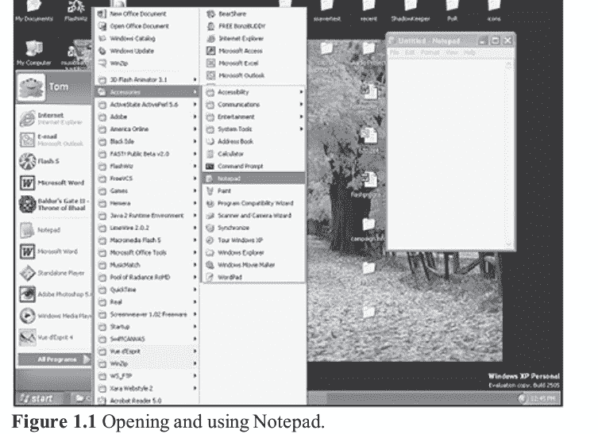

#### 深入解析 Perl 编译过程的工作原理

Perl 是一种 *编译型* 语言，这意味着 Perl 程序会将自身编译或翻译成计算机可以运行的东西。编译过程包括用 Perl 编写一系列指令，将这些指令保存为脚本，然后通过 Perl 编译器运行该脚本。Perl 编译器充当翻译器，将 Perl 脚本转换成类似二进化、计算机能够理解的东西，称为 *机器码*。机器码与二进制非常接近，计算机在读取时可以翻译并运行代码。大多数现代编程语言，如 C、C++、Java 和 C#，都以这种方式编译成某种机器码。Perl 也被认为是一种 *解释型* 语言，因为它在程序运行时由计算机解释成机器码。常见的编程语言中解释型的不多；Perl 的前身 AWK 是为数不多的几种之一。

当 Perl 编译器接收程序并将其转换为数据时，该数据被称为 *可执行文件*，然后被提示运行。当 Perl 程序正在编译时，该过程称为 *编译时*。当 Perl 程序运行时，该过程称为 *运行时*。

深入一点，在编译期间，Perl 编译器实际上会多次遍历脚本代码，以确保所有内容在语法上都是合法的。当编译器将脚本代码翻译成机器码时，它会创建几个不同的文件，然后将这些文件 *交织* 在一起，尝试将它们优化成一个可执行程序，使其运行得尽可能快速和高效。

当你启动一个 Perl 脚本或程序时，Perl 会经历两个阶段。首先，Perl 编译器将 Perl 代码翻译成 Perl 解释器可以读取的优化形式。如果你的脚本通过了编译，那么优化后的代码将在运行或执行时（即第二阶段）被读取。在这个第二阶段，你的计算机在 Perl 解释器的帮助下，遵循代码中的操作和指令来运行脚本或程序。

#### 在 UNIX 和 CGI 中使用 Perl

UNIX 是一个常见的操作系统，也是 Perl 最初运行的操作系统。因为 Perl 诞生于 UNIX，所以它可以移植到几乎所有常见的 UNIX 发行版。（大多数 UNIX 操作系统默认安装了 Perl 编译器。）Perl 还可以访问所有常见的 UNIX 系统调用。这可能是大多数 Perl 参考和教程书籍都带有 UNIX 风格的原因，而不像本书。

CGI（*通用网关接口*）是一种 *协议*——换句话说，是一种做事的方法。具体来说，CGI 是 Web 服务器经常用来与它们交互的程序进行通信的协议。CGI 是一个网关，使用户能够在 Web 服务器上执行代码，然后将结果返回给 Web 浏览器。Perl 常与 CGI 一起用于基于 Web 的应用程序。CGI 应用程序也可以用 C、Visual Basic、Java 和许多其他语言编写，只要该语言可以在 Web 服务器上运行。

#### Perl 的信条：TIMTOWTDI

Perl 的信条是"做事的方法不止一种！"（There Is More Than One Way To Do It!）。与大多数编程语言相比，Perl 相当强大。它有许多执行相同或相似功能的函数和表达式。此外，该语言的语法非常灵活，这意味着你可以用多种方式编写特定的程序。用 Perl 编写比用许多其他编程语言编写更容易（尤其是那些使用特定命令和语法、并且需要遵循规则的语言）。

#### 使用开源软件

Perl 被视为开源软件，只要遵循 Perl 艺术许可中规定的规则，就可以进行分发。艺术许可和 GNU 公共许可的详细信息都可以在 Perl 的 readme 文档中找到，更多信息可以在以下网站在线获取：

- ActiveState 的 ActivePerl 许可：http://www.activestate.com/Products/ActivePerl/license_agreement.plex

- ActiveState 发布的 GNU 通用公共许可：http://aspn.activestate.com/ASPN/Legal/GNU_License_Agreement_Text.txt

- ActiveState 发布的 Perl 艺术许可：http://aspn.activestate.com/ASPN/Legal/Artistic_License_Text.txt

- CPAN 关于 Perl 许可的常见问题：http://www.cpan.org/misc/cpan-faq.html#How_is_Perl_licensed

- 开源倡议组织：http://www.opensource.org/licenses/index.html

#### 在你的机器上安装 ActivePerl

Perl 历史上众多贡献者的努力，使得现在它能够在地球上几乎任何计算机上轻松安装和运行。在本节中，我将引导你完成让计算机运行 Perl 的过程。ActivePerl 5.6.1 的副本可在本书的配套网站 http://www.premierpressbooks.com/downloads.asp 上获取。你也可以从 ActiveState 网站或 CPAN（综合 Perl 归档网络）下载 ActivePerl 5.6.1。ActivePerl 是一个免费、开源的 Perl 发行版，适用于 Windows 操作系统。这些位置的网址如下：

- ActiveState：http://www.activestate.com/products/Download/Get.plex?id=ActivePerl

- 综合 Perl 归档网络：http://www.cpan.valueclick.com/src/

- Premier Press 配套网站：http://www.premierpressbooks.com/downloads.asp

Premier Press 本章的下载部分包含一个网页，其中包含来自 ActiveState 和 CPAN 的这些链接（名为 getperl.html）。从这些网站下载 ActivePerl 时，你需要确保

- 你下载的是稳定版本，而不是开发中的版本。Perl 仍在经历变化和修改（在周日晚上的课程中会详细介绍），你需要下载经过充分测试的版本。本书使用 ActivePerl 版本 5.6.1。

- 你下载的是二进制发行版，而不是 Perl 源代码。Perl 的内部工作原理可通过源代码获得，但要运行源代码，你需要一个编译器。二进制发行版是编译形式的 Perl，能够像任何可执行程序一样运行。二进制文件和源文件应该被明确标记。

- 你拥有解压下载内容所需的必要软件。其中一些网站以压缩形式存储 ActivePerl，你可能需要 Winzip（http://www.winzip.com）来解压缩文件并运行它们。

- 你避免下载 tar 归档文件。你在这些网站上找到的以 .tar 或 .gz 结尾的 Perl 文件是为 Unix 类型平台压缩的，如果你下载这些版本的 Perl，很可能会在解压缩时遇到麻烦。

安装 ActivePerl 很简单。只需按照以下说明操作：

1. 在上述任一网站上找到 ActivePerl 5.6.1 链接，单击它以开始下载过程。

2. ActivePerl 下载完成后，双击“安装 ActivePerl”图标以开始安装。将出现 ActivePerl 5.6.1 Build 630 安装向导，如图 1.2 所示。

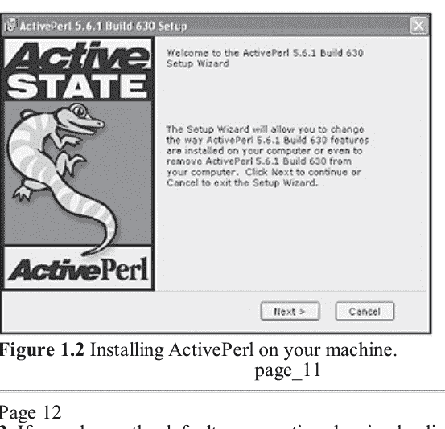

**图 1.2** 在你的机器上安装 ActivePerl。

3. 如果你在安装过程中只需点击“下一步”和“完成”按钮即可选择默认菜单选项，ActivePerl 将安装在你的 C 驱动器上自己的文件夹中，该文件夹方便地命名为 Perl。有关 Windows XP 以外的 Windows 操作系统更具体的安装说明，请参阅侧边栏“疑难解答：ActivePerl Windows 安装”。

Perl 有几个适用于 Windows 的发行版，包括 IndigoPerl、SiePerl 和预构建的 Perl。如果你有兴趣获取不同的 Perl 发行版，http://www.cpan.org 上的综合 Perl 归档网络在线保存了不同发行版的副本。只需访问该网站，查看有哪些可用内容。

ActivePerl 实际上是两个早期且流行的 Windows 版本的 Perl 的合并——一个为 Windows 95/98 构建，一个为 Windows NT 构建。

#### 在 DOS 中使用 Perl

ActivePerl 安装了一个示例程序，因此你可以测试 Perl 是否已正确安装。要运行此程序，你需要使用 Windows DOS 命令行导航到相应的文件夹。

##### 什么是 DOS？

DOS 是一个简单的、基于文本的操作系统，它位于正常 Windows 操作系统的之下或之上。Windows XP 使用 Windows DOS，它使用户能够导航到不同的目录，并更改、删除、移动、重命名和修改文件夹和文件。在这个和其他版本的 DOS 中，几乎你在 Windows 中能做的所有事情也可以通过命令行完成，但没有图形符号来帮助你导航。Perl 诞生于这种类型的操作系统，你将经常需要使用命令行界面来运用你新学的 Perl 技能。早期版本的 Windows 使用一个早期版本的 Windows DOS，称为 MS-DOS 或 Microsoft DOS。

##### 疑难解答：ActivePerl Windows 安装

ActivePerl 设计为在 Win32 平台上运行，具体包括：

- Windows 95

- Windows 98

- Windows Me

- Windows NT

- Windows 2000

- Windows XP

然而，你的操作系统越旧，就越可能需要补丁或支持来安装 ActivePerl 包。对于 Windows Me、2000 和 XP，你应该已经安装了所有必需的组件。ActiveState 建议，如果你运行的是较早的操作系统，应该安装最新版本的 Microsoft Windows Installer。（你可以从 http://download.microsoft.com 下载最新的 Microsoft Windows Installer。在产品列表中查找 Windows Installer。）较新版本的 Internet Explorer 也很有帮助（5.0 或更高版本）。你的平台的其他具体要求如下：

- **Windows NT：** 应安装 Service Pack 5 或更高版本。

- **Windows 98：** 应安装适用于 Windows 98 的 DCOM（可从 http://www.microsoft.com/com/resources/downloads.asp 获取）。

- **Windows 95：** Microsoft 在 2002 年 1 月停止了对 Windows 95 的支持，尽管你可能仍能获得更新或支持。ActiveState 建议寻找 Microsoft 的适用于 Windows 95 的 DCOM 和 Microsoft 的 MSVCRT，它们可能通过 Windows Update 或 Microsoft 的下载站点提供，也可能不提供。

除了这些操作系统更新，你还应该确保有 35MB 的可用硬盘空间用于典型的 ActivePerl 安装。

ActivePerl 5.6.1 包含核心的 Perl Win32 文件，并附带 Perl 包管理器（简称 PPM），你将在周日上午的课程中了解更多关于它的信息。你可以通过 Windows 控制面板卸载 Perl。通过 Windows 开始菜单导航到控制面板，然后打开“添加/删除程序”。这里会显示 ActivePerl，可以像任何其他程序一样将其删除。

##### 访问 Windows DOS 命令行

要访问 Windows 命令行，请单击“开始”菜单，然后单击“运行”。“运行”对话框打开，并包含一个“打开”字段。要访问 Microsoft Windows DOS 命令行，请按照以下步骤操作：

1. 单击“开始”菜单。

2. 单击“运行”。出现“运行”对话框，其中包含“打开”行。

3. 在“打开”提示符后输入 **command**，如图 1.3 所示。如果你使用的是 Windows NT 或 2000，你也可以输入 **CMD**。

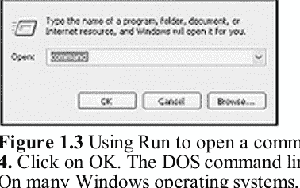

**图 1.3** 使用“运行”打开命令行。

4. 单击“确定”。DOS 命令行界面出现。

在许多 Windows 操作系统中，可以在“开始”按钮菜单的“程序”菜单中找到指向 DOS 提示符的快捷方式。

##### 使用命令行提示符

当你进入 DOS 时，你会看到一个*命令行提示符*，这是你输入命命令的地方。为了方便，Windows DOS 会在命令行提示符的开头告诉你所在的目录。在图 1.4 中，命令行提示符是 C:\DOCUME~1\TOM>。反向读取，这告诉你位于 TOM 文件夹中，该文件夹在 DOCUME~1 文件夹中，而 DOCUME~1 文件夹在 C 驱动器中。DOCUME 后的 ~1 表示文件夹名称“Documents and Settings”是一个

#### 使用 DOS 进行导航

要导航操作系统，你将使用两个简单的 DOS 命令：`CD`（更改目录）和 `DIR`（列出目录）。要查看当前所在的任何文件夹的内容，只需输入 `DIR` 并按回车键。`DIR` 帮助你确定自己在文件结构中的位置。如果我在图 1.5 所示的位置输入 `DIR`，DOS 将列出 `C:\DOCUMENTS AND FOLDERS\TOM` 中所有内容的列表，以及其他杂项信息。

**图 1.5 使用目录（DIR）命令。**

`CD`（更改目录）是另一个重要的命允许你导航到不同的文件夹和目录。要导航到 Perl 文件夹，只需输入：

```
CD \Perl
```

你需要严格按照显示的方式输入，包括 `CD` 命令和反斜杠 (`\`) 之间的空格。当命令提示符显示为 `C:\PERL>` 时，你就知道操作成功了。

当你在此文件夹中时，输入：

```
DIR
```

你会看到 Perl 文件夹包含许多其他文件夹，包括 `bin`、`Docs`、`eg`、`lib`、`site` 等等。

ActivePerl 会自动安装在主驱动器上，即 `C:\` 驱动器，尽管在某些情况下 `C` 可能有所不同。对于 Windows 操作系统，`C` 将是 Perl 安装的默认驱动器。

#### 运行你的第一个 Perl 程序

你需要运行一个位于 `eg` 文件夹中的示例 Perl 文件，因此使用你刚学到的 DOS 命导航到这个文件夹并显示其内容，输入以下行（见图 1.6）。

```
CD \PERL\EG
```

按回车键，然后输入：

```
DIR
```

**图 1.6 `eg` 文件夹的示例内容。**

示例程序名为 `example.pl`。要运行它，只需输入：

```
perl example.pl
```

你应该会收到响应：“Hello from ActivePerl！”

如果你没有收到“Hello from ActivePerl”的响应，有多种故障排除技术可用。首先，确保你按照指示输入了示例，包括使用所有小写字母。其次，确保你在正确的目录中，你的 DOS 提示符应显示为 `C:\PERL\EG>`。另一种可能性是 Perl 在你的机器上安装不正确。不要惊慌。相反，查看 ActivePerl 的文档，该文档现在应该位于 `C:\Perl\Docs`。如果帮助文档未安装，你可以直接访问 ActivePerl 网站 http://aspn.activestate.com/ASPN/Downloads/ActivePerl 获取文档或帮助。

恭喜！你刚刚在自己的机器上运行了你的第一个 Perl 程序！要退出 DOS，只需输入：

```
EXIT
```

这将关闭 DOS 命令提示符并返回到 Windows。

## 休息一下

对于一个周五晚上来说，你已经经历了相当多的事情。在快速浏览 Perl 和体验了 DOS 之后，你已经成功安装了 Perl 并运行了你的第一个 Perl 程序。祝贺自己做得好，稍作休息。当你回来时，你将开始编码并学习一些基本的 HTML。

#### 使用 HTML 编写你的第一个 Perl 程序

既然你知道如何运行 Perl 程序，你就可以从头开始编写一个简单、简短的脚本。然而，这次你将使用 HTML 来构建一个使用 Perl 的示例网页。

##### 什么是 HTML？

HTML 是一种专门用于在 Web 上开发、编码和显示文档的编程语言。在本节中，你将使用 HTML 来编写在浏览器中运行的 Perl 脚本。（ActivePerl 安装了 Perl 的默认客户端版本，允许你在 Internet Explorer 中运行 Perl 脚本。）但是，你为本次练习编写的网页脚本可能无法在 Web 服务器上运行。如果你想将这些页面上传到网站，请确保托管该网站的 Web 服务器使用的是兼容的 Perl 发行版。（你将在周日晚上的“学习高级 Perl 技术”部分了解更多相关信息。）因为这是一本关于 Perl 而非 HTML 的书，我只介绍编写 Perl 脚本所需的 HTML 命令。要全面了解 HTML，请阅读 *Learn HTML In A Weekend*，第 3 版（Premier Press, Inc., 2000）。

##### 创建 HTML 文档

你可以在 Windows 中通过多种方式创建 HTML 文档。例如，在某些版本的 Windows 中，你可以打开一个新的文本文档，输入代码，然后将其另存为 HTML 文件。你也可以购买软件包，如 Dreamweaver、Director、GoLive 和 Xara Webstyle 来帮助你创建 HTML 文档。如果你已经熟悉使用其他程序创建 HTML 文件，请随意使用它来替代以下方法。如果你不熟悉创建 HTML 文件，无论你使用哪个版本的 Windows，以下方法都应该有效。

1. 右键单击你的桌面。会出现一个快捷菜单。

2. 选择“新建”、“文本文档”（见图 1.7）。一个新的空白文本文档被创建。

**图 1.7 创建新的文本文档。**

3. 接下来，你必须将新的文本文档转换为 HTML 文档。单击文件名一次以高亮显示它，并将 `.txt` 扩展名更改为 `.html`。对于此示例，将文件名更改为 `test.html`.

4. Windows 可能会显示一条警告，告诉你通过转换正在更改文件的属性，如图 1.8 所示。点击“是”。你桌面上的图标更改为 Internet Explorer 网页图标。

一些 Windows 操作系统允许你通过右键单击并选择“创建 HTML”来快捷地生成新网页，而不是先按照步骤创建空白文本文档然后再更改为 HTML 文档。在创建这些文件时，请随意使用任何对你来说合理的方法。

**图 1.8 Windows 发出警告，提示你正在更改扩展名。**

##### 修改 HTML 文件

要在默认浏览器中打开新的 `test.html` 文件，请双击桌面上的 `test.html` 图标。不过，此文件视图不允许你更改任何代码。要修改代码，请选择“查看”、“源文件”，如图 1.10 所示。HTML 页面的源代码将在默认的 Windows 文本编辑器（通常是记事本）中打开。当然，目前它将是空白的。

也可以通过右键单击空白网页本身并从出现的菜单中选择“查看源代码”来使用记事本访问源代码。

##### 查找你的 Windows 扩展名

在某些情况下，文件扩展名（例如 `.txt` 或 `.html`）在 Windows 中不可见。这是因为有一个文件夹选项允许你将其关闭和打开。如果在创建新的文本文档时看不到 `.txt` 扩展名，你可能难以将文件重命名为 HTML 文档。

要更改视图设置以便可以看到文件扩展名，请按照以下步骤操作：

1. 双击“我的电脑”图标。“我的电脑”窗口出现。

2. 选择“工具”、“文件夹选项”以打开“文件夹选项”对话框。

3. 单击“查看”选项卡，如图 1.9 所示。“查看”选项卡包含一个用于查看文件扩展名的选项，你可以打开或关闭它。确保选中该复选框以启用文件扩展名的查看。

4. 单击“应用”以将该选项应用于所有文件夹。

**图 1.9 设置你的文件夹选项。**

**图 1.10 修改你的新 HTML 测试文件。**

##### 理解 HTML 标签

HTML 和 Perl 通常相辅相成，在深入学习之前，你需要先学习一点 HTML。HTML 使用 *标签*（`< >`）来表示命令。当 Internet 浏览器打开一个网页时，它会寻找这些标签命令。标签命令通常如下所示：

```
<TAG>命令写在这里</TAG>
```

第一个 `<TAG>` 启动命令。第二个命令包含一个斜杠 (`/`)，表示该命令不再适用。网页需要的第一组标签是 HTML 标签。所有 HTML 命令都必须位于这些 HTML 标签之间，才能被识别为 HTML 代码。只需输入：

```
<HTML> </HTML>
```

现在，任何标准浏览器都知道 `<HTML>` 和 `</HTML>` 标签之间的所有内容都是 HTML 代码，并且这些标签标记了网页的开始和结束。

在某些 Windows 版本中，新创建的空白 HTML 页面将已经插入了 `<HTML>` 和 `</HTML>` 标签。如果这些标签

你已经存在于空白HTML页面中，不需要再次输入它们。

现在你需要向HTML页面添加更多代码，并插入`<HEAD>`和`<BODY>`部分。HTML页面通常分为两个部分，通常包括一个头部部分和一个主体部分。头部部分通常包含浏览器需要的信息，例如页面标识符、页面标题或网页的基本位置。主体部分通常包含网页的文本、图形、声音等。

要插入头部和主体部分，只需在`<HTML>`和`</HTML>`标签之间键入`<HEAD>`、`</HEAD>`、`<BODY>`和`</BODY>`标签。页面的代码现在应该看起来像这样：`<HTML> <HEAD> </HEAD> <BODY> </BODY> </HTML>`

接下来，你需要告诉浏览器你希望使用Perl。为此，在页面主体内输入`<SCRIPT>`标签。在`<BODY>`和`</BODY>`之间键入以下代码：

`<SCRIPT LANGUAGE="PerlScript"> </SCRIPT>`

这告诉浏览器你正在这些标签内使用脚本语言PerlScript。

现在你实际上可以开始编写一些Perl代码了。你将在周六早上的课程中深入了解这些命令的具体细节。同时，只需在两个`<SCRIPT>`标签之间键入以下行：

`$window->document->write('Hello and Welcome to Perl!');`

记事本中的完整HTML脚本应该如图1.11所示：

`<HTML> <HEAD> </HEAD> <BODY> <SCRIPT LANGUAGE="PerlScript"> $window->document->write('Hello and welcome to Perl!'); </SCRIPT> </BODY> </HTML>`

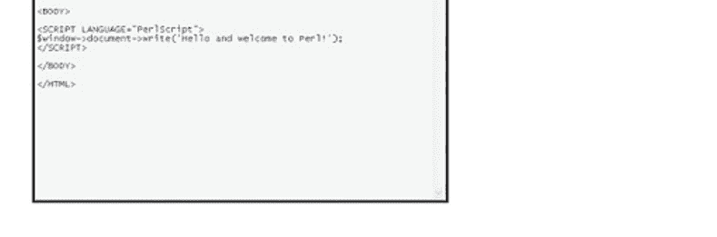

#### 图 1.11 编辑HTML页面

现在你应该按照以下步骤保存文档：

+   1. 单击“文件”，“保存”。

    2. 关闭记事本，然后返回浏览器并单击“刷新”。（或者，你可以通过双击其图标重新打开test.html页面。）

浏览器打开，调用PerlScript，并运行列出的命令。消息"Hello and Welcome to Perl!"会在浏览器窗口中打印出来。

如果你在任何章节中运行此脚本或其他脚本时遇到问题，所有示例文件都包含在配套网站中。但是，如果正确运行，脚本应显示如图1.12所示的网页。

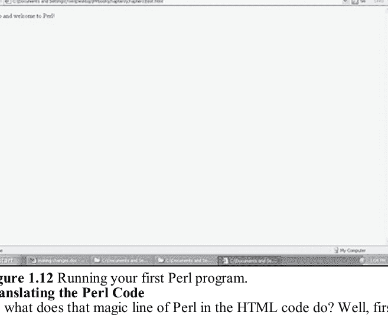

#### 翻译Perl代码

那么，HTML代码中那行神奇的Perl代码是做什么的呢？首先，简单的部分。Perl通常从右向左阅读更容易。这是因为Perl通常从右向左运行命令或进行赋值。一开始反向阅读代码可能感觉违反直觉，但随着时间的推移和习惯Perl阅读和理解脚本的方式，它会变得更自然。

在Perl中，一个语句几乎总是在右侧以分号结束。每个命令末尾使用的分号告诉Perl执行分号之前的任何脚本，然后转到下一行和下一个命令。分号之前是一个*文本字符串*，用括号和单引号分隔，像这样：

`('Hello and welcome to Perl!');`

Perl以许多不同的方式使用单引号。在这种情况下，引号告诉Perl你希望文本字符串按原样打印。括号通常用于保存命令的输入。

这里的括号将需要传递给命令的所有输入与代码行的其余部分分开。相关命令`write`放在文本字符串的左侧。

`write`命令看起来相当直接，大多数情况下确实如此。Perl中的`write`命令专门用于以指定或隐含的格式打印文本，在这个例子中，它用于打印引号中包含的单词。

`->`运算符是一个*箭头运算符*。箭头运算符是Perl用来引用信息或数据的*解引用运算符*。在这种情况下，箭头告诉窗口引用文档，并告诉文档引用`write`命令。Perl通常使用符号作为解引用器。

`$window->document->write`

`$`是Perl中一个重要的常见命令，在Perl中被称为*前缀解引用器*。Perl中的每种数据类型都有自己的解引用器；`$`是用于引用文本字符串或变量的解引用器。在Perl中，这种类型的变量被称为*标量*，即由数值或文本字符串组成的任何数据。基本上，Perl中的所有数据都是标量。几乎所有值要么是文本，要么是数字，而标量用于表示这两者。

因此，每当你在Perl代码中看到`$`时，你就知道附近有Perl需要跟踪的变量或文本字符串。在这种情况下，`$`警告Perl文本字符串`Hello and welcome to Perl!`需要被跟踪。代码的其余部分告诉Perl将该变量放在哪里以及在哪里编写它。没有标量解引用器，Perl会认为`Hello and Welcome to Perl!`是它必须运行的某种命令，编译器在找不到该命令时会抛出错误。有了标量解引用器，Perl就知道`Hello and Welcome to Perl!`是程序员想在程序中某处使用的文本字符串。

## 模块一：程序规划

在整本书中，你将使用Perl来构建实际的程序。大多数章节都包含小的代码片段和简短的脚本，以说明某些Perl特性，但在每章结束时，你将花一些时间将这些片段组合成一个更大程序的构建块。这些构建块在前四章中进行了介绍，因此到周六晚上课程结束时，你将拥有一个功能齐全、完整的Perl电脑游戏。在周日，你将重新审视代码，并使用你将学到的更高级技术进行修改以进行优化。

一些程序员认为，编写程序的大部分工作应在规划和研究阶段进行。其他人则认为重点应该在项目结束时，专注于集成、错误、故障和优化。一些程序员相信只使用特定的编程方法，而其他程序员则根据项目改变方法。

我尽量避免使用任何一种特定的方法。我确实花了一些时间在周六晚上课程中介绍结构化编程，在周日早上课程中介绍面向对象编程。我这样做是因为Perl诞生于结构化编程是主流编程范式的时候，而Perl已经采用了面向对象编程的特性，因为它们越来越受欢迎。这两种方法对于理解Perl的工作原理都很重要。

考虑到这一点，我想让这个电脑游戏的规划保持简单，所以我将首先构建一个基本游戏，并计划以后对其进行扩展。一些程序员喜欢从用户场景或功能列表开始编写程序。为了快速完成一些东西并编写脚本，我将快速列出功能：

-   游戏将被命名为"Trapped"。

-   玩家将使用键盘导航。

-   最初，游戏将是基于文本的。

-   游戏将包括一个迷失的玩家在洞穴地图中导航，试图到达地面。

-   每次游戏的地图将是随机的，以增加可玩性。

根据我的头脑风暴，我可以生成我认为需要的相应编程代码：

-   将信息打印到屏上的代码。

-   从键盘获取信息的代码。

-   控制文本/信息显示时间的代码。

-   生成随机地图的代码。

-   跟踪玩家在地图上进度的代码。

现在，在我失去动力之前，我想开始编程。因为我真正拥有的只是一个编程需求的"待办"列表，所以我将创建一个脚本来概述、分隔和显示我的待办列表。我可以通过在Perl中使用注释标记来做到这一点。

所有现代编程语言都允许程序员在代码中插入注释。注释非常重要，不仅对于需要编写其他人可能需要更改或维护的代码的专业程序员，而且对于需要再次查看代码以了解他们是如何做某事或修改现有程序的个人或独立程序员也是如此。

Perl将井号(`#`)识别为注释标记，Perl编译器将忽略一行中`#`之后的任何文本。这使得添加笔记或想法变得相当容易。要开始创建Trapped程序，打开记事本并编写一些以`#`符号开头的笔记：

```
############################################## 
#Trapped
##############################################
############################################## 
# block1- planning #
What I need: 
# Code that prints information to the screen. 
# Code that takes information from the keyboard. 
# Code that generates a random map 
# Code that tracks the player's progress on the map
```

将此记事本文件保存为`block1.pl`。虽然这段代码目前还做不了什么，但你将在下一章中重新回到它。

## 总结

你的周五晚上课程结束了。虽然你只编写了几行实际的Perl代码，但你现在对理解这门语言有了更好的基础，并且可以在自己的计算机上运行Perl程序。你还接触了CGI、HTML和DOS命令提示符，并且对Perl语言有了更多了解。最重要的是，你编写了你的第一个程序，使用了不止一种，而是两种新的编程语言！

## 周六早上

### 变量和其他有趣的东西

#### 第 33 页

-   使用 `print` 与获取输入

-   使用标量

-   探索列表

-   数组与哈希

-   获取用户输入

#### 第 31 页

早上好，欢迎回到 *一周学会 Perl*。希望你已经备好了咖啡和橙汁，因为你即将踏上一段紧张而充实的探索之旅。如果你曾翻阅或提前浏览过课文，你可能会注意到早晨的章节比晚上的章节篇幅更长。我在早晨的章节中专注于更重要、更复杂的 Perl 基础知识，以便你能尽早攻克难点。今天早上，你将学习 Perl 数据基础，包括标量、打印、数组和哈希。

#### 使用 `print` 与获取输入

今天早上，你将从复习 Perl 的 `print` 函数开始。`print` 是一个极其简单且实用的函数，允许你将内容输出到屏幕。我可能在脚本中使用 `print` 的频率比其他任何命令都高，因此你需要对它非常熟悉。

#### 使用 `print`

在开始编写本章第一个正式的 Perl 程序之前，请创建一个新文件夹来存放你的 Perl 测试脚本。在接下来的章节中，我将带你编写数十个 Perl 脚本，拥有一个本地位置来存储和跟踪这些脚本，将有助于我稍后引用它们时你进行查找。请按照以下步骤，在你现有的 `c:\Perl\eg` 文件夹中为你的 Perl 项目创建一个新文件夹。（如果你熟悉在 Windows 中创建文件夹，可以跳过这一系列步骤。）

#### 第 32 页

1.  右键单击“我的电脑”图标，从快捷菜单中选择“资源管理器”，如图 2.1 所示。（或者，你可以从“开始”菜单中选择“Windows 资源管理器”。）

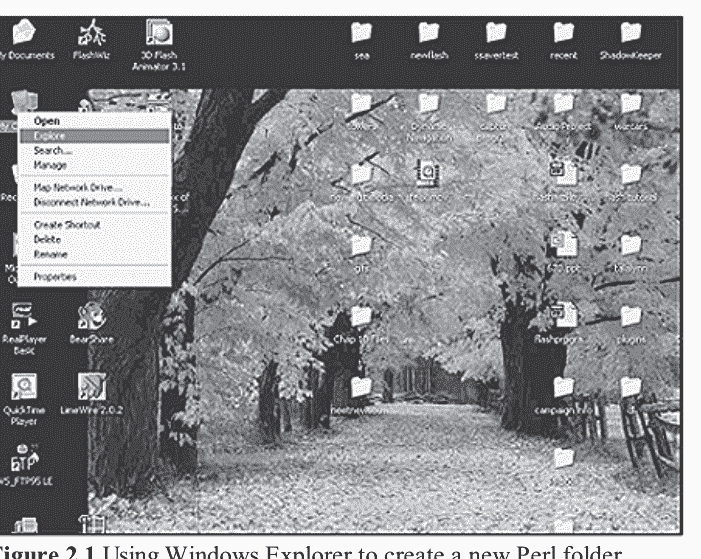

图 2.1 使用 Windows 资源管理器创建新的 Perl 文件夹。

2.  在你的 C 盘中，打开你昨晚创建的新 Perl 文件夹。

3.  打开 `eg` 文件夹，其中包含你昨晚使用的示例。这个文件夹是你将创建和编写大部分 Perl 脚本的地方。

4.  右键单击并选择“新建文件夹”来创建一个新文件夹。

5.  将文件夹命名为 `Weekend`，如图 2.2 所示。

6.  双击 `Weekend` 文件夹将其打开。

现在你有了一个 `Weekend` 文件夹来存放你的项目，你可以按照以下步骤，为 print 项目创建一个新的 Perl 脚本：

1.  在 `Weekend` 文件夹中右键单击。

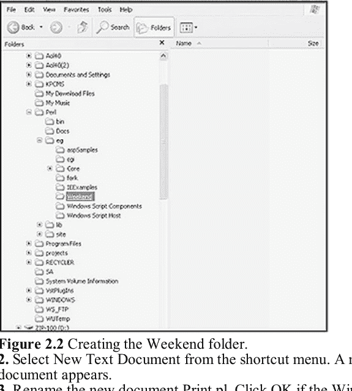

图 2.2 创建 `Weekend` 文件夹。

2.  从快捷菜单中选择“新建文本文档”。将出现一个新的文本文档。

3.  将新文档重命名为 `Print.pl`。如果出现 Windows 警告，请单击“确定”。

你现在有了一个名为 `Print` 的新 Perl 程序，位于 `Weekend` 文件夹中。你应该能够识别出它是一个 Perl 程序，因为图标将是一个小的金色珍珠。

> **注意**：请记住，所有程序示例都存储在我们的配套网站 http://www.premierpressbooks.com/downloads.asp 上。如果你在组装或运行脚本时遇到困难，你可以随时下载它们并查看成品。

为了编辑和编写你的新 `Print.pl` 脚本，你需要在文本编辑器中打开它。Windows 提供了一个名为“记事本”的内置文本编辑器，你可以使用它来编辑 `Print.pl`。你可以通过多种不同的方式（取决于你运行的 Windows 版本）用“记事本”打开 `Print.pl`：

-   右键单击 `Print` 程序。你可以选择多个选项。你可以选择“打开方式”并选择“记事本”。或者，你可以选择“编辑”。这两种方法都能让你进入程序，从而开始编写脚本。

-   在“开始”菜单（位于“开始”、“程序”、“附件”、“记事本”）上打开“记事本”，然后使用“文件”、“打开”，让“记事本”导航到你的 `Weekend` 文件夹。

-   右键单击 `Print.pl` 文件本身，选择“打开方式”。然后你可以选择“记事本”作为打开 `Print.pl` 的程序。

-   右键单击并从菜单中选择“编辑”（见图 2.3）。`Print.pl` 将使用 Windows 的默认编辑程序打开，通常是“记事本”。

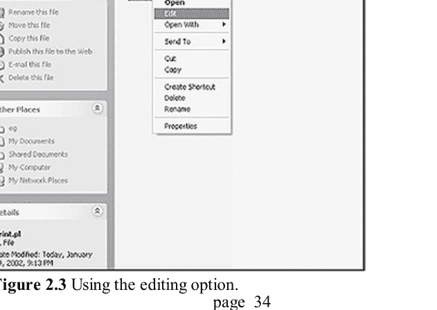

图 2.3 使用编辑选项。

如果你习惯使用不同的编辑程序进行编程，在编写这些示例时也可以随意使用。Emacs 是一个流行的编辑器，也是免费的；Windows Visual Studio 也提供了编辑 Perl 文件的机制。

#### 小心

> 编辑 Perl 脚本（和其他编程脚本）时，不要使用文字处理程序，例如 Microsoft Word 或 WordPad。富文本编辑器包含 Perl 无法理解的字符和格式，你用这些应用程序编写的脚本将无法编译和运行。同样，也要警惕“记事本”的一些高级功能，它也可能将文本格式化为 Perl 无法读取的形式。

你已创建了 `Print.pl` 文件，“记事本”已打开并显示一个空白页面。现在你需要用 Perl 能理解的命令来填充这个页面。你今天早上在 Perl 中将学到的第一个命令是 `print` 命令。要使用 `print` 命令，请输入 **`print`**，后跟引号中的文件或文本。在你刚刚打开的“记事本”编辑框中输入以下代码行：

```
print "Hello";
```

现在，通过单击框右上角的 `X` 关闭编辑框。当 Windows 询问你是否要保留更改时，选择“是”。双击新的 `Print` 程序来运行它。

并不完全像你预期的那样，对吧？如果你做的一切都正确，你并没有看到 `Hello`。相反，你看到了一个闪烁的矩形出现然后消失了。请放心，你的程序实际上运行正确。问题在于 Perl 是将输出发送到 DOS，而不是 Windows。这意味着当 `Print` 程运行时，会打开一个 DOS 框，程序在 DOS 框中运行，然后 DOS 框会自动关闭，这一切都发生在眨眼之间。

为了防止 DOS 框消失，你需要让它等待一段时间，或者直到有人告诉它关闭。这引出了下一节——用户输入。

#### 获取用户输入

Perl 可以接受不同类型的输入并以不同方式使用它们。在你的 `Print.pl` 程序，你只需要 Perl 暂停并等待片刻，然后程序继续并退出。你可以通过使用 `<>` 操作符来实现这一点。为了让 DOS 等待用户跟上进度，你将这些括号放在脚本的末尾。

```
print "Hello!"; <>
```

但这对其他运行程序的人没有帮助。脚本将只是运行然后冻结，所以最好添加第二行 `print` 来解释到底发生了什么。

```
print "Hello!"; print "Press <ENTER> to continue..."; <>
```

运行编辑后的 `Print.pl` 程序，你的输出将如图 2.4 所示。

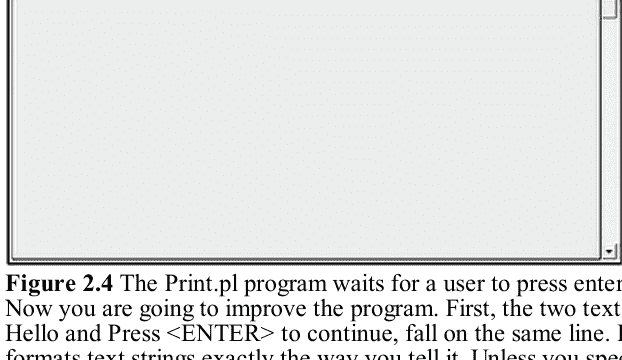

**图 2.4** `Print.pl` 程序等待用户按回车键。

现在你将改进该程序。首先，两个文本字符串 `Hello` 和 `Press <ENTER> to continue` 出现在同一行。Perl 格式化文本字符串的方式完全是你告诉它的。除非你指定了你想要空格或换行开始，否则它不会添加空格或开始新的一行。要将 `Press <ENTER>` 字符串放在自己的行上，你需要添加一个*转义序列*。转义序列是代表常用输入命令的小代码片段，例如回车、制表符、缩进等。你可以在文本字符串和其他地方添加转义序列。`\` 告诉 Perl 你想使用一个转义序列，而 `n` 字符指定回车或换行。按照指示在 `Print.pl` 代码中添加 `\n`。

```
print "Hello!\n"; print "Press <ENTER> to continue..."; <>
```

Perl 将识别转义字符，并在第一个 `Hello` 行的末尾放置一个回车符。

转义序列也用于打印 Perl 通常视为命令一部分的特殊字符（例如引号）。表 2.1 显示了 Perl 转义序列。

> **提示**

最常用的转义字符是那些模拟打字机功能的字符，例如 `\b` 表示退格。

#### 使用标量

归根结底，几乎所有计算机程序都是通过处理数据来产生输出的。理解 Perl 如何存储和获取数据是在 Perl 中进行编程的基础。在本节中，你将学习如何将值传入 Perl，而在下一章中，你将学习如何操作这些值。

Perl 在数据处理方面表现出色。（别忘了，它最初就是为了处理文本而设计的。）它可以在一种 Perl 专家喜欢称为标量变量（或简称标量）的结构中保存单个项目，例如一个词（称为字符字符串）或一个数字（称为变量）。

标量值在上一章中已经介绍过。既然你已经掌握了一些编程技巧，我将向你展示标量的一些高级特性。

#### 深入了解标量

与某些其他编程语言不同，在 Perl 中，你不能强制一个标量仅为文本或变量。Perl 会自动处理标量运算，并根据其内容对如何使用它们做出假设。这意味着，如果你在标量中放入文本，Perl 会假定该标量是一个文本字符串。如果你在标量中放入一个数字，Perl 会假定它是一个数字并相应地处理它。如果你在标量中同时放入数字和字母，Perl 会根据命令上下文尝试确定你想要做什么，这可能会导致一些有趣的结果。

需要记住的一个重要事项是，Perl 中的所有标量都是区分大小写的。这意味着 Perl 对待 `x` 和 `X` 的方式完全不同。如果你将值 10 赋给标量 `Number`，你使用 `nUMBER` 是无法得到值 10 的，因为 Perl 对 `Number` 和 `nUMBER` 的处理不同。

你可能已经注意到，几乎所有的 Perl 命令都是小写的。Perl 中只有少数命令是大写的。如果你在执行脚本时遇到困难，并收到无法识别的错误，你可能是不小心将大写字母用在了应该用小写字母的地方。因为 Perl 占据了许多常见的小写单词，你可能会发现其他 Perl 程序员在他们的代码中使用大写字母来表示特定类型的的重要值或标量，因为大写术语在扫描脚本时很容易找到。

`$` 是标量的解引用前缀。它就像一个警告标志，告诉 Perl 如何对后续内容做出反应。在 Perl 中，你通常使用 `$` 来创建一个标量变量，并使用 `=` 来为该变量赋值。如果你想创建一个名为 `CurrentChapter` 的变量并为其赋值为 2，你可以输入

```perl
$CurrentChapter = 2;
```

从右向左逐段分析这一行，末尾的分号告诉 Perl 命令已结束，可以执行。分号之前是数字 2，它通过等号赋给了相关的标量（`$CurrentChapter`）。用英语来说，等号基本上表示，“把我右边的任何东西赋值给我左边的任何东西。”

标量可以表示数字和文本字符串。你赋值文本和数字的方式完全相同。例如，如果你想将单词 `Variables` 而不是数字 2 赋给 `CurrentChapter`，你可以复制该命令，只需将数字 2 改为文本字符串 `Variables`。

```perl
$CurrentChapter = "Variables";
```

注意，我需要包含引号来帮助 Perl 准确区分文本字符串中的内容。

你可以使用以下脚本自己尝试一下。首先，通过右键单击，选择“新建文本文档”，并将名称更改为 `Chapter.pl`，创建一个名为 `Chapter.pl` 的新 Perl 文件。然后，通过右键单击并选择“编辑”来打开该文件进行编辑。使用 `=` 在一行上将 2 赋给一个名为 `CurrentChapter` 的标量，然后使用 `print` 命令将 `CurrentChapter` 打印到屏幕上。不要忘记在末尾添加 `<>` 部分，以便你可以在代码运行时观看。

```perl
# assign two to CurrentChapter
$CurrentChapter = "two";
# and print it out
print "$CurrentChapter\n";
# another print statement telling the reader what to do next
print "Press <ENTER> to continue...";
# Perl waits at these brackets for user input <>
```

如你所见，你可以在几乎任何地方插入标量，甚至在文本字符串内，Perl 知道如何使用它。当你运行这个程序时，你应该会看到 DOS 打印出单词 `two`，后面跟着字符串 `Press <ENTER> to continue`。

现在，在 `<ENTER>` 字符串之前添加以下几行：

```perl
# assign 2 to CurrentChapter
$CurrentChapter = "2";
# and print it out
print "$CurrentChapter\n";
```

当 Perl 运行这段代码（见图 2.5）时，它首先将文本字符串 `two` 赋给 `CurrentChapter`，然后打印 `CurrentChapter`，将 `two` 显示在屏幕上。Perl 接着将值 `2` 重新赋给变量 `CurrentChapter` 并再次打印，将 `2` 放到屏幕上。完整的源代码应该看起来像这样：

```perl
# assign two to CurrentChapter
$CurrentChapter = "two";
# and print it out
print "$CurrentChapter\n";
# assign 2 to CurrentChapter
$CurrentChapter = "2";
# and print it out
print "$CurrentChapter\n";
# another print statement telling the reader what to do next
print "Press <ENTER> to continue...";
# Perl waits at these brackets for user input <>
```

**图 2.5** 运行 `Chapter.pl` 程序。

如果你想查看完整的 `Chapter.pl`，可以在配套网站上找到第 2 章的脚本。

### Perl 数据类型

实际上可以放置在标量中的内容有一些限制。通常，标量可以包含字母、数字和下划线作为变量。然而，其他字符（如 `%`、`<`、`#` 和 `$`）是不允许的，尽管有特殊的规则来处理这些情况，即表 2.1 中概述的转义序列。每个标量都有一个最大字符长度，这取决于你所使用的操作系统和硬件平台。Perl 还能够支持不同类型的数字，从普通整数到科学记数法，如表 2.2 所示。（其中一些类型将在接下来的章节“Perl 中使用的计数系统”中更详细地讨论。）

Perl 会根据你赋给标量的数据来假设如何处理这些数据。当你将一个浮点数赋给标量时，Perl 会将该变量视为浮点数。如果你后来将一个科学记数法的数字赋给该标量，Perl 会将对标量的操作视为对科学记数法的操作，而不是对浮点数的操作。如果你在赋值标量时没有指明 Perl 将使用哪种数据类型，Perl 会假定该数字是浮点数。

#### 表 2.1 PERL 转义序列

| 字符 | 效果 |

| :--- | :--- |

| \' | 单引号 |

| \" | 双引号 |

| \t | 制表符 |

| \n | 换行符 |

| \r | 回车符 |

| \f | 换页符或回车符 |

| \b | 退格符 |

| \a | 报警（响铃） |

| \e | 转义符 |

| \033 | 八进制字符 |

| \x1b | 十六进制字符 |

| \c[ | 控制字符 |

| \l | 下一个字符小写 |

| \u | 下一个字符大写 |

| \L | 直到 \E 为止全部小写 |

| \U | 直到 \E 为止全部大写 |

| \E | 结束大小写修改 |

| \N | 插入命名字符 |

| \Q | 为所有后续的非字母数字字符添加反斜杠 |

#### 表 2.2 PERL 中的数值数据类型

| 数据类型 | 示例 |

| :--- | :--- |

| 二进制 | 01101 |

| 浮点数 | 1.11 |

| 十六进制 | 0x111 |

| 整数 | 11 |

| 八进制 | 01101 |

| 科学记数法 | 1.1E11 |

Perl 有许多不同的函数来转换数据类型。例如，如果你需要将数据类型更改为普通整数，Perl 有一个专门用于此目的的 `int` 函数。在下面的名为 `round.pl` 的示例中，我将一个浮点数赋给 `$number` 标量，打印该标量，然后在对该数字应用 `int` 后第二次打印该标量。

```perl
# Assign a floating point number to the scalar $number
$number = 1.1111;
# Print $number
print "$number\n";
# Use int and then print the number a second time
print int "$number\n";
# Add our ending changed
```

### 使用 sprintf

摆脱顽固小数位的一种更优雅的方法是使用内置的 sprintf 函数。Perl 的 sprintf 会使用以下格式将浮点数四舍五入到指定长度：

```
sprintf "argument", number;
```

参数是你想要保留的小数位数，前面加上百分号 `%`，后面加上 `f`。如果你想在上述示例中将 `$number` 截断到两位小数，你可以添加如下一行代码：

```
print sprintf "%.2f\n", $number;
```

sprintf 命令功能极其强大，能够改变 Perl 数据类型的显示方式。sprintf 命令有时也被称为*格式化字符串命令*，它允许你通过将数据类型从一种转换为另一种来修改字符串或列表（更多关于列表的内容将在下一节“探索列表”中介绍），使用相同的格式：

```
sprintf "format", stringorlist;
```

为了演示 sprintf 的强大功能，启动一个新的 Perl 脚本 `format.pl`，并创建一个包含浮点数的标量：

```
# 将浮点数赋值给标量 $number
$number = 1.1111;

# 打印 $number
print "$number\n";

# 添加我们的结束提示（根据用户输入修改）
# 标准结束提示
print "\nPress any key to continue..."; <>;
```

现在添加几行 sprintf 命令，以不同的方式格式化 `$number`。你已经见过四舍五入到小数位的操作：

```
print sprintf "%.2f\n", $number;
```

你可以使用 sprintf 将数字转换为八进制，使用 `%o` 作为参数：

```
print sprintf "%o\n", $number;
```

或者，你可以使用 `%%` 作为参数将数字转换为百分比格式：

```
print sprintf "%%f\n", $number;
```

你可以将其转换为字符串：

```
print sprintf "%s\n", $number;
```

# 作用域和限制

标量变量在默认情况下也是全局变量。在编程术语中，全局变量是指在脚本或程序中任何地方都可用的变量。全局变量可以通过其他命令（例如 `my` 和 `local`）限制在程序的特定区域，这是我在今天晚上讨论子程序和独立程序块的“表达与陈述”环节中会重新讨论的内容。程序员通常将变量在脚本或程序的特定部分的可用性称为其作用域。

> 提示

> 与其他编程语言（如 Java 或 C）不同，在 Perl 中，你不需要在使用变量之前声明它们。在脚本中第一次使用变量时，Perl 会自动为其创建并分配空间。在许多其他编程语言中，你需要最初列出许多变量，以便编程语言可以确保为它们预留空间。

然而，请注意，许多程序员认为在声明变量之前使用它们是不规范的做法。Perl 实际上提供了一套称为 Strict 的特殊规则集，它强制你编写代码，使其符合几个标准的程序约定，包括在使用变量之前声明变量。Strict 非常有用，所以我在周日晚上的环节（Perl 安全部分）中会讨论它。

#### 表 2.3 sprintf 格式化字符串命令的参数

| 参数 | 结果 |

|---|---|

| %% | 百分号 |

| %c | 一个字符 |

| %d | 有符号的十进制整数 |

| %e | 科学记数法表示的浮点数 |

| %f | 浮点数 |

| %o | 无符号整数 |

| %p | 指针 |

| %s | 字符串 |

| %u | 无符�整数 |

| %x | 十六进制表示的无符号整数 |

### 使用运算符

你可以在一行代码中进行多个标量赋值。例如，下面这行代码将变量 `open` 赋值给 `shop4`，再将 `shop4` 赋值给 `shop3`，将 `shop3` 赋值给 `shop2`，以此类推。

```
$shop1 = $shop2 = $shop3 = $shop4 = "open";
```

你也可以对标量使用运算符。我将在今天下午的“使用文件和 Perl 操作”环节中更详细地讨论运算符，但下面的 Perl 脚本展示了如何使用标量为你执行简单的数学运算。

在你的 Weekend 文件夹中创建第三个 Perl 脚本，命名为 `Math.pl`。

开始编辑，并在脚本中添加常规的 `<>` 结束语。然后创建两个标量并为它们赋值。

```
$guitar = 10;
$piano = 20;
$dulcimer = 30;
$violin = 40;
```

# 另一个打印语句，告诉读者下一步该做什么

print "\nPress <ENTER> to continue...";

# Perl 在这些括号处等待用户输入

<>

现在添加一些打印语句，以便 Perl 可以为你打印出这些值。完整的代码应该如下所示：

```
$guitar = 10;
$piano = 20;
$dulcimer = 30;
$violin = 40;

print "guitar is equal to $guitar\n";
print "piano is equal to $piano\n";
print "dulcimer is equal to $dulcimer\n";
print "violin is equal to $violin\n";

# 另一个打印语句，告诉读者下一步该做什么
print "Press <ENTER> to continue...";
# Perl 在这些括号处等待用户输入
<>
```

运行此程序，你应该会看到以下输出：

```
guitar is equal to 10
piano is equal to 20
dulcimer is equal to 30
violin is equal to 40
Press <ENTER> to continue
```

现在尝试一些数学运算符。Perl 支持各种数学符号。最常见的是用于加法的 `+` 号，用于减法的 `–` 号，用于乘法的星号 `(*)`，以及用于除法的反斜杠 `(/)`。实际上，你可以在标量赋值代码行上使用这些运算符。只需在每个标量赋值的最后一部分添加一个运算符，然后再次运行程序。

```
$guitar = 10 * 5;
$piano = 20 / 2;
$dulcimer = 30 + 5;
$violin = 40 - 15;

print "guitar is equal to $guitar\n";
print "piano is equal to $piano\n";
print "dulcimer is equal to $dulcimer\n";
print "violin is equal to $violin\n";

# 另一个打印语句，告诉读者下一步该做什么
print "Press <ENTER> to continue...";
# Perl 在这些括号处等待用户输入
<>
```

现在运行程序，你的输出会非常不同：

```
guitar is equal to 50
piano is equal to 10
dulcimer is equal to 35
violin is equal to 25
Press <ENTER> to continue
```

### Perl 中使用的计数系统

Perl 内置支持所有范围的数学运算，包括常规的十进制整数。我提到过 Perl 还支持带小数位的数字（*浮点数*）、科学记数法，并且它还支持不同的计数系统，包括十六进制、八进制、二进制和布尔值。

不同的计数系统只是使用十以外的数字作为基数的数学系统。这对于编程是一个重要的概念，所以我将在这里稍作探讨。

出于一般目的，数学使用十进制计数系统，由数字 0 到 9 组成。当你向上计数时，你从一开始数到九。当你超过九时，你需要添加另一个数位，以便可以继续向上计数（9+1 变成 10，9+2 变成 11，依此类推）。

计算机使用二进制计数系统（二进制），仅由 1 和 0 组成，这些数字对应于实际的物理开关，可以是开或关。当计算机向上计数时，它从 0 开始，到 1，然后立即需要添加另一个数位以便继续计数。1+1 变成 00，1+2 变成 01，1+3 变成 000，1+4 变成 001，依此类推。

十六进制和八进制计数系统类似于二进制系统，但它们的基数不同。十六进制系统只使用到 16（使用数字 0-9 和字母 A-F），而八进制只使用到 8（使用数字 0-7）。布尔值是一个特例。在布尔系统中，一个值要么为真，要么为假。在 Perl 中，如果标量包含一个值，那么在布尔意义上通常被认为是真。这意味着标量是布尔真，除却它是空的（包含空白）或被赋值为数字 0，这种情况下它是布尔假。

这一切可能看起来很晦涩，但能够使用这些不同的……

### 探索列表

列表通常被用作编程中的约定，用于将事物分组在一起。列表就是一排数据元素。它可以由标量变量或其他构造组成，例如数组或哈希表。

在Perl中，列表的赋值方式与标量变量类似。你只需要通过给不同的变量和赋值加上括号来提醒Perl你正在创建一个列表，而不是一个标量。

编写列表就像是在同时给多个变量赋值。

### 创建列表

要创建一个列表，首先创建一个新的Perl脚本并将其命名为List.pl。你将设置一个名为`groceries`的变量列表，其中每个项目都将附加一个数字赋值。在Perl中创建列表时，首先在一组括号内包含一个标量列表。

($apples, $oranges, $grapes, $walnuts,)

然后，就像处理标量一样，你包含等号(=)，以便为这些标量赋值。

($apples, $oranges, $grapes, $walnuts,) =

最后，你在第二组括号内为这些标量赋值。

($apples, $oranges, $grapes, $walnuts,) = (4.99, 3.99, 1.99, 12.99,);

你现在拥有一个杂货物品列表，每个物品都关联着一个特定的价格。四个数值将按照相同的顺序分配给杂货。

你可能已经注意到赋值末尾（在`walnuts`和`12.99`之后）的额外逗号。这是有意为之的，但并非必要。在设置列表时保留末尾逗号是一种常见的编程约定，这样当你稍后向列表添加更多项目时，可以节省一些输入时间。即使没有逗号，代码也能正常工作。

> **注意**

Perl中可能令人困惑的一点是，它根据数据的上下文将所有数据视为标量变量或列表。（随着你对Perl越来越熟悉，这将成为你的第二天性。）这意味着，如果Perl期望一个列表，而你提供了标量值，它将把这些值当作列表来处理。

Perl中的一些函数假设你总是在处理列表，而另一些则假设你总是在处理标量。学习Perl如何处理一个值，以及Perl是假设标量还是列表，是一项需要时间和语言实践的技能。

```
你可以像打印标量一样打印这个列表。在你的新打印代码中添加打印行，以便用户可以跟踪你的值。别忘了你的标准结尾<>。
($apples, $oranges, $grapes, $walnuts,) = (4.99, 3.99, 1.99, 12.99,);
print "apples are worth $apples\n"; print "oranges are worth $oranges\n"; print "grapes are worth $grapes\n"; print "walnuts are worth $walnuts\n"; # another print statement telling the reader what to do next print "Press <ENTER> to continue..."; # Perl waits at these brackets for user input <>
```

现在运行List.pl，你将看到每个标量都已分配了其对应的值，如图2.6所示。

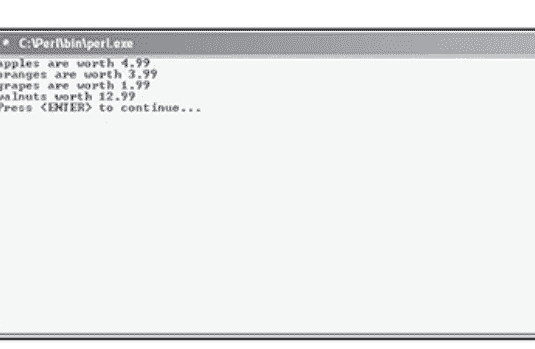

**图2.6 Perl显示列表的内容。**

### 赋值列表项

你可以将列表项赋值给一个标量，而不是像前面的示例那样将多个项赋值给多个标量。在下面的示例中，我将几个动词赋值给标量`action`。

```
$action = (run, throw, leap, jump,); print $action; # another print statement telling the reader what to do next print "\nPress <ENTER> to continue..."; # Perl waits at these brackets for user input <>
```

将此示例编码到名为Action.pl的新文件中并运行它。如你所见，列表似乎没有正确赋值，程序只打印了最后一个项目（jump）。

要打印列表中的最后一个条目以外的其他内容，你需要告诉Perl你指的是哪个条目。你可以使用方括号来改变Perl访问列表时将使用的引用。如果你在第一行末尾加上方括�和数字1，Perl将引用分配给1的值，而不是列表中的最后一个值。

```
$action = (run, throw, leap, jump,)[1];
```

再次运行程序，你应该会看到一个DOS框，如图2.7所示。但是等等！代码不应该是打印第一个值（run）而不是第二个值（throw）吗？实际上，值1被正确地分配给了文本字符串throw。文本字符串run由数字0引用。记住你正在使用计算机，它使用不同的编号系统。因为计算机使用二进制，它几乎总是从0开始计数，然后是1。在处理列表、数组或哈希表时也是如此。

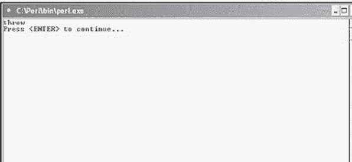

**图2.7 打印最后一个值。**

### 操作列表

既然你知道如何创建和打印列表，你可以专注于使用它的其他方式。列表最常用于对项目进行分组，然后整体操作这些项目。例如，要将杂货列表按从小到大排序，Perl使用`sort`函数。`sort`通常与`print`函数结合使用。以下脚本打印几个标量，先不使用然后使用`sort`命令，并展示了Perl可以对标量和列表行使的一些强大功能。

```
print (2, 4, 6, 9, 5, 8,); print "\n"; print sort (2, 4, 6, 9, 5, 8,); # another print statement telling the reader what to do next print "Press <ENTER> to continue..."; # Perl waits at these brackets for user input <>
```

将这些行放入名为Sorter的新Perl文件中。Perl的`sort`命令会自动按字母顺序或按数字顺序排列列表，在这种情况下，`sort`将第二个打印语句中的所有数字按数字顺序排列。

因为`print`有时可能难以控制，列表通常是处理文本字符串的首选方式。看这个打印单词列表的代码示例：

```perl
# printing a list
print ("Why", "hello", "there",);
```

运行时，输出不是" Why hello there."而是所有单词连在一起产生" Whyhellothere."。Perl的内置函数能够处理这个问题。一个简单的解决方案是使用`join`命令。Perl的`join`用给定的表达式包围列表中的每个项目，语法如下：

```
join expression, list
```

在前面的示例中，我想用空格将这三个单词连接起来，使打印语句可读。我可以使用`join`将列表项用空格连接起来：

```
print join (" ", ("Why", "hello", "there",));
```

`join`命令现在将打印出用空格连接的单词，使句子可读。你可以通过创建一个名为joinem.pl的新脚本并比较两个打印语句来测试这一点：

```
# printing a list
print ("Why", "hello", "there",);
# list printed and joined by spaces;
print join (" ", ("Why", "hello", "there",));
# Add our ending changed to user input
# standard ending
print "\nPress any key to continue..."; <>
```

实际上，你可以将任何字符或字符组作为`join`命令的表达式；例如，你可以用破折号连接这个列表：

```
print join ("--", ("Why", "hello", "there",));
```

或者你可以用短语连接列表：

```
print join ("Go ahead and say:", ("Why", "hello", "there",));
```

`join`命令的反面是`split`命令。`join`将列表放入字符串，而`split`则将字符串转换为列表。`split`的常用语法是：

```
split /pattern/, expression
```

以之前`join`命令的示例为例：

```
print ("Why, hello, there,");
```


这行代码打印出Why, hello, there。`split`命令可用于取出逗号并将此字符串转换为列表：

```
print ((split " ", "Why, hello, there,"));
```

反斜杠`/ /`将三个单词分割成列表，打印时你会在屏幕上看到Why hello there，没有逗号。使用`split`，你可以将字符串作为列表引用并提取特定条目，例如在此示例中，你通过使用方括号和列表中的单词编号仅打印第二个单词hello：

```
print ((split " ", "Why, hello, there,")[1]);
```

玩转`split`的完整源代码也包含在本章的下载中，文件名为splitting.pl：

```
# Before split
print ("Why, hello, there,");
# After split
print ((split /,/, "Why, hello, there,"));
# print only the second word
print ((split " ", "Why, hello, there,")[1]);
# Add our ending changed to user input
# standard ending
print "\nPress any key to continue..."; <>
```

### 列表与数组

现在，关于列表操作的最后一个例子，我们来看看 Perl 的 `map` 函数。`map` 命令使你能够对列表中的每个项目进行广泛的更改。`map` 的基本语法是：

```
map {表达式}, 列表
```

这个表达式实际上是一个代码块（关于代码块，我们将在今晚的课程中详细讨论），但为了说明，我将保持简单。创建一个新的 Perl 文件，命名为 `mapping.pl`，并创建一个数字列表然后打印它们：

```
# 创建一个数字列表
print (1, 2, 3,);
# 添加我们改变的结尾以供用户输入
# 标准结尾
print "\nPress any key to continue...";
<>
```

你可以在这个程序中使用 `map`，通过小幅修改 `print` 行，将列表中的每个项目乘以 2：

```
print (map {2 * $_} 1, 2, 3,);
```

这个更改要求 Perl 获取列表中每个项目的输入（由 `$_` 表示）并将该项目乘以 2（2 *）。当你将 `mapping.pl` 更改为：

```
# 创建一个数字列表
print (map {2 * $_} 1, 2, 3,);
# 添加我们改变的结尾以供用户输入
# 标准结尾
print "\nPress any key to continue...";
<>
```

你将看到输出 "246"，而不是 "123"。

## 休息一下

你已经涉猎了一些极其重要且困难的主题，而你实际上才刚刚开始。标量值在几乎每个 Perl 程序中都有使用，因此理解今天上午的材料极其重要。去休息一下；站起来，伸展一下，冥想一下你新获得的知识。当你准备好时，回来，我将深入探讨 Perl 数组和哈希。

### 数组和哈希

Perl 中的所有数据都是某种形式的标量。标量以美元符号（`$`）开头，可以包含数字（称为 *变量*）或字母字符串（称为 *文本字符串*）。标量也可以持有引用。当标量用作引用时，它通常指向一个数组或一个哈希。

除了 `$`，Perl 中还有另外两个极其重要的解引用符。第一个是 at 符号（`@`），它告诉 Perl 后面的任何内容都是一个数组。第二个重要的解引用符是百分比符号（`%`），它指的是一种称为 *哈希* 的编程构造。哈希和数组相似。它们都是存储项目或项目列表的机制；它们只是以不同的方式来跟踪项目。

#### 什么是数组？

数组通过数字索引来组织项目列表，这使你可以通过数字或数字引用来引用一个项目。因此，你可能会认为数组与 Perl 中的列表非常相似。在很多方面它们确实相似；然而，存在细微的差别，例如它们的初始化方式。

#### 初始化数组

你赋值数组就像你进行列表赋值一样。然而，你用 `@` 开始赋值，而不是 `$`。如果你想构建一个能被 10 整除的数字数组，你可以这样初始化：

```
@divisible = (10, 20, 30);
```

Perl 读取这个命令并创建一个名为 `divisible` 的条目，其中现在包含 '10, 20, 30'。

要使用或引用 `divisible` 数组中的一个值，你需要使用美元符号（`$`）、方括号（`[]`）和一个特定的数字。数组中的所有条目都被视为标量，这就是为什么你需要使用 `$` 来引用它们。方括号和数字告诉 Perl 你想使用哪个条目。数组中的每个条目都有一个从 0 开始向上计数的数字引用。在 `divisible` 数组中，10 在位置 0，20 在位置 1，30 在位置 2。

如果你需要引用并打印 `divisible` 数组中的数字 30，你可以这样编码：

```
print $divisible[2];
```

翻译成通俗英语，这行代码告诉 Perl 打印 `divisible` 数据结构中的第三个标量。

> **提示** 你可能已经注意到，在 `divisible` 数组中，Perl 从数字 0 开始数组排序，就像上一节中打印列表 `$action` 时一样。这对于 Perl 和大多数编程语言来说是典型的。在计数时，除非另有指示，否则 Perl 从数字 0 开始计数，然后是数字 1，然后根据指定的计数系统向上计数。所有这些从 0 开始的计数在你刚开始编码时可能难以记住，但当你编写了几个列表或数组后，这个转换会显得很自然。

曾经有开关总是让 Perl 从 1 开始计数，而不是 0。这些功能后来已被标记为从大多数发行版中移除，尽管在处理遗留代码时你可能仍会遇到这些命令。虽然 Perl 强烈主张 TMTOWTDI（不止一种方法可以做到），但请记住，这种特定的方式不再受支持，所以你最好习惯于编写从 0 开始计数的数组。

数组被认为对程序员来说极其强大。因为你可以通过一个数字引用数组中的所有项目，数组非常适合处理循环（正如你将在今晚的课程“表达与陈述”中看到的那样）。Perl 还有许多内置命令用于操作、更改、修改和排序数组中的数据。我将在接下来的章节中研究其中一些命令，你将在周日下午的课程中使用其中一些命令来优化代码。

Perl 在你使用数组时创建并分配内存，就像处理标量一样，所以你不必自己担心分配内存。与标量一样，数组的作用域也是全局的，你可以在程序中的任何位置访问它们，除非它们被局部化。（我将在今晚的课程中介绍局部化。）

#### 编写你的第一个数组脚本

既然你已经对数组有了概述，你可以编写一个脚本了。创建一个新的 Perl 脚本，命名为 `Profile.pl`。添加通常的结尾，并初始化一个名为 `profile` 的数组，包含四个文本条目。

```
@profile = (Luca, second, upstairs,);
# 另一个打印语句，告诉读者下一步该做什么
print "\nPress <ENTER> to continue...";
# Perl 在这些方括号处等待用户输入
<>
```

Perl 现在有一个数组数据结构来保存这三个值。现在打印这些值并查看它们。在 `profile` 数组赋值后添加一个 `print` 行并运行程序。

```
# 第一次打印尝试
print @profile;
```

不太像你预期的，对吧？Perl 确实打印出了数组，但它也去掉了每个字母之间的空格，使其难以阅读。Perl 去掉空格是为了保持数组小巧且易于引用。你必须修改代码才能使其有序地打印，如下面的代码所示。

```
# 第二次打印尝试
print "$profile[0]\n";
print "$profile[1]\n";
print "$profile[-1]\n";
```

你可能注意到我使用了 -1 来引用上一个数组中的 `upstairs`。你可以使用正数和负数来引用数组。负数反向引用数组。通过使用 -1，无论数组有多长，你都可以自动引用数组中的最后一个项目。这是一个极其有用的技巧，因为你经常需要引用数组中的最后一个变量。总的来说，代码应该如下所示。（你也可以从配套网站获取完成版本，名为 `luca array`）：

```
@profile = (Luca, second, upstairs,);
# 第一次打印尝试
print @profile;
# 第二次打印尝试
print "$profile[0]\n";
print "$profile[1]\n";
print "$profile[-1]\n";
# 另一个打印语句，告诉读者下一步该做什么
print "\nPress <ENTER> to continue...";
# Perl 在这些方括号处等待用户输入
<>
```

#### 常见的数组命令

Perl 包含许多支持命令，帮助程序员操作他们的数组。例如，数组使程序员能够轻松地添加和删除条目。你可以使用名为 `push` 的 Perl 命令向数组添加元素，我在下面的脚本中使用了它：

```
@gimmeanh = (n, n, n,);
# 在 push 之前打印 gimmeanh 数组
print "$gimmeanh[0]\n";
print "$gimmeanh[1]\n";
print "$gimmeanh[-1]\n\n";
# 使用 Push 命令添加一个 h
push (@gimmeanh, "h");
# 打印包含 h 的数组
print "$gimmeanh[0]\n";
print "$gimmeanh[1]\n";
print "$gimmeanh[-1]\n\n";
# 另一个打印语句，告诉读者下一步该做什么
print "\nPress <ENTER> to continue...";
# Perl 在这些方括号处等待用户输入
<>
```

这个脚本的大部分内容都是打印行，但请注意带有 `push` 的那一行。你可以看到 `push` 被给定了一个数组名称、一个逗号，然后是一个要添加到数组中的标量值，所有这些都包含在整齐的括号中。

Perl 还有一个名为 `pop` 的命令，用于移除数组的最后一个项目。`pop` 使用的语法与 `push` 语法类似；你只需要在圆括号中给 `pop` 数组名称。通过向 `push` 示例添加以下代码行，你可以在使用 `push` 将 `h` 放入数组后将其移除。

```
# 使用 pop 移除 h
pop (@gimmeanh);
print "$gimmeanh[0]\n";
```

### 数组快捷方式

由于为大型数组逐个输入每个条目可能很麻烦，Perl 中有许多巧妙的快捷方式来填充数组。其中一种快捷方式是*乘数*，它在周六下午讨论 Perl 操作的部分有更详细的说明。它的使用非常简单，从下面的代码行中就能看出。

```
@array = (10) x 100;
```

Perl 读取代码并创建 `@array`。当 Perl 执行完毕后，`@array` 将包含 100 个独立的条目，所有条目都是数字 10。Perl 将 `x 100` 乘数解释为程序员需要 100 个不同的条目，每个条目都包含数字 10。

你也可以使用连字符（`-`）来确定字母表或数字序列中的范围。下面的行创建了一个数组，填充了从 10 开始到数字 200 结束的数字。

```
@array = (10..200);
```

接下来的行创建了一个数组，填充了从小写字母 a 到小写字母 f 的字母。

```
@array = (a..f);
```

Perl 还能通过使用 `..` 符号来确定你试图表示的范围。例如，在下面的代码行中，Perl 将使用模式

匹配填充范围并按偶数计数。（相当聪明，对吧？）

@array = (2, 4, 6, ..., 12);

另一个快速技巧是 `reverse` 命令，它可以让你反转给定数组的内容：

# 这个数组是 123

@array1 = (1,2,3,);

# 这个数组是 321

@array2 = reverse @array1;

最后，在代码中经常看到的另一个快捷方式是 `qw` 快捷方式，它省去了在数组赋值中包含引号的需要。

@textarray = ( "first", "second", "third", "fourth", "etc" );

如果在前面的数组赋值中加入 `qw`，你可以跳过输入所有的引号。相反，你的数组赋值将如下所示：

@textarray = qw(first second third fourth etc);

#### 什么是哈希？

哈希的工作方式与数组类似，不同之处在于你使用名称或文本来引用其中的项目。因此，哈希有时也被称为关联数组。这意味着你不是通过像这样的数字值来引用数组中的内容：

print "$arrayvalue[1]";

而是使用文本来引用数组中的项目：

print "$arrayvalue{'valuenumberone'}";

起初，你可能认为哈希看起来需要更多的编程工作，因为你需要包含一个实际的名称而不是数字，你可能是对的。哈希主要用于帮助弥合人类与机器之间的理解差距。例如，你不是将员工信息列表按数字组织在数组中（`employee[1]`, `employee[2]`, `employee[3]`, `employee[4]`），而是可以在哈希中按名称引用它们（`employee[Tom]`, `employee[Bob]`, `employee[Roy]`, `employee[Jason]`）。

#### 初始化哈希

初始化哈希的方式与初始化数组相同，只是你还需要包含一个键（key），即关联词。一般结构是 `$hash{'key'} = 'values in the hash';`

我使用了花括号（`{}`）而不是方括号（`[]`）。我还使用了 `$` 和单引号，而不是 `@` 和圆括号。

要将个人资料数组转换为一个键名为 `name` 且条目为 `Luca` 的哈希，你可以像这样更改代码：

$profile{'name'} = 'Luca';

引用哈希也类似于引用数组。以下代码在屏幕上打印出 Luca。

print "\$profile{'name'}";

完成后的整个 `Luca.pl` 文件应如下所示（也可在配套网站上下载）：

```
$profile{'name'} = 'Luca';
print "\$profile{'name'}";
# 另一条打印语句，告诉读者下一步该做什么
print "\n按 <ENTER> 键继续...";
# Perl 在这些方括号处等待用户输入
<>
```

如果你想在哈希中有多个值呢？嗯，正常的前缀解引用符号是百分号（`%`）。将一个大组的引用（例如，唱片集）赋值给哈希的工作方式如下：

```
%album = (
    'II' , 'Led Zeppelin',
    'Unforgettable' , 'Natalie Cole',
    'Fundamentals' , 'DTCFE',
    'White Ladder' , 'David Gray',
);
```

你现在有了几个专辑名，每个都引用一位艺术家。这是一个使用哈希的简单例子。

哈希被认为比数组更直观，因为使用文本名称或键有时比使用数字更容易概念化。例如，将 $10 引用为 `weeklyallowance` 比引用为某个随机数字更容易。

与数组不同，Perl 不一定按顺序存储哈希中的条目。例如，如果你尝试使用以下代码打印专辑哈希，你可能会发现打印出的条目顺序与你创建时的顺序不同。

```
# 赋值哈希
%album = (
    'II' , 'Led Zeppelin',
    'Unforgettable' , 'Natalie Cole',
    'Fundamentals' , 'DTCFE',
    'White Ladder' , 'David Gray',
);
# 打印哈希
print %album;
# 另一条打印语句，告诉读者下一步该做什么
print "\n按 <ENTER> 键继续...";
# Perl 在这些方括号处等待用户输入
<>
```

Perl 会自动混合和移动哈希条目，以使计算机和程序存储和引用它们更轻松、更快速。

哈希和数组一样，有许多相关命令，这个周末我只介绍其中一部分。对 Perl 而言，一个重要的哈希是 `%ENV` 哈希。

#### 到底什么是 %ENV 哈希？

你可能不相信，但哈希已经存在于你的计算机上。`%ENV` 哈希用于存储常见的计算机环境变量。环境变量回答诸如“我使用的是什么操作系统？”、“CD 在哪个磁盘驱动器上？”、“计算机网络名称是什么？”以及“当前是哪个用户在使用我？”之类的问题。实际可访问的信息因操作系统和计算机而异，但在本节中，我将尝试提取一些关于 Windows XP 的信息，以使脚本稍微个性化一些。

首先，使用 `print` 函数和 `%ENV` 哈希来获取计算机用户的账户名。创建一个新的 Perl 脚本并命名为 `environment.pl`。要获取并打印用户名，请输入以下代码：

```
print "Hello, $ENV{USERDOMAIN}\n";
```

注意我们使用 `$ENV` 从 `%ENV` 哈希中拉取信息。虽然我们访问的是 `%ENV` 哈希，但这个脚本只使用标量 `$` 解引用符号。只有在创建或向哈希中压入值时才需要百分号 `%`。你需要使用 `$` 解引用符号来拉取信息。

标准的打印行使用标量符号来引用 `%ENV` 哈希中与 `USERDOMAIN` 关联的哈希值。为代码添加标准结尾并运行此示例以确保其正常工作。现在在代码中添加另一条打印行以添加操作系统调用。完整的源代码如下，当你在我的机器上运行该命令时的输出如图 2.8 所示。

```
print "Hello, $ENV{USERDOMAIN}\n";
print "Your Operating System is $ENV{OS}\n";
# 另一条打印语句，告诉读者下一步该做什么
print "\n按 <ENTER> 键继续...";
# Perl 在这些方括号处等待用户输入
<>
```

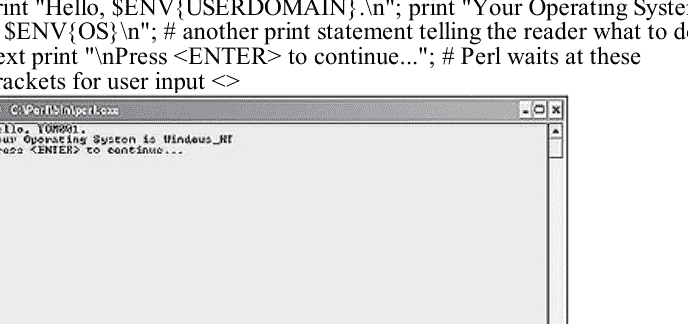

**图 2.8** 从 `%ENV` 哈希获取信息。

`%ENV` 哈希旨在存储有关计算机的基本信息；你将在未来的代码示例中使用它来获取有关计算环境所需的信息。此代码示例可在网站上以 `Environment.pl` 的形式获取。

#### 检索用户输入

你必须做的一件事是学习从键盘或用户那里获取输入。没有某种交互，几乎不可能创建有用的程序。在 Perl 中，这种交互的基础是 `STDIN`（*标准输入*）和 `STDOUT`（*标准输出*）。

#### 标准输入和标准输出

`STDIN` 是接受输入的正常默认管道或通道，`STDOUT` 是 Perl 用于发送信息的默认管道或通道。`STDIN` 和 `STDOUT` 通常用于将信息从键盘传送到命令（`STDIN`）或从命令传送到监视器屏幕（`STDOUT`）。`STDIN` 通常从键盘输入，`STDOUT` 通常打印到屏幕。`chomp` 命令经常与 `STDIN` 和 `STDOUT` 一起使用。`Chomp` 用于收集用户输入，因为它会移除或“chomp off”用户在 `STDIN` 中给出的最后一个字符。Perl 被设置为在读取 `STDIN` 时自动识别并处理回车符或换行转义序列，因此如果你不截断最后一个字符，你最终会在每个字符串末尾得到一个 `\n`。

#### 将 Chomp 与标准输入一起使用

为了更好地掌握 `chomp`，尝试一个简单的程序，从用户那里获取输入以记录用户名。创建一个新的 Perl 脚本并添加一条 `print` 语句，要求用户输入他或她的名字。

```
Print "Please type in your name";
```

现在在 `print` 语句之后添加以下行，使用 `chomp` 和 `STDIN`。

```
chomp ($name=<STDIN>);
```

最后，添加一行以打印输入。

```
print "\nYour name is $name\n";
```

标量值 `$name` 现在将保存输入者的名字。将整个源代码保存为 `Name.pl`。（如果遇到困难，可以查看我们的网站获取脚本。）

```
# 请求用户输入
print "Please type in your name\n";
# chomp 获取 stdin，放置 stdin
```

## **程序块**

今天上午你已经学习了大量内容，现在你掌握了几个新的 Perl 技巧，可以开始将《困兽》游戏付诸实践了。回顾昨晚的程序块，你会发现有几个我们上午涵盖的、游戏必需的核心要素，包括：

- 将信息打印到屏幕的代码（`print`）。

- 从键盘获取信息的代码（`STDIN`）。

我还介绍了标量和变量的概念，这些可以在电脑游戏中用来追踪简单的数值，比如生命值、统计数据、速度、方向、剩余弹药数量或其他许多游戏概念。为了增加一些趣味性，同时避免引入过多复杂性，我们添加了几个简单的标量：方向、食物数量和生命值。打开我们昨晚开始编写的 `block1.pl`，将其另存为 `block2.pl`，然后在注释行之后的某个位置添加以下三个标量值：

```perl
# Assign Variables
$direction = North;
$food = 10;
$health = 10;
```

数值 10 和 North 只是起始值，你稍后可以调整。接下来要解决的问题是如何将信息打印到屏幕。提供给玩家的信息及其呈现方式对于大多数游戏的体验至关重要。在《困兽》中，我们将打印出每个标量的值，以便玩家了解当前状态。这需要编写多个 `print` 语句，并使用换行符（`\n`）间隔，使其易于阅读：

```perl
print "\n";
print "You are trapped in a cavern\n";
print "You can travel North, South, East, or West";
print "\n\n\n";
print "You are facing $direction\n";
print "You have $food boxes of ramen left\n";
print "Your health is equal to $health\n";
print "\n\n\n";
```

最后要介绍的是用户输入。目前游戏功能还不够完善，无法展示用户输入的实际作用，但你可以使用每个示例程序末尾的标准结束语（`STDIN` 行）作为标记，表示用户在此按键做出游戏决策。添加尖括号 `<>` 并修改 `print` 语句，告知用户程序正在等待输入：

```perl
# Add our ending changed to user input
# standard ending
print "\nPress anykey to continue...";
<>
```

至此，程序块 2 完成了。虽然并不特别复杂，且全部使用了你过去几小时学到的技术，但你可以看到一个电脑游戏的雏形已经形成。请务必添加如下完整的源代码所示的注释，这样当你明早回顾这个代码块时，就能记起你添加了哪些内容。既然代码现在真的像一个程序一样运行了，你可以尝试运行几次，解决可能遇到的小问题。

```perl
###################################################
# Trapped
###################################################

###################################################
# block 1 - planning
###################################################
# What I need:
# Code that prints information to the screen.
# Code that takes information from the keyboard.
# Code that times the display of
# text/information
# Code that generates a random map
# Code that tracks the player's progress on the map

#####################################################
# block 2 - Basic needs.
# We have learned printing information to the screen and
# Taking information from the keyboard and
# Creating scalar variables and
# a standard ending to keep the dos prompt open.

# Initial print action

# Assign Variables
$direction = North;
$food = 10;
$health = 10;

print "\n";
print "You are trapped in a cavern\n";
print "You can travel North, South, East, or West\n";
print "\n\n\n";
print "You are facing $direction\n";
print "You have $food boxes of ramen left\n";
print "Your health is equal to $health\n";
print "\n\n\n";

# Add our ending changed to user input
# standard ending
print "\nPress anykey to continue...";
<>
```

## **总结**

从昨晚到现在，你已经取得了很大进步，现在你具备了从用户和环境获取输入的良好基础。你现在知道如何在标量、数组、哈希、列表和脚本中存储数据了。好好犒劳自己，吃一顿丰盛的晚早餐或早午餐吧。回来后，我们将重点学习 Perl 数学运算和操作符。

# **周六下午**

### 文件使用与 Perl 操作

-   处理文件

-   使用目录

-   使用数学运算

文件处理

Perl 语言的大部分内容都围绕着文件操作展开。Perl 本身就是为了处理文本和文本文件而构建的，你将在本书后续以及通用的编程工作中用到这些技巧。

你可能已经理解了文件处理的基础知识。在 Perl 以及大多数其他编程语言中，你在程序中使用文件需要先打开它，然后创建一个对应的文件句柄。之后，你就可以使用这个文件句柄来对文件执行操作。

最常用的文件是文本文件，最常用的 Perl 文件操作就是读取和写入文本文件中的行。你已经多次使用 `print` 在 DOS 提示符下写入行；使用 `print` 写入文件与此并无太大不同。在本章中，你将使用 `print` 将文本行和其他数据写入文件。

> 注意

> 本章涵盖了使用最常见 Perl 方法进行文件操作的内容。本着 Perl 的座右铭（“不止一种方法”），处理文件还有其他方式。你很可能会看到的一种方法是使用 Perl IO（输入/输出）模块，这将在周日晚上的“学习高级 Perl 技术”环节中讨论。

文件的主要目的是存储信息或数据。标量、数组和哈希表在你的 Perl 程序运行结束后都会消失。文件使得程序能够留下持久的遗产。

Perl 实际上并不关心文件的结构如何，因为它总是以相同的方式处理文件。无论文件如何组织或记录，Perl 都可以通过使用文件句柄来操作它。

### 使用文件句柄

文件句柄是程序对特特定文件的引用。它们的设置和使用方式与标量非常相似。不同之处在于，当你设置文件句柄时，你是在创建一个通向特定文件的通道或管道。然后，你可以使用这个通道从文件读取、发送输入或输出，以及对文件执行操作。

要设置和关闭文件句柄，你需要使用 `open` 和 `close` Perl 命令。例如，如果你想创建一个 Perl 脚本来打开 `new.txt` 文件，请遵循以下步骤：

- 1. 使用 `open` 命令为 `new.txt` 创建一个文件句柄。

- 2. 编写 `or die` 语句以防文件无法打开。

- 3. 完成文件操作后，你需要关闭它，以便其他计算机操作可以使用它。（例如，如果 Perl 打开了一个文档，然后你又用文字处理软件打开了同一个文档，文件可能会损坏，或者你的电脑可能会崩溃。）你使用 `close` 命令来关闭文件。

- 4. 编写 `or die` 语句以防文件无法关闭。

以下 Perl 代码演示了这些步骤。

```
open (HANDLE, "<new.txt") or die "Cannot open new.txt";
close (HANDLE) or die "Cannot close new.txt";
```

> 提示

> 在创建文件句柄时使用全大写字母是一种可选的编程约定，用于将句柄与其余的 Perl 命令和脚本区分开来。

这个程序的第一步非常直接。`open` 命令接受括号内的两个参数。第一个参数是文件句柄的名称。第二个参数是访问模式，由前缀 `<` 表示。你可以使用许多不同的前缀；表 3.1 总结了一些最常见的。还有其他模式；有关 `open` 文件模式的更深入介绍，请参阅周日晚上的“学习高级 Perl 技术”环节。

在前面的示例中，Perl 打开文件以便在必要时可以接受输入。

**表 3.1 OPEN 模式参数**

| 符号 | 模式说明 |

| :--- | :--- |

| < 或 无 | 以输入模式打开文件 |

| > | 截断文件并以输出模式打开 |

| >> | 以追加模式打开文件 |

| +< | 以读写模式打开文件 |

| +> | 截断文件并以读写模式打开 |

第二步和第三步极其重要。`or die` 命令是一个导致程序退出的 Perl 语句。文本 "Cannot open new.txt" 随后作为标准错误消息由 `or die` 命令输出，并打印到屏幕（或监听 STDOUT 的任何设备，本例中为 DOS 提示符）。`or die` 命令只会退出当前的循环或正在运行的命令，在本例中即为打开文件命令。或者，你可以使用 Perl 的 `exit` 命令来编写该行代码，这不仅会退出当前循环或命令，还会退出整个 Perl 程序：

```
open (HANDLE, "<new.txt") or exit;
```

这个程序的第三步是 `close` 命令，它同样非常重要。当你处文件时，打开它们，完成所需操作，然后迅速关闭它们。文件处理是大量编程错误的来源；如果你减少文件保持打开的时间，就可以降低编程错误发生的可能性。

文件处理错误最常发生在多个程序或进程同时尝试打开或修改同一个文件时。假设你的 Perl 脚本打开了一个大文件，比如来自 Web 服务器的日志文件，并从中删除记录。大约在同一时间，想象另一个程序访问同一个日志文件并尝试向其写入新条目。如果你两个都打开了日志文件，它可能会损坏。这种情况也可能导致一个或两个程序卡顿或冻结。

Perl 有一个名为 `flock`（file lock 的缩写）的锁定命令来帮助防止这种非常常见的情况发生。它赋予 Perl 程序对文件的独占访问权，从而防止其他程序或进程在你使用特定文件时干扰或导致错误。`flock` 命令的语法类似于 `open` 命令的语法。要将 `flock` 添加到你已经编写的代码中，你需要包含两行新代码：

```
open (HANDLE, "<new.txt") or die "Cannot open new.txt";
flock (HANDLE, LOCK_EX) or die "Cannot lock new.txt";
flock (HANDLE, LOCK_UN) or die "Cannot unlock new.txt";
close (HANDLE) or die "Cannot close new.txt";
```

> 注意

> 在基于 UNIX 的系统上，`flock` 是推荐的预防措施；在 Windows 系统上，如果你要打开和修改任何文件，它是必需的。`flock` 命令也经常被某些允许多个用户进行更改的动态网页使用。互联网聊天室就是一个例子。

文件处理可能非常容易出错。一些程序员甚至说文件操作是编程中最容易出错的领域。在像 Windows 这样的复杂操作系统中，情况往往如此。在进行文件操作编程时，一个好主意通常是让文件打开的时间尽可能短，然后立即关闭它。

因为文件处理可能容易出错，我在本章中频繁使用 `or die` 命令。`die` 是一个退出机制，它在另一个程序、进程或用户也试图访问同一个文件时发生错误的情况下，为 Perl 程序提供了一条出路。

### 运行文件测试

Perl 有几个文件测试运算符，帮助它在程序中处文件。这些测试涵盖简单的操作，例如检查文件是否存在、确保文件可读，或者检查 Perl 是否可以写入特定文件。这些操作通过在实际运行之前检查某些操作是否可能，从而帮助你的程序避免错误。常见的文件测试运算符列在表 3.2 中。表 3.2 中列出的许多运算符涉及我们尚未涵盖的 Perl 功能，因此如果其中一些看起来令人困惑，请不要担心。要让 Perl 使用这些语句，你必须向脚本添加一个语句。我将在今晚详细讨论语句，但如果没有某种程序逻辑，你将很难使用这些测试。利用它们的一个简单方法是使用 `if then` 语句。要理解 `if then` 语句的工作原理，想象一个数学问题并大声读出来：如果（条件为真），那么（执行此操作）。在下面的代码示例中，我使用 `if then` 语句来查看文件是否存在以及是否可读写。

```
if (-erw new.txt) then {
    open (HANDLE, new.txt)
}
```

| 测试运算符 | 操作 |

| :--- | :--- |

| -r | 文件对有效的 UID/GID 可读 |

| -w | 文件对有效的 UID/GID 可写 |

| -o | 文件由有效的 UID 拥有 |

| -R | 文件对真实的 UID/GID 可读 |

| -W | 文件对真实的 UID/GID 可写 |

| -O | 文件由真实的 UID 拥有 |

| -e | 文件存在 |

| -z | 文件大小为零 |

| -s | 文件大小非零（返回字节大小） |

| -f | 文件是普通文件 |

| -d | 文件是目录 |

| -l | 文件是符号链接 |

| -p | 文件是命名管道（FIFO） |

| -S | 文件是套接字 |

| -b | 文件是块特殊文件 |

| -c | 文件是字符特殊文件 |

| -t | 文件句柄已打开到 tty |

| -u | 文件设置了 setuid 位 |

| -g | 文件设置了 setgid 位 |

| -k | 文件设置了粘滞位 |

| -T | 文件是文本文件 |

| -B | 文件是二进制文件 |

### 实现文件权限

Perl 最初是在 UNIX 环境中构建的，它通常使用 UNIX 风格的命令来更改权限。然而，Windows 使用的权限系统与 UNIX 完全不同，这使得 Perl 权限实现起来颇具挑战。

> **注意**

一些 Perl 的原始命令在 Windows 上的移植效果不佳。您计算机上安装的 ActivePerl 文档默认位于 `C:\Perl\Documents`。这些文档中讨论了这些移植问题。在周日晚上的 "学习高级 Perl 技术" 课程中，我包含了一个关于 Windows 和 Unix 兼容性的部分，讨论了您可以使用的技术，以使您的 Perl 代码尽可能地在两个系统上保持可移植性。

文件权限的关键在于，如果您的 Perl 程序尝试访问或修改一个它没有权限的文件，可能会导致问题。这可能会导致您的程序停滞、损坏或崩溃。

最终，您的计算机文件系统控制着文件权限。如果您在自己的机器上使用 Perl 程序打开一个公共文件，不能保证同一个程序能够在不同的机器上打开该文件。为了确保您可以在 Perl 中处理某些文件，您可能需要检查或更改文件权限。`chmod` 命令通常被 Perl 用来更改文件的权限。这个命令通常具有允许或禁止读写访问的能力。（请记住，文件系统在这里拥有真正的权限。）在 UNIX 系统上，您通常可以选择更改文件的读、写和执行权限。我将在本节中省略执行选项，因为 Windows 操作系统通过文件扩展名来确定文件的可执行性。例如，`new.pl` 和 `new.exe` 是可执行的，而 `new.txt` 和 `new.doc` 则不是。由于 Windows 无法使用 `chmod` 更改文件的可执行权限，因此我在本节中不讨论可执行权限。但是，您将在周日晚上的 "学习高级 Perl 技术" 课程中重新讨论权限。在那节课上，我将讨论将程序移植到 UNIX 和其他操作系统。

读取文件的访问权限是指用户查看文件的能力。本书就是读取访问权限的一个很好的例子。您可以查看句子并阅读内容，但不能更改内容。写入访问权限是指用户修改文件的能力。在文字处理程序中查看本书的内容类似于拥有写入访问权限。然后，您将能够更改句子结构、添加图片或进行任何其他您想要的更改。

您可以使用 `chmod` 更改所有者对文件的读取或写入访问权限。为此，请按照以下步骤操作：

1. 以调用 `open` 或 `flock` 的方式调用 `chmod`。

2. 指定您要更改文件的模式。

3. 列出您要更改权限的文件或文件组。

一个使用 `chmod` 的代码示例如下：

```perl
chmod (0644, new.txt);
```

`chmod` 命令与本节中您已了解的其他文件处理命令（例如 `open` 和 `close`）类似，除了用于输入的四位数字。`0644` 是一个模式参数，这是 Perl 以特定方式分配权限的代码。在这种情况下，`0644` 告诉 Perl 为 `new.txt` 的所有者分配读写权限，并且任何其他人应该只有该文件的读取权限。

`chmod` 命令使用八进制计数系统来跟踪权限。您在今天上午的课程中已经学习了八进制（一种只有数字 0-7 的计数系统）。八进代码中有四位。第一位包含一个 `0`，告诉 Perl 使用哪种计数系统——在本例中是八进制。第二位包含一个 `6`，指的是文件的所有者。第三位包含一个 `4`，指的是组权限。最后一位包含另一个 `4`，指的是任何其他权限。`chmod` 中的所有权限都可以通过这种方式分配，使用一个四位数，该数字代表计数系统、所有者、组和其他。

在 UNIX 系统上，有八种基本的权限集，它们与八进制计数非常匹配。这些权限集在表 3.3 中概述。在字符串 `0644` 中，`6` 代表读写权限，`4` 代表读取权限。总结来说，模式 `0644`（以八进制）告诉 Perl，文件的所有者拥有读写权限，而其他所有人只有读取权限。

**表 3.3 使用 chmod 分配八进制权限**

| 八进制数 | 授予的访问权限 |

| :--- | :--- |

| 0 | 无 |

| 1 | 执行权 |

| 2 | 写访问权 |

| 3 | 执行和写访问权 |

| 4 | 读访问权* |

| 5 | 读取和执行访问权 |

| 6 | 读写访问权* |

| 7 | 读取、写入和执行访问权 |

*这些权限可用于 Windows 版本的 `chmod`；其余的权限用于 UNIX 类型的文件系统。

由于 Windows 在权限方面与 UNIX 有显著差异，`chmod` 模式中 Windows 将分配的唯一数字是 4 和 6。其他权限由 Windows 操作系统以其他方式覆盖。（您将在周日晚上的 "学习高级 Perl 技术" 课程中了解更多相关信息。）

### 常用文件命令

现在您已经了解了文件的基础知识，您将使用一些更常见的 Perl 文件函数来编写代码。Perl 包含数十个内置命令，用于处理和修改文本文件。我们在这里介绍几个更常用的，其他的将在周日下午的 "融会贯通" 课程中介绍。

### 使用 getc 命令

在 Perl 中，从文件中检索字符的一个常用命令是 `getc`（获取字符）。`getc` 命令类似于您今天上午学到的 `chomp` 命令。它们之间的主要区别在于 `getc` 一次只抓取一个字符。以下代码使用 `getc` 从文件中抓取第一个字符。

```perl
$onecharacter = getc (HANDLE);
print $onecharacter
```

从文件中只检索一个字符可能看起来没什么用，但 `getc` 通常与循环结合使用，一次抓取多个字符或整个文件。（您将在今晚的 "表达与陈述" 课程中学习使用循环。）为了编写一个完整的 Perl 脚本，从 `new.txt` 文件中检索一个字符，您需要

### 使用 Read 命令

虽然你通常会添加一个循环，以便 `getc` 能够获取文件中的每一个字符，但 Perl 还有其他命令可以完成相同或类似的功能。（记住，在 Perl 中，做事的方法总不止一种。）你可以使用 `read` 命令从文件中检索较大量、固定数量的数据。`read` 需要三个参数——一个文件句柄、一个标量变量以及 Perl 需要读取的*字节*数。字节是计算机硬件架构不同而有所变化的一小段内存。字节通常对应一个字符，至少在处理文本文件时是这样。

如果你想修改刚刚创建的 `getc` 示例，改用 `read` 而不是 `getc` 来获取单个字符（或者如果你想听起来更专业一点，称为单个字节），你可以将第 8 行和第 9 行改为：

```
$onecharacter = read (HANDLE, $buffer 8) or die "Couldn't Read HANDLE\n";
```

### 使用 Seek 命令

`Seek` 是一个有用的 Perl 命令，用于跳转到文件的特定部分。与 `read` 命令一样，`seek` 需要三个参数。它需要知道文件名、要跳过的字节数以及跳转的方向。

在告诉 `seek` 跳转多远时，你可以使用负数或正数。正数表示向前跳转，负数表示向后跳转。定位则由最后一个参数定义——一个定位变量，它告诉 `seek` 是设置一个新的跳转点，还是将跳转量加到当前跳转点的位置，或是将跳转点设置在文件末尾。下面这行代码告诉 `seek` 在文件 "HANDLE" 中跳转 10 个字节：

```
seek HANDLE, 10, 0;
```

给 `seek` 的 0 是定位变量，它告诉 Perl 将 10 设置为新的跳转点。现在，每当你访问 HANDLE 时，Perl 将自动跳转到第 10 个字节。如果你将定位变量更改为 1，Perl 将向前跳转 10 个字节。如果你只想让 `seek` 向前跳转 10 个字节而不是设置跳转点，你只需将 0 改为 1，如下面的代码示例所示：

```
# 这行代码使用 seek 从当前 seek 位置向上跳转 10 个字节
seek HANDLE, 10, 1;
```

你也可以使用定位变量和负数，让 `seek` 从文件末尾向后跳转。

```
# 这行代码使用 seek 将 HANDLE 的位置
# 设置为距离文件末尾 10 个字节处
seek HANDLE, -10, 2;
```

### 使用 Tell 命令

`Tell` 命令在操作文件时用于返回文件句柄在文件中的位置，该位置通常由 `seek` 命令设置。`tell` 的语法如下：

```
tell FILEHANDLE
```

在上面的 `seek` 示例中，你从文件末尾跳转了 10 个字节。为了利用 `tell` 然后打印出你在文件中的位置，你只需添加一个简短的 `print` 语句：

```
# 这行代码使用 seek 将 HANDLE 的位置
# 设置为距离文件末尾 10 个字节处
seek HANDLE, -10, 2;
# 一条显示 seek 标记位置的 print 语句
print tell HANDLE;
```

### 打印到文件

今天你已经多次使用了 `print`，现在我将向你展示如何使用它将信息打印到文件中。这样使用 `print` 的语法如下：

```
print FILEHANDLE list
```

如果你需要打开一个文件并向其中打印一个条目 "hello"，请使用今天下午到目前为止你所使用的文件处理技术。以下代码：

```
open (HANDLE, ">file.txt") or die ("Cannot open file.txt");
print HANDLE ("Hello");
close HANDLE;
```

1.  打开文件 "file.txt"。

2.  将 file.txt 赋给文件句柄 "HANDLE"。

3.  向 HANDLE 打印一个列表。

4.  关闭文件。

### 使用目录

Perl 中的目录操作方式与文件非常相似。你首先需要打开一个句柄，然后你可以打开、关闭和读取该目录。

你使用 Perl 的 `opendir`（打开目录）命令来打开一个目录句柄，以便在 Perl 程序中访问一个目录。`opendir` 命令的功能与你刚刚学习的 `open` 命令非常相似。

```
opendir (HANDLE, "folder1") or die "Cannot open directory";
```

打开目录后，你可以通过使用 `readdir`（读取目录）命令来获取其中内容的列表。下面这行代码使用 `join` 命令将句柄所指目录中的每个项目连接起来并打印出来。

```
print join (readdir(HANDLE));
```

Perl 程序经常做的一件事是切换目录。`chdir`（更改目录）是首选的方法。`chdir` 类似于你在周五晚上“Perl 入门”课程中在 DOS 中使用的 `CD`（更改目录）命令。与 DOS 的 `CD` 命令一样，`chdir` 通过键入 **chdir** 然后提供目录路径来使用。例如，下面这行代码使用 `chdir` 移动到特定用户的桌面文件夹。

`chdir 'C:\Documents and Settings\user\Desktop';`

> **注意**

Windows 和 DOS 都使用反斜杠（\）分隔目录。UNIX 类型的文件系统（包括 HTML）使用正斜杠（/）分隔目录。如果你尝试在不同平台之间移植代码，这可能会在你的代码中引起冲突。

Activestate 的 Perl 帮助文件中的 Perlport 文档（位于你的 `c:\Perl\Docs` 文件夹）包含了如何编写可移植的 Perl 代码的信息，并为针对多个平台进行编程时可以包含的模块和库提供了建议。本书在周日晚上的“学习高级 Perl 技术”课程中也涵盖了一些有用的模块。

另外两个常用的命令是 `mkdir`（创建目录）和 `rmdir`（删除目录）。要创建新目录，你需要使用与 `chdir` 相同的权限模式。以下命令创建一个名为 NEW 的新目录，所有者具有读写访问权限，其他所有用户具有读访问权限。

`mkdir NEW, 0644;`

除了模式之外，`mkdir` 的效果与在 Windows 中右键单击并选择“新建文件夹”相同。

要使用 `rmdir` 删除 NEW 目录，请键入以下代码行。

`rmdir 'NEW';`

## 休息一下

才周六下午，你就已经快速掌握了大多数 Perl 的基本构建块，包括数组、标量和文件。在本次课程的第二部分，你需要戴上你的数学家思考帽。不幸的是，Perl 执行数学运算的方式与你在代数课上学到的可能略有不同。当你在今天早上的课程中学习计数系统，以及在本次课程早些时候学习使用 `chmod` 设置八进制权限时，你已经体验到 Perl 执行此类运算的不同之处。在你深入 Perl 数学运算之前，我建议短暂休息一下——也许看一部尖锐的下午情景喜剧。然而，如果你是一个自讨苦吃的人，那就尽管继续吧。

### 使用数学运算

Perl 运算指的是你对文件或数据执行的简单任务，例如应用数学、读取或写入。执行这些修改的 Perl 命令通常被称为操作数。

操作数几乎可以应用于 Perl 中的每种结构。你可以对目录、文件、标量或数组执行操作。操作数也指执行数学运算的 Perl 函数，例如用于执行减法的减号（-）操作数和用于执行加法的加号（+）操作数。

### 使用基本运算符

运算符用于操作数据。编程中最容易理解的运算符通常是简单的数学运算符，这就是为什么编程书籍（像这本书一样）通常从简单的数学运算开始解释运算，比如加法和减法。

Perl 中的一个重要概念是*运算符优先级*。基本上，运算符优先级是 Perl 执行运算的顺序。如果你记得高中代数，运算符优先级与“运算顺序”相同。考虑以下示例：

`print 2 + 2 * 2;`

你可以用多种方式解释这段代码。如果你从左到右按顺序执行代码，你先将 2 和 2 相加，然后将结果乘以 2，答案是 8。然而，如果你从右到左读取代码，你先将 2 乘以 2，然后将结果加上 2，答案是 6。

Perl 实际上赋予某些运算符优先级（在表 3.4 中详细解释），而不是线性地读取问题。在这个代码示例这样的数学情况下，Perl 总是先进行乘法运算，无论乘法是在加法之前还是之后。即使你颠倒加法和乘法的顺序，Perl 仍然会先进行乘法，给你相同的结果 6，例如：

```
# 在 Perl 中
print 2 * 2 + 2; # 等同于
print 2 + 2 * 2;
```

#### C 风格的操作

Perl 在运算符方面与 C 编程语言有很多共同之处。实际上，Perl 几乎完全模仴了 C 的运算符集，你在本节学到的许多经验也适用于 C。同样地，如果你熟悉 C，很多内容将是复习。对于编程爱好者来说，C 和 Perl 处理运算符的方式有几个主要区别：

-   C 是强类型语言，而 Perl 不是。类型之间的转换由 Perl 处理，在 Perl 中这远不如在 C 中那么重要。

-   Perl 没有一元 & C 取地址运算符。在 Perl 中，你使用 \ 运算符来获取引用。

-   Perl 没有一元 * C 解引用地址运算符。在 Perl 中，你使用已经提到的解引用器（$,@,%,&）来建立一个类型化的解引用器，而在 C 中你使用一元 *，并且运算符没有类型。

同一行上的操作。但是，你可以强制 Perl 按照特定顺序运行操作。如果你想确保 Perl 在进行任何乘法之前先进行加法，你可以使用圆括号 () 来指定优先级。任何包含在圆括号中的操作都将首先执行。以下代码取之前的示例，并使用圆括号强制 Perl 先加法后乘法，得到结果 8。

```perl
print ((2 + 2) * 2);
```

当你在同一行运行多个方程时，你必须小心将所有数学内容包含在一对圆括号中。如果你没有将整个方程括起来，print 命令将在你预期之前截断。尝试将以下代码作为 error.pl 运行。

```perl
# this is one way NOT to separate operators
print (2 + 2) * 2;
# another print statement telling the reader what to do next
print "Press <ENTER> to continue...";
# Perl waits at these brackets for user input
<>
```

在这个例子中，print 函数只会打印 4；它不会意识到 * 2 也是操作的一部分，因为它没有包含在圆括号中。根据你使用的 Perl 发行版，你可能还会收到其他有趣的错误。

表 3.4 显示了基本的 Perl 运算符优先级。它概述了当面临选择时，Perl 会首先操作哪些操作数。该表还显示了书中讨论每个运算符的部分。

##### 表 3.4 PERL 运算符优先级

| 优先级 | 运算符 | 部分 |

| :--- | :--- | :--- |

| 第一 | 一元运算符，如 ! 和 – | 周六下午 |

| 第二 | 赋值运算符：= | 周六上午 |

| 第三 | 简单的数学运算符，如 *, /, %, 和 × | 周六下午 |

| 第四 | 增量运算符，如 ++ | 周六下午 |

| 第五 | 关系运算符： <, >, <=, 和 >= | 周六下午 |

| 第六 | 逻辑运算符： ==, != | 周六下午 |

### 加法和乘法

在 Perl 中，加法、减法、乘法和除法由 +, -, *, 和 / 运算符处理。两个等号放在一起 (==) 测试相等性。

```perl
# two plus two equals 4
((2 + 2) == 4);
# four times four equals sixteen
((4 * 4) == 16);
# sixteen divided by eight equals two
((16 / 8) == 2);
# two minus 2 equals zero
((2 - 2) == 0);
```

初学者在用 Perl 编程时一个常见的错误是混淆 = 运算符和 == 运算符。这经常发生，因为 Perl 使用等号的方式与大多数人学习数学的方式是相反的。在数学中，你使用单独的 = 号进行比较。在 Perl 中，你使用单独的 = 号进行赋值，而要进行比较你需要使用两个等号 (==)。

例如，以下 Perl 代码不是检查 8 是否等于 $number；它实际上是将 $number 更改为 8。

```perl
if ($number = 8) then { execute }
```

在数学中使用的相同方程会在继续之前检查 8 是否等于 $number。在 Perl 中，$number 变为等于 8。

Perl 在运算符方面非常灵活；你可以在多种简单数据类型上使用它们。在处理文本时，你可以使用许多字符串运算符，这些运算符等同于基本的数学运算符。例如，与其多次输入重复的 print 语句：

```perl
print "multiply\n";
print "multiply\n";
print "multiply\n";
print "multiply\n";
print "multiply\n";
print "multiply\n";
print "multiply\n";
print "multiply\n";
print "multiply\n";
print "multiply\n";
print "multiply\n";
```

你可以写一行使用 x 的代码。

```perl
print "multiply\n" x 10;
```

这个 x 运算符有时被称为字符串重复运算符。

你也可以通过使用连接运算符将字符串连接在一起，它只是一个点 (.)。将字符串连接在一起会将它们放在同一行，这在你需要将几个字符串组合成一个标量时很有用。

```perl
# this code puts three print statements into $onlyone
$name = "Small";
$animal = "Cat";
$owner = "My";
$onlyone = "$owner" . "$name" . "$animal";
print "$onlyone\n";
```

其他常见的字符串运算符包括 eq (相等), ne (不相等), lt (小于), 和 gt (大于)。这些运算符对应于标准的数值和关系运算符，并且可以以与数值和关系运算符用于数字相同的方式用于文本字符串。

### 更复杂的运算符

Perl 提供了大量支持其他类型的运算，而不仅仅是基本的加法和乘法。有用于确定平方根、余弦、绝对值和指数的命令。大多数这些命令的使用方式几乎完全相同，以方便程序员。

编写执行其中一种操作的一行代码的常见形式是

```perl
$answer = function(number);
```

Function 占据了特定命令的位置，number 占据了你需要执行命令的数字的位置。例如，如果你想确定 0 的三角函数余弦值并将其放入 $answer 中，你将输入

```perl
$answer = cos(0);
```

标量答案现在应该包含 0 的余弦值或数字 1。如果你需要确定 0 的绝对值，你可以使用相同的结构，并将余弦运算符 (cos) 替换为绝对值运算符 (abs)：

```perl
$answer = abs(0);
```

另一个有用的运算是 Perl 的随机数生成器命令：rand。Rand 在 0 和通过参数指定的数字之间创建一个随机数。例如，以下代码创建一个 0 到 10 之间的随机数，并将该数字放入 $answer 中：

```perl
$answer = rand(10);
```

Perl 中包含的 rand 命令实际上是一个随机数模拟器。计算机在创建随机数方面存在困难，因为它们是逻辑生物。Perl 有附加模块可以帮助生成接近真正随机的数字。我在周日上午和周日下午部分会更多地讨论 rand。

在以下代码示例中，我将变量 0 通过几个复杂的数学函数。将代码复制到一个名为 Crazymath.pl 的新 Perl 文件中并运行该程序：

```perl
# Assign 0 to $number
$number = 0;
# print the value of $number
print "The number is now equal to $number\n";
# Find the cosine of $number
$number = cos($number);
# print the value of $number
print "The number is now equal to $number\n";
# $number to the power of $number
$number = exp($number);
# print the value of $number
print "The number is now equal to $number\n";
# square root of number
$number = sqrt($number);
# print the value of $number
print "The number is now equal to $number\n";
# cosine of number
$number = cos($number);
# print the value of $number
print "The number is now equal to $number\n";
# sine of number
$number = sin($number);
# print the value of $number
print "The number is now equal to $number\n";
# another print statement telling the reader what to do next
print "Press <ENTER> to continue..";
# Perl waits at these brackets for user input
<>
```

你可以看到每个数学函数使用完全相同的语法。这是 Perl 旨在为程序员提供更多便利的又一种方式。表 3.5 列出了一些更常见的 Perl 内置数学函数。你可以使用相同的代码公式来使用所有这些函数。

##### 表 3.5 常见的 Perl 数学函数

| 函数 | 描述 |

| :--- | :--- |

| abs | 确定一个数字的绝对值。 |

| atan2 | 返回两个参数的反正切值。 |

| cos | 确定一个数字的余弦值。 |

### 数学函数

- **exp** 计算某个数的幂。

- **int** 将给定的数字截断为整数。

- **sin** 计算指定数字的正弦值。

- **sqrt** 计算一个数的平方根。

- **rand** 创建一个介于0和指定数字之间的随机数。

### 使用自增和自减运算符

自增和自减运算符主要用于循环中（我会在今晚的课程“表达和语句”中详细讲解），但它们也可用于执行快速的简写数学运算。自增运算符是两个加号在一起（++）；相反的运算符，即自减运算符，是两个减号在一起（--）。自增运算符自动将值增加1，自减运算符自动将值减少1。运行以下代码（increase.pl）。

```perl
# 设置一个值给x并打印它
$x = 5
print "$x\n"
# 将x自增1
$x = $x++
print "$x\n"
# 将x自减1
$x = $x--
print "$x\n"
# 另一个打印语句，告诉读者接下来做什么
print "Press <ENTER> to continue...";
# Perl在这些括号处等待用户输入
<>
```

DOS输出将首先显示$x为5，然后变为6，再次变为5。这些运算符是两种长手常见操作的快捷方式：

`$number = $number + 1;`

`$number = $number - 1;`

这些快捷方式的工作方式与其镜像的C语言命令相同。以下两行在Perl中与上面的两行脚本具有相同含义：

`$number++;`

`$number--;`

或者，你可以将自增和自减命令放在变量前面：`++$number;` `--$number;` 这里的区别是，运算符在`$number`返回任何值之前执行。例如，如果你将`$number`赋值为5，此命令返回数字6并打印到STDOUT：

```perl
# 将5赋给$number
$number = 5;
# 这个打印行产生数字6
print ++$number;
```

如果你将自增操作放在标量之后，`print`命令首先返回数字5，然后`$number`才被自增：

```perl
# 先打印$number的值5，然后自增到6
print $number++;
```

### 使用关系运算符

关系运算符执行比较。现实生活中的关系运算符是小于、等于和大于。关系运算符通常检查一个条件，然后返回二进制答案：如果条件为假则返回0，如果条件为真则返回1。

关系运算符在运行循环时经常使用，我将在周六晚上的课程“表达和语句”中更详细地介绍。一个常见的情况是，循环在每次运行时检查一个值是否大于某个数字，以及该值是否足够高以结束循环。以下代码行提供了一个示例。

```perl
if (x > 10) {exit};
```

最常见的关系运算是小于（<）、大于（>）、小于等于（<=）和大于等于（>=），概述见表3.6：

##### 表3.6 常见的Perl关系运算符

| 运算符 | 比较 |

| --- | --- |

| < | 左边小于右边。 |

| > | 左边大于右边。 |

| <= | 左边小于或等于右边。 |

| >= | 左边大于或等于右边。 |

| == | 左边等于右边。 |

| != | 左边不等于右边。 |

| <=> | 比较左边是小于、等于还是大于右边，分别返回-1、0或1。 |

| lt | 同<（小于的缩写）。 |

| gt | 同>（大于的缩写）。 |

| le | 同<=。 |

| ge | 同>=。 |

| eq | 同==。 |

| ne | 同!=。 |

| cmp | 同<=>。 |

关系运算符有时也被称为比较运算符或等式运算符。

### 符号一元运算符

Perl有四个*符号一元*运算符。符号一元运算符是接受一个参数的运算符。而关系运算符比较两个数字，一元运算符则对数字的逻辑值进行操作。

四个符号一元运算符是：

- ! 逻辑取反

- - 算术取反

- ~ 按位取反

- \ 创建引用

这些运算符作用于真值。

### 复习一元和二元运算

在Perl操作中，“二元”的定义与我们之前使用的略有不同。二元操作数是接受两个参数的操作数。到目前为止，你已经使用了大多数二元操作。`x>10`比较是一个二元操作，因为有两部分输入——`x`和`10`。二元操作的其他例子有`1 + 1`、`x == 5`和`4 * 4`。Perl也有一些一元操作。这些是只接受一个参数的操作。正如你在表3.4中看到的，一元操作的优先级高于任何其他类型的操作。常见的一元运算符是按位取反（`~`）、逻辑取反（`!`）和负号（`-`）。

负号是三个运算符中最容易解释的。在下面的方程式中，Perl总是先解析`-4`。

```perl
2 + -4 * 2
```

对于Perl，负号是一个运算符，它将正数4转换为负数4，并且Perl知道在解析任何其他数学运算之前，需要先理解哪些数字是负数。这就是为什么负号具有如此高的优先级。

逻辑取反由感叹号（`!`）表示。这个高优先级运算符反转一个条件。你可以用它将“如果这是真的”语句，例如：

```perl
if (true)
```

改为“如果这是假的”语句，只需加上`!`。

```perl
if ! (true)
```

通过这种方式，逻辑取反在功能上类似于负号，只是它用于反转语句而不是数字。

### 使用条件和测试

条件和测试，有时也称为逻辑运算符，是编程的另一个重要部分。像我在本章中介绍的许多操作一样，逻辑运算符通常用于循环或语句中，并将在今晚的课程中更详细地讨论。

逻辑运算符是低优先级运算符，Perl用它们来检查或评估语句。这些运算符中许多基于经典的C语言风格运算符。最常见的逻辑运算符是等价语句，由两个等号（`==`）表示。

你已经在之前的“加法和乘法”部分简要地看过等价运算。然而，等价运算在运行逻辑风格的测试时使用得更频繁，如下所示：

`if (x == 10) then {execute}`

这里，`if`用于确定`x`是否与数字10相同。第二个常见的逻辑运算是逻辑或语句，由两条竖线或管道（`||`）表示。逻辑或可能像这样：

`if (x == 10) || (c == 10) then {execute}`

在这种情况下，如果第一个条件（`x==10`）或第二个条件（`c==10`）为真，`if`将继续执行。

这一类别中的第三个常见运算是逻辑与，由两个与号（`&&`）表示。Perl使用逻辑与来跟踪两个都必须满足的条件，如以下示例所示：

`if (x == 10) && (c == 10) then {execute}`

Perl首先计算左侧（`x ==10`）。如果左侧解析为真，Perl然后检查右侧（`c == 10`）。如果右侧也为真，则Perl继续执行。

### 使用输入输出运算符

最后一个常见运算符是输入输出，或I/O运算符。I/O由尖括号（`<>`）表示。当你将两个尖括号放在一起时，你就创建了一个输入输出构造。你从周五晚上的课程“Perl入门”开始就一直在使用这个特定构造，作为在关闭DOS提示符之前让Perl等待输入的机制。你也在今天上午的课程中使用了相同的代码：

```perl
# 另一个打印语句，告诉读者接下来做什么
print "Press <ENTER> to continue...";
# Perl在这些括号处等待用户输入
<>
```

I/O运算符实际上是`<STDIN>`（标准输入）的缩写，Perl的标准输入文件句柄。Perl将`<STDIN>`作为其默认文件句柄，以跟踪所有进入运行程序的外部输入，除非你指定使用其他内容。因此，当你使用尖括号（`<>`）让Perl等待用户输入时，你实际上是在使用独特的Perl简写，设置一个名为`<STDIN>`的文件句柄，该句柄负责来自DOS提示符的输入。

`<STDIN>` 在循环中经常被用来获取用户输入，或从其他程序或操作系统中获取信息。然而，`<STDIN>` 最常见的用途是从键盘接收输入。在你编写的每个程序所使用的示例代码中，由 `<>` 表示的标准输入会等待用户输入，然后继续执行。通过一些修改，你可以更改此设置，让标准输入获取输入并将其打印到 DOS 提示符。

1.  将 `<STDIN>` 括在括号内，如下所示：`( <>)`。

2.  使用 `while` 命令创建一个循环，如下所示：`( while (<>)`。

3.  添加一个打印语句 — `( while (<>) { print; })` — 这样当 Perl 获取 `<STDIN>` 时，无论输入什么，都会被打印到 DOS 屏幕上。

完成后的代码应如下所示：

```perl
# 将我们的标准结尾更改为标准输入
while (<>) { print; }
```

编写此程序并将其保存为 stdin.pl。当你运行它时，你输入的任何文本都会被放入 DOS 提示符，如图 3.2 所示。

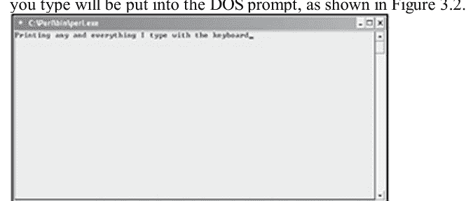

因为 stdin.pl 程序接收来自键盘的所有输入，所以你有一种方法可以关闭打字机。这实际上是一个糟糕的编程习惯，因为你总是希望保留一种退出方式，以防出现错误。在 Windows 上，你可以通过单击 stdin.pl 运行所在的窗口右上角的 X 来强制关闭 DOS 提示符，这可能会也可能不会导致 Windows 向你发送错误消息（取决于你运行的平台）。

解决此问题的正常方法是保留一个按键来结束程序，例如按 Q 退出，或者保留 Esc 键以便关闭程序。最简单的方法（不深入探讨循环，这将在今晚的课程中介绍）是从使用 `while` 命令切换到使用 `until` 命令：

```perl
# 将我们的标准结尾更改为标准输入
until (<>) { print; }
```


`until` 命令与 `while` 命令几乎相反。此脚本将允许你在键盘上输入，并在输入时显示你所键入的内容，直到你通过按 Enter 键向 `<STDIN>` 提交输入（我将在今晚的课程中更详细地介绍 `until` 循环）。为了使此程序完整，你应该包含一些注释和打印语句，让用户确切知道正在发生什么以及如何退出程序。完整的程序清单如下，你应该通过创建一个名为 untilstdin.pl 的新 Perl 文件来测试它，它也可以作为附带网站上周六上午源代码文件的一部分下载：

```perl
# 将我们的标准结尾更改为标准输入
print "This program acts like a standard typewritern\n";
print "Hit keys on the keyboard to see them print to the screen\n";
print "Hit the ENTER key to quit\n";
until (<>) { print; }
```

### 编程模块：解析到文件，随机数生成器

现在是时候回顾一下周六上午课程中的编程模块“变量和其他有趣的东西”，并了解如何应用本章涵盖的内容。打开 block2.pl 并将其重新保存为 block3.pl，以便有一个新的副本。

只需要再做几件事就可以完成游戏。一个重要的部分是随机地图，这是一个提高游戏可重玩性的功能，现在是构建随机地图的好时机。

接下来，我将在本模块中向游戏添加运行游戏所需的数学运算。这些添加主要包括你在玩游戏时会变化的游戏变量。

首先，为你想在程序代码中进行的更改添加注释：

```perl
#######################################################
# 模块 3 #
需要进行的任何数学运算
# 随机数生成器
# 任何变量更改
```

接下来，查看现有的变量，看看需要更改什么：

```perl
$direction = North;
$food = 10;
$health = 10;
```

方向标量必须根据玩家面向的方向进行更改。这个变化很可能由玩家上一次的移动决定，而在你拥有一个实际的游戏循环之前，这不会被跟踪。因此，我将转到下一个变量。

随着玩家移动，食物的数量应该减少，象征着在迷宫般的洞穴系统中游荡所需的能量。在此示例中，每次移动，玩家会损失两个单位的食物。代码如下所示：

```perl
# 移动时损失一个食物单位
$food = $food - 2;
print "You have $food boxes of ramen left\n";
```

生命值是最后一个变量，除非玩家发生不幸（例如，被狂犬蝙蝠攻击或在食物耗尽时尝试移动），否则应保持不变。在此示例中，每次不幸发生时，玩家的生命值减少 1，当生命值等于 0 时，游戏结束。

```perl
# 如果发生不幸，损失一个生命值
$health = $health - 1;
print "Your health is equal to $health\n";
```

将这些部分放入 block3.pl 并测试以确保一切正常；完整的源代码应如下所示：

```perl
########################################
# 困于洞穴
########################################

########################################
# 模块 1 - 规划
# 我需要：
# 将信息打印到屏幕的代码。
# 从键盘获取信息的代码。
# 生成随机地图的代码
# 跟踪玩家在地图上进度的代码

########################################
# 模块 2 - 基本需求。
# 我们已经学习了将信息打印到屏幕
# 从键盘获取信息
# 创建标量变量
# 以及保持 dos 提示符打开的标准结尾。
# 初始打印操作
# 分配变量
$direction = North;
$food = 10;
$health = 10;
print "\n";
print "You are trapped in a cavern\n";
print "You can travel North, South, East, or West\n";
print "\n\n\n";
print "You are facing $direction\n";
print "You have $food boxes of ramen left\n";
print "Your health is equal to $health\n";
print "\n\n\n";

########################################
# 模块 3 #
需要进行的任何数学运算
# 随机数生成器
# 任何变量更改
# 移动时损失一个食物单位
$food = $food - 2;
print "You have $food boxes of ramen left\n";
# 如果发生不幸，损失一个生命值
$health = $health - 1;
print "Your health is equal to $health\n";
# 添加我们更改为用户输入的结尾
# 标准结尾
print "\nPress an arrow key to continue...";
<>
```

block3.pl 的输出应与图 3.3 完全相同：

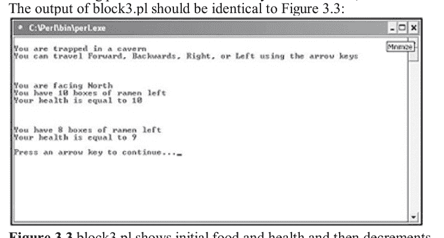

最后，是时候添加随机数和地图生成器了。因为在任何给定时间只有四种可能的行走方向，所以正确的方向可以用一个从 0 到 3 的数字来表示，其中北是 0，东是 1，南是 2，西是 3。将这些值放入标量中，如下所示：

```perl
#### 可能的方向
$north = 0;
$east = 1;
$south = 2;
$west = 3;
```

现在，以示例方式规划一张地图。假设走出洞穴的方法是向北，然后向东，然后再次向北，然后向西。这些方向现在可以用它们的数值来转换：

north = 0

east = 1

north = 0

west = 3

因此，出路实际上可以用一串数字来表示：0103。为了创建随机地图，使用 `rand` 命令生成四个 0 到 3 之间的数字，你可以使用以下代码来实现：

```perl
# 出路是
$turn1 = rand(3);
$turn2 = rand (3);
$turn3 = rand(3);
$turn4 = rand(3);
```

目前，你将让示例游戏打印出路，以便确保一切正常工作：

```perl
print "The way out is $turn1$turn2$turn3$turn4\n";
```

如果你保存并多次运行 block3.pl，你会注意到每次运行程序时，出路都不同。你还会注意到 `rand` 给你的不仅仅是 0、1、2 或 3，而是这些数字使用浮点数，可能是类似 0.08926892、1.34732933 和 2.99763093 这样的数字（见图 3.4）。

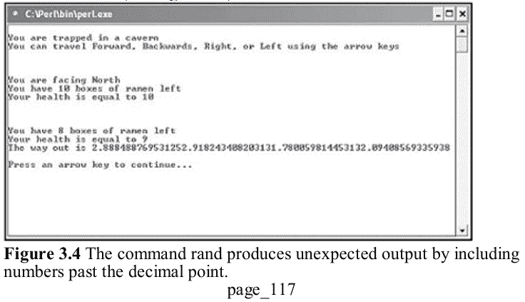

这很容易修复。你只需要告诉 Perl 你需要一个整数，这可以通过在 `rand` 语句中包含 `int` 命令来强制执行。将随机语句更改为以下内容：

```perl
# 出路是
$turn1 = int rand(3);
$turn2 = int rand (3);
$turn3 = int rand(3);
$turn4 = int rand(3);
```

现在，你几乎拥有了完成“困于洞穴”游戏所需的一切。剩下的就是以逻辑方式组织程序，这是今晚课程的重点。block3.pl 的完整源代码包含在此处，也可以从网站下载（作为 block3final.pl，block3.pl 涵盖了之前的更改）以及其他示例程序。

```perl
#################################################
# 困于洞穴
#################################################

#################################################
# 模块 1 - 规划 #
我需要：
# 将信息打印到屏幕的代码。
# 从键盘获取信息的代码。
# 生成随机地图的代码
# 跟踪玩家在地图上进度的代码

#################################################
# 模块 2 - 基本需求。
# 我们已经学习了将信息打印到屏幕
# 从键盘获取信息
# 创建标量变量
# 以及保持 dos 提示符打开的标准结尾。
# 初始打印
action # 赋值变量 $direction = North;

$food = 10; $health = 10; print "\n"; print "你被困在一个洞穴中\n"; print "你可以使用方向键向前、向后、向右或向左移动\n"; print "\n\n\n"; print "你正面向 $direction\n"; print "你剩余 $food 盒方便面\n"; print "你的生命值等于 $health\n"; print "\n\n\n";

```
########################################### # 区块 3 #
需要执行的任何数学运算 # 随机数生成器 # 任何变量更改 # 每次移动时失去一个食物单位 $food = $food -2; print "你剩余 $food 盒方便面\n"; # 如果发生意外，失去一点生命值 $health = $health -1; print "你的生命值等于 $health\n"; # 可能的方向 $north = 0; $east = 1; $south = 2; $west = 3; # 出路是 $turn1 = int rand(3); $turn2 = int rand (3); $turn3 = int rand(3); $turn4 = int rand(3); print "出路是 $turn1$turn2$turn3$turn4\n"; # 添加我们的结尾，改为用户输入 # 标准结尾 print "\n按方向键继续..."; <>
```

## 总结

周六下午晚些时候，你已经掌握了Perl的大部分基本构建模块。你理解了Perl如何处理文件和目录，并有机会尝试了基本的Perl操作，这些操作涵盖了从数学和逻辑到输入的方方面面。在今晚涵盖语句和循环的课程中，你将把这些片段组合起来，让Perl在你编程专长面前俯首称臣，开始编写将所有这些模块结合在一起的程序。现在，休息一下，享用一顿早晚餐，沉浸在你新获得的编程知识的荣耀中吧。

## 周六晚上

### 表达与声明

- 理解语句

- 理解Perl循环

- 使用例程和子程序

- 理解Perl声明

- 编程区块：游戏循环

*本页有意留白。*

现在是周六晚上，你怀着纪律和动力继续钻研Perl。你终于来到了我称之为这本“烹饪书”核心部分的地方。本章全部关于程序语句和循环。到目前为止，你一直在学习不同的Perl“食材”。现在，我将帮助你将这些食材组合成实际的“食谱”。Perl使用语句和循环来控制和排序程序的流程，并创建实际执行任务的完整代码块。

## **理解语句**

所有Perl代码，包括你到目前为止编写的代码，都是由语句组成的。然而，语句有几种不同的形式。到目前为止，你主要使用的是*简单语句*。简单语句是执行特定操作的表达式。Perl中的简单语句通常占用一行代码，并以分号(;)结束。复合或复杂的Perl语句通常包含多行代码，并使用多个表达式。你也使用过复合语句，尽管不如简单语句频繁。Perl中的复合语句通常由花括号({})分隔，并包含多个简单语句。

复合语句通常被称为程序块。你在每章末尾构建的程序块就是很好的例子。最后两章各包含了一组相关的指令，这些部分最终将在一个大型程序中组合在一起。程序块并不总是用花括号分隔，但它们的分隔通常定义了一个*作用域*。作用域是某些变量或命令的影响范围。

程序块通常用于将变量和命令保留在程序的一部分中，以便其他部分无法访问。第三种类型的语句称为条件语句（有时称为*分支*）。分支是代码行或代码块，根据程序的流程可能运行也可能不运行。程序员通常使用分支来启动依赖于用户输入的操作。熟悉*结构化编程*的程序员也称分支为控制结构。

## **结构化编程浅析**

结构化编程是一种旨在使大型程序更易于阅读的编程方法。它是面向对象编程的前身，我将在周日上午的“对象与面向对象编程”课程中详�介绍。结构化程序通常用简单的图形来说明，采用自顶向下的方法和流程。图4.1说明了一个结构化编程图，其中椭圆代表起点和终点，正方形代表程序块，菱形代表分支。在本章中，我将通过每个Perl的分支和循环语句时，使用结构化编程流程图来说明它们。结构化编程背后的主要思想是分而治之。随着计算机、技术和软件的进步，程序变得越来越大，编写和维护也变得越来越困难。结构化编程将复杂的程序分解为简单的任务。规则是，如果一个任务太复杂而无法简单描述，那么这个任务就需要进一步分解。当任务足够小，可以自包含且易于理解时，那么这个任务就可以被编程。在过去的几章中，你已经有很多编写简单语句的经验。本章重点介绍编写程序块和条件语句，从常见的语句命令开始：if、else、elsif 和 unless。

If是所有条件命令语句的基础。你会发现在用Perl编程以及其他编程语言编程时，会反复使用if命令。if命令检查一个指定的条件，该条件通常列在if语句后面的括号中。如果条件为真，if命令会执行紧随其后的代码块。

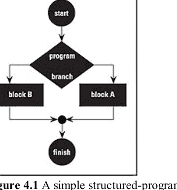

**图4.1** 一个简单的结构化编程流程图。

如果条件不为真，则跳过该代码块。在Perl中，if语句通常采用以下代码形式：

`if (this condition is true) {then this happens}`

Perl的if语句如图4.2所示，它描绘了程序经过if语句的流程。流程通过菱形

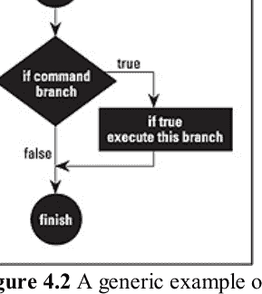

**图4.2** 程序流经if语句的通用示例。

分支，如果条件为真则执行代码块（正方形），如果条件为假则继续到结束椭圆。

单独使用if是有用的，但不如与其他语句（如else命令）一起使用有用。

### 使用 Else

else命令通常跟在if语句之后。当if语句返回假值时，else持有的代码块会执行。这会在程序中创建一个分叉，执行if块或else块之一。在Perl中一起使用else和if时，通用语法如下：

if (this condition is true) {then this happens} else {this happens instead}

这种代码语法是在Perl中创建程序流程的一种方式。一系列if和else语句允许代码根据变量或输入做出决策。当程序流程有两个可能的执行选择时，在结构化编程中被称为*双选择*。

if/else语句如图4.3所示。

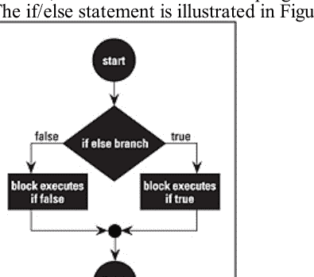

**图4.3** if/else语句的自顶向下流程。false和true分支都执行代码块。

双选择可能会受到限制，因为程序只能走两个分叉。如果你需要为多个路径编程，可以使用elsif命令。

### 使用 Elsif 语句

在运行if语句之后，Perl会查找其后的else语句。如果Perl没有找到else语句，它会检查是否有elsif命令。如果指定的条件（与if语句一样，包含在括号中）被判断为

### 使用 Unless 语句

Unless 的工作方式与 else 语句类似，但条件相反。除非条件为假，否则 unless 执行其后的程序块。（一些 Perl 程序员将 unless 语句称为 "反向的 if"。）Else 语句可以跟在 unless 语句之后，就像它们可以跟在 if 语句之后一样。图 4.5 展示了 unless 语句的实际应用。在接下来的代码示例中也使用了 unless，以简化之前的猜数字游戏。

```
$number = 5;
unless ($number == 5) {
    print "The number is definitely not five\n";
} else {
    print "the number must be 5\n";
}
```

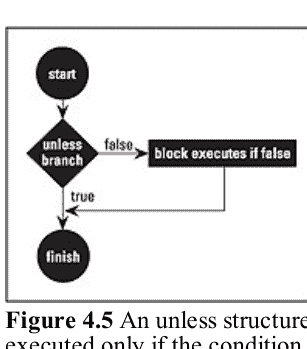

**图 4.5** 以流程图形式展示的 unless 结构。仅当条件为假时才执行该块；否则，程序流将继续。

### 不受欢迎的 GOTO 命令

如果你在阅读别人的代码，可能会遇到 goto 语句。程序员通常不赞成使用 goto 语句，尽管它们在早期和 Basic 语言中非常流行。不赞成使用 goto 语句是因为它们使代码变得支离破碎且难以阅读。这是由于 goto 的本质决定的——它告诉 Perl 跳转到代码的另一部分。你可以通过以下语法在 Perl 中识别 goto 语句：

```
if ($programmer == bad) {goto UNHAPPYPLACE}
```

尽管一开始使用 if、unless 和 else 进行编程看起来很繁琐，但你会习惯编写和阅读它们。你迄今为止编写的代码并不难理解，特别是如果你有良好的注释习惯。使用大量 goto 语句的代码很快就会变得难以阅读，因为你必须跳转到代码中的不同位置。

你通常不会在代码中经常看到 goto，因为循环更优雅且更易于阅读。循环也不太可能导致容易出错的情况或无限循环。尽管如此，你可能还是会遇到 goto，甚至可能找到这个命令的合法用途，尽管许多程序员主张，使用 goto 能做的任何事情，都可以用循环和语句来完成。

### 不同类型的 Perl 循环

计算机擅长重复执行快速计算，循环的创建正是为了利用这一优势。循环会持续执行命令，直到被先前设定的条件停止。循环通常使用块来保存它们要执行的代码。当你运行一个循环时，你会运行包含在花括号中的一个独立的程序块，直到某个条件改变或被满足。

在上一节的最后，我向你介绍了 while 循环，并用它来捕获键盘的标准输入 <STDIN>，从而创建了类似打字机的效果。然后你将 while 循环改为 until 循环，同样实现了捕获键盘按键的效果。这些例子展示了循环的实际工作方式。while 命令和 until 命令都在循环，并在循环期间收集所有键盘按键，直到循环退出。在本节中，我将更深入地解释 while 和 until 循环，并介绍其他常见的 Perl 循环。

#### 使用 While 循环

while 循环被认为是 Perl 程序循环中最容易实现和学习的。它最常用于使用标准输入或 <> 运算符（今天早上介绍过，今天下午也简要提及过）从命令行获取输入。

while 循环设计为只要特定条件保持为真，就执行相同的代码。因此，while 循环是电子商务的常见支柱。只要客户仍在购买商品，while 循环就可以跟踪他们购买了什么以及花了多少钱。while 循环也是游戏的常见支柱。只要飞船没有被摧毁，程序就会继续向它发送外星人。图 4.6 以结构化编程流程图的形式展示了 while 循环。

回忆一下你刚才写的用于 elsif 命令的脚本，你可以将这个程序改写为 while 循环，以节省时间和精力，甚至稍微改进脚本。

```
$number = 5;
$guess = 1;
while ($guess != $number) {
```

---

true；否则，Perl 将继续执行程序的其余部分。

你可以连续使用多个 elsif 语句来创建一个需要检查的长条件链。然而，一个 if 后面只能跟一个 else 语句。在 Perl 中，elsif 语句的语法如下所示：

```
if (this first condition is true) {
    then this first program block runs
} elsif (this second condition is true) {
    then this second program block executes
} elsif (this third condition is true) {
    then this third program block runs
} else {
    this happens instead
}
```

图 4.4 展示了一个典型的 elsif 程序结构。这是一个强大的程序结构，因为它允许你塑造决策树、多路径或分支，程序可以根据计算机或变量输入使用这些路径。当你将 elsif 程序结构与今天下午课程中的运算符结合使用时，你可以将简单的 Perl 脚本转变为强大的复杂语句。

决策树的一个简单应用是让 Perl 确定一个数字是否小于或等于某个值。要创建一个推导数字值的复合脚本，请按照以下步骤操作：

- 1. 将要比较的数字放入一个标量中。

- 2. 使用一系列 if 和 elsif 语句来分隔程序分支。

- 3. 使用大于、小于和等于运算符作为 if 和 elsif 语句的条件。

- 4. 在 if 和 elsif 语句推导出数字后使用 print。

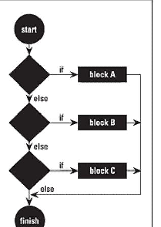

**图 4.4** 你可以使用 elsif 语句在程序流程图中创建多个分支。

将数字赋值给标量很简单，因为你几乎已经使用了一整天的标量。在一个名为 Number.pl 的新 Perl 脚本中，将数字 5 赋值给一个名为 number 的标量。

```
# Assign a value to number
$number = 5;
```

现在你需要构建 if 和 elsif 块。第一种可能性是数字小于五；第二种是数字大于五；第三种是数字等于五。为了处理这三种可能的结果，请构建一个 if 语句，后跟两个 elsif 语句。

```
# Assign a value to number
$number = 5;
# Set up the program blocks
if () { } elsif () { } elsif () { }
```

程序块构建完成后，你可以为执行这三个代码块中的每一个添加条件。你可以使用今天下午课程中学到的小于和大于运算符来确定 $number 是小于、大于还是等于值 5。

```
# Assign a value to number
$number = 5;
# Set up the program blocks
if ($number == 5) { } elsif ($number > 5) { } elsif ($number < 5) { }
```

现在你需要在花括号之间填入实际的程序块，以确定当 Perl 发现 $number 的值时实际会发生什么。一个简单的处理方法是包含 print 语句来解释 Perl 发现了什么。

```
# Assign a value to number
$number = 5;
# Set up the program blocks
if ($number == 5) {
    print "The number is equal to 5\n";
} elsif ($number > 5) {
    print "The number is greater than 5\n";
} elsif ($number < 5) {
    print "The number is less than 5\n";
}
```

一个惯例性的代码约定是将一组中的最后一个 else 语句保留用于覆盖程序中的错误。例如，如果 $number 意外地被赋值为字符串会怎样？在这种情况下，Perl 将跳过所有 elsif 语句，程序将在不向用户显示任何文本的情况下结束，这并不优雅。为了使程序更优雅和安全，请添加最后一个带有通用短语的 else 语句。

```
} else {
    print "Perl could not determine the number.\n";
}
```

将所有代码组合在一起，添加你标志性的结尾，保存程序并运行它。你也可以尝试为 $number 赋予不同的值，以测试你的脚本运行的准确性。

```
# Assign a value to number
$number = 5;
# Set up the program blocks
if ($number == 5) {
    print "The number is equal to 5\n";
} elsif ($number > 5) {
    print "The number is greater than 5\n";
} elsif ($number < 5) {
    print "The number is less than 5\n";
} else {
    print "Perl could not determine the number.\n";
}
# another print statement telling the reader what to do next
print "Press <ENTER> to continue...";
# Perl waits at these brackets for user input
<>
```

### 使用 For 循环

For 循环可能是编程中最常见的循环。For 循环之所以至关重要，是因为它为程序员提供了对重复操作的精细控制。当需要对列表、数组或一系列不同项目执行例程或操作时，For 循环确实表现出色。许多初学编程的人最初都难以掌握 for 循环的结构。与只接受一个条件的 while 循环不同，for 循环需要三个独立的条件才能正确执行。由于 for 循环非常普遍，许多编程语言都为其提供了相关的简写形式，这增加了它们的神秘感并使其难以解读。然而，如果使用得当，for 循环的功能极其强大，尤其适用于执行重复操作或需要修改数组中的项目时。一个标准的 for 循环通常具有以下一般结构：

`for (expression1; expression2; expression3) {你熟悉的执行代码块}`

图 4.7 展示了 for 循环的结构化程序流程。注意，有两个编程块；第一个是作为循环表达式一部分执行的代码，第二个是循环执行的代码块。

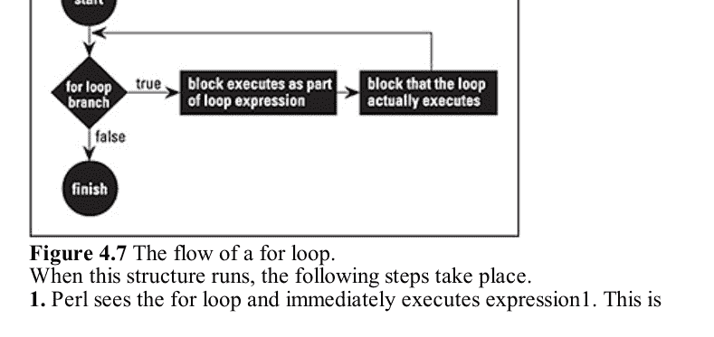

当这个结构运行时，会执行以下步骤：

1.  Perl 识别出 for 循环并立即执行 expression1。这是 Perl 唯一一次执行 expression1。

2.  检查 expression2（通常是某种条件）。如果表达式/条件为假，Perl 会立即退出 for 循环。如果表达式/条件为真，Perl 将继续执行循环体。

3.  Perl 执表达式3。与 expression1 不同，Perl 每次循环都会执行 expression3。

4.  Perl 执行代码块中的所有代码，然后返回到步骤 2。

由于 expression1 只执行一次，它通常用于初始化一个计数器。这个计数器通常是一个变量，它在循环开始时诞生，并在每次循环运行时递增。同一个变量在 expression2 中被设置为退出循环的条件。expression3 则负责递增该变量。例如，如果你想设置一个 for 循环来执行一个打印语句 10 次，你可以在 expression1 中将初始变量设为 1，在 expression2 中让条件测试该变量是否已达到 10，并让 expression3 在每次循环运行时递增该变量。

举个例子，这是一个循环打印 "looping" 10 次的 for 循环：

```
for ($loop = 1; $loop <= 10; $loop++) { print "looping\n"; }
```

以下是此示例中 for 循环的步骤：

1.  Perl 识别出 for 循环并跳转到语句 1 (`$loop = 1`)。Perl 创建 `$loop` 并为其赋值数字 1。

2.  Perl 然后在继续之前检查第二个语句是否为真。Perl 看到 `$loop <= 10` 是一个真条件，所以它继续执行。如果 `$loop` 等于 10 或更大，Perl 将立即退出 for 循环。

3.  运行代码块（即 print 语句）后，它执行第三个语句 (`$loop++`)，将 `$loop` 递增 1。

4.  Perl 然后运行 for 循环代码块中的所有代码，在本例中是一个 print 语句。

5.  Perl 然后返回到步骤 2。

### 使用 Do/While 循环

除了 Perl 之外，许多其他编程语言都有一种称为 do/while 的循环。这种循环的流程如图 4.8 所示。Perl 没有独立的构造作为 do/while 循环，但可以使用 while 循环配合 do 语句来达到相同的效果。

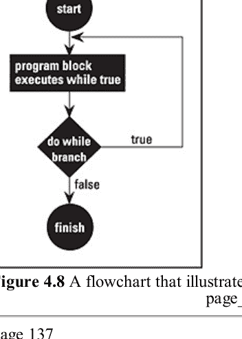

图 4.8 展示典型 do/while 循环的流程图。

要设置一个 do/while 循环，你首先设置一个 do 代码块。do 命令类似于你已经看过的其他结构：`do {this};`

在一个像这样的简单脚本中，do 告诉 Perl 执行 do 块内的所有内容。你可以添加一个 while 命令将此脚本转换为典型的 do/while 结构：`do {this} while {this is true}`

这个概念的一个实际例子是你下午部分看过的 while 循环的变体，其中你使用 while 循环通过 `<STDIN>` 将输出打印到屏幕。你可以使用 do/while 构造达到相同的效果：`do { print; } while (<>);`

请记住，这是一个人为构造，并非真正的循环。当你在周日下午部分“综合运用”中学习常见的循环命令（如 next、redo 和 last）时，它们在 do/while 中将无法正常工作。

在 Perl 中，do/while 构造不如其他类型的循环常见。Perl 中存在 do/while 的主要原因是为那些从其他语言（如 C）过渡到 Perl 编程的程序员准备的，在这些语言中 do/while 是一种已确立且常用的循环类型。

### 使用 Foreach 循环

Perl 的 foreach 循环是我最喜欢的循环之一。当你需要对多个不同的标量（特别是存储在数组中的标量）进行更改或修改时，它是一个惊人的快捷方式。foreach 循环使用与 for 循环相同的结构流程图（见图 4.7），但它有一些显著的差异。

一个打印数组中每个标量的 for 循环看起来像这样：

```
# 将标量分配给一个名为 array 的数组（回忆第2章中的数组）
@array = ("My", "Cat's", "Name", "is", "Small");
# 设置一个 for 循环来遍历 @array 的每个部分
for ($loop = 1; $loop <= $#array; $loop++) {
    # 在循环命中时打印数组的每个部分
    print $array[$loop];
}
```

虽然这种构造可以工作，但它可能难以阅读，并且 Perl 的 for 循环并未针对遍历数组进行优化。Perl 编译器优化了 foreach 循环，使其比普通循环更快地遍历数组，而且代码看起来更整洁。

```
# 将标量分配给一个名为 array 的数组（回忆第2章中的数组）
@array = ("My\n", "Cat's\n", "Name\n", "is\n", "Small\n");
# 设置一个 foreach 循环来遍历 @array 的每个部分
foreach $entry (@array) {
    # 在循环命中时打印数组的每个部分
    print "$entry";
}
```

foreach 循环的另一个强大功能是它可以同时遍历多个不同的数组。

```
# 将标量分配给一个名为 array 的数组（回忆第2章中的数组）
@array1 = ("My\n", "Cat's\n", "Name\n", "is\n", "Small\n");
@array2 = ("My\n", "Second\n", "Cat's\n", "Name\n", "is\n", "Sidney\n");
@array3 = ("My\n", "Third\n", "Cat's\n", "Name\n", "is\n", "Jasmine\n");
@array4 = ("My\n", "Fourth\n", "Cat's\n", "Name\n", "is\n", "Hailey\n");
# 设置一个 foreach 循环来遍历每个数组的每个部分
foreach $entry (@array1, @array2, @array3, @array4) {
    # 在循环命中时打印数组的每个部分
    print "$entry\n";
}
```

foreach 循环与 for 循环一样，对于遍历项目列表或数组非常有用。由于 foreach 循环已被 Perl 编译器优化，比其他类型的循环更快地遍历数组，因此你最有可能在处数组时使用或遇到它。

## 休息一下

呼，语句和循环——你可能还没怎么休息

### 使用例程与子例程

沿着程序流程的思路，我们来看程序例程和子例程的概念。例程有助于你在创建程时组织代码。分而治之的理念只有在你能将程序拆分成小而易管理的部分时才可行，而子例程是 Perl 提供的一种允许你将程序拆分的机制。程序员出于多种原因在开发过程中会将程序拆分成小块，包括以下几点：

- 小段代码比大段代码更容易构建。

- 小段代码比大段代码更容易维护。

- 小段代码在出现问题时更容易调试。

- 小而专注的代码片段可以移植到其他应用和项目中。

创建子例程是将大程序拆分成小块的起点。一个大型项目被分解成小而专注的部分或组件。

### 使用简单例程

例程是一组相关功能的集合，它们被保存为通用、可重用的脚本。你可以创建许多你经常使用或将来可能需要的 Perl 脚本，并将它们保存为可重用的例程，以便在将来的项目中引用和插入。在 Perl 中，没有特定的语法或特殊命令来指明例程。例程是一个通用术语，指代你可以使用并添加到现代代码和项目中的完成好的程序或程序片段。你到目前为止编写的任何脚本都可以保存并用作例程。已经为 Perl 编写了大量的例程集合。

Perl 社区以*包*和*模块*的形式为程序员提供 Perl 例程和其他有用的资源。Perl 包是存在于自己空间中的代码段，除非 Perl 被明确告知去使用某个包及其内部的函数，否则它们与程序的其余部分是隔离且不可用的。

Perl *模块*是可以添加到你的 Perl 发行版（实际添加和安装的 Perl 文件）中的包组，并增加了功能。如果 Perl 是一辆车，那么 Perl 模块就是你可以添加的额外选项（全天候轮胎、强劲的音响系统、加热座椅），它们增加了额外的功能、花哨的配置和特色。我将在周日晚间的“学习高级 Perl 技术”课程中概述几个 Perl 模块，同时我也将在周日上午的“对象与面向对象编程”课程中概述包，因为包是 Perl 中面向对象编程的基石。在此期间，我鼓励你保存你在 Perl 项目中编写的所有内容，无论是来自本书还是其他地方，这样你就不用在每次应对新挑战时都重新发明轮子了。

### 使用子例程

子例程是用户自定的命令。子例程允许你在单个 Perl 脚本中拥有多个例程或分离的功能。Perl 让你编写代码，为其命名，然后像调用任何其他函数一样调用和使用该代码。这对于专业程序员来说非常棒，因为它允许他们分离代码，分块重用，并将其携带以供日后使用。

要创建你自己的子例程，你需要使用 Perl 的 `sub` 命令，命名子例程，然后将实际操作代码封装在一个程序块中。这里我创建了一个名为 `small` 的子例程，可用于打印一系列语句：

```
sub small { printf "My cat Small\n"; printf "is indeed\n"; printf "A creature of curiosity and wit\n"; }
```

子例程可以在 Perl 代码中的任何位置初始化，尽管程序员倾向于将它们放在代码的开头。（这是一种常见的编码惯例，被认为对那些后来试图理解你代码的人是礼貌的。）这是一个好习惯，因为许多其他语言要求你在程序的早期就声明子例程之类的东西。你创建的子例程被认为是全局作用域的，并且能够使用任何现有的全局变量。要调用你自己的子例程，你需要在脚本中使用 `&` 符号来警告 Perl 你将使用一个子例程。`&small;`

子例程的一个重要特性是，它们可以自动返回最后执行的计算的值。在 `simpleaddition` 子例程中，和值 20 会被记住，并且可以被其他常见的 Perl 命令引用。

```
sub simpleaddition { 10 + 10; }
print &simpleaddition;
```

在这个上下文中，术语*最后值*指的是最后计算出的值，而不一定是子例程的最后一行。

子例程可以通过参数的形式接收和发送信息。要给子例程一个参数（Perl 爱好者喜欢称之为*传递*），你在调用子例程时将参数放在括号内。

`&mySubroutine(argument0, argument1);`

这两个参数被传递给了 `&mySubroutine`。这些参数被赋值给一个特殊的默认数组（类似于标准输入），名为 `@_`。因此，当你将两个参数发送给 `&mySubroutine` 时，Perl 会自动且不可见地执行以下数组赋值：

`@_ = (argument0, argument1);`

你可以在子例程内部使用 `@_` 来访问参数。在前面的例子中，`argument0` 是数组的第一个条目，你可以通过输入以下内容来访问它：

`$_[0]`

或者，你可以使用 `$_[0], $_[1]` 来访问两个参数。

你可以将标量传递给子例程，而不是简单值，只需在调用子例程时包含标量而不是数字。例如，以下代码将两个标量发送给子例程 `collect`：

```
sub collect { foreach (@_) {} }
&collect($scalar1, $scalar2);
```

重要的是要认识到，当向子例程传递一个标量值时，子例程实际上接收到的是指向原始值的引用或指针。这意味着如果你传递一个标量给子例程，然后修改该标量，子例程将收到修改后的值。

当信息传入或传出程序块时，子例程有时可能会给你带来麻烦。这是因为没有错误检查。如果你在一个子例程中，并试图调用一个只有 10 个条目的数组的第 200 个条目（`$_[200]`），当你在运行代码时会得到一个 `UNDEF` 错误。如果你的子例程要求两个参数，而你在运行代码时没有提供两个参数，那么在你实际运行程序之前，你和 Perl 都不会意识到你的子例程需要两个参数。

你不仅可以使用 `@_` 将简单标量传递给子例程，还可以传递数组、列表或哈希。在接下来的这段代码中，子例程 `collect` 获取传递给它的哈希：

```
sub collect { %retrievedhash = @_; }
&collect(%senthash);
```

重要的是要认识到，如果你传递两个或多个数组或哈希给子例程，它们会被推入 `@_` 默认数组中成为一个长列表。

如果你正在构建一个接受随机或不确定数量参数的子例程，你可以通过检查 `@_` 数组的长度来确定参数数量。由于 `@_` 默认数组就像 Perl 中的任何其他数组一样，你可以对其应用今天早上你学到的所有数组操作技巧。在这种情况下，要确定 `@_` 数组中存在多少个参数，你可以使用 `$#_` 命令：

```
sub collect { print "The number of passed arguments is equal to " . $#_ + 1 . "\n"; }
```

如果一个子例程需要几个参数才能正确运行，而用户忘记向子例程传递任何参数怎么办？没问题，你可以使用 `||=` 运算符给子例程提供默认参数。`||=` 运算符的语法如下：

`argument ||= value;`

如果你需要 `collect` 子例程至少拥有一个值为 1 的参数，你可以使用以下代码来设置：

```
sub collect { $value = @_; $value ||= 1; }
```

如果没有参数发送给 `collect`，标量 `$value` 最初将具有值 1，如果 `collect` 收到一个参数，该值将被覆盖。Perl 中的子例程能够使用简单的 `return` 语句发送回参数以及接收它们。在前面的例子中，如果我想让 `collect` 返回 `$value`，我可以像这样向代码添加一个 return 行：

```
sub collect { $value = @_; $value ||= 1; return $value; }
```

子例程也能够返回列表：

```
sub get { return a, b, c, d, e, f, g; }
```

或者使用 `@_` 默认数组返回一个数组：

```
sub get { return @_; }
```

最后，返回一个哈希：

```
sub get { return %hash; }
```

### 在子例程中使用引用

因为 `@_` 默认数组在传入子例程时会扁平化数组和哈希，所以当你一次性传递多个数组或哈希给子例程时，你的子例程有时可能会遇到冲突。这个问题可以

### 判断子程序是否存在

处理大型程序或拆分成不同部分的小型程序时，检查某个子程序是否已被定义会很有帮助。Perl 提供了 `defined` 函数来支持此操作，其语法如下：

`defined subroutine;`

一个简单的例子是：如果某个特定子程序（例如 `simpleaddition` 子程序）已经存在，则执行一段代码：

`$number = &simpleaddition if defined simpleaddition;`

在 5.6 版本中，Perl 还添加了 `exists` 命令，其功能与 `defined` 相同，因此你也可以使用这行代码：

`#number = &simpleaddition if exists simpleaddition;`

这个问题可以通过向子程序传递引用（而不是实际数组）来解决。假设你有两个数组：

`@array1 = (a, b, c);`

`@array2 = (1, 2, 3);`

通常，如果需要将它们传入子程序，你会将它们传递给默认的 `@_` 数组，但这样一来你就只能得到一个数组，并且所有元素都混合在一起了：

```
sub collect {
    $value = @_;
    print $value;
}
sub (\@array1, \@array2);
```

如果你运行这个子程序，`$value` 会输出 "abc123"，结果是你得到了一个混合后的数组，而不是最初的两个独立数组。替代方案是使用引用。要将传入子程序的数组转换为引用，你只需在变量名前加上 `\`：

`sub (\@array1, \@array2);`

现在 Perl 就知道你希望向子程序传递两个数组引用，你可以在子程序内用一行代码收集它们，并添加一个打印语句：

```
($value1, $value2) = @_;
print $value1;
print $value2;
```

最终完成的代码如下所示：

```
# Assign the two arrays
@array1 = (a, b, c);
@array2 = (1, 2, 3);

# Create the subroutine
sub collect {
    # collect the arrays values sent to the subroutine
    ($value1, $value2) = @_;
    print $value1;
    print $value2;
}

# Call the subroutine with your two arrays
sub (\@array1, \@array2);
```

你也可以使用相同的技术通过引用来返回数组：

`return \@array;`

因此，如果你想返回上述示例中传递给 `collect` 的两个数组，你可以在子程序末尾添加以下代码行：

`return (@value1, @value2);`

最终的源代码如下所示：

```
# Assign the two arrays
@array1 = (a, b, c);
@array2 = (1, 2, 3);

# Create the subroutine
sub collect {
    # collect the arrays values sent to the subroutine
    ($value1, $value2) = @_;
    print $value1;
    print $value2;
    # return the two arrays
    return (@value1, @value2);
}

# Call the subroutine with your two arrays
sub (\@array1, \@array2);
```

### 不同类型的 Perl 声明

既然你已经掌握了循环和其他 Perl 程序结构，你需要在程序中重新加入标量、字符串和操作。现在的问题是，如何访问位于不同代码块中的不同标量，以及如何限制你在循环中使用的值，以免它们影响程序的其余部分。

Perl 使用一个叫做*作用域*（scope）的概念（我在今天早些时候的课程中简要定义过）来确定标量的影响范围。如果你在赋值时没有指定作用域，Perl 默认会假定其作用域是全局的。

### 使用全局声明

从今天早些时候的课程开始，你使用过的每个标量都是全局变量。这意味着这些标量在脚本中的任何地方都是可用的。尽管 Perl 会自动假定一个标量本质上是全局的，除非你另行定义，但在某些情况下，你可能希望在代码中显式地将变量定义为全局变量。要专门将一个标量指定为全局变量，请使用 `our` 命令。在声明标量时，只需在语句开头添加 `our` 即可确保该标量是全局的。

```
# normal scalar values
$a = 1;
$b = 2;
$c = 3;

# scalar values specifically designated as global
our $a = 1;
our $b = 2;
our $c = 3;
```

> **注意**

> 将全局作为变量语言的默认设置。在你学习 Perl 之后的几乎每一种其他编程语言，在你初始化一个值时，都会自动为其分配一个有限的作用域。因此，即使这意味着多打一些字，开始使用 `our` 命令可能是个好主意。

同样地，Perl 是少数几种不强制你在使用变量之前声明变量及其作用域的语言之一。事实上，有一个 Perl 语用程序（pragma）（关于语用程序的更多信息将在周日晚上的课程中介绍）叫做 `strict`，它强制程序员在使用变量之前声明变量及其作用域。

其他编程语言通常将全局变量称为*公共变量*，意味着它们对程序的通用部分是可访问的。不可全局访问的变量则相反地被称为*私有*变量。

### 使用限定作用域的声明

大多数时候，你不会希望标量具有全局作用域。随着你的 Perl 程序需要跟踪的变量数量增加，程序运行会变慢，并占用更多计算机内存空间。为了减少这种程序膨胀，Perl 和其他程序提供了使变量私有化并限制其可访问性的声明。

Perl 包含用于指指定两种类型私有变量的命令——词法作用域和动态作用域。私有变量是在赋值标量时通过添加一个简短的声明来创建的，就像使用全局 `our` 命令一样。

动态作用域变量由 `local` 命令赋值，它们存在于创建它们的程序块也存在的期间。如果你在 `for` 循块内创建了一个局部标量，只要该 `for` 循环在执行，它就会存在，并且可以被该程序块及其创建的任何程序块使用。

```
# assigning dynamic scalars with the local command
local $a = 1;
local $b = 2;
local $c = 3;
```

词法变量只能存在于特定的程序块内。它们是 Perl 作用域命令中限制最严格的。你使用 `my` 命令将标量限制在其当前块内。

```
# assigning lexical scalars with the my command
my $a = 1;
my $b = 2;
my $c = 3;
```

以下代码通过使用 `local`、`my` 和 `our` 命令来说明作用域的概念，并显示每个标量根据其作用域可以在哪些位置被访问。

```
# assign a global variable
our $global1 = 10;

if ($global == 10) {
    # assign a lexical and dynamic variable within a program block
    local $local1 = 10;
    my $dynamic = 10;
    
    # print the scalars that are accessible within this block
    # This should be all of them
    print "$global1\n";
    print "$local1\n";
    print "$dynamic\n";
    
    # Start a nested block to go deeper
    if ($global == 10) {
        # print which scalars are available in this block.
        # Both the global and the dynamic are, but not the lexical
        print "$global1\n";
        print "$local1\n";
        print "$dynamic1\n";
    }
    
    # left the inner program block,
    # printing should show each scalar accessible again
    print "$global1\n";
    print "$local1\n";
    print "$dynamic1\n";
}

# Now outside of the program block,
# the only scalar accessible should be the one that is global
print "$global1\n";
print "$local1\n";
print "$dynamic1\n";
```

运行此程序时，尝试打印超出作用域的标量会导致错误，但经过一些修改（包括删除访问这些超出作用域标量的打印语句）后，程序就可以执行了。

### 编程块：游戏循环

最后，你期待的时刻到来了。既然循环已经牢固地掌握在你的知识体系中，是时候完成编程块并实际试驾一个 Perl 电脑游戏了。首先，打开你的 `block3final.pl` 程序并将其另存为 `block4.pl`。`block3final.pl` 还有几个重要的部分需要完成。你已经有了控制游戏玩法的大部分组件，但没有一个循环来跟踪玩家在地图上的位置，或者在玩家想要退出之前持续循环。你现在拥有了用你新获得的 Perl 结构和循环专业知识来实现这一目标的工具。

首先，整理 `block4.pl`。将你编写的所有注释块放在脚本的顶部。你可以随意添加本章你需要完成的事项列表（基本上是游戏循环和其他任何遗留事项）。然后，获取 "Possible Direction" 变量和 "The Way

### 赋值变量

$direction = 北;

$food = 10;

$health = 10;

$turn = 1;

#### 可能的方向

$north = 0;

$east = 1;

$south = 2;

$west = 3;

#### 出口路径是

$turn1 = int rand(3);

$turn2 = int rand(3);

$turn3 = int rand(3);

$turn4 = int rand(3);

这些是全局变量——无论程序执行到哪一步，都需要它们。如果你使用了作用域，就需要为每个变量分别赋值。目前，这样就足够了。

接下来，你需要将游戏的其余部分放入一个循环中。本例中使用一个 `for` 循环，并设置一个 `turn` 表达式来跟踪当前是第几轮。因为你的随机迷宫生成器只生成四个出口，所以循环应在四轮后退出。这个 `for` 循环应如下所示：

```
for ($turn = 1; $turn <=4; $turn++) { }
```

唯一的区别是，程序的其余部分应存在于 `for` 循环的花括号内。将所有部分组合在一起，然后运行 `block4.pl`。此时的代码应如下所示：

```
##########################################
# Trapped
##########################################

##########################################
# block1 - 规划 #
# 我需要：
# 将信息打印到屏幕的代码。
# 从键盘获取信息的代码。
# 控制文本/信息显示时间的代码
# 生成随机地图的代码
# 跟踪玩家在地图上进度的代码
##########################################

# block 2 - 基本需求。
# 我们已经学会了将信息打印到屏幕、
# 从键盘获取信息、
# 创建标量变量，以及
# 保持命令提示符打开的标准结尾。
# 初始打印操作
##########################################

# block 3
# 需要完成的任何数学运算
# 随机数生成器
# 任何变量更改
##########################################

# block 4
# 实际的游戏循环
# 任何其他未完成的内容。
### 赋值变量
$direction = 北;
$food = 10;
$health = 10;
$turn = 1;

#### 可能的方向
$north = 0;
$east = 1;
$south = 2;
$west = 3;

#### 出口路径是
$turn1 = int rand(3);
$turn2 = int rand(3);
$turn3 = int rand(3);
$turn4 = int rand(3);

print "出口路径是 $turn1$turn2$turn3$turn4\n";

for ($turn = 1; $turn <= 4; $turn++){
    print "\n";
    print "你被困在一个洞穴里\n";
    print "你可以向北、南、东或西旅行\n";
    print "\n\n\n";
    print "你面向 $direction\n";
    print "你还剩 $food 盒方便面\n";
    print "你的生命值为 $health\n";
    print "\n\n\n";

    # 移动一次，食物减少一单位
    $food = $food - 2;
    print "你还剩 $food 盒方便面\n";

    # 如果发生意外，生命值减少一
    $health = $health - 1;
    print "你的生命值为 $health\n";
} # 添加我们的结尾，改为用户输入 # 标准结尾
print "\n按任意键继续...";
<>
```

此时，游戏仍然不接受任何用户输入；它只是在 `for` 循环中打印语句几次后就结束了。为了解决这个问题，我们需要等待玩家选择一个行进方向。理想的实现方式是使用 `<STDIN>`（默认是计算机键盘）的 `readline` 命令。同时，在以下代码中添加一行打印语句，以确保你接收到了所需的键盘输入。这段代码如下所示：

```
# 需要从玩家那里获取信息
$char = readline(*STDIN);
print "$char\n";
```

要从玩家那里收集信息，你需要提供打印语句作为说明。为了简化操作，让用户按下程序已经跟踪方向的按键，并使用以下打印语句：

```
print "请选择一个行进方向，按下：\n";
print "0 代表北\n";
print "1 代表东\n";
print "2 代表南\n";
print "3 代表西\n";
# 需要从玩家那里获取信息
$char = readline(*STDIN);
print "$char\n";
```

> **注意**

> 你可能在想为什么我不让你从键盘读取方向键作为输入。你已经学习了几种从键盘获取 `<STDIN>` 的方法，包括 `readline` 和 `getc`，但这些方法不足以处理非常规字符，比如方向键或退出键。

别担心。目标是今晚就有一个完成并可运行的《困住》游戏，但你会在接下来的几节课中不断回顾和改进这个程序。随着你对 Perl 理解的加深，你将能想出数十种方法来改进这个简单的程序。

现在是代码中最复杂的部分。当玩家做出方向决策时，游戏需要判断该方向是否正确，然后给予玩家奖励或惩罚。最简单的方法是使用程序流程语句。从最简单的条件开始：玩家在正确的轮次选择了正确的方向。这可以是一个简单的 `if` 语句：

```
if ($turn == 1 && $char == $turn1) {print "你做出了明智的选择！\n\n"};
```

这个 `if` 语句检查在第一轮（`$turn == 1`）玩家是否输入了正确的行进方向（`$char == $turn1`）。两个 `&` 符号在 `if` 语句中代表“与”，确保在打印成功消息之前同时满足两个条件。可以通过为每次成功移动添加 `elsif` 语句，以这种方式继续每一轮的代码逻辑，如下所示：

```
elsif ($turn == 2 && $char == $turn2) {print "你做出了明智的选择！\n\n"}
elsif ($turn == 3 && $char == $turn3) {print "你做出了明智的选择！\n\n"}
elsif ($turn == 4 && $char == $turn4) {print "你做出了明智的选择！\n\n"}
```

最后，选择错误迷宫出口的后果可以应用于最后的 `else` 语句；可以添加另一个简单的 `if` 语句来检查玩家是否食物耗尽，以及一个最终的 `if` 语句来检查玩家是否失败并需要退出程序。这段代码还会让 `$turn` 倒退一步，这样游戏就不会结束，直到玩家的生命值低于零，或者成功走出迷宫：

```
{ # 如果发生意外，生命值减少一
  $health = $health - 1;
  print "你做出了糟糕的选择\n";
  print "你的生命值为 $health\n";
  $turn = $turn - 1;
};
if ($food <= 0) {
  print "你的食物吃完了！\n";
  $health = $health - 1;
};
# 移动一次，食物减少一单位
$food = $food - 2;
print "你还剩 $food 盒方便面\n";
if ($health < 0) {
  print "你失败了，将永远被困在这里！\n";
  $turn = 4;
};
```

游戏循环现在完成了。你可以保存 `block.pl` 文件，运行它，并体验整个游戏循环。仍然需要进行许多更改。迷宫的出口路径在游戏开始时就被打印出来了。食物变量需要一些调整才能与游戏正确配合。打印到屏幕的指令可以用更易读的方式进行格式化。代码也变得很大（超过100行），有些难以管理。这一切都是意料之中的：欢迎来到编程的精彩世界。在接下来的几节课中，你将对脚本进行改进以解决这些问题。以下是项目当前的完整源代码。代码也可以在配套网站（http://www.premierpressbooks.com/downloads.asp）的周六晚间会话下载中找到：

```
#########################################################
# Trapped
#########################################################
#########################################################
# block1 - 规划 #
# 我需要：
# 将信息打印到屏幕的代码。
# 从键盘获取信息的代码。
# 控制文本/信息显示时间的代码
# 生成随机地图的代码
# 跟踪玩家在地图上进度的代码
#########################################################

# block 2 - 基本需求。
# 我们已经学会了将信息打印到屏幕、
# 从键盘获取信息、
# 创建标量变量，以及
# 保持命令提示符打开的标准结尾。
# 初始打印操作
#########################################################

# block 3
# 需要完成的任何数学运算
# 随机数生成器
# 任何变量更改
#########################################################

# block 4
# 实际的游戏循环
# 任何其他未完成的内容。
### 赋值变量
$direction = 北;
$food = 10;
$health = 10;
$turn = 1;

#### 可能的方向
$north = 0;
$east = 1;
$south = 2;
$west = 3;

#### 出口路径是
$turn1 = int rand(3);
$turn2 = int rand(3);
$turn3 = int rand(3);
$turn4 = int rand(3);

print "出口路径是 $turn1$turn2$turn3$turn4\n";

for ($turn = 1; $turn <= 4; $turn++) {
    print "\n";
    print "你被困在一个洞穴里\n";
    print "你可以使用方向键向前、向后、向右或向左旅行\n";
    print "\n\n\n";
    print "你面向 $direction\n";
    print "你还剩 $food 盒方便面\n";
    print "你的生命值为 $health\n";
    print "\n\n\n";
    print '请选择一个行进方向，按下：
```

## 周日的早晨

### 对象与面向对象编程

- 面向对象编程简介

- 构建Perl包

- 使用Perl引用

- 使用类

- 使用对象

- 使用方法

- 使用继承

- 程序模块：游戏循环

早上好，欢迎来到Perl学习的第三天。到现在为止，你应该对Perl语言感到相当自信了。你已经构建了你的第一个Perl计算机游戏，熟悉了结构化编程，并且已经完成了本书编程课程的过半内容。本章将向你介绍一种全新的编程范式——面向对象编程，也被称为OOP。一个初级Perl程序员和一个专家级Perl程序员之间的一大区别就在于面向对象编程。从简单层面来说，面向对象编程只是众多编程方式之一（记住TIMTOWTDI）。通过OOP，你将运用在Perl中已经学过的相同知识，但语法和方法论将会有所不同。

### 面向对象编程简介

面向对象编程自20世纪80年代末就已存在，并随着C++的出现而传播开来。OOP实际上是一种编程方式或风格。OOP也是结构化编程的自然进阶，这个概念你现在应该已经熟悉。OOP主要用作设计和分离小型、可重用软件模块的工具和方法。OOP能出色完成许多事情，包括：

- 组合变量

- 组合函数集合

- 定义和重用变量集

- 定义和重用函数集

与结构化编程一样，OOP一直是组织大型程序的先驱，只不过它将程序分解为子程序的思想更进一步。OOP抽象和封装大型程序模块，将它们分解成更小、紧凑、聚焦的模块。OOP本质上是一个层，它将数据和子程序划分到易于管理的小对象中。

面向对象编程是一种编程风格，程序员可以在其中定义：

- 数据结构的类型（变量、整数、字符）。

- 可应用于数据结构的操作和函数。

当程序员被赋予这种能力时，数据结构就可以变成包含数据、数据类型以及适用于该数据的函数的对象。因为这些对象包含了所有这些信息，它们具有极强的移动性，可以被提取、共享并传递到其他程序和应用程序中。常见的OOP编程语言包括C++、C#、Java、Perl、Smalltalk以及一些版本的Pascal。

### 对象与面向对象编程

在OOP中创建对象，就像是将复杂的代码包装成一个简单的包裹。例如，一张CD由塑料和其他材料的复杂混合制成。它存储着海量的不同数据，并由一个设计极其精密的激光指针读取。但是当我使用一张CD时，这些复杂性都不重要；我只需要将CD放入我的电脑或CD播放器中，它就能神奇地工作。复杂的程序模块非常像CD；它们通常存储着海量的数据并且非常复杂。面向对象编程将数据的复杂性包装在一个具有简单实现的对象中。这种实现方式不关心复杂性；它只确保对象能完成其设计的功能。回到CD的例子，当你将一张CD插入正确的设备（如驱动器或播放器）中时，CD就能运行。在面向对象编程中，CD就是一个对象，而播放器或驱动器就是一个接口，或者说是与该对象交互的一种方式（见图5.1）。

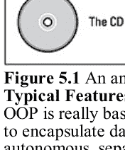

**图5.1** 面向对象编程工作原理的类比图。

### 面向对象编程的典型特征

OOP实际上是基于“分而治之”策略的。你使用OOP将数据和子程序封装到对象中，使它们成为自主、独立且私有的单元。然后，对象可以通过你创建的接口与你的程交互。这种封装的基础是一种称为*类*的结构。

OOP将类作为编程的顶层、基本构建块。类就像一个模板或蓝图。当你有一个功能正常的类时，你可以用它作为模板来创建对象。编程语言负责将类的数据和函数绑定在一起。你可以使用这个类一遍又一遍地创建相同的对象。你也可以稍微修改这个类，以创建类似的对象。

图5.2是一个简单的图示，阐释了类和对象背后的概念。类被设计为对象的蓝图或模板。一旦创建，类就可以充当工厂，根据指令生产这些对象。如果需要，程序员可以调整工厂生产，创建略有不同的对象。

对象使程序员能够通过*方法*以抽象的方式与类交互。方法就是内置在类中的子程序。

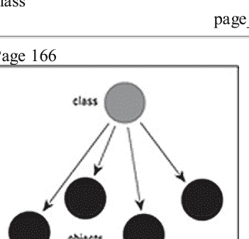

**图5.2** 类是其创建的对象的模板或蓝图。

这些方法充当函数、例程或过程，在它们被调用时执行。例如，在Perl中，一个类通常有一个名为*new*的方法，当调用这个new方法时，它会为该类创建一个对象。

除了对象、类和方法，面向对象范式还包括其他几个特征，例如*继承*。继承基本上意味着一个对象或类知道是谁创建了它，或者它的父类是谁。因为一个类知道它的来源，所以它可以继承其创建者的属性。这在技术上被称为从一个类*派生*另一个类。

OOP的另一个常见特征是*多态性*。多态性指的是呈现多种不同的形式。在OOP中，这意味着你可以使用一个已定义的接口与多种不同类型的对象交互。*可扩展性*是另一个常被讨论的OOP特性。可扩展性指的是使用继承从一个类派生，但同时为该类添加额外的功能。

你还会看到*封装*和*抽象*这两个术语与OOP相关联。封装指的是对象将功能分离成小型、可管理的部分的方式。抽象指的是将实现从程序员的视角中抽象出来，以便一个复杂的对象可以被简单地使用，尽管对象本身很复杂，因为程序员需要使用的只是简单的、抽象的方法。

OOP成功地为你的Perl世界带来了十个有趣的新编程术语。

- **对象**是封装数据或函数的结构，来源于类。

- **接口**是与一个类中的对象交互的一种方式。（接口有时被称为方法。）

- **类**是封装数据和函数的结构，作为对象的蓝图。

- **方法**是与对象或类交互的一种方式。（方法有时被称为接口。）

- **继承**是获取父类属性的行为。

- **派生**是用来描述与多种不同对象交互行为的专业术语。

- **多态性**是使一个接口能够与多种不同对象交互的特性。

- **可扩展性**是为派生类添加功能。

- **封装**是将功能分离成小型、可管理的部分。

- **抽象**是将数据或复杂特性从实现中隐藏起来。

对于一个周日的早晨来说，十个新的编程术语相当有分量。不要被所有这些新术语吓倒；面向对象编程学起来很快，因为它旨在成为一种更简单的解决编程问题的方法。OOP的设计初衷并非只是为了增加复杂性和烦恼（尽管你可能会发现一些程序员会反驳这一点）。别担心需要翻卡片或者试图记住这些术语；这就是为什么我把它们放在一个易于阅读的要点列表中。只需在这本书中折个角标记这一页，然后继续前进。你以后总可以回过头来参考它。

稍后我们会进一步解释这些术语，随着你继续学习面向对象编程，这些术语会变得像第二天性一样自然。和许多优秀的老师一样，大多数入门书籍和教程都会使用类比来让学生熟悉面向对象编程。一个典型的例子通常是汽车。如果你把面向对象编程想象成制造汽车的过程，而对象则是组装汽车时用到的零件，那么术语就开始变得有意义了。

汽车是一台相当复杂的机器，拥有成千上万个不同的部件，但每个部件都有其特定的、明确的用途。轮胎、音响、方向盘、刹车系统、前灯、发动机——所有这些都可以被视为对象。在这个例子中，我将聚焦于一个汽车对象——轮胎。

汽车的轮胎可以不同，这取决于制造商或客户想要为车辆安装普通轮胎、子午线轮胎还是全季轮胎。汽车本身并不在意它装的是哪种轮胎，因为汽车有一个简单的机制（比如方法或接口）来使用轮胎。轮胎本身是封装好的；它们是小巧、易于管理的部件，共同构成了汽车的整体功能。汽车展现了多态性，因为它可以使用几乎任何类型的轮胎；汽车连接轮胎的接口可以用于不同类型的轮胎。

所有轮胎都有一些共同特征。它们由橡胶制成，是圆形的，会旋转，有轮毂盖，并且有某种胎面花纹。在这个类比中，轮胎的共同特征就是轮胎所包含的数据或子程序。如果你在创建轮胎，你会希望将所有这些特征放入一个主蓝图或模板中。这个模板等价于一个面向对象编程的类（参见图5.3）。

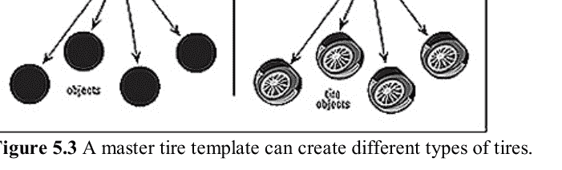

**图5.3** 一个主轮胎模板可以创建不同类型的轮胎。

假设一家制造商非常喜欢A型轮胎的橡胶质量，但对它的轮毂盖不那么满意。制造商可以以A型轮胎模板（或类）为基础，派生出一种新类型的轮胎——B型，其轮毂盖略有不同。派生出这种新轮胎类型就是继承的实际应用，因为这种轮胎继承了父类型A型轮胎的大部分属性。这里也运用了可扩展性，因为这种新派生的B型轮胎将具有一个略有不同的新特征——轮毂盖。

现在退一步，想想构成汽车的所有独立部件。轮胎只是一个对象，而一辆实际的汽车会有成千上万个不同的对象。如果汽车是一个长长的编程脚本，这个脚本将会巨大到难以有效管理。然而，如果每个对象都被分解成一个小巧、易于管理的部分，你就会明白构建、更新、维护甚至修改编程脚本将会变得容易得多。这种可管理性正是面向对象编程的精髓所在。

让我们看一个实际的编程例子来说明这一点。编程中一项常见的任务是创建随机数。拥有一个创建随机数的类可能很有用，因为这样你就不必为每个项目编写一个随机数生成器脚本，而只需为新项目构建一个新的对象。

在Perl中创建一个随机数X的代码是：

```
$number = int rand(X);
```

将此代码放入类包中，大致如下所示：

```
package RANDOM;
sub new {};
sub number
{
    $number = int rand(X);
    return 1;
}
```

当你将此文件保存为RANDOM.pm时，它就变成了一个类。保存的RANDOM.pm类可以运行两个方法之一。这些方法是子程序new（它创建一个RANDOM类型的新对象）和子程序number（它调用创建新随机数的代码）。

你可以通过use命令在任何编写的Perl程序中引入RANDOM.pm：

```
use RANDOM;
```

当RANDOM.pm类被引入后，你可以使用该类来创建一个随机数对象：

```
my $randomobject = new RANDOM;
```

然后，当你需要随机数时，你可以使用该对象来运行number子程序/方法：

```
$randomobject->number;
```

这样，你就拥有了一个名为RANDOM的类，它能够创建可以生成随机数的对象。只需三行代码，你就可以在任何编写的Perl程序中导入相同的随机命令。诚然，考虑到随机数代码只有一行，这可能看起来有些奇怪，但随着你熟悉面向对象编程并继续学习本章内容，这种实用性会变得更容易理解。

在本章后面，你将重新审视昨天下午编写的随机数生成器代码，并将其修改为一个名为Map.pm的面向对象文件。MAP.pm将基于此代码示例建模，但也会包含创建一个真正类所需的所有步骤（此示例仅作说明，并不完整）。目前只需记住，类和对象使得代码重用变得容易，并且认识到你仍然需要学习Perl特定的语法来运用面向对象编程。

### 面向对象编程在Perl中的应用

Perl最初并非一种成熟的面向对象编程语言。事实上，当Perl首次出现时，面向对象编程范式尚未完全兴起。面向对象编程的功能是在Perl语言诞生后很久才被添加到其中的。由于Perl的面向对象编程来得较晚，Perl拥有一些独特的面向对象特性，使其与其他面向对象编程语言（如Java、C++、C#、Smalltalk和Python）区分开来。

Perl与C++等面向对象编程语言的第一个重要区别在于语法。C++为面向对象编程的构造函数和类定义提供了特殊的语法和命令。Perl对于这些命令没有任何特殊语法。在Perl中，构造函数只是一个带有一点额外功能的子程序，而类则仅仅是一个包，或者说是包含在自己空间中的代码集合。（你将在下一节“构建Perl包”中开始构建Perl包。）Perl没有开发一整套新的子命令来采用面向对象编程，而是使用其已有的命令并为它们添加了一些额外的功能。

利用内置命令，Perl能够处理大多数面向对象特性，包括继承、多态以及本章前面回顾的大部分特性，但它并不具备成熟面向对象语言的所有特性。例如，对于你们这些C++爱好者来说，Perl有一些内置的异常处理，但远不及C++的try-catch-finally。Perl也没有C风格的模板；从C++的角度来看，所有Perl类都是虚拟的，而在C++中，你可以在虚拟方法和静态方法之间做出选择。

**注意** 我会尽量减少对C++和Java的引用；然而，由于它们都是如此流行的面向对象语言，它们常常设定了标准，重要的是要记住面向对象语言家族。要很好地了解这些语言，你可以翻阅一下《C++ Programming for the Absolute Beginner》（Premier Press, Inc., 2001）或《Java Programming for the Absolute Beginner》（Premier Press, Inc., 2001）。

Perl的面向对象编程与其他语言的面向对象编程之间最重要的区别是private关键字。大多数面向对象语言都内置了private关键字，用将对象和类的属性及方法设为私有。这创造了一种安全形式，因为这些属性不易在程序的任何地方或对客户端/用户可用。Perl不具备这种安全性；它基于信任的视角运作。Perl假定客户端不会干扰类及其内部实现；它也相信类提供的接口将被使用。然而，Perl并没有通过将类属性和方法设为私有来强制执行这一理念。

Perl面向对象编程的第二个重要区别是术语和词汇。老实说，面向对象编程的术语在不同语言之间往往有所不同。在学习不同的面向对�语言时，你会看到它们经常使用不同的术语来描述相同的编程结构。不幸的是，这有助于强化面向对象程序员的神秘感，让他们看起来像是才华横溢的疯狂天才或魔术师，尤其是当他们开始抛出诸如基类、泛型类和超类等术语，却不解释这些术语都可以指代同一个类时。

不幸的是，要掌握面向对象编程，你需要学习一整套新术语，然后在学习其他面向对象语言时学习这些术语的新子集。既然周日早上通常不是学习大量新术语的最佳时机，我为你准备了另一份列表，以防你对本章后面的某些课程或对其他书籍中的面向对象编程课程感到困惑。随着你发展面向对象编程知识，这些术语将变得像第二天性一样自然。

-   **父类**也被称为*基类*、*泛型类*、*超类*。

### 术语定义

-   **子类** 也称为 *派生类*、*具体类* 和 *子类*。

-   **类** 基本上是一个包含处理对象引用方法的 Perl 包。

-   **对象** 也称为 *类的实例*。在 Perl 中，对象是指向类中某个项目的引用。

-   **对象方法** 也可称为 *实例方法*。

-   **方法** 基本上是 Perl 子程序，它们接受一个对象引用或包名作为第一个参参数。

-   **数据** 也可称为 *属性*。

-   **模块** 是一个 Perl *包* 或一组包。

-   **函数** 也可称为 *行为*。

-   **包** 也称为 *命名空间*。一组包称为 *模块*。

## **构建 Perl 包**

Perl 面向对象编程的支柱是包函数。包是自包含的变量和子程序单元，可以重复使用。可重用性是面向对象编程的关键，而包是 Perl 中可重用性的基本构建块。包使用 `package` 命令构建，其语法简单。

```
package Nameofpackage;
```

定义包后，你可以像在脚本的任何其他地方一样添加声明和子程序。

```
package Nameofpackage; # 在包中创建一个子程序 sub something{ does something } # 在包中创建一个变量 $variable = "variable";
```

包很重要，因为 Perl 中的模块和类都基于它们。使用 `package` 命令在 Perl 中创建包后，通常使用 `return` 命令来结束包。

```
# 创建一个名为 NEWPACKAGE 的包 package
NEWPACKAGE return 1;
```

`return` 是一个用于发送消息的函数；包的约定是让 `return` 发送 `1` 表示加载成功。如果 NEWPACKAGE 成功加载，`return` 会向尝试加载它的程序返回 `1`。然而，包本身功能有限。要使包有用，你需要在其中包含子程序。你应该记得第 4 章“表达和声明”中如何构建子程序。你可以使用 `sub` 命令向 NEWPACKAGE 添加一个简单的打印子程序。

```
# 创建一个名为 NEWPACKAGE 的包 package
NEWPACKAGE sub printing1 {print "Hello my baby. \n"} return 1;
```

现在你有了一个包含一个名为 `printing1` 的子程序的包，该子程序打印“Hello my baby.”。为了使用 NEWPACKAGE，你需要将其保存为 `.pl` 文件，就像任何其他 Perl 程序一样。因为 NEWPACKAGE 是一个包，你现在可以在其他 Perl 程序中包含它及其任何子程序。你使用 `require` 命令在其他 Perl 脚本中包含包。

```
require 'NEWPACKAGE.pl';
```


当你包含一行 `require` 时，Perl 知道你可能会使用 `NEWPACKAGE` Perl 文件中的子程序或数据。Perl 会打开 `NEWPACKAGE` 并确保它具有继续的适当信息。

确保你的程序具有正确的 Perl 包后，你可以通过引用相应的包名和子程序来调用包中包含的子程序，就好像包内容是本地文件一样。如果你想运行 `NEWPACKAGE` 的打印子程序，你可以简单地用一行代码引用包和子程序。

```
NEWPACKAGE::printing();
```

Perl 将此行识别为命名空间或包引用。Perl 将查找 `printing1` 子程序，它位于 `NEWPACKAGE` 中。由于之前的 `require` 命令，它知道 `NEWPACKAGE` 在哪里。如果 `printing1` 子程序需要任何输入或变量数据来运行，可以将数据放在括号内。

为了扩展此示例的范围，你可以向 `NEWPACKAGE` 添加多个 print 命令。

```
# 创建一个包名
package NEWPACKAGE
sub printing1 {print "Hello my baby.\n"} # 添加更多打印
sub printing2 {print "Hello my darling.\n"}
sub printing3 {print "Hello my ragtime gal. \n"}
return 1;
```

现在你可以创建一个使用所有三个子程序的新 Perl 脚本。

```
# 创建一个使用 `NEWPACAKGE` 子程序的新 Perl 脚本 #
需要告诉 Perl 脚本使用 `NEWPACKAGE` 子程序 #
需要告诉 Perl 包含 `NEWPACKAGE`
require 'NEWPACKAGE.pl'; print "And the Frog sang:\n";
NEWPACKAGE::printing1(); NEWPACKAGE::printing2();
NEWPACKAGE::printing3(); # 结束 print "Press <ENTER> to continue..."; ◇
```

你可以通过将其保存为 `NPtest.pl` 来测试此脚本。或者，你可以从本书的配套网站下载源文件。

就其本身而言，`NEWPACKAGE` 承认并不十分有用。使包强大的是它们允许你重用代码。由于 `NEWPACKAGE` 已经编写完成，我永远不必再编写一个打印 Michigan J. Frog 歌曲的 Perl 脚本。相反，我可以只包含一行 `require` 来使用我需要的任何打印语句。Perl 中的包与类非常相似，这使它们成为面向对象编程的完美介绍。它们也与模块非常相似，你将在今晚的课程“学习高级 Perl 技术”中了解到这一点。

Perl 中的模块就是存储在单个文件中的几个包。这些文件通常以 `.pm` 结尾（Perl 模块的缩写）。Perl 中的惯例是将模块和包的名称大写。成千上万的 Perl 程序员已经编写了独特且有用的 Perl 模块，其他程序员可以下载并使用。在今晚的课程中，我将花一些时间讨论导入有用的包和模块，以及在哪里找到它们。

包的范围很重要。当你 `require` 一个包时，你可以引用并使用该包，直到该特定脚本文件的末尾或使用另一个 `package` 关键字。与 Perl 中的全局变量不同，包含在包中的变量不能被其他包访问。

## **使用 Perl 引用**

引用是面向对象编程的第二个主要基础，它们是 Perl 中对象的基础。Perl 中的引用是指向或引用其他内容的构造。程序员使用引用来访问存储在变量中的值，而不必使用实际的变量名。引用的一个实际例子是你创建一个处理 pi 值的接口时。

因为 pi 是一个极其长的数字（3.14159...），一个持有 pi 引用的脚本可能很有用。你可以创建一个保存 pi 值的变量，然后在需要时使用引用来检索该变量。创建变量引用涉及两个简单步骤。

1.  将变量赋值给一个标量。

2.  使用 `\` 指示符设置引用。

生成 pi 引用的代码如下所示：

```
# 将变量赋值给标量
$pi = 3.1459;
# 使用 \ 指示符设置引用
$reference = \$pi;
```

在这个脚本中，我猜你想知道 `$pi` 和 `$reference` 之间的区别。区别很重要，因为在 Perl 中创建引用时，它不保存赋给它的值——它保存变量地址的内存。为了说明这一点，创建一个名为 `Pi.pl` 的新脚本，添加将引用赋值给 pi 的示例代码，然后添加两个 print 语句来打印 `$reference` 和 `$pi`。完整代码应如下所示：

```
# 将变量赋值给标量
$pi = 3.1459;
# 使用 \ 指示符设置引用
$reference = \$pi;
# 打印值
print "the value of \$pi is $pi\n";
print "the value of \$reference is $reference\n";
# 结束
print "Press <ENTER> to continue..."; <>
```

现在运行程序以查看两个标量持有的值。你会看到 `$pi` 等于你赋给它的值：3.14159。而 `$reference` 的值则完全不同——它看起来像 00x80xx80808。这是因为 `$reference` 不关心 `$pi` 的值；它跟踪 `$pi` 的位置。`$pi` 的值实际存储在计算机的物理内存中，`$reference` 通过跟踪指向存储 `$pi` 值的空间的十六进制数字地址来跟踪该物理内存。你可以告诉 Perl 使用第二个 `$` 符号打印 `$reference` 的实际值。

```
Print "The value of reference is $$reference\n";
```

Perl 将知道你不想要打印 `$pi` 的引用，而是想要打印 `$pi` 的实际值。这称为 *解引用*；它是面向对象编程中常用的一种技术。引用也可以指向数组和哈希；你只需要记住插入 `\` 字符，然后像本书中的示例一样对数组和哈希进行赋值。

```
# 构建数组
@array = (1,2,3,4);
# 构建哈希
%hash = (5=>6=>7=>8=>);
# 赋值数组引用
$arrayreference = \@array;
# 赋值哈希引用
$hashreference = \%hash
```

你也可以有一个指向子程序的引用。你可以使用一个额外的字符，即 `&`，来创建子程序的引用或通过引用来运行子程序。

### 在Perl中使用类

面向对象编程（OOP）使用类来创建对象。类基本上是一组以某种方式聚焦或相关的例程。通常，类为用户提供对象，这些对象知道它们属于哪个类以及如何表现。

你赋予类的名称很重要，因为它也是存放该类的文件名。这就是模块的工作方式；我将在今晚的课程“学习高级Perl技术”中更详细地介绍这一点。在为类命名后，你需要为其提供一种创建对象的方法。你还需要为类提供某些机制，以便在其他进程想要使用该类创建的对象时使用。基本上，类是一个创建对象的工厂。作为程序员，你控制由类创建的对象以及类如何创建它们。

在Perl中，类与包是相同的。两者之间唯一的区别在于类向程序的其他部分提供方法。类还需要包括一个构造函数来启动对象的创建。

### 在Perl中声明类

创建类有时被称为*声明或实现*类。创建类涉及为类命名和定义将要包含的子程序。打个比方，想想一只猫。每只猫都有共同特征——它们有爪子、牙齿、性情、皮毛和眼睛颜色。

1. 创建一个名为`Cat`的包。

2. 为Cat对象创建一种构造方式。

3. 在类中包含构成猫的所有子程序。

4. 使用return命令结束类。

编码这些步骤涉及使用`package`命令，创建子程序（`new`、`claws`、`fangs`和`fur`），并以一行`return`结束，如下所示：

```perl
package Cat; # Constructor called new that creates a Cat object
sub new
{ code that creates class objects } # A few object methods
sub claws{
code for claws in here }
sub fangs{
code for fangs in here }
sub fur{
code for fur in here } # end with a return
return 1;
```

这个`Cat`类在图5.4中有详细说明。

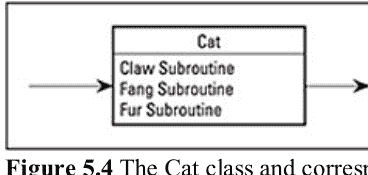

### 引用类

一旦你创建了一个类，另一个脚本或程序就可以通过创建该类的实例（或类对象）来使用该类中的所有子程序。你可以看到，类并不比包复杂多少。当你的程序需要使用`Cat`对象时，你只需调用`new`子程序。想要听起来重要的程序员会称之为，“通过调用构造函数来实例化对象”。

要在脚本中设置对类的引用（以`Cat`为例），你需要：

1. 告诉脚本使用`Cat`类。

2. 通过调用`new`构造函数创建一个`Cat`对象。

```perl
# Script includes the cat class by using the use command
use Cat; #
# Script creates a cat object (named kitten) by invoking the new subroutine
$kitten = new Cat;
```

这个新的`kitten`对象拥有你在`Cat`类中定义的所有子程序。你现在可以使用一个称为*运行对象方法*的过程，在`kitten`内访问这些子程序。

```perl
# This command runs the fur subroutine within the kitten object
$kitten->fur();
# This command runs the claw subroutine within the kitten object
$kitten->claws();
```

### 创建你的第一个Perl类

在Perl中将程序片段组织成类和对象，起初可能看起来令人生畏。关键在于从重用和封装代码的角度来思考，当然，还需要实践。在本节中，你将创建一个简单的类来创建一种轮胎，就像你之前读到的示例一样。这个类将用于在下一节中创建对象。

按照以下步骤开始你的轮胎类：

1. 创建一个名为`CreateTire`的包。

2. 创建一个`new`子程序，它将成为轮胎构造函数。

3. 使用`return`结束类。

4. 将类保存为`CreateTire.pl`。

代码应如下所示：

```perl
package CreateTire;
sub new { };
return 1;
```

到目前为止，我还没有详细介绍`new`子程序如何实例化对象的具体细节。`new`子程序实际上需要做三件事来创建对象。

1. 创建一个局部标量。

2. 使用`bless`命令将标量转换为对象。

3. 使用`return`命令返回一个指向新对象的引用。

在面向对象编程中，创建新对象的代码称为构造函数。在Perl中，构造函数是类中的一个子程序，它返回一个附加了类名的对象引用。将类名与引用连接起来的过程称为*祝福*对象。

你已经使用过引用和`return`命令。Perl的`bless`命令是一个内置函数，它将引用转换为对象。基本上，构造函数只是一个返回某个在类中“被祝福”之物的引用的子程序。`bless`的语法很简单。

```perl
bless $reference;
```

在Perl中，所有对象都是被祝福的。被祝福允许对象知道它们属于哪里。在Perl中，这是对象和引用之间唯一的主要区别。被祝福的对象知道它们属于哪个包，而引用不知道。

要为你的`CreateTire`包添加功能，你需要在`new`子程序中添加三行代码。

```perl
sub new {
  # Create a local scalar
  my $tire = {};
  # bless the tire to turn it into an object
  bless $tire;
  # return the new tire object
  return $tire
}
```

整个代码清单现在应该如下所示：

```perl
package CreateTire;
sub new {
  # Create a local scalar
  my $tire = {};
  # bless the tire to turn it into an object
  bless $tire
  # return the new tire object
  return $tire
}
return 1;
```

既然有了一个创建轮胎对象的方法，你就可以包含轮胎应该具有的子程序和属性。这些属性只是带有默认值的子程序；它们在图5.5中显示。

```perl
package CreateTire;
sub new {
  # Create a local scalar
  my $tire = {};
  # bless the tire to turn it into an object
  bless $tire
  # return the new tire object
  return $tire
} # A few object methods
sub tread {
  my $tiretread = wavy;
};
sub hubcap{
  my $hubcap = metal;
};
sub psi{
  my $tirepsi = 40 pounds per square inch;
}; # end with a return
return 1;
```

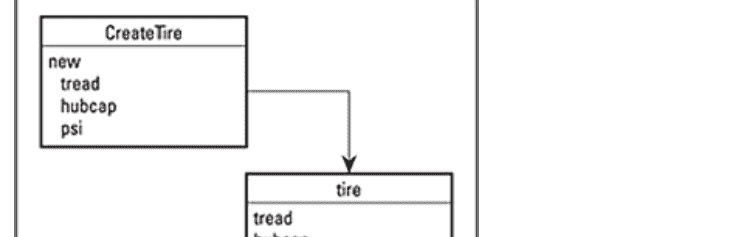

看，这就是你的第一个Perl类。将类保存为`Tire.pl`。在下一节中，你将使用你编写好的`new`方法来创建和运行实际的轮胎对象。

## 休息一下

呼。类、引用和包都在一个上午学完了，而你甚至还没完成这一章。你已经涵盖了OOP的基础知识，并且已经接触到了一些较难的主题。本章的下一部分概述了Perl其余的OOP能力，但在你进入继承和对象方法等主题之前，先喘口气。站起来，伸个懒腰，把咖啡杯加满。你已经走了很长一段路，但前面还有路要走。

### 在Perl中使用对象

正如包是Perl中类的基础一样，引用是对象的基础。对象就是一个知道自己位于某个类中的引用。在本章前面我使用的`RANDOM.pm`示例中，我演示了如何使用这行代码创建`RANDOM.pm`类的一个本地实例：

```perl
my $randomobject = new RANDOM;
```

`$randomobject`与任何其他标量之间的唯一区别是，`$randomobject`知道它的父类是谁。因为`$randomobject`与`RANDOM`有关系，所以`$randomobject`可以调用`RANDOM`的能力（方法）。

对象方法只是期望引用作为参数的子程序。使用同一个例子，调用`$randomobject`的`number`方法的代码是：

```perl
$randomobject->number;
```

`number`与任何其他Perl子程序之间的唯一区别是，`number`知道它需要一个返回到创建它的类的引用。那个引用就是对象`$randomobject`。

对象被称为类的实例。在这种情况下，`$randomobject`可以被称为`RANDOM.pm`的一个实例。对象中的子程序被称为实例方法或成员函数（或者有时就叫方法）。再次以随机数生成器为例，方法是`number`和`new`，都包含在`RANDOM.pm`中。最后，对象可以保存子程序和数据。有时数据项被称为数据成员或实例数据。（类也可以保存数据，这通常被称为类数据。）

### 在Perl中声明对象

要创建一个对象，你需要调用一个类构造函数（通常是`new`）。要调用一个类构造函数，你需要：

1. 使用`use`命令在脚本中包含该类。

2. 使用`my`命令创建一个局部变量来保存对象。

3. 使用箭头引用符让Perl为指定的类运行`new`构造函数。

你已经见过`use`命令的使用。

```perl
use Class;
```

你也使用过`my`来创建局部变量。

```perl
my $object;
```

你需要学习的唯一新的Perl语法是如何使用箭头引用符指向适当的类和构造函数。你以前使用过箭头引用符，但不是在这种上下文中。

```perl
Class->new();
```

就是这样。你可以用几行Perl代码把所有东西组合在一起。

```perl
use Class;
my $object = Class->new();
```

如果你想调用你上一节构建的`Tire`类，你只需将`Class`替换为`CreateTire.pl`。

```perl
use CreateTire.pl;
my $object = Tire->new();
```

如果你将此作为脚本运行，Perl会创建一个全新的对象，命名为

### 在Perl中引用对象

作为程序员，你可以自由地为构造函数命名。通常的约定是使用`new()`命令作为对象的构造函数，但这并非强制要求。你可能会发现有些对象的构造函数名称完全不同。你也可能会遇到包含多个构造函数的类，用于创建不同类型的对象。

构建对象后，你可以像引用数组或哈希表一样引用它。但是，对象通常通过方法进行操作，在Perl中，方法其实就是子程序。这个过程称为*解引用*，用于访问对象的方法称为*对象方法*。

### 手动触发Perl的内置析构函数

在某个时刻，对象需要停止存在。Perl的垃圾回收功能快速、简单且基于引用。Perl使用内置的析构函数来结束对象的生命周期。这个析构函数是一个负责擦除对象并清理相关内存空间的方法。在Perl中，你使用`DESTROY`命令来调用面向对象编程的析构函数，当对象超出作用域时，它会自动调用`DESTROY`。只要存在对对象的引用，Perl就假定该对象仍在作用域内。一旦对象的最后一个引用消失，对象就会被销毁。然而，如果你的对象包含对全局变量的引用，这些引用在对象被销毁后可能仍然存在。如果你将引用存储在全局变量中，对象的销毁可能会发生在程序退出之后。

你可以尝试提前强制调用`DESTROY`或覆盖`DESTROY`，使对象保留在内存中，但不建议使用这种技术。不过，如果需要，`DESTROY`命令可以作为子程序调用来通用访问：

```
sub DESTROY {}
return 1;
```

如果你需要关于`DESTROY`的更多信息，请查看今晚课程“学习高级Perl技巧”中的资源。

既然对象方法本质上是子程序，那么它们可以像其他子程序一样被访问、构建和使用。回到`Tire.pl`类，当创建一个新的轮胎对象时，你可以通过箭头引用器以与调用`new`构造函数相同的方式调用所有其他子程序。

```
# 创建一个包含轮胎psi值的局部标量
my $localpsi Tire->psi();
```

现在，你有了一个对`psi`子程序的局部引用。遵循TIMTOWTDI（There Is More Than One Way To Do It）的传统，你也可以使用冒号代替箭头引用器。

```
# 这两个命令是等效的
my $localpsi Tire->psi();
my $localpsi Tire::psi();
```

从`$localpsi`的局部引用到`Tire`类中现有`psi`子程序的路径在图5.6中有详细说明，该图展示了一个包含对`psi`的局部引用的程序块。

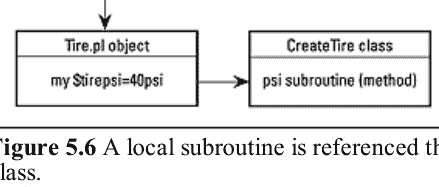

**图5.6** 一个局部子程序通过对象和类被引用。

> 如果你尝试调用一个对象未定义的方法，Perl不会报错。相反，程序会在运行时抛出一个异常。Perl依赖于程序员或脚本去理解对象的内部工作原理；与其他面向对象语言不同，它不会检查方法是否正确。换句话说，如果你错误地使用了对象，Perl在编译程序时不会捕获这个问题；它只会在程序运行时才注意到问题。

以下是Perl中创建和使用对象整个过程的概述。该过程也总结在图5.7中。指向图5.7中各个步骤的数字对应于本概述中的步骤编号。

-   1. 创建一个类，它作为对象的模板。

-   2. 创建一个新的构造函数，它是一个简单的子程序（或方法），用于创建类的局部实例并返回指向该实例的引用。

-   3. 通过调用新的类构造函数来创建一个对象。

-   4. 新的构造函数返回指向新创建对象的引用。

-   5. 当对象被创建并赋予祝福（blessed）后，你就可以访问对象内部的子程序和数据，就好像这些子程序是本地的一样。

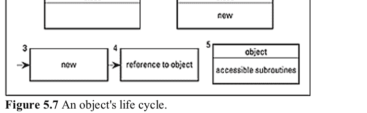

### 在Perl中使用方法

Perl没有提供任何用于定义方法的特殊语法。方法就是一个期望其第一个参数是对象或包的子程序。如果参数是引用，则方法期望一个对象；如果参数是字符串，则方法期望一个包。方法调用也有两种类型——类方法调用和实例方法调用。

类方法有时被称为*静态方法*。类方法期望第一个参数是类名。此方法为整个类提供功能，而不是为属于该类的任何单个对象提供功能。许多类方法实际上会忽略第一个参数。

实例方法期望第一个参数是一个对象引用。实例方法有时被称为*虚拟方法*。

### 在Perl中构造方法

你不需要使用方法从类或对象直接访问数据。例如，如果一个对象包含名为`DATA`的变量，你可以创建一个引用`DATA`的局部变量。

```perl
my $localvariable = $object->{DATA};
```

然而，这违背了面向对象编程的目的和威力，所以大多数时候你会看到包含一个方法来收集对象内的任何`DATA`。

```perl
my $localvariable = $object->method();
```

为一个类构造对象后，程序可以通过使用箭头引用器调用对象的方法，然后将该方法视为一个子程序。

```perl
object->method( argument );
```

### 使用方法

方法可以做任何事情，到目前为止你在本书中学到的每一个编程技巧都可以放在一个方法中。但是，你不应该从对象方法直接引用类数据。如果你这样做，你就没有构建一个可扩展、可继承的类。对象应该是任何操作的基石。

如果你回到本章前面的`Tire.pl`脚本，你会看到我留下了一些待定义的虚拟方法。

```perl
package CreateTire;
sub new {
    # 创建一个局部标量
    my $tire = {};
    # 祝福轮胎，将其转化为对象
    bless $tire;
    # 返回新的轮胎对象
    return $tire
}
# 一些对象方法
sub tread{
    my $tiretread = wavy;
};
sub hubcap{
    my $hubcap = metal;
};
sub psi{
    my $tirepsi = 40 pounds per square inch;
};
# 以一个return结束
return 1:
```

这里有三个方法——`tread`、`hubcap`和`psi`。目前每个方法都被赋值了一个局部变量，但实际上每个方法都可以包含你想要加入的任何Perl技巧。例如，如果你希望轮胎胎面根据一年中的时间和天气情况而变化，你可以在`tread`方法中简单地包含一系列`if...else`语句来确定应该创建哪种类型的胎面。

```perl
sub tread{
    if ($season == summer){
        my $tiretread = "normal"
    } elsif ($season == winter){
        my $tiretread = "studded"
    } elsif ($season == spring){
        my $tiretread = "all weather"
    } elsif ($season == fall){
        my $tiretread = "all weather"
    } else {
        my $tiretread = "normal";
    };
}
```

当你调用`tread`对象方法时，`tread`会确保轮胎胎面适合指定的季节。完整的代码清单如下所示。

```perl
package CreateTire;
sub new {
    # 创建一个局部标量
    my $tire = {};
    # 祝福轮胎，将其转化为对象
    bless $tire
    # 返回新的轮胎对象
    return $tire
}
# 一些对象方法
sub tread{
    if ($season == summer){
        my $tiretread = "normal"
    } elsif ($season == winter){
        my $tiretread = "studded"
    } elsif ($season == spring){
        my $tiretread = "all weather"
    } elsif ($season == fall){
        my $tiretread = "all weather"
    } else {
        my $tiretread = "normal";
    };
sub hubcap{
    my $hubcap = metal;
};
sub psi{
    my $tirepsi = 40 pounds per square inch;
};
# 以一个return结束
return 1
```

### 在Perl中使用继承

继承是面向对象编程最强大的部分之一，因为它允许你使用预先存在的对象并为其添加新功能。通过继承，你可以使用从其他类派生或构建的类，这是一种极好的软件重用形式。继承归结为一个类能够使用另一个类的功能，这样你就无需重写该类。

Perl类只能继承方法；你必须使用自己的机制来实现数据继承。这是Perl与大多数其他面向对象语言不同的另一个方面。这也是Perl在面向对象方法论方面独特性的另一个例子。

### 继承如何工作

Perl使用一个名为`@ISA`的特殊构造来实现继承。在Perl中，每个包都可以有一个名为`@ISA`的变量。`@ISA`作为一个方法，本质上是一个特殊的数组，它告诉Perl如果在当前类或包中找不到特定方法，应该去哪里寻找。

在`@ISA`数组的每个元素中，是Perl可以搜索方法的另一个包或类的名称。Perl会按顺序搜索这些类以查找任何缺失的被调用方法。通过`@ISA`列出的类被称为当前类的*基类*。

当你尝试为一个对象或类调用一个方法时，Perl会进入该类并在列出的子程序中搜索该方法。如果找不到该方法，Perl会打开`@ISA`并查看其中列出的类和包，然后取第一个包或类并在其中搜索该方法。

在Perl中，可以有多个继承，这意味着你在`@ISA`数组中列出了多个父类。Perl会按顺序搜索这些包以查找缺失的方法。如果Perl无法

### 实现继承

@ISA 需要是一个包作用域的全局数组，这意味着你不能将 @ISA 声明为词法变量或局部数组。如果你还记得周六晚上的“表达与陈述”课程，你会知道可以使用 `our` 命令来声明全局数组。你声明 @ISA 的方式与声明任何其他全局数组相同。

```perl
our @ISA = ("secondpackage.pl", "thirdpackage.pl");
```

除了默认的通用数组，Perl 还有一个默认的通用类。这个名为 UNIVERSAL 的类，默默地存在于 Perl 面向对象编程的幕后。UNIVERSAL 很有用，因为你可以将方法放在 UNIVERSAL 类中。然后，你创建的每个类都可以通过 @ISA 来访问这些方法。UNIVERSAL 被称为*通用继承者*，它充当所有现有类的全能基类。

如果当前的类、基类和 UNIVERSAL 都不包含你要查找的方法，Perl 会进行最后一次搜索，查找名为 AUTOLOAD() 的方法。AUTOLOAD 是一个通用的、全能的 Perl 方法。Perl 会首先在当前类中查找你指定的 AUTOLOAD 方法，然后在任何基类中查找，最后在 UNIVERSAL 类中查找。如果找到了 AUTOLOAD，该方法将代表缺失的方法运行。这个方法搜索过程如图 5.8 所示。

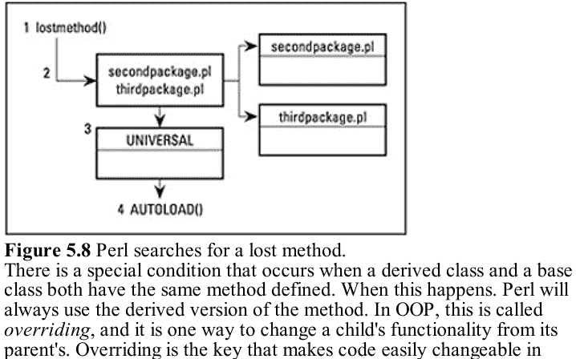

**图 5.8** Perl 搜索丢失的方法。

有一个特殊情况，当派生类和基类都定义了相同的方法时会发生。当这种情况发生时，Perl 总是使用派生类版本的方法。在面向对象编程中，这被称为*重写*，这是改变子类功能以区别于父类的一种方式。重写是使代码在面向对象编程中易于更改的关键，尤其是在你需要一个方法或对象与其父类略有不同的情况下。

### 程序块：在你的游戏循环中使用 OOP 构造

是时候拿出你的 block4.pl 文件并做一些修改了。你可能在昨晚的课程中遇到的问题之一是组织性。block4.pl 文件现在超过了 100 行，使得一次管理所有内容变得相当困难。OOP 在这方面是个救星，类和对象将非常适合将这个小游戏分隔开。

首先，打开 block4.pl 并将其另存为 block5.pl。其次，浏览源代码，看看哪些部分可以轻松地分解成一个小型、单一用途的组件。快速浏览一下，有几个部分应该很明显可以分解出来：

- 初始游戏变量

- 随机地图生成器

- 主游戏循环

你明白了。只要在组织上合理，任何组件都可以变得模块化。

首先，将地图生成器放入它自己的类中。要设置地图类，你需要遵循以下步骤：

1. 将相应的代码剪切并粘贴到一个新的 Perl 包 `MAP.pm` 中。

2. 在脚本开头添加 `package` 命令（`package MAP;`）。

3. 将现有代码移入子例程中，例如：`sub turn1 {$turn1 = int rand (3);};`

4. 在 MAP.pm 文件末尾添加 `return` 命令（`return 1;`）。

5. 创建一个名为 `new` 的子类。MAP.pm 文件现在应如下所示：

```perl
package MAP;
sub new {};
sub turn1 {$turn1 = rand(3);}
sub turn2 {$turn2 = int rand (3);}
sub turn3 {$turn3 = int rand(3);}
sub turn4 {$turn4 = int rand(3);}
return 1;
```

你的新方法需要包含必要的 `bless` 和 `return` 命令，以便它能创建新的地图对象：

```perl
sub new {
  my $map = {};
  bless $map;
  return $map;
};
```

将所有这些放在一起，你现在有了一个名为 `MAP` 的可调用类，它为你的应用程序创建随机地图：

```perl
package MAP;
sub new{ my $map = {}; bless $map; return $map }
sub turn1 {$turn1 = int rand(3);}
sub turn2 {$turn2 = int rand (3);}
sub turn3 {$turn3 = int rand(3);}
sub turn4 {$turn4 = int rand(3);}
return 1;
```

现在，为了让我们的 block5.pl 能够调用该类并创建一个地图对象，需要做一些小的修改：

1. 在文件开头放置一个 `use` 语句，以便 Perl 能找到 `MAP.pm`（`use MAP;`）。

2. 调用 MAP.pm 文件，并要求它使用 `new` 构造函数创建一个地图对象，然后将该对象存储在一个局部标量中（`my $localmap = new MAP;`）。

3. 将 `$turn1` 到 `$turn4` 的 `print` 语句改为引用地图对象的子例程（`print "The way out is $localmap->turn1$localmap->turn2$localmap->turn3$localmap->turn4\n";`）。

这个新的、改进后的 block5.pl 的源代码应如下所示。

```perl
#######################################
# Trapped
#######################################
#######################################
# block1- planning #
# What I need:
# Code that prints information to the screen.
# Code that takes information from the keyboard.
# Code that times the display of text/information
# Code that generates a random map
# Code that tracks the player's progress on the map
##################################################################
# block 2 - Basic needs.
# We have learned printing information to the screen and
# Taking information from the keyboard and
# Creating scalar variables and
# a standard ending to keep the dos prompt open.
# Initial print action
##################################################################
# block 3
# Any math that needs to be done
# Random number generator
# Any variable changes
##################################################################
# block 4
# The actual game loop
# Anything else that remains undone.
# includes use MAP;
# Assign Variables
$direction = North;
$food = 10;
$health = 10;
$turn = 1;
# Possible directions
$north = 0;
$east = 1;
$south = 2;
$west = 3;
my $localmap = new MAP;
print "The way out is $localmap->turn1$localmap->turn2$localmap->turn3$localmap->turn4\n";
for ($turn = 1; $turn <= 4; $turn++) {
  print "\n";
  print "You are trapped in a cavern\n";
  print "You can travel Forward, Backwards, Right, or Left using the arrow keys\n";
  print "\n\n\n";
  print "You are facing $direction\n";
  print "You have $food boxes of ramen left\n";
  print "\n\n\n";
  print "Please choose a direction to travel by pressing:\n";
  print "0 for North\n";
  print "1 for East\n";
  print "2 for South\n";
  print "3 for West\n";
  # Need to grab info from the player
  $char = readline(*STDIN);
  print "$char\n";
  if ($turn == 1 && $char == $localmap->turn1) {
    print "you have chosen wisely!\n\n"
  } elsif ($turn == 2 && $char == $localmap->turn2) {
    print "you have chosen wisely!\n\n"
  } elsif ($turn == 3 && $char == $localmap->turn3) {
    print "You have chosen wisely!\n\n"
  } elsif ($turn == 4 && $char == $localmap->turn4) {
    print "You have chosen wisely!\n\n"
  } else {
    # If a mishap occurs, lose one health
    $health = $health -1;
    print "You have chosen poorly\n";
    print "Your health is equal to $health\n";
    $turn = $turn-1;
  };
  if ($food <= 0) {
    print "You are out of food!\n";
    $health = $health -1;
  };
  # While making a move lose one food unit
  $food = $food -2;
  print "You have $food boxes of ramen left\n";
  if ($health < 0){
    print "You have lost, and remain trapped for all eternity!\n";
    $turn = 4;
  };
}
# Add our ending changed to user input
# standard ending
print "\nPress an arrow key to continue...";
<>;
```

如果你运行这个脚本，你会看到游戏照常运行，只是不再打印出路（The way out is 0...）。相反，你会看到四个哈希引用（The way out is MAP=HASH<0x1827f04>...）。这可以通过创建 `turn` 标量的局部实例并引用它们来轻松解决，从而得到走出迷宫的路径。创建这些局部实例的代码如下所示：

```perl
my $localmap = new MAP;
my $localturn1 = $localmap->turn1;
my $localturn2 = $localmap->turn2;
my $localturn3 = $localmap->turn3;
my $localturn4 = $localmap->turn4;
print "The way out is $localturn1$localturn2$localturn3$localturn4\n";
```

你的 block5.pl 程序部分的第二部分是游戏变量。在 block5.pl 的开头有一大组标量：

```perl
# Assign Variables
$direction = North;
$food = 10;
$health = 10;
$turn = 1;
# Possible directions
$north = 0;
$east = 1;
$south = 2;
$west = 3;
```

这些可以同样轻松地放入一个类中，并将有助于限制当前杂乱的程序块。要分离这些变量，你可以遵循与创建 MAP.pm 类似的过程：

1. 将这些行剪切并粘贴到一个名为 GAMEVARS.pm 的新 Perl 文件中。

2. 在文件开头添加 `package` 命令。

3. 将方向和变量拆分为两个子例程。

4. 在文件末尾添加 `return`。

5. 创建一个新的子例程，该子例程对类的实例进行 `bless` 并返回它。

所有这些完成后，新的 GAMEVARS.pm 文件应如下所示：

```perl
package GAMEVARS;
sub new {
  my $gamevars = {};
  bless $gamevars;
  return $gamevars;
}
# Assign Variables
sub direction {$direction = North;}
sub food {$food = 10;}
sub health {$health = 10;}
# Possible directions
sub north {$north = 0;}
sub east {$east = 1;}
sub south {$south = 2;}
sub west {$west = 3;}
return 1;
```

3.  游戏循环中的所有变量引用都需要更改为调用`GAMEVARS`的本地实例。

    通过在`block5`开头添加一行`use GAMEVARS;`可以轻松完成前两个步骤：

    ```perl
    #include use MAP; use GAMEVARS;
    ```

    接下来，通过添加以下行创建一个`GAMEVARS`对象的本地实例：

    ```perl
    my $localvars = new GAMEVARS;
    ```

    然后，为你需要的每个游戏变量创建本地实例：

    ```perl
    my $localhealth = $localvars->health;
    my $localfood = $localvars->food;
    my $localdirection= $localvars->direction;
    ```

    现在，你需要找到每个使用游戏变量的地方，并切换到使用本地变量，这些地方都出现在`for`循环体中。

    将`block5.pl`重新保存为"gameloop.pl"，你的游戏现在就被组织成一个Perl文件和两个Perl模块。最终，你并没有减少主文件中的代码行数。然而，从组织结构上来看，这个新代码更胜一筹。如果你需要更改任何初始变量来调整游戏难度，它们都包含在易于阅读的`GAMEVARS.pm`文件中，并且组织得井井有条。如果需要增加或减少游戏时长，大部分工作可以在`MAP.pm`文件中完成，而游戏循环则可以保持不变。而且，如果你将来需要编写任何需要类似子程序的程序，`.pm`文件很容易导出。所有这些更改将使你在下一节中真正开始大幅修改代码时，工作变得更加轻松。以下是所有这些文件的源代码，并添加了一些注释。

    ```perl
    # GAMEVARS.pm:
    # 本包保存所有游戏变量
    package GAMEVARS;

    sub new {
        my $gamevars = {};
        bless $gamevars;
        return $gamevars;
    }
    # 变量赋值
    sub direction {$direction = North;}
    sub food {$food = 10;}
    sub health {$health = 10;}

    # 可能的方向
    sub north {$north = 0;}
    sub east {$east = 1;}
    sub south {$south = 2;}
    sub west {$west = 3;}

    return 1;
    ```

    ```perl
    # MAP.pm:
    # 本包创建一个随机地图
    package MAP;

    sub new {
        my $map = {};
        bless $map;
        return $map;
    }

    sub turn1 {$turn1 = int rand(3);}
    sub turn2 {$turn2 = int rand(3);}
    sub turn3 {$turn3 = int rand(3);}
    sub turn4 {$turn4 = int rand(3);}

    return 1;
    ```

    ```perl
    # gameloop.pl:
    #########################################
    # 困境
    #########################################

    #########################################
    # 块1 - 规划
    #########################################
    # 我需要：
    # 将信息打印到屏幕的代码。
    # 从键盘获取信息的代码。
    # 控制文本/信息显示时间的代码
    # 生成随机地图的代码
    # 追踪玩家在地图上进度的代码

    #########################################
    # 块2 - 基本需求。
    #########################################
    # 我们已经学会了将信息打印到屏幕
    # 从键盘获取信息以及
    # 创建标量变量，并且
    # 一个保持dos提示符打开的标准结尾。
    # 初始打印操作

    #########################################
    # 块3
    #########################################
    # 需要完成的任何数学运算
    # 随机数生成器
    # 任何变量更改

    #########################################
    # 块4
    #########################################
    # 实际的游戏循环
    # 任何其他未完成的事项。

    #include use MAP; use GAMEVARS;

    # 获取地图变量
    my $localmap = new MAP;
    my $localturn1 = $localmap->turn1;
    my $localturn2 = $localmap->turn2;
    my $localturn3 = $localmap->turn3;
    my $localturn4 = $localmap->turn4;

    # 获取游戏变量
    my $localhealth = $localvars->health;
    my $localfood = $localvars->food;
    my $localdirection = $localvars->direction;

    # 游戏循环的变量赋值
    $turn=1;
    print "The way out is $localturn1$localturn2$localturn3$localturn4\n";

    # 主游戏for循环
    for ($turn = 1; $turn <= 4; $turn++) {
        print "\n";
        print "You are trapped in a cavern\n";
        print "You can travel Forward, Backwards, Right, or Left using the arrow keys\n";
        print "\n\n\n";
        print "You are facing $localdirection\n";
        print "You have $localfood boxes of ramen left\n";
        print "You health is equal to $localhealth\n";
        print "\n\n\n";
        print "Please choose a direction to travel by pressing:\n";
        print "0 for North\n";
        print "1 for East\n";
        print "2 for South\n";
        print "3 for West\n";

        # 需要从玩家那里获取信息
        $char = readline(*STDIN);
        print "$char\n";

        if($turn == 1 && $char == $localturn1) {
            print "You have chosen wisely!\n\n";
        } elsif ($turn == 2 && $char == $localturn2) {
            print "You have chosen wisely!\n\n";
        } elsif ($turn == 3 && $char == $localturn3) {
            print "You have chosen wisely!\n\n";
        } elsif ($turn == 4 && $char == $localturn4) {
            print "You have chosen wisely!\n\n";
        } else {
            # 如果发生意外，失去一点生命值
            $localhealth = $localvars->health -1;
            print "You have chosen poorly\n";
            print "Your health is equal to $localhealth\n";
            $turn = $turn-1;
        };

        if ($localfood <= 0) {
            print "You are out of food!\n";
            $localhealth = $localhealth -1;
        };

        # 每次移动都会消耗一个食物单位
        $localfood = $localfood -2;
        print "You have $localfood boxes of ramen left\n";

        if ($localhealth < 0) {
            print "You have lost, and remain trapped for all eternity!\n";
            $turn = 4;
        };
    }

    # 添加我们结尾的改动以适应用户输入
    # 标准结尾
    print "\nPress an arrow key to continue...";
    ```

## 总结

面向对象编程是一个庞大的知识体系，尤其是在周日清晨学习时。掌握这种独特而强大的编程方法的复杂性可能需要一些人花费数年时间，所以不要太担心记住所有可能的OOP术语或完全以面向对象的方式思考。专业技能会随着时间积累而来。尽早理解Perl包将使你作为Perl程序员的生活变得更加轻松，因为有数百个Perl包可供程序员免费使用和重用。由于Perl已经存在了几十年，几乎任何你想要创建的程序都已经被编写出来。通常，有组织的Perl程序员会将他们的脚本放在包或模块中，并与他人分享这些脚本。有许多数据库和网络资源充满了功能性的Perl脚本，你可以下载并使用；我将在今晚的课程中为你指引许多这样的资源。如果你应该从本章记住什么，那就是你不必重新发明轮子。因为Perl拥有OOP风格的机制，程序员可以轻松地打包和分享他们的程序和解决方案。当你开始一个新的Perl项目时，请记住可能已经存在一个解决方案。而且，如果你在编程时牢记OOP，你将能够将解决方案保存在易于移植的包中。终有一天，你也可以与下一代初学者分享你的解决方案。

## 周日下午

融会贯通

-   扩展周六上午的程序块

-   扩展周六下午的程序块

-   扩展周六晚上的程序循环

-   扩展周日上午的对象和类

-   融会贯通

在过去的两天里，你已经掌握了惊人的Perl知识量，现在是时候展示你的学习成果了。在本章中，你将运用前面章节的方法和课程，并将它们应用于你一直在构建的"困境"游戏程序以及其他Perl脚本。在此过程中，我将指出Perl的其他一些高级功能，并向你展示如何整合它们。在本章结束时，我将向你展示如何将你创建的程序类和对象应用于其他编程项目。

### 扩展周六上午的程序块

首先，回顾一下你在周六上午课程"变量和其他有趣的东西"中学到的课程。你学习了数组、哈希表、列表，以及至关重要的print语句。在课程结束时，你构建了一个编程块，为"困境"游戏设置了初始变量以及玩家需要的信息。"困境"程序此后发生了巨大变化。告知玩家游戏变量的print语句已被放入主游戏循环中，而在今天上午的课程中，你将大多数游戏变量移入了它们自己的名为`GAMEVARS.pm`的类/模块中。本节的目标是修改主循环和`GAMEVARS.pm`，以便每个游戏变量都保存在一个数组中。

# 提升数组效率

数组是功能极其强大的编程工具。由于 Perl 提供了丰富的内置工具来处理数组，使用数组来存储“Trapped”游戏的变量将极大地提升游戏的灵活性。回顾一下，数组的基本语法如下：

```perl
@array = (item0, item1, item2,);
```

打开 GAMEVARS.pm 文件。该文件包含几个用于创建游戏变量的子程序。

```perl
# Assign Variables
sub direction { $direction = North;}
sub food {$food = 10;}
sub health {$health = 10;}
# Possible directions
sub north {$north = 0;}
sub east {$east = 1;}
sub south {$south = 2;}
sub west {$west = 3;}
```

将这两组变量放入两个数组中，可以减少需要维维的子程序数量，同时也能减少主游戏循环中需要跟踪的局部变量数量。按照以下步骤修改游戏变量：

1.  `direction` 子程序现在是多余的，因为你已有一系列新的子程序来处理可能的方向，因此完全删除该子程序。

2.  接下来，创建一个名为 `vars` 的新数组，包含剩下的两个条目及其值：

```perl
@vars = (10, 10,);
```

3.  将这个数组放入一个名为 `vars` 的新子程序中，并删除旧的子程序。新的变量赋值代码应如下所示：

```perl
# Assign Variables
sub vars {@vars = (10, 10,);}
```

不错；你刚把四行代码缩减为两行。

4.  对可能的方向变量进行相同操作。创建一个名为 `nsew`（代表北、南、东、西）的新数组，将其放入一个名为 `nsew` 的子程序中，并分配相应的变量。代码同样只需两行：

```perl
# This package holds all of the game variables
package GAMEVARS;
# The new method for constructing GAMEVARS objects
sub new {
    my $gamevars = {};
    bless $gamevars;
    return $gamevars;
}
# Assign Variables
# Currently the two game variables are health and food and they are both assigned a value of 10
sub vars {@vars = (10, 10,);}
# Possible directions
# Currently there are four possible directions, N,S,E, and W, represented by 0, 1, 2, and 3, respectively.
sub nsew {@nsew = (0, 1, 2, 3);}
return 1;
```

现在你已经修改了 GAMEVARS.pm 模块，需要对主游戏循环进行一些更改以保持同步。保存并关闭 GAMEVARS.pm，然后打开 gameloop.pl。

首先，gameloop.pl 中有近 30 行代码。代码清单开头是之前会话的注释。因为这些注释不是必需的，将它们删除并放入一个名为 notes.txt（或类似名称）的新文件中。现在你应该只保留必要的游戏代码和注释。

查看循环时，你会发现还需要进行更多更改，首先是 GAMEVARS 中的局部变量赋值。

```perl
# Get game variables
my $localvars = new GAMEVARS;
my $localhealth = $localvars->health;
my $localfood = $localvars->food;
my $localdirection = $localvars->direction;
```

你需要更改这些变量赋值以反映新的数组。这个过程很简单；你只需要创建数组的局部实例。

```perl
# Get game variables
my $localvars = new GAMEVARS;
my @localvar = $localvars->vars;
my @localdirection = $localvars->nsew;
```

现在游戏循环有了这些局部实例，你需要将标量引用更改为引用数组。首先，你需要更改向玩家显示游戏状态的打印语句。

```perl
print "\n";
print "You are trapped in a cavern\n";
print "You are travel Forward, Backward, Right, or Left using the arrow keys\n";
print "\n\n\n";
print "You are facing $localdirection\n";
print "You have $localfood boxes of ramen left\n";
print "Your health is equal to $localhealth\n";
print "\n\n\n";
```

其中一些打印语句来自“Trapped”的早期版本，因此删除不必要的行，只保留那些实际需要引用新数组的行。

```perl
print "\n";
print "You are trapped in a cavern\n";
print "You have $localfood boxes of ramen left\n";
print "Your health is equal to $localhealth\n";
print "\n";
```

现在将两个标量引用更改为打印 `@vars` 数组的值。

```perl
print "You have $localvar[0] boxes of ramen left\n";
print "Your health is equal to $localvar[1]\n";
```

在游戏循环的末尾附近，有几处测试用于判断游戏变量是否需要更改。

```perl
# If a mishap occurs, lose one health
$localhealth = $localvars->health -1;
print "You have chosen poorly\n";
print "Your health is equal to $localhealth\n";
$turn = $turn-1;
};

if ($localfood <= 0) {
    print "You are out of food!\n";
    $localhealth = $localhealth -1;
};

# While making a move lose one food unit
$localfood = $localfood -2;
print "You have $localfood boxes of ramen left\n";

if ($$localhealth < 0){
    print "You have lost, and remain trapped for all eternity!\n";
    $turn = 4;
```

这些需要被修改以访问局部数组。你可以通过剪切和粘贴相应的数组引用来完成。

```perl
# If a mishap occurs, lose one health
$localvar[1] = $localvar[1] -1;
print "You have chosen poorly\n";
print "Your health is equal to $localvar[1]\n";
$turn = $turn-1;
};

if ($localvar[0] <= 0) {
    print "You are out of food!\n";
    $localvar[1] = $localvar[1] -1;
};

# While making a move lose one food unit
$localvar[0] = $localvar[0] -2;
print "You have $localvar[0] boxes of ramen left\n";

if ($localvar[1] < 0){
    print "You have lost, and remain trapped for all eternity!\n";
    $turn = 4;
```

保存你的新 gameloop.pl 文件并运行游戏，确保你正确完成了所有更改。完整的新增强版游戏循环代码如下。

```perl
# Get game variables
my $localvars = new GAMEVARS;
my @localvar = $localvars->vars;
my @localdirection = $localvars->nsew;
# Variable assignments for game loop
$turn=1;
print "The way out is $localturn1$localturn2$localturn3$localturn4\n";
# Main game for loop
for ($turn = 1; $turn <= 4; $turn++) {
    print "\n";
    print "You are trapped in a cavern\n";
    print "You have $localvar[0] boxes of ramen left\n";
    print "Your health is equal to $localvar[1]\n";
    print "\n";
    print "Please choose a direction to travel by pressing:\n";
    print "0 for North\n";
    print "1 for East\n";
    print "2 for South\n";
    print "3 for West\n";
    # Need to grab info from the player
    $char = readline(*STDIN);
    print "$char\n";
    if ($turn == 1 && $char == $localturn1)
    {print "You have chosen wisely!\n\n"}
    elsif ($turn == 2 && $char == $localturn2)
    {print "You have chosen wisely!\n\n"}
    elsif ($turn == 3 && $char == $localturn3)
    {print "You have chosen wisely!\n\n"}
    elsif ($turn == 4 && $char == $localturn4)
    {print "You have chosen wisely!\n\n"}
    else {
        # If a mishap occurs, lose one health
        $localvar[1] = $localvar[1] -1;
        print "You have chosen poorly\n";
        print "Your health is equal to $localvar[1]\n";
        $turn = $turn-1;
    };
    if ($localvar[0] <= 0) {
        print "You are out of food!\n";
        $localvar[1] = $localvar[1] -1;
    };
    # While making a move lose one food unit
    $localvar[0] = $localvar[0] -2;
    print "You have $localvar[0] boxes of ramen left\n";
    if ($localvar[1] < 0) {
        print "You have lost, and remain trapped for all eternity!\n";
        $turn = 4;
    };
}
# Add out ending changed to user input
# standard ending
print "\nPress an arrow key to continue...";
<>
```

# 修改数组

将所有游戏变量放入数组的主要好处在于，它使得游戏易于扩展。假设你想通过添加更维度来扩展“Trapped”——比如玩家可以携带的物品，如水、光源或金子。首先，你在 GAMEVARS.pm 中修改 `vars` 数组，添加值和注释。

```perl
# Assign Variables
# Currently the three game variables are health, food and water and they are all assigned a value of 10
sub vars {@vars = (10, 10, 10);}
```

然后添加整合新值所需的游戏逻辑。

```perl
# While a move lose one food unit and one water unit
$localvar[0] = $localvar[0] -2;
$localvar[3] = $localvar[3] -1;
print "You have $localvar[0] boxes of ramen left\n";
print "You have $localvar[3] units of water left\n";
```

就这么简单。正如你将在今天下午晚些时候看到的，你还可以使用 Perl 的面向对象特性为游戏模块添加功能。

# 处理残留的循环错误

print语句。例如，游戏循环的每次迭代中，玩家可用的食物数量会被打印两次。该打印语句还会打印出地图答案：

```perl
print "The way out is $localturn1$localturn2$localturn3$localturn4\n";
```

除非需要再次检查任何可能的代码错误或拼写错误，否则应移除此语句。

要清理游戏循环，请遵循以下步骤：

1.  移除其中一个食物打印语句。

2.  注释掉地图答案行，但保留在代码中，以防你需要回来测试游戏循环中的任何问题。

3.  添加一个开始打印语句。（你可以直接打印代码开头已有的 Trapped 注释。）

4.  添加一个最终的游戏结束语句到代码中，宣布玩家已结束游戏。

`gameloop.pl` 现在应该如下所示：

```perl
print "########################################\n";
print "# Trapped\n";
print "# The Video Game\n";
print "########################################\n";
# includes use MAP;
use GAMEVARS; # Get map variables
my $localmap = new MAP;
my $localturn1 = $localmap->turn1;
my $localturn2 = $localmap->turn2;
my $localturn3 = $localmap->turn3;
my $localturn4 = $localmap->turn4;
# Get game variables
my $localvars = new GAMEVARS;
my @localvar = $localvars->vars;
my @localdirection = $localvars->new;
# Variable assignments for game loop
$turn=1;
# The map solution has been commented out. Remove the pound sign if testing is necessary.
# print "The way out is $localturn1$localturn2$localturn3$localturn4\n";
# Main game for loop
for ($turn = 1; $turn <= 4; $turn++) {
    print "\n";
    print "You are trapped in a cavern\n";
    print "You have $localvar[0] boxes of ramen left\n";
    print "Your health is equal to $localvar[1]\n";
    print "\n";
    print "please choose a direction to travel by pressing:\n";
    print "0 for North\n";
    print "1 for East\n";
    print "2 for South\n";
    print "3 for West\n";
    # Need to grab info from the player
    $char = readline(*STDIN);
    print "$char\n";
    if ($turn == 1 && $char == $localturn1) {print "You have chosen wisely!\n\n"}
    elsif ($turn == 2 && $char == $localturn2) {print "You have chosen wisely!\n\n"}
    elsif ($turn == 3 && $char == $localturn3) {print "You have chosen wisely!\n\n"}
    elsif ($turn == 4 && $char == $localturn4) {print "You have chosen wisely!\n\n"}
    else {
        # If a mishap occurs, lose one health
        $localvar[1] = $localvar[1] -1;
        print "You have chosen poorly\n";
        print "Your health is equal to $localvar[1]\n";
        $turn = $turn-1;
    };
    if ($localvar[0] <= 0) {
        print "you are out of food!\n";
        $localvar[1] = $localvar[1] -1;
    };
    # While making a move lose one food unit
    $localvar[0] = $localvar[0] -2;
    if ($localvar[1] < 0){
        print "You have lost, and remain trapped for all eternity!\n";
        $turn = 4;
    };
}
# Add our ending changed to user input
# standard ending
print "Congratulations! You have solved the game and are no longer Trapped!\n";
print "\nPress an arrow key to continue...";
<>
```

### 扩展 Saturday Afternoon 程序块

在 Saturday Afternoon 会议的 “Using Files and Perl Operations” 中，你学习了如何处理文件、目录和 Perl 操作。你构建了一个随机数生成器，并用它来创建 Trapped 游戏的随机地图元素。你同时还开始构建 Trapped 程序循环的基本块——特别是那些修改游戏变量并降低玩家健康和食物的代码片段。

在本节中，你将重新审视 Saturday Afternoon 会议中的代码部分。你将更仔细地研究 `rand` Perl 命令，并修改 `MAP.pm` 文件以提高随机数生成器的可移植性。

### 随机效率

我曾提到 Perl 的 `rand` 命令实际上并非真正的随机数生成器，而是一个随机数模拟器。事实上，在某些 Perl 发行版（5.004 版本之前）中，如果你在使用 `rand` 之前没有先对命令进行种子设定，Perl 会每次给你相同的数字序列。

种子设定意味着为随机数模拟器提供一个变量。计算机在生成随机数方面出了名的不擅长，而 `rand` 命令生成的也并非真正随机的数字。相反，`rand` 引用一个隐藏数字表并返回一个结果。这个过程使得结果难以预测，但并非真正随机。

为了演示计算机生成随机数有多糟糕，创建一个名为 `truerand.pl` 的新 Perl 文件，让该文件创建并打印两个随机整数。你可以使用 `MAP.pm` 作为模板。

```perl
# create two random numbers between 1-10
$number1 = int rand(10);
$number2 = int rand(10);
# Print these two random numbers
print "$number1\n";
print "$number2\n";
```

当你单独使用 `rand` 时，Perl 会在幕后自动为随机数模拟器设定种子。它是通过检查计算机系统时检查当前时间作为种子来实现的，这就是为什么运行 `rand` 时你会得到不同的数字结果。尝试使用 `srand`（Perl 中用于设定随机数种子的命令），看看当 Perl 用相同的种子运行两次 `rand` 时会发生什么。

```perl
# create two random numbers between 1-10
# Set the seed to 1
srand(1);
$number1 = int rand(10);
$number2 = int rand(10);
# Print these two random numbers
print "$number1\n";
print "$number2\n";
# standard ending
print "\nPress an arrow key to continue...";
<>
```

保存 `truerand.pl`（或从网站下载该版本）并运行它。无论你运行程序多少次，你总会得到相同的两个数字。

对于 Trapped 游戏而言，这问题不大。有人玩游戏并注意到如果完全在相同时间玩游戏，出路是一样的，这种可能性相当小。有人想要在 Trapped 中作弊的可能性也很小。然而，在某个时候，你可能想要重用 `MAP.pm` 模块为另一个应用程序或程序创建随机数，因此了解 Perl 如何得出这些数字是很重要的。

为了使 `MAP.pm` 可导出，你应该允许使用它的其他程序提供它们自己的种子。你还应该赋予 `MAP.pm` 超过四个随机数的灵活性。幸运的是，Perl 正是为此类灵活性而设计的。要将 `MAP.pm` 类转变为通用随机数生成器，请遵循以下步骤：

1.  打开 `MAP.pm` 文件并将其重新保存为 `RDOM.pm`（random 的缩写）。

2.  查阅地图引用（在 `package` 命令和 `new` 方法内）并用 `rdom` 替换它们。

3.  保存 `RDOM.pm` 模块。

```perl
package RDOM;
sub new {
    my $rdom = {};
    bless $rdom;
    return $rdom;
}
sub random1 {$random1 = int rand(3);}
sub random2 {$random2 = int rand(3);}
sub random3 {$random3 = int rand(3);}
sub random4 {$random4 = int rand(3);}
```

现在你需要测试以确保随机数生成器按指定工作。创建一个名为 `rdomcall.pl` 的新 Perl 文件。该文件需要做的是：


1.  通过在脚本开头放置 `use` 命令来引用 `RDOM` 类。

2.  使用 `new` 构造函数创建一个 `RDOM` 对象。

3.  将用作种子的数据项传递给 `RDOM`。

4.  打印出随机数。

你已经执行过第 1 步多次了。

```perl
use RDOM;
```

对于第 2 步和第 3 步，使用 `my` 命令创建对象的一个本地实例。这段代码与你之前在游戏循环中使用的 `my localvars` 代码的唯一区别在于，你在括号内添加了要传递给 `new` 的数据项。

```perl
my $object = RDOM->new(100);
```

你通过创建随机 1–4 标量的本地实例然后打印它们来完成第 4 步，就像你在游戏代码块中做的那样。

```perl
my $localrandom1 = $object->random1;
my $localrandom2 = $object->random2;
my $localrandom3 = $object->random3;
my $localrandom4 = $object->random4;
```

这两段代码已包含在此处，也可以在书籍的配套网站上下载。

`RDOM.pm` 的完整清单：

```perl
# This package creates random numbers
# declare package
package RDOM;
# new constructor
sub new {
    my $rdom = {};
    bless $rdom;
    return $rdom;
}
# Sets the seed first
srand ( $_[0] );
# uses rand to create a new number based on the seed
sub random1 {$random1 = int rand($_[1]); return $random1;}
sub random2 {$random2 = int rand($_[1]); return $random2;}
sub random3 {$random3 = int rand($_[1]); return $random3;}
sub random4 {$random4 = int rand($_[1]); return $random4;}
```

`rdomcall.pl` 的完整清单：

```perl
use RDOM;
my $object = RDOM->new(1);
my $localrandom1 = $object->random1(2, 2);
my $localrandom2 = $object->random1(3, 3);
my $localrandom3 = $object->random1(2, 3);
my $localrandom4 = $object->random1(4, 4);
print "$localrandom1\n";
print "$localrandom2\n";
print "$localrandom3\n";
print "$localrandom4\n";
```

### 扩展周六晚间程序循环

在周六晚间课程中，你学习了语句、结构化编程、子程序和循环。你构建了实际的“被困”游戏循环，并首次运行了这个完整、可运行的程序。

在本节中，你将快速了解一些更多的循环修改语句，并使用它们来进一步增强“被困”游戏中的当前游戏循环。

### 提高循环效率

在原始的 `gameloop.pl` 文件中，有几行代码在循环内部增加或减少 `$turn` 变量。虽然这些命令确实有效，但在循环运行时从内部改变其迭代并不总是好主意。事实上，在循环运行时更改它可能导致常见的编程错误，例如无限循环。幸运的是，Perl 有几个内置命令，允许程序员在循环中导航。虽然我在前面的章节中提到过这些命令，但我还没有介绍如何使用这些被称为 `next`、`last` 和 `redo` 的救命稻草。`next` 命令通常在循环环境中找到。它简单地强制循环停止当前操作，重新开始，并在可能的情况下递增到下一次迭代。`next` 命令基本上是一种快速重启循环的方式，而不运行块中的其余代码。`last` 命令具有相反的效果。像 `next` 一样，`last` 在执行时跳过程序块的其余部分，但它也会完全退出循环，无论循环是否处于最后一次迭代。最后是 `redo` 命令。`redo` 的工作方式与 `next` 命令完全相同，只是当循环重新开始时，它不会递增到下一次迭代。循环只是后退一步并重复相同的迭代。

### 处理游戏循环的更改

查看现有的游戏循环，你可能已经可以看出哪些地方应该用这些循环控制命令来替换当前更改 `$turn` 变量的方法。首先，是检查游戏结束的代码：`if ($localvar[1] < 0) { print "You have lost, and remain trapped for all eternity!\n"; $turn = 4; };`

你可以使用 `last` 在游戏代码中创建一个退出点，而不是将 `$turn` 递增到循环末尾。

```
if ($localvar[1] < 0){ print "You have lost, and remain trapped for all eternity!\n"; last; };
```

现在，当玩家的生命值小于零时，循环会以“你输了”的语句退出。

游戏结束的第二次是在玩家在第 4 回合选择正确的方向时。

```
elsif ($turn == 4 && $char == $localturn4) {print "You have chosen wisely!\n\n"}
```

到目前为止，你一直等待循环退出，然后向玩家抛出一个成功的打印语句。使用 `last`，你可以为这个 `elsif` 设置成功打印语句并从游戏循环退出。

```
elsif ($turn == 4 && $char == $localturn4) {print "You have chosen wisely!\n"; print "Congratulations! You have solved the game and are no longer Trapped!\n"; last; }
```

当发生意外情况，玩家选择了错误的行进方向时，循环迭代也会被更改。

```
# If a mishap occurs, lose one health
$localvar[1] = $localvar[1] -1;
print "You have chosen poorly\n";
print "Your health is equal to $localvar[1]\n";
$turn = $turn-1;
};
```

这不是重复循环的最优雅方式，特别是考虑到 `redo` 命令触手可及。使用 `redo` 而不是递减 `$turn` 是另一种回头确保玩家选择正确出路的方法。

```
# If a mishap occurs, lose one health
$localvar[1] = $localvar[1] -1;
print "You have chosen poorly\n";
print "Your health is equal to $localvar[1]\n";
redo;
};
```

本节讨论的更改在下面的代码中完整列出。此代码也可在配套网站上找到，文件名为 `gamelooptwo.pl`。

```
print "##############################################\n";
print "# Trapped\n";
print "# The Video Game\n";
print "##############################################\n";
# includes
use MAP;
use GAMEVARS;
# Get map variables
my $localmap = new MAP;
my $localturn1 = $localmap->turn1;
my $localturn2 = $localmap->turn2;
my $localturn3 = $localmap->turn3;
my $localturn4 = $localmap->turn4;
# Get game variables
my $localvars = new GAMEVARS;
my @localvar = $localvars->vars;
my @localdirection = $localvars->nsew;
# Variable assignments for game loop
$turn=1;
# The map solution has been commented out. Remove the pound sign if testing is necessary.
# print "The way out is $localturn1$localturn2$localturn3$localturn4\n";
# Main game for loop
for ($turn = 1; $turn <= 4; $turn++) {
    print "\n";
    print "You are trapped in a cavern\n";
    print "You have $localvar[0] boxes of ramen left\n";
    print "Your health is equal to $localvar[1]\n";
    print "\n";
    print "Please choose a direction to travel by pressing:\n";
    print "0 for North\n";
    print "1 for East\n";
    print "2 for South\n";
    print "3 for West\n";
    # Need to grab info from the player
    $char = readline(*STDIN);
    print "$char\n";
    if ($turn == 1 && $char == $localturn1) {print "You have chosen wisely!\n\n"}
    elsif ($turn == 2 && $char == $localturn2) {print "You have chosen wisely!\n\n"}
    elsif ($turn == 3 && $char == $localturn3) {print "You have chosen wisely!\n\n"}
    elsif ($turn == 4 && $char == $localturn4) {
        print "You have chosen wisely!\n";
        print "Congratulations! You have solved the game and are no longer Trapped!\n";
        last;
    }
    else {
        # If a mishap occurs, lose one health
        $localvar[1] = $localvar[1] -1;
        print "You have chosen poorly\n";
        print "Your health is equal to $localvar[1]\n";
        redo;
    };
    if ($localvar[0] <= 0) {
        print "You are out of food!\n";
        $localvar[1] = $localvar[1]-1;
    };
    # While making a move lose one food unit
    $localvar[0] = $localvar[0] -2;
    if ($localvar[1] < 0) {
        print "You have lost, and remain trapped for all eternity!\n";
        last;
    };
}
# Add our ending changed to user input
# standard ending
print "\nPress an arrow key to continue...";
<>
```

### 扩展周日上午的对象和类

在今天上午的课程中，你学习了所有关于面向对象编程的知识，以及如何构建 Perl 包和模块。你还学习了将代码片段分离成小的、可管理部分的重要性，并且你将超过 100 行的游戏代码分离成三个更易管理的部分——一个主游戏循环和两个附加模块。你还了解了继承，但我只是简要介绍了 OOP 中的可扩展性功能。可扩展性基本上是继承的下一个层次。你可以创建一个新对象，它继承父对象的属性，但也有自己添加的属性。

例如，你可以创建一个名为 `VARS.pm` 的新包，它继承自基类 `GAMEVARS.pm`。创建一个新文件并将其命名为 `VARS.pm`。你只需要做几件事，这个新包就能继承 `GAMEVARS.pm` 的所有功能。

- 1. 在 `VARS.pm` 文件顶部输入通常的 `package` 命令。

- 2. 使用 `require` 命令打开 `GAMEVARS.pm`。

- 3. 使用 `@ISA` 数组引入 `GAMEVARS.pm` 拥有的所有可用方法。

你可以只用几行 Perl 代码编写这个克隆文件。

```
# the usual package command
package VARS;
# using require to read the original GAMEVARS.pm file
require GAMEVARS.pm
# Use the @ISA array to make all of GAMEVARS's methods available
@ISA=("GAMEVARS");
```

现在你可以将游戏循环中所有 `GAMEVARS.pm` 的实例替换为新的 `VARS.pm` 文件。切换文件不会造成混乱，因为这两个文件在功能上是完全相同的。

创建包的双版本的能力并不是特别有用，但力量来自于这些包的可扩展性。`VARS.pm` 拥有 `GAMEVARS.pm` 的所有超能力，但你可以更改 `VARS.pm` 的基础代码以添加新功能，而无需更改父包 `GAMEVARS.pm`。目前，`GAMEVARS.pm` 和 `VARS.pm` 都包含两个数组——一个用于玩家变量，一个用于地图方向。如果你希望 `VARS.pm` 有一个额外的数组，其中包含玩家在“被困”游戏中可以拾取的可能物品列表，就像添加另一个子程序一样简单。

```
# Add a new subroutine that holds objects a player can pick up
sub playerobs {
    @playerobs = ("torch", "lantern", "ice pick", "water skin",);
}
```

这个新包可以做它父包能做的一切。此外，新包还增加了功能。现在你应该能够看到 OOP 和 Perl 如何让你作为程序员的生活变得极其轻松。你已经编写的所有内容都是可继承和可扩展的，可用于未来的项目。

**休息一下**

现在是周日下午，你正走在成为 Perl 大师的路上。你拆解了你的第一个完整的 Perl 应用程序，并将其重新组装起来，焕然一新，功能齐全且具有可扩展性。在此过程中，你了解了几个高级

### 将一切整合起来

已经回来了吗？到目前为止，你已经运用你的Perl技能创建了第一个真正可操作的程序。虽然用一门特定的编程语言运行你的第一个真实程序无疑令人兴奋，但你可能已经有点厌倦了反复玩同一个游戏。

Perl编程，尤其是面向对象编程（OOP）的伟大之处在于，你所学和所做的一切都是层层递进的。随着你积累编程经验并接受新的挑战，你会发现自己会翻阅旧的文件和项目。你会回顾过去解决问题的方式，应用新技术，并想出更好的解决方案。

看看`Trapped`程序，你现在有好几个可以重用的大型代码段。把这些不同的部分看作是可以微调以应对新领域和问题的工具。盘点一下你迄今为止构建的东西，你会发现你手头已经有了制作简单电脑游戏所需的两样最重要的东西：

- 一个具有既定入口和出口的游戏主循环

- 一个随机数生成器

利用这两个部分，你几乎可以模拟任何基于文本的电脑游戏。

### 创建你的第二个完整Perl程序

还记得神奇八号球吗？这是一个源自1970年代的玩具，它就像一个水晶球。你问一个问题，摇动球体，一个答案就会出现在球底部的玻璃窗里。多年来，神奇八号球在电脑游戏教程中一直被模仿，也有许多Perl应用程序通过返回随机答案来实现类似功能。

这个应用程序以一种新的方式使用`rand`函数——旨在演示如何将你学到的原则应用到其他地方。首先，创建一个名为`8ball.pl`的新Perl文件。

这个应用程序有两个部分——打印答案的主应用程序结构，以及一个在0到7之间选择（对应八个可能答案）的随机数生成器。随机数生成器只有一行代码，所以你应该从那里开始。你可能还记得，当使用`rand`时，Perl会自动为数字设定种子。你需要做的就是指定一个范围并强制`rand`使用一个整数，这正是你在创建`MAP.pm`文件时所做的。

```perl
$turn1 = int rand(3);
```

使用相同的语法，你可以设置`rand`以创建一个0到7之间的值。

```perl
$random = int (rand 8);
```

现在，在脚本开头添加一个标识注释。你还应该添加几条`print`语句，供程序用户阅读。

```perl
####################################################################
# 8 ball code base
####################################################################
print "The Mysterious Magic Eight Ball!\n";
print "Please type a question and when finished press enter for your answer.\n";
$random = int (rand 8);
```

现在你可以构建主应用程序结构了。这个8号球程序只是打印八个可能答案中的一个，这些答案是随机选择的。你已经使用`rand`构建了确定答案编号的机制，所以主循环只需要将这个数字（`$random`）与可能的答案列表进行比较。一个简单的方法是使用`elsif`结构。

```perl
if ($random == 0) {print}
elsif ($random == 1) {print}
elsif ($random == 2) {print}
elsif ($random == 3) {print}
elsif ($random == 4) {print}
elsif ($random == 5) {print}
elsif ($random == 6) {print}
elsif ($random == 7) {print}
```

当这两个代码段组合在一起时，`8ball.pl`的代码如下所示：

```perl
####################################################################
# 8 ball code base
####################################################################
print "The Mysterious Magic Eight Ball!\n";
print "Please type a question and when finished press enter for your answer.\n";
$random = int (rand 8);

if ($random == 0) {print}
elsif ($random == 1) {print}
elsif ($random == 2) {print}
elsif ($random == 3) {print}
elsif ($random == 4) {print}
elsif ($random == 5) {print}
elsif ($random == 6) {print}
elsif ($random == 7) {print}
```

剩下的工作就是将文本添加到每个`print`语句中，并用一个`<STDIN>`来结束，这样当你运行`8ball.pl`时，DOS提示符就不会立即消失。所有部分组合在一起构成了这个完整的脚本清单，你也可以在配套网站上下载。来看看`8ball.pl`的实际运行效果（见图6.1）。

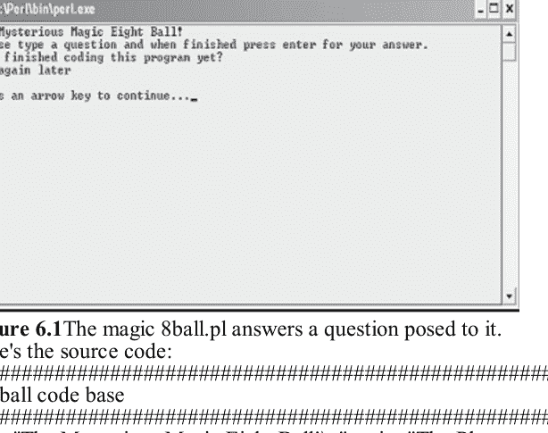

**图 6.1** 神奇的8ball.pl回答了向它提出的问题。

以下是源代码：

```perl
#######################################################################
# 8 ball code base
#######################################################################
print "The Mysterious Magic Eight Ball!\n";
print "Please type a question and when finished press enter for your answer.\n";
$random = int (rand 8);
$question = <>;

if ($random == 0) { print "Most Likely\n"; }
elsif ($random == 1) { print "Probably\n"; }
elsif ($random == 2) { print "Maybe\n"; }
elsif ($random == 3) { print " Outlook not so good\n"; }
elsif ($random == 4) { print "Future is shady\n"; }
elsif ($random == 5) { print "Ask again later\n"; }
elsif ($random == 6) { print " Perhaps\n"; }
elsif ($random == 7) { print "Definitely\n"; };

print "\nPress an arrow key to continue...";
<>
```

### 创建你的第三个完整Perl程序

你编写的游戏循环是通用的，可以用于类似的游戏。看看`gameloop.pl`的基本结构，你可以看到它遵循某种事件顺序：

1. 初始化所有必要的游戏变量。

2. 为玩家打印信息。

3. 接受输入。

4. 应用输入。

5. 重复，直到满足胜利或失败条件。

这种简单的结构可以作为几乎所有能在电脑上玩的游戏的基础。在本节中，你将把你的游戏循环变成一个猜数字游戏。你已经为这个游戏编写了大部分代码，所以必要的步骤很简单：

1. 从现有代码中剪切并粘贴任何必要的部分。

2. 添加或替换任何必要的游戏变量。

3. 重新措辞任何必要的对话。

4. 设置退出游戏循环的胜利和失败条件。

创建一个新的Perl文件，命名为`GuessMe.pl`。然后从`gameloop.pl`中剪切`for`循环并粘贴到这个新文件中，只保留从玩家那里获取信息的`readline`部分。完成后的循环应该如下所示：

```perl
# Main game for loop
for ($turn = 1; $turn <= 4; $turn++)
{
    # Need to grab info from the player
    $char = readline(*STDIN);
}
```

你需要剪切并粘贴一些其他部分来让游戏运行起来。首先，从`MAP.pm`中剪切并粘贴生成随机值的`rand`调用。

```perl
$turn1 = int rand(3);
```

另外，你需要剪切并粘贴一个结尾的`<STDIN>`来防止DOS提示符退出。

```perl
# standard ending
print "\nPress a key to continue...";
<>
```

现在初始化几个变量。猜数字游戏需要两个变量——一个用于保存随机数，另一个用于保存随机数的范围。

```perl
$range = 10;
$number = x;
```

现在修改你从`MAP.pm`粘贴过来的`rand`命令，将随机值放入`$number`，并使用`$range`值来确定数字的最大值。因为`rand`从0开始，所以在最终值上加1。

```perl
$number = int rand ($range)+1;
```

现在你需要创建对话内容。在循环外部使用`print`语句添加一些简单内容，以表明游戏已经开始。

```perl
print "####################################################\n";
print
```

```perl
# GuessMe 猜数字游戏
print "###################################################\n";
# 在循环内添加打印语句，告诉玩家是时候猜数字了。
print "I'm thinking of a number between 1 and $range\n";
print "Type in a guess and hit enter\n";
```

你几乎完成了；现有代码仍然相当短，看起来是这样的：

```perl
print "###################################################\n";
print "#GuessMe\n";
print "###################################################\n";
# 游戏变量
$range = 10;
$number = int rand ($range) +1;
# 主游戏 for 循环
for ($turn = 1; $turn <= 4; $turn++) {
    print "I'm thinking of a number between 1 and $range\n";
    print "Type in a guess and hit enter\n";
    # 需要从玩家那里获取信息
    $char = readline(*STDIN);
}
# 标准结束语
print "\nPress a key to continue...";
<>
```

你剩下的工作就是设置获胜或失败条件。你可以使用if语句来完成。

```perl
if ($char == $number) {
    print "You're Correct\n";
    last;
}
```

最后，在for循环之外，在游戏结束时添加一个打印语句来确认实际数字的值。

```perl
print "The answer is $number";
```

整个脚本的完整代码如下所示。它也可以在本书的配套网站上下载。你也可以在图6.2中查看guessme.pl的运行示例。

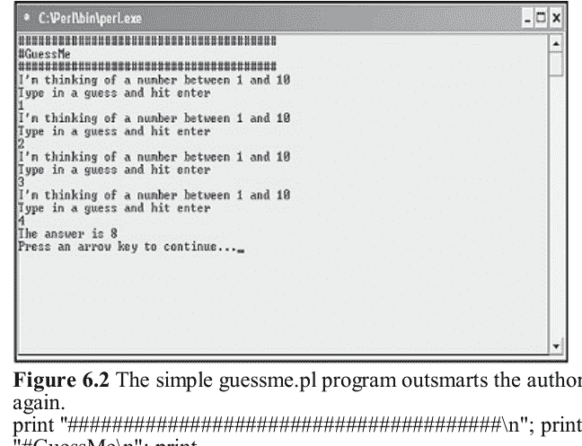

```perl
print "#######################\n";
print "#GuessMe\n";
print "#######################\n";
# 游戏变量
$range = 10;
$number = int rand ($range) +1;
print "$number\n";
# 主游戏 for 循环
for ($turn = 1; $turn <= 4; $turn++) {
    print "I'm thinking of a number between 1 and $range\n";
    print "Type in a guess and hit enter\n";
    # 需要从玩家那里获取信息
    $char = readline(*STDIN);
    if ($char == $number){
        print "You're Correct\n";
        last;
    }
}
print "The answer is $number";
# 标准结束语
print "\nPress a key to continue...";
<>
```

### 考虑其他可能的应用

既然你已经看到了循环和随机数生成器的多功能性，你可以构思出数十种其他有创意的Perl游戏。你可以使用这些基本工具编写赌博游戏，如双骰子或21点，以及井字棋和猜词等游戏。还有一些网站可以下载现有的Perl游戏；我将在今晚的课程中介绍其中一些网站。Perl不仅仅是为了娱乐和游戏。今天有很多严肃和专业的程序和脚本在使用，特别是在万维网领域以及作为系统管理员的工具。生成随机数可能是一个简单游戏的基础，但它也是在使用加密进行安全数据交换时生成随机密钥的基础。游戏循环对于在游戏环境中轮流进行是必要的，但几乎每个计算机应用程序都使用循环作为控制器来接受输入或运行重复动作。

现在尝试几个简短但严肃的Perl应用。在星期六下午的课程中，你看了如何创建一个模拟打字机（并将其命名为stdin.pl）。

看看打字机的对应物——计算器如何？

stdin.pl文件基本上是一个while循环，它接收所有键盘输入，如下所示：

```perl
# changing our standard ending to standard input
while (<>) {
    print;
}
```

你将使用这个while循环的修改版本来创建一个新的Perl应用程序calc.pl。创建一个新文件，并从stdin.pl文件中复制while循环的源代码，或者重新编写这些代码行。

首先需要更改现有的打印行，它只是打印进入STDIN（<>）的任何内容。你希望文件打印数学方程的答案。将打印行更改为`print "Answer = $output\n";`：

```perl
while (<>) {
    print "Answer = $output\n";
}
```

你的while循环现在将打印发送到`$output`的任何内容。你还需要接收数学问题，这很容易使用Perl的默认变量`$_`来完成，因为<STDIN>除非另有指定，否则会放在这里。向你的while循环添加行`$input = $_ ;`：

```perl
while (<>) {
    $input = $_ ;
    print "Answer = $output\n";
}
```

由于代码的规模在增长，添加一些注释是个好主意：

```perl
# The while loop takes (<stdin>)
while (<>) {
    # Perl's default variable $_ places <stdin> into the scalar $input
    $input = $_;
    # chomp end of line characters
    chomp( $input );
    # print the scalar $output to the screen as the answer
    print "Answer = $output\n";
}
```

到目前为止一切顺利。现在你需要添加chomp命令来处理那些讨厌的行尾字符。你可以通过chomp标量`$input`来完成：

```perl
# The while loop takes (<stdin>)
while (<>) {
    # Perl's default variable $_ places <stdin> into the scalar $input
    $input = $_;
    # chomp end of line characters
    chomp( $input );
    # print the scalar $output to the screen as the answer
    print "Answer = $output\n";
}
```

几乎完成了——只剩下几步了。你的计算器需要评估用户何时输入完毕。这可以使用unless循环和last命令来完成，如下所示：

```perl
unless ( $input ) { last }
```

在这个上下文中，unless循环等待<STDIN>到达末尾。末尾由用户的回车表示：

```perl
# The while loop takes (<stdin>)
while (<>) {
    # Perl's default variable $_ places <stdin> into the scalar $input
    $input = $_;
    # chomp end of line characters
    chomp( $input );
    # waits until return hit by user
    unless ( $input ) { last }
    # print the scalar $output to the screen as the answer
    print "Answer = $output\n";
}
```

最后，输入需要被评估并发送到输出。这通过两个标量`$input`和`$output`以及eval函数来完成。eval语句是一个新的Perl命令，是evaluate的缩写，能够评估Perl中的块和语句。eval的语法是：

```perl
eval expression;
```

Perl已经知道如何使用+、*、-、/运算符进行加法、乘法、减法和除法；以下代码行中的eval命令只是告诉Perl继续执行：

```perl
# go ahead and evaluate what has been entered
$output = eval( $input );
```

现在可以执行calc.pl文件了。运行calc.pl并尝试输入一些基本的数学命令，例如1+1或2*2，然后按回车：

```perl
# The Perl Simple calculator
# The while loop takes (<stdin>)
while (<>) {
    # Perl's default variable $_ places <stdin> into the scalar $input
    $input = $_;
    # chomp end of line characters
    chomp( $input );
    # waits until return hit by user
    unless ( $input ) { last }
    # go ahead and evaluate what has been entered
    $output = eval( $input );
    # print the scalar $output to the screen as the answer
    print "Answer = $output\n";
}
```

为了让calc.pl文件对其他人有用，你可能需要添加一些打印语句来解释如何使用它。完整的calc.pl源代码如下所示，也可以从本书的配套网站下载。你也可以查看图6.3的视觉示例。

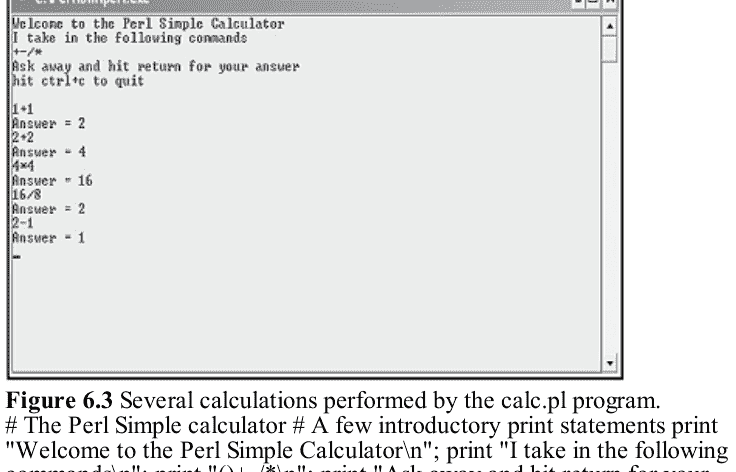

```perl
# The Perl Simple calculator
# A few introductory print statements
print "Welcome to the Perl Simple Calculator\n";
print "I take in the following commands\n";
print "()+-*/\n";
print "Ask away and hit return for your answer\n\n";
print "hit ctrl+c to quit\n\n";
# The while loop takes (<stdin>)
while (<>) {
    # Perl's default variable $_ places <stdin> into the scalar $input
    $input = $_;
    # chomp end of line characters
    chomp( $input );
    # waits until return hit by user
    unless ( $input ) { last }
    # go ahead and evaluate what has been entered
    $output = eval( $input );
    # print the scalar $output to the screen as the answer
    print "Answer = $output\n";
}
```

在你进入更高级的Perl之前，这里还有另一个例子。以下程序创建随机单词。该程序通过创建四个随机字母组合，交替元音和辅音来实现。这只需要几个split数组和几个由rand生成的数字。

Split是join命令的相反操作，它根据你提供的模式分割字符串或表达式。你需要为这个新程序分割行，一行用于元音，一行用于辅音：

```


Split 将使用 * 或通配符字符从后续列表中进行选择。在 @con 数组中，split 将选择列出的辅音之一；在 @vow 数组中，split 将选择存在的元音之一。创建一个随机打印其中一个字符的打印语句，只需一行代码即可完成：
print $con[int(rand(21))];

初看可能因所有方括号和圆括号而显得复杂，但实际上相当简单。从内到外，执行顺序如下：

1.  数字 21 被传递给 rand，这告诉 rand 生成一个 0–20 之间的数字。
2.  随机数被传递给 $con 标量/数组引用。
3.  $con 标量根据随机数分割数组，从列表中提取该数字引用（0–20）。
4.  Print 随后打印与 @con 数组中引用（从 0–20）关联的字母。

你需要打印两次：一次打印辅音，一次打印元音。这都可以放在一行代码中：
# print 语句 print $con[int(rand(21))], $vow[int(rand(5))]
现在只剩下重复此过程的循环了。实际上你可以复制你在游戏循环中使用的 for 循环：
for ($turn = 1; $turn <= 4; $turn++)
目前，将循环改为只循环两次而不是四次，并将打印语句放在 for 循环的括号内：
# 模拟游戏循环的 For 循环 for ($turn = 1; $turn <=2; $turn++)
{ # print 语句 print $con[int(rand(21))], $vow[int(rand(5))] }
大致就是如此。将此文件保存为 words.pl。如果你从 DOS 提示符运行该程序，你会看到它生成一个随机的四个字母的单词。
# 随机单词生成器 # 创建辅音数组
@con=split(/ */, "bcdfghjklmnpqrstvwxyz"); # 创建元音数组
@vow=split(/ */, "aeiou"); # 模拟游戏循环的 For 循环 for
($turn = 1; $turn <=2; $turn++) { # print 语句 print
$con[int(rand(21))], $vow[int(rand(5))] }

### 这些传言是如何开始的

准备好成为 Perl 大师了吗？这里有一些你平时不会看到的东西：

```

@c=split( */, "bcdfghjklmnpqrstvwxyz");

@v=split( */, "aeiou");

for ($turn = 1; $turn <=2; $turn++) {print $c[int(rand(21))],

$v[int(rand(5))]}

```

这与 words.pl 程序相同，只是数组名称缩短为只有一个字母，并且去掉了大部分空格，以便代码能放在两行内。现在，看看这段代码片段：

```

while (<>) {$i = $_;chomp($i);unless($i)

{last} $o = eval($); print "$o\n";}

```

这是一行代码，但它是完全合法的 Perl 语法。它是 calc.pl 代码的版本，其中每个名称都被缩短为一个字母，并且去掉了空格、注释和冗长的打印语句。正是这样的代码片段给 Perl 程序员带来了不好的名声，但也正是“任何程序都可以被一行 Perl 代码替代”的传言的来源。缩短这些程序也说明了为什么添加注释和仔细安排源代码格式很重要。试着几个月后再回到本章，阅读这行计算器代码，你就会明白为什么注释和编码规范如此必要。

## 总结

在过去的几个小时里，你通过添加几个简单的新功能，极大地提高了你的 Perl 技能集。你现在应该对如何组织简单应用有了牢固的掌握，并且有几个可以玩的游戏了。在今晚的课程中，我会更严肃一些，向你展示 Perl 如何广泛应用于现实世界以及作为世界各地程序员的日常工具。

## 周日晚上

### 学习高级 Perl 技术

-   使用模块、包和库
-   Perl 与互联网
-   Perl 安全性
-   调试
-   理解 Windows 和 Unix 兼容性
-   使用数据库
-   超出本书范围

本页有意留白。

## 使用模块、包和库

在过去的几天里，你极大地发展了你的编程技能集。你不仅学会了基础的 Perl 编程，而且对如何组织简单应用有了牢固的掌握。你甚至有几个完成的电脑游戏可以展示！现在是时候更严肃一些，学习 Perl 如何广泛应用于现实世界以及作为世界各地程序员的日常工具了。
本章可以轻松地称为“现实世界中的 Perl”。它旨在作为通往 Perl 资源的门户。我不仅会涵盖这个周末大部分时间里我避免的一些高级主题，如 CGI、安全性和模块，而且我还将尝试提供关于 Perl 的其他信息来源。Perl 程序员社区庞大且不断增长。目前，Perl 本身正在经历由该社区推动和引发的巨大变化。对于互联网爱好者来说，可用的丰富信息和资源非常出色。
今晚的课程开始，我将介绍如何通过 Perl 社区维护的成熟模块、包和库，在线访问大量预构建的 Perl 函数、对象、类和程序。

在今天早上的“对象与面向对象编程”课程中，你创建了自己的 Perl 包和模块，以面向对象的方式将函数分组。*一个 Perl 包* 是 Perl 脚本中使用的函数或变量的自包含单元。*一个 Perl 模块* 仅仅是一个相关函数的集合或一个被捆绑到自己的文件中并以 .pm 扩展名保存的包。包和模块旨在供其他程序使用。
*一个 Perl 库* 是模块或包的集合。就像书架上的书一样，你可以在 Perl 库中搜索你需要的功能、类或变量组。然后，你可以将需要的内容导入到你的机器或 Perl 脚本中。导入功能库的能力是编程中的一个重要概念，也用于大多数其他现代语言。其优点在于，当你需要使用 Perl 创建程序或解决问题时，可能已经存在成熟的技术和捷径。

### 使用包

包用于分组和组织全局标识符。包与安全性或隐私无关，这在本章稍后讨论 Perl 安全性时需要记住。包变量始终是全局的，在一个包中编译的代码可以自由地修改和检查另一个包中的变量。

当你在 Perl 中创建一个包时，你基本上是在创建一个唯一的空间。这个空间只包含你指定属于那里的代码。你可以在同一个物理文件中创建多个包，或者一个包可以包含许多不同的文件。我在今天早上的课程中花了不少时间讲解包，但这里快速回顾一下。你需要两行代来指定一个包：包开头的包声明和代码末尾的 return 语句，如本代码示例所示：

```

# 声明一个包 package simplepackage; # 包内的子程序 sub printing { print "Very Simple Package\n"; } # return 语句 return 1;

```

现在你只需将文件保存为 simplepackage.pl，瞧，你就拥有了一个新的 Perl 包。当你需要在 simplepackage.pl 中使用 printing 子程序时，你编写 require 或 use 命令，然后调用特定的子程序，像这样：

```

# 包含 simplepackage 的 use 或 require 语句 require 'simplepackage.pl' # 在 simplepackage 命名空间中调用子程序 printing simplepackage::printing();

```

今天早上我没有涵盖一些更高级的包命令。例如，包不必受文件边界的限制。你可以在一个文件中拥有多个包，或者一个包可以分布在多个不同的文件中。你可以使用包构造函数命令 BEGIN 和包析构函数命令 END 在文件中分隔包。构造函数和析构函数都作为子程序使用：

```

sub BEGIN { print "my package has begun!\n"; } sub END { print "My package has come to an end\n"; }

```

在这个代码示例中，BEGIN 子程序初始化一个包，而 END 子程序结束该包。使用这两个命令，你可以


可以使用`package`命令在同一个文件中声明多个包。例如，以下代码在同一个文件中创建了两个简单的包，`package1`和`package2`：

```perl

package package1;

sub BEGIN { print "my first package has begun!\n"; }

sub END { print "My first package has come to an end\n"; }

package package2;

sub BEGIN { print "my second package has begun!\n"; }

sub END { print "My second package has come to an end\n"; }

```

`package`命令以及包构造器和析构器也能够将单个包拆分到多个文件中。假设你有两个文件，分别名为`file1.pl`和`file2.pl`，并且你希望`package1`的一部分内容同时存在于这两个文件中。你可以在第一个文件中用以下代码初始化`package1`：

```perl

package package1;

BEGIN {}

sub subroutines { return 1; }

END {}

```

在第二个文件中，你用同样的方式初始化`package1`的第二部分：

```perl

package package1;

BEGIN {}

sub moresubroutines { return 1; }

END {}

```

当你需要将这个分散的包导入到一个源代码文件中时，你只需确保使用`require`命令包含这两个文件：

```perl

require 'file1.pl';

require 'file2.pl';

```

然后你就可以像所有例程都放置在一起一样调用它们中的任何一个：

```perl

package1::subroutines();

package1::moresubroutines();

```

## 使用模块

每个模块都有一个公共接口——一组用于从外部访问模块的变量和函数。`require`和`use`命令使你能够将外部模块导入到你编写的程序中。

`require`命令在运行时加载一个包模块；`use`命令则立即加载该包。`require`确保包尚未被加载，这是一个冗余检查，以避免重复包含相同的包或模块。

`use`命令的工作方式类似于`require`命令，但`use`还提供编译时加载和自动导入功能。你应该确保跟踪哪些模块是在编译时加载的。

使用`use`或`require`将函数从一个包导入到另一个包，本质上是一种别名形式。它们为不同地方的同一件事物创建了两个不同的名称。

Perl包和模块有一些编程约定。它们不像大多数编程约定那样是强制性的，但在处理包和模块时，你会经常遇到它们。

首先，将模块和包名大写化是一个常见的约定。你会发现全大写的名称，例如`CGI.pm`，但你很少会发现小写的模块名称，例如`cgi.pm`。

另外，在Perl模块的末尾，你通常会看到这一行：`return 1;`

这一行告诉程序，当`use`或`require`函数调用成功时，返回一个`1`。

ActivePerl附带了一个内置的Perl包管理器（PPM），帮助Perl程序员下载、安装和跟踪不同的Perl模块。

如果你在安装ActivePerl时使用了默认安装选项，该程序位于你的`C:\Perl\bin`文件夹中。程序名为`ppm.bat`，其目的是下载、安装、验证和移除Perl包和模块，如下所示的步骤。

1.  打开你的`C:\Perl\bin`文件夹。
2.  找到`ppm.bat`图标。
3.  双击它以运行Perl包管理器（参见图7.1）。
4.  一个DOS提示符将打开并显示PPM交互式shell。

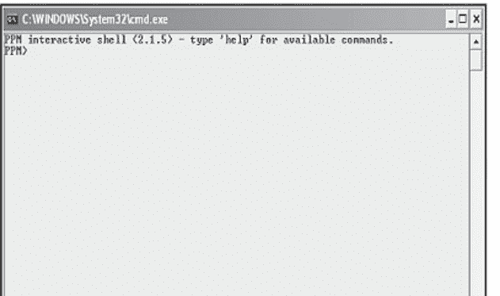

**图7.1** 一个DOS提示符显示Perl包管理器界面。在PPM提示符（PPM>）下输入**help**将产生一个PPM将响应的命令列表。要查找特定的Perl包，你可以使用search选项。例如，在今天早上的课程“对象与面向对象编程”中，你了解了一些存在的其他Perl随机数模块。如果你输入**search random**，将返回一个具有内置随机功能的各种Perl模块列表（参见图7.2）。

安装这些包之一很容易；只需输入**install**和包名。如果你想下载并安装`Data-Random`包，请输入**install Data-Random**。PPM还有一个`verify`命令，帮助你确保你正在运行特定模块的最新版本。如果你想确保你的`Data-Random`模块是最新的，请输入**version Data-Random**，PPM会告诉你你的版本是否是最新的。

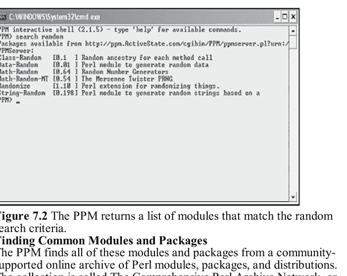

**图7.2** PPM返回与random搜索条件匹配的模块列表。

## 查找通用模块和包

PPM从一个社区支持的Perl模块、包和发行版的在线存档中找到所有这些模块和包。这个集合被称为综合Perl存档网络，简称CPAN。PPM只是一个本地的`.bat`文件，用于在CPAN中搜索请求的模块。CPAN（如图7.3所示）是一个令人惊叹的资源，也许是现存最重要的Perl集合。在位于`http://www.cpan.org`的存档中，你会发现几乎现有的每一种Perl，以及众多有用的模块、建议、文档和Perl常见问题解答。

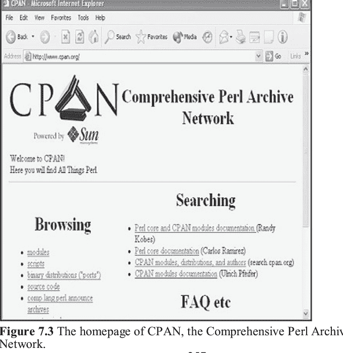

**图7.3** 综合Perl存档网络（CPAN）的主页。

遵循“不止一种方法来做”（TIMTOWTDI）的格言，CPAN提供了大量从头开始编写Perl代码的替代方案。你会发现数百个模块涵盖数千种Perl编码解决方案。想想你在本书早期课程中编写Perl代码时遇到的一些困难。例如，在周六下午的课程“使用文件和Perl操作”中，我强调了基于Perl的UNIX风格权限和Windows权限之间的差异，以及其他使Perl在两个平台之间移植变得困难的兼容性问题。CPAN有几个模块可以在你在Windows平台上编程时提高可移植性和灵活性。（尝试使用PPM搜索`win`或`win32`。）你可以在`http://www.cpan.org/authors/id/GSAR/libwin32-0.151.zip`找到一个压缩的Perl Windows扩展包。

在今天早上的课程中，我讨论了`rand`命令的几种替代方案。CPAN有一些有用的模块，具有随机数生成功能或增强Perl现有的能力，包括：

-   Data::Random
-   Math::TrulyRandom
-   Randomize
-   String::Random

所有这些模块都帮助Perl创建真正随机（或接近真正随机）的数字。CPAN是迄今为止最广泛认可和使用的Perl模块存档，但还有许多其他在线地方可以找到Perl模块和Perl脚本。大多数互联网托管公司为利用其网站上的Perl的客户提供CGI和Perl教程。大多数主要大学在某种程度上都使用CGI，并且他们经常托管Perl网站和资源。你很可能在网上找到Perl脚本，只要你找到编程培训教程或脚本示例的地方。

## 理解Perl和互联网

Perl因其与HTML集成的能力而闻名，但它也能够利用FTP（*文件传输协议*）、处理电子邮件和生成动态网页。Perl已被用于构建无数的互联网应用程序，并自动化常见的管理任务，例如浏览网页以查找断开的链接或检查确保网页和网络服务器保持可用。Perl的大部分互联网功能来自于你可以从CPAN下载的模块。然而，Perl和CGI经常一起使用，并且`CGI.pm`模块在大多数发行版中默认包含。

## 使用CGI

那些不熟悉CGI的人有一个常见的误解，即它是一种具有自己命令和函数库的编程语言。CGI实际上是一种协议，或一种做事的方式，*不是*一种编程语言。它是Web服务器与需要交互的程序进行通信的通用方式。任何向Web服务器发送或接收信息的脚本都需要遵循CGI协议才能被理解。CGI脚本通常用Perl编写，但也用C、Visual Basic、AppleScript以及许多其他语言编写。图7.4展示了一个典型的Web浏览器如何请求和

通过CGI接收网页。

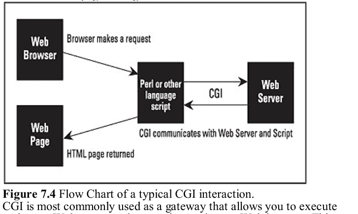

### 图7.4 典型CGI交互流程图

CGI最常被用作一个网关，允许你在Web服务器上执行代码并将结果返回给Web浏览器。这种代码执行通常由用户操作触发，例如按下按钮、从列表中选择一项、在表单中输入信息，或在游戏中执行一个动作。

CGI程序执行普通的Perl代码，就像任何其他程序一样。唯一的区别是，该程序通常由Web浏览器调用。

你在本书中至今在Perl中所做的一切都适用于使用CGI的Web页面。你可以使用标准输出（`<STDOUT>`）向浏览器窗口打印信息，也可以使用标准输入（`<STDIN>`）从HTML页面接收信息。你还可以利用Perl的标准错误（`<STDERR>`）将错误消息直接发送到Web服务器的错误日志。

你需要一个ISP（互联网服务提供商）为你提供一个Web服务器，以便上传任何使用CGI的Web页面。通常，FTP用于上传CGI页面，因此你需要具备脚本编写、HTML、FTP使用和CGI实施的工作知识。此外，你的ISP必须支持CGI协议。（许多ISP实际上并不支持CGI协议。）最后，你创建的CGI脚本在Web服务器上必须具有适当的权限才能正确运行。

Perl CGI程序是一个Perl脚本，其文件扩展名已更改为`.cgi`。你可以在Perl中创建一个脚本，将文件扩展名从`.pl`更改为`.cgi`，然后将其放置在支持CGI协议的Web服务器上。Web服务器将识别出该文件是用于Web用途的，并可以相应地使用该文件。

`CGI.pm`模块被设计为一个面向对象的模块；它带有自己的自定义控件来创建Web页面和Web可执行脚本。要使用该模块，调用`CGI.pm`的`new`方法创建一个CGI对象，然后调用CGI的各种方法。

为了说明，创建一个示例CGI Perl脚本。创建一个新的Perl文件并将其命名为`examplecgi.pl`。要将CGI引入Perl脚本，请按照以下步骤操作：

1.  使用`use`命令包含`CGI.pm`。
2.  通过调用`new`方法创建一个本地CGI对象。

只需几行代码就可以轻松完成，只需将`CGI.pm`视为任何其他类型的OOP Perl模块即可。

```perl

# 使用use包含CGI.pm模块

use CGI;

# 创建CGI对象的本地实例

$local = new CGI;

```

`CGI.pm`有许多方法，允许它创建和操作HTML页面。`header`命令是告诉Perl开始一个HTML页面的方法。你可以使用你的本地对象调用`header`命令，如下所示：

```perl

print $local->header,

```

请记住，CGI中的`print`命令使用`<STDOUT>`向Web浏览器发送数据。

Perl还需要知道HTML页面的开始和结束位置。你可以使用`CGI.pm`的`start_html`和`end_html`方法来完成此操作。

```perl

$local->start_html,

$local->end_html;

```

请注意，每个CGI方法行都以逗号结尾，除了`end_html`，它以分号结尾。

最后，你需要Web页面实际做一些事情。为了简单起见，打印一个简单的“Hello”应该就足够了。在`start_html`和`end_html`方法之间添加这行代码：

```perl

$local->h1('Hello and welcome to Perl CGI'),

```

`h1`方法的工作原理类似于HTML的标题命令（`<h1>`），在这种情况下，它将语句“Hello and welcome to Perl CGI”打印为浏览器的标题1文本。完整的源代码如下；此代码也可从本书的配套网站（http://www.premierpressbooks.com/downloads.asp）的第7章下载中以`examplecgi.pl`的形式获取。

```perl

# 使用use包含CGI.pm模块

use CGI;

# 创建本地CGI对象

$local = new CGI;

print $local->header,

      $local->start_html,

      $local->h1('Hello and welcome to Perl CGI'),

      $local->end_html;

```

Perl内置了在将脚本上传到Web服务器之前测试CGI脚本的功能。Perl会自动将脚本作为浏览器需要读取的HTML代码打印出来。从DOS命令行运行此脚本，你会看到它看起来类似于这样（参见图7.5）：

```

Content-Type: text/html; charset=ISO-8859-1

<?xml version="1.0" encoding="utf-8"?>

<!DOCTYPE html Public "-//W3C//DTD XHTML Basic 1.0//EN" "http://www.w3c.org/TR/xhtml-basic/xhtml-basic10.dtd">

<html xmlns=http://www.w3.org/1999/xhtml lang="en-US">

<head>

<title>Untitled Document</title>

</head>

<body>

<h1>Hello and welcome to Perl CGI</h1>

</body>

</html>

```

要将此程序作为DOS命令运行，你需要重新回顾这些步骤（最初在“周五晚上和周六上午”的部分中概述）：

1.  单击“开始”菜单。
2.  单击“运行”。“运行”对话框出现，其中包含“打开”行。
3.  在“打开”提示符处键入**command**。
4.  使用`CD`（更改目录）命令导航到适当的目录（包含`shortxml.pl`文件的目录）。
5.  在命令行上键入**shortxml.pl**并按回车键。

Perl CGI是一个很长的话题，已经有很多书籍结合这两个环境进行编程。网上也有大量关于组合Perl CGI脚本的资源。万维网联盟和加州大学伯克利分校都托管CGI库，还有一些脚本档案库提供CGI源代码下载。其中一些在线档案库概述在表7.1中。该表也是一个Web页面，你可以从本书的配套网站（cgi.html）下载。

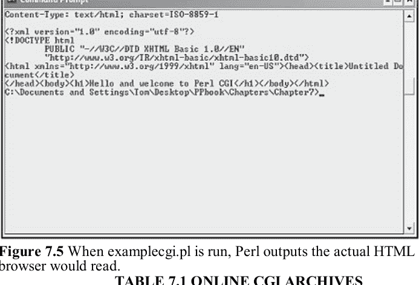

图7.5 当examplecgi.pl运行时，Perl输出浏览器将读取的实际HTML。

## 表7.1 在线CGI档案库

| 组织 | 网站 | CGI文件位置 |
|---|---|---|
| 加州大学伯克利分校 | http://www.berkeley.edu | http://cgi-lib.berkeley.edu |
| 国家超级计算应用中心 | http://www.ncsa.edu | http://hoohoo.ncsa.uiuc.edu |
| Matt's Script Archive, Inc. | http://www.worldwidemart.com | http://www.worldwidemart.com/scripts |
| 万维网联盟 | http://www.w3c.org | http://www.w3.org/Tools |
| 冷泉港实验室 | http://stein.cshl.org | http://stein.cshl.org/WWW/CGI |

### 注意

因为存在许多安全风险，在你将脚本开放给在线社区访问之前，请参阅“安全”部分。你是在承担重大风险。这些风险可以通过编写脚本时采取适当的安全措施来减轻，但也有一些问题需要Web服务器管理员或运行服务器的部门来解决。

在你上传任何编写的代码之前，你应该确保获得Web服务器负责人的许可。如果不小心和预防，恶意攻击者可能会利用你的脚本造成严重损害。即使小心预防，仍然存在一定程度的风险，因此与你的托管方沟通至关重要。由于大多数ISP和知名公司都有CGI和Internet开发的规则，找到这些规则应该不难。通常，一封快速的电子邮件或简短的网站搜索将为你提供所需的结果，以确保你的Perl脚本符合托管方的规则。

下面是一个简单、常见的CGI用例的演练：网页计数器。*网页计数器*跟踪网页被访问的次数，并将该数字显示给浏览该网页的人。CGI网页计数器是动态网页内容的一个简单例子，因为内容对每个查看者都是不同的。要运行CGI网页计数器，你需要三个文件：

-   一个调用CGI Perl脚本并显示结果的HTML网页。
-   一个执行工作的CGI Perl脚本。
-   一个包含实际计数器数字的计数器文件。

从HTML页面开始。使用Perl创建网页，你需要做以下事情：

1.  导入CGI。
2.  创建CGI的本地实例。
3.  使用`print`向浏览器发送一个标题。
4.  使用`start_html`和`end_html`标记HTML页面的开始和结束。


## 5. 显示一个存储网页访问次数的 $count 变量。

你已经在本节完成了步骤1和步骤2。这些步骤的代码如下所示：

```

# 导入并创建cgi的本地实例

use CGI;

$local = new CGI;

```

步骤3和步骤4通过一个简单的print语句和你刚刚学到的几个方法调用来完成：

```

print $local->header,

$local->start_html(),

$local->end_html,

```

唯一真正的新内容是步骤5中显示一个标量值，这可以使用几个CGI->header方法来实现：

```

$local->center($local->h1('Counter')),

$local->center($local->h3("Current count:", $count)),

```

这将显示两行HTML，第一行使用标题1，第二行使用标题2。这些步骤已被整合到一个名为`counterhtml.pl`的脚本中，可以在伴侣网站上与本章的文件一起下载。完整的源代码如下所示：

```

print $local->header,

$local->start_html( -title=>'Web Counter', ),

$local->center($local->h1('Counter')),

$local->center($local->h3("Current count: ", $count)),

$local->end_html,

```

现在你需要创建完成所有工作的Perl脚本。创建一个新脚本并将其命名为`counter.pl`。为了使计数器正常工作，此脚本需要执行以下步骤：

1.  告诉Web服务器脚本运行的位置以及如何找到Perl发行版（稍后解释）。
2.  导入并创建CGI的本地实例。
3.  打开一个文件以跟踪网站访问次数。（在此示例中，你将调用该文件为`COUNT`。）
4.  将`COUNT`分配给一个本地标量，并将`COUNT`加一。
5.  关闭跟踪网站访问次数的文件。

步骤1通过在脚本顶部编写一行代码来完成。该代码将取决于脚本所在的Web服务器类型，但在大多数Unix风格的服务器上，该行将是：

将`counter.dat`分配给`COUNT`文件句柄：
```

# 使用open打开跟踪访问次数的文件

open (COUNT, "<counter.dat") or die "Could not open the counter file.";

```
打开`counter.dat`后，将值分配给一个标量，然后立即关闭文件以避免任何意外：
```

# 将计数分配给本地变量

$count = <COUNT>;

# 始终在之后立即关闭文件。

close COUNT;

```

现在，递增`$count`的值：
```

# 递增计数变量

$count = $count +1;

```
最后，打开`counter.dat`，分配新数字，并再次关闭`counter.dat`：
```

# 打开counter.dat文件并用新数字增加它

open (COUNT, ">counter.dat");

print COUNT $count;

close COUNT;

```
整个文件可在伴侣网站上获取，完整的源代码如下：
```

#!/usr/bin/perl

# 服务器需要知道Perl的存储位置。这因服务器而异

# 导入

use CGI

# 创建本地实例

$local = new CGI;

# 使用open打开跟踪访问次数的文件

open (COUNT, "<counter.dat") or die "Could not open the counter file.";

# 将计数分配给本地变量

$count = <COUNT>;

# 始终在之后立即关闭文件。

close COUNT;

# 递增计数变量

$count = $count +1;

# 打开counter.dat文件并用新数字增加它

open (COUNT, ">counter.dat");

print COUNT $count;

close COUNT;

```
`counter.pl`文件包含在伴侣网站上可供下载，仅供参考和说明用途。该文件在你的家庭计算机上运行需要所有适当的文件和Web服务器设置。

## 将Perl与XML结合使用

XML是由万维网联盟（W3C）开发的一种脚本语言。XML类似于HTML，不同之处在于XML使用灵活的自定义标签，而不是使用现有的预定义HTML标签（如`<head>`或`<h1>`）。尽管XML超出了本书的范围，但本节将简要介绍Perl和XML的集成方式。
XML于1996年由W3C开发。它与HTML源自同一个父标准——SGML（标准通用标记语言）。
XML的核心理念是：

- 内容必须与表现形式分离。
- 该语言必须具有高度的可移植性。
- 该语言必须易于人类和机器阅读。

XML由程序员定义的标签驱动。这些标签保存数据并描述它们所包含的数据。XML标签允许程序员以任何方式组织数据；这使得XML成为结构化数据交换中最流行的语言。当今的数据库通常能够利用XML来传递信息。
应用程序可以轻松地通过解析器利用XML。要读取任何XML文档都需要一个XML解析器；大多数主要语言，如Perl、Java和Python，都有内置的XML解析器。
Perl自带一个最小化的内置XML解析器，其形式是一个名为`XML::parser`的模块。要进行广泒的XML工作，大多数必需的模块都需要下载。两个主要的XML模块`XML::DOM`和`CGI::XML`都可以通过PPM获取。如果你在CPAN上搜索，你会找到一些已经构建好以提供XML支持的Perl模块。
Perl的`XML::DOM`模块提供了一个按照DOM（文档对象模型）操作XML文档的接口，DOM也是由W3C开发的。
当Perl拥有所需模块时，生成XML类似于生成HTML或CGI。Perl能够利用`print`或`write`命令通过标准输出`<STDOUT>`解析XML数据或结构。
要解析XML文档，你需要遵循与学习使用任何其他面向对象模块相同的原则，如下所述：

1. 使用`use`命令包含相应的XML模块。
2. 使用`new`方法创建XML解析器对象。
3. 使用解析器的`parsefile`方法解析XML文档。

例如，要使用`XML::DOM`模块，你首先使用`use`命令。
```

use XML::DOM;

```
然后你为`XML::DOM`创建解析器对象的一个实例。
```

my $localparser = new XML::DOM::Parser;

```
最后，你使用`parsefile`方法解析XML文件。
```

my $localfile = $localparser->parsefile ("file.xml");

```

当组合在一起时，这三行代码导入`XML::DOM`包，为`XML::DOM`创建解析器的本地实例，并将"file.xml"解析到`$localfile`标量中。

```

use XML::DOM;

my $localparser = new XML::DOM::Parser;

my $localfile = $localparser->parsefile ("file.xml");

```

来个简单的XML示例激发你的兴趣如何？你可以从一个简单的XML文档开始，Perl通过`XML::DOM`解析器加载并打印它。为此，你需要执行以下步骤：

1.  创建一个简单的XML文档。
2.  导入`XML::DOM`模块。
3.  创建`XML::DOM`解析器的本地实例，以便你拥有能够解析XML的东西。
4.  将XML文档解析到本地标量中。
5.  打印出本地标量。

记住XML基于用户定义的标签。在你将要创建的文档中，只使用两个标签（以保持简单）：`<MESSAGE>`和`<HELLO>`。当你编写这些标签时，它们看起来与你在周五晚上课程中接触过的HTML标签相同。在这个例子中，你会将`<HELLO>`放在`<MESSAGE>`内部：

```

<MESSAGE>

    <HELLO>

    </HELLO>

</MESSAGE>

```

注意标签如何使用`</>`来表示结束，就像HTML一样。现在，在XML文档中放入你想要显示的文本：

```

<MESSAGE>

    <HELLO>

        Hello and Welcome to XML.

    </HELLO>

</MESSAGE>

```

当XML查看此文档时，它将根据分配给`<HELLO>`和`<MESSAGE>`标签的规则来格式化字符串"Hello and Welcome to XML"。同时，你需要在文件顶部添加一个标识符，让世界知道该文件是一个XML文档，之后完整的文件应如下所示：

```

<?xml version="1.0"?>

<MESSAGE>

    <HELLO>

        Hello and Welcome to XML.

    </HELLO>

</MESSAGE>

```

这个`xml version =`标签使你能够指定用于创建此文档的XML版本。此完整文件可作为`shortxml.xml`在伴侣网站上获取。
对于Perl文件，创建一个新的Perl源文件并将其命名为`shortxml.pl`。你需要做的第一件事是导入并使用相应的模块：

```

# 导入 XML::DOM

use XML::DOM;

```

然后，像上面的例子一样，你必须创建一个本地实例的...

XML::DOM 解析器。
# 创建 DOM 解析器的一个本地实例 my $localparser = new XML::DOM::Parser;
现在，你可以使用该解析器将 shortxml.xml 文件的内容赋值给一个本地标量。这可以通过在 XML::DOM::Parser 中使用 parsefile 方法来完成：
# 将 xml 文件打开到一个本地标量中 my $localscalar = $localparser->parsefile ("shortxml.xml");
最后，添加用于显示文件内容的 print 语句。完整的源代码示例可以从网站下载，完成后如下所示：
# 导入 XML::DOM use XML::DOM; # 创建 DOM 解析器的一个本地实例
my $localparser = new XML::DOM::Parser; # 将 xml 文件打开到一个本地标量中 my $localscalar = $localparser->parsefile ("shortxml.xml");
# 并打印 print $localscalar;
```

如果你对此产生了好奇，想进一步了解 XML，可以找到大量在线资源。W3C 是查找有关 XML (http://www.w3c.org/XML) 和 DOM (http://www.w3c.org/DOM) 更多信息的首选之地。

可下载的 shortxml.pl 文件中的一些代码行已被注释掉。这是因为 shortxml.pl 文件仅用作模板，而非设计为在桌面计算机上运行。

## C 代表 Cookie

当互联网商务（或电子商务）首次兴起时，公司在在线购物方面遇到的最大问题是会话跟踪。当一个网页被关闭时，HTTP 会话即告结束，此时要将数据从一个网页传递到另一个网页极其困难。这使得通过多个网页进行购物成为一个难题，唯一的解决方案是客户端计算机、Web 服务器或 Web 浏览器存储信息的方法。Cookie 作为客户端计算机在浏览互联网时存储数据的主要方式应运而生。

Cookie 是 Web 服务器发送给浏览器的小文本文件。然后浏览器将该 cookie 保存在客户端计算机上的一个文件中。Cookie 长期以来一直被视为隐私问题，因为它们已被用于跟踪网络活动和浏览器移动轨迹，有时甚至未经用户同意。

无论你是否赞成使用 cookie，它们在互联网商务中都扮演着重要角色，因为它们使程序员能够在访客的计算机上存储数据。由于 Perl 针对 Web 进行了优化，当你使用 Perl 的 CGI.pm 模块时，创建会话 cookie 相当简单。要使用 Perl 创建一个 cookie，你只需：

1. 使用 use 命令导入 CGI.pm 模块。

2. 使用 new 命令创建一个 CGI 对象的本地实例。

3. 调用 cookie 方法来创建一个 cookie。

在“使用 CGI”一节中，你已学习了将 CGI.pm 模块导入脚本所需的所有步骤，因此此时唯一不熟悉的部分就是使用 cookie 方法。在 Perl 代码中，创建 cookie 的代码如下所示：

```
$localcookie = $cgiobject->cookie{}
```

Cookie 可以包含几个不同的变量，包括：

- Domain（域）

- Name（名称）

- Expires（过期时间）

- Path（路径）

- Secure（安全）

- Value（值）

这些变量的基本设置语法为：

-variable=>'value',

假设你想在一个 cookie 中包含三个变量来存储 cookie 的名称、值和过期时间。你只需将以下几行代码添加到程序中。

```
$localcookie = $cgiobject->cookie { -name=>'myfirstcookie',
-value=>'page1', -expires=>'+1h' }
```

在此示例中，设置为 +1h 的过期值表示一小时。你也可以通过使用 m、a 或 y 分别替代 h，来将 cookie 过期值设置为分钟、天或年。

Cookie 只能在头部信息中写入，但你可以从代码的任何位置读取 cookie。

```
print $local->header(-cookie=>$myfirstcookie);
```

以下代码也可作为 cexample.pl 下载：

# 使用 use 命令导入 CGI use CGI; # 创建一个本地 CGI 对象 $local = new CGI; # 调用 CGI cookie 方法创建一个 cookie $mycookie = $local->cookie { # 设置 cookie 值 -name=>'myfirstcookie', -value=>'page1', -expires=>'+1h' } # Cookie 必须在网页的头部信息中创建 print $local->header(-cookie=>$mycookie); # 获取用于读取的 cookie %readcookie = #local->cookie( 'myfirstcookie');

当你通过 DOS 命令行运行此代码时，你将收到有限的信息（见图 7.6）。这是因为该代码设计为在 Web 服务器上运行，而非在本地计算机上。

shortxml.pl 文件包含在可从配套网站下载的资源中。如果没有所有适当的文件、必要的 XML 模块和 Web 服务器设置，该文件无法在你的家用计算机上运行。

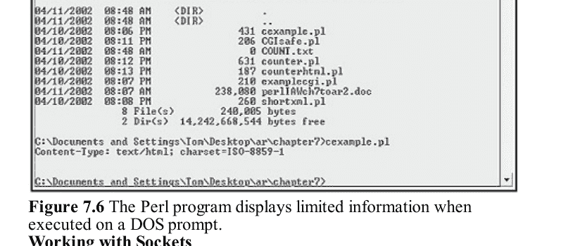

## 使用套接字

*套接字（socket）* 是运行在网络上的两个程之间通信的一端。要使用套接字，你需要使用互联网服务器或计算机上的端口。你指定一个互联网服务器和一个要连接到该服务器的端口，然后建立连接。连接建立后，你可以在大多数情况下像使用 Perl 文件句柄一样使用该套接字。

当你浏览网页时，你的浏览器会使用套接字来建立连接。通常，Web 服务器会打开一个端口来监听网页请求。（端口 80 是用于网页浏览的常规端口。）当你的浏览器访问特定网站时，它会通过该网站托管服务器上的 80 端口请求一个网页。


当服务器上的 80 端口收到请求时，该请求的这一端被称为`开放套接字连接（open socket connection）`。然后，Web 服务器以 HTML 格式将网页发送回你的计算机。你的计算机通过自己的一个套接字接收 HTML，然后将其交给浏览器，浏览器会重构网页供你查看。

在大多数情况下，所有的互联网和 TCP/IP（*传输控制协议/互联网协议*）流量都以这种方式工作。当你发送电子邮件时，你的电子邮件客户端通过套接字连接与电子邮件服务器通信。当你接收电子邮件时，你是通过套接字连接从服务器接收它。FTP（*文件传输协议*）客户端利用套接字连接，即时通讯软件、多人在线视频游戏、流媒体以及所有其他依赖互联网的应用程序也同样如此。

Perl 作为互联网时代的产物，其构建初衷就是为了利用和操作套接字。Perl 有两个内置命令 `send` 和 `recv`，可用于通过套接字连接来回发送数据。当数据在套接字连接中传输时，被称为`字节流（byte streams）`。

Perl 还有几个能够在不同层次上处理套接字的模块；其中一些模块在表 7.2 中概述。

## 休息一下

要学的东西太多，时间却太少。正如你所见，Perl 确实是互联网时代的产物，拥有大量基于互联网的功能和特性，甚至还有一个万维网支持基础。你即将开始高级 Perl 的最后一段学习旅程，你将了解安全性、调试以及 Perl 6 即将到来的变化。现在是稍作休息、反思所学内容的好时机——在最后冲刺前快速调整一下。

## 理解 Perl 安全性

安全问题需要认真对待，尤其是在你为 Web 开发应用程序时。一个能够破解在线 Perl 脚本的人，或许也能入侵该脚本运行所在的 Web 服务器。由此，他们可能进一步入侵 Web 服务器所在的网络的其他部分。Perl 脚本被入侵可能意味着其运行所在的网站停机、服务器停机、收入损失、用于修复或从攻击中恢复所耗费的资金和精力，以及严重的法律责任问题。

这些问题部分解释了为何你可能难以找到一个网络主机来托管你的 CGI 和 Perl 脚本。允许 CGI 在 Web 服务器上运行的问题在于，CGI 带来了相当大的安全风险。它授予对 Web 服务器上文件和目录的访问权限，而恶意攻击者可能利用这些访问权限来钻安全漏洞的空子，或者干脆过度使用脚本导致机器死锁。甚至普通消费者也可能误操作导致此问题发生。

所有这些问题使得采取安全预防措施变得非常重要。为了保护需要运行 CGI 的服务器，你应该采取许多预防措施；即使在设计小型 Perl 脚本和应用程时，你也应该采取预防措施。Perl 安全性本身就足以写成一本书，但本节将概述一些入门要点，并为你指引一些现有的在线资源。

### 信任与污染检查

安全的第一条规则是，“永远不要信任任何人”。在编程中，这通常意味着，“永远不要信任来自任何地方的数据——无论它来自用户、客户、Web 服务器还是另一个程序。”当你对数据做出假设时，尤其是在假设数据是安全可用的情况下，许多安全问题就会产生。编写代码时，你应该：

- ➤ 永远不要假设用户会按照你的要求去做。

- ➤ 总是对你程序中输入的数据保持怀疑。

- ➤ 总是对你编写的代码保持怀疑。

Perl 中最大的安全漏洞之一是用户可以传递未经检查的数据。通常，利用漏洞者会寻找接受数据的 CGI 脚本，并尝试利用该脚本在机器或 shell 上执行系统命令。为了帮助程序员避免可疑数据，Perl 内置了一种称为`污染检查（taint checking）`的功能。

| 模块 | 用途 |
| :--- | :--- |
| IO::socket | 设置客户端/服务器、TCP/IP、UDP 和套接字连接 |
| Net | 利用常见的互联网协议，例如 Net::FTP 和 Net::Telnet |
| Mail | 使用 Mail::POP3Client 或 mail::Mailer 收发邮件 |
| LWP | LWP 是 Library WWW Perl 的缩写，提供基于 Web 的自动化和浏览器功能。 |

## 污点

污点通过自动标记任何从程序外部赋值的变量（特别是从标准输入 `<STDIN>` 接收的任何内容）为“受污”且因此不安全，来防止这种特定的代码攻击。启用污点后，程序无法使用受污数据影响实际脚本之外的任何内容。被标记为受污的数据会将其标记传播到与其接触的任何其他数据。因此，如果你使用一个受污变量在脚本内改变第二个变量，第二个变量也会被标记为受污。

污点基本上会阻止任何通过 `eval`、`system`、`exec` 或 `open` 调用发送的数据。污点还会阻止你在未先设置 `PATH` 环境变量的情况下调用任何外部程序。要启用污点，你需要使用 `-T` 开关。你可以在 DOS 命令行使用 `-T` 在运行程序时启用污点。以下命令使用 Perl 并启用污点来打开 `program.pl`。

```
perl program.pl -T
```

在 Web 服务器上，污点应添加到 Web 服务器用于搜索 Perl 发行版的路径中。如果 Perl 位于 `usr/local/bin` 文件夹中（这在 UNIX 系统上通常是这样），那么该 Web 服务器上的每个 Perl 脚本都应以以下行开头：

```
#!/usr/local/bin/perl -T
```

ActivePerl 建议所有在线或在 Web 服务器上使用的 Perl 脚本都应启用污点。

## 使用编译指示

*编译指示*是 Perl 编译器用于设置选项的参数。Perl 中最常用的两个编译指示恰好也是捕获不安全代码的——*strict* 和 *warnings* 编译指示。当 Perl 设置为使用这些编译指示时，perl 编译器将检查、发出警告并禁止某些编程结构和技术。在 Perl 中，编译指示在脚本开头使用 *use* 命令设置。

```
use strict;
use warnings;
```

我遇到过一些 Perl 程序员，他们坚持认为 `strict` 编译指示是任何代码中绝对必需的一部分，无论脚本的大小或功能如何。这些编译指示通过强制程序员使用更安全的编码技术（例如为所有变量设置作用域）来提供帮助。它们还有助于发现代码中可能存在的错误或问题，这是必要的，因为攻击者经常利用漏洞。Perl 还有许多其他可以设置用于编译检查的编译指示，尽管它们使用得不那么普遍。这些编译指示包括 `autouse`、`constant`、`diagnostics`、`integer`、`lib`、`locale`、`overload`、`sigtrap`、`subs` 和 `vars`。关于这些编译指示的信息可以在 ActiveState 的 ActivePerl 文档中找到，该文档位于你的 `C:\Perl\Docs` 文件夹中。

## 理解文件权限

我在周六早上的“变量和其他有趣的东西”和下午的“将所有内容整合在一起”环节中谈到了文件权限。用于 Web 服务器的 Perl 脚本通常具有某种关联的权限。通常，Perl CGI 脚本在 Web 服务器上以普通用户或匿名代理的身份运行。你的脚本所拥有的权限应该仔细考虑。例如，假设你的脚本具有读写能力以打开文件并将数据解析到其中。如果脚本受到攻击并被攻破，攻击者将对这些文件拥有读写权限。

安全专家通常采用“最小权限”策略来应对此类问题。这意味着脚本只应具有完成其工作所需的最小权限。如果可能，脚本应仅在实际执行工作时才拥有所需的权限。你还应注意防止脚本被攻击者覆盖，这意味着你应该仔细设置使用脚本所在服务器的用户的权限。

Web 服务器权限通常不是 Perl CGI 脚本编写者的主要关注点；该任务通常属于服务器管理员。因此，你应该与你运行脚本的计算机的本地管理员讨论你的脚本权限需求。当你开始开发脚本以在特定 Web 服务器上运行时，你还应该注意 CGI 和 Web 脚本的管理策略。

## CGI 安全问题

CGI 使你的计算机和程序暴露在来自地球任何地方的攻击之下。CGI 中最常见的利用是攻击者试图使用你的脚本在托管脚本的服务器上执行命令。黑客将尝试通过已知的 CGI 脚本强制传递管道命令，希望找到一个突破口。他们将尝试强制脚本执行脚本未预期的命令。通常这些命令采取两种调用形式：`system` 或 `exec` 调用。

`system` 命令是从 Perl 到底层操作系统执行调用或命令的快捷方式。使用 `system`，你可以调用你的协作系统可以调用的相同命令和程序。例如，如果我想使用 `system` 命令打开我的 `Word.exe` 程序，我可以使用类似以下的内容：

```
system "c:\Program Files\World.exe"
```

`exec` 命令是执行的缩写，其操作方式大体相同。尽管由于 `system` 或 `exec` 所具有的强大功能，人们很容易倾向于使用它们，但你应该在 CGI 中谨慎使用这些命令，并且仅在绝对必要时才使用。CGI 接口应设置为不会无意中执行任何内容。受污数据是 Perl 实现这一点的一种方式。当你在 CGI 中使用受污数据时，Perl 不允许你将任何来自脚本外部的数据传递到 `system`、`exec` 或类似的调用中。你不应该将未经检查的数据传递给外部程序。

DoS（拒绝服务）攻击也是 Web 服务器的常见问题。当发送到 Web 服务器的工作请请求数量超过服务器处理这些请求的能力，并导致服务器无法处理任何新的工作请求时，就会发生拒绝服务攻击。Perl CGI 有一些内置的对策来防止 DoS 攻击。例如，你可以使用 `$CGI::POST_MAX` 变量来限制来自表单的 POST 请求的大小。你还可以通过将变量 `$CGI::DISABLE_UPLOADS` 设置为 1 来禁用上传。这可以使用以下代码实现（在配套网站上以 `CGIsafe.pl` 形式提供）：

```perl
# 利用 use 加载必要的组件
use CGI qw( :standard );
use CGI::Carp 'fatalsToBrowser';

# 将任何 POST 的大小限制为 512 字节
$CGI::POST_MAX = 512;

# 关闭任何上传
$CGI::DISABLE_UPLOADS = 1;
```

`CGIsafe.pl` 文件在你的本地计算机上无法正确运行。该文件不是一个完整的程序；它只是一个模板，用于说明在以下情况下如何启用安全功能：

-   相应的 CGI 模块已下载并安装。

-   该代码包含在实际工作的 Perl 脚本中。

-   该模板包含在支持 Perl 和 CGI 的适当 Web 服务器上。

## 理解其他安全问题

程序员常犯的一个错误是假设某些语言函数本身具有内置安全性。Perl 中的一个具体例子是 `package` 函数。包用于分组和组织全局标识符，一些程序员可能假设包中的标识符可以被隔离或保护。然而，包与安全或隐私无关，并且没有安全检查来确保程序或用户适当地使用特定的包。

使用预先编写的脚本也存在很大风险。作为一条规则，你可能需要仔细阅读并检查从互联网下载的任何脚本的安全性问题，除却它们来自可信来源，例如 CPAN。

最后一个有用的提示是移除或剥离你的脚本接收到的任何输入中的元字符。元字符是特殊键字符，例如 `$`、`@`、`{` 和 `}`，Perl 使用它们来识别特定的命令和程序结构。对于接受用户输入的程序，最好只允许常规字母和数字作为输入。这可以通过使用模式匹配来检查或移除字符串中的元字符来实现：

```
$scalar =~ /(^[\w]+)\@([\w.]+)/;
```

这行代码起初看起来很混乱，但概念相当简单。`=~` 是一个绑定运算符。绑定运算符将标量绑定到特定的模式匹配。这个 `$scalar` 被绑定到此代码片段右侧建立的模式，这些模式包含在斜杠 `/ /` 内。

`\w` 是匹配单词字符命令，确保 `$scalar` 仅对字母数字字符进行绑定。另一种确保使用我们的 `=` 绑定运算符匹配正确模式的方法是：你可以使用此代码片段确保单词或短语仅匹配字母字符。

```
$scalar =~ /([A-Za-z]+)/;
```

## 资源

有许多安全组织、公司和机构提供在线资源和指导，以帮助你学习安全编码技术。一个简要的资源列表可以在表 7.3 中找到。网站上还有一个可下载的网页，其中包含这些资源作为链接。

## 调试

有时，尽管你才华横溢且有这本便捷的 Perl 参考书，你仍会发现自己无法确切找出你编写的 Perl 程序错在哪里。当 Perl 脚本出错且你不确定原因时，这些建议可以帮助你找到那些难以捉摸的隐藏拼写错误或语法错误。请记住，语法错误是最常见的错误！

- 使用警告编译指令（Warnings pragma）。警告可以指出常见的拼写错误和可能的语法错误。

- 经常使用 `print` 语句，在任何更改后打印出每个变量或标量。这些 `print` 语句可以简单地在生产代码中注释掉，并使你能够在程序运行时跟踪其结构。

- 调试 CGI 时，确保脚本是可执行的并能在本地先运行，然后再考虑让脚本在服务器上工作。

- 确保你的文件具有执行所需操作的适当权限。

在调试方面，以下是一些常见的初学者程序员错误。

- 一次性测试整个程序，而不是在编写完每一部分后逐步进行测试。

- 使用错误的元字符或前缀解引用器。例如，使用 `%` 来建立数组，而不是 `@`。

- 忘记在语句末尾放置分号。

- 忘记在代码块周围放置花括号（尤其是右花括号）。这些字符几乎总是成对出现：`()`、`""`、`<>`、`{}` 和 `[]`。

- 在语句末尾放置了错误的花括号，例如 `{block{` 而不是 `{block}`。

- 混淆 `\` 和 `/`。

- 当需要两个等号 (`==`) 时，只使用一个等号 (`=`)。

- 键入 `elseief` 而不是 `elsif`。

- 当需要小写字母时使用大写，反之亦然。几乎所有 Perl 命令都是小写的，大多数程序员在 Perl 中使用一些大写字母作为其命名约定。

- 忘记数字计数是从 0 开始，而不是从 1 开始。

### 表 7.3 在线安全资源

| 组织 | 网站 |
| :--- | :--- |
| 万维网联盟（W3C）的 CGI 安全页面 | http://www.w3.org/Security/Faq/www-security-faq.html |
| 普渡大学的 CERIAS | http://www.cerias.com |
| 美国司法部的 CCIPS | http://www.cybercrime.gov |
| 计算机应急响应小组（CERT） | http://www.cert.org |
| 计算机专业人士社会责任组织（CPSR） | http://www.cpsr.org/ |
| 计算机安全研究所 | http://www.gocsi.com/ |
| 国防信息系统局（DISA）的安全与隐私页面 | http://www.disa.mil/infosec/iaWeb/default.html |
| 电子隐私信息中心 | http://www.epic.org/ |
| IEEE 计算机学会 | http://www.computer.org/ |
| NCSA 的 CGI 安全页面 | http://hoohoo.ncsa.uiuc.edu/cgi/security.html |
| 美国国立卫生研究院的安全页面 | http://www.cit.nih.gov/security.html |
| 国家安全研究所的互联网安全页面 | http://www.nsi.org/Computer/Internet.html |
| NIST 的计算机安全资源中心 | http://cs-www.ncsl.nist.gov/ |
| SANS 研究所 | http://www.sans.org/newlook/home.php |
| Shake Communication 的安全搜索 | http://www.securitysearch.net/ |
| 加州大学伯克利分校的 ISAAC | http://www.isaac.cs.berkeley.edu/ |
| 普林斯顿大学安全互联网编程组 | http://www.cs.princeton.edu/sip/index.php3 |
万维网联盟的安全资源页面 [http://www.w3.org/Security/Overview.html](http://www.w3.org/Security/Overview.html)

## 理解 Windows 和 Unix 的兼容性

ActiveState Perl 帮助文件中的 Perl 移植文档（位于你的 `C:\Perl\Docs` 目录中）包含了如何编写可移植 Perl 代码的信息，当你处理多个操作系统时，这可能会令人困惑。

Perl 在可移植性方面实际上做得非常出色。这段代码勇敢地支持多种平台，而大多数编程语言在这些平台上会崩溃。该语言的大部分语法在 Windows、Macintosh 或 UNIX 平台上运行程序时都是可用的。当你设计时考虑到可移植性，以下几点需要记住：

- 注意文件权限和使用 `chmod`，这我在周六晚上的讲座中讨论过。

- 换行符 (`\n`) 并非在所有平台上都能用于指示行尾，这也可能导致 Perl 的 `chop` 命令出现可移植性问题。

- `seek` 和 `tell` 命令可能无法在平台之间很好地移植。

- 当你在文件系统中导航时，会遇到移植困难。例如，有些文件系统使用 `\` 表示从文件或目录切换，而其他文件系统使用 `/` 来完成相同的任务。这意味着 Windows 上的编码路径可能是 `\Documents\file`，而 Unix 中的相同路径是 `/Documents/file`，任一操作系统都可能拒绝对方的路径。此外，某些文件系统可能不包含你试图导航的目录。例如，Windows 通常有 `Program Files` 文件夹，而 Unix 没有。同样，几乎所有的 Unix 平台都有几个 `sbin` 文件夹，而 Windows 没有。`File::Spec` 模块是一个可下载的扩展，可以帮助你使用正确的技术来导航文件系统，无论它位于何处。`File::Basename` 是另一个在处理不同平台文件系统时值得留意的模块。有关此问题的更多信息，请查阅 ActiveState 的 Perlport 文档。

- 环境变量因平台而异。当你确定特定系统如何跟踪时间时，这一点尤其重要。

- 可移植套接字编程可能很困难，因为不同平台使用换行符 (`\n`) 的方式不同。Perl 的常规套接字命令会自动将数据转换为二进制形式（称为 *打包*）以实现可移植性。然而，不同的操作系统处理行尾或换行符的方式不同，这可能会导致通信混乱，除非套接字连接是为特定平台设计的。

请记住，如果你在移植 Perl 应用程序时遇到困难，很可能已经有了解决方案。不要惊慌。浏览 ActiveState 文档或上网查看现有的 Perl 资源，你很可能会找到答案。

## 使用数据库

数据库是组织化的数据集合。使用数据库有不同的策略，创建和利用数据库的技术范围也很广。常见的数据库软件包括 SQL（*结构化查询语言*）、Sybase、DB2、Oracle 和 MySQL。

程序通过接口连接到数据库。Perl 流行的接口是 Perl DBI（*数据库接口*）。Perl 的 DBI 是一个与数据库无关的接口，使 Perl 能够与最常见的数据库进行交互。

Perl 要使用特定的数据库，需要一个 *软件驱动程序*。软件驱动程序只是一个小程序，有助于提供进出数据库的链接。每个数据库都需要自己的驱动程序，每个驱动程序在程序中可以有自己的语法。

Perl DBI 充当标准驱动程序接口，Perl 通过它与数据库交互。DBI 并不是 Perl 中唯一的数据库接口——总不止一种方法可以完成——但它可能是最常见的。可以通过 Perl 包管理器或在线在 CPAN 上找到 `DBI.pm` 模块。`DBI.pm` 模块的功能类似于常规的面向对象模块。

## 本书之外

你应该从本章中获得的最重要的概念是，你并不孤单。Perl 很可能是地球上支持最广泛的语言。构成 Perl 社区的程序员可能是所有程序员中最活跃、最直言不讳和最忠诚的。目前，Perl 语言实际上正在由 Perl 社区重写，这是一项由原始语言设计者拉里·沃尔（Larry Wall）领导的庞大工程。

也许比庞大的、由忠实用户组成的支持社区更令人印象深刻的是，那些有条不紊且专注的在线资源，它们不知何故能够每小时为数千名程序员提供支持、建议和帮助。

## CPAN

本节开头重点介绍了 ActiveState 的 PPM，它用于访问综合 Perl 档案网络。这个档案几乎包含了所有开发过的 Perl 移植版本，并且维护和组织了所有的 Perl 包和模块，这可不是一项小工程。CPAN 一个极其强大的资源是其邮件列表。在 http://www.cpan.org/authors/00whois.html 上，你可以找到为每个有邮件列表的发行版或模块订阅支持列表的电子邮件订阅说明。例如，如果你需要帮助或想加入使用 Perl 的 LWP.pm 模块的社区，你只需发送一封电子邮件到 libwww-subscribe@perl.org，就会被添加到订阅列表中。

## Perl Mongers

Perl 社区在 Perl Mongers 网站 (http://www.perl.org) 汇聚，讨论该语言的未来，同时回答问题并提供支持（参见图 7.7）。在这里，你能找到常见问题的答案、脚本，以及 Larry Wall 和其他记录 Perl 语言的作者们的思考。

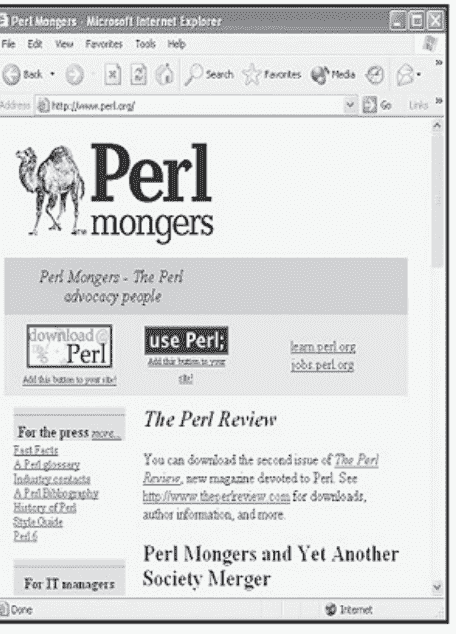

**图 7.7** Perl Mongers 主页

Perl Mongers 为 Perl 程序员提供联系信息和工作列表。该网站还托管了一些关于 Perl 历史的有趣文章。Perl Mongers 上一个你值得考虑的资源是关于最新开发版本 Perl 6 的信息。

### The Perl Journal

位于 http://www.tpj.com 的 The Perl Journal 和 Perl 杂志包含文章档案和源代码，并有一个名为 TPJ One-Liners 的流行特色，它收集了简短的 Perl 脚本（每个大约一行），能完成从绘制分形到充当闹钟等各种事情。尽管它们已经从自己的网站转移到了 Sys Admin 的旗下，但仍然是一个优秀的资源。你可以在图 7.8 中预览 TPJ。

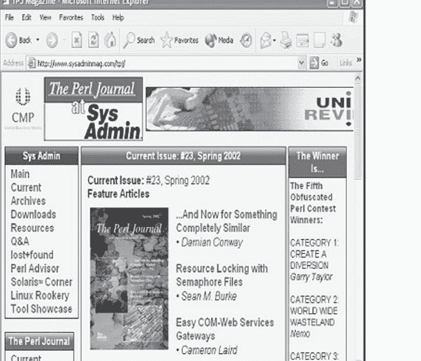

**图 7.8** The Perl Journal。

### ActiveState

没有 ActiveState，就不会有 ActivePerl。ActivePerl（见图 7.9）是目前 Win32 上最受欢迎的 Perl 移植版本，自 Windows 95 发布以来，ActiveState 一直免费向 Windows 用户提供 Perl，并且是世界上最大的开源开发模式贡献者之一。

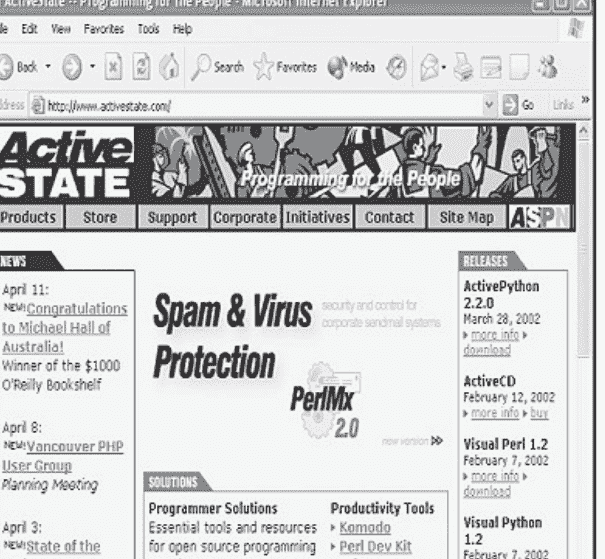

### 其他在线资源

我之前说过：Perl 是互联网的孩子。作为数百万计算机及其所有者的孩子有其优势，对 Perl 来说，主要优势在于为程序员提供了大量的互联网资源。这些资源太多且不断变化，因此提供一份全面的列表几乎是不可能的。然而，表 7.4 是一个很好的起点。该表可在配套网站的 Perllinks.html 页面上找到。

### Perl 6

目前，Perl 6 处于开发的后期阶段。这个庞大的项目是语言的完全重写；重写的目标是创建一个语法更简洁、功能更强大的 Perl 版本。下一个 Perl 版本的一些其他设计目标是使语言更快、更健壮，并融入一些现代语言带来的特性。

当然，Larry Wall 正在引领这项工作；他希望 Perl 能被广大 Perl 社区重新设计。事实上，Perl 6 规范正在编写中，并将发布给社区以获取反馈。一小群社区程序员将负责编写 Perl 6 的每个新部分。

Perl 社区需要解决的一个问题是向后兼容性。Perl 6 将与早期的 Perl 版本（包括 Perl 5）不兼容。然而，Wall 认为绝大多数 Perl 5 代码是可以迁移的，目前的计划是构建一个能够将 Perl 5 翻译成 Perl 6 的引擎。

Perl 6 自 2000 年底开始开发，Perl 6 运行时环境（代号 "Parrot"）的 alpha 版本现已在 Perl Mongers 网站上提供。对语言修改的初步头脑风暴于 2000 年底结束，共收到 361 项变更请求（RFCs）。Larry Wall 正在处理这些 RFCs，然后将它们交给 Perl 社区进行开发。

有关 Perl 6 的信息，请访问 Perl Mongers 网站：http://www/perl.org/perl6。表 7.5 概述了其他几个在线 Perl 6 资源。

### 表 7.4 在线 Perl 资源

| 网站 | 摘要 |
|---|---|
| http://docs.rinet.ru:8080/P7/ | 由 Till 提供的《21 天自学 Perl》在线版 |
| http://docs.rinet.ru:8080/Using_Perl5_in_Web/ | 用于 Web 编程的 Perl |
| http://genome-www.stanford.edu/perlOOP/ | 斯坦福大学托管的面向对象 Perl |
| http://home.bluemarble.net/~scotty/Perl/index.html | Unix 系统上的 Perl 学习指南。 |
| http://jmarshall.com/easy/ | Marshall 的 HTML 和 CGI 课程 |
| http://larc.ee.nthu.edu.tw/~cthuang/perl/ | 在线 Perl 编程 |
| http://virtual.park.uga.edu/humcomp/perl/ | 佐治亚大学雅典分校 Huang 的 Perl 教程，网站包含 SED、CGI 和 Perl 课程 |
| http://wdvl.internet.com/Authoring/ | 互联网开发的 Web 开发者网站（包含 CGI） |
| http://www.cgi101.com/ | 书籍推广网站，提供示例章节和 CGI 课程 |
| http://www.devdaily.com/perl/ | Devdaily 的 Perl |
| http://www.effectiveperl.com/toc.html | 一本在线 Perl 书 |
| http://www.geeksalad.org/business/training/perl/ | 在线 Perl 教程和书籍 |
| http://media.njit.edu/~asim/perl_tutorial/ | 在线 Perl 教程 |
| http://www.networkcomputing.com/netdesign/perl.html | TechWeb 的 Perl 简介 |
| http://www.perlarchive.com/ | Perl Archive 提供可下载的 Perl 和 CGI 脚本 |
| http://www.perl.com | O'Reilly 的公司 Perl 资源 |
| http://www.pm.org/ | Perl Mongers 的官方网站 |
| http://www.speakeasy.org/~cgires/ | Speakeasy 的 CGI 资源 |
| http://www.troubleshooters.com/codecorn/littperl/index.htm | 被认为是“快速而粗糙”的 Perl，脚本的快捷方式 |
| http://www.w3.org/CGI/ | W3C 的 CGI 网站 |

### 表 7.5 在线 Perl 6 资源

| 网站 | 摘要 |
|---|---|
| http://dev.perl.org/perl6/lists | 众多 Perl 6 邮件列表 |
| http://dev.perl.org/perl6/code | 最新代码开发 |
| http://www.cpan.org/src/ | CPAN 上可供下载的 Parrot |
| http://www.infoworld.com/articles/ec/xml/00/03/24/000324ecperl.xml | David Legard 撰写的关于 Perl 6 问世的文章 |
| http://theoryx5.uwinnipeg.ca/CPAN/perl/pod/perlfaq1/What_is_perl6_.html | 温尼伯大学的 Perl 6 概述 |
| http://topaz.sourceforge.net/ | Topaz 官方网站 |
| http://dev.perl.org/rfc/ | RFC 索引 |

## 总结

你刚刚完成了在周末学习 Perl！停下来，深呼吸，放松一下。显然，Perl 的内容远不止我能在这个周末涵盖的。毕竟，这门语言已经开发了十多年，在此期间成千上万的人为其灵活性和功能做出了贡献。事实是，如果你正走在成为一名程序员的道路上，你才刚刚触及了皮毛。尽管如此，你所取得的成就和现在的理解已非易事。你送给了自己一份大礼。你迈入了 Perl 世界的第一步，瞥见了 Perl 社区这轮闪耀的太阳。更重要的是，你使用了结构化编程技术和面向对象编程编写了自己的 Perl 脚本。技术最激动人心和美妙的事实是，它在不断变化和增长。Perl 本身就是一个绝佳的例子。一个程序员的个人项目演变成了互联网上使用最广泛的语言之一，如今正经历着由全球程序员群体支持的增长和发展的巅峰。欢迎来到美妙的 Perl 编程世界！希望你享受在这里的时光。

## 附录 A 使用配套网站

Premier Press 提供了一个网站，其中包含本书中使用的可下载源代码文件。这些文件按章节列出，并包含文件列表和下载说明。该网

## **第1章：星期五晚上**

- block1.pl

- getperl.html

- test.html

## **第2章：星期六上午**

- Action.pl

- album.pl

- block2.pl

- Chapter.pl

- Environment.pl

- format.pl

- joinem.pl

- List.pl

- Luccaarray.pl

- Luca.pl

- Math.pl

- mapping.pl

- mergeme.pl

- name1.pl

- Print.pl

- Profile.pl

- pushpop.pl

- round.pl

- sizearray.pl

- slicing.pl

- sorter.pl

- splicing.pl

- splitting.pl

### 第3章：星期六下午

- block3.pl

- block3final.pl

- Crazymath.pl

- error.pl

- getcexample.pl

- increase.pl

- multiply.pl

- stdin.pl

- untilstdin.pl

### 第4章：星期六晚上

- Number.pl

- Guess.pl

- Scope.pl

- foreach1.pl

- foreach2.pl

- foreach3.pl

- block4.pl

### 第5章：星期天上午

- block5.pl

- gameloop.pl

- GAMEVARS.pm

- MAP.pm

- NEWPACKAGE.pl

- NPtest.pl

- Pi.pl

- Tire.pl

- Tirepart2.pl

### 第6章：星期天下午

- 8ball.pl

- calc.pl

- gameloop.pl

- gamelooptwo.pl

- GAMEVARS.pm

- guessme.pl

- MAP.pm

- notes.txt

- RDOM.pm

- rdomcall.pl

- truereand.pl

- words.pl

### 第7章：星期天晚上

- cexampl.pl

- cgi.html

- examplecgi.pl

- CGIsafe.pl

- COUNT.txt

- counter.pl

- counterhtml.pl

- Perl6.html

- Perlinks.html

- security.html

- shortxml.pl

- shortxml.xml

## 附录 B

### Perl 语言快速参考

本附录涵盖了更常见的 Perl 命令，并提供了特定命令语法的快速总结，以便你在阅读时需要查阅。本附录绝非详尽无遗，大多数命令都以缩写形式描述。出于本附录的目的：

- **函数**是 Perl 语言中执行特定任务的命名部分。

- **表达式**是表示值的符号组合。

- **语句**或**命令**是基本的计算机指令。

- **关键字**是 Perl 保留的具有特殊含义的单词。

- **调用**是调用或启动编程语言中的例程。

- **运算符**是表示特定动作的符号。

通常，函数会接收一个表达式并给你一个结果。例如，在下面的示例中，函数 `rand` 接收表达式 `10` 来创建一个随机数：

`rand(10);`

在本附录中，代码可以表示为 `command(expression);`。

本附录中使用的基本参考惯例是：

**命令**（粗体文本）。命令的简要说明（普通文本）。命令的正确语法示例（源代码文本）。

Perl 是一门极其深入和复杂的语言，已有完整的著作来记录该语言的语法和特定命令。（翻阅星期天晚上的章节，可以获取一些关于在哪里查找在线参考资料的想法。）

Perl 的语法也很灵活，使代码易于阅读，但不幸的是，有时也难以阅读。例如，`die` 命令在本附录中被概述为一个语句。然而，Perl 可能会根据语法将 `die` 命令视为函数、语句或调用。在本书中，我只研究了将 `die` 作为语句使用，这也是它在此处列出的方式。在本参考中，我只使用最常用的命令形式，或者使用文本中使用的形式。

### A-C

**数组：** 由数值组织的标量集合，使用 `@` 元字符赋值，并使用方括号 `[]` 和 `$` 前缀解引用器引用。`@array = (contents);`

**@ARGV：** Perl 的默认数组 `@ARGV`，如果未指定其他数组，则自动用于 `push` 或 `pop` 等数组命令。

**binmode：** `binmode` 函数影响文件句柄，确保仅通过二进制规程（`:raw` 表示二进模式，`:crlf` 表示回车换行对）进行操作。`binmode FILEHANDLE, DISCIPLINE`

**bless：** 用于在引用和类之间建立连接的函数，从而创建对象。`bless` 通常在 `new` 构造函数中使用，并作为对象引用返回。`bless(class)`

**chdir：** 将当前目录更改为表达式的函数。成功时 `chdir` 将返回 `1`，失败时返回 `0`。默认情况下，`chdir` 将当前目录更改为主目录。`chdir(expression)`

**chmod：** 一个 Perl 命令，它接收一个列表，然后将给定文件列表的权限更改为模式（通常是八进制数）。列表中的第一个条目必须是模式。`chmod` 返回成功更改的文件数。`chmod(mode, list)`

**chop：** 一个 Perl 函数，它从字符串中删除最后一个字符并返回该字符。默认情况下，`chop` 对 Perl 的默认变量 `$_` 进行操作。`chop(string)`

**close：** 一个 Perl 函数，它将关闭给定的文件。成功时 `close` 返回 `1`；否则，它返回未定义的值。`close(FILEHANDLE)`

**cos：** 一个 Perl 函数，它返回表达式的余弦值。默认情况下，`cos` 将计算 Perl 默认变量 `$_` 的余弦值。`cos(expression)`

### D

**delete：** 一个 Perl 函数和运算符，通常用于从关联数组中删除具有给定键的条目。`delete $array{key}`

**die：** 一个 Perl 语句，它将列表打印到 Perl 的标准错误输出：`STDERR`。`die(list)`

**do：** 一个 Perl 语句，它执行给定的输入，但也可以用作关键字或方法。`do` 返回最后一个命令的值。`do` 也可以执行一个子例程，将给定列表作为变量发送到子例程中。`do fileName; do {program block}; do(expression); do subroutine(list)`

### E

**each：** 一个 Perl 函数，它遍历关联数组。每次执行 `each` 时，它返回关联数组的另一个元素。当数组完全读取时，返回空值。`each(associative_array)`

**exec：** 一个执行系统调用的命令。要执行的命令的完整路径名可以由标量变量给出。（默认使用 `@ARGV` 的第一个元素。）列表的元素构成命令行。`exec [pathname] list; exec(list)`

**exit：** 一个 Perl 函数（也可用作语句），它立即退出当前程序循环。`exit(expression)`

**exp：** 一个 Perl 函数，它返回 *e* 的表达式次方。如果未指定其他变量，`exp` 使用 Perl 的默认变量 `$_`。`exp(expression)`

### F-I

**flock：** 一个 Perl 函数，它对文件调用“文件锁”。成功时 `flock` 返回真值，失败时返回假值。根据系统和发行版，还有其他可用操作。`flock(file, operation)`

**getc：** 一个 Perl 函数，它返回引用文件（或默认通过标准输入 `STDIN`）的下一个字符。`getc(file)`

**goto：** 停止执行。`goto` 立即移动到标签，并从该点重新开始执行。`goto label`

**if：** 一个计算表达式的简单语句。`if expression`

**int：** 一个 Perl 函数，它以十进制整数形式返回表达式的值。如果未指定其他变量，`int` 使用 Perl 的默认变量 `$_`。`int(expression)`

### J-K

**join：** 一个 Perl 函数，它返回由列表或数组的元素连接而成的字符串，元素之间由字符串表达式分隔。`join(expression, list); join(expression, array)`

**kill：** 一个命令，它向列表中的每个进程发送信号。`kill` 返回成功发出信号的进程数。`kill signal, list`

### L

**last：** 一个命令，它立即离开最内层的循环或被标记的循环。与循环关联的任何代码块都不会执行。`last [label]`

**local：** 一个 Perl 关键字，它创建列表中的值。`local` 的作用范围仅限于最内层的封闭块、子例程、`eval` 或 `do` 命令。当程序流离开块时，这些值将被销毁。`local(list)`

**log：** 一个 Perl 函数，它返回表达式的对数（以 e 为底）。如果未指定其他变量，`log` 使用 Perl 的默认变量 `$_`。`log(expression)`

### M-O

**mkdir：** 一个 Perl 函数，它创建一个名为给定名称、权限由模式（通常是八进制数）设置的目录。如果 `mkdir` 不成功，它返回 `0`。`mkdir(name, mode)`

**next：** 一个 Perl 语句，它通过标执行循环的最内层块并开始新的迭代。`next [label]`

### P

**opendir**: 一个Perl函数，用于打开目录以进行读取。成功时返回目录句柄，失败时返回未定义值。

```
opendir(directoryhandle, dir)
```

**pop**: 一个Perl函数，在移除数组最后一个元素后，返回该元素的值。

```
pop array
```

**print**: 一个命令，用于将字符串列表打印到由文件句柄引用的文件。（默认是选定的输出通道。）print命令默认将`$_`打印到标准输出`<STDOUT>`。如果操作不成功，print返回0。

```
print(filehandle list)
```

**push**: 一个Perl函数，用于将列表放置到数组末尾，使数组的长度增加列表的长度。

```
push(array, list)
```

### R-S

**rand**: 一个Perl函数，返回一个介于0和表达式值之间的随机数。默认表达式为1。

```
rand(expression)
```

**return**: 一个Perl函数，用于从当前子程序返回一个列表。

```
return list
```

**scalar**: 一个Perl函数，用于使给定表达式在标量上下文中被解释。

```
scalar(expression)
```

**shift**: 一个Perl函数，用于移除数组的第一个元素并返回它，使数组缩短1。

```
shift(array)
```

**sin**: 一个Perl函数，返回表达式值的正弦值（以弧度为单位）。除非指定了另一个变量，否则sin使用Perl的默认变量`$_`。

```
sin(expression)
```

**system**: 一个Perl函数，用于执行系统调用。要执行的命令的完整路径名可以通过标量变量给出。（默认使用argv的第一个元素。）列表的元素构成命令行。

```
system [pathname] list
system(list)
```

**unless**: 一个简单的Perl语句（也可用作修饰符），用于求值一个表达式。表达式在unless执行之前被求值。

```
unless expression
```

**until**: 一个简单的语句，用于求值一个表达式。表达式在until执行之后被求值。

```
until expression
```

**while**: 一个简单的语句，用于求值一个表达式。表达式在while执行之前被求值。

```
while expression
```

**write**: 一个Perl函数（也可以是一个语句），使用与该文件关联的格式写入指定文件。默认情况下，文件的格式是与文件句柄同名的格式。

```
write(filehandle)
write(expression)
```

## 术语表

### A

**抽象 (Abstraction)。** 在编程中，指隐藏数据或复杂特性以防止其实现细节暴露的行为。

**数组 (Array)。** 在编程结构中组织和索引的数据集合。

**关联数组 (Associative Array)。** 一种通过程序员定义的索引而非标准数字索引来引用的数组。也称为*哈希 (hash)*。

**属性 (Attributes)。** 参见*数据 (data)*。

### B

**基类 (Base Class)。** 参见*父类 (parent class)*。

**行为 (Behavior)。** 参见*函数 (function)*。

**二进制 (Binary)。** 一种仅使用数字0和1的计数系统。在最基本的机械层面上，所有计算机都以二进制方式进行计数和通信。

**字符 (Character)。**

### C

**CGI。** 公共网关接口。Web服务器与程序交互和通信的常用协议。

**子类 (Child Class)。** 从父类派生出的类。也称为*派生类 (derived class)*、*具体类 (specific class)*或*子类 (subclass)*。

**类 (Class)。** 封装数据和函数的编程结构。主要用于面向对象编程。

**命令行提示符 (Command Line Prompt)。** 可以向Shell或操作系统输入命令的提示符。

**注释 (Comments)。** 添加到程序或脚本源代码中的语句，用作程序员的笔记或对话，程序本身会忽略它们。

**编译时间 (Compile Time)。** 编译器正在编译程序或脚本的时间段。

**编译 (Compiling)。** 在编程中，指将程序或脚本的各个部分汇集和组装成构成可执行程序的一块数据的行为。

**复合语句 (Complex Statements)。** 参见*复合语句 (compound statements)*。

**复合语句 (Compound Statements)。** 占用多行并使用多个表达式的代码语句。Perl中的复合语句通常用花括号({ })分隔，并包含多个简单语句。也称为*复合语句 (complex statements)*或*程序块 (program blocks)*。

**条件语句 (Conditional Statements)。** 根据程序流程可能运行也可能不运行的语句或代码块。有时称为*分支 (branches)*。

**Cookies。** Web服务器可以发送到浏览器的小型文本文件，用于保存有关客户端交易的信息。

### D

**数据 (Data)。** 编程结构所持有的信息。在面向对象编程中，数据也称为*属性 (attributes)*。

**调试 (Debugging)。** 测试程序或脚本。

**派生类 (Derived Class)。** 参见*子类 (child class)*。

**派生 (Deriving)。** 面向对象编程中的继承行为。

**目录句柄 (Directory Handlers)。** 允许程序操作或访问目录的编程结构。

**磁盘操作系统 (Disk Operating System)。** 一种基于文本的操作系统。

### E

**封装 (Encapsulation)。** 在编程中，指将功能分离成小的、可管理部分的艺术。

**转义序列 (Escape Sequence)。** 可以添加到文本字符串或其他区域的简单代码，用于表示和携带常用命令（如回车、制表符或缩进等通常需要键入的命令），或允许在类似print的语句中使用前缀解引用符和其他重要元字符。

**可执行文件 (Executable)。** 程序或脚本转换成可运行数据或可运行程序后的产物。

**可扩展性 (Extensibility)。** 在面向对象编程中，指向派生类添加功能的行为。

### F-G

**文件句柄 (File Handlers)。** 允许程序操作或访问文件的编程结构。

**函数 (Function)。** 执行特�动作的语句集合。在面向对象编程中，函数也可以称为*行为 (behavior)*。

**泛型类 (Generic Class)。** 参见*父类 (parent class)*。

**全局变量 (Global Variables)。** 通常可被整个脚本或程序访问的变量。也称为*公共变量 (public variables)*。

### H

**哈希 (Hash)。** 一种将消息或文本转换成固定数字或字符字符串的算法。在Perl中，哈希也称为*关联数组 (associative array)*。

**十六进制 (Hexadecimal)。** 一种使用基数为16的编号系统的计数系统，使用数字0–9和字母A–F。Perl使用十六进制编号来跟踪文件权限。

**HTML。** 超文本标记语言。一种专门用于开发、编码和显示文档的编程语言。

### I-L

**继承 (Inheritance)。** 在面向对象编程中，指一个对象或类知道其来源或由哪个构造（一个程序或程序块）创建的能力。

### M

**机器码 (Machine Code)。** 一种计算机可以轻松读取的语言；机器码通常是现代编程语言与汇编语言或实际机器指令之间的中间形式。大多数现代编程语言，如C、C++、Java和C#，都编译成一种机器码。

**元字符 (Metacharacters)。** 编程语言用于识别特定命令和程序结构的特殊关键字符，如$、@、{和}。

**方法 (Method)。** 内置于类或子程序中的例程，允许与类进行抽象交互。

**模式 (Mode)。** 程序或设备的状态或设置。

**模块 (Module)。** 在Perl中，一个包或一组包。

### N-O

**命名空间 (Namespace)。** 参见*包 (package)*。

**对象 (Object)。** 在面向对象编程中，指封装数据或函数并来自类的结构。也称为*类的实例 (instance of a class)*。

**对象方法 (Object Methods)。** 在对象上调用的方法。可称为*实例方法 (instance methods)*。

**面向对象编程 (Object-Oriented Programming)。** 一种编程类型，其中数据类型、数据结构和功能都由程序员定义。

**八进制 (Octal)。** 一种仅使用数字0–7的基数为8的编号系统。

**运算符优先级 (Operator Precedence)。** 当程序被赋予控制顺序时，执行操作或运算符的顺序。

**运算符 (Operators)。** 编程语言中用于表示动作或函数的符号。最常指数学运算符，如+、-、/和*。

### P

**包 (Package)。** 在Perl中，指存在于其自身物理空间中的一段代码。也称为*命名空间 (namespace)*。

**父类 (Parent Class)。** 派生出子类的类。有时称为*基类 (base class)*、*泛型类 (generic class)*或*超类 (super class)*。

**Perl。** 实用提取和报告语言。由Larry Wall最初开发的一种专门用于处理文本的编程语言。

**多态 (Polymorphism)。** 一个接口能够与许多对象交互的状态。

**编译指示 (Pragma)。** 设置用于启用编译时选项的参数。

### 前缀解引用符

一种符号，用于告知程序其后跟随的数据类型。

**私有变量**

在可访问性或作用域方面受到限制的变量。

**程序**

由计算机执行的一系列指令。

**程序块**

参见 *复合语句*。

**协议**

既定的方法或流程。在编程中，通常指两台设备相互通信的既定格式。

**公共变量**

参见 *全局变量*。

### R

**关系运算符**

执行比较操作的运算符，例如小于、等于或大于。

**例程**

作为可重用脚本保存的功能或相关功能集合。

**运行时**

程序正在运行且正常操作时的状态。

### S

**标量**

Perl 中的一种特殊变量类型；定义为由数值或文本字符串组成的任何数据。

**作用域**

某些变量或命令的影响范围。

**脚本**

一系列计算机指令。

**套接字**

在网络上运行的两个程序之间通信的一端。

**软件驱动程序**

帮助控制设备（如数据库、打印机或键盘）的小型程序。

**特定类**

参见 *子类*。

**语句**

用计算机语言编写的指令。

**字符串**

在 Perl 中，一组文本字符。有时也称为 *文本字符串*。

**字符串运算符**

与数学运算符等效，但设计用于处理字符串的运算符。

**结构化编程**

一种旨在帮助使大型程序更易于阅读的编程方法。

**子类**

参见 *子类*。

**子程序**

设计用于执行特�任务的程序段。

**父类**

参见 *父类*。

### T-Z

**标签**

通常用于定义文本格式的编程命令。

**文本字符串**

参见 *字符串*。

**TIMTOWTDI**

There Is More Than One Way To Do It。Perl 的格言，指 Perl 能够用多种不同方法解决给定问题的能力。

**URL**

统一资源定位符。用于标识万维网上物理位置的地址。

**变量**

包含一个值并可通过其分配名称访问的程序构造。

**WWW**

万维网。支持特定格式文档的全球互联网服务器系统。也称为 *互联网* 或简称 *网络*。

**XML**

可扩展标记语言。由万维网联盟于 1996 年开发的一种脚本语言。

*此页有意留白。*

## 索引

**#，注释**，38–39

**\（反斜杠）**，37

**数组中的 {}（花括号）**，70

**数组中的 []（方括号）**，70

**数组中的 -（短横线）**，69

**<> 运算符**，36

**%ENV 哈希**，72–73

**= 运算符**，101

### A

**abs 函数**，105

**绝对函数**，105

**抽象**

- 定义，309

- OOP，166，167，309

**Action.pl 文件**，53

**ActivePerl 5.6.1**，5

- 文档，90

- 安装，10–12

- 故障排除，13

**ActiveState**，289–290

- ActivePerl 许可证，9

- 艺术许可证发布，10

- GNU 通用公共许可证发布，9

**加法操作**，101–103

**反正切函数**，105

**参数，传递**，141–142

**@ARGV 数组**，303

**数组**，58，302，309

- []（方括号）在数组中，70

- {}（花括号）在数组中，70

- @ARGV 数组，303

- 关联数组，70–72，309

- 基本语法，210

- 命令，61–68

  - shift，63

  - splice，67

  - unshift，63

- 短横线（-）在数组中，69

- 可整除数组，59

- 初始化，58–60

- 合并，65

- 修改，216–217

- 传递给子程序，143

- Profile.pl 脚本，60–61

- 标量，58

- 简写，68–70

- split 命令，244–247

- 分割，66

- 变量，210–216

**箭头运算符**，25

**箭头解引用符**，184

**赋值运算符**，100

**关联数组**，70，309。另见哈希

**atan2 函数**，105

### B

**反斜杠（\）**，37

**8ball.pl 源代码**，233–236

**基类**，190

**BEGIN 命令**，253

- **二进制数据类型**，43

- **二元运算符**，109–110

- **二进系统**，309

- **绑定运算符，安全性**，282

- **binmode 函数**，303

- **Blacker 项目**，5–6

- **bless 命令，游戏循环**，193

- **bless 函数**，303

- **为对象授予祝福**，180–181

  - bless 命令，180–181

- **HTML 代码中的 body 部分**，22

- **<BODY> 标签**，22

- **布尔值**，309

- **数组中的花括号（{}）**，70

- **数组中的方括号（[]）**，70

- **分支**，124

- **Perl 和 OOP 中的内置命令**，171

- **字节流**，276

- **字节**，95，309

### C

- **C 风格操作**，101

- **计算器程序**，240–241

  - unless 循环，242–243

  - while 循环，241–242

- **调用**，302

- **OOP 的汽车类比**，167–169

- **Cat 类**，178–179

- **CD 命令（DOS）**，15

- **chdir 命令**，97

- **chdir 函数**，303

- **子类**，172，310

- **chmod 命令**，90–91

  - 八进制权限，92

  - 可移植性，285

- **chmod 函数**，303

- **chomp 命令**，74

- **chop 函数**，303

- **类数据**，183

- **类方法**，187

- **类**，177–178，310

  - 基类，190

  - 子类，310

  - 构造函数，183–184

  - 创建，179–182

  - 实例，183

  - OOP，165，167，172，310

    - 汽车类比，167–169

    - 派生，166

    - 父类，313

    - 引用，179

  - UNIVERSAL，191

- **close 命令，文件句柄**，84–85

- **close 函数**，303

- **Perl 代码**，24–25

- **命令行提示符（DOS）**，14–15，310

**命令**，302

- 数组，61–68

  - shift，63

  - splice，67

  - unshift，63

- BEGIN，253

- CD（DOS），15

- chdir 命令，97

- chmod，90–91

- chomp，74

- DIR（DOS），15

- END，253

- exec，304

- exit，304

- 文件命令，92–93

  - getc，93–94

  - read，94–95

  - seek，95–96

  - tell，95–96

- flock，86–87

- 格式化字符串命令，44

- getc，93–94

- goto，131

- join，55–56

- kill，305

- last，305

- mkdir，98

- open，306

- opendir，97

- or die，86

- package，254

- print，307

- read，94–95

- readdir，97

- recv，276

- require，253，255

- search，256

- seek，95–96

- send，276

- split，245–247

- sub，141

- tell，96

- until，112–113

- use，253，255，278

- while，112–113

**注释**，310

- #（井号）符号，38–39

- 添加到 Trapped 游戏代码，211

**Perl 用户社区**，287–290

**编译时间**，8，310

**编译**，7–8，310

**复杂语句**，123，310

**复合语句**，123，310

**妥协，安全性**，277

**条件语句**，310

**条件判断**，110–111

**构造函数**，183–184

- new，GAMEVARS.pm，199

- 惯例，包和模块，255

**Cookie**，310

- 创建，273–274

- 概述，272

**cos 函数**，105，303

**余弦函数**，105

**计数系统**，49–50

**CPAN（综合 Perl 归档网络）**，288

- 关于 Perl 许可证的常见问题解答，10

### D

- **数组中的短横线（-）**，69

- **数据**，172，310

- **对象的数据成员**，183

- **数据类型**，43–46

  - int 函数，44

  - 数值类型，43

- **数据库**，287

  - DB2 数据库软件，287

- **调试**，282–285，310

  - 新手程序员错误，283

- **声明**

  - 全局，147–148

  - 对象，183–184

  - 包，173，252

  - 作用域，148–150

- **delete 函数**，304

- **解引用符**，58

- **解引用**

  - 运算符，25

- **派生，定义**，310

- **派生类**，310

  - 类，166

  - OOP，167

- **析构函数，内置**，185

- **die 语句**，304

- **DIR 命令（DOS）**，15

- **方向子程序，移除**，210

- **Director**，18

- **目录**，97–98

  - 命令

    - chdir，97

    - mkdir，98

    - opendir，97

**目录句柄**，310

**发行版**，5，311

**可整除数组**，59

**do 语句**，304

**do/while 循环**，136–137

**DoS（拒绝服务）攻击**，281

**DOS（磁盘操作系统）**，3，12，311

- 命令行访问，14

- 使用 DOS 导航，15

**Dosperl**，5

**Dosperlp**，5

**双选择结构化编程**，126

**下载开源软件**，10

**Dreamweaver**，18

**动态变量**，148–149

### E

**each 函数**，304

**else 语句**，126–127

**elsif 语句**，127–130

**封装**，311

- OOP，166，167

**END 命令**，253

**%ENV 哈希**，72–73

**ENV 变量，可移植性**，286

**错误**

- 文件处理，86

- 循环错误，移除（Trapped 游戏），217–220

- UNDEF，142

**转义序列**，36–37，311

**eval 语句**，243–244

**exec 命令**，304

**可执行文件**，311

**exit 命令**，304

**exp 函数**，105，304

**扩展性**，4

**指数**，105

**表达式**，301

**可扩展性**，230–231，311

- OOP，166，167，169

## **F**

- **文件处理**, 83–84

  - 文件命令, 92–93

  - 文件句柄, 84–87, 311

  - 权限, 90

  - 输出到文件, 96

  - 编程错误, 86

  - 运行测试, 87–89

- **文件测试运算符**, 88–89

- **文件**

  - 命令, 92–93

    - getc, 93–94

    - read, 94–95

    - seek, 95–96

    - tell, 96

  - 扩展名, 20

  - 修改HTML, 19

  - 包含多个包, 253

  - 解析到文件, 113–120

  - 存储到文件, 76–77

- **浮点数据类型**, 43

  - 标量, 45

- **flock命令**, 86–87

- **flock函数**, 305

- **for循环**, 134–136

- **foreach循环**, 137–139

- **格式化字符串命令**, 44

- **函数**, 172, 301, 311

  - binmode, 303

  - bless, 303

  - chdir, 303

  - chmod, 303

  - chop, 303

  - close, 303

  - cos, 303

  - 定义和复用, 164

  - delete, 304

  - each, 304

  - exp, 304

  - flock, 305

  - getc, 305

  - goto, 305

  - 分组集合, 163

  - int, 44, 305

  - join, 305

  - log, 306

  - map函数, 57

  - 数学函数, 105

  - mkdir, 306

  - opendir, 306

  - pop, 306

  - print, 31–35

  - push, 307

  - rand, 307

  - return, 307

  - scalar, 307

  - shift, 307

  - sin, 307

  - sprintf, 44

  - sqrt, 307

  - srand, 307

  - system, 308

  - write, 308

## **G**

- **游戏循环**, 150–160, 192–204

- **gameloop.pl代码清单**, 212–216

  - 循环后错误清理, 217–220

- **GAMEVARS.pm**, 211

  - 创建, 198

  - new构造函数, 199

  - package命令, 198

  - 源代码, 200–204

- **getc命令**, 76, 93–94

- **getc函数**, 305

- **getcexample.pl**, 93–94

- **全局声明**, 147–148

- **全局变量**, 46–47, 311

- **GoLive**, 18

- **goto命令**, 131

- **goto函数**, 305

- **猜数游戏**, 236–240

- **guessme.pl代码清单**, 239–240

## **H**

- **黑客，CGI脚本**, 280

- **处理器，目录处理器**, 310

- **处理文件**. *参见文件处理*

- **哈希**, 58, 70

  - %ENV, 72–73

  - 定义, 311 (*另见* 关联数组)

  - 初始化, 70–72

  - 键, 70

  - 多个值, 71

- **头部部分，HTML代码**, 22

- **<HEAD>标签**, 22

- **十六进制数据类型**, 43, 311

- **HTML（超文本标记语言）**, 17–18, 311

  - 代码

    - 主体部分, 22

    - 头部部分, 22

    - 文档创建, 18–19

    - 文件，修改, 19

    - 标筓, 21–24

- **<HTML>标签**, 22

- **I/O（输入/输出）运算符**, 111–113

- **if语句**, 124–125, 305

  - 游戏循环, 155

- **if then语句**, 87–88

- **导入模块**, 255

- **增量运算符**, 100, 106–107

- **继承**, 189–190, 312

  - 可扩展性, 230–231

  - 实实现, 190–191

  - OOP, 166, 167

  - 概述, 190

- **int函数**, 44, 105, 305

- **整数数据类型**, 43

- **接口**, 165, 312

  - OOP, 167

- **交错**, 8

- **互联网，Perl**, 258–259

- **解释型语言**, 312

- **解释型语言**, 8

- **@ISA数组，类**, 190

  - 声明, 190–191

- **ISP（互联网服务提供商），CGI**, 260

- **列表中的项目，赋值**, 52–54

## **J-K**

- **join命令**, 55–56

- **join函数**, 305

- **键，哈希**, 70

- **关键字**, 302

  - local, 306

  - sub, 307

- **kill命令**, 305

## **L**

- **last命令**, 225–226, 305

- **最小权限策略**, 279–280

- **词法变量**, 149

- **库，定义**, 252

- **限制，变量**, 46–47

- **列表**

  - 创建, 51–52

  - 项目，赋值, 52–54

  - 打印, 52–53

  - 排序, 54–57

- **LMOLNAR**, 5

- **local关键字**, 5

- **局部变量**, 312

- **锁定**, 86–87

- **log函数**, 306

- **逻辑运算符**, 100, 110–111

- **循环**

  - for, 134–136

  - 计算器程序, 241–243

  - 命令, 225–229

  - do/while, 136–137

  - 提高效率, 225

  - 错误，移除（被困游戏）, 217–220

  - foreach, 137–139

  - 游戏循环, 150–160

  - getc命令, 93

  - 增量运算符, 106

  - until, 134

  - while, 132–134

## **M**

- **机器码**, 8, 312

- **魔术8球游戏，随机数生成**, 232–233

- **MAP类**, 193

- **map函数**, 57

- **地图生成器**, 192–193

- **MAP.pm文件**, 192

  - 转换为通用随机数生成器, 222–224

- **数学函数**, 105

- **数学运算**, 98

  - 加法/乘法, 101–103

  - 运算符, 99–101

- **数学运算符**, 49

- **数学系统**, 49–50

- **合并数组**, 65

- **元字符**, 312

  - 安全性, 282

- **方法**, 187, 312

  - 类方法, 187

  - 构造方法, 187

  - 实例方法, 183

  - 对象方法, 184–187, 312

  - OOP, 165–166, 167, 312

  - 对象方法, 172, 312

  - 运行对象方法, 179

  - 静态方法, 187

  - 用户输入, 76

  - 用途, 188–189

  - 虚方法, 187

- **mkdir命令**, 98

- **mkdir函数**, 306

- **模式**, 312

- **模块**, 140, 172

  - 定义, 251, 312

  - 导入, 255

  - 定位, 257–258

  - 编程约定, 255

  - socket模块, 276

- **乘法运算**, 101–103

- **乘数，数组**, 68–69

- **MySQL数据库软件**, 287

- **换行符，可移植性**, 286

- **new方法，OOP对象**, 166

- **NEWPACKAGE包**, 173–174

  - 打印子程序, 174

- **next命令**, 225

- **next语句**, 306

- **Notepad**, 7

- **nsew子程序**, 211

- **数字猜谜游戏**, 236–240

- **数字数据类型**, 43

## **O**

- **对象方法**, 172, 184–187, 312

- **面向对象编程。** *参见 OOP（面向对象编程）*

- **对象**, 182–183, 312

  - 祝福, 180–181

  - 数据成员, 183

  - 声明, 183–184

  - OOP, 164–165, 167, 172, 312

  - 引用, 184–187

- **八进制数据类型**, 43, 313

  - 权限，chmod命令, 92

- **在线资源**, 290, 291–292

  - Perl 6, 293

- **OOP（面向对象编程）**, 124, 313

  - 抽象, 166

  - 类, 165–166

  - 封装, 166

  - 可扩展性, 166

  - 特性，典型, 165–170

  - 游戏循环, 192–204

  - 继承, 166

  - 方法, 165–166

  - 对象, 164–165

  - 重写, 191

  - 概述, 163–164

  - Perl使用, 170–172

  - 多态, 166

- **open命令**, 306

  - 文件句柄, 84–85

- **open模式参数**, 85

- **打开socket连接**, 275

- **开放源代码倡议**, 10

- **开源软件**, 9–10

  - 下载, 10

- **opendir命令**, 97

- **opendir函数**, 306

- **操作数，数学运算**, 98

- **运算符优先级**, 99–100

- **运算符**, 302, 313

  - 箭头, 25

  - 二元, 109–110

  - C风格操作, 101

  - 解引用, 25

  - 文件测试运算符, 88–89

  - I/O（输入/输出）, 111–113

  - 增量运算符, 106–107

  - 数学运算, 99–101

  - 数学运算符, 49

  - 优先级, 313

  - 关系运算符, 107–109, 313

  - 标量, 47–49

  - 字符串运算符, 102–103, 314

  - 一元, 109–110

- **or die命令**, 86

- **Oracle数据库软件**, 287

- **重写，OOP**, 191

## **P**

- **package命令**, 172–173, 254

  - GAMEVARS.pm, 198

- **package函数，安全性**, 281

- **包**, 140, 172, 313

  - 构建, 172–175

  - 声明, 252

  - 定义, 251

  - 定位, 257–258

  - 一个文件中的多个包, 253

  - NEWPACKAGE, 173–174

  - 打印功能, 253

  - 编程约定, 225

  - return语句, 252

  - 作用域, 175

  - 跨文件拆分, 254–255

- **父类**, 172, 313

- **解析**

  - 到文件, 113–120

  - XML文件, 269–272

- **传递**, 141

  - 参数, 141–142

  - 数组到子程序, 143

  - 标量到子程序, 142

- **Perl 6**, 290–294

- **Perl DBi**, 287

- **Perl Journal**, 289

- **Perl杂志**, 289

- **Perl Mongers**, 288–289

- **Perl（实用报表提取语言）**, 3, 313

  - 代码, 24–25

  - 用户社区, 287–290

  - 历史, 5–6

  - 概述, 3–5

  - 类型, 5

- **权限，文件**, 90–92

  - 可移植性, 285

  - 安全性, 279–280

- **pi引用**, 175–177

- **规划程序**, 25–28

- **.pm文件**, 175

- **多态**, 313

  - OOP, 166, 167, 313

- **pop函数**, 306

  - 数组, 62

- **Perl的可移植性**, 285

- **PPM（Perl包管理器）**, 255–257

- **编译指示**, 313

  - 安全性, 278–279

  - use命令, 278

- **前缀解引用器**, 25, 313

- **预编写的脚本，安全性**, 282

- **print命令**, 307

  - 语法错误, 283

- **print函数**, 31–35

  - %ENV哈希, 72–73

- **打印**

  - 到文件, 96

  - 列表, 52–53

  - 包, 253

- **Print.pl脚本**, 33–35

- **私有变量**, 313

- **Profile.pl脚本**, 60–61

- **程序块**, 123

- **编程**, *另见* OOP（面向对象编程）

  - 约定，包和模块, 255

  - 概述, 6–10

  - 规划程序, 25–28

  - 结构化编程, 124–126, 314

- **程序**, 6, 313

  - 首次运行, 16–17

- **协议**, 313

- **公共变量**, 148, 311

- **push函数**, 307

  - 数组, 62

## **Q-R**

- **引号**, 24

- **rand命令**, 103–104

- **rand函数**, 105, 307

- **随机地图生成器**, 192

- **随机数**

  - 生成, 220–224

  - 魔术8球游戏, 232–233

  - 猜数游戏, 236–237

- **RANDOM.pm类**, 169, 183

- **read命令**, 94–95

- **readdir命令**, 97

- **recv命令**, 276

- **redo命令**, 225–226

- **引用**, 175–177

箭头引用器，184

类，179

对象，184–187

子程序，144–147

- **关系运算符**，100，107–109，313

- **require 命令**，253，255

- **return 命令**，173

- 游戏循环，193

- **return 函数**，307

- **return 语句**，252

- **可复用性**，172–173

- **例程**，139，314

- 简单例程，140

- 子程序，140–144

- **运行时间**，8，314

- **运行对象方法**，179

- **标量函数**，307

- **标量**，25，39–42，314

- 数组，58，302

- 浮点数，45

- 列表，51

- 运算符，47–49

- 传递给子程序，142

- **科学数据类型**，43

- **作用域**，123–124，314

- 声明，147，148–150

- 包，175

- **作用域，变量**，46–47

- **\<SCRIPT\> 标签**，22

- **脚本**，314

- CGI

    - 创建，260–261

    - 测试，261–262

    - Web 计数器，264–268

- 预编写，安全性，282

- **search 命令，包**，256

- **安全性**，276–277

- 绑定运算符，282

- CGI，277，280–281

- DoS 攻击，281

- 最小权限策略，279–280

- 元字符，282

- 包函数，281

- 权限，279–280

- 编译指示，278–279

- 预编写脚本，282

- 资源，282

    - 在线，284–285

- 污点检查，277–278

- 信任，277–278

- Web 托管，264

- **种子，随机数生成**，220–221

- **seek 命令**，95–96

    - 可移植性，286


- `分号`，24

- `send` 命令，276

- `shift` 命令，63

- `shift` 函数，307

- 快捷方式，数组，68–70

- 简单例程，140

- 简单语句，123

- `sin` 函数，105，307

- 套接字模块，276

    - 可移植性，286

- 套接字，275，314

- 软件

    - 驱动程序，314

    - Perl DBI，287

    - 开源，9–10

- 列表排序，54–57

- 源代码。*参见* 代码清单

- 特殊字符，转义序列，37

- `splice` 命令，67

- `split` 命令，245–247

- 拆分数组，66

- `sprintf` 格式化字符串命令参数，47

- `sprintf` 函数，44，45

- SQL（结构化查询语言），287

- `sqrt` 函数，105，307

- 平方根函数，105

- `srand` 函数，307

- 语句，123–124，302，314

    - 复合，123，310

    - 复合，123，310

    - 条件，310

    - `die`，304

    - `do`，304

    - `else`，126–127

    - `elseif`，127–130

    - `eval`，243–244

    - `if`，124–125，305

    - `if then`，87–88

    - `next`，306

    - `return`，252

    - 简单语句，123

    - `unless`，130–131，308

    - `until`，308

    - `while`，308

`静态方法`，187

`STDERR`，76

`STDIN`，74

I/O 运算符，111

`STDOUT`，74

`字符串运算符`，102–103，314

`字符串`，314

格式化字符串命令，44

`字符字符串`，39

`结构化编程`，124–126，314

双重选择，126

`sub` 命令，141

`sub` 关键字，307

子程序，139，140–144，314

方向，移除，210

存在性，145

初始化，141

对象方法，185

包，173

引用，144–147

`支持系统`，287–290

`Sybase` 数据库软件，287

`符号一元运算符`，109

`system` 函数，308

### T

`标签`，314

- HTML，21–24

`污点检查，安全性`，277–278

`tell` 命令，96

- 可移植性，286

`十进制计数系统`，50

**测试**

- CGI 脚本，261–262

- 文件测试，87–89

- 运行，110–111

`文本，存储到文件`，76–77

`文本字符串`，24，58

`TIMTOWTDI（做事不止一种方法）`，9，314

用户输入，76

`轮胎类`，180

**被困游戏**

- 循环

    - 错误，移除，217–220

    - 提高效率，225

- 变量数组，创建，210–216

`安装故障排除`，13

`信任，安全性`，277–278

### U

`一元运算符`，100，109–110

`UNDEF 错误`，142

`下划线字符 (_)`，计数，50

`UNIVERSAL 类`，191

`通用继承者`，191

`UNIX`，8–9

- 兼容性，285–287

`变量`，39，315

- 数组

    - 创建，210–216

    - 修改，216–217

- 定义和重用，164

- 动态，148–149

- 全局，46–47，311

- 分组，163

- 词法，149

- 限制，46–47

- 局部，312

- 公共，148，311
