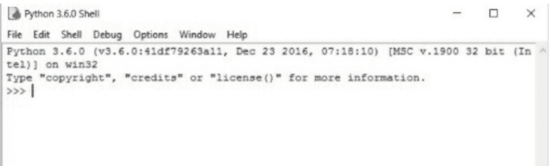
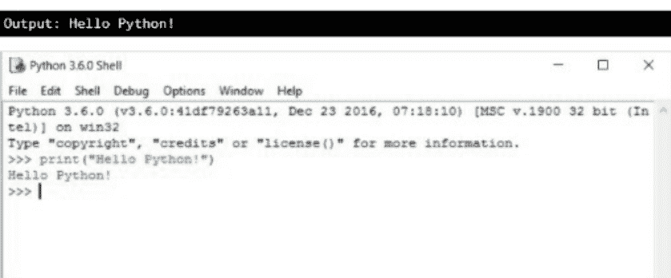
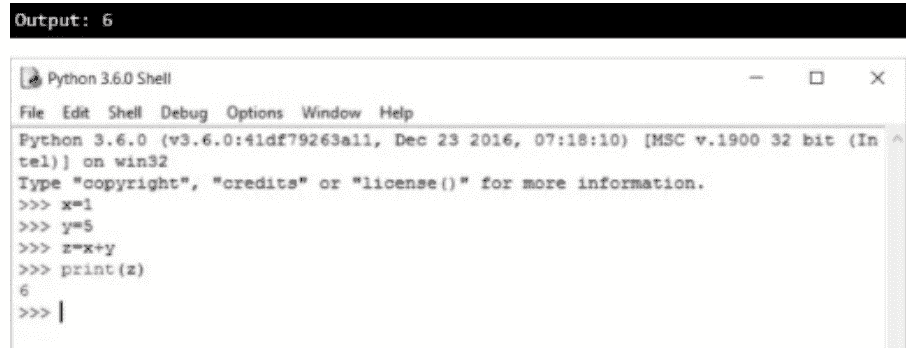
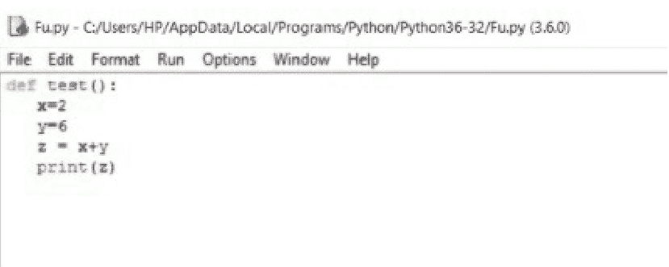
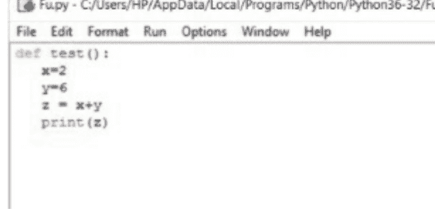
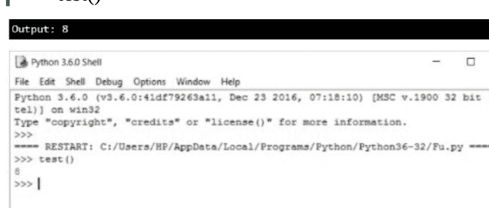

# 快速学习 Python 与 JavaScript：初学者编程指南：快速掌握编程基础


## Python 简介

### Python 的显著特性

它是一种通用编程语言，可用于科学和非科学编程。

对于初学者来说，它非常出色，因为该语言是翻译型的，因此能产生即时结果。

它比同时期的其他语言更好地融合了异常处理和动态绑定的原则。

Python 编写的程序易于阅读和理解。

它是一种独立于平台的编程语言。

作为扩展语言，它适用于可定制的应用程序。

学习和使用它都很简单。

### 主要应用

- 谷歌搜索引擎、Twitter 等。
- Bit Torrent 对等文件共享是使用 Python 编写的。
- 英特尔、思科、惠普、IBM 等公司使用 Python 进行硬件测试。
- Maya 提供了一个 Python 脚本 API。
- Python 用于创建工业机器人。
- NASA 等机构在他们的科学编程活动中使用 Python。

## 设置 Python 解释器

为了编写和运行 Python 程序，我们需要在我们的计算机上安装一个 Python 解释器。

标准且最常见的 Python 开发环境是 IDLE（集成图形用户界面）。
IDLE 代表集成开发环境（Integrated Development Environment）。
它允许在单个图形用户界面中修改、运行、搜索和调试 Python 程序。
这种环境使得编写程序变得简单。

注意：在这些教程中，我们将使用 Python IDLE 3.6 版本来开发和运行 Python 代码。它可以在 www.python.org 免费获取。

### 启动 IDLE



## Python 的特性

- 面向对象
- 强大的异常处理
- 自动内存管理
- 动态类型
- 强数据类型
- 语法简洁
- 基于缩进
- 性质宽容

## 在 Python 中打印 "Hello World"

```
Python 3.7.0 (v3.7.0:1bf9cc5093, Jun 26 2018, 23:26:24)
[Clang 6.0 (clang-600.0.57)] on darwin
Type "copyright", "credits" or "license()" for more information.
>>> print ("hi")
hi
>>> print("hiiii")
hiiii
>>> print ("a\nb")
a
b
>>> print ("a\tb")
a        b
>>> print("""y        o
a
o""")
y        o
a
o
>>> print(" a ' ")
 a ' 
>>> print("a\")
a\
>>> print("a \\n b ")
a \n b 
>>> print("a \n b")
a 
 b 
>>> |
```

## 安装 pip

Pip 是一个启用安装和管理 Python 包的平台。

### Python：安装 pip

为了安装新版本的 pip，在 MacOS 中运行命令

```
$ sudo easy_install pip
$ sudo pip install --upgrade pip
```

#### 在 Ubuntu 中安装 pip

```
$ sudo apt-get update
$ sudo apt-get install python-pip
$ sudo pip install --upgrade pip
```

#### 在 CentOS 中安装 pip

```
$ sudo yum update
$ sudo yum install epel-release
$ sudo yum install python-pip
## 版本>= CentOS 7
$ sudo pip install --upgrade pip
```

## 执行第一个程序

我们将在设备上启动 Python 以在交互模式下工作。

在提示符 (>>>) 之后，我们输入 Python 表达式/语句/命令，Python 会自动响应提示符的输出结果。

## 第一个 Python 程序

让我们在提示符后输入 "Hello Python!" 来开始。

```
>>>print("Hello Python!")
```



## 尝试以下操作

a) 5+7
b) 4*10
c) 7/8
d) 9%2
e) 6//4

```
>>> 5+7
12
>>> 4*10
40
>>> 7/8
0.875
>>> 9%2
1
>>> 6//4
1
```

## 也试试这个

```
>>> x=1
>>> y=5
>>> z = x+y
>>> print (z)
```



## 其他操作：

```
>>> a=3
>>>a+1, a-1
```



## 2) 脚本模式

我们以脚本模式将 Python 程序输入到一个文件中，然后使用解释器执行文件中的代码。

对于初学者和测试小段代码来说，在交互模式下工作很有用，因为我们可以立即测试它们。

但是我们仍然应该保存我们的代码，以便我们可以更改和重用代码来编写超过几行的代码。

如果脚本模式在 IDLE 环境中默认未启用，我们将使用以下步骤在 IDLE 中创建和运行 Python 脚本。

1. 文件 > 新建文件
2. 编写 Python 代码。
3. 保存它 (**^S**)。
4. 使用 RUN 选项，以交互模式执行它- (**^F5**)

**步骤 1：** 文件 > 新建文件
**步骤 2：** 编写：

```
def test():
    x=2
    y=6
    z = x+y
    print (z)
```



**步骤 3：** 保存 或 文件 > 另存为
**步骤 4：** 要执行，按 ^F5

```
>>>test()
```



## Python 关键字

关键字是 Python 编程语言（以及任何其他编程语言，如 C、C++、Java 等）中的保留字，其定义是固定的，不能被修改。

Python 编程语言中的关键字区分大小写。

### Python 关键字列表

#### 在 Python 2.5 中

```
and     del     from    not     while
as      elif    global  or      with
assert  else    if      pass    yield
break   except  import  print
class   exec    in      raise
continue finally is      return
def     for     lambda  try
```

#### 在 Python 3.8.1 中

```
False   None    True    and     as
assert  async   await   break   class
continue def     del     elif    else
except  finally for     from    global
if      import  in      is      lambda
nonlocal not     or      pass    raise
return  try     while   with    yield
```

## Python 内置关键字

Python 编程语言中有内置的关键字，它们用于根据不同的目的执行不同的任务。

### 所有 Python 关键字 - 列表

| 序号 | 关键字 | 描述 |
| :--- | :--- | :--- |
| 1 | and | 用于逻辑操作，它是一个逻辑与运算符。如果两个操作数都为真，则返回 "True"。 |
| 2 | as | 用于为模块创建别名。 |
| 3 | assert | 用于调试目的，如果给定的测试条件为假，则返回 "AssertionError"。 |
| 4 | break | 中断循环的执行。用于将程序的控制权从循环体的作用域转移到循环体后的下一条语句。 |
| 5 | class | 用于定义/创建一个类。 |
| 6 | continue | 跳过循环体中剩余的语句，继续循环的下一次迭代。 |
| 7 | def | 用于定义/创建一个函数。 |
| 8 | del | 用于删除一个对象。 |
| 9 | elif | 与 "if...elif...else" 语句一起使用，用于检查下一个条件。它相当于 C、C++ 语言中的 "else if"。 |
| 10 | else | 与 "if...elif...else" 语句一起使用，用于定义一个 else 块——如果任何条件都不为真，则执行 else 块。 |


| # | 关键字 | 说明 |
|---|--------|------|
| 11 | except | 与其他编程语言中的“catch”块类似，用于定义一个“except”块，该块在`try`块中发生任何异常时执行。 |
| 12 | False | 用于定义布尔值False，它也可能是比较表达式的结果。 |
| 13 | finally | 与异常块（`try...except...finally`）一起使用，定义一个总是执行的代码块——无论`try`块中是否发生异常。 |
| 14 | for | 用于创建`for`循环。 |
| 15 | from | 用于从模块中导入特定部分（如函数、类等）。 |
| 16 | if | 用于创建条件语句，即检查条件。 |
| 17 | import | 用于在程序中导入模块。 |
| 18 | in | 用于检查某个元素是否存在于序列（如字符串、列表、元组等）中。 |
| 19 | is | 用于检查两个对象是否是同一个对象。 |
| 20 | lambda | 用于创建一个匿名函数，该函数可以有多个参数，但只能有一个语句/表达式。 |
| 21 | None | 类似于null，用于定义一个空值。 |
| 22 | nonlocal | 用于声明一个非局部变量，通过使用此关键字，我们可以指示编译器该变量不是局部变量。 |
| 23 | not | 是一个逻辑运算符（逻辑非），如果操作数为`False`则返回`True`，如果操作数为`True`则返回`False`。 |
| 24 | or | 是一个逻辑运算符（逻辑或），用于组合两个条件，如果任一条件为`True`则返回`True`，否则返回`False`。 |
| 25 | pass | 用作空语句，对于定义空函数或空条件语句体非常有用。 |
| 26 | raise | 用于引发错误并显示自定义消息。 |
| 27 | return | 用于返回值或/并将程序的控制权从调用函数返回到被调用函数，即用于退出函数。 |
| 28 | True | 用于定义布尔值True，它也可能是比较表达式的结果。 |
| 29 | try | 与`try...except...finally`块一起使用。 |
| 30 | while | 用于创建`while`循环。 |
| 31 | with | 类似于C#.Net和VB.Net中的`using`，用于简化异常处理。 |
| 32 | yield | 用于结束一个函数并返回一个生成器。 |

### Python中的注释

Python中的注释用于提高代码的可读性。

为了更好地理解代码和程序员在源代码中用来解决给定问题的逻辑，这些注释提供了有价值的信息。

在编译期间，注释不会被执行，也不会在输出中显示。

#### Python注释的类型

1. 单行注释（#）
2. 多行字符串注释（""""）

#### 1) 单行注释

单行注释用于Python中的一行语句，例如对各种变量、函数、表达式等的解释。

当注释换行时，使用井号（#）符号来呈现单行注释，无需空格，在下一行的开头，它们必须对齐各自的井号（#）。

让我们看一个实例，尝试理解在软件中如何应用单行注释。

**示例**

```python
##### 单行注释示例
##### 一个打印给定字符串和求和的程序。

print('Welcome @ Learnpython')
a=2
b=5
print(a+b)

##### 使用加号(+)对两个数字求和。
```

#### 2) 多行字符串注释

正如我们在上面示例中看到的，对于多行注释，我们必须在每一行都放置一个井号（#）符号。

在Python中，多行字符串注释使用定界符给出，当内容不适合一行时，它很有用。

对于多行字符串注释，我们必须在字符串的两端用定界符括起来。

**示例**

```python
'''
    这里我们将检查给定的数字n是偶数还是奇数
    使用Python中的多行注释。
'''
```

```python
n=6768
```

```python
if n%2==0:
    print("Even number.")
else:
    print("Odd number.")
```

### Python中的块注释

#### 注释

注释是计算机程序中的一段文本，旨在作为解释或注释。

它由作者在源代码中阅读，并且被编译器/解释器忽略。

#### Python注释的类型

**块注释**和**行内注释**。

##### 1) 块注释

块注释适用于其后的代码段。它可以指代码的一部分或整个代码。

它们与所注释的代码具有相同的缩进级别。

每个注释行以`#`开头。

**示例**

```python
###### Python程序用于打印
###### Hello World

print("Hello World")
```

**输出：**

Hello World

也可以使用`''' '''`来创建块注释。写在这些引号中的内容被称为注释。

**示例**

```python
"""
Python程序用于打印
Hello World
"""

print("Hello World")
```

**示例 2**

```python
def hello():
    """
    这里，这是一个文档字符串
    因为它写在函数定义之后。

    下面的打印语句将打印
    Hello World
    """
    print("Hello World")

if __name__ == "__main__":
    # 调用hello函数
    hello()
```

##### 2) 行内注释

与声明在同一行的注释是行内注释。

行内注释应与参数用至少两个空格隔开。

它们应该以`#`和一个空格开头。

**示例**

```python
print("Hello World")  # 这是一个行内注释
```

**输出**

Hello World

### 创建多行注释

当我们需要注释多行/语句时，有两种方法：要么在每一行注释，要么创建多行注释（或块注释）。

第一种方法是在每一部分注释，
这在Python中可以被视为单行注释——在要注释的每一行开头使用井号字符（#）。

```python
#### 这是第1行
#### 这是第2行
#### 这是第3行
```

第二种方法是注释代码段，
这在Python中可以被视为多行注释——我们在要注释的段落开头使用三个单引号（'''），在结尾也使用三个单引号（'''）。

```python
'''
这是第1行
这是第2行
这是第3行
'''
```

**示例**

```python
'''
函数名：print_text
参数：无
返回类型：无
描述：此函数将在屏幕上
打印一些文本
""

def print_text():
    print("Hello, world! How are you?")

if __name__ == "__main__":
    # 这里，我们将调用print_text函数
    # 该函数将在屏幕上打印一些文本
    print_text()
```

### Python数值类型

数据类型是编程中的一个重要概念。

根据我们希望变量执行的角色，不同类型的数据可以存储在变量中。

在Python中，内置数据类型有

- 文本类型
- 数值类型
- 映射类型
- 序列类型
- 集合类型
- 布尔类型
- 二进制类型

Python中的3种数值数据类型：

1. int（整型）
2. float（浮点型）
3. complex（复数型）

#### 1) int（整型）

整数数值形式用于存储没有小数点的有符号整数，例如-5、2、78等。

**示例**

```python
##### 将整数值赋给变量
x = 8
y = -9

##### 操作x的值
x = x + y

##### 打印x的更新值
print("x= ", x)

##### 打印x的数据类型
print("Data type of x: ", type(x))
```

**输出**

x= -1
Data type of x: <class 'int'>

#### 2) float（浮点型）

浮点数数值形式用于存储浮点值，例如6.66、58.9、3.14等。

浮点数也可以采用科学计数法，用E或e表示10的幂（3.6e3 = 3.6 x 10^3 = 3600）。

**示例**

```python
##### 将浮点值赋给变量
x = 8.9
y = -9.1

##### 操作x的值
x = x - y
```


#### 3) 复数

为了存储诸如 `3.14j`、`8.0 + 5.3j`、`2 + 6j` 等复数，可以使用复数形式。

格式：实数部分 + 虚数部分 `j`

注意：`J` 必须表示复数的虚数部分。在 Python 中，如果用 `i` 表示虚数部分，则视为无效语法。

## 示例

```python
##### 将复数值赋给变量
x = 1+8.5j
y = 4+9j

##### 操作 x 的值
x = x + y

##### 打印更新后的 x 值
print("x= ", x)

##### 打印 x 的数据类型
print("x 的数据类型: ", type(x))
```

### 输出

```
x=  (5+17.5j)

x 的数据类型:  <class 'complex'>
```

### 变量与数据类型

#### 1. 数字

数字数据类型存储数值。这类数据是不可变的，即其对象的含义无法修改（这一点将在后面讨论）。
它们分为三种不同的类型：

- **整数与长整数**
- **浮点数/浮点型**
- **复数**

##### i) 整数：

整数是带或不带正负号（+ 或 -）的十进制数字组成的整数，例如 100000、-99、0、17。
当我们希望一个值被视为很长的整数值时，可以在值后附加 `L`。Python 会将这些值视为长整数。

```python
>>> a = 10
>>> b = 5192L # 为变量赋一个很长的值的示例
>>> c= 4298114
>>> type(c) # type ( ) 用于检查值的数据类型
```

##### ii) 浮点数：

浮点数也称为小数或带有小数点的数。
浮点数由一个十进制数字序列、一个符号（+,-）和一个小数点组成，例如 0.0、-21.9、0.98333328、15.2963。

##### iii) 复数：

Python 的复数由两个浮点数值组成，分别代表实部和虚部。

我们将使用 `x.real` 和 `x.imag` 来访问向量（对象）`x` 的各个部分。
该数的虚数部分由 `j` 而非 `i` 定义，因此 `1 + 0j` 的虚数部分表示零。

## 示例

```python
>>> x = 1+0j
>>> print (x.real, x.imag)
1.0 0.0
```

#### 2. 空值

这是一个具有单一值的特定数据类别。它用于表示值的缺失/假。它由 `None` 表示。

#### 3. 序列

一个有序的对象集合，通过正整数索引，称为序列。
它是可变和不可变数据类型的混合体。
字符串、列表和元组是 Python 中可用的三种序列数据形式。

##### 3.1) 字符串：

它是字符/字母的有序序列。
它们出现在单引号（'）或双引号（"）中。
引号不构成字符串的一部分。
它们只是告诉机器字符串常量的开始和结束位置。

```python
>>> type('Good Morning')
<class 'str'>
>>> type('3.2')
<class 'str'>
```

##### 3.2) 列表：

列表也是一种重要的序列。
列表中的值称为元素/对象。它们是可变的，并且被索引/有序。
列表用方括号括起来。

##### 3.3) 元组：

元组是一组值，通过某种整数索引。它们是不可变的。

#### 4. 集合

集合是一个无序的值数组，没有重复条目，可以包含任何类型的值。集合是不可变的。

## 示例

```python
>>> s = set([1, 2, 3, 4])
>>> print(s)
{1, 2, 3, 4}
```

## # 确定 Python 变量的类型

#### 1) type() 方法

如果向 `type()` 传递单个参数，它将返回给定对象的类型。

**示例**

```python
>>> test_string = "yes"
>>> test_number = 1
>>> print(type(test_string))
<class 'str'>
>>> print(type(test_number))
<class 'int'>
```

#### 2) isinstance() 方法

`isinstance()` 函数测试一个对象（第一个参数）是否是类信息类（classinfo class）的实例或子类（第二个参数）。

**示例**

```python
>>> class Example:
...     name = 'include_help'
...
>>> ExampleInstance = Example()
>>> print(isinstance(ExampleInstance, Example))
True
>>> print(isinstance(ExampleInstance, (list, set)))
False
>>> print(isinstance(ExampleInstance, (list, set, Example)))
True
```

### type() 与 isinstance() 的比较

| type() | isinstance() |
| :--- | :--- |
| 它返回一个对象的类型对象，并将返回的结果与另一个类型对象进行比较，只有在两边都是同一类型对象时才返回 `True`。 | 为了查看一个对象是否具有某种类型，可以使用 **isinstance()**，因为它检查传入第一个参数的对象是否属于传入第二个参数的任何类型对象的类型。因此，在子类和旧式类（它们都有遗留类型对象实例）方面，它都能按预期工作。 |

## # Python 算术运算符

算术运算符用于执行不同的算术/数学运算，它们是二元运算符，意味着计算需要两个操作数。

| 运算符 | 名称 | 描述 |
| :--- | :--- | :--- |
| + | 加法运算符 | 返回两个表达式的和。 |
| - | 减法运算符 | 返回两个表达式的差。 |
| * | 乘法运算符 | 返回两个表达式的乘积。 |
| ** | 幂运算符 | 返回表达式提升到给定幂的值，即返回表达式1提升到表达式2的幂。 |
| / | 除法运算符 | 返回两个表达式的商。 |
| // | 整除运算符 | 返回两个表达式商的整数部分。 |
| % | 取模运算符 | 返回商的小数部分，即两个表达式相除的余数。 |

#### 语法：

```python
exp1 + exp2
exp1 - exp2
exp1 * exp2
exp1 ** exp2
exp1 / exp2
exp1 // exp2
exp1 % exp2
```

##### 程序

```python
##### Python 程序演示
##### 算术运算符的示例

a = 10
b = 3

##### 打印值
print("a:", a)
print("b:", b)

##### 运算
print("a + b :", a + b)
print("a - b :", a - b)
print("a * b :", a * b)
print("a ** b:", a ** b)
print("a / b :", a / b)
print("a // b:", a // b)
print("a % b :", a % b)
```

##### 输出：

```
a: 10

b: 3

a + b : 13

a - b : 7

a * b : 30

a ** b: 1000

a / b : 3.3333333333333335

a // b: 3

a % b : 1
```

## 示例 2

```python
##### Python 程序演示
##### 算术运算符的示例

a = 10.10
b = -2.5

##### 打印值
print("a:", a)
print("b:", b)

##### 运算
print("a + b :", a + b)
print("a - b :", a - b)
print("a * b :", a * b)
print("a ** b:", a ** b)
print("a / b :", a / b)

##### // 运算符将结果四舍五入
##### 到最接近的整数
print("a // b:", a // b)

print("a % b :", a % b)
```

##### 输出：

```
a: 10.1
b: -2.5
a + b : 7.6
a - b : 12.6
a * b : -25.25
a ** b: 0.0030845837443758094
a / b : -4.04
a // b: -5.0
a % b : -2.4000000000000004
```

#### 示例 3

```python
##### Python 程序演示
##### 算术运算符的示例
##### 对列表、字符串等的操作

x = "Hello"
y = "World"

##### 字符串上的 '+', '*' 运算
print("x + y:", x + y)
print("x + y + x:", x + y + x)
print("x * 2:", x * 2)
print("x * 10:", x * 10)
print()

##### 列表上的 '+', '*' 运算
x = [10, 20, 30, 40]
y = [40, 30, 20, 10]

print("x + y:", x + y)
print("x + y + x:", x + y + x)
print("x * 2:", x * 2)
print("x * 3:", x * 3)
print()
```

##### 输出：

```
x + y: HelloWorld

x + y + x: HelloWorldHello

x * 2: HelloHello

x * 10: HelloHelloHelloHelloHelloHelloHelloHelloHelloHello

x + y: [10, 20, 30, 40, 40, 30, 20, 10]

x + y + x: [10, 20, 30, 40, 40, 30, 20, 10, 10, 20, 30, 40]

x * 2: [10, 20, 30, 40, 10, 20, 30, 40]

x * 3: [10, 20, 30, 40, 10, 20, 30, 40, 10, 20, 30, 40]
```

## # Python 身份运算符

身份运算符用于执行对象比较操作，即这些运算符检查两个操作数是否指向同一个对象（具有相同的内存地址）。

身份运算符如下，

| 运算符 | 描述 | 示例 |
| :--- | :--- | :--- |
| **is** | 如果两个操作数指向同一对象，则返回 `True`；否则返回 `False`。 | x is y |
| **is not** | 如果两个操作数不指向同一对象，则返回 `True`；否则返回 `False`。 | x is not y |

#### 语法：

```python
operand1 is operand2

operand1 is not operand2
```

#### 'is' 运算符示例

```python
##### Python 程序演示
##### 身份运算符的示例

x = [10, 20, 30]
y = [10, 20, 30]
z = x

##### 使用 == 运算符比较值
print("x == y: ", x == y)
```


print("y == z: ", y == z)
print("z == x: ", z == x)
print()

##### 比较对象
##### 判断它们是否指向
##### 同一个对象
print("x is y: ", x is y)
print("y is z: ", y is z)
print("z is x: ", z is x)
print()

##### 输出：
x == y:  True
y == z:  True
z == x:  True

x is y:  False
y is z:  False
z is x:  True

#### 'is not' 运算符示例

##### 演示身份运算符
##### 示例的 Python 程序

x = [10, 20, 30]
y = [10, 20, 30]
z = x

##### 使用 != 运算符
##### 比较值
print("x != y: ", x != y)
print("y != z: ", y != z)
print("z != x: ", z != x)
print()

##### 比较对象
##### 判断它们是否指向
##### 同一个对象
print("x is not y: ", x is not y)
print("y is not z: ", y is not z)
print("z is not x: ", z is not x)
print()

##### 输出：
x != y: False
y != z: False
z != x: False

x is not y: True
y is not z: True
z is not x: False

### Python 中的成员运算符

成员运算符用于检查值/变量（例如字符串、列表、元组、集合、字典）是否存在于序列中。

#### Python 成员运算符

| 运算符 | 描述 | 示例 |
|---|---|---|
| `in` | 如果在序列中找到变量/值，则返回 `True`。 | `10 in list1` |
| `not in` | 如果在序列中未找到变量/值，则返回 `True`。 | `10 not in list1` |

## 示例

##### Python 中 "in" 和 "not in" 运算符的示例

##### 声明一个列表和一个字符串
str1 = "Hello world"
list1 = [10, 20, 30, 40, 50]

##### 检查 'w'（大写）是否存在于 str1 中
if 'w' in str1:
    print("是的！在 ", str1, " 中找到了 w")
else:
    print("不！在 ", str1, " 中未找到 w")

##### 检查 'X'（大写）是否存在于 str1 中
if 'X' not in str1:
    print("是的！在 ", str1, " 中不存在 X")
else:
    print("不！在 ", str1, " 中存在 X")

##### 检查 30 是否存在于 list1 中
if 30 in list1:
    print("是的！在 ", list1, " 中找到了 30")
else:
    print("不！在 ", list1, " 中未找到 30")

##### 检查 90 是否存在于 list1 中
if 90 not in list1:
    print("是的！在 ", list1, " 中不存在 90")
else:
    print("不！在 ", list1, " 中存在 90")

### 输出
是的！在  Hello world 中找到了 w

是的！在  Hello world 中不存在 X

是的！在  [10, 20, 30, 40, 50] 中找到了 30

是的！在  [10, 20, 30, 40, 50] 中不存在 90

### Python 中自增运算符和自减运算符的行为

众所周知，Python 是一种连贯且可读性强的语言。与 Java 不同，Python 不支持自增 (++) 和自减 (--) 运算符，无论是运算符优先级还是返回值方面。

例如，x++ 和 ++x，或 x-- 或 --x，在 Python 中是无效的。

x = 1
x++

### 输出
File "main.py", line 2
    x++
      ^
SyntaxError: invalid syntax

## 示例

x = 1

print(--x)
##### 1
print(++x)
##### 1

print(x--)
"""
  File "main.py", line 8
    print(x--)
           ^
SyntaxError: invalid syntax
"""

其原因在于 Python 整数是不可变的，因此无法被修改。所以，要进行增减，我们需要这样做。

x = 1

x = x + 1
print(x)

x = x - 1
print(x)

x += 2
print(x)

x -= 1
print(x)

### 输出
2
1
3
2

### Python 中布尔值的逻辑与按位 NOT 运算符

在 Python 中，`not` 用于逻辑 NOT 运算符，`~` 用于按位 NOT。我们将在这里看到它们的用途和执行。

为了反转结果，逻辑 NOT (`not`) 运算符在结果为 "True" 时返回 "False"；否则返回 "True"。

按位 NOT (`~`) 运算符用于反转所有位，即返回数字的补码。

##### 逻辑 NOT (`not`) 运算符

##### 程序

##### 逻辑 NOT (`not`) 运算符

x = True
y = False

##### 打印值
print("x: ", x)
print("y: ", y)

##### `not` 运算
print("not x: ", not x)
print("not y: ", not y)

##### 输出：
x: True
y: False
not x: False
not y: True

##### 按位 NOT (`~`) 运算符

##### 程序

##### 按位 NOT (`~`) 运算符

x = True
y = False

##### 打印值
print("x: ", x)
print("y: ", y)

##### `~` 运算
print("~ x: ", ~ x)
print("~ y: ", ~ y)

##### 赋值数字
x = 123
y = 128

##### 打印值
print("x: ", x)
print("y: ", y)

##### `~` 运算
print("~ x: ", ~ x)
print("~ y: ", ~ y)

##### 输出：
x: True
y: False
~ x: -2
~ y: -1
x: 123
y: 128
~ x: -124
~ y: -129

#### 字符串上的逻辑运算符

## 逻辑运算符

- 逻辑与 (`and`)
- 逻辑或 (`or`)
- 逻辑非 (`not`)

### 与字符串

空字符串作为布尔值表示 False，而非空字符串作为布尔值表示 True。

对于 `and` 运算符：如果第一个操作数为真，则检查第二个操作数并返回第二个操作数。

对于 `or` 运算符：如果第一个操作数为假，则检查第二个操作数并返回第二个操作数。

对于 `and` 运算符：如果操作数是空字符串，则返回 True；否则返回 False。

#### 示例 1

##### Python 中字符串上的逻辑运算符

string1 = "Hello"
string2 = "World"

##### 字符串上的 and 运算符
print("string1 and string2: ", string1 and string2)
print("string2 and string1: ", string2 and string1)
print()

##### 字符串上的 or 运算符
print("string1 or string2: ", string1 or string2)
print("string2 or string1: ", string2 or string1)
print()

##### 字符串上的 not 运算符
print("not string1: ", not string1)
print("not string2: ", not string2)
print()

##### 输出：
string1 and string2: World

string2 and string1: Hello

string1 or string2: Hello

string2 or string1: World

not string1: False

not string2: False

## 示例 2

##### Python 中字符串上的逻辑运算符

string1 = "" # 空字符串
string2 = "World" # 非空字符串

##### 注意：'repr()' 函数会用单引号打印字符串
##### 字符串上的 and 运算符
print("string1 and string2: ", repr(string1 and string2))
print("string2 and string1: ", repr(string2 and string1))
print()

##### 字符串上的 or 运算符
print("string1 or string2: ", repr(string1 or string2))
print("string2 or string1: ", repr(string2 or string1))
print()

##### 字符串上的 not 运算符
print("not string1: ", not string1)
print("not string2: ", not string2)
print()

##### 输出：
string1 and string2: ''

string2 and string1: ''

string1 or string2: 'World'

string2 or string1: 'World'

not string1:  True

not string2:  False

##### if else 条件运算符

Python 也包含使用条件运算符测试条件语句的功能，类似于其他编程语言。

如果使用其他条件运算符，则根据给定布尔表达式的结果，从给定的两个值/语句中评估/获取相应的值/语句。

**语法：**

`value1 if expression else value2`

其中

Value1 - 代表条件表达式为真时的值。

Expression - 代表要评估的布尔条件（即我们可以假设它是一个条件）。

Value2 - 代表条件表达式为假时的值。

#### 示例 1

##### 查找最大值

x = 20
y = 10

##### if else 条件运算符
largest = x if x > y else y
##### 打印值
print("x: ", x)
print("y: ", y)
print("largest: ", largest)
print()

x = 10
y = 20

##### if else 条件运算符
largest = x if x > y else y
##### 打印值
print("x: ", x)
print("y: ", y)
print("largest: ", largest)
print()

x = 10
y = 10

##### if else 条件运算符
largest = x if x > y else y
##### 打印值
print("x: ", x)
print("y: ", y)
print("largest: ", largest)
print()

##### 输出：
x: 20

y: 10

largest: 20

x: 10
y: 20
largest: 20

x: 10
y: 10
largest: 10

## 示例 2

##### 查找最大值

x = 10
y = 20
z = 30

##### if else 条件运算符
largest = x if (x > y and x > z) else (y if (y > x and x > z) else z)
##### 打印值
print("x: ", x)
print("y: ", y)
print("z: ", z)
print("largest: ", largest)
print()


##### if else 条件运算符
```
x = 10
y = 30
z = 20
```

```
largest = x if (x>y and x>z) else (y if(y>x and y>z) else z)
##### printing the values
print("x: ", x)
print("y: ", y)
print("z: ", z)
print("largest: ", largest)
print()
```

```
x = 30
y = 20
z = 10
```

```
largest = x if (x>y and x>z) else (y if(y>x and y>z) else z)
##### printing the values
print("x: ", x)
print("y: ", y)
print("z: ", z)
print("largest: ", largest)
print()
```

```
x = 10
y = 10
```

```
z = 10

largest = x if (x>y and x>z) else (y if(y>x and y>z) else z)
##### printing the values
print("x: ", x)
print("y: ", y)
print("z: ", z)
print("largest: ", largest)
print()
```

### 输出

```
x: 10
y: 20
z: 30
largest: 30
```

```
x: 10
y: 30
z: 20
largest: 30
```

```
x: 30
y: 20
z: 10
largest: 30
```

```
x: 10
y: 10
z: 10
largest: 10
```

## 快速学习 JavaScript：
### 初学者编程指南

快速学习编程基础指南

TAM JP

## JavaScript 简介

这份 JavaScript 教程让初学者和专家都能轻松学习 JavaScript。

要学习 JavaScript，你只需要对编程有基本的了解。

## JavaScript 示例

```html
<!DOCTYPE html>
<html>
<body>
<h2>Welcome to JavaScript</h2>
<script>
document.write("Hello Friends");
</script>
</body>
</html>
```

可以通过在代码 `<script>...</script>` 中添加 JavaScript 语句来实现 JavaScript。

```html
<!DOCTYPE html>
<html>
<body>
<script type="text/javascript">
document.write("Hello World");
</script>
</body>
</html>
```

## JavaScript 代码可以写在 JavaScript 的 3 个地方

- 1. 在 HTML 的 `<body>`......`</body>` 标签之间。
- 2. 在 HTML 的 `<head>`......`</head>` 标签之间。
- 3. 在 .js 文件中（外部 JavaScript）。

### 示例（在 body 标签之间的代码）

在下面的示例中，body 标签包含 JavaScript 代码。

```html
<!DOCTYPE html>
<html>
<body>
<script type="text/javascript">
alert("Hello world");
</script>
</body>
</html>
```

### 示例2（在 head 标签之间的代码）

我们将在下面的示例中创建函数 `msg()`。在 JavaScript 中，你必须在函数名中编写一个函数来构建一个函数。要调用一个方法，我们必须首先创建一个 case。在这个例子中，我们使用单击事件来调用 `msg()` 函数。

```html
<!DOCTYPE html>
<html>
<head>
<script type="text/javascript">
function msg(){
alert("Hello world");
}
</script>
</head>
<body>
<p>Welcome to Javascript</p>
<form>
<input type="button" value="click" onclick="msg()"/>
</form>
</body>
</html>
```

### 外部 JavaScript 文件

我们可以构建一个可以在 HTML 文件中使用的 JavaScript 文件。由于单个 JavaScript 文件可以在多个 HTML 页面中使用，它允许代码重用。它提高了网页的效率。该文件必须具有 **.js** 扩展名。

## 示例

```html
<!DOCTYPE html>
<html>
<head>
<script type="text/javascript" src="message.js"></script>
</head>
<body>
<p>Hello world</p>
<form>
<input type="button" value="click" onclick="msg()"/>
</form>
</body>
</html>
```

## Javascript 注释

JavaScript 中的注释用于描述代码。它用于添加与代码相关的内容，例如警告或建议，以便最终用户能够理解。

### JavaScript 注释的类型

JavaScript 注释有两种：

- 1. 单行注释
- 2. 多行注释

### 单行注释

双正斜杠（`//`）用于表示单行注释。在程序运行时，双正斜杠（`//`）与行尾之间的任何文本都将被忽略。

例如：在语句前添加注释。

```html
<!DOCTYPE html>
<html>
<body>
<script>
// single-line comment //
document.write("hello world");
</script>
</body>
</html>
```

例如：在语句后添加注释。

```html
<!DOCTYPE html>
<html>
<body>
<script>
var a=10;
var b=20;
var c=a+b; //It add values of a and b variable
document.write(c); // print sum of 10 and 20
</script>
</body>
</html>
```

### 输出

```
30
```

### 多行注释

单行和多行注释也可以用于多行注释。跨多行的注释以 `/*` 开始，以 `*/` 结束。JavaScript 将忽略它们之间的文本。

```
/* Write comment here */
```

## 示例

```html
<!DOCTYPE html>
<html>
<body>
<script>
/* It is multi-line comment.
It will not be displayed */
document.write ("Example of JavaScript multi line comment");
</script>
</body>
</html>
```

## Javascript 变量

值（name="Ram"）和表达式（Sum=x+y）存储在变量中。在使用变量之前，我们必须先声明一个变量。要声明一个变量，我们使用关键字 **var**，如下所示：

```javascript
var name;
```

变量有两种类型：

- 1. 局部变量
- 2. 全局变量

### **局部变量** – 在函数或块内声明。

**示例**

```html
<script>
function abc(){
var x=10; //local variable
}
</script>
```

### **全局变量** - 它具有全局作用域，意味着它可以在 JavaScript 代码中的任何地方指定。在函数外部声明一个变量。

**示例**

```html
<!DOCTYPE html>
<html>
<body>
<script>
var data =200; //global variable
function a(){
document.writeln(data);
}
function b(){
document.writeln(data);
}
a();//calling javascript function
b();
</script>
</body>
</html>
```

### 在函数内声明 JavaScript 全局变量

我们需要使用 **window 对象**在函数内声明 JavaScript 全局变量。

## 示例

```javascript
window.value=90;
```

现在可以在任何函数内声明，并在任何函数内访问。

## 示例

```html
<!DOCTYPE html>
<html>
<body>
<script>
function a(){
window.value=50;  //declare global variable by use of window object
}
function b(){
alert(window.value);//access global variable from other function
}
a();
b();
</script>
</body>
</html>
```

## Javascript 数据类型

它有多种数据类型来存储各种类型的值。在 Javascript 中，有两种数据类型。

- 1. 原始数据类型。
- 2. 非原始数据类型。

由于 JavaScript 是一种动态风格的语言，我们不需要定义变量的类型，因为 JavaScript 引擎是动态使用它的。在这种情况下，数据类型使用 var 定义。它可以存储任何类型的值，包括数字、字符串和对象。

## 示例

```javascript
var a=Ram; //String
var b=20; //Number
var x= {FirstName:"Ram", lastName:"Doe"}; //Object
```

### JavaScript 原始数据类型

JavaScript 中有 5 种原始数据类型。

| 数据类型 | 描述 |
|---|---|
| String | 它表示字符序列，例如 "Hello" |
| Number | 它表示数值，例如 1,2,3,4,5,6。 |
| Boolean | 它表示布尔值，要么是真要么是假。 |
| Undefined | 它表示未定义的值。 |
| Null | 它表示完全没有值。 |

### JavaScript 非原始数据类型

有 3 种非原始数据类型，如下所示：

| 数据类型 | 描述 |
|---|---|
| Object | 它表示实例，通过它我们可以访问成员。 |
| Array | 它表示一组相似的值。 |
| RegExp | 它表示正则表达式。 |

运算符是 JavaScript 中用于对操作数执行操作的符号。3+2 等于 5 是简单的说法。这里的操作数是 3 和 2，运算符是 +。

以下是 JavaScript 中使用的运算符：

- 1. 算术运算符。
- 2. 比较（关系）运算符。
- 3. 位运算符。
- 4. 逻辑运算符。
- 5. 赋值运算符。
- 6. 特殊运算符。

### 算术运算符

我们在算术运算符中对操作数使用算术运算。

| 运算符 | 描述 |
| :--- | :--- |
| +(加法) | 将两个操作数相加 示例：A+B |
| -(减法) | 从一个操作数中减去另一个 示例：A-B |
| *(乘法) | 将两个操作数相乘 示例：A*B |
| /(除法) | 将分子除以分母 示例：B/A |
| %(取模) | 整数除法的余数为 0 示例：B%A 将得到 0 |
| ++(递增) | 将整数值增加一 示例：如果值 A 是 9，那么 A++ 将得到 11 |
| --(递减) | 将整数值减少一 示例：如果值 A 是 11，那么 A-- 将得到 7 |

### 比较运算符

在比较运算符中，比较两个操作数 A 和 B。


## 运算符

| 运算符 | 描述 |
|---|---|
| ==(等于) | 检查两个操作数的值是否相等，如果相等，则条件为真。例如，A=1，B=2。（A==B）条件为假 |
| !=(不等于) | 检查两个操作数的值是否相等，如果值不相等，则条件为真。例如，A=1，B=2。（A!=B）为真。 |
| >(大于) | 检查两个操作数的值哪个更大，如果条件成立，则显示真。例如，（A>B）为假。 |
| <(小于) | 检查两个操作数的值哪个更小，如果条件成立，则显示真。例如，（A<B）为真。 |
| >=(大于或等于) | 检查第一个操作数的值是否大于或等于第二个操作数的值，如果条件成立，则显示真。例如，（A>=B）为假。 |

## 赋值运算符

JavaScript 支持以下赋值运算符。

| 运算符 | 描述 |
| :--- | :--- |
| =(简单赋值) | 用于将值赋给变量。例如：var x = 10; |
| +=(加法赋值) | 用于将右操作数的值加到变量上，并将结果赋给变量。例如：运算符：x+=y 含义：x = x + y |
| -=(减法赋值) | 用于从变量中减去右操作数的值，并将结果赋给变量。例如：运算符：x -= y 含义：x = x - y |
| *=(乘法赋值) | 用于将变量乘以右操作数的值，并将结果赋给变量。例如：运算符：x *= y 含义：x = x * y |
| /=(除法赋值) | 用于将变量除以右操作数的值，并将结果赋给变量。例如：运算符：x /= y 含义：x = x / y |

## 按位运算符

JavaScript 提供以下按位运算符：

| 运算符 | 描述 |
| :--- | :--- |
| & (按位与) | 对每一对位执行与操作。例如：(A & B) 为 2。 |
| \| (按位或) | 对每一对位执行或操作。例如：(A \| B) 为 3。 |
| ^ (按位异或) | 对每一对位执行异或操作。例如：(A ^ B) 为 1。 |
| ~ (按位非) | 对每一对位执行非操作。例如：(~B) 为 -4。 |
| << (左移) | 此运算符将第一个操作数按指定的位数向左移动。例如：(A << 1) 为 4。 |
| >> (右移) | 左操作数的值按右操作数指定的位数向右移动。例如：(A >> 1) 为 1。 |
| >>> (零填充右移) | 此运算符与 >> (右移) 类似，只是左边移入的位始终为零。例如：(A >>> 1) 为 1。 |

## 逻辑运算符

逻辑运算符通常使用布尔值。
逻辑运算符如下：

| 运算符 | 描述 |
| --- | --- |
| && (逻辑与) | 如果两个操作数都非零，则条件为真。例如：(A && B) 为真。 |
| \|\| (逻辑或) | 如果两个操作数中任意一个非零，则条件为真。例如：(A \|\| B) 为真。 |
| ! (逻辑非) | 反转其操作数的逻辑状态。如果条件为真，则逻辑非运算符将其变为假。例如：!(A && B) 为假。 |

## Javascript If Else 语句

JavaScript 中的条件语句用于根据条件执行不同的任务。

在 JavaScript 中，有三种类型的语句。

1. if 语句。
2. if else 语句。
3. if else if 语句。

### if 语句

在 JavaScript 中，**if 语句**用于在条件为真或假时执行代码。

```
if (condition){ //
    //要执行的内容
}
```

## 示例

```
<!DOCTYPE html>
<html>
<body>
<script>
var x=50;
if(x>30){
document.write("x的值大于30");
}
</script>
</body>
</html>
```

### 输出

x的值大于30

### if else 语句

当条件为真或假时，使用 **if else** 语句。

### 语法

```
if(condition)
{
// 语句块
}
else
{
// 语句块
}
```

## 示例

```
<!DOCTYPE html>
<html>
<body>
<script>
var x=20;
if(x%2==0){
document.write("x是偶数");
}
else{
document.write("x是奇数")
}
</script>
</body>
</html>
```

### 输出

X是偶数

### If else if

它通过多个表达式来检查表达式是否有效。**If else if** 是 if else 语句的更高级版本。

### 语法

```
if (condition1)
{
  如果条件1为真则执行的语句
}
else if (condition 2)
{
  如果条件2为真则执行的语句
}
else if (condition 3)
{
  如果条件3为真则执行的语句
}
else
{
  如果没有条件为真则执行的语句
}
```

## 示例

```
<!DOCTYPE html>
<html>
<body>
<script>
var x=50;
if (x===10){
document.write("x等于10");
}
else if(x===50){
document.write("x等于50");
}
else if(x===30){
document.write("x等于30");
}
else{
document.write("x不等于10、50或30");
}
</script>
</body>
</html>
```

### 输出

x等于50

## Javascript Switch 语句

在 JavaScript 中，switch 语句用于在不同条件下执行单个代码块。它与 else if 语句类似。

### 语法

```
switch (expression)
{
case 1: 语句
break;
case 2: 语句
break;
...
case n: 语句
break;
default: 语句
}
```

## 示例

```
<!DOCTYPE html>
<html>
<body>
<script>
var grade='B';
var result;
switch(grade){
case 'A':
result="A级";
break;
case 'B':
result="B级";
break;
case 'C':
result="C级";
break;
default:
result="未评级";
}
document.write(result);
</script>
</body>
</html>
```

### 输出

B级

## JavaScript 函数

在 **<Script>.....</script>** 标签内构建新函数的能力是 JavaScript 的一个基本特性。JavaScript 中使用 function 关键字来声明函数。

为了重用代码，我们多次调用 JavaScript 函数。

### 优点 - JavaScript 函数

1. 代码可重用性：我们多次使用相同的功能以节省时间和代码。
2. 代码量更少：这使得我们的软件更精简。在执行常规任务时，我们不需要编写大量代码。

### 语法

```
function functionName(有无参数)
{
语句
}
```

## 示例

```
<!DOCTYPE html>
<html>
<body>
<script>
function msg()
{
alert("你好！世界");
}
</script>
<input type="button" onclick="msg()" value="点击此处"/>
</body>
</html>
```

### 输出

你好 world！

### 带参数的函数

**通过传递参数来调用函数。**

```
<!DOCTYPE html>
<html>
<body>
<script>
function getcube(number)
{
alert(number* number* number);
}
</script>
<form>
<input type="button" value="点击" onclick="getcube(3)"/>
</form>
</body>
</html>
```

### 输出

27

## 示例

```
<!DOCTYPE html>
<html>
<body>
<script>
function getname()
{
name=prompt("请输入姓名");
alert("欢迎您，" + name + "先生/女士");
}
</script>
</body>
<form>
<input type="button" value="点击" onclick="getname()"/>
</form>
</html>
```

### 带返回值的函数

调用返回值的函数并在程序中使用它。

```
<!DOCTYPE html>
<html>
<body>
<script>
function getInfo()
{
return "你好 Raj！你好吗？";
}
</script>
<script>
document.write(getInfo());
</script>
</body>
</html>
```

### 输出

你好 Raj！你好吗？

### Function() 构造函数

函数语句不仅可以用于定义新函数；还可以使用 Function() 构造函数和 new 运算符来动态定义函数。

### 语法

```
<script>
    var variablename = new Function(Arg1, Arg2...., "函数体"
</script>
```

## 示例

```
<!DOCTYPE html>
<html>
<head>
<script>
var func = new Function("a", "b", "return a+b;");
```


## 函数字面量

函数字面量是描述函数的另一种方式，它在 JavaScript 1.2 中被引入。它是一种描述函数的表达式，该函数没有名称。

函数字面量的语法与函数语句类似，不同之处在于它被用作表达式而非语句，并且不需要函数名。

### 语法

```
<script>
var variablename = function (Argument List){
Function Body
};
</script>
```

## 示例

```
<!DOCTYPE html>
<html>
<head>
<script>
var func = function(a,b){ return a+b };
function secondFunction(){
var result;
result = func(10,20);
document.write ( result );
}
</script>
</head>
<body>
<p>点击按钮调用该函数</p>
<form>
<input type="button" onclick="secondFunction()" value="调用函数">
</form>
<p>在函数内使用不同的参数并自行尝试...</p>
</body>
</html>
```

## Javascript 对象

对象是状态与行为的实体。JavaScript 是一种以对象为中心的脚本语言。虽然 JavaScript 是基于模板而非类，但它允许我们直接构建对象。

### 语法

```
objectName.objectProperty = propertyValue;
```

要在文本上书写内容，我们在 document 属性上使用 `write()` 方法。

```
document.write("Hello world")
```

## 示例

```
<!DOCTYPE html>
<html>
<head>
<title>用户自定义对象</title>
<script type="text/javascript">
var book = new Object();  // 创建对象
book.subject = "5 points someone";  // 为对象分配属性
book.author = "Chetan Bhagat";
</script>
</head>
<body>
<script type="text/javascript">
document.write("书名是：" + book.subject + "<br>");
document.write("作者是：" + book.author + "<br>");
</script>
</body>
</html>
```

### 输出

书名是：5 points someone

作者是：Chetan Bhagat

## 对象的方法

## 示例

```
<!DOCTYPE html>
<html>
<head>
<title>用户自定义对象</title>
<script type="text/javascript">// 定义一个将作为方法工作的函数
function addPrice(amount){
  this.price = amount;
}
function book(title, author){
  this.title = title;
  this.author = author;
  this.addPrice = addPrice; // 将该方法分配为属性。
}
</script>
</head>
<body>
<script type="text/javascript">
var myBook = new book("5 Points Someone", "Chetan Bhagat");
myBook.addPrice(150);
document.write("书名是：" + myBook.title + "<br>");
document.write("作者是：" + myBook.author + "<br>");
document.write("书价是：" + myBook.price + "<br>");
</script>
</body>
</html>
```

### 输出

作者是：Chetan Bhagat

书价是：150

## Javascript 数组

数组用于将一组元素描述在一个单元或内存位置中。任何进入数组的元素都将存储在数组中，并拥有一个从零开始的唯一索引。我们可以借助索引来存储数据。在 JavaScript 中，必须使用 `new` 关键字来声明数组。我们使用 `new Array` 来生成一个数组（`n`）。序列中的槽位数量由 `n` 表示。

### 语法

```
myarray = new Array(n);
```

**注意：** 如果在 JavaScript 中生成数组时不指定大小，则数组对象的大小将为零。

## 示例

```
<!DOCTYPE html>
<html>
<body>
<script>
var i;
var emp = new Array();
emp[0] = "Ajay";
emp[1] = "Abhay";
emp[2] = "Arun";
emp[3] = "Shipra";
for (i=0; i<emp.length; i++)
{
document.write(emp[i] + "<br>");
}
</script>
</body>
</html>
```

### 输出

- Ajay
- Abhay
- Arun
- Shipra

## 示例 2

```
<!DOCTYPE html>
<html>
<head>
<script type="text/javascript">
function array()
{
num = new Array(5)
num[0] = 10
num[1] = 20
num[2] = 30
num[3] = 40
num[4] = 50
sum = 0;
for (i=0; i<num.length; i++)
{
sum = sum + num[i];
}
alert(sum)
}
</script>
</head>
<body>
<input type="button" onclick="array()" value="点击此处">
</body>
</html>
```

## 数组中的函数

| 函数 | 描述 |
| :--- | :--- |
| `concat()` | 将一个数组的元素连接到另一个数组的末尾，并返回数组。 |
| `sort()` | 对数组的所有元素进行排序。 |
| `reverse()` | 反转所有元素。 |
| `slice()` | 从指定索引开始提取指定数量的元素，而不从数组中删除它们。 |
| `splice()` | 从指定索引开始提取指定数量的元素，并从数组中删除它们。 |
| `push()` | 将数组中的所有元素推送到顶部。 |
| `pop()` | 从数组中弹出顶部元素。 |

## Javascript 字符串

String 对象用于与一串字符进行交互。它是存储和处理文本的工具。

在 JavaScript 中，有两种创建字符串的方法：

1.  字符串字面量。
2.  使用 `new` 关键字。

字符串字面量是通过使用双引号形成的。

### 语法

```
var stringname="string value";
```

## 示例

```
<!DOCTYPE html>
<html>
<body>
<script>
var str="Hello String Literal";
document.write(str);
</script>
</body>
</html>
```

### 输出

Hello String Literal

## 使用 new 关键字

### 语法

```
var stringname=new String("new keyword")
```

### 输出

```
<!DOCTYPE html>
<html>
<body>
<script>
var stringname=new String("Hello String");
document.write(stringname);
</script>
</body>
</html>
```

### 输出

Hello String

## 字符串属性

以下是字符串对象属性及其描述的列表。

1.  constructor。
2.  length。
3.  prototype。

**Constructor** – 此方法返回对象字符串函数的引用。

### 语法

```
string.constructor
```

**Length** - 返回字符串中的字符数。

### 语法

```
string.length
```

**Prototype** - 它允许任何对象应用属性和方法（Number, Boolean, string, data 等）。

### 语法

```
object.prototype.name = value
```

## 方法

| 方法 | 描述 |
| :--- | :--- |
| `charAt(index)` | 返回给定索引处的字符。 |
| `concat(str)` | 合并两个字符串的文本并返回新字符串。 |
| `indexOf(str)` | 返回给定字符串的索引位置。 |
| `lastIndexOf(str)` | 返回给定字符串的最后一个索引位置。 |
| `match()` | 用于将正则表达式与字符串进行匹配。 |
| `toLowerCase()` | 用于返回转换为小写的给定字符串值。 |
| `toUpperCase()` | 用于返回转换为大写的给定字符串值。 |
| `valueOf()` | 返回指定对象的原始值。 |

## charAt()

这是一个从给定索引获取字符的方法。

```
<!DOCTYPE html>
<html>
<body>
<script>
var str = new String( "Hello" );
document.writeln("str.charAt(0) is: " + str.charAt(0));
document.writeln("<br />str.charAt(1) is: " + str.charAt(1));
document.writeln("<br />str.charAt(2) is: " + str.charAt(2));
document.writeln("<br />str.charAt(3) is: " + str.charAt(3));
document.writeln("<br />str.charAt(4) is: " + str.charAt(4));
</script>
</body>
</html>
```

## concat(str)

此方法在添加两个或多个字符串后返回一个新字符串。

```
<!DOCTYPE html>
<html>
<body>
<script>
var x="Hello";
var y="World";
var z=x+y;
document.write(z);
</script>
</body>
</html>
```

## indexOf(str)

`indexOf(str)` 过程返回给定字符串的索引位置。

```
<!DOCTYPE html>
<html>
<body>
<script>
var x="Tutorial provide by tutorialandexample";
var y=x.indexOf("by");
document.write(y);
</script>
</body>
</html>
```

## lastIndexOf(str)

`lastIndexOf(str)` 字符串方法返回字符串的最后一个索引位置。

```
<!DOCTYPE html>
<html>
<body>
<script>
var x="Tutorial provide by tutorialandExample";
var y=x.lastIndexOf("by");
document.write(y);
</script>
</body>
</html>
```

## match()


## toLowerCase()

它返回给定字符串的小写版本。

```
<!DOCTYPE html>
<html>
<body>
<script>
var x="HELLO WORLD";
var y=x.toLowerCase();
document.write(y);
</script>
</body>
</html>
```

## toUpperCase()

它返回给定字符串的大写版本。

```
<!DOCTYPE html>
<html>
<body>
<script>
var x="hello world";
var y=x.toUpperCase();
document.write(y);
</script>
</body>
</html>
```

## valueOf()

它返回字符串对象的原始值。

```
<!DOCTYPE html>
<html>
<body>
<script>
var str = new String("Hello world");
document.write(str.valueOf( ));
</script>
</body>
</html>
```

## Javascript Date

Date 对象是 JavaScript 语言内建的一种数据形式。新的 Date 对象用于构造数据对象。一个 JavaScript Date 实例代表时间中的一个特定时刻。创建 JavaScript Date 对象的唯一方式是使用 JavaScript 作为构造函数。

## SYNTAX（语法）

可以使用以下语法通过 `Date()` 构造函数生成 Date 对象。

```
new Date();
new Date(value);
new Date(dateString);
new Date(year, month, day, hours, minutes, seconds, milliseconds);
```

**注意：括号内的参数始终是可选的。**

## Descriptions（描述）

### year

年份由整数表示。对于2000年至2099年，其值范围从0映射到99。

### Month

月份由整数值表示，从0（一月）开始，到11（十二月）结束。

### Date

可选。表示月份中的日期，由整数值表示。

### Hours

可选。表示一天中的小时，由整数值表示。

### Minutes

可选。表示时间中的分钟部分，由整数值表示。

### Seconds

可选。表示时间中的秒部分，由整数值表示。

### Milliseconds

可选。表示时间中的毫秒部分，由整数值表示。

## Date 示例

```
<!DOCTYPE html>
<html>
<body>
<script>
var date=new Date();
var day=date.getDate();
var month=date.getMonth()+1;
var year=date.getFullYear();
document.write("<br>Date: "+day+"/"+month+"/"+year);
</script>
</body>
</html>
```

## 当前时间 - 示例

```
<!DOCTYPE html>
<html>
<body>
当前时间：<span id="txt"></span>
<script>
var today=new Date();
var h=today.getHours();
var m=today.getMinutes();
var s=today.getSeconds();
document.getElementById('txt').innerHTML=h+":"+m+":"+s;
</script>
</body>
</html>
```

## JavaScript Math

Math 是一个内建对象，包含用于数学函数和常量的属性和方法。

它允许你对数字执行数学运算。

### Syntax（语法）

1. varpi_val = Math.PI;
2. varsin_val = Math.sin( 30 );

## Examples（示例）

### Math.pow()

`Math.pow(x,y)` 返回 x 的 y 次幂的值：

```
<!DOCTYPE html>
<html>
<body>

<h2>JavaScript Math.pow()</h2>

<p>Math.pow(x,y) 返回 x 的 y 次幂的值：</p>

<p id="demo"></p>

<script>
document.getElementById("demo").innerHTML = Math.pow(6,2);
</script>

</body>
</html>
```

### Math.sqrt()

`Math.sqrt(x)` 返回 x 的平方根。

```
<!DOCTYPE html>
<html>
<body>

<h2>JavaScript Math.sqrt()</h2>

<p>Math.sqrt(x) 返回 x 的平方根：</p>

<p id="demo"></p>

<script>
document.getElementById("demo").innerHTML = Math.sqrt(81);
</script>

</body>
</html>
```

### Math.ceil()

`Math.ceil(x)` 返回 x 向上舍入到最接近的整数的值：

```
<!DOCTYPE html>
<html>
<body>

<h2>JavaScript Math.ceil()</h2>

<p>Math.ceil() 将一个数字<strong>向上</strong>舍入到最接近的整数</p>

<p id="demo"></p>

<script>
document.getElementById("demo").innerHTML = Math.ceil(6.8);
</script>

</body>
</html>
```

## Javascript Number

Number 对象是一个包装对象，允许你操作数值。

Number() 构造函数用于创建数字对象。

它既可以是整数，也可以是浮点数。

## SYNTAX（语法）

```
var n=new Number(value);
```

## EXAMPLES（示例）

```
<!DOCTYPE html>
<html>
<body>
<script>
var x=100;//整数值
var y=100.7;//浮点数值
var z=12e5;//指数值，输出：1200000
var n=new Number(20);//通过数字对象创建的整数值
document.write(x+" "+y+" "+z+" "+n);
</script>
</body>
</html>
```

## OUTPUT（输出）

100 100.7 1200000 20

## Description（描述）

数字对象最常用于以下目的：
1. 如果无法将参数转换为数字，则返回 `NaN`（Not a Number，非数字）。
2. `Number` 可以在非构造函数上下文（即不使用 `new` 操作符）中用于执行类型转换。

## JavaScript Number Constants（数字常量）

| 常量 | 描述 |
| --- | --- |
| MIN_VALUE | 返回最大的最小值。 |
| MAX_VALUE | 返回最大的最大值。 |
| POSITIVE_INFINITY | 返回正无穷大，即溢出值。 |
| NEGATIVE_INFINITY | 返回负无穷大，即溢出值。 |
| NaN | 表示“非数字”值。 |
