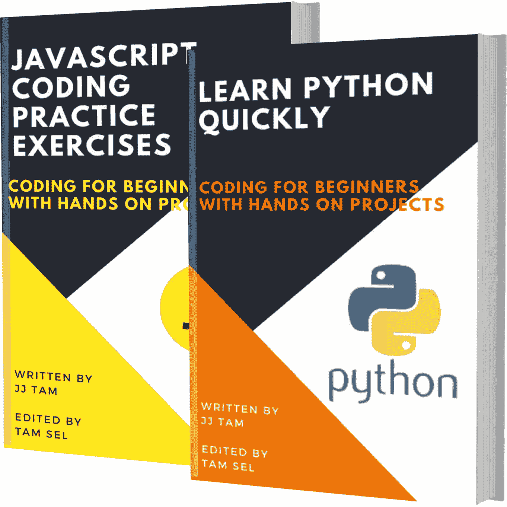

# 快速学习 Python 与 JavaScript 编程实践练习：初学者编程



- JavaScript 函数 – 练习
- JavaScript: 查找第一个非重复字符
- JavaScript: 查找字符串中最长的单词
- JavaScript: 统计字符串中的元音数量
- JavaScript: 检查数字是否为质数
- JavaScript: 获取数据类型
- JavaScript: 寻找第二小和第二大值
- JavaScript 基础
- 乘法和除法计算
- 温度转换
- 寻找最大值
- 反转给定字符串
- 替换每个字符
- 创建新字符串
- 拼接两个字符串
- 移动最后三个字符
- 计算总和
- 两个数字相加
- 检查给定的年份是否为闰年
- 检查给定的正数
- 检查字符串是否以 'Java' 开头
- 检查给定的整数值
- 寻找接近 100 的值` 并将文件保存为 `hello.py`。

```python
print ('hello world')
```

打开终端（或命令提示符），使用命令 `python3 hello.py` 运行文件 `hello.py`。你将得到如下输出：

```
$ python3 hello.py
hello world
```

## 当你指示 Python 运行脚本时发生了什么？

Python 首先将你的源代码编译为字节码（bytecode），并将其发送到 Python 虚拟机 (`PVM`)。字节码是源代码的平台无关的表示。PVM 逐个读取字节码并执行它们。


**注意：** 字节码不是机器理解的代码，它是 Python 特有的表示。

## Python 交互式命令行

打开命令提示符（或终端）并输入命令 `python3`。它会打开 Python 交互会话。

```
$ python3
Python 3.5.0 (v3.5.0:374f501f467, Sep 12 2015, 11:00:19)
GCC 4.2.1 (Apple Inc. build 5666) (dot 3) on darwin
```

输入 `help`、`copyright`、`credits` 或 `license` 获取更多信息。

### 如何退出 Python 解释器

在 Windows 上，使用 `Ctrl-Z` 可以退出会；在 Unix 上，尝试 `Ctrl-D`。另一种方法是直接调用 `quit()` 函数退出 Python。

```
$ python3
Python 3.5.0 (v3.5.0:374f501f467, Sep 12 2015, 11:00:19)
GCC 4.2.1 (Apple Inc. build 5666) (dot 3) on darwin
>>> quit()
```

你可以在 Python 解释器中输入任何语句（或）表达式，解释器会执行这些语句并给你结果。

```
>>> 10+20
30
>>> 20*20
400
>>> print('Hello World')
Hello World
```

**注意：** 在 Unix 上，Python 3.x 解释器默认不以 `python` 命名安装，以免与其他安装的 Python 2.x 可执行文件冲突。

## Python: 运算符

运算符是一个符号，用于执行操作。Python 支持的运算符有：

- 算术运算符
- 关系运算符
- 赋值运算符
- 逻辑运算符
- 位运算符
- 成员运算符
- 身份运算符

### Python 中的算术运算符

以下是 Python 支持的算术运算符。

| 运算符 |  | 示例 |
| :--- | :--- | :--- |
| + | 加法 | `2+3` |
| - | 减法 | `2-3` |
| * | 乘法 | `2*3` |
| / | 除法始终返回浮点值。要获取整数结果请使用 `//`。 | `2/3` 返回 `0.6666666666666666` |
| // | 整除丢弃小数部分 | `2//3` 返回 `0` |
| % | 返回除法的余数。 | `2%3` |
| ** | 幂 | `2**3` 返回 `2 的 3 次方 = 8` |
| 运算符 | 名称 | 描述 |
| :--- | :--- | :--- |
| `==` | 等于 | 如果 `a` 等于 `b`，则 `a==b` 返回 true，否则返回 false |
| `!=` | 不等于 | 如果 `a` 不等于 `b`，则 `a!=b` 返回 true，否则返回 false |
| `>` | 大于 | 如果 `a` 大于 `b`，则 `a>b` 返回 true，否则返回 false |
| `>=` | 大于等于 | 如果 `a` 大于等于 `b`，则 `a>=b` 返回 true，否则返回 false |
| `<` | 小于 | 如果 `a` 小于 `b`，则 `a<b` 返回 true，否则返回 false |
| `<=` | 小于等于 | 如果 `a` 小于等于 `b`，则 `a<=b` 返回 true，否则返回 false |

```python
>>> a = 10
>>> b = 12
>>> a == b
False
>>> a != b
True
>>> a > b
False
>>> a >= b
False
>>> a < b
True
>>> a <= b
True
```

### Python 中的赋值运算符

赋值运算符用于给变量赋值。以下是 Python 提供的赋值运算符。

| 运算符 | 描述 |
| :--- | :--- |
| `=` | `a=10` 将 `10` 赋值给变量 `a` |
| `+=` | `a+=10` 等于 `a=a+10` |
| `-=` | `a-=10` 等于 `a=a-10` |
| `*=` | `a*=10` 等于 `a=a*10` |
| `/=` | `a/=10` 等于 `a=a/10` |
| `//=` | `a//=10` 等于 `a=a//10` |
| `%=` | `a%=10` 等于 `a=a%10` |
| `**=` | `a**=10` 等于 `a=a**10` |

```python
>>> a = 10
>>> a
10
>>> a += 10
>>> a
20
>>> a -= 10
>>> a
10
>>> a *= 10
>>> a
100
>>> a /= 10
>>> a
10.0
>>> a //= 10
>>> a
1.0
>>> a **= 10
>>> a
1.0
```

#### 多重赋值

你可以同时给多个变量赋值。

```python
>>> a, b, c = 10 , 'hello ', 12.345
>>> a
10
>>> b
'hello'
>>> c
12.345
```

### Python 中的逻辑运算符

以下是 Python 支持的逻辑运算符。

| 运算符 | 描述 |
| :--- | :--- |
| `and` | 如果 `a` 和 `b` 都为 true，则 `'a and b'` 返回 true。否则返回 false。 |
| `or` | 如果 `a` 和 `b` 都为 false，则 `'a or b'` 返回 false；否则返回 true。 |
| `not` | 如果 `a` 为 false，则 `'not a'` 返回 True；否则返回 true |

```python
>>> a = bool(0)
>>> b = bool(1)
>>> a
False
>>> b
True
>>> a and b
False
>>> a or b
True
>>> not a
True
>>> not (a and b)
True
>>> not (a or b)
False
```

### Python 中的位运算符

Python 支持以下位运算符，用于对整数进行按位运算。

| 运算符 | 描述 |
| :--- | :--- |
| `>>` | 位右移 |
| `<<` | 位左移 |
| `&` | 位与 |
| `^` | 位异异 |
| `|` | 位或 |
| `~` | 位取反（位非） |

以下是对位运算符的详细解释。

```python
>>> a = 2
>>> a >> 1
1
>>> a << 1
4
>>> a & 3
2
>>> a | 3
3
>>> ~ a
-3
```

### Python 中的成员运算符

成员运算符用于测试值或变量是否存在于序列（字符串、列表、元组、集合和字典）中。

| 运算符 | 描述 |
| :--- | :--- |
| `in` | 如果值/变量在序列中，返回 true；否则返回 false。 |
| `not in` | 如果值/变量不在序列中，返回 True；否则返回 false |

```python
>>> primeNumbers = [2, 3, 5, 7]
>>> 2 in primeNumbers
True
>>> 4 not in primeNumbers
False
>>> 3 in primeNumbers
True
```

### Python 中的身份运算符

身份运算符用于比较两个对象的内存位置。

| 运算符 | 描述 |
| :--- | :--- |
| `is` | 如果 `a` 和 `b` 都指向同一个对象，则 `a is b` 返回 true；否则返回 false。 |
| `is not` | 如果 `a` 和 `b` 不指向同一个对象，则 `a is not b` 返回 true；否则返回 false。 |

```python
>>> name1 = "Hari Krishna"
>>> name2 = "Hari Krishna"
>>> name1 is name2
True
>>> name1 is not name2
False
```

## Python：短路运算符

布尔运算符 `and` 和 `or` 被称为短路运算符，因为表达式的结果一旦确定就会停止求值。

为什么 `and` 是短路运算符？

因为如果第一个语句为 false，则不会评估整个表达式。

为什么 `or` 是短路运算符？

因为如果第一个语句为 true，则不会评估整个表达式。

## Python 中的字符串

字符串可以是单引号（`'...'`）、双引号（`"..."`）或三引号（`""""""`）。Python 中的字符串是不可变的。

```python
>>> str1 = 'Hello World'
>>> str2 = "Hello World"
>>> str3 = """Hello World"""
>>> str1
'Hello World'
>>> str2
'Hello World'
>>> str3
'Hello World'
```

### 特殊字符

特殊字符使用反斜杠 `\` 进行转义。`print()` 方法会将跟在 `\` 之后的字符解释为特殊字符。

```python
>>> print('first\nline')
first
line
```

### 字符串操作

`+` 运算符用于拼接字符串。

```python
>>> hello = "Hello,"
>>> message = "are you"
>>> info = hello + message
>>> info
'Hello,are you'
```

两个或多个字符串字面量会自动拼接。

```python
>>> 'Hello ' "are " 'you'
'Hello are you'
```

### 重复字符串

通过使用 `*` 我们可以重复字符串。

```python
>>> 'hi' * 2
'hihi'
>>> 'hi' * 2 + 'hello'
'hihihello'
```

### 从字符串访问特定字符

可以使用索引位置访问字符串的特定字符。

```python
>>> name = "Hello World"
>>> name[0]
'H'
>>> name[6]
'W'
```

索引 0 代表第一个字符，1 代表第二个字符，以此此类推。你也可以使用负数进行索引。`-1` 代表最后一个字符，`-2` 代表倒数第二个字符等等。

```python
>>> name = "Hello World"
>>> name[-1]
'd'
>>> name[-2]
'l'
>>> name[-7]
'o'
```

### 切片

切片用于获取给定字符串的子字符串。

| 示例 | 描述 |
| :--- | :--- |
| `string[start:end]` | 返回从索引 `start`（包含）到结束索引（不包含）的子字符串 |
| `string[:end]` | 返回从索引 0（包含）到结束索引（不包含）的子字符串 |
| `string[start:]` | 返回从索引 `start` 到末尾的子字符串 |
| `string[-2:]` | 返回从倒第二个到末尾的字符 |

```python
>>> message = "Hello World"
>>> message[0 : 5]
'Hello'
>>> message[5 :]
' World'
>>> message[:]
'Hello World'
>>> message[-2:]
'ld'
>>> message[-5:]
'Wor'
```

### 获取字符串长度

`len(str)` 用于获取字符串的长度。

```python
>>> message = 'Hello World'
>>> len(message)
11
>>> len ("are you ")
11
```

## Python：if 条件

“if”语句在条件求值为 true 时执行代码段。

语法：

`if_stmt ::= "if" expression ":" suite`

```python
test.py
a = 10
if (a < 10 ) :
  print ( "a is less than 10" )
```

### if-else 语句

如果条件为真，则执行 if 块；否则执行 else 块。

语法：

`if_stmt ::= "if" expression ":" suite ["else" ":" suite]`

```python
test.py
a = 10
if (a != 10 ) :
  print ( "a is not equal to 10" )
else :
  print ( "a is equal to 10" )
```

### if-elif-else 语句

通过使用 if-elif-else 结构，你可以选择多个备方案。if 语句后面可以跟可选的 elif...else 语句。

语法：

`if_stmt ::= "if" expression ":" suite ("elif" expression ":" suite)* ["else" ":" suite]`

```python
test.py
a = 10
if (a > 10 ) :
  print ( "a is greater than 10" )
elif (a < 10 ) :
  print ( "a is less than 10" )
else :
  print ( "a is equal to 10" )
```

### 注意事项

a. 在 Python 中，任何非零整数值被视为 true；零为 false。

```python
test.py
if ( 100 ) :
  print ( "Hello" )
else :
  print ( "Bye" )
```

```bash
$ python3 test.py
Hello
```

b. 任何非零长度的序列（字符串、列表等）为真，空序列为假。

`test.py`

```python
list = []

data = "abc"

if ( list ) :
  print ( "list is not empty" )
else :
  print ( "list is empty" )

if (data) :
  print ( "data is not empty" )
else :
  print ( "data is empty" )
```

```bash
$ python3 test.py
list is empty
data is not empty
```

## Python: while 语句

`while` 语句执行语句块，直到特定条件为真

### 语法

```
while_stmt ::= "while" expression ":" suite
                ["else" ":" suite]
```

`else` 子句是可选的。如果表达式求值为假，则执行 `else` 子句（如果存在）并结束循环。

`test.py`

```python
a = 2
print ( "Even numbers are " )
while (a < 10 ) :
  print (a, end = ' ' )
a += 2
else :
  print ( " \n Exit from loop" )
print ( "Done " )
```

```bash
$ python3 test.py
Even numbers are
2 4 6 8
Exit from loop
Done
```

## Python: for 语句

Python 的 `for` 语句用于遍历任何序列（如列表、字符串）的项。

### 语法

```
for_stmt ::= "for" target_list "in" expression_list ":" suite
                ["else" ":" suite]
```

`else` 子句是可选的，它会在循环结束时执行一次。

`test.py`

```python
names = [ "Phalgun " , "Sambith " , "Mahesh " , "swapna " ]
for name in names:
  print (name)
else :
  print ( "Exiting from loop" )
print ( "Finsihed Execution " )
```

```bash
$ python3 test.py
Phalgun
Sambith
Mahesh
swapna
Exiting from loop
Finsihed Execution
```

## Python: break 语句

`break` 语句用于跳 `for` 或 `while` 循环。

`test.py`

```python
i = 0
while ( 1 ):
  i += 2
  print (i)
  if (i == 10 ):
    break
else :
  print ( "Exiting loop" )
print ( "Finished Execution " )
```

```bash
$ python3 test.py
2
4
6
8
10
Finished Execution
```

如你观察到的输出所示，`else` 子句中的 `print` 语句没有被打印。这是因为当 `break` 语句终止循环时，`else` 子句不会执行。

## Python: continue 语句

`continue` 语句跳过 `for` 或 `while` 循环的当前迭代。

`test.py`

```python
i = 2
while (i < 20 ):
  i += 2
  if (i % 2 != 0 ):
    continue
  print (i)
else :
  print ( "Exiting loop" )
print ( "Finished Execution " )
```

上述程序打印直到 20（不包含 20）的所有偶数。

```bash
$ python3 test.py
4
6
8
10
12
14
16
18
20
Exiting loop
Finished Execution
```

## Python: 函数

函数是由名称标识的语句块。关键字 `def` 用于定义函数。函数主要用于两个原因：

a. 使代码更易构建和理解

b. 重用代码

### 语法

```
def functionName(argument1, argument2 …. argumentN):
```

`test.py`

```python
def factorial (n):
  if (n <= 1 ):
    return 1
  result = 1
  for i in range ( 2 , n + 1 ):
    result *= i
  return result

print(factorial ( 1 ))
print(factorial ( 2 ))
print(factorial ( 3 ))
print(factorial ( 4 ))
print(factorial ( 5 ))
```

```bash
$ python3 test.py
1
2
6
24
120
```

在函数定义之前创建的变量只有在函数不改变其值时，才能在函数内部读取。

`test.py`

```python
### 创建变量 x 并设置为 44
x = 44
### 定义一个打印 x 的简单函数
def f ():
  x += 1
  print (x)
### 调用函数
f()
```

运行上述程序，你将得到以下错误。

```bash
$ python3 test.py
Traceback (most recent call last):
  File "test.py", line 11, in <module>
    f()
  File "test.py", line 7, in f
    x += 1
UnboundLocalError: local variable 'x' referenced before assignment
```

移除 `x+=1` 语句并重新运行程序，控制台将打印 `x` 的值。

### Python: 函数: return 语句

`return` 语句用于向调用者返回值。

`test.py`

```python
def factorial (n):
  if (n <= 1 ):
    return 1
  result = 1
  for i in range ( 2 , n + 1 ):
    result *= i
  return result
```

*(注：此处原文代码逻辑似乎混乱，已根据要求保留结构并翻译逻辑描述)*

```python
print(factorial ( 1 ))
print(factorial ( 2 ))
print(factorial ( 3 ))
print(factorial ( 4 ))
print(factorial ( 5 ))

```

```bash
$ python3 test.py
1
2
6
24
12
```

`return` 在没有表达式时返回 `None`。

```python
def hello():
  return
print("Hello")
```

```bash
$ python3 test.py
None
```

## Python: 列表

 列表是用逗号分隔的值组。
```python

>>> primes = [ 2 , 3 , 5 , 7 , 11 , 13 , 17 , 19 , 23 ]

>>> [2, 3, 5, 7, 11, 13, 17, 19, 23]

```
`primes` 是包含质数的列表。
```python

>>> students = [ "Hari " , "Krishna " , "Ravi " ]

>>> ['Hari', 'Krishna', 'Ravi']

```
`students` 是包含所有名字的列表。
```python

>>> objects = [ 1 , 3 , "Hello" , 10 , 23 ]

>>> [1, 3, 'Hello', 10, 23]

```
列表可以包含任何类型的数据。
```python

>>> numbers = [ 1 , 3 , 'Hello' , 10 , 23 ]

>>> [1, 3, 'Hello', 10, 23]

```
使用索引访问列表元素。
```python

>>> objects = [ 1 , 3 , 'Hello' , 10 , 23 ]

>>> [1, 3, 'Hello', 10, 23]

>>> objects[ 0 ]

1

>>> objects[ 1 ]

3

```
`objects[0]` 返回列表的第一个元素。`objects[1]` 返回列表的第二个元素。负索引也用于访问列表元素。
```python

>>> objects = [ 1 , 3 , 'Hello' , 10 , 23 ]

>>> [1, 3, 'Hello', 10, 23]

>>> objects[ -1 ]

23

>>> objects[ -3 ]

3

```

### 切片
切片用于获取子列表。

| 示例 | 描述 |
| :--- | :--- |
| `list[start:end]` | 返回从 `start`（包含）到 `end`（不包含）的子列表。 |
| `list[:end]` | 返回从索引 0（包含）到 `end`（不包含）的子列表。 |
| `list[start:]` | 返回从 `start` 到结束的子列表。 |
| `list[-2:]` | 返回倒第二个到结束的列表。 |

```python

>>> objects = [ 1 , 3 , 'Hello' , 10 , 23 ]

>>> [1, 3, 'Hello', 10, 23]

>>> objects[ -1 ]

23

>>> objects[ -3 ]

[1, 3, 'Hello', 10, 23]

>>> objects[:]

[1, 3, 'Hello', 10, 23]

>>> objects[ 2 :]

['Hello', 10, 23]

>>> objects[ : 3 ]

[1, 3, 'Hello']

```

### 合并两个列表
`+` 运算符用于合并两个列表。
```python

>>> even = [ 2 , 4 , 6 , 8 , 10 ]

>>> odd = [ 1 , 3 , 5 , 7 , 9 ]

>>> numbers = even + odd

>>> [2, 4, 6, 8, 10, 1, 3, 5, 7, 9]

```
列表是可变的，你可以更改列表的值。
```python

>>> numbers = [ 2 , 4 , 6 , 8 , 10 , 1 , 3 , 5 , 7 , 9 ]

>>> numbers[ 0 ] = 12

>>> numbers[ 1 ] = 14

>>> [12, 14, 6, 8, 10, 1, 3, 5, 7, 9]

```

### 向列表末尾添加元素
列表提供了 `append` 方法向列表末尾添加新元素。
```python

>>> numbers = [ 12 , 14 , 6 , 8 , 10 , 1 , 3 , 5 , 7 , 9 ]

>>> numbers.append( 11 )

>>> numbers.append( 13 )

>>> [12, 14, 6, 8, 10, 1, 3, 5, 7, 9, 11, 13]

```

### 切片赋值
如果你想替换列表中的元素序列，可以使用切片符号。
```python

numbers[2:5] = [21, 22, 23]

```
上述语句将索引 2, 3, 4 处的元素替换为 21, 22, 23。
```python

numbers[:] = []

```
上述语句通过将所有元素替换为空列表来清空列表。
```python

>>> numbers = [ 12 , 14 , 6 , 8 , 10 , 1 , 3 , 5 , 7 , 9 ]

>>> numbers[2:5] = [21, 22, 23]

>>> [12, 14, 21, 22, 23, 1, 3, 5, 7, 9]

>>> numbers[:] = []

>>> []

```

### 获取列表长度
使用 `len` 函数可以获取列表的长度。
```python

>>> vowels = ['a', 'e', 'i', 'o', 'u']

>>> len(vowels)

5

```

### 嵌套列表
列表可以嵌套在其他列表中。例如，在下面的示例中，`numbers` 包含 3 个列表，第一个列表表示奇数，第二个列表表示偶数，第三个列表表示质数。
```python

>>> numbers = [ [ 1 , 3 , 5 , 7 ], [ 2 , 4 , 6 , 8 ], [ 2 , 3 , 5 , 7 , 11 ]]

>>> [[1, 3, 5, 7], [2, 4, 6, 8], [2, 3, 5, 7, 11]]

>>> numbers[ 0 ]

[1, 3, 5, 7]

>>> numbers[ 1 ]

[2, 4, 6, 8]

>>> numbers[ 2 ]

[2, 3, 5, 7, 11]

>>> len(numbers)

3

>>> len(numbers[ 0 ])

4

>>> len(numbers[ 1 ])

4

>>> len(numbers[ 2 ])

5

>>> numbers[ 0 ] [ 1 ] = 9

>>> numbers[ 1 ] [ 1 : 4 ] = [ 10 , 12 , 14 ]

>>> [[1, 9, 5, 7], [2, 10, 12, 14], [2, 3, 5, 7, 11]]

```

## 元组（tuple）与列表（list）的区别

- `List` 是变的，而 `tuple` 是不可变的。
- `Tuple` 可以包含异构数据，而 `list` 通常包含同质数据。

`test.py`
```python

employee e = ( 1 , "Hari Krihsna ", "Gurram ", 12345.678 )

print(employee)

print(employee[0])

print(employee[1])

print(employee[2])

print(employee[3])

```
```bash

$ python3 test.py

(1, 'Hari Krihsna', 'Gurram', 12345.678)

1

Hari Krihsna

Gurram

12345.678

```

通过观察上面的示例，`tuple` 中的元素包含在括号内。尽管元组是不可变的，但你可以创建包含可变对象的元组，例如列表。

`test.py`
```python

employee e = ( 1 , [])

print(employee)

employee[1].append(2)

employee[1].append(4)

employee[1].append(6)

print(employee)

```
```bash

$ python3 test.py

(1, [])

(1, [2, 4, 6])

```

### 打包（Packing）与解包（Unpacking）

你可以在不使用括号定义元组。
例如：
```python

employee=1, "Hari Krihsna", "Gurram", 12345.678

```
上面是元组打包的示例。

```python

id, firstName, lastName, salary = employee

```
上面是元组解包的示例。序列解包要求等号左侧的变量数量与序列中的元素数量一致。

`test.py`
```python

employee e = 1 , "Hari Krihsna ", "Gurram ", 12345.678

id, firstName, lastName, salary = employee

print(id)

print(firstName)

print(lastName)

print(salary)

```
```bash

$ python3 test.py

1

Hari Krihsna

Gurram

12345.678

```

### 合并元组（Concatenate tuples）

`+` 运算符用于合并元组。

```python

>>> tuple_1 = ( 1 , "HI ", 2 , 45.65 )

>>> tuple_2 = ( "abcdef ", 54 , 67 )

>>> tuple_3 = tuple_1 + tuple_2

>>> tuple_3

( 1 , 'HI' , 2 , 45.65 , 'abcdef' , 54 , 67 )

```

### 切片（Slicing）

和列表一样，你可以使用切片语法访问元组。

| 示例 | 描述 |
| :--- | :--- |
| `tuple[start:end]` | 返回从索引 `start`（包含）到结束索引（不包含）的 `tuple` |
| `tuple[:end]` | 返回从索引 0（包含）到结束索引（不包含）的 `tuple` |
| `tuple[start:]` | 返回从索引 `start` 到末尾的 `tuple` |
| `tuple[-2:]` | 返回从倒数第二个到末尾的元素 |

```python

>>> tuple1

(1, 'HI', 2, 45.65)

>>> tuple1[0:]

(1, 'HI', 2, 45.65)

>>> tuple1[:]

(1, 'HI', 2, 45.65)

>>> tuple1[:3]

(1, 'HI', 2)

>>> tuple1[2:5]

(2, 45.65)

```

### 重复元组元素（Repeat tuple elements）

`*` 运算符用于重复 `tuple` 中的元素。

```python

>>> tuple1

(1, 'HI', 2, 45.65)

>>> tuple1 * 3

(1, 'HI', 2, 45.65, 1, 'HI', 2, 45.65, 1, 'HI', 2, 45.65)

```

### 删除元组元素（Remove tuple elements）

正如我所说，元组是不可变的，因此无法从 `tuple` 中删除元素。但你可以使用 `del` 语句删除整个元组。

```python

>>> tuple1 = ( 1 , "HI ", 2 , 45.65 )

>>> del tuple1

Traceback (most recent call last):

  File "<stdin>", line 1, in <module>

NameError: 'tuple1' is not defined

```
观察输出，引发异常是因为在删除后，`tuple1` 不再存在了。

## Python：类变量与实例变量（Class Vs Instance variables）

类变量与类相关，并对类的所有实例（对象）可用，而实例变量是对象唯一的，用于标识该对象。

`Employee.py`
```python

class Employee :

    """ 用于所有员工的类 """

    noOfEmployees = 0

    organization = "abc corporation"

    def __init__( self , id , firstName , lastName ):

        self.id = id

        self.firstName = firstName

        self.lastName = lastName

        Employee.noOfEmployees += 1

    def displayEmployee ( self ):

        print ( self.id, self.firstName, self.lastName)

emp1 = Employee( 1 , "Hari Krishna", "Gurram" )

emp1.displayEmployee()

print ("Total Employees ", Employee.noOfEmployees)

```


```python

print ( "请输入有效数字（或）y 应该大于 0" )

```

```

$ python3 test.py

Enter divisor 2

Enter dividend 0

请输入有效数字（或）y 应该大于 0

Enter divisor aa

请输入有效数字（或）y 应该大于 0

Enter divisor 2

Enter dividend 4

0.5

```

最后一个 `except` 子句可以省略异常名称。它被用作全局异常处理器。

`test.py`
```python

while True :

  try :

    tempList = []

    print (tempList[ 10 ])

    break

  except ValueError :

  print ( "请输入有效数字" )

  except ZeroDivisionError :

  print ( "y 应该不为零" )

  except Exception as inst:

  print ( "全局处理器" , inst)

  break

```

```

$ python3 test.py

Global handler list index out of range

```

### try…except…else 子句

`try…except` 语句可以有一个可选的 `else` 子句，它跟在 `except` 子句之后。如果 `try` 块没有抛出任何异常，将执行 `else` 子句。

`test.py`
```python

while True :

  try :

    x = int ( input ( "输入除数 " ))

    y = int ( input ( "输入被除数 " ))

    print (x / y)

  except ValueError :

  print ( "请输入有效数字" )

  except ZeroDivisionError :

  print ( "y 应该不为零" )

  else :

  print ( "程序执行成功" )

  break

```

```

$ python3 test.py

Enter divisor 4

Enter dividend 2

2.0

Program executed successfully

```

### 异常参数

每发生异常时，它都会与一个名为异常参数的变量关联。

`test.py`
```python

while True :

  try :

    x = int ( input ( "输入除数 " ))

    y = int ( input ( "输入被除数 " ))

    print (x / y)

  except ValueError as inst:

  print(inst)

  except ZeroDivisionError as inst:

  print(inst)

  else :

  print ( "程序执行成功" )

  break

```

```

$ python3 test.py

Enter divisor qwerty

invalid literal for int() with base 10: 'qwerty'

Enter divisor 4

Enter dividend 0

division by zero

Enter divisor 2

Enter dividend 4

0.5

Program executed successfully

```

`except` 子句可以在异常名称后指定一个变量。该变量将绑定到异常实例，其参数存储在 `instance.args` 中。

`test.py`
```python

while True :

  try :

    x = int ( input ( "输入除数 " ))

    y = int ( input ( "输入被除数 " ))

    if y == 0 :

      raise Exception (x, y)

    print ( "x/y = " ,x / y)

    break

  except Exception as inst:

  arg1, arg2 = inst . args

  print ( "arg1=" , arg1)

  print ( "arg2=" , arg2)

```

```

$ python3 test.py

Enter divisor 2

Enter dividend 0

arg1= 2

arg2= 0

Enter divisor 2

Enter dividend 4

x/y =  0.5

```

如果异常与其关联有参数，这些参数将作为异常消息的最后部分被打印。

`test.py`
```python

while True :

  try :

    x = int ( input ( "输入除数 " ))

    y = int ( input ( "输入被除数 " ))

    if y == 0 :

      raise Exception (x, y)

    print ( "x/y = " ,x / y)

    break

  except Exception as inst:

  print (inst)

```

```

$ python3 test.py

Enter divisor 2

Enter dividend 0

(2, 0)

Enter divisor 2

Enter dividend 4

x/y =  0.5

```

## Python global 关键字

`global` 关键字用于从局部上下文中创建/修改全局变量（你也可以在其中声明函数、类等）。

`test.py`
```python

def function1 ():

  global data

data = "Hello World"

def function2 ():

  print (data)

function1()

function2()

```

```

$ python3 test.py

Hello World

```

观察 `test.py`，尽管 `data` 在 `function1` 中声明，但它被 `function2` 访问。这是因为 `data` 在全局作用域中声明的。

## Python: 获取变量类型

你可以使用 `type()` 函数或 `__class__` 属性获取变量的类型。

```python

>>> data = [ 1 , 2 , 3 , 4 ]

>>> type(data)

<class 'list'>

>>> data . __class__

<class 'list'>

>>>

>>> data = { 1 : "hari " , 2 : "Krishna " }

>>> type(data)

<class 'dict'>

>>> data . __class__

<class 'dict'>

>>>

```

### 使用 if 语句检查类型

`data = { 1 : "hari " , 2 : "Krishna " }`

#### 方法 1
```python

if (data . __class__ . __name__ == 'dict' ):

    pass

```

#### 方法 2
```python

if type(data) == dict:

    pass

```

#### 方法 3
```python

if isinstance(data, dict):

    pass

```


## indexOf() 方法

`indexOf()` 方法返回调用的 `String` 对象中指定值第一次出现的索引。如果找不到该值，则返回 `-1`。

语法：
`str.indexOf(searchValue[, fromIndex])`

参数包括：
- `searchValue`：要查找的字符串。
- `fromIndex`（可选）：开始搜索的索引。可以是任何整数。

如果满足 `str.indexOf(searchValue) !== -1` 条件，该字符将被计数。

### 流程图


### JavaScript：判断一个数字是否为质数

#### HTML 代码
```html

<!DOCTYPE html>

<html>

<head>

<meta charset="utf-8">

<title>判断数字是否为质数的 JavaScript 程序</title>

</head>

<body>

<form>

第一个数字：<input type="text" id="firstNumber" /><br>

第二个数字：<input type="text" id="secondNumber" /><br>

<input type="button" onclick="multiplyBy()" Value="乘法" />

<input type="button" onclick="divideBy()" Value="除法" />

</form>

<p>结果是：<br>

<span id="result"></span></p>

</body>

</html>

```

#### JavaScript 代码
```javascript

function test_prime(n) {

  if (n === 1) {

    return false;

  } else if (n === 2) {

    return true;

  } else {

    for (var x = 2; x < n; x++) {

      if (n % x === 0) {

        return false;

      }

    }

    return true;

  }

}

console.log(test_prime(37));

```

#### 输出
True

### 流程图


### JavaScript：获取数据类型
创建一个 JavaScript 函数，接收参数并返回其类型。可能的值：object、boolean、number、string 或 undefined。

#### HTML 代码
```html

<!DOCTYPE html>

<html>

<head>

<meta charset="utf-8">

<title>检测数据类型</title>

</head>

<body>

</body>

</html>

```

#### JavaScript 代码
```javascript

function detect_data_type(value) {

  var dtypes = [Function, RegExp, Number, String, Object], x, len;

  if (typeof value === "object" || typeof value === "function") {

    for (x = 0, len = dtypes.length; x < len; x++) {

      if (value instanceof dtypes[x]) {

        return dtypes[x];

      }

    }

  }

  return typeof value;

}

console.log(detect_data_type(12));

console.log(detect_data_type('w3'));

console.log(detect_data_type(false));

```

#### 输出
number
string
Boolean

### JavaScript：获取数组中的第二小和第二大

#### HTML 代码
```html

<!DOCTYPE html>

<html>

<head>

<meta charset="utf-8">

<title>从数组中获取第二小和第二数字</title>

</head>

<body>

</body>

</html>

```

#### JavaScript 代码
```javascript

function Second_Greatest_Lowest(arr_num) {

  arr_num.sort(function(x, y) {

    return x - y;

  });

  var uniqa = [arr_num[0]];

  var result = [];

  for (var j = 1; j < arr_num.length; j++) {

    if (arr_num[j - 1] !== arr_num[j]) {

      uniqa.push(arr_num[j]);

    }

  }

  result.push(uniqa[1], uniqa[uniqa.length - 2]);

  return result.join(',');

}

console.log(Second_Greatest_Lowest([1, 2, 3, 4, 5]));

```

#### 输出
2,4

### 流程图


### JavaScript 基础：两个数字的乘法和除法

#### HTML 代码
```html

<!DOCTYPE html>

<html>

<head>

<meta charset="utf-8">

<title>计算两个数字乘法和除法的 JavaScript 程序</title>

<style type="text/css">

body {margin:30px;}

</style>

</head>

<body>

<form>

第一个数字：<input type="text" id="firstNumber" /><br>

第二个数字：<input type="text" id="secondNumber" /><br>

<input type="button" onclick="multiplyBy()" Value="乘法" />

<input type="button" onclick="divideBy()" Value="除法" />

</form>

<p>结果是：<br>

<span id="result"></span></p>

</body>

</html>

```

#### JavaScript 代码
```javascript

function multiplyBy() {

  var num1 = document.getElementById("firstNumber");

  var num2 = document.getElementById("secondNumber");

  document.getElementById("result").innerHTML = num1 * num2;

}

function divideBy() {

  var num1 = document.getElementById("firstNumber");

  var num2 = document.getElementById("secondNumber");

  document.getElementById("result").innerHTML = num1 / num2;

}

```

#### 解析
- `document.getElementById(id).value`: 文本字段的 `value` 属性用于设置或返回值属性。
- `document.getElementById(id).innerHTML`: 元素的 `innerHTML` 属性用于设置 HTML 内容。

#### 输出


### 将摄氏度转换为华氏度

#### HTML 代码
```html

<!DOCTYPE html>

<html>

<head>

<meta charset="utf-8">

<title>摄氏度转换为华氏度的 JavaScript 程序</title>

</head>

<body>

</body>

</html>

```

#### JavaScript 代码
```javascript

function celsiusToF(celsius) {

  var cTemp = celsius;

  var fahr = (cTemp * 9 / 5) + 32;

  var message = cTemp + "°C 是 " + fahr + "°F";

  document.getElementById("result").innerHTML = message;

}

function fahrenheitToC(fahrenheit) {

  var fTemp = fahrenheit;

  var cTemp = (fTemp - 32) * 5 / 9;

  var message = fTemp + "°F 是 " + cTemp + "°C";

  document.getElementById("result").innerHTML = message;

}

```


```javascript

console.log(without_first_end('JavaScript'));

console.log(without_first_end('JS'));

console.log(without_first_end('PHP'));

```
Output:
avaScrip
H

## 拼接两个字符串
除它们的第一个字符

### HTML CODE
```html

<!DOCTYPE html>

<html>

<head>

  <meta charset="utf-8">

  <meta name="viewport" content="width=device-width">

  <title>JavaScript 程序：除掉第一个字符后拼接两个字符串。</title>

</head>

<body>

</body>

</html>

```

### JAVCRIPT CODE
```javascript

function concatenate(str1, str2) {

  str1 = str1.substring(1, str1.length);

  str2 = str2.substring(1, str2.length);

  return str1 + str2;

}

console.log(concatenate("PHP","JS"));

console.log(concatenate("A","B"));

console.log(concatenate("AA","BB"));

```
Output:
HPS
AB

## 将最后三个字符移动
到指定字符串的开头

### HTML CODE
```html

<!DOCTYPE html>

<html>

<head>

  <meta charset="utf-8">

  <meta name="viewport" content="width=device-width">

  <title>JavaScript 程序：将最后三个字符移动到给定字符串的开头。字符串长度必须至少为 3。</title>

</head>

<body>

</body>

</html>

```

### JAVCRIPT CODE
```javascript

function right_three(str) {

  if (str.length > 1) {

    return str.slice(-3) + str.slice(0, -3);

  }

  return str;

}

console.log(right_three("Python"));

console.log(right_three("JavaScript"));

console.log(right_three("Hi"));

```
Output:
honPyt
iptJavaScr
Hi

## 计算和
给定数组中三个元素的和
长度为 3 的整数和

### HTML CODE
```html

<!DOCTYPE html>

<html>

<head>

  <meta charset="utf-8">

  <meta name="viewport" content="width=device-width">

  <title>JavaScript 程序：计算长度为 3 的给定整数中三个元素的和。</title>

</head>

<body>

</body>

</html>

```

### JAVCRIPT CODE
```javascript

function sum_three(nums) {

  return nums[0] + nums[1] + nums[2];

}

console.log(sum_three([10, 32, 20])); 

console.log(sum_three([5, 7, 9]));

console.log(sum_three([0, 8, -11]));

```
Output:
62
21
-3

## 相加两个数字
给定正整数的两个数字
长度为二

### HTML CODE
```html

<!DOCTYPE html>

<html>

<head>

  <meta charset="utf-8">

  <meta name="viewport" content="width=device-width">

  <title>JavaScript 程序：相加长度为二的正整数的两个数字。</title>

</head>

<body>

</body>

</html>

```

### JAVCRIPT CODE
```javascript

function add_two_digits(n) {

  return n % 10 + Math.floor(n / 10);

}

console.log(add_two_digits(25));

console.log(add_two_digits(50));

```
Output:
7
5

## 检查给定年份是否为闰年
### HTML CODE
```html

<!DOCTYPE html>

<html>

<head>

  <meta charset="utf-8">

  <title>查找闰年</title>

</head>

<body>

</body>

</html>

```

### JAVCRIPT CODE
```javascript

function leapyear(year) {

  return (year % 100 === 0) ? (year % 400 === 0) : (year % 4 === 0);

}

console.log(leapyear(2016));

console.log(leapyear(2000));

console.log(leapyear(1700));

console.log(leapyear(1800));

console.log(leapyear(100));

```
Output:
true
true
false
false

## 检查给定正数
3 或 7 的倍数
### HTML CODE
```html

<!DOCTYPE html>

<html>

<head>

  <meta charset="utf-8">

  <meta name="viewport" content="width=device-width">

  <title>JavaScript 程序：检查给定正数是否是 3 的倍数或 7 的倍数。</title>

</head>

<body>

</body>

</html>

```

### JAVCRIPT CODE
```javascript

function test37(x) {

  if (x % 3 == 0 || x % 7 == 0) {

    return true;

  } else {

    return false;

  }

}

console.log(test37(12));

console.log(test37(14));

console.log(test37(10));

console.log(test37(11));

```
Output:
true
true
false
false

## 字符串以'Java'开头
否则
### HTML CODE
```html

<!DOCTYPE html>

<html>

<head>

  <meta charset="utf-8">

  <meta name="viewport" content="width=device-width">

  <title>JavaScript 程序：检查字符串是否以'Java'开头，否则返回 false。</title>

</head>

<body>

</body>

</html>

```

### JAVCRIPT CODE
```javascript

function start_java(str) {

  if (str.length < 4) {

    return false;

  }

  front = str.substring(0, 4);

  if (front == 'Java') {

    return true;

  } else {

    return false;

  }

}

console.log(start_java("JavaScript"));

console.log(start_java("Java"));

console.log(start_java("Python"));

```
Output:
true
true
false
