# 学习 ReactJS 基础：初学者指南及考试面试 JavaScript 练习册：快速轻松地学习编程基础


## ReactJS 简介

ReactJS 教程将教你基础知识以及一些高级思想。它是目前由一位名为 Jordan Walke 的 Facebook 软件工程师构建最重要的前端库。它建立在坚实的基础上，拥有庞大的社区。Facebook 是第一个构建并维护它的，从以后已被包含在 WhatsApp 和 Instagram 等主要产品。2011 年，Facebook 首次引入 React，但直到 2013 年 5 月才向公众开放。

MVC（模型-视图-控制器）架构现在被许多网站使用。MVC 中的“V”代表视图（View），而 React 就是 MVC 中的“V”。构建一个 ReactJS 应用需要各种组件；这些组件是所有 React 应用的核心。当这些组件与其他部分结合时，它们允许创建复杂的应用程序。

这些组件通过虚拟 DOM (virtual DOM) 填充 HTML DOM。因为只需要更改 DOM 的组件而不是整个 DOM，所以虚拟 DOM 是快速的。我们需要 React 组件来构建应用程序，这些组件将组织在决定应用结构的高级元素内部。让我们来看一个带有按钮和输入字段的表单示例，看看它是如何工作的。表单的每个元素都是 React 组件，而表单本身是一个定义结构的高级组件。在更新虚拟 DOM 后，React 确定修改需要在实际浏览器中进行，而不是直接将 React 组件写入 DOM。

## React 环境搭建分步指南

本节将教你如何为开发 ReactJS 应用搭建开发环境：

### ReactJS 准备工作
1. `NodeJS` 和 `NPM`
2. `React` 和 `DOM`
3. `Webpack`
4. `Babel`

#### 两种方式 - 安装 ReactJS:
1. 使用 `npm` 命令
2. 使用 `create-react-app`

#### 使用 `npm` 命令

**第 1 步：安装 NodeJS** 访问 https://nodejs.org。
**第 2 步：安装 npm** ![Image0000]
**第 3 步：检查版本** 使用以下命令检查版本![Image0001]
**第 4 步：创建 package.json 文件** 在你的目录中![Image0002]
**第 5 步：初始化** 使用以下命令初始化：
```bash
npm init -y
```
**第 6 步：安装 React 和 DOM**
```bash
npm install react react-dom
```
**第 7 步：安装 Webpack** Webpack 主要用于打包，开发期间需要它：
```bash
npm install webpack webpack-cli webpack-dev-server
```
**第 8 步：安装 Babel** Babel 是一个用于转换源代码的编译器。使用以下命令安装 Babel![Image0003]
```bash
npm install --save-dev babel-
```
**第 9 步：创建文件** 我们需要创建以下文件以完成安装：
- `index.html`
- `App.js`
- `main.js`
- `webpack.config.js`
- `.babelrc`
这些文件可以手动创建或使用以下命令创建：
```bash
type nul > filename
```

#### 第 10 步：配置编译器、加载器和 React 服务器

要配置 webpack，请在 `webpack.config.js` 中添加以下代码。它负责指定开发期间使用的文件格式，以及安装任何所需的插件。

```javascript
const path = require('path');
const HtmlWebpackPlugin = require('html-webpack-plugin');
module.exports={
  entry: './main.js',
  output:{
    path: path.join(__dirname, '/bundle'),
    filename: 'index_bundle.js'
  },
  devServer:{
    inline: true,
    port: 8080
  },
  module:{
    rules:[
      {
        test: /\.jsx$/,
        exclude: /node_modules/,
        use:{
          loader: "babel-loader",
        }
      }
    ]
  },
  plugins:[
    new HtmlWebpackPlugin({
      template: './index.html'
    })
  ]
}
```

现在编辑 `package.json` 文件，从 `"scripts"` 对象中删除 `"test": "echo Error: no test specified && exit 1"`，并将其替换为 `start` 和 `build` 指令。

删除上述项目并替换为以下两个：
1. `"start": "webpack-dev-server --mode development --open --hot"`
2. `"build": "webpack --mode production"`

如下所示：

### index.html 的 HTML webpack 模板
使用 `HtmlWebpackPlugin` 插件，我们需要创建一个自定义模板来生成 `index.html`。它允许我们使用 viewport 标签来方便移动端缩放。在你的 `index.html` 文件中粘贴以下代码：

```html
<!DOCTYPE html>
<html lang="en">
<head>
  <meta charset="UTF-8">
  <meta name="viewport" content="width=device-width, initial-scale=1.0">
  <title>ReactApp</title>
</head>
<body>
  <div id="app"></div>
  <script src='index_bundle.js'></script>
</body>
</html>
```


这是第一个 React 组件，作为应用的入口点。它将渲染 Hello World。

在你的 `App.js` 文件中，粘贴以下代码。

`App.js`

```javascript
import React, {Component} from 'react';

class App extends Component {
  render() {
    return (
      <div>
        <h1>HelloWorld</h1>
      </div>
    );
  }
}

export default App;
```

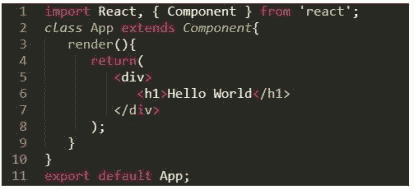

现在我们必须导入并渲染此组件到根 `App` 元素中，以便在浏览器中看到它。

`main.js`

```javascript
import React from 'react';
import ReactDOM from 'react-dom';
import App from './App.js';

ReactDOM.render(<App/>, document.getElementById('app'));
```

### 创建 `.babelrc` 文件

向你的 `.babelrc` 文件添加以下代码。

`.babelrc`
```json
{
  "presets": [
    "@babel/preset-env",
    "@babel/preset-react"
  ]
}
```

现在是时候启动服务器了。要启动服务器，在命令行提示符中输入以下命令，确保它与 React 文件在同一文件夹中。

`npm start`

此命令将显示端口号，你需要打开浏览器窗口。打开后，你将看到以下内容：


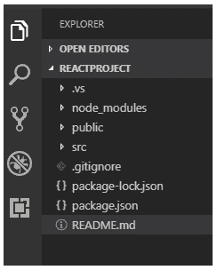

React 应用的根目录包含许多文件和目录。以下是一些示例：

1. `node_modules`: 它包含了 React 库以及任何可能需要的其他第三方库。
2. `public`: 它包含应用的公共资源。它包含 `index.html` 文件，React 默认会将应用程序挂载到 `<div id="root">` 元素上。
3. `src`: 此文件夹中有多个文件，包括 `App.css`、`App.js`、`App.test.js`、`index.css`、`index.js` 和 `serviceWorker.js`。`App.js` 文件将负责始终显示 React 输出屏幕。
4. `package-lock.json`: 每当 `npm` 包更改 `package.json` 或 `node_modules` 树时，它会自动生成。它是无法发布的。如果发现它位于顶层包以外的位置，它将被忽略。
5. `package.json`: 它包含了项目元数据信息。它为 `npm` 提供了允许其识别项目依赖关系以及项目本身的信息。
6. `README.md`: 它还包含了 React 主题的文档。

## React JSX

众所周知，所有的 React 组件都有一个 `render` 函数。

React 组件的 HTML 输出由 `render` 函数指定。

JavaScript 扩展 `JSX` 允许你编写看起来像 HTML 的 JavaScript 代码。`JSX` 是一种 React 特有的 HTML 类语法，它扩展了 ECMAScript，允许 HTML 类语法与 JavaScript/React 编程共存。

预处理器（如像 `Babel` 的转译器）使用这种语法将 HTML 类语法转换为 JavaScript 引擎可以理解的标准 JavaScript 对象。

它允许你将 HTML/XML 类结构（例如 DOM 类树形结构）放置在与 JavaScript 代码相同的文件中，然后预处理器将这些表达式转换为实际的 JavaScript 代码。就像 XML/HTML 标签一样，`JSX` 标签也有标签名、属性和子。

### 为什么使用 JSX？

- 它比 JavaScript 更快，因为它在翻译成 JavaScript 之前对代码进行了优化。
- React 并不是通过将 HTML 和逻辑放在不同的文件中来分离技术，而是使用同时包含两者的组件。
- 它是类型安全的，因为大多数问题在编译期间就会被发现。
- 它简化了创建模板的过程。

### JSX 中的嵌套元素

如果你想使用多个元素，必须将它们封装在一个容器元素中。这里 `div` 元素被用作三个嵌套项的容器元素。

`App.JSX`

```javascript
import React, { Component } from 'react';

class App extends Component {
  render() {
    return (
      <div>
        <h1>Hello World !!</h1>
        <h2>This is TutorialandExample</h2>
        <p>Website with the best tutorials.</p>
      </div>
    );
  }
}

export default App;
```

### JSX 属性

`JSX` 中 HTML 元素的特性与普通 HTML 相同。在 `JSX` 中，属性使用驼峰命名，而不是 HTML 的传统命名模式，例如 HTML 中的 `class` 在 JSX 中变更为 `className`。这是因为在 JavaScript 中，`class` 关键字是一个保留关键字。在 `JSX` 中也可以使用自定义属性。对于自定义属性，我们必须使用 `data-prefix`。

自定义属性 `data-customAttr` 用于下面示例中 `<p>` 标签的属性。

例如：

```javascript
import React, { Component } from 'react';

class App extends Component {
  render() {
    return (
      <div>
        <h1>Hello World !!</h1>
        <h2>This is TutorialandExample</h2>
        <p data-customAttr="hello">Website with the best tutorials.</p>
      </div>
    );
  }
}

export default App;
```

### JavaScript 表达式

JavaScript 表达式可以使用 `JSX` 内部。我们需要用大括号 `{}` 将其包裹。

下一个示例更清楚地展示了这一点。

示例：

```javascript
import React, { Component } from 'react';

class App extends Component {
  render() {
    return (
      <div>
        <h1>{1 + 2}</h1>
        <h1>Hello World</h1>
        <h2>This is TutorialandExample</h2>
        <p data-customAttr="hello">Website with the best tutorials.</p>
      </div>
    );
  }
}
```

（注：由于原文中后续大量关于“JSX 属性”、“嵌套元素”、“JavaScript 表达式”的章节内容完全重复，已按指令要求不再重复输出。）


以下是 ReactJS 的两种类型组件：

1. `Functional Components`（无状态组件）。
2. `Class Components`（有状态组件）。

## Functional Components

由于函数组件不持有或维护状态，因此它们有时被称为无状态组件。

函数组件是编写组件的一种手段，它们仅包含 `render` 方法而没有状态。它们是简单的 JavaScript 函数，可能接受也可能不接受数据参数。

我们也可以编写一个接受 `props`（属性）作为输入并返回显示结果的函数。

以下是无状态组件的示例：

### Example

```javascript
import React, { Component } from 'react'; 

class App extends React.Component { 
    render() { 
      return ( 
          <div> 
            <First/> 
            <Second/> 
          </div>    
      ); 
    } 
} 

class First extends React.Component { 
    render() { 
      return ( 
          <div>   
            <h1>Stateless Components</h1> 
          </div> 
      ); 
    } 
} 

class Second extends React.Component { 
    render() {   
      return ( 
          <div> 
            <h2>www.tutorialandexample.com</h2> 
            <p>This website has several tutorials.</p> 
          </div> 
      );    
    } 
}   

export default App;
```

## Class Components

由于类组件保留或管理本地状态，因此它们有时被称为有状态组件。这些组件比无状态组件更复杂。

它需要扩展 `React`。可以定义一个扩展组件并具有 `render` 函数的类来构建类组件。

以下是类组件的示例：

### Example

在这个示例中，我们将创建一个无序组件列表，其中我们将为 `data` 数组中的每个对象动态添加 `Name`。这里使用了 EcmaScript6 箭头语法 (`=>`)，它比旧的 JavaScript 语法要清晰得多。它有助于我们为元素编写更少的代码。当我们需要创建大量的项目列表时，它就非常有用。

```javascript
import React, { Component } from 'react'; 

class App extends React.Component { 
  constructor() { 
    super(); 
    this.state = { 
      data:  
        [ 
          {              
            "name":"Arun" 
          }, 
          {              
            "name":"Anup"            
          }, 
          {   
            "name":"Anil"           
          } 
        ] 
    } 
  } 
  render() { 
    return ( 
        <div> 
          <Name/> 
          <ul>          
            {this.state.data.map((item) => <List data ={item} />)}      
          </ul>      
        </div>  
    ); 
  }
}

class Name extends React.Component { 
  render() {  
    return ( 
      <div> 
        <h1>Student</h1> 
      </div> 
    ); 
  }
}

class List extends React.Component { 
  render() { 
    return ( 
      <ul>      
        <li>{this.props.data.name}</li> 
      </ul> 
    ); 
  }
}

export default App;
```

## ReactJS 的优缺点

以下是 ReactJS 的一些优点和缺点：

### ReactJS 的优点

1. **易于学习和使用**：ReactJS 是一个简单易用且易学的框架。它带有大量的文档、培训材料和教程。对于具有 JavaScript 经验的开发者来说，它很容易理解，可以在几天内开始开发 Web 。它是 JavaScript 框架之一，是 MVC（模型-视图-控制器）模型中的视图部分。我们不能说 ReactJS 功能丰富，但它确实具有开源用户界面（UI）库的优点，有助于任务执行。
2. **创建动态应用程序变得更容易**：由于复杂的编码，使用 HTML 创建动态应用是很困难，但 ReactJS 解决了这个问题使其简单。它需要更少的代码并提供更多功能。它利用 `JSX` 扩展，是一种允许 HTML 标签渲染某些组件的语法。支持机器可读代码。
3. **可复用组件**：ReactJS Web 应用由多个组件组成，每个组件都有自己的逻辑和控制。这些组件负责产生短的、可重用的 HTML 代码。这些复用代码使得应用程序更容易设计和维护。ReactJS 使用基于虚拟 DOM 的技术来用数据填充 HTML。因为它只是更改特定 DOM 的元素而不是每次重新加载，所以虚拟 DOM 是快速的。
4. **性能增强**：由于虚拟 DOM，ReactJS 的速度已经提高。ReactJS 极快。由于此功能，ReactJS 变得比其他框架好得多。这背后有一个管理虚拟 DOM 的概念。文档对象模型（DOM）是 HTML、XML 和 XHTML 的跨平台编程 API。DOM 仅包含在内存中。因此，每当我们构建组件时，我们不会直接将其写入 DOM；而是编写转换为 DOM 的虚拟组件，从而导致更平滑、更快的性能。
5. **方便的工具支持**：ReactJS 流行还因为可用实用的工具集。这些技术提高了可读性。这些工具是 Chrome 和 Firefox 扩展，允许您检查虚拟 DOM 中的层次结构。
6. **SEO 友好**：当涉及到 SEO 时，标准框架存在问题。搜索引擎很难读取大型 JavaScript 应用。ReactJS 解决了这个问题，使其更容易在不同的搜索引擎之间导航。这就是为什么 React 应用可以在服务器上运行虚拟 DOM 并返回标准页面。
7. **拥有库的优势**：ReactJS 流行还因为提供了非常有用的库。这些技术提高了可读性并为开发者提供了更多自由。
8. **代码测试范围**：ReactJS 启动简单。它让能够使用原生工具快速测试和调试程序的开发者。

### ReactJS 的缺点

1. **开发节奏快**：这既是优点也是缺点。由于环境变化非常快，大多数开发者想要经常重新学习新方法。跟上所有变化和持续更新可能是困难的。
2. **文档不佳**：这是不断变化的技术的常见缺点之一。由于 React 技术的快速更新，缺乏良好的文档。
3. **视图部分**：ReactJS 只处理应用程序的 UI 层。因此，必须选择其他技术为项目开发提供完整的工具集。
4. **JSX 是障碍**：ReactJS 使用 `JSX`，一种允许 HTML 和 JavaScript 混合的语法扩展。这种策略是有益的，但开发社区的某些成员（特别是新开发者）认为 `JSX` 是一个障碍。开发者对于学习 `JSX` 有多困难存在分歧。

#### ReactJS 的特性

ReactJS 目前作为最强大的 JavaScript 框架正受欢迎。它对于前端生态系统的成功至关重要。以下是 ReactJS 的一些重要特性：

* `JSX`
* `组件`
* 单向数据绑定
* `Virtual DOM`


* 简单性
* 性能
* 让我们详细阐述这些特性：

## JSX
JavaScript XML 缩写为 `JSX`。它是经过扩展的 JavaScript 语法。它的语法与 XML 或 HTML 相似。

这种语法会被转换为 React 框架 JavaScript 调用。它改进了 `ES6`，允许类 HTML 文本与 JavaScript React 代码共存。在 `ReactJS` 中并不强制要求使用 `JSX`，但建议使用它。

## 单向数据绑定
ReactJS 的设计目标是遵循单向数据流，通常被称为单向数据绑定。单向数据绑定是有益的，因为它允许对整个应用程序进行更多的控制。当数据向反方向流动时，就需要额外的特性。出现这种情况是因为系统假设组件是不可变的，且它们内部包含的数据是不可更改的。`Flux` 是一种有助于数据单向性的模式。它为应用程序提供了额外的灵活性，从而提高了效率。

## 虚拟 DOM
虚拟 DOM 仅仅是真实 DOM 的副本。它与单向数据绑定类似。每当 Web 应用发生修改时，整个 UI 都会在虚拟 DOM 表示中重新渲染。然后会检查新 DOM（重新渲染的）与先前的 DOM 表示之间的差异。完成后，真实 DOM 会修改发生变化的项目。这减少了内存占用并加快了运行速度。

## 简单性
众所周知，ReactJS 使用了 `JSX`，这使得应用程序更符合用户习惯，代码更易于理解。ReactJS 采用基于组件的方法，允许代码复用。它易于学习和利用。

## 组件
ReactJS 由组件组成，每个组件都有自己的逻辑和控制。组件是可重用的，这在开发大型项目时使得代码维护更加容易。

## 性能
ReactJS 非常快。与其他框架相比，ReactJS 受益于这一功能。这一逻辑背后有一个管理虚拟 DOM 的概念。文档对象模型 (`DOM`）是一种用于 HTML、XML 和 XHTML 的跨平台计算机编程 API。`DOM` 仅包含在内存中。因此，当我们构建任何组件时，不会直接将其写入 `DOM`；而是写入转换为 `DOM` 的虚拟组件，从而实现了更流畅、更快的性能。

## React 与 Vue 的比较
React 和 Vue 都是著名的 JavaScript 库，如今用于构建数百万个网站。React 和 Vue 都提供了极其强大的框架，各自都有优缺点。你选择哪一个取决于你的业务需求和用例。React 和 Vue 有许多共同点，例如基于组件的设计、虚拟 DOM 的使用、props 的使用、使用 Chrome 开发工具进行调试等。它们在以下方面相互不同：

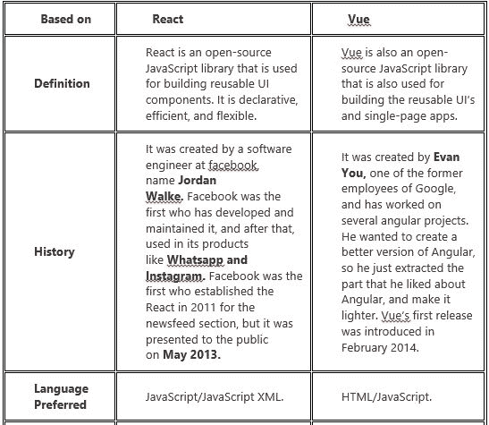
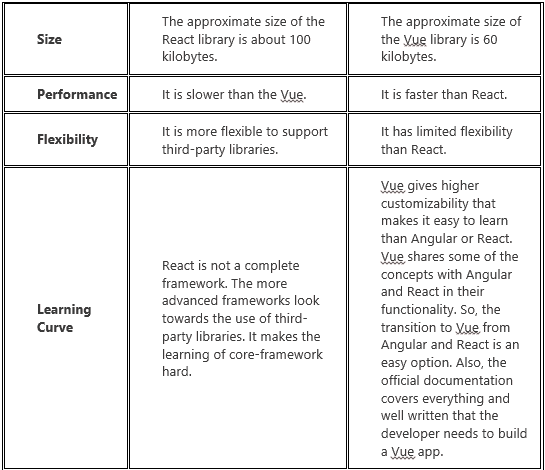
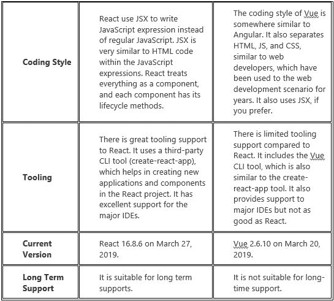

## ReactJS vs AngularJS
ReactJS 与 AngularJS 之间的区别

### AngularJS
AngularJS 是一个开源 JavaScript 框架，用于创建动态 Web 应用程序。它由 Misko Hovery 和 Adam Abrons 于 2009 年创建，目前由 Google 维护。2019 年 3 月 11 日，AngularJS 更新到了 `1.7.8`。它主要用于创建单页应用，并利用 HTML 和 JavaScript 属性。使用 `<script>` 标签将其整合到 HTML 页面中。它使用表达式将数据绑定到 HTML，并通过使用指令添加内置属性来扩展 HTML。

#### AngularJS 的特性
以下是 AngularJS 的一些特性：
1. **数据绑定**：AngularJS 支持双向数据绑定。模型和显示组件之间的数据同步是自动发生的。
2. **POJO 模型**：AngularJS 使用的“纯旧 JavaScript 模型”缩写为 `POJO`。它提供了自发和计划良好的对象。它使得 AngularJS 是自包含的且易于利用。
3. **MVC 框架（模型-视图-控制器）**：`MVC` 是一种用于创建 Web 应用的软件架构范式。AngularJS 的功能模型主要构建在 `MVC` 概念之上。AngularJS 中的 `MVC` 具有动态、舒适且多架构。
4. **服务**：AngularJS 带有许多内置服务，例如用于创建 `XMLHttpRequest` 的 `$http`。
5. **用于用户界面的 HTML**：AngularJS 使用 HTML 创建用户界面。AngularJS 是一种声明式语言，使用更短、更易理解的标签。它提供了良好的界面。
6. **依赖注入**：AngularJS 具有依赖注入子系统，简化了开发者设计、理解和测试应用程序的过程。
7. **Google 的活跃社区**：众所周知，Google 维护 AngularJS，因此在出现维护问题时，有很多论坛可以回答问题。
8. **路由**：路由是允许你从一个视图移动到另一个视图的系统。对于所有内容都包含在页面上的单页应用来说至关重要。开发者不希望用户每次点击菜单项时都将其引导到新页面。开发者要求在 URL 更改时在同一页面加载内容。

## ReactJS
它是一个由 Facebook 软件工程师 Jordan Walke 创建的关键前端库。Facebook 是第一个创建并维护它的，后来被整合到 Whatsapp 和 Instagram 等主要产品中。2011 年，Facebook 首次引入了 React，但直到 2013 年才向公众开放。

ReactJS 是一个用于开发单页应用界面的开源 JavaScript 库。根据 `MVC`，React 是“V”，即 View（视图）。许多组件构成了 ReactJS；这些组件是所有 React 应用的核心。

#### ReactJS 的特性
* **JSX**：JavaScript XML 缩写为 `JSX`。它是经过扩展的 JavaScript 语法。它的语法与 XML 或 HTML 相似。这种语法会被转换为 React 框架 JavaScript 调用。它改进了 `ES6`，允许类 HTML 文本与 JavaScript 代码共存。在 `ReactJS` 中并不强制要求使用 `JSX`，但建议使用它。
* **单向数据绑定**：ReactJS 的设计目标是遵循单向数据流，通常被称为单向数据绑定。单向数据绑定是有益的，因为它允许对整个应用程序进行更多的控制。当数据向反方向流动时，就需要额外的特性。出现这种情况是因为系统假设组件是不可变的，且它们内部包含的数据是不可更改的。`Flux` 是一种有助于数据单向性的模式。它为应用程序提供了额外的灵活性，从而提高了效率。
* **虚拟 DOM**：虚拟 DOM 仅仅是真实 DOM 的副本。它与单向数据绑定类似。每当 Web 应用发生修改时，整个 UI 都会在虚拟 DOM 表示中重新渲染。然后会检查新 DOM（重新渲染的）与先前的 DOM 表示之间的差异。完成后，真实 DOM 会修改发生变化的项目。这减少了内存占用并加快了运行速度。
* **简单**：众所周知，ReactJS 使用了 `JSX`，这使得应用程序更符合用户习惯，代码更易于理解。ReactJS 采用基于组件的方法，允许代码复用。它易于学习和利用。
* **组件**：ReactJS 由组件组成，每个组件都有自己的逻辑和控制。组件是可重用的，这在开发大型项目时使得代码维护更加容易。


## 性能
`ReactJS` 的性能非常出色。与其他框架相比，`ReactJS` 很大程度上受益于这一功能。这一逻辑背后有一个管理虚拟 DOM 的概念。`Document Object Model`（`DOM`）是一种用于 `HTML`、`XML` 和 `XHTML` 的跨平台计算机编程 API。`DOM` 仅包含在内存中。因此，每当我们构建一个组件时，我们不会直接将其写入 `DOM`；而是编写转换成 `DOM` 的虚拟组件，从而实现了更平滑、更快的性能。

## AngularJS 与 ReactJS 的对比
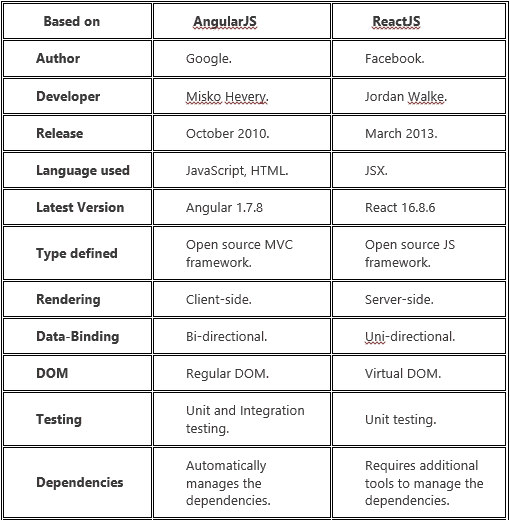


## React Native vs ReactJS
### React Native 与 ReactJS 之间的区别

### React Native
React Native 是一个开源 JavaScript 框架，可用于为 iOS、Android 和 Windows 创建移动应用。它使用 `JavaScript` 来创建跨平台移动应用。`React Native` 与 `react` 类似，但它不是使用 Web 组件作为构建块，而是使用原生组件。因此，它不是用于浏览器，而是用于移动设备。2013 年，它由 Facebook 为其著名的内部项目 `Hackathon` 开发。Facebook 在 2015 年 3 月宣布 `React Native` 是开源的并可以在 `GitHub` 上。

### React Native 的优势
以下是使用 `React Native` 的一些优势：
1. **原生组件**：如果我们需要原生功能，我们就需要开发尚未设计的特定平台代码。
2. **类性能**：`React Native` 的代码被编译为原生代码，使其能够在两个操作系统上运行并执行相同的功能。
3. **跨平台使用**：它同时兼容 `Android` 和 `iOS` 设备。
4. **JavaScript**：它用于原生移动应用的开发。
5. **随时间改进**：社区不断开发最佳实践。
6. **社区**：它拥有一个庞大的社区，帮助人们获得他们需要的答案。
7. **不确定性的存在**：由于该框架是由 Facebook 创建的，其存在性未知，因为公司保留了随时终止项目的权利。随着 `React Native` 流行度的提高，这种情况不太可能发生。

### React Native 的缺点
1. **学习困难**：对于应用开发领域的新手来说，学习非常困难。
2. **初始化耗时更多**：即使对于高科技设备，启动也需要很长时间。
3. **React Native 仍然很新 - 不成熟**：`React Native` 仍处于测试阶段，且仅适用于 `Android` 和 `iOS`，这对移动应用有不利影响。
4. **缺乏安全性稳健性**：`React Native` 创建了安全漏洞。专家建议不要使用 `React Native` 开发对机密性要求高的银行金融应用。

## ReactJS
`ReactJS` 是一个用于开发单页应用界面的开源 JavaScript 库。根据 MVC，`React` 是“V”，代表 View（视图）。有许多组件构成了 `ReactJS` 应用；这些组件构成了所有 React 应用的核心。当这些组件与其他部分结合时，它们允许创建复杂的应用程序。它是由名为 `Jordan Walke` 的 Facebook 软件工程师创建的关键前端库。Facebook 最初创建并维护它，后来它被整合到 `Whatsapp` 和 `Instagram` 等主要产品中。2011 年，Facebook 首次引入 `React`，但直到 2013 年 5 月才向公众开放。

### ReactJS 的益处
1. **易于学习和使用**：`ReactJS` 是一个简单易用易学习的框架。它带有大量的文档、培训材料和教程。对于具有 `JavaScript` 经验的开发者来说，它很容易理解，可以在几天内立即开始开发 Web 应用。它是 JavaScript 框架之一，是 `MVC`（模型-视图-控制器）模型中的 V（视图部分）。我们不能说 `ReactJS` 功能丰富，但它确实具有开源 JavaScript 用户界面（`UI`）库的优势，有助于任务执行。
2. **创建动态 Web 应用变得更简单**：使用 `HTML` 字符串创建动态 Web 应用由于需要复杂的编码非常困难，但 `ReactJS` 解决了这个问题并使其简单。它需要更少的代码并提供更多的功能。它利用 `JSX`（`JavaScript`）扩展，这是一种允许 `HTML` 和 `HTML` 标签语法渲染某些子组件的语法。还支持机器读代码。
3. **可重用组件**：`ReactJS` Web 应用由多个组件组成，每个组件都有自己的逻辑和控制。这些组件负责生成短的、可重用的 `HTML` 代码。这种可重用的代码使得应用的设计和维护变得更加容易。`ReactJS` 使用基于虚拟 DOM 的技术向 `HTML DOM` 填充数据。因为它只是更改特定 DOM 的元素而不是每次都重新加载，所以虚拟 DOM 非常快。
4. **性能增强**：由于虚拟 DOM，`ReactJS` 的速度有所提高。`ReactJS` 非常快。由于这一功能，`ReactJS` 明显优于其他框架。这一逻辑背后有一个管理虚拟 DOM 的概念。`Document Object Model`（`DOM`）是一种用于 `HTML`、`XML` 和 `XHTML` 的跨平台计算机编程 API。`DOM` 仅包含在内存中。因此，每当我们构建一个组件时，我们不会直接将其写入 `DOM`；而是编写转换成 `DOM` 的虚拟组件，从而实现了更平滑、更快的性能。
5. **工具支持**：`ReactJS` 还因其可用工具集而受欢迎。这些技术提高了可读性并让开发者的工作更容易。这些工具是 `Chrome` 和 `Firefox` 扩展，允许研究 react 组件的层次结构。
6. **已知 SEO 友好**：在 SEO 方面，标准框架存在问题。搜索引擎难以读取大型 JavaScript 应用。`ReactJS` 解决了这个问题，让开发者更容易跨多个搜索引擎。这就是为什么 `React.js` 应用可以在服务器上运行，通过虚拟 DOM 渲染标准页面。
7. **JavaScript 库的优势**：`ReactJS` 提供了丰富的 JavaScript 库，这就是它如此受欢迎的原因。JavaScript 库给了 Web 开发者更多的自由。
8. **代码测试范围**：`ReactJS` 应用启动简单。它允许开发者使用原生工具轻松测试和调试代码。

### ReactJS 的缺点
1. **开发节奏快**：这既是优势也是劣势。由于环境变化太快，大多数开发者不希望频繁重新学习新方法。跟上所有变化和持续更新可能是困难的。他们必须定期更新技能并获取新方法。
2. **文档匮乏**：这是不断变化的技术的另一个共同缺点。由于 react 技术的快速更新，缺乏良好的文档。
3. **视图部分**：`ReactJS` 只处理应用的 UI 层。因此，必须选择其他技术来为项目开发提供完整的工具集。
4. **JSX 作为障碍**：`ReactJS` 使用 `JSX`，这是一种允许 `HTML` 和 `JavaScript` 混合的语法扩展。这种策略是有利的，但开发社区的某些成员（特别是新开发者）将 `JSX` 视为障碍。开发者对于学习 `JSX` 有多困难存在分歧。


区别 - ReactJS - React Native

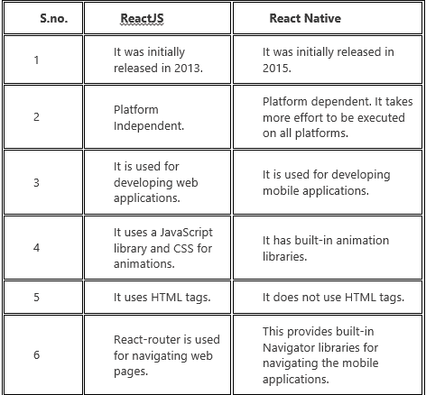

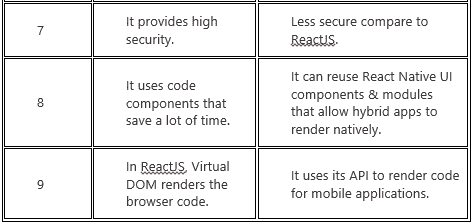

## React State (状态)

状态（State）是一个存储有关组件数据或信息的可变结构。

组件的状态随时间推移而改变。状态的变化通常源于用户交互或系统事件。

有状态组件（Stateful components）是指拥有状态的组件。它是 React 组件的重要部分，因为它决定了组件的行为和渲染方式。它们还负责让组件变得生动且吸引人。

状态的目标是尽可能保持简单。

可以使用 `setState()` 方法来更改状态，调用它会导致 UI 更新。

本地状态或信息由状态表示。它可以由组件直接或从组件内部对其进行更新或访问。

我们必须在任何交互发生之前，利用 `getInitialState()` 方法来设置初始状态。

例如，如果我们有五个组件都需要来自状态的数据或信息，那么我们需要开发一个容器组件来为它们持有所有的状态。

### 定义状态 (Defining the State)

在定义状态之前，我们必须先为定义组件的初始状态指定一组默认值。

添加一个类函数 `Object() { [native code] }`，使用 `this.state` 来分配初始状态。`render()` 方法可以渲染 `this.state` 属性。

### 示例：

以下示例演示了如何使用 ES6 语法创建一个有状态组件：

```javascript
import React, { Component } from 'react'; 

class App extends React.Component { 
  constructor() {
    super()
    this.state = { displayBio: true }
  }

  render() {
    const bio = this.state.displayBio ? ( 
      <div>
        <p><h3>This is tutorialexample website which provides you lot of tutorials.</h3></p>
      </div>
    ) : null;
    return (
      <div>
        <h1> Hello World !!!!!!</h1>
        { bio }
      </div>
    )
  }
}

export default App;
```

在函数 `Object() { [native code] }` 中，执行 `super()` 方法来设置状态是必不可的。这是因为在 `super()` 方法被调用之前，`this.state` 是未初始化的。

### 更改状态 (Changing the State)

可以通过调用 `setState()` 并传入一个新的状态对象作为参数来更新组件的状态。现在，在上述示例中，构建一个新方法 `toggleDisplayBio()` 并 `this` 关键字绑定到它；否则在 `toggleDisplayBio()` 方法内部将无法访问。

```javascript
this.toggleDisplayBio=this.toggleDisplayBio.bind(this)
```

### 示例：

我们将在下面的示例的 `render()` 方法中添加一个按钮。当按下按钮时会调用 `toggleDisplayBio()` 方法并显示指定的输出。

```javascript
import React, { Component } from 'react'; 

class App extends React.Component {
  constructor() {
    super()
    this.state = { displayBio: false }
    console.log('Component this', this)
    this.toggleDisplayBio = this.toggleDisplayBio.bind(this)
  }

  toggleDisplayBio(){
    this.setState({displayBio: !this.state.displayBio});
  }

  render() {
    return (
      <div>
        <h1>!! Hello World !!</h1>
        {
          this.state.displayBio ? (
            <div>
              <p><h4>This is tutoriaexample website that has a lot of tutorials. This website provides you a better source of learning.</h4></p>
              <button onClick={this.toggleDisplayBio}> Show Less </button>
            </div> 
          ) : (
            <div>
              <button onClick={this.toggleDisplayBio}> Read More </button>
            </div>
          )
        }
      </div>
    )
  }
}

export default App
```

## React Props (属性)

“properties”（属性）一词缩写为 "prop"。因为 props 是不可变的，所以 state 和 props 在本质上是不同的。Props 是只能读取的组件属性。它是跟踪标签属性值的对象，其工作方式与 HTML 元素类似。它促进了数据从一个组件到另一个组件的传输。Props 类似于函数参数，因为它们提供给组件的方式与参数传递给函数的方式相同。

组件内部的 `props` 不能被更改。在组件内部，我们可以添加 props，即属性。这些属性在组件中通过 `this.props` 暴露，并用于在我们的 `render` 方法中渲染动态数据。

当你在组件中需要不可变数据时，向 ReactJS 项目的 `main.js` 文件添加 `reactDom.render()` 方法，并在需要的组件内部该文件。

### 示例：

**App.js**
```javascript
import React, { Component } from 'react';
class App extends React.Component {
  render() {
    return (
      <div>
        <h1> Hello { this.props.name } </h1>
        <p> <h4> This is tutorialexample website which provides you lot of tutorials </h4></p>
      </div>
    );
  }
}
export default App;
```

**Main.js**
```javascript
import React from 'react';
import ReactDOM from 'react-dom';
import App from './App.js';
ReactDOM.render(<App name = "World" />, document.getElementById('app'));
```

### 默认 Props (Default Props)

并不总是要在 `reactDom.render()`元素中包含 props。默认 props 直接设置在组件函数 `Object() { [native code] }` 上。在下面的示例中进行了很好的解释：

### 示例：

```javascript
import React, { Component } from 'react';
class App extends React.Component {
  render() {
    return (
      <div>
        <h1>Hello</h1>
        <h2>Default Props</h2>
        <h3>Welcome to {this.props.name}</h3>
        <p>tutorialexample provides you lot of tutorials.</p>
      </div>
    );
  }
}
App.defaultProps = {
  name: "tutorialexample"
}
export default App;
```

**Main.js**
```javascript
import React from 'react';
import ReactDOM from 'react-dom';
import App from './App.js';
```

## State and Props (状态与属性)

在应用中，state 和 props 可以合并。Props 可在父组件中设置并传递给子组件。

### 示例：

**App.js**
```javascript
import React, { Component } from 'react';
class App extends React.Component {
  constructor(props) {
    super(props);
    this.state = {
      name: "tutorialexample",
    }
  }

  render() {
    return (
      <div>
        <Tutorial tutorialProp={this.state.name}/>
      </div>
    );
  }
}

class Tutorial extends React.Component {
  render() {
    return (
      <div>
        <h1>State & Props</h1>
        <h1>Welcome to {this.props.tutorialProp}</h1>
        <p>tutorialexample provides you lot of tutorials.</p>
      </div>
    );
  }
}
export default App;
```

**Main.js**
```javascript
import React from 'react';
import ReactDOM from 'react-dom';
import App from './App.js';
ReactDOM.render(<App/>, document.getElementById('app'));
```

## React Props Validation (属性验证)

周知，Props 是向 React 组件传递只读属性的好方法。在组件中正确使用 props 是必要的。如果不这样做，组件的行为可能无法预期。因此，props 验证对于增强 React 组件至关重要。Props 验证是帮助避免未来错误和问题的工具。它提高了代码的可读性。

PropTypes 是 React 组件中的特定属性，通过检查 props 提供的值类型来帮助检测错误，但定义组件时并不是必须。

### 验证 Props (Validating Props)

使用 `App.propTypes` 验证 React 组件的 props。当无效类型通过任何 props 时，JavaScript 控制台将显示警告。在解释验证规则之后，你会配置 `App.defaultProps`。

### 语法：

```javascript
class App extends React.Component {
  render() {}
}
Component.propTypes = { /*Definition */};
```

### 示例：

此示例中有一个 App 组件提供了我们需要的所有 props。在这种情况下，使用 `App.propTypes` 来验证 props。你必须在 App.js 文件中包含 `import PropTypes from 'prop-types'` 行来验证 props。

**App.js**
```javascript
import React, { Component } from 'react';
import PropTypes from 'prop-types';

class App extends React.Component {
  render() {
    return (
      <div>
        <h1>ReactJS Props validation example</h1>
        <table>
          <tr>
            <th>类型</th>
            <th>值</th>
            <th>有效性</th>
          </tr>
          <tr>
            <td>布尔</td>
          </tr>
        </table>
      </div>
    );
  }
}
```


```javascript
<td>{this.props.propBool ? "true" : "False"}</td>
<td>{this.props.propBool ? "true" : "False"}</td>
</tr>
<tr>
  <td>数组 (Array)</td>
  <td>{this.props.propArray}</td>
  <td>{this.props.propArray ? "true" : "False"}</td>
</tr>
<tr>
  <td>函数 (Function)</td>
  <td>{this.props.propFunc(2)}</td>
  <td>{this.props.propFunc(2) ? "true" : "False"}</td>
</tr>
<tr>
  <td>数字 (Number)</td>
  <td>{this.props.propNumber}</td>
  <td>{this.props.propNumber ? "true" : "False"}</td>
</tr>
<tr>
  <td>字符串 (String)</td>
  <td>{this.props.propString}</td>
  <td>{this.props.propString ? "true" : "False"}</td>
</tr>
</table>
</div>
);
}
}

App.propTypes = {
  propBool: PropTypes.bool.isRequired,
  propArray: PropTypes.array.isRequired,
  propFunc: PropTypes.func,
  propNumber: PropTypes.number,
  propString: PropTypes.string,
}

App.defaultProps = {
  propBool: false,
  propArray: [2,4,6],
  propFunc: function(x){return x+5},
  propNumber: 6-6,
  propString: "Hello",
}

export default App;
```

### Main.js
```javascript
import React from 'react';
import ReactDOM from 'react-dom';
import App from './App.js';
ReactDOM.render(<App/>, document.getElementById('app'));
```

## ReactJS Props 校验

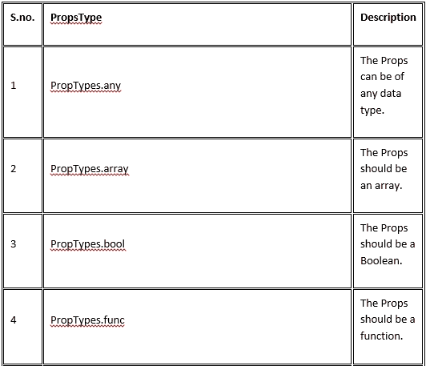
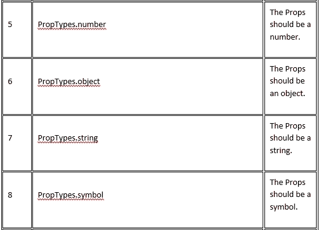
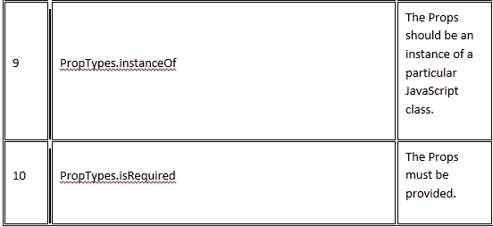

## React 组件 API

这是一个非常高级的 API。它在提高应用代码复用性的同时，使其具有绝对的独特性。它可以以多种方式使用：

* 创建元素。
* 转换元素。
* 碎片 (Fragments)。

现在我们来介绍 React 组件 API 中可以访问的三个最重要的方法：

* `findDOMNode()`
* `setState()`
* `forceUpdate()`

### findDOMNode()

你必须使用 `ReactDOM` 来操作 DOM。`findDOMNode()` 方法用于定位 DOM 节点。这种方法帮助我们定位或访问底层的 DOM 节点。

### 语法：
`ReactDOM.findDOMNode(component)`

### 示例：
App.js
```javascript
import React, { Component } from 'react';
import ReactDOM from 'react-dom';
class App extends React.Component {
  constructor() {
    super()
    this.findDomNodeHandler1 = this.findDomNodeHandler1.bind(this);
    this.findDomNodeHandler2 = this.findDomNodeHandler2.bind(this);
  };

  findDomNodeHandler1() {
    var div1 = document.getElementById('One');
    ReactDOM.findDOMNode(div1).style.color = 'red';
  }

  findDomNodeHandler2() {
    var div2 = document.getElementById('Two');
    ReactDOM.findDOMNode(div2).style.color = 'blue';
  }

  render() {
    return (
      <div>
        <center>
          <h1>ReactJS 查找 DOM 节点示例</h1>
          <button onClick = {this.findDomNodeHandler1}>按钮 1</button>
          <button onClick = {this.findDomNodeHandler2}>按钮 2</button>
          <h3 id = "One">红色</h3>
          <h3 id = "Two">蓝色</h3>
        </center>
      </div>
    )
  }
}
export default App;
```

### setState()

该方法用于更新组件的状态（state)。它并不是即时更改状态，而是修改现有的状态。它是响应事件处理程序和服务器响应以修改用户界面 (UI) 的主要技术。

### 语法：
`this.setState(object newState[, function callback])`

### 示例：
App.js
```javascript
import React, { Component } from 'react';
import PropTypes from 'prop-types';
class App extends React.Component {
  constructor() {
    super();
    this.state = {
      data: "!!!! Hello World !!!!"
    }
    this.updateSetState = this.updateSetState.bind(this);
  }

  updateSetState() {
    this.setState({
      data:"欢迎来到教程示例"
    });
  }

  render() {
    return (
      <div>
        <center>
          <h1>{this.state.data}</h1> <button onClick = {this.updateSetState}>设置状态</button>
        </center>
      </div>   
    )
  }
}   
export default App
```

Main.js
```javascript
import React from 'react';
import ReactDOM from 'react-dom';
import App from './App.js';
ReactDOM.render(<App/>, document.getElementById('app'));
```

### forceUpdate()

该方法允许手动更新组件。

### 语法：
`Component.forceUpdate(callback)`

### 示例：
App.js
```javascript
import React, { Component } from 'react';
class App extends React.Component {
  constructor() {
    super()
    this.forceUpdateState = this.forceUpdateState.bind(this);
  }

  forceUpdateState() {
    this.forceUpdate();
  }

  render() {
    return (
      <div>
        <center>
          <h1>强制更新示例</h1>
          <h2>随机数字示例</h2>
          <h3 onClick = {this.forceUpdateState}>强制更新</h3>
        </center>
      </div>
    );
  }
}
export default App;
```

## 组件生命周期

每个组件都有自己的生命周期。组件的生命周期分为四个阶段：

* 初始阶段 (Initial Phase)
* 挂载阶段 (Mounting Phase)
* 更新阶段 (Updating Phase)
* 卸载阶段 (Unmounting Phase)

生命周期的每个阶段都有自己的一组方法。让我们来看这些方法：

## 初始化阶段

ReactJS 的诞生步骤。这些方法包括：

* `getDefaultProps()` - 在组件创建之前调用。
* `getInitialState()` - 在这里设置初始状态。

## 挂载阶段

在此阶段，组件实例被创建并添加到 DOM 中。这些方法有：

* `componentWillMount()` - 在组件渲染到 DOM 之前调用。
* `componentDidMount()` - 在组件渲染并放置到 DOM 之后立即调用。
* `render()` - 负责返回根 HTML 元素。

## 更新阶段

该阶段与诞生或死亡阶段不同会不断重复。它包含：

* `componentWillReceiveProps()` - 当组件接收新 props 时。
* `shouldComponentUpdate()` - 它允许你控制组件的行为。
* `componentWillUpdate()` - 在组件更新发生之前的调用。
* `render()` - 检查 `this.props` 和 `this.state`。
* `componentDidUpdate()` - 在组件更新后立即调用。

## 卸载阶段


React 组件的生命周期在此阶段结束。当组件实例被销毁并从 DOM 中卸载时，会调用此函数。此阶段仅包含一个方法，列如下：

- `componentWillUnmount()`

在组件被永久删除和卸载之前，会调用此过程。它会执行任何必要的清理操作，例如失效定时器、移除事件监听器、取消网络请求以及清理 DOM 元素。一旦组件实例被卸载，将无法重新挂载该实例。

### 示例

```javascript
import React, {Component} from 'react';

class App extends React.Component {
  constructor(props) {
    super(props);
    this.state = { world: "World" };
    this.changeState = this.changeState.bind(this);
  }
  render() {
    return (
      <center>
        <div>
          <h1>Example of ReactJS componentsLifecycle</h1>
          <h3>Hello{this.state.world}</h3>
          <button onClick={this.changeState}>ClickHere!</button>
        </div>
      </center>
    );
  }
  componentWillMount() {
    console.log('ComponentWillMOUNT!')
  }
  componentDidMount() {
    console.log('ComponentDidMOUNT!')
  }
  changeState() {
    this.setState({ world: "All!!-ItsanexampleofReactJScomponentLifecycle." });
  }
  componentWillReceiveProps(newProps) {
    console.log('ComponentWillRecieveProps!')
  }
  shouldComponentUpdate(newProps, newState) {
    return true;
  }
  componentWillUpdate(nextProps, nextState) {
    console.log('ComponentWillUPDATE!');
  }
  componentDidUpdate(prevProps, prevState) {
    console.log('ComponentDidUPDATE!')
  }
  componentWillUnmount() {
    console.log('ComponentWillUNMOUNT!')
  }
}
export default App;
```

## React 构造函数

### 什么是构造函数？

函数 `Object() { [native code] }` 是用于初始化类对象状态的方法。它在类中的对象创建时被自动调用。

函数 `Object() { [native code] }` 的概念在 React 中也是一样的。React 组件的函数 `Object() { [native code] }` 在组件挂载之前被调用。

在编写 React 组件的函数 `Object() { [native code] }` 时，必须在任何其他行之前调用 `super(pros)` 函数。如果没有调用 `super(pros)`，在函数 `Object() { [native code] }` 中 `this.props` 将是 `undefined`，这可能会导致错误。

### 语法

```javascript
Constructor(props) {
  super(props);
}
```

构造函数在 React 中主要有两个用途：

1. 通过给 `this.state` 赋值一个对象，初始化组件的本地状态。
2. 用于绑定组件拥有的事件处理函数。

如果你不需要为 React 组件初始化状态或为其绑定方法，则没有必要为 React 组件构建 `Object() { [native code] }`。

函数 `Object() { [native code] }` 不能直接调用 `setState()` 函数。如果组件需要本地状态，你必须在函数 `Object() { [native code] }` 中使用 `this.state` 分配初始状态。单独的函数 `Object() { [native code] }` 使用 `this.state` 分配初始状态，而所有其他方法都需要使用 `set.state()` 方法。

### 示例：

以下示例演示了构造函数的概念：

**App.js**
```javascript
import React, { Component } from 'react';

class App extends Component {
  constructor(props) {
    super(props);
    this.state = {
      data: 'Hello World'
    }
    this.handleEvent = this.handleEvent.bind(this);
  }
  handleEvent() {
    console.log(this.props);
  }
  render() {
    return (
      <div className="App">
        <center>
          <h2>Example of React Constructor</h2>
          <input type ="text" value={this.state.data}/>
          <br/><br/>
          <button onClick={this.handleEvent}>Please Click</button>
        </center>
      </div>
    );
  }
}
export default App;
```

**Main.js**
```javascript
import React from 'react';
import ReactDOM from 'react-dom';
import App from './App.js';
ReactDOM.render(<App />, document.getElementById('app'));
```

## 箭头函数

这是 ES6 规范中的一项新特性。在使用箭头函数时，不需要将任何事件绑定到 `this`，也没有必要在函数 `Object() { [native code] }` 内部绑定 `this`。

### 示例：

```javascript
import React, {Component} from 'react';

class App extends Component {
  constructor(props) {
    super(props);
    this.state = {
      data: 'HelloWorld'
    }
    this.handleEvent = this.handleEvent.bind(this);
  }
  handleEvent = () => {
    console.log(this.props);
  }
  render() {
    return (
      <div className="App">
        <center>
          <h2>Example of React Constructor</h2>
          <input type ="text" value={this.state.data}/>
          <br/><br/>
          <button onClick={this.handleEvent}>Please Click</button>
        </center>
      </div>
    );
  }
}
export default App;
```

# JAVASCRIPT 练习题与面试

### 将每个单词的首字母大写

```javascript
function capital_letter(str) {
  str = str.split(" ");
  for (var i = 0, x = str.length; i < x; i++) {
    str[i] = str[i][0].toUpperCase() + str[i].substr(1);
  }
  return str.join(" ");
}
```

### 小时分钟

```javascript
function time_convert(num) {
  var hours = Math.floor(num / 60);
  var minutes = num % 60;
  return hours + ":" + minutes;
}
console.log(time_convert(7));
console.log(time_convert(450));
console.log(time_convert(144));
// 输出：
// 0:7
// 7:30
// 2:24
```

### 计数元音

```javascript
function vowel_Count(str) {
  return str.replace(/[^aeiou]/g, "").length;
}
console.log(vowel_Count("Python"));
console.log(vowel_Count("html.com"));
// 输出：
// 1
// 5
```

### 创建新字符串

```javascript
function without_first_end(str) {
  return str.substring(1, str.length - 1);
}
console.log(without_first_end('JavaScript'));
console.log(without_first_end('JS'));
console.log(without_first_end('PHP'));
// 输出：
// avaScrip
// J
// H
```

### 拼接两个字符串（排除第一个字符）

```javascript
function concatenate(str1, str2) {
  str1 = str1.substring(1, str1.length);
  str2 = str2.substring(1, str2.length);
  return str1 + str2;
}
console.log(concatenate("PHP","JS"));
console.log(concatenate("A","B"));
console.log(concatenate("AA","BB"));
// 输出：
// HPS
// AB
// AB
```

### 第一个未重复的字符

```javascript
function find_FirstNotRepeatedChar(str) {
  var arra1 = str.split('');
  var result = '';
  var ctr = 0;
  for (var x = 0; x < arra1.length; x++) {
    ctr = 0;
    for (var y = 0; y < arra1.length; y++) {
      if (arra1[x] === arra1[y]) {
        ctr += 1;
      }
    }
    if (ctr < 2) {
      result = arra1[x];
      break;
    }
  }
  return result;
}
```


```javascript
console.log(find_FirstNotRepeatedChar('abacddbec'));
```
OUTPUT
```
e
```

## 查找字符串中最长的单词

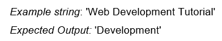

### HTML 代码
```html
<!DOCTYPE html>
<html>
<head>
<meta charset=utf-8 />
<title>查找字符串中最长的单词</title>
</head>
<body>
</body>
</html>
```

### JAVASCRIPT 代码
```javascript
function find_longest_word(str)
{
  var array1 = str.match(/\w[a-z]{0,}/gi);
  var result = array1[0];
  for(var x = 1 ; x < array1.length ; x++)
  {
    if(result.length < array1[x].length)
    {
      result = array1[x];
    }
  }
  return result;
}
console.log(find_longest_word('Web Development Tutorial'));
```
OUTPUT
```
Development
```

## 统计字符串中元音的数量

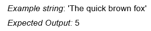

### HTML 代码
```html
<!DOCTYPE html>
<html>
<head>
<meta charset=utf-8 />
<title>统计字符串中元音的数量</title>
</head>
<body>
</body>
</html>
```

### JAVASCRIPT 代码
```javascript
function vowel_count(str1)
{
  var vowel_list = 'aeiouAEIOU';
  var vcount = 0;
  for(var x = 0; x < str1.length ; x++)
  {
    if (vowel_list.indexOf(str1[x]) !== -1)
    {
      vcount += 1;
    }
  }
  return vcount;
}
console.log(vowel_count("The quick brown fox"));
```
OUTPUT
```
5
```

## 检查数字是否为质数

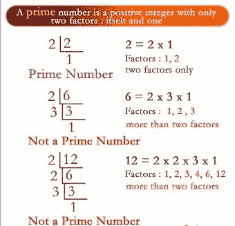

### HTML 代码
```html
<!DOCTYPE html>
<html>
<head>
<meta charset=utf-8 />
<title>检查数字是否为质数</title>
</head>
<body>
</body>
</html>
```

### JAVASCRIPT 代码
```javascript
function test_prime(n)
{
  if (n===1)
  {
    return false;
  }
  else if(n === 2)
  {
    return true;
  }else
  {
    for(var x = 2; x < n; x++)
    {
      if(n % x === 0)
      {
        return false;
      }
    }
    return true; 
  }
}
console.log(test_prime(37));
```
OUTPUT
```
True
```

## JavaScript: 获取数据类型

### HTML 代码
```html
<!DOCTYPE html>
<html>
<head>
<meta charset=utf-8 />
<title>检测 JavaScript 数据类型</title>
</head>
<body>
</body>
</html>
```

### JAVASCRIPT 代码
```javascript
function detect_data_type(value)
{
var dtypes = [Function, RegExp, Number, String, Boolean, Object], x, len;
if (typeof value === "object" || typeof value === "function")
    {
    for (x = 0, len = dtypes.length; x < len; x++)
    {
          if (value instanceof dtypes[x])
          {
              return dtypes[x];
          }
    }
    }
    return typeof value;
}
console.log(detect_data_type(12));
console.log(detect_data_type('w3resource'));
console.log(detect_data_type(false));
```
OUTPUT
```
number
string
Boolean
```

## 从数组中找出第二小和第二大的数字

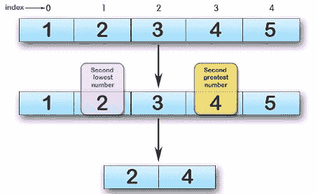

### HTML 代码
```html
<!DOCTYPE html>
<html>
<head>
<meta charset=utf-8 />
<title>从数组中找出第二小和第二大的数字</title>
</head>
<body>
</body>
</html>
```

### JAVASCRIPT 代码
```javascript
function Second_Greatest_Lowest(arr_num)
{
  arr_num.sort(function(x,y)
              {
              return x-y;
              });
  var uniqa = [arr_num[0]];
  var result = [];
  for(var j=1; j < arr_num.length; j++)
  {
    if(arr_num[j-1] !== arr_num[j])
    {
      uniqa.push(arr_num[j]);
    }
  }
    result.push(uniqa[1],uniqa[uniqa.length-2]);
  return result.join(',');
  }
console.log(Second_Greatest_Lowest([1,2,3,4,5]));
```
OUTPUT
```
2,4
```

## 相加两位正整数的两个数字之和

### HTML 代码
```html
<!DOCTYPE html>
<html>
<head>
<meta charset=utf-8 />
<meta name="viewport" content="width-device">
<title>加上两位正整数的两个数字之和</title>
</head>
<body>
</body>
</html>
```

### JAVASCRIPT 代码
```javascript
function add_two_digits(n)
{
  return n % 10 + Math.floor(n / 10);
}
console.log(add_two_digits(25));
console.log(add_two_digits(50));
```
OUTPUT
```
7
5
```

## 闰年检查

### HTML 代码
```html
<!DOCTYPE html>
<html>
<head>
<meta charset=utf-8 />
<title>闰年</title>
</head>
<body>
</body>
</html>
```

### JAVASCRIPT 代码
```javascript
function leapyear(year)
{
return (year % 100 === 0) ? (year % 400 === 0) : (year % 4 === 0);
}
console.log(leapyear(2016));
console.log(leapyear(2000));
console.log(leapyear(1700));
console.log(leapyear(1800));
```
OUTPUT
```
true
true
false
false
```

## 检查给定的正数


### HTML 代码
```html
<!DOCTYPE html>
<html>
<head>
<meta charset="utf-8">
<meta name="viewport" content="width-device">
<title>检查给定的正数是否为 3 的倍数或 7 的倍数</title>
</head>
<body>
</body>
</html>
```

### JAVASCRIPT 代码
```javascript
function test37(x)
{
  if (x % 3 == 0 || x % 7 == 0)
  {
    return true;
  }
  else {
    return false;
  }
}
console.log(test37(12));
console.log(test37(14));
console.log(test37(10));
console.log(test37(11));
```
OUTPUT
```
true
true
false
false
```

## 以 'Java' 开头 - 否则 false

### HTML 代码
```html
<!DOCTYPE html>
<html>
<head>
<meta charset="utf-8">
<meta name="viewport" content="width-device">

<title>检查字符串是否以 'Java' 开头，否则返回 false</title>
</head>
<body>
</body>
</html>
```

### JAVASCRIPT 代码
```javascript
function start_spec_str(str)
{
  if (str.length < 4)
  {
    return false;
  }
  front = str.substring(0, 4);
  if (front == 'Java')
  {
    return true;
  }
  else
  {
    return false;
  }
}
console.log(start_spec_str("JavaScript"));
console.log(start_spec_str("Java"));
console.log(start_spec_str("Python"));
```
OUTPUT
```
true
true
false
```

## 两个给定的整数 - 检查


### HTML 代码
```html
<!DOCTYPE html>
<html>
<head>
<meta charset="utf-8">
<meta name="viewport" content="width-device">

</head>
<body>
</body>
</html>
```

### JAVASCRIPT 代码
```javascript
function check_numbers(x, y)
{
  if ((x >= 50 && x <= 99) || (y >= 50 && y <= 99))
  {
    return true;
  }
  else {
    return false;
  }
}
console.log(check_numbers(12, 101));
console.log(check_numbers(52, 80));
console.log(check_numbers(15, 99));
```
OUTPUT
```
false
true
true
```

## 查找距离 100 的值

### HTML 代码
```html
<!DOCTYPE html>
<html>
<head>
<meta charset="utf-8">
<meta name="viewport" content="width-device">

</head>
<body>
</body>
</html>
```

### JAVASCRIPT 代码
```javascript
function near_100(x, y)
{
  if (x != y)
  {
    x1 = Math.abs(x - 100);
    y1 = Math.abs(y - 100);
    if (x1 < y1)
    {
      return x;
    }
    if (y1 < x1)
    {
      return y;
    }
    return 0;
  }
  else
    return false;
}
console.log(near_100(90, 89));
console.log(near_100(-90, -89));
console.log(near_100(90, 90));
```
OUTPUT
```
90
-89
false
```

## 正数 - 检查


### HTML 代码
```html
<!DOCTYPE html>
<html>
<head>
<meta charset="utf-8">
<meta name="viewport" content="width-device">

</head>
<body>
</body>
</html>
```

### JAVASCRIPT 代码
```javascript
function test37(x)
{
  if (x % 3 == 0 || x % 7 == 0)
  {
    return true;
  }
  else {
    return false;
  }
}
console.log(test37(12));
console.log(test37(14));
console.log(test37(10));
console.log(test37(11));
```
OUTPUT
```
true
true
false
false
```

## 两个数字的乘法和除法

### HTML 代码
```html
<!DOCTYPE html>
<html>
<head>
<meta charset=utf-8 />

<style type="text/css">
body {margin: 30px;}
</style>
</head>
<body>
<form>

1 Number : <input type="text" id="firstNumber" />
```


第二个个数字：<input type="text" id="secondNumber" /><br>

<input type="button" onClick="multiplyBy()" Value="Multiply" />

<input type="button" onClick="divideBy()" Value="Divide" />

</form>

<p>结果为：<br>

<span id = "result"></span>

</p>

</</body>

</html>

### JAVASCRIPT 代码

```javascript
function multiplyBy()
{
    num1 = document.getElementById("firstNumber").value;
    num2 = document.getElementById("secondNumber").value;
    document.getElementById("result").innerHTML = num1 * num2;
}

function divideBy()
{
    num1 = document.getElementById("firstNumber").value;
    num2 = document.getElementById("secondNumber").value;
    document.getElementById("result").innerHTML = num1 / num2;
}
```

### 输出


## 转换温度


### HTML 代码

```html
<!DOCTYPE html>
<html
  <head>
  <meta charset="utf-8">
  <title>编写一个 JavaScript 程序将温度在摄氏度和华氏度之间转换</title>
  </head>
  <body>
</</body>>
</html>
```

### JAVASCRIPT 代码

```javascript
function cToF(celsius)
{
  var cTemp = celsius;
  var cToFahr = cTemp * 9 / 5 + 32;
  var message = cTemp+'\xB0C is ' + cToFahr + ' \xB0F.';
  console.log(message);
}

function fToC(fahrenheit)
{
  var fTemp = fahrenheit;
  var fToCel = (fTemp - 32) * 5 / 9;
  var message = fTemp+'\xB0F is ' + fToCel + '\xB0C.';
  console.log(message);
}
cToF(60);
fToC(45);
```

### 输出

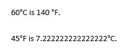

### 我们的其他出版物

#### TAM SEL

- [初学者 Apache Spark 和 Scala：二本书合一 - 快速学习编程！](https://www.amazon.com/APACHE-SPARK-SCALA-BEGINNERS-QuickStart-ebook/dp/B084SGW51Y/ref=sr_1_1?dchild=1&keywords=APACHE+SPARK+AND+SCALA+FOR+BEGINNERS%3A+2+BOOKS+IN+1+-+Learn+Coding+Fast%21&qid=1627653411&s=digital-text&sr=1-1)
- [Python 和 JavaScript 编程基础：适合绝对初学者](https://www.amazon.com/PYTHON-JAVASCRIPT-CODING-BASICS-BEGINNERS-ebook/dp/B09756TC9M/ref=sr_1_1?dchild=1&keywords=PYTHON+AND+JAVASCRIPT+CODING+BASICS%3A+FOR+ABSOLUTE+BEGINNERS&qid=1627653589&s=digital-text&sr=1-1)
- [初学者 Laravel：快速学习编程](https://www.amazon.com/LARAVEL-BEGINNERS-Framework-Hands-Beginners-ebook/dp/B08779PRGD/ref=sr_1_1?dchild=1&keywords=LARAVEL+FOR+BEGINNERS%3A+Learn+Coding+Fast%3A&qid=1627653650&s=digital-text&sr=1-1)
- [初学者 HTML：HTML CSS 编程语言速成，易步骤网页设计快速上手教程书 - 快速学习编程](https://www.amazon.com/HTML-BEGINNERS-Programming-Language-Tutorial-ebook/dp/B07SBFC4TG/ref=sr_1_1?dchild=1&keywords=HTML+FOR+BEGINNERS%3A+Html+CSS+Programming+Language+Crash+Course%2C+Web+Design+Quick+Start+Script+Tutorial+Book+in+Easy+Steps+-+LEARN+TO+CODE+FAST&qid=1627653769&s=digital-text&sr=1-1)
- [Dart 编程基础：适合绝对初学者](https://www.amazon.com/DART-PROGRAMMING-BASICS-ABSOLUTE-BEGINNERS-ebook/dp/B08ZHVYV2L/ref=sr_1_1?dchild=1&keywords=DART+PROGRAMMING+BASICS%3A+FOR+ABSOLUTE+BEGINNERS&qid=1627653907&s=digital-text&sr=1-1)
- [初学者 Rust 和 Go：二本书合一 - 快速学习编程！Rust 和 Go](https://www.amazon.com/RUST-GOLANG-BEGINNERS-QuickStart-Tutorial-ebook/dp/B085417F/ref=sr_1_1?dchild=1&keywords=RUST+AND+GOLANG+FOR+BEGINNERS%3A+2+BOOKS+IN+1+-+Learn+Coding+Fast&qid=1627653411&s=digital-text&sr=1-1)
- [初学者 Apache Spark 和 Hadoop：二本书合一 - 快速学习编程](https://www.amazon.com/APACHE-SPARK-HADOOP-BEGINNERS-QuickStart-ebook/dp/B083VCKQ/ref=sr_1_1?dchild=1&keywords=APACHE+SPARK+HADOOP+FOR+BEGINNERS%3A+2+BOOKS+IN+1+-+Learn+Coding+Fast&qid=1627653411&s=digital-text&sr=1-1)
- [初学者 TensorFlow：快速学习](https://www.amazon.com/TensorFlow-Beginners-Framework-Hands-ebook/dp/B0872GS1/ref=sr_1_1?dchild=1&keywords=TensorFlow+For+Beginners&qid=1627653411&s=digital-text&sr=1-1)
- [初学者 Django 和 Python：二本书合一 - 快速学习](https://www.amazon.com/DJANGO-PYTHON-BEGINNERS-QuickStart-ebook/dp/B07Y5VS/ref=sr_1_1?dchild=1&keywords=DJANGO+PYTHON+BEGINNERS%3A+2+BOOKS+IN+1+-+Learn+Coding+Fast&qid=1627653411&s=digital-text&sr=1-1)
- [JavaScript 和 Dart 编程基础：适合绝对初学者](https://www.amazon.com/JAVASCRIPT-DART-CODING-BASICS-BEGINNERS-ebook/dp/B092X7S/ref=sr_1_1?dchild=1&keywords=JAVCRIPT+DART+CODING+BASICS%3A+FOR+ABSOLUTE+BEGINNER&qid=1627653411&s=digital-text&sr=1-1)
- [初学者 TensorFlow 和 Python 编程基础：适合绝对初学者](https://www.amazon.com/TENSORFLOW-BEGINNERS-PYTHON-BASICS-ebook/dp/B08GF3C/ref=sr_1_2?dchild=1&keywords=TENSORFLOW+BEGINNERS+AND+PYTHON+BASICS%3A+FOR+ABSOLUTE+BEGINNERS&qid=1627653411&s=digital-text&sr=1-1)
- [Rust 语言：适合初学者，快速学习！](https://www.amazon.com/RUST-Programming-Language-Beginners-QuickStart-ebook/dp/B07VR2PR/ref=sr_1_2?dchild=1&keywords=RUST+Programming+Language+TAM+SEL&qid=1627653411&s=digital-text&sr=1-1)
- [初学者 Hadoop 和 Python：二本书合一 - 快速学习！](https://www.amazon.com/HADOOP-PYTHON-BEGINNERS-QuickStart-Tutorial-ebook/dp/B082WH5Y/ref=sr_1_1?dchild=1&keywords=HADOOP+AND+PYTHON+FOR+BEGINNERS%3A+2+BOOKS+IN+1+-+Learn+Coding+Fast%21&qid=1627653411&s=digital-text&sr=1-1)
- [初学者 Selenium 和 Java：二本书合一 - 快速学习！](https://www.amazon.com/SELENIUM-JAVA-BEGINNERS-framework-QuickStart-ebook/dp/B08533D/ref=sr_1_1?dchild=1&keywords=SELENIUM+AND+JAVA+FOR+BEGINNERS%3A+2+BOOKS+IN+1+-+Learn+Coding+Fast%21&qid=1627653411&s=digital-text&sr=1-1)
- [初学者 Android 和 Java：二本书合一 - 快速学习！](https://www.amazon.com/ANDROID-JAVA-BEGINNERS-QuickStart-Tutorial-ebook/dp/B087F5V/ref=sr_1_1?dchild=1&keywords=ANDROID+AND+JAVA+FOR+BEGINNERS%3A+2+BOOKS+IN+1+-+Learn+Coding+Fast%21&qid=1627653411&s=digital-text&sr=1-1)

#### J KING

- [Python 和 Hadoop 基础](https://www.amazon.com/PYTHON-HADOOP-BASICS-PROGRAMMING-QuickStart-ebook/dp/B08CQYV/ref=sr_1_1?dchild=1&keywords=PYTHON+HADOOP+BASICS&qid=1627653589&s=digital-text&sr=1-1)
- [Python 基础和 Python 编程示例](https://www.amazon.com/PYTHON-BASICS-PYTHON-CODING-ebook/dp/B0FL5C/ref=sr_1_1?dchild=1&keywords=PYTHON+BASICS+AND+PYTHON+CODING&qid=1627653589&s=digital-text&sr=1-1)
- [C# 和 C++ 编程示例](https://www.amazon.com/CODING-EXAMPLES-BEGINNERS-ebook/dp/B0NG562/ref=sr_1_1?dchild=1&keywords=C#+AND+C+++CODING&qid=1627653589&s=digital-text&sr=1-1)
- [Python 编程和 C 编程示例](https://www.amazon.com/PYTHON-CODING-C-PROGRAMMING-BEGINNERS-ebook/dp/B0L27P/ref=sr_1_3?dchild=1&keywords=PYTHON+CODING+AND+C+PROGRAMMING&qid=1627653589&s=digital-text&sr=1-1)
- [C++ 和 Java 编程示例](https://www.amazon.com/JAVA-CODING-EXAMPLES-BEGINNERS-ebook/dp/B0P3SVG/ref=sr_1_1?dchild=1&keywords=C+++AND+JAVA+CODING&qid=1627653589&s=digital-text&sr=1-1)
- [Android 基础和 Python 编程示例](https://www.amazon.com/ANDROID-BASICS-PYTHON-CODING-ebook/dp/B9B5DZ/ref/sr_1_3?dchild=1&keywords=ANDROID+BASICS+AND+PYTHON+CODING&qid=1627653589&s=digital-text&sr=1-1)
- [C# 基础和 Python 编程示例](https://www.amazon.com/C#-BASICS-PYTHON-CODING-ebook/dp/B999PM/ref/sr_1_10?dchild=1&keywords=C#+BASICS+AND+PYTHON+CODING&qid=1627653589&s=digital-text&sr=1-1)


- [JAVA 基础与 PYTHON 编码示例](https://www.amazon.com/JAVA-BASICS-PYTHON-CODING-EXAMPLES-ebook/dp/B098LVH4GK/ref=sr_1_21?dchild=1&qid=1627630555&refinements=p_27%3AJ+KING&s=digital-text&sr=1-21&text=J+KING)
- [PYTHON 基础与 C# 编码示例](https://www.amazon.com/PYTHON-BASICS-CODING-EXAMPLES-PROGRAMMING-ebook/dp/B098FMBC9Z/ref=sr_1_20?dchild=1&qid=1627630555&refinements=p_27%3AJ+KING&s=digital-text&sr=1-20&text=J+KING)
- [ANDROID 基础与 JAVA 编码示例](https://www.amazon.com/ANDROID-BASICS-JAVA-CODING-EXAMPLES-ebook/dp/B098PKHZD3/ref=sr_1_24?dchild=1&qid=1627630555&refinements=p_27%3AJ+KING&s=digital-text&sr=1-24&text=J+KING)
- [C# 基础与 C# 编码示例](https://www.amazon.com/BASICS-CODING-EXAMPLES-PROGRAMMING-QuickStart-ebook/dp/B08GZL6NW6/ref=sr_1_6?dchild=1&keywords=C%23+BASICS+AND+C%23+CODING+EXAMPLES&qid=1627631068&s=digital-text&sr=1-6)
- JAVASCRIPT 与 HTML 基础
- [HTML AND JAVASCRIPT 编码示例](https://www.amazon.com/HTML-JAVASCRIPT-CODING-EXAMPLES-PROGRAMMING-ebook/dp/B08STNKT5M/ref=sr_1_1?dchild=1&keywords=HTML+AND+JAVASCRIPT+CODING+EXAMPLES&qid=1627631214&s=digital-text&sr=1-1)
