# SAP UI5 入门指南：全新的企业级 JavaScript 框架示例


## 免费礼物券

或

[点击此处](url)

## 您可能还对以下内容感兴趣

SAP® Netweaver Gateway：学习如何为 UI5 和 ABAP 项目使用 SAP® Netweaver Gateway

物联网与 SAP HANA：使用 Raspberry PI、Arduino Uno、HANA XSJS 和 SAPUI5 构建您的物联网用例

7 个简单步骤实现数据可视化

轻松学习 D3.js


# 1. 引言

SAPUI5 是一个用于为现代 Web 业务应用程序开发丰富用户界面的平台。它得到了支持 Web 应用程序中 HTML5 功能的浏览器的支持。使用 SAPUI5 构建的应用程序具有跨浏览器和设备的响应性 - 它们可在智能手机、平板电脑和支持 HTML5 的台式机上运行。这种响应性由 UI 控件提供，这些控件会根据设备类型自动调整。

## 1.1 前提条件

开始学习 UI5 所需的技能集是 HTML5、CSS3、JavaScript、jQuery 和 OData。即使您不了解其中任何一项技能，由于大多数技术都易于学习，在一段时间内掌握它们并不困难。
下图展示了开始使用 UI5 工作需要在这些技术上达到的熟练程度。

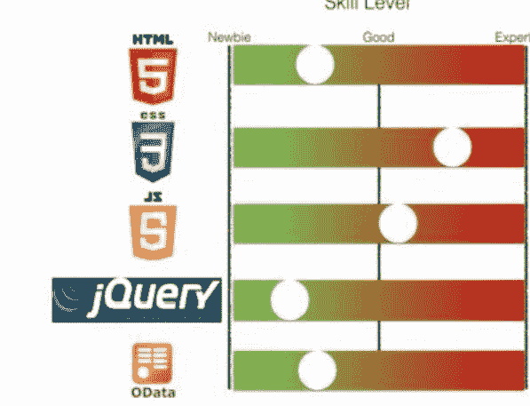

您也可以查看我们的 SAPUI5 专业开发视频课程以加速学习：[点击此处](https://example.com)或使用下方二维码。

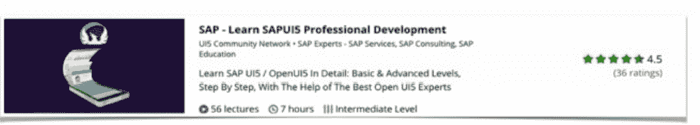


# 2. SAP UI5 基础

让我们从 UI5 库开始。如果您想在使用 ‘SAPUI5’ 的企业项目中工作，那么您必须非常了解 ‘UI5 库’。

## UI5 库

在开始 SAP UI5 开发之前，您需要了解 UI5 库，以便知道‘如何使用它们’以及‘何时使用它们’。市场上存在两种不同的 UI5 库：

- Open UI5（使用 Apache 2 许可证）
- SAPUI5（使用 SAP 许可证）

OpenUI5 是免费的，您无需获得 SAP 的任何许可即可使用它。但是，要使用 SAPUI5，您需要拥有现有的 SAP 许可证。

Open UI5 库的当前版本是“版本 1.36.6”（版本频繁更改。由于许多开发人员参与改进库。）


## 浏览器部分

浏览器部分是您可以查看所有组件并了解各个组件行为的地方，当我们应用程序中使用这些组件时。

让我们查看库 [https://openui5.hana.ondemand.com/explored.html](https://openui5.hana.ondemand.com/explored.html)

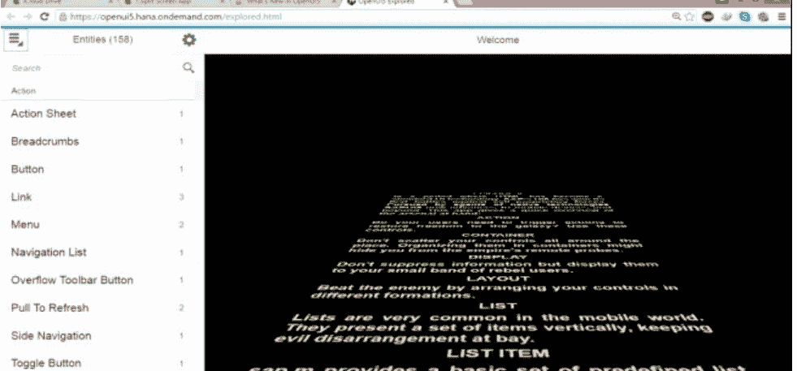

这里我们有一个主详细信息布局，左侧是组件列表，右侧是组件的详细描述以及当您在应用程序中使用这些组件时它将如何表现。在移动设备上，它会自动调整并在同一屏幕上显示主详细信息布局，以提供更好的用户体验。

## 库的设置

当您点击屏幕左侧的设置图标时，您将获得更改组件主题的设置。这里我们有两个主要主题可用。*Blue Crystal 主题*和 *High contrast black*。

## 搜索组件

它还包含一个搜索选项，用于搜索您可以用于 UI5 应用程序的特定组件。例如：如果您想在应用程序中添加列表项，那么您将搜索‘list’关键词以获取包含关键词“list”的过滤结果。
这里，让我们通过点击选择简单列表；您将获得关于该列表的详细信息，例如它属于哪个库（这里它属于“sap.m”，该库从 SAP UI5 的 1.10 版本开始存在）。我们可以在这里看到很多示例，这些都是独立的示例，展示了如何在不同类型的场景中使用此列表项。

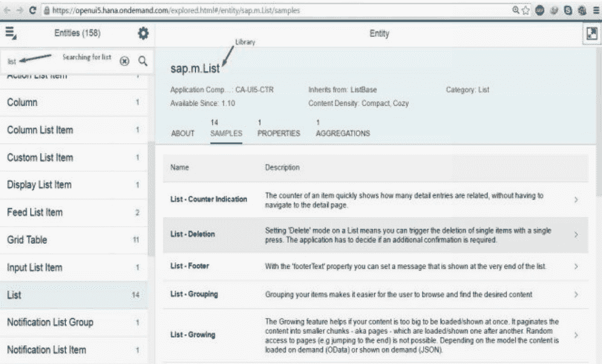

让我们看看第一个“List-Counter Indication”。点击它，您将在右侧获得描述和数字（这里是 Power Projector 4713 类别中的产品数量）。


如果你想查看代码，请点击右上角如图所示的图标：


点击后，你可以看到我们有两个文件：一个XML文件和一个JavaScript文件。这两个文件负责生成我们点击“List-Counter Indication”后看到的内容。这在开发过程中非常有帮助，当你需要添加一些组件并希望快速访问代码时。你也可以通过再次点击来查看代码的行为。

在详细描述页面，你会看到诸如示例、关于、属性和聚合等详细信息。属性和聚合在开发过程中是必需的，例如组件具有的属性以及聚合的类型。这些在你的项目中经常使用。我们将在本课程的组件部分简要讨论它们。

## UI5 与 FIORI

你可能听过的一个流行名称是Fiori。你们许多人可能会有这个问题：什么是FIORI？它与UI5有什么关系？那么，让我们用乐高积木来解释一下。如果UI5是乐高积木，那么FIORI就是成品。SAP FIORI是SAP交付的预构建应用程序，而SAP UI5是创建这些应用程序的构建块。这里主要强调用户体验（UX）。基本上，创建这些应用程序需要遵循五条规则。所有FIORI应用程序都遵循这五条规则，如果你打算构建任何用于消费的应用程序，你也应该遵循这五个关键原则。

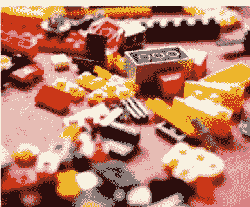

SAP UI5 是构建模块。

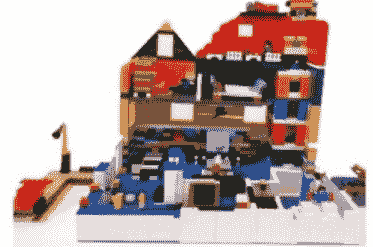

FIORI 是使用 SAP UI5 构建的成品应用程序。

## 五个用户体验关键原则

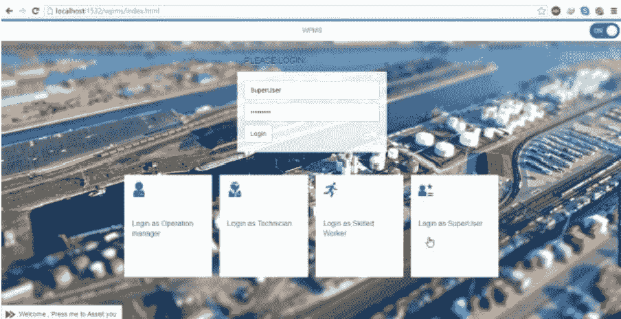

现在，我们将通过一个名为 WPMS（工作许可证管理解决方案）的应用程序来探讨这五个关键原则。让我们看看这五个关键原则是如何映射到一个UI5应用程序中的。

这是一个为本书演示目的创建的示例应用程序。该应用程序是用UI5构建的。我们将看到在创建此应用程序时，这五个用户体验原则是如何被应用的。

### 1. 简单

这是主屏幕，非常简单。它包含一个用户ID、一个密码和一个登录按钮。屏幕左上角还有一个辅助按钮。当你按下辅助按钮时，你会看到磁贴。当你点击任何一个磁贴时，输入字段会自动填充。这样你就可以使用这些凭据登录。登录后，你会看到另一个磁贴屏幕，上面有很多功能和特性。

如果我们以超级用户身份登录，那么总共有七个磁贴。每个磁贴对应一个业务功能。

这将是整个应用程序的一个基本原则，你会注意到导航和应用程序的使用都很简单，用户无需任何用户手册即可使用此应用程序。

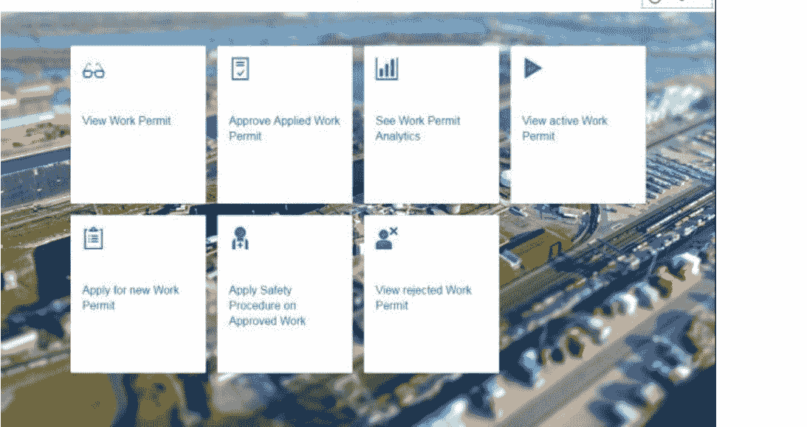

超级用户的主屏幕，包含所有**简单**易用的功能。

### 2. 基于角色

如果我们从超级用户注销，返回主屏幕，然后再次以“技术人员”身份登录，这里你将只看到五个为技术人员提供的功能。这是第二个原则“应用程序应该是基于角色的”。如果你以超级用户登录，你拥有更多功能；如果你以技术人员登录，则只允许看到五个功能。这取决于业务流程。根据你的角色，功能会相应变化。

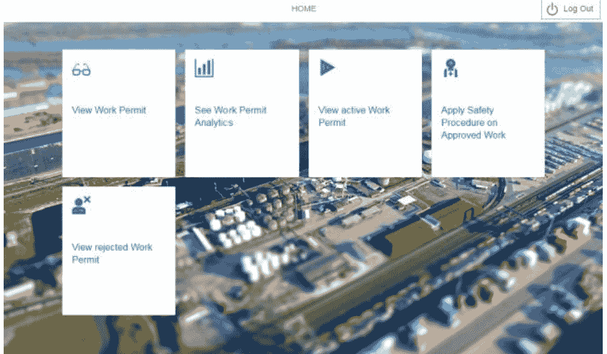

技术人员的主屏幕，仅有5个功能，因此应用程序是**基于角色的**。

### 3. 即时价值与愉悦体验

让我们再次以超级用户身份登录，并选择“查看工作许可证”，以查看所有工作许可证及其右侧的状态。你也可以根据状态筛选工作许可证。只需在右侧的“筛选状态框”中搜索即可。

如果你想查看所有已批准的工作许可证，只需在框中输入“*approve*”，然后屏幕上就会显示所有已批准的工作许可证。你还可以通过点击来查看工单的详细信息。

另一种筛选内容的方法是使用工单编号。你需要在左侧输入工单编号，然后就会得到筛选后的工作许可证。

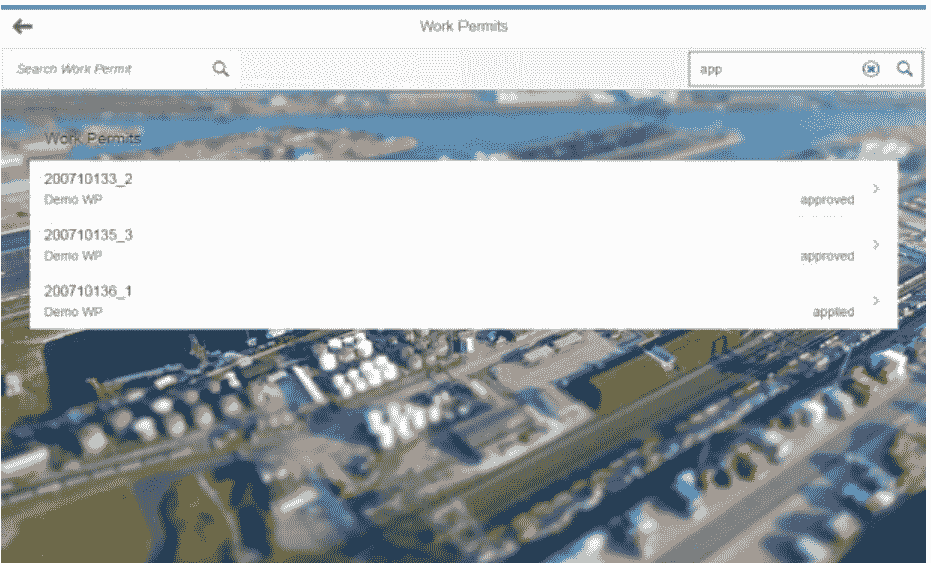

**查看工作许可证分析：**

如果你想概览工作许可证的状态，可以进入分析部分查看分析图表。在这里，你可以看到与工作许可证相对应的工作许可证状态。状态栏根据状态（如已申请、活跃、已批准、已停用和已拒绝）以不同颜色显示。通过分析可视化图，可以轻松看到一个工单对应多个工作许可证及其状态。这带给我们即时且愉悦的体验。

我们可以看到第三个工单“200710135”有多个工作许可证，例如其中两个已经激活，一个已批准，一个已停用，一个已拒绝。

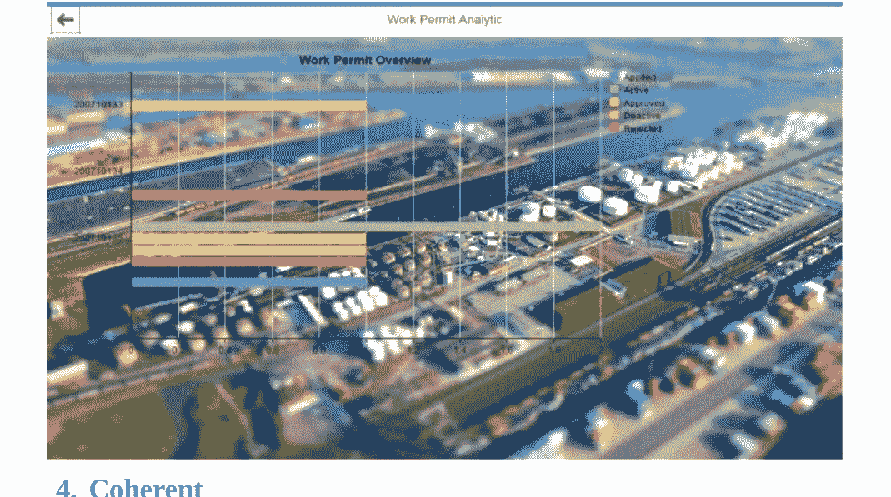

### 4. 一致

应用程序应该保持一致。例如：如果一名运营经理进入应用程序以激活工作许可证，那么该界面的用户界面与查看工作许可证的界面几乎相似。这将给用户带来相似的用户体验，并在使用应用程序时不会产生混淆。

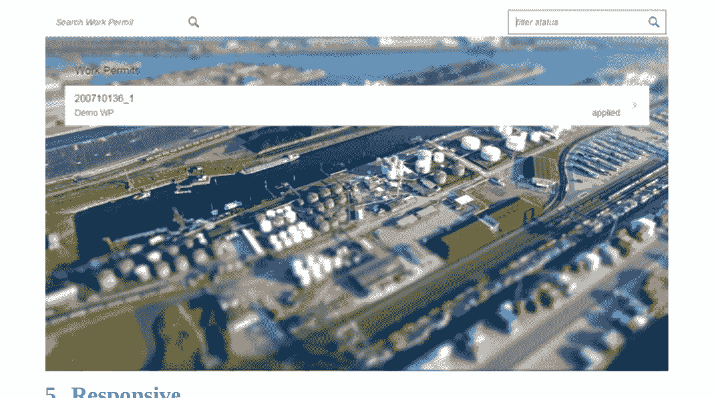

### 5. 响应式

最后一个关键原则是响应式。我们已经知道该应用程序可以支持所有设备。因此，它应该在所有设备（如计算机、平板电脑和智能手机）上都具有响应式设计。我们应该能够在所有这些设备上使用所有功能，如工作许可证、筛选选项、分析等。

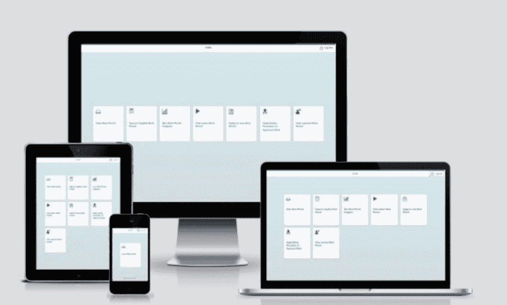

## 搭建开发环境

要搭建开发环境，我们需要下载“Eclipse Luna”，并将UI5仓库添加到其中。

**Eclipse Luna IDE：** Eclipse用于完成整个项目和使用此IDE进行编辑。[https://eclipse.org/downloads/](https://eclipse.org/downloads/)。

访问此链接，你将直接进入下载页面。它会自动检测操作系统。在Windows中，有两个版本可用：32位和64位。要检查这一点，请右键单击桌面上的“我的电脑或此电脑”，选择属性，然后查找你的系统类型。你需要根据你的系统类型进行下载。

**Java：** 运行Eclipse需要Java，你可以从以下地址下载：[https://java.com/en/download/](https://java.com/en/download/)

安装Eclipse后，你需要安装UI5组件。以下是实现此操作的步骤，或者你也可以访问 [https://tools.hana.ondemand.com/#sapui5](https://tools.hana.ondemand.com/#sapui5)：

### 准备开发环境的步骤

1.  安装Eclipse后，打开它并转到帮助。你可以看到“安装新软件”，点击它，你会得到一个新窗口。由于我们使用的是Eclipse Luna，我们应该使用 https://tools.hana.ondemand.com/luna 来获取仓库内容。将此URL粘贴到框中。粘贴URL后，你将能够看到所有可以安装在Eclipse中的组件。

2.  我们专注于UI5。因此从该列表中选择用于HTML5的UI5开发工具包。你还可以选择其他工具，但添加不必要的工具会影响IDE的性能。选择UI组件后，点击下一步。

3.  在下一页，它可能会显示将添加到Eclipse的版本。点击下一步。你必须接受许可协议，然后点击下一步以完成。完成这些步骤后，你的仓库内容将被安装。安装步骤的进度取决于你的互联网连接速度。

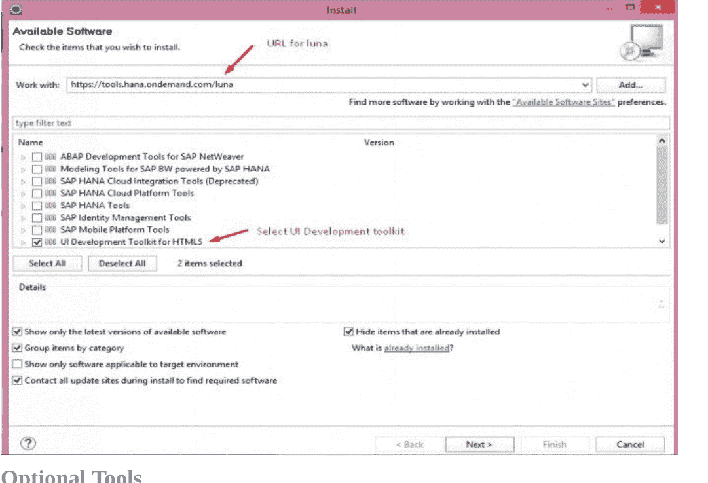

### 可选工具

**Sublime编辑器（可选）：** Sublime编辑器类似于其他编辑器，如Notepad++。Sublime编辑器具有许多用于搜索、替换和编辑的功能。它快速、免费且小巧。

[www.sublimetext.com](http://www.sublimetext.com)

**Cloud9 IDE：** 这是一个基于云的IDE，用于编写代码、编译和随时随地访问。你需要创建一个账户才能使用Cloud9 IDE，而且它是免费的。我们将在Cloud 9 IDE中分享大量代码，并将其用于大量开发。


使用云端IDE的主要优势之一是整个开发环境是预先打包好的。在未来，大部分开发工作将基于云端环境进行，因此熟悉Cloud9将是一个重要的助力。Cloud9 IDE的链接是 https://c9.io/

所有示例文件都在代码库中可用。当你在项目开发中需要快速查阅语法时，它也会很有帮助。该代码库是公开的，你可以访问它并在以下网址中实时预览代码：https://ide.c9.io/ajaytech/demo

## Hello World 应用程序

让我们从使用UI5应用程序进行编码开始。这将是一个hello world应用程序。如果你已经使用过UI5应用程序，你可以直接跳过这一步，因为这将是一个非常基础的Hello World应用程序。

要创建一个新项目，请点击 File -> New -> Other。你可以看到 SAP UI5 Development 选项。如果找不到 SAP UI5，可以使用关键字 UI5 进行搜索。它将过滤结果。现在在屏幕上选择 application project 并点击 next。

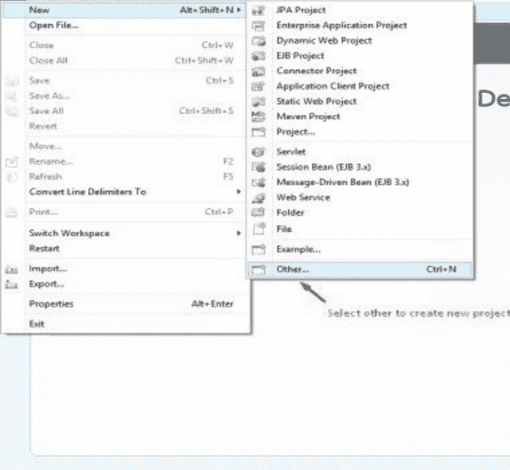

系统会要求你输入项目名称。选择你自己的项目名称。让我们为我们的第一个项目名称选择 myFirstApp_01。项目的位置将默认保存在工作区文件夹中，如果你没有手动更改工作区，那就是 Eclipse 工件所在的位置。

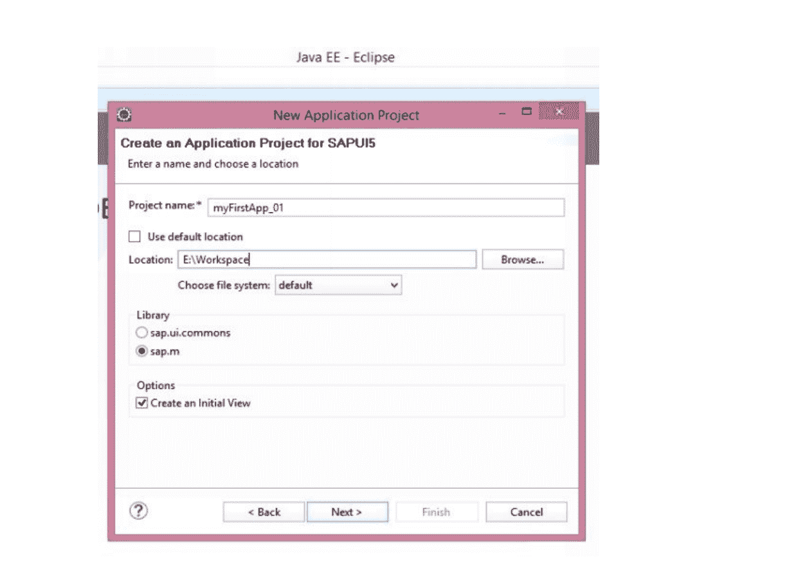

以下是你需要选择的选项，以开始你的第一个项目：

- **库：** 这里有两个库 sap.ui.commons 和 sap.m 库。我们将使用 sap.m。
- **选项：** 它有一个复选框选项。如果你需要默认创建初始视图，那么保持选中状态并点击 next。

在这个页面，我们必须为你的视图控制器对命名。这里我们给它起名为 *demo*。

在下一页，你必须有一个列表来选择你需要哪种类型的视图。你可以选择 JavaScript、XML、JSON 和 HTML 等选项。JavaScript 和 XML 在 UI5 应用程序中很常见，但大多数人发现 JavaScript 更容易使用。当你构建企业应用程序时，你很可能需要大量非开箱即用的定制化功能。因此，使用 Javascript 是获得额外灵活性的理想选择。

在最终屏幕上，它将显示将要添加到应用程序中的所有库，现在点击 finish。它将创建你的应用程序。

现在你已经准备好开始在你的第一个应用程序中进行开发。你可以看到三个标签页 *index.html*、*demo.controller.js*、*demo.view.js*。它们位于名为 *myFirstApp_01* 的文件夹中。这与我们在项目创建向导中提供的项目名称相同。

index.html 文件是行动的中心，是程序执行的起点。我们运行这个文件来启动我们的应用程序。首先，让我们进入 demo.view.js，将页面的标题从 ‘Title’ 改为 ‘Hello World’。

**demo.view.js 代码：**

```javascript
sap.ui.jsview("myFirstApp_01.demo", {

    /**Specifies the Controller belonging to this View. 
    *In the case that it is not implemented, or that "null" is returned, this View does not have a Controller. 
    *@member Of myFirstApp_01. demo 
    */
    getControllerName : function() { 
            return" myFirstApp_01.demo";
    },

    /**Is initially called once after the Controller has been instantiated. It is the place where the UI is constructed. 
    *Since the Controller is given to this method, its event handlers can be attached right away. 
    *@member Of myFirstApp_01.demo 
    */
    createContent : function(oController) { 
            returnnew sap.m.Page({
                    title: "Hello World",
                    content: [

                    ]
            });
    }

});
```

在项目资源管理器标签页中，右键单击 index.html 文件运行代码。将提供两个主要选项 ‘run on server’ 和 ‘Web App Preview’。如果你在 Eclipse 中添加了一些服务器（例如 Tomcat），那么你可以在 Tomcat 上运行应用程序。在当前应用程序中，我们只有 HTML5 和 JavaScript 相关的工件，所以我们也可以选择 Web App Preview。一旦你按下 Web App preview，你就可以在 IDE 中看到结果。恭喜！你已经创建了你的第一个 Hello World 程序。

你也可以复制 URL 并将其粘贴到你的网络浏览器中查看结果。本课程中我们将大量使用 Chrome 浏览器。它是一个非常强大和完整的开发工具包，是前端 UI 开发人员所必需的。

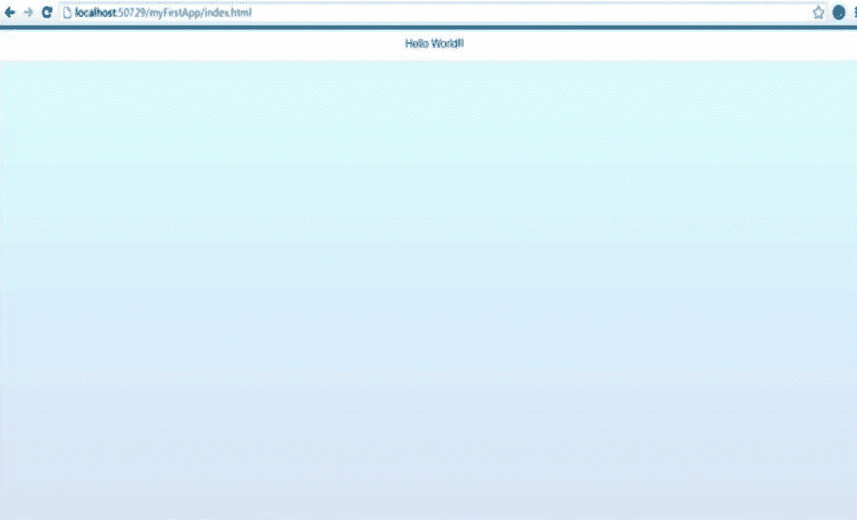

你也可以查看我们的 SAPUI5 专业开发视频课程以加速学习：[这里](here) 或使用下方的二维码。

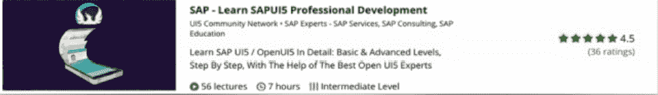


# 3. 线框图和应用控制流的使用

## 创建一个简单的应用程序

现在，在进行代码讲解之前，让我们创建一个简单的应用程序。为了创建一个简单的应用程序，我们需要创建一个线框图。线框图用于为你的设计带来清晰度。移动应用程序或网站应该经历一个所有需求都清晰的阶段。

我们将使用 moqups 来创建线框图。Moqupes(http://moqups.com) 是一个在线创建线框图的工具。它也是一个出色的在线线框绘制工具，在一定限制内可以免费使用。

访问 [www.moqups.com](http://www.moqups.com) 后，它会要求你登录。你也可以使用你的 Google 帐户登录。登录后，创建一个新页面。在这个页面，我们可以使用设计区域左侧的任何组件。

例如，如果你想使用一个输入框，只需将其拖放到右侧。它也有一个移动组件，你可以在组件工具栏下搜索它。我们将它拖到设计区域。现在，如果你想将输入框放在移动电话组件上，右键单击该框并选择 ‘bring it forward’ 选项。这将把输入框放置在移动屏幕上。双击该框并输入一个名称。在这里让我们给它一个标签 ‘Enter Name’。

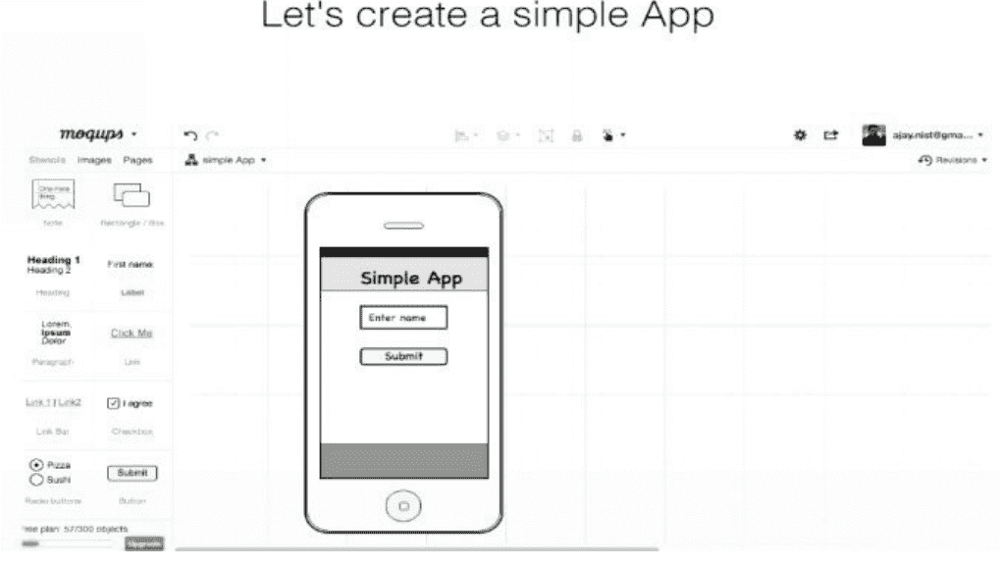

对于这个简单的应用程序，我们将使用一个输入框和一个按钮。让我们在左侧组件下的搜索栏中搜索来添加一个按钮。它将过滤按钮组件。选择按钮并将其拖到移动电话上。双击它并命名为 ‘Submit’。

现在我们需要一个标题标签（标签是文本内容）。在组件搜索栏中搜索标签并将其拖到移动电话屏幕顶部。将标签的名称更改为 'Simple App'。就是这样。这就是我们将在 UI5 中构建的模型。最后，我们有一个标题为 'Simple App'、一个标签为 'Enter name' 的输入框和一个提交按钮的简单应用程序。让我们进入 eclipse 并开始开发应用程序。

# 创建简单应用程序

现在我们在 eclipse 中。我们将创建一个简单的应用程序。第一步是更改标题。为此，我们可以进入视图内部。在这里你可以看到带有 title 属性为 “Hello World” 的代码 *sap.m.page*。现在我们要将 hello world 改为 ‘Simple App’（与我们在线框图中提到的完全一致）。

如果我们回顾一下我们的线框图，现在需要创建一个输入框和一个按钮。为此，我必须通过以下链接进入我的 Open UI5 库
[https://tools.hana.ondemand.com/](https://tools.hana.ondemand.com/)。

在这种情况下，我们需要资源管理器和 API 参考。在不同的标签页中打开两者。我们可以在资源管理器中搜索任何我们将要使用的应用程序组件或元素。我们必须搜索我们现在需要的 ‘Input’ 组件。在左侧标签页提供的框中搜索它。当我们用 sap.m.Input 搜索时，会看到很多结果，我们需要为 sap.m.Input 选择 JSDoc 那一个。这里我们应该首先检查版本，该版本将在 UI5 库的版本中打开。由于我们的 eclipse 版本是 1.34，所以我们可以在我们的项目中使用它。

下一步将是查看它在资源管理器中的示例外观。如果我们去资源管理器中搜索 ‘Input’，会看到许多结果，选择第一个示例 ‘Input – Assisted’，你可以看到输出的样子。要查看源代码，请单击右上角的图标。这将是 XML 视图，我们将得到它；在这里你可以看到用于输入标签的代码。为了我们的目的，我们需要一个带有占位符（‘Enter Name’）的输入，我们可以看到在示例中我们需要使用 ‘text’ 属性。让我们进入我们的 eclipse 并使用 ‘sap.m.input’。

现在我们可以进入 eclipse 中的视图文件，我们将根据我们的项目更改代码。

```javascript
createContent : function(oController) {
    var oSimpleInput = new sap.m.Input({
        placeholder:"Enter Name"
    })
    var oBtn = new sap.m.Button({
        text : ‘Submit’
    })
    var oPage = new sap.m.Page({
        title: “Title”,
        content: [
            oSimpleInput,
            oBtn
        ]
    });
```

return oPage;
}
});
```

在这种情况下，我们可以看到变量名为 oSimpleInput（最好让变量名的开头代表它是什么类型的变量。我们正在为 sap.m.Input 创建一个对象。因此，这里的‘o’表示对象值，如果是数组则用‘a’，如果是整数则用‘i’，以此类推）。因此，这里的 oSimpleInput 是 sap.m.Input 的一个对象。

我们需要传递参数‘placeholder’（最好复制粘贴关键词。因为关键词中的拼写错误是最常见的错误）。在 placeholder 中，根据我们的线框图输入‘Enter name’。

我们还将创建一个变量 oPage，并在函数 *createContent* 的末尾将其返回。我们还将把 oSimpleInput 放入此页面的 content 中。

添加了 input 按钮后，我们继续下一个组件 button。这将遵循与 Input 相同的步骤。搜索组件 button 并选择 button 组件。我们需要通过点击右上角的图标来查看源代码。在这里，我根据线框图的要求查找 button 的属性。我们也可以使用 API Reference 获取 button 的详细信息（这一点我们稍后会介绍）。转到 eclipse 并添加 button 对象，将其属性设置为‘text’并保存文件。

要运行此文件，我们不需要遵循最初完成的步骤。此外，如果您已经打开了网页，请点击‘Reload’。新的结果将会显示。

让我们尝试在 Google chrome 浏览器中运行它，您将看到结果。在这里，您可以看到输入文本框的宽度默认为页面的 100%，提交按钮在左侧。这些是我们在后续部分将看到的一些 CSS 属性和更改。

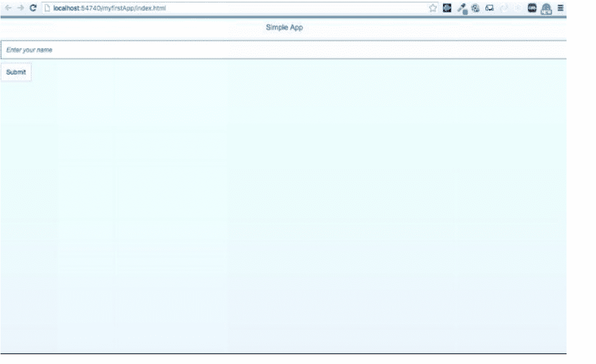

您也可以查看我们的 SAPUI5 专业开发视频课程以加速学习：[这里](https://example.com)或使用下方的二维码。

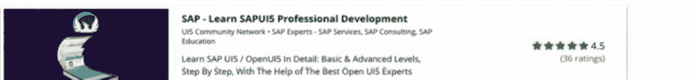


## 4. UI5 应用中的控制流

如果我们查看 UI5 应用程序的控制流，程序执行从 index 文件‘index.html’开始。第一个操作是加载我们的库文件。

```
<script
    src="resources/sap-ui-core.js"
    id="sap-ui-bootstrap"
    data-sap-ui-libs="sap.m"
    data-sap-ui-theme="sap_bluecrystal">
</script>
```

您可以看到这里的“src=‘resources/sap-ui-core.js’”将加载我们 UI5 应用程序的核心库文件。此过程也称为**引导（Bootstrapping）**。在这里，您也可以提及我们应用程序所需的库文件。我们还需要知道的是，在这种情况下，我们的应用程序需要哪些库，这里是‘sap.m’。在这里，您可以看到我们只提及了‘sap.m’，但有时我们可能需要应用程序中某些需要分析的特性。在这种情况下，我们将使用名为‘sap.m,sap.viz’的库。您将在‘sap.m’旁边提及它。同样，还有很多其他库，例如“sap.ui.commons”。我们将在未来的章节中看到这些。

我们在这里将使用的主题是 blue crystal 主题。它是 UI5 应用程序中最常用的主题，也是创建项目时创建的默认主题。未来，我们还将看到创建自己的自定义主题或使用自定义 CSS 的过程。

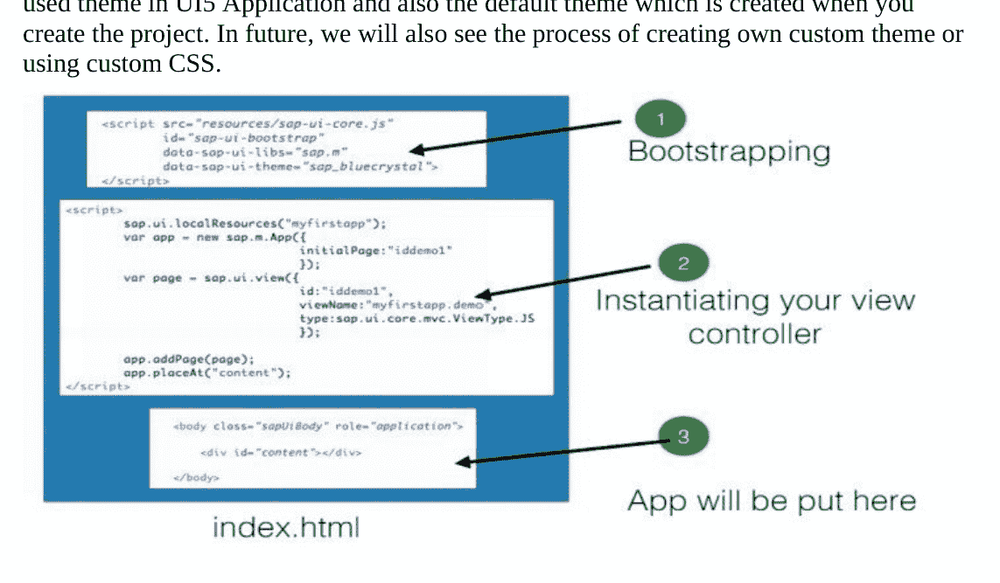

### 实例化您的视图控制器

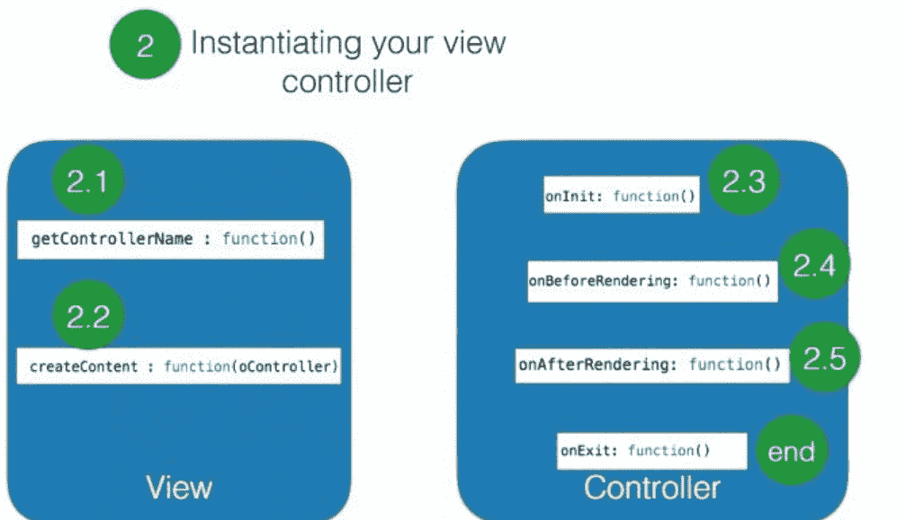

引导之后的下一步是实例化。在这里，您为您的应用程序创建对象，为您的视图控制器创建对象，并将视图添加到您的应用程序中。然后，您将应用程序放置在 content 中。

```
<script>
    console.log("in index page creating app object");
    sap.ui.localResources("myfirstapp_01");
    var app = new sap.m.App({initialPage:"iddemo1"}); // Creating Object for app
    var page = sap.ui.view({id:"iddemo1",
        // Creating object of view controller
        viewName:"myfirstapp_01.demo",
        type:sap.ui.core.mvc.ViewType.JS});
    app.addPage(page); // Adding the view to the page
    app.placeAt("content"); // Placing App at content
</script>
```

您可能会有一个问题，什么是 content？content 实际上是 index 页面中提到的 Div 元素的 ID（<div id="content"></div>）。您的整个应用程序将被放置在其中。

### 实例化您的视图控制器

如果我们查看视图和控制器，它们总是一对一的。您可以有视图而没有控制器。然而，这些是特殊情况。

### getControllerName

在视图中，第一步是执行 *getControllerName*。一旦此视图中的函数被执行，程序将知道控制器的名称。

### createContent

getControllerName 之后，将执行 *createContent* 函数。在 *createContent* 函数的末尾，将返回页面对象。这实际上包含了所有组件，如文本框、输入框，这些我们在 oPage 的 content 部分中提到了。

### onBeforeRendering

在创建页面内容之前，有两个函数将被执行。第一个是 *onInit*。*onInit* 函数在控制器中编写，随后是 *onBeforeRendering*（在页面实际渲染之前。即当所有元素的对象被创建时）。

### onAfterRendering

在 *onBeforeRendering* 之后，执行函数 *onAfterRendering*，它将继续直到我们退出应用程序。

### onExit

在最终函数中，当您退出或关闭应用程序时，将执行 onExit 函数。这就是应用程序的控制流。让我们进入 eclipse 来验证此控制流。

### 验证控制流

我们将在每个默认函数中编写 *console.log*。*Console.log* 是调试器（包括 Chrome Debugger 和 Firefox debugger）提供的一个通用对象/方法，允许脚本将数据记录到 JavaScript 控制台。

首先，我们在 index 文件的 script 中编写 console.log。

```
<script>
    console.log("in index page creating app object");
    sap.ui.localResources("myfirstapp_01");
    var app = new sap.m.App({initialPage:"iddemo1"});
    var page = sap.ui.view({id:"iddemo1", viewName:"myfirstapp_01.demo",
    type:sap.ui.core.mvc.ViewType.JS});
    app.addPage(page);
    app.placeAt("content");
</script>
```

类似地，在视图文件中添加 console.log。

sap.ui.jsview("myfirstapp_01.demo", {

```
/**Specifies the Controller belonging to this View.
 *In the case that it is not implemented, or that "null" is returned, this View does not have a Controller.
 *@memberOf myfirstapp_01.demo
 */
getControllerName : function() {
    console.log("getControllerName");
    return "myfirstapp_01.demo";
},
```

在控制器文件中，在 onInit、onBeforeRendering、onAfterRendering 函数中也编写 console.log。

```
sap.ui.controller("myfirstapp_01.demo", {

/**
 *Called when a controller is instantiated and its View controls (if available) are already created.
 *Can be used to modify the View before it is displayed, to bind event handlers and do other one-time initialization.
 *@memberOf myfirstapp_01.demo
 */
onInit: function() {
    console.log("onInit");
},

/**
 *Similar to onAfterRendering, but this hook is invoked before the controller's View is re-rendered
 *(NOT before the first rendering! onInit() is used for that one!).
 *@memberOf myfirstapp_01.demo
 */
onBeforeRendering: function() {
    console.log("onBeforeRendering");
},

/**
 *Called when the View has been rendered (so its HTML is part of the document). Post-rendering manipulation of the HTML could be done here.
 *This hook is the same one that SAPUI5 controls get after being rendered.
```


/**
 * @memberOf myfirstapp_01.demo
 */
onAfterRendering: function() {
    console.log("onAfterRendering");

},

/**
 * 控制器销毁时调用。用于释放资源和完成活动。
 * @memberOf myfirstapp_01.demo
 */
onExit: function() {
    console.log("onExit");
}
});
```

保存项目并在浏览器中重新加载。在屏幕上任意位置右键单击，选择“检查元素”，然后会打开一个控制台。

现在我们可以根据应用程序的执行，在控制台窗口中查看控制流。您将发现的顺序是：

1. 索引页面
2. getControllerName
3. createContent
4. onInit
5. onBeforeRendering
6. onAfterRendering
7. onExit（如果您关闭应用程序）

由此，我们清楚地了解了应用程序的控制流程是如何工作的。在创建涉及较大组件的大型应用程序时，预测应用程序的结果是至关重要的。

## 扩展应用程序

让我们扩展我们的应用程序，通过添加更多组件将其提升到新的水平。我们已经看过 Simple App 的示例，现在我们将通过在第二页添加一个带有返回按钮和标签的新视图控制器来扩展它。首先，我们将为此构建一个线框图，然后开始开发过程。
在此之前，我们想澄清如何使用 MVC 模式，它是编程语言中最常见的模式之一，而在 UI5 中，其实现方式略有不同。

## 模型视图控制器 (MVC)

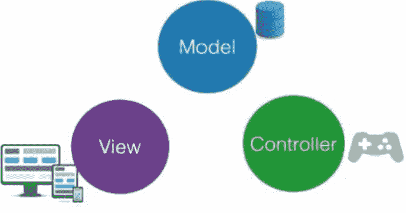

MVC 代表**模型视图控制器**。

## 视图

第一步是查看视图的需求。它可以是线框图，可以是设计蓝图，甚至是用笔和纸绘制的草图。为了通过额外元素扩展此应用程序，我们需要在第二页添加一个返回按钮和标签。

## 控制器

第二件事是这些组件将执行哪些功能。例如，当我们按下返回/导航按钮时会发生什么，或者单击标签时需要执行什么操作？

此外，如果我们在输入字段中输入一些数据并按回车键，它是否应该转到第二页并显示该数据。

## 模型

任何我们在应用程序中输入的内容，或者应用程序从某个来源消耗的内容，都是模型。它们可以来自数据库或 Web 服务。这些就是模型，即应用程序的数据。我们应该了解应用程序涉及哪些数据类型，以及我们如何使用视图控制器来呈现它们。UI5 包含一组很好的库来执行所有这些模型操作。在接下来的部分，我们将详细查看与模型相关的功能。这就是 MVC 模式。让我们构建线框图，构建完成后，我们将进入 Eclipse 中的设计实现。

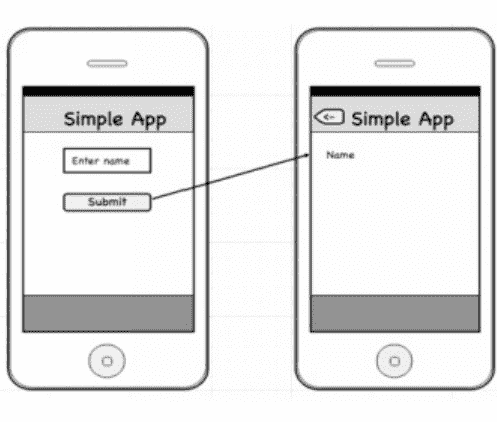

我们已经创建了一个简单的应用程序。现在我们将扩展它。这里我们有一个使用 moqups 构建的线框图。在这个新设计中，我们需要第二个页面。它与第一页类似，因此我们可以直接复制并粘贴整个移动端布局作为第二页。将简单应用重命名为‘second page’，移除输入和提交按钮，因为我们不再需要它们。

现在我们将通过从组件列表中选择来添加一个返回按钮。我们可以将其重命名为带有返回箭头 ‘<-’ 而不是 ‘Back’ 文本。此外，我们需要添加一个标签，因此我们可以从组件中选择标签，将其放置在屏幕上，并重命名为 ‘Name’。

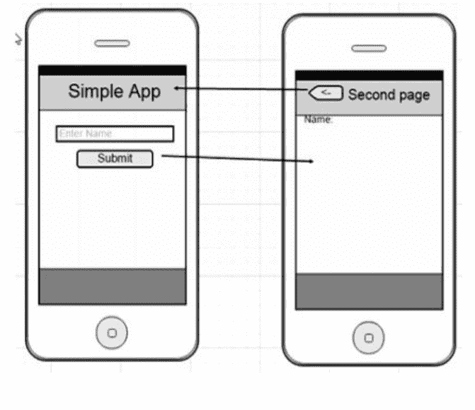

如果您在项目中与多个开发人员合作，那么您可以添加箭头来表示事件。例如，如果我们在第二页单击返回按钮，它将返回到第一页。从 moqupe 中的组件列表中搜索它，并选择适当的箭头来表示事件。这将更加直观，因为事件也在图表中表示出来了。

## 在 Eclipse 中实现

一旦我们完成了线框图，我们就可以进入 Eclipse 并创建一个项目名为 ‘twoPageSimpleApp’ 的新项目。选择库 sap.m 并勾选 ‘create an initial view’。点击下一步，将视图名称设为 ‘first’，然后选择 JavaScript。点击完成，它将为我们构建项目。

现在它将打开我们的第一个视图。我们需要更改 createContent 函数中的某些内容，该函数返回一个 sap.m.Page 对象。创建一个 oPage 对象（这里的 oPage 中的 ‘o’ 表示 object，即对象。这是一种驼峰命名法。驼峰命名法是一种编写复合词或短语的实践，每个单词或缩写都以大写字母开头。例如 iPhone, eCommerce, bigfoot 等）。当您在应用程序中使用某个变量时，最好使用一个前缀来表示它的类型。它可能是整数类型、字符串类型或布尔类型。这里我们的 oPage 对象以 o 开头，表示它是一个对象。现在我们将返回 oPage。

我们可以重新创建在上一节中已经创建的页面。这里我们需要添加输入框和按钮。

`createContent : function(oController) {`

```javascript
var oSimpleInput = new sap.m.Input("idInput",{
    placeholder: "输入您的名字"
});

var oSimpleButton = new sap.m.Button("idButton",{
    text: "提交",
    press:[oController.goToSecondPage,oController]

    /**事件监听器，点击提交后导航到第二页 */
})

var oPage = new sap.m.Page({
    title: "简单应用",
    content: [
        oSimpleInput,
        oSimpleButton
    ]
});

return oPage;       /** 返回 oPage */
}
```

## 控制器函数

在控制器中，我们添加函数 ‘goToSecondPage: function(oEvt)’。添加此函数后，控制器将知道当按钮被按下时该做什么。

### 第二页的视图控制器

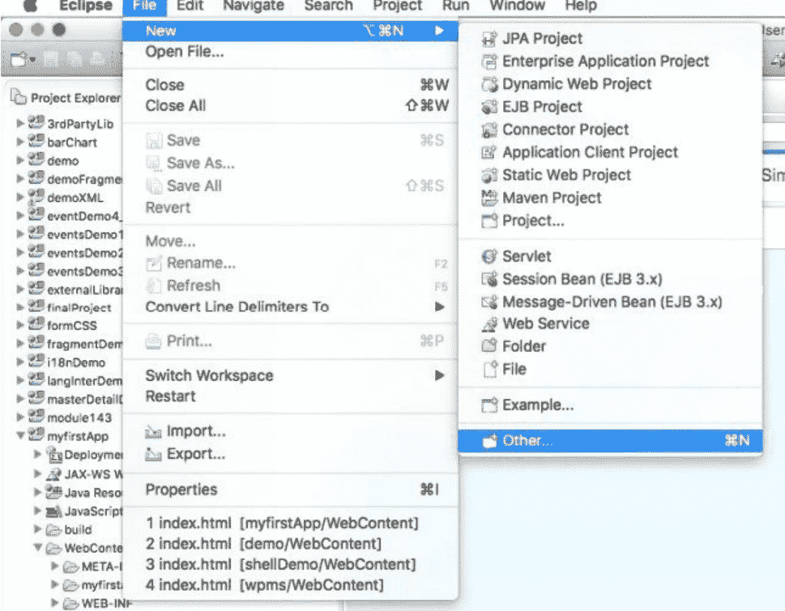

我们需要为第二页创建一个新的视图控制器。为此，我们转到 New -> others，搜索 view，点击 next，并将其命名为 ‘second’。

这将创建第二页。我将页面改为 oPage 而不是直接返回页面本身。这不是强制性的，但当代码开始变得复杂时，它能提供更清晰的理解。然后我们需要添加一个名为 ‘oLabel’ 的新标签并将其分配给 sap.m.Label。此外，我们为标签分配一个 ID。

```javascript
createContent : function(oController) {

    var oLabel = new sap.m.Label("idLabel"); /**添加新标签 */

    var oPage = new sap.m.Page({
        title: "第二页", /**第二页的标题 */
        showNavButton:true, /**它理解我们需要一个导航按钮 */
        navButtonPress:function(oEvt){app.back();},/**导航按钮按下时执行动作的监听器 */
        content: [
            oLabel
        ]
    });
    return oPage;
}
```

现在我们需要实例化第二页。在索引文件中，我们只有一个页面，并且默认情况下，当我们创建应用程序时，实例化页面的代码已经添加在那里。这里我们可以使用第一页实例化的语法（它是项目自动生成的），并按照如下所示更改名称：

```javascript
var page1 = sap.ui.view({id:"idfirst1", viewName:"twopagesimpleapp.first", type:sap.ui.core.mvc.ViewType.JS});/**第一页的实例化 */
var page2 = sap.ui.view({id:"idSecond1", viewName:"twopagesimpleapp.second", type:sap.ui.core.mvc.ViewType.JS});/**第二页的实例化 */
app.addPage(page1); /**添加页面1 */
app.addPage(page2); /**添加页面2 */
```

现在 page2 在应用程序中可用了，但我们如何导航到新页面呢？为了实现这一点，我们将使用它的 id。并使用函数 sap.ui.getCore().byId("idSecond1")，它将返回相应 UI5 元素的对象。

```javascript
goToSecondPage : function(oEvt){

    var oLabel = sap.ui.getCore().byId("idLabel");
    var oInputVal = sap.ui.getCore().byId("idInput").getValue();
    if(oInputVal !== undefined){
        oLabel.setText(oInputVal);

        /* 导航到第二页 */
        app.to("idSecond1");
    }
},
```


一旦我们完成需求，就在 Chrome 中运行该应用程序。在框中输入一些文本并按提交。它没有任何反应。哦不！我们遇到了一个bug。

所以右键单击并检查，打开控制台窗口，你就能看到错误是什么。这里显示 'oLabel.setValue' 不是一个函数。为了修复它，我们将直接在控制台中运行代码，以验证编写的代码是否正确。转到 first.controller 并复制

```
var oLabel = sap.ui.getCore().byId("idLabel");
```

粘贴到控制台并按回车。这里没问题。让我们检查一下 oLabel 是否有名为 'setValue' 的函数。它不在这里，所以检查 'setText' 是否存在。让我们将 'setValue' 更改为 'setText'。这种查找对象是否存在某个函数的方法非常常见，有些人可能称之为试错法，但当你开始使用 UI5 时，记住所有的函数会很困难，而且实际上也没有人会这样做！

现在再次在 Chrome 中运行该应用程序。是的，我们得到了预期的结果。在输入框中输入一些文本并按提交。它跳转到第二个页面，你输入的文本显示在那里的标签中，我们可以导航回第一页。

在接下来的部分中，我们将了解如何处理数据以及如何向你的 UI5 应用程序添加更多组件。

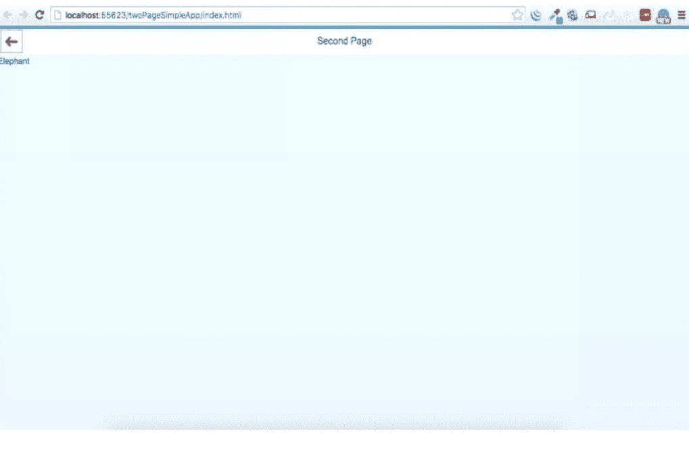

你也可以查看我们的 SAPUI5 专业发展视频课程以加速学习：[这里](https://example.com) 或使用下方二维码。


## SAP - 学习 SAPUI5 专业发展

UI5 社区网络 • SAP 专家 - SAP 服务、SAP 咨询、SAP 教育

在最佳 Open UI5 专家的帮助下，深入学习 SAP UI5 / OpenUI5：基础与高级水平，循序渐进

★★★★★ 4.5（36 条评分）

📹 56 节课 🕒 7 小时 ||| 中级水平


# 5. 常用 UI5 组件和数据绑定

### 创建简单表单

UI5 库中存在许多组件，其中许多在我们的项目中使用非常频繁。在本节中，我们将了解如何使用一些最常见的组件。当你使用这些组件时，你会不断查看 API 参考和资源管理器。在资源管理器中，你将找到组件将如何呈现，而在 API 参考中，则提供了语法和详细信息。

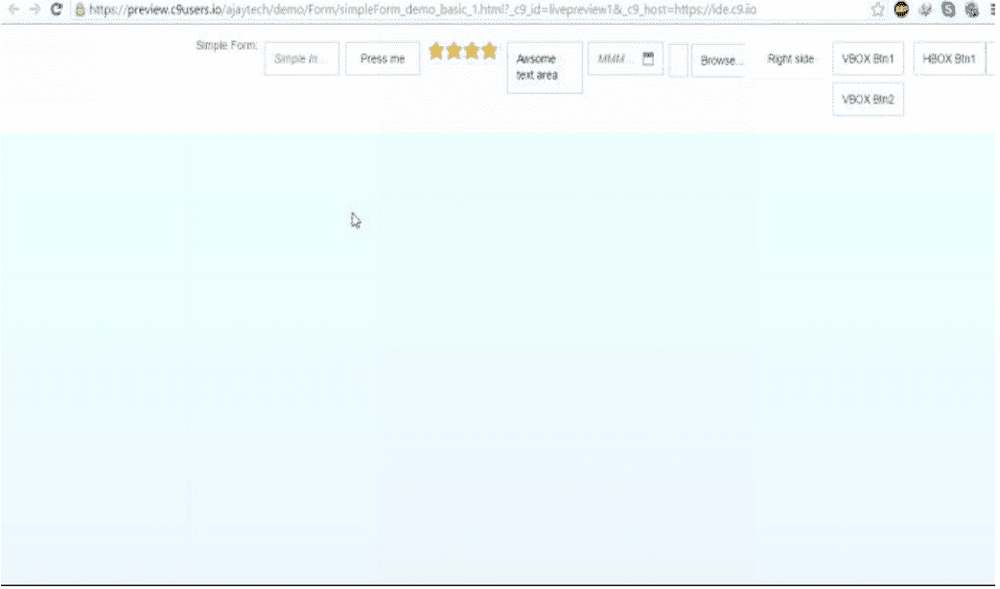

在 cloud9 IDE 中，我们已经有了创建 UI5 应用程序的基本设置。选择 cloud 9 IDE 的主要原因是创建一个可供全球读者访问的演示。

我们需要的是一个简单的表单。为此，转到资源管理器并搜索简单表单。单击简单表单后，你将获得库的详细信息，例如如何使用它以及它属于哪个组件。复制库并粘贴到 API 参考中搜索。在结果中，我们感兴趣的是 JSDoc 报告。点击它，我们将获得更多关于我们可使用的函数以及所有从其父级继承的函数/属性的详细信息。我们还有聚合，我们稍后会详细查看。现在我们来处理简单表单并将其添加到我们的项目中。

要添加简单表单，请使用 'var oSimpleForm = new sap.ui.layout.form.SimpleForm'。我们需要传递几个属性。这里我们关注 content 属性。我们必须将所有需要在表单中的元素放在其内部。

### 标签

在示例中，我们需要添加一个标签。我们可以在资源管理器中搜索标签，复制详细信息并在 API 参考（库）中搜索。在库中，我们将获得更好的视图，在资源管理器中，我们将获得示例。最好使用 API 参考（库），因为它包含有关如何使用它的详细信息。在 content 内部，添加带有 text 属性的标签（Simple text 是我们正在使用的文本）。

### 添加简单输入

我们已经看过带参数的 sap.m.Input 的用法。如果你不知道如何放置参数，可以在 API 参考中搜索属性。复制并粘贴 sap.m.Input 并检查是否可以在 placeholder 属性中使用。你会发现它不会显示任何属性，因为它可能继承自其父类，这些属性在类 sap.m.InputBase 中可用，包含 getPlaceHolder 和 setPlaceHolder 属性。我们也可以在控制台中验证这一点。如果我们打开控制台，通过输入 '*i = new sap.m.Input()*' 为 *sap.m.Input* 创建一个对象来检查。然后通过输入 '*i.setPlaceHolder*' 检查 placeholder 属性，这将确认该属性值可以使用。在某些情况下，如果你看到它是 undefined 或 null，这意味着我们不能使用该属性。所以回到 IDE 并对 sap.m.Input 使用 placeholder 属性。很多时候，属性在库中找不到，但存在于其超类中。

### 按我按钮

我们需要添加一个按钮。为此，我们使用 'sap.m.Button'，其 text 属性值为 'Press Me'。

### 评分

从资源管理器搜索是否有与评分相关的内容。这里我们需要一个评分指标。单击它查看它的样子。我们可以使用此组件来满足评分部分的需求。所以复制详细信息 'sap.m.RatingIndicator' 并粘贴到 content 内部。下一步是了解如何在这里给出星级评分。有时在资源管理器中找到要使用的属性更容易。这里他们使用 *'value = 3.7'* 给出了星级评分，我们可以直接在程序中使用它。我们不需要去 API 参考，因为我们已经在资源管理器中弄清楚了如何使用它。但是，你仍然可以在 API 参考中查看，并且你会接触到更多其他属性。建议研究库中存在的所有组件，并很好地了解它们可以做什么。

### 文本区域

在资源管理器中搜索文本区域，查看文本区域有哪些属性，例如它是否有占位符？此外，类似的问题我们也可以在控制台中验证。这里我们有一个 *value* 属性，所以我们需要使用它来在文本区域中写入内容。

### 添加日期选择器

我们将添加日期选择器。在资源管理器中搜索它，然后将其添加到我们的 IDE 中。这里我们没有任何 value 属性。所以让我们留空。

### 文件浏览器

我们要添加的下一个组件是文件浏览器。检查是否可以在资源管理器中找到它。现在在不传递任何属性值的情况下将其添加到应用程序中。它将向你的应用程序添加一个简单的文件上传器。

### 右侧带有按钮的栏

我们在表单中看到的下一个是一个栏。我们可以通过在资源管理器中搜索 'Bar' 来获取它。为了创建我们的表单，我们需要一个组件栏。在这个栏内部添加组件，我们必须使用 content 并在右侧放置一个按钮。使用 'sap.m.Button' 添加一个按钮。按钮有一个 text 属性，*value* 为 'Right Side'。

### VBOX 按钮

我们在资源管理器中找不到 VBOX。但我们在 UI5 库中确实有一个名为 VBox 的元素。它允许以垂直对齐方式（相互堆叠）对齐内容。

### HBOX 按钮

HBOX 与 VBox 类似，它将以水平方式对齐内容。这里我们在 HBox 的 content 内添加了两个按钮以水平对齐按钮。你可以在 API 参考中获取有关 VBox 和 HBox 的更多信息，它在应用程序中会非常频繁地使用。

你可以验证 VBox 内部是否可能有 'items' 聚合。运行控制台窗口，为 'sap.m.VBox' 创建一个对象，并通过简单输入来检查 'items' 聚合是否可能。使用 text 属性，我们将为按钮命名 'VBOX Btn1' 和 'VBOX Btn2'。同样，我们也可以创建 'HBox'。

最后，我们可以放置表单内容部分。我们不打算创建 app 或 form。我们可以直接将其放入我们的 'div' 中，在末尾使用 'oSimpleForm.placeAt("content")'。如果我们运行应用程序，那么我们将得到预期的结果，并显示在上面表单的截图中。

你也可以查看我们的 SAPUI5 专业发展视频课程以加速学习：[这里](https://example.com) 或使用下方二维码。

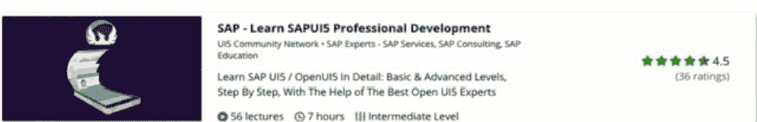


# 6. UI5 应用中的数据

在本新章节中，我们将探讨如何在 UI5 应用中使用数据。我们已经了解了如何使用组件以及如何创建一个基础的 UI5 应用。我们将处理 JSON 数据（JavaScript 对象表示法）。如果你之前没有使用过 JSON，那么以下是面向初学者的简短介绍。如果你已经熟悉它，则可以直接跳至下一小节。

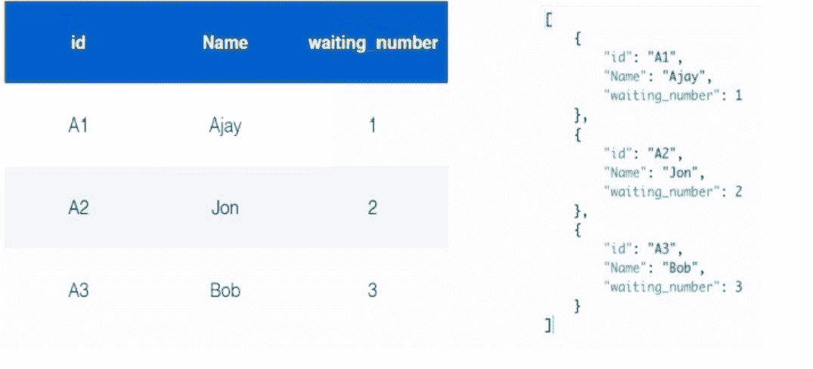

在我们的数据库中，数据以表格形式表示。如果我们用 JSON 格式来表示这个有三列（分别名为 id、Name 和 waiting_number）的表格。这里表格中的每一行代表一个数据集。现在，让我们看看这个表格如何用 JSON 格式表示。

在右侧的图片中，我们可以看到每条记录对应一个对象。这些记录包含在花括号中。你还可以看到每个对象都有一些重复的值。例如：id、Name 和 waiting_number。这些被称为‘键’，它们代表数据库表的列值。在右侧，我们有 A1、A2、A3 作为 id 值，Ajay、Jon、Bob 作为 Name 值，以及 1、2、3 作为 waiting_number 值。这些就是你实际使用的数据。因此，这就是该表格的简单 JSON 格式表示。

要在我们的 UI5 项目中使用 JSON 数据，我们必须创建一个对象，并将该对象称为‘模型’。然后，我们需要将模型附加到视图，以便视图能使用模型中的数据。在你的 UI5 应用中实现这一点非常简单。

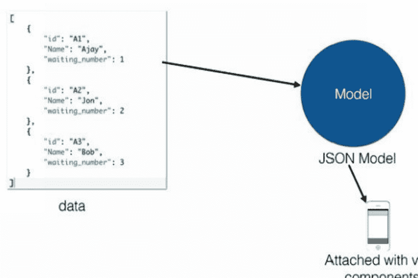

首先，你需要将 JSON 数据赋值给 oData 变量，然后我们将创建一个模型对象。模型对象可以通过使用 `new sap.ui.model.json.JSONModel()` 来创建。一旦你能够创建 JSON 模型对象，你就可以使用名为 `setData` 的函数并将 JSON 数据放入其中。一旦你能够将 JSON 数据放入我们的模型对象，那么我们就可以在应用中使用该模型对象来访问这些数据。

```javascript
var data = [
  {
    "id": "A1",
    "Name": "Ajay",
    "waiting_number": 1
  },
  {
    "id": "A2",
    "Name": "Jon",
    "waiting_number": 2
  },
  {
    "id": "A3",
    "Name": "Bob",
    "waiting_number": 3
  }
]

var newModel = new sap.ui.model.json.JSONModel();

newModel.setData(data);
```

要在我们的应用中使用这个模型对象，包括获取你想要放置数据的元素或组件。通过使用 `setModel` 函数，你可以将模型赋值给该元素或组件。一旦你这样做，该元素就能够获取数据。

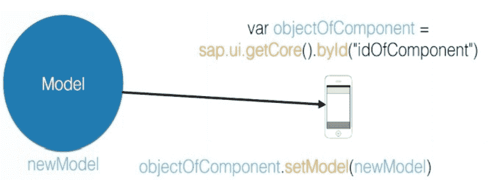

## 双向绑定

我们遇到的另一个术语是 *双向绑定*。每当我们通过模型将数据绑定到元素或组件时，更改数据或元素，模型数据也会随之更改。因此，这具有双向效应。例如，如果你将你的元素视为‘目的地’，而模型中存在的数据视为‘源’。通过更改源中的数据，目的地中的数据也会更改；同样，通过更改目的地中的数据，源数据也会更改。这就是 *双向绑定* 的概念。我们将在下一节中实际了解这些概念。

现在，让我们看看如何使用 UI5 库来实现这一点。

现在，如果我们进入 Cloud9 编辑器中的 *model_demo_basic_1.html* 代码，你会看到结构相当简单。我们有一个 script 标签，它从 ‘openui5.hana.ondemand.com’ 加载我们的 UI5 库，使用蓝色水晶主题，同时还包含了 ‘sap.m’ 库。

这些是非常常用的代码片段。在 body 中，你可以看到一个名为 ‘sapUiBody’ 的类，它将包含应用。这是加载我们 UI5 库的基本骨架。

这里我们创建了两个变量，它们实际上是两个属于 ‘sap.m.Label’ 类的标签。带有一个 text 属性。

```javascript
<script>
var label1 = new sap.m.Label({ /** 创建路径 label1 */
    text: "{key1}"                /** 你需要使用 {} 进行数据绑定 */
});

var label2 = new sap.m.Label({ /** 创建路径 label2 */
    text: "{key2}"
});

var oData = {
    "key1": "Dinosars",            /* 键 1 的 JSON 数据 */
    "key2": "Elephant"             /* 键 2 的 JSON 数据 */
};
```

```javascript
var newModel = new sap.ui.model.json.JSONModel();
newModel.setData(oData);
/* 将 oData 添加到模型中 */
label1.setModel(newModel);
/* 模型已与元素(label1)绑定 */
label2.setModel(newModel);
/* 模型已与元素(label2)绑定 */
label1.placeAt("content");
/* 使用 placeAt() 函数将标签 1 的内容放置在 HTML 页面中 */
label2.placeAt("content1");
/* 使用 placeAt() 函数将标签 2 的内容放置在 HTML 页面中 */
</script>
```

在上面的程序中，我们创建了带有 text 属性的 label1 和 label2。一旦我们创建了标签对象，我们就在 ‘{}’ 内部添加了 JSON 数据的键，当我们绑定数据（无论是绑定到全局模型还是单个元素）时，这些键将被 JSON 的实际数据值替换。最后，我们使用 ‘placeAt’ 函数将标签放置在我们的 HTML 页面中。content 将成为 div 的一部分。如果我们保存并运行实时预览，我们将看到以下结果：

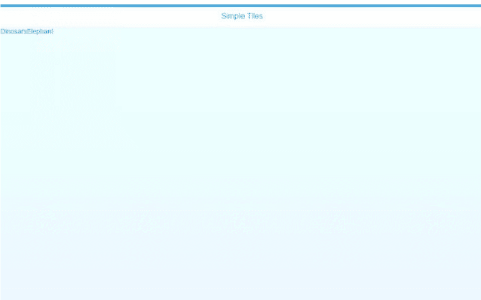

你也可以查看我们的 SAPUI5 专业开发视频课程以加速学习：[此处](https://example.com)或使用下方二维码。


## SAP - 学习 SAPUI5 专业开发

Ui5 社区网络 · SAP 专家 · SAP 服务，SAP 咨询，SAP 教育

★★★★★ 4.5 (36 个评分)

深入学习 SAP UI5 / OpenUI5：基础与高级水平，循序渐进，在顶尖 Open UI5 专家的帮助下

- 🎥 56 节课
- ⏱️ 7 小时
- 📊 中级水平


# 7. 列表

在本节中，我们将了解 UI5 中最受欢迎的元素之一，那就是 *列表*。要在我们的应用中使用列表，我们必须使用 ‘sap.m.List’。

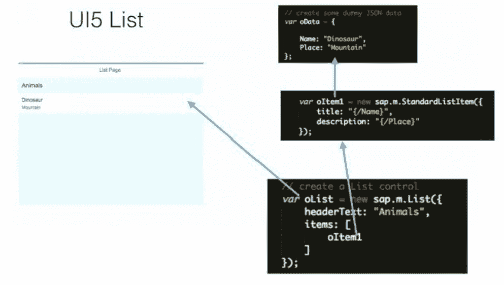

让我们创建一个简单的列表，并在其中显示一个单独的项目，内容为 ‘dinosaur’，描述为 ‘mountain’。

### 创建列表的步骤

1. 第一步是创建一个标准列表项。一旦我们有了标准列表项，它们就是将出现在我们列表中的项目。
2. 第二步是使用 ‘sap.m.List’ 创建一个列表对象。一旦我们创建了 ‘sap.m.List’，我们就可以将标准项放入列表中。这里 dinosaur 是一个列表项，animal 是一个列表。
3. 第三步是提供数据。在图片中，你可能注意到使用了带有正斜杠 ‘{/}’ 的花括号。这代表数据绑定。

现在，如果我们进入 Cloud9 中的 *program list_demo_basic_3.html*，看看如何实现这个列表。我们可以找到以下结构：

```javascript
<script id='sap-ui-bootstrap' type='text/javascript'
        src='https://openui5.hana.ondemand.com/resources/sap-ui-core.js' data-sap-ui-theme='sap_bluecrystal'
        data-sap-ui-libs='sap.m'>
</script>
```

在这个应用中，我们还将使用 ‘sap.m.App’ 和 ‘sap.m.Page’。首先，我们使用以下代码创建页面和应用：

```javascript
var oPage = new sap.m.Page({
    title: "List Page",
    content: [
        oList
    ]
});

var oApp = new sap.m.App({              /** 使用 oApp 创建一个应用 */
    pages: [oPage]
}).placeAt("content");               /** 将内容放置到 HTML 中 */
```

我们还需要创建内容。为此，在 body 标签内，创建一个 div 元素并添加内容。现在我们已经准备好了页面和列表。接下来，我们将添加一个列表。接着，我们需要创建数据。创建 oData 对象并在 JSON 数据中添加数据。在之前的绑定示例中，为了创建一个简单的应用，我们只有数据存在。现在我们将添加更多数据。因此，我们要做的是在 oData 内部创建一个 names 属性，所有数据都可以放入其中。

```javascript
var oData = {
    names: [{
        Name: "Dinosaur",
        Place: "Mountain"
    }, {
        Name: "Elephant",
        Place: "Forest"
    }, {
        Name: "Whale",
        Place: "Sea"
    }, {
        Name: "Duck",
        Place: "Water"
    }, {
        Name: "Monkey",
        Place: "Tree"
    }]
};
```

在上述示例中，我们添加了一个 *name* 键，它是一个数组。每个数组中包含对象，每个对象是一条单独的记录。接下来，我们将创建一个列表。为此，我们使用绑定项目聚合。

```
// 将 oList 的项目绑定到 oData 集合
oList.bindItems({
    path: "/names",
    template: new sap.m.StandardListItem({
        title: "{Name}",
        description: "{Place}"
    })
});
```

这里的 "path: "/names"" 指定了指向该路径的数据。
第二个参数是模板。它是列表项的标准模板。它将作为列表项的蓝图。首先，我们创建了一个页面，然后使用 oData 添加了一些数据，最后，我们将数据与列表绑定。
如果你使用 Eclipse 并且有分离的视图-控制器，那么所有操作都将在控制器中执行，例如数据绑定、数据处理以及相关的操作。
现在，如果我们运行代码并查看结果，我们将看到下面的输出：

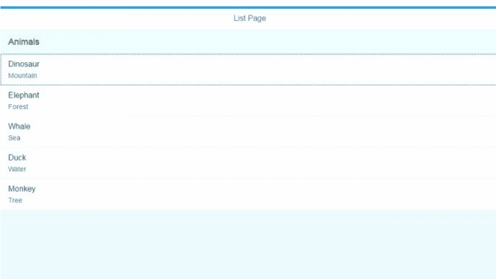

这里，我们将标准列表项的创建通用化，所有项目都从 JSON 数据中获取并添加到我们的最终列表中，你可以在输出中看到。
你也可以查看我们的 SAPUI5 专业开发视频课程以加速学习：[点击此处](https://example.com)或使用下方的二维码。


## SAP - 学习 SAPUI5 专业开发

UI5 社区网络 • SAP 专家 - SAP 服务、SAP 咨询、SAP 教育

在顶尖 Open UI5 专家的帮助下，深入学习 SAP UI5 / OpenUI5：基础与高级水平，循序渐进

⭐ 4.5 (36 评分)

⏱ 56 节课  ⏱ 7 小时  📊 中级水平


# 8. 表格

表格是 UI5 库中最常用的元素。表格的结构类似于我们使用的 Excel 电子表格。在表格中，我们有包含标题的表头，以及包含数据的行。以下是使用 UI5 创建表格的简化步骤。

1.  第一步是定义和创建列。
2.  第二步是将列添加到表格中。
3.  第三步是定义行的外观。这里我们使用 `sap.m.ColumnListItem`。因此，每条独立记录都被视为一个独立的列表项。
4.  在最后一步，我们将表格与数据绑定。

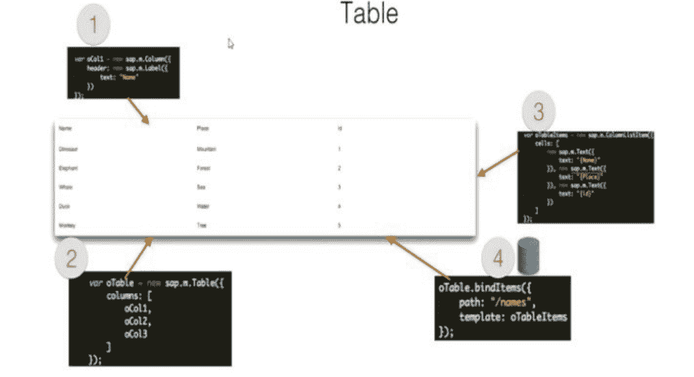

下面是创建一个简单 `sap.m.Table` 的代码。我们首先定义数据和模型。

```
var oModel = new sap.ui.model.json.JSONModel(); // 使用这些数据创建模型
```

然后我们需要创建三列，标签分别为名称、地点和 ID。为标签创建一个 oCol 对象。

```
var oCol1 = new sap.m.Column({ // 为名称创建列1对象
    header:new sap.m.Label({"Name"})
}),

var oCol2 = new sap.m.Column({// 为地点创建列2对象
    header:new sap.m.Label({"Place"})
}),
```

```
});

var oCol3 = new sap.m.Column({// 为ID创建列3对象

header:new sap.m.Label({"Id"})

}),
```

之后，我们将列添加到表格中

```
var oTable = new sap.m.Table({

 title:"简单表格",

 columns:[

 oCol1

 oCol2

 oCol3

 ]

})
```

现在我们需要通过创建模板来定义行的外观。

```
var oTemp = new sap.m.ColumnListItem({

 cells:[

 new sap.m.Text({

 text:"{Name}"

 }),

 new sap.m.Text({

 text:"{Place}"

 }),

 new sap.m.Text({

 text:"{id}"

 })

 ]

})
```

最后，我们执行数据绑定步骤，为 `oTemp` 提供数据路径。在这种情况下，各个列表项将根据数据生成。

```
oTable.bindItems({

 path: "/names",

 template: oTemp

})
```

在上一节中我们看到，当使用 MVC 模式时，与数据和模型相关的活动应该在控制器中进行。将数据和模型活动放在控制器的 onInit() 函数中，因为它应在程序开始执行时执行。我们还需要做的一件事是将模型分配给全局模型。一旦设置了这个，那么数据就可以从应用程序中的任何地方访问。下面是执行此操作的代码。

```
sap.ui.getCore().setModel(oModel);
```

现在当你保存并运行应用程序时。你将获得上图中所示的所需输出。

### 使用 sap.ui.commons 的表格

UI5 库提供了许多开箱即用的变体和属性。一个这样的例子是使用 `sap.ui.commons` 表格。以下是使用 commons 创建表格的步骤。如果我们重用 `sap.m.Table` 的代码，那么首先要更改的是 index.html 文件，我们需要在其中添加两个额外的库，如下所示。

```
<script src="resources/sap-ui-core.js"
        id="sap-ui-bootstrap"
        data-sap-ui-libs="sap.m,sap.ui.commons,sap.ui.table" // 额外添加了 sap.ui.commons 和 sap.ui.table
        data-sap-ui-theme="sap_bluecrystal">
</script>
```

然后在视图中，我们需要更改列的类型：

```
var oCol1 = new sap.ui.table.Column({
    label: new sap.m.Label({
        text: "Name"
    }),
    template: new sap.m.Text({
        text: "{Name}"
    })
});

var oCol2 = new sap.ui.table.Column({
    label: new sap.m.Label({
        text: "Place"
    }),
    template: new sap.m.Text({
        text: "{Place}"
    })
});

var oCol3 = new sap.ui.table.Column({
    label: new sap.m.Label({
        text: "Id"
    }),
```

最后，在绑定中，我们可以使用一种更简单的绑定版本。这被称为 `bindrows`。由于我们已经在列级别定义了模板，因此我们不需要单独创建它。

```
oList.bindItems("/names");
```

这些是为我们新的表格变体所做的简单更改。现在运行这个应用程序，你可以看到新旧表格之间的区别。

| 名称 | 地点 | ID |
| :--- | :--- | :--- |
| 恐龙 | 山脉 | 山脉 |
| 大象 | 森林 | 森林 |
| 鲸鱼 | 大海 | 大海 |
| 鸭子 | 水域 | 水域 |
| 猴子 | 树木 | 树木 |

这里的结构发生了变化，并且在一定程度上也响应了移动设备。然而，选择使用哪种表格（sap.m 和 sap.ui）的主要决定取决于两个因素：

- 功能特性。
- 以及主要目标设备类型。

你也可以查看我们的 SAPUI5 专业开发视频课程以加速学习：[点击此处](https://example.com)或使用下方的二维码。


# 9. 磁贴

磁贴是提供多个在逻辑上分离的功能的绝佳方式。它们在显示 KPI 信息数据方面也很受欢迎。
创建和使用磁贴有两个简单的步骤：

1.  创建单个磁贴。
2.  将这些磁贴添加到磁贴容器中。

现在让我们尝试一个创建磁贴并将其添加到磁贴容器中的简单场景。在 cloud9 共享工作区中，你可以看到 `tile_demo_basic_1&2.html`。提到的步骤很简单；我们使用 `StandardTile` 创建单个磁贴：

```
var oT1 = new sap.m.StandardTile({
    title: "恐龙",
    info: "山脉"
    icon: "sap-icon://sap-ui5"
});
```

这是为恐龙创建的一个磁贴。类似地，我们可以创建其他磁贴并命名为 oT2、oT3 和 oT4。在磁贴内部，它包含 title、info 和 icon 等属性。在 icon 属性中，我们需要指定要使用的图标。为此，我们可以在 URL https://openui5.hana.ondemand.com/iconExplorer.html 的 UI5 图标浏览器中搜索。在这里选择要添加的图标，复制图标的名称并粘贴到 icon 属性中。

接下来，创建磁贴容器并将这些磁贴添加到容器中。

```
var oTileCont = new sap.m.TileContainer({
    tiles: [
               oT1,
               oT2,
               oT3,
               oT4
    ]
});
```

然后将这个 oTileCont 放到页面上：

```
var page = new sap.m.Page({
    title: "简单磁贴",
    content: [
        oTileCont
    ]
})
```

保存并运行，如果一切正常。你将看到下面的输出：

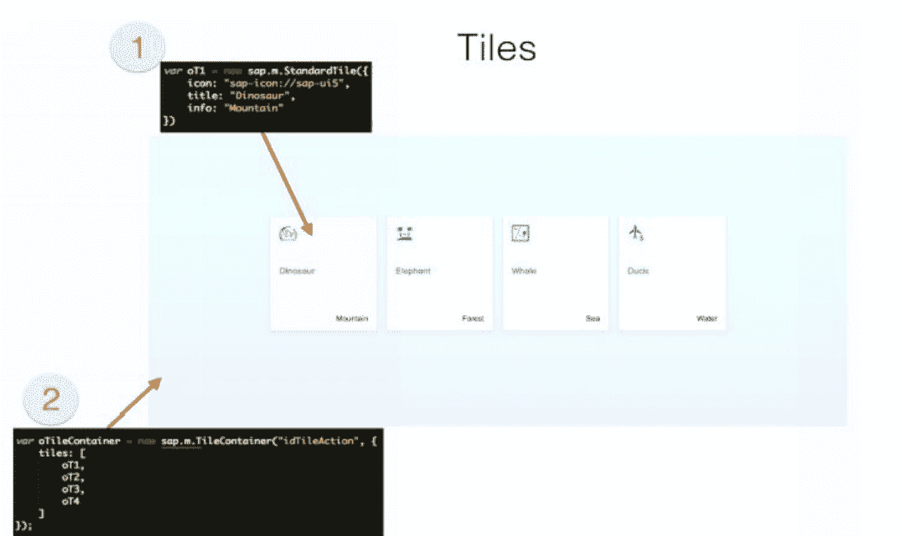

### 使用数据绑定（JSON 数据变量）创建磁贴

如果我们有一个数据源并希望使用它来创建这些磁贴。那么我们需要进行一些更改。第一步是确保所有要绑定的数据都是正确的，因为我们将使用一个 icon 属性，所以数据中也应包含它：

```
var oData = {
```


“names” :[{
            icon : “sap-icon://sap-ui5”,
            Name : “恐龙”,
            Place : “山地”
}, {
            icon : “sap-icon://general-leave-request”,
            Name : “大象”,
            Place : “森林”
}, {
            icon : “sap-icon://map-2”,
            Name : “鲸鱼”,
            Place : “海洋”
}, {
            icon : “sap-icon://travel-expense”,
            Name : “鸭子”,
            Place : “水域”
}]
};
var oModel = new sap.ui.model.json.JSONModel(oData);

接下来，移除硬编码部分，因为我们将在此使用数据绑定：

var oTileTemplate = new sap.m.StandardTile({ //创建模板
icon: “{icon}”,
title: “{Name}”,
info: “{Place}”
});

var oTileContainer = new sap.m.TileContainer(“idTileAction”, {
});

oTileContainer.bindAggregation(“tiles”, “/names”, oTileTemplate);

//绑定聚合参数包含（属性，/路径 和 模板）

oTileContainer.setModel(oModel);

var page = new sap.m.Page({
    title: “简单磁贴”,
    enableScrolling: false,
    content: [
        oTileContainer
    ]
});
var app = new sap.m.App();
app.addPage(page);
app.placeAt(“content”);

这是创建简单磁贴而不进行任何硬编码的通用方法。在项目中应避免硬编码。在实际项目中使用磁贴时，我们也应该使用绑定聚合函数。下面是我们的程序运行得到的输出：

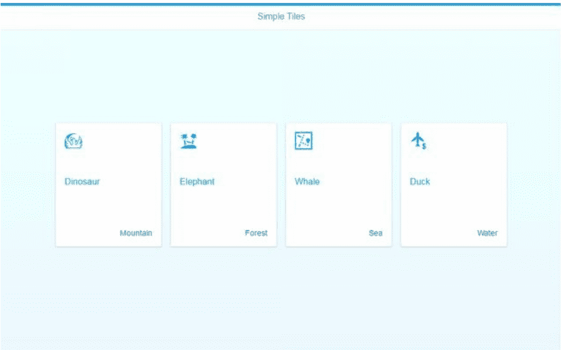

您也可以查看我们的SAPUI5专业开发视频课程以加速学习：[这里](https://example.com) 或使用下方的二维码。


## SAP - 学习 SAPUI5 专业开发

UI5 社区网络 • SAP 专家 - SAP 服务，SAP 咨询，SAP 教育

在顶尖 Open UI5 专家的帮助下，深入学习 SAP UI5 / OpenUI5：基础与高级水平，循序渐进

4.5 ★★★★★ (36 评分)

56 节课 • 7 小时 • 中级水平


# 10. 使用工厂函数进行数据绑定

如果您想知道数据绑定在内部是如何完成的，那么工厂函数的概念将为您带来更多清晰度。工厂函数是一种在执行数据绑定时实现自定义逻辑的方法。

例如，如果我们有这样的需求：我们有一个列表，其描述依赖于标题值。如果列表的主要内容是动物的名称，而描述中包含一些依赖关系。那么工厂函数就是实现这些绑定并使其通用化的方法。

在我们的例子中，如果我们将列表标题表示为动物名称，并且需要说明该动物是否已灭绝。那么我们需要使用 `bindAggregation`，其第三个参数为自定义函数，该函数包含返回特定动物描述的逻辑。下面是代码和输出效果的示意图：

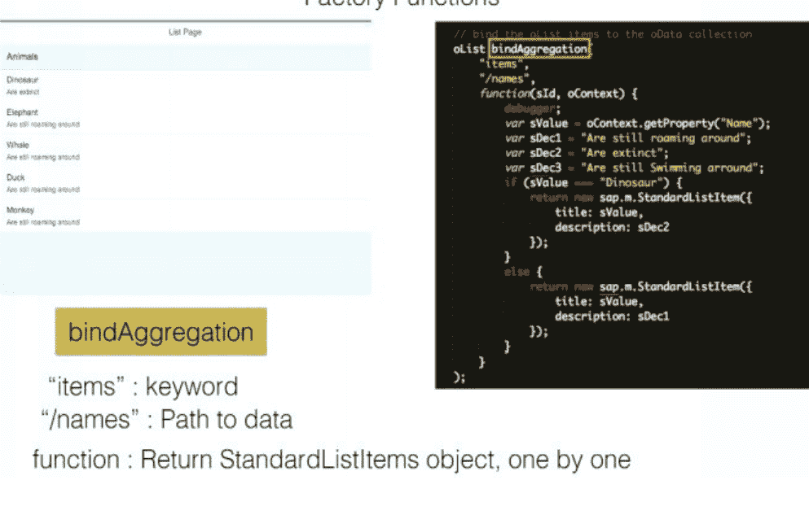

*bindAggregation* 函数的第三个参数将是一个自定义函数，它接受两个参数。第一个是 `sId`，另一个是 `oContext`。参数 `oContext` 将包含您操作所需的所有必要信息：

oList.bindAggregation(“items”,
    “/names”,
function(sId, oContext) {
    var sValue = oContext.getProperty(“Name”);

    var sDesc1 = “仍在漫游”; //字符串描述
    var sDesc2 = “已灭绝” //字符串描述

    });

if (sValue === “Dinosaur”) { //如果语句用来说明描述是灭绝
    return new sap.m.StandardListItem({
        title: sValue,
        description: sDesc2
    });
} else {
    return new sap.m.StandardListItem({
        title: sValue,
        description: sDesc1

        });
}

您还可以通过在代码中添加 ‘debugger’ 关键字来添加调试器以调试代码。在代码中添加调试器后，如果您打开开发工具包（Firefox 和 Chrome），您甚至可以进一步分析代码的行为。

### 命名模型

接下来我们要看的主题是命名模型。之前我们使用 JSON 数据并用 JSON 数据设置模型。然后我们将该模型设置到核心。现在问题来了——能否为我的核心设置多个数据对象？令人惊讶的是，可以。使用命名模型的概念即可。

之前我们使用 `sap.ui.getCore().setModel(oModel)`。该模型被设置到核心，可以称为全局模型。然而，当我们使用命名模型的概念时，我们必须提供第二个参数。第二个参数实际上是我们设置的模型的名称。例如 XYZ、ABC 或任何名称。该名称应为有效的字符串字符。当我们传递模型对象和模型名称时，该模型对象只能通过此名称检索。它将充当此模型的键。

**全局/核心模型语法（示例）：** sap.ui.getCore().setModel(oModel)

## 命名模型语法（示例）：** sap.ui.getCore().setModel(oModel,XYZ)

接下来的问题是，如何在数据绑定中使用命名模型？下面是命名模型与我们之前使用的普通模型绑定的简单比较。在命名模型的情况下，我们将使用 `>` 运算符来分隔绑定中的模型名称和键值，如下所示：

### 普通模型

oList.Items({
    path: “/names”,
    template: new sap.m.StandardListItem({
        title: “{Name}” // 普通模型没有大于号
        description: “{Place}”,
        type: sap.m.ListType.Navigation,
        press: [oController.showDetails, oController]
    })
});

### 命名模型

oList.Items({
    path: “XYZ>/names”,
    //大于号用于表示命名模型
    template: new sap.m.StandardListItem({
        title: “{XYZ>Name}”
        //大于号用于表示命名模型
        description: “{XYZ>Place}”,
        //大于号用于表示命名模型
        type: sap.m.ListType.Navigation,
        press: [oController.showDetails, oController]
    })
});

在使用命名模型时，必须在键名之前使用大于号指定名称。例如：`title:”{XYZ>Name}”`。

注意：始终尝试使用全局/核心模型，并尽量限制命名模型的使用。当您创建多个命名模型时，要跟踪实际存在多少个命名模型会变得非常复杂。

您也可以查看我们的SAPUI5专业开发视频课程以加速学习：[这里](https://example.com) 或使用下方的二维码。


# 11. 使用 Chrome 开发者工具包

在本节中，我们将了解 Google Chrome 开发工具包如何帮助我们加速开发。Google Chrome 是市场上最好的浏览器之一。如果您正在开发任何与 Web 相关的应用程序，那么 Google Chrome 将是首选。Chrome 提供了许多开箱即用的功能，这些功能对开发者非常有用。不仅用于开发，还用于查找错误、分析样式表并即时更正它们。我们将逐一查看 Google Chrome 浏览器的功能。

**注意：** 如果您需要将应用程序交付给客户，而您的客户不使用 Google Chrome，可能使用的是 Firefox 或 Internet Explorer。那么您必须检查客户使用的浏览器，并在交付应用程序之前检查一切是否正常或与该浏览器兼容。有时许多功能在不同浏览器之间不兼容。

让我们了解一下 Google Chrome 的功能。在 Windows 机器上，您需要按 ‘F12’，或者只需右键单击并选择检查元素。现在开发工具包可以放在右侧或浏览器下方，您甚至可以从右上角的*自定义和控制*功能中将开发工具窗口分离出来。

当您使用双屏幕设置时，单独的窗口布局将非常有用。现在，让我们将其停靠在浏览器屏幕的右侧。

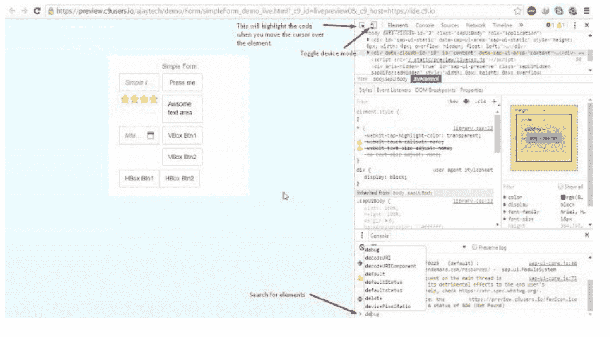


现在让我们浏览一下当前存在的不同选项卡。

## 元素选项卡

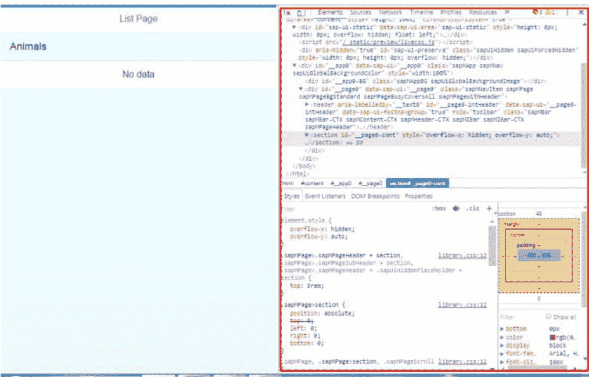

它以树状格式提供所有 HTML 元素。如果我们折叠整个树，就可以看到根元素是哪个，在本例中是 HTML。你也可以展开查看树内部有哪些元素。这里提供了许多组件。有时，很难找到这些元素。因此，你可以在这里使用搜索功能。

## 搜索

在 Windows 机器上按 'Ctrl+F'，或在 MAC 上按 'Command+F'。如果你想搜索并找到一个元素，只需在搜索栏中输入组件名称，或者任何你所知的、能匹配该元素的属性或相关值进行搜索即可。

如果我们搜索提交按钮，它会用黄色高亮显示该组件。这在你寻找网页中的某个组件时非常方便。还有一个选项，如果你想检查应用中重复出现的组件，那么可以输入该组件名称并按回车键；每次它都会显示该组件在其他地方也被使用的位置。你还可以按 'Ctrl+Z' 返回到上一次搜索。

还有一个更方便的功能是**选择元素**功能。一旦你选中它，它会变成蓝色。当你将鼠标在屏幕上移动时，特定的 'div' 元素会在屏幕上高亮显示。

## 实时更改 HTML

如果你想更改 HTML，可以右键点击并选择 'Edit as HTML'。现在你可以修改你的 DOM 元素。如果我们删除整个元素，那么该特定部分将立即从网页上移除。

## CSS 属性

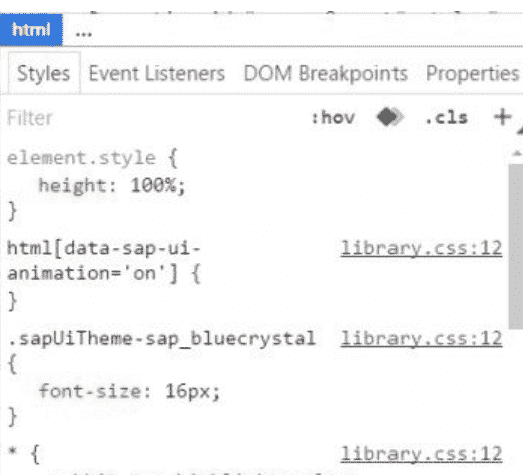

CSS 是一个非常强大的工具。当你高亮选中一些 DOM 元素时，可以在右侧看到与之关联的 CSS 属性。在这里，我们可以直接修改 CSS 属性，如颜色、内边距、宽度等，这些更改会立即在网页上反映出来。

当你需要对 CSS 进行大量设计修改时，实时更改 CSS 并查看结果至关重要。例如，如果你的客户要求你更改按钮颜色或将按钮置于页面底部，CSS 样式选项卡提供了大量的试错方法，以达到最终优化的 CSS 代码来实现这一目标。

例如，要更改输入框的背景色，我们选择输入框并给出带有 background-color 属性的类名。请注意，如果某些属性被其他属性覆盖，最终结果将根据优先级显示。如果你将其声明为 !important，那么声明的值将具有更高的优先级。

## 切换设备模式

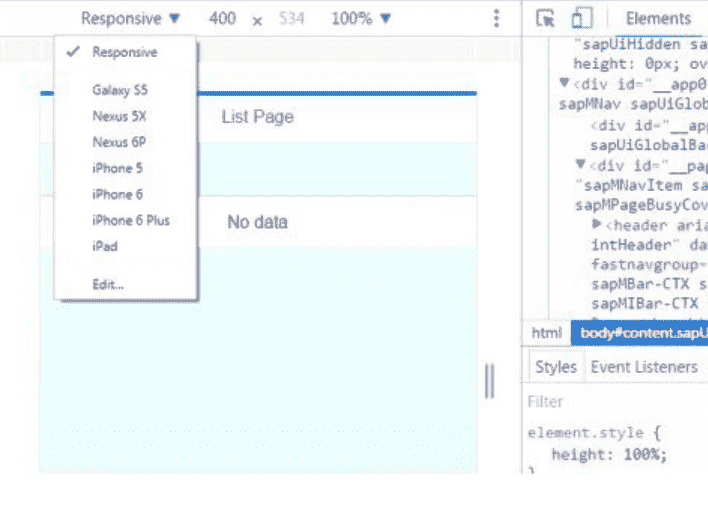

在切换设备模式下，你可以查看应用程序在其他设备（如 iPhone、Nexus 6 等）上的显示效果。这里也有一个编辑选项卡。它允许你从列表中选择可用的设备。

## 浏览器控制台

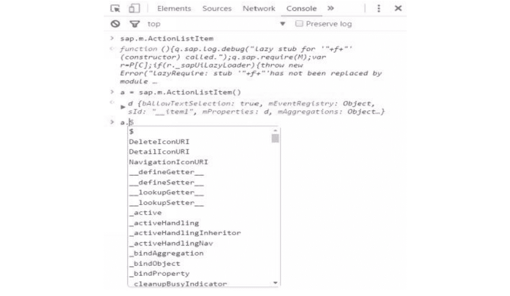

控制台就像你网页的实时编辑器。当你加载应用程序时，如果出现某些错误且应用程序无法正常加载，那么控制台就是你会找到错误信息的地方。它还提供了应用程序运行时的简要日志，包括加载了哪些库、哪个应用程序开始运行以及何时运行。

我们也可以在控制台中编写代码。当你在控制台中编写代码时，会得到实时反馈。你可以立即知道特定代码是否能在我们的应用程序中运行。现在，我们将使用 'clear()' 函数来清空控制台，尝试一下。

## 源代码

此选项卡提供了调试我们的应用程序、查看代码和相关文件的能力。左侧边栏将概览我们项目中涉及的所有文件。例如，如果我们想调试视图文件，可以选择该视图文件，通过点击左侧的行号来设置一个调试断点。然后前往控制台并刷新页面。它会在你设置的调试断点处停止。调试断点仅在控制台窗口（开发工具包）打开时才会触发。可以通过启用 'Deactivate breaking points' 图标来禁用调试断点。

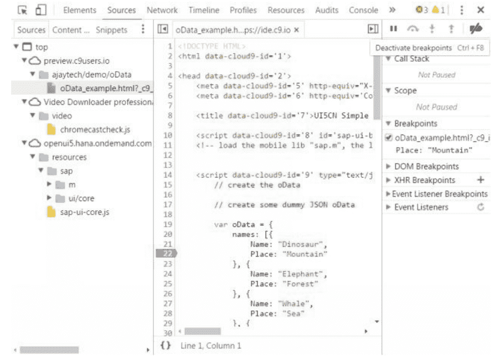

## 网络

在网络选项卡中，你可以看到所有加载的组件。如果有某些组件是通过 API 调用的，你也可以看到其状态，并检查它们的请求和响应。如果你想查看数据或响应，点击它即可在响应窗口中看到详细信息。

标题部分会给你一个概览，包括请求方法、请求 URL 和状态码等所有详细信息。这些在调试时非常有用，可以验证所有 API 通信是否按预期进行。此外，还有一个过滤器选项卡，你可以使用名称和类型（如 CSS、JS、Image、media 等）来过滤内容。

## 响应性和浏览器兼容性

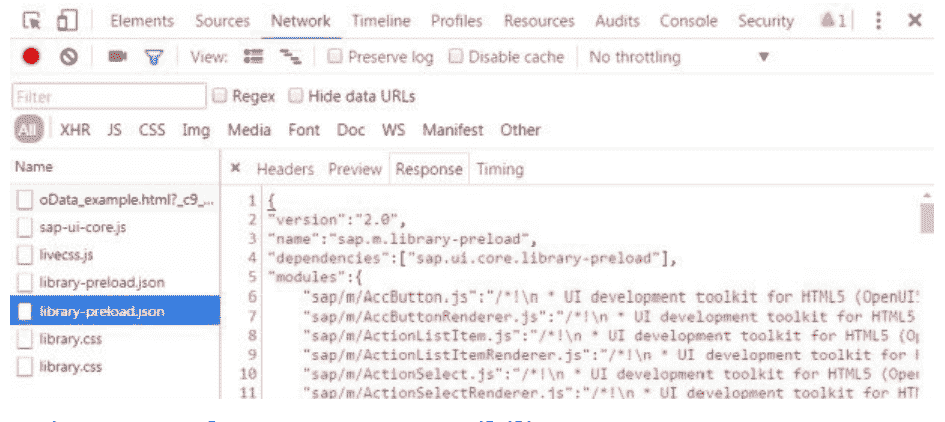

UI5 应用程序的响应性可能是一个成败攸关的决定。当你交付产品进行用户验收测试时，他们会在自己的设备和环境（可能是移动设备、平板电脑或台式计算机）上测试应用程序。因此，你需要根据用户将使用的设备来创建应用程序。此外，用户将使用的浏览器也应在最初就确定下来。因为有许多功能可能在某些浏览器中不受支持，或者在不同浏览器中工作方式不同，后期修改可能导致大量的开发工作。

你也可以在 API 参考文档中检查与浏览器的额外兼容性。在 http://openui5.hana.ondemand.com 上有一个开发者帮助部分，提供了有关浏览器和平台支持的详细指南。

简而言之，在做出任何重大决定之前，请始终考虑以下三件事：

- 1. 充分了解客户的设备和环境。
- 2. 根据 SAP 帮助文档检查运行环境的兼容性规则。
- 3. 在开发阶段始终考虑跨浏览器和跨设备的使用。

## UI5 应用的样式和主题

样式和主题将使你的网页对用户更具响应性和可呈现性。应用程序的响应性取决于媒体查询。媒体查询是 CSS 的一部分。CSS 在 UI5 应用程序中扮演着重要角色。你可能会问，如果我们创建一个端到端的 UI5 应用，需要了解多少 CSS；要回答这个问题，有必要深入了解 CSS。

通常，在大型 UI5 项目中，有两类人员：一类专注于开发，另一类专注于设计。从事设计的人员会关注用户体验和 CSS。从事开发的人员则关注控制器、视图、数据和 UI5 库。

我们已经创建了一个包含输入框和按钮的“简单应用”。我们将看看如何更改 CSS 设计使其看起来更漂亮，并将输入框和按钮在应用程序的移动视图和桌面视图中都居中显示。

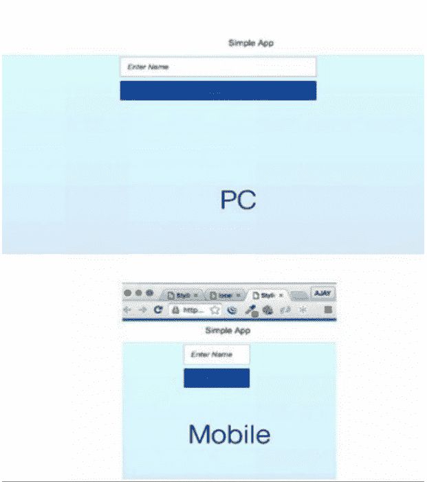

要开始这个过程，让我们打开我们的开发工具包。现在，我们将使用元素选项卡进行更改。要聚焦到输入框，请右键点击输入框并选择 inspect element。这将在浏览器控制台中高亮显示输入的 HTML 内容。让我们查找分配给 input 元素的类。大多数标准 CSS 类以 'sap' 开头。因此，当你更改标准 CSS 类时要小心。因为如果你更改了标准类，它将影响应用程序中的所有地方。


所以最好不要随意尝试标准类。

现在我将创建一个自定义类。为此，在样式选项卡中点击“+”号添加一个类（此处已编辑高亮的类）。为此类添加宽度属性并赋值为60%，左内边距设为30%。我们需要自定义样式具有最高优先级，因此可以在样式属性值后添加“! important”关键字。从输出中可以看到输入框将居中对齐。按照同样的步骤，我们也可以将按钮居中对齐。现在，我们需要处理按钮的蓝色背景颜色。这有点棘手，因为我们需要引入标准样式类‘.sapMBtnInner’来实现这一更改。您会注意到，如果在类‘.sapMBtnInner’内添加属性：

```
background:#007cc0;
```

按钮的背景就会改变。我们已经知道更改标准样式类不是好的做法，因此为了实现这一点，我们将创建.btnCss自定义类。我们将编写样式规则，使得所有同时具有.sapMBtnInner类和.btnCss类的元素都将应用新的样式规则。这是通过创建包含以下选择器的样式规则实现的：

```
.btnCss>.sapMBtnInner{
}
```

最终，CSS文件将如下所示：

```
.inputCss{ //CSS class for input
    width: 60%!important;
    padding-left: 30%!important;
}

.btnCss{ //CSS Class for button
    width: 60%!important;
    padding-left: 30%!important;
}

.btnCss>.sapMBtnInner{ //Apply the property to the element sapMBtnInner
    background:#007cc0;
}
```

要链接此CSS文件，我们可以使用`<link>`标签：

```
<link rel="stylesheet" type="text/css" href="css/custom.css">
```

现在在视图中，我们需要使用‘addStyleClass’函数来链接新的CSS属性，如下所示：

```
createContent : function(oController) {
    var oSimpleInput = new sap.m.Input({
        placeholder: "Enter Name"
    }).addStyleClass("inputCss"); //class for CSS
    var oBtn = new sap.m.Button({
        text: "Submit"
    }).addStyleClass("btnCss"); //Class for CSS
    var oPage = new sap.m.Page({
        title: "Simple App",
        content: [
            oSimpleInput,
            oBtn
        ]
    });
```

一旦我们在Web浏览器中运行此代码，我们将能够获得所需的输出：

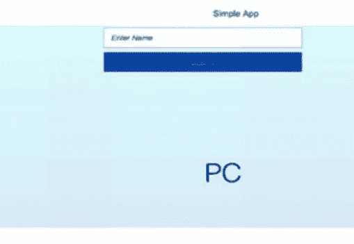

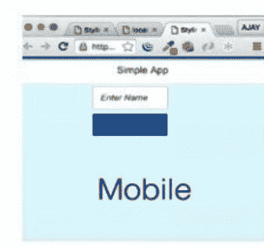

## 样式和主题，高级选项

## 媒体查询

媒体查询让您能够控制应用程序在不同分辨率屏幕上的外观，例如移动设备、平板电脑或台式电脑屏幕。以下是媒体查询的一个简单示例：

```
@medi screen and (max-width:600px){
    .hBoxForm{
        padding-left: 10%;
    }
    .vBoxForm{
        padding-left: 18%;
    }
}
```

在上面的CSS中，`.hBoxForm`和`.vBoxForm`将仅应用于宽度小于600px的屏幕。现在您可能在想，这会导致一个庞大而复杂的CSS文件。确实如此，这也是UI5项目中CSS文件通常较大的主要原因。

## 主题设计器

想象一个工具，它可以帮助您减少在不花费太多工作的情况下更改应用程序基本外观和感觉的繁琐任务。主题设计器就是自动化更改CSS这一繁琐任务的工具。它是一个“所见即所得（WYSIWYG）”编辑器。


您可以在上图中看到，主题设计器在右侧包含许多内置选项，用于更改颜色和基本外观。

您可以通过事务代码从SAP启动主题设计器：

**/UI5/THEME_DESIGNER**

或者，您可以直接访问以下URL来访问此基于浏览器的图形编辑器。

https://<server>:<port>/sap/bc/theming/theme-designer?sap-client=<client>

（您需要在此处更改服务器和端口名称，并替换为SAP系统的服务器和端口名称）。

完成设计和更改后，您可以看到可用主题的列表并导入主题。它会要求提供一个链接。如果您有一个在SAP服务器上运行的应用程序，则可以使用该链接在主题设计器中打开它。


目前，我们将使用资源管理器中的标准主题进行演示。页面中的下一个选项是SAP UI5应用程序预览。选择该选项，在下一页中您可以看到两个复选框*SAP Fiori启动板*和*资源管理器*。我们将选择资源管理器。它将在主题设计器中打开资源管理器应用程序。

现在在这里，我们可以快速更改背景颜色、品牌颜色和高亮颜色等选项。您还可以创建自定义CSS类并提供这些值。提供调色板可以帮助您进行选择。


如果要导出更改，您必须转到左上角的“主题”选项并选择“导出”。如果您的应用程序需要支持从右到左（RTL）语言，您也可以使用RTL选项。它将显示导出过程，并在完成后自动下载一个zip文件。


要在Eclipse中使用此新主题。我们必须遵循以下步骤。

- 1. 找到我们应用新主题的应用程序位置。
- 2. 现在转到Web内容文件夹，创建一个名为resources的文件夹。
- 3. 将UI5文件夹内的‘Sap’文件夹复制并粘贴到resource文件夹中。
- 4. 更改index文件中的主题名称。
- 5. 保存并重新加载页面。

重新加载页面后，您将能够看到新主题已应用于您的应用程序。在我们的案例中，我们已将新主题应用于“Simple App”演示，并且它已更改了背景、输入框和页眉样式（如下图所示）。


您也可以查看我们的SAPUI5专业开发视频课程以加速学习：[此处](http://here)或使用以下二维码。


# 13. 使用事件和处理事件

## 事件

事件是UI5应用程序的重要组成部分。它告诉应用程序在发生某些用户交互时应如何响应。一些常见的事件包括点击、轻触、拖动、按下等。一些常用的事件有更改、聚焦和按键等。

例如，在我们简单的输入应用示例中，我们可以有一个‘change’事件。当用户尝试写入某些内容或更改现有值时，该事件的动作监听器将被触发。

理想情况下，动作监听器函数应在控制器中实现，并且其名称应带有‘on’前缀。这将帮助其他开发人员从其他可用函数中识别出动作监听器。

现在让我们转到输入框元素的API参考，并使用事件监听器属性‘liveChange’。如果转到视图并添加‘liveChange’属性：

```
var oSimpleInput = new sap.m.Input("idInput",{
    placeholder:"Enter Name",
    liveChange:[oController.onLiveChange,oController], //creating livechange function inside the controller
});
```

并在控制器中实现名为‘onLiveChange’的动作监听器：

```
onLiveChange: function(oEvt){
    // debugger;
    var sValue = oEvt.getParameter('value');
    sap.m.MessageToast.show(sValue); //this toast function will displays the text in nice toast format
},
```

然后保存并重新加载应用程序。结果是一个输入按钮，当您在输入字段中更改任何值时，它将在屏幕底部显示一个消息吐司：


## 实际项目中的事件

在实际项目中，事件的使用将复杂得多。在本节中，我们将开始增加应用程序的复杂性。我们的应用程序中已经有一个简单的列表。目前，此应用程序仅显示动物列表。如果单击该列表中的任何项目，它不会转到下一页。此处，我们将添加项目按下的导航功能。

现在在Eclipse中创建一个新页面，并将其命名为第二个页面。然后使用控制器的Init函数将第二个页面添加到应用程序中。（注意：应用程序中使用的所有ID都应该是唯一的，否则将显示错误）

```
onInit: function() {
    var page = sap.ui.view({id:"iddemo2", viewName:"eventsdemo2.secondPage", type:sap.ui.core.mvc.ViewType.JS});
    app.addPage(page);
}
```

现在我们需要添加事件监听器函数。因此，转到API参考并搜索sap.m.List。在API参考中我们找不到事件监听器。因此转到sap.m.List的超类并查找事件监听器属性。现在在视图中使用该属性，然后在控制器中添加‘selectEventHandler’函数。在添加函数之前，检查事件是否触发。使用debugger关键字进行验证。现在我们将发现，当我们使用‘select’事件时不会触发，并且

我们会得到错误。

因此，让我们查看API参考，检查`select`事件属性的详情。在这里，我们会了解到`select`事件已被弃用。如果你是第一次使用它，验证事件的用法和细节非常重要。现在，请复制`selectChange`事件来替代`select`。

以下是视图的代码：

```
createContent : function(oController) {

    // 创建一个oList控件
    var oList = new sap.m.List({
        headerText: "Animals",
        itemPress:[oController.onSelectEventHad,oController]
    });

    // 将oList项绑定到oData集合
    oList.bindItems({
        path: "list>/names",
        template: new sap.m.StandardListItem({
            title: "{list>Name}",
            description: "{list>Place}",
            type: sap.m.ListType.Navigation
        })
    });
}
```

```
}),

});
```

```
// 创建包含oList的oPage
var oPage = new sap.m.Page({
    title: "Events",
    content: [
        oList
    ]
});
return oPage;
```

```
}

});
```

当你刚接触UI5或正在处理一些新组件时，你必须经历一个试错阶段才能得到一个可行的解决方案。如果你有时间，最好通过实验来找到解决方案。相比于从网上寻找可用的代码片段，这种迭代的解决过程能让你更深入地了解元素的用法和行为细节。

我们可以使用控制台窗口来验证这些操作。在这种情况下，我们验证了`oEvt.getParameters()`会包含`listItem`对象，并且它是可用的，然后我们就可以在控制器中使用它。所以，现在最终的控制器事件处理函数将如下所示：

```
onSelectEventHad: function(oEvt){

    var sVal = oEvt.getParameters().listItem.getProperty("title");

    var oData = {        //创建数据对象
        "data" :sVal
    };
    sap.ui.getCore().setModel(new sap.ui.model.json.JSONModel(oData),"label");
    app.to("iddemo2");  //在这里进行绑定

},
```

在第二个页面中，我们也需要添加一个导航按钮以返回第一个页面。

```
var oPage = new sap.m.Page({
    title: "Second Page",
    showNavButton: true, //显示导航按钮
    navButtonPress: function() {
        app.back();
    },
    content: [
        oLabel
    ]
});
return oPage;
```

最后，我们添加了带有导航按钮的第二个页面。现在保存文件并检查是否工作正常。以下是我们的应用程序运行结果：

## 表格中的事件

在前面的例子中，我们看到了列表中的事件。现在在本节中，我们将使用相同的方法为表格应用事件。我们已经有了表格的例子，在这个例子中，我们将添加一些功能，使得当我们点击表格中的某个单元格时，它会跳转到下一页并显示我们点击的行和名称。

为此，让我们查看API参考中可用的事件属性，并将单元格点击事件添加到应用程序中。让我们打开Eclipse，在视图中添加单元格点击事件，并传递事件处理函数`goToNextPage`：

```
cellClick:[oController.goToNextPage,oController]
```

现在复制处理程序的名称`goToNextPage`，并在控制器中创建该函数：

```
goToNextPage : function(oEvt){

    debugger;
}
```

现在使用调试器在所需的调试点停止，验证类接受的参数，并检查它是否给出预期结果。我们将得到：

```
oEvt.getParameters().rowBindingContext.getProperty("Name")
```

这给出了我们所点击单元格的`Name`属性。

这是我们将在控制器中添加的最终内容：

```
goToNextPage : function(oEvt){ //事件函数

    var sVal = oEvt.getParameters().rowBindingContext.getProperty("Name");
    console.log(sVal);
    if(sVal !== undefined){ //仅在值可用时创建模型
        sap.ui.getCore().setModel(new sap.ui.model.json.JSONModel({
            "data":sVal
        }),"label") ;
    }
    app.to("iddemo2"); //此函数允许跳转到第二页
},
```

让我们运行应用程序并验证结果，同时检查它是否能跳转到下一页并返回。

## 高级事件

很多时候你会遇到复杂的需求。有时特别是与特殊事件相关的。你可能需要实现一些元素本身不存在的事件。一个非常常见的例子是*拖拽*。

当这种情况发生时，我们该怎么办？

幸运的是，在JavaScript世界中我们有大量可用的库。其中一个流行的库是jQuery UI。

现在我们需要使用UI5创建一个按钮并使其可拖拽。为此，让我们创建一个简单的应用程序，包含一个按钮并将其添加到页面中。

现在运行应用程序。如你所见，按钮是固定的，我们无法拖动它。我们需要在这里添加一个第三方库。在`index`文件中，我们需要添加jQuery UI库。UI5提供了一个函数`$.sap.require`，允许我们添加第三方库：

```
//第三方库（jQuery）
$.sap.require('sap.ui.thirdparty.jqueryui.jquery-ui-core'); //核心库
$.sap.require('sap.ui.thirdparty.jqueryui.jquery-ui-widget'); //小部件库
$.sap.require('sap.ui.thirdparty.jqueryui.jquery-ui-mouse'); //鼠标库
$.sap.require('sap.ui.thirdparty.jqueryui.jquery-ui-draggable'); //可拖拽库
```

`$`代表jQuery库。这个应用程序添加了四个库：核心、小部件、鼠标和可拖拽。

在视图内部，我们需要添加一个特殊的函数`addEventDelegation`来添加自定义事件：

```
.addEventDelegation({
})
```

将此内容添加到`createContent`中按钮函数之后，并在此函数内添加一个名为`onAfterRendering`的函数，该函数将包含可拖拽的实现：

```
createContent : function(oController) {

        var oBtn1 = new sap.m.Button({
            text: "Cool Button"
        }).addEventDelegate({  //用于添加自定义事件

            onAfterRendering:function(oBtn){
                $(oBtn.srcControl.getDomRef()).draggable({
                    cancel:true      //使用DOM引用的jQuery可拖拽元素参数

                });
            }
        });

        var oPage = new sap.m.Page({
            title: "Event Advance",
            content: [
                oBtn1
            ]
        });
        return oPage;

}
```

让我们运行程序并检查你是否能够拖动屏幕上的按钮：

在下一节中，我们将看到事件捕获和冒泡的概念，以及它们如何定义事件执行顺序。

## 捕获和冒泡

捕获和冒泡是事件触发的两种方式。当你在一个包含许多事件的大型项目中工作时，这些事件的执行顺序就变得非常重要。

例如，假设我们有一个简单的Web应用程序，其中包含一个DOM元素树。在顶层，我们有一个`window`对象，其点击事件监听函数是`cFW()`，接着是一个`document`对象，其动作监听函数是`CFD()`。类似地，`HTML`、`Body`和`Button`都有各自的动作监听函数`cFH()`、`cFB()`和`cFBtn()`。

现在，如果我们点击应用程序中的按钮。控制流实际上是从顶层开始，依次调用`cFW()`、`cFD()`、`cFH()`、`cFB()`，最后到达`cFBtn()`。当控制流到达按钮时，在返回顶层之前会发生两件事：它可以在向下传递时执行我们的`cFBtn()`函数，也可以在向上传递时执行。你可能会想，这里有什么区别。

**捕获：**控制流从上到下传递的过程称为捕获阶段。如果我们将事件监听函数的第三个参数设为*true*，就可以使用捕获：`addEventListener("click", doSomething, true)`。

**冒泡：**控制流从下到上传递的过程称为冒泡阶段。如果我们将事件监听函数的第三个参数设为*false*，就可以使用冒泡：`addEventListener("click", doSomething, false)`。

在这种情况下，每个中间函数都会获得两次控制流。如果它们有该事件的处理程序，那么它将被执行两次。

为了说明区别，我们可以以我们的可拖拽按钮为例。现在，如果我给这个按钮及其在DOM树中的直接父元素都添加点击事件监听器。在第一种情况下，我们：

- 在冒泡阶段执行按钮的事件处理程序（第三个参数传递false）
- 在冒泡阶段也执行其父元素的事件处理程序（第三个参数传递false）

```
document.getElementById("_button0").addEventListener("click", function(){
    console.log("btn")
}, false);    //设置为false，因此将在冒泡阶段执行
```

```
document.getElementById("_page0-cont").addEventListener("click", function(){
    console.log("sect")
}, false);    //设置为false，因此将在冒泡阶段执行
```

现在，如果你点击按钮，控制台将显示以下结果：


现在，如果我们通过让它在捕获阶段执行（在第三个参数中传递 `true`）来改变父元素的执行顺序：

```javascript
document.getElementById("_page0-cont").addEventListener("click", function(){
    console.log("sect")
}, true);                                          //这里设置为 false 则在冒泡阶段执行
```

现在，控制台中的结果顺序将被反转。

这个简单的例子是为了理解捕获和冒泡事件的区别和影响。

**注意：** 某些浏览器，如 Internet Explorer，不支持事件捕获。因此在那里你需要使用事件冒泡。

你也可以查看我们的 SAPUI5 专业开发视频课程以加速学习：[点击此处](https://example.com) 或使用下方的二维码。

# 14. UI5 中的杂项控件

## UX3 控件 – SHELL

有时你想开发一个应用程序，但没有太多时间去重新思考用户体验的细节。而且，如果你的用户主要在桌面环境中使用该应用程序。那么在这种情况下，选择基于 Shell 的应用程序是个好主意。Shell 附带了许多开箱即用的属性和功能，使开发变得相当容易和快速。要使用 Shell，你必须使用 `sap.ui.ux3.Shell` 控件。

```javascript
sap.ui.ux3.Shell
```

让我们创建一个简单的 shell 应用程序，如上图所示，其中我们有一个主页标签和两个菜单项。你可以在菜单标签内放置任何内容，比如表格、列表、表格和列表的组合等等。现在让我们保持简单，放一个按钮在那里。

在左侧，我们有一个搜索框和一个 Feeder 工具箱。还有一个标题，它提供了添加登录或注销功能的选项。在右侧，我们有一个滑动菜单。我们也可以放置列表、表格等等。

因此，为了开始开发，我们前往 API 参考文档，使用 'sap.ui.ux3.shell' 关键字搜索 Shell。在那里你可以获得很多详细信息以及其实现的简单示例。

现在在 Eclipse 中创建一个新项目，由于我们将使用基于 Shell 的控件，所以我们在引导代码中添加了库 'sap.m, sap.ui.ux3'。

以下是基于我们简单需求的 UI5 代码，将生成 Shell：

```javascript
<script>
    jQuery.sap.require("sap.m.MessageBox");

    var oShell = new sap.ui.ux3.Shell({

            appTitle : "Demo",
            showLogoutButton : true,
            logoutButtonTooltip : "Logout",
            showSearchTool : true,
            showInspectorTool : true,
            showFeederTool : true,
            showTools : true,
            showPane : true,

            }).placeAt("content");
</script>
```

现在为 shell 添加其他属性。

```javascript
worksetItems : [ new sap.ui.ux3.NavigationItem({ //导航面板
        text : "Home",
        key : "Home",                  //主页按钮的键值
        press : function(oEvt) {
                    sap.m.MessageToast.show("Home pressed!");  //按下主页按钮时将显示一条消息提示
        }
}), new sap.ui.ux3.NavigationItem({
        text : "Menu 1",
        key : "M_1",
        press : function(oEvt) {
                    sap.m.MessageToast.show("Menu1 pressed!");  //按下菜单1按钮时将显示一条消息提示
        }
}) ],
content : [ new sap.m.Button({
        text : "Simple Button" 
}) ]
```

```javascript
}) ],
worksetItemSelected : function(oEvt) {

          sap.m.MessageToast.show(oEvt.getParameter("id"));

},
paneBarItems : [          //面板栏项目

 new sap.ui.core.Item({
          text : "Demo Item"
}) ]

}).placeAt("content");
```

## 片段

片段就像可操作的弹出窗口，在移动屏幕或平板电脑屏幕上非常方便。特别是，当你需要用户操作时，它会阻止背景，用户只能看到包含一些列表项或一些输入表单的弹出窗口。

关于片段一个有趣的事情是，它与视图共享同一个控制器。例如，如果用户想在列表中搜索，那么那些事件处理程序必须写在同一个控制器上。

所以让我们创建一个简单的项目。我们将有一个按钮，当我们按下按钮时，片段应该出现。下面是我们将添加到视图中的代码，用于在页面中放置按钮。

```javascript
createContent : function(oController) {

    var oButton = new sap.m.Button({    //创建按钮对象

        text:"Click to open fragment",
        press:[oController.openFragment,oController]
    });

    var oPage = new sap.m.Page({           //创建页面
        title: "Fragment example",
```

```javascript
content: [
            oButton
        ]
    });

    return oPage;
}

});
```

现在我们需要在 webcontent 内创建一个 JavaScript 文件，其名称与视图控制器相同 'demo.fragment.js'。并添加如下 js 片段代码：

```javascript
sap.ui.jsfragment("fragmentdemo.demo", {

    createContent: function(oController) {


var oItemTemplate = new sap.m.StandardListItem({
    title: "{list>Name}",
    active: true
    })


        var oSelDialog = new sap.m.SelectDialog({
    noDataText: "Empty",
    title: "Animals",
                            liveChange: [oController.handleSearch, oController],//用于片段中的搜索选项
    confirm: [oController.handleConfirm, oController],
    type: "Active"
    });


                            oSelDialog.bindAggregation("items", "list>/names", oItemTemplate); //绑定数据

return oSelDialog;
    }
});
```

现在在控制器中，当按钮被按下时，我们将打开片段。

```javascript
openFragment : function(oEvt){

    if(this.oFragment === undefined){

        this.oFragment = sap.ui.jsfragment("fragmentdemo.demo", this);
        this.oFragment.open();

    }else{

        this.oFragment.open();

    }
}
```

现在，如果我们保存并运行应用程序，我们将得到以下结果：

## 分屏应用程序

分屏应用程序包含一个主页面和一个详细页面。主页面包含内容，当你点击内容时，你将获得该特定内容的详细信息。使用分屏应用程序的真正优势是适应小型设备。

## 详细页面

## 主页面

让我们在 Eclipse 中创建一个简单的分屏应用程序。我们已经有一个带有事件导航的列表示例。在这种情况下，主页面将包含列表项。第二页将包含在表格中选中的项目的详细信息。因此我们可以重用表格示例的内容并将其放置在详细屏幕中。

主要的更改将出现在索引页面。这里我们将移除 'sap.m.App'，因为我们将使用 'sap.m.SplitApp'。并添加模式：sap.m.SplitAppMode.ShowHideMode。

以下是放置在索引页面中的代码：

```javascript
<script>
sap.ui.localResources("masterdetaildemo");
var app = new sap.m.SplitApp("idSplitApp",{
    mode:sap.m.SplitAppMode.ShowHideMode //显示或隐藏属性
});
var masterPage = sap.ui.view({
    id:"idmaster1",
    viewName:"masterdetaildemo.master",
    type:sap.ui.core.mvc.ViewType.JS
});
app.addMasterPage(masterPage); //主页面
```

```javascript
var detailPage = sap.ui.view({
    id:"idDet2",
    viewName:"masterdetaildemo.detail", type:sap.ui.core.mvc.ViewType.JS
});

app.addDetailPage(detailPage); //详细页面

app.placeAt("content");
</script>
```

在这里，我们将主屏幕和详细屏幕添加到应用程序中。一旦你创建了主页面和详细页面，并分别放置了列表和表格，那么运行应用程序时你将看到以下结果：

你也可以查看我们的 SAPUI5 专业开发视频课程以加速学习：[点击此处](https://example.com) 或使用下方的二维码。


# SAP - 学习SAPUI5专业开发

UI5社区网络 • SAP专家 - SAP服务、SAP咨询、SAP教育

在顶尖OpenUI5专家的帮助下，深入学习SAP UI5 / OpenUI5：基础与进阶，步步为营

56讲  7小时  中级水平

4.5 (36条评价)

# 15. 应用改进要素

### 格式化器

格式化器在数据绑定到特定元素后，提供了对数据呈现方式的更精细控制。例如，如果我们需要创建一个列表，其中包含动物名称和它们所在地的拼接信息作为标题。在这种情况下，我们需要将它们合并到一个属性中。

一个实际的例子是日期。日期可以用多种不同格式表示，如dd/mm/yy或mm/dd/yy等（dd代表日，mm代表月，yy代表年）。

让我们看第一个例子，我们将动物的‘名称’和‘地点’拼接在一起：

不使用格式化器时，数据绑定将如下所示：

```
oList.bindItems({
    path: “/names”,
    template: new sap.m.StandardListItem({
        title: “{Name}”,
        //带花括号的键
        description: “{Place}”
        //带花括号的键
    })
});
```

使用格式化器时，数据绑定将如下所示：

```
oList.bindItems({
    path: “/names”,
    template: new sap.m.StandardListItem({
        title: ({
            parts: [{
                path: “Name”,
                //不带花括号，仅带路径的键
                type: new sap.ui.model.type.String()
            }, {
                path: "Place",
                type: new sap.ui.model.type.String()
            }],
            formatter: function(sName, sPlace){
                //所有参数都是字符串
                return sName + ": " + sPlace;
                // 字符串拼接
            }
        })
    })
});
```

两者的区别在于：
- 第一种情况，我们直接将键名放在花括号内。
- 第二种情况，我们有一个格式化函数，它返回绑定的内容。

以下是使用和不使用格式化器的代码运行结果：

### 格式化器

| 动物 |
|---|
| 恐龙 : 山 |
| 大象 : 森林 |
| 鲸鱼 : 海 |
| 鸭子 : 水 |
| 猴子 : 树 |

| 动物 | |
|---|---|
| 恐龙 | 山 |
| 大象 | 森林 |
| 鲸鱼 | 海 |
| 鸭子 | 水 |
| 猴子 | 树 |

### 国际化和本地化

国际化和本地化使我们的应用能够更好地服务使用其地区语言的国际用户。大多数国家的母语并非英语。你可能会参与一些涉及非英语国家客户的项目。英语在某些国家可能是第二甚至第三语言。在这种情况下，你需要将应用程序定制成他们偏好的语言。

假设你的应用用户来自美国、德国和中国。在这种情况下，你必须根据应用被访问的区域，使其兼容三种语言。

为了将应用翻译成兼容的语言，我们需要添加i18n属性。对美国客户使用英语，对德国客户使用德语，对中国客户使用中文。第一步是使用以下函数检查本地语言：

```
sap.ui.getCore().getConfiguration().getLanguage()
```

这将返回你应用的本地语言。获得本地语言后，将相应的语言文件链接到应用。为此，我们必须创建一个名为i18n的模型并在代码中进行绑定。i18n模型将从不同的文件加载，每个文件对应一种特定语言。

以下是你可以看到视图内容的地方，我们将有一个名为i18n的模型：

```
createContent : function(oController) {
    var oBtn = new sap.m.Button({
        text:"{i18n>greet}"  // 使用本地语言的按钮名称
    })

    var oPage = new sap.m.Page({
        title: "i18n 示例",
        content: [
            oBtn
        ]
    });
    return oPage;
}
```

现在，创建一个名为‘i18n’的文件夹，并在该文件夹内创建三个文件，分别命名为i18n.properties、i18n_de.properties和i18n_ch.properties。在相应的文件中，我们需要用不同语言编写greet属性。例如，在英语中是‘greet=Hello’，在德语中是‘greet=Halo’，对于中文，我们将使用谷歌翻译并将文本放在i18n_ch文件中。在Eclipse中输入中文后，它会自动转换为Unicode字符。

在示例控制器中，添加根据位置确定要打开哪个文件的代码：

```
onInit: function() {
    var sLoc = sap.ui.getCore().getConfiguration().getLanguage();
    var i18nPath = "i18n/i18n";
    if(sLoc === "de_DE"){  //德语语言区域代码
        i18nPath = i18nPath + "_de.properties";
    }else if(sLoc === "zh-Hans"){  //中文语言区域代码
        i18nPath = i18nPath + "_ch.properties";
    }else{
        i18nPath = i18nPath + ".properties";
    }

    var oi18nModel = new sap.ui.model.resource.ResourceModel({
        bundleUrl:i18nPath //创建模型
    });
    sap.ui.getCore().setModel(oi18nModel,"i18n");
},
```

注意：要获取所有地区语言代码，您可以访问以下网址：

[https://wpcentral.io/internationalization/](https://wpcentral.io/internationalization/)

现在，如果我们运行应用程序，并想查看如果来自中国的用户打开应用，应用会是什么样子。为此，我们可以在URL ‘?sap-ui-language’ 后添加语言值作为后缀。

**示例：** [localhost:55913/i18nDemo/index.html?.?sap-ui-language=zh-Hans](localhost:55913/i18nDemo/index.html?.?sap-ui-language=zh-Hans)

这将显示中文按钮：

您也可以查看我们的SAPUI5专业开发视频课程以加速学习：[点击这里](here)或使用下方二维码。

# SAP - 学习SAPUI5专业开发

UI5社区网络 - SAP专家 - SAP服务、SAP咨询、SAP教育

在顶尖OpenUI5专家的帮助下，深入学习SAP UI5 / OpenUI5：基础与进阶，步步为营

56讲 • 7小时 • 中级水平

4.5 ★★★★★ (36条评价)

# 16. 使用UI5进行数据可视化

### Viz：柱状图

现在，我们将了解如何使用UI5的可视化功能。为此，我们将使用Viz库，该库仅存在于SAPUI5中，OpenUI5中没有。从SAPUI5的1.34版本开始，我们使用它的方式发生了重大变化。那么，让我们看看如何利用这些库。

要使用Viz创建一个简单的柱状图，我们需要创建：

- 展平的数据集
- 坐标轴

### 展平的数据集

展平的数据集是一个定义绑定的对象。它有两个主要部分：一个称为维度，另一个称为度量。维度告诉我们比较的是什么，度量则告诉我们所比较的值。

### 坐标轴

坐标轴也有两个主要部分：维度和度量。维度告诉我们比较的是什么。度量告诉我们所比较的值。

一旦创建了坐标轴和展平的数据集，然后你需要定义VizFrame。

```
var oVizFrame = new sap.viz.ui5.controls.VizFrame();
```

我们需要为这个VizFrame提供三个重要细节：
1. 展平的数据集
2. 图表类型（柱状图或饼图）
3. 坐标轴

同时，在index.html中，我们必须包含额外的*sap.viz*库：

```
<script src="resources/sap-ui-core.js"
        id="sap-ui-bootstrap"
        data-sap-ui-libs="sap.m,sap.viz" //viz库
        data-sap-ui-theme="sap_bluecrystal">
</script>
```

```
<script>
    sap.ui.localResources("newvizframe");
    var app = new sap.m.App({initialPage:"iddemo1"});
    var page = sap.ui.view({id:"iddemo1", viewName:"newvizframe.demo",
                            type:sap.ui.core.mvc.ViewType.JS});
    app.addPage(page);
    app.placeAt("content");
</script>
```

在示例视图中，我们必须添加展平的数据集（这里的数据将是我们之前的动物列表）。

```
createContent : function(oController) {
    var oVizFrame = new sap.viz.ui5.controls.VizFrame();
    //创建Vizdataset以向图表提供数据
    var oDataset = new sap.viz.ui5.data.FlattenedDataset({ //展平的数据集
        dimensions : [{ //维度
```


## 可视化：饼图

创建饼图的过程与柱状图相似。那么，让我们使用饼图和我们的动物列表来创建一个简单的应用程序。我们需要创建一个扁平化的数据集和轴。数据绑定的方式将与柱状图案例中相同，维度和度量也是一样。

因此，我们也需要定义三个重要部分：

-   1. 扁平化的数据集
-   2. 图表类型（柱状图或饼图）
-   3. 轴

## 饼图

在饼图的情况下，轴将代表用于区分不同维度的颜色。

```javascript
var feedValueAxis = new sap.viz.ui5.controls.common.feeds.FeedItem({ //Value axis
    'uid': "size",
    'type': "Measure",
    'values': ["Popularity"]
});

var feedCategoryAxis = new sap.viz.ui5.controls.common.feeds.FeedItem({ //Category axis
    'uid': "color",
    'type': "Dimension",
    'values': ["Name"]
});

oVizFrame.addFeed(feedValueAxis); //adding dataset to value axis
oVizFrame.addFeed(feedCategoryAxis);
oVizFrame.setVizType('pie'); //Changed to pie
oVizFrame.setDataset(oDataset);
});
```

你可以查看 API 参考以了解详细的实现，但目前来说，上述更改足以渲染一个简单的饼图。保存并运行应用程序，你将获得如下所示的输出：


## KPI 磁贴

KPI 磁贴是基于 Fiori 的应用程序中可视化最基本的部分之一。KPI 代表关键绩效指标。在本节中，我们将看到如何创建 KPI 磁贴并将其添加到 KPI 磁贴容器中。


创建 KPI 磁贴的步骤：

-   创建一个通用磁贴
-   将通用磁贴放置在自定义磁贴内
-   将所有自定义磁贴放入磁贴容器中

除了 `sap.m` 之外，我们还需要在索引页面中添加 `sap.suite.ui.commons`, `sap.ui.core`, `sap.viz` 库。

```html
<script id='sap-ui-bootstrap' type='text/javascript' src='https://sapui5.hana.ondemand.com/resources/sap-ui-core.js' data-sap-ui-theme='sap_bluecrystal' data-sap-ui-libs='sap.m,sap.suite.ui.commons,sap.ui.core,sap.viz'></script>
<!-- load the mobile lib "sap.m", the layout lib and the "sap_bluecrystal" theme -->
```

```javascript
<script type="text/javascript">
var oDinoT = new sap.suite.ui.commons.GenericTile({ //Creating tile for dinosaur
    header: "Dinosaur",
    subheader: "Mountains",
    tileContent: [
        new sap.suite.ui.commons.TileContent({
            footer: "Rank",
            content: [
                new sap.suite.ui.commons.NumericContent({ //Contains numeric content
                    indicator: "Up",
                    value: "1",
                    valueColor: "Good"
                })
            ]
        })
    ]
});

var oEleT = new sap.suite.ui.commons.GenericTile({ //Creating second tile for Elephant
    header: "Elephant",
    subheader: "Forest",
    tileContent: [
        new sap.suite.ui.commons.TileContent({
            footer: "Rank",
            content: [
                new sap.suite.ui.commons.NumericContent({
                    indicator: "Down",
                    value: "2",
                    valueColor: "Good"
                })
            ]
        })
    ]
});
</script>
```

现在，如果我们运行代码，它将产生类似下面的结果：


你也可以查看我们的 SAPUI5 专业开发视频课程以加速学习：[此处](#) 或使用下面的二维码。

## SAP - 学习 SAPUI5 专业开发

UI5 社区网络 · SAP 专家 - SAP 服务、SAP 咨询、SAP 教育


在顶级 Open UI5 专家的帮助下，深入学习 SAP UI5 / OpenUI5：基础与高级级别，循序渐进

⭐ 56 节课程 ⏱️ 7 小时 🔰 中级水平


## 参考与参考文献

-   Open UI5 API 参考：[https://openui5.hana.ondemand.com/](https://openui5.hana.ondemand.com/)
-   UI5CN 官方博客：[http://ui5cn.com/](http://ui5cn.com/)
-   Udemy UI5 视频课程：[https://www.udemy.com/learn-sapui5/](https://www.udemy.com/learn-sapui5/)
-   Open UI5 探索：[https://openui5.hana.ondemand.com/explored.html](https://openui5.hana.ondemand.com/explored.html)
