# 编码学习指南：HTML、CSS和JavaScript实战——构建网站、应用与游戏

# 引言

你好，未来的网页开发者！

请坐稳，系好安全带，准备迎接一段精彩的学习之旅。本书将通过易于遵循的、循序渐进的课程，为你提供所有必要的指导，帮助你编写出第一个颇具亮点的程序，制作一个能快速访问你所有喜爱在线网站的实用网站，制作一个能完美适配智能手机的测验应用，最后制作一个平台游戏。太棒了！

本书旨在让你能够编写所有代码并在浏览器中运行，或者在你的 PC 或 Mac 上本地运行。事实上，从设计上讲，HTML、CSS 和 JavaScript 可以在任何浏览器中运行，并且几乎可以在任何文本编辑器中编写代码。

# 你需要准备什么？

你需要的一切在 Windows 和 Mac 上都是免费可用的。更棒的是，如果你选择这种方式，你需要的东西是内置的。然而，我建议你使用 Google Chrome 浏览器（这不是必需的，你几乎可以使用任何浏览器）、Visual Studio Code（...同样不是必需的，如果你愿意，可以使用记事本或类似软件），最后，在你学习的过程中，还需要一点耐心。

# 关于作者

我从事各种语言的编码工作已有近四十年。我担任 IT 总监一职，并在总监级别的职位上工作了近十年。

## 泡一杯茶

- 在水壶中加满水
- 打开水壶电源
- 在茶壶中放入2个茶包
- 水壶烧开后，倒入1.5升热水
- 搅拌茶壶
- 盖上茶壶盖，静置浸泡3分钟
- 检查茶汤，若呈深棕色，倒入马克杯，约倒至四分之三满
- 加入牛奶，直至呈现均匀的焦糖色
- 加入1茶匙糖并搅拌

当然，这里的每个步骤都可以进一步分解，但这仅在您需要更详细的解释以理解步骤时才必要。计算机编程以及您在生活中可能遇到的任何其他问题也是如此。

对于具备相关知识的人来说，"泡一杯茶"这个指令已经足够清晰了。当然，少了句"请"和"谢谢"！

您只需将问题分解到足以理解的程度。当您需要解决问题时，我强烈推荐这种理念。

让我们开始吧...

## 本书使用的约定

每课都以易于遵循的步骤进行编排。请参阅以下示例：

### 课程目标

编写一个略带风格的"Hello, World"程序。

### 什么是"Hello, World"程序？

自1972年第一个"Hello, World!"程序被编写出来以来，计算机科学的教师和教授们便一直使用这个例子作为编程入门教学的惯例。因此，"Hello, World!"往往是大多数人编写的第一个程序。然而，我们不打算编写任何旧的"Hello World"程序。我们要以"正确的方式"并且有格调地完成它。

### 步骤1 - 约定示例

打开一个合适的代码编辑器。可以是记事本、Notepad++、`Visual Studio Code`（推荐）或类似的工具....


重要信息将用此图标突出显示。


提示信息将用此图标突出显示。

**请注意！** 为了帮助您学习，与当前课程内容相关的部分会显示额外信息，这些信息包含在信息框中。这里展示了一个示例。

所有URL将以蓝色显示，如下所示：

[https://google.com](https://google.com)

所有程序代码将显示为带有"语法高亮"的文本，如下例所示。

> URL：统一资源定位符，也称为网址

URL的第一部分称为协议标识符（**HTTPS**），它指示要使用的协议，第二部分称为资源名称（**google.com**），它指定资源所在的IP地址或域名。

```html
<!DOCTYPE html>
<html>
<head>
    <meta name="viewport" content="width=device-width, initial-scale=1">
    <!-- Bootstrap CDN CSS -->
    <link rel="stylesheet" href="https://maxcdn.bootstrapcdn.com/bootstrap/3.4.1/css/bootstrap.min.css">
</head>
```


语法高亮是用于编程、脚本或标记语言的文本编辑器的一项功能。该功能根据术语类别，以不同颜色和字体显示文本，特别是源代码。

由于页面宽度限制，代码也会自动换行。

请注意，每课的所有代码均可通过支持网站获取，以易于下载的文件形式提供。直接链接在每课末尾提供。

> **自动换行：**
>
> 一行需要更多空间的文本会换行并显示在下方的额外行上。

## HELLO, WORLD!

**课程目标：**

编写一个有格调的"Hello, World"程序。

**什么是"Hello, World"程序？**

自1972年第一个"Hello, World!"程序被编写出来以来，计算机科学的教师和教授们便一直使用这个例子作为编程入门教学的惯例。因此，"Hello, World!"往往是大多数人编写的第一个程序。然而，我们不打算编写任何旧的"Hello World"程序。我们要以"正确的方式"并且有格调地完成它。

**步骤1 - 选择一个合适的代码编辑器**

打开一个合适的代码编辑器。可以是记事本、Notepad++、`Visual Studio Code`（推荐）或类似的工具。

**步骤2 - 设置您的文件结构**

在您的桌面上创建一个新文件夹，命名为"hello world"。

在其中，创建另一个名为"css"的文件夹，一个名为"js"的文件夹，最后创建一个名为"images"的文件夹。接下来，打开您选择的代码编辑器，创建一个新文件，并将其保存为空文件，文件名为`hello.html`，存放在您的"hello world"文件夹中。

如果您正确地遵循了这些步骤，您应该拥有以下文件结构 - 一个名为"hello world"的文件夹，一个文件（`hello.html`）和三个文件夹：

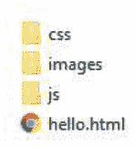

您做得很好！

### 步骤3 - 定义您的HTML结构

用最简单的描述，HTML布局可以如下图所示。将代码完全按照您看到的样子输入到您的`hello.html`文件中，然后点击文件菜单中的"保存"或按`CTRL`和`S`键。

> 为了更方便地保存，请使用快捷键 - Windows系统为`CTRL`和`S`，Mac系统为`Command`和`S`。

```html
<html>
    <head>
    </head>
    <body>
    </body>
</html>
```

为了告诉浏览器我们想显示一个HTML页面，我们以`<html>`开始标记。

接下来，我们有`<head>`。在`<head>`和`</head>`的开闭标签内，我们放置指向外部文件的链接，例如CSS和JavaScript，此外我们还可以包含元数据，并在需要时添加页面样式等等。

最后，我们有`<body>`。在`<body>`和`</body>`标签内，我们放置网页的主要内容。

接下来，按以下方式更新您的`hello.html`文件：

```html
<html>

<head>
    <title>Hello</title>
    <link rel="stylesheet" href="css/app.css">
</head>

<body>
    <h1>Hello, World!</h1>
</body>
</html>
```

好的，您已经认出了HTML文件结构。那么，我们还有其他什么？

```html
<title>Hello</title>
```

这设置了页面标题，可以在浏览器的页面标签上查看。

```html
<link rel="stylesheet" href="css/app.css">
```

这连接到一个外部样式表，该样式表位于"css"文件夹中。外部样式表为您的HTML页面提供了一组样式规则。

注意！如果您使用的是记事本，您的代码将不会进行语法高亮显示。相反，它将以纯黑色文本显示。

现在，您可以双击您的`hello.html`文件，在默认浏览器中打开它。您将看到一个白色页面，其中`<h1>`标题"Hello, World!"以浏览器默认字体显示。到目前为止，它很朴素，坦率地说相当单调，但我们还远未完成。

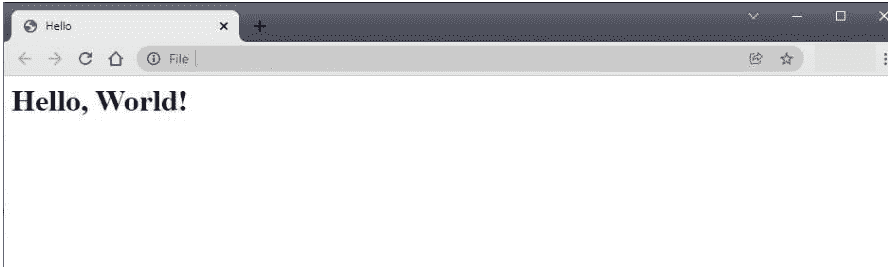

### 步骤4 - 探索层叠样式表的使用

接下来，我们将探讨层叠样式表与我们的HTML标记的结合使用。

### 什么是层叠样式表？

层叠样式表用于格式化网页。例如，CSS可用于定义颜色、宽度、高度、边距、透明度、内边距等。您可以通过三种方式实现CSS：内部、外部和行内样式。所有这些方式都将在本书中详细解释。

CSS（层叠样式表）如何与我们的HTML标记协同工作？

正如我们上面所说，CSS为格式化HTML页面的布局和样式提供了一套规则。这些规则通过`id`、`class`或关键字选择器来应用。CSS选择器是CSS规则的第一部分。它是一个元素和其他术语的模式，告诉浏览器应该选择哪些HTML元素，以便将规则内的CSS属性值应用于它们。如果这听起来像天书，现在不必太担心。一切都会变得清晰明了。

现在创建一个名为`app.css`的新文件，并将其保存在"css"文件夹中。然后添加以下代码：

```css
html, body {
    margin: 0px;
    background-image: linear-gradient(to bottom right, #95d9f9, #ae4bc3);
}
h1 {
    color: #1b95cd;
    font-family: tahoma, sans-serif;
}
```

保存文件。(`CTRL + S`)

目前，我们的网页上只有两个元素。即`h1`标题和页面的`html / body`。如果您现在查看网页并刷新它，您将看到这两个元素已经应用了样式规则。

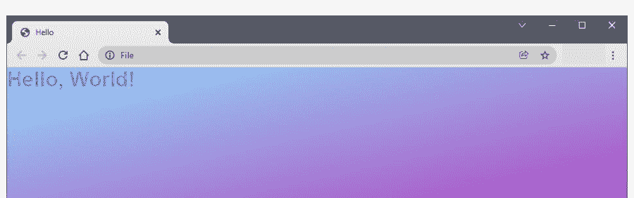

背景和字体已设置颜色，并且字体已更改。让我们仔细看看。

首先，我们可以看到边距设置为 0 像素。此命令意味着所有边距都设置为零。边距可以使用 `margin-left`、`margin-right`、`margin-top` 和 `margin-bottom` 单独设置，也可以使用组合边距命令设置。以这种方式使用时，您仍然可以设置独立的值，如下所示：

```css
margin: 0px 0px 0px 0px;
```

其中第一个 0px 用于顶部，下一个用于右侧，再下一个用于底部，最后一个用于左侧。（上右下左）。

换句话说，框架将紧贴屏幕的角落渲染到用户的视图中。

接下来，我们使用线性渐变来设置 `body` 元素的样式。它设置为向右下角，这意味着渐变将从页面的左上角渲染到右下角。在逗号之后，我们有 `#95d9f9`，这是浅蓝色的十六进制代码，最后我们有 `#ae4bc3`，这是紫色的十六进制代码。

接下来，我们设置了 `h1` 标签的样式。这意味着页面上位于 `<h1>` 和 `</h1>` 之间的所有内容都将使用设置的规则进行样式化。

首先我们设置了字体颜色。注意 `color` 在代码中是用美式拼写拼写的。颜色使用更深的蓝色设置，十六进制代码为：`#1b95cd`；

> 💡 颜色可以通过三种方式之一进行设置。一种是如示例所示的十六进制代码，第二种是 RGB 代码，第三种，某些颜色可以通过名称设置。例如，`red`、`blue`、`green`。在本书中，我们将使用十六进制代码以及 RGB 和 RGBA 代码，因为它们能对输出提供更大的控制。

其次，我们将字体从默认更改为 `Tahoma, sans-serif`。大多数人通过在文字处理应用程序等中的使用会熟悉这种字体。`sans-serif` 仅仅是无衬线的意思。衬线是某些字体具有的装饰性边缘。在某些字体中，轻微的投影会结束字母的笔画。例如 `Times New Roman`。

好的，让我们再提升几个档次。

## 步骤 5 - 添加多语言问候语

由于网站旨在全球范围内可用，让我们用几种语言说“你好”，以使其更具文化性和多样性。

编辑您的 `hello.html` 文件并添加以下代码。

```html
<h1 class="GB"> Hello </h1>
<h1 class="ES"> Hola </h1>
<h1 class="FR"> Bonjour </h1>
<h1 class="IT"> Salve </h1>
<h1 class="GE"> Guten tag </h1>
<h1 class="JP"> Konnichiwa </h1>
<h1 class="RU"> Zdravstvuyte </h1>
<h1 class="KO"> Anyoung Haseyo </h1>
<h1 class="PO"> Dzien Dobry </h1>
<h1 class="HI"> Namaste </h1>
<h1 class="HE"> Shalom </h1>
<h1 class="SW"> God Dag </h1>
```

替换：

```html
<h1>Hello World!</h1>
```

这行代码。

到目前为止，如果您正确遵循了说明，刷新浏览器应呈现以下结果：

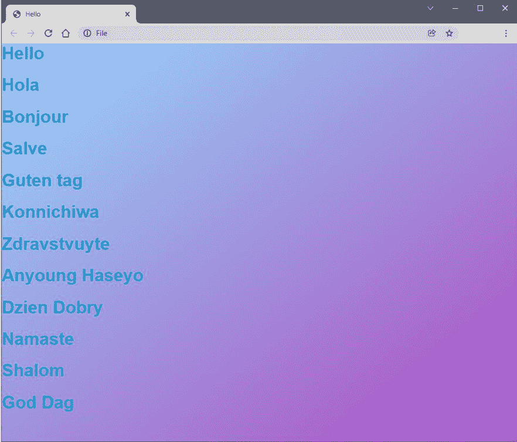

这里只有一个真正的区别。那就是在每个 `<h1>` 标签内添加了类。目前它们没有效果，每个 `<h1>` 标签只是遵循我们为 `<h1>` 制定的现有规则。接下来，我们将通过添加一些 JavaScript 来使事情更有趣。JavaScript 可以以与 CSS 大致相同的方式利用类、关键字和 id。

## 步骤 6 - JAVASCRIPT 函数

使用 JavaScript，我们可以更新我们的 CSS 脚本。为此，我们将创建一个 JavaScript 函数。

## 什么是 JAVASCRIPT 函数？

JavaScript 函数是设计用于执行特定任务的代码块。JavaScript 函数在被调用（invoked/called）时执行。

创建一个名为`app.js`的新文件并将其保存在 `js` 文件夹中。然后输入以下代码。

```javascript
//Generate salutations
//t - top, l - left, c - colour, s - font-size, z - z-index, id - class

function sals(t, l, c, s, z, id){
    var sal = document.getElementsByClassName(id);
    sal[0].style.top = t;
    sal[0].style.left = l;
    sal[0].style.color = c;
    sal[0].style.fontSize = s;
    sal[0].style.zindex = z;
}

sals('5%', '50%', '#1b95cd', '250px', '20', "GB");
sals('1%', '10%', 'red', '150px', '19', "ES");
sals('15%', '30%', 'blue', '100px', '18', "FR");
sals('35%', '60%', 'green', '170px', '17', "IT");
sals('54%', '20%', 'orange', '170px', '16', "GE");
```

```javascript
sals('54%', '35%', 'yellow', '100px', '15', 'JP');
sals('10%', '55%', 'grey', '80px', '14', 'RU');
sals('27%', '21%', 'lightgrey', '100px', '13', 'KO');
sals('37%', '31%', '#333', '65px', '12', 'PO');
sals('67%', '51%', 'pink', '125px', '11', 'HI');
sals('47%', '11%', 'lightblue', '115px', '10', 'HE');
sals('27%', '31%', 'lightgreen', '185px', '9', 'SW');
```

我们需要将此脚本连接到 `hello.html` 文件中的模板。按如下方式编辑它：

在 `</body>` 标签内部，添加以下代码行：

```html
<script src="js/app.js"></script>
```

那么，让我们稍微谈谈这段 JavaScript 代码在做什么。

```javascript
//Generate salutations
//t - top, l - left, c - colour, s - font-size, z - z-index, id - class
```

这部分代码是注释，以便您在重新访问时记住代码的用途。您可以在 JS 中任何文本前使用 `//` 双斜杠注释掉单行，也可以使用 `/*` 作为开始和 `*/` 作为结束来注释多行，如下所示：

```javascript
/* Generate salutations
t - top, l - left, c - colour, s - font-size, z - z-index, id - class */
```

这种第二种注释风格也可以在 CSS 中用于注释您的代码。这是强烈推荐的做法。您应该始终为您的代码添加注释。当您与其他开发人员在项目上协作时，这特别有用。

我在这里记录了每个函数参数的含义。我们可以向每个参数传递数据，以在函数内部使用。

接下来，我们有 `sals`（salutations 的缩写）函数本身。

```javascript
function sals(t, l, c, s, z, id){
    var sal = document.getElementsByClassName(id);
    sal[0].style.top = t;
    sal[0].style.left = l;
    sal[0].style.color = c;
    sal[0].style.fontSize = s;
    sal[0].style.zindex = z;
}
```

好的，这里的第一行代码打开了我们命名为 `sals` 的函数，并传递了参数 `t`、`l`、`c`、`s`、`z` 和 `id`。所有这些都由这一行代码完成。

```javascript
function sals(t, l, c, s, z, id){
```

在函数的末尾，我们用花括号关闭它。

```javascript
}
```

在函数内部，我们的第一行代码创建了一个名为 `sal` 的变量。我们的变量保存一个 `id` 标签，该标签与我们在 `hello.html` 文件中给出的类名相关联。

```html
<h1 class="GB"> Hello </h1>
```

在这里您可以看到类名关联的第一部分，其中代码的 `class="GB"` 部分用于将我们的 CSS 和 JS 代码归因于我们的 HTML 标记。

因此，本质上，这行代码的意思是连接到 `id` 参数给出的类。

下一行代码将顶部 CSS 样式更改为参数 `t` 中给出的新值。

```javascript
sal[0].style.top = t;
```

函数开放和关闭花括号 `{` 和 `}` 内的每一行代码都会更改给定参数的特定样式，如我们的注释所示。

```
t - top - 距离屏幕顶部多少像素
l - left - 距离屏幕左侧多少像素
c - colour - 以什么颜色显示文本
s - font-size - 期望的字体大小
z - z-index - 覆盖层级别 - 1 出现在 0 前面
id - class - 我们选择的类名
```

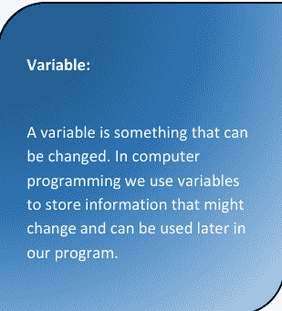

这自然地引出了我们的一组函数调用。如果不调用函数，其中的代码将不会运行。我们的每个函数调用都做同样的事情，除了更改给定的参数。让我们检查第一个函数调用以获得更好的理解。

```javascript
sals('5%', '50%', '#1b95cd', '250px', '20', "GB");
```

好的，首先要调用一个函数，我们需要以下代码：

```javascript
sals();
```

这将调用名为 `sals` 的函数，但不传递参数。在我们的例子中，它会抛出一个错误，可以在浏览器控制台中查看，但除此之外，它似乎什么都不做，因为我们需要传递参数，我们的代码才能实现我们想要的效果。

当我们这样正确调用它时：

```javascript
sals('5%', '50%', '#1b95cd', '250px', '20', "GB");
```

-   `sals();` 调用函数
-   `'5%'` 代表 `t` 参数
-   `'50%'` 代表 `l` 参数
-   `'#1b95cd'` 代表 `c` 参数
-   `'250px'` 代表 `s` 参数
-   `'20'` 代表 `z` 参数
-   `'GB'` 代表 `id` 参数

因此，使用我们的函数，我们只需一行代码就能为每个问候语更改所有这些参数。

将以下内容添加到我们CSS文件的`h1`规则中，并保存（`CTRL + S`）：

```css
opacity: 60%;
position: absolute;
```

`opacity: 60%;` 的作用如其名所示。它使每个问候语略微透明，即60%不透明或40%透明，这取决于你选择的观察视角。不透明度也可以用小数设置。1等于100%不透明，而0则不可见。不透明度可以在0.0到1之间以增量设置，值越低越透明。

`position: absolute;` 允许我们JavaScript函数中的`top`和`left`参数更新CSS的`position`属性。CSS中有七个定位属性。分别是：`static`（这是默认值）、`absolute`、`fixed`、`relative`、`sticky`、`initial`和`inherit`。目前，你只需要知道`position: absolute`允许我们根据`top`和`left`坐标在屏幕上的精确位置放置元素。

现在刷新浏览器查看结果。它开始看起来更有趣了！

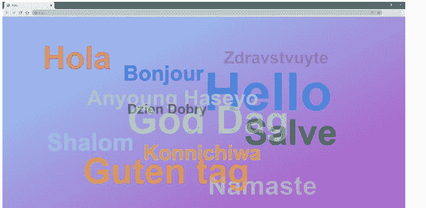

## 第7步 - 添加图片

我们最初的程序显示的是"Hello, World"，所以我们来处理一下world这部分。这就是我们images文件夹的用武之地。

好的，请从以下地址下载`world.gif`文件：

[https://wddtrw.co.uk/resources/learntocode/images/world.gif](https://wddtrw.co.uk/resources/learntocode/images/world.gif)

将图片保存到你文件结构中的images文件夹。为此，请访问给定链接地址，右键单击旋转的地球，并从上下文菜单中选择"另存为"。然后选择你文件结构中的images文件夹并点击保存按钮。


注意！如果你决定更改文件名，你也必须在代码中相应更改。文件名为`world.gif`，因此图片必须被引用为`images/world.gif`。确保这两者匹配至关重要，否则你的图片将无法显示。

接下来，编辑你的`hello.html`文件，并在开始的`<body>`标签下方添加以下代码行，如下所示。然后保存你的文件。

```html
<body> ◄ 不要添加这行。
<div class="globe"></div>
```

这里我们将图片放在了一个`<div></div>`分区内。可以将此视为可见屏幕的一个分区。我们给`<div>`赋予了`globe`类。我们将使用它来将div及其内容放置在我们希望它出现在屏幕上的位置。我们也给图片赋予了一个类。这样我们就可以控制图片的显示方式。

> **`<div>`：**
>
> div标签被称为Division标签。div标签在HTML中用于在网页中划分内容区域，如（文本、图片、页眉、页脚、导航栏等）。... 它用于将各种HTML标签分组，以便可以创建区块并为其应用样式。

接下来，打开`app.css`文件并添加以下代码行。

首先，在`h1 { }`内部添加以下代码行：

```css
-webkit-text-stroke: 2px white;
```

这将在文本周围添加一个2px或2像素宽的描边（轮廓）。添加此效果是为了让文字从背景中更突出地显示出来。

> **像素：**
>
> 像素是数字图像或图形中可以显示和呈现在数字显示设备上的最小单位。
>
> 像素也被称为picture element（pix = picture，el = element）。

接下来，在`app.css`文件底部添加以下两个类：

```css
.globe {
    text-align: center;
    margin-top: 150px;
}

.globe_image {
    height: 70vh;
}
```

`globe`类被赋予了两条规则。首先，它被设置为页面居中对齐，其次，它设置了从可见屏幕顶部开始的150像素边距。

`globe_image`类被赋予了一条规则。这将我们地球的高度设置为70vh或视口高度的70%。

保存文件并预览你的结果。如果一切都正确操作，你应该看到以下显示，背景中有一个旋转的动画地球。

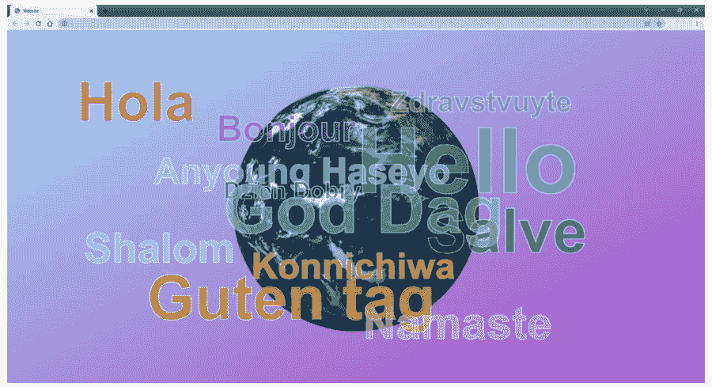

嘿，真是一个很棒的开端。恭喜你走到这一步！！

接下来，我们将开发一些有用的东西。这就是编码的意义所在。让你自己或他人的生活更轻松或更有趣。

与此练习相关的所有文件和图片可在此处找到：

[https://wddtrw.co.uk/resources/learntocode/helloworld.zip](https://wddtrw.co.uk/resources/learntocode/helloworld.zip)

给自己泡一杯应得的好茶，我们继续前进！


# 快速访问网页菜单

### 课程目标

设计和开发一个结构良好的网页，其中包含一个用于你所有常用网站的快速访问菜单。

## 第1步 - 信息收集

任何优秀设计的第一步都是信息收集。这个项目将是个性化的，因此尽管你的结果将遵循书中版本的相同逻辑，但你的作品会看起来有些不同。

首先，你需要选择多达12个你最常访问的网站。可以是任何网站。参考我下面的列表获取一些灵感。

| 桑坦德网上银行 | Facebook |
| YouTube | Amazon |
| AOL Email | Zoom |
| PayPal | LinkedIn |
| Google Maps | Twitter |

## 第2步 - 组织文件结构

接下来，我们需要构建文件结构。对于这个项目，它比上一个稍微简单一些。在你的桌面上创建一个名为`website`的新文件夹。打开它，并在其中创建一个名为`css`的文件夹和一个名为`images`的文件夹。最后，打开你选择的代码编辑器并新建一个文件。将其保存为`web_menu.html`。

如果你正确遵循了说明，你应该拥有以下文件结构：

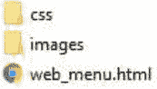

## 第3步 - 下载和准备图片

接下来，对于你选择的每个网站，在谷歌上搜索并找到合适的图片来代表它们。选择清晰的图片。现在不必太担心尺寸，因为我会解释如何编辑和优化你的图片。

使用我们保存`world.gif`图片时相同的方法，在谷歌图片中搜索合适的图片，右键单击，从上下文菜单中选择"另存为"，并将每张图片保存到你的images文件夹中。

这次，我建议你更改图片的名称，以便清晰和易于使用。例如，在我的例子中，我将第一张图片命名为`santander.jpg`。图片有许多不同的文件格式，因此，你选择的可能不是jpeg格式。如果是这种情况，不用担心，只需将其命名为`[你的文件名].[你的扩展名]`即可。我们可以在代码中更改文件名和扩展名以适应。

所以我有10个网站，因此我也有10张图片来代表这些网站，并保存在我的images文件夹中。如果你正确完成了这一步，你的images文件夹中应该有类似的内容，当然除了可能不同的文件名和扩展名。


amazon.png


aol.jpg


facebook.png


googlemaps.png


linkedin.png


paypal.png


santander.png


twitter.png


youtube.png


zoom.jpg

注意我选择了所有横向矩形图片。这会使我的结果更加统一。这是一个个人选择，其实并不重要。重要的是你有一张图片来代表你选择的每个网站。

## 第4步 - 实现HTML文件结构

如果尚未打开，请在你选择的代码编辑器中打开`website.html`。与上一个练习一样，首先我们需要实现我们的文件结构，如下所示。

```html
<html>
    <head>
    </head>
    <body>
    </body>
</html>
```

## 第5步 - 页面布局设计

在这一阶段，我们需要思考页面布局。绘制一个方框图来代表你希望通过CSS实现的效果是个好主意。在我的示例中，我有10个网站，因此我确定了以下页面结构：

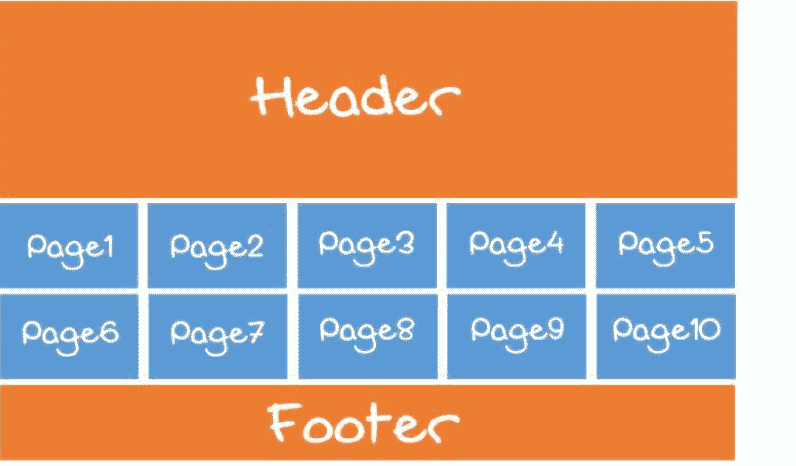

## 第6步 - 使用HTML实现页面布局

接下来，我们将更新`website.html`，添加一个标题、一个指向我们将创建的CSS文件的链接，并探讨如何为我们网站的菜单实现页面结构。

其中一些代码你在上一个练习中已经见过，所以你应该已经开始有点熟悉并能识别各种关键字和标记了。

在代码的`<head></head>`部分添加以下内容：

```html
<head>
    <title>Fast Access Web Menu</title>
    <link rel="stylesheet" href="css/app.css">
</head>
```

然后，在`<body><body>`中，添加以下内容：

```html
<body>
    <header>
        <h1>Fast Access Web Menu</h1>
    </header>
    <div class="wrapper">
        <div class="">
            <a href="" alt="" title="">
                
            </a>
        </div>
    </div>
    <footer>
        <p>&copy; Copyright [Your Name Here] 2022</p>
    </footer>
</body>
```

好的，让我们看看目前我们有什么。我们有一个名为`<header></header>`的部分。`<header>`元素代表一个用于介绍性内容或一组导航链接的容器。

一个`<header>`元素通常包含：

- 一个或多个标题元素（`<h1>` - `<h6>`）
- 标志或图标
- 作者信息

> 你可以在一个HTML文档中有多个`<header>`元素。然而，`<header>`不能放在`<footer>`、`<address>`或另一个`<header>`元素内部。

接下来，我们有一个类名为`wrapper`的`<div>`。这将用于将所有页面链接封闭在一个分区（页面区域）中。

接下来的部分是主要工作完成的地方。

```html
<div class="">
    <a href="" alt="" title="">
        
    </a>
</div>
```

我们添加的每个网站链接都会复制这段代码。我有10个网页，因此我将需要复制这个10次。为我的每个页面链接复制一次。你会注意到我还没有命名类，也没有在`href`、`alt`、`title`或`src`标签中添加任何详细信息。这是因为对于每个链接，这些信息都会有所不同。

让我们深入看看。

我们有一个带类的`<div>`。这个类将为每个页面链接适当地命名，以便可以在CSS中使用。如果你完成了上一个练习，你将已经熟悉这段代码。

接下来，我们有一个`<a></a>`锚点标签，也称为超链接或链接。`href`携带引用信息，我们希望用户在点击链接时被定向到哪里。超链接可以使用内部和外部URL，甚至可以指向同一网页的特定部分的锚点。在我们的示例中，我们将为第三方网站使用外部URL。我们将在本书后面探讨其他选项。

接下来，我们有`alt=""`，你会注意到这在图像标签中也有显示。这是用于替代文本的。或者换句话说，如果由于某种原因信息或图像无法显示，则向用户显示的文本。例如，当连接缓慢或源文件出现错误时，可能会发生这种情况。Alt标签也会被屏幕阅读器读取。对于超链接，描述链接指向哪里是一个好的做法。它们不是严格必要的，但这是高度推荐的最佳实践，并且是良好搜索引擎优化（SEO）的一部分。

`title=""`，类似于alt标签，应该携带相关的标题信息。当鼠标悬停时显示。带有这些标签的超链接和图像被认为是格式良好的。

此外，我们在图像标签中有一个`class=""`。这将用于相应地设置图像的样式。

> 注意，`` 在 `<a></a>` 内部。这可以是文本，或者像我们这里做的那样，是一个图像。它使图像可点击。当点击时，用户将被重定向到给定的URL。

最后，我们有页脚。`<footer>`标签为文档或区域定义一个页脚。

一个`<footer>`元素通常包含：

- 作者信息
- 版权信息
- 联系信息
- 网站地图
- 返回顶部链接
- 相关文档

你可以在一个文档中有多个`<footer>`元素。

我们保持事情简单，只添加版权信息。根据你的细节进行更新以适应情况。

考虑到所有这些，相应地更新你的代码。参见我下面的示例：

```html
<html>
    <head>
        <title>Fast Access Web Menu</title>
        <link rel="stylesheet" href="css/app.css">
    </head>
    <body>
        <header>
            <h1>Fast Access Web Menu</h1>
        </header>
        <div class="wrapper">
            <div class="page">
                <a href="" alt="" title="">
                    
                </a>
            </div>
            <div class="page">
                <a href="" alt="" title="">
                    
                </a>
            </div>
            <div class="page">
                <a href="" alt="" title="">
                    
                </a>
            </div>
            <div class="page">
                <a href="" alt="" title="">
                    
                </a>
            </div>
            <div class="page">
                <a href="" alt="" title="">
                    
                </a>
            </div>
            <div class="page">
                <a href="" alt="" title="">
                    
                </a>
            </div>
            <div class="page">
                <a href="" alt="" title="">
                    
                </a>
            </div>
            <div class="page">
                <a href="" alt="" title="">
                    
                </a>
            </div>
            <div class="page">
                <a href="" alt="" title="">
                    
                </a>
            </div>
            <div class="page">
                <a href="" alt="" title="">
                    
                </a>
            </div>
        </div>
        <footer>
            <p>&copy; Copyright Garry Owen 2022</p>
        </footer>
    </body>
</html>
```

注意我们现在如何有10个类名为`page`的div，10个链接，以及这些链接内的10个图像。在这个示例中，我选择将我的页面链接设置为相同的样式，如果你愿意，可以轻松更改为单独的样式。

好的，理解了解释后，让我们继续。

## 第7步 - 选择颜色设计并实现CSS

现在是时候开始处理我们的CSS了。打开你选择的编码编辑器，创建一个名为`app.css`的新文件，并将其保存在你的文件结构中的`css`文件夹内。

不过，在我们深入之前，让我们选择一些颜色。我已经提到过，使用十六进制代码或RGB代码进行颜色选择将提供更多的选项。

许多设计师使用色轮。据说互补色通常看起来很好。网上有很多这样的例子。

我特别喜欢Adobe色轮生成器。通过下面的链接查看：

[https://color.adobe.com/create/color-wheel](https://color.adobe.com/create/color-wheel)


或者，从这个表格中选择一些颜色：

| #ac1917 | #b75420 | #c0982b |
| #d70e17 | #e46828 | #f0be39 |
| #e54a50 | #ea8553 | #eec76b |
| #768b45 | #237f5d | #1c7873 |
| #93ae55 | #359d73 | #27958f |
| #a9be77 | #6fb293 | #4eaaa6 |
| #156b8a | #3f5d82 | #704776 |
| #1887ab | #4f73a1 | #8c5792 |
| #5d9db9 | #728fb4 | #926ca0 |
| #874f80 | #a15284 | #aa3653 |
| #a9629f | #c867a5 | #d34467 |
| #b881b1 | #d386b7 | #dc6986 |

我保持我的配色方案相当简单。

`#EB8716` – 用于我的标题


`#90CEE8` – 用于我主要内容周围的包装器

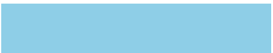

`#006F9E` – 用于我的页脚


好的，决定了之后，我们继续构建 CSS。

如果还没有，请打开 `app.css` 并添加以下代码：

```css
html, body{
    margin: 0px;
}
header {
    background-color: #EB8716;
    color: #fff;
    width: 98%;
    height: 200px;
    margin: 1%;
}
header h1{
    text-align: center;
    font-family:'Franklin Gothic Medium', 'Arial Narrow', Arial, sans-serif;
    padding: 60px;
    font-size: 50px;
}
.wrapper {
    background-color: #90CEE8;
    width: 98%;
    height: 400px;
    margin: 1%;
}
.wrapper .page{
    width: 19%;
    height: 180px;
    background-color: #006F9E;
    display: inline-block;
    margin: 0.4%;
}
footer {
    background-color: #006F9E;
    color: #fff;
    width: 98%;
    height: 60px;
    margin: 1%;
}
footer p{
    font-family: 'Segoe UI', Tahoma, Geneva, Verdana, sans-serif;
    text-align: center;
    padding: 20px;
}
```

你可以随意更改颜色的十六进制代码以适应自己的需求。

刷新我们的页面后，我们得到以下结果：

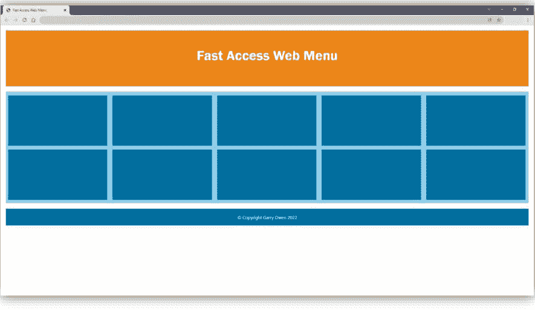

让我们更详细地检查一下 CSS。

你可以看到我们这里使用了两种不同类型的选择器。第一种是元素选择器，第二种是类选择器。还有一种我应该提到，那就是 id 选择器。

那么区别是什么？

一个 id 选择器使用格式 - `#id`

一个类选择器使用格式 - `.class`

一个元素选择器使用格式 - `element`，例如 `p` = 样式所有 `<p>` 元素

但远不止于此。选择器可以组合在一起形成复杂的模式。

你可以在这里看到一个简单的例子，我们使用了：

```css
header h1{
```

这告诉浏览器规则只适用于 header 内的 h1 元素。这个模式很直接，但选择器可以组合成多种形式。我们将在本书的学习过程中看到更多的选择器模式。不过，如果你想知道更多关于选择器的知识，一个简单的谷歌搜索就能揭示大量的选项。

大多数规则是重复的，所以我们只检查不同的规则。然后你也可以将这些知识应用到其他规则上。有些规则你之前也见过。话虽如此，让我们来看看。

```css
background-color: #EB8716;
//CHANGES THE BACKGROUND COLOUR

color: #fff;
// CHANGES THE TEXT COLOUR

width: 98%;
// CHANGES THE WIDTH OF THE ELEMENT

height: 200px;
// CHANGES THE HEIGHT OF THE ELEMENT

margin: 1%;
// SETS ALL MARGINS OF THE ELEMENT

font-family: 'Segoe UI', Tahoma, Geneva, Verdana, sans-serif;
// CHANGES THE FONT FACE OF THE ELEMENT

text-align: center;
// ALIGNS THE ELEMENT TO THE CENTRE

padding: 20px;
// ADDS PADDING AROUND THE ELEMENT

display: inline-block;
// DISPLAYS THE ELEMENT ACROSS THE PAGE AND WRAPS IT AT THE EDGE OF THE DISPLAY
```

建议你自己尝试这些值并查看结果。这是最好的学习方式。

你可以放心，所有文件都可以下载，如果你犯了无法解决的错误。

## 第 8 步 - 添加格式良好的图像元素

好的，接下来我们将添加图像源信息、替代文本、标题和图像类。

让我们从图像源 URL 开始。

打开你的 images 文件夹，将所有图像信息逐个添加到每个图像 `src=""` 占位符中，格式如下：

`images/[image name].[extension]`

以我为例，它们将是：

| images/amazon.png | images/paypal.png |
|---|---|
| images/aol.jpg | images/santander.png |
| images/facebook.png | images/twitter.png |
| images/googlemaps.png | images/youtube.png |
| images/linkedin.png | images/zoom.jpg |

填写相应的 alt 文本和标题，并添加 `image_link` 作为类。

现在你的 `website.html` 文件应该看起来像这样：

```html
<html>
    <head>
        <title>Fast Access Web Menu</title>
        <link rel="stylesheet" href="css/app.css">
    </head>
    <body>
        <header>
            <h1>Fast Access Web Menu</h1>
        </header>
        <div class="wrapper">
            <div class="page">
                <a href="" alt="" title="">
                    
                </a>
            </div>
            <div class="page">
                <a href="" alt="" title="">
                    
                </a>
            </div>
            <div class="page">
                <a href="" alt="" title="">
                    
                </a>
            </div>
            <div class="page">
                <a href="" alt="" title="">
                    
                </a>
            </div>
            <div class="page">
                <a href="" alt="" title="">
                    
                </a>
            </div>
            <div class="page">
                <a href="" alt="" title="">
                    
                </a>
            </div>
            <div class="page">
                <a href="" alt="" title="">
                    
                </a>
            </div>
            <div class="page">
                <a href="" alt="" title="">
                    
                </a>
            </div>
            <div class="page">
                <a href="" alt="" title="">
                    
                </a>
            </div>
            <div class="page">
                <a href="" alt="" title="">
                    
                </a>
            </div>
        </div>
        <footer> <p>&copy; Copyright Garry Owen 2022</p>
        </footer>
    </body>
</html>
```

## 第 9 步 - 为图像添加样式

让我们快速更新一下 CSS，以处理我们刚刚添加的图像类。

打开 `app.css` 并将以下代码添加到底部：

```css
.image_link{
    height: 180px;
    width: 18.5vw;
    margin: 1% 0 1% 1%;
}
.image_link:hover {
    filter: grayscale(70%);
}
```

那么这里发生了什么？

```css
height: 180px;
width: 18.5vw;
```

这是为了让你的所有图像都以统一的大小出现。

```css
margin: 1% 0 1% 1%;
```

这设置了边距，并带有轻微偏移，以产生一种 3D 投影效果。记住边距设置是上、右、下、左 (TRBL)。我总是想到单词 `trouble` 来帮助记住这个顺序。所以下次当你 **TROUBLE** 试图记住顺序时，嘿，变好了！！

下一部分有一个我们以前没见过的选择器模式。

```css
.image_link:hover {
```

这仅仅意味着，当你用鼠标悬停在一个具有 `image_link` 类的元素上时，规则就会被应用。

最后，我们设置了一个规则，用于当我们悬停在元素上时：

```css
filter: grayscale(70%);
```

这将悬停元素的颜色设置为 70% 灰度。与不透明度一样，你可以用小数或百分比来设置。1 = 100%，0.7 = 70%。

那么，现在整体看起来如何？让我们来看看。

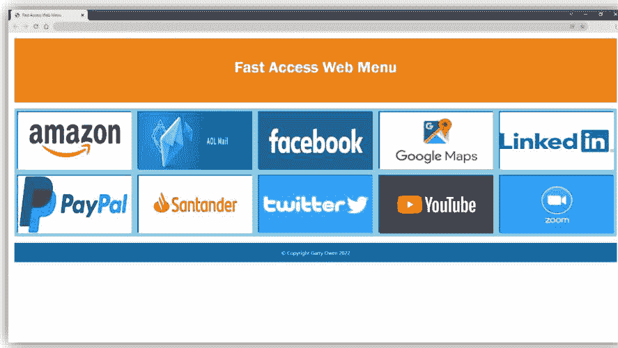

看起来相当不错。如果我们悬停在一个元素上，它看起来会是怎样的？

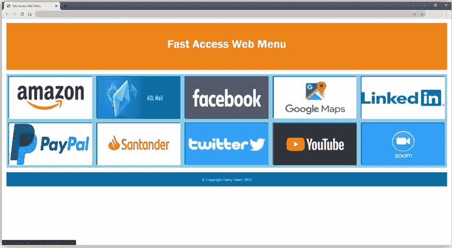

你可以在这里看到，我们正在悬停在 Facebook 链接上。

快速进入下一步...

## 第 10 步 - 实现格式良好的超链接

最后一步。

```html
<a href="" alt="" title="">
```

我们现在剩下的就是在 `href=""` 占位符中填写 URL 信息，填写替代文本，并添加我们的标题。让我们看一个例子：

```html
<a href="https://amazon.co.uk" alt="Visit Amazon" title="Visit Amazon">
```

现在，填写其余部分。

# 创建一个网页应用

### 什么是网页应用？它与网站有何不同？

网页应用，也被称为 Web App，是一种具有功能性和交互元素的计算机程序。你使用常规的 Web 技术来构建它，但它也能根据用户需求存储和处理数据。用户可以通过互联网访问它。

另一方面，网站是一个公开可访问的页面集合，包含文档、图像、音频、文本或其他文件，用户可以通过互联网访问这些内容。

好的，它们听起来很相似，对吧？从用户角度来看，本质上确实如此。它们都是通过网络浏览器访问的，你都可以通过搜索引擎找到。

简而言之，主要区别在于：

- 网站提供可供查看和阅读的信息，但无法进行操作。
- 普通网站不需要强制认证。
- 通过网站，信息是公开可访问的——无需注册。
- 网站仅使用基础的 Web 技术。
- 托管成本更低。

通常，网页应用会使用服务器端技术（如 PHP 或 Node.js）来构建，但为了演示目的，我们将使用可以在本地机器上通过浏览器运行的方法。

在本书的后续部分，我将演示如何将你的项目部署到远程服务器上，并使其公开可访问。

你可以在你的 PC 或 Mac 上设置本地服务器来运行，但这超出了本书的范围。如果你想了解更多关于设置本地编程环境的知识，你可以通过以下链接获取本系列丛书中的第一本《Web 设计与开发——正确的方式！》——设置你的本地编程环境：

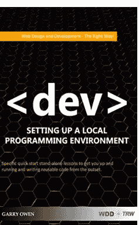

[https://viewbook.at/wddtrw1](https://viewbook.at/wddtrw1)

## 课程目标

以移动设备优先的方法设计和开发一个基于网络的测验应用。

构建一个题库，供用户交互式答题并获取结果。

开发系统以允许用户添加或删除问题，并包含一个倒计时计时器。

> **移动设备优先方法：**
>
> “移动设备优先”方法指的是，从移动版本开始设计桌面站点，然后将其适配到更大的屏幕上（这与传统上先从桌面站点开始再适配到小屏幕的方法相反）。

## 第 1 步 - 设置你的文件结构

大家，放开手脚吧！让我们开始构建下一个令人兴奋的项目。首先，让我们实现所需的文件结构。

到现在你应该已经熟悉如何设置文件结构了。这一次，你需要在桌面上创建一个名为 `web app` 的新文件夹。在该文件夹内，添加一个 `css` 文件夹、一个 `images` 文件夹、一个 `js` 文件夹和一个 `json` 文件夹。最后，打开你选择的代码编辑器，创建一个名为 `quiz_app.html` 的新文件。如果一切操作正确，你应该有一个名为 `web app` 的文件夹，包含以下文件结构：

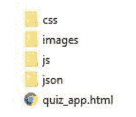

你之前见过其他文件夹，但那个 `json` 文件夹是做什么的呢？通常，我们会使用数据库来允许用户添加和删除数据。在这个练习中，我们将通过写入一个 JSON 文件来模拟这种功能。

类似于 JSON 的文档被用作一种名为 MongoDB 的 NoSQL 基于文本的数据库系统的数据结构。如果你想了解更多，可以查看下面的链接。不过，我们这里不会使用它。

[https://www.mongodb.com/](https://www.mongodb.com/)

## 什么是 JSON 文件？

- JSON 代表 JavaScript 对象表示法
- JSON 是一种用于存储和传输数据的文本格式
- JSON 是“自描述的”且易于理解
- JSON 是语言无关的——这意味着它可以在许多编程语言中使用——因此，它便于在这些不同的语言之间传递数据

## 为何使用 JSON？

一个简单的 JSON 字符串示例如下所示：

```json
{"name":"Garry Owen", "age":47, "car":"BMW"}
```

很简单，对吧？请注意，文本字符串用双引号括起来，而数字则没有。这样数字就能被识别为数值，从而允许我们在计算中使用。如果这听起来不太明白，现在先不用太担心。我们稍后会介绍不同的数据类型并更深入地解释这一点。

这种结构被称为键值对。一个键值对由两个相关的数据元素组成：一个键，它是定义数据集的常量；以及一个值，它是属于该数据集的变量。

例如 `"name":"Garry Owen"` – “键”：“值”

这个 JSON 字符串定义了 3 个属性（name、age 和 car），每个属性都有一个值。如果你用 JavaScript 解析这个 JSON 字符串，就可以像这样将数据作为对象来访问：

```javascript
let personName = obj.name;
let personAge = obj.age;
```

我们现在就可以访问这些信息并在程序中使用它。

JSON 格式的语法与用于构造对象的 JavaScript 代码相似。因此，我们可以轻松地将 JSON 数据转换为 JavaScript。更棒的是，JavaScript 有一个内置函数用于将 JSON 字符串转换为对象，同时也有一个内置函数用于将 JavaScript 对象转换为 JSON。顶级！

> 语法上：
>
> 指与计算机语言中语句或元素的结构相关的方式

JSON 转换为 JavaScript 如下所示：

```javascript
JSON.parse()
```

而将 JavaScript 对象转换为 JSON，则如下所示：

```javascript
JSON.stringify()
```

那么，让我们把这一切结合起来，看看如何将 JSON 字符串传递到 JavaScript 对象中。

```html
<html>
<head></head>
<body>
<h2>Convert JSON string into a JavaScript object.</h2>
<div id="result"></div>

<script>
//JSON String
const person = '{"name":"Garry Owen", "age":47, "car":"BMW"}';

//Make a new JavaScript Object
const obj = JSON.parse(person);

//Display the results in the div
document.getElementById("result").innerHTML = obj.name + " is " + obj.age+ " and drives a " + obj.car;

</script>
</body>
</html>
```

快速浏览一下，我们可以看到已经将 JSON 字符串放入了一个名为 `person` 的常量中。然后，我们创建了一个新的 JavaScript 对象，并将我们的 JSON `person` 字符串解析到其中，再通过引用对象（`obj`）的键属性，将每个键值对的选择结果展示在 `<div>` 中。

这会产生如下效果：

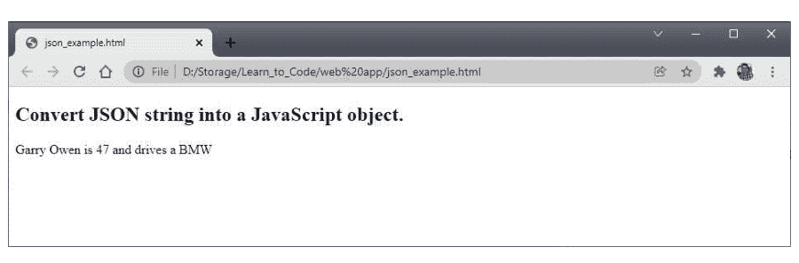

你做得很好！让我们继续前进……

## 第 2 步 - 实现 HTML 结构

到现在，你应该已经相当熟悉 HTML 结构了。在添加任何装饰之前，先将下面的标记代码添加到我们的 `quiz_app.html` 文件中。

```html
<html>
    <head>
    </head>
    <body>
    </body>
</html>
```

完成后，让我们为骨架添上血肉。

这个 Web 应用将如何运作？

1.  我们希望这个 Web 应用采用移动优先的方法——所以它必须能在手机上很好地适配并呈现良好。
2.  我们希望使用 JavaScript 从一个 JSON 文本文件中获取问题。
3.  我们希望用户能够交互、回答问题并查看结果。
4.  我们希望用户能够添加或删除问题并更新 JSON 文件。

那么，让我们先看看一个粗略的布局。

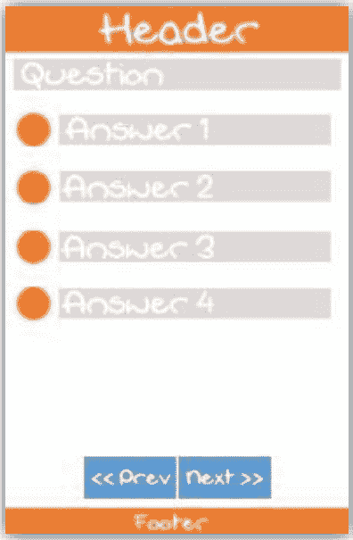

好的，首先我们希望使用页眉、页脚和内容属性来设置布局样式。我们有一个问题和 4 个可能的多项选择答案，还有上一题和下一题按钮的预留位置。确定好之后，让我们为 HTML 文件添加一些标记。

```html
<!DOCTYPE html>
<html>
<head>
    <meta name="viewport" content="user-scalable=no, width=device-width" />
    <link rel="stylesheet" type="text/css" href="css/app.css">
    <title>Question Time</title>
    <script type="text/javascript" src="json/questions.json"></script>
<body>
    <div id="header">
        <h1>Question Time<br>The Quiz App</h1>
    </div>
    <div class="quiz-wrapper">
        <div id="quiz"></div>
    </div>
    <button id="previous"><p>Previous Question</p></button>
    <button id="next"><p>Next Question</p></button>
    <button id="submit"><p>Submit Quiz</p></button>
    <div id="results"></div>
    <div id="footer">
        <h5>Written by Garry Owen &copy; Copyright December 2021</h5>
    </div>
    <script src="js/app.js"></script>
</body>
</html>
```

好的，现在我们有了基本的标记。让我们仔细检查一下。其中很多标记你以前都见过，但这里也有一些新标签。

我们在 head 内部遇到的第一行代码是：

```html
<meta name="viewport" content="user-scalable=no, width=device-width" />
```

这行代码告诉浏览器，在触摸屏设备上，用户不应能够放大或缩小。这样设计是为了让 Web 应用能很好地适配手机屏幕。它还将网页的宽度设置为设备宽度，这意味着它将填充设备 100% 的宽度。默认情况下，用户可以缩放屏幕，但在我们的 Web 应用中他们不需要这样做，因为它将易于阅读和导航。

接下来我们有：

```html
<link rel="stylesheet" type="text/css" href="css/app.css">
<title>Question Time</title>
```

你现在应该熟悉这两行了。第一行链接了外部 CSS 文件，下一行给页面设置了标题。

然后，在 `<body>` 标签内部，我们有：

```html
<div id="header"><h1>Question Time<br>The Quiz App</h1></div>
```

这会打开一个新的 div，其 id 为 header，并在其中添加了一个 `<h1>` 标题。

接着，我们有：

```html
<script type="text/javascript" src="json/questions.json"></script>
```

这类似于我们在第一个练习中引入/引用 JavaScript 文件的方式。这次唯一的不同在于我们引用的是 JSON。


为了良好的搜索引擎优化，任何给定的网页上都应该只放一个 `<h1>` 标题。`<h1>` 被视为最重要的，而随着级别递减，例如 `<h2>`... `<h3>`... 等等，搜索引擎的算法会将其解析为越来越不重要。

好的，接下来我们有两个嵌套的 `<div>` 标签。

```html
<div class="quiz-wrapper">
    <div id="quiz"></div>
</div>
```

这是我们将要显示测验的地方。请注意，我们给一个 div 设置了 `quiz-wrapper` 的类，给另一个设置了 `quiz` 的 id。

> **嵌套：**
>
> 一个元素可以被放置在另一个元素内部。嵌套允许你对单个内容应用多个 HTML 标签。

接下来，我们有三个 `<button>` 标签。它们将实现我们测验的用户交互需求。

```html
<button id="previous">Previous Question</button>
<button id="next">Next Question</button>
<button id="submit">Submit Quiz</button>
```

每个按钮都被赋予了一个代表其用途的 id。

然后，我们有另一个 div 用于显示结果。

```html
<div id="results"></div>
```

接下来是我们的页脚。请将此处的信息更改为反映你的姓名和正确的日期。

```html
<div id="footer">
    <h5>Written by Garry Owen &copy; Copyright December 2021</h5>
</div>
```

注意我们使用了 `<h5>` 标签。这会将文本显示为较小的字体，并如前所述，为我们的搜索引擎设置层级结构。

最后，就在关闭 `<body>` 之前，我们有一个链接指向我们的 `app.js` 文件。有时我们可以将其放在 HTML 的 `<head></head>` 部分。但在这种情况下，将其放在紧挨着 body 结束标签的内部非常重要。

```html
<script src="js/app.js"></script>
</body>
```

这是因为代码的读取顺序至关重要。HTML 从上到下加载。head 先加载，然后是 body，最后是 body 内部的所有内容。我们确保它在声明了带有各种类和 id 的 HTML 标签之后最后被读取。如果我们把它放在 head 中，JavaScript 将无法识别这些属性，因为浏览器还没有读取到它们。

## 第 3 步 - 构建题库 JSON 文件

构建我们的 JSON 题库相当简单。每个问题本身需要包含问题文本、四个可能的答案以及正确答案。让我们看一个包含这些元素的简单空 JSON 结构：

```json
{
    question: "",
    answers: {
        a: "",
        b: "",
        c: "",
        d: ""
    },
    correctAnswer: ""
}
```

由于我们的题库会包含多个问题，如果需要，我们可以将每个问题结构化在一行中，如下所示：

```json
{question: "", answers: {a: "", b: "", c: "", d: ""}, correctAnswer: ""},
```

这将使我们的文件保持简短。出于我们 Web 应用的目的，我们将所有问题称为“数据”，通过声明名称并将其全部包装在方括号中，像这样：

```javascript
data = [
    {question: "", answers: {a: "", b: "", c: "", d: ""}, correctAnswer: ""},
    {question: "", answers: {a: "", b: "", c: "", d: ""}, correctAnswer: ""},
    {question: "", answers: {a: "", b: "", c: "", d: ""}, correctAnswer: ""},
    {question: "", answers: {a: "", b: "", c: "", d: ""}, correctAnswer: ""},
    {question: "", answers: {a: "", b: "", c: "", d: ""}, correctAnswer: ""}
];
```

这演示了5个问题的样子。请注意，最后一个问题末尾的逗号已被移除。

我将添加20个问题。你可以根据需要添加任意数量的问题。

请花时间添加你的问题，如下所示，然后再进入下一步。注意！如果你愿意，可以通过本节末尾的链接下载我的问题。

```json
{
    question: "The Plaka is the oldest quarter of which city?",
    answers: {
        a: "Athens",
        b: "Prague",
        c: "Rome",
        d: "Vienna"},
    correctAnswer: "a"
},
```

我将其这样布局是为了让你更容易看清我所做的操作。当然，如果你更喜欢保持这样的布局，那也很棒！

## 步骤 4 - 添加一些样式

看看我们的 Web 应用在这个阶段的样子，它非常朴素和单调。元素都在，但它还没有 Web 应用的外观和感觉。

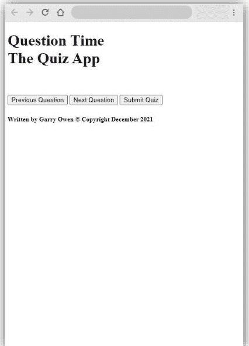

接下来，创建一个名为 `app.css` 的新文件并将其保存在 `css` 文件夹中。参考我们的布局图和 HTML，我们需要为以下元素设置样式。

-   body、header、h1、quiz-wrapper、quiz、rad_butn、button、previous、next、submit、results 和 footer。

让我们开始吧！

将以下代码添加到你的 `app.css` 文件中并保存。

```css
body{
  margin: 0;
  padding: 0px;
  font-family: Arial;
  font-size: 20px;
  text-align: center;
  background-color: #eee;
  overflow-x: hidden;
}
#header{
    border-bottom: 1px solid #666;
    color: #222;
    display: block;
    padding: 10px 0;
    text-align: center;
    background-image: -webkit-gradient(linear, left top, left bottom, from(#ccc), to(#999));
}
#header h1{
  text-shadow: 0px 1px 0px #fff;
  font-weight: 300;
  margin: 0px;
  padding: 10px;
  font-size: 25px;
}
.question{
  font-size: 30px;
  margin: 0 5% 20px 5%;
}
.answers {
  margin-bottom: 20px;
  text-align: left;
  display: inline-block;
}
.answers label{
  display: block;
  margin-bottom: 10px;
}
```

```css
button p{
    margin-top: -8px;
}
button{
    font-weight: 200;
    font-size: 20px;
    width: 300px;
    height: 50px;
    padding: 20px;
    cursor: pointer;
    border-radius: 3px;
    color: #fff;
    background-image: -webkit-gradient(linear, left top, left bottom,
from(#aaa), to(#888));
    margin-top: 15px;
}
button:hover{
    background-image: -webkit-gradient(linear, left top, left bottom,
from(#bbb), to(#999));
}
.quiz-wrapper{
  position: relative;
  height: 200px;
  margin: 30px 0 60px 0;
}
.rad_butn {
    transform: scale(200%);
    margin: 0 30px 0 -20px;
}
#results{
    margin-top: 15px;
    padding: 20px;
}
.slide{
  position: absolute;
  left: 0px;
  top: 0px;
  width: 100%;
```

```css
z-index: 1;
opacity: 0;
transition: opacity 0.5s;
}
.active-slide{
opacity: 1;
z-index: 2;
}
#footer {
position: absolute;
bottom:0;
width:100%;
height:40px;
text-shadow: 0px 1px 0px #fff;
background-image: -webkit-gradient(linear, left top, left bottom, from(#ccc), to(#999));
}
#footer h5{
text-align: center;
margin-top: 10px;
font-size: 15px;
}
```

乍一看，这看起来相当长且复杂，但当你分解它时，你会很快看到每个元素都很简单。

快速提醒一下，你不必全部输入这些内容。所有文件都可以下载。每个练习的末尾都有一个下载链接。

在分解它之前，让我们先看看结果，以便我们可以可视化我们目前的预期结果。不过，请记住，结果看起来会有所不同，因为我们还将在下一节中使用 JavaScript 代码操作我们的 CSS。

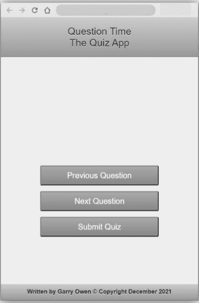

它与我们最初的预览看起来大不相同。

那么，让我们看看 CSS。我们将逐个元素进行分解。从 `<body>` 元素规则开始。

```css
body{
    margin: 0; // 将所有外边距设置为 0px (TRBL)
    padding: 0px; // 将内边距设置为 0px (元素内容周围的空间)
    font-family: Arial; // 设置字体为 Arial 字体
    font-size: 20px; // 将字体大小设置为 20px
    text-align: center; // 将文本居中对齐
    background-color: #eee; // 将背景颜色设置为灰白色
    overflow-x: hidden; // 防止在 X 轴上滚动
}
```

好的，除了 `overflow-x` 命令，如果你一直按步骤跟随本书，你之前应该已经见过所有这些命令。


简而言之，如果内容高于或宽于屏幕，你的浏览器会自动添加滚动条。你可以通过为 X 轴和 Y 轴都添加 `overflow: hidden` 命令来防止这两种情况。或者你可以用 `overflow-x` 和 `overflow-y` 分别控制每个轴。`hidden` 命令并非唯一选项。可选值包括：

- `visible` - 默认值。溢出内容不会被裁剪。内容在元素的框外渲染。

- `hidden` - 溢出内容被裁剪，其余内容将不可见。

- `scroll` - 溢出内容被裁剪，并添加滚动条以查看其余内容。

- `auto` - 类似于 `scroll`，但仅在必要时添加滚动条。

接下来是下一节，页头：

```css
#header{
    // 这些规则适用于 header div 内的所有元素
    border-bottom: 1px solid #666;
    // 在元素底部边缘显示实线边框
    color: #222;
    // 将文本颜色设置为深灰色
    display: block;
    // 将元素显示为块级元素。开始新行并占据整个宽度
    padding: 10px 0;
    // 将上下内边距设置为 10px，左右内边距设置为 0
    text-align: center;
    // 将文本居中对齂
    background-image: -webkit-gradient(linear, left top, left bottom, from(#ccc), to(#999));
    // 创建从上到下的浅灰色到深灰色的渐变
}
```

```css
#header h1{
    // 这些规则仅适用于 header div 内的 <h1> 元素
    text-shadow: 0px 1px 0px #fff; // 文本阴影 - offset-x | offset-y | blur-radius | 颜色
    font-weight: 300; // 将字体粗细设置为细体 (最大 900)
    margin: 0px; // 将所有外边距设置为 0px (TRBL)
    padding: 10px; // 将内边距设置为 10px
    font-size: 25px; // 将字体大小设置为 25px
}
```

接下来是下一节，问题和答案：

```css
.question{
    font-size: 30px;
    margin: 0 5% 20px 5%;
}
.answers {
    margin-bottom: 20px;
    text-align: left;
    display: inline-block;
}
.answers label{
    display: block;
    margin-bottom: 10px;
}
```

这些命令你都见过了。它们现在还不会起任何作用，但会影响问题和答案的布局。它们将在下一节中与 JavaScript 一起使用。更多内容稍后介绍。

```css
button p{
    // 这只影响 button 和 p 标签内的元素
    margin-top: -8px; // 将按钮文本上移 8px
}
button{
    // 这影响 button 标签内的所有元素
    font-weight: 200; // 字体粗细
    font-size: 20px; // 字体大小（像素）
    width: 300px; // 按钮的宽度
    height: 50px; // 按钮的高度
    padding: 20px; // 元素内容周围的内边距
    cursor: pointer; // 将光标更改为指针 - 更多设置见下页说明
    border-radius: 3px; // 将元素的所有角设置为 3px 的圆角半径
    color: #fff; // 将文本颜色设置为白色
    background-image: -webkit-gradient(linear, left top, left bottom, from(#aaa), to(#888)); // 将按钮的背景设置为渐变
    margin-top: 15px; // 在所有按钮元素上方创建 15px 的间距
}
```

```css
button:hover{
    // 这仅影响鼠标悬停的按钮元素
    background-image: -webkit-gradient(linear, left top, left bottom, from(#bbb), to(#999)); // 将背景颜色更改为更浅的渐变
}
```

`cursor` CSS 命令有许多用于不同目的的设置。详见下图：

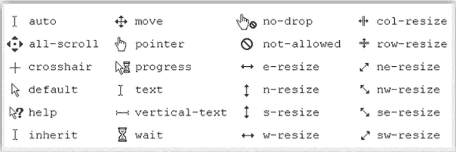

只需根据你的项目进行更改即可。

接下来是下一节，测验容器和结果：

```css
.quiz-wrapper{
    // 应用于 quiz-wrapper 类内的所有内容
    position: relative; // 将元素相对于其正常位置定位
    height: 200px; // 将元素高度设置为 200px
}
```

## 步骤 5 - 构建 JavaScript 引擎

好的，希望你已经愉快地休息过了，现在准备好面对本练习的下一部分了。我们将分步骤来处理这个问题。我们会将其分解成多个函数。每个函数执行一个特定任务，它们共同构成一个引擎，允许用户与测验互动并获取结果。

打开你选择的编码环境，创建一个名为 'app.js' 的新文件，并将其保存在 'js' 文件夹中。

让我们快速回顾一下测验的 HTML 结构。我们这里主要关注三个元素：

```
<div id="quiz"></div>
<button id="submit"><p>Submit Quiz</p></button>
<div id="results"></div>
```

在我们的 JavaScript 中，我们可以这样选择这些元素并创建对它们的引用：

```
const quizBox = document.getElementById('quiz');
const resultsBox = document.getElementById('results');
const submitButton = document.getElementById('submit');
```

`const` 的作用是什么？

在 JavaScript 中，你可以用不同的方式设置变量。每种方式都有略微不同的属性。然而，这些差异主要集中在变量的作用域上。作用域指的是变量的可见性。换句话说，就是程序的哪些部分可以看到或使用它。

除了作用域，简而言之：

-   `var` 变量可以在其作用域内被更新和重新声明。

-   `let` 变量可以被更新但不能被重新声明。

-   `const` 变量既不能被更新也不能被重新声明。

JavaScript 有 3 种作用域：

-   块级作用域

-   函数作用域

-   全局作用域

在 2015 年之前，JavaScript 只有全局作用域和函数作用域。JavaScript ES6 引入了两个新的重要关键字：`let` 和 `const`。

### 块级作用域

在 { } 块内声明的变量无法从块外部访问。

### 函数作用域

在 JavaScript 函数内声明的变量成为该函数的局部变量，并具有函数作用域。

### 全局作用域

在函数外部声明的变量成为全局变量，因此具有全局作用域。

接下来，我们需要构建测验、渲染结果并允许用户交互。我们可以先列出函数，然后逐步填充它们。

```
function buildQuiz(){}
function showResults(){}
buildQuiz();
submitButton.addEventListener('click', showResults);
```

这里我们有一个用于构建测验的函数和另一个用于显示结果的函数。我们通过 `buildQuiz()` 调用或触发 `buildQuiz` 函数，当用户点击提交按钮时，我们调用或触发 `showResults` 函数。

好的，理解了这些，让我们看看如何使用我们的 JSON 题库。在我们的 HTML 中，我们包含了 'questions.json' 文件。正如我们之前看到的，我们将其包裹在方括号中，并将整个数据集命名为 'data'。考虑到这一点，现在很容易将我们所有的问题引入一个 JavaScript 数组，如下所示：

```
const myQuestions = [];
for(i=0; i < data.length; i++){
    myQuestions.push(data[i]);
}
```

让我们检查一下我们这里做了什么。首先，我们创建了一个新的空数组。

> **数组：**

>

> 数组是一种数据结构，可以存储相同数据类型的固定大小元素集合。数组用于存储数据集合，但通常将数组视为相同类型变量的集合会更有用。

```
const myQuestions = [];
```

其次，我们从 JSON 数据集中获取所有信息，并将其推送到我们的新数组中。为此，我们使用了一个 For 循环。For 循环只要指定条件为真，就会执行一块代码。

For 循环具有以下语法：

```
for (statement 1; statement 2; statement 3) {
    // 要执行的代码块
}
```

在我们的例子中：

```
for(i=0; i < data.length; i++){
```

这分解为：

-   `i=0;` - 'i' 的初始值设置为 0。

-   `i < data.length;` - 当 'i' 小于数据的长度时

-   `i++` - 每次执行代码块时，i 增加 1。

每次循环迭代，都会执行以下代码块：

```
myQuestions.push(data[i]);
```

这行代码将下一个问题推送到我们的数组中。循环会一直进行，直到到达数据集（在我们的例子中称为 'data'）的末尾。

## 步骤 6 - 构建测验函数

将以下代码添加到你的 'app.js' 文件中并保存。

```
function buildQuiz(){}
function showResults(){}

const quizBox = document.getElementById('quiz');
const resultsBox = document.getElementById('results');
const submitButton = document.getElementById('submit');

const myQuestions = [];
for(i=0; i < data.length; i++){
    myQuestions.push(data[i]);
}

buildQuiz();
submitButton.addEventListener('click', showResults);
```

这个结构，你代码的结构，非常重要。请确保你严格遵循它。这是由于 JavaScript 的一个特性，称为“暂时性死区”。我知道这听起来像个科幻术语，但当你尝试在变量或数组被声明或定义之前访问它时，JavaScript 中就会发生这种情况。

如果在任何时候你的代码行为不符合预期，你可以查看浏览器控制台获取一些错误信息。你可以通过浏览器菜单选项访问它，或者在 Google Chrome 中，使用快捷键 'CTRL + Shift + I'。下面是一个与暂时性死区相关的 Google Chrome 控制台错误示例。

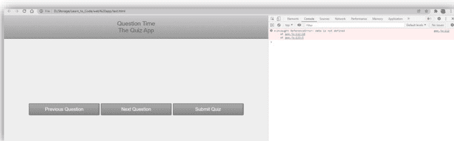

好的，现在用以下函数替换 `function buildQuiz(){}`：

```
function buildQuiz(){
    const output = [];
    myQuestions.forEach(
        (currentQuestion, questionNumber) => {
            const answers = [];
            for(letter in currentQuestion.answers){
                answers.push(
                    `<label>
                        <input type="radio" name="question${questionNumber}" value="${letter}" class="rad_butn">
                        ${letter} :
                        ${currentQuestion.answers[letter]}
                    </label>`
                );
            }
            output.push(
                `<div class="slide">
                    <div class="question"> ${(questionNumber+1)}. ${currentQuestion.question} </div>
                    <div class="answers"> ${answers.join("")} </div>
                </div>`
            );
        }
    );
    quizBox.innerHTML = output.join('');
}
```

完成后，让我们更仔细地看看 'buildQuiz' 函数每一行的作用。

首先，我们创建一个空数组并将其存储在一个名为 'output' 的变量中，以包含所有 HTML 输出，包括问题和用户答案选择。

```
const output = [];
```

接下来，为每个问题构建 HTML，像这样循环遍历每个问题：

```
myQuestions.forEach(
    (currentQuestion, questionNumber) => {
//要在这里执行的代码块
}
```

我们正在使用箭头（=>）函数对每个问题执行操作。因为这位于一个forEach循环中，所以我们获得当前值、索引（当前项目在数组中的位置编号）以及数组本身作为参数。我们只需要当前值和索引，为了我们的目的，我们将它们分别命名为`currentQuestion`和`questionNumber`。

现在，让我们看看我们想要在循环内部执行的代码块。对于每个问题，我们都想生成正确的HTML，因此我们的第一步是创建一个数组来存放可能的答案列表。

```javascript
const answers = [];
```

接下来，我们将使用一个循环来填充当前问题的可能答案。

对于每个可能的答案，我们将创建一个单选按钮，我们将其包含在一个`<label>`元素中。这样用户可以点击答案文本的任何位置来选择该答案。如果省略label，那么用户就必须点击单选按钮本身。

然而，你可能还记得我们之前让单选按钮变大了。这将提高整体可用性，尤其是因为我们是以移动设备优先的方法来设计这个的。

```javascript
for(letter in currentQuestion.answers){
    answers.push(
    `<label>
        <input type="radio" name="question${questionNumber}" value="${letter}" class="rad_butn">
        ${letter} :
        ${currentQuestion.answers[letter]}
    </label>`
    );
```

一旦我们有了答案按钮列表，我们就可以将问题HTML和答案HTML推入我们的整体输出列表。让我们再详细分析一下。

```javascript
for(letter in currentQuestion.answers){
    // 要执行的代码块
}
```

你会认出这是之前的For循环。然而，这是一个稍有不同的排列，被称为For...In循环。

它的语法是：

```javascript
for (property in object) {
    // 要执行的代码块
}
```

然后，与我们的JSON文件一样，我们需要将当前问题的答案推入数组。

```javascript
answers.push( 要推入数组的数据 );
```

这向数组添加了一块数据。在我们的例子中，我们添加的是：

*   一个单选按钮

*   与答案关联的字母

*   与该字母关联的答案

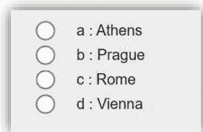

所有这些都整齐地包裹在`<label></label>`标签内。

```javascript
`<label>
    <input type="radio" name="question${questionNumber}" value="${letter}" class="rad_butn">
    ${letter} :
    ${currentQuestion.answers[letter]}
</label>`
```

join表达式将我们的答案列表组合成一个字符串，我们可以将其输出到答案div中。

接下来，我们需要将所有内容整合在一起，并将问题和可能的答案推入输出数组。

```javascript
output.push(
    `<div class="slide">
        <div class="question"> ${(questionNumber+1)}. ${currentQuestion.question} </div>
        <div class="answers"> ${answers.join("")} </div>
    </div>`
);
```

注意，这里我们将输出包裹在一个类为`slide`的`<div>`中。我们用它来分隔每个问题，而不是将它们作为一个顺序列表呈现。稍后会详细介绍。

让我们分析一下：

在我们的slide `<div></div>` 内部，首先是我们的问题，它显示在一个类为`question`的独立div中。

```html
<div class="question"> ${(questionNumber+1)}. ${currentQuestion.question} </div>
```

在这个division内，我们有问题编号`${$(questionNumber+1)}.`，后面跟着一个点和一个空格。你会注意到我们给`questionNumber`的值加了1。这是因为`questionNumber`代表数组中数据的位置索引，而数组索引从零（0）开始，所以我们加1是为了让问题编号从1开始。点或句点和空格是为了让每个问题编号以期望的格式显示，即 1. [问题文本？]，2. [问题文本？] 等等。接下来，我们有实际的问题文本 - `${currentQuestion.question}`，它构成了整体期望的编号问题格式，如下所示：

1. The Plaka is the oldest quarter of which city?

接下来，我们从答案数组中获取数据，如下所示：

```html
<div class="answers"> ${answers.join("")} </div>
```

并将其与问题连接在一起。

现在我们已经为每个问题和答案集生成了HTML，我们可以将它们全部连接起来并显示在页面上：

```javascript
quizContainer.innerHTML = output.join('');
```


在我们的每个push命令中，我们都用反引号（`` ` ``）包裹了代码块。在JavaScript中，这允许代码跨越多行。这与我们可以使用`/*...*/`来包裹多行注释的方式非常相似。这一点非常重要。双引号（`"`）和单引号（`'`）只允许代码或数据在单行上呈现。

## 模板字面量

`${expression}` 模板字面量是一种将变量插值到字符串中的简便方法。插值就是将变量添加到字符串中。例如 `` `Welcome ${firstName} ${lastName}!` ``。如示例所示，模板字面量只能在字符串用反引号括起来时在JavaScript中使用。非正式地，它们有时也被称为模板字符串。

它们的使用非常直接。设置任何变量后，你都可以在字符串中使用它。

```javascript
let age = 37;
let text = `John is aged ${age} years old.`;
console.log(text);
//输出 - John is aged 37 years old
```

此时，你应该能够运行测验并看到你的问题显示出来了。

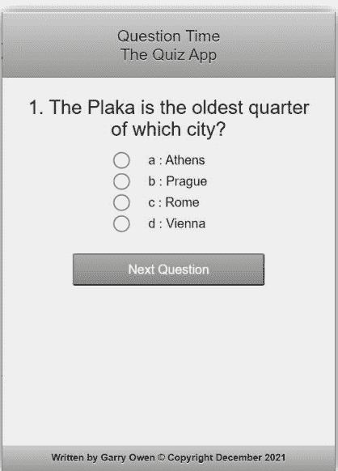

你做得非常棒！

在我们进入下一步之前，让我们更好地理解一下数组。

## 什么是数组？

最简单的描述是，数组是一种特殊的变量，它可以保存不止一个值。好的，听起来不是太复杂，对吧？

所以一个变量可以保存一个值，而一个数组可以保存多个值。很好！那为什么要使用数组呢？为什么不把所有东西都存储为变量呢？

当你使用少量值时，例如：

```javascript
let colour1 = "Red";
let colour2 = "Green";
let colour3 = "Blue";
```

变量可以工作得很好。但是，现在想象一下你需要使用500个值甚至1000个值。我们的列表会非常长，而且所有的变量名都很难记住。

一个数组可以在单个名称下保存许多值，你可以通过索引号来访问这些值。

例如：

```javascript
const colours = ["Red", "Green", "Blue"];
```

使用`const`关键字声明数组是一种常见的做法。

现在，如果我们想访问任何颜色，我们只需要记住一个变量名，而不是三个。每个值都可以使用其索引号来访问。

```javascript
let colour = colours[0]; //索引位置0是"Red"
```

索引总是从0开始，每向数组添加一个额外的值，索引就会增加1。

通过简单地赋一个新值，也很容易更改数组中的值，如下所示：

```javascript
colours[0] = "Pink";
```

现在我们的数组看起来会是这样：

```javascript
const colours = ["Pink", "Green", "Blue"];
```

我们还可以用数组做很多其他很酷的事情。

### 查找数组的长度：

```javascript
console.log(colours.length);// 返回值3
```

### 查找数组中的项目：

```javascript
console.log(colours.indexOf("Blue")); // 返回值2
```

### 添加项目：

```javascript
colours.push("Black");//将"Black"添加到数组末尾
colours.unshift("Black");//将"Black"添加到数组开头
```

让我们坚持将"Black"添加到末尾。现在我们有了：

```javascript
const colours = ["Pink", "Green", "Blue", "Black"];
```

### 删除项目：

```javascript
colours.pop();//删除最后一项
colours.shift();//删除第一项
colours.splice(index, 2);//删除索引2处的项目
```

### 访问每个项目：

```javascript
const colours = ["Pink", "Green", "Blue", "Black"];
for (const colour of colours) {
    console.log(colour);
}
```

### 分割数组，本例中使用（,）分隔符：

```javascript
const myData = colours.split(',');
```

### 连接数组：

```javascript
const myNewString = colours.join(',');
```

```javascript
//或者另一种更简单的方式

colours.toString();
```

这两者返回的输出是相同的：

Pink, Green, Blue, Black

关于数组，我最后想提一点，在我们的例子中，每个项目都是一个字符串，但在数组中，我们可以存储各种数据类型：

*   字符串

*   数字

*   对象

*   甚至其他数组

我们还可以在单个数组中混合数据类型——我们不必将自己限制在一个数组中只存储数字，在其他数组中只存储字符串。

关于数组，我们还可以探讨更多内容，但这超出了本书的范围。不过，希望现在你对数组及其用途应该更清楚了。

在进入下一步之前，先稍作休息。


## 第7步 - 显示结果函数

让我们填写`showResults`函数所需的代码。请用下面的代码更新你的函数并保存（CTRL + S）：

```
function showResults(){
    const answerBoxs = quizBox.querySelectorAll('.answers');
    let numCorrect = 0;
    myQuestions.forEach( (currentQuestion, questionNumber) => {
    const answerBox = answerBoxs[questionNumber];
    const selector = `input[name=question${questionNumber}]:checked`;
    const userAnswer = (answerBox.querySelector(selector) || {}).value;
    if(userAnswer === currentQuestion.correctAnswer){
        numCorrect++;
        answerBoxs[questionNumber].style.color = 'green';
    }
    else{
        answerBoxs[questionNumber].style.color = 'red';
    }
    });
    resultsBox.innerHTML = `${numCorrect} out of ${myQuestions.length}`;
}
```

像往常一样，我们来分解一下它。

```
function showResults(){
    //要执行的代码
}
```

首先，我们声明函数，该函数使用花括号 `{` 和 `}` 将要执行的代码包裹起来。

在函数内部，我们的第一项任务是从测验中获取所有的答案框：

```
const answerBoxs = quizBox.querySelectorAll('.answers');
```

接下来，我们需要跟踪用户的答案。为此，我们必须首先将用户的分数（正确答案的数量）设置为 0，像这样：

```
let numCorrect = 0;
```

然后，对于每个问题，我们需要找到选中的答案，检查答案是否正确、未回答还是不正确，然后相应地格式化输出。正确为绿色，未回答或不正确为红色。

这一切都在一个 `forEach` 循环中完成，如下所示：

```
// 对每个问题执行循环内的代码
myQuestions.forEach( (currentQuestion, questionNumber) => {

// 确定选中的答案
const answerBox = answerBoxs[questionNumber];
const selector = `input[name=question${questionNumber}]:checked`;
const userAnswer = (answerBox.querySelector(selector) || {}).value;

// 根据用户的答案设置答案的颜色
if(userAnswer === currentQuestion.correctAnswer){
    numCorrect++;
    answerBoxs[questionNumber].style.color = 'green';
}
else{
    answerBoxs[questionNumber].style.color = 'red';
}

// 关闭 forEach 循环
});
```

最后，显示结果。总问题中有多少正确答案：

```
resultsBox.innerHTML = `${numCorrect} out of ${myQuestions.length}`;
```

好的，其中一些代码我们之前没见过。让我们深入研究一下。

```
const answerBox = answerBoxs[questionNumber];
// 查看当前问题的答案框内部

const selector = `input[name=question${questionNumber}]:checked`;
// 定义一个 CSS 选择器，允许我们找到用户选中了哪个单选按钮

const userAnswer = (answerBox.querySelector(selector) || {}).value;
// 确定哪个单选按钮被选中，并获取答案的值，或者如果不存在值，则为一个空对象 {}。
```

接下来，我们有一个条件判断语句，if-else 语句。这些语句可以更复杂，但我们的非常直接。

- 我们使用 **if** 来指定如果指定条件为真时要执行的代码块。

- 我们使用 **else** 来指定如果同一条件为假时要执行的代码块。

```
if (condition) {
  // 如果条件为真，则执行的代码块
} else {
  // 如果条件为假，则执行的代码块
}
```

在我们的例子中，我们做了两件事：

- 我们只是根据满足的条件，改变答案文本的颜色。

- 对于正确的答案，我们将变量 `numCorrect` 的值加 1。

```
if(userAnswer === currentQuestion.correctAnswer){
    numCorrect++;
    answerBoxs[questionNumber].style.color = 'green';
} else {
    answerBoxs[questionNumber].style.color = 'red';
}
```

## 第8步 - 在单独的页面上显示每个问题

好的，在这一步中，我们将进行一些补充工作。我们已经在 CSS 和 `buildQuiz(){}` 函数中设置好了一些东西。

简要提醒一下，我们将输出包裹在一个类名为 `slide` 的 `<div>` 中。

```
<div class="slide">
    //输出
</div>
```

并且我们在 CSS 中应用了一些样式，用于从一个幻灯片过渡到下一个幻灯片：

```
.slide{
  position: absolute;
  left: 0px;
  top: 0px;
  width: 100%;
  z-index: 1;
  opacity: 0;
  transition: opacity 0.5s;
}
.active-slide{
  opacity: 1;
  z-index: 2;
}
```

这里我们可以看到，`active-slide` 的不透明度为 1，或者换句话说，100% 可见，而我们其他的幻灯片不透明度为 0，换句话说，是不可见的。此外，我们使用了 `z-index` 命令将活动幻灯片堆叠在其他幻灯片之上。活动幻灯片的 `z-index` 是 2，而其他幻灯片是 1。

这部分非常直接。现在让我们看看使这一切发生的逻辑。

打开 ‘app.js’ 并在 `showResults(){}` 函数之后添加以下代码：

```
function showSlide(n) {
  slides[currentSlide].classList.remove('active-slide');
  slides[n].classList.add('active-slide');
  currentSlide = n;
  if(currentSlide === 0){
    previousButton.style.display = 'none';
  }
  else{
    previousButton.style.display = 'inline-block';
  }
  if(currentSlide === slides.length-1){
    nextButton.style.display = 'none';
    submitButton.style.display = 'inline-block';
  }
  else{
    nextButton.style.display = 'inline-block';
    submitButton.style.display = 'none';
  }
}

function showNextSlide() {
  showSlide(currentSlide + 1);
}

function showPreviousSlide() {
  showSlide(currentSlide - 1);
}
```

然后，在 `buildQuiz();` 函数调用之后，添加以下内容：

```
buildQuiz();// 在这个函数调用之后添加以下代码

const previousButton = document.getElementById("previous");
const nextButton = document.getElementById("next");
const slides = document.querySelectorAll(".slide");
let currentSlide = 0;

showSlide(currentSlide);
```

最后，在脚本末尾添加以下内容：

```
submitButton.addEventListener('click', showResults);
// 在这行代码之后添加以下内容

previousButton.addEventListener("click", showPreviousSlide);
nextButton.addEventListener("click", showNextSlide);
```

保存你的文件（CTRL + S）。

让我们更仔细地看看这里的逻辑：

```
function showSlide(n) {
    // 注意！我们将值 ‘n’ 传递给这个函数。值 ‘n’
    // 将用于表示当前幻灯片的值。

    slides[currentSlide].classList.remove('active-slide');
    // 通过移除 active-slide 类来隐藏当前幻灯片

    slides[n].classList.add('active-slide');
    // 通过为幻灯片 n 添加 active-slide 类来显示新的幻灯片

    currentSlide = n;
    // 更新当前幻灯片编号

    if(currentSlide === 0){
    // 如果我们处在第一张幻灯片
        previousButton.style.display = 'none';
    // 隐藏上一张幻灯片按钮
    } else{
        previousButton.style.display = 'inline-block';
    // 否则，显示上一张按钮
    }

    if(currentSlide === slides.length-1){
    // 如果我们处在最后一张幻灯片
        nextButton.style.display = 'none';
    // 不显示下一张按钮
        submitButton.style.display = 'inline-block';
    // 而是显示提交按钮
    } else{
        nextButton.style.display = 'inline-block';
    // 否则，显示下一张按钮
        submitButton.style.display = 'none';
    // 并且，不显示提交按钮
    }
}
```

你做得很好！接下来，让我们看看 `showNextSlide()` 和 `showPreviousSlide()` 函数：

```
function showNextSlide() {
    showSlide(currentSlide + 1);
// 将当前幻灯片加一
}

function showPreviousSlide() {
    showSlide(currentSlide - 1);
// 将当前幻灯片减一
}
```

当我们使用代码末尾的事件监听器分别点击“下一题”和“上一题”按钮时，就会调用这个逻辑。

```
previousButton.addEventListener("click", showPreviousSlide);
// 监听 previousButton 的点击。如果点击，则调用 showPreviousSlide 函数
```

## 第9步 - 添加倒计时计时器

`nextButton.addEventListener("click", showNextSlide);`

`//监听 nextButton 的点击事件。如果被点击，则调用 showNextSlide 函数`

与常规调用函数不同，我们以这种方式调用函数时，省略了使用括号 `()`。

在本步骤的最后，有时建议将你的 JavaScript 代码包装在一个 IIFE（立即调用函数表达式）中。这是一个自调用函数。它在你定义时立即运行。这将使你的变量保持在全局作用域之外，以确保它不会干扰页面上运行的其他脚本。不过，有时你确实需要将变量放在全局作用域中，我们稍后会看到。

语法如下：

```
(function(){
    // 在这里放入你的其余代码
})();
```

好了，完成这些后，你的测验应用现在应该可以运行了。

如果加入一个倒计时计时器和一些用户反馈，让他们知道总共有多少问题以及还剩多少问题，岂不是很好？让我们继续。

在你的 `quiz_app.html` 文件中，找到 `<div id="results"></div>`，在其下方添加以下标记：

```
<h2>倒计时器</h2>
<div id="clockdiv">
    <div>
        <div class="smalltext">分钟</div>
        <span class="minutes"></span>
    </div>
    <div>
        <div class="smalltext">秒</div>
        <span class="seconds"></span>
    </div>
</div>
```

保存文件 (CTRL + S)。

这个标记将用于显示我们的倒计时钟。接下来，添加以下一行代码，正好放在结束的 `</body>` 标签内，确保它位于引用 `app.js` 文件之后。

```
<script src="js/countdown.js"></script>
```

这将引入对倒计时脚本的必要引用，方式与我们引用 `app.js` 文件相同。

接下来，打开 `app.css` 文件，在文件末尾添加以下代码（不包括注释 (`//…`)），然后保存文件 (CTRL + S)：

```
/* =================== 倒计时器 =================== */
h2{
  color: #333;
  font-weight: 100;
  font-size: 40px;
  margin: 40px 0px 20px;
}
#clockdiv{
  font-family: sans-serif;
  color: #fff;
  display: inline-block;
  font-weight: 100;
  text-align: center;
  font-size: 30px;
}
#clockdiv > div{
    padding: 10px;
    border-radius: 100px;
    background-image: -webkit-gradient(linear, left top, left bottom, from(#ccc), to(#999)));
    display: inline-block;
    border: solid 1px #333;
    width: 100px;
    height: 100px;
}
#clockdiv div > span{
    padding: 15px;
    border-radius: 3px;
    background: #333;
    display: inline-block;
}
.smalltext{
    padding-top: 3px;
    font-size: 16px;
}
```

干得好！

现在，创建一个名为 `countdown.js` 的新文件，并将其保存在 `js` 文件夹中。

添加以下代码（不包括注释 (`//...`)），然后保存文件 (CTRL + S)。当然，你可以添加自己的注释，但它们应该比这些详细的解释简洁得多，一般来说，注释应该放在代码之前，而不是之后。

```
function getTimeRemaining(endtime) {
  const total = Date.parse(endtime) - Date.parse(new Date());
  const seconds = Math.floor((total / 1000) % 60);
  const minutes = Math.floor((total / 1000 / 60) % 60);

  return {
    total,
    minutes,
    seconds
  };
}

function initializeClock(id, endtime) {
  const clock = document.getElementById(id);
  const minutesSpan = clock.querySelector('.minutes');
  const secondsSpan = clock.querySelector('.seconds');

  function updateClock() {
    const t = getTimeRemaining(endtime);
    minutesSpan.innerHTML = ('0' + t.minutes).slice(-2);
    secondsSpan.innerHTML = ('0' + t.seconds).slice(-2);

    if (t.total <= 0) {
      clearInterval(timeinterval);
    }
  }

  updateClock();
  const timeinterval = setInterval(updateClock, 1000);
}

const deadline = new Date(Date.parse(new Date()) + 3 * 60 * 1000);
initializeClock('clockdiv', deadline);
```

*   这里我们计算当前的日期/时间，然后加上3分钟。

*   `(3 * 60 * 1000)` 的意思是 `(3 x 60 x 1000)`，换句话说就是 180000。

*   然后我们通过调用 `initializeClock('clockdiv', deadline)` 将这个值传递给初始化函数，这样 `initializeClock` 函数就知道从哪里开始了。

让我们看看目前的效果：

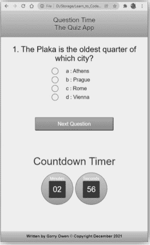

看起来很不错，对吧？

*   我们有一个适用于手机的漂亮布局

*   我们有了问题包裹器

*   我们正在加载问题库

*   我们在获取用户输入并收集他们的答案

*   用户提交测验后，我们可以显示结果

*   我们有一个3分钟的倒计时计时器

那么，当计时器归零时会发生什么？嗯，目前什么都不会发生。让我们来让它提交测验并显示结果。

```
if (t.total <= 0) {
  clearInterval(timeinterval);
  // <- 在这里添加一个函数调用来提交测验
}
```

我们怎么做呢？

嗯，既然我们在 `quiz_app.html` 中按顺序加载了 JavaScript 文件，先加载问题再加载计时器，那么 `countdown.js` 就可以访问 `app.js` 中的所有函数。很酷吧！所以，我们只需要进行一个普通的函数调用，像这样：

```
showResults();
```

那么我们在这里做了什么？当计时器小于 (`<`) 或等于 (`=`) 零 (`0`) 时，我们清除计时器，然后显示结果。保存你的文件并刷新你的浏览器。

啊，但它没有起作用。这仅仅是因为我们使用了 IIFE。有时 IIFE 很好，但有时它会阻止我们全局访问变量，而这正是我们需要的。移除你的 IIFE，保存文件，然后再次运行测试。现在你可以亲身感受 IIFE 实际上做了什么。

如果你忘记了 IIFE 是什么，它就是这样的：

```
(function(){
    // 在这里放入你的其余代码
})();
```

它包装了你的代码。只需移除它，保存文件，然后刷新浏览器即可。

当然，我们也可以继续使用 IIFE，并将倒计时脚本复制粘贴到我们的 `app.js` 文件中，让所有逻辑都在一个较长的 JavaScript 文件中。然而，当我们处理可能有数百个函数时，我发现最好将你的代码结构化在单独的、命名明确的文件中。这样你的代码会更清晰，也更容易调试。在我们下一个练习中开始构建平台游戏时，你就会完全明白我的意思。

现在你应该得到以下结果：

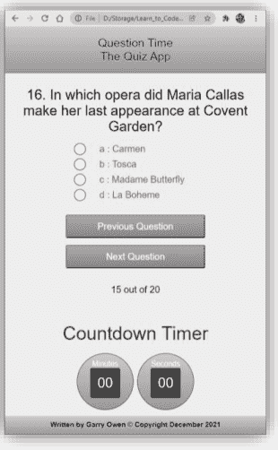

好的，当计时器结束时，我们不再需要那些按钮。我们应该移除它们以防止用户进一步操作，并为用户提供一个“再试一次”的选项。我们需要在 `quiz_app.html` 文件中添加另一个按钮，然后更新我们的 `countdown.js` 文件。我们需要在调用提交测验函数的同一位置添加 JavaScript 逻辑，如下所示：

```
if (t.total <= 0) {
  clearInterval(timeinterval);
  showResults();
  submitButton.style.display = 'none';
  previousButton.style.display = 'none';
  nextButton.style.display = 'none';
  tryAgainButton.style.display = 'inline-block';
}
```

然后打开我们的 `quiz_app.html` 文件，在结果 `<div>` 下方添加以下标记：

```
<button id="tryAgain"><p>Try Again</p></button>
```

但是，除非计时器显示 00:00，否则我们不想显示该按钮。因此，我们还需要在 `if (t.total <= 0) { }` 中添加另一个条件，以便在时钟大于 00:00 时应用相应的逻辑。这很简单，因为我们已经有了真条件的逻辑，假条件只需要一个 `else` 条件，就像这样：

```
} else {
    tryAgainButton.style.display = 'none';
}
```

这告诉浏览器，除非计时器归零 - 0，否则不要显示“再试一次”按钮。但这目前还不会生效。我们需要以与 `app.js` 文件中定义按钮相同的方式定义这个按钮。由于 TDZ（暂时性死区），我们需要在调用 `initializeClock` 函数之前定义它，就像这样：

```
const tryAgainButton = document.getElementById("tryAgain");
```

好的，现在测验控制按钮已被移除，我们正在显示“再试一次？”按钮。到目前为止一切顺利，但该按钮目前没有任何功能。为了使按钮具有交互性，我们需要创建一个函数来运行一段代码，使按钮重置测验，然后添加一个事件监听器，让 JavaScript 监听按钮点击事件，我们将使用该事件来调用我们的函数。事件监听器逻辑我们之前在 `app.js` 文件中已经见过。将以下内容添加到 `countdown.js` 文件的底部：

```
tryAgainButton.addEventListener("click", resetQuiz);
```

如你所见，当按钮被点击时，我们正在调用一个名为 `resetQuiz` 的函数。很好！

现在让我们创建那个函数：

```
function resetQuiz(){
    //reset quiz logic
}
```

好的，那么我们的重置测验函数需要做什么？就我们的目的而言，它只需要刷新页面，就像这样：

```
function resetQuiz(){
    location.reload();
}
```

JavaScript 有一个名为 `reload()` 的内置方法。`Reload()` 的作用与浏览器中的重新加载按钮相同。

那么，如何让用户知道还剩多少问题呢？嗯，如果我们使用与最终结果中查找题库长度相同的逻辑，我们就可以通过多种方式告知用户有多少问题。由于我们需要考虑可用的屏幕空间，我认为根据题库长度动态更新标题会是一个好方法。目前我们的 Web 应用标题是“问题时间 - 测验应用”。我们将其更新为："[题目数量] Questions - The Quiz App"怎么样？所以在我的情况下，它会显示 "20 Questions - The Quiz App"。听起来非常合适！

首先，我们需要在标题 `<h1></h1>` 中创建一个新的 `<span></span>` 并为其应用一个 ID。那么，为什么我们使用 `<span>` 元素而不是 `<div>` 元素呢？`<span>` 标签是一个内联容器，而 `<div>` 是一个块级元素。这意味着 `<div>` 会另起一行，而 `<span>` 则保持所有内容在同一行。因此，使用 `<div>` 会破坏我们想要的布局。

打开 `quiz_app.html` 文件，并更新标题以反映以下内容：

```
<div id="header">
    <h1><span id="quizLength"></span> Questions<br>The Quiz App</h1>
</div>
```

由于我们已经设置了 ID 为 `quizLength`，我们现在可以在 JavaScript 中使用它。我们希望它始终显示，因此在代码中的放置位置很重要。将以下内容添加到 `app.js` 文件中：

```
document.getElementById('quizLength').innerHTML = data.length;
```

确保将其放置在以下代码之后：

```
const myQuestions = [];
for(i=0; i < data.length; i++){
    myQuestions.push(data[i]);
}
```

到目前为止，我们已经得到：

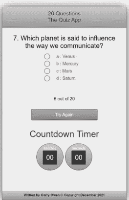

看起来棒极了！

如果你想让测验更容易或更难，可以尝试调整计时器的时间。

```
const deadline = new Date(Date.parse(new Date()) + 3 * 60 * 1000);
initializeClock('clockdiv', deadline);
```

你只需要将数字 3 改为其他值。这里的 3 表示 3 分钟，2 就是 2 分钟，以此类推。这是你的测验，玩得开心，多试试看。挑战你的朋友来完成你的测验。

我认为现在是一个很好的休息时间，然后我们再继续程序的最后一部分：允许用户添加或删除问题。

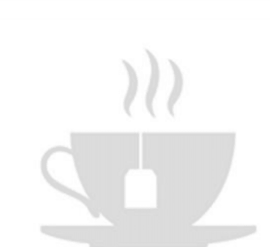

## 第 10 步 - 添加用户管理功能

最后，我们希望用户能够添加新问题并删除现有问题。本质上，就是能够编辑测验并使其个性化。

我们需要问自己几个问题：

-   1. 我们将如何从用户那里收集数据？

-   2. 我们如何将用户数据添加到我们的 JSON 题库中？

-   3. 我们将如何从 JSON 题库中删除问题？

都是好问题。在编程中，解决问题的方法总是多种多样。让我们先从第一个问题入手。

我们尚未使用过的是 HTML 表单。HTML 表单是从用户那里收集数据并使我们的数据收集更加用户友好的明显方式。我们知道需要以下信息：

-   问题

-   四个可能的答案

-   由 a、b、c 或 d 表示的正确答案

再一次，我们的设计分为三个领域。

-   1. 由 HTML 提供的视图

-   2. 由 CSS 提供的样式和页面格式

-   3. 由 JavaScript 提供的程序逻辑

我们将为此设计一个新的 HTML 页面，然后添加适当的页面链接以允许用户在两者之间导航。然后我们将创建一个新的 JavaScript 文件来容纳使其运行所需的逻辑。

考虑到我们的数据捕获需求，我们的表单可能看起来像这样：

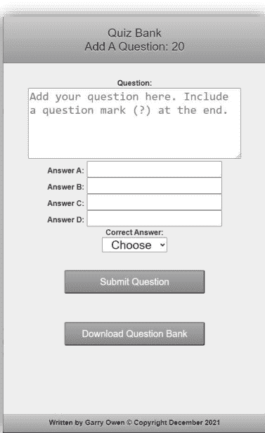

通常，在创建这样的程序时，你会使用数据库和服务器端语言，如 PHP 或 Node.js 等。然而，本书探讨的是使用 HTML、CSS 和 JavaScript，这些都是客户端技术。我们将使用其他技术来编码所有内容并在你的浏览器中本地运行，而无需使用任何其他外部技术。

> **客户端和服务器端：**

>

> 客户端和服务器端有时被称为前端和后端。网站的客户端是指 Web 浏览器，服务器端是存储数据和源代码的地方。

供你参考，有许多可用的数据库。一些最常用和最知名的是 MySQL、MariaDB 和 PostgreSQL。这些都使用一种专门开发的语言来查询它们，称为结构化查询语言（或 SQL，发音为“sequel”）。然后还有另一种数据库类型称为 NoSQL 数据库，如 MongoDB、ApacheDB 和 Cassandra，它们使用替代的结构和查询技术，例如 MongoDB 的类似 JSON 的数据结构或 Cassandra 的 CQL。

就我们的目的而言，我们将把问题写入我们的 JSON 文件，但你需要知道，如果你想创建这样的程序并将其部署在远程服务器上，你需要使用其他技术来维护代码和数据的安全性。使用 HTML、CSS 和 JavaScript，任何用户都可以通过按 'CTRL + U'（Mac 上为 'Cmd + U'）来访问你的所有代码，这在许多浏览器中都可行，或者使用菜单并选择“查看源代码”选项。

话虽如此，通过这种方式学习到的逻辑是一个非常有价值的学习练习，相同的方法可以用于你未来的许多项目，或许可以添加服务器端技术来更好地处理安全等方面的问题。

服务器端语言由浏览器翻译并显示为 HTML，因此用户无法阅读实际代码。如果你想了解更多，我强烈推荐我的系列书籍《Web 设计与开发 - *正确的方式！*》。

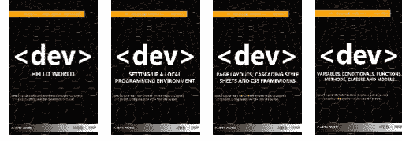

....以及更多

## 如何构建我们的HTML表单

再次打开你选择的代码编辑器，创建一个名为‘add_questions.html’的新文件。然后添加以下标记，并将文件保存在‘web_app’目录中（CTRL + S）。

```html
<html>
<head>
    <title>Quiz Bank Editor</title>
    <meta name='viewport' content='width=device-width, initial-scale=1'>
    <link rel='stylesheet' type='text/css' media='screen' href='css/app.css'>
    <script type="text/javascript" src="json/questions.json"></script>
</head>
<body>
    <div id="header">
        <h1>Quiz Bank<br>Add A Question: <span id="qCount"></span></h1>
    </div>
    <div class="quiz-wrapper">
        <form id="addQuestion" onsubmit="submitForm(event)">
            <label class="formLabel">Question Number:</label><br>
            <label class="formLabel">Question:</label><br>
            <textarea maxlength="200" cols="50" rows="5" class="formArea" placeholder="Add your question here. Include a question mark (?) at the end." id="q" name="q" required></textarea><br>
            <label class="formLabel">Answer A:</label>
            <input type="text" maxlength="100" size="100" class="formInput" id="a" name="a" required><br>
            <label class="formLabel">Answer B:</label>
            <input type="text" maxlength="100" size="100" class="formInput" id="b" name="b" required><br>
            <label class="formLabel">Answer C:</label>
            <input type="text" maxlength="100" size="100" class="formInput" id="c" name="c" required><br>
            <label class="formLabel">Answer D:</label>
            <input type="text" maxlength="100" size="100" class="formInput" id="d" name="d" required><br>
            <label class="formLabel">Correct Answer:</label><br>
            <select id="ca" name="ca" class="formSelect" required>
                <option value="" selected disabled> Choose </option>
                <option value="a"> - A -</option>
                <option value="b"> - B -</option>
                <option value="c"> - C -</option
                <option value="d"> - D -</option>
            </select><br><br>
            <button id="submitQuestion"><p>Submit Question</p></button><br><br><br>
            <button id="saveQuestionBank"><p>Save Question Bank</p></button>
        </form>
    </div>
    <div id="footer">
        <h5>Written by Garry Owen &copy; Copyright December 2021</h5>
    </div>
    <script src='js/addquestions.js'></script>
</body>
</html>
```

你已经见过其中一些标记了，因此我们不再重复那些方面，让我们专注于`<form>`本身。

```html
<form id="addQuestion"> ....  </form>
```

首先，我们开启了一个新的表单元素，并在表单结构结束时将其关闭。我们为表单添加了一个ID，以便我们可以用JavaScript代码和/或CSS来操作它。

```html
<label class="formLabel">Question:</label><br>
```

接下来，我们有一个表单标签`<label></label>`。我们为每个标签都设置了一个class，这样我们就可以用CSS选择样式规则。`<label></label>`标签之间的文本将被显示（渲染）在用户视图中。

`<br>`元素简单表示换行。它的功能是在渲染下一个元素之前，跳到新的一行。我在这里添加它是为了简单起见，我们也可以通过向CSS添加必要的规则来获得相同的效果。

每个标签元素的结构几乎相同，只是少了`<br>`。

```html
<input type="text" maxlength="" size="" class="" id=" " name="" required>
```

接下来，我想讨论最常见的表单输入类型。在每个表单输入中，我们可以设置各种规则。有些规则取决于我们选择的`<input>`类型，而其他规则则适用于任何可用选项。

首先，我们需要设置输入类型。这里我们选择了“text”，然而，有许多输入类型可供选择。number输入类型只允许数字输入，text允许文本和数字。我们不会在这里探讨所有类型，但你可以在下面的列表和下一页中看到各种选项：

### 输入类型表单属性

| 输入类型 | 输入类型 |

| :--- | :--- |

| `<input type="button">` | `<input type="password">` |

| `<input type="checkbox">` | `<input type="radio">` |

| `<input type="color">` | `<input type="range">` |

| `<input type="date">` | `<input type="reset">` |

| `<input type="datetime-local">` | `<input type="search">` |

| `<input type="email">` | `<input type="submit">` |

| `<input type="file">` | `<input type="tel">` |

| `<input type="hidden">` | `<input type="text">` |

| `<input type="image">` | `<input type="time">` |

| `<input type="month">` | `<input type="url">` |

| `<input type="number">` | `<input type="week">` |

如所见，有许多HTML表单输入类型。随着内容的深入，我们将更详细地探讨我们正在使用的类型。

### 其他表单属性

| 属性 | 值 | 描述 |

| --- | --- | --- |

| name | 文本 | 输入元素的名称。 |

| value | 文本 | 输入元素的值。 |

| id | 标识符 | 为输入定义一个唯一的标识符。 |

| class | 类名 | 设置一个或多个要应用于输入的CSS类。 |

| style | CSS样式 | 设置输入的样式。 |

| data-* | 值 | 定义可供JavaScript使用的附加数据。 |

| hidden | hidden | 指定输入是否隐藏。 |

| title | 文本 | 设置一个标题，显示为工具提示。 |

| tabindex | 索引 | 设置相对于其他元素的制表序列。 |

| checked | checked | 用于类型：checkbox或radio。使选项被选中或选择。 |

| placeholder | 文本 | 描述预期值的简短提示 |

| maxlength | 数字 | 允许的最大字符数 |

| required | 无值 | 将输入设置为必填字段 |

| readonly | readonly | 使输入为只读 |

| disabled | disabled | 禁用输入元素 |

| autofocus | 无值 | 页面加载后将焦点设置在元素上 |

| autocomplete | on / off | 向用户显示以前输入的值 |

| form | 表单-id | 引用`<input>`元素所属表单的id |

| formaction | URL | 用于类型：submit, image。提交数据将被处理的文件的URL或路径 |

| formtarget | _blank _self _parent _top 帧名 | 用于类型：submit和image。指示响应应在何处显示 |

| formenctype | application/x-www-form-urlencoded, multipart/form-data, text/plain | 用于类型：submit, image。如何将提交的表单数据编码到服务器。 |

| formmethod | get / post | 用于类型：submit和image。发送表单数据的HTTP方法 |

| formnovalidate | formnovalidate | 避免表单在提交后被验证 |

| accept | 文件扩展名 audio/* video/* image/* 媒体类型 | 用于类型：file。指示用户可以选择哪些文件类型上传 |

| min | 数字 / 日期 | 最小值 |

| max | 数字 / 日期 | 最大值 |

| step | 数字 / any | 合法数字之间的间隔 |

| multiple | multiple | 允用户从选择中选择多个值 |

| pattern | 正则表达式 | 用于检查`<input>`元素值的正则表达式 |

| size | 数字 | 输入控件的宽度（以字符数计） |

| width | 像素 | 输入元素的宽度（以像素为单位）。用于图像输入类型。 |

| height | 像素 | 元素的高度（以像素为单位）。用于图像输入类型 |

| list | 数据列表-id | 包含`<input>`元素预定义选项的`<datalist>`元素 |

| dirname | 输入名 | 要提交的文本方向 |

与输入类型一样，也有许多HTML表单属性可供选择，用途各异。随着内容的深入，我们将更详细地探讨我们需要的那些。

接下来我们有`<textarea></textarea>`标记。

```html
<textarea maxlength="200" cols="50" rows="5" class="formArea" placeholder="Add your question here. Include a question mark (?) at the end." id="q" name="q" required></textarea><br>
```

好的，这与表单输入略有不同，因为它可以占据多行，而且顾名思义，它预设的输入类型是文本。

## 为我们的HTML表单设置样式

好的，我们已经创建了CSS文件，所以现在打开‘app.css’文件，并将以下代码添加到文件底部：

```
/* ======================== 表单样式 ======================== */
.formLabel{
    color: #333;
    font-size: 16px;
    font-weight: bold;
    width: 10%;
}
.formArea{
    color: #333;
    font-size: 25px;
    font-weight: bold;
    width: 80%;
}
.formInput{
    color: #333;
    font-size: 25px;
    font-weight: bold;
    width: 50%;
}
.formSelect{
    color: #333;
    font-size: 25px;
    font-weight: bold;
    width: 25%;
    text-align: center;
}
```

请注意这里，我们有一些规则在多个类中重复出现。我特意展示这一点，是因为你应该始终思考：如何让我的代码更简洁、更优化？这不仅会使你的代码运行更高效，也会让代码更易于阅读。

在这种情况下，首先要问自己，哪些规则适用于表单中的所有元素？

```
form{
    color: #333;
    font-weight: bold;
}
```

接下来，是否有任何规则适用于多个类（或ID / 关键字）？

```
.formArea, .formInput, .formSelect{
    font-size: 25px;
}
```

然后，剩下的是什么？

```
.formArea{
    width: 80%;
}
.formInput{
    width: 50%;
}
.formSelect{
    width: 25%;
    text-align: center;
}
.formLabel{
    font-size: 16px;
    width: 10%;
}
```

确保你已尽可能地优化它，然后将所有规则整合起来，并将代码添加到你的‘app.css’文件末尾。

你应该会得到类似这样的结果：

```
form{
    color: #333;
    font-weight: bold;
}
.formLabel{
    font-size: 16px;
    width: 10%;
}
.formArea, .formInput, .formSelect{
    font-size: 25px;
}
.formArea{
    width: 80%;
}
.formInput{
    width: 50%;
}
.formSelect{
    width: 25%;
    text-align: center;
}
```

在这个例子中，代码行数并没有减少很多，但我相信你理解了这个思路。我们从26行减少到了21行——还不错！保存你的文件（CTRL + S）。让我们继续...

## 从HTML表单获取数据并将其添加到JSON文件

让我们思考一下这个部分的标题。它包含2个部分，但需要3个步骤。

1.  从HTML表单获取数据

2.  将其转换为JSON格式

3.  将其添加到JSON文件

创建一个名为‘addquestions.js’的新文件，并将其保存在‘js’文件夹中。

与我们之前处理JavaScript逻辑的方式类似，我们会将实现目标所需的每个元素放入JavaScript函数中。

```
function submitForm(event){
    event.preventDefault();
}
```

第一个函数与添加到HTML表单标签中的一些代码结合使用。即**onsubmit**="submitForm(event)"。它们共同阻止表单以默认方式提交，并使我们能够在下一个函数中收集表单数据。

为什么我们需要这样做？默认情况下，当表提交时，网页会刷新，因此数据会被清除。

```
function getMyData(){
    const question = document.getElementById("qn").value +". " + document.getElementById("q").value;
    const a = document.getElementById("a").value;
    const b = document.getElementById("b").value;
    const c = document.getElementById("c").value;
    const d = document.getElementById("d").value;
    const correctAnswer = document.getElementById("ca").value;
    const newData = { question, answers: { a, b, c, d }, correctAnswer }
    if(question != "" && a != "" && b != "" && c != "" && d != "" && correctAnswer != ""){
        questionBank.push(newData);
        document.getElementById('qCount').innerHTML = questionBank.length;
        document.getElementById("addQuestion").reset();
    }
    return questionBank;
}
```

我们在这里从表单中逐个收集值，然后将它们按照我们所需的对象形式重新组合。每个表单元素都通过其属性ID获取，值存储在一个变量中。例如：

```
const a = document.getElementById("a").value;
// 将ID为‘a’的输入框的值存储在名为‘a’的变量中。我们重复此结构以从所有表单字段收集数据。
```

```
const newData = { question, answers: { a, b, c, d }, correctAnswer }
// 使用收集到的值形成我们的对象
```

```
if(question != "" && a != "" && b != "" && c != "" && d != "" && correctAnswer != ""){
// 这里我们有一个条件，只有当所有表单字段在表单提交时都有值时，条件才为真
```

```
questionBank.push(newData);
// 将我们的新问题、答案和正确答案（newData）推入名为questionBank的数组中
```

```
document.getElementById('qCount').innerHTML = questionBank.length;
// 在<h1>标题元素中显示题库中当前的问题数量
```

```
document.getElementById("addQuestion").reset();
// 清空表单，为添加下一个问题做准备
```

```
}
// 关闭条件语句
```

```
return questionBank;
// 返回更新后的题库，使其可在函数外部访问
```

```
}
// 最后，我们关闭函数
```

接下来，我们有一个函数，当我们将题库保存到本地存储时会被调用。这将允许我们更新题库，并向用户展示新更新的题目集。然而，为此我们也需要对 `app.js` 文件做一些小的修改。不过，现在让我们先看看我们的 `saveMyFile` 函数：

```
function saveMyFile(){
    localStorage.setItem("questionBank", JSON.stringify(questionBank));
    location.replace("quiz.html")
}
```

这个函数非常简单。我们正在设置一个名为 `questionBank` 的本地存储项，并在将我们的题库转换为 JSON 字符串 `JSON.stringify(questionBank)` 后将其插入其中。

## 什么是本地存储？

`localStorage` 对象允许你在浏览器中保存键值对。它存储的数据没有过期日期。这意味着当浏览器关闭时，数据不会被删除，并且将来可以使用。其背后的原理非常简单。语法如下：

```
localStorage.setItem(key, value); // 存储数据
localStorage.getItem(key, value); // 检索数据
localStorage.removeItem(key); // 删除数据
```

其用法示例如下：

```
localStorage.setItem("fullname", "Garry Owen"); // 设置 fullname
localStorage.getItem("fullname"); // 返回 Garry Owen
localStorage.removeItem("fullname"); // 清除存储
```

在代码的最后一部分，我们有变量声明和事件监听器，用于监听表单提交和点击保存题库按钮的事件。


# 创建测验应用与平台游戏

## 测验应用开发

### 初始化题库与本地存储

```javascript
const addQuestionButton = document.getElementById("submitQuestion");
// 引用 submitQuestion 按钮并将其存储在名为 addQuestionButton 的变量中

const saveButton = document.getElementById("saveQuestionBank");
// 引用 saveQuestionBank 按钮并将其存储在名为 bankButton 的变量中

const questionBank = [];
// 创建一个名为 questionBank 的新空数组

const newObject = localStorage.getItem("questionBank");
// 从 localStorage 中检索题库

let dataStored = JSON.parse(newObject);
// 将 JSON 数据解析为新的 JavaScript 对象

if (dataStored != "") {
    // 如果 dataStored 不为空..
    for (i = 0; i < dataStored.length; i++) {
        questionBank.push(dataStored[i]);
    }
    // 遍历 dataStored 数组，并将每个问题推入 questionBank 数组
} else {
    for (i = 0; i < data.length; i++) {
        questionBank.push(data[i]);
    }
    // 否则，遍历 data 数组（在代码的 <head></head> 部分引入）并将每个问题推入 questionBank 数组
} // 结束条件语句
```

```javascript
document.getElementById('qCount').innerHTML = questionBank.length;
// 用题库中当前的题目数量更新 <h1> 标题标签
```

```javascript
addQuestionButton.addEventListener("click", getMyData);
// 监听提交表单按钮，当点击时调用或触发 getMyData() 函数
```

```javascript
saveButton.addEventListener("click", saveMyFile);
// 监听保存题库按钮，当点击时调用（触发） saveMyFile() 函数
```

好的，我们现在可以添加新问题并将其保存到本地存储了。

还剩下什么要做？

- 我们需要一种方法来删除不需要的问题
- 我们需要让用户能够访问管理功能
- 我们需要让我们的测验能够访问本地存储更新

## 构建“删除问题”表单标记

好的，我们已经知道 `push()` 将数据添加到数组的末尾，而 `pop()` 将删除数组的最后一项。

我们已经将新问题添加到了数组的末尾，但与添加问题不同，用户不仅想要能够删除最后一个。实际上，我们需要能够删除多个问题。从用户的角度来看，如果所有问题都显示在一个列表中，并且他们可以勾选复选框，并有一个按钮能够一次性删除所有选中的问题，那会更容易。

像这样：

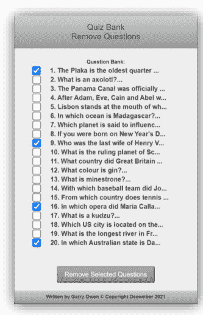

好的，让我们来构建 HTML 标记。创建一个名为 `remove_questions.html` 的新文件，并将其保存在主 web 应用目录中。添加以下代码，然后保存（CTRL + S）。

```html
<html>
<head>
    <title>Quiz Bank Editor</title>
    <meta name='viewport' content='width=device-width, initial-scale=1'>
    <link rel='stylesheet' type='text/css' media='screen' href='css/app.css'>
    <script type="text/javascript" src="json/questions.json"></script>
</head>
<body>
    <div id="header">
        <h1>Quiz Bank<br>Remove Questions</h1>
    </div>
    <div class="wrapper">
        <form id="removeQuestion" onsubmit="submitForm(event)">
            <label class="formLabel">Question Bank:</label><br>
            <!-- 在此添加所有带有复选框的问题 -->
            <div id="showQstn"></div>
            <br><br>
            <button id="removeQuestions"><p>Remove Selected Questions</p></button><br><br><br>
            <button id="saveQuestions"><p>Save Question Bank</p></button>
        </form>
    </div>
    <div id="footer2">
        <h5>Written by Garry Owen &copy Copyright December 2021</h5>
    </div>
    <script src='js/removequestions.js'></script>
</body>
</html>
```

非常直接，对吧？你以前几乎见过这里所有的东西。然而，让我们深入看看这个表单，了解一下发生了什么。

```html
<form id="removeQuestion" onsubmit="submitRemoveForm(event)">
    <label class="formLabel">Question Bank:</label><br>
    <!-- 在此添加所有带有复选框的问题 -->
    <div id="showQstn"></div>
    <br><br>
    <button id="removeQuestions"><p>Remove Selected Questions</p></button><br><br><br>
    <button id="saveQuestions"><p>Save Question Bank</p></button>
</form>
```

除了你已经见过的元素和属性之外，这里的主要区别在于我们打算使用 JavaScript 代码在我们的显示问题 div `<div id="showQstn"></div>` 中填充表单。因此，剩下的部分是一个非常简单的表单。其他属性的 id 名称已被更改，以确保我们不会与其他脚本产生冲突问题。

## 设置“删除问题”表单的样式

打开 `app.css` 文件，并在底部添加以下内容：

```css
#showQstn {
    text-align: left;
    display: block;
    margin: 0 auto 0 auto;
    width: 420px;
}
#showQstn label:first-of-type{
    margin-left: 10px;
}

.chk_butn {
    transform: scale(200%);
    margin: 10px 30px 5px -20px;
}
.wrapper{
    position: relative;
    margin: 30px 0 20px 0;
}
#footer2 {
    position: relative;
    bottom:0;
    width:100%;
    height:40px;
    text-shadow: 0px 1px 0px #fff;
    background-image: -webkit-gradient(linear, left top, left bottom,
    from(#ccc), to(#999));
}
#footer2 h5{
    text-align: center;
    padding-top: 10px;
    font-size: 15px;
}
```

好的，除了一些规则外，你现在应该已经见过所有这些 CSS 了。本着避免过多重复的精神，我将只解释那些差异。

```css
margin: 0 auto 0 auto;
```

我们之前见过 `margin`，但 `auto` 是我们还没有探索过的。与 `display: block;` 和 `width: 420px;` 一起使用时，这会使元素作为块级元素显示在显示区域的中心。

```css
#showQstn label:first-of-type{
    margin-left: 10px;
}
```

`label:first-of-type` - 这只为第一个 label 元素设置规则。

其余部分我们已经见过了。但是，请注意我们又创建了一个 wrapper 类和一个 footer 类。这是因为现有的规则不适用于我们的新 HTML 页面。这是因为这里的布局比我们问答幻灯片的原始结构更长（根据用户决定的问题数量，可能会长很多）。

## 更新测验 JavaScript 文件以适应本地存储

打开 `app.js` 并替换这段代码：

```javascript
const questionBank = [];
for(i=0; i < data.length; i++){
    questionBank.push(data[i]);
}

document.getElementById('quizLength').innerHTML = data.length;
```

使用以下代码：

```javascript
const myQuestions = [];
const newObject = localStorage.getItem("questionBank");
let dataStored = JSON.parse(newObject);

if (dataStored != "") {
  for (i = 0; i < dataStored.length; i++) {
    myQuestions.push(dataStored[i]);
  }
  document.getElementById('quizLength').innerHTML = dataStored.length;
} else {
  for (i = 0; i < data.length; i++) {
    myQuestions.push(data[i]);
  }
  document.getElementById('quizLength').innerHTML = data.length;
}
```

其工作原理与‘addquestions.js’文件中解释的完全相同，只是我们现在会根据使用的是本地存储的‘dataStored’还是我们为题目创建的JSON文件‘data’来更新‘quizlength’属性，如下所示：

```javascript
document.getElementById('quizLength').innerHTML = dataStored.length;
document.getElementById('quizLength').innerHTML = data.length;
```

这仅仅是用题目数量更新我们的标题。

## 构建用于删除题目的JavaScript

创建一个名为‘removequestions.js’的新文件，并将其保存在‘js’文件夹中，然后添加以下代码并保存（CTRL + S）。

```javascript
function submitRemoveForm(event) {
    event.preventDefault();
}

function showQuestions() {
    const questionHolder = document.getElementById('showQstn');
    questionToShow = [];
    const newObject = localStorage.getItem("questionBank");
    let dataStored = JSON.parse(newObject);
    if (dataStored != "") {
        for (i = 0; i < dataStored.length; i++) {
            questionToShow.push(
                `<label>
                <input type="checkbox" name="${i}" value="${i}" class="chk_butn">
                ${i + 1}. ${dataStored[i].question.substring(0, 32)}...
                </label><br>`
            );
        }
    } else {
        for (i = 0; i < data.length; i++) {
            questionToShow.push(
                `<label>
                <input type="checkbox" name="${i}" value="${i}" class="chk_butn">
                ${i + 1}. ${data[i].question.substring(0, 32)}...
                </label><br>`
            );
        }
    }
    questionHolder.innerHTML = questionToShow;
    return questionToShow;
}

function removeQuestion() {
    const questionHolder = document.getElementById('showQstn');
    questionsToRemove = [];
    let checkboxes = document.querySelectorAll('input[type=checkbox]:checked');
    for (var c = 0; c < checkboxes.length; c++) {
        questionToShow[checkboxes[c].value] = "";
        questionBank.splice(checkboxes[c].value, 1);
    }
    questionHolder.innerHTML = questionToShow;
}

function saveMyFile() {
    localStorage.setItem("questionBank", JSON.stringify(questionBank));
    location.replace("quiz.html");
}

showQuestions();
const questionBank = [];
const newObject = localStorage.getItem("questionBank");
let dataStored = JSON.parse(newObject);
if (dataStored != "") {
    for (i = 0; i < dataStored.length; i++) {
        questionBank.push(dataStored[i]);
    }
} else {
    for (i = 0; i < data.length; i++) {
        questionBank.push(data[i]);
    }
}
const removeButton = document.getElementById("removeQuestions");
const saveButton = document.getElementById("saveQuestions");
removeButton.addEventListener("click", removeQuestion);
saveButton.addEventListener("click", saveMyFile);
```

像往常一样，我们来分解一下：

```javascript
function submitRemoveForm(event) {
    event.preventDefault();
}
// 当表单提交时，阻止默认操作

function showQuestions() {
    const questionHolder = document.getElementById('showQstn');
    // 引用showQstn div
    questionToShow = [];
    // 创建一个名为questionToShow的新空数组，用于存储供用户查看的题目和复选框

    const newObject = localStorage.getItem("questionBank");
    // 从本地存储获取题目

    let dataStored = JSON.parse(newObject);
    // 将题目作为JSON对象解析到名为dataStored的变量中

    if (dataStored != "") {
        // 如果dataStored包含数据
        for (i = 0; i < dataStored.length; i++) {
            // 遍历存储的每个题目...
            questionToShow.push(
                // 压入questionToShow数组
                `<label>
                <input type="checkbox" name="${i}" value="${i}" class="chk_butn">`
                // 如果复选框被选中，则传递索引号
                ${i + 1}. ${dataStored[i].question.substring(0, 32)}...
                // 显示题目编号（索引 + 1）和题目的前32个字符，
                // 这样它就能整齐地适应手机屏幕，不会换行超过一行
                `</label><br>`
                // 将input包装在<label></label>中，使整个区域可点击
            );
        }
    } else {
        // 否则....如果本地存储中没有存储题目
        for (i = 0; i < data.length; i++) {
            // 遍历从原始JSON文件获取的所有数据
            questionToShow.push(
                // 将每个题目和复选框压入questionToShow数组
                `<label>
                <input type="checkbox" name="${i}" value="${i}" class="chk_butn">`
                // 如果复选框被选中，则传递索引号
                ${i + 1}. ${data[i].question.substring(0, 32)}...
                // 显示题目编号（索引 + 1）和题目的前32个字符，
                // 这样它就能整齐地适应手机屏幕，不会换行超过一行
                `</label><br>`
                // 将input包装在<label></label>中，使整个区域可点击
            );
        }
    }
    questionHolder.innerHTML = questionToShow;
    // 在题目容器中显示题目和复选框
    return questionToShow;
    // 返回题目数据
}
```

好的，需要注意的是，到目前为止，我们只是根据是否有更新可用并存储在本地存储中，或者题目是否从我们创建的原始JSON题库中访问，来为用户显示题目。

接下来，让我们看看如何删除这些题目：

```javascript
function removeQuestion() {
    // 打开函数
    const questionHolder = document.getElementById('showQstn');
    // 引用showQstn div ID并将其存储在名为questionHolder的变量中
    questionsToRemove = [];
    // 创建一个新空数组，我们将存储要删除的题目的索引号

    let checkboxes =
        document.querySelectorAll('input[type=checkbox]:checked');
    // 获取所有被勾选复选框的索引，并将其存储在名为checkboxes的变量中

    for (var c = 0; c < checkboxes.length; c++) {
        // 遍历每个复选框索引
        questionToShow[checkboxes[c].value] = "";
        // 从显示中移除每个被勾选的题目
        questionBank.splice(checkboxes[c].value, 1);
        // 从题库中移除每个被勾选的题目
    }
    questionHolder.innerHTML = questionToShow;
    // 在题目容器中显示剩余的题目和复选框
} // 关闭函数
```

好的，这相当简单明了。现在剩下的就是将更改保存到本地存储、设置我们的变量，并设置监听器以捕获任何按钮点击。

首先是saveMyFile()函数：

```javascript
function saveMyFile() {
    localStorage.setItem("questionBank", JSON.stringify(questionBank));
    // 当保存按钮被点击时，这会用移除了所选题目的题库数据更新我们的本地存储。
    location.replace("quiz.html"); // 这会重定向回测验页面
}
```

然后我们调用主要的showQuestions()函数并设置变量，如下所示：

```javascript
showQuestions();
// 调用（触发）showQuestions函数

const questionBank = [];
// 创建一个名为questionBank的空数组，准备存储我们的数据

const newObject = localStorage.getItem("questionBank");
// 从本地存储获取题库

let dataStored = JSON.parse(newObject);
// 将JSON数据解析为JavaScript对象并存储在名为dataStored的变量中

if (dataStored != "") {
    // 如果dataStored不为空...
    for (i = 0; i < dataStored.length; i++) {
        // 遍历dataStored JSON对象
        questionBank.push(dataStored[i]);
        // 将每个题目压入questionBank数组
    } // 关闭for循环
} else {
    // 否则... 如果本地存储为空
    for (i = 0; i < data.length; i++) {
        // 遍历从HTML标记<head></head>中引入的JSON文件中的data对象
        questionBank.push(data[i]);
        // 将每个题目压入questionBank数组
    } // 关闭for循环
} // 关闭条件语句
```

最后但同样重要的是，我们引用了用于删除和保存问题的按钮，并设置事件监听器来监听按钮点击。

```javascript
const removeButton = document.getElementById("removeQuestions");
const saveButton = document.getElementById("saveQuestions");
//通过ID引用按钮，并将其存储在命名恰当的变量中

removeButton.addEventListener("click", removeQuestion);
//监听删除问题按钮的点击事件。当被点击时调用removeQuestion函数

saveButton.addEventListener("click", saveMyFile);
//监听保存按钮的点击事件。当被点击时调用saveMyFile函数
```

干得好！现在剩下的就是启用测验和管理功能之间的导航。

## 如何设置页面间的导航

在这个练习的最后部分，我们需要在每个页面中添加一些标记，并在我们的CSS文件中添加一些新规则。

打开‘quiz_app.html’文件，在`</h1>`结束标签之后，`<div id="header"></div>`内部添加以下内容：

```html
<span id="menu"></span>
<div id="menubox" style="display: none;">
    <br><a href="add_question.html" alt="add questions" title="add questions">  Add Questions  </a><br><br>
    <a href="remove_questions.html" alt="remove questions" title="remove questions"> Drop Questions </a>
    <span id="menudismiss"> X </span>
</div>
```

然后滚动到文件底部，就在`</body>`结束标签内部，添加以下内容：

```html
<script src='js/menu.js'></script>
```

然后保存文件（CTRL + S）。

接下来，打开‘add_question.html’文件，在`</h1>`结束标签之后，`<div id="header"></div>`内部添加以下内容：

```html
<span id="menu"></span>
<div id="menubox" style="display: none;">
    <br><a href="quiz.html" alt="back to quiz" title="back to quiz"> Back to Quiz </a><br><br>
    <a href="remove_questions.html" alt="remove questions" title="remove questions"> Drop Questions   </a>
    <span id="menudismiss"> X </span>
</div>
```

同样，滚动到文件底部，就在`</body>`结束标签内部，添加以下内容：

```html
<script src='js/menu.js'></script>
```

然后保存文件（CTRL + S）。

接下来，打开‘remove_questions.html’文件，在`</h1>`结束标签之后，`<div id="header"></div>`内部添加以下内容：

```html
<span id="menu"></span>
<div id="menubox" style="display: none;">
    <br><a href="quiz.html" alt="back to quiz" title="back to quiz"> Back to Quiz </a><br><br>
    <a href="add_question.html" alt="add questions" title="add questions">  Add Questions   </a>
    <span id="menudismiss"> X </span>
</div>
```

同样，滚动到文件底部，就在`</body>`结束标签内部，添加以下内容：

```html
<script src='js/menu.js'></script>
```

然后保存文件（CTRL + S）。

我们将仔细查看其中一个示例，因为虽然它们略有不同，但逻辑都是相同的。不同之处在于每个菜单集导航到特定的页面。

```html
<span id="menu"></span>
//用于显示可点击的菜单图标 - 一个汉堡菜单

<div id="menubox" style="display: none;">
//用于设置菜单样式并将其封装

<br><a href="quiz.html" alt="back to quiz" title="back to quiz"> Back to Quiz </a><br><br>
//超链接1 - 返回测验页面 - 特定于当前页面

<a href="add_question.html" alt="add questions" title="add questions"> Add Questions </a>
//超链接2 - 跳转到添加问题页面 - 特定于当前页面

<span id="menudismiss"> X </span>
//显示一个关闭菜单的控件

</div> // 关闭 menubox div
```

在结束这个练习之前，是时候短暂休息一下了。

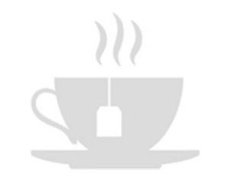

## 为我们的简单导航菜单设置样式

希望你已经稍微恢复了精力。接下来，我们需要为菜单元素添加样式规则。打开‘app.css’文件，滚动到底部，然后添加以下内容：

```css
#menu {
    position: absolute;
    top: 10px;
    right: 30px;
}
#menu:hover{
    background-color: rgba(255,255,255,0.5);
    font-weight: bold;
}
#menubox {
    position: absolute;
    background-image: -webkit-gradient(linear, left top, left bottom, from(#ccc), to(#999));
    padding: 20px;
    border: solid 1px #333;
    width: 80vw;
    margin: 50px 0 0 7vw;
    height: 200px;
    z-index: 10;
    font-size: 1.7em;
}
#menubox a {
    color: #333;
    text-shadow: 0px 1px 0px #fff;
    text-decoration: none;
}
#menubox a:hover{
    background-color: rgba(255,255,255,0.5);
}
#menubox #menudismiss{
    position: absolute;
    top: 10px;
    right: 15px;
    color: rgb(102, 100, 100);
}
#menubox #menudismiss:hover{
    position: absolute;
    top: 10px;
    right: 15px;
    background-color: rgba(255,255,255,0.5);
    font-weight: bold;
}
```

与之前对样式表的添加一样，你已经见过其中大部分命令了，所以我只讲解那些我们尚未涉及的部分：

`border: solid 1px #333;`

// 应用实线边框，宽度1像素，深灰色

`margin: 50px 0 0 7vw;`

// 虽然我们之前处理过外边距，但这里的7vw是一个我还没提到的尺寸度量单位。vw代表视口宽度。你也可以使用vh或视口高度。本质上，我们是将7%的视口宽度设置为左外边距（上、右、下、左）

`#menubox a:hover`

//这会将规则应用于ID为menubox的元素内部，被鼠标悬停的`<a>`标签

`background-color: rgba(255,255,255,0.5);`

//最后，我们之前见过使用命名颜色和十六进制颜色代码的颜色和背景颜色设置，但这里我们使用的是‘r, g, b, a’（红、绿、蓝、透明度）设置。‘r, g和b’的值范围都是0 - 255，即从黑色到白色，而‘a’代表Alpha通道或不透明度通道。我们选择的值255, 255, 255, 0.5是白色，不透明度为50%。

## 处理简单导航的JavaScript

创建一个名为‘menu.js’的新文件，并将其保存在‘js’文件夹中。然后添加以下代码：

```javascript
function htmlMenu(){
    const menu = document.getElementById('menu');
    const menudismiss = document.getElementById('menudismiss');
    menu.innerHTML = '<h1>&#9776;</h1>';
    menu.addEventListener("click", displayMenu);
    menudismiss.addEventListener("click", dismissMenu);
}
function displayMenu(){
    const menubox = document.getElementById('menubox');
    if(menubox.style.display == "block"){
        menubox.style.display = "none";
    } else {
        menubox.style.display = "block";
    }
}
function dismissMenu(){
    const menubox = document.getElementById('menubox');
    menubox.style.display = "none";
}
htmlMenu();
```

按照惯例，我们来分解一下！

```javascript
function htmlMenu(){
//开始htmlMenu函数

	const menu = document.getElementById('menu');
	//引用ID为menu的元素，并将其存储在名为menu的变量中

	const menudismiss = document.getElementById('menudismiss');
	//引用ID为menudismiss的元素，并将其存储在一个变量中

	menu.innerHTML = '<h1>&#9776;</h1>';
	//将菜单设置为汉堡符号

	menu.addEventListener("click", displayMenu);
	//添加事件监听器以检测菜单点击。如果被点击则打开菜单

	menudismiss.addEventListener("click", dismissMenu);
	//添加事件监听器以检测菜单关闭点击。如果被点击则关闭菜单

}//结束函数

function displayMenu(){
//开始显示菜单函数

	const menubox = document.getElementById('menubox');
	//引用ID为menubox的元素，并将其存储在名为menubox的变量中

	if(menubox.style.display == "block"){
	//如果菜单框已显示..

		menubox.style.display = "none";
	//...将其从显示中移除
	} else {
	//否则，如果菜单未显示
		menubox.style.display = "block";
	//显示菜单

	}//结束条件判断
}//结束函数

function dismissMenu(){
//开始关闭菜单函数

	const menubox = document.getElementById('menubox');
	//引用ID为menubox的元素，并将其存储在名为menubox的变量中

	menubox.style.display = "none";
	//将菜单从显示中移除

}//结束函数

htmlMenu();
//调用htmlMenu函数
```

我们完成了……你做得非常出色。干得漂亮！

如果你正确地完成了这个练习，你现在应该有了下面这个很棒的测验应用。

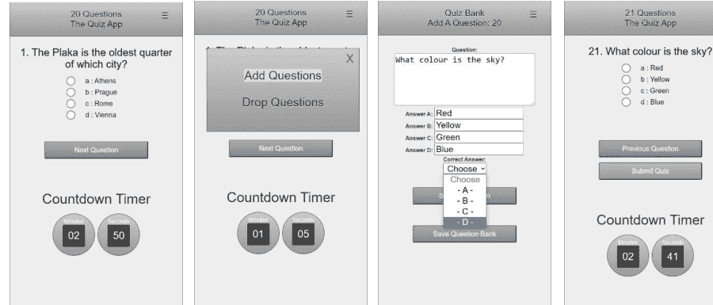

# 创建一个平台游戏

## 什么是平台游戏？

平台游戏，也称平台跳跃类游戏，玩家控制一个在平台间奔跑/行走和跳跃的角色。其中一些著名作品包括《大金刚》、《刺猬索尼克》和《超级马里奥兄弟》等，不胜枚举。

我们将创建一个名为“巫师山”的游戏。这是我给它起的名字，当然，你也可以随心所欲地命名。

目标是在沿途避开敌人和障碍物的同时收集所有的宝石。这是一个多部分组成的练习，后续书籍会接着进行。不过，在本次练习结束时，你将拥有一个完全可玩的平台游戏，并学到许多技能。话虽如此，在不知不觉中，你在跟随本书早期练习的过程中，已经开发了许多所需的技能。

### 课程目标：

使用 HTML、CSS 和 JavaScript 设计并开发一个基于网络的平台游戏。

我们将开发的游戏将包括：

- 每个屏幕的瓦片地图
- 游戏监视器
- 主角
- 三种不同的敌人——1个静态和2个动态
- 可收集物——宝石、金币等更多物品
- 障碍物——墙壁、跳跃、木桶
- 碰撞和重力
- 音效（SFX）
- 精灵图和瓦片集
- 标题画面和游戏结束画面
- 背景图片
- 音乐

## 步骤1 - 设置你的文件结构

大家，让我们豁出去了！开始构建我们最终激动人心的项目吧。首先，让我们实现所需的文件结构。这次我们需要文件夹来存放不同类型的资源。创建一个名为“game”的新项目文件夹，将其保存在你的桌面或其他所需位置。在该文件夹内，添加以下文件结构：

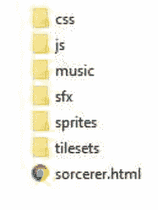

现在你应该知道如何创建这些文件夹了，但以防需要提醒。双击你的“game”文件夹。然后右键单击，从上下文菜单中选择“新建”，然后选择“文件夹”，输入“css”并按回车键。对“js”、“music”、“sfx”、“sprites”和“tilesets”重复此过程。最后，打开你选择的代码编辑器，创建一个新文件，并将其保存为“game”文件夹内的“sorcerer.html”。任务完成！

## 步骤2 - 为我们的平台游戏创建HTML文件

打开“sorcerer.html”文件（如果尚未打开），并添加以下标记：

```html
<html>
<head>
	<title>Sorcerers Mountain</title>
	<link rel="stylesheet" type="text/css" href="css/app.css"/>
</head>
<body>
	<div id="gameArea">
		<canvas id="canvas"></canvas>
	</div>
	<script type="text/javascript" src="js/assets.js"></script>
	<script type="text/javascript" src="js/tiles.js"></script>
	<script type="text/javascript" src="js/sprites.js"></script>
	<script type="text/javascript" src="js/main.js"></script>
	<script type="text/javascript" src="js/startScreen.js"></script>
	<script type="text/javascript" src="js/map1.js"></script>
</body>
</html>
```

如果你一直在跟随本书的练习，那么这个标记的大部分你应该已经熟悉了。如你所见，在这个阶段，它看起来相当简单。好消息是，这个 HTML 不会变得更复杂。在构建游戏的过程中，我们将添加对更多 JavaScript 文件的引用，但仅此而已。让我们仔细看看这个标记。

```html
<html>
//告诉浏览器我们正在使用 HTML

<head>
	<title>Sorcerers Mountain</title>
	//为我们的 HTML 页面添加标题

	<link rel="stylesheet" type="text/css" href="css/app.css"/>
	//引用 'app.css' 以允许我们为页面设置样式规则

</head>

<body>
//打开 body - 主要内容区域

    <div id="gameArea">
        <canvas id="canvas"></canvas>
    </div>
	//在 div 中添加一个 canvas 元素。这将用于显示我们的游戏，并为我们的 CSS 和 JavaScript 命令进行必要的引用

    <script type="text/javascript" src="js/assets.js"></script>
    <script type="text/javascript" src="js/tiles.js"></script>
    <script type="text/javascript" src="js/sprites.js"></script>
    <script type="text/javascript" src="js/main.js"></script>
    <script type="text/javascript" src="js/startScreen.js"></script>
    <script type="text/javascript" src="js/map1.js"></script>
	//引用 JavaScript 文件。将所有内容整合在一起

</body>
</html>
//关闭 body 和 html 标签
```

## 步骤3 - 为我们的平台游戏创建CSS

创建一个名为“app.css”的新文件，并将其保存在“css”文件夹中。然后，添加以下 CSS 规则：

```css
body, html {
    height: 100%;
    overflow:hidden;
    background: #1f1f1f;
}

canvas{
    border:1px solid black;
}

#gameArea{
    text-align: center;
    margin-top: 70px;
}
```

这是非常简单的 CSS 规则。所有这些你都在本书之前见过。让我们仔细看看：

```css
body, html {
    height: 100%;
    overflow:hidden;
    background: #1f1f1f;
}
```

//为整个 html 元素和 body 设置规则。将高度设置为 100%，如果内容大于页面则不显示滚动条，并将背景设置为深灰色。

```css
canvas{
    border:1px solid black;
}
```

//为 canvas 元素设置规则——制作一个 1 像素宽的纯黑色边框

```css
#gameArea{
    text-align: center;
    margin-top: 70px;
}
```

//为 ID 为 gameArea 的元素设置规则。将游戏区域居中对齐，并距屏幕顶部 70 像素。

如前所述，这些都是非常直接的规则集。

继续前进！！

## 步骤4 - 为我们的平台游戏创建资源

接下来，创建一个名为“assets.js”的新文件，并将其保存在“js”文件夹中。然后添加以下代码并保存（CTRL + S）。

```javascript
var canvas = document.querySelector("#canvas"),
    ctx = canvas.getContext("2d"),
    width = 1152,
    height = 704,
    player = {
        screen: 15,//15 = START SCREEN
    },
    press_s = { width: 500, height: 40, f: 100 },
    instruct = { x: 126, y: 300, w: 900, h: 57, f: 103 };
```

我们在这里做什么？‘assets.js’ 文件用于设置所有初始值并将它们存储在 JSON 对象中。让我们仔细看看：

```javascript
var canvas = document.querySelector("#canvas"),
//通过 ID 引用 canvas 元素并将其存储在名为 canvas 的变量中

ctx = canvas.getContext("2d"),
//在 canvas 元素上启用 canvas 的 2D 渲染上下文（允许我们在 canvas 上进行 2D 绘图）

width = 1152,
//将 canvas 宽度设置为 1152 像素 - 使用一个是你预期瓦片尺寸倍数的大小非常重要。我们选择的瓦片尺寸是 64 像素 x 64 像素（1152 像素可以容纳 18 个瓦片横向排列）

height = 704,
//将 canvas 高度设置为 704 像素。与宽度一样，它必须是你所选瓦片尺寸的倍数（704 像素可以容纳 11 个瓦片纵向排列）

player = {
    screen: 15,
},
//设置一个 player 对象，我们将在这里存储玩家的所有起始值。在这里我们将初始屏幕设置为 15，这代表标题屏幕背景，我们将在下一节中更详细地了解

press_s = { width: 500, height: 40, f: 100 },
//设置一个按‘s’开始游戏的屏幕消息的宽度、高度和帧

instruct = { x: 126, y: 300, w: 900, h: 57, f: 103 };
//设置我们精灵图的初始 x 坐标、y 坐标、宽度、高度和帧。当用户按下并按住‘i’键时，我们将使用此来显示用户说明。
```

这本身不会做任何事情，因为它与其他我们尚未创建的 JavaScript 文件协同工作。

## 步骤5 - 创建并引用用于构建瓦片地图的瓦片

创建一个名为“tiles.js”的新文件，并将其保存在“js”文件夹中。

在我们向此文件添加任何代码之前，你需要从以下 URL 将瓦片图像下载到“tilesets”文件夹：

https://wddtrw/resources/learntocode/platformgame_building_tiles.zip

下载后，将其解压缩并将内容添加到“tilesets”文件夹。要解压缩文件，双击它，然后选择所有内容（CTRL + A）并复制（CTRL + C），然后打开“tilesets”文件夹并粘贴（CTRL + V）。

如果你正确地遵循了此操作，你的“tilesets”文件夹现在将包含以下 64 x 64 像素的瓦片，外加 2 张背景图片。你可以

所以我们创建了一个带有倒计时器、添加新问题和删除问题功能的测验应用。玩玩看。看看你能否改进它！尝试添加更多功能。也许是一个高分表，能够从多个问题集中选择的能力？可能性是无穷无尽的。

与此练习相关的所有文件和图片都可以在以下位置找到：

[https://wddtrw/resources/learntocode/quizapp.zip](https://wddtrw/resources/learntocode/quizapp.zip)

你也可以选择自行制作这些图块。如果你希望这样做，或者编辑文件中现有的图块以使其略有不同，你需要一个图像编辑器。如果你没有可用的，我推荐使用 Gimp，它完全足够胜任这项工作，而且最重要的是它是免费的。你可以在 [https://gimp.org](https://gimp.org) 免费下载它。

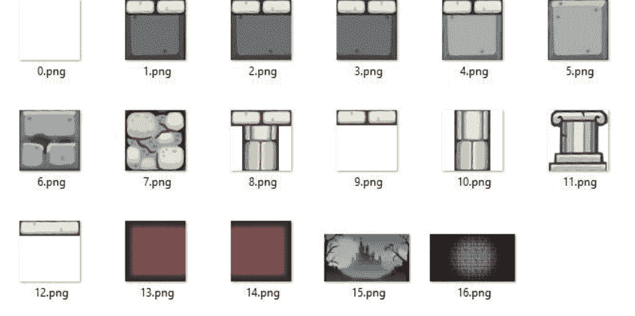

我们将在游戏画面中使用图块地图来运用这些图块。稍后会详细介绍。现在，让我们设置一个 JavaScript 文件来引用它们，并在游戏中启用它们。

创建一个名为 `tiles.js` 的新文件，并将其保存在 `js` 文件夹中，然后添加以下代码。我们这里从基础开始，但在构建游戏时，会根据需要添加更多图块。

```
/* =========================
图块索引说明：
0 - 空白区域
1 - 基础方块 深灰色
2 - 基础方块 左侧 - 生命值
3 - 基础方块 右侧 - 生命值
4 - 基础方块 浅灰色
5 - 墙壁方块 浅灰色
6 - 墙壁方块 砖块 浅灰色
7 - 石块方块
8 - 基座顶部
9 - 悬浮平台 2块砖
10 - 基座底部
11 - 低矮基座
12 - 悬浮平台 1块砖
13 - 游戏监视器 左侧图块
14 - 游戏监视器 右侧图块
15 - 标题画面背景
16 - 游戏画面背景 石墙
======================== */
```

```javascript
const tile = [];
for(i=0; i < 17; i++){
    tile[i] = new Image();
    tile[i].src = `tilesets/building_tiles/${i}.png`;
}
```

让我们仔细看看这段代码：

首先，注意这里有大量的注释。这样我们在绘制图块地图时，就能知道应该使用哪个索引号。

```javascript
const tile = [];

//创建一个空数组并将其存储在一个名为 tile 的变量中

for(i=0; i < 17; i++){

//遍历我们的图块并将它们添加到数组中

    tile[i] = new Image();

//将数组索引 ‘i’ 设置为一个新的图像对象

tile[i].src = `tilesets/building_tiles/${i}.png`;

//设置图像对象的源文件路径
```

请注意，为了使此方法有效，文件名需要是顺序的并且格式相同。我们也可以使用类似的代码将单个图块添加到我们的图块数组中，但需要指定索引而不是使用 `for` 循环，像这样：

```javascript
tile[99] = new Image();
tile[99].src = ‘tilesets/building_tiles/[FILENAME HERE]’;
```

## 第 6 步 - 创建并引用精灵对象

接下来，创建一个名为 `sprites.js` 的新文件，并将其保存在 `js` 文件夹中。

在向此文件添加任何代码之前，你需要从以下 URL 下载图像到 `sprites` 文件夹：

https://wddtrw/resources/learntocode/platformgame_title_sprites.zip

下载后，解压它并将内容添加到 `sprites` 文件夹。要解压缩文件，双击它，然后选择所有内容 (CTRL + A) 并复制 (CTRL + C)，接着打开 `sprites` 文件夹并粘贴 (CTRL + V)。

如果一切顺利，你应该有以下内容：

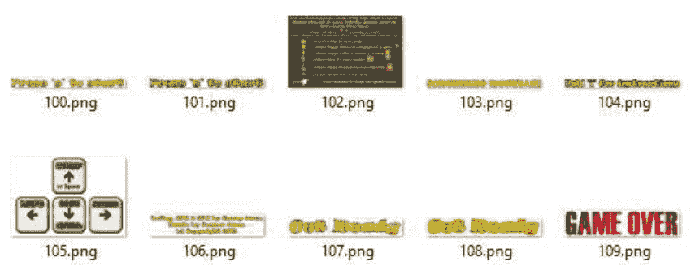

好的，现在向你的 `sprites.js` 文件添加以下代码：

```
/* ================================
精灵索引说明：
100 - 按 's'
101 - 按 's' 闪烁
102 - 说明
103 - 标题 - 巫师山
104 - 说明信息
105 - 控制说明
106 - 版权信息
107 - 准备开始 文本
108 - 准备开始 文本闪烁
109 - 游戏结束 文本
================================= */
var sprite = [];
for(i = 100; i < 110; i++){
    sprite[i] = new Image();
    sprite[i].src = `sprites/${i}.png`;
}
```

这与我们引用图块的方式相同。就像我们的图块一样，随着我们游戏开发的深入，我们也将添加更多精灵。

## 第 ⑥ 步 - 创建主 JavaScript 文件以将所有内容整合起来

打开你选择的编码环境（如果尚未打开），创建一个名为 `main.js` 的新文件，并将其保存在 `js` 文件夹中。然后添加以下代码并保存 (CTRL + S)。

```javascript
canvas.width = width;
canvas.height = height;
function update() {
    ctx.clearRect(0, 0, width, height);
    ctx.fillStyle = "#333";
    ctx.beginPath();
    if (player.screen === 15){ drawMyMap1000();}
    if (player.screen === 1){ drawMyMap(); }
    requestAnimationFrame(update);
}
window.addEventListener("load", function () {
    update();
});
document.body.addEventListener("keydown", function (e) {
    keys[e.keyCode] = true;
});
document.body.addEventListener("keyup", function (e) {
    keys[e.keyCode] = false;
});
```

`main.js` 文件将包含使我们能够根据按键和/或玩家离开当前游戏屏幕边界来加载不同地图的代码。在构建游戏的过程中，我们将在这里添加更多逻辑。现在，让我们更深入地看看我们到目前为止做了什么：

```javascript
canvas.width = width;
//从 assets 文件中引入画布宽度的初始设置

canvas.height = height;
//从 assets 文件中引入画布高度的初始设置

function update() { // 主屏幕更新函数
    ctx.clearRect(0, 0, width, height);// 清除画布
    ctx.fillStyle = "#333"; //用深灰色填充画布
    ctx.beginPath();// 开始或重置当前路径

    if (player.screen === 15){ drawMyMap1000();} // 绘制标题画面
    if (player.screen === 1){ drawMyMap(); }// 绘制第一个游戏画面
    requestAnimationFrame(update);// 动画化当前帧
}// 关闭 update 函数

window.addEventListener("load", function () {// 当网页加载完成时...
    update();// 调用 update 函数
});

document.body.addEventListener("keydown", function (e) {
    keys[e.keyCode] = true;
});
// 监听按键按下事件并获取相应的键码

document.body.addEventListener("keyup", function (e) {
    keys[e.keyCode] = false;
});
// 监听按键释放事件并获取相应的键码
```

## 第 7 步 - 处理开始/标题画面

接下来，我们将创建第一个将显示一些结果的脚本。创建一个名为 `startScreen.js` 的新文件，并将其保存在 `js` 文件夹中。现在添加以下代码并保存 (CTRL + S)。

```javascript
function drawMyMap1000(){
ctx.drawImage(tile[15], 0, 0, 1152, 704);
  if(keys[83]){
      player.screen = 1;
  }
  if(keys[73]){
      instruct.f = 102; instruct.x = 126, instruct.y = 25, instruct.w = 900, instruct.h = 567;
  } else {
      ctx.drawImage(sprite[104], 383.5, 380, 385, 24);
      instruct.f = 103; instruct.x = 126, instruct.y = 200, instruct.w = 900, instruct.h = 57;
      ctx.drawImage(sprite[105], 476, 435, 200, 137);
      ctx.drawImage(sprite[106], 342, 275, 469, 85);
  }
      ctx.drawImage(sprite[instruct.f], instruct.x, instruct.y, instruct.w, instruct.h);
      ctx.drawImage(sprite[press_s.f], 326, 610, press_s.width, press_s.height);
      if (press_s.f === 100){
          setTimeout(function(){ press_s.f = 101; },200);
      } else {
          setTimeout(function(){ press_s.f = 100; },200);
      }
}
```

太棒了！让我们仔细看看发生了什么：

```javascript
function drawMyMap1000(){// 打开绘制开始画面函数

ctx.drawImage(tile[15], 0, 0, 1152, 704);
//绘制背景图像 - tile[15] 是存储的标题图像，其余是坐标 0,0 :左上角 - 1152, 704 :右下角

if(keys[83]){// 如果用户按 's' 开始
    player.screen = 1; //切换到地图 1
}

if(keys[73]){// 如果用户按 'i'...

    instruct.f = 102; instruct.x = 126, instruct.y = 25, instruct.w = 900, instruct.h = 567;
    //显示说明图像 - 精灵 102

} else {// 否则...

    ctx.drawImage(sprite[104], 383.5, 380, 385, 24);
    instruct.f = 103; instruct.x = 126, instruct.y = 200, instruct.w = 900, instruct.h = 57;
    //绘制说明信息

    ctx.drawImage(sprite[105], 476, 435, 200, 137);
    //绘制用户控制说明

    ctx.drawImage(sprite[106], 342, 275, 469, 85);
    // ...并绘制版权信息
}

ctx.drawImage(sprite[instruct.f], instruct.x, instruct.y, instruct.w, instruct.h);
//始终绘制标题 - 巫师山

ctx.drawImage(sprite[press_s.f], 326, 610, press_s.width, press_s.height);
//从 assets 引入 press_s 的初始值

if (press_s.f === 100){
    setTimeout(function(){ press_s.f = 101; },200);
} else {
    setTimeout(function(){ press_s.f = 100; },200);
}
//使 ‘Press s to Start’ 信息每 0.2 秒在图像 100 和 101 之间切换动画

}// 关闭绘制地图函数
```

一旦这段代码保存后，你现在就可以查看标题画面了。在浏览器中打开 `sorcerer.html`（推荐使用 Google Chrome）。如果你到目前为止都正确地遵循了练习，你应该看到以下结果：

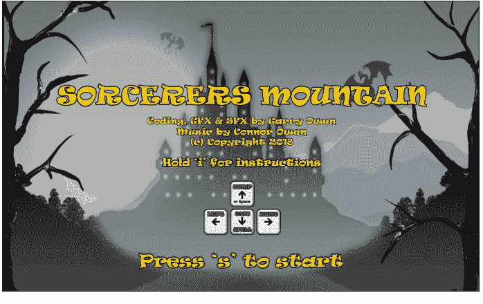

## 第8步 - 构建我们的第一个瓦片地图

现在让我们构建第一个瓦片地图！

创建一个名为‘map1.js’的新文件，并将其保存在‘js’文件夹中。好的，现在添加以下代码，然后保存文件（CTRL + S）。

```javascript
function drawMyMap(){
ctx.drawImage(tile[16], 0, 0);
var xt = 0;
var yt = -64;
var tileMap = [];
var mapNo = 0;
tileMap[0] = [6, 6, 6, 6, 6, 6, 0, 0, 0, 6, 6, 6, 6, 6, 6, 6, 6, 6];
tileMap[1] = [6, 0, 0, 0, 10, 0, 0, 11, 0, 0, 10, 0, 6, 0, 0, 0, 0, 0];
tileMap[2] = [6, 0, 0, 9, 9, 9, 9, 9, 9, 8, 0, 0, 0, 0, 0, 0, 0];
tileMap[3] = [6, 0, 11, 0, 0, 0, 0, 0, 0, 0, 10, 0, 0, 0, 9, 9, 0, 6];
tileMap[4] = [6, 9, 9, 9, 9, 0, 0, 0, 0, 8, 9, 9, 9, 0, 0, 0, 6];
tileMap[5] = [6, 0, 0, 0, 0, 9, 9, 0, 0, 0, 10, 0, 0, 9, 0, 9, 9, 6];
tileMap[6] = [6, 0, 0, 0, 0, 0, 0, 0, 0, 0, 9, 9, 9, 0, 0, 0, 0, 6];
tileMap[7] = [0, 0, 0, 0, 0, 0, 9, 9, 0, 0, 0, 0, 0, 8, 9, 8, 9, 6];
tileMap[8] = [9, 9, 9, 8, 9, 0, 0, 0, 0, 0, 0, 0, 8, 10, 0, 10, 0, 6];
tileMap[9] = [1, 1, 1, 1, 1, 1, 1, 1, 1, 1, 1, 1, 1, 1, 1, 2, 3];
tileMap[10] = [13, 14, 13, 14, 13, 14, 13, 14, 13, 14, 13, 14, 13, 14, 13, 14, 13, 14];
for (mapNo=0; mapNo < 11; mapNo++){
yt+=64;
for (xt=0; xt < tileMap[mapNo].length*64; xt+=64){
if (xt > 1152){ xt = 0; }
var i = tileMap[mapNo][xt/64];
ctx.drawImage(tile[i], xt, yt);
}
}
}
```

我们的每个游戏地图都会以相同的方式绘制。让我们仔细看看：

```javascript
function drawMyMap(){
//打开绘制地图函数
ctx.drawImage(tile[16], 0, 0);
//绘制游戏屏幕背景 - 石墙
var xt = 0; //瓦片x坐标变量声明
var yt = -64; //瓦片y坐标变量声明
var tileMap = []; //创建一个新的空数组来存储瓦片地图
var mapNo = 0; //地图行数变量声明
tileMap[0] = [6, 6, 6, 6, 6, 6, 0, 0, 0, 6, 6, 6, 6, 6, 6, 6, 6];
tileMap[1] = [6, 0, 0, 0, 10, 0, 0, 11, 0, 0, 10, 0, 6, 0, 0, 0, 0, 0];
tileMap[2] = [6, 0, 0, 9, 9, 9, 9, 9, 9, 9, 8, 0, 0, 0, 0, 0, 0, 0];
tileMap[3] = [6, 0, 11, 0, 0, 0, 0, 0, 0, 0, 10, 0, 0, 0, 9, 9, 0, 6];
tileMap[4] = [6, 9, 9, 9, 0, 0, 0, 0, 0, 0, 8, 9, 9, 9, 0, 0, 0, 0, 6];
tileMap[5] = [6, 0, 0, 0, 0, 9, 9, 0, 0, 0, 10, 0, 0, 9, 0, 9, 9, 6];
tileMap[6] = [6, 0, 0, 0, 0, 0, 0, 0, 0, 0, 9, 9, 9, 0, 0, 0, 0, 0, 6];
tileMap[7] = [0, 0, 0, 0, 0, 0, 9, 9, 0, 0, 0, 0, 0, 8, 9, 8, 9, 6];
tileMap[8] = [9, 9, 9, 8, 9, 0, 0, 0, 0, 0, 0, 0, 8, 10, 0, 10, 0, 6];
tileMap[9] = [1, 1, 1, 1, 1, 1, 1, 1, 1, 1, 1, 1, 1, 1, 1, 1, 2, 3];
tileMap[10] = [13, 14, 13, 14, 13, 14, 13, 14, 13, 14, 13, 14, 13, 14, 13, 14, 13, 14];
//将瓦片索引号存储在tileMap数组中
for (mapNo=0; mapNo < 11; mapNo++){
//遍历每一行地图
yt+=64;
//在for循环的每次迭代中给yt增加64
for (xt=0; xt < tileMap[mapNo].length*64; xt+=64){
//遍历地图上每个64像素宽的列
if (xt > 1152){ xt = 0; }
//如果到达行末，则开始下一行
var i = tileMap[mapNo][xt/64];
//设置变量i来保存每个瓦片的引用

ctx.drawImage(tile[i], xt, yt);
//以64像素的间隔绘制瓦片

}// 结束列for循环

}// 结束行for循环

}// 结束绘制函数
```

做得好！如果你正确地完成了练习，当你按住‘i’键时，应该会看到以下用户指令集：

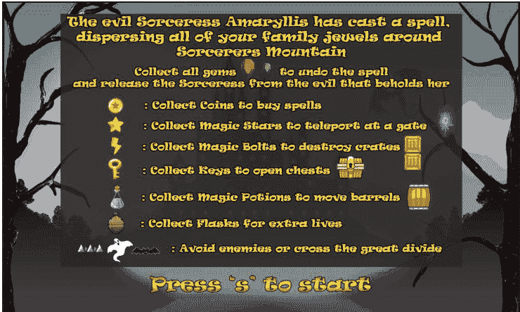

...而如果你按下‘s’键，你应该会看到你的第一个瓦片地图，如下一页所示：

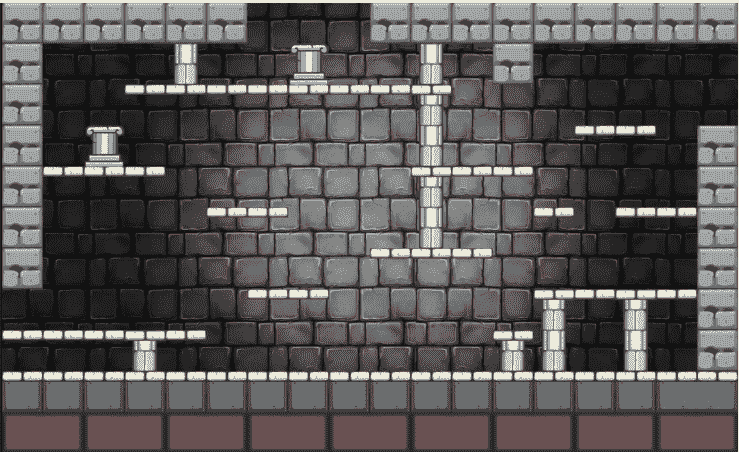

太棒了！

现在是休息一下，补充能量的好时机。

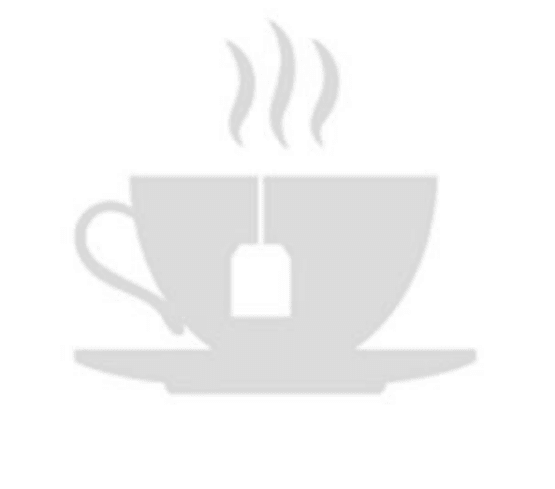

## 第9步 - 设计瓦片地图

简单来说，要制作第一个瓦片地图，我们填充了一个1152像素宽、704像素高的网格，这个网格被分割成64x64像素的瓦片。下图展示了其表示形式：

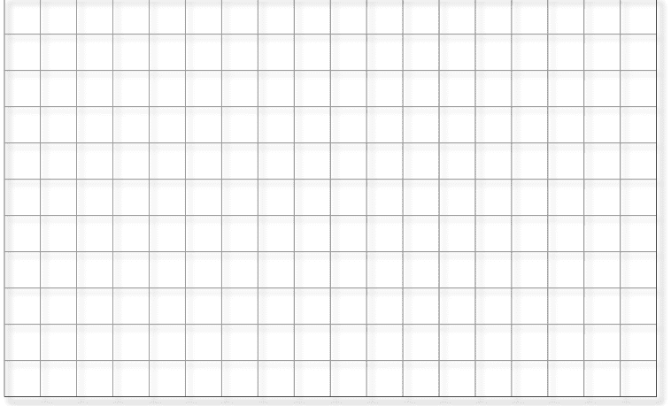

每个64 x 64的方格是我们瓦片的一个占位符。我设计每个屏幕时，都让最下面的2行始终保持相同。这些瓦片最终将用于游戏监视器，以显示生命值、玩家得分、收集到的物品等。游戏监视器最终看起来会像下面这样：

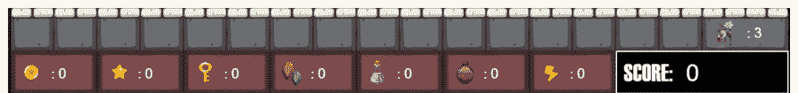

其余的瓦片，从第0行到第8行，将被修改以形成游戏画面。在我们希望玩家能够退出以进入其他屏幕的地方，我们需要使用tile[0]留下空隙。设计我们的下一个瓦片地图还为时过早，所以现在，让我们添加我们的主玩家并赋予它一些属性。

首先，你需要从以下网址将精灵图像下载到‘sprites’文件夹：

[https://wddtrw/resources/learntocode/platformgame_wizard_sprites.zip](https://wddtrw/resources/learntocode/platformgame_wizard_sprites.zip)

下载后，将其解压并将内容添加到‘sprites’文件夹。要解压文件，双击它，然后选择所有内容（CTRL + A）并复制（CTRL + C），接着打开‘sprites’文件夹并粘贴（CTRL + V）。

如果一切顺利，你应该会得到以下内容：

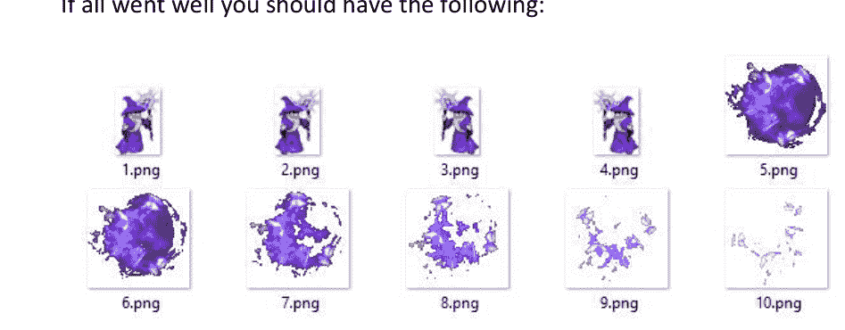

与之前的瓦片和精灵一样，你会看到它们是按顺序编号的。

打开‘sprites.js’文件，并在文件末尾添加以下代码：

```
/* ====================
巫师图例：
1 - 巫师向右 帧1
2 - 巫师向右 帧2
3 - 巫师向左 帧1
4 - 巫师向左 帧2
5 - 巫师光环 帧1
6 - 巫师光环 帧2
7 - 巫师光环 帧3
8 - 巫师光环 帧4
9 - 巫师光环 帧5
10 - 巫师光环 帧6
============================ */
```

```javascript
var wiz = [];
for(i = 1; i < 11; i++){
    wiz[i] = new Image();
    wiz[i].src = `sprites/${i}.png`;
}
```

这和上次的工作原理相同。随着‘for...循环’的每次迭代，一张图像被放入`wiz = []`数组中，并带有相应的索引号。

与其他精灵和瓦片一样，我们为它们添加了图例注释，这样我们就可以快速看到哪个索引号对应哪个精灵。

做得好！

接下来，打开‘assets.js’文件，并按照下面的方式更新玩家对象，然后保存文件（CTRL + S）：

```javascript
player = {
    x: 608,
    y: height - 182,
    width: 35,
    height: 52,
    screen: 15,
    start: 0,
    f: 3
},
```

好的，我们已经为玩家设置了初始变量。我们将X坐标设置为画布上的608像素，Y坐标设置为522（704 – 182），玩家的高度和宽度分别设置为52像素和35像素，屏幕已经设置为15（标题屏幕），最后我们的动画帧号（f）设置为精灵编号3。

好的，完成这些后，现在打开‘main.js’，添加以下两个条件语句，并保存文件（CTRL + S）：

```javascript
if (player.screen === 1){ drawMyMap(); } ← 在这行代码之后添加以下内容
```

```javascript
if (player.screen < 15 && player.start === 0) {
    player.start = 1;
}
if (player.screen != 15){
    ctx.drawImage(wiz[player.f], player.x, player.y);
}
```

那么我们在这里做了什么？

```javascript
if (player.screen < 15 && player.start === 0) {
    player.start = 1;
}
//如果屏幕不再是标题屏幕，并且玩家的start属性为0，则将start属性设置为1
```

```javascript
if (player.screen != 15){
    ctx.drawImage(wiz[player.f], player.x, player.y);
}
//如果玩家屏幕不是15（不再是标题屏幕），则绘制玩家
```

刷新浏览器并按‘s’。你将看到你的玩家现在显示出来了。

现在让我们添加一些控件来让你的玩家移动。再次编辑‘assets.js’文件，并添加以下突出显示的属性：

```javascript
player = {
    x: 608,
    y: height - 182,// 起始高度（必须大于瓦片高度加上角色高度
    width: 35,
    height: 52,
    speed: 3,
    velX: 0,
    velY: 0,
    screen: 15, //15 = 开始屏幕
    start: 0,
    f: 3
},
press_s = { width: 500, height: 40, f: 100 },
instruct = { x: 126, y: 300, w: 900, h: 57, f: 103 },
keys = [],
gravity = 0.3,
friction = 0.8;
```

这些初始化了速度、X轴速度、Y轴速度的值，一个重力值允许我们的玩家在跳跃后落回地面，另一个是摩擦力值用于抑制玩家的运动，使玩家逐渐停下来。保存文件（CTRL + S）。

接下来，编辑‘main.js’文件，并在`update()`函数的开头行之后添加以下内容：

```javascript
if (keys[39]) {
    if (player.velX < player.speed) {
        player.velX++;
        player.f = 1;
    }
}
if (keys[37]) {
    if (player.velX > -player.speed) {
        player.velX--;
        player.f = 3;
    }
}
```

```javascript
player.velX *= friction;
player.velY += gravity;
player.x += player.velX;
```

保存文件（CTRL + S）。现在，让我们更仔细地看看这些代码：

```javascript
if (keys[39]) {
    if (player.velX < player.speed) {
        player.velX++;
        player.f = 1;
    }
}
//如果按下了键盘上的右箭头键，则将玩家向右移动，
//并将玩家精灵设置为 sprite[1] - 面朝右
```

```javascript
if (keys[37]) {
    if (player.velX > -player.speed) {
        player.velX--;
        player.f = 3;
    }
}
//如果按下了键盘上的左箭头键，则将玩家向左移动，
//并将玩家精灵设置为 sprite[3] - 面朝左
```

```javascript
player.velX *= friction;
// 通过应用摩擦系数，将X轴速度设置为逐渐停止
```

```javascript
player.velY += gravity;
// 通过应用重力系数，将Y轴速度设置为向回落到地面
```

```javascript
player.x += player.velX;
// 根据X轴速度移动玩家的x位置
```

保存你的文件（CTRL + S）。

现在刷新你的浏览器，按‘s’键，并尝试使用键盘上的左右箭头键来移动你的玩家。当然，如果你愿意，也可以选择其他按键。只需将`keys[]`中的索引数字更改为与你想要的键码匹配即可。请参见下表：

| 键 | 键码 | 键 | 键码 | 键 | 键码 |
|---|---|---|---|---|---|
| backspace | 8 | e | 69 | numpad 8 | 104 |
| tab | 9 | f | 70 | numpad 9 | 105 |
| enter | 13 | g | 71 | multiply | 106 |
| shift | 16 | h | 72 | add | 107 |
| ctrl | 17 | i | 73 | subtract | 109 |
| alt | 18 | j | 74 | decimal point | 110 |
| pause/break | 19 | k | 75 | divide | 111 |
| caps lock | 20 | l | 76 | f1 | 112 |
| escape | 27 | m | 77 | f2 | 113 |
| page up | 33 | n | 78 | f3 | 114 |
| page down | 34 | o | 79 | f4 | 115 |
| end | 35 | p | 80 | f5 | 116 |
| home | 36 | q | 81 | f6 | 117 |
| left arrow | 37 | r | 82 | f7 | 118 |
| up arrow | 38 | s | 83 | f8 | 119 |
| right arrow | 39 | t | 84 | f9 | 120 |
| down arrow | 40 | u | 85 | f10 | 121 |
| insert | 45 | v | 86 | f11 | 122 |
| delete | 46 | w | 87 | f12 | 123 |
| 0 | 48 | x | 88 | num lock | 144 |
| 1 | 49 | y | 89 | scroll lock | 145 |


| 2 | 50 | z | 90 | semi-colon | 186 |
| 3 | 51 | left window key | 91 | equal sign | 187 |
| 4 | 52 | right window key | 92 | comma | 188 |
| 5 | 53 | select key | 93 | dash | 189 |
| 6 | 54 | numpad 0 | 96 | period | 190 |
| 7 | 55 | numpad 1 | 97 | forward slash | 191 |
| 8 | 56 | numpad 2 | 98 | grave accent | 192 |
| 9 | 57 | numpad 3 | 99 | open bracket | 219 |
| a | 65 | numpad 4 | 100 | back slash | 220 |
| b | 66 | numpad 5 | 101 | close bracket | 221 |
| c | 67 | numpad 6 | 102 | single-quote | 222 |
| d | 68 | numpad 7 | 103 | | |

虽然我们可以移动玩家，但目前只能左右移动。

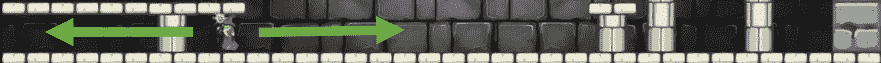

在赋予玩家跳跃能力之前，我们需要在玩家与环境之间设置碰撞。例如，目前玩家可以穿墙而过。此外，如果我们现在就启用重力，玩家会直接掉穿地板。为了能够跳跃，玩家也必须能够返回地面，所以我们需要重力。目前，虽然我们已经设置了瓦片地图使其可见，但没有东西是实体的。所以接下来，让我们为地板、墙壁和平台添加一些实质性内容。

## 第10步 - 碰撞检测

让我们先看看碰撞检测的概念。它确实涉及一些计算，但如果我们以圆为例，则更容易理解。取两个圆，直径均为10厘米，因此半径为5厘米。如果我们说圆1的中心是C1，圆2的中心是C2。要计算它们是否发生碰撞（重叠），我们只需要计算C1和C2之间的距离是否小于10厘米。请参见下图：

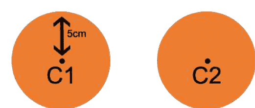
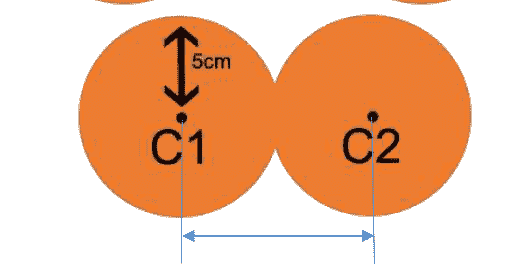

如果距离更大，则圆不可能接触；如果距离更小，则表示它们已重叠。

为了实现这一点，我们需要：

1. 计算对象的大小
2. 找到两个对象的中心
3. 计算从中心到两个对象边缘的距离并求和
4. 计算当前中心测量值与总允许距离之间的差值

因此，我们的碰撞检测公式将如下所示：

```
let c1_middle = c1.width / 2; //5cm
let c2_middle = c2.width / 2; //5cm
let c_total = c1_middle + c2_middle;//10cm
if(((c1.x - c1_middle) - (c2.x - c2_middle)) < c_total || ((c1.y - c1_middle) - (c2.y - c2_middle)) < c_total){
    //发生碰撞时执行的操作
}
```

当然，我们可以进一步简化我们的方程，但这只是为了举例说明。这里的 `c1.x` `c1.y` `c2.x` `c2.y` 代表 `c1` 和 `c2` 当前的 x 和 y 坐标。所以，我们是在说，如果 `c1` 和 `c2` 的当前 x 位置小于10厘米，或者 `c1` 和 `c2` 的当前 y 位置小于10厘米，则发生了碰撞。好消息是，我们只需要设置一次碰撞检测。一个函数就能为我们处理所有事情。表面上看起来很复杂，但分解开来就更容易理解了。

在你能完全理解之前，你可以把这个函数当作一个黑盒子。你只需要知道获得所需输出所需的输入即可。然而，数学在游戏编程中起着根本性作用，所以如果你能掌握它会更好。

好的，让我们开始吧！再次打开 `assets.js` 文件，在文件底部添加以下代码并保存文件（`CTRL + S`）：

```
var boxes = [];
var boxes1 = [];
var boxesDrawn1 = 0;
//为我们的碰撞坐标创建两个空数组，并设置一个变量来检查碰撞框是否已绘制。
```

接下来，创建一个名为 `collisions.js` 的新文件，并将其保存在 `js` 文件夹中。添加以下函数，然后保存它（`CTRL + S`）。

```
function colCheck(shapeA, shapeB) {
    var vX = (shapeA.x + (shapeA.width / 2)) - (shapeB.x + (shapeB.width / 2)),
        vY = (shapeA.y + (shapeA.height / 2)) - (shapeB.y + (shapeB.height / 2)),
        hWidths = (shapeA.width / 2) + (shapeB.width / 2),
        hHeights = (shapeA.height / 2) + (shapeB.height / 2),
        colDir = null;
    if (Math.abs(vX) < hWidths && Math.abs(vY) < hHeights) {
        var oX = hWidths - Math.abs(vX),
            oY = hHeights - Math.abs(vY);
        if (oX >= oY) {
            if (vY > 0) {
                colDir = "t";
                shapeA.y += oY;
            } else {
                colDir = "b";
                shapeA.y -= oY;
            }
        } else {
            if (vX > 0) {
                colDir = "l";
                shapeA.x += oX;
            } else {
                colDir = "r";
                shapeA.x -= oX;
            }
        }
    }
    return colDir;
}
```

好的，这里我们向函数传递了两个参数，`shapeA` 和 `shapeB`。我们正在检查两个形状之间所有方向的碰撞，并返回一个名为 `colDir` 的值。返回的 `colDir` 值简单地是 `l`、`r`、`b` 或 `t`，分别代表检测到的任何碰撞的方向：左、右、下和上。使用这些值，我们将确定在这种情况下我们想要做什么。不过，首先，让我们更仔细地看看 `colDir` 函数内部发生了什么：

```
function colCheck(shapeA, shapeB) {
    //首先，我们将要检查的玩家和障碍物传递给函数 -
    //shapeA 和 shapeB
    var vX = (shapeA.x + (shapeA.width / 2)) - (shapeB.x + (shapeB.width / 2)),
        vY = (shapeA.y + (shapeA.height / 2)) - (shapeB.y + (shapeB.height / 2)),
    // 获取用于检查的向量（x 和 y 坐标）

    hWidths = (shapeA.width / 2) + (shapeB.width / 2),
    hHeights = (shapeA.height / 2) + (shapeB.height / 2),
    colDir = null;
    // 添加形状的半宽和半高

    if (Math.abs(vX) < hWidths && Math.abs(vY) < hHeights) {
    // 如果 x 和 y 向量小于半宽或半高，
    // 则它们一定相互重叠（发生碰撞）

        var oX = hWidths - Math.abs(vX),
            oY = hHeights - Math.abs(vY);
        if (oX >= oY) {
            if (vY > 0) {
                colDir = "t";
                shapeA.y += oY;
            } else {
                colDir = "b";
                shapeA.y -= oY;
            }
        } else {
            if (vX > 0) {
                colDir = "l";
                shapeA.x += oX;
            } else {
                colDir = "r";
                shapeA.x -= oX;
            }
        }
    }
    // 确定我们碰撞在哪一侧（顶部、底部、左侧或右侧）
}

return colDir;

//返回碰撞方向

}// 关闭碰撞检测函数
```

这里有一个数学函数 `Math.abs()`。`Math.abs()` 方法返回一个数字的绝对值。

它的返回值是：

- 一个代表指定数字绝对值的数字
- 如果该值不是数字（例如文本字符串），则返回 `NaN`
- 如果该值为 `null`（没有值），则返回 0

根据定义，一个数字的绝对值意味着什么？

1. 数学 - 不考虑符号的实数的大小。
2. 技术 - 一个数值或测量的实际大小，与其与其他值的关系无关。

在我们的例子中，如果我们使用 `Math.abs(vX)`，无论 `vX` 是负数还是正数，该方法都只返回该数字。

例如

```
Math.abs(-89.25); //返回 89.25
Math.abs(89.25); //返回 89.25
```

我们这样做是为了让数字准备好在条件语句中使用各种运算符进行比较。

## 什么是运算符？

运算符有很多类型。运算符对一个或多个操作数（数据值）执行操作并产生结果。详见接下来几页的详细表格。

## 算术运算符

| 运算符 | 描述 |
| --- | --- |
| + | 加法 |
| - | 减法 |
| * | 乘法 |
| / | 除法 |
| % | 取模（求余数） |
| ++ | 递增 |
| -- | 递减 |

## 赋值运算符

| 运算符 | 用法 | 完整形式 |
| --- | --- | --- |
| = | x = y | x = y |
| += | x += y | x = x + y |
| -= | x -= y | x = x - y |
| *= | x *= y | x = x * y |
| /= | x /= y | x = x / y |
| %= | x %= y | x = x % y |

## 比较运算符

| 运算符 | 描述 |
| --- | --- |
| == | 等于 |
| === | 值和类型都相等 |
| != | 不等于 |
| !== | 值或类型不相等 |
| > | 大于 |
| < | 小于 |
| >= | 大于或等于 |
| <= | 小于或等于 |

## 逻辑运算符

| 运算符 | 描述 |
|---|---|
| && | 与 |
| \|\| | 或 |
| ! | 非 |

## 条件运算符

`variable = (condition) ? value1 : value2`

## 位运算符

| 运算符 | 描述 |
|---|---|
| & | 按位与 |
| \| | 按位或 |
| ~ | 按位非 |
| ^ | 按位异或 |
| << | 左移 |
| >> | 右移 |

好的，现在我们需要对返回的结果进行一些处理。打开 `main.js` 并添加以下代码：

```
if (player.screen === 1){ drawMyMap(); }//◄ 将以下代码添加在此之后

    if (player.screen < 15 && player.start === 0) {player.start = 1;}
    if (player.screen === 1 && boxesDrawn1 === 0){ drawBoxes1(); }
    if (player.screen === 1 && boxesDrawn1 < 2 ) {
        boxes = boxes1;
        if (player.entered < 1){player.entered = 1;}
    }
    player.grounded = false;
    for (var i = 0; i < boxes.length; i++) {
        ctx.rect(boxes[i].x, boxes[i].y, boxes[i].width, boxes[i].height);
        var dir = colCheck(player, boxes[i]);
        if (dir === "l" || dir === "r") {
            player.velX = 0;
            player.jumping = false;
        } else if (dir === "b") {
            player.grounded = true;
            player.jumping = false;
        }
    }
    if(player.grounded){player.velY = 0;}
    player.x += player.velX;
    player.y += player.velY;
    if(player.y > 600){ player.y = 522;}
    if (player.screen != 15){
        ctx.drawImage(wiz[player.f], player.x, player.y);
    }
```

让我们仔细看看发生了什么。

```
if (player.screen < 15 && player.start === 0) {player.start = 1;}
//如果玩家不再处于标题屏幕且 start = 0，则将 start 设为 1 – 游戏已开始

if (player.screen === 1 && boxesDrawn1 === 0){ drawBoxes1(); }
//如果游戏已开始且碰撞框尚未绘制，则现在绘制它们

if (player.screen === 1 && boxesDrawn1 < 2 ) {
    boxes = boxes1;
    if (player.entered < 1){player.entered = 1;}
}
//如果玩家屏幕是 1（第一个游戏屏幕）且碰撞框已开始绘制，
//则将 boxes 变量设为保存屏幕 1 的碰撞框。Player entered 意味着玩家已被绘制，
//因此设为 1。

player.grounded = false;
//将玩家设为不在地面上

for (var i = 0; i < boxes.length; i++) {
    ctx.rect(boxes[i].x, boxes[i].y, boxes[i].width, boxes[i].height);
    //绘制玩家用于碰撞的矩形

    var dir = colCheck(player, boxes[i]);
    //调用 colCheck 函数以确定是否有任何碰撞以及来自哪个方向

    if (dir === "l" || dir === "r") {
        player.velX = 0;
        player.jumping = false;
    } else if (dir === "b") {
        player.grounded = true;
        player.jumping = false;
    }
    //根据玩家碰撞的方向设置碰撞规则
}

if(player.grounded){player.velY = 0;}
//如果玩家在地面上，将玩家在 Y 方向的速度设为 0

player.x += player.velX;
//允许玩家在 X 轴上移动

player.y += player.velY;
//允许玩家在 Y 轴上移动

if(player.y > 600){ player.y = 522;}
//设置玩家起始 Y 轴位置

if (player.screen != 15){
    ctx.drawImage(wiz[player.f], player.x, player.y);
}
//如果玩家不在标题屏幕，则绘制主角
```

最后，打开 `map1.js` 并在文件底部添加以下代码，然后保存（`CTRL + S`）：

```
function addBox(a,b,c,d){
    boxes1.push({ x: a, y: b, width: c, height: d });
    return
}
var boxes = [];
function drawBoxes1(){
    // 边界墙
    addBox(0,577,1152,1);
    addBox(0,0,64,448);
    addBox(1088,192,64,384);
    addBox(0,0,384,64);
    addBox(576,0,576,64);
    addBox(768,64,64,64);
    // 平台
    addBox(0,512,320,1);
    addBox(768,512,64,20);
    addBox(832,448,256,1);
    addBox(384,448,128,1);
    addBox(128,450,57,62);
    addBox(576,384,192,1);
    addBox(320,320,128,1);
    addBox(832,320,64,1);
    addBox(960,320,128,1);
    addBox(64,256,192,1);
    addBox(640,256,192,1);
    addBox(128,192,64,64);
    addBox(896,192,128,1);
    addBox(192,128,512,1);
    addBox(448,64,64,1);
    boxesDrawn1+=1;
    return boxesDrawn1;
}
```

这些函数在指定坐标处绘制碰撞框。让我们仔细看看它是如何工作的：

在我们的资源文件中，我们设置了一个名为 `boxes1` 的数组。

```
function addBox(a,b,c,d){
    //打开一个名为 addBox 的函数，并允许参数 a、b、c 和 d

    boxes1.push({ x: a, y: b, width: c, height: d });
    //每次调用该函数时，都会向 boxes1 数组中推入一个新对象，
    //该对象设置开始绘制的 x 和 y 轴，以及要绘制的框的宽度和高度。

    return
    //返回结果
}

var boxes = [];
//创建一个名为 boxes 的新数组
```

`drawBoxes1` 函数如上所述添加碰撞框。

在 `drawBoxes1` 函数内部，我们有一堆添加碰撞框的函数调用，如下所示：

```
addBox(0,577,1152,1);
//调用/激活 addBox 函数并发送必要的参数。
//开始绘制的 X 坐标，开始绘制的 Y 坐标，以像素为单位的宽度，以像素为单位的高度
```

这与我们的 `colDir` 函数结合，使我们的平台和墙壁看起来是固体的。请注意，平台只有 1 像素的表面用于碰撞检测。这样我们的主角才能从平台下方通过。我们的主角高 52 像素，每个图块高 64 像素。实际平台高 16 像素，如果我们从 64 中减去它，我们只剩下 48 像素的可用空间。因此，我们的玩家将无法通过。参见下面的图像。

您可以在第一张图像中看到我们的玩家无法从平台下方通过，而在第二张图像中，我们的玩家可以自由通过。

现在碰撞已设置好，打开 `main.js` 并在主更新函数开头内部添加以下代码：

```
if (keys[38] || keys[32]) {
    // 上箭头或空格键
    if (!player.jumping && player.grounded) {
        player.velY = -player.speed * 2.5;
        player.jumping = true;
        player.grounded = false;
    }
}
```

保存文件。这样玩家就能跳跃了。每当按下空格键或向上箭头键时。结合左右方向键，你现在可以浏览整个游戏屏幕了。试试看。

太棒了！让我们添加一些敌人吧！

## 步骤 11 - 添加敌人 - 静态和动态

在练习开始时，我解释了游戏的目标是收集所有宝石并避开障碍物。在这一部分，我们将添加幽灵、蝙蝠和致命的尖刺。为了给它们一个标签，我们将它们统称为敌人。

我们需要做的第一件事是导入所需的精灵图。和之前一样，你可以通过以下链接下载：

[https://wddtrw/resources/learntocode/platformgame_enemy_sprites.zip](https://wddtrw/resources/learntocode/platformgame_enemy_sprites.zip)

下载后，解压并将内容添加到 `sprites` 文件夹。要解压文件，双击它，然后选择所有内容 (`CTRL + A`) 并复制 (`CTRL + C`)，接着打开 `sprites` 文件夹并粘贴 (`CTRL + V`)。

如果一切顺利，你应该能看到以下内容：

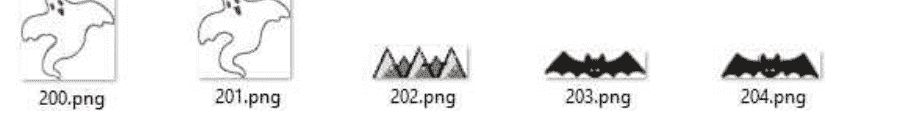

按照常规方式，我们将它们添加到精灵图文件中。打开 `sprites.js` 并将以下代码添加到文件底部，然后保存 (`CTRL + S`)：

```
/* ================================
ENEMIES KEY:
200 - Ghost Frame 1
201 - Ghost Frame 2
202 - Spikes
203 - Bat Frame 1
204 - Bat Frame 2
=============================== */
for(i = 200; i < 205; i++){
    sprite[i] = new Image();
    sprite[i].src = `sprites/${i}.png`;
}
//this adds our 5 enemy sprites to the sprites array at stated indexes
```

接下来我们需要做的是在资源文件中设置它们。打开 `assets.js` 文件。在 player 对象的结束花括号 (`},`) 之后添加以下代码，然后保存文件：

```
enemy1 = { x: 64, y: 452, w: 59, h: 57, s: 2, f: 200, dest: 0 },
enemy2 = { x: 256, y: 68, w: 59, h: 57, s: 3, f: 200, dest: 0 },
enemy3 = { x: 1024, y: 64, w: 59, h: 57, s: 2, f: 200, dest: 0 },
bat1 = { x: 64, y: 482, w: 64, h: 17, s: 2, f:203, dest: 0 },
spikes1 = { x: 512, y: 556, w: 61, h: 20 },
spikes2 = { x: 684, y: 556, w: 61, h: 20 },
```

//在这里，我们设置了三个幽灵（敌人 1 - 3）、一只蝙蝠和两个尖刺对象的初始值。每个对象都有一些或全部以下变量：

- `x` - X轴起始坐标
- `y` - Y轴起始坐标
- `w` - 以像素为单位的宽度
- `h` - 以像素为单位的高度
- `s` - 速度
- `f` - 精灵图帧
- `dest` - 目的地

重要的是，我们不必在每个游戏屏幕中都使用所有这些变量，但它们现在已声明并设置好以备使用。还要注意，尖刺对象不需要速度、帧或目的地，因为它们是静态的。

接下来，创建一个名为 `enemy.js` 的新文件并将其保存在 `js` 文件夹中。然后添加以下代码：

```
function enemy(sn, e, ax, bx, f1, f2, p, xy, xos, yos){
    ctx.drawImage(sprite[sn], e.x+xos, e.y+yos, e.w, e.h);
    if (xy === 1){
        if (e.x < ax && e.dest === 0){ e.x+=e.s;
            if(e.x > ax-2){ e.dest = 1;}
        }
        if (e.dest === 1){ e.x-=e.s;
            if (e.x <= bx){ e.dest = 0; }
        }
    }
    if (xy === 2) {
        if (e.y < ax && e.dest === 0){ e.y+=e.s;
            if(e.y > ax-2){ e.dest = 1;}
        }
        if (e.dest === 1){ e.y-=e.s;
            if (e.y <= bx){ e.dest = 0; }
        }
    }
    if (e.f === f1){
        setTimeout(function(){ e.f = f2; },200);
    } else {
        setTimeout(function(){ e.f = f1; },200);
    }
    if (p.x < e.x+xos + e.w && p.x + p.width > e.x+xos && p.y < e.y+yos +
    e.h && p.y + p.height > e.y+yos){ lifeLost(e, p, xos); }
}

function enemyStatic(sn, e, xos, yos, p){
    ctx.drawImage(sprite[sn], e.x+xos, e.y+yos, e.w, e.h);
    if (p.x < e.x+xos + e.width && p.x + p.width > e.x+xos && p.y <
    e.y+yos + e.h && p.y + p.height > e.y+yos){ lifeLost(e, p, xos); }
}
```

```
function lifeLost(e, p, xos){
    player.lives-=1;
    player.x = 630;
    player.y = 522;
    if ((p.x + p.width) > e.x+xos && (p.x + p.width) < e.x+xos + e.w){
        player.f = 1;
    }
    if (p.x < (e.x+xos + e.w) && p.x > e.x+xos){
        player.f = 3;
    }
}
```

好的，正如你所看到的，我们这里有三个函数。第一个函数绘制敌人，根据需要在X轴或Y轴上设置它们的移动，每200毫秒为敌人制作动画，并处理与这些（动画和移动的）敌人的碰撞。第二个函数绘制静态敌人，并处理与这些静态敌人（尖刺）的碰撞。第三个函数（`lifeLost`）在上述函数检测到玩家与敌人之间发生碰撞时被调用。

让我们仔细看看：

```
function enemy(sn, e, ax, bx, f1, f2, p, xy, xos, yos){
    //打开函数并传入参数

    ctx.drawImage(sprite[sn], e.x+xos, e.y+yos, e.w, e.h);
    //在画布上绘制敌人

    if (xy === 1){
        // 如果选择了水平移动，则在X轴上移动

        if (e.x < ax && e.dest === 0){
            //如果敌人x位置 < 目的地 且 未到达目的地

            e.x+=e.s;
            // 以选定速度从左向右移动敌人

            if(e.x > ax-2){
                e.dest = 1;
            }

            //如果到达目的地，将目的地设置为1
        }

        if (e.dest === 1){
            //如果到达目的地..

            e.x-=e.s;
            // 以选定速度从右向左移动敌人

            if (e.x <= bx){ e.dest = 0; }
            //如果到达目的地，将目的地设置为0

        }
    }

    if (xy === 2) {
        // 如果选择了垂直移动，则在Y轴上移动

        if (e.y < ax && e.dest === 0){
            //如果敌人y位置 < 目的地 且 未到达目的地

            e.y+=e.s;
            // 以选定速度从上到下移动敌人

            if(e.y > ax-2){ e.dest = 1;}
            //如果到达目的地，将目的地设置为1

        }

        if (e.dest === 1){
            //如果到达目的地..

            e.y-=e.s;
            // 以选定速度从下到上移动敌人

            if (e.y <= bx){ e.dest = 0; }
            //如果到达目的地，将目的地设置为0
        }
    }

    if (e.f === f1){
        setTimeout(function(){ e.f = f2; },200);
    } else {
        setTimeout(function(){ e.f = f1; },200);
    }
    //如果当前帧是第一帧，等待200毫秒并更改为
    第二帧。否则，如果当前帧是第二帧，等待200
    毫秒并更改为第一帧

    if (p.x < e.x+xos + e.w && p.x + p.width > e.x+xos && p.y < e.y+yos +
    e.h && p.y + p.height > e.y+yos){ lifeLost(e, p, xos); }
    //如果检测到碰撞，调用 lifeLost 函数
}
```

好的，然后我们有第二个函数，它简单得多，因为它用于静态敌人。

```
function enemyStatic(sn, e, xos, yos, p){
    ctx.drawImage(sprite[sn], e.x+xos, e.y+yos, e.w, e.h);
    //根据给定参数在屏幕上绘制敌人

    if (p.x < e.x+xos + e.width && p.x + p.width > e.x+xos && p.y <
    e.y+yos + e.h && p.y + p.height > e.y+yos){ lifeLost(e, p, xos); }
    //如果检测到碰撞，调用 lifeLost 函数
}
```

简单得多，但对玩家来说也更容易导航。最后，我们有 `lifeLost` 函数。

```
function lifeLost(e, p, xos){
    //打开函数并传递参数

    player.lives-=1;
    //将玩家生命值减少1

    player.x = 630;
    //将玩家x位置设置为630像素

    player.y = 522;
    //将玩家y位置设置为522像素

    if ((p.x + p.width) > e.x+xos && (p.x + p.width) < e.x+xos + e.w){
        player.f = 1;
    }
    //如果玩家与左侧的敌人碰撞，将玩家精灵图帧设置为1

    if (p.x < (e.x+xos + e.w) && p.x > e.x+xos){
        player.f = 3;
    }
    //如果玩家与右侧的敌人碰撞，将玩家精灵图帧设置为3
}
```

接下来，我们需要在绘制地图后调用 `enemy` 和 `enemyStatic` 函数。打开 `map1.js`，在外部 for 循环的结束花括号 (`}`) 之后添加以下函数调用，然后保存 (`CTRL + S`)。

```
enemy(enemy1.f, enemy1, 335, 0, 200, 201, player, 1, 0, 0);
enemy(bat1.f, bat1, 710, 64, 203, 204, player, 1, 0, 0);
enemy(enemy3.f, enemy3, 265, 64, 200, 201, player, 2, 0, 0);
enemyStatic(202, spikes1, 0, 0, player);
```

好的，最后我们需要设置起始位置并给玩家一些反馈。打开 `main.js`。

添加以下条件语句来设置敌人起始位置：

```
if (player.screen === 1 && boxesDrawn1 < 2 ) {
  boxes = boxes1;
  if (player.entered < 1){
    enemy1.x = 62; enemy1.y = 454; enemy1.dest = 0;
    bat1.x = 62; bat1.y = 70; enemy2.dest = 0;
```

## 游戏结束

打开 `enemy.js` 文件，在 `lifeLost` 函数末尾添加以下条件判断：

```javascript
if (player.lives === 0){
    gameOver();
}
```

然后在文件末尾添加以下 `gameOver` 函数，并保存文件（`CTRL + S`）：

```javascript
function gameOver(){
    player.screen = 20;
    ctx.drawImage(tile[16], 0, 0, 1152, 704);
    ctx.drawImage(sprite[109], 250, 200, 688, 151);
}
```

最后，打开 `main.js`，在 `update` 函数顶部添加以下条件判断：

```javascript
if (player.screen === 15){ drawMyMap1000();}◀ 在此行之后
if (player.screen === 20){ gameOver();}◀ 添加此行
```

保存文件（`CTRL + S`）。现在当 `player.lives === 0` 时，你会得到：

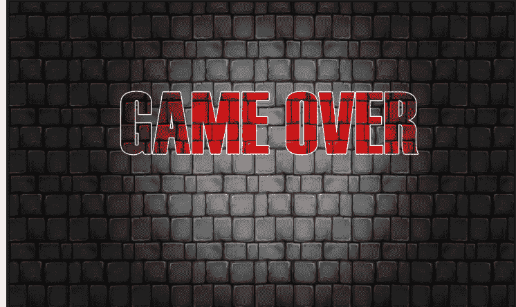

## 第12步 - 添加可收集物品

首先，我们需要导入所需的精灵图。与之前所有情况一样，你可以通过以下链接下载：

https://wddtrw/resources/learntocode/platfromgame_collectables.zip

下载后，解压并将内容添加到 `sprites` 文件夹。要解压文件，双击它，然后选择所有内容（`CTRL + A`），复制（`CTRL + C`），接着打开 `sprites` 文件夹并粘贴（`CTRL + V`）。

如果一切顺利，你应该能看到以下内容：

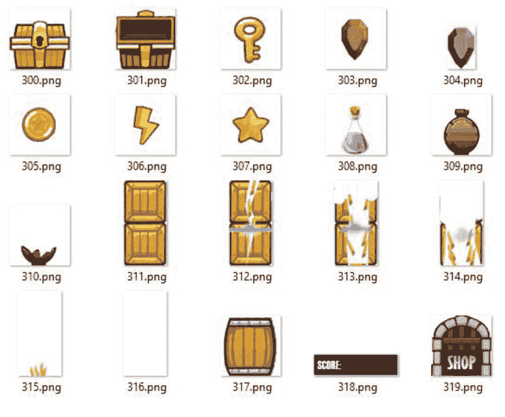

其中一些精灵图也将在下一节中用于游戏监视器。

以我们现在非常熟悉的方式，我们将它们添加到精灵文件中。打开 `sprites.js`，在文件底部添加以下代码，然后保存（`CTRL + S`）：

```javascript
/* ===============================
可收集物品代码：
300 - 宝箱
301 - 打开的宝箱
302 - 钥匙
303 - 红宝石
304 - 翡翠
305 - 金币
306 - 闪电
307 - 星星
308 - 药水
309 - 烧瓶
310 - 破碎的烧瓶
311 - 木箱 第1帧 - 完整
312 - 木箱 第2帧
313 - 木箱 第3帧
314 - 木箱 第4帧
315 - 木箱 第5帧
316 - 木箱 第6帧 - 已损坏
317 - 木桶
318 - 分数卡
319 - 商店
=============================== */
for(i = 300; i < 320; i++){
    sprite[i] = new Image();
    sprite[i].src = `sprites/${i}.png`;
}
```

值得注意的是，我们本可以且应该（对于完成的游戏）将所有精灵图加载为一个称为精灵表（sprite sheet）的单个文件。精灵表可以提升游戏性能，减少加载和启动时间。游戏将使用一些较大的图像，而不是可能数百个较小的图像。

我们会这样加载并绘制精灵表：

```javascript
let img = new Image();
img.src = '/sprites/sorcerersmountain.png';
img.onload = function() {
  init();
};

let canvas = document.querySelector('canvas');
let ctx = canvas.getContext('2d');

function init() {
  drawImage(image, sx, sy, sWidth, sHeight, dx, dy, dWidth, dHeight);
}
```

为了在构建游戏各个部分时更易于理解，我在本书中将它们分开处理。然而，在最终游戏中，将使用精灵表，我们将相应地更新代码。

继续...

创建一个名为 `collectables.js` 的新文件，将其保存在 `js` 文件夹中，并确保在 `sorcerer.html` 文件中添加对该文件的引用，如下所示并保存（`CTRL + S`）：

```html
<script type="text/javascript" src="js/collectables.js"></script>
//放置在 enemy.js 引用下方
```

接下来，打开 `assets.js`，添加以下两行代码，以初始化我们的金币设置。第一行声明了一个新的硬币对象，设置了我们精灵图的宽高，并将初始硬币计数设置为零（0）。其次，我们有一个包含十个分隔值的 `coinsCollected` 数组，所有值都设置为零。这些值中的每一个代表一枚硬币。零（0）表示未收集，一（1）表示已收集。你很快就会看到我们如何使用它来确定是否应该绘制该硬币。

```javascript
coin = { width: 49, height: 50, count: 0 },
coinsCollected = [0, 0, 0, 0, 0, 0, 0, 0, 0, 0],
```

好了，回到我们的 `collectables.js` 文件，让我们来处理绘制和收集硬币。

添加以下代码，然后保存文件（`CTRL + S`）。

```javascript
var coins = [];
function addCoins(mn, w, h, x1, y1, x2, y2, x3, y3, x4, y4, x5, y5, x6, y6, x7, y7, x8, y8, x9, y9, x10, y10){
let xs = [x1, x2, x3, x4, x5, x6, x7, x8, x9, x10];
let ys = [y1, y2, y3, y4, y5, y6, y7, y8, y9, y10];
for(i = 0; i < 10; i++){
coins[i] = { x: xs[i], y: ys[i], width: w, height: h, c: 0 };
if(player.x < coins[i].x + coins[i].width
&& player.x + player.width > coins[i].x
&& player.y < coins[i].y + coins[i].height
&& player.y + player.height > coins[i].y && coinsCollected[i] == 0){
coins[i].c +=1;
coinsCollected[i] = 1;
}
if (coins[i].c == 0 && coinsCollected[i] == 0){
ctx.drawImage(sprite[305], coins[i].x, coins[i].y, coins[i].width,
coins[i].height);
} else if (coins[i].c > 0 && coins[i].c < 2){
coin.count+=1;
player.score+=10;
}
}
}
```

`addCoins` 函数完成三项工作。它传入所需的参数，检查玩家是否与任何硬币发生了碰撞，然后在确定玩家尚未碰撞（收集）硬币时绘制该硬币。

让我们仔细看看：

```javascript
var coins = [];
//创建一个新的空数组并将其存储在变量 coins 中
function addCoins(item, w, h, x1, y1, x2, y2, x3, y3, x4, y4, x5, y5, x6, y6, x7, y7, x8, y8, x9, y9, x10, y10){
//打开 addCoins 函数并为10个硬币传递必要参数

let xs = [x1, x2, x3, x4, x5, x6, x7, x8, x9, x10];
let ys = [y1, y2, y3, y4, y5, y6, y7, y8, y9, y10];
//将 x 和 y 坐标参数分离到带索引的数组中

for(i=0; i < 10; i++){
//遍历10个索引

coins[i] = { x: xs[i], y: ys[i], width: w, height: h, c: 0 };
//为 coins 数组中的每个索引添加一个包含位置和大小参数的硬币对象

if(player.x < coins[i].x + coins[i].width
&& player.x + player.width > coins[i].x
&& player.y < coins[i].y + coins[i].height
&& player.y + player.height > coins[i].y && coinsCollected[i] == 0)
{
//如果玩家与尚未收集的硬币发生碰撞..

coins[i].c +=1;
//将给定索引的硬币的 c 参数加1

coinsCollected[i] = 1;
//将给定索引的 coinsCollected 数组更新为1 - 表示硬币已被收集
}
if (coins[i].c == 0 && coinsCollected[i] == 0){
//如果硬币未被收集...

ctx.drawImage(sprite[305], coins[i].x, coins[i].y, coins[i].width, coins[i].height);
//在给定坐标处以给定大小绘制硬币

} else if (coins[i].c > 0 && coins[i].c < 2){
//否则，如果硬币已被收集

    coin.count+=1;
    //硬币计数加1 - 用于游戏监视器

    player.score+=10;
    //玩家得分加10 - 用于游戏监视器
  }
}
```

现在，让我们让它工作起来。打开 `map1.js`，在绘制瓦片地图的嵌套 for 循环之后立即添加以下函数调用，并保存文件（`CTRL + S`）：

```javascript
addCoins(coin, 49, 50, 76, 78, 76, 142, 76, 206, 140, 332, 396, 204, 460, 204, 396, 12, 716, 332, 908, 76, 600, 78)

// 使用给定参数调用 addCoins 函数
addCoins(mn, w, h, x1, y1, x2, y2, x3, y3, x4, y4, x5, y5, x6, y6, x7, y7, x8, y8, x9, y9, x10, y10)
```

```text
mn: 地图编号
w: 精灵图的宽度
h: 精灵图的高度
x 和 y: 位置（共10组）
```

我们还有更多的可收集物品要添加到游戏屏幕中，但与拥有10个硬币不同，其他物品的数量会少一些。

如果你到目前为止一直正确地遵循了所有说明，你应该会看到一个与下图示例相似的游戏界面。尝试调整函数调用中x和y参数的值。你可以将硬币放置在任何地方，并且所有硬币都可收集，收集时会增加你的硬币数量和得分。

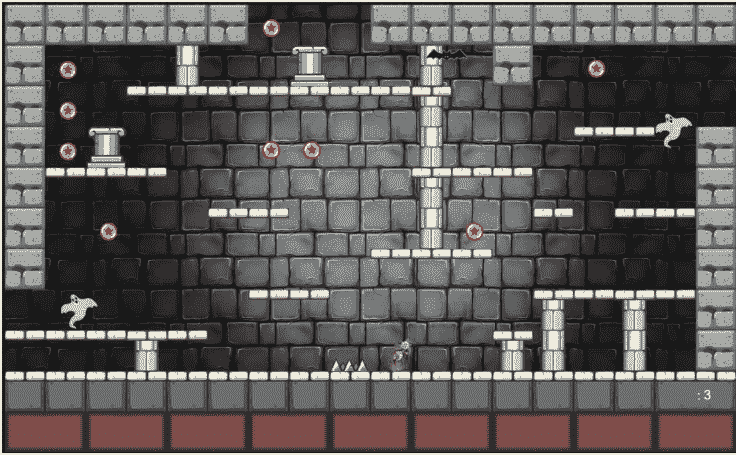

我们可以继续以同样的方式，为我们的其他可收集物品构建几乎相同的函数。如下方宝石的示例所示：

```
var gems = [];
function addGems(item, w, h, x1, y1, x2, y2){
  let xs = [x1, x2];
  let ys = [y1, y2];
  for(i =0; i < 10; i++){
    gems[i] = { x: xs[i], y: ys[i], width: w, height: h, c: 0 };
    if(player.x < gems[i].x + gems[i].width
    && player.x + player.width > gems[i].x
    && player.y < gems[i].y + gems[i].height
    && player.y + player.height > gems[i].y && gemsCollected[i] == 0){
      gems[i].c +=1;
      gemsCollected[i] = 1;
    }
  }
}

if (gems[i].c == 0 && gemsCollected[i] == 0){
  ctx.drawImage(sprite[304], gems[i].x, gems[i].y, gems[i].width, gems[i].height);
} else if (gems[i].c > 0 && gems[i].c < 2){
  gems.count+=1;
  player.score+=50;
}
}
```

注意这段代码除了变量名从 `coins` 改为 `gems` 外，几乎是完全相同的。这意味着我们可以对其进行优化。我们应该尽可能地消除重复代码。例如，这里我们可以构建一个大型数组来存放所有可收集对象。考虑到这一点，让我们快速回顾一下。

首先，打开 `assets.js` 文件，添加以下代码替换原来的硬币资源，然后保存（`CTRL + S`）：

```
coin = {width:49, height:50, count:0, mn:1, sn:305, fct:0, t:'coins'},
gem = {width:40, height:45, count:0, mn:1, sn:303, fct:12, t:'gems'},
key = {width:34, height:49, count:0, mn:1, sn:302, fct:14, t:'keys'},
potion = {width:30, height:52, count:0, mn:1, sn:308, fct:16, t:'potions' },
flask = {width:38, height:49, count:0, mn:1, sn:309, fct:18, t:'flasks' },
star = {width:39, height:39, count:0, mn:1, sn:307, fct:23, t:'stars' },
bolt = {width:39, height:39, count:0, mn:1, sn:306, fct:28, t:'bolts' },
itemsCollected = [0,0,0,0,0,0,0,0,0,0,0,0,0,0,0,0,0,0,0,0,0,0,0,0,0,0,0,0,0,0,0,0,0,0,0,0,0,0,0,0,0,0,0,0,0,0,0,0,0,0,0,0,0,0,0,0,0,0,0,0,0,0,0,0,0,0,0,0,0,0,0,0,0,0,0,0,0,0,0,0,0,0,0,0,0,0,0,0,0,0,0,0,0,0,0,0,0,0,0,0,0,0,0],
```

这些是所有可收集物品的初始设置。

- `width`（宽度）
- `height`（高度）
- `count` – 已收集的数量
- `mn` – 地图编号
- `sn` – 精灵图编号
- `fct` – 递增索引因子
- `t` – 可收集物品的类型，作为字符串

在同一文件的底部，为屏幕2的平台碰撞检测添加以下代码：

```
var boxes2 = [];
var boxesDrawn2 = 0;
```

然后保存文件（`CTRL + S`）。

接下来，让我们添加函数调用。打开 `map1.js` 文件，添加以下代码，替换掉原来的 `addCoins` 函数调用，然后保存（`CTRL + S`）：

```
//addCxs(item, x1, y1, x2, y2, x3, y3, x4, y4, x5, y5, x6, y6, x7, y7,
x8, y8, x9, y9, x10, y10)
addCxs(coin, 76, 78, 76, 142, 76, 206, 140, 332, 396, 204, 460, 204, 396,
12, 716, 332, 908, 76, 600, 78);
addCxs(gem, 720, 74, 1040, 532);
addCxs(key, 460, 10, 1024, 345);
addCxs(star, 525, 12, 973, 76, 1037, 268);
addCxs(potion, 1041, 398, 593, 332);
addCxs(flask, 13, 463);
addCxs(bolt, 425, 384);
//现在我们最多可以为每种物品添加10个，只需指定x和y坐标并从assets中引入物品对象
```

最后，打开 `collectables.js` 文件，用以下函数替换所有代码，以处理所有可收集物品，然后保存文件（`CTRL + S`）：

```
var items = [];

function addCxs(item, x1, y1, x2, y2, x3, y3, x4, y4, x5, y5, x6, y6, x7,
y7, x8, y8, x9, y9, x10, y10){

    let iw = item.width;
    let ih = item.height;
    let plw = player.width;
    let plh = player.height;
    let plx = player.x;
    let ply = player.y;
    item.mn = player.screen-1;
    let mn = item.mn*28+item.fct;

    let xs = [];
    xs[1+mn] = x1;
    xs[2+mn] = x2;
    xs[3+mn] = x3;
    xs[4+mn] = x4;
    xs[5+mn] = x5;
    xs[6+mn] = x6;
    xs[7+mn] = x7;
    xs[8+mn] = x8;
    xs[9+mn] = x9;
    xs[10+mn] = x10;

    let ys = [];
    ys[1+mn] = y1;
    ys[2+mn] = y2;
    ys[3+mn] = y3;
    ys[4+mn] = y4;
    ys[5+mn] = y5;
    ys[6+mn] = y6;
    ys[7+mn] = y7;
    ys[8+mn] = y8;
    ys[9+mn] = y9;
    ys[10+mn] = y10;

    for(i=0; i < 10; i++){
        items[i+mn] = { x: xs[i+mn], y: ys[i+mn], width: iw, height: ih, c: 0 };
        if(plx < items[i+mn].x + iw && plx + plw > items[i+mn].x && ply < items[i+mn].y + ih && ply + plh > items[i+mn].y && itemsCollected[i+mn] == 0){
            items[i+mn].c +=1;
            itemsCollected[i+mn] = 1;
        }
        if(items[i+mn].c == 0 && itemsCollected[i+mn] == 0){
            ctx.drawImage(sprite[item.sn], items[i+mn].x, items[i+mn].y, iw, ih);
        } else if (items[i+mn].c > 0 && items[i+mn].c < 2){
            item.count+=1;
            if(item.t == 'coins'){ player.score+=10; sfx[0].play(); }
            if(item.t == 'gems'){ player.score+=50; sfx[0].play(); }
            if(item.t == 'keys'){ player.score+=20; sfx[0].play(); }
            if(item.t == 'potions'){ player.score+=30; sfx[0].play(); }
            if(item.t == 'flasks'){ player.score+=100; player.lives+=1; sfx[0].play(); }
            if(item.t == 'stars'){ player.score+=25; sfx[0].play(); }
            if(item.t == 'bolts'){ player.score+=15; sfx[0].play(); }
        }
    }
}
```

让我们像往常一样分解解释一下。这里的逻辑与之前的 `addCoins` 函数相同，但考虑了我们引用的是哪种可收集物品。

```
var items = [];
//创建一个空数组并将其存储在名为items的变量中

function addCxs(item, x1, y1, x2, y2, x3, y3, x4, y4, x5, y5, x6, y6, x7, y7, x8, y8, x9, y9, x10, y10){
//打开addCxs函数，传入可收集物品资源，以及十组x和y坐标

    let iw = item.width;
    let ih = item.height;
    let plw = player.width;
    let plh = player.height;
    let plx = player.x;
    let ply = player.y;
// 设置短变量名来保存玩家和可收集物品的属性。这将使我们的碰撞计算更短、更易读
    item.mn = player.screen-1;
// 设置物品地图编号以匹配当前玩家屏幕减1

    let mn = item.mn*30+item.fct;
//计算mn以确保数据存储在唯一的数组索引中。例如，如果
//玩家在第1号屏幕上，计算公式将是0 * 30 + assets中给出的物品因子，
//第2号屏幕将是1 * 30 + 物品因子，以此类推。30是每个游戏屏幕
//可收集物品的最大数量，基于以下考虑：

- 硬币 x 10
- 宝石 x 2
- 钥匙 x 2
- 药水 x 2
- 烧瓶 x 2
- 星星 x 5
- 闪电螺栓 x 2
- 备用索引 x 5 – 如果我们想添加更多可收集物品

    let xs = [];
    xs[1+mn] = x1;
    xs[2+mn] = x2;
    xs[3+mn] = x3;
    xs[4+mn] = x4;
    xs[5+mn] = x5;
    xs[6+mn] = x6;
    xs[7+mn] = x7;
    xs[8+mn] = x8;
    xs[9+mn] = x9;
    xs[mn] = x10;
//从函数参数中获取所有X坐标，并将它们添加到xs数组的计算索引位置

    let ys = [];
    ys[1+mn] = y1;
    ys[2+mn] = y2;
    ys[3+mn] = y3;
    ys[4+mn] = y4;
    ys[5+mn] = y5;
    ys[6+mn] = y6;
    ys[7+mn] = y7;
    ys[8+mn] = y8;
    ys[9+mn] = y9;
    ys[mn] = y10;
//从函数参数中获取所有Y坐标，并将它们添加到ys数组的计算索引位置

    for(i=0; i < 10; i++){
//循环迭代10次 - 每个可能的可收集物品迭代一次

        items[i+mn] = { x: xs[i+mn], y: ys[i+mn], width: iw, height: ih, c: 0 };
        //将物品对象添加到items数组的给定坐标和计算索引位置

        if(plx < items[i+mn].x + iw && plx + plw > items[i+mn].x && ply < items[i+mn].y + ih && ply + plh > items[i+mn].y && itemsCollected[i+mn] == 0){
        //如果玩家与一个尚未收集的物品发生了碰撞

            items[i+mn].c +=1;
            //将物品的收集值设置为1

            itemsCollected[i+mn] = 1;
            //更新物品收集数组，显示该物品已被收集

        }
        if(items[i+mn].c == 0 && itemsCollected[i+mn] == 0){
        //如果该物品尚未被收集..

            ctx.drawImage(sprite[item.sn], items[i+mn].x, items[i+mn].y, iw, ih);
            //在给定的坐标、宽度和高度处绘制给定的精灵图

        } else if (items[i+mn].c > 0 && items[i+mn].c < 2){
        //否则，如果该物品已被收集..

            item.count+=1;
            //物品计数加1 - 用于下一节的游戏监控器
```

干得漂亮！如果你一切都操作正确，刷新浏览器并按“s”键开始，你应该会看到以下内容：

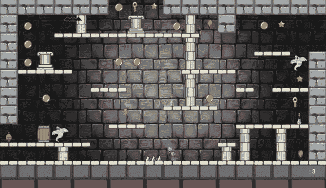

很好！在下一节中，我们将研究如何生成一些用户反馈。

我想是时候再次休息一下了。喝杯茶，放松一下，恢复精力。


## 第13步 - 游戏监控器

好的，首先打开 `sorcerer.html`，在 `enemy.js` 引用之后添加以下JavaScript文件引用，然后保存。

```
<script type="text/javascript" src="js/gameMonitor.js"></script>
```

接下来，创建一个名为 `gameMonitor.js` 的新文件，然后添加下面的代码并保存文件（`CTRL + S`）：

```
function gameMonitor(){
    ctx.drawImage(sprite[305], 19, 655, coin.width/1.5, coin.height/1.5);
    ctx.drawImage(sprite[307], 148, 658, star.width/1.5,
star.height/1.5);
    ctx.drawImage(sprite[302], 277, 656, key.width/1.5, key.height/1.5);
    ctx.drawImage(sprite[304], 400, 655, gem.width/1.5, gem.height/1.5);
    ctx.drawImage(sprite[303], 405, 670, gem.width, gem.height/1.5);
    ctx.drawImage(sprite[308], 533, 654, potion.width/1.5,
potion.height/1.5);
    ctx.drawImage(sprite[309], 660, 656, flask.width/1.5,
flask.height/1.5);
    ctx.drawImage(sprite[306], 788, 660, bolt.width/1.5,
bolt.height/1.5);
    ctx.drawImage(sprite[318], 896, 640, 256, 64);
    ctx.drawImage(wiz[1], 1042, 594, 30, 42);
}
```

我们这里所做的只是将精灵绘制到屏幕的特定位置并稍微调整它们的大小。为了让他们被绘制出来，我们必须调用该函数。打开 `map1.js`，在可收集物品的函数调用下方添加以下函数调用：

```
gameMonitor();
```

如果你刷新浏览器并按“s”键开始游戏，你会看到我们已经在屏幕底部放置了精灵，以代表游戏收集物、分数和生命值变量，如下所示：


现在，我们需要添加数字来向玩家提供反馈。打开 `main.js`，在 `player.screen` 条件内部添加以下代码，然后像往常一样保存文件：

```
if (player.screen != 15 && player.screen != 20){
    ctx.drawImage(wiz[player.f], player.x, player.y);
    ctx.font="20px Arial";
    ctx.fillStyle = "white";
    ctx.fillText(": "+player.lives, 1090, 621);
    // after this add the following code

    ctx.font="35px Arial";
    ctx.fillStyle = "white";
    ctx.fillText(player.score, 1000, 685); // Update Score

    ctx.font="20px Arial";
    ctx.fillStyle = "white";
    ctx.fillText(": "+coin.count, 60, 681);// Update Coin Count
    ctx.fillText(": "+gem.count, 444, 681);// Update Gem Count
    ctx.fillText(": "+star.count, 188, 681);// Update Star Count
    ctx.fillText(": "+potion.count, 572, 681);// Update Potion Count
    ctx.fillText(": "+flask.count, 700, 681);// Update Flask Count
    ctx.fillText(": "+bolt.count, 828, 681);// Update Bolt Count
    ctx.fillText(": "+key.count, 316, 681);// Update Key Count
    ctx.fillText(": "+player.lives, 1090, 621);// Player Lives
}
```

//add counts to the game monitor - updated with

requestAnimationFrame(update); 60 frames per second (every 16.7 ms)

如果你一切都操作正确，你现在应该能看到以下内容：


太棒了！所以我们已经构建了一个游戏界面。它看起来很酷，对吧？在下一节中，我们将探索如何添加更多界面以及如何让玩家在界面之间移动。

## 第14步 - 添加更多游戏界面

好消息是，我们已经完成了很多艰苦的工作。我们的游戏界面将大量使用我们已经构建的代码。

让我们开始处理游戏界面2。首先，我们需要确定每个界面之间的相对位置。既然我们已经创建了界面1，假设界面2在左边，界面3在右边，就像这样：


接下来，打开 `sorcerer.html`，在 map1 的引用下方添加第二个地图的引用，如下所示：

```
<script type="text/javascript" src="js/map2.js"></script>
```

保存文件（`CTRL + S`）。

现在，创建一个名为 `map2.js` 的新文件并保存在 `js` 文件夹中。然后添加以下代码：

```
function drawMyMap2(){
  ctx.drawImage(tile[16], 0, 0);
  var xt = 0; // Tile Map X Index
  var yt = -64; // Tile Map Y Index
  var tileMap = [];
  var mapNo = 0; // Map Index
  tileMap[0] = [6, 0, 0, 6, 6, 6, 6, 6, 6, 6, 6, 6, 6, 6, 6, 6, 6];
  tileMap[1] = [6, 9, 0, 0, 10, 0, 0, 0, 0, 0, 0, 0, 0, 0, 0, 0, 6];
  tileMap[2] = [6, 9, 9, 9, 9, 9, 0, 0, 0, 0, 0, 0, 0, 0, 0, 0, 0, 6];
  tileMap[3] = [6, 0, 0, 0, 0, 0, 0, 9, 0, 0, 4, 4, 4, 4, 0, 0, 4, 6];
  tileMap[4] = [6, 4, 4, 4, 4, 0, 0, 0, 0, 9, 5, 5, 5, 5, 0, 0, 5, 6];
  tileMap[5] = [6, 6, 6, 6, 6, 0, 9, 0, 0, 0, 5, 5, 5, 5, 0, 0, 5, 6];
  tileMap[6] = [6, 0, 0, 0, 0, 0, 0, 0, 0, 9, 6, 6, 6, 6, 6, 6, 6, 6];
  tileMap[7] = [6, 0, 0, 0, 0, 0, 0, 9, 0, 0, 6, 0, 0, 0, 0, 0, 0, 0];
  tileMap[8] = [6, 9, 9, 9, 0, 0, 0, 0, 0, 9, 6, 0, 0, 0, 0, 0, 9, 8];
  tileMap[9] = [6, 1, 1, 1, 1, 1, 1, 1, 1, 1, 6, 0, 0, 1, 1, 1, 2, 3];
  tileMap[10] = [13, 14, 13, 14, 13, 14, 13, 14, 13, 14, 13, 14, 13, 14, 13, 14, 13, 14];
for (mapNo=0; mapNo < 11; mapNo++){
    yt+=64;
    for (xt=0; xt < tileMap[mapNo].length*64; xt+=64){
        if (xt > 1152){ xt = 0; }
            var i = tileMap[mapNo][xt/64]; // Array Variable at current iteration position
            ctx.drawImage(tile[i], xt, yt); // Draw row - Y position px from top of canvas
        }
    }

addCxs(coin, 76, 399, 140, 399, 206, 399, 652, 79, 716, 79, 780, 79, 846, 79)
addCxs(gem, 70, 200, 76, 532);
addCxs(key, 1040, 76, 585, 525);
addCxs(star, 1037, 140, 717, 460);
addCxs(potion, 590, 461, 0, -100);
addCxs(flask, 580, 207, 0, -100);
addCxs(bolt, 457, 386, 0, -100);

gameMonitor();

enemy(enemy1.f, enemy1, 390, 66, 200, 201, player, 1, 0, 0);
enemy(enemy2.f, enemy2, 576, 66, 200, 201, player, 1, 0, 0);
enemy(enemy3.f, enemy3, 320, 66, 200, 201, player, 2, -66, 0);
enemyStatic(202, spikes1, -129, 0, player);
enemyStatic(202, spikes2, 212, -192, player);
}
```

```
function addBox2(a,b,c,d){
    boxes2.push({ x: a, y: b, width: c, height: d });
    return
}

function drawBoxes2(){
addBox2(0,57,706,1);
addBox2(832,577,320,1);
addBox2(0,0,66,640);
addBox2(1089,0,66,384);
addBox2(192,0,960,64);
addBox2(640,386,66,256);
addBox2(640,192,256,192);
addBox2(706,386,386,64);
addBox2(1026,192,66,192);
addBox2(66,256,256,128);
addBox2(576,512,66,1);
addBox2(1024,512,128,1);
addBox2(66,512,192,1);
addBox2(449,449,66,1);
addBox2(576,386,66,1);
addBox2(386,320,66,1);
addBox2(576,256,66,1);
addBox2(66,129,320,1);
addBox2(449,192,66,1);
addBox2(66,66,66,1);
boxesDrawn2+=1;
return boxesDrawn2;
}
```

你应该能认出所有这些代码。除了改变的参数，这段程序代码与界面1的相同。只是为了回顾一下，我们绘制了背景图像，然后是瓦片地图，添加了可收集物品，接着是游戏监控器、敌人，最后是碰撞框。

如果你需要进一步的澄清，请回到第162页及以后，那里我们构建了 `map1.js`。因为解释基本上是相同的。

我们需要采取的最后一步是对 `main.js` 进行一个小更新，以允许主角访问其他瓦片地图。例如，当玩家移出界面1的左侧时，他们需要到达界面2的右侧。同样，如果玩家移出界面2的右侧，他们需要到达界面1的左侧。打开 `main.js` 并添加以下代码，然后保存文件：

```
if (player.screen === 1){ drawMyMap(); }← following this line add the code below
```

```
//===== SCREEN 1 ==============
if (player.x <5 && player.screen === 1){
    player.screen = 2;
    player.x = 1103;
    player.entered = 0;
}
if (player.x > 1103 && player.screen === 1){
    player.screen = 3;
    player.x = 15;
    player.entered = 0;
}
if (player.y <-20 && player.screen === 1){
    player.screen = 7;
    player.y = 525;
    player.entered = 0;
}
```

```
//===== SCREEN 2 ==============
if (player.x > 1103 && player.screen === 2){
    player.screen = 1;
    player.x = 5;
    player.entered = 0;
}
```

如果 (`player.y > 635 && player.screen === 2`) {

    player.screen = 5;

    player.y = 5;

    player.entered = 0;

}

如果 (`player.y < -20 && player.screen === 2`) {

    player.screen = 8;

    player.y = 576;

    player.entered = 0;

}

然后，在这段代码块之后：

```
if (player.screen < 15 && player.start === 0) {player.start = 1;}
if (player.screen === 1 && boxesDrawn1 === 0){ drawBoxes1(); }
if (player.screen === 1 && boxesDrawn1 < 2 ) {
    boxes = boxes1;
    if (player.entered < 1){
        enemy1.x = 62; enemy1.y = 454; enemy1.dest = 0;
        bat1.x = 62; bat1.y = 70; enemy2.dest = 0;
        enemy3.y = 62; enemy3.dest = 0;
        player.entered = 1;
    }
}
```

添加以下内容：

```
if (player.screen === 2){ drawMyMap2(); }
if (player.screen === 2 && boxesDrawn2 === 0){ drawBoxes2(); }
if (player.screen === 2 && boxesDrawn2 < 2 ) {
    boxes = boxes2;
    if (player.entered < 1){
        enemy1.x = 62; enemy1.y = 448; enemy1.dest = 0;
        enemy2.x = 62; enemy2.y = 192; enemy2.dest = 0;
        enemy3.y = 62; enemy3.dest = 0;
        player.entered = 1;
    }
}
```

好的，让我们仔细检查一下这段代码。

```
if (player.x < 5 && player.screen === 1){
    player.screen = 2;
    player.x = 1103;
    player.entered = 0;
}
//如果玩家的x位置小于5像素并且玩家在第1屏，将玩家的屏幕改为2，将玩家的x位置设为1103像素（右侧），并将玩家进入状态设为0
```

每个屏幕的每个可能的出入口点都有相应的条件判断。接下来，我们看下面的代码块：


```
if (player.screen === 2){ drawMyMap2(); }
//如果玩家在第2屏，绘制瓦片地图

if (player.screen === 2 && boxesDrawn2 === 0){ drawBoxes2(); }
//如果玩家在第2屏且碰撞盒未绘制——则绘制它们

if (player.screen === 2 && boxesDrawn2 < 2 ) {
//如果玩家在第2屏...
    boxes = boxes2;
//将第2屏的碰撞盒添加到boxes变量中，以便玩家能与之交互
    if (player.entered < 1){
//如果player entered为0...
        enemy1.x = 62; enemy1.y = 448; enemy1.dest = 0;
        enemy2.x = 62; enemy2.y = 192; enemy2.dest = 0;
        enemy3.y = 62; enemy3.dest = 0;
        player.entered = 1;
//绘制敌人，然后将player entered设为1
    }
}
//关闭条件判断
```

现在，刷新你的屏幕，按“s”键开始，并将玩家导航到第2屏。如果你正确操作了所有步骤，你的第2屏瓦片地图应该看起来像这样：


现在，以同样的方式，你可以根据需要添加任意多的屏幕。在设计游戏屏幕时，请确保不同屏幕之间的入口/出口匹配，如下所示：


干得漂亮！为了在下一节完成这个练习，我们将添加一些背景音乐和音效（SFX）。

## 第15步 - 添加音效（SFX）和音乐

在玩家穿越游戏世界时，有多种方式向其提供反馈。我们的游戏显示器、动画以及声音。在现实世界中，我们通过感官体验许多事物。在游戏中世界也是如此。玩家死亡时的声音，重生时的动画，吃到美味食物时的音效，或者吃到不太好吃的东西时的另一种音效。可能性是无穷无尽的。唯一阻碍你的是你的想象力。你为游戏添加的层次和行为越多，它对玩家来说就越有吸引力。

我们需要做的第一件事是导入我们需要的音效文件。像之前所有情况一样，你可以通过以下链接下载它们：

https://wddtrw/resources/learntocode/platformgame_sfx.zip

下载后，解压文件并将内容添加到“sfx”文件夹中。解压文件的方法是双击它，然后全选（CTRL + A）并复制（CTRL + C），接着打开“sfx”文件夹并粘贴（CTRL + V）。

如果一切顺利，你应该有以下内容：


接下来，我们需要添加对两个新JavaScript文件的引用，我们将创建这两个文件来处理声音。打开“sorcerer.html”，并在“tiles.js”文件引用之前添加以下引用：

```
<script type="text/javascript" src="js/sfx.js"></script>
<script type="text/javascript" src="js/music.js"></script>
```

保存文件。

接下来，创建一个名为“sfx.js”的新文件，并按照惯例将其保存在你的“js”文件夹中。然后添加以下代码：

```
var sfx = [];
sfx[0] = new Audio('sfx/collectcoin.wav');
sfx[1] = new Audio('sfx/collectgem.wav');
sfx[2] = new Audio('sfx/collectstar.mp3');
sfx[3] = new Audio('sfx/collectpotion.mp3');
sfx[4] = new Audio('sfx/collectflask.mp3');
sfx[5] = new Audio('sfx/collectbolt.mp3');
sfx[6] = new Audio('sfx/collectkey.wav');
sfx[7] = new Audio('sfx/ghost_kill.mp3');
sfx[8] = new Audio('sfx/jump.mp3');
sfx[9] = new Audio('sfx/encounter.mp3');
sfx[10] = new Audio('sfx/Castle_Theme.mp3');
sfx[11] = new Audio('sfx/Main_Theme.mp3');
```

这里，我们创建了一个名为sfx的新数组。然后我们按照选定的索引添加了音效，以便我们可以在游戏代码中轻松使用它们。

保存文件（CTRL + S）。

好的，现在我们需要添加指令，在特定情况下播放音效文件。让我们先处理可收集物品。打开“collectable.js”并编辑以下条件判断：

```
if(item.t == 'coins'){ player.score+=10; sfx[0].play(); }
if(item.t == 'gems'){ player.score+=50; sfx[1].play(); }
if(item.t == 'keys'){ player.score+=20; sfx[6].play(); }
if(item.t == 'potions'){ player.score+=30; sfx[3].play(); }
if(item.t == 'flasks'){ player.score+=100; player.lives+=1; sfx[4].play(); }
if(item.t == 'stars'){ player.score+=25; sfx[2].play(); }
if(item.t == 'bolts'){ player.score+=15; sfx[5].play(); }
```

添加高亮显示的代码。这将在你收集特定物品时播放不同的声音。

保存文件并尝试一下！

接下来，打开“main.js”。在主更新函数开始之后，添加以下两个条件判断：

```
function update() {
    // 在这行之后添加以下两行代码
    if(player.screen === 15){ playMusic(2); }
    if(player.screen < 15 && player.lives > 0){ playMusic(1); }
```

然后，在跳跃控制条件判断内部，添加以下高亮指令，然后保存文件：

```
if (keys[38] || keys[32]) {
    if (!player.jumping && player.grounded) {
        player.velY = -player.speed * 2.5;
        player.jumping = true;
        player.grounded = false;
        sfx[8].play();
    }
}
```

接下来，创建一个名为“music.js”的新文件，添加以下代码，然后将其保存在“js”文件夹中：

```
function playMusic(m){
    if(m === 1){
        sfx[11].pause();
        sfx[11].currentTime = 0;
        sfx[10].addEventListener('ended', function(){
                if(sfx[10].currentTime === sfx[10].duration - .34){
                    sfx[10].currentTime = 0.1;
                    sfx[10].play();
                }}, false);
        sfx[10].play();
    }
    if(m === 2){
        sfx[10].pause();
        sfx[10].currentTime = 0;
        sfx[11].addEventListener('ended', function(){
                if(sfx[11].currentTime === sfx[11].duration - .34){
                    sfx[11].currentTime = 0.1;
                    sfx[11].play();
                }}, false);
        sfx[11].play();
    }
    if(m === 0){
        sfx[10].pause();
        sfx[10].currentTime = 0;
    }
}
```

简而言之，这个函数会在音乐持续时间接近结束时重新开始播放，从而循环音乐，并在玩家位于标题/游戏结束屏幕或游戏屏幕时切换音乐。这里有一些我们之前在这本书中没有探索过的新指令。

它们是 `currentTime`、`duration`、`pause()` 和 `play()`。`play()` 方法开始播放当前音频，而 `pause()` 方法暂停音频，`currentTime` 返回当前播放时间，`duration` 返回持续时间，换句话说就是总长度。这些是内置的JavaScript函数。它们具有以下语法：

```
audioObject.play()
audioObject.pause()
audioObject.currentTime
audioObject.duration
```

我们的 `playMusic` 函数尝试通过在音乐播放接近结束时重新开始来无缝地循环音乐。

接下来，让我们更新“enemy.js”。打开该文件，在 `lifeLost` 函数的开始部分内部添加以下代码：

```
sfx[7].play();
```

然后在 `gameOver` 函数的开始部分内部添加以下代码：

```
if(player.lives < 1){ playMusic(2);}
```

保存文件（CTRL + S）。

现在我们有了音乐和音效。为什么不尝试实验并添加更多你自己的音效呢？如果你没有编辑音效文件的工具，我强烈推荐免费的Audacity。

你可以在以下地址找到它：

[https://www.audacityteam.org/download/](https://www.audacityteam.org/download/)

只需下载适合您特定系统的版本。

## 第16步 - 总结

我们已经完成了本次练习，但这仅仅是旅程的开始。

## 可以尝试的想法：

- 添加更多游戏画面

- 制作新的图块和图块地 map

- 添加不同的敌人

- 尝试添加不同的收集品，例如浆果或面包。你也可以添加一些应该避免食用的物品。如果玩家吃了有毒的浆果，也许会失去一条生命？

- 生成和重生动画

- 遇敌和死亡动画

- 主角动画——行走、跳跃

- 施放法术

- 确定角色能从多高处坠落而不死亡

- 添加高分榜

- 门——收集钥匙来开门

- ...列表仍在继续

一如既往，你可以通过以下链接下载所有相关文件：

[https://wddtrw/resources/learntocode/platformgame.zip](https://wddtrw/resources/learntocode/platformgame.zip)

# 学习编程

HTML, CSS 与 JAVASCRIPT

## 将您的项目部署到 Web 服务器

为了将您的项目部署到 Web 服务器并通过互联网访问它们，您首先需要选择一个 Web 服务提供商。

有一些免费的网络空间可用，但它们通常有很多限制。如果您需要一个用于测试个人项目的网络空间，也有一些更便宜的选择。

您可以从 Heart Internet 和 Ionos 1 & 1 等服务商获得有效且价格合理的套餐。套餐起步价仅为每月几英镑或几美元。要部署您自己的代码，您只需要一个域名、一个主机套餐和一个 SSL 证书。

您可以从 Ionos 获得套餐（在撰写本书时），前6个月仅需每月£1加增值税，之后仅需每月£4加增值税，并附赠免费的 SSL 证书。然后，您可以以大约£10的价格购买一个域名，但同样，第一年通常会有折扣，低至£1加增值税。

## 文件传输协议

一旦您有了网站托管服务，您可以使用一种称为文件传输协议 (FTP) 的系统轻松上传文件。或者，如果您从更专业的角度进行开发，您可以使用像 GIT hub 这样的代码仓库，但这超出了本书的范围。

最基本地说，当您将文件上传到 Web 服务器时，public html 文件夹内的任何文件都可以供公众访问。当您将域名连接到您的网络空间时，如果您将文件上传到名为 index.html 或 index.php 的公共文件夹，例如，您不需要指定文件名。

~ 229 ~

例如，[https://wddtrw.co.uk](https://wddtrw.co.uk) 会打开 Web 服务器公共文件夹中一个名为 index.php 的文件。

一旦您建立了连接，通过 FTP 上传文件就非常类似于在 PC 或 Mac 上将文件从一个文件夹传输到另一个文件夹。唯一的区别是您将文件传输到另一台计算机。

这是 WS FTP Pro 的截图：


一旦您连接到 Web 服务器，左侧窗口显示您本地机器上的文件，而右侧窗口显示远程服务器上的文件。

服务器上的文件。通过这种方式，您可以轻松地从 Web 服务器上传、下载和删除文件和文件夹。

互联网服务提供商 (ISP) 通常提供带有 FTP 访问的控制面板，同时也有可用的 FTP 客户端工具，例如 WS FTP、FileZilla、Cyberduck 等。

如果您选择购买网站托管服务，您必须清楚您打算用它来做什么。对于某些网络空间，您会得到一个带有各种工具的网站构建器，但它们功能有限。一般来说，限制越少，系统使用起来就越需要技术。如果您不确定，几乎所有 ISP 都有很好的客户服务，或者拥有庞大的常见问题解答数据库。

Web 服务器通常分为以下几类：

- WordPress 或其他网站构建器 – 无安全 Shell 访问

- 仅 Web 托管和 SSL – 无安全 Shell 访问

- 虚拟专用服务器 – VPS – 有安全 Shell 访问

- 专用服务器 – 有安全 Shell 访问

如果您想建立一个常规网站，并且希望有一些快速便捷的工具，减少编码，那么 WordPress 或网站构建器托管将适合您。

如果您是网络编码新手，只想了解更多关于托管网站或 Web 应用程序的知识，我建议选择带有 SSL 证书的常规网络托管。请确保 SSL 证书包含在内，否则您可能会发现需要每年支付大约£60 - £100 或更多来保护您的网站安全。

如果您是更熟练的 Web 开发人员，那么选择虚拟专用服务器 (VPS) 不会出错。VPS 托管模拟了专用服务器的体验，即使您仍然与其他用户共享物理服务器。VPS 可以非常便宜，但需要更高的技术能力。通过 SSH 访问，您可以更灵活地配置服务器。

那么，如果预算不成问题，并且您是一位经验丰富的开发人员，专用服务器可能是您的正确选择。选择专用服务器的主要原因是安全性和高流量。专用服务器拥有所有可用的功率和灵活性，完全由自己独享，而不是与他人共享资源。

## 什么是 SSL？

SSL 代表安全套接字层 (Secure Sockets Layer)，简而言之，它是保持互联网连接安全并保护在两个系统之间发送的任何敏感数据的标准技术，防止入侵者读取和/或修改任何传输的信息，包括潜在的个人细节。

## 什么是 SSH？

SSH，也称为安全外壳 (Secure Shell) 或安全套接字外壳 (Secure Socket Shell)，是一种网络协议，为用户（尤其是系统管理员）提供了一种通过不安全网络访问计算机的安全方式。

它提供了执行命令的能力，并为服务器管理提供了灵活性。

## 下一步方向

在《第2册》（即将出版）中，我们将探索另外三个很棒的开发内容，并且我们将继续我们的《巫师山》游戏开发，使用精灵表添加角色动画、魔法力量、传送门、高分榜等等。

现在，尝试设计一些你自己的游戏关卡。下一本书再见。

我很乐意收到你的来信。你可以通过以下邮箱联系我：

[learntocode@wddtrw.co.uk](mailto:learntocode@wddtrw.co.uk)

如果您喜欢这本书，请在亚马逊上给我留下诚实的评论。我将非常感激。如果没有，请联系我并告诉我原因，以便我可以帮助您并改进未来的版本。

致以我最美好的祝愿，


## 查看我的其他一些出版物（是的，我也写小说！）


《学习编程》第2册预计于2022年4月左右出版。请在亚马逊上关注我，以保持最新状态并在发布时获得通知。


出于几乎相同的原因，我爱上了计算机编程的艺术，我也对写作产生了热情。

在我9岁那年，我收到了人生第一台电脑作为生日礼物，并爱上了计算机编程的艺术和创造力。我发现它让我能够创造角色、游戏世界和其他神奇的特性，其边界仅受限于我想象力的深度。

同样，对我来说，写作打开了通向同样奇妙的想象宇宙的大门，而由我掌控，拥有在我完全且不受阻碍的控制下导航和探索的能力。

我最喜欢的一句名言，很好地概括了我热情背后的驱动力：

> “你能想象的一切都是真实的。” - 巴勃罗·毕加索。

## 索引

关于作者 ...............III, 2

添加图片 .................III, 21

为图片添加样式 IV, 43

动画 .......................23, 190

应用 ....I, 2, 9, 11, 15, 16, 22, 29, 32, 34, 36, 41, 43, 46, 51, 53, 56, 57, 58, 59, 60, 61, 62, 63, 64, 73, 76, 92, 95, 96, 101, 102, 103, 104, 105, 110, 120, 121, 125, 128, 130, 131, 139, 142, 147, 150, 151, 230

数组 .... 75, 76, 77, 78, 79, 80, 81, 82, 84, 85, 86, 124, 126, 127, 135, 136, 137, 138, 156, 157, 164, 169, 185, 188, 199, 201, 204, 207, 208, 209, 223

数组 .......... 84, 85, 86, 176, 201

资源 ............................. V, 153

背景...11, 12, 22, 23, 36, 37, 39, 64, 65, 66, 67, 68, 70, 72, 97, 130, 142, 143, 144, 151, 152, 154, 155, 156, 161, 164, 217, 221

浏览器 2, 8, 9, 10, 11, 14, 19, 20, 39, 51, 59, 61, 68, 77, 101, 103, 104, 108, 109, 117, 125, 150, 162, 170, 173, 210, 213

构建...... 36, 52, 101, 149, 154, 155, 156, 157

层叠样式表 ....... 10

层叠样式表 ....III, 10

代码 ... 2, 5, 6, 8, 9, 11, 12, 13, 15, 16, 17, 18, 19, 20, 21, 22, 26, 28, 29, 30, 32, 36, 43, 54, 58, 61, 64, 66, 75, 76, 77, 79, 82, 88, 89, 90, 92, 93, 94, 95, 96, 97, 101, 103, 105, 108, 109, 111, 117, 120, 121, 122, 123, 126, 128, 131, 132, 144, 153, 154, 155, 156, 157, 158, 159, 160, 162, 163, 168, 170, 172, 176, 181, 184, 186, 188, 189, 194, 198, 199, 200, 204, 205, 212, 213, 215, 217, 218, 219, 220, 223, 224, 225, 226, 227, 228

编程 ..............................4, 7

代码编辑器 ...................III, 7

可收藏品........... V, 197, 198

色彩设计 ................IV, 34

色轮......................34

注释 ........................16

计算机 ...... 3, 4, 7, 51, 98, 229, 231, 234

常量....55, 73, 74, 75, 76, 77, 78, 79, 84, 85, 86, 88, 89, 90, 92, 93, 98, 99, 103, 105, 106, 123, 124, 126, 131, 132, 133, 134, 135, 136, 137, 138, 144, 145, 146, 156

本书使用的约定 ...................................III

倒计时器 ......IV, 95, 96

创建平台游戏.V, 148

创建一个网络应用 .........IV, 51

CSS...................................5

CSS...I, V, 2, 5, 8, 10, 14, 15, 16, 18, 20, 28, 30, 34, 36, 38, 43, 59, 66, 67, 70, 90, 91, 107, 108, 109, 111, 112, 113, 116, 117, 118, 120, 131, 139, 148, 151, 152

花括号 18, 88

光标 65, 69, 70

删除 V, 132

部署你的项目 VI

开发者 2, 231

显示 8, 18, 21, 22, 23, 37, 40, 60, 64, 68, 69, 89, 92, 93, 94, 96, 97, 102, 103, 125, 130, 131, 135, 136, 137, 139, 140, 141, 144, 145, 146, 151, 160

DIV 21, 22, 29, 30, 32, 33, 41, 42, 46, 47, 48, 55, 56, 58, 59, 60, 68, 69, 71, 73, 78, 81, 82, 91, 95, 96, 97, 103, 104, 105, 110, 111, 128, 129, 134, 136, 139, 140, 141, 150, 151

除法 22

下载 6

下载和准备图片 III, 26

元素 12, 29, 31, 38, 44, 66, 67, 68, 70, 71, 79, 97, 104, 111, 112, 113, 114, 115, 116, 117, 123, 124, 129, 131, 143, 145, 146, 151, 152, 153

引擎 IV, 73

环境 52, 73, 158, 174

练习 24, 27, 30, 48, 49, 53, 59, 66, 73, 101, 109, 139, 141, 146, 147, 148, 162, 165, 187, 221, 227

文件结构 III, IV, V, 7, 25, 27, 52, 149

文件传输协议 VI, 228

文件 6

字体 10, 11, 12, 13, 15, 16, 18, 37, 39, 64, 65, 66, 67, 69, 72, 96, 97, 120, 121, 122, 130, 142, 143, 194, 213, 214

字体颜色 12

表单属性 IV, 112, 113

函数 III, IV, 15, 76, 87

功能性 48, 51, 53, 103

游戏监视器 V, 212

游戏结束 V, 196

游戏界面 VI, 215

谷歌 5, 26, 39, 47, 51

H1 标筓 12

页眉 29, 32, 36, 39, 41, 46, 46, 47, 48, 57, 58, 59, 63, 64, 68, 69, 105, 110, 128, 139, 140

高度 10, 22, 23, 36, 37, 39, 43, 65, 66, 69, 70, 71, 97, 115, 116, 130, 142, 143, 151, 152, 154, 155, 156, 161, 164, 217, 221

你好世界 7, 8

你好世界 4, 7, 10, 13, 21

你好，世界！ III, 7

十六进制 12, 34, 144

悬停 43, 44, 65, 70, 142, 143

HREF 5, 9, 29, 30, 32, 33, 41, 42, 45, 46, 47, 48, 58, 59, 110, 128, 139, 140, 141, 150, 151

HTML 5, 7, 8, 9, 10, 11, 13, 16, 18, 21, 26, 27, 28, 32, 33, 36, 41, 43, 46, 48, 53, 55, 56, 58, 95, 101, 102, 103, 105, 110, 111, 125, 128, 129, 134, 137, 139, 140, 141, 149, 150, 151, 152, 162, 194, 199, 212, 215, 223, 228

HTML 文件 III, V, 27, 150

HTML 表单 IV, 110, 120, 122

实现 CSS IV, 34

实现 HTML 结构 .............................IV, 56

说明 ....26, 154, 161, 203, 224, 225

介绍 ............................2, 4

介绍 ............................III

JavaScript...I, 2, 8, 14, 15, 16, 20, 53, 54, 55, 56, 57, 59, 61, 66, 69, 71, 73, 74, 75, 77, 82, 95, 98, 101, 102, 103, 104, 105, 107, 108, 109, 111, 113, 116, 117, 123, 126, 129, 138, 148, 150, 151, 154, 155, 212, 223, 226

JavaScript...III, IV, V, 15, 73, 131, 132, 144, 158

JSON..IV, 53, 54, 55, 56, 57, 59, 61, 75, 80, 107, 109, 122, 125, 126, 132, 133, 134, 135, 136, 137, 138, 153

JSON 文件 .................IV, 53, 61, 122

课程 .......................................2

LET 13, 16, 21, 24, 29, 34, 36, 39, 50, 52, 54, 55, 55, 56, 57, 58, 66, 67, 74, 75, 78, 79, 83, 84, 88, 89, 91, 93, 94, 104, 111, 125, 126, 128, 129, 132, 133, 134, 135, 136, 137, 138, 144, 149, 155, 159, 163, 168, 170, 172, 174, 175, 176, 177, 199, 200, 201, 202, 203, 204, 205, 206, 207, 208, 215, 219, 226

链接. 5, 9, 21, 28, 29, 30, 31, 32, 34, 41, 42, 43, 44, 45, 46, 47, 48, 52, 53, 58, 59, 62, 66, 110, 128, 150, 151, 187, 197, 222, 227

本地存储....IV, V, 125, 131

位置 104, 125, 134, 137, 149

苹果电脑 ..........................2, 8, 52, 109, 229

外边距 .11, 12, 22, 23, 36, 37, 39, 43, 64, 65, 66, 67, 69, 70, 71, 72, 96, 130, 131, 142, 143, 152

音乐 ....................................VI, 222

我的其他著作 ...VI, 233

导航 .........V, 139, 142, 144

记事本 ...................................2, 4, 7, 9

数字 54, 82, 86, 112, 115, 137, 164, 213

对象 54, 86, 175, 188, 189, 204

不透明度 10, 20, 44, 66, 71, 91, 144

运算符 .............V, 179, 180, 181

溢出 ..... 64, 67, 68, 151, 152

内边距 10, 37, 40, 64, 65, 67, 68, 69, 71, 97, 130, 142

页面布局设计 ............III, 28

个人电脑 ..............................................2, 52, 229

像素 .....22, 97, 143, 152, 155, 164, 167, 186, 220

平台游戏 V, 148, 150, 151, 153

指针..........................................65, 69

位置 20, 65, 66, 70, 71, 79, 82, 84, 91, 130, 142, 143, 172, 183, 190, 191, 193, 201, 216, 220

编程. 3, 4, 5, 7, 52, 53, 107, 176

编程环境 .....................................52

参考 .................V, 154, 157

结果...20, 23, 40, 52, 55, 56, 57, 58, 60, 63, 65, 70, 71, 73, 74, 75, 76, 89, 95, 98, 100, 101, 103, 104, 160, 185

RGB..........................................12, 34

规则 ..9, 10, 11, 12, 14, 20, 23, 39, 44, 67, 68, 69, 111, 112, 116, 117, 120, 121, 131, 139, 142, 143, 151, 152, 183, 195

保存 .8, 11, 21, 23, 26, 93, 96, 101, 111, 122, 129, 171, 172, 187, 196, 215, 223, 224, 226

搜索. 26, 31, 39, 51, 59, 60, 112

选择器模式.......................... 43

音效 .......................... VI, 149, 221, 222

声音 .......................................... VI, 222

精灵对象 .......................... V, 157

精灵表.......................... V, 198

SSH ............................................ VI, 231

SSL .......................... VI, 228, 230, 231

字符串.... 54, 55, 56, 81, 82, 83, 86, 116, 125, 179, 205

字符串 ..............................54, 82, 86

样式表 . 5, 9, 29, 32, 41, 46, 58, 59, 110, 128, 150, 151

语法 ................................................... 5

语法高亮 ............... 5

目标 ...................................................46

瓦片地图 ....................... V, 154, 167

瓦片 .................................................... V, 154

标题界面...................... V, 160

过渡 ..............................66, 71, 91

URL.. 5, 30, 31, 40, 45, 48, 114, 154, 157, 168

用户管理功能 ............................IV, 107

变量 18, 54, 73, 74, 77, 78, 83, 84, 90, 98, 124, 126, 135, 136, 137, 138, 145, 146, 153, 156, 164, 176, 181, 182, 201, 207, 220

Visual Studio Code............2, 4, 7

网络服务器 ....................................VI

格式良好的超链接 ..IV, 45

格式良好的图片元素 ....................................................IV, 40

什么是 JSON 文件？ .............IV, 53

什么是网络应用，它与网站有何不同？ ....................................................IV, 51

什么是数组？ .............IV, 84

接下来去哪里 VI, 232

为什么使用 JSON？ .........................IV, 54

宽度 ... 5, 6, 10, 36, 37, 39, 43, 58, 59, 65, 66, 68, 69, 71, 91, 97, 110, 115, 116, 120, 121, 122, 128, 130, 131, 142, 143, 153, 154, 158, 159, 160, 162, 169, 170, 171, 175, 176, 178, 181, 183, 184, 185, 189, 190, 192, 193, 199, 200, 201, 202, 203, 204, 205, 206, 207, 209, 212, 217

视窗系统 ........................................ 2, 8

自动换行.................................. 6

Z-index.. 15, 16, 18, 66, 71, 91, 142
