# 学习编程：学习 HTML、CSS 与 JavaScript 并构建网站、应用与游戏

## HTML、CSS 与 JavaScript

```html
<label class="formLabel">Question:</label><br>
```

接下来，我们有一个表单标签 `<label></label>`。我们为每个标签都添加了一个类，以便我们可以通过 CSS 选择样式规则。在 `<label></label>` 标签之间的文本将被显示（渲染）在用户视图中。

`<br>` 元素的意思是换行。它的功能是在渲染下一个元素之前，转到新行。我在这里添加它是为了简单起见，我们可以通过向 CSS 添加必要的规则来达到同样的效果。

每个标签元素的结构几乎相同，只在某些地方有或没有 `<br>`。

```html
<input type="text" maxlength="" size="" class="" id=" " name="" required>
```

接下来，我想讨论最常见的表单输入类型。在每个表单输入内部，我们可以设置各种规则。有些规则取决于我们选择的 `<input>` 类型，而其他规则则适用于任何可用的选项。

首先，我们需要设置输入类型。这里我们选择了“text”，然而，有许多输入类型可供选择。数字输入类型只允许数字作为输入，文本允许文本和数字。我们不会在这里探讨所有类型，但你可以在下面的列表中看到选项的范围：

### INPUT TYPE FORM ATTRIBUTES

| INPUT TYPES | |
|---|---|
| `<input type="button">` | `<input type="password">` |
| `<input type="checkbox">` | `<input type="radio">` |
| `<input type="color">` | `<input type="range">` |
| `<input type="date">` | `<input type="reset">` |
| `<input type="datetime-local">` | `<input type="search">` |
| `<input type="email">` | `<input type="submit">` |
| `<input type="file">` | `<input type="tel">` |
| `<input type="hidden">` | `<input type="text">` |
| `<input type="image">` | `<input type="time">` |
| `<input type="month">` | `<input type="url">` |
| `<input type="number">` | `<input type="week">` |

如上所示，HTML 表单输入类型有很多。我们将在后续内容中更详细地探讨我们正在使用的那些。

## 其他表单属性

| 属性 | 值 | 描述 |
| --- | --- | --- |
| name | 文本 | 输入元素的名称。 |
| value | 文本 | 输入元素的值。 |
| id | 标识符 | 为输入元素定义一个唯一的标识符。 |
| class | 类名 | 设置要应用于输入的一个或多个 CSS 类。 |
| style | CSS 样式 | 设置输入的样式。 |
| data-* | 值 | 定义可供 JavaScript 使用的额外数据。 |
| hidden | hidden | 指定输入是否隐藏。 |
| title | 文本 | 设置一个标题，该标题显示为工具提示。 |
| tabindex | 索引 | 设置相对于其他元素的制表符顺序。 |
| checked | checked | 用于类型：复选框或单选按钮。使选项被选中或选择。 |
| placeholder | 文本 | 描述期望值的简短提示 |
| maxlength | 数字 | 允许的最大字符数 |
| required | 无值 | 将输入设置为必填字段 |
| readonly | readonly | 使输入只读 |
| disabled | disabled | 禁用输入元素 |
| autofocus | 无值 | 页面加载后将焦点设置在元素上 |
| autocomplete | on \| off | 向用户显示以前输入的值 |
| form | 表单 id | 引用 `<input>` 元素所属的表单的 id |
| formaction | URL | 用于类型：提交图像。提交数据将被处理的文件的 URL 或路径 |
| formtarget | _blank _self _parent _top 帧名 | 用于类型：提交和图像。指示响应应显示在何处 |
| enctype | application/x-www-form-urlencoded, multipart/form-data, text/plain | 用于类型：提交图像。提交的表单数据应如何编码发送到服务器。 |
| method | get post | 用于类型：提交和图像。发送表单数据的 HTTP 方法 |
| formnovalidate | formnovalidate | 避免表单在提交后被验证 |
| accept | 文件扩展名 audio/\* video/\* image/\* 媒体类型 | 用于类型：文件。指示用户可以选择哪些文件类型进行上传 |
| min | 数字, 日期 | 最小值 |
| max | 数字, 日期 | 最大值 |
| step | 数字, any | 合法数字之间的间隔 |
| multiple | multiple | 允许用户选择多个值 |
| pattern | 正则表达式 | 用于验证 input 元素值的正则表达式 |
| size | 数字 | 输入控件的宽度（以字符数为单位） |
| width | 像素 | input 元素的宽度（以像素为单位）。用于 image 类型的 input |
| height | 像素 | 元素的高度（以像素为单位）。用于 image 类型的 input |
| list | 数据列表 id | 包含 input 元素预定义选项的 `<datalist>` 元素 |
| dirname | 输入名称 | 要提交的文本方向 |

与输入类型一样，也有许多 HTML 表单属性可供选择，具有多种不同的用途。我们将在后续内容中更详细地探讨我们需要的那些。

接下来我们有 `<textarea></textarea>` 标记。

```html
<textarea maxlength="200" cols="50" rows="5" class="formArea" placeholder="Add your question here. Include a question mark (?) at the end." id="q" name="q" required></textarea><br>
```

好的，这与表单输入略有不同，因为它可以占据多行，并且正如其名称所示，它预设了文本输入类型。

`maxlength="200"` 与上一个输入元素相同。它限制了字符数，在本例中为 200 个字符。

`cols="50"` 将我们的 `<textarea>` 设置为 50 个字符宽。

`rows="5"` 将我们的 `<textarea>` 高度设置为 5 个字符高。

`class="formArea"` 是我们将用作 CSS 规则参考的类。

`placeholder="Add your question here. Include a question mark (?) at the end."` 一个字符串，为用户提供关于该字段期望填写何种信息的简短提示。在我们的例子中，我希望确保用户添加问号。

`id="q"` 是一个我们可以与 CSS 或 JavaScript 一起使用的 ID。在本例中，它旨在与我们的 JavaScript 一起使用。‘q’ 仅代表 ‘question’（问题）。

最后，`name="q"` 是输入元素的名称，可用于传递表单数据作为引用。同样，稍后会详细讨论。

与 `<input>` 不同，我们使用结束标签 `</textarea>` 来关闭一个 textarea。

接下来的 4 个输入几乎完全相同，只是分别将值更改为 a、b、c 和 d：

```html
<input type="text" maxlength="100" size="100" class="formInput" id="a" name="a" required><br>
```

所以我们将用户限制为仅文本输入，然后我们有 `maxlength="100"`。这将限制用户输入最多 100 个字符。

接下来，我们有 `size="100"`。这以字符数为单位设置用户输入字段的大小（宽度）。

接着我们看到 `class="formInput"`。这是我们后续编写 CSS 规则时将使用的引用类名。

然后，我们看到一个 ID 为 'a' (`id="a"`)。这是一个我们可以在 CSS 或 JavaScript 中使用的 ID。在本例中，它旨在与我们的 JavaScript 一起使用。'a' 代表答案 a。在代码或标记中，除了现有的关键字和标签外，我们可以将类名和 ID 命名为几乎任何我们想要的内容。

接下来是 `name="a"`，这是输入元素的名称，可用于在提交表单时传递数据作为引用。我们稍后会看到更多相关内容。

最后，我们看到 `required` 属性。它告诉浏览器用户必须填写此表单元素，否则表单将无法提交，并会提示用户输入，如下图所示：

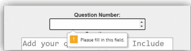

我们将跳过 `<label>` 并查看下一个输入元素。这次我们有一个不同类型的输入：`<select></select>`。

```html
<select id="ca" name="ca" class="formSelect" required>
    <option value="" selected disabled> Choose </option>
    <option value="a"> - A -</option>
    <option value="b"> - B -</option>
    <option value="c"> - C -</option>
    <option value="d"> - D -</option>
</select>
```

`<select>` 承载的属性与之前大致相同：ID、name、class 和 required，因此我将不再赘述。

接下来，我们看到包含在 `<option></option>` 标签中的下拉选项。每个选项在被选择并提交表单时会传递其值。

你会注意到第一个选项有点不同：

```html
<option value="" selected disabled> Choose </option>
```

这里的设置使其无法被选择（`disabled`），并且也显示为当前选中项（`selected`）。这意味着用户在下拉菜单中看到的初始文字是 'Choose'。

太棒了！最后，我们有一个 `<button>` 用于提交表单并解析表单中的数据：

```html
<button id="submit"><p>Submit Question</p></button>
```

还有一个用于下载题库文件的按钮：

```html
<button id="downloadQuestionBank"><p>Download Question Bank</p></button>
```

这些按钮的格式与我们之前创建的所有其他按钮相同，因此它们将自动应用相同样式，因为我们已在标记的头部引用了我们的 CSS。

我想又到时间了……或者是我咖啡喝太多了吗？☺


## 为我们的 HTML 表单设置样式

好的，我们已经创建好了 CSS 文件，现在打开 ‘app.css’ 并在文件末尾添加以下代码：

```css
/* ============================== FORM STYLES ============================== */
.formLabel{
    color: #333;
    font-size: 16px;
    font-weight: bold;
    width: 10%;
}
.formArea{
    color: #333;
    font-size: 25px;
    font-weight: bold;
    width: 80%;
}
.formInput{
    color: #333;
    font-size: 25px;
    font-weight: bold;
    width: 50%;
}
.formSelect{
    color: #333;
    font-size: 25px;
    font-weight: bold;
    width: 25%;
    text-align: center;
}
```

注意这里，我们的一些规则在多个类中重复出现。我特意展示这一点，是因为你应该始终思考如何让我的代码更整洁、更优化？这不仅能让你的代码运行得更高效，也更容易阅读。

在这种情况下，首先问问自己，哪些规则适用于表单中的所有元素？

```css
form{
  color: #333;
  font-weight: bold;
}
```

接下来，有哪些规则适用于多个类（或 ID / 关键字）？

```css
.formArea, .formInput, .formSelect{
  font-size: 25px;
}
```

那么，还剩下什么？

```css
.formArea{
  width: 80%;
}
.formInput{
  width: 50%;
}
.formSelect{
  width: 25%;
  text-align: center;
}
.formLabel{
  font-size: 16px;
  width: 10%;
}
```

确保你已尽可能地优化它，然后将所有内容整合起来，并将代码添加到你的 ‘app.css’ 文件末尾。

你应该得到类似这样的结果：

```css
form{
    color: #333;
    font-weight: bold;
}
.formLabel{
    font-size: 16px;
    width: 10%;
}
.formArea, .formInput, .formSelect{
    font-size: 25px;
}
.formArea{
    width: 80%;
}
.formInput{
    width: 50%;
}
.formSelect{
    width: 25%;
    text-align: center;
}
```

在本例中，代码行数减少的幅度并不算特别大，但我相信你明白其中的思路。我们从 26 行代码精简到了 21 行——还不错！保存你的文件（`CTRL + S`）。让我们继续……

### 从 HTML 表单获取数据并将其添加到 JSON 文件

让我们思考一下这一节的标题。它包含两个部分，但需要三个步骤。

1. 从 HTML 表单获取数据
2. 将其转换为 JSON 格式
3. 将其添加到 JSON 文件

创建一个新文件，命名为 ‘addquestions.js’，并将其保存在 ‘js’ 文件夹中。

与我们之前处理 JavaScript 逻辑的方式相同，我们将把想要实现的每个元素放入 JavaScript 函数中。

```javascript
function submitForm(event){
    event.preventDefault();
}
```

第一个函数与添加到 HTML 表单标签中的一些代码结合使用。即 `onsubmit="submitForm(event)"`。它们共同阻止表单以默认方式提交，并使我们能够在下一个函数中收集表单数据。

我们为什么需要这样做？默认情况下，当表单被提交时，网页会刷新，因此数据会被清除。

```javascript
function getMyData(){
    const question = document.getElementById("qn").value +". " + document.getElementById("q").value;
    const a = document.getElementById("a").value;
    const b = document.getElementById("b").value;
    const c = document.getElementById("c").value;
    const d = document.getElementById("d").value;
    const correctAnswer = document.getElementById("ca").value;
    const newData = { question, answers: { a, b, c, d }, correctAnswer }
    if(question != "" && a != "" && b != "" && c != "" && d != "" && correctAnswer != ""){
        questionBank.push(newData);
        document.getElementById('qCount').innerHTML = questionBank.length;
        document.getElementById("addQuestion").reset();
    }
    return questionBank;
}
```

我们在这里逐一从表单中收集值，然后将它们按我们需要的对象形式重新组合。每个表单元素通过其属性 ID 获取，其值存储在一个变量中。例如：

```javascript
const a = document.getElementById("a").value;
// 将 ID 为 'a' 的输入框中的值存储在名为 'a' 的变量中。我们重复此结构以收集所有表单字段的数据。
```

```javascript
const newData = { question, answers: { a, b, c, d }, correctAnswer }
// 使用收集的值形成我们的对象
```

```javascript
if(question != "" && a != "" && b != "" && c != "" && d != "" && correctAnswer != ""){
// 这里我们有一个条件判断，仅在表单提交时所有表单字段都有值时才为真
```

```javascript
questionBank.push(newData);
// 将我们的新题目、答案和正确答案 (newData) 推入名为 questionBank 的数组中
```

```javascript
document.getElementById('qCount').innerHTML = questionBank.length;
// 在 <h1> 标题元素中显示题库中当前的题目数量
```

```javascript
document.getElementById("addQuestion").reset();
// 清空表单，准备添加下一个题目
```

```javascript
}
// 关闭条件判断
```

```javascript
return questionBank;
// 返回更新后的题库，使其可在函数外部访问
```

```javascript
}
// 最后，我们关闭函数
```

接下来，我们有一个在将题库保存到本地存储时调用的函数。这将允许我们更新题库并向用户显示新更新的题目集。然而，要做到这一点，我们还需要对 ‘app.js’ 文件做一些小改动。不过现在，让我们先看看我们的 `saveMyFile` 函数：

```javascript
function saveMyFile(){
    localStorage.setItem("questionBank", JSON.stringify(questionBank));
    location.replace("quiz.html")
}
```

这个函数非常简单。我们使用名称 "questionBank" 设置一个本地存储项，并在将题库转换为 JSON 字符串 `JSON.stringify(questionBank)` 后将其插入其中。

## 什么是本地存储？

`localStorage` 对象允许你在浏览器中保存键/值对。它存储的数据没有过期日期。这意味着数据在浏览器关闭后不会被删除，并且可供将来使用。其背后的概念非常简单。语法如下：

```javascript
localStorage.setItem(key, value); // 存储数据
localStorage.getItem(key, value); // 检索数据
localStorage.removeItem(key); // 移除数据
```

下面是其用法的一个示例：

```javascript
localStorage.setItem("fullname", "Garry Owen"); // 设置 fullname
localStorage.getItem("fullname");// 返回 Garry Owen
localStorage.removeItem("fullname");// 清除存储
```

在我们代码的最后一部分，我们进行了变量声明并添加了事件监听器，用于监听表单提交和点击保存题库按钮的事件。

```javascript
const addQuestionButton = document.getElementById("submitQuestion");
//引用submitQuestion按钮并存储在名为addQuestionButton的变量中
```

```javascript
const saveButton = document.getElementById("saveQuestionBank");
//引用saveQuestionBank按钮并存储在名为bankButton的变量中
```

```javascript
const questionBank = [];
//创建一个名为questionBank的新空数组
```

```javascript
const newObject = localStorage.getItem("questionBank");
//从localStorage中检索题库
```

```javascript
let dataStored = JSON.parse(newObject);
//将JSON数据解析为新的JavaScript对象
```

```javascript
if(dataStored != ""){
    //如果dataStored不为空...

    for(i=0; i < dataStored.length; i++){
        questionBank.push(dataStored[i]);
    }
    //遍历dataStored数组，将每个题目推入questionBank数组
} else {

    for(i=0; i < data.length; i++){
        questionBank.push(data[i]);
    }
    //否则，遍历data数组（在代码的<head></head>部分引入），并将每个题目推入questionBank数组

}// 结束条件语句
```

```javascript
document.getElementById('qCount').innerHTML = questionBank.length;
//用当前题库中的题目数量更新<h1>标题标签

addQuestionButton.addEventListener("click", getMyData);
//监听提交表单按钮，点击时调用或触发getMyData()函数

saveButton.addEventListener("click", saveMyFile);
//监听保存题库按钮，点击时调用（触发）saveMyFile()函数
```

好的，现在我们可以添加新题目并将其保存到本地存储了。

接下来需要做什么？

- 我们需要一种方法来移除不需要的题目
- 我们需要一种让用户访问管理功能的方法
- 我们需要让我们的测验能够访问本地存储的更新

## 构建“移除题目”表单标记

好的，我们已经知道 `push()` 可以将数据添加到数组末尾，而 `pop()` 会移除数组的最后一项。

我们已经将新题目添加到了数组的末尾，但与添加题目不同，用户可能不仅想移除最后一道题。事实上，我们需要能够移除多道题。从用户的角度来看，如果所有题目都显示在一个列表中，他们可以勾选复选框，并点击一个按钮一次性移除所有选中的题目，这样会更容易。

就像这样：

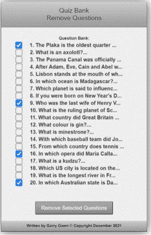

好的，让我们来构建 HTML 标记。创建一个名为 ‘remove_questions.html’ 的新文件，并将其保存在主 Web 应用目录中。添加以下代码，然后保存（`CTRL + S`）。

```html
<html>
<head>
    <title>Quiz Bank Editor</title>
    <meta name='viewport' content='width=device-width, initial-scale=1'>
    <link rel='stylesheet' type='text/css' media='screen' href='css/app.css'>
    <script type="text/javascript" src="json/questions.json"></script>
</head>
<body>
    <div id="header">
        <h1>Quiz Bank<br>Remove Questions</h1>
    </div>
    <div class="wrapper">
    <form id="removeQuestion" onsubmit="submitRemoveForm(event)">
        <label class="formLabel">Question Bank:</label><br>
        <!-- 在此处添加所有带复选框的题目 -->
        <div id="showQstn"></div>
        <br><br>
        <button id="removeQuestions"><p>Remove Selected Questions</p></button><br><br><br>
        <button id="saveQuestions"><p>Save Question Bank</p></button>
    </form>
    </div>
    <div id="footer2">
        <h5>Written by Garry Owen &copy Copyright December 2021</h5>
    </div>
    <script src='js/removequestions.js'></script>
</body>
</html>
```

非常直接，对吧？你之前几乎已经见过这里所有的东西了。不过，让我们更深入地看看这个表单，了解它的工作原理。

```html
<form id="removeQuestion" onsubmit="submitRemoveForm(event)">
    <label class="formLabel">Question Bank:</label><br>
    <!-- 在此处添加所有带复选框的题目 -->
    <div id="showQstn"></div>
    <br><br>
    <button id="removeQuestions"><p>Remove Selected Questions</p></button><br><br><br>
    <button id="saveQuestions"><p>Save Question Bank</p></button>
</form>
```

除了你已经见过的元素和属性外，这里的主要区别在于我们打算使用 JavaScript 代码在显示题目的 div `<div id="showQstn"></div>` 内填充表单。因此，剩下的部分是一个非常简单的表单。其他属性的 id 名称已被更改，以确保我们不会与其他脚本产生任何冲突。

## 设置“移除题目”表单的样式

打开 ‘app.css’ 文件，在底部添加以下内容：

```css
#showQstn {
    text-align: left;
    display: block;
    margin: 0 auto 0 auto;
    width: 420px;
}
#showQstn label:first-of-type{
    margin-left: 10px;
}

.chk_butn {
  transform: scale(200%);
  margin: 10px 30px 5px -20px;
  }
  .wrapper{
      position: relative;
      margin: 30px 0 20px 0;
  }
  #footer2 {
  position: relative;
  bottom:0;
  width:100%;
  height:40px;
  text-shadow: 0px 1px 0px #fff;
  background-image: -webkit-gradient(linear, left top, left bottom, from(#ccc), to(#999));
  }
  #footer2 h5{
      text-align: center;
      padding-top: 10px;
      font-size: 15px;
  }
```

好的，除了少数几条规则外，你到现在应该已经见过所有这些 CSS 了。为了避免过多重复，我只解释那些不同的部分。

```css
margin: 0 auto 0 auto;
```

我们之前见过 margin，但 ‘auto’ 是我们还没探索过的。与 ‘display: block;’ 和 ‘width: 420px;’ 一起使用时，这会将元素作为块级元素居中显示在屏幕上。

```css
#showQstn label:first-of-type{
    margin-left: 10px;
}
```

`label:first-of-type` - 这只为第一个 label 元素设置规则。

其余部分我们已经见过了。但是，请注意我们又创建了一个 wrapper 类和一个 footer 类。这是因为现有的规则不适用于我们的新 HTML 页面。这是因为这里的布局比我们问答幻灯片的原始结构更长（根据用户决定的题目数量，可能会长很多）。

## 更新测验 JavaScript 文件以适应本地存储

打开 ‘app.js’，将这段代码：

```javascript
const questionBank = [];
for(i=0; i < data.length; i++){
    questionBank.push(data[i]);
}
document.getElementById('quizLength').innerHTML = data.length;
```

替换为：

```javascript
const myQuestions = [];
const newObject = localStorage.getItem("questionBank");
let dataStored = JSON.parse(newObject);

if(dataStored != ""){
    for(i=0; i < dataStored.length; i++){
        myQuestions.push(dataStored[i]);
    }
    document.getElementById('quizLength').innerHTML = dataStored.length;
} else {
    for(i=0; i < data.length; i++){
        myQuestions.push(data[i]);
    }
    document.getElementById('quizLength').innerHTML = data.length;
}
```

这与在 ‘addquestions.js’ 文件中解释的工作方式完全相同，只是我们根据使用的是本地存储 ‘dataStored’ 还是为题目创建的 JSON 文件 ‘data’ 来更新 ‘quizlength’ 属性，如下所示：

```javascript
document.getElementById('quizLength').innerHTML = dataStored.length;
document.getElementById('quizLength').innerHTML = data.length;
```

这只是用题目数量更新我们的标题。

## 构建用于删除题目的 JavaScript

创建一个名为 ‘removequestions.js’ 的新文件，并将其保存在 ‘js’ 文件夹中，然后添加以下代码并保存（`CTRL + S`）。

```javascript
function submitRemoveForm(event){
    event.preventDefault();
}
function showQuestions(){
    const questionHolder = document.getElementById('showQstn');
    questionToShow = [];
    const newObject = localStorage.getItem("questionBank");
    let dataStored = JSON.parse(newObject);
    if(dataStored != ""){
        for(i=0; i < dataStored.length; i++){
            questionToShow.push(
                `<label>
                <input type="checkbox" name="${i}" value="${i}" class="chk_butn">
                ${i+1}. ${dataStored[i].question.substring(0, 32)}...
                </label><br>`
            );
        }
    } else {
        for(i=0; i < data.length; i++){
            questionToShow.push(
                `<label>
                <input type="checkbox" name="${i}" value="${i}" class="chk_butn">
                ${i+1}. ${data[i].question.substring(0, 32)}...
                </label><br>`
            );
        }
    }
    questionHolder.innerHTML = questionToShow;
    return questionToShow;
}
function removeQuestion(){
    const questionHolder = document.getElementById('showQstn');
    questionsToRemove = [];
    let checkboxes = document.querySelectorAll('input[type=checkbox]:checked')
    for (var c = 0; c < checkboxes.length; c++) {
        questionToShow[checkboxes[c].value] = "";
```

```javascript
questionBank.splice(checkboxes[c].value,1);
}

```

```javascript
questionHolder.innerHTML = questionToShow;

}

function saveMyFile(){

    localStorage.setItem("questionBank", JSON.stringify(questionBank));

    location.replace("quiz.html")

}

showQuestions();

const questionBank = [];

const newObject = localStorage.getItem("questionBank");

let dataStored = JSON.parse(newObject);

if(dataStored != ""){

    for(i=0; i < dataStored.length; i++){

        questionBank.push(dataStored[i]);

    }

} else {

    for(i=0; i < data.length; i++){

        questionBank.push(data[i]);

    }

}

const removeButton = document.getElementById("removeQuestions");

const saveButton = document.getElementById("saveQuestions");

removeButton.addEventListener("click", removeQuestion);

saveButton.addEventListener("click", saveMyFile);

```

像往常一样，我们来分解一下：

```javascript
function submitRemoveForm(event){
    event.preventDefault();
}
//当表单提交时，阻止默认操作

function showQuestions(){
    const questionHolder = document.getElementById('showQstn');
    //引用 showQstn div

    questionToShow = [];
    //创建一个名为 questionToShow 的新空数组，用于存储问题
    //以及为用户视图准备的复选框

    const newObject = localStorage.getItem("questionBank");
    //从本地存储中获取问题

    let dataStored = JSON.parse(newObject);
    //将问题解析为 JSON 对象，并存储在一个名为 dataStored 的变量中

    if(dataStored != ""){
    //如果 dataStored 包含数据

        for(i=0; i < dataStored.length; i++){
        //对于每一个存储的问题...

            questionToShow.push(
            //推入 questionToShow 数组

                `<label>
                    <input type="checkbox" name="${i}" value="${i}" class="chk_butn">`,
                    //如果复选框被勾选，则传递索引号

                `${i+1}. ${dataStored[i].question.substring(0, 32)}...`,
                    //显示问题编号（索引 + 1）和问题的 32 个字符，
                    //这样它就能整齐地显示在手机屏幕上，
                    //而不会换行到多行

                `</label><br>`,
                    //将 input 包裹在 <label></label> 中，使整个部分可点击

            );

        }

    } else {

    //否则...如果本地存储中没有存储问题

        for(i=0; i < data.length; i++){
        //对于从原始 JSON 文件获取的所有数据

            questionToShow.push(
            //将每个问题和复选框推入 questionToShow 数组

            `<label>
            <input type="checkbox" name="${i}" value="${i}"
            class="chk_butn">`
            //如果复选框被勾选，则传递索引号

            `${i+1}. ${data[i].question.substring(0, 32)}...`
            //显示问题编号（索引 + 1）和问题的 32 个字符，这样它就能整齐地显示在手机屏幕上，
            //而不会换行到多行

            `</label><br>`
            //将 input 包裹在 <label></label> 中，使整个部分可点击

            );

        }

    questionHolder.innerHTML = questionToShow;
    //在问题容器中显示问题和复选框

    return questionToShow;
    //返回问题数据

    }

}
```

好的，需要注意的是，到目前为止，我们只是根据是否有更新可用并存储在本地存储中，或者问题是否从我们创建的原始 JSON 题库中访问，来为用户显示问题。

接下来，让我们看看如何移除这些问题：

```javascript
function removeQuestion(){
//打开函数

const questionHolder = document.getElementById('showQstn');
//引用 showQstn div ID，并将其存储在一个名为 questionHolder 的变量中

questionsToRemove = [];
//创建一个新的空数组，用于存储我们要移除的问题的索引号

let checkboxes =
document.querySelectorAll('input[type=checkbox]:checked');
//获取所有被勾选的复选框的索引，并将它们存储在一个名为
//checkboxes 的变量中

for (var c = 0; c < checkboxes.length; c++) {
//遍历每个复选框索引

    questionToShow[checkboxes[c].value] = "";
    //从显示中移除每个被勾选的问题

    questionBank.splice(checkboxes[c].value,1);
    //从题库中移除每个被勾选的问题

}

questionHolder.innerHTML = questionToShow;
//在问题容器中显示剩余的问题和复选框

}// 关闭函数
```

好的，这相当简单。现在剩下的就是在本地存储中保存更改，设置变量，并设置监听器以捕获任何按钮点击。

首先，是 `saveMyFile()` 函数：

```javascript
function saveMyFile(){
    localStorage.setItem("questionBank", JSON.stringify(questionBank));
    //当保存按钮被点击时，这会用已移除选定问题的题库数据
    //更新我们的本地存储。

    location.replace("quiz.html"); //这会重定向回测验页面
}
```

然后我们调用主要的 `showQuestions()` 函数并设置变量，如下所示：

```javascript
showQuestions();
//调用（执行） showQuestions 函数

const questionBank = [];
//创建一个名为 questionBank 的空数组，准备存储我们的数据

const newObject = localStorage.getItem("questionBank");
//从本地存储中获取题库

let dataStored = JSON.parse(newObject);
//将 JSON 数据解析为 JavaScript 对象，并存储在一个名为 dataStored 的变量中

if(dataStored != ""){
//如果 dataStored 不为空...

    for(i=0; i < dataStored.length; i++){
    //遍历 dataStored JSON 对象

        questionBank.push(dataStored[i]);
        //将每个问题推入 questionBank 数组

    }//关闭 for 循环

} else {

//否则...如果本地存储为空

    for(i=0; i < data.length; i++){
    //遍历从我们 HTML 标记中 <head></head> 部分引入的 JSON 文件中获取的 data 对象

        questionBank.push(data[i]);
        //将每个问题推入 questionBank 数组

    }//关闭 for 循环

}// 关闭条件语句
```

最后但同样重要的是，我们引用用于移除和保存问题的按钮，并设置事件监听器以监听按钮点击。

```javascript
const removeButton = document.getElementById("removeQuestions");
const saveButton = document.getElementById("saveQuestions");
//通过 ID 引用按钮，并将它们存储在适当命名的变量中

removeButton.addEventListener("click", removeQuestion);
//监听移除问题按钮的按钮点击。当点击时，调用 removeQuestion 函数

saveButton.addEventListener("click", saveMyFile);
//监听保存按钮的按钮点击。当点击时，调用 saveMyFile 函数
```

太棒了！现在剩下的就是启用测验和管理功能之间的导航。

## 如何设置页面间的导航

对于本练习的最后部分，我们需要在每个页面添加一点标记，并在我们的 CSS 文件中添加一些新规则。

打开 ‘quiz_app.html’ 文件，在 `</h1>` 结束标签后，在 `<div id="header"></div>` 内添加以下内容：

```html
<span id="menu"></span>
<div id="menubox" style="display: none;">
    <br><a href="add_question.html" alt="add questions" title="add questions">  添加问题  </a><br><br>
    <a href="remove_questions.html" alt="remove questions" title="remove questions"> 删除问题 </a>
    <span id="menudismiss"> X </span>
</div>
```

然后滚动到文件底部，就在 `</body>` 结束标签内部，添加以下内容：

```html
<script src='js/menu.js'></script>
```

然后保存文件 (`CTRL + S`)。

接下来，打开 ‘add_question.html’ 文件，在 `</h1>` 结束标签后，在 `<div id="header"></div>` 内添加以下内容：

```html
<span id="menu"></span>
<div id="menubox" style="display: none;">
    <br><a href="quiz.html" alt="back to quiz" title="back to quiz"> 返回测验 </a><br><br>
    <a href="remove_questions.html" alt="remove questions" title="remove questions"> 删除问题   </a>
    <span id="menudismiss"> X </span>
</div>
```

同样，滚动到文件底部，就在 `</body>` 结束标签内部，添加以下内容：

```html
<script src='js/menu.js'></script>
```

然后保存文件 (`CTRL + S`)。

接下来，打开 ‘remove_questions.html’ 文件，在 `</h1>` 结束标签后，在 `<div id="header"></div>` 内添加以下内容：

```html
<span id="menu"></span>
<div id="menubox" style="display: none;">
    <br><a href="quiz.html" alt="back to quiz" title="back to quiz"> 返回测验 </a><br><br>
    <a href="add_question.html" alt="add questions" title="add questions">  添加问题   </a>
    <span id="menudismiss"> X </span>
</div>
```

再次，滚动到文件底部，就在闭合的 `</body>` 标签之前，添加以下内容：

```html
<script src='js/menu.js'></script>
```

然后保存文件（`CTRL + S`）。

我们将仔细研究其中一个示例，因为尽管它们略有不同，但逻辑都是相同的。区别在于每个菜单组导航到特定的页面。

```html
<span id="menu"></span>
//用于显示可点击的菜单图标 - 一个汉堡图标

<div id="menubox" style="display: none;">
//用于设置样式并包含菜单

<br><a href="quiz.html" alt="返回测验" title="返回测验"> 返回测验 </a><br><br>
//超链接 1 - 返回测验页面 - 特定于此页面

<a href="add_question.html" alt="添加问题" title="添加问题">  添加问题  </a>
//超链接 2 - 到添加问题页面 - 特定于此页面

<span id="menudismiss"> X </span>
//显示关闭菜单的控件

</div> // 关闭 menubox div
```

在完成练习之前，先短暂休息一下。


## 为我们的简单导航菜单设置样式

希望你已经稍微恢复了精力。接下来，我们需要为菜单元素添加样式规则。打开 ‘app.css’ 文件，滚动到底部，然后添加以下内容：

```css
#menu {
    position: absolute;
    top: 10px;
    right: 30px;
}

#menu:hover{
    background-color: rgba(255,255,255,0.5);
    font-weight: bold;
}

#menubox {
    position: absolute;
    background-image: -webkit-gradient(linear, left top, left bottom, from(#ccc), to(#999));
    padding: 20px;
    border: solid 1px #333;
    width: 80vw;
    margin: 50px 0 0 7vw;
    height: 200px;
    z-index: 10;
    font-size: 1.7em;
}

#menubox a {
    color: #333;
    text-shadow: 0px 1px 0px #fff;
    text-decoration: none;
}

#menubox a:hover{
    background-color: rgba(255,255,255,0.5);
}

#menubox #menudismiss{
    position: absolute;
    top: 10px;
    right: 15px;
    color: rgb(102, 100, 100);
}

#menubox #menudismiss:hover{
    position: absolute;
    top: 10px;
    right: 15px;
    background-color: rgba(255,255,255,0.5);
    font-weight: bold;
}
```

与之前添加到我们样式表中的内容一样，你以前已经见过很多命令了，所以我只解释那些我们还没涉及过的：

```css
border: solid 1px #333;
// 应用一个实线边框，宽度为1像素，颜色为深灰色

margin: 50px 0 0 7vw;
// 虽然我们之前处理过外边距，但7vw是一个我还没提到的尺寸单位。vw代表视口宽度。你也可以使用vh或视口高度。本质上，我们是在说将视口宽度的7%作为左边距设置（TRBL）

#menubox a:hover
// 这将规则应用于鼠标悬停在ID为menubox的元素内的`<a>`标签

background-color: rgba(255,255,255,0.5);
// 最后，我们之前见过使用命名颜色和十六进制颜色代码的color和background-color设置，但这里我们使用的是‘r, g, b, a’（红、绿、蓝、alpha）设置。‘r、g和b’都是0-255的值，从黑色到白色，而‘a’代表alpha通道或不透明度通道。我们选择的值255, 255, 255, 0.5是白色，不透明度为50%。
```

## 处理简单导航的 JavaScript

创建一个名为 ‘menu.js’ 的新文件，并将其保存在 ‘js’ 文件夹中。然后添加以下代码：

```javascript
function htmlMenu(){
    const menu = document.getElementById('menu');
    const menudismiss = document.getElementById('menudismiss');
    menu.innerHTML = '<h1>&#9776;</h1>';
    menu.addEventListener("click", displayMenu);
    menudismiss.addEventListener("click", dismissMenu);
}

function displayMenu(){
    const menubox = document.getElementById('menubox');
    if(menubox.style.display == "block"){
        menubox.style.display = "none";
    } else {
        menubox.style.display = "block";
    }
}

function dismissMenu(){
    const menubox = document.getElementById('menubox');
        menubox.style.display = "none";
}

htmlMenu();
```

按照通常的方式，我们来分解它！

```javascript
function htmlMenu(){
//打开 htmlMenu 函数

const menu = document.getElementById('menu');
//引用ID为menu的元素，并将其存储在名为menu的变量中

const menudismiss = document.getElementById('menudismiss');
//引用ID为menudismiss的元素，并将其存储在一个变量中

menu.innerHTML = '<h1>&#9776;</h1>';
//将菜单设置为汉堡符号

menu.addEventListener("click", displayMenu);
//添加一个事件监听器来检查菜单点击。如果点击，则打开菜单

menudismiss.addEventListener("click", dismissMenu);
//添加一个事件监听器来检查菜单关闭点击。如果点击，则关闭菜单

}//关闭函数

function displayMenu(){
//打开 display menu 函数

const menubox = document.getElementById('menubox');
//引用ID为menubox的元素，并将其存储在名为menubox的变量中

if(menubox.style.display == "block"){
//如果菜单框正在显示..

menubox.style.display = "none";
//...将其从显示中移除

} else {
//否则，如果菜单未显示

menubox.style.display = "block";
//显示菜单

}//关闭条件语句

}//关闭函数

function dismissMenu(){
//打开 dismiss menu 函数

    const menubox = document.getElementById('menubox');
//引用ID为menubox的元素，并将其存储在名为menubox的变量中

    menubox.style.display = "none";
//将菜单从显示中移除

}//关闭函数

htmlMenu();
//调用 htmlMenu 函数
```

我们完成了....你做得非常出色。非常好！

如果你正确地完成了这个练习，你现在应该拥有以下出色的测验应用程序。

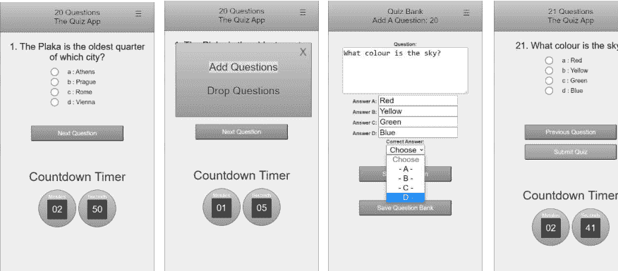

因此，我们创建了一个带有倒计时器、能够添加新问题以及删除问题的测验应用程序。试玩一下。看看你能否改进它！尝试添加更多功能。也许是一个高分表，可以选择多个问题集的能力？可能性是无穷无尽的。

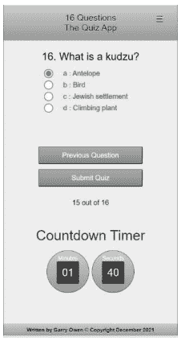

与本练习相关的所有文件和图片都可以在以下位置找到：

https://wddtrw/resources/learntocode/quizapp.zip

# 创建平台游戏

## 什么是平台游戏？

平台游戏，也称为平台跳跃游戏，是指玩家控制一个角色在平台上奔跑/行走和跳跃的游戏。一些著名的游戏包括大金刚、刺猬索尼克和超级马里奥兄弟等等。

我们将创建一个名为“巫师山”的游戏。这是我起的名字，当然，你可以随心所欲地命名它。

目标是在避开沿途的敌人和障碍物的同时收集所有的宝石。这是一个多部分练习，将在后续书籍中继续进行。然而，到本练习结束时，你将拥有一个完全可玩的平台游戏，并将学到许多技能。也就是说，即使你没有意识到，在跟随本书之前的练习时，你已经开发了许多你需要的技能。

### 课程目标

设计并开发一个基于网络的平台游戏，使用 HTML、CSS 和 JavaScript。

我们将开发的游戏将包括：

- 每个屏幕的瓦片地图
- 游戏监视器
- 主角
- 三种不同的敌人 - 1 个静态和 2 个动态
- 可收集物 - 宝石、硬币等等
- 障碍物 - 墙壁、跳跃点、木桶
- 碰撞和重力
- 音效 (SFX)
- 精灵图和瓦片集
- 标题画面和游戏结束画面
- 背景图片
- 音乐

## 第 1 步 - 设置你的文件结构

大家注意了，伙计们！让我们开始构建我们最后激动人心的项目。首先，让我们实现所需的文件结构。这次我们需要文件夹来容纳不同类型的资源。创建一个名为 ‘game’ 的新项目文件夹，并将其保存在桌面或其他所需位置。在该文件夹内，添加以下文件结构：

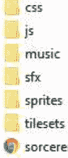

到现在你应该知道如何创建这些了，但如果你需要提醒的话。双击你的 ‘game’ 文件夹。然后右键单击，从上下文菜单中选择新建，然后选择文件夹，输入 ‘css’ 并按回车。对 ‘js’、‘music’、‘sfx’、‘sprites’ 和 ‘tilesets’ 重复此过程。最后，打开你选择的代码编辑器，创建一个新文件，并将其保存为 ‘sorcerer.html’ 放在 ‘game’ 文件夹中。完成！

## 第 2 步 - 为我们的平台游戏创建 HTML 文件

打开 ‘sorcerer.html’ 文件（如果尚未打开），并添加以下标记：

```html
<html>
<head>
    <title>Sorcerers Mountain</title>
    <link rel="stylesheet" type="text/css" href="css/app.css"/>
</head>
<body>
    <div id="gameArea">
        <canvas id="canvas"></canvas>
    </div>
    <script type="text/javascript" src="js/assets.js"></script>
    <script type="text/javascript" src="js/tiles.js"></script>
    <script type="text/javascript" src="js/sprites.js"></script>
    <script type="text/javascript" src="js/main.js"></script>
    <script type="text/javascript" src="js/startScreen.js"></script>
    <script type="text/javascript" src="js/map1.js"></script>
</body>
</html>
```

如果你一直在跟随本书的练习，那么你会对这大部分标记感到熟悉。如你所见，在这个阶段，它看起来相当简单。好消息是，这个 HTML 不会变得更复杂。我们将在构建游戏时添加更多 JavaScript 文件的引用，但仅此而已。让我们仔细看看这个标记。

```html
<html>
//告诉浏览器我们正在使用 HTML

<head>
    <title>Sorcerers Mountain</title>
//为我们的 HTML 页面添加标题

<link rel="stylesheet" type="text/css" href="css/app.css"/>
//引用 'app.css' 以允许我们为页面设置样式规则

</head>

<body>
//打开 body 标签 - 主要内容区域

	<div id="gameArea">
		<canvas id="canvas"></canvas>
	</div>
//在一个 div 中添加 canvas 元素。这将用于显示我们的
//游戏，并为我们的 CSS 和 JavaScript 命令进行必要的引用

	<script type="text/javascript" src="js/assets.js"></script>
	<script type="text/javascript" src="js/tiles.js"></script>
	<script type="text/javascript" src="js/sprites.js"></script>
	<script type="text/javascript" src="js/main.js"></script>
	<script type="text/javascript" src="js/startScreen.js"></script>
	<script type="text/javascript" src="js/map1.js"></script>
//引用 JavaScript 文件。将一切整合在一起

</body>
</html>
//关闭 body 和 html 标签
```

## 第 3 步 - 为我们的平台游戏创建 CSS

创建一个名为 ‘app.css’ 的新文件，并将其保存在 ‘css’ 文件夹中。然后，添加以下 CSS 规则：

```css
body, html {
    height: 100%;
    overflow:hidden;
    background: #1f1f1f;
}

canvas{
    border:1px solid black;
}

#gameArea{
    text-align: center;
    margin-top: 70px;
}
```

这是非常简单的 CSS 规则。所有规则你都在本书的前面部分见过。让我们仔细看看：

```css
body, html {
    height: 100%;
    overflow:hidden;
    background: #1f1f1f;
}
//为整个 html 元素和 body 设置规则。将高度设置为 100%，如果内容大于页面则不显示滚动条，并将背景设置为深灰色。

canvas{
    border:1px solid black;
}
//为 canvas 元素设置规则 - 创建一个 1 像素宽的黑色实线边框

#gameArea{
    text-align: center;
    margin-top: 70px;
}
//为 ID 为 gameArea 的元素设置规则。将游戏区域居中对齐，并距离屏幕顶部 70 像素。
```

如前所述，这些都是非常简单的规则集。

继续前进！！

## 第 4 步 - 为我们的平台游戏创建资源

接下来，创建一个名为 ‘assets.js’ 的新文件，并将其保存在 ‘js’ 文件夹中。然后添加以下代码并保存（`CTRL + S`）。

```javascript
var canvas = document.querySelector("#canvas"),
    ctx = canvas.getContext("2d"),
    width = 1152,
    height = 704,
    player = {
        screen: 15,//15 = START SCREEN
    },
    press_s = { width: 500, height: 40, f: 100 },
    instruct = { x: 126, y: 300, w: 900, h: 57, f: 103 };
```

我们在这里做什么？‘assets.js’ 文件用于设置所有初始值并将它们存储在一个 JSON 对象中。让我们仔细看看：

```javascript
var canvas = document.querySelector("#canvas"),
//通过其 ID 引用 canvas 元素，并将其存储在名为 canvas 的变量中

    ctx = canvas.getContext("2d"),
//在 canvas 元素上启用 canvas 的 2D 渲染上下文（允许我们在 canvas 上进行 2D 绘图）

    width = 1152,
//将 canvas 宽度设置为 1152 像素 - 重要的是你使用的尺寸是你预期的瓦片尺寸的倍数。我们选择的瓦片尺寸是 64 像素 x 64 像素（1152 像素将容纳 18 个瓦片的宽度）

    height = 704,
//将 canvas 高度设置为 704 像素。与宽度一样，它必须是所选瓦片尺寸的倍数（704 像素将容纳 11 个瓦片的高度）

player = {
    screen: 15,
},
//设置一个 player 对象，我们将在这里存储所有玩家的起始值。这里我们将初始屏幕设置为 15，这代表标题屏幕背景，我们将在下一节中更详细地看到

press_s = { width: 500, height: 40, f: 100 },
//设置屏幕上“按 s 开始游戏”消息的宽度、高度和帧

instruct = { x: 126, y: 300, w: 900, h: 57, f: 103 };
//设置我们精灵的初始 x 坐标、y 坐标、宽度、高度和帧。我们将使用它在用户按下并保持‘i’键时显示用户说明。
```

这本身不会做任何事情，因为它与我们尚未创建的其他 JavaScript 文件协同工作。

## 第 5 步 - 创建并引用构建瓦片地图的瓦片

创建一个名为 'tiles.js' 的新文件，并将其保存在 'js' 文件夹中。

在我们向此文件添加任何代码之前，你需要从以下 URL 将瓦片图像下载到 'tilesets' 文件夹：

https://wddtrw/resources/learntocode/platformgame_building_tiles.zip

下载后，解压缩它，并将内容添加到 'tilesets' 文件夹。要解压缩文件，双击它，然后选择所有内容（`CTRL + A`）并复制（`CTRL + C`），然后打开 'tilesets' 文件夹并粘贴（`CTRL + V`）。

如果你正确地完成了这些操作，你的 'tilesets' 文件夹现在将包含以下 64 x 64 像素的瓦片，外加 2 张背景图像。你当然可以选择自己制作。如果你希望这样做，或者编辑文件中的图像以使它们有所不同，你需要一个图像编辑器。如果你没有访问权限，我推荐 Gimp，它完全足够完成这项工作，最重要的是它是免费的。你可以在 https://gimp.org 免费下载它。

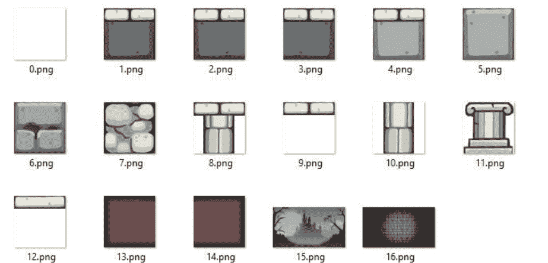

我们将在游戏屏幕中使用这些瓦片，并使用瓦片地图。稍后会详细介绍。现在，让我们设置一个 JavaScript 文件来引用它们，并在我们的游戏中启用它们的使用。

创建一个名为 ‘tiles.js’ 的新文件，并将其保存在 ‘js’ 文件夹中，然后添加以下代码。我们这里从小处开始，但在构建游戏时，会根据需要添加更多瓦片。

```javascript
/* ===========================
瓦片索引：
0 - 空白区域
1 - 深灰色基础块
2 - 左侧基础块 - 生命值
3 - 右侧基础块 - 生命值
4 - 浅灰色基础块
5 - 浅灰色墙块
6 - 浅灰色砖墙块
7 - 石块
8 - 基座顶部
9 - 2块砖的浮空平台
10 - 基座底部
11 - 低基座
12 - 1块砖的浮空平台
13 - 游戏监视器左侧瓦片
14 - 游戏监视器右侧瓦片
15 - 标题屏幕背景
16 - 游戏屏幕背景石墙
============================== */

const tile = [];

for(i=0; i < 17; i++){
    tile[i] = new Image();
    tile[i].src = `tilesets/building_tiles/${i}.png`;
}
```

让我们仔细看看这段代码：

首先，注意详细的注释。这样我们才知道在绘制瓦片地图时应该使用哪个索引号。

```javascript
const tile = [];
//创建一个空数组，并将其存储在名为 tile 的变量中

for(i=0; i < 17; i++){
//遍历我们的瓦片并将它们添加到我们的数组中

    tile[i] = new Image();
    //将数组的索引‘i’设置为一个新的图像对象

    tile[i].src = `tilesets/building_tiles/${i}.png`;
    //设置图像对象的源文件
}
```

请注意，此方法要能正常工作，文件名必须按顺序排列且格式一致。我们也可以使用类似的编码方式，通过指定索引而非使用 `for` 循环，将瓷砖单独添加到瓷砖数组中，如下所示：

```javascript
tile[99] = new Image();
tile[99].src = 'tilesets/building_tiles/[FILENAME HERE]';
```

## 第 6 步 - 创建并引用精灵对象

接下来，创建一个名为 ‘sprites.js’ 的新文件，并将其保存在 ‘js’ 文件夹中。

在向此文件添加任何代码之前，你需要从以下网址将图片下载到 ‘sprites’ 文件夹中：

https://wddtrw/resources/learntocode/platformgame_title_sprites.zip

下载完成后，解压并将内容添加到 ‘sprites’ 文件夹中。要解压文件，双击它，然后选择所有内容（`CTRL + A`），复制它（`CTRL + C`），接着打开 ‘sprites’ 文件夹并粘贴（`CTRL + V`）。

如果一切顺利，你应该得到以下内容：

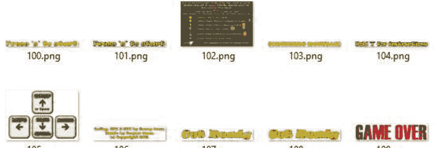

好的，现在将以下代码添加到你的 ‘sprites.js’ 文件中：

```javascript
/* ========================
SPRITES KEY:
100 - Press 's'
101 - Press 's' flash
102 - Instructions
103 - Title - Sorcerers Mountain
104 - Instruction Message
105 - Controls
106 - Copyright Message
107 - Get ready text
108 - Get ready text flash
109 - Game Over text
======================== */

var sprite = [];

for(i = 100; i < 110; i++){
    sprite[i] = new Image();
    sprite[i].src = `sprites/${i}.png`;
}
```

这与我们引用瓦片的方式相同。就像处理瓦片一样，随着我们游戏开发的深入，我们也将添加更多的精灵。

## 第 7 步 - 创建主 JavaScript 文件以整合所有内容

打开你选择的编码环境（如果尚未打开），创建一个名为 ‘main.js’ 的新文件，并将其保存在 ‘js’ 文件夹中。然后添加以下代码并保存（`CTRL + S`）。

```javascript
canvas.width = width;
canvas.height = height;

function update() {
    ctx.clearRect(0, 0, width, height);
    ctx.fillStyle = "#333";
    ctx.beginPath();
    if (player.screen === 15){ drawMyMap1000();}
    if (player.screen === 1){ drawMyMap(); }
    requestAnimationFrame(update);
}

window.addEventListener("load", function () {
    update();
});

document.body.addEventListener("keydown", function (e) {
    keys[e.keyCode] = true;
});

document.body.addEventListener("keyup", function (e) {
    keys[e.keyCode] = false;
});
```

‘main.js’ 文件将包含使我们能够根据按键和/或玩家离开当前游戏屏幕边界来加载不同地图的代码。在构建游戏的过程中，我们将在其中添加更多逻辑。现在，让我们更深入地看看我们到目前为止所做的工作：

```javascript
canvas.width = width;
//从我们的资源文件中引入初始设置的canvas宽度

canvas.height = height;
//从我们的资源文件中引入初始设置的canvas高度

function update() { // 主屏幕更新函数
    ctx.clearRect(0, 0, width, height);// 清除画布
    ctx.fillStyle = "#333"; //用深灰色填充画布
    ctx.beginPath();// 开始或重置当前路径
    if (player.screen === 15){ drawMyMap1000();} // 绘制标题屏幕
    if (player.screen === 1){ drawMyMap(); }// 绘制第一个游戏屏幕
    requestAnimationFrame(update);// 动画化当前帧
}//结束update函数

window.addEventListener("load", function () {//当网页加载完成时..
    update();//调用update函数
});

document.body.addEventListener("keydown", function (e) {
    keys[e.keyCode] = true;
});
//监听按键按下事件并获取相关的键码

document.body.addEventListener("keyup", function (e) {
    keys[e.keyCode] = false;
});
//监听按键释放事件并获取相关的键码
```

## 第 8 步 - 处理开始/标题屏幕

接下来，我们将创建第一个能显示一些结果的脚本。创建一个名为 ‘startScreen.js’ 的新文件，并将其保存在 ‘js’ 文件夹中。现在添加以下代码并保存（`CTRL + S`）。

```javascript
function drawMyMap1000(){
```


# 游戏开发教程：巫师山平台游戏

## 标题屏幕绘制

```javascript
ctx.drawImage(tile[15], 0, 0, 1152, 704);

if (keys[83]) {
    player.screen = 1;
}

if (keys[73]) {
    instruct.f = 102; instruct.x = 126; instruct.y = 25; instruct.w = 900; instruct.h = 567;
} else {
    ctx.drawImage(sprite[104], 383.5, 380, 385, 24);
    instruct.f = 103; instruct.x = 126; instruct.y = 200; instruct.w = 900; instruct.h = 57;
    ctx.drawImage(sprite[105], 476, 435, 200, 137);
    ctx.drawImage(sprite[106], 342, 275, 469, 85);
}

ctx.drawImage(sprite[instruct.f], instruct.x, instruct.y, instruct.w, instruct.h);
ctx.drawImage(sprite[press_s.f], 326, 610, press_s.width, press_s.height);

if (press_s.f === 100) {
    setTimeout(function() { press_s.f = 101; }, 200);
} else {
    setTimeout(function() { press_s.f = 100; }, 200);
}
```

太棒了！让我们仔细看看发生了什么：

```javascript
function drawMyMap1000() { // 打开绘制开始屏幕的函数
    ctx.drawImage(tile[15], 0, 0, 1152, 704);
    // 绘制背景图像 - tile[15]是存储的标题图像，其余是坐标0,0（左上角）到1152,704（右下角）

    if (keys[83]) { // 如果用户按下's'键开始
        player.screen = 1; // 将屏幕切换到地图1
    }

    if (keys[73]) { // 如果用户按下'i'键...
        instruct.f = 102; instruct.x = 126; instruct.y = 25; instruct.w = 900; instruct.h = 567;
        // 显示说明图像 - 精灵102
    } else { // 否则...
        ctx.drawImage(sprite[104], 383.5, 380, 385, 24);
        instruct.f = 103; instruct.x = 126; instruct.y = 200; instruct.w = 900; instruct.h = 57;
        // 绘制说明信息
        ctx.drawImage(sprite[105], 476, 435, 200, 137);
        // 绘制用户控制说明
        ctx.drawImage(sprite[106], 342, 275, 469, 85);
        // ...并绘制版权信息
    }

    ctx.drawImage(sprite[instruct.f], instruct.x, instruct.y, instruct.w, instruct.h);
    // 始终绘制标题 - 巫师山

    ctx.drawImage(sprite[press_s.f], 326, 610, press_s.width, press_s.height);
    // 从资源文件中引入press_s的初始值

    if (press_s.f === 100) {
        setTimeout(function() { press_s.f = 101; }, 200);
    } else {
        setTimeout(function() { press_s.f = 100; }, 200);
    }
    // 使'按s开始'信息在图像100和101之间每0.2秒切换一次动画
} // 结束绘制地图函数
```

保存此代码后，你将能够查看标题屏幕。在你的浏览器（推荐使用Google Chrome）中打开`sorcerer.html`。如果你到目前为止正确地完成了练习，你应该会看到以下结果：

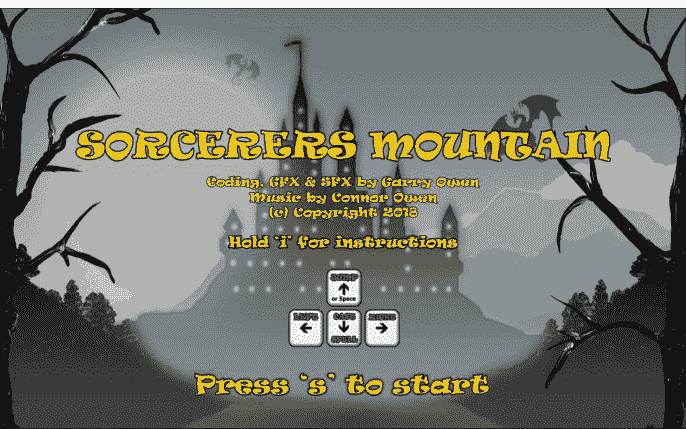

到目前为止看起来很棒。继续前进...

## 第8步 - 构建我们的第一个瓷砖地图

现在让我们构建我们的第一个瓷砖地图！

创建一个名为`map1.js`的新文件，并将其保存在`js`文件夹中。好的，现在添加以下代码，然后保存文件（`CTRL + S`）。

```javascript
function drawMyMap() {
    ctx.drawImage(tile[16], 0, 0);
    var xt = 0;
    var yt = -64;
    var tileMap = [];
    var mapNo = 0;
    tileMap[0] =  [6, 6, 6, 6, 6, 6, 0, 0, 0, 6, 6, 6, 6, 6, 6, 6];
    tileMap[1] =  [6, 0, 0, 0, 10, 0, 0, 11, 0, 0, 10, 0, 6, 0, 0, 0];
    tileMap[2] =  [6, 0, 0, 9, 9, 9, 9, 9, 9, 9, 8, 0, 0, 0, 0, 0];
    tileMap[3] =  [6, 0, 11, 0, 0, 0, 0, 0, 0, 0, 10, 0, 0, 9, 9, 0, 6];
    tileMap[4] =  [6, 9, 9, 9, 0, 0, 0, 0, 0, 8, 9, 9, 0, 0, 0, 6];
    tileMap[5] =  [6, 0, 0, 0, 9, 9, 0, 0, 10, 0, 9, 0, 9, 9, 6];
    tileMap[6] =  [6, 0, 0, 0, 0, 0, 0, 9, 9, 9, 0, 0, 0, 0, 6];
    tileMap[7] =  [0, 0, 0, 0, 0, 9, 9, 0, 0, 0, 8, 9, 8, 9, 6];
    tileMap[8] =  [9, 9, 9, 8, 9, 0, 0, 0, 0, 8, 10, 0, 10, 0, 6];
    tileMap[9] =  [1, 1, 1, 1, 1, 1, 1, 1, 1, 1, 1, 1, 1, 1, 2, 3];
    tileMap[10] = [13, 14, 13, 14, 13, 14, 13, 14, 13, 14, 13, 14, 13, 14, 13, 14, 13, 14];
    for (mapNo = 0; mapNo < 11; mapNo++) {
        yt += 64;
        for (xt = 0; xt < tileMap[mapNo].length * 64; xt += 64) {
            if (xt > 1152) { xt = 0; }
            var i = tileMap[mapNo][xt / 64];
            ctx.drawImage(tile[i], xt, yt);
        }
    }
}
```

我们的每个游戏地图都将用相同的方式绘制。让我们仔细看看：

```javascript
function drawMyMap() {
    // 打开绘制地图功能
    ctx.drawImage(tile[16], 0, 0);
    // 绘制游戏屏幕背景 - 一面石墙
    var xt = 0; // 地块x坐标变量声明
    var yt = -64; // 地块y坐标变量声明
    var tileMap = []; // 创建一个新的空数组来存储地块地图
    var mapNo = 0; // 地图行变量声明
    tileMap[0] =  [6, 6, 6, 6, 6, 6, 0, 0, 0, 6, 6, 6, 6, 6, 6, 6, 6];
    tileMap[1] =  [6, 0, 0, 0, 10, 0, 0, 11, 0, 0, 10, 0, 6, 0, 0, 0, 0, 0];
    tileMap[2] =  [6, 0, 0, 9, 9, 9, 9, 9, 9, 9, 8, 0, 0, 0, 0, 0, 0];
    tileMap[3] =  [6, 0, 11, 0, 0, 0, 0, 0, 0, 0, 10, 0, 0, 0, 9, 9, 0, 6];
    tileMap[4] =  [6, 9, 9, 9, 0, 0, 0, 0, 0, 0, 8, 9, 9, 0, 0, 0, 0, 6];
    tileMap[5] =  [6, 0, 0, 0, 0, 9, 9, 0, 0, 0, 10, 0, 0, 9, 0, 9, 9, 6];
    tileMap[6] =  [6, 0, 0, 0, 0, 0, 0, 0, 0, 0, 9, 9, 9, 0, 0, 0, 0, 6];
    tileMap[7] =  [0, 0, 0, 0, 0, 0, 0, 9, 9, 0, 0, 0, 0, 0, 8, 9, 8, 9, 6];
    tileMap[8] =  [9, 9, 9, 8, 9, 0, 0, 0, 0, 0, 0, 0, 8, 10, 0, 10, 0, 6];
    tileMap[9] =  [1, 1, 1, 1, 1, 1, 1, 1, 1, 1, 1, 1, 1, 1, 1, 1, 2, 3];
    tileMap[10] = [13, 14, 13, 14, 13, 14, 13, 14, 13, 14, 13, 14, 13, 14, 13, 14, 13, 14];
    // 将地块索引数字存储在tileMap数组中
    for (mapNo = 0; mapNo < 11; mapNo++) {
        // 遍历每个地图行
        yt += 64;
        // for循环的每次迭代，yt增加64
        for (xt = 0; xt < tileMap[mapNo].length * 64; xt += 64) {
            // 遍历每个64像素宽的地图列
            if (xt > 1152) { xt = 0; }
            // 如果到达行尾，则开始新的一行
            var i = tileMap[mapNo][xt / 64];
            // 设置变量i来保存每个地块的引用
            ctx.drawImage(tile[i], xt, yt);
            // 绘制间隔64像素的地块
        } // 关闭列循环
    } // 关闭行循环
} // 关闭绘制函数
```

做得好！如果你正确完成了练习，当你按住"i"键时，你应该会看到以下用户指令集：

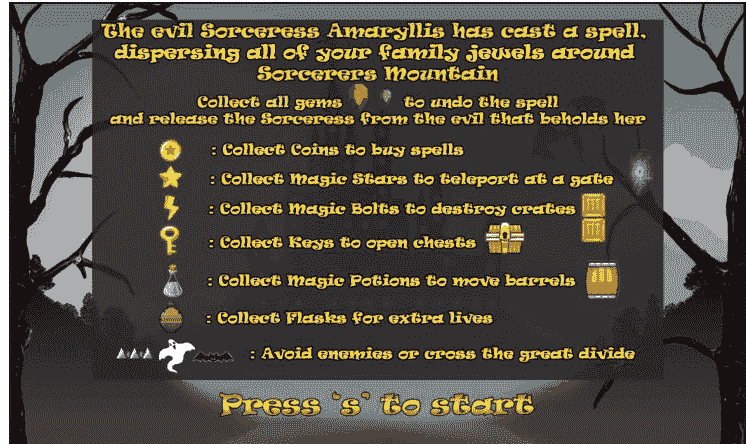

...如果你按下"s"键，你应该会看到你的第一个地块地图，如下页所示：

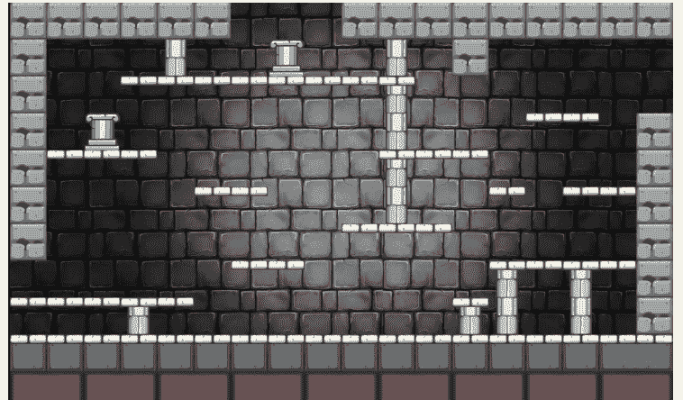

太棒了！

现在是休息一下、恢复精力的好时机。


## 第9步 - 设计地块地图

简单来说，要制作第一个地块地图，我们填充了一个宽1152像素、高704像素的网格，该网格被划分为64x64像素的地块。下面是一个示意图：

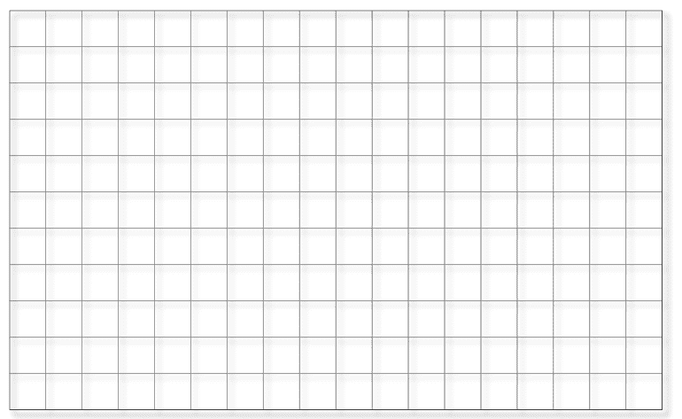

每个64x64的方块都是我们一个地块的占位符。我设计每个屏幕时，都确保最底部的2行总是相同的。这些地块最终将用于游戏监视器，显示生命数、玩家分数、收集的物品等。游戏监视器最终看起来会像下面这样：

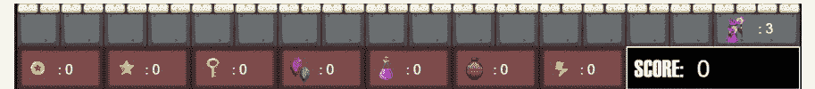

其余的地块，从第0行到第8行，将被修改以形成游戏屏幕。我们希望在需要能够退出以让玩家进入其他屏幕的地方，需要用`tile[0]`留出空隙。不过，设计我们的下一个地块地图还为时过早，所以现在，让我们添加我们的主玩家并给它一些属性。

首先，你需要从以下URL将精灵图像下载到"sprites"文件夹中：

[https://wddtrw/resources/learntocode/platformgame_wizard_sprites.zip](https://wddtrw/resources/learntocode/platformgame_wizard_sprites.zip)

下载后，解压缩它，并将内容添加到"sprites"文件夹中。要解压缩文件，双击它，然后选择所有内容（`CTRL + A`）并复制（`CTRL + C`），然后打开"sprites"文件夹并粘贴（`CTRL + V`）。

如果一切顺利，你应该会看到以下内容：

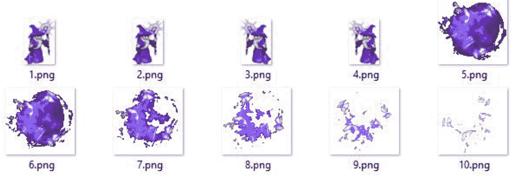

与之前的地块和精灵一样，你会看到它们是按顺序编号的。

打开`sprites.js`文件，并将以下代码添加到文件末尾：

```javascript
/* ===========================
WIZARD KEY:
1 - Wizard Right Frame 1
2 - Wizard Right Frame 2
3 - Wizard Left Frame 1
4 - Wizard Left Frame 2
5 - Wizard Aura Frame 1
6 - Wizard Aura Frame 2
7 - Wizard Aura Frame 3
8 - Wizard Aura Frame 4
9 - Wizard Aura Frame 5
10 - Wizard Aura Frame 6
=============================== */

var wiz = [];

for (i = 1; i < 11; i++) {
    wiz[i] = new Image();
    wiz[i].src = `sprites/${i}.png`;
}
```

这和上次的工作原理一样。在`for...loop`的每次迭代中，都会将一个图像放入`wiz = []`数组中，并带有相应的索引号。

与其他精灵和地块一样，我们为它们添加了注释说明，以便我们可以快速看到哪个索引号引用哪个精灵。

做得好！

接下来，打开`assets.js`文件，按照以下方式更新玩家对象，并保存文件（`CTRL + S`）：

```javascript
player = {
    x: 608,
    y: height - 182,
    width: 35,
    height: 52,
    screen: 15,
    start: 0,
    f: 3
};
```

好的，现在我们为玩家设置了初始变量。我们将X坐标设置为画布上的608像素，Y坐标设置为522（704 – 182），玩家的高度和宽度分别设置为52像素和35像素，屏幕已经设置为15（标题屏幕），最后将我们的动画帧号（`f`）设置为精灵编号3。

好的，完成这些后，现在打开`main.js`，添加以下两个条件语句，并保存文件（`CTRL + S`）：

```javascript
if (player.screen === 1) { drawMyMap(); } // 在这行代码之后添加以下内容
if (player.screen < 15 && player.start === 0) {
    player.start = 1;
}
if (player.screen != 15) {
    ctx.drawImage(wiz[player.f], player.x, player.y);
}
```

那么，我们在这里做了什么？

```javascript
if (player.screen < 15 && player.start === 0) {
    player.start = 1;
}
// 如果屏幕不再是标题屏幕，并且玩家start属性为0，则将start属性设置为1

if (player.screen != 15) {
    ctx.drawImage(wiz[player.f], player.x, player.y);
}
// 如果玩家屏幕不是15（不再是标题屏幕），则绘制玩家
```

刷新你的浏览器并按下"s"。你会看到你的玩家现在显示出来了。

现在让我们添加一些控件来让你的玩家移动。再次编辑`assets.js`文件，并添加以下高亮显示的属性：

```javascript
player = {
    x: 608,
    y: height - 182, // 起始高度（必须大于地块高度加上角色高度）
    width: 35,
    height: 52,
    speed: 3,
    velX: 0,
    velY: 0,
    screen: 15, // 15 = START SCREEN
    start: 0,
    f: 3
},
press_s = { width: 500, height: 40, f: 100 },
instruct = { x: 126, y: 300, w: 900, h: 57, f: 103 },
keys = [],
gravity = 0.3,
friction = 0.8;
```

这些初始化了速度、X轴速度、Y轴速度的值，以及一个重力值，使我们的玩家在跳跃后能够回落到地面，还有一个摩擦力值，用于阻尼玩家的移动，使玩家逐渐停止。保存文件（`CTRL + S`）。

接下来，编辑`main.js`文件，并在`update()`函数的起始行之后添加以下内容：

```javascript
if (keys[39]) {
    if (player.velX < player.speed) {
        player.velX++;
        player.f = 1;
    }
}
if (keys[37]) {
    if (player.velX > -player.speed) {
        player.velX--;
        player.f = 3;
    }
}
player.velX *= friction;
player.velY += gravity;
player.x += player.velX;
```

保存文件（`CTRL + S`）。现在，让我们更仔细地看看这段代码：

```javascript
if (keys[39]) {
    if (player.velX < player.speed) {
        player.velX++;
        player.f = 1;
    }
}
// 如果按下了键盘上的右箭头，向右移动玩家，并将玩家精灵设置为sprite[1] - 面向右

if (keys[37]) {
    if (player.velX > -player.speed) {
        player.velX--;
        player.f = 3;
    }
}
// 如果按下了键盘上的左箭头，向左移动玩家，并将玩家精灵设置为sprite[3] - 面向左

player.velX *= friction;
// 通过应用摩擦系数，设置X轴速度逐渐停止

player.velY += gravity;
// 通过应用重力系数，设置Y轴速度回落到地面

player.x += player.velX;
// 根据速度X移动玩家的x位置
```

保存你的文件（`CTRL + S`）。

现在刷新你的浏览器，按下's'键，然后尝试用键盘上的左右箭头键左右移动你的玩家。当然，如果你愿意，也可以选择其他按键。只需更改`keys[]`的索引编号以匹配你想要的按键代码即可。请参阅下表：

| 按键 | 代码 | 按键 | 代码 | 按键 | 代码 |
| :--- | :--- | :--- | :--- | :--- | :--- |
| 退格键 | 8 | e | 69 | 数字键盘 8 | 104 |
| Tab 键 | 9 | f | 70 | 数字键盘 9 | 105 |
| 回车键 | 13 | g | 71 | 乘号 | 106 |
| Shift 键 | 16 | h | 72 | 加号 | 107 |
| Ctrl 键 | 17 | i | 73 | 减号 | 109 |
| Alt 键 | 18 | j | 74 | 小数点 | 110 |
| 暂停/中断键 | 19 | k | 75 | 除号 | 111 |
| 大写锁定键 | 20 | l | 76 | F1 | 112 |
| ESC 键 | 27 | m | 77 | F2 | 113 |
| 向上翻页键 | 33 | n | 78 | F3 | 114 |
| 向下翻页键 | 34 | o | 79 | F4 | 115 |
| 结束键 | 35 | p | 80 | F5 | 116 |
| 起始键 | 36 | q | 81 | F6 | 117 |
| 左箭头键 | 37 | r | 82 | F7 | 118 |
| 上箭头键 | 38 | s | 83 | F8 | 119 |
| 右箭头键 | 39 | t | 84 | F9 | 120 |
| 下箭头键 | 40 | u | 85 | F10 | 121 |
| 插入键 | 45 | v | 86 | F11 | 122 |
| 删除键 | 46 | w | 87 | F12 | 123 |
| 0 | 48 | x | 88 | 数字锁定键 | 144 |
| 1 | 49 | y | 89 | 滚动锁定键 | 145 |
| 2 | 50 | z | 90 | 分号 | 186 |
| 3 | 51 | 左窗口键 | 91 | 等号 | 187 |
| 4 | 52 | 右窗口键 | 92 | 逗号 | 188 |
| 5 | 53 | 选择键 | 93 | 减号 | 189 |
| 6 | 54 | 数字键盘 0 | 96 | 句点 | 190 |
| 7 | 55 | 数字键盘 1 | 97 | 正斜杠 | 191 |
| 8 | 56 | 数字键盘 2 | 98 | 反引号 | 192 |
| 9 | 57 | 数字键盘 3 | 99 | 左方括号 | 219 |
| a | 65 | 数字键盘 4 | 100 | 反斜杠 | 220 |
| b | 66 | 数字键盘 5 | 101 | 右方括号 | 221 |
| c | 67 | 数字键盘 6 | 102 | 单引号 | 222 |
| d | 68 | 数字键盘 7 | 103 | | |

尽管我们可以移动玩家，但目前只能左右移动。

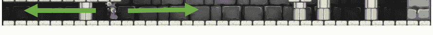

在赋予玩家跳跃能力之前，我们需要在玩家与环境之间设置碰撞检测。例如，目前玩家可以穿墙而过。此外，如果我们现在就启用重力，玩家会直接穿过地板。要实现跳跃，玩家也必须能够回到地面，因此我们需要重力。目前，虽然我们已经设置了瓦片地图使其可见，但没有任何物体是实体的。所以接下来，让我们为地板、墙壁和平台添加一些实质性内容。

## 第10步 - 碰撞检测

让我们首先看看碰撞检测的概念。它确实涉及一些计算，但如果我们以圆为例，就更容易理解。取两个圆，直径均为 10 厘米，因此半径为 5 厘米。如果我们说圆1的中心是C1，圆2的中心是C2。要计算它们是否发生了碰撞（重叠），我们只需要判断C1和C2之间的距离是否小于10厘米。参见下图：

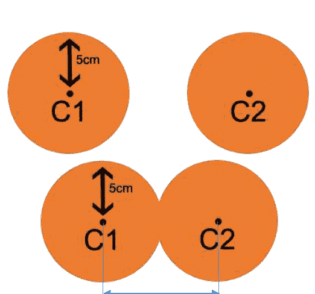

如果距离大于10厘米，则圆不可能接触；但小于10厘米则意味着它们重叠了。

我们需要按顺序：

1. 计算物体的大小
2. 找到两个物体的中心点
3. 计算从中心点到边缘的距离并求和
4. 计算当前中心点测量值与总允许距离之间的差值

因此，我们的碰撞检测公式大致如下：

```javascript
let c1_middle = c1.width / 2; // 5cm
let c2_middle = c2.width / 2; // 5cm
let c_total = c1_middle + c2_middle; // 10cm
if (((c1.x - c1_middle) - (c2.x - c2_middle)) < c_total || ((c1.y - c1_middle) - (c2.y - c2_middle)) < c_total) {
    // 发生碰撞时执行的操作
}
```

当然，我们可以进一步简化方程，但这是为了举例说明。这里`c1.x`, `c1.y`, `c2.x`, `c2.y`代表c1和c2当前的x和y坐标。所以，我们是在说如果c1和c2的当前x位置距离小于10厘米，或者当前y位置距离小于10厘米，那么就发生了碰撞。好消息是我们只需要设置一次碰撞检测。一个单独的函数就能为我们处理所有事情。它表面上看起来很复杂，但拆解开来就更容易理解了。

在你能够理解之前，你可以把这个函数当作一个黑盒子。你只需要知道获得所需输出所需的输入即可。然而，数学在游戏编程中起着根本性作用，所以最好你能掌握它。

好了，让我们开始吧！再次打开`assets.js`文件，在文件底部添加以下代码并保存文件（`CTRL + S`）：

```javascript
var boxes = [];
var boxes1 = [];
var boxesDrawn1 = 0;
// 创建两个空数组用于碰撞坐标，并设置一个变量来检查碰撞框是否已经绘制。
```

接下来，创建一个名为`collisions.js`的新文件，并将其保存在`js`文件夹中。添加以下函数，然后保存（`CTRL + S`）。

```javascript
function colCheck(shapeA, shapeB) {
    var vX = (shapeA.x + (shapeA.width / 2)) - (shapeB.x + (shapeB.width / 2)),
        vY = (shapeA.y + (shapeA.height / 2)) - (shapeB.y + (shapeB.height / 2)),
        hWidths = (shapeA.width / 2) + (shapeB.width / 2),
        hHeights = (shapeA.height / 2) + (shapeB.height / 2),
        colDir = null;
    if (Math.abs(vX) < hWidths && Math.abs(vY) < hHeights) {
        var oX = hWidths - Math.abs(vX),
            oY = hHeights - Math.abs(vY);
        if (oX >= oY) {
            if (vY > 0) {
                colDir = "t";
                shapeA.y += oY;
            } else {
                colDir = "b";
                shapeA.y -= oY;
            }
        } else {
            if (vX > 0) {
                colDir = "l";
                shapeA.x += oX;
            } else {
                colDir = "r";
                shapeA.x -= oX;
            }
        }
    }
    return colDir;
}
```

好的，这里我们向函数传递了两个参数，`shapeA`和`shapeB`。我们正在检查两个形状之间所有方向的碰撞，并返回一个名为`colDir`的值。`colDir`返回的值就是`l`、`r`、`b`或`t`，分别代表检测到的碰撞方向：左、右、下和上。使用这些值，我们将确定在这种情况下要做什么。不过，首先让我们更仔细地看看`colDir`函数内部发生了什么：

```javascript
function colCheck(shapeA, shapeB) {
    // 首先我们将玩家和要检查的障碍物传入函数 - shapeA 和 shapeB
    var vX = (shapeA.x + (shapeA.width / 2)) - (shapeB.x + (shapeB.width / 2)),
        vY = (shapeA.y + (shapeA.height / 2)) - (shapeB.y + (shapeB.height / 2)),
        // 获取向量（x 和 y 坐标）以进行比对
        hWidths = (shapeA.width / 2) + (shapeB.width / 2),
        hHeights = (shapeA.height / 2) + (shapeB.height / 2),
        colDir = null;
    // 将形状的半宽和半高相加
    if (Math.abs(vX) < hWidths && Math.abs(vY) < hHeights) {
        // 如果 x 和 y 向量小于半宽或半高，它们必然相互重叠（发生碰撞）
        var oX = hWidths - Math.abs(vX),
            oY = hHeights - Math.abs(vY);
        if (oX >= oY) {
            if (vY > 0) {
                colDir = "t";
                shapeA.y += oY;
            } else {
                colDir = "b";
                shapeA.y -= oY;
            }
        } else {
            if (vX > 0) {
                colDir = "l";
                shapeA.x += oX;
            } else {
                colDir = "r";
                shapeA.x -= oX;
            }
        }
    }
    // 计算我们碰撞在哪一侧（上、下、左或右）
    return colDir;
    // 返回碰撞的方向
} // 关闭碰撞检测函数
```

这里我们有一个数学函数，`Math.abs()`。`Math.abs()` 方法返回一个数字的绝对值。
它返回：

- 代表指定数字绝对值的数字
- 如果值不是数字（例如文本字符串），则返回 `NaN`
- 如果值为 `null`（没有值），则返回 0

根据定义，一个数字的绝对值意味着什么？

1. 数学 - 实数的大小，不考虑其符号。
2. 技术 - 数值或测量值的实际大小，与其与其他值的关系无关。

在我们的例子中，如果我们取 `Math.abs(vX)` ，无论 vX 是负数还是正数，该方法都只返回数字本身。例如：

```javascript
Math.abs(-89.25); // 返回 89.25
Math.abs(89.25);  // 返回 89.25
```

我们这样做是为了让数字准备好在我们的条件语句中使用各种运算符进行比较。

### 什么是运算符？

运算符有很多种。运算符对一个或多个操作数（数据值）执行操作并产生结果。详见接下来几页的详细表格。

#### 算术运算符

| 运算符 | 描述 |
|--------|------|
| +      | 加法 |
| -      | 减法 |
| *      | 乘法 |
| /      | 除法 |
| %      | 取模（求余数） |
| ++     | 自增 |
| --     | 自减 |

#### 赋值运算符

| 运算符 | 用法 | 完整写法 |
|--------|------|----------|
| =      | x = y | x = y    |
| +=     | x += y | x = x + y |
| -=     | x -= y | x = x - y |
| *=     | x *= y | x = x * y |
| /=     | x /= y | x = x / y |
| %=     | x %= y | x = x % y |

#### 比较运算符

| 运算符 | 描述 |
|--------|------|
| ==     | 等于 |
| ===    | 严格等于（值和类型都相等） |
| !=     | 不等于 |
| !==    | 严格不等于（值或类型不相等） |
| >      | 大于 |
| <      | 小于 |
| >=     | 大于或等于 |
| <=     | 小于或等于 |

#### 逻辑运算符

| 运算符 | 描述 |
|--------|------|
| &&     | 与（逻辑与） |
| \|\|   | 或（逻辑或） |
| !      | 非（逻辑非） |

#### 条件运算符

```javascript
variable = (condition) ? value1 : value2
```

#### 位运算符

| 运算符 | 描述 |
|--------|------|
| &      | 按位与 |
| \|     | 按位或 |
| ~      | 按位非 |
| ^      | 按位异或 |
| <<     | 左移 |
| >>     | 右移 |

现在，我们需要处理返回的结果。打开 `main.js` 文件，并添加以下代码：

```javascript
if (player.screen === 1) { drawMyMap(); } // ◄ 在此之后添加以下代码
if (player.screen < 15 && player.start === 0) { player.start = 1; }
if (player.screen === 1 && boxesDrawn1 === 0) { drawBoxes1(); }
if (player.screen === 1 && boxesDrawn1 < 2) {
    boxes = boxes1;
    if (player.entered < 1) { player.entered = 1; }
}
player.grounded = false;
for (var i = 0; i < boxes.length; i++) {
    ctx.rect(boxes[i].x, boxes[i].y, boxes[i].width, boxes[i].height);
    var dir = colCheck(player, boxes[i]);
    if (dir === "l" || dir === "r") {
        player.velX = 0;
        player.jumping = false;
    } else if (dir === "b") {
        player.grounded = true;
        player.jumping = false;
    }
}
if (player.grounded) { player.velY = 0; }
player.x += player.velX;
player.y += player.velY;
if (player.y > 600) { player.y = 522; }
if (player.screen != 15) {
    ctx.drawImage(wiz[player.f], player.x, player.y);
}
```

让我们仔细看看这段代码的作用。

```javascript
if (player.screen < 15 && player.start === 0) { player.start = 1; }
// 如果玩家不再处于标题画面并且 start = 0，则将 start 设置为 1 - 游戏已开始

if (player.screen === 1 && boxesDrawn1 === 0) { drawBoxes1(); }
// 如果游戏已经开始并且碰撞框尚未绘制，则现在绘制它们

if (player.screen === 1 && boxesDrawn1 < 2) {
    boxes = boxes1;
    if (player.entered < 1) { player.entered = 1; }
}
// 如果玩家的屏幕是 1（第一个游戏画面）并且碰撞框已开始绘制，则将 boxes 变量设置为保存屏幕 1 的碰撞框。Player entered 意味着玩家已被绘制，因此设置为 1。

player.grounded = false;
// 将玩家设置为不在地面上

for (var i = 0; i < boxes.length; i++) {
    ctx.rect(boxes[i].x, boxes[i].y, boxes[i].width, boxes[i].height);
    // 绘制玩家用于碰撞的矩形
    var dir = colCheck(player, boxes[i]);
    // 调用 colCheck 函数以确定是否有任何碰撞以及来自哪个方向
    if (dir === "l" || dir === "r") {
        player.velX = 0;
        player.jumping = false;
    } else if (dir === "b") {
        player.grounded = true;
        player.jumping = false;
    }
}
// 根据玩家碰撞的方向设置碰撞规则

if (player.grounded) { player.velY = 0; }
// 如果玩家在地面上，则将玩家在 Y 方向的速度设置为 0

player.x += player.velX;
// 允许玩家在 X 轴上移动

player.y += player.velY;
// 允许玩家在 Y 轴上移动

if (player.y > 600) { player.y = 522; }
// 设置玩家起始 Y 轴位置

if (player.screen != 15) {
    ctx.drawImage(wiz[player.f], player.x, player.y);
}
// 如果玩家不在标题画面，则绘制主角
```

最后，打开 `map1.js` 文件，并将以下代码添加到文件底部，然后保存（`CTRL + S`）：

```javascript
function addBox(a, b, c, d) {
    boxes1.push({ x: a, y: b, width: c, height: d });
    return;
}

var boxes = [];

function drawBoxes1() {
    // 边界墙
    addBox(0, 577, 1152, 1);
    addBox(0, 0, 64, 448);
    addBox(1088, 192, 64, 384);
    addBox(0, 0, 384, 64);
    addBox(576, 0, 576, 64);
    addBox(768, 64, 64, 64);
    // 平台
    addBox(0, 512, 320, 1);
    addBox(768, 512, 64, 20);
    addBox(832, 448, 256, 1);
    addBox(384, 448, 128, 1);
    addBox(128, 450, 57, 62);
    addBox(576, 384, 192, 1);
    addBox(320, 320, 128, 1);
    addBox(832, 320, 64, 1);
    addBox(960, 320, 128, 1);
    addBox(64, 256, 192, 1);
    addBox(640, 256, 192, 1);
    addBox(128, 192, 64, 64);
    addBox(896, 192, 128, 1);
    addBox(192, 128, 512, 1);
    addBox(448, 64, 64, 1);
    boxesDrawn1 += 1;
    return boxesDrawn1;
}
```

这些函数在指定坐标处绘制碰撞框。让我们仔细看看它是如何工作的：

在我们的资源文件中，我们设置了一个名为 `boxes1` 的数组。

```javascript
function addBox(a, b, c, d) {
    // 打开一个名为 addBox 的函数，并允许参数 a, b, c 和 d
    boxes1.push({ x: a, y: b, width: c, height: d });
    // 每次调用该函数时，向 boxes1 数组中推入一个新对象，该对象设置开始绘制的 x 和 y 轴，以及要绘制的框的长度和高度。
    return;
    // 返回结果
}

var boxes = [];
// 创建一个名为 boxes 的新数组
```

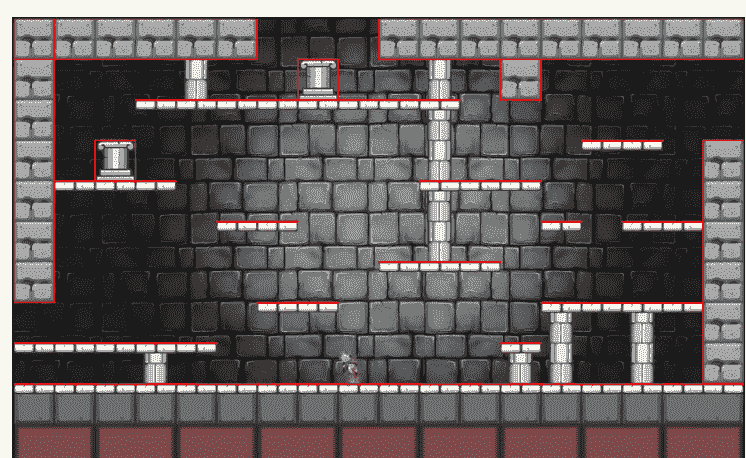

`drawBoxes1` 函数如上所述添加碰撞框。

在 `drawBoxes1` 函数内部，我们有一堆添加碰撞框的函数调用，如下所示：

```javascript
addBox(0, 577, 1152, 1);
// 调用 / 调用 addBox 函数并发送必要的参数。
// 开始绘制的 X 坐标，开始绘制的 Y 坐标，宽度（像素），高度（像素）
```

这与我们的 `colDir` 函数相结合，使得我们的平台和墙壁显得坚实。注意，平台只有 1 像素的表面用于碰撞检测。这是为了让我们的主角能够从平台下方通过。我们的主角高 52 像素，每块瓦片高 64 像素。实际平台高 16 像素，如果从 64 中减去它，我们只剩下 48 像素的可用空间。因此，我们的玩家将无法通过。参见下图。

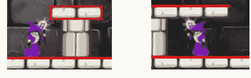

您可以在第一张图片中看到，我们的玩家无法从平台下方通过，而在第二张图片中，我们的玩家可以自由通过。

碰撞现已设置好，打开 `main.js` 文件，就在主更新函数的开始处添加以下代码：

```javascript
if (keys[38] || keys[32]) {
    // 向上箭头或空格键
    if (!player.jumping && player.grounded) {
        player.velY = -player.speed * 2.5;
        player.jumping = true;
        player.grounded = false;
    }
}
```

保存文件。这使得玩家可以跳跃。每当您按下空格键或向上箭头键时。结合左右箭头键，您现在可以导航整个游戏屏幕。试试看。

太棒了！让我们添加一些敌人！

## 第11步 - 添加敌人 - 静态和移动的

在练习开始时，我解释了游戏的目标是在避开障碍物的同时收集所有宝石。在本节中，我们将添加幽灵、蝙蝠和致命的尖刺。为了给它们贴上标签，我们将它们统称为敌人。

我们需要做的第一件事是引入我们需要的精灵。像以前一样，您可以通过以下链接下载它们：
https://wddtrw/resources/learntocode/platformgame_enemy_sprites.zip

下载后，将其解压缩并将内容添加到 `sprites` 文件夹中。要解压缩文件，请双击它，然后选择所有内容（`CTRL + A`）并复制（`CTRL + C`），然后打开 `sprites` 文件夹并粘贴（`CTRL + V`）。

如果一切顺利，您应该有以下内容：

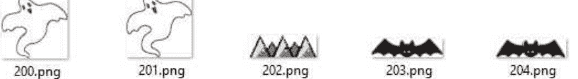

按照通常的方式，我们将它们添加到精灵文件中。打开 `sprites.js` 文件，并将以下代码添加到文件底部，然后保存（`CTRL + S`）：

### 敌人索引：
- 200 - 幽灵帧 1
- 201 - 幽灵帧 2
- 202 - 尖刺
- 203 - 蝙蝠帧 1
- 204 - 蝙蝠帧 2

```javascript
for (i = 200; i < 205; i++) {
    sprite[i] = new Image();
    sprite[i].src = `sprites/${i}.png`;
}
// this adds our 5 enemy sprites to the sprites array at stated indexes
```

接下来我们需要在资源文件中设置它们。打开 `assets.js` 文件。在 player 对象的结束花括号（`}`）之后，添加以下代码，然后保存文件：

```javascript
enemy1 = { x: 64, y: 452, w: 59, h: 57, s: 2, f: 200, dest: 0 },
enemy2 = { x: 256, y: 68, w: 59, h: 57, s: 3, f: 200, dest: 0 },
enemy3 = { x: 1024, y: 64, w: 59, h: 57, s: 2, f: 200, dest: 0 },
bat1 = { x: 64, y: 482, w: 64, h: 17, s: 2, f: 203, dest: 0 },
spikes1 = { x: 512, y: 556, w: 61, h: 20 },
spikes2 = { x: 684, y: 556, w: 61, h: 20 },
// Here we have set up with initial values three ghosts (enemy 1 - 3), one
// bat, and two spike objects. Each has some or all of the following
// variables:
// • x - X-axis starting coordinate
// • y - Y-axis starting coordinate
// • w - Width in pixels
// • h - Height in pixels
// • s - Speed
// • f - Sprite Frame
// • dest - Destination
```

重要的是，我们不必在每个游戏场景中都使用所有这些变量，但它们现在已经被声明并设置好，以备使用。另外请注意，尖刺对象不需要速度、帧或目的地变量，因为它们是静止的。

接下来，创建一个名为 `enemy.js` 的新文件，并将其保存在 `js` 文件夹中。然后添加以下代码：

```javascript
function enemy(sn, e, ax, bx, f1, f2, p, xy, xos, yos) {
    ctx.drawImage(sprite[sn], e.x + xos, e.y + yos, e.w, e.h);
    if (xy === 1) {
        if (e.x < ax && e.dest === 0) {
            e.x += e.s;
            if (e.x > ax - 2) { e.dest = 1; }
        }
        if (e.dest === 1) {
            e.x -= e.s;
            if (e.x <= bx) { e.dest = 0; }
        }
    }
    if (xy === 2) {
        if (e.y < ax && e.dest === 0) {
            e.y += e.s;
            if (e.y > ax - 2) { e.dest = 1; }
        }
        if (e.dest === 1) {
            e.y -= e.s;
            if (e.y <= bx) { e.dest = 0; }
        }
    }
    if (e.f === f1) {
        setTimeout(function() { e.f = f2; }, 200);
    } else {
        setTimeout(function() { e.f = f1; }, 200);
    }
    if (p.x < e.x + xos + e.w && p.x + p.width > e.x + xos && p.y < e.y + yos + e.h && p.y + p.height > e.y + yos) { lifeLost(e, p, xos); }
}

function enemyStatic(sn, e, xos, yos, p) {
    ctx.drawImage(sprite[sn], e.x + xos, e.y + yos, e.w, e.h);
    if (p.x < e.x + xos + e.width && p.x + p.width > e.x + xos && p.y < e.y + yos + e.h && p.y + p.height > e.y + yos) { lifeLost(e, p, xos); }
}

function lifeLost(e, p, xos) {
    player.lives -= 1;
    player.x = 630;
    player.y = 522;
    if ((p.x + p.width) > e.x + xos && (p.x + p.width) < e.x + xos + e.w) {
        player.f = 1;
    }
    if (p.x < (e.x + xos + e.w) && p.x > e.x + xos) { player.f = 3; }
}
```

好的，正如你所见，我们这里有三个函数。第一个函数绘制敌人，根据需要设置它们在 X 轴或 Y 轴上的移动，每 200 毫秒为敌人制作动画，并处理与这些（动画且移动的）敌人的碰撞；第二个函数绘制静态敌人并处理与这些静态敌人（尖刺）的碰撞；第三个函数（`lifeLost`）在上述函数检测到玩家与敌人发生碰撞时被调用。

让我们仔细看看：

```javascript
function enemy(sn, e, ax, bx, f1, f2, p, xy, xos, yos) {
    // open function and pull in parameters
    ctx.drawImage(sprite[sn], e.x + xos, e.y + yos, e.w, e.h);
    // draw the enemy on the canvas
    if (xy === 1) {
        // if horizontal movement is chosen move on X axis
        if (e.x < ax && e.dest === 0) {
            // if enemy x position < destination and destination not reached
            e.x += e.s;
            // move enemy at chosen speed from left to right
            if (e.x > ax - 2) { e.dest = 1; }
            // if destination is reached set destination to 1
        }
        if (e.dest === 1) {
            // if destination is reached...
            e.x -= e.s;
            // move enemy at chosen speed from right to left
            if (e.x <= bx) { e.dest = 0; }
            // if destination is reached set destination to 0
        }
    }
    if (xy === 2) {
        // if vertical movement is chosen move on Y axis
        if (e.y < ax && e.dest === 0) {
            // if enemy y position < destination and destination not reached
            e.y += e.s;
            // move enemy at chosen speed from top to bottom
            if (e.y > ax - 2) { e.dest = 1; }
            // if destination is reached set destination to 1
        }
        if (e.dest === 1) {
            // if destination is reached...
            e.y -= e.s;
            // move enemy at chosen speed from bottom to top
            if (e.y <= bx) { e.dest = 0; }
            // if destination is reached set destination to 0
        }
    }
    if (e.f === f1) {
        setTimeout(function() { e.f = f2; }, 200);
    } else {
        setTimeout(function() { e.f = f1; }, 200);
    }
    // if the frame is the first frame wait 200 milli-seconds and change to the second frame. Otherwise, if the frame is the second frame wait 200 milliseconds and change to the first frame
    if (p.x < e.x + xos + e.w && p.x + p.width > e.x + xos && p.y < e.y + yos + e.h && p.y + p.height > e.y + yos) { lifeLost(e, p, xos); }
    // if a collision is detected call lifeLost function
}
```

好的，然后是第二个函数，它简单得多，因为它用于静态敌人。

```javascript
function enemyStatic(sn, e, xos, yos, p) {
    ctx.drawImage(sprite[sn], e.x + xos, e.y + yos, e.w, e.h);
    // draw the enemy to the screen at the given parameters
    if (p.x < e.x + xos + e.width && p.x + p.width > e.x + xos && p.y < e.y + yos + e.h && p.y + p.height > e.y + yos) { lifeLost(e, p, xos); }
    // if a collision is detected call lifeLost function
}
```

简单得多，但对玩家来说也更容易应对。最后，我们有 `lifeLost` 函数。

```javascript
function lifeLost(e, p, xos) {
    // open the function and pass parameter
    player.lives -= 1;
    // decrease player lives by 1
    player.x = 630;
    // Set player x position to 630 pixels
    player.y = 522;
    // set player y position to 522 pixels
    if ((p.x + p.width) > e.x + xos && (p.x + p.width) < e.x + xos + e.w) {
        player.f = 1;
    }
    // if the player has collided with an enemy to the left set player sprite frame to 1
    if (p.x < (e.x + xos + e.w) && p.x > e.x + xos) { player.f = 3; }
    // if the player has collided with an enemy to the right set player sprite frame to 3
}
```

接下来，我们需要在绘制地图后调用 `enemy` 和 `enemyStatic` 函数。打开 `map1.js`，在外部 for 循环的结束花括号（`}`）之后添加以下函数调用，然后保存（`CTRL + S`）。

```javascript
enemy(enemy1.f, enemy1, 335, 0, 200, 201, player, 1, 0, 0);
enemy(bat1.f, bat1, 710, 64, 203, 204, player, 1, 0, 0);
enemy(enemy3.f, enemy3, 265, 64, 200, 201, player, 2, 0, 0);
enemyStatic(202, spikes1, 0, 0, player);
```

好的，最后我们需要设置起始位置并给玩家一些反馈。打开 `main.js`。

添加以下条件语句来设置敌人起始位置：

```javascript
if (player.screen === 1 && boxesDrawn1 < 2) {
    boxes = boxes1;
    if (player.entered < 1) {
        enemy1.x = 62; enemy1.y = 454; enemy1.dest = 0;
        bat1.x = 62; bat1.y = 70; enemy2.dest = 0;
        enemy3.y = 62; enemy3.dest = 0;
        player.entered = 1;
    }
}
```

将其插入到以下代码行之后：
`if (player.screen === 1 && boxesDrawn1 === 0) { drawBoxes1(); }`

在 `update` 函数的结束花括号（`}`）之前，`requestAnimationFrame(update);` 指令之前添加以下代码，并保存文件（`CTRL + S`）：

```javascript
ctx.font = "20px Arial";
ctx.fillStyle = "white";
ctx.fillText(": " + player.lives, 1090, 621);
// displays current player lives at given coordinates
```

现在确保以通常的方式在 `sorcerer.html` 文件中为 `enemy.js` 文件添加引用。在 `</body>` 结束标签内添加以下内容并保存（`CTRL + S`）：

```html
<script type="text/javascript" src="js/enemy.js"></script>
```

如果你正确地完成了以上步骤，你现在应该拥有以下内容：

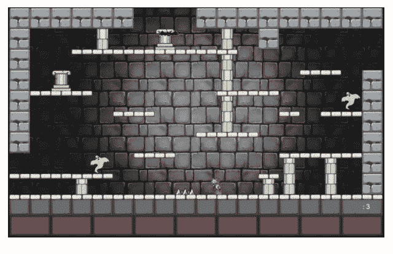

至此，我们已经设定了一些基本规则，但随着游戏进程，这些规则将需要更新。例如，在不同的游戏场景中，根据你的设计，你希望玩家在不同位置重生；当玩家失去所有生命值、游戏结束时，我们需要执行一些操作；同时，我们需要为主角添加行走、重生等动画。

我确信现在是一个休息的好时机。在继续之前，喝杯饮料放松一下吧。


## 游戏结束

打开 `enemy.js`，在 `lifeLost` 函数的末尾添加以下条件判断：

```javascript
if (player.lives === 0) {
    gameOver();
}
```

然后，在文件末尾添加以下 `gameOver` 函数，并保存（`CTRL + S`）：

```javascript
function gameOver() {
    player.screen = 20;
    ctx.drawImage(tile[16], 0, 0, 1152, 704);
    ctx.drawImage(sprite[109], 250, 200, 688, 151);
}
```

最后，打开 `main.js`，在 `update` 函数的顶部添加以下条件判断：

```javascript
if (player.screen === 15) { drawMyMap1000(); } // ← 在此行之后
if (player.screen === 20) { gameOver(); } // ← 添加此行
```

保存文件（`CTRL + S`）。现在当 `player.lives === 0` 时，你将看到：

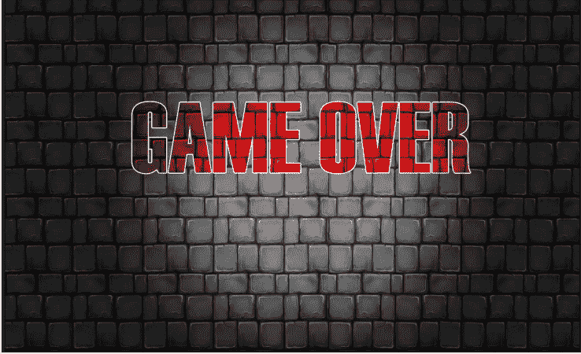

## 第12步 - 添加可收集物品

我们需要做的第一件事是导入所需的精灵图。和以往一样，你可以通过以下链接下载：

https://wddtrw/resources/learntocode/platformgame_collectables.zip

下载后，解压并将内容添加到 `sprites` 文件夹中。解压文件时，双击它，然后全选（`CTRL + A`）并复制（`CTRL + C`），接着打开 `sprites` 文件夹并粘贴（`CTRL + V`）。

如果一切顺利，你应该会看到：

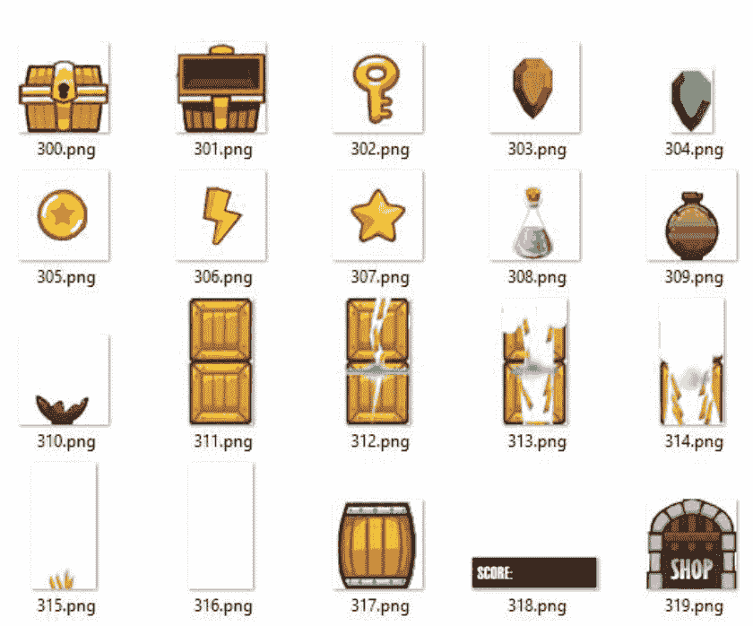

其中一些精灵图也将在下一节的游戏监视器中使用。

按照现在非常熟悉的方式，我们将它们添加到精灵文件中。打开 `sprites.js`，在文件底部添加以下代码，然后保存（`CTRL + S`）：

```javascript
/* ======================
COLLECTABLES KEY:
300 - Chest
301 - Open Chest
302 - Key
303 - Ruby
304 - Emerald
305 - Gold Coin
306 - Lightning Bolt
307 - Star
308 - Potion
309 - Flask
310 - Broken Flask
311 - Crates Frame 1 - Whole
312 - Crates Frame 2
313 - Crates Frame 3
314 - Crates Frame 4
315 - Crates Frame 5
316 - Crates Frame 6 - Destroyed
317 - Barrel
318 - Score Card
319 - Shop
====================== */

for (i = 300; i < 320; i++) {
    sprite[i] = new Image();
    sprite[i].src = `sprites/${i}.png`;
}
```

### 精灵图集

值得注意的是，我们可以也应该（对于完成的游戏）将所有精灵图作为单个文件加载，称为精灵图集。精灵图集可以提高游戏性能，并减少加载和启动时间。游戏将使用少量较大的图像，而不是可能数百个较小的图像。

我们会像这样加载并绘制精灵图集：

```javascript
let img = new Image();
img.src = '/sprites/sorcerersmountain.png';
img.onload = function() {
    init();
};
let canvas = document.querySelector('canvas');
let ctx = canvas.getContext('2d');
function init() {
    drawImage(image, sx, sy, sWidth, sHeight, dx, dy, dWidth, dHeight);
}
```

在本书中，为了在构建游戏的各个部分时更容易理解每个部分，我将它们保持独立。然而，在最终的游戏中，将会使用精灵图集，我们将相应地更新代码。

继续前进...

创建一个新文件 `collectables.js` 并将其保存在 `js` 文件夹中，并确保在 `sorcerer.html` 文件中添加对该文件的引用，如下所示并保存（`CTRL + S`）：

```html
<script type="text/javascript" src="js/collectables.js"></script>
// 将此行放在 enemy.js 引用之下
```

接下来打开 `assets.js`，添加以下两行代码来初始化我们的金币设置。第一行声明了一个新的硬币对象，设置了精灵图的宽高，并将初始硬币计数设置为零（0）。其次，我们有一个包含十个分隔值的 `coinsCollected` 数组，全部设置为零。每个值代表一个硬币。零（0）表示未收集，一（1）表示已收集。你很快就会看到我们如何使用它来确定是否应该绘制相关的硬币。

```javascript
coin = { width: 49, height: 50, count: 0 },
coinsCollected = [0, 0, 0, 0, 0, 0, 0, 0, 0, 0],
```

好的，回到我们的 `collectables.js` 文件，让我们来处理绘制和收集硬币。

添加以下代码，然后保存文件（`CTRL + S`）。

```javascript
var coins = [];

function addCoins(mn, w, h, x1, y1, x2, y2, x3, y3, x4, y4, x5, y5, x6, y6, x7, y7, x8, y8, x9, y9, x10, y10) {
    let xs = [x1, x2, x3, x4, x5, x6, x7, x8, x9, x10];
    let ys = [y1, y2, y3, y4, y5, y6, y7, y8, y9, y10];
    for (i = 0; i < 10; i++) {
        coins[i] = { x: xs[i], y: ys[i], width: w, height: h, c: 0 };
        if (player.x < coins[i].x + coins[i].width
            && player.x + player.width > coins[i].x
            && player.y < coins[i].y + coins[i].height
            && player.y + player.height > coins[i].y && coinsCollected[i] == 0) {
            coins[i].c += 1;
            coinsCollected[i] = 1;
        }
        if (coins[i].c == 0 && coinsCollected[i] == 0) {
            ctx.drawImage(sprite[305], coins[i].x, coins[i].y, coins[i].width, coins[i].height);
        } else if (coins[i].c > 0 && coins[i].c < 2) {
            coin.count += 1;
            player.score += 10;
        }
    }
}
```

`addCoins` 函数完成三项工作。它传入必要的参数，检查玩家是否与任何硬币发生碰撞，然后如果确定玩家尚未碰撞（收集）硬币，则绘制硬币。

让我们仔细看看：

```javascript
var coins = [];
// 创建一个新的空数组，并将其存储在变量 coins 中

function addCoins(item, w, h, x1, y1, x2, y2, x3, y3, x4, y4, x5, y5, x6, y6, x7, y7, x8, y8, x9, y9, x10, y10) {
    // 打开 addCoins 函数并传递 10 个硬币的必要参数
    let xs = [x1, x2, x3, x4, x5, x6, x7, x8, x9, x10];
    let ys = [y1, y2, y3, y4, y5, y6, y7, y8, y9, y10];
    // 将 x 和 y 坐标参数分离到带索引的数组中
    for (i = 0; i < 10; i++) {
        // 遍历 10 个索引
        coins[i] = { x: xs[i], y: ys[i], width: w, height: h, c: 0 };
        // 为每个索引添加一个硬币对象到 coins 数组，包含位置和大小参数
        if (player.x < coins[i].x + coins[i].width
            && player.x + player.width > coins[i].x
            && player.y < coins[i].y + coins[i].height
            && player.y + player.height > coins[i].y && coinsCollected[i] == 0) {
            // 如果玩家与尚未收集的硬币发生碰撞...
            coins[i].c += 1;
            // 为给定索引的硬币的 c 参数加 1
            coinsCollected[i] = 1;
            // 更新 coinsCollected 数组中给定索引的值为 1 - 表示硬币已被收集
        }
        if (coins[i].c == 0 && coinsCollected[i] == 0) {
            // 如果硬币未被收集...
            ctx.drawImage(sprite[305], coins[i].x, coins[i].y, coins[i].width, coins[i].height);
            // 在给定坐标处以给定大小绘制硬币
        } else if (coins[i].c > 0 && coins[i].c < 2) {
            // 否则，如果硬币已被收集
            coin.count += 1;
            // 硬币计数加 1 - 用于游戏监视器
            player.score += 10;
            // 玩家得分加 10 - 用于游戏监视器
        }
    }
}
```

现在，让我们让它运作起来。打开 `map1.js`，在绘制瓦片地图的嵌套 for 循环之后立即添加以下函数调用，并保存文件（`CTRL + S`）：

```javascript
addCoins(coin, 49, 50, 76, 78, 76, 142, 76, 206, 140, 332, 396, 204, 460, 204, 396, 12, 716, 332, 908, 76, 600, 78);
// 使用给定参数调用或触发 addCoins 函数
// addCoins(mn, w, h, x1, y1, x2, y2, x3, y3, x4, y4, x5, y5, x6, y6, x7, y7, x8, y8, x9, y9, x10, y10)
// mn: 地图编号
// w: 精灵图的宽度
// h: 精灵图的高度
// x 和 y: 位置（共 10 个）
```

我们的游戏屏幕上还有更多可收集物品需要添加，但不像硬币有 10 个，其他的我们会用得更少。

如果你已经正确遵循了所有指令，那么现在应该会看到一个与下图示例相似的游戏界面。尝试调整函数调用中的 x 和 y 参数。你可以将硬币放置在任何位置，它们都是可收集的，并且在收集时会增加你的硬币数量和分数。

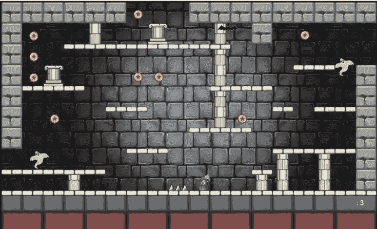

我们可以沿用相同的方式，为其他可收集物品构建几乎相同的函数。如下方的宝石所示：

```javascript
var gems = [];

function addGems(item, w, h, x1, y1, x2, y2) {
    let xs = [x1, x2];
    let ys = [y1, y2];
    for (i = 0; i < 10; i++) {
        gems[i] = { x: xs[i], y: ys[i], width: w, height: h, c: 0 };
        if (player.x < gems[i].x + gems[i].width
            && player.x + player.width > gems[i].x
            && player.y < gems[i].y + gems[i].height
            && player.y + player.height > gems[i].y && gemsCollected[i] == 0) {
            gems[i].c += 1;
            gemsCollected[i] = 1;
        }
    }
    if (gems[i].c == 0 && gemsCollected[i] == 0) {
        ctx.drawImage(sprite[304], gems[i].x, gems[i].y, gems[i].width, gems[i].height);
    } else if (gems[i].c > 0 && gems[i].c < 2) {
        gems.count += 1;
        player.score += 50;
    }
}
```

注意，除了变量名从 `coins` 改为了 `gems` 之外，代码几乎完全相同。这意味着我们可以对其进行优化。我们应该尽可能地移除重复的代码。例如，这里我们可以构建一个大的数组来容纳所有可收集物品。考虑到这一点，让我们快速回顾一下。

首先，打开 `assets.js` 文件，用以下代码替换硬币资产的设置，然后保存 (`CTRL + S`)：

```javascript
coin = { width: 49, height: 50, count: 0, mn: 1, sn: 305, fct: 0, t: 'coins' },
gem = { width: 40, height: 45, count: 0, mn: 1, sn: 303, fct: 12, t: 'gems' },
key = { width: 34, height: 49, count: 0, mn: 1, sn: 302, fct: 14, t: 'keys' },
potion = { width: 30, height: 52, count: 0, mn: 1, sn: 308, fct: 16, t: 'potions' },
flask = { width: 38, height: 49, count: 0, mn: 1, sn: 309, fct: 18, t: 'flasks' },
star = { width: 39, height: 39, count: 0, mn: 1, sn: 307, fct: 23, t: 'stars' },
bolt = { width: 39, height: 39, count: 0, mn: 1, sn: 306, fct: 28, t: 'bolts' },
itemsCollected = [0, 0, 0, 0, 0, 0, 0, 0, 0, 0, 0, 0, 0, 0, 0, 0, 0, 0, 0, 0, 0, 0, 0, 0, 0, 0, 0, 0, 0, 0,
    0, 0, 0, 0, 0, 0, 0, 0, 0, 0, 0, 0, 0, 0, 0, 0, 0, 0, 0, 0, 0, 0, 0, 0, 0, 0, 0, 0, 0, 0,
    0, 0, 0, 0, 0, 0, 0, 0, 0, 0, 0, 0, 0, 0, 0, 0, 0, 0, 0, 0, 0, 0, 0, 0, 0, 0, 0, 0, 0, 0],
```

这些是所有可收集物品的初始设置。

- `width` - 宽度
- `height` - 高度
- `count` – 已收集数量
- `mn` – 地图编号
- `sn` – 精灵图编号
- `fct` – 索引增加因子
- `t` – 可收集物品的类型（字符串）

在同一文件底部，添加以下代码用于屏幕2的平台碰撞检测：

```javascript
var boxes2 = [];
var boxesDrawn2 = 0;
```

然后保存文件 (`CTRL + S`)。

接下来，让我们添加函数调用。打开 `map1.js`，用以下代码替换原来的 `addCoins` 函数调用，然后保存 (`CTRL + S`)：

```javascript
// addCxs(item, x1, y1, x2, y2, x3, y3, x4, y4, x5, y5, x6, y6, x7, y7, x8, y8, x9, y9, x10, y10)
addCxs(coin, 76, 78, 76, 142, 76, 206, 140, 332, 396, 204, 460, 204, 396, 12, 716, 332, 908, 76, 600, 78);
addCxs(gem, 720, 74, 1040, 532);
addCxs(key, 460, 10, 1024, 345);
addCxs(star, 525, 12, 973, 76, 1037, 268);
addCxs(potion, 1041, 398, 593, 332);
addCxs(flask, 13, 463);
addCxs(bolt, 425, 384);
```


//现在，我们只需指定 x 和 y 坐标并引入 assets 中的物品对象，就可以为每种物品最多添加 10 个。

最后，打开 `collectables.js` 文件，用以下函数替换所有代码，以处理所有可收集物品，然后保存文件 (CTRL + S)：

```javascript
var items = [];

function addCxs(item, x1, y1, x2, y2, x3, y3, x4, y4, x5, y5, x6, y6, x7, y7, x8, y8, x9, y9, x10, y10) {
    let iw = item.width;
    let ih = item.height;
    let plw = player.width;
    let plh = player.height;
    let plx = player.x;
    let ply = player.y;
    item.mn = player.screen - 1;
    let mn = item.mn * 28 + item.fct;
    let xs = [];
    xs[1 + mn] = x1;
    xs[2 + mn] = x2;
    xs[3 + mn] = x3;
    xs[4 + mn] = x4;
    xs[5 + mn] = x5;
    xs[6 + mn] = x6;
    xs[7 + mn] = x7;
    xs[8 + mn] = x8;
    xs[9 + mn] = x9;
    xs[10 + mn] = x10;
    let ys = [];
    ys[1 + mn] = y1;
    ys[2 + mn] = y2;
    ys[3 + mn] = y3;
    ys[4 + mn] = y4;
    ys[5 + mn] = y5;
    ys[6 + mn] = y6;
    ys[7 + mn] = y7;
    ys[8 + mn] = y8;
    ys[9 + mn] = y9;
    ys[10 + mn] = y10;
    for (i = 0; i < 10; i++) {
        items[i + mn] = { x: xs[i + mn], y: ys[i + mn], width: iw, height: ih, c: 0 };
        if (plx < items[i + mn].x + iw && plx + plw > items[i + mn].x && ply < items[i + mn].y + ih && ply + plh > items[i + mn].y && itemsCollected[i + mn] == 0) {
            items[i + mn].c += 1;
            itemsCollected[i + mn] = 1;
        }
        if (items[i + mn].c == 0 && itemsCollected[i + mn] == 0) {
            ctx.drawImage(sprite[item.sn], items[i + mn].x, items[i + mn].y, iw, ih);
        } else if (items[i + mn].c > 0 && items[i + mn].c < 2) {
            item.count += 1;
            if (item.t == 'coins') { player.score += 10; sfx[0].play(); }
            if (item.t == 'gems') { player.score += 50; sfx[0].play(); }
            if (item.t == 'keys') { player.score += 20; sfx[0].play(); }
            if (item.t == 'potions') { player.score += 30; sfx[0].play(); }
            if (item.t == 'flasks') { player.score += 100; player.lives += 1; sfx[0].play(); }
            if (item.t == 'stars') { player.score += 25; sfx[0].play(); }
            if (item.t == 'bolts') { player.score += 15; sfx[0].play(); }
        }
    }
}
```

按照惯例，我们来解析一下。这里的逻辑与之前的 `addCoins` 函数相同，但考虑到了我们引用的是哪种可收集物品。

```javascript
var items = [];
//创建一个空数组并存储在名为 items 的变量中

function addCxs(item, x1, y1, x2, y2, x3, y3, x4, y4, x5, y5, x6, y6, x7, y7, x8, y8, x9, y9, x10, y10) {
    //打开 addCxs 函数，传入可收集物品的资源对象以及十组 x 和 y 坐标
    let iw = item.width;
    let ih = item.height;
    let plw = player.width;
    let plh = player.height;
    let plx = player.x;
    let ply = player.y;
    //设置短变量名来保存玩家和可收集物品的属性。
    //这将使碰撞计算更短且更易读。
    item.mn = player.screen - 1;
    //设置物品的地图编号以匹配当前玩家屏幕编号减1。
    let mn = item.mn * 30 + item.fct;
    //计算 mn 以确保数据存储在唯一的数组索引中。例如，如果玩家在1号屏幕，公式将是 0 * 30 + 在 assets 中给出的物品因子，屏幕2则是 1 * 30 + 物品因子，依此类推。30 是每个游戏屏幕可收集物品的最大数量，基于以下原因：
}
```

- 10个硬币
- 2个宝石
- 2个钥匙
- 2个药水
- 2个瓶子
- 5颗星星
- 2个闪电螺栓
- 5个备用索引 - 如果我们想添加更多可收集物品

```javascript
let xs = [];
xs[1 + mn] = x1;
xs[2 + mn] = x2;
xs[3 + mn] = x3;
xs[4 + mn] = x4;
xs[5 + mn] = x5;
xs[6 + mn] = x6;
xs[7 + mn] = x7;
xs[8 + mn] = x8;
xs[9 + mn] = x9;
xs[mn] = x10;
//从函数参数中获取所有 X 坐标，并将它们添加到 xs 数组的计算索引处

let ys = [];
ys[1 + mn] = y1;
ys[2 + mn] = y2;
ys[3 + mn] = y3;
ys[4 + mn] = y4;
ys[5 + mn] = y5;
ys[6 + mn] = y6;
ys[7 + mn] = y7;
ys[8 + mn] = y8;
ys[9 + mn] = y9;
ys[mn] = y10;
//从函数参数中获取所有 Y 坐标，并将它们添加到 ys 数组的计算索引处。

for (i = 0; i < 10; i++) {
    //循环遍历10次 - 每次对应一个可能的可收集物品
    items[i + mn] = { x: xs[i + mn], y: ys[i + mn], width: iw, height: ih, c: 0 };
    //将物品对象添加到 items 数组的给定坐标和计算索引处
    if (plx < items[i + mn].x + iw && plx + plw > items[i + mn].x && ply < items[i + mn].y + ih && ply + plh > items[i + mn].y && itemsCollected[i + mn] == 0) {
        //如果玩家与一个尚未被收集的物品发生了碰撞
        items[i + mn].c += 1;
        //将该物品的收集值设置为1
        itemsCollected[i + mn] = 1;
        //更新 itemsCollected 数组以显示该物品已被收集
    }
    if (items[i + mn].c == 0 && itemsCollected[i + mn] == 0) {
        //如果该物品尚未被收集...
        ctx.drawImage(sprite[item.sn], items[i + mn].x, items[i + mn].y, iw, ih);
        //在给定坐标、宽度和高度处绘制指定的精灵图
    } else if (items[i + mn].c > 0 && items[i + mn].c < 2) {
        //否则，如果该物品已被收集...
        item.count += 1;
        //为物品计数加1 - 用于下一节的游戏监视器
    }
}

if (item.t == 'coins') { player.score += 10; }
//如果是金币，为玩家得分增加10

if (item.t == 'gems') { player.score += 50; }
//如果是宝石，为玩家得分增加50

if (item.t == 'keys') { player.score += 20; }
//如果是钥匙，为玩家得分增加20

if (item.t == 'potions') { player.score += 30; }
//如果是药水，为玩家得分增加30

if (item.t == 'flasks') { player.score += 100; player.lives += 1; }
//如果是瓶子，为玩家得分增加100，并增加1条生命

if (item.t == 'stars') { player.score += 25; }
//如果是星星，为玩家得分增加25

if (item.t == 'bolts') { player.score += 15; }
//如果是闪电，为玩家得分增加15
}
```

干得漂亮！如果你一切都正确操作，刷新浏览器并按‘s’开始，你应该能看到如下界面：

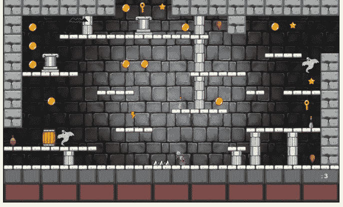

太棒了！在下一节中，我们将探讨如何生成一些用户反馈。我想是时候再次休息一下了。喝杯饮料，给自己充充电。


## 第13步 - 游戏监视器

好的，首先打开 `sorcerer.html`，在 `enemy.js` 引用之后添加以下 JavaScript 文件引用，然后保存。

```html
<script type="text/javascript" src="js/gameMonitor.js"></script>
```

接下来，创建一个名为 `gameMonitor.js` 的新文件，然后添加以下代码并保存文件（CTRL + S）：

```javascript
function gameMonitor() {
    ctx.drawImage(sprite[305], 19, 655, coin.width / 1.5, coin.height / 1.5);
    ctx.drawImage(sprite[307], 148, 658, star.width / 1.5, star.height / 1.5);
    ctx.drawImage(sprite[302], 277, 656, key.width / 1.5, key.height / 1.5);
    ctx.drawImage(sprite[304], 400, 655, gem.width / 1.5, gem.height / 1.5);
    ctx.drawImage(sprite[303], 405, 670, gem.width, gem.height / 1.5);
    ctx.drawImage(sprite[308], 533, 654, potion.width / 1.5, potion.height / 1.5);
    ctx.drawImage(sprite[309], 660, 656, flask.width / 1.5, flask.height / 1.5);
    ctx.drawImage(sprite[306], 788, 660, bolt.width / 1.5, bolt.height / 1.5);
    ctx.drawImage(sprite[318], 896, 640, 256, 64);
    ctx.drawImage(wiz[1], 1042, 594, 30, 42);
}
```

我们这里所做的只是在特定位置绘制精灵图并稍微调整其大小。为了使它们被绘制出来，我们必须调用这个函数。打开 `map1.js`，在可收集物品的函数调用之下添加以下函数调用：

```javascript
gameMonitor();
```

如果你刷新浏览器并按‘s’开始游戏，你会看到我们在屏幕底部放置了精灵图来表示游戏收集品、分数和生命值变量，如下所示：

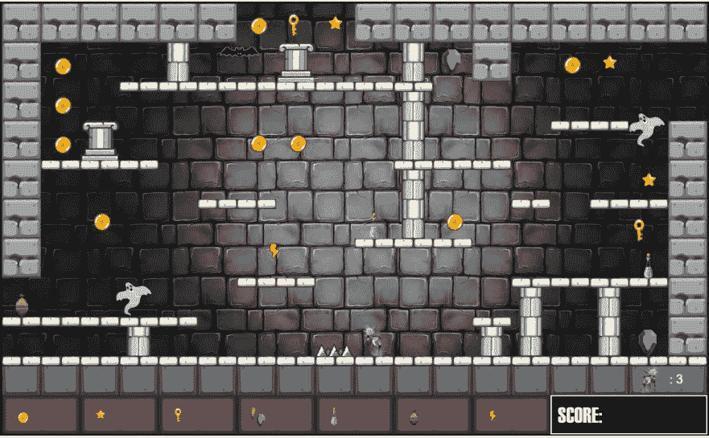

现在，我们需要添加数字来向玩家提供反馈。打开 `main.js`，在 `player.screen` 条件内部添加以下代码，然后像往常一样保存文件：

```javascript
if (player.screen != 15 && player.screen != 20) {
    ctx.drawImage(wiz[player.f], player.x, player.y);
    ctx.font = "20px Arial";
    ctx.fillStyle = "white";
    ctx.fillText(": " + player.lives, 1090, 621);
    // 在此之后添加以下代码
    ctx.font = "35px Arial";
    ctx.fillStyle = "white";
    ctx.fillText(player.score, 1000, 685); // 更新分数
    ctx.font = "20px Arial";
    ctx.fillStyle = "white";
    ctx.fillText(": " + coin.count, 60, 681); // 更新金币计数
    ctx.fillText(": " + gem.count, 444, 681); // 更新宝石计数
    ctx.fillText(": " + star.count, 188, 681); // 更新星星计数
    ctx.fillText(": " + potion.count, 572, 681); // 更新药水计数
    ctx.fillText(": " + flask.count, 700, 681); // 更新瓶子计数
    ctx.fillText(": " + bolt.count, 828, 681); // 更新闪电计数
    ctx.fillText(": " + key.count, 316, 681); // 更新钥匙计数
    ctx.fillText(": " + player.lives, 1090, 621); // 玩家生命值
}
```

```javascript
//为游戏监视器添加计数 - 以每秒60帧（每16.7毫秒）的速度更新
requestAnimationFrame(update);
```

如果你一切都正确操作，你现在应该能看到如下界面：

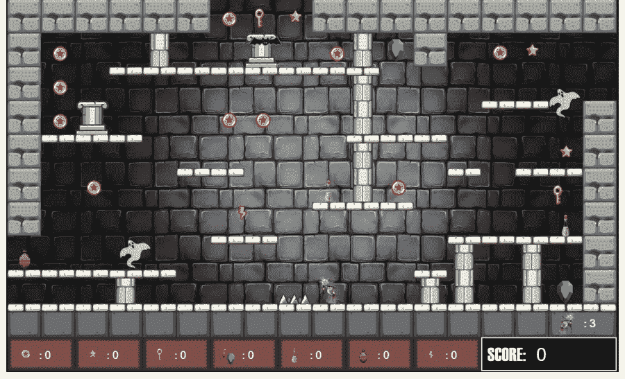

太棒了！这样我们就构建了一个游戏界面。它看起来很酷，对吧？在下一节中，我们将探索如何添加更多界面，以及如何让玩家在不同界面间移动。

## 第14步 - 添加更多游戏界面

好消息是，我们已经完成了大部分困难的工作。我们的游戏界面将利用我们已经构建的大部分代码。

让我们开始处理第二个游戏界面。首先，我们需要确定每个界面之间的相对位置。由于我们已经创建了界面1，我们假设界面2在左边，界面3在右边，如下所示：


接下来，打开 `sorcerer.html`，在 map1 的引用下方为我们的第二张地图添加引用，如下所示：

```html
<script type="text/javascript" src="js/map2.js"></script>
```

保存文件（CTRL + S）。

现在，创建一个名为 `map2.js` 的新文件并将其保存在 `js` 文件夹中。然后添加以下代码：

```javascript
function drawMyMap2() {
    ctx.drawImage(tile[16], 0, 0);
    var xt = 0; // 瓦片地图X索引
    var yt = -64; // 瓦片地图Y索引
    var tileMap = [];
    var mapNo = 0; // 地图索引
    tileMap[0] = [6, 0, 0, 6, 6, 6, 6, 6, 6, 6, 6, 6, 6, 6, 6, 6, 6, 6];
    tileMap[1] = [6, 9, 0, 0, 10, 0, 0, 0, 0, 0, 0, 0, 0, 0, 0, 0, 0, 6];
    tileMap[2] = [6, 9, 9, 9, 9, 9, 0, 0, 0, 0, 0, 0, 0, 0, 0, 6];
    tileMap[3] = [6, 0, 0, 0, 0, 0, 9, 0, 0, 4, 4, 4, 4, 0, 0, 6];
    tileMap[4] = [6, 4, 4, 4, 4, 0, 0, 0, 9, 5, 5, 5, 5, 0, 0, 6];
    tileMap[5] = [6, 6, 6, 6, 0, 9, 0, 0, 0, 5, 5, 5, 5, 0, 0, 6];
    tileMap[6] = [6, 0, 0, 0, 0, 0, 0, 0, 9, 6, 6, 6, 6, 6, 6, 6];
    tileMap[7] = [6, 0, 0, 0, 0, 0, 0, 9, 0, 0, 6, 0, 0, 0, 0, 0];
    tileMap[8] = [6, 9, 9, 9, 0, 0, 0, 0, 9, 6, 0, 0, 0, 0, 9, 8];
    tileMap[9] = [6, 1, 1, 1, 1, 1, 1, 1, 6, 0, 0, 1, 1, 1, 2, 3];
    tileMap[10] = [13, 14, 13, 14, 13, 14, 13, 14, 13, 14, 13, 14, 13, 14, 13, 14, 13, 14];
    for (mapNo = 0; mapNo < 11; mapNo++) {
        yt += 64;
        for (xt = 0; xt < tileMap[mapNo].length * 64; xt += 64) {
            if (xt > 1152) { xt = 0; }
            var i = tileMap[mapNo][xt / 64]; // 当前迭代位置的数组变量
            ctx.drawImage(tile[i], xt, yt); // 绘制行 - Y位置距离画布顶部的像素
        }
    }
    addCxs(coin, 76, 399, 140, 399, 206, 399, 652, 79, 716, 79, 780, 79, 846, 79);
    addCxs(gem, 70, 200, 76, 532);
    addCxs(key, 1040, 76, 585, 525);
    addCxs(star, 1037, 140, 717, 460);
    addCxs(potion, 590, 461, 0, -100);
    addCxs(flask, 580, 207, 0, -100);
    addCxs(bolt, 457, 386, 0, -100);
    gameMonitor();
    enemy(enemy1.f, enemy1, 390, 66, 200, 201, player, 1, 0, 0);
    enemy(enemy2.f, enemy2, 576, 66, 200, 201, player, 1, 0, 0);
    enemy(enemy3.f, enemy3, 320, 66, 200, 201, player, 2, -66, 0);
    enemyStatic(202, spikes1, -129, 0, player);
    enemyStatic(202, spikes2, 212, -192, player);
}
```

```javascript
function addBox2(a, b, c, d) {
    boxes2.push({ x: a, y: b, width: c, height: d });
    return;
}

function drawBoxes2() {
    addBox2(0, 57, 706, 1);
    addBox2(832, 577, 320, 1);
    addBox2(0, 0, 66, 640);
    addBox2(1089, 0, 66, 384);
    addBox2(192, 0, 960, 64);
    addBox2(640, 386, 66, 256);
    addBox2(640, 192, 256, 192);
    addBox2(706, 386, 386, 64);
    addBox2(1026, 192, 66, 192);
    addBox2(66, 256, 256, 128);
    addBox2(576, 512, 66, 1);
    addBox2(1024, 512, 128, 1);
    addBox2(66, 512, 192, 1);
    addBox2(449, 449, 66, 1);
    addBox2(576, 386, 66, 1);
    addBox2(386, 320, 66, 1);
    addBox2(576, 256, 66, 1);
    addBox2(66, 129, 320, 1);
    addBox2(449, 192, 66, 1);
    addBox2(66, 66, 66, 1);
    boxesDrawn2 += 1;
    return boxesDrawn2;
}
```

你应该能认出所有这些代码。除了更改的参数外，这段程序代码与界面1的代码完全相同。简单回顾一下，我们绘制了背景图像，然后是瓦片地图，添加了可收集物品，接着是游戏监视器、敌人，最后是碰撞框。

如果你需要进一步的解释，请翻回第162页及以后，那里我们构建了 `map1.js`。解释几乎是完全相同的。

我们需要的最后一步是对 `main.js` 进行一个小更新，以允许主角访问其他瓦片地图。例如，当玩家从界面1的左侧移出时，他们需要到达界面2的右侧。同样，如果玩家从界面2的右侧移出，他们需要到达界面1的左侧。打开 `main.js`，添加以下代码，然后保存文件：

```javascript
if (player.screen === 1) { drawMyMap(); } // ← 在这行之后添加以下代码
//===== 界面 1 ==============
if (player.x < 5 && player.screen === 1) {
    player.screen = 2;
    player.x = 1103;
    player.entered = 0;
}
if (player.x > 1103 && player.screen === 1) {
    player.screen = 3;
    player.x = 15;
    player.entered = 0;
}
if (player.y < -20 && player.screen === 1) {
    player.screen = 7;
    player.y = 525;
    player.entered = 0;
}
//===== 界面 2 ==============
if (player.x > 1103 && player.screen === 2) {
    player.screen = 1;
    player.x = 5;
    player.entered = 0;
}
```

## 步骤15 - 添加音效（SFX）与音乐

在玩家穿越游戏世界时，有许多方式可以给予反馈。例如我们的游戏监视器、动画，以及声音。在现实世界中，我们通过感官体验诸多事物。游戏世界亦是如此。玩家死亡时的音效、重生时的动画、吃到美味食物的音效，或是吃到难吃食物时的另一种音效。可能性无穷无尽。唯一的限制只在于你的想象力。为你的游戏添加的层次和行为越多，它对玩家的吸引力就会越大。

我们需要做的第一件事是导入所需的音效文件。与之前所有情况一样，你可以通过以下链接下载：
https://wddtrw/resources/learntocode/platformgame_sfx.zip

下载完成后，解压文件并将内容添加到 `sfx` 文件夹中。要解压文件，请双击它，然后选择所有内容（CTRL + A）并复制（CTRL + C），接着打开 `sfx` 文件夹并粘贴（CTRL + V）。

如果一切顺利，你应该得到以下内容：

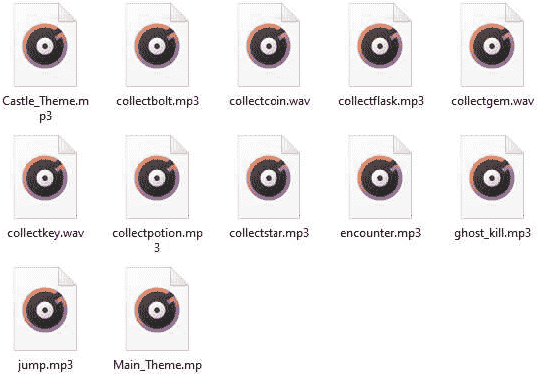

接下来，我们需要引用两个新的 JavaScript 文件，这些文件我们将创建来处理声音。打开 `sorcerer.html`，在 `tiles.js` 文件引用之前添加以下引用：

```html
<script type="text/javascript" src="js/sfx.js"></script>
<script type="text/javascript" src="js/music.js"></script>
```

保存文件。

接下来，创建一个名为 `sfx.js` 的新文件，并像往常一样将其保存在 `js` 文件夹中。然后添加以下代码：

```javascript
var sfx = [];
sfx[0] = new Audio('sfx/collectcoin.wav');
sfx[1] = new Audio('sfx/collectgem.wav');
sfx[2] = new Audio('sfx/collectstar.mp3');
sfx[3] = new Audio('sfx/collectpotion.mp3');
sfx[4] = new Audio('sfx/collectflask.mp3');
sfx[5] = new Audio('sfx/collectbolt.mp3');
sfx[6] = new Audio('sfx/collectkey.wav');
sfx[7] = new Audio('sfx/ghost_kill.mp3');
sfx[8] = new Audio('sfx/jump.mp3');
sfx[9] = new Audio('sfx/encounter.mp3');
sfx[10] = new Audio('sfx/Castle_Theme.mp3');
sfx[11] = new Audio('sfx/Main_Theme.mp3');
```

在这里，我们创建了一个名为 `sfx` 的新数组。然后我们在选定的索引处添加了音效，以便我们可以轻松地在游戏代码中使用它们。

保存文件（CTRL + S）。

好了，现在我们必须添加指令，以便在特定情况下播放音效文件。让我们先处理可收集物品。打开 `collectable.js` 并编辑以下条件语句：

```javascript
if (item.t == 'coins') { player.score += 10; sfx[0].play(); }
if (item.t == 'gems') { player.score += 50; sfx[1].play(); }
if (item.t == 'keys') { player.score += 20; sfx[6].play(); }
if (item.t == 'potions') { player.score += 30; sfx[3].play(); }
if (item.t == 'flasks') { player.score += 100; player.lives += 1; sfx[4].play(); }
if (item.t == 'stars') { player.score += 25; sfx[2].play(); }
if (item.t == 'bolts') { player.score += 15; sfx[5].play(); }
```

添加高亮显示的代码。这将在你收集特定物品时播放不同的音效。

保存文件并试玩一下！

接下来，打开 `main.js`。就在主更新函数的开始之后，添加以下两个条件语句：

```javascript
function update() { // ← 在此行之后添加以下两行代码
    if (player.screen === 15) { playMusic(2); }
    if (player.screen < 15 && player.lives > 0) { playMusic(1); }
}
```

然后，在跳跃控制条件语句内部，添加以下高亮显示的指令，然后保存文件：

```javascript
if (keys[38] || keys[32]) {
    if (!player.jumping && player.grounded) {
        player.velY = -player.speed * 2.5;
        player.jumping = true;
        player.grounded = false;
        sfx[8].play();
    }
}
```

接下来，创建一个名为 `music.js` 的新文件，添加以下代码，然后将其保存在 `js` 文件夹中：

```javascript
function playMusic(m) {
    if (m === 1) {
        sfx[11].pause();
        sfx[11].currentTime = 0;
        sfx[10].addEventListener('ended', function () {
            if (sfx[10].currentTime === sfx[10].duration - .34) {
                sfx[10].currentTime = 0.1;
                sfx[10].play();
            }
        }, false);
        sfx[10].play();
    }
    if (m === 2) {
        sfx[10].pause();
        sfx[10].currentTime = 0;
        sfx[11].addEventListener('ended', function () {
            if (sfx[11].currentTime === sfx[25].duration - .34) {
                sfx[11].currentTime = 0.1;
                sfx[11].play();
            }
        }, false);
        sfx[11].play();
    }
    if (m === 0) {
        sfx[10].pause();
        sfx[10].currentTime = 0;
    }
}
```

简而言之，这个函数会在音乐播放到结尾时循环播放，并在玩家处于标题/游戏结束画面或游戏画面时切换音乐。这里有一些我们之前在本书中未曾探讨过的新指令。

它们是 `currentTime`、`duration`、`pause()` 和 `play()`。`play()` 方法开始播放当前音频，而 `pause()` 方法暂停音频，`currentTime` 返回当前播放时间，`duration` 返回持续时间，即总长度。这些是内置的 JavaScript 函数。它们具有以下语法：

```javascript
audioObject.play()
audioObject.pause()
audioObject.currentTime
audioObject.duration
```

我们的 `playMusic` 函数试图通过在音乐播放接近尾声时重新开始来无缝循环播放音乐。

接下来，让我们更新 `enemy.js`。打开该文件，在 `lifeLost` 函数的开始内部添加以下内容：

```javascript
sfx[7].play();
```

然后，在 `gameOver` 函数的开始内部添加以下内容：

```javascript
if (player.lives < 1) { playMusic(2); }
```

保存文件（CTRL + S）。

现在我们有了音乐和音效。何不尝试自己动手添加更多？如果你没有编辑音效文件的工具，我强烈推荐 Audacity，你可以免费下载。

---

```javascript
if (player.y > 635 && player.screen === 2) {
    player.screen = 5;
    player.y = 5;
    player.entered = 0;
}
if (player.y < -20 && player.screen === 2) {
    player.screen = 8;
    player.y = 576;
    player.entered = 0;
}
```

然后，在此代码块之后：

```javascript
if (player.screen < 15 && player.start === 0) { player.start = 1; }
if (player.screen === 1 && boxesDrawn1 === 0) { drawBoxes1(); }
if (player.screen === 1 && boxesDrawn1 < 2) {
    boxes = boxes1;
    if (player.entered < 1) {
        enemy1.x = 62; enemy1.y = 454; enemy1.dest = 0;
        bat1.x = 62; bat1.y = 70; enemy2.dest = 0;
        enemy3.y = 62; enemy3.dest = 0;
        player.entered = 1;
    }
}
```

添加以下内容：

```javascript
if (player.screen === 2) { drawMyMap2(); }
if (player.screen === 2 && boxesDrawn2 === 0) { drawBoxes2(); }
if (player.screen === 2 && boxesDrawn2 < 2) {
    boxes = boxes2;
    if (player.entered < 1) {
        enemy1.x = 62; enemy1.y = 448; enemy1.dest = 0;
        enemy2.x = 62; enemy2.y = 192; enemy2.dest = 0;
        enemy3.y = 62; enemy3.dest = 0;
        player.entered = 1;
    }
}
```

好的，让我们更仔细地检查代码。

```javascript
if (player.x < 5 && player.screen === 1) {
    player.screen = 2;
    player.x = 1103;
    player.entered = 0;
}
```

//如果角色的x位置小于5像素，并且角色位于屏幕1，则将角色的屏幕切换到2，将角色的x位置设置为1103像素（右侧），并将角色的进入状态设置为0

对于每个可能的进出点，都有相应的条件语句。接下来，我们有以下代码块：

```javascript
if (player.screen === 2) { drawMyMap2(); }
//如果角色位于屏幕2，则绘制瓦片地图
```

```javascript
if (player.screen === 2 && boxesDrawn2 === 0) { drawBoxes2(); }
//如果角色位于屏幕2，并且碰撞框尚未绘制，则绘制它们
```

```javascript
if (player.screen === 2 && boxesDrawn2 < 2) {
    //如果角色位于屏幕2...
    boxes = boxes2;
    //将屏幕2的碰撞框添加到boxes变量中，以便角色与它们交互
    if (player.entered < 1) {
        //如果角色进入状态为0...
        enemy1.x = 62; enemy1.y = 448; enemy1.dest = 0;
        enemy2.x = 62; enemy2.y = 192; enemy2.dest = 0;
        enemy3.y = 62; enemy3.dest = 0;
        player.entered = 1;
        //绘制敌人，然后将角色的进入状态设置为1
    }
}
//关闭条件语句
```

现在，刷新屏幕，按‘s’键开始，并将角色导航到屏幕2。如果你正确操作了所有步骤，你的屏幕2瓦片地图应该如下所示：

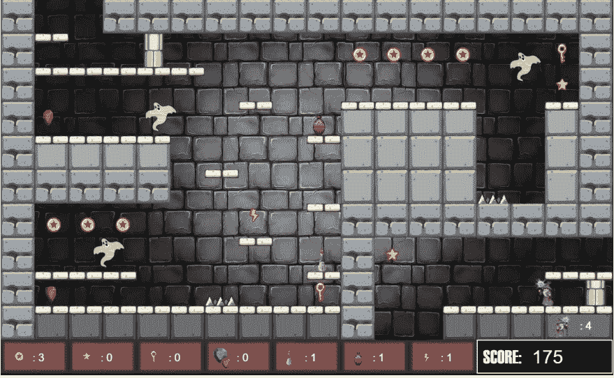

现在，以同样的方式，你可以添加任意数量的屏幕。确保在设计游戏屏幕时，入口/出口在屏幕之间匹配，如下所示：

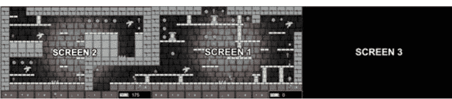

太棒了！为了完成本练习，在下一节中我们将添加一些背景音乐和音效（SFX）。

你可以在以下地址找到它：
https://www.audacityteam.org/download/

只需下载适用于你特定系统的版本即可。

## 第16步 - 结束语

我们已经完成了本次练习，但这仅仅是旅程的开始。

**可以尝试的点子：**

- 添加更多游戏场景
- 制作新的图块和地图
- 添加不同的敌人
- 尝试添加不同的收集品，比如浆果或面包。你也可以添加一些应该避免食用的物品。也许如果玩家吃了毒浆果会失去一条生命？
- 生成和重生动画
- 遇敌和死亡动画
- 主角动画——行走、跳跃
- 施放法术
- 确定角色可以掉落多远而不死亡
- 添加高分排行榜
- 门——收集钥匙来开启
- ...列表可以一直列下去

一如既往，你可以通过以下链接下载所有相关文件：
https://wddtrw/resources/learntocode/platformgame.zip

## 将项目部署到 Web 服务器

要将你的项目部署到 Web 服务器并使其能通过互联网访问，你首先需要选择一个 Web 服务提供商。

有一些免费的网络空间可用，但通常附带很多限制。如果你想为测试个人项目找一个网络空间，有一些较便宜的网络空间可供选择。

你可以从 Heart Internet 和 Ionos 1 & 1 等公司获得有效且价格非常合理的套餐。套餐起价仅需每月几英镑或几美元。要部署自己的代码，你只需要一个域名、一个托管套餐和一个 SSL 证书。

你可以从 Ionos（在撰写本书时）获得套餐，前6个月仅需每月£1加增值税，之后仅需每月£4加增值税，并附带一个免费的 SSL 证书。然后你可以以每年约£10的价格购买一个域名，但同样，第一年通常会打折，低至£1加增值税。

## 文件传输协议

一旦你拥有了网络托管服务，你就可以使用一个叫做文件传输协议（FTP）的系统来轻松上传文件，或者如果你在处理更专业的开发工作，你会使用像 GIT hub 这样的代码仓库，但这超出了本书的范围。

用最基本的术语来说，当你将文件上传到 Web 服务器时，`public html` 文件夹内的任何文件都是可以公开访问的。当你将一个域名连接到你的网络空间时，如果你上传一个文件到 public 文件夹，例如命名为 `index.html` 或 `index.php`，你不需要在网址中指定文件名。

例如，[https://wddtrw.co.uk](https://wddtrw.co.uk) 会打开 Web 服务器 public 文件夹中的一个名为 `index.php` 的文件。

一旦建立了连接，通过 FTP 上传文件就非常像在你的 PC 或 Mac 上将文件从一个文件夹传输到另一个文件夹。唯一的区别是你是在将文件传输到另一台计算机。

这是 WS FTP Pro 的一个屏幕截图：

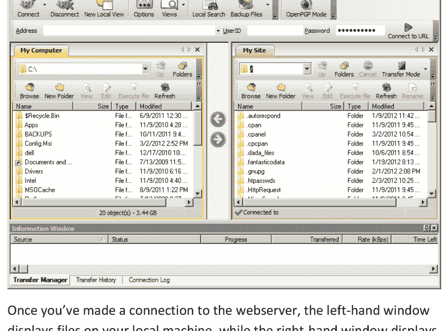

一旦你与 Web 服务器建立了连接，左侧窗口显示你本地计算机上的文件，而右侧窗口显示服务器上的文件。通过这种方式，你可以轻松地从 Web 服务器上传、下载和删除文件及文件夹。

互联网服务提供商（ISP）通常提供带有 FTP 访问权限的控制面板，同时也有可用的 FTP 客户端工具，如 WS FTP、FileZilla、Cyberduck 等。

如果你选择购买网络托管服务，你必须清楚你打算用它来做什么。有些网络空间提供带有各种工具的网站构建器，但它们有局限性。一般来说，限制越少，使用这些系统就需要越多的技术知识。如果你不确定，几乎所有的 ISP 都有很好的客户服务和/或包含大量常见问题的数据库。

Web 服务器通常分为以下几类：

- WordPress 或其他网站构建器 – 无安全 Shell 访问权限
- 仅提供网络托管和 SSL – 无安全 Shell 访问权限
- 虚拟专用服务器 – VPS – 有安全 Shell 访问权限
- 专用服务器 – 有安全 Shell 访问权限

如果你想建立一个常规网站，并且想要一些快速简便的工具，减少编码工作，那么 WordPress 或网站构建器托管可能适合你。

如果你是网页编码新手，只想了解更多关于托管网站或网络应用的知识，我建议选择带有 SSL 证书的常规网络托管。请确保 SSL 证书包含在内，否则你可能会发现自己每年要额外支付大约£60 - £100+来使你的网站安全。

如果你是一个更有能力的网页开发者，那么选择虚拟专用服务器不会出错。VPS 托管模拟了专用服务器的体验，即使你仍然与其他用户共享物理服务器。VPS 可能非常便宜，但需要更多的技术能力。通过 SSH 访问，你对服务器的配置方式有更大的灵活性。

那么，如果预算不是问题，并且你是一个经验丰富的开发者，专用服务器可能是你的正确选择。你会选择专用服务器的主要原因是安全性和高流量。专用服务器拥有所有可用的计算能力和灵活性，而不是与他人共享资源。

## 什么是 SSL？

SSL 代表安全套接字层（Secure Sockets Layer），简而言之，它是保持互联网连接安全并保护两个系统之间传输的任何敏感数据的标准技术，防止入侵者读取和/或修改传输的任何信息，包括潜在的个人详细信息。

## 什么是 SSH？

SSH，也称为安全 Shell（Secure Shell）或安全套接字 Shell（Secure Socket Shell），是一种网络协议，它为用户（尤其是系统管理员）提供了一种通过不安全网络访问计算机的安全方式。

它提供了执行命令的访问权限，并提供了管理服务器的灵活性。

## 从这里继续前进

在“第二册”（即将出版）中，我们将探索另外三个伟大的发展，同时我们将继续我们的《巫师之山》游戏开发，添加使用精灵表的角色动画、魔法力量、传送门、高分排行榜等等。

现在，尝试设计一些你自己的游戏关卡。下一本书见。

我很乐意收到你的来信。你可以通过电子邮件联系我：

[learntocode@wddtrw.co.uk](mailto:learntocode@wddtrw.co.uk)

如果你喜欢这本书，请在亚马逊上给我留下诚实的评论。我将非常感激。如果不喜欢，请联系我并告诉我原因，以便我可以帮助你并改进未来版本。

致以最诚挚的祝福，

**加里**（软件开发者、设计师和作家。）

## 查看我的其他一些出版物（是的，我也写小说！）

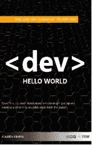
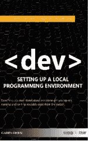
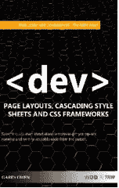
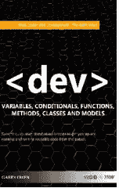
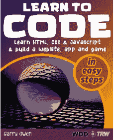
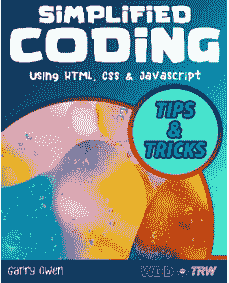
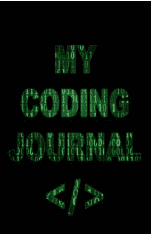
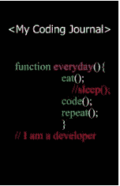
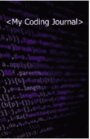


《学编程 第二册》预计在2022年4月左右出版。在亚马逊上关注我以获取最新信息并在发布时收到通知。

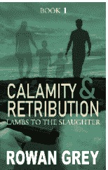
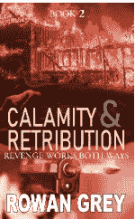
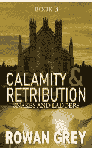
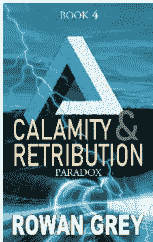
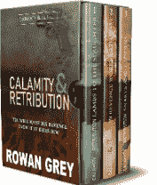
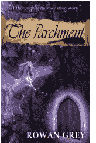

出于几乎与我爱上计算机编程艺术相同的原因，我也发现了自己对写作的热情。

9岁那年，我得到了第一台电脑作为生日礼物，并爱上了计算机编程的艺术与创造力。我发现它让我能够创造角色、游戏世界和其他神奇的特性，其可能性仅受限于我想象力的深度。

同样，写作对我来说打开了通往同一个奇妙想象世界的大门，由我掌舵，在完全不受阻碍的控制下进行探索和航行。

我最喜欢的一句名言，它总结了驱动我热情的动力：

> “你能想象的一切都是真实的。” - 巴勃罗·毕加索。

## 索引

关于作者 .....................III, 2
添加图片 ........................III, 21
为图片添加样式 IV, 43
动画 ..............................23, 190
应用程序 .....I, 2, 9, 11, 15, 16, 22, 29, 32, 34, 36, 41, 43, 46, 51, 53, 56, 57, 58, 59, 60, 61, 62, 63, 64, 73, 76, 92, 95, 96, 101, 102, 103, 104, 105, 110, 120, 121, 125, 128, 130, 131, 139, 142, 147, 150, 151, 230
数组 .... 75, 76, 77, 78, 79, 80, 81, 82, 84, 85, 86, 124, 126, 127, 135, 136, 137, 138, 156, 157, 164, 169, 185, 188, 199, 201, 204, 207, 208, 209, 223
数组 .......... 84, 85, 86, 176, 201
资源 ...................................V, 153
背景 ...11, 12, 22, 23, 36, 37, 39, 64, 65, 66, 67, 68, 70, 72, 97, 130, 142, 143, 144, 151, 152, 154, 155, 156, 161, 164, 217, 221
浏览器2, 8, 9, 10, 11, 14, 19, 20, 39, 51, 59, 61, 68, 77, 101, 103, 104, 108, 109, 117, 125, 150, 162, 170, 173, 210, 213
构建 ...... 36, 52, 101, 149, 154, 155, 156, 157
层叠样式表 ......... 10
层叠样式表 .....III, 10
代码 ... 2, 5, 6, 8, 9, 11, 12, 13, 15, 16, 17, 18, 19, 20, 21, 22, 26, 28, 29, 30, 32, 36, 43, 54, 58, 61, 64, 66, 75, 76, 77, 79, 82, 88, 89, 90, 92, 93, 94, 95, 96, 97, 101, 103, 105, 108, 109, 111, 117, 121, 122, 123, 126, 128, 131, 132, 144, 153, 154, 155, 156, 157, 158, 159, 160, 162, 163, 168, 170, 172, 176, 181, 184, 186, 188, 189, 194, 198, 199, 200, 204, 205, 212, 213, 215, 217, 218, 219, 220, 223, 224, 225, 228
编码 ..................................4, 7
编码编辑器 ........................III, 7
可收集物品 .............V, 197, 198
色彩设计 .....................IV, 34
色轮 ..........................34
注释 ...........................16
计算机 ...... 3, 4, 7, 51, 98, 229, 231, 234
常量 ....55, 73, 74, 75, 76, 77, 78, 79, 84, 85, 86, 88, 89, 90, 92, 93, 98, 99, 103, 105, 106, 123, 124, 126, 131, 132, 133, 134, 135, 136, 138, 139, 144, 145, 146, 156
本书使用的约定 .......................................III
倒计时器 ......IV, 95, 96
创建平台游戏 .V, 148
创建网页应用 ..........IV, 51
CSS .....................................................5
CSS ...I, V, 2, 5, 8, 10, 14, 15, 16, 18, 20, 28, 30, 34, 36, 38, 43, 59, 66, 67, 70, 90, 91, 107, 108, 109, 111, 112, 113, 116, 117, 118, 120, 131, 139, 148, 151, 152
花括号
光标
删除
部署你的项目
开发者
显示
DIV
除法
下载
下载并准备图片
元素
引擎
环境
练习
文件结构
文件传输协议
文件
字体
字体颜色
表单属性
函数
功能
游戏监视器
游戏结束
游戏界面
谷歌
H1 标签
页眉
高度
你好世界
你好，世界！
十六进制
悬停
引用
HTML
HTML 文件
HTML 表单
实现 CSS
实现 HTML 结构 …………IV, 56
指令 …26, 154, 161, 203, 224, 225
介绍 …………2, 4
介绍 …………III
JavaScript…I, 2, 8, 14, 15, 16, 20, 53, 54, 55, 56, 57, 59, 61, 66, 69, 71, 73, 74, 75, 77, 82, 95, 98, 101, 102, 103, 104, 105, 107, 108, 109, 111, 113, 116, 117, 123, 126, 129, 138, 148, 150, 151, 154, 155, 212, 223, 226
JavaScript…III, IV, V, 15, 73, 131, 132, 144, 158
JSON…IV, 53, 54, 55, 56, 57, 59, 61, 75, 80, 107, 109, 122, 125, 126, 132, 133, 134, 135, 136, 137, 138, 153
JSON 文件 ……IV, 53, 61, 122
课程 ………2
让13, 16, 21, 24, 29, 34, 36, 39, 50, 52, 54, 55, 56, 57, 58, 66, 67, 74, 75, 78, 79, 83, 84, 88, 89, 91, 93, 94, 104, 111, 125, 126, 128, 129, 132, 133, 134, 135, 136, 137, 138, 144, 149, 155, 159, 163, 168, 170, 172, 174, 175, 176, 177, 199, 200, 201, 202, 203, 204, 205, 206, 207, 208, 215, 219, 226
链接. 5, 9, 21, 28, 29, 30, 31, 32, 34, 41, 42, 43, 44, 45, 46, 47, 48, 52, 53, 58, 59, 62, 66, 110, 128, 150, 151, 187, 197, 222, 227
本地存储…IV, V, 125, 131
位置 104, 125, 134, 137, 149
苹果电脑 ……2, 8, 52, 109, 229
外边距. 11, 12, 22, 23, 36, 37, 39, 43, 64, 65, 66, 67, 69, 70, 71, 72, 96, 130, 131, 142, 143, 152
音乐 ………VI, 222
我的其他出版物 …VI, 233
导航 …V, 139, 142, 144
记事本 ………2, 4, 7, 9
数字 54, 82, 86, 112, 115, 137, 164, 213
对象 54, 86, 175, 188, 189, 204
不透明度 10, 20, 44, 66, 71, 91, 144
运算符 …V, 179, 180, 181
溢出 …64, 67, 68, 151, 152
内边距10, 37, 40, 64, 65, 67, 68, 69, 71, 97, 130, 142
页面布局设计 …III, 28
个人电脑 …2, 52, 229
像素 …22, 97, 143, 152, 155, 164, 167, 186, 220
平台游戏V, 148, 150, 151, 153
指针 …65, 69
位置 20, 65, 66, 70, 71, 79, 82, 84, 91, 130, 142, 143, 172, 183, 190, 191, 193, 201, 216, 220
编程 . 3, 4, 5, 7, 52, 53, 107, 176
编程环境 ………52
参考 …V, 154, 157
结果…20, 23, 40, 52, 55, 56, 57, 58, 60, 63, 65, 70, 71, 73, 74, 75, 76, 89, 95, 98, 100, 101, 103, 104, 160, 185
RGB …12, 34
规则…9, 10, 11, 12, 14, 20, 23, 39, 44, 67, 68, 69, 111, 112, 116, 117, 120, 121, 131, 139, 142, 143, 151, 152, 183, 195
保存 .8, 11, 21, 23, 26, 93, 96, 101, 111, 122, 129, 171, 172, 187, 196, 215, 223, 224, 226
搜索 .26, 31, 39, 51, 59, 60, 112
选择器模式.....................43
音效 .......................... VI, 149, 221, 222
声音 .............................. VI, 222
精灵对象 .................. V, 157
精灵表....................... V, 198
SSH......................................VI, 231
SSL.......................... VI, 228, 230, 231
字符串.... 54, 55, 56, 81, 82, 83, 86, 116, 125, 179, 205
字符串 .............................54, 82, 86
样式表 . 5, 9, 29, 32, 41, 46, 58, 59, 110, 128, 150, 151
语法 ............................................5
语法高亮 ..............5
目标...........................................46
瓦片地图 .................... V, 154, 167
瓦片 ................................... V, 154
标题界面.................... V, 160
过渡 ........................66, 71, 91
统一资源定位符.. 5, 30, 31, 40, 45, 48, 114, 154, 157, 168
用户管理功能 ..................IV, 107
变量 18, 54, 73, 74, 77, 78, 83, 84, 90, 98, 124, 126, 135, 136, 137, 138, 145, 146, 153, 156, 164, 176, 181, 182, 201, 207, 220
Visual Studio Code...........2, 4, 7
网页服务器................................VI
格式规范的超链接 .IV, 45
格式规范的图片元素 .....................................................IV, 40
什么是 JSON 文件？ .........IV, 53
什么是网页应用，它与网站有何不同？ .....................................................IV, 51
什么是数组？ .........IV, 84
从这里走向何方 VI, 232
为什么使用 JSON？ ........................IV, 54
宽度 ... 5, 6, 10, 36, 37, 39, 43, 58, 59, 65, 66, 68, 69, 71, 91, 97, 110, 115, 116, 120, 121, 122, 128, 130, 131, 142, 143, 153, 154, 158, 159, 160, 162, 169, 170, 171, 175, 176, 178, 181, 183, 184, 185, 189, 190, 192, 193, 199, 200, 201, 202, 203, 204, 205, 206, 207, 209, 212, 217
视窗系统...................................2, 8
自动换行.............................6
Z索引.. 15, 16, 18, 66, 71, 91, 142

## 学习编程
### 学习 HTML、CSS 和 JavaScript

系好安全带，准备好享受学习编程的无穷乐趣吧。本书中的每个练习都有彩色插图，并以简单易懂的步骤呈现。

首先，让我们为“你好，世界！”程序增添一些趣味...

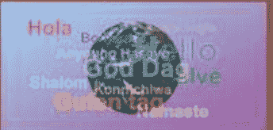

接下来，设计并编写一个快速访问网页菜单。只需一键，即可访问你所有喜爱的网站！


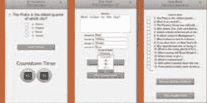

然后，编写一个功能强大的多问题测验网页应用，配有倒计时器和管理功能。

最后但同样重要的是，设计并编写一个功能完善的基于瓦片的平台游戏。学习瓦片地图、精灵、碰撞检测、重力、可收集物品、敌人、玩家控制等等...

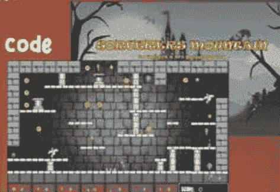

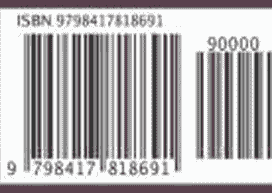
