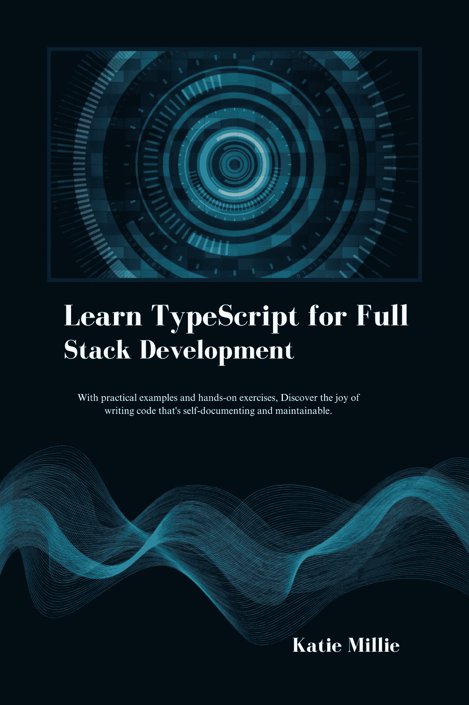
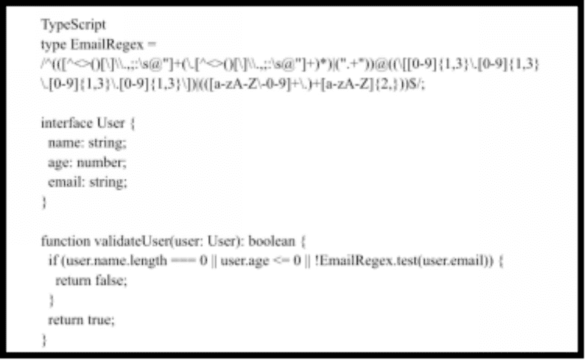

# 学习 TypeScript 全栈开发

通过实用的示例和动手练习，探索编写自文档化和可维护代码的乐趣。

作者

Katie Millie

---

## 版权声明

Copyright © 2024 Katie Millie. All Rights Reserved.

---

欢迎来到 Katie Millie 的创意世界，这里想象力与灵感相遇。本网站上的每一篇内容——无论是文字、图片还是设计——都是原创之作，精心打造以点燃您的创造力和好奇心。我们诚挚地邀请您探索和欣赏，但请您记住，这些作品受版权法保护。未经 Katie Millie 明确书面授权，严禁以任何方式使用、复制或分发任何材料，违者将承担法律责任。

如果您希望分享或合作，我们鼓励您直接与我们联系。您对知识产权的尊重不仅支持像 Katie Millie 这样的艺术家，也有助于培养一个充满活力创新和艺术气息的社区。感谢您的访问，感谢您成为我们创意之旅的一部分。

## 邀请书评

恭喜您迈出了掌握 TypeScript 全栈开发的第一步！我们希望您觉得《学习 TypeScript 全栈开发》这本书内容丰富且有帮助。您的反馈对于我们改进并帮助更多开发者至关重要。您是否愿意分享您的使用体验并留下评论？您的见解将指引其他开发者踏上他们的 TypeScript 之旅。感谢您的支持！

## 目录

简介

前言

第 1 章

什么是 TypeScript？

TypeScript vs. JavaScript

搭建 TypeScript 开发环境

基本 TypeScript 语法

第 2 章

类型系统——核心类型：Number、String、Boolean

TypeScript 中的 Any 和 Unknown 类型

TypeScript 中的类型推断

TypeScript 中的类型注解

TypeScript 中的接口和类

第 3 章

高级类型——泛型

TypeScript 中的枚举

TypeScript 中的类型别名

TypeScript 中的交叉和联合类型

TypeScript 中的字面量类型

第 4 章

模块和命名空间——Import 和 Export 语句

TypeScript 中的默认导出

TypeScript 中的命名空间

TypeScript 中的模块扩充

练习：模块组织

第 5 章

TypeScript 中的函数声明和表达式

TypeScript 中的箭头函数

TypeScript 中的可选和默认参数

TypeScript 中的剩余参数

TypeScript 中的函数重载

第 6 章

使用 TypeScript 进行面向对象编程

TypeScript 中的继承

TypeScript 中的多态

TypeScript 中的访问修饰符

第 7 章

错误处理和调试

TypeScript 中的自定义错误类型

调试 TypeScript 代码

使用 TypeScript 编译器

练习：TypeScript 错误处理场景

第 8 章

使用 TypeScript 搭建 React 项目

JSX 与 TypeScript：强强联合

TypeScript 中的组件和 Props

高阶组件、Render Props 与 TypeScript

理解 TypeScript React 中的状态和生命周期

第 9 章

React 中的 TypeScript——类型化组件和 Props

TypeScript 中的接口和类型

使用 TypeScript 的 Context API

使用 TypeScript 的 Redux

练习：React TypeScript 应用

第 10 章

使用 TypeScript 测试 React 应用

使用 React Testing Library 和 TypeScript 进行集成测试

全栈开发中 TypeScript 的代码覆盖率

TypeScript 中的测试驱动开发（TDD）练习

第 11 章

使用 TypeScript 搭建 Node.js 项目

Node.js 模块

使用 TypeScript 搭建 Node.js 项目

常用 Node.js 模块

第 12 章

使用 TypeScript 和 Express 构建 REST API

使用 TypeScript 的 Express 路由和控制器

使用 TypeScript 的 Express 中间件

使用 TypeScript 的 Express 错误处理

第 13 章

使用 TypeScript 进行数据库集成

使用 TypeScript 的 Mongoose ODM 进行全栈开发

使用 TypeScript 的 CRUD 操作

使用 TypeScript 的数据验证

练习：TypeScript 数据库交互

第 14 章

使用 TypeScript 测试 Node.js 应用

使用 TypeScript 的 Supertest 集成测试

代码覆盖率

练习：测试驱动开发

第 15 章

前后端整合

TypeScript React 应用中的身份验证和授权

TypeScript React 应用中的状态管理

TypeScript React 应用的部署

全栈项目练习：TypeScript 深度探索

第 16 章

高级主题——TypeScript 编译器选项

TypeScript 装饰器：增强基于类的编程

TypeScript 中的 Async/Await：简化异步编程

TypeScript 中的模块和打包

TypeScript 性能优化

结论

附录

TypeScript 速查表

# 简介

## 学习 TypeScript 全栈开发：通往现代网络精通的通行证

您是否厌倦了与不可预测的代码搏斗？想到要构建健壮、可扩展的网络应用就感到畏惧？是时候 harness `TypeScript` 的力量了。

想象一下，构建的软件不仅功能完善，而且优雅、高效、可靠。`TypeScript` 是您的秘密武器。它是超级英雄的斗篷，将 `JavaScript` 从混乱的盟友转变为可靠的伙伴。有了 `TypeScript`，您将编写出不仅正确，而且清晰、自文档化且可维护的代码。

我们将从揭开 TypeScript 的神秘面纱开始。你将学习如何利用其类型系统，在错误演变成灾难之前将其捕获。体验编写**自文档化**且**可维护**代码的乐趣。我们将探索接口、类、模块和泛型，为你配备构建复杂应用程序所需的工具，让你充满信心。

但 TypeScript 不仅仅是一门语言；它是全栈精通的**催化剂**。我们将引导你构建应用程序的前端和后端。学习如何使用 React 创建交互式用户体验，同时使用 Node.js 构建可扩展的 API。探索 TypeScript 如何无缝集成到这些框架中，提升你的生产力和代码质量。

你不仅能学到语法；还能理解每个概念背后的**为什么**。通过实际示例和动手练习，你将巩固知识，并获得应对任何项目的信心。我们将涵盖最佳实践、性能优化和测试策略，确保你的应用程序不仅功能完善，而且**出类拔萃**。

这本书不仅仅是一本手册；它是对全新开发层次的**邀请**。在这段旅程结束时，你将成为一名 TypeScript **virtuoso**，能够打造不仅令人印象深刻，而且构建和维护起来都充满乐趣的 Web 应用程序。

你准备好释放作为开发者的全部潜能了吗？加入我们一起踏上这段激动人心的冒险。让我们共同构建非凡之作。

你准备好提升你的编码技能了吗？

## 前言

### 为什么是 TypeScript？全栈开发的催化剂

TypeScript，JavaScript 的超集，已在开发者中迅速获得青睐，尤其是那些构建全栈应用程序的开发者。虽然 JavaScript 仍是 Web 开发的基石，但 TypeScript 提供了一系列引人注目的增强功能，显著改善了开发体验，并产出更健壮、更可维护的代码。

#### 静态类型的威力

TypeScript 的核心优势之一在于其**可选的静态类型**。与 JavaScript 的动态类型不同，TypeScript 允许你定义变量、函数参数和返回值的数据类型。这个看似微小的补充具有深远的影响：

- **早期错误检测**：TypeScript 的类型检查器可以在开发过程中识别潜在问题，防止运行时错误的发生，而这些错误的修复成本可能很高。这种主动的 bug 预防方法节省时间并提高代码质量。

- **提升代码可读性**：显式定义的类型增强了代码的清晰度，使开发者无需大量注释就能理解代码意图。这在具有多个贡献者的大型复杂项目中尤其宝贵。

- **增强开发者体验**：现代代码编辑器和 IDE 利用 TypeScript 的类型信息提供智能代码补全、重构和导航功能，显著提升开发者生产力。

#### 超越静态类型

TypeScript 提供的不仅仅是静态类型。它是一种为支持大规模应用程序开发而设计的语言，整合了应对 JavaScript 常见挑战的功能：

- **面向对象编程**：TypeScript 支持类、接口和模块，使其非常适合构建复杂的面向对象应用程序。这种范式促进代码组织和可重用性。

- **ESNext 支持**：TypeScript 提供对前沿 JavaScript 功能的早期访问，让开发者能够编写现代代码而无需担心浏览器兼容性。

- **强大的社区和生态系统**：TypeScript 拥有 thriving 的社区和生态系统，有大量库、工具和资源可供开发使用。

#### TypeScript 在全栈开发中的优势

TypeScript 的优势在全栈开发中尤为突出，因为代码库可能变得庞大而复杂。通过在前端和后端都采用 TypeScript，开发者可以享受一致的工具支持、改进的代码共享以及更统一的开发体验。

- **前端开发**：TypeScript 与 React、Angular 和 Vue 等流行框架**相得益彰**，为构建可扩展和可维护的用户界面提供坚实基础。

- **后端开发**：Node.js 是构建服务器端应用程序的流行平台，与 TypeScript 无缝协作，支持创建健壮且类型安全的 API。

虽然 JavaScript 对 Web 开发仍然至关重要，但 TypeScript 为构建现代全栈应用程序提供了引人注目的价值主张。通过 embrace 静态类型、面向对象功能和以开发者体验为重心的设计，TypeScript empowers 开发者编写更干净、更可靠、更高效的代码。随着 Web 应用程序复杂性的持续增长，TypeScript 正日益成为那些追求构建高质量软件的开发者首选语言。

### 书籍结构与目标

#### 书籍结构

一本全面的 TypeScript 全栈开发指南应该结构化为提供渐进式学习路径，从基础概念构建到高级技术。一个可能的结构包括：

**第一部分：TypeScript 基础**

**第一章：TypeScript 简介：**

- 定义 TypeScript 及其与 JavaScript 的关系。

- 强调使用 TypeScript 进行全栈开发的优势。

- 搭建 TypeScript 开发环境。

**第二章：TypeScript 基础：**

- 涵盖核心语言功能，如类型、变量、函数和控制流。

- 介绍类型推断和类型注解。

**第三章：使用 TypeScript 进行面向对象编程：**

- 探索类、接口、继承和多态。

- 演示如何在 TypeScript 中建模真实世界对象和关系。

**第四章：模块和命名空间：**

- 解释如何将代码组织为模块和命名空间。

- 讨论 import 和 export 语句。

**第二部分：TypeScript 在前端开发中的应用**

**第五章：TypeScript 与 React：**

- 将 TypeScript 集成到 React 项目中。

- 讨论组件结构、props、state 和生命周期方法。

- 探索 React Context 和 Redux 结合 TypeScript 的高级主题。

**第六章：TypeScript 与 Angular：**

- 将 TypeScript 集成到 Angular 项目中。

- 涵盖组件、指令、服务和依赖注入。

- 探索 Angular 结合 RxJS 和 TypeScript 的响应式编程。

**第三部分：TypeScript 在后端开发中的应用**

**第七章：TypeScript 与 Node.js：**

- 使用 Node.js 和 TypeScript 构建服务器端应用程序。

- 涵盖 Express.js 框架和 API 开发。

- 讨论数据库交互和数据建模。

**第八章：TypeScript 与数据库：**

- 将 TypeScript 与 MongoDB、PostgreSQL 和 MySQL 等流行数据库集成。

- 探索 ORM 工具和数据访问模式。

**第四部分：高级主题和全栈应用程序**

**第九章：TypeScript 测试：**

- 使用 TypeScript 编写单元测试和集成测试。

- 探索 Jest 和 Mocha 等测试框架。

**第十章：TypeScript 在大型应用程序中的应用：**

- 讨论代码组织、可扩展性和性能优化。

- 探索设计模式和架构方法。

**第十一章：构建全栈应用程序：**

- 使用 TypeScript 创建完整的全栈应用程序，结合前端和后端组件。

- 演示部署策略和最佳实践。

#### 书籍目标

《学习 TypeScript 全栈开发》的首要目标是为读者提供构建健壮、可维护和可扩展的全栈应用程序所需的知识和技能。具体目标包括：

- 掌握 TypeScript 基础：在 TypeScript 语法、特性和最佳实践方面提供坚实基础。

- 将 TypeScript 集成到流行框架中：展示如何有效地将 TypeScript 与 React、Angular 和 Node.js 结合使用。

- 构建全栈应用程序：指导读者完成创建完整端到端应用程序的过程。

- 提升开发者生产力：展示 TypeScript 如何提高开发效率和代码质量。

- 推广最佳实践：分享行业验证的技术，用于编写简洁、可维护且可扩展的 TypeScript 代码。

通过实现这些目标，本书将帮助开发者充分利用 TypeScript 的优势，构建高质量的全栈应用程序，并推动其职业发展。

# 第一章

## 什么是 TypeScript？

### TypeScript：JavaScript 的超集

`TypeScript` 是 JavaScript 的超集，这意味着所有有效的 JavaScript 代码也是有效的 TypeScript 代码。然而，TypeScript 为 JavaScript 添加了可选的静态类型，为开发者提供了构建大型应用程序的强大工具。

### 为什么选择 TypeScript？

- 提高代码可靠性：通过为变量、函数和对象定义数据类型，TypeScript 有助于在开发过程中捕获潜在错误，从而生成更健壮的代码。

- 增强开发者体验：TypeScript 在代码编辑器中提供更好的代码补全、导航和重构支持，从而提高开发者生产力。

- 可扩展性：随着应用程序的增长，TypeScript 的类型系统在管理代码复杂度和维护代码质量方面变得越来越有价值。

- 互操作性：TypeScript 代码编译为纯 JavaScript，使其能够在任何支持 JavaScript 的环境中运行。

### TypeScript 基础概念

1. 类型：TypeScript 引入了几种基本类型：

- `Number`：表示数值。

- `String`：表示文本。

- `Boolean`：表示 true 或 false 值。

- `Null`：表示 null 值。

- `Undefined`：表示 undefined 值。

- `Any`：表示任何类型，但通常不推荐使用。

```typescript
let age: number = 30;
let name: string = "Alice";
let isStudent: boolean = true;
let x: any = 42; // 避免使用 any
```

2. 接口：接口定义对象的结构。

```typescript
interface Person {
  firstName: string;
  lastName: string;
  age: number;
}

let person: Person = {
  firstName: "Bob",
  lastName: "Smith",
  age: 25
}
```

3. 类：TypeScript 支持面向对象编程的类。

```typescript
class Car {
  constructor(public brand: string, public model: string) {}
}

let car = new Car("Toyota", "Camry");
```

4. 函数：TypeScript 允许你定义函数类型。

```typescript
function greet(name: string): string {
  return "Hello, " + name + "!";
}
```

5. 类型推断：TypeScript 通常可以自动推断类型。

```typescript
let message = "Hello, world!"; // 类型推断为 string
```

### 编译 TypeScript

要在项目中使用 TypeScript，你需要将 TypeScript 代码编译为 JavaScript。这可以使用 TypeScript 编译器（`tsc`）来完成。

```bash
tsc myScript.ts
```

该命令将创建一个名为 `myScript.js` 的 JavaScript 文件。

### TypeScript 在全栈开发中的应用

TypeScript 广泛应用于全栈开发的前端和后端项目中。在前端，它为 React、Angular 和 Vue 等框架提供类型安全和改进的工具支持。在后端，使用 TypeScript 的 Node.js 为构建可扩展且可维护的应用程序提供了强大的平台。

通过利用 TypeScript 的特性，你可以为全栈项目编写更简洁、更可靠且更易于维护的代码。

> 注意：这是对 TypeScript 的基本介绍。要深入了解全栈开发中的 TypeScript，请探索模块、泛型、高级类型以及与流行框架的集成等主题。

## TypeScript 与 JavaScript 的比较

### 了解基础知识

JavaScript 是一种高级解释型编程语言，主要用于创建交互式网页。它是动态类型的，意味着变量类型在运行时确定。

TypeScript 是 JavaScript 的超集，添加了可选的静态类型。这意味着你可以在开发过程中为变量、函数和对象指定数据类型。它编译为纯 JavaScript，使其能够在任何支持 JavaScript 的环境中运行。

### 主要区别

1. 类型系统

- JavaScript：动态类型，意味着变量类型在运行时确定。

```typescript
let message = "Hello"; // 稍后可以被赋值为数值
message = 42;
```

- TypeScript：静态类型，允许你在开发过程中指定类型。

```typescript
let message: string = "Hello"; // 类型被显式定义
message = 42; // 错误：类型 'number' 不能赋值给类型 'string'
```

2. 编译

- JavaScript：直接由浏览器解释执行。

- TypeScript：在执行前编译为 JavaScript。这允许早期错误检测和优化。

3. 代码结构和组织

- JavaScript：通过原型支持面向对象编程。

- TypeScript：提供类、接口和模块，以实现更好的代码组织和结构。

4. 工具和开发体验

- JavaScript：基本工具支持，但 IDE 支持可能有限。

- TypeScript：优秀的工具支持，具有代码补全、重构和调试等高级功能。

### 代码示例

JavaScript：

```javascript
function greet(name) {
  console.log("Hello, " + name + "!");
}

greet("Alice");
greet(42); // 运行时无错误，但出现意外行为
```

TypeScript：

```typescript
function greet(name: string): void {
  console.log("Hello, " + name + "!");
}

greet("Alice");
greet(42); // 编译时错误：类型 'number' 的参数不能赋值给类型 'string' 的参数
```

### 何时使用 TypeScript 与 JavaScript

- 小型项目或快速原型开发：JavaScript 可能因其简单性而足够。

- 大型应用程序或复杂项目：TypeScript 的类型系统和工具可以显著提高代码质量、可维护性和开发者生产力。

- 团队协作：TypeScript 可以帮助强制执行编码标准并减少运行时错误。

- 性能关键型应用程序：TypeScript 可以通过更好的代码优化潜在地带来性能提升。

### TypeScript 的优势

- 早期错误检测：在开发过程中识别潜在问题。

- 改进代码可读性和可维护性：强制执行类型一致性。

- 更好的代码补全和重构：增强开发体验。

- 更大的社区和生态系统：不断增长的采用率和支持。

### TypeScript 的劣势

- 额外的学习曲线：需要理解类型概念。

- 编译步骤：增加了额外的构建过程。

- 可能更冗长的代码：类型注解可能增加代码长度。

虽然 JavaScript 仍然是 Web 开发的核心语言，但 TypeScript 通过提供静态类型和高级语言特性提供了有价值的扩展。两者之间的选择取决于项目需求、团队偏好和开发环境。

通过仔细考虑每种语言的优缺点，你可以就何时使用 TypeScript、何时继续使用 JavaScript 做出明智的决策。

## 搭建 TypeScript 开发环境

### 先决条件

在深入 TypeScript 之前，确保你已安装以下软件：

- Node.js 和 npm（或 yarn）：Node.js 是 JavaScript 运行时，npm（或 yarn）是 Node.js 的包管理器。从 [`nodejs.org/`](https://nodejs.org/) 下载最新的 LTS 版本。

### 安装 TypeScript

- 打开终端或命令提示符。

- 全局安装 TypeScript：

```bash
npm install -g typescript
```

- 该命令使 `tsc` 命令在全局范围内可用，用于编译 TypeScript 文件。

### 创建 TypeScript 项目

- 创建一个新的项目目录：

```bash
mkdir my-ts-project
cd my-ts-project
```

- 初始化 `npm`：

```bash
npm init -y
```

- 这会创建一个 `package.json` 文件。

- 将 TypeScript 安装为开发依赖：

```bash
npm install --save-dev typescript
```

- 创建 `tsconfig.json` 文件：

```bash
npx tsc --init
```

- 这会生成一个基本的 TypeScript 配置文件。

### 理解 tsconfig.json

`tsconfig.json` 文件包含 TypeScript 项目的编译器选项。以下是一个基本示例：

```json
{
  "compilerOptions": {
    "target": "es5",
    "module": "commonjs",
    "outDir": "./dist",
    "esModuleInterop": true,
    "forceConsistentCasingInFileNames": true,
    "strict": true,
    "skipLibCheck": true
  }
}
```

- `target`：指定输出 JavaScript 的 ECMAScript 版本。

- `module`：设置要使用的模块系统（此处为 `CommonJS`）。

- `outDir`：指定编译后的 JavaScript 文件的输出目录。

- `esModuleInterop`：启用 CommonJS 和 ES 模块之间的互操作性。

- `forceConsistentCasingInFileNames`：确保文件名称的大小写一致。

- `strict`：启用严格类型检查。

- `skipLibCheck`：跳过对外部库的类型检查。

你可以根据项目需求自定义这些选项。

### 编写和编译 TypeScript 代码

- 创建一个 TypeScript 文件（例如，`index.ts`）：

```typescript
let message: string = "Hello, TypeScript!";
console.log(message);
```

- 将 TypeScript 编译为 JavaScript：

```bash
tsc index.ts
```

- 这会创建一个 `dist` 目录（如 `tsconfig.json` 中所指定）并生成一个 `index.js` 文件。

### 使用代码编辑器

为了获得更好的开发体验，请使用支持 TypeScript 的代码编辑器，例如：

- Visual Studio Code

- WebStorm

- Sublime Text（需安装 TypeScript 插件）

这些编辑器提供 IntelliSense、代码补全和调试等功能。

#### 额外提示

- **利用 TypeScript 特性**：探索接口、类、模块和类型注解，以提高代码质量。

- **使用代码检查工具**：像 ESLint 这样的代码检查工具可以帮助维护代码风格并发现潜在错误。

- **考虑使用构建系统**：webpack 或 Parcel 等工具可以简化开发和生产构建。

- **利用 TypeScript 生态系统**：探索使用 TypeScript 构建的库和框架。

通过遵循这些步骤并探索 TypeScript 生态系统，你将为构建健壮且可扩展的应用程序奠定坚实的基础。

# TypeScript 基础语法

TypeScript 是 JavaScript 的超集，这意味着所有有效的 JavaScript 代码也是有效的 TypeScript 代码。然而，TypeScript 添加了可选的静态类型，为开发人员提供了一个强大的工具来构建大规模应用程序。

## 基本类型

TypeScript 引入了若干基本类型：

- `Number`：表示数值。

- `String`：表示文本。

- `Boolean`：表示真或假的值。

- `Null`：表示 null 值。

- `Undefined`：表示 undefined 值。

- `Any`：表示任意类型，但通常不鼓励使用。

```typescript
let age: number = 30;
let name: string = "Alice";
let isStudent: boolean = true;
let x: any = 42; // 避免使用 any
```

## 类型推断

TypeScript 通常会自动推断类型：

```typescript
let message = "Hello, world!"; // 类型推断为 string
```

## 数组

TypeScript 支持特定类型的数组：

```typescript
let numbers: number[] = [1, 2, 3];
let strings: string[] = ["apple", "banana", "orange"];
```

## 接口

接口定义对象的结构：

```typescript
interface Person {
  firstName: string;
  lastName: string;
  age: number;
}

let person: Person = {
  firstName: "Bob",
  lastName: "Smith",
  age: 25
};
```

## 类

TypeScript 支持面向对象编程的类：

```typescript
class Car {
  constructor(public brand: string, public model: string) {}
}

let car = new Car("Toyota", "Camry");
```

## 函数

TypeScript 允许你定义函数类型：

```typescript
function greet(name: string): string {
  return "Hello, " + name + "!";
}
```

### 可选参数

函数参数可以是可选的：

```typescript
function greet(name: string, greeting?: string): string {
  return (greeting || "Hello") + ", " + name + "!";
}
```

### 默认参数

函数参数可以具有默认值：

```typescript
function greet(name: string, greeting: string = "Hello"): string {
  return greeting + ", " + name + "!";
}
```

### 剩余参数

函数参数可以接受可变数量的参数：

```typescript
function sum(...numbers: number[]): number {
  return numbers.reduce((total, num) => total + num, 0);
}
```

## 枚举

枚举定义一组命名常量：

```typescript
enum Colour {
  Red,
  Green,
  Blue
}

let colorName: string = Color[2]; // 返回枚举成员的字符串表示
```

### 泛型

泛型允许你创建可与不同类型配合使用的可复用组件：

```typescript
function identity<T>(arg: T): T {
  return arg;
}
```

## 模块

TypeScript 支持用于组织代码的模块：

```typescript
// math.ts
export function add(x: number, y: number): number {
  return x + y;
}

// index.ts
import { add } from './math';
console.log(add(2, 3));
```

## 类型断言

类型断言可用于告诉编译器某个值具有特定类型：

```typescript
let someValue: any = "this is a string";
let strLength: number = (<string>someValue).length;
```

## 基本输入和输出

TypeScript 可以使用内置的 `console` 对象进行输出：

```typescript
console.log("Hello, world!");
```

对于输入，你可以使用 `prompt` 函数（不推荐用于生产代码）或 `readline` 等库。

这是 TypeScript 语法的基本概述。要在项目中有效使用 TypeScript，请深入探索更高级的主题，如接口、类、模块、泛型和类型系统。

# 练习：TypeScript 基本构造

## 练习 1：变量和类型

- 创建不同类型的变量（number、string、boolean）并打印它们的值。

- 尝试将一个类型的值赋给另一个类型的变量，并观察错误。

```typescript
let age: number = 30;
let name: string = "Alice";
let isStudent: boolean = true;

console.log("Age:", age);
console.log("Name:", name);
console.log("Is Student:", isStudent);

// 尝试将字符串赋值给 number 变量
// age = "thirty"; // 这将导致错误
```

## 练习 2：数组

- 创建数字、字符串和布尔值的数组。

- 使用索引访问元素。

- 修改数组中的元素。

- 获取数组的长度。

```typescript
let numbers: number[] = [1, 2, 3, 4, 5];
let names: string[] = ["Alice", "Bob", "Charlie"];
let isOnline: boolean[] = [true, false, true];

console.log("First number:", numbers[0]);
console.log("Second name:", names[1]);
console.log("Is the third person online:", isOnline[2]);

numbers[2] = 10; // 修改一个元素
console.log("Modified array:", numbers);
console.log("Length of numbers array:", numbers.length);
```

## 练习 3：接口

- 创建一个接口来表示一个人，包含 name、age 和 city 等属性。

- 创建实现该接口的对象。

```typescript
interface Person {
  name: string;
  age: number;
  city: string;
}

let person1: Person = {
  name: "John Doe",
  age: 30,
  city: "New York"
};

let person2: Person = {
  name: "Jane Smith",
  age: 25,
  city: "Los Angeles"
};

console.log(person1.name, person1.age, person1.city);
console.log(person2.name, person2.age, person2.city);
```

## 练习 4：函数

- 创建具有不同参数类型和返回类型的函数。

- 使用不同的参数调用函数。

- 使用可选参数和默认参数。

```typescript
function greet(name: string, greeting?: string): string {
  return (greeting || "Hello") + ", " + name + "!";
}

function add(x: number, y: number): number {
  return x + y;
}

console.log(greet("Alice"));
console.log(greet("Bob", "Good morning"));
console.log(add(5, 3));
```

## 练习 5：类

- 创建一个汽车类，包含 `brand`（品牌）、`model`（型号）和 `year`（年份）等属性。

- 创建汽车类的实例。

- 为类添加方法。

```typescript
class Car {
  brand: string;
  model: string;
  year: number;

  constructor(brand: string, model: string, year: number) {
    this.brand = brand;
    this.model = model;
    this.year = year;
  }

  startEngine(): void {
    console.log("Engine started");
  }
}

let car1 = new Car("Toyota", "Camry", 2023);
let car2 = new Car("Honda", "Accord", 2022);

car1.startEngine();
console.log(car2.model);
```

## 练习 6：枚举

- 创建一个表示星期几的枚举。

- 访问枚举成员。

```typescript
enum DaysOfWeek {
  Monday,
  Tuesday,
  Wednesday,
  Thursday,
  Friday,
  Saturday,
  Sunday
}

console.log(DaysOfWeek.Monday);
console.log(DaysOfWeek[3]); // Output: Wednesday
```

## 练习 7：类型断言

- 使用类型断言将值转换为特定类型。

- 使用类型断言时要小心，因为如果使用不当，可能会导致运行时错误。

```typescript
let value: any = "123";
let numberValue: number = parseInt(value as string); // 类型断言

console.log(numberValue);
```

注意：虽然类型断言在某些情况下很有用，但通常建议尽可能避免使用它们，并依赖类型系统来确保安全。

### 附加练习

- 创建一个函数，接收一个数字数组并返回所有偶数的和。

- 创建一个接口，表示具有 `name`（名称）、`price`（价格）和 `quantity`（数量）属性的产品。

- 创建一个购物车类，包含添加和移除产品的方法。

- 使用函数实现一个简单的计算器。

这些练习将帮助你巩固对基本 TypeScript 概念的理解，并为更复杂的项目做好准备。

# 第二章

## 类型系统——核心类型：数字、字符串、布尔值

TypeScript 作为 JavaScript 的超集，继承了基本的数据类型：`number`（数字）、`string`（字符串）和 `boolean`（布尔值）。这些是构建更复杂数据结构的基石。

### 数字类型

TypeScript 中的 `number` 类型表示数值，包括整数、浮点数以及 `Infinity`（正无穷）、`-Infinity`（负无穷）和 `NaN` 等特殊值。

```typescript
let age: number = 30;
let price: number = 9.99;
let largeNumber: number = 1e6; // 科学计数法
let negativeNumber: number = -10;
let notANumber: number = NaN; // 非数字
```

**算术运算：** TypeScript 支持标准的算术运算符，如 `+`、`-`、`*`、`/`、`%`。

```typescript
let result: number = age + 5; // 加法
let divisionResult: number = price / 2; // 除法
```

**类型推断：** TypeScript 通常可以在不显式声明的情况下推断出 `number` 类型：

```typescript
let inferredNumber = 42; // 推断为 number
```

### 字符串类型

`string` 类型表示字符序列。

```typescript
let firstName: string = "Alice";
let greeting: string = "Hello, world!";
let emptyString: string = "";
```

**字符串操作：** TypeScript 提供了多种字符串操作方法：

```typescript
let upperCaseName: string = firstName.toUpperCase();
let length: number = greeting.length;
let substring: string = greeting.substring(7);
```

**模板字面量：** TypeScript 支持模板字面量，用于创建多行字符串和嵌入表达式：

```typescript
let message: string = `Hello, ${firstName}!`;
```

### 布尔类型

`boolean` 类型表示逻辑值：`true`（真）或 `false`（假）。

```typescript
let isStudent: boolean = true;
let hasCar: boolean = false;
```

**逻辑运算符：** TypeScript 支持逻辑运算符，如 `&&`（与）、`||`（或）和 `!`（非）。

```typescript
let canDrive: boolean = isStudent && hasCar;
```

### 类型安全和收窄

TypeScript 的类型系统通过在编译时强制执行类型检查来防止运行时错误。

```typescript
let value: number | string = 42;

if (typeof value === 'number') {
  // 这里，value 被收窄为 number 类型
  let numericValue: number = value;
} else {
  // 这里，value 被收窄为 string 类型
  let stringValue: string = value;
}
```

### 数字和字符串的高级特性

TypeScript 提供了数字和字符串操作的附加功能：

- `Number` 方法：用于三角函数、对数和其他数学函数的 `Math` 对象。

- `String` 方法：丰富的搜索、替换、分割和格式化字符串的方法。

- 正则表达式：用于模式匹配和文本处理。

### 最佳实践

- 使用清晰且描述性强的变量名。

- 优先使用显式类型注解以提高代码可读性。

- 在适当的时候利用 TypeScript 的类型推断。

- 考虑使用字符串模板来改善字符串格式化。

- 彻底测试代码以确保行为正确。

通过理解这些核心类型及其功能，你将为 TypeScript 开发打下坚实的基础。

## TypeScript 中的 Any 和 Unknown 类型

TypeScript 的 `any` 和 `unknown` 类型是特殊类型，表示任何类型的值。虽然它们乍一看很相似，但具有不同的行为和对类型安全的影响。

### `any` 类型

`any` 类型本质上是一种类型擦除，允许你完全绕过 TypeScript 的类型系统。任何值都可以赋值给 `any` 类型的变量，你可以在不进行类型检查的情况下访问其任何属性或方法。

```typescript
let value: any = 42;
value = "hello";
value = true;

// 在不进行类型检查的情况下访问属性
value.length; // 没有类型错误，但可能是 undefined

function doSomething(value: any) {
  // 可以对 value 做任何操作
}
```

虽然 `any` 提供了灵活性，但它违背了 TypeScript 类型安全的目的。大量使用 `any` 可能导致运行时错误，并使代码更难维护。通常建议除非绝对必要，否则避免使用 `any`。

### `unknown` 类型

`unknown` 是在 TypeScript 3.0 中引入的，是 `any` 的更安全的替代方案。它表示任何类型的值，但与 `any` 不同，当你尝试使用 `unknown` 值时，TypeScript 会强制执行类型检查。

```typescript
let value: unknown = 42;

// value = "hello"; // 错误：类型 'string' 不能赋值给类型 'unknown'

// 不允许直接访问属性
// value.length; // 错误：对象的类型为 'unknown'

if (typeof value === 'string') {
  // 类型收窄
  let strLength = value.length;
}
```

`unknown` 迫使你在使用值之前显式检查其类型。这有助于防止运行时错误并促进类型安全。

### 何时使用 `any` 和 `unknown`

`any`：

- 当你将现有的 JavaScript 代码迁移到 TypeScript 并希望逐步引入类型安全时。

- 在极少数情况下，你知道值的运行时类型但 TypeScript 无法推断时。

`unknown`：

- 当你处理来自外部来源的未知类型值时（例如，用户输入、API 响应）。

- 在处理可能无类型的数据时确保类型安全。

### 类型断言

`any` 和 `unknown` 都可以与类型断言一起使用，以显式告诉编译器值的类型：

```typescript
let value: unknown = "hello";
let strLength: number = (value as string).length; // 类型断言

let anyValue: any = { a: 1 };
let obj: { b: number } = anyValue as { b: number }; // 有风险的类型断言
```

类型断言绕过类型检查，如果使用不当可能导致运行时错误。请谨慎使用，仅在绝对确定值的类型时使用。

### 最佳实践

- 尽可能优先使用具体类型而非 `any` 和 `unknown`。

- 当你需要表示任意类型的值但希望强制执行类型检查时，请使用 `unknown`。

- 谨慎使用类型断言，仅在必要时使用。

- 考虑使用类型守卫或 `typeof` 检查来安全地缩小 `unknown` 值的类型范围。

通过理解 `any` 和 `unknown` 之间的区别，你可以编写更安全、更可靠的 TypeScript 代码。

## TypeScript 中的类型推断

TypeScript 的类型推断是一项强大的功能，它可以根据变量的初始值自动确定其类型。这在很多情况下无需显式类型注解，使代码更简洁、更易读。

### 基本类型推断

当变量被初始化赋值时，TypeScript 会根据该值推断其类型：

```typescript
let message = "Hello, world!"; // 推断为 string

let count = 42; // 推断为 number

let isDone = false; // 推断为 boolean
```

### 复杂表达式中的类型推断

TypeScript 可以在更复杂的表达式中推断类型：

```typescript
let result = 1 + 2; // 推断为 number

let anotherResult = "Hello" + " world"; // 推断为 string
```

### 数组的类型推断

TypeScript 根据数组包含的元素来推断其元素类型：

```typescript
let numbers = [1, 2, 3]; // 推断为 number[]

let strings = ["apple", "banana"]; // 推断为 string[]
```

### 对象的类型推断

TypeScript 根据对象的属性来推断其形状：

```typescript
let person = { name: "Alice", age: 30 }; // 推断为 { name: string; age: number; }
```

### 函数的类型推断

TypeScript 可以根据 return 语句推断函数的返回类型：

```typescript
function greet(name: string): string {
  return "Hello, " + name;
}
```

在这种情况下，返回类型被显式指定为 `string`，但 TypeScript 也可以根据 return 语句推断出来。

### 类型推断的局限性

虽然类型推断是一个强大的工具，但它也有一些局限性：

- **上下文类型**：TypeScript 依赖上下文信息来推断类型。如果上下文不明确，你可能需要提供显式类型注解。

- **复杂表达式**：对于复杂表达式，类型推断可能变得不够精确。

- **可选参数**：使用可选参数时，推断的类型可能是 `any`，除非你提供默认值。

### 最佳实践

- 当类型推断能提高代码可读性时使用它。

- 在复杂情况下提供显式类型注解以增强清晰度。

- 考虑对函数返回类型使用类型推断以简化代码。

- 注意类型推断的局限性，并审慎使用。

### 示例：结合类型推断与显式类型

```typescript
function createPerson(name: string, age: number): { name: string; age: number } {
  return { name, age };
}

let person1 = createPerson("Bob", 35); // 从返回类型推断类型
```

在这个示例中，`createPerson` 函数的返回类型被显式指定，但 TypeScript 仍可根据函数的返回类型推断 `person1` 变量的类型。

类型推断是 TypeScript 中一项有价值的功能，有助于提高代码的可读性和可维护性。通过理解其优势和局限性，你可以有效地使用它来编写更简洁、更可靠的代码。

## TypeScript 中的高级类型推断

虽然基本类型推断很直观，但 TypeScript 的类型系统超越了简单情况，包含了高级推断能力。掌握这些技巧可以充分释放 TypeScript 类型系统的潜力，实现更简洁、更具表达力且类型安全的代码。

### 上下文类型

TypeScript 使用上下文信息来推断类型，通常超越了初始赋值。

```typescript
function identity<T>(arg: T): T {
  return arg;
}

let output = identity<string>("myString"); // 推断为 string
```

这里，`identity` 的返回类型是根据提供的类型参数推断的。

### 泛型约束的类型推断

使用泛型时，TypeScript 可以根据约束来推断类型参数：

```typescript
interface Lengthwise {
  length: number;
}

function loggingIdentity<T extends Lengthwise>(arg: T): T {
  console.log(arg.length);    // 无错误
  return arg;  
}

const myArray = [1, 2, 3];

loggingIdentity(myArray);
```

`T` 类型参数被约束为具有 `length` 属性，允许 TypeScript 为 `arg` 推断正确的类型。

### 条件类型

条件类型允许你基于条件创建类型：

```typescript
type TypeName<T> = T extends string ? "string" : T extends number ? "number" : "object";

function typeOf<T>(arg: T): TypeName<T> {
  return typeof arg as TypeName<T>;
}
```

`TypeName` 类型使用条件类型根据参数的类型来推断类型名称。

### Infer 关键字

`infer` 关键字在条件类型中用于提取类型：

```typescript
type ReturnType<T> = T extends (...args: any[]) => infer R ? R : any;

function getReturnType<T>(func: T): ReturnType<T> {
  return null as any; // 占位符，实际实现将返回返回类型
}
```

`ReturnType` 类型使用 `infer` 来提取函数的返回类型。

### 数组和对象字面量的类型推断

TypeScript 可以推断数组的元素类型和对象的属性类型：

```typescript
let numbers = [1, 2, 3]; // 推断为 number[]

let person = { name: "Alice", age: 30 }; // 推断为 { name: string; age: number; }
```

### 挑战与最佳实践

虽然类型推断很强大，但它并非没有局限性。复杂表达式或模糊的上下文可能需要显式类型注解。

- 审慎使用类型推断，在简洁性和清晰度之间取得平衡。

- 对重要的变量或函数参数考虑使用显式类型注解。

- 利用泛型类型和条件类型的类型推断进行高级类型操作。

- 彻底测试你的代码，确保类型推断行为正确。

通过理解这些高级类型推断概念，你可以编写更具表达力、类型安全和可维护性的 TypeScript 代码。

## TypeScript 中的类型注解

尽管 TypeScript 经常推断类型，但它也提供显式类型注解来增强代码的清晰度、可维护性和类型安全性。这些注解向编译器和开发者提供必要信息。

### 基本类型注解

类型注解放在变量、函数参数或返回类型之后，用冒号（`:`）分隔。

```typescript
let message: string = "Hello, world!";

let age: number = 30;

let isDone: boolean = false;

function greet(name: string): string {
  return "Hello, " + name + "!";
}
```

### 为什么使用类型注解？

- **清晰度**：显式声明类型可提高代码可读性，尤其是在大型项目中。

- **文档**：类型注解作为活文档，描述预期的数据类型。

- **错误预防**：TypeScript 的编译器在开发期间捕获潜在的类型错误。

- **工具支持**：IDE 可以利用类型信息提供更好的代码补全、重构和导航。

### 数组和对象的类型注解

```typescript
let numbers: number[] = [1, 2, 3];

let names: string[] = ["Alice", "Bob", "Charlie"];

interface Person {
  name: string;
  age: number;
}

let person: Person = { name: "John Doe", age: 30 };
```

### 函数的类型注解

类型注解可用于函数参数和返回类型：

```typescript
function add(x: number, y: number): number {
  return x + y;
}

function greet(user: { name: string; age: number }): string {
  return `Hello, ${user.name}! You are ${user.age} years old.`;
}
```

### 可选参数和默认参数

类型注解可与可选参数和默认参数一起使用：

```typescript
function greet(name: string, greeting?: string): string {
  return (greeting || "Hello") + ", " + name + "!";
}

function divide(numerator: number, denominator: number = 1): number {
  return numerator / denominator;
}
```

### 类型断言

类型断言用于告诉编译器某个值具有特定的类型。但应谨慎使用，因为它们可能绕过类型检查：

```typescript
let value: any = "hello";
let strLength: number = (value as string).length;
```

### 接口与类型注解

接口可用作对象的类型注解：

```typescript
interface Product {
  name: string;
  price: number;
}

let product: Product = { name: "Laptop", price: 999 };
```

### 最佳实践

- 始终使用类型注解，以提高代码的可维护性。

- 考虑为复杂的对象类型使用接口。

- 避免不必要的类型断言。

- 尽可能利用 TypeScript 的类型推断功能。

### 何时使用类型注解

- 当类型推断不明确时。

- 当你想要清晰地文档化预期类型时。

- 当处理复杂的数据结构时。

- 当与其他开发者在项目中协作时。

通过有效使用类型注解，你可以提升 TypeScript 项目的代码质量、防止错误，并增强开发体验。

# TypeScript 中的接口与类

TypeScript 中的**接口**定义了对象的契约，指定其属性和方法。它们用于强制对象具备特定结构，确保其拥有某些属性和方法。

```typescript
interface Person {
  firstName: string;
  lastName: string;
  age: number;
  greet(message: string): void;
}
```

在此示例中，`Person` 接口定义了任何符合该接口的对象必须具有 `firstName`、`lastName` 和 `age` 属性，以及一个接受字符串并返回 void 的 `greet` 方法。

```typescript
let person: Person = {
  firstName: "John",
  lastName: "Doe",
  age: 30,
  greet(message: string) {
    console.log(message + ", " + this.firstName + " " + this.lastName);
  }
};
```

接口也可以扩展：

```typescript
interface Employee extends Person {
  salary: number;
  department: string;
}
```

## 类

类是创建对象的蓝图。它们封装数据（属性）和行为（方法）。

```typescript
class Car {
  colour: string;
  model: string;

  constructor(colour: string, model: string) {
    this.color = colour;
    this.model = model;
  }

  startEngine() {
    console.log("Engine started");
  }
}
```

在此示例中，`Car` 类具有 `colour` 和 `model` 属性、用于初始化这些属性的构造函数，以及 `startEngine` 方法。

```typescript
let car = new Car("red", "Corolla");
car.startEngine();
```

## 在类中实现接口

类可以实现接口，以确保其遵循接口的契约：

```typescript
class Employee implements Person {
  firstName: string;
  lastName: string;
  age: number;
  salary: number;
  department: string;

  constructor(firstName: string, lastName: string, age: number, salary: number, department: string) {
    this.firstName = firstName;
    this.lastName = lastName;
    this.age = age;
    this.salary = salary;
    this.department = department;
  }

  greet(message: string) {
    console.log(message + ", " + this.firstName + " " + this.lastName + " from " + this.department);
  }
}
```

## 继承

类可以使用 `extends` 关键字继承其他类：

```typescript
class ElectricCar extends Car {
  batteryCapacity: number;

  constructor(colour: string, model: string, batteryCapacity: number) {
    super(colour, model);
    this.batteryCapacity = batteryCapacity;
  }

  charge() {
    console.log("Charging");
  }
}
```

`ElectricCar` 类继承了 `Car` 类的属性和方法，并添加了自己的属性和方法。

## 抽象类

抽象类是不能直接实例化的类。它们用作其他类的基类。

```typescript
abstract class Shape {
  abstract getArea(): number;
}

class Rectangle extends Shape {
  width: number;
  height: number;

  constructor(width: number, height: number) {
    super();
    this.width = width;
    this.height = height;
  }

  getArea(): number {
    return this.width * this.height;
  }
}
```

## 接口与类的比较

- **接口**：定义契约，关注结构，不能实例化。

- **类**：定义对象的蓝图，封装数据和行为，可以实例化。

### 最佳实践

- 使用接口为对象定义清晰的契约。

- 使用类来实现面向对象原则。

- 考虑将抽象类用于具有共享功能的基类。

- 尽可能优先使用组合而非继承。

- 使用接口来实现多态。

通过有效使用接口和类，你可以创建结构良好、可维护和可扩展的 TypeScript 应用程序。

# 练习：类型系统实践

## 练习 1：基本类型与推断

- 创建不同类型的变量（`number`、`string`、`boolean`），不显式指定其类型。

- 在各种场景中尝试类型推断，包括数组、对象和函数。

- 尝试为变量分配不兼容的类型，并观察编译器错误。

```typescript
let message = "Hello, TypeScript!"; // 推断为 string

let count = 42; // 推断为 number

let isDone = false; // 推断为 boolean

let numbers = [1, 2, 3]; // 推断为 number[]

let person = { name: "Alice", age: 30 }; // 推断为 { name: string; age: number; }

function greet(name) { // 推断返回类型
  return "Hello, " + name;
}
```

## 练习 2：接口与类

- 创建一个表示 `Product` 的接口，包含 `name`、`price` 和 `availability` 属性。

- 创建一个实现 `Product` 接口的类 `ProductImpl`。

- 创建多个 `ProductImpl` 实例并填充其属性。

```typescript
interface Product {
  name: string;
  price: number;
  availability: boolean;
}

class ProductImpl implements Product {
  name: string;
  price: number;
  availability: boolean;

  constructor(name: string, price: number, availability: boolean) {
    this.name = name;
    this.price = price;
    this.availability = availability;
  }
}

let product1: ProductImpl = new ProductImpl("Laptop", 999, true);
let product2: ProductImpl = new ProductImpl("Smartphone", 699, false);
```

## 练习 3：泛型

- 创建一个泛型函数来交换任意类型的两个值。

- 创建一个泛型类来表示可以容纳任何类型元素的容器。

```typescript
function swap<T>(a: T, b: T): [T, T] {
  return [b, a];
}

class Container<T> {
  value: T;

  constructor(value: T) {
    this.value = value;
  }
}
```

## 练习 4：高级类型

- 使用**交叉类型**来组合多个接口。

- 使用**联合类型**来表示可能是多种类型的值。

- 使用**字面量类型**将值限制为特定的常量。

```typescript
interface Person {
  name: string;
  age: number;
}

interface Employee {
  salary: number;
  department: string;
}

type PersonAndEmployee = Person & Employee;

let employee: PersonAndEmployee = {
  name: "John Doe",
  age: 30,
  salary: 50000,
  department: "IT"
};

let value: string | number = "hello";
value = 42;

type Status = "pending" | "approved" | "rejected";
let orderStatus: Status = "pending";
```

## 练习 5：类型兼容性

- 探索 TypeScript 中的类型兼容性规则，包括结构类型和名义类型。

- 尝试不同的场景，以理解何时类型兼容，何时不兼容。

```typescript
interface Point2D {
  x: number;
  y: number;
}

interface Point3D {
  x: number;
  y: number;
  z: number;
}

let point2d: Point2D = { x: 1, y: 2 };

// let point3d: Point3D = point2d; // Error: Type 'Point2D' is not assignable to type 'Point3D'
```

## 练习 6：错误处理

- 使用 `try...catch` 块来处理潜在错误。

- 抛出带有特定错误消息的自定义错误对象。

```typescript
function divide(numerator: number, denominator: number): number {
  if (denominator === 0) {
    throw new Error("Division by zero");
  }
  return numerator / denominator;
}

try {
  let result = divide(10, 0);
  console.log(result);
} catch (error) {
  console.error(error.message);
}
```

## 额外挑战

- 创建一个泛型函数，用于根据谓词从数组中过滤元素。

- 实现一个简单的类层次结构，包含继承和多态。

- 探索高级类型概念，如映射类型（mapped types）和条件类型（conditional types）。

- 构建一个小型 TypeScript 应用程序，练习应用类型系统概念。

通过练习这些习题，你将更深入地理解 TypeScript 的类型系统及其在构建健壮且可维护的应用程序方面的优势。

# 第 3 章

## 高级类型——泛型

### TypeScript 中的泛型

泛型是 TypeScript 中一项强大的特性，它允许你创建可与不同类型一起工作的可复用组件。这增强了代码的灵活性、类型安全性和可维护性。让我们通过一些代码示例来深入了解泛型的世界。

### 基本泛型

考虑一个简单的恒等函数，它返回接收到的相同值：

```typescript
function identity<T>(arg: T): T {
  return arg;
}

let output1 = identity<string>("myString");  // output1 的类型是 'string'
let output2 = identity<number>(10);          // output2 的类型是 'number'
```

这里，`<T>` 是一个类型参数，充当任何类型的占位符。编译器根据传递给函数的参数推断 `T` 的类型。

### 泛型接口

你也可以定义泛型接口：

```typescript
interface GenericIdentityFn<T> {
  (arg: T): T;
}

function identity<T>(arg: T): T {
  return arg;
}

let myIdentity: GenericIdentityFn<number> = identity;
```

这确保了分配给 `myIdentity` 的函数必须遵守泛型接口的类型约束。

### 泛型类

泛型也可以用于类：

```typescript
class GenericNumber<T> {
  zeroValue: T;
  add: (x: T, y: T) => T;
}

let myGenericNumber = new GenericNumber<number>();
myGenericNumber.zeroValue = 0;
myGenericNumber.add = function(x, y) { return x + y; };
```

`GenericNumber` 类可以与任何支持 `+` 运算符的类型一起工作。

### 泛型约束

有时，你可能希望限制可以与泛型一起使用的类型：

```typescript
interface Lengthwise {
  length: number;
}

function loggingIdentity<T extends Lengthwise>(arg: T): T {
  console.log(arg.length);  // 现在我们知道它有一个 length 属性
  return arg;
}

loggingIdentity([1, 2, 3]);  // OK
```

`extends` 关键字确保 `T` 必须是 `Lengthwise` 的子类型（即它必须有一个 `length` 属性）。

### 泛型工具类型

TypeScript 提供了内置的泛型工具类型：

- `Partial<T>`：使 `T` 的所有属性变为可选。

- `Readonly<T>`：使 `T` 的所有属性变为只读。

- `Record<K, T>`：创建一个对象类型，其键的类型为 `K`，值的类型为 `T`。

```typescript
interface Person {
  name: string;
  age: number;
}

let partialPerson: Partial<Person> = {
  age: 25
};

let readonlyPerson: Readonly<Person> = { name: "John", age: 30 };

let nameAgeMap: Record<string, number> = {
  john: 30,
  jane: 25
};
```

### 泛型类型在数组中的应用

你可以创建泛型类型的数组：

```typescript
function identity<T>(arg: T[]): T[] {
  console.log(arg.length);  // Length 现在可用
  return arg;
}

let myIdentity: <T>(arg: T[]) => T[] = identity;
```

### 要点

- 泛型引入类型参数，使代码更加灵活和可复用。

- 类型推断有助于在使用泛型时确定具体类型。

- 泛型约束限制可以与泛型一起使用的类型。

- TypeScript 提供了内置的泛型工具类型，用于常见用例。

### 实际应用案例

泛型在库和框架中被广泛用于创建类型安全的组件。例如：

- React 组件可以设为泛型，以接受不同类型的 props。

- Redux 操作可以使用泛型类型来定义 action payload。

- HTTP 客户端库可以将泛型用于请求和响应类型。

通过理解和有效使用泛型，你可以编写更健壮、更可维护且类型安全的 TypeScript 代码。

### 其他注意事项

- **泛型约束**：虽然有用，但过度使用约束会降低代码的灵活性。

- **泛型推断**：TypeScript 的类型推断功能强大，但有时你可能需要显式的类型注解来增强清晰度。

- **性能**：泛型通常具有最小的性能开销，但在关键性能场景中，请考虑权衡取舍。

希望这份关于 TypeScript 泛型的全面解释，以及代码示例，能为你的全栈开发之旅提供坚实的基础。

## TypeScript 中的枚举

枚举（Enums，全称为 enumerations）是定义一组命名常量的方式。它们在需要表示一组固定值时特别有用。TypeScript 提供两种主要的枚举类型：数字枚举和字符串枚举。

### 数字枚举

数字枚举默认从 0 开始，为每个成员分配数字。

```typescript
enum Direction {
  Up = 1,
  Down,
  Left,
  Right
}
```

在此示例中：

- `Direction.Up` 的值为 `1`。

- `Direction.Down` 的值为 `2`。

- `Direction.Left` 的值为 `3`。

- `Direction.Right` 的值为 `4`。

你可以显式地为枚举成员赋值：

```typescript
enum ResponseCode {
  Success = 200,
  NotFound = 404,
  InternalServerError = 500
}
```

### 字符串枚举

字符串枚举为每个成员分配字符串值。

```typescript
enum Colour {
  Red = "Red",
  Green = "Green",
  Blue = "Blue"
}
```

### 异构枚举

TypeScript 还支持异构枚举，即混合数字和字符串成员：

```typescript
enum Mixed {
  A = 1,
  B = "two",
  C = 3
}
```

然而，通常建议避免使用异构枚举，以提高代码可读性。

### 计算成员

你可以在枚举中使用计算成员，但它们必须被初始化：

```typescript
enum FileAccess {
  // 计算成员
  Read = 1 << 1,
  Write = 1 << 2,
  ReadWrite = Read | Write
}
```

### 枚举成员作为类型

枚举成员可以作为类型使用：

```typescript
enum Size { Small, Medium, Large }

function getDescription(size: Size): string {
  switch (size) {
    case Size.Small:
      return "Small size";
    case Size.Medium:
      return "Medium size";
    case Size.Large:
      return "Large size";
    default:
      return "Unknown size";
  }
}
```

### 常量枚举

常量枚举是一种特殊的枚举，在编译时会被内联，从而提高性能。它们使用 `const` 关键字声明：

```typescript
const enum Direction {
  Up,
  Down,
  Left,
  Right
}
```

常量枚举只能包含数字或字符串字面量成员。

### 反向映射

你可以使用方括号表示法通过值来访问枚举成员：

```typescript
enum ResponseCode {
  Success = 200,
  NotFound = 404
}

let code: ResponseCode = ResponseCode.Success;
let nameOfCode = ResponseCode[code]; // "Success"
```

### 何时使用枚举

- 当你有一组固定的相关值时。

- 当你希望提高代码可读性和可维护性时。

- 当你需要为一组值提供类型安全时。

- 当你希望通过常量枚举优化性能时。

### 示例：在 Web 应用程序中使用枚举

```typescript
enum OrderStatus {
  Pending,
  Confirmed,
  Shipped,
  Delivered
}

interface Order {
  id: number;
```


# TypeScript 高级类型与模块系统

## TypeScript 中的枚举

```ts
enum OrderStatus {
  Pending,
  Confirmed,
  Shipped,
  Delivered
}

interface Order {
  id: number;
  status: OrderStatus;
}

function getOrderStatusText(status: OrderStatus): string {
  switch (status) {
    case OrderStatus.Pending:
      return "Pending";
    case OrderStatus.Confirmed:
      return "Confirmed";
    case OrderStatus.Shipped:
      return "Shipped";
    case OrderStatus.Delivered:
      return "Delivered";
    default:
      return "Unknown";
  }
}

const order: Order = {
  id: 123,
  status: OrderStatus.Shipped
};

console.log(`Order status: ${getOrderStatusText(order.status)}`);
```

枚举是 TypeScript 中组织和管理相关值的宝贵工具。通过了解不同类型的枚举及其使用场景，你可以编写出更高效、更易维护的代码。

## TypeScript 中的类型别名

TypeScript 中的类型别名为现有类型提供了一种创建新名称的方式。这可以通过为复杂类型赋予一个有意义的名称，显著提高代码的可读性和可维护性。

### 基本类型别名

类型别名使用 `type` 关键字定义，后面跟着新名称和等号，然后是要被别名的类型。

```ts
type UserId = number;
type UserName = string;
type User = {
  id: UserId;
  name: UserName;
  email: string;
};
```

在这个例子中，`UserId` 是 `number` 的别名，`UserName` 是 `string` 的别名，`User` 是一个具有 `id`、`name` 和 `email` 属性的对象的别名。

### 复杂类型别名

类型别名可以用来简化复杂类型：

```ts
type ComplexObject = {
  data: number[];
  meta: {
    version: string;
    expires: Date;
  };
};
```

### 函数类型别名

你也可以为函数类型创建别名：

```ts
type GreetFunction = (name: string) => string;
const greet: GreetFunction = (name) => `Hello, ${name}!`;
```

### 类型别名与接口的对比

虽然类型别名和接口服务于相似的目的，但它们之间存在关键差异：

- **可扩展性**：接口可以被扩展，而类型别名不能。
- **可重新开放性**：接口可以重新打开以添加新属性，但类型别名不能。
- **结构性与名义性类型**：接口是结构性类型的，意味着兼容性基于形状；而类型别名是名义性类型的，意味着兼容性基于别名名称。

### 何时使用类型别名

- 为复杂类型赋予有意义的名称。
- 为频繁使用的类型创建更短的别名。
- 为文档目的而别名原始类型。
- 当你不需要接口的特性（可扩展性、可重新开放性）时。

### 示例：在 Web 应用中使用类型别名

```ts
// 定义产品的类型别名
type Product = {
  id: number;
  name: string;
  price: number;
  description: string;
  category: string;
};

// 定义购物车项的类型别名
type CartItem = {
  product: Product;
  quantity: number;
};

// 定义购物车的类型别名
type ShoppingCart = CartItem[];

// 示例用法
const cart: ShoppingCart = [
  { product: { id: 1, name: "Product A", price: 19.99, description: "Product A description", category: "Electronics" }, quantity: 2 },
  { product: { id: 2, name: "Product B", price: 29.99, description: "Product B description", category: "Clothing" }, quantity: 1 }
];

function calculateTotal(cart: ShoppingCart): number {
  return cart.reduce((total, item) => total + item.product.price * item.quantity, 0);
}

console.log(calculateTotal(cart));
```

### 最佳实践

- 为类型别名使用描述性的名称。
- 考虑使用类型别名来提高代码的可读性和可维护性。
- 注意类型别名和接口之间的区别。
- 避免过度使用类型别名，因为这可能使代码更难理解。

通过有效使用类型别名，你可以增强 TypeScript 代码的清晰度和可维护性，使其更易于理解和工作。

## TypeScript 中的交叉类型与联合类型

TypeScript 提供了通过交叉类型和联合类型来组合和操作类型的强大工具。这些特性在建模复杂数据结构时提供了灵活性和精确性。

### 联合类型

联合类型表示一个值可以是几种类型之一。它使用 `|` 运算符定义。

```ts
type Combinable = number | string;

function combine(input1: Combinable, input2: Combinable) {
  if (typeof input1 === 'number' && typeof input2 === 'number') {
    return input1 + input2;
  } else {
    return input1.toString() + input2.toString();
  }
}

console.log(combine(1, 2)); // 输出: 3
console.log(combine('hello', 'world')); // 输出: helloworld
```

在上面的例子中，`Combinable` 类型可以是 `number` 或 `string`。`combine` 函数相应地处理这两种情况。

### 交叉类型

交叉类型将多个类型合并为包含两个类型所有成员的单一类型。它使用 `&` 运算符定义。

```ts
interface Person {
  name: string;
  age: number;
}

interface Greetable {
  greet(phrase: string): void;
}

interface User extends Person, Greetable {}
```

在这个例子中，`User` 接口继承了 `Person` 和 `Greetable` 的所有属性。

### 联合类型与交叉类型的结合使用

你可以结合联合类型和交叉类型来创建复杂的类型定义。

```ts
type Admin = {
  name: string;
  privileges: string[];
};

type Employee = {
  name: string;
  startDate: Date;
};

type ElevatedEmployee = Admin & Employee;

function printEmployeeInformation(emp: ElevatedEmployee) {
  console.log(emp.name);
  console.log(emp.privileges);
  console.log(emp.startDate);
}
```

### 可辨识联合类型

可辨识联合类型是联合类型的一种特殊情况，其中一个成员具有一个属性，可以将其与其他成员区分开来。

```ts
interface Circle {
  kind: 'circle';
  radius: number;
}

interface Square {
  kind: 'square';
  sideLength: number;
}

type Shape = Circle | Square;

function calculateArea(shape: Shape) {
  if (shape.kind === 'circle') {
    return Math.PI * shape.radius * shape.radius;
  } else {
    return shape.sideLength * shape.sideLength;
  }
}
```

`kind` 属性充当辨识符，使我们能够安全地确定形状类型并访问其特定属性。

### 类型守卫

类型守卫是将类型细化为更具体类型的表达式。它们通常与联合类型一起使用。

```ts
function isNumber(value: Combinable): value is number {
  return typeof value === 'number';
}

function add(a: Combinable, b: Combinable) {
  if (isNumber(a) && isNumber(b)) {
    return a + b;
  } else {
    return a.toString() + b.toString();
  }
}
```

`isNumber` 函数是一个类型守卫，用于检查值是否为数字。它返回一个布尔值，指示检查是否通过，并在 `if` 代码块内将 `value` 的类型细化为 `number`。

### 字面量类型

字面量类型表示特定的值。它们可以与联合类型一起使用，以创建更精确的类型。

```ts
type LoadingState = 'idle' | 'pending' | 'success' | 'error';

function handleState(state: LoadingState) {
  switch (state) {
    case 'idle':
      // ...
      break;
    case 'pending':
      // ...
      break;
    case 'success':
      // ...
      break;
    case 'error':
      // ...
      break;
  }
}
```

### 要点

- 联合类型表示一个值可以是几种类型之一。
- 交叉类型将多个类型合并为单一类型。
- 可辨识联合类型是具有辨识属性的联合类型。
- 类型守卫基于条件细化类型。
- 字面量类型表示特定的值。

通过有效使用联合类型和交叉类型，你可以在 TypeScript 代码中创建富有表现力且灵活的类型定义。

## TypeScript 中的字面量类型

TypeScript 中的 literal types 允许你将确切的值指定为变量的类型或函数的返回类型，这与允许一系列可能值的原始类型不同。这个特性增强了类型安全性和代码可靠性。

### 理解字面量类型

TypeScript 中有三种主要的 literal types：

**字符串字面量类型：**
- 指定确切的字符串值。
- 适用于定义一组有限的、可能的字符串值。

```ts
let direction: 'up' | 'down' | 'left' | 'right';

direction = 'up'; // 有效
direction = 'diagonal'; // 错误：类型 '"diagonal"' 不能赋值给类型 '"up" | "down" | "left" | "right"'
```

**数字字面量类型：**
- 指定确切的数值。
- 不太常见，但在特定场景下可能有用。

```ts
let version: 1.0 | 2.0 | 3.0;

version = 1.0; // 有效
version = 1.5; // 错误：类型 '1.5' 不能赋值给类型 '1.0 | 2.0 | 3.0'
```

### 布尔字面量类型

- 指定严格的布尔值（`true` 或 `false`）。
- 由于可选值有限，实际使用中较少见。

```ts
let isLoading: true | false;

isLoading = true; // 有效
isLoading = 'loading'; // 错误：类型'"loading"'不能赋值给类型'true | false'
```

### 字面量类型与联合类型

字面量类型通常与联合类型结合使用，以创建更灵活、更具表现力的类型定义。

```ts
type SuccessState = {
  status: 'success';
  data: any;
};

type ErrorState = {
  status: 'error';
  message: string;
};

type ApiResponse = SuccessState | ErrorState;
```

### 字面量类型与函数

字面量类型可以用作函数的参数类型和返回类型，以增强类型安全性和代码清晰度。

```ts
function createElement(tag: 'h1' | 'p' | 'div', content: string): HTMLElement {
  const element = document.createElement(tag);
  element.textContent = content;
  return element;
}
```

### 模板字面量类型

TypeScript 还支持模板字面量类型，允许你通过连接其他字符串字面量类型来创建新的字符串字面量类型。

```ts
type Prefix = 'app-' | 'user-';
type Name = 'home' | 'settings';
type ComponentId = `${Prefix}${Name}`;

let myComponentId: ComponentId = 'app-home'; // 有效
```

### 要点

- 字面量类型为特定值提供精确的类型检查。
- 它们可以与联合类型结合使用，创建灵活的类型定义。
- 模板字面量类型提供了一种组合字符串字面量类型的方式。
- 字面量类型增强了代码的可读性和可维护性。

## 实际应用案例

字面量类型通常用于以下场景：

- **API 响应**：定义具有特定状态码和数据格式的精确响应结构。
- **状态管理**：用精确的值表示不同的应用状态。
- **配置选项**：强制使用有效的配置值。
- **自定义类型**：创建具有特定允许值的自定义类型。

通过有效利用字面量类型，你可以编写更健壮、类型更安全且更易维护的 TypeScript 代码。

# 练习：高级类型挑战

掌握 TypeScript 需要应对复杂的类型场景。这些挑战可以巩固理解，并为你应对实际开发做好准备。让我们探索一些高级类型挑战。

## 挑战 1：条件类型

**问题**：创建一个类型 `If<C, T, F>`，模拟三元运算符的行为。如果 `C` 为 `true`，返回 `T`，否则返回 `F`。

```ts
type If<C extends boolean, T, F> = C extends true ? T : F;
```

示例用法：

```ts
type Result = If<true, string, number>; // Result 为 string
```

## 挑战 2：推断返回类型

**问题**：创建一个工具类型 `ReturnType<T>`，推断函数类型 `T` 的返回类型。

```ts
type ReturnType<T extends (...args: any[]) => any> = T extends (...args: any[]) => infer R ? R : any;
```

示例用法：

```ts
function greet(name: string): string {
  return `Hello, ${name}!`;
}

type GreetReturnType = ReturnType<typeof greet>; // GreetReturnType 为 string
```

## 挑战 3：映射类型

**问题**：创建一个工具类型 `MapToPromise<T>`，将 `T` 中的所有属性映射为 Promise。

```ts
type MapToPromise<T> = {
  [K in keyof T]: Promise<T[K]>;
};
```

示例用法：

```ts
interface User {
  name: string;
  age: number;
}

type UserPromise = MapToPromise<User>; // { name: Promise<string>, age: Promise<number> }
```

## 挑战 4：带推断的条件类型

**问题**：创建一个工具类型 `Exclude<T, U>`，从类型 `T` 中排除类型 `U`。

```ts
type Exclude<T, U> = T extends U ? never : T;
```

示例用法：

```ts
type T0 = Exclude<string | number | boolean, string | number>; // T0 为 boolean
```

## 挑战 5：递归类型

**问题**：创建一个类型 `DeepReadonly<T>`，递归地将 `T` 的所有属性设为只读。

```ts
type DeepReadonly<T> = {
  readonly [P in keyof T]: T[P] extends object ? DeepReadonly<T[P]> : T[P];
};
```

示例用法：

```ts
type X = { a: { b: { c: number } } };
type Expected = { readonly a: { readonly b: { readonly c: number } } };
type Todo = DeepReadonly<X>; // 应与 Expected 相同
```

## 挑战 6：高级条件类型

**问题**：创建一个工具类型 `IfEquals<X, Y>`，如果类型 `X` 和 `Y` 相等则计算为 `true`，否则为 `false`。

```ts
type Equal<X, Y> = (<T>() => T extends X ? 1 : 2) extends (<T>() => T extends Y ? 1 : 2) ? true : false;
type IfEquals<X, Y, Then, Else> = Equal<X, Y> extends true ? Then : Else;
```

示例用法：

```ts
type R1 = IfEquals<string, number, 'equal', 'not equal'>; // 'not equal'
```

## 额外挑战

- 创建一个工具类型，从对象中提取特定属性。
- 实现类型级别的函数组合。
- 创建类型级别的算术运算。
- 使用高级类型组合建模复杂的数据结构。

请记住，这些挑战旨在 push 你的 TypeScript 知识。将问题分解为更小的步骤，有效使用类型推断，并彻底测试你的解决方案。

# 第 4 章

## 模块与命名空间——导入与导出语句

### TypeScript 中的导入与导出语句

#### 理解模块

在深入了解导入和导出语句之前，必须先掌握 TypeScript 中模块的概念。模块是一个自包含的代码单元，封装了相关的功能。它是一种有效组织和构建代码的方式，促进可重用性和可维护性。

#### 导出模块

要使元素（函数、变量、类、接口）可以被其他模块访问，需要使用 `export` 关键字。主要有两种导出方式：

- **默认导出**：每个模块只允许一个默认导出。通常用于模块的主要导出。

```ts
// mathUtils.ts
export default function add(a: number, b: number): number {
  return a + b;
}
```

- **命名导出**：可以使用命名导出导出多个元素。

```ts
// geometry.ts
export function calculateArea(shape: string, dimensions: any): number;
export interface Shape {
  name: string;
  area: number;
}
```

#### 导入模块

要使用其他模块中导出的元素，需要使用 `import` 关键字。

- **导入默认导出**：

```ts
// main.ts
import add from './mathUtils';
console.log(add(2, 3)); // 输出: 5
```

- **导入命名导出**：

```ts
// main.ts
import { calculateArea, Shape } from './geometry';
const circle: Shape = {
  name: 'circle',
  area: calculateArea('circle', { radius: 5 })
};
```

## 导入和导出的别名

可以使用别名来重命名导入的元素，以提高清晰度或避免命名冲突。

```ts
// main.ts
import { calculateArea as areaCalculator } from './geometry';
const circleArea = areaCalculator('circle', { radius: 5 });
```

#### 重新导出模块

你可以从另一个模块重新导出元素，使它们可以通过不同的名称或路径访问。

```ts
// utils.ts
export * from './mathUtils';
export * as geometry from './geometry';
```

## 动态导入

动态导入允许你在运行时按需导入模块，从而提高性能。

```ts
// main.ts
import(/* webpackChunkName: "mathUtils" */ './mathUtils')
  .then(mathUtils => {
    console.log(mathUtils.default(2, 3)); // 输出: 5
  });
```

### 常见用例

- **组织代码**：将大型代码库分解为更小、更易管理的模块。
- **可重用性**：在应用的不同部分之间共享代码。
- **依赖管理**：控制哪些模块被其他模块使用。
- **代码分割**：通过按需加载模块来提高应用性能。

### 最佳实践

- 保持模块专注且内聚。
- 为导出使用清晰且描述性强的名称。
- 考虑对模块的主要导出使用默认导出。
- 对多个导出使用命名导出。
- 必要时使用别名。
- 对懒加载使用动态导入。

### 其他注意事项

- **模块解析**：TypeScript 使用模块解析策略来定位导入的模块。默认策略是 `node` 解析。
- **模块格式**：TypeScript 支持多种模块格式，包括 `CommonJS`、`ES` 模块和 `AMD`。
- **命名空间**：虽然在现代 TypeScript 中不太常见，但命名空间可用于在单个文件中组织代码。

通过有效使用 `import` 和 `export` 语句，您可以创建结构良好、可维护且高效的 TypeScript 应用程序。

## TypeScript 中的默认导出

### 理解默认导出

在 TypeScript 中，默认导出提供了一种从模块导出单个实体的便捷方式。该实体可以是函数、类、接口，甚至是值。

**语法：**
```ts
export default <entity>;
```

其中 `<entity>` 是您要导出的项目。

### 为什么要使用默认导出？

- **简洁性**：一个模块只能有一个默认导出，这使得导入时无需指定名称。
- **常见用例**：通常用于模块的主要导出，例如主函数或主类。

#### 示例：默认导出一个函数

```ts
// mathUtils.ts
export default function add(a: number, b: number): number {
  return a + b;
}
```

#### 导入默认导出

导入默认导出时，您无需指定导出实体的名称：

```ts
// main.ts
import add from './mathUtils';
console.log(add(2, 3)); // 输出：5
```

#### 使用别名的默认导出

导入默认导出时可以使用别名：

```ts
// main.ts
import sum from './mathUtils';
console.log(sum(2, 3)); // 输出：5
```

#### 默认导出一个类

```ts
// person.ts
export default class Person {
  constructor(public name: string, public age: number) {}
  greet() {
    console.log(`Hello, my name is ${this.name} and I am ${this.age} years old.`);
  }
}
```

#### 默认导出一个接口

```ts
// shape.ts
export default interface Shape {
  area(): number;
}
```

#### 默认导出一个值

```ts
// config.ts
const baseUrl = 'https://api.example.com';
export default baseUrl;
```

#### 结合默认导出和命名导出

虽然一个模块只能有一个默认导出，但可以有多个命名导出：

```ts
// utils.ts
export default function add(a: number, b: number): number {
  return a + b;
}
export function subtract(a: number, b: number): number {
  return a - b;
}
```

#### 同时导入默认导出和命名导出

```ts
// main.ts
import add, { subtract } from './utils';
console.log(add(2, 3)); // 输出：5
console.log(subtract(5, 2)); // 输出：3
```

### 最佳实践

- 对模块的主要导出使用默认导出。
- 对次要或多个导出使用命名导出。
- 为默认导出使用清晰描述性的名称。
- 避免过于复杂的默认导出。
- 在整个项目中保持导出风格的一致性。

### 常见陷阱

- 尝试在单个模块中设置多个默认导出。
- 滥用默认导出来导出可以轻松内联的小型实用函数。
- 过度使用默认导出，导致潜在的命名冲突。

### 其他注意事项

- **模块解析**：TypeScript 使用模块解析策略来定位导入的模块。默认策略是 `node` 解析。
- **模块格式**：TypeScript 支持多种模块格式，包括 `CommonJS`、`ES` 模块和 `AMD`。
- **命名空间**：虽然在现代 TypeScript 中不太常见，但命名空间可用于在单个文件中组织代码。

通过理解和有效使用默认导出，您可以创建结构良好、可维护且高效的 TypeScript 代码。

## TypeScript 中的命名空间

### 理解命名空间

在 TypeScript 中，命名空间提供了一种将代码组织为逻辑组的方式。它们与模块相似，但有一些关键区别。与模块不同，命名空间不是独立的编译单元。它们本质上是代码块，有助于防止命名冲突并改善代码组织。

**语法：**
```ts
namespace NamespaceName {
  // 代码写在这里
}
```

### 为什么要使用命名空间？

- **组织性**：将相关代码组合在一起，提高可维护性。
- **避免命名冲突**：防止代码不同部分之间的命名碰撞。
- **封装性**：为代码创建逻辑边界。

### 创建和使用命名空间

```ts
// geometry.ts
namespace Geometry {
  export function calculateArea(shape: string, dimensions: any): number {
    // ...
  }
  export interface Shape {
    name: string;
    area: number;
  }
}
```

要访问命名空间的成员，请使用命名空间名称后跟一个点：

```ts
// main.ts
let circleArea = Geometry.calculateArea('circle', { radius: 5 });
```

### 嵌套命名空间

您可以创建嵌套命名空间以进一步组织：

```ts
namespace Math {
  export namespace Geometry {
    export function calculateArea(shape: string, dimensions: any): number {
      // ...
    }
  }
}
```

使用点号表示法访问嵌套命名空间的成员：

```ts
let circleArea = Math.Geometry.calculateArea('circle', { radius: 5 });
```

### 命名空间成员

命名空间可以包含：

- 函数
- 变量
- 类
- 接口
- 其他命名空间

### 命名空间的导入和导出

虽然命名空间没有像模块那样的直接导入/导出机制，但您仍然可以在命名空间之间共享代码。

- **内部访问**：同一命名空间内的成员可以直接相互访问。
- **外部访问**：要从命名空间外部访问成员，您需要将它们导出。

```ts
// utils.ts
namespace Utils {
  export function add(a: number, b: number): number {
    return a + b;
  }
}

// main.ts
let result = Utils.add(2, 3);
```

### 命名空间与模块的对比

| 特性 | 命名空间 | 模块 |
|---------|-----------|---------|
| 编译单元 | 不是独立的单元 | 独立的编译单元 |
| 语法 | `namespace` 关键字 | `import` 和 `export` 关键字 |
| 加载方式 | 在编译时加载 | 可以动态加载 |
| 组织方式 | 用于文件内的代码组织 | 用于跨文件的代码组织 |

### 最佳实践

- 使用命名空间对文件内的代码进行逻辑分组。
- 避免深度嵌套的命名空间。
- 对于较大的代码库或需要在文件之间共享代码时，考虑使用模块。
- 为命名空间使用清晰描述性的名称。

### 常见陷阱

- 误解命名空间和模块之间的区别。
- 过度使用命名空间，导致代码结构复杂。
- 没有从命名空间中导出必要的成员。

### 其他注意事项

- **TypeScript 编译器选项**：TypeScript 编译器选项会影响命名空间的处理方式。
- **遗留代码**：命名空间常用于较旧的 TypeScript 代码库中。
- **替代方案**：在现代 TypeScript 项目中，通常更倾向于使用模块而非命名空间。

#### 示例：使用命名空间构建几何库

```ts
namespace Geometry {
  export class Point {
    constructor(public x: number, public y: number) {}
  }
  export namespace Shapes {
    export class Circle {
      constructor(public centre: Point, public radius: number) {}
      area(): number {
        return Math.PI * this.radius * this.radius;
      }
    }
    export class Rectangle {
      constructor(public width: number, public height: number) {}
      area(): number {
        return this.width * this.height;
      }
    }
  }
}
```

此示例演示了如何使用命名空间将几何相关代码组织为逻辑组。

# TypeScript 中的外部模块

### 理解外部模块

在 TypeScript 中，外部模块是封装代码的独立文件，提供了一种在应用程序不同部分组织和重用代码的方式。它们是 TypeScript 中代码模块化的主要机制。

**关键特性：**

- 每个 TypeScript 文件默认都是一个模块。
- 模块被编译为独立的 JavaScript 文件。
- 模块可以导入和导出元素。

### 导入和导出

#### 导出

要使元素能被其他模块访问，请使用 `export` 关键字。

```ts
// mathUtils.ts
export function add(a: number, b: number): number {
  return a + b;
}
export const PI = 3.14159;
```

#### 导入

要使用来自其他模块的元素，请使用 `import` 关键字。

```ts
// main.ts
import { add, PI } from './mathUtils';
console.log(add(2, 3)); // Output: 5
console.log(PI); // Output: 3.14159
```

### 默认导出

一个模块只能有一个默认导出。

```ts
// logger.ts
export default function log(message: string): void {
  console.log(message);
}
```

导入默认导出时无需使用花括号：

```ts
// main.ts
import logger from './logger';
logger('Hello, world!');
```

## 导入和导出的别名

你可以为导入或导出的元素使用别名：

```ts
// mathUtils.ts
export function add(a: number, b: number): number {
  return a + b;
}

// main.ts
import { add as sum } from './mathUtils';
console.log(sum(2, 3)); // Output: 5
```

## 重新导出

你可以从另一个模块重新导出元素：

```ts
// utils.ts
export * from './mathUtils';
```

## 动态导入

使用 `import()` 在运行时惰性导入模块：

```ts
// main.ts
import('lodash').then(lodash => {
  console.log(lodash.default.isEmpty({})); // Output: true
});
```

## 模块解析

TypeScript 使用模块解析策略来定位导入的模块。默认策略是 `node` 解析。你可以在 `tsconfig.json` 中配置模块解析。

## CommonJS 和 ES 模块

TypeScript 同时支持 CommonJS 和 ES 模块。默认是 ES 模块。你可以在 `tsconfig.json` 中使用 `type` 选项来指定模块系统。

### 最佳实践

- 将代码组织成定义明确的模块。
- 为模块和导出使用清晰、描述性的名称。
- 考虑为模块的主要导出使用默认导出。
- 为多个导出使用命名导出。
- 在必要时使用别名。
- 使用动态导入进行性能优化。

## 示例：创建可复用的库

```ts
// shapes.ts
export interface Shape {
  area(): number;
}
export class Circle implements Shape {
  constructor(public radius: number) {}
  area(): number {
    return Math.PI * this.radius * this.radius;
  }
}
export class Rectangle implements Shape {
  constructor(public width: number, public height: number) {}
  area(): number {
    return this.width * this.height;  
  }
}
```

```ts
// main.ts
import { Circle, Rectangle } from './shapes';
const circle = new Circle(5);
const rectangle = new Rectangle(4, 3);
console.log(circle.area()); // Output: 78.53981633974483
console.log(rectangle.area()); // Output: 12
```

### 其他考虑事项

- **模块扩展**：通过添加额外的属性或方法来扩展现有模块。
- **三斜线指令**：提供用于模块解析或其他选项的编译器指令。
- **TypeScript 编译器选项**：配置模块解析、目标 ECMAScript 版本和其他选项。

通过有效使用外部模块，你可以创建结构良好、可维护且可复用的 TypeScript 代码。

## TypeScript 中的模块扩展

### 理解模块扩展

模块扩展是 TypeScript 中的一项强大功能，允许你扩展现有模块的类型定义，而无需修改原始源代码。这在想要为外部库或模块添加新属性、方法或接口时特别有用。

### 基本语法

```ts
declare module ModuleName {
  // Augmentation code here
}
```

### 扩展接口

```ts
// Assuming a third-party library defines an interface Person
declare module 'third-party-library' {
  interface Person {
    age: number;
  }
}

// Now you can use the augmented Person interface
import { Person } from 'third-party-library';
const person: Person = {
  name: 'John Doe',
  age: 30
}
```

### 扩展类

```ts
// Assuming a third-party library defines a class Car
declare module 'third-party-library' {
  interface Car {
    colour: string;
  }
}

// Now you can use the augmented Car interface
import { Car } from 'third-party-library';
const car: Car = {
  make: 'Toyota',
  model: 'Camry',
  colour: 'red'
}
```

### 扩展模块

你可以扩展整个模块：

```ts
declare module 'lodash' {
  function myCustomFunction(): void;
}
```

### 全局扩展

你可以扩展 `Array` 或 `String` 等全局对象：

```ts
declare global {
  interface Array<T> {
    first(): T | undefined;
  }
}

if (Array.prototype.first === undefined) {
  Array.prototype.first = function <T>(this: T[]): T | undefined {
    return this.length > 0 ? this[0] : undefined;
  }
}
```

### 重要考虑事项

- **扩展文件的放置位置**：扩展文件通常位于使用它们的文件所在的同一目录中。
- **扩展的顺序**：扩展文件的顺序很重要。后面的扩展可以覆盖前面的扩展。

### 局限性

- 你无法向扩展模块添加新的顶级声明（如类、接口、函数）。
- 默认导出无法扩展。

**类型安全**：虽然模块扩展提供了灵活性，但通过仔细考虑扩展的类型来保持类型安全至关重要。

### 使用场景

- 扩展第三方库类型以适应项目需求。
- 向全局对象添加工具函数。
- 提高大型代码库中的类型安全性。

### 示例：扩展自定义模块

```ts
// shapes.ts
export interface Shape {
  area(): number;
}
export class Circle implements Shape {
  constructor(public radius: number) {}
  area(): number {
    return Math.PI * this.radius * this.radius;
  }
}
```

```ts
// shapes.d.ts (augmentation file)
declare module './shapes' {
  interface Shape {
    perimeter(): number;
  }
  interface Circle {
    diameter(): number;
  }
}
```

```ts
// main.ts
import { Circle } from './shapes';
const circle = new Circle(5);
console.log(circle.area()); // Output: 78.53981633974483
console.log(circle.perimeter()); // Output: 31.41592653589793
console.log(circle.diameter()); // Output: 10
```

通过使用模块扩展，你在不修改原始 `shapes.ts` 文件的情况下，向 `Shape` 和 `Circle` 接口添加了新方法。

# 练习：模块组织

### 理解基础

在深入练习之前，让我们回顾一下 TypeScript 中模块组织的一些关键点：

- **模块**：具有自己作用域的独立代码单元。
- **Import**：将其他模块的代码引入当前模块。
- **Export**：使代码可被其他模块访问。
- **默认导出**：每个模块一个默认导出。
- **命名导出**：每个模块多个命名导出。
- **相对路径**：导入同一项目内的模块。
- **绝对路径**：使用相对于根目录的路径导入模块。

### 练习 1：基本模块结构

创建项目结构：

```
my-project
├── src
│   ├── math.ts
│   └── index.ts
└── package.json
```

`math.ts`：

```ts
export function add(x: number, y: number): number {
  return x + y;
}
export function subtract(x: number, y: number): number {
  return x - y;
}
```

`index.ts`：

```ts
import { add, subtract } from './math';
console.log(add(5, 3)); // Output: 8
console.log(subtract(7, 2)); // Output: 5
```

**解释**：

- 我们创建了一个简单的项目结构，`math.ts` 包含 `add` 和 `subtract` 函数。
- 在 `index.ts` 中，我们使用命名导入导入了这些函数并使用了它们。

### 练习 2：默认导出

修改 `math.ts`：

```ts
export default function multiply(x: number, y: number): number {
  return x * y;
}
```

修改 `index.ts`：

```ts
import multiply from './math';
console.log(multiply(4, 6)); // Output: 24
```

**解释**：

- 我们将 `multiply` 改为 `math.ts` 中的默认导出。
- 在 `index.ts` 中，我们使用默认导入语法导入了它。

### 练习 3：结合命名导出和默认导出

修改 `math.ts`：

```ts
export default function multiply(x: number, y: number): number {
  return x * y;
}
export function divide(x: number, y: number): number {
  return x / y;
}
```

修改 `index.ts`：

```ts
import multiply, { divide } from './math';
console.log(multiply(3, 5)); // 输出: 15
console.log(divide(10, 2)); // 输出: 5
```

**说明：**

- 我们在 `math.ts` 中结合了一个默认导出（`multiply`）和一个命名导出（`divide`）。
- 在 `index.ts` 中，我们使用适当的语法导入了两者。

## 练习 4：相对路径和绝对路径

在 `src` 目录中创建一个新文件 `utils.ts`：

```ts
export function greet(name: string): string {
  return `Hello, ${name}!`;
}
```

修改 `index.ts`:

```ts
import multiply, { divide } from './math';
import { greet } from './utils';
console.log(multiply(3, 5)); // 输出: 15
console.log(divide(10, 2)); // 输出: 5
console.log(greet('Alice')); // 输出: Hello, Alice!
```

**说明：**

- 我们创建了一个新模块 `utils.ts`，其中包含一个 `greet` 函数。
- 在 `index.ts` 中，我们使用相对路径导入了它。

## 练习 5：模块解析

创建一个新目录 `components`，并在其中创建文件 `greeting.ts`：

```
my-project
├── src
│   ├── components
│   │   └── greeting.ts
│   ├── math.ts
│   ├── utils.ts
│   └── index.ts
└── package.json
```

`greeting.ts`：

```ts
export function displayGreeting(name: string): void {
  console.log(`Welcome, ${name}!`);
}
```

修改 `index.ts`：

```ts
import { displayGreeting } from './components/greeting';
displayGreeting('Bob'); // 输出: Welcome, Bob!
```

**说明：**

- 我们使用 `components/greeting.ts` 创建了新的模块结构。
- 在 `index.ts` 中，我们使用指向新模块的相对路径导入了 `displayGreeting`。

### 附加练习

- 创建一个包含多个模块的更大项目，并探索不同的导入/导出模式。
- 尝试不同的模块加载器（例如，CommonJS、AMD、SystemJS），并了解它们对模块组织的影响。
- 实现一个模块打包器（例如，webpack）来管理依赖项并优化你的代码。
- 考虑使用 TypeScript 的模块扩充来扩展现有模块。

通过练习这些练习，你将对 TypeScript 中的模块组织有一个扎实的理解，并能够有效地为更大的项目构建代码结构。

**注意：** 本回答提供了 TypeScript 中模块组织的基础理解。对于更复杂的场景，你可能需要探索其他概念，如命名空间、模块解析策略和高级模块加载技术。

# 第 5 章

## TypeScript 中的函数声明与表达式

函数是任何编程语言的基石，TypeScript 也不例外。它们允许你封装可重用的逻辑并改进代码组织。TypeScript 引入了类型注解，用于函数参数和返回类型，从而增强了代码的可读性和可维护性。

### 函数声明

函数声明是在 TypeScript 中定义函数的传统方式。它由 `function` 关键字、函数名、参数（可选类型）和返回类型组成。

```ts
function greet(name: string): string {
  return `Hello, ${name}!`;
}
```

在此示例中：

- `greet` 是函数名。
- `name` 是类型为 `string` 的参数。
- 该函数返回一个 `string`。

函数声明会被提升，这意味着它们可以在代码中定义之前使用。

### 函数表达式

函数表达式是一个求值为函数值的表达式。它可以赋值给变量，或用作另一个函数的参数。

```ts
const add = function (x: number, y: number): number {
  return x + y;
};
```

在此示例中：

- 该函数被赋值给 `add` 变量。
- 该函数接受两个 `number` 参数并返回一个 `number`。

函数表达式不会被提升，因此它们在定义之前无法使用。

### 箭头函数

TypeScript 支持箭头函数，这是一种简洁的函数书写语法。

```ts
const multiply = (x: number, y: number): number => x * y;
```

箭头函数对于简短的函数特别有用。

### 函数重载

TypeScript 允许函数重载，即可以定义多个同名但参数类型不同的函数。编译器根据传入的参数来决定调用哪个函数。

```ts
function greet(name: string): string;
function greet(name: number): string;
function greet(name: any): string {
  return `Hello, ${name}!`;
}
```

在此示例中，我们有三个重载版本的 `greet` 函数。编译器将根据参数类型选择合适的版本。

### 可选参数和默认参数

你可以使用 `?` 符号使函数参数变为可选。你也可以为参数提供默认值。

```ts
function greet(name?: string): string {
  return `Hello, ${name || 'world'}!`;
}
```

### 剩余参数

剩余参数允许你将不确定数量的参数表示为一个数组。

```ts
function sum(...numbers: number[]): number {
  return numbers.reduce((total, num) => total + num, 0);
}
```

### 函数类型

TypeScript 提供了一种定义函数类型的方式，可用于指定函数变量或参数的类型。

```ts
type GreetFunction = (name: string) => string;
const greet: GreetFunction = (name) => `Hello, ${name}!`;
```

### 回调函数

回调函数是作为参数传递给其他函数的函数。TypeScript 支持为回调函数添加类型注解。

```ts
function processArray(array: number[], callback: (num: number) => void) {
  array.forEach(callback);
}
```

函数是 TypeScript 编程的基础部分。理解函数声明、表达式及其各种特性，对于编写清晰、可维护且类型安全的代码至关重要。TypeScript 对函数类型和重载的支持进一步增强了代码的清晰度和灵活性。

## TypeScript 中的箭头函数

箭头函数在 ES6 中引入，为在 JavaScript 和 TypeScript 中编写函数提供了一种简洁的语法。它们对于简短的函数表达式和处理 `this` 关键字时特别有用。

### 基本语法

箭头函数由以下部分组成：

- 括号内的参数（如果只有一个参数，括号可选）
- 一个箭头（`=>`）
- 函数体

```ts
const greet = (name: string): string => {
  return `Hello, ${name}!`;
};
```

### 隐式返回

如果函数体由单个表达式组成，你可以省略大括号和 `return` 关键字：

```ts
const square = (x: number): number => x * x;
```

### 无参数

如果函数不接受任何参数，你可以省略括号：

```ts
const logMessage = (): void => console.log("Hello");
```

### 箭头函数与 `this`

箭头函数的主要优势之一是其词法 `this` 绑定。这意味着箭头函数内部的 `this` 关键字指向外部作用域的 `this`。

```ts
class Person {
  name: string;
  constructor(name: string) {
    this.name = name;
  }
  greet = () => {
    console.log(`Hello, my name is ${this.name}`);
  };
}
```

在此示例中，`greet` 方法是一个箭头函数，因此 `this` 指向 `Person` 实例。

### 箭头函数作为回调

箭头函数通常用作数组方法（如 `map`、`filter` 和 `reduce`）的回调：

```ts
const numbers = [1, 2, 3, 4, 5];
// 使用 map 将每个数字翻倍
const doubledNumbers = numbers.map(num => num * 2);
// 过滤偶数
const evenNumbers = numbers.filter(num => num % 2 === 0);
// 计算数字之和
const sum = numbers.reduce((total, num) => total + num, 0);
```

### 箭头函数与接口

你可以将箭头函数用作接口的属性：

```ts
interface MathOperations {
  add: (x: number, y: number) => number;
  subtract: (x: number, y: number) => number;
}

const calculator: MathOperations = {
  add: (x, y) => x + y,
  subtract: (x, y) => x - y
};
```

### 箭头函数与泛型

箭头函数可以与泛型类型一起使用：

```ts
const identity = <T>(arg: T): T => arg;
```

### 何时使用箭头函数

- **简洁语法**：用于短函数。
- **词法 `this`**：需要保留 `this` 上下文时。
- **回调函数**：作为高阶函数的参数。
- **接口**：作为属性类型。

### 何时避免使用箭头函数

- **方法**：箭头函数不能用作方法，因为它们没有自己的绑定。
- **构造函数**：箭头函数不能用作构造函数。
- **生成器函数**：箭头函数不能用作生成器函数。

箭头函数是 TypeScript 中的强大工具，提供了一种简洁且富有表现力的方式来编写函数。理解它们的语法、行为和用例对于高效的 TypeScript 开发至关重要。通过恰当地使用箭头函数，你可以编写出更简洁、更易读、更易维护的代码。

### 补充说明

- 虽然箭头函数提供了简洁的语法，但对于复杂逻辑而言，它们未必总是可读性的最佳选择。
- 对于需要特定绑定的场景，如方法和构造函数，建议使用常规函数。
- 审慎使用箭头函数，以在代码简洁性和可维护性之间取得平衡。

将这些指导原则与提供的代码示例结合使用，你可以在自己的 TypeScript 项目中有效地利用箭头函数。

## TypeScript 中的可选参数和默认参数

TypeScript 作为 JavaScript 的超集，引入了可选参数和默认参数，以增强函数的灵活性和可读性。这些特性允许你定义在调用时可以省略或具有默认值的函数参数。

### 可选参数

TypeScript 中的可选参数是指在调用函数时可以省略的参数。它通过在参数名后添加问号（`?`）来表示。

```ts
function greet(name: string, lastName?: string): string {
  if (lastName) {
    return `Hello, ${name} ${lastName}!`;
  } else {
    return `Hello, ${name}!`;
  }
}

console.log(greet("John")); // 输出：Hello, John!
console.log(greet("John", "Doe")); // 输出：Hello, John Doe!
```

如你所见，`lastName` 参数是可选的。如果提供了该参数，它将被包含在问候语中；否则将被省略。

**重要提示：**

- 可选参数必须始终放在必需参数之后。
- 如果未显式指定，可选参数的类型将被推断。

### 默认参数

TypeScript 中的默认参数为参数指定一个值，当未提供实参时将使用该值。

```ts
function greet(name: string, greeting: string = "Hello"): string {
  return `${greeting}, ${name}!`;
}

console.log(greet("Alice")); // 输出：Hello, Alice!
console.log(greet("Bob", "Hi")); // 输出：Hi, Bob!
```

`greeting` 参数的默认值为 `"Hello"`。如果未提供问候语，将使用默认值。

**重要提示：**

- 默认参数可以放在参数列表的任何位置。
- 如果想显式地向默认参数传递 `undefined` 以使用默认值，需要使用 `undefined` 关键字。

```ts
function greet(greeting: string = "Hello", name: string) {
  console.log(`${greeting}, ${name}!`);
}

greet(undefined, "Charlie"); // 输出：Hello, Charlie!
```

### 结合使用可选参数和默认参数

你可以在函数中结合使用可选参数和默认参数：

```ts
function greet(name: string, lastName?: string, greeting: string = "Hello"): string {
  if (lastName) {
    return `${greeting}, ${name} ${lastName}!`;
  } else {
    return `${greeting}, ${name}!`;
  }
}
```

在此示例中，`lastName` 是可选的，`greeting` 具有默认值。

### 最佳实践

- 当参数并非始终需要时，使用可选参数。
- 当参数被省略时，使用默认参数提供合理的值。
- 保持参数位置的一致性，以提高可读性。
- 考虑使用接口或类型别名来定义带有可选参数和默认参数的函数签名，以提高类型安全性和代码组织性。

### 其他考虑因素

- **剩余参数**：可选参数和默认参数可以与剩余参数一起使用，但剩余参数必须始终是最后一个参数。
- **重载**：可选参数和默认参数可以用于函数重载，但参数顺序必须在所有重载中保持一致。
- **Null 和 Undefined**：使用可选参数时，请注意 `null` 或 `undefined` 值的潜在问题。考虑使用空值合并运算符或可选链式调用，以优雅地处理这些情况。

可选参数和默认参数是创建灵活且用户友好的 TypeScript 函数的宝贵工具。通过有效地理解和使用它们，你可以编写更简洁、更易维护的代码。

**记住**：在决定是否使用可选参数或默认参数时，始终考虑应用程序的具体需求。

## TypeScript 中的剩余参数

TypeScript 中的剩余参数允许你将不定数量的参数表示为数组。这一特性提供了灵活性，使你能够处理参数数量不同的函数。

### 语法

剩余参数通过在参数名前添加三个点（`...`）来定义。它必须是函数参数列表中的最后一个参数。

```ts
function sum(...numbers: number[]): number {
  return numbers.reduce((total, num) => total + num, 0);
}
```

在此示例中，`numbers` 是一个表示数字数组的剩余参数。`sum` 函数可以用任意数量的数字参数调用。

### 工作原理

当使用多个参数调用函数时，已定义参数之后的额外参数将被收集到数组中，并赋值给剩余参数。

```ts
function logNumbers(...numbers: number[]): void {
  console.log(numbers);
}

logNumbers(1, 2, 3, 4, 5); // 输出：[1, 2, 3, 4, 5]
```

### 剩余参数与其他参数结合使用

你可以将剩余参数与普通参数结合使用：

```ts
function greet(greeting: string, ...names: string[]): void {
  console.log(`${greeting}, ${names.join(", ")}`);
}

greet('Hello', 'Alice', 'Bob', 'Charlie'); // 输出：Hello, Alice, Bob, Charlie!
```

在此示例中，`greeting` 是普通参数，`names` 是剩余参数。函数可以用一个必需的字符串参数，后跟任意数量的额外字符串参数来调用。

### 剩余参数的解构

你可以解构剩余参数来提取特定元素或属性：

```ts
function processNumbers(first: number, ...rest: number[]) {
  console.log(first); // 访问第一个数字
  console.log(rest);  // 将其余数字作为数组访问
}

processNumbers(1, 2, 3, 4);
```

### 剩余参数与类型

剩余参数的类型是指定元素类型的数组。可以使用类型注解来确保类型安全：

```ts
function processStrings(...strings: string[]): void;
```

### 剩余参数与展开运算符

展开运算符（`...`）可用于将数组作为单独参数传递给接受剩余参数的函数：

```ts
const numbers = [1, 2, 3];
sum(...numbers); // 等价于 sum(1, 2, 3)
```

### 常见用例

- 创建可变参数函数：可以接受可变数量参数的函数。
- 处理可选参数：将额外参数收集到剩余参数中。
- 将数组作为单独参数传递：将展开运算符与剩余参数一起使用。
- 实现自定义类数组方法：创建以类似于内置数组方法的方式操作数组的函数。

### 最佳实践

- 当需要处理未定义数量的参数时，使用剩余参数。
- 将剩余参数放在函数参数列表的最后。
- 为剩余参数使用类型注解，以确保类型安全。
- 考虑使用解构来从剩余参数中提取特定元素。
- 在使用剩余参数处理大量参数时，注意潜在的性能影响。

剩余参数是 TypeScript 中一个强大的特性，它为处理可变数量参数的函数提供了给出了灵活性和便利性。通过了解如何有效使用剩余参数，你可以编写出更加通用且更具表现力的代码。

### 补充说明

- 剩余参数可以与可选参数和默认参数一起使用。
- 剩余参数必须始终是函数参数列表中的最后一个参数。
- 使用剩余参数时，要注意潜在的性能影响，尤其是在处理大型数组时。
- 考虑使用解构来从剩余参数中提取特定元素，以提高可读性。

遵循这些指导原则并结合提供的代码示例，你可以在你的 TypeScript 项目中有效地使用剩余参数。

## TypeScript 中的重载

TypeScript 中的重载允许你定义多个同名但参数类型不同的函数。编译器根据提供的参数来确定调用哪个函数。这个特性增强了代码的可读性、可维护性和类型安全性。

### 基本重载

要定义重载函数，你需要声明多个函数签名而不提供实现。实际的实现是在一个具有更通用签名的单一函数中提供的：

```ts
function add(x: number, y: number): number;
function add(x: string, y: string): string;
function add(x: any, y: any): any {
  // Implementation
  return x + y;
}
```

在这个示例中，`add` 函数有三个重载：

- `add(x: number, y: number): number`：将两个数字相加。
- `add(x: string, y: string): string`：连接两个字符串。
- `add(x: any, y: any): any`：适用于任何其他类型的后备实现。

编译器会根据参数类型选择合适的重载。

### 带有可选参数的重载

你可以在重载函数中使用可选参数：

```ts
function greet(name: string, lastName?: string): string;
function greet(name: string, greeting: string): string;
function greet(name: string, lastNameOrGreeting?: string | undefined): string {
  if (typeof lastNameOrGreeting === 'string') {
    return `Hello, ${name} ${lastNameOrGreeting}!`;
  } else {
    return `Hello, ${name}!`;
  }
}
```

在这个示例中，`greet` 函数有两个重载：

- `greet(name: string, lastName?: string): string`：用可选的姓氏向某人打招呼。
- `greet(name: string, greeting: string): string`：用自定义的问候语向某人打招呼。

实现使用一个具有更通用签名的单一函数来处理这两种情况。

### 带有剩余参数的重载

你也可以在重载函数中使用剩余参数：

```ts
function sum(...numbers: number[]): number;
function sum(x: number, ...numbers: number[]): number;
function sum(x?: number, ...numbers: number[]): number {
  return numbers.reduce((total, num) => total + num, x || 0);
}
```

在这个示例中，`sum` 函数有两个重载：

- `sum(...numbers: number[]): number`：将一组数字相加。
- `sum(x: number, ...numbers: number[]): number`：将起始值加到一组数字上。

实现使用一个带有剩余参数的单一函数来处理这两种情况。

### 与接口一起使用重载

你可以使用接口来定义用于重载的函数签名：

```ts
interface Addable {
  add(x: number, y: number): number;
}

function add(x: number, y: number): number;
function add(x: string, y: string): string;
function add(x: any, y: any): any {
  // Implementation
  return x + y;
}

const adder: Addable = add;
```

在这个示例中，`Addable` 接口定义了用于数字相加的函数签名。`add` 函数以多个重载实现，`adder` 变量被赋值为 `add` 函数，确保类型安全。

### 最佳实践

- 审慎使用重载，以提高代码的可读性和可维护性。
- 保持重载签名的一致性和清晰性。
- 为最通用的重载提供全面的实现。
- 考虑使用接口来定义函数签名，以获得更好的类型安全性。
- 彻底测试你的重载函数，以确保行为正确。

重载是 TypeScript 中一个强大的特性，允许你创建灵活且类型安全的函数。通过理解这些概念和最佳实践，你可以有效地使用重载来增强你的代码。

> **记住**：重载可以提高代码清晰度，但过度使用可能会导致混乱。明智地使用它，以平衡代码的可读性和可维护性。

遵循这些指导原则并结合提供的代码示例，你可以在你的 TypeScript 项目中有效地使用重载。

## 函数练习

### 练习 1：基本函数

**1.1** 创建一个函数，接受两个数字作为参数，并返回它们的和。

```ts
function add(num1: number, num2: number): number {
  return num1 + num2;
}
```

**1.2** 创建一个函数，接受一个字符串作为参数，并返回它的长度。

```ts
function calculateStringLength(str: string): number {
  return str.length;
}
```

**1.3** 创建一个函数，接受一个数字数组作为参数，并返回平均值。

```ts
function calculateAverage(numbers: number[]): number {
  const sum = numbers.reduce((total, num) => total + num, 0);
  return sum / numbers.length;
}
```

### 练习 2：可选参数和默认参数

**2.1** 创建一个函数，接受一个名字和一个可选的姓氏，并返回全名。

```ts
function getFullName(firstName: string, lastName?: string): string {
  return lastName ? `${firstName} ${lastName}` : firstName;
}
```

**2.2** 创建一个函数，接受一个基数和一个可选的指数，并返回基数 raised to the exponent 的结果（默认指数为 `2`）。

```ts
function power(base: number, exponent: number = 2): number {
  return Math.pow(base, exponent);
}
```

### 练习 3：剩余参数

**3.1** 创建一个函数，接受可变数量的数字，并返回它们的和。

```ts
function sum(...numbers: number[]): number {
  return numbers.reduce((total, num) => total + num, 0);
}
```

**3.2** 创建一个函数，接受可变数量的字符串，并将它们连接成单个字符串。

```ts
function concatenateStrings(...strings: string[]): string {
  return strings.join('');
}
```

### 练习 4：重载

**4.1** 创建一个重载函数，计算矩形或圆形的面积。

```ts
function calculateArea(width: number, height: number): number;
function calculateArea(radius: number): number;
function calculateArea(shape: number | { width: number; height: number }): number {
  if (typeof shape === 'number') {
    return Math.PI * Math.pow(shape, 2); // Circle
  } else {
    return shape.width * shape.height; // Rectangle
  }
}
```


### 练习 5：箭头函数

**5.1** 将以下函数转换为箭头函数：

```typescript
// Before:
function greet(name: string): string {
  return `Hello, ${name}!`;
}

// After:
const greet = (name: string): string => `Hello, ${name}!`;

// Before:
function double(num: number): number {
  return num * 2;
}

// After:
const double = (num: number): number => num * 2;
```

### 练习 6：函数类型

**6.1** 创建一个函数类型，用于表示接受两个数字并返回一个数字的函数。

```typescript
type MathOperation = (x: number, y: number) => number;
```

**6.2** 创建一个函数，接受一个函数类型作为参数，并将其应用于两个数字。

```typescript
function applyOperation(operation: MathOperation, x: number, y: number): number {
  return operation(x, y);
}
```

### 附加练习

- 创建一个检查数字是否为质数的函数。
- 创建一个计算数字阶乘的函数。
- 创建一个计算两个数字最大公约数（`GCD`）的函数。
- 创建一个检查字符串是否为回文的函数。
- 创建一个按升序对数字数组进行排序的函数。

请记住：这些练习只是一个起点。你可以通过添加更多参数、返回类型或错误处理来增加复杂度。

## 技巧

- 从简单的函数开始，逐步增加复杂度。
- 使用不同的输入彻底测试你的函数。
- 利用 TypeScript 的类型系统尽早发现潜在错误。
- 探索不同的函数风格（声明式、表达式式、命令式），找到最适合你的方式。

通过练习这些题目，你将打下扎实的 TypeScript 函数基础，并为应对更复杂的挑战做好充分准备。

# 第六章

## 使用 TypeScript 进行面向对象编程

### TypeScript 中的类与对象

#### 理解类与对象

在 TypeScript 中，类是创建对象的蓝图。它定义了该类的对象将拥有的属性和方法。对象是类的实例，拥有自己的一组属性值。

#### 创建类

```typescript
class Person {
  firstName: string;
  lastName: string;
  age: number;

  constructor(firstName: string, lastName: string, age: number) {
    this.firstName = firstName;
    this.lastName = lastName;
    this.age = age;
  }

  greet() {
    console.log(`Hello, my name is ${this.firstName} ${this.lastName} and I am ${this.age} years old.`);
  }
}
```

在这段代码中：

- 我们定义了一个名为 `Person` 的类。
- 它有三个属性：`firstName`、`lastName` 和 `age`。
- `constructor` 方法用于在创建新实例时初始化对象的属性。
- `greet` 方法是一个可以在任何 `Person` 对象上调用的函数。

#### 创建对象

```typescript
const person1 = new Person("John", "Doe", 30);
const person2 = new Person("Jane", "Smith", 25);

person1.greet(); // Output: Hello, my name is John Doe and I am 30 years old.
person2.greet(); // Output: Hello, my name is Jane Smith and I am 25 years old.
```

这里，我们使用 `new` 关键字创建了两个对象 `person1` 和 `person2`。每个对象都有自己的一组属性值。

#### 访问属性和方法

```typescript
console.log(person1.firstName); // Output: John
console.log(person2.age); // Output: 25
person1.greet(); // Output: Hello, my name is John Doe and I am 30 years old.
```

你可以使用点号表示法来访问对象的属性和方法。

### 继承

TypeScript 支持继承，这允许你基于现有类创建新类。

```typescript
class Employee extends Person {
  salary: number;

  constructor(firstName: string, lastName: string, age: number, salary: number) {
    super(firstName, lastName, age);
    this.salary = salary;
  }

  getAnnualSalary() {
    return this.salary * 12;
  }
}
```

在这段代码中：

- `Employee` 类继承了 `Person` 类。
- 它继承了 `Person` 的所有属性和方法。
- 它添加了一个新属性 `salary` 和一个新方法 `getAnnualSalary`。
- `super` 关键字用于调用父类的构造函数。

### 访问修饰符

TypeScript 支持访问修饰符来控制类成员的可见性。

```typescript
class Car {
  private color: string;
  protected model: string;
  public year: number;

  constructor(color: string, model: string, year: number) {
    this.color = color;
    this.model = model;
    this.year = year;
  }

  startEngine() {
    console.log("Engine started.");
  }
}
```

在这段代码中：

- `private` 成员只能在类内部访问。
- `protected` 成员可以在类及其子类中访问。
- `public` 成员可以从任何地方访问。

### 静态成员

静态成员属于类本身，而不是单独的对象。

```typescript
class MathUtils {
  static PI = 3.14159;

  static calculateArea(radius: number) {
    return MathUtils.PI * radius * radius;
  }
}
```

你可以直接使用类名来访问静态成员，无需创建对象。

### 接口与类

接口可用于定义对象的形状，而类可以实现接口。

```typescript
interface Shape {
  getArea(): number;
}

class Circle implements Shape {
  radius: number;

  constructor(radius: number) {
    this.radius = radius;
  }

  getArea(): number {
    return Math.PI * this.radius * this.radius;
  }
}
```

### 其他特性

TypeScript 还提供了许多与类相关的其他特性，例如抽象类、 getter 和 setter 等。

通过理解这些概念，你可以有效地使用类和对象来创建结构良好且易于维护的 TypeScript 应用程序。

## 深入探索 TypeScript 中的类与对象

### 抽象类

抽象类是其他类的蓝图。它们不能直接实例化。它们通常包含抽象方法，即没有实现的方法声明。子类必须为这些抽象方法提供实现。

```typescript
abstract class Shape {
  abstract getArea(): number;
}

class Rectangle extends Shape {
  width: number;
  height: number;

  constructor(width: number, height: number) {
    super();
    this.width = width;
    this.height = height;
  }

  getArea(): number {
    return this.width * this.height;
  }
}
```

### 接口

接口定义了类必须遵守的契约。它们指定了类必须实现的方法和属性。

```typescript
interface Printable {
  print(): void;
}

class Book implements Printable {
  title: string;
  author: string;

  constructor(title: string, author: string) {
    this.title = title;
    this.author = author;
  }

  print() {
    console.log(`Title: ${this.title}, Author: ${this.author}`);
  }
}
```

### Getter 和 Setter

Getter 和 setter 提供对对象属性的受控访问。

```typescript
class Person {
  private _age: number;

  get age(): number {
    return this._age;
  }

  set age(value: number) {
    if (value >= 0) {
      this._age = value;
    } else {
      throw new Error('Age cannot be negative');
    }
  }
}
```

### 静态属性和方法

静态成员属于类本身，而不是类的实例。

```typescript
class MathUtils {
  static PI = 3.14159;

  static calculateArea(radius: number) {
    return MathUtils.PI * radius * radius;
  }
}
```

### 进阶主题

- **继承层次结构**：理解多重继承（使用接口）、层次继承以及菱形问题。
- **多态性**：运行时多态、方法重写和方法重载。
- **设计模式**：将类和对象概念应用于工厂模式、单例模式、观察者模式等设计模式。
- **泛型**：创建可重用、能够与不同类型工作的组件。

### 示例：一个简单的银行系统

```typescript
abstract class Account {
  protected balance: number;

  constructor(initialBalance: number) {
    this.balance = initialBalance;
  }

  abstract deposit(amount: number): void;
  abstract withdraw(amount: number): void;
  abstract getBalance(): number;
}

class SavingsAccount extends Account {
  interestRate: number;

  constructor(initialBalance: number, interestRate: number) {
    super(initialBalance);
    this.interestRate = interestRate;
  }

  deposit(amount: number): void {
    this.balance += amount;
  }

  withdraw(amount: number): void {
    if (this.balance >= amount) {
      this.balance -= amount;
    } else {
      console.log("Insufficient funds");
    }
  }

  getBalance(): number {
    return this.balance;
  }
}
```

这个示例展示了抽象类、继承和多态性。

### TypeScript 中的继承

继承是面向对象编程（OOP）中的一个核心概念，它允许你基于现有类（基类或父类）创建新的类（派生类或子类）。这促进了代码的可重用性、模块化以及类之间的层次关系。

## 理解继承

在 TypeScript 中，你使用 `extends` 关键字来建立类之间的继承关系。子类继承父类的属性和方法，同时也可以引入新成员或覆盖现有成员。

```typescript
class Animal {
  name: string;

  constructor(name: string) {
    this.name = name;
  }

  makeSound(): void {
    console.log('Generic animal sound');
  }
}

class Dog extends Animal {
  breed: string;

  constructor(name: string, breed: string) {
    super(name); // Call the parent constructor
    this.breed = breed;
  }

  makeSound(): void {
    console.log('Woof!');
  }
}
```

在这个例子中，`Dog` 继承自 `Animal`。它拥有自己的 `breed` 属性，并覆盖了 `makeSound` 方法以提供狗特有的叫声。

## 继承的关键点

- `super` 关键字用于调用父类的构造函数并访问其成员。
- 子类可以覆盖父类的方法。
- 继承创建了一种"是一个"的关系。`Dog` 是 `Animal`。
- TypeScript 支持单继承，意味着一个类只能继承一个父类。

## 受保护成员和访问修饰符

为了控制继承层次结构中成员的可访问性，TypeScript 提供了访问修饰符：

- `public`：从任何地方都可以访问。
- `protected`：在类内部及其子类中可以访问。
- `private`：仅在类内部可以访问。

```typescript
class Animal {
  protected age: number; // Accessible within Animal and its subclasses

  constructor(protected name: string, age: number) {
    this.name = name;
    this.age = age;
  }
}

class Dog extends Animal {
  // Can access protected members of Animal
  getInfo() {
    console.log(`Name: ${this.name}, Age: ${this.age}`);
  }
}
```

## 方法覆盖

当子类对从父类继承的方法提供不同的实现时，这被称为方法覆盖。

```typescript
class Shape {
  area(): number {
    return 0; // Default implementation
  }
}

class Rectangle extends Shape {
  constructor(private width: number, private height: number) {
    super();
  }

  area(): number {
    return this.width * this.height;
  }
}
```

## 多态性

继承实现了多态性，使得不同类的对象可以被当作同一类型来处理。

```typescript
function printAnimalSound(animal: Animal) {
  animal.makeSound();
}

let dog = new Dog("Buddy", "Golden Retriever");
let cat = new Animal("Whiskers");

printAnimalSound(dog); // Output: Woof!
printAnimalSound(cat); // Output: Generic animal sound
```

### 接口继承

TypeScript 也支持使用 `extends` 关键字进行接口继承。接口可以继承其他接口以创建更具体的契约。

```typescript
interface Shape {
  area(): number;
}

interface ColoredShape extends Shape {
  colour: string;
}
```

### 最佳实践

- 谨慎使用继承。过度使用可能导致复杂的类层次结构。
- 在可能的情况下，**优先选择组合而非继承**。
- 使基类尽可能抽象。
- 谨慎使用 `protected` 成员以控制继承层次结构内的访问。
- 考虑使用抽象类来定义通用行为的基类。

### 其他考虑因素

- TypeScript 提供了 `super` 关键字，用于在子类中访问父类成员。
- `instanceof` 运算符可用于在运行时检查对象的类型。
- 继承可以与其他 OOP 概念如多态性和封装结合使用。

继承是 TypeScript 中代码组织和可重用性的强大工具。通过理解这些概念和最佳实践，你可以有效地利用继承来创建结构良好、可维护的面向对象应用程序。

# TypeScript 中的多态性

多态性是面向对象编程（OOP）的基石之一，它允许不同类的对象被当作同一类型来处理。这种灵活性增强了代码的可重用性、适应性和可维护性。在 TypeScript 中，多态性通过接口、抽象类和方法覆盖来实现。

## 理解多态性

多态性主要表现为两种形式：

### 1. 编译时多态性（重载）

重载是指在类中定义多个同名但参数不同的方法的能力。编译器根据提供的参数确定要调用的适当方法。

```typescript
class Shape {
  area(shape: number): number {
    return Math.PI * shape * shape; // Assuming a circle
  }

  area(shape: { width: number; height: number }): number {
    return shape.width * shape.height; // Assuming a rectangle
  }
}
```

在这个例子中，`Shape` 类有两个参数类型不同的 `area` 方法。编译器根据传递的参数选择正确的方法。

### 2. 运行时多态性（覆盖）

覆盖发生在子类为从父类继承的方法提供特定实现时。这允许不同类型的对象在运行时被当作同一类型来处理。

```typescript
abstract class Animal {
  abstract makeSound(): void;
}

class Dog extends Animal {
  makeSound(): void {
    console.log("Woof!");
  }
}

class Cat extends Animal {
  makeSound(): void {
    console.log("Meow!");
  }
}

function animalSound(animal: Animal) {
  animal.makeSound();
}
```

在这段代码中，`Animal` 类是抽象的，并将 `makeSound` 方法定义为抽象方法。`Dog` 和 `Cat` 类继承自 `Animal`，并为 `makeSound` 提供自己的实现。`animalSound` 函数可以接受任何 `Animal` 对象，展示了多态性。

## 多态性与接口

接口在实现 TypeScript 的多态性方面起着关键作用。通过定义通用契约，接口允许不同类型的对象被当作同一类型来处理。

```typescript
interface Shape {
  area(): number;
}

class Circle implements Shape {
  constructor(public radius: number) {}

  area(): number {
    return Math.PI * this.radius * this.radius;
  }
}

class Rectangle implements Shape {
  constructor(public width: number, public height: number) {}

  area(): number {
    return this.width * this.height;
  }
}

function printArea(shape: Shape) {
  console.log(shape.area());
}
```

在这个例子中，`Shape` 接口为计算面积定义了通用契约。`Circle` 和 `Rectangle` 都实现了这个接口，使它们可以在 `printArea` 函数中互换使用。

## 多态性的好处

- **代码可重用性**：多态代码可以处理不同类型的对象，减少代码重复。
- **灵活性**：多态函数对对象层次结构的变化更具适应性。
- **可扩展性**：新类可以添加到多态系统中而不会影响现有代码。
- **可读性**：多态代码通常更具可读性和表达力。

### 最佳实践

- 使用接口为多变行为定义契约。
- 在可能的情况下，**优先选择组合而非继承**。
- 避免过度使用重载，因为它可能降低代码可读性。
- 考虑使用泛型类型来实现更灵活的多态代码。

### 其他考虑因素

- TypeScript 支持隐式和显式类型断言来实现多态性。
- 多态性可以与其他 OOP 概念如继承和封装结合使用。
- 理解里氏替换原则（LSP）对于有效使用多态性至关重要。

多态性是一个强大的概念，它能增强 TypeScript 代码的**灵活性**、**可复用性**和**可维护性**。掌握多态性，你就能创建出更加健壮、适应性更强的软件系统。

## TypeScript 中的里氏替换原则（LSP）

里氏替换原则（LSP）是面向对象编程的基石之一，它确保了软件系统的**可靠性**和**健壮性**。该原则指出：

- 程序中的对象应该能够用其子类的实例替换，而不会改变程序的正确性。

简单来说，如果你有一个基类和一个派生类，任何使用基类对象的代码都应该能够使用派生类对象，而不会产生任何问题。

### 理解 LSP

让我们考虑一个实际的例子：

```typescript
abstract class Shape {
    abstract area(): number;
}

class Rectangle extends Shape {
    constructor(public width: number, public height: number) {}

    area(): number {
        return this.width * this.height;
    }
}

class Square extends Rectangle {
    constructor(public side: number) {
        super(side, side); // 强制实现正方形行为
    }
}
```

乍一看，这似乎是对的。正方形是一种特殊的矩形，对吧？然而，这违反了 LSP。为什么？

考虑一个计算矩形面积的函数：

```typescript
function calculateArea(shape: Shape) {
    // 一些逻辑
    shape.width = 10;
    shape.height = 5;
    return shape.area();
}
```

如果我们传入 `Rectangle` 实例，它能按预期工作。但如果我们传入 `Square` 实例，改变宽度也会改变高度，从而破坏正方形的不变性。这就是对 LSP 的违反。

### 遵守 LSP

为了纠正这一点，我们需要重新定义 `Rectangle` 和 `Square` 之间的关系：

```typescript
class Rectangle {
    constructor(protected width: number, protected height: number) {}

    area(): number {
        return this.width * this.height;
    }
}

class Square {
    constructor(public side: number) {}

    area(): number {
        return this.side * this.side;
    }
}
```

现在，`Square` 不再继承 `Rectangle`，两个类都有自己的 `area` 方法实现。这遵守了 LSP，因为你可以在不产生意外行为的情况下互换使用 `Rectangle` 或 `Square`。

### LSP 的重要性

- **代码可靠性**：遵守 LSP 使你的代码更可预测，更少出错。
- **可维护性**：对子类的修改不太可能破坏现有代码。
- **可测试性**：遵循 LSP 的代码更容易测试。

### 额外考虑

- **前置条件和后置条件**：LSP 还涉及确保基类的前置条件和后置条件在子类中得以保持。
- **契约式设计**：这种方法可以帮助规范方法的期望和返回值。
- **接口隔离原则（ISP）**：通常，将 LSP 与 ISP 结合使用可以实现更灵活的设计。

里氏替换原则是编写健壮、可维护的面向对象代码的基本概念。通过理解和应用 LSP，你可以创建更易于理解、修改和扩展的软件系统。

## TypeScript 中的访问修饰符

TypeScript 中的访问修饰符是控制类成员（属性和方法）可见性的关键字。它们对于封装数据和强化面向对象原则至关重要。TypeScript 提供了三种主要的访问修饰符：`public`、`private` 和 `protected`。

### Public 访问修饰符

`public` 访问修饰符是 TypeScript 中的默认可访问级别。被声明为 `public` 的成员可以从代码中的任何地方访问，包括在类内部、从其他类，以及类外部。

```typescript
class Person {
    public name: string;
    public age: number;

    constructor(name: string, age: number) {
        this.name = name;
        this.age = age;
    }

    public greet(): void {
        console.log(`Hello, my name is ${this.name} and I am ${this.age} years old.`);
    }
}

let person = new Person('John Doe', 30);
console.log(person.name); // Output: John Doe
person.greet(); // Output: Hello, my name is John Doe and I am 30 years old.
```

### Private 访问修饰符

`private` 访问修饰符将成员的可见性限制在类本身内部。被声明为 `private` 的成员不能从类外部访问。这有助于数据封装，防止意外修改。

```typescript
class Person {
    private socialSecurityNumber: string;

    constructor(ssn: string) {
        this.socialSecurityNumber = ssn;
    }

    public getSSN(): string {
        return this.socialSecurityNumber;
    }
}

let person = new Person('123-456-7890');
console.log(person.socialSecurityNumber); // Error: Property 'socialSecurityNumber' is private and only accessible within class 'Person'
console.log(person.getSSN()); // Output: 123-456-7890
```

### Protected 访问修饰符

`protected` 访问修饰符类似于 `private`，但额外允许在派生类中访问。被声明为 `protected` 的成员可以在类本身及其子类中访问。这对于实现继承层次结构特别有用，因为子类需要访问父类的某些成员。

```typescript
class Animal {
    protected name: string;

    constructor(name: string) {
        this.name = name;
    }

    protected makeSound(): void {
        console.log('Generic animal sound');
    }
}

class Dog extends Animal {
    bark(): void {
        console.log(`${this.name} says: Woof!`);
    }
}

let dog = new Dog('Buddy');
dog.bark(); // Output: Buddy says: Woof!
console.log(dog.name); // Error: Property 'name' is protected and only accessible within class 'Animal' and its subclasses
```

### 访问修饰符与继承

当一个类继承另一个类时，基类成员的访问修饰符会影响它们在派生类中的可访问性：

- **Public members**：可以从任何地方访问。
- **Protected members**：可以在基类及其派生类中访问。
- **Private members**：在派生类中不可访问。

### 最佳实践

- 默认使用 `private` 来封装数据并保护类不变量。
- 当成员需要在类层次结构中访问时，使用 `protected`。
- 谨慎使用 `public`，仅对真正需要从类外部访问的成员使用。
- 考虑使用 getter 和 setter 来控制对属性的访问，即使它们是 public 的。

### 额外考虑

- TypeScript 还支持 `readonly` 关键字，它可以防止属性在初始化后被修改，无论其访问修饰符如何。
- 虽然严格来说不是访问修饰符，但 TypeScript 中的接口可用于定义类的公共契约。

通过有效使用访问修饰符，你可以提高 TypeScript 项目的代码组织性、可维护性和安全性。

## TypeScript 中的抽象类

TypeScript 中的抽象类是可以被其他类继承的基类。与普通类不同，抽象类不能直接实例化。它们的主要目的是为派生类定义共同的结构和行为。抽象类通常包含抽象方法，即没有实现的方法声明。

### 定义抽象类

要定义抽象类，请在类声明前使用 `abstract` 关键字。你也可以在类中使用 `abstract` 关键字声明抽象方法。

```typescript
abstract class Shape {
    abstract getArea(): number;

    public getColor(): string {
        return 'red';
    }
}
```

在上面的例子中，`Shape` 是一个带有抽象方法 `getArea()` 的抽象类。`getColor()` 方法是一个具有实现的具体方法。

### 抽象方法

抽象方法没有方法体，由 `abstract` 关键字标识。派生类必须为从基类继承的所有抽象方法提供实现。

```typescript
abstract class Shape {
    abstract getArea(): number;
    // 其他成员
}

class Rectangle extends Shape {
    constructor(public width: number, public height: number) {
        super();
    }

    getArea(): number {
        return this.width * this.height;
    }

    getPerimeter(): number {
        return 2 * (this.width + this.height);
    }
}

class Circle extends Shape {
    constructor(private radius: number) {
        super();
    }

    getArea(): number {
        return Math.PI * this.radius * this.radius;
    }

    getPerimeter(): number {
        return 2 * Math.PI * this.radius;
    }
}

class Triangle extends Shape {
    constructor(private base: number, private height: number, private side1: number, private side2: number) {
        super();
    }

    getArea(): number {
        return 0.5 * this.base * this.height;
    }

    getPerimeter(): number {
        return this.side1 + this.side2 + this.base;
    }
}
```

### 练习 2：员工层次结构

**问题**：创建一个抽象类 `Employee`，包含属性 `name` 和 `salary`。从 `Employee` 派生出 `Manager`、`Developer` 和 `Salesperson` 类。为每个派生类添加特定的属性和方法。

```typescript
abstract class Employee {
    constructor(public name: string, public salary: number) {}
}

class Manager extends Employee {
    constructor(name: string, salary: number, public department: string) {
        super(name, salary);
    }

    getBonus(bonusPercentage: number): number {
        return this.salary * bonusPercentage / 100;
    }
}

class Developer extends Employee {
    constructor(name: string, salary: number, public programmingLanguage: string) {
        super(name, salary);
    }

    getProjectsCompleted(): number {
        // Implement logic to get projects completed
        return 10; // Placeholder
    }
}

class Salesperson extends Employee {
    constructor(name: string, salary: number, public salesTarget: number) {
        super(name, salary);
    }

    getCommission(salesAmount: number, commissionRate: number): number {
        return salesAmount * commissionRate / 100;
    }
}
```

### 练习 3：动物层次结构

**问题**：创建一个抽象类 `Animal`，包含方法 `makeSound()` 和 `eat()`。从 `Animal` 派生出 `Dog`、`Cat` 和 `Bird` 类。为每种动物实现特定的行为。

```typescript
abstract class Animal {
    abstract makeSound(): void;
    abstract eat(): void;
}

class Dog extends Animal {
    makeSound(): void {
        console.log("Woof!");
    }

    eat(): void {
        console.log("Eating dog food");
    }
}

class Cat extends Animal {
    makeSound(): void {
        console.log("Meow!");
    }

    eat(): void {
        console.log("Eating cat food");
    }
}

class Bird extends Animal {
    makeSound(): void {
        console.log("Chirp!");
    }

    eat(): void {
        console.log("Eating worms");
    }
}
```

### 练习 4：车辆层次结构

**问题**：创建一个抽象类 `Vehicle`，包含属性 `color` 和 `model`。从 `Vehicle` 派生出 `Car`、`Motorcycle` 和 `Truck` 类。为每种车辆添加特定的属性和方法。

```typescript
abstract class Vehicle {
    constructor(public colour: string, public model: string) {}
}

class Car extends Vehicle {
    constructor(colour: string, model: string, public numberOfDoors: number) {
        super(colour, model);
    }
}

class Motorcycle extends Vehicle {
    constructor(colour: string, model: string, public engineCapacity: number) {
        super(colour, model);
    }
}

class Truck extends Vehicle {
    constructor(colour: string, model: string, public loadCapacity: number) {
        super(colour, model);
    }
}
```

### 练习 5：图形计算器

**问题**：创建一个类 `ShapeCalculator`，包含用于计算不同图形（矩形、圆形、三角形）面积和周长的静态方法。

```typescript
class ShapeCalculator {
    static calculateRectangleArea(width: number, height: number): number {
        return width * height;
    }

    static calculateCircleArea(radius: number): number {
        return Math.PI * radius * radius;
    }

    // other methods for other shapes
}
```

## 额外挑战：

- 为不同图形实现接口，并使用它们来强制实施通用属性和方法。
- 创建工厂模式，基于输入参数创建不同的图形。
- 为无效输入值添加错误处理。
- 探索不同的继承层次结构及其影响。

请务必彻底测试你的代码，确保其按预期工作。

# 第 7 章

## 错误处理与调试

### TypeScript 中的 Try-Catch 语句

在 TypeScript 的领域里，错误处理是健壮应用程序开发的关键方面。Try-catch 语句提供了一种结构化的机制，用于预测和管理代码执行期间可能发生的异常。本文深入探讨了 try-catch 语句的复杂性、语法，以及在 TypeScript 全栈开发中的实际应用。

### 理解 Try-Catch

Try-catch 语句包含两个基本块：

1. **Try 块**：此块包含可能抛出异常的代码。如果在此块中抛出异常，执行将立即跳转到 catch 块。
2. **Catch 块**：此块仅在 try 块中抛出异常时执行。它接收一个错误对象作为参数，使你能够优雅地处理异常。

#### 基本语法：

```typescript
try {
    // Code that might throw an exception
} catch (error) {
    // Handle the error
}
```

### 示例：

```typescript
function divide(x: number, y: number): number {
    try {
        if (y === 0) {
            throw new Error("Division by zero");
        }
        return x / y;
    } catch (error) {
        console.error("An error occurred:", error);
        return 0; // 或者以不同方式处理错误
    }
}
```

在此示例中，`divide` 函数尝试将 `x` 除以 `y`。如果 `y` 为零，则会抛出一个自定义错误，catch 代码块通过记录错误消息并返回 `0` 来处理它。

## `finally` 代码块

可以向 `try-catch` 语句添加一个可选的 `finally` 代码块。此代码块中的代码始终执行，无论是否抛出异常。它对于清理操作很有用，例如关闭文件或数据库连接。

```typescript
try {
    // 可能抛出异常的代码
} catch (error) {
    // 处理错误
} finally {
    // 始终执行的代码
}
```

## TypeScript 中的错误类型

TypeScript 提供了多种内置错误类型，包括：

- `Error`：所有错误的基类。
- `EvalError`：当 `eval()` 函数中发生错误时抛出。
- `RangeError`：当数字超出有效范围时抛出。
- `ReferenceError`：当进行无效引用时抛出。
- `SyntaxError`：当代码中存在语法错误时抛出。
- `TypeError`：当发生类型错误时抛出。
- `URIError`：当 `encodeURI()` 或 `decodeURI()` 函数中发生错误时抛出。

## 自定义错误类

你可以创建自定义错误类以提供更具体的错误信息：

```typescript
class DivisionByZeroError extends Error {
    constructor() {
        super("Division by zero");
        this.name = "DivisionByZeroError";
    }
}
```

## 错误处理最佳实践

- 使用特定的错误类型以提供有意义的信息。
- 避免吞噬错误的通用 catch 代码块。
- 适当地记录错误以便调试。
- 考虑为大型应用程序使用集中式错误处理机制。
- 彻底测试你的错误处理代码。

## 全栈开发中的 Try-Catch

在全栈开发中，`try-catch` 语句对于构建健壮的应用程序至关重要。它们有助于处理可能在前端和后端发生的错误。

### 前端示例：

- 处理用户输入验证错误。
- 获取数据时捕获网络错误。
- 管理 JavaScript 代码中的意外异常。

### 后端示例：

- 处理数据库连接错误。
- 捕获文件操作期间的错误。
- 管理 API 请求/响应错误。

### 其他考虑事项

- TypeScript 的类型系统可以通过在编译时捕获潜在问题来帮助防止运行时错误。
- 考虑对异步操作使用异步错误处理技术（例如，promises、`async/await`）。
- 利用调试工具来检查错误详细信息和堆栈跟踪。

通过有效利用 `try-catch` 语句并理解错误处理最佳实践，你可以创建更可靠、更用户友好的 TypeScript 应用程序。

### TypeScript 中的自定义错误类型

在 TypeScript 中，虽然内置的 `Error` 类为错误处理提供了基础，但创建自定义错误类型具有以下几个优势：

- **特异性**：针对特定错误条件定制错误消息。
- **可扩展性**：添加自定义属性以携带额外信息。
- **层次结构**：将错误类型组织成层次结构。
- **类型安全**：利用 TypeScript 的类型系统实现更好的错误处理。

#### 创建自定义错误类

要创建自定义错误类，我们扩展内置的 `Error` 类，并根据需要添加自定义属性和方法。

```typescript
class CustomError extends Error {
    constructor(message: string) {
        super(message);
        this.name = this.constructor.name;
    }
}
```

这种基本结构为创建更具体的错误类型提供了基础。

#### 示例：用于用户输入验证的自定义错误

```typescript
class InvalidEmailError extends CustomError {
    constructor(email: string) {
        super(`Invalid email: ${email}`);
        this.email = email;
    }
    email: string;
}

class PasswordTooShortError extends CustomError {
    constructor(passwordLength: number) {
        super(`Password too short: minimum length is 8 characters`);
        this.passwordLength = passwordLength;
    }
    passwordLength: number;
}
```

这些自定义错误类提供了更具体的错误信息，使其更易于处理并向用户提供有意义的反馈。

#### 抛出自定义错误

要抛出自定义错误，只需创建错误类的实例并使用 `throw` 关键字。

```typescript
function validateEmail(email: string): void {
    if (!isValidEmail(email)) {
        throw new InvalidEmailError(email);
    }
}
```

#### 处理自定义错误

你可以使用 `try-catch` 代码块来处理自定义错误，然后使用 `instanceof` 运算符来区分不同的错误类型。

```typescript
try {
    validateEmail("invalid_email");
} catch (error) {
    if (error instanceof InvalidEmailError) {
        console.error("Invalid email:", error.email);
    } else {
        console.error("Unexpected error:", error);
    }
}
```

#### 错误层次结构

对于更复杂的错误处理场景，你可以创建错误类的层次结构。

```typescript
class AuthenticationError extends CustomError {}
class UnauthorizedError extends AuthenticationError {}
class InvalidCredentialsError extends AuthenticationError {}
```

这种结构允许更细粒度的错误处理，并可以提高代码可读性。

#### 自定义错误属性

你可以向错误类添加自定义属性以存储额外信息。

```typescript
class DatabaseError extends CustomError {
    constructor(message: string, errorCode: number) {
        super(message);
        this.errorCode = errorCode;
    }
    errorCode: number;
}
```

#### 自定义错误类型的最佳实践

- 具体明确：为不同的错误条件创建自定义错误类。
- 提供有用的信息消息：在错误消息中包含相关细节。
- 使用自定义属性：存储有关错误的额外信息。
- 考虑错误层次结构：将错误类型组织成层次结构。
- 测试你的错误处理：编写单元测试以确保正确的错误处理。

#### 示例：全栈应用程序中的自定义错误

```typescript
// 后端 (Node.js)
import express, { Request, Response, NextFunction } from 'express';

class UserNotFoundError extends Error {
    constructor(userId: string) {
        super(`User with ID ${userId} not found`);
        this.userId = userId;
    }
    userId: string;
}

const app = express();

app.get('/users/:id', (req: Request, res: Response, next: NextFunction) => {
    const userId = req.params.id;
    // 查找用户的逻辑
    if (!user) {
        return next(new UserNotFoundError(userId));
    }
    res.json(user);
});

app.use((err: Error, req: Request, res: Response, next: NextFunction) => {
    if (err instanceof UserNotFoundError) {
        res.status(404).json({ error: err.message });
    } else {
        console.error(err);
        res.status(500).json({ error: 'Internal server error' });
    }
});
```

通过有效使用自定义错误类型，你可以显著增强 TypeScript 代码的错误处理能力。这会带来更健壮、信息更丰富且更易于维护的应用程序。

### 调试 TypeScript 代码

调试是任何开发人员必备的技能，TypeScript 提供了丰富的工具生态系统来帮助这一过程。本文将探索各种调试技术和工具，帮助你有效识别和解决 TypeScript 代码中的问题。

#### 理解调试过程

在深入探讨具体技术之前，理解一般的调试过程至关重要：

1. **复现问题**：一致地重现问题以将其隔离。
2. **识别问题**：pinpoint 问题的确切原因。
3. **隔离问题**：将代码分解为更小的部分，以专注于受影响的区域。
4. **修复问题**：实施必要的更改以纠正问题。
5. **测试修复**：验证更改解决了问题且未引入新问题。

#### TypeScript 编译器

TypeScript 编译器是你抵御错误的第一道防线。它在运行之前执行静态类型检查，以捕获潜在问题。

```typescript
function greet(person: string) {
    return "Hello, " + person; // Type safety ensures 'person' is a string
}
```

#### 利用调试器

Visual Studio Code、WebStorm 和 IntelliJ IDEA 等现代 IDE 提供了强大的调试功能。

### 断点：

- 在代码中设置断点，以便在特定位置暂停执行。
- 检查变量和调用栈，以了解程序的状态。

### 控制台输出：

- 使用 `console.log` 将值打印到控制台以进行调试。
- 探索更高级的日志记录方法，如 `console.error` 和 `console.warn`。

### 调试器功能：

- 逐行执行代码（单步进入、单步跳过、单步跳出）。
- 在调试器控制台中评估表达式。
- 对变量设置监视以监控其值。

### 示例：

```typescript
function add(x: number, y: number): number {
    return x + y;
}

console.log(add(5, "3")); // This will cause a runtime error
```

调试此代码时，你可以在 `add` 函数内部设置断点，并检查 `x` 和 `y` 的类型以识别问题。

## 调试 Node.js 应用程序

调试 Node.js 应用程序时，可以使用内置的 Node.js 调试器或利用 IDE 特定的功能。

```bash
node --inspect myScript.js
```

此命令以启用检查器的方式启动 Node.js 进程，允许你连接调试器。

## 调试基于浏览器的 TypeScript

对于基于浏览器的 TypeScript 应用程序，请使用浏览器的开发者工具。现代浏览器提供出色的调试功能。

- 在 TypeScript 源映射中设置断点。
- 检查调用栈、变量和 DOM 元素。
- 使用控制台记录消息并试验代码。

## 单元测试

编写全面的单元测试有助于预防错误并使调试更容易。通过隔离代码单元，你可以快速识别问题并确定根本原因。

```typescript
import { expect } from 'chai';
import { add } from './math';

describe('math', () => {
    it('should add two numbers', () => {
        expect(add(2, 3)).to.equal(5);
    });
});
```

## 其他提示

- **日志记录**：使用描述性的日志消息以提供上下文。
- **错误处理**：实现适当的错误处理以捕获意外的异常。
- **代码审查**：同行评审有助于及早发现潜在问题。
- **版本控制**：使用版本控制来跟踪更改并恢复到之前可用的状态。
- **性能分析**：使用性能分析工具分析性能瓶颈。

通过结合这些技术和工具，你可以有效地调试 TypeScript 代码并构建健壮的应用程序。

# 使用 TypeScript 编译器

TypeScript 编译器 `tsc` 是将 TypeScript 代码转换为可由浏览器或 Node.js 环境执行的 JavaScript 的基本工具。它提供了一系列选项和配置，以根据项目需求定制编译过程。

## 了解 TypeScript 编译器

TypeScript 编译器执行几项关键任务：

- **类型检查**：确保代码符合定义的类型，在编译时捕获潜在错误。
- **代码生成**：将 TypeScript 代码转换为等效的 JavaScript 代码。
- **模块处理**：支持不同的模块系统（CommonJS、ES Modules、AMD）。
- **输出生成**：控制生成 JavaScript 代码的格式。

## 基本编译

要编译 TypeScript 文件，请使用以下命令：

```bash
tsc filename.ts
```

这将生成一个同名 JavaScript 文件（例如 `filename.js`）。

## TypeScript 配置：tsconfig.json

要管理多个 TypeScript 文件并配置编译器选项，请在项目根目录创建 `tsconfig.json` 文件。以下是一个基本示例：

```json
{
  "compilerOptions": {
    "target": "es5",
    "module": "commonjs",
    "outDir": "./dist",
    "strict": true
  },
  "include": [
    "./src"
  ]
}
```

- `compilerOptions`：定义编译器设置。
  - `target`：指定 ECMAScript 目标版本。
  - `module`：设置模块系统。
  - `outDir`：指定编译后的 JavaScript 文件的输出目录。
  - `strict`：启用严格类型检查。
- `include`：指定要在编译中包含的根目录或文件。

## 使用 tsconfig.json 编译

要使用 `tsconfig.json` 编译项目，只需在项目根目录运行 `tsc`。编译器将处理配置中指定的所有文件和目录。

## 常用编译器选项

TypeScript 编译器提供多种选项以自定义编译过程。一些常用选项包括：

- `sourceMap`：生成用于调试的源映射。
- `allowJs`：允许编译 JavaScript 文件。
- `skipLibCheck`：跳过外部库的类型检查。
- `esModuleInterop`：启用 CommonJS 和 ES 模块之间的互操作性。
- `declaration`：生成 `.d.ts` 声明文件。

## 为不同环境构建

你可以创建多个 `tsconfig.json` 文件用于不同的构建配置（例如，开发、生产）。运行 `tsc` 时使用 `--project` 选项指定配置文件。

## 使用 TypeScript 编译器 API

对于高级场景，你可以使用 TypeScript 编译器 API 以编程方式控制编译过程。这对于自定义构建工具或代码生成任务非常有用。

```typescript
import * as ts from 'typescript';

const compilerOptions: ts.CompilerOptions = {
    // compiler options
};

const program = ts.createProgram(["index.ts"], compilerOptions);
const emitResult = program.emit();

if (emitResult.diagnostics.length) {
    // Handle compilation errors
}
```

## 利用 IDE 集成

大多数现代 IDE（如 Visual Studio Code、WebStorm 和 IntelliJ IDEA）提供与 TypeScript 编译器的深度集成，提供以下功能：

- 实时类型检查
- 代码补全
- 重构
- 调试
- 错误高亮

### 最佳实践

- 使用严格类型检查以尽早捕获潜在错误。
- 将代码组织成模块以提高可维护性。
- 考虑使用 linter 以强制代码风格和一致性。
- 利用 IDE 功能以实现高效开发。

通过有效使用 TypeScript 编译器及其配置选项，你可以简化开发流程、提高代码质量并创建可靠的应用程序。

# 练习：TypeScript 中的错误处理场景

## 练习 1：基本错误处理

**场景**：编写一个函数来除以两个数。处理除数为零的情况，通过抛出自定义错误。

```typescript
class DivisionByZeroError extends Error {
    constructor() {
        super("Division by zero");
    }
}

function divide(dividend: number, divisor: number): number {
    if (divisor === 0) {
        throw new DivisionByZeroError();
    }
    return dividend / divisor;
}

try {
    const result = divide(10, 2);
    console.log(result);
} catch (error) {
    if (error instanceof DivisionByZeroError) {
        console.error("Error:", error.message);
    } else {
        console.error("Unexpected error:", error);
    }
}
```

## 练习 2：错误传播

**场景**：创建一个计算数字阶乘的函数。如果数字为负数，则抛出错误。将错误传播到调用函数。

```typescript
class NegativeFactorialError extends Error {
    constructor(number: number) {
        super(`Factorial of negative number ${number} is not defined`);
    }
}

function factorial(n: number): number {
    if (n < 0) {
        throw new NegativeFactorialError(n);
    }
    if (n === 0 || n === 1) {
        return 1;
    }
    return n * factorial(n - 1);
}

function calculateFactorial(n: number): void {
    try {
        const result = factorial(n);
        console.log(`Factorial of ${n} is ${result}`);
    } catch (error) {
        console.error("Error:", error.message);
    }
}

calculateFactorial(5);
calculateFactorial(-3);
```

## 练习 3：使用 Async/Await 进行错误处理

**场景**：编写一个异步函数，从 API 获取数据。处理潜在的网络错误和解析错误。

```typescript
async function fetchData(url: string): Promise<any> {
    try {
        const response = await fetch(url);
        if (!response.ok) {
            throw new Error(`HTTP error! status: ${response.status}`);
        }
        return await response.json();
    } catch (error) {
        console.error("Error fetching data:", error);
        throw error; // Re-throw error for outer catch block
    }
}

async function main() {
    try {
        const data = await fetchData('https://api.example.com/data');
        console.log(data);
    } catch (error) {
        console.error("Error:", error);
    }
}

main();
```

## 练习 4：自定义错误层次结构

**场景**：为身份验证错误创建自定义错误层次结构。

```typescript
class AuthenticationError extends Error {}
class InvalidCredentialsError extends AuthenticationError {}
class UnauthorizedError extends AuthenticationError {}

function authenticateUser(credentials: any): void {
    // authentication logic
    if (credentials.username === 'invalid') {
        throw new InvalidCredentialsError();
    }
    if (!isAuthenticated) {
        throw new UnauthorizedError();
    }
}
```

## 练习 5：Node.js 中的错误处理

**场景**：编写一个读取文件的 Node.js 程序。处理潜在的文件找不到错误和权限错误。

```typescript
import * as fs from 'fs';

function readFile(filename: string): void {
    try {
        const data = fs.readFileSync(filename, 'utf8');
        console.log(data);
    } catch (error: any) {
        if (error.code === 'ENOENT') {
            console.error(`File not found: ${filename}`);
        } else if (error.code === 'EACCES') {
            console.error(`Permission denied: ${filename}`);
        } else {
            console.error(`Unexpected error: ${error}`);
        }
    }
}

readFile('data.txt');
```

## 补充练习

- 在表单验证函数中创建自定义错误，用于处理无效输入。
- 使用 `catch` 处理 promise 链中的错误。
- 为网络请求实现重试逻辑。
- 使用日志库记录错误详情。
- 探索不同类型应用（Web、移动、后端）的错误处理策略。

## 记住

- 根据错误条件选择合适的错误类型。
- 提供有参考价值的错误信息。
- 有效使用 `try-catch` 块来处理异常。
- 必要时传播错误。
- 对于大型应用程序，考虑使用集中式错误处理机制。
- 彻底测试你的错误处理代码。

通过练习这些题目，你将对 `TypeScript` 中的错误处理有扎实的理解，并提升应用程序的健壮性。

---

# 第 8 章

## 使用 TypeScript 搭建 React 项目

`TypeScript` 作为 `JavaScript` 的超集，为你的开发过程带来了静态类型和增强的工具体验。将其与 `React` 结合，可以为你的应用程序创建一个健壮且可维护的基础。

### 使用 TypeScript 创建新的 React 项目

我们将使用 Create React App (`CRA`) 快速搭建我们的项目：

```bash
npx create-react-app my-app --template typescript
```

此命令生成一个名为 `my-app` 的新 `React` 项目，并已配置好 `TypeScript`。

### 项目结构

基本项目结构如下所示：

```text
my-app
├── public
│   └── index.html
├── src
│   ├── App.tsx
│   ├── index.tsx
│   └── index.css
├── tsconfig.json
└── package.json
```

### 理解 tsconfig.json

`tsconfig.json` 文件对于 `TypeScript` 配置至关重要。它定义编译器选项、包含和排除的文件等。以下是一个基本配置：

```json
{
  "compilerOptions": {
    "target": "ESNext",
    "lib": ["DOM", "DOM.Iterable", "ESNext"],
    "allowJs": true,
    "skipLibCheck": true,
    "esModuleInterop": true,
    "allowSyntheticDefaultImports": true,
    "strict": true,
    "forceConsistentCasingInFileNames": true,
    "moduleResolution": "node",
    "resolveJsonModule": true,
    "isolatedModules": true,
    "noEmit": true,
    "jsx": "react-jsx"
  },
  "include": ["src"]
}
```

### 编写你的第一个 TypeScript 组件

让我们创建一个简单的组件：

```typescript
// src/App.tsx
import React from 'react';

const App: React.FC = () => {
  return (
    <div className="App">
      <h1>Hello, TypeScript!</h1>
    </div>
  );
};

export default App;
```

注意，我们对 `TypeScript` 组件使用 `.tsx` 扩展名。`React.FC` 类型确保 `App` 是一个函数组件。

### 理解类型注解

`TypeScript` 为 `JavaScript` 添加了类型注解。这提高了代码可读性，并有助于及早发现错误：

```typescript
const message: string = 'Hello';
const age: number = 30;
const isLoggedIn: boolean = true;
```

### 使用接口

接口定义对象的形状：

```typescript
interface Person {
  name: string;
  age: number;
}

const person: Person = {
  name: 'John Doe',
  age: 35
};
```

### 利用泛型

泛型使组件可复用且类型安全：

```typescript
function getArray<T>(items: T[]): T[] {
  return items;
}

const numbers = getArray<number>([1, 2, 3]);
const strings = getArray<string>(['a', 'b', 'c']);
```

### 使用 Props 和 State

`TypeScript` 为 props 和 state 提供类型安全：

```typescript
interface Props {
  title: string;
}

const MyComponent: React.FC<Props> = ({ title }) => {
  const [count, setCount] = useState(0);

  return (
    <div>
      <h1>{title}</h1>
      <p>Count: {count}</p>
      <button onClick={() => setCount(count + 1)}>Increment</button>
    </div>
  );
};
```

### 处理事件

事件处理器也可以被类型化：

```typescript
const handleClick = (event: React.MouseEvent<HTMLButtonElement>) => {
  console.log('Button clicked');
};

<button onClick={handleClick}>Click me</button>
```

#### 额外提示

- 使用类似 *ESLint* 的 linter 并集成 *TypeScript*，以保证代码质量。
- 考虑使用 `Prettier` 等代码格式化工具，以保持代码风格一致。
- 尽可能利用 `TypeScript` 的类型推断功能。
- 对于复杂项目，探索 `TypeScript` 的高级特性，如模块、命名空间和装饰器。

通过将 `TypeScript` 融入你的 `React` 项目，你在代码可靠性、可维护性和开发体验方面将获得显著优势。类型系统有助于防止错误、提高代码可读性，并促进团队内更好的协作。

### JSX 与 TypeScript：强大的组合

#### 理解 JSX

`JSX` 是 `JavaScript` 的语法扩展，类似于 `HTML`。它广泛用于 `React` 中构建用户界面。虽然它看起来像 `HTML`，但在浏览器运行之前，它实际上会被转换为 `JavaScript` 函数调用。

```javascript
const element = <h1>Hello, world!</h1>;
```

这段 `JSX` 代码会被编译为类似如下的代码：

```javascript
const element = React.createElement('h1', null, 'Hello, world!');
```

#### 引入 TypeScript

`TypeScript` 是 `JavaScript` 的超集，添加了可选的静态类型。当与 `JSX` 结合时，它提供了增强的类型安全性和更优秀的开发体验。

```typescript
import React from 'react';

const Greeting: React.FC = ({ name }: { name: string }) => {
  return <h1>Hello, {name}!</h1>;
};
```

在这个例子中：

- `React.FC` 是函数组件的类型别名。
- `{ name }: { name: string }` 是组件 props 的接口。

#### 将 JSX 元素作为类型

`TypeScript` 和 `JSX` 的一个强大特性是能够将 `JSX` 元素作为类型处理。这使你可以创建更具体的类型安全组件。

```typescript
interface ButtonProps {
  label: string;
  onClick: () => void;
}

const Button: React.FC<ButtonProps> = ({ label, onClick }) => {
  return <button onClick={onClick}>{label}</button>;
};
```

#### JSX 属性的类型检查

`TypeScript` 为 `JSX` 属性提供类型检查，确保你向组件传递正确的类型。

```typescript
```


```typescript
interface InputProps {
  value: string;
  onChange: (event: React.ChangeEvent<HTMLInputElement>) => void;
}

const Input: React.FC<InputProps> = ({ value, onChange }) => {
  return <input type="text" value={value} onChange={onChange} />;
};
```

#### 使用 JSX 进行条件渲染

你可以在 JSX 中使用条件逻辑，根据条件渲染不同的元素：

```TypeScript
const Greeting = ({ user }) => {
  return user ? (
    <div>
      <h1>Welcome, {user.name}!</h1>
      <p>Email: {user.email}</p>
    </div>
  ) : (
    <p>Please log in</p>
  );
};
```

## 列表与键

在 JSX 中渲染列表时，为每个项目提供一个唯一的 `key` 属性至关重要。这有助于 React 高效地更新列表：

```TypeScript
const items = [
  { id: 1, name: 'Item 1' },
  { id: 2, name: 'Item 2' },
  { id: 3, name: 'Item 3' },
];

const ItemList = () => {
  return (
    <ul>
      {items.map((item) => (
        <li key={item.id}>{item.name}</li>
      ))}
    </ul>
  );
};
```

## 片段

有时你需要对元素进行分组，但又不想引入额外的父元素。这时片段（fragment）就派上用场了：

```TypeScript
const MyComponent = () => {
  return (
    <React.Fragment>
      <h1>Heading</h1>
      <p>Paragraph</p>
    </React.Fragment>
  );
};
```

## JSX 展开属性

你可以使用展开运算符（`...`）动态地将属性传递给组件：

```TypeScript
const props = { className: 'my-button', onClick: () => console.log('clicked') };
const MyButton = () => <button {...props}>Click me</button>;
```

## TypeScript 与 JSX 最佳实践

- 使用清晰且具有描述性的组件名称。
- 将复杂组件拆分为更小、可复用的组件。
- 利用 TypeScript 的类型系统尽早发现潜在错误。
- 为 props 和 state 使用接口，以提高类型安全性。
- 考虑使用 ESLint 等代码检查工具来强制代码风格和一致性。

通过结合 JSX 和 TypeScript，你可以创建高度可维护、可扩展且健壮的 React 应用。TypeScript 的类型系统提供了额外的安全保障和信心，而 JSX 则提供了一种声明式且直观的方式来构建用户界面。

### 组件与 Props

#### 理解组件

在 React 中，组件是应用 UI 的构建块。它们是独立且可复用的代码片段，封装了特定的功能并渲染输出。TypeScript 通过提供类型安全性和改进的代码可维护性来增强组件开发过程。

#### 带 Props 的函数组件

函数组件是 React 中最常见的组件类型。它们是纯函数，接收 props 作为输入，返回 JSX 作为输出。

```TypeScript
import React from 'react';

interface GreetingProps {
  name: string;
}

const Greeting: React.FC<GreetingProps> = ({ name }) => {
  return <h1>Hello, {name}!</h1>;
};
```

在本例中：

- `GreetingProps` 是一个接口，定义了 props 的结构。
- `React.FC` 是函数组件的类型别名。
- 该组件接收一个 `name` prop 并渲染问候语。

#### Prop 类型

TypeScript 提供了一种使用接口定义 prop 类型的健壮方式。这确保组件接收正确的数据，并有助于防止运行时错误。

```TypeScript
interface ButtonProps {
  label: string;
  onClick?: () => void; // 可选 prop
}

const Button: React.FC<ButtonProps> = ({ label, onClick }) => {
  return <button onClick={onClick}>{label}</button>;
};
```

- `ButtonProps` 接口定义了两个 props：`label`（必需）和 `onClick`（可选）。
- `onClick` prop 是可选的，由 `?` 符号表示。

#### 默认 Props

你可以使用可选参数或 `defaultProps` 属性为 props 提供默认值（不过在 TypeScript 中较少使用）：

```TypeScript
interface InputProps {
  value?: string;
  onChange?: (event: React.ChangeEvent<HTMLInputElement>) => void;
}

const Input: React.FC<InputProps> = ({ value = '', onChange }) => {
  return <input type="text" value={value} onChange={onChange} />;
};
```

- `value` prop 的默认值为空字符串。

#### 组件组合

组件可以组合起来创建更复杂的 UI 结构。你可以向子组件传递 props 以自定义其行为。

```TypeScript
interface CardProps {
  title: string;
  content: string;
}

const Card: React.FC<CardProps> = ({ title, content }) => {
  return (
    <div className="card">
      <h2>{title}</h2>
      <p>{content}</p>
    </div>
  );
};

const App: React.FC = () => {
  return (
    <div>
      <Card title="Card 1" content="This is the content of card 1" />
      <Card title="Card 2" content="This is the content of card 2" />
    </div>
  );
};
```

#### Prop 透传

虽然组件组合很强大，但通过多个层级传递 props 可能导致 prop drilling。为解决这个问题，可以考虑使用 Context 或状态管理库。

#### TypeScript 对组件的优势

- **类型安全**：通过确保正确的 prop 类型来防止运行时错误。
- **改进代码可读性**：通过 prop 接口实现自文档化的代码。
- **更好的开发体验**：增强的代码补全和错误检查。
- **重构信心**：通过类型检查实现安全的重构。

### 最佳实践

- 使用清晰且具有描述性的 prop 名称。
- 保持组件专注且可复用。
- 考虑为 prop 类型使用接口。
- 尽可能利用 TypeScript 的类型推断。
- 避免不必要的 prop drilling。

通过有效使用 TypeScript 中的组件和 props，你可以构建结构良好、可维护且可扩展的 React 应用。

### 高阶组件、Render Props 与 TypeScript

#### 高阶组件（HOCs）

高阶组件（HOCs）是接收一个组件并返回一个具有增强功能的新组件的函数。它们是 React 中代码复用和抽象的强大模式。

```TypeScript
import React from 'react';

interface EnhancedComponentProps<P> {
  component: React.ComponentType<P>;
  // 增强组件的额外 props
}

const withLogging = <P>(WrappedComponent: React.ComponentType<P>) => {
  const EnhancedComponent = (props: EnhancedComponentProps<P>) => {
    const { component: Component, ...rest } = props;
    const handleLog = () => {
      console.log('Component rendered:', Component.name);
    };
    return (
      <div>
        <Component {...rest} />
        <button onClick={handleLog}>Log Component</button>
      </div>
    );
  };
  return EnhancedComponent;
};
```

在本例中：

- `withLogging` 是一个 HOC，接收一个组件并返回一个新组件。
- 新组件在按钮点击时记录日志消息。
- `EnhancedComponentProps` 接口定义了增强组件的 props。

#### Render Props

Render Props 是一种通过使用函数 prop 在组件之间共享代码的技术。

```TypeScript
import React from 'react';

interface CounterProps {
  render: (count: number, increment: () => void) => React.ReactNode;
}

const Counter: React.FC<CounterProps> = ({ render }) => {
  const [count, setCount] = React.useState(0);
  const increment = () => {
    setCount(count + 1);
  };
  return render(count, increment);
};
```

在本例中：

- `Counter` 组件接收一个 `render` prop，该 prop 是一个函数。
- render 函数接收当前的 `count` 和一个 `increment` 函数。
- 子组件可以使用这些值来渲染自己的 UI。

#### TypeScript 与 HOCs/Render Props

TypeScript 为 HOCs 和 Render Props 带来了类型安全性和改进的开发体验。通过为 props 定义接口并使用泛型，可以确保组件被正确使用。

```TypeScript
interface WithLoggingProps<P> {
  component: React.ComponentType<P>;
  // 增强组件的额外 props
}

const withLogging = <P>(WrappedComponent: React.ComponentType<P>) => {
  // ...
};
```

#### HOCs 与 Render Props 的选择

- HOCs 适用于横切关注点，如身份验证、数据获取或错误处理。
- Render Props 更适合涉及渲染逻辑或状态管理的代码共享。

最终，最佳选择取决于具体的用例和团队偏好。

### 额外考虑

- **Context API**：对于跨多个组件共享数据而不进行 prop drilling，可以考虑使用 Context API。
- **状态管理库**：Redux 或 Zustand 等库可用于复杂的状态管理场景。

#### Hooks：React Hooks 提供了一种更现代、更声明式的方式来管理状态和副作用。

通过理解 HOC、render props 和 TypeScript，你可以在 React 应用中创建更灵活、更可复用的组件。

## 理解 TypeScript React 中的状态与生命周期

在 React 中，组件是应用 UI 的构建块。要创建动态且可交互的组件，我们需要理解两个关键概念：状态和生命周期。

**状态**是由组件管理的本地数据存储。它决定了组件的行为和外观。当状态发生变化时，组件会重新渲染以反映更新。

**生命周期**是指组件从创建到销毁所经历的一系列事件。理解生命周期有助于我们在组件存在的特定阶段执行操作。

### 状态

状态通常使用 React 16.8 引入的 `useState` Hook 来管理。它返回一个包含两个元素的数组：

1. 当前的状态值。
2. 用于更新状态的函数。

```TypeScript
import React, { useState } from 'react';

function Counter() {
  const [count, setCount] = useState(0);

  return (
    <div>
      <p>You clicked {count} times</p>
      <button onClick={() => setCount(count + 1)}>Click me</button>
    </div>
  );
}
```

在这个例子中，`count` 是状态变量，初始化为 `0`。`setCount` 函数用于在点击按钮时更新 `count` 的值。

关于状态的要点：

- 状态是可变的。
- 状态更新是异步的。
- 状态变化会触发重新渲染。
- 对于随时间变化或依赖用户交互的数据，使用状态。

### 生命周期

React 组件经历三个主要阶段：

1. **挂载**：组件被创建并插入到 DOM 中。
2. **更新**：组件接收新的 props 或状态发生变化，导致重新渲染。
3. **卸载**：组件从 DOM 中移除。

React 提供了生命周期方法（现在大多已被 Hook 替代），允许你在生命周期的不同阶段执行操作。

#### 挂载阶段

- `constructor()`：在组件挂载之前调用。用于初始设置。
- `getDerivedStateFromProps()`：很少使用，用于从 props 派生状态。
- `render()`：返回组件的 JSX 表示。
- `componentDidMount()`：在组件挂载并插入 DOM 后调用。用于获取数据、设置订阅等。

#### 更新阶段

- `getDerivedStateFromProps()`：很少使用，用于从 props 派生状态。
- `shouldComponentUpdate()`：决定组件是否应该重新渲染。
- `render()`：返回组件的 JSX 表示。
- `getSnapshotBeforeUpdate()`：在更改提交到 DOM 之前立即调用。
- `componentDidUpdate()`：在组件更新后调用。

#### 卸载阶段

- `componentWillUnmount()`：在组件卸载之前调用。用于清理，例如取消计时器或订阅。

使用生命周期方法的示例（类组件）：

```TypeScript
import React, { Component } from 'react';

class Counter extends Component {
  constructor(props) {
    super(props);
    this.state = { count: 0 };
  }

  componentDidMount() {
    console.log('Component mounted');
  }

  handleClick = () => {
    this.setState({ count: this.state.count + 1 });
  };

  componentWillUnmount() {
    console.log('Component unmounted');
  }

  render() {
    return (
      <div>
        <p>You clicked {this.state.count} times</p>
        <button onClick={this.handleClick}>Click me</button>
      </div>
    );
  }
}
```

使用 Hook 的现代方式：

```TypeScript
import React, { useState, useEffect } from 'react';

function Counter() {
  const [count, setCount] = useState(0);

  useEffect(() => {
    console.log('Component mounted');

    // Cleanup function (optional)
    return () => {
      console.log('Component unmounted');
    };
  }, []); // Empty dependency array to run only once

  return (
    <div>
      <p>You clicked {count} times</p>
      <button onClick={() => setCount(count + 1)}>Click me</button>
    </div>
  );
}
```

理解状态和生命周期对于构建复杂且可交互的 React 组件至关重要。虽然传统上使用带有生命周期方法的类组件，但 `useState` 和 `useEffect` Hook 在现代 React 开发中提供了更简洁、更灵活的方式。通过有效管理状态并利用生命周期方法或 Hook，你可以创建结构良好且高效的组件。

补充说明：

- 对于更复杂的状态管理，可以考虑使用 Redux 或 Zustand 等库。
- 通过使用 `shouldComponentUpdate` 或 `React.memo` 来优化性能，避免不必要的重新渲染。
- 谨慎处理异步操作和潜在的竞态条件。

掌握了状态和生命周期的概念，你将有能力构建健壮且可扩展的 React 应用。

## 练习：React 组件基础

### 理解 React 组件

#### 练习 1：创建一个简单的组件

创建一个名为 `Greeting` 的 React 组件，显示简单的问候消息。

```TypeScript
import React from 'react';

interface GreetingProps {
  name: string;
}

const Greeting: React.FC<GreetingProps> = ({ name }) => {
  return (
    <div>
      <h1>Hello, {name}!</h1>
    </div>
  );
};

export default Greeting;
```

#### 练习 2：向组件传递 Props

创建一个名为 `Person` 的组件，显示一个人的姓名和年龄。将这些详情作为 props 传递给组件。

```TypeScript
import React from 'react';

interface PersonProps {
  name: string;
  age: number;
}

const Person: React.FC<PersonProps> = ({ name, age }) => {
  return (
    <div>
      <h2>{name}</h2>
      <p>Age: {age}</p>
    </div>
  );
};

export default Person;
```

#### 练习 3：渲染多个组件

创建一个名为 `PeopleList` 的组件，使用上面创建的 `Person` 组件渲染人员列表。

```TypeScript
import React from 'react';
import Person from './Person';

interface PersonListProps {
  people: { name: string; age: number }[];
}

const PeopleList: React.FC<PersonListProps> = ({ people }) => {
  return (
    <div>
      {people.map((person) => (
        <Person key={person.name} name={person.name} age={person.age} />
      ))}
    </div>
  );
};

export default PeopleList;
```

### 组件结构与 JSX

#### 练习 4：嵌套组件

创建一个名为 `Address` 的组件，显示一个人的地址。将此组件嵌套在 `Person` 组件内。

```TypeScript
import React from 'react';

interface AddressProps {
  street: string;
  city: string;
  state: string;
  zip: string;
}

const Address: React.FC<AddressProps> = ({ street, city, state, zip }) => {
  return (
    <div>
      <p>{street}</p>
      <p>{city}, {state} {zip}</p>
    </div>
  );
};

export default Address;
```

#### 练习 5：条件渲染

创建一个名为 `Product` 的组件，显示产品详情。如果产品缺货，显示不同的消息。

```TypeScript
import React from 'react';

interface ProductProps {
  name: string;
  price: number;
  inStock: boolean;
}

const Product: React.FC<ProductProps> = ({ name, price, inStock }) => {
  return (
    <div>
      <h2>{name}</h2>
      <p>Price: ${price}</p>
      {inStock ? <p>In Stock</p> : <p>Out of Stock</p>}
    </div>
  );
};

export default Product;
```

### 组件生命周期

#### 练习 6：使用 useEffect

创建一个从 API 获取数据并显示的组件。使用 `useEffect` 在组件挂载时获取数据。

```TypeScript
import React, { useState, useEffect } from 'react';

interface Data {
  // Define your data structure here
}

const MyComponent: React.FC = () => {
  const [data, setData] = useState<Data | null>(null);

  useEffect(() => {
    const fetchData = async () => {
      const response = await fetch('https://your-api-endpoint');
      const data = await response.json();
      setData(data);
    };

    fetchData();
  }, []);

  return (
    <div>
      {data ? (
        <div>
          {/* Render data here */}
        </div>
      ) : (
        <p>Loading...</p>
      )}
    </div>
  );
};

export default MyComponent;
```

记住将 `https://your-api-endpoint` 替换为实际的 API 端点。

### 附加练习

- 创建一个显示倒计时计时器的组件。
- 创建一个模拟简单待办事项列表的组件。
- 创建一个显示用户资料并支持信息编辑的组件。

通过完成这些练习，你将打下扎实的 React 组件基础，并为构建更复杂的应用做好准备。

注意：本回复提供了 React 组件的基础理解。随着你的进步，请探索更高级的主题，如状态管理、组件组合和性能优化。

# 第 9 章

## React 中的 TypeScript——组件与 Props 类型化

### 使用 TypeScript 为组件和 Props 添加类型

`TypeScript` 是 `JavaScript` 的超集，为开发过程带来了静态类型。这在基于组件的框架（如 `React`）中尤为有益，因为复杂的数据结构和 prop 类型十分常见。通过使用 `TypeScript`，我们可以尽早发现潜在错误，提高代码可读性，并增强开发体验。

### 理解组件结构

典型的 `React` 组件通常包含：

- `Props`：从父组件传入的输入数据。
- `State`：由组件自身首创的内部数据。
- `Methods`：用于处理事件或执行逻辑的函数。

### 为 Props 添加类型

在 `TypeScript` 中，我们使用接口（interface）来为 props 添加类型。接口定义了对象的形状，指定属性名称及其类型。

```TypeScript
interface PropsType {
  name: string;
  age: number;
  isAdult: boolean;
  children?: React.ReactNode; // 可选的 children prop
}
```

在上面的示例中，`PropsType` 定义了一个包含四个属性的接口：`name`（`string`）、`age`（`number`）、`isAdult`（`boolean`），以及一个可选的 children prop。

### 创建带类型的组件

要创建带类型的组件，我们使用 `React` 中的 `FC`（Functional Component，函数式组件）类型。

```TypeScript
import React from 'react';

const MyComponent: React.FC<PropsType> = ({ name, age, isAdult, children }) => {
  return (
    <div>
      <h1>Hello, {name}!</h1>
      <p>You are {age} years old.</p>
      {isAdult && <p>You are an adult.</p>}
      {children}
    </div>
  );
};

export default MyComponent;
```

这里，`MyComponent` 被类型化为一个接受 `PropsType` 作为其 props 的函数式组件。`TypeScript` 现在将强制要求传递给该组件的 props 与定义的接口匹配。

### Props 类型化的优势

- **及早发现错误**：`TypeScript` 在开发过程中捕获类型不匹配，防止运行时错误。
- **提高代码可读性**：显式定义的 prop 类型使代码更易于理解。
- **更好的自动补全**：IDE 基于 prop 类型提供更优的 auditory 自动补全建议。
- **增强文档性**：prop 类型可作为组件使用的文档。

### 高级 Props 类型化

#### 默认 Prop 值

```TypeScript
interface PropsType {
  name: string;
  age?: number; // 可选，带有默认值
}

const MyComponent: React.FC<PropsType> = ({ name, age = 18 }) => {
```

#### 必需的 Props

```TypeScript
interface PropsType {
  name: string;
  age: number;
}

const MyComponent: React.FC<Required<PropsType>> = ({ name, age }) => {
```

`Required` 工具类型使接口中的所有属性变为必需。

#### 自定 Prop 类型

你可以使用接口或类型来创建自定义 prop 类型：

```TypeScript
interface Person {
  name: string;
  age: number;
}

interface PropsType {
  user: Person;
}
```

### 交叉类型

使用交叉类型组合多个接口：

```TypeScript
interface BaseProps {
  className?: string;
}

interface SpecificProps {
  data: number[];
}

interface PropsType extends BaseProps, SpecificProps {
}
```

### 为 State 添加类型

与 props 类似，你可以使用接口为组件 state 添加类型。

```TypeScript
interface StateType {
  count: number;
}

const MyComponent: React.FC = () => {
  const [count, setCount] = useState<StateType>({ count: 0 });
```

在 `TypeScript` 中为组件和 props 添加类型显著提高了代码质量和可维护性。通过利用接口和自定义类型，你可以创建健壮且可扩展的 `React` 应用。虽然本文提供了基础理解，但 `TypeScript` 还提供了更多用于复杂 prop 和 state 管理场景的高级特性。

## TypeScript 中的接口与类型

### 理解接口

`TypeScript` 中的接口是创建对象的蓝图。它们定义了对象的结构，指定其属性和方法。接口对于强制类型安全和提高代码可读性至关重要。

```TypeScript
interface Person {
  firstName: string;
  lastName: string;
  age: number;
}

const person: Person = {
  firstName: "John",
  lastName: "Doe",
  age: 30,
};
```

在上面的示例中，`Person` 接口定义了 person 对象的结构。`person` 对象必须遵守此结构。

### 在函数中使用接口

接口可用于定义函数参数和返回类型的形状。

```TypeScript
function greet(person: Person) {
  console.log(`Hello, ${person.firstName} ${person.lastName}`);
}
```

`greet` 函数期望一个 `Person` 对象作为其参数。

### 可选属性

接口可以使用 `?` 语法包含可选属性。

```TypeScript
interface Product {
  name: string;
  price: number;
  description?: string;
}
```

### 只读属性

要使属性只读，使用 `readonly` 关键字。

```TypeScript
interface Car {
  readonly model: string;
  year: number;
}
```

### 接口继承

接口可以继承其他接口。

```TypeScript
interface Animal {
  name: string;
}

interface Dog extends Animal {
  breed: string;
}
```

### 交叉类型

交叉类型将多个类型合并为单个类型。

```TypeScript
interface Employee {
  id: number;
  name: string;
  salary: number;
}

interface Manager {
  department: string;
  reportsTo: number;
}

type ManagerEmployee = Employee & Manager;
```

### 联合类型

联合类型指定一个值可以是几种类型之一。

```TypeScript
type Id = number | string;
```

### 类型别名

类型别名为现有类型创建新名称。

```TypeScript
type Name = string;
type Age = number;

interface Person {
  name: Name;
  age: Age;
}
```

### 泛型

泛型允许你创建可与不同数据类型协作的可复用组件。

```TypeScript
interface GenericIdentityFn<T> {
  (arg: T): T;
}

function identity<T>(arg: T): T {
  return arg;
}
```

### 接口与类型的区别

虽然接口和类型都用用于定义对象的形状，但存在关键差异：

- **接口**：主要用于对象结构，可以被扩展，被类实现，并用于结构类型。
- **类型**：更加灵活，可用于任何类型，包括原始类型、联合类型、交叉类型和元组。

### 实际示例：产品目录

```TypeScript
interface Product {
  id: number;
  name: string;
  price: number;
  description?: string;
  category: string;
}

interface ProductCatalog {
  products: Product[];
}

const catalogue: ProductCatalog = {
  products: [
    { id: 1, name: "Laptop", price: 1000, category: "Electronics" },
    { id: 2, name: "Book", price: 20, category: "Books" },
  ],
};
```

接口和类型是 `TypeScript` 的基础。它们增强代码可读性、可维护性，并防止潜在错误。通过理解这些概念，你可以编写更干净、更健壮的 `TypeScript` 代码。

## 结合 TypeScript 使用 Context API

### 理解 Context API

`React` Context API 提供了一种在组件之间共享数据的方式，无需 prop drilling。它对于全局状态管理（如主题、身份验证或语言设置）特别有用。`TypeScript` 通过提供类型安全来增强 Context API，确保组件接收正确的数据类型。

### 创建 Context

让我们创建一个简单的主题 context：

```TypeScript
import React, { createContext, useContext, useState } from 'react';

interface ThemeContextType {
  theme: 'light' | 'dark';
  toggleTheme: () => void;
}

const ThemeContext = createContext<ThemeContextType>({
  theme: 'light',
  toggleTheme: () => {},
});

const ThemeProvider = ({ children }: { children: React.ReactNode }) => {
  const [theme, setTheme] = useState<'light' | 'dark'>('light');

  const toggleTheme = () => {
    setTheme((prev) => (prev === 'light' ? 'dark' : 'light'));
  };

  return (
    <ThemeContext.Provider value={{ theme, toggleTheme }}>
      {children}
    </ThemeContext.Provider>
  );
};

const useTheme = () => useContext(ThemeContext);

export { ThemeContext, ThemeProvider, useTheme };
```

## 代码解析

1. **接口定义**：我们定义了一个接口 `ThemeContextType` 来指定上下文值的结构。
2. **创建上下文**：使用 `createContext` 来创建上下文对象。提供泛型类型 `ThemeContextType` 以确保类型安全。
3. **Provider 组件**：`ThemeProvider` 是一个向其子组件提供上下文值的组件。它使用 `useState` 钩子来管理主题状态，并提供了一个 `toggleTheme` 函数。
4. **自定义 Hook**：`useTheme` 是一个自定义钩子，用于简化上下文的消费。

## 消费上下文

```TypeScript
import { useTheme } from './ThemeContext';

function MyComponent() {
  const { theme, toggleTheme } = useTheme();

  return (
    <div className={theme}>
      {/* Component content */}
      <button onClick={toggleTheme}>Toggle Theme</button>
    </div>
  );
}
```

### 要点

- **类型安全**：使用接口可以确保组件从上下文中接收到正确的数据类型。
- **自定义 Hooks**：将上下文消费封装在自定义钩子中可以提高代码的可读性和可复用性。
- **上下文值**：上下文值可以是任何数据类型，包括对象、数组或函数。
- **Provider 和 Consumer**：`Provider` 组件使上下文值对其子组件可用。`useContext` 钩子用于消费上下文值。

## 高级用法

- **嵌套上下文**：你可以创建嵌套上下文用于复杂的状态管理。
- **结合 Reducer 的上下文**：对于管理复杂的状态更新，考虑将 `useReducer` 钩子与上下文结合使用。
- **性能优化**：为了优化大型应用的性能，可以探索选择性上下文消费或上下文共享策略。

### 示例：认证上下文

```TypeScript
import React, { createContext, useContext, useState } from 'react';

interface AuthContextType {
  user: User | null;
  login: (user: User) => void;
  logout: () => void;
}

const AuthContext = createContext<AuthContextType>({
  user: null,
  login: () => {},
  logout: () => {},
});

// (AuthProvider, useAuth hook)
```

通过使用接口和 TypeScript，你可以为你的 React 应用创建健壮且类型安全的上下文实现。

## 配合 TypeScript 使用 Redux

### 理解 Redux

Redux 是一个用于 JavaScript 应用的可预测状态管理库。它有助于管理复杂的状态逻辑，使你的应用更加可预测和可测试。当与 TypeScript 集成时，Redux 受益于类型安全，从而增强了代码的可靠性和可维护性。

### 核心概念

在深入代码之前，让我们回顾一下 Redux 的核心概念：

- **State（状态）**：一个代表整个应用状态的单一不可变对象。
- **Actions（动作）**：描述发生了什么的普通 JavaScript 对象。
- **Reducers（归约器）**：接收先前状态和动作，返回新状态的纯函数。
- **Store（存储）**：保存应用状态，允许访问状态，并派发动作。

### 使用 TypeScript 设置 Redux Store

```TypeScript
import { createStore, combineReducers } from 'redux';

// 在此处定义你的归约器
const rootReducer = combineReducers({
  // your reducers
});

const store = createStore(rootReducer);
export default store;
```

### 创建 Actions 和 Action Creators

Actions 是带有 type 属性的普通对象。Action creators 是返回 actions 的函数。

```TypeScript
// Action types
export const INCREMENT = 'INCREMENT';
export const DECREMENT = 'DECREMENT';

// Action interfaces
interface IncrementAction {
  type: typeof INCREMENT;
  payload: number;
}

interface DecrementAction {
  type: typeof DECREMENT;
  payload: number;
}

export type CounterActions = IncrementAction | DecrementAction;

// Action creators
export const increment = (value: number): IncrementAction => ({
  type: INCREMENT,
  payload: value,
});

export const decrement = (value: number): DecrementAction => ({
  type: DECREMENT,
  payload: value,
});
```

### 定义 Reducers

Reducers 是纯函数，接收先前的状态和动作，返回新的状态。

```TypeScript
import { CounterActions, INCREMENT, DECREMENT } from './actions';

interface CounterState {
  count: number;
}

const initialState: CounterState = {
  count: 0,
};

const counterReducer = (state = initialState, action: CounterActions): CounterState => {
  switch (action.type) {
    case INCREMENT:
      return { count: state.count + action.payload };
    case DECREMENT:
      return { count: state.count - action.payload };
    default:
      return state;
  }
};

export default counterReducer;
```

### 将 Redux 连接到 React 组件

要将组件连接到 Redux store，你可以使用 react-redux。

```TypeScript
import { useSelector, useDispatch } from 'react-redux';
import { CounterActions, increment, decrement } from './actions';

const Counter = () => {
  const count = useSelector((state: any) => state.counter.count);
  const dispatch = useDispatch();

  const handleIncrement = () => {
    dispatch(increment(1));
  };

  const handleDecrement = () => {
    dispatch(decrement(1));
  };

  return (
    <div>
      <p>Count: {count}</p>
      <button onClick={handleIncrement}>Increment</button>
      <button onClick={handleDecrement}>Decrement</button>
    </div>
  );
};
```

### 额外的 Redux 概念和最佳实践

- **Middleware（中间件）**：可以拦截动作并在它们到达 reducer 之前对其进行修改的函数。
- **异步 Actions**：使用 Redux Thunk 或 Redux Saga 等库来处理异步操。
- **规范化状态**：构建你的状态以避免数据重复并提高性能。
- **Selectors**：以纯粹且高效的方式从状态中提取数据的函数。
- **测试**：为 reducers 和 action creators 编写单元测试以确保代码质量。

### 配合 TypeScript 和 Redux 的最佳实践

- **利用类型安全**：使用 TypeScript 的类型系统来定义动作类型、reducer 输入/输出和状态结构。
- **使用 Immer**：考虑使用 Immer 来简化状态更新并避免不可变性问题。
- **组织代码**：将你的 Redux 代码组织成清晰可维护的文件夹和文件结构。
- **使用 Linting**：配置 linter 以强制执行代码风格并捕获潜在错误。
- **考虑 Redux Toolkit**：探索 Redux Toolkit 以简化设置和常见用例。

> 请记住：这是对配合 TypeScript 使用 Redux 的基本介绍。实际应用通常涉及更复杂的状态管理场景。通过理解核心概念和最佳实践，你可以构建健壮且可扩展的应用。

## 练习：React TypeScript 应用

### 练习 1：带 Props 和 State 的基本组件

**目标**：创建一个简单的 React 组件，显示一个人的姓名和年龄。允许使用按钮增加年龄。

```TypeScript
import React, { useState } from 'react';

interface PersonProps {
  name: string;
}

const Person: React.FC<PersonProps> = ({ name }) => {
  const [age, setAge] = useState<number>(0);

  const handleIncrement = () => {
    setAge(age + 1);
  };

  return (
    <div>
      <h1>Hello, {name}!</h1>
      <p>Age: {age}</p>
      <button onClick={handleIncrement}>Increment Age</button>
    </div>
  );
};

export default Person;
```

**附加练习**：

- 添加一个 `decrementAge` 函数来减少年龄。
- 实现条件渲染，根据年龄显示不同的消息。
- 创建一个可复用的 `Counter` 组件，可以在应用的不同部分使用。

### 练习 2：类型化的 Props 和接口

**目标**：创建一个显示项目列表的组件。使用接口来定义项目和 props 的结构。

```TypeScript
import React from 'react';

interface Item {
  id: number;
  name: string;
}

interface ItemsListProps {
  items: Item[];
}

const ItemsList: React.FC<ItemsListProps> = ({ items }) => {
  return (
    <ul>
      {items.map((item) => (
        <li key={item.id}>{item.name}</li>
      ))}
    </ul>
  );
};

export default ItemsList;
```

### 附加练习：

- 为列表添加搜索功能，按名称筛选项目。
- 创建一个用于向列表中添加新项目的组件。
- 为项目列表实现排序功能。

## 练习 3：使用泛型

**目标：** 创建一个可复用组件，能够使用泛型显示不同类型的数据。

```TypeScript
import React from 'react';

interface GenericListProps<T> {
  items: T[];
  renderItem: (item: T) => React.ReactNode;
}

const GenericList: React.FC<GenericListProps<any>> = ({ items, renderItem }) => (
  <ul>
    {items.map((item, index) => (
      <li key={index}>{renderItem(item)}</li>
    ))}
  </ul>
);

export default GenericList;
```

### 附加练习：

- 使用 `GenericList` 组件创建一个显示用户列表的组件。
- 使用 `GenericList` 组件创建一个显示产品列表的组件。
- 探索为 `renderItem` 属性添加类型的不同方式。

## 练习 4：自定义 Hooks

**目标：** 创建一个自定义 Hook，用于从 API 获取数据并管理加载和错误状态。

```TypeScript
import { useState, useEffect } from 'react';

interface UseFetchData<T> {
  url: string;
}

const useFetchData = <T>(options: UseFetchData<T>) => {
  const [data, setData] = useState<T | null>(null);
  const [isLoading, setIsLoading] = useState<boolean>(false);
  const [error, setError] = useState<string | null>(null);

  useEffect(() => {
    const fetchData = async () => {
      setIsLoading(true);
      try {
        const response = await fetch(options.url);
        const data = await response.json();
        setData(data);
      } catch (error) {
        setError(error.message);
      } finally {
        setIsLoading(false);
      }
    };

    fetchData();
  }, [options.url]);

  return { data, isLoading, error };
};

export default useFetchData;
```

### 附加练习：

- 为获取的数据实现缓存功能。
- 添加选项以自定义 fetch 请求（例如，请求头、请求方法）。
- 处理不同的错误类型并提供有参考价值的错误信息。

## 练习 5：Context API

**目标：** 创建一个主题上下文，并向组件提供与主题相关的数据。

```TypeScript
import React, { createContext, useState, useContext } from 'react';

interface ThemeContextType {
  theme: 'light' | 'dark';
  toggleTheme: () => void;
}

const ThemeContext = createContext<ThemeContextType>({
  theme: 'light',
  toggleTheme: () => {},
});

const ThemeProvider: React.FC = ({ children }) => {
  const [theme, setTheme] = useState<'light' | 'dark'>('light');
  const toggleTheme = () => {
    setTheme(theme === 'light' ? 'dark' : 'light');
  };

  return (
    <ThemeContext.Provider value={{ theme, toggleTheme }}>
      {children}
    </ThemeContext.Provider>
  );
};

const useTheme = () => useContext(ThemeContext);

export { ThemeProvider, useTheme };
```

### 附加练习：

- 创建多个主题，并允用户选择其首选主题。
- 实现一个切换深色模式的按钮。
- 使用主题上下文根据当前主题为组件设置样式。

记得全面测试你的组件，确保它们按预期工作。

# 第十章

## 使用 TypeScript 测试 React 应用程序

### 使用 Jest 进行 TypeScript 单元测试

单元测试是软件开发的关键环节，能够确保代码质量、可靠性和可维护性。Jest 是一款流行的 JavaScript 测试框架，可与 TypeScript 无缝集成，为编写和执行测试提供稳健的环境。在本文中，我们将深入探讨使用 Jest 进行单元测试的基础知识，重点关注 TypeScript 相关的注意事项。

### 设置环境

在开始编写测试之前，让我们确保项目已正确配置。

**前提条件：**

- 已安装 Node.js 和 `npm`（或 `yarn`）
- 一个 TypeScript 项目

**安装：**

```bash
npm install --save-dev jest @types/jest ts-jest
```

**配置：** 在项目根目录创建一个 `jest.config.js` 文件，内容如下：

```javascript
module.exports = {
  preset: 'ts-jest',
  testEnvironment: 'node',
};
```

此配置告诉 Jest 使用 `ts-jest` 预设来支持 TypeScript，并将测试环境设置为 Node.js。

### 编写单元测试

让我们创建一个简单的 TypeScript 函数并编写相应的测试用例：

```TypeScript
// src/math.ts
export function add(a: number, b: number): number {
  return a + b;
}

// src/math.test.ts
import { add } from './math';

describe('add', () => {
  it('should add two numbers', () => {
    expect(add(2, 3)).toBe(5);
  });
});
```

**说明：**

- 我们从 `math` 模块导入 `add` 函数。
- `describe` 块将相关测试分组在一起。
- `it` 块定义单个测试用例。
- `expect` 函数用于对 `add` 函数的输出做出断言。

### Jest 的关键特性

Jest 提供了丰富的功能集，用于编写高效的单元测试：

**匹配器：** Jest 提供了多种匹��器用于比较值和对象：

- `toBe`：检查严格相等。
- `toEqual`：检查深度相等。
- `toMatch`：使用正则表面检查字符串匹配。
- `toBeTruthy`：检查值是否为真值。
- `toBeFalsy`：检查值是否为假值。
- 以及更多……

**模拟：** Jest 的模拟功能允许你隔离代码单元进行测试：

- `jest.mock`：模拟一个模块。
- `jest.fn`：创建一个模拟函数。
- `jest.spyOn`：创建一个对现有函数的间谍。

**测试替身：** 你可以使用测试替身（存根、模拟、伪造）来控制依赖项的行为：

- **存根（Stubs）：** 依赖项的简化实现。
- **模拟（Mocks）：** 具有预编程行为的对象。
- **伪造（Fakes）：** 模拟真实对象但具有简化实现的对象。

**测试覆盖率：** Jest 提供内置的代码覆盖率报告，以评估测试效果。

### 高级测试技术

- **测试驱动开发（TDD)：** 在编写实际代码之前先编写测试。
- **快照测试：** 捕获组件或函数的输出，并与存储的快照进行比较。
- **异步测试：** 使用 `async/await` 或 Promise 来测试异步代码。
- **自定义匹配器：** 创建自定匹配器以满足特定的测试需求。

### 示例：测试异步代码

```TypeScript
// src/api.ts
import axios from 'axios';
export async function fetchData(url: string): Promise<any> {
  const response = await axios.get(url);
  return response.data;
}

// src/api.test.ts
import { fetchData } from './api';
import axios from 'axios';
jest.mock('axios');

describe('fetchData', () => {
  it('should fetch data from the API', async () => {
    const mockData = { data: 'test' };
    (axios.get as jest.Mock).mockResolvedValueOnce({ data: mockData });
    const result = await fetchData('https://example.com');
    expect(result).toEqual(mockData);
  });
});
```

使用 Jest 进行单元测试是提高代码质量和防止回归的强大方式。通过遵循这些指导原则并利用 Jest 的功能，你可以为 TypeScript 项目编写全面且可维护的测试套件。

### 额外提示：

- 追求高测试覆盖率。
- 编写清晰简洁的测试用例。
- 使用描述性的测试名称。
- 随着代码的演进重构测试。
- 考虑将 Jest 等测试框架与 React Testing Library 等测试库结合使用，以进行组件测试。

通过将单元测试纳入你的开发流程，你将构建出更加健壮可靠的软件。

### 使用 React Testing Library 和 TypeScript 进行集成测试

集成测试是软件开发过程中必不可少的一部分，确保应用程序的不同部分能够按预期协同工作。在使用 React 应用程序时，React Testing Library（RTL）提供了一套优秀的工具来测试组件及其交互。在本文中，我们将探讨如何在 React 应用程序中使用 RTL 和 TypeScript 进行集成测试。

**为什么要进行集成测试？**

集成测试位于单元测试和端到端测试之间。它们测试不同单元（组件、模块等）之间的交互，以确保它们能够协同工作。与专注于单个代码片段的单元测试不同，集成测试确保应用程序的多个部分组合在一起后的表现符合预期。

## 配置开发环境

在深入代码之前，让我们先确保你的环境已经配置好，以便使用 React、RTL 和 TypeScript 进行集成测试。

1. 创建 React 应用：使用 Create React App 来初始化一个支持 TypeScript 的项目。

```bash
npx create-react-app my-app --template typescript
cd my-app
```

2. 安装 React Testing Library：默认情况下，Create React App 已经包含了 RTL。不过，如果需要手动安装，可以使用以下命令：

```bash
npm install @testing-library/react @testing-library/jest-dom
```

3. 配置 TypeScript：确保你的 `tsconfig.json` 已正确配置以支持 React和 TypeScript。Create React App 默认会处理这一配置。

#### 编写集成测试

让我们为一个简单的 React 应用编写一些集成测试。假设我们有一个应用，其中包含一个允许用户向列表中添加项目的表单。我们将测试表单的交互和列表的渲染。

### 应用代码

首先，让我们创建一个包含表单和列表的简单组件。

```TypeScript
// src/components/TodoApp.tsx
import React, { useState } from 'react';

type Todo = {
  id: number;
  text: string;
};

const TodoApp: React.FC = () => {
  const [todos, setTodos] = useState<Todo[]>([]);
  const [inputValue, setInputValue] = useState<string>('');

  const addTodo = () => {
    if (inputValue.trim()) {
      setTodos([...todos, { id: Date.now(), text: inputValue }]);
      setInputValue('');
    }
  };

  return (
    <div>
      <h1>Todo List</h1>
      <input
        type="text"
        value={inputValue}
        onChange={(e) => setInputValue(e.target.value)}
        placeholder="Add a new todo"
      />
      <button onClick={addTodo}>Add</button>
      <ul>
        {todos.map((todo) => (
          <li key={todo.id}>{todo.text}</li>
        ))}
      </ul>
    </div>
  );
};

export default TodoApp;
```

### 集成测试

现在，让我们编写集成测试以确保组件之间的交互正确。

```TypeScript
// src/components/TodoApp.test.tsx
import React from 'react';
import { render, screen, fireEvent } from '@testing-library/react';
import '@testing-library/jest-dom/extend-expect';
import TodoApp from './TodoApp';

describe('TodoApp Integration Tests', () => {
  test('renders the TodoApp component', () => {
    render(<TodoApp />);
    expect(screen.getByText('Todo List')).toBeInTheDocument();
  });

  test('adds a new todo to the list', () => {
    render(<TodoApp />);
    const input = screen.getByPlaceholderText('Add a new todo');
    const addButton = screen.getByText('Add');
    fireEvent.change(input, { target: { value: 'Learn TypeScript' } });
    fireEvent.click(addButton);
    expect(screen.getByText('Learn TypeScript')).toBeInTheDocument();
  });

  test('does not add an empty todo', () => {
    render(<TodoApp />);
    const addButton = screen.getByText('Add');
    fireEvent.click(addButton);
    expect(screen.queryByText('')).not.toBeInTheDocument();
  });
});
```

## 使用 RTL 进行集成测试的关键概念

1. 渲染组件：使用 RTL 的 `render` 函数来渲染你的组件。这会将组件设置到虚拟 DOM 中，以便进行交互。
2. 查询 DOM：RTL 提供了多种函数来查询 DOM，例如 `getByText`、`getByPlaceholderText` 等。这些函数用于查找元素并断言其存在性或状态。
3. 模拟用户交互：使用 RTL 的 `fireEvent` 来模拟用户交互，例如点击、输入和表单提交。这使你能够测试组件对用户操作的响应。
4. 断言：使用 Jest 的 `expect` 来对 DOM 的状态进行断言。`@testing-library/jest-dom` 包为 Jest 扩展了实用的断言方法，如 `toBeInTheDocument`、`toHaveTextContent` 等。

### 最佳实践

- 测试用户交互：专注于测试用户与你的应用程交互的方式。这能确保你的测试与实际使用情况保持一致。
- 避免实现细节：避免测试组件的内部状态或方法。相反，应该测试在 DOM 中可见的输出和副作用。
- 编写可读的测试：使用描述性的测试名称和清晰的断言，使你的测试易于理解和维护。
- 使用 TypeScript：利用 TypeScript 在开发过程中捕获类型错误。TypeScript 可以帮助你编写更健壮的测试，确保组件被正确使用。

使用 React Testing Library和 TypeScript 进行集成测试，可以确保 React 应用程序中的组件按预期协同工作。通过专注于用户交互和测试应用程序的行为，你可以构建可靠且可维护的应用程序。有了这里讨论的设置和实践，你已经具备了为 React 应用程序编写有效集成测试的能力。

## TypeScript 全栈开发中的代码覆盖率

代码覆盖率是软件测试中用于描述特定测试套件对程序源代码测试程度的一项指标。高代码覆盖率通常意味着未检测到的错误可能性更低。在 TypeScript 全栈开发中，代码覆盖率是确保前端和后端组件都得到充分测试的宝贵工具。本文将探讨代码覆盖率的概念、如何衡量它，以及如何在基于 TypeScript 的全栈应用中提高代码覆盖率。

### 什么是代码覆盖率？

代码覆盖率以百分比形式表示，涵盖运行测试套件时执行的代码总行数、分支、函数或语句。主要的代码覆盖率类型包括：

1. 行覆盖率（Line Coverage）：衡量每条可执行代码行是否被执行。
2. 分支覆盖率（Branch Coverage）：衡量控制结构（如 `if` 语句）中的每个分支（真/假）是否被执行。
3. 函数覆盖率（Function Coverage）：衡量每个函数或子程序是否被调用。
4. 语句覆盖率（Statement Coverage）：衡量每条语句是否被执行。

代码覆盖率工具会生成报告，突出显示代码中未被测试覆盖的部分，帮助识别可能需要更多测试的区域。

### 使用 TypeScript 设置代码覆盖率

要在 TypeScript 项目中衡量代码覆盖率，可以使用 Jest 和 Istanbul 等工具。Jest 是一个流行的测试框架，与 TypeScript 集成良好；Istanbul 是一个代码覆盖率工具，可以与 Jest 配合使用。

#### 设置 Jest 和 Istanbul

1. 初始化 TypeScript 项目

首先创建一个新的 TypeScript 项目，并使用 `npm` 进行初始化：

```bash
mkdir typescript-fullstack
cd typescript-fullstack
npm init -y
```

2. 安装所需依赖

安装 Jest、TypeScript 及相关包：

```bash
npm install --save-dev jest ts-jest @types/jest
npm install --save-dev typescript
```

3. 配置 TypeScript

创建 `tsconfig.json` 文件用于 TypeScript 配置：

```json
{
  "compilerOptions": {
    "target": "ES6",
    "module": "commonjs",
    "strict": true,
    "esModuleInterop": true,
    "skipLibCheck": true,
    "forceConsistentCasingInFileNames": true
  },
  "include": ["src/**/*"]
}
```

4. 配置 Jest

创建 `jest.config.js` 文件用于 Jest 配置：

```javascript
module.exports = {
  preset: 'ts-jest',
  testEnvironment: 'node',
  collectCoverage: true,
  coverageDirectory: 'coverage',
  coverageReporters: ['json', 'lcov', 'text', 'clover'],
  collectCoverageFrom: ['src/**/*.{ts,tsx}', '!src/**/*.d.ts'],
};
```

5. 安装 Istanbul（可选）

如果你需要额外的覆盖率分析工具，可以安装 Istanbul CLI：

```bash
npm install --save-dev istanbul
```

#### 编写代码和测试

让我们创建一个简单的 TypeScript 模块并为其编写测试。

##### 示例代码

创建 `src` 目录并添加文件 `mathUtils.ts`：

```TypeScript
// src/mathUtils.ts
export const add = (a: number, b: number): number => {
  return a + b;
};

export const subtract = (a: number, b: number): number => {
  return a - b;
};

export const multiply = (a: number, b: number): number => {
  return a * b;
};

export const divide = (a: number, b: number): number => {
  if (b === 0) {
    throw new Error('Cannot divide by zero');
  }
  return a / b;
};
```

### 编写测试

在 `src` 中创建目录 `__tests__`，并添加文件 `mathUtils.test.ts`：

```TypeScript
// src/__tests__/mathUtils.test.ts
import { add, subtract, multiply, divide } from '../mathUtils';

describe('mathUtils', () => {
  test('adds two numbers', () => {
    expect(add(1, 2)).toBe(3);
  });

  test('subtracts two numbers', () => {
    expect(subtract(5, 2)).toBe(3);
  });

  test('multiplies two numbers', () => {
    expect(multiply(2, 3)).toBe(6);
  });

  test('divides two numbers', () => {
    expect(divide(6, 2)).toBe(3);
  });

  test('throws error when dividing by zero', () => {
    expect(() => divide(1, 0)).toThrow('Cannot divide by zero');
  });
});
```

## 运行测试并测量代码覆盖率

要运行测试并生成覆盖率报告，请在 `package.json` 中添加测试脚本：

```json
"scripts": {
  "test": "jest --coverage"
}
```

运行测试脚本：

```bash
npm test
```

Jest 将执行测试并生成覆盖率报告：


该报告显示，`mathUtils.ts` 中的所有行、分支、函数和语句都已被测试覆盖，达到了 **100% 代码覆盖率**。

### 提高代码覆盖率

要提高代码覆盖率，你应该重点关注：

1. **识别差距**：使用覆盖率报告找出未被覆盖的代码，并编写额外的测试来覆盖这些部分。
2. **测试边界情况**：确保对边界情况进行测试，尤其是在复杂逻辑和算法中。
3. **重构**：有时，低覆盖率会暴露代码中可改进的部分，通过重构提高代码的可测试性。
4. **集成测试**：编写覆盖多个模块或组件之间交互的集成测试。
5. **模拟外部依赖**：使用模拟（Mocking）技术隔离代码，对组件进行独立测试。

## 全栈开发中的代码覆盖率

在一个全栈 TypeScript 应用中，你可能同时有前端和后端代码。以下是如何管理两个层面的代码覆盖率：

### 前端覆盖率

对于前端，你可以使用 React 或 Angular 等框架配合 TypeScript。使用 Jest、React Testing Library 或 Cypress 等工具进行测试和覆盖率统计。

- **React 示例**：配置 Jest 与 React Testing Library 来覆盖 React 组件。
- **Angular 示例**：使用 Jasmine 和 Karma 进行 Angular 测试和覆盖率统计。

### 后端覆盖率

对于后端，使用 Node.js 配合 TypeScript 以及 Express 或 NestJS 等框架。Jest 同样是测试服务端逻辑的好选择。

- **Express 示例**：为路由处理器、中间件和服务编写测试。
- **NestJS 示例**：使用 Jest 测试控制器、提供者和模块。

代码覆盖率是软件开发过程中至关重要的一环，它能让你了解测试覆盖了多少代码库。在 TypeScript 全栈应用中，利用 Jest 和 Istanbul 等代码覆盖率工具可以帮助你保持高质量的代码和可靠性。通过关注全面的测试覆盖，你可以减少缺陷并提升应用的健壮性。请记住，虽然高代码覆盖率是理想的，但它不应成为唯一的关注点；**测试的质量同样重要**。

## TypeScript 中的测试驱动开发（TDD）练习

### 理解 TDD

在深入练习之前，让我们简要回顾一下**测试驱动开发（TDD）**的核心原则：

- **红**：编写一个会失败的测试，定义新功能或行为。
- **绿**：编写最少数量的代码使测试通过。
- **重构**：改进代码的结构和可读性，而不改变其行为。

### 练习 1：字符串反转

1. 编写测试：

```TypeScript


# 使用 TypeScript 进行测试驱动开发 (TDD)

## 练习 1：字符串反转

### 1. 编写测试

```typescript
import { reverseString } from './stringReversal';

describe('reverseString', () => {
  it('should reverse an empty string', () => {
    expect(reverseString('')).toBe('');
  });

  it('should reverse a single character string', () => {
    expect(reverseString('a')).toBe('a');
  });

  it('should reverse a multiple character string', () => {
    expect(reverseString('hello')).toBe('olleh');
  });
});
```

### 2. 编写实现（最简代码使测试通过）

```typescript
export function reverseString(str: string): string {
  return str.split('').reverse().join('');
}
```

### 3. **重构**（可选）

你可以探索不同的字符串反转方法，如递归或迭代方案，并评估性能。

## 练习 2：计算器

### 1. 编写测试

```typescript
import { Calculator } from './calculator';

describe('Calculator', () => {
  let calculator: Calculator;

  beforeEach(() => {
    calculator = new Calculator();
  });

  it('should add two numbers', () => {
    expect(calculator.add(2, 3)).toBe(5);
  });

  it('should subtract two numbers', () => {
    expect(calculator.subtract(5, 3)).toBe(2);
  });

  // Add more test cases for multiplication, division, etc.
});
```

### 2. 编写实现

```typescript
export class Calculator {
  add(a: number, b: number): number {
    return a + b;
  }

  subtract(a: number, b: number): number {
    return a - b;
  }

  // Implement other methods
}
```

### 3. **重构**（可选）

考虑为除以零添加错误处理，或实现更复杂的计算。

## 练习 3：变位词检查器

### 1. 编写测试

```typescript
import { isAnagram } from './anagramChecker';

describe('isAnagram', () => {
  it('should return true for anagrams', () => {
    expect(isAnagram('listen', 'silent')).toBe(true);
    expect(isAnagram('elbow', 'below')).toBe(true);
  });

  it('should return false for non-anagrams', () => {
    expect(isAnagram('hello', 'world')).toBe(false);
    expect(isAnagram('abc', 'ab')).toBe(false);
  });
});
```

### 2. 编写实现

```typescript
export function isAnagram(str1: string, str2: string): boolean {
  // Implement logic to check if str1 and str2 are anagrams
}
```

### 3. **重构**（可选）

优化变位词检查算法的性能。

## 附加练习

- 使用 TDD 创建一个简单的待办事项应用。
- 使用 TDD 构建一个猜数字游戏。
- 使用 TDD 实现基本排序算法（例如冒泡排序）。

## 关键要点

- 编写小型、聚焦的测试。
- 追求 **100% 测试覆盖率**。
- 持续重构以提高代码质量。
- 使用 Jest 等测试框架以获得更好的组织和功能。
- 考虑使用模拟和存根来隔离代码单元。

通过定期练习 TDD，你将更深入地理解如何编写简洁、可维护和可靠的代码。

> **注意**：将占位符注释替换为练习的实际实现。

# 第 11 章

## 使用 TypeScript 设置 Node.js 项目

TypeScript 是 JavaScript 的超集，为 JavaScript 开发带来了静态类型和其他高级特性，增强了代码的可靠性和可维护性。本指南将带你完成使用 TypeScript 设置 Node.js 项目的过程，涵盖基本工具和配置。

### 先决条件

- 已安装 Node.js 和 npm（或 yarn）。

### 项目初始化

- 创建新的项目目录：

```bash
mkdir my-ts-project
cd my-ts-project
```

- 初始化 npm：

```bash
npm init -y
```

- 安装 TypeScript：

```bash
npm install --save-dev typescript
```

### TypeScript 配置

在项目根目录创建 `tsconfig.json` 文件。该文件包含 TypeScript 的编译器选项。以下是一个基本配置：

```json
{
  "compilerOptions": {
    "target": "ES6",
    "module": "commonjs",
    "outDir": "./dist",
    "esModuleInterop": true,
    "forceConsistentCasingInFileNames": true,
    "strict": true,
    "skipLibCheck": true
  }
}
```

- `target`：指定输出 JavaScript 的 ECMAScript 版本。
- `module`：设置模块系统为 CommonJS。
- `outDir`：指定编译后的 JavaScript 文件的输出目录。
- `esModuleInterop`：启用 CommonJS 和 ES 模块之间的互操作性。
- `forceConsistentCasingInFileNames`：确保文件命名大小写一致。
- `strict`：启用严格类型检查。
- `skipLibCheck`：跳过外部库的类型检查。

### 项目结构

TypeScript Node.js 项目的常见结构：

```text
my-ts-project
├── package.json
├── tsconfig.json
├── src
│   ├── index.ts
│   ├── models
│   │   └── user.ts
│   ├── controllers
│   │   └── userController.ts
│   └── routes
│       └── userRoutes.ts
└── dist/
```

### 创建 TypeScript 文件

在 `src` 目录中创建 TypeScript 文件。例如，创建 `index.ts` 作为入口点：

```typescript
import express, { Application } from 'express';

const app: Application = express();
const port = process.env.PORT || 3000;

app.get('/', (req, res) => {
  res.send('Hello from TypeScript!');
});

app.listen(port, () => {
  console.log(`Server listening on port ${port}`);
});
```

### 编译 TypeScript

要在终端中将 TypeScript 编译为 JavaScript，运行以下命令：

```bash
npx tsc
```

这将创建一个包含编译后 JavaScript 文件的 `dist` 目录。

### 运行 Node.js 应用

```bash
node dist/index.js
```

### 其他注意事项

- **代码检查**：使用 ESLint 配合 TypeScript 等工具强制执行代码风格并捕获潜在错误。
- **测试**：集成 Jest 等测试框架来编写单元测试和集成测试。
- **开发服务器**：使用 Nodemon 等工具在代码更改时自动重新编译和重启服务器。
- **类型定义**：对于没有官方类型定义的外部库，创建自定义类型定义。

### 示例：将 Express 与 TypeScript 一起使用

```typescript
import express, { Application, Request, Response } from 'express';

const app: Application = express();

app.get('/users', (req: Request, res: Response) => {
  // Handle user requests
});

app.listen(3000, () => {
  console.log('Server listening on port 3000');
});
```

按照这些步骤，你已成功地使用 TypeScript 设置了 Node.js 项目。利用 TypeScript 的类型系统和其他特性将提高你的代码质量和开发体验。记得探索额外的工具和配置以增强你的开发工作流。

## Node.js 模块

Node.js 是一个基于 Chrome V8 引擎的强大 JavaScript 运行时，允许开发者在服务器端使用 JavaScript。Node.js 的核心特性之一是其模块化架构，使开发者能够将代码组织成称为**模块**的可重用片段。在本节中，我们将探索 Node.js 模块、它们的类型，以及如何将它们与 TypeScript 结合使用来构建全栈应用。

### 理解 Node.js 模块

在 Node.js 中，模块就是包含 JavaScript 代码的文件。Node.js 模块被设计为自包含的功能单元，可以导入到其他文件中使用。这种模块化的方法使开发者能够将应用分解为更小、更易管理的部分，使代码库更易于理解和维护。

### Node.js 模块的类型

Node.js 中有三种主要类型的模块：

1. **核心模块**：这些内置于 Node.js 中，提供文件系统操作、网络等基本功能。示例包括 `fs`、`http` 和 `path`。
2. **本地模块**：这些是由开发者创建的自定义模块，用于封装应用中的特定功能。
3. **第三方模块**：这些由社区开发并发布在 Node 包管理器（NPM）上。它们提供了核心模块中不可用的广泛附加功能。

### 创建和使用模块

要在 Node.js 中创建模块，你只需将所需功能写入 JavaScript 文件，并使用 `module.exports` 对象导出它。让我们创建一个执行基本算术运算的简单本地模块。

```javascript
// arithmetic.js
function add(a, b) {
  return a + b;
}

function subtract(a, b) {
  return a - b;
}

module.exports = {
  add,
  subtract,
};
```

要在另一个文件中使用此模块，请使用 `require` 函数导入它。

```javascript
// app.js
const arithmetic = require('./arithmetic');

const sum = arithmetic.add(5, 3);
const difference = arithmetic.subtract(5, 3);

console.log(`Sum: ${sum}`);
console.log(`Difference: ${difference}`);
```

### 核心模块

`Node.js` 提供了丰富的核心模块，可用于执行各种任务。以下示例展示了如何使用 `fs`（文件系统）模块读取文件。

```javascript
// readFile.js
const fs = require('fs');

fs.readFile('example.txt', 'utf8', (err, data) => {
  if (err) {
    console.error(err);
    return;
  }
  console.log(data);
});
```

### 第三方模块

第三方模块可以通过 `NPM` 安装。例如，你可以使用 `express` 模块来创建 Web 服务器。首先，需要使用以下命令安装它：

```bash
npm install express
```

然后，你可以在你的应用程序中使用它：

```javascript
// server.js
const express = require('express');
const app = express();

app.get('/', (req, res) => {
  res.send('Hello, World!');
});

app.listen(3000, () => {
  console.log('Server is running on port 3000');
});
```

## 在 Node.js 模块中使用 TypeScript

`TypeScript` 是 `JavaScript` 的超集，它为语言添加了静态类型，使开发人员能够在编译时捕获错误并提高代码质量。在构建全栈应用程序时，将 `TypeScript` 与 `Node.js` 结合使用可以增强开发体验。

### 使用 TypeScript 设置 Node.js 项目

要在 `Node.js` 项目中使用 `TypeScript`，需要使用必要的配置来设置项目。首先，安装 `TypeScript` 和 `ts-node` 包，后者允许你直接运行 `TypeScript` 代码：

```bash
npm install typescript ts-node
```

接下来，初始化 `TypeScript` 配置文件：

```bash
npx tsc --init
```

此命令会创建一个 `tsconfig.json` 文件，你可以根据项目需求对其进行自定义。

### 将 JavaScript 模块转换为 TypeScript

让我们将之前的算术模块转换为 `TypeScript`。首先，创建一个带有 `.ts` 扩展名的新文件：

```typescript
// arithmetic.ts
export function add(a: number, b: number): number {
  return a + b;
}

export function subtract(a: number, b: number): number {
  return a - b;
}
```

请注意 `TypeScript` 类型标注的使用，用于指定函数参数和返回值的类型。

### 在 Node.js 应用程序中使用 TypeScript 模块

现在，让我们在应用程序中使用 `TypeScript` 模块：

```typescript
// app.ts
import { add, subtract } from './arithmetic';

const sum: number = add(5, 3);
const difference: number = subtract(5, 3);

console.log(`Sum: ${sum}`);
console.log(`Difference: ${difference}`);
```

要运行 `TypeScript` 应用程序，请使用 `ts-node` 命令：

```bash
npx ts-node app.ts
```

### 集成第三方 TypeScript 类型定义

在 `TypeScript` 项目中使用第三方模块时，你可能需要安装类型定义，以便 `TypeScript` 能够理解模块的结构。许多流行的模块都提供了自己的类型定义，但如果没有，你通常可以在 `DefinitelyTyped`（一个 `TypeScript` 类型定义的仓库）上找到它们。

例如，要将 `Express` 与 `TypeScript` 一起使用，请按如下方式安装类型定义：

```bash
npm install @types/express
```

然后，你可以使用 `TypeScript` 创建 `Express` 服务器：

```typescript
// server.ts
import express, { Request, Response } from 'express';

const app = express();

app.get('/', (req: Request, res: Response) => {
  res.send('Hello, World!');
});

app.listen(3000, () => {
  console.log('Server is running on port 3000');
});
```

## 构建全栈应用程序

使用 `Node.js` 模块和 `TypeScript`，你可以构建健壮的全栈应用程序。考虑一个简单的应用程序：服务器端组件使用 `Node.js` 和 `Express` 构建，客户端组件使用 `React` 构建。

### 使用 Node.js 和 Express 构建服务器端

创建一个返回项目列表的 API 端点：

```typescript
// api.ts
import express, { Request, Response } from 'express';

const app = express();
const items = ['item1', 'item2', 'item3'];

app.get('/api/items', (req: Request, res: Response) => {
  res.json(items);
});

app.listen(3000, () => {
  console.log('API server running on port 3000');
});
```

### 使用 React 构建客户端

创建一个简单的 `React` 应用程序，从 API 获取并显示项目列表。

首先，安装必要的包：

```bash
npx create-react-app client --template typescript
cd client
npm install axios
```

然后，修改 `App.tsx` 文件以从服务器获取数据：

```typescript
// App.tsx
import React, { useEffect, useState } from 'react';
import axios from 'axios';

const App: React.FC = () => {
  const [items, setItems] = useState<string[]>([]);

  useEffect(() => {
    axios.get('http://localhost:3000/api/items')
      .then(response => setItems(response.data))
      .catch(error => console.error(error));
  }, []);

  return (
    <div>
      <h1>Items</h1>
      <ul>
        {items.map(item => (
          <li key={item}>{item}</li>
        ))}
      </ul>
    </div>
  );
};

export default App;
```

使用以下命令运行 `React` 应用程序：

```bash
npm start
```

`Node.js` 模块提供了一种强大的代码组织和复用方式，使构建可扩展和可维护的应用程序变得更加容易。通过利用 `TypeScript` 的静态类型和现代 `JavaScript` 特性，你可以提高代码质量和开发效率。`Node.js` 和 `TypeScript` 共同构成了构建全栈应用程序的坚实基础，使开发人员能够将服务器端和客户端组件无缝集成到一个统一的整体中。

## 常用 Node.js 模块

### 使用 TypeScript 理解常用 Node.js 模块

`Node.js` 是一个基于 Chrome V8 `JavaScript` 引擎构建的 `JavaScript` 运行时，拥有庞大的模块生态系统，为各种编程任务提供解决方案。`TypeScript` 作为 `JavaScript` 的超集，提供了静态类型并增强了代码的可维护性。让我们探索一些必不可少的 `Node.js` 模块及其 `TypeScript` 实现。

#### 1. 文件系统（`fs`）

`fs` 模块用于与文件系统交互。

```typescript
import * as fs from 'fs';

// 同步读取文件
const data = fs.readFileSync('data.txt', 'utf8');
console.log(data);

// 异步写入文件
fs.writeFile('output.txt', 'Hello, world!', (err) => {
  if (err) throw err;
  console.log('Data written to file');
});
```

#### 2. Path

`path` 模块提供了用于处理文件和目录路径的工具。

```typescript
import * as path from 'path';

const filePath = path.join(__dirname, 'data', 'file.txt');
console.log(filePath); // 输出: /path/to/your/project/data/file.txt
```

#### 3. HTTP

`http` 模块为创建 `Node.js` Web 服务器提供了基础。

```typescript
import * as http from 'http';

const server = http.createServer((req, res) => {
  res.writeHead(200, { 'Content-Type': 'text/plain' });
  res.end('Hello, World!\n');
});

server.listen(3000, () => {
  console.log('Server running at http://localhost:3000/');
});
```

#### 4. Express

`Express.js` 是一个基于 `Node.js` 的流行 Web 框架。

```typescript
import express from 'express';

const app = express();

app.get('/', (req, res) => {
  res.send('Hello from Express!');
});

app.listen(3000, () => {
  console.log('Express server listening on port 3000');
});
```

#### 5. Mongoose

`Mongoose` 是用于 `MongoDB` 和 `Node.js` 的对象数据建模（ODM）库。

```typescript
import mongoose from 'mongoose';

mongoose.connect('mongodb://localhost:27017/mydatabase', { useNewUrlParser: true });

const userSchema = new mongoose.Schema({
  name: String,
  email: String
});

const User = mongoose.model('User', userSchema);

const user = new User({ name: 'John Doe', email: 'johndoe@example.com' });
user.save().then(() => console.log('User saved'));
```

#### 6. Async/Await

`Async/await` 提供了一种更简洁的方式来处理异步操作。

```typescript
import fs from 'fs/promises';

async function readFileAsync(filePath: string): Promise<string> {
  const data = await fs.readFile(filePath, 'utf8');
  return data;
}

readFileAsync('data.txt')
  .then(data => console.log(data))
  .catch(err => console.error(err));
```

#### 7. Axios

`Axios` 是一个基于 Promise 的 HTTP 客户端，适用于浏览器和 `Node.js`。

```typescript
import axios from 'axios';

axios.get('https://api.example.com/data')
  .then(response => {
    console.log(response.data);
  })
  .catch(error => {
    console.error(error);
  });
```

#### 8. Lodash

`Lodash` 提供了用于处理数组、对象、字符串、数字等的实用函数。

```typescript
import _ from 'lodash';

const numbers = [1, 2, 3, 4, 5];
const doubled = _.map(numbers, (num) => num * 2);
console.log(doubled); // Output: [2, 4, 6, 8, 10]
```

#### 9. Nodemon

`Nodemon` 是一个工具，当检测到文件变化时会重新启动你的 `Node.js` 应用程序。

```bash
# 全局安装 nodemon
npm install -g nodemon
```

然后使用 `nodemon yourScript.js` 运行你的应用程序。

#### 10. TypeScript

虽然 `TypeScript` 不是 `Node.js` 模块，但它本身对于开发健壮的 `Node.js` 应用程序至关重要。它提供了类型安全、改进的代码可读性和更好的工具支持。

> **记住**：这只是庞大的 `Node.js` 生态系统的冰山一角。根据你的项目需求探索其他模块。始终参考官方文档以获取深入的使用方法和示例。

通过结合这些模块并利用 `TypeScript` 的类型系统，你可以构建高效、可扩展且可维护的 `Node.js` 应用程序。

# Node.js 基础练习

## 练习 1：Hello, World!

创建一个 `Node.js` 脚本，在控制台打印 `"Hello, World!"`。

```typescript
console.log("Hello, World!");
```

## 练习 2：基本数学运算

创建一个 `Node.js` 脚本，对作为命令行参数提供的两个数字执行基本算术运算（加法、减法、乘法和除法）。

```typescript
const num1 = Number(process.argv[2]);
const num2 = Number(process.argv[3]);

console.log("Addition:", num1 + num2);
console.log("Subtraction:", num1 - num2);
console.log("Multiplication:", num1 * num2);
console.log("Division:", num1 / num2);
```

## 练习 3：文件系统操作

创建一个 `Node.js` 脚本，实现以下功能：

- 创建一个名为 `"myDirectory"` 的新目录
- 在目录内创建一个名为 `"myFile.txt"` 的文件
- 向文件写入内容 `"Hello from Node.js"`
- 读取文件内容并打印到控制台

```typescript
import * as fs from 'fs';
import * as path from 'path';

const dirPath = path.join(__dirname, 'myDirectory');
const filePath = path.join(dirPath, 'myFile.txt');

// 创建目录
fs.mkdirSync(dirPath);

// 创建并写入文件
fs.writeFileSync(filePath, 'Hello from Node.js');

// 读取并打印文件内容
const data = fs.readFileSync(filePath, 'utf8');
console.log(data);
```

## 练习 4：事件发射器

创建一个自定义事件发射器，发射两个事件：`'message'` 和 `'error'`。监听这些事件并记录发射的数据。

```typescript
import * as events from 'events';

const emitter = new events.EventEmitter();

emitter.on('message', (data) => {
  console.log('Message:', data);
});

emitter.on('error', (err) => {
  console.error('Error:', err);
});

emitter.emit('message', 'This is a message');
emitter.emit('error', new Error('Something went wrong'));
```

## 练习 5：HTTP 服务器

创建一个基本的 HTTP 服务器，监听端口 `3000`，并对所有请求响应 `"Hello from Node.js server"`。

```typescript
import http from 'http';

const server = http.createServer((req, res) => {
  res.writeHead(200, {'Content-Type': 'text/plain'});
  res.end('Hello from Node.js server\n');
});

server.listen(3000, () => {
  console.log('Server running on port 3000');
});
```

## 练习 6：错误处理

创建一个除法函数。处理可能的除以零错误，并返回适当的错误信息。

```typescript
function divide(a: number, b: number): number | string {
  if (b === 0) {
    return 'Division by zero';
  } else {
    return a / b;
  }
}

console.log(divide(10, 2)); // Output: 5
console.log(divide(10, 0)); // Output: Division by zero
```

## 练习 7：异步操作

使用 `fs` 模块异步读取文件并记录内容。使用 `try...catch` 块处理可能的错误。

```typescript
import fs from 'fs/promises';

async function readFileAsync(filePath: string): Promise<void> {
  try {
    const data = await fs.readFile(filePath, 'utf8');
    console.log(data);
  } catch (err) {
    console.error(err);
  }
}

readFileAsync('myFile.txt');
```

## 练习 8：模块

创建两个模块：一个导出计算数字阶乘的函数，另一个导入并使用该函数。

`factorial.ts`：

```typescript
export function factorial(n: number): number {
  if (n === 0 || n === 1) {
    return 1;
  } else {
    return n * factorial(n - 1);
  }
}
```

`main.ts`：

```typescript
import { factorial } from './factorial';

console.log(factorial(5)); // Output: 120
```

## 练习 9：流

创建一个 `Node.js` 脚本，使用可读流分块读取大文件，并使用可写流将内容写入另一个文件。

```typescript
import fs from 'fs';

const readStream = fs.createReadStream('largeFile.txt');
const writeStream = fs.createWriteStream('outputFile.txt');

readStream.pipe(writeStream);
```

## 练习 10：调试

在 `Node.js` 脚本中故意引入一个错误，并使用 `Node.js` 调试器查找并修复该问题。

```typescript
let x = 10;
let y = 0;

console.log(x / y); // 这将导致除以零错误
```

使用 `node --inspect` 命令启动调试器并逐步执行代码。

> **注意**：这些练习为学习 `Node.js` 提供了坚实的基础。随着你的进步，探索更复杂的主题，如创建 REST API、数据库交互和构建真实世界应用程序。

> **记住**：始终彻底测试你的代码，并优雅地处理潜在错误。

# 第 12 章

## 使用 TypeScript 和 Express 构建 REST API

### Express 与 TypeScript 全栈开发基础

`Express.js` 是一个极简且灵活的 `Node.js` Web 应用程序框架，为构建 Web 和 API 应用程序提供了强大的功能集。当与 `TypeScript` 结合时，它提供了一个强大且类型安全的开发环境，用于开发可扩展且可维护的后端应用程序。

### 设置项目

在深入了解 Express 基础之前，让我们先设置一个基本的 `TypeScript` 项目：

```bash
mkdir express-ts-app
cd express-ts-app
npm init -y
npm install express @types/express typescript --save-dev
```

创建一个 `tsconfig.json` 文件，配置如下：

```json
{
  "compilerOptions": {
    "target": "es6",
    "module": "commonjs",
    "outDir": "./dist",
    "strict": true,
    "esModuleInterop": true,
    "skipLibCheck": true,
    "forceConsistentCasingInFileNames": true
  }
}
```

### 基本 Express 应用程序

让我们创建一个 `index.ts` 文件作为应用程序的入口点：

```typescript
import express from 'express';

const app = express();
const port = process.env.PORT || 3000;

app.get('/', (req, res) => {
  res.send('Hello from Express with TypeScript!');
});

app.listen(port, () => {
  console.log(`Server listening on port ${port}`);
});
```

要运行应用程序，使用以下命令：

```bash
npx tsc && node dist/index.js
```

### 代码理解

- 我们导入 `express` 模块并创建一个 Express 应用程序实例。
- 我们定义服务器监听的端口。
- 我们创建一个 GET 路由，发送一条简单的消息。
- 最后，我们让服务器在指定端口上监听。

### 路由

Express 提供了灵活的路由系统，用于处理不同的 HTTP 方法和 URL 模式。以下是一个示例：

```typescript
import express from 'express';

const app = express();

app.get('/users', (req, res) => {
  res.json({ users: ['Alice', 'Bob', 'Charlie'] });
});

app.post('/users', (req, res) => {
  const newUser = req.body;
  // 处理新用户数据
  res.status(201).json(newUser);
});

app.put('/users/:id', (req, res) => {
  const userId = req.params.id;
  const updatedUser = req.body;
  // Update the user with the given ID
  res.json(updatedUser);
});

app.delete('/users/:id', (req, res) => {
  const userId = req.params.id;
  // Delete the user with the given ID
  res.sendStatus(204);
});
```

### 中间件

中间件函数可用于在传入请求到达路由处理器之前对其执行操作。以下是日志中间件的示例：

```typescript
import express from 'express';

const app = express();

app.use((req, res, next) => {
  console.log(`${new Date()} ${req.method} ${req.url}`);
  next();
});
```

### 错误处理

Express 提供了错误处理中间件来处理异常并发送适当的响应：

```typescript
import express from 'express';

const app = express();

app.use((err, req, res, next) => {
  console.error(err.stack);
  res.status(500).send('Something went wrong!');
});
```

### 其他功能

Express 还提供了许多其他功能，包括：

- 模板引擎（`EJS`、`Pug` 等）
- 静态文件服务
- 会话管理
- 请求体解析（使用 `body-parser` 等中间件）
- 身份验证和授权

这只是使用 TypeScript 的 Express 基础的简要介绍。要构建健壮且可扩展的 Web 应用程序，你需要更深入地探索这些功能。

> 请记得将占位注释替换为实际的实现逻辑。

通过结合 Express 和 TypeScript 的强大功能，你可以创建结构良好、可维护且类型安全的后端应用程序。

## Express with TypeScript 中的路由与控制器

### 理解路由

路由是将传入的 HTTP 请求映射到特定处理器或函数的过程。Express 提供了健壮且灵活的路由系统来处理各种 HTTP 方法（`GET`、`POST`、`PUT`、`DELETE` 等）和 URL 模式。

### 定义路由

让我们创建一个专门的路由文件夹来组织我们的路由：

```bash
mkdir routes
```

在 routes 文件夹内创建一个 `users.ts` 文件：

```typescript
import express from 'express';
import { UserController } from '../controllers/userController';

const router = express.Router();
const userController = new UserController();

router.get('/', userController.getUsers);
router.get('/:id', userController.getUserById);
router.post('/', userController.createUser);
router.put('/:id', userController.updateUser);
router.delete('/:id', userController.deleteUser);

export default router;
```

### 控制器

控制器充当路由与底层逻辑之间的中介。它们处理请求数据，与模型交互（如适用），并返回适当的响应。

创建一个 controllers 文件夹和一个 `userController.ts` 文件：

```typescript
import { Request, Response } from 'express';
import { User } from '../models/user'; // Assuming a User model

export class UserController {
  async getUsers(req: Request, res: Response) {
    try {
      const users = await User.find(); // Replace with actual database query
      res.json(users);
    } catch (error) {
      res.status(500).json({ message: 'Error fetching users' });
    }
  }

  async getUserById(req: Request, res: Response) {
    const { id } = req.params;
    try {
      const user = await User.findById(id); // Replace with actual database query
      if (!user) {
        return res.status(404).json({ message: 'User not found' });
      }
      res.json(user);
    } catch (error) {
      res.status(500).json({ message: 'Error fetching user' });
    }
  }

  async createUser(req: Request, res: Response) {
    try {
      const user = new User(req.body);
      await user.save();
      res.status(201).json(user);
    } catch (error) {
      res.status(400).json({ message: 'Error creating user' });
    }
  }

  async updateUser(req: Request, res: Response) {
    const { id } = req.params;
    try {
      const user = await User.findByIdAndUpdate(id, req.body, { new: true });
      if (!user) {
        return res.status(404).json({ message: 'User not found' });
      }
      res.json(user);
    } catch (error) {
      res.status(400).json({ message: 'Error updating user' });
    }
  }

  async deleteUser(req: Request, res: Response) {
    const { id } = req.params;
    try {
      await User.findByIdAndDelete(id);
      res.sendStatus(204);
    } catch (error) {
      res.status(500).json({ message: 'Error deleting user' });
    }
  }
}
```

### 将路由集成到主应用程序

在你的 `index.ts` 文件中：

```typescript
import express from 'express';
import usersRouter from './routes/users';

const app = express();
const port = process.env.PORT || 3000;

app.use('/api/users', usersRouter);

app.listen(port, () => {
  console.log(`Server listening on port ${port}`);
});
```

### 说明

- 我们创建了一个 routes 文件夹来组织路由定义。
- `users.ts` 文件定义了与用户相关的操作路由。
- `UserController` 类处理用户操作的业务逻辑。
- `index.ts` 文件将 `usersRouter` 挂载到 `/api/users` 路径。

### 要点

- **路由组织**：将路由组织在单独的文件中，以提高可维护性。
- **控制器职责**：控制器应专注于处理请求数据、与模型交互以及返回适当的响应。
- **错误处理**：在控制器和路由中实现适当的错误处理。
- **依赖注入**：考虑使用依赖注入来管理控制器与其他组件之间的依赖关系。
- **中间件**：使用中间件函数来执行身份验证、授权、日志记录和解析请求体等常见任务。

### 其他考虑事项

- **类型安全**：利用 TypeScript 的类型系统来提高代码可靠性并尽早发现潜在错误。
- **RESTful API 设计**：遵循 RESTful 原则来设计 API 端点。
- **输入验证**：验证传入的请求数据，以防止无效输入。
- **测试**：编写单元测试和集成测试，以确保路由和控制器的正确行为。
- **安全性**：实施适当的安全措施，以保护你的应用程序免受漏洞攻击。

通过遵循这些指南并扩展示例代码，你可以使用 TypeScript 创建结构良好且高效的 Express 应用程序。

## Express with TypeScript 中的中间件

Express 中的中间件函数是可以访问请求和响应对象，以及应用程序请求-响应周期中的下一个中间件的函数。它们通常用于在传入请求到达路由处理器之前对其执行操作。

### 理解中间件

中间件函数有三个参数：

- `req`：包含有关传入请求信息的请求对象。
- `res`：用于向客户端发送响应的响应对象。
- `next`：调用以将控制权传递给下一个中间件或路由处理器的函数。

### 常见中间件用例

- **日志记录**：记录传入请求，用于调试和监控目的。
- **错误处理**：处理发生在其他中间件或路由处理器中的错误。
- **身份验证**：验证用户凭据并保护路由。
- **授权**：确定用户权限并限制对资源的访问。
- **解析请求体**：解析传入的请求体（例如 JSON、表单数据）。
- **静态文件服务**：提供图像、CSS 和 JavaScript 等静态文件。

### 创建自定义中间件

```typescript
import express from 'express';

const app = express();

// Logging middleware
app.use((req, res, next) => {
  console.log(`${new Date()} ${req.method} ${req.path}`);
  next();
});

// Error handling middleware
app.use((err, req, res, next) => {
  console.error(err.stack);
  res.status(500).send('Something went wrong!');
});
```

### 内置中间件

Express 提供了几个内置的中间件函数：

- `express.json()`：解析传入的 JSON 请求体。
- `express.urlencoded()`：解析传入的 URL 编码请求体。
- `express.static()`：从指定目录提供静态文件。

```typescript
import express from 'express';

const app = express();

app.use(express.json());
```

### 中间件顺序

中间件的定义顺序很重要。中间件函数按顺序执行。

```typescript
app.use(loggerMiddleware);
app.use(bodyParserMiddleware);
app.use(authenticationMiddleware);
app.use(router);
app.use(errorHandlerMiddleware);
```

### 自定义中间件示例：请求日志

```typescript
import express from 'express';

const app = express();

const requestLogger = (req: express.Request, res: express.Response, next: express.NextFunction) => {
  console.log(`${new Date()} ${req.method} ${req.path}`);
  next();
};

app.use(requestLogger);
```

### 自定义中间件示例：错误处理

```typescript
import express from 'express';

const app = express();

const errorHandler = (err: Error, req: express.Request, res: express.Response, next: express.NextFunction) => {
  console.error(err.stack);
  res.status(500).send('Something went wrong!');
};

app.use(errorHandler);
```

### 使用 Async/Await 的中间件

中间件函数可以通过 `async`/`await` 实现异步。

```typescript
import express from 'express';

const app = express();

const asyncMiddleware = async (req: express.Request, res: express.Response, next: express.NextFunction) => {
  try {
    // 执行异步操作
    await someAsyncFunction();
    next();
  } catch (error) {
    next(error);
  }
};

app.use(asyncMiddleware);
```

### 最佳实践

- 让中间件函数专注于单一任务。
- 为中间件函数使用清晰且具有描述性的名称。
- 彻底测试你的中间件。
- 考虑使用中间件库来处理常见的任务，如身份验证和授权。
- 将错误处理中间件放在中间件链的末尾。

### 其他考虑因素

- **中间件栈**：你可以创建中间件栈来分组相关的中间件函数。
- **嵌套中间件**：你可以在其他中间件函数中嵌套中间件函数。
- **第三方中间件**：有许多第三方中间件库可用于 Express，例如用于日志记录的 `morgan`、用于安全的 `helmet` 以及用于 CORS 的 `cors`。

通过有效使用中间件，你可以增强 Express 应用程序的功能和安全性。

---

# 使用 TypeScript 的 Express 错误处理

有效的错误处理对于构建健壮可靠的应用程序至关重要。在 Express 中，中间件在管理请求-响应周期中发生的错误方面起着至关重要的作用。

## 理解错误处理中间件

错误处理中间件是一种特殊的中间件，它接受四个参数：

- `err`：错误对象。
- `req`：请求对象。
- `res`：响应对象。
- `next`：下一个中间件函数（在错误处理程序中通常省略）。

需要注意的是，错误处理中间件应放置在中间件栈的末尾，以便捕获任何未处理的错误。

## 基本错误处理

```typescript
import express from 'express';

const app = express();

app.get('/users', (req, res, next) => {
  // 模拟一个错误
  throw new Error('Something went wrong');
});

app.use((err: Error, req: express.Request, res: express.Response, next: express.NextFunction) => {
  console.error(err.stack);
  res.status(500).send('Internal Server Error');
});
```

在这个示例中，我们在路由处理程序中模拟了一个错误，然后使用错误处理中间件来记录错误并发送通用的错误响应。

## 自定义错误类

创建自定义错误类可以帮助你对不同类型的错误进行分类和更有效地处理。

```typescript
class NotFoundError extends Error {
  constructor(message: string) {
    super(message);
    this.name = 'NotFoundError';
  }
}

app.get('/users/:id', (req, res, next) => {
  // ...
  if (!user) {
    throw new NotFoundError('User not found');
  }
});
```

## 使用 Async/Await 进行错误处理

当使用 `async`/`await` 时，你可以使用 `try`-`catch` 块来处理错误：

```typescript
app.get('/users', async (req, res, next) => {
  try {
    // ...
  } catch (error) {
    next(error);
  }
});
```

## 集中式错误处理

将错误处理逻辑集中在专用的错误处理中间件中通常是有益的：

```typescript
import { isCelebrateError } from 'celebrate';

const handleError = (err: Error, req: express.Request, res: express.Response, next: express.NextFunction) => {
  if (isCelebrateError(err)) {
    // 处理验证错误
    return res.status(400).json({ errors: err.details });
  }

  console.error(err.stack);
  res.status(500).json({ message: 'Internal Server Error' });
};

app.use(handleError);
```

## 错误处理最佳实践

- 使用特定的错误代码来表示不同的错误类型。
- 向客户端提供有意义的错误信息。
- 记录错误以便调试。
- 优雅地处理不同类型的错误。
- 考虑使用专门的错误处理库。
- 彻底测试你的错误处理逻辑。

### 其他考虑因素

- **错误监控**：使用工具监控生产环境中的错误，并跟踪其频率和影响。
- **错误报告**：实施机制来通知开发人员或管理员关键错误。
- **性能影响**：注意错误处理的性能影响，尤其是在高流量应用程序中。
- **安全性**：避免在错误信息中暴露敏感信息。

通过遵循这些指导原则并将健壮的错误处理纳入你的 Express 应用程序中，你可以创建更可靠、更用户友好的体验。

---

# 练习：使用 TypeScript 和 Express 进行 API 开发

## 练习 1：用户基本 CRUD API

**目标**：创建一个用于管理用户的 RESTful API，实现基本的 CRUD 操作（创建、读取、更新、删除）。

### 步骤

- **设置一个新的 TypeScript 项目**：

```bash
mkdir users-api
cd users-api
npm init -y
npm install express typescript @types/express
```

- **创建 User 接口**：

```typescript
interface User {
  id: number;
  name: string;
  email: string;
}
```

- **创建一个 starter 内存数据库**：

```typescript
let users: User[] = [];
let nextId = 1;
```

- **实现 API 端点**：

```typescript
import express from 'express';
import { User } from './user';

const app = express();
const port = 3000;

app.get('/users', (req, res) => {
  res.json(users);
});

app.get('/users/:id', (req, res) => {
  const id = parseInt(req.params.id);
  const user = users.find(u => u.id === id);
  if (user) {
    res.json(user);
  } else {
    res.status(404).json({ message: 'User not found' });
  }
});

app.post('/users', (req, res) => {
  const user: User = req.body;
  user.id = nextId++;
  users.push(user);
  res.status(201).json(user);
});

app.put('/users/:id', (req, res) => {
  const id = parseInt(req.params.id);
  const index = users.findIndex(u => u.id === id);
  if (index !== -1) {
    users[index] = { ...users[index], ...req.body };
    res.json(users[index]);
  } else {
    res.status(404).json({ message: 'User not found' });
  }
});

app.delete('/users/:id', (req, res) => {
  const id = parseInt(req.params.id);
  const index = users.findIndex(u => u.id === id);
  if (index !== -1) {
    users.splice(index, 1);
    res.sendStatus(204);
  } else {
    res.status(404).json({ message: 'User not found' });
  }
});

app.listen(port, () => {
  console.log(`Server listening on port ${port}`);
});
```

## 练习 2：错误处理和验证

**目标**：通过添加错误处理和输入验证来改进之前的 API。

### 步骤

- **创建自定义错误类**：

```typescript
class NotFoundError extends Error {
  constructor(message: string) {
    super(message);
    this.name = 'NotFoundError';
  }
}
```

- **实现错误处理中间件**：

```typescript
app.use((err: Error, req: express.Request, res: express.Response, next: express.NextFunction) => {
  console.error(err.stack);
  res.status(500).json({ message: 'Internal Server Error' });
});
```

- **验证用户数据**：

```typescript
import { celebrate, Joi } from 'celebrate';

app.post('/users', celebrate({
  body: Joi.object({
    name: Joi.string().required(),
    email: Joi.string().email().required()
  })
}), (req, res) => {
  // ...
});
```

## 练习 3：数据库集成

**目标**：将内存数据库替换为真实数据库（例如 MongoDB、PostgreSQL）。

### 步骤

1. 安装必要的数据库驱动（例如，MongoDB 的 `mongoose`）。
2. 创建数据库连接。
3. 为 `User` 模型定义 Mongoose 架构。
4. 将内存数据库操作替换为数据库查询。

## 练习 4：身份验证与授权

**目标**：使用 JWT 或其他机制实现用户身份验证和授权。

### 步骤

1. 生成 JWT 令牌。
2. 使用身份验证中间件保护 API 端点。
3. 实现基于角色的授权。

### 附加练习

- 分页
- 速率限制
- 测试（单元测试、集成测试、端到端测试）
- 部署（Heroku、AWS 等）
- API 文档（Swagger、OpenAPI）

> **注意**：这些练习为 API 开发提供了基础。实际应用通常需要更复杂的逻辑、错误处理和安全措施。

---

# 第 13 章

## 使用 TypeScript 进行数据库集成

### 了解 MongoDB

MongoDB 是一种流行的 NoSQL 数据库，它以灵活的类 JSON 文档形式存储数据。这种面向文档的结构提供了高度的灵活性和可扩展性，使其适用于各种应用。

### 搭建 MongoDB 项目

在深入代码之前，让我们先搭建一个基于 TypeScript 和 MongoDB 的基础项目：

```bash
mkdir mongodb-ts-app
cd mongodb-ts-app
npm init -y
npm install express mongoose typescript @types/express @types/mongoose
```

### 连接到 MongoDB

要与 MongoDB 交互，我们将使用 Mongoose，这是一个 ODM（对象文档映射器）。以下是建立连接的方法：

```typescript
import mongoose from 'mongoose';

const connectDB = async () => {
  try {
    const conn = await mongoose.connect(process.env.MONGO_URI);
    console.log(`MongoDB Connected: ${conn.connection.host}`);
  } catch (error) {
    console.error(`Error: ${error.message}`);
    process.exit(1);
  }
};

export default connectDB;
```

> **记住** 将 `process.env.MONGO_URI` 替换为您的实际 MongoDB 连接字符串。

### 定义 Mongoose 架构

Mongoose 架构定义了文档的结构。让我们创建一个简单的 `User` 架构：

```typescript
import mongoose from 'mongoose';

const userSchema = new mongoose.Schema({
  name: {
    type: String,
    required: true,
  },
  email: {
    type: String,
    required: true,
    unique: true,
  },
  password: {
    type: String,
    required: true,
  },
});

const User = mongoose.model('User', userSchema);

export default User;
```

### 创建和读取文档

定义了 `User` 模型后，我们可以创建和检索文档：

```typescript
import User from './models/User';

const createUser = async (userData: { name: string; email: string; password: string }) => {
  try {
    const user = await User.create(userData);
    return user;
  } catch (error) {
    throw error;
  }
};

const getUserById = async (userId: string) => {
  try {
    const user = await User.findById(userId);
    return user;
  } catch (error) {
    throw error;
  }
};
```

### 更新和删除文档

要修改或删除文档，我们可以使用以下方法：

```typescript
const updateUser = async (userId: string, userData: Partial<User>) => {
  try {
    const user = await User.findByIdAndUpdate(userId, userData, { new: true });
    return user;
  } catch (error) {
    throw error;
  }
};

const deleteUser = async (userId: string) => {
  try {
    await User.findByIdAndDelete(userId);
  } catch (error) {
    throw error;
  }
};
```

### 附加功能

Mongoose 还提供了许多其他功能，包括：

- **填充（Population）**：引用其他文档并进行填充。
- **验证**：为文档字段定义自定义验证规则。
- **索引**：创建索引以提高查询性能。
- **中间件**：在文档操作之前或之后执行代码。

### API 端点示例

以下是一个使用 Express 和 Mongoose 的基础 API 端点：

```typescript
import express from 'express';
import User from './models/User';
import connectDB from './config/db';

const app = express();
const port = process.env.PORT || 5000;

connectDB();

app.get('/users', async (req, res) => {
  try {
    const users = await User.find();
    res.json(users);
  } catch (error) {
    res.status(500).json({ message: error.message });
  }
});

app.listen(port, () => console.log(`Server running on port ${port}`));
```

本介绍为使用 TypeScript 进行 MongoDB 开发提供了基础。通过理解架构、模型和基本的 CRUD 操作，您可以构建健壮且可扩展的应用程序。在深入研究 MongoDB 开发时，请记住探索其他功能和最佳实践。

---

## 面向全栈开发的 Mongoose ODM 与 TypeScript

Mongoose 是一个用于 MongoDB 和 Node.js 的强大对象数据建模（ODM）库。它提供了基于架构的解决方案来建模您的应用程序数据，使 MongoDB 的使用变得简单。与 TypeScript 结合使用时，您可以构建具有增强类型安全性和开发者体验的健壮且可扩展的全栈应用程序。在本文中，我们将探讨如何在全栈应用程序中使用 Mongoose ODM 与 TypeScript。

### 设置环境

首先，您需要在计算机上安装 Node.js 和 `npm`（或 `yarn`）。我们将创建一个新的 Node.js 项目并设置 Mongoose 和 TypeScript。

#### 1. 初始化 Node.js 项目

首先，为您的项目创建一个新目录并初始化 Node.js 项目。

```bash
mkdir mongoose-typescript-example
cd mongoose-typescript-example
npm init -y
```

#### 2. 安装依赖

接下来，安装所需的依赖：`mongoose`、`typescript`、`@types/mongoose` 以及用于 TypeScript 支持的 `ts-node`。

```bash
npm install mongoose
npm install --save-dev typescript @types/mongoose ts-node
```

#### 3. 配置 TypeScript

创建一个 `tsconfig.json` 文件来配置项目的 TypeScript。

```json
{
  "compilerOptions": {
    "target": "ES6",
    "module": "commonjs",
    "strict": true,
    "esModuleInterop": true,
    "skipLibCheck": true,
    "forceConsistentCasingInFileNames": true
  },
  "include": ["src"]
}
```

### 使用 TypeScript 定义 Mongoose 模型

让我们为一个 `User` 实体定义一个简单的 Mongoose 模型。我们将使用 TypeScript 接口来强制类型安全。

#### 1. 创建用户接口

创建一个新文件 `src/models/user.ts` 并定义 `User` 接口。

```typescript
export interface IUser {
  name: string;
  email: string;
  password: string;
  createdAt: Date;
}
```

#### 2. 定义 Mongoose 架构和模型

在同一个文件中，为 `User` 定义 Mongoose 架构和模型。

```typescript
import { Schema, model, Document } from 'mongoose';

export interface IUserDocument extends IUser, Document {}

const UserSchema = new Schema<IUserDocument>({
  name: { type: String, required: true },
  email: { type: String, required: true, unique: true },
  password: { type: String, required: true },
  createdAt: { type: Date, default: Date.now },
});

export const UserModel = model<IUserDocument>('User', UserSchema);
```

在这里，我们为 `User` 模型定义了一个 Mongoose 架构，并为每个字段指定了数据类型。我们还使用 `model` 函数定义了 `UserModel`。

### 连接到 MongoDB

要与 MongoDB 交互，我们需要建立连接。让我们设置与本地 MongoDB 实例的连接。

#### 1. 创建连接模块

创建一个新文件 `src/database/connection.ts` 来处理数据库连接。

```typescript
import mongoose from 'mongoose';

const connectDB = async () => {
  try {
    await mongoose.connect('mongodb://localhost:27017/mongoose_ts_example', {
      useNewUrlParser: true,
      useUnifiedTopology: true,
    });
    console.log('MongoDB connected');
  } catch (error) {
    console.error('Error connecting to MongoDB:', error);
    process.exit(1);
  }
};

export default connectDB;
```

该模块导出一个 `connectDB` 函数，用于连接 MongoDB 数据库。

### 执行 CRUD 操作

有了模型和数据库连接后，我们可以执行 CRUD 操作。让我们创建一个简单的脚本来演示这些操作。

#### 1. 创建 CRUD 操作脚本

创建一个新文件 `src/index.ts`，并编写以下代码：


```typescript
import connectDB from './database/connection';
import { UserModel } from './models/user';

const run = async () => {
  // 连接数据库
  await connectDB();

  // 创建新用户
  const newUser = new UserModel({
    name: 'John Doe',
    email: 'john.doe@example.com',
    password: 'password123',
  });

  // 将用户保存到数据库
  await newUser.save();
  console.log('User created:', newUser);

  // 通过邮箱查找用户
  const user = await UserModel.findOne({ email: 'john.doe@example.com' });
  console.log('User found:', user);

  // 更新用户姓名
  if (user) {
    user.name = 'Jane Doe';
    await user.save();
    console.log('User updated:', user);
  }

  // 删除用户
  if (user) {
    await UserModel.deleteOne({ _id: user._id });
    console.log('User deleted');
  }
};

run().catch((error) => console.error('Error:', error));
```

在此脚本中，我们执行以下操作：

- 使用 `connectDB()` 连接数据库。
- 创建新用户并将其保存到数据库。
- 通过邮箱查找用户。
- 更新用户姓名。
- 删除用户。

## 2. 运行脚本

要运行脚本，请使用 `ts-node` 命令。

```bash
npx ts-node src/index.ts
```

这将执行脚本并执行 CRUD 操作，在控制台中显示输出。

## 与全栈应用集成

`Mongoose` 和 `TypeScript` 可以无缝集成到全栈应用中。在典型的 MERN（`MongoDB`、`Express`、`React`、`Node.js`）技术栈中，你可以在后端使用模型和数据库逻辑，同时从前端与 API 进行交互。

### 设置后端

#### 1. 创建 Express 服务器

设置一个基本的 `Express` 服务器来处理 API 请求。

```typescript
import express from 'express';
import connectDB from './database/connection';
import { UserModel } from './models/user';

const app = express();
const PORT = 5000;

app.use(express.json());

app.get('/api/users', async (req, res) => {
  const users = await UserModel.find();
  res.json(users);
});

app.post('/api/users', async (req, res) => {
  const { name, email, password } = req.body;
  const newUser = new UserModel({ name, email, password });
  await newUser.save();
  res.status(201).json(newUser);
});

connectDB().then(() => {
  app.listen(PORT, () => console.log(`Server running on port ${PORT}`));
});
```

#### 2. 测试 API

使用 `Postman` 或 `curl` 等工具来测试用于创建和检索用户的 API 端点。

### 设置前端

在全栈应用中，通常会使用 `React` 来创建用户界面，并向后端发起 API 调用。

#### 1. 创建 React 应用

使用 `Create React App` 来设置一个新的 React 项目。

```bash
npx create-react-app client
cd client
npm start
```

#### 2. 从 API 获取数据

在你的 React 组件中，使用 `fetch` API 或 `Axios` 等库与后端进行交互。

```javascript
import React, { useState, useEffect } from 'react';

const Users = () => {
  const [users, setUsers] = useState([]);

  useEffect(() => {
    fetch('/api/users')
      .then((response) => response.json())
      .then((data) => setUsers(data));
  }, []);

  return (
    <div>
      <h1>Users</h1>
      <ul>
        {users.map((user) => (
          <li key={user._id}>{user.name}</li>
        ))}
      </ul>
    </div>
  );
};

export default Users;
```

通过使用 `Mongoose` 和 `TypeScript` 设置后端，并创建 `React` 前端，你可以构建一个完整的全栈应用。这种方法提供了健壮的架构，`Mongoose` 负责数据库逻辑，`Express` 管理 API 路由，`React` 则提供动态用户界面。

采用 `TypeScript` 的 `Mongoose` ODM 为全栈开发提供了强大的组合。通过利用 `TypeScript` 的类型安全性和 `Mongoose` 基于模式的建模能力，你可以构建可扩展且易于维护的应用。无论你是创建简单的 CRUD 应用还是复杂的全栈项目，这种设置为管理应用数据提供了坚实的基础。

## TypeScript 中的 CRUD 操作

CRUD 是 Create、Read、Update 和 Delete 的缩写，代表对数据库中数据执行的基本操作。这些操作是大多数 Web 应用的基石。`TypeScript` 作为 `JavaScript` 的超集，在实现 CRUD 操作时提供了类型安全性和其他特性来增强开发过程。

### 理解模型

在深入代码之前，我们先定义一个简单的模型来表示数据。在此示例中，我们将使用一个 `User` 接口：

```typescript
interface User {
  id: number;
  name: string;
  email: string;
}
```

### 数据库交互（以内存存储为例）

为简单起见，我们将使用内存数组来模拟数据库。在实际应用中，你需要将其替换为 `Mongoose` 或 `TypeORM` 等数据库库：

```typescript
let users: User[] = [];
```

### CRUD 操作

#### 创建操作

要创建新用户，我们定义一个函数，接收 `User` 对象作为输入，并将其添加到 `users` 数组中：

```typescript
function createUser(user: User): User {
  const newUser = { ...user, id: users.length + 1 };
  users.push(newUser);
  return newUser;
}
```

#### 读取操作

要检索所有用户，我们定义一个函数，返回整个 `users` 数组：

```typescript
function getUsers(): User[] {
  return users;
}
```

要检索特定用户（通过 ID），我们可以使用 `find()` 方法：

```typescript
function getUserById(id: number): User | undefined {
  return users.find(user => user.id === id);
}
```

#### 更新操作

要更新现有用户，我们定义一个函数，接收 `User` 对象作为输入，并查找具有匹配 ID 的用户。如果找到，则更新该用户的属性：

```typescript
function updateUser(updatedUser: User): User | undefined {
  const index = users.findIndex(user => user.id === updatedUser.id);
  if (index !== -1) {
    users[index] = updatedUser;
    return updatedUser;
  }
  return undefined;
}
```

#### 删除操作

要删除用户，我们定义一个函数，接收用户 ID 作为输入，并从 `users` 数组中移除对应的用户：

```typescript
function deleteUser(id: number): boolean {
  const index = users.findIndex(user => user.id === id);
  if (index !== -1) {
    users.splice(index, 1);
    return true;
  }
  return false;
}
```

### 错误处理

虽然本示例没有显式处理错误，但在生产环境中实现适当的错误处理至关重要。你可以使用 `try-catch` 块或返回错误对象来指示失败。

### 其他考虑事项

- **类型安全**：`TypeScript` 的类型系统通过确保数据一致性来帮助防止运行时错误。
- **数据库库**：对于实际应用，请使用 `Mongoose` 或 `TypeORM` 等数据库库来高效、安全地与数据库交互。
- **异步操作**：许多数据库操作是异步的。请使用 `Promises` 或 `async/await` 来有效处理它们。
- **数据验证**：验证用户输入，防止存储无效数据。
- **测试**：编写单元测试以确保 CRUD 操作的正确性。

### 示例用法

```typescript
const newUser = createUser({ name: 'John Doe', email: 'johndoe@example.com' });
console.log(newUser);

const allUsers = getUsers();
console.log(allUsers);

const userToUpdate = { id: 1, name: 'Updated Name', email: 'updated@example.com' };
const updatedUser = updateUser(userToUpdate);
console.log(updatedUser);

const deleted = deleteUser(2);
console.log(deleted);
```

这是使用内存存储在 `TypeScript` 中实现 CRUD 操作的基本示例。在实际应用中，你需要调整此代码以使用数据库库并适当地处理错误。通过理解这些核心概念，你可以使用 `TypeScript` 构建健壮且可扩展的应用。

> **注意**：本示例侧重于 CRUD 操作的基本概念。对于更复杂的场景，你可能需要考虑分页、排序、筛选和授权等其他功能。

## TypeScript 中的数据验证

数据验证是软件开发中至关重要的一环。它确保用户输入的数据正确、一致且安全。TypeScript 凭借其强大的类型系统和丰富的类型特性，为构建健壮的验证机制提供了坚实的基础。

### 理解数据验证

数据验证通常涉及两个主要步骤：

1. **输入验证**：在数据输入时进行检查，防止无效数据被处理。
2. **输出验证**：在数据展示给用户或存入数据库之前进行验证。

### TypeScript 在数据验证中的作用

TypeScript 的类型系统通过在编译时捕获潜在错误，显著增强了数据验证能力。通过定义精确的数据结构，你可以强制类型安全并防止出现意外值。

### 使用 TypeScript 类型进行基本数据验证

让我们从一个简单的例子开始：

```typescript
interface User {
  name: string;
  age: number;
  email: string;
}

function validateUser(user: User): boolean {
  // 基本检查
  if (user.name.length === 0 || user.age <= 0 || !user.email.includes('@')) {
    return false;
  }
  // 可以在此处添加更复杂的验证
  return true;
}
```

在这个例子中，`User` 接口定义了用户对象的预期结构。`validateUser` 函数对提供的数据执行基本检查。虽然这种方法很有用，但在复杂的验证场景下可能变得繁琐。

### 使用自定义类型和接口进行高级验证

TypeScript 允许你创建自定义类型和接口来定义复杂的验证规则：



这里，我们引入了一个用于验证电子邮件的正则表达式，并将其整合到 `validateUser` 函数中。

### 利用 TypeScript 的类型保护

类型保护对于条件检查和细化类型至关重要：

```typescript
function isAdult(user: User): user is User {
  return user.age >= 18;
}

function canVote(user: User): boolean {
  return isAdult(user);
}
```

`isAdult` 函数是一个类型保护，用于检查用户年龄是否大于或等于 18。`canVote` 函数使用这个类型保护来确定用户是否可以投票。

### 使用第三方验证库

对于更复杂的验证场景，可以考虑使用第三方库，例如：

- **Class-validator**：提供属性级别的装饰器验证。
- **Zod**：提供类型安全的模式验证库。
- **Yup**：用于 JavaScript 对象形状验证的灵活模式构建器。

这些库可以处理广泛的验证规则，包括自定义验证逻辑、错误消息和异步验证。

#### 使用 Class-validator 的示例

```typescript
import { IsNotEmpty, IsEmail, MinLength, MaxLength, IsNumber, Min, Max } from 'class-validator';

class User {
  @IsNotEmpty()
  @MinLength(3)
  @MaxLength(50)
  name: string;

  @IsNumber()
  @Min(18)
  @Max(120)
  age: number;

  @IsEmail()
  email: string;
}
```

### 数据验证的最佳实践

- **尽早验证**：尽快验证数据，防止错误传播。
- **清晰的错误消息**：提供信息丰富的错误消息来引导用户。
- **彻底测试**：编写单元测试以确保验证逻辑按预期工作。
- **在严格性与可用性之间取得平衡**：避免过于严格的验证影响用户体验。
- **考虑性能**：对性能关键的应用程序优化验证逻辑。

#### 其他考虑因素

- **数据清理**：除了验证之外，考虑对输入数据进行清理，以防止 SQL 注入或跨站脚本攻击（XSS）等安全漏洞。
- **国际化**：考虑不同文化中的数据格式和验证规则差异。
- **无障碍性**：确保验证消息对残障用户也是可访问的。

通过有效结合 TypeScript 的类型系统与验证技术，你可以构建出健壮且安全的应用程序，有效防止与数据相关的问题。

# 练习：TypeScript 中的数据库交互

## 理解基础知识

在深入练习之前，让我们先建立使用像 TypeORM 这样的 ORM 在 TypeScript 中进行数据库交互的基本理解。

```typescript
import { Entity, Column, PrimaryGeneratedColumn } from 'typeorm';

@Entity()
export class User {
  @PrimaryGeneratedColumn()
  id: number;

  @Column()
  firstName: string;

  @Column()
  lastName: string;

  @Column()
  email: string;
}
```

这段代码定义了一个 TypeScript 实体，代表 `User`，包含属性及其对应的数据库列。

## 练习 1：创建用户

**目标**：在数据库中创建一个新用户。

```typescript
import { getConnection, createConnection } from 'typeorm';
import { User } from './user.entity'; // 假设 User 实体在单独的文件中

async function createUser() {
  try {
    await createConnection(); // 替换为你的连接选项
    const user = new User();
    user.firstName = 'John';
    user.lastName = 'Doe';
    user.email = 'johndoe@example.com';
    const savedUser = await getConnection().manager.save(user);
    console.log('Saved user:', savedUser);
  } catch (error) {
    console.error('Error creating user:', error);
  } finally {
    await getConnection().close();
  }
}

createUser();
```

### 说明：

- 导入必要的模块。
- 创建一个新的 `User` 实例。
- 填充用户数据。
- 使用 `getConnection().manager.save()` 将用户保存到数据库。
- 处理潜在错误并关闭数据库连接。

## 练习 2：检索用户

**目标**：从数据库中检索所有用户或特定用户。

```typescript
import { getConnection, createConnection } from 'typeorm';
import { User } from './user.entity';

async function getUsers() {
  try {
    await createConnection(); // 替换为你的连接选项
    const users = await getConnection().getRepository(User).find();
    console.log('Users:', users);
  } catch (error) {
    console.error('Error retrieving users:', error);
  } finally {
    await getConnection().close();
  }
}

async function getUserById(id: number) {
  try {
    await createConnection(); // 替换为你的连接选项
    const user = await getConnection().getRepository(User).findOneBy({ id });
    console.log('User:', user);
  } catch (error) {
    console.error('Error retrieving user:', error);
  } finally {
    await getConnection().close();
  }
}

getUsers();
getUserById(1); // 将 1 替换为所需的用户 ID
```

### 说明：

- 导入必要的模块。
- 定义两个函数：`getUsers` 用于检索所有用户，`getUserById` 用于检索特定用户。
- 使用 `getRepository` 获取 `User` 实体的仓库。
- 使用 `find` 检索所有用户，使用 `findOneBy` 按 ID 查找用户。
- 处理潜在错误并关闭数据库连接。

## 练习 3：更新用户

**目标**：更新数据库中的现有用户。

```typescript
import { getConnection, createConnection } from 'typeorm';
import { User } from './user.entity';

async function updateUser(id: number, updatedUser: Partial<User>) {
  try {
    await createConnection(); // 替换为你的连接选项
    const user = await getConnection().getRepository(User).findOneBy({ id });
    if (user) {
      Object.assign(user, updatedUser);
      await getConnection().manager.save(user);
      console.log('User updated:', user);
    } else {
      console.log('User not found');
    }
  } catch (error) {
    console.error('Error updating user:', error);
  } finally {
    await getConnection().close();
  }
}

updateUser(1, { firstName: 'Updated Name' }); // 将 1 替换为用户 ID
```

### 说明：

- 导入必要的模块。
- 定义 `updateUser` 函数，接收用户 ID 和更新后的数据作为参数。
- 按 ID 查找用户。
- 更新用户的属性。
- 将更新后的用户保存到数据库。
- 处理潜在错误并关闭数据库连接。

## 练习 4：删除用户

**目标**：从数据库中删除用户。

```typescript
import { getConnection, createConnection } from 'typeorm';
import { User } from './user.entity';

async function deleteUser(id: number) {
  try {
    await createConnection(); // 替换为你的连接选项
    const user = await getConnection().getRepository(User).findOneBy({ id });
    if (user) {
      await getConnection().manager.remove(user);
      console.log('User deleted');
    } else {
      console.log('User not found');
    }
  } catch (error) {
    console.error('Error deleting user:', error);
  } finally {
    await getConnection().close();
  }
}

deleteUser(1); // 将 1 替换为用户 ID
```

### 说明：

- 导入必要的模块。
- 定义 `deleteUser` 函数，接收用户 ID 作为参数。
- 根据 ID 查找用户。
- 使用 `getConnection().manager.remove()` 删除用户。
- 处理可能的错误并关闭数据库连接。

### 附加练习

- 为用户查询实现分页功能。
- 创建实体之间的关系（例如，一对多、多对多）。
- 使用事务确保数据完整性。
- 实现错误处理和日志记录。
- 为数据库交互编写单元测试。

记得将 `createConnection()` 等占位代码替换为你实际的数据库连接配置。

完成这些练习后，你将获得使用 TypeORM 在 TypeScript 中进行数据库交互的实践经验。

# 第 14 章

## 使用 TypeScript 测试 Node.js 应用程序

### 在 TypeScript 中使用 Jest 进行单元测试

单元测试是软件开发中至关重要的一环，能够确保代码质量、可靠性和可维护性。**`Jest`** 是一款流行的 JavaScript 测试框架，可与 TypeScript 无缝协作。在本指南中，我们将探讨使用 Jest 和 TypeScript 进行单元测试的基础知识，涵盖核心概念、最佳实践和代码示例。

#### 环境设置

在开始测试之前，确保你已设置好 TypeScript 项目。如果没有，请创建一个新项目：

```bash
npx create-react-app my-app --template typescript
```

安装 Jest 和 TypeScript 专用依赖：

```bash
cd my-app
npm install --save-dev jest @types/jest ts-jest
```

在项目的根目录下创建 `jest.config.js` 文件，并添加以下配置：

```javascript
module.exports = {
  preset: 'ts-jest',
  testEnvironment: 'node',
};
```

#### 编写你的第一个测试

让我们创建一个简单的 TypeScript 函数来计算数字的阶乘：

```typescript
// factorial.ts

export function factorial(n: number): number {
  if (n === 0 || n === 1) {
    return 1;
  }
  return n * factorial(n - 1);
}
```

现在，创建一个名为 `factorial.test.ts` 的测试文件：

```typescript
// factorial.test.ts

import { factorial } from './factorial';

describe('factorial', () => {
  it('should calculate factorial correctly', () => {
    expect(factorial(5)).toBe(120);
  });
});
```

要运行测试，请使用以下命令：

```bash
npm test
```

#### 了解 Jest 基础知识

- `describe`：将相关测试分组在一起。
- `it`：定义单个测试用例。
- `expect`：用于对函数返回值进行断言。
- `toBe`：匹配精确值。

#### 常用匹配器

Jest 提供了丰富的匹配器用于不同的断言：

- `toBe`：检查严格相等（`===`）
- `toEqual`：检查深相等
- `toMatch`：将字符串与正则表达式匹配
- `toBeTruthy`：检查值是否为真值
- `toBeFalsy`：检查值是否为假值
- `toContain`：检查数组或字符串是否包含某个值
- `toThrow`：检查函数是否抛出错误

#### 模拟（Mocking）

模拟对于隔离代码单元至关重要。Jest 提供内置的模拟功能：

```typescript
// dependency.ts

export function fetchData() {
  return Promise.resolve('data');
}
```

```typescript
// myFunction.ts

import { fetchData } from './dependency';

export async function myFunction() {
  const data = await fetchData();
  return data.toUpperCase();
}
```

```typescript
// myFunction.test.ts

import { myFunction } from './myFunction';
import * as dependency from './dependency';

jest.mock('./dependency');

test('myFunction', async () => {
  (dependency.fetchData as jest.Mock).mockResolvedValue('mocked data');
  const result = await myFunction();
  expect(result).toBe('MOCKED DATA');
});
```

#### 测试驱动开发（TDD）

TDD 是一种开发方法，要求你在编写实际代码之前先编写测试。这有助于编写出简洁、可维护的代码。

### 代码覆盖率

Jest 提供代码覆盖率报告，帮助你识别未测试的代码：

```bash
npm test -- --coverage
```

#### 额外提示

- 编写清晰简洁的测试用例。
- 使用描述性的测试名称。
- 将测试组织到逻辑分组中。
- 根据需要重构测试。
- 考虑使用 *React Testing Library* 等测试库进行组件测试。

使用 Jest 进行单元测试是提高代码质量和防止回归的强大方式。通过遵循本指南中概述的准则和最佳实践，你可以为你的 TypeScript 项目编写全面的测试。请记住，充分的测试是对软件长期成功的投资。

### 在 TypeScript 中使用 Supertest 进行集成测试

集成测试侧重于验证应用程序中不同组件之间的交互。在 Web 应用程序中，这通常涉及测试前端如何与后端 API 交互。**`Supertest`** 是一个流行的 Node.js 库，它通过提供用于发起 HTTP 请求的高级抽象来简化集成测试。

#### 环境设置

确保你已设置好 Node.js 和 TypeScript 项目。你需要以下依赖：

```bash
npm install --save-dev supertest @types/supertest ts-node
```

#### 基本结构

假设我们有一个简单的 Express 服务器，带有一个 GET 端点：

```typescript
// server.ts

import express from 'express';

const app = express();

app.get('/users', (req, res) => {
  const users = [
    { id: 1, name: 'John Doe' },
    { id: 2, name: 'Jane Smith' },
  ];
  res.json(users);
});

const port = process.env.PORT || 3000;

app.listen(port, () => {
  console.log(`Server listening on port ${port}`);
});
```

#### 编写集成测试

创建一个测试文件，例如 `users.test.ts`：

```typescript
import supertest from 'supertest';
import app from './server'; // 假设 server.ts 在同一目录下

const request = supertest(app);

describe('Users API', () => {
  it('should return a list of users', async () => {
    const response = await request.get('/users');
    expect(response.status).toBe(200);
    expect(response.body).toEqual(
      expect.arrayContaining([
        expect.objectContaining({ id: 1, name: 'John Doe' }),
        expect.objectContaining({ id: 2, name: 'Jane Smith' }),
      ])
    );
  });
});
```

## 代码解析

- 导入必要的模块：我们导入 `supertest` 和 Express 的 `app` 实例。
- 创建 supertest 实例：`supertest(app)` 创建一个用于向应用程序发起 HTTP 请求的实例。
- `describe` 块：将相关测试分组。
- `it` 块：定义单个测试用例。
- 发起请求：`request.get('/users')` 向 `/users` 端点发送 GET 请求。
- 断言响应：我们使用 Jest 的 `expect` 断言来检查状态码和响应体。

#### 附加功能

Supertest 提供了丰富的 API，支持各种 HTTP 方法和断言：

- HTTP 方法：`get`、`post`、`put`、`patch`、`delete` 等
- 查询参数：`request.get('/users?page=2')`
- 请求体：`request.post('/users').send({ name: 'New User' })`
- 请求头：`request.get('/users').set('Authorization', 'Bearer token')`
- Cookie：`request.get('/users').set('Cookie', 'session_id=123')`
- 断言：`expect(response.header['content-type']).toBe('application/json')`

#### 测试错误处理

```typescript
it('should handle errors', async () => {
  // 在服务器中模拟错误条件
  const response = await request.get('/invalid-endpoint');
  expect(response.status).toBe(404);
  expect(response.body).toHaveProperty('message');
});
```

#### 模拟依赖

对于复杂的集成测试，你可能需要 mock 外部依赖。为此，你可以使用 `Jest` 或 `Sinon` 等库。

### 最佳实践

- 隔离测试：每个测试都应该是独立的。
- 清晰简洁的测试：编写可读且可维护的测试。
- 测试不同场景：覆盖各种输入和输出组合。
- 使用描述性的测试名称：清楚地表明测试的目的。
- 利用测试数据：创建可复用的测试数据集。
- 考虑使用测试数据库：对于数据库驱动的应用，使用内存数据库或专用的测试数据库。

使用 `Supertest` 进行集成测试对于确保 Web 应用的正确行为至关重要。通过遵循这些指导原则并利用 `Supertest` 的特性，你可以创建有效的集成测试，从而提高代码质量和可靠性。

## 代码覆盖率

代码覆盖率是衡量在运行测试时源代码被执行程度的一个指标。它提供了代码中哪些部分被测试覆盖的洞察，帮助你识别可能包含错误的未测试区域。在全栈开发的 TypeScript 环境中，理解和提高代码覆盖率可以显著提升代码质量和可靠性。

### 代码覆盖率的重要性

1. 质量保证：确保代码按预期运行。
2. 错误检测：识别代码中未测试且可能包含错误的部分。
3. 代码维护：通过突出显示未使用或冗余的代码路径，帮助保持代码整洁。
4. 信心：在重构或添加新功能时，增强对代码库的信心。

### 代码覆盖率的类型

1. 语句覆盖率：确保代码中的每条语句至少被执行一次。
2. 分支覆盖率：验证每个可能的分支（if-else 条件）都被执行。
3. 函数覆盖率：检查每个函数是否都被调用过。
4. 行覆盖率：确保每行代码都被执行。
5. 路径覆盖率：确保代码中给定部分的所有可能路径都被执行。

### TypeScript 中的代码覆盖率工具

对于 TypeScript 项目，有几种工具可以用来测量代码覆盖率：

- `Jest`：一个流行的测试框架，内置覆盖率报告功能。
- `Mocha`：与 `nyc` 结合使用以生成覆盖率报告。
- `Karma`：常用于 Angular 项目。
- `Istanbul`：用于插桩和报告。

### 使用 Jest 设置代码覆盖率

#### 步骤 1：安装 Jest

首先，你需要在项目中安装 Jest 及其 TypeScript 支持：

```bash
npm install --save-dev jest @types/jest ts-jest
```

#### 步骤 2：配置 Jest

创建 `jest.config.js` 文件来配置 Jest：

```javascript
module.exports = {
  preset: 'ts-jest',
  testEnvironment: 'node',
  collectCoverage: true,
  coverageDirectory: 'coverage',
  coverageReporters: ['text', 'lcov'],
  testMatch: ['**/__tests__/**/*.ts', '**/?(*.)+(spec|test).ts'],
};
```

#### 步骤 3：编写测试

在 `__tests__` 目录中创建测试文件。例如，如果你在 `src/math.ts` 中有一个函数，可以编写：

```typescript
// src/math.ts
export const add = (a: number, b: number): number => a + b;

// __tests__/math.test.ts
import { add } from '../src/math';

describe('add function', () => {
  it('should return the sum of two numbers', () => {
    expect(add(2, 3)).toBe(5);
  });
});
```

#### 步骤 4：运行测试并生成覆盖率报告

运行测试并生成覆盖率报告：

```bash
npx jest --coverage
```

这将在 `coverage` 目录中生成覆盖率报告，显示哪些代码行被测试覆盖。

### 分析覆盖率报告

Jest 生成的覆盖率报告包含有关代码哪些部分被覆盖的详细信息。需要关注的关键部分包括：

- Statements：显示被执行语句的百分比。
- Branches：显示被执行分支的百分比（如 if-else 条件）。
- Functions：指示被调用函数的百分比。
- Lines：提供被执行代码行的百分比。

在这些方面提高覆盖率将确保你的测试充分验证你的代码。

## 全栈开发中的代码覆盖率

在全栈开发中，代码覆盖率应同时涵盖前端和后端：

### 前端

对于使用 `Angular`、`React` 或 `Vue` 等框架构建的前端应用，确保你的组件和逻辑经过充分测试。`Jest` 结合 `Enzyme` 或 `React Testing Library` 等工具，可以为 React 应用提供出色的覆盖率。

React 组件的测试示例：

```typescript
// src/components/Button.tsx
import React from 'react';

interface ButtonProps {
  label: string;
  onClick: () => void;
}

export const Button: React.FC<ButtonProps> = ({ label, onClick }) => (
  <button onClick={onClick}>{label}</button>
);

// __tests__/Button.test.tsx
import React from 'react';
import { render, fireEvent } from '@testing-library/react';
import { Button } from '../src/components/Button';

describe('Button component', () => {
  it('should render the button with label', () => {
    const { getByText } = render(<Button label="Click Me" onClick={() => {}} />);
    expect(getByText('Click Me')).toBeInTheDocument();
  });

  it('should call onClick handler when clicked', () => {
    const handleClick = jest.fn();
    const { getByText } = render(<Button label="Click Me" onClick={handleClick} />);
    fireEvent.click(getByText('Click Me'));
    expect(handleClick).toHaveBeenCalledTimes(1);
  });
});
```

### 后端

对于使用 `Node.js` 构建的后端应用，测试你的业务逻辑、路由和中间件。使用 `Jest` 或 `Mocha` 等工具确保你的后端代码得到充分覆盖。

`Node.js` 函数的测试示例：

```typescript
// src/utils/calculate.ts
export const multiply = (a: number, b: number): number => a * b;

// __tests__/calculate.test.ts
import { multiply } from '../src/utils/calculate';

describe('multiply function', () => {
  it('should return the product of two numbers', () => {
    expect(multiply(2, 3)).toBe(6);
  });
});
```

### 提高代码覆盖率

1. 编写更多测试：为所有函数、类和模块编写测试。
2. 测试边界情况：确保测试边界情况以防止错误。
3. 重构复杂函数：将复杂函数拆分为更小、可测试的单元。
4. 使用 Mock 和 Stub：用模拟对象替换依赖以隔离测试。

代码覆盖率是使用 TypeScript 的全栈开发人员的一个重要指标。通过将 `Jest` 等覆盖率工具集成到工作流程中，你可以识别代码中未测试的部分，并提高应用的整体质量和可靠性。虽然实现 100% 的覆盖率通常不切实际，但努力通过有意义的测试实现高覆盖率是一种最佳实践，可以带来健壮且可维护的代码库。

## 练习：测试驱动开发

### 理解 TypeScript 中的测试驱动开发（TDD）

测试驱动开发（TDD）是一种软件开发方法，在编写实际代码之前先编写测试。这个迭代过程确保代码满足指定要求并提高整体代码质量。让我们通过一个实际示例来探索 TypeScript 中的 TDD。

### 先决条件

- TypeScript 基础知识
- 已安装 `Node.js` 和 `npm`（或 `yarn`）
- 文本编辑器或 IDE

### 设置项目

- 创建新项目目录：

```bash
mkdir tdd-example
cd tdd-example
```

- 初始化 `npm`：

```bash
npm init -y
```

- 安装依赖：

```bash
npm install --save-dev typescript jest @types/jest ts-node
```

- 创建 `tsconfig.json` 文件：

```json
{
  "compilerOptions": {
    "target": "es6",
    "module": "commonjs",
    "outDir": "./dist",
    "esModuleInterop": true,
    "skipLibCheck": true,
    "strict": true,
    "forceConsistentCasingInFileNames": true
  }
}
```

- 创建 `jest.config.js` 文件：

```javascript
module.exports = {
  preset: 'ts-jest',
  testEnvironment: 'node'
};
```

### TDD 示例：一个简单的计算器

让我们使用 TDD 构建一个基础计算器。我们先为 `add` 函数编写测试。

#### 创建测试文件

```typescript
// calculator.test.ts

import { add } from './calculator';

describe('calculator', () => {
  describe('add', () => {
    it('should add two numbers', () => {
      expect(add(2, 3)).toBe(5);
    });
  });
});
```

#### 运行测试

```bash
npm test
```

测试将会失败，因为 `add` 函数尚不存在。

#### 编写最少代码使测试通过

```typescript
// calculator.ts

export function add(a: number, b: number): number {
  return a + b;
}
```

再次运行测试：测试现在应该通过。

**重构：** 在这个简单示例中没有什么需要重构的，但在更大的项目中，你可以在不改变行为的情况下优化代码。

## 扩展计算器

让我们添加一个 `subtract` 函数。

### 编写测试

```typescript
// calculator.test.ts

// 其他测试
describe('subtract', () => {
  it('should subtract two numbers', () => {
    expect(subtract(5, 3)).toBe(2);
  });
});
```

### 编写实现

```typescript
// calculator.ts

export function subtract(a: number, b: number): number {
  return a - b;
}
```

运行测试：两个测试都应该通过。

## 额外的 TDD 实践

- **红-绿-重构：** 这是 TDD 的核心循环：编写失败的测试（红），编写代码使其通过（绿），重构代码（重构）。
- **小而专注的测试：** 每个测试应该专注于代码的单个方面。
- **测试覆盖率：** 争取高测试覆盖率以确保代码可靠性。
- **模拟和存根：** 使用这些技术来隔离代码单元进行测试。

## TDD 的好处

- 提高代码质量和可靠性
- 及早发现缺陷
- 更好的代码设计和可维护性
- 增强开发者信心

TDD 是构建健壮且可维护软件的强大工具。通过遵循红-绿-重构循环和编写全面的测试，你可以显著提高 TypeScript 项目的质量。记住，练习是掌握 TDD 的关键。从小的练习开始，逐渐将其应用到更大的项目中。

## 额外练习

- 在计算器中实现乘法和除法函数。
- 创建一个函数来检查一个数是否为质数。
- 使用 TDD 构建一个简单的待办事项列表应用。
- 探索高级测试技术，如模拟和存根。

通过定期练习 TDD，你将打下坚实的基础，编写干净、可测试且可靠的代码。

# 第 15 章

## 结合前端和后端

### API 与 React 集成：TypeScript 方法

将 API 集成到 React 应用中是现代 Web 开发的基础方面。此过程涉及从外部来源获取数据、处理响应并相应地更新 UI。TypeScript 凭借其强类型和静态类型检查，可以显著提高此过程的可靠性和可维护性。

在本指南中，我们将探讨如何使用 TypeScript 将 API 集成到 React 应用中，重点关注获取数据、处理错误和加载状态。

### 设置项目

在我们深入代码之前，确保你已设置好带有 TypeScript 的 React 项目。如果没有，你可以使用 Create React App 创建一个新的：

```bash
npx create-react-app my-app --template typescript
```

### 使用 `fetch` 获取数据

让我们从使用内置的 `fetch` API 从 API 端点获取数据开始。

```typescript
import { useState, useEffect } from 'react';

interface Post {
  id: number;
  title: string;
  body: string;
}

const MyComponent = () => {
  const [posts, setPosts] = useState<Post[]>([]);
  const [isLoading, setIsLoading] = useState(false);
  const [error, setError] = useState<string | null>(null);

  useEffect(() => {
    const fetchData = async () => {
      setIsLoading(true);
      try {
        const response = await fetch('https://jsonplaceholder.typicode.com/posts');
        if (!response.ok) {
          throw new Error('Network response was not ok');
        }
        const data: Post[] = await response.json();
        setPosts(data);
      } catch (error) {
        setError(error.message);
      } finally {
        setIsLoading(false);
      }
    };

    fetchData();
  }, []);

  return (
    <div>
      {isLoading ? (
        <p>Loading...</p>
      ) : error ? (
        <p>Error: {error}</p>
      ) : (
        <ul>
          {posts.map((post) => (
            <li key={post.id}>{post.title}</li>
          ))}
        </ul>
      )}
    </div>
  );
};

export default MyComponent;
```

**说明：**

- 我们定义了一个 `Post` 接口来表示我们期望从 API 获取的数据结构。
- 我们使用 `useState` 来管理帖子数据、加载状态和错误状态。
- `useEffect` 钩子用于在组件挂载时获取数据。
- 我们使用 `async`/`await` 进行异步操作。
- `try...catch...finally` 块处理潜在错误并确保更新加载状态。

### 处理错误和加载状态

在获取数据和处理错误时向用户提供反馈至关重要。你可以根据 `isLoading` 和 `error` 状态显示加载指示器或错误消息。

### 使用 Axios

虽然 `fetch` 是内置的，但许多开发者更喜欢使用 Axios 等库，因为它方便且功能丰富。

```typescript
import axios from 'axios';

useEffect(() => {
  const fetchData = async () => {
    setIsLoading(true);
    try {
      const response = await axios.get('https://jsonplaceholder.typicode.com/posts');
      setPosts(response.data);
    } catch (error) {
      setError(error.message);
    } finally {
      setIsLoading(false);
    }
  };

  fetchData();
}, []);
```

### 额外考虑

- **类型安全：** TypeScript 确保你使用正确的数据类型，防止运行时错误。
- **错误处理：** 适当的错误处理对于健壮的应用至关重要。考虑使用自定义错误类型以更好地管理错误。
- **加载状态：** 显示加载指示器可改善用户体验。
- **数据转换：** 你可能需要在组件中使用 API 数据之前对其进行转换。
- **缓存：** 实施缓存策略以提高性能并减少 API 调用。
- **乐观更新：** 对于创建或更新数据等用户交互，考虑乐观更新以提供即时反馈。
- **API 库：** 探索其他 API 库，如 `react-query` 或 `SWR`，以获取高级功能和状态管理。

通过遵循这些指南并利用 TypeScript 的类型安全，你可以有效地将 API 集成到你的 React 应用中，构建可靠且可维护的用户界面。

**注意：** 这是一个基本示例。实际应用通常涉及更复杂的 API 交互、错误处理和数据管理。

### TypeScript React 应用中的身份验证和授权

#### 理解身份验证和授权

在深入代码之前，让我们澄清身份验证和*授权*之间的区别：

- **身份验证：** 验证用户的身份。它回答"你是谁？"的问题。
- **授权：** 确定允许用户做什么。它回答"你被允许做什么？"的问题。

#### 身份验证

##### 实现基本登录表单

我们将从使用 React 和 TypeScript 的简单登录表单开始。为简单起见，我们假设一个基本的内存身份验证系统。在实际应用中，你通常会使用后端 API 来处理用户身份验证。

```typescript
import React, { useState } from 'react';

interface User {
  username: string;
  password?: string; // 密码存储可选
}

const LoginForm = () => {
  const [username, setUsername] = useState('');
  const [password, setPassword] = useState('');
  const [error, setError] = useState('');

  const handleSubmit = (e: React.FormEvent<HTMLFormElement>) => {
    e.preventDefault();
    // 基本身份验证逻辑（替换为实际 API 调用）
    const user: User = { username, password };
    if (user.username === 'test' && user.password === 'test') {
      // 登录成功
      console.log('Login successful');
      // 将用户数据存储在本地存储或会话存储中
      localStorage.setItem('user', JSON.stringify(user));
    } else {
      setError('Invalid username or password');
    }
  };

  return (
    <form onSubmit={handleSubmit}>
      <input type="text" placeholder="Username" value={username} onChange={(e) => setUsername(e.target.value)} />
      <input type="password" placeholder="Password" value={password} onChange={(e) => setPassword(e.target.value)} />
      <button type="submit">Login</button>
      {error && <p>{error}</p>}
    </form>
  );
};

export default LoginForm;
```

#### 基于令牌的认证

基于令牌的认证是一种更安全、可扩展性更强的方案。以下是一个使用 JSON Web Tokens (JWT) 的基本示例：

```typescript
import axios from 'axios';

const login = async (username: string, password: string) => {
  try {
    const response = await axios.post('/api/login', { username, password });
    const token = response.data.token;
    // Store token in local storage
    localStorage.setItem('token', token);
    return token;
  } catch (error) {
    console.error(error);
    throw error;
  }
};
```

#### 授权

用户通过认证后，我们需要确定他们能做什么。这就是授权的作用所在。

### 基于角色的访问控制 (RBAC)

RBAC 是一种常见的授权模型。用户被分配角色，而角色拥有权限。

```typescript
interface User {
  id: number;
  username: string;
  roles: string[];
}

const hasPermission = (user: User, permission: string): boolean => {
  return user.roles.includes(permission);
};
```

### 保护路由

我们可以使用 React Router 基于用户角色来保护路由：

```typescript
import { Navigate, Outlet } from 'react-router-dom';

const RequireAuth = ({ allowedRoles }: { allowedRoles: string[] }) => {
  const user = JSON.parse(localStorage.getItem('user') || '{}') as User;
  return hasPermission(user, allowedRoles[0]) ? <Outlet /> : <Navigate to="/login" />;
};
```

### 使用示例

```typescript
import { Routes, Route } from 'react-router-dom';

const App = () => {
  return (
    <Routes>
      <Route path="/login" element={<LoginForm />} />
      <Route path="/" element={<RequireAuth allowedRoles={['admin', 'user']} />}>
        <Route path="/" element={<Dashboard />} />
        <Route path="/profile" element={<Profile />} />
      </Route>
    </Routes>
  );
};
```

### 其他注意事项

- **安全性**：始终安全地处理用户凭证和令牌。避免将敏感信息存储在 local storage 中。考虑使用安全的存储机制。
- **令牌刷新**：实现令牌刷新机制以防止令牌过期。
- **错误处理**：优雅地处理认证和授权错误。
- **用户体验**：向用户提供关于其认证和授权状态的清晰反馈。
- **测试**：彻底测试你的认证和授权逻辑以防止安全漏洞。

认证和授权是任何安全 Web 应用的关键组成部分。遵循这些指导原则并使用 TypeScript 确保类型安全，你可以在你的 React 应用中构建健壮且安全的认证系统。

请记住：这是一个简化的示例。实际应用通常需要更复杂的认证和授权策略，例如 OAuth 或 OpenID Connect。必须考虑你应用的具体需求并选择合适的方法。

## TypeScript React 应用中的状态管理

状态管理是 React 开发的基石。它涉及处理随时间变化的数据，并在不同组件之间同步这些数据。TypeScript 凭借其强类型特性，通过提供早期错误检测和改进代码可读性来增强这一过程。

### 理解状态管理

在深入具体解决方案之前，让我们先了解核心概念：

- **组件状态**：使用 `useState` 钩子在本组件内进行局部管理。适用于小型、独立的状态。
- **全局状态**：可在多个组件之间共享访问的数据。需要专门的状态管理解决方案。

### 内置状态管理：`useState`

对于简单的状态管理，React 的 `useState` 钩子已经足够。

```typescript
import React, { useState } from 'react';

interface CounterState {
  count: number;
}

const Counter = () => {
  const [count, setCount] = useState<CounterState>({ count: 0 });

  const increment = () => {
    setCount((prevCount) => ({ count: prevCount.count + 1 }));
  };

  return (
    <div>
      <p>Count: {count.count}</p>
      <button onClick={increment}>Increment</button>
    </div>
  );
};
```

### Context API

如需在多个组件之间共享状态而无需 prop drilling，Context API 非常有用。

```typescript
import React, { createContext, useContext, useState } from 'react';

interface CounterContextType {
  count: number;
  increment: () => void;
}

const CounterContext = createContext<CounterContextType | null>(null);

const CounterProvider = ({ children }: { children: React.ReactNode }) => {
  const [count, setCount] = useState(0);

  const increment = () => {
    setCount(count + 1);
  };

  const value = { count, increment };

  return (
    <CounterContext.Provider value={value}>{children}</CounterContext.Provider>
  );
};

const useCounter = () => {
  const context = useContext(CounterContext);
  if (!context) {
    throw new Error('useCounter must be used within a CounterProvider');
  }
  return context;
};

// Usage
const ComponentA = () => {
  const { count, increment } = useCounter();
  // ...
};
```

### Redux

对于具有可预测数据流的复杂状态管理，Redux 是一个受欢迎的选择。

```typescript
import { createStore } from 'redux';

interface CounterState {
  count: number;
}

interface IncrementAction {
  type: 'INCREMENT';
}

type CounterAction = IncrementAction;

const initialState: CounterState = {
  count: 0,
};

const counterReducer = (state: CounterState = initialState, action: CounterAction): CounterState => {
  switch (action.type) {
    case 'INCREMENT':
      return { count: state.count + 1 };
    default:
      return state;
  }
};

const store = createStore(counterReducer);

// Usage
store.subscribe(() => console.log(store.getState()));
store.dispatch({ type: 'INCREMENT' });
```

### Recoil

Recoil 是一个较新的状态管理库，提供更简单的 API 和基于原子（atom）的状态管理。

```typescript
import { atom, useRecoilState } from 'recoil';

const countState = atom({
  key: 'count',
  default: 0,
});

const Counter = () => {
  const [count, setCount] = useRecoilState(countState);

  const increment = () => {
    setCount(count + 1);
  };

  return (
    <div>
      <p>Count: {count}</p>
      <button onClick={increment}>Increment</button>
    </div>
  );
};
```

### Zustand

Zustand 是另一个轻量级状态管理解决方案，专注于简洁性。

```typescript
import create from 'zustand';

interface CounterStore {
  count: number;
  increment: () => void;
}

const useStore = create<CounterStore>((set) => ({
  count: 0,
  increment: () => set((state) => ({ count: state.count + 1 })),
}));

const Counter = () => {
  const increment = useStore((state) => state.increment);
  const count = useStore((state) => state.count);

  return (
    <div>
      <p>Count: {count}</p>
      <button onClick={increment}>Increment</button>
    </div>
  );
};
```

### 选择合适的解决方案

最佳的状态管理解决方案取决于项目的复杂性、团队偏好和性能需求。

- `useState`：用于简单的组件级别状态。
- Context API：用于在组件之间共享状态而无需 prop drilling。
- Redux：用于具有可预测数据流和多个 reducer 的复杂应用。
- Recoil：用于更简单的 API 和基于原子（atom）的状态管理。
- Zustand：用于专注于简洁性的轻量级状态管理。

### 其他注意事项

- **TypeScript 集成**：确保你选择的解决方案能与 TypeScript 无缝集成，以确保类型安全。
- **性能**：考虑性能影响，尤其是对于大规模应用。
- **开发者体验**：选择符合团队偏好和编码风格的解决方案。
- **测试**：编写详尽的测试以确保状态管理逻辑正确工作。

通过理解这些概念并探索不同的选项，你可以有效地管理 TypeScript React 应用中的状态。

## TypeScript React 应用的部署

部署是将你的应用程序提供给用户使用的过程。这包括构建应用、为生产环境做准备，以及将其托管到服务器上。

### 生产环境构建

在部署之前，必须将 React 应用程序构建为生产版本。这会对代码进行性能和体积优化。

```bash
npm run build
```

该命令会在项目根目录下创建一个 `build` 文件夹。此文件夹包含你应用程序的生产就绪版本。

### 部署平台

有众多平台可用于部署 React 应用程序。以下是一些热门选项：

#### Netlify

Netlify 是部署静态网站的流行平台，特别适合 React 应用程序。

1. 创建 Netlify 账户：在 Netlify 上注册免费账户。
2. 连接 Git 仓库：将项目的 Git 仓库连接到 Netlify。
3. 部署：当你向仓库推送更改时，Netlify 会自动构建并部署你的应用程序。

#### Vercel

Vercel 是部署 React 应用程序的另一个优秀选择，提供无服务器函数和全球 CDN 等功能。

1. 创建 Vercel 账户：在 Vercel 上注册免费账户。
2. 导入项目：从 GitHub 导入项目或创建新项目。
3. 部署：Vercel 会构建并部署你的应用程序。

#### AWS Amplify

对于更大规模的应用程序，AWS Amplify 提供了一个用于构建和部署全栈应用程序的综合平台。

1. 创建 AWS 账户：注册 AWS 账户。
2. 配置 Amplify：安装 Amplify CLI 并配置你的 AWS 凭证。
3. 初始化 Amplify：在项目目录中初始化 Amplify 项目。
4. 添加托管：为你的 React 应用程序配置托管。
5. 部署：使用 Amplify CLI 部署你的应用程序。

#### 使用 Node.js 和 Express 的自定义服务器

如果你希望对部署环境有更多控制，可以使用 Node.js 和 Express 设置自定义服务器。

```typescript
import express from 'express';
import path from 'path';

const app = express();
const port = process.env.PORT || 3000;

// 从 build 文件夹提供静态文件
app.use(express.static(path.join(__dirname, 'build')));

// 处理 SPA 路由
app.get('*', (req, res) => {
  res.sendFile(path.join(__dirname, 'build', 'index.html'));
});

app.listen(port, () => {
  console.log(`Server listening on port ${port}`);
});
```

要部署此配置，你需要一个服务器环境，如 Heroku、AWS EC2 或 VPS。

### 部署注意事项

- **性能**：为生产环境优化构建版本，使用 CDN，并考虑使用无服务器函数来提升性能。
- **安全性**：遵循安全最佳实践，保护应用程序免受漏洞攻击。
- **可扩展性**：选择能够处理增长流量的部署平台。
- **成本**：考虑不同部署选项的成本影响。
- **持续集成与持续部署（CI/CD）**：使用 Jenkins、Travis CI 或 GitLab CI/CD 等工具自动化构建、测试和部署流程。

#### 使用 GitHub Actions 的 CI/CD 流水线示例

```yaml
name: Deploy to Netlify

on:
  push:
    branches: [main]

jobs:
  build-and-deploy:
    runs-on: ubuntu-latest
    steps:
      - uses: actions/checkout@v3
      - name: Build
        run: npm ci && npm run build
      - name: Deploy to Netlify
        uses: netlify/actions/deploy@v1
        with:
          publish_dir: build
          production: true
          token: ${{ secrets.NETLIFY_AUTH_TOKEN }}
```

部署 TypeScript React 应用程序涉及多个步骤，从生产环境构建到选择合适的平台。通过仔细考虑性能、安全性和可扩展性等因素，你可以成功部署应用程序并使其对用户可用。

请记住根据你的具体项目需求调整这些步骤，并探索不同平台提供的其他部署选项和功能。

---

# 全栈项目练习：TypeScript 深度实践

## 项目：简单博客应用

**目标**：使用 TypeScript 构建一个基础博客应用，前端使用 React，后端使用 Node.js/Express。

### 后端（Node.js/Express）

#### 1. 项目设置

- 创建新的 Node.js 项目并安装依赖：

```bash
npm init -y
npm install express typescript ts-node-dev
```

- 创建配置适当的 `tsconfig.json` 文件：

```json
{
  "compilerOptions": {
    "target": "ES6",
    "module": "commonjs",
    "outDir": "./dist",
    "esModuleInterop": true,
    "forceConsistentCasingInFileNames": true,
    "strict": true,
    "skipLibCheck": true,
    "allowSyntheticDefaultImports": true,
    "noImplicitAny": true,
    "strictNullChecks": true,
    "noUnusedLocals": true,
    "noUnusedParameters": true
  }
}
```

#### 2. 定义 Post 接口

```typescript
// models/post.ts
interface Post {
  id: number;
  title: string;
  content: string;
  createdAt: Date;
}
```

#### 3. 创建 Post 数据

```typescript
// data/posts.ts
const posts: Post[] = [
  { id: 1, title: 'First Post', content: 'This is the first post.', createdAt: new Date() }
  // more posts
];

export default posts;
```

#### 4. 创建 Express 服务器

```typescript
// index.ts
import express from 'express';
import posts from './data/posts';

const app = express();
const port = process.env.PORT || 3000;

app.get('/api/posts', (req, res) => {
  res.json(posts);
});

app.listen(port, () => {
  console.log(`Server listening on port ${port}`);
});
```

### 前端（React）

#### 1. 项目设置

- 创建新的 React 项目：

```bash
npx create-react-app blog-app --template typescript
```

#### 2. 获取并显示文章


```typescript
import React, { useState, useEffect } from 'react';
import axios from 'axios';

interface Post {
  id: number;
  title: string;
  content: string;
  createdAt: string; // Adjust type as needed
}

const App = () => {
  const [posts, setPosts] = useState<Post[]>([]);

  useEffect(() => {
    const fetchPosts = async () => {
      const response = await axios.get('http://localhost:3000/api/posts');
      setPosts(response.data);
    };
    fetchPosts();
  }, []);

  return (
    <div>
      <h1>Blog Posts</h1>
      <ul>
        {posts.map((post) => (
          <li key={post.id}>{post.title}</li>
        ))}
      </ul>
    </div>
  );
};

export default App;
```

## 练习

1. **实现 CRUD 操作**：添加用于创建、更新和删除文章的接口。

2. **用户认证**：使用 JWT 实现用户注册、登录和认证。

3. **文章评论**：允许用户对文章进行评论。

4. **错误处理**：为 API 请求和用户交互实现适当的错误处理。

5. **测试**：为前端和后端编写单元测试和集成测试。

6. **部署**：将应用程序部署到 Heroku 或 Netlify 等云平台。

7. **数据库集成**：将内存数据存储替换为 MongoDB 或 PostgreSQL 等数据库。

8. **前端增强**：通过样式和交互元素改进用户界面。

9. **代码优化**：优化代码以提升性能和可读性。

10. **安全性**：实施安全措施以保护用户数据。

## 其他项目创意

- **电子商务商店**：包括产品目录、购物车、结账和订单管理。

- **社交媒体平台**：实现用户资料、帖子、点赞、评论和好友连接等功能。

- **任务管理应用**：允许用户创建、编辑和删除任务，设置优先级和截止日期。

- **个人作品集网站**：展示你的项目和技能。

通过完成这些练习和项目，你将获得使用 TypeScript、React 和 Node.js 构建全栈应用程序的实践经验。请记住关注代码整洁、适当的测试和用户体验。

---

# 第十六章

## 高级主题—TypeScript 编译器选项

### TypeScript 编译器选项：深入解析

TypeScript 编译器选项对于配置 TypeScript 代码如何编译成 JavaScript 至关重要。它们对编译过程的各个方面提供精细控制，从类型检查和代码生成，到模块解析和输出格式化。本文将探讨一些最常见且最重要的编译器选项，并提供基于全栈开发背景的代码示例和解释。

## 理解 `tsconfig.json`

编译器选项通常在 TypeScript 项目根目录下的 `tsconfig.json` 文件中定义。该文件允许你为项目配置多个选项和设置。

```json
{
  "compilerOptions": {
    // 编译器选项写在这里
  }
}
```

## 核心编译器选项

### 类型检查

- `strict`: 启用所有严格类型检查选项。

```json
"strict": true
```

- `noImplicitAny`: 防止 TypeScript 隐式分配 `any` 类型。

```json
"noImplicitAny": true
```

- `strictNullChecks`: 启用严格空值检查，防止将 `null` 或 `undefined` 值分配给不可空类型。

```json
"strictNullChecks": true
```

- `noImplicitThis`: 防止在泛型上下文中使用没有显式类型注解的 `this`。

```json
"noImplicitThis": true
```

- `alwaysStrict`: 在生成的 JavaScript 中设置 `useStrict`。

```json
"alwaysStrict": true
```

### 模块系统

- `esModuleInterop`: 启用 CommonJS 和 ES 模块之间的互操作性。

```json
"esModuleInterop": true
```

- `allowSyntheticDefaultImports`: 允许从没有默认导出的模块进行默认导入。

```json
"allowSyntheticDefaultImports": true
```

- `moduleResolution`: 指定模块解析策略（`node`、`classic` 或 `umd`）。

```json
"moduleResolution": "node"
```

### 输出

- `target`: 指定生成的 JavaScript 的 ECMAScript 目标版本。

```json
"target": "es6"
```

- `module`: 指定生成的 JavaScript 的模块格式（`commonjs`、`amd`、`es6`、`umd`、`systemjs`、`es2015`、`esnext`）。

```json
"module": "commonjs"
```

- `outFile`: 将所有输出连接并生成到单个文件中。

```json
"outFile": "dist/bundle.js"
```

- `outDir`: 为所有生成的文件指定输出目录。

```json
"outDir": "dist"
```

- `sourceMap`: 生成源映射以便更轻松地进行调试。

```json
"sourceMap": true
```

### JavaScript 语言特性

- `lib`: 指定要包含在编译中的库文件。

```json
"lib": ["dom", "dom.iterable", "esnext"]
```

- `allowJs`: 允许在编译中包含 JavaScript 文件。

```json
"allowJs": true
```

- `checkJs`: 启用对 JavaScript 文件的类型检查。

```json
"checkJs": true
```

### 其他选项

- `skipLibCheck`: 跳过对所有 `.d.ts` 扩展名文件的类型检查。

```json
"skipLibCheck": true
```

- `forceConsistentCasingInFileNames`: 强制文件名大小写一致。

```json
"forceConsistentCasingInFileNames": true
```

- `baseUrl`: 指定解析非相对模块名称的基础目录。

```json
"baseUrl": "./src"
```

- `paths`: 指定一个对象，其键为模块标识符，值为表示路径的字符串数组。

```json
"paths": {
  "@/*": ["src/*"]
}
```

## 在全栈项目中使用编译器选项

在**全栈项目**中，你可能会为应用程序的不同部分使用不同的编译器选项。例如：

- **客户端**：目标设为 `ES6`，使用 `esModuleInterop` 以确保兼容性，并生成源映射以便调试。

- **服务端**：目标设为 `Node.js`，使用 `CommonJS` 模块，并针对性能进行优化。

TypeScript 编译器选项为自定义项目的编译过程提供了强大能力。通过仔细选择和配置这些选项，你可以提高代码质量、性能和可维护性。

> 注意：本文仅涵盖了一部分可用的编译器选项。如需完整的列表和详细说明，请参阅官方 TypeScript 文档：[`www.typescriptlang.org/tsconfig/`](https://www.typescriptlang.org/tsconfig/)

## TypeScript 装饰器：增强基于类的编程

装饰器是 TypeScript 中一个强大的特性，允许你在编译时修改类及其成员的行为。它们提供了一种类似元编程的方法来扩展类的功能，而无需更改原始类结构。本文将深入探讨 TypeScript 装饰器的世界，探索其语法、类型和实际应用。

## 理解装饰器

装饰器本质上是一个函数，它接收一个目标并返回修改后的目标。目标可以是类、方法、属性或访问器。装饰器以 `@` 符号为前缀，放置在其修改的声明之前。

## 装饰器类型

1. **类装饰器**：应用于整个类。

2. **方法装饰器**：应用于类方法。

3. **属性装饰器**：应用于类属性。

4. **访问器装饰器**：应用于属性访问器（getter 和 setter）。

5. **参数装饰器**：应用于方法参数（目前为实验性）。

### 基本示例

```typescript
function logClass(constructor: any) {
  console.log("Creating class:", constructor.name);
}

@logClass
class Person {
  name: string;
  age: number;

  constructor(name: string, age: number) {
    this.name = name;
    this.age = age;
  }
}
```

在此示例中，`logClass` 装饰器应用于 `Person` 类。当类被定义时，`logClass` 函数被调用，并以构造函数作为参数。

### 方法装饰器

```typescript
function logMethod(target: any, methodName: string, descriptor: PropertyDescriptor) {
  const originalMethod = descriptor.value;
  descriptor.value = function (...args: any[]) {
    console.log(`Calling ${methodName} with arguments:`, args);
    const result = originalMethod.apply(this, args);
    console.log(`Method ${methodName} returned:`, result);
    return result;
  };
}

class Calculator {
  @logMethod
  add(x: number, y: number): number {
    return x + y;
  }
}
```

`logMethod` 装饰器接收三个参数：

- `target`：类的原型。

- `methodName`：被装饰方法的名称。

- `descriptor`：包含方法详细信息的对象。

该装饰器将原始方法包装在一个新函数中，以记录参数和返回值。

### 属性装饰器

```typescript
function readable(target: any, propertyKey: string) {
  Object.defineProperty(target, propertyKey, {
    get() {
      console.log(`Getting value for ${propertyKey}`);
      return this[`_${propertyKey}`];
    },
    set(value) {
      console.log(`Setting value for ${propertyKey}`);
      this[`_${propertyKey}`] = value;
    },
    enumerable: true,
    configurable: true,
  });
}

class Car {
  @readable
  get model() {
    return this._model;
  }

  set model(value) {
    this._model = value;
  }

  private _model: string;
}
```

`readable` 装饰器为属性创建 getter 和 setter，记录访问和修改操作。

### 访问器装饰器

```typescript
function logAccessor(target: any, propertyKey: string, descriptor: PropertyDescriptor) {
  const originalGetter = descriptor.get;
  const originalSetter = descriptor.set;

  descriptor.get = function () {
    console.log(`Getting value for ${propertyKey}`);
    return originalGetter.call(this);
  };

  descriptor.set = function (value) {
    console.log(`Setting value for ${propertyKey}`);
    originalSetter.call(this, value);
  };
}

class Person {
  private _name: string;

  @logAccessor
  get name() {
    return this._name;
  }

  set name(value) {
    this._name = value;
  }
}
```

`logAccessor` 装饰器记录属性的访问和修改。

### 参数装饰器（实验性）

```typescript
function required(target: any, propertyKey: string, parameterIndex: number) {}

class Greeter {
  greeting(message: string) {}
}
```

参数装饰器目前仍为实验性，其语法可能会发生变化。它们允许你装饰单个方法参数。

## 实际应用

装饰器可用于多种用途：

- **日志记录**：记录方法调用、参数和返回值。

 - 验证：在处理之前验证输入数据。

- 依赖注入：将依赖注入到类中。

- 性能优化：测量并优化代码性能。

- AOP（面向切面编程）：处理安全、日志记录和事务管理等横切关注点。

`TypeScript` 装饰器提供了一种强大的方式来扩展类行为，而无需修改原始代码。通过理解不同类型的装饰器及其参数，你可以有效利用这一特性来改进代码的结构和可维护性。

## TypeScript 中的 Async/Await：简化异步编程

异步编程是现代 `JavaScript` 和 `TypeScript` 应用的基础方面，尤其是在处理 I/O 操作、网络请求和其他耗时任务时。Promise 为处理异步代码提供了基础，但它们常常会导致复杂且难以阅读的代码，通常被称为"回调地狱"或"末日金字塔"。`TypeScript` 的 `async`/`await` 语法提供了一种更优雅、更直观的方式来管理异步操作，使你的代码更具可读性和可维护性。

### 理解 Promise

在深入 `async`/`await` 之前，掌握 Promise 的概念至关重要。`Promise` 表示异步操作的最终完成（或失败）及其结果值。

```
function fetchData(): Promise<string> {
  return new Promise((resolve, reject) => {
    // 模拟异步操作
    setTimeout(() => {
      resolve('Data fetched successfully');
    }, 1000);
  });
}
```

### Async/Await 基础

`async`/`await` 语法提供了一种更简洁的方式来使用 Promise。`async` 函数是一种隐式返回 `Promise` 的函数。在 `async` 函数内部，你可以使用 `await` 关键字来暂停函数的执行，直到 `Promise` 被解决。

```
async function fetchDataAsync(): Promise<string> {
  const data = await fetchData();
  return data;
}
```

`await` 关键字只能在 `async` 函数内部使用。

### 错误处理

`Async` 函数可以使用 `try...catch` 块进行错误处理，使错误管理更加简单。

```
async function fetchDataWithErrorHandling() {
  try {
    const data = await fetchData();
    console.log(data);
  } catch (error) {
    console.error('Error fetching data:', error);
  }
}
```

### 异步函数链式调用

你可以使用 `await` 将多个 `async` 函数链式调用在一起。

```
async function processData() {
  const data = await fetchData();
  const processedData = await process(data); // 假设有一个 process 函数
  return processedData;
}
```

### Async/Await 与 Promise

在底层，`async`/`await` 是 Promise 的语法糖。`async` 函数返回一个 `Promise`，该 Promise 会解决为函数返回的值，或因任何未捕获的异常而被拒绝。

```
async function myAsyncFunction() {
  return 'Hello, world!';
}

myAsyncFunction().then(result => {
  console.log(result); // Output: Hello, world!
});
```

### 实际示例：获取数据

```
import axios from 'axios';

async function fetchUserData(userId: number): Promise<any> {
  try {
    const response = await axios.get(`https://api.example.com/users/${userId}`);
    return response.data;
  } catch (error) {
    console.error('Error fetching user data:', error);
    throw error; // 重新抛出错误，以便在调用方处理
  }
}
```

### 最佳实践

- 谨慎使用 `async`/`await`。它对顺序异步操作最为有益。

- 使用 `try...catch` 块优雅地处理错误。

- 考虑对并行异步操作使用 `Promise.all`。

- 编写清晰简洁的 `async` 函数。

### 其他考虑因素

- **性能**：虽然 `async`/`await` 提高了可读性，但在某些场景下可能会引入性能开销。请明智使用，特别是在性能关锠的代码中。

- **错误处理**：始终正确处理错误，以防止意外行为。

- **测试**：彻底测试异步代码，以确保正确性和可靠性。

`TypeScript` 的 `async`/`await` 语法是处理异步操作的游戏规则改变者。它显著增强了代码的可读性、可维护性和错误处理能力。通过理解其核心概念和最佳实践，你可以在你的 `TypeScript` 项目中编写出更高效、更健壮的异步代码。

## TypeScript 中的模块与打包

模块和打包是 `TypeScript` 中至关重要的概念，它们允许开发者组织代码、管理依赖项并构建可扩展的应用程序。在全栈开发的背景下，理解如何有效使用模块和包管理工具对于保持代码库的整洁和高效至关重要。本指南将探讨 `TypeScript` 模块、如何在全栈应用中使用它们，以及如何利用 `npm` 等打包工具。

### 理解 TypeScript 中的模块

模块是一种将代码封装为可重用、自包含单元的方式。它们帮助将代码组织成逻辑单元，使其更易于管理和维护。在 `TypeScript` 中，每个文件都被视为一个模块，你可以在这些模块之间导入和导出功能。

### 模块语法

`TypeScript` 支持两种模块语法：ES 模块和 CommonJS。ES 模块是现代标准，推荐用于大多数项目。

**ES 模块语法：**

导出：

```
// mathUtils.ts
export const add = (a: number, b: number): number => a + b;
export const subtract = (a: number, b: number): number => a - b;

// 或作为一组导出
const multiply = (a: number, b: number): number => a * b;
const divide = (a: number, b: number): number => a / b;
export { multiply, divide };
```

导入：

```
// app.ts
import { add, subtract } from './mathUtils';
console.log(add(2, 3)); // Output: 5
console.log(subtract(5, 3)); // Output: 2
```

**CommonJS 语法：**

导出：

```
// mathUtils.js
module.exports.add = (a, b) => a + b;
module.exports.subtract = (a, b) => a - b;
```

导入：

```
// app.js
const { add, subtract } = require('./mathUtils');
console.log(add(2, 3)); // Output: 5
console.log(subtract(5, 3)); // Output: 2
```

### 默认导出

`TypeScript` 允许模块具有默认导出，可以不使用花括号导入。

```
// logger.ts
const log = (message: string): void => {
  console.log(message);
};
export default log;

// app.ts
import log from './logger';
log('Hello, World!');
```

### 全栈开发中的模块

_TARGETS_

在全栈应用中，通常既有服务端代码也有客户端代码。`TypeScript` 模块允许你在客户端和服务端之间共享代码，提高一致性并减少冗余。

**服务端模块**

在服务端，特别是使用 `Node.js` 时，模块用于分隔应用的不同部分，如路由、中间件和数据库交互。

示例：

```
// server/routes/userRoutes.ts
import express, { Request, Response } from 'express';
const router = express.Router();

router.get('/users', (req: Request, res: Response) => {
  res.send('Get users');
});

export default router;
```

```
// server/app.ts
import express from 'express';
import userRoutes from './routes/userRoutes';

const app = express();
const PORT = 3000;

app.use('/api', userRoutes);

app.listen(PORT, () => {
  console.log(`Server is running on http://localhost:${PORT}`);
});
```

**客户端模块**

在客户端，模块可用于在 `React` 或 `Angular` 等框架中管理组件、服务和工具。

React 示例：

```
// client/components/Button.tsx
import React from 'react';

type ButtonProps = {
  onClick: () => void;
  label: string;
};

const Button: React.FC<ButtonProps> = ({ onClick, label }) => (
  <button onClick={onClick}>{label}</button>
);

export default Button;
```

 ```typescript
// client/App.tsx
import React from 'react';
import Button from './components/Button';

const App: React.FC = () => {
  const handleClick = () => {
    alert('Button clicked!');
  };

  return <Button onClick={handleClick} label="Click Me" />;
};

export default App;
```

## 使用 npm 打包

`npm`（Node 包管理器）是 Node.js 的默认包管理器，用于管理 TypeScript 项目中的依赖项。它允许你安装和管理开发所需的库和工具。

### 初始化项目

要创建新项目，请使用以下命令：

```bash
npm init -y
```

此命令会创建一个 `package.json` 文件，该文件保存有关项目及其依赖项的元数据。

### 安装包

你可以使用 npm 安装包：

```bash
npm install express
npm install --save-dev typescript @types/express
```

- `express`: 用于构建服务器端应用程序的 Web 框架。

- `typescript`: TypeScript 编译器。

- `@types/express`: Express 的类型定义，提供 TypeScript 支持。

### 使用脚本

`package.json` 文件可以定义脚本来自动化常见任务：

```json
{
  "scripts": {
    "build": "tsc",
    "start": "node build/app.js",
    "dev": "nodemon src/app.ts"
  }
}
```

- `build`: 将 TypeScript 文件编译为 JavaScript。

- `start`: 使用 Node.js 运行编译后的服务器。

- `dev`: 使用 `nodemon` 在开发模式下运行服务器，实现自动重启。

### 依赖管理

`package.json` 中的依赖项可分为：

- Dependencies（依赖项）：应用程序运行所必需的。

- DevDependencies（开发依赖项）：仅在开发期间需要。

示例：

```json
{
  "dependencies": {
    "express": "⁴.17.1"
  },
  "devDependencies": {
    "typescript": "⁴.4.3",
    "@types/express": "⁴.17.13"
  }
}
```

## 构建和部署全栈应用程序

构建全栈应用程序时，拥有一个编译 TypeScript 并打包代码以供部署的构建过程非常重要。

### 设置 TypeScript

创建 `tsconfig.json` 文件以配置 TypeScript：

```json
{
  "compilerOptions": {
    "target": "es6",
    "module": "commonjs",
    "outDir": "build",
    "rootDir": "src",
    "strict": true,
    "esModuleInterop": true
  },
  "include": ["src"],
  "exclude": ["node_modules"]
}
```

- `target`: 要编译到的 JavaScript 版本。

- `module`: 要使用的模块系统（Node.js 使用 CommonJS）。

- `outDir`: 编译后文件的输出目录。

- `rootDir`: 源文件的根目录。

### 构建应用程序

使用以下命令构建应用程序：

```


 
```bash

npm run build

```

该命令基于 `tsconfig.json` 配置运行 TypeScript 编译器，将 JavaScript 文件输出到 `build` 目录。

## 部署应用

部署全栈应用涉及设置服务器环境、确保所有依赖项已安装以及运行应用程序。

1. 环境设置：设置服务器（例如，AWS、Heroku）并安装 Node.js。
2. 复制文件：将构建好的文件传输到服务器。
3. 安装依赖：运行 `npm install` 以安装生产环境依赖。
4. 启动服务器：使用 `npm start` 或 PM2 等进程管理器来运行服务器。

模块和打包是组织和管理 TypeScript 应用的基础，尤其是在全栈开发中。通过了解如何有效使用模块并利用 npm 进行依赖管理，开发者可以创建可扩展且易于维护的应用程序。本指南概述了这些概念，提供了示例并介绍了它们在真实项目中的应用。随着你继续开发全栈应用，这些工具将在维护高效、有序的代码库方面发挥不可估量的价值。

## TypeScript 性能优化

TypeScript 作为 JavaScript 的超集，提供了强大的类型检查和其他功能以提升代码质量。然而，性能有时可能成为问题。本文探讨优化 TypeScript 应用以提高速度和响应性的关键技术。

### 理解性能瓶颈

在深入优化之前，识别性能瓶颈至关重要。常见的罪魁祸首包括：

- 渲染：过度的 DOM 操作或在渲染周期内进行复杂计算。
- 数据处理：针对大型数据集的低效算法或数据结构。
- 网络请求：缓慢的 API 响应或低效的数据传输。
- 内存使用：不必要的对象创建或内存泄漏。

Chrome DevTools 性能标签页等分析工具可以帮助准确定位这些问题。

### 优化技术

#### 1. 利用 TypeScript 编译器选项

- 严格模式：启用更严格的类型检查，减少运行时错误并可能生成更优化的代码。
- 发射装饰器：在使用装饰器时通过生成更高效的代码来提升性能。
- 移除未使用的代码：消除死代码以减小包体积并改善加载时间。
- 目标设为 ES6 或更高：允许使用现代 JavaScript 特性，浏览器可以对其进行优化。

```json

// tsconfig.json

{

  "compilerOptions": {

    "strict": true,

    "emitDecoratorMetadata": true,

    "removeUnusedLocals": true,

    "target": "es6"

  }

}

```

#### 2. 高效的数据结构与算法

- 选择合适的数据结构：数组用于有序列表，Map 用于键值对，Set 用于唯一值。
- 优化算法：选择算法时考虑时间和空间复杂度。
- 记忆化：缓存昂贵的函数结果以避重复计算。

```typescript

function fibonacci(n: number, memo: Record<number, number> = {}): number {

  if (n <= 1) return n;

  if (memo[n]) return memo[n];

  memo[n] = fibonacci(n - 1, memo) + fibonacci(n - 2, memo);

  return memo[n];

}

```

#### 3. 渲染优化

- 虚拟 DOM：React 等库通过比较虚拟表示来高效更新 DOM。
- 组件化架构：将 UI 拆分为可复用组件以获得更好的性能。
- 记忆化：通过记忆化组件和钩子避免不必要的重新渲染。
- 懒加载：仅在需要时加载组件或数据。

```javascript

import React, { memo } from 'react';

const MyComponent = memo(({ data }: Props) => {

  // ...

});

```

#### 4. 网络优化

- 最小化 HTTP 请请求：将多个请求合并为一个，使用 CDN，并启用浏览器缓存。
- 优化数据传输：使用高效的数据格式（JSON、gzip），压缩图片，并减小载荷大小。
- 代码分割：仅加载初始页面所需的代码。

#### 5. 内存管理

- 避免内存泄漏：正确清理资源和事件监听器。
- 高效使用垃圾回收：在必要时创建对象，让垃圾回收器处理清理工作。
- 最小化对象创建：尽可能复用对象。

#### 6. TypeScript 特定优化

- 类型收窄：使用类型守卫和可辨识联合来改善类型推断和代码效率。
- 泛型：创建可复用且类型安全的代码组件。
- 接口：为对象定义契约，提高代码可读性和可维护性。

```typescript

function isNumber(value: any): value is number {

  return typeof value === 'number';

}

```

### 其他考虑因素

- 性能分析：使用浏览器开发者工具或专用分析工具来识别性能瓶颈。
- 测试：编写性能测试来衡量优化的影响。
- 权衡：考虑性能与开发时间之间的平衡。
- 持续优化：性能是一个持续的过程。定期审查和改进你的代码。

性能优化对于构建响应迅速且可扩展的 TypeScript 应用至关重要。通过遵循这些指南并仔细分析你的代码，你可以显著改善用户体验。请记住，最佳方法通常涉及根据你的具体应用需求量身定制的多种技术的组合。

> 注意：虽然本文提供了一般性概述，但具体的优化策略可能因使用的框架、库和项目结构而有所不同。

## 全栈开发中的 TypeScript 高级概念

TypeScript 因其能够在 JavaScript 之上提供静态类型而广受欢迎，这有助于在开发期间捕获错误并提高代码可维护性。在本指南中，我们将探讨一些对于构建健壮全栈应用至关重要的 TypeScript 高级概念。我们将涵盖泛型、装饰器、高级类型和实用工具类型，并通过实际示例展示它们的用法。

### 泛型

泛型允许你编写可复用且类型安全的函数和类。它们让你更灵活地定义输入和输出的类型。

#### 示例：泛型函数

```typescript

function identity<T>(arg: T): T {

  return arg;

}

let output1 = identity<string>("Hello TypeScript");

let output2 = identity<number>(42);

console.log(output1); // "Hello TypeScript"

console.log(output2); // 42

```

在上面的代码中，`identity` 函数使用泛型 `T`，使其能够接受任何类型的参数同时保持类型安全。

#### 示例：泛型接口

```typescript

interface ApiResponse<T> {

  data: T;

  error: string | null;

}

function fetchUser(): ApiResponse<{ name: string, age: number }> {

  return {

    data: { name: "John", age: 30 },

    error: null

  };

}

const userResponse = fetchUser();

console.log(userResponse.data.name); // "John"

```

在这里，`ApiResponse` 接口是泛型的，可用于为各种 API 调用的响应添加类型，确保正确的数据结构。

### 装饰器

装饰器是 TypeScript 中一个强大的特性，允许你在设计时修改类、方法和属性。

#### 示例：方法装饰器

```typescript

function logMethod(target: any, propertyName: string, descriptor: PropertyDescriptor): PropertyDescriptor {

  const originalMethod = descriptor.value;

  descriptor.value = function (...args: any[]) {

    console.log(`Method ${propertyName} called with arguments: ${JSON.stringify(args)}`);

    return originalMethod.apply(this, args);

  };

  return descriptor;

}

class Calculator {

  @logMethod

  add(a: number, b: number): number {

    return a + b;

  }

}

const calc = new Calculator();

console.log(calc.add(2, 3)); // 记录方法调用和结果

```


 
在本示例中，`logMethod` 装饰器记录了对 `Calculator` 类中 `add` 方法的每次调用。

## 示例：类装饰器

```typescript

function sealed(constructor: Function) {

  Object.seal(constructor);

  Object.seal(constructor.prototype);

}

@sealed

class Greeter {

  greeting: string;

  constructor(message: string) {

    this.greeting = message;

  }

  greet() {

    return "Hello, " + this.greeting;

  }

}

```

`sealed` 装饰器阻止 `Greeter` 类及其原型被扩展。

## 高级类型

TypeScript 提供了多种高级类型，有助于为复杂的数据结构和操作进行建模。

### 示例：交叉类型

交叉类型将多个类型合并为一个。

```typescript

interface Drivable {

  drive(): void;

}

interface Flyable {

  fly(): void;

}

type FlyingCar = Drivable & Flyable;

class FutureCar implements FlyingCar {

  drive() {

    console.log("Driving on the road");

  }

  fly() {

    console.log("Flying in the sky");

  }

}

const car = new FutureCar();

car.drive();

car.fly();

```

此处，`FlyingCar` 是 `Drivable` 和 `Flyable` 的交叉类型，而 `FutureCar` 同时实现了这两个接口。

### 示例：条件类型

条件类型支持复杂的类型转换。

```typescript

type IsString<T> = T extends string ? "Yes" : "No";

type Test1 = IsString<string>;  // "Yes"

type Test2 = IsString<number>;  // "No"

```

条件类型使用 `extends` 关键字来测试一个类型是否继承自另一个类型，并根据测试返回不同的类型。

## 工具类型

TypeScript 包含多种工具类型，可简化类型转换。

### 示例：`Partial`

`Partial` 工具类型使类型中的所有属性变为可选。

```typescript

interface Product {

  id: number;

  name: string;

  price: number;

}

const updateProduct = (id: number, updates: Partial<Product>) => {

  // Update product logic

};

updateProduct(1, { price: 99.99 });  // Only updates price

```

在此示例中，`Partial<Product>` 允许 `updateProduct` 接受包含 `Product` 任意子集属性的对象。

### 示例：`Readonly`

`Readonly` 工具类型使类型中的所有属性变为只读。

```typescript

interface User {

  name: string;

  email: string;

}

const user: Readonly<User> = {

  name: "Alice",

  email: "alice@example.com"

};

// user.name = "Bob"; // Error: Cannot assign to 'name' because it is a read-only property.

```

`Readonly` 类型阻止对 `User` 属性的修改，强制实现不可变性。

## 映射类型

映射类型允许你通过对现有类型的属性进行转换来创建新类型。

### 示例：遍历属性

```typescript

type Optional<T> = {

  [K in keyof T]?: T[K];

};

type RequiredProduct = {

  id: number;

  name: string;

  price: number;

};

type OptionalProduct = Optional<RequiredProduct>;

const product: OptionalProduct = { id: 1 };  // Only `id` is provided, others are optional

```

映射类型遍历类型中的每个属性并进行转换。在此例中，`Optional` 使所有属性变为可选。

### 示例：`keyof` 和索引类型


 
 ```typescript

interface Car {

  make: string;

  model: string;

  year: number;

}

function getProperty<T, K extends keyof T>(obj: T, key: K): T[K] {

  return obj[key];

}

const myCar: Car = { make: "Toyota", model: "Corolla", year: 2020 };

const carMake = getProperty(myCar, "make"); // "Toyota"

```

`keyof` 关键字用于将类型的键表示为字符串字面量的联合类型，随后用于在 `getProperty()` 等函数中强制类型安全。

理解高级 TypeScript 概念对于构建可扩展且可维护的全栈应用程序至关重要。泛型提供了灵活性，装饰器增强了功能，而交叉类型、条件类型和实用工具类型等高级类型则允许精确的类型定义。掌握这些概念后，你将能够妥善处理 TypeScript 项目中的复杂场景，从而编写出更简洁、更高效、更少出错的代码。

在全栈开发中，充分利用 TypeScript 强大的类型系统可以促进前端和后端开发人员之间更好的协作，确保数据结构的一致性并减少运行时错误。随着你继续使用 TypeScript 进行开发，这些高级概念将成为你开发工具箱中不可或缺的工具。

# 结论

## TypeScript：现代全栈开发的关键支柱

你已经踏上了一段变革性的旅程，进入 TypeScript 的世界——这门语言已迅速成为构建健壮、可扩展的全栈应用程序的基石。从最初对其静态类型的好奇，到意识到它对代码质量、可维护性和开发者体验的深远影响，你的探索无疑令人豁然开朗。

TypeScript 的核心不仅仅是 JavaScript 的超集。它是一种战略性工具，让你能够自信地架构复杂的系统。通过引入静态类型，它弥合了 JavaScript 的动态特性与可预测代码行为需求之间的差距。这种新获得的确定性转化为更少的运行时错误、更快的开发周期，以及对变更更具韧性的产品。

随着你的深入探索，你可能已经亲眼目睹了 TypeScript 如何增强协作。当类型注解为组件之间提供清晰的契约时，共享代码库变得更加易于理解。这种共同语言促进了有效的团队协作，减少了因误解而调试所花费的时间。此外，TypeScript 能够在开发过程的早期捕捉潜在问题，从而节省了无数否则会因运行时错误而浪费的时间。

TypeScript 的全栈潜力确实非凡。在前端，它与 React、Angular 和 Vue 等流行框架无缝集成，为构建用户界面提供了坚实的基础。其类型安全性确保了数据完整性，防止了常见的陷阱，从而打造出更可靠、性能更优的应用程序。在后端，Node.js 与 TypeScript 的结合为构建可扩展、高效的服务器提供了强大的组合。凭借强大的类型检查和丰富的库生态系统，你可以构建既高性能又可维护的 API 和服务。

但旅程并未就此结束。TypeScript 是一门活语言，不断演进以满足现代开发的需求。随着你继续探索其深度，你会发现新特性、最佳实践和架构模式，这些都将提升你的技能。TypeScript 社区是一个充满活力的支持性生态系统，提供丰富的资源、库和工具来帮助你前行。

请记住，掌握 TypeScript 不仅仅是学习语法和规则。它关乎理解类型系统的底层原理，以及如何应用它们来解决实际问题。它关乎培养对代码质量和可维护性的追求。它关乎成为更高效的开发者。

展望未来，想想 TypeScript 为你带来的可能性。你可以构建雄心勃勃的 Web 应用程序、复杂的企业系统和创新产品。你可以为开源项目做贡献，甚至塑造这门语言本身的未来。全栈开发的世界广阔无垠，而 TypeScript 是你解锁其潜力的关键。

所以，拥抱 TypeScript 的力量吧。继续学习、实验和成长。旅程有时可能充满挑战，但回报是巨大的。凭借专注和毅力，你将成为一名熟练的 TypeScript 开发者，成为任何开发团队中宝贵的资产。

软件开发的未来是光明的，而 TypeScript 正走在最前沿。你准备好来塑造它了吗？

# 附录

## TypeScript 速查表

### 基本类型

TypeScript 支持多种基本数据类型：

- `number`：表示数值。
- `string`：表示文本。
- `boolean`：表示真或假值。
- `null` 和 `undefined`：表示值的缺失。
- `any`：表示任意类型。谨慎使用！

```typescript

let age: number = 30;

let price: number = 9.99;

let name: string = "Alice";

let message: string = `Hello, ${name}!`;

let isLoggedIn: boolean = true;

let isAdult: boolean = age >= 18;

let x: null = null;

let y: undefined = undefined;

let value: any = "Hello";

value = 42;

```

### 类型推断

TypeScript 通常可以自动推断类型：

```typescript

let message = "Hello"; // 推断为 string

let count = 10; // 推断为 number

```

### 数组

```typescript

let numbers: number[] = [1, 2, 3];

let strings: string[] = ["apple", "banana", "orange"];

```

### 对象

```typescript

let person: { name: string; age: number } = {

  name: "Bob",

  age: 35

};

```

### 接口

```typescript

interface Person {

  name: string;

  age: number;

}

let person: Person = {

  name: "Charlie",

  age: 28

};

```

### 函数

```typescript

function greet(name: string): string {

  return "Hello, " + name + "!";

}

let result = greet("David");

```

### 可选参参数

```typescript

function greet(name: string, greeting?: string): string {

  return (greeting || "Hello") + ", " + name + "!";

}

```

### 默认参数

```typescript

function greet(name: string, greeting: string = "Hello"): string {

  return greeting + ", " + name + "!";

}

```

### 剩余参数

```typescript

function sum(...numbers: number[]): number {

  return numbers.reduce((total, num) => total + num, 0);

}

```

### 类

```typescript

class Car {

  color: string;

  model: string;

  constructor(color: string, model: string) {

    this.color = color;

    this.model = model;

  }

  drive(): void {

    console.log("Driving a " + this.color + " " + this.model);

  }

}

```

### 泛型

```typescript

function identity<T>(arg: T): T {

  return arg;

}

```

### 枚举

```typescript

enum Direction {

  Up,

  Down,

  Left,

  Right

}

```

### 模块

```typescript

// file1.ts

export interface Person {

  name: string;

}

// file2.ts

import { Person } from './file1';

```

### 类型断言

```typescript

let value: any = "Hello";

let strLength: number = (value as string).length;

```

### 接口与类型的区别

- **接口**：主要用于描述对象的形状。
- **类型**：更加灵活，可用于任何类型。

### 常见类型别名

```typescript

type StringArray = string[];

type NumberOrString = number | string;

```

### 箭头函数

```typescript

let greet = (name: string): string => {

  return "Hello, " + name + "!";

};

```

### Async/Await

```typescript

async function fetchData(): Promise<any> {

  // ...

}

```

### 模块（ES6/CommonJS）

```typescript

// ES6 模块

import { Person } from './person';

// CommonJS 模块

const person = require('./person');

```

### TypeScript 编译器选项

- `tsc --help` 获取完整列表

常用选项：

- `--target`：指定 ECMAScript 目标版本
- `--module`：指定模块系统（`commonjs`、`es6`、`amd`）
- `--outDir`：指�输出目录
- `--sourceMap`：生成源映射
- `--declaration`：生成声明文件

注意：本速查表提供基本概览。有关深入信息和示例，请参阅官方 TypeScript 文档。

请记住用实际数据替换占位值，并根据特定项目需求调整代码。

```
