# UnityScript：Unity的JavaScript初学者编程指南

为方便阅读，Apress 已将部分前言内容置于索引之后。请通过书签和“目录概览”链接访问相关内容。

# 引言

如果你有制作电子游戏的意愿，但对编程或游戏开发毫无经验，那么这本书正是为你准备的。Unity 是一个强大的游戏开发生态系统，用于创建 2D 和 3D 游戏。凭借其基础但功能强大的免费版本，Unity 打破了学习游戏开发的障碍。虽然 Unity 编辑器本质上是直观的可视化工具，但你必须学习编写脚本才能完成游戏。不要担心——你只需要一台电脑、一个网络连接和学习的动力。这本书是为游戏开发和编程领域的完全初学者编写的。

脚本、编程和编码是同义词，都指编写计算机代码以控制游戏某些行为的过程。虽然这可能看起来有点令人生畏，但和任何其他努力一样，你只需从头开始，一次学习一件事。你不可能不写代码就制作出游戏，但编写代码只是游戏开发过程的一部分。在学习寻找和使用角色、动画、特效以及其他资源的过程中，你获得的乐趣将与编写代码以控制它们在游戏中互动的乐趣一样多。

Unity Technologies 提供了极好的支持文档，其中通常包含可运行的示例代码。当我还是一个初学者开发者时，无论是做移动应用还是电子游戏，我发现几乎所有文档都像用象形文字写的一样清晰和有用——几乎无法理解。我陷入了一个困境：我需要关于如何使用文档的文档！

本书的目的是弥合这一初始差距——在你使用 Unity 制作一个简单游戏的过程中，为你提供编程基础，同时将你所学的内容与文档中的相关信息联系起来，甚至使用一些示例代码。本书旨在作为一个跳板：当你完成其示例的学习时，你应该能够自信地运用本书介绍的许多资源来巩固你新获得的知识和技能。

考虑到这一点，请按顺序阅读各章。在前几章介绍编程概念基础知识和 Unity 编辑器之后，后续项目将开始逐章逐步构建。为了最大限度地从本书中受益，请从头开始，一步一步地跟随并完成项目。学习并（同样重要的是）保留所学知识的最佳方式就是实践。此外，这样做很有趣，而且肯定会更令人满意。

游戏开发行业在不断变化，超过一半的游戏开发者（从个人到大型工作室）都在使用 Unity，你可以相信 Unity Technologies 正在不断突破界限，以提供更好的工具和游戏引擎性能。特别是在本书编写期间，对动画、粒子系统以及用于快速原型设计的更好资源进行了一些根本性的更改。任何来自 Unity 或其他地方影响本书说明的更改都将在本书 Apress 网页的勘误部分注明：`www.apress.com/9781430265863`。

有时拥有完成的项目作为参考很有帮助。你可以在本书 Apress 网页的“源代码/下载”标签页下找到本书示例的源代码和完成的项目。

学习制作游戏的最佳方式就是制作游戏，所以翻开下一页开始吧！

# Unity入门

现在是学习游戏开发的好时机。Unity 已成为游戏开发者最受欢迎的游戏引擎之一，Unity Technologies 持续进行重大变革，使 Unity 更易于独立开发者使用。现在 Unity 游戏可以移植到更多平台（意味着它可以在多种设备上使用），资产商店提供了集中的游戏资源，Unity 提供了出色的支持，已扩展到包括为你游戏的专业评估和反馈。甚至有一个全新的（在撰写本书时）部门与开发者合作并发布游戏。制作游戏是一种令人惊叹的体验，它比高分或几乎不可能的爆头更值得吹嘘。欢迎加入乐趣！

Unity 背后的团队也认识到“严肃游戏”领域的扩展——使用 Unity3D 为越来越多的不同行业和用途开发的模拟和其他沉浸式、交互式体验。从 NASA 的火星探索和 CliniSpace 的虚拟医疗培训环境，到 CrossPlatform DeSign 的动画犯罪现场重建和虚拟工业培训器，严肃游戏正以极快的速度出现在新的场所。如果严肃游戏开发是你想要发展的方向，我相信 Unity 是最好的工具，而本书是最好的入门起点。

本书假设你有一台电脑，并且足够熟悉使用网络浏览器下载文件——仅此而已。如果你对游戏开发感兴趣，但对 Unity、编程或数字艺术/内容创作没有先前经验，那么你来对地方了。如果你在其中某些方面有背景，你会发现本书有助于向你介绍 Unity、编程或 Unity 脚本。

你可能有一个游戏创意，或者想帮助他人实现他们的创意。最好的游戏是那些提供最佳用户体验的游戏。用户体验来自游戏的外观和感觉，这是图形和代码的另一种说法。图形或艺术作品至关重要，原因显而易见：这是用户所看到的。它营造氛围并吸引用户。代码是底层的部分，同样重要。世界上最好的图形也无法弥补一个缓慢、响应异常、不按游戏进程流动或只是崩溃的游戏。Unity 是一个强大、受欢迎的游戏开发工具，因为它允许你控制并流畅地整合这两个重要方面，以创造愉快的体验。

## 第一章：Unity入门指南

许多入门书籍的常见做法是带领读者创建一个简单的游戏，在此过程中介绍和解释其特定功能，然后引导读者去查阅“文档”。然而，这些文档往往读起来像古代象形文字一样晦涩难懂，实用性也相差无几。作为一名初学者，我常常因此感到沮丧，不清楚如何超越示例游戏的范畴继续探索。

本书旨在引导你进入游戏开发的世界。我希望你在学习 Unity 的同时，能够扎实掌握脚本编程基础，特别是熟悉编程的模式。我将向你展示如何阅读文档，以及它如何融入这个模式，这样在完成本书学习后，你就能自信地运用文档来不断提升技能，拓展知识，进而制作出更大更好的游戏。

本书的配套网站是 `www.learn-unityscript.com`，你可以在那里提问并分享你的游戏——一定要让我知道哦！你也可以通过 `janine@learn-unityscript.com` 联系我。本书的源代码可在 `www.apress.com` 上该书页面的“源代码/下载”标签页中找到。

### 什么是UnityScript？

UnityScript 是基于 .NET 的 JavaScript 方言，因此语法与流行的 Web 版 JavaScript 相似。在 Unity 网站和编辑器中，你可能会看到它被称为“UnityScript”、“JavaScript”、“Java Script”和“Javascript”，但它与用于网站的 JavaScript 并不相同。实际上，这意味着：（1）互联网搜索到的 JavaScript 代码片段如果不是专门为 Unity 编写的，可能无法运行；（2）Unity 支持的 C#、UnityScript 和 Boo 在速度或性能上没有差异。

### 前提条件

不需要任何编程、游戏开发或图形艺术经验。投身游戏开发并非易事，但它绝对有趣且能带来个人成就感。你必须热爱学习——这是一个快速发展的领域，总有新知识需要掌握，但这也意味着游戏功能会越来越酷炫，构建游戏的工具也会不断改进。我认为开发游戏和玩游戏一样有趣，所以这个过程更像是“升级”我的技能。

当然，你需要一台计算机和互联网连接。在撰写本书时，Unity 的当前版本是 4.3，计算机的系统要求如图 1-1 所示。

#### Unity开发的系统要求

- Windows XP SP2 或更高版本；Windows 7 SP1；Mac OS X "Snow Leopard" 10.6 或更高版本。注意 Unity 未在 Windows 和 OS X 的服务器版本上进行测试。
- 具备 DirectX 9 级别（着色器模型 2.0）功能的显卡。任何 2004 年后生产的显卡都应该可以工作。
- 使用遮挡剔除（`Occlusion Culling`）需要 GPU 支持遮挡查询（`Occlusion Query`）（某些 Intel GPU 不支持）。

*图 1-1. Unity系统要求*

### 初识Unity

首先：Unity 的网站是 `http://unity3D.com`（见图 1-2）。

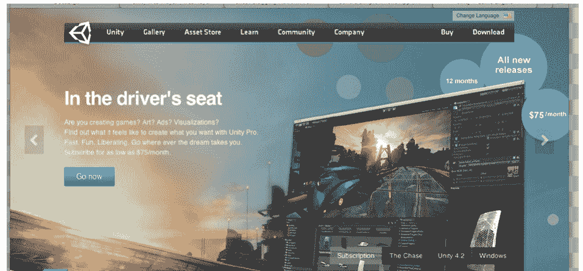

*图 1-2. Unity网站首页*

你可能需要花费数天时间浏览这个网站；游戏演示和预览画廊尤其有趣。不过现在先别迷失其中——你还有自己的游戏要创建！

在 Unity 首页，你会在顶部导航栏看到 Asset Store。Asset Store 正如其名——一个充满资源的商店，可能包含你游戏所需的一切，包括动画、音频和脚本，还有我最喜欢的东西之一：促销和每日折扣！它还提供许多免费资源，其中一些你将在本书后续学习 Unity 编辑器和 Asset Store 如何协同工作以优化工作流程时用到。你越多使用 Unity，就越会欣赏 Unity 如何专注于帮助你快速构建出色游戏。

在同一导航栏上，你还会看到“社区”（Community）。Unity 社区由成千上万像你一样热爱游戏并渴望创作游戏的人组成。这是结识志同道合者并获得帮助的好地方，不知不觉中，你也会开始帮助他人。点击进入该区域，你会发现有论坛、问答与反馈专区等等（见图 1-3）。

#### Unity论坛

论坛是我们社区讨论和交流的中心枢纽。发表你的意见，展示你的工作，并看看其他人正在做的酷炫项目。如果你需要组建或扩展团队，论坛也是联系其他 Unity 开发者的好地方。

[加入论坛](#)

#### Unity Answers

Answers 是我们社区的问答网站，专注于具体的 Unity 问题。欢迎初学者和专家发帖，互相帮助解决 Unity 相关问题。内置的投票系统有助于更快找到最佳答案。

[Unity Answers](#)

#### Unity Feedback

你有对 Unity 的功能请求吗？你能在看到好点子时识别出来吗？在 Unity Feedback 论坛，你可以告诉我们你在未来版本中想要什么，并为他人的想法投票。

[建议改进](#)

#### 文档

Unity 提供高质量资源，帮助你开发交互式内容。我们全面、组织良好且易于阅读的文档涵盖了 Unity 中每个组件的使用方法，以及单独的参考指南，讲解如何创建和使用脚本。

[前往文档](#)

#### Unify Script & Tips Wiki

Unify Script Wiki 是一个关于脚本、着色器和通用技巧的 Wiki。它是超越 Unity 捆绑脚本的有用脚本的一站式解决方案，并且每天都在增长。

[访问 Unify Script Wiki](#)

#### Unity Chat

我们的一些用户创建了一个专注于 Unity 支持和其他 Unity 相关讨论的 IRC 频道。将你最喜欢的 IRC 客户端指向 `irc.freenode.net` 并加入 `#unity3d` 进行实时聊天。

mIRC，Windows 的免费 IRC 客户端，Colloquy，Mac 的免费 IRC 客户端

*图 1-3. Unity社区*

除了视频教程，“学习”（Learn）部分是你可以找到文档的地方：Unity 用户手册、组件参考和脚本参考（见图 1-4）。

#### Unity学习资源

学习 Unity 的方法有很多。在这些页面中，你将找到成为 Unity 开发者所需的一切。那么，为什么不从今天开始学习并加入社区呢？在[教程](https://unity.com/tutorials)中，你可以找到视频和文章内容；我们的[文档](https://docs.unity3d.com)是完整的书面手册和脚本参考；如果你想与专家交流，可以报名参加[实时问答环节](https://unity.com/liveqa)，直接提出你的问题。

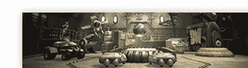

##### 教程

涵盖各种主题和水平的视频和文字教程。[开始学习](https://unity.com/tutorials)

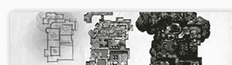

##### 文档

探索 Unity 的组件参考并浏览脚本 API。[阅读更多](https://docs.unity3d.com)


##### 实时培训

想沉浸在实时课堂中并在学习中提问吗？[参加课程](https://unity.com/live-training)

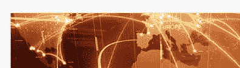

##### 社区

我们的论坛和 Answers 提供了大量问题的解决方案。[更多](https://community.unity.com)

*图 1-4. Unity的其他学习资源*

像 Unity 这样强大的开发工具拥有海量功能，不可能全部记住，而且 Unity 团队一直在不断改进它，添加新功能和能力。当你按照本书中的示例进行学习时，你会逐渐熟悉这些资源，并在整个游戏开发过程中自如地查阅它们。

请前往“学习”（Learn）标签页的蓝色顶部子菜单中选择“文档”（Documentation）（见图 1-5）。


*图 1-5. 访问Unity网站的学习部分*

### Unity文档资源

现在，点击“查看用户手册”按钮，你会在已加载的页面上看到它（图 1-6）。

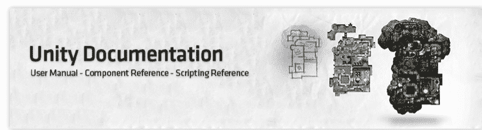

**图 1-6. Unity文档资源**

在欢迎语下方，向下滚动至“用户指南 ▸ Unity基础”，然后点击“Unity快捷键”（参见图 1-7）。

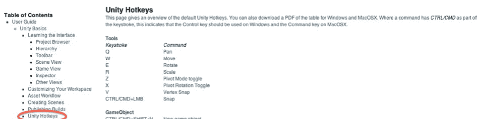

**图 1-7. 用户手册中的Unity快捷键主题**

在这里，你可以下载一份 PC 或 Mac 的常用 Unity 键盘快捷键 PDF。随着你熟悉 Unity 编辑器，你会发现手边备有这份资料非常有用。你可以在图 1-8 中看到它的样子。

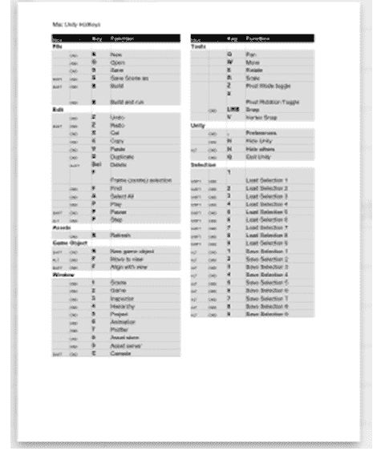

*图 1-8. Unity快捷键可打印速查表*

> **提示** 当使用本书中提到的快捷键时，`+` 符号表示在按第二个键之前先按住第一个键。对于 Mac，`⌘+X` 意味着按住 `⌘` 键，然后按 `X` 键。对于 PC，`Ctrl+X` 意味着按住 `Control` 键，然后按 `X` 键。

### 设置开发环境

现在是时候设置你的开发环境，为制作游戏做准备了。回到 Unity 主首页，选择顶部菜单栏右侧的“下载”（参见图 1-9）。

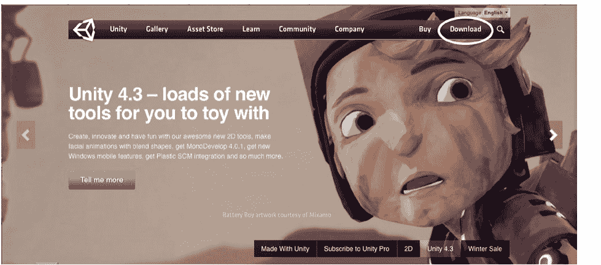

**图 1-9. Unity网站首页的“下载”标签页**

点击那个写着“Download Unity 4.3”的大蓝色按钮（图 1-10）。下载需要几分钟时间。

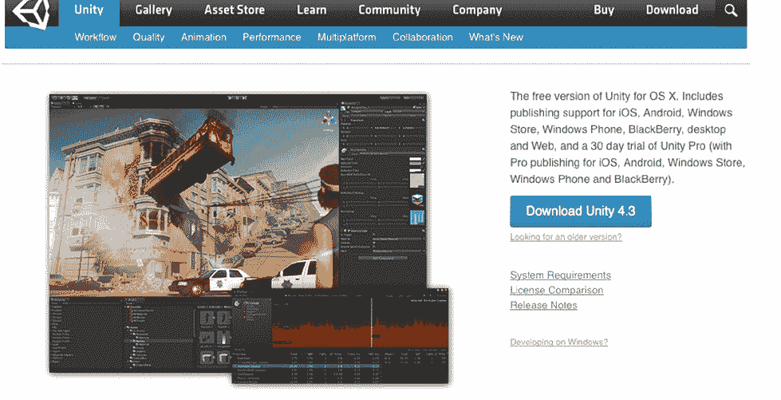

**图 1-10. 下载最新版本的Unity**

> **注意** 如果你在他们更新软件后才购买本书，网站上显示的 Unity 版本可能更新。如有任何疑问，请访问本书的配套网站 `www.learn-unityscript.com`。

双击操作系统“下载”文件夹（或你选择的保存位置）中的 `unity-4.3` 来打开它。现在，双击打开的 Unity 安装程序窗口中的 Unity 图标（图 1-11）。

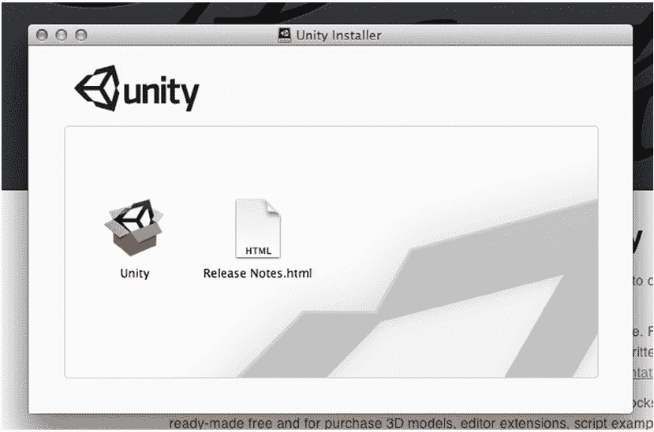

*图 1-11. Unity安装程序窗口中的Unity图标*

在“安装 Unity”弹出窗口中点击“继续”，然后选择“继续”以通过欢迎界面，进入 Unity 许可条款。在弹出菜单中选择“同意”（当然，在仔细阅读所有条款和条件之后）。

除非你有强烈偏好，否则让 Unity 使用默认的安装目标位置。点击“安装”；现在让向导执行标准安装，无需自定义或更改安装位置。根据你计算机的安全设置，你可能需要输入密码以允许安装。然后点击“安装软件”。实际安装需要几分钟。

你将在“安装 Unity”窗口中看到一条确认安装成功的消息。你可以通过点击“关闭”按钮关闭此窗口。现在你也可以关闭 Unity 安装程序窗口。

此时，一个 Finder 窗口将打开，显示应用程序文件夹中的 Unity。你可以将 Unity 和 MonoDevelop 的图标拖到 Dock 栏，以便于访问（图 1-12）。

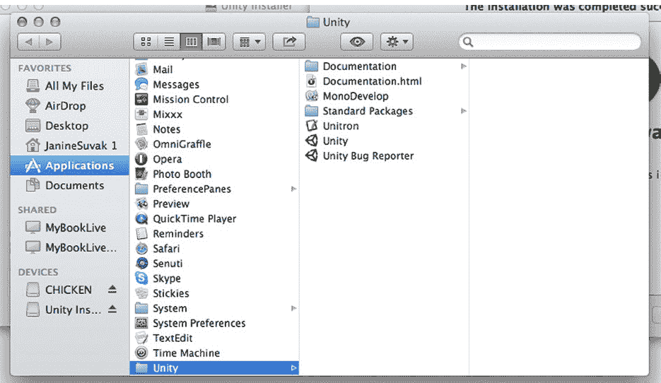

**图 1-12. Unity软件包**

双击 Unity 图标；一个用于激活 Unity 许可证的弹出窗口将出现。选择标有“Activate the free version of Unity”（激活 Unity 免费版）的复选框，然后点击“OK”按钮（图 1-13）。

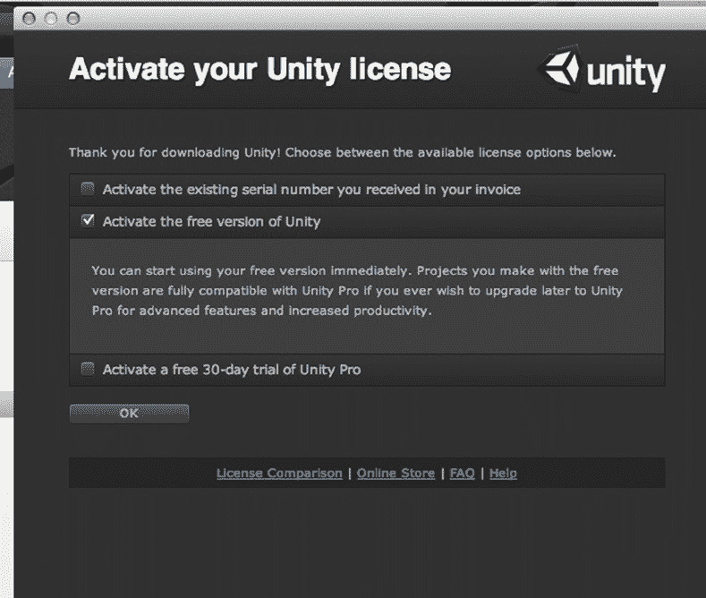

*图 1-13. Unity许可证激活*

下一步是创建你的 Unity 账户（图 1-14）。你也将使用此账户访问 Unity 资产商店和社区论坛。我建议订阅月度通讯，以及时了解 Unity 的最新动态。

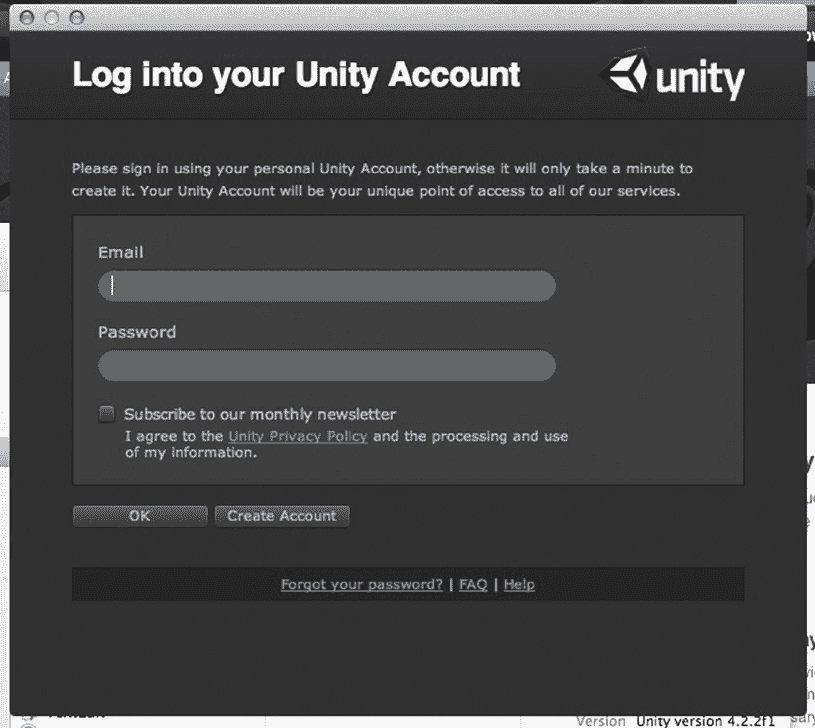

**图 1-14. 创建Unity账户**

创建账户后，会出现友好的感谢信息。点击那个写着“Start using Unity”的大蓝色按钮（图 1-15）。

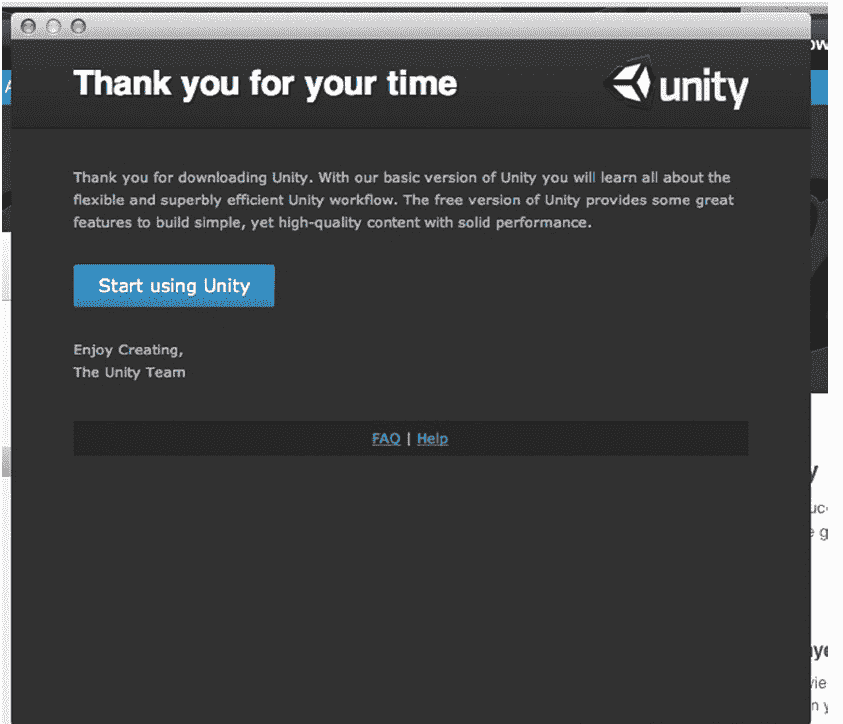

**图 1-15. 完成Unity软件包下载和账户创建**

“Welcome To Unity”（欢迎使用 Unity）屏幕将出现在 Unity 编辑器界面屏幕的顶部（图 1-16）。欢迎屏幕包含指向 Unity3D 网站上你刚刚浏览过的各种主题的链接。除非你取消选中右下角的“Show at Startup”（启动时显示）框，否则每次启动编辑器时此窗口都会出现。

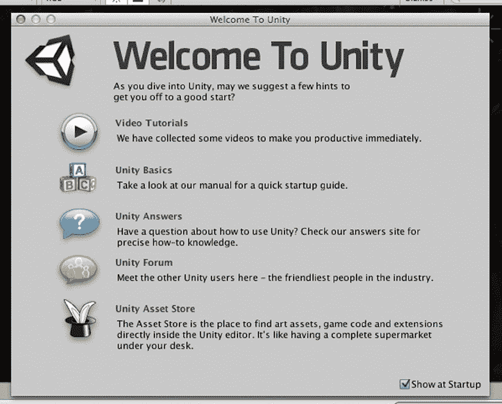

**图 1-16. Unity欢迎窗口**

欢迎屏幕和这些链接也可以通过“帮助”菜单轻松访问，因此你可以取消选中“Show at Startup”来跳过此窗口（图 1-17），然后关闭它以查看 Unity 编辑器（图 1-18）。

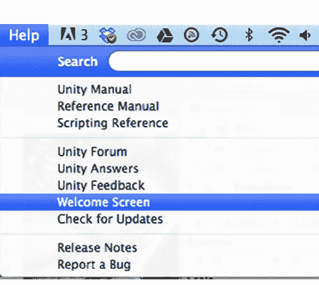

**图 1-17. 从Unity编辑器“帮助”菜单可访问的Unity欢迎窗口**

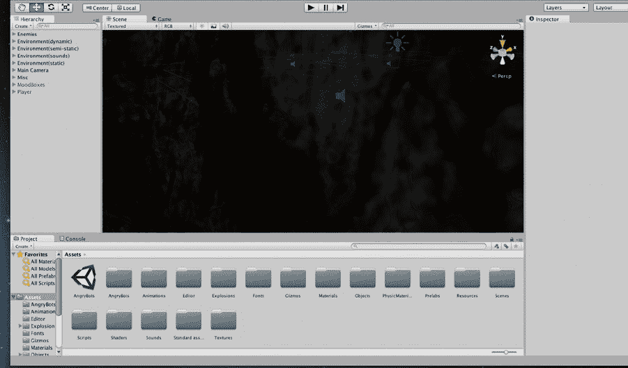

**图 1-18. Unity编辑器界面**

### AngryBots入门

如果你不喜欢游戏，可能就不会对游戏开发感兴趣，所以你可以猜到最棒的部分——玩！认识一下 AngryBots，这是 Unity 附带的示例。在 Unity 编辑器顶部中央，你会看到播放按钮（图 1-19）。


*图 1-19. Unity编辑器播放模式控件*

点击播放按钮开始 AngryBots 游戏。

使用方向键或 ASDW 键移动，鼠标左键射击，使用鼠标环顾四周。尽情玩一会儿，然后再次点击播放按钮退出游戏。暂停按钮在播放按钮的右侧，其右侧的按钮用于在测试中逐步前进。

AngryBots 也非常适合演示构成 Unity 编辑器界面的视图。界面是你与 Unity 编辑器交互的窗口。它由多个视图组成，这些视图可以使用工具栏右上角的“布局”下拉菜单进行配置。你还可以通过其标签调整大小和拖动各个视图来自定义布局，或者通过将视图拖出编辑器窗口区域使其成为独立窗口。你始终可以通过选择“布局”下拉菜单中的“恢复出厂设置”来返回基本布局。当你的游戏变得更复杂时，“图层”下拉菜单对于隐藏和显示不同内容非常有用（图 1-20）。

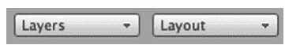

*图 1-20. 图层和布局下拉菜单控件*

在左上角，你会看到四个工具的按钮：平移、移动、旋转和缩放（图 1-21）。这些也可以使用 Unity 快捷键速查表“工具”表中列出的 `Q`、`W`、`E` 和 `R` 键来选择。

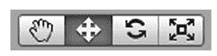

*图 1-21. 平移、移动、旋转和缩放工具选择器*

紧邻这些工具的右侧是两个开关，它们也有相应的快捷键，你可以在之前下载的快捷键列表中找到：`Z` 用于“轴心模式”开关，在局部空间和世界空间之间切换，`X` 用于“轴心旋转”开关，在中心旋转或轴心点旋转之间切换（图 1-22）。你将在后面学到更多关于这些技术细节；这只是对你在编辑器上所见内容的介绍。


**图 1-22. 轴心模式和轴心旋转切换开关**

你还可以使用“窗口”表中的快捷键，将焦点切换到我将要介绍的各种视图。

#### 游戏视图 (⌘+2)

你已经使用游戏视图玩过 AngryBots（图 1-23）。你将经常使用游戏视图，因为游戏开发是一个迭代过程。这意味着你将不断重复构建游戏的步骤，每次一部分，在游戏视图中通过播放来测试该部分，进行调整，然后再测试，直到你满意它按照你想要的方式工作，然后再添加下一部分。你将在播放过程中更改设置以微调游戏玩法，但请注意，在游戏模式下对游戏对象进行的任何更改都不会被保存。为帮助你避免因丢失本意保留的更改而感到沮丧，请按 `⌘+,`（逗号键）打开 Unity 偏好设置菜单（图 1-24）。

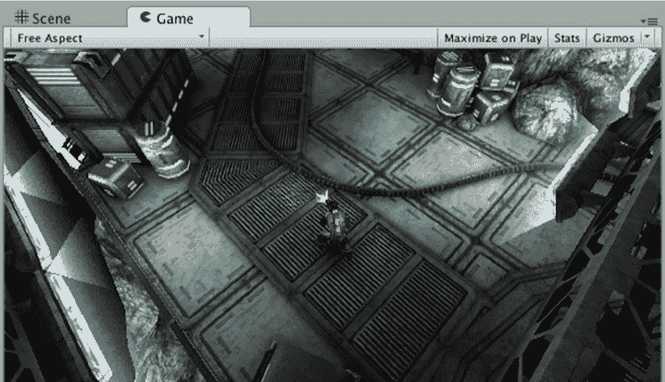

**图 1-23. 游戏视图中的AngryBots**

请检查 OS X 颜色拾取器，然后在左侧选择“颜色”。在“播放模式色调显示”中双击以打开颜色拾取器，选择一种颜色，然后关闭颜色拾取器窗口和 Unity 偏好设置窗口（图 1-25）。

关闭颜色和 Unity 偏好设置窗口，点击“播放”，你会看到编辑器变色，提醒你当前处于活动播放模式。在游戏视图顶部，你会找到控制栏（图 1-26）。如果你希望 AngryBots 在游戏时填满窗口，请在点击播放按钮之前，从游戏视图顶部选择“播放时最大化”（`Shift + 空格键`）。

左侧的“纵横比”下拉菜单允许你使用目标设备或平台的屏幕比例来测试游戏玩法（图 1-27）。

选择“统计信息”会激活性能统计数据的显示（图 1-28）。

最后，“Gizmos”按钮允许可视化识别小工具（Gizmos），这将在涵盖场景视图的部分中讨论。

#### 层级视图 (⌘+4)

层级视图包含当前显示场景中所有对象的列表，按字母顺序排列。对象可以分组为“父”对象，这些对象可能有对应的“子”对象。如果你在探索编辑器界面时展开图 1-29 中的任何项目，你会发现嵌套在父对象下的、按字母顺序缩进排列的子对象列表。你将在后续章节中了解游戏对象的父子关系的所有内容。

*图 1-29. 层级视图*

在 Unity 编辑器中，通常有多种方法可以执行任何特定操作。层级视图中的“创建”按钮与顶部菜单栏的 `GameObject ▶ Create`（空对象或其他）选项功能相同，可用于为你的游戏生成多种对象（图 1-30）。

图 1-30. 创建新游戏对象的替代方法

在层级视图的搜索字段中输入 `EnemySpider`。正如你所料，一个 EnemySpider 游戏对象的列表会出现在视图中。点击列表中的任何一个 EnemySpider 对象，然后将鼠标光标移到场景视图上并按 `F` 键。`F` 键会将场景视图的焦点移动到你在层级视图中选择的对象上。请注意，场景视图也会将除了层级视图搜索结果中对象之外的所有内容灰显（图 1-31）。

图 1-31. 聚焦于 EnemySpider 的场景视图

现在尝试将焦点切换到 Player。提示：在层级视图的搜索栏中输入 `Player`，选择 Player，将鼠标光标移到场景视图上，然后按 `F` 键。

最后，点击搜索栏中的 `x` 以返回标准场景视图。

#### 场景视图 (⌘+1)

早期游戏完全由代码创建。Unity 能够更快地创建精美游戏的强大功能很大程度上在于使用直观的工具，例如场景视图，你可以在其中从环境开始，直观地构建游戏，直到定位游戏对象（图 1-32）。

图 1-32. 场景视图

你可以通过多种方式导航场景视图。选择手形工具 (`Q`) 并用鼠标点击拖动。按住 `Alt` 键并点击拖动可以围绕你感兴趣的点旋转视图，或者按住 `Ctrl` 键并点击拖动可以缩放视图。按住鼠标右键并使用 `A`、`S`、`D`、`W`、`Q` 和 `E` 键进行导航，可以在第一人称穿越模式下体验一些乐趣。

通过点击选择 AngryBots 中的 Player 游戏对象。使用手形工具右侧各自的按钮显示平移 (`W`)、缩放 (`E`) 和旋转 (`R`) 小工具。注意每个工具中的 `x`、`y` 和 `z` 轴分别用红色、绿色和蓝色进行颜色编码。你可以通过点击拖动小工具用鼠标操纵游戏对象的位置，也可以在检查器中输入精确值来调整。场景摄像机的视角也可以通过场景小工具以同样的方式进行调整（图 1-33）。

图 1-33. 场景视图平移、旋转、缩放和摄像机小工具

#### 检查器 (⌘+3)

你可以使用场景视图控制栏以多种模式查看场景并预览音频（图 1-34）。

*图 1-34. 场景视图控制栏*

检查器面板包含每个游戏对象、资源和编辑器首选项的设置。它是上下文相关的，这意味着它会根据你在 Unity 编辑器中选择的内容而变化。你可能已经注意到检查器的内容在不同选择之间会发生变化。注意 EnemySpider 与 Player 相比有不同的设置（图 1-35）。

*图 1-35. 检查器面板内容更改以反映选定的游戏对象*

#### 项目面板 (⌘+5)

构成你游戏的所有资源都存储在项目面板中（图 1-36）。你可以创建新资源或从其他来源（如资源商店）导入资源。请不要使用操作系统在 Unity 项目内移动文件。Unity 在其内部项目文件库中跟踪这些文件的存储位置，以及你如何使用项目面板移动或编辑它们。

图 1-36. 显示 AngryBots 资源的项目面板

#### 控制台 (SHIFT+⌘+C)

控制台（图 1-37）在开发过程中显示来自游戏的输出，例如消息、警告和错误。

图 1-37. 控制台

## 总结

在本章中，你对 Unity 网站上可用的资源有了一个大致的了解，并且随着你在后续项目中的使用，你会对它们更加熟悉。你下载了 Unity 编辑器，体验了击杀愤怒机器人的乐趣，并参观了构成 Unity 编辑器本身的各个视图。你已经完全准备好，可以开始了！

# 第二章：游戏编程入门

既然你已经熟悉了 Unity 编辑器，接下来将介绍脚本编辑器 MonoDevelop。这是你进行游戏开发的两个主要工具。Unity 编辑器是你进行可视化游戏构建的地方，通过将游戏对象放置在场景中来组装场景布局。MonoDevelop 是你编写代码的脚本编辑器。代码告诉游戏对象如何行为，例如响应玩家输入或相互交互。当你将代码脚本附加到游戏对象时，它就被整合到你的游戏中。在本章中，你将学习如何创建脚本、编写一些简单的代码，然后将脚本附加到游戏对象上。

你在第 1 章中随 Unity 一起安装了 MonoDevelop。你可能在应用程序 ▶ Unity 文件夹中看到过它（图 2-1），但你也可以直接从 Unity 编辑器访问 MonoDevelop。它是 Unity 偏好设置 ▶ 外部工具中“外部脚本编辑器”的默认选项（图 2-2）。

**图 2-2. Unity偏好设置菜单**

当 AngryBots 项目仍然打开时，在项目面板中打开 `Assets ▶ Scripts ▶ Animation` 文件夹，然后点击 `PlayerAnimation` 图标（图 2-3）。

**图 2-3. 项目面板中的PlayerAnimation脚本图标**

在检查器面板中，你将看到有关 `PlayerAnimation` 脚本内容的附加信息（图 2-4）。你可以通过双击它或选择“打开...”按钮（图 2-5）在 MonoDevelop 中打开此脚本。

## MonoDevelop

当 Unity 创建一个新项目时，它会为你提供一个游戏的骨架。这个骨架具备了任何游戏的基本要素，因此当你点击播放按钮时，这个空游戏仍然知道如何启动，以及在取消选择播放后如何停止。游戏开发就是用数字内容以及与游戏对象、环境和脚本的交互来充实这个骨架的过程。

在顶部菜单中，选择 `GameObject > Create Empty`（图 2-8）。

**图 2-8. Unity顶部菜单 GameObject > Create Empty**

你会在 Hierarchy 视图中看到新建的游戏对象，在 Scene 视图中看到它的变换控件，并在 Inspector 中看到更多细节（图 2-9）。

**图 2-9. Unity编辑器中的新游戏对象**

在 Inspector 中，点击 `Add Component` 按钮，然后从弹出的菜单中选择 `New Script`。将你的脚本命名为 `HelloWorld`，确保语言是 `JavaScript`，然后点击 `Create and Add` 将此脚本附加到空游戏对象上（图 2-10）。按照惯例，名称应具有描述性，首字母大写，不使用特殊字符或空格，但允许使用下划线。

**图 2-10. 用于添加新脚本的Add Component弹出窗口**

现在，脚本已作为游戏对象的一个组件列在 Inspector 中，并且你会在 Assets 文件夹中看到脚本的图标已经出现（图 2-11）。

**图 2-11. Inspector面板中作为组件显示的新脚本，以及Project面板Assets中显示的图标**

单击此图标一次以选中它，然后在 Inspector 中查看脚本的内容（图 2-12）。

**图 2-12. 在Inspector面板中看到的新脚本内容**

你可以通过在 Inspector 中选择 `Open` 或双击 Assets 文件夹中的图标来在 MonoDevelop 中打开脚本（图 2-13）。

**图 2-13. 准备在MonoDevelop中编辑的HelloWorld脚本**

与 Unity 类似，MonoDevelop 也有一些键盘快捷键，你可以在 `MonoDevelop ▸ Unity Preferences ▸ KeyBindings` 中找到它们（图 2-14）。

**图 2-14. MonoDevelop ▸ Unity Preferences ▸ Key Bindings菜单中的键盘快捷键**

当你创建一个新脚本时，Unity 会自动包含一些项目。`#pragma strict` 将出现在你所有脚本的开头。它告诉编译器变量必须有类型声明，你将在本章稍后学习更多相关内容。它还会创建空的 `Start()` 和 `Update()` 函数。现在，请直接删除 `Update()` 函数，包括其开始和结束的大括号：

```
function Update () {

}
```

由于这个新脚本已附加到游戏对象上，当游戏对象进入场景时，`Start()` 函数将被调用一次。在这个示例项目中，游戏对象已经存在于场景中，因此一旦游戏开始，它的 `Start()` 函数就会被调用。在 `Start()` 函数的大括号之间输入你的第一行代码，以查看其实际效果。

```
function Start () {
    print("Hello World!");
}
```

按下 `⌘+S` 保存，然后返回到 Unity 编辑器。在 Project 面板中，选择 Console 标签页。在这里，你将看到你刚刚编写的代码所产生的输出。在 Game 视图中，确保 `Maximize on Play` 未被选中，这样它就不会遮挡控制台。现在去点击播放。在 Console 视图中，你会看到 "Hello World!" 出现——太棒了！（见图 2-15。）

**图 2-15. 控制台面板中Hello World!的输出**

另一种将消息打印到控制台的方法是使用 `Debug.Log`。“调试” 是指查找和纠正代码中被称为 “bug” 的错误的过程。你将在第 10 章学习更多关于如何使用 `Debug` 类及其函数的知识。将你的代码行更改为如下所示：

```
function Start () {
    Debug.Log("Hello World!");
}
```

保存，在 Unity 编辑器中点击播放运行，并查看控制台，你会发现你得到了相同的 "Hello World!"，只是后面跟了一个略有不同的注释（图 2-16）。

**图 2-16. 控制台面板中的Debug.Log输出**

游戏开发是一个持续的学习过程。Unity 的团队不断添加新功能和新平台，以便你能够将游戏移植到这些平台上。即使是最有经验的开发者也必须跟上最新的变化和新增功能，最常见的方式就是参考提供的文档。每个新的游戏项目可能都包含一些你不熟悉的东西，或者你可能想再确认一下是否有更新。正如你通过在 Unity 和 MonoDevelop 中亲手创建本书中的示例来最好地学习 UnityScript 一样，你将通过使用文档来最快地习惯查阅文档。

停止游戏并返回到 MonoDevelop 中的脚本。(`⌘+Tab` 是一个在两个窗口之间切换时非常有用的快捷键。) 在 `Debug` 这个单词上的任意位置点击，然后按 `⌘+'` 在你的网页浏览器中打开 `Debug.Log` 脚本参考（图 2-17）。

**图 2-17. Unity脚本参考中的Debug.Log描述**

你会在描述中看到 `Debug.Log` 将消息记录到 Unity 控制台，随后是一个与你的代码类似的示例代码行。

还有一个包含示例代码的第二段描述，旨在错误发生时为你提供更多信息。通过添加 `gameObject` 引用来修改你的代码行：`Debug.Log("Hello world!", gameObject);` 按 `⌘+S` 保存，并在 Unity 编辑器中点击播放。现在 "Hello World!" 消息与 `Debug.Log` 函数提供的一些附加信息一起出现了（图 2-18）。

**图 2-18. 控制台中带有对象上下文的Debug.Log输出**

你将在本书后面学习更多关于调试以及如何使用这些信息的内容。现在，能够成功尝试文档中的示例代码就足够了。

游戏开发是一个互动的过程，包括经典的试错方法。文档中充满了示例代码。有时候，文字解释可能无法让你立即理解，但看到示例代码的实际运行将有助于澄清它。不要害羞，大胆尝试！

在实验时的一个有用提示：在 `Preferences > Key Bindings` 中，你会看到 MonoDevelop 使用了与你在 Unity 快捷键速查表中 Edit 部分所见的相同的键盘快捷键，即 `⌘+Z` 用于撤销，`Shift+⌘+Z` 用于重做。

当你输入代码时，你可能已经注意到 MonoDevelop 试图通过自动完成来帮助你。做出你的选择，按 `Tab` 键，MonoDevelop 将填充剩余部分（图 2-19）。这有助于提高速度，并且通过减少那些恼人的、导致错误的小笔误的可能性，尤其提高了准确性。

**图 2-19. MonoDevelop中的自动完成功能**

MonoDevelop 也会尝试帮助你识别错误。通过省略行末的分号来引入一个错误并保存。在 Unity 编辑器中，你会在控制台看到一个警告显示，其中 Unity 提供了修复此错误的有用建议（图 2-20）。

**图 2-20. Unity控制台中带有建议修复的错误信息**

如果你仍然点击播放，Unity 会坚持要求你先修复错误（图 2-21）。

## 变量与函数

计算机只会执行你告诉它要做的事情。它使用变量来保存数据，并按照你以函数形式给出的指令来操作或处理数据。

将你的代码修改成如下形式：

```
#pragma strict

// declare the variable myVar of type integer and give it a value of 8.
var myVar : int = 8;

function Start () {
    Debug.Log(myVar);
}
```

首先，仔细看看第二行。在行首添加双斜杠 `//` 会使其成为注释，在 MonoDevelop 中以灰色字体显示。注释用于给你自己或其他开发者的备注，例如描述后续代码块的目的。当你编写代码时看起来非常清晰的内容，对其他人来说可能并非如此，或者几天、几周或更长时间后你回顾时，它也可能变得模糊不清。养成边写代码边添加注释的好习惯，这对你自己和你的团队都有好处。

> **注意** 注释掉代码在调试过程中很有用。你可以通过注释来禁用代码而不是删除它，然后根据需要轻松地重新启用它。

对于多行注释，请在注释或代码的开头放置 `/*`，结尾放置 `*/`。通过注释掉 `Start()` 函数来试试这个方法。

```
#pragma strict

// declare the variable myVar of type integer and give it a value of 8.
var myVar : int = 8;

/* function Start () {
    Debug.Log(myVar);
} */
```

注意代码变成了相同的灰色，表明这个函数现在已被禁用。在 Unity 中保存并运行，正如你所预料的，控制台将保持为空。取消对 `Start()` 函数的注释以启用它，然后保存。

**变量** 用于存储和检索数据。这是你的游戏程序记住管理游戏流程所需信息的方式。

看看这行代码：

```
var myVar : int = 8;
```

将其分解为各部分：

```
(1)  (2) (3)   (4)    (5)   (6)  (7)
var  myVar :   int    =     8   ;
```

1. 使用 `var` 语句声明一个变量。
2. 变量名。变量名应具有描述性，这有助于提高代码的可读性。你可以使用任何字母数字字符和下划线，但不能使用其他标点符号或特殊字符。提高代码可读性的另一个好方法是遵循标准编程约定。变量命名的标准约定是：如果变量名的第一个字符是字母，则不应大写。
3. 冒号，用于分隔变量名和数据类型。
4. 变量的数据类型，在此例中 `int` 表示整数。
5. 赋值运算符，用于为你刚刚声明和命名的变量赋值。声明整数时不必立即赋值。
6. 要赋给变量的值，在此例中是一个整数。整数是整数，包括负数（由前面的负号表示）。不允许使用逗号和空格——虽然 `24`、`0` 和 `-3` 是有效的整数，但 `2,500` 不是，而 `2500` 是。
7. 分号，表示语句的结束。所有语句都必须以分号结尾。

在 `Start()` 函数中，打印到控制台的 `Debug.Log` 消息就是 `myVar` 的值。保存并运行以确认。

变量保存数据，而函数执行操作。函数执行过程的指令包含在花括号中。看看 `Start()` 函数的组成部分：

```
(1)       (2) (3) (4)
function Start ()  {
              (5)
    Debug.Log(myVar);
(6)
}
```

1. 使用保留字 `function` 声明函数。
2. 函数名。函数名以大写字母开头。
3. 用于处理传递给函数信息的参数。括号是必需的，因此如果不需要参数，则保持为空。
4. 开花括号，表示函数内容的开始。
5. 函数要遵循的指令形式为语句——在此示例中，是 `Debug.Log` 语句。
6. 闭花括号，表示函数的结束。由于它是函数的结束而不是语句的结束，因此不使用分号。

注意 MonoDevelop 对 `Debug` 语句进行了缩进。缩进用于提高代码的可读性。这样，你可以轻松识别独立的代码块。MonoDevelop 会自动为你执行此操作，但有时你会发现需要重新组织代码以提高可读性。在 `MonoDevelop 偏好设置 ▶ 键绑定 ▶ 编辑` 中，你可以找到键盘快捷键 `⌘+]` 用于缩进或 `⌘+[` 用于取消缩进，它们会移动你高亮显示的任何大小的代码块。尝试一下你的 `Debug` 语句，然后尝试整个 `Start` 函数。很简单，对吧？

快速回顾一下算术运算符（表 2-1），将 `Start` 函数中的 `Debug` 行替换为以下几行：

```
print(6+2);
print(6-2);
print(6*2);
print(6/2);
print(6%2);
```

### 表 2-1. 算术运算符的定义

| 算术运算符 | 含义 |
|---|---|
| `+` | 加法 |
| `-` | 减法 |
| `*` | 乘法 |
| `/` | 除法 |
| `%` | 取模 |

保存并运行。控制台中的输出将如图 2-22 所示：

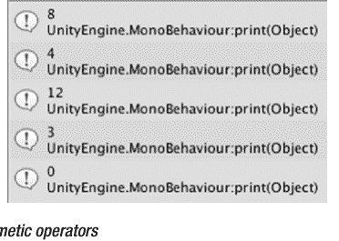

**图 2-22. 算术运算符的输出结果**

你可能认识前四个运算符。取模运算符是另一个方便的运算符，它返回余数，在此例中是 6 除以 2 的余数。尝试将 6 改为 5，保存并运行。这次最后一行输出是 1，即 5 除以 2 的余数。

与大多数编程语言一样，UnityScript 遵循标准的运算顺序，乘法和除法优先于加法和减法。将你的 `Start` 函数修改为以下内容：

```
print(6+2*4);
```

从左到右读，6 和 2 的和是 8，乘以 4 是 32。保存并运行，你会看到 Unity 先将 2 乘以 4 得到 8，然后加上 6，输出 14。

你可以通过使用括号来改变求值顺序。括号内的操作具有更高的优先级。将同一行代码修改如下：

```
print((6+2)*4);
```

现在，当你保存并运行时，输出是 32，因为 Unity 首先执行了括号内的加法运算。

这些相同的算术运算符可以用于变量持有的数值。将同一行代码替换为以下语句：

```
print(myVar + myVar);
```

假设 `myVar` 之前被赋值为 8，现在你将得到 16 作为结果。

到目前为止，你一直在处理整数，但你也可以将变量声明为 **浮点** 数据类型以处理小数位。变量可以包含各种数据类型，包括 **字符串**、**布尔值** 以及更复杂的数据类型。事实上，你在第一行代码中就使用了一个字符串：

```
print("Hello World!");
```

字符串是包含在双引号内的字符。**连接** 是将各个字符串组合成单个字符串的术语。虽然我本可以说你可以将字符串“加”在一起，但对你来说，在引入新术语时学习正确的术语很重要，当你需要帮助时在 Unity Answers 论坛上进行搜索，或是在鸡尾酒会上显得非常聪明时，这会派上用场。将你的代码编辑为以下内容：

```
#pragma strict

// declare the variable myVar of type integer and give it a value of 8.
var myVar : int = 8;
var myString1 : String = "Hello ";
var myString2 : String = "World!";
var myNewString : String;

function Start () {
    myNewString = String.Concat(myString1, myString2);
    Debug.Log(myNewString);
}
```

保存、运行，你的输出应该是“Hello World!”。这里最常见的错误是忘记在需要的地方包含空格。

`String.Concat` 与 `Debug.Log` 相似，因为它们都包含一个 **点运算符**。点运算符是一种编码语法形式，其中点分隔代码的各个部分。`Concat` 是 `String` 的一个元素，就像 `Log` 是 `Debug` 的一个元素一样。你可以使用现在已经熟悉的 `⌘+'` 在 `String` 和 `Debug` 上查看它们在 Unity 脚本参考中的更多元素。

`Start` 函数在演示这些基本概念方面运行良好，但现在你准备好编写自己的函数了。一个 **函数** 接受称为 **参数** 的信息，并使用这些信息执行某种操作，然后可选地返回一个结果。

删除字符串变量声明，并将 `Start` 函数编辑如下：

```
var myVar : int = 8;

function Start () {
    myVar = AddFive(myVar);
    Debug.Log(myVar);
}
```

语句 `myVar = AddFive(myVar);` 调用了名为 `AddFive()` 的函数（你接下来将创建这个函数），并将存储在 `myVar` 中的整数传递给它。

在 `Start()` 函数的闭花括号之后，编写在 `Start` 中调用的新函数 `AddFive`：

```
function AddFive (numberFromStartFunction : int) {
    var newVar : int;
    newVar = numberFromStartFunction + 5;
    return newVar;
}
```

与 `Start()` 函数不同，`AddFive()` 需要接收信息才能进行加五的处理。括号内的参数 `numberFromStartFunction` 被声明为整数数据类型。这意味着当调用此函数时，必须发送一个整数。你已经将 `myVar` 声明为整数，因此你在 `AddFive(myVar)` 函数调用中正确地向 `AddFive()` 函数发送了一个整数数据类型。`numberFromStartFunction` 在 `AddFive()` 函数内就像一个变量，用于保存从调用者那里接收的整数。

`AddFive()` 函数的第一条语句如下：

```
var newVar : int;
```

这里你声明了一个名为 `newVar` 的新整型变量。你可能从之前对函数的剖析中回忆到，声明变量时不必为其赋值。

`newVar` 在 `AddFive()` 函数内声明，因此只能在此函数内使用。这是**局部变量**的一个例子，因为它的作用域仅限于声明它的函数。`myVar` 是**全局变量**的一个例子；它作用域更广，可以被此脚本中的任何函数使用。

此函数的第二条语句 `newVar = numberFromStartFunction + 5;` 是对你指令的实际处理，将参数 `numberFromStartFunction` 中接收的整数加上 5。计算的结果随后存储在局部变量 `newVar` 中。

最后，`return newVar;` 将赋给 `newVar` 的值返回，在那里它被赋值给 `myVar`。

此过程在图 2-23 中进行了描绘。运行（保存并播放）脚本，果然，Unity 给你一个 13 的结果。太棒了！

```
var myVar : int = 8;

function Start () {
    myVar = AddFive(myVar);
    Debug.Log(myVar);
}

function AddFive (numberFromStartFunction:int) {
    var newVar : int;
    newVar = numberFromStartFunction + 5;
    return newVar;
}
```

**图 2-23. 两个函数之间的数据流**

数学对于游戏开发是必要的，但对你们中那些解决数学问题不能获得特殊乐趣的人来说，我有个好消息：Unity 为你提供了大量内置的数学函数。毕竟，超级快速地进行常规计算是计算机最擅长的，而这里的目的在于促进你的整体游戏开发。

`Mathf` 是 Unity 提供的便捷数学变量和函数集合之一。在 MonoDevelop 中，更新你的代码如下所示：

```
#pragma strict

function Start () {
    Debug.Log(Mathf.PI);
}
```

点击 `Mathf.PI`，然后按 `⌘+'` 打开其 Unity 脚本参考（图 2-24）：

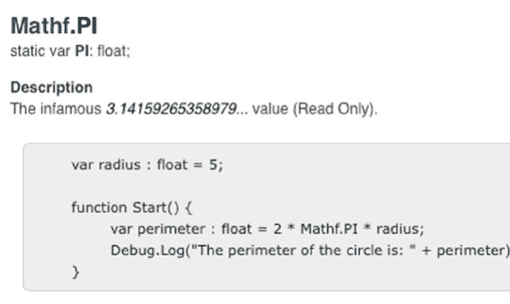

*图 2-24. Unity脚本参考中的Mathf.PI描述*

在这里你会发现 `Mathf.PI` 是一个数据类型为 `float` 的静态变量。圆周率的值是常数，而一个**静态**变量意味着它不会让你的代码改变 `Mathf.PI` 所持有的值。记住，当你创建一个函数时，参数类型必须与其接受的数据类型匹配。参考文档很有帮助地告知你它是 `float` 数据类型，并提供了简短的示例代码，展示如何使用它。

运行你的脚本，你会发现控制台中显示的十进制位数远没有参考文档中显示的那么多。这没关系——在常见的游戏用法中，你不太可能需要比这更高的精度。

点击脚本参考标题中的蓝色 "Mathf" 以获取 `Mathf` 变量和函数的完整列表（图 2-25）。

### Mathf

**描述**

常用数学函数的集合。

**静态变量**

| 名称 | 描述 |
| :--- | :--- |
| `Deg2Rad` | 度到弧度的转换常量（只读）。 |
| `Epsilon` | 一个极小的浮点值（只读）。 |
| `Infinity` | 正无穷大的表示（只读）。 |
| `NegativeInfinity` | 负无穷大的表示（只读）。 |
| `PI` | 众所周知的 3.14159265358979... 值（只读）。 |
| `Rad2Deg` | 弧度到度的转换常量（只读）。 |

**静态函数**

| 名称 | 描述 |
| :--- | :--- |
| `Abs` | 返回 f 的绝对值。 |
| `Acos` | 返回 f 的反余弦值 - 余弦值为 f 的弧度角。 |
| `Approximately` | 比较两个浮点值是否近似。 |
| `Asin` | 返回 f 的反正弦值 - 正弦值为 f 的弧度角。 |

*图 2-25. Unity脚本参考中的Mathf描述*

四舍五入是你在游戏开发中肯定会用到的函数。请向下滚动到 `Round` 函数并选择它（图 2-26）。

#### Mathf.Round

`static function Round(f: float): float;`

**描述**

返回 `f` 四舍五入到最接近的整数。

如果数字以 .5 结尾，因此它位于两个整数之间，其中一个为偶数，另一个为奇数，则返回偶数。

```
// Prints 10
Debug.Log(Mathf.Round(10.0));
// Prints 10
Debug.Log(Mathf.Round(10.2));
// Prints 11
Debug.Log(Mathf.Round(10.7));
// Prints 10
Debug.Log(Mathf.Round(10.5));
// Prints 12
Debug.Log(Mathf.Round(11.5));
// Prints -10
```

*图 2-26. Unity脚本参考中的Mathf.Round描述*

在这里你会发现 `Mathf.Round` 是一个静态函数，它接受一个 `float` 数据类型作为参数，后面跟着一些示例。请将其中一些示例复制粘贴到 MonoDevelop 中并尝试一下。

注意描述中的最后一个注释告诉你，`Mathf.Round` 函数并非将所有以 .5 结尾的数字都向上舍入，而是向上或向下舍入，取决于哪种方式产生偶数。在给出的第四个示例中，你会看到 10.5 被向下舍入为 10，而不是像你期望的那样向上舍入为 11。当你查阅脚本参考中的任何内容时，请花时间阅读整个描述——这可能会在以后 Unity 试图告知你的行为上，为你省去一些烦恼。

做得好！你已经掌握了变量和函数的基础知识。你正在逐渐熟悉查阅 Unity 脚本参考和使用 Unity 提供的内置函数。不要担心概念似乎有点模糊；从现在开始你会有大量的练习机会。继续练习这些示例，通过实践，你很快就会掌握窍门。

## 条件语句

除了数学计算，你的脚本还将使用逻辑函数来定义游戏规则，例如敌人被摧毁前的受击次数、角色基于累积力量和能力的行为，以及当然还有获得大胜必须满足的条件。

### 布尔逻辑与条件语句

布尔类型变量只有两个可能的值：`true` 和 `false`。

在 MonoDevelop 中，将你的脚本编辑如下：

```
var skyIsClear : boolean = true;

function Start () {
    Debug.Log(skyIsClear);
}
```

运行你的脚本，控制台显示 `true`。布尔变量通常用于监视或“标记”一种状态或条件。例如，我可能会说，“如果天气晴朗，那么我就出去玩。”我需要测试太阳是否升起，然后根据该条件做出决定。

更新 `Start()` 函数中的代码如下：

```
if (skyIsClear == true) {
    Debug.Log("I will go out and play");
}
```

这段代码相当易读。你希望测试的条件放在关键字 `if` 后面的括号中。如果条件满足，则执行花括号内的语句块。注意“等于”的比较运算符是 `==`，而用于设置变量值的赋值运算符是 `=`。请运行脚本。太棒了——我可以出去玩了！

> **注意** 初级程序员最常犯的错误之一是在条件语句中使用 `=` 而不是 `==`。

等等——如果天气晴朗但是晚上呢？我不应该在黑暗中出去玩。在你的第一个变量声明下方，添加第二个：

```
var sunIsUp: boolean = true;
```

现在我想说，“如果天气晴朗并且太阳升起，那么我就出去玩。”将你的条件 `if` 语句编辑如下：

```
if (skyIsClear == true && sunIsUp == true) {
```

`&&` 是逻辑运算符 AND。现在必须满足两个条件，语句块内的代码才能执行。

逻辑运算符 OR 表示为 `||`，在 Mac 上按 `Shift+\` 两次。OR 的意思正如其名：如果一个条件或另一个条件满足，但不一定都满足，则执行语句块。

如果你想在某些条件下执行不同的代码块，你可以使用多个 `if` 语句：

```
function Start () {
    if (sunIsUp) {
        Debug.Log("I will get out of bed");
    }
    if (skyIsClear) {
        Debug.Log("I do not need an umbrella");
    }
}
```

由于两个变量都设置为 `true`，当你运行脚本时，你会在控制台看到两条语句都出现了。

在这个例子中，如果太阳没有升起并且天气不晴朗，那么什么都不会发生。当你希望在前面的条件都不满足时执行一个备用的代码块时，你可以使用 `else`：

```
function Start () {
    if (sunIsUp) {
        Debug.Log("I will get out of bed");
    }
    if (skyIsClear) {
        Debug.Log("I do not need an umbrella");
    }
    else {
        Debug.Log("I am staying in bed");
    }
}
```

你的变量仍被设置为 `true`，因此运行脚本并不会产生任何不同的效果，但你可以看到有许多方法可以测试各种条件来指导你的游戏玩法。

`if` 语句也可以比较数值。你可以使用的其他比较运算符（表 2-2）包括 `<`、`>`、`<=`、`>=` 和 `!=`。`!` 表示“非”，所以 `!=` 是比较运算符“不等于”。

### 表 2-2. 比较运算符的定义

| 比较运算符 | 含义 |
| :--- | :--- |
| `==` | 等于 |
| `!=` | 不等于 |
| `<` | 小于 |
| `>` | 大于 |
| `<=` | 小于或等于 |
| `>=` | 大于或等于 |

`switch-case` 条件语句可以在需要将变量与不同值进行比较时，替代一连串的 `if-else` 语句。

将你的脚本编辑如下：

```
#pragma strict
var diceRoll : float;

function Start () {
    diceRoll = Random.Range(1, 6);

    switch (diceRoll) {
        case 1:
            print ("You rolled a 1!");
            break;
        case 2:
            print ("You rolled a 2!");
            break;
        case 3:
            print ("You rolled a 3!");
            break;
        case 4:
            print ("You rolled a 4!");
            break.
        case 5:
            print ("You rolled a 5!");
            break;
        case 6:
            print ("You rolled a 6!");
            break;
        default:
            print ("It's your turn - roll!");
            break;
    }
}
```

这是一个声明了变量但没有立即赋值的例子。相反，当 `Start()` 函数被调用时，`diceRoll` 变量会被赋值为一个介于 1 到 6 之间的随机生成的数字。

随机数生成是游戏中另一个常见的功能，用于确定诸如场景中新游戏对象出现的位置或下一波攻击中敌人的数量等事情。从代码行 `diceRoll = Random.Range(1, 6);` 中，你大概可以猜到发生了什么，但还是请在 `Random.Range` 上按 `⌘+'` 来查看脚本参考（图 2-27）：

#### Random.Range

`static function Range(min: float, max: float): float;`

返回一个介于 `min` [包含] 和 `max` [包含] 之间的随机浮点数（只读）。

```
// 在x-z平面上-10.0到10.0之间的某处实例化预制件
var prefab : GameObject;
function Start () {
    var position: Vector3 = Vector3(Random.Range(-10.0, 10.0), 0, Random.Range(-10.0, 10.0));
    Instantiate(prefab, position, Quaternion.identity);
}
```

`static function Range(min: int, max: int): int;`

返回一个介于 `min` [包含] 和 `max` [不包含] 之间的随机整数（只读）。

如果 `max` 等于 `min`，将返回 `min`。返回的值永远不会是 `max`，除非 `min` 等于 `max`。

```
// 从关卡列表中加载一个随机关卡
Application.LoadLevel(Random.Range(0, Application.levelCount));
```

**图 2-27. 来自Unity脚本参考的Random.Range描述**

正如你所料，当 `Start()` 函数被调用时，`diceRoll` 会根据括号中的两个参数 `min` 和 `max` 被赋值为一个随机生成的数字。注意这些参数是“包含”的，否则你将不得不使用不同的参数来生成 1 到 6 的数字。

接下来，`switch` 语句获取分配给 `diceRoll` 的值，并将其与每个 `case` 的常量值进行比较，在本例中是 1 到 6。当找到匹配的 `case` 值时，将执行其后的语句块。

`break` 语句结束 `switch` 语句的执行。在最后一个 `case` 之后，你会看到一个 `default` 语句，其工作方式类似于 `else` 语句——如果没有 `case` 值与最初传递给 `switch` 语句的参数匹配，则执行该语句。

## 循环

循环对于重复代码行很有用。你可能需要检查一组游戏对象的状态，或者在需要为组中的每个项目使用相同代码行的情况下创建新对象。

### for 循环

为了演示 `for` 循环，在 MonoDevelop 中将你的代码编辑如下：

```
#pragma strict

var targets : int = 4;

function Start () {
    for(var i: int = 0; i < targets; i++)
    {
        Debug.Log("This is target #" + i);
    }
}
```

将 `for` 循环分解为几个部分：

```
             (1)        (2)        (3)          (4)     (5)  (6)
for(var i: int = 0; i < targets; i++)
 (7)
 {
                                 (8)
         Debug.Log(" This is target #" + i);
(9)
 }
```

1. 关键字 `for`。
2. 将索引变量声明为整数并赋初始值为 0。计算机从 0 开始计数而不是 1，这需要一点时间来适应，并且当被遗忘时经常被误认为是错误。
3. 一个分号，分隔 `for` 语句的第一个和第二个组成部分。
4. 条件语句。只要条件满足，循环语句块就会被执行。如果条件不满足，循环终止，程序执行跳转到循环之后的语句，在本例中是 `Start()` 函数的右花括号。
5. 一个分号，分隔 `for` 语句的第二个和第三个组成部分。
6. 循环的递增。这可以写成 `i = i + 1`，甚至 `i += 1`，但递增运算符 `++` 表示加 1，是一个很好的简写表示。这里在索引变量被下一次 `for` 循环迭代中的条件语句求值之前，1 被加到索引变量上。类似地，索引变量也可以使用递减运算符 `--`（或 `-=`）进行递减。
7. `for` 循环体的左花括号。
8. 包含在 `for` 循环的每次迭代中要执行的代码的语句块。
9. `for` 循环体的右花括号。像函数一样，`for` 循环以右花括号而不是分号结束。

运行你的脚本，你会看到有四个目标语句反映了从零开始计数的效果（图 2-28）。

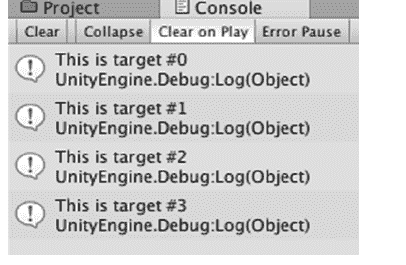

图 2-28. 输出到控制台面板的For循环

### while 循环

`while` 循环提供了更大的灵活性，因为只要条件结果为 `true`，它就会循环任意次数。

将你的代码更改如下：

```
#pragma strict

var numberOfTires : int = 0;

function Start () {
    while(numberOfTires < 4)
    {
        Debug.Log("I replaced an old tire on my car!");
        numberOfTires++;
    }
}
```

分解它，显示以下部分：

```
(1)         (2)
while(numberOfTires < 4)
    (3)
    {
                (4)
        Debug.Log("I replaced an old tire on my car!");
        numberOfTires++;
    (5)
    }
```

1. `while` 关键字。
2. 条件语句。
3. `while` 循环体的左花括号。
4. 包含在 `while` 循环的每次迭代中要执行的代码的语句块。
5. `while` 循环体的右花括号。就像 `for` 循环一样，`while` 循环以右花括号而不是分号结束。

这里最大的区别之一，也是问题的常见原因是，如果你的条件表达式永远不会计算为 `false`，`while` 循环就会继续运行。这就是所谓的**无限循环**——你绝不想让你的游戏陷入其中！

运行脚本，你会看到你已经给你的车换了四个新轮胎。你可以用 `for` 循环或 `while` 循环互换地重写这些简单的例子。当你在实际的游戏开发场景中继续应用它们时，你会体会到选择使用哪一个之间的细微差别。

根据经验，`for` 循环更常用于更精确定义的情况，例如要执行的循环次数是预先确定的，或者同一个变量用于初始值、条件语句和递增。

### do-while 循环

就像 `for` 循环一样，如果 `while` 循环的条件永远无法解析为 `true`，那么语句块就永远不会执行。会有这样的时候，你希望你的语句块在条件被测试之前至少运行一次。`do-while` 循环扩展了 `while` 循环，赋予了你这种能力。

编辑你的代码如下：

```
#pragma strict

function Start () {
    var someCondition : boolean = false;
    do
    {
        Debug.Log("Print something anyway");
    }
    while(someCondition == true);
}
```

这里你首先要做的就是将变量 `someCondition` 设置为 `false`。在关键字 `do` 之后，`do` 语句的主体会先执行一次，然后才到达 `while` 语句，在那里它最终会有一个条件来测试。根据你的变量声明，条件将解析为 `false`，程序随即退出循环。运行你的脚本，正如你所预料的那样，“Print something anyway”这一行会在控制台中出现一次。

`for` 循环和 `while` 循环之间的区别可能看起来不明显，但你将在接下来的演示中获得使用它们的练习。在游戏开发的背景下，你将对循环以及何时使用各种类型有更深入的了解。

## 坐标几何与向量

好的，现在需要稍微讨论一下。本书的编写考虑到了初学者。不是那种碰巧拥有数学高级学位的初学者，而是碰巧对游戏开发感兴趣的普通人……尽管我认为这让你比普通人酷得多。如果你碰巧拥有数学学位，那么你会欣赏让像 Unity 这样复杂的开发工具变得如此用户友好所需的优雅智慧。

你不需要了解内燃机理论就能开车，不需要了解固态电路设计就能使用计算机，也不需要了解任何关于电动机的知识就能使用电钻。最重要的是，你不需要成为数学奇才才能学习开发游戏。你在这个过程中肯定会学到比你想象的更多的东西，而且这甚至不会痛苦。我保证。

Unity 的创造者旨在使其直观，意味着易于使用和理解，他们已经取得了巨大的成功。“直观”也意味着对事物如何运作有一种感觉或本能，你将通过实践快速学会。通过实验观察游戏中发生的事情，你将发展出这种直觉。即使在我并非故意瞎搞的时候，我也无法告诉你有多少次，我认为我告诉 Unity 去做的事情与它解释我的脚本之间的差异，给了我意想不到的结果。但我的电脑从未冒火花或崩溃，而且通常那个搞砸的结果就像电影花絮一样有趣。学习游戏开发确实*是*娱乐性的——玩得开心！

大多数游戏，尤其是 3D 游戏，都与运动有关。向量（Vectors）和变换（Transforms）分别是你将使用的一些最常见的结构体（见下文）和类。它们描述了你的游戏对象的位置以及它们如何移动。本节是对坐标几何和向量数学基础知识的简要回顾，以及相关的 Unity 变量和函数，你可以在需要时随时参考。在你学习本节内容时，不要过于纠结于数学。虽然我怀念在加州理工学院必须手动计算向量的时间，但你不需要——Unity 会为你处理这些。目前，你的重点应该是学习术语和在 3D 空间中可视化向量及其功能，而不是数学本身。

Unity 使用笛卡尔坐标系来描述空间中的点，使用相互垂直的 x 轴和 y 轴（图 2-29）。**原点**是它们相交的点，定义在 x 和 y 的值都为零或 (0, 0) 的位置。二维空间中的每个唯一点都可以用它的 x 和 y 值来描述，语法为 (x, y)。

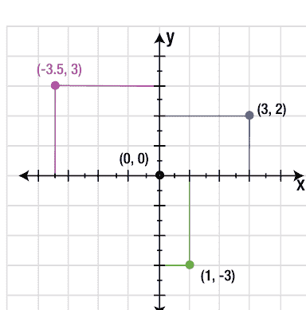

**图 2-29. 笛卡尔坐标系**

你到目前为止使用过的变量——`int`、`float`、`boolean` 和 `string`——被归类为**值**数据类型，因为它们包含一个特定的值，例如 8、`hello` 或 `false`。值类型变量的一个更复杂的版本被称为**结构体**或 `struct`。结构体是一个包含多个值的聚合的变量。

`Vector2` 是一个结构体，包含描述二维空间中位置和向量的 `x` 和 `y` 值。(x, y) 给出你在二维空间中的一个点的位置。要描述一条直线或向量，通常你需要知道直线两端点的坐标，但在 Unity 中，向量是相对于原点 (0, 0) 表达的直线，所以 (x, y) 也足以描述该向量（图 2-30）。

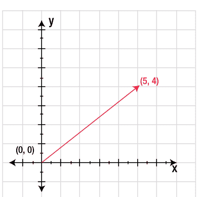

**图 2-30. 笛卡尔坐标系**

在 Unity 脚本参考中搜索 `Vector2`（图 2-31）。

#### Vector2

**描述**

2D 向量和点的表示。

此结构体在某些地方用于表示二维位置和向量（例如网格中的纹理坐标或材质中的纹理偏移）。在大多数其他情况下，使用 `Vector3`。

**图 2-31. Unity脚本参考中的Vector2描述**

在 MonoDevelop 中，更新你的代码如下：

```
#pragma strict

var myVector : Vector2 = Vector2(2, 3);
function Start () {
    Debug.Log(myVector);
}
```

点击 Play 进行测试，你将在控制台面板中看到分配给 `myVector` 的 (x, y) 坐标 (2, 3)（图 2-32）。

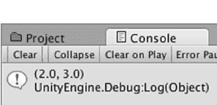

*图 2-32. 显示在控制台面板中的Vector2坐标(x, y)值*

Unity 在脚本参考中提供了一些常用的静态变量（图 2-33）。

| 静态变量 | |
|---|---|
| `kEpsilon` | “未文档化”。 |
| `one` | `Vector2(1, 1)` 的简写。 |
| `right` | `Vector2(1, 0)` 的简写。 |
| `up` | `Vector2(0, 1)` 的简写。 |
| `zero` | `Vector2(0, 0)` 的简写。 |

*图 2-33. Unity脚本参考中描述的Vector2静态变量*

将 `Debug.Log` 语句中的 `myVector` 替换为 `Vector2.up`，以确认你在控制台中得到 (0, 1) 作为输出。如果你想知道为什么没有 `.down` 或 `.left`，你只需使用 `-.up` 和 `-.right` 来表示它们的反方向。

向量的长度称为其**大小**。你可能还记得在几何课上使用勾股定理来求两点之间的距离，但当 Unity 需要确定游戏对象之间的距离时，它会通过 `Vector2.magnitude` 为你代劳。点击“magnitude”快速查看 `Vector2.magnitude` 的描述（图 2-34）。

**Vector2.magnitude**

`var magnitude: float;`

**描述**

返回此向量的长度（只读）。

向量的长度是 (x*x+y*y) 的平方根。

如果你只需要比较某些向量的大小，你可以使用 `sqrMagnitude` 来比较它们的平方大小（计算平方大小更快）。

另请参见：`sqrMagnitude`。

*图 2-34. Unity脚本参考中的Vector2.magnitude描述*

Unity 正在根据向量的 x 和 y 坐标进行计算，但你可以看到它遵循的是与几何课上 a、b 和 c 相同的公式（图 2-35）：

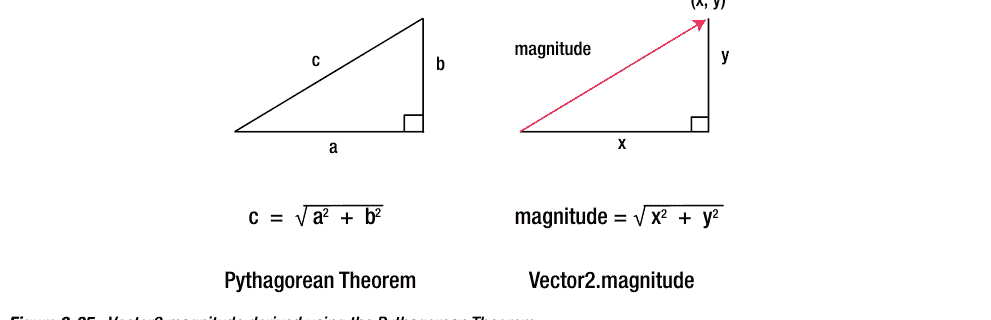

例如，当 a = 3 且 b = 4 时求 c。首先，a² = 9 且 b² = 16。将它们相加得到 25，然后取 25 的平方根以求得长度 c = 5。现在让 Unity 为 `Vector2` (3, 4) 进行相同的计算。将你的脚本编辑为以下内容：

```
#pragma strict

function Start () {
    var myVector : Vector2 = Vector2(3, 4);
    Debug.Log(myVector.magnitude);
}
```

Play 进行测试，控制台显示大小为 5。

再次查看 `Vector2.magnitude` 的描述。Unity 给了你一个提示：当你想比较两个向量的大小时，你也可以使用 `sqrMagnitude`。无论哪种方式，你都可以确定一个向量的大小是大于还是小于另一个，但使用 `sqrMagnitude` 会更快。无论是在脚本参考中还是 Unity 论坛上，你经常会看到关于速度的评论。游戏需要大量的计算能力，因此任何单独的计算完成得越快或越高效，你的游戏运行就越流畅。

在 `Vector2` 脚本参考的底部，你还会找到一些方便的数学和比较运算符供你使用（图 2-36）。

| 运算符 | |
| :--- | :--- |
| `operator -` | 从一个向量中减去另一个向量。 |
| `operator !=` | 如果向量不同则返回 true。 |
| `operator *` | 将一个向量乘以一个数字。 |
| `operator /` | 将一个向量除以一个数字。 |
| `operator +` | 将两个向量相加。 |
| `operator ==` | 如果向量相等则返回 true。 |
| `Vector2` | 将 `Vector3` 转换为 `Vector2`。 |
| `Vector3` | 将 `Vector2` 转换为 `Vector3`。 |

*图 2-36. Unity脚本参考中描述的Vector2运算符*

### 三维空间

三维空间的处理方式大致相同，只是增加了代表第三维度的数值。z 轴垂直于 x 轴和 y 轴。在 Unity 中，它们的朝向被设定为：x 轴在你的电脑显示器上水平向左右延伸，y 轴在显示器上垂直向上下延伸，而 z 轴代表深度，即“向显示器内”和“向显示器外”的方向。换言之，xz 平面是“地面”，而 y 轴是高度。原点是 (0, 0, 0)，代表 x、y、z 的值。在 Unity 中，这也被称为世界零点——你游戏世界的中心。正如你在二维空间中看到的那样，三维空间中的向量也是相对于原点来表达的（图 2-37）。

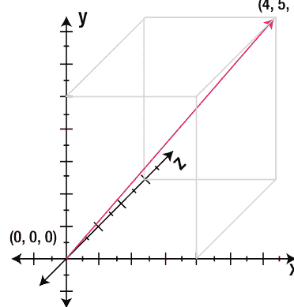

`Vector3` 是一个结构体，用于存储 x、y 和 z 的值。在 Unity 脚本手册中查阅 `Vector3`，你会发现它与 `Vector2` 非常相似，提供了便捷、常用的静态变量、x、y 和 z 分量及向量长度值，以及许多相同的功能和运算符。

为了进行比较，请在 Unity 脚本手册中查看 `Vector3.magnitude`（图 2-38）：

**Vector3.magnitude**

`var magnitude: float;`

**Description**

Returns the length of this vector (Read Only).

The length of the vector is square root of (x*x+y*y+z*z).

If you only need to compare magnitudes of some vectors, you can compare squared magnitudes of them using sqrMagnitude (computing squared magnitudes is faster).

See Also: `sqrMagnitude`.

*图 2-38. Unity脚本手册中的Vector3.magnitude*

现在计算过程会考虑 z 分量的值。更新你的代码以计算三维向量的长度，如下所示：

```
#pragma strict

function Start () {
    var myVector : Vector3 = Vector3(3, 4, 12);
    Debug.Log(myVector.magnitude);
}
```

运行测试，控制台应显示长度为 13。

> **注意** “Play”（播放）、“Run”（运行）、“Test”（测试）、“Enter play mode”（进入播放模式）、“Play to test”（播放以测试）和“Playtest”（试玩）都是在 Unity 编辑器游戏视图中播放场景的可互换术语。

无论你使用的是二维还是三维向量，这些变量、函数和运算符构成了处理基于各个游戏对象位置和方向的游戏逻辑决策的基本工具的重要部分。现在你知道了如何声明变量，包括 `Vector2` 和 `Vector3` 这样的结构体，如何调用函数处理变量中的数据，以及在哪里找到 Unity 的内置函数。

## 总结

你现在知道如何使用 Unity 脚本编辑器 MonoDevelop，并且已经了解了基本的编程术语和概念——干得好！本章既作为介绍也作为参考，为你打下了必要的基础，从这里开始，你将能够在 Unity 编辑器中看到你的脚本作用于游戏对象的结果。而我说的结果，意味着你即将迎来更多的动作、爆炸和音效——呜呼！

# 第三章：制作一个简单场景

到目前为止，你已经搭建好了游戏开发环境，并且对编程基础、你的脚本工具 MonoDevelop 以及 Unity 脚本手册有了初步了解。本章的重点是你的主要游戏开发工具 Unity，以及如何创建和管理构成一个基本游戏场景的基础部分。

游戏由场景组成，场景由游戏对象组成，游戏对象由组件组成，而组件则由其内部函数管理的属性组成，如图 3-1 所示。在本章中，你将通过 Unity 编辑器界面，亲身体验如何将这些元素组合到一个场景中，同时还将介绍 Unity 为方便你使用而提供的标准资源包。

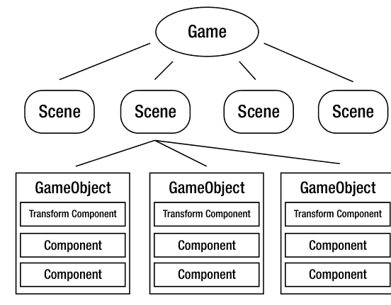

## 新项目，新场景

是时候开始行动了。就像你在第二章所做的那样，使用 Unity 编辑器顶部菜单选择“文件” > “新建项目”来创建一个新项目。项目向导窗口将会打开。为你的项目命名，确保选中“创建新项目”选项卡，将设置默认值保持为 3D，然后创建你的新项目。和之前一样，你的新项目及一个空场景将出现在 Unity 编辑器中。在这个快速简单的过程中，Unity 已经为你设置好了一个可立即运行的游戏框架。

如果你好奇的话，可以在访达或资源管理器中查看一个游戏所需基本文件的内容（图 3-2）。**资产**是你创建或导入到项目中的项目，例如模型、动画、脚本和音频剪辑；它们会被自动放入 Assets 文件夹。Unity 接受各种文件类型，然后在内部将其转换为兼容的版本。同时，Unity 会生成称为**元数据**的附加数据，这些数据存放在 Library 文件夹中，除了其他功能外，它还帮助 Unity 知道在游戏过程中这些转换后的资产在哪里以及它们如何相互关联。Unity 会自动以特定方式组织这些文件夹和文件，所以如果你移动这些文件夹或文件，Unity 编辑器将无法找到它们。

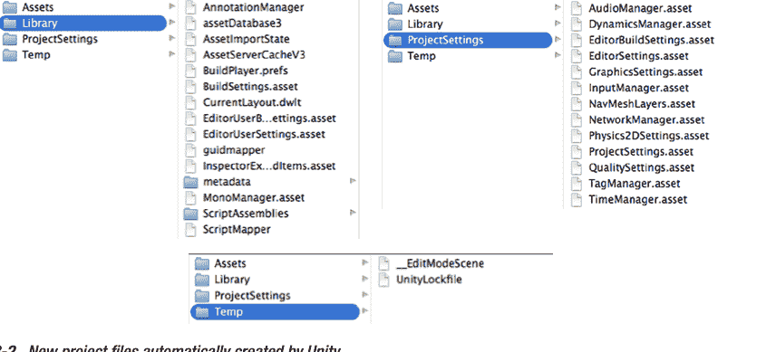

*图 3-2. Unity自动创建的新项目文件*

> **注意** 始终使用项目窗口来组织 Assets 文件夹中的资产。

回到 Unity 编辑器，你要做的第一件事是命名并保存你的场景。Unity 处理保存的方式与其他程序（如文字处理器）略有不同。当你正在处理游戏场景时，“保存场景”用于保存你所做的更改。虽然你可能认为“保存项目”会保存项目中的所有内容，包括你当前正在处理的场景，但它实际上保存的是项目中*除*当前场景之外的所有内容，例如资产或整体项目设置。与涉及计算机的任何事情一样，经常保存你的工作是一个好习惯。


从视觉上看，一个**场景**是Unity编辑器场景视图中显示的二维或三维空间，其中包含以游戏对象形式呈现的游戏内容。虽然一个场景可以构成整个游戏，但通常整个游戏中的每个关卡和菜单都会使用不同的场景。

场景的空间维度使用笛卡尔坐标系定义。为了查看这一点，在Unity编辑器顶部菜单中选择“游戏对象” > “创建其它” > “立方体”（图3-3）。

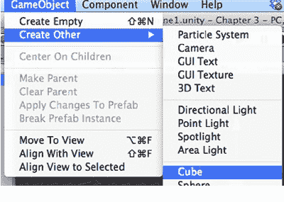

**图3-3.** Unity顶部菜单“游戏对象” > “创建其它” > “立方体”

新的游戏对象以“Cube”（立方体）的形式出现在层级视图中，一个带有其操作手柄的立方体出现在场景视视图中，而其组件则出现在检查器视图中。在检查器视图中，你会在变换组件中看到，游戏对象的位置由其坐标 (x, y, z) 描述。默认情况下，Unity将新游戏对象放置在原点 (0, 0, 0)，即世界零点。（图3-4）。

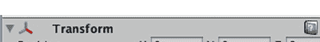

**图3-4.** 检查器面板中显示的立方体游戏对象位置

## 游戏对象

虽然游戏对象最好被视为组件的容器，但为了方便你，Unity提供了一些预制体游戏对象形状，如立方体，它们已经配备了一些基本组件，你会在检查器中看到这些组件的列表（图3-5）。

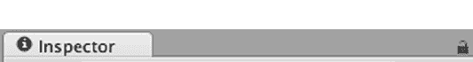

**图3-5.** 检查器面板中显示的立方体游戏对象标题

从检查器面板的标题开始，如图3-5所示，第一个复选框表示游戏对象在场景中是活动的。如果你取消选中它，你会注意到立方体从场景视图中消失，但不会从层级视图中消失。它并没有从你的项目中删除；取消选中它允许你在处理其他事情时将其移开。请保持此框为选中状态。

其次，游戏对象的默认名称是Cube。如果你在检查器面板中更改名称，你会看到更改会反映在层级视图中，反之亦然。

标签用于标识游戏对象组，例如玩家或敌人。这使你可以编写能够轻松找到并仅影响感兴趣的游戏对象组的脚本。

图层是另一种将对象分组的方式，用于其他目的，例如光线投射、光照和渲染限定于场景内特定组的对象。

静态复选框应为不会在场景中移动的环境对象勾选。使用图层和静态复选框有助于Unity减少渲染游戏所需的总计算量，从而让你的游戏运行得更流畅。

检查器面板中的其余内容是构成立方体游戏对象的组件列表。

## 组件

Unity游戏引擎的真正威力在于其组件。组件控制着游戏对象的外观、行为和交互。Unity为你提供了大量预制组件来构建你的游戏对象。查看“组件”顶部菜单及其下拉菜单中的内容（图3-6）。

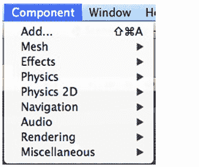

你可以通过这个菜单向游戏对象添加组件，或者像你在第二章中使用脚本那样，通过检查器面板中的“添加组件”按钮来添加。

最重要的是变换组件，这是每个游戏对象都必须拥有的一个组件。变换的位置、旋转和缩放属性定义了游戏对象在场景中的存在，涉及其位置、相对于场景的朝向以及大小。即使是一个空游戏对象也必须有一个变换组件。

Inspector 面板不仅显示附加到游戏对象的组件列表，还是一个用于配置组件属性的界面。你可以输入新值来更改 Transform 组件的三个默认属性中的任意一个。或者，你也可以通过在 Scene 视图中点击并拖拽游戏对象 Gizmo 的手柄来直观地操作它，并在 Inspector 中看到这些变化。去尝试一下吧。记住，你可以使用 W、E 和 R 键在 Transform 属性之间快速切换。

在右上角，那个带有问号的小蓝书是 Unity 组件参考手册的链接。齿轮图标为你提供了一种快速重置组件默认值的方法，以及其他编辑功能（图 3-7）。当你完成对 Cube Transform Gizmo 的试用后，请重置 Transform 属性。

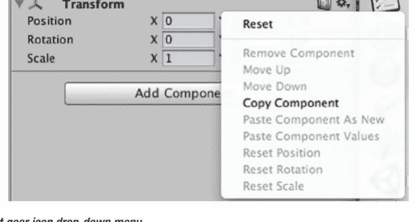

Unity 通过提供开箱即用的许多游戏开发者最常用组件来加速游戏开发过程。脚本也是组件——它们也会影响游戏对象的外观、行为或交互。脚本本质上是你为游戏的独特需求创建的自定义组件。

## Main Camera

新创建的场景并非完全为空；它预先包含了一个游戏对象，即 Main Camera 游戏对象。像任何游戏对象一样，你可以移动它、为它应用脚本，以及进行任何适用于游戏对象的通用操作。Main Camera 是玩家观看场景的视口。如果看不到场景，游戏就没意思了，所以新场景中始终包含这个对象是合理的。在 Scene 视图或 Hierarchy 视图中选择 Main Camera，即可在 Inspector 中显示其内容（图 3-8）。

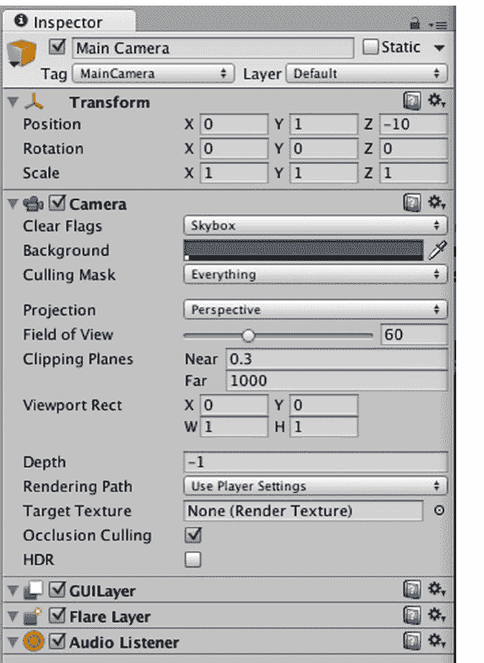

**图 3-8.** *Inspector 面板中的 Main Camera 组件*

## Transform

一如既往，必需的 Transform 组件排在第一位。

> **提示** 养成一个好习惯：按一致的顺序列出组件，以便更容易找到它们。

虽然你创建的任何新游戏对象都会自动放置在原点，但 Main Camera 的 Transform 位置设置使得这些新对象会出现在其视野内，如 Scene 视图右下角的 Camera Preview 所显示的那样（图 3-9）。进入 Play 模式，你会发现 Game 视图被准确呈现，然后退出 Play 模式。

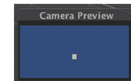

**图 3-9.** *Camera Preview 显示 Cube 游戏对象*

## Camera

Main Camera 是一个包含 Camera 组件的游戏对象。为简便起见，我们通常直接称其为“camera”。实际的 Camera 组件具有多个属性，下面简要描述。

## Clear Flags

Clear Flags 用于设置背景。背景是绘制所有游戏元素后剩下的部分。默认值是 Skybox，但目前该项目尚未设置 Skybox 资源。我们现在就来处理这个问题。

在 Unity 顶部菜单中选择 Assets > Import Package > Skyboxes。Import 窗口将默认选中 Standard Assets 中的所有天空盒选项。保持它们选中，点击 Import，你将看到它们出现在 Project 视图中。你可能只会看到一个 Standard Assets 文件夹出现。继续展开 Standard Assets/Skyboxes/Textures 文件夹，直到看到各种天空盒纹理的选择（图 3-10）。花点时间查看一下，并决定你想将哪一个应用到场景中。

# 第三章：创建一个简单场景

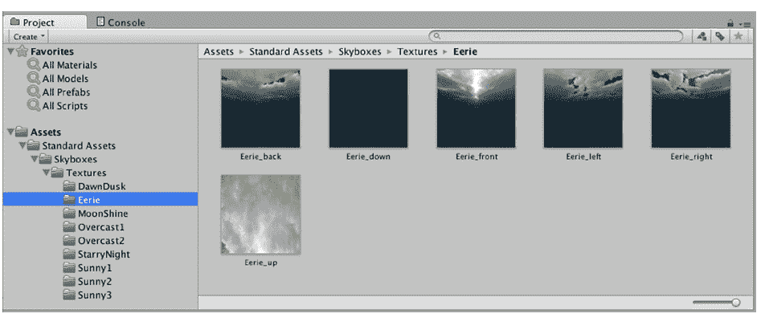

**图 3-10.** *Project 视图中显示的天空盒*

再次在 Unity 顶部菜单中选择 Edit ▶ Render Settings。现在 Inspector 会显示适用于此场景的渲染属性。每个场景的渲染属性设置都是该场景独有的。你可以通过点击 Inspector 中 Skybox Material 属性右侧的小目标图标，在弹出的天空盒材质窗口中设置你选择的天空盒材质；或者，你可以从 Project 视图的 Skybox 文件夹中将材质直接拖放到 Inspector 中的 Skybox Material 属性上（图 3-11）。当材质被拖到正确位置时，属性字段会变成蓝色。

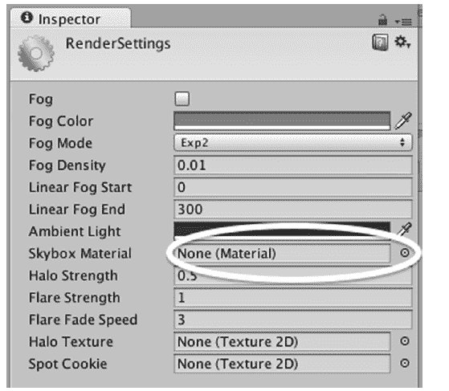

**图 3-11.** *Inspector 中显示的渲染设置*

在 Scene 视图中环顾四周，查看你的新天空盒背景，并注意它也出现在了 Camera Preview 中。屏幕上未被游戏元素占据的任何部分现在都将被天空盒填充。

你可以在一个场景中拥有多个摄像机。在 Inspector 面板中，Clear Flags 的 Only Depth 下拉设置用于此场景，其中不同的摄像机可用于平视显示器（HUD）或小地图。玩家看到的每一个不同摄像机的视图都是分层叠加的。额外摄像机的 Clear Flags 设置为 Only Depth，而 Main Camera 的 Clear Flags 设置通常保持为 Skybox，并且具有最低的深度值，使其成为场景的最终背景。

Don't Clear 下拉设置意味着在绘制下一帧之前不清除上一帧，从而产生类似涂抹的效果。这并不常用。

## Background

当 Clear Flags 属性选择 Solid Color 时，你可以使用 Background 属性来选择一种颜色，用于表示游戏元素绘制后剩余的屏幕区域。

## Culling Mask

Culling Mask 指定了场景中的哪些层将被摄像机渲染。层用于对对象进行分组。你可能只希望某个特定层的对象被一个摄像机渲染，而其他层由另一个摄像机渲染。例如，Unity 建议一个良好的实践是将用户界面（UI）保持在单独的层中（图 3-12）。

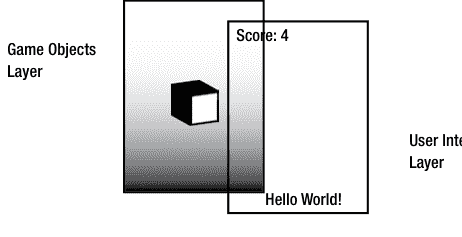

**图 3-12.** *将游戏对象层和用户界面层分开*

## Projection

Projection 属性在 Perspective（透视）和 Orthographic（正交）视图之间切换摄像机。摄像机将渲染位于一个称为**视锥体**的特殊形状内的所有对象（见图 3-13）。

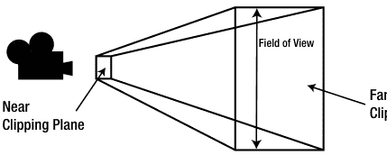

*图 3-13. 显示近裁剪面和远裁剪面的视锥体*

在透视模式下，当近裁剪面小于远裁剪面时，渲染的场景会给人一种透视缩小或透视缩短的效果，即物体甚至物体的某些部分随着距离变远而显得更小。这是 3D 游戏中更常用的投影方式。在正交模式下，近裁剪面和远裁剪面大小相同，导致摄像机以平行方式观察物体。这种模式更常用于 2D 游戏或游戏的 2D 层，如 UI。在 Unity 编辑器中，当选中 Main Camera 时，你可以在 Scene 视图中看到视锥体的轮廓。

## Field of View

摄像机的垂直视角，沿局部 y 轴以度为单位测量。

## Clipping Planes

Clipping Planes（裁剪面）垂直于摄像机，界定了金字塔形视锥体的顶部和底部。只有位于裁剪面之间且在视锥体体积内的对象才会被渲染。

## Viewport Rect

最终，摄像机看到的游戏视图会被渲染到二维的屏幕上。Viewport Rect 是一个归一化的坐标比例尺，它将屏幕左下角定义为 (0, 0)，右上角定义为 (1, 1)。**归一化**意味着无论实际屏幕尺寸如何，例如在显示器或手持设备上，(0, 0) 仍然是屏幕左下角，(1, 1) 是右上角。它用于指定摄像机视要绘制在屏幕上的相对位置。

## Depth

正如之前在 Clear Flags 中讨论的，当使用多个摄像机时，Depth 是你指定每个摄像机层级别的属性，最低值对应底层，因此其视图首先被渲染。

## 组件参考

剩余的相机组件属性远超出本书的涵盖范围。如需对任何这些属性进行极其详细的描述，请点击蓝色的书本/问号图标，以在您的网页浏览器中打开相机的组件参考。

> **提示** 您应始终查阅文档，以熟悉新组件。

说真的，请花时间查阅文档。您会发现，正如脚本参考中有用的示例代码片段一样，Unity 为您提供了使用组件的超实用提示（图 3-14）。

**提示**

-   摄像机可以像任何其他游戏对象一样被实例化、设置父级和编写脚本。

-   要在赛车游戏中增强速度感，请使用较高的**视野**。

-   如果您添加了**刚体**组件，摄像机可用于物理模拟。

-   您场景中的摄像机数量没有任何限制。

-   正交摄像机非常适合制作 3D 用户界面。

-   如果您遇到深度伪影（彼此靠近的表面闪烁），请尝试将**近平面**设置得尽可能大。

-   摄像机无法同时渲染到游戏屏幕和渲染纹理，只能二选一。

-   专业版许可持有者可以选择将摄像机的视图渲染到纹理（称为渲染到纹理），以实现更多独特效果。

-   Unity 预装了摄像机脚本，可在 **Components->Camera Control** 中找到。尝试使用它们，以体验其可能的效果。

*图 3-14. Unity 组件参考中关于摄像机的提示*

## GUILayer

附加到主摄像机的 GUILayer 允许渲染 GUIText 和 GUITextures，它们是通常用作 UI 部件的 2D 对象。该复选框用于启用或禁用 GUILayer。

## Flare Layer

镜头光晕是真实摄像机中玻璃镜头产生的光学效果。此效果由 FlareLayer 组件模拟，稍后将在本章中演示。

## 音频监听器

声音对用户体验也很重要。Unity 让您可以在 2D 和 3D 声音之间进行选择。音频源是一个游戏对象，包含您分配的声音剪辑，并充当其扬声器。您可以在整个场景中放置任意数量的音频源。2D 声音在整个游戏中以恒定音量播放，更适合环境背景音效或音乐。3D 声音在场景中依赖于位置；它们在接近时会变大，远离时会变小。这种产生 3D 效果的音量变化由 Unity 自动处理，因此音频监听器中没有可调整的属性。

音频监听器从各种音频源收集声音，通过设备扬声器传递给玩家。每个场景只需要一个音频监听器。Unity 将其附加到主摄像机，因此任何新场景都具有音频功能，但您可以将其移动到另一个游戏对象（通常是玩家），具体取决于您的游戏需求。

## 灯光

此时您拥有一个带有天空盒背景和 Cube 游戏对象的新场景。如果您进入播放模式，立方体仍然是暗的。无论天空盒纹理中存在多少光，它都只是一个纹理，或天空的图像，不会将光投射到场景中的游戏对象上。为此，您需要一个 Light 游戏对象。示例包括：

1.  *平行光：* 像阳光一样照亮场景中的每个游戏对象，尽管它不是来自单一点光源。

2.  *聚光灯：* 来自单一点的锥形光区域，像聚光灯或手电筒一样。

3.  *点光源：* 像灯泡一样，从中心点向所有方向发光。

4.  *区域光：* 用于烘焙到光照贴图中，超出了本书范围。

使用层级视图中的“创建”按钮或顶部菜单中的“游戏对象 ▶ 创建其他”，向场景中添加一个平行光。如果您选择主摄像机，您将在摄像机预览中看到立方体明显变亮。重新选择平行光，并查看检视面板中的属性。

第一个属性是类型。即使您创建了一个平行光，也可以使用此下拉菜单将其更改为另一种类型的灯光。请注意，检视面板保持上下文敏感，属性会根据所选类型而变化，但层级视图中的名称“平行光”不会反映此处所做的任何更改。

## 常见灯光属性

我想再次强调动手实验 Unity 的重要性。以下对灯光属性的描述并非意味着枯燥的讲座——这些属性最好通过观察和体验来了解，而不是被动地阅读。虽然我没有为每一个属性都提供分步说明，但我强烈建议您在 Unity 中测试每一个属性，以便您可以在场景视图和播放模式中看到它的效果。请记住，您始终可以使用灯光组件的齿轮图标来重置属性。

### 颜色

单击方框会弹出一个颜色选择器，用于选择任何颜色的光。如果您单击滴管图标，您会看到方框中的颜色会更改为鼠标光标当前悬停位置的颜色——例如，使用鼠标光标从计算机屏幕上另一个窗口中显示的图像中采样颜色。

### 强度

这是光的亮度，8 最亮，0 基本无光。虽然更改灯光类型时值不会更改，但创建新灯光时，平行光的默认值为 0.5，点光源和聚光灯的默认值为 1。

### Cookie

Cookie 就像灯光前面的遮罩或屏幕，赋予其阴影图案。在 Unity 编辑器中，使用 Transform 组件的齿轮图标选择“重置”。现在将灯光 Transform 位置设置为 (0, 0, –2)，类型设置为 Spot。从顶部菜单选择“资源 ▶ 导入包 ▶ 光Cookie”。将打开“导入包”窗口，其中列出了 Unity 标准资产中可用的 Cookie。单击“导入”，然后检查项目面板中的资源文件夹，找到光 Cookie 文件夹已加入标准资产文件夹中的天空盒文件夹（图 3-15）。

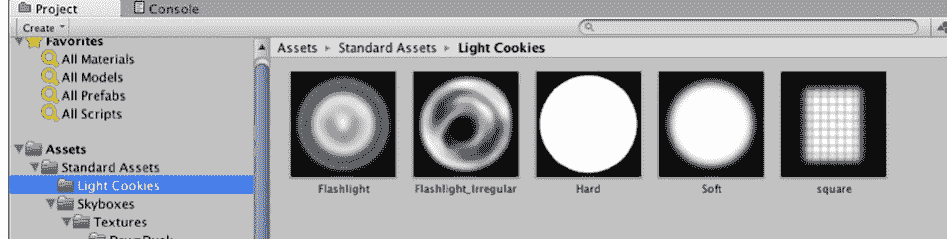

**图 3-15.** *Unity 标准资产中光 Cookie 包的内容*

将其中任何一个拖到检视面板中的 Cookie 属性上，以查看灯光图案如何在 Cube 游戏对象上显示。

要清除 Cookie 属性，请单击属性字段右侧的“目标”图标，打开“选择纹理”弹出窗口（图 3-16）。在这里，您将找到迄今为止导入的所有包中的所有纹理。在列表顶部，选择“无”，查看 Cookie 属性中的更改，然后关闭弹出窗口。

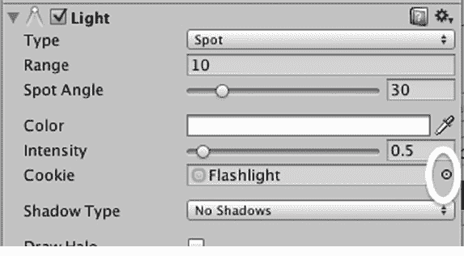

*图 3-16. 用于打开“选择纹理”弹出窗口的目标图标*

如果您碰巧有 Photoshop 技能，可以在 Unity 手册的“常见问题解答”➤“图形问题”➤“如何制作聚光灯 Cookie？”下找到制作自己的 Cookie 的说明。

### 阴影类型（仅限专业版）

当您准备好提升游戏水平时，您绝对想看看 Unity Pro 中许多可用的额外效果。除了新功能、改进的开发人员工具和更多目标平台之外，Unity 最近还更新了其定价结构，使专业版对独立开发人员更加易于接受。您可以通过在顶部菜单中选择“购买”来在 Unity 网站上找到有关此的更多信息。

### 绘制光晕

“绘制光晕”属性的“光晕”效果在选中时，会产生灯光周围空气中存在粒子的效果。

### 光晕

将灯光 Transform 位置设置为 (0, 2, 3)，类型设置为 Point。从顶部菜单选择“资源 ➤ 导入包 ➤ 光线光晕”。将打开“导入包”窗口，其中列出了 Unity 标准资产中可用的光线光晕。单击“导入”，然后检查项目面板中的资源文件夹，找到光线光晕文件夹已加入标准资产文件夹中的光 Cookie 和天空盒文件夹。将 Sun 资源拖到光晕属性窗口中，并在场景视图或游戏视图中查看其效果（图 3-17）。

## 渲染模式

此模式用于指定光源的重要性。在运行时计算光照和阴影可能会消耗大量计算资源。当某些操作因消耗大量计算资源而影响游戏的质量和性能时，通常称其为“高开销”。评估光源的相对重要性有助于Unity优化游戏性能，这将在本书后续章节中详细讨论。

## 剔除遮罩

其工作原理与摄像机组件中的剔除遮罩属性相同，可在此指定希望受光照影响的层级。

## 光照贴图

“仅实时”表示该光源用于在运行时动态照亮场景。“仅烘焙”指光照贴图技术，这超出了本书的讨论范围。“自动”模式则同时支持两者。

## 其他属性

根据所选光源类型的不同，还会显示一些特定的属性。这些属性将出现在与上下文相关的检视面板中，具体取决于你的选择。

## 范围

对于点光源和聚光灯，“范围”指的是从光源发出的有效光照距离。游戏对象超出范围将不会被照亮。选中光源时，其范围会在场景视图中以黄色球体的形式直观显示。

## 聚光角度

此属性专用于聚光灯。聚光角度以度为单位，决定了聚光灯光锥的宽度。

## 立方体

现在让我们仔细研究立方体游戏对象。选中它，即可在检视面板中显示其所有组件（图3-18）。

## 变换

到目前为止，你应该已经熟悉了变换组件及其位置、旋转和缩放属性，以及它们对应的快捷键和辅助工具。你可能已经注意到，辅助工具采用颜色编码以便于记忆：（x, y, z）分别对应（r, g, b），即红、绿、蓝。

关于缩放游戏对象有一点说明：出于性能考虑，最好在模型导入Unity之前，就根据你的游戏需求对其进行适当缩放。

## 网格过滤器

在讨论网格过滤器属性之前，先简要说明一下网格的概念。所有3D游戏对象的形状从根本上都是由相互连接的三角形构成的，这些三角形称为**多边形**。每个多边形由三条边（或称**边**）定义，边相交的点称为**顶点**。**网格**就是构成游戏对象3D几何形状的多边形集合。要查看构成立方体游戏对象的多边形，请在场景视图的控制栏中选择“线框”模式（图3-19）。

网格过滤器的网格属性中指定的网格资产，以数学方式存储了顶点坐标和其他描述模型几何结构的数据。多边形数量越多，计算机需要处理的数据就越多。这意味着多边形数量可能会影响游戏性能。网格过滤器将这些网格数据传递给网格渲染器，以便渲染模型，使其显示为一个浅灰色的对象，就像你现在看到的立方体一样。

## 盒体碰撞体

盒体碰撞体使用与立方体类似的网格数据，但目的并非将模型渲染到屏幕。网格过滤器和网格渲染器使游戏对象可见，而**碰撞体**则是一个不可见的组件，用于检测与其他具有碰撞体或刚体组件的游戏对象的接触。当这两个游戏对象发生碰撞时，碰撞体会将有关游戏对象的信息传递给游戏引擎。

碰撞体利用游戏对象模型的体积来检浀是否与另一个游戏对象发生了碰撞。参与碰撞的游戏对象中，至少有一个必须附带刚体组件，它们才能在游戏世界空间中进行物理交互。

**触发器**用于在脚本中检浀碰撞，以通过代码管理触发游戏事件，而非物理交互。当两个游戏对象接触时，会生成关于这些对象的数据，这些数据可以以多种方式用于影响游戏玩法，但游戏对象之间不会产生明显的物理交互效果。

当作为碰撞体用于物理交互，且至少一个游戏对象附带刚体组件时，附加在材质属性上的物理材质会影响物理引擎确定碰撞行为的方式。例如，物理材质可以使游戏对象具有更大或更小的“弹性”。

碰撞体不必与其附着的游戏对象形状完全匹配。简单的碰撞体形状也可以组合起来，用于更复杂的3D模型。中心点和尺寸属性用于相对于游戏对象模型来定位和缩放此碰撞体。你将在第6章中了解更多关于碰撞体、触发器、物理材质和物理引擎的内容。

## 网格渲染器

网格渲染器将从网格过滤器传递过来的几何数据（这些数据决定了模型的形状）与材质、纹理、灯光和阴影组合起来，将模型渲染到屏幕。这些属性是为Unity Pro用户准备的，超出了本书的讨论范围。

## 材质

材质通过组合**着色器**脚本和**纹理**图像来设置模型的外观，例如区分哑光或光泽反射品质。有关Unity提供的数十种着色器示例，请参见图3-20。

现在让立方体变得更炫酷一些。在Unity编辑器顶部菜单中，选择“资产” ▶ “导入新资产...”以打开弹出窗口。浏览你的文件，选择你喜欢的图像，或使用本书下载资源中包含的粉红玫瑰图像（你可以在 [http://www.apress.com/9781430265863](http://www.apress.com/9781430265863) 找到这些资源）。点击“导入”，图像文件将出现在项目面板中。将图像拖动到场景视图中的立方体上，会发生几件事：一个包含新纹理图像的材质被创建并出现在项目视图的“材质”文件夹中，同时该新材质被应用到立方体的各个面上，你可以在场景视图中看到。最初导入资产文件夹的图像文件仍以其原始形式存在。

## 预制件

Unity的核心在于高效的游戏开发。既然你已经配置了一个炫酷的立方体，你可以将其存储为预制件，以便在游戏中快速创建更多炫酷的立方体。组织性是高效的关键，因此首先创建一个“预制件”文件夹来存放这个以及将来为此场景创建的所有预制件。

在项目面板中，选择“创建” ▶ “文件夹”并将其命名为“预制件”。在层级视图中，双击“立方体”缓慢地将其重命名为“粉红玫瑰立方体”。重命名后，将其从层级视图拖动并放入“预制件”文件夹。此操作会为该游戏对象创建一个模板，与原始立方体区分开来（图3-21）。在层级视图中，选中该游戏对象，然后按⌘+Backspace将其删除。

在用预制件立方体克隆填充场景之前，这里有一个整理的小技巧：为了保持层级视图井然有序，可以使用空游戏对象作为文件夹。使用Shift+⌘+N，或在Unity编辑器顶部菜单中选择“游戏对象” ▶ “创建空对象”。将其重命名为“炫酷立方体”。

从项目面板的“预制件”文件夹中，将一个“粉红玫瑰立方体”拖动到层级视图的“炫酷立方体”中。新的预制件游戏对象将出现在场景视图的原点。选中这个新游戏对象，按⌘+D（D代表复制）或从顶部菜单使用“编辑” ▶ “复制”来创建该游戏对象的新实例。第二个“粉红玫瑰立方体”游戏对象出现在层级视图中，缩进显示在“炫酷立方体”下，表示它是“炫酷立方体”父对象的子对象（图3-22）。

## 第三章：理解游戏对象与预制件（续）

*图3-22.* 层级视图中显示的父子关系

场景视图看起来相同，因为这第二个游戏对象和第一个一样被放置在原点。使用操纵器重新定位这些对象。重复此过程，直到你拥有大约半打游戏对象分布在场景中彼此靠近的位置，并且你能同时看到它们全部（图3-23）。

*图3-23.* 预制件填充场景

当游戏对象与父对象存在父子关系时，它们的Transform位置变为相对于父对象而非世界零点。如果你移动父对象，子对象将保持这种相对定位。在层级视图中选择"Snazzy Cubes"空游戏对象。使用现在出现在场景视图中的其操纵器，抓取一个手柄并移动它。正如你所见，所有的立方体都随它一起移动（图3-24）。

*图3-24.* 子对象随父对象移动

选择其中一个预制件，然后在检查器中将其Transform的缩放z值更改为2。现在你得到一个矩形块而不是立方体（图3-25）。尽管这个游戏对象是从预配置的预制件创建的，你仍然可以单独编辑它。将z的缩放值设回1。

图3-25. 单独编辑的预制件游戏对象

现在选择预制件文件夹中的"Pink Rose Cube"预制件游戏对象。在检查器中，将其Transform的缩放y值更改为2。这次，你场景视图中的所有预制件都变成了高大的矩形块（图3-26）。如果你修改了预制件模板的属性，这些更改会反映在该预制件的所有实例上。

图3-26. 编辑预制件模板影响所有预制件

# 总结

你在本章取得了巨大进步。你理解了构成场景的结构，以及一个必需的游戏对象——主摄像机。你知道游戏对象是组件的容器，以及如何在Unity的组件参考中快速找到组件。你熟悉了Unity的原始形状游戏对象、摄像机和灯光的默认组件。你知道如何导入资源，并通过天空盒为场景、通过材质为游戏对象增添色彩。你甚至尝试了使用Cookies和Flares的一些特效。你正在养成保持项目组织良好的习惯。通过创建预制件，你正变得高效，并且你知道如何单独或成组地编辑预制件。太棒了！

不过，有趣的是。对于一本关于脚本的书来说，本章竟然没有一个脚本。这是有意为之。首先，我希望你有机会熟悉在Unity编辑器中导航。其次，尽管你可以做很多巧妙的事情来设置场景，我希望你注意到，没有脚本时，你只能走到这一步。尝试运行它时，它并不会做太多事情。

别担心——如果你想体验动作密集型内容，将在第四章中尝到滋味，届时你会将脚本引入游戏场景。脚本驱动游戏对象之间的动作，更不用说玩家与游戏之间的互动了。通过一点一滴的积累，你将开始构建实际Unity开发和脚本技能的基础。随着你添加动画、真实物理行为、粒子效果等，情况会变得越来越美妙。

# 第四章 使用脚本和游戏对象

既然你已经掌握了编程基础，并对Unity编辑器及配套的开发者工具有了良好理解，是时候将脚本引入游戏场景了。

脚本与Unity游戏引擎携手工作。你的脚本使用Unity API的类、函数和变量来自定游戏对象的行为。你已经看到，当你创建一个新项目时，Unity会创建一个非常基本的、功能性的游戏，它由一个空场景组成。同样，当你创建一个新脚本时，Unity会用一个空的`Start()`和`Update()`函数来填充它。

Unity游戏引擎在幕后做了大量工作。无论你是否附加脚本，它都会在每个游戏对象上运行`Start()`和`Update()`函数。当你像在第二章中那样，在`Start()`或`Update()`函数的大括号之间添加代码时，你就是在**重写**该函数。

Unity游戏引擎仍然会在游戏启动和运行期间的适当时机运行`Start()`和`Update()`函数。但最初它们是空的，不执行任何操作，而添加你的代码重新定义了每个函数被调用时游戏内发生的事情。

理解一些幕后操作非常重要。你需要理解游戏引擎何时调用各种函数，以便决定重写哪个函数是正确的，从而使游戏对象按你期望的方式行为。

你将开始使用第二章介绍的一些编程命令，直接影响游戏对象的行为或通过玩家交互来影响。你还将开始使用Unity API中几乎所有游戏类型都通用的类和函数。

我强烈建议你花时间亲自将示例代码输入到脚本中，而不是复制粘贴。这确实会花更长时间，但这正是重点。亲自输入迫使你放慢速度，专注于代码的每个部分，这反过来有助于你记住和回忆这里学到的概念。

## # 脚本作为行为组件

从我们之前的项目继续，在编辑器顶部菜单中选择 Assets > Import Package > Scripts（如图4-1所示）。

*图4-1.* Unity标准资源中的脚本

导入全部，在你的项目面板中，你会看到Standard Assets文件夹下出现了一个新的Scripts文件夹。双击Scripts文件夹打开它，然后选择Camera Scripts文件夹以显示其内容。在这里你会找到三个脚本：MouseOrbit、SmoothFollow和SmoothLookAt，如图4-2所示。

*图4-2.* 标准资源摄像机脚本

MouseOrbit脚本将作为主摄像机的行为组件。摄像机的视点将聚焦于单个游戏对象，你将能够用鼠控制它围绕游戏对象的移动。

你可以通过多种方式将MouseOrbit脚本添加到主摄像机。你可以从项目面板拖拽它并放置到层级视图的主摄像机上，或者直接放置到场景视图中的主摄像机游戏对象上。当你尝试第二种方法时，当你拖拽到足够靠近主摄像机游戏对象时，你会看到一个绿色圆圈内含白色加号。

第三种方式是选择层级视图中的主摄像机，然后使用检查器中出现的“添加组件”按钮。你会看到一个组件弹出窗口，它已按行为组织了组件，在这种情况下，那些涉及摄像机行为的脚本被归入“摄像机控制”菜单选项。点击它以查看脚本图标，并从列表中选择“Mouse Orbit”（图4-3）。

图4-3. 使用“添加组件”附加MouseOrbit脚本

如果你正在尝试每种方法，请记住你可以通过用于重置组件属性值的相同齿轮图标来移除组件（图4-4）。

图4-4. 从检查器的齿轮下拉菜令中移除组件

在第二章中，你学到如果你将一个变量声明为public，它将作为可编辑属性出现在检查器视图中。在图4-5中，你看到MouseOrbit组件中的属性与MouseOrbit脚本中声明的public变量的对比。你可以通过选择项目面板中的MouseOrbit脚本图标来自己比较；脚本将出现在检查器中。

## 第四章：使用脚本与游戏对象

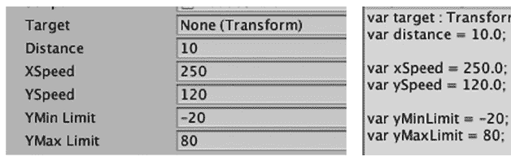

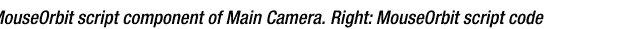

MouseOrbit 脚本需要知道围绕哪个游戏对象来旋转摄像机。其默认值为 "None"，因此即使这个脚本已附加到摄像机上，现在播放也不会产生任何不同的效果。你可以在图 4-6 中看到 Target 属性。

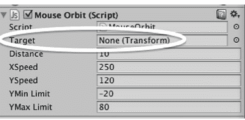


从层级视图中选择一个立方体预制件，并将其拖放到检查器中的 MouseOrbit Target 属性上。立方体的名称应该会替换掉 "None" 这个词。

播放（⌘+P），看看摄像机如何在跟随你鼠标移动的同时，始终保持聚焦于你选择的立方体。四处看看，检查一下你的灯光上的镜头光晕效果——它在移动时甚至也很出色。

在层级视图中仍然选中主摄像机的情况下，现在尝试在检查器中调整一些 MouseOrbit 脚本的属性，看看它们如何影响鼠标移动。如果你在播放模式下执行此操作，你的更改将会丢失。或者，如果你不喜欢在播放模式之外所做的更改，你可以使用齿轮图标将这些属性重置为默认值。

为了本练习的目的而摆弄这些属性，并不仅仅是毫无意义的乐趣；这是在培养你对游戏玩法的直觉“感觉”。你知道你喜欢什么样的游戏，知道它们感觉如何，并且你能判断出它们是否只是感觉不太对。播放模式是你测试用户体验的方式。如果你觉得它表现不佳或只是很奇怪，可以肯定你的用户也会这么觉得。好吧，摆弄这些属性可能有点无谓，但这正是重点所在。它是一个游戏——应该充满乐趣！

在属性面板的 Assets 文件夹中选择 MouseOrbit 图标，以在检查器中显示该脚本（图 4-7）。

```
Inspector

var xSpeed = 250.0;
var ySpeed = 120.0;

var yMinLimit = -20;
var yMaxLimit = 80;

private var x = 0.0;
private var y = 0.0;

@script AddComponentMenu("Camera-Control/Mouse Orbit")

function Start () {
    var angles = transform.eulerAngles;
    x = angles.y;
    y = angles.x;

    // Make the rigid body not change rotation
    if (rigidbody)
        rigidbody.freezeRotation = true;
}

function LateUpdate () {
    if (target) {
        x += Input.GetAxis("Mouse X") * xSpeed * 0.02;
        y -= Input.GetAxis("Mouse Y") * ySpeed * 0.02;

        y = ClampAngle(y, yMinLimit, yMaxLimit);

        var rotation = Quaternion.Euler(y, x, 0);
        var position = rotation * Vector3(0.0, 0.0, -distance) + target.position;

        transform.rotation = rotation;
        transform.position = position;
    }
}

static function ClampAngle (angle : float, min : float, max : float) {
    if (angle < -360)
        angle += 360;
    if (angle > 360)
        angle -= 360;
    return Mathf.Clamp (angle, min, max);
}
```

## 图 4-7. 检查器中的 MouseOrbit 脚本

你会看到变量声明，后面跟着一些函数，包括熟悉的 Start() 函数。在这些函数内部，有一些不太熟悉的项，比如 eulerAngles（欧拉角）和 Quaternions（四元数）。这些是超出初级主题的内容，但不了解它们并不会阻止你使用该脚本或根据你的满意度自定义其属性。我确实建议你通读脚本参考，并且每次遇到新的或不熟悉的主题时都重读参考。你会发现，随着你不断构建整体知识库，它们会变得更加清晰。

太棒了——你已经向游戏场景添加了一个一个接受用户交互并提供用户控制主摄像机游戏对象移动的脚本。

让我们更仔细地看看脚本如何影响游戏对象的行为。

类非常简单，就是变量和函数的集合。在 UnityScript 中，每个脚本都是一个类，脚本名就是类名。脚本中函数的顺序并不重要，但那么 Unity 如何知道要运行哪些函数呢？

> 注意 为了组织性，如果你在脚本中为常用函数使用一致的顺序，尤其是在你以后回头再看时，这样操作会容易得多。

这是游戏引擎底层功能的一部分。当你进入播放模式时，会由 Unity 引擎驱动发生一系列特定的事件。为了在游戏中获得你期望的行为，理解你的代码在这些事件中处于什么位置，与知道要编写什么代码同样重要。

## 启动游戏

当你启动一个游戏时，通常你首先看到的之一就是加载画面。根据游戏的不同，它可能会出现在标题画面之前或之后。无论哪种情况，在该加载画面和状态栏背后，游戏引擎都在忙于准备游戏以供游玩。随着游戏对象及其脚本被实例化，会发出一系列特定的函数调用，你可以在脚本中利用这些调用来控制游戏对象的行为。

## Awake

当游戏启动时，首先游戏对象被**实例化**，或创建。游戏对象实例化后，脚本实例被**加载**。在脚本生命周期的这个阶段，Awake() 函数仅被调用一次，即在脚本实例加载时，以便为游戏玩法设置内容，例如初始化脚本的变量。

游戏对象的 Awake() 函数被调用的顺序是随机的，因此你不应该使用 Awake() 函数将信息从一个对象传递给另一个对象，因为接收对象可能尚未准备好。

## Start

Start() 也仅在脚本**启用**时调用一次。这仅发生在场景中每个对象的 Awake() 都已被调用之后。

## Update

一旦脚本被启用且 Start() 函数已被调用，在那之后游戏渲染的每一帧，Update() 都会被调用。这就是实现游戏行为的函数。但这是什么意思呢？

简单来说，游戏是交互式动画。动画或游戏中的运动，就像视频一样，观众看到的是一系列静止图像。在每张图像中，主题的位置都有增量变化，这样当帧快速连续呈现时，就会产生运动的错觉（参见图 4-8）。

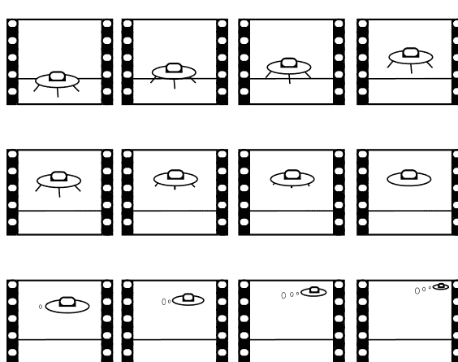

**渲染**游戏意味着将其逐帧绘制到屏幕上，速度要足够快，以在游戏的提供相同的运动错觉。Unity 游戏引擎会计算一切——每个游戏对象自上一帧以来的位置或移动到哪里，每个游戏对象基于位置和光照的外观，然后在场景中所有更改都实现后，从主摄像机的角度看场景是什么样子，最后将这个新帧渲染到屏幕上。

与视频不同，游戏有一个额外的交互元素。在渲染每一帧之前，Unity 引擎必须根据每个游�对象的组件（包括任何脚本）确定的游戏对象行为来计算相对于上一帧的更改。在 Update() 函数中编写的代码驱动着游戏的持续动作，正如你在图 4-9 中看到的。

## 第四章：使用脚本与游戏对象

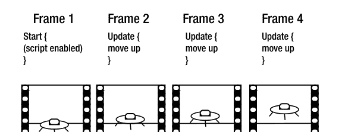

图 4-9. 渲染的帧序列及相应的脚本函数调用

## 在 Start 中编写脚本

在 Unity 编辑器中，在层级视图中选择 Snazzy Cubes 对象。在顶部菜单中，选择 Edit ▶ Delete。由于 Snazzy Cubes 是一个父对象，当它被删除时，它的所有子对象也会被删除。在这种情况下，场景中的所有立方体都消失了。

通过选择 Create ▶ Sphere 使用层级视图创建一个新游戏对象。正如预期，一个球体出现在原点 (0, 0, 0)。选择主摄像机，然后从层级视图中将球体拖放到 MouseOrbit 脚本组件的 Target 属性中。

在层级菜单中选择灯光。将变换位置属性设置为 (0, 5, 0)，旋转属性设置为 (0, 30, 0)，并确保类型为方向光（Directional）。

在项目面板中，选择 Assets 文件夹。在项目面板控制栏中，选择 Create ▶ Folder，然后将其命名为 Scripts。养成保持游戏资源井然有序的习惯很重要。你会看到新的 Scripts 文件夹出现在 Assets 文件夹中（图 4-10）。

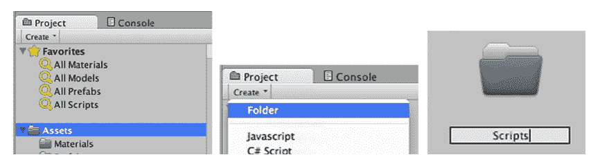

图 4-10. 在项目面板中创建 Scripts 文件夹

选中新的 Scripts 文件夹后，选择 Create ▶ Javascript，并将新脚本命名为 SphereColor（图 4-11）。

## 图 4-11. 创建 SphereColor 脚本

在 Inspector 面板中点击 Open 按钮，用 MonoDevelop 打开这个脚本，你会发现它已经包含了空的 `Start()` 和 `Update()` 函数。在 `Start()` 函数中添加以下代码行：

```
gameObject.renderer.material.color = Color.red;
```

保存脚本。在编辑器中，从 Project 面板拖拽脚本到 Hierarchy 视图或 Scene 视图中的 Sphere 上，将其附加到 Sphere 游戏对象。点击播放查看红色球体。`Start()` 函数被调用一次，球体材质被设置为红色。退出播放模式。

分解这行代码如下：

```
(1)     (2)     (3)     (4)     (5)     (6)
gameObject.renderer.material.color = Color.red;
```

+   1. `gameObject` 指向球体，因为这是脚本所附加的游戏对象。

使用点语法，你逐层深入到

2.  `Mesh Renderer` 组件，

3.  附加的默认材质，以及

4.  材质的 `color` 属性。

然后你使用

5.  `Color` 类，

为颜色属性赋值，该类包含几个快捷方式，

6.  `red` 即其中之一。

## Color

你可以按 `⌘+'` 查看 `Color` 类的脚本参考，包括其他可用的快捷颜色。颜色由四个属性组成：red（红）、green（绿）、blue（蓝）和 alpha（透明度）。三个颜色属性都是 0 到 1 之间的浮点值，其中 0 表示无颜色，1 表示满色。颜色是叠加的，因此 r、g、b 值为 0, 0, 0 产生黑色，而 1, 1, 1 产生白色。

第四个值，即 alpha 属性，是透明度等级，其中 0 表示完全透明，1 表示完全不透明。图 4-12 中列出的颜色快捷方式包含 r、g、b、a 值，这样你可以看到这些组合如何构成最终的快捷颜色。

| 静态变量 | |

| :--- | :--- |

| black | 纯黑色。RGBA 为 (0, 0, 0, 1)。 |

| blue | 纯蓝色。RGBA 为 (0, 0, 1, 1)。 |

| clear | 完全透明。RGBA 为 (0, 0, 0, 0)。 |

| cyan | 青色。RGBA 为 (0, 1, 1, 1)。 |

| gray | 灰色。RGBA 为 (0.5, 0.5, 0.5, 1)。 |

| green | 纯绿色。RGBA 为 (0, 1, 0, 1)。 |

| grey | gray 的英语拼写。RGBA 相同，为 (0.5, 0.5, 0.5, 1)。 |

| magenta | 洋红色。RGBA 为 (1, 0, 1, 1)。 |

| red | 纯红色。RGBA 为 (1, 0, 0, 1)。 |

| white | 纯白色。RGBA 为 (1, 1, 1, 1)。 |

| yellow | 黄色。RGBA 为 (1, 0.92, 0.016, 1)，但这种颜色看起来很棒！ |

*图 4-12.* Color 类中提供的快捷颜色

对于除快捷方式之外的任何颜色，你必须直接设置 r、g、b、a 值。将脚本编辑为以下内容：

```
#pragma strict

// Declare the variables to contain the color values.
private var red : float;
private var green : float;
private var blue : float;
private var alpha : float;

function Start()
{
// On Start, set the color property values by calling a random-number generating function.
    red = RandomColorValue();
    green = RandomColorValue();
    blue = RandomColorValue();
    alpha = RandomColorValue();
    gameObject.renderer.material.color = Color(red, green, blue, alpha);

// Print the random color values to the Console.
    print(gameObject.renderer.material.color);
}

// Generate a random value between 0.000 and 1.000.
function RandomColorValue() {
    var randomValue : float;
    randomValue = Random.Range(0.000, 1.000);
    return randomValue;
}
```

保存脚本，然后在编辑器中回到播放模式，游戏开始时球体会呈现随机颜色。请注意 r、g、b、a 颜色值也打印到了控制台。退出播放模式。

你在第 2 章使用过 `Random.Range`，那里你了解到它接受的两个参数是你希望随机数选取范围的最小值和最大值。按 `⌘+‘` 查看 `Random.Range` 的脚本参考，如果需要可以刷新记忆。

## 帧率

现在你已经有了在 `Start()` 中设置球体材质颜色的代码。`Start()` 只被调用一次，因此任何进一步的颜色更改都需要在 `Update()` 中进行。`Update()` 在每一帧都被调用，而游戏引擎渲染帧的速率被称为每秒帧数或帧率。帧率过慢会导致运动的错觉消失，更高的帧率意味着更流畅、响应更快的游戏体验。

游戏运行时的帧率是不断变化的，因为它取决于每一帧所需的计算量。单帧可能需要数千次计算，但为了说明简单，这里数字被简化了。你的代码越笨拙（优化越差），每帧的处理时间就越长（图 4-13）。

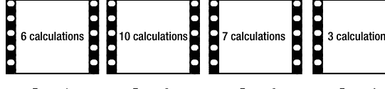

图 4-13. 每帧的计算次数可能不同

除了代码要求外，主处理器和图形芯片中的硬件计算能力也对帧率有限制。当你比较购买电脑时，看到“2.9 GHz Intel Core i7”这样的规格，2.9 GHz（千兆赫）指的是 Intel 芯片内部“时钟”的处理速度。

在这个简化的例子中，假设处理器能在每个时钟周期或“滴答”中完成一次计算。处理器 A 的芯片速度比处理器 B 慢。在相同的游戏条件下，处理器 A 的帧率会低于处理器 B（如图 4-14 所示）。


图 4-14. 两个不同处理器的内部时钟速度差异示意图

随着为新游戏主机和设备制造更快的处理器，旧设备的时钟速度相对较慢。在某些时候，旧芯片无法跟上新游戏和游戏引擎的复杂性。你的代码效率越高，旧芯片就越容易处理你的游戏，从而使你的游戏能够进入更广阔的市场。

使用最有效的函数和代码结构来减少计算需求以提高帧率被称为**优化**。虽然第 12 章重点介绍游戏优化，但你将在本书和 Unity 文档中看到针对游戏开发最佳实践以实现更好优化的技巧。

## Time.deltaTime

你从视频和电影中知道，你看到的角色平稳移动是基于稳定的帧率。如果游戏的帧率在每帧之间变化，你会看到抖动、不均匀的移动。你刚刚了解到硬件处理速度和脚本计算都会影响帧率。该怎么办？

`Time.deltaTime` 来解救了。“Delta”指的是希腊字母 delta（Δ），在数学中用于表示数值变化的符号。在这里，它具体指渲染上一帧所花费的时间变化，以秒为单位。

例如，速度或移动是距离/时间的度量，例如英里每小时。由于帧率在每帧之间变化，要使游戏对象显示稳定的速度，游戏引擎需要计算每秒的位置变化，而不是每帧的变化。`Time.deltaTime` 是用于进行此类计算的转换因子，使其**与帧率无关**，即基于实时。

## 在 Update 中编写脚本

在你的脚本中，在其他变量声明旁边添加以下变量声明：

```
public var waitTime : float = 5f;
```

`waitTime` 是一个公共变量，其值表示球体颜色改变前需要等待的秒数。因为它是一个公共变量，你可以直接在 Inspector 中调整它，以覆盖脚本变量声明中赋值的 5，从而改变从游戏开始到球体变为随机颜色的时间。

现在添加 `Update()` 函数代码：

```
function Update()
{
    waitTime -= Time.deltaTime;
    if (waitTime < 0.0f) {
        gameObject.renderer.material.color = Color.blue;
    }
}
```

这段新代码分解如下：

+   (1) `waitTime -= Time.deltaTime;`

每次调用 `Update()` 函数时，从 `waitTime` 中减去上一帧渲染至今的时间。

+   (2) `if (waitTime < 0.0f) {`

检查 `waitTime` 是否已倒数到零。

+   (3) `gameObject.renderer.material.color = Color.blue;`

如果 `waitTime` 已用完，则将球体材质颜色更改为蓝色。如果 `waitTime` 未用完，则不执行花括号之间的代码，当前材质颜色在此帧保持不变。

保存并播放。等待它……是的！五秒后，球体从随机颜色变为蓝色。由于你将 `waitTime` 声明为公共变量，你可以在 Inspector 中作为脚本组件的一部分找到它。在此处 Inspector 中的任何更改都将覆盖脚本中初始赋值的 `waitTime` 值 5。

## 用户输入

这有点更有趣了，但进入和退出播放模式变得乏味。添加一些玩家交互，以便当按下 N 键（代表 New color）时，为球体材质生成随机颜色。你不知道玩家何时会按下 N 键，因此使用 `Update()` 函数在每一帧检查这一点。编辑 `Update()` 函数，在末尾添加以下代码行：

```
function Update()
{
    waitTime -= Time.deltaTime;
    if (waitTime < 0.0f) {
        gameObject.renderer.material.color = Color.blue;
    }

    if(Input.GetKey(KeyCode.N)) {
        red = RandomColorValue();
        green = RandomColorValue();
        blue = RandomColorValue();
        alpha = RandomColorValue();
        gameObject.renderer.material.color = Color(red, green, blue, alpha);
        waitTime = 5;
    }
}
```

解析这段新代码：

```
if(Input.GetKey(KeyCode.N)) {
```

检查键盘上的 N 键是否已被按下。⌘+’ Input.GetKey 可在脚本参考中查找（图 4-15）。由此你了解到 GetKey 是一个布尔值，当指定的键（本例中为 N）被按下时返回 true。参考文档还为你提供了一个便捷链接，可查看包括修饰键、功能键和其他特殊键在内的按键标识符。


图 4-15. Unity 脚本参考中的 Input.GetKey 和按键标识符链接

```
red = RandomColorValue();
green = RandomColorValue();
blue = RandomColorValue();
alpha = RandomColorValue();
gameObject.renderer.material.color = Color(red, green, blue, alpha);
```

这些与 Start() 函数中的代码行完全相同，用于生成新的随机材质颜色。

```
waitTime = 5;
```

将 waitTime 重置为 5。球体仍将在新颜色变化发生五秒后自动变为蓝色。

保存并播放。现在你可以使用鼠标控制摄像机，并使用键盘更改游戏物体的颜色——太棒了！

## 清理你的代码

再次查看第 2 至 6 行的描述。它们与 Start() 函数中的代码行完全相同。包含大段重复代码行的脚本显得“笨重”，意味着效率较低。当你发现自己使用完全相同的代码行时，这表明是时候通过创建一个包含重复代码块的单一函数，然后使用简单的函数调用替代这些代码块来简化代码了。

在 Update() 函数下方添加 NewColor() 函数：

```
function NewColor() {
    red = RandomColorValue();
    green = RandomColorValue();
    blue = RandomColorValue();
    alpha = RandomColorValue();
    gameObject.renderer.material.color = Color(red, green, blue, alpha);
    waitTime = 5;
}
```

现在，你不必两次使用此代码块，而是可以在 Start() 和 Update() 函数中用调用 NewColor() 来替代它：

```
function Start()
{
// 启动时，为球体材质设置随机颜色。
    NewColor();

// 将随机颜色值打印到控制台。
    print(gameObject.renderer.material.color);
}

function Update()
{
    waitTime -= Time.deltaTime;
    if (waitTime < 0.0f) {
        gameObject.renderer.material.color = Color.blue;
    }

    if(Input.GetKey(KeyCode.N)) {
        NewColor();
    }
}
```

你的 Start() 函数更整洁，更易于阅读，Update() 函数也是如此。如果你发现在未来添加的其他过程中想要更改球体颜色，你可以用单行代码 `NewColor();` 实现。

通过重写部分代码来清理你的代码被称为**重构**。随着项目进展进行重构以保持脚本的整洁和简单，是一个值得培养的好习惯，并最终让你的生活更轻松。

假设你也希望让用户通过点击鼠标来更改球体颜色。在脚本中 NewColor() 函数下方添加以下函数：

```
function OnMouseDown() {
    NewColor();
}
```

这比再次复制六行代码是不是好多了？保存并播放。

如果你没有先查阅 OnMouseDown() 的脚本参考，你可能会惊讶地发现，在游戏视图中任意位置点击鼠标并不会导致颜色变化，你必须直接点击球体。

⌘+’ OnMouseDown()，你会在脚本参考描述中发现，此函数仅在鼠标光标悬停在游戏物体碰撞器上时点击鼠标按钮才会被调用。

在层级视图或场景视图中选择球体，你会在检查器中看到，就像你使用 Unity 的立方体原始游戏物体时一样，Unity 创建的球体原始游戏物体也包含了使其能够按照 OnMouseDown() 函数预期工作所需的必要碰撞器组件。

## 启用和禁用组件

除了操作组件属性以产生所需行为外，你还可以启用和禁用整个组件。OnMouseDown() 需要与碰撞器组件交互。你刚刚证明了它能与碰撞器组件配合工作，现在来测试一下当碰撞器组件被禁用时它是否停止工作。

证明这一点的一个简单方法是在检查器面板中取消选中球体的 Sphere Collider 的复选框以禁用它。此复选框代表一个布尔**标志**，如果方框被选中，则启用标志设置为 true；如果方框未被选中，则启用标志设置为 false。

继续取消选中该方框，然后进入播放模式进行测试。正如预期，如果你在碰撞器组件被禁用时尝试用鼠标点击球体，将不会发生任何事情。退出播放模式并重新选中该方框以再次启用碰撞器组件。虽然这是测试该概念的一种简单方法，但在游戏过程中启用或禁用组件需要在脚本中进行。

在 `#pragma strict` 之后的列表中添加一个新的变量声明：

```
private var sphereCollider : Collider;
```

这个变量声明与你之前所做的有点不同，因为它的类型是 Collider。sphereCollider 变量对于从脚本内部访问碰撞器组件的 enable 属性是必要的。与保存特定数值的 float 或 int 变量不同，sphereCollider 是一个**引用变量**。它保存的是定义 Collider 的数据所在的内存地址的引用，而不是数据本身。

在 Start() 函数中，在函数末尾添加以下代码行：

```
sphereCollider = GetComponent(Collider);
```

GetComponent(Collider) 获取球体碰撀器组件的引用并将其分配给 sphereCollider 变量。在后面的章节中，你将使用 GetComponent() 来访问其他游戏物体的组件，包括脚本。

⌘+’ GetComponent()，你将看到一个简短的选项列表（图 4-16）。选择第一个：Component.GetComponent。在参考文档的末尾附近，你会找到 Unity 关于优化性能的一个提示。在这种情况下，Unity 有帮助地建议尽可能使用带类型的 GetComponent 而不是字符串。在我们的示例中，我们使用的是类型：我们类型为 Collider 的 sphereCollider 变量，而不是保存游戏物体或组件名称或标签的字符串变量。


图 4-16. 脚本参考 ⌘+脚本参考 lder, rGetComponent

现在，在 Update() 函数末尾添加以下条件语句：

```
if(Input.GetKey(KeyCode.C)) {
    sphereCollider.enabled = !sphereCollider.enabled;
}
```

此条件检查玩家是否按下了 C 键。如果是这种情况，那么碰撞器启用标志（一个布尔值）将切换为其相反值。仔细看看这行代码：

```
sphereCollider.enabled = !sphereCollider.enabled;
```

在第 2 章中你学到了 “!” 代表逻辑运算符 NOT。

1.  sphereCollider.enabled 的布尔值是 true 或 false。无论它是哪个值，

2.  NOT 值，即相反值，将被重新赋值给 sphereCollider.enabled 标志。

使用 ! 运算符翻转布尔值通常被称为**切换**，因为它就像一个只能以两种方式翻转的物理切换开关，就像“开”和“关”之间的电灯开关。在此示例，玩家按下 C 键的作用与你在检查器中选中或取消选中方框以启用和禁用组件完全相同。事实上，在游戏过程中注意检查器面板中的复选框，你会看到该方框会随着你按下 C 键而选中和取消选中。

到目前为止，脚本的完整列表如下：

```
#pragma strict

// 声明包含颜色值的变量。
private var red : float;
private var green : float;
private var blue : float;
private var alpha : float;
public var waitTime : float = 5f;
private var sphereCollider : Collider;

function Start()
{
    // 启动时，为球体材质设置随机颜色。
    NewColor();

    // 将随机颜色值打印到控制台。
    print(gameObject.renderer.material.color);
    // 将球体的碰撞器组件分配给 sphereCollider 变量。
    sphereCollider = GetComponent(Collider);
}

// 生成一个介于 0.000 和 1.000 之间的随机值。
function RandomColorValue() {
    var randomValue : float;
    randomValue = Random.Range(0.000, 1.000);
    return randomValue;
}

function Update()
{
    waitTime -= Time.deltaTime;
    if (waitTime < 0.0f) {
        gameObject.renderer.material.color = Color.blue;
    }

    if(Input.GetKey(KeyCode.N)) {
        NewColor();
    }
}
```

## 销毁游戏对象

比启用/禁用更彻底的选项是使用 `Destroy()` 函数来移除组件或整个游戏对象。这可以通过多种不同的方式实现。

一种方式可以是使用计时器，类似于我们将球体变为蓝色的倒计时。使用双斜杠，注释掉 `Update()` 函数中将球体颜色变为蓝色的那行代码，以使其失效。

```javascript
//gameObject.renderer.material.color = Color.blue;
```

在其正下方，仍然在条件语句的花括号内，添加：

```javascript
Destroy(gameObject);
```

保存并播放。球体在五秒后没有变蓝，而是消失了。

回到脚本中，注释掉调用 `Destroy()` 的那行。将两行都注释掉后，在五秒标记时将不会有任何变化。使用双斜杠注释代码是一个很好的快捷方式，可以在测试或调试时启用和禁用短小的代码块，而无需重新输入或剪切粘贴代码行。

你可以通过在 `Update()` 函数中添加另一个 `GetKey()` 条件语句，让玩家销毁球体，如下所示：

```javascript
if(Input.GetKey(KeyCode.D)) {
    Destroy(gameObject);
}
```

保存脚本并播放。当你按下 D 键时，球体会立即被销毁。但是等等，你说，我遗漏了一些东西。你聪明地使用了 ⌘+' 快速浏览了 `Destroy()` 函数的脚本参考，并注意到它可以接受一个可选的第二个浮点数参数，该参数表示内置的时间延迟。

将 `Destroy(gameObject);` 这一行改为 `Destroy(gameObject, 2);`。保存并播放以演示现在在你按下 D 键后，球体在销毁前有两秒钟的延迟。使用这个参数而不是我们之前用于创建时间延迟的代码，减少了实现相同目标所需的总代码行数。

通常有多种方法可以达到相同的结果。保持开放的心态，当你发现更有效的解决方案时，不要犹豫重构你的代码。

## 实例化

到目前为止，你已经经历了游戏对象从游戏开始的完整生命周期，在游戏过程中通过编写代码来修改、启用和禁用游戏对象组件来确定其行为。

你学会了在运行时销毁游戏对象，但还没有学会创建游戏对象。在这些示例中，你使用了一个在运行前已在场景中创建并放置好的球体游戏对象。

`Instantiate()` 在创建游戏对象的复制品时特别有用。什么是游戏对象的复制品？预制件！你知道预制件是游戏对象的蓝图。实例化是从此蓝图创建游戏对象副本的过程，称为**实例**。

从层级视图中，将球体拖动到项目面板中的预制件文件夹中。你会看到一个新的球体预制件出现在粉红玫瑰立方体预制件旁边。通过在场景或层级视视图中选择它，然后从编辑器顶部菜单中选择编辑 ▶ 删除，从场景视图中删除球体。同样使用编辑器顶部菜单，选择游戏对象 ▶ 创建空对象。空游戏对象的平移小工具将出现在场景视图中。

在项目面板中，选择脚本文件夹，然后在控制栏中选择创建 ▶ Javascript，并将新脚本命名为 CreateSpheres。将脚本图标拖动到层级视图中的空游戏对象上以附加它。CreateSpheres 脚本应作为新组件出现在检查器中的空游戏对象上（图 4-17）。


图 4-17。CreateSpheres 脚本在检查器中显示为空游戏对象的组件

在 MonoDevelop 中打开 CreateSpheres 脚本。在 `#pragma strict` 下，声明一个用于球体预制件新实例的变量。

```javascript
public var newSphere : GameObject;
```

在 `Update()` 函数中，添加以下代码行：

```javascript
if(Input.GetKey(KeyCode.Space)) {
    var instance : GameObject = Instantiate(newSphere);
}
```

保存脚本并返回编辑器。现在你可以看到 Unity 美化后标记为“新球体”的 `newSphere` 变量。在项目面板中选择预制件文件夹。将球体预制件从项目面板拖动到检查器面板中游戏对象的“新球体”属性上，并将其放置在“无”上，使其显示在“新球体”区域（参见图 4-18）。


图 4-18。检查器面板中的“新球体”变量在分配球体预制件前后的情况

## 第 4 章：使用脚本和游戏对象

通过在顶部菜单中选择文件 ▶ 保存场景来保存场景。播放，当你按下空格键时，一个新的球体预制件出现。

如果你持续按下空格键，你就是在实例化更多的球体预制件，但它们都出现在原点，相互重叠。为了防止预制件堆积，使用 `Destroy()` 函数在两秒后移除新实例化的球体。

在项目面板中，选择脚本文件夹。然后选择创建 ▶ Javascript。将新脚本命名为 DestroySphere。在 MonoDevelop 中打开 DestroySphere，并在 `Start()` 函数中添加 `Destroy(gameObject, 2f);`。保存脚本。

返回编辑器，在项目面板中选择预制件文件夹。选择球体，然后在检查器中选择添加组件 ▶ 脚本，并从脚本列表中选择销毁球体（图 4-19）。


在顶部菜单中选择文件 ▶ 保存场景。进入播放模式。当你按下空格键时，一个具有随机生成材质颜色的球体预制件将出现，然后在两秒钟延迟后消失。完美！

# 总结

你确实在一章中走了很长的路。Unity 为你提供了 Standard Assets 包中的一些常用脚本作为起点。你理解了游戏玩法的结构和游戏对象从 `Awake()` 到 `Destroy()` 的生命周期，并且你对优化和代码重构有了一点介绍。游戏玩家已经出现并与你的游戏进行了交互。你可以创建脚本并将其附加到游戏对象上，并且你已经掌握了一些 Unity 类和函数，可以在你的游戏对象上使用。简而言之——你正在编写脚本！

下一章完全是关于为游戏添加动作，从简单的游戏对象移动开始，然后介绍 Unity 的 Mecanim 动画系统。这就是你将“动作”注入“动作密集型”游戏的方式！

## 移动游戏对象

你已经构建了一个基本场景并在其中填充了游戏对象。你添加了脚本以允许用户交互来添加和销毁游戏对象，以及更改它们的外观。现在是时候添加移动了。

首先，你将学习如何使用游戏对象的 Transform 组件通过脚本移动游戏对象。然后，你将学习如何使用 Unity 的 Mecanim 系统与来自 Asset Store 的更复杂的游戏对象角色。这些角色带有内置动画，你将学习如何通过脚本操作它们。

Unity 游戏引擎还提供对游戏对象的移动和交互，以响应重力或与其他游戏对象的碰撞等力。这些由 Unity 游戏引擎物理控制，并将在第 6 章和第 7 章中介绍。

### 旋转

由于球体从任何角度看都是一样的，它不是演示旋转运动的最佳形状。与其删除它，让我们暂时禁用它。在项目面板的 Assets 文件夹中找到的预制件子文件夹中，选择球体预制件。在检查器顶部附近，取消选中预制件名称“球体”左侧的框以禁用它（图 5-1）。


图 5-1。在检查器中禁用球体预制件

在层级视图中，选择 创建 ▶ 立方体。Unity 的基础物体立方体将出现在场景视图的 (0, 0, 0) 位置。

在检视视图中，选择 添加组件 ▶ 新建脚本，将其命名为 MoveCube，并确保语言属性为 JavaScript。点击 创建并添加 按钮，即可在检视视图中看到它作为组件出现。在项目面板中，脚本出现在 Assets 根文件夹中。为保持项目井然有序，请将其移至 Scripts 文件夹。

现在在 MonoDevelop 中打开 MoveCube。为了实现移动的视觉效果，你希望 Unity 在每一帧都在略微不同的位置渲染立方体，这意味着你需要使用 `Update()` 函数。在 `Update()` 函数的花括号之间，添加以下代码行：`transform.Rotate(Vector3.up);`。保存脚本，点击 Play 进行测试，你的立方体就在旋转了——耶！

让我们分解这行代码以理解其工作原理：

```
(1)       (2)      (3)      (4)
transform.Rotate(Vector3.up);
```

1. Transform 是每个游戏对象必备的组件；它保存了其位置、旋转和缩放信息。在这行代码中，你可以使用小写的 `transform`，编译器会知道这指的是附加了此脚本的游戏对象的 Transform 组件。从附加到第二个游戏对象的脚本影响第一个游戏对象的 Transform 组件稍微复杂一些，这将在第 6 章“访问其他游戏对象”开始介绍。

2. Rotate() 是 Transform 类的一个函数。你可以按 ⌘+’ 阅读脚本参考文档。它围绕其 Vector3 参数定义的轴，以欧拉角应用旋转。**欧拉角** 是一个关于围绕游戏对象轴进行度数旋转的高级数学术语。

3. Vector3 参数定义了旋转将围绕发生的轴。

4. .up 是表示向量 (0, 1, 0) 的 Vector3 静态变量快捷方式。

仔细观察立方体的平移小控件，并记住在 Unity 的世界空间中，y 轴是“向上”的。再次播放以视觉确认旋转是围绕 y 轴发生的。查看检视视图，你可以看到 Transform 组件的旋转属性的 y 值随着立方体旋转的变化而相应改变（图 5-2）。


**图 5-2。** Vector3.up 平行于正 y 轴

向量确实有方向，因此虽然 Vector3.up 和 Vector3.down 都平行于 y 轴，但它们指向相反的方向。将 Vector3.up 替换为 Vector3.down。保存、播放，并注意现在立方体似乎朝相反方向旋转。这是因为旋转现在是围绕向下指向的向量 (0, -1, 0) 计算的。

你并不限于使用 Vector3 快捷方式，事实上你可以传入任何值的 Vector3 变量。将 (*Vector3.down*) 替换为 (x, y, z) 值 (2, -5, 4)，保存并播放。现在你看到立方体以一定角度翻滚，因为旋转是围绕这个随机向量计算的。由于应用于所有三个轴的旋转计算叠加在一起，立方体似乎也翻滚得更快了。

## 在游戏测试时编辑属性

既然你可以围绕任意方向的轴旋转游戏对象，如果能控制速度就更好了。更好的是能够从 Unity 编辑器中测试和调整速度，而不是在脚本和编辑器之间来回切换。

回到 MonoDevelop，在 `#pragma strict` 下面，声明一个公共浮点变量 `rotationSpeed` 并赋予其初始值 5：

```
public var rotationSpeed:float = 5;
```

将 `Update()` 函数编辑为：

```
transform.Rotate(Vector3.up * rotationSpeed);
```

你正在将默认的旋转计算乘以一个你控制的因子：变量 `rotationSpeed`。保存并返回 Unity 编辑器。在层级视图中选中 Cube 游戏对象，现在你会看到 `rotationSpeed` 作为 MoveCube 脚本组件的一个属性出现，初始值为 5（图 5-3）。

**112**   **第 5 章：移动游戏对象**


**图 5-3。** *公共变量 rotationSpeed 在检视视图中显示为“Rotation Speed”属性*

你将 Vector3 参数改回 Vector3.up，只是为了在游戏测试和调整 `rotationSpeed` 属性时，更容易直观地看到变化。

播放，再次看到立方体围绕 y 轴旋转。仍然在播放模式下，更改 `rotationSpeed` 的值（注意必须选中 Cube）。尝试更快、更慢、零甚至负值。这是 Unity 的一个强大功能，你可以在微调游戏体验时即时看到更改的效果。退出播放模式，注意 `rotationSpeed` 的值恢复为 5。记住，在播放模式下进行的更改不会被保存。

在第 4 章中，你学习了帧速率和 `Time.deltaTime`。在对游戏对象的运动进行调整时，请记住游戏对象在不同计算机上的移动方式会因帧速率而异。解决方案是乘以 `Time.deltaTime` 以使运动与帧速率无关。将 `Update()` 函数编辑为以下内容：

```
function Update () {
    transform.Rotate(Vector3.up * rotationSpeed * Time.deltaTime);
}
```

## 添加用户交互

保存并播放。由于这个额外的因子，立方体的速度发生了变化，但你可以重新调整 `rotationSpeed` 属性以恢复到你想要的速度。现在的区别是，任何在不同机器上玩你游戏的人都会获得与你在自己机器上创建的相同体验。

通过键盚添加一些用户交互，就像你在第 4 章中做的那样，这次是控制立方体的旋转。编辑 `Update()` 函数，添加一个条件检查用户是否按下了左箭头键。

```
function Update () {
    if(Input.GetKey(KeyCode.LeftArrow)) {
        transform.Rotate(Vector3.up * rotationSpeed * Time.deltaTime);
    }
}
```

保存并播放。现在立方体只在按下左箭头时旋转。同样，你可以让用户通过按右箭头键以相反方向旋转立方体，使用 `-rotationSpeed`。

```
function Update () {
    if(Input.GetKey(KeyCode.LeftArrow)) {
        transform.Rotate(Vector3.up * rotationSpeed * Time.deltaTime);
    }
    if(Input.GetKey(KeyCode.RightArrow)) {
        transform.Rotate(Vector3.up * -rotationSpeed * Time.deltaTime);
    }
}
```

保存并播放。

## Translate

Translate() 是 Transform 的另一个函数，用于移动游戏对象。与 Rotate() 类似，它也接受一个 Vector3 参数，但在这里 Vector3 描述的是游戏对象移动的方向和距离。添加一个公共变量，用作乘法因子，在编辑器中调整立方体的速度。在 `rotationSpeed` 变量声明下方，添加一个 `travelSpeed` 变量。

```
public var travelSpeed:float = 5;
```

让玩家通过上下箭头键移动立方体，在 `Update()` 函数中添加以下代码行。

```
if(Input.GetKey(KeyCode.UpArrow)) {
    transform.Translate(Vector3.up * Time.deltaTime * travelSpeed);
}
if(Input.GetKey(KeyCode.DownArrow)) {
    transform.Translate(Vector3.down * Time.deltaTime * travelSpeed);
}
```

保存并播放。这次，对于向下方向，你没有使用 `-travelSpeed`，而是使用了 `Vector3.down`。两种方法都可以，就像 `-Vector3.up` 也等同于 `Vector3.down` 一样。通常实现同一结果有不止一种方法；这很大程度上是个人偏好。如果可以选择，请选择最高效的代码，如果其他方面相同，则越易读越好。

## Transform.position

而 Translate() 是一个移动 transform 的函数，`position` 是一个保存 transform 位置 (x, y, z) 值的变量。你也可以通过简单地赋值一个新位置来将游戏对象移动到特定位置。在这个例子中，我们将使用 O 键将游戏对象送回原点 (0, 0, 0)。

首先，在公共变量声明下方添加一个新的私有变量声明。

```
private var originPosition : Vector3 = new Vector3(0, 0, 0);
```

## 使用线性插值平滑运动

Unity的`Lerp()`函数可以平滑立方体向原点的过渡。**Lerp**代表线性插值（Linear Interpolation），这是一种在两个值之间近似平滑线条或曲线的数学方法。在本例中，我们使用`Lerp()`来平滑立方体从玩家移动到的位置返回原点的运动。如果你花点时间在脚本参考中搜索"Lerp"，你会发现`Lerp()`可用于在两个代表几乎任何事物（包括颜色、材质和四元数）的值之间进行过渡（图5-4）。

你的"Lerp"搜索产生了14个匹配项：

- **Color.Lerp**：在颜色a和b之间按t值插值。

- **Mathf.Lerp**：在a和b之间按t值插值。t值被限制在0和1之间。

- **Color32.Lerp**：在颜色a和b之间按t值插值。

- **Vector2.Lerp**：在两个向量之间进行线性插值。

- **Vector3.Lerp**：在两个向量之间进行线性插值。

- **Vector4.Lerp**：在两个向量之间进行线性插值。

- **Material.Lerp**：在两个材质之间插值属性。

- **Quaternion.Lerp**：在from和to之间按t值插值，之后对结果进行归一化。

- **Mathf.LerpAngle**：与Lerp相同，但确保在值环绕360度时正确插值。

- **Vector3.Slerp**：在两个向量之间进行球面插值。

- **Mathf.InverseLerp**：计算两个值之间的Lerp参数。

- **Mathf.MoveTowards**：将current值向target值移动。

- **Vector2.MoveTowards**：将current点向target点移动。

- **Vector4.MoveTowards**：将current点向target点移动。

具体来说，你将使用`Vector3.Lerp`。在脚本参考中选择它进行快速阅读。


`Vector3.Lerp`有三个参数：起始的`Vector3`、目标的`Vector3`以及用于实际线性插值计算的浮点值。

首先，在其他变量声明之后，声明一个可从Inspector调整立方体运动的`smoothing`公共浮点变量：

```
public var smoothing : float;
```

按如下方式修改你在`Update()`函数中使立方体返回原点的代码：

```
//将立方体移回原点
if(Input.GetKey(KeyCode.O)) {
    transform.position = Vector3.Lerp(transform.position, originPosition, smoothing * Time.deltaTime);
}
```

分解这行关键代码，我们看到以下内容：

```
(1)          (2)        (3)        (4)        (5)
transform.position = Vector3.Lerp(transform.position, originPosition, smoothing *
(6)
Time.deltaTime);
```

1.  设置游戏对象的Transform位置，

2.  使用`Vector3.Lerp()`函数进行平滑，

3.  从游戏对象的当前位置，

4.  到原点，

5.  使用我们可以用于自定义的平滑乘数，

6.  基于实时而非变化的帧率。

保存并返回Unity编辑器。在Hierarchy中选中Cube游戏对象，在Inspector中将Smoothing属性改为3。进入Play模式。现在当你按住O键时，立方体会平滑移动，并且运动方式使其越接近原点运动越慢，最终缓缓停住。

现在你已经用多种不同的方式为你的原始游戏对象制作了多种动画。你玩过的游戏有效使用了像这样简单的动作来创造有趣的交互体验，但这只是Unity能力的冰山一角。本章剩余部分将向你介绍Mecanim，Unity的动画系统，以及在Asset Store中可以找到的各种精彩角色和动画包。

## Mecanim

Mecanim是Unity的动画系统。Mecanim系统已集成到Unity编辑器中，同样被设计为一个对游戏开发者直观、可视化的工具。虽然角色及其基本动画片段是在导入Unity之前创建的，但Mecanim用于管理和混合这些动画，以实现更流畅、更好的游戏体验。

最重要的是，通过使用骨骼绑定（Avatar），Mecanim允许你从一个角色模型中提取动画并将其重新定向到另一个角色，而不是必须为第二个角色创建全新的动画序列。这听起来可能很简单，但这是Unity团队将非常复杂的东西变得非常易于使用的又一个例子，为你节省了数小时乃至数天的工作时间。

毕竟，这是一本关于以脚本为重点学习Unity的书，而脚本最终是将动画角色与游戏玩法代码集成以运行游戏所必需的。但你需要高效地努力——请记住，这里的目标是完成一个很棒的游戏并发布它。

开发工具不断升级，通过承担创建常用和重复功能的原始代码的负担，使其变得更直观、更可视化，最重要的是更高效。Mecanim提供了一个可视化编程工具，你可以在编写游戏玩法代码之前用于复杂的动画交互。

3D角色模型的创建和动画制作是在将它们集成到你的Unity游戏项目之前完成的。虽然角色创建远远超出了本书的范围，但你将学习将现成角色与现成动画片段结合的基础知识，为在游戏中使用它做好准备。

本节将向你介绍如何使用Mecanim设置角色及其动画，以及如何使用配套脚本来提供用户输入以控制角色。为了真正理解Mecanim的美妙之处，你将选择一个角色，配置其骨骼绑定和动画，然后使用Asset Store中的免费内容快速将此动画应用到第二个角色。这种混合和匹配角色与动画的能力为你的游戏原型提供了巨大的选择库，同时在你学习时注意控制成本。

### 我是医生，不是...！

在进一步讨论之前，我想对在游戏开发行业工作做一些总体观察。艺术家和开发者之间经常存在友好的竞争，通常被定义为创意型与逻辑型。我鼓励你——一个初学的游戏开发者——不要将自己局限于这两个类别中的任何一个。

虽然艺术家确实有创意，但真正技艺精湛的艺术家必须对其选择的媒介有深入的了解，这实际上是非常技术性的，就像学习和练习使用任何工具或运动技能来操作艺术媒介，将创意概念从想法变为现实一样。

开发者使用各种编程语言，这些语言都基于纯粹的数学函数和逻辑。没有比这更技术性的了。另一方面，在计算机代码的严格限制内想出一个解决方案来使应用程序或游戏概念成为现实，则需要极大的创造力。

一款伟大的游戏就是艺术与代码的完美结合，为玩家创造出卓越的体验。始终保持开放的心态，包括去学习那些其他团队成员到底在做什么。你越能理解这一切是如何融合在一起的，你就越能与你的3D艺术家合作者沟通，最终你的最终产品也会越好。

### 建模、绑定与蒙皮

计算机动画本身就是一个完整的行业，有专门从事建模、绑定、动画等方面的人员。这些工作都是创建和制作新角色动画所必需的。Maya、3ds Max和Blender用于从零开始创建角色，还有其他角色生成器工具。这超出了本书的范围，但你需要理解一些术语。

**建模**是创建游戏对象三维形状的过程，这个形状由许多通常被称为**多边形**的三角形组成（图5-5）。请记住，更复杂的模型需要更多的计算能力。

在Asset Store中，对模型最常见的描述之一是模型使用的"多边形"或"三角形"数量。支持Unity的增强现实SDK Metaio对此阐述得最好："每当你设计一个3D模型时，记住使用尽可能少的多边形，但只使用必要的数量。"选择游戏的现成模型也是如此。

## 118 第5章：移动游戏对象

虽然你将学习到优化游戏的最佳实践，但要了解更具体的限制，你必须查阅目标平台的文档。例如，为了将他们的建议付诸实践，Metaio还为开发者们提供了一份关于多个平台（和多款设备）上性能与多边形数量关系的优秀摘要（图5-6）。


*图5-6. Metaio增强现实SDK的性能与多边形数量关系图*

如果你与一位正在创建自定义角色的美术师合作，让他们了解是否存在特定的多边形数量限制会很有帮助。

**骨骼**用于控制角色的运动。它们组成了一个**骨架**或**关节层级结构**，定义了彼此之间如何相对运动，非常像父子游戏对象。**绑定**就是创建这个关节层级结构的过程（图5-7）。


*图5-7. 以亮绿色描绘的绑定结构*

关节层级结构创建后，必须将其连接到角色网格，这样网格才能在关节被动画化时随之移动。将网格连接到关节层级结构的骨骼称为**蒙皮**（图5-8）。


*图5-8. Unity用户手册中交互式蒙皮绑定的图示*

如果你打算自己制作角色模型，可以在Unity用户手册中找到有用的指南。

## 资源商店

对独立游戏开发者来说幸运的是，有Unity资源商店。资源商店是模型、脚本、纹理、音频、完整项目等的绝佳资源。不要被这个名字迷惑——里面有很多免费资源非常适合学习和原型设计，更不用说这是了解各位艺术家和工作室所提供内容的好方法。

Unity资源商店的工作方式很像应用商店，资源可能来自独立艺术家或开发者、工作室，甚至Unity Technologies本身。你可以找到从零散小部件到完整成品项目的所有东西。Unity编辑器旨在与资源商店轻松集成。要访问资源商店，在编辑器顶部菜单中，选择“窗口”▶“资源商店”（图5-9）。


*图5-9. 通过编辑器菜单访问Unity资源商店*

资源商店主页会在一个单独的窗口中打开（图5-10）。左侧前两行展示特色商品，右侧是商店分类菜单。就在“分类”菜单下方是“24小时特惠”，每天会以显著折扣推出一款不同的商品。


**图5-10. Unity资源商店主页**

在“分类”中，选择“3D模型”▶“角色”▶“人形”。左上角是该子类别的特色商品，下方是可用的3D人形模型的完整列表。列表顶部有排序选项；选择“价格”。这会将资源按价格从低到高排序，将免费资源置于列表顶部（图5-11）。

按热度 / 名称 / 价格 / 评分 / 发布日期排序


*图5-11. 来自Unity资源商店的3D人形模型，按价格排序*

点击其中任何一个都会进入产品页面，页面包含简要描述、一张图片、一个可选的角色更多图片区域，以及最终的可下载包的详细内容。为了比较，看看“异形与茧”和“动画斯巴达国王”（图5-12）。


### 异形与茧

| **类别：** | 3D模型/角色/人形... |

| :--- | :--- |

| **发布者：** | Duane's Mind |

| **评分：** | ★★★★☆ (4.8) |

| **价格：** | 免费 |

- 完全蒙皮和绑定的异形角色，可直接用于所有Mecanim动画。

- 该异形角色包含1200个多边形、24根骨骼以及一张1024X1024的纹理和法线贴图。

- 这个免费包中还包含一个可放入场景的茧。

- 该茧包含586个多边形、1024X1024的纹理和法线贴图。

- 茧盖（膜）的纹理贴图中还应用了Alpha通道以实现透明度。

### 动画斯巴达国王

| **类别：** | 3D模型/角色/人形... |

| :--- | :--- |

| **发布者：** | bisaniyehocam |

| **评分：** | ★★★★☆ (490) |

| **价格：** | 免费 |

这款斯巴达国王模型包含11个动画。

- 0-100：等待（待机）

- 101-137：行走

- 138-160：奔跑

- 161-183：冲锋

- 184-234：等待战斗

- 235-270：持盾防御

- 271-352：胜利

- 353-429：敬礼

- 430-500：死亡（普通）

- 501-566：死亡（旋转）

- 567-602：挥剑（攻击）

- 纹理为*.psd格式

点击此处观看网页播放器演示。

观看视频！

**图5-12.** 比较Unity资源商店上的3D模型

简要描述由发布者提供，内容可能各不相同。多边形数量经常被提及，因为这会影响性能，或可能限制能支持你游戏的设备。Mecanim相对较新，是Unity旧版动画系统的重大升级，因此你可能会看到像异形模型描述中那样，特别注明它确实兼容Mecanim的评论。

动画可能是单独提供的，也可能是作为一段长动画的一部分，你需要知道各个动画在单个剪辑中的位置。在斯巴达国王的描述中，发布者给出了每个动画剪辑的具体帧范围。

最棒的是，这两位发布者都提供了让你在下载前就能实际观看动画的方式。“异形与茧”的链接会带你到一个Unity网页播放器，你可以作为玩家进行交互，在几个简单的关卡中移动异形，而“斯巴达国王”的链接则会带你到一个YouTube视频，你可以观看角色表演每个可用的动画（图**5-13**）。

## 导入角色模型

在资源商店窗口中，向下滚动一点，找到Mixamo提供的免费“僵尸角色包”，并选择它打开产品页面（图**5-14**）。


**图5-14.** *Unity资源商店中的僵尸角色包图标和产品描述*

点击蓝色的“下载”按钮。如果你还没有设置Unity账户，请按照说明立即设置一个。如果你已有账户，下载按钮会先变为“请稍候”，然后显示下载完成的百分比数字。最后，“导入包”窗口将打开，所有包内容都已勾选以供导入。保持所有这些选项勾选，并点击窗口右下角的“导入”（图5-15）。


**图5-15.** *包含僵尸角色包内容的导入窗口*

现在，ZombieCharacterPack文件夹出现在项目面板的Assets文件夹中。

### 创建和配置化身

在项目面板的ZombieCharacterPack文件夹中，选择zombie_lowres模型。在Inspector视图中，选择“绑定”选项卡。将“动画类型”更改为“人形”，并保持“化身定义”为“从此模型创建”。点击“应用”。现在“配置...”按钮已激活，选择它。在出现的对话框中选择“保存”。配置完成后，“配置...”按钮左侧会出现一个小勾选标记（如图5-16所示）。


**图5-16.** *在Inspector中配置化身*

哇——编辑器中几乎每个视图都变成了显示新化身及其详细信息。化身游戏对象临时出现在层级视图中用于配置，并且可以展开以显示构成它的所有子游戏对象。其图像出现在Inspector中（图5-17）。化身图像下方是列表，向你显示哪些化身骨骼与哪些对应的角色骨骼相匹配。有办法手动分配任何未正确匹配的骨骼，但在这种情况下它们是正确的，所以继续进行，选择Inspector右下角的“完成”按钮关闭此视图，编辑器将返回其先前状态。你的化身已准备就绪！

## 导入动画

角色通常自带一些现成的动画，但添加其他动画素材也很简单。回到 Asset Store，搜索“creature zombie running”（图 5-18），然后像导入 Zombie Character Pack 那样下载并导入它。在 Project 面板中，选择 Assets 根文件夹，然后选择 Create > Folder 并将其命名为 Animations。将新导入的 alpha@zombie_running 动画剪辑移动到 Animations 文件夹中，以保持项目整洁。

在 Animations 文件夹中选择该动画剪辑，使其属性显示在 Inspector 中。在顶部，勾选 Loop Time 复选框。若不勾选，僵尸将执行一次完整的奔跑循环（包含左右腿各迈一步）。循环播放动画意味着僵尸将持续奔跑。

## 创建动画控制器

现在你已经有了角色和动画，需要一个控制器来播放它。Animator Controller 是用于将动画剪辑的行为连接到游戏对象模型的游戏对象组件。

首先选择 Assets 文件夹，然后选择 Create ▶ Folder 并将其命名为 Animator Controllers，双击打开它。接着选择 Create ▶ Animator Controller 并将其命名为 zombieController01。双击 zombieController01，在 Animator 视图中打开它（图 5-19）。

将鼠标光标置于 Animator 视图中，右键点击网格区域，在上下文菜单中选择 Create State ▸ Empty。Animator 窗口中会出现一个名为 New State 的新方框。橙色表示这是默认状态。选择此方框，在 Inspector 中将其名称改为 Zombie Run。然后将 Animations 文件夹中的 alpha@zombie_running 剪辑拖拽到 Motion 字段中（图 5-20）。

**注意** 各种动画被称为**状态**。例如，当角色处于待机状态时，它就在“待机状态”。从一个状态切换到另一个状态称为**过渡**，用箭头表示。你在 Animator 窗口中为 Animator Controller 设计的状态和过渡的集合，就构成了所谓的**状态机**。

这样，一个简单的动画控制器就完成了，它将把 alpha@zombie_running 动画剪辑作为默认动画播放。

## 运行僵尸奔跑

首先设置场景。在 Hierarchy 视图中，选择 Cube 游戏对象，然后在 Inspector 中取消勾选其名称旁边的顶部方框使其失活。现在从 Project 面板中将 zombie_lowres 模型拖拽到 Hierarchy 视图中，将其添加到场景中。选择 Main Camera 并查看预览效果。将摄像机位置重新设置为 (0, 1, –3)。僵尸角色在场景中背对摄像机，因此在 Hierarchy 中选择它，并在 Inspector 中将其 Rotation 属性的 y 值改为 180 以使其转身。重新选择 Main Camera 以查看新朝向的预览。

现在查看 Inspector 中僵尸角色的 Animator 组件，你会注意到其 Controller 属性为空。从 Project 面板中将 zombieController01 拖拽并放入 Controller 字段（图 5-21）。保存场景。点击播放，现在僵尸正在追赶你！

## 像僵尸一样奔跑

开发中的一个基本概念是 DRY 或“不要重复自己”。你已经在第 4 章中看到过应用，当时你通过将重复的代码块重构为单独的函数来优化脚本。这个概念也是 Mecanim 强大和灵活背后的理念，只不过这里不是重复代码块，而是无需为不同但骨骼绑定相似的角色重复创建相同的动画。这通过使用 **avatar（化身）** 得以实现。

Avatar 是 Mecanim 能够理解并用于动画的简化人形骨骼结构。Avatar 的骨骼与角色模型中的类似单元相匹配，因此移动 Avatar 会以与底层动画剪辑相同的动作驱动角色移动。一个简单的类比是：移动提线木偶的线会使木偶以特定方式移动，无论木偶是什么角色。如果你将一个木偶换成另一个，第二个木偶对相同线控动作的反应也会相同（图 5-22）。通过 Mecanim，你可以类似地将不同的角色与同一个动画剪辑进行重定向。这极大地简化了 Unity 中的动画工作流程。

现在你将看到 Mecanim 带来的真正效率。在 Asset Store 中，找到 Maze 元素 Ice Golem（图 5-23）。下载并将其导入你的项目。Asset 文件夹中会出现一个名为“player”的文件夹。找到 golem 角色并选择它。

按照“创建并为角色配置 Avatar”中的相同步骤，为这个 golem 角色创建并配置 Avatar。完成后，将带有新 Avatar 的 golem 角色拖拽到 Hierarchy 视视图中。在 Scene 视图中，移动 golem 直到它站在僵尸旁边。你会在 Inspector 中看到 golem 的 Animator 组件的 Controller 字段为空。将 zombieController01 拖放于此，然后点击播放。现在 golem 也像僵尸一样奔跑起来了（图 5-24）！

## 更多动画

最终看到角色动起来确实很有趣，你也尝到了将动画剪辑应用到另一个角色上是多么简单。我们将为僵尸角色添加更多动画，所以暂时让 golem 失活吧。一个只循环播放一个动画剪辑的角色在游戏中用处不大，那么到哪里为僵尸寻找更多动画呢？

你可以在 Asset Store 中找到更多，无论是动画剪辑和资源包，还是像 Unity Technologies 制作的 Mecanim Demo 这样的完整项目。你现在应该已经熟悉 Asset Store 的操作了，所以我想介绍另一个动画资源来源，它更进一步，为你提供了一些编辑功能。

动画剪辑，就像角色模型一样，通常在导入 Unity 之前就已准备好了。Mixamo 是我们本例中使用的僵尸角色的发布者。除了提供大量兼容 Mecanim 的角色和动画外，Mixamo 还有一些巧妙的免费工具，包括一个可以为你的角色应用动画的工具。

使用你的互联网浏览器，访问 [www.mixamo.com](http://www.mixamo.com)。要注册免费账户，只需提供你的电子邮件地址并创建密码。注册后，从顶部菜单选择 **ANIMATE**（图 5-25），即可进入现成动画目录（图 5-26）。

### 单个动作

很棒，对吧？谁不想让自己的角色跳骑马舞呢？花点时间浏览一下这些动画。为你的游戏挑选时，就像在 Unity Asset Store 中一样，也一定要看看资源包，因为它们通常性价比很高。

在右上角，选择橙色的 UPLOAD 3D CHARACTER 按钮。选择 UPLOAD FILE。选择 zombie_lowres.fbx 角色进行上传。僵尸角色是 Mixamo 制作的免费角色，所以你应该会很快收到“Your character was successfully mapped!”的消息。选择 APPLY ANIMATION，这将带你回到动画目录。

对于本例，选择 Walking，Mixamo 编辑器页面将加载行走动画（图 5-27）。

将 Sequence Name 保持为 walking。在左下角，如果尚未选中，请选择 Edit Clip。尝试使用滑块，看看如何自定义动画（图 5-28）。

## 第五章：移动游戏物体

当您完成实验后，请使用 reach 滑块将手臂降低到与僵尸奔跑动画中大致相同的角度。这可以为两个动画片段之间的平滑过渡做好准备。我更喜欢步伐较慢、拖曳前行的僵尸，但您可以根据自己的喜好配置其他参数。调整满意后，选择“保存”，然后选择“下载”。

会出现一个结账弹出窗口，您的购物车中显示该动画，总价为0美元。选择“结账”，随后会出现一个下载托盘弹出窗口，其中包含您的动画角色。选中它，然后在底部附近为下载格式选择“FBX for Unity”，接着点击那个橙色的“下载”按钮（图5-29）。

您可以通过将下载的动画角色模型拖放到项目面板中，或者通过Unity编辑器的顶部菜单选择“资产”▸“导入新资产”，将其添加到您的Unity项目中。将您新创建的动画角色模型拖放到“资产”▸“动画”文件夹中。保存场景并保存您的项目。

这个项目还需要几个动画片段。首先，重复此过程来创建行走动画，但将其命名为`walkingWithMotion`。编辑完成后，向下滚动到滑块下方，将“In Place”设置更改为“关”（图5-30）。保存并下载。

图5-30。在Mixamo动画编辑器中，将“In Place”设置为“关”。

同样地，创建、保存并下载“闲置”动画。这种情况下没有“In Place”设置选项，因为该动画本身就是僵尸角色站在原地的动画。像之前一样，将这些动画下载到您项目的“资产”▸“动画”文件夹中。保存您的项目。

## 配置动画

现在，您的“动画”文件夹中应该有僵尸角色的闲置、行走和行走带运动动画。由于它们与`zombie_lowres`模型组合在一起，其标签显示为`zombie_lowres@动画名称`。在使用这些动画之前，每个都需要进行配置。在“动画”文件夹中选择`zombie_lowres@walkingWithMotion`。

在“检查器”中，选择“装备”选项卡（图5-31）。就像处理僵尸奔跑动画一样，将“动画类型”更改为“人形”，并将“虚拟人体定义”更改为“从此模型创建”。

图5-31。在检查器中配置动画的装备设置

### 根运动

动画涉及的是角色头部、身体和四肢相对于自身的移动，而根运动则涉及角色相对于游戏世界坐标的移动。例如，您会看到没有根运动的僵尸行走动画呈现的是角色在原地行走，而带有根运动的行走带运动动画则呈现角色在游戏场景中向前移动。就像动画动作一样，动画是否包含根运动是在导入Unity之前创建角色和动画时确定的。

选择“动画”选项卡。注意底部有一个“预览”窗口，您可以在那里播放动画。请关注僵尸角色所站立的平面的网格，并注意僵尸是在原地行走。

在检查器中向下滚动，直到找到可以勾选“循环时间”的地方，紧随其下是“循环姿势”。对于“根变换旋转”，勾选“烘焙到姿势”，然后将“基于”设置为“身体朝向”。接下来，对于“根变换位置(Y)”，勾选“烘焙到姿势”，并在其下方将“基于（在开始时）”设置为“原始”。对于“根变换位置(XZ)”，保持“烘焙到姿势”未勾选。最后，点击“应用”（图5-32）。

图5-32。在检查器中配置动画设置

逐项设置分解来看：勾选“循环姿势”意味着动画片段将重复或**循环**。如果未勾选，动画片段将只播放一次。

“根变换旋转”描述了动画片段期间动画使模型旋转的程度。通过勾选“烘焙到姿势”，您正在将原始旋转坐标“烘焙”到角色中，并防止其在动画片段期间旋转。这正是您想要的，以防止在行走动画中出现**漂移**，您希望角色只沿直线向前移动。

在“镜像”下方，您可以看到根运动产生的平均速度。沿非目标轴的分速度是可能发生漂移的指标。您可以选择此动画片段是基于模型的身体朝向，还是基于播放此片段时角色拥有的原始前进向量，来继续角色之前的移动向量。

“偏移”允许您进一步微调变换，以解决动画片段可能引入的任何差异。

“根变换位置(Y)”的工作原理与旋转类似。在这种情况下，对于行走动画，您需要勾选“烘焙到姿势”以防止向上或向下漂移，但对于跳跃动画，您会将其保持未勾选状态，以允许跳跃时的上下移动。

“根变换位置(XZ)”处理沿xz平面的移动，这与“地面”相同。回想一下，在Unity中，y轴代表游戏世界中的上下方向。通过保持“烘焙到姿势”未勾选，角色在执行动画时将在xz平面上在场景中移动。闲置动画是一个常见的动画片段示例，您可能希望勾选“烘焙到姿势”以防止意外的移动。

绿色圆圈指示了动画循环的平滑程度，基于的是模型在片段第一帧和最后一帧的变换属性的相似程度。随着一个循环结束到下一个循环开始的过渡偏差增大，警告指示器会变为黄色，然后是红色。“根变换位置(XZ)”的指示器是红色的，因为僵尸将随着每个动画循环向前移动一步到新位置。

现在您的动画已准备好进行测试，但为了获得更好的透视感，与其使用纯色背景，不如添加一些背景来观察行走的根运动效果。为您的场景创建一个平面，并将其变换设置为(0, 0, 0)，缩放设置为(30, 1, 30)。在顶部菜单中选择“资产”▸“导入包”▸“地形资产”，然后点击“导入”。在此包中找到“地形纹理”文件夹，并将“草地与岩石”纹理拖放到层级视图中的平面上。纹理应出现在场景视图中的平面上。在平面的网格渲染器组件中，将x和y方向的平铺值设置为5。

在项目面板的“动画器”文件夹中找到`zombieController01`。双击它以在动画器窗口中打开。选择“僵尸奔跑”状态。在检查器中将其重命名为“行走”，然后从项目面板的“动画”文件夹中将行走带运动动画片段拖放到检查器中的“动作”字段。请注意，您不需要整个`zombie_lowres@walkWithMotion`文件，只需要动画片段。点击`zombie_lowres@walkWithMotion`图标上的箭头将其展开，并找到动画片段（图5-33）。

播放，您将看到僵尸执行行走动画的同时，在游戏世界的平面上向前移动。酷！

在专业级游戏中，游戏物体的动画移动通常是基于动画的根运动、脚本运动、物理效果等的组合。具体如何应用这些取决于游戏，但目标始终是提供最佳的游戏体验——最逼真或符合风格的、连贯的、响应灵敏的动画。

### OnAnimatorMove

您可以使用脚本为没有根运动的动画片段提供运动，或者使用`OnAnimatorMove`进一步自定义动画片段内的根运动。为了进行最精细的控制，您需要创建并使用Unity Pro中提供的动画曲线，但以下示例将让您初步体验如何直接通过脚本控制角色移动。

在此示例中，从项目面板创建一个新的动画器控制器，并将其命名为`ZombieMotionController`。将行走动画片段拖到动画器窗口中，它应该以橙色显示为新的默认状态。在层级视图中选择`zombie_lowres`游戏物体，然后通过将`ZombieMotionController`拖到“控制器”字段，或使用“控制器”字段右侧的圆形选择按钮，来更改其动画器组件中的控制器。播放以确认僵尸在原地行走。

在项目面板中，使用“创建”>“Javascript”创建一个新脚本，并将其命名为`ZombieMotionScript`。双击以在MonoDevelop中打开它。删除空的`Start()`和`Update()`函数，然后添加以下代码：

```
public var WalkX:float = 0;
public var WalkZ:float = 0;

function OnAnimatorMove()
{
    var animator : Animator = GetComponent(Animator);

    if (animator)
    {
        var newPosition:Vector3 = transform.position;

        newPosition.x += WalkX * Time.deltaTime;
        newPosition.z += WalkZ * Time.deltaTime;

        transform.position = newPosition;
    }
}
```

其分解如下：

-   `public var WalkX:float = 0;`

    `public var WalkZ:float = 0;`

    您正在为僵尸变换位置的x和z分量声明公共浮点型变量，以便您可以在游戏视图中实时调整它们。

-   `function OnAnimatorMove()`

正如您从查阅脚本参考（*咳咳* 您确实查阅了，对吧？）中所知，`OnAnimatorMove()` 函数在状态机之后每帧都会被调用。这发生在 `OnAnimatorIK()` 之前，其中 IK 代表“反向动力学”，这是 Unity Pro 中可用的另一种动画方法。

```
var animator : Animator = GetComponent(Animator);
if (animator)
```

如果僵尸游戏对象上没有附加 Animator 组件，`animator` 变量将为 `null`，因此在下面一行中，它用于条件 `if` 语句。如果游戏对象有 Animator，将执行下面的代码块；如果没有 Animator，则会跳过。

```
var newPosition:Vector3 = transform.position;
```

在条件内部，声明了 `newPosition` Vector3 类型的变量，然后将其赋值为僵尸游戏对象当前的 `transform.position`。

```
newPosition.x += WalkX * Time.deltaTime;
newPosition.z += WalkZ * Time.deltaTime;
```

每帧通过 `WalkX` 和 `WalkZ` 因子更新 `transform` 的 x 和 z 坐标，并使用熟悉的 `Time.deltaTime` 进行平滑处理。

```
transform.position = newPosition;
```

最后，使用新的 x 和 z 属性值更新僵尸游戏对象的 `transform.position`。

保存脚本。在 Unity 编辑器中，从属性面板将脚本拖到层级视图中的 `zombie_lowres` 游戏对象上以附加它。执行此操作时，检查器中会发生两件事。正如您所期望的，`ZombieMotionScript` 作为组件出现。此外，Animator 组件的“应用根运动”在检测到脚本中的 `OnAnimationMove()` 函数后变为“由脚本处理”（图 5-34）。保存场景和项目。


选中 `zombie_lowres` 游戏对象后，播放进行测试。僵尸像以前一样原地行走，因为在 `ZombieMotionController` 脚本中，`WalkX` 和 `WalkZ` 值最初设置为 0。在仍在播放模式时，尝试在检查器中调整 `WalkX` 和 `WalkZ` 值。微调它们，直到僵尸看起来在平面上行走而没有任何漂移。在退出播放模式之前，请记住记下您的最终值，因为在检查器中的更改不会被保存。

## 过渡

到目前为止，您只使用了默认的动画状态。状态机可以相当复杂，包含角色可能需要的任意数量的动画状态。从一个动画状态移动到另一个状态称为 **过渡**。

对于这个最后的动画控制器，您需要从资源商店下载并导入 Unity 的 Mecanim 运动入门套件（图 5-35）。此包为您提供了现成的 Mecanim 骨架和控制器，但为了理解其工作原理，您将使用其部分动画从头开始构建一个控制器。


*图 5-35. Unity 资源商店中的 Mecanim 运动入门套件*

导入此包的过程与您导入“僵尸角色包”完全相同。在 Unity 编辑器顶部菜单中，选择“窗口” ▶ “资源商店”以打开一个单独的窗口到 Unity 资源商店。在搜索栏中，输入 **Mecanim Locomotion Starter Kit** 并单击蓝色的“下载”按钮。“导入包”窗口将打开，所有包内容都已选中以供导入。保持所有这些选中状态，然后单击窗口右下角的“导入”，包含 Mecanim 运动入门套件的“Locomotion Setup”文件夹将出现在项目面板中。

在项目面板中，选择“Animators”文件夹。创建一个新的动画控制器，命名为 `ZombieLocomotionController`，然后双击打开它。

要查找“Idle”动画剪辑，请在项目面板搜索栏中输入 **Idle**。选择 `DefaultAvatar@Idle_Neutral` 图标，并通过查看底部显示的路径来确认它是 `Setup/Locomotion/Animations/DefaultAvatar@Idle_Neutral.fbx`（图 5-36）。


**图 5-36.** 在项目面板中选中的 DefaultAvatar@Idle_Neutral 图标

首先，配置动画：在项目面板中仍选中“Idle”图标时，在检查器中选择“骨架”。动画类型应为“人形”，然后将 Avatar 定义更改为“从此模型创建”并单击“应用”（图 5-37）。在“配置...”按钮旁边应该出现一个勾选标记。动画设置可以保持原样。现在，动画剪辑与您在本章前面创建的僵尸模型动画 Avatar 兼容。


**图 5-37.** 检查器中的 Animation.fbx 骨架设置

重复这些步骤来配置您将在此示例中使用的另外两个动画：`DefaultAvatar@WalkForward_NtrlFaceFwd.fbx` 和 `DefaultAvatar@WalkForwardTurnRight_NtrlWide.fbx`。对于第二个，选择“动画” ▶ `DefaultAvatar@WalkForwardTurnRight_NtrlWide` 以在检查器中找到 `WalkRightWide` 和 `WalkLeftWide` 剪辑（图 5-38）。


**图 5-38.** 项目面板中的 WalkRightWide和 WalkLeftWide 动画剪辑

如果您选择 `WalkLeftWide`，然后在检查器中向下滚动，您会看到“镜像”框被选中。此剪辑是 `WalkRightWide` 的镜像反射，这是一个巧妙的属性，可节省您需要另一组 .fbx 文件的麻烦。如果您正在为游戏创建自己的动画剪辑，镜像属性可以为您节省从一个动画剪辑创建两个对称动画的大量时间和精力。

现在您需要的动画已配置完成，请返回到项目面板中的 `DefaultAvatar@Idle_Neutral` 图标。单击箭头展开它以显示 Idle 动画剪辑。在项目面板中选中 Idle 动画剪辑后，您可以在检查器底部通过播放来预览它。将动画剪辑图标从项目面板拖到 Animator 窗口，然后放下。它现在应该是控制器的橙色默认状态。

同样地，找到并展开 `DefaultAvatar@WalkForward_NtrlFaceFwd` 动画以显示 Walk 动画剪辑。将其拖放到 Animator 窗口中。由于 Idle 已经是默认动画状态，Walk 状态将显示为一个灰色框。您可以通过右键单击并从出现的上下文菜单中选择“设为默认”来将其更改为默认状态，但目前保持原样。

现在您有了 Idle 状态和 Walk 状态。要在两者之间创建过渡，请右键单击 Idle 状态并从出现的上下文菜单中选择“创建过渡”。现在，如果您将鼠标光标在窗口中移动，它将从 Idle 状态拖出一条白色箭头。单击 Walk 状态以设置过渡。单击白色箭头，它应该变成蓝色，同时在检查器中显示其属性（图 5-39）。您通过过渡属性设置从一个动画状态更改为另一个动画状态的条件。“原子”属性默认为选中，这意味着动画剪辑不能被中断。保持选中状态。


图 5-39. 检查器中的过渡属性

> 提示 您可以拖动状态框以保持它们整齐有序，并且在 Animator 窗口中拖动时按住 Alt 键可以移动整个网格。

您有不同的条件可以选择来触发过渡。默认的“退出时间”属性 0.92 意味着当剪辑播放到 92% 时过渡将触发。在层级面板中，选择 `zombie_lowres` 游戏对象，然后在检查器中将动画控制器更改为 `ZombieLocomotionController`，方法是将控制器从项目面板拖到检查器中的属性字段，或单击控制器属性右侧的圆形选择按钮，然后从弹出菜单中选择 `ZombieLocomotionController`。

播放测试，您将看到僵尸从 Idle 状态开始，然后根据“退出时间”条件自动过渡到 Walk 状态。您可以在检查器中通过拖动 Idle 和 Walk 剪辑之间图形重叠的蓝色起始和结束值来尝试平滑过渡。退出播放模式并保存场景。

## 第五章：移动游戏对象

你还可以创建**参数**，以便在脚本中根据用户输入或任何其他适合游戏的条件来触发状态转换。点击 Animator 窗口标签，在左下角通过点击 Parameters + 符号并选择 Float 来创建一个浮点参数。将名称从 New Float 更改为 Speed。在 Inspector 中选择转换箭头，将 Exit Time 更改为 Speed，并选择 Greater 和 0.1。

你还需要从 Walk 状态转回 Idle 状态。同理，右键点击 Walk，创建一个新转换，并将其连接到 Idle 状态。选择该转换，在 Conditions 属性中选择 Speed，这次选择 Less 和 0.1。

如果现在进行测试，僵尸会停留在 Idle 状态。你需要创建一个脚本来定义用户输入如何满足触发从一个状态到另一个状态的转换的条件。在 Project 面板中，创建一个新的 JavaScript 脚本，并将其命名为 ZombieLocomotion。将其拖放到 Hierarchy 视图中的 zombie_lowres 游戏对象上，以附加到僵尸角色。ZombieLocomotion 脚本将作为新组件出现在 Inspector 中。双击 Project 面板中的 ZombieLocomotion 脚本图标，在 MonoDevelop 中打开它，然后按照如下方式编辑代码：

```
#pragma strict

private var animator : Animator;

function Start () {
    animator = GetComponent(Animator);
}

function Update () {
    animator.SetFloat("Speed", Input.GetAxis("Vertical"));
}
```

这段代码分解如下：

(1)    private var animator : Animator;

声明一个 Animator 类型的引用变量。如果你像之前在 ZombieMotion 脚本的 OnAnimatorMove() 函数中那样，在 Start() 函数中用一行代码完成此操作，那么 animator 变量的范围将被限制在 Start() 函数内。在这里声明它，就使其在 ZombieLocomotion 类的任何函数中都可用。

(2)            animator.SetFloat("Speed", Input.GetAxis("Vertical"));

这里你根据用户输入设置之前创建的 Speed 参数。进行测试，你会发现当按下上箭头键或 W 键时，僵尸会向前走。

## 任意状态

Any State 是 Unity 提供的一个特殊状态，体现了 DRY（不要重复自己）原则，之前在“像僵尸一样奔跑”一节中讨论过。它作为一个简写，允许你从控制器中的任何动画状态转换到其他某个特定状态。一个常见的用途是 Death 状态，假设你的角色无论当前处于何种动画状态，都可能受到某种攻击。设置这个转换就像设置任何其他转换一样，不同之处在于你只需从 Any State 框直接到 Death 框进行一次设置，而不是从每个单独的动画状态进行设置。

反之则不成立。你无法从动画状态转换到 Any State，因为它不代表一个独特的动画状态，而是代表所有动画状态，因此 Unity 引擎将不知道要精确转换到哪个特定的动画状态。它并非设计为转换到随机动画状态的手段。因此，如果你尝试创建一个指向它的转换，箭头根本无法固定。

## 用户输入和输入管理器

Input.GetAxis 是怎么回事？Unity 的一个强大功能是你只需构建一个游戏，然后将其部署到多种平台。这给处理用户输入带来了特定的挑战，因为用户输入可能来自键盓、鼠标、摇杆、游戏手柄，或者移动设备的触摸和加速度计输入。

你不必在脚本中硬编码每一种可能性，Unity 的输入管理器（Input Manager）可以解决这个问题。通过输入管理器，你可以配置各种输入设备，然后通过脚本接口访问它们，就像你在这里使用 Input.GetAxis 所做的那样。

当你创建一个项目时，你会获得表 5-1 所示的默认输入轴。

**表 5-1. 输入管理器默认设置**

| 输入轴 | 输入 |

| :--- | :--- |

| 水平/垂直 | WASD 键和方向键 |

| Fire1, Fire2, Fire3 | Ctrl, Option/Alt, ⌘ |

| Mouse X/Mouse Y | 鼠标移动增量 |

| Window Shake X/Window Shake Y | 窗口移动 |

在 Unity 编辑器的顶部菜单中，选择 Edit ▸ Project Settings ▸ Input 来更改这些设置或添加新的虚拟轴。请记住，作为良好游戏体验的一部分，你的用户会期望一定程度的标准化，即常见的输入触发常见的操作。他们期望方向键和 WASD 键控制移动。同时，输入管理器也允许最终用户配置键盘，以便他们可以根据个人偏好进行调整（图 5-40）。


> **提示** 对于像开火或拾取物体这样的动作事件，使用 Input.GetButton。对于移动，使用 Input.GetAxis。

对于键盘输入和摇杆输入，中立位置等于 0，每个轴的值在 -1 到 1 之间。按下正向按钮会给出正值。为了看看实际效果，在 ZombieLocomotion 脚本中向 Update() 函数添加以下代码行：

```
var inputValue : float = Input.GetAxis("Vertical");
Debug.Log(inputValue);
```

保存脚本。在 Unity 编辑器的 Project 面板中，选择 Console 标签，这样你就可以查看 Debug.Log 的输出。进入 Play 模式。注意 inputValue 为 0。按住上箭头或 W 键，观察其变为 1。由于你在 Animator Controller 中将转换条件设置为 Greater than 0.1，一旦 inputValue 超过 0.1，从 Idle 状态到 Walk 状态的转换就会被触发。释放按键，看到 inputValue 降至 0，当其低于 0.1 时，转换回 Idle 状态的转换会被触发。

## 混合树

虽然转换用于从一种动画状态切换到另一种动画状态，但**混合树（blend tree）**将多个动画片段组合在一起，以**混合**动作，从而产生更平滑的最终动画运动。

混合树常用于行走和奔跑动画。为了获得最佳效果，被混合的片段的移动必须相似，并且在归一化时间的相同点发生。“归一化时间”意味着这些片段可以有不同的长度，其中第一帧的归一化值为 0.0，最后一帧的值为 0.99。只要左脚在每个片段的相同归一化时间（比如 0.2）接触地面，右脚也在相同时间（比如 0.7）接触地面，那么这些片段就能很好地混合。

在下面的插图中，将行走动画与奔跑动画进行了比较。你知道交替的手臂和腿部运动的总体运动是相似的，并且在实时中，一个奔跑循环比一个行走循环花费的时间更少，这是合理的，因为奔跑比行走快。归一化时间考虑了速度差异，并查看循环周期中相同相对点（表示为百分比）的位置。注意左下角实时的差异和右侧作为百分比的归一化时间（图 5-41）。


你将通过创建一个混合树来为僵尸角色添加更多动作，该混合树包含向前行走、向前行走同时右转以及向前行走同时左转。在 Project 窗口中选择 ZombieLocomotion 控制器，并在 Animator 窗口中打开它。以与之前创建 Speed 参数相同的方式创建一个新的浮点参数，命名为 Direction。

选择 Walk 状态，然后右键单击并选择 Create new BlendTree in State。注意 Inspector 中的 Motion 属性从 Walk 变成了 Blend Tree。现在双击 Walk 状态，打开带有根 Blend Tree Node 的混合树图形。注意节点上出现了一个带有滑块的 Speed 参数。首先，通过选择 Blend Tree Node 并将 Inspector 面板中的 Parameter 从 Speed 更改为 Direction 来更改此参数，然后单击最小值 0 并将其更改为 -1（图 5-42）。使用输入管理器时，根据定义，一个轴的值范围是从 -1 到 1。


在它下方将是一个用于运动的空列表。点击 + 并添加运动字段三次，以添加三个运动字段。从项目面板的运动动画文件夹中，将 WalkLeftWide、Walk 和 WalkRightWide 拖放进去。

蓝色金字塔代表每个动作，红色标记图表上特点点的参数值，而该点金字塔的高度显示了子动作在混合中的相对影响力或权重。如果你将混合树根节点中方向参数的滑块移动到 0，检查器中的图表会显示你 Walk 动作具有最大权重，而 WalkTurnRight 和 WalkTurnLeft 处于最小值。当方向参数值为 -1 时，WalkTurnLeft 处于最大值；当方向参数值为 1 时，WalkTurnRight 处于最大值。

在 MonoDevelop 中，向 ZombieLocomotion 脚本的 Update() 函数添加以下代码行：

```
animator.SetFloat("Direction", Input.GetAxis("Horizontal"));
var directionInputValue : float = Input.GetAxis("Horizontal");
Debug.Log(directionInputValue);
```

保存脚本。在编辑器中，保存场景。在项目面板中，选择控制台选项卡，以便你可以看到速度和方向参数根据你的输入而变化。注意，你必须按下 W 或向上箭头键，僵尸角色才会响应向右或向左箭头键进行转向。这正是你设置动画控制器的方式：WalkTurnRight 和 WalkTurnLeft 动画片段是 Walk 混合树的一部分，因此僵尸角色必须处于 Walk 状态才能转向。

## 不要重新发明轮子

你导入的 Mecanim 运动入门工具包资产是一个现成的基本动画装备和控制器。虽然这只是触及了你可以使用 Mecanim 所能做之事的皮毛，但现在你已经对动画片段、动画控制器和脚本如何协同工作有了扎实的理解，你可以通过定制它们以适应你的游戏，而不是从头开始，从而将此资产以及其他类似的现成资产用于你的项目中。现在仔细看看运动部分，看看你学到了什么。

你应该能够识别图 5-43 中描绘的运动动画状态机的各个部分。


**图 5-43.** 来自 Unity 的 Mecanim 运动入门工具包的运动动画器

双击其中任何一个动画状态以查看混合树（图 **5-44**）。尽管有更多动画片段被混合，但混合树的基本组成部分是相同的。


**图 5-44.** 来自 Unity 的 Mecanim 运动入门工具包的 TurnOnSpot 混合树

在项目面板中，深入 Locomotion Setup ➤ Locomotion ➤ Scripts 以找到运动脚本。它恰好是 C# 语言，所以语法有点不同，但与这里的 UnityScript 版本进行对比，你可以相当容易地解读它：

```
#pragma strict

    private var m_Animator : Animator = null;

    private var m_SpeedId : int = 0;
    private var m_AgularSpeedId : int = 0;
    private var m_DirectionId : int = 0;

    public var m_SpeedDampTime : float = 0.1f;
    public var m_AnguarSpeedDampTime : float = 0.25f;
    public var m_DirectionResponseTime : float = 0.2f;

    function Locomotion(animator : Animator)
    {
        m_Animator = animator;

        m_SpeedId = Animator.StringToHash("Speed");
        m_AgularSpeedId = Animator.StringToHash("AngularSpeed");
        m_DirectionId = Animator.StringToHash("Direction");
    }

    function Do(speed : float, direction : float)
    {
        var state : AnimatorStateInfo = m_Animator.GetCurrentAnimatorStateInfo(0);

        var inTransition : boolean = m_Animator.IsInTransition(0);
        var inIdle : boolean = state.IsName("Locomotion.Idle");
        var inTurn : boolean = state.IsName("Locomotion.TurnOnSpot") || state.IsName("Locomotion.PlantNTurnLeft") || state.IsName("Locomotion.PlantNTurnRight");
        var inWalkRun : boolean = state.IsName("Locomotion.WalkRun");

        var speedDampTime : float = inIdle ? 0 : m_SpeedDampTime;
        var angularSpeedDampTime : float = inWalkRun || inTransition ? m_AnguarSpeedDampTime : 0;
        var directionDampTime : float = inTurn || inTransition ? 1000000 : 0;

        var angularSpeed : float = direction / m_DirectionResponseTime;

        m_Animator.SetFloat(m_SpeedId, speed, speedDampTime, Time.deltaTime);
        m_Animator.SetFloat(m_AgularSpeedId, angularSpeed, angularAngularDampTime, Time.deltaTime);
        m_Animator.SetFloat(m_DirectionId, direction, directionDampTime, Time.deltaTime);
    }
```

这段代码分解如下：

(1) `private var m_Animator : Animator = null;`

声明一个 Animator 类型的引用变量，其值为 null。

(2)

```
private var m_SpeedId : int = 0;
private var m_AgularSpeedId : int = 0;
private var m_DirectionId : int = 0;
```

声明用于参数 ID 的 int 类型变量，用作**哈希标识符**。此处不会详细讨论哈希标识符，但它们是使用整数而不是字符串来引用参数的另一种方式。使用哈希标识符效率更高，因此有助于提高性能。

(3)

```
public var m_SpeedDampTime : float = 0.1f;
public var m_AnguarSpeedDampTime : float = 0.25f;
public var m_DirectionResponseTime : float = 0.2f;
```

声明 float 类型变量并设置默认值。这些是各种动画过渡的平滑因子。

(4)

```
function Locomotion(animator : Animator)
{
    m_Animator = animator;

    m_SpeedId = Animator.StringToHash("Speed");
    m_AgularSpeedId = Animator.StringToHash("AngularSpeed");
    m_DirectionId = Animator.StringToHash("Direction");
}
```

Locomotion() 函数接受一个 Animator 参数，并据此设置先前声明的动画器和参数 ID 变量的值。

(5) `function Do(speed : float, direction : float)`

Do() 函数接受两个 float 参数：speed 和 direction。

(6) `var state : AnimatorStateInfo = m_Animator.GetCurrentAnimatorStateInfo(0);`

声明一个 AnimatorStateInfo 引用变量 state，并用动画器的状态为其赋值。通过此，你可以获得关于当前动画状态的更详细信息，例如动画状态的长度、是否循环等等。

> **记住** 你可以使用 ⌘+' 打开脚本参考以获取更多详细信息，例如通过 AnimatorStateInfo 可用的变量和函数的完整列表。

(7) `var inTransition : boolean = m_Animator.IsInTransition(0);`

声明布尔变量 inTransition。如果当前动画器处于动画状态之间的过渡中，它将被设置为 true；否则为 false。

(8) `var inIdle : boolean = state.IsName("Locomotion.Idle");`

声明布尔变量 inIdle，如果当前动画状态是运动动画器的 Idle 状态，则将其设置为 true。

(9)

```
var inTurn : boolean = state.IsName("Locomotion.TurnOnSpot") ||
    state.IsName("Locomotion.PlantNTurnLeft") || state.IsName("Locomotion.PlantNTurnRight");
```

声明布尔变量 inTurn，如果当前动画状态是以下转向动画之一，则将其设置为 true。回想一下 || 是逻辑或运算符，因此这一行声明 inTurn 为布尔值，并在当前动画状态的名称为 Locomotion.TurnOnSpot 或 Locomotion.PlantNTurnLeft 或 Locomotion.PlantNTurnRight 时将其设置为 true。

(10) `var inWalkRun : boolean = state.IsName("Locomotion.WalkRun");`

声明布尔变量 inWalkRun，如果当前动画状态是运动动画器的 WalkRun 状态，则将其设置为 true。

(11)

```
var speedDampTime : float = inIdle ? 0 : m_SpeedDampTime;
var angularSpeedDampTime : float = inWalkRun || inTransition ? m_AnguarSpeedDampTime : 0;
var directionDampTime : float = inTurn || inTransition ? 1000000 : 0;
```

这些语句用于根据动画器的状态（无论是动画状态还是过渡）设置相应的阻尼因子。这里的语法是一种非常缩写的条件表达式形式，不像你之前看到的那么易读——记住，代码越少，效率越高，性能也就越好。

问号 ? 后跟冒号：称为**条件运算符**。要评估的条件放在问号之前。如果条件评估为 true，则问号之后、冒号之前的第一个表达式的结果就是运算的结果。如果为 false，则冒号之后的第二个表达式是运算的结果。

例如，在这段代码的第一行中，新声明的 float 变量 speedDampTime 在 inIdle 为 true 时被设置为 0。如果角色处于 Idle 状态，则其没有速度。如果 inIdle 为 false，则角色正在移动，因此 speedDampTime 被设置为 m_SpeedDampTime 的当前值。

在第二行中，新声明的 float 变量 angularSpeedDampTime 将在动画器处于 WalkRun 状态或过渡中时设置为 m_AnguarSpeedDampTime 的当前值；否则它评估为 false 并被设置为 0。

类似地，在第三行中，新声明的 float 变量 directionDampTime 将在动画器处于 Turn 状态或过渡中时设置为 1000000；否则它评估为 false 并被设置为 0。

(12) `var angularSpeed : float = direction / m_DirectionResponseTime;`

# 总结

呼——这一章内容相当密集！你首先学习了如何通过修改 `transform.position` 和 `transform.rotation` 属性的脚本来移动基础游戏对象，然后添加了用户交互来驱动移动。你还学会了使用 `Lerp()` 函数来平滑这些移动过渡。

接下来，你复习了 Unity 的 Mecanim 动画系统，并学习了如何使用动画师控制器驱动的动画片段来制作角色模型动画。你进一步学习了如何通过 Mecanim 和相应的脚本在不同的动画状态之间进行转换。在此过程中，你发现并利用了 Unity 在资源商店中提供的便捷预制动画资源。

Unity 的 Mecanim 是一个出色的工具，它使得学习和应用动画比以往任何时候都更加容易。尽管如此，这并非一项轻松的任务——为 3D 模型制作动画本身就是一个专门的职业领域。你绝对值得为自己出色完成的工作而鼓掌！

该声明定义了 `angularSpeed` 变量，并用计算 `direction / m_DirectionResponseTime` 的结果为其赋值。

```
m_Animator.SetFloat(m_SpeedId, speed, speedDampTime, Time.deltaTime);
m_Animator.SetFloat(m_AgularSpeedId, angularSpeed, angularAngularDampTime, Time.deltaTime);
m_Animator.SetFloat(m_DirectionId, direction, directionDampTime, Time.deltaTime);
```

最后，既然你已经确定了动画师的状态和相应的阻尼因子，你就可以设置动画师的参数了。正如你在脚本参考中看到的，`Animator.SetFloat` 接受参数名称、参数的新值、参数达到该值所允许的时间（平滑因子）以及当前帧的 `deltaTime` 作为参数。

如果你想深入探索更多动画内容，Unity 在资源商店上提供了许多其他包含更多动画、控制器和脚本的示例，以及包含示例场景的完整项目，这些资源都是免费的。这些是常见用途和动画最佳实践的绝佳实践示例。你可以尝试这些资源，并且不要害羞，在 Unity 论坛上搜索你问题的答案。

## 第6章：从编码物理开始

使用游戏物理很有趣，而 Unity 的物理引擎让它变得超级简单。物理定义了物体如何相互作用或对外部力量做出反应的物理属性。Unity 强大的物理引擎允许你为游戏对象分配物理属性，以实现一致、真实的游戏玩法。有两个物理引擎，一个用于2D，另一个用于3D。尽管它们使用不同的组件（如 Box Collider 2D 和 Box Collider 3D）实现，但它们的工作方式大致相同。在本章中，你将创建一个简单的游戏来学习如何设置3D游戏对象的物理属性，然后添加脚本以实现更复杂、交互式的行为。

### 刚体

游戏对象必须拥有 Rigidbody 组件，物理引擎才能识别它。物理引擎负责计算对象的行为方式，并导致对象 Transform 的变化。与第4章中直接使用 Transform 组件的 translate 和 rotate 属性来操纵对象的位置和方向不同，这次你将通过物理力来操纵对象。

> **注意：**虽然你可以直接改变 Transform 本身，但这可能会干扰游戏引擎的计算并导致意外行为——所以不要这样做。

开始一个带有新场景的新项目。添加一个方向光，一个 Transform 位置为 (0, 0, 0) 的平面，然后添加一个 Transform 位置为 (0, 3, 0) 的立方体游戏对象。播放后，演示的是一个位于平面上方的静态基础立方体。通过顶部菜单选择 **组件 > 物理 > 刚体** 或在检查器中选择 **添加组件 > 物理 > 刚体**，为立方体添加一个 Rigidbody 组件。播放后，立方体会落到平面上，因为它现在受到了重力的影响。

### 刚体属性

让我们仔细看看检查器中显示的 Rigidbody 组件及其属性（图 6-1）。


在物理学中，**质量** 描述了物体所含物理物质的多少。这与重量不同——重量是测量重力对物体的拉力。例如，地球上的一个高尔夫球和月球上的一个高尔夫球具有相同的质量，但由于地球和月球上重力的差异，它们的重量不同。

如果你现在尝试更改质量属性，将其改为100然后播放，或者改为0.1然后播放，立方体似乎以相同的速度下落。重力是一个作用于物体的恒定力。无需深入数学，如果排除空气阻力等其他因素，两个不同质量物体由重力引起的加速度（加速）将是相同的。用实际话说，这意味着一枚硬币将与一个保龄球以相同的速度下落。质量是碰撞和施加任意力的重要因素。

**阻力** 是一个与空气阻力类似的反作用力。尝试将阻力属性的值更改为10，播放，看看它对下落的立方体有什么影响。

**角阻力** 的工作方式与阻力类似，只是作用于旋转运动的阻力。

取消选中 **使用重力**，立方体将不再下落，因为它不再受重力影响。

在游戏中的某些情况下，你可能希望通过 Transform 而不是物理引擎来移动游戏对象。启用 **是运动学** 意味着游戏对象具有 Rigidbody 组件，但不再由物理引擎驱动。

**插值** 用于平滑物体的运动。优化性能的一般经验法则是，除非你确实看到游戏对象的运动出现抖动，否则不要使用此功能。插值选项基于对象上一帧的 Transform 平滑运动，而外推选项基于对象下一帧的估计 Transform 平滑运动。

**碰撞检测** 改变了物理引擎计算碰撞的方法。离散是正常碰撞的默认值。如果快速移动的对象未被正确检测到碰撞，则使用连续碰撞检测。使用连续碰撞检测可能会对游戏性能产生不利影响，因此仅在需要时使用。连续动态是针对使用连续或连续动态检测的其他对象的连续碰撞检测，针对没有刚体的静态网格碰撞器的连续碰撞检测，以及对所有其他对象的离散碰撀测的组合。由于连续动态也使用连续，它也可能对性能产生很大影响。

**约束** 用于动画根运动，在此处的工作方式相同。展开约束并选中冻结位置轴会阻止沿该轴的移动，而选中冻结旋转轴会阻止对象绕该轴旋转。

### 使用力控制刚体

`AddForce()` 和 `AddTorque()` 是你在脚本中用于对刚体施加力的函数。力矩是一种导致旋转运动的力。

在项目面板中，创建一个新文件夹并命名为 `Scripts`。选择 `Scripts` 文件夹，然后选择 **创建 > Javascript**，并将脚本命名为 `Forces`。将脚本拖到层级结构中的立方体游戏对象上以附加它。双击项目面板中的脚本图标，在 MonoDevelop 中打开它进行编辑。删除 `Start()` 和 `Update()` 函数。添加以下代码：

```javascript
public var aForce : float = 5;

function FixedUpdate () {
    rigidbody.AddForce (Vector3.right * aForce);
}
```

物理计算依赖于离散的时间增量，因此使用基于时间的 `FixedUpdate()` 函数，而不是基于帧率的 `Update()` 函数。保存，然后在编辑器中播放。注意，当立方体向右移动时，它在加速。这是因为每次调用 `FixedUpdate()` 时都会施加力，而每次固定帧率帧都会调用该函数。`aForce` 是一个你可以在检查器中更改的因子，以获得你想要的 `AddForce` 响应。

现在将 `FixedUpdate()` 中的代码更改为以下内容：

```javascript
rigidbody.AddTorque (Vector3.right * aForce);
```

回想（或查看脚本参考）`Vector3.right` 是 (1, 0, 0) 的简写。现在，立方体不再沿 x 轴向右移动，而是绕 x 轴旋转，导致它向后移动。

虽然这对于施加恒定力效果很好，但如果你想在游戏过程中控制力呢？注释掉 `FixedUpdate()` 函数并添加以下代码：

```javascript
function OnMouseDown () {
    rigidbody.AddTorque (Vector3.forward * aForce);
}
```

播放，并点击静止的立方体使其开始绕其 z 轴旋转。记住，使用 `OnMouseDown()` 时，你必须点击游戏对象（在本例中是立方体）才能执行代码。不断点击，它会随着每次点击而更快地旋转。退出播放模式。

在层级视图中选择Cube游戏对象。将其变换位置更改为(0, 1, 0)。现在创建一个Sphere游戏对象，设置其变换位置为(0, 2, 0)。在检查器中，选择添加组件 ▸ 物理 ▸ 刚体来添加刚体组件。取消勾选使用重力。从项目面板的Scripts文件夹中，将Forces脚本拖拽到层级视图中的Sphere上以添加该脚本；或者，选择层级视图中的Sphere，然后将Forces脚本图标从项目面板拖拽到检查器底部，将其作为组件添加到Sphere游戏对象。将OnMouseDown()代码行中的AddTorque更改为AddForce：

```
rigidbody.AddForce (Vector3.forward * aForce);
```

保存脚本。回到编辑器的检查器视图，将aForce的值更改为1000。进入播放模式并点击球体；它会沿着z轴直线向前移动。勾选使用重力，现在它会向前下方呈弧线运动。

你使用什么完全取决于什么适合你的游戏。虽然一个神奇的火球可能会沿直线飞行，但从投石机发射的橡皮鸡可能应该受到重力的影响。但如果你想让你的神奇火球像火箭一样加速呢？或者让你的火箭像火箭一样加速？

有几种方法可以实现这一点。一种是在FixedUpdate()中简单地施加力，在这里力是持续施加的，而不是在鼠标点击时施加一次。

另一种是AddForce()函数在Vector3之后接受第二个参数，称为ForceMode。如果没有明明指定，默认为Force。如果你在跟随我们的进度查阅Unity文档，那么你可能已经发现它还有Acceleration、Impulse和VelocityChange的选项。AddTorque()函数也有这个可选的ForceMode参数。

你可以通过使用AddForce.Acceleration如下使Sphere加速：

```
rigidbody.AddForce (Vector3.forward * aForce, ForceMode.Acceleration);
```

另一种方法不是通过脚本，而是使用一个方便的物理组件，你可以与刚体一起使用，称为恒定力。

首先，在检查器中通过取消勾选来禁用Sphere的Forces脚本组件。然后选择添加组件 ▸ 物理 ▸ 恒定力，它将出现在检查器中（图6-2）。


图6-2. 检查器中的恒定力组件

力和扭矩属性定义相对于世界空间坐标的力向量，而相对力和相对扭矩属性定义相对于对象本地空间坐标的向量。例如，虽然你的玩家角色可能扛着火箭筒四处奔跑并指向任何方向，但如果你将相对力的z坐标设置为正值，火箭将朝其指向的方向前进。让我们用一个粗略的原型来尝试一下。

选择Cube游戏对象，将其变换位置更改为(1, 1, 0)，旋转设置为(350, 0, 0)，缩放设置为(1, 1, 3)。在层级视图中，创建一个Capsule游戏对象，并将其变换位置设置为(0, 1, 0)。同样在层级视图中，将Cube拖拽并放到Capsule游戏对象上，使其成为子对象。注意Cube的变换已经改变；现在它的位置是相对于其父对象Capsule指定的，而不是相对于世界空间原点。Capsule游戏对象代表玩家，Cube游戏对象代表火箭筒。

Sphere游戏对象将代表被发射的火箭。选择Sphere，通过点击齿轮图标并移除组件来删除Forces脚本组件。然后在恒定力组件中，将Sphere的相对力z坐标更改为35，然后将其变换位置更改为(1, 1, 2)。在层级视图中，将Sphere拖拽到Cube上，使其成为Cube的子对象，这样无论玩家指向哪个方向，它总是会从Cube火箭筒的末端发射。

你会想要发射不止一枚火箭，所以你需要将Sphere制作为一个预制件。你将使用与第3章中创建炫酷Cube预制件相同的方法。在项目面板中创建一个Prefabs文件夹。将Sphere从层级视图拖拽到Prefabs文件夹，然后将预件命名为Rocket。通过右键单击并选择删除，从层级视图中删除Sphere。

在项目面板中，打开Scripts文件夹，然后选择**创建 ► Javascript**并将新脚本命名为**RocketLaunch**。双击脚本图标在MonoDevelop中打开它。将代码编辑为以下内容：

```
#pragma strict

public var rocket : GameObject;

function Update () {
    if(Input.GetButtonUp("Fire1")) {
        var rocketInstance : GameObject = Instantiate(rocket);
    }
}
```

所有这些应该从前几章中熟悉。首先你声明一个名为**rocket**的GameObject类型引用变量。然后，在Update()函数中，你使用**if**语句检查InputManager管理的默认"Fire1"按钮是否已从按下状态释放的条件。如果此条件为真，则创建火箭的新实例。保存脚本。

在编辑器中，将**RocketLaunch**脚本从项目面板拖拽并放到层级视图中的Main Camera上。选中Main Camera时，你会看到**RocketLaunch**脚本已被添加为组件。Rocket字段为空，所以如果你现在播放，尝试发射火箭时不会发生任何事情。将Sphere预制件从项目面板的Prefabs文件夹拖拽并放到检查器中的Rocket字段中。保存场景。

使用左Ctrl键（默认的Fire1按钮）进行游戏测试。耶！你正在发射像火箭一样加速的球体。刚体的阻力属性会抵消任何这些加速方式，并可用于限制最大速度。

这里向你介绍了几种实现加速效果的方法。使用哪种总是取决于你游戏中的上下文。重要的是，Unity通常有不止一种解决方案，其中一种可能比另一种更适合你的游戏上下文和性能。在文档中找到它们，进行实验，并在Unity社区论坛中交叉搜索，以快速扩展你的游戏开发技能库。

同时，看看层级视图中发生了什么——每次新实例化时都会出现一个Sphere(Clone)。其中每一个都在被物理引擎跟踪，这最终会使其不堪重负并损害游戏性能。

在第4章中，你使用Destroy()函数解决了这个问题。那时，你使用了Destroy()函数的时间延迟参数。在RocketLaunch脚本的Update()函数末尾添加Destroy(rocketInstance, 2);，保存并播放。正如预期的那样，火箭在三秒后消失。发射火箭的全部意义在于炸毁一些东西。那么击中一些目标呢？游戏对象之间的物理交互是碰撞器发挥作用的地方。

## 碰撞器

虽然刚体组件使游戏对象能够响应物理力，但碰撞器组件使游戏对象能够在与其他游戏对象接触时做出反应。Unity的基本对象已经附加了碰撞器组件。在层级视图中选择Cube，你会在场景视图中看到Box Collider的绿色轮廓。

你可以通过在检查器中选择添加组件 ▸ 物理，然后选择碰撞器类型来添加碰撞器，或者通过编辑器顶部菜单选择组件 ▸ 物理，然后选择碰撞器类型。

Mesh Collider选项将采用游戏对象网格的形状。虽然听起来很理想，但网格碰撞器通常会对游戏性能产生负面影响，并且Unity对允许的多边形数量有限制。解决方案是使用几个基本碰撞器来近似你的3D模型的形状。

> **注意** 最佳实践建议对场景几何体使用网格碰撞器，对移动对象使用复合基本碰撞器。

碰撞器属性非常直观（图6-3）。使用碰撞器作为**触发器**将在本章的触发器部分进行解释。**物理材质**更详细地定义了对象碰撞时的行为。你可以很容易地想象出金属球、橡胶球和肥皂泡即使都是简单的球体，对与相同对象的碰撞也会有不同的反应。物理材质将在本章后面的一个专门章节中介绍。**中心**是该碰撞器在本地空间中的(x, y, z)坐标。这意味着你可以将碰撞器从游戏对象偏移开。大小也不必与游戏对象相同，因此其余字段涉及根据你拥有的基本类型调整碰撞器的大小——对于盒子使用具有x、y、z值的Size；对于胶囊体使用半径和高度；对于球体使用半径。

## 图 6-3. *检查器中的胶囊体碰撞器组件*

在完成以下每一步操作后，请停下来进行游戏测试。首先，添加一个基本游戏对象立方体，将其命名为“Target”，并将其变换位置更改为 (1.4, 1, 7)，缩放更改为 (2, 2, 0.2)。参与碰撞的至少一个游戏对象必须具有刚体组件。在检查器中，选择“添加组件” > “物理” > “刚体”。播放，Target 会因重力而下落。

在刚体组件中，取消勾选“使用重力”。播放，抛射物击中立方体，然后在重力作用下下落，而立方体则飞走，其位置和旋转的变化速率由物理引擎控制。这里你可以看到，尽管你禁用了目标立方体对重力的响应，但有了盒子碰撞器组件，它仍然会响应碰撞力。

更改目标刚体的约束，使其被击中时能在原地旋转。在检查器中，找到刚体组件并展开“约束”属性。勾选“冻结位置”的 X、Y 和 Z，这将在目标被击中时将其固定在原位。播放，目标仍然会响应被抛射物击中，但相对于世界空间保持在原位。

同样在检查器中，勾选“冻结旋转”的 Y 和 Z。播放，现在目标会保持在原位，并绕 X 轴旋转。保存场景并保存项目。

Unity 提供的基本对象带有与其渲染外观的大小和形状相匹配的碰撞器，但你并不局限于此。你可以将碰撞器从游戏对象上偏移，改变碰撞器相对于游戏对象的大小，甚至使用与游戏对象形状不同的碰撞器，以获得更广泛多样的行为。请在操作过程中继续尝试！

## 碰撞

虽然这个小演示很好地展示了物理引擎能为你的游戏对象做什么，但让我们回到脚本，看看幕后发生了什么。在抛射物首次击中目标的那一帧，物理引擎会调用 `OnCollisionEnter()` 函数。在接下来的两物体保持接触的帧中，它会调用 `OnCollisionStay()`。最后，当物体不再彼此接触时，会调用 `OnCollisionExit()`。

创建一个新场景并添加一个方向光。创建一个立方体，将其变换位置设置为 (0, 0.5, 0)，旋转设置为 (0, 0, 10)。创建一个球体，将其变换位置设置为 (0, 3, 0)，并通过选择“添加组件” > “物理” > “刚体”来添加一个刚体组件。保存场景并为其命名。

在项目面板的 Assets > Scripts 文件夹中，创建一个新脚本并将其命名为 CollisionColors。双击其图标以打开进行编辑。删除 `Start()` 和 `Update()` 函数，然后添加以下代码：


# 第六章：从编码物理学入手

```javascript
private var red : float;
private var green : float;
private var blue : float;
private var color : Color;

function OnCollisionEnter() {
    Debug.Log("OnCollisionEnter");
    color = GetRandomColor();
    gameObject.renderer.material.color = color;
}

function OnCollisionStay() {
    Debug.Log("OnCollisionStay");
}

function OnCollisionExit() {
    Debug.Log("OnCollisionExit");
    color = GetRandomColor();
    gameObject.renderer.material.color = color;
}

function RandomColorValue() {
    var randomValue : float;
    randomValue = Random.Range(0.000, 1.000);
    return randomValue;
}

function GetRandomColor() {
    red = RandomColorValue();
    green = RandomColorValue();
    blue = RandomColorValue();
    color = Color(red, green, blue);
    return color;
}
```

保存脚本，然后返回编辑器。将脚本拖放到球体上以附加它，然后保存场景。播放，你会看到球体落到立方体上，改变颜色，并滚过立方体倾斜的顶面，然后从边缘滚落，在此过程中再次改变颜色。在控制台中，你会找到一条“OnCollisionEnter”、多条“OnCollisionStay”，最后是一条“OnCollisionExit”。

分解来看，颜色变化的代码你在第 4 章已经熟悉了。你声明浮点值来保存各个颜色值，并声明一个 `Color` 类型的引用变量来保存随机生成的 `Color` 的 RGB 值。`GetRandomColor()` 调用 `RandomColorValue()` 为每个 `Color` 的 RGB 值生成随机值，然后将它们赋值给 `color` 变量。

当球体在重力作用下下落时，它会与立方体碰撞。物理引擎将调用 `OnCollisionEnter()`，其中“OnCollisionEnter”将打印到控制台，并且对 `GetRandomColor()` 的调用会生成一个随机颜色，然后将其赋值给球体的材质属性。

随着球体在立方体上滚动，物理引擎会在球体与立方体接触的每一帧调用 `OnCollisionStay()`，“OnCollisionStay”将被多次打印到控制台。

最后，球体从立方体上滚落，碰撞器不再接触。当这种情况发生时，物理引擎会调用 `OnCollisionExit()`。“OnCollisionExit”将打印到控制台，并生成一个新的随机颜色赋值给球体。

## 另一个游戏对象

你也可以获得关于碰撞本身的信息，包括与被脚本化的对象发生碰撞的另一个对象的引用。在 MonoDevelop 中，按如下方式编辑 `OnCollisionEnter()`：

```javascript
function OnCollisionEnter(other : Collision) {
    Debug.Log("OnCollisionEnter");
    color = GetRandomColor();
    other.gameObject.renderer.material.color = color;
}
```

保存脚本。返回编辑器，保存场景，然后播放。现在，立方体而不是球体在初始撞击时改变颜色。

改变颜色只是一个在编辑器中容易跟踪的例子。请记住，游戏对象由组件组成，你可以通过脚本影响任何组件的属性。MonoDevelop 的自动补全功能在这里可以帮到你。输入 `other.gameObject.` 以查看你的选项（图 6-4）。

图 6-4. gameObject 的自动补全选项

让我们把这些片段组合成一个简单的游戏原型，但首先花点时间确保你的项目组织得当：脚本放在 `Scripts` 文件夹中，预制件放在 `Prefabs` 文件夹中，场景放在 `Scenes` 文件夹中。如果你没有这些文件夹，请选择 `Assets` 文件夹，然后选择“创建” > “文件夹”并为其适当命名。

## 打靶练习

创建一个新场景，保存它并将其命名为 `TargetPractice`，然后添加一个方向光。现在，设置一个 3 × 3 的九个目标网格。在层级面板中，选择“创建” > “立方体”，并确保其变换位置为 (0, 0, 0)。将其重命名为 `Target`，并将其变换缩放设置为 (2, 2, 0.2)。在检查器面板中，选择“添加组件” > “物理” > “刚体”。在刚体组件中，取消勾选“使用重力”属性。展开“约束”属性并勾选所有三个“冻结位置”坐标。勾选“冻结旋转”的 Y 和 Z 坐标（图 6-5）。

图 6-5. 目标游戏对象的刚体属性设置

你可以通过选中它并在场景视图中按 ⌘+D 来复制这个游戏对象。将其重新定位到第一个目标的旁边并接触它（变换位置 x 为 2），然后重复操作，在原始目标的另一侧放置另一个 `Target` 游戏对象（变换位置 x 为 -2），这样你就得到了一排三个 `Target` 游戏对象。按住 ⌘ 按钮的同时，单击每个 `Target` 游戏对象以选中这一排。再次按 ⌘+D，这次是复制这一排。在检查器中，将变换位置 y 坐标更改为 2。

你可能已经注意到，当首次选中时，层级面板中的三个 `Target` 游戏对象会以蓝色高亮显示，然后在你更改了变换位置 y 值后变成了深灰色。单击这个灰色区域一次，使其再次以蓝色高亮显示。再次按 ⌘+D 以创建第三行，并将其变换位置 y 坐标设置为 4（图 6-6）。

## 打靶练习

目标网格就位后，接下来设置弹射发射器。我们将使用主摄像头作为瞄准和发射弹射物的来源。在项目面板中，选择 `Assets ▶ Scripts` 文件夹，然后点击 Create ▶ Javascript，并将新脚本命名为 `ProjectileLauncher`。双击脚本图标，在 MonoDevelop 中打开进行编辑。将 `ProjectileLauncher` 脚本编辑为以下内容：

```javascript
#pragma strict

public var projectile : GameObject;
public var cameraSpeed : float = 5;

function Update () {
    var horiz : float = Input.GetAxis("Horizontal") * Time.deltaTime * cameraSpeed;
    var verti : float = Input.GetAxis("Vertical") * Time.deltaTime * cameraSpeed;

    transform.Translate(horiz, verti, 0);

    if(Input.GetButtonUp("Fire1")) {
        var projectileInstance : GameObject = Instantiate(projectile, transform.position, transform.rotation);
        Destroy(projectileInstance, 2);
    }
}
```

保存脚本，然后在 Unity 编辑器中将其拖拽到主摄像头上进行附加。在层次结构中选中主摄像头，前往项目面板并打开 `Assets ▶ Prefabs` 文件夹。将火箭预制件拖拽到检查器中火箭发射器脚本组件的 `Projectile` 属性上。以下分解中，大部分代码你应该很熟悉：

(1) `public var projectile : GameObject;`

声明一个 `GameObject` 类型的引用变量为公共变量，以便你可以从检查器中访问它，方便在不同预制件间进行拖拽和放置。

(2) `public var cameraSpeed : float = 5;`

类似地，`cameraSpeed` 系数被声明为公共变量，以便通过检查器访问。

(3) 
```javascript
var horiz : float = Input.GetAxis("Horizontal") * Time.deltaTime * cameraSpeed;
var verti : float = Input.GetAxis("Vertical") * Time.deltaTime * cameraSpeed;
transform.Translate(horiz, verti, 0);
```

在 `Update()` 函数中，首先处理玩家输入以确定新的水平和垂直坐标，然后使用 `transform.Translate` 移动摄像头。z 坐标保持为 0，以维持作为发射器的主摄像头与目标网格之间的距离。

(4) 
```javascript
if(Input.GetButtonUp("Fire1")) {
    var projectileInstance : GameObject = Instantiate(projectile, transform.position, transform.rotation);
    Destroy(projectileInstance, 2);
}
```

接下来，`Update()` 函数测试默认的 `Fire1` 按钮是否被释放，如果为真，则创建一个新弹射物游戏对象的实例（实例化）。然后设置条件，使该弹射物实例在两秒后被销毁。

弹射物游戏对象也需要一个脚本。在项目面板中，返回 `Assets ▶ Scripts` 文件夹，选择 Create ▶ Javascript，然后将新脚本命名为 `Projectile`。双击脚本图标，在 MonoDevelop 中打开进行编辑。将代码编辑为以下内容：

```javascript
#pragma strict

public var aForce : float = 500;
private var redColor : Color = Color (1, 0, 0);
private var greenColor : Color = Color (0, 1, 0);

function FixedUpdate () {
    rigidbody.AddForce (Vector3.forward * aForce);
}

function OnCollisionEnter(other : Collision) {
    var checkColor : Color = other.gameObject.renderer.material.color;

    if (checkColor == greenColor) {
        other.gameObject.renderer.material.color = redColor;
    } else {
        other.gameObject.renderer.material.color = greenColor;
    }
}
```

保存脚本，并通过在项目面板中打开 `Assets ▶` 文件夹并选择 `Projectile` 预制件，将其附加到火箭预制件上。在检查器中，选择 Add Component ▶ Scripts，然后在下拉菜单中找到 `Projectile` 脚本并选中它。`Projectile` 脚本应该作为火箭预制件的一个新组件出现在检查器中。

此代码分解如下：

(1) 
```javascript
public var aForce : float = 500;
private var redColor : Color = Color (1, 0, 0);
private var greenColor : Color = Color (0, 1, 0);
```

用于确定对弹射物游戏对象施加的发射力的 `aForce` 变量被声明为公共变量，以便通过检查器进行调整，并赋予了初始值。`Color` 类型的 `redColor` 和 `greenColor` 变量被分配了对应的红色和绿色 RGB 值。

(2) `rigidbody.AddForce (Vector3.forward * aForce);`

在 `FixedUpdate()` 函数中，对弹射物施加一个向前的力。

(3) 
```javascript
var checkColor : Color = other.gameObject.renderer.material.color;

if (checkColor == greenColor) {
    other.gameObject.renderer.material.color = redColor;
} else {
    other.gameObject.renderer.material.color = greenColor;
}
```

当火箭预制件的弹射物与目标碰撞时，会调用 `OnCollisionEnter()` 函数，目标会改变颜色。声明 `Color` 类型的引用变量 `checkColor` 并将其赋值为目标游戏对象的颜色。然后随意测试目标对象的颜色是否为绿色；如果为真，则将其改为红色。如果为假，意味着目标对象不是绿色，那么就将其改为红色。

在编辑器中，保存场景，保存项目，然后进入播放模式进行测试（图 6-7）。看，这就是你的第一个游戏原型！

图 6-7. 游戏视图中的目标练习

## 物理材质

你可以通过使用物理材质来进一步优化游戏对象在碰撞中的行为。物理材质是定义弹性和表面摩擦属性的资产。两个相互滑动的物体因摩擦而损失能量，而弹跳的物体每次撞击另一个表面时也会损失能量。

这个场景是测试物理材质的一种方法。首先，你将测试在一个平面上推一个立方体。创建一个新场景，命名为 `PhysicMaterialsTest`，并像往常一样添加一个方向光。选择主摄像头，将其变换位置更改为 (0, 1, –7)。创建一个平面，然后创建一个立方体游戏对象，其变换位置为 (0, 0.5, 0)。在检查器中通过 Add Component ▶ Physics ▶ Rigidbody 或从顶部菜单选择 Component ▶ Physics ▶ Rigidbody 为立方体添加一个刚体组件。

在项目面板中，首先选择 `Assets`，然后选择 Create ▶ Folder，并将文件夹命名为 `Physic Materials`。选中 `Physic Materials` 文件夹后，现在选择 Create ▶ Physic Material。你可能需要向下滚动一点才能找到它。将新的物理材质命名为 `Icy`（图 6-8）。

图 6-8. 检查器中的物理材质资产

**动态摩擦力** 属性在物体已经移动时使用。值为 0 意味着没有能量损失——即它是最滑的，所以物体会滑行很长一段距离。值为 1 则是另一个极端：移动的物体会很快停止移动。

**静态摩擦力** 是物体静止时的摩擦力。这是使物体开始运动必须克服的摩擦力。该属性的取值范围同样是 0 到 1，其中 0 几乎没有摩擦力，而 1 则需要很大的力才能让物体开始运动。

**弹性** 的取值范围也是 0 到 1，其中 0 意味着所有能量都损失了——没有反弹——而 1 意味着没有能量损失，物体弹性超强。

**摩擦力合并** 和 **弹性合并** 为你提供了如何组合两个碰撞游戏对象的摩擦力和弹性的选项。你可以选择 Average（平均值）、Minimum（最小值）、Maximum（最大值）或 Multiply（乘积）。

**摩擦力方向 2** 允许你在游戏对象表面的不同方向上创建不同的摩擦力。一个例子是顺着或逆着木材的纹理。如果你选择使用这第二种方向摩擦力，你可以像调整动态摩擦力和静态摩擦力一样，通过 **动态摩擦力 2** 和 **静态摩擦力 2** 来修改其行为。

是时候试一试了。选中 `Icy` 物理材质资产，将动态摩擦力和静态摩擦力都更改为 0。现在，通过从项目面板拖拽到场景视图中的对象上，或者在检查器中使用 Collider 组件的 Material 属性字段右侧的圆形选择按钮并从出现的菜单中选择，将此物理材质应用到立方体和平面游戏对象上。

测试所需的最后一件事是能够对立方体施加力。在项目面板中选择 Create ▶ Javascript，并将新脚本命名为 `Push`。双击它，在 MonoDevelop 中打开进行编辑。删除 `Start()` 和 `Update()` 函数，然后添加以下代码：

```javascript
public var aForce : float = 50;

function OnMouseDown () {
    rigidbody.AddForce (Vector3.forward * aForce);
}
```

你以前用过这段代码。你可以在检查器中通过公共变量 `aForce` 调整推力的大小。在 `OnMouseDown()` 函数中，你对物理引擎正在跟踪的游戏对象的刚体组件施加 `aForce`。保存脚本并将其附加到立方体游戏对象上。保存场景。播放进行测试，当你点击立方体时，它开始滑动。

由于它和平面本质上都是无摩擦的，它会一直滑动直到掉落。测试更改 `Icy` 物理材质的动态和静态摩擦力值，然后在播放模式下推动立方体游戏对象。当你完成实验后，将 `Icy` 物理材质的动态摩擦力和静态摩擦力属性重置为 0。

## 弹性

要测试弹性，请在场景中添加一个球体游戏对象，其变换位置为 (0.5, 2, 0)。像为立方体游戏对象做的那样，为其添加一个刚体组件。保存场景并播放。球体下落并撞击到立方体的边缘，然后掉落到平面上。球体的运动并且立方体都是由物理引擎根据每个游戏对象的物理属性计算出来的。立方体通过向一个方向滑动来响应下落球体的撞击，而球体则向另一个方向滚开。请注意，球体根本没有反弹。

Unity 确实在其 Standard Assets（标准资源）包中提供了一些基本的物理材质。在编辑器的顶部菜单中，选择 Assets ▶ Import Package ▶ Physic Materials。请导入它们全部，这样你就可以在项目中进行实验。

> **注意** 在撰写本文时，Unity 的 Standard Assets 和 Sample Assets（测试版）正在合并。如果这里的 Physic Materials 导入不正确，请从 Asset Store（资源商店）下载并导入 Sample Assets（测试版）包，然后使用项目面板中的搜索栏找到 `Bouncy`（弹性）物理材质。

从项目面板的 `Standard Assets ▶ Physic Materials` 文件夹中，将 `Bouncy` 材质拖到检查器窗口中球体碰撞器组件的 `Sphere` 的 `Material` 属性上。保存场景。现在当你进行游戏测试时，球体游戏对象在与立方体和平面碰撞时会表现出明显的弹性。

Standard Assets 包中的物理材质旨在作为起点。为了让你的游戏和游戏对象与众不同，你应该进一步自定义和完善它们的物理特性。

## LookAt

暂时将话题从物理上移开。现在你的对象已经在四处移动了，你可能会希望你的摄像机在移动时始终指向某个对象。`LookAt` 就是实现此功能的便捷函数。仍然使用你的 `PhysicMaterialsTest` 场景，在项目面板中创建一个新脚本，选择 Create ▶ Javascript，并将其命名为 `PointCamera`。双击在 MonoDevelop 中打开并编辑内容如下：

```javascript
#pragma strict

var cameraTarget : Transform;

function Update () {
    transform.LookAt(cameraTarget);
}
```

保存脚本并将其附加到主摄像机（Main Camera）上。分解如下：

+   (1) `var cameraTarget : Transform;`

如果你没有指定公共（public）或私有（private）作用域，那么你在这里声明的 `Transform` 类型变量 `cameraTarget` 将默认是一个公共变量，你可以通过检查器窗口访问它。

+   (2) `transform.LookAt(cameraTarget);`

在 `Update()` 函数中，附加了该脚本的游戏对象的 `Transform`（在此例中是主摄像机）会旋转，使其前向向量指向 `cameraTarget` 的位置。

在检查器窗口中，使用字段右侧的圆形选择按钮将球体游戏对象分配给 `Camera Target` 属性。保存并运行。摄像机会跟随球体下落、在立方体上弹跳、穿过平面，然后掉落。摄像机在跟随球体移动时位置不会改变。现在尝试改为跟随立方体。

## 访问其他游戏对象

你已经使用了 `OnCollision()` 来对碰撞中涉及的任一游戏对象进行更改。你也可以为一个游戏对象编写脚本，使其影响任何其他游戏对象。在此示例中，当球体游戏对象撞击立方体游戏对象时，你的脚本将告诉主摄像机跟随立方体而不是球体。

在项目面板中，创建一个新脚本，选择 Create ▶ JavaScript 并将其命名为 `ChangeCameraTarget`。双击在 MonoDevelop 中打开并编辑为以下内容：

```javascript
#pragma strict

function OnCollisionEnter() {
    var cameraScript : PointCamera = GameObject.Find("Main Camera").GetComponent(PointCamera);
    cameraScript.cameraTarget = GameObject.Find("Cube").transform;
}
```

这段代码分解如下：

(1) `var cameraScript : PointCamera`

声明一个类型为 `PointCamera` 的 `cameraScript` 引用变量，该脚本附加在主摄像机游戏对象上，用于指示其跟随球体游戏对象。

(2) `= GameObject.Find("Main Camera").GetComponent(PointCamera);`

`cameraScript` 变量被声明为脚本引用。由于此脚本附加在球体游戏对象上，因此你使用 `GameObject.Find` 函数来查找名为 `Main Camera` 的任何对象。然后使用点表示法，深入到主摄像机游戏对象的 `PointCamera` 脚本组件，将其分配给 `cameraScript`。

(3) `cameraScript.cameraTarget`

使用点表示法来识别公共变量 `cameraTarget`，

(4) `= GameObject.Find("Cube").transform;`

通过分配立方体游戏对象的 `transform` 来更改主摄像机的目标。

保存脚本并将其附加到球体游戏对象上。保存场景并进行游戏测试。摄像机会跟随球体下落，然后在碰撞时切换为跟随立方体。

## 触发器

物理引擎会根据你分配给游戏对象的物理特性自动调整其位置和旋转。`OnCollision()` 函数调用允许你指导碰撞开始时、过程中和结束时发生的情况。在游戏中，有很多场景需要你在游戏对象到达特定位置时指导游戏行为。可能是为了让游戏对象靠近时门自动打开，或是当游戏对象穿过门口时触发陷阱，又或者是在游戏对象离开门口进入房间时结束场景。在这些场景中，你的游戏对象实际上并没有与物理对象发生碰撞，因此你会使用触发器碰撞器（trigger collider）。

> **注意** 最佳实践要求带有触发器碰撞器的游戏对象是静态对象。由物理引擎控制的、带有刚体组件（`Rigidbody`）的游戏对象会穿过触发器碰撞器。

**Is Trigger** 是碰撞器组件的一个属性。当勾选了 Is Trigger 框时，碰撞器将检测碰撞但会调用一系列不同的方法：`OnTriggerEnter()`、`OnTriggerStay()` 和 `OnTriggerExit()`。刚体穿过触发器碰撞器的体积时不会发生物理碰撞。你使用这些方法的方式与 `OnCollisionEnter()`、`OnCollisionStay()` 和 `OnCollisionExit()` 非常相似。

## OnTrigger

在项目面板的 `Assets ▶ Scene` 文件夹中，创建一个新场景，命名为 `TriggerTest` 并保存。添加一个方向光（directional light）和一个 Transform 位置为 (0, 0, –5) 的平面（Plane）。创建一个球体游戏对象，其 Transform 位置为 (0, 0.5, –7)。你将推动球体游戏对象，使其滚过触发器碰撞器。从项目面板的 `Scripts` 文件夹中，将 `Push` 脚本拖放到球体游戏对象上。游戏对象必须具有刚体（`rigidbody`）才能受到物理力的作用，因此在层次结构（Hierarchy）面板中选择球体游戏对象，并在检查器窗口中选择 Add Component ▶ Physics ▶ Rigidbody。

回到层次结构面板，创建一个立方体游戏对象并将其命名为 `Trigger`。将其 Transform 位置设置为 (0, 0.5, –3)，Transform 缩放设置为 (3, 3, 1)。现在在 `Trigger` 游戏对象的两侧设置两个球门柱：创建一个名为 `Cube1` 的立方体游戏对象，其 Transform 缩放为 (1, 3, 1)。给 `Cube1` 一个 Transform 位置 (2, 0.5, –3)。通过在顶部菜单中选择 Edit ▶ Duplicate 或按 ⌘+D 来复制它，将新游戏对象命名为 `Cube2`，并给它一个 Transform 位置 (–2, 0.5, –3)。

保存场景并进行游戏测试。给球体一个推力，你会看到它从 `Trigger` 游戏对象上反弹回来。记住，只需要一个对象具有刚体即可检测到碰撞。退出播放模式。

选择 `Trigger` 游戏对象，并在检查器窗口中勾选 Box Collider 组件中的 Is Trigger。保存并进行游戏测试。这次没有发生物理反应，球体在你推动它之后直接滚过了 `Trigger` 游戏对象。

在项目面板中，创建一个新脚本，命名为 `TriggerScript`。使用以下代码进行编辑：

```javascript
#pragma strict

function OnTriggerEnter() {
    Debug.Log("OnTriggerEnter");
}

function OnTriggerStay() {
    Debug.Log("OnTriggerStay");
}

function OnTriggerExit() {
    Debug.Log("OnTriggerExit");
}
```

保存脚本。在 Unity 编辑器中，将 `TriggerScript` 附加到 `Trigger` 游戏对象上。在项目面板中选择 Console（控制台）标签页。播放，然后点击球体使其向前移动。在控制台面板中，你将看到与 `OnCollision()` 类似的结果：有一次 `OnTriggerEnter()` 调用，当球体滚过 `Trigger` 游戏对象的触发器碰撞器的体积时，会有多次 `OnTriggerStay()` 调用，最后还有一次 `OnTriggerExit()` 调用。

在测试 `OnCollision()` 函数时，你通过更改 Renderer 的 Color 属性来更改游戏对象组件的属性。你也可以启用和禁用整个组件。将 `OnTriggerEnter()` 函数编辑如下：

```javascript
function OnTriggerEnter() {
    var triggerRenderer : Renderer = GetComponent(Renderer);
    triggerRenderer.enabled = false;
}
```

这段代码分解如下：

(1) `var triggerRenderer : Renderer = GetComponent(Renderer);`

声明一个名为 `triggerRenderer` 的 `Renderer` 引用类型变量，然后将对 `Trigger` 游戏对象 `Renderer` 组件的引用赋值给它。

(2) `triggerRenderer.enabled = false;`

通过将布尔值 `enable` 属性设置为 `false` 来禁用 `Renderer` 组件。

保存并播放。正如预期的那样，当球体游戏对象的碰撞器接触到 `Trigger` 游戏对象的触发器碰撞器时，`Trigger` 游戏对象会从视野中消失。

在游戏过程中，你可能经常想要将一个布尔值更改为与其相反的值。你可以使用 `!` 逻辑运算符，而不是显式地为其赋值 `true` 或 `false`。

将 `OnTriggerEnter()` 函数中的第二行代码更改为：

```javascript
triggerRenderer.enabled = !triggerRenderer.enabled;
```

这里你正在将相反的布尔值重新赋给 `Renderer` 组件的 `enabled` 状态。如果它当前为 `true`，则会更改为 `false`；如果它当前为 `false`，则会更改为 `true`。

保存并进行游戏测试，你会发现 `Trigger` 游戏对象会像之前一样消失。现在将这段代码复制到 `OnTriggerExit()` 中：

```javascript
function OnTriggerExit() {
    var triggerRenderer : Renderer = GetComponent(Renderer);
    triggerRenderer.enabled = !triggerRenderer.enabled;
}
```

再次保存并进行游戏测试。推动球体，现在 `Trigger` 游戏对象会在 `Sphere` 游戏对象进入触发碰撞体体积时消失，然后在 `Sphere` 游戏对象退出触发碰撞体体积时重新出现。

现在编写一些代码来处理与 `Trigger` 游戏对象发生碰撞的游戏对象。在 `#pragma strict` 之后，声明一个名为 `triggerForce` 的公共浮点型变量，并为其赋值 10：

```javascript
public var triggerForce : float = 10;
```

现在将你的 `OnTriggerStay()` 函数编辑为以下内容：

```javascript
function OnTriggerStay(other : Collider) {
    other.rigidbody.AddForce(Vector3.up * triggerForce);
}
```

这类似于你之前在 `OnCollision()` 中的操作，其中的 `other` 参数指的是与触发碰撞体发生碰撞的另一个游戏对象，本例中是 `Sphere` 游戏对象。当 `Sphere` 位于触发碰撞体的体积内时，会对其施加一个向上的力。

保存并进行游戏测试。当 `Sphere` 进入和退出其体积时，`Trigger` 游戏对象仍然会消失并重新出现，但现在它会因为 `OnTriggerStay()` 中施加的力而向上移动。`Sphere` 仍然会因为初始推动而具有向前的运动，所以几次弹跳后，它将越过触发碰撞体的边界。

当你在脚本参考中查看 `OnTriggerStay()` 函数时，你会注意到力是在一个条件语句内部施加的（图 6-9）。

## Collider.OnTriggerStay(Collider)

**描述**

*几乎*在每一帧，对于正在接触*触发器*的每一个*other*碰撞体，`OnTriggerStay`都会被调用一次。

此消息会发送给触发器以及接触触发器的碰撞体。请注意，只有当其中一个碰撞体也附加了刚体时，才会发送触发事件。

**注意：** `OnTriggerStay`函数运行在物理计时器上，因此不一定会在每一帧都执行。

```javascript
// 对所有进入触发器的刚体施加一个向上的力。

function OnTriggerStay (other : Collider) {
    if (other.attachedRigidbody) {
        other.attachedRigidbody.AddForce(Vector3.up * 10);
    }
}
```

图 6-9. Unity脚本参考中关于 `OnTriggerStay()` 函数的内容

当你开始分析示例项目时，你会经常看到这类检查。如果某个没有刚体组件的其他游戏对象偶然穿过了触发碰撞体，你的代码会试图告诉物理引擎施加一个向上的力，但由于没有刚体，这会导致错误。通过添加这个条件判断，游戏引擎会检查是否存在刚体组件，如果没有，则通过跳过这行代码来避免错误。

你正在逐渐掌握 Unity 的通用机制：在游戏过程中，Unity 游戏引擎会调用诸如 `Awake()`、`Start()` 和 `Update()` 之类的函数，而物理引擎则会调用 `OnCollision()` 和 `OnTrigger()` 之类的函数。在这些调用内部，你编写代码来指导游戏玩法。你的代码可以对脚本所附加的游戏对象、另一个与之发生物理交互的游戏对象，或者任何其他游戏对象采取操作。由于脚本也是组件，一个游戏对象上的脚本可以与附加在不同游戏对象上的脚本进行交互。

## 快速原型制作

在撰写本文时，Unity 刚刚在资源商店的示例资产（测试版）包中为你添加了大量好东西。测试版发布是指将软件版本发布给原始编程团队之外的用户进行测试。这可以是一小组人，甚至公众，目的是在正式版本发布前获取反馈，以便对产品进行一些优化。

如果你在阅读本文时，示例资产仍然是测试版，并且你发现了从“无法工作”到“意外行为”甚至“我希望它能这样”之类的任何问题，请在资源商店产品页面底部的评论线程中告知 Unity 团队（图 6-10）。

图 6-10. Unity资源商店中的示例资产（测试版）包

## 第六章：从编写物理代码开始

到目前为止，你已经取得了很大进展。你对编程概念和语法、Unity 编辑器、游戏对象、动画和物理有了基本的理解。与其每次都从零开始，你可以通过使用现成的资产并根据需要进行定制来更快地推进你的游戏开发。这是学习最佳实践和解决常见问题不同方法的好方法。

Unity 的优秀团队在设计这些新资产时考虑到了你——这些资产并非从某个大型、特定主题的项目中拆分部件而来，而是 Unity 专为易于使用而设计的，既可以开箱即用，也可以作为坚实、易于定制的入门套件。

将示例资产（测试版）包下载并导入到你的项目中。如果你找不到它，那么它可能已经不再是测试版，这些资产已经迁移到了随 Unity 编辑器提供的标准资产包中。来看看所有这些好东西吧！（图 6-11）

图 6-11. 示例资产包内容

从第三人称沙盒作为你的第一个场景模板开始（图 6-12）。回想一下，在第一人称游戏中，你扮演主角的角色，你对游戏世界的视角是直接通过玩家角色的眼睛看到的，而在第三人称游戏中，你是“第三人”，是游戏主角在移动并与游戏世界互动时的无形观察者。

图 6-12. 来自 Unity 示例资产（测试版）包的第三人称角色示例场景

在项目面板中，深入到示例场景文件夹，然后双击“Third Person Sandbox (SceneAsset)”。在编辑器顶部菜单中，选择“文件 ▶ 场景另存为”，将其命名为 `MyFirstPrototype`，并将其保存在你的 `Assets ▶ Scenes` 文件夹中。

Unity 一次只显示一个场景。`MyFirstPrototype` 场景现在应该是活动场景，但请瞥一眼编辑器顶部以确保。你希望保留 `Third Person Sandbox` 场景不变，将其作为未修改的模板，以便将来为其他项目再次复制。

首先，查看层级视图中的场景视图内容。

**Floor_Tile** 非常基础，包含了必需的 `Transform` 组件和一个用于与其他游戏对象进行物理交互的 `Collider` 组件。展开它查看 `prototype_floor`，其中包含了你可以修改以改变地板外观的渲染器和着色器。

展开 **Free Look Camera Rig** 以找到主摄像机。该装置的组件定义了摄像机在游戏中的操作方式。附加的脚本特别描述了摄像机的行为，而刚体则表明摄像机在游戏中具有物理存在。

有两个 **灯光**：一个提供上方基本白光的主方向光，以及一个从下方照射柔和蓝光的环境方向光，增强了游戏对象的 3D 特性。这第二个灯光对游戏的外观有很大影响。在现实世界中，光线会从地面、墙壁、窗户以及任何其他物体上反射。光的颜色对于游戏的外观和氛围都非常重要。

**Mobile Character Control Rig** 主要由处理移动设备不同输入方法的脚本以及针对移动设备图形处理能力降低而设计的着色器替换组成。

**Obstacles** 展开后显示了此场景中使用的单个方块、立方体、平台和斜坡构建模块的长列表。你可以在 `Prototyping ▶ Prefabs` 文件夹中找到这些以及更多可用于你自己原型环境的东西。

**Third Person Character** 得到了极大的改进（图 6-12）。它曾经是一个简单的代表玩家角色的胶囊游戏对象，但现在它附带了基于 Unity Mecanim 的 Ethan 模型，并包含根运动内嵌动画。你可以轻松地将 Ethan 替换为你自己的人形骨骼绑定模型。

在进行修改之前，花几分钟时间玩一下模板版本，感受一下它的功能。除了使用标准输入进行向前、向后、向左和向右的奔跑移动，以及（同时按住 Shift 键）行走外，Ethan 角色还可以在按住 C 键时蹲着移动，按空格键跳跃。

## 生成与生成点

**生成** 是在游戏过程中创建一个角色或游戏对象。游戏对象出现的位置就是 **生成点**。生成是许多游戏中的常见功能，不过在这个模板场景中，玩家角色从游戏初始化时就已经存在了。

虽然让角色在场景中跑来跑去检查它很有趣，但这还不完全是一个游戏。游戏需要某种终点，无论是达成目标、获得积分、计时器耗尽等等。假设这里的目标是让玩家到达最高蓝色立方体的顶部。在模板中这相当简单：角色可以逐个跳上每个越来越高的立方体，或者从黄色平台跳过去。让它变得稍微困难一点，提高蓝色立方体，使其底面放在下一个较低立方体的顶面上（图 6-13）。

图 6-13. 调整后的蓝色立方体位置

如果你现在进行游戏测试，这个立方体太高了，无论是从蓝色立方体还是平台都跳不上去。一个无法通关的游戏并不有趣，所以你将创建一个触发碰撞体，它会将你的玩家角色传送到立方体顶部的一个生成点。

首先，指定生成点。使用顶部菜单“游戏对象” ▶ “创建空对象”，创建一个空游戏对象，并将其定位在立方体顶部。将其重命名为 `SpawnPoint01`。

其次，为角色在立方体顶部重生创建一个触发点。再次使用顶部菜单“游戏对象” ▶ “创建空对象”，然后在检查器中选择“添加组件” ▶ “物理” ▶ “球体碰撞器”。勾选“是触发器”，并将“半径”更改为 1。将其命名为 `RespawnPoint01Trigger01`。这是一个相当长的名字，但如果你选择添加更多的重生点和触发器，每个都会有唯一的描述性名称。现在，将这个游戏对象定位在黄色平台上。

在项目面板中，选择“创建” ▶ “JavaScript”，将新脚本命名为 `Respawn01`，并在 MonoDevelop 中打开它进行编辑。删除 `Start()` 和 `Update()` 函数，然后添加以下代码：

```javascript
#pragma strict

public var respawnPosition: Transform;

function OnTriggerEnter(other : Collider) {
    other.gameObject.transform.position = respawnPosition.position;
}
```

其分解如下：

(1) `public var respawnPosition: Transform;`

声明一个名为 `respawnPosition` 的公共 `Transform` 类型引用变量。

(2) `other.gameObject.transform.position = respawnPosition.position;`

在这种情况下，撞击触发碰撞器的 `other` 对象是玩家角色。这里你将 `respawnPosition` 变量持有的位置引用赋值给玩家角色游戏对象的 `transform.position`。

保存脚本并将其附加到 `RespawnPoint01Trigger01` 游戏对象。在层级结构中选择 `RespawnPoint01Trigger01` 游戏对象后，从层级结构中将 `SpawnPoint01` 游戏对象拖放到 `Respawn01` 脚本组件的“重生位置”字段中。这将 `SpawnPoint01` 的 `transform.position` (x, y, z) 坐标值赋给 `respawnPosition` 变量。

保存场景并运行。在平台上操控角色四处移动，直到它触发触发器并从平台上消失，然后立即重生在指定的最高蓝色立方体顶部。成功！

你的玩家观众不会知道可能存在一个神奇的解决方案到达立方体顶部，所以你想给一些提示。在项目面板中，深入到“原型设计” ▶ “预制件”文件夹并打开它。将一个“问号金币”拖到场景中，并将其定位在 `RespawnPoint01Trigger01` 触发碰撞器上方。不要像你通常做的那样在检查器中点击“应用”，因为你不想将这些更改应用到所有“问号金币”预制件。在层级结构中将其重命名为 `Question Coin 01`。

> **注意** 这个预制件“问号金币”看起来有点大。为了快速原型设计，你可以使用 `Transform` 组件的“缩放”属性调整其大小，但请记住，对于你的最终游戏美术资源，最好在导入模型之前就将其大小调整合适。

如果“问号金币”在移动，它确实会吸引玩家的眼球。在项目面板中，创建一个新脚本并将其命名为 `SpinCoin`。双击在 MonoDevelop 中打开它，并将代码编辑为以下内容：

```javascript
#pragma strict

public var spinSpeed : float = 50;

function Update () {
    transform.Rotate(Vector3.up * spinSpeed * Time.deltaTime);
}
```

这是一个你之前接触过的简单旋转动画。其分解如下：

(1) `public var spinSpeed : float = 50;`

声明一个公共浮点变量 `spinSpeed`，你可以在运行时通过检查器访问它，以调整“问号金币”游戏对象的旋转速度。

(2) `transform.Rotate(Vector3.up * spinSpeed * Time.deltaTime);`

每帧，围绕 `Vector3.up` 轴（y 轴）更新“问号金币”的 `Transform.rotation`，乘以 `spinSpeed` 因子并用 `Time.deltaTime` 进行平滑处理。如果没有 `spinSpeed` 因子，硬币将以每秒一度的速率旋转。

保存脚本并将其附加到“问号金币”上。保存场景并运行。现在，当硬币原地旋转时，它绝对作为一个引人注目的物体脱颖而出。

如果你深入挖掘“原型设计” ▶ “预制件”文件夹，你会遇到“复合预制件”文件夹（图 6-14）。这里有一些盒子堆和可击碎平台，玩家角色和箱子会对彼此的碰撞做出反应，还有超酷的轨道、斜坡和台阶。

图 6-14. 复合预制件文件夹

在场景中玩一下，看看这些东西是如何工作的——例如，添加一个环道，看看你的角色是否能完整地绕一圈。

## 更换角色模型

原型的目的是在布局和流程方面测试游戏机制，而最终的美术资源则在制作过程的后期完成。你已经了解了如何快速搭建一个迷宫供角色奔跑穿越，使用碰撞器和触发器作为障碍物、可收集物品等。作为游戏开发者，你清楚自己游戏的外观：黑暗的后末日风格、明亮欢快的卡通风格，或者其他适合你口味的风格。而你的家人和朋友通常对此的看法要模糊得多。在听你兴奋地谈论了几周的游戏设计后，他们可能对这个原型印象不深。

不要失望；这很常见，而且不仅仅发生在新的独立游戏开发者身上。有一次，我曾与世界上一家顶级的电子设备制造商一起开发游戏原型。当我们展示各种原型版本时，项目经理对极简的占位符美术资源表示失望——尽管正是她负责从外包工作室获取最终美术资源！

这确实说明了当今游戏视觉印象的强大力量。精美细致的高分辨率图形设定了用户期望的高门槛，因此一个功能性的简陋原型可能是一个新概念。花时间带他们了解游戏设计概念，并确保他们明白现阶段的重点是游戏玩法机制而非外观。

话虽如此，如果你的角色模型已经准备好了，为什么不把它们放进去呢？动画模型也需要测试，从确保网格对动画正确响应，到确保奇怪的附属物、道具等对你的角色表现得当。例如，如果你混合使用来自资源商店的动画和道具，你可能会发现某些剑术动画如果道具剑太长，会显得角色在砍自己的四肢。

## 第 6 章：从编码物理开始

在层级结构中，展开“第三人称角色”并删除 Ethan 角色子游戏对象。如果当前项目中还没有它，选择“资源” > “导入新资源”并找到你在第 5 章使用的 `zombie_lowres.fbx` 模型。它应该已经绑定了骨骼并准备就绪，但以防万一，在项目面板中选择它，并在检查器中查看。

选择“绑定”后，“动画类型”应为“人形”，“Avatar 定义”设置为“从此模型创建”，然后点击“应用”。现在，从项目面板将 `zombie_lowres.fbx` 拖放到层级结构中的“第三人称角色”游戏对象上，使其成为子对象（图 6-15）。

图 6-15. 层级结构中作为“第三人称角色”子对象的 zombie_lowres 模型

选择“第三人称角色”，然后在检查器中向下滚动到“第三人称角色”脚本（图 6-16）。

图 6-16. 检查器中的“第三人称角色”脚本组件

展开“高级设置”以揭示大量可供你定制特定角色行为的属性。

如果你点击书本图标访问参考文档，脚本参考会打开 `MonoBehaviour` 父类的描述。脚本参考包含有关脚本中使用的类和函数的信息，而不是任何特定脚本的内容。即使添加了新函数，参考文档也可能不会反映来自测试版的新内容，因为它仍然可能发生更改。

这是一个很好的例子，说明了养成良好习惯的重要性，即在编码时使用命名规范并用注释记录你的脚本。检查器中列出的属性都有描述性名称，所以你可以很好地猜测它们的作用。如果你打开脚本本身，你会发现 Unity 团队在分解脚本变量和函数方面做得非常出色，提供了大量详细注释（图 6-17）。

图 6-17. `ThirdPersonCharacter` 脚本内的大量文档

在项目面板中，在“示例资源” > “原型设计” > “预制件” > “复合预制件”文件夹中找到“击碎箱子平台”。将一个“击碎箱子平台”拖到你的场景中。

移动你的 `SpawnPoint01` 游戏对象，让你的角色进入“击碎箱子平台”，然后尝试跳到堆叠顶部。尝试创建更多的生成点和触发器。将 `SpawnPoint01` 游戏对象重新定位在平台上箱子的前方。

保存场景并运行，让你的角色上到平台上，检查一些额外的行为。如果你尝试让你的角色走进箱子之间的空间，你会发现它会自动蹲下以通过狭小的空间。如果你让你的角色走向一个箱子，与静态平台不同，这些白色箱子会对与玩家角色的碰撞做出反应。看看你是否能在不把箱子堆弄倒的情况下，让你的角色到达箱子堆的顶部。祝你好运！

# 总结

你在本章完成了大量工作，学习了刚体与物理引擎，通过物理材质自定义游戏对象行为，以及使用碰撞器与触发器进行游戏对象交互。

`OnCollision()` 和 `OnTrigger()` 函数是你的脚本知识库的新增内容，同时还有应用于游戏对象的力函数、控制摄像机跟随游戏对象、更改摄像机跟随的游戏对象、更改组件属性、启用/禁用组件、使用 `!` 逻辑运算符翻转布尔值，以及通过使用条件语句避免错误等。

你已将脚本代码的应用范围从其附着的游戏对象，扩展到影响碰撞涉及的第二个对象，乃至访问场景中的任何游戏对象。

最棒的是，你正在运用所学知识，开始设计功能性游戏原型。干得漂亮！前方还有更多精彩内容，包括更多关于关节和射线检测的物理知识、爆炸和声音等特效，以及将所有这些整合到游戏规则中，从摆弄场景到玩转并赢得一个完整功能游戏。哇！

# 第七章：运用高级物理概念

在本章中，你将开始运用迄今为止所学知识构建一个障碍课程，并添加新的物理概念，包括在障碍课程中使用关节、玩家的布娃娃物理效果，当然还有将这一切整合起来的新函数和脚本。

### 设置障碍课程

在项目面板中，选择 `Assets ▶ Sample Assets ▶ Sample Scenes ▶ Scenes`，打开 `Third Person Character`。在编辑器顶部菜单中，选择 `File ▶ Save Scene as`；将新场景命名为 `Obstacle Course`。在层级面板中，删除 `Obstacles` 父游戏对象，这会同时删除其所有子对象。此时，在场景视图中，你将只有站在地板上的玩家角色。

在项目面板的 `Assets ▶ Sample Assets ▶ Prototyping ▶ Prefabs ▶ Compound Prefabs` 文件夹中，找到 `Elevated Track`，将其拖拽到场景视图，并将其变换位置坐标设置为 (0, 0, 22)。当你选择播放时（图 7-1），你的玩家角色应已位于 (0, 0, 0)，并面向 `Elevated Track` 的斜坡。

### 降低平台障碍

现在你有了一条良好的高架轨道，你的角色可以轻松从起点跑到终点，最简单的障碍是移除轨道的一部分。删除第三个 `Platform 8 × 1 × 8` 游戏对象及其支撑柱（`Pillar 8 × 2 × 8`）。你可以在层级面板中选择该游戏对象，右键单击它，从弹出的上下文菜单中选择 Delete；或者在层级面板中选择该游戏对象，然后从编辑器顶部菜单选择 `Edit ▶ Delete`（图 7-2）。

如果你现在运行课程，你的角色将无法跨越间隙。在不可能赢的游戏中设置不可能的障碍是没有乐趣的。为了解决这个间隙，在项目面板的 `Assets ▶ Sample Assets ▶ Prototyping ▶ Prefabs` 文件夹中找到 `Platform 4 × 1 × 4` 预制件，将其拖拽并放置到场景视图中。将其变换位置设置为 (0, 12, 38)。这将其放置在间隙中央，略高于高架轨道。现在进行游戏测试，你可以引导玩家角色通过空格键跳跃到平台上，然后再从远侧跳回高架轨道，从而跨越间隙。

一个有用的垫脚石对于填补间隙让玩家能够继续前进是必要的，但通过上下移动，它也可以成为一个更具挑战性的障碍。在项目面板的 `Assets ▶ Scripts` 文件夹中，创建一个名为 `MovePlatform` 的新脚本。在 MonoDevelop 中打开它并编辑代码如下：

```javascript
#pragma strict

private var platformStartPosition : Vector3;
private var platformEndPosition : Vector3;
public var lowLevel : float = 6;
public var duration : float = 5.0f;
private var step : float = 0.0f;
private var movingBack : boolean = false;

function Start () {
    platformStartPosition = transform.position;
    platformEndPosition = (transform.position - Vector3(0, lowLevel, 0));
}

function FixedUpdate() {
    var delta : float = (Time.deltaTime / duration);
    if(movingBack) step -= delta;
    else step += delta;
    step = Mathf.Clamp01(step);
    rigidbody.MovePosition(Vector3.Lerp(platformStartPosition, platformEndPosition, step));

    if(step == 1.0f) movingBack = true;
    else if(step == 0.0f) movingBack = false;
}
```

编写这个脚本有多种方法。本质上，你希望平台从点 A 移动到点 B，然后再返回。然而，你也希望考虑其他因素，例如脚本的可重用性和测试/调整行为的便捷性。

基于此，该脚本分解如下：

(1) 
```javascript
private var platformStartPosition : Vector3;
...
function Start () {
    platformStartPosition = transform.position;
...
}
```

与其在变量声明时为 `platformStartPosition` 赋予明确坐标，你的脚本是在 `Start()` 函数中赋予平台游戏对象的实际位置。通过这样编写，你可以在场景视图中重新定位平台，而无需返回编辑脚本以更新起始位置坐标。

(2) 
```javascript
private var platformEndPosition : Vector3;
public var lowLevel : float = 6;

function Start () {
    ...
    platformEndPosition = (transform.position - Vector3(0, lowLevel, 0));
}
```

同样，`platformEndPosition` 变量已声明但未赋予明确坐标。平台将沿 Y 轴直线向下移动 `lowLevel` 变量指定的距离。`lowLevel` 的初始值为 6，但重要的是，`lowLevel` 变量是公共的，因此你可以直接在编辑器中调整平台的移动范围。`platformEndPosition` 在 `Start()` 函数中被赋予 `platformStartPosition` 的 y 坐标减去 `lowLevel` 值的结果。

(3) `public var duration : float = 5.0f;`

`duration` 变量决定了平台从 `platformStartPosition` 移动到 `platformEndPosition` 的速度，因此将其设置为公共允许你直接从编辑器调整平台移动的速度。

(4) 
```javascript
private var step : float = 0.0f;
private var movingBack : boolean = false;
```

`step` 和 `movingBack` 都用于改变平台方向，以在游戏过程中保持重复的上下移动。

(5) `function FixedUpdate() {`

由于这是基于物理的刚体运动，因此使用 `FixedUpdate()` 函数而非 `Update()`。一个常见的初学者错误是忘记为游戏对象添加 `Rigidbody` 组件。确保 `Platform 4 × 1 × 4` 有 `Rigidbody` 组件。如果没有，在层级面板中选择它，然后在检查器面板中选择 `Add Component ➤ Physics ➤ Rigidbody`。当 `Rigidbody` 组件出现在检查器面板时，取消选中 `Use Gravity`（因为不需要）并选中 `Is Kinematic`，这样平台运动就不会受到玩家角色跳跃上来的影响。

(6) `var delta : float = (Time.deltaTime / duration);`

`Time.deltaTime` 是完成上一帧所花费的时间（以秒为单位），因此除以 `duration` 为 `delta` 赋予了一个归一化的分数值，这样

(7) `if(movingBack) step -= delta;`

如果布尔值 `movingBack` 为真，则从 `step` 中减去归一化的分数 `delta`，否则

(8) `else step += delta;`

将归一化的分数 `delta` 添加到 `step`。

(9) `step = Mathf.Clamp01(step);`

`Mathf.Clamp01` 是一个将值“限制”在 0 和 1 之间并返回浮点值的函数。在此情况下，如果 `step -= delta` 曾低于 0，`Mathf.Clamp01` 将简单返回 0。如果 `step += delta` 大于 1，`Mathf.Clamp01` 将简单返回 1。对于 0 到 1 之间的任何值，`Mathf.Clamp01` 返回相同的值。

(10) 
```javascript
rigidbody.MovePosition(Vector3.Lerp(platformStartPosition,
platformEndPosition, step));
```

与其通过设置其变换位置来移动平台游戏对象，`Rigidbody.MovePosition` 告诉物理引擎将游戏对象移动到新位置。通过使用物理引擎，任何其他对象将根据其物理属性被推开，从而在游戏对象移动时保持一致的行为。使用 `Vector3.Lerp` 可以使游戏对象的移动更平滑。

(11) `if(step == 1.0f) movingBack = true;`

回想一下，如果 `movingBack` 为假，则 `step` 的值会增加 `delta`，然后在 (9) 中，如果 `step` 的值等于或大于 1，`step = Mathf.Clamp01(step)` 会返回 1。当 `step` 达到 1 时，`movingBack` 被重新赋值为 `true`，因此当下一次 `fixedUpdate()` 调用到达 (7) 时，平台将开始向相反方向移动。

(12) `else if(step == 0.0f) movingBack = false;`

这是 (11) 的反向。当 `step` 递减到 0 时，`movingBack` 的布尔值被重新赋值为 `false`，因此当下一次 `fixedUpdate()` 调用到达 (8) 时，平台将再次反转方向。保存脚本，将其附加到 `Platform 4 × 1 × 4` 游戏对象，然后播放。尝试调整 `duration` 和 `lowLevel`，直到你认为它是一个足够具有挑战性的障碍。保存场景并保存项目（图 7-3）。

## 关节与摆锤障碍物

**关节** 仅仅是两个物体交汇的点。父子关系也通过 `Transform` 连接两个或多个游戏对象，而关节则通过物理引擎连接两个物体。这是 Unity 在构建游戏时提供多种解决方案以实现精确行为的又一个例子。

## 固定关节

固定关节是最简单的关节。它将一个游戏对象的运动与另一个游戏对象的运动绑定，类似于父子关系，但使用的是物理引擎而非父子 `Transform` 关系。在层级面板中，创建一个球体游戏对象，将其 `Transform` 位置设置为 (11.4, 20.3, 60)，`Transform` 缩放设置为 (11, 11, 11)。将其重命名为“摆锤球体”。请记住，任何游戏对象首先需要一个 `Rigidbody` 组件才能被物理引擎识别，因此在检查器面板中选择“添加组件” > “物理” > “Rigidbody”。将质量属性设置为 20。再次在检查器面板中，选择“添加组件” > “物理” > “Fixed Joint”（图 7-4）。

图 7-4. 检查器面板中的固定关节组件

**连接体** 属性持有该球体通过固定关节连接到的游戏对象的引用。如果留空，则关节连接到游戏世界。固定关节具有物理特性，包括可能断裂。**断裂力** 和 **断裂扭矩** 告诉物理引擎使关节断裂所需的力或扭矩量。默认值“无限”指示物理引擎该关节无法被打破。

现在创建一个立方体游戏对象，设置其 `Transform` 位置为 (6.5, 24, 60)，并将其重命名为“Link01”。添加一个 `Rigidbody` 组件。在层级面板中，选择“摆锤球体”。将“Link01”游戏对象从层级面板拖放到检查器面板固定关节组件的“连接体”字段中，或使用该字段右侧的圆形选择按钮，然后选择“Link01”。现在，“摆锤球体”和“Link01”游戏对象通过一个固定关节连接在一起。

## 铰链关节

铰链顾名思义：一个连接两个游戏对象的关节，允许围绕单个轴移动，就像门上的铰链一样。在层级面板中选择“Link01”游戏对象，然后在检查器面板中选择“添加组件” ▶ “物理” ▶ “Hinge Joint”（图 7-5）。

图 7-5. 检查器面板中的铰链关节组件

**连接体** 与固定关节相同。默认值“无”表示将其连接到世界，或者你可以选择一个特定的游戏对象来连接关节。

**锚点** 是铰链轴在本地空间中的位置。对于“Link01”游戏对象，将锚点位置设置为 (-0.5, 0.5, 0)。在场景视图中，你将看到一个代表铰链关节的小橙色箭头（图 7-6）。

图 7-6. 铰链关节锚点

连接的游戏对象围绕铰链关节的 **轴** 摆动。将“Link01”铰链关节的轴设置为 (0, 0, 1)。

通过 **使用弹簧**，铰链关节可以表现得像装有弹簧一样。通过 **使用马达**，游戏对象将自动围绕关节摆动，就像由马达驱动一样。**限制** 允许你约束物体可以围绕铰链关节旋转多远，以及当它达到限制时是否弹回。摆锤链接不需要这些属性中的任何一个，但你可以选择蓝色书籍图标来阅读更多关于它们及其各自设置的信息。

最后，铰链关节还具有 **断裂力** 和 **断裂扭矩** 属性，这些属性决定了使关节作用失效并使游戏对象彼此分离的力。

## 构建摆锤链

“Link01” 是组成摆动“摆锤球体”的七个“链节”中的第一个。既然它已经有了 `Rigidbody` 组件和铰链关节，你可以用它来创建一个预制体。在项目面板中，打开 `Assets` ▶ `Prefabs` 文件夹。将“Link01”游戏对象从层级面板拖到 `Prefabs` 文件夹，并将新预制体重命名为“Link”。当你重命名预制体时，原始的“Link01”游戏对象也会更改为“Link”。在层级面板中选择它并重命名为“Link01”。现在将“Link”预制体拖到场景视图，将其命名为“Link02”，并分配 `Transform` 位置 (5.5, 25, 60)。选择“Link01”，然后在检查器面板中为铰链关节组件的“连接体”属性选择“Link02”。继续以这种方式添加链接，直到你拥有七个，如图 7-7 所示。请注意，对于每个新链接，`Transform` 的 x 值应递减 1，y 值应增加 1，z 值应保持为 60。“Link07” 的“连接体”属性应设置为“无”。

图 7-7. 摆锤球体与“链”

保存场景并试玩。注意，铰链关节“连接体”属性为“无”的“Link07”会自动悬挂在世界中的一个固定点。退出播放模式。

在场景视图中，按住鼠标左键，拖动光标划过所有立方体链环和“摆锤球体”游戏对象以选择它们。按 ⌘ + D 复制整个摆锤结构，然后将复制的摆锤拖动到 `Transform` 位置 z 坐标为 72 的位置。重复这些步骤，将第三个摆锤放置在 `Transform` 位置 z 坐标为 84 的位置。

看看层级面板。现在你有三个编号从 1 到 7 的链接游戏对象，以及三个“摆锤球体”——真是一团糟。这是在开发游戏时需要保持组织性的一个绝佳例子。在编辑器顶部菜单中，选择“游戏对象” ▶ “创建空对象”，并将其命名为“Pendulum_01”。在层级面板中，找到第一个摆锤的所有链接以及球体，并将它们拖放到“Pendulum_01”游戏对象中。以同样的方式创建“Pendulum_02”和“Pendulum_03”空游戏对象，用于存放构成第二个和第三个摆锤障碍物的游戏对象。好多了——现在你的层级面板中有易于识别的、编号的摆锤父游戏对象，可以根据需要展开，进一步调整摆锤子游戏对象构建模块。

为了使障碍物有所不同，将第二个摆锤移动到从障碍课程的左侧开始摆动。更改所有链接和“摆锤球体”游戏对象的 `Transform` 位置 x 坐标的符号为负数（图 7-8）。

图 7-8. 摆锤障碍物

保存场景并试玩。不同步的摆锤摆动增加了这些障碍物的挑战性。你可以重新定位它们的起点，或者为了快速测试，调整“摆锤球体”游戏对象的质量设置。

## 角色关节

角色关节允许你对角色的关节施加限制。目前，你角色的身体动作由动画师驱动。当角色整体与另一个游戏对象碰撞时，物理引擎会跟踪刚体和胶囊碰撞器。角色关节更常用于布娃娃效果，此时你角色的身体和肢体完全由物理引擎而不是动画器组件控制。关节本身的工作原理类似于扩展的球窝关节，可以在原地旋转（扭转）和弯曲（摆动），赋予其巨大的运动范围，你可以通过设置各种限制属性来自定义（图 7-9）。

图 7-9. 检查器面板中的角色关节组件

## 连接体

**连接体** 属性指的是角色关节所附加的刚体。如果其值为“无”，则该关节将连接到世界空间，类似于铰链关节。关节围绕游戏对象局部空间中的 **锚点** 旋转。作为一个球窝关节，它有一个可围绕其扭转的 **轴**，以及一个可独立进行“摆动”或弯曲的 **摆动轴**。

使用 **低扭转限制** 和 **高扭转限制** 属性来约束关节围绕轴的扭转运动，并使用 **摆动 1 限制** 和 **摆动 2 限制** 属性来约束围绕摆动轴的运动。

**断裂力** 和 **断裂扭矩** 决定了破坏关节所需的力的大小，其中“无穷大”表示关节无法被破坏。

## 布娃娃物理

你可能已经注意到，当一个钟摆击中玩家角色时，它可能会推动玩家移动一点，但也仅此而已。一个巨大的钟摆应该对角色产生更大的影响，比如把他打晕，然后他像——你猜对了——一个布娃娃一样瘫倒在地。

你的玩家角色拥有一个刚体和简单的胶囊体碰撞器组件，因此它可以与其他游戏对象进行交互。为了让物理引擎赋予你的角色身体和四肢真实的物理属性，每个独立的身体部位都需要有自己的刚体和碰撞器。Unity 以其一贯的乐于助人的方式，提供了一个布娃娃向导来帮助你创建这些子刚体和碰撞器。一旦你的布娃娃配置完成，你将把它保存为预制件以备后用。

首先，在层级视图中选择“Third Person Character”并将其重命名为“Third Person Character Ragdoll”。展开所有项，以便你可以看到所有的子身体部位（图 7-10）。（你可能会发现，使用方向键比鼠标更容易导航和展开树形层级。）

图 7-10. 在层级视图中展开的 Third Person Character Ragdoll 游戏对象

在编辑器顶部菜单中，选择“Game Object > Create Other > Ragdoll...”以打开布娃娃向导。将相应身体部位拖放到布娃娃向导中。本例中，使用 `char_ethan_Hips` 作为根，其余部分参照图 7-10。注意布娃娃向导窗口顶部的提示说明。如果角色还未处于 T 型站立姿势，你可以通过在层级视图中选择“Third Person Character Ragdoll”，将鼠标光标移动到场景视图，然后按 `F` 键（图 7-11）来使其就位。

图 7-11. Third Person Character Ragdoll 的布娃娃向导选项

并非所有名称都与布娃娃向导中的相应字段匹配。如有疑问，请在层级视图中选择相关身体部位，并查找指示关节位置的橙色箭头（图 7-12）。一旦所有字段都填写完毕，选择“Create”按钮。

图 7-12. 橙色箭头指示 `char_ethan_LeftForeArm` 肘部的关节位置

创建布娃娃的步骤到此结束。如果你有一个新导入的角色模型并遵循了这些步骤，那么此时当你按下播放按钮时，角色会像预期的那样像布娃娃一样瘫倒。然而，“Third Person Character Ragdoll”已经附加了许多其他组件，包括控制动画的脚本，因此如果你现在按下播放按钮，你的玩家角色会表现出一些非常奇怪的行为。

“Third Person Character”已经附加了一个刚体和胶囊体碰撞器。`ThirdPersonCharacter` 脚本有一个功能，用于检查角色是否可以通过蹲下来适应其下方碰撞到的物体。你可能在钟摆摆过你的角色时见过这种情况。这里的奇怪行为是原始玩家角色胶囊体碰撞器、`ThirdPersonCharacter` 脚本和新的布娃娃刚体/碰撞器之间的相互作用（图 7-13）。

图 7-13. 组件冲突示意图

在层级视图中，依次选择用于布娃娃向导的每个子身体部位，并在检视器中取消勾选以禁用碰撞器组件，然后为每个新的刚体组件勾选“是运动学”复选框。保持父级“Third Person Character Ragdoll”的刚体和胶囊体碰撞器组件启用。玩家角色在播放模式下将恢复正常功能。

要从正常的玩家控制动画和移动切换到物理引擎驱动的布娃娃状态，需要一个脚本。在项目面板的 `Assets ► Scripts` 文件夹中，选择 `Create ► Javascript` 并将新脚本命名为 `GoRagdoll`。添加以下代码：

```javascript
#pragma strict

private var childRigidBodies : Rigidbody[];
private var childColliders : Collider[];

function Start ()
{
    childRigidBodies = gameObject.GetComponentsInChildren.<Rigidbody>();
    childColliders = gameObject.GetComponentsInChildren.<Collider>();
}

function GotoRagdoll ()
{
    if (childRigidBodies != null)
    {
        for (var childRigidBody : Rigidbody in childRigidBodies)
        {
            childRigidBody.isKinematic = false;
        }
    }

    if (childColliders != null)
    {
        for (var childCollider : Collider in childColliders)
        {
            childCollider.enabled = true;
        }
    }

    gameObject.collider.enabled = false;
    gameObject.rigidbody.isKinematic = true;
    gameObject.GetComponent(Animator).enabled = false;
    gameObject.GetComponent(ThirdPersonCharacter).enabled = false;
    gameObject.GetComponent(ThirdPersonUserControl).enabled = false;
}
```

这个脚本分解如下：

(1) `private var childRigidBodies : Rigidbody[];`
(2) `private var childColliders : Collider[];`

这里引入了另一个编程概念：**数组**。数组是一组相同类型的项目，称为 **元素**。在 (1) 中，声明了一个名为 `childRigidBodies` 的私有引用变量，该变量将保存 `Rigidbody` 类型的元素。方括号 `[]` 是将其标识为数组的语法，而不是单一的 `Rigidbody` 变量声明。在此示例中，`childRigidBodies` 数组将包含布娃娃的子刚体作为元素。

同样在 (2) 中，声明了一个名为 `childColliders` 的私有引用变量，该变量将保存 `Collider` 类型的元素，在此情况下是布娃娃的子碰撞器。

在 `Start()` 函数中：

(3) `childRigidBodies = gameObject.GetComponentsInChildren.<Rigidbody>();`

`GetComponentsInChildren` 名副其实，它返回游戏对象及其所有子对象的指定类型的所有组件。这里，角色及其由布娃娃向导创建的子刚体的刚体组件被分配为 `childRigidBodies` 数组的元素。

(4) `childColliders = gameObject.GetComponentsInChildren.<Collider>();`

同样，“Third Person Character Ragdoll”游戏对象的碰撞器组件及其由布娃娃向导创建的子碰撞器组件被分配为 `childColliders` 数组的元素。

在 `GotoRagdoll()` 函数中：

(5) `if (childRigidBodies != null)`

## 第 7 章：使用高级物理概念

测试以确保 `childRigidBodies` 包含任何元素。没有元素将等于“null”状态。

(6) 
```javascript
for (var childRigidBody : Rigidbody in childRigidBodies)
{
    childRigidBody.isKinematic = false;
}
```

这是一个正在执行的 `for` 循环，对于数组 `childRigidBodies` 中的每个元素，创建一个 `Rigidbody` 类型的引用变量 `childRigidBody`，然后将其 `isKinematic` 属性设置为 `false`。将 `isKinematic` 设置为 `false` 意味着该刚体现在已被物理引擎识别。

(7) `if (childColliders != null)`

测试以确保 `childColliders` 包含任何元素。

(8) 
```javascript
for (var childCollider : Collider in childColliders)
{
    childCollider.enabled = true;
}
```

另一个 `for` 循环，对于数组 `childColliders` 中的每个元素，创建一个 `Collider` 类型的引用变量 `childCollider`，然后将其启用。

(9) `gameObject.collider.enabled = false;`
(10) `gameObject.rigidbody.isKinematic = true;`
(11) `gameObject.GetComponent(Animator).enabled = false;`
(12) `gameObject.GetComponent(ThirdPersonCharacter).enabled = false;`
(13) `gameObject.GetComponent(ThirdPersonUserControl).enabled = false;`

(7) 和 (8) 激活布娃娃子对象，使其可被物理引擎访问，但运行玩家角色动画和移动的 `Animator` 和脚本也需要被禁用。

(9) 和 (10) 是简单的点表示法属性更改语句，其中“Third Person Character Ragdoll”的父级胶囊体碰撞器组件被禁用，父级刚体组件被设置为 `isKinematic`——即不被物理引擎识别。

(11)、(12) 和 (13) 的语法略有不同，因为 `Collider` 和 `Rigidbody` 类直接继承自 `gameObject` 类。`Animator` 和 `Script` 属于 `MonoBehaviour` 类，因此必须通过 `GetComponent` 函数按名称获取以访问其属性并禁用它们。

保存 `GoRagdoll` 脚本并将其附加到“Third Person Character Ragdoll”。

> **注意** 如果“Sample Assets (beta)”资源已经集成到你的“Standard Assets”文件夹中，你可以跳过以下步骤。

如果你使用的是“Sample Assets (beta)”包，你会得到一个“Unknown identifier: Third Person Character”错误。编译器首先编译 JavaScript 文件，因此它无法识别从我们的 `GoRagdoll` 脚本在 `GotoRagdoll()` 函数中调用的、尚未编译的“Third Person Character”或“Third Person User Control” C# 脚本的引用。

此规则有一个例外：`Standard Assets` 文件夹中的脚本会在 JavaScript 文件之前编译。这里的快速解决方案是在 Project 面板中：通过拖拽将 `Sample Assets ► Characters ► Third Person Character` 文件夹移动到 `Standard Assets` 文件夹，同时将 `Sample Assets ► Cross Platform Input` 文件夹也拖拽到 `Standard Assets` 文件夹。接下来，在 Project 面板的搜索栏中找到 `CrossPlatformInputInitialize` 脚本并删除它。请注意，在撰写本文时，`Sample Assets (beta)` 是一个独立的文件夹，但最终这些资源将被整合到 `Standard Assets` 中。如果你的情况正是如此，那么可以跳过这一步。

在 Project 面板中，打开你的 `Assets ► Prefabs` 文件夹。将 `Third Person Character Ragdoll` 从 `Hierarchy` 拖拽到 `Assets ► Prefabs` 文件夹中，将其保存为预制件。

现在，编写一个脚本，以便在玩家角色被钟摆撞击时激活布娃娃物理效果。

在 Project 面板的 `Assets ► Scripts` 文件夹中，选择 `Create ► JavaScript`，将其命名为 `KillOnCollision`，并在 MonoDevelop 中打开它。将代码编辑为以下内容：

```javascript
#pragma strict

function OnCollisionEnter(other : Collision) {
    if (other.gameObject.name == "Third Person Character Ragdoll")
    {
        other.gameObject.GetComponent(GoRagdoll).GotoRagdoll();
    }
}
```

这些内容在第 6 章中都已熟悉。代码分解如下：

(1) `function OnCollisionEnter(other : Collision)`


当附加此脚本的游戏对象的 Collider 组件检测到碰撞时，会调用 OnCollisionEnter 函数，并传入对它所碰撞到的游戏对象（即玩家角色）的引用 other。

(2) if (other.gameObject.name == "Third Person Character Ragdoll")

检查被碰撞的对象是否是 Third Person Character Ragdoll 游戏对象。

(3) other.gameObject.GetComponent(GoRagdoll).GotoRagdoll();

使用 GetComponent 函数访问 GoRagdoll 脚本，然后调用 GotoRagdoll() 函数。

在这个特定情况下，条件判断是必要的，因为有时当玩家角色被钟摆击倒时，钟摆会继续与一个或多个布娃娃碰撞器发生碰撞，这会导致错误。如果你有除玩家角色以外的移动物体撞到钟摆，也会发生同样的事情。

保存脚本，并将其附加到三个 Pendulum Spheres 的每一个上。保存场景，保存项目，然后进行游戏测试。现在，被钟摆击中的反馈效果非常令人满意！（见图 7-14。）

```

```

**图 7-14.** 玩家角色根据布娃娃物理效果倒下

如果你仔细观察，会注意到玩家角色的头部和脚跟似乎陷入了他躺着的表面。你可以通过调整各个布娃娃碰撞器的大小和位置，为你的游戏角色模型进行微调。

## 击杀区域

你也可以编写一个 KillOnTrigger 脚本，用于不可见的击杀区域。由于障碍赛是一个高架轨道，如果玩家掉下去，应该发生一些可怕的事情，例如在地面上方设置一个不可见的击杀区域，在碰撞时杀死玩家角色。在 Project 面板的 Assets ▶ Scripts 文件夹中，选择 Create ▶ JavaScript，将新脚本命名为 KillOnTrigger，并在 MonoDevelop 中打开它。你可以从 KillOnCollision 中剪切并粘贴代码，然后将函数名从 OnCollisionEnter(other : Collision) 更改为 OnTriggerEnter(other : Collider)，如下所示，然后保存脚本：

```
#pragma strict

function OnTriggerEnter(other : Collider) {
    if (other.gameObject.name == "Third Person Character Ragdoll")
    {
        other.gameObject.GetComponent(GoRagdoll).GotoRagdoll();
    }
}
```

在 Hierarchy 中选择 Create ▶ Cube 并将其命名为 KillZone_Floor。在 Inspector 中，将其 Transform position 设置为 (0, 0, 120)，scale 设置为 (30, 1, 200)。取消选中 Mesh Renderer 组件以禁用它，使击杀区域不可见。在 Box Collider 组件中选中 Is Trigger。选择 Add Component ▶ Scripts 并选择 KillOnTrigger。保存场景，保存项目，然后进行游戏测试。当你的玩家从高架轨道上掉落时，布娃娃物理效果会在他撞到地板之前生效。

## 弹簧关节

Spring Joint 连接两个刚体，它们各自的运动就像通过弹簧连接一样。弹簧有一个静止的平衡位置。如果两个刚体被拉开，弹簧会通过拉回来抵抗这种运动。你可以在图 7-15 中查看 Spring Joint 组件属性。

```

```

Spring Joint 属性的 **Connected Body** 再次指示弹簧关节所连接的刚体；如果为 None，则它连接到世界空间。**Anchor** 是相对于游戏对象本地空间的关节中心，而 **X**、**Y** 和 **Z** 属性是关节的本地中心。你可以看到，当你添加一个 Connected Body 时，这些值是如何变化的。

**Spring** 属性设置弹簧抵抗反作用力的强度。**Damper** 抵抗 Spring，就像 Drag 抵抗一个力一样。Damper 值越高，弹簧静止前的振荡或“弹跳”就越少。

**Min Distance** 和 **Max Distance** 设置一个范围，在此范围内弹簧作用不会激活，因此弹簧关节在刚体移动到此范围之外之前不会拉回。**Break Force** 和 **Break Torque** 决定断开弹簧关节所需的力。

## 可配置关节

可配置关节是一种超级可定制的关节，超出了本书的范围。Unity Component Reference 文档是获取更多信息的最佳起点。你可以在图 7-16 中查看 Configurable Joint 组件属性。

```

```

图 7-16. Configurable Joint 组件的众多属性

## 射线投射

射线投射是一种从你的游戏对象向世界延伸一条射线，以查看其路径上是否有任何碰撞器的技术。它通常用于瞄准、计算距离等。名称来源于其坐标几何根源，其中射线是一种直线，一端有一个特定的空间点，另一端可以延伸到无穷远。

```

```

Ray 结构体包含作为 Vector3 的原点和作为 Vector3 的方向。

在 Unity 编辑器 Project 面板中，打开 Assets ▶ Sample Assets ▶ Sample Scenes ▶ Scenes 文件夹，并打开 Third Person Character 场景。在顶部菜单中选择 File ▶ Save Scene as... 并将场景保存为 RaycastTest。

同样在 Project 文件夹中，选择 Assets ▶ Scripts 文件夹，然后选择 Create ▶ JavaScript，将新脚本命名为 RaycastFun，并在 MonoDevelop 中打开它。在正常游戏玩法中，你不会看到射线，但 Debug.DrawRay(origin, direction, color) 在开发过程中非常有帮助。将代码编辑为以下内容：

```
public var rayLength : float = 2;

function Update () {
    Debug.DrawRay(transform.position + Vector3(0, 0.5, 0), transform.forward * rayLength, Color.white);
}
```

分解如下：

(1) public var rayLength : float = 2;

将 float 变量 rayLength 声明为 public，使其可从 Inspector 访问。

(2) Debug.DrawRay(transform.position + Vector3(0, 0.5, 0), transform.forward * rayLength, Color.white);

使用游戏对象的 transform.position 作为射线的原点，然后将 y 坐标增加 0.5 以使其略微离开地面。射线的方向是玩家角色面向的方向，因此这是游戏对象的本地 transform.forward，长度由 rayLength 系数调整。你可以更改射线的颜色以获得最佳可见性。还有一些我们不会使用的参数，例如射线可见的时间以及相对于其他游戏对象的绘制方式。在 DrawRay 上按 ⌘+' 可查看完整的脚本参考。

## 标签

标签是一种重要的脚本工具，它允许你对游戏对象组进行排序和标识，例如邪恶的球体，从而简化你的代码。

在层级面板中，选择 Sphere_001 并查看检查器面板，你会在顶部附近，游戏对象名称的下方看到一个标签选项（图 7-19）。

```

```

打开标签下拉菜令，你会看到一个常用标签列表。虽然显示了一些内置标签，但你想创建一个名为 "Enemy" 的标签，因此请选择菜单底部的 "Add Tag..."，以在检查器面板中打开标签管理器（图 7-20）。

```

```

如果所有元素都已使用，你可以增加 Size 的值。请记住，一个游戏对象只能有一个标签，但你可以根据需要为你的游戏创建任意多个不同的标签。将 "Enemy" 添加到标签列表中的一个空元素中，然后在层级面板中重新选择 Sphere_001。现在，当你在检查器面板中选择标签下拉菜单时，"Enemy" 会作为一个选项出现，因此请选中它。将其余四个球体游戏对象也标记为 "Enemy"。

在 MonoDevelop 中，将你的 Update() 函数编辑为以下内容：

```
function Update () {
    var hit : RaycastHit;
    if(Physics.Raycast(transform.position+ Vector3(0, 0.5, 0), transform.forward, hit)) {
        print ("Collided with game object " + hit.collider.gameObject.name);
        if (hit.collider.gameObject.tag == ("Enemy"))
        {
            Destroy(hit.collider.gameObject);
        }
    }
}
```

保存并进行游戏测试，现在任何射线相交的邪恶球体都会被销毁。让玩家角色向各个方向移动，并注意平台和方块障碍物没有被销毁，只有球体被销毁。

标签不仅限于射线检测；它们用于更方便地管理脚本中的游戏对象组。

保存脚本，将其附加到第三人称角色布娃娃上，保存场景，然后进行游戏测试。

根据你的编辑器设置，你可能看不到任何变化。如果情况是这样，请在游戏模式下，选择游戏视图顶部的 Gizmos 按钮。再次进行游戏测试，现在各种内容都可见了，包括代表射线从玩家角色向前延伸的细白线（图 7-17）。

```

```

Gizmos 按钮上的小箭头会显示一个按类型分类的 Gizmos 上下文菜单，因此你可以控制在测试时想要看到和不想要看到的内容（图 7-18）。

```

```

各种 Raycast 方法使你能够控制射线可以碰到哪些碰撞器，以及你是否希望获得关于射线所击中碰撞器的信息。

在编辑器中，通过将 Transform.rotation 的 y 坐标更改为 180 来旋转玩家角色。创建五个基本球体对象，并将它们的 transform.position 分别设置为 (0, 0.5, -5)、(4, 0.5, 5.5)、(0.7, 0.5, -4)、(-3, -0.5, -11) 和 (-4, 0.5, -2)。使用标准命名约定，将它们依次命名为 Sphere_001 到 Sphere_005。在 MonoDevelop 中，将你的 RaycastFun 脚本编辑为以下内容：

```
function Update () {
    var hit : RaycastHit;
    if(Physics.Raycast(transform.position + Vector3(0, 0.5, 0), transform.forward, hit))
    {
        print ("Collided with game object " +
        hit.collider.gameObject.name);
    }
}
```

代码解析如下：

```
var hit : RaycastHit;
```

声明 RaycastHit 类型的引用变量，用于存放射线所击中的碰撞器信息。

```
if(Physics.Raycast(transform.position + Vector3(0, 0.5, 0),
transform.forward, hit))
```

Raycast() 函数在射线与碰撞器相交时返回 true，没有相交时返回 false。如果 Raycast() 返回 true，则条件语句块内的代码将被执行。

射线的原点设置为游戏对象的 transform.position，并将原点的 y 坐标增加 0.5，使其大约位于角色的膝盖高度。

射线方向对应于游戏对象的 forward 方向。省略射线长度意味着它默认为无限长的射线，因此你将获得玩家角色所面对的任何游戏对象的命中信息。

```
print ("Collided with game object " + hit.collider.gameObject.name);
```

打印射线检测到的任何游戏对象的名称。

保存脚本。保存场景并进行游戏测试。注意射线会检测到任何带有碰撞器的东西，包括斜坡和填充场景的其他游戏对象。

假设你想销毁这些邪恶的球体。尝试在 Update() 函数中添加 "Destroy" 命令：

```
function Update () {
    var hit : RaycastHit;
    if(Physics.Raycast(transform.position+ Vector3(0, 0.5, 0),
        transform.forward, hit)) {
            print ("Collided with game object " +
                hit.collider.gameObject.name);
                Destroy(hit.collider.gameObject);
    }
}
```

保存脚本并进行游戏测试。让你的角色四处走动并销毁邪恶的球体。但要小心——你也销毁了射线所碰到的下坡道和障碍物游戏对象。

你之前使用 gameObject.name 在条件语句中测试游戏对象，但现在你有五个邪恶的球体需要处理。你可以使用这种方法来销毁球体：

```
function Update () {
    var hit : RaycastHit;
    if(Physics.Raycast(transform.position+ Vector3(0, 0.5, 0), transform.forward, hit)) {
        print ("Collided with game object " + hit.collider.gameObject.name);
        if (hit.collider.gameObject.name == ("Sphere_001"))
        {
            Destroy(hit.collider.gameObject);
        } else if (hit.collider.gameObject.name == ("Sphere_002"))
        {
            Destroy(hit.collider.gameObject);
        } else if (hit.collider.gameObject.name == ("Sphere_003"))
        {
            Destroy(hit.collider.gameObject);
        } else if (hit.collider.gameObject.name == ("Sphere_004"))
        {
            Destroy(hit.collider.gameObject);
        } else if (hit.collider.gameObject.name == ("Sphere_005"))
        {
            Destroy(hit.collider.gameObject);
        }
    }
}
```

但你可以看到，即使只有几个邪恶的球体，代码也会变得冗长而笨重。如果你有大量的邪恶球体会怎样呢？

## 层级

虽然标签通过处理游戏对象组来减少冗长的代码，但层级也处理游戏对象组。它们有助于提高游戏性能，因为最常用于作为约束条件来选择性地忽略游戏对象组或场景区域，从而减少处理负载。

层级可用于限制场景的哪个部分将被相机渲染，用于基于层级的碰撞检测，或者确定场景的哪些区域将被照亮，再次减少处理负载。与标签不同，前七个层级是 Unity 所必需的，你总共最多只能创建 31 个层级。

如果你注释掉或将 RaycastFun 脚本中 Update() 函数的代码编辑为以下内容：

```
function Update () {
    var hit : RaycastHit;
        if(Physics.Raycast(transform.position+ Vector3(0, 0.5, 0),
        transform.forward, hit)) {
            print ("Collided with game object " +
                hit.collider.gameObject.name);

            Destroy(hit.collider.gameObject);
        }
}
```

射线检测到的平台和方块障碍物将再次与球体一起被销毁。在层级面板中选择 Obstacles。在检查器面板中，标签菜单的右侧，选择层级下拉菜单并选择 Ignore Raycast（图 7-21）。

```

```

会弹出一个窗口，询问你是否要为所有子对象设置层级为 Ignore Raycast。选择 "Yes, change children"，这样构成 Obstacles 的所有较小的预制方块都将包含在 Ignore Raycast 层级中。

保存场景并进行游戏测试。同样，只有邪恶的球体在射线检测到它们的碰撞器时才会消失。现在的区别是，游戏引擎不必检查射线相交的每个碰撞器，而是完全忽略位于 Ignore Raycast 层级上的任何碰撞器。

## 角色控制器

你已经通过脚本、动画和物理力移动过游戏对象。你曾花时间使用Unity的示例资产控制器，如第三人称角色，但你也可以使用**角色控制器**组件制作自己的控制器。对于你不想受到刚体物理影响的第一人称或第三人称角色，角色控制器组件可能正是你需要的东西。

在编辑器中，创建一个新场景，添加一个平面和一个方向光。在层级视图中选择Create ▸ Cube。请注意，这个基础游戏对象Cube没有刚体组件。回忆一下，刚体运动是由物理引擎控制的，因此在同一个游戏对象上同时存在试图控制运动的角色控制器组件和刚体组件会导致奇怪的行为。

请注意，Cube游戏对象已经有一个盒体碰撞器。角色控制器本质上是一个胶囊碰撞器，其运动可以通过脚本控制。它继承自碰撞器类，这意味着它包含了碰撞器类的功能，并在此基础上构建了更多自定�功能。在层级视图中选中Cube游戏对象后，在检查器中选择Add Component ▸ Physics ▸ Character Controller。在场景视图中，你会看到胶囊碰撞器的辅助图标出现在Cube游戏对象内部（图7-22）。

```

```

*图7-22. Cube游戏对象内的角色控制器胶囊碰撞器*

在检查器中，你会找到角色控制器。该控制器无法攀爬比**坡度限制**更陡的斜坡。**台阶偏移**是一个类似的垂直约束，它决定了控制器能从地面向上攀爬多高的台阶。**皮肤宽度**设置了一个边距，在检测到碰撞之前，另一个碰撞器可以侵入控制器碰撞器的表面。一个通用的经验法则是角色控制器半径的10%，所以将其更改为0.1。为了减少抖动，如果控制器被要求移动的距离小于**最小移动距离**，它将保持不动。数值越高，需要的控制输入越多。与标准碰撞器一样，胶囊碰撞器可以使用**中心**进行偏移，并使用**半径**和**高度**调整大小（图7-23）。

```

```

要测试其中一些属性，你需要在场景中添加更多物品。在项目面板中，选择Assets > Sample Assets > Prototyping > Prefabs文件夹，然后将一个Loop添加到场景中。将Loop的y旋转设置为90。Loop和平面的Transform位置都应为(0, 0.5, 0)，而Cube的Transform位置应为(0, 0, 0)。将平面的比例设置为(20, 20, 20)，并通过将Assets > Sample Assets > Prototyping > Prefabs > Textures文件夹中的prototype_grey_diff纹理拖放到场景视图中的平面上来增加一些对比度。再进入一个文件夹Compound Prefabs，将一个Box Pile拖入场景；将其Transform位置设置为(2, 0, -8)。

最后，在Assets > Standard Assets > Scripts > Camera Scripts文件夹中，找到Mouse Orbit脚本。如果文件夹不在那里，在顶部菜单中选择Assets > Import Package > Scripts以获取它。将其拖放到主摄像机上。在层级视图中选择主摄像机。将Cube游戏对象从层级视图拖到主摄像机 > Mouse Orbit脚本组件上，并将其放入Target属性字段中。

场景已设置好，角色控制器属性也已设置。现在需要一个脚本来让Cube游戏对象移动。在项目面板中选择Assets > Scripts文件夹，然后Create > New Script > Javascript。将其命名为CCScript并在MonoDevelop中打开它。将代码编辑如下：

```
#pragma strict

private var contr : CharacterController;
private var moveVector : Vector3 = Vector3.zero;
public var speed : float = 10.0f;

function Start () {
    contr = gameObject.GetComponent.<CharacterController>();
}

function Update () {
    moveVector.x = Input.GetAxis("Horizontal") * speed;
    moveVector.z = Input.GetAxis("Vertical") * speed;
    contr.Move(moveVector * Time.deltaTime);
}
```

这段代码分解如下：

```
(1)    private var contr : CharacterController;
```

声明了一个类型为`CharacterController`的引用变量`contr`。

```
(2)    private var moveVector : Vector3 = Vector3.zero;
```

声明了一个类型为`Vector3`的引用变量`moveVector`，用于存储每帧移动游戏对象的距离信息。

```
(3)    public var speed : float = 10.0f;
```

声明了一个公共浮点变量`speed`，用于在检查器中调整游戏对象的速度。

```
function Start () {
    (4)    controller = gameObject.GetComponent.<CharacterController>();
}
```

访问`CharacterController`组件引用并将其赋值给`controller`。

```
function Update () {
    (5)    moveVector.x = Input.GetAxis("Horizontal") * speed;
    (6)    moveVector.z = Input.GetAxis("Vertical") * speed;
}
```

这里用户的输入乘以速度因子，并存储在`Vector3`变量`moveVector`的相应x轴和z轴分量中。

```
(7)    controller.Move(moveVector * Time.deltaTime);
```

首先将`moveVector`信息乘以`Time.deltaTime`平滑因子，然后传递给`Controller Character Move()`函数。

`Move()`函数移动游戏对象，并在一个`CollisionFlags`变量中返回有关移动过程中任何碰撞的信息。这个信息可以让你大致了解碰撞发生的位置。`CollisionFlags`变量是一个位掩码，其解释超出了本文的范围。然而，你可以在MonoDevelop中⇧⌘' CollisionFlags来打开脚本参考，了解如何过滤`CollisionFlags`信息（图7-24）。

### CollisionFlags.None

**描述**

CollisionFlags是一个由CharacterController.Move返回的位掩码。

它为你提供你的角色与任何其他物体碰撞位置的大致概览。

```
function Update () {
    var controller : CharacterController = GetComponent(CharacterController);
    if (controller.collisionFlags == CollisionFlags.None)
        print("Free floating!");

    if (controller.collisionFlags & CollisionFlags.Sides)
        print("Touching sides!");

    if (controller.collisionFlags == CollisionFlags.Sides)
        print("Only touching sides, nothing else!");

    if (controller.collisionFlags & CollisionFlags.Above)
        print("Touching sides!");

    if (controller.collisionFlags == CollisionFlags.Above)
        print("Only touching Ceiling, nothing else!");

    if (controller.collisionFlags & CollisionFlags.Below)
        print("Touching ground!");

    if (controller.collisionFlags == CollisionFlags.Below)
        print("Only touching ground, nothing else!");
}
```

*图7-24. Unity脚本参考中的CollisionFlags提供了示例布尔逻辑条件，用于提取感兴趣的碰撞信息*

保存脚本并将其附加到Cube游戏对象上。保存场景并运行。尝试将Cube移动到Loop上。一旦Loop的斜坡超过斜度限制值，Cube就无法继续前进。你还可以通过Cube靠近Loop的角落被遮挡的程度来看到皮肤宽度设置的效果。

你还会发现Cube撞到Box Pile后停止了，但Box Pile对撞击没有反应。对于这种类型的交互，你必须手动将此功能添加到你的脚本中。在MonoDevelop中，向其他变量添加一个变量声明：

```
public var pushPower : float = 2.0;
```

这为你提供了一个通过检查器调整撞击效果的因子。

在Update()函数下方添加以下函数：

```
function OnControllerColliderHit (hit : ControllerColliderHit) {
    var body : Rigidbody = hit.collider.attachedRigidbody;

    if (body == null || body.isKinematic)
        return;
    if (hit.moveDirection.y < -0.3)
        return;

    var pushDir : Vector3 = Vector3 (hit.moveDirection.x, 0,
        hit.moveDirection.z);
    body.velocity = pushDir * pushPower;
}
```

这段代码分解如下：

(1) function OnControllerColliderHit (hit : ControllerColliderHit) {

角色控制器组件有一个OnControllerColliderHit函数，如果在移动过程中胶囊碰到另一个碰撞器，该函数会被调用。ControllerColliderHit提供有关碰撞的更详细信息。

(2) var body : Rigidbody = hit.collider.attachedRigidbody;

声明一个Rigidbody类型变量body，用于保存Cube碰撞到的游戏对象的刚体引用。

(3) if (body == null || body.isKinematic)

    return;

检查另一个对象是否确实有刚体组件，或者它是否被设置为运动学模式。如果任一条件为真，则Cube无法推动它，因此通过return语句退出函数。

(4) if (hit.moveDirection.y < -0.3)

    return;

这个条件语句用于检查碰撞方向，防止推动Cube下方的任何物体。

(5) var pushDir : Vector3 = Vector3 (hit.moveDirection.x, 0,

    hit.moveDirection.z);

声明一个Vector3类型引用变量pushDir，用于保存碰撞中x轴和z轴的moveDirection信息。

(6) body.velocity = pushDir * pushPower;

对Cube推动的最终响应是通过将推动方向乘以你的pushPower因子，并将此速度应用于被撞击对象的刚体来计算的。

保存脚本并进行测试。这次当你将立方体运行到箱子堆时，箱子会响应立方体的冲击（图7-25）。

```

```

*图7-25. 较小的游戏对象立方体推动箱子堆的方块*

一如既往，享受乐趣并尝试不同的属性，看看立方体的行为如何变化。

# 总结

在本章中，你开始构建一个障碍课程，首次运用了迄今为止所学的知识来设计第一个障碍。你将关节添加到了你的物理知识库中，并设计了一些摆动障碍。凭借你对刚体、碰撞器、关节和动画的基本理解，你学会了使用布娃娃向导将布娃娃物理应用到你的玩家角色身上，以实现令人满意且逼真的死亡效果。你还为控制玩家游戏对象的选项菜单添加了角色控制器组件。在这些类别中，你学习了相应的函数和变量，以及如何在基础脚本中使用它们。你还为通用的游戏开发技能集添加了标签和图层的使用。

这是一项相当大的成就！坚持住，在下一章中，当我们把这些新的物理功能与粒子发射器和特效整合在一起时，它会变得更有趣和更令人兴奋。

## 粒子发射器和特效

### 雪花粒子系统引擎

Unity在3.5版本中引入了雪花粒子系统引擎。虽然3D模型和动画必须在Unity外部创建，但雪花粒子引擎使你能够创建自己的粒子效果，如火焰、雨水等。在本章中，你将学习如何使用粒子系统创建特效，然后进一步学习如何在脚本中使用它们。

粒子系统具有非常动态的视觉效果。你肯定需要打开编辑器来查看粒子的实际运作，以及它们如何响应系统的模块设置而变化（图8-1）。

```

```

*图8-1.* 场景视图中的默认粒子系统

# 第8章：粒子发射器和特效

在Unity编辑器中，打开障碍课程场景。从顶部菜单中选择 游戏对象 > 创建其他 > 粒子系统。在场景视图中，新创建的粒子系统会出现，并立即根据默认设置开始发射粒子。

你会注意到场景视图的右下角也出现了粒子系统控制按钮。暂停和停止按钮的含义不言自明。观察当你将播放速度更改为10，然后0.1，再改回1.00时的差异。播放时间对于协调构成粒子效果的各个系统以及进行总体微调非常有帮助。

在继续深入之前，先了解一点术语。**粒子**是粒子系统成组发射的对象。它们通常由一个简单形状的纹理组成，作为2D广告牌发射。**广告牌**是一个带有纹理的平面，它总是面向相机，从而用2D对象营造出3D效果。

记住，游戏性能取决于场景变得多么“繁忙”或“繁重”。根据游戏的需要，粒子可以是3D的，甚至可以使用纹理图集动画模块进行动画处理（图8-2）。尽管实验它们很有趣，但请在你的游戏中合理地使用它们：只使用你需要的粒子，只持续你需要的时间。

```

```

**图8-2.** *默认粒子在检视器中显示其右侧纹理*

粒子**系统**是发射粒子的组件。它拥有众多模块和设置，允许创造种类繁多的效果。粒子系统本身可以组合成组，以创建更复杂的**粒子效果**。

当你查看检视器中的粒子系统组件时（图8-3），你可以看到它为你提供了广泛的编辑功能。在阅读属性描述时，请花时间调整数值，并使用场景视图中粒子系统控制器的模拟/停止按钮，看看默认的粒子系统如何响应。

```

```

图8-3. 检视器中粒子系统组件的初始模块

前几个属性控制着粒子系统对粒子的发射。**持续时间**是粒子系统将发射粒子的时间（以秒为单位）。对于持续效果，你可以勾选**循环**框。如果你使用了循环并勾选**预热**框，粒子将原地出现，仿佛粒子发射一直在进行。如果你希望在粒子发射开始前有一个延迟，请在不勾选预热的情况下使用**开始延迟**来指定发射粒子前的等待时间（以秒为单位）。

下一组属性控制单个粒子的行为。你可以用**开始生命周期**指定每个粒子的生命周期（以秒为单位）。**开始速度**、**开始大小**和**开始旋转**正如其名：粒子在首次发射时的初始速度、大小和旋转。所有这四个都可以在相应字段中指定一个数值，或者使用随机范围或曲线进行进一步定制。

**开始颜色**就是它的字面意思，并提供了更多控制来改变粒子在其生命周期内的颜色，包括表示不透明度的alpha值。

通过使用**重力乘数**，你可以实现像烟雾向上漂浮或流体飞溅后落到地面这样的效果。

像任何其他游戏对象一样，粒子系统也可以处于运动状态。当它们移动时，你可以使用**继承速度**来确定粒子应该继承多少这个速度。

**模拟空间**允许你在局部空间或世界空间之间选择。勾选**唤醒时播放**会告诉粒子系统在创建时自动开始播放。最后，**最大粒子数**是系统在一个周期内发射的粒子总数。

检视器中的其余项目是更多模块。点击每个模块以查看其自身的可控属性（图8-4）。请记住，虽然单个粒子系统并非每次都会使用每个模块，但雪花引擎为你提供了充足的选择（表8-1）。

```

```

图8-4. 检视器中粒子系统组件的更多模块

表8-1. 检视器中的其他雪花粒子系统模块

| 模块 | 描述 |

|---|---|

|  | **发射模块**<br>发射速率：每秒发射的粒子数。也可选择使用粒子/米。<br>突发：指定时间（以秒为单位）和在该时间内要发射的粒子数量。使用+添加更多突发。 |

|  | **形状模块**<br>发射器形状选项：球体、半球体、锥体、立方体和网格。根据形状的不同，有更多的可调参数来进一步细化粒子的发射方向。每个形状还有一个随机方向选项。 |

|  | **生命周期速度模块**<br>可以控制粒子在生命周期内每个轴上的速度。 |

|  | **生命周期限速模块**<br>速度限制是阻尼或阻力的另一个术语。速度限制是粒子受到阻尼影响的阈值。 |

|  | **生命周期力模块**<br>使用常量值或曲线沿任何轴施加力，或勾选模块底部的随机化框。可以指定局部空间或世界空间。 |

|  | **生命周期颜色模块**<br>提供渐变或两种渐变之间随机的选择。点击字段将打开渐变编辑器。 |

|  | **速度颜色模块**<br>基于速度显示颜色可以有效地模拟多普勒效应成像。使用颜色属性设置颜色渐变，其中最小速度代表颜色渐变的左侧边缘，最大速度代表颜色渐变的右侧边缘，颜色渐变按比例映射到速度刻度。 |

|  | **生命周期大小模块**<br>你可以选择使用曲线编辑器，或选择在两个常量或两条曲线之间进行随机化。 |

|  | **速度大小模块**<br>选项与生命周期大小模块相同，可以使用曲线编辑器，或选择在两个常量或两条曲线之间进行随机化。 |

## 8: 粒子发射器与特效

*表 8-1.（续）*

| 模块 | 描述 |

| :--- | :--- |

| **生命周期旋转模块** | 为粒子在其生命周期内指定角速度，可使用常数或曲线。同样提供在两个常数或两个曲线之间随机化的选项。 |

| **按速度旋转模块** | 选项与生命周期旋转模块相同，但必须指定速度范围，因为速度不像上一个模块那样由持续时间属性预先确定。 |

| **外部作用力模块** | 此模块专门设计用于指定粒子受风力区域影响的程度。 |

| **碰撞模块** | 首先选择粒子是识别与所有游戏对象的碰撞，还是仅限于平面。在游戏性能方面，尽可能使用平面是最高效的。平面的可视化让你可以选择使用线框式或实体网格。其余参数对粒子行为的影响类似于刚体和物理材质。启用“发送碰撞消息”后，将在发生碰撞时调用 OnParticleCollision() 函数。 |

| **子发射器模块** | 可以指定粒子在碰撞时或在其生命周期的开始或结束时转换到另一个粒子系统。使用“碰撞”选项需要启用“碰撞模块”。你可以在“示例资源”粒子系统演示的粒子沙盒场景中烟花效果里，找到一个子发射器实际应用的绝佳示例。 |

*表 8-1.（续）*

| 模块 | 描述 |

| :--- | :--- |

| **纹理图集动画模块** | 可使用包含在一个纹理图集文件中的一系列图像来为粒子制作动画。请参见“示例资源”包中的 part_fireball_sheet_dff 粒子纹理。 |

| **渲染器模块** | 此模块包含粒子系统渲染器属性，用于确定粒子的绘制或渲染方式。最简单的模式是“公告板”，它使用一个始终面向摄像机的 2D 图像。其他公告板选项提供了一些增强的视觉效果，而无需承担真正 3D 粒子（网格是真正的 3D 粒子）的开销。影响材质、光照、阴影和绘制顺序的属性适用于所有渲染器模块模式。操作这些设置超出了本书范围。 |

## 隆重登场

本示例将通过让玩家以一道北欧神祇般能量闪现的盛大登场，为场景增添光彩（图 8-5）。

```

```

为了了解你将要实现的效果，首先你会查看 Unity“示例资源”中的各种粒子特效。对于你的第一个粒子系统，你将从一个示例资源预制件开始并修改它。然后你将从头开始创建一个自定义粒子系统，并最终将这些系统组合成一个复杂的粒子特效。最后，你将使用脚本将粒子特效与其他游戏对象的交互整合到障碍赛道场景中。

为了直接进入有趣的部分，在“项目”面板中，转到 Assets ▸ Sample Assets ▸ Sample Scenes ▸ Scenes，打开 Particles 场景，并试玩一下。爆炸、火焰、沙尘暴、烟花、水花喷射等等，尽在指尖——太棒了！

好了，当你准备好继续时，仔细观察沙尘暴，注意整个区域是如何参与其中的。这是一个简单的粒子系统，但在使用发射器尺寸方面有一个明显的不同。

在“层级”面板中，选择 Particle Systems ▸ DustStorm。接下来，在“检查器”中展开粒子系统组件的形状模块。注意它是一个盒状形状——一个非常大的盒子，X 和 Z 值都是 100。这个完整的 100 × 100 盒子就是粒子发射器，在盒子的整个表面上发射整个沙尘暴，以便在播放时看起来覆盖了整个场景。

你将在障碍赛道场景中构建你的粒子特效。请继续在编辑器中重新打开障碍赛道场景并删除默认的粒子系统。

在“项目”面板中，选择 Assets ▸ Sample Assets ▸ Effects ▸ Particle Systems ▸ Prefabs 文件夹，将 DustStorm 粒子系统预制件的一个副本拖入场景，并将其重命名为 DustPuff。玩家角色的着陆将通过一缕尘埃来强调。我们将从它开始，因为它是最简单的。

### 一缕尘埃

这里的目标是突然爆发一缕尘埃，以强调玩家着陆的冲击力。选中 DustPuff，将注意力转向“检查器”中的粒子系统组件（图 8-6）。

```

```

*图 8-6.* DustPuff 粒子系统组件设置

时机安排是：能量爆发首先出现，玩家穿过它落到地面，双脚着地，就在着陆的这一刻尘埃扬起。

对于单次短促的尘埃爆发，将“持续时间”设置为 1 秒，并取消勾选“循环”。将“起始延迟”设置为 0.75。这将为能量爆发和玩家出现留出一些时间，具体来说是与玩家着陆地面的时刻同步。

打开“起始生命周期”下拉菜单，选择“两个常数之间随机”，并在相应字段中输入 0 和 2。在粒子“起始生命周期”、“起始速度”和“起始大小”中引入一些随机性，可以为粒子系统增添更“自然”的外观。将“起始大小”的值更改为 0.5 和 10。

为了让尘埃扬起然后落回地面，而不是被吹散，将“重力乘数”更改为 1。如果你追求的是烟雾或蒸汽般的效果，可以将此值设为负数，让粒子向上漂浮消散。

对于爆发效果，在“发射”模块中，将“发射速率”更改为 0。现在在“突发”部分，点击 +，然后将“时间”设置为 0.10，“粒子数”设置为 50。

使用“形状”模块，使尘埃的扬起更集中在玩家角色着陆区域周围。将“形状”属性选择为“锥体”，其“角度”应为 25，“半径”为 1，“发射来源”属性选择“底座”。

在场景视图中使用“模拟”和“停止”按钮，在更改设置的同时测试 DustPuff 粒子系统。现在将第三人称角色布娃娃的 Transform.position 移动到 (0, 4, 0)，并确保 DustPuff 的 Transform.position 为 (0, 0, 0)，Transform.rotation 为 (90, 0, 0)。保存场景并进行游戏测试。

### 能量爆发

隆重登场需要添加的下一个粒子系统是能量爆发（图 8-7）。在编辑器顶部菜单中，选择 Game Object > Create Other > Particle System，并将其命名为 EnergyBurst。将 Transform.position 更改为 (0, 4, 0)，以便爆发效果来自玩家角色最终着陆点的上方。

```

```

*图 8-7.* EnergyBurst 粒子系统组件设置

“检查器”中“初始”模块的设置只有少数几个需要更改。虽然这不是一个真正瞬间完成的能量爆发，但它将是一个短暂的、一次性的粒子发射，以产生类似等离子体的光流。将“持续时间”更改为 1 秒，并取消勾选“循环”。将“重力乘数”增加到 1，否则玩家角色穿过粒子的速度会比粒子到达地面的速度更快。

在“发射”模块中，将“发射速率”更改为 200。接下来，在“形状”模块中，选择“盒子”。为了获得更密集的粒子流，将“盒子 X”和“盒子 Z”设置更改为 0.2。

最后，勾选并展开“生命周期颜色”模块。双击“颜色”字段以打开“渐变编辑器”（图 8-8）。根据图 8-8 选择并移动各个光标，更改它们的颜色和 Alpha 值。其中，左下角的光标起始为浅电蓝色，在右下角的第二个光标处过渡为淡紫色。左上角的光标 Alpha 值为 100%，右上角的光标 Alpha 值为 0%。你也可以根据需要点击添加更多光标，以实现更多变化。

```

```

*图 8-8.* “生命周期颜色”模块颜色属性的渐变编辑器

虽然本书中的示例使用的是现成资源，但为了获得更像闪电的外观，你需要创建一个使用更具尖刺形状纹理的材质。要制作粒子材质，请在“项目”面板中创建一个新材质，然后使用“着色器”属性的下拉菜单，将默认的 Diffuse 更改为从 Particles 中选择一个（图 8-9）。

```

```

图 8-9. 在检查器中为粒子系统选择着色器

有关粒子系统自定义材质和纹理的更多示例，请打开 Assets ▶ Sample Assets ▶ Effects ▶ Particle Systems 文件夹，并查看 Materials 和 Textures 文件夹的内容。

## 粒子特效

要将 DustPuff 和 EnergyBurst 粒子系统组合成一个单一的粒子特效，请在编辑器顶部菜单中选择 Game Object ▶ Create Empty。将其命名为 GrandEntrance，并将其 Transform.position 设置为 (0, 4, 0)。在层级视视图中，将 DustPuff 和 EnergyBurst 粒子系统拖放到 GrandEntrance 游戏对象上。

仔细检查它们的位置，因为作为子游戏对象，它们现在相对于父游戏对象。DustPuff 的 Transform.position 应为 (0, −4, 0)，EnergyBurst 的为 (0, 0, 0)。保存场景并保存项目。

## 强力着陆

虽然 DustPuff 粒子系统在视觉上强调了玩家角色着陆的力道，但附近的对象也可以受到看似力量扩散的影响。在 Project 面板的 Assets ▸ Scripts 文件夹中，选择 Create ▸ JavaScript 并将其命名为 ImpactForce。将其附加到 GrandEntrance 游戏对象，然后在 MonoDevelop 中打开它。将代码编辑如下：

```
#pragma strict

function Start () {
	Invoke ("ImpactForce", 0.75);
}

function ImpactForce () {
	var colliders : Collider[] = Physics.OverlapSphere(transform.position - Vector3(0, 4, 0), 10);

	for(var cldr : Collider in colliders)
	{
		if(cldr.rigidbody == null) continue;
		cldr.rigidbody.AddExplosionForce(10, transform.position - Vector3(0, 4, 0), 10, 0, ForceMode.Impulse);
	}
}
```

保存脚本。此代码分解如下：

1.  Invoke ("ImpactForce", 0.75);

Invoke 函数允许你在函数实现之前设置一个时间延迟来调用函数。它接受两个参数：要调用的函数，以及以秒为单位的时间延迟。在此示例中，力应与玩家角色落地和 DustPuff 粒子系统发射开始同步，根据其 Start Delay 你知道这是 0.75 秒。

```
var colliders : Collider[] =
Physics.OverlapSphere(transform.position - Vector3(0, 4, 0), 10);
```

在 ImpactForce() 函数中，

2.  声明一个引用变量 `colliders`

3.  用于一个类型为 `Collider` 的数组。

4.  将在 `Physics.OverlapSphere` 边界内找到的任何碰撞器赋值给该数组

5.  其位置是它所附加的 GrandEntrance 游戏对象的位置，减去其 y 坐坐标值 4 以将其定位在 DustPuff 粒子系统发射中心的地面上，

6.  半径为 10。

```
for(var cldr : Collider in colliders)
```

7.  这个 for 循环将遍历碰撞器数组

```
if(cldr.rigidbody == null) continue;
```

8.  检查碰撞器上是否附加了刚体。记住，使用物理力时需要刚体。如果没有刚体，`continue` 意味着不执行以下代码块，而是继续处理 for 循环中的下一个项。

```
cldr.rigidbody.AddExplosionForce(10, transform.position - Vector3(0, 4, 0), 10, 0, ForceMode.Impulse);
```

9.  如果附加了刚体，则应用 `AddExplosionForce`

10. 力的大小为 10

11. 从与 DustPuff 粒子系统发射相同的位置

12. 爆炸半径为 10

13. 没有额外的向上力（当你想要多一点向上的“弹出”时使用）

14. 使用 `ForceMode.Impulse`，这会瞬间施加所有力，而不是在一段时间内施加。此力随着与指定位置距离的增加而减小，并在指定半径处达到零。

如果你现在进行游戏测试，什么也不会发生，因为在 `Physics.OverlapSphere` 半径内没有游戏对象。要看到实际效果，请在 Project 面板中深入到 Assets ▶ Sample Assets ▶ Prototyping ▶ Prefabs ▶ Compound Prefabs 文件夹。将一个 Smash Boxes 预制件拖到场景视图中，然后将其 Transform.position 设置为 (−5, 0, −5)，Transform.rotation 设置为 (0, 90, 0)。

使用 Ctrl+D 在层级视图中创建此游戏对象的副本，然后将此副本放置在 Transform.position (8, 0, −5)。创建第三个副本，这次将 Transform.position 设置为 (0, 0, −11)，Transform.rotation 设置为 (0, 0, 0)。保存场景，保存项目，然后进行游戏测试。

砰！请注意，第一堆 Smash Boxes 完全被炸飞了，而第二堆最远的盒子组件只是被轻轻碰到，第三堆 Smash Boxes 则完全没有被碰到。这是因为它们相对于 ImpactForce 脚本中指定的爆炸半径 10 的放置位置所致。

就游戏设计和风格而言，这对我们玩家来说是一个相当夸张的入场方式，但它为构建粒子特效提供了一个很好的练习。

## 炸弹障碍物

戏剧性的猛烈爆炸以大致相同的方式创建，只是使用了火焰和烟雾粒子系统，并添加了额外的特殊效果，如添加光照和声音。Sample Assets 包中有一个很棒的爆炸示例，包含了火焰和烟雾材质及纹理。

Sample Assets 包中的 Ball 预制件看起来阴森而险恶，所以它会成为一个很棒的炸弹。将其从 Assets ▸ Sample Assets ▸ Vehicles ▸ Rolling Ball ▸ Prefabs 文件夹拖到场景上，命名为 Bomb，将 Tag 设置为 Untagged，并将其 Transform.position 设置为 (0, 9.5, 20)。通过单击齿轮图标并从下拉菜单中选择 Remove Component，移除 Ball 和 Ball User Control Script 组件。

在 Project 面板 Assets ▸ Scripts 文件夹中，创建一个名为 BombExplosion 的新脚本并在 MonoDevelop 中打开它。将代码编辑如下：

```
#pragma strict

public var victim : GameObject;
public var prefab : GameObject;

function Start () {
	victim = GameObject.Find("Third Person Character Ragdoll");
}

function OnCollisionEnter (collision : Collision) {
	if (collision.gameObject.name == "Third Person Character Ragdoll") {
		Explosion();
	}
}

function Explosion () {
	victim.GetComponent(GoRagdoll).GotoRagdoll();
	Instantiate (prefab, transform.position, Quaternion.identity);
	Destroy(gameObject);
}
```

保存脚本并将其附加到 Bomb 游戏对象。分解如下：

1.  `public var victim : GameObject;`

    `public var prefab : GameObject;`

    声明两个引用变量 `victim` 和 `prefab`，类型为 `GameObject`。

2.  `victim = GameObject.Find("Third Person Character Ragdoll");`

    在 Start() 函数中，将 Third Person Character Ragdoll 引用赋值给 `victim`。

3.  `if (collision.gameObject.name == "Third Person Character Ragdoll") {`

       `Explosion();`

   `}`

    如果玩家角色与炸弹碰撞，则调用 `Explosion()` 函数。

4.  `victim.GetComponent(GoRagdoll).GotoRagdoll();`

5.  `Instantiate (prefab, transform.position, Quaternion.identity);`

6.  `Destroy(gameObject);`

在 `Explosion()` 函数中，

4.  将玩家角色转换为布娃娃，

5.  在炸弹的 `transform.position` 和旋转处实例化一个新的 Explosion 预制件，然后

6.  销毁炸弹游戏对象。

如果你现在进行游戏测试，玩家角色会倒下，炸弹会根据与玩家角色的碰撞而滚动，但没有爆炸效果，因为它尚未在 Explosion 函数中被指定为要实例化的预制件。在控制台中，你会看到一个 `UnassignedReferenceException` 警告，提示 `prefab` 变量尚未被赋值，并建议你进行赋值。

选中 Bomb 游戏对象，在检查器中找到 BombExplosion 脚本组件，并注意 Prefab 属性的字段为 None。在 Project 面板 Assets ▶ Sample Assets ▶ Effects ▶ Particle Systems ▶ Prefabs 文件夹中找到 Explosion 预制件。将其拖放到检查器中的 Prefab 属性字段中。

保存场景并保存项目。进行游戏测试，让玩家角色撞上炸弹。很好！你稍后会使用更多炸弹，所以将 Bomb 游戏对象从层级视图拖到 Project 面板的 Assets ▶ Prefabs 文件夹中。

## 暴风雪障碍物

这个简单的障碍物用于演示粒子碰撞。在编辑器顶部菜单中，选择 Game Object ▶ Create Other ▶ Particle System 并将其命名为 Blizzard。将其 Transform.position 设置为 (-11, 11.5, 106)，Transform.rotation 设置为 (0, 90, 0)。

在 Blizzard 粒子系统的 Initial 模块中，使用 Start Size 下拉菜单选择 Random Between Two Constants。保留默认设置 0 和 1。在 Emission 模块中，确保 Rate 设置为 10。

这个想法是让玩家有更大体积的粒子需要应对。在 Shape 模块中选择 Box，并将其比例更改为 Box X 和 Box Y 均为 5。

勾选 Collision 模块并展开它。World 意味着粒子将与任何物体碰撞。请注意，此设置比使用平面更消耗游戏性能。除了勾选 Send Collision Messages 框（图 8-10）之外，保留所有其他默认设置不变。

## 8.6 激光障碍

关于激光障碍，你将学习使用直线渲染器（图 8-12）。直线渲染器的作用正如其名——在两点之间绘制一条线。它也可以使用一系列点，绘制各点之间的线段，以形成更复杂的图案。

```

```

图 8-12. 玩家角色与激光障碍

这条线本身是一个 2D 公告板，就像粒子纹理一样，因此根据你的场景，它在旋转以保持面向相机时，可能会显得有一点运动。你可以调整它的宽度和颜色，甚至使用纹理。

这个障碍由一个位于障碍赛道上方的激光发射器组成，当它来回移动时，向升起轨道的表面发射一束激光。

### 8.6.1 激光发射器

要模拟激光发射器，请在层级视图中创建一个立方体（Cube）基本游戏对象，将其命名为 `LaserCube`，并将其 `Transform.position` 设置为 `(-3.8, 12, 100)`，`Transform.scale` 设置为 `(0.2, 1, 0.2)`。

`LaserCube` 游戏对象需要一个简单的脚本来为其添加移动。在项目面板的 Assets > Scripts 文件夹中，选择 Create > JavaScript，将其命名为 `MoveLaser`，并在 MonoDevelop 中打开。将代码编辑为如下内容：

```
#pragma strict
public var speed : float = 1;
public var offset : float;

function Start () {
    offset = transform.position.x - 0.2;
}

function Update () {
    transform.position = Vector3(Mathf.PingPong(Time.time * speed, 8) + offset,
    transform.position.y, transform.position.z);
}
```

保存脚本并将其附加到 `LaserCube`。

这段代码分解如下：

1.  首先，声明变量：一个公共浮点变量，允许你在检查器中调整 `LaserCube` 的速度；以及一个偏移量变量，用于在 `LaserCube` 移动时正确地定位它。

2.  在 `Start()` 函数中，将 `LaserCube` 游戏对象的位置减去其宽度赋值给偏移量，这样激光束将从升起轨道的精确边缘开始。

3.  你之前已经改变过游戏对象的 `Transform.position`。这个例子介绍了使用 `Mathf.PingPong()` 函数来获取 Vector3 的 x 坐标值，以获得来回移动的效果。`Mathf.PingPong` 接受两个浮点数，并返回一个在 0 和第二个值之间来回移动的值，该值由偏移量调整，并将结果赋值给 `LaserCube` 的 `Transform.position.x` 的 x 坐标。无需深入其背后的数学原理，第一个浮点数必须随每一帧变化才能获得乒乓运动，因此通常使用 `Time.time`。`Time.time` 是自游戏开始以来的秒数。

## 8.7 激光束

激光束是用直线渲染器创建的。直线渲染器不能用于已经使用渲�器的游戏对象，因此最佳实践是创建一个空游戏对象来容纳直线渲染器，然后将其作为子游戏对象附加到 `LaserCube`。

在编辑器顶部菜单中选择 Game Object > Create Empty。在层级视图中，将其命名为 `LaserBeam`，然后将其拖到 `LaserCube` 游戏对象顶部，将其嵌套为子游戏对象，并将其 `Transform.position` 设置为 `(0, -0.5, 0)`。由于它是一个子对象，这个 `Transform.position` 会将其在 y 轴上稍微置于父 `LaserCube` 游戏对象下方。保持空游戏对象选中状态，在检查器中选择 Add Component > Effects > Line Renderer（图 8-13）。你会注意到场景视图的世界原点出现了一条洋红色的线。你将使用一个脚本在游戏过程中协调渲染的线和移动的激光发射器。

```

```

图 8-13. 检查器中的直线渲染器组件

在检查器中，取消选中 Cast Shadows 和 Receive Shadows。Unity 的基础版不使用阴影，因此保留选中状态不会增加阴影。

**Materials** 指示用于绘制线的材质。如果为 None，默认值是场景视图中看到的洋红色线。要更改激光束的颜色，必须有一个材质。在项目面板中选择 Create > Material，并将其命名为 `SimpleLaser`。将 `SimpleLaser` 材质拖入检查器中的 Element 0 属性。选中此材质后，在检查器中使用 Shader 下拉菜单选择 Particles > Alpha Blended。直线渲染器使用粒子材质；否则你将只得到一条黑线。

重新选择 `LaserBeam` 游戏对象以在检查器中再次显示其属性。**Light Probes** 是另一个 Unity Pro 功能。**Positions** 指定线绘制点之间的位置。一条线最少需要两个点作为起点和终点，但你可以通过增加 **Size** 属性的值来添加额外的点。

展开 **Parameters** 以获取更多自定义选项。将 **Start Width** 和 **End Width** 的值更改为 `0.05` 以使线更细，将 **Start Color** 和 **End Color** 更改为亮红色，并选中 **Use World Space**。

从这里开始，你需要一个脚本来控制激光的行为。在项目面板的 Assets > Scripts 文件夹中，选择 Create > JavaScript，将其命名为 `Laser`，并在 MonoDevelop 中打开。将代码编辑为如下内容：

```
#pragma strict

public var line : LineRenderer;

function Start () {
    line = gameObject.GetComponent.<LineRenderer>();
}

function Update () {
    ShowLaser();
}

function ShowLaser () {
    var ray : Ray = Ray(transform.position, -transform.up);

    line.SetPosition(0, ray.origin);
    line.SetPosition(1, ray.GetPoint(50));
}
```

保存脚本，将其附加到子空游戏对象，然后进行游戏测试。你会看到 `LaserCube` 左右移动，发射红色激光。

这段代码分解如下：

1.  声明一个 `LineRenderer` 类型的引用变量 `line`。

2.  获取对直线渲染器组件的引用并将其赋值给 `line` 变量。

3.  在之前的示例中，代码示例大部分是在 `Update()` 函数中编写的。在这个示例中，采用了更好的代码编写实践，将代码分解成更小的模块。这里调用仅包含激光绘制代码的 `ShowLaser()` 函数。

4.  在 `ShowLaser` 函数内，创建一个引用变量 `Ray`，并将其原点赋值为游戏对象的 `transform.position`，方向赋值为 `-transform.up`（向下）。

5.  直线渲染器的第一个点（Element 0）被设置为光线原点的位置。

6.  直线的第二个点（Element 1）被设置为沿光线方向再前进 50 个单位的位置。

这是一个好的开始，但激光会直接穿过升起轨道，所以不是很逼真。按照如下方式编辑 `Laser` 脚本的 `ShowLaser()` 函数：

```
function ShowLaser () {
    var ray : Ray = Ray(transform.position, -transform.up);
    var hit : RaycastHit;
    line.SetPosition(0, ray.origin);
    if(Physics.Raycast(ray, hit, 50))
    {
        line.SetPosition(1, hit.point);
    } else {
        line.SetPosition(1, ray.GetPoint(50));
    }
}
```

保存脚本。现在当你进行游戏测试时，你会看到激光停在轨道的表面。

这段代码分解如下：

1.  声明一个 `RaycastHit` 类型的引用变量 `hit`。

2.  测试光线投射是否在 50 个单位内检测到碰撞器。

3.  如果检测到碰撞器，将直线的第二个点设置为光线投射检测到碰撞器的位置。

4.  否则，像之前一样将线绘制到沿光线方向 50 个单位处。

## 第八章：粒子发射器与特效

添加粒子系统后，激光会显得更逼真且更具威慑力。在项目面板中，打开 Assets > Sample Assets > Effects > Particle Systems > Prefabs 文件夹。找到 Flare 预制件，将它拖入层级面板中，并将其放置在 LaserCube 下作为其子对象。

在 MonoDevelop 中，编辑 Laser 脚本，添加以下三行代码：

```
#pragma strict

public var line : LineRenderer;
public var sparks : GameObject;

function Start () {
    sparks = GameObject.Find("Flare");
    line = gameObject.GetComponent.<LineRenderer>();
}

function Update () {
    ShowLaser();
}

function ShowLaser () {
    var ray : Ray = Ray(transform.position, -transform.up);
    var hit : RaycastHit;

    line.SetPosition(0, ray.origin);
    if(Physics.Raycast(ray, hit, 50))
    {
        line.SetPosition(1, hit.point);
        sparks.transform.position = hit.point;
    } else {
        line.SetPosition(1, ray.GetPoint(50));
    }
}
```

保存脚本并进行游戏测试。现在，这才像激光！

代码分解如下：

+   (1) public var sparks : GameObject;

1. 声明一个 GameObject 类型的引用变量 sparks。

+   (2) sparks = GameObject.Find("Flare");

2. 找到对 Flare 粒子系统预制件的引用，并将其赋值给 sparks。

+   (3) sparks.transform.position = hit.point;

3. 在激光射线检测到碰撞体的位置，将火花粒子系统的位置赋值给该点。

很酷吧？注意在游戏测试时，如果玩家角色被激光击中，火花会从他身上飞溅而出，仿佛他坚不可摧。虽然这在其他场景中可能很棒，但在本激光障碍物的设计中，它本应更具致命性。

在 Laser 脚本中，添加以下变量声明：

```
public var victim : GameObject;
```

这声明了一个 GameObject 类型的引用变量 `victim`。

为了将引用赋值给玩家角色，在 `Start()` 函数中添加以下代码行：

```
victim = GameObject.Find("Third Person Character Ragdoll");
```

最后，在 `ShowLaser()` 函数中，插入以下代码行：

```
function ShowLaser () {
    var ray : Ray = Ray(transform.position, -transform.up);
    var hit : RaycastHit;

    line.SetPosition(0, ray.origin);
    if(Physics.Raycast(ray, hit, 50))
    {
        line.SetPosition(1, hit.point);

        if (hit.collider == victim.collider) {
            victim.GetComponent(GoRagdoll).GotoRagdoll();
        }
        sparks.transform.position = hit.point;
    } else {
        line.SetPosition(1, ray.GetPoint(50));
    }
}
```

如果射线检测到一个碰撞体，它会检查该碰撞体是否属于玩家角色。如果是，则调用玩家角色的 `GotoRagdoll()` 函数来消灭玩家。

保存脚本。在项目面板中，打开 Assets ▶ Prefabs 文件夹。从层级面板中将 LaserCube 拖放到 Prefabs 文件夹中，以备将来使用。现在可以开始游戏测试了。

对于这个障碍物，使用简单的材质和红色就足够了，但要在脚本中设置颜色的示例代码片段是将以下代码行放入 `Start()` 函数中：

```
line.material = new Material (Shader.Find("Particles/Additive"));
line.SetColors(Color.green, Color.blue);
```

这里你正在创建一个简单的材质，然后设置线条的起始颜色和结束颜色。

## 曳光弹障碍物

另一种用于视觉效果的巧妙渲染器是拖尾渲染器组件（图 8-14）。顾名思义，它简单地在移动的游戏对象后面绘制一条轨迹。它通常用作表示速度的视觉提示，例如飞机的凝结尾迹，甚至是速度与逼真图像相结合的效果，例如曳光弹。曳光弹障碍物将是在玩家沿着高架轨道前进路径上的随机曳光弹火。

```

```

为了快速演示，在层级面板中选择 Pendulum_01。在检视面板中，选择 Add Component ▶ Effects ▶ Trail Renderer。

拖尾渲染器可以使用不同材质的数组来实现各种效果。与线条渲染器类似，拖尾渲染器也使用粒子材质。将材质数组的大小（由 **Size** 属性指示）保持为 1。对于 Element 0，选择你为激光障碍物创建的 SimpleLaser 材质。

**Time** 是轨迹持续的秒数。**Start Width** 和 **End Width** 调整轨迹的宽度，这与线条渲染器类似，也是一个 2D 公告板。如果你的材质中有颜色，可以将 **Colors** 属性的元素保持原样。由于我们的激光材质是白色的，你可以通过为所有五个元素选择颜色来创建一个彩色的渐变光谱。

如果游戏对象在 **Time** 指定的时间内没有移动，并且勾选了 **Auto Destruct**，则该游戏对象将被销毁。

当你完成对钟摆拖尾的实验后（图 8-15），禁用或删除拖尾渲染器组件。

```

```

## 投射物预制件

创建一个球体基本游戏对象，命名为 Projectile。将其 Transform.position 设置为 (0, 0, 0)，Transform.rotation 设置为 (0, 0, 0)，并缩放为 (0.05, 0.05, 0.05)。在检视面板中，通过选择 Add Component ▶ Physics ▶ Rigidbody 添加一个刚体组件。

接下来，通过选择 Add Component ▶ Effects ▶ Trail Renderer 添加一个拖尾渲染器组件。在材质属性中，将 Size 保持为 1。使用 Element 0 字段右侧的圆形选择按钮，找到并选择 part_afterburner 材质。这是来自示例资源包的一个粒子材质。将 Time 设置为 0.5，将 Start Width 和 End Width 都设置为 0.1。在 Colors 属性中，为 Color[0] 分配一个浅黄色。为其余的颜色元素依次选择从黄色到橙色的较深颜色。

为了使这个障碍物更具致命性，玩家角色被投射物击中时应被消灭。你可以使用与钟摆障碍物相同的 KillOnCollision 脚本，通过选择 Add Component ▶ Scripts ▶ KillOnCollision 来添加。

最后，将 Projectile 游戏对象从层级面板拖到项目面板的 Assets ▶ Prefabs 文件夹中，使其成为预制件。现在你可以安全地从场景视图中删除 Projectile 游戏对象了。

## 投射物发射器

创建一个圆柱体基本游戏对象，命名为 Cannon。将其 Transform.position 设置为 (4, 10.5, 95)，Transform.rotation 设置为 (0, 0, 90)，Transform.scale 设置为 (0.2, 0.2, 0.2)。现在创建一个空游戏对象，命名为 Launcher。这个空游戏对象将是投射物实例化的位置。在层级面板中，将 Launcher 拖到 Cannon 上，使其成为 Cannon 的子对象。现在它的 Transform 坐标是相对于 Cannon 游戏对象而非世界坐标系。将其 Transform.position 设置为 (0, 1.25, 0)，Transform.rotation 设置为 (270, 270, 0)，其缩放应已重置为 (5, 5, 5)。

在项目面板的 Assets ▶ Scripts 文件夹中，创建一个名为 LaunchProjectile 的脚本。将其附加到 Launcher 游戏对象上，然后在 MonoDevelop 中打开它。将代码编辑为以下内容：

```
#pragma strict

public var projectile : GameObject;
public var force : float = 25;
public var frequency : float = 2.0;
private var nextLaunch : float = 0.0;

function Update () {
    if (Time.time > nextLaunch) {
        nextLaunch = Time.time + frequency;
        var projectileInstance : GameObject = Instantiate(projectile, transform.position, transform.rotation);
        projectileInstance.rigidbody.AddForce (projectileInstance.transform.forward * force, ForceMode.Impulse);
        Destroy(projectileInstance, 2);
    }
}
```

保存脚本。代码分解如下：

+   (1) public var projectile : GameObject;

    public var force : float = 25;

    public var frequency : float = 2.0;

    private var nextLaunch : float = 0.0;


1. 变量声明；`projectile` 用于保存对一个 GameObject 的引用，而浮点变量 `force` 和 `frequency` 用于你从检视面板中微调投射物的行为。浮点变量 `nextLaunch` 跟踪每次投射物发射之间的间隔时间。

+   (2) `if (Time.time > nextLaunch)`

2. `Time.time` 是游戏开始后的秒数。`if` 条件测试经过的时间是否大于计算出的下一次投射物发射的时间。如果是，

+   (3) `nextLaunch = Time.time + frequency;`

3. `nextLaunch` 被重置为当前已流逝的游戏时间加上由浮点变量 `frequency` 指定的每次发射间隔的秒数。

(5) `projectileInstance.rigidbody.AddForce`

(`projectileInstance.transform.forward * force,`

`ForceMode.Impulse);`

+   5. 使用 `AddForce()` 函数为投射物预制体的刚体施加一个力，使其获得一个沿 Vector3 正方向、大小等于可调力度因子的力，使用 `ForceMode.Impulse` 模式，该模式会瞬间施加全部力。

(6) `Destroy(projectileInstance, 2);`

+   6. 为了性能考虑，你不希望这些投射物游戏对象在视野外堆积，因此每个克隆体将在两秒后被销毁。

在层级面板中选择发射器游戏对象。从 Assets ▶ Prefabs 文件夹中拖动投射物预制体，并将其放入 LaunchProjectile 脚本的 Projectile 属性字段中。追踪射击障碍物就完成了。从层级面板中拖动炮台游戏对象到项目文件夹的 Assets ▶ Prefabs 文件夹中，使其成为预制体资源。保存脚本，保存场景，并保存项目。进行游戏测试，现在你就有了一个致命的追踪射击障碍物。干得漂亮！

# 总结

现在你已经掌握了如何使用 Shuriken 创建粒子系统和特效，并且开始想象你的障碍赛跑关卡将如何发展成一款游戏。在为障碍赛跑场景创建一系列新的障碍物预制体时，你也将 LineRenderer 和 TrailRenderer 加入了你的视觉特效工具库。

在下一章中，在将这些障碍物随机散布到赛道上之前，你将接触到游戏设计的理论，这反过来将指导你如何以及为何设计像障碍赛跑这样的场景布局。

## 第9章

## 游戏设计与逻辑——蓝图

对于初入行的开发者，你最常听到的建议是：“想做出更好的游戏，就多做几款游戏。”一个同样常见的回应是：“没错，但我该从哪里开始？”

在坐到电脑前，你首先必须有一份你正在构建的游戏的蓝图。游戏设计就是创建这个蓝图的过程。现在你已经熟悉了 Unity 编辑器，并且掌握了一些脚本知识，是时候了解一下游戏设计和游戏制作流程了。

> 注意 事前准备是成功的关键。——亚历山大·格拉汉姆·贝尔

## 游戏

到底什么是游戏？从实用的角度来看，游戏的基本要求如下：

+   1. *玩家*：其他形式的视频娱乐，如电影和电视剧，可以展示给一个或多个观众，甚至是空房间，但游戏至少需要一个玩家的互动和输入。

2. *规则*：这些规则定义了游戏玩法，既包括玩家能做什么，也包括他们不能做什么的限制。

3. *目标*：决定游戏如何结束。它可能是一个如果达成则胜利、未达成则失败的目标。它也可能是在特定时间段内成功完成一项任务或尝试一项活动。

以你过去几章一直在构建的障碍赛跑场景为例。它是一款游戏吗？

+   1. *玩家*：是的，游戏玩法需要玩家的输入。

2. *规则*：是的：玩家总是从赛道的最低点开始游戏。玩家可以行走、奔跑、跳跃和蹲下。危险物会杀死玩家。从高架赛道上掉落或跳下会杀死玩家。

3. *目标*：没有。“不死亡”不是一个目标。至少对于游戏来说不是一个很好的目标。玩家可以通过让角色一动不动，或者干脆远离高架赛道而不去玩原定的障碍赛跑游戏来实现这一点。“到达障碍赛跑的终点”才是一个目标。

没有任何一个定义是包罗万象的。例如，解谜游戏也符合这个标准，并且是游戏的一个类型，其细微差别在于解谜游戏通常只有一个正确答案，而非解谜类游戏每次玩的结果都是不可预测的。除了极少数例外，这三个要素通常存在于所有类型的游戏中，并作为基础游戏设计的实用起点。

## 游戏、小游戏和微型游戏

游戏的时间长度可以是任意的。一端是像 *魔兽世界* 这样可能永远不会结束的游戏，而另一端是可以几秒钟就玩完的微型游戏。

受欢迎、内容丰富的主机和 PC 游戏有数小时的纯粹游戏玩法，这还不包括菜单、过场动画、说明、对话等等。内容越多越好，但任何特定项目的最终规模将由预算和发行截止日期决定。

当前“休闲游戏”的兴起趋势常被提及但定义模糊。受移动设备作为游戏平台使用增加的影响，休闲游戏通常可以在几分钟而非几小时内完成。游戏玩法本身可能差异很大，但休闲游戏通常有明确的关卡、线性进程和简单的计分系统。

小游戏是更短的游戏，游玩时间大约在5到10分钟之间，通常类似于经典的街机游戏。它们可以独立存在，也可以在大型游戏内部使用。在更大的游戏中，它们有多种多样的用途。作为奖励解锁，它们可以是单独赚取奖励的活动；它们可以用来介绍新物品或如何使用新功能；或者它们可以简单地作为完成主线游戏后的奖励内容。小游戏并非完成母体游戏的必需品。当在 *塞尔达传说* 这样的大型游戏中发现它们时，通常在控制和复杂性方面更简单。即便如此，小游戏仍然具有玩家、规则和终点这三个基本要求。

微型游戏意在以秒而非分钟来游玩。*瓦里奥制造* 是微型游戏合集的经典例子。它们在玩法和设计上都提供了独特的挑战，挑战在于在如此短的时间段内理解并赢得游戏。

## 游戏设计考量

在设计任何游戏时，你都应该考虑几个方面。

## 目标受众和 ESRB 评级

娱乐软件分级委员会（ESRB）是定义并执行评级系统的自律性行业组织。

你的目标受众的年龄和相应的 ESRB 评级会影响你的游戏设计。敏感内容的范围，包括血液、暴力、裸体和脏话，会影响你游戏的评级，如果你不了解这些标准，可能会导致你的游戏无法到达你打算触及的受众。

评级系统有三个部分：

+   1. *评级类别*：类似于电影评级，用于建议年龄适宜性（图9-1）。


+   2. *内容描述符*：这些提供了关于获得该评级游戏特定内容的更具体信息。例如，一个游戏可能被评为 E10+，因为它“可能包含更多的卡通暴力”。如果你觉得这相当模糊，ESRB 内容描述符会告诉你他们所说的诸如“卡通暴力”等术语的确切含义（表9-1）。

| 内容描述符 | 定义 |

|---|---|

| Alcohol Reference | 提及和/或图像涉及酒精饮料。 |

| Animated Blood | 变色和/或不真实的血液描绘。 |

| Blood | 血液描绘。 |

| Blood and Gore | 血液或身体部位肢解的描绘。 |

| Cartoon Violence | 涉及卡通情境和角色的暴力行为。可能包括角色在动作发生后未受伤害的暴力。 |

| Comic Mischief | 涉及滑稽模仿或暗示性幽默的描绘或对话。 |

| Crude Humor | 涉及粗俗滑稽动作的描绘或对话，包括“厕所”幽默。 |

| Drug reference | 提及和/或图像涉及非法药物。 |

| Fantasy violence | 幻想性质的暴力行为，涉及人类或非人类角色在与现实容易区分的情境中。 |

| Intense violence | 详细且逼真的物理冲突描绘。可能涉及极端和/或真实的血液、血腥、武器以及人类伤害和死亡的描绘。 |

| Language | 轻度至中度的脏话使用。 |

| Lyrics | 音乐中轻微提及脏话、性、暴力、酒精或药物使用。 |

| Mature Humor | 涉及“成人”幽默的描绘或对话，包括性暗示。 |

| Nudity | 详细或长时间的裸体描绘。 |

| Partial Nudity | 简短和/或轻微的裸体描绘。 |

| Real Gambling | 玩家可以赌博，包括投注或下注真钱或货币。 |

| Sexual Content | 非露骨的性行为描绘，可能包括部分裸体。 |

| Sexual Themes | 提及性或性行为。 |

| Simulated Gambling | 玩家可以在不投注或下注真钱或货币的情况下赌博。 |

| Strong Language | 明确和/或频繁的脏话使用。 |

| Strong Lyrics | 音乐中明确和/或频繁提及脏话、性、暴力、酒精或药物使用。 |

| Strong Sexual Content | 明确和/或频繁的性行为描绘，可能包括裸体。 |

| Suggestive Themes | 轻微的挑逗性提及或材料。 |

| Tobacco Reference | 提及和/或图像涉及烟草制品。 |

| Use of Alcohol | 消费酒精饮料。 |

| Use of Drugs | 消费或使用非法药物。 |

| Use of Tobacco | 消费烟草制品。 |

| Violence | 涉及激烈冲突的场景。 |

| Violent References | 提及暴力行为。 |

+   3. 互动元素：这包括位置共享的通知、与其他第三方共享信息以及与其他用户的互动，其性质通常是未经审查的（图9-2）。

## 游戏类型

你应该制作什么样的游戏？制作一款你自己会享受的游戏——毕竟，这本该是件乐事。无论你是否已有构思中的概念，了解现有游戏类型及其各自的游戏玩法风格，都有助于充实你的游戏设计，并通过更深入地理解用户期望来进一步完善它。

一个不错的起点是从你喜欢的游戏中选择一个简单样例，以便将你的学习重点集中在最相似的游戏行为上。你当然不必强迫自己的游戏符合任何特定的分类。动作游戏是一种类型，冒险游戏也是一种类型。有些资料将动作冒险视为一个独立类型，而另一些则可能将其归为混合类型。

完全复制一款现有游戏并发布它，可能会引发法律问题。但是，研究、解构并学习如何重构一款现有游戏，以提升你的技能，这是可以的。

表9-2列出了一些广义的游戏类型分类。实际上还有更多类型，包括聚会类、音乐类、教育类和益智问答类。你可能还能想到许多融合了多种类型的游戏，或是集合了多种玩法的游戏。

**表9-2. 电子游戏类型**

| 类型 | 特征 | 示例 |

| :--- | :--- | :--- |

| 动作 | 需要良好的手眼协调能力和快速反应<br>游戏玩法通常涉及战斗 | 射击游戏<br>平台跳跃游戏<br>潜行游戏<br>格斗游戏 |

| 冒险 | 不需要快速反应<br>游戏玩法涉及通过与游戏角色及环境互动来解谜 | 角色扮演<br>大型多人在线角色扮演游戏*<br>图形化<br>文字类<br>生存类<br>恐怖类 |

| 策略 | 需要细致的长期思考和规划<br>玩家通常拥有“上帝视角” | 回合制策略<br>实时策略<br>塔防<br>战争游戏 |

| 体育 | 游戏玩法基于体育比赛或运动 | 扮演球员<br>扮演教练/经理<br>赛车 |

| 模拟 | 游戏玩法模拟现实 | 载具<br>生活<br>宠物<br>建造<br>管理 |

| 益智 | 游戏玩法基于解谜 | 逻辑<br>图案补全<br>文字游戏 |

> *MMORPG = 大型多人在线角色扮演游戏。*

## 主题

主题选择的主要依据可能基于某个特定时期、环境、技术或角色类型。

| 时期 | 环境 | 技术 | 角色类型 |

| :--- | :--- | :--- | :--- |

| 中世纪 | 游乐园 | 中世纪 | 天使 |

| 维多利亚时代 | 丛林 | 科幻 | 恐龙 |

| 现代 | 地牢 | 奇幻/魔法 | 机器人 |

| 架空历史 | 学校 | 蒸汽朋克 | 有组织犯罪 |

| 末日之后 | 派对<br>太空站<br>异星世界 | 时间旅行 | 忍者<br>海盗<br>牛仔<br>恶魔<br>超级英雄<br>侦探<br>僵尸<br>动物<br>疾病 |

确定游戏的目标受众及其对应的ESRB评级、游戏类型和主题，将反过来指导你选择其他游戏设计元素，例如配色方案、音乐、角色名称、服装与装备，以及宝物类型、能力、武器和危险元素。

## 乐趣与游戏体验

如果“乐趣”的定义简单明了且易于应用，那么游戏设计就会变得容易。不幸的是，“乐趣”是主观的——对你而言有趣的事物，对其他人可能并非如此。甚至同一款游戏，在你玩过多次之后，你也可能不再觉得它有趣。一个简单的事实是，你无法预测游戏大众是否会认为你的游戏有趣。

虽然不存在特定的乐趣公式，但有一些广为人知的工具可以帮助你避免游戏机制中常见的问题，否则这些问题无疑会降低游戏的乐趣潜力。

## 地图

一个好的起点是在纸上或使用你偏好的绘图工具来绘制游戏地图。为了了解地图如何帮助你发现游戏设计问题，让我们看一下“障碍训练场”场景的地图（图9-3）。

**图例：**

- ☺ 玩家

- ▢ 移动平台

- ⊙ 摆锤

- ● 加农炮

- ⚚ 激光

- ❄ 暴风雪

现在你可以轻松地看到玩家、从起点到终点的架高轨道以及各种障碍物的全貌。

为了最有效，地图应按比例绘制。在这个例子中，玩家相对于障碍物和轨道来说太大了。玩家图标通过标示玩家的起始点，为地图增添了更多信息（图9-4）。

现在地图上的玩家图标已经调整了比例，让我们以批判性的眼光审视障碍训练场的整体布局。

轨道沿线存在相当多的空白区域，玩家除了行走外无事可做。这很糟糕——仅仅行走是枯燥的。一个没有太多障碍物的障碍训练场是乏味的。乏味就毫无乐趣可言。

在摆锤之后，加农炮、激光和暴风雪障碍物全部挤成一团。在你的地图上将轨道划分成不同区域，这种聚集现象会变得更加明显（图9-5）。

为了解决这个问题，首先将轨道划分为大小更均匀的区域（图9-6）。

移动平台不需要更大的区域，而摆锤是相当大的障碍物，所在的区域大小也合理，因此这些障碍物及其区域边界可以保持原样。

现在区域已经标记出来了，从多个角度来看，按障碍物类型划分区域（而不是每种只放一个）更有意义。使用包含相似障碍物的区域，是时间和资源的更高效利用。在这个案例中，你可以在各自的区域中使用一系列加农炮和激光，而暴风雪只需调整大小以适应一个区域即可。在分配这些区域之前，还有更多游戏设计因素需要考虑。

## 节奏

人类的大脑非常擅长适应几乎所有事物。即使你设计的游戏从头到尾都是令人震撼、极速、紧张刺激的体验，一旦玩者的大脑适应了节奏，它也可能因为感觉“平淡”（图9-7）而变得乏味。

玩家的大脑需要调整得越多，它就会越投入和兴奋，因此你希望将情感上强烈的高潮和低谷融入游戏体验中（图9-8）。

在障碍训练场的例子中，每个区域可以具有不同的强度级别，并由检查点分隔开来。在检查点处，你为玩家提供恰好足够的站立空间来评估下一个障碍物。这种缓冲空间允许玩家在情感上降温，在投入下一个区域相对更高的强度之前，将感知的强度重置到较低水平。

## 平衡

由于本示例项目是一个充满机械危险的障碍训练场，相似的障碍物不应连续放置。这一概念基于与节奏相同的原理——大脑需要调整得越多，感知的差异就越大。

在一个极端情况下，想象一个非常相似的加农炮区域和暴风雪区域。加农炮的间距大致等于暴风雪“雪花”的密度，抛射物速度相同，并且两个区域的抛射物都从右向左水平飞行（图9-9）。

从玩家的角度来看，从炮台区域过渡到暴风雪区域时，识别模式和随后控制角色通过这两个区域所需的心智能力几乎完全相同。

在另一个极端，想象一下炮台区域。它是一系列炮台的阵列，每个炮台以特定频率发射抛射物，炮台之间有规律的间距，并且抛射物从右向左移动。

在这种情况下，炮台和抛射物的规律间距和频率意味着成功通过该区域基于模式识别——即分析抛射物发射模式以找到安全的前进路径。

如果炮台区域之后是钟摆区域，那么玩家现在必须调整适应具有不同机械模式的新障碍，然后再调整适应钟摆区域之后的激光区域（图9-10）。


**图9-10.** *分布障碍区域，使相似障碍不相邻*

激光区域之后，玩家最终到达暴风雪区域。在此场景中，暴风雪区域发射具有随机大小（因此看起来不同）且速度范围随机的雪花抛射物，它们从随机起点生成。虽然它们是水平移动的，但这次是从左向右穿越赛道。

玩家不得不再次从激光区域进行重大评估和策略调整以在暴风雪区域生存下来。由于玩家在完成炮台区域后已经进行了三次重大调整，并且暴风雪抛射物属性的细节现在与炮台抛射物不同，他感知到炮台和暴风雪区域之间的游戏机制差异比它们机械细节相似且紧挨着放置时要大得多（图9-11）。


**图9-11.** *重新配置和重新定位的炮台区域和暴风雪区域，以减少这两个障碍之间的相似性*

**进度**是指游戏玩法随时间的演变。从根本上说，玩家想要玩，并且想要赢。“想要玩”也意味着“不想阅读说明书、听冗长的NPC（非玩家角色）对话或找教程”。他们想玩，并且更喜欢能够通过游戏本身来弄清楚如何玩。

他们希望在没有太多挫折感的情况下感受到挑战，但太容易的游戏很快就会变得无聊。胜利应该是可实现的，并让玩家觉得是当之无愧的成就，而不是轻易得来的。游戏设计的艺术是为你的目标受众中的大多数人找到合适的平衡。

最直接的游戏进度是玩家开始游戏时没有任何技能或能力。最初的挑战——谜题、敌人、障碍——允�玩家的学习曲线。在障碍赛示例项目中，玩家必须学习如何控制相机和移动角色，包括发现角色可以蹲下，并感受角色能跳多高多远或跑多快。

以障碍赛为例，由于玩家正在学习如何移动相机和角色，像地雷这样的简单固定障碍是第一个区域的不错选择。这些给了玩家致命的需要躲避的障碍，但只需要简单的控制器操作。玩家只需学会移动和转向玩家角色即可成功通过该区域。

如果玩家更爱冒险，他可能已经发现了跳跃能力。如果没有，第二个区域的移动平台障碍会迫使他这样做，因为正确判断跳到平台上，然后再跳到升高的赛道上，是通过该区域的唯一方法。

随着玩家沿着升高的赛道前进，连续的障碍区域需要更好的模式识别和角色控制。最后，暴风雪区域引入了随机元素，使得模式识别不如更好的手眼协调有用。

作为关卡的最终大挑战，最后一个区域引入了具有脚本控制AI元素的真正敌人，它们会追踪并响应玩家的移动（图9-12）。


**图9-12.** *障碍按难度递增顺序分布*

前面的示例演示了一个关卡从开始到结束的进度。进度也可以应用于关卡内的子集，例如障碍赛中的区域（图9-13）。


**图9-13.** *每个区域内的障碍按难度递增顺序分布*

例如，你可以通过在区域内使障碍变得更大、更快或更密集来应用进度。进度也指从一个关卡到下一个关卡的游戏玩法演变（图9-14）。


**图9-14.** *从一个关卡到下一个关卡的整个游戏难度递增*

当你到达创建多个关卡的阶段时，你会发现一个简单的电子表格可以帮助你跟踪游戏中各个方面的关卡，并在你的整个游戏中应用相同的平衡和进度概念。根据游戏类型，需要考虑跟踪和比较的要素包括关卡目标、游戏时间，以及玩家进度和能力与敌人和危险的对比。

**惩罚与奖励**

平衡是游戏设计中的一个反复出现的主题，它不仅适用于游戏的物理布局。另一个需要考虑的领域是强化。玩家想要一个有趣、可以赢、并且希望能再次玩并告诉朋友的游戏。当你将“节奏”中讨论的不同强度水平融入游戏时，你需要考虑你向玩家提供的情感体验的*质量*。考虑玩家在整个游戏中可能经历的一系列情感（图9-15）。


虽然情感起伏增加了整体游戏体验，但挫折和愤怒对于大多数玩家来说绝对属于“不好玩”的范畴。

**挑战还是气馁？**

障碍赛明显提供了负面强化——如果玩家未能通过障碍就会死亡，然后游戏结束。这使得游戏相当困难，尤其是对于初次玩家：一个失误，玩家就输了。重新开始游戏的过程强调了玩家失败的事实，这往好里说也很烦人。如果足够沮丧，玩家可能会选择玩另一个游戏，而不是冒着更多挫折的风险。

如果你给玩家提供更多生命呢？虽然玩家如果未能通过障碍仍然会死亡，但玩家角色无需玩家任何努力就会重生，准备好再次尝试。

这一次，“死亡”只是一个挫折，而不是彻底的损失，不会给玩家带来那么强烈的负面情感反应。同时，重生鼓励玩家再次尝试，因为他们可以直接回到游戏中。

另一种实现这一点的方法是让玩家角色每次被击中都失去生命值，因此需要积累多次击中才能最终杀死玩家角色。这样玩家在尝试障碍时就可以犯一些错误。

**正面强化**

从负面后果中解脱出来，将情感方向转向正面，但可能只能到此为止，让玩家处于中性区域。中性就是，嗯，中性。平淡。无聊。比愤怒或沮丧好，但不是特别有趣。

正面强化是有趣的，它可以有很多形式。最常见的是赚取分数以获得经典成就的高分。解锁迷你游戏或新关卡、收集战利品或金钱、达到更高的技能等级、获得更强大的武器或更好的装备、获得成就以及激活增强道具都是正面强化的形式。根据你的游戏的性质，你可能会为一些喜剧效果或纯粹的愚蠢找到用武之地。

**彩蛋**的名字来源于经典的寻找复活节彩蛋活动，彩蛋被找到后里面包含一个惊喜。惊喜可以是任何东西：额外的力量、一个笑话、一条秘密信息、有趣的图片或视频片段、作弊码或任何你喜欢的东西。彩蛋增加了乐趣，但不一定强化与游戏玩法相关的任何东西。事实上，由于它们的本质是隐藏在游戏环境中看似无趣的角落，玩家可能会为了有机会遇到一个而探索这些角落。

明确的赞美也是正面强化——谁不喜欢听到自己有多棒呢？赞美可以是文本、对话、NPC的回应，或者以声音和粒子效果等其他形式出现。

在我们的障碍赛示例中，正面强化可能采取收集金币的形式（因为我们在示例资产中有一个现成的金币资产），达到一定数量的金币意味着增加一条额外生命或更多生命值。坡道下面是一个隐藏彩蛋的绝佳位置。

**游戏设计文档**

游戏设计文档（GDD）是游戏的实际蓝图。我们是怎么从编写脚本一路走到游戏设计文档的？GDD描述了游戏玩法——即玩家如何与游戏互动。“游戏玩法”类似于“有趣”，很难找到一个清晰、全面的描述。定义包括诸如呈现给玩家的选择和任务、游玩时的情感联系和反应、故事情节以及游玩时的整体体验等因素，但大多数人都同意玩家互动是游戏玩法的基本组成部分。由于玩家互动由脚本控制，GDD解释了游戏设计师希望你，程序员，编写的代码产生什么结果。

GDD描述了关于游戏的一切。它没有特定的格式，但通常包含三个部分：摘要、概念概述和具体细节。它传达了游戏玩法

## 游戏开发团队

游戏设计文档旨在向游戏开发团队传达游戏设计的构想。一个典型的团队包括游戏设计师、开发人员和美术人员。

**游戏设计师**通常是游戏本身的创始人——原始概念、规则以及游体验的构想。设计师也是负责创建游戏设计文档并利用它来协调其他团队成员的人。

GDD是一份动态文档——在制作过程中，游戏设计的许多方面发生变化是很正常的。这可能是为了响应团队成员的输入或测试人员的反馈，也可能是由于预算限制。游戏设计师会引导这些变化，以符合游戏的总体构想，并更新GDD，将任何变更传达给团队的其他成员，因为一个领域的变更通常需要其他团队成员进行相应的调整。

**美术人员**负责创建游戏的视觉元素。这包括角色、动画、游戏世界中的地形和物体，以及图形用户界面。

**程序员**也可能被称为**工程师**或**开发人员**。玩家与游戏之间的所有交互都是由程序员编写的代码定义的。这种交互包括将游戏控制器映射到角色动作、控制摄像头、定义敌人的AI，甚至编写用于测试游戏某些方面的“作弊代码”。从根本上说，程序员编写的是实现游戏设计师游戏玩法构想的代码。

**测试人员**有不同的类型，包括漏洞测试人员和游戏测人员。漏洞测试人员也被称为质量保证人员，他们测试其他团队成员的产品，以确保其达到GDD中规定的目标结果。而质量保证人员关注的是技术准确性，游戏测试人员则测试游戏体验——即使一个游戏没有漏洞且符合GDD的描述，也不能保证它就一定好玩。

随着团队规模的扩大，每个类别中将会出现更专业的角色。关卡设计师、敌人AI开发者、绑定师和动画师只是大型游戏开发项目中涉及的众多专业领域的几个例子。

虽然你可能就是整个团队，并且在需要时身兼多职，但创建游戏设计文档对你来说将有很多帮助。首先，GDD将帮助你澄清你的游戏概念，并提供一个框架，让你可以在此基础上进一步充实想法。当你在纸上构建游戏设计时，你会看到即使是一个相对简单的游戏也涉及大量的细节。GDD帮助你跟踪这些细节。由于时间或预算限制而削减某些期望功能是常有的事，但你仍然会有原始概念的记录，这可能在作为原始游戏的升级版或完整续集时派上用场。

在某个时候，你可能最终会将某人引入开发过程，你可以通过GDD让他们快速上手。当你达到这个阶段时，你会学到很多关于你的GDD本意与他人解读方式之间的差异。不同的解读可能比你的原始版本更好或更坏，所以要对不同的想法持开放态度。

反过来，当你作为团队的程序员时，你希望在团队会议中积极主动、乐于沟通，以确保你很好地理解游戏设计师的意图。游戏开发是一项团队运动，积极的协作和沟通能创造出最佳的游戏开发环境。

如果你打算向发行商推介你的游戏，你绝对需要一份专业级别的GDD，它能立即引起他们的兴趣，然后有效且简洁地传达游戏概念。熟能生巧，所以你不妨在游戏开发技能培养计划的早期就加入GDD写作的练习。

虽然游戏设计文档没有特定的格式，但通常有三个部分，细节层次递增：单页概要、概念概述，然后是GDD本身的详细内容。

## 单页概要

单页概要是GDD的第一页，是对游戏概念的简要概述。虽然不必局限于一页，但在一页纸上呈现有趣且吸引人的游戏想法，能让读者轻松理解你的构想。如果你用单页概要吸引了他们的注意力，他们就会想翻页去了解更多概念概述。

单页概要通常包含以下内容：

- 标题

- 游戏类型

- 目标受众和ESRB评级

- 几段总结游戏概念的文字，重点强调游戏玩法

- 平台

- 许可证（如有）

- 独特功能

- 市场营销摘要

你必须以一种能让人兴奋的方式呈现你的游戏概念，无论是潜在的投资者或发行商、团队成员、营销人员，还是制作过程中的任何其他人。如果你打算单干，你绝对需要能够吸引目标游戏玩家的注意力。无论哪种方式，你都必须能够以引人入胜的方式传达游戏体验。

你可以快速进行互联网搜索，找到许多GDD示例。另一个可以找到真实游戏推介案例的地方是Kickstarter。项目通过书面和视频描述进行展示。一个有趣的练习是，比较成功获得资金的项目与未获得资金的项目的推介。观看这些视频，注意你的反应。它们是吸引你还是让你打哈欠、翻白眼？是什么吸引了你的注意力，是什么让你想玩那个游戏，或者是什么方面让你反感？是游戏概念本身还是它的呈现方式？你对概念艺术和开发团队（如果有介绍）有什么看法，你觉得推介者的哪些方面有吸引力？

虽然从单页概要摘要开始，然后充实你的游戏想法是一种方法，但有时简单的摘要似乎难以捉摸。这可能是你的概念需要进一步提炼的迹象。如果你发现自己卡住了，你总可以跳到概念概述部分，整理思路，稍微充实一下游戏想法，然后再返回来总结结果。

## 概念概述

你用单页概要吸引了注意力，现在你的读者正翻页想了解更多。GDD的这一部分在保持广阔视角的同时，为单页概要的初始内容添加了细节。目标是在不被大量小细节淹没的情况下，保持读者的兴趣。保持简洁易懂。使用视觉元素——图片、图表、故事板或线框图节选、简短的Flash动画等——是可以的，只要它们相关且能更好地传达信息。在提供比较游戏示例时，请使用近期成功的、易于识别的游戏标题。

### 核心游戏概念

简要描述你游戏从开始到结束的故事大纲。这应包括定义玩家的目标（记住，你必须有一个胜利条件）、扩展玩家角色和其他角色、描述环境，并展示游戏玩法如何通过挑战、奖励、技能、获取、战斗、载具等融入故事中。

### 玩家角色和控制器

在这里，你描述角色，类似于个人简介，但除了年龄和性别等统计数据外，还包括更多关于其性格的内容。你可以在这里提供背景故事，以及游戏中任何角色的发展过程。展示角色的性格和背景如何与游戏玩法相关联，包括独特的技能、武器的使用以及角色在整个游戏中实现的任何其他游戏玩法。

包括一个图表，详细说明角色移动的控制方式，包括战斗动作；角色如何与世界中的其他角色和物体交互；以及根据需要使用库存列表、HUD和地图。

### 游戏玩法描述

“游戏玩法”是一个相当笼统的术语，包括最小的游戏对象和交互，从一组交互到下一组的流程，一直到基于玩家、规则和目标这三个基本组成部分的游戏整体宏观背景。无论你是在微观视角还是宏观视角，你都应该能够描述游戏玩法的乐趣所在。

**精彩场面（Set piece）** 是经过精心设计、旨在让玩家惊叹的场景高潮部分，没有它游戏就不完整。这里的目标是激发读者的想象力，所以在这里使用精彩场面和独特的游戏玩法特色来吸引他们并让他们继续阅读。

## 游戏世界/关卡

描述游戏世界的物理布局。根据你的游戏类型，你可能需要在概述中使用图片来展示游戏世界中包含的各种环境或关卡，同时说明它们如何与游戏故事相关联，以及玩家将如何找到路径并在游戏中前进。

## 关卡流程指南

顾名思义，就是带领读者逐步体验游戏中的一个关卡。在这里，你需要通过故事与玩法的融合来描述游戏体验。这个部分可能需要几页纸的篇幅来涵盖玩家的重要行动、挑战和进展。包括说明摄像机、音效、特效和过场动画如何增强玩法和整体体验。

## 障碍物与敌人

列出玩家必须解决或克服的所有危险、敌人、谜题以及其他任何元素，以便完成游戏。

## 奖励与收集品

列出成就、强化道具和物品栏物品，包括玩家如何获取它们以及它们如何对游戏玩法做出贡献。如果游戏世界使用金钱或其他形式的交易，请包含对游戏世界经济运作方式的描述。

## 过场动画

如果你的游戏使用视频片段或过场动画，请描述它们在游戏背景中的运用方式。

## 音频

列出游戏的所有音频需求，包括音乐、音效和配音对话。

## 概念艺术

不要将你的艺术作品局限于这一部分。如前所述，视觉元素能增强演示的冲击力，并且常常能单独或配合文字描述有效地传达一个概念。概念艺术可以是图像、故事板、图表、地图，甚至是简短的动画。它可以描绘角色、物品栏物品、游戏世界和关卡地图、图形用户界面（GUI）以及菜单。

## 结论

这是你将所有内容整合成游戏最终提案的地方。

## 游戏设计文档

单页纸和概念概述可以独立存在，也可以作为游戏设计文档的引言部分。游戏设计文档本身包含了游戏的所有细节，篇幅可能长达数百页。虽然它主要关于游戏玩法，但也可能包含营销信息、法律协议、财务数据以及详�的技术规格。

即使是经过最深思熟虑的游戏设计文档，在游戏制作过程中也会经历无数次修改，因为一个绝妙的想法在实践中可能行不通；预算限制会导致对资产、功能或整个关卡进行修改或删减；测试人员的反馈指出了改进游戏体验的方法；或者团队中的某个人有一个绝妙且鼓舞人心的想法，必须被纳入其中。游戏设计文档是记录这些更改并将其传达给游戏开发团队的工具。

# 总结

要提高制作游戏的水平，你需要制作更多的游戏，现在你知道从哪里开始了。你已经掌握了游戏设计和游戏开发过程的基础知识，并且有一些模板可以作为起点。保持简单，从小处着手。制作一些游戏。多玩些游戏。记下你喜欢和不喜欢你游戏体验的地方。制作更多的游戏。深入挖掘 Unity 的强大能力，制作更多种类的游戏。

如果你对游戏设计感兴趣，那么在培养规划和文档编写技能的同时，也要并行发展你的编程技能，而不是替代它。学习编程就像学习任何一门新语言，定期练习至关重要。

现在你已经从概念上了解了如何将游戏设计概念应用到障碍课程示例中，以识别缺陷并制定解决方案，是时候回到脚本编写了。

## 第10章：整合碎片并构建你的游戏

既然你已经将一些基本的游戏设计概念应用到障碍课程的概念中，你就可以着手实现它们，并创建一个功能齐全的原型（图10-1）。


**图10-1.** 包含不同危险和敌人区域的障碍课程原型

游戏开发是一个迭代的过程。即使你的宏伟计划已经在游戏设计文档中规划好，但在实施过程中也会经历许多修改和微调。每次添加新的游戏对象或组件时，你都会进行测试，确保其行为正确并符合你的质量标并修复或调整不符合要求的部分。你会测试它看起来如何、功能如何、交互如何，以及它如何融入游戏流程。

随着场景中每一次新增内容的加入，你都会重复这个过程。有时会出现需要解决的bug。有时它如预期那样工作，但并不完全符合最初设想的游戏流程。还有些时候，你或其他人想到了让它变得更好的方法，这就需要回到绘图板来实施新的更改。每一轮额外的精炼都是游戏开发过程的一次迭代。在本章中，你将实施你在第9章中的游戏设计，对其进行精炼，并初步了解如何处理可能遇到的阻碍。

## 实施设计

总结第9章的设计变更，首先你根据所学和应用的游戏设计概念，按照特定顺序将障碍课程划分为七个区域：1. 地雷，2. 移动平台，3. 大炮，4. 摆锤，5. 激光，6. 暴风雪，7. 敌人（图10-2）。


**图10-2.** 修订后的障碍课程设计

你还确定了一些额外的标准。障碍课程应随着玩家的推进变得越来越困难。在每个区域内，你将布置危险物，使该区域从开始到结束逐渐变得更加困难。你将在每个区域之间提供一个狭窄的安全区域，让玩家在投入下一个区域之前可以喘口气并重新组织。

首先，根据 z 坐将空白区域划分为大小相似的区域。找到已定义的点，例如坡道连接到高架轨道的地方、移动平台的两侧、第一个摆锤的起点和第三个摆锤的终点，以及高架轨道连接到第二个坡道的地方。剩下的就是将第三个摆锤终点和坡道起点之间的高架轨道分成三部分（图10-3）：


任何项目都可以分解成可管理的任务组成部分。在这个案例中，你已经将障碍课程分解成了各个区域，因此系统的方法就是按顺序逐个处理它们。

## 游戏测试与作弊码

在测试障碍课程时，每当玩家角色被杀死，重新启动游戏并再次跑上坡道可能会有点乏味，但有一个解决方法：你可以内置捷径。

这就是作弊码的起源——游戏开发者需要一种方法来快速测试游戏的特定行为或功能，而某些“作弊”功能，如无敌、无限财富或超级能力，促进了这一过程。如今，围绕作弊码已经发展出一个完整的产业，游戏开发者经常有意在最终发行版本中保留它们。

打开你的障碍课程场景（如果尚未打开）。第一个作弊码将把玩家角色重新定位到坡道顶部。在项目面板的 Assets 文件夹中，创建一个名为 Cheats 的新脚本。在 MonoDevelop 中打开该脚本，并按如下方式编辑代码：

```csharp
#pragma strict

public var player : GameObject;

function Start () {
    player = GameObject.FindWithTag("Player");
}

function Update () {
    if(Input.GetKeyDown(KeyCode.Alpha1)) {
        if (player != null) {
            player.transform.position = Vector3(0, 9, 18);
            player.gameObject.GetComponent(GoRagdoll).ExitRagdoll();
        }
    }
}
```

具体分解如下：

```
(1)    public var player : GameObject;
```

声明一个公共变量 `player`，类型为 `GameObject`。

```
(2)    player = GameObject.FindGameObjectWithTag("Player");
```

当调用 `Start()` 函数时，通过 Player 标签找到玩家角色的引用，并将其赋值给 `player`。

```
(3)    if(Input.GetKeyDown(KeyCode.Alpha1)) {
```

在每次 `Update()` 函数的帧调用中，检查玩家是否按下了字母数字键盘上的 1 键。如果是，则执行后续的代码块。

```
(4)    if (player != null) {
```

测试是否存在一个有效的 `GameObject` 引用。如果不为空，则执行代码块。

```
(5)    player.transform.position = Vector3(0, 9, 18);
```

通过重置其 Transform 位置坐标，将玩家移动到坡道顶部。

```
(6)    player.gameObject.GetComponent(GoRagdoll).ExitRagdoll();
```

如果玩家角色被杀死，则需要将其重置出布娃娃模式，以便玩家可以继续。接下来你将创建 `ExitRagdoll()` 函数。在 Unity 编辑器顶部菜单中，选择 Game Object ▶ Create Empty。在 Hierarchy 中选择新的游戏对象并将其重命名为 Cheats。这个游戏对象的唯一目的是持有作弊码脚本。将其 Transform 位置更改为 (0, 20, 0)，只是为了避开它。现在，通过将脚本拖动到 Scene 视图中的 Cheats 游戏对象上，或者在 Inspector 中使用 Add Component ▶ Scripts 并从菜单中选择 Cheats 脚本，来附加 Cheats 脚本。你仍然需要为玩家角色创建 `ExitRagdoll()` 函数。在 Project 面板的 Assets ▶ Scripts 文件夹中，选择 `GoRagdoll` 脚本并在 MonoDevelop 中打开它。这个函数简单地反转了在第 7 章创建的 `GotoRagdoll()` 函数中发生的一切。首先，选择 `GotoRagdoll()` 函数并复制它。在 `GotoRagdoll()` 函数的右括号之后，将复制的代码粘贴回脚本，然后将复制的函数名称更改为 `ExitRagdoll`。将所有布尔标志更改为它们的替代设置，你的 `ExitRagdoll()` 函数现在应如下所示：

```
function ExitRagdoll () {
    if (childRigidBodies != null) {
        for (var childRigidBody : Rigidbody in childRigidBodies)
        {
            childRigidBody.isKinematic = true;
        }
    }
    if (childColliders != null) {
        for (var childCollider : Collider in childColliders)
        {
            childCollider.enabled = false;
        }
    }
    gameObject.collider.enabled = true;
    gameObject.rigidbody.isKinematic = false;
    gameObject.GetComponent(Animator).enabled = true;
    gameObject.GetComponent(ThirdPersonCharacter).enabled = true;
    gameObject.GetComponent(ThirdPersonUserControl).enabled = true;
}
```

保存脚本，返回 Unity 编辑器，保存场景，然后进行游戏测试。任何时候你按下 1，玩家角色都会返回到坡道顶部。如果玩家角色被杀死，它会被重新激活并准备就绪。太棒了——这绝对会加快游戏测试的速度！

## 地雷区

地雷只需要地雷本身和一个接触触发的爆炸。示例资源中的资源将通过使用 Ball 预制件作为地雷，以及使用 Explosion 粒子效果作为地雷爆炸，使构建地雷变得快速而简单。

在 Project 面板中，深入到 Assets ▸ Sample Assets ▸ Vehicles ▸ Rolling Ball ▸ Prefabs 文件夹并打开它。在里面你会找到一个 Ball 预制件。你本可以使用 Unity 的原始球体，但这个黑球看起来有点更不祥。

将一个预制件 Ball 拖入 Scene 视图，并将其 Transform 位置设置为 (0, 9, 18)。在 Hierarchy 中，将其重命名为 Land Mine。由于碰撞器嵌入在轨道中，物理引擎将根据这个明显的“碰撞”来移动地雷，这不是你想要的。在 Hierarchy 中仍然选中 Land Mine 的情况下，在 Inspector 中找到 Sphere Collider 组件并勾选 Is Trigger。接下来，在 Rigidbody 组件中，取消勾选 Use Gravity，这样地雷在运行时就会保持不动。紧接其下，勾选 Is Kinematic 框。这将防止周围的地雷受到正在爆炸的地雷的爆炸力影响。

继续向下查看 Inspector，Ball 和 Ball User Control 脚本不再需要。点击每个脚本组件的齿轮图标，并在上下文菜单中选择 Remove Component（图 10-4）。


最后，你需要一个脚本来告诉地雷，如果玩家角色接触到它，就爆炸，摧毁地雷并杀死玩家角色。在 Project 面板中打开 Assets ▸ Scripts，然后创建一个名为 LandMineExplosion 的新脚本并在 MonoDevelop 中打开它。编辑代码如下：

```
#pragma strict

public var victim : GameObject;
public var explosionPrefab : GameObject;

function Start () {
    victim = GameObject.FindWithTag("Player");
}

function OnTriggerEnter (collider : Collider) {
    if (collider.gameObject == victim) {
        Explosion();
    }
}

function Explosion () {
    victim.GetComponent(GoRagdoll).GotoRagdoll();
    Instantiate (explosionPrefab, transform.position, Quaternion.identity);
    Destroy(gameObject);
}
```

这段代码分解如下：

- (1) private var victim : GameObject;

声明一个私有 `GameObject` 类型的引用变量 `victim`，用于玩家角色引用。

- (2) public var explosionPrefab : GameObject;

声明一个公共 `GameObject` 类型的引用变量 `explosionPrefab`，用于爆炸粒子效果。

- (3) victim = GameObject.FindGameObjectWithTag("Player");

找到玩家角色游戏对象的引用并将其赋值给 `victim`。

- (4) function OnTriggerEnter (collider : Collider) {

    if (collider.gameObject == victim) {

当碰撞器检测到与另一个游戏对象接触时，检查另一个游戏对象的身份，看它是否是玩家。如果是，

- (5) Explosion();

调用 `Explosion()` 函数。

- (6) function Explosion () {

    victim.GetComponent(GoRagdoll).GotoRagdoll();

在 `Explosion()` 函数中，访问角色玩家的 `GoRagdoll` 脚本并调用 `GotoRagdoll()` 函数。

- (7) Instantiate (explosionPrefab, transform.position, Quaternion.identity);

实例化（创建）爆炸粒子效果预制件的一个实例。

- (8) Destroy(gameObject);

销毁 Land Mine 游戏对象。

保存脚本并返回 Unity 编辑器。将 LandMineExplosion 脚本附加到 Land Mine 游戏对象上。选中 Land Mine 游戏对象，查看 Land Mine Explosion 脚本组件，注意 PrefabExplosion 属性是空的。在 Project 面板中，打开 Assets ▸ Sample Assets ▸ Effects ▸ Particle Systems ▸ Prefabs 文件夹并找到 Explosion 预制件。将 Explosion 预制件拖到 Land Mine 游戏对象上。现在将此预制件拖到 Inspector 中的 PrefabExplosion 属性字段中。你的地雷就完成了。

要将其制作成此区域所需的多个地雷的预制件，请在 Project 面板中打开你的 Assets ▸ Prefabs 文件夹，并将 Land Mine 从 Hierarchy 拖入其中。

在填充雷区之前，请注意你可以通过将地雷进一步沉入高架轨道下方，来制作不同高度和宽度的地雷（图 10-5）。


你将通过从 Project 面板的 Prefab 文件夹中拖放 Land Mine 预制件来填充雷区。让自己回到游戏设计模式，思考你将如何布置雷区。图 10-6 展示了几种可能性，从大小和间距均匀的简单模式开始。


记住，你希望该区域从开始到结束逐渐增加难度，你可能会考虑在玩家推进过程中增加地雷的大小或密度。或者，你可能希望只构建一条可生存的路径来布置雷区，或者使用完全随机的分布。

选择哪种方式？这取决于你认为哪种方式更有趣且符合你游戏的主题，但在你放置地雷并进行游戏测时，你可能会根据游戏过程中模式的效果，切换到不同的选项。

在考虑地雷的布局时，要记住玩家。玩家刚刚开始，因此才开始感受到玩家角色的移动和响应性。尝试创建一条开始时宽阔、转弯轻松，但后来变得狭窄而曲折的路径，这反过来又迫使玩家更精确使用控制器。你甚至可能需要跳到移动平台边缘的最终“安全”区域。进行游戏测试和调整，直到你对布局满意。保存场景。

当你手动填充该区域时，你将在 Hierarchy 视图中看到大量的 Land Mine 游戏对象。你可以使用空游戏对象来保持事物更有条理和易于管理。在 Unity 编辑器顶部菜单中，选择 Game Object ▶ Create Empty 并将其命名为 Land Mines。将 Transform 位置设置为 (0, 5, 18)，以将其安置在雷区起点的高架轨道下方。

## 移动平台区域

移动平台障碍物已准备就绪，可作为功能性危害。只需确保玩家能从与雷区交界的“安全”区域到达移动平台。

在测试时，你会发现作弊码会将你带回雷区的起点。是时候添加一个用于测试移动平台的作弊码了。在“项目”面板中，打开“Assets ▶ Scripts”文件夹。双击“Cheats”脚本以在MonoDevelop中打开它。在`Update()`函数中，复制作弊码，并将其粘贴在条件语句的结束大括号之后。将此条件更改为`KeyCode.Alpha2`，并将新位置更改为`(0, 9, 33.5)`，如下所示：

```
function Update () {
    if(Input.GetKeyDown(KeyCode.Alpha1)) {
        ...
    }

    if(Input.GetKeyDown(KeyCode.Alpha2)) {
        if (player != null) {
            player.transform.position = Vector3(0, 9, 33.5);
            player.gameObject.GetComponent(GoRagdoll).ExitRagdoll();
        }
    }
}
```

添加此代码后，你可以通过按键盘上的“2”快速将玩家重新定位到雷区的另一侧。

还有五个区域要处理，你可以想象`Update()`函数会变得多么杂乱。是时候进行一些重构了。将“Cheats”脚本代码编辑为以下内容：

```
#pragma strict

public var player : GameObject;
private var relocationPoint : Vector3;

function Start () {
    player = GameObject.FindWithTag("Player");
}

function Update () {
    CheckInput();
}

function CheckInput () {
    if(Input.GetKeyDown(KeyCode.Alpha1)) {
        relocationPoint = Vector3(0, 9, 18);
        RelocatePlayer();
    }
    else if(Input.GetKeyDown(KeyCode.Alpha2)) {
        relocationPoint = Vector3(0, 9, 33.5);
        RelocatePlayer();
    }
}

function RelocatePlayer(){
    if (player != null) {
        player.transform.position = relocationPoint;
        player.gameObject.GetComponent(GoRagdoll).ExitRagdoll();
    }
}
```

此代码分解如下：

(1) `private var relocationPoint : Vector3;`

- 1. 声明一个`Vector3`类型的私有变量`relocationPoint`。

(2) `CheckInput();`

- 2. 从`Update()`函数中调用`CheckInput()`函数。现在你可以轻松看出，你是在每帧检查用户输入。

(3) `function CheckInput () {`

- 3. 创建一个新的`CheckInput()`函数，并将检查玩家输入的代码从`Update()`函数移动到这里。

(4) `relocationPoint = Vector3(0, 9, 18);`

和

`relocationPoint = Vector3(0, 9, 33.5);`

- 4. 将与该键相关联的新位置赋值给`relocationPoint`变量。

(5) `RelocatePlayer();`

- 5. 调用`RelocatePlayer()`函数。

(6) `function RelocatePlayer(){`

- 6. 创建`RelocatePlayer()`函数...

(7) `player.transform.position = relocationPoint;`

- 7. 其中首先将`relocationPoint`变量中的`Vector3`值赋值为玩家角色的新位置。

请注意，`CheckInput()`函数中的条件语句也略有变化，从两个`if`条件语句变为一个`if - else if`序列。你本可以保留它们作为两个`if`条件语句，但`else if`更高效。例如，假设你已为七个区域中的每一个创建了作弊键。当你使用七个`if`条件语句时，每次调用函数时都会检查每个条件。

假设用户按下了“3”键：

| 处理器 | 代码 |

| :--- | :--- |

| 计算条件：假 | 如果按下Alpha1键 |

| 计算条件：假 | 如果按下Alpha2键 |

| 计算条件：真 | 如果按下Alpha3键 |

| 处理包含在条件中的代码块 | |

| 计算条件：假 | 如果按下Alpha4键 |

| 计算条件：假 | 如果按下Alpha5键 |

| 计算条件：假 | 如果按下Alpha6键 |

| 计算条件：假 | 如果按下Alpha7键 |

| 计算后续代码... | |

在条件序列中使用`else if`意味着每个条件都会被计算，直到找到一个为真的条件，一旦确定了真条件，就可以跳过其余的`else if`条件。

同样，假设用户按下了“3”键：

| 处理器 | 代码 |

| :--- | :--- |

| 计算条件：假 | 如果按下Alpha1键 |

| 计算条件：假 | 否则如果按下Alpha2键 |

| 计算条件：真 | 否则如果按下Alpha3键 |

| 处理包含在条件中的代码块 | |

| 未计算 | 否则如果按下Alpha4键 |

| 未计算 | 否则如果按下Alpha5键 |

| 未计算 | 否则如果按下Alpha6键 |

| 未计算 | 否则如果按下Alpha7键 |

| 计算后续代码... | |

任何你能引入代码的效率提升都能减少处理负载，从而提高整体游戏性能。

## 炮台区域

你在第8章中创建了一个炮台，所以下一步是将其制作成预制件。在“项目”面板中，打开“Assets ▶ Prefab”文件夹。在“层级”视图中，选择“Cannon”游戏对象。将其拖放到“Prefab”文件夹中。从“层级”视图中删除“Cannon”游戏对象。

就像你为地雷区域所做的那样，思考一下你将如何用炮台填充这个区域。这次在炮台的放置上有两个维度可以操作：沿着z轴，随着玩家在区域内前进；以及沿着y轴，在相对于玩家角色的不同高度。通过改变高度，玩家可以利用玩家角色的“蹲下”动画来规避危害。

你可以通过从“Prefab”文件夹拖放它们到“场景”视图中，然后根据喜好设置“变换”位置坐标来手动定位炮台。作为替代方案，你也可以使用脚本在场景中填充游戏对象，例如危害。例如，创建一个脚本，指导在区域内随机分布炮台。

在“项目”面板中，打开“Assets ▶ Scripts”文件夹并创建一个名为`RandomCannonPositions`的新脚本。在MonoDevelop中打开它，并将代码编辑为以下内容：

```
#pragma strict

public var prefab : GameObject;
public var amount : int = 10;

function Start () {
    for (var i : int = 0; i < amount; i++)
    {
        var position: Vector3 = Vector3(5, Random.Range(9.0, 11.0),
        Random.Range(44, 53));
        Instantiate(prefab, position, Quaternion.Euler(0, 0, 90));
    }
}
```

此代码分解如下：

(1) `public var prefab : GameObject; public var amount : int = 10;`

- 1. 声明`GameObject`类型的预制件引用变量`prefab`，以及`int`类型的`amount`变量，并为其赋值10。

(2) `for (var i : int = 0; i < amount; i++)`

- 2. `for`循环将重复`amount`次。

(3) `var position: Vector3 = Vector3(5, Random.Range(9.0, 11.0), Random.Range(44, 53));`

- 3. 在每次循环中，创建一个`Vector3`类型的`position`变量，并为其赋值x坐标5（将其定位在高架轨道的右侧），y坐率在9到11之间（因为高架轨道的表面在y坐标9处，而玩家角色高2个单位），以及z坐标在44到53之间，即此区域的边界。

(4) `Instantiate(prefab, position, Quaternion.Euler(0, 0, 90));`

- 4. 使用之前生成的位置和绕z轴旋转90度的旋转，创建炮台预制件的新实例，使其横跨高架轨道的宽度。

保存脚本。在Unity编辑器中，从顶部菜单“游戏对象 ▶ 创建空对象”创建一个空游戏对象。将新游戏对象命名为“Hazard Setup”，并将`RandomCannonPositions`脚本附加到它。将“Cannon”预制件从“项目”面板的“Assets ▶ Prefab”文件夹拖放到“检查器”中`RandomCannonPositions`脚本的“Prefab”属性上。现在在“场景”视图中将“Hazard Setup”游戏对象放置在不影响视线的位置。保存场景。

如果你现在进行游戏测试，你会注意到所有炮台同时开火。为了改变发射频率，在“项目”面板的“Assets ▶ Scripts”文件夹中找到`LaunchProjectile`脚本并在MonoDevelop中打开它。添加一个`Start()`函数，其中包含选择随机频率值的代码：

```
#pragma strict

public var projectile : GameObject;
public var force : float = 25;
public var frequency : float = 2.0;
private var nextLaunch : float = 0.0;

function Start () {
    frequency = Random.Range(0.5, 2.5);
}

function Update () {
    if (Time.time > nextLaunch) {
```

## 摆锤区域

根据游戏设计，每个区域具有不同的强度级别，加农炮区域的强度高于移动平台区域，而摆锤区域的强度又低于加农炮区域，但比之前的低强度移动平台区域更具挑战性。这真是跌宕起伏！

摆锤已经构建完成。如果你想增加这个区域的难度，可以改变它们的数量、大小和属性。如果想移动它们，可以按住鼠标左键并拖动光标选中带链条的摆锤球，将它们作为一个组选中。此时会出现一个变换工具，你可以用它将这些摆锤作为一个集合移动，同时保持它们彼此的相对位置。由于它们是一个组，花点时间创建一个空的游戏对象作为摆锤的父对象，然后对另外两个也这样做。这是一个简单的原型——想象一下，对于更复杂的游戏，层级视图可能会变得多么杂乱和难以管理！

你也可以重复使用一些资产来增加挑战，比如添加地雷。你可以手动放置它们，或者创建一个脚本来分布它们，就像你为加农炮所做的那样。

在项目面板中，打开 Assets ▶ Scripts 文件夹，创建一个名为 `RandomLandMinePositions` 的新脚本。在 MonoDevelop 中打开它，并添加以下代码：

```
#pragma strict

public var prefab : GameObject;
public var amount : int = 10;

function Start () {
    for (var i : int = 0; i < amount; i++)
    {
        var position: Vector3 = Vector3(Random.Range(-3.5, 3.5),
            Random.Range(8.5, 9.0), Random.Range(55, 89));
        Instantiate(prefab, position, Quaternion.identity);
    }
}
```

分解来看，这里与 `RandomCannonPositions` 脚本的唯一区别如下：

1.  `var position: Vector3 = Vector3(Random.Range(-3.5, 3.5), Random.Range(8.5, 9.0), Random.Range(55, 89));`

位置 x 和 z 坐标的范围反映了区域在升高轨道上的宽度和长度，而 y 坐标范围决定了地雷高出升高轨道表面的高度。

2.  `Instantiate(prefab, position, Quaternion.identity);`

当调用 `Instantiate()` 函数时，`Quaternion.identity` 相当于表示“无旋转”。

保存脚本，然后将其附加到层级视图中的 `Hazard Setup` 游戏对象上。选中该脚本，打开 Assets ▶ Prefab 文件夹，将 `Land Mine` 预制体拖拽到检查器中的 Prefab 属性上。保存场景并进行游戏测试。你可以通过检查器中的 `amount` 属性更改地雷的数量，并且可以在 `Cheats` 脚本的 `RelocatePlayer()` 函数中添加以下作弊代码，以便快速将玩家角色传回此区域：

```
else if(Input.GetKeyDown(KeyCode.Alpha4)) {
    relocationPoint = Vector3(0, 9, 54);
    RelocatePlayer();
}
```

像往常一样，当你将它调整到满意的方式后，保存场景并保存项目。

如果你不想要随机排列怎么办？除了手动放置预制体，你也可以使用脚本将障碍物以规则的模式放置。在项目面板中，打开 Assets ▶ Scripts 文件夹，创建一个名为 `RegularLandMinePositions` 的新脚本。在 MonoDevelop 中打开它，并添加以下代码：

```
#pragma strict

public var prefab : GameObject;

public var xPos : float = -3.5;
public var yPos : float = 8.5;
public var zPos : float = 55.0;

public var numberWidth : int = 8;
public var numberLength : int = 34;

function Start () {
	for (var i : int = 0; i < numberLength; i++)
	{
		for (var j : int = 0; j < numberWidth; j++)
		{
			var position: Vector3 = Vector3(xPos, yPos, zPos);
			Instantiate(prefab, position, Quaternion.identity);
			xPos++;
		}
		xPos = -3.5;
		yPos = yPos + 0.05;
		zPos = zPos + 1;
	}
}
```

这段代码分解如下：

1.  `public var prefab : GameObject;`

声明一个 GameObject 类型的公共引用变量 `prefab`，用于保存此脚本中将使用的预制体的引用。

2.  `public var xPos : float = -3.5;`

`public var yPos : float = 8.5;`

`public var zPos : float = 55.0;`

声明 float 类型的公共变量 `xPos`、`yPos` 和 `zPos`，用于保存每个实例化预制体的 x、y 和 z 坐标，并为其分配初始值。

3.  `public var numberWidth : int = 8;`

`public var numberLength : int = 34;`

声明公共变量 `numberWidth` 以保存要放置在升高轨道宽度上的预制体数量，并分配初始值 8；同样，声明公共变量 `numberLength` 以保存要沿升高轨道长度放置的预制体数量，并分配初始值 34。

4.  `for (var i : int = 0; i < numberLength; i++)`

这个 for 循环遍历要创建的行数。

5.  `for (var j : int = 0; j < numberWidth; j++)`

这个循环遍历每一行要实例化的预制体数量。

6.  `var position: Vector3 = Vector3(xPos, yPos, zPos);`

x、y 和 z 坐标被分配给变量 `position`。

7.  `Instantiate(prefab, position, Quaternion.identity);`

在指定的位置创建预制体的新实例，且无旋转。

8.  `xPos++;`

在该行中每创建一个预制体，x 坐标就递增 1。循环重复，将下一个预制体放置在前一个旁边。

9.  `xPos = -3.5;`

当一行的预制体完成时，x 坐标重置为初始值，以便开始下一行。

10. `yPos = yPos + 0.05;`

为下一行，y 坐标递增 0.05。

11. `zPos = zPos + 1;`

z 坐标递增 2，将下一行放置在沿升高轨道再远 2 个单位的位置。

保存脚本。将脚本附加到层级视图中的 `Hazard Setup` 游戏对象上。在层级视图中选中 `Hazard Setup` 游戏对象时，你可以在检查器中看到它同时附加了 `RandomLandMinePositions` 脚本和 `RegularLandMinePositions` 脚本。确保取消选中 `RandomLandMinePositions` 脚本组件以使其停用；`RegularLandMinePositions` 脚本应保持选中状态。

在项目面板中，打开 Assets ▶ Prefab 文件夹，然后将 `Land Mine` 预制体分配给检查器中 `RegularLandMinePositions` 脚本的 Prefab 属性。保存场景。

进行游戏测试以查看模式，其中每一行的地雷都比前一行位置更高。到这个区域结束时，地雷遍布，无法穿越（图 10-8）。


**图 10-8.** 使用脚本以规则模式分布的预制体地雷

修改以下代码行：

```
for (var i : int = 0; i < numberLength; i++)
```

改为

```
for (var i : int = 0; i < numberLength/2; i++)
```

以及行：

```
zPos = zPos + 1;
```

改为

```
zPos = zPos + 2;
```

保存脚本并进行游戏测试。第一个代码更改意味着创建的行数减少了一半，而第二个更改使它们间隔 2 个单位而不是 1 个。尝试更改行的数量和间距，以及每行中预制体的数量和间距。将其安排成你喜欢的最佳方式，直到你拥有两种替代方案：随机放置和规则间距放置，可以轻松地通过启用和禁用各自的脚本在它们之间切换。

## 激光区域

你可以应用之前介绍的多种方法来布置激光区域的危险元素——例如等间距排列、随机排列、静止激光或速度变化等。在本例中，我们将从以0.5单位的规则间距沿区域长度布置激光开始，让这些激光以不同速度横向穿过高架轨道的宽度。

首先，将层级视图中的LaserCube游戏对象拖拽到项目面板的Assets > Prefab文件夹中，创建激光危险物预制体，并命名为Laser。然后从层级视图中删除LaserCube游戏对象。

在项目面板中，打开Assets > Scripts文件夹，创建一个名为Laser Layout的新脚本。将代码编辑为如下内容：

```
#pragma strict

public var prefab : GameObject;

public var zPos : float = 91.0;
public var numberLength : int = 16;

function Start () {
    for (var i : int = 0; i < numberLength * 2; i++)
    {
        var position: Vector3 = Vector3(-3.8, 12, zPos);
        Instantiate(prefab, position, Quaternion.identity);
        zPos = zPos + 0.5;
    }
}
```

分解说明：

1.  `public var prefab : GameObject;`

    用于保存预制体游戏对象引用的GameObject类型公共引用变量。

2.  `public var zPos : float = 91.0;`

    声明float类型的公共变量zPos，并赋值为区域的起始位置。

3.  `public var numberLength : int = 16;`

    声明int类型的公共变量numberLength，并赋值为区域的长度。

4.  `for (var i : int = 0; i < numberLength * 2; i++)`

    此for循环将在每次迭代中创建并定位一个新的预制体。由于激光非常窄，将它们间隔0.5单位放置意味着需要两倍的数量，因此for循环将迭代区域长度的两倍次数。

5.  `var position: Vector3 = Vector3(-3.8, 12, zPos);`

    声明一个名为position的Vector3类型变量，用于指定激光预制体的初始位置。在该区域中，激光预制体的起始x和y坐标是固定的，因此只需更改并分配每个预制体的z坐标，以便沿区域将它们间隔开。

6.  `Instantiate(prefab, position, Quaternion.identity);`

    在指定位置实例化激光预制体，且不旋转。

7.  `zPos = zPos + 0.5;`

    通过将新实例化预制体的z坐标增加0.5单位，前进到下一个位置。

保存脚本，并将其附加到层级视图中的Hazard Setup游戏对象上。在层级视图中选择Hazard Setup，然后在项目面板的Prefabs文件夹中选择Laser预制体，并将其分配到检查器面板中Laser Layout脚本组件的Prefab变量上。进行游戏测试，注意只有一束激光在击中高架轨道预定位置时会产生火花（图10-9）。


*图10-9. 除了一个之外，所有火花粒子系统都出现在错误的位置*

这个异常现象来源于附加在子空游戏对象上的Laser预制体的Laser脚本。在Assets ▶ Prefab文件夹中，展开Laser预制体并选择LaserBeam子对象，在检查器面板中显示其属性（图10-10）。


*图10-10. 项目面板中的激光子对象LaserBeam及其检查器面板中的Laser脚本组件*

Sparks属性字段中没有分配游戏对象，但有一个激光在正确的位置有火花，而其他的没有。在MonoDevelop中打开Laser脚本。在Start()函数中，你会找到将Flare粒子系统分配给sparks引用变量的代码行：

```
function Start () {
    sparks = GameObject.Find("Flare");
}
```

Start()函数仅调用一次。它会找到第一个名为Flare的游戏对象并将其分配给sparks，然后继续执行代码块的其余部分。这就是为什么你只有一个激光在正确位置有火花的原因。删除此行代码并保存脚本。通过从项目面板拖拽Laser预制体的Flare子游戏对象（Assets/Prefabs/Laser ▶ Flare）并放入检查器面板的Sparks属性字段中，将Flare粒子系统分配给Sparks属性。再次进行游戏测试，现在所有火花都会出现在激光击中高架轨道的位置（图10-11）。


*图10-11. 每个火花粒子系统都出现在其激光击中高架轨道表面的位置*

激光现在都能正常工作了，但同步移动并不能构成太大的挑战。要通过代码解决这个问题，找到MoveLaser脚本并打开它。要随机化每个激光预制体的速度，请向Start()函数中添加以下代码行：

```
function Start () {
    offset = transform.position.x - 0.2;
    speed = Random.Range(1.0, 3.0);
}
```

Random.Range()函数现在应该很熟悉了。记住，你随时可以使用 ⌘+' 打开其脚本参考文档。你可以在图10-12中看到激光的随机分布。


该区域的作弊码是：

```
else if(Input.GetKeyDown(KeyCode.Alpha5)) {
    relocationPoint = Vector3(0, 9, 90);
    RelocatePlayer();
}
```

将其添加到Cheats脚本中RelocatePlayer()函数的其他条目列表中。

虽然重新定位和复活角色玩家是一个方便的作弊码，但要同时躲避死亡并全面评估你想检查的危险元素可能很困难。另一个常见且方便的作弊码是无敌。要添加无敌功能，请在CheckInput()函数的if else序列中添加以下代码块：

```
else if(Input.GetKeyDown(KeyCode.Alpha0)) {
    player.gameObject.GetComponent(GoRagdoll).Invincibility();
}
```

分解如下：

1.  `else if(Input.GetKeyDown(KeyCode.Alpha0)) {`

    与其他作弊码一样，此代码检查玩家是否按下了0（零）键。如果为真，

2.  `player.gameObject.GetComponent(GoRagdoll).Invincibility();`

    获取玩家游戏对象的GoRagdoll脚本，并调用你即将创建的Invincibility()函数。

保存Cheats脚本，然后打开GoRagdoll脚本。首先按如下方式添加invincible变量：

```
#pragma strict

private var childRigidBodies : Rigidbody[];
private var childColliders : Collider[];
public var invincible : boolean = false;
```

-   首先，添加一个名为invincible的boolean类型公共变量，并将其值赋为false。这样游戏开始时，玩家不是无敌的。

在脚本末尾，添加Invincibility()函数：

```
function Invincibility () {
    invincible = !invincible;
}
```

-   这是一个简单的开关，将invincible的值重新赋为其相反的布尔值。

最后，在GotoRagdoll()函数中，在将玩家转换为布娃娃之前，添加一个条件来测试玩家是否无敌：

```
function GotoRagdoll () {
    if (!invincible) {
        if (childRigidBodies != null) {
            for (var childRigidBody : Rigidbody in childRigidBodies) {
                childRigidBody.isKinematic = false;
            }
        }
        if (childColliders != null) {
            for (var childCollider : Collider in childColliders) {
                childCollider.enabled = true;
            }
        }
        gameObject.collider.enabled = false;
        gameObject.rigidbody.isKinematic = true;
        gameObject.GetComponent(Animator).enabled = false;
        gameObject.GetComponent(ThirdPersonCharacter).enabled = false;
        gameObject.GetComponent(ThirdPersonUserControl).enabled = false;
    }
}
```

-   在此if条件中，它测试括号内的内容是否为真。使用 `!invincible` 是“invincible值的相反值”的简写。如果invincible为真，则 `!invincible` 为假。如果条件测试为假，则不会执行后续的代码块，这意味着玩家角色不会被转换为布娃娃。

保存脚本、场景和项目。测试你新获得的无敌功能！

## 暴风雪区域

首先要处理的是重新定位和调整包含致命粒子系统的Blizzard游戏对象的大小。在层级视图中选择Blizzard游戏对象，然后在检查器面板中将变换位置坐标更改为(-10, 11.5, 117)以将其置于区域中心。回想一下，x轴偏移-10是为了让玩家有时间看到并反应逼近的雪花（图10-13）。


仍然在检查器面板中，向下滚动到粒子系统组件的形状模块。将Box X更改为17，以将粒子发射面扩展到整个区域的长度。雪花现在密度变低，因为它们遵循发射模块中设置的速率为10。

第8章概述了粒子系统及其模块和属性。你可以在检查器面板中检查这些属性并重置它们，以适应粒子发射器新的大小和位置。但如何根据你的游戏设计，在玩家前进过程中增加该区域的难度呢？当然是通过脚本。

要使雪花在玩家通过该区域越远时发射速度越高，请打开项目面板，打开Assets ▶ Scripts文件夹，并创建一个名为BlizzardZone的新脚本。在MonoDevelop中打开它，并将代码编辑为如下内容：

```
#pragma strict

public var playerTransform : Transform;
public var rateIncrease : float = 1;
```

```markdown
## 私有变量与更新函数

```csharp


private var rate : float;

function Update () {

    if (playerTransform.position.z > 109 && playerTransform.position.z < 126) {

        rate = playerTransform.position.z - 104;

        gameObject.particleSystem.startSpeed = rate * rateIncrease;

    }

}

```

这段代码解析如下：

- (1) `public var playerTransform : Transform;`
    - 1. 声明一个 `Transform` 类型的公共变量 `playerTransform`，它将保存对玩家角色变换组件的引用。

- (2) `public var rateIncrease : float = 1;`
    - 2. 声明一个 `float` 类型的公共变量 `rateIncrease`，你将通过它在检查器中调整暴风雪属性的变化速率。

- (3) `private var rate : float;`
    - 3. 声明一个 `float` 类型的私有变量 `rate`，它将与玩家角色的位置一起用于计算一个随玩家角色进程而变化的变化率。

- (4) `if (playerTransform.position.z > 109 && playerTransform.position.z < 126)`
    - 4. 这个 `if` 条件语句包含两个测试。第一个是测试玩家角色变换组件的 Z 坐标是否大于 109，这意味着他已经进入了暴风雪区域。第二个是测试玩家角色变换组件的 Z 坐标是否大于 126，这意味着他已经从远端退出了暴风雪区域。`&&` 运算符代表逻辑与运算符。只有第一个条件和第二个条件同时为真，整个条件语句才会返回真值。这反过来又会导致后续代码块被执行。

- (5) `rate = playerTransform.position.z - 104;`
    - 5. 将玩家角色变换组件的 Z 坐标值减去 104 的值赋给 `rate` 变量。104 是一个任意值，它基于 Start Speed 属性的原始值 5 来确定，这样当玩家首次进入从 Z 坐标 109 开始的暴风雪区域时，Start Speed 的值仍然是 5。

- (6) `gameObject.particleSystem.startSpeed = rate * rateIncrease;`
    - 6. 将基于玩家角色位置计算出的新速率乘以你可以在检查器中用来调整玩家在区域内移动时 `startSpeed` 值变化速度的 `rateIncrease` 值，然后将其赋值给暴风雪游戏对象的粒子系统的 Start Speed 属性。

保存脚本并将其附加到暴风雪游戏对象。回到编辑器，在层级视图中选择暴风雪游戏对象，然后将 Third Person Character Ragdoll 从层级视图拖放到检查器中暴风雪区域脚本的 Player Transform 字段。进行游戏测试，注意玩家四处奔跑时雪花速度的变化。除了在检查器中调整初始粒子系统属性外，你还可以在游戏过程中轻松控制它们。MonoDevelop 的自动填充功能可以通过显示可用的粒子系统属性来协助你（图 10-14）；

```
gameObject.particleSystem.
```


不要忘记将此区域的作弊码添加到作弊脚本的 `RelocatePlayer()` 函数中：

```csharp

else if(Input.GetKey(KeyCode.Alpha6)) {

    relocationPoint = Vector3(0, 9, 108);

    RelocatePlayer();

}

```

尽情实验，根据玩家进程更改不同的粒子系统属性，甚至多个属性。当你将暴风雪区域调整到满意的状态后，保存脚本、场景和项目。

## 敌人区域

在这个区域，你将从处理环境危害升级到处理一个拥有足够智能来对玩家发动攻击的敌人。你将创建一个简单的无人机敌人，当玩家在其区域内时，它会瞄准并追击玩家。

要创建敌人无人机，请打开 `Assets ▶ Prefab` 文件夹，并将一个地雷预制件拖到场景视视图中。在层级视图中将其重命名为 `Enemy Drone`，然后在检查器中将其变换位置设置为 (0, 10, 145)。地雷预制件在接触玩家角色时已经会爆炸，所以这里唯一需要添加的就是寻找玩家角色并追击他的能力。

当玩家离开暴风雪区域进入区域之间的小型安全区时，他可以看到远处不祥的无人机。玩家已经从地雷中得知那个黑球并不友好，但为了增加紧张感，这次他直到攻击开始才会知道其性质（图 10-15）。


在项目面板的 `Assets ▶ Prefab ▶ Scripts` 文件夹中，创建一个名为 `EnemyDroneAI` 的新脚本。在 MonoDevelop 中打开它，并按如下方式编辑代码：

```csharp

#pragma strict

public var playerTransform : Transform;

public var speed : float = 3.0f;

private var drone : Vector3;

private var target : Vector3;

private var distance : float;

function Update () {

    if (playerTransform.position.z > 128 && playerTransform.position.z < 145) {

        transform.LookAt(playerTransform);

        drone = transform.position;

        target = playerTransform.position + Vector3(0, 0.6, 0);

        distance = speed * Time.deltaTime;

        transform.position = Vector3.MoveTowards(drone, target, distance);

    }

}

```

这段代码解析如下：

```

(1) public var playerTransform : Transform;

    public var speed : float = 3.0f;

```

- 1. 声明 `playerTransform` Transform 公共类型变量以保存对玩家角色变换组件的引用用于瞄准，以及 `speed` float 类型变量，使无人机的速度可在游戏测试期间通过检查器进行调整。

```

(2) private var drone : Vector3;

    private var target : Vector3;

    private var distance : float;

```

- 2. 声明用于保存 `MoveTowards()` 函数所需值的私有变量：无人机的位置、玩家角色的位置以及两者之间的距离。

```

(3) if (playerTransform.position.z > 128 && playerTransform.position.z < 145)

```

- 3. 此条件检查玩家角色的 Z 变换位置是否大于 128，如果是，则玩家角色已进入无人机的区域。它还检查玩家角色的 Z 变换位置是否小于 145，这意味着他尚未从远端退出该区域。`&&` 逻辑运算符意味着，如果这两个条件都为真，那么玩家角色已进入该区域且未退出，玩家角色处于敌人无人机的区域内。

```

(4) transform.LookAt(playerTransform);

```

- 4. `transform.LookAt` 函数通过接受玩家角色的 Transform 作为其参数，旋转无人机的变换组件，使其正向向量指向玩家角色。

```

(5) drone = transform.position;

    target = playerTransform.position + Vector3(0, 0.6, 0);

    distance = speed * Time.deltaTime;

```

- 5. 为了将敌人无人机移向玩家角色，你必须分配无人机的当前位置、它要前往的目标点以及要移动的距离。玩家角色的变换位置基于他的脚部，因此添加了 `Vector3(0, 0.6, 0)`，这样无人机将保持在高架轨道表面之上，但又足够低，以便玩家角色仍然可以将其作为规避策略跳过。

```

(6) transform.position = Vector3.MoveTowards(drone, target, distance);

```

- 6. 无人机的新的 `transform.position` 由 `MoveTowards()` 函数计算得出，该函数接受无人机的位置、玩家角色的位置和要移动的距离作为参数。

不要忘记将你的作弊码添加到作弊脚本的 `CheckInput()` 函数中，以便快速到达此区域：

```csharp

else if(Input.GetKey(KeyCode.Alpha7)) {

    relocationPoint = Vector3(0, 9, 127);

    RelocatePlayer();

}

```

保存脚本并将其附加到 Enemy Drone 游戏对象。`playerTransform` 属性需要在检查器中填充，可以通过将 Third Person Character Ragdoll 从层级视图拖放到属性字段来完成。进行游戏测试，在检查器中调整无人机速度，直到对你来说具有足够的挑战性。保存场景并保存项目。看看吧——障碍赛课程的所有致命区域都已完成。干得好！

## 调试

从灾难性崩溃到本章前面看到的火花未与激光对齐等异常情况的意外行为，被称为 **bug**。发现和修复这些问题被称为 **debugging**。Unity 有一个专门的 `Debug` 类来完成此目的。你在第 2 章中使用了 `Debug.Log` 函数在控制台显示消息，在第 7 章中使用了 `Debug.DrawRay` 函数在测试时使射线投射在场景视图中可见。随着你的场景和脚本变得越来越复杂，你更有可能看到 bug，也更有可能高效地识别和纠正它们。

## 编译器错误

当你点击播放按钮在游戏视图中运行游戏场景时，编译器首先会翻译你的脚本代码，以便处理器能够理解。如果编译器在你的代码中发现错误，它会通知你。Unity 编译器会在你尝试游戏测试时，通过在场景视图中给出一个大通知来告知你所发现的此类错误（图 10-16）：

## 编译器错误

在项目面板的控制台标签页下，也会出现关于错误的附加信息（图10-17）。

此错误分解如下：

1.  Assets/Scripts/ — 在 Assets/Scripts 文件夹中，

2.  RegularLandMinePositions.js — RegularLandMinePositions.js 脚本

3.  (23,27) — 在第23行第27列有一个错误，

4.  UCE0001 — 带有缩写的错误代码标识 UCE0001，代表用户创建的错误 0001 缺少分号，

5.  ';' expected. — 带有错误描述

6.  Insert a semicolon at the end. — 以及调试建议：在此行代码末尾插入分号。

如果你双击底部的错误消息，MonoDevelop 将会打开，并将光标定位到错误位置。你可以通过以下方式测试：打开你的一个脚本，删除一行代码中的分号，保存脚本；然后关闭 MonoDevelop。现在尝试运行游戏测试，并观察编译器错误消息出现在项目面板的控制台标签页和场景视图中。通过重新插入分号来修复错误，并保存你的脚本。

一行代码中的错误可能会连锁导致后续行的代码也似乎存在错误。一旦修复了第一个错误，这些其他伪错误也会消失，因为编译器现在可以正确读取后续行的代码。因此，在调试时，你应该从出现的第一个错误开始，并有条不紊地按顺序解决这些错误。

## 警告

上一个示例中的编译器错误有一个红色的停止标志图标，表示在错误修复之前场景无法运行，而警告使用一个黄色的让行标志图标来引起你对某个问题的注意，但也表明场景仍然可以运行（图10-18）。

警告的示例包括通知未使用的变量，或者一个在即将发布的版本中将被弃用（过时）的 Unity 函数。

你可以使用 `Debug.LogWarning` 创建自己的警告。它的工作方式与 `Debug.Log` 类似，但除了消息和对象上下文外，还会显示警告图标。要尝试此功能，请在 Unity 编辑器的项目面板中，打开 Assets > Scripts 文件夹，找到 ImpactForce 脚本。在 MonoDevelop 中打开它，并将以下代码行添加到 `Start()` 函数中：

```
Debug.LogWarning("Warning!", this);
```

保存脚本，运行游戏测试，看看你的新警告出现在控制台中（图10-19）。

虽然存在警告时你仍然可以运行游戏测试，但在发布游戏之前，你肯定希望解决这些问题。

## 运行时错误

运行时错误是在你的脚本成功编译且游戏运行之后发生的错误。运行时错误最简单的例子是除零错误。

让 ImpactForce 脚本仍然在 MonoDevelop 中打开，首先删除或禁用你在上一节中在 `Start()` 函数中创建的警告。现在，通过编辑 `ImpactForce()` 函数如下内容来引入一个除零错误：

```
function ImpactForce () {
    var colliders : Collider[] =
        Physics.OverlapSphere(transform.position - Vector3(0, 4, 0), 10);

    for(var cldr : Collider in colliders)
    {
        if(cldr.rigidbody == null) continue;
        var a : int = 0;
        cldr.rigidbody.AddExplosionForce(10, transform.position - Vector3(0,
            4/a, 0), 10, 0, ForceMode.Impulse);
    }
}
```

这可以分解为：

1.  `var a : int = 0;` — 声明一个 int 类型的变量 a，并将其赋值为零。

2.  `cldr.rigidbody.AddExplosionForce(10, transform.position - Vector3(0, 4/a, 0), 10, 0, ForceMode.Impulse);` — 将 Vector3 计算的 y 分量除以 a，从而产生除零错误。

保存脚本并运行游戏测试。

注意脚本已编译，并且在场景运行之前控制台没有出现任何错误消息（图10-20）。

当运行时发生错误时，Unity 会创建一个**异常**对象，然后**抛出**该异常。必须**捕获**并处理该异常，脚本的执行才能继续。如果你的脚本没有提供妥善处理异常的方法，默认处理器会捕获异常并生成错误消息。根据错误的不同，它甚至可能**崩溃**或终止游戏。

在此示例中，由于错误发生在计算玩家角色着陆时对其周围盒子产生爆炸力的代码块中，当此错误被抛出时，盒子仍然整齐地堆叠着，因为爆炸力无法被正确计算或应用。

再次查看图10-20，你可以看到生成了两条错误消息：一条是关于除零的数学错误，随后是无法计算 `AddExplosionForce()` 参数的 Vector3 坐标。通过首先解决控制台中列出的第一个错误，当你修复除零错误时，第二个相关错误也将被解决。移除错误，保存脚本，运行游戏测试，你的场景将再次无错误地运行。

你也可以使用 `Debug.LogError` 创建自己的错误消息。将以下代码行作为 `ImpactForce()` 函数的第一行添加：

```
Debug.LogError("My test error message", gameObject);
```

保存脚本并运行游戏测试。带有红色图标的错误消息如期出现在控制台中。虽然你创建的错误消息除了图标外，表现得与 LogWarning 消息相同，但 `Debug.LogError` 也与 Unity 调试器配合使用，帮助你在运行时逐步跟踪脚本的执行。虽然使用 Unity 调试器是一个更高级的主题，但为了将来参考，请注意 Debug 类有更复杂的用法，你最终会发现它们很有用。

## 异常处理

你已经编写了有助于防止抛出异常的代码。再次查看 `KillOnCollision` 脚本的 `OnCollisionEnter()` 函数：

```
function OnCollisionEnter(other : Collision) {
    if (other.gameObject.name == "Third Person Character Ragdoll")
    {
        other.gameObject.GetComponent(GoRagdoll).GotoRagdoll();
    }
}
```

该条件检查确保涉及碰撞的游戏对象是玩家角色，然后才访问并调用其 `GoRagdoll` 脚本组件上的 `GotoRagdoll()` 函数。假设你没有进行检查，而是简单地将函数编写为：

```
function OnCollisionEnter(other : Collision) {
    other.gameObject.GetComponent(GoRagdoll).GotoRagdoll();
}
```

当唯一移动的游戏对象是玩家角色时，这可能有意义。但随着你继续构建障碍赛道，你添加了其他移动对象——敌人无人机。如果玩家沿着障碍赛道后退以逃避无人机，而跟随的无人机撞上了一个带有 `KillOnCollision` 脚本组件的危险物，该脚本将尝试访问并调用 `GoRagdoll` 脚本组件上的 `GotoRagdoll()` 函数，但敌人无人机没有这个组件，因此会发生错误。有了条件检查，如果碰撞涉及敌人无人机，条件测试为假，不会执行调用 `GotoRagdoll()` 的代码块，因此不会发生错误。

错误类型以及它们可能发生的情况组合几乎是无限的。学习如何处理错误的最佳方法是在实践中发现并解决它们，并在此过程中学习更多相关的异常处理代码。你将在 Unity 在资产商店中提供的示例项目和教程中遇到许多示例。如果你遇到无法解决的错误，最好的下一步是在 Unity3D 社区页面（Answers 和/或 Forums）进行快速搜索。很可能你已经发现有人遇到了同样的问题，并且答案很容易找到。

# 总结

本章相当深入，因为你整合了玩家角色和危险物原型，以实现你在上一章设计的游戏设计。你体验了游戏设计的迭代过程，并创建了作弊码以便于测试障碍赛道原型。你学会了如何复活玩家角色并使其无敌。

在经历每个危险区域的过程中，你学习了更多利用脚本和预制件的方法，以在场景中快速填充具有规律模式或不可预测随机性的危险物。通过使用脚本，你学会了如何根据玩家移动实时调整危险物游戏对象的属性。你还创建了你的第一个敌人，并用一个简单的 AI 脚本为其制作了动画。

你重新利用了资产，以节省原型开发的时间和资源。你还重构了代码使其更高效，并学习了调试的基础知识。呼——你在充实障碍赛道原型的过程中，涵盖了很多内容，并在设计实施中获得了大量良好的实践。做得很好！

## 增强用户体验：图形用户界面与声音

术语*视频游戏*用于描述通过视频监视器或某种屏幕进行游玩的游戏。早期的视频游戏受限于单色显示器上的文本和键盘字符，但此后已演变为利用3D图像、立体声，并且——根据平台不同——还具备运动检测和感官反馈能力的复杂游戏体验。

图形用户界面（GUI）是一种视觉叠加层，它通过传达包括分数、物品栏物品和地图在内的信息来辅助玩家，并且还可以为玩家提供与游戏互动的额外方式。

声音对于丰富而稳固的游戏体验也至关重要。音乐用于设定游戏的基调；通过（从简单音效到叙事对话的任何形式）向用户传达关于游戏玩法的提示和信息；或者，作为音效，来增强监视器上随后发生的相应视觉动作。

## 创建GUI控件

创建和使用GUI控件是通过脚本和`OnGUI()`函数来实现的。虽然你可以将GUI脚本添加到任何游戏对象或将GUI代码添加到任何脚本，但保持它们的条理性可以更轻松地编辑、更新和排查你的项目问题。在Unity编辑器的顶部菜单中，选择`GameObject ► Create Empty`并将其命名为`GUI`。与方向光和音频游戏对象一样，精确的Transform位置并不重要。你创建的GUI控件将根据你为它们指定的屏幕坐标进行显示，而不是GUI游戏对象的游戏世界坐标。

## 显示文本

GUI与用户沟通的最基本方式是通过显示文本。Label和Box是非常简单的控件，它们正是执行此功能的。事实上，Label和Box之间唯一的区别在于Label只显示文本，而Box是带有一个深色背景的Label。

## Label

要创建一个Label，首先你需要一个脚本。在Project面板中，打开`Assets ▶ Scripts`文件夹，然后创建一个新脚本并将其命名为`GUIScript`。在MonoDevelop中打开`GUIScript`并将代码编辑为以下内容：

```csharp
#pragma strict

function OnGUI() {
    GUI.Label(Rect(0, 0, 125, 25), "A label displays text");
}
```

此代码分解如下：

(1) function OnGUI()

1. 用于创建GUI控件的`OnGUI()`函数在每一帧都会被调用。

(2) GUI.Label(Rect(0, 0, 125, 25), "A label displays text");

2. 调用GUI类的Label()函数，并向其传递Label在屏幕上的x和y坐标、宽度和高度，以及要在Label中显示的文本。

保存脚本，将其附加到GUI游戏对象上，保存场景，然后运行。你将看到标签文本显示在Game视图的左上角（图11-1）。


**图11-1.** 显示在Game视图左上角的新标签文本

## Rect

Rect变量值得稍多解释一下。它代表一个2D矩形，其中的`(x, y)`坐标表示矩形左上角将根据屏幕坐标定位的位置。屏幕坐标基于目标平台显示屏的高度和宽度，与游戏世界的`(x, y, z)`坐标无关（图11-2）。


**图11-2.** Unity脚本参考中描述2D矩形大小和位置的Rect变量属性

在`GUIScript`中，尝试更改`(x, y)`值以重新定位标签。当你也尝试调整Rect的大小属时，你会发现当标签变小时，文本会被截断，并且不会随着矩形尺寸的减小而缩小。

## 淡出效果

假设在游戏开始时，你希望通过一条消息告知玩家如何使玩家角色下蹲和跳跃，该消息在3秒后淡出。将`GUIScript`编辑为以下内容：

```csharp
#pragma strict

public var fadeDuration : float = 3;

function OnGUI() {
    var fadingColor : Color;
    fadingColor = GUI.contentColor;
    var fading : float = (Time.time/fadeDuration);
    GUI.contentColor.a = Mathf.Lerp(1, 0, fading);

    GUI.Label(Rect(0, 0, 250, 25), "Press C to crouch or Space to jump");
}
```

分解如下：

1. 声明一个float类型的变量`fadeDuration`并赋值为3。

2. 声明一个Color类型的引用变量`fadingColor`。回忆一下，Color由r, g, b, a值组成，其中a是alpha值，表示透明度，1为完全不透明，0为完全透明。

3. 将GUI类`contentColor`变量中持有的当前GUI文本颜色值赋值给`fadingColor`变量。

4. 声明一个float类型的变量`fading`来保存自游戏开始以来的时间除以`fadeDuration`（以秒为单位）的结果。

```csharp
(1) public var fadeDuration : float = 3;
(2) var fadingColor : Color;
(3) fadingColor = GUI.contentColor;
(4) var fading : float = (Time.time/fadeDuration);
(5) GUI.contentColor.a = Mathf.Lerp(1, 0, fading);
```

5. 使用`Mathf.Lerp()`函数来平滑过渡alpha值，然后将新值赋给`GUI.contentColor.a`，该变量保存了要渲染的GUI文本的引用颜色。

(6) GUI.Label(Rect(0, 0, 250, 25), "Press C to crouch or Space to jump");

6. 创建一个Label，其左上角将定位在平台屏幕的左上角，其文本说明将使用新计算并赋值的alpha值进行显示。

保存脚本，保存场景，然后进行游戏测试。你将看到消息出现在左上角，然后在3秒内淡出。你可以通过在Inspector中调整`fadeDuration`来改变其保持可见的时间长度。

## Box

在`OnGUI()`函数的末尾添加以下代码行，以查看Label和Box之间的区别：

```csharp
GUI.Box(Rect (0, 75, 100, 50), "This is a box");
```

这与`GUI.Label`的工作原理完全相同。保存脚本并运行。盒子的深色背景在Obstacle Course场景的深色天空盒背景下有点难以看清，因此你可能需要稍微移动一下摄像机才能看到它（图11-3）。


**图11-3.** 在Game视图中显示的GUI.Label和GUI.Box

请注意，Label和Box的文本都淡出了。这是因为你在为淡出消息编写的代码中设置的`GUI.contentColor`适用于此`OnGUI()`函数中的所有内容。一种解决方法是为不同的GUI控件使用不同的脚本。

移除`GUI.Box(Rect (0, 75, 100, 50), "This is a box");`这行代码并保存脚本。

在Project面板的`Assets ▶ Script`文件夹中，选择Create并创建一个名为`GUIBoxScript`的新脚本。将代码编辑如下：

```csharp
#pragma strict

function OnGUI() {
    GUI.Box(Rect (0, 75, 100, 50), "This is a box");
}
```

保存脚本，将其附加到GUI游戏对象上，保存场景，然后进行游戏测试。这次Box中的文本保持可见，而Label的文本则淡出消失。

## 图像

你可以显示图像而不是文本。将`GUIBoxScript`编辑为以下内容：

```csharp
#pragma strict

public var boxTexture : Texture2D;

function OnGUI() {
    GUI.Box(Rect (0, 75, 100, 50), boxTexture);
}
```

此代码分解如下：

(1) public var boxTexture : Texture2D;

1. 声明一个Texture2D类型的引用变量`boxTexture`，用于图像文件。

(2) GUI.Box(Rect (0, 75, 100, 50), boxTexture);

2. 这行代码创建了GUI Box控件，但使用图像参数代替了前面示例中使用的字符串参数。

保存脚本。在Unity编辑器中，选中GUI游戏对象时，你将在Inspector中的`GUIBoxScript`组件内看到一个带有空字段的`Box Texture`属性。在Project面板中，打开`Assets ▶ Sample Assets ▶ Sample Scenes ▶ Textures`文件夹。将`gui_reticule`图像拖入`Box Texture`属性字段。保存场景，进行游戏测试，准心图像就会出现在盒子中。太棒了！

记住，你可以将光标放在`GUI`上并按⌘+'来打开Unity脚本参考，查找可用于自定义`GUI.Box`或任何其他GUI控制器内容的各种选项。

## 文本输入

有时你可能需要从玩家那里获取输入。`TextField`和`TextArea` GUI控件服务于此目的，它们之间唯一的区别在于`TextField`容纳单行文本，而`TextArea`可以容纳多行。

## 文本框

在项目面板的 Assets ▸ Scripts 文件夹中，创建一个名为 GUITextInputScript 的新脚本。在 MonoDevelop 中打开它，并将代码编辑为以下内容：

```csharp
#pragma strict

var textFieldString : String = "A one-line text field";

function OnGUI () {
    textFieldString = GUI.TextField (Rect (0, 130, 120, 30), textFieldString);
}
```

此代码分解如下：

1.  `public var textFieldString : String = "A one-line text field";`

    -   声明一个 String 类型的变量 `textFieldString`，并为其赋值初始消息字符串 "A one-line text field"。

2.  `textFieldString = GUI.TextField (Rect (0, 130, 120, 30), textFieldString);`

    -   请记住，`OnGUI()` 在每一帧都会被调用。当玩家编辑时，String 变量 `textFieldString` 将反映 `GUI.TextField` 的内容。

保存脚本，将其附加到 GUI 游戏对象上，然后你会看到它作为脚本组件出现在 Inspector 中。你可以在 Inspector 的 Text Field String 属性中直接编辑初始消息，或者在游戏测试期间观察其变化，以反映在游戏过程中对 `GUI.TextField` 所做的任何更改。

## 文本区域

文本区域（TextArea）的工作方式与文本框（TextField）类似。在 MonoDevelop 中，将 GUITextInputScript 编辑为以下内容：

```csharp
#pragma strict

var textFieldString : String = "A one-line text field";
var textAreaString : String = "A multi-line text field";

function OnGUI () {
    textFieldString = GUI.TextField (Rect (0, 130, 120, 30), textFieldString);
    textAreaString = GUI.TextArea (Rect (0, 175, 75, 75), textAreaString);
}
```

保存脚本并进行游戏测试。现在，当你添加更内容时，文本区域会自动换行以容纳占据其空间的新文本行。

## 更多控件

许多常见的交互元素都作为 GUI 控件可用，包括按钮、复选框和滑块。在创建任何 GUI 控件时，你会注意到它们都遵循“位置-尺寸-内容”的模式。

## 按钮

基本按钮在点击时（即鼠标按钮释放时）响应一次。它被点击时返回 true，否则返回 false。在你的脚本中，你使用一个条件语句来测试 true 状态；当按钮被点击时，它执行其代码块。

在项目面板的 Assets ▸ Scripts 文件夹中，创建一个名为 GUIButtons 的新脚本。在 MonoDevelop 中打开它，并将代码编辑为以下内容：

```csharp
#pragma strict

function OnGUI () {
    if (GUI.Button (Rect (25, 260, 100, 30), "Click Me")) {
        Debug.Log("Button has been clicked");
    }
}
```

此代码分解如下：

1.  `if (GUI.Button (Rect (25, 260, 100, 30), "Click Me"))`

    -   这行高效的代码同时创建了 GUI 按钮并测试其状态。

2.  `Debug.Log("Button has been clicked");`

    -   如果按钮状态返回 true（意味着它被点击了），`Debug.Log` 语句将出现在控制台中。

保存脚本，将其附加到 GUI 游戏对象上，然后进行游戏测试。点击按钮以确认“Button has been clicked”出现在控制台中。

你可以将任何类型的代码放入这个条件语句中。既然你已经知道如何编写影响脚本所附加的游戏对象以及场景中任何其他游戏对象的代码，那么你这里的代码可以影响任何游戏对象的行为。保存场景和项目。

## 重复按钮

重复按钮与按钮的不同之处在于，只要重复按钮被按下，它在每一帧都返回 true。

在 MonoDevelop 中，将 GUIButtons 脚本代码编辑为以下内容：

```csharp
function OnGUI () {
    if (GUI.Button (Rect (25, 260, 100, 30), "Click Me")) {
        Debug.Log("Button has been clicked");
    }

    if (GUI.RepeatButton (Rect (25, 300, 100, 30), "Click and Hold")) {
        Debug.Log("The repeat button is being pressed");
    }
}
```

保存脚本并进行游戏测试。比较两个按钮的动作，注意只要按住重复按钮，其 `Debug.Log` 语句就会在每一帧被打印到控制台。

## 屏幕

游戏视图的左侧因控件而显得拥挤，因此在添加更多控件之前，你将把按钮移到右侧。Unity 为你提供了一个方便的 `Screen` 类，可以提供诸如屏幕分辨率和大小，或者鼠标光标是显示还是隐藏之类的信息。在此示例中，你将使用 `Screen.width` 和 `Screen.height` 变量来帮助放置 GUI 控件。

要将按钮移动到右上角，请在 GUIButtons 脚本中将其位置编辑为以下内容：

```csharp
if (GUI.Button (Rect (Screen.width - 100, 0, 100, 30), "Click Me")) {
```

由于按钮的位置坐标与其左上角重合，因此你必须减去按钮的宽度。否则，它的左边缘将从屏幕右侧的最后一个像素开始。

通过编辑 GUIButtons 脚本中的位置，将重复按钮移动到其下方：

```csharp
if (GUI.RepeatButton (Rect (Screen.width - 100, 50, 100, 30), "Click and Hold")) {
```

保存场景并进行游戏测试，以查看新的按钮位置。

同样，你可以通过编辑 GUIScript 脚本中的代码，将标签中的玩家说明重新定位到屏幕中心：

```csharp
GUI.Label(Rect(Screen.width/2, Screen.height/2, 250, 25), "Press C to crouch or Space to jump");
```

如果你现在保存并进行游戏测试，标签会显得太低且太靠右。这同样是因为标签的左上角被定位在 `(Screen.width/2, Screen.height/2)` 坐标处。你可以像处理按钮那样处理这个问题，但为了保持居中，这次需要减去标签各自宽度和高度的一半。这行代码现在应该如下所示：

```csharp
GUI.Label(Rect(Screen.width/2 - 125, Screen.height/2 - 12.5, 250, 25), "Press C to crouch or Space to jump");
```

## 工具栏

工具栏是一组按钮的集合，其中一次只能选中一个按钮。

在 GUIButtons 脚本中，将代码编辑为以下内容：

```csharp
#pragma strict

private var toolbarSelectedButton = 0;
private var toolbarButtonNames : String[] = ["TB Button 1", "TB Button 2", "TB Button 3"];

function OnGUI () {
    if (GUI.Button (Rect (Screen.width - 100, 0, 100, 30), "Click Me")) {
        Debug.Log("Button has been clicked");
    }

    if (GUI.RepeatButton (Rect (Screen.width - 100, 50, 100, 30), "Click and Hold")) {
        Debug.Log("The repeat button is being pressed");
    }
    toolbarSelectedButton = GUI.Toolbar (Rect (25, 25, 250, 30), toolbarSelectedButton,
        toolbarButtonNames);
}
```

分解如下：

1.  `private var toolbarSelectedButton = 0;`

    -   声明一个私有变量 `toolbarSelectedButton`，以指定当工具栏创建时哪个按钮将处于选中状态。与之前一样，计算机从 0 开始计数而不是 1，因此这行代码指定第一个按钮将被选中。

2.  `private var toolbarButtonNames : String[] = ["TB Button 1", "TB Button 2", "TB Button 3"];`

    -   声明一个引用变量 `toolbarButtonNames`，它将保存一个 String 类型的数组，随后是引号中的实际名称字符串的赋值。方括号 "[]" 代表一个数组。名称字符串的数量同时指定了要在工具栏内创建的按钮数量。

3.  `toolbarSelectedButton = GUI.Toolbar (Rect (25, 25, 250, 30), toolbarSelectedButton, toolbarButtonNames);`

    -   `toolbarSelectedButton` 变量保存当前选中按钮的状态以及工具栏初始化代码。对于工具栏，这里的模式是：位置、工具栏大小、选中的按钮，然后是按钮名称。

保存脚本，保存场景，然后进行游戏测试。注意第一个按钮最初处于选中状态，并且一次不能选择多个按钮。

## 复选框

开关（Toggle）在其初始化中采用略有不同的模式，因为它始终保存一个布尔值，表示其是“开启”还是“关闭”状态。在项目面板的 Assets ▸ Scripts 文件夹中，创建一个名为 GUIToggleAndSliders 的新脚本。在 MonoDevelop 中打开它，并将代码编辑为以下内容：

```csharp
#pragma strict

var toggle : boolean = false;

function OnGUI () {
    toggle = GUI.Toggle (Rect (Screen.width - 100, Screen.height - 100, 100, 30), toggle,
    "Toggle switch");
    Debug.Log(toggle);
}
```

此代码分解如下：

1.  `var toggle : boolean = false;`

    -   声明一个私有布尔变量 `toggle`，以保存开关的当前状态。

2.  `toggle = GUI.Toggle (Rect (Screen.width - 100, Screen.height - 100, 100, 30), toggle, "Toggle switch");`

    -   你之前在 TextField 和 TextArea 中见过这种代码配置，其中变量的值在单行中被赋值为所创建控件的值。开关的模式是：位置、尺寸、开关状态，以及将显示在开关旁边的文本字符串。

3.  `Debug.Log(toggle);`

    -   在控制台中显示开关的当前状态。

保存脚本，将其附加到 GUI 游戏对象上，然后进行游戏测试。当你选中和取消选中开关时，开关的相应状态将在每一帧被打印到控制台中。

## 滑块

滑块有一个滑动旋钮，可以沿着你指定的刻度从滑块的一端移动到另一端，其中滑块的两端代表刻度的最小值和最大值。滑块可以水平或垂直放置。

要在 MonoDevelop 中创建示例水平与垂直滑动条，请编辑 GUIToggleAndSliders 脚本的代码如下：

```
#pragma strict

var toggle : boolean = false;
var horizSlider : float = 0.0;
var vertSlider : float = 0.0;

function OnGUI () {
    toggle = GUI.Toggle (Rect (Screen.width - 100, Screen.height - 100, 100, 30), toggle,
    "Toggle switch");
    Debug.Log(toggle);
    horizSlider = GUI.HorizontalSlider (Rect (Screen.width/2, 25, 100, 30), horizSlider, 0.0, 10.0);
    Debug.Log(horizSlider);
    vertSlider = GUI.VerticalSlider (Rect (Screen.width/2, 50, 100, 30), vertSlider, 0.0, 10.0);
    Debug.Log(vertSlider);
}
```

其分解说明如下：

```
(1)    var horizSlider : float = 0.0;
       var vertSlider : float = 0.0;
```

1.  声明一个浮点类型变量，用于存储水平与垂直滑动条旋钮的位置。

```
(2)    horizSlider = GUI.HorizontalSlider (Rect (Screen.width/2, 25, 100, 30),
       horizSlider, 0.0, 10.0);
```

2.  浮点数 `horizSlider` 将被赋值为滑动条的新位置，并在每一帧相应地重绘滑动条。此处的模式为：位置、尺寸、滑动条当前值、最小值及最大值。

```
(3)    Debug.Log(horizSlider);
```

3.  将水平滑动条的值记录到控制台。

```
(4)    vertSlider = GUI.VerticalSlider (Rect (Screen.width/2, 50, 100, 30),
       vertSlider, 0.0, 10.0);
```

4.  垂直滑动条接受与水平滑动条相同的参数，遵循模式：位置、尺寸、滑动条当前值、最小值及最大值。

```
(5)    Debug.Log(vertSlider);
```

5.  将垂直滑动条的值记录到控制台。

保存脚本，保存场景，然后进行游戏测试，当您移动各自的旋钮时，即可观察到水平与垂直滑动条数值的变化。

此时，游戏视图已变得相当拥挤（图 11-4）。


**图 11-4.** 游戏视图中的各种示例控件

这是一个关于“不该做什么”的绝佳范例——过多的控制器会削弱玩家观察游戏的能力，并且如果实现不当，还会损害游戏体验。游戏控制器的使用应在游戏设计阶段就确定下来，远在您坐到电脑前之前。无论您使用控制器来显示地图、物品栏、分数、弹药、生命值，或是您希望传达给玩家的任何信息，都请尽可能保持高效。

在此示例中，与“障碍课程”原型唯一相关的控件是淡入淡出标签。您本可以将所有示例控制器的代码放入一个脚本中，但创建几个单独的脚本有助于保持示例代码的组织性，并且现在允许您选择 GUI 游戏对象并禁用除 GUIScript 之外的所有脚本。保存场景并进行游戏测试，此时将仅剩下淡入淡出标签。

Unity 提供了广泛的 GUI 方法，从 `GUI.SelectionGrid`（其功能类似于多行工具栏）到 `GUI.changed`（用于快速检测读者是否与任何控件进行了交互）。Unity 还拥有更高级的控件，例如复合控件、滚动视视图和窗口。如果您的 GUI 需要更复杂的功能，您总可以深入查阅文档，看看 Unity 还提供了哪些协助。

## 自定义控件

游戏设计涉及游戏的功能与外观。迄今为止，您已处理了 GUI 控件的功能与布局，但您也会想要为您的游戏自定义控件的外观。这就是 GUI 样式和 GUI 皮肤的用武之地。

## GUI 样式

使用 GUI 样式来更改单个控件的外观。在 Monodevelop 中打开 `GUIScript`，并添加以下代码行：

```
public var fadeDuration : float = 3;
var guiStyle : GUIStyle;
```

保存脚本。在 Unity 编辑器中，当您选中 GUI 游游对象时，您将在检查器窗口的 GUIScript 脚本组件中看到 Gui Style 属性出现。展开 Custom Gui Style 以显示自定属性。您可以在 Name 字段中为此样式输入一个名称。展开 Normal 以显示 Background 和 Text Color 属性（图 11-5）。


选择一种新的文本颜色。要使该样式应用于淡入淡出标签，您必须编辑 `GUIScript` 并按如下方式将 `guiStyle` 参数传递给 `GUI.Label`：

```
GUI.Label(Rect(Screen.width/2 - 125, Screen.height/2 - 12.5, 250, 25), "Press C to crouch or Space to jump", guiStyle);
```

保存脚本并运行。这一次，GUI 标签中对玩家的提示说明将以新的文本颜色显示。

## GUI 皮肤

您可以为游戏中的每个控件创建一个 GUI 样式。如果您的游戏更复杂，包含许多控件，使用 GUI 皮肤可能是一种更高效的自定义方法。GUI 皮肤是一组样式，将应用于所有控件。

由于皮肤是一种资源，您需要从 Project 面板中选择 Create ► GUISkin 并将其命名为 `myGUISkin` 来创建它。在检查器窗口中，您会找到一个 GUI 控件列表（图 11-6），每个控件都可以展开以显示其可自定义的属性。请记住保持项目井井有条，因此请花点时间创建一个名为 `MyGUISkins` 的新文件夹，然后将 `myGUISkin` 资源拖放到其中。


*图 11-6. 检查器窗口中显示的 GUI 皮肤属性*

在检查器窗口中，展开 Label ▶ Normal 属性，并将文本颜色更改为与上一示例中 GUI 样式所用颜色不同的颜色。在 MonoDevelop 中，按如下方式编辑 `GUIScript`：

```
#pragma strict

public var fadeDuration : float = 3;
var guiStyle : GUIStyle;
var myGuiSkin : GUISkin;

function OnGUI() {
    GUI.skin = myGuiSkin;
    ...
    GUI.Label(Rect(Screen.width/2 - 125, Screen.height/2 - 12.5, 250, 25), "Press C to crouch or Space to jump", guiStyle);
}
```

其分解说明：

```
(1)    var guiStyle : GUIStyle;
       guiStyle
```

+   1. 首先，删除与 `GUIStyle` 相关的代码。

```
(2)    var myGuiSkin : GUISkin;
```

+   2. 声明一个类型为 `GUISkin` 的引用变量 `myGuiSkin`。

```
(3)    GUI.skin = myGuiSkin;
```

+   3. 将自定义的 `myGuiSkin` 赋值给活动的 `GUI.skin`。

保存脚本，然后在层级窗口中选择 GUI 游戏对象。在检查器窗口中，您会看到 GUIScript 组件中出现了一个 Gui Skin 属性。从 Project 面板的 Assets ▶ MyGUISkins 文件夹中拖动 `myGuiSkin` 资源，并将其放入 Gui Skin 字段中。保存场景并进行游戏测试，即可看到新的文本字体颜色已被应用。

您甚至可以根据需要混合搭配 GUI 样式和 GUI 皮肤。将细节调整到位对于游戏质量至关重要。本节介绍了 GUI 控件及其自定义方法。尽情实验吧，并深入研读 Unity 文档以获取更多高级工具以及如何应用它们的示例。祝您玩得开心！

## 音频

音频对游戏体验至关重要，并被用于各种方式以达到绝佳效果。背景音乐设定情绪，并可以在游戏过程中改变以反映玩家所经历的各种情况，例如用以暗示即将到来危险的悬疑音乐与战斗场景中的充满活力的音乐之间的差异。

它也可以给玩家提供线索，例如通过增加音乐的节奏来传达一种逐渐增强的紧迫感。角色与 NPC 对话为玩家提供与游戏故事情节相符的提示和指示。即使在简单的街机类游戏中，以音调上扬结尾的简短音效也能为玩家提供正向强化，而音调下降则强化负面事件或动作。

有时，声音的缺失也被有效运用。例如，在射击游戏中，当附近的闪光震撼弹爆炸后，随之而来的是一片寂静，然后是逐渐消退的、逼真的耳鸣声，同时玩家角色恢复正常游戏音效，以此维持真实感。

音效与游戏的环境和动作相结合使用。在写实主题的游戏中，您会发现环境背景噪音，无论是夜晚的蟋蟀声、背景交通声、附近运行的机器声还是经过的 NPC 声。更具体的游戏动作音效包括：所驾驶车辆的引擎轰鸣声、战斗场景中撞击的碎裂与拍击声，或玩家角色移动时的脚步声。

有些游戏基于声音作为主要游戏玩法，例如流行游戏《西蒙》（*Simon*）和《吉他英雄》（*Guitar Hero*）。游戏《潜行》（*Lurking*）利用了声音的新颖而令人毛骨悚然的应用，其中来自玩家动作（白色）和敌人（红色）的声波照亮了游戏世界（图 11-7）。请花点时间访问 www.lurking-game.com 查看预告片，这是一个关于声音如何既用于设定游戏氛围又用于驱动实际游戏玩法的绝佳范例。


## 音频监听器

正如主摄像机是游戏的“眼睛”，音频监听器组件就是游戏的“耳朵”。当您创建一个新场景时，音频监听器默认被添加到主摄像机上。在层级窗口中，选择 Free Look Camera Rig ▶ Pivot ▶ Main Camera。在检查器窗口中，您会找到音频监听器组件。如果您尝试展开音频监听器，将没有任何反应，因为它没有属性（图 11-8）。

## 音频监听器


*图11-8。音频监听器组件在检查器中没有可显示的属性*

它开箱即用，可以接收或“听到”游戏场景中任何音频源的输入，然后通过游戏平台扬声器播放声音。根据游戏需求，音频监听器可能会附加到主玩家角色或其他游戏对象上，但随后必须从主摄像机上移除，因为每个场景中只能存在一个音频监听器组件。

## 音频源

音频源是负责播放声音的游戏对象组件。在项目面板中打开 Assets ▶ Prefabs 文件夹，并展开地雷预制件以显示爆炸图标。选择爆炸对象以在检查器中显示其音频源（图11-9）。


*图11-9。检查器中的爆炸音频源组件*

与音频监听器不同，你的游戏中可以有任意数量的音频源。声音性能，与游戏性能一样，受限于目标平台的处理能力，以及其特定的声音处理和扬声器能力。

音频源的功能类似于游戏中的扬声器，其中**音频剪辑**是音频源播放的实际声音文件。可以使用脚本来调整音频源组件中的任何属性，包括更改要播放的音频剪辑。

**静音**是一个简单的启用/禁用开关，用于静音。各种**旁路**效果仅限专业版。启用了**唤醒时播放**的音频源将在带有音频源组件的游戏对象被创建时开始播放。音频可以像动画剪辑一样**循环**，即音频剪辑每次播放完毕后会重新开始播放。

分配**优先级**允许 Unity 调整平台的音频能力。如果性能限制被超出，较低优先级的声音将被较高优先级的声音替换。在 Unity 中，0 是最重要的。

声音剪辑的相对响度由**音量**属性控制，该属性使用 0 到 1 的刻度表示 0% 到 100% 的音量，而**音调**控制声音波形的频率，其中较高的音调对应于音阶上较高的音符。

你可以选择**2D**或**3D**声音，它们又各自具有各种可调节的属性。2D声音最适合背景音乐等音频，无论玩家在游戏世界中的哪个位置，这些音频都均匀播放。3D声音根据玩家的位置而变化。

## 3D 与 2D 声音属性

音频剪辑是 2D 还是 3D 取决于其导入设置。3D 音频指的是 3D 游戏世界中的声音。音频源可以附加到游戏场景中的各种游戏对象上。3D声音的音量随音频监听器的距离和移动而变化。

2D声音无论音频监听器的位置如何，都以相同的音量播放。其唯一属性**声道平衡**控制两个扬声器之间的音量，默认值 0 表示两个扬声器以相等的音量播放声音。将滑块向左移动会增加左扬声器的音量，而向右移动则会增加右扬声器的音量（图11-10）。


*图11-10。检查器中的3D和2D声音设置属性*

3D声音可以通过3D声音设置属性进行微调。**多普勒级别**根据移动对声音进行扭曲，以产生类似多普勒效应，即当向声源移动时音调较高，远离声源时音调较低。

3D声音就像从游戏世界中的特定位置发出一样，因此在声源处音量最大，随着距离增加而减弱。**音量衰减**属性决定了声音随距离减弱的速率。默认是对数衰减，就像在现实世界中一样。你也有线性和自定义选项。

**最小距离**是音频源音量达到100%的最小距离。3D声音由Unity游戏引擎根据**声像级别**进行管理，其中0本质上是2D声音，1是完全3D。**扩散**是与扬声器系统相关的更高级的音频设置。**最大距离**是声音因音量衰减而停止变化的最远距离。通常，这也是你仍然能从该声源接收到任何声音的最远点。

## 音频剪辑

源音频文件就是音频剪辑，无论文件类型如何。Unity 支持 .aif、.wav、.mp3 和 .ogg 格式。你已经在项目的地雷预制件中有一个了（图11-11）。


## 音频设置

有些音频设置会影响整个项目的声音。你可以通过Unity编辑器顶部菜单选择 Edit ▶ Project Settings ▶ Audio 来访问这些设置，音频管理器将出现在检查器中（图11-12）。


*图11-12。由音频管理器处理的全项目音频设置*

音频源组件的音量设置允许你设置其相对音量。音频管理器的**音量**属性控制所有正在播放的声音的整体音量。

对于3D音频，音量衰减允许你在线性、对数和自定义之间进行选择。音频管理器中的**衰减缩放**是你调整对数曲线形状以影响衰减速率的地方。

**声速**默认为海平面声速，并影响启用了多普勒效果的声音。音频源的多普勒级别属性设置应用于音频剪辑的多普勒扭曲效果程度，而音频管理器的**多普勒因子**设置其可辨识度，其中0是完全关闭，1是最可闻的。

**默认扬声器模式**设置可用的通道数，默认为立体声扬声器的2个通道。

**DSP缓冲区大小**最好保持不变，因为它与CPU如何处理聚合声音文件有关，是一个超出本书范围的高级主题。

## 音频测试

在场景视图的顶部，你会找到一个带有扬声器的按钮，代表音频预览模式（图11-13）。你无需通过游戏测试来测试游戏音频，只需打开音频预览模式并在游戏世界中移动场景摄像机即可。


*图11-13。场景视视图中的音频预览开关*

## 为障碍赛道添加音频

在将音频添加到障碍赛道原型之前，你需要从资源商店下载更多免费资源。在Unity编辑器顶部菜单中选择 Window ▶ Asset Store。搜索“Free music pack”以找到由Alchemy Studio提供的示例音频包（图11-14）。单击蓝色的下载按钮，然后在提示时单击导入。


*图11-14。Unity资源商店中的免费音乐包*

首先，保持你的项目组织有序。在项目面板中选择Assets文件夹，然后选择 Create ▶ Folder，并将其命名为Audio。将你刚刚导入的Free Pack文件夹移动到Audio文件夹中，然后选择它以查看其内容。

## 许可和致谢

在你的游戏中使用资源商店中的资源时，务必查看任何Readme文件以了解是否有任何要求或限制（图11-15）。要求可能是在致谢中列出资源创建者，而限制则可能是你不能转售或出售你下载的资源，无论它是免费的还是购买的。

# 第11章：增强用户体验：GUI和声音


*图11-15。Free Pack文件夹中的Readme文件*

单击一次Readme文件以在检查器中查看其内容，或双击以在MonoDevelop中打开它（图11-16）。


*图11-16。在检查器中显示的Readme文件内容*

首先是一段感谢词，以及邀请你在资源商店中对该资源进行评分和评论。反馈对于了解人们的需求非常重要，尤其是帮助任何可能遇到该资源问题的人，包括发现新的错误。你也会想要关于你游戏的反馈，因此花时间提供同样的反馈。

## 音乐

音乐以多种方式使用，包括作为背景音效和响应游戏玩法。对于行为比“唤醒时播放”更复杂的几乎所有内容，你都将使用脚本来指导音频效果的行为。

接下来，我们会请求你提供一封电子邮件，说明你如何使用该资源，以及需要包含在鸣谢信息中的内容。了解你的作品如何被使用很有趣，知道人们喜欢你投入大量精力制作的产品也让人感到满足。

请将资源商店的贡献者视为你团队的延伸。Alchemy Studio 的 Matteo Bosi 慷慨地允许我们使用这个资源包进行此项目。请给 Matteo 发一封简短的电子邮件，自我介绍一下，并让他知道你正在使用他的免费资源包进行原型开发。养成这个习惯，很快你就会结识来自世界各地、同样热爱制作游戏的新朋友。游戏开发社区非常支持和理解游戏开发过程中的艰辛与挑战。他们会帮助你，为你加油打气，并在你发布游戏时与你一同庆祝。请务必通过互惠来传递这份关爱。

继续阅读 Readme 文件，你会找到一个链接，可以了解更多来自 Alchemy Studio 的声音资源，并在导入项目之前试听示例。这是常见做法，正如你从 Alien 和 Spartan King 动画片段的示例视频中回忆起的那样，这省去了你必须导入所有内容才能进行测试的麻烦。

### 背景音乐

首先，从最简单的示例开始。在 Unity 编辑器顶部菜单中，选择 GameObject ▶ Create Empty，将其命名为 Audio，并将其 Transform 位置设置为 (0, 0, 0)。在层级视图中选中 Audio 游戏对象，在检查器中选择 Add Component ▶ Audio ▶ Audio Source。

在你已打开 Free Pack 文件夹的项目面板中，你会看到 Metal Loop 文件夹。打开该文件夹，可以看到四个音频剪辑和另一个 Readme 文件。你会从 Readme 文件中了解到，第一个剪辑是一首完整的音乐曲目，而其他三个是同一首曲目分解为前奏、设计用于循环的中段部分和结尾。选择 “Loop 16 - 145 bpm - complete” 文件以在检查器中显示其属性（图 11-17）。


取消勾选 3D 声音，这样音量将与玩家角色的位置或移动无关，保持统一。在层级面板中选择 Audio 游戏对象，如果弹出未应用导入设置对话框，则选择 “Apply”，并将 “Loop 16 - 145 bpm - complete” 音频片段拖入 Audio Source 组件的 Audio Clip 属性字段。默认情况下应勾选 Play On Awake。如果没有，请勾选。由于这是您希望在整个游戏运行期间均匀播放的背景音乐，请将其优先级设为最高的 0。保存场景并播放。

音频片段从头到尾播放后停止。尝试勾选 Audio Source 的 Loop 属性并再次播放。现在音频片段会重复，但循环之间的衔接不够平滑，这时部分音频片段就派上用场了。

要实现连续的背景音乐，您需要在开始时播放一次前奏，然后是持续循环的循环部分，为此您需要编写一个脚本。

在项目面板中，选择 Assets ▶ Scripts 文件夹，然后创建一个名为 BackgroundMusic 的新脚本。在 MonoDevelop 中打开它，并将代码编辑为以下内容：

```csharp
#pragma strict

function Start () {
	PlayBackgroundMusic();
}

function PlayBackgroundMusic () {
    if(audio.isPlaying == true) {
        audio.Stop();
    }
    audio.Play();
}
```

分解如下：

- (1) `PlayBackgroundMusic();`

    1. 通过将播放背景音乐的代码块放入其自身的函数 PlayBackgroundMusic() 中，保持 Start() 函数整洁，该函数从 Start() 函数中调用。

- (2) `if(audio.isPlaying == true)`

    2. 检查音频片段是否已在播放。添加此测试而不是直接使用 audio.Play() 是一个好习惯，可以避免奇怪的音频行为。

- (3) `audio.Stop();`

    3. 如果音频片段已在播放，则停止它。

- (4) `audio.Play();`

    4. 从头开始播放音频片段。

在检查器中，取消选中 Audio Source 组件中的 Play On Awake 和 Loop。将 BackgroundMusic 脚本附加到 Audio 游戏对象。保存场景并进行测试。此时，你得到了与 Play On Awake 等效的脚本。

接下来，通过将 “Loop 16 - 145 bpm - intro” 前奏片段从项目面板拖入检查器中 Audio Source 组件的 Audio Clip 属性字段来更改音频片段。保存并进行测试，现在前奏片段会立即播放且仅播放一次。

在 MonoDevelop 中，将 BackgroundMusic 脚本编辑为：

```csharp
#pragma strict

public var musicLoop : AudioClip;
private var introMusicIsPlaying : boolean = true;
private var looping : boolean = false;

function Start () {
    PlayBackgroundMusic();
}

function Update() {
    if (!audio.isPlaying) {
        introMusicIsPlaying = false;
    }
    if (!introMusicIsPlaying && !looping) {
        looping = true;
        LoopBackgroundMusic();
    }
}

function PlayBackgroundMusic () {
    if(audio.isPlaying == true) {
        audio.Stop();
    }
    audio.Play();
}

function LoopBackgroundMusic () {
    if(audio.isPlaying == true) {
        audio.Stop();
    }
    audio.clip = musicLoop;
    audio.loop = enabled;
    audio.Play();
}
```

分解如下：

- (1) `public var musicLoop : AudioClip;`

    1. 声明一个 AudioClip 类型的引用变量来保存要播放的第二个音频片段，并将其命名为 musicLoop。

- (2) `private var introMusicIsPlaying : boolean = true;`

    2. 声明一个名为 introMusicIsPlaying 的私有布尔变量并将其设置为 true，因为 PlayBackgroundMusic() 是从 Start() 函数调用的，并将立即开始播放前奏片段。

- (3) `private var looping : boolean = false;`

    3. 声明一个名为 looping 的私有布尔变量并将其设置为 false。

- (4) `if (!audio.isPlaying)`

    4. 在 Update() 函数中，检查前奏片段何时播放完毕。记住 `!` 表示“非”，因此这行代码可以读作“如果音频片段没有在播放”，当前奏片段结束时这将为真。

- (5) `introMusicIsPlaying = false;`

    5. 一旦前奏片段播放完毕，将 introMusicIsPlaying 布尔变量切换为 false。

- (6) `if (!introMusicIsPlaying && !looping)`

    6. 如果前奏音乐没有在播放，并且 looping 仍然设置为 false，那么是时候切换音频片段了。

- (7) `LoopBackgroundMusic();`

    7. 调用 LoopBackgroundMusic() 函数，这是你接下来将编写的。

- (8) `if(audio.isPlaying == true) { audio.Stop(); }`

    8. 在更改音频片段之前调用 audio.Stop() 函数是一个好习惯。

- (9) `audio.clip = musicLoop;`

    9. 将当前音频片段切换为 musicLoop 引用的音频片段。

- (10) `audio.loop = enabled;`

    10. 启用 Audio Source 的 Loop 属性。

- (11) `audio.Play();`

    11. 播放新的音频片段。

在 Unity 编辑器中，通过拖放将 “Loop 16 - 145 bpm - loop” 音频片段分配到 Audio 游戏对象的 BackgroundMusic 脚本组件的 Music Loop 属性字段。保存并进行测试。现在前奏音频片段无缝地过渡到循环音频片段，而后者会循环播放持续时间。

然而，这里有些不对劲：随着玩家角色在障碍赛道上前进得更远，音乐逐渐变弱。这是因为音频片段的初始导入设置是针对 3D 的。在项目面板中，打开 Assets ▶ Free Pack ▶ Metal Loop Pack，选择每个音频片段并在检查器中取消选中 3D Sound 属性。如果出现“未应用的导入设置”对话框，请选择“应用”。保存场景，进行测试，现在背景音乐会持续且均匀地播放，无论玩家角色在障碍赛道上的位置如何。

### 事件触发声音

一种响应游戏玩法播放短片段的方法是使用触发器。Free Pack 文件夹中有一个 Fantasy Victory (free) 音频片段。玩家成功躲避敌方无人机并到达高架轨道的最终平台标志着障碍赛的成功完成，因此当玩家角色到达此处时，你将播放此音频片段。

如果你提前想到从一个空游戏对象开始，添加一个 Audio Source 组件，然后将 Fantasy Victory (free) 音频片段拖入 Audio Clip 属性，那你是对的。更好的是，Unity 提供了一些便捷的快捷方式来省去这些步骤。

将 Fantasy Victory (free) 音频片段拖放到层级视图中。确保将其放在游戏对象之间，而不是放在游戏对象上（那样会高亮显示）。Fantasy Victory (free) 游戏对象将出现在层级视图中，附加了一个 Audio Source，并且 Fantasy Victory (free) 音频片段已分配给 Audio Clip 属性。

再次将剪辑拖入场景视图，并注意当你将其拖到场景中的其他游戏对象上时，会出现一个带有 + 符号的绿色圆圈。如果你将音频片段放到游戏对象上，Unity 将创建一个 Audio Source 组件并自动附加到该游戏对象上。请注意——如果游戏对象已经有一个带有已分配剪辑的 Audio Source，而你将此剪辑放到其上，新的音频片段将替换先前分配的音频片段。现在不要真的将 Fantasy Victory (free) 放入场景视图。如果你已经这样做了，请使用 Remove Component 选项将其删除，这样你就只有第一个由 Fantasy Victory (free) 游戏对象组成的、仅包含 Transform 和 Audio Source 组件的对象。

将此游戏对象移动到 Transform 位置 (0, 11.5, 150)，将其置于最终斜坡顶部的中心。如果你现在进行测试，该片段会立即播放，因为默认情况下勾选了 Play On Awake。在检查器中取消选中它。在检查器中仍然选中的情况下，选择 Add Component ▶ Physics ▶ Box Collider。勾选 IsTrigger，并将 Center 的值更改为 (0, 1, 0)，将 Size 更改为 (8, 2, 0.2)。

你需要一个脚本在玩家与这个触发器碰撞体接触时播放音频，因此在检查器中选择 Add Component ▶ New Script 并将其命名为 VictoryMusic，然后单击“创建并添加”。请记住，这种创建新脚本的方法会将其创建在 Assets 根文件夹中。为保持项目组织有序，请将其移动到 Assets ▶ Scripts 文件夹，然后在 MonoDevelop 中打开它。将代码编辑为以下内容：

```csharp
#pragma strict

public var backgroundMusic : GameObject;

function OnTriggerEnter () {
	backgroundMusic.GetComponent(BackgroundMusic).PlayVictoryMusic();
}
```

你以前见过这种代码。分解如下：

- (1) `public var backgroundMusic : GameObject;`

    1. 声明一个公共引用变量 backgroundMusic，其类型为 GameObject，用于保存对 Audio 游戏对象的引用。

- (2) `function OnTriggerEnter ()`

    2. 当玩家角色进入碰撞体体积时，由于碰撞体设置为 IsTrigger，将调用 OnTriggerEnter()。

- (3) `backgroundMusic.GetComponent(BackgroundMusic).PlayVictoryMusic();`

    3. 这将从引用的 BackgroundMusic 游戏对象中获取 BackgroundMusic 脚本组件，并调用其 PlayVictoryMusic() 函数。

3. 获取附加到 Audio 游戏对象上的 BackgroundMusic 脚本组件的引用，并调用 PlayVictoryMusic() 函数，该函数将在接下来编写。另一种方法是停止背景音乐，然后使用此游戏对象和脚本播放胜利音乐音频剪辑，但由于它是背景音乐，为了保持项目组织有序，最好将其封装在一个专门的单个游戏对象中。

保存脚本，然后将其附加到 Fantasy Victory (free) 游戏对象上。在层次结构中选择 Fantasy Victory (free) 游戏对象，然后将 Audio 游戏对象从层次结构拖到 Victory Music 脚本组件的 Background Music 字段中。

在 MonoDevelop 中，返回到 BackgroundMusic 脚本并添加以下代码行：

```
#pragma strict

public var musicLoop : AudioClip;
private var introMusicIsPlaying : boolean = true;
private var looping : boolean = false;
public var victoryMusic : AudioClip;

function Start () {
    PlayBackgroundMusic();
}

function Update() {

}

function PlayBackgroundMusic () {

}

function LoopBackgroundMusic () {

}

function PlayVictoryMusic () {
    if(audio.isPlaying == true) {
        audio.Stop();
    }
    
    audio.clip = victoryMusic;
    audio.Play();
}
```

逐条解析：

```
(1)     public var victoryMusic : AudioClip;
```

1. 创建一个类型为 `AudioClip` 的引用变量 `victoryMusic`。作为一个公共变量，你可以通过在检查器中的 Victory Music 字段里拖放不同的音频剪辑来轻松测试它们。

```
(2)     function PlayVictoryMusic () {
```

2. 创建一个新的 `PlayVictoryMusic()` 函数。

```
(3)     if(audio.isPlaying == true) {
            audio.Stop();
        }
        audio.clip = victoryMusic;
        audio.Play();
```

3. 这些步骤与你之前交换音频剪辑时相同，只是这次新的音频剪辑是 Fantasy Victory (free) 音频剪辑。

保存脚本。在层次结构中选中 Audio 游戏对象，将 Fantasy Victory (free) 音频剪辑从项目面板中的 Assets ▸ Free Pack 文件夹拖到 Background Music 脚本组件的 Victory Music 字段中。保存场景并保存项目。

运行玩家角色四处走动，你会注意到当玩家角色进入触发体积时，音频剪辑会播放，这正是你想要的；但你也会注意到，如果玩家角色跑离 Fantasy Victory (free) 游戏对象附近的区域，音乐就会淡出。音频剪辑设置为 3D 声音，音量衰减设置为对数衰减。

在项目面板中选择 Fantasy Victory (free) 剪辑，然后在检查器中取消选中 3D Sound（如果出现提示则点击应用）。保存场景，再次进行游戏测试，现在使用 2D 声音，无论玩家角色如何移动，音乐都保持相同的音量。甜蜜的胜利！

## 音效

术语 *音效* 通常适用于非音乐或非语音对话的音频剪辑。音效更常使用 3D 声音，因为它们通常与场景中的特定游戏对象相关联。

打开 Assets ▸ Sample Assets ▸ Vehicles ▸ Car ▸ Audio 文件夹，找到 Low Acceleration 音频剪辑。选中它并确认检查器中的 3D Sound 框已勾选。在层次结构中选择 Enemy Drone 游戏对象，然后将光标移到场景视图上并按 F 键，将 Enemy Drone 游戏对象带入视野。

从项目面板将 Low Acceleration 音频剪辑拖放到无人机上。当它出现在检查器中时，会自动创建一个 Audio Source 组件，并且 Low Acceleration 文件已分配给 Audio Clip 属性。在场景视图中，由扬声器符号组成的音频源辅助图标也会出现（图 11-18）。


**图 11-18.** *场景视图中无人机游戏对象的音频源辅助图标*

在检查器中，勾选 Play On Awake 和 Loop。在 3D Sound Settings 部分，将 Min Distance 设置为 2，将 Max Distance 设置为 20。

目前，通过取消选中 Audio 游戏对象上的 Audio Source 组件来禁用背景音乐。保存场景并进行游戏测试。


当玩家接近最终区域时，你开始听到无人机的音频。当玩家进入区域并且敌方无人机开始移动时，随着无人机的靠近，音量会增加。由于 `Volume Rolloff` 属性设置为默认的 `Logarithmic Rolloff`，因此无人机越近，音量以加速的速率增加。敌方无人机有了音效后，显然更具威慑力。

目前，音频监听器附加在 `Free Look Camera Rig - Pivot` 的 `Main Camera` 子对象上。请记住，每个场景只能有一个音频监听器，因此在层次结构中找到 `Main Camera`，然后在检查器中通过取消选中其名称附近的框来禁用 `Audio Listener` 组件。

回到层次结构，找到 `Third Person Character Ragdoll` 并选中它。在检查器中，选择 `Add Component` ▶ `Audio` ▶ `Audio Listener`。再次进行游戏测试，你会发现当无人机靠近时，声音效果更好，因为玩家角色比相机更接近无人机。

在层次结构中找到 `Audio` 游戏对象，并重新启用背景音乐的 `Audio Source`。使用 `Audio Source` 组件中的 `Volume` 设置来找到背景音乐和音效之间的合适平衡。

每一个细节都很重要，它决定了一个好游戏和一个伟大游戏之间的区别。激光火花的噼啪声应从火花所在的位置发出，而不是从玩家上方的激光源发出。为弹丸添加多普勒效应增强了它们速度的印象，而带有重低音的“呼啸声”则让摆锤给人以沉重感的感觉。

# 总结

拍拍自己的背——你已经涵盖了 UnityScript 的基础知识，并且正朝着成为一名游戏开发者稳步前进。你能够使用 GUI 控件和 `OnGUI()` 函数与玩家进行交流并添加更多交互性，并且你可以自定义这些控件以符合游戏的外观。你还添加了多种形式的音频，包括音效和背景音乐，丰富了游戏体验的深度。

你在资源商店上找到了更多资源，并且记得在游戏的最终版本中使用任何作品时注明资源创作者。与此同时，你在游戏开发社区中结识了新的同行。在下一章中，你将学习更多关于测试和优化游戏以发布的知识。你已经接近终点了！

## 优化你的游戏

优化是游戏开发的一个广泛子领域，它本身可以成为一个职业领域，就像动画一样。简单地说，它是提高游戏性能效率的过程。无论如何，它听起来很简单。

每个目标平台在 CPU（中央处理单元）和 GPU（图形处理单元）的处理能力方面都有其限制。场景越详细，无论是少数几个高细节模型还是大量不那么详细的移动部件，对处理器的需求就越高。

当需求过大时，游戏性能就会受损：玩家会经历漫长的加载时间、延迟和其他有问题的游戏玩法，或者最糟糕的是，游戏崩溃。**优化**过程是在维持游戏性能和图形质量之间做出的一系列决策或权衡。

## 目标性能

目标性能通常以所需的帧率或每秒帧数 (fps) 来表示。正如第 4 章所讨论的，帧率太低会导致动画移动的幻觉消失。虽然通常更高的帧率应带来更高质量的视觉体验，但需要更多每帧处理能力的更复杂游戏可能在可接受的 fps 目标范围的下限运行得更流畅。

游戏机和 PC 的处理器比移动平台强大得多，因此让我们检查移动设备上的游戏，因为它们限制最多。不同的移动平台具有不同的能力，不同版本的移动设备也会有所不同，旧型号通常内存更少、处理器更慢。你必须在设计阶段早期就确定目标平台内的目标市场，这反过来又将指导你选择的目标帧率。

338 第12章：优化你的游戏

两大主流移动平台——苹果与安卓，采用了不同的策略。苹果的操作系统是闭源的，由苹果公司自行开发，并专用于苹果制造的设备。安卓则是由谷歌开发的开源操作系统，被众多不同的设备制造商所采用。当操作系统的新版本发布时，根据设备的处理能力，旧设备可能支持新系统的特性，也可能不支持。

苹果在任何时候市场上通常只有几款 iPhone 或 iPad 设备，其用户在几个月内采用操作系统升级的比例超过 90%。安卓用户则拥有来自不同制造商、具备不同能力的众多设备。随着时间推移，制造商不断推出新设备，而部分用户仍在使用旧设备，这导致安卓移动设备类别的能力范围要广泛得多。尤其考虑到安卓用户对新版安卓系统的采纳率不够一致（图 12-1），其中某些旧版本可能不支持你希望在游戏中使用的某些特性。

| 版本 | 代号 | API | 市场份额 |
| :--- | :--- | :--- | :--- |
| 2.2 | Froyo | 8 | 0.8% |
| 2.3.3 - 2.3.7 | Gingerbread | 10 | 14.9% |
| 4.0.3 - 4.0.4 | Ice Cream Sandwich | 15 | 12.3% |
| 4.1.x | Jelly Bean | 16 | 29.0% |
| 4.2.x | | 17 | 19.1% |
| 4.3 | | 18 | 10.3% |
| 4.4 | KitKat | 19 | 13.6% |

数据收集于 2014 年 6 月 4 日结束的 7 天周期内。市场份额低于 0.1% 的版本未列出。

图 12-1. 运行特定安卓平台版本的设备相对数量

你必须考虑这些信息，具体取决于你希望覆盖多大范围的安卓移动设备市场，而这反过来又指导你设定目标性能帧率。所有这些决策都在游戏设计阶段的早期完成。

## 跟踪你的目标

在 Unity 编辑器中，运行“障碍赛”场景。在游戏视图的顶部菜单中，你会找到一个 `Stats` 按钮。点击它，将出现一个覆盖层，显示各种性能统计数据，包括 FPS（图 12-2）。

**Draw Calls（绘制调用）** 统计信息提供了更详细的细节，它指示了 CPU 需要渲染的对象数量。理解这一点很重要：对于一个游戏对象，由于应用到它上面的每种效果（如像素光源、阴影和反射），它可能会在一帧内被渲染多次。通过仅在显著影响游戏外观的地方使用这些效果，可以减少绘制调用，这意味着 CPU 的工作量减少。

你可以使用一个简单的脚本来设置目标帧率。在“项目”面板中，打开 `Assets` ► `Scripts` 文件夹，并创建一个名为 `SetTargetFrameRate` 的新脚本。在 MonoDevelop 中打开它，并将代码编辑为如下内容：

```
#pragma strict

public var frameRate : int = 50;

function Awake () {
    Application.targetFrameRate = frameRate;
}
```

此代码分解如下：

```
(1)    public var frameRate : int = 50;
```

- 1. 声明一个类型为 int 的公共变量 `frameRate`，以便你可以从 Inspector 面板中调整它。

```
(2)    Application.targetFrameRate = frameRate;
```

- 2. 将 `Application` 类的 `targetFrameRate` 设置为 `frameRate` 变量所持有的值。

保存脚本。在 Unity 编辑器顶部菜单中，选择 `Game Object` > `Create Empty`，并将其命名为 `TargetFrameRate`。附加 `SetTargetFrameRate` 脚本，保存场景，然后运行游戏。请注意，FPS 并没有精确地保持在 50，甚至可能看起来没有任何效果。这是因为目标帧率不是一个绝对限制。为了在统计数据中看到更明显的差异，将 `Frame Rate` 更改为 25，再次运行游戏，你会看到统计窗口中的 FPS 在更接近 25 的范围内波动。

当你查阅脚本参考中的 `Application.targetFrameRate` 文档时，你会看到将其设置为 -1 是一个默认值，它将 Web 播放器游戏的目标设为 50-60 fps，并告诉独立版本游戏尽可能快地渲染。完成操作后，别忘了将 `Frame Rate` 改回 50。

## 何时以及在何处进行优化

设计阶段做出的优化决策主要基于目标平台的已知限制。在开发过程中，遵循最佳实践建议可以防止因低效的开发技术导致性能下降。除此之外，随着可能影响性能的无数细节汇集在一起，优化过程会变得非常动态，以响应游戏的独特特征。

### 设计阶段

设计阶段发生的决策不仅仅是选择目标帧率。当考虑游戏美术时，目标平台的能力就会发挥作用。一个通用的做法是不使用超过必要数量的顶点来构建模型，但 CPU 渲染限制基于场景中的所有内容，包括其他因素，如颜色、灯光和阴影的使用，而不仅仅是某个单一模型。具体细节请参考目标平台的文档。

移动设备通常无法处理超过 100,000 个顶点，而 PC 则可以处理几百万个顶点的量级。你可能会为移动游戏选择比 PC 游戏低得多的背景细节级别，以保留主要游戏对象模型的细节。

移动设备的另一个限制是下载文件大小。在游戏设计中融入模型、纹理和材质的重复使用，有助于保持整体文件大小。

### 开发阶段

遵循古老的格言“如果没坏，就别修它”，请记住优化的目的是维持你所瞄准的游戏性能水平。当你的游戏从开始到结束都运行在这个水平上时，你就完成了！

视觉对玩家的冲击是游戏体验的重要贡献者，这就是为什么游戏图形工具精确到像素级别，并需要多次渲染来融合每一个细节——光线、反射、阴影等等。视觉图形并不是唯一可能阻碍游戏性能的因素。物理、动画、音频等同样可能导致性能瓶颈。

在你构建游戏并进行迭代测试时，瓶颈可能出现在明显的游戏场景条件下，例如当一个复杂模型进入视野时、在某个特定动画序列期间，或者与高发射率的粒子系统有关时，最好直接处理这些问题。

如果瓶颈的原因不那么明显，Unity 提供了各种工具来帮助你识别它。编辑器分析器（Editor Pro）是一个出色的工具，用于评估你在编辑器中或在测试设备上的游戏，但它仅在 Pro 版本中可用。iOS 和 Android 内置了分析器。尽管如此，你仍然可以从构建日志中获取有关游戏的有用信息。

## 创建构建日志

在 Unity 编辑器顶部菜单中，选择 `File` > `Build Settings`（图 12-3）。从项目面板拖动“障碍赛”场景并放入 `Scenes in Build` 窗口。确保在 `Platform` 窗口中选择了 `PC, Mac & Linux Standalone`，以便 Unity 为你瞄准的平台构建正确的文件类型。点击 `Build`，然后在提示时选择你希望保存文件的位置，并点击 `Save`。

当 Unity 完成游戏构建后，你可以通过在项目面板中选择 `Console` 选项卡来访问构建日志。找到右上角下拉菜单的图标，然后选择 `Open Editor Log`（图 12-4）。

构建日志将出现在控制台应用程序窗口中。除其他信息外，你可以找到构成游戏的资产类型列表及其相对大小（图 12-5）。

| 类别 | 大小 | 百分比 |
| :--- | :--- | :--- |
| 纹理 | 12.1 mb | 42.5% |
| 网格 | 1.6 mb | 5.7% |
| 动画 | 1.6 mb | 5.7% |
| 声音 | 5.1 mb | 18.1% |
| 着色器 | 381.4 kb | 1.3% |
| 其他资产 | 412.6 kb | 1.4% |
| 关卡 | 2.5 mb | 8.9% |
| 脚本 | 447.4 kb | 1.5% |
| 包含的 DLL | 4.1 mb | 14.3% |
| 文件头 | 166.1 kb | 0.6% |
| 完整大小 | 28.5 mb | 100.0% |

| 大小 | 百分比 | 路径 |
| :--- | :--- | :--- |
| 4.0 mb | 14.0% | `Assets/Sample Assets/Sample Scenes/Textures/gui_touchZone_background.png` |
| 2.2 mb | 7.8% | `Assets/Audio/Free Pack/Metal Loop Pack/Loop 16 - 145 bpm - intro.wav` |
| 2.2 mb | 7.8% | `Assets/Audio/Free Pack/Metal Loop Pack/Loop 16 - 145 bpm - loop.wav` |
| 1.3 mb | 4.7% | `Assets/Standard Assets/Third Person Character/Textures/ethan_nrm.psd` |
| 1.3 mb | 4.7% | `Assets/Standard Assets/Third Person Character/Textures/ethan_dff.png` |
| 881.0 kb | 3.0% | `Assets/Standard Assets/Third Person Character/Models/Ethan.fbx` |
| 682.8 kb | 2.3% | `Assets/zombie_lowres.fbm/ZombieLowRes_Texture_2k.jpg` |
| 682.8 kb | 2.3% | `Assets/Sample Assets/Prototyping/Textures/prototype_white_dff.png` |
| 682.8 kb | 2.3% | `Assets/Sample Assets/Prototyping/Textures/prototype_green_dff.png` |
| 682.8 kb | 2.3% | `Assets/Sample Assets/Prototyping/Textures/prototype_blue_dff.png` |
| 682.8 kb | 2.3% | `Assets/Sample Assets/Prototyping/Textures/prototype_black_dff.png` |
| 498.4 kb | 1.7% | `Assets/Sample Assets/Prototyping/Models/prototype_floor.fbx` |
| 398.4 kb | 1.4% | `Assets/Sample Assets/Audio/Explosions/Firey Explosion.wav` |
| 365.3 kb | 1.3% | `Assets/Standard Assets/Third Person Character/Animation/Stand Turn.fbx` |

在下方，你会找到一个已使用资产的列表。加载时间受资产大小的影响，而游戏玩家希望直接开始玩。这意味着可以通过移除在开发过程中堆积在项目中的未使用资产来进行优化。移动用户设备上的内存限制更大，还有由服务提供商指定的下载大小限制，因此应用程序大小是他们选择购买或下载游戏时的考虑因素。通过将已使用资产列表与你的 `Assets` 文件夹内容进行比较，你可以安全地移除任何未使用的资产。

## 脚本

脚本优化在本书中关于良好编码实践、高效代码和重构的引用中已被轻微提及。你可以实施各种技术来优化你的代码。你可以将其中一些纳入你的标准编码实践，而其他示例则展示了你在优化时可能采取的不同方法，直到达到目标性能。

### 静态类型和 #pragma strict

这是一个你一直遵循但现在需要更多解释的实践。MonoDevelop 为你创建的每个脚本都以 `#pragma strict` 这一行开始。这一行告诉编译器“严格”地解释以下代码，这反过来迫使你使用静态类型，否则会抛出编译器错误。**静态类型**指的是在声明变量时对其进行类型指定。在以下代码行中，你明确地将 `myVariable` 声明为 `int` 类型：

```javascript
var myVariable : int = 2;
```

你也可以选择如下方式声明变量：

```javascript
var myVariable = 2;
```

Unity 使用一种称为**类型推断**的方法自动将其转换为静态类型代码。虽然这种能力允许编写更简单的代码，但如果变量无法进行类型推断，Unity 将依赖动态类型。在**动态类型**中，Unity 必须根据分配给它的值来确定变量类型。“确定”需要时间，而花费时间会影响游戏性能。坚持使用静态类型有助于性能，而 `#pragma strict` 有助于确保你这样做。

### 缓存组件查找

这种脚本技术对于频繁使用的脚本特别有效，但代价是需要多一点代码。`GetComponent()` 函数是查找的一个例子。在游戏对象中找到组件需要时间并影响性能。这里的想法是查找一次引用，然后将引用缓存或存储在私有变量中，以便在脚本中稍后使用。换句话说，尽可能避免在 `Update()` 或 `FixedUpdate()` 函数中使用 `GetComponent()`。你已经在你的 `GoRagdoll` 脚本中使用了这种技术：

```javascript
#pragma strict

private var childRigidBodies : Rigidbody[];
private var childColliders : Collider[];
public var invincible : boolean = false;

function Start ()
    {
        childRigidBodies = gameObject.GetComponentsInChildren.<Rigidbody>();
        childColliders = gameObject.GetComponentsInChildren.<Collider>();
    }
...
```

布娃娃刚体和碰撞器是通过 `GetComponentsInChildren()` 函数查找找到的，然后在 `Start()` 函数中分配给各自的数组。

### 更多脚本优化替代方案

任何可以减少或避免逐帧计算的地方都能提高性能。其中一些是更高级的方法，这里没有详细介绍，但当与特定项目相关时，你可以更深入地探索它们。

### 使用触发器

在 `LaunchProjectile` 脚本中，你通过使用 `Destroy()` 函数在实例化后 2 秒移除每个抛射体，从而减少了 Unity 必须跟踪的抛射体游戏对象的数量：

```javascript
Destroy(projectileInstance, 2);
```

虽然这绝对是让抛射体克隆堆积起来的一个改进，但 Unity 仍然必须跟踪每个对象并检查其寿命，直到达到 2 秒。`Destroy()` 函数的一个替代解决方案是使用触发器。首先，注释掉这行代码。

在你的障碍赛场景中，创建一个 Cube 游戏对象并将其命名为 `DestroyProjectileTrigger`。将其 `Transform` 位置设置为 (-12, 10.5, 47)，缩放设置为 (1, 3, 10)。移除 `Mesh Filter` 和 `Mesh Renderer` 组件，这样你就有了一个简单的 `Box Collider`。在 `Box Collider` 组件中勾选 `Is Trigger`。

在项目面板的 `Assets` > `Scripts` 文件夹中，创建一个新脚本并命名为 `DestroyProjectile`，然后在 MonoDevelop 中打开它。按如下方式编辑代码：

```javascript
#pragma strict

function OnTriggerEnter(other : Collider) {
    Destroy(other.gameObject);
}
```

将脚本附加到 `DestroyProjectileTrigger` 游戏对象并保存场景。播放并观察抛射体在进入触发器体积时消失。在幕后，Unity 实例化游戏对象，物理引擎像以前一样处理移动，但现在 Unity 不再对该游戏对象进行任何计算，直到它进入触发器体积。

将触发器体积放置在升高轨道旁边，将最小化抛射体的生命周期，在游戏性能上获得更高的效率。将 `Transform` 位置更改为 (-4, 10.5, 47) 并播放。

抛射体在轨道的远端消失了，但仍然在轨道上方的示踪尾迹瞬间闪烁消失，这看起来不如它一直流动到头那么好。这是优化中涉及的权衡的一个例子。示踪器的视觉效果还是将触发器体积靠近升高轨道所获得的效率哪个更重要？你来决定。

此外，从游戏玩法的角度来看，如果玩家角色跑进去或跳进去会怎样？哎呀——不太好。你从 `KillOnTrigger` 脚本中知道如何检查 `other` 的身份，所以如果你选择将触发器体积保持在玩家角色可及的范围内，你可以实现一个解决方案：

```javascript
#pragma strict

function OnTriggerEnter(other : Collider) {
    if (other.gameObject.name == "Projectile")
    {
        Destroy(other.gameObject);
    }
}
```

你可能想知道玩家为什么会跳到一边。这可能是意外的，可能是他们在探索，也可能只是为了好玩。在开发游戏时，你必须考虑他们除了“应该”做的事情之外还能做什么，并采取适当的步骤来消除像你刚才所做的那样的错误。

### 对象池

随着你继续构建编程技能，你将学习更高级的解决方案。**对象池**将抛射体预制件的优化向前推进了一步。实例化和销毁对象也有显著的计算开销。不再一遍又一遍地实例化和销毁游戏对象，而是创建游戏对象预制件的数组作为“池”，根据需要从其中取出，然后在不再使用时放回。

## 协程

一个**协程**可以挂起其在一帧中的执行，然后在后续的任何帧中恢复并继续执行。当你在 `Update()` 或 `FixedUpdate()` 函数内部调用另一个函数时，你调用的函数会从开始到结束在每帧中运行。在 60fps 的帧率下，这意味着该函数也会每秒被调用并执行 60 次。然而，通常你并不需要一个函数**每帧**都被调用，尽管你希望它周期性地运行。相比之下，一个每十分之一秒调用一次的函数，对于许多游戏任务来说仍然足够快，其调用次数会减少六倍（在每秒 10 次调用的情况下）。使用协程可以实现这种显著的效率提升。

## Mecanim 优化技巧

与脚本一样，Unity 的脚本参考手册提供了使你的 Mecanim 动画更高效的通用指南（表 12-1）。其中大部分内容超出了本书涵盖的难度范围，但掌握这些信息可以有助于你的角色设计，无论是你自己创建角色还是与美术师合作。

- 使用哈希值而非字符串来查询 `Animator`。
- 实现一个小型 AI 层来控制 `Animator`。你可以使其为 `OnStateChange`、`onTransitionBegin` 等提供简单的回调。
- 使用状态标签，轻松地将你的 AI 状态机与 Mecanim 状态机匹配。
- 使用额外的曲线来模拟事件。
- 使用额外的曲线来标记你的动画（例如，与目标匹配结合使用）。
- 运行时优化：
    - 始终通过将 `Animator` 的 `Culling Mode` 设置为 `Based on Renderers` 来优化动画，并禁用 `Skinned Mesh Renderer` 的 `Update When Offscreen` 属性。这样，在角色不可见时动画将不会更新。
    - 动画优化的另一个良好实践是使用哈希 ID。在使用 `Animator` 时，使用**哈希标识符**是一种优化方法，即状态和参数的名称被分配给整数。使用整数代替字符串反过来减少了处理开销。

如果你有兴趣深入了解 Mecanim 优化，可以在 Unity 手册中找到更多信息：[http://docs.unity3d.com/Manual/MecanimPeformanceandOptimization.html](http://docs.unity3d.com/Manual/MecanimPeformanceandOptimization.html)。

## 项目设置

一旦你将各个瓶颈的性能影响降至最低，如果尚未达到目标游戏性能目标，你可以从项目整体的角度来处理更通用的优化决策点。

Unity 中用于优化的项目设置是全局设置，这意味着它们适用于整个项目（图 12-6）。你是否希望或需要调整任何特定类别的设置，取决于从目标性能、游戏、目标平台到开发过程中出现的性能问题类型等多方面因素。采取逻辑方法，首先调整那些能带来最大差异的设置。

## 质量设置管理器

图形质量和渲染速度是相互权衡的：你选择的质量越高，渲染就越复杂，从而帧率越低。质量设置管理器允许你为各种目标平台（Web Player、Standalone、iPhone、Android、Blackberry 和 Google Native Client）选择不同的图形质量级别（图 12-7）。

绿色对勾表示默认设置，你可以通过点击你要调整的目标列中 `Default` 行的箭头来更改（图 12-8）。

**Name** 属性是为了方便你，以便轻松引用你指定的特定质量设置组合。你可以通过点击 `Add Quality Level` 按钮添加新的质量级别，或通过点击垃圾桶图标删除它。

**像素光照**是一种渲染方法，它为每个屏幕像素计算你的灯光效果。**顶点光照**方法效率更高，因为它只计算灯光对模型顶点的影响，模型表面其余部分的光照则通过这些值进行插值。

**动态光照**意味着灯光对游戏对象的影响每帧都会计算，无论是像素光照还是顶点光照。如果你有多个像素光照亮一个网格，该网格会为每个灯光渲染一次，这很快就会增加处理开销。

质量设置管理器中的 **Pixel Light Count** 属性用于设置前向渲染（标准渲染流程）中使用的像素灯光数量。建议不要让任何一个游戏对象被超过一个像素光照亮，特别是在移动设备上。

替代方案包括对静态游戏对象使用**光照贴图**，其中游戏对象表面的亮度是预先计算的。你可以在 Unity 手册中找到光照贴图的分步操作流程。最终结果是，与仅使用动态光照相比，游戏运行速度可快达三倍。

继续讨论质量设置管理器的设置，**纹理质量**是全局设置分辨率，这意味着对整个项目生效。更高的分辨率需要更多的处理。对于更自定义的方法，你可以使用纹理导入设置为每个纹理分配分辨率。

**各向异性纹理**是将过滤过程应用于纹理以改变其外观的情况。这通常用于平坦的表面（如地面），使其在浅角度下看起来更好。

其余的设置深入探讨了光照和阴影的更多技术方面，其中一些需要 Unity Pro 才能使用。光照和阴影是实现卓越视觉效果的关键，但它们在性能方面可能代价高昂。目前，以下是足够的要点总结：

1. 质量设置可用于根据目标平台和纹理分辨率以及光照和阴影来优化图形质量。
2. 使用光照贴图来烘焙静态光照。
3. 将游戏对象限制为仅由一个像素光照亮，特别是对于移动设备。

## 物理管理器

物理引擎具有一些内置的性能优化功能，例如“休眠”。当刚体的移动和旋转低于某个限制时，物理引擎认为它已停止。在刚体再次被移动之前（例如，另一个力作用于它或一个游戏对象与它碰撞），物理引擎不会消耗处理能力来更新它。

物理设置管理器中的 `Sleep Velocity` 和 `Sleep Angular Velocity` 属性值指定了“休眠”阈值（图 12-9）。如有必要，你可以随时在脚本中使用 `rigidbody.WakeUp()` 函数来唤醒刚体。

另一种提高物理计算效率的方法是通过使用**层**。层是检查器中找到的一个属性之一，用于按组对游戏对象进行分类。正如游戏对象可以拥有相同的标签一样，游戏对象也可以共享相同的层。物理管理器底部的碰撞矩阵用于选择场景中哪些层将与哪些其他层进行交互。只有在交互层中的游戏对象才能碰撞，从而减少处理负载。

处理需要碰撞器的复杂游戏对象时的标准做法是，尽可能使用一组子基本体碰撞器，而不是网格碰撞器。网格碰撞器占用大量处理能力，并且存在限制，例如无法与其他网格碰撞器注册碰撞。你已经看到了这种技术的一个例子，即用于布娃娃效果的一组基本体碰撞器。

### 时间管理器

时间管理器有两个属性有助于物理优化（图 12-10）。你知道你使用 `FixedUpdate()` 函数来编写与物理相关的代码，因为物理计算依赖于固定的时间间隔来产生真实的游戏对象行为。你可以使用 **Fixed Timestep** 属性来调整固定的时间间隔。这里的优化权衡是，更新之间更高的时间间隔减少了对处理器的计算需求，但物理准确性会降低。

**Maximum Allowed Timestep** 属性也有助于通过限制物理计算花费的时间来维持固定的时间间隔，这样如果在固定时间间隔内有太多的固定更新，物理引擎就不会拖累帧率。

### 音频管理器

在音频管理器中，`DSPBuffer Size` 属性与优化相关（图 12-11）。延迟是指声音播放前的滞后时间。这些选项是不言自明的，其中 `Best latency` 倾向于优先考虑声音响应性而非性能，`Best performance` 倾向于优先考虑声音质量而非延迟，而 `Good latency` 在延迟和性能之间取得平衡。

使用音频的良好实践包括对较小的音效使用原生 WAV 或 AIFF 音频文件。这些文件已经是解压过的，因此在运行时无需再进行解码。与任何未使用的资源一样，项目开发阶段遗留下来的、未使用的音频文件应当被删除。

## 播放器设置管理器

更常用的跨平台设置位于第一个部分（图 12-12）。其他部分因目标平台而异，在你着手进行调整之前，需要先了解该平台的特性。

## 标签与图层管理器

标签与图层管理器是您创建和编辑标签与图层的地方（图 12-13）。对游戏对象进行分组操作，特别是通过限制不需要分组的操作，可以减少处理开销。

此处包含您游戏标题的产品名称以及游戏图标和启动画面图像纹理的字段。在添加图标纹理之前，请确保已选择正确的目标平台——每个平台都有其自身的尺寸要求。如果未使用正确的尺寸，轻则效果怪异，重则可能导致应用商店审核拒绝。

## 项目设置类

项目设置管理器可以通过脚本访问，以使用各自的类（如 `Physics`、`AudioSettings` 和 `PlayerSettings`）来更改其任何属性。所有详细信息，包括示例代码，都可以在 Unity 脚本参考中找到。虽然它们是全局设置，但您可能会遇到希望在不同场景之间更改这些全局设置的情况。

## 更多图形优化

光照优化之前已在“质量设置管理器”部分讨论过。相机、纹理、着色器、网格等都属于广义的图形范畴，也可以进行微调以获得更好的游戏性能。

## 相机

您可以对相机应用多种优化策略。在第 3 章相机组件的介绍中，您了解到只有位于相机视锥体内、近裁剪平面与远裁剪平面之间的游戏对象才会被渲染（图 12-14），这一内置操作称为视锥体裁剪。调整裁剪平面使其不包含超出必要的范围，可以最小化需要渲染的游戏对象数量。

本章前面讨论的图层使用，可以与相机组件的“剔除遮罩”属性结合，将渲染限制在仅指定图层的游戏对象上。或者，如果您需要比全有或全无的图层对象渲染更精细的控制，可以在脚本中使用 `Camera.layerCullDistances()` 函数为每个图层分配不同的剔除距离。

细节层次（LOD）是 Unity 的专业版功能，它通过减少离相机更远的对象的三角形数量来优化渲染。更少的三角形意味着更少的处理器负载。

## 纹理

纹理的良好实践始于基础知识。纹理的尺寸应基于 2 的幂，如 2、4、8、16 等。宽度和高度不必相同。非 2 的幂的尺寸会占用更多内存，进而拖慢 GPU。另一种优化方法是使用压缩的纹理文件格式以减少内存占用。

通过调整纹理导入设置属性，可以实现更多优化。在“项目”面板中搜索“纹理”，选择一个（如有必要，临时将“纹理类型”更改为“高级”），以在“检查器”中查看这些属性（图 12-15）。

在“项目”面板中选中纹理后，在“检查器”中使用 **最大尺寸** 属性，将其减小到仍能保持所需细节质量的最小值。

Unity 可以为 2 的幂尺寸的纹理生成更小的版本，并在游戏对象离相机更远时用于渲染更小的三角形。这个过程称为**多级渐远纹理**，通过勾选“生成多级渐远纹理”复选框启用。多级渐远纹理会占用更多内存，但通常为了更好的性能，这种交换是值得的。此指南的一个例外是 UI 元素或 2D 游戏，因为这些纹理与相机保持固定的距离。

## 着色器

着色器是通常针对 GPU 的自定义程序，用于实现自定义视觉效果。虽然着色器的主题超出了本文的范围，但如果您深入研究这个图形领域，可以在 Unity 文档中找到许多优化技巧和窍门。

## 发布

当您想查看游戏在 Unity 编辑器之外的外观时，可以在开发过程中的任何时候将其作为独立程序运行。在编辑器中打开“障碍赛”场景，从顶部菜单选择 `File` ▶ `Build Settings`，打开“构建设置”窗口，就像您之前在本章生成构建日志时所做的那样（图 12-15）。“障碍赛”场景仍然会出现在“构建中的场景”部分，右侧索引为 0。

首先选择一个平台，在本例中为 PC、Mac 和 Linux 独立版。注意右侧的 Unity 标志（图 12-16）。如果它不在那里，请点击 `Switch Platform` 按钮。Unity 将对您所选平台的项目资源进行评估和处理，一旦为所选平台准备好一切，Unity 标志就会出现在右侧。

现在您可以点击 `Build` 按钮，选择保存游戏独立版的名称和位置，然后点击 `Save` 让 Unity 构建游戏。生成的游戏文件取决于构建目标。在 Mac 上，您将得到一个 app 包；在 Windows 上，您将得到一个包含 .exe 文件的资源文件夹。您可以亲自试玩，或分发这些文件来分享您的游戏。请试玩一下您的新独立版游戏。

首先看到的将是带有 Unity 标志的黑色屏幕（图 12-17）。虽然所有游戏都将此作为默认的介绍屏幕，但只有专业版用户可以更改它。

## 切换场景

即使是最简单的游戏也有启动画面，因此您需要知道如何使用 `Application.LoadLevel()` 函数从一个场景切换到另一个。

回到 Unity 编辑器，保存“障碍赛”场景和项目。然后从顶部菜单选择 `File` ► `New Scene` 以创建一个新场景。再次在顶部菜单中，选择 `Game Object` ► `Create Empty`，然后将其命名为 `GUI`。

在“项目”面板的 `Assets` ► `Scripts` 文件夹中，创建一个名为 `SplashGUI` 的新脚本，在 MonoDevelop 中打开它，并将代码编辑为以下内容：

```
#pragma strict

function OnGUI() {
    GUI.Label(Rect(0, 0, 125, 25), "Splash screen");
    if (GUI.Button (Rect (Screen.width/2 - 50, Screen.height/2 - 15, 100, 30), "Start")) {
        Application.LoadLevel(1);
    }
}
```

保存脚本，将其附加到 `SplashGUI` 游戏对象，并将场景保存为 `SplashScene`。您在第 11 章中使用了 `OnGUI()` 函数并创建了 GUI 标签和按钮。在这行代码中，数字 1 对应于在“构建设置”屏幕中分配的索引：

```
Application.LoadLevel(1);
```

您希望启动画面是第一个，因此其索引应为 0，随后是“障碍赛”场景，索引为 1。

要实现这一点，在 Unity 编辑器顶部菜单中再次选择 `File` ▶ `Build Settings` 以打开“构建设置”窗口。从“项目”面板的 `Assets` ▶ `Scenes` 文件夹中，将 `SplashScene` 拖入“构建中的场景”部分。执行此操作时，它将被添加到“障碍赛”场景之后的底部，并被分配索引 1。要重新排列它们，您只需在列表中点击并拖动任何项目到您想要的位置（图 12-18）。

点击 `Build`，并在出现提示时保存并用这个较新的构建替换旧的“障碍赛”构建。现在当您运行独立版时，Unity 标志淡出后将出现 `SplashScene` 场景（图 12-19）。

点击“开始”按钮，就这样——“障碍赛”场景出现了。

# 总结

做得好——你已经成功抵达终点！你已经能够优化游戏性能，了解了用于切换场景的 `Application.LoadLevel()` 函数，并且发布了一个独立版本。

不要被优化所涉及的大量细节吓倒；要知道有很多工具可以帮你解决游戏性能问题。目前，一个好的开始是承诺在编写脚本时遵循最佳实践，并遵循 Unity 文档中提供的一份便捷清单（表 12-1）中收集的一些基本原则：

表 12-1. *让游戏更快的简单清单，见 Unity 脚本参考*

- 针对 PC 时，每帧将顶点数保持在 200K–3M 以下，具体取决于目标 GPU。
- 如果使用内置着色器，请从 Mobile 或 Unlit 类别中选择。它们在非移动平台上也能工作，但都是更复杂着色器的简化和近似版本。
- 保持每个场景中不同材质的数量较低——尽可能在不同对象之间共享材质。
- 在所有非移动对象上设置 `Static` 属性，以允许内部优化，如静态批处理。
- 非必要时不要使用像素光——选择只使用单个（最好是方向性的）像素光影响你的几何体。
- 非必要时不要使用动态光——选择烘焙光照。
- 尽可能使用压缩纹理格式，否则优先选择 16 位纹理而非 32 位。
- 非必要时不要使用雾效。
- 了解遮挡剔除的好处，并在复杂静态场景中遮挡较多的情况下使用它来减少可见几何体的数量和绘制调用。规划你的关卡以利用遮挡剔除。
- 使用天空盒来“伪造”远处的几何体。
- 使用像素着色器或纹理组合器来混合多个纹理，而不是采用多遍方法。
- 如果编写自定义着色器，请始终使用尽可能小的浮点格式：
    - `fixed`/`lowp`——用于颜色、光照信息和法线。
    - `half`/`mediump`——用于纹理 UV 坐标。
    - `float`/`highp`——避免在像素着色器中使用，在顶点着色器中用于位置计算则没问题。
- 在像素着色器中尽量减少使用复杂的数学运算，如 `pow`、`sin`、`cos` 等。
- 选择每个片段使用更少的纹理。

除了硬件和编译器限制之外，这些建议中的很多都更像是指导方针而非硬性规则。你可以选择不遵循本章中的某些建议，这没关系。当你对游戏性能感到满意时，你可以决定是否值得花更多时间在进一步优化上，因为那可能是收益递减的工作。

重要的是你知道能提升性能的良好实践，以及在解决开发过程中可能出现的性能问题时，知道在哪里可以在文档中找到帮助。

你现在有了使用 UnityScript 进行基础编程以及使用 Unity 编辑器的基础。这仅仅是更多乐趣和兴奋的开始。在下一章中，有许多资源可以帮助你继续在游戏开发领域的旅程，结识同行，并且——最重要的是——享受制作游戏的乐趣。

## 第 13 章

## 从这里走向何方

恭喜——你现在已经掌握了 UnityScript 的基础知识。学习任何新语言时，要真正精通都需要时间和不断的、反复的练习。就像任何技术领域一样，游戏开发也在持续快速发展，这意味着将一部分编程时间用于学习应该成为你游戏开发常规的标准组成部分。这对游戏开发者意味着什么？制作更多游戏！

本章包含大量资源，包括在哪里可以获得高度技术问题的具体答案，如何与游戏开发社区联系，如何跟上最新动态，以及如何构建你的专业作品集。如果你还没有加入，本书的配套网站是 [www.learn-unityscript.com](http://www.learn-unityscript.com)，在那里你可以自我介绍、参与其中、结识志同道合的游戏开发者、获得鼓励的话语，并分享你的游戏——不要吝啬你的炫耀资本！

很容易被信息淹没，所以请将持续提升技能作为你的首要任务。这意味着要投入实践时间来*使用* Unity。没有游戏创意？那就继续阅读，了解更多关于游戏开发竞赛和比赛的信息。探索特定平台，或者专注于学习更多可能引起你兴趣的特定游戏开发领域，例如动画或人工智能。

### 脚本和其他技术资源

在线论坛是全球游戏开发者的主要聚集地，这不足为奇。有两种类型的论坛可用：纯技术论坛和讨论论坛。

纯技术论坛针对实际项目的问题解决，并有特定的格式，而讨论论坛则可以包含几乎所有与开发者相关的内容，包括最佳实践、新闻、公告、工作机会或仅仅是随意聊天。

### 技术论坛

Unity 网站是 Unity 开发者的首要资源。**Unity Answers** 是位于 http://answers.unity3d.com 的技术论坛。图 13-1 展示了其布局，问题作为帖子标题，并附有相关主题标签、查看次数指示器、是否有任何回答发布、是否有任何回答被原始发帖人采纳，以及来自开发者社区的投票（通常基于问题的质量和实用性）。

虽然没有愚蠢的问题，但使用论坛有其礼仪。开发者社区通常友好且乐于助人，但重点是帮助你学习，而不是为你编写脚本。技术论坛成员的立场是，在提出问题之前，你应该已经尽了一切努力自己想出解决方案。最重要的是，这意味着你已经为你的脚本编写了一些代码，并进行了一些初步研究，例如自己搜索 Unity 文档寻找解决方案。如果你已经尽力而为仍然卡住，那么是时候转向 Unity Answers 了。

在提问之前，先搜索一下。留意搜索结果中出现的类似问题的标签，这可能有助于你细化搜索。很可能同样的问题以前就被问过，并且已经有答案了。

如果你找不到针对你特定问题的解决方案，那么是时候提出你自己的问题了。一个好问题是非常具体的，详细描述了你尝试过的内容以及这些尝试的结果，并包含实际代码片段。使用超链接来引用你查阅过的文档并描述你的理解，以及引用论坛上你使用过的解决方案相关的问题和你的结果。通常，提出一个好问题的过程本身就能引导你自己找到答案。关于添加超链接、代码格式化、文件附件等的支持可以在问题表单的工具栏中找到（图 13-2）。

大多数论坛都提供积分或声望值的积累，以及用于不同参与形式的趣味徽章。你可以通过提出好问题和提供好答案来获得积分。在你能够回答问题时就去回答，即使你觉得自己不是专家。能够以易于理解的方式传达解决方案，不仅会让你因为帮助他人而感到温暖充实，还能巩固你心中的概念，并增强自信心。

Stack Exchange 是一个巨大的开发者资源库，包含多个类别的论坛。**GameDev**，位于 http://gamedev.stackexchange.com，顾名思义，是面向游戏开发者的。**StackOverflow**，位于 http://stackoverflow.com，更侧重于纯编程问题，可能对你游戏目标平台的编码问题有帮助。

GameDev Stack 和 Stack Overflow 网站也采用直接问答、社区评级的格式（图 13-3）。

## 其他开发者论坛

另一个受欢迎的游戏开发者资源是 **Gamasutra**。可以在 [www.gamasutra.com/category/programming](http://www.gamasutra.com/category/programming) 找到与编程相关的主题。它包含编程专题、编程动态、编程博客和编程职位等子分类（图 13-4）。Gamasutra 的形式更像博客，它更适合帮助你了解游戏开发者社区的最新动态，而不是提供具体的技术答案。

虽然 Unity 已经成为游戏开发者的主流选择，但你在这里也会看到其他游戏引擎的提及。开发者在游戏发布后进行的“事后剖析”，即分析开发和发布过程中哪些地方做对了、哪些地方出了错，提供了从实战中直接获得的绝佳实践经验。

## 特定平台的开发者资源

各个目标平台的制造商希望开发者为他们的系统制作游戏，因此提供了大量的开发者支持。至少他们会提供文档，但大多数都有自己的类似论坛。通常，他们会提供技术文档、教程、技术论坛和开发者社区论坛的某种组合。

虽然大多数这些论坛要求你创建一个用户帐户，但要求可能各不相同。有些要求提供合法的商业实体信息，例如税务 ID 才能注册，而其他论坛则直到你准备发布时才需要这些信息。有些会收取费用，不过同样，这可能在你准备发布之前不需要。没有任何论坛要求你购买硬件，但最佳实践和强烈建议是在发布前，在目标平台硬件上而不仅仅是虚拟模拟器上测试你的游戏。

以下是一些比较常见的网站：

**索尼：** [http://us.playstation.com/develop](http://us.playstation.com/develop)（图 13-5）。如果你不在美国，索尼还有其他地区的论坛，所以请花点时间快速搜索一下你所在地区的论坛。

**微软：** [www.xbox.com/en-US/developers](http://www.xbox.com/en-US/developers)（图 13-6）。这是 Xbox 开发者网站，但它也涵盖了为 Web、Kinect 以及 Windows PC、平板电脑和手机进行开发的内容。

**任天堂：** [http://wiiu-developers.nintendo.com](http://wiiu-developers.nintendo.com)（图 13-7）。主机与 Unity 的兼容性在任天堂开发者网站上被显著展示。

Unity 是一个跨多个平台的集成开发环境，全球有超过 100 万开发者在使用。其亮点包括快速强大的 3D 图形功能、动画、人工智能、脚本和音效——所有这些都有助于实现富有表现力且快速的游戏开发。通过 Wii U 版 Unity，当然支持所有 Wii U 的各项功能，例如 Wii U GamePad 和 Wii 遥控器控制器，并为开发充分利用这些 Wii U 功能的游戏提供强力支持。

任天堂为所有获得许可的任天堂开发者支付 Wii U 上的 Unity 许可证费用。

**苹果：** [http://developer.apple.com](http://developer.apple.com)（图 13-8）。在其开发者网站内，苹果为其 iOS 和 OSX 开发者设有独立的论坛，但为其软件开发工具 Xcode 设有一个公共论坛。

**安卓：** http://developer.android.com（图 13-9）。安卓在移动设备方面与苹果和微软不同，因为它是由谷歌发布并被许多不同制造商使用的操作系统，这导致了各种基于安卓的开发者论坛。**三星**是国际上占主导地位的硬件制造商，并在 http://developer.samsung.com/forum/en 为其安卓开发者提供额外支持，以利用三星设备（不仅仅是手机，还包括其电视和可穿戴技术）的特有能力。

从营销角度来看，为成熟、流行的游戏平台制作游戏，你肯定能获得最佳的回报。如果你对新兴技术感兴趣，或者只是想尝试一些不同的东西，还有一些其他不太知名的游戏平台也支持 Unity：

- **Sphero**：[http://developer.gosphero.com](http://developer.gosphero.com)。Sphero 是一个机器球游戏平台，可通过安卓或 iOS 设备控制，它将真实的机器人动作与设备摄像头输入和图形用户界面显示结合成一个混合遥控/增强现实的游戏环境——或者，反过来说，它可以通过其传感器用作游戏控制器本身。

    **插件**是一种软件组件，用于通过添加新功能来扩展现有的软件应用程序。用于 Unity 的 Sphero 插件可直接通过 Unity 资源商店获取（图 13-10）。

- **Vuforia**（[http://developer.vuforia.com/resource/skd/unity](http://developer.vuforia.com/resource/skd/unity)）和 **Metaio**（[http://dev.metaio.com/sdk/getting-started/unity3d](http://dev.metaio.com/sdk/getting-started/unity3d)）也支持 Unity，尽管你必须直接访问它们各自的网站，而不是通过 Unity 资源商店（图 13-11）。

- **Leap Motion：** http://developer.leapmotion.com。Leap Motion 是一个动作感应控制器。开发者支持可直接在其网站上获得。在 Unity 资源商店上可用的专有和独立创建的 Leap Motion 资源数量持续增长（图 13-12）。

- **Oculus Rift：** [http://developer.oculusvr.com/forums](http://developer.oculusvr.com/forums)。这款虚拟现实头戴设备通过响应玩家头部运动的沉浸式视觉显示，增强了基于 Windows、Mac OS 或 Linux 系统的游戏体验（图 13-13）。

即使有这么多游戏开发者支持论坛，Unity Answers 仍然是你寻求 Unity 游戏开发技术帮助的最佳首选。你可以根据需要，将搜索范围扩大到一般的游戏开发和编程论坛，或者联系专注于特定平台的开发者小组。随着你缩小兴趣范围并选定几个喜欢的论坛，你肯定能在游戏开发者社区的任何地方找到友好的帮助。

## 休闲小组、组织和聚会

Unity 开发者无处不在，有很多场所可以选择与你的新同行聚会。不太技术的 **Unity 论坛** 可以在 Unity 社区菜单中紧挨着“答案”标签页的地方找到（图 13-14）。

在这里，你可以与在线的 Unity 开发者社区一起交流。如果你想线下聚会，可以选择 **用户组** 标签页来寻找本地团体。你会发现许多团体列在 **Meetup** 上，这是一个为拥有任何共同兴趣的人们寻找本地团体的中心网站。

如果在 Unity 用户组列表中没有看到你所在地区的团体，可以尝试直接在 [www.meetup.com](http://www.meetup.com) 上搜索。你可以在这里找到较新的、较小的本地 Unity 团体；如果没有，你可以将 Unity 游戏开发列为感兴趣领域，以便在你所在地区的团体成立时收到通知。你甚至可以考虑自己发起一个。本地团体活动形式多样，可以是纯社交聚会、技术演示、针对团体成员项目的反馈会、实践教程环节，或是成员感兴趣的任何活动。

**GDC**（游戏开发者大会）是游戏开发行业的年度盛会，成千上万的游戏开发行业成员汇聚一堂。在这个庞大的聚会中，会举办讲座和教程、竞赛和颁奖典礼、研讨会、社交活动、派对等。所有具体信息都可以在 [www.gdconf.com](http://www.gdconf.com) 找到。

Unity 也有自己的年度会议，称为 **Unite**。Unite 每年在北美不同的城市举行，并在全球其他地区设有分会场（图 13-15）。在这里，你可以找到与 Unity 相关的一切：技术、艺术以及商业方面。这里有实践培训研讨会、行业资深人士的演讲，以及新功能和产品的抢先预览。你无需达到特定经验水平或发布游戏即可参加。事实上，在 Unite 之前还有一个额外的 Unity 培训日，完全没经验的人可以在主会议开始前获得 Unity 的入门介绍。关于 Unite 和 Unity 培训日的更多信息，请访问 Unity3D 网站 http://unity3D.com/unite。

**IGDA**（国际游戏开发者协会）是一个大型非营利性专业组织，倡导行业发展并为成员提供福利，包括全年赞助的活动、折扣、教育网络研讨会等。其网站为 [www.igda.org](http://www.igda.org)。

# Game Jams（游戏开发马拉松）

Game Jams 是在一个超级有趣、高强度环境中提升技能的绝佳方式。Game Jams 本质上是组织化的团体挑战，参与者或团队必须在短时间内（通常是 24 到 48 小时）从零开始创建一个游戏。

在游戏开发马拉松开始时，参与者会组成团队。他们的目标是制作一个功能完备的游戏原型。这个原型必须符合游戏开发马拉松的指导方针，这些方针可能规定了必须使用的主题或功能。

参与者可以是任何参与游戏开发的人，包括程序员、美术师和游戏设计师，但熟练程度各不相同。无论你是多么新手，或者只能参与多少小时，总有一些你能做的贡献。诸如寻找素材或录制音效等简单的事情都是有价值的贡献。一些游戏开发马拉松允许通过互联网参与，但其真正意义在于聚在一起交朋友和享受乐趣。

**Global Game Jam:** http://globalgamejam.org. 每年一月举行的大型年度游戏开发马拉松活动。这是一个在全球数百个地点同时举办的协调活动。

**Ludum Dare:** http://ludumdare.com. 每四个月举办一次的在线游戏开发马拉松，包含两个同时进行的活动（竞赛和松散挑战）。竞赛是其中更激烈的，你必须独自工作，在 48 小时内根据主题创建所有游戏代码和资源。松散挑战更轻松，允许团队合作并重复使用现有资源，并给你 72 小时完成。

**Nordic Game Jam:** http://nordicgamejam.org. 世界上最大的游戏开发马拉松之一，在丹麦举办。

如果大型活动看起来令人生畏或不方便，或者只是太远，可以尝试从 **One Game a Month** 开始：http://onegameamonth.com （图 13-16）。它对所有人开放，可能是最友好、最不令人畏惧、最具鼓励性的游戏开发马拉松网站。活动在线进行，每月都有新的挑战。

如果你对某个游戏开发马拉松感兴趣，应该能在 [http://gamejamcentral.com](http://gamejamcentral.com) 等网站或通过简单的在线搜索找到适合你的活动。

关于赞助活动的一点说明：请务必阅读细则。通常奖品只是吹嘘的资本，外加游戏开发马拉松组织者提供的游戏推广。一些游戏开发马拉松的规则可能包括将活动中制作的部分或全部游戏的权利转让，因此请务必了解相关要求。

## 竞赛与奖项

一般来说，竞赛是为获胜者（有时包括亚军）提供奖励的比赛，而奖项和颁奖典礼则是对某种重大成就的认可。你可能会发现有些竞赛的唯一奖品是吹嘘的资本，而颁奖典礼则在奖项本身之外提供丰厚的奖品套餐。

## 竞赛

**竞赛** 通常由赞助商主办，并为获胜者提供奖品。与游戏开发马拉松类似，这些竞赛可以在本地或线上举行，奖品套餐有大有小，但通常以月为单位设定截止日期，因为它们寻找的是经过打磨的最终产品，而非仓促制成的原型。大型现金奖励通常由公司赞助，以激励开发者专注于制作利用其软件或硬件产品的游戏。奖品套餐可能包括免费许可证、额外推广以及其他有价值的物品。

例如，在撰写本文时，Unity 和微软正在举办一项针对 Windows 和 Windows Phone 平台的 Unity 游戏竞赛（图 13-17）。

请密切关注 Unity、游戏平台制造商和行业组织的活动网站，以获取竞赛公告。将你的搜索范围扩大到包括“应用开发者”而不仅仅是“游戏开发者”，因为许多应用竞赛也设有游戏类别。如果你住在大都市区，请查看当地会议中心的日历，了解视频游戏、电子设备和应用相关活动。通常竞赛结果会在活动上公布，因此请记住，竞赛规则发布日期和提交截止日期会远早于实际活动。

**阅读细则。** 了解截止日期、规则以及参与协议的后果。如果你错过了截止日期，就无法获奖。如果你不遵守规则，可能会被取消资格。如果你不阅读细则，你就不知道会发生什么。我见过有人因为参加竞赛而意外失去了对自己游戏的所有权。

以 Windows 应用商店为例，要获得竞赛资格，你的游戏必须在 2014 年 5 月 1 日至 2014 年 7 月 20 日之间发布在 Windows 应用商店上，因此毫无疑问，游戏当时仍属于你。另一方面，这意味着你的游戏必须经过 Windows 应用商店的提交流程，这意味着你可能应该已经建立了你的商业实体。如果你习惯于在截止日期前几分钟才将刚完成的作业提交给老板或教授，你的游戏很可能无法及时送达评委手中。

## 奖项

**奖项**通常与特定活动相关联，但也可能正是举办活动的原因。前文提到的年度 Unite 大会设有奖项，用于表彰基于 Unity 游戏中的成就与进展。表 13-1 列出了各类奖项及其描述。

表 13-1. 2014 年 Unite 活动奖项类别与描述

| 类别 | 描述 |
| :--- | :--- |
| **最佳 3D 视觉体验** | 该类别的参赛作品将根据艺术价值进行评判，包括主题与风格的连贯性、创意性和/或技术技巧。 |
| **最佳 2D 视觉体验** | 该类别的参赛作品将根据艺术价值进行评判，包括主题与风格的连贯性、创意性和/或技术技巧。 |
| **最佳游戏性** | 直观的控制、创新、创意、复杂度和趣味性是游戏引人入胜的关键——我们正在寻找在这些方面表现卓越的游戏。 |
| **最佳可视化仿真项目** | Unity 项目形态各异、规模不一；今年我们寻找的是在可视化、仿真和培训方面具有实际世界应用价值的项目。 |
| **最佳非游戏项目** | 非游戏或可视化仿真类的 Unity 产品，例如艺术作品、广告、互动书籍与漫画、数字玩具、互动实体装置以及信息程序等，均可申请此奖项。 |
| **最佳学生项目** | 此奖项面向学生作为教育机构课程一部分而完成的项目。项目将根据创意性、技术价值以及图形、声音和演示的整体艺术连贯性进行评判。 |
| **技术成就奖** | 任何在 Unity 中展现出卓越技术实力的项目均可参评，包括但不限于图形、脚本、UI 和/或声音方面。 |
| **社区选择奖** | 此类别将由游戏开发者社区投票选出，代表社区最喜爱的作品。 |
| **金立方奖（最佳综合奖）** | 此奖项授予过去一年中使用 Unity 制作的最佳综合项目。从技术成就、视觉风格到声音制作和趣味性水平，所有因素都将纳入考量，以选出最终的优胜者。 |

**E3**，即由**娱乐软件协会**举办的电子娱乐展，每年在洛杉矶会议中心举行。随后在同年的晚些时候会颁发**游戏评论家大奖**，由报道电子游戏行业的独立媒体团体从 E3 展会中的最佳作品中评选产生。

与电子游戏相关的专业行业也开始认识到游戏开发行业在其领域的重要性。**安妮奖**作为动画行业的“奥斯卡奖”，历史上一直表彰电视和电影中的动画成就，近期也增设了“最佳动画电子游戏”类别。

考虑到 2014 年苹果设计奖六款获奖游戏中有四款是使用 Unity 制作的这一结果，你就能看出，关注这些会议和颁奖典礼如何能让你了解最新趋势，并明确在游戏中应追求的质量水平。

## 代码来源

你不会通过阅读字典来学习外语，也不会一次性从头到尾通读 Unity 文档来提升脚本编写技能。相反，你会通过制作更多游戏来编写更多脚本。

Unity 脚本类库内容极其丰富，可以充实你的知识库，但不必担心——你会在学习过程中逐步掌握。你现在已经在 UnityScript 编程方面打下了坚实的基础，并且知道查阅文档以获取进一步的解释和代码片段示例。在学习过程中参考这些资料可以巩固基本概念，而游戏的上下文环境则让你更容易记住使用某个类或方法的原因和方式。

同时，你不必事事从头开始，也不必如此。更多时候，另一位程序员已经尝试解决过与你游戏中某个方面遇到的问题类似的方案，并且这些方案是可以获取的。利用这些脚本将极大地推进你的游戏开发进程，而学习任何新的 UnityScript 类或解决实际问题的不同方法，也将迅速提升你的技能组合。

脚本的一个来源是 Unity 资产商店。脚本也是资产，因此你会在这里找到大量不同子类别下的脚本（图 13-18）。

GitHub 是一个在线代码仓库集合，开发者可以在此共享和协作，是另一个优秀的开源代码资源库。各种开发者论坛也是针对特定问题的集中代码解决方案的来源，以及关于问题解决替代方法进行热烈讨论的平台。

## 不仅仅是爱好

如果你的目标是成为一名职业游戏开发者，那么思考如何构建作品集和简历永远不会为时过早。无论你是否接受过正规教育，潜在雇主都希望了解你具备哪些技能。即使你不清楚雇主的期望，了解它们也能为你提供指导，帮助你提升开发技能以满足行业标准。

## 作品集

简历与作品集的区别在于：简历是你专业技能和教育背景的书面摘要，而**作品集**是你工作成果的集合，例如代码、演示，甚至是完成的游戏。

无论你是自学成才的程序员还是拥有学位，作品集对于进入游戏行业都是必需品。事实上，你在初级职位招聘要求中最常见的条件之一就是“计算机科学学士学位或同等工作经验”。如果你能通过作品集证明你具备他们所需的能力，正规学历并非必需。无论哪种情况，作品集的内容是相同的，唯一的区别在于，对于学生而言，课程项目应与独立项目区分开来。

作品集是你游戏开发工作中最佳样例的集合。让我们面对现实，你的前几个游戏可能不会获奖，但它们具有其他重要意义。它们展示了你的技能，也展示了你学习和坚持完成项目的能力。

我通过在一个开发者 Meetup 活动中认识的人获得了我的第一份有报酬的游戏开发工作。当时我的作品集并不算丰富，但我曾为一家本地初创公司开发过几个小型生产力移动应用。他的评价：“这表明你能完成并发布一个项目”，让我感到惊讶，因为我从未从这个角度思考过。

事实上，在我们交谈并让我在手机上展示这些应用时，我完全不知道他是来这个活动招聘人才的。我当时认为自己的技能和知识还不够，因为我非常清楚自己还有太多需要学习的东西。那个项目促成了第二个项目，两个项目我都成功完成，并在此过程中学到了很多。正如我所提到的，考虑到电子游戏开发领域发展如此迅速，总有新的知识需要学习。

你的作品集中应该有几个**完整的游戏**。完整意味着包括启动画面；包含开始、暂停和退出游戏等基本功能的菜单；玩家选项；本质上除了游戏玩法本身，还包括游戏与玩家的所有辅助交互。包含多种类型、2D 和 3D 的游戏能展示深度和多功能性。

你还可以包含**功能演示**：聚焦于特定功能的游戏片段，用于展示你某方面的技能，例如人工智能或特效。程序员通常不具备专业级别的美术技能；因此，占位符性质的、通常质量较低的美术作品被称为**程序员美术**。资源用于演示游戏的功能。尽管如此，请尽力给人留下良好的第一印象。您可以使用来自 Asset Store 的资源，或与艺术家合作以提升演示的质量，只要确保为您未亲自创建的内容注明归属即可。

既然您现在是游戏开发人员，您的作品集必须包含**源代码**。当您查看入门级职位空缺时，会看到如下所需技能：

- “设计、实现、测试、调试和维护代码，以满足要求的编码标准。”
- “测试、调试和扩展其他软件工程师的代码。”
- “将现有技术移植到新平台。”

游戏开发是一项团队运动，您将与其他开发人员合作，可能需要在上一位开发人员留下的基础上继续工作，而其他人也将基于您的代码进行构建。组织良好、高效、易于阅读的代码对于专业开发人员至关重要。如果您的游戏开发解决方案埋藏在杂乱、难以阅读的代码中，潜在雇主不会花费时间去破译它。请记住，他们会收到许多求职者的询问，只有最优秀的人才会得到进一步考虑。

## 网站

网站只是提供对作品集公开访问的一种方式。虽然通过电子邮件发送作品集的 .zip 文件往往会带来一系列问题，包括文件可能从未收到或无法被预期收件人打开，但发送一个链接则简单明了。

如果您打算在职业上引起注意，无论是作为潜在雇员还是自由职业者，您的网站也必须显得专业。不要混入个人博客或私人信息，但务必使您的联系信息易于找到。

网站设计应简洁，以便您的演示能够通过最少的点击轻松访问，且布局和背景艺术不应分散对演示本身的注意力。

## 定制您的展示

根据职位描述定制您的作品集，以展示最相关的演示。您的作品集应强调该职位所需的主要技能。可以想象，除了通用的游戏玩法程序员之外，各种入门级职位之间存在差异，例如多人游戏玩法程序员、图形程序员或工具程序员。

研究公司及其产品。研究将面试您的开发人员，并熟悉他们的作品。游戏开发者是超级狂热者，因此您应该熟悉他们的游戏，并准备好讨论您喜欢玩的游戏。

## 获取诚实的反馈

游戏开发者社区可以成为改进游戏的重要反馈来源，并能为您提供良好编码实践的指导。Unity 在 https://store.unity3d.com/products/support 提供专业支持服务（图 13-19）。

在初创团队合作中，我参与的第一个项目对整个团队来说都是一次学习经历，所有人都是初学者。当我们认为自己准备发布时，我们聘请了一位专业开发人员来审查我们的工作。这是一次有趣的练习，它让我们对自己做得好的地方充满信心，并为需要改进的领域提供了快速、集中的学习，同时显著缩短了发布批准时间。

请记住，当您看到其他开发人员为他们的项目寻求反馈时，分享您的爱心，给予他们深思熟虑、详细的评论，指出您认为做得好的地方，并在可能的地方提出改进建议。

## 墨菲定律无处不在

墨菲定律指出，任何可能出错的事情，都会出错。而且是大错特错。我对第一次重要的面试极为紧张——排练我精心准备的回答，并在等待时紧紧攥着口袋里的幸运硬币。面试进行到一半时，我衬衫上的一颗纽扣突然崩落，正好落在面试官的桌子上。我们俩都惊讶而惊恐地盯着纽扣，出现了一阵令人震惊的沉默，然后我抓住了我的衬衫，他拿起了他的手机。幸运的是，他的秘书有一个安全别针，等我收拾好自己后，我们继续了面试。我没有陷入尴尬的泥潭，后来还进入了候选名单，尽管最终没有被选中。那次经历之后，随后的面试变得轻而易举。

无论是求职询问还是面试，都要准备好备用截图和视频，以便在演示失败时使用——这种情况发生得比您想象的要频繁，原因多种多样。请记住：他们很忙，您的询问只是众多询问之一，您希望让他们轻松看到您能做什么。演示故障确实会发生，但好的截图和视频以及您的源代码将支持您的求职询问，或防止面试陷入立即的尴尬停顿。

这也适用于网站作品集；请准备好截图和游戏视频作为可播放演示的备用方案，以防万一。

## 职位板

前面提到的大多数在线开发者聚集地都包含职业指导，其中许多设有职位板，雇主可以在上面发布职位空缺。即使您还没有准备好找工作，关注职位描述也可以帮助指导您的学习。

Unity Technologies 在 http://unity3d.com/company/jobs 列出了自己的职位空缺，并在其社区论坛 http://forum.unity3d.com 为求职者和职位发布提供了空间。这包括为那些寻找非商业项目团队成员的人提供的区域（图 13-20）。

Stackoverflow 有 http://careers.stackoverflow.com，GitHub 有 http://jobs.github.com，Gamasutra 有 http://jobs.gamasutra.com。每家游戏机制造商都在其各自的网站或其附属视频游戏软件公司上发布职位列表，例如索尼的子公司、《最后生还者》的创作者顽皮狗，或动视的子公司暴雪。还有独立的视频游戏工作室，从像艺电游戏这样的 AAA 巨头到当地的初创公司。

还有一些职业网站提供开发人员的职位空缺，从 CareerBuilder.com 这样的通用网站，到一些更技术或在线特定的求职者和自由职业者网站，如 Startups、Authentic Jobs 和 We Work Remotely。

对于自由职业者，www.freelancer.com 有一个专门的 Unity3D 类别。其他自由职业网站，如 Elance 和 oDesk，为自由职业者提供了一个超越竞标工作的平台，包括对项目流程管理和付款处理的支持。

Asset Store 是脚本的重要来源，也是您可以分享自己脚本解决方案的场所。如果您觉得您编写了一个特别方便且可能具有更广泛应用的脚本，可以考虑将其提交到 Asset Store。这同样服务于发布游戏作品集的目的——一个原创的、已发布的产品。

# 总结

就是这样，您作为新兴游戏开发者的入门。从小处着手，在您迄今为止所学的基础上继续前进。不要因为从那个需要 AAA 工作室数十名开发人员、多年时间和数百万美元才能完成的梦想项目开始而气馁。无论您在游戏开发中的目标是什么，请享受旅程的每一步，将每一个小小的成就都视为胜利。

参与社区，尤其是 Unity 论坛、问答和 wiki。无论您喜欢哪种方式，无论是 Facebook 还是其他场所，您都可能发现 Unity 和游戏开发者有着广泛的代表。Twitter 也是开发者常用的交流方式，同时也是宣传您游戏的好方法。通过关注 @unity3d 来跟上 Unity 的动态。您可以在我的 Twitter 关注列表中找到我 @j9suvak 以及更多开发者。不要害羞，快来加入吧。

欢迎来到这个充满乐趣的世界！

# 索引

## A

- 角度阻尼, 158
- `angularSpeedDampTime`, 155
- 音频
    - 音频监听器, 319
    - 音频剪辑, 323
    - 3D 与 2D 声音属性, 322
    - 爆炸音源, 320–321
    - 潜行游戏, 319
    - 音乐, 318
    - 障碍赛道原型（参见 声音）
    - 设置, 323–324
    - 测试, 324
- 音频。参见 声音
- `Awake()` 函数, 90
- 奖项, 379

## B

- 混合树
    - 动画器窗口与检视器, 150
    - `Update()` 函数, 151
    - 用法, 149
    - 行走动画（上）与奔跑动画（下）, 149–150
- 暴风雪区域, 292
- 蓝图。参见 游戏设计文档 (GDD)
- 弹力组合, 171
- 弹力, 171

## C

- 摄像机视锥体, 356
- 大炮区域, 280
- 休闲团体、组织和聚会
    - GDC, 374
    - 主要及区域性地点, 375
    - Unite, 374
    - Unity 社区菜单, 373
- 角色控制器组件
    - 盒型碰撞体, 214
    - 盒子堆叠立方体, 219
    - 编码, 215
    - 碰撞体类, 214
    - 碰撞标志, 217
    - `Move()` 函数, 216
    - 推力因子, 218
    - 场景, 215
    - 台阶偏移, 214–215
    - `Update()` 函数, 218
- 角色关节
    - 定义, 196
    - 致死区域, 204
    - 属性, 196
- 布娃娃物理（参见 布娃娃物理）
- 作弊码。参见 游戏测试与作弊码
- `checkColor`, 169
- 碰撞体
    - 胶囊体, 163
    - 网格碰撞体, 162
    - `OnCollision`, 163
    - `other.gameObject`, 165
    - 物理材质, 162
    - 触发器, 162
- 碰撞检测, 158
- 碰撞模块, 226
- 颜色随速度模块, 225
- 颜色随生命周期模块, 225
- 编译器错误, 297
- 条件运算符, 155
- 可配置关节, 206
- 约束, 159
- 竞赛, 377–378
- 核心游戏概念, 266
- 协程, 347

## D

- 3D 与 2D 声音属性, 322
- 调试
    - 错误, 297
    - 编译器错误, 297-299
    - 异常处理, 301-302
    - 运行时错误, 300-301
    - 警告消息, 299
- `Destroy()` 函数, 103, 162, 345
- 开发者论坛, 366-367
- `directionDampTime`, 155
- 阻尼, 158
- 动态摩擦力, 171
- 功能原型, 269
- 游戏, 250
- 实现, 270-271
- 迭代过程, 270
- 地图
    - 将赛道划分为区域, 256
    - 初始地图, 255
    - 障碍赛道地图, 256
    - 区域尺寸, 256-257
- 微型游戏, 250
- 小游戏, 250
- 节奏, 257
- 进度
    - 定义, 260
    - 玩法演变, 261
    - 障碍物分布, 261
- 惩罚与奖励
    - 挑战, 262
    - 阻挫感, 263
    - 玩家体验, 262
    - 正向强化, 263
- 目标受众与 ESRB 分级
    - 类别描述, 251
    - 内容描述, 251-252
    - 互动元素, 252-253
    - 分级系统, 251
- 主题, 254
- 电子游戏类型, 253

## E

- 发射模块, 224
- 敌人区域, 294
- 娱乐软件分级委员会 (ESRB)
    - 类别描述, 251
    - 内容描述, 251-252
    - 互动元素, 252-253
    - 分级系统, 251
- 欧拉角, 110
- 事件触发声音, 331-334
- 异常处理, 301-302
- 外部力量模块, 226
- 游戏设计。参见 游戏设计文档 (GDD)；游戏测试与作弊码
- 游戏设计文档 (GDD), 263, 268
    - 美术师, 264
    - 概念概述
        - 音频需求, 267
        - 概念艺术, 267
        - 结论, 267
        - 核心游戏概念, 266
        - 过场动画, 267
        - 玩法描述, 266
        - 关卡流程, 267
        - 障碍与敌人, 267
        - 玩家角色与控制器, 266
        - 奖励与收集品, 267
        - 世界/关卡, 267
    - 描述, 263
    - 开发团队, 264-265
    - 工程师/开发者, 264
    - 游戏设计师, 264
- 固定关节, 192-193
- `FixedUpdate()` 函数, 159, 169, 352
- 力随生命周期模块, 225
- 摩擦力组合, 171
- 摩擦力方向 2, 171

## G

- 游戏设计, 249
    - 平衡性, 258
        - 大炮区域与暴风雪区域, 258
        - 分配障碍区域, 259
        - 钟摆区域, 259
        - 类似细节, 259-260
    - 基本要求, 249
    - 休闲游戏, 250
    - 调试（参见 调试）
    - 定义, 250
    - 单页概述, 265
    - 测试员, 264
- 游戏开发者大会 (GDC), 374
- 游戏开发。参见 MonoDevelop
- 游戏马拉松, 376–377
- `GameObject`, 61, 63, 85, 109
    - 动画, 127
    - 头像, 131
    - 配置, 136
    - 控制器创建, 128
    - 石像鬼角色, 132
    - 提线木偶, 131
    - mixamo, 133
    - 僵尸奔跑, 128, 130


# 使用UnityScript学习Unity 3D编程

## 面向初学者的Unity JavaScript

**Janine Suvak**

---

# 版权信息

版权所有 © 2014 Janine Suvak

本作品受版权保护。所有权利由出版商保留，无论涉及材料的全部还是部分，特别是翻译权、转载权、插图重用权、朗诵权、广播权、以缩微胶片或任何其他物理方式复制的权利，以及信息存储和检索、电子改编、计算机软件，或通过目前已知或今后开发的类似或不同方法进行的传输。与此法律保留相关的例外情况是与评论或学术分析相关的简短摘录，或专门为在计算机系统上输入和执行而提供的材料，仅供作品购买者独家使用。本出版物或其部分的复制仅允许根据出版商所在地的现行版本《版权法》的规定进行，使用许可必须始终从Springer获得。使用许可可通过版权结算中心的RightsLink获取。违反者将根据相应的《版权法》被起诉。

ISBN-13（平装）：978-1-4302-6586-3
ISBN-13（电子版）：978-1-4302-6587-0

本书中可能出现商标名称、标识和图像。我们不在每次出现商标名称、标识或图像时都使用商标符号，而是仅以编辑方式使用这些名称、标识和图像，并为商标所有者的利益服务，无意侵犯商标权。

本出版物中使用的商品名称、商标、服务标志和类似术语，即使未被识别为商标，也不应被视为关于其是否受专有权约束的意见表达。

虽然本书中的建议和信息在出版时被认为是真实和准确的，但作者、编辑和出版商均不对可能出现的任何错误或遗漏承担任何法律责任。出版商对本文包含的材料不作任何明示或暗示的保证。

---

# 出版团队

- 出版商：Heinz Weinheimer
- 首席编辑：Louise Corrigan
- 技术审稿人：Graham McAllister
- 编辑委员会：Steve Anglin, Mark Beckner, Ewan Buckingham, Gary Cornell, Louise Corrigan, Jim DeWolf, Jonathan Gennick, Jonathan Hassell, Robert Hutchinson, Michelle Lowman, James Markham, Matthew Moodie, Jeff Olson, Jeffrey Pepper, Douglas Pundick, Ben Renow-Clarke, Dominic Shakeshaft, Gwenan Spearing, Matt Wade, Steve Weiss
- 协调编辑：Christine Ricketts
- 文案编辑：James Fraleigh
- 排版：SPi Global
- 索引：SPi Global
- 美术：SPi Global
- 封面设计师：Anna Ishchenko

由Springer Science+Business Media New York在全球图书行业发行，地址：233 Spring Street, 6th Floor, New York, NY 10013。电话 1-800-SPRINGER，传真 (201) 348-4505，电子邮件 [orders-ny@springer-sbm.com](mailto:orders-ny@springer-sbm.com)，或访问 [www.springeronline.com](http://www.springeronline.com)。Apress Media, LLC 是一家加利福尼亚有限责任公司，唯一成员（所有者）是Springer Science + Business Media Finance Inc (SSBM Finance Inc)。SSBM Finance Inc 是一家特拉华州公司。

有关翻译信息，请电子邮件 [rights@apress.com](mailto:rights@apress.com)，或访问 [www.apress.com](http://www.apress.com)。

Apress 和 friends of ED 书籍可以批量购买，用于学术、企业或促销用途。大多数标题也提供电子书版本和许可。更多信息，请参考我们的批量销售-电子书许可网页 [www.apress.com/bulk-sales](http://www.apress.com/bulk-sales)。

作者在本文中引用的任何源代码或其他补充材料均可在 [www.apress.com](http://www.apress.com) 上获取。有关如何定位您书籍源代码的详细信息，请访问 [www.apress.com/source-code/](http://www.apress.com/source-code/)。

---

献给 Rob, Paige, Justin 和 Taylor：感谢你们丰富了我的生活，让每一天都充满价值。

---

# 目录

- [关于作者](#关于作者)
- [关于技术审稿人](#关于技术审稿人)
- [致谢](#致谢)
- [引言](#引言)
- [第1章：Unity入门](#第1章unity入门)
- [第2章：游戏编程基础](#第2章游戏编程基础)
- [第3章：制作一个简单场景](#第3章制作一个简单场景)
- [第4章：使用脚本与游戏对象](#第4章使用脚本与游戏对象)
- [第5章：移动游戏对象](#第5章移动游戏对象)
- [第6章：物理编程入门](#第6章物理编程入门)
- [第7章：使用高级物理概念](#第7章使用高级物理概念)
- [第8章：粒子发射器与特效](#第8章粒子发射器与特效)
- [第9章：游戏设计与逻辑——蓝图](#第9章游戏设计与逻辑蓝图)
- [第10章：整合组件与构建你的游戏](#第10章整合组件与构建你的游戏)
- [第11章：提升用户体验：图形用户界面与声音](#第11章提升用户体验图形用户界面与声音)
- [第12章：优化你的游戏](#第12章优化你的游戏)
- [第13章：接下来的旅程](#第13章接下来的旅程)
- [索引](#索引)

---

# 关于作者

**珍妮·苏瓦克**出生于并成长于旧金山湾区，曾在加州理工学院学习电气工程，之后在美国军队服役。在那里，她从事航空电子系统工作，后转而进入医学院，但最终以飞行军医身份重返军队。她对编程的兴趣始于初中时期的`Apple II`电脑，并将这一兴趣贯穿于她的军事生涯中，应用于各种项目，从早期将维修零件追踪从纸质记录转向计算机化，到编写人员追踪数据库系统以及专有的电子病历程序——这些产品当时尚未商业化。

离开军队后，珍妮将她最喜欢的消遣——编程——转变为全职自由职业，最初开发`iOS`应用，后深入`Android`开发。她最近的努力成果在三星“儿童希望”竞赛的五个类别中的两个类别赢得了参赛名额，这些作品是针对教育游戏开发的，将于今年晚些时候发布。她对3D游戏和增强现实特别感兴趣。

---

# 关于技术审稿人

**格雷厄姆·麦卡利斯特**首次涉足游戏行业是在15岁，当时他为`Amiga`平台上的16位游戏绘制加载画面，使用的是`Deluxe Paint`软件。

他最初进入大学学习电子工程；然而，仅仅两周后，他意识到自己根本不具备硬件思维。转而攻读软件工程学位后，他立即找到了归属感，并继续深造，获得了计算机图形学博士学位。

在电信领域短暂担任软件工程师后，他重返学术界，在贝尔法斯特女王大学担任音乐技术讲师。2006年初，他前往哥本哈根一家当时还不太知名的公司进行为期三个月的交流访问，参与开发一款令人兴奋的新游戏引擎。这家公司就是`Unity`。格雷厄姆撰写了第一批`FPS`教程，许多人通过这些教程学习了使用`Unity`制作游戏的核心技能。

意识到制作游戏不仅关乎技术，还涉及人文层面，他加入了苏塞克斯大学，担任人机交互高级讲师。

2012年1月，格雷厄姆离开学术界，创立了`Player Research`——一家位于英国布莱顿的用户研究与游戏测试工作室。`Player Research`与各阶段的游戏开发工作室合作，从概念构思到正式发布，提供证据支持设计决策，以打造最佳玩家体验。他们的客户包括索尼、`NaturalMotion Games`、`Mind Candy`、`Jagex`、`Ninja Theory`、`Madfinger Games`、`Hutch Games`、`Channel4`等众多知名公司。

格雷厄姆还为`EDGE`杂志撰写用户研究专栏，[www.edge-online.com/author/gmcallister](http://www.edge-online.com/author/gmcallister)。

---

# 致谢

我要感谢参与本书制作的整个`Apress`团队。特别感谢`Louise Corrigan`和`Christine Ricketts`的支持与鼓励，感谢`James Fraleigh`，尤其要感谢技术审校者`Graham McAllister`的细致审阅和宝贵建议。

---

# 引言

（此处省略引言正文，原文未提供具体内容）

---

# 第1章：Unity入门

## 什么是UnityScript？

## 前提条件

## 认识Unity

## 搭建开发环境

## 从AngryBots开始

- 游戏视图 (`⌘+2`)
- 层级视图 (`⌘+4`)
- 场景视图 (`⌘+1`)
- 检视面板 (`⌘+3`)
- 项目面板 (`⌘+5`)
- 控制台 (`SHIFT+⌘+C`)

## 总结

---

# 第2章：游戏编程基础

## MonoDevelop

## 变量与函数

## 条件判断

### 布尔逻辑与条件判断

## 循环

### for 循环

### while 循环

### do-while 循环

## 坐标几何与向量

## 本章小结

---

# 第3章：制作一个简单场景

## 新建项目，新建场景

## 游戏对象

## 组件

## 主摄像机

### 变换组件

### 摄像机

### 图形用户界面层

### 耀斑层

### 音频监听器

## 灯光

### 常见灯光属性

### 其他属性

## 立方体

### 变换组件

### 网格过滤器

### 盒型碰撞体

### 网格渲染器

### 材质

### 预制体

## 本章小结

---

# 第4章：使用脚本与游戏对象

## 脚本作为行为组件

## 启动游戏

### Awake

### Start

### Update

### 在Start中编写脚本

### 颜色

### 帧率

### Time.deltaTime

### 在Update中编写脚本

### 用户输入

### 优化代码

### 启用与禁用组件

### 销毁游戏对象

### 实例化

## 本章小结

---

# 第5章：移动游戏对象

## 旋转

### 在游戏测试时编辑属性

### 添加用户交互

## 平移

### Transform.position

### 使用Lerp进行平滑处理

## Mecanim动画系统

### 我是医生，不是……！

### 建模、绑骨与蒙皮

### 资源商店

### 导入角色模型

### 创建与配置Avatar

### 导入动画

### 创建动画控制器

### 奔跑吧，僵尸

### 僵尸跑法

### 更多动画

### 配置动画

### 根运动

### OnAnimatorMove

### 动画过渡

### 任意状态

### 用户输入与输入管理器

### 混合树

### 不要重复造轮子

## 本章小结

---

# 第6章：物理编程入门

## 刚体

### 刚体属性

### 通过力控制刚体

## 碰撞体

### OnCollision

### 另一个游戏对象

## 靶标练习

## 物理材质

### 弹性

## LookAt

### 访问其他游戏对象

## 触发器

### OnTriggerEnter

## 快速原型制作

## 生成与生成点

## 更换角色模型

## 本章小结

---

# 第7章：使用高级物理概念

## 设置障碍课程

### 降低平台障碍

## 关节与钟摆障碍

### 固定关节

### 铰链关节

### 搭建钟摆链

### 角色关节

### 弹簧关节

### 可配置关节

## 射线检测

### 标签

## 图层

## 角色控制器

## 本章小结

---

# 第8章：粒子发射器与特效

## Shuriken粒子系统引擎

## 盛大入场

## 尘土飞扬

## 能量爆发

## 粒子效果

## 重重落地

---

# 第9章：游戏设计与逻辑——蓝图

## 炸弹障碍物

## 暴风雪障碍物

## 激光障碍物

## 激光发射器

## 激光束

## 追踪射击障碍物

## 投射物预制件

## 投射物发射器

## 总结

## 游戏

## 游戏、迷你游戏与微型游戏

## 游戏设计考量

### 目标受众与ESRB评级

### 游戏类型

### 主题

## 乐趣与游戏体验

### 地图

### 节奏

### 平衡

### 进阶

### 惩罚与奖励

## 游戏设计文档

### 游戏开发团队

### 单页概览

### 概念概述

### 游戏设计文档

## 总结

---

# 第10章：整合组件与构建你的游戏

## 1. 实现设计

## 2. 游戏测试与作弊码

### 地雷区

### 移动平台区

### 炮台区

### 钟摆区

### 激光区

### 暴风雪区

### 敌人区

## 3. 调试

### 编译器错误

### 警告

### 运行时错误

### 异常处理

## 4. 总结

---

# 第11章：提升用户体验：图形用户界面与声音

## 1. 创建图形用户界面控件

### 显示文本

### 文本输入

### 更多控件

### 自定义控件

## 2. 音频

### 音频监听器

### 音频源

### 3D与2D声音属性

### 音频剪辑

### 音频设置

### 音频测试

## 为障碍课程添加音频

### 许可与致谢

### 音乐

### 音效

---

# 第12章：优化你的游戏

## 目标性能

## 追踪你的目标

## 何时何地进行优化

## 设计阶段

## 开发阶段

## 创建构建日志

## 脚本

### 静态类型与 #pragma strict

### 缓存组件查找

## 更多脚本优化替代方案

### 使用触发器

### 对象池

### 协程

## Mecanim 优化提示

## 项目设置

### 质量设置管理器

### 物理管理器

### 时间管理器

### 音频管理器

### 玩家设置管理器

### 标签与图层管理器

### 项目设置类

## 更多图形优化

### 摄像机

### 纹理

### 着色器

## 发布

## 切换场景

## 总结

---

# 第13章：接下来的旅程

## 脚本与其他技术资源

## 技术论坛

## 其他开发者论坛

## 平台特定开发者资源

## 休闲小组、组织与聚会

## 游戏创作活动

## 竞赛与奖项

### 竞赛

### 奖项

## 代码源

## 不止是爱好

### 作品集

### 网站

### 量身定制你的展示

### 获取诚实反馈

### 墨菲定律无处不在

## 招聘板

## 总结

---

# 索引

## 符号

- `#pragma strict`, 35

## A

- `AddForce()` 函数, 159–160
- `AddTorque()` 函数, 159–160
- `AngryBots`, 16, 30
- `Application.LoadLevel()` 函数, 359
- `Awake()` 函数, 90

## B

- `BackgroundMusic` 脚本, 329–331
- 布尔变量, 47
- 布尔标志, 100

## C

- `CheckInput()` 函数, 290
- `cubetransform` 属性, 77

## D

- `Debug.DrawRay` 函数, 207
- `Debug.Log`, 36
- `Destroy()` 函数, 103, 106, 162
- `do-while` 循环, 53
- `DustPuff`, 228–229
- 动态类型, 344

## E

- `EnergyBurst`, 229
- `ExitRagdoll()` 函数, 272

## F

- `FixedUpdate()` 函数, 159, 190
- `FlareLayer`, 71
- `for` 循环, 51
- `Free Look Camera Rig`, 179

## G

- `GameObject`, 32
- `GetComponent()` 函数, 345
- `GotoRagdoll()` 函数, 201–202, 243, 272
- `GUILayer`, 71

## H

- 哈希标识符, 154

## I

- `Invincibility()` 函数, 291
- `isKinematic` 属性, 158, 202

## J, K

- 关节
  - 角色关节
    - 定义, 196
    - 死亡区域, 204
    - 属性, 196
    - 布娃娃物理
  - 可配置关节, 206
  - 定义, 192
  - 固定关节, 192–193
  - 铰链关节, 193
  - 钟摆、球体与链条, 195
  - 弹簧关节, 205

## L

- `Lerp()` 函数, 114
- `Locomotion()` 函数, 154
- 细节层次 (`LOD`), 356

## M

- `Mathf.PI`, 45
- `Mathf.Round` 函数, 47
- `Mecanim`, 116
- `MonoBehaviour`, 34
- `MonoDevelop`, 27, 32
- `MouseOrbit` 脚本, 87–89
- 移动平台, 338
- 音乐
  - 背景音乐, 327
  - `BackgroundMusic` 脚本, 329–331
  - 代码编辑, 328
  - 事件触发声音, 331–334
  - 项目面板, 327–328
  - 音效, 334–335

## N

- `NewColor()` 函数, 99

## O

- `OnAnimatorMove()` 函数, 140
- `OnCollisionEnter()` 函数, 165, 203
- `OnCollision` 函数, 163
- `OnGUI()` 函数, 303, 360
- `OnMouseDown()` 函数, 100, 160
- `OnParticleCollision()`, 236
- `OnTriggerEnter()` 函数, 175
- `OnTriggerExit()` 函数, 176
- `OnTriggerStay()` 函数, 176
- 对象池化, 346

## P

- 粒子发射器与特效, 221
  - 暴风雪粒子系统
    - `GotoRagdoll` 函数, 236
    - 初始模块, 235
    - `OnParticleCollision()`, 236
    - 玩家角色, 236
  - 炸弹游戏对象, 234–235
  - `DustPuff`, 228–229
  - 能量爆发
    - `EnergyBurst`, 229
    - 渐变编辑器, 230
    - 着色器选择, 231
  - 宏大入场, 227–228
  - 带力着陆
    - 代码编辑, 232
    - 游戏对象, 233
    - `ImpactForce()` 函数, 232
    - `Invoke` 函数, 232
    - `for` 循环函数, 233
  - 激光束
  - 激光发射器, 237–238
  - 激光障碍, 237
  - 粒子效果, 231
  - 抛射物
    - 发射器, 245, 247
    - 预制件, 245
  - 曳光弹障碍
    - 摆动钟摆障碍, 244–245
    - 轨迹渲染器组件, 244
- `PlayerAnimation` 图标, 29
- 玩家角色与控制器, 266
- 预制件, 79
- 项目设置
  - 音频管理器, 352–353
  - 类, 355
  - 物理管理器, 351
  - 播放器管理器, 353–354
  - 质量管理器, 348
  - 标签和层管理器, 354–355
  - 时间管理器, 352
- `pragma strict`, 146

## Q

- 质量设置管理器, 349
  - 各向异性纹理, 350
  - 动态光照, 350
  - 光照贴图, 350
  - 名称属性, 350
  - 像素光源数属性, 350
  - 像素光照, 350
  - 平台, 348
  - 纹理质量, 350
  - 顶点光照, 350

## R

- `Random.Range`, 50, 290
- `Raycast()` 函数, 210
- `RaycastFun` 脚本, 209
- 布娃娃物理
  - 数组, 201
  - 子碰撞体, 201–202
  - 编码, 200–201
  - `GotoRagdoll()` 函数, 201–202
  - 层级视图, 197
  - `isKinematic` 属性, 202
  - 关节位置, 199
  - 巨型钟摆, 197
  - `MonoBehaviour` 类, 202
  - `OnCollisionEnter` 函数, 203
  - 玩家角色模型, 204
  - 刚体/碰撞体, 199–200
  - 向导选择, 198
- 刚体组件
  - 角向阻力, 158
  - 角色模型
    - 原型, 其目的, 183
    - 第三人称角色脚本, 184–185
    - `zombie_lowres` 模型, 184
  - 碰撞体
    - 胶囊体, 163
    - 网格碰撞体, 162
    - `OnCollision`, 163
    - `other.gameObject`, 165
    - 物理材质, 162
    - 触发器, 162
  - 碰撞检测, 158
  - 约束, 159
  - 阻力, 158
  - 力
    - `AddForce()` 函数, 159–160
    - `AddTorque()` 函数, 159–160
    - 恒定, 160
    - `Cube` 游戏对象, 161
    - `Destroy()` 函数, 162
    - `FixedUpdate()`, 159
    - `OnMouseDown()`, 160
    - `RocketLaunch` 脚本, 161
    - `Sphere` 游戏对象, 161
  - 插值, 158
  - 是否运动学, 158
  - `LookAt()` 函数, 172–173
  - 质量, 158
  - 物理材质
    - 弹力组合, 171
    - 弹力, 171
    - 定义, 170
    - 动摩擦力, 171
    - 摩擦力组合, 171
    - 摩擦力方向 2, 171
    - 静摩擦力, 171
  - 快速原型制作
  - 生成, 180
  - 生成点, 180
  - `TargetPractice`, 166
  - 变换, 157, 179
  - 触发器
  - 使用重力, 158
- 根运动
  - 动画设置, 138
  - 定义, 137
  - 漂移, 138
  - 循环姿态, 138
  - 根变换位置, 139
  - `zombieController01`, 139
- `rotationSpeed` 属性, 112
- 运行时错误, 300–301

## S

- `ShowLaser()` 函数, 241, 243
- `Shuriken` 粒子系统引擎, 221
- `SphereColor` 脚本创建, 93
- `sphereCollider`, 100–101
- `Start()` 函数, 90, 190, 289
- 静态类型, 344
- 静摩擦力, 171
- 脚本
  - 协程, 347
  - 动态类型, 344
  - 对象池化, 346
  - 静态类型, 344
  - 触发器, 345
  - 类型推断, 344
- 生命期内速度限制模块, 225
- 速度大小模块, 225
- 生命期大小模块, 225
- 骨架/关节层级, 118
- 蒙皮, 119
- 声音
  - 音乐
    - 背景音乐, 327–334
    - 音效, 334–335
  - 障碍赛原型
    - 许可与致谢, 325–326
    - 自述文件内容, 326
    - `Unity Asset Store`, 325
- 生成, 180
- 生成点, 180
- 弹簧关节, 205
- `Stack Exchange` 论坛, 366
- 子发射器模块, 226

## T

- `TargetPractice`, 166
- 纹理, 356–357
- 纹理表动画模块, 227
- 触发器
  - 是否触发器, 174
  - `OnCollision()` 函数, 174
  - `OnTriggerEnter`
    - `OnTriggerEnter()` 函数, 175
    - `OnTriggerExit()` 函数, 176
    - `OnTriggerStay()` 函数, 176
  - `triggerRenderer`, 175
- `Translate()` 函数, 113
- 类型推断, 344

## U

- `Unity Asset Store`
  - 外星人和茧链接, 123
  - 定义, 119
  - 3D 人形模型, 122–123
  - 编辑器菜单, 120
  - 主页, 121
  - `Web` 播放器与 `YouTube` 视频, 124
- `Unity` 编辑器, 27
- `UnityScript`, 1, 363
- `Update()` 函数, 91, 96–97, 111–113, 168, 210, 240

## V, W, X, Y, Z

- 生命周期速度模块, 225
- 电子游戏类型, 253–254
- `while` 循环, 52
- `zombieController01`, 139
- `zombie_lowres` 模型, 184
