# 7天学会Vue.js：Vue.js学习之旅

## 关于作者

### 尼尔马尔·霍塔

他是一名软件开发人员和导师。他热爱学习并从事不同技术领域的工作。他曾参与过多种微软技术的开发，如C#、VB、ASP.net、Dynamics CRM、Commerce Server等。同样值得一提的是他在开源和移动应用技术方面的专长，如Ruby on Rails、Phonegap、TypeScript、Xamarin等。他热衷于探索基于JavaScript的各种平台，包括Angular、React和Vue。

他还是一名微软认证技术专家（MCTS），认证领域为Asp.Net和Dynamics CRM。此外，他还是一名钛金认证应用开发者（TCAD）和敏捷Scrum大师。

除了开发软件，他将时间投入到技术社区活动、博客和制作屏幕录制视频中。因其技术博客活动和写作技巧，DZone也认可他为最具价值博主。乌特卡尔技术爱好者论坛（UTF）和TechBhubaneswar是印度奥里萨邦两个领先的技术社区。在这些社区中，尼尔马尔作为核心小组成员积极参与。他还在印度国内外的各种会议、学校、学院和大学进行各种技术主题的演讲。India Mentor也在其网站上介绍他，以表彰他为社区提供指导的活动。

他的领英：linkedin.com/in/nirmalhota

他的网站：nirmalhota.com

### 塔迪特·达什

他是一名职业软件工程师。作为一名软件工程师，他通常每天工作八到九个小时。除了日常工作，他还为线上和线下社区做贡献。他共同创立了他所在州的第一个技术社区——乌特卡尔技术爱好者论坛奥里萨分会，该社区致力于向技术人员普及最新的技术趋势。

他为程序员同行撰写文章和博客，并制作演示和视频。回答在线论坛和社交渠道上的问题是他最喜欢的活动。

由于他对技术社区的杰出贡献，微软在2014年至2018年期间授予他微软最有价值专家称号。CodeProject授予他CodeProject MVP称号（奥里萨邦首位，2014、2015和2016年连续三年获得）。因其持续的指导工作，IndiaMentor在其网站上将他介绍为青年导师。

他也获得了DZone的认可，并被授予最具价值博主称号。

在他的课程中激励学生是他广为人知的一点。他是一位常规的技术和励志演讲者。他曾多次在不同社区组织的各种本地活动中演讲。他曾是尼泊尔DevTechDay的特邀演讲者。

他合著的以下两本书在亚马逊上获得了畅销书排名，并入选了Book Authority的“有史以来最佳ASP.NET书籍”。

- .NET Core 2.0依赖注入

- 使用.NET Core构建RESTful Web服务

您可以在Facebook、Twitter和Instagram上通过账号@taditdash联系他。

他的领英：linkedin.com/in/taditdash

他的网站：taditdash.wordpress.com、taditdash.co.in

### 维沙尔·贾恩博士

自2017年7月至今，他一直担任新德里GGSIPU附属、AICTE认证的巴拉蒂维迪亚佩斯计算机应用与管理研究所（BVICAM）的副教授。维沙尔·贾恩博士已获得哈里亚纳邦法里达巴德林加亚大学计算机科学与工程博士学位、古鲁戈宾德·辛德拉德拉普拉沙迪大学大学信息技术学院（USIT）计算机科学与工程硕士学位、密鲁特肖比特大学人力资源管理硕士学位、锡金锡金曼尼帕尔大学计算机应用硕士学位。此外，他还获得了DOEACC "A"级和DOEACC "O"级认证、A.M Informatics计算机软件培训研究生文凭、ET&T（德里）计算机软件培训高级文凭、金奈全印度管理研究学院商业管理文凭、牛津计算机教育（德里）编程文凭、微软认证专家（通过070-210、070-215两个模块）和思科认证网络管理员（CCNA）。他于2012-13年度获得了印度计算机协会颁发的青年活跃会员奖。维沙尔·贾恩博士曾担任印度计算机协会德里分会德里州学生协调员（2014-2016年）。他的研究领域包括语义网、本体工程、云计算、大数据分析和自组织网络。

他的领英：linkedin.com/in/vishaljain83

他的网站：vishaljain.webs.com

## 致谢

本书之所以能成为现实，是由于我父母（尼兰詹·霍塔先生和比什努普里亚·霍塔女士）的祝福和鼓励。在全职工作一天后花时间写书是一个巨大的挑战，而我身边的家人不断地激励我实现这一目标。

我非常感谢我的妻子（苏布什里·霍塔）、我的兄弟（尼克尔·霍塔）、我的姐妹们（西卢和米卢）、我的姐夫们（迪利普和沙克蒂）以及可爱的孩子们（加古、塔图和基图）的爱与支持。

我衷心感谢并尊敬我的导师桑塔努·莫哈帕特拉先生，是他点燃了我知识的火花。我也感谢著名作家和导师高拉夫·阿罗拉先生，感谢他对我无数的支持和关爱。同时，我向本书的合著者维沙尔·贾恩博士表示感谢和敬意，感谢他在这一时期的指导。

感谢合著者、同事和我的小兄弟塔迪特·达什，是您激发了我的最佳状态。我还要感谢苏文杜·谢卡尔·吉里、苏里亚·纳拉扬·巴里克、普拉瓦西尼·萨胡、苏拉杰·萨胡、拉梅什·巴里克、索拉夫·南达和UTF，感谢他们帮助我发掘自我。

非常感谢我的同事基兰·库马尔·辛格先生和德本德拉·南迪，感谢他们教我应对各种挑战的不同方法。最后，非常感谢BPB出版社将这一切变为现实。

– 尼尔马尔·霍塔

我想将这本书献给我已故的祖父加内什瓦尔·特里帕蒂。

我的祖母桑蒂普里亚·特里帕蒂、父亲戈宾达·钱德拉·达什博士、母亲萨斯米塔·特里帕蒂女士和兄弟特沃里特·达什确保我在写作期间始终保持充沛的精力（健康的饮食）和信心。我的叔叔阿尼尔·特里帕蒂先生、阿斯温·特里帕蒂先生和阿米亚·特里帕蒂先生总是指导我制定应对新挑战的方法。苏贾塔·特里帕蒂女士像母亲一样照顾我，而我的叔叔德本德拉·拉特先生从不错过任何机会与我讨论想法，以强化我的思考，从而让我交付最佳成果。

源自专业与教育背景，我们作为作者决定编写一本合理的书籍，以满足当前行业中普遍存在的对JavaScript框架知识的渴求。

当我们看到企业在项目中坚持使用特定框架或技术时，该决策在很大程度上取决于开发人员或架构师如何提出实际的实施流程。本书可作为学习VueJs简易性的便捷工具，以便利益相关者在从其他竞争框架中选择Vue时能采取适当的措施。

您可能会在市面上找到同一主题的不同书籍，然而，我们的书特别侧重于通过适当的插图，循序渐进地学习该框架。最重要的是，对于相关概念，我们巧妙地回答了“为什么”和“如何”。如果您跟随本书逐章学习，7天后，您肯定会轻松掌握VueJs，毫无困难。

在设计本书时，我们已适当注意从VueJs的基础知识开始介�概念。然而，我们假设您至少对使用HTML、JavaScript和CSS进行Web开发有基本的了解。我们推荐这本书给学生以及想要深入学习VueJs的在职专业人士。对学生而言，这有助于他们为简历增添一项技能；对专业人士而言，这有助于他们快速入门，并为他们参与现有和新项目的决策提供更好依据。

通过本书，您可以期望每章都有详细的、循序渐进的学习路径，并附有恰当的示例代码。讲解配有大量截图，方便您快速参考输出结果。如有任何问题，请随时向我们发送查询。

## 勘误

我们在BPB Publications为自己的工作感到无比自豪，并遵循最佳实践以确保内容的准确性，为订阅者提供沉浸式的阅读体验。读者是我们的镜子，我们利用他们的反馈来反思并改进出版过程中可能出现的任何人为错误。为了让我们保持质量，并帮助我们联系到可能因任何不可预见的错误而遇到困难的任何读者，请通过以下方式写信给我们：

errata@bpbonline.com

BPB Publications大家庭非常感谢您的支持、建议和反馈。

## 第1天

### 简介

在本章中，我们将介绍Vue.js。我们还将介绍Vue生态系统以搭建环境。本章还将简要描述安装过程、开发工具和用于项目脚手架的vue CLI等。

众所周知，JavaScript是一种由浏览器解释的脚本语言，借助V8、Rhino等嵌入式JavaScript引擎。V8是现代Web浏览器中使用最广泛的JS引擎。JavaScript在Web开发世界中扮演着至关重要的角色，它在客户端执行用户请请求，减少客户端-服务器请求响应往返，从而提升用户体验和性能。

Vue是一个基于JavaScript构建的UI框架。它作用于Web应用程序的UI层。

### 在开始学习Vue.js之前

由于这是一个基于JavaScript的框架，主要操作UI层，它要求开发人员了解JavaScript、HTML和CSS的基础知识，以便用户能在项目中实现Vue.js并看到其实际效果。

在本书中，我们将继续同时使用Vue.js和普通JavaScript。

### Vue.js

Vue.js是一个开源的渐进式JavaScript框架。它最初由Evan You发明，他曾是Google的员工。他也曾参与过MeteroJS项目。尽管毕业于艺术专业，但他一直与开发保持联系。在Google工作期间，他有机会接触Angular。之后，他开始着手自己的项目，第一个Vue.js版本于2014年2月发布到Git，这可以说是Angular的一个改进版本。

Vue.js具有一些关键特性，使其广受欢迎并易于采用。

## 轻量级

它是一个轻量级的 JavaScript 库，一旦添加到项目中即可生效。它主要遵循 ViewModel 模式与视图层进行通信。视图层主要通过 HTML 和 CSS 设计。

## 渐进式

如前所述，它主要作用于 UI 中的视图层。通过将模板模型与数据模型绑定，它被实现为 HTML UI 的额外标记。

## 虚拟 DOM

DOM 是 Document Object Model（文档对象模型）的缩写。我们在浏览器中看到的 HTML DOM 具有树状结构。为了在浏览器中对 UI 进行更改，我们需要从 DOM 树中找到对应的 DOM 元素并对其进行修改。我们主要使用 `document.getElementById` 来查找元素。这是一个内存消耗较大的过程，会导致页面运行变慢。

虚拟 DOM 是一种将 DOM 树绑定到 JavaScript 对象树的技术。这个 JavaScript 对象树并非真正的 DOM；它是 HTML DOM 在 UI 上的虚拟表示。因此，任何对与 DOM 元素绑定的 JavaScript 对象属性节点的更改，都会反映在屏幕 UI 上。这种方式不会消耗大量内存。Vue 中对虚拟 DOM 的实现基于 snabbdom（https://github.com/snabbdom/snabbdom）。

## 基于 HTML 的模板

模板有助于创建可复用的 UI 组件。Vue 对象允许在对象内部使用 HTML 代码来定义模板，这有助于创建可复用的组件，并为现代的 HTML 添加了高级功能。

## 响应式视图组件

Vue 支持双向绑定技术。数据模型与模板模型绑定，当数据模型中的数据发生变化时，会反映在 UI 上，反之亦然。

# 单页应用

单页应用（SPA）是一种 Web 应用程序，它主要通过在同一页面动态写入内容来渲染和重新渲染，而不是根据用户操作加载多个不同内容的页面。Vue 可用于开发 SPA，也可用于多页应用。

## 让我们搭建 Vue.js

我们现在需要搭建 Vue，以便在项目中使用它。因此，在继续安装之前，我们先看看将 Vue.js 添加到项目中的几种方式。

### 下载并引用方法

如前所述，Vue 是一个轻量级的 JS 库。该库可以直接下载，并通过 `<script>` 标签添加到项目中。

这段代码只是展示如何在 NPM 安装后使用 Vue.js 库。代码中的粗体行表示 Vue 的引用。我们将在后续主题中详细讲解这段代码。这里引用的 Vue.js 文件是 Vue 的开发版本，这样开发者在开发过程中可以获取警告和调试信息。但在将其发布到生产环境之前，我们需要将引用更改为 `vue.min.js`。

## 让我们让 Vue 动起来

我们将开始把 Vue 添加到一个 HTML 页面，并在浏览器中查看效果。我们将使用 CDN 链接将 Vue.js 包含到页面中。

让我们创建一个文档并将其命名为 `index.html`。在 `index.html` 中，我们将添加以下代码来查看 Vue 的实际效果。

```
{{ hello_msg }}
```

现在，让我们在浏览器中查看 `index.html` 文件。

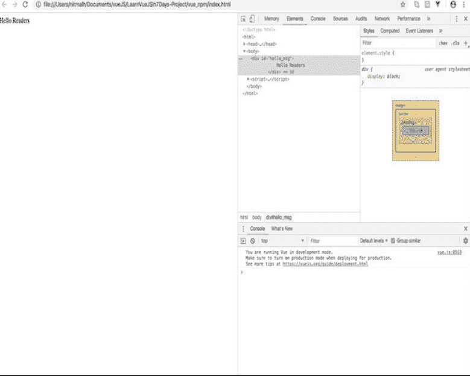

正如我们通过左侧的检查工具在浏览器中看到的，我们的消息正在 `div` 内部显示。

### 让我们分析 index.html 代码

**添加 Vue.js 引用**

代码包含了用于输入名字和姓氏的输入字段，以及一个问候消息，该消息使用了一个计算属性 `get_full_name()` 来显示组合后的姓名。

我们使用了两个数据属性来保存用户的输入，并将它们与输入文本关联起来。

- `first_name`

- `last_name`

Vue 对象中的方法 `get_full_name` 将两个变量连接起来，中间加上一个空格，并返回全名，该全名随后显示在屏幕上的问候消息中。我们使用了 `v-show` 指令，这样当屏幕上没有指定名字和姓氏时，就不会渲染问候消息。

它有效！！

那么，这里的缺点是什么？

这将是内存消耗大的。当我们调用这个方法来显示问候消息时，它会尝试创建完整的调用栈并为其分配内存。因此，每次我们对 `firstname` 或 `lastname` 数据属性进行更改时，都会调用该方法，这导致每次实例化时都为同一个方法分配大量内存。

想象一下这种情况：一个涉及更多计算和/或处理的方法会降低应用程序的性能，并消耗更多内存。

### 让我们来谈谈解决方案

我们可以使用计算属性来解决这个问题。与上面的方法方式不同，计算属性会缓存结果。除非依赖的 v-model 发生变化，否则它不会刷新。

```html
1  <!DOCTYPE html>
2  <html>
3      <head>
4          <script src="https://cdn.jsdelivr.net/npm/vue/dist/vue.js"></script>
5          <style>
6              input[type=text]{
7                  width: 50%;
8                  height: 30px;
9                  font-size: 20px;
10             }
11         </style>
12     </head>
13     <body>
14         <div id="app_div">
15             <input type="text" v-model="first_name" placeHolder="First name"/> <br>
16             <input type="text" v-model="last_name" placeHolder="Last name"/>     <br><br/>
17             <b v-show="full_name != ''">Hello {{ full_name }} Greeting from Learn VueJS in 7 days.</b>
18         </div>
19         <script>
20             var app = new Vue({
21                 el: "#app_div",
22                 data: {
23                     first_name: '',
24                     last_name: '',
25                 },
26                 computed: {
27                     full_name : function(){
28                         return this.first_name + ' ' + this.last_name;
29                     },
30                 }
31             });
32         </script>
33     </body>
34 </html>
```

**图 3.2：使用计算属性的代码**

现在我们已经重构了现有代码。我们主要做了两件事。

1.  我们移除了 `methods` 属性并添加了 `computed` 属性。

2.  与方法不同，在页面中使用计算属性时不需要括号。

### 为什么这是解决方案？

计算属性是被缓存的。因此，当两个模型变量（即 `firstname` 和 `lastname`）首次获得输入时，计算属性会获取其值。此后，它会被缓存，直到模型变量获得新值。

使用计算属性的优点如下：

-   它被缓存。

-   除非依赖的模型发生变化，否则值不会改变。

-   可以从缓存中快速获取。

-   比方法执行得更快。

### 计算属性与方法

计算属性和方法之间最基本也是最大的区别在于它们被使用时的执行方式。换句话说，方法每次被调用时都会执行，而计算属性除非依赖项发生变化，否则会使用缓存。

### 让我们用时间戳值试试

让我们创建一个方法和一个计算属性。它们每一个都应该返回当前时间戳，这样我们就可以标记值之间的差异。

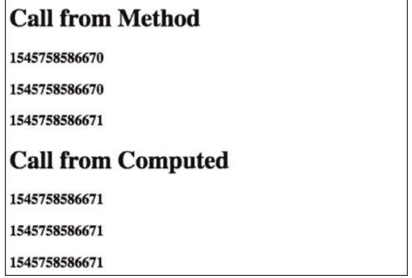

在上图中，我们展示了程序的输出。上面的是方法调用的结果，下面的是计算属性的结果。

方法部分中的时间戳值有差异，尽管我们调用的是同一个方法。这意味着，同一个方法被反复调用以获取值。但在计算属性部分，值将始终与第一次调用时的值相同，因为它从缓存中获取值。在第一次调用时，生成的值（在这种情况下是当前时间戳）被存储在缓存中。后续调用时，该值仅从缓存中获取并显示，除非页面被刷新。刷新时，它会更改计算属性的值，因为此计算属性依赖于时间戳。

多次刷新屏幕后，我们可以看到方法的值可能相同也可能不同，这取决于执行时间。但计算属性的值将始终相同。

## 方法调用

{{ nowMethod() }}

{{ nowMethod() }}

{{ nowMethod() }}

## 计算属性调用

{{ nowComputed }}

{{ nowComputed }}

{{ nowComputed }}

计算属性中的获取器和设置器

计算属性在HTML页面中看起来就像一个普通的属性。那么我们头脑中自然会产生一个问题：计算属性能否与获取器和设置器一起使用？

答案是肯定的。

我们也可以为计算属性定义获取器和设置器。

### 获取器

当我们说，向计算属性返回值时，它作用于获取器，这样我们就可以从特定的计算属性中检索值。

让我们来尝试一下

我们将沿用上面的例子；我们只需要向用户展示该值是**手动编辑**还是**自动组合**。

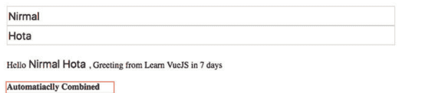

图 3.4: 获取器示例：显示自动组合的字符串

在这个用户界面中，名和姓被组合起来创建全名。如上一个例子所述，我们已将`full_name`作为计算属性，并保存组合后的值以显示在屏幕上。如前所述，这个值的组合是由获取器方法返回的。

如上图中红色矩形框所示，它显示“自动组合”。

### 设置器

现在，让我们使用设置器方法，如果值被手动编辑，我们将通知用户。换句话说，如果用户直接更改了全名，它将显示“值已手动编辑”的消息。

让我们来尝试一下

在同一个例子中，我们将在红色矩形框内显示“已手动编辑”的消息，如下图所示。

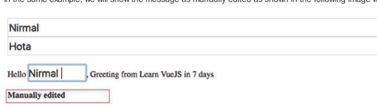

图 3.5: 设置器示例：显示手动编辑的字符串

### 解释UI元素

在上面的屏幕中（获取器和设置器界面），我们为名、姓和全名（计算属性）设置了三个输入框。前两个输入框和最后一个输入框之间的唯一区别是，在最后一个输入框（即全名输入框）中，我们应用了样式来减小其宽度并移除其边框。

```
style="width: 110px; border: 0px;"
```

让我们看一下那段代码

```
computed: {
    full_name : {
        get: function(){
            this.is_combined = true;
            return this.firstname + ' ' + this.lastname;
        },
        set: function(value){
            this.is_combined = false;
        }
    }
}
```

如图所示，我们为`full_name`计算属性定义了`get`和`set`方法。

在`get`方法中，我们做了以下操作：

- 我们返回了*名*和*姓*的组合值，以创建计算属性

- 将`is_combined`变量设置为true

在`set`方法中，我们做了以下操作：

- 将`is_combined`变量设置为false

每当调用`get`方法来显示值时，它会将`is_combined`设置为true，并向用户显示“自动组合”消息；当调用`set`方法时，它会将其设置为false，并显示“已手动编辑”消息。

在这里，只要我们编辑指定输入框中的`full_name`，`set`方法就会被调用。

代码的完整视图如下所示：

```html
<!DOCTYPE html>
<html>
	<head>
		<script src="https://cdn.jsdelivr.net/npm/vue/dist/vue.js"></script>
		<style>
			input[type=text]{
				width: 50%;
				height: 30px;
				font-size: 20px;
			};
		</style>
	</head>
	<body>
		<div id="app_div">
					<input type="text" v-model="first_name"
					placeHolder="First name"/> <br>
					<input type="text" v-model="last_name"
					placeHolder="Last name"/> <br/><br/>
		Hello <input type="text" v-model="full_name"
		placeHolder="Full name" style="width: 110px; border:
		0px;"/>, Greeting from Learn VueJS in 7 days
		<br/><br/>
			<b>{{ is_combined ? "Automatically Combined":
		"Manually edited" }}</b>
			</div>
			<script>
				var app = new Vue({
					el: "#app_div",
					data: {
						first_name: 'Nirmal',
						last_name: 'Hota',
				is_combined: true
				},
				computed: {
					full_name : {
				get: function(){
					this.is_combined = true;
					return this.first_name + ' ' + this.
					last_name;
					},
					set: function(value){
						this.is_combined = false;
					}
				}
			}
		});
		</script>
	</body>
</html>
```

### 侦听属性

侦听属性用于监视变量的变化，并执行其下方编写的代码块。

让我们举个例子

我们将构建一个升转换计算器。作为升转换计算器的一部分，我们将接受一个文本输入，该输入将升数作为输入。一旦用户输入值，该值的毫升转换就会被计算出来，并显示在旁边的输入框中。当用户在输入框中输入毫升值时，用户也会获得毫升的升转换结果。

输出效果如何

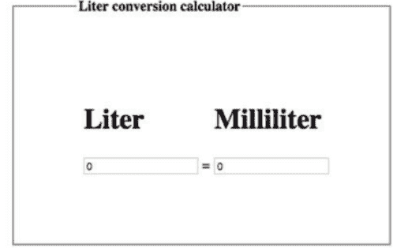

图 3.6: 升转换计算器

如截图所示，在“升”文本框中输入的升值将显示其等效的毫升值，反之亦然。

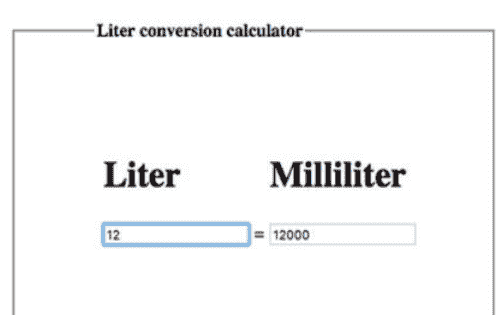

图 3.7: 带有数值的升转换计算器

如截图所示，我们输入了升值，毫升值也立即发生了变化。

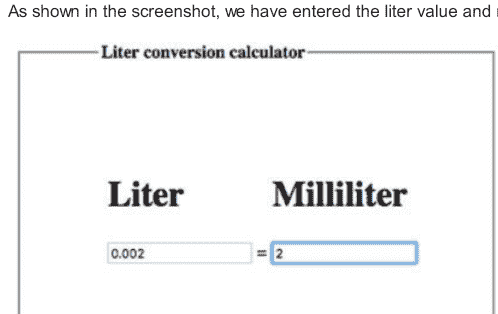

图 3.8: 带有数值的升转换计算器

同样，在毫升输入框中输入值，也会立即计算并显示升值。

### 解释代码

在HTML部分，我们按照惯例使用了表格布局设计结构。Div布局也可用于创建输入的表格结构。

VueJS支持使用`watch`标签来定义侦听属性。由于我们需要接受输入，然后我们需要定义模型变量来获取数据。因此，我们在`data`块中定义了两个模型变量`liter`和`mliter`。相同的变量在输入字段的`v-model`属性中使用，以接受其中的输入值。

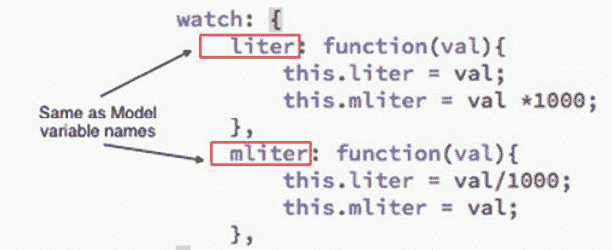

图 3.9: 定义侦听器

现在，我们需要为相同的属性添加侦听，这样我们才能看到值的变化，并立即执行代码块。为了给相同的模型变量添加侦听，我们需要使用相同的变量名来定义侦听。

侦听属性代码块会在更改发生或满足`watch`标签块中定义的条件时立即触发。它持续监视`v-model`变量以使更改生效。

```html
<!DOCTYPE html>
<html>
    <head>
        <script src="https://cdn.jsdelivr.net/npm/vue/dist/vue.js"></script>
    </head>
    <body>
        <div id="app_div">
            <fieldset style="width: 20%; padding: 5%">
                <legend style="font-weight: bold">Liter conversion calculator</legend>
                <table>
                    <tr>
                        <td><h1>Liter</h1></td>
                        <td></td>
                        <td><h1>Milliliter</h1></td>
                    </tr>
                    <tr>
                        <td><input type="text" v-model="liter"/></td>
                        <td> = </td>
                        <td><input type="text" v-model="mliter"/></td>
                    </tr>
                </table>
            </fieldset>
        </div>
        <script>
            var app = new Vue({
                el: "#app_div",
                data: {
                    liter: 0,
                    mliter: 0
                },
                watch: {
                    liter: function(val){
                        this.liter = val;
                        this.mliter = val * 1000;
                    },
                    mliter: function(val){
                        this.liter = val / 1000;
                        this.mliter = val;
                    },
                },
            });
        </script>
    </body>
</html>
```

### 侦听器的更多应用

在响应式环境中，侦听器扮演着重要的角色，因为它持续监视属性，并可以根据定义的动作做出反应。

侦听器不仅持续监视属性，还跟踪属性的旧值和新值。它缓存当前值。当发生变化时，侦听器将旧值作为旧值返回，将更改后的值作为新值返回。然后再次将新值缓存为当前值。

如前面的示例所示，侦听器定义在vue对象的`watch`钩子下。作为经验法则，侦听器的名称必须与要监视的属性的名称相同。

## 侦听器

我们在这里使用了一个 `watch` 属性来捕获体温，其初始值为 98.6。用户输入当前体温。系统将根据新旧值来显示相应的消息。

```javascript
watch: {
    temperature: function(newValue, oldValue){
        if(newValue < oldValue){
            this.temp_message = "Your temperature is dropping.";
        }
        else if(newValue > oldValue){
            this.temp_message = "Your temperature is rising.";
        }
        else{
            this.temp_message = "Your temperature is still unchanged.";
        }
    }
},
```

我们将侦听器附加到 `temperature` 模型变量上。如果温度的新值小于旧值，则会显示消息“Your temperature is dropping”。输出消息被赋值给 `temp_message` 模型变量。

如果新值大于旧值，则消息为“Your temperature is rising”。

如果两者保持不变，用户将看到消息“Your temperature is still unchanged”。

### 工作原理

用户在文本框中输入温度值。一旦文本框中的值发生变化，它就会改变 `temperature` 模型变量的值。由于侦听器应用于 `temperature`，它将开始执行 `watch` 中编写的代码块。

```html
<!DOCTYPE html >
<html>
    <head>
        <script src="https://cdn.jsdelivr.net/npm/vue/dist/vue.js"></script>
    </head>
    <body>
        <div id="app_div">
            <fieldset style="width: 50%; padding: 5%">
                <legend style="font-weight: bold">Temperature</legend>
                <table>
                    <tr>
                        <td><h1>Enter your body temperature
                        </h1></td>
                    </tr>
                    <tr>
                        <td><input type="text"
                        v-model="temperature"/> </td>
                    </tr>
                    <tr>
                        <td><span>{{ temp_message }}</span></td>
                    </tr>
                </table>
            </fieldset>
        </div>
        <script>
            var app = new Vue({
                el: "#app_div",
                data: {
                    temperature: 98.6,
                    temp_message: "",
                },
                watch: {
                    temperature: function(newValue, oldValue){
                        if(newValue < oldValue){
                            this.temp_message = "Your temperature is dropping.";
                        }
                        else if(newValue > oldValue){
                            this.temp_message = "Your temperature is rising.";
                        }
                        else{
                            this.temp_message = "Your temperature is still unchanged.";
                        }
                    }
                },
            });
        </script>
    </body>
</html>
```

### 在计算属性上应用侦听器

计算属性也像其他模型属性一样，可以存储值，并具备一些额外的计算能力。正如之前讨论的，我们也可以在其中获取和设置值。

现在一个显而易见的问题是：我们可以在计算属性上应用侦听器吗？答案是肯定的。

像其他模型属性一样，我们也可以让侦听器监视计算属性。它可以跟踪计算属性中的变化，并根据其中编写的代码进行响应。

我们将扩展同一个温度计示例，添加将摄氏度转换为华氏度的功能。

我们添加了一个名为 `ftemperature` 的新计算属性，用于根据摄氏度计算华氏度。我们将为这个计算属性添加侦听器，以监视值的变化。一旦摄氏度文本框中的值发生变化，就会计算出华氏度的计算属性。侦听器将观察到这个变化，并执行其内部编写的代码。

```javascript
<script>
    var app = new Vue({
        el: "#app_div",
        data: {
            temperature: 98.6,
            temp_message: "",
            f_message: ""
        },
        computed: {
            ftemperature: function(){
                return (this.temperature * 9/5) + 32;
            }
        },
        watch: {
            temperature: function(newValue, oldValue){
                if(newValue < oldValue){
                    this.temp_message = "Your temperature is dropping.";
                }
                else if(newValue > oldValue){
                    this.temp_message = "Your temperature is rising.";
                }
                else{
                    this.temp_message = "Your temperature is still unchanged.";
                }
            },
            ftemperature: function(newValue, oldValue){
                this.f_message = "Temperature changed from " + oldValue + " fahrenheit to " + newValue + " fahrenheit";
            }
        }
    });
</script>
```

因此，摄氏值的变化将计算出华氏值，并存储在 `ftemperature` 中。

有了这个变化，很明显，摄氏度和华氏度值都会受到变化的影响。侦听器将监视到这种效果，并执行两个 `watch` 属性（即 `temperature` 和 `ftemperature`）内部的代码块，以显示消息。

在本章中，我们涵盖了计算属性和侦听器。我们讨论了计算属性如何从缓存中工作，这与普通方法调用不同。方法在每次调用时都会执行，而计算属性从缓存中获取值，除非依赖的模型变量发生了变化。我们还了解了如何在计算属性中使用 `get` 和 `set`。

我们讨论了 VueJS 的侦听器，它也是非常有用的工具，可以监视任何属性以处理实时变化。侦听器在值发生变化时也会返回新旧值。我们也可以在计算属性上应用侦听器。

在下一章中，我们将讨论 VueJS 组件的基础知识，包括注册组件和定义组件属性。组件是 Vue 支持的可重用实体。

## 第四天：组件

在上一章中，我们学习了创建计算属性的方法。我们还探索了如何在计算属性中应用 `get` 和 `set`。方法与计算属性的比较帮助我们了解了计算属性的优势。

我们还实践了侦听器。我们学习了如何使用侦听器获取控件的新旧值。

在本章中，我们将涵盖组件的基础知识。我们将了解为什么需要组件，如何创建、注册和使用组件。我们还将定义组件的 props，以了解它们实际是如何工作的。

### 重复使用控件

我们一直使用输入控件从用户那里获取数据。同类字段需要在项目中的许多地方重复使用。以一个电子商务应用程序为例，它需要在多个地方使用地址。我们需要用于联系、账单、收货等地址。

相同用户输入控件需要以重复的方式多次使用来收集数据。因此，每次我们需要从用户那里收集地址数据时，都需要复制并粘贴相同的一组输入控件。

```html
<fieldset class="container">
    <legend>Contact address</legend>
    <div class="row">
        <div class="col-2">Address Line 1</div>
        <div class="col-6"><input type="text" class="full-width" v-model="contact_address_line1" /></div>
    </div>
    <div class="row">
        <div class="col-2">Address Line 2</div>
        <div class="col-6"><input type="text" class="full-width" v-model="contact_address_line2" /></div>
    </div>
    <div class="row">
        <div class="col-2">City</div>
        <div class="col-6"><input type="text" class="full-width" v-model="contact_city" /></div>
    </div>
    <div class="row">
        <div class="col-2">State</div>
        <div class="col-6"><input type="text" class="full-width" v-model="contact_state" /></div>
    </div>
    <div class="row">
        <div class="col-2">Pin code</div>
        <div class="col-6"><input type="text" class="full-width" v-model="contact_pincode" /></div>
    </div>
</fieldset>
<fieldset class="container">
    <legend>Shipping address</legend>
    <div class="row">
        <div class="col-2">Address Line 1</div>
        <div class="col-6"><input type="text" class="full-width" v-model="shipping_address_line1" /></div>
    </div>
    <div class="row">
        <div class="col-2">Address Line 2</div>
        <div class="col-6"><input type="text" class="full-width" v-model="shipping_address_line2" /></div>
    </div>
    <div class="row">
        <div class="col-2">City</div>
        <div class="col-6"><input type="text" class="full-width" v-model="shipping_city" /></div>
    </div>
    <div class="row">
        <div class="col-2">State</div>
        <div class="col-6"><input type="text" class="full-width" v-model="shipping_state" /></div>
    </div>
    <div class="row">
        <div class="col-2">Pin code</div>
        <div class="col-6"><input type="text" class="full-width" v-model="shipping_pincode" /></div>
    </div>
</fieldset>
```

不仅需要复制和粘贴相同的控件，我们还需要为每个控件设置重复的模型变量集。如图所示，相同的 `address_line1` 需要为联系地址、收货地址、账单地址等分别定义。这会产生大量重复代码，降低可读性，使代码维护处于风险之中。

### 如何避免这种情况？

组件就是答案。我们需要组件来避免代码中的这些重复。

## 什么是组件？

组件是可以被重复使用以执特定任务的 Vue 实例。只需实例化同一个组件，就可以在多个地方复用它。

我们将设计我们的第一个组件。

我们将看到一个组件实际上是如何被设计出来的。我们还将了解如何在页面中渲染一个组件。

首先，让我们设计一个组件，在屏幕上渲染一个文本框及其标签。我们将重复使用同一个组件来渲染多个文本框。

```
<!DOCTYPE html >
<html>
<head>
    <meta name="viewport" content="width=device-width, initial-scale=1, shrink-to-fit=no">
    <link rel="stylesheet" href="https://stackpath.bootstrapcdn.com/bootstrap/4.2.1/css/bootstrap.min.css" integrity="sha384-GJzZqFGwb1QTTN6wy59FF1Bu1Gj6Sa9DkKMp0DgiMDm4iYMj70gZWKYbI706tWS" crossorigin="anonymous">
    <script src="https://cdn.jsdelivr.net/npm/vue/dist/vue.js"></script>
    <style>
        .full-width{
            width: 100%;
            height: 90%;
        }
    </style>
</head>
<body>
    <div id="app_div">
        <custom_text></custom_text>
    </div>
    <script>
        Vue.component('custom_text', {
            template: '<fieldset class="container"><div class="row"> <div class="col-2">Custom Text</div> <div class="col-6"><input type="text" class="full-width" /></div> </div> </fieldset>'
        });
        var app = new Vue({
            el: "#app_div",
        });
    </script>
</body>
</html>
```

与之前的章节不同，在上面的代码中，我们看到了 `Vue.component` 块。它定义了一个组件。

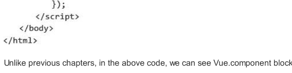

图 4.3：Vue 组件主体描述

如图所示，我们可以定义用于在屏幕上渲染组件的组件名称。组件主体在 `template` 部分中定义。

我们只需使用组件名称作为标签，就可以在屏幕上渲染它。

<custom_text></custom_text>

在浏览器中渲染页面后，我们将得到以下输出。

**自定义文本** [输入框]

要在屏幕上渲染相同的组件，我们只需要不断重复这些标签。只要 Vue 元素内部找到相同的标签，它就会持续渲染上述控件。

### 扩展模板

目前它只是一个包含文本框的 fieldset。现在，让我们再添加一个包含另一个文本框的 fieldset，这样每当我们使用相同的标签时，它就会同时渲染两个文本框。

我们将使这个组件更有意义。不再使用 `customtext`，我们将其改为 `customaddress`。同时，我们将把 "Custom Text" 标签改为 "地址行 1"。

更改必须在 `template` 部分中进行。因此，我向现有的 fieldset 中添加了一个新的 fieldset，以便它会依次渲染两个文本框。

```
<body>
  <div id="app_div">
    <custom_address></custom_address>
  </div>
  <script>
    Vue.component('custom_address', {
      template: `<fieldset class="container"><div class="row"> <div class="col-2">Address Line 1</div> <div class="col-6"><input type="text" class="full-width" /></div> </div></fieldset> <fieldset class="container"><div class="row"> <div class="col-2">Address Line 2</div> <div class="col-6"><input type="text" class="full-width"/></div> </div></fieldset>`
    });
    var app = new Vue({
      el: "#app_div",
    });
  </script>
</body>
```

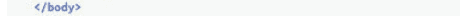

我们将在浏览器中渲染相同的代码以查看输出。啊... 但是我们得到了如下所示的错误：

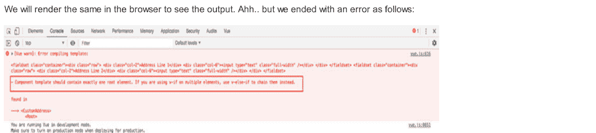

它明确指出，组件模板应该只包含一个根元素。如果我们使用 `v-if`，那么也需要用 `v-else-if` 来链接，以保持单一根元素。由于我们连续使用了两个 fieldset，我们偏离了规则。所以，我们需要添加另一个根元素来看看是否有效。

让我们用一个 `<div>` 元素包裹这些 fieldset，这样我们就可以遵循 Vue 组件的单根元素规则。

```
template: '<div><fieldset class="container"><div class="row"> <div class="col-2">Address Line 1</div> <div class="col-6"><input type="text" class="full-width" /></div> </div> </fieldset> <fieldset class="container"><div class="row"> <div class="col-2">Address Line 2</div> <div class="col-6"><input type="text" class="full-width" /></div> </div> </fieldset></div>'
```

图 4.6：用 `<div>` 标签包裹 HTML

如上图所示，`<div>` 元素作为单一根元素被添加到了模板中。

### 教训

Vue 组件模板应该只有一个根元素。如果我们使用 `v-if`，那么我们必须也使用 `v-else` 来链接元素，以保持它们在一个根元素内。

当我们使用该标签时，它会在屏幕上渲染两个文本框。

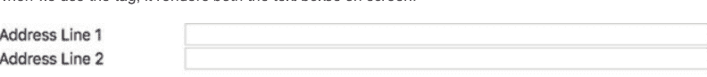

图 4.7：组件输出

```
<!DOCTYPE html>
<html>
  <head>
    <meta name="viewport" content="width=device-width, initial-scale=1, shrink-to-fit=no">
    <link rel="stylesheet" href="https://stackpath.bootstrapcdn.com/bootstrap/4.2.1/css/bootstrap.min.css"
      integrity="sha384-GJzZqFGwb1QTTN6wy59ffF1BuGJpLSa9DkKMp0Dg" crossorigin="anonymous">
    <script src="https://cdn.jsdelivr.net/npm/vue/dist/vue.js"></script>
    <style>
      .full-width{
        width: 100%;
        height: 90%;
      }
    </style>
  </head>
  <body>
    <div id="app_div">
      <custom_address></custom_address>
    </div>
    <script>
      Vue.component('custom_address', {
        template: '<div><fieldset class="container"><div class="row"> <div class="col-2">Address Line 1</div> <div class="col-6"><input type="text" class="full-width" /></div> </div> </fieldset> <fieldset class="container"><div class="row"> <div class="col-2">Address Line 2</div> <div class="col-6"><input type="text" class="full-width" /></div> </div> </fieldset></div>'
      });
      var app = new Vue({
        el: "#app_div",
      });
    </script>
  </body>
</html>
```

### 处理数据部分

我们已经设置了文本框。现在，我们需要为它们添加值。正如我们之前所看到的，为了从文本框中获取值，我们需要为文本框分配模型变量。

让我们扩展上面的例子。

```
<script>
  Vue.component('custom_address', {
    data: function(){
      return {
        address_line1: "",
        address_line2: ""
      }
    },
    template: '<div><fieldset class="container"><div class="row"> <div class="col-2">Address Line 1</div> <div class="col-6"><input type="text" class="full-width" v-model="address_line1"/></div> </div> </fieldset> <fieldset class="container"><div class="row"> <div class="col-2">Address Line 2</div> <div class="col-6"><input type="text" class="full-width" v-model="address_line2"/></div> </div> </fieldset></div>'
  });
  var app = new Vue({
    el: "#app_div",
  });
</script>
```

图 4.8：向组件添加数据

这里我们将使用两个模变量来绑定输入文本。模型变量必须添加到 `data` 部分。我们将在浏览器中渲染上面的例子。

| 地址行 1 | [输入框] |

| 地址行 2 | [输入框] |

我们可以看到它在浏览器中正确渲染。现在，我们需要检查 Vue 组件是否从输入框中获取了值。为了检查这一点，我们需要使用 Vue Chrome 扩展。

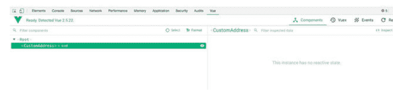

奇怪的是，这里没有模型变量。也没有数据填充到其中。因此，我们需要检查控制台，看看是否有任何错误。

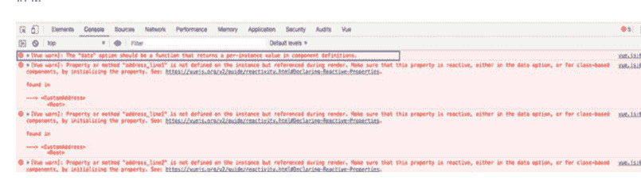

控制台选项卡有错误，它指出在组件定义中，`data` 应该是一个返回预实例值的函数。我们需要更改 `data` 部分。它不应该只包含模型变量，它应该是一个返回模型变量的函数。

由于组件是可重用的实体，它们需要被单独实例化才能在屏幕上分别渲染。每个实例都将拥有自己的一组数据变量。因此，将 `data` 设为一个函数就能解决这个问题。每个实例的数据变量都将被单独实例化。

```
<script>
    Vue.component('custom_address', {
        data: function(){
            return {
                address_line1: "",
                address_line2: ""
            }
        },
        template: '<div><fieldset class="container"><div class="row"> <div class="col-2">Address Line 1</div> <div class="col-6"><input type="text" class="full-width" v-model="address_line1"/></div> </div> </fieldset> <fieldset class="container"><div class="row"> <div class="col-2">Address Line 2</div> <div class="col-6"><input type="text" class="full-width" v-model="address_line2"/></div> </div> </fieldset> </div>'
    });
    var app = new Vue({
        el: "#app_div",
    });
</script>
```

图 4.11：以函数格式包含数据的组件

让我们用实例渲染代码，看看 Vue 组件对象在屏幕上的反应。

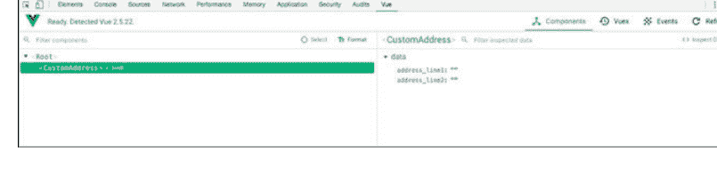

## 4.12 使用 Vue Devtools 浏览渲染后的 Vue 对象

我们可以看到与组件关联的实例变量。为了更清晰地看到这一点，让我们在屏幕上再添加一个组件。这样我们就能了解数据变量在不同组件实例中的行为。

```
<div id="app_div">
    <custom_address></custom_address>
    <hr/>
    <custom_address></custom_address>
</div>
```

**图 4.13：在其他组件中使用组件**

我们添加了两个组件，并用一条水平线隔开。它将在屏幕上相应地渲染。

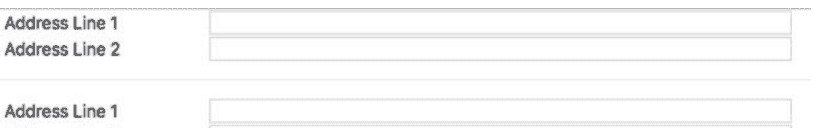

Vue 扩展选项卡将显示组件及其模型变量。在一个组件中输入的值不会覆盖另一个组件中的数据变量。

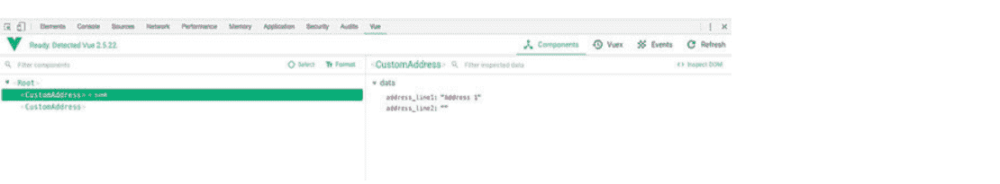

**图 4.14：包含数据元素的自定义地址组件**

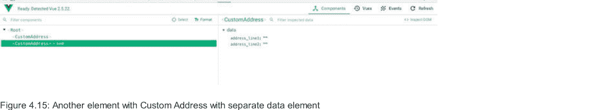

**图 4.15：另一个使用自定义地址且拥有独立数据元素的组件**

比较上面的两张图片，我们可以看到第一个组件的 addressLine1 有值，然而第二个组件中相同的 addressLine1 没有值。

```html
<!DOCTYPE html>
<html>
<head>
    <meta name="viewport" content="width=device-width, initial-scale=1, shrink-to-fit=no">
    <link rel="stylesheet" href="https://stackpath.bootstrapcdn.com/bootstrap/4.2.1/css/bootstrap.min.css" integrity="sha384-GJzZqFGwb1QTTN6wy59ffF1BuGJpLSa9DkKMp0DgiMDm4iYMj70gZWKYbI706tWS" crossorigin="anonymous">
    <script src="https://cdn.jsdelivr.net/npm/vue/dist/vue.js"></script>
    <style>
        .full-width{
            width: 100%;
            height: 90%;
        }
    </style>
</head>
<body>
    <div id="app_div">
        <custom_address></custom_address>
        <hr/>
        <custom_address></custom_address>
    </div>
    <script>
        Vue.component('custom_address', {
            data: function(){
                return {
                    address_line1: "",
                    address_line2: ""
                }
            },
            template: `<div>
                <fieldset class="container">
                    <div class="row">
                        <div class="col-2">Address Line 1</div>
                        <div class="col-6"><input type="text" class="full-width" v-model="address_line1"/></div>
                    </div>
                </fieldset>
                <fieldset class="container">
                    <div class="row">
                        <div class="col-2">Address Line 2</div>
                        <div class="col-6"><input type="text" class="full-width" v-model="address_line2"/></div>
                    </div>
                </fieldset>
            </div>`
        });
        var app = new Vue({
            el: "#app_div",
        });
    </script>
</body>
</html>
```

模板字符串看起来很奇怪！

模板字符串看起来非常奇怪。想象一个包含多个文本框、下拉菜单、复选框和按钮的模板。将它们放在字符串里本身不是问题。问题出现在维护阶段。维护应用程序的成本会非常高。我们可能需要使用某种外部工具或其他方法来理解模板字符串。

所以，现在我们应该思考一些其他的方法，来帮助我们以更好、更组织化的方式编写模板字符串，以便未来能保持同样的效率。Vue CLI 就是答案。

让我们使用 CLI 创建一个新组件。我们将在接下来的部分分析它的不同部分。

要设置并运行 Vue CLI，请参考第一天的内容。

所以，我们现在将创建一个新的 CLI 项目并向其中添加组件。让我们一步步来完成。

```
$ vue create learnin7days
$ cd learnin7days
$ npm run serve
```

根据上述命令，我们已经设置了项目，导航到了目录，并运行了服务器。我们将得到以下输出：

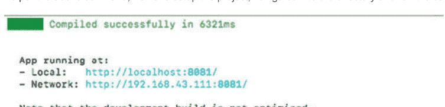

**图 4.16：服务器成功运行**

我们可以在网络浏览器中使用上面指定的链接 http://localhost:8081 查看输出。如果我们查看新创建项目的文件夹结构，会发现我们使用的是 .vue 文件。这些文件包含了组件代码。

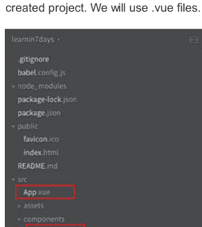

**图 4.17：Vue CLI 项目**

生成的 HelloWorld.vue 组件包含易于维护的代码。如果我们查看它，会发现模板在这里不再是一个字符串了。

```
<template>
  <div class="hello">
    <h1>{{ msg }}</h1>
    <p>
      For a guide and recipes on how to configure / customize this project,<br>
      check out the
      <a href="https://cli.vuejs.org" target="_blank" rel="noopener">vue-cli documentation</a>.
    </p>
    <h3>Installed CLI Plugins</h3>
    <ul>
      <li><a href="https://github.com/vuejs/vue-cli/tree/dev/packages/%40vue/cli-plugin-babel" target="_blank" rel="noopener">babel</a></li>
      <li><a href="https://github.com/vuejs/vue-cli/tree/dev/packages/%40vue/cli-plugin-eslint" target="_blank" rel="noopener">eslint</a></li>
    </ul>
    <h3>Essential Links</h3>
    <ul>
      <li><a href="https://vuejs.org" target="_blank" rel="noopener">Core Docs</a></li>
      <li><a href="https://forum.vuejs.org" target="_blank" rel="noopener">Forum</a></li>
      <li><a href="https://chat.vuejs.org" target="_blank" rel="noopener">Community Chat</a></li>
      <li><a href="https://twitter.com/vuejs" target="_blank" rel="noopener">Twitter</a></li>
      <li><a href="https://news.vuejs.org" target="_blank" rel="noopener">News</a></li>
    </ul>
    <h3>Ecosystem</h3>
    <ul>
      <li><a href="https://router.vuejs.org" target="_blank" rel="noopener">vue-router</a></li>
      <li><a href="https://vuex.vuejs.org" target="_blank" rel="noopener">vuex</a></li>
      <li><a href="https://github.com/vuejs/vue-devtools#vue-devtools" target="_blank" rel="noopener">vue-devtools</a></li>
      <li><a href="https://vue-loader.vuejs.org" target="_blank" rel="noopener">vue-loader</a></li>
      <li><a href="https://github.com/vuejs/awesome-vue" target="_blank" rel="noopener">awesome-vue</a></li>
    </ul>
  </div>
</template>

<script>
export default {
  name: 'HelloWorld',
  props: {
    msg: String
  }
}
</script>
```

**图 4.18：使用模板创建的默认组件代码**

可以使用编辑器/IDE，例如 Brackets (http://brackets.io/)、VS Code (https://code.visualstudio.com/)、Sublime (https://www.sublimetext.com/) 等来打开和编辑项目。编辑器列表很长；不限于上面这些。你可以找到任何你习惯的编辑器来使用。我们将使用 vue CLI 创建相同的地址组件。

正如我们之前所见，.vue 文件（即组件文件）都存储在 /components 文件夹中。因此，我们将在 /components 文件夹中添加一个名为 Address.vue 的新文件。然后，让我们向该文件中添加以下代码。

代码在 <template> 标签中包含模板字符串。组件的名称可以在 <script> 标签内定义。

在这个 UserInfo 组件中，我们有一个 <span> 标签来在屏幕上显示所选用户。这个 <span> 标签从 usrInfo 属性获取其数据。

现在我们可以检查 User 组件，看看数据是如何传递给 UserInfo（这里是子组件）的。

```html
<template>
  <div>
    <select class="full-width" v-model="selectedUser">
      <option v-for="user in users" :key="user"> {{ user }} </option>
    </select>
    <UserInfo :usrInfo = "selectedUser"></UserInfo>
  </div>
</template>
```

**图 4.29：展示 UserInfo 子组件的用法**

在模板中，它使用了 UserInfo 标签，并将值传递给 usrInfo 属性，该属性是在 UserInfo 组件中定义的。这样 UserInfo 组件就能从属性中获取数据并在 <span> 标签中显示数据。User 组件的完整代码将如下所示：

```html
<template>
    <div>
        <select class="full-width" v-model='selectedUser'>
            <option v-for="user in users" :key="user"> {{ user }} </option>
        </select>
        <UserInfo :usrInfo = 'selectedUser'></UserInfo>
    </div>
</template>
<script>
import UserInfo from './UserInfo.vue'

export default {
    name: 'Users',
    data: function(){
        return {
            users: ['Dr. Vishal Jain', 'Nirmal Hota', 'Tadit Dash'],
            selectedUser: ''
        }
    },
    components: {
        UserInfo
    }
}
</script>
<style scoped>
    .full-width{
        width: 100%;
        height: 41px;
        font-size: larger;
    }
</style>
```

### 处理父组件中的子组件事件

到目前为止，我们已经看到了数据是如何从子组件传递到父组件以及反向传递的。但数据传递并非故事的全部。在现实世界中，我们还必须在父组件中处理子组件事件。

要将事件从子组件传递到父组件，我们需要使用定义的关键字 $emit。顾名思义，它将事件从子组件发出到父组件。父组件必须在其端处理该事件以产生效果。

让我们创建另一个 vue 组件并命名为 AddressWithPinCheck.vue。我们将在这里添加一个邮政编码输入框，以便它接受用户输入的邮政编码。此外，我们还将添加一个按钮。点击该按钮时，它将验证邮政编码。

```html
<fieldset class="container">
    <div class="row">
        <div class="col-2">Pin Code</div>
        <div class="col-6">
            <input type="text" class="full-width" v-model="pin_code"/>
            <button v-on:click= "$emit('validate_pin', pin_code)">Validate</button>
        </div>
    </div>
</fieldset>
...
```

**图 4.30：使用 $emit 验证邮政编码**

除了 "$emit('validate_pin', pin_code)" 语句外，其他一切看起来都很熟悉。这条语句向父组件发出 validate_pin 事件。现在，父组件必须处理该事件才能得到预期结果。

在这种情况下，这个组件发出 validate_pin 事件，父组件将实现来显示消息。

```vue
<template>
  <div id="app">
    
    <AddressWithPinCheck v-on:validate_pin="validate_pin"></AddressWithPinCheck>
  </div>
</template>

<script>
import AddressWithPinCheck from './components/AddressWithPinCheck.vue'

export default {
  name: 'app',
  components: {
    AddressWithPinCheck,
  },
  methods: {
    validate_pin: function(pinCode){
      var pat1=/^\d{6}$/;
      if(pinCode!=""){
        if(pat1.test(pinCode)){
          alert(pinCode + " 是一个有效的验证码。");
        }
        else{
          alert(pinCode + " 无效。请再次检查。");
        }
      }
      else{
        alert("验证码不能为空");
      }
    }
  }
}
</script>

<style>
#app {
  font-family: 'Avenir', Helvetica, Arial, sans-serif;
  -webkit-font-smoothing: antialiased;
  -moz-osx-font-smoothing: grayscale;
  text-align: center;
  color: #2c3e50;
  margin-top: 60px;
  max-width: 40%;
}
</style>
```

在上述代码中，我们注意到了两件事。其一是组件标签的使用方式，其二是事件的处理方式。

在这个语句中，我们使用了组件，并且用户正在处理组件发出的事件。`validatepin`是组件发出的事件，它位于`v-on`指令中。为了使这个事件生效，我们定义了一个自定义方法`validatepin`。这个事件名称不必与实际事件名称相同。我们可以使用任何自定义名称。

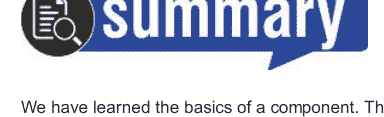

我们已经学习了组件的基础知识。可重用性是使用组件的关键。它帮助我们减少重复编写相同的代码。我们可以定义组件的属性来接收来自页面以及父组件的数据。我们还学习了如何为属性指定验证和类型，以便属性能根据定义的规范获得有效的值。此外，字符串模板最好用`.vue`文件替代，这有助于编写更易管理的HTML代码。事件可以在父组件中处理，这些事件由子组件发出，数据可以通过事件传递。`$emit`是将事件从子组件暴露给父组件的关键。

在下一章中，我们将学习如何进一步使用组件。我们还将学习如何建立从子组件到父组件的通信。我们将了解如何创建和使用自定事件。我们还将学习动态组件、异步组件等。在本章中，我们还将介绍插槽及其作用。

第5天

## 深入组件


# 深入组件：Props 与插槽

在上一章中，我们学习了创建组件的方法。可重用性和可维护性是使用组件的关键。它帮助我们将工作分割成多个小部分。我们还探索了在另一个组件中使用组件的方法。传递机制也帮助我们实现了组件之间的数据传递。

在本章中，我们将深入探讨组件。我们将更深入地研究 props。我们将定义类型、应用验证等等。此外，我们将更多地使用组件，并学习插槽将如何帮助我们。

## 深入 Props

正如我们在上一章所讨论的，props 是在组件之间传递数据的方式。它有助于父子组件之间的数据通信。

在本章中，我们将更深入地探讨 prop 验证的实现。

## Prop 类型验证

我们可以在定义 prop 时应用验证。子组件有完全的权力来决定接受什么和拒绝什么。因此，prop 块可以指定属性的类型。

让我们创建一个 Vue 组件，它只接受数值。同时，我们可以将其标记为必需。这样，每当使用该组件标签时，它都需要该属性值。

```vue
<template>
  <div>数字是 {{ NumValue }}</div>
</template>

<script>
export default {
  props: {
    NumValue: {
      type: Number,
      required: true
    }
  }
}
</script>
```

我们定义了一个名为 `NumValue` 的属性，并指定了它接受的值的类型。为了检查它如何工作，我们需要将值传递给该组件。

我们已经将数字值传递给了组件，并且它在屏幕上正确地渲染。


我们可以做一个小实验，添加一个字符串值而不是数字。让我们在标签的 `NumValue` prop 中添加一个字符串而不是数字。

```vue
<my-component :num-value="'not a number'"></my-component>
```

如果我们切换回浏览器屏幕，虽然它渲染在了屏幕上，但控制台中一定有一个错误。现在，让我们查看开发者工具中的控制台。控制台清晰地显示了错误。

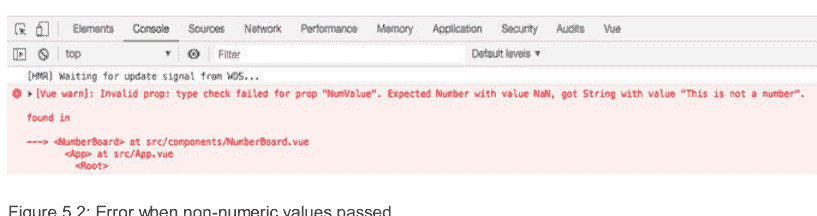

错误明确说明该值无效。因此，我们可以从上述实验中得出结论，值会根据定义的类型被接受。如果我们把 prop 值从 `String` 改为 `Number`，问题就解决了。

prop 的默认值是 `Any`。不设置任何类型或将类型设置为 `null` 将接受任何类型的数据。

属性支持的类型是：

### 向属性传递数组

与 `String`、`Number` 和 `Boolean` 一样，我们也可以向属性传递数组。我们将传递一个静态数组给组件，并遍历它以在屏幕上打印元素。

虽然我们传递的是静态数组，但我们将使用 `v-bind`。这样浏览器会将其视为 JavaScript 表达式而不是字符串。

```vue
<template>
  <ul>
    <li v-for="alphabet in alphabets" :key="alphabet">{{ alphabet }}</li>
  </ul>
</template>

<script>
export default {
  props: {
    alphabets: {
      type: Array,
      required: true
    }
  }
}
</script>
```

在这个组件代码片段中，我们可以看到 `alphabets` prop。我们在这里使用的类型是 `Array`。我们将遍历同一个数组，以在 `li` 标签中显示数组元素。

以下代码片段演示了我们如何创建数组并将其传递给组件属性：

```vue
<template>
  <div>
    <child-component :alphabets="['A', 'B', 'C']"></child-component>
  </div>
</template>

<script>
import ChildComponent from './ChildComponent.vue';
export default {
  components: { ChildComponent }
}
</script>
```

### 向属性传递对象

我们也可以向属性传递对象。在本章中我们已经看到，可以传递字符串、数字、布尔值和数组。我们也可以将对象传递到属性中，以便组件可以处理它们。

```vue
<template>
  <div>
    <div><strong>国家 : {{ countryDetails.name }}</strong></div>
    <div>首都 : {{ countryDetails.capital_name }}</div>
    <div>人口 : {{ countryDetails.population }}</div>
    <div>电话区号 : {{ countryDetails.dialing_code }}</div>
  </div>
</template>

<script>
export default {
  props: {
    countryDetails: {
      type: Object,
      required: true
    }
  }
}
</script>
```

如上面的代码片段所示，我们将 prop 的类型指定为 `Object`。因此，当我们使用这些属性时，需要传递对象类型的值。

我们创建了一个包含属性的 JSON 对象，并将其传递给该属性。该组件的实现方式是从对象中提取值并将其打印在屏幕上。

### 多种类型的属性

一个属性也可以是多种类型。让我们看一个示例属性。为其设置 `String` 和 `Number` 作为类型分配。

```vue
<template>
  <div>我的值是 : {{ MyValue }}</div>
</template>

<script>
export default {
  props: {
    MyValue: {
      type: [String, Number]
    }
  }
}
</script>
```

现在，让我们验证三个用例。首先，我们将分配一个 `Number` 并检查是否有错误。我们将在检查窗口控制台中检查。没有错误！运行正常。

现在，让我们分配一个字符串值，以确保它不会在控制台中引起任何错误。

因此，所有上述情况都正常工作，没有任何错误。让我们检查多种类型是否真的有效？我们现在将分配一个对象。然后我们将查看控制台，看看是否有错误。

虽然我们可以在屏幕上看到输出，但让我们检查控制台窗口。那里有警告。

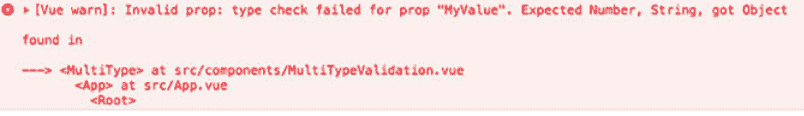

警告明确说明，它期望 `Number` 或 `String`，但收到了一个对象。

## 使属性成为必需

要使属性成为组件的必需项，我们可以添加一个名为 `required` 的额外属性。

```vue
<template>
  <div>数字是 {{ NumValue }}</div>
</template>

<script>
export default {
  props: {
    NumValue: {
      type: Number,
      required: true
    }
  }
}
</script>
```

现在我们已经将 `NumValue` 标记为必需项。我们将在 HTML 中实例化该组件，而不包含 `NumValue` 属性。

```vue
<my-component></my-component>
```

我们使用了不包含 `NumValue` 属性的 `my-component` 标签。让我们检查控制台。

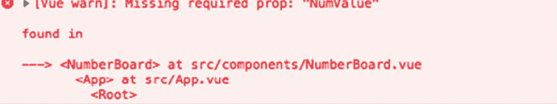

控制台中有缺少属性的警告。它表示，如果 “required” 参数设置为 “true”，那么它将在组件实例化时寻找该属性。

## 属性的自定义验证

除了固定的类型验证外，我们还可以为 props 添加自定义验证器。我们可以在 prop 中使用 `validator` 级别来实现这一点。它接受一个自定义函数，该函数可以验证 prop 值。

```vue
<template>
  <div>我的值是 : {{ MyValue }}</div>
</template>

<script>
export default {
  props: {
    MyValue: {
      type: Number,
      validator: function (value) {
        return value > 0;
      }
    }
  }
}
</script>
```

在这个验证器中，我们添加了一个函数，用于检查数值是否大于 0。

```vue
<my-component :my-value="-1"></my-component>
```

让我们测试一下验证器。因此，我们向 prop 添加了 `-1`，如上面的代码片段所示。我们需要检查控制台窗口，以查看验证器是否工作。是的，我们在控制台中看到了警告消息。

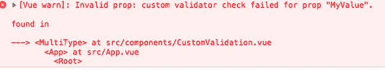

## 属性的默认值

我们也可以为属性分配默认值，这样在没有值的情况下，它就像接收到值一样工作。

```vue
<template>
  <div>我的值是 : {{ MyValue }}</div>
</template>

<script>
export default {
  props: {
    MyValue: {
      type: [String, Number],
      default: 'Default Value'
    }
  }
}
</script>
```

在缺少输入值的情况下，默认值会填补空缺。该默认值将被组件使用。

## 插槽

插槽是一种将父组件内容注入子组件的方式。我们可能会认为可以用 `props` 达到同样的目的，但试想一下，如果是几行文本内容等等，用 `props` 共享这些内容并不现实。

## 使用插槽

要使用插槽机制，我们需要使用 `<slot>` 标签。这个标签使 Vue 能够将父组件的内容注入到子组件中。

## 使用插槽注入内容

让我们用 `<slot>` 标签创建一个新的 Vue 组件。我们将在父组件中使用这个 Vue 组件来查看它的工作方式。我们将该组件命名为 `BasicSlot`。在 Vue 中添加以下代码。

```vue
<!-- BasicSlot.vue (子组件) -->
<template>
  <div>
    <h3>这是子组件的内容</h3>
    <slot></slot>
  </div>
</template>
```

这是我们将用来演示插槽工作方式的子组件。

如代码所示，我们已经在子组件中添加了 `<slot>` 标签以及其他内容。

现在，让我们在父组件中导入该组件，并添加一些内容来检查它的工作原理。

```vue
<!-- 父组件 -->
<template>
  <div>
    <BasicSlot>
      这是从父组件注入的内容
    </BasicSlot>
  </div>
</template>

<script>
import BasicSlot from './BasicSlot.vue';
export default {
  components: { BasicSlot }
}
</script>
```

现在，我们可以看到来自父组件的注入内容。

这非常简单。

如前面的代码所示，我们已经在父组件的 `<BasicSlot>` 组件中添加了文本内容。

它将父组件中指定的内容注入到子组件的 `<slot>` 标签中，连同子组件的内容一起，正如我们在下图中看到的，该图清楚地指示了内容。顶部的矩形表示子组件内容，底部的矩形表示父组件内容。


如果我们想多次显示相同的父内容，那么我们也需要多次添加 `<slot>` 标签。换句话说，Vue 会在子组件中找到多少次 `<slot>` 标签，就注入多少次内容。

## 回退内容

父内容会被注入到子组件中。那么如果子组件本身有一些内容呢？会替换掉内容吗？没错。

如果子组件在插槽中有一些内容，并且父组件也有一些内容，那么子内容会被父内容覆盖。但是，如果父内容为空，那么子内容将显示在屏幕上。

父内容是空白的。所以它显示的是子内容。

让我们添加一个实现了 `<slot>` 标签的新组件。我们添加了一行文本，以了解父组件内容是否会覆盖子组件内容。我们将在父组件中使用同一个组件，并在 `<slot>` 标签内传递内容。

```vue
<!-- 子组件 FallbackSlot.vue -->
<template>
  <div>
    <slot>这是子组件的默认（回退）内容</slot>
  </div>
</template>
```

```vue
<!-- 父组件 -->
<template>
  <div>
    <FallbackSlot>
      这是父内容。它覆盖了子内容。
    </FallbackSlot>
  </div>
</template>
```

这是父内容。它覆盖了子内容。

我们在父组件中使用了 `<slot>` 标签并在其中传递了文本。在浏览器中，我们可以看到，如下图截图所示，父内容通过覆盖子内容进行显示。


我们将通过移除父内容来增强同一个示例。结果，它应该在浏览器中渲染子内容。

```vue
<!-- 父组件 (无内容) -->
<template>
  <div>
    <FallbackSlot></FallbackSlot>
  </div>
</template>
```


## 具名插槽

到目前为止，我们学习了如何在子组件中替换父内容。但它们看起来确实难以控制。一旦遇到 `<slot>` 标签就会被替换。但是我们需要一种可控的替换方式。

具名插槽通常用于需要将父组件替换到子组件特定位置的情况。

我们创建了一个包含三个插槽的组件。`Header` 和 `footer` 是在模板中定义的两个具名插槽。中间的插槽没有名称，将会被替换。

```vue
<!-- NamedSlots.vue (子组件) -->
<template>
  <div class="container">
    <header>
      <slot name="header">默认 Header</slot>
    </header>
    <main>
      <slot>默认 Main 内容</slot>
    </main>
    <footer>
      <slot name="footer">默认 Footer</slot>
    </footer>
  </div>
</template>
```

欢迎来到具名插槽课程

具名插槽在现实生活中的开发场景中非常有用。它提供了对从父到子内容注入的控制。

感谢阅读


header 插槽渲染在顶部，footer 插槽位于页脚，中间的内容不是具名插槽。

具名插槽的内容应该用带有 `v-slot` 属性的 `<template>` 标签包裹起来。没有 `<template>` 标签的内容将被渲染到默认的 `<slot>` 标签中。它们也可以放在 `v-slot` 模板中，如下所示：

```vue
<!-- 父组件使用具名插槽 -->
<template>
  <NamedSlots>
    <template v-slot:header>
      <h1>自定义 Header</h1>
    </template>
    
    <p>具名插槽在现实生活中的开发场景中非常有用。它提供了对从父到子内容注入的控制。</p>
    
    <template v-slot:footer>
      <p>感谢阅读</p>
    </template>
  </NamedSlots>
</template>
```

## 作用域插槽

有时我们可能需要处理这样一种情况：对象需要从子组件传递到父组件，以注入插槽内容。

举个例子，父插槽需要将一个国家首都注入到子组件的插槽内容中。如果国家对象存在于父组件中，这相当容易。但是，如果对象在子组件端，而我们需要从父组件推送内容。

```vue
<!-- 子组件 -->
<template>
  <div>
    <slot v-bind:country="country">
      <!-- 回退内容 -->
    </slot>
  </div>
</template>

<script>
export default {
  data() {
    return {
      country: { name: 'China', capital: 'Beijing' }
    }
  }
}
</script>
```

我们需要在这里使用 `v-bind` 技术，将对象从子组件发送到父组件。

国家对象通过 `v-bind` 绑定到插槽。这被称为插槽 Props。现在，插槽 Props 可以在父组件端被访问，并获得相同的值。

```vue
<!-- 父组件 -->
<template>
  <ScopedSlot v-slot="childslotprop">
    {{ childslotprop.country.capital }}
  </ScopedSlot>
</template>
```

我们使用了 slot prop 属性从子组件接收国家对象。我们可以使用任何变量作为 slot prop 来接收插槽对象。

如果父组件的值只需要推送到一个插槽，那么我们可以采用以下简写方式。

```vue
<ScopedSlot v-slot="childslotprop"> {{ childslotprop.country.capital }} </ScopedSlot>
```

假设存在多个插槽需要推送值，我们也可以使用模板方式。

```vue
<!-- 子组件 -->
<template>
  <div>
    <header>
      <slot name="header" v-bind:country="country"></slot>
    </header>
    <main>
      <slot v-bind:country="country"></slot>
    </main>
    <footer>
      <slot name="footer" v-bind:country="country"></slot>
    </footer>
  </div>
</template>
```

我们定义了两个具名插槽和一个默认插槽，以从父组件获取内容。在默认插槽中，我们使用 `v-bind` 传递了国家对象。

父组件将使用具名插槽将内容推送到 header 和 footer 插槽，而默认插槽将使用插槽 Props 获取值。

```vue
<!-- 父组件 -->
<template>
  <ScopedSlot v-slot="childslotprop">
    <template v-slot:header>
      欢迎来到国家对象
    </template>
    
    {{ childslotprop.country.capital }}
    
    <template v-slot:footer>
      感谢阅读
    </template>
  </ScopedSlot>
</template>
```


我们已经学习了在组件中处理 props 的方法。Props 可以通过类型检查进行验证。它们也可以被标记为必需。我们还可以为组件 props 定义默认值。除了 props，要将内容从父组件传递到子组件，我们可以使用插槽技术。插槽 Props 可用于将数据从子组件传回父组件，这些数据本应在插槽内处理。我们还可以通过使用具名插槽来控制要显示的内容。

在下一章，我们将学习混入、自定义指令、插件和过滤器。我们还将了解如何使用混入合并组件。我们还将探索创建新的自定义指令并使用它们的方法。

# 第 6 天：分发可重用功能

## 分发可重用功能

在上一章中，我们学习了如何继续使用组件。我们以更易管理和可控的方式定义了 props。对组件中的 props 应用验证对于控制数据非常有用。此外，我们还看到了插槽如何帮助组件相互传递内容。

现在，我们将研究使功能可分发的方法。本章我们将重点关注让事物更具可重用性。

## 混入

顾名思义，它会与组件混合。它通过将其内容混合到组件中来使可重用功能得以工作。

假设我们有多个组件，它们共享一些共同的功能。为了适应这一点，我们需要将组件相互合并。这样，我们只需要暴露一个组件，而无需创建重复的代码。但是，这种方法还有另一个问题：如果我们将组件合并成一个，那么这两个组件都会获得一些它们并不真正需要的额外功能。

为了解决这类问题，我们可以借助混入。我们可以将那些共同的功能放在一个混入中，并在两个组件中使用同一个混入。这样，我们就不需要合并组件了。

在下面的例子中，我们将有两个共享电子邮件验证功能的组件。我们将把那个共同的功能封装在一个混入中。我们将该混入混合到两个组件中，以便它们都能获得电子邮件验证功能。

在这个例子中，我们将创建一个名为 `EmailValidationMixin` 的混入。我们可以为它采用单独的文件夹结构。

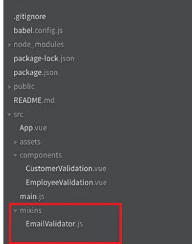

文件夹结构不是强制性的。为了提高可读性和可维护性，我们将其放在一个单独的文件夹中。

该混入是一个 JavaScript 文件，包含混入的代码。

```javascript
// mixins/EmailValidator.js
export const EmailValidatorMixin = {
  methods: {
    validate_email: function(email) {
      if (email == "") {
        alert("Please enter email");
        return false;
      }

      var mailformat = /^[A-Z0-9._%+-]+@[A-Z0-9.-]+\.[A-Z]{2,4}$/igm;

      if (mailformat.test(email)) {
        alert("Email is Valid");
      } else {
        alert("Invalid email");
      }
    }
  }
}
```

### 混入中的生命周期钩子

让我们考虑一种情况，当生命周期钩子在混入中实现时，同时该钩子也在组件中实现。在这种情况下，混入会赢得这场竞争。混入中定义的钩子会首先被调用，然后才是组件中的钩子。

```javascript
// mixins/EmailValidator.js
export const EmailValidatorMixin = {
  created: function() {
    alert("Mixin created");
  },
  methods: {
    validate_email: function(email) {
      // ... 验证逻辑
    }
  }
}
```

```vue
<!-- 组件 CustomerValidation.vue -->
<template>
  <div>客户验证组件</div>
</template>

<script>
import { EmailValidatorMixin } from '../mixins/EmailValidator.js'

export default {
  name: "CustomerValidation",
  data() {
    return {
      cust_email: "",
      cust_num: ""
    }
  },
  mixins: [EmailValidatorMixin],
  methods: {
    validate_customer: function() {
      // ... 客户验证逻辑
    }
  },
  created: function() {
    alert("Component created");
  }
}
</script>
```

从代码中可以看到，我们使用了两个警告提示来检查执行顺序。当我们在浏览器中运行时，混入中的警告信息会首先显示，然后才是组件中的警告。

### 混入中的合并

如前所学，混入会与组件合并。这也意味着混入中的数据对象也会与组件的数据对象合并。

```javascript
// mixins/DataMergerMixin.js
export const DataMergerMixin = {
  data: function() {
    return {
      message: "Message from mixin"
    }
  }
}
```

我们将在组件中定义一些数据。

```vue
<template>
  <div>{{ $data }}</div>
</template>

<script>
import { DataMergerMixin } from './mixins/DataMergerMixin.js';
export default {
  mixins: [DataMergerMixin],
  data() {
    return {
      component_message: "This is a component message"
    }
  }
}
</script>
```

`{{ $data }}` 的结果将是两个数据对象的组合。

```json
{ "component_message": "This is a component message", "message": "Message from mixin" }
```

需要注意的是，如果混入和组件中的数据变量名相同，那么组件的数据变量将被打印出来。让我们将组件中的 `component_message` 变量重命名为 `message`。

```vue
<script>
export default {
  mixins: [DataMergerMixin],
  data() {
    return {
      message: "This is a component message" // 同名 key
    }
  }
}
</script>
```

现在，混入和组件中的数据变量名相同。因此，输出将被组件覆盖。

```json
{ "message": "This is a component message" }
```

### 函数冲突

与数据变量冲突类似，当组件和混入中的函数发生冲突时，组件中的函数会覆盖混入中的函数。

### 全局混入

在全局作用域中定义的混入可以被所有组件访问。在通过 CLI 构建的 Vue 应用中，我们可以在 `main.js` 中定义一个混入。

```javascript
// main.js
import Vue from 'vue';

Vue.mixin({
  methods: {
    showAppInfo: function() {
      alert("Learn Vue In 7 Days")
    }
  }
})
```

我们添加了一个名为 `showAppInfo` 的方法，用于显示应用信息。该方法应该可以被所有组件全局访问。

## 自定义指令

我们已经学习了很多 Vue 中以 `v-` 为前缀的指令。例如 `v-model`、`v-if` 等，这些都是 Vue 支持的内置指令。

现在，让我们创建我们自己的自定义指令。顾名思义，自定义指令将以自定义的方式工作。

### 创建自定义指令

要创建自定义指令，我们需要使用 Vue 对象。指令将被添加到应用的 Vue 对象上。

```javascript
// main.js
Vue.directive('campaign-name', function(el, binding, vnode) {
  // 指令逻辑
})
```

该函数接受以下参数来处理用户和数据：

- `el`：代表元素。它返回指令所关联的 DOM 对象。
- `binding`：包含有关参数、格式化器等信息。
- `vnode`：用于跟踪父 DOM 元素。

让我们创建我们的第一个自定义指令。我们使用 Vue CLI 环境来编写代码。我们将把指令添加到 `main.js` 中并访问它们。

```javascript
// main.js
Vue.directive('highlight', function(el, binding, vnode) {
  el.style.fontSize = '50px';
  el.style.fontWeight = 'bold';
})
```

如上代码所示，我们创建了一个名为 `highlight` 的新自定义指令。它将设置其绑定的 DOM 元素的字体大小和字体粗细。

### 自定义指令演示

`highlight` 指令将用于带有 `v-` 前缀的 HTML 元素。这里，我们将自定义指令添加到了 DOM 元素上。因此，格式化将应用于该元素。

```vue
<template>
  <div v-highlight>高亮显示的文本</div>
</template>
```

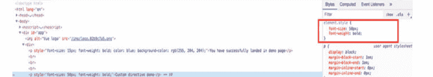

当渲染到屏幕上时，指令会在运行时对 DOM 元素应用更改。

### 向自定义指令传递值

在前面的例子中，我们创建了一个不接受外部值的自定义指令。它为 HTML 元素设置了固定的格式。我们也可以向自定义指令传递值。根据传递的值，自定义指令也可以应用格式。

```javascript
// main.js
Vue.directive('notify', function(el, binding, vnode) {
  var colour = (binding.value != undefined && binding.value != "") ? binding.value : "red";
  el.style.fontSize = '15px';
  el.style.fontWeight = 'bold';
  el.style.color = colour;
  el.style.backgroundColor = '#ffcccc';
})
```

在上面的代码中，我们创建了一个名为 `notify` 的自定义指令。我们可以从外部传递值来设置 DOM 元素的格式。

在这个例子中，我们为 DOM 元素应用了除颜色以外的固定格式。颜色则接收来自用户的动态值。这里设置的默认颜色是红色。如果没有指定颜色，元素颜色将是红色，否则将使用用户输入的颜色。

```vue
<template>
  <div v-notify="'blue'">你已成功进入演示页面</div>
</template>
```

我们从 HTML 向指令传递了颜色值。该值需要在等号 `=` 之后的双引号内传递。


在浏览器中，它会根据用户输入的自定义颜色以及其他固定格式进行渲染。

### 向自定义指令传递参数

与传递值类似，我们也可以向自定义指令传递参数。要传递参数，我们需要使用冒号 `:` 代替等号。

```vue
<template>
  <div v-traffic:low>低流量</div>
  <div v-traffic:moderate>中等流量</div>
  <div v-traffic:high>高流量</div>
</template>
```

我们定义了一个带有不同延迟的交通灯系统示例。根据参数（`Low`/`Moderate`/`High`），交通信号将相应地运行。

如上所示，我们使用冒号 `:` 将参数传递到自定义指令中。根据参数，它将改变元素样式以在网页中执行相应操作。

```javascript
// main.js
Vue.directive('traffic', function(el, binding, vnode) {
  var intervalObj;
  var interval = 5000;
  switch (binding.arg) {
    case "low":
      interval = 5000;
      break;
    case "moderate":
      interval = 10000;
      break;
    case "high":
      interval = 20000;
  }
  // 实现信号灯切换逻辑...
});
```

此处的参数被放置在一个 `switch-case` 结构中。根据传入的参数，它将执行相应的任务。为了说明这一点，我们为低、中、高分别设置了 5 秒、10 秒和 20 秒的间隔，以改变信号灯颜色。


### 向自定义指令传递修饰符

我们可以向自定义指令传递修饰符。与上面不同，修饰符将使用 `.`（点）进行传递。

```html
<div v-mark-text.underline.make-capital>Mark the text</div>
```

在上面的 HTML 中，我们向自定义指令 `v-mark-text` 传递了多个修饰符。格式化将根据修饰符出现的顺序进行。

```javascript
// main.js
Vue.directive('markText', function(el, binding) {
  if (binding.modifiers.underline) {
    el.style.textDecoration = "underline";
  }
  if (binding.modifiers.makeCapital) {
    el.style.textTransform = "uppercase";
  }
  if (binding.modifiers.makeHeading) {
    el.style.fontSize = '50px';
    el.style.fontWeight = 'bold';
  }
  if (binding.modifiers.highlight) {
    el.style.backgroundColor = "yellow";
  }
})
```

文本将根据自定义指令中指定的修饰符进行格式化。

### 自定义指令中的钩子

自定义指令也支持钩子。这不应与 Vue 的钩子混淆。

以下是自定义指令支持的钩子列表（根据 Vue 官方文档 https://vuejs.org/v2/guide/custom-directive.html#Hook-Functions ）及其描述。

- **`bind`**：仅在指令首次绑定到元素时调用一次。这是你可以执行一次性设置工作的地方。
- **`inserted`**：当绑定元素已插入其父节点时调用（这仅保证父节点存在，但不一定在文档中）。
- **`update`**：在包含组件的 VNode 更新后调用，但可能在其子节点更新之前。指令的值可能已更改也可能未更改，但你可以通过比较绑定的当前值和旧值来跳过不必要的更新。
- **`componentUpdated`**：在包含组件的 VNode 及其子节点的 VNode 更新后调用。
- **`unbind`**：仅在指令从元素解绑时调用一次。

最受欢迎的钩子是 `bind` 和 `inserted`。

```javascript
// main.js
Vue.directive("custom-hook", {
  bind(el) {
    el.style.color = "red";
    console.log("Bind");
  },
  inserted(el) {
    el.style.color = "blue";
    console.log("Inserted");
  }
});
```

由于我们这里引用的是单个元素，所以只能看到颜色变为蓝色。因为 `inserted` 钩子在 `bind` 之后执行，所以红色不会显示出来。但是，我们肯定可以在控制台窗口中看到钩子执行的顺序。

## 过滤器

过滤器是在运行时对数据应用额外格式化的选项。我们可以在数据中使用 `|`（管道）符号应用过滤器。有两种应用过滤器的方法。

**Mustache 插值：**

```html
{{ message | reverse }}
```

**`v-bind` 表达式：**

```html
<div v-bind:id="recordid | formatfilter"></div>
```

让我们创建一个自定义过滤器来反转数据。我们将在一个组件内部定义该过滤器。我们将创建一个新组件并将此过滤器添加到其中。

```vue
<template>
  <div>{{ message | reverse }}</div>
</template>

<script>
export default {
  data() {
    return {
      message: 'Learn'
    }
  },
  filters: {
    reverse: function(value) {
      value = value.toString();
      var revString = "";
      for (var i = 0; i <= value.length - 1; i++) {
        revString = value.charAt(i) + revString;
      }
      return revString;
    }
  }
}
</script>
```

我们使用了 `filters` 部分来定义过滤器方法。

这里需要注意的一点是，在过滤器函数中我们接受了一个 `value` 参数。但在模板的 mustache 插值中调用同一个过滤器时，我们没有传递任何值。因为它默认接受数据结果作为 `value` 参数的输入。所以，每当我们添加一个过滤器时，它都接受数据作为 `value` 参数。

在上面的例子中，我们使用了 `message` 作为数据变量，并向其添加了一个固定字符串 “Learn”。在 `reverse` 过滤器中，我们反转了 `message` 数据。


### 过滤器中的多个参数

我们还可以向过滤器传递多个参数。在上面的例子中，我们只有一个参数 `value`。但我们也可以向过滤器传递多个参数。

为了了解多个参数如何工作，我们将创建另一个过滤器，将一个固定字符串附加到数据值。

```vue
<template>
  <div>{{ message | append_string(" - It is actually fun.") }}</div>
</template>

<script>
export default {
  data() {
    return { message: 'Learn' }
  },
  filters: {
    append_string: function(value, fixedString) {
      return value + fixedString;
    }
  }
}
</script>
```

在这个过滤器函数中，我们有两个参数 `value` 和 `fixedString`。我们可以注意到，在模板中，我们只传递了一个参数的值，即第二个参数。

如上所述，数据值会自动设置为过滤器函数的第一个参数。因此，我们只需要传递第二个参数。


**Learn - It is actually fun.**

### 过滤器链

我们也可以对一个数据应用多个过滤器。它们按顺序工作。这意味着，数据值或上一个过滤器的结果将是下一个过滤器的输入值。

我们将使用上面的例子来反转数据，将反转后的数据首字母大写，并附加一个静态字符串。

```vue
<template>
  <div>{{ message | reverse | capitalize | append_string(" - This string is reversed.") }}</div>
</template>

<script>
export default {
  data() {
    return { message: 'Learn' }
  },
  filters: {
    reverse: function(value) { /* ...反转逻辑... */ },
    capitalize: function(value) { return value.charAt(0).toUpperCase() + value.slice(1); },
    append_string: function(value, fixedString) { return value + fixedString; }
  }
}
</script>
```

我们定义了三个过滤器（`reverse`、`capitalize` 和 `append_string`）并在插值中使用。根据过滤器的顺序，`message` 是 `reverse` 过滤器的输入值。`reverse` 过滤器的结果将是 `capitalize` 过滤器的输入，而这个过滤器的结果将是 `append_string` 过滤器的输入。

因此，它首先反转字符串。然后将反转后的字符串首字母大写。最后向反转并首字母大写的字符串添加一个固定字符串。

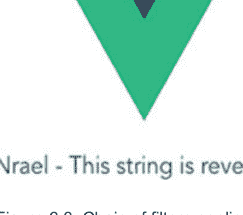

**Nrael - This string is reversed.**

### 全局过滤器

在上面的例子中，我们在组件内部定义了过滤器。因此，它们只能在组件内部访问。我们也可以声明全局过滤器，这些过滤器与 Vue 对象相关联。

让我们全局创建相同的 `reverse` 过滤器，使其在整个应用程序中可访问。我们可以全局定义它。如果我们使用 Vue CLI，那么 `main.js` 是定义它的最佳位置之一。

```javascript
// main.js
import Vue from 'vue';

Vue.filter('reverse', function(value) {
  value = value.toString();
  var revString = "";
  for (var i = 0; i <= value.length - 1; i++) {
    revString = value.charAt(i) + revString;
  }
  return revString;
})
```

正如我们在前面的代码中看到的，要使其全局化，我们需要将过滤器添加到 Vue 对象。

## 插件

当你希望将一些全局功能打包到一个文件中，并且可以在项目中的任何地方引用时，你肯定应该使用插件。

jQuery 是插件的一个很好的例子，此外，我们可以轻松地使用 Vue 创建插件。你可以在插件内部使用所有 Vue 概念来构建它。组件、混入、过滤器等都可以放入插件中，使其对不同的应用程序更加有效和可重用。

插件是保持你的 Vue 组件清晰和小巧的好方法。最大的优点是，你可以打包并与世界或公司内的所有开发者共享，以便他们在自己的应用中使用它。

编写插件并不困难。这是一个插件的框架。它只是一个带有 `install` 方法的 JavaScript 对象。

```javascript
// plugins/myPlugin.js
export default {
  name: 'myPlugin',
  install: function (Vue, options) {
    console.log("Install started");
    // 1. add global method or property
    Vue.prototype.$myGlobalMethod = function () {
      // some logic ...
      console.log("Global Method called!");
    }
  }
}
```

如你所见，它有一个必须的 `install` 函数。当你在代码中引用这个插件时，它会调用这个 `install` 函数并执行其内部的所有内容。在我们的示例中，我们声明了一个名为 `$myGlobalMethod` 的原型方法，它只是向控制台输出日志。

注意：添加 `$` 只是为了全局属性/方法的命名约定。

要将此插件添加到项目中，我们需要按如下方式更新 `main.js`：

```javascript
// main.js
import Vue from 'vue'
import App from './App.vue'
import MyPlugin from './plugins/myPlugin.js'

Vue.use(MyPlugin)

Vue.config.productionTip = false

new Vue({
  render: h => h(App),
}).$mount('#app')
```

这两行高亮显示的代码很重要。一行告诉 Vue 插件文件的位置。我将其放在了 `plugins` 文件夹内，因此代码 `import MyPlugin from './plugins/myPlugin.js'` 从那里导入它。下一行使用 `Vue.use()` 全局方法为项目注册插件。这些是必需的。

下一步是使用这个插件做些事情。既然我们内部有一个全局方法，让我们尝试从一个按钮调用它。快速切换到 `App.vue` 并添加一个带有点击事件的按钮。

```vue
<!-- App.vue -->
<template>
  <div id="app">
    <button @click="invokePluginMethod">Click Me</button>
  </div>
</template>

<script>
export default {
  name: 'app',
  methods: {
    invokePluginMethod: function() {
      this.$myGlobalMethod()
    }
  }
}
</script>
```

当然，我们需要像以下这样定义 `invokePluginMethod`：

代码 `this.$myGlobalMethod()` 实际上调用了插件内部的方法。

现在，让我们运行并看看会发生什么！

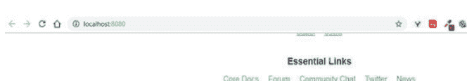

我在底部打开了控制台。你可以看到消息 “Install started”。此消息是在 `myPlugin` 的 `install` 函数内部添加的。

下一步是点击按钮 “Click Me”。一旦你这样做，你会在控制台上看到一条消息，内容为 “Global Method called!”。请查看以下截图：

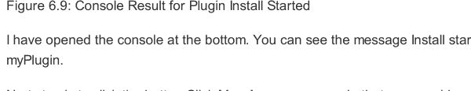

通常，插件是可配置的。如果你看声明，它在 `install` 方法中包含一个参数，我们可以像以下这样作为对象传递：

```javascript
// main.js
Vue.use(MyPlugin, { delaySeconds: 4 })
```

这可以用来配置插件并相应地执行操作。假设，我们想使用这个值来延迟控制台日志。我们可以这样做：

```javascript
// plugins/myPlugin.js
export default {
  name: 'myPlugin',
  install: function (Vue, options) {
    console.log("Install started");
    Vue.prototype.$myGlobalMethod = function () {
      setTimeout(() => {
        console.log("Global Method called!");
      }, options.delaySeconds * 1000);
    }
  }
}
```

这里，`options` 是 `install` 方法的参数。

插件的作用远不止添加全局方法。我们可以包括混入、组件、指令等等。让我们添加一个指令来显示文本 “Read more” 和 “Read less”。

所以，我们将添加一个带有指令的 HTML 段落元素，以指示我们想要显示多少个字符。然后在这些字符之后，显示 “Read more...”。段落将如下所示：

```html
<p v-max-character-length="70">{{ feedbackText }}</p>
```

该指令是 `max-character-length`，它接受一个值 70。所以，在 70 个字符之后，我们将显示 “Read more...”。让我们在插件内部设计这个指令。

基本上，结构将如下所示：

```javascript
// plugins/ExpandSqueeze.js
const ExpandSqueeze = {
  install(Vue, options) {
    Vue.directive('max-character-length', {
      bind(el, binding, vnode, oldVnode) {
        // 添加显示 “Read more...” 和 “Read less...” 的逻辑。
      }
    })
  },
};

export default ExpandSqueeze;
```

现在在 `bind` 事件内部，我们需要创建两个锚元素并带有所需的文本。此外，我们添加了下划线并将光标设置为指针。以下是清晰的代码：

```javascript
const readMoreLink = document.createElement('a');
readMoreLink.innerHTML = 'Read more...';
readMoreLink.style.textDecoration = 'underline';
readMoreLink.style.cursor = 'pointer';

const readLessLink = document.createElement('a');
readLessLink.innerHTML = 'Read less...';
readLessLink.style.textDecoration = 'underline';
readLessLink.style.cursor = 'pointer';
```

接下来是为这些元素附加两个事件，这样当我们点击 “Read more...” 时，它会显示所有文本并显示 “Read less...”，反之亦然。

```javascript
readMoreLink.addEventListener('click', showAllText);
readLessLink.addEventListener('click', showLimitedText);
```

事件将如下工作：

```javascript
const showAllText = () => {
  el.innerHTML = `${currentHTML} `;
  el.appendChild(readLessLink);
}

const showLimitedText = () => {
  el.innerHTML = `${slicedHTML}... `;
  el.appendChild(readMoreLink);
}
```

`showAllText` 显示所有文本并附带 “Read less...” 链接，`showLimitedText` 显示有限文本并附带 “Read more...” 链接。

将它们组合在一起看起来如下所示：

```javascript
// plugins/ExpandSqueeze.js
const ExpandSqueeze = {
  install(Vue, options) {
    Vue.directive('max-character-length', {
      bind(el, binding, vnode, oldVnode) {
        const maxLimit = binding.value || 100;
        const currentHTML = el.innerHTML;
        const slicedHTML = currentHTML.slice(0, maxLimit);
        
        const readMoreLink = document.createElement('a');
        readMoreLink.innerHTML = 'Read more...';
        readMoreLink.style.textDecoration = 'underline';
        readMoreLink.style.cursor = 'pointer';
        
        const readLessLink = document.createElement('a');
        readLessLink.innerHTML = 'Read less...';
        readLessLink.style.textDecoration = 'underline';
        readLessLink.style.cursor = 'pointer';
        
        const showAllText = () => {
          el.innerHTML = `${currentHTML} `;
          el.appendChild(readLessLink);
        }
        
        const showLimitedText = () => {
          el.innerHTML = `${slicedHTML}... `;
          el.appendChild(readMoreLink);
        }
        
        readMoreLink.addEventListener('click', showAllText);
        readLessLink.addEventListener('click', showLimitedText);
        
        showLimitedText();
      }
    })
  },
};

export default ExpandSqueeze;
```

最后，调用了 `showLimitedText`，以便我们看到有限的文本。以下截图证明了所述内容，它将文本限制为我在段落声明时提到的 70 个字符。

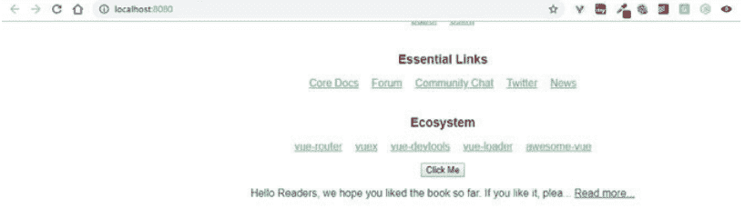

当你点击 “Read more...” 时，它会显示所有文本并附加 “Read less...” 链接。


在本章中，我们介绍了混入如何帮助定义公共逻辑并与组件合并。我们还学习了定义自定义指令以管理 UI 组件中的格式和显示的方法。此外，我们还学习了过滤器和插件。

我们将学习使用状态管理开发单页网站的方法。我们将在下一章介绍状态管理。

# 第 7 天：单页应用

## 单页应用

在上一章中，我们探索了一些为我们的 Vue 应用构建可复用分布式功能的方法。

路由和状态管理在设计单页应用时扮演着重要角色。在本章中，我们将探讨在我们的 Vue 应用中实现这些概念的方法。

HTML5 History 模式将帮助我们为 SPA 创建路由，为用户动态地在页面之间来回切换提供了一条便捷的路径，而无需重新加载页面。

我们将通过适当的插图来学习 Vue 应用状态管理的一些原则。我们将探索使用 props 和自定义事件进行父子组件交互，然后是使用 EventBus 和全局存储的状态管理技术。

最后但同样重要的是，Vuex 库，这是一种强大的应用状态管理方式，它将把你的 Vue 应用开发提升到一个新的水平。

当然，我们将简要地看看这些状态管理技术之间的区别，以决定采用哪种。

以下是我们将涵盖的主题：

- 创建路由
- 使用路由
- 状态管理如何工作的基础
- 使用 EventBus、全局存储和 Vuex 的状态管理实现

## 什么是路由

路由是一种技术，通过它，访问你网站或 Web 服务的请求被引导到目的地，即处理它们的代码。假设你在浏览器 URL 框中输入 `http://www.example.com/about`，它应该指向你的 `About.html` 或其他内容。定义那个特定规则的过程就称为路由。

在单页应用中，路由是关键，因为你真的不希望页面为另一个请求而重新加载。传统应用的行为方式是，当你点击一个超链接时，它会去服务器并返回一个 HTML 页面。然而，在 SPA 中，页面只加载一次，当你通过页面上的操作（如点击链接或按钮）请求某些内容时，它会根据请求动态地更改内容以加载新的内容/页面。

### 创建路由

由于 Vue 是基于组件的，让我们先为不同页面设计几个组件，如首页、关于和联系。

**Home.vue**

```vue
<template>
  <div># 这是首页！</div>
</template>
```

**Contact.vue**

```vue
<template>
  <div># 这是联系页面！</div>
</template>
```

**About.vue**

```vue
<template>
  <div># 这是关于页面！</div>
</template>
```

现在我们需要构建一种机制，将所有这些页面通过一种方法连接起来，这样我们就可以通过像 `www.example.com/home`、`www.example.com/about`、`www.example.com/contact` 这样的 URL 访问这些页面。

为此，让我们为所有页面定义一个路由对象。

```javascript
// router/routes.js
import Home from "./Home";
import About from "./About";
import Contact from "./Contact";

const routes = {
  "/": Home,
  "/home": Home,
  "/about": About,
  "/contact": Contact
};

export default routes;
```

很简单，不是吗！基本上，我们是在请求将路由映射到各自的页面。请注意，我们将 `/` 和 `/home` 都分配给了 `Home.vue`，这是显而易见的。

然而，这还不是全部。我们还没有对路由对象做任何事情。从逻辑上想，当一个特定页面（比如 `/about`）的请求到来时，我们需要以某种方式加载 `About.vue`。下面的代码就是为此，我们获取 `window.location.pathname` 并使用它从路由对象中检索组件名称。

```vue
<!-- AppRouter.vue -->
<template>
  <component :is="routedComponent"></component>
</template>

<script>
import routes from './router/routes';

export default {
  data() {
    return { current: window.location.pathname };
  },
  computed: {
    routedComponent() {
      return routes[this.current];
    }
  }
};
</script>
```

之后，我们需要一个模板来加载我们检索到的组件。为此，让我们使用 `:is` 指令和计算数据 `routedComponent` 添加以下代码。

现在，将所有这些代码整合在一起，我们可以将它们保存在另一个名为 `AppRouter.vue` 的组件中。

### 使用路由

一切都准备就绪，只差 `App.vue` 来赋予这个 `AppRouter` 组件生命。在 `App.vue` 中添加以下代码。

```vue
<!-- App.vue -->
<template>
  <div id="app">
    <AppRouter></AppRouter>
  </div>
</template>

<script>
import AppRouter from "./components/AppRouter.vue";

export default {
  components: {
    AppRouter
  }
};
</script>
```

注意：`App.vue` 位于根目录下，但上面讨论的所有其他组件都放在 "components" 文件夹中。

让我们通过 `npm run serve` 命令运行应用程序，看看是否有效。

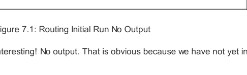

有趣！没有输出。这是显而易见的，因为我们还没有在 `App.vue` 中包含 `AppRouter` 组件。

现在再次运行它，它将显示以下输出！

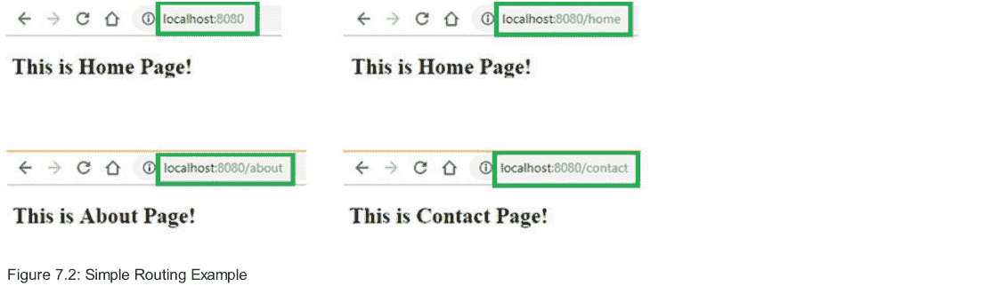

在这里我们可以看到图片中并排显示的四个输出。仔细看看这些 URL。`Localhost:8080` 和 `localhost:8080/home` 加载的是同一个页面 `Home.vue`。这正是我们在路由对象中声明的那样。`About` 和 `Contact` 组件也分别为 `localhost:8080/about` 和 `localhost:8080/contact` 加载。

然而，在一个功能齐全的生产应用中，页面是相互链接的。也就是说，存在用于从一个页面导航到另一个页面的链接。如下所示：

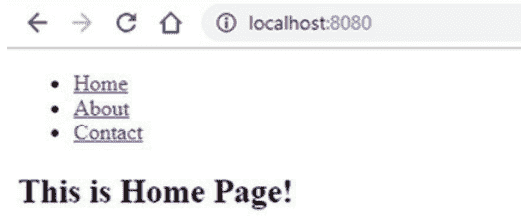

为此，我们可以在 `App.vue` 中添加一个包含路由的无序列表。

```vue
<!-- App.vue -->
<template>
  <div id="app">
    <ul>
      <li><a href="#" @click.prevent="loadPage('/')">首页</a></li>
      <li><a href="#" @click.prevent="loadPage('/about')">关于</a></li>
      <li><a href="#" @click.prevent="loadPage('/contact')">联系</a></li>
    </ul>
    <AppRouter></AppRouter>
  </div>
</template>

<script>
import AppRouter from "./components/AppRouter.vue";

export default {
  components: {
    AppRouter
  },
  methods: {
    loadPage(route) {
      window.location = route;
    }
  }
};
</script>
```

这里的 `loadPage` 是一个方法，它会将路由加载到 `window.location` 中。

有了这段代码，我们可以看到上面的输出，每个页面上都有链接，这些链接会根据请求的 URL 加载特定的组件。

到目前为止我们讨论的一切都适用于页面的常规加载，也就是说，当你点击链接时，页面会重新加载，内容会发生变化。然而，在 SPA 的情况下，页面会动态加载内容而无需重新加载。这正是我们将在下一个内容中学习的内容。

### SPA 中的路由

通过对上面的代码进行一些更改，我们可以为单页应用实现路由。基本上，页面不应该重新加载。HTML5 History 模式将帮助我们管理页面历史。让我们开始吧。

History API 有不同的方法可供我们使用。`pushState` 方法将替换 `window.location` 并且不会执行重新加载。让我们更新 `App.vue` 以实现 `pushState` 方法。

```vue
<!-- App.vue -->
<script>
import { push } from "./history";
// ...
methods: {
  loadPage(route) {
    // window.location = route;
    // history.pushState(null, null, route)
    push(route);
  }
}
</script>
```

现在让我们先不关注前两个参数。第三个参数是传递的路由。

下一步是对路由变化做出反应。如果你还记得，`AppRouter` 组件帮助我们渲染实际页面。这意味着 `routedComponent` 计算属性应该更新，这也就意味着需要更新 `this.current` 变量。我们一会儿会看到这是如何完成的。但在此之前，让我们将历史相关的操作模块化。将其命名为 `history.js`。

首先添加 `push` 方法。

```javascript
// utils/history.js
const listeners = [];

export const push = route => {
  window.history.pushState(null, null, route);
};

export const listen = fn => {
  listeners.push(fn);
};
```

History 还需要监听路由的变化，为此，我们需要实现一个名为 `listen` 的方法，该方法将回调函数存储在一个 `listeners` 数组中。

现在，`push` 方法应该承担通知的责任，通过迭代 `listeners` 并调用回调函数，将路由作为参数传递。

```javascript
// utils/history.js
export const push = route => {
  const previousRoute = window.location.pathname;
  window.history.pushState(null, null, route);
  listeners.forEach(listener => listener(route, previousRoute));
};
```

我们已经完成了 history 模块，让我们开始在 `App.vue` 中使用它。

```vue
<!-- App.vue -->
<script>
import AppRouter from "./components/AppRouter.vue";
import { push } from "./utils/history";

export default {
  components: { AppRouter },
  methods: {
    loadPage(route) {
      push(route);
    }
  }
};
</script>
```

我们现在不再直接使用 `history.pushState` 方法，而是直接调用位于 `history.js` 内的 `push` 方法。

我们还有更多的工作要做。当我们在页面之间导航时，`AppRouter` 组件应该知道路由的变化。这是因为有一个 `this.current` 变量存储着当前路由。

```vue
<!-- AppRouter.vue -->
<script>
import routes from './router/routes';
import { listen } from "../utils/history";

export default {
  created() {
    listen((route, previousRoute) => {
      this.current = route
    })
  },
  data() {
    return { current: window.location.pathname };
  },
  computed: {
    routedComponent() {
      return routes[this.current];
    }
  }
};
</script>
```

在 `created` 钩子中调用 `listen` 方法是因为我们需要一次设置监听机制。这是因为下次为后续请求调用 `push` 时，其他一切都会自动工作。如果你看 `AppRouter` 内部的 `push` 方法，它实际上调用了注册到监听器数组中的方法。

现在，如果你运行应用程序，它会在按钮点击时更改路由和页面内容。但是，如果你点击浏览器的后退和前进按钮，它将不会起作用。

为了完成 SPA 路由，我们需要在 `AppRouter` 中添加另一小段代码，完整的代码如下所示：

```vue
<!-- AppRouter.vue -->
<script>
import routes from './router/routes';
import { listen } from "../utils/history";

export default {
  created() {
    listen((route, previousRoute) => {
      this.current = route
    });
    window.addEventListener(
      "popstate",
      event => (this.current = window.location.pathname)
    );
  },
  data() {
    return { current: window.location.pathname };
  },
  computed: {
    routedComponent() {
      return routes[this.current];
    }
  }
};
</script>
```

因此，当我们点击浏览器的后退和前进按钮时，会调用 `popstate` 方法，从而设置 `this.current` 的值。

这样，我们就完成了使用 Vue 的 SPA 路由。你可以在 Github 上找到代码。尝试一下，看看当你点击页面上的按钮或浏览器的后退和前进按钮时，你是否可以看到页面内容动态更新而无需页面加载。

## 状态管理

组件是 Vue 应用程序的基本构建块。应用程序每次在发生变化时如何向我们显示更新后的数据，这一点很重要。这意味着数据更新应确保组件之间的完整性。

让我们通过一个逐步示例来了解如何在 Vue JS 应用程序中管理数据状态。

### 数组组件示例

一个示例的 `ArrayComponent` 可能如下所示。

```vue
<template>
  <div>数字是 {{ numberArray }}！</div>
</template>

<script>
export default {
  data() {
    return {
      numberArray: [1, 2, 3]
    }
  }
}
</script>
```

`data` 函数负责使 Vue 应用具有响应式。因此，如果某个数据属性正在被使用，那么对该属性的任何更改都将触发视图的重新渲染。

现在，让我们更进一步，尝试从另一个组件操作这个数组。基本上，我们正试图在其他组件中访问或更新这个属性，同时要求所有组件获取最新数据。当你开始从不同组件操作具有响应式特性的数据属性时，数据的状态就变得至关重要。这就是我们接下来要讨论的主题。

这些在多个组件间共享的数据属性可以称为组件级数据或应用级数据。

### 使用 Props 进行父子组件间的数据传递

首先，让我们尝试使用 props 将数据从一个组件传递到另一个组件。

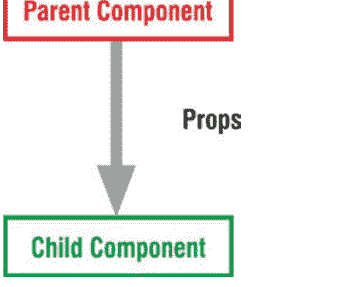

一个父组件可能如下：

```vue
<!-- ParentComponent.vue -->
<template>
  <div>
    <ChildComponent :number-array="numberArray"></ChildComponent>
  </div>
</template>

<script>
import ChildComponent from './ChildComponent.vue';
export default {
  components: { ChildComponent },
  data() {
    return {
      numberArray: [10, 20, 30]
    }
  }
}
</script>
```

这里需要注意的重要事项是我们试图通过何种方式将数据传递给 `ChildComponent`。让我们看看 `ChildComponent` 的代码。

```vue
<!-- ChildComponent.vue -->
<template>
  <div>数字是 {{ numberArray }}！</div>
</template>

<script>
export default {
  props: {
    numberArray: {
      type: Array,
      required: true
    }
  }
}
</script>
```

为了接收该属性，我们在 `ChildComponent` 中将其声明为一个数组，并在模板中渲染它。输出结果如下所示。

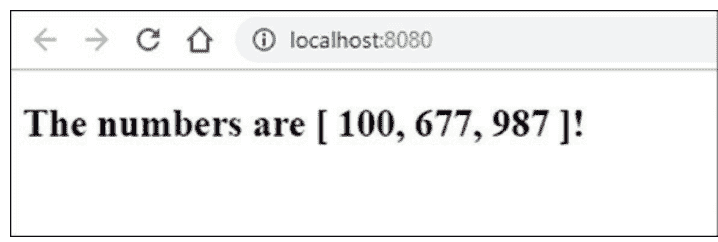

### 使用自定义事件进行子组件到父组件的数据更新

既然我们已经完成了从父到子的传递，现在让我们尝试反向操作：从子组件到父组件。Props 在这里是不可用的，因为它是单向的方式。Vue 自定义事件拯救了我们，它允许我们通知父组件数组发生了变化。

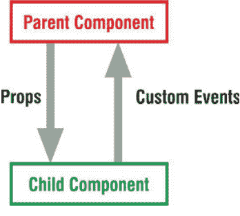

从子组件向数组添加一个数字是我们可以快速尝试的事情。

```vue
<!-- ChildComponent.vue -->
<template>
  <div>
    <div>数字是 {{ numberArray }}！</div>
    <input v-model="number" type="number" placeholder="输入数字">
    <button @click="addNumber">添加新数字</button>
  </div>
</template>

<script>
export default {
  props: {
    numberArray: {
      type: Array,
      required: true
    }
  },
  data() {
    return {
      number: 0
    }
  },
  methods: {
    addNumber() {
      this.$emit('add-number', Number(this.number));
    }
  }
}
</script>
```

这里有一个文本框，它将捕获的输入绑定到 `number` 数据属性。

注意这个按钮，它有一个点击事件，该事件会触发 `add-number` 自定义事件，并携带从上方文本框捕获的数字值（通过 `Number()` 转换为数字类型）。我们需要在父组件上为这个自定义事件设置一个监听器，这样我们才能将输入的数字添加到 `numberArray` 中。

```vue
<!-- ParentComponent.vue -->
<template>
  <div>
    <ChildComponent 
      :number-array="numberArray" 
      @add-number="addNumberToArray"
    ></ChildComponent>
  </div>
</template>

<script>
import ChildComponent from './ChildComponent.vue';
export default {
  components: { ChildComponent },
  data() {
    return {
      numberArray: [10, 20, 30]
    }
  },
  methods: {
    addNumberToArray(number) {
      this.numberArray.push(number);
    }
  }
}
</script>
```

你可以看到监听器将数字推入了数组。请参考下面的截图。

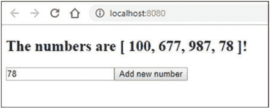

至此，我们已经探索完了使用属性和自定义事件在父子组件之间进行通信的两种技术。但是，两个子组件之间如何通信呢？这是我们将要学习的下一个内容。

当我们说两个子组件之间的通信时，意味着我们讨论的是两个完全独立、彼此没有依赖关系的组件。在使用自定义事件时，一个组件因为渲染了另一个子组件而成为了父组件，这是使用自定义事件的必要条件。因此，在组件完全独立的情况下，我们无法使用自定义事件。

有几种方法可以用于管理独立组件之间的状态。

- EventBus
- 全局 Store
- Vuex

#### EventBus

EventBus 有助于实现发布-订阅模式。借助 EventBus，我们可以轻松地在组件之间进行自定义事件通信。虽然我们了解到独立组件之间无法通过自定义事件通信，但是 EventBus 是一种全局性的通信管理器。让我们开始吧。

添加一个名为 `event-bus.js` 的 JS 文件，其中包含以下实例化代码。

```javascript
// utils/event-bus.js
import Vue from 'vue';

export const EventBus = new Vue();
```

现在我们需要添加两个新的独立组件，一个可以向数组添加数字，另一个则用于显示结果。

`AddNumber.vue` 的内容如下所示：

```vue
<!-- AddNumber.vue -->
<template>
  <div>
    <input v-model="number" type="number">
    <button @click="addNumber">Add Number</button>
  </div>
</template>

<script>
import { EventBus } from '../utils/event-bus';

export default {
  data() {
    return { number: 0 }
  },
  methods: {
    addNumber() {
      EventBus.$emit('add-number', this.number);
    }
  }
}
</script>
```

基本上，我们添加了一个 `addNumber()` 方法，它使用 EventBus 实例触发 `add-number` 事件，并携带与文本框绑定的 `number` 数据。

现在，只需监听由 EventBus 触发的 `add-number` 事件即可。让我们添加用于显示数字的组件。

```vue
<!-- ShowNumbers.vue -->
<template>
  <div>
    <h1>{{ numbers }}</h1>
  </div>
</template>

<script>
import { EventBus } from '../utils/event-bus';

export default {
  data() {
    return { numbers: [] }
  },
  created() {
    EventBus.$on('add-number', (number) => {
      this.numbers.push(number);
    });
  }
}
</script>
```

注意监听器 `EventBus.$on("add-number", number => {...});`，它负责监听添加数字的触发事件。

当你将 `AddNumber.vue` 和 `ShowNumbers.vue` 这两个组件都包含在 `App.vue` 中，并在模板中实现它们时，效果将如下所示。

因此，基本操作可以用以下图示来展示。

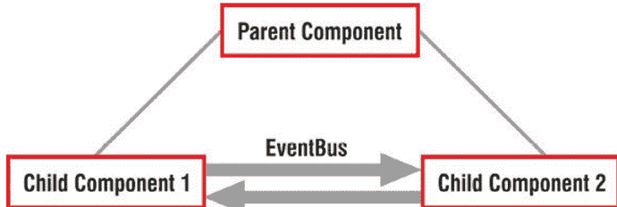

现在运行应用程序，在浏览器中查看效果。

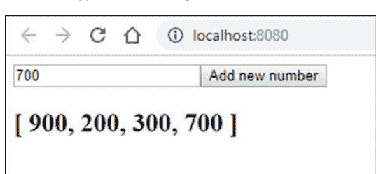

根据我们的示例，EventBus 似乎非常容易设置和在应用程序中实现。然而，它也带来了一些在一个包含大量组件的生产就绪应用中不容忽视的缺点。

它无法满足期望的原因在于通过 EventBus 触发事件的方式。随着应用程序的增长和更多组件的添加，跟踪触发的事件变得困难，因此这种技术的维护将成为一大难题。

#### 全局 Store

这是一种非常常见且显而易见的应用数据处理模式。该技术涉及创建一个 store，用于存储所需数据以及管理应用状态的方法。

让我们添加一个名为 `store.js` 的 store。

```javascript
// store/store.js
export const store = {
  state: {
    numberArray: [500, 250, 390]
  },
  addNumber(newNumber) {
    this.state.numberArray.push(newNumber);
  }
};
```

这个 store 在 `state` 对象中包含了 `numberArray`，以及一个 `addNumber` 方法，该方法将新数字推入 `state.numberArray`。现在我们需要在将添加和显示数组的组件中使用这个 store。

```vue
<!-- AddNumber.vue -->
<template>
  <div>
    <input v-model="newNumber" type="number">
    <button @click="addNumber">Add new number</button>
  </div>
</template>

<script>
import { store } from '../store/store';

export default {
  data() {
    return { newNumber: 0 }
  },
  methods: {
    addNumber() {
      store.addNumber(this.newNumber);
    }
  }
};
</script>
```

很简单，不是吗？我们在这个组件中引用了 `store.js`，在 `addNumber` 方法内部，我们通过 store 对象调用了相关方法。

同样地，让我们添加显示组件。

```vue
<!-- ShowNumbers.vue -->
<template>
  <div>
    <h1>{{ storeState.numberArray }}</h1>
  </div>
</template>

<script>
import { store } from '../store/store';

export default {
  computed: {
    storeState() {
      return store.state;
    }
  }
};
</script>
```

我们只是显示了来自 store 对象的 `numberArray`。由于 Vue 的响应式特性，它运行得非常出色！当 `numberArray` 更新时，使用它的其他组件会自动更新。下面是输出结果。

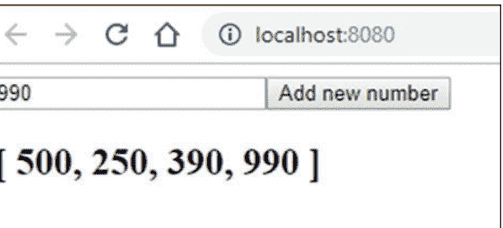

以下是图示表示。

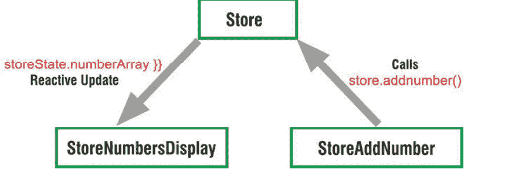

在继续之前，有几点需要注意。

- **AddNumber**：通过调用 store 方法直接更新数据。这可以被标记为 **Store Action**（存储操作）。
- **Store 内部的方法**：改变数据状态，这可以定义为 **Store Mutation**（存储变更）。
- **ShowNumbers**：只是获取 store 数据并显示，这可以表示为一个 **Store Getter**（存储获取器）。

因此，整个流程可以描述为：一个 Action 触发一个 Mutation。然后 Mutation 改变数据状态，进而影响视图和组件，因为 Getters 用于从 Store 中检索数据。

我们讨论上述内容的原因是因为我们将在下一节中使用它们。

#### Vuex

我们上面讨论的任何内容都类似于 Flux 风格的架构来管理状态。Vuex 实际上是一个类似 Flux 的状态管理库，用于状态管理。

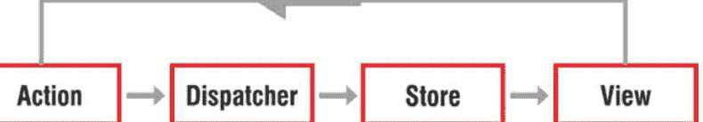

注意：Facebook 引入了 Flux，它实际上是一种设计模式。这种设计模式支持四个部分之间的单向数据管道，这四个部分分别命名为 Action、Dispatcher、Store 和 View。

让我们开始使用 Vuex 创建 store（`store.js`）。

```javascript
// store/index.js
import Vue from "vue";
import Vuex from "vuex";

Vue.use(Vuex);

const state = {
  numberArray: [9090, 2090, 3087]
};

const mutations = {
  ADD_NUMBER(state, payload) {
    state.numberArray.push(payload);
  }
};

const actions = {
  addNumber(context, number) {
    context.commit("ADD_NUMBER", number);
  }
};

const getters = {
  getNumbers(state) {
    return state.numberArray;
  }
};

export default new Vuex.Store({
  state,
  mutations,
  actions,
  getters
});
```

如果你还记得上一节的要点，Vuex 使用了类似的结构。让我们逐一定义。

State 不过是将在应用内共享的数据容器。

接下来是 Mutations，负责直接变更 store 的状态。

Mutations 可以通过第一个参数访问 state。参数 `payload` 是可选的。

注意：Mutations 的命名约定遵循全大写规则，以便与应用中的其他方法区分开来。

现在是 Actions，它们的存在是为了调用这些 mutations。

这里的 `context` 对象赋予了我们访问 store 其他属性（如 state 和 getters）的能力。这对于 Actions 中的业务逻辑非常重要。此处的 `commit` 函数有助于调用关联的 mutation，并将 `number` 作为 payload（载荷）传递。

最后但同样重要的是 Getters，它们帮助我们从 state 中检索数据。

要使用所有这些 Vuex 功能，我们需要在顶部编写几行代码。

然而，这不会起作用，因为我们的应用中还没有这个包。为此，请运行以下命令。

```bash
npm install vuex --save
```

将所有部分组合在一起，`store.js` 将如下所示：

Store 已经准备好了，但最后一步是告诉 Vue 我们有一个 store。更新你的 `main.js` 代码，在 Vue 对象声明中包含 store。

```javascript
// main.js
import Vue from 'vue';
import App from './App.vue';
import store from './store';

new Vue({
  render: h => h(App),
  store
}).$mount('#app')
```

为了使用 store，我们可以添加能够读取或修改数据的组件。在组件中，你可以使用一个简单的计算属性，借助 getters 从 store 中读取数据。

```vue
<!-- 任意组件 -->
<template>
  <div># {{ getNumbers }}</div>
</template>

<script>
export default {
  computed: {
    getNumbers() {
      return this.$store.getters.getNumbers;
    }
  }
}
</script>
```

让我向你展示可以添加到任何组件中的方法，该方法可以修改 store 中的数据。

```vue
<script>
export default {
  methods: {
    addNumber(number) {
      this.$store.dispatch("addNumber", Number(number));
    }
  }
}
</script>
```


可以在按钮点击时调用此方法，使用 `$store.dispatch` 将一个数字添加到数组中。让我们快速查看一下浏览器上的输出。

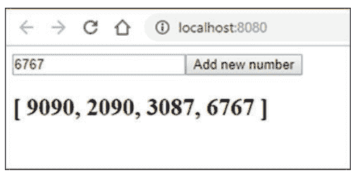

图 7.13：使用 Vuex 进行状态管理的输出

## 优点

Vuex 为我们提供了处理应用中数据状态的简单接口。通过 Actions、Mutations 和 Getters，状态管理变得轻松。
让我向你展示另一个与 Vue js 开发工具集成的很棒的功能。你实际上可以在其中跟踪 mutation。请参见下面的截图。

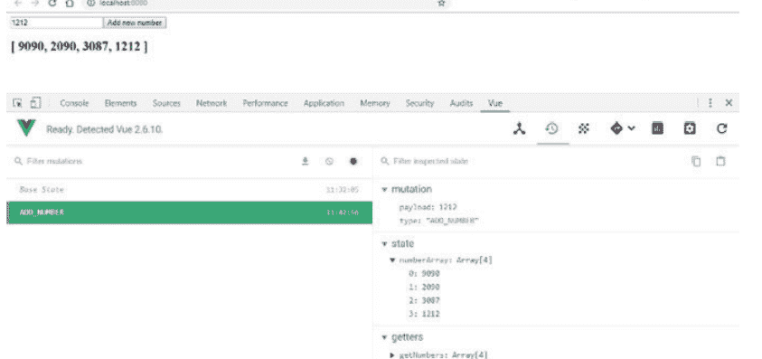

图 7.14：Vue 开发工具中的 Vuex

当你点击“Add new Number”时，它会向数组添加数据并显示，包括 Dev Tool（开发工具）内的一个 `ADDNUMBER` 行。它还可以向你显示 payload 和 mutation 类型，分别显示为 1212 和 `ADDNUMBER`。
有趣的是，它还向你显示 state 和 getters 中的所有数据以供参考。此外，它还有一个选项可以通过点击 mutation 行上的一个图标来撤销此 mutation 并将状态恢复到之前的状态。让我在下面向你展示那个图标。

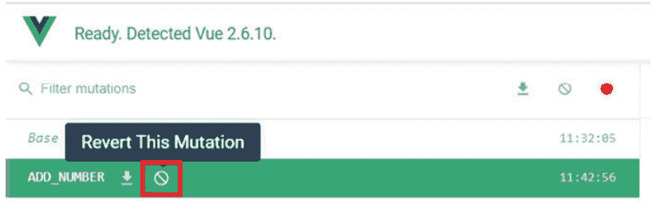

图 7.15：从 Vue 开发工具的 Vuex 标签页撤销一个 Mutation

当在开发工具中注册了多个 mutation 时，有一个选项可以时间旅行到不同的状态。该选项就在 mutation 行上。当你点击该图标时，它会立即改变状态。把它作为你的家庭作业吧。如果你找不到，请告诉我们。

## 不同状态管理技术的分析

我们发现了管理应用数据状态的所有技术。然而，你可以根据你的要求，通过分析优缺点来选择其中任何一种。

### EventBus

EventBus 非常容易设置和使用，但缺点是几乎没有可能的方法来跟踪变化。随着应用增长并包含更多组件，很难知道是谁在使用 Bus 来做什么。

### 全局存储（Global Store）

它是一种集中的、易于理解也易于实现的方式。然而，这个概念对于 store 和 state 变化没有明确的定义。

### Vuex

在 Vue 应用中管理状态最有效的方式。也与 Vue 开发工具集成。然而，你需要对 Flux 架构有一点了解。

请记住，Vuex 并不是唯一可以在 Vue 应用中管理状态的库。还有其他库可以完成这项工作，例如 `redux-vue` ( https://github.com/nadimtuhin/redux-vue ) 和 `vuejs-redux` ( https://github.com/titouancreach/vuejs-redux ) 。

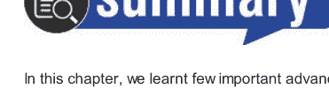

在本章中，我们学习了一些 Vue 的重要高级概念。Vue 中的路由在动态加载页面方面起着重要作用，正如我们在单页应用程序（SPA）中使用它一样。我们理解了路由的概念以及如何在 SPA 中实现它。

接下来我们通过适当的示例学习了不同的状态管理原则。父子组件之间的数据传输可以使用 props 和自定义事件来完成。然而，当涉及到零耦合的隔离组件之间的通信时，EventBus、全局存储和 Vuex 就派上了用场。

EventBus 为我们提供了一种方便的方式来实现自定义事件的发布和订阅模式，这样组件可以发出事件，任何组件都可以借助 EventBus 对象来监听这些事件。

全局存储只是一个对象，它存储数据以及负责更新数据的事件。组件可以引用此存储对象来获取数据或更新数据，从而管理状态。

我们发现的最有效的方式是 Vuex，它为我们提供了定义良好的结构来为 Mutation、Actions 和 Getters 构建 store。Vue 开发工具与 Vuex 内置集成，以跟踪 mutation。

在接下来的附录部分，我们将发现与市场上其他框架的差异，这不仅有助于你比较功能，还将指导你选择最适合你和你的职业生涯的方式。我们还将探索定义模板的其他替代方法。

## 附录

随着 Day-7 的结束，我们已经完成了 VueJS 的学习。我们从使用 Vuejs 设计普通视图页面一路走到组件设计。我们还学习了创建组件、使其可重用、以及使用 mixins、filters 等为它们添加更多功能和格式的方法。此外，我们还涵盖了路由和状态管理，这将作为读者迈向 Vuejs 应用开发的垫脚石。

在这个主题中，我们将讨论使用 VueJs 的替代方案和可能性。任何项目都不会详细涵盖。读者可以选择跳过此主题。

我们将展示使用 render 函数和 JSX 进行模板设计的替代方法。最后，我们将快速比较 Vuejs 与其它框架。

在某些情况下，它们对于有效管理资源很有用。

### 与模板有何不同

与用 HTML 编写的模板不同，它主要是 Javascript。我们需要使用 Javascript 将 HTML 元素添加到 DOM 中。我们使用 `render` 钩子来定义和渲染 HTML 元素。

元素是使用 Javascript 的 `createElement` 函数创建的。

#### 让我们定义一个模板

让我们使用 `render` 方法定义一个模板。我们将创建一个简单的 span 来在屏幕上显示文本。

在这个例子中，我们使用了 `createElement` 方法在 DOM 中创建元素。它接受树结构中的元素。可以看到，我们定义了 a 作为父元素。在内部，我们放置了一个标签，然后在里面放置了一个。文本放在内部。渲染时，它将相应地渲染元素。

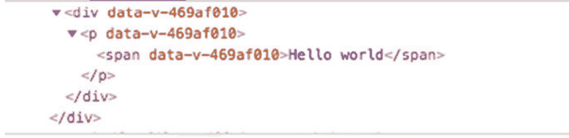

图 8.1：渲染后组件的 HTML 视图

### createElement 方法的参数

它接受以下参数：

#### createElement 方法

```javascript
// @returns {VNode}

createElement(
  // {String | Object | Function}
  // 一个HTML标签名称、组件选项，或解析为其中一种的异步
  // 函数。必需。
  'div',
  // {Object}
  // 一个数据对象，对应于你将在模板中使用的
  // 属性。可选。
  {
    // （详情请参阅下一节）
  },
  // {String | Array}
  // 子VNode节点，使用`createElement()`构建，
  // 或使用字符串来获得'text VNode'。可选。
  [
    'Some text comes first.',
    createElement('h1', 'A headline'),
    createElement(MyComponent, {
      props: {
        someProp: 'foobar'
      }
    })
  ]
)
```

图 8.2：createElement 方法接受的参数

#### 添加多个元素

我们可以通过使用 `createElement` 方法来添加多个元素。我们将通过将元素添加到上述示例中来继续扩展它。

在包含“Hello vuejs”文本的元素中，我们为其添加了样式。它使用 style 标签作为参数。同时，我们可以在标签中注意到，我们在 attrs 标签下定义了 HTML 属性，如 href。我们还可以注意到，组件的 prop 也可以使用 span 添加到元素中。

为了渲染插槽，我们使用了 `this.$slots.default` 来获取插槽值，并将其放置在 span 标签内。

类似地，我们还可以使用 class、props、on、directives、slots 等标签，分别为元素添加 CSS 类、组件属性、事件、指令、插槽等。


```
Hello world
Hello vuejs
Hello Learner
# Welcome to Your Vue.js App
Test the slot
```

图 8.3：使用渲染函数的 UI

以下是显示树结构 `createElement` 方法输出的结果。

## JSX

它实际上是 Javascript Expressions 的缩写。这种在 Javascript 中以 XML 风格表示编写代码的方法是由 Facebook 工程团队发明的。这种方法主要在 ReactJS 中使用。Vue 也支持 JSX。我们可以用它来创建组件模板。

它比渲染函数更具可读性和可维护性。这些是 Javascript 函数内部的类 XML 标签式书写。

> 要编译 Vue JSX 代码，我们需要添加 babel 插件以在 Vue 中使用 JSX。

### 使用 JSX 的组件

我们将使用 JSX 创建一个示例组件，以在屏幕上显示一条简单消息。

正如我们在上面的代码片段中看到的，我们使用了相同的渲染函数来创建模板。标签被添加并从渲染函数返回到视图。

> 将 `createElement` 别名为 `h` 是 Vue 生态系统中常见的约定，并且是 JSX 所必需的。从 Babel 插件的 **3.4.0 版本** 开始，我们会在任何使用 ES2015 语法声明的、包含 JSX 的方法和 getter（不是函数或箭头函数）中自动注入 `const h = this.$createElement`，因此你可以省略 `(h)` 参数。在插件的早期版本中，如果 `h` 在作用域中不可用，你的应用将会抛出错误。

图 8.4：根据官方文档，createElement 被 h 替代

它通常会在屏幕上显示该字符串。

#### Hello from JSX

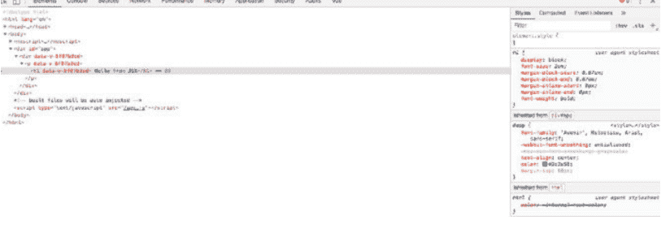

图 8.5：使用 JSX 渲染的 HTML

在控制台窗口中，我们可以标记脚本中定义的元素和字符串的层次结构。

#### 显示 Props

作为组件，我们可以在其中定义 props。props 是从父组件获取值的属性。如果我们查看代码片段，可以注意到文本显示格式的差异。这里我们使用 `{}`（单花括号）来在屏幕上渲染文本，而不是 mustache 表示法。

让我们扩展当前示例，并将组件添加到其中。这里，我们将导入本章中已经创建的组件。

我们在此导入了 HelloWorld 组件，并将其添加到页面中。

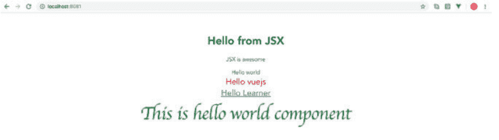

图 8.6：使用 JSX 渲染组件 UI

我们可以将其与插槽、格式化器等一起使用，这超出了本主题的范围。我们已经介绍了如何使用 JSX 以及它如何与 Vue 一起工作。

## 比较 Vue

Vue 是一个基于 Javascript 构建的渐进式 Javascript 框架。它使用虚拟 DOM 来更新元素并在浏览器中渲染它们。像 Vue 一样，还有其他几个非常相似的框架。它们也可以像 Vue 一样工作。很多时候，在为应用程序开发选择框架时，我们需要做出决定。因此，为了选择，我们需要对它们进行比较。我们将 Vue 与一些流行的框架进行比较。

### React vs Vue

React 也是用于应用程序开发的最受欢迎的 Javascript 框架之一。像 Vue 一样，它也使用虚拟 DOM 来更新和渲染浏览器中的元素。React 也具有类似于 Vue 的基于组件的开发能力。

#### 组件模板设计

#### 组件树渲染

#### CSS 文件结构

#### 数据变更

这两个框架在语法和语义上还有更多差异。变量的处理、事件的处理、子/父组件的处理等等，在 React 和 Vue 之间都有所不同。但它们大多存在于编码语法中，我们无法一一涵盖。我们已经涵盖了上面大多数基本概念差异。

### Angular vs Vue

以前且广为人知的 Angular 2（编写本书时的当前版本为 6）在此被称为 Angular。它与 AngularJS 完全不同。我们将在这里将 Angular 与 Vue 进行比较。

#### 学习曲线

#### 性能

在性能方面，Angular 和 Vue 看起来非常相似。Angular 主要使用即时（AOT）编译来显著减小最终输出大小。然而，Vue 也产生较小的大小。

#### 概念差异

Javascript 框架不仅限于以上几种。我们只对流行的框架进行了比较。由于上述比较主要以开发者为中心，它将帮助开发者在启动任何项目时，在选择一项技术而非另一项技术时做出大多正确的决定。


在本章中，我们涵盖了设计 Vue 模板的替代方法。我们只涵盖了其中的基础部分。我们还看到了几个框架与 VueJs 的比较。

当我们说，我们即将结束此学习时，我们的意思是，读者必须对 Vue 作为一个框架如何工作有一个概念。从生命周期钩子到组件，这将为使用 VueJS 框架提供一个不错的概念。我们还学习了创建可重用元素（如组件、插件、过滤器、指令等）的非常有用的方法。状态管理示例也将帮助开发者可视化应用程序设计方式。

当然，在单本书中涵盖关于框架的所有内容和所有知识是不可能的。本书将为开发人员在实际工作环境中提供快速参考。
