# Angular 实用指南：Angular 2 与 Angular 4 实践指南

## 关于作者

**布拉德·戴利** 是一名拥有20多年企业应用和Web界面开发经验的高级软件工程师。他使用JavaScript和jQuery已有多年，是 *《Node.JS、MongoDB和Angular Web开发》*、 *《jQuery与JavaScript速查手册》* 和 *《Sams三合一自学AngularJS、JavaScript和jQuery》* 的作者。他设计并实现了从应用服务器到复杂Web应用程序的广泛应用和服务。

**布伦丹·戴利** 是一名热爱学习和应用最新最棒技术的Web应用程序开发者。他是 *《Sams三合一自学AngularJS、JavaScript和jQuery》* 和 *《Node.JS、MongoDB和Angular Web开发》* 的合著者。他使用JavaScript、TypeScript和Angular编写了多个Web应用程序，并正在探索增强现实等新型Web和移动端技术的能力，以及如何利用它们进行创新性解决方案。

**迦勒·戴利** 是一名正在学习计算机科学的大学生。他从很小的时候就接触了软件开发，计算机编程的大部分知识都是自学的。他是一位精通JavaScript、Python和C#的开发者，也是Unity平台的忠实粉丝。他也是 *《Node.JS、MongoDB和Angular Web开发》* 的合著者。他对未来充满期待，并希望有机会参与设计和创建下一代创新软件，这些软件将不断改善我们的生活、工作和娱乐方式。

## 致谢

我想借此页感谢所有让这本书成为可能的人。首先，感谢我出色的妻子给予我的灵感、爱和支持。没有你，我永远无法走到今天。我也要感谢我的儿子们在我写作时所提供的帮助。感谢马克·塔伯让这个书名顺利启动。

— 布拉德·戴利

## 我们想听听你的意见！

作为这本书的读者，*你* 是我们最重要的批评家和评论者。我们重视你的意见，并想知道我们做对了什么，哪些地方可以做得更好，你希望我们在哪些领域出版，以及任何你愿意分享给我们的其他智慧之言。

你可以发邮件或直接写信告诉我们你喜欢或不喜欢这本书的哪些方面——以及我们可以如何让我们的书变得更强。

*请注意，我们无法就本书主题相关的技术问题提供帮助，并且由于我们收到大量邮件，我们可能无法回复每一条消息。*

写信时，请务必包含本书的书名和作者，以及你的姓名、电话或电子邮件地址。

电子邮件：feedback@developers-library.info

邮件：读者反馈

Addison-Wesley Developer's Library

800 East 96th Street

Indianapolis, IN 46240 USA

## 读者服务

访问我们的网站并在 **www.informit.com/register** 注册本书，以便方便地获取本书可能提供的任何更新、下载或勘误。

### 访问免费网络版

你以任何格式购买本书，都包含对相应网络版的访问权限，该版本提供几个仅限在线的特殊功能：

- 本书的完整文本

- 更新和更正内容（在发布时提供）

网络版可以在所有类型的计算机和移动设备上通过任何支持HTML5的现代网络浏览器查看。

要获取 *Learning Angular* 网络版的访问权限，你只需注册本书：

1. 访问 www.informit.com/register

2. 登录或创建一个新帐户。

3. 输入 ISBN：**9780134576978**

4. 回答问题作为购买证明。

5. 网络版将出现在你帐户页面的“数字购买”标签下。点击“启动”链接即可访问该产品。

## 引言

欢迎阅读 *Learning Angular*。本书旨在将你带入使用Angular构建高度交互和结构良好的Web应用程序的世界。本书涵盖了Angular框架的基础知识，以及如何使用它为Web应用程序构建设计精良、可重用的组件。Angular是Web开发领域中最激动人心和最具创新性的技术之一。

本引言涵盖以下内容：

- 谁应该阅读这本书

- 为什么你应该阅读这本书

- 使用本书你将能实现什么

- 什么是Angular以及为什么它是一项伟大的技术

- 本书的组织结构

- 在哪里可以找到代码示例

让我们开始吧。

## 谁应该阅读这本书

本书面向那些已经了解HTML基础知识并使用现代编程语言进行过一些编程的读者。具备当前的JavaScript知识将使本书更容易理解，但这不是必须的，因为本书也涵盖了JavaScript的基础知识。

## 为什么你应该阅读这本书

本书将教你如何创建强大、交互式的Web应用程序，这些应用程序具有结构良好、易于重用且易于维护的代码库。Angular的一个很棒的特点是，它实际上通过遵循底层结构和设计，迫使你成为一名更好的Web开发者。

本书的典型读者希望掌握Angular以构建高度交互的Web应用程序。典型的读者也希望利用Angular创新的模型视图控制器（MVC）方法来实现设计精良、结构合理的网页和Web应用程序。总的来说，Angular提供了一个易于实现、完全集成的Web开发平台，使你能够实现令人惊叹的Web 2.0应用程序。

## 你将从本书中学到什么

本书将教你如何构建真实的、动态的网站和Web应用程序。网站不再由简单的静态内容构成——带有集成图像和格式化文本的HTML页面。相反，网站已经变得更加动态化，单个页面通常就充当整个站点或应用程序。

使用Angular技术可以让你将逻辑直接构建到网页中，从而将客户端Web应用程序的数据模型与后端服务和数据库绑定。Angular还使你能够轻松扩展HTML的功能，从而可以在HTML模板文件中轻松表达UI设计逻辑。以下只是你阅读本书时将学到的一些内容：

- 如何使用内置指令快速构建Angular模板，以增强用户体验

- 如何将UI元素绑定到数据模型，以便当模型改变时UI也随之改变，反之亦然

- 如何将鼠标和键盘事件直接绑定到数据模型和后端功能，以提供稳健的用户交互

- 如何定义你自己的自定义Angular指令来扩展HTML语言

- 如何实现可以与Web服务器交互的客户端服务

- 如何构建提供丰富用户交互的动态浏览器视视图

- 如何创建可以在其他Angular应用程序中轻松重用的自定义服务

- 如何实现丰富的UI组件（如可缩放图像和可扩展列表）作为自定义Angular指令

## 什么是Angular？

Angular主要由Google开发的一个客户端JavaScript框架。Angular背后的整个</think>[content]提供一个框架，使使用MVC或模型视图视图模型（MVVM）框架来实现设计精良、结构合理的网页和应用程序变得简单。

Angular提供了在浏览器中处理用户输入、在客户端操作数据以及控制元素在浏览器视图中显示方式的所有功能。以下是Angular提供的一些好处：

- **数据绑定**：Angular使用其强大的作用域机制，提供了一种非常简洁的数据绑定到HTML元素的方法。

- **可扩展性**：Angular架构使你能够轻松扩展该语言的几乎所有方面，以提供你自己的自定义实现。

## 本书组织结构

本书分为12章。

第1章，“JavaScript入门”，提供JavaScript入门知识，以防您不熟悉JavaScript。本章还将引导您完成开发环境的搭建过程。即使您熟悉JavaScript，也建议至少浏览前几节内容，以便创建开发环境。

第2章，“TypeScript入门”，提供关于TypeScript的额外入门知识，它是JavaScript的超集。大多数Angular示例，包括本书中的示例，都是用TypeScript编写的，因此它是使用Angular进行开发的必备知识。

第3章，“Angular入门”，涵盖Angular框架的基础知识。您将了解Angular的组织结构以及如何设计Angular应用程序。

第4章，“Angular组件”，涵盖Angular组件的基本结构，这些组件是Angular的构建块。您将学习如何使用HTML模板和JavaScript创建组件。

第5章，“表达式”，涵盖在Angular模板中使用表达式和管道。您将了解内置的表达式语法和管道，以及如何创建自己的管道。

第6章，“数据绑定”，涵盖将Angular组件中的数据绑定到HTML模板中UI元素的基础知识。

第7章，“内置指令”，涵盖Angular中内置的指令。指令允许您更改DOM元素的结构以及利用HTTP属性。

第8章，“自定义指令”，涵盖构建您自己的自定义指令以扩展HTML。您将了解属性指令以及如何将指令与组件一起使用。

第9章，“事件与变更检测”，涵盖您在Angular中将遇到的事件类型以及如何管理它们。您将学习如何创建和处理自己的自定义事件。本章还涵盖了如何使用可观察对象来监视和响应Web应用程序中的数据变化。

第10章，“在Web应用中实现Angular服务”，涵盖Angular提供的内置服务。这些服务使您能够使用HTTP请请求与Web服务器通信，实现路由以导航应用程序视图更改，以及在网页上实现动画。

第11章，“创建您自己的自定义Angular服务”，涵盖Angular中可用于创建自定服务的机制。自定义服务使您能够使功能可重用，因为您可以轻松地将这些服务提供的功能注入到多个应用程序中。

第12章，“玩转Angular”，提供了几个在实际示例中使用Angular创建丰富UI组件的示例。您将有机会了解如何实现拖放、动画和其他UI元素。

## 获取代码示例

在整本书中，您会发现包含在代码清单中的示例代码。每个代码清单的标题都包含该清单源代码所在文件的文件名。您可以从本书网站（见封底）访问示例中使用的源代码文件和图像。

## 结语

享受本书并享受学习Angular的乐趣。这是一项伟大、创新的技术，使用起来非常有趣。很快，您将能够加入许多其他使用Angular构建交互式网站和Web应用程序的Web开发者行列。

## JavaScript入门

Angular基于TypeScript构建，而TypeScript是JavaScript的超集。在进入Angular世界之前，您对JavaScript有一个基本的了解很重要。本章有两个目的：向您展示如何设置开发环境，并教您JavaScript的基础知识。

本章的第一部分讨论了设置JavaScript开发环境所需的必要基础。即使您已经熟悉JavaScript并且已经设置了开发环境，也建议至少快速浏览一下本节。

本章的其余部分将让您熟悉JavaScript的一些语言基础，例如变量、函数和对象。它并非一本完整的语言指南，而是对重要语法和惯用法的概要介绍。如果您不熟悉JavaScript，学习完本入门知识应该能让您理解本书其余部分的示例。如果您已经熟悉JavaScript，可以跳过这些部分，或者作为复习快速回顾。

### 设置JavaScript开发环境

设置JavaScript开发环境的方法有很多，很难只专注于一种。大多数优秀的集成开发环境（IDE）工具至少提供某种方式来轻松设置JavaScript开发环境。因此，如果您有自己喜欢的IDE，应该查看其JavaScript功能。

要使用JavaScript和/或TypeScript有效地构建Angular应用程序，您的开发环境需要包含以下组件：

-   **编辑器：** 编辑器使您能够创建构建Angular应用程所需的必要JavaScript、HTML和CSS文件。市面上有很多编辑器，您可以选择一个自己熟悉的。本书使用Visual Studio Code，因为它内置了对TypeScript的兼容性。

-   **浏览器：** 您需要一个Web浏览器来测试和试用您的应用程序。在大多数情况下，JavaScript和Angular应用程序在主要浏览器中的运行方式相同。

Angular支持ECMAScript 5和6，大多数现代浏览器已经实现了ECMAScript 6的大部分功能。但是，某些功能在旧版浏览器中的行为可能不同。始终建议在您客户将使用的主要浏览器中测试您的应用程序，以确保它在所有浏览器中都能正确运行。

### 定义变量

在JavaScript中，您使用变量来临时存储和访问JavaScript文件中的数据。变量可以指向简单数据类型，如数字或字符串，也可以指向更复杂的数据类型，如对象。

要在JavaScript中定义变量，请使用`var`关键字，然后为变量命名，如本例所示：

```javascript
var myData;
```

您也可以在同一行为变量赋值。例如，以下代码行创建了一个变量`myString`并将值"Some Text"赋给它：

```javascript
var myString = "Some Text";
```

以下两行做的是同样的事情：

```javascript
var myString;
myString = "Some Text";
```

声明变量后，您可以使用其名称为变量赋值和访问变量的值。例如，以下代码将一个字符串存储在`myString`变量中，然后在将值赋给`newString`变量时使用它：

```javascript
var myString = "Some Text";
var newString = myString + " Some More Text";
```

您应该为变量起一个描述性的名称，以便日后知道它们存储了什么数据，并能更轻松地在程序中使用它们。变量名必须以字母、$或_开头，不能包含空格。此外，变量名区分大小写，因此，例如，`myString`与`MyString`是不同的。

### 理解JavaScript数据类型

JavaScript使用数据类型来确定如何处理分配给变量的数据。变量类型决定了您可以对变量执行哪些操作，例如循环或执行。以下列表描述了您在本书中将最常处理的变量类型：

-   **字符串：** 此数据类型将字符数据存储为字符串。字符数据用单引号或双引号指定。引号内的所有数据都分配给字符串变量。考虑以下示例：

    ```javascript
    var myString = 'Some Text';
    var anotherString = 'Some More Text';
    ```

### 数字

此数据类型将数据存储为数值。数字在计数、计算和比较中非常有用。以下是一些示例：

```
var myInteger = 1;
var cost = 1.33;
```

### 布尔值

此数据类型存储一个单一的位，该位的值为 true 或 false。布尔值通常用作标志。例如，你可能在代码的开头将某个变量设置为 false，然后在代码执行完成时检查它，以查看代码是否执行到了某个特定位置。以下示例定义了 true 和 false 变量：

```
var yes = true;
var no = false;
```

### 数组

索引数组是一系列独立的数据项，它们都存储在一个单一的变量名下。JavaScript 数组是异构的，这意味着它们可以在同一个数组中支持不同类型的对象。数组中的项可以通过其从零开始的索引来访问，使用 `array[index]`。以下是创建一个简单数组并访问第一个元素（位于索引 0）的示例：

```
var arr = ["one", "two", "three"];
var first = arr[0];
```

### 对象字面量

JavaScript 支持创建和使用对象字面量。当你使用对象字面量时，你可以使用 `object.property` 语法来访问对象中的值和函数。以下示例展示了如何创建和访问对象字面量的属性：

```
var obj = {"name": "Brad", "occupation": "Hacker", "age": "Unknown"};
var name = obj.name;
```

### Null

有时你没有值要存储在变量中，要么是因为变量尚未创建，要么是你不再使用它。在这种情况下，你可以将变量设置为 `null`。使用 `null` 比赋值为 0 或空字符串 ("") 更好，因为那些值可能是变量的有效值。此外，`null` 比 `undefined` 更好，因为它指定了一个值已经被设置。通过将 `null` 赋给变量，你可以不赋值，并在代码中检查 `null`，如下所示：

```
var newVar = null;
```

**注意：** JavaScript 不是一种强类型语言。这意味着你不需要在脚本中指变量的数据类型。解释器会自动确定变量的正确数据类型。此外，你可以将一种类型的变量赋值给不同类型的值。例如，以下代码定义了一个字符串变量，然后将其赋值给一个整数值类型：

```
var id = "testID";
id = 1;
```

### 使用运算符

JavaScript 运算符允许你改变变量的值。你已经熟悉用于给变量赋值的 = 运算符。JavaScript 提供了几种不同的运算符，它们分为两类：算术运算符和赋值运算符。

### 算术运算符

你使用算术运算符在变量和直接值之间执行操作。表 1.1 列出了算术操作及其应用结果。

**表 1.1 JavaScript 的算术运算符，初始 y=4 的结果**

| 运算符 | 描述 | 示例 | 结果 x |

|---|---|---|---|

| + | 加法 | x=y+5 | 9 |

| | | x=y+"5" | "45" |

| | | x="Four"+y+"4" | "Four44" |

| - | 减法 | x=y-2 | 2 |

| ++ | 自增 | x=y++ | 4 |

| | | x=++y | 5 |

| -- | 自减 | x=y-- | 4 |

| | | x=--y | 3 |

| * | 乘法 | x=y*4 | 16 |

| / | 除法 | x=10/y | 2.5 |

| % | 取模（除法的余数） | x=y%3 | 1 |

> **注意：** 你也可以使用 + 运算符将字符串连接在一起，或将字符串和数字连接在一起。它允许你快速地将字符串与输出字符串中的数字数据进行连接。表 1.1 显示，当你将一个数字值和一个字符串值相加时，数字值会被转换成字符串，然后两个字符串被连接起来。

### 赋值运算符

你使用赋值运算符将值赋给变量。除了 = 运算符之外，还有几种不同的形式允许你在赋值时操作数据。表 1.2 列出了赋值操作及其应用结果。

**表 1.2 JavaScript 的赋值运算符，初始 x=10 的结果**

| 运算符 | 示例 | 等效算术运算符 | 结果 x |

| :--- | :--- | :--- | :--- |

| = | x=5 | x=5 | 5 |

| += | x+=5 | x=x+5 | 15 |

| -= | x-=5 | x=x-5 | 5 |

| *= | x*=5 | x=x*5 | 50 |

| /= | x/=5 | x=x/5 | 2 |

| %= | x%=5 | x=x%5 | 0 |

### 应用比较和条件运算符

使用条件语句是向应用程序应用逻辑的一种方式，使得某些代码仅在特定条件下才会执行。这是通过对变量值应用比较逻辑来实现的。以下部分描述了 JavaScript 中可用的比较以及如何在条件语句中应用它们。

### 比较运算符

比较运算符评估两段数据，如果评估正确则返回 `true`，如果评估不正确则返回 `false`。比较运算符将运算符左侧的值与右侧的值进行比较。

表 1.3 列出了比较运算符并提供了一些示例。

**表 1.3 JavaScript 的比较运算符，初始 x=10 的结果**

| 运算符 | 描述 | 示例 | 结果 |

| :--- | :--- | :--- | :--- |

| == | 等于（仅值） | x==8<br>x==10 | false<br>true |

| === | 值和类型都相等 | x===10<br>x==="10" | true<br>false |

| != | 不等于 | x!=5 | true |

| !== | 值和类型都不相等 | x!="10"<br>x!==10 | true<br>false |

| > | 大于 | x>5 | true |

| >= | 大于或等于 | x>=10 | true |

| < | 小于 | x<5 | false |

| <= | 小于或等于 | x<=10 | true |

你可以使用逻辑运算符和标准括号将多个比较链接在一起。表 1.4 列出了逻辑运算符并展示了如何使用它们将比较链接在一起。

**表 1.4 JavaScript 的逻辑运算符，初始 x=10 和 y=5 的结果**

| 运算符 | 描述 | 示例 | 结果 |

| :--- | :--- | :--- | :--- |

| && | 与 | (x==10 && y==5) | true |

| | | (x==10 && y>x) | false |

| \|\| | 或 | (x>=10 \|\| y>x) | true |

| | | (x<10 && y>x) | false |

| ! | 非 | !(x==y) | true |

| | | !(x>y) | false |

| 混合 | | (x>=10 && y<x \|\| x==y) | true |

| | | ((x<y \|\| x>=10) && y>=5) | true |

| | | (!(x==y) && y>=10) | false |

### 使用 if 语句

if 语句允许你根据比较的评估来分离代码执行。以下代码行显示了括号中的条件运算符和在条件评估为 true 时执行的代码 {}：

```
if(x==5){
    do_something();
}
```

除了仅执行 if 语句块内的代码外，你还可以指定一个 else 块，该块仅在条件为 false 时执行。这是一个示例：

```
if(x==5){
    do_something();
} else {
    do_something_else();
}
```

你还可以链接多个 if 语句。为此，请添加一个条件语句和一个 else 语句，如以下示例所示：

```
if(x<5){
    do_something();
} else if(x<10) {
    do_something_else();
} else {
    do_nothing();
}
```

### 实现 switch 语句

另一种条件逻辑类型是 switch 语句。switch 语句允许你评估一个表达式一次，然后根据该值执行多个代码段之一。

switch 语句具有以下语法：

```
switch(expression){
    case value1:
        <要执行的代码>
        break;
    case value2:
        <要执行的代码>
        break;
    default:
        <如果不是 value1 或 value2 时要执行的代码>
}
```

以下是发生的过程：switch 语句完全评估表达式并获取一个值。该值可以是字符串、数字、布尔值，甚至是对象。然后，switch 表达式与 case 语句指定的每个值进行比较。如果值匹配，则执行 case 语句中的代码。如果没有值匹配，则执行 default 代码。

> **注意：** 通常每个 case 语句在末尾都包含一个 break 命令，以表示跳出 switch 语句。如果没有找到 break，代码执行将继续到下一个 case 语句。

### 实现循环

循环是多次执行同一代码段的一种方式。当你需要对数组或一组对象重复执行相同任务时，它非常有用。

JavaScript 提供了执行 for 和 while 循环的功能，如下所述。

### while 循循环

JavaScript 中最基本的循环类型是通过 while 循环实现的。while 循环测试一个表达式，并继续执行其 {} 括号中包含的代码，直到表达式评估为 false。

例如，以下 `while` 循环会执行直到 `i` 等于 5：

```
var i = 1;
while (i<5){
    console.log("Iteration " + i);
    i++;
}
```

此示例向控制台发送以下输出：

```
Iteration 1
Iteration 2
Iteration 3
Iteration 4
```

### do/while 循环

`while` 循环的另一种类型是 `do/while` 循环，它在你总是希望至少执行一次循环中的代码，并且只有在代码至少执行一次后才能测试表达式时非常有用。

例如，以下 `do/while` 循环会执行直到 `days` 等于 `"Wednesday"`：

```
var days = ["Monday", "Tuesday", "Wednesday", "Thursday", "Friday"];
var i=0;
do{
    var day=days[i++];
    console.log("It's " + day);
} while (day != "Wednesday");
```

这是控制台的输出：

```
It's Monday
It's Tuesday
It's Wednesday
```

### for 循环

JavaScript 的 `for` 循环允许你通过使用一个将三个语句组合在单个执行块中的 `for` 语句来执行代码特定的次数。以下是语法：

```
for (assignment; condition; update;){
    code to be executed;
}
```

`for` 语句在执行循环时按如下方式使用这三个语句：

- **assignment:** 这在循环开始前执行，并且不再次执行。它用于初始化将在循环中用作条件的变量。

- **condition:** 此表达式在循环的每次迭代前进行求值。如果表达式求值为 `true`，则执行循环；否则，`for` 循环执行结束。

- **update**: 这在循环中的代码执行后，每次迭代时执行。这通常用于递增在 *condition* 中使用的计数器。

以下示例说明了 `for` 循环以及一个循环嵌套在另一个循环内部的情况：

```
for (var x=1; x<=3; x++){
  for (var y=1; y<=3; y++){
    console.log(x + " X " + y + " = " + (x*y));
  }
}
```

此示例向 Web 控制台发送以下输出：

```
1 X 1 = 1
1 X 2 = 2
1 X 3 = 3
2 X 1 = 2
2 X 2 = 4
2 X 3 = 6
3 X 1 = 3
3 X 2 = 6
3 X 3 = 9
```

### for/in 循环

`for` 循环的另一种类型是 `for/in` 循环。`for/in` 循环可以在任何可迭代的数据类型上执行。在大多数情况下，你在数组和对象上使用 `for/in` 循环。以下示例说明了 `for/in` 循环在简单数组上的语法和行为：

```
var days = ["Monday", "Tuesday", "Wednesday", "Thursday", "Friday"];
for (var idx in days){
  console.log("It's " + days[idx] + "<br>");
}
```

请注意，变量 `idx` 在循环的每次迭代中都会被调整，从数组的起始索引到最后一个索引。这是产生的输出：

```
It's Monday
It's Tuesday
It's Wednesday
It's Thursday
It's Friday
```

### 中断循环

当你使用循环时，有时你需要中断代码本身的执行，而无需等待下一次迭代。有两种不同的方法可以实现这一点：使用 `break` 关键字和使用 `continue` 关键字。

`break` 关键字完全停止 `for` 或 `while` 循环的执行。另一方面，`continue` 关键字停止循环内部代码的执行，并继续进行下一次迭代。请考虑以下示例。

此示例显示了在星期三时使用 `break`：

```
var days = ["Monday", "Tuesday", "Wednesday", "Thursday", "Friday"];
for (var idx in days) {
    if (days[idx] == "Wednesday")
        break;
    console.log("It's " + days[idx] + "<br>");
}
```

一旦值是星期三，循环执行完全停止：

- It's Monday

- It's Tuesday

此示例显示了在星期三时使用 `continue`：

```
var days = ["Monday", "Tuesday", "Wednesday", "Thursday", "Friday"];
for (var idx in days) {
    if (days[idx] == "Wednesday")
        continue;
    console.log("It's " + days[idx] + "<br>");
}
```

请注意，由于 `continue` 语句，星期三时没有执行写入操作，但循环执行完成了：

- It's Monday

- It's Tuesday

- It's Thursday

- It's Friday

### 创建函数

JavaScript 最重要的部分之一是创建其他代码可以重用的代码。为此，你需要将代码组织成执行特定任务的函数。函数是一系列代码语句组合在一个块中并赋予一个名称。你可以通过引用该名称来执行块中的代码。

### 定义函数

你通过使用 `function` 关键字，后跟一个描述函数用途的名称、一个包含零个或多个参数的 `()` 列表以及一个包含一个或多个代码语句的 `{}` 块来定义函数。例如，以下是一个向控制台写入 "Hello World" 的函数定义：

```
function myFunction() {
    console.log("Hello World");
}
```

要执行 `myFunction()` 中的代码，你只需将以下行添加到主 JavaScript 中或另一个函数内部：

```
myFunction();
```

### 将变量传递给函数

你经常需要将特定的值传递给函函数，函数在执行其代码时会使用这些值。你以逗号分隔的形式将值传递给函数。函数定义需要 `()` 中的变量名列表，该列表与传入的参数数量相匹配。例如，以下函数接受两个参数 `name` 和 `city`，并使用它们构建输出字符串：

```
function greeting(name, city) {
    console.log("Hello " + name);
    console.log(". How is the weather in " + city);
}
```

要调用 `greeting()` 函数，你需要传入一个 `name` 值和一个 `city` 值。该值可以是直接值或先前定义的变量。为了说明这一点，以下代码使用一个 `name` 变量和一个直接字符串作为 `city` 来执行 `greeting()` 函数：

```
var name = "Brad";
greeting(name, "Florence");
```

### 从函数返回值

通常，函数需要向调用代码返回一个值。在 `return` 关键字后添加一个变量或值可以从该函数返回该值。例如，以下代码调用一个函数来格式化一个字符串，将从函数返回的值赋给一个变量，然后将该值写入控制台：

```
function formatGreeting(name, city) {
    var retStr = "";
    retStr += "Hello <b>" + name + "</b>\n";
    retStr += "Welcome to " + city + "!";
    return retStr;
}
var greeting = formatGreeting("Brad", "Rome");
console.log(greeting);
```

你可以在函数中包含多个 `return` 语句。当函数遇到 `return` 语句时，函数的代码执行立即停止。如果 `return` 语句包含要返回的值，则返回该值。以下示例显示了一个测试输入并在其为零时立即返回的函数：

```
function myFunc(value) {
    if (value == 0)
        return value;
    <code_to_execute_if_value_nonzero>
    return value;
}
```

### 使用匿名函数

到目前为止，本章中的所有示例都显示了命名函数。JavaScript 还允许你创建匿名函数。这些函数的优势在于，当你调用其他函数时，它们可以直接在参数集中定义，因此你不需要正式的定义。

例如，以下代码定了一个函数 `doCalc()`，它接受三个参数。前两个应该是数字，第三个是一个函数，该函数将被调用并将两个数字作为参数传递：

```
function doCalc(num1, num2, calcFunction){
    return calcFunction(num1, num2);
}
```

你可以定义一个函数，然后将不带参数的函数名称传递给 `doCalc()`，如本例所示：

```
function addFunc(n1, n2){
    return n1 + n2;
}
doCalc(5, 10, addFunc);
```

但是，你也可以选择直接在调用 `doCalc()` 时使用匿名函数，如以下两个语句所示：

```
console.log( doCalc(5, 10, function(n1, n2){ return n1 + n2; }) );
console.log( doCalc(5, 10, function(n1, n2){ return n1 * n2; }) );
```

你可能已经看到，使用匿名函数的优点在于，你不需要一个不会在代码其他地方使用的正式定义。因此，匿名函数使 JavaScript 代码更简洁、更具可读性。作为参数传递并在内部调用的函数被称为 *回调函数*。使用回调函的一个主要优点是，初始函数不需要知道将被执行的任何函数，因此你具有更大的灵活性。

### 理解变量作用域

一旦你开始在 JavaScript 应用程序中添加条件、函数和循环，你就需要理解变量作用域。变量作用域旨在确定当前执行的代码行中特定变量名的值。

JavaScript 允许你定义全局版本和局部版本的变量。全局版本在主 JavaScript 中定义，而局部版本在函数内部定义。当你在函数中定义局部版本时，会在内存中创建一个新变量。在该函数内部，你引用的是局部版本。在该函数外部，你引用的是全局版本。

为了更好地理解变量作用域，请考虑清单 1.1 中的代码。

### 使用 JavaScript 对象

JavaScript 具有多种内置对象，例如 `Number`、`Array`、`String`、`Date` 和 `Math`。这些内置对象都拥有成员属性和方法。除了 JavaScript 对象外，您在阅读本书时还会发现 TypeScript 和 Angular 也添加了它们自己的内置对象。

JavaScript 还提供了一个相当不错的面向对象编程结构，允许您创建自己的自定义对象。使用对象而不仅仅是函数集合，是编写清晰、高效、可重用 JavaScript 代码的关键。

#### 清单 1.1 在 JavaScript 中定义全局和局部变量

```
var myVar = 1;
function writeIt(){
  var myVar = 2;
  console.log("Variable = " + myVar);
  writeMore();
}
function writeMore(){
  console.log("Variable = " + myVar);
}
writeIt();
```

全局变量 `myVar` 定义在第 1 行，其局部版本定义在第 3 行，位于 `writeIt()` 函数内部。第 4 行向控制台输出 "Variable = 2"。然后在第 5 行，调用了 `writeMore()`。由于 `writeMore()` 函数内没有定义 `myVar` 的局部版本，因此第 9 行输出的是全局 `myVar` 的值。

#### 使用对象语法

要有效使用 JavaScript 中的对象，您需要理解其结构和语法。对象实际上只是一个将多个值（在某些情况下也包括函数）组合在一起的容器。对象的值称为属性，函数的值称为方法。

要使用 JavaScript 对象，必须首先创建该对象的一个实例。您可以使用 `new` 关键字配合对象构造函数名称来创建对象实例。例如，要创建一个 `Number` 对象，您可以使用以下代码行：

```
var x = new Number("5");
```

对象语法非常直接：您使用对象名称，然后是一个点，接着是属性或方法名称。例如，以下代码行获取并设置名为 `myObj` 的对象的 `name` 属性：

```
var s = myObj.name;
myObj.name = "New Name";
```

您也可以以相同方式获取和设置对象的方法。例如，以下代码行调用名为 `myObj` 的对象的 `getName()` 方法，然后更改该方法函数：

```
var name = myObj.getName();
myObj.getName = function() { return this.name; };
```

您还可以使用 `{}` 语法直接创建对象并赋值变量和函数。例如，以下代码定义了一个新对象，并分配了值和一个方法函数：

```
var obj = {
    name: "My Object",
    value: 7,
    getValue: function() { return this.name; }
};
```

您还可以使用对象的 `[propertyName]` 语法访问 JavaScript 对象的成员。当您使用动态属性名或属性名必须包含 JavaScript 不支持的字符时，这非常有用。例如，以下示例访问名为 `myObj` 的对象的 "User Name" 和 "Other Name" 属性：

```
var propName = "User Name";
var val1 = myObj[propName];
var val2 = myObj["Other Name"];
```

#### 创建自定义对象

到目前为止，您已经看到使用内置 JavaScript 对象有几个优点。随着您开始编写使用越来越多数据的代码，您会发现自己希望构建具有特定属性和方法的自定义对象。

您可以通过几种不同的方式定义 JavaScript 对象。最简单的方法是即时方法：只需创建一个通用对象，然后根据需要向其添加属性。例如，要创建一个用户对象并分配姓和名，同时定义一个返回它们的函数，您可以使用以下代码：

```
var user = new Object();
user.first = "Brad";
user.last = "Dayley";
user.getName = function() { return this.first + " " + this.last; }
```

您也可以通过直接赋值达到相同效果，使用以下代码，其中对象被包含在 `{}` 中，属性使用 `property: value` 语法定义。这种方法被称为对象字面量表示法：

```
var user = {
    first: 'Brad',
    last: 'Dayley',
    getName: function() { return this.first + " " + this.last; }
};
```

前两种选项对于您以后不需要重用的简单对象非常有效。对于可重用对象，更好的方法是将对象实际封装在自己的函数块中。这样做的优点是允许您将与对象相关的所有代码保持在对象本身内部。这是一个例子：

```
function User(first, last){
  this.first = first;
  this.last = last;
  this.getName = function() { return this.first + " " + this.last; };
}
var user = new User("Brad", "Dayley");
```

这些方法的最终结果本质上与您拥有一个可以使用点表示法引用属性的对象相同，如下所示：

```
console.log(user.getName());
```

#### 使用原型对象模式

创建对象的更高级方法是使用原型模式。您可以通过在对象的 `prototype` 属性内定义函数（而不是在对象本身内部）来实现这种模式。使用原型时，原型中定义的函数仅在 JavaScript 加载时创建一次，而不是每次创建新对象时都创建。

以下示例显示了原型语法：

```
function UserP(first, last){
  this.first = first;
  this.last = last;
}
UserP.prototype = {
  getFullName: function(){
    return this.first + " " + this.last;
  }
};
```

请注意，您定义了对象 `UserP`，然后将 `UserP.prototype` 设置为包含 `getFullName()` 函数。您可以在原型中包含任意多个函数。每次创建新对象时，这些函数都可用。

### 操作字符串

`String` 对象是 JavaScript 中迄今为止最常用的对象。每当您定义一个字符串数据类型的变量时，JavaScript 都会自动为您创建一个 `String` 对象，例如此示例：

```
var myStr = "Teach Yourself jQuery & JavaScript in 24 Hours";
```

当您创建一个字符串时，有些特殊字符不能直接添加到字符串中。对于这些字符，JavaScript 提供了一组转义码，列于表 1.5 中。

表 1.5 字符串对象转义码

| 转义码 | 描述 | 示例 | 输出字符串 |

|---|---|---|---|

| `\'` | 单引号 | `"couldn\'t be"` | couldn't be |

| `\"` | 双引号 | `"I \"think\" I \"am\""` | I "think" I "am" |

| `\\` | 反斜杠 | `"one\\two\\three"` | one\two\three |

| `\n` | 换行 | `"I am\nI said"` | I am\nI said |

| `\r` | 回车符 | `"to be\ror not"` | to be\nor not |

| `\t` | 制表符 | `"one\ttwo\tthree"` | one\ttwo\tthree |

| `\b` | 退格符 | `"correctoin\b\b\bion"` | correction |

| `\f` | 换页符 | `"Title A\fTitle B"` | Title A 然后 Title B |

要确定字符串的长度，可以使用 `String` 对象的 `length` 属性，例如此示例：

```
var numOfChars = myStr.length;
```

`String` 对象有多个函数，允许您以各种方式访问和操作字符串。字符串操作方法描述于表 1.6。

表 1.6 操作字符串对象的方法

| 方法 | 描述 |

|---|---|

| `charAt(index)` | 返回指定索引处的字符。 |

| `charCodeAt(index)` | 返回指定索引处字符的 Unicode 值。 |

| `concat(str1, str2, ...)` | 连接两个或多个字符串，并返回连接后字符串的副本。 |

| `fromCharCode()` | 将 Unicode 值转换为实际字符。 |

| `indexOf(subString)` | 返回指定子字符串值首次出现的位置。如果未找到子字符串，则返回 -1。 |

| `lastIndexOf(subString)` | 返回指定子字符串值最后一次出现的位置。如果未找到子字符串，则返回 -1。 |

| `match(regex)` | 搜索字符串并返回所有与正则表达式匹配的结果。 |

| `replace(subString/regex, replacementString)` | 搜索字符串以查找子字符串或正则表达式的匹配项，并将匹配的子字符串替换为新的子字符串。 |

### 组合字符串

你可以通过使用 `+` 运算符或在第一个字符串上使用 `concat()` 函数来组合多个字符串。例如，在以下代码中，`sentence1` 和 `sentence2` 将是相同的：

```javascript
var word1 = "Today ";
var word2 = "is ";
var word3 = "tomorrows\' ";
var word4 = "yesterday.";
var sentence1 = word1 + word2 + word3 + word4;
var sentence2 = word1.concat(word2, word3, word4);
```

### 在字符串中搜索子字符串

要确定一个字符串是否是另一个字符串的子字符串，你可以使用 `indexOf()` 方法。例如，以下代码仅当字符串包含单词 `think` 时才会将其写入控制台：

```javascript
var myStr = "I think, therefore I am.";
if (myStr.indexOf("think") != -1){
    console.log (myStr);
}
```

### 替换字符串中的单词

另一个常见的字符串对象任务是用另一个子字符串替换一个子字符串。要在字符串中替换一个单词或短语，你可以使用 `replace()` 方法。以下代码将文本 "<username>" 替换为变量 username 的值：

```javascript
var username = "Brad";
var output = "<username> please enter your password: ";
output.replace("<username>", username);
```

### 将字符串分割成数组

字符串处理中一个非常常见的任务是使用分隔符将其分割成数组。例如，以下代码使用 `split()` 方法以 ":" 作为分隔符，将时间字符串分割成其基本部分的数组：

```javascript
var t = "12:10:36";
var tArr = t.split(":");
var hour = tArr[0];
var minute = tArr[1];
var second = tArr[2];
```

### 使用数组

`Array` 对象提供了一种存储和处理一组其他对象的方法。数组可以存储数字、字符串或其他 JavaScript 对象。有几种不同的方法可以创建 JavaScript 数组。例如，以下语句创建了三个相同的数组版本：

```javascript
var arr = ["one", "two", "three"];
var arr2 = new Array();
arr2[0] = "one";
arr2[1] = "two";
arr3[2] = "three";
var arr3 = new Array();
arr3.push("one");
arr3.push("two");
arr3.push("three");
```

第一种方法使用 `[]` 在单个语句中定义 `arr` 并设置内容。第二种方法创建 `arr2` 对象，然后使用直接索引赋值向其添加项目。第三种方法创建 `arr3` 对象，然后使用扩展数组的最佳选项：它使用 `push()` 方法将项目推入数组。

要确定数组中的元素数量，你可以使用 `Array` 对象的 `length` 属性，如本例所示：

```javascript
var numOfItems = arr.length;
```

数组遵循从零开始的索引，这意味着第一个项目位于索引 0，依此类推。例如，在以下代码中，变量 `first` 的值将是 `Monday`，变量 `last` 的值将是 `Friday`：

```javascript
var week = ["Monday", "Tuesday", "Wednesday", "Thursday", "Friday"];
var first = week[0];
var last = week[week.length-1];
```

`Array` 对象有几个内置函数，允许你以各种方式访问和操作数组。表 1.7 描述了附加到 `Array` 对象上的方法，这些方法允许你操作数组内容。

#### 表 1.7 操作数组对象的方法

| 方法 | 描述 |

| :--- | :--- |

| `concat(arr1, arr2, ...)` | 返回数组和作为参数传递的数组的连接副本。 |

| `indexOf(value)` | 返回值在数组中的第一个索引，如果未找到该项则返回 -1。 |

| `join(separator)` | 使用分隔符将数组的所有元素连接成一个字符串。如果未指定分隔符，则使用逗号。 |

| `lastIndexOf(value)` | 返回值在数组中的最后一个索引，如果未找到该值则返回 -1。 |

| `pop()` | 从数组中移除最后一个元素并返回该元素。 |

| `push(item1, item2, ...)` | 将一个或多个新元素添加到数组的末尾并返回新的长度。 |

| `reverse()` | 反转数组中所有元素的顺序。 |

| `shift()` | 移除数组的第一个元素并返回该元素。 |

| `slice(start, end)` | 返回 `start` 和 `end` 索引之间的元素。 |

| `sort(sortFunction)` | 对数组的元素进行排序。`sortFunction` 是可选的。 |

| `splice(index, count, item1, item2...)` | 在指定的 `index` 处，移除 `count` 个项目，然后在 `index` 处插入作为参数传递的任何可选项目。 |

| `toString()` | 返回数组的字符串形式。 |

| `unshift()` | 将新元素添加到数组的开头并返回新的长度。 |

| `valueOf()` | 返回 `Array` 对象的原始值。 |

为了帮助你开始使用 `Array` 对象提供的功能，以下部分描述了一些可以使用 `Array` 对象方法完成的常见任务。

### 组合数组

你可以使用 `concat()` 方法（但不能使用 `+` 方法）将数组组合成单个数组。在以下代码中，变量 `arr3` 包含 `arr1` 元素的字符串表示形式与 `arr2` 元素的字符串表示形式相加的结果。以下代码中的变量 `arr4` 是一个包含来自 `arr1` 和 `arr2` 组合元素的数组：

```javascript
var arr1 = [1,2,3];
var arr2 = ["three", "four", "five"];
var arr3 = arr1 + arr2;
var arr4 = arr1.concat(arr2);
```

> 注意

你可以组合一个数字数组和一个字符串数组。数组中的每个项目将保持其自身的对象类型。但是，在使用数组中的项目时，你需要跟踪具有多种数据类型的数组，以避免出现问题。

### 遍历数组

你可以使用 `for` 循环或 `for/in` 循环来遍历数组。以下代码说明了使用每种方法遍历数组中的每个项目：

```javascript
var week = ["Monday", "Tuesday", "Wednesday", "Thursday", "Friday"];
for (var i=0; i<week.length; i++){
    console.log("<li>" + week[i] + "</li>");
}
for (dayIndex in week){
    console.log("<li>" + week[dayIndex] + "</li>");
}
```

### 将数组转换为字符串

`Array` 对象一个非常有用的功能是能够将数组的元素组合在一起，使用 `join()` 方法和特定的分隔符创建一个 `String` 对象。例如，以下代码将时间组件重新组合成 12:10:36 的格式：

```javascript
var timeArr = [12,10,36];
var timeStr = timeArr.join(":");
```

### 检查数组是否包含某个项目

你经常需要检查数组是否包含某个项目。你可以使用 `indexOf()` 方法来完成此操作。如果代码在列表中找不到该项目，则返回 -1。以下函数在某个项目位于 `week` 数组中时，将一条消息写入控制台：

```javascript
function message(day){
    var week = ["Monday", "Tuesday", "Wednesday", "Thursday", "Friday"];
    if (week.indexOf(day) != -1){
        console.log("Happy " + day);
    }
}
```

### 向数组添加项目和从数组中移除项目

有几种方法可以使用各种内置方法向 `Array` 对象添加项目和从中移除项目。表 1.8 显示了本书中使用的一些方法。这些方法在本表中从开头到结尾依次列出。

#### 表 1.8 用于向数组添加和移除元素的 Array 对象方法

| 语句 | x 的值 | arr 的值 |

| :--- | :--- | :--- |

| `var arr = [1,2,3,4,5];` | undefined | 1,2,3,4,5 |

| `var x = 0;` | 0 | 1,2,3,4,5 |

| `x = arr.unshift("zero");` | 6 (length) | zero,1,2,3,4,5 |

| `x = arr.push(6,7,8);` | 9 (length) | zero,1,2,3,4,5,6,7,8 |

| `x = arr.shift();` | zero | 1,2,3,4,5,6,7,8 |

| `x = arr.pop();` | 8 | 1,2,3,4,5,6,7 |

| `x = arr.splice(3,3,"four","five","six");` | 4,5,6 | 1,2,3,four,five,six,7 |

| `x = arr.splice(3,1);` | four | 1,2,3,five,six,7 |

| `x = arr.splice(3);` | five,six,7 | 1,2,3 |

### 添加错误处理

JavaScript 编码的一个重要部分是为可能出现问题的情况添加错误处理。默认情况下，如果由于 JavaScript 中的问题导致代码异常，脚本将失败且不会完成加载。这通常不是期望的行为。事实上，这常常是灾难性的行为。为了防止这些严重问题，你应该将代码包装在 `try/catch` 块中。

### try/catch 块

为了防止代码完全崩溃，请使用 `try/catch` 块来处理代码内部的问题。如果 JavaScript 在执行 `try` 块中的代码时遇到错误，它将跳转并执行 `catch` 部分，而不是停止整个脚本。如果没有发生错误，则将执行整个 `try` 块，而 `catch` 块的任何部分都不会被执行。

例如，以下 `try/catch` 块尝试将变量 `x` 赋值为一个名为 `badVarName` 的未定义变量的值：

```
try{
    var x = badVarName;
} catch (err){
    console.log(err.name + ': "' + err.message + '" occurred when assigning x.');
}
```

请注意，`catch` 语句接受一个 `err` 参数，这是一个错误对象。错误对象提供了 `message` 属性，该属性提供了错误的描述。错误对象还提供了一个 `name` 属性，该属性是所抛出错误类型的名称。

上述代码导致一个异常，并显示以下消息：

```
ReferenceError: "badVarName is not defined" occurred when assigning x.
```

### 抛出你自己的错误

你可以使用 `throw` 语句抛出你自己的错误。以下代码演示了如何向函数中添加 `throw` 语句来抛出错误，即使脚本错误没有发生。函数 `sqrRoot()` 接受一个参数 `x`。然后它测试 `x` 以验证它是一个正数，并返回一个包含 `x` 平方根的字符串。如果 `x` 不是正数，则会抛出相应的错误，`catch` 块返回该错误：

```
function sqrRoot(x) {
    try {
        if(x==""  )    throw {message:"Can't Square Root Nothing"};
        if(isNaN(x))   throw {message:"Can't Square Root Strings"};
        if(x<0)         throw {message:"Sorry No Imagination"};
        return "sqrt("+x+") = " + Math.sqrt(x);
    } catch(err){
        return err.message;
    }
}
function writeIt(){
    console.log(sqrRoot("four"));
    console.log(sqrRoot(""));
    console.log(sqrRoot("4"));
    console.log(sqrRoot("-4"));
}
writeIt();
```

以下是控制台输出，显示了根据传入 `sqrRoot()` 函数的输入而抛出的不同错误：

```
Can't Square Root Strings
Can't Square Root Nothing
sqrt(4) = 2
Sorry No Imagination
```

### 使用 finally

异常处理中的另一个有价值的工具是 `finally` 关键字。你可以将此关键字添加到 `try/catch` 块的末尾。在执行 `try/catch` 块之后，无论是否发生错误并被捕获，或者 `try` 块是否完全执行，`finally` 块总是会被执行。这在必须无论 `try` 或 `catch` 块中发生什么都要运行的代码中特别有用。

以下是在网页中使用 `finally` 块的示例：

```
function testTryCatch(value) {
    try {
        if (value < 0) {
            throw "too small";
        } else if (value > 10) {
            throw "too big";
        }
        your_code_here
    } catch (err) {
        console.log("The number was " + err);
    } finally {
        console.log("This is always written.");
    }
}
```

## 总结

理解 JavaScript 对于能够在 TypeScript 和 Angular 环境中工作至关重要。本章讨论了足够的 JavaScript 基本语言语法，以便你掌握本书其余部分的概念。你已经学习了如何创建对象、如何使用函数以及如何处理字符串和数组。你还学习了如何将错误处理应用于你的脚本。

# 跳转到 TypeScript

Angular 建立在 TypeScript 之上，因此为了使用 Angular，理解它很重要。本章将帮助你理解 TypeScript 的基础知识。

本章将让你熟悉 TypeScript 对 JavaScript 的补充。如果你熟悉 C# 和面向对象编程，TypeScript 会比 JavaScript 更熟悉。本章还将让你熟悉 TypeScript 编程的基础知识；它讨论了类型、接口、类、模块、函数和泛型。与第 1 章“跳转到 JavaScript”一样，它不是一本完整的语言指南；而是一本语言入门书，帮助你为使用 Angular 做准备。

## 学习不同的类型

与 JavaScript 一样，TypeScript 使用数据类型来处理数据，但语法上有一些区别。TypeScript 还增加了一个额外的枚举类型。以下列表概述了 TypeScript 中的类型和变量及其语法：

- **字符串（String）：** 此数据类型将字符数据存储为字符串。字符数据通过单引号或双引号指定。引号内包含的所有数据都将分配给字符串变量。考虑以下示例：

  `var myString: string = 'Some Text';`

  `var anotherString: string = "Some More Text";`

- **数字（Number）：** 此数据类型将数据存储为数值。数字在计数、计算和比较中很有用。以下是一些示例：

  `var myInteger: number = 1;`

  `var cost: number = 1.33;`

- **布尔值（Boolean）：** 此数据类型存储一个位，其值为 true 或 false。布尔值通常用作标志。例如，你可能在代码开始时将变量设置为 false，然后在完成时检查它，以查看代码执行是否到达了某个特定位置。以下示例定义了 true 和 false 变量：

  `var yes: boolean = true;`

  `var no: boolean = false;`

- **数组（Array）：** 索引数组是一系列独立的数据项，全部存储在单个变量名下。可以通过基于零的索引访问数组中的项目，使用 array[index]。以下是创建简单数组然后访问第一个元素（位于索引 0）的两个示例：

```
var arr:string[] = ["one", "two", "three"];
var firstInArr = arr[0];
var arr2:Array<number> = ["a", "second", "array"];
var firstInArr2 = arr[0];
```

- **空值（Null）：** 有时你没有值可存储在变量中，要么是因为它尚未创建，要么是你不再使用它。此时，你可以将变量设置为 null。使用 null 比分配 0 或空字符串 ("") 的值更好，因为这些可能是变量的有效值。通过将 null 分配给变量，你可以不分配任何值，并在代码内部与 null 进行检查，如下所示：

```
var newVar = null;
```

- **任意类型（Any）：** 在 TypeScript 中，你可能并不总是知道你将获得或使用什么类型的变量。在这种情况下，你可以将变量类型分配为 any，以允许将任何其他类型分配给变量。以下是将多个类型分配给同一变量的示例：

```
var anyType: any = "String Assigned";
var anyType = 404;
var anyType = true;
```

- **空类型（Void）：** 当你不希望变量具有任何类型时，可以使用 void。在 TypeScript 中使用 void 会禁止你分配或返回值。在大多数情况下，当你在声明一个不希望有返回值的函数时使用 void。以下是一个 void 类型函数的示例：

```
function empty(): void { document.write("code goes here"); }
```

- **枚举（Enum）：** TypeScript 允许我们使用 enum，它允许你为枚举值命名。以下是声明 enum 的语法：

```
enum People {Bob, John, Alex}
```

此外，要引用 enum 中的值，你使用以下语法：

```
var x = People.Bob
```

或者这个：

```
var y = People[0]
```

通过使用此语法，你将变量 x 设置为数字 0，将变量 y 设置为字符串 Bob。

## 理解接口

接口是 TypeScript 的基础部分。它们允许你为应用程序提供一套结构。它们是强大的工具，允许你为对象、函数、数组和类设置结构。你可以将接口视为定义你希望你的接口子集遵循的标准。

要在 TypeScript 中定义接口，你可以使用关键字 `interface`，后跟你希望对象遵循的结构，如下所示：

```
interface Person {
    hairColor: string;
    age: number;
}
```

你还可以向接口添加可选项目，以允许程序中的一些灵活性。你可以通过使用语法 `attribute?: Boolean;` 来完成此操作，如以下示例所示：

```
interface Person {
    hairColor: string;
    age: number;
    alive?: Boolean;
}
```

你可以在 TypeScript 中为函数定义接口。这有助于确保函数接受特定类型的参数。以下示例使用接口 `AddNums` 的一个实例将 `var z` 设置为变量 `x + y`：

```
interface AddNums {
    (num1: number, num2: number)
}
var x: number = 5;
var y: number = 10;

var newNum: AddNums;
newNum = function(num1: number, num2: number){
    var result: number = num1 + num2;
    document.write(result)
    return result;
}

var z = newNum(x, y);
```

接口还允许你定义你希望数组如何呈现。你为数组提供索引类型以定义对象索引允的类型。然后为索引提供返回类型。以下是一个示例：

```
interface Stringy {
    [index: number]: string;
}
```

# 第2章 跃入TypeScript

```typescript
var coolArray: String[];
coolArray = ["Apples", "Bananas"];
```

最后，接口允许你定义类的结构。与函数接口类似，它允�你在每个类中设置所需的变量和方法。需要注意的是，这只描述了类的公共部分，而不是私有部分。（我们将在下一节中更详细地讨论类。）在这个例子中，接口有一个名为`name`的属性和一个名为`feed`的方法：

```typescript
interface PersonInterface {
    name: string;
    feed();
}
```

## 实现类

JavaScript是一门基于原型继承的语言。得益于ECMAScript 6（ES6）和TypeScript，你可以使用基于类的编程。你可以通过使用基本属性来描述类，从而描述你放入程序中的对象。

要在TypeScript中定义一个类，你使用语法`class ClassName { code goes here }`。下面的例子定义了一个简单的类，它定义了一个带有`feed`函数的Person对象：

```typescript
class Person {
    name: string;
    age: number;
    hungry: boolean = true;
    constructor(name: string, age?: number) {
        this.name = name;
        this.age = age;
    }
    feed() {
        this.hungry = false;
        return "Yummy!";
    }
}
var Brendan = new Person("Brendan", 21);
```

注意最后一行使用了`new`关键字来调用构造函数，并启动一个新的类实例，名称为Brendan。这使用了类中的构造函数方法，它接收"Brendan"和21作为参数来构建一个名为Brendan的人。

假设你有一个作为类一部分的方法`feed`，你希望能够使用它。以下是使用它的方法：

```typescript
Brendan.feed();
```

## 类继承

类支持继承，你可以通过使用方法和属性将功能传递给其他类。这个例子展示了你如何扩展`Person`类，创建一个名为`SecretAgent`的类，并赋予它一些`Person`所没有的额外属性：

```typescript
class SecretAgent extends Person {
    licenseToKill: boolean = true;
    weaponLoaded: boolean = true;
    unloadWeapon() {
        this.weaponLoaded = false;
        return "clip empty";
    }
    loadWeapon() {
        this.weaponLoaded = true;
        return "locked 'n' loaded";
    }
}

var double0Seven = new SecretAgent("James Bond");
let loadResult = double0Seven.loadWeapon();
let unloadResult = double0Seven.unloadWeapon();
let feedResult = double0Seven.feed();
```

现在你有了一个扩展`Person`类的`SecretAgent`类。这意味着你仍然可以调用`Person`类上原始的`feed`方法，但它在`SecretAgent`类上提供了一些额外的属性和方法。

## 实现模块

TypeScript中的模块允许你将代码组织到多个文件中。这有助于保持你的文件更短、更易于维护。模块能够做到这一点，是通过允许你从你正在工作的模块中导入所需的功能。如果你导出需要功能的类，就可以这样做。

下面的例子将`Person`类拆分为两个独立的模块：

```typescript
module Person {
    export interface PersonInterface {
        name: string;
        hungry: boolean;
        feed();
    }
}

/// <reference path="Person.ts" />
module Person {
    export class Person implements PersonInterface {
        name: string;
        age: number;
        hungry: boolean = true;
        constructor(name: string, age?: number) {
            this.name = name;
            this.age = age;
        }
        feed() {
            this.hungry = false;
            return 'Yummy!';
        }
    }
}
```

```typescript
var Brendan = new Person("Brendan", 21);
```

在这个例子中，根模块包含Person的接口。子模块通过使用`/// <reference path="Person.ts" />`来指向根模块，以便它可以访问`PersonInterface`接口。然后，示例继续在子模块中构建`Person`类。

## 理解函数

TypeScript中的函数与JavaScript中的函数类似，但它们增加了功能。TypeScript函数允许你为参数甚至函数的返回值指定类型。虽然为函数指定类型是可选的，但当你希望确保函数不会返回你不想要的东西时，它非常有帮助。

TypeScript允许你为函数指定返回类型，其方式与为变量指定返回类型非常相似。你首先声明函数名和参数，然后你可以定义函数的类型。还要记住，你也可以为参数分配类型。请看下面的例子：

```typescript
function hello(x: string, y: string): string {
    return x + ' ' + y;
}
```

与接口类似，TypeScript函数使你能够创建可选参数。当你知道参数可能是可选的时候，这很有帮助。重要的是要知道可选参数需要放在必需参数之后，否则会抛出错误。下面的例子展示了一个函数`soldierOfGondor`，它接受一个必需的变量`name`和一个可选的变量`prefWeapon`：

```typescript
function soldierOfGondor(name: string, prefWeapon?: string) {
    return "Welcome " + name + " to the Gondor infantry.";
}
```

使用TypeScript函数，你可以创建默认参数。默认参数是可选的，但如果未提供，则会使用一个默认值而不是什么都没有。你通过将一个参数设置为等于所需的默认值来创建默认参数：

```typescript
function soldierOfGondor(name: string, prefWeapon = "Sword") {
    return "hello " + name + " you can pick up your " + prefWeapon + " at the armory.";
}
```

## 总结

理解TypeScript对于能够充分利用Angular至关重要。本章涵盖了足够的基本TypeScript属性和方法，以帮助你理解本书的其余部分。你已经了解了TypeScript如何使用其不同的类型，以及如何编写和使用接口、类、模块和函数。

# 第3章 Angular入门

Angular是大多数Web应用程序的完美客户端框架，因为它提供了一种非常清晰和结构化的方法。有了清晰、结构化的前端，你会发现实现清晰、结构良好的服务器端逻辑要容易得多。

本章将向你介绍Angular以及Angular应用程序中涉及的主要组件。在你尝试实现Angular应用程序之前，理解这些组件至关重要，因为该框架与更传统的JavaScript Web应用程序编程不同。

在你充分掌握Angular应用程序的组件之后，你将学习如何一步一步地构建一个基本的Angular应用程序。这应该能为你学习后续章节做好准备，后续章节将更详细地介绍Angular的实现。

## 为什么选择Angular？

JavaScript是一种强大的编程语言，它允许开发人员将Web浏览器用作完整的应用程序平台。Angular提供了一个出色的框架，使创建客户端JavaScript应用程序变得更快、更容易。开发人员使用Angular是因为它提供了许多Web应用程序的结构——如数据绑定、依赖注入和HTTP通信——否则团队需要自己开发这些结构。

## 理解Angular

Angular是一个JavaScript框架，这意味着它提供了一套API和结构，帮助你快速轻松地创建复杂的客户端代码。Angular在提供功能以及创建客户端应用程序的基本框架和编程模型方面做得非常出色。以下部分描述了Angular框架最重要的方面，以及它们如何共同作用，使Angular成为一个优秀的JavaScript框架。

### 模块

通常，Angular应用程序使用模块化设计。虽然不是必需的，但强烈推荐使用模块，因为它们允许你将代码分离到单独的文件中。这有助于你保持代码文件简短且易于管理，同时仍然允许你访问每个文件的功能。

与在TypeScript中使用模块不同，在Angular中，你在文件顶部导入外部模块，并在文件底部导出你需要的功能。你可以通过使用关键字*import*和*export*来实现这一点，语法如下：

```typescript
import {Component} from 'angular2/core';
export class App {}
```

### 指令

指令是带有元数据的JavaScript类，用于定义结构和行为。指令为Angular应用程序提供了大部分的UI功能。指令主要有三种类型：

- **组件：** 组件指令是一种将HTML模板与JavaScript功能相结合的指令，用于创建一个独立的UI元素，可以作为自定义HTML元素添加到Angular应用程序中。组件可能是你在Angular中使用最多的指令。

- **结构指令：** 当你需要操作DOM时，可以使用结构指令。结构指令允许你从视视图中创建和销毁元素及组件。

- **属性指令：** 属性指令通过使用HTML属性来改变HTML元素的外观和行为。

### 数据绑定

Angular最好的功能之一是内置的*数据绑定*——将组件中的数据与网页上显示的内容链接起来的过程。Angular提供了一个非常清晰的接口，用于将模型数据链接到网页中的元素。

当网页上的数据发生更改时，模型会更新；当模型中的数据发生更改时，网页会自动更新。这样，模型始终是向用户呈现的数据的唯一来源，而视图只是模型的投影。

### 依赖注入

*依赖注入*是一个过程，其中一个组件定义对其他组件的依赖。当代码初始化时，依赖组件在组件内可供访问。Angular应用程序大量使用依赖注入。

依赖注入的一个常见用途是使用服务。例如，如果你正在定义一个需要通过HTTP请求访问Web服务器的组件，你可以注入

### 服务

服务是 Angular 环境中的主要工作单元。服务是为 Web 应用提供功能的单例类。例如，Web 应用程序的一项常见任务是向 Web 服务器执行 AJAX 请求。Angular 提供了一个 HTTP 服务，其中包含了访问 Web 服务器的所有功能。

服务功能完全独立于上下文或状态，因此可以轻松地从应用程序的组件中使用。Angular 提供了许多用于基本用途的内置服务组件，例如 HTTP 请求、日志记录、解析和动画。你也可以创建自己的服务，并在整个代码中重复使用它们。

### 职责分离

设计 Angular 应用程序时，一个极其重要的部分就是职责分离。你选择一个结构化框架的全部原因，就是为了确保代码实现良好、易于遵循、可维护且可测试。Angular 提供了一个非常结构化的框架供你使用，但你仍然需要确保以适当的方式实现 Angular。

以下是实现 Angular 时需要遵循的一些规则：

-   视图作为应用程序的官方表示结构。将任何表示逻辑作为指令放在视图的 HTML 模板中。


- 如果你需要执行任何 DOM 操作，请在内置或自定义指令的 JavaScript 代码中进行——不要在其他任何地方。

- 将任何可重用任务时，请将其实现为服务，并通过依赖注入将其添加到模块中。

- 确保元数据反映模型的当前状态，并且是视图消费数据的唯一来源。

- 在模块命名空间内定义控制器，而不是全局定义，以确保应用程序可以轻松打包并避免压倒全局命名空间。

## 将 Angular 添加到你的环境中

要开始使用 Angular，你需要先设置一些东西来使其准备好使用。你需要以下内容：

- 用于构建 Angular 应用程序的 Angular 库

- 用于向浏览器提供文件的 Web 服务器

- 用于将 TypeScript 代码转换回 JavaScript 的转译器

- 一个监视器，以便转译器知道文件何时发生更改

- 用于编写代码的编辑器

> **注意**

> 我们建议你使用 Visual Studio Code (https://code.visualstudio.com/)；它内置了良好的 TypeScript 和 Angular 支持，并且是一个轻量级的编辑器，拥有许多可用的扩展。

幸运的是，Angular 团队已经为你完成了大部分工作。你需要做的就是访问 Angular QuickStart 网站，它会引导你完成这个过程。以下 Angular QuickStart 网站将带你了解 Angular 的基础知识：https://angular.io/docs/ts/latest/quickstart.html。该网站解释了 Angular 命令行界面 (CLI) 的基础知识：https://angular.io/docs/ts/latest/cli-quickstart.html。

> **注意**

> 我们建议你在学习 Angular 时使用 CLI。CLI 会为你生成所有引导和配置文件。它还包括一个用于测试代码的轻量级服务器。

### 使用 Angular CLI

Angular 提供了一个强大的 CLI，它使构建 Angular 应用程序的过程更加精简。通过使用 CLI，你将能够快速生成新的 Angular 应用程序、组件、指令、管道和服务。以下部分将介绍通过 CLI 提供的一些最重要的工具。

### 使用 CLI 生成内容

最常见的目的之一就是使用 CLI 为应用程序生成内容。它自动化了创建和引导新的 Angular 应用程序的过程，让你能够直接进入应用程序的核心部分。

从命令行运行命令 `ng new [application-name]` 以创建新的 Angular 应用程序。如果你导航到那个新创建的应用程序，你可以访问许多其他有用的命令。表 3.1 列出了 CLI 提供的一些最重要的命令。

表 3.1 Angular CLI 命令选项

| 命令 | 别名 | 目的 |
|---|---|---|
| ng new | | 创建新的 Angular 应用程序 |
| ng serve | | 构建并运行 Angular 应用程序以进行测试 |
| ng eject | | 使 webpack 配置文件可供编辑 |
| ng generate component [name] | ng g c [name] | 创建新的组件 |
| ng generate directive [name] | ng g d [name] | 创建新的指令 |
| ng generate module [name] | ng g m [name] | 创建一个模块 |
| ng generate pipe [name] | ng g p [name] | 创建一个管道 |
| ng generate service [name] | ng g s [name] | 创建一个服务 |
| ng generate enum [name] | ng g e [name] | 创建一个枚举 |
| ng generate guard [name] | ng g g [name] | 创建一个守卫 |
| ng generate interface [name] | ng g i [name] | 创建一个接口 |

虽然深入介绍 CLI 所能提供的一切超出了本书的范围，但值得学习如何使用它。

## 创建一个基本的 Angular 应用程序

既然你已经了解了 Angular CLI 的基础知识，就可以开始实现 Angular 代码了。本节将引导你完成一个非常基础的 Angular 应用程序，该程序实现了一个带有内联模板、内联样式表和 Component 类的 Angular 组件。

对于这个示例，预计你已经开始使用 Angular QuickStart 指南并了解了 CLI 的基础知识。首先要做的是创建一个可以放置项目的目录。

设置好目录后，下一步是生成你的第一个 Angular 应用程序。运行以下命令为本示例创建应用程序：

ng new first

接下来，运行以下命令启动一个服务器来渲染应用程序：

ng serve

以下部分描述了实现 Angular 应用程序的重要步骤以及每一步涉及的代码。这些步骤中的每一步都将在后面的章节中进行更详细的描述，因此不要在此处陷入困境。此时重要的是你要理解实现 HTML、组件、类和引导程序的过程，以及它们之间通常如何交互。

图 3.1 展示了你将要创建的 Web 应用程序。它显示了一条由 Angular 组件打印出来的简单消息。


图 3.1 实现一个使用组件将 HTML 模板加载到视图的基本 Angular Web 应用程序

### 创建你的第一个 Angular 应用

既然你已经了解了 Angular 的工作原理，让我们来看一个实际的例子。这个示例与 CLI 生成的内容相比没有太大变化，但它会让你熟悉 Angular 应用程序的不同组成部分。

首先，导航到应用程序目录中的文件 `src/app/app.component.ts`。它看起来像这样：

```
01 import {Component} from '@angular/core';
02 @Component({
03   selector: 'message',
04   template: `
05     <h1>Hello World!</h1>
06   `
07 })
08 export class Chap3Component{
09   title = 'My First Angular App';
10 }
```

注意第 1 行导入了组件模块。然后定义了组件装饰器，并赋予了选择器和模板。选择器是赋予组件的名称，模板是组件将生成的 HTML。对于这个示例，更改模板和选择器以匹配第 3-6 行的内容，并按第 9 行所示更改 title 变量。

定义完装饰器后，第 8-10 行创建了导出类，使你的组件可供应用程序的其余部分使用，并定义了组件模板可用的变量和函数。

### 理解并使用 NgModule

既然你已经创建了组件，你需要一种方法来告知应用程序的其他部分。你可以通过从 Angular 导入 NgModule 来实现。NgModule 是一个 Angular 装饰器，它允许你将特定模块的所有导入、声明和引导文件放在一个位置。这使得引导大型应用程序中的所有文件变得非常容易。NgModule 有几个元数据选项，允许导入、导出和引导不同的内容：

- **providers:** 这是一个可注入对象的数组，可在当前模块的注入器中使用。

-   **declarations:** 这是一个属于当前模块的指令、管道和/或组件的数组。

-   **imports:** 这是一个指令、管道和/或组件的数组，可在当前模块内的其他模板中使用。

-   **exports:** 这是一个指令、管道和/或模块的数组，可在导入当前模块的任何组件中使用。

-   **entryComponents:** 这是一个组件数组，当定义当前模块时，它们将被编译并创建组件工厂。

-   **bootstrap:** 这是一个组件数组，将在当前模块被引导时启动。

-   **schemas:** 这是一个元素和属性的数组，它们不是指令或组件。

-   **id:** 这是一个简单的字符串，作为唯一标识符来标识此模块。

通常，最简单的方法是通过实践来学习，所以让我们开始使用 NgModule。导航到你应用程序文件夹中名为 `app.module.ts` 的文件。它看起来像这样：

```
01 import { BrowserModule } from '@angular/platform-browser';
02 import { NgModule } from '@angular/core';
03 import { FormsModule } from '@angular/forms';
04 import { HttpModule } from '@angular/http';
05 
06 import { Chap3Component } from './app.component';
```

## 第三章 Angular入门

```typescript
@NgModule({
  declarations: [
    Chap3Component
  ],
  imports: [
    BrowserModule,
    FormsModule,
    HttpModule
  ],
  providers: [],
  bootstrap: [Chap3Component]
})
export class AppModule { }
```

首先，你导入 `NgModule`、`BrowserModule` 以及你的应用拥有的任何自定组件、指令、服务等。其次，你配置 `@NgModule` 对象以将所有内容引导在一起。注意，当导入组件时，`bootstrap` 属性包含该组件的导出类名。最后，你导出名为 `AppModule` 的类。

## 创建Angular引导程序

现在你已经了解了组件和模块，你需要某种方式来告知应用的其余部分。你通过从Angular的 `platformBrowserDynamic` 导入引导程序来实现这一点。

导航到应用文件夹中名为 `main.ts` 的文件，它看起来像这样：

```typescript
import { enableProdMode } from '@angular/core';
import { platformBrowserDynamic } from '@angular/platform-browser-dynamic';

import { AppModule } from './app/app.module';
import { environment } from './environments/environment';

if (environment.production) {
  enableProdMode();
}

platformBrowserDynamic().bootstrapModule(AppModule);
```

导入的内容是 `enableProdMode`、`platformBrowserDynamic`、`AppModule` 和 `environment`。`enableProdMode` 使用Angular针对生产应用程序的优化。`platformBrowserDynamic` 用于引导应用程序，使用应用模块 `AppModule`，如以下代码所示：

`platformBrowserDynamic().bootstrapModule(AppModule);`

`environment` 变量决定了应用程序的状态——它应该在开发模式还是生产模式下部署。

然后，`platform` 被赋予函数 `platformBrowserDynamic` 的结果。`platform` 具有 `bootstrapModule()` 方法，该方法接收该模块。注意，当你导入并引导一个组件时，你使用的名称与该组件的导出类相同。

现在打开命令提示符，导航到你的根目录，并运行命令 `ng serve`。此命令会编译你的代码并打开一个浏览器窗口。你可能需要将浏览器指向本地主机和端口。该命令会告知你将浏览器导航到的URL，如以下示例所示：

`** NG Live Development Server is running on http://localhost:4200 **`

清单3.1展示了加载应用程序的HTML索引文件。第12行显示了 `message` 组件被应用的位置。

清单3.2展示了引导组件的Angular模块。第1-4行显示了Angular模块 `BrowserModule`、`NgModule`、`FormsModule` 和 `HttpModule` 分别被导入。第6行显示了Angular组件 `Chap3Component` 被导入。第9-11行显示了组件被声明。第12-16行显示了imports数组，它使导入的模块对应用程序可用。第18行引导了应用程序的主要组件。

> **注意**

>

> 此应用程序运行不需要 `FormsModule` 或 `HttpModule`。然而，包含它们是为了帮助展示将额外模块导入到应用程序中的语法。

清单3.3展示了具有选择器 `message` 的Angular组件。此组件在浏览器中显示消息 `Hello World!`。

### 清单3.1 first.html：加载第一个组件的简单Angular模板

```html
<!doctype html>
<html>
<head>
  <meta charset="utf-8">
  <title>First</title>
  <base href="/">

  <meta name="viewport" content="width=device-width, initial-scale=1">
  <link rel="icon" type="image/x-icon" href="favicon.ico">
</head>
<body>
  <message>Loading...</message>
</body>
</html>
```

### 清单3.2 app.module.ts：引导应用程序的Angular模块

```typescript
import { BrowserModule } from '@angular/platform-browser';
import { NgModule } from '@angular/core';
import { FormsModule } from '@angular/forms';
import { HttpModule } from '@angular/http';

import { Chap3Component } from './app.component';

@NgModule({
  declarations: [
    Chap3Component
  ],
  imports: [
    BrowserModule,
    FormsModule,
    HttpModule
  ],
  providers: [],
  bootstrap: [Chap3Component]
})
export class AppModule { }
```

### 清单3.3 first.component.ts：一个Angular组件

```typescript
import {Component} from 'angular2/core';
@Component({
  selector: 'message',
  template: `
    <h1>Hello World!</h1>
  `,
  styles:[`
    h1 {
      font-weight: bold;
    }
  `]
})
export class Chap3Component{
  title = 'Chapter 3 Example';
}
```

清单3.4和3.5展示了从清单3.2和3.3中的TypeScript文件编译生成的JavaScript代码。

> **注意**

>

> 这是本书中唯一一次向你展示编译后的JavaScript文件，因为这些文件在应用程序编译和运行时会自动生成——并且为了帮助保持本书的可读性。

### 清单3.4 app.module.js：引导应用程序的Angular模块的JavaScript版本

```javascript
"use strict";
var __decorate = (this && this.__decorate) ||
    function (decorators, target, key, desc) {
        var c = arguments.length, r = c < 3 ? target :
            desc === null ? desc = Object.getOwnPropertyDescriptor(target, key) : desc, d;
        if (typeof Reflect === "object" && typeof Reflect.decorate === "function")
            r = Reflect.decorate(decorators, target, key, desc);
        else for (var i = decorators.length - 1; i >= 0; i--)
            if (d = decorators[i]) r = (c < 3 ? d(r) : c > 3 ? d(target, key, r) : d(target, key)) || r;
        return c > 3 && r && Object.defineProperty(target, key, r), r;
    };
exports.__esModule = true;
var platform_browser_1 = require("@angular/platform-browser");
var core_1 = require("@angular/core");
var forms_1 = require("@angular/forms");
var http_1 = require("@angular/http");
var app_component_1 = require("./app.component");
var AppModule = (function () {
    function AppModule() {
    }
    AppModule = __decorate([
        core_1.NgModule({
            declarations: [
                app_component_1.Chap3Component
            ],
            imports: [
                platform_browser_1.BrowserModule,
                forms_1.FormsModule,
                http_1.HttpModule
            ],
            providers: [],
            bootstrap: [app_component_1.Chap3Component]
        })
    ], AppModule);
    return AppModule;
}());
exports.AppModule = AppModule;
```

### 清单3.5 first.component.js：Angular组件文件的JavaScript版本

```javascript
"use strict";
var __decorate = (this && this.__decorate)
    || function (decorators, target, key, desc) {
    var c = arguments.length, r = c < 3
        ? target : desc === null
        ? desc = Object.getOwnPropertyDescriptor(target, key) : desc, d;
    if (typeof Reflect === "object" && typeof Reflect.decorate === "function")
        r = Reflect.decorate(decorators, target, key, desc);
    else for (var i = decorators.length - 1; i >= 0; i--)
        if (d = decorators[i]) r = (c < 3 ? d(r) : c > 3
            ? d(target, key, r) : d(target, key)) || r;
    return c > 3 && r && Object.defineProperty(target, key, r), r;
};
exports.__esModule = true;
var core_1 = require("@angular/core");
var Chap3Component = (function () {
    function Chap3Component() {
        this.title = 'Chapter 3 Example';
    }
    Chap3Component = __decorate([
        core_1.Component({
            selector: 'message',
            template: "\n    <h1>Hello World!</h1>\n  "
        })
    ], Chap3Component);
    return Chap3Component;
}());
exports.Chap3Component = Chap3Component;
```

## 总结

Angular框架为创建网站和Web应用程序提供了一种结构化的方法。Angular使用非常清晰的、组件化的方式构建Web应用程序。Angular使用数据绑定来确保只有一个数据源。它还利用带有指令的模板来扩展HTML功能，使你能够实现完全定制的HTML组件。

本章探讨了Angular应用程序中的不同组件以及它们如何相互交互。在本章结束时，看到了一个关于如何实现基本Angular应用程序的详细示例，包括组件、模块和引导程序。

## Angular 组件

Angular 组件是构建 Angular 应用程序的基石。Angular 组件允许你为应用程序构建独立的 UI 元素。组件使你能够通过 TypeScript 代码和 HTML 模板来控制应用程序的外观和功能。本章将讨论如何使用 TypeScript 类来创建 Angular 组件，该类定义了 UI 元素的外观和行为。

### 组件配置

Angular 组件由两个主要部分组成：装饰器部分的定义和定义逻辑的类部分。装饰器部分用于配置组件，包括选择器名称和 HTML 模板等内容。类部分允许你赋予组件逻辑、数据、事件处理程序，并将其导出以供其他 TypeScript 文件使用。

通过这两个部分，你可以创建一个基础组件。以下示例展示了一个组件可能的样子：

```
import {Component} from '@angular/core';
@Component({
    selector: 'my-app',
    template: '<p>My Component</p>'
})
export class AppComponent{
    title = 'Chapter 1 Example';
}
```

要创建组件，你需要从 Angular 导入 Component 并将其应用于一个 TypeScript 类，然后你可以使用该类来控制组件的外观和功能。在 @Component 装饰器内部，有几个你需要理解的组件配置选项。以下列表包含一些最重要的可用选项：

- **selector**：此选项允你定义用于通过 HTML 将组件添加到应用程序的 HTML 标签名称。

- **template**：此选项允许你添加内联 HTML 来定义组件的外观。适用于需要添加的代码不多的情况，并且在你不想创建额外文件时很有帮助。

- **templateUrl**：此选项允许你导入外部模板文件，而不是使用内联 HTML。这有助于将大量 HTML 代码从组件中分离出来，以提高可维护性。

- **styles**：此选项允许你为组件添加内联 CSS。当只需要进行细微的样式更改时使用它。

- **stylesUrls**：此选项允许你导入一个或多个外部 CSS 样式表。导入外部 CSS 文件时，应使用此选项而非 styles。

- **viewProviders**：这是一个依赖注入提供程序的数组。它允许你导入和使用提供应用程序功能（如 HTTP 通信）的 Angular 服务。

### 定义选择器

在组件中，选择器告诉 Angular 在 HTML 中应用组件的位置。你通过为 Angular 组件指定一个选择器，然后在 HTML 文件中使用该选择器名称作为标签名来将组件应用于 HTML。这使得 Angular 组件的功能可以在 HTML 中使用。以下是一个选择器的示例：

```
@Component({
    selector: 'angular-rules'
})
```

然后你可以使用以下语法将选择器添加到 HTML 文件中：

`<angular-rules></angular-rules>`

> **注意**

> 需要注意的是，在定义选择器名称时，不能包含任何空格。例如，你不能将选择器命名为 `angular rules`，但可以命名为 `angular-rules` 或 `angular_rules`。

### 构建模板

你使用模板来定义 Angular 组件的外观。模板使用 HTML 编写，但它们允许你包含 Angular 特性来做一些很酷的事情。Angular 支持内联模板和外部模板文件。

你可以将模板添加到 Angular 的 `@component` 装饰器中。对于单行模板，你可以使用单引号或双引号将其括起来。对于多行模板，你使用反引号（`` ` ``）；通常可以在键盘左上角找到反引号键，与波浪符号（~）在同一个键上。使用反引号非常重要，如果不正确，代码会出错。以下是单行模板与多行模板的示例比较：

```
@Component({
    selector: 'my-app',
    template: '<h1>Hello World!</h1>'
})
```

```
@Component({
    selector: 'my-app',
    template: `
        <h1>Hello World!</h1>
    `
})
```

> **注意**

> 对于 template 和 styles 配置选项，你需要使用反引号（`` ` ``），通常与波浪符号（~）在同一个键上。

你用于模板的相同原则也适用于 CSS。你使用关键字 `styles` 来告诉组件关于内联样式的信息。唯一的主要区别是 styles 接受一个字符串对象，而不仅仅是一个字符串。以下示例展示了一些内联样式：

```
@Component ({
    selector: 'my-app',
    template: '<p>hello world</p>',
    styles: [`
        p {
            color: yellow;
            font-size: 25px;
        }
    `]
})
```

> **注意**

> 对于多行样式表，你需要使用反引号键。

### 在 Angular 应用程序中使用内联 CSS 和 HTML

你已经学习了如何在 Angular 组件中实现 HTML 和 CSS。本节基于这些知识构建一个示例。

在这个练习中，你将看到 Angular 组件如何使用和包含外部模板和样式表。本练习的目的是说明如何使用模板使代码更具可读性和可管理性。

清单 4.1 中的代码是 Angular 组件。第 1 行导入了定义组件所需的组件。第 3 到 18 行定义了组件。该组件有一个非常简单的模板，如第 5 到 7 行所示，以及一些 CSS 样式，如第 8 到 13 行所示。

图 4.1 显示了渲染完成的 Angular 组件。

```
清单 4.1 intro.ts：一个简单的 Angular 模板和样式，用于显示 <span> 元素
```

```
01 import { Component } from '@angular/core';
02
03 @Component({
04   selector: 'app-root',
05   template: `
06     <span>Hello my name is Brendan</span>
07   `,
08   styles:[`
09     span {
10       font-weight: bold;
11       border: 1px ridge blue;
12       padding: 5px;
13     }
14   `]
15 })
16 export class AppComponent {
17   title = 'Chapter 4 Intro';
18 }
```


图 4.1 实现一个基本的 Angular Web 应用程序，将 HTML 模板和样式加载到视图中

### 使用构造函数

使用 Angular 时，你经常需要为组件变量设置默认值和初始设置。Angular 使用构造函数为其组件提供默认值。本节将介绍如何创建和实现它们。

构造函数位于 `Component` 类中。它们的目的是为该类的变量设置默认值和初始配置，以便在组件内使用这些变量时，它们永远不会处于未初始化状态。以下是构造函数语法的示例：

```
export class AppComponent {
    name: string;
    constructor(){
        this.name = "Brendan";
    }
}
```

现在你已经了解了构造函数是什么以及它的样子，让我们来看一个使用它的例子。这个简单的练习使用构造函数来定义组件创建时的当前日期。

清单 4.2 显示了一个 Angular 组件，其选择器名为 `simple-constructor`，并带有一个简单的模板。注意第 6 行的 `{{today}}` 是一种数据绑定形式，这将在第 6 章“数据绑定”中更详细地讨论。现在，你应该专注于构造函数的工作原理。

图 4.2 显示了渲染后的 Angular 组件。

```
清单 4.2 constructor.component.ts：一个显示日期的简单组件
01 import {Component} from '@angular/core';
02
03 @Component({
04     selector: 'simple-constructor',
05     template: `
06         <p>Hello today is {{today}}!</p>
07     `,
08 })
09 export class UsingAConstructor {
10     today: Date;
11     constructor() {
12         this.today = new Date();
13     }
14 }
```

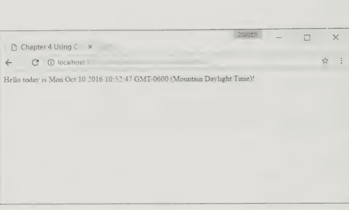

图 4.2 实现一个使用构造函数定义默认变量的基本 Angular Web 应用程序

### 使用外部模板

将模板和样式表集成到 Angular 组件中的另一种方法是通过单独的文件。使用这种方法很方便，因为它有助于你分离文件的功能。它也使组件更易于阅读。在 @Component 装饰器下，你放置关键字 `templateUrl`，后跟从应用程序根目到模板 HTML 文件的路径。以下是一个示例。

```
@Component({
  selector: 'my-app',
  templateUrl: './view.example.html'
})
```

你使用关键字 `styleUrls` 来告诉组件关于外部样式表的信息。外部样式表的不同之处在于，你传递的是一个包含一个或多个样式表的数组。以下示例展示了如何导入外部样式表：

```
@Component({
  selector: 'my-app',
  templateUrl: './view.example.html',
  styleUrls: ["./styles1.css", "./styles2.css"]
})
```

> **注意**

> `styleUrls` 配置选项接受一个逗号分隔的字符串数组。

在本章前面的“构建模板”部分，你已经学习了如何将外部HTML和CSS文件整合到Angular组件中。本节的示例将基于这些知识，带你浏览一个包含外部HTML和CSS文件的Angular应用程序。

清单4.3展示了一个Angular组件，其选择器名为external，并包含templateUrl和templateUrls，它们链接了本应用所需的外部文件。

清单4.4展示了一个名为externalTemplate.html的外部模板。组件使用此文件在浏览器中渲染视图。

清单4.5展示了一个名为external.css的外部样式表。组件将此文件应用到组件模板文件。

图4.3展示了渲染完成后的Angular组件。

```
清单 4.3 external.component.ts：具有外部文件依赖的Angular组件

01 import { Component } from '@angular/core';
02
03 @Component({
04   selector: 'app-root',
05   templateUrl: './app.component.html',
06   styleUrls: ['./app.component.css']
07 })
08 export class AppComponent {
09   title = '第4章 使用外部模板和样式';
10 }
```

```
清单 4.4 externalTemplate.html：组件引入并使用的HTML模板文件

01 <h1>Congratulations</h1>
02 <p>
03   You've successfully loaded an external html file.
04   <span>
05     If I'm red then You managed to get the styles in there as well
06   </span>
07 </p>
```

```
清单 4.5 external.css：组件应用于其模板的CSS样式表

01 span{
02   color: red;
03   border: 2px solid red;
04 }
```


图 4.3 实现一个加载外部HTML模板和样式表到视图的基本Angular Web应用程序

### 注入指令

依赖注入可能是一个难以完全掌握的概念。然而，它是Angular中非常重要的一部分，当你理解了基础，Angular的实现就变得相当清晰。依赖注入是许多服务器端语言中众所周知的设计模式，但在Angular出现之前，并未在JavaScript框架中广泛使用。

Angular依赖注入的理念是定义并将一个依赖对象动态注入到另一个对象中，从而使依赖对象提供的所有功能可用。Angular通过使用提供者和注入器服务来提供依赖注入。

在Angular中，要对另一个指令或组件使用依赖注入，你需要将该指令或组件的类名添加到模块中`@NgModule`装饰器的declarations元数据中，该装饰器接收一个导入到应用中的指令数组。以下是declarations数组的语法。

```
...
declarations: [ OuterComponent, InnerComponent ],
...
```

#### 构建具有依赖注入的嵌套组件

你已经了解了什么是依赖注入以及如何在组件和指令中使用它。本节将向你展示如何运用所学知识创建一个嵌套组件。本节将带你浏览一个Angular应用程序，该程序包含一个内部嵌套了第二个组件的组件。

清单4.6展示了outer.component.ts文件，它加载了一个外部模板和样式表。它还在第19行通过依赖注入加载并使用了InnerComponent指令。该指令在第2行从inner.component.ts文件导入。

清单4.7展示了outer.component.ts文件加载的outer.html模板文件。注意HTML标签`<nested>`是一个自定义HTML标签，用于加载内部组件。其加载方式与在主HTML文件中加载外部组件完全相同。

清单4.8展示了outer.css文件，它为外部组件及其子组件提供默认样式。这些样式被内部组件继承。

清单4.9展示了inner.component.ts文件。这是外部组件注入的内部组件。注意，此组件的选择器（用于在外部组件中加载此指令）是`nested`。

图4.4展示了在浏览器窗口中完成的应用程序。

```
清单 4.6 outer.component.ts：应用程序的外部组件
01 import { Component } from '@angular/core';
02 
03 @Component({
04   selector: 'app-root',
05   templateUrl: './app.component.html',
06   styleUrls: ['./app.component.css']
07 })
08 export class AppComponent {
09   title = 'Nested Example';
10 }
```

```
清单 4.7 outer.html：组件应用视图的HTML模板
01 <div>
02   <h1>the below text is a nested component</h1>
03   <nested></nested>
04 </div>
```

```
清单 4.8 outer.css：外部组件应用于其模板的CSS样式表
01 div {
02   color: red;
03   border: 3px ridge red;
04   padding: 20px;
05 }
06 nested{
07   font-size: 2em;
08   font-weight: bolder;
09   border: 3px solid blue;
10 }
```

```
清单 4.9 inner.component.ts：嵌套组件
01 import {Component} from '@angular/core';
02 @Component({
03   selector: 'nested',
04   template: `
05     <span>Congratulations I'm a nested component</span>
06   `,
07   styles: [`
08     span{
09       color: #228b22;
10     }
11   `]
12 })
13 export class InnerComponent {}
```

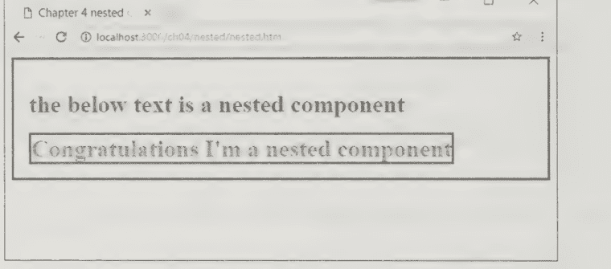

图 4.4 显示嵌套组件

### 通过依赖注入传递数据

依赖注入是一个强大的工具，它允许你构建可在任何导入该指令的应用程序中使用的可复用指令。有时，数据需要通过应用程序传递到被注入的指令中。这可以通过Angular输入来实现。

在Angular中，要向另一个指令或组件输入数据，你需要从`@angular/core`导入`Input`装饰器。以下代码展示了语法：

```
import {Component, Input} from '@angular/core';
```

当导入`Input`装饰器后，你就可以开始定义希望输入到指令中的数据。首先定义`@Input()`，它接受一个字符串作为参数。HTML使用该字符串将数据传递给导入的指令。操作如下：

```
@Input('name') personName: string;
```

#### 创建使用输入的Angular应用

现在你已经了解了如何在依赖注入中使用输入，是时候开始一个示例了。本节将介绍一个Angular应用程序，该程序将数据从一个指令传递到另一个指令。

清单4.10展示了`person.component.ts`文件，它是应用程序的入口点，将数据传递到`input.component.ts`文件。

清单4.11展示了`input.component.ts`文件。它是接收并处理来自外部指令输入的组件。

图4.5展示了在浏览器窗口中完成的应用程序。

#### 清单 4.10 `person.component.ts`：导入`input.component`并通过选择器向其传递数据的组件

```
01 import { Component } from '@angular/core';
02 import {myInput} from './input.component';
03 @Component({
04   selector: 'app-root',
05   template: `
06     <myInput name="Brendan" occupation="Student/Author"></myInput>
07     <myInput name="Brad" occupation="Analyst/Author"></myInput>
08     <myInput name="Caleb" occupation="Student/Author"></myInput>
09     <myInput></myInput>
10   `
11 })
12 export class AppComponent {
13   title = '在Angular中使用输入';
14 }
```

#### 清单 4.11 `input.component.ts`：通过其选择器接收数据以修改通过HTML显示内容的组件

```
01 import {Component, Input} from '@angular/core';
02 @Component ({
03   selector: "myInput",
04   template: `
05     <div>
06       Name: {{personName}}
07       <br />
08       Job: {{occupation}}
09     </div>
10     `,
11     styles: [`
12     div {
13       margin: 10px;
14       padding: 15px;
15       border: 3px solid grey;
16     }
17     `]
18 })
19 export class myInputs {
20   @Input('name') personName: string;
21   @Input('occupation') occupation: string;
22   constructor() {
23     this.personName = "John Doe";
24     this.occupation = "Anonymity"
25   }
26 }
```


图 4.5 显示通过输入传递的信息

## 总结

Angular组件是Angular应用程序的主要构建块。本章展示了如何从装饰器到类构建一个组件。它展示了包含模板和样式表的不同方式，还展示了如何使用依赖注入在彼此之间整合外部指令或组件。

## 5 表达式

Angular 的一个强大功能是能够在 HTML 模板中添加类似 JavaScript 的表达式。Angular 会计算表达式，然后可以动态地将结果添加到网页中。表达式与组件相关联，你可以使用利用组件中值的表达式，并且其值可以随着模型的变化而改变。

## 使用表达式

使用表达式是在 Angular 视图中表示组件数据的最简单方式。表达式是封装在括号中的代码块，就像这样：

```
{{expression}}
```

Angular 编译器会将表达式编译为 HTML 元素，以便显示表达式的结果。例如，看以下表达式：

```
{{1+5}}
{{'One' + 'Two'}}
```

基于这些表达式，网页将显示以下值：

```
6
OneTwo
```

表达式与数据模绑定，这带来了两大好处。首先，你可以在表达式中使用组件中定义的属性名称和函数。其次，因为表达式与组件绑定，所以当组件中的数据发生变化时，表达式也会随之变化。例如，假设一个组件包含以下值：

```
name: string='Brad';
score: number=95;
```

你可以直接在模板表达式中引用 `name` 和 `score` 的值，如下所示：

```
Name: {{name}}
Score: {{score}}
Adjusted: {{score+5}}
```

Angular 表达式在多个方面与 TypeScript/JavaScript 表达式相似，但存在以下不同之处：

-   **属性求值：** 属性名称根据组件模型进行求值，而不是根据全局 JavaScript 命名空间。

-   **更宽松：** 表达式在遇到未定义或空值的变量类型时不会抛出异常；相反，它们将其视为没有值。

-   **没有流程控制：** 表达式不允许以下操作：

    - 赋值（例如 =, +=, -=）

    - new 操作符

    - 条件语句

    - 循环

    - 递增和递减运算符 (++ 和 --)

此外，你不能在表达式内部抛出错误。

Angular 将用于定义指令值的字符串视为表达式进行计算。这意味着你可以在定义中包含表达式类型的语法。例如，当你在模板中设置 `ng-click` 指令的值时，你指定的是一个表达式。在该表达式内部，你可以引用组件变量并使用其他表达式语法，如下所示：

```
<span ng-click="myFunction()"></span>
<span ng-click="myFunction(var, 'stringParameter')"></span>
<span ng-click="myFunction(5*var)"></span>
```

由于 Angular 模板表达式可以访问组件，因此你也可以在 Angular 表达式中对组件进行更改。例如，这个 `(click)` 指令改变了组件模型内部 `msg` 的值：

```
<span (click)="msg='clicked'"></span>
```

以下部分将带您了解在 Angular 中使用表达式功能的一些示例。

### 使用基本表达式

在本节中，您将有机会了解 Angular 表达式如何处理字符串和数字的渲染。此示例说明了 Angular 如何计算包含字符串和数字以及基本数学运算符的表达式。

清单 5.1 展示了一个 Angular 组件。该组件有一个模板，其中包含用双花括号（{{}}）包裹的几种类型的表达式。有些表达式只是数字或字符串，有些包含用于组合字符串和/或数字的 + 运算符，还有一个应用了 === 运算符来比较两个数字。

图 5.1 展示了渲染后的网页。请注意，数字和字符串是直接渲渲到最终视图的。将字符串和数字相加使你能够构建渲染到视图的文本字符串。另外请注意，使用比较运算符会将单词 true 或 false 渲染到视图中。

```
清单 5.1  basicExpressions.component.ts: 在 Angular 模板中使用基本字符串和数字进行简单数学运算
01 import { Component } from '@angular/core';
02
03 @Component({
04   selector: 'app-root',
05   template: `
06     <h1>Expressions</h1>
07     Number:<br>
08     {{5}}<hr>
09     String:<br>
10     {{'My String'}}<hr>
11     Adding two strings together:<br>
12     {{'String1' + ' ' + 'String2'}}<hr>
13     Adding two numbers together:<br>
14     {{5+5}}<hr>
15     Adding strings and numbers together:<br>
16     {{5 + ' + ' + 5 + ' ='}}{{5+5}}<hr>
17     Comparing two numbers with each other:<br>
18     {{5===5}}<hr>
19   `,
20 })
21 export class AppComponent {}
```

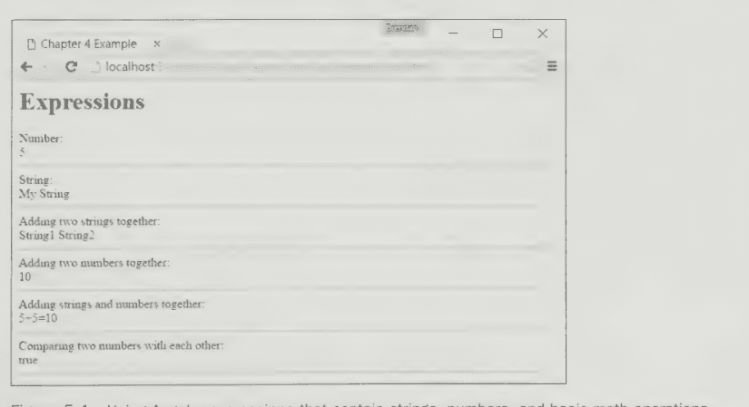

## 第 5 章 表达式

## 在表达式中与组件类交互

现在您已经看到了一些基本的 Angular 表达式，让我们来看看如何在 Angular 表达式中与组件类交互。在前面的示例中，所有表达式的输入都来自显式的字符串或数字。本节将展示 Angular 表达式通过与模型交互而带来的真正威力。

清单 5.2 展示了一个 Angular 组件文件，该文件应用了 Angular 表达式，这些表达使用组件类中的值将文本渲染到屏幕，并作为函数的参数。请注意，组件类中的变量名可以直接在表达式中使用。例如，第 9 行的表达式基于 `speed` 和 `vehicle` 变量的值创建了一个字符串。

图 5.2 展示了基于表达式渲染后的网页。请注意，当点击页面上的链接时，产生的函数调用会调整组件类变量，从而改变前面讨论的表达式的渲染方式。

**清单 5.2 classExpressions.component.ts: 一个使用表达式与组件类数据交互的 Angular 应用**

```
01 import { Component } from '@angular/core';
02
03 @Component({
04   selector: 'app-root',
05   template: `
06     Directly accessing variables in the component:<br>
07         {{speed}} {{vehicle}}<hr>
08     Adding variables in the component:<br>
09         {{speed + ' ' + vehicle}}<hr>
10     Calling function in the component:<br>
11         {{lower(speed)}} {{upper('Jeep')}}<hr>
12     <a (click)="setValues('Fast', newVehicle)">
13         Click to change to Fast {{newVehicle}}</a><hr>
14     <a (click)="setValues(newSpeed, 'Rocket')">
15         Click to change to {{newSpeed}} Rocket</a><hr>
15     <a (click)="vehicle='Car'">
16         Click to change the vehicle to a Car</a><hr>
17     <a (click)="vehicle='Enhanced ' + vehicle">
18         Click to Enhance Vehicle</a><hr>
19   `,
20   styles:[`
21       a{color: blue; text-decoration: underline; cursor: pointer}
22   `]
23 })
24 export class AppComponent {
25   speed = 'Slow';
26   vehicle = 'Train';
27   newSpeed = 'Hypersonic';
28   newVehicle = 'Plane';
29   upper = function(str: any){
30     str = str.toUpperCase();
31     return str;
32   }
33   lower = function(str: any){
34     return str.toLowerCase();
35   }
36   setValues = function(speed: any, vehicle: any){
37     this.speed = speed;
38     this.vehicle = vehicle;
39   }
40 }
```

## 在 Angular 表达式中使用 TypeScript

本节将探讨组件类中一些额外的 TypeScript 交互。如前所述，TypeScript 的大部分功能在 Angular 表达式中都受到支持。为了更好地说明这一点，本示例中的示例展示了一些数组操作，并在表达式中使用 TypeScript 的 Math 对象。

清单 5.3 实现了一个 Angular 组件，该组件使用 Angular 表达式，利用 `push()` 和 `shift()` 来显示数组、显示数组长度并操作数组元素。请注意，将 Math 添加到组件类后，你可以在第 12 行和第 21 行的表达式中直接使用 TypeScript 的 Math 操作。

图 5.3 展示了渲染后的 Angular 网页。请注意，随着链接被点击，数组被调整，表达式被重新计算。

第5章 表达式

## 代码清单 5.3 typescriptExpressions.component.ts：使用包含数组和数学运算表达式的 Angular 组件

```typescript
import { Component } from '@angular/core';

@Component({
  selector: 'app-root',
  template: `
    <h1>Expressions</h1>
    Array:<br>
    {{myArr.join(', ')}}<br/>
    <hr>
    Elements removed from array:<br>
    {{removedArr.join(', ')}}<hr>
    <a (click)="myArr.push(myMath.floor(myMath.random()*100+1))">
      Click to append a value to the array
    </a><hr>
    <a (click)="removedArr.push(myArr.shift())">
      Click to remove the first value from the array
    </a><hr>
    Size of Array:<br>
    {{myArr.length}}<hr>
    Max number removed from the array:<br>
    {{myMath.max.apply(myMath, removedArr)}}<hr>
  `,
  styles: [`
    a {
      color: blue;
      cursor: pointer;
    }
  `],
})
export class AppComponent {
  myMath = Math;
  myArr: number[] = [1];
  removedArr: number[] = [0];
}
```

图 5.3 使用 Angular 表达式应用 TypeScript 数组和数学运算与作用域数据进行交互

## 使用管道

Angular 的一个强大功能是能够实现管道。管道是一种运算符，它能接入表达式解析器并修改表达式的结果，以便在视图中显示——例如，用于格式化时间或货币值。

你在表达式中实现管道，使用以下语法：

```
{{ expression | pipe }}
```

如果将多个管道链接在一起，它们将按照你指定的顺序执行：

```
{{ expression | pipe | pipe }}
```

一些过滤器允许你以函数参数的形式提供输入。你通过使用以下语法添加这些参数：

```
{{ expression | pipe:parameter1:parameter2 }}
```

### 使用内置管道

Angular 提供了多种管道类型，使你能够轻松地在组件模板中格式化字符串、对象和数组。表 5.1 列出了 Angular 提供的内置管道。

表 5.1 修改 Angular 组件模板中表达式的管道

| 过滤器 | 描述 |
|---|---|
| `currency[:currencyCode[:symbolDisplay[:digits]]]` | 将数字格式化为货币，基于提供的 `currencyCode` 值。如果未提供 `currencyCode` 值，则使用区域设置的默认代码。以下是一个示例：<br><br>`{{123.46 \| currency:"USD" }}` |
| `json` | 将 TypeScript 对象格式化为 JSON 字符串。以下是一个示例：<br><br>`{{ {'name':'Brad'} \| json }}` |
| `slice:start:end` | 通过索引量限制表达式表示的数据。如果表达式是字符串，则限制字符数量。如果表达式的结果是数组，则限制元素数量。考虑以下示例：<br><br>`{{ "Fuzzy Wuzzy" \| slice:1:9 }}`<br>`{{ ['a','b','c','d'] \| slice:0:2 }}` |
| `lowercase` | 将表达式的结果输出为小写。 |
| `uppercase` | 将表达式的结果输出为大写。 |
| `number[:pre.post-postEnd]` | 将数字格式化为文本。如果指定了 `pre` 参数，则将整数的位数限制为该大小。如果指定了 `post-postEnd`，则将显示的小数位数限制在该范围或大小内。考虑以下示例：<br><br>`{{ 123.4567 \| number:1.2-3 }}`<br>`{{ 123.4567 \| number:1.3 }}` |
| `date[:format]` | 使用 *format* 参数格式化 TypeScript 日期对象、时间戳或 ISO 8601 日期字符串。以下是一个示例：<br><br>`{{1389323623006 \| date:'yyyy-MM-dd HH:mm:ss Z'}}`<br><br>*format* 参数使用以下日期格式化字符：<br><br>- **yyyy**: 四位数年份<br>- **yy**: 两位数年份<br>- **MMMM**: 月份，January 到 December<br>- **MMM**: 月份，Jan 到 Dec<br>- **MM**: 月份，带填充，01 到 12<br>- **M**: 月份，1 到 12<br>- **dd**: 日期，带填充，01 到 31<br>- **d**: 日期，1 到 31<br>- **EEEE**: 星期几，Sunday 到 Saturday<br>- **EEE**: 星期几，Sun 到 Sat<br>- **HH**: 小时，带填充，00 到 23<br>- **H**: 小时，0 到 23<br>- **hh** 或 **jj**: 上午/下午小时，带填充，01 到 12<br>- **h** 或 **j**: 上午/下午小时，1 到 12<br>- **mm**: 分钟，带填充，00 到 59<br>- **m**: 分钟，0 到 59<br>- **ss**: 秒，带填充，00 到 59<br>- **s**: 秒，0 到 59<br>- **.sss** 或 **,sss**: 毫秒，带填充，000–999<br>- **a**: 上午/下午标记<br>- **Z**: 四位数时区偏移量，-1200 到 +1200<br><br>日期的 *format* 字符串也可以是以下预定义名称之一：<br><br>- **medium**: 等同于 'yMMMdHms'<br>- **short**: 等同于 'yMdhm'<br>- **fullDate**: 等同于 'yMMMdEEEE'<br>- **longDate**: 等同于 'yMMMMd'<br>- **mediumDate**: 等同于 'yMMMd'<br>- **shortDate**: 等同于 'yMd'<br>- **mediumTime**: 等同于 'hms'<br>- **shortTime**: 等同于 'hm'<br><br>此处显示的格式是 en_US，但格式始终匹配 Angular 应用程序的区域设置。 |
| `async` | 等待一个 Promise 并返回接收到的最新值。然后更新视图。 |

本节展示了内置 Angular 管道如何处理 Angular 表达式中的数据转换。此示例的目的是展示管道如何转换提供的数据。

代码清单 5.4 展示了一个 Angular 组件，其模板包含几个用 `{{}}` 括起来的内置管道示例。Component 类包含一些管道要使用的数据。

图 5.4 展示了渲染后的应用程序，其中数据已转换。

### 代码清单 5.4 builtInPipes.component.ts：包含内置管道示例的 Angular 组件

```typescript
import { Component } from '@angular/core';

@Component({
  selector: 'app-root',
  template: `
    Uppercase: {{"Brendan" | uppercase }}<br>
    Lowercase: {{"HELLO WORLD" | lowercase}}<br>
    Date: {{ today | date:'yMMMdEEhmsz'}}<br>
    Date: {{today | date:'mediumDate'}}<br>
    Date: {{today | date: 'shortTime'}}<br>
    Number: {{3.1415927 | number:'2.1-5'}}<br>
    Number: {{28 | number:'2.3'}}<br>
    Currency: {{125.257 | currency:'USD':true: '1.2-2'}}<br>
    Currency: {{2158.925 | currency}}<br>
    Json: {{jsonObject | json}}<br>
    PercentPipe: {{.8888 | percent: '2.2'}}<br>
    SlicePipe: {{"hello world" | slice:0:8}}<br>
    SlicePipe: {{days | slice:1:6}}<br>
    legen... {{wait | async}} {{dairy | async}}
  `
})
export class AppComponent {
  today = Date.now();
  jsonObject = [{title: "mytitle"}, {title: "Programmer"}];
  days=['Sunday', 'Monday', 'Tuesday', 'Wednesday',
        'Thursday', 'Friday', 'Saturday'];
  wait = new Promise<string>((res, err) => {
    setTimeout(function () {
      res('wait for it...');
    },1000);
  });
  dairy = new Promise<string>((res, err) => {
    setTimeout(function() {
      res('dairy');
    }, 2000)
  })
}
```

图 5.4 使用 Angular 管道转换表达式中的数据

### 构建自定义管道

Angular 使你能够创建自己的自定义管道，然后在表达式和服务中使用它们，就像使用内置管道一样。Angular 提供 @Pipe 装饰器来创建管道并将其注册到依赖注入服务器。

@Pipe 装饰器接收元数据，就像 Angular 组件一样。元数据选项有 name 和 pure。name 元数据的工作方式类似于组件的 selector：它告诉 Angular 你希望在哪里使用管道。pure 元数据告诉管道如何处理更改检测。纯管道在输入值或对象引用发生更改时更新。不纯管道则可以在任何事件（例如按键、鼠标点击或鼠标移动）发生时更新。以下示例演示了一个示例管道及其语法：

```
@Pipe({
  name: 'example',
  Pure: true
})
```

管道类的工作方式与 Component 类非常相似，因为它是管道逻辑的所在。但是，逻辑需要位于一个 Transform 方法内，该方法告诉管道如何转换管道符号（|）左侧的任何内容。查看以下示例：

## 创建自定义管道

本节将展示如何构建一个自定义管道，用于从字符串中过滤掉特定的单词。本示例的目的是向您展示如何创建和应用能够转换数据的自定义管道。

清单 5.5 展示了一个名为 `censor` 的 Angular 管道。`export class` 包含 `transform` 方法，该方法将特定的单词替换为不同的字符串，然后返回转换后的字符串。

清单 5.6 展示了一个 Angular 组件，其包含使用该自定义管道的模板，以及用于导入管道的 `pipe` 元数据。请注意第 9 行，这是用于实现该管道的表达式。管道接收一个字符串作为参数，并将其替换为指定内容。

图 5.5 展示了使用该自定义管道的应用程序渲染效果。

```
清单 5.5  `custom.pipe.ts`：一个替换字符串中特定单词的 Angular 管道
01 import {Pipe} from '@angular/core';
02
03 @Pipe({name: 'censor'})
04 export class censorPipe{
05     transform(input:string, replacement:string) : string {
06         var cWords = ["bad", "rotten", "terrible"];
07         var out = input;
08         for(var i=0; i<cWords.length; i++){
09             out = out.replace(cWords[i], replacement);
10         }
11         return out
12     }
13 }
```

```
清单 5.6  `customPipes.component.ts`：一个导入并使用自定义管道的 Angular 组件
01 import { Component } from '@angular/core';
02
03 @Component({
04     selector: 'app-root',
05     template: `
06     {{phrase | censor:"******"}}
07
08 }}
09 export class AppComponent {
10   phrase:string="This bad phrase is rotten ";
11 }
```

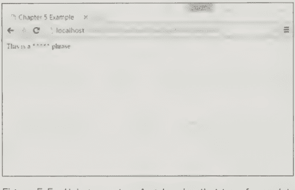

图 5.5  使用自定义 Angular 管道来转换表达式中的数据

## 总结

Angular 提供了强大的内置表达式和管道，并允许创建自定义管道。本章讨论了可用的内置表达式和管道及其如何实现。同时，也讨论了如何构建和实现自定义管道。表达式是包含在 `{{}}` 中的 TypeScript 代码片段，而管道能够操作这些表达式。表达式可以访问 Component 类中的信息，并能将类变量渲染到视图。

## 6 数据绑定

Angular 最佳功能之一是内置的数据绑定。数据绑定是将组件中的数据与网页显示内容连接起来的过程。当组件中的数据发生变化时，呈现给用户的 UI 会自动更新。Angular 提供了非常简洁的接口，用于将模型数据链接到网页中的元素。

## 理解数据绑定

数据绑定意味着将应用程序中的数据与呈现给用户的 UI 元素链接起来。当模型中的数据发生变化时，网页会自动更新。这样，模型始终是呈现给用户的数据的唯一来源，而视图只是模型的投射。将视图和模型结合在一起的粘合剂就是数据绑定。

在 Angular 中，有多种方式可以使用数据绑定使应用程序呈现不同的外观和行为。以下是本章将讨论的 Angular 2 中可用的数据绑定类型列表：

- **插值：** 您可以使用双大括号 (`{{}}`) 直接从 Component 类中获取值。

- **属性绑定：** 您可以使用此类型的绑定来设置 HTML 元素的属性。

- **事件绑定：** 您可以使用此类型的绑定来处理用户输入。

- **属性绑定：** 此类型的绑定允许设置 HTML 元素的属性。

- **类绑定：** 您可以使用此类型的绑定为元素设置 CSS 类名。

- **样式绑定：** 您可以使用此类型的绑定为元素创建内联 CSS 样式。

- **使用 ngModel 的双向绑定：** 您可以将此类型的绑定与数据输入表单一起使用，以接收和显示数据。

### 插值

插值涉及使用 `{{}}` 双大括号来计算模板表达式。这可以是硬编码的形式，也可以引用 Component 类的属性。

插值的语法从第 5 章“表达式”中应该看起来很熟悉。然而，您也可以使用插值为 HTML 标签属性赋予一个值（例如，img 标签）。以下是执行此操作的语法示例：

```

```

现在让我们看一个示例，展示通过插值绑定可以实现的一些很酷的功能。

清单 6.1 展示了一个 Angular 组件。该组件有一个模板，其中包含用 `{{}}` 括号包裹的插值类型和表达式。Component 类为 `{{}}` 括号内使用的内容提供了值。（请务必将 imageSrc 变量更改为相应的图片名称。）

图 6.1 展示了渲染后的网页。如您所见，插值可以使用 Component 类中的字符串来填充模板。

```
清单 6.1    interpolation.component.ts：使用字符串和函数的插值
01  import { Component } from '@angular/core';
02
03  @Component({
04    selector: 'app-root',
05    template: `
06      {{str1 + ' ' + name}}
07      <br>
08      
09      <br>
10      <p>{{str2 + getLikes(likes)}}</p>
11    `,
12    styles: [`
13      img{
14        width: 300px;
15        height: auto;
16      }
17      p{
18        font-size: 35px;
19        color: darkBlue;
20      }
21    `]
22  })
23  export class AppComponent {
24    str1: string = "Hello my name is"
25    name: string = "Brendan"
26    str2: string = "I like to"
27    likes: string[] = ['hike', "rappel", "Jeep"]
28    getLikes = function(arr: any){
29      var arrString = arr.join(", ");
30      return " " + arrString
31    }
32    imageSrc: string = "../assets/images/angelsLanding.jpg"
33    }
```


图 6.1  使用插值来组合字符串、定义 imageSrc URL 并运行函数

### 属性绑定

当您需要设置 HTML 元素的属性时，可以使用属性绑定。您通过在 Component 类中定义所需的值来实现这一点。然后，使用以下语法将该值绑定到组件模板：

```

```

> **注意**

> 在许多情况下，可以使用插值来达到与属性绑定相同的效果。

现在让我们来看一个属性绑定的示例。清单 6.2 展示了一个 Angular 组件。该组件有一个包含属性绑定类型的模板。它还将属性绑定与插值进行了比较。

图 6.2 展示了渲染后的网页。如您所见，插值可以使用 Component 类中的字符串来填充模板。

```
清单 6.2 property.component.ts：使用逻辑和类名应用的属性绑定
01 import { Component } from '@angular/core';
02
03 @Component({
04   selector: 'app-root',
05   template: `
06     
07     <br>
08     <button [disabled]="isEnabled">Click me</button><hr>
09     <button disabled="{!isEnabled}">Click me</button><br>
10     <p [ngClass]="className">This is cool stuff</p>
11   `,
12   styles: [`
13     img {
14       height: 100px;
15       width: auto;
16     }
17     .myClass {
18       color: red;
19       font-size: 24px;
20     }
21   `]
22 })
23 export class AppComponent {
24   myPic: string = "../assets/images/sunset.JPG";
25   isEnabled: boolean = false;
26   className: string = "myClass";
27 }
```


图 6.2 使用属性绑来定义 imageSrc URL、将按钮设置为禁用模式以及分配类名

### 属性绑定

属性绑定类似于属性绑定，但绑定到 HTML 属性而非 DOM 属性。您可能不会经常使用属性绑定，但了解它是什么以及如何使用它很重要。通常，您只会将属性绑定用于没有相应 DOM 属性的属性（例如，aria、svg 和表格 span 属性）。您使用以下语法定义属性绑定：

```
<div [attr.aria-label] = "labelName"></div>
```

> **注意**

> 由于属性绑定和属性绑定的功能几乎相同，本书不提供属性绑定的示例。

### 类绑定

您使用类绑定将 CSS 样式标签绑定到 HTML 元素。它基于表达式结果为真或假来分配类。如果结果为真，则分配该类。以下是语法示例：

```
<div [class.nameHere] = "true"></div>
<div [class.anotherName] = "false"></div>
```

现在让我们来看一个类绑定的示例。清单 6.3 展示了一个具有模板的 Angular 组件。该模板包含类绑定类型，展示了如何使用两种不同的方法应用类名。

## 清单 6.3 class.component.ts：带逻辑的属性绑定与类名的应用

```
01 import { Component } from '@angular/core';
02 
03 @Component({
04   selector: 'app-root',
05   template: `
06     <div [class]="myCustomClass"></div>
07     <span [class.redText]="isTrue">Hello my blue friend</span>
08   `,
09   styles: [`
10     .blueBox {
11       height: 150px;
12       width: 150px;
13       background-color: blue;
14     }
15     .redText{
16       color: red;
17       font-size: 24px;
18     }
19   `]
20 })
21 export class AppComponent {
22   myCustomClass: string = 'blueBox';
23   isTrue = true;
24 }
```


图 6.3 一个应用了类绑定，为 HTML 元素添加自定义类的 Angular 应用

## 样式绑定


你使用样式绑定为 HTML 元素分配内联样式。样式绑定的工作原理是在方括号内定义 CSS 样式属性，赋值表达式放在引号中。其语法与类绑定几乎相同，只是将前缀从 *class* 改为 *style*：

<p [style.styleProperty] = "assignment"></p>

<div [style.backgroundColor] = "'green'">

现在，让我们看一个样式绑定的例子。清单 6.4 展示了一个包含模板的 Angular 组件。该模板包含多种类型的样式绑定，演示了如何为应用程序应用自定义内联样式。

图 6.4 展示了渲染后的网页。正如你所见，样式生效了，CSS 样式相应地更改了 HTML。

## 清单 6.4 style.component.ts：用于更改 HTML 外观的样式绑定

```
01 import { Component } from '@angular/core';
02
03 @Component({
04   selector: 'app-root',
05   template: `
06     <span [style.border]="myBorder">Hey there</span>
07     <div [style.color]="twoColors ? 'blue' : 'forestgreen'">
08       what color am I
09     </div>
10     <button (click)="changeColor()">click me</button>
11   `
12 })
13 export class AppComponent {
14   twoColors: boolean = true;
15   changeColor = function(){
16     this.twoColors = !this.twoColors;
17   }
18   myBorder = "1px solid black";
19 }
```

## 第 6 章 数据绑定

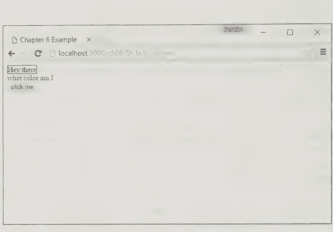

图 6.4 通过一个运行函数来调整 `twoColors` 变量值的按钮，应用了自定义样式的渲染网页

## 事件绑定

你使用事件绑定来处理用户输入，如点击、按键和鼠标移动。Angular 事件绑定与 HTML 事件属性类似；主要区别在于，事件绑定去掉了前缀 `on`，而是用圆括号 `(())` 将事件包围起来。例如，HTML 中的 `onkeyup` 在 Angular 中看起来是 `(keyup)`。

事件绑定的一个常见用途是从组件中运行函数。以下是点击事件绑定的语法：

`<button (click)="myFunction()">button</button>`

让我们看一个事件绑定的例子。清单 6.5 展示了一个 Angular 组件。这个组件有一个事件绑定，它在点击时调用一个函数来更改图片 URL。

图 6.5 展示了渲染后的网页。你可以看到初始网页以及点击按钮触发事件后的结果。

## 清单 6.5 event.component.ts：用于更改网页上显示的图片 URL 的事件绑定

```
01 import { Component } from '@angular/core';
02 
03 @Component({
04   selector: 'app-root',
05   template: `
06     <div (mousemove)="move($event)">
07 <br>
11 double click the picture to change it<br>
12 The Mouse has {{mouse}}<hr>
13 <button (click)="changeImg()">Change Picture</button><hr>
14 <input (keyup)="onKeyup($event)"
15 (keydown)="onKeydown($event)"
16 (keypress)="keypress($event)"
17 (blur)="underTheScope($event)"
18 (focus)="underTheScope($event)">
19 {{view}}
20 <p>On key up: {{upValues}}</p>
21 <p>on key down: {{downValues}}</p>
22 <p>on key press: {{keypressValue}}</p>
23 <p (mousemove)="move($event)">
24 x coordinates: {{x}}
25 <br> y coordinates: {{y}}
26 </p>
27 </div>
28 `,
29 styles: [`
30 img {
31 width: auto;
32 height: 300px;
33 }
34 `]
35 })
36 export class AppComponent {
37 counter = 0;
38 mouse: string;
39 upValues: string = '';
40 downValues: string = '';
41 keypressValue: string = "";
42 x: string = "";
43 y: string = '';
44 view: string = '';
45
46 mouseGoesIn = function(){
47 this.mouse = "entered";
48 };
49 mouseLeft = function(){
50 this.mouse = "left";
51 }
52 imageArray: string[] = [
53 "../assets/images/flower.jpg",
54 "../assets/images/lake.jpg", //扩展名区分大小写
55     "../assets/images/bison.jpg",
56 ]
57 imageUrl: string = this.imageArray[this.counter];
58 changeImg = function(){
59     if(this.counter < this.imageArray.length - 1){
60         this.counter++;
61     }else{
62         this.counter = 0;
63     }
64     this.imageUrl=this.imageArray[this.counter];
65 }
66
67 onKeyup(event:any){
68     this.upValues = event.key;
69     //this.upValues += event.target.value + ' | ';
70 }
71 onKeydown(event:any){
72     this.downValues = event.key;
73     //this.downValues += event.target.value + " | ";
74 }
75
76 keypress(event:any){
77     this.keypressValue = event.key;
78     //this.keypressValue += event.target.value + " | ";
79 }
80
81 move(event:any){
82     this.x = event.clientX;
83     this.y = event.clientY;
84 }
85
86 underTheScope(event:any){
87     if(event.type == "focus"){
88         this.view = "the text box is focused";
89     }
90     else if(event.type == "blur"){
91         this.view = "the input box is blurred";
92     }
93     console.log(event);
94 }
95 }
```


## 双向绑定

双向绑定允许数据被轻松地同时显示和更新。这使得反映用户对 DOM 所做的任何更改变得容易。Angular 通过使用 `ngModel` 来监视更改，然后更新值来实现这一点。其语法是：

`<input [(ngModel)] = "myValue">`

现在，让我们看一个双向绑定的例子。清单 6.6 展示了一个包含模板的 Angular 组件。该模板展示了实现双向数据绑定的不同方法。

图 6.6 展示了渲染后的网页。它表明样式生效了，CSS 样式相应地更改了 HTML。

## 清单 6.6 twoWay.component.ts：实现双向数据绑定的不同方法

```
01 import { Component } from '@angular/core';
02 @Component({
03   selector: 'app-root',
04   template: `
05     <input [(ngModel)]="text"><br>
06     <input bindon-ngModel="text"><br>
07     <input [value]="text" (input)="text=$event.target.value">
08     <h1>{{text}}</h1>
09   `
10 })
11 export class Appcomponent {
12   text: string = "some text here";
13 }
```


## 总结

Angular 允许强大且非常有用的数据绑定类型。正如你在本章中所看到的，你可以将应用程序模型中的数据绑定到渲染给用户的 UI 元素。本章概述了可用的数据绑定类型以及如何实现它们。数据绑定允许以简单高效的方式向用户显示数据，并允许用户更新数据。

## 第 7 章 内置指令

Angular 提供的最强大的功能之一是指令。*指令* 扩展了 HTML 的行为，使你能够创建具有特定于应用程序的功能的自定义 HTML 元素、属性和类。Angular 提供了许多内置指令，这些指令提供了与表单元素交互、将组件中的数据绑定到视图以及与浏览器事件交互的能力。

本章讨论内置指令以及如何在 Angular 模板中实现它们。你将学习如何在 Angular 模板中应用这些指令，并在后端控制器中支持它们，从而快速将渲染的视图转变为交互式应用程序。

## 理解指令

指令是 Angular 模板标记和支持 TypeScript 代码的组合。Angular 指令标记可以是 HTML 属性、元素名称或 CSS 类。TypeScript 指令代码定义了 HTML 元素的模板数据和行为。

Angular 编译器遍历模板 DOM 并编译所有指令。然后，它通过将指令与作用域结合来链接指令，以产生新的实时视图。实时视图包含指令中定义的 DOM 元素和功能。

## 使用内置指令

你需要在 HTML 元素中实现的许多 Angular 功能都是通过内置指令提供的。这些指令为 Angular 应用程序提供了广泛的支持。以下部分描述了大多数 Angular 指令，它们分为三类：

- **组件：** 带有模板的指令

- **结构型：** 操作 DOM 中元素的指令

- **属性型：** 操作 DOM 元素外观和行为的指令。

以下章节将描述这三种类型的指令。您无需立即理解所有指令。后续章节提供了参考表格。此外，后续章节和全书提供了使用这些指令的示例代码。

### 组件指令

Angular 组件是一种利用模板的结构型指令。组件创建一个选择器，该选择器用作 HTML 标签，将 HTML、CSS 和 Angular 逻辑动态添加到 DOM 中。组件是 Angular 的核心。

### 结构型指令

有几种指令可以动态更新、创建和删除 DOM 中的元素。这些指令构成了应用程序的布局、外观和风格。表 7.1 列出了这些指令，并描述了每种指令的行为和用法。

#### 表 7.1 结构型指令

| 指令 | 描述 |

| --- | --- |

| ngFor | 此指令用于为可迭代对象中的每个项目创建一个模板副本。示例如下： <div *ngFor="let person of people"></div> |

| ngIf | 当此指令出现在元素中时，如果返回的值为 true，则将该元素添加到 DOM 中。如果返回的值为 false，则将该元素从 DOM 中移除，从而阻止该元素使用资源。示例如下： <div *ngIf="person"></div> |

| ngSwitch | 此指令根据传入的值显示模板。与 ngIf 类似，如果值与 case 不匹配，则不会创建元素。示例如下： <div [ngSwitch]="timeOfDay"> <span [ngSwitchCase]="'morning'">Morning</span> <span [ngSwitchCase]="'afternoon'">Afternoon</span> <span [ngSwitchDefault]="'daytime'">Evening</span> ngSwitch 指令依赖另外两个指令才能工作：ngSwitchCase 和 ngSwitchDefault。这些指令将在下文解释。 |

| ngSwitchCase | 此指令将其存储的值与传递给 ngSwitch 的值进行评估，以确定应是否创建其关联的 HTML 模板。 |

| ngSwitchDefault | 如果所有上述 ngSwitchCase 表达式的评估结果均为 false，则此指令将创建 HTML 模板。这确保了无论如何都会生成一些 HTML。 |

表 7.1 中的指令在代码的不同部分以多种不同方式使用。它们允许根据传递给它们的数据对 DOM 进行动态操作。结构型指令通过使用表达式或值来动态操作 DOM。两种最常见的结构型指令是 `ngIf` 和 `ngSwitch`。

`ngIf` 在值或表达式返回 `true` 时显示一段 HTML。`ngIf` 使用 `*` 符号让 Angular 知道它的存在。以下是 `ngIf` 的语法示例：

```
<div *ngIf="myFunction(val)" >...</div>
<div *ngIf="myValue" >{{myValue}}</div>
```

> **注意**

`ngFor` 是另一个使用 `*` 符号作为前缀让 Angular 知道其存在的指令示例。

`ngSwitch` 使用 `ngSwitchCase`，当值或表达式返回 `true` 时显示一段 HTML。`ngSwitch` 被 `[]` 包围，作为单向数据绑定的一种形式，将数据传递给每个 `ngSwitchCase` 进行评估。以下是 `ngSwitch` 的语法示例：

```
<div [ngSwitch]="time">
    <span *ngSwitchCase="'night'">It's night time </span>
    <span *ngSwitchDefault>It's day time </span>
</div>
```

清单 7.1 展示了一个 Angular 组件，其模板包含内置的结构型指令。`ngIf` 指令动态地向 DOM 添加和移除 HTML。`ngSwitch` 与 `ngIf` 执行相同的功能，但它允许更多的选项，并且在所有 case 都返回 `false` 时提供一个默认选项。

清单 7.1 中的第 6 和 7 行使用 `ngIf` 来确定是否应显示 HTML。

第 10 行展示了 `ngFor` 的扩展形式，用于根据传递给它的数据量动态添加 HTML。（此示例仅展示了使用 `ngFor` 指令的另一种方法，但本书其余部分将使用较短的形式 `*ngFor`。）

第 15 行使用 `ngFor` 指令的简写形式来显示数据。此方法在本书其余部分中使用。

第 20 至 26 行使用 `ngSwitchCase` 来确定应显示哪段 HTML。

图 7.1 显示了渲染后的网页。如您所见，插值可以使用组件类中的字符串来填充模板。

#### 清单 7.1 structural.component.ts：结构型内置函数

```
01 import { Component } from '@angular/core';
02
03 @Component({
04   selector: 'app-root',
05   template: `
06  <div *ngIf="condition">condition met</div>
07  <div *ngIf="!condition">condition not met</div>
08  <button (click)="changeCondition()">Change Condition</button>
09  <hr>
10  <template ngFor let-person [ngForOf]="people">
11    <div>name: {{person}}</div>
12  </template>
13  <hr>
14  <h3>Monsters and where they live</h3>
15  <ul *ngFor="let monster of monsters">
16      {{monster.name}}:
17      {{monster.location}}
18  </ul>
19  <hr>
20  <div [ngSwitch]="time">
21    <span *ngSwitchCase="'night'">It's night time
22    <button (click)="changeDay()">change to day</button>
23    </span>
24    <span *ngSwitchDefault>It's day time
25    <button (click)="changeNight()">change to night</button></span>
26  </div>
27  `})
28
29 export class AppComponent {
30  condition: boolean = true;
31  changeCondition = function(){
32    this.condition = !this.condition;
33  }
34  changeDay = function(){
35    this.time = 'day';
36  }
37  changeNight = function(){
38    this.time = 'night'
39  }
40  people: string[] = [
41    "Andrew", "Dillon", "Philipe", "Susan"
42  ]
43  monsters = [
44    { name: "Nessie",
45      location: "Loch Ness, Scotland" },
46    { name: "Bigfoot",
47      location: "Pacific Northwest, USA" },
48    { name: "Godzilla",
49      location: "Tokyo, sometimes New York" }
50  ]
51  time: string = 'night';
52 }
```

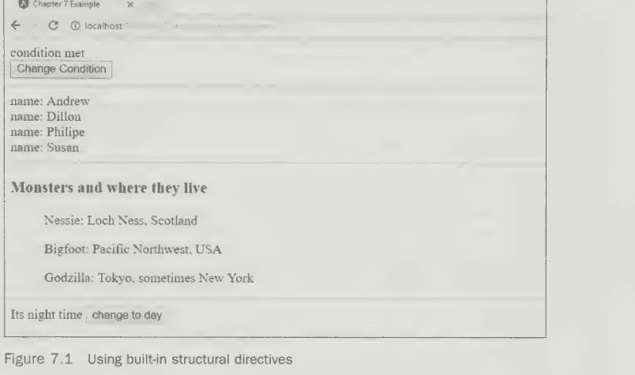

### 属性型指令

Angular 属性型指令修改 HTML 元素的外观和行为。它们直接注入 HTML 中，并动态修改用户与 HTML 片段的交互方式。属性型指令之所以得名，是因为它们通常看起来像普通的 HTML 属性。您在本书中一直使用的一个属性型指令示例是 ngModel，它通过更改显示值来修改元素。

表 7.2 列出了属性型指令，并描述了每种指令的行为和用法。

#### 表 7.2 属性型指令

| 指令 | 描述 |

|---|---|

| ngModel | 此指令监视变量的变化，然后根据这些变化更新显示值。考虑这些示例： <code><input [(ngModel)]="text"><br> <h1>{{text}}</h1></code> |

| ngForm | 此指令创建一个表单组，并允许其跟踪该表单组中的值和验证。通过使用 ngSubmit，您可以将表单数据作为对象传递给提交事件。示例如下： <code><form #formName="ngForm" (ngSubmit)="onSubmit(formName)"></form></code> |

| ngStyle | 此指令更新 HTML 元素的样式。 |

表 7.2 中的指令在代码的不同部分以多种不同方式使用。它们允许对应用程序的行为进行操作。以下示例展示了如何使用一些内置的属性型指令来构建一个将数据提交到模拟数据库的表单。

清单 7.2 展示了一个 Angular 组件。第 9 至 14 行设置了在整个应用程序中使用的变量的默认值。第 15 至 17 行定义了 enabler 方法，该方法将布尔值 `isDisabled` 设置为其原始值的相反值。第 18 至 30 行定义了 `addClass` 方法，该方法将事件目标的值推送到 `selectedClass` 数组中。

清单 7.3 展示了一个 Angular 模板文件，该文件使用 `ngModel`、`ngClass`、`ngStyle` 和 `ngForm` 来修改 HTML 模板的外观和行为。第 7 至 12 行创建了一个 HTML 选择元素，该元素将一种颜色分配给属性组件的 `color` 变量。第 14 至 18 行创建了一个 HTML 选择元素，该元素使用 `change` 事件来调用 `addClass` 方法并传入 `event` 对象。第 16 至 21 行显示组件变量的输出，使用 `ngClass` 和 `ngStyle` 指令动态修改元素的外观。

清单 7.4 中的代码是该组件的 CSS，用于设置应用程序的样式。

图 7.2 显示了渲染后的网页。它表明插值可以使用组件类中的字符串来填充模板。

#### 清单 7.2 attribute.component.ts：构建和管理 Angular 表单的组件

```
01 import { Component } from '@angular/core';
02
03 @Component({
04   selector: 'app-root',
05   templateUrl: './attribute.component.html',
06   styleUrls: ['./attribute.component.css']
07 })
08 export class AppComponent {
09   colors: string[] = ["red", "blue", "green", "yellow"];
10   name: string;
11   color: string = 'color';
12   isDisabled: boolean = true;
13   classes:string[] = ['bold', 'italic', 'highlight'];
14   selectedClass:string[] = [];
15   enabler(){
16     this.isDisabled = !this.isDisabled;
17   }
18   addClass(event: any){
19     this.selectedClass = [];
20
21     var values = event.target.options;
22     var opt: any;
23
24     for (var i=0, iLen = values.length; i<iLen; i++){
25         opt = values[i];
26
27         if (opt.selected){
28             this.selectedClass.push(opt.text);
29         }
30     }
31 }
```

#### 清单 7.3 attribute.component.html：属性组件的 Angular �板

```
<form>
    <span>name: </span>
    <input name="name" [(ngModel)]="name">
    <br>
    <span>color:</span>
    <input type="checkbox" (click)="enabler()">
    <select #optionColor [(ngModel)]="color" name="color"
           [disabled]="isDisabled">
        <option *ngFor="let color of colors" [value]="color">
            {{color}}
        </option>
    </select><hr>
    <span>Change Class</span><br>
    <select #classOption multiple name="styles" (change)="addClass($event)">
        <option *ngFor="let class of classes" [value]="class" >
            {{class}}
        </option>
    </select><br>
    <span>
        press and hold control/command
        <br>
        to select multiple options
    </span>
</form>
<hr>
<span>Name: {{name}}</span><br>
<span [ngClass]="selectedClass"
      [ngStyle]="{'color': optionColor.value}">
    color: {{optionColor.value}}
</span><br>
```

#### 清单 7.4 attribute.component.css：为应用程序添加样式的 CSS 文件

```
.bold {
  font-weight: bold;
}
.italic {
  font-style: italic;
}
.highlight {
  background-color: lightblue;
}
```


图 7.2 展示了多种应用属性指令以修改 DOM 行为方式的 Angular 应用程序

## 总结

Angular 提供了许多内置指令，这些指令提供了操作应用程序外观、感觉和行为的功能，而无需编写大量代码。本章回顾了一些可用的内置指令，并提供了如何利用 Angular 内置指令的示例。

## 8 自定义指令

与 Angular 的许多其他特性一样，你可以通过创建自己的自定义指令来扩展功能。自定指令允许你通过自己实现元素的行为来扩展 HTML 的功能。如果你有需要操作 DOM 的代码，应该将其放在自定义指令中实现。

你通过调用 `@directive` 类来实现自定义指令，这与定义组件的方式非常相似。`@directive` 类的元数据应包括在 HTML 中要使用的指令的选择器。`Directive` 导出类是指令逻辑的存放之处。例如，以下是指令的基本定义：

```
import { Directive } from '@angular/core';
@Directive({
    selector: '[myDirective]'
})
export class myDirective { }
```

## 创建自定义属性指令

你可以定义无限多种类型的自定义指令，这使得 Angular 具有极强的可扩展性。自定义指令是 Angular 中最复杂的部分之一，解释起来也最具挑战性。为了让你入门，最好的方式是展示一个自定义指令的示例，让你感受它们是如何实现以及如何相互交互的。

本节展示了如何实一个自定义属性指令。本例中创建的 zoom 指令旨在为其所应用的任何图像添加自定义功能。应用此指令后，你可以使用鼠标滚轮在图像上滚动，使元素的大小增大或缩小。

清单 8.1 展示了 zoom 组件，它显示了一系列图像。这些图像应用了 zoom 指令，允许鼠标滚轮事件来增加或减少每张图像的大小。

清单 8.2 展示了 zoom 指令。该指令的选择器为 `zoom`。该指令从 `@angular/core` 导入了 Directive、ElementRef、HostListener、Input 和 Renderer，以提供该指令所需的功能。

# 第8章 自定义指令

清单 8.2 的第 10 到 12 行监视鼠标光标进入元素，当它进入时，使用 `border()` 函数为元素添加边框，让用户知道指令处于活动状态。

第 14 到 16 行在光标离开元素时移除边框，以告知用户指令不再处于活动状态。

第 17 到 26 行监听鼠标滚轮的激活。根据滚轮滚动的方向，使用 `changeSize()` 函数调整元素的大小。

第 27 到 31 行定义了 `border()` 函数。该函数接受三个参数，然后将这些参数应用于宿主元素的样式设置。

第 32 到 36 行定义了 `changeSize()` 函数，该函数用于更改宿主元素的大小。

清单 8.3 展示了 `zoom.component.ts` 的 HTML 文件。它创建了一行图像，并将 zoom 指令应用于这些图像。

清单 8.4 展示了 `zoom.component.ts` 的样式。它将图像的高度初始设置为 200px，这样如果它们具有高分辨率，就不会以巨大的尺寸渲染。

由清单 8.1–8.4 生成的网页如图 8.1 所示。

```
清单 8.1 zoom.component.ts：一个结构型指令
import { Component } from '@angular/core';

@Component({
    selector: 'app-root',
    templateUrl: './app.component.html',
    styleUrls: ['./app.component.css']
})
export class AppComponent {
    images: string[] = [
        '../assets/images/jump.jpg',
        '../assets/images/flower2.jpg',
        '../assets/images/cliff.jpg'
    ]
}
```

```
清单 8.2 zoom.directive.ts：一个自定义属性指令
import { Directive, ElementRef, HostListener, Input, Renderer }
from '@angular/core';

@Directive({
    selector: '[zoom]'
})
export class ZoomDirective {
    constructor(private el: ElementRef, private renderer: Renderer) {}

    @HostListener('mouseenter') onMouseEnter() {
        this.border('solid', 'blue', '2px');
    }

    @HostListener('mouseleave') onMouseLeave() {
        this.border('solid', 'transparent', '0px');
    }

    @HostListener('mousewheel', ['$event']) onMouseWheelChrome(event: any) {
        this.changeSize(event);
    }

    @HostListener('mousewheel', ['$event']) onMouseWheelFirefox(event: any) {
        this.changeSize(event);
    }

    @HostListener('DOMMouseScroll', ['$event']) onMouseWheelFirefox(event: any) {
        this.changeSize(event);
    }

    private changeSize(event: any) {
        event.preventDefault();
        if (event.wheelDelta >= 120) {
            this.el.nativeElement.style.height = parseInt(this.el.nativeElement.style.height) + 10 + 'px';
        } else if (event.wheelDelta <= -120) {
            this.el.nativeElement.style.height = parseInt(this.el.nativeElement.style.height) - 10 + 'px';
        }
    }

    private border(style: string, color: string, width: string) {
        this.el.nativeElement.style.border = style + ' ' + color + ' ' + width;
    }
}
```

创建自定义属性指令 97

```
export class ZoomDirective {
    constructor(private el: ElementRef, private renderer: Renderer) { }

    @HostListener('mouseenter') onMouseEnter() {
        this.border('lime', 'solid', '5px');
    }

    @HostListener('mouseleave') onMouseLeave() {
        this.border();
    }
    @HostListener('wheel', ['$event']) onWheel(event: any) {
        event.preventDefault();
        if(event.deltaY > 0){
            this.changeSize(-25);
        }
        if(event.deltaY < 0){
            this.changeSize(25);
        }
    }
    private border(
        color: string = null,
        type: string = null,
        width: string = null
    ){
        this.renderer.setElementStyle(
            this.el.nativeElement, 'border-color', color);
        this.renderer.setElementStyle(
            this.el.nativeElement, 'border-style', type);
        this.renderer.setElementStyle(
            this.el.nativeElement, 'border-width', width);
    }
    private changeSize(sizechange: any){
        let height: any = this.el.nativeElement.offsetHeight;
        let newHeight: any = height + sizechange;
        this.renderer.setElementStyle(
            this.el.nativeElement, 'height', newHeight + 'px');
    }
}
```

```
清单 8.3 app.component.html：使用 Zoom 指令的 HTML 文件
<h1>
    属性指令
</h1>
<span *ngFor="let image of images">
    
</span>
```

## 代码清单 8.4 app.component.css：设置图片高度的CSS文件

```css
img {
  height: 200px;
}
```


## 使用组件创建自定指令

Angular组件也是一种指令。组件与指令的区别在于，组件使用HTML模板来生成视图。但由于组件本质上就是指令，因此它可以应用于HTML元素，并以一些非常酷的方式添加自定义功能。

Angular提供了一个名为`ng-content`的内置指令。该指令允许Angular从使用指令的两个元素标签之间获取现有HTML，并在组件的模板中使用该HTML。`ng-content`的语法如下：

```
<ng-content></ng-content>
```

本节中的示例展示了如何使用组件作为自定义指令，通过包含的模板来改变元素的外观。

此示例实现了一个自定义指令容器，旨在向其应用的元素添加一个环绕的"容器"HTML模板。该指令有两个输入：`title`和`description`，可用于为主机元素提供描述和标题。

代码清单8.5展示了根组件，该组件显示各种HTML元素。这些元素都应用了`container`指令，该指令为每个元素添加了一个带可选标题的页眉、一个带可选描述的页脚以及边框。

```
代码清单 8.5 app.component.ts：根组件
01 import { Component } from '@angular/core';
02
03 @Component({
04   selector: 'app-root',
05   templateUrl: './app.component.html',
06   styleUrls: ['./app.component.css'],
07 })
08 export class AppComponent {
09
10   images: any = [
11     {
12       src: "../assets/images/angelsLanding.jpg",
13       title: "Angels Landing",
14       description: "A natural wonder in Zion National Park Utah, USA"
15     },
16     {
17       src: "../assets/images/pyramid.JPG",
18       title: "Tikal",
19       description: "Mayan Ruins, Tikal Guatemala"
20     },
21     {
22       src: "../assets/images/sunset.JPG"
23     },
24   ]
25 }
```

代码清单8.6展示了根组件的HTML。代码创建了不同类型的多个元素，例如img、div和p，并为它们应用了`container`指令。

```
代码清单 8.6 app.component.html：根组件的HTML
01 <span *ngFor="let image of images" container title="{{image.title}}"
02   description="{{image.description}}">
03   
04 </span>
05 <span container>
06   <p>Lorem ipsum dolor sit amet, consectetur adipiscing elit,
07    sed do eiusmod tempor incididunt ut labore </p>
08 </span>
09 <span container>
10   <div class="diver">
11   </div>
12 </span>
```

代码清单8.7展示了根组件的CSS。它设置了图片的最大高度以保持图片尺寸较小。它还为类`diver`设置了一些默认样式，使其对用户可见。

## 代码清单 8.7 app.component.css：根组件的CSS

```css
img{ height: 300px; }
p{ color: red }
.diver{
  background-color: forestgreen;
  height: 300px;
  width: 300px;
}
```

代码清单8.8展示了`container`指令。该指令的选择器是`container`，输入是`title`和`description`。该指令从`@angular/core`导入了`Directive`、`Input`和`Output`，以提供该指令所需的功能。请注意，第10行使用了`ng-content`来告诉组件在哪里注入外部HTML。第6至8行显示传入的标题。第12至14行显示描述。

## 代码清单 8.8 container.component.ts：定义容器的组件

```typescript
import { Component, Input, Output } from '@angular/core';

@Component({
  selector: '[container]',
  templateUrl: './container.component.html',
  styleUrls: ['./container.component.css']
})
export class ContainerComponent {
  @Input() title: string;
  @Input() description: string;
}
```

代码清单8.9展示了`container`指令的HTML。第2至4行为容器创建标题栏。第5至7行应用了内容属性指令。`ng-content`充当占位符，将被代码清单8.8中所示的容器组件模板替换。第8至10行为容器组件创建描述栏。

## 代码清单 8.9 container.component.html：容器组件的HTML

```html
<div class="sticky">
    <div class="title" >
        {{ title }}
    </div>
    <div class="content">
        <ng-content></ng-content>
    </div>
    <div class="description">
        {{ description }}
    </div>
</div>
```

代码清单8.10展示了容器组件的CSS。此文件设置CSS以赋予容器组件边框、标题栏和描述栏。

## 代码清单 8.10 container.component.css：容器组件的CSS

```css
.title {
    color: white;
    background-color: dimgrey;
    padding: 10px;
}
.content {
    text-align: center;
    margin: 0px;
}
.description {
    color: red;
    background-color: lightgray;
    margin-top: -4px;
    padding: 10px;
}
.sticky {
    display: inline-block;
    padding: 0px;
    margin: 15px;
    border-left: dimgrey 3px solid;
    border-right: dimgrey 3px solid;
}
```

代码清单8.5至8.10生成的网页如图8.2所示。


## 总结

Angular指令扩展了HTML的行为。指令可以作为HTML元素、属性和类应用于Angular模板。指令的功能在`@directive`类中定义。Angular提供了多个内置指令，用于与表单元素交互、绑定数据以及处理浏览器事件。例如，`ngModel`将表单元素的值直接绑定到组件。当组件值改变时，元素显示的值也会随之改变，反之亦然。

Angular最强大的功能之一就是能够创建自定义指令。在代码中实现自定义指令很简单，只需使用`@directive`类。然而，由于可以以无数种方式实现，指令也可能非常复杂。

# 9 事件和变更检测

Angular拥有强大的浏览器事件，它通过使用Angular数据绑定来处理响应，从而扩展了HTML事件。一些内置的Angular事件在第6章"数据绑定"的"事件绑定"部分进行了讨论。本章将介绍内置事件、自定义事件以及Angular应用中的事件处理。

## 使用浏览器事件

在Angular中使用内置事件的工作方式类似于数据绑ning。通过将事件名包裹在`()`中，你让Angular知道你正在绑定什么事件。事件后面跟着一条语句，可用于操作数据。以下是内置事件的语法示例：

```
<input type="text" (change)="myEventHandler($event)" />
```

表9.1列出了一些HTML事件及其对应的Angular语法和简短描述。

| HTML 事件 | Angular 语法 | 描述 |

|---|---|---|

| onclick | (click) | 当HTML元素被点击时触发的事件 |

| onchange | (change) | 当HTML元素的值改变时触发的事件 |

| onfocus | (focus) | 当HTML元素被选中时触发的事件 |

| onsubmit | (submit) | 当表单提交时触发的事件 |

| onkeyup, onkeydown, onkeypress | (keyup), (keydown), (keypress) | 当键盘按键被按下时断续触发的事件 |

| onmouseover | (mouseover) | 当光标移动到HTML元素上时触发的事件 |

其中一些事件你应该很熟悉，因为它们在前面的章节中已经使用过。请注意，Angular语法使用单向数据绑定，这涉及在每个事件周围使用`()`将事件信息传递给组件。

## 发出自定义事件

组件的一个强大功能是能够在组件层次结构内发出事件。事件使你能够向应用程序的不同层级发送通知，以表明事件已经发生。事件可以是你选择的任何内容，例如值已更改或达到阈值。这在许多情况下非常有用，例如让子组件知道父组件中的值已更改，反之亦然。

### 向父组件层次结构发出自定义事件

要从组件发出事件，你需要使用`EventEmitter`类。该类具有`emit()`方法，该方法通过父组件层次结构向上传递事件。任何注册了该事件的祖先组件都会收到通知。`emit()`方法使用以下语法，其中`name`是事件名称，`args`是传递给事件处理函数的零个或多个参数：

```typescript
@Output() name: EventEmitter<any> = new EventEmitter();
myFunction(){
    this.name.emit(args);
}
```

### 使用监听器处理自定义事件

要处理发出的事件，你需要使用类似于Angular内置事件的语法。事件处理方法使用以下语法，其中`name`是要监听的事件名称，`event`是`EventEmitter`传递的值：

```html
<div (name)="handlerMethod(event)">
```

### 在嵌套组件中实现自定义事件

代码清单9.1、9.2和9.3展示了如何使用`EventEmitter`、`Output`、`emit`和事件处理程序在组件层次结构中发送和处理事件。

# 第9章 事件与变化检测

清单9.1展示了一个自定义事件组件，该组件利用子组件的自定义事件将数据传递给父组件中的一个变量。第9至11行实现了一个自定义事件处理程序，它接收一个事件并将其应用于变量`text`。

在清单9.2中，第1行实现了一个名为`myCustomEvent`的自定事件，该事件将事件传递给组件方法`eventHandler`。`eventHandler`方法接收触发的值，并将其赋给变量`text`，该变量在第3行输出。

在清单9.3中，第1行从`@angular/core`导入了`Output`和`EventEmitter`，以便在组件内使用。第15行使用`Output`和`EventEmitter`创建了自定义事件`myCustomEvent`。第19行和第24行都触发了该事件，并将变量`message`传递给父组件。

图9.1展示了渲染后的网页。

```
Listing 9.1  customevent.component.ts: 带有事件处理程序的主组件
01 import { Component } from '@angular/core';
02
03 @Component({
04   selector: 'app-root',
05   templateUrl: 'customevent.component.html'
06 })
07 export class AppComponent {
08   text: string = '';
09   eventHandler(event: any){
10     this.text = event;
11   }
12 }
```

```
Listing 9.2  customevent.component.html: 实现自定义事件的HTML
01 <child (myCustomEvent)="eventHandler($event)"></child>
02 <hr *ngIf="text">
03 {{text}}
```

```
Listing 9.3  child.component.ts: 触发事件的子组件
01 import { Component, Output, EventEmitter } from '@angular/core';
02
03 @Component({
04   selector: 'child',
05   template: `
06     <button (click)="clicked()" (mouseleave)="mouseleave()">
08       Click Me
09     </button>
10   `,
11   styleUrls: ['child.component.css']
12 })
13 export class ChildComponent {
14   private message = "";
15
16   @Output() myCustomEvent: EventEmitter<any> = new EventEmitter();
17
18   clicked() {
19     this.message = "You've made a custom event";
20     this.myCustomEvent.emit(this.message);
21   }
22
23   mouseleave(){
24     this.message = "";
25     this.myCustomEvent.emit(this.message);
26   }
27 }
```

## 从子组件删除父组件中的数据

清单9.4至9.9演示了如何使用`EventEmitter`、`input`、`Output`、`emit`和事件处理程序在组件层次结构中向上发送和处理事件。

清单9.4展示了一个组件，它创建了一个字符列表，可以通过自定义事件进行操作。第21行的`selectCharacter()`函数是一个事件处理程序，它更改`character`的值，然后可以将该值向下传递给详情组件。

在清单9.5中，第9行实现了一个名为`CharacterDeleted`的自定义事件，该事件调用了接收该事件的`deleteChar()`方法。清单9.5的第24至30行实现了`CharacterDeleted`事件的处理程序，该处理程序从`names`属性中移除角色名称。在清单9.7的第14行，子组件通过`emit()`方法触发此事件。

在清单9.7中，第10行创建了角色输入，它从父组件接收数据。第11行创建了`CharacterDeleted` `EventEmitter`，在第14行使用它将角色数据传回父组件进行处理。

在清单9.8中，第8行调用了`deleteChar()`方法，该方法随后激活第41行的`EventEmitter`，将`character`数据发送回父组件。

图9.2展示了渲染后的网页。

```
Listing 9.4 character.component.ts: 一个将数据向下传递给嵌套组件的主组件

01 import { Component } from '@angular/core';
02
03 @Component({
04   selector: 'app-root',
05   templateUrl: './app.component.html',
06   styleUrls: ['./app.component.css']
07 })
08 export class AppComponent {
09   character = null;
10
11   characters = [{name: 'Frodo', weapon: 'Sting',
12                   race: 'Hobbit'},
13                  {name: 'Aragorn', weapon: 'Sword',
14                   race: 'Man'},
15                  {name:'Legolas', weapon: 'Bow',
16                   race: 'Elf'},
17                  {name: 'Gimli', weapon: 'Axe',
18                   race: 'Dwarf'}
19   ]
20
21   selectCharacter(character){
22     this.character = character;
23   }
24   deleteChar(event){
25     var index = this.characters.indexOf(event);
26     if(index > -1) {
27         this.characters.splice(index, 1);
28     }
29     this.character = null;
30   }
31 }
```

```
Listing 9.5 character.component.html: 实现自定义事件的HTML

01 <h2>Custom Events in Nested Components</h2>
02 <div *ngFor="let character of characters">
03     <div class="char" (click)="selectCharacter(character)">
04         {{character.name}}
05     </div>
06 </div>
07 <app-character
08     [character]="character"
09     (CharacterDeleted)="deleteChar($event)">
10 </app-character>
```

```
Listing 9.6 character.component.css: 角色组件的样式

01 .char{
02     padding: 5px;
03     border: 2px solid forestgreen;
04     margin: 5px;
05     border-radius: 10px;
06     cursor: pointer;
07 }
08 .char:hover{
09     background-color: lightgrey;
10 }
11 body{
12     text-align: center;
13 }
```

```
Listing 9.7 details.component.ts: 一个触发删除事件的详情组件

01 import { Component, Output, Input, EventEmitter } from '@angular/core';
02
03 @Component({
04     selector: 'app-character',
05     templateUrl: './characters.component.html',
06     styleUrls: ['./characters.component.css']
07 })
08 export class CharacterComponent {
09
10   @Input('character') character: any;
11   @Output() CharacterDeleted = new EventEmitter<any>();
12
13   deleteChar(){
14     this.CharacterDeleted.emit(this.character);
15   }
16
17 }
```

```
Listing 9.8 details.component.html: 触发删除事件的HTML

01 <div>
02   <div *ngIf="character">
03     <h2>Character Details</h2>
04     <div class="cInfo">
05       <b>Name: </b>{{character.name}}<br>
06       <b>Race: </b>{{character.race}}<br>
07       <b>Weapon: </b>{{character.weapon}}<br>
08       <button (click)="deleteChar()">Delete</button>
09     </div>
10   </div>
11 </div>
```

```
Listing 9.9 details.component.css: 详情组件的样式

01 div{
02   display: block;
03 }
04 .cInfo{
05   border: 1px solid blue;
06   text-align: center;
07   padding: 10px;
08   border-radius: 10px;
09 }
10 h2{
11   text-align: center;
12 }
13 button{
14   cursor: pointer;
15 }
```

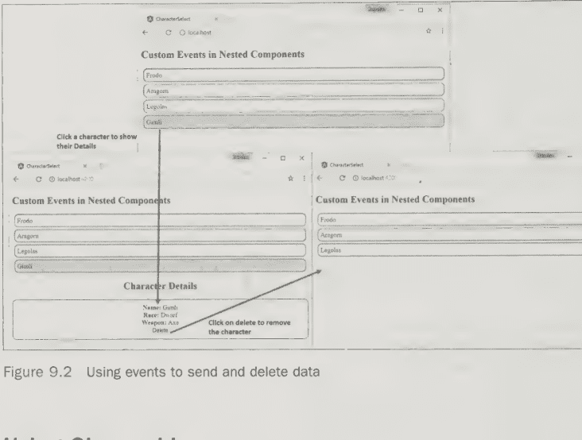

## 使用可观察对象

可观察对象为组件提供了一种观察异步变化数据的方式，例如来自服务器或用户输入的数据。基本上，可观察对象允许你监视值随时间发生的变化。与返回单个值的JavaScript promise不同，可观察对象能够返回一组值。这组值也不必一次性全部接收，这使得可观察对象功能更加强大。

### 创建可观察对象

你需要从`rxjs/observable`导入Observable以在组件内使用。导入后，你可以使用以下语法创建可观察对象，其中`name`是可观察对象的名称：

```
private name: Observable<Array<number>>;
```

一旦创建了可观察对象，就可以订阅它，并使可观察数据可供组件的其余部分使用。这分两部分完成：实现可观察对象和使用`subscribe`方法。以下是可观察对象的基本示例：

```
01 private name: Observable<Array<number>>;
02 ngOnInit(){
03   this.name = new Observable(observer => {
04     observer.next("my observable")
05     observer.complete();
06   });
07   let subscribe = this.name.subscribe(
08     data => { console.log(data) },
09     Error => { errorHandler(Error) },
10     () => { final() }
11   );
12   subscribe.unsubscribe();
13 }
```

第3至6行将可观察对象`name`实例化为`observer`，使其可供订阅。第4行在`observer`上使用了`next`方法，该方法向可观察对象传递数据。第5行在`observer`上使用了`complete`方法来关闭可观察对象的连接。

订阅可观察对象发生在第7至11行。此订阅有三个回调函数。第一个在订阅成功接收到数据时调用。第二个是错误处理程序，在订阅失败时调用。第三个是最终的，无论订阅成功还是失败，都在订阅完成时运行代码。

在第8行，当订阅成功接收到数据时，`data`被传递给`console.log`函数。第9行调用了`errorHandler`函数。第10行调用了`final()`。

### 使用可观察对象监视数据变化

清单9.10和9.11演示了如何使用`Observable`监视数据变化。本节中的示例使用可观察对象监视数据变化，然后使该数据可供显示在DOM上。

清单9.10展示了应用程序的组件。该组件创建了两个`Observable`对象：`pass`和`run`。这些可观察对象具有一个函数，该函数获取0到30之间的随机数，并将每个数字随机分配给两个团队之一，直到两个团队的总数达到1,000或更大。

在清单9.10中，第11和12行声明了可观察对象`pass`和`run`。这些`Observable`对象都在`ngOnInit`函数内初始化并订阅，该函数在组件初始化时运行。

可观察对象`pass`在第18至20行初始化，`run`在第27至28行初始化。初始化后，`pass`和`run`都在第43至52行使用函数`playLoop`。`playLoop`创建并发送一个对象，该对象包含一个0到1之间的随机数用于确定团队，以及一个0到29之间的随机数用于码数。然后每个可观察对象解释团队并将码数应用于团队的传球码数或跑动码数。

第57行到第59行创建了一个随机数生成器，应用程序的其余部分使用它为超时函数、球队和码数生成随机数。

清单9.11展示了本示例的HTML。该清单包含三个主要部分。第3到5行展示了一支假想球队的距离（以码为单位）数据。第8到10行展示了第二支球队的相同数据。第11行展示了两支球队距离的合计。

图9.3展示了渲染后的网页。

#### 清单9.10 observable.component.ts：用于检测数据变化的可观察对象

```typescript
01 import { Component, OnInit } from '@angular/core';
02 import { Observable } from 'rxjs/observable';
03 import { Subscription } from 'rxjs/Subscription';
04 @Component({
05   selector: 'app-root',
06   templateUrl: './observable.component.html',
07   styleUrls: ['./app.component.css']
08 })
09 export class AppComponent implements OnInit {
10   combinedTotal:number = 0;
11   private pass: Observable<any>;
12   private run: Observable<any>;
13   teams = [];
14   ngOnInit(){
15     this.teams.push({passing:0, running:0, total:0});
16     this.teams.push({passing:0, running:0, total:0});
17     //传球
18     this.pass = new Observable(observer => {
19       this.playLoop(observer);
20     });
21     this.pass.subscribe(
22       data => {
23         this.teams[data.team].passing += data.yards;
24         this.addTotal(data.team, data.yards);
25     });
26     //跑球
27     this.run = new Observable(observer => {
28       this.playLoop(observer);
29     });
30     this.run.subscribe(
31       data => {
32         this.teams[data.team].running += data.yards;
33         this.addTotal(data.team, data.yards);
34     });
35     //合计
36     this.pass.subscribe(
37       data => { this.combinedTotal += data.yards;
38     });
39     this.run.subscribe(
40       data => { this.combinedTotal += data.yards;
41     );
42   }
43   playLoop(observer){
44     var time = this.getRandom(500, 2000);
45     setTimeout(() => {
46       observer.next(
47         { team: this.getRandom(0,2),
48           yards: this.getRandom(0,30)});
49       if(this.combinedTotal < 1000){
50         this.playLoop(observer);
51       }
52     }, time);
53   }
54   addTotal(team, yards){
55     this.teams[team].total += yards;
56   }
57   getRandom(min, max) {
58     return Math.floor(Math.random() * (max - min)) + min;
59   }
60 }
```

#### 清单9.11 observable.component.html：组件的模板文件

```html
01 <div>
02   球队1码数：<br>
03   传球码数：{{teams[0].passing}}<br>
04   跑球码数：{{teams[0].running}}<br>
05   总码数：{{teams[0].total}}<br>
06   <hr>
07   球队2码数：<br>
08   传球码数：{{teams[1].passing}}<br>
09   跑球码数：{{teams[1].running}}<br>
10   总码数：{{teams[1].total}}<br>
11   合计总码数：{{combinedTotal}}
12 </div>
```

# 第9章 事件与变化检测


图9.3 使用可观察对象随时间观察数据变化

## 总结

管理事件的能力是大多数Angular应用中最关键的组件之一。你可以在Angular应用中使用事件，为用户提供与元素的交互，以及应用中相互通信的组件，使它们知道何时执行特定任务。

组件被组织成层次结构，根组件在应用级别定义。在本章中，你学习了如何在组件内部发出事件，然后实现监听这些事件并在它们被触发时执行的处理器。你还学习了可观察对象以及如何实现它们来异步观察值。

## 在Web应用中实现Angular服务

Angular功能的最基本组件之一是服务。服务为应用提供基于任务的功能。你可以将服务视为执行一个或多个相关任务的可重用代码块。Angular提供了几个内置服务，也允许你创建自己的自定义服务。

本章介绍了内置的Angular服务。你将有机会了解并实现一些内置服务，例如用于Web服务器通信的http，用于管理和改变应用状态的router，以及用于提供动画能力的animate。

## 理解Angular服务

服务的目的是提供一段简洁的代码来执行特定任务。服务执行的任务可以简单如提供一个值定义，也可以复杂如提供与Web服务器的完整HTTP通信。

服务为可重用功能提供了一个容器，这些功能可随时供Angular应用使用。服务在Angular中通过依赖注入机制进行定义和注册。这允许你将服务注入到模块、组件和其他服务中。

## 使用内置服务

Angular提供了几个内置服务，这些服务包含在Angular模块中，通过依赖注入使用。一旦在模块中包含，服务就可以在整个应用中使用。

表10.1描述了一些最常见的内置服务，让你了解有哪些可用。以下章节将更详细地介绍http和router服务。

116 第10章 在Web应用中实现Angular服务

表10.1 Angular内置的常用服务

| 服务 | 描述 |

|---|---|

| animate | 提供动画钩子，以连接到基于CSS和JavaScript的动画 |

| http | 提供易于使用的功能，向Web服务器或其他服务发送HTTP请请求 |

| router | 提供视图之间以及视图内各部分之间的导航 |

| forms | 提供一个允许动态和响应式表单的服务，具有简单的表单验证 |

### 使用http服务发送HTTP GET和PUT请求

http服务使你能够直接从Angular代码与Web服务器交互。http服务在底层使用浏览器的XMLHttpRequest对象，但从Angular框架的上下文中使用。

有两种使用http服务的方式。最简单的是使用以下与标准HTTP请求对应的内置快捷方法之一：

- delete(url, [options])

- get(url, [options])

- head(url, [options])

- post(url, data, [options])

- put(url, data, [options])

- patch(url, data, [options])

在这些方法中，url参数是Web请请求的URL。可选的options参数是一个JavaScript对象，用于指定实现请求时使用的选项。表10.2列出了你可以在options参数中设置的一些属性。

表10.2 可在http服务请求的config参数中定义的属性

| 属性 | 描述 |

|---|---|

| method | HTTP方法，例如GET或POST。 |

| url | 被请求资源的URL。 |

| params | 要发送的参数。可以是以下格式的字符串：?key1=value1&key2=value2&... 或者可以是一个对象，这种情况下它会被转换成JSON字符串。 |

| body | 作为请求消息体发送的数据。 |

| headers | 随请求发送的头信息。你可以指定一个对象，其中包含要作为属性发送的头名称。如果对象中的某个属性值为null，则该头信息不会被发送。 |

| withCredentials | 一个布尔值，当为true时，表示XHR对象上的withCredentials标志被设置。 |

| responseType | 期望的响应类型，例如JSON或文本。 |

#### 配置HTTP请求

你可以通过直接将options参数发送到http(options)方法来指定请求、URL和数据。例如，以下两者是完全相同的：

```javascript
http.get('/myUrl');
http({method: 'GET', url:'/myUrl'});
```

#### 实现HTTP响应回调函数

当你使用http对象调用请求方法时，你会得到一个可观察对象，它允许持续观察发送到/从服务器接收的数据。可观察对象有许多使用RxJS库的运算符，允许转换和使用数据。以下是一些有用的方法：

- map：将函数应用于可观察序列中的每个值。这允许你将可观察流的输出动态转换为自定义数据格式。

- toPromise：将可观察对象转换为Promise对象，该对象可以访问Promise上可用的方法。Promise对象提供了处理异步操作的语法。

- catch：指定一个函数来优雅地处理可观察序列中的错误。

- debounce：指定可观察流发出值的间隔时间。只在间隔时间发出可观察对象的值；中间值不会被发出。

以下是一个GET请求的简单示例，它返回一个可观察对象，并附有添加运算符的语法：

```typescript
get(): Observable<any>{
  http.get(url)
    .map(response => response.JSON())
    .catch(err => Rx.Observable.of('the error was: ${err}'));
}
```

### 实现简单的JSON文件并使用http服务访问它

清单10.1至10.5中的代码实现了一个简单的模拟Web服务器（以JSON文件形式）及其访问它的Angular应用程序。图10.1展示了输出结果。该Web服务器包含一个简单的JSON对象，其中包含用户列表。该Web应用程序允用户查看用户列表。此示例非常基础，以确保代码易于理解；它包含了一个GET请求以及错误处理示例。

清单10.1展示了包含JSON对象的JSON文件。此文件可通过HTTP GET请求访问，这允许http服务抓取JSON对象并将其作为可观察对象返回给Angular应用程序。

#### 清单10.1 dummyDB.JSON：包含用户数据的JSON对象

```
[
  {
    "userId": 1,
    "userName": "brendan",
    "userEmail": "fake@email.com"
  },
  {
    "userId": 2,
    "userName": "brad",
    "userEmail": "email@notreal.com"
  },
  {
    "userId": 3,
    "userName": "caleb",
    "userEmail": "dummy@email.com"
  },
  {
    "userId": 4,
    "userName": "john",
    "userEmail": "ridiculous@email.com"
  },
  {
    "userId": 5,
    "userName": "doe",
    "userEmail": "some@email.com"
  }
]
```

清单10.2实现了Angular组件。http在第3行导入，rxjs在第5行导入。（注意：你可能需要通过npm安装rxjs。）rxjs允许在可观察对象上调用toPromise()方法。注意，constructor()方法在第15行实例化了http。第16行展示了一个HTTP GET请求，其中将dummyDB.JSON文件的路径作为url传入。调用toPromise()方法将http.get()方法返回的可观察响应转换为Promise对象。一旦Promise完成，便调用.then()，它接收Promise对象中的数据并将其应用到users数组上，以便在应用程序中显示。如果发生错误，则调用.catch()，将错误响应对象传递给一个回调函数进行处理。

#### 清单10.2 http.component.ts：实现HTTP服务进行GET请求的组件


```
import { Component } from '@angular/core';
import { Observable }       from 'rxjs/Observable';
import { Http }             from '@angular/http';

import 'rxjs/Rx';

@Component({
    selector: 'app-root',
    templateUrl: './app.component.html',
    styleUrls: ['./app.component.CSS']
})
export class AppComponent {
    users = [];

    constructor(private http: Http){
        http.get('../assets/dummyDB.JSON')
            .toPromise()
            .then((data) => {
                this.users = data.JSON()
            })
            .catch((err) => {
                console.log(err);
            })
    }
}
```

清单10.3实现了一个Angular模块，该模块导入了HttpModule以允许在整个应用程序中使用http服务。HttpModule从@angular/http导入（第4行），然后被添加到imports数组中（第15行）。

#### 清单10.3 app.module.ts：导入HttpModule以在应用程序中使用的Angular模块

```
import { BrowserModule } from '@angular/platform-browser';
import { NgModule } from '@angular/core';
import { FormsModule } from '@angular/forms';
import { HttpModule } from '@angular/http';
import { AppComponent } from './app.component';

@NgModule({
  declarations: [
    AppComponent
  ],
  imports: [
    BrowserModule,
    FormsModule,
    HttpModule
  ],
  providers: [],
  bootstrap: [AppComponent]
})
export class AppModule { }
```

清单10.4实现了一个Angular模板，该模板使用ngFor创建用户列表以在应用程序中显示。

#### 清单10.4 http.component.html：显示从数据库接收的用户列表的Angular模板

```
<h1>
  Users
</h1>
<div class="user" *ngFor="let user of users">
  <div><span>Id:</span> {{user.userId}}</div>
  <div><span>Username:</span> {{user.userName}}</div>
  <div><span>Email:</span> {{user.userEmail}}</div>
</div>
```

清单10.5是一个CSS文件，为应用程序添加样式，使每个用户与其他用户区分明显且易于查看。

#### 清单10.5 http.component.css：为应用程序添加样式的CSS文件

```
span{
  width: 75px;
  text-align: right;
  font-weight: bold;
  display: inline-block;
}
.user{
  border: 2px ridge blue;
  margin: 10px 0px;
  padding: 5px;
}
```

### 使用http服务实现一个简单的模拟服务器

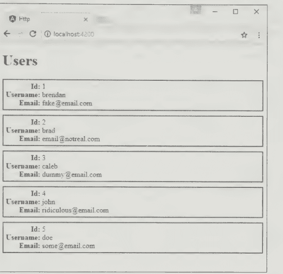

图10.1 实现http服务以允许Angular组件与Web服务器交互。

### 使用http服务实现一个简单的模拟服务器

清单10.6至10.11中的代码实现了一个简单的模拟Web服务器及其访问它的Angular应用程序。图10.2展示了输出结果。该Web服务器返回一个简单的JSON对象，其中包含用户列表。该Web应用程序使用HTTP GET、create和delete请求，允许用户查看、添加和移除用户列表。

**注意**

要创建模拟服务，你需要在控制台运行以下命令：

```
npm install Angular-in-memory-web-api
```

此服务仅用于开发目的，不应用于生产应用程序。

清单10.6是返回JSON对象的模拟数据服务。此文件将通过HTTP请请求访问，这将允许http服务修改数据库。第1行导入了InMemoryDbService，它允许Angular将其用作一个在会话活动期间可以存储数据的数据库。该数据库在第3行通过createDb()方法创建并变得可用，该方法返回users作为JSON对象。

#### 清单10.6 data.service.ts：返回名为users的JSON对象的Angular模拟服务

```
import { InMemoryDbService } from 'angular-in-memory-web-api';
export class InMemoryDataService implements InMemoryDbService {
  createDb() {
    const users = [
      {
        "id": 1,
        "userName": "brendan",
        "email": "fake@email.com"
      },
      {
        "id": 2,
        "userName": "brad",
        "email": "email@notreal.com"
      },
      {
        "id": 3,
        "userName": "caleb",
        "email": "dummy@email.com"
      }
    ]
    return {users};
  }
}
```

清单10.7实现了Angular组件。UserService（在第7行导入）包含了该应用程序将要使用的所有HTTP函数。UserService在第13行被添加到组件的providers中，使其可用于该组件。在第19行，UserService在构造函数中被实现为一个变量。

第21至37行定义了deleteUser()函数，该函数接收一个用户对象。在第32和33行，调用了UserService上的deleteUser()方法，并传入用户ID以告知数据库要删除哪个用户。该函数在.then()方法中有一个回调，该回调调用了this getUsers()以刷新当前用户列表。

第39至52行定义了createUser()函数。此函数接受两个参数：username和email。它在第41至44行将这些参数分配给一个用户对象。第48至51行调用了UserService上的createUser()方法，并传入该用户对象。一旦收到响应，createUser()方法就会将响应推送到users数组中，这会立即反映在DOM中。

#### 清单10.7 createDelete.component.ts：使用http服务获取和修改用户列表的Angular组件

```
import { Component, OnInit } from '@angular/core';
import { Observable }        from 'rxjs/Observable';
import { Http }              from '@angular/http';

import 'rxjs/Rx';

import { UserService } from './user.service';

@Component({
  selector: 'app-root',
  templateUrl: './app.component.html',
  styleUrls: ['./app.component.CSS'],
  providers: [UserService]
})
export class AppComponent implements OnInit {
  users = [];
  selectedUser;

  constructor(private UserService: UserService){ }

  ngOnInit(){
    this.getUsers()
  }

  getUsers(): void {
    this.UserService
        .getUsers()
        .then(users => this.users = users)
  }

  deleteUser(user){
    this.UserService
      .deleteUser(user.id)
      .then(() => {
        this.getUsers();
      });
  }

  createUser(userName, email){
    this.selectedUser = null;
    let user = {
      'userName': userName.trim(),
      'email': email.trim()
    };
    if (!user.userName || !user.email){
```

# 第10章 在Web应用中实现Angular服务

```
46         return;
47     }
48     this.UserService.createUser(user)
49         .then(res => {
50             this.users.push(res);
51         })
52     }
53 }
```

清单10.8实现了Angular服务`UserService`，它负责处理应用程序的所有HTTP请求。第16至21行定义了`deleteUser()`方法，该方法接收一个参数`id`。然后，使用`id`创建一个HTTP删除请请求，发送到服务器以删除具有匹配ID的用户。第22至31行定义了`createUser()`方法，该方法接收一个用户对象。一个POST请求将用户作为JSON字符串传递给服务器，然后该用户被添加到服务器。

#### 清单10.8 user.service.ts：一个使用http与服务器收发数据的Angular服务

```
01 import { Injectable } from '@angular/core';
02 import { Http }     from '@angular/http';
03 import 'rxjs/add/operator/toPromise';
04
05 @Injectable()
06 export class UserService {
07     url = 'api/users'
08     constructor(private http: Http) { }
09
10     getUsers(): Promise<any[]> {
11         return this.http.get(this.url)
12                     .toPromise()
13                     .then(response => response.json().data)
14                     .catch(this.handleError)
15     }
16     deleteUser(id: number): Promise<void>{
17         return this.http.delete(`${this.url}/${id}`)
18                     .toPromise()
19                     .then(() => null)
20                     .catch(this.handleError);
21     }
22     createUser(user): Promise<any>{
23         return this.http
24                     .post(this.url, JSON.stringify({
25                         userName: user.userName,
26                         email: user.email
27                     }))
28                     .toPromise()
29                     .then(res => res.json().data)
30                     .catch(this.handleError)
31     }
32
33     private handleError(error: any): Promise<any> {
34         console.error('An error occurred', error);
35         return Promise.reject(error.message || error);
36     }
37
38 }
```

使用http服务实现一个简单的模拟服务器 125

清单10.9实现了一个Angular模板，该模板利用`ngFor`来创建一个用户列表，以便在应用程序中显示。

#### 清单10.9 createDelete.component.html：一个Angular模板，显示从数据库接收的用户列表，并提供创建和删除用户的选项

```
01 <div>
02 <label>user name:</label> <input #userName />
03 <label>user email:</label> <input #userEmail />
04 <button (click)="createUser(userName.value, userEmail.value);
05 userName.value=''; userEmail.value=''">
06 Add
07 </button>
08 </div>
09
10 <h1>
11 Users
12 </h1>
13 <div class="userCard" *ngFor="let user of users">
14     <div><span>Id:</span> {{user.id}}</div>
15     <div><span>Username:</span> {{user.userName}}</div>
16     <div><span>Email:</span> {{user.email}}</div>
17     <button class="delete"
18     (click)="deleteUser(user); $event.stopPropagation()">x</button>
19 </div>
```

清单10.10是一个CSS文件，它为应用程序设置样式，使得每个用户彼此区分明显且易于查看。

#### 清单10.10 createDelete.component.css：一个为应用程序设置样式的CSS样式表

```
01 span{
02     width: 75px;
03     text-align: right;
04     font-weight: bold;
05     display: inline-block;
06 }
07 .userCard{
08     border: 2px ridge blue;
09     margin: 10px 0px;
10     padding: 5px;
11 }
12 .selected{
13     background-color: steelblue;
14     color: white;
15 }
```

清单10.11实现了一个Angular模块，该模块导入了模拟数据服务。第5行从`angular-in-memory-web-api`导入了`InMemoryWebApiModule`，它有助于将模拟数据库连接到应用程序。第8行从清单10.6导入了`InMemoryDataService`。第18行显示`InMemoryWebApiModule`使用其`forRoot`方法处理`InMemoryDataService`，完全使数据库服务可供HTTP请求使用。

#### 清单10.11 app.module.ts：一个导入了InMemoryWebApiModule以供应用程使用的Angular模块

```
01 import { BrowserModule } from '@angular/platform-browser';
02 import { NgModule } from '@angular/core';
03 import { FormsModule } from '@angular/forms';
04 import { HttpModule } from '@angular/http';
05 import { InMemoryWebApiModule } from 'angular-in-memory-web-api';
06 
07 import { AppComponent } from './app.component';
08 import { InMemoryDataService } from './data.service'
09 
10 @NgModule({
11   declarations: [
12     AppComponent
13   ],
14   imports: [
15     BrowserModule,
16     FormsModule,
17     HttpModule,
18     InMemoryWebApiModule.forRoot(InMemoryDataService)
19   ],
20   providers: [],
21   bootstrap: [AppComponent]
22 })
23 export class AppModule { }
```

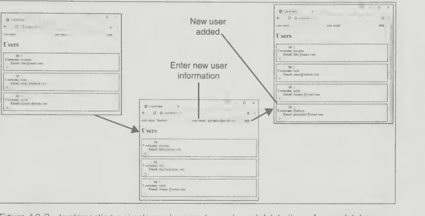

图10.2 实现一个简单的模拟服务器，用于从数据库创建和删除项目

### 实现一个简单的模拟服务器并使用http服务更新服务器上的项目

清单10.12至10.16中的代码实现了与前一个示例相同的模拟Web服务器以及访问它的Angular应用程序。图10.3显示了输出。该Web应用程序允许用户查看和编辑用户列表，使用HTTP GET和PUT请求。

清单10.12是返回JSON对象的模拟数据服务。该文件将通过HTTP请求访问，这将允许http修改数据库。第1行导入`InMemoryDbService`，它允许Angular将其用作一个数据库，在会话活动期间可以存储数据。第3行使用`createDb()`方法创建并使数据库可用，该方法返回用户作为JSON对象。

### 清单10.12 data.service.ts：一个返回名为users的JSON对象的Angular模拟服务

```
01 import { InMemoryDbService } from 'angular-in-memory-web-api';
02 export class InMemoryDataService implements InMemoryDbService {
03     createDb() {
04         const users = [
05         {
06             "id": 1,
07             "userName": "brendan",
08             "email": "fake@email.com"
09         },
10         {
11             "id": 2,
12             "userName": "brad",
13             "email": "email@notreal.com"
14         },
15         {
16             "id": 3,
17             "userName": "caleb",
18             "email": "dummy@email.com"
19         }
20         ];
21         return {users};
22     }
23 }
```

清单10.13实现了一个Angular组件，该组件获取要在模板中显示的用户列表。此组件还允许更新用户。第7行和第13行导入`UserService`并将其提供给组件。在第19行，`UserService`被转换成一个同样名为`UserService`的可用变量。第21至23行显示了`ngOnInit`方法，该方法在组件加载完成时调用`getUsers`方法。第25至29行显示了`getUsers`方法，该方法调用`UserService`上的`getUsers`方法，并将结果赋值给变量`users`。第31至33行显示了`selectUser`方法，该方法接收一个名为`user`的参数。此方法将`user`赋值给变量`selectedUser`。第35至39行显示了`updateUser`方法，该方法接收一个名为`user`的参数。`updateUser`方法将变量`selectedUser`设置为`null`，然后调用`userService`上的`updateUser`方法，将`user`作为参数传入。当`updateUser`方法完成时，会调用`getUsers`方法以刷新显示的用户列表。

### 清单10.13 update.component.ts：一个使用http更新服务器中数据的Angular组件

```
01 import { Component, OnInit } from '@angular/core';
02 import { Observable }    from 'rxjs/Observable';
03 import { Http }    from '@angular/http';
04 
05 import 'rxjs/Rx';
06 
07 import { UserService } from './user.service';
08 
09 @Component({
10   selector: 'app-root',
11   templateUrl: './app.component.html',
12   styleUrls: ['./app.component.css'],
13   providers: [UserService]
14 })
export class AppComponent implements OnInit {
  users = [];
  selectedUser;

  constructor(private UserService: UserService){ }

  ngOnInit(){
    this.getUsers()
  }

  getUsers(): void {
    this.UserService
        .getUsers()
        .then(users => this.users = users)
  }

  selectUser(user){
    this.selectedUser = user;
  }

  updateUser(user){
    this.selectedUser = null;
    this.UserService.updateUser(user)
    .then(() => this.getUsers());
  }
}
```

清单10.14实现了Angular服务`UserService`，该服务处理应用程序的所有HTTP请求。第16至24行定义了`updateUser`方法，该方法接受参数`user`。然后生成一个URL来指定将要更新的用户。第20行发起一个HTTP put请求，传入生成的URL和用户对象，该对象被传递给`json.stringify`方法。`updateUser`方法在成功时发送一个响应对象，在失败时则转向错误处理程序。

### 清单10.14 user.service.ts: 获取用户和更新用户的Angular服务

```typescript
import { Injectable } from '@angular/core';
import { Http } from '@angular/http';
import 'rxjs/add/operator/toPromise';

@Injectable()
export class UserService {
  url = 'api/users'
  constructor(private http: Http) { }

  getUsers(): Promise<any[]> {
    return this.http.get(this.url)
               .toPromise()
               .then(response => response.json().data)
               .catch(this.handleError)
  }
  updateUser(user): Promise<void>{
    console.log(user);
    const url = `${this.url}/${user.id}`;
    return this.http
           .put(url, JSON.stringify(user))
           .toPromise()
           .then(() => user)
           .catch(this.handleError)
  }
  private handleError(error: any): Promise<any> {
    console.error('An error occurred', error);
    return Promise.reject(error.message || error);
  }
}
```

# 第10章 在Web应用程序中实现Angular服务

清单10.15实现了一个Angular模板，该模板使用`ngFor`创建一个用户列表，以便在应用程序中显示。这些用户都是可选择的。当选择一个用户时，其信息会显示在一个可编辑的表单字段中，允许编辑和保存该用户。第20至24行显示了一个按钮，点击该按钮可以调用`updateUser`方法，并传入一个包含该用户更新信息的对象。

### 清单10.15 update.component.html: 显示用户列表并可更新的Angular模板

```html
<h1>
   用户
</h1>
<div class="userCard" *ngFor="let user of users"
     (click)="selectUser(user)"
     [class.selected]="user === selectedUser">
    <div><span>Id:</span> {{user.id}}</div>
    <div><span>用户名:</span> {{user.userName}}</div>
    <div><span>邮箱:</span> {{user.email}}</div>
</div>

<div *ngIf="selectedUser">
  <label>用户名:</label>
  <input #updateName [ngModel]="selectedUser.userName"/>

  <label>用户邮箱:</label>
  <input #updateEmail [ngModel]="selectedUser.email" />

  <button (click)="updateUser(
      {'id': selectedUser.id,
      'userName': updateName.value,
      'email': updateEmail.value});
  ">
     保存
  </button>
</div>
```

使用http服务实现简单模拟服务器 131

清单10.16是一个CSS文件，它为应用程序设置样式，使每个用户易于区分和查看。它提供了一些逻辑来帮助用户知道每个用户都可以点击。

### 清单10.16 update.component.CSS: 为应用程序设置样式的CSS文件

```css
span{
  width: 75px;
  text-align: right;
  font-weight: bold;
  display: inline-block;
}
.userCard{
  border: 2px ridge blue;
  margin: 10px 0px;
  padding: 5px;
  cursor: pointer;
}
.userCard:hover{
  background-color: lightblue;
}
.selected{
  background-color: steelblue;
  color: white;
}
```

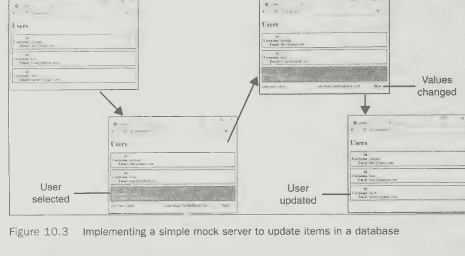

## 使用`router`服务更改视图

`router`服务使您能够更改Web应用程序上的视图，从而可以在组件之间来回路由。这可以是整个页面视图的更改，也可以是单个页面应用程序中较小片段的更改。`router`服务位于一个名为`RouterModule`的外部Angular模块中，需要将其包含在应用程序模块中才能在整个应用程序中使用。

要设置一个支持路由的应用程序，您需要从`@angular/router`导入`Routes`和`Router`模块。为了帮助保持应用程序的简单性并易于维护，`router`应该有自己的模块，可以导入到主应用程序模块中。

为应用程序定义路由就像创建一个对象数组一样简单，每个对象定义一个特定的路由。每个路由的两个必需选项是`path`和`component`。`path`选项指定到达组件需要遵循的路径树。`component`选项定义将加载到视图中的组件。以下示例展示了定义`Routes`数组的语法：

```typescript
const routes: Routes = [
  {
    Path: '',
    Component: myComponent
  },
  {
    Path: 'route',
    Component: myComponent
  },
  {
    Path: 'routeWithParams/:param1/:param2',
    Component: myComponent
  }
]
```

可以向`route`对象添加更多参数。表10.3显示了其中一些参数的列表。

**表10.3** 可在路由服务对象的`config`参数中定义的属性

| 属性 | 描述 |

| :--- | :--- |

| path | 显示此路由在路由树中的位置 |

| component | 定义路由后将加载哪个组件 |

| redirectTo | 重定向到定义的路径而不是当前路由 |

| outlet | 指定用于渲染路由的`RouterOutlet`的名称 |

| canActivate | 通过当为`false`时阻止激活来保护路由 |

| canActivateChild | 通过当为`false`时阻止激活来保护子路由 |

| canDeactivate | 指定路由是否可以停用 |

| canLoad | 允许您保护特定模块不被加载到路由中 |

| data | 允许将数据传递到组件中 |

| resolve | 指定一个解析器，在激活前为路由预取数据 |

| children | 允许嵌套路由数组，其中包含路由对象（每个对象具有与此表中描述的相同选项。） |

| loadChildren | 允许子路由的延迟加载 |

| runGuardsAndResolvers | 定义守卫和解析器何时运行 |

一旦定义了`routes`数组，就需要将其实施到路由器中，这样`router`服务才知道它的存在以及如何使用它。这是通过在`RouterModule`上使用`forRoot`方法来完成的。其结果包含在`routing`模块的`imports`数组中。语法如下所示：

`imports: [RouterModule.forRoot(routes)]`

第10章 在Web应用程序中实现Angular服务

### 在Angular中使用路由

要在Angular中使用路由，需要将路由模块包含在主应用程序模块内，并包含在导入中——这与内置的Angular模块相同。一旦它被包含在应用程序模块内，定义的路由就可在整个应用程序中使用。

为了能够在组件中使用`Router`，需要从`@angular/router`导入`Router`和`ActivatedRoute`。一旦导入，就需要通过构造函数来实施。以下代码展示了语法：

```typescript
Constructor(
    private route: ActivatedRoute,
    private router: Router
){}
```

有两种方法在路由之间导航。第一种方法是直接从HTML中，使用Angular指令`routerLink`，语法如下：

```html
<a routerLink="/myRoute">
```

第二种在路由之间导航的方法是从组件类中，使用以下语法：

```typescript
myFunction(){
    this.router.navigate(['myRoute'])
}
```

当路由器连接完毕并准备好使用时，最后一步是确保路由在应用程序中显示。您可以通过使用Angular HTML标签`router-outlet`来完成此操作。需要注意的是，使用`router-outlet`的组件将位于路由器之外，除了`router-outlet`之外的任何内容都将始终显示，无论当前显示的是哪个路由。您可以通过使用以下语法来实施`router-outlet`：

```html
<router-outlet></router-outlet>
```

#### 实现一个简单的路由器

清单10.17至10.23实现了一个简单的路由器，允用户在两个组件之间导航。图10.4显示了输出。此路由器使用HTML中的Angular`routerLink`指令进行导航，允许在视图之间切换。

清单10.17展示了应用程序模块，这是应用程序的主模块。`App.module`从清单10.17导入了路由器模块。在第6行，此文件加载了`AppRoutingModule`，该模块被添加到第21行的导入数组中。

##### 清单10.17 app.module.ts: 导入路由器模块文件的Angular模块

```typescript
import { BrowserModule } from '@angular/platform-browser';
import { NgModule } from '@angular/core';
import { FormsModule } from '@angular/forms';
import { HttpModule } from '@angular/http';
```

##### 10.18 app-routing.module.ts：一个为该应用定义路由的Angular模块

```typescript
01 import { NgModule } from '@angular/core';
02 import { Routes, RouterModule } from '@angular/router';
03 import { Route2Component } from './route2/route2.component';
04 import { HomeComponent } from './home/home.component';
05 const routes: Routes = [
06   {
07     path: '',
08     component: HomeComponent
09   },
10   {
11     path: 'route2',
12     component: Route2Component
13   }
14 ];
15
16 @NgModule({
17   imports: [RouterModule.forRoot(routes)],
18   exports: [RouterModule]
19 })
20 export class AppRoutingModule { }
```

```typescript
06 import { AppRoutingModule } from './app-routing.module';
07 import { AppComponent } from './app.component';
08 import { Route2Component } from './route2/route2.component';
09 import { HomeComponent } from './home/home.component';
10
11 @NgModule({
12   declarations: [
13     AppComponent,
14     Route2Component,
15     HomeComponent
16   ],
17   imports: [
18     BrowserModule,
19     FormsModule,
20     HttpModule,
21     AppRoutingModule
22   ],
23   providers: [],
24   bootstrap: [AppComponent]
25 })
26 export class AppModule { }
```

清单10.18展示了路由器模块，它为应用程序定义路由。路由器模块导入了`Routes`和`RouterModule`以启用应用内的路由功能。路由器模块还导入了任何将用作路由的组件。第5到14行定义了路由数组，其中包含了应用程序的路由定义。第6到9行定义了主路由，由于`path`被设置为空字符串，应用程序将默认显示该路由。主路由使用`HomeComponent`作为控制视图的组件。第10到13行定义了第二个路由对象，当路径设置为`route2`时会显示该路由。此路由使用`Route2Component`。

##### 10.19 app.component.ts：一个定义路由器出口的Angular组件

清单10.19展示了应用程序的根组件。该组件有一个简单的模板，输出`router-outlet`供路由器显示其路由。

```typescript
01 import { Component } from '@angular/core';
02
03 @Component({
04   selector: 'app-root',
05   template: '<router-outlet></router-outlet>'
06 })
07 export class AppComponent {}
```

##### 10.20 home.component.html：作为默认显示路由的HTML文件

清单10.20展示了home组件的模板文件。该文件显示一条消息，告知用户路由正在工作，随后是一个使用`routerLink`导航用户到单独视图的链接。

```html
01 <p>
02   Home Route works!
03 </p>
04 <a routerLink="/route2">Route 2</a>
```

##### 10.21 home.component.ts：一个包含带路由模板的Angular组件

清单10.21展示了home组件文件。该文件是组件中最基础的形式。其主要目的是加载模板文件并使其可供路由器使用。

```typescript
01 import { Component} from '@angular/core';
02
03 @Component({
04   selector: 'app-home',
05   templateUrl: './home.component.html',
06   styleUrls: ['./home.component.css']
07 })
08 export class HomeComponent{}
```

##### 10.22 route2.component.html：一个为应用程序设置样式的CSS文件

清单10.22展示了route2组件的模板文件。该文件显示一条消息，告知用户路由正在工作，随后是一个使用`routerLink`导航用户到单独视图的链接。

```html
01 <p>
02   route 2 works!
03 </p>
04 <a routerLink="/">Route 1</a>
```

##### 10.23 route2.component.ts：一个包含带路由模板的Angular组件

清单10.23展示了基础的route2组件文件。其主要目的是加载模板文件并使其可供路由器使用。

```typescript
01 import { Component } from '@angular/core';
02 
03 @Component({
04   selector: 'app-route2',
05   templateUrl: './route2.component.html'
06 })
07 export class Route2Component {}
```

#### 实现带有导航栏的路由器

清单10.24到10.35中的代码实现了一个带有导航栏的路由器，允许用户在嵌套的视图之间导航。图10.5展示了输出结果。此路由器使用HTML中的Angular`routerLink`指令进行导航，从而在不同视图之间切换。

##### 10.24 app-routing.module.ts：一个为应用程序定义路由的Angular模块

清单10.24展示了路由器模块，它为应用程序定义路由。路由器模块导入了任何将用作路由的组件。此示例中没有主路由。如果路由为空，路由器会重定向到`page1`，如第22到25行所示。此外，如果在URL中输入了无效路由，路由器也会再次重定向到`page1`，如第27到30行所示。

```typescript
01 import { NgModule } from '@angular/core';
02 import { Routes, RouterModule } from '@angular/router';
03 import { Page1Component } from './page1/page1.component';
04 import { Page2Component } from './page2/page2.component';
05 import { Page3Component } from './page3/page3.component';
06 import { Page4Component } from './page4/page4.component';
07 import { NavComponent } from './nav/nav.component';
08 const routes: Routes = [
09  {
10   path: 'page1',
11   component: Page1Component
12  },
13  {
14   path: 'page2',
15   component: Page2Component
16  },
17  {
18   path: 'page3',
19   component: Page3Component
20  },
21  {
22   path: '',
23   redirectTo: '/page1',
24   pathMatch: 'full'
25  },
26  {
27   path: '**',
28   redirectTo: '/page1',
29   pathMatch: 'full'
30  }
31 ];
32
33 @NgModule({
34   imports: [RouterModule.forRoot(routes)],
35   exports: [RouterModule]
36 })
37 export class AppRoutingModule { }
```

##### 10.25 nav.component.ts：一个创建持久导航栏以在视图间导航的Angular组件

清单10.25展示了导航组件，它控制导航栏并链接到页面内的视图。第9到19行展示了一个可用页面的数组，导航栏可以使用该数组创建带有导航链接的按钮。

```typescript
01 import { Component, OnInit } from '@angular/core';
02
03 @Component({
04   selector: 'app-nav',
05   templateUrl: './nav.component.html',
06   styleUrls: ['./nav.component.css']
07 })
08 export class NavComponent {
09   pages = [
10     { 'url': 'page1',
11       'text': 'page 1'
12     },
13     { 'url': 'page2',
14       'text': 'page 2'
15     },
16     { 'url': 'page3',
17       'text': 'page 3'
18     }
19   ]
20 }
```

##### 10.26 nav.component.html：一个创建导航栏视图的Angular模板

清单10.26展示了导航组件的模板文件。它创建了一个按钮列表，允许在命名路由之间进行导航。

```html
01 <span class="container" *ngFor="let page of pages">
02   <a routerLink="/{{page.url}}">{{page.text}}</a>
03 </span>
```

##### 10.27 nav.component.css：一个为应用程序的导航按钮设置样式的CSS文件

清单10.27展示了导航组件的CSS文件。该文件为导航栏按钮设置样式，使其看起来合理。第9到12行使得当用户将鼠标悬停在按钮上时，按钮和文本的颜色会发生变化。

```css
01 a{
02   padding: 5px 10px;
03   border: 1px solid darkblue;
04   background-color: steelblue;
05   color: white;
06   text-decoration: none;
07   border-radius: 3px;
08 }
09 a:hover{
10   color: black;
11   background-color: lightgrey;
12 }
```

140 第10章 在Web应用中实现Angular服务

##### 10.28 app.component.ts：一个作为应用程序根组件的Angular组件

清单10.28展示了根组件文件`app.component.ts`，它作为应用程序的入口，并加载路由视图和导航组件。

```typescript
01 import { Component } from '@angular/core';
02 
03 @Component({
04   selector: 'app-root',
05   templateUrl: './app.component.html',
06   styleUrls: ['./app.component.css']
07 })
08 export class AppComponent { }
```

##### 10.29 app.component.html：一个加载导航组件后跟路由器出口的Angular模板

清单10.29展示了根组件模板文件，它加载导航组件，随后是路由器出口，应用程序的视图就在该处加载。

```html
01 <div><app-nav></app-nav></div>
02 <div><router-outlet></router-outlet></div>
```

## 10.30

清单10.30展示了根组件的CSS文件，它为导航栏提供了一些间距，使其显示得更美观。

## 清单10.30 app.component.css：导入路由器模块文件的Angular模块

```css
01 div{
02   margin: 15px 0px;
03 }
```

清单10.31展示了page1组件。此组件加载一个模板，该模板将用作此应用程序的其中一个视图。第5行加载了一张图片以在视图中显示。

##### 清单10.31 page1.component.ts：导入路由器模块文件的Angular模块

```typescript
01 import { Component } from '@angular/core';
02 
03 @Component({
04   selector: 'app-page1',
05   template: ''
06 })
07 export class Page1Component {}
```

清单10.32展示了page2组件。此组件加载一个模板，该模板将用作此应用程序的其中一个视图。

##### 清单10.32 page2.component.ts：导入路由器模块文件的Angular模块

```typescript
01 import { Component } from '@angular/core';
02 
03 @Component({
04   selector: 'app-page2',
05   templateUrl: './page2.component.html'
06 })
07 export class Page2Component { }
```

清单10.33展示了page2模板文件，其中包含一些将被加载到视图中的占位文本。

##### 清单10.33 page2.component.html：为页面2创建视图的Angular模板

```html
01 <p>
02 Lorem ipsum dolor sit amet, consectetur adipiscing elit. Nam efficitur
03 tristique ornare. Interdum et malesuada fames ac ante ipsum primis in
04 faucibus. Proin id nulla vitae arcu laoreet consequat. Donec quis
05 convallis felis. Mauris ultricies consectetur lectus, a hendrerit leo
06 feugiat sit amet. Aliquam nec velit nibh. Nam interdum turpis ac dui
07 congue maximus. Integer fringilla ante vitae arcu molestie finibus. Morbi
08 eget ex pellentesque, convallis orci venenatis, vehicula nunc.
09 </p>
```

清单10.34展示了page3组件。此组件加载一个模板，该模板将用作此应用程序的其中一个视图。

##### 清单10.34 page3.component.ts：导入路由器模块文件的Angular模块

```typescript
01 import { Component } from '@angular/core';
02 
03 @Component({
04   selector: 'app-page3',
05   templateUrl: './page3.component.html'
06 })
07 export class Page3Component {}
```

清单10.35展示了page3模板文件，该文件创建了一个文本区域框以在视图中显示。

##### 清单10.35 page3.component.html：为页面3创建视图的Angular模板

```html
01 <textarea rows="4" cols="50" placeholder="Some Text Here">
02 </textarea>
```


图10.5 实现`http`服务以允许Angular组件与Web服务器交互

#### 实现带参数的路由器

清单10.36至10.40实现了一个带有路由的路由器，该路由接受一个参数，允许通过`url`参数将数据传输到该视图。图10.6展示了输出结果。

清单10.36展示了`Router`模块，它定义了应用程序的路由。`Router`模块导入任何将用作路由的组件。第14行定义了通向页面2的路径，该路径接受参数`this.text`。

##### 清单10.36 app-routing.module.ts：分配路由器参数的Angular模板

```typescript
01 import { Component } from '@angular/core';
02 import { Router, ActivatedRoute, Params } from '@angular/router';
03
04 @Component({
05   selector: 'app-page1',
06   templateUrl: './page1.component.html'
07 })
08 export class Page1Component {
09   text='';
10   constructor(
11     private route: ActivatedRoute,
12     private router: Router,
13   ) { }
14   gotoPage2(){
15     this.router.navigate(
16       ['/page2', this.text],
17       {
18         relativeTo: this.route,
19         skipLocationChange: true
20       }
21     );
22   }
23 }
```

清单10.37展示了根组件app.component.ts。此文件包含一个模板，该模板声明了router-outlet以显示来自路由器的视图。

##### 清单10.37 app.component.ts：作为应用程序入口点的Angular组件

```typescript
01 import { Component } from '@angular/core';
02
03 @Component({
04   selector: 'app-root',
05   template: '<router-outlet></router-outlet>'
06 })
07 export class AppComponent { }
```

清单10.38展示了page1组件。此组件从`@angular/router`导入了`Router`和`ActivatedRoute`，以允许此组件访问路由器并读取或分配参数到RouterState。第10至13行定义了构造函数，其中第11和12行将ActivatedRoute和Router实现为私有变量route和router。第14至22行定义了`gotoPage2()`函数，该函数导航到page2并传入一个参数。第16行导航到page2，并传入`this.text`作为参数。第18和19行允许应用程序在更改视图时不在浏览器中更改URL。

##### 清单10.38 page1.component.ts：带参数导航到页面2的Angular组件

```typescript
01 import { Component } from '@angular/core';
02 import { Router, ActivatedRoute } from '@angular/router';
03 
04 @Component({
05   selector: 'app-page1',
06   templateUrl: './page1.component.html'
07 })
08 export class Page1Component {
09   text='';
10   constructor(
11     private route: ActivatedRoute,
12     private router: Router,
13   ){ }
14   gotoPage2(){
15     this.router.navigate(
16       ['/page2', this.text],
17       {
18         relativeTo: this.route,
19         skipLocationChange: true
20       }
21     );
22   }
23 }
```

清单10.39展示了page1模板文件。第4行显示了一个文本区域，该区域绑定到变量text，当路由到page2时，该变量作为参数传递。第5行创建了一个按钮，该按钮调用`gotoPage2`函数以更改视图。仅当变量text具有非空值时，此按钮才可用。

##### 清单10.39 page1.component.html：提供输入字段以向路由器参数赋值的HTML模板

```html
01 <span>
02   Enter Text to Pass As Params:
03 </span>
04 <input type=text [(ngModel)]="text" />
05 <button [disabled]="!text" (click)="gotoPage2()">Page 2</button>
```

清单10.40展示了page2组件。此组件从`@angular/router`导入了`Router`和`ActivatedRoute`，以允许此组件访问路由器以及路由加载时设置的参数。第15和16行创建了一个对params可观察对象的订阅，并将值分配给变量text以在视图中显示。

##### 清单10.40 page2.component.ts：在视图中显示路由器参数的Angular组件

```typescript
01 import { Component, OnInit } from '@angular/core';
02 import { Router, ActivatedRoute } from '@angular/router';
03 
04 @Component({
05   selector: 'app-page2',
06   templateUrl: './page2.component.html'
07 })
08 export class Page2Component implements OnInit {
09   text;
10   constructor(
11     private route: ActivatedRoute,
12     private router: Router
13   ) { }
14   ngOnInit() {
15     this.route.params
16       .subscribe(text => this.text = text.params);
17   }
18 
19   goBack(){
20     this.router.navigate(['/page1']);
21   }
22 }
```

清单10.41展示了page2模板文件。第2行显示了变量text，其值来自路由参数。第3行创建了一个按钮，点击后可以导航回page1。

##### 清单10.41 page2.component.html：从路由器传递的参数

```html
01 <h3>Params From Page 1</h3>
02 <p>{{text}}</p>
03 <button (click)="goBack()" >back</button>
```

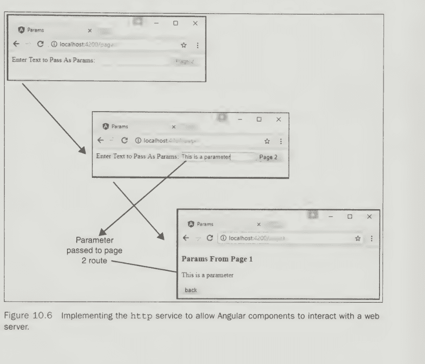

图10.6 实现http服务以允许Angular组件与Web服务器交互。

## 总结

Angular服务是包含可注入到其他Angular组件中的功能的对象。Angular的内置服务提供了客户端代码所需的许多预构建功能。例如，`http`服务允许你轻松地将Web服务器通信集成到你的Angular应用程序中，而`router`服务允许你管理视图之间的导航。

## 创建您自己的自定义Angular服务

Angular在其内置服务中提供了许多功能，但它也允许您实现自己的自定义服务以提供特定功能。任何需要向应用程序提供基于任务的功能时，您都应该实现一个自定义服务。

在实现自定义服务时，您需要将每个服务视为执行一个或多个相关任务的可重用代码块。然后，您可以将它们设计并组合成库，这些库可以被多个不同的Angular应用程序轻松使用。

本章介绍了Angular自定义服务。它提供了几个自定义Angular服务的示例，以帮助您更清晰地理解如何设计和构建自己的服务。

### 将自定义服务集成到Angular应用程序中

当您开始为应用程序实现Angular服务时，您会发现有些非常简单，有些则非常复杂。服务的复杂性通常反映了底层数据及其所提供功能的复杂性。本节旨在为您提供不同类型自定�务的一些基本示例，以说明如何实现和使用它们。表11.1列出了一些服务的用途。

**表11.1** 自定义服务的用例

| 服务 | 描述 |

|---|---|

| 模拟服务 | 提供虚拟数据，用于在后端不可用时测试基于HTTP的服务 |

| 常量数据 | 返回需要保持不变的数据变量，例如圆周率π的数学值 |

| 变量数据 | 返回可以更改的数据变量，更改后的值会保存到服务中供其他服务使用 |

| 与后端的HTTP连接 | 应在自定义服务中使用，以创建与后端数据的接口 |

| 数据转换 | 接收待转换的数据形式，运行转换并返回转换后的值（例如，一个接收数字并返回其平方的平方服务） |

| 共享服务 | 任何可以同时被多个组件使用的服务，当数据更改时，会自动为所有组件更新数据 |

#### 将Angular服务添加到应用程序

本节介绍如何在应用程序中创建和实现自定义服务。创建服务时，必须使其可注入，才能在整个应用程序中使用。以下示例展示了创建可注入服务的语法：

```
import { Injectable } from '@angular/core';
@Injectable()
export class CustomService { }
```

创建可注入服务后，需要将其导入并提供给任何需要访问它的Angular组件。以下是导入自定义服务的语法，以及通过组件装饰器元数据中的`providers`数组注入自定义服务：

```
import { CustomService } from './path_to_service';

@Component({
  selector: 'app-root',
  template: '',
  providers: [ CustomService ]
})
```

使自定义服务可用的最后一步是创建该服务的实例，以便在整个组件中使用。您可以在组件的构造函数中完成此操作，如下面的示例所示：

```
constructor(
  private myService: CustomService
){}
```

完成这些步骤后，自定义服务及其任何方法都通过实例`myService`提供给组件。

以下部分提供了示例，说明实现自定义服务的各种方式。

#### 实现使用常量数据服务的简单应用程序

此示例展示了如何构建一个常量数据服务。本示例的目的是创建一个简单的服务，该服务返回一个常量数据变量。

清单11.1展示了pi服务，该服务返回圆周率π的值。第1行和第3行导入并实现Injectable，以使服务可供外部使用。第4行创建PiService类，其中包含服务的定义。第5至7行定义了getPi方法，该方法返回圆周率π的值。

```
清单11.1 pi.service.ts：创建一个返回圆周率π值的服务
01 import { Injectable } from '@angular/core';
02 
03 @Injectable()
04 export class PiService {
05   getPi(){
06     return Math.PI;
07   }
08 }
```

清单11.2实现了一个Angular组件，该组件导入并实现PiService。第2行和第7行显示PiService被导入，然后被提供，使其在组件中可用。第12行显示PiService被实例化为变量PiService。第14至16行显示ngOnInit方法，该方法调用PiService的getPi方法并将其赋值给变量pi。

```
清单11.2 app.component.ts：一个从PiService获取圆周率π值的Angular组件
01 import { Component, OnInit } from '@angular/core';
02 import { PiService } from './pi.service';
03 
04 @Component({
05   selector: 'app-root',
06   templateUrl: './app.component.html',
07   providers: [ PiService ]
08 })
09 export class AppComponent implements OnInit {
10   pi: number;
11   constructor(
12     private PiService: PiService
13   ){}
14   ngOnInit(){
15     this.pi = this.PiService.getPi();
16   }
17 }
```

清单11.3展示了一个Angular模板，该模板将圆周率π的值显示到小数点后五位。

清单11.3 app.component.html：一个将圆周率π的值显示到小数点后五位的Angular模板

```
01 <h1>
02   Welcome. this app returns the value of pi
03 </h1>
04 <p> the value of pi is: {{pi | number:'1.1-5'}}</p>
```

图11.1显示了此示例在Web浏览器中的输出。

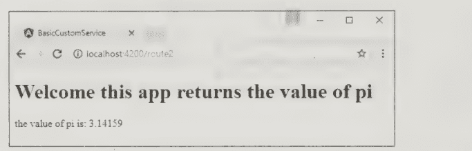

图11.1 一个显示从常量服务获取的圆周率π值的Angular组件的HTML页面

#### 实现数据转换服务

此示例展示了如何构建一个简单的数据转换服务，该服务接收数据变量，计算形状的面积，并返回该形状的面积。

清单11.4展示了一个名为AreaCalcService的自定义服务，其中包含多个以各种形状命名的方法。每个方法都接收变量，然后使用这些变量生成与其名称对应的形状的面积。第1行和第3行导入并实现Injectable，以使服务可供外部使用。

```
清单11.4 area-calc.service.ts：一个具有计算形状面积方法的Angular服务
01 import { Injectable } from '@angular/core';
02 
03 @Injectable()
04 export class AreaCalcService {
05   circle(radius:number): number {
06     return Math.PI * radius * radius;
07   }
08   square(base:number): number {
09     return base * base;
10   }
11   rectangle(base:number, height): number {
12     return base * height;
13   }
14   triangle(base:number, height): number {
15     return (base*height)/2;
16   }
17   trapezoid(base1:number,
18            base2:number,
19            height:number): number {
20     return ((base1+base2)/2)*height;
21   }
22 }
```

清单11.5展示了一个Angular组件，该组件根据从用户接收的值从AreaCalcService获取形状的面积。第2行和第8行导入AreaCalcService并将其添加到providers中，使其可供组件使用。第21行创建AreaCalcService的实例areaCalc，以与组件方法一起使用。

第23至25行定义了doCircle方法，该方法在areaCalc上调用circle方法以获取圆的面积。

第26至28行定义了doSquare方法，该方法在areaCalc上调用square方法以获取正方形的面积。

第29至31行定义了doRectangle方法，该方法在areaCalc上调用rectangle方法以获取矩形的面积。

第32至34行定义了doTriangle方法，该方法在areaCalc上调用triangle方法以获取三角形的面积。

第35至39行定义了doTrapezoid方法，该方法在areaCalc上调用trapezoid方法以获取梯形的面积。

```
清单11.5 app.component.ts：一个根据从用户接收的值从AreaCalcService获取形状面积的Angular组件
01 import { Component } from '@angular/core';
02 import { AreaCalcService } from './area-calc.service';
03
04 @Component({
05   selector: 'app-root',
06   templateUrl: './app.component.html',
07   styleUrls: ['./app.component.css'],
08   providers: [ AreaCalcService ]
09 })
export class AppComponent {
  circleRadius: number = 0;
  squareBase: number = 0;
  rectangleBase: number = 0;
  rectangleHeight: number = 0;
  triangleBase: number = 0;
  triangleHeight: number = 0;
  trapezoidBase1: number = 0;
  trapezoidBase2: number = 0;
  trapezoidHeight: number = 0;

  constructor(private areaCalc: AreaCalcService) { }

  doCircle() {
    return this.areaCalc.circle(this.circleRadius);
  }

  doSquare() {
    return this.areaCalc.square(this.squareBase);
  }

  doRectangle() {
    return this.areaCalc.rectangle(this.rectangleBase, this.rectangleHeight);
  }

  doTriangle() {
    return this.areaCalc.triangle(this.triangleBase, this.triangleHeight);
  }

  doTrapezoid() {
    return this.areaCalc.trapezoid(this.trapezoidBase1,
      this.trapezoidBase2,
      this.trapezoidHeight);
  }
}
```

清单11.6展示了一个Angular模板文件，它创建了用于输入计算各种形状面积所需数据的表单字段。当数据输入后，面积会立即被计算并显示给用户。

#### 清单11.6 app.component.html：提供用户界面以创建表单字段接收形状面积的Angular模板

```html
<label>Circle Radius:</label>
<input type="text" [(ngModel)]="circleRadius"/>
<span>Area: {{this.doCircle()}}</span>
<hr>

<label>Square Side:</label>
<input type="text" [(ngModel)]="squareBase" />
<span>Area: {{this.doSquare()}}</span>
<hr>

<label>Rectangle Base:</label>
<input type="text" [(ngModel)]="rectangleBase" /> <br>
<label>Rectangle Height:</label>
<input type="text" [(ngModel)]="rectangleHeight" />
<span>Area: {{this.doRectangle()}}</span>
<hr>

<label>Triangle Base:</label>
<input type="text"
  [(ngModel)]="triangleBase" /> <br>
<label>Triangle Height:</label>
<input type="text" [(ngModel)]="triangleHeight" />
<span>Area: {{this.doTriangle()}}</span>
<hr>

<label>Trapezoid Base1:</label>
<input type="text"  [(ngModel)]="trapezoidBase1" /> <br>
<label>Trapezoid Base2:</label>
<input type="text"  [(ngModel)]="trapezoidBase2" /><br>
<label>Trapezoid Height:</label>
<input type="text"  [(ngModel)]="trapezoidHeight" />
<span>Area: {{this.doTrapezoid()}}</span>
```

清单11.7展示了一个CSS文件，用于设置应用程序的样式，将每个形状的独立表单分隔开来。

#### 清单11.7 app.component.css：用于设置应用程序样式的CSS文件

```css
label{
  color: blue;
  font: bold 20px times new roman;
  width:200px;
  display: inline-block;
  text-align: right;
}
input{
  width:40px;
  text-align:right;
}
span{
  font: bold 20px courier new;
  padding-left: 10px;
}
```

图11.2展示了生成的Angular应用程序网页。随着组件中添加数值，区域会由自定义服务自动计算。

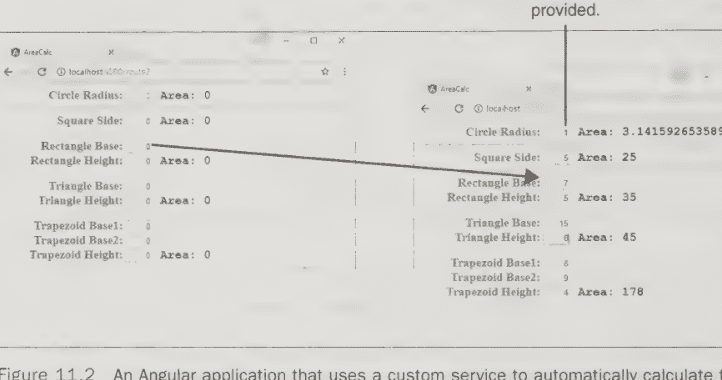

图11.2 使用自定义服务自动计算不同形状面积的Angular应用程序

### 实现一个变量数据服务


本例展示了如何构建一个可变数据服务，该服务创建一个图像切换器，该切换器在随机时间从列表中随机选择一个图像并将其发送给组件进行显示。

清单 11.8 展示了一个名为 `RandomImageService` 的自定义服务，它从列表中选择一个图像 URL 并以随机间隔发出该 URL。第 2 行显示从 `rxjs/observable` 导入 `Observable`。第 33 至 37 行显示了初始化可观察对象 `imageChange` 并调用 `changeLoop` 方法（传入观察者对象）的构造函数。第 28 至 51 行定义了 `changeLoop` 方法，该方法接收可观察响应对象 `observer`。调用 `setTimeout` 函数，在完成前等待一个随机时间。然后从 `images` 数组中选择一个随机图像。随后发出图像 URL、标题和宽度，并且 `changeLoop` 递归地调用自身。第 52 至 54 行定义了 `getRandom` 函数，该函数接收两个参数 `min` 和 `max`，并获取介于这些值之间的随机数。

#### 清单 11.8 random-image.service.ts：返回包含随机图像的可观察对象的 Angular 服务

```typescript
import { Injectable, OnInit } from '@angular/core';
import { Observable } from 'rxjs/observable';

@Injectable()
export class RandomImageService {
  imageChange: Observable<any>;
  private images = [
    {
      url: '../../assets/images/arch.jpg',
      title: "Delicate Arch"
    },
    {
      url: '../../assets/images/lake.jpg',
      title: "Silver Lake"
    },
    {
      url: '../../assets/images/cliff.jpg',
      title: "Desert Cliff"
    },
    {
      url: '../../assets/images/bison.jpg',
      title: "Bison"
    },
    {
      url: '../../assets/images/flower.jpg',
      title: "Flower"
    },
    {
      url: '../../assets/images/volcano.jpg',
      title: "Volcano"
    },
  ];
  constructor() {
    this.imageChange = new Observable(observer => {
      this.changeLoop(observer);
    });
  }
  changeLoop(observer) {
    setTimeout(() => {
      let imgIndex = this.getRandom(0,6);
      let image = this.images[imgIndex];
      observer.next(
        {
          url: image.url,
          title: image.title,
          width: this.getRandom(200,400)
        }
      );
      this.changeLoop(observer);
    }, this.getRandom(100,1000));
  }
  getRandom(min, max) {
    return Math.floor(Math.random() * (max - min)) + min;
  }
  getRandomImage(): Observable<any> {
    return this.imageChange;
  }
}
```

清单 11.9 展示了一个 Angular 组件，它从 `RandomImageService` 获取随机图像，在主视图中显示它，并将其添加到 `imageHistory` 数组中。第 4 行和第 10 行显示了 `RandomImageService` 的导入以及它被提供给组件。第 17 行将 `RandomImageService` 实例化为变量 `randomImages`。第 19 至 23 行创建了一个默认的初始 `imageInfo` 对象，用于在从 `RandomImageService` 接收到数据之前占位。第 25 至 32 行展示了 `ngOnInit` 方法，它调用 `randomImages` 服务实例上的 `getRandomImage` 方法，并将其赋值给可观察对象 `randomImage`。然后，`imageInfo` 被赋予从可观察对象发出的任何值。`imageHistory` 也添加从可观察对象发出的任何值。

#### 清单 11.9 app.component.ts：从 RandomImageService 获取随机图像并显示该图像的 Angular 组件

```typescript
import { Component, OnInit } from '@angular/core';
import { Observable } from 'rxjs/Observable';
import { Subscription } from 'rxjs/Subscription';
import { RandomImageService } from './random-image.service';

@Component({
  selector: 'app-root',
  templateUrl: './app.component.html',
  styleUrls: ['./app.component.css'],
  providers: [ RandomImageService ]
})
export class AppComponent {
  title = 'app';
  randomImage: Observable<any>;
  imageInfo: any;
  imageHistory: any[];
  constructor(
    private randomImages: RandomImageService
  ){
    this.imageInfo = {
        url: '',
        title: 'Loading . . .',
        width: 400
    };
    this.imageHistory = [];
  }
  ngOnInit(){
    this.randomImage = this.randomImages.getRandomImage();
    this.randomImage.subscribe(
        imageData => {
            this.imageInfo = imageData;
            this.imageHistory.push(imageData);
        });
  }
}
```

清单 11.10 展示了一个 Angular 模板，它在主视图中显示随机图像。`ngFor` 用于显示图像历史记录数组中的每个图像。

#### 清单 11.10 app.component.html：显示从 RandomImageService 发出的图像的 Angular 模板

```html
<div>
    
    <p>{{imageInfo.title}}</p>
</div>
<hr>
<h3>Random Image History</h3>
<span *ngFor = "let image of imageHistory">
    
</span>
```

清单 11.11 展示了一个 CSS 文件，它为应用程序的主图像和文本添加边框进行样式设置。

#### 清单 11.11 app.component.css：用于设置应用程序样式，将主视图与较小图片分隔开的 CSS 文件

```css
div {
    position: inline-block;
    width: fit-content;
    border: 3px solid black;
}
```

```css
p {
    font: bold 25px 'Times New Roman';
    padding: 5px;
    text-align: center;
}
```

图 11.3 展示了运行中的示例。服务会随机更改主图像的 URL 和大小。底部显示了随机显示的图像的滚动历史记录。


### 实现一个返回 Promise 的服务

此示例展示了如何构建一个创建并返回 Promise 的服务。

清单 11.12 展示了一个名为 `PromiseService` 的自定义服务，它创建一个异步计时器，在特定秒数后向用户发出警报。第 6 到 13 行定义了 `createTimedAlert` 方法，该方法接收 `seconds` 参数并返回一个 Promise。第 8 到 10 行创建了一个 resolve 函数，该函数仅在 Promise 完成后运行。此函数会创建一个警报，告知用户运行警报花了多长时间。

#### 清单 11.12 promise.service.ts：一个提供基于计时器警报的 Angular 服务

```typescript
import { Injectable } from '@angular/core';

@Injectable()
export class PromiseService {

  createTimedAlert(seconds: number): Promise<any>{
    return new Promise((resolve, reject) =>{
      resolve(setTimeout(function(){
          alert('this alert took ' + seconds + ' seconds to load');
      }, (seconds * 1000))
    );
    })
  }
}
```

清单 11.13 展示了一个 Angular 组件，它使用 `PromiseService` 创建一个可以在稍后时间解析的异步请求。第 2 行和第 7 行显示了 `PromiseService` 被导入然后添加到 `providers` 数组中，使其对组件可用。第 12 行创建了一个名为 `alert` 的 `PromiseService` 实例。第 15 到 17 行定义了 `createAlert` 方法，该方法调用 `alert` 上的 `createTimedAlert` 方法并传入 `seconds` 变量。

#### 清单 11.13 app.component.ts：使用 PromiseService 服务的 Angular 组件

```typescript
import { Component } from '@angular/core';
import { PromiseService } from './promise.service';

@Component({
  selector: 'app-root',
  templateUrl: './app.component.html',
  providers: [PromiseService]
})
export class AppComponent {
  seconds: number = 0;
  constructor(
    private alert: PromiseService
  ){}

  createAlert(){
    this.alert.createTimedAlert(this.seconds);
  }
}
```

清单 11.14 展示了一个 Angular 模板，其中有一个输入框供用户输入秒数。模板中有一个按钮，用于调用 `createAlert` 函数。

#### 清单 11.14 app.component.html：一个显示按钮以启动异步警报请求的模板

```html
<h3>set the time in seconds to create an alert</h3>
<input [(ngModel)]="seconds">
<button (click)="createAlert()">go</button>
```

图 11.4 显示了在时间流逝后，服务显示的异步警报。


图 11.4 使用 Angular 服务提供异步警报

### 实现一个共享服务

此示例展示了如何构建一个在两个组件之间共享的服务。该服务将只有一个实例，这意味着当一个组件更改数据时，另一个组件也会看到该数据更改。

清单 11.15 展示了一个名为 `SharedService` 的自定义服务，它创建一个角色数组的可观察对象。此可观察对象是可编辑的，这使其可用于减少角色的生命值。当值更改时，可观察对象会向所有订阅了该可观察对象的组件发出该更改。

第 15 到 52 行定义了 `characters` 数组，其中包含 `name`、`race`、`alignment` 和 `health` 值。第 55 到 60 行定义了 `constructor` 方法，该方法创建可观察对象 `charObservable`。观察者对象被保存到服务变量 `observer` 中。然后观察者发出 `characters` 数组。第 62 到 64 行定义了 `getCharacters` 方法，该方法返回 `charObservable`。

第 66 到 79 行定义了 `hitCharacter` 方法，该方法接收两个参数：`character` 和 `damage`。然后该方法在 `characters` 数组中搜索 `character` 的索引。如果角色存在于数组中，该方法会从该角色的生命值中减去伤害值。然后，如果生命值小于或等于 0，该方法会将该角色从数组中移除。最后，该方法发出更新后的 `characters` 数组。

#### 清单 11.15 shared.service.ts：一个将在组件之间共享的 Angular 服务

```typescript
import { Injectable } from '@angular/core';

import { Observable }        from 'rxjs/Observable';
import 'rxjs';

export class character {
   name: string;
   race: string;
   alignment: string;
   health: number;
}

@Injectable()
export class SharedService{
characters: character[] = [
   {
      name: 'Aragon',
      race: 'human',
      alignment: 'good',
      health: 100
   },
   {
      name: 'Legolas',
      race: 'elf',
      alignment: 'good',
      health: 100
   },
   {
      name: 'Gimli',
      race: 'Dwarf',
      alignment: 'good',
      health: 100
   },
   {
     name: 'Witch King',
     race: 'Wraith',
     alignment: 'bad',
     health: 100
   },
   {
     name: 'Lurtz',
     race: 'Uruk-hai',
     alignment: 'bad',
     health: 100
   },
   {
     name: 'Sarumon',
     race: 'Wizard',
     alignment: 'bad',
     health: 100
   },
 ];
 charObservable: Observable<character[]>;
 observer;
 constructor(){
   this.charObservable = new Observable(observer => {
     this.observer = observer;
     this.observer.next(this.characters);
   })
 }

 getCharacters(): Observable<character[]>{
   return this.charObservable;
 }

 hitCharacter(character, damage){

   var index = this.characters.indexOf(character, 0);
   if(index > -1){
     this.characters[index].health -= damage;
     if(this.characters[index].health <= 0){
       this.characters.splice(index, 1);
     }
   }
   this.observer.next(this.characters);
 }
}
```

清单 11.16 展示了一个 Angular 组件，它创建一个 `SharedService` 的单一实例，可以传递给子组件。由于每个子组件接收的是相同的 service 实例，所有注入 `SharedService` 并订阅其可观察对象的子组件都将在数据发生更改时得到更新。第 2 行和第 7 行导入并提供了 `SharedService` 供组件内部使用。第 11 行将 `SharedService` 赋值给变量 `shared`，以便在 HTML 中使用。

#### 清单 11.16 app.component.ts：一个分发 SharedService 的 Angular 组件

```typescript
import { Component } from '@angular/core';
import { SharedService } from './shared.service';

@Component({
    selector: 'app-root',
    templateUrl: './app.component.html',
    providers: [ SharedService ]
})
export class AppComponent {
    constructor(
        public shared: SharedService
    ){}
}
```

清单 11.17 展示了一个 Angular 模板，其中显示了两个部分：一个用于好家伙，一个用于坏家伙。第 2 行显示了 `Good Guys` 组件，它接收一个 `shared` 输入，并从 `app.component` 将 `shared` 可观察对象传递给 `good-guys.component`。第 5 行显示了 `Bad Guys` 组件，它接收一个 `shared` 输入，并从 `app.component` 将 `shared` 可观察对象传递给 `badguys.component`。

#### 清单 11.17 app.component.html：一个将 SharedService 分发给两个组件的 Angular 模板文件

```html
<h2>Good Guys</h2>
<app-good-guys [shared]="shared"></app-good-guys>
<hr>
<h2>Bad Guys</h2>
<app-badguys [shared]="shared"></app-badguys>
```

清单 11.18 展示了 Angular 组件 `good-guys.component`。第 9 行显示了 `shared` 输入，它从 `app.component` 获取 `SharedService` 可观察对象。第 14 到 16 行显示了在 `shared` 服务上订阅 `getCharacters`；这会将变量 `characters` 设置为该方法返回的可观察对象发出的值。第 18 到 20 行定义了 `hitCharacter` 方法，该方法接收两个参数：`character` 和 `damage`。此方法调用共享服务上的 `hitCharacter` 方法，并将 `character` 和 `damage` 作为参数传入。

#### 清单 11.18 good-guys.component.ts：一个监视并显示共享可观察对象的 Angular 组件

```typescript
import { Component, OnInit, Input } from '@angular/core';

@Component({
  selector: 'app-good-guys',
  templateUrl: './good-guys.component.html',
  styleUrls: ['./good-guys.component.css']
})
export class GoodGuysComponent implements OnInit {
  @Input('shared') shared;
  characters: Array<any>;
  constructor(){}

  ngOnInit(){
    this.shared.getCharacters().subscribe(
      characters => this.characters = characters
    );
  }
  hitCharacter(character, damage){
    this.shared.hitCharacter(character, damage);
  }
}
```

清单 11.19 展示了一个显示角色列表的 Angular 模板。第 3 至 5 行显示角色的名字、种族和生命值。第 6 至 8 行显示阵营为 '坏' 的角色拥有一个按钮，该按钮调用 `hitCharacter` 方法，该方法接受角色对象和数字 25 作为参数。

#### 清单 11.19 good-guys.component.html：一个显示角色列表的 Angular 模板

```html
<div *ngFor="let character of characters">
  <div class="character">
    <b>姓名:</b> {{character.name}}<br>
    <b>种族:</b> {{character.race}}<br>
    <b>生命值:</b> {{character.health}}
    <span *ngIf="character.alignment == 'bad'">
      <button (click)="hitCharacter(character, 25)">攻击</button>
    </span>
  </div>
</div>
```

清单 11.20 展示了一个 CSS 文件，它为每个角色添加边框，以帮助区分角色作为独立的实体。

#### 清单 11.20 good-guys.component.css：一个将角色视觉分隔为各自卡片的 CSS 文件

```css
b{
  font-weight: bold;
}
div {
  display: inline-block;
  margin: 10px;
  padding: 5px;
}
.character {
  border: 2px solid steelblue;
}
```

清单 11.21 展示了 Angular 组件 `badguys.component`。第 10 行显示输入属性 `shared`，它从 `app.component` 获取 `SharedService` 的可观察对象。第 15 至 17 行显示在共享服务上订阅 `getCharacters`；这将变量 `characters` 设置为从该方法返回的可观察对象发出的值。第 19 至 21 行定义了 `hitCharacter` 方法，该方法接受两个参数：`character` 和 `damage`。此方法调用共享服务上的 `hitCharacter` 方法，传入 `character` 和 `damage` 作为参数。

#### 清单 11.21 badguys.component.ts：一个监视并显示共享可观察对象的 Angular 组件

```typescript
import { Component, OnInit, Input } from '@angular/core';

@Component({
  selector: 'app-badguys',
  templateUrl: './badguys.component.html',
  styleUrls: ['./badguys.component.css']
})

export class BadguysComponent implements OnInit {
  @Input('shared') shared;
  characters: Array<any>;
  constructor(){ }

  ngOnInit(){
    this.shared.getCharacters().subscribe(
      characters => this.characters = characters
    );
  }
  hitCharacter(character, damage){
    this.shared.hitCharacter(character, damage);
  }
}
```

清单 11.22 展示了一个显示角色列表的 Angular 模板。第 3 至 5 行显示角色的名字、种族和生命值。第 6 至 8 行显示阵营为 '好' 的角色也拥有一个按钮，该按钮调用 `hitCharacter` 方法，该方法接受角色对象和 25 作为参数。

#### 清单 11.22 badguys.component.html：一个显示角色列表的 Angular 模板

```html
<div *ngFor="let character of characters">
  <div class="character">
    <b>姓名:</b> {{character.name}}<br>
    <b>种族:</b> {{character.race}}<br>
    <b>生命值:</b> {{character.health}}
    <span *ngIf="character.alignment == 'good'">
      <button (click)="hitCharacter(character, 25)">攻击</button>
    </span>
  </div>
</div>
```

清单 11.23 展示了一个 CSS 文件，它为每个角色添加边框，以帮助将角色视觉分隔为独立的实体。

#### 清单 11.23 badguys.component.css：一个将角色视觉分隔为各自卡片的 CSS 文件

```css
b{
  font-weight: bold;
}
div {
  display: inline-block;
  margin: 10px;
  padding: 5px;
}
.character {
  border: 2px solid steelblue;
}
```

图 11.5 展示了将 "好人" 组件与 "坏人" 组件连接起来的应用程序。点击 "攻击" 按钮会更新共享服务，该服务被两个组件监视。

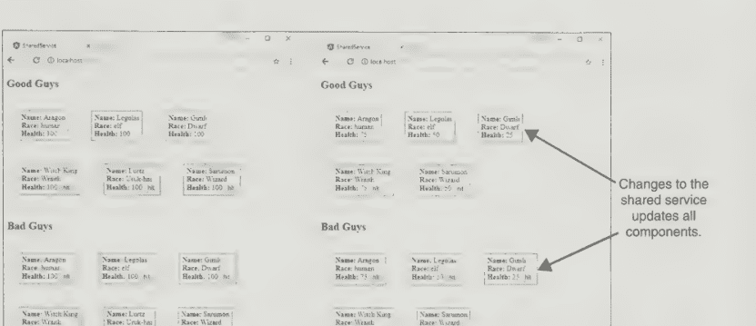

## 总结

Angular 自定义服务提供可以注入到其他 Angular 服务和组件中的功能。服务允许你将代码组织成功能模块，可用于创建可供 Angular 应用程序使用的功能库。

本章重点介绍了使你能够实现自己的自定义 Angular 服务以向应用程序提供基于任务功能的工具。本章提供了实现各种类型自定义 Angular 服务的示例。

# 12 享受 Angular 的乐趣

Angular 提供了丰富的功能，是一个功能齐全的框架。本书前面的章节已经为你提供了理解 Angular 所能提供的一切所需的知识。本章与前面的章节有点不同。它提供了一些额外的示例，对你目前所学的知识进行了扩展。本章中的示例汇集了前面所有章节的内容，并向你展示了如何构建有趣且有用的应用程序，以展示 Angular 的更多能力。

## 实现一个使用动画服务的 Angular 应用程序

清单 12.1 至 12.6 展示了如何创建一个使用动画服务来为图像设置动画的 Angular 应用程序。当鼠标悬停在图像标题上时，图像会淡入并增长到正确的大小。当鼠标离开时，图像会缩小并淡出视野。

本示例的文件夹结构如下：

- `./app.module.ts`：导入动画的应用程序模块（见清单 12.1）
- `./app.component.ts`：应用程序的 Angular 根组件（见清单 12.2）
- `./app.component.html`：`app.component` 的 Angular 模板文件（见清单 12.3）
- `./animated`：动画组件文件夹
- `./animated/animated.component.ts`：处理动画的 Angular 组件（见清单 12.4）
- `./animated/animated.component.html`：动画组件的 Angular 模板（见清单 12.5）
- `./animated/animated.component.css`：动画组件的 CSS 文件（见清单 12.6）

清单 12.1 展示了应用程序模块。为了使应用程序能够使用动画服务，需要加载 `BrowserAnimationsModule`。第 3 行和第 15 行显示了从 `@angular/platform-browser/animations` 导入 `BrowserAnimationsModule`，然后将其添加到 `imports` 数组中，以使动画对应用程序可用。

#### 清单 12.1 app.module.ts：包含 BrowserAnimationsModule 的 Angular 模块

```typescript
import { BrowserModule } from '@angular/platform-browser';
import { NgModule } from '@angular/core';
import { BrowserAnimationsModule } from '@angular/platform-browser/animations';

import { AppComponent } from './app.component';
import { AnimatedComponent } from './animated/animated.component';

@NgModule({
  declarations: [
    AppComponent,
    AnimatedComponent
  ],
  imports: [
    BrowserModule,
    BrowserAnimationsModule
  ],
  providers: [],
  bootstrap: [AppComponent]
})
export class AppModule { }
```

清单 12.2 展示了一个作为应用程序根的 Angular 组件。此组件加载一个使用动画组件的模板文件。

#### 清单 12.2 app.component.ts：一个作为应用程序根的 Angular 组件

```typescript
import { Component } from '@angular/core';
import { AnimatedComponent } from './animated/animated.component';

@Component({
  selector: 'app-root',
  templateUrl: './app.component.html'
})
export class AppComponent {}
```

清单 12.3 展示了一个 Angular 模板，它四次加载动画组件，并将图像 URL 传递给输入属性 `src`。它还为输入属性 `title` 添加了一个标题。

#### 清单 12.3 app.component.html：使用动画组件的 Angular 模板

```html
<animated title="Arch"
           src="../../assets/images/arch.jpg">
</animated>
<animated title="Volcano"
           src="../../assets/images/volcano.jpg">
</animated>
<animated title="Flower"
           src="../../assets/images/flower.jpg">
</animated>
<animated title="Sunset"
           src="../../assets/images/jump.jpg">
</animated>
```

清单 12.4 展示了一个 Angular 动画组件，它处理通过输入传递的图像的动画。第 1 至 3 行从 `@angular/core` 导入 `animate`、`keyframes`、`state`、`style`、`transition` 和 `trigger`，以使此应用能够制作动画。

第 9 至 36 行定义了组件的动画元数据。第 10 至 23 行展示了名为 `fadeState` 的动画触发器，当其激活时，会调用两个状态 `inactive` 和 `active`，以及两个过渡 `inactive => active`（创建一个 500 毫秒的 ease-in 动画）和 `active => inactive`（创建一个 500 毫秒的 ease-out 动画）。

第 24 至 34 行展示了触发器 `bounceState`，它包含了过渡 `void => *`。这个过渡创建了一个动画，导致菜单项在应用首次加载时上下弹动。第 45 至 47 行定义了 `enter` 方法，它将变量 `state` 设置为 `active`。第 48 和 49 行定义了 `leave` 方法，它将变量 `state` 设置为 `inactive`。

#### 清单 12.4 animated.component.ts：使用动画服务的 Angular 组件

```typescript
import { Component, OnInit, Input,
         animate, keyframes, state,
         style, transition, trigger } from '@angular/core';

@Component({
  selector: 'animated',
  templateUrl: './animated.component.html',
  styleUrls: ['./animated.component.css'],
  animations: [
    trigger('fadeState', [
      state('inactive', style({
        transform: 'scale(.5) translateY(-50%)',
        opacity: 0
      })),
      state('active', style({
        transform: 'scale(1) translateY(0)',
        opacity: 1
      })),
      transition('inactive => active',
        animate('500ms ease-in')),
      transition('active => inactive',
        animate('500ms ease-out'))
    ]),
    trigger('bounceState', [
      transition('void => *', [
        animate(600, keyframes([
          style({ opacity: 0,
            transform: 'translateY(-50px)' }),
          style({ opacity: .5,
            transform: 'translateY(50px)' }),
          style({ opacity: 1,
            transform: 'translateY(0)' }),
        ]))
      ])
    ])
  ]
})
export class AnimatedComponent implements OnInit {
  @Input("src") src: string;
  @Input("title") title: string;
  state: string = 'inactive';
  constructor() { }
  ngOnInit() {
  }
  enter(){
    this.state = 'active';
  }
  leave(){
    this.state = 'inactive';
  }
}
```

清单 12.5 展示了一个显示标题和图像的 Angular 模板。第 1 行展示了 Angular 动画 `@bounceState` 的使用；它接收来自组件的变量 `state`，以确定应使用哪个动画序列。第 7 和 8 行展示了 `@fadeState` 的实现；它也接收传入的 `state` 来确定动画序列。

#### 清单 12.5 animated.component.html：一个显示带动画图像的标题的 Angular 模板

```html
<div [@bounceState]="'state'">
  <p
      (mouseenter)="enter()"
      (mouseleave)="leave()">
      {{title}}
  </p>
  
</div>
```

清单 12.6 展示了一个 CSS 文件，它为图像的标题添加样式，并设置图像的尺寸。

#### 清单 12.6 animated.component.css：为动画组件设置样式的 CSS 文件

```css
div {
  display: inline-block;
  padding: 0px;
  margin: 0px;
}
p {
  font: bold 16px/30px Times New Roman;
  color: #226bd8;
  border: 1px solid lightblue;
  background: linear-gradient(white, lightblue, skyblue);
  text-align: center;
  padding: 0px;
  margin: 0px;
  vertical-align: top;
}
img {
  width: 150px;
  vertical-align: top;
}
```

图 12.1 展示了当你点击图像名称时，图像如何在大小和不透明度上进行动画。

## 实现一个点击图像可放大的 Angular 应用

清单 12.7 至 12.12 向你展示如何创建一个 Angular 应用，该应用显示的图像可以通过点击（通过浏览器事件）进行放大。

此示例的文件夹结构如下：

- `./app/app.component.ts`：应用的根组件（见清单 12.7）
- `./app/app.component.html`：根组件的 Angular 模板（见清单 12.8）
- `./app/zoomit`：包含 `zoomit` 组件的文件夹
- `./app/zoomit/zoomit.component.ts`：名为 `zoomit` 的 Angular 组件（见清单 12.9）
- `./app/zoomit/zoomit.component.html`：`zoomit` 组件的 Angular 模板（见清单 12.10）
- `./app/zoomit/zoomit.component.css`：`zoomit` 组件的 CSS 文件（见清单 12.11）
- `./assets/images`：示例图像文件所在的文件夹

清单 12.7 展示了一个作为应用根的 Angular 组件。该组件加载一个使用 `zoomit` 组件的模板文件。

#### 清单 12.7 app.component.ts：作为应用根的 Angular 组件

```typescript
import { Component } from '@angular/core';
import { ZoomitComponent } from './zoomit/zoomit.component';

@Component({
  selector: 'app-root',
  templateUrl: './app.component.html'
})
export class AppComponent {}
```

清单 12.8 展示了一个 Angular 模板，它通过将图像 URL 作为属性 `zsrc` 传递，创建了三个 `zoomit` 组件。

#### 清单 12.8 app.component.html：实现组件 zoomit 的 Angular 模板

```html
<hr>
<zoomit zsrc="../../assets/images/volcano.jpg"></zoomit>
<hr>
<zoomit zsrc="../../assets/images/flower2.jpg"></zoomit>
<hr>
<zoomit zsrc="../../assets/images/arch.jpg"></zoomit>
<hr>
```

清单 12.9 展示了 Angular `zoomit` 组件，它通过使用浏览器事件来处理图像某个部分的放大。第 13 至 16 行定义了 `ngOnInit` 方法，它根据通过 `zsrc` 输入传入的图像名称生成一个获取图像的 URL。`ngOnInit` 然后设置一个默认位置。第 18 至 23 行定义了 `imageClick` 事件，它接收一个参数 `event`。然后它从事件对象中获取元素，并用它来设置新的 x 和 y 坐标，作为图像缩放的基准。

#### 清单 12.9 zoomit.component.ts：使用浏览器事件放大图像部分的 Angular 组件

```typescript
import { Component, OnInit, Input } from '@angular/core';

@Component({
  selector: 'zoomit',
  templateUrl: './zoomit.component.html',
  styleUrls: ['./zoomit.component.css']
})
export class ZoomitComponent implements OnInit {
  @Input("zsrc") zsrc: string;
  public pos: string;
  public zUrl: string;

  ngOnInit() {
    this.zUrl = 'url("' + this.zsrc + '")';
    this.pos = "50% 50%";
  }

  imageClick(event: any){
    let element = event.target;
    let posX = Math.ceil(event.offsetX/element.width * 100);
    let posY = Math.ceil(event.offsetY/element.height * 100);
    this.pos = posX + "% " + posY + "%";
  }
}
```

清单 12.10 展示了一个 Angular 模板，它显示一个图像以及其旁边的一个放大视图，使用从 `imageClick` 函数生成的坐标。

#### 清单 12.10 zoomit.component.html：显示图像及其放大视图的 Angular 模板

```html

<div class="zoombox"
     [style.background-image]="zUrl"
     [style.background-position]="pos">
</div>
```

清单 12.11 展示了一个 CSS 文件，它通过为放大图像添加边框来为应用设置样式。它还设置了 `width` 和 `height` 为 100px。

#### 清单 12.11 zoomit.component.css：为应用设置样式的 CSS 文件

```css
img {
   width: 200px;
}
.zoombox {
   display: inline-block;
   border: 3px ridge black;
   width: 100px;
   height: 100px;
   background-repeat: no-repeat;
}
```

图 12.2 展示了自定义组件如何显示图像的放大视图。当你点击图像时，缩放的位置会改变。

## 实现支持拖放的 Angular 应用程序

清单 12.12 至 12.20 展示了如何创建一个 Angular 应用程序，该程序可以显示图片，并将描述性标签拖放到图片上。

本示例的文件夹结构如下：

- `./app/app.component.ts`：应用程序的根组件（见清单 12.12）
- `./app/app.component.html`：根组件的 Angular 模板（见清单 12.13）
- `./app/app.component.css`：app.component 的 CSS 文件（见清单 12.14）
- `./app/drop-item`：包含 drop-item 组件的文件夹
- `./app/drop-item/drop-item.component.ts`：名为 drop-item 的 Angular 组件（见清单 12.15）
- `./app/drop-item/drop-item.component.html`：drop-item 组件的 Angular 模板（见清单 12.16）
- `./app/drop-item/drop-item.component.css`：drop-item 组件的 CSS 文件（见清单 12.17）
- `./app/drag-item`：包含 drag-item 组件的文件夹
- `./app/drag-item/drag-item.component.ts`：允许元素被拖动的 Angular 组件（见清单 12.18）
- `./app/drag-item/drag-item.component.html`：drag-item 组件的 Angular 模板（见清单 12.19）
- `./app/drag-item/drag-item.component.css`：drag-item 组件的 CSS 文件（见清单 12.20）
- `./assets/images`：示例图像文件存放的文件夹

清单 12.12 展示了一个 Angular 组件，它实现了 drag-item 和 drop-item 组件，以便将标签应用于图片。第 12 至 24 行定义了构造函数，它初始化了一个可拖放到图片上的标签列表。

#### 清单 12.12 app.component.ts：一个作为应用程序根组件的 Angular 组件

```typescript
import { Component } from '@angular/core';
import { DragItemComponent } from './drag-item/drag-item.component';
import { DropItemComponent } from './drop-item/drop-item.component';

@Component({
  selector: 'app-root',
  templateUrl: './app.component.html',
  styleUrls: ['./app.component.css']
})
export class AppComponent {
  tagList: string[];
  constructor() {
    this.tagList = [
      'Nature',
      'Landscape',
      'Flora',
      'Sunset',
      'Desert',
      'Beauty',
      'Inspiring',
      'Summer',
      'Fun'
    ]
  }
  ngOnInit() {
  }
}
```

清单 12.13 展示了一个 Angular 模板，它实现了 `drag-item` 和 `drop-item` 组件，允许标签被拖放到图片上。

#### 清单 12.13 app.component.html：一个实现了 drag-item 和 drop-item 组件的 Angular 模板

```html
<h1>Tagging Images</h1>
<hr>
<div class="tagBox">
  <span *ngFor="let tagText of tagList">
    <drag-item [tag]="tagText"></drag-item>
  </span>
</div>
<hr>

<drop-item
  [imgsrc]="'../../assets/images/arch.jpg'">
</drop-item>
<drop-item
  [imgsrc]="'../../assets/images/lake.jpg'">
</drop-item>
<drop-item
  [imgsrc]="'../../assets/images/jump.jpg'">
</drop-item>
<drop-item
  [imgsrc]="'../../assets/images/flower.jpg'">
</drop-item>
<drop-item
  [imgsrc]="'../../assets/images/volcano.jpg'">
</drop-item>
```

清单 12.14 展示了一个 CSS 文件，它为应用程序设置样式，为 `drop-item` 自定义 HTML 标签提供了直接样式。

#### 清单 12.14 app.component.css：一个为应用程序设置样式的 CSS 文件

```css
.tagBox {
  width: 320px;
  padding: 5px;
}
drop-item{
  display: inline-block;
  vertical-align: top;
  margin-bottom: 5px;
}
```

清单 12.15 展示了 Angular 组件 drop-item，它使用浏览器事件允许元素被放置到组件元素上。第 11 至 13 行定义了构造函数，它将 tags 变量初始化为空数组。

第 16 至 18 行定义了 `allowDrop` 方法，它接受一个事件对象作为参数。在该事件对象上调用了 `preventDefault` 方法。第 19 至 25 行定义了 `onDrop` 方法，它接受一个事件对象作为参数。在事件对象上调用了 `preventDefault`。然后，将变量 data 赋值为事件中的 tagData，从而允许 Angular 将该数据添加到 tags 数组以及图片上的列表中。

#### 清单 12.15 drop-item.component.ts：一个允许元素被放置到其上的 Angular 组件

```typescript
import { Component, OnInit, Input } from '@angular/core';

@Component({
  selector: 'drop-item',
  templateUrl: './drop-item.component.html',
  styleUrls: ['./drop-item.component.css']
})
export class DropItemComponent implements OnInit {
  @Input() imgsrc: string;
  tags: string[];
  constructor() {
    this.tags = [];
  }
  ngOnInit() {
  }
  allowDrop(event) {
    event.preventDefault();
  }
  onDrop(event) {
    event.preventDefault();
    let data = JSON.parse(event.dataTransfer.getData('tagData'));
    if (!this.tags.includes(data.tag)){
      this.tags.push(data.tag);
    }
  }
}
```

清单 12.16 展示了一个 Angular 模板，它显示一张图片以及分配给该图片的所有标签。

#### 清单 12.16 drop-item.component.html：一个显示图片以及拖放到该图片上的所有标签的 Angular 模板

```html
<div class="taggedImage"
    (dragover)="allowDrop($event)"
    (drop)="onDrop($event)">
  
  <span class="imageTag"
        *ngFor="let tag of tags">
    {{tag}}
  </span>
</div>
```

清单 12.17 展示了一个 CSS 文件，它通过为附加到图片的标签添加自定义样式来为应用程序设置样式。

#### 清单 12.17 drop-item.component.css：一个为应用程序设置样式的 CSS 文件

```css
img {
  width: 100px;
}
.taggedImage {
  display: inline-block;
  width: 100px;
  background: #000000;
}
.imageTag {
  display: inline-block;
  width: 100px;
  font: 16px/18px Georgia, serif;
  text-align: center;
  color: white;
  background: linear-gradient(#888888, #000000);
}
```

清单 12.18 展示了 Angular 组件 `drag-item`，它使用浏览器事件允许元素被拖动。第 14 至 17 行定义了 `onDrag` 方法，它接受一个事件对象作为参数。此方法向事件对象的 `dataTransfer` 项添加数据，以便在元素被放置时可以传输标签数据。

#### 清单 12.18 drag-item.component.ts：一个允许元素被拖动的 Angular 组件

```typescript
import { Component, OnInit, Input } from '@angular/core';

@Component({
  selector: 'drag-item',
  templateUrl: './drag-item.component.html',
  styleUrls: ['./drag-item.component.css']
})
export class DragItemComponent implements OnInit {
  @Input() tag: string;
  constructor() {
  }
  ngOnInit() {
  }
  onDrag(event) {
    event.dataTransfer.setData('tagData',
        JSON.stringify({tag: this.tag}));
  }
}
```

清单 12.19 展示了一个 Angular 模板，它显示一个可拖动的标签。

#### 清单 12.19 drag-item.component.html：一个显示图片标签的 Angular 模板

```html
<div class="tagItem"
    (dragstart)="onDrag($event)"
    draggable="true">
  {{tag}}
</div>
```

清单 12.20 展示了一个 CSS 文件，它通过为标签添加自定义样式来为应用程序设置样式。

#### 清单 12.20 drag-item.component.css：一个为应用程序设置样式的 CSS 文件

```css
.tagItem {
  display: inline-block;
  width: 100px;
  font: 16px/18px Georgia, serif;
  text-align: center;
  background: linear-gradient(#FFFFFF, #888888);
}
```

图 12.3 展示了 drag-item 和 drop-item 组件在浏览器中的工作方式：当你将一个标签拖放到图片上时，该标签会被添加到下方的列表中。


图 12.3 使用 Angular 组件实现拖放

## 实现一个星级评分 Angular 组件

清单 12.22 至 12.30 展示了如何创建一个 Angular 应用程序来实现星级评分系统，以便用户可以对组件附加的项目（此处为图像）进行评分。

此示例的文件夹结构如下：

- `./app/app.module.ts`：应用程序的根模块（参见清单 12.21）
- `./app/mockbackend.service.ts`：模拟后端服务（参见清单 12.22）
- `./app/ratings.service.ts`：评分服务（参见清单 12.23）
- `./app/app.component.ts`：应用程序的根组件（参见清单 12.24）
- `./app/app.component.html`：根组件的 Angular 模板（参见清单 12.25）
- `./app/app.component.css`：app.component 的 CSS 文件（参见清单 12.26）
- `./app/rated-item`：包含 `rated-item` 组件的文件夹
- `./app/rated-item/rated-item.component.ts`：允许用户对项目进行评分的 Angular 组件（参见清单 12.27）
- `./app/rated-item/rated-item.component.html`：`rated-item` 组件的 Angular 模板（参见清单 12.28）
- `./app/rated-item/rated-item.component.css`：`rated-item` 组件的 CSS 文件（参见清单 12.29）

清单 12.21 展示了应用模块。该模块使用了 `InMemoryWebApiModule`，它允许创建一个模拟数据库。第 18 行展示了 `InMemoryWebApiModule` 的实现。

#### 清单 12.21 app.module.ts：一个实现了 InMemoryWebApiModule 的 Angular 模块

```typescript
import { BrowserModule } from '@angular/platform-browser';
import { NgModule } from '@angular/core';
import { HttpModule } from '@angular/http';
import { InMemoryWebApiModule } from 'angular-in-memory-web-api';

import { AppComponent } from './app.component';
import { RatedItemComponent } from './rated-item/rated-item.component';
import { MockbackendService } from './mockbackend.service';

@NgModule({
  declarations: [
    AppComponent,
    RatedItemComponent
  ],
  imports: [
    BrowserModule,
    HttpModule,
    InMemoryWebApiModule.forRoot(MockbackendService)
  ],
  providers: [],
  bootstrap: [AppComponent]
})
export class AppModule { }
```

清单 12.22 展示了一个用作应用程序模拟数据库的 Angular 服务。第 4 行到第 29 行创建了一个项目数组，可以通过 HTTP 请求进行检索和更新。

#### 清单 12.22 mockbackend.service.ts：一个 Angular 模拟后端服务

```typescript
import { InMemoryDbService } from 'angular-in-memory-web-api';
export class MockbackendService implements InMemoryDbService {
  createDb() {
    const items = [
      {
        id: 1,
        title: "Waterfall",
        url: "../../assets/images/cliff.jpg",
        rating: 4
      },
      {
        id: 2,
        title: "Flower",
        url: "../../assets/images/flower.jpg",
        rating: 5
      },
      {
        id: 3,
        title: "Pyramid",
        url: "../../assets/images/pyramid.jpg",
        rating: 3
      },
      {
        id: 4,
        title: "Lake",
        url: "../../assets/images/lake.jpg",
        rating: 5
      }
    ]
    return {items};
  }
}
```

清单 12.23 展示了一个使用 HTTP 来检索和更新模拟数据库中项目的 Angular 服务。第 6 行到第 11 行定义了 `RatedItem` 接口，其中包含严格类型的变量名。第 19 行到第 24 行定义了构造函数，该函数创建了一个 `http` 实例和一个名为 `itemObservable` 的新可观察对象。

从可观察对象接收到响应后，会调用 `getItems` 方法。第 27 和 28 行定义了 `getObservable` 方法，该方法返回 `itemObservable`。第 30 行到第 38 行定义了 `getItems` 方法，该方法使用 HTTP get 从模拟数据库中检索项目列表；然后将 `items` 变量赋值为响应，并将该响应发送给观察者。

第 39 行到第 47 行定义了 `updateRating` 方法，该方法接受两个参数：`item` 和 `newRating`。它将 `item` 的 `rating` 赋值为 `newRating`，并使用 HTTP put 请求来更新数据库中的项目。

#### 清单 12.23 ratings.service.ts：一个使用 HTTP 来检索带评分项目列表的 Angular 服务

```typescript
import { Injectable, OnInit } from '@angular/core';
import { Http }      from '@angular/http';
import { Observable } from 'rxjs/Observable';
import 'rxjs/add/operator/toPromise';

export class RatedItem {
  id: number;
  url: string;
  title: string;
  rating: number;
}

@Injectable()
export class RatingsService {
  url = 'api/items';
  items: RatedItem[];
  public itemObservable: Observable<any>;
  observer;
  constructor(private http: Http) {
    this.itemObservable = new Observable(observer => {
      this.observer = observer;
      this.getItems();
    })
  }
  ngOnInit(){
  }
  getObservable(){
    return this.itemObservable;
  }
  getItems(){
    this.http.get(this.url)
           .toPromise()
           .then( response => {
             this.items = response.json().data;
             this.observer.next(this.items);
           })
           .catch(this.handleError);
  }
  updateRating(item, newRating){
    item.rating = newRating;
    const url = `${this.url}/${item.id}`;
    this.http
      .put(url, JSON.stringify(item))
      .toPromise()
      .then(() => this.getItems())
      .catch(this.handleError)
  }
  private handleError(error: any): Promise<any> {
    console.error('An error occurred', error);
    return Promise.reject(error.message || error);
  }
}
```

清单 12.24 展示了一个处理从 `RatingsService` 获取项目的 Angular 组件。第 21 行到第 27 行定义了 `ngOnInit`，它调用 `ratingsService` 的 `getObservable` 方法，将项目可观察对象赋值给 `itemsObservable`。然后，`items` 变量被赋值为从 `itemsObservable` 接收到的响应。

#### 清单 12.24 app.component.ts：一个作为应用程序根的 Angular 组件

```typescript
import { Component } from '@angular/core';
import { RatedItemComponent } from './rated-item/rated-item.component';
import { Observable } from 'rxjs/Observable';
import { RatingsService } from './ratings.service';

@Component({
  selector: 'app-root',
  templateUrl: './app.component.html',
  styleUrls: ['./app.component.css'],
  providers: [ RatingsService ]
})
export class AppComponent {
  title = 'app';
  itemsObservable: Observable<any>;
  items: any[];
  constructor(
    public ratingsService: RatingsService
  ){
    this.items = [];
  }
  ngOnInit(){
    this.itemsObservable = this.ratingsService.getObservable();
    this.itemsObservable.subscribe(
      itemList => {
        this.items = itemList;
      });
  }
}
```

清单 12.25 展示了一个实现了 `rated-item` 组件以显示已评分项目列表的 Angular 模板。`rated-item` 接受两个输入：`item` 和 `ratingsService`。

#### 清单 12.25 app.component.html：一个使用 rated-item 组件创建已评分项目列表的 Angular 模板

```html
<h1> Rated Images </h1>
<hr>
<div class="item"
    *ngFor="let item of items">
  <rated-item
    [item]="item"
    [ratingsService]="ratingsService">
  </rated-item>
</div>
```

清单 12.26 展示了一个为 `app.component.html` 上的 `item` 类设置样式的 CSS 文件。

#### 清单 12.26 app.component.css：一个为应用程序设置样式的 CSS 文件

```css
.item{
  border: .5px solid black;
  display: inline-block;
  width:175px;
  text-align: center;
}
```

清单 12.27 展示了一个显示已评分项目的 Angular 组件。第 13 行到第 15 行定义了构造函数方法，该方法初始化 `starArray` 的值。

第 18 行到第 20 行定义了 `setRating` 方法，该方法接受参数 `rating`。该方法调用评分服务的 `updateRating` 方法，并传入参数 `item` 和 `rating`，评分服务使用这些参数来更新项目的评分。

第 21 行到第 27 行定义了 `getStarClass` 方法，该方法接受参数 `rating`。此方法用于分配每颗星的 CSS 类，以准确表示项目的评分。

#### 清单 12.27 rated-item.component.ts：一个显示图像及其评分的 Angular 组件

```typescript
import { Component, OnInit, Input } from '@angular/core';
import { RatingsService } from '../ratings.service';

@Component({
  selector: 'rated-item',
  templateUrl: './rated-item.component.html',
  styleUrls: ['./rated-item.component.css']
})
export class RatedItemComponent implements OnInit {
  @Input ("item") item: any;
  @Input ("ratingsService") ratingsService: RatingsService;
  starArray: number[];
  constructor() {
    this.starArray = [1,2,3,4,5];
  }
  ngOnInit() {
  }
  setRating(rating){
    this.ratingsService.updateRating(this.item, rating);
  }
  getStarClass(rating){
    if(this.item.rating >= rating){
      return 'star-full';
    } else {
      return 'star-empty';
    }
  }
}
```

## 符号

+ (加法) 运算符, 8

&& (逻辑与) 运算符, 10

= 赋值运算符, 9

/= 赋值运算符, 9

+= 赋值运算符, 9

-= 赋值运算符, 9

%= 赋值运算符, 9

*= 赋值运算符, 9

` (反引号), 50–51

{ } (花括号), 10, 14, 61, 62, 75

- (递减) 运算符, 8

/ (除法) 运算符, 8

== (相等) 运算符, 9

=== (严格相等) 运算符, 9

\' 转义码, 20

\" 转义码, 20

\\ 转义码, 20

> (大于) 运算符, 9

>= (大于或等于) 运算符, 9

++ (递增) 运算符, 8

< (小于) 运算符, 9

<= (小于或等于) 运算符, 9

% (取模) 运算符, 8

* (乘法) 运算符, 8

!= (不等于) 运算符, 9

!== (严格不等于) 运算符, 9

! (逻辑非) 运算符, 10

|| (逻辑或) 运算符, 10

( ) (圆括号), 10, 14, 82, 103

| (管道符号), 72

- (减法) 运算符, 8

~ (波浪号), 50–51

app.component.css 清单

AreaCalcService, 155

带组件的自定义指令, 100

拖放应用程序, 181–182

RandomImageService, 159

带导航栏的路由器, 141

星级评分应用程序, 190

## A

ActivatedRoute，导入, 134

addClass() 方法, 92

加法运算符, 8

AddNums 接口, 31

警报，异步, 162

allowDrop() 方法, 182

逻辑与运算符, 10

app.component.html 清单

动画应用程序, 172–173

AreaCalcService, 154–155

带组件的自定义指令, 99–100

拖放应用程序, 181

图像缩放应用程序, 177

PiService, 152

PromiseService, 162

RandomImageService, 159

带导航栏的路由器, 140

SharedService, 165

星级评分应用程序, 189–190

缩放指令, 97–98

Angular 引导程序，创建, 44–48

app.module.js, 47

app.module.ts, 46

first.component.js, 48

first.component.ts, 46

first.html, 45

Angular 快速入门网站, 40

动画服务, 116

动画组件

animated.component.css, 175

animated.component.html, 175

animated.component.ts, 173–174

动画应用程序


- `animated.component.css`, 175
- `animated.component.html`, 175
- `animated.component.ts`, 173–174
- `app.component.html`, 172–173
- `app.component.ts`, 172
- `app.module.ts`, 171–172
- 文件夹结构, 171

`app.component.ts` 清单

- 动画应用程序, 172
- `AreaCalcService`, 153–154
- 带组件的自定义指令, 99
- 拖放应用程序, 180–181
- 图像缩放应用程序, 176–177
- `PiService`, 151
- `PromiseService`, 161–162
- `RandomImageService`, 158–159
- 带导航栏的路由器, 140
- 带参数的路由器, 144
- `SharedService`, 165
- 简单路由器应用程序, 135–136
- 星级评分应用程序, 189

匿名函数, 16

`any` 数据类型, 30

`app.module.js` 清单, 47

**`app.module.ts` 清单**

Angular 引导程序, 46

动画应用程序, 171–172

简单模拟服务器实现, 119–120, 126

简单路由器实现, 134–135

星级评分应用程序, 186

**`AppRoutingModule`，导入, 134**

**`app-routing.module.ts` 清单**

带导航栏的路由器, 138–139

带参数的路由器, 144

简单路由器实现, 135–136

**`AreaCalcService`, 152–156**

`app.component.css`, 155

`app.component.html`, 154–155

`app.component.ts`, 153–154

`area-calc.service.ts`, 152–153

**`area-calc.service.ts` 清单, 152–153**

算术运算符, 8

**`Array` 对象, 22–25**

向其添加项, 25

合并, 24

转换为字符串, 24

遍历, 24

操作, 22–24

方法, 23

从中移除项, 25

搜索, 25

**数组**

JavaScript, 7

向其添加项, 25

合并, 24

转换为字符串, 24

遍历, 24

操作, 22–24

方法, 23

从中移除项, 25

搜索, 25

路由，定义, 132–133

TypeScript, 30

**赋值运算符, 8–9**

星号 (*), 8

异步管道, 70

异步警报, 162

属性绑定, 79

**属性指令, 38, 91–94**

`attribute.component.css`, 94

`attribute.component.html`, 93

`attribute.component.ts`, 92–93

自定义属性指令, 95–98

`ngForm`, 91

`ngModel`, 91

`ngStyle`, 91

**`attribute.component.css` 清单, 94**

**`attribute.component.html` 清单, 93**

**`attribute.component.ts` 清单, 92–93**

## B

`\b` (退格) 转义码, 20

反引号 (`), 50–51

退格转义码, 20

**反派角色组件**

`badguys.component.css`, 168

`badguys.component.html`, 168

`badguys.component.ts`, 167

**`basicExpressions.component.ts` 清单, 63**

绑定。参见数据绑定

**布尔数据类型**

JavaScript, 7

TypeScript, 29

引导元数据选项 (NgModule), 43

引导程序，创建, 44–48

- `app.module.js`, 47
- `app.module.ts`, 46
- `first.component.js`, 48
- `first.component.ts`, 46
- `first.html` 清单, 45

`border()` 函数, 96

花括号 ({ }), 61, 62

`break` 语句, 13–14

浏览器事件, 103–104

`BrowserAnimationsModule`，加载, 172

浏览器

- 浏览器事件, 103–104
- 支持情况, 5–6

构建模板, 50–51

内置指令, 87–88

- 属性指令, 38, 91–94
  - `attribute.component.css`, 94
  - `attribute.component.html`, 93
  - `attribute.component.ts`, 92–93
  - `ngForm`, 91
  - `ngModel`, 91
  - `ngStyle`, 91
- 组件指令, 38, 88
- 结构指令, 38, 88–91
  - 定义, 87
  - `ngFor`, 88, 120, 125, 130, 159
  - `ngIf`, 88–89
  - `ngSwitch`, 88–89
  - `ngSwitchCase`, 88, 89
  - `ngSwitchDefault`, 88
  - `structural.component.ts`, 89–90

内置事件, 103–104

内置管道

- `builtInPipes.component.ts`, 71–72
- 表格, 69–70

内置服务

- 动画, 116
- 表单, 116
- HTTP, 116
  - 发送 GET 请请求, 116–117
  - JSON 文件实现与访问, 118–121
  - 发送 PUT 请求, 116–117
  - 请求配置, 117
  - 响应回调函数, 117
  - 简单模拟服务器实现, 121–127
  - 简单模拟服务器更新, 127–132
- 路由器, 116
  - `ActivatedRoute`，导入, 134
  - 路由导航, 134
  - 路由对象参数, 133
  - `Router`，导入, 134
  - 带导航栏的路由器, 138–143
  - 带参数的路由器, 143–147
  - 路由数组, 132–133
  - 包含路由模块, 134
  - 简单路由器实现, 134–137

`builtInPipes.component.ts` 清单, 71–72

## C

回调函数, 16

`canActivate` 属性 (路由对象), 133

`canActivateChild` 属性 (路由对象), 133

`canDeactivate` 属性 (路由对象), 133

`canLoad` 属性 (路由对象), 133

回车转义码, 20

层叠样式表。参见 CSS (层叠样式表)

`catch()` 方法, 117

`catch` 语句, 26

变更检测, 111–114

（变更）事件, 103

`changeLoop()` 方法, 156

`changeSize()` 函数, 96

`character.component.css` 清单, 108

`character.component.html` 清单, 108

`character.component.ts` 清单, 107–108

`charAt()` 方法, 20

`charCodeAt()` 方法, 20

`charObservable`, 163

子组件，从父组件删除数据, 107–110

`Children` 属性（路由对象）, 133

类绑定, 79–80

`class.component.ts` 清单, 80

类。**另见** 服务

- `@directive`, 95
- 绑定, 79–80
- `Component`, 64–66
- 定义, 32
- `EventEmitter`, 104
- 导出类
  - `Directive`, 95
  - `ZoomDirective`, 97
- 继承, 33
- 管道, 72
- `SecretAgent`, 33

`classExpressions.component.ts` 清单, 64–65

CLI（命令行界面）, 40–41。另见命令

（click）事件, 103

代码清单。参见 清单

组合

- 数组, 24
- 字符串, 21

命令行界面。**见** CLI（命令行界面）

命令。**另见** 指令

- `ng eject`, 41
- `ng generate component`, 41
- `ng generate directive`, 41
- `ng generate enum`, 41
- `ng generate guard`, 41
- `ng generate interface`, 41
- `ng generate module`, 41
- `ng generate pipe`, 41
- `ng generate service`, 41
- `ng new`, 41
- `ng serve`, 41
- `npm install`, 121

比较运算符, 9–10

`Component` 类, 64–66

**`component` 属性（路由对象）**, 133

**组件**, 42–43, 185–192。**另见** 清单；服务

- Angular 引导程序, 44–48
- 动画应用, 172–173
  - `animated.component.css`, 175
  - `animated.component.html`, 175
  - `animated.component.ts`, 173–174
  - `app.component.ts`, 172
  - `app.module.ts`, 171–172
  - 文件夹结构, 171
- 配置, 49–50
- 构造函数, 53–54
- 自定义组件指令, 98–102
  - 容器组件, 100
    - 容器组件的 CSS, 101
    - 容器组件的 HTML, 101
  - 根组件, 99
    - 根组件的 CSS, 100
    - 根组件的 HTML, 99–100
- 在组件中删除数据, 107–110
- 依赖注入
  - 使用依赖注入构建嵌套组件, 56–58
  - 定义, 38–39, 56
  - 使用依赖注入传递数据, 58–59
  - 带有输入的示例应用, 59–60
- 拖放应用
  - `app.component.css`, 181–182
  - `app.component.html`, 181
  - `app.component.ts`, 180–181
  - `drag.component.css`, 184
  - `drag.component.html`, 184
  - `drag.component.ts`, 184
  - `drop.component.css`, 183
  - `drop.component.html`, 183
  - `drop.component.ts`, 182
  - 文件夹结构, 179–180
- 从组件发出自定义事件, 104
- 图片缩放应用
  - `app.component.html`, 177
  - `app.component.ts`, 176–177
  - 文件夹结构, 176
  - `zoomit.component.css`, 178
  - `zoomit.component.html`, 178
  - `zoomit.component.ts`, 177–178
- 导入, 42–43
- 在组件中使用内联 CSS 和 HTML, 51–52
- 将自定义服务集成到组件中, 149–150
- 嵌套组件, 104–106
- `NgModule`, 43–44
- 选择器, 50
- 职责分离, 39
- 星级评定应用
  - `app.component.css`, 190
  - `app.component.html`, 189–190
  - `app.component.ts`, 189
  - `app.module.ts`, 186
  - 文件夹结构, 185
  - `mockbackend.service.ts`, 186–187
  - `rated-item.component.css`, 191–192
  - `rated-item.component.html`, 191
  - `rated-item.component.ts`, 190–191
  - `ratings.service.ts`, 187–188
- 模板
  - 构建, 50–51
  - 外部模板, 54–56
- 组件指令, 38, 88
- `concat()` 方法, 20, 21, 23, 24
- 条件语句
  - `if` 语句, 10
  - `switch` 语句, 11
- 配置
  - 组件, 49–50
  - 选择器, 50
  - 模板, 50–51
  - HTTP 请请求, 117
- 常量数据服务, 151–152
  - `app.component.html`, 152
  - `app.component.ts`, 151
  - `pi.service.ts`, 151
- `constructor.component.ts` 清单, 53
- 构造函数, 53–54
- 容器组件, 100
  - 其 CSS, 101
  - 其 HTML, 101
- 容器指令
  - `container.component.css`, 101
  - `container.component.html`, 101
  - `container.component.ts`, 100
- 内容，使用 CLI（命令行界面）生成, 40–41
- `continue` 语句, 13–14
- 自定义服务, 201
- 将数组转换为字符串, 24
- `createAlert()` 方法, 161
- `createDb()` 方法, 127
- `createDelete.component.css` 清单, 125–126
- `createDelete.component.html` 清单, 125
- `createDelete.component.ts` 清单, 123–124
- `createTimedAlert()` 方法, 161
- `createUser()` 方法, 122, 124
- 创建。另见 定义
  - Angular 应用
    - Angular 引导程序, 44–48
    - 动画应用, 171–176
    - 组件, 42–43
    - 拖放应用, 179–185
    - 图片缩放应用, 176–179
    - `NgModule`, 43–44
    - 星级评定应用, 185–192
  - 自定义指令
    - 自定义属性指令, 95–98
    - 自定义组件指令, 98–102
  - 自定义管道, 73–74
  - `Observable` 对象, 110–111
- CSS（层叠样式表）
  - Angular 应用中的内联 CSS, 51–52
  - 清单
    - `app.component.css`, 100, 141, 159, 181–182, 190
    - `attribute.component.css`, 94
    - `character.component.css`, 108
    - `container.component.css`, 101
    - `details.component.css`, 109
    - `drag.component.css`, 184
    - `drop.component.css`, 183
    - `external.css`, 55
    - `http.component.css`, 120–121
    - `outer.css`, 57
    - `rated-item.component.css`, 191–192
    - `update.component.css`, 131–132
    - `zoomit.component.css`, 178
- 花括号 ({{ }}), 10, 14, 75
- `currency` 管道, 69
- 自定义指令, 95
  - 自定义属性指令, 95–98
  - 自定义组件指令, 98–102
    - 容器组件, 100
      - 容器组件的 CSS, 101
      - 根组件的 CSS, 100
      - 容器组件的 HTML, 101
      - 根组件的 HTML, 99–100
    - 根组件, 99
- 自定义事件, 104
  - 使用自定义事件删除数据, 107–110
  - 从组件发出, 104
  - 使用监听器处理, 104
  - 在嵌套组件中实现, 104–106
- 自定义对象, 18–19
- 自定义管道, 72–74
- 自定义服务, 149
  - 常量数据服务, 151–152
    - `app.component.html`, 152
    - `app.component.ts`, 151
    - `pi.service.ts`, 151
  - 数据转换服务, 152–156
    - `app.component.css`, 155
    - `app.component.html`, 154–155
    - `app.component.ts`, 153–154
    - `area-calc.service.ts`, 152–153
  - 集成到应用中, 149–150
  - 返回 Promise 的服务, 161–162
  - 共享服务, 162–169
    - `app.component.html`, 165
    - `app.component.ts`, 165
    - `badguys.component.css`, 168
    - `badguys.component.html`, 168
    - `badguys.component.ts`, 167
    - `good-guys.component.css`, 167
    - `good-guys.component.html`, 166
    - `good-guys.component.ts`, 166
    - `shared.service.ts`, 163–164
  - 可变数据服务, 156–160
    - `app.component.css`, 159
    - `app.component.html`, 159
    - `app.component.ts`, 158–159
    - `random-image.service.ts`, 157–158
- **`customevent.component.html` 清单, 105–106**
- **`customevent.component.ts` 清单, 105**
- **`customPipes.component.ts` 清单, 73–74**
- **`custom.pipe.ts` 清单, 73**

## D

`delete()` 方法, 116

`deleteChar()` 方法, 107

`deleteUser()` 函数, 122

`deleteUser()` 方法, 124

删除数据, 107–110

### 数据类型

- JavaScript, 6–7
- TypeScript, 29–30

**`data.service.ts` 清单, 122, 127–128**

`date` 管道, 70

`debounce()` 方法, 117

`declarations` 元数据, 43, 56

### 装饰器

- `@NgModule`, 43–44, 56
- `@pipe`, 72

递减运算符, 8

定义。另见 创建

- 类, 32
- 函数, 14–15
- 接口, 31
- 路由数组, 132–133
- 选择器, 50
- 变量, 6

依赖注入

- 使用依赖注入构建嵌套组件, 56–58
- 数据，使用依赖注入传递, 58–59
- 定义, 38–39, 56
- 使用依赖注入传递数据, 58–59
- 带有输入的示例应用, 59–60
- 使用场景, 149–150

数据绑定, 75

- 属性绑定, 79
- 类绑定, 79–80
- 定义, 38
- 事件绑定, 82–85
- 插值, 76–77
- 属性绑定, 77–79
- 样式绑定, 81–82
- 双向绑定, 85–86

数据变更，使用可观测对象检浫, 111–114

**`details.component.css` 清单, 109**

**`details.component.html` 清单, 109**

**`details.component.ts` 清单, 108–109**

`Data` 属性（路由对象）, 133

数据转换服务, 152–156

检测数据变更, 111–114

- 开发环境, 5–6
- `@directive` 类, 95
- `Directive` 类, 95
- 指令。另见 命令
  - 内置指令, 87–88
    - 属性指令, 38, 91–94
    - 组件指令, 38, 88
    - 结构指令, 38, 88–91
  - 自定指令, 95
    - 自定义属性指令, 95–98
    - 自定义组件指令, 98–102
  - 定义, 87
- 除法运算符, 8
- `doCalc()` 函数, 16
- `doCircle()` 方法, 153
- `doRectangle()` 方法, 153
- `doSquare()` 方法, 153
- `doTrapezoid()` 方法, 153
- `doTriangle()` 方法, 153
- 双花括号 ([[]]), 75
- `do/while` 循环, 12
- 拖放应用
  - `app.component.css`, 181–182
  - `app.component.html`, 181
  - `app.component.ts`, 180–181
  - `drag.component.css`, 184
  - `drag.component.html`, 184
  - `drag.component.ts`, 184
  - `drop.component.css`, 183
  - `drop.component.html`, 183
  - `drop.component.ts`, 182
  - 文件夹结构, 179–180
- 拖拽项组件
  - `app.component.css`, 181–182
  - `app.component.html`, 181
  - `app.component.ts`, 180–181
  - `drag.component.css`, 184
  - `drag.component.html`, 184
  - `drag.component.ts`, 184
- 放置项组件
  - `app.component.css`, 181–182
  - `app.component.html`, 181
  - `app.component.ts`, 180–181
  - `drop.component.css`, 183
  - `drop.component.html`, 183
  - `drop.component.ts`, 182
- `dummyDB.JSON` 清单, 118
- 编辑器, 5
- 数组元素，添加/删除, 25
- `emit()` 方法, 104
- 发出自定义事件, 104
- `entryComponents` 元数据选项（NgModule）, 43
- 枚举数据类型, 30
- 环境，向其中添加 Angular, 39–40
- 等于运算符, 9
- 等号 (=), 9
- 错误处理, 25
  - `finally` 关键字, 27
  - 抛出错误, 26–27
  - `try/catch` 块, 26
- 转义码, 20
- 事件绑定, 82–85
- `event.component.ts` 清单, 82–84
- `EventEmitter` 类, 104
- `eventHandler()` 方法, 105
- 事件
  - 绑定, 82–85
  - 浏览器事件, 103–104
  - 自定义事件, 104
- 除法运算符, 8
- `doCalc()` 函数, 16
- `doCircle()` 方法, 153
- `doRectangle()` 方法, 153
- `doSquare()` 方法, 153
- `doTrapezoid()` 方法, 153
- `doTriangle()` 方法, 153
- 双花括号 ([[]]), 75
- `do/while` 循环, 12
- 拖放应用
  - `app.component.css`, 181–182
  - `app.component.html`, 181
  - `app.component.ts`, 180–181
  - `drag.component.css`, 184
  - `drag.component.html`, 184
  - `drag.component.ts`, 184
  - `drop.component.css`, 183
  - `drop.component.html`, 183
  - `drop.component.ts`, 182
  - 文件夹结构, 179–180
- 拖拽项组件
  - `app.component.css`, 181–182
  - `app.component.html`, 181
  - `app.component.ts`, 180–181
  - `drag.component.css`, 184
  - `drag.component.html`, 184
  - `drag.component.ts`, 184
- 放置项组件
  - `app.component.css`, 181–182
  - `app.component.html`, 181
  - `app.component.ts`, 180–181
  - `drop.component.css`, 183
  - `drop.component.html`, 183
  - `drop.component.ts`, 182
- `dummyDB.JSON` 清单, 118
- 编辑器, 5
- 数组元素，添加/删除, 25
- `emit()` 方法, 104
- 发出自定义事件, 104
- `entryComponents` 元数据选项（NgModule）, 43
- 枚举数据类型, 30
- 环境，向其中添加 Angular, 39–40
- 等于运算符, 9
- 等号 (=), 9
- 错误处理, 25
  - `finally` 关键字, 27
  - 抛出错误, 26–27
  - `try/catch` 块, 26
- 转义码, 20
- 事件绑定, 82–85
- `event.component.ts` 清单, 82–84
- `EventEmitter` 类, 104
- `eventHandler()` 方法, 105
- 事件
  - 绑ning, 82–85
  - 浏览器事件, 103–104
  - 自定义事件, 104

## E

使用……删除数据，107–110

从组件中发出，104

使用监听器处理，104

在嵌套组件中实现，104–106

导出类

指令，95

`ZoomDirective`，97

`export` 关键字，38

导出模块，38

`exports` 元数据选项 (NgModule)，43

表达式，61–62

基本表达式，62–63

组件类交互，64–66

管道

内置管道，69–72

自定义管道，72–74

定义，68–69

TypeScript 在……中，65–68

外部模板，54–56

`external.component.ts` 清单，55

`external.css` 清单，55

`externalTemplate.html` 清单，55

## F

`\f`（换页符）转义码，20

`@fadeState`，173–175

`feed()` 方法，32

`finally` 关键字，27

`first.component.js` 清单，48

`first.component.ts` 清单，46

`first.html` 清单，45

`(focus)` 事件，103

换页符转义码，20

`formatGreeting()` 函数，15

表单服务，116

正斜杠 (/)，8

`fromCharCode()` 方法，20

函数，14–15。*另见* 方法

匿名函数，16

`border()`，96

回调函数，16

`changeSize()`，96

定义，14–15

`deleteUser()`，122

`doCalc()`，16

`formatGreeting()`，15

`getRandom()`，156

`gotoPage2()`，144–145

`greeting()`，15

`imageClick()`，178

向……传递变量，15

`playLoop()`，111

`resolve()`，161

从……返回值，15

`selectCharacter()`，107

`setTimeout()`，156

`soldierOfGondor()`，34

## G

使用 CLI（命令行界面）生成内容，40–41

`get()` 方法，116

GET 请求

响应回调函数，117

发送，116–117

`getCharacters()` 方法，163

`getItems()` 方法，187

`getObservable()` 方法，187，189

`getPi()` 方法，151

`getRandom()` 函数，156

`getRandomImage()` 方法，158

`getStarClass()` 方法，190–191

`getUsers()` 方法，**122, 128**

### Good Guys 组件

- `good-guys.component.css`，167
- `good-guys.component.html`，166
- `good-guys.component.ts`，166

`gotoPage2()` 函数，**144-145**

大于运算符，9

大于或等于运算符，9

`greeting()` 函数，15

## H

处理自定义事件，104

`head()` 方法，116

`hitCharacter()` 方法，163-166

`home.component.html` 清单，136

`home.component.ts` 清单，136

### HTML（超文本标记语言）

事件，Angular 语法，103-104

Angular 应用中的内联 HTML，51-52

清单

- `animated.component.html`，175
- `app.component.html`。*参见 app.component.html 清单*
- `app.module.ts`，126
- `attribute.component.html`，93
- `badguys.component.css`，168
- `badguys.component.html`，168
- `character.component.html`，108
- `container.component.html`，101
- `createDelete.component.CSS`，125-126
- `createDelete.component.html`，125
- `customevent.component.html`，105-106
- `details.component.html`，109
- `drag.component.html`，184
- `drop.component.html`，183
- `externalTemplate.html`，55
- `first.html`，45
- `good-guys.component.css`，167
- `good-guys.component.html`，166
- `home.component.html`，136
- `http.component.html`，119-120
- `observable.component.html`，113
- `outer.html`，57
- `page1.component.html`，145
- `page2.component.html`，142，146-147
- `page3.component.html`，142-143
- `rated-item.component.html`，191
- `route2.component.html`，137
- `update.component.html`，130-131
- `zoomit.component.html`，178
- `<router-outlet>` 标签，134

### http 服务，116

- GET 请求，发送，116-117
- JSON 文件实现与访问，118-121
    - `app.module.ts`，119-120
    - `dummyDB.JSON`，118
    - `http.component.CSS`，120-121
    - `http.component.html`，119-120
    - `http.component.ts`，119
- PUT 请求，发送，116-117
- 请求配置，117
- 响应回调函数，117
- 简单模拟服务器实现，121-127
    - `app.module.ts`，126
    - `createDelete.component.CSS`，125-126
    - `createDelete.component.html`，125
    - `createDelete.component.ts`，123-124
    - 创建，121
    - `data.service.ts`，122
    - `user.service.ts`，124–125
- 简单模拟服务器更新，127–132
    - `data.service.ts`，127–128
    - `update.component.CSS`，131–132
    - `update.component.html`，130–131
    - `update.component.ts`，128–129
    - `user.service.ts`，129–130

`http.component.CSS` 清单，120–121

`http.component.html` 清单，119–120

`http.component.ts` 清单，119

`HttpModule`，导入，119–120

超文本标记语言。参见 HTML（超文本标记语言）

### 拖放应用

- `app.component.css`，181–182
- `app.component.html`，181
- `app.component.ts`，180–181
- `drag.component.css`，184
- `drag.component.html`，184
- `drag.component.ts`，184
- `drop.component.css`，183
- `drop.component.html`，183
- `drop.component.ts`，182
- 文件夹结构，179–180

### 图片缩放应用

- `app.component.html`，177
- `app.component.ts`，176–177
- 文件夹结构，176
- `zoomit.component.css`，178
- `zoomit.component.html`，178
- `zoomit.component.ts`，177–178

`import` 关键字，38

导入

模块，38

- `ActivatedRoute`，134
- `AppRoutingModule`，134
- `Component`，42–43
- `HttpModule`，119–120
- `InMemoryDbService`，122，127
- `InMemoryWebApiModule`，126–127
- `NgModule`，43–44
- `Router`，134，138
- `id` 元数据选项 (NgModule)，43
- `IDE`（集成开发环境），5
- `if` 语句，10
- `imageClick()` 函数，178

### 图片

- 动画应用
    - `animated.component.css`，175
    - `animated.Component.html`，175
    - `animated.component.ts`，173–174
    - `app.component.html`，172–173
    - `app.component.ts`，172
    - `app.module.ts`，171–172
- 拖放应用（见上文）
- 图片缩放应用（见上文）
- `Observable` 对象，156–158
- `imports` 元数据选项 (NgModule)，43
- 递增运算符，8
- 索引数组，30
- `indexOf()` 方法，20，21，23，25
- 继承，33
- 内联 CSS 和 HTML，51–52
- `InMemoryDbService`，导入，122，127
- `InMemoryWebApiModule`
  - 实现，186
  - 导入，126–127
- `inner.component.ts` 清单，58
- `Input` 装饰器，58
- `input.component.ts` 清单，59–60
- `JavaScript`，207
- 集成开发环境 (IDEs)，5
- 回调函数，16
- `interface` 关键字，31
- `changeSize()`，96
- ### 接口
  - `Person`，31
  - `PersonInterface`，32
  - `RatedItem`，187
  - `Stringy`，31
  - `TypeScript`，31–32
- `createUser()`，122
- 定义，14–15
- `deleteUser()`，122
- `doCalc()`，16
- 插值，76–77
- `formatGreeting()`，15
- `interpolation.component.ts` 清单，76–77
- `getRandom()`，156
- 中断循环，13–14
- `gotoPage2()`，144–145
- `intro.ts` 清单，52
- `greeting()`，15
- 遍历数组，24
- `imageClick()`，178
- 向……传递变量，15
- `playLoop()`，111
- ## J
- `resolve()`，161
- 从……返回值，15
- `JavaScript`，5
- ### 数组
  - 向数组添加项，25
  - 合并，24
  - 转换为字符串，24
  - 遍历，24
  - 操作，22–24
  - 方法，23
  - 从数组移除项，25
  - 搜索，25
- `setTimeout()`，156
- `soldierOfGondor()`，34
- ### 条件语句
  - `if` 语句，10
  - `switch` 语句，11
- #### 关键字
  - `export`，38
  - `finally`，27
  - `import`，38
  - `new`，17
  - `styles`，51
  - `styleUrls`，54
  - `templateUrl`，54
  - `var`，6
- 数据类型，6–7
- 开发环境，5–6
- 错误处理，25
- 循环，11
  - `finally` 关键字，27
  - 抛出错误，26–27
  - `try/catch` 块，26
  - `for/in`，13
  - `do/while`，12
  - `for`，12–13
  - 中断，13–14
  - `while`，11–12
- 函数，14–15
  - 匿名函数，16
  - `border()`，96
- 方法，17
- # 208 JavaScript
  - `changeLoop()`，156
  - `charAt()`，20
  - `charCodeAt()`，20
  - `concat()`，20，21，23，24
  - `createAlert()`，161
  - `createDb()`，127
  - `createTimedAlert()`，161
  - `createUser()`，124
  - `debounce()`，117
  - 定义，17
  - `delete()`，116
  - `deleteChar()`，107
  - `deleteUser()`，124
  - `doCircle()`，153
  - `doRectangle()`，153
  - `doSquare()`，153
  - `doTrapezoid()`，153
  - `doTriangle()`，153
  - `emit()`，104
  - `eventHandler()`，105
  - `feed()`，32
  - `fromCharCode()`，20
  - `get()`，116
  - `getCharacters()`，163
  - `getItems()`，187
  - `getObservable()`，187，189
  - `getPi()`，151
  - `getRandomImage()`，158
  - `getStarClass()`，190-191
  - `getUsers()`，122，128
  - `head()`，116
  - `hitCharacter()`，163-166
  - `indexOf()`，20，21，23，25
  - `join()`，23，24
  - `lastIndexOf()`，20，23
  - `leave()`，173
  - `map()`，117
  - `match()`，20
  - `ngOnInit()`，111，128，151，177，189
  - `onDrop()`，182
  - `patch()`，116
  - `pop()`，23
  - `post()`，116
  - `preventDefault()`，182
  - `push()`，23
  - `put`，116
  - `replace()`，20，22
  - `reverse()`，23
  - `search()`，21
  - `selectUser()`，128
  - `setRating()`，190
  - `shift()`，23
  - `slice()`，21，23
  - `sort()`，23
  - `split()`，21，22
  - `subscribe()`，110
  - `substr()`，21
  - `.then()`，118-119
  - `toLowerCase()`，21
  - `toPromise()`，117，118-119
  - `toString()`，23
  - `toUpperCase()`，21
  - `unshift()`，23
  - `updateRating()`，187-188
  - `updateUser()`，128，129
  - `valueOf()`，21，23
  - 对象，17
    - 数组，22-25
    - 自定义对象，18-19
    - 原型对象模式，19
    - 字符串，19-22
    - 语法，17-18
- #### 运算符
  -   算术运算符，8
  -   赋值运算符，8–9
  -   比较运算符，9–10
- `(keyup)` 事件，104
- #### 关键字
  - 另请参阅语句
  -   `export`，38
  -   `import`，38
  -   `new`，17
  -   `styles`，51
  -   `styleUrls`，54
  -   `templateUrl`，54
  -   `var`，6
- #### 语句
  -   `break`，13–14
  -   `catch`，26
  -   `continue`，13–14
  -   `if`，10
  -   `return`，15
  -   `switch`，11
  -   `throw`，26–27
  -   `try`，26
- #### 字符串
  -   拼接，21
  -   将数组转换为，24
  -   操作，19–21
  -   替换其中的单词，22
  -   搜索，21
  -   分割，22
  -   与字符串相关的方法，20–21
- #### 变量
  -   定义，6
  -   传递给函数，15
  -   作用域，16–17
- `join()` 方法，23，24
- JSON 文件实现与访问，**118–121**
  -   `app.module.ts`，119–120
  -   `dummyDB.JSON`，118
  -   `http.component.CSS`，120–121
  -   `http.component.html`，119–120
  -   `http.component.ts`，119
- `json` 管道，69
- ## L
-   `lastIndexOf()` 方法，20，23
-   `leave()` 方法，173
-   小于运算符，9
-   小于等于运算符，9
-   监听器，104
- ### 清单
-   `animated.component.css`，175
-   `animated.component.html`，175
-   `animated.component.ts`，173–174
-   `app.component.css`
-   -   AreaCalcService，155
-   -   带组件的自定义指令，100
-   -   拖放应用，181–182
-   -   RandomImageService，159
-   -   带导航栏的路由，141
-   -   星级评分应用，190
-   `app.component.html`
-   -   动画应用，172–173
-   -   AreaCalcService，154–155
-   -   带组件的自定义指令，99–100
-   -   拖放应用，181
-   -   图片缩放应用，177
-   -   PiService，152
-   -   PromiseService，162
-   -   `(keydown)` 事件，104
-   -   `(keypress)` 事件，104
-   ## 210 清单
-   -   RandomImageService，159
-   -   带导航栏的路由，140
-   -   SharedService，165
-   -   星级评分应用，189–190
-   -   缩放指令，97–98
-   -   `badguys.component.css`，168
-   -   `badguys.component.html`，168
-   -   `badguys.component.ts`，167
-   -   `basicExpressions.component.ts`，63
-   -   `builtInPipes.component.ts`，71–72
-   -   `app.component.ts`
-   -   -   动画应用，172
-   -   -   AreaCalcService，153–154
-   -   -   带组件的自定义指令，99
-   -   -   拖放应用，180–181
-   -   -   图片缩放应用，176–177
-   -   -   PiService，151
-   -   -   PromiseService，161–162
-   -   -   RandomImageService，158–159
-   -   -   带导航栏的路由，140
-   -   -   带参数的路由，144
-   -   -   SharedService，165
-   -   -   简单路由应用，135–136
-   -   -   星级评分应用，189
-   -   `character.component.css`，108
-   -   `character.component.html`，108
-   -   `character.component.ts`，107–108
-   -   `class.component.ts`，80
-   -   `classExpressions.component.ts`，64–65
-   -   `constructor.component.ts`，53
-   -   `container.component.css`，101
-   -   `container.component.html`，101
-   -   `container.component.ts`，100
-   -   `createDelete.component.CSS`，125–126
-   -   `createDelete.component.html`，125
-   -   `createDelete.component.ts`，123–124
-   -   `customevent.component.html`，105–106
-   -   `customevent.component.ts`，105
-   -   `customPipes.component.ts`，73–74
-   -   `custom.pipe.ts`，73
-   -   `data.service.ts`，122，127–128
-   -   `details.component.css`，109
-   -   `details.component.html`，109
-   -   `details.component.ts`，108–109
-   -   `drag.component.css`，184
-   -   `drag.component.html`，184
-   -   `drag.component.ts`，184
-   -   `drop.component.css`，183
-   -   `drop.component.html`，183
-   -   `drop.component.ts`，182
-   -   `dummyDB.JSON`，118
-   -   `event.component.ts`，82–84
-   -   `external.component.ts`，55
-   -   `external.css`，55
-   -   `externalTemplate.html`，55
-   -   `first.component.js`，48
-   -   `app.module.js`，47
-   -   `app.module.ts`
-   -   -   Angular 引导程序，46
-   -   -   动画应用，171–172
-   -   -   简单模拟服务器实现，119–120，126
-   -   -   简单路由实现，134–135
-   -   -   星级评分应用，186
-   -   `app-routing.module.ts`
-   -   -   带导航栏的路由，138–139
-   -   -   带参数的路由，144
-   -   -   简单路由实现，135–136
-   -   `area-calc.service.ts`，152–153
-   -   `attribute.component.css`，94
-   -   `attribute.component.html`，93
-   -   `attribute.component.ts`，92–93
-   `first.component.ts`，46
-   `first.html`，45
-   `good-guys.component.css`，167
-   `good-guys.component.html`，166
-   `good-guys.component.ts`，166
-   `home.component.html`，136
-   `home.component.ts`，136
-   `http.component.CSS`，120–121
-   `http.component.html`，119–120
-   `http.component.ts`，119
-   `inner.component.ts`，58
-   `input.component.ts`，59–60
-   `interpolation.component.ts`，76–77
-   `intro.ts`，52
-   `mockbackend.service.ts`，186–187
-   `nav.component.CSS`，140
-   `nav.component.html`，139
-   `nav.component.ts`，139
-   `observable.component.html`，113
-   `observable.component.ts`，112–113
-   `outer.component.ts`，57
-   `outer.css`，57
-   `outer.html`，57
-   `page1.component.html`，145
-   `page1.component.ts`
-   -   带导航栏的路由，141
-   -   带参数的路由，145
-   -   `page2.component.html`
-   -   -   带导航栏的路由，142
-   -   -   带参数的路由，146–147
-   -   -   `page2.component.ts`
-   -   -   带导航栏的路由，141
-   -   -   带参数的路由，146
-   -   `page3.component.html`，142–143
-   -   `page3.component.ts`，142
-   -   `person.component.ts`，59
-   -   `pi.service.ts`，151
-   -   `promise.service.ts`，161
-   -   `property.component.ts`，78
-   -   `random-image.service.ts`，157–158
-   -   `rated-item.component.css`，191–192
-   -   `rated-item.component.html`，191
-   -   `rated-item.component.ts`，190–191
-   -   `ratings.service.ts`，187–188
-   -   `route2.component.html`，137
-   -   `route2.component.ts`，137
-   -   `shared.service.ts`，163–164
-   -   `structural.component.ts`，89–90
-   -   `style.component.ts`，81，86
-   -   `typescriptExpressions.component.ts`，67
-   -   `update.component.CSS`，131–132
-   -   `update.component.html`，130–131
-   -   `update.component.ts`，128–129
-   -   `user.service.ts`，124–125，129–130
-   -   `zoom.component.ts`，96–98
-   -   `zoom.directive.ts`，96–97
-   -   `zoomit.component.css`，178
-   -   `zoomit.component.html`，178
-   -   `zoomit.component.ts`，177–178
-   **`loadChildren` 属性 (路由对象)**，133
- ### 循环
-   -   `for/in` 循环，13
-   -   `for` 循环，12–13
-   -   循环，11
-   -       `for/in`，13
-   -       `do/while`，12
-   -       `for`，12–13
-   -       中断，13–14
-   -       `while`，11–12
-   **小写管道，69**
- ### 操作
-   -   数组，22–24
-   -   字符串，19–21
-   ### `map()` 方法
-   **`map()` 方法，117**
-   **`match()` 方法，20**
- ### 方法
-   另请参阅函数
-   -   `addClass()`，92
-   -   `allowDrop()`，182
-   -   `catch()`，117
-   -   `changeLoop()`，156
-   -   `charAt()`，20
-   -   `charCodeAt()`，20
-   -   `concat()`，20，21，23，24
-   -   `createAlert()`，161
-   -   `createDb()`，127
-   -   `createTimedAlert()`，161
-   -   `createUser()`，122，124
-   -   `debounce()`，117
-   -   定义，17
-   -   `delete()`，116
-   -   `deleteChar()`，107
-   -   `deleteUser()`，124
-   -   `doCircle()`，153
-   -   `doRectangle()`，153
-   -   `doSquare()`，153
-   -   `doTrapezoid()`，153
-   -   `doTriangle()`，153
-   -   `emit()`，104
-   -   `eventHandler()`，105
-   -   `feed()`，32
-   -   `fromCharCode()`，20
-   -   `get()`，116
-   -   `getCharacters()`，163
-   -   `getItems()`，187
-   -   `getObservable()`，187，189
-   -   `getPi()`，151
-   -   `getRandomImage()`，158
-   -   `getStarClass()`，190–191
-   -   `getUsers()`，122，128
-   -   `head()`，116
-   -   `hitCharacter()`，163–166
-   -   `indexOf()`，20，21，23，25
-   -   `join()`，23，24
-   -   `lastIndexOf()`，20，23
-   -   `leave()`，173
-   -   `map()`，117
-   -   `match()`，20
-   -   `ngOnInit()`，111，128，151，177，189
-   -   `onDrop()`，182
-   -   `patch()`，116
-   -   `pop()`，23
-   -   `post()`，116
-   -   `preventDefault()`，182
-   -   `push()`，23
-   -   `put()`，116
-   -   `replace()`，20，22
-   -   `reverse()`，23
-   -   `search()`，21
-   -   `selectUser()`，128
-   -   `setRating()`，190
-   -   `shift()`，23
-   -   `slice()`，21，23
-   -   `sort()`，23
-   -   `split()`，21，22
-   -   `subscribe()`，110
-   -   `substr()`，21
-   -   `.then()`，118–119
-   -   `toLowerCase()`，21
-   -   `toPromise()`，117，118–119
-   -   `toString()`，23
-   -   `toUpperCase()`，21
-   -   `unshift()`，23
-   -   `updateRating()`，187–188
-   -   `updateUser()`，128，129
-   -   `valueOf()`，21，23
-   **模拟后端服务，186–187**
- ### 模拟 Web 服务器
- ### 简单 JSON 文件实现，118–121
-   -   `app.module.ts`，119–120
-   -   `dummyDB.JSON`，118
-   -   `http.component.CSS`，120–121
-   -   `http.component.html`，119–120
-   -   `http.component.ts`，119
- ### 简单模拟服务器实现，121–127
-   -   `app.module.ts`，126
-   -   `createDelete.component.CSS`，125–126
-   -   `createDelete.component.html`，125
-   -   `createDelete.component.ts`，123–124
-   -   创建，121
-   -   `data.service.ts`，122
-   -   `user.service.ts`，124–125
- ### 简单模拟服务器更新，127–132
-   -   `data.service.ts`，127–128
-   -   `update.component.CSS`，131–132
-   -   `update.component.html`，130–131
-   -   `update.component.ts`，128–129
-   -   `user.service.ts`，129–130
-   `mockbackend.service.ts` 清单，186–187
- ### 模块
-   -   Angular，38
-   -   导入
-   -       `AppRoutingModule`，134
-   -       `BrowserAnimationsModule`，172
-   -       `Component`，42–43
-   -       `HttpModule`，119–120
-   -       `InMemoryDbService`，122，127
-   -       `InMemoryWebApiModule`，126–127
-   -       `NgModule`，43–44
-   -       `Router`，138
-   -       路由模块，134
-   -       TypeScript，33–34
-   -   取模运算符，8
-   -   `(mouseover)` 事件，104
-   -   乘法运算符，8
-   -   `myCustomEvent`，105
- ## N
-   -   `\n`（换行）转义码，20
-   -   命名约定，50
-   -   `nav.component.CSS` 清单，140
-   -   `nav.component.html` 清单，139
-   -   `nav.component.ts` 清单，139
-   -   导航路由，134
-   -   带导航栏的路由，138–143
-   -       `app.component.CSS`，141
-   -       `app.component.html`，140
-   -       `app.component.ts`，140
-   -       `app-routing.module.ts`，138–139
-   -       `nav.component.CSS`，140
-   -       `nav.component.html`，139
-   -       `nav.component.ts`，139
-   -       `page1.component.ts`，141
-   -       `page2.component.html`，142
-   -       `page2.component.ts`，141
-   -       `page3.component.html`，142–143
-   -       `page3.component.ts`，142
-   - ### 嵌套组件
-   -       使用依赖注入构建，56–58
-   -       其中的自定义事件，104–106
-   -   `new` 关键字，17
-   -   换行转义码，20
-   -   `ng eject` 命令，41
-   -   `ng generate component` 命令，41
-   -   `ng generate directive` 命令，41
-   -   `ng generate enum` 命令，41
-   -   `ng generate guard` 命令，41
- ## 214 ng generate interface 命令
-   -   ng generate interface 命令, 41
-   -   ng generate module 命令, 41
-   -   ng generate pipe 命令, 41
-   -   ng generate service 命令, 41
-   -   ng new 命令, 41
-   -   ng serve 命令, 41
-   -   ng-content 指令, 98
-   -   ngFor 指令, 88, 120, 125, 130, 159
-   -   ngForm 指令, 91
-   -   ngIf 指令, 88-89
-   -   ngModel 指令, 91
-   -   NgModule, 43-44, 56
-   -   ngOnInit() 方法, 111, 128, 151, 177, 189
-   -   ngStyle 指令, 91
-   -   ngSwitch 指令, 88-89
-   -   ngSwitchCase 指令, 88, 89
-   -   ngSwitchDefault 指令, 88
-   -   不等于运算符, 9
-   -   非运算符, 10
-   -   npm install 命令, 121
-   -   null 数据类型
-   -       JavaScript, 7
-   -       TypeScript, 30
-   -   数字数据类型
-   -       JavaScript, 7
-   -       TypeScript, 29
-   -   数字管道, 69
-   -   迭代, 24
-   -   操作, 22-24
-   -   方法, 23
-   -   从中移除项, 25
-   -   搜索, 25
-   -   自定对象, 18-19
-   -   Observable
-   -       创建, 110-111
-   -       用于检测数据变化, 111-114
-   -   属性, 17
-   -   对象原型模式, 19
-   -   路由, 133
-   -   字符串, 19-22
-   -       组合, 21
-   -       将数组转换为, 24
-   -       转义码, 20
-   -       操作, 19-21
-   -       方法, 20-21
-   -       替换其中的单词, 22
-   -       搜索, 21
-   -       分割, 22
-   -   语法, 17-18
-   -   Observable 对象
-   -       创建, 110-111
-   -       用于检测数据变化, 111-114
-   -   导入, 156-158
-   -   observable.component.html 列表, 113
-   -   observable.component.ts 列表, 112-113
-   -   observables
-   -       定义, 110
-   -       Observable 对象
-   -           创建, 110-111
-   -           用于检测数据变化, 111-114
-   -   onDrop() 方法, 182
-   -   运算符 (JavaScript), 8
- ## O
-   -   对象字面量, 7
-   -   对象, 17. 另请参见 方法
-   -       数组, 22-25
-   -           向其添加项, 25
-   -           组合, 24
-   -           转换为字符串, 24
-   -   put() 方法, 215
-   -   算术运算符, 8
-   -   赋值运算符, 8-9
-   -   比较运算符, 9-10
-   -   或运算符, 10
-   -   outer.component.ts 列表, 57
-   -   outer.css 列表, 57
-   -   outer.html 列表, 57
-   -   outlet 属性 (路由对象), 133
-   -   patch() 方法, 116
-   -   path 属性 (路由对象), 133
-   -   百分号 (%), 8
-   -   Person 接口, 31
-   -   person.component.ts 列表, 59
-   -   PersonInterface, 32
-   -   管道类, 72
-   -   @pipe 装饰器, 72
-   -   管道符号 (|), 72
-   -   管道
-   -       内置管道
-   -           builtInPipes.component.ts, 71-72
-   -           列表, 69-70
-   -       自定义管道, 72-74
-   -       定义, 68-69
-   -   PiService, 151-152
-   -       app.component.html, 152
-   -       app.component.ts, 151
-   -       pi.service.ts, 151
-   -   pi.service.ts 列表, 151
-   -   playLoop() 函数, 111
-   -   加号 (+), 8
-   -   pop() 方法, 23
-   -   post() 方法, 116
-   -   preventDefault() 方法, 182
-   -   PromiseService, 161-162
-   -   promise.service.ts 列表, 161
-   -   属性
-   -       绑定, 77-79
-   -       定义, 17
-   -   属性绑ning, 77-79
-   -   property.component.ts 列表, 78
-   -   对象原型模式, 19
-   -   providers 元数据选项 (NgModule), 43
-   -   push() 方法, 23
-   -   put() 方法, 116
- ## P
-   -   page1.component.html 列表, 145
-   -   page1.component.ts 列表
-   -       带导航栏的路由器, 141
-   -       带参数的路由器, 145
-   -   page2.component.html 列表
-   -       带导航栏的路由器, 142
-   -       带参数的路由器, 146-147
-   -   page2.component.ts 列表
-   -       带导航栏的路由器, 141
-   -       带参数的路由器, 146
-   -   page3.component.html 列表, 142-143
-   -   page3.component.ts 列表, 142
-   -   参数, 带参数的路由器, 143-147
-   -       app.component.ts, 144
-   -       app-routing.module.ts, 144
-   -       page1.component.html, 145
-   -       page1.component.ts, 145
-   -       page2.component.html, 146-147
-   -       page2.component.ts, 146
-   -   父组件, 其中的数据删除, 107-110
-   -   括号 ( ), 10, 14, 82, 103
-   -   传递数据
-   -       通过依赖注入, 58-59
-   -       变量到函数, 15
-   ### PUT 请求
-   -       响应回调函数, 117
-   -       发送, 116–117
- ## Q-R
-   -   \r (回车) 转义码, 20
- ## RandomImageService, 156–160
-   -   app.component.css, 159
-   -   app.component.html, 159
-   -   app.component.ts, 158–159
-   -   random-image.service.ts, 157–158
-   -   random-image.service.ts 列表, 157–158
-   -   rated-item 组件, 189–190
-   -       rated-item.component.css, 191–192
-   -       rated-item.component.html, 191
-   -       rated-item.component.ts, 190–191
-   -   RatedItem 接口, 187
-   -   ratings.service.ts 列表, 187–188
-   -   redirectTo 属性 (路由对象), 133
-   -   从数组中移除项, 25
-   -   replace() 方法, 20, 22
-   -   替换字符串中的单词, 22
-   ### 请求
-   -       配置, 117
-   -       GET 请求, 116–117
-   -       PUT 请求, 116–117
-   -       响应回调函数, 117
-   -       resolve() 函数, 161
-   -       Resolve 属性 (路由对象), 133
-   -       响应回调函数 (HTTP), 117
-   -       职责分离, 39
-   -       return 语句, 15
-   -       返回值, 15
-   -       reverse() 方法, 23
-   ## 根组件 (自定义指令), 99
-   -       其 CSS, 100
-   -       其 HTML, 99–100
-   -       home.component.ts, 136
-   -       route2.component.html, 137
-   -       route2.component.ts, 137
-   -       `<router-outlet>` 标签, 134
-   -       定义路由数组, 132–133
-   -       包含路由模块, 134
-   -       runGuardsAndResolvers 属性 (路由对象), 133
-   -       http, 116
-   -       发送 GET 请求, 116–117
-   -       JSON 文件实现与访问, 118–121
-   -       发送 PUT 请求, 116–117
-   -       请求配置, 117
-   -       响应回调函数, 117
-   -       简单模拟服务器实现, 121–127
-   -       简单模拟服务器更新, 127–132
-   -       集成到应用程序中, 149–150
-   -       模拟后端服务, 186–187
-   -       目的, 115
-   -       评分服务, 187–188
-   -       路由器, 116
-   -           导入 ActivatedRoute, 134
-   -           路由导舔, 134
-   -           路由对象参数, 133
-   -           导入 Router, 134
-   -           带导航栏的路由器, 138–143
-   -           带参数的路由器, 143–147
-   -           路由数组, 132–133
-   -           包含路由模块, 134
-   -           简单路由器实现, 134–137
- ## S
-   -   schemas 元数据选项 (NgModule), 43
-   -   变量的作用域, 16–17
-   -   search() 方法, 21
-   -   搜索
-   -       数组, 25
-   -       字符串, 21
-   -   SecretAgent 类, 33
-   -   selectCharacter() 函数, 107
-   -   selector 选项 (组件), 49
-   -   选择器, 50
-   -   selectUser() 方法, 128
-   -   发送 HTTP 请求, 116–117
-   -   职责分离, 39
-   -   服务器. 另请参见 模拟 Web 服务器
-   ### 服务
-   -   返回 promise 的服务, 161–162
-   -   共享服务, 162–169
-   -       app.component.html, 165
-   -       app.component.ts, 165
-   -       badguys.component.css, 168
-   -       badguys.component.html, 168
-   -       badguys.component.ts, 167
-   -       good-guys.component.css, 167
-   -       good-guys.component.html, 166
-   -       good-guys.component.ts, 166
-   -       shared.service.ts, 163–164
-   -   使用场景, 149–150
-   -       动画, 116
-   -       常量数据服务, 151–152
-   -           app.component.html, 152
-   -           app.component.ts, 151
-   -           pi.service.ts, 151
-   -       数据转换服务, 152–156
-   -           app.component.css, 155
-   -           app.component.html, 154–155
-   -           app.component.ts, 153–154
-   -           area-calc.service.ts, 152–153
-   -       定义, 39
-   -       表单, 116
-   -       UserService, 129–130
-   -       可变数据服务, 156–160
-   -           app.component.css, 159
-   -           app.component.html, 159
-   -           app.component.ts, 158–159
-   -           random-image.service.ts, 157–158
-   -   setRating() 方法, 190
-   -   setTimeout() 函数, 156
-   -   共享服务, 162–169
-   -       app.component.html, 165
-   -       app.component.ts, 165
-   -       badguys.component.css, 168
-   -       badguys.component.html, 168
-   -       badguys.component.ts, 167
-   -       good-guys.component.css, 167
-   -       good-guys.component.html, 166
-   -       good-guys.component.ts, 166
-   -       shared.service.ts, 163–164
-   -   SharedService. 另请参见 共享服务
-   -   shared.service.ts 列表, 163–164
-   -   shift() 方法, 23
-   -   slice() 方法, 21, 23
-   -   slice:start:end 管道, 69
-   -   soldierOfGondor() 函数, 34
-   -   sort() 方法, 23
-   -   split() 方法, 21, 22
-   -   分割字符串, 22
-   ### 星级评分应用程序
-       -   app.component.css, 190
-       -   app.component.html, 189–190
-       -   app.component.ts, 189
-       -   app.module.ts, 186
-       -   文件夹结构, 185
-       -   mockbackend.service.ts, 186–187
-       -   rated-item.component.css, 191–192
-       -   rated-item.component.html, 191
-       -   rated-item.component.ts, 190–191
-       -   ratings.service.ts, 187–188
- ## 语句. 另请参见 关键字
-   -   break, 13–14
-   -   catch, 26
-   -   continue, 13–14
-   -   finally, 27
-   -   if, 10
-   -   return, 15
-   -   switch, 11
-   -   throw, 26–27
-   -   try, 26
- ## 字符串对象, 19–22
-   -   组合, 21
-   -   将数组转换为, 24
-   -   转义码, 20
-   -   操作, 19–21
-   -   方法, 20–21
-   -   替换其中的单词, 22
-   -   搜索, 21
-   -   分割, 22
-   ### 字符串
-   -   JavaScript, 6
-   -       组合, 21
-       -   将数组转换为, 24
-       -   转义码, 20
-       -       操作, 19–21
-       -       方法, 20–21
-       -       替换其中的单词, 22
-       -       搜索, 21
-       -       分割, 22
-   -   TypeScript, 29
-   -   Stringy 接口, 31
-   ## 结构指令, 38, 88–91
-   -   定义, 87
-   -   ngFor, 88
-   user.service.ts 清单 219
-   -   ngIf, 88–89
-       ngSwitch, 88–89
-       ngSwitchCase, 88, 89
-       ngSwitchDefault, 88
-       structural.component.ts, 89–90
-       structural.component.ts 清单, 89–90
-       样式绑定, 81–82
-       style.component.ts 清单, 81, 86
-       样式, 绑定, 81–82
-       styles 关键字, 51
-       styles 选项 (组件), 50
-       styleUrls 选项 (组件), 50
-       styleUrls 关键字, 54
-       (submit) 事件, 103
-       subscribe() 方法, 110
-       substr() 方法, 21
-       搜索子字符串, 21
-       减法运算符, 8
-       switch 语句, 11
-       toPromise() 方法, 117, 118–119
-       toString() 方法, 23
-       toUpperCase() 方法, 21
-       try 语句, 26
-       双向绑定, 85–86
-       类型。参见数据类型
-       TypeScript, 29。另见清单
-       在 Angular 表达式中, 65–68
-       类
-           定义, 32
-           继承, 33
-       数据类型, 29–30
-       指令, 108–109
-       函数, 34–35
-       接口, 31–32
-       模块, 33–34
-       typescriptExpressions.component.ts 清单, 67
- ## T
- ## U
-   -   (tab) 转义码, 20
-       制表符转义码, 20
-       标签, <router-outlet> 134
-       模板选项 (组件), 50
-       模板
-           构建, 50–51
-           外部模板, 54–56
-       templateUrl 关键字, 54
-       templateUrl 选项 (组件), 50
-       .then() 方法, 118–119
-       throw 语句, 26–27
-       抛出错误, 26–27
-       波浪号 (~), 50–51
-       toLowerCase() 方法, 21
-       unshift() 方法, 23
-       update.component.CSS 清单, 131–132
-       update.component.html 清单, 130–131
-       update.component.ts 清单, 128–129
-       updateRating() 方法, 187–188
-       updateUser() 方法, 128, 129
-       更新模拟 Web 服务器项目, 127–132
-           data.service.ts, 127–128
-           update.component.CSS, 131–132


update.component.html, 130–131

update.component.ts, 128–129

user.service.ts, 129–130

大写管道, 69

UserService, 129–130

user.service.ts 清单, 124–125, 129–130

## V

`valueOf()` 方法, 21, 23

`var` 关键字, 6

可变数据服务, 156–160

-   app.component.css, 159

-   app.component.html, 159

-   app.component.ts, 158–159

-   random-image.service.ts, 157–158

变量, 6

-   传递给函数, 15

-   作用域, 16–17

`viewProviders` 选项 (组件), 50

Visual Studio Code, 40

`void` 数据类型, 30

## W

Web 应用程序。参见组件；服务

Web 浏览器。参见浏览器

Web 服务器。参见模拟 Web 服务器

`while` 循环, 11–12

单词, 在字符串中替换, 22

## X-Y-Z

zoom 应用程序

-   app.component.html, 177

-   app.component.ts, 176–177

-   文件夹结构, 176

-   zoomit.component.css, 178

-   zoomit.component.html, 178

-   zoomit.component.ts, 177–178

`zoom` 指令, 95–98

`ZoomDirective` 导出类, 97

`zoom.directive.ts` 清单, 96–97

`zoomit` 组件

-   zoomit.component.css, 178

-   zoomit.component.html, 178

-   zoomit.component.ts, 177–178

### 访问免费开发版

您可以使用免费开发版来试用 Force.com 平台。这是一个免费、功能完整的平台实例，可用于学习和开发。

1.  访问 [developer.force.com](http://developer.force.com)

2.  点击 **Sign up**

3.  输入您的详细信息并点击 **Sign me up**

4.  检查您的电子邮件，点击链接设置密码

5.  登录到您的新开发版

### 访问免费网络版

无论您以何种格式购买本书，均可访问相应的网络版，其中提供了几项仅在线可用的特殊功能：

-   本书的完整文本

-   在更正和更新可用时提供

网络版可在所有类型的计算机和移动设备上通过任何支持 HTML5 的现代 Web 浏览器查看。

要获取 *Learning Angular* 网络版，您只需注册本书：

1.  访问 www.informit.com/register

2.  登录或创建新账户。

3.  输入 ISBN：**9780134576978**

4.  回答问题以证明购买。

5.  网络版将显示在您账户页面的数字购买选项卡下。点击启动链接以访问产品。

### 编程 / Web 开发

### 快速上手 Angular Web 开发

Angular 是 Web 开发领域中最令人兴奋和创新的新兴技术之一。它旨在简化 Web 应用程序的开发和测试，同时也为整个开发过程提供了结构。

网站不再是简单的静态内容——相反，网站变得更加动态化，单个页面通常充当整个网站或应用程序。Angular 允许 Web 开发人员将必要的编程逻辑直接构建到网页中，将客户端 Web 应用程序的数据模型绑定到后端服务和数据库。Angular 还允许扩展 HTML，以便 UI 设计逻辑可以轻松地在 HTML 模板文件中表达。

*Learning Angular* 向您展示如何创建强大、交互式的 Web 应用程序，这些应用程序具有结构良好、可重用的代码库，易于维护。您还将学习如何利用 Angular 创新的 MVC 方法来实现设计良好且结构合理的网页和 Web 应用程序。

> >> Angular 通过强制您遵循基础结构和设计规则，帮助您成为更好的 Web 开发人员。

-   了解 Angular 的组织方式，并学习设计 Angular 应用程序的最佳实践

-   使用内置指令快速构建 Angular 模板，以增强用户体验

-   将 UI 元素绑定到您的数据模型，以便对模型和 UI 的更改自动同步发生

-   定义扩展 HTML 的自定义 Angular 指令

-   实现可缩放的图像、可扩展的列表和其他丰富的 UI 组件

-   实现与 Web 服务器交互的客户端服务

-   构建动态浏览器视图以提供更丰富的用户交互

-   创建可以轻松重用的自定义服务

-   将丰富的 UI 组件实现为自定义 Angular 指令

**BRAD DAYLEY** 是一位高级软件工程师，拥有超过 20 年的企业应用程序和 Web 界面开发经验。他设计并实现了各种各样的应用程序和服务，从应用服务器到复杂的 Web 应用程序。**BRENDAN DAYLEY** 是一位 Web 应用程序开发人员，他使用 JavaScript、TypeScript 和 Angular 构建了多个 Web 应用程序。**CALEB DAYLEY** 是一名学习计算机科学的大学生。他是 JavaScript、Python 和 C# 开发人员，并且是 Unity 平台的忠实粉丝。

免费网络版 在 informit.com/register 注册您的书，即可免费访问本书的在线网络版，以及方便地下载、获取更新和更正（当它们可用时）。

informit.com/learningseries

文本印刷在再生纸上

封面设计：Chuti Prasertsith

封面摄影：ILeysen/ShutterStock

ISBN-13: 978-0-13-457697-8

ISBN-10: 0-13-457697-7


美国 $39.99 | 加拿大 $49.99
