# AngularJS 入门指南

本书提供了一本学习 AngularJS 的实用指南，涵盖了从基础到更高级概念的所有内容。它旨在帮助你理解并使用 AngularJS 构建现代 Web 应用程序。

无论你是初学者还是经验丰富的开发者，本书都将帮助你掌握 AngularJS 并构建健壮、可扩展的 Web 应用程序。

通过实际示例和清晰的讲解，你将学习如何使用 AngularJS 创建动态、交互式的用户界面。

现在就开始你的 AngularJS 现代 Web 开发之旅吧。

## Addison-Wesley 学习系列


访问 [informit.com/learningseries](http://informit.com/learningseries) 获取所有可用出版物的完整列表。

**Addison-Wesley 学习系列**是一套实践性编程指南，旨在帮助你快速学习新技术或语言，以便能够立即将所学知识付诸实践。

每本书都附有文本中构建的应用程序的示例代码。这些代码带有完整注释，可以在你自己的项目中重复使用，无需任何附加条件。许多章节末尾都附有一系列练习，鼓励你重新审视刚刚学过的内容，并通过调整或修改代码来进行学习。

本系列书籍采用简单直接的方法：让你能够立即上手，并最终掌握独立构建应用程序以及将语言或技术应用于任何工作领域的能力。


# 索引

## 关于作者

**布拉德·戴利** 是一名拥有超过 20 年企业应用程序和 Web 界面开发经验的高级软件工程师。他对新技术充满热情，尤其是那些真正能改变软件行业的技术。他多年使用 JavaScript、jQuery 和 AngularJS，并著有 *Node.js, MongoDB and AngularJS Web Development*、*jQuery and JavaScript Phrasebook* 和 *Teach Yourself jQuery and JavaScript in 24 Hours* 等书籍。他设计并实现了从应用服务器到复杂的 2.0 Web 界面在内的广泛的应用程序和服务。他还是 *Teach Yourself MongoDB in 24 Hours*、*Python Developer's Phrasebook* 和 *Teach Yourself Django in 24 Hours* 等书的作者。

## 献词

献给 D！

A 和 F

## 致谢

我想用这一页感谢所有让这本书得以问世的人。首先，感谢我可爱的妻子给予我的灵感、爱和支持。没有你，我永远无法走这么远。我还要感谢我的儿子们在我写作时提供的帮助。感谢 Mark Taber 使这本书走上正轨，感谢 Cheri Clark 和 Katie Matejka 帮助我将技术性的杂乱内容转化为可读的文本，感谢 Jesse Smith 保持我清晰和准确的技术表述，感谢 Elaine Wiley 管理项目并确保最终书籍的质量最优。

## 我们想听到您的声音！

作为本书的读者，*您*是我们最重要的评论者和评判者。我们重视您的意见，想知道我们做对了什么，哪些地方可以改进，您希望看到我们出版哪些领域的内容，以及您愿意分享给我们的任何其他真知灼见。

我们欢迎您的评论。您可以发送电子邮件或直接写信告诉我们您对本书喜欢或不喜欢的地方——以及我们如何能让我们的书籍变得更好。

> 请注意，我们无法帮助您解决与本书主题相关的技术问题，并且由于我们收到的邮件数量巨大，我们可能无法回复每一条消息。

> 当您写信时，*请务必包括本书的书名和作者*，以及您的姓名、电话或电子邮件地址。

**电子邮件:** feedback@developers-library.info

**邮寄地址:** 读者反馈

Addison-Wesley Developer's Library

800 East 96th Street

Indianapolis, IN 46240 USA

## 读者服务

访问我们的网站并在 **www.informit.com/register** 注册本书，以便方便地获取本书的任何更新、下载或勘误。

## 引言

欢迎阅读 *Learning AngularJS*。本书旨在将您带入使用 AngularJS 构建高度交互但结构良好的 Web 应用程序的世界。本书涵盖了 AngularJS 框架的基础知识，以及如何使用它为 Web 应用程序构建设计良好、可重用的组件。AngularJS 是 Web 开发领域中出现的最令人兴奋和创新的技术之一。

本引言涵盖以下内容：

- 谁应该阅读这本书
- 为什么你应该阅读这本书
- 阅读本书你将能够实现什么
- AngularJS 是什么以及为什么它是一项伟大的技术
- 本书的结构
- 在哪里可以找到代码示例

让我们开始吧。

### 谁应该阅读这本书

本书面向的读者是已经了解 HTML 基础知识并在现代编程语言中进行过一些编程的人。了解 JavaScript 和 jQuery 会使本书更容易理解，但这不是必须的，因为本书涵盖了 JavaScript 的基础知识。

### 为什么你应该阅读这本书

本书将教你如何创建功能强大、交互性强的 Web 应用程序，这些应用程序具有结构良好、易于重用且易于维护的代码库。AngularJS 的一个伟大之处在于，它实际上通过遵循其底层结构和设计，迫使你成为一名更好的 Web 开发者。

本书的典型读者希望掌握 AngularJS 以构建高度交互的 Web 应用程序。典型读者还希望利用 AngularJS 创新的 MVC 方法来实现设计良好、结构清晰的网页和 Web 应用程序。总体而言，AngularJS 提供了一个易于实现、完全集成的 Web 开发平台，使你能够实现惊人的 Web 2.0 应用程序。

### 你将从本书中学到什么

阅读本书将使你能够构建真实的、动态的网站和 Web 应用程序。网站不再是由集成图像和格式化文本的 HTML 页面组成的简单静态内容。相反，网站变得更加动态，单个页面通常作为整个站点或应用程序。

使用 AngularJS 技术，你可以直接将逻辑构建到网页中，将客户端 Web 应用程序的数据模型绑定到后端服务和数据库。AngularJS 还使你能够轻松扩展 HTML 的能力，从而可以轻松地在 HTML 模板文件中表达 UI 设计逻辑。以下是阅读本书时你将学到的一些内容：

- 如何使用内置指令快速构建 AngularJS 模板，以增强用户体验
- 如何将 UI 元素绑定到数据模型，以便当模型改变时 UI 也随之改变，反之亦然
- 如何将鼠标和键盘事件直接绑定到数据模型和后端功能，以提供强大的用户交互
- 如何定义你自己的扩展 HTML 语言的自定义 AngularJS 指令
- 如何实现可以与 Web 服务器交互的客户端服务
- 如何构建提供丰富用户交互的动态浏览器视图
- 如何创建可以轻松在其他 AngularJS 应用程序中重用的自定义服务
- 如何实现丰富的 UI 组件，例如可缩放图像和可展开列表，作为自定义 AngularJS 指令

### 什么是 AngularJS？

AngularJS 是由 Google 开发的一个客户端框架。它是用 JavaScript 编写的，并包含一个名为 jQuery lite 的精简版 jQuery 库。AngularJS 背后的整个理念是提供一个框架，使得使用 MVC 框架轻松实现设计良好、结构清晰的网页和应用程序。

### AngularJS

AngularJS 提供了在浏览器中处理用户输入、在客户端操作数据以及控制元素在浏览器视图中显示方式的所有功能。以下是 AngularJS 提供的一些优势：

- **数据绑定：** AngularJS 使用其强大的作用域机制，提供了一种非常简洁的方法将数据绑定到 HTML 元素。
- **可扩展性：** AngularJS 架构使你能够轻松扩展该语言的几乎所有方面，以提供你自己的自定义实现。
- **简洁性：** AngularJS 强制你编写简洁、逻辑清晰的代码。
- **可重用代码：** 可扩展性与简洁代码的结合，使得在 AngularJS 中编写可重用代码变得非常容易。实际上，当你在创建自定义服务时，该语言通常会强制你这样做。
- **支持：** Google 对这个项目投入巨大，这使其在其他类似项目失败的地方具有了优势。
- **兼容性：** AngularJS 基于 JavaScript，并与 jQuery 有着密切的关系。这使得将 AngularJS 集成到你的环境中，并在 AngularJS 框架的结构内重用你现有代码的片段变得更加容易。

### 本书是如何组织的？

本书分为 11 章和一个附录：

**第 1 章，“跳入 JavaScript”**，提供了一些 JavaScript 入门知识，以防你不熟悉 JavaScript。本章还会引导你完成设置开发环境的过程，该环境包含一个 Node.js 服务器，你可以用它来跟随一些示例操作。即使你熟悉 JavaScript，也应该至少浏览一下本章的前几节，以便创建开发环境。

**第 2 章，“AngularJS 入门”**，涵盖了 AngularJS 框架的基础知识。你将学习 AngularJS 的组织方式以及如何设计 AngularJS 应用程序。

**第 3 章，“理解 AngularJS 应用程序动态”**，涵盖了 AngularJS 应用程序的基本结构。你将学习如何定义模块以及依赖注入在 AngularJS 中是如何工作的。

**第 4 章，“将作用域实现为数据模型”**，涵盖了 AngularJS 中称为“作用域”的数据模型与其他 AngularJS 组件之间的关系。你还将学习作用域层次结构是如何工作的。

**第 5 章，“使用 AngularJS 模板创建视图”**，涵盖了 AngularJS 模板的结构。你将学习如何向模板中添加反映模型中数据的元素，以及如何在将元素渲染到浏览器视图时使用过滤器自动格式化它们。

**第 6 章，“在 AngularJS 视图中实现指令”**，涵盖了 AngularJS 的内置指令。你将学习如何以各种方式实现指令，从将简单的 JavaScript 数组转换为多个 HTML 元素，到直接将网页上的元素绑定到作用域模型。你还将学习如何在控制器中处理鼠标和键盘事件。

**第 7 章，“创建你自己的自定义指令以扩展 HTML”**，涵盖了创建自定义 AngularJS 指令。你将学习如何构建能够增强现有 HTML 元素行为的指令，以及如何创建能为用户提供出色交互的全新 HTML 元素。

**第 8 章，“使用事件与模型中的数据交互”**，涵盖了你将遇到的事件类型以及如何管理它们。你将学习如何创建和处理你自己的自定义事件。本章还涵盖了监视作用域模型中的值并在它们发生变化时采取行动。

**第 9 章，“在 Web 应用程序中实现 AngularJS 服务”**，涵盖了 AngularJS 提供的内置服务。这些服务使你能够使用 HTTP 请求与 Web 服务器通信、与浏览器交互，并实现网页上元素的动画效果。

**第 10 章，“创建你自己的自定义 AngularJS 服务”**，涵盖了 AngularJS 中可用于创建你自己的自定义服务的机制。自定义服务是使功能可重用的好方法，因为你可以轻松地将自定义服务提供的功能注入到多个应用程序中。

**第 11 章，“以 AngularJS 方式创建丰富的 Web 应用程序组件”**，涵盖了使用 AngularJS 机制构建丰富交互性的页面元素。本章某种程度上是对所有其他章节的回顾。你将学习如何使用 AngularJS 构建可展开/可折叠的元素、拖放功能、可缩放图像、选项卡式面板和星级评分。

**附录 A，“测试 AngularJS 应用程序”**，讨论了 AngularJS 中的单元测试和端到端测试。本附录为你在设计测试时提供了一些简单的指引，以及一些指向额外资源的链接。

### 获取代码示例

在本书中，你会在代码清单块中找到代码示例。代码清单块的标题包含源文件的文件名。你可以在 GitHub 上访问示例中使用的源代码文件和图像。

### 最后

我希望你喜欢这本书，并像我一样享受学习 AngularJS 的过程。这是一项伟大的创新技术，使用起来非常有趣。很快，你就能加入许多其他 Web 开发者的行列，使用 AngularJS 构建交互式网站和 Web 应用程序。

## 第 1 章 跳入 JavaScript

AngularJS 依赖 JavaScript 和 jQuery 的轻量级版本来提供客户端应用程序逻辑。因此，在深入 AngularJS 世界之前，你至少需要对 JavaScript 有基本的了解。本章有两个目的：帮助你设置开发环境，并帮助你理解 JavaScript 语言的基础知识。

本章的第一部分讨论了设置 JavaScript 开发环境的必要基础知识。即使你已经熟悉 JavaScript 并且已经设置了开发环境，也应该至少快速浏览一下本节。本节讨论使用 Node.js 作为环境，这在后续章节中很重要，因为 Node.js 将被用于提供服务器端脚本。

本章的其余部分旨在让你熟悉 JavaScript 的一些语言基础，例如变量、函数和对象。本章并非完整的语言指南，而是重要语法和惯用法的概要。如果你不熟悉 JavaScript，学习这个入门部分应该能使你理解本书其余部分中的示例。如果你已经非常了解 JavaScript，你可以跳过这些部分，或者作为复习回顾它们。

### 使用 Node.js 设置 JavaScript 开发环境

设置 JavaScript 开发环境的方法如此之多，以至于很难专注于一种方法。大多数优秀的集成开发环境（IDE）工具都至少提供某种方式来轻松设置 JavaScript 开发环境。因此，如果你有一个喜欢的 IDE，你应该检查一下它具有哪些 JavaScript 功能。

为了有效地使用 JavaScript 构建 AngularJS 应用程序，你的开发环境需要包含以下组件：

- **编辑器：** 编辑器只是为了让你能够创建构建 AngularJS 应用程序所需的 JavaScript、HTML 和 CSS 文件。市场上有很多编辑器，所以选择一个你熟悉的。我通常使用 Eclipse，因为它往往具有我需要的所有功能。
- **Web 服务器：** Web 服务器需要能够提供静态的 HTML、CSS 和 JavaScript 文件，以及能够提供至少一些服务器端脚本来处理来自 AngularJS 应用程序的 HTTP 请求。对于大多数基本设置，你可以让 Web 服务器在你的开发机器上运行。
- **浏览器：** 你需要的最后一个组件是一个 Web 浏览器来测试和尝试你的应用程序。在大多数情况下，JavaScript 和 AngularJS 应用程序在主要浏览器上的运行方式是相同的。然而，也有一些功能在不同浏览器之间的表现并不相同。在你的客户将使用的主要浏览器中测试你的应用程序，以确保它在所有浏览器中都能正常工作，始终是一个好主意。

要设置你的开发环境，首先选择一个支持 JavaScript、HTML 和 CSS 的你喜欢的编辑器。然后选择一个好的 Web 浏览器。在本书中，我使用了 Eclipse 和 Chrome 作为我的编辑器和浏览器（然而，示例在 Firefox 和较新版本的 Internet Explorer 中也能运行）。

最后，你需要设置一个 Web 服务器。我考虑过使用像 XAMPP 这样提供 Apache Web 服务器的东西，或者专注于特定 IDE 的功能，但最终决定使用基于 Express 的 Node.js。我做出这个选择有几个原因。第一个原因是 Node.js 很酷，我认为每个做 JavaScript 开发的人都应该至少了解它。第二个原因是 Node.js 非常容易设置和运行，你马上就会看到。第三个原因是，对于初学 JavaScript 的人来说，Node.js 比不得不处理使用 Web 服务器和浏览器要简单得多。

#### 设置 Node.js

Node.js 是一个基于 Google Chrome 的 V8 引擎的 JavaScript 平台，使你能够在 Web 浏览器之外运行 JavaScript 应用程序。它是一个极其强大的工具，但在本书中，我将只介绍如何将其作为 Web 服务器来支持 AngularJS 应用程序示例的基础知识。

要安装和使用 Node.js，你需要执行以下步骤：

1. 转到以下 URL 并单击“INSTALL”。这会将可安装的软件包下载到你的系统。对于 Windows 系统，你会得到一个 .MSI 文件；对于 Mac 系统，你会得到一个 .PKG 文件；对于 Linux 系统，你可以获得一个 .tar.gz 文件。

   http://nodejs.org

2. 安装软件包。对于 Windows 和 Mac，只需安装软件包文件。对于 Linux，请转到以下位置获取使用包管理器安装的说明。

   https://github.com/joyent/node/wiki/Installing-Node.js-via-package-manager

3. 打开终端或控制台窗口。

4. 键入 `node` 以启动 Node.js JavaScript shell，你应该会看到一个 `>` 提示符。Node.js shell 提供了在底层 JavaScript 引擎上直接执行 JavaScript 命令的功能。

#### 使用 Node.js 运行 JavaScript

Node.js 让我喜爱的一点是运行和测试 JavaScript 代码非常便捷。这通过使你能够轻松测试函数和代码片段而无需 Web 浏览器或 Web 服务器，从而加快了开发速度。使用 Node.js 运行 JavaScript 代码主要有两种方法。

使用 Node.js 运行 JavaScript 的第一种方法是直接在 Node.js shell 中键入 JavaScript 代码。这就是你在上一节中用于在屏幕上打印 `Hello` 的方法。需要注意的一点是，当你在 Node.js shell 中执行命令时，这些命令的结果也会随输出一起显示。如果执行的语句不返回结果，则会显示 `undefined` 这个词。这就是为什么你在 `Hello` 之后也看到了 `undefined` 被打印出来。

使用 Node.js 运行 JavaScript 的第二种方法是创建一个 JavaScript 文件，然后从控制台提示符执行它。例如，你也可以创建一个名为 `hello.js` 的文件，内容如下：

`console.log("Hello");`

然后你可以使用以下命令从控制台提示符运行该 JavaScript 文件：

`node hello.js`

这假设 `hello.js` 位于控制台的当前位置。如果 JavaScript 文件位于其他位置，你需要指定该文件的路径。例如：

`node path_to_file/hello.js`

使用 Node.js 运行 JavaScript 的最终方法是使用 `require()` 方法，可以从 Node.js shell 中使用，也可以在从命令行执行的 JavaScript 文件中使用。`require()` 方法将加载并执行一个 JavaScript 文件。这使你能够从外部 JavaScript 文件导入功能。例如：

`require("path_to_file/hello.js");`

#### 使用 Node.js 创建 Express Web 服务器

将 Node.js 用作 AngularJS 开发 Web 服务器的最佳方法是利用 Express 模块。Node.js 是一个非常模块化的平台，这意味着 Node.js 本身提供了一个非常高效且可扩展的框架，而外部模块则用于满足大部分所需的功能。因此，Node.js 提供了一个非常好的接口来添加和管理这些外部模块。

Express 就是这些模块之一。Express 模块提供了一个易于实现的 Web 服务器，具有强大的功能集，例如静态文件、路由、Cookie、请求解析和错误处理。

解释 Node.js 模块和 Express 的最简单方法就是让你使用 Node.js 和 Eclipse 构建自己的 Web 服务器。在接下来的练习中，你将构建一个 Node.js/Express Web 服务器，并用它来提供静态 HTML、CSS 和图像文件。这将使你熟悉完成本书其余示例所需的基础知识。

> 注意
>
> 本书及所有示例的图像和代码文件可以从 Github 上的代码存档下载。

使用以下步骤构建并测试一个能够支持静态文件和服务器端脚本的 Node.js/Express Web 服务器：

1. 创建一个项目文件夹，你将用于本书中的示例。
2. 从控制台提示符，导航到该文件夹并执行以下命令。此命令将为 Node.js 安装 Express 模块版本 4.6.1 到一个名为 node_modules 的子文件夹中：

   `npm install express@4.6.1`

3. 现在执行以下命令为 Node.js 安装 body-parser 模块。此模块使得解析 HTTP GET 和 POST 请求中的查询参数和请求体成为可能。此命令将为 Node.js 安装 body-parser 模块版本 1.6.5 到一个名为 node_modules 的子文件夹中：

   `npm install body-parser@1.6.5`

4. 在项目目录的根目录中创建一个名为 server.js 的文件，将清单 1.1 的内容放入其中并保存。
5. 在项目区域中创建一个名为 ch01/welcome.html 的 HTML 文件，将清单 1.2 的内容放入其中，然后保存文件。
6. 在项目区域中创建一个名为 ch01/css/welcome.css 的文件，将清单 1.3 的内容放入其中并保存。
7. 将本书代码存档中 /images 文件夹下的 welcome.png 文件复制到项目区域中的 images/welcome.png 位置，或使用你自己的名为 welcome.png 的文件替代。
8. 在项目文件夹中的控制台提示符下，使用以下命令启动 Node.js/Express 服务器：

   `node server.js`

9. 从 Web 浏览器访问以下地址以访问服务器。生成的网页如图 1.1 所示。

   `localhost/ch01/welcome.html`

```
清单 1.1 server.js: 创建一个基本的 Node.js/Express Web 服务器
01 var express = require('express');
02 var app = express();
03 app.use('/', express.static('./'));
04 app.listen(80);
```

```
清单 1.2 welcome.html: 实现一个欢迎网页以测试 Node.js/Express Web 服务器
01 <!DOCTYPE html>
02 <html>
03   <head>
04     <title>Welcome</title>
05     <link rel="stylesheet" type="text/css" href="css/welcome.css">
06   </head>
07   <body>
08     
09     <p>Welcome to Learning AngularJS. Over the course of
10       of this book you will get a chance to delve into
11       the basics of building AngularJS applications. Enjoy!</p>
12   </body>
13 </html>
```

```
清单 1.3 welcome.css: 为欢迎网页添加一个静态 CSS 文件
01 p {
02   color: red;
03   border: 3px ridge blue;
04   padding: 10px;
05   width: 600px; }
06 img {
07   width: 600px; }
```


图 1.1 在浏览器中从 Node.js/Express Web 服务器加载静态文件。

到目前为止，你已经实现了一个基本的 Node.js/Express Web 服务器，创建了静态内容，然后从浏览器加载了静态内容。这是开发和测试 AngularJS 应用程序所需的大部分必要功能。Node.js 和 Express 还有非常非常多的内容，并且本书未涵盖一些功能，因为它们确实超出了本书的预期范围。如果你有兴趣了解更多关于 Node.js 和 Express 的知识，我建议你看看 *Node.js, MongoDB and AngularJS Web Development* 这本书。

此时你有两个选择。如果你是 JavaScript 专家，你可以跳过本章的其余部分，因为它只涵盖 JavaScript 语言的一些基础知识。如果你不熟悉 JavaScript，请继续阅读，欢迎来到 JavaScript。

### 定义变量

你在 JavaScript 中使用变量来临时存储和访问 JavaScript 文件中的数据。变量可以指向原始对象类型，例如数字或字符串，也可以指向更复杂的对象，例如数组。

要在 JavaScript 中定义一个变量，你使用 `var` 关键字，然后给变量一个名称，如本例所示：

```
var myData;
```

你也可以在同一行中为变量赋值。例如，以下代码行创建了一个变量 `myString` 并为其赋值 "Some Text"：

`var myString = "Some Text";`

这单行代码与下面两行代码做的事情相同：

`var myString;`

`myString = "Some Text";`

声明变量后，你可以使用其名称为变量赋值并访问变量的值。例如，以下代码将一个字符串存储到 `myString` 变量中，然后在为 `newString` 变量赋值时使用它：

`var myString = "Some Text";`

`var newString = myString + " Some More Text";`

你应该给变量起描述性的名称，以便你以后知道它们存储了什么数据，并且可以更容易地在程序中使用它们。变量名必须以字母、$ 或 _ 开头，并且不能包含空格。此外，变量名区分大小写，因此 `myString` 与 `MyString` 不同。

### 理解 JavaScript 数据类型

JavaScript 使用数据类型来确定如何处理分配给变量的数据。变量类型决定了可以对该变量执行哪些操作，例如循环或执行。以下列表描述了你在本书中最常使用的变量类型：

- **String:** 此数据类型将字符数据存储为字符串。字符数据通过单引号或双引号指定。引号中包含的所有数据都将分配给字符串变量。例如：

  `var myString = 'Some Text';`

  `var anotherString = 'Some More Text';`

- **Number:** 此数据类型将数据存储为数值。数字在计数、计算和比较中很有用。以下是一些示例：

  `var myInteger = 1;`

  `var cost = 1.33;`

- **Boolean:** 此数据类型存储一个单独的位，该位为真或假。布尔值通常用作标志。例如，你可以在一些代码开始时将变量设置为 `false`，然后在完成时检查它，以查看代码执行是否到达了某个特定位置。以下示例定义了 `true` 和 `false` 变量：

  `var yes = true;`

  `var no = false;`

- **Array:** 索引数组是一系列独立的数据项，全部存储在单个变量名下。可以通过零基索引使用 `array[index]` 语法访问数组中的元素。以下是创建简单数组并访问第一个元素（索引为 0）的示例：

  ```
  var arr = ["one", "two", "three"];
  var first = arr[0];
  ```

- **Object:** JavaScript 支持创建和使用对象字面量的功能，这类似于 Java、C# 和 Python 中的字典。使用对象字面量时，可以通过 `object.property` 语法访问对象中的值和函数。以下示例展示如何创建和访问对象字面量的属性：

  ```
  var obj = {"name": "Brad", "occupation": "Hacker", "age": "Unknown"};
  var name = obj.name;
  ```

- **Null:** 有时你需要存储变量但没有合适的值，可能是因为该值尚未创建或不再使用。此时可以将变量设为 `null`。使用 `null` 比赋值 0 或空字符串 (`""`) 更好，因为那些可能是变量的有效值。通过将变量赋值为 `null`，你可以表示“无值”，并在代码中检查 `null` 状态：

  `var newVar = null;`

> **注意**
>
> JavaScript 是无类型语言。你不需要在脚本中指定变量的数据类型，解释器会自动确定变量的正确数据类型。此外，可以将一种类型的变量赋值给不同类型的值。例如，以下代码先定义字符串变量，再将其赋值为整数类型：
>
> ```
> var id = "testID";
> id = 1;
> ```

### 使用运算符

JavaScript 运算符允许你修改变量的值。你已经熟悉用于赋值的 `=` 运算符。JavaScript 提供多种运算符，分为两类：算术运算符和赋值运算符。

#### 算术运算符

算术运算符用于在变量和直接值之间执行运算。表 1.1 列出了算术运算及其结果。

**表 1.1 JavaScript 算术运算符（初始值 y=4）**

| 运算符 | 描述 | 示例 | 结果 x |
| :--- | :--- | :--- | :--- |
| + | 加法 | x=y+5 | 9 |
| | | x=y+"5" | "45" |
| | | x="Four"+y+"4" | "Four44" |
| - | 减法 | x=y-2 | 2 |
| ++ | 自增 | x=y++ | 4 |
| | | x=++y | 5 |
| -- | 自减 | x=y-- | 4 |
| | | x=--y | 3 |
| * | 乘法 | x=y*4 | 16 |
| / | 除法 | x=10/y | 2.5 |
| % | 取模（除法余数） | x=y%3 | 1 |

> **注意**
>
> `+` 运算符也可用于连接字符串或混合字符串与数值。它能快速拼接字符串，也能将数字数据添加到输出字符串中。表 1.1 显示，当数值与字符串相加时，数值会转换为字符串，然后两个字符串被拼接。

#### 赋值运算符

赋值运算符用于给变量赋值。除了 `=` 运算符，还有几种形式可以在赋值时操作数据。表 1.2 列出了赋值运算及其结果。

**表 1.2 JavaScript 赋值运算符（初始值 x=10）**

| 运算符 | 示例 | 等效算术运算 | 结果 x |
| :--- | :--- | :--- | :--- |
| = | x=5 | x=5 | 5 |
| += | x+=5 | x=x+5 | 15 |
| -= | x-=5 | x=x-5 | 5 |
| *= | x*=5 | x=x*5 | 50 |
| /= | x/=5 | x=x/5 | 2 |
| %= | x%=5 | x=x%5 | 0 |

#### 应用比较和条件运算符

使用条件语句是为应用程序添加逻辑的方法，使得特定代码仅在正确条件下执行。这通过将比较逻辑应用于变量值来实现。以下章节描述 JavaScript 中的比较运算及其在条件语句中的应用。

#### 比较运算符

比较运算符对两部分数据进行评估，若评估正确则返回 `true`，否则返回 `false`。比较运算符将运算符左侧的值与右侧的值进行比较。

表 1.3 列出了比较运算符及其示例。

**表 1.3 JavaScript 比较运算符（初始值 x=10）**

| 运算符 | 描述 | 示例 | 结果 |
| :--- | :--- | :--- | :--- |
| == | 等于（仅值） | x==8 | false |
| | | x==10 | true |
| === | 值和类型都相等 | x===10 | true |
| | | x==="10" | false |
| != | 不等于 | x!=5 | true |
| !== | 值或类型不相等 | x!=="10" | true |
| | | x!==10 | false |
| > | 大于 | x>5 | true |
| >= | 大于等于 | x>=10 | true |
| < | 小于 | x<5 | false |
| <= | 小于等于 | x<=10 | true |

可以使用逻辑运算符和标准括号链接多个比较。表 1.4 列出了逻辑运算符及其用法。

**表 1.4 JavaScript 逻辑运算符（初始值 x=10，y=5）**

| 运算符 | 描述 | 示例 | 结果 |
| :--- | :--- | :--- | :--- |
| && | 逻辑与 | (x==10 && y==5) | true |
| | | (x==10 && y>x) | false |
| \|\| | 逻辑或 | (x>=10 \|\| y>x) | true |
| ! | 逻辑非 | (x<10 && y>x) | false |
| | | !(x==y) | true |
| | | !(x>y) | false |
| 混合使用 | | (x>=10 && y<x \|\| x==y) | true |
| | | ((x<y \|\| x>=10) && y>=5) | true |
| | | (!(x==y) && y>=10) | false |

### 使用 if 语句

`if` 语句允许你根据比较结果分离代码执行。以下代码在 `()` 中放入条件运算符，在 `{}` 中放入条件为真时执行的代码：

```
if(x==5){
    do_something();
}
```

除了在 `if` 语句块内执行代码，你还可以指定一个 `else` 块，仅在条件为假时执行。例如：

```
if(x==5){
    do_something();
} else {
    do_something_else();
}
```

你还可以链接 `if` 语句。为此，在 `else` 语句后添加条件语句，如下例：

```
if(x<5){
    do_something();
} else if(x<10) {
    do_something_else();
} else {
    do_nothing();
}
```

### 实现 switch 语句

另一种条件逻辑是 `switch` 语句。`switch` 语句允许你评估一次表达式，然后根据值执行多个代码段之一。

`switch` 语句的语法如下：

```
switch(expression){
    case value1:
        <code to execute>
        break;
    case value2:
        <code to execute>
        break;
    default:
        <code to execute if not value1 or value2>
}
```

工作流程：`switch` 语句完全评估表达式并获取值。该值可以是字符串、数字、布尔值甚至对象。然后将 `switch` 表达式与每个 `case` 语句指定的值进行比较。如果值匹配，则执行该 `case` 语句中的代码。如果没有匹配值，则执行默认代码。

> **注意**
>
> 通常每个 `case` 语句末尾都包含 `break` 命令，表示跳出 `switch` 语句。如果没有找到 `break`，代码将继续执行下一个 `case` 语句。

### 实现循环

循环是多次执行相同代码段的手段。当需要对数组或对象集合重复执行相同任务时，这非常有用。

JavaScript 提供执行 `for` 和 `while` 循环的功能。以下章节描述如何在 JavaScript 中实现循环。

#### while 循环

JavaScript 中最基本的循环类型是 `while` 循环。`while` 循环测试一个表达式，并继续执行其 `{}` 括号中的代码，直到表达式求值为 `false`。

例如，以下 `while` 循环执行直到 `i` 等于 5：

```
var i = 1;
while (i<5){
    console.log("Iteration " + i);
    i++;
}
```

#### do/while 循环

另一种 while 循环是 do/while 循环。当你总是希望至少执行一次循环中的代码，并且只有在代码至少执行一次后才能测试表达式时，这种循环非常有用。

例如，下面的 do/while 循环会一直执行，直到 days 等于 Wednesday：

```
var days = ["Monday", "Tuesday", "Wednesday", "Thursday", "Friday"];
var i = 0;
do {
    var day = days[i++];
    console.log("It's " + day);
} while (day != "Wednesday");
```

控制台输出如下：

It's Monday

It's Tuesday

It's Wednesday

#### for 循环

JavaScript 的 `for` 循环允许你通过使用 `for` 语句来执行代码特定的次数，该语句在一个执行块中组合了三条语句。语法如下：

```
for (assignment; condition; update;) {
    code to be executed;
}
```

`for` 语句在执行循环时使用以下三条语句：

- **assignment（初始化）：** 这在循环开始前执行一次，之后不再执行。用于初始化将在循环中用作条件的变量。
- **condition（条件）：** 这个表达式在循环的每次迭代前都会被求值。如果表达式求值为 true，则执行循环；否则，`for` 循环执行结束。
- **update（更新）：** 这在每次迭代中执行，在循环中的代码执行之后。这通常用于递增在条件中使用的计数器。

以下示例说明了一个 `for` 循环以及一个循环嵌套在另一个循环中的情况：

```
for (var x = 1; x <= 3; x++) {
    for (var y = 1; y <= 3; y++) {
        console.log(x + " X " + y + " = " + (x * y));
    }
}
```

在网页控制台中的输出如下：

```
1 X 1 = 1
1 X 2 = 2
1 X 3 = 3
2 X 1 = 2
2 X 2 = 4
2 X 3 = 6
3 X 1 = 3
3 X 2 = 6
3 X 3 = 9
```

#### for/in 循环

另一种类型的 `for` 循环是 `for/in` 循环。`for/in` 循环可在任何可迭代的数据类型上执行。大多数情况下，你会在数组和对象上使用 `for/in` 循环。以下示例说明了 `for/in` 循环在简单数组上的语法和行为：

```
var days = ["Monday", "Tuesday", "Wednesday", "Thursday", "Friday"];
for (var idx in days) {
    console.log("It's " + days[idx] + "<br>");
}
```

请注意，变量 `idx` 在每次循环迭代中都会调整，从数组的起始索引到最后一个索引。结果输出如下：

It's Monday

It's Tuesday

It's Wednesday

It's Thursday

It's Friday

#### 中断循环

在使用循环时，有时你需要在代码执行过程中中断代码本身的执行，而无需等待下一次迭代。你可以使用两个关键字来实现这一点：`break` 和 `continue`。

`break` 关键字会完全停止 `for` 或 `while` 循环的执行。另一方面，`continue` 关键字会停止循环内代码的执行，并继续下一次迭代。请考虑以下示例。

此示例显示了当日期为 Wednesday 时使用 `break`：

```
var days = ["Monday", "Tuesday", "Wednesday", "Thursday", "Friday"];
for (var idx in days) {
    if (days[idx] == "Wednesday")
        break;
    console.log("It's " + days[idx] + "<br>");
}
```

当值为 `Wednesday` 时，循环执行完全停止：

It's Monday

It's Tuesday

此示例显示了当日期为 Wednesday 时使用 `continue`：

```
var days = ["Monday", "Tuesday", "Wednesday", "Thursday", "Friday"];
for (var idx in days) {
    if (days[idx] == "Wednesday")
        continue;
    console.log("It's " + days[idx] + "<br>");
}
```

请注意，由于 `continue` 语句，`Wednesday` 的输出没有执行，但循环执行确实完成了：

It's Monday

It's Tuesday

It's Thursday

It's Friday

### 创建函数

JavaScript 中最重要的部分之一是创建其他代码可以重用的代码。为此，你需要将代码组织成执行特定任务的函数。函数是组合在一个块中并赋予名称的一系列代码语句。然后，你可以通过引用该名称来执行块中的代码。

#### 定义函数

你使用 `function` 关键字后跟一个描述函数用途的名称、`()` 中的零个或多个参数列表，以及 `{}` 中的一个或多个代码语句块来定义函数。例如，以下是一个将 "Hello World" 写入控制台的函数定义：

```
function myFunction() {
    console.log("Hello World");
}
```

要执行 `myFunction()` 中的代码，你只需将以下行添加到主 JavaScript 中或另一个函数内：

`myFunction();`

#### 将变量传递给函数

通常你需要将特定值传递给函数，函数在执行其代码时会使用这些值。你以逗号分隔的形式将值传递给函数。函数定义需要在 `()` 中包含与传入数量匹配的变量名列表。例如，以下函数接受两个参数 `name` 和 `city`，并使用它们构建输出字符串：

```
function greeting(name, city) {
    console.log("Hello " + name);
    console.log(". How is the weather in " + city);
}
```

要调用 `greeting()` 函数，你需要传入一个 `name` 值和一个 `city` 值。值可以是直接值或先前定义的变量。为了说明这一点，以下代码使用 `name` 变量和 `city` 的直接字符串执行 `greeting()` 函数：

```
var name = "Brad";
greeting(name, "Florence");
```

#### 从函数返回值

通常，函数需要向调用代码返回一个值。添加 `return` 关键字后跟一个变量或值，会从该函数返回该值。例如，以下代码调用一个函数来格式化字符串，将函数返回的值赋给一个变量，然后将该值写入控制台：

```
function formatGreeting(name, city) {
    var retStr = "";
    retStr += "Hello <b>" + name + "</b>";
    retStr += "Welcome to " + city + "!";
    return retStr;
}
var greeting = formatGreeting("Brad", "Rome");
console.log(greeting);
```

你可以在函数中包含多个 `return` 语句。当函数遇到 `return` 语句时，函数的代码执行立即停止。如果 `return` 语句包含要返回的值，则返回该值。以下示例显示了一个测试输入并在输入为零时立即返回的函数：

```
function myFunc(value) {
    if (value == 0)
        return value;
    <code_to_execute_if_value_nonzero>
    return value;
}
```

#### 使用匿名函数

到目前为止，你看到的所有示例都显示的是命名函数。JavaScript 还允许你创建匿名函数。这些函数的优点在于，它们可以在调用其他函数时直接在参数集中定义。因此，你不需要正式的定义。

例如，以下代码定义了一个接受三个参数的函数 `doCalc()`。前两个应该是数字，第三个是一个函数，该函数将被调用并接收这两个数字作为参数：

```
function doCalc(num1, num2, calcFunction) {
    return calcFunction(num1, num2);
}
```

你可以定义一个函数，然后将不带参数的函数名传递给 `doCalc()`，如本例所示：

```
function addFunc(n1, n2) {
    return n1 + n2;
}
doCalc(5, 10, addFunc);
```

但是，你也可以选择在调用 `doCalc()` 时直接使用匿名函数，如以下两条语句所示：

```
console.log( doCalc(5, 10, function(n1, n2) { return n1 + n2; }) );
console.log( doCalc(5, 10, function(n1, n2) { return n1 * n2; }) );
```

你大概可以看出，使用匿名函数的优点在于你不需要一个在代码其他地方不会用到的正式定义。因此，匿名函数使 JavaScript 代码更简洁、更易读。

### 理解变量作用域

当你开始在 JavaScript 应用程序中添加条件、函数和循环后，你需要理解变量作用域。变量作用域旨在确定当前执行代码行上特定变量名的值。

JavaScript 允许你定义全局版本和局部版本的变量。全局版本在主要 JavaScript 代码中定义，而局部版本在函数内部定义。当你在函数内定义局部版本时，会在内存中创建一个新变量。在该函数内部，你引用的是局部版本。在该函数外部，你引用的则是全局版本。

为了更好地理解变量作用域，请考虑清单 1.4 中的代码。

**清单 1.4 在 JavaScript 中定义全局和局部变量**

```
01 var myVar = 1;
02 function writeIt(){
03   var myVar = 2;
04   console.log("Variable = " + myVar);
05   writeMore();
06 }
07 function writeMore(){
08   console.log("Variable = " + myVar);
09 }
10 writeIt();
```

全局变量 `myVar` 在第 1 行定义，而局部版本在第 3 行的 `writeIt()` 函数内定义。第 4 行向控制台输出 "Variable = 2"。然后在第 5 行，调用了 `writeMore()`。由于在 `writeMore()` 中没有定义 `myVar` 的局部版本，因此第 8 行输出的是全局 `myVar` 的值。

### 使用 JavaScript 对象

JavaScript 有几个内置对象，例如 `Number`、`Array`、`String`、`Date` 和 `Math`。这些内置对象中的每一个都有成员属性和方法。除了 JavaScript 对象之外，你将在阅读本书的过程中发现 Node.js、MongoDB、Express 和 Angular 也添加了它们自己的内置对象。

JavaScript 还提供了一个相当不错的面向对象编程结构，供你创建自己的自定义对象。使用对象而不仅仅是一组函数是编写简洁、高效、可重用 JavaScript 代码的关键。

#### 使用对象语法

要在 JavaScript 中有效地使用对象，你需要了解它们的结构和语法。对象实际上只是一个将多个值（在某些情况下还包括函数）分组在一起的容器。对象的值称为属性，而函数的值称为方法。

要使用 JavaScript 对象，你必须首先创建该对象的一个实例。你可以通过将 `new` 关键字与对象构造函数名称一起使用来创建对象实例。例如，要创建一个 `Number` 对象，你可以使用以下代码行：

`var x = new Number("5");`

对象语法非常直接：你使用对象名称，然后是一个点，再然后是属性或方法名称。例如，以下代码行获取并设置名为 `myObj` 的对象的 `name` 属性：

```
var s = myObj.name;
myObj.name = "New Name";
```

你也可以以同样的方式获取和设置对象的方法。例如，以下代码行调用 `getName()` 方法，然后更改名为 `myObj` 的对象上的方法函数：

```
var name = myObj.getName();
myObj.getName = function() { return this.name; };
```

你还可以使用 `{}` 语法直接创建对象并赋值变量和函数。例如，以下代码定义了一个新对象并赋值了属性和一个方法函数：

```
var obj = {
    name: "My Object",
    value: 7,
    getValue: function() { return this.name; }
};
```

你也可以通过使用 `object[propertyName]` 语法访问 JavaScript 对象的成员。当你使用动态属性名称，或者属性名称必须包含 JavaScript 不支持的字符时，这非常有用。例如，以下示例访问名为 `myObj` 的对象的 `"User Name"` 和 `"Other Name"` 属性：

```
var propName = "User Name";
var val1 = myObj[propName];
var val2 = myObj["Other Name"];
```

#### 创建自定义对象

正如你迄今为止所看到的，使用内置 JavaScript 对象有几个优点。随着你开始编写使用越来越多数据的代码，你会发现自己想要构建自己的自定义对象，并赋予它们特定的属性和方法。

你可以通过几种方式定义 JavaScript 对象。最简单的是即时方法：只需创建一个通用对象，然后根据需要向其添加属性。例如，要创建一个用户对象，分配名字和姓氏，并定义一个函数来返回它们，你可以使用以下代码：

```
var user = new Object();
user.first="Brad";
user.last="Dayley";
user.getName = function( ) { return this.first + " " + this.last; }
```

你也可以通过使用以下代码进行直接赋值来达到同样的效果，其中对象被包含在 `{}` 中，属性使用 `property:value` 语法定义：

```
var user = {
  first: 'Brad',
  last: 'Dayley',
  getName: function( ) { return this.first + " " + this.last; }};
```

前两种方法对于你不需要后续重用的简单对象非常有效。对于可重用的对象，更好的方法是将对象实际封装在自己的函数块中。这样做的优点是使所有与对象相关的代码都保持在对象本身内部。例如：

```
function User(first, last){
  this.first = first;
  this.last = last;
  this.getName = function( ) { return this.first + " " + this.last; };
}
var user = new User("Brad", "Dayley");
```

这些方法的最终结果与你拥有一个属性可以通过点表示法引用的对象基本相同，如下所示：

`console.log(user.getName());`

#### 使用原型对象模式

创建对象的一种更高级的方法是使用原型模式。你通过在对象的 `prototype` 属性内部定义函数（而不是在对象本身内部定义）来实现这种模式。使用原型，`prototype` 中定义的函数在 JavaScript 加载时只创建一次，而不是在每次创建新对象时都创建。

以下示例显示了原型语法：

```
function UserP(first, last){
  this.first = first;
  this.last = last;
}
UserP.prototype = {
  getFullName: function(){
    return this.first + " " + this.last;
  }
};
```

请注意，你定义了对象 `UserP`，然后将 `UserP.prototype` 设置为包含 `getFullName()` 函数。你可以在原型中包含任意数量的函数。每次创建新对象时，这些函数都将可用。

### 操作字符串

`String` 对象是 JavaScript 中迄今为止最常用的对象。当你定义一个具有字符串数据类型的变量时，JavaScript 会自动为你创建一个 `String` 对象。例如：

`var myStr = "Teach Yourself jQuery & JavaScript in 24 Hours";`

创建字符串时，有几个特殊字符不能直接添加到字符串中。对于这些字符，JavaScript 提供了一组转义码，如表 1.5 所列。

**表 1.5 字符串对象转义码**

| 转义码 | 描述 | 示例 | 输出字符串 |
|---|---|---|---|
| \' | 单引号 | "couldn\'t be" | couldn't be |
| \" | 双引号 | "I \"think\" I \"am\"" | I "think" I "am" |
| \\ | 反斜杠 | "one\\two\\three" | one\two\three |
| \n | 换行符 | "I am\nI said" | I am I said |
| \r | 回车符 | "to be\ror not" | to be or not |
| \t | 制表符 | "one\ttwo\tthree" | one two three |
| \b | 退格符 | "correctoin\b\b\bion" | correction |
| \f | 换页符 | "Title A\fTitle B" | Title A then Title B |

要确定字符串的长度，你可以使用 `String` 对象的 `length` 属性，如本例所示：

`var numOfChars = myStr.length;`

`String` 对象有几个函数，使你能够以各种方式访问和操作字符串。字符串操作方法在表 1.6 中描述。

**表 1.6 操作字符串对象的方法**

| 方法 | 描述 |
| :--- | :--- |
| `charAt(index)` | 返回指定索引处的字符。 |
| `charCodeAt(index)` | 返回指定索引处字符的 Unicode 值。 |
| `concat(str1, str2, ...)` | 连接两个或多个字符串并返回连接后字符串的副本。 |
| `fromCharCode()` | 将 Unicode 值转换为实际字符。 |
| `indexOf(subString)` | 返回指定 `subString` 值首次出现的位置。如果未找到子字符串，则返回 -1。 |
| `lastIndexOf(subString)` | 返回指定 `subString` 值最后出现的位置。如果未找到子字符串，则返回 -1。 |
| `match(regex)` | 搜索字符串并返回与正则表达式匹配的所有结果。 |
| `replace(subString/regex, replacementString)` | 在字符串中搜索子字符串或正则表达式的匹配项，并用新子字符串替换匹配的子字符串。 |
| `search(regex)` | 基于正则表达式搜索字符串，并返回第一个匹配项的位置。 |
| `slice(start, end)` | 返回一个新字符串，该字符串是原字符串中删除了 `start` 和 `end` 位置之间的部分。 |
| `split(sep, limit)` | 根据分隔字符或正则表达式，将字符串分割成子字符串数组。可选的 `limit` 参数定义了从开头开始的最大分割次数。 |
| `substr(start, length)` | 从字符串中提取字符，从指定的 `start` 位置开始，提取指定的 `length` 个字符。 |
| `substring(from, to)` | 返回 `from` 和 `to` 索引之间的字符子串。 |
| `toLowerCase()` | 将字符串转换为小写。 |
| `toUpperCase()` | 将字符串转换为大写。 |
| `valueOf()` | 返回原始字符串值。 |

为了帮助您开始使用 `String` 对象提供的功能，以下部分将介绍一些可使用 `String` 对象方法完成的常见任务。

#### 合并字符串

您可以通过使用 `+` 运算符或对第一个字符串使用 `concat()` 函数来合并多个字符串。例如，在以下代码中，`sentence1` 和 `sentence2` 的结果将是相同的：

```
var word1 = "Today ";
var word2 = "is ";
var word3 = "tomorrow's ";
var word4 = "yesterday.";
var sentence1 = word1 + word2 + word3 + word4;
var sentence2 = word1.concat(word2, word3, word4);
```

#### 在字符串中搜索子字符串

要确定一个字符串是否是另一个字符串的子字符串，可以使用 `indexOf()` 方法。例如，以下代码仅在字符串包含 `think` 一词时才将其写入控制台：

```
var myStr = "I think, therefore I am.";
if (myStr.indexOf("think") != -1){
    console.log(myStr);
}
```

#### 替换字符串中的单词

另一个常见的 `String` 对象任务是将一个子字符串替换为另一个。要替换字符串中的单词或短语，您可以使用 `replace()` 方法。以下代码将文本 `"<username>"` 替换为变量 `username` 的值：

```
var username = "Brad";
var output = "<username> please enter your password: ";
output.replace("<username>", username);
```

#### 将字符串分割成数组

字符串的一项非常常见的任务是使用分隔符字符将其分割成数组。例如，以下代码使用 `split()` 方法，以 `":"` 作为分隔符，将一个时间字符串分割成其基本部分组成的数组：

```
var t = "12:10:36";
var tArr = t.split(":");
var hour = tArr[0];
var minute = tArr[1];
var second = tArr[2];
```

### 处理数组

`Array` 对象提供了一种存储和处理一组其他对象的方法。数组可以存储数字、字符串或其他 JavaScript 对象。有几种方法可以创建 JavaScript 数组。例如，以下语句创建了同一个数组的三个相同版本：

```
var arr = ["one", "two", "three"];
var arr2 = new Array();
arr2[0] = "one";
arr2[1] = "two";
arr2[2] = "three";
var arr3 = new Array();
arr3.push("one");
arr3.push("two");
arr3.push("three");
```

第一种方法使用 `[]` 在一条语句中定义 `arr` 并设置其内容。第二种方法创建 `arr2` 对象，然后使用直接索引赋值向其添加项目。第三种方法创建 `arr3` 对象，然后使用扩展数组的最佳选项：它使用 `push()` 方法将项目推入数组。

要确定数组中的元素数量，可以使用 `Array` 对象的 `length` 属性，如本例所示：

`var numOfItems = arr.length;`

数组遵循从零开始的索引，这意味着第一个项目位于索引 0，依此类推。例如，在以下代码中，变量 `first` 的值将是 `Monday`，变量 `last` 的值将是 `Friday`：

```
var week = ["Monday", "Tuesday", "Wednesday", "Thursday", "Friday"];
var first = week[0];
var last = week[week.length-1];
```

`Array` 对象有几个内置函数，使您能够以各种方式访问和操作数组。表 1.7 描述了 `Array` 对象上附加的方法，这些方法使您能够操作数组内容。

**表 1.7 用于操作数组对象的方法**

| 方法 | 描述 |
| :--- | :--- |
| `concat(arr1, arr2, ...)` | 返回数组和作为参数传递的数组的合并副本。 |
| `indexOf(value)` | 返回值在数组中的第一个索引，如果未找到该项目则返回 -1。 |
| `join(separator)` | 将数组的所有元素用分隔符连接成一个字符串。如果未指定分隔符，则使用逗号。 |
| `lastIndexOf(value)` | 返回值在数组中的最后一个索引，如果未找到该值则返回 -1。 |
| `pop()` | 从数组中移除最后一个元素并返回该元素。 |
| `push(item1, item2, ...)` | 在数组末尾添加一个或多个新元素并返回新长度。 |
| `reverse()` | 反转数组中所有元素的顺序。 |
| `shift()` | 移除数组的第一个元素并返回该元素。 |
| `slice(start, end)` | 返回起始和结束索引之间的元素。 |
| `sort(sortFunction)` | 对数组的元素进行排序。`sortFunction` 是可选的。 |
| `splice(index, count, item1, item2...)` | 在指定的索引处，移除 `count` 个元素，然后在索引处插入作为参数传递的任何可选项目。 |
| `toString()` | 返回数组的字符串形式。 |
| `unshift()` | 在数组开头添加新元素并返回新长度。 |
| `valueOf()` | 返回 `Array` 对象的原始值。 |

为了帮助您开始使用 `Array` 对象提供的功能，以下部分将介绍一些可使用 `Array` 对象方法完成的常见任务。

#### 合并数组

您可以使用 `concat()` 方法（但不能使用 `+` 方法）将数组合并为单个数组。在以下代码中，变量 `arr3` 包含 `arr1` 元素的字符串表示形式加上 `arr2` 元素的字符串表示形式。而以下代码中的变量 `arr4` 是一个包含 `arr1` 和 `arr2` 合并元素的数组：

```
var arr1 = [1,2,3];
var arr2 = ["three", "four", "five"];
var arr3 = arr1 + arr2;
var arr4 = arr1.concat(arr2);
```

> **注意**
>
> 您可以合并一个数字数组和一个字符串数组。数组中的每个项目将保留其自身的对象类型。但是，在使用数组中的项目时，您需要跟踪包含多种数据类型的数组，以避免出现问题。

#### 遍历数组

您可以使用 `for` 循环或 `for/in` 循环遍历数组。以下代码演示了使用每种方法遍历数组中的每个项目：

```
var week = ["Monday", "Tuesday", "Wednesday", "Thursday", "Friday"];
for (var i=0; i<week.length; i++){
    console.log("<li>" + week[i] + "</li>");
}
for (dayIndex in week){
    console.log("<li>" + week[dayIndex] + "</li>");
}
```

#### 将数组转换为字符串

`Array` 对象的一个非常有用的功能是能够使用 `join()` 方法将字符串的元素组合起来，用特定的分隔符分隔，以创建一个 `String` 对象。例如，以下代码将时间组件重新组合成 `12:10:36` 的格式：

```
var timeArr = [12,10,36];
var timeStr = timeArr.join(":");
```

#### 检查数组是否包含某个项目

您经常需要检查数组是否包含某个项目。您可以通过使用 `indexOf()` 方法来完成此操作。如果代码未在列表中找到该项目，它将返回 -1。以下函数在项目位于 `week` 数组中时，将一条消息写入控制台：

```
function message(day){
    var week = ["Monday", "Tuesday", "Wednesday", "Thursday", "Friday"];
    if (week.indexOf(day) != -1){
        console.log("Happy " + day);
    }
}
```

#### 向数组添加和移除项目

有多种方法可以使用各种内置方法向 `Array` 对象添加和移除项目。表 1.8 显示了本书中使用的一些不同方法。表 1.8 中的值按每个连续语句修改后的顺序显示。

**表 1.8 用于向数组添加元素和从数组移除元素的数组对象方法**

| 语句 | x 的值 | arr 的值 |
| :--- | :--- | :--- |
| `var arr = [1,2,3,4,5];` | undefined | 1,2,3,4,5 |
| `var x = 0;` | 0 | 1,2,3,4,5 |
| `x = arr.unshift("zero");` | 6 (length) | zero,1,2,3,4,5 |
| `x = arr.push(6,7,8);` | 9 (length) | zero,1,2,3,4,5,6,7,8 |
| `x = arr.shift();` | zero | 1,2,3,4,5,6,7,8 |
| `x = arr.pop();` | 8 | 1,2,3,4,5,6,7 |
| `x = arr.splice(3,3,"four","five","six");` | 4,5,6 | 1,2,3,four,five,six,7 |
| `x = arr.splice(3,1);` | four | 1,2,3,five,six,7 |
| `x = arr.splice(3);` | five,six,7 | 1,2,3 |

### 添加错误处理

JavaScript 编码的一个重要部分是为可能出现问题的实例添加错误处理。默认情况下，如果由于 JavaScript 中的某个问题导致代码异常，脚本将失败并且不会完成加载。这通常不是期望的行为。事实上，这常常是灾难性的行为。为了防止这些大问题，您应该将代码包装在 `try/catch` 块中。

#### try/catch 块

要防止您的代码完全崩溃，请使用 `try/catch` 块，它可以处理代码内部的问题。如果 JavaScript 在执行 `try` 块中的代码时遇到错误，它将跳转并执行 `catch` 部分，而不是停止整个脚本。如果没有发生错误，则整个 `try` 块将被执行，而 `catch` 块不会被执行。

例如，以下 `try/catch` 块尝试将变量 `x` 赋值为未定义变量 `badVarName` 的值：

```
try {
    var x = badVarName;
} catch (err) {
    console.log(err.name + ': "' + err.message + '" occurred when assigning x.');
}
```

#### 抛出你自己的错误

请注意，`catch` 语句接受一个 `err` 参数，这是一个错误对象。该错误对象提供了 `message` 属性，用于提供错误描述。错误对象还提供了一个 `name` 属性，该属性是所抛出错误类型的名称。

之前的代码会产生一个异常和以下消息：

`ReferenceError: "badVarName is not defined" occurred when assigning x.`

你也可以通过使用 `throw` 语句来抛出你自己的错误。以下代码说明了如何在函数中添加 `throw` 语句来抛出错误，即使脚本错误没有发生。函数 `sqrRoot()` 接受一个参数 `x`。然后它测试 `x` 以验证其是否为正数，并返回一个包含 `x` 平方根的字符串。如果 `x` 不是正数，则抛出相应的错误，并且 `catch` 块返回该错误：

```
function sqrRoot(x) {
    try {
        if(x=="") throw {message:"Can't Square Root Nothing"};
        if(isNaN(x)) throw {message:"Can't Square Root Strings"};
        if(x<0) throw {message:"Sorry No Imagination"};
        return "sqrt("+x+") = " + Math.sqrt(x);
    } catch(err) {
        return err.message;
    }
}

function writeIt() {
    console.log(sqrRoot("four"));
    console.log(sqrRoot(""));
    console.log(sqrRoot("4"));
    console.log(sqrRoot("-4"));
}
writeIt();
```

以下是控制台输出，显示了根据传递给 `sqrRoot()` 函数的输入而抛出的不同错误：

`Can't Square Root Strings`

`Can't Square Root Nothing`

`sqrt(4) = 2`

`Sorry No Imagination`

#### 使用 Finally

异常处理中的另一个有价值工具是 `finally` 关键字。你可以将此关键字添加到 `try`/`catch` 块的末尾。在 `try`/`catch` 块执行之后，无论是否发生错误并被捕获，或者 `try` 块是否完全执行，`finally` 块总会被执行。

以下是在网页中使用 `finally` 块的示例：

```
function testTryCatch(value){
  try {
    if (value < 0){
      throw "too small";
    } else if (value > 10){
      throw "too big";
    }
    your_code_here
  } catch (err) {
    console.log("The number was " + err);
  } finally {
    console.log("This is always written.");
  }
}
```

## 总结

理解 JavaScript 对于能够在 Node.js、MongoDB、Express 和 AngularJS 环境中工作至关重要。本章讨论了足够多的基本 JavaScript 语言语法，以便你能够掌握本书其余部分的概念。你学习了如何创建对象、如何使用函数以及如何处理字符串和数组。你还学习了如何将错误处理应用于你的脚本，这在 Node.js 环境中至关重要。

# 第 2 章 AngularJS 入门

AngularJS 是一个 JavaScript 框架，它提供了一种非常结构化的方法来创建网站和 Web 应用程序。本质上，AngularJS 是一个构建在轻量级 jQuery 版本之上的 JavaScript 库——这种组合使 AngularJS 能够同时提供 JavaScript 和 jQuery 的最佳特性，并强制执行一个结构化的模型-视图-控制器（MVC）框架。

对于大多数 Web 应用程序来说，AngularJS 是一个完美的客户端库，因为它提供了一种非常清晰和结构化的方法。拥有一个清晰、结构化的前端，你会发现实现清晰、结构良好的服务器端逻辑要容易得多。

本章将向你介绍 AngularJS 以及 AngularJS 应用程序中涉及的主要组件。在尝试实现 AngularJS 应用程序之前，理解这些组件至关重要，因为该框架与更传统的 JavaScript Web 应用程序编程有所不同。

在你很好地理解了组件和 AngularJS 应用程序的生命周期之后，你将学习如何一步一步地构建一个基本的 AngularJS 应用程序。这应该能让你准备好进入后续章节，这些章节将提供更多关于实现 AngularJS 的细节。

## 为什么选择 AngularJS？

AngularJS 是一个建立在 JavaScript 和轻量级 jQuery 版本之上的 MVC 框架。MVC 框架将代码中的业务逻辑与视图和模型分离开来。如果没有这种分离，当你试图同时管理所有这三者以及一个复杂的函数迷宫时，基于 JavaScript 的 Web 应用程序很快就会失控。

AngularJS 提供的所有功能，你都可以使用 JavaScript 和 jQuery 自己实现，或者你甚至可以尝试使用另一个 MVC JavaScript 框架。然而，AngularJS 具有大量功能，并且 AngularJS 框架的设计使其易于以正确的方式实现 MVC。以下是一些选择 AngularJS 的理由：

- AngularJS 框架强制正确实现 MVC，并且也使得易于正确实现 MVC。
- AngularJS HTML 模板的声明式风格使得 HTML 的意图更直观，并且使 HTML 更易于维护。
- AngularJS 的模型部分是基本的 JavaScript 对象，使其易于操作、访问和实现。
- AngularJS 使用声明式方法通过在 HTML 声明与其背后的 JavaScript 功能之间建立直接链接来扩展 HTML 的功能。
- AngularJS 提供了一个非常简单和灵活的过滤器接口，使你能够在数据从模型传递到视图时轻松地格式化数据。
- AngularJS 应用程序往往使用传统 JavaScript 应用程序代码的一小部分，因为你只需要关注逻辑，而不需要关注所有小细节，例如数据绑定。
- AngularJS 比传统方法需要少得多的文档对象模型（DOM）操作，并引导你在应用程序的正确位置进行操作。基于呈现数据设计应用程序比基于 DOM 操作设计更容易。
- AngularJS 提供了几个内置服务，并使你能够以结构化和可重用的方式实现自己的服务。这使你的代码更易于维护和测试。
- 由于 AngularJS 框架中职责的清晰分离，很容易测试你的应用程序，甚至可以使用测试驱动的方法来开发它们。

## 理解 AngularJS

AngularJS 提供了一个基于 MVC（模型-视图-控制器）模型的非常结构化的框架。该框架使你能够构建结构化、健壮且易于理解和维护的应用程序。如果你不熟悉 MVC 模型，以下段落提供了一个快速概要，以帮助你理解基础知识。它绝不完整，仅旨在为你提供足够的参考，以了解 AngularJS 如何应用 MVC 原则。如果你想了解有关 MVC 的更多信息，Wikipedia 网站是一个很好的资源。

在 MVC 中，有三个组件：模型是数据源，视图是呈现的网页，控制器处理两者之间的交互。MVC 的一个主要目的是在你的 JavaScript 代码中分离职责，以保持其清晰易懂。AngularJS 是现有最好的 MVC 框架之一，因为它使实现 MVC 变得非常容易。

要开始使用 AngularJS，你首先需要理解你将实现的各种组件以及它们如何相互交互。以下各节讨论了 AngularJS 应用程序中涉及的各种组件、它们的目的以及每个组件负责的内容。

## 模块

AngularJS 引入了模块的概念，代表应用程序中的组件。模块提供了一个命名空间，使你能够基于模型名称来引用指令、作用域和其他组件。这使得打包和重用应用程序的部分内容变得更加容易。

在 AngularJS 中，每个视图或网页都通过 `ng-app` 指令分配了一个单独的模块。（指令将在本章后面讨论。）但是，你可以将其他模块作为依赖项添加到主模块中，这提供了非常结构化和组件化的应用程序。主 AngularJS 模块的作用类似于 C# 和 Java 中的根命名空间。

### 作用域与数据模型

AngularJS 引入了作用域的概念。作用域实际上只是用于填充网页上呈现的视图的数据的 JavaScript 表示。数据可以来自任何来源，例如数据库、远程 Web 服务或客户端 AngularJS 代码，也可以由 Web 服务器动态生成。

作用域的一个重要特性是它们只是普通的 JavaScript 对象，这意味着你可以在 AngularJS 代码中轻松地根据需要操作它们。此外，你可以嵌套作用域来组织数据，以匹配它们正在使用的上下文。

### 使用模板和指令的视图

HTML 网页基于 DOM，其中每个 HTML 元素都由一个 DOM 对象表示。Web 浏览器读取 DOM 对象的属性，并知道如何根据 DOM 对象的属性在网页上呈现 HTML 元素。

大多数动态 Web 应用程序使用直接 JavaScript 或基于 JavaScript 的库（如 jQuery）来操作 DOM 对象，以改变用户视图中呈现的 HTML 元素的行为和外观。

AngularJS 引入了一个新概念，将包含指令的模板与后台的 JavaScript 代码结合起来，以扩展 HTML 的能力。指令有两个部分。第一部分是添加到 HTML 模板中的额外属性、元素和 CSS 类。第二部分是扩展 DOM 正常行为的 JavaScript 代码。


使用指令的好处是，可视元素的预期逻辑由 HTML 模板表示，因此易于跟踪，而不会隐藏在大量 JavaScript 代码中。AngularJS 最好的特性之一是，内置的 AngularJS 指令处理了大部分必要的 DOM 操作功能，你需要这些功能将作用域中的数据直接绑定到视图中的 HTML 元素。

你也可以创建自己的 AngularJS 指令来实现 Web 应用程序中需要的任何必要的自定义功能。事实上，你应该使用自己的自定义指令来处理 Web 应用程序所需的任何直接 DOM 操作。

## 第2章 AngularJS入门

### 表达式

AngularJS的一个强大功能是能够在HTML模板中嵌入表达式。AngularJS会对表达式进行求值，然后将结果动态添加到网页中。由于表达式与作用域相关联，你可以创建一个利用作用域中值的表达式，当模型发生变化时，表达式的值也会随之改变。

### 控制器

AngularJS通过实现控制器来完善MVC框架。控制器通过设置作用域的初始状态或值，以及向作用域添加行为来增强作用域。例如，你可以添加一个对作用域中的值求和的函数，以提供一个总计值，这样，当作用域背后的模型数据发生变化时，总计值也会自动更新。

你通过指令将控制器附加到HTML元素上，然后在后台将其作为JavaScript代码实现。

### 数据绑定

AngularJS最出色的功能之一是其内置的数据绑�。数据绑�是将模型中的数据与网页上显示的内容链接起来的过程。AngularJS提供了一个非常简洁的接口，用于将模型数据链接到网页中的元素。

在AngularJS中，数据绑定是双向的：当网页上的数据发生变化时，模型会更新；当模型中的数据发生变化时，网页会自动更新。这样，模型始终是向用户呈现的数据的唯一来源，而视图仅仅是模型的一种投影。

## 服务

服务是AngularJS环境中主要的工作引擎。服务是为Web应用提供功能的单例对象。例如，Web应用程序的常见任务是向Web服务器发出AJAX请求。AngularJS提供了一个HTTP服务，其中封装了访问Web服务器的所有功能。

服务的功能完全独立于上下文或状态，因此可以从应用程序的各个组件轻松调用。AngularJS为基本用途提供了许多内置的服务组件，例如HTTP请求、日志记录、解析和动画。你也可以创建自己的服务，并在整个代码中重复使用它们。

### 依赖注入

依赖注入是一个代码组件定义对其他组件依赖的过程。当代码初始化时，依赖组件会在该组件内变得可用。AngularJS应用程序大量使用了依赖注入。

依赖注入的一个常见用途是使用服务。例如，如果你正在定义一个需要通过HTTP请请求访问Web服务器的模块，你可以将HTTP服务注入到该模块中，这样该模块的代码就可以使用其功能。此外，一个AngularJS模块通过依赖关系使用另一个模块的功能。

### 编译器

AngularJS提供了一个HTML编译器，它能够发现AngularJS模板中的指令，并使用JavaScript指令代码来构建扩展的HTML元素。当AngularJS库启动时，AngularJS编译器会被加载到浏览器中。加载后，编译器将遍历浏览器中的HTML DOM，并将任何后端JavaScript代码链接到相应的HTML元素上，然后最终的应用程序视图将被渲染给用户。

### AngularJS生命周期概述

现在你已经了解了AngularJS应用程序中涉及的组件，你需要理解其生命周期中会发生什么，该周期有三个阶段：引导、编译和运行时。理解AngularJS应用程序的生命周期有助于你更好地设计和实现代码。

每次在浏览器中加载网页时，都会经历这三个阶段。以下部分将描述AngularJS应用程序的这些阶段。

#### 引导阶段

AngularJS生命周期的第一个阶段是引导阶段，它发生在AngularJS JavaScript库被下载到浏览器时。AngularJS会初始化其自身必要的组件，然后初始化你的模块，该模块由`ng-app`指令指向。模块被加载，任何依赖项都会被注入到你的模块中，并对该模块内的代码可用。

#### 编译阶段

AngularJS生命周期的第二个阶段是HTML编译阶段。最初加载网页时，浏览器中加载的是静态形式的DOM。在编译阶段，静态DOM会被代表AngularJS视图的动态DOM所替换。

此阶段包含两个部分：遍历静态DOM并收集所有指令，然后将指令与AngularJS内置库或自定�指令代码中的相应JavaScript功能链接起来。指令与作用域结合，以产生动态或活动的视图。

#### 运行时数据绑定阶段

AngularJS应用程序的最后阶段是运行时阶段，该阶段持续到用户重新加载或离开网页为止。在此期间，作用域中的任何变化都会反映在视图中，视图中的任何变化也会直接更新到作用域中，从而使作用域成为视图数据的单一来源。

AngularJS的表现与传统的数据绑定方法不同。传统方法将模板与从引擎接收的数据组合，然后在每次数据变化时操作DOM。AngularJS只编译一次DOM，然后根据需要链接编译后的模板，这使得它比传统方法高效得多。

## 职责分离

设计AngularJS应用程序时一个极其重要的部分是职责分离。选择结构化框架的全部意义在于确保代码实现良好、易于理解、可维护且可测试。Angular提供了一个非常结构化的框架，但你仍然需要确保以适当的方式实现AngularJS。

以下是实现AngularJS时需要遵循的一些规则：

-   视图作为应用程序的正式呈现结构。在视图的HTML模板中，将任何呈现逻辑表示为指令。

-   如果你需要执行任何DOM操作，请在内置或自定义的指令JavaScript代码中进行——而不是在其他地方。

-   将任何可重用的任务实现为服务，并通过依赖注入将它们添加到模块中。

-   确保作用域反映模型的当前状态，并且是视图消费数据的唯一来源。

-   确保控制器代码仅用于增强作用域数据，而不包含任何业务逻辑。

-   在模块命名空间内定义控制器，而不是全局定义。这确保了你的应用程序可以轻松打包，并防止全局命名空间被污染。

### 将AngularJS与现有JavaScript和jQuery集成

由于AngularJS基于JavaScript和jQuery，这很容易诱使人简单地尝试将其添加到现有应用程序中以提供数据绑定或其他功能。这种方法几乎总会导致难以维护的问题代码。然而，使用AngularJS并不意味着你需要完全抛弃现有代码。通常，你可以有选择地取用工作的JavaScript/jQuery组件，并将它们转换为指令或服务。

这也引出了另一个问题：何时使用完整版的jQuery，而不是与AngularJS一起提供的jQuery精简版？我知道很多人对此持有强烈的意见。一方面，你希望你的实现尽可能简洁明了。但另一方面，有时你可能需要只有在完整版jQuery中才可用的功能。我的看法一如既往：使用合理的东西。如果我需要AngularJS jQuery精简版未提供的功能，我将加载完整的库。我将在本章后面讨论加载jQuery与jQuery精简版的机制。

以下步骤建议了一种将AngularJS集成到现有JavaScript和jQuery应用程序中的方法：

1.  从头开始编写至少一个使用模型、自定义HTML指令、服务和控制器的小型AngularJS应用程序。换句话说，在这个应用程序中，确保你实际理解了AngularJS的职责分离。

2.  识别代码中的模型部分。具体来说，尝试将增强模型中模型数据的代码分离为控制器函数，将访问后端模型数据的代码分离为服务。

3.  识别在视图中操作DOM元素的代码。尝试将DOM操作代码分离到定义良好的自定�指令组件中，并为其提供HTML指令。同时，识别出任何AngularJS已经提供内置支持的指令。

4.  识别其他基于任务的函数，并将它们分离到服务中。

5.  将指令和控制器隔离到模块中，以组织你的代码。

6.  使用依赖注入将你的服务和模块适当地链接起来。

7.  更新HTML模板以使用新的指令。

显然，在某些情况下，大量甚至完全使用现有代码是没有意义的。然而，通过执行上述步骤，你将深入到使用AngularJS实施项目的设计阶段，然后可以做出明智的决定。

### 将AngularJS添加到你的环境中

AngularJS是一个客户端JavaScript库，这意味着要在你的环境中实现AngularJS，你唯一需要做的就是提供一种方法，让客户端通过在HTML模板中使用`<script>`标签来获取`angular.js`库文件。

提供`angular.js`库的最简单方法是使用内容分发网络（CDN），它提供了一个从第三方下载库的URL。这种方法的缺点是你必须依赖第三方来提供库，如果客户端无法连接到该第三方URL，你的应用程序将无法工作。例如，以下`<script>`标签从Google APIs CDN加载`angular.js`库：

提供`angular.js`库的另一种方法是从AngularJS网站（http://angularjs.org）下载，然后使用你自己的Web服务器将文件提供给客户端。这种方法需要更多努力，并且会在你的Web服务器上占用额外带宽；不过，如果你想更精确地控制客户端获取库的方式，这可能是个更好的选择。

## 在HTML文档中引导AngularJS

要在你的网页中实现AngularJS，你需要引导HTML文档。引导过程包含两部分：第一部分是使用`ng-app`指令定义应用模块，第二部分是在`<script>`标签中加载`angular.js`库。

`ng-app`指令告诉AngularJS编译器将该元素视为编译的根元素。`ng-app`指令通常加载在`<html>`标签中，以确保整个网页被包含；不过，你也可以将其添加到其他容器元素中，这样只有该容器内的元素才会被纳入AngularJS编译，进而成为AngularJS应用功能的一部分。

在可能的情况下，你应该将`angular.js`库作为`<body>`标签内的最后一个或倒数第二个标签引入。当`angular.js`脚本加载完毕后，编译器就会启动并开始搜索指令。最后加载`angular.js`可以让网页加载更快。

以下是在HTML文档中实现`ng-app`和`angular.js`引导的示例：

```
<!doctype html>
<html ng-app="myApp">
  <body>
    <script src="http://code.angularjs.org/1.2.9/angular.min.js"></script>
    <script src="/lib/myApp.js"></script>
  </body>
</html>
```

## 使用全局API

在实现AngularJS应用时，你会发现需要定期执行一些常见的JavaScript任务，例如比较对象、深拷贝、遍历对象以及转换JSON数据。AngularJS在全局API中提供了许多这样的基础功能。

全局API在加载`angular.js`库后即可使用，你可以通过`angular`对象访问它们。例如，要创建一个名为`myObj`对象的深拷贝，你可以使用以下语法：

var myCopy = angular.copy(myObj);

以下代码展示了使用forEach()全局API遍历对象数组的示例：

```
var objArr = [{score: 95}, {score: 98}, {score: 92}];
var scores = [];
angular.forEach(objArr, function(value, key){
    this.push(key + '=' + value);
}, scores);
// scores == ['score=95', 'score=98', 'score=92']
```

表2.1列出了一些全局API中最实用的工具函数。你将在本书的许多示例中看到它们的使用。

**表2.1 AngularJS提供的实用全局API工具函数**

| 工具函数 | 描述 |

| --- | --- |

| copy(src, [dst]) | 创建src对象或数组的深拷贝。如果提供了dst参数，它将被源对象的深拷贝完全覆盖。 |

| element(element) | 将指定的DOM元素作为jQuery元素返回。如果你在加载AngularJS之前加载了jQuery，则该对象是完整的jQuery对象；否则，它只是jQuery对象的子集，使用AngularJS内置的jQuery精简版。表2.2列出了AngularJS中可用的jQuery精简版方法。 |

| equals(o1, o2) | 比较o1和o2，如果它们通过===比较，则返回true。 |

| extend(dst, src) | 将src对象的所有属性复制到dst对象。 |

| forEach(obj, iterator, [context]) | 遍历obj集合（可以是对象或数组）中的每个对象。iterator指定要调用的函数，语法如下：function(value, key)。context参数指定一个JavaScript对象作为上下点，在forEach循环内通过this关键字访问。 |

| fromJson(json) | 从JSON字符串返回一个JavaScript对象。 |

| toJson(obj) | 将JavaScript对象obj转换为JSON字符串形式。 |

| isArray(value) | 如果传入的value参数是Array对象，则返回true。 |

| isDate(value) | 如果传入的value参数是Date对象，则返回true。 |

| isDefined(value) | 如果传入的value参数是一个已定义的对象，则返回true。 |

| isElement(value) | 如果传入的value参数是DOM元素对象或jQuery元素对象，则返回true。 |

| isFunction(value) | 如果传入的`value`参数是JavaScript函数，则返回`true`。 |

| isNumber(value) | 如果传入的`value`参数是数字，则返回`true`。 |

| isObject(value) | 如果传入的`value`参数是JavaScript对象，则返回`true`。 |

| isString(value) | 如果传入的`value`参数是`String`对象，则返回`true`。 |

| isUndefined(value) | 如果传入的`value`参数未定义，则返回`true`。 |

| lowercase(string) | 返回`string`参数的小写版本。 |

| uppercase(string) | 返回`string`参数的大写版本。 |

## 创建一个基础的AngularJS应用

现在你已经了解了AngularJS框架的基本组件、其意图与设计，以及如何引导AngularJS，你已准备好开始实现AngularJS代码。本节将引导你完成一个非常基础的AngularJS应用，该应用实现了一个HTML模板、一个AngularJS模块、一个控制器、一个作用域（scope）和一个表达式。

在此示例中，假设你已按照第1章“迈入JavaScript世界”中的描述创建了一个基础的Node.js Web服务器。本例的文件夹结构如下。后续章节的示例将有类似的代码结构，只是章节文件夹会更改：

- `./server.js`：提供静态内容的Node.js服务器。

- `./images`：包含所有章节示例中使用的图片。

- `./ch01`：包含本章示例所用的HTML文件。

- `./ch01/js`：包含本章示例所需的JavaScript。

- `./ch01/css`：包含本章示例所需的CSS。

在server.js Web服务器运行后，下一步是实现一个AngularJS HTML模板，例如清单2.1中的`first.html`，以及一个AngularJS JavaScript模块，例如清单2.2中的`first.js`。

以下各节描述了实现该AngularJS应用的重要步骤以及涉及的代码。这些步骤的详细描述将在后续章节中展开，因此在此不必过于深入。目前重要的是，你要理解实现模板、模块、控制器和作用域的过程，以及它们之间大致如何交互。

清单2.1和2.2所定义的网页是一个简单的Web表单，在其中输入名字和姓氏，然后点击按钮显示一条消息，如图2.1所示。

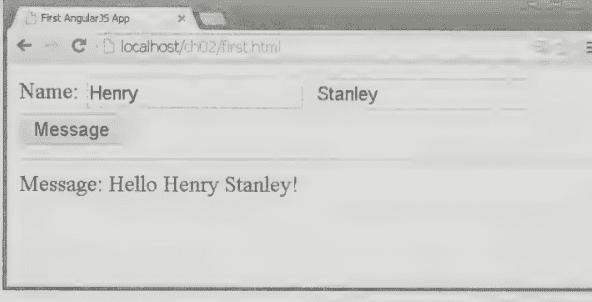

### 加载AngularJS库和你的主模块

在你能够实现AngularJS应用之前，需要将库加载到HTML模板中。清单2.1中的以下几行加载了angular.js库，然后加载了first.js这个自定义JavaScript模块：

```
15  <script src="http://code.angularjs.org/1.2.9/angular.min.js"></script>
16  <script src="/js/first.js"></script>
```

### 定义AngularJS应用根元素

下一步是在根元素中定义ng-app参数，以便AngularJS知道从哪里开始编译应用。你还应该在JavaScript代码中定义模块，以便在添加控制器、过滤器和服务时使用命名空间。

清单2.1的第2行定义了AngularJS模块的DOM根元素。注意ng-app被赋值为模块名firstApp，这与JavaScript代码中的模块相对应：

```
02 <html ng-app="firstApp">
```

清单2.2的第1行显示了在JavaScript代码中创建firstApp模块对象：

```
01 var firstApp = angular.module('firstApp', []);
```

### 为模板添加控制器

接下来，你需要为想要让 AngularJS 模块控制的 HTML 元素添加一个控制器。同时，还需要在模块代码中定义该控制器。

清单 2.1 的第 7 行将一个名为 `FirstController` 的控制器分配给了一个 `<div>` 元素。这将视图中的元素映射到了一个特定的控制器，该控制器包含一个作用域：

```
07    <div ng-controller="FirstController">
```

清单 2.2 的第 2 行显示了将 `FirstController` 代码添加到 `firstApp` 模块中：

```
02 firstApp.controller('FirstController', function($scope) {
```

### 实现作用域模型

控制器定义好之后，你就可以实现作用域了。这涉及将 HTML 元素链接到作用域变量、在作用域中初始化这些变量，以及提供处理作用域值变化的功能。

清单 2.1 的第 9 和 10 行是 `<input>` 元素，它们被分配给了作用域中的 `first` 和 `last` 值。这些元素提供了一种从浏览器更新作用域的方法。如果用户在输入框中输入内容，作用域也会相应更新：

```
09    <input type="text" ng-model="first">
10    <input type="text" ng-model="last">
```

清单 2.2 的第 3-5 行显示了作用域初始值的定义：

```
03 $scope.first = 'Some';
04 $scope.last = 'One';
05 $scope.heading = 'Message: ';
```

清单 2.1 的第 11 行将一个点击处理程序链接到了作用域中定义的 `updateMessage()` 函数：

```
11    <button ng-click='updateMessage()'>Message</button>
```

清单 2.2 的第 6-8 行显示了作用域中 `updateMessage()` 的定义：

```
06 $scope.updateMessage = function() {
07   $scope.message = 'Hello ' + $scope.first + ' ' + $scope.last + '!';
08 };
```

第 13 行实现了一个表达式，用于在 HTML 页面上显示作用域中 `heading` 和 `message` 变量的值：

```
13    {{heading + message}}
```

### 清单 2.1 first.html：一个简单的 AngularJS 模板，提供两个输入元素和一个按钮与模型交互

```
01 <!doctype html>
02 <html ng-app="firstApp">
03   <head>
04     <title>First AngularJS App</title>
05   </head>
06   <body>
07     <div ng-controller="FirstController">
08       <span>Name:</span>
09       <input type="text" ng-model="first">
10       <input type="text" ng-model="last">
11       <button ng-click='updateMessage()'>Message</button>
12       <hr>
13       {{heading + message}}
14     </div>
15     <script src="http://code.angularjs.org/1.2.9/angular.min.js"></script>
16     <script src="js/first.js"></script>
17   </body>
18 </html>
```

### 清单 2.2 first.js：一个简单的 AngularJS 模块，实现了一个控制器来支持清单 2.1 中的模板

```
01 var firstApp = angular.module('firstApp', []);
02 firstApp.controller('FirstController', function($scope) {
03   $scope.first = 'Some';
04   $scope.last = 'One';
05   $scope.heading = 'Message: ';
06   $scope.updateMessage = function() {
07     $scope.message = 'Hello ' + $scope.first + ' ' + $scope.last + '!';
08   };
09 });
```

## 在 AngularJS 应用中使用 jQuery 或 jQuery Lite

你将在 AngularJS 应用中至少使用 jQuery lite，因此理解 jQuery、jQuery lite 和 AngularJS 之间的交互非常重要。即使你不是 jQuery 开发者，理解这些交互也能帮助你编写更好的 AngularJS 应用。如果你是 jQuery 开发者，理解这些交互将使你能够在 AngularJS 应用中利用你的 jQuery 知识。

以下章节将描述 jQuery lite 的实现，并简要介绍你将在 AngularJS 应用中看到的 jQuery/jQuery lite 交互。后续章节将通过一些在 AngularJS 应用中使用 jQuery 对象的实际例子来扩展这个主题。

### 什么是 jQuery Lite？

jQuery lite 本质上是 jQuery 的精简版，它直接内置于 AngularJS 中。其目的是在提供 jQuery 所有有用功能的同时，将其约束在 AngularJS 的职责分离范式内。

表 2.2 列出了 jQuery lite 中可用的 jQuery 方法以及可能适用的限制。这些限制是必要的，用于强制执行诸如仅在自定义指令内操作元素等规则。

#### 表 2.2 jQuery Lite 支持的 jQuery 方法

| jQuery 方法 | 在 jQuery Lite 中的限制（如有） |

| :--- | :--- |

| addClass() | |

| after() | |

| append() | |

| attr() | |

| bind() | 不支持命名空间、选择器或 eventData。 |

| children() | 不支持选择器。 |

| clone() | |

| contents() | |

| css() | |

| data() | |

| detach() | |

| empty() | |

| eq() | |

| find() | 仅限于按标签名查找。 |

| hasClass() | |

| html() | |

| text() | 不支持选择器。 |

| on() | 不支持命名空间、选择器或 eventData。 |

| off() | 不支持命名空间或选择器。 |

| one() | 不支持命名空间或选择器。 |

| parent() | 不支持选择器。 |

| prepend() | |

| prop() | |

| ready() | |

| remove() | |

| removeAttr() | |

| removeClass() | |

| removeData() | |

| replaceWith() | |

| toggleClass() | |

| triggerHandler() | 向处理程序传递一个虚拟事件对象。 |

| unbind() | 不支持命名空间。 |

| val() | |

| wrap() | |

#### 表 2.3 添加到 jQuery Lite 对象的方法和事件

| 方法/事件 | 描述 |

| :--- | :--- |

| `$destroy` | AngularJS 拦截所有 jQuery 或 jQuery lite 的 DOM 销毁调用，并在所有被移除的 DOM 节点上触发此事件。可用于在 DOM 元素被移除前清理任何第三方绑定。 |

| `controller(name)` | 返回当前元素或其父元素的 `controller` 对象。如果未指定名称，则返回与 `ngController` 指令关联的控制器。如果提供 `name` 作为指令名称，则返回此指令的控制器。 |

| `injector()` | 返回当前元素或其父元素的 `injector` 对象。 |

| `scope()` | 返回当前元素或其父元素的 `scope` 对象。 |

| `isolateScope()` | 如果直接附加了作用域，则返回一个 `isolate scope` 对象。仅对包含启动新隔离作用域的指令的元素有效。 |

| `inheritedData()` | 功能与 jQuery 的 `data()` 方法相同，但会向上遍历 DOM 直到找到值或到达顶级父元素。 |

### 直接访问 jQuery 或 jQuery Lite

对于大多数 AngularJS 应用，内置于 AngularJS 的 jQuery lite 库已足够使用。但是，如果你需要完整版 jQuery 的附加功能，只需在加载 AngularJS 库之前加载 jQuery 库即可。例如：

```
<script src="http://code.jquery.com/jquery-1.11.0.min.js"></script>
<script src="http://code.angularjs.org/1.2.9/angular.min.js"></script>
```

无论加载的是 jQuery lite 还是完整的 jQuery 库，都是通过 `angular` 变量在 AngularJS 引导启动时可用的 `element` 属性来从 AngularJS 代码中访问 jQuery。本质上，`angular.element` 将是 jQuery 应用中通常使用的 `jQuery` 变量的别名。我见过的最好的描述这种关系的方式如下：

```
angular.element() === jQuery() === $()
```

### 直接访问 jQuery 或 jQuery Lite

更常见的情况是，你将使用 AngularJS 为你创建的 jQuery 对象中的 jQuery 或 jQuery lite 功能。AngularJS 中的所有元素引用始终被包装为 jQuery 或 jQuery lite 对象；它们永远不会是原始的 DOM 对象。

例如，当你在 AngularJS 中创建一个指令（如本书后面讨论的），一个元素会被传递给 link 函数。如图所示，该元素是一个 jQuery 或 jQuery lite 对象，你可以相应地使用 jQuery 功能：

```
angular.module('myApp', [])
    .directive('myDirective', function() {
        . . .
        link: function(scope, elem, attrs, photosControl) {
            //elem 是一个 jQuery lite 对象
            elem.addClass(...);
        }
    });
```

另一个访问 jQuery 功能的例子是在 AngularJS 绑定触发的事件上。例如，考虑以下代码，它使用 `ngClick` 绑定将浏览器点击事件绑定到 `<div>` 元素上的 AngularJS 代码中的 `clicked()` 函数：

```
<div ng-click="clicked($event)">Click Me</div>
```

你可以使用以下 AngularJS 代码访问该对象的 jQuery 版本：

```
$scope.clicked = function(event){
    var jQueryElement = angular.element(event.target);
};
```

请注意，需要使用 `angular.element()` 方法将 `target` DOM 对象转换为 jQuery 对象。

## 总结

AngularJS 是一个 JavaScript 库框架，它为创建网站和 Web 应用程序提供了一种非常结构化的方法。AngularJS 将 Web 应用程序组织成一种非常清晰的、类似 MVC 的架构。AngularJS 的作用域为应用程序的数据模型提供了上下文绑定，并由基本的 JavaScript 对象构成。AngularJS 利用带有指令的模板来扩展 HTML 的功能，使你能够实现完全自定义的 HTML 组件。

在本章中，你了解了 AngularJS 应用程序中的不同组件以及它们如何相互交互。你还学习了 AngularJS 应用程序的生命周期，它涉及启动、编译和运行时阶段。在本章的最后，你逐步完成了一个基本 AngularJS 应用程序的实现示例，包括模板、模块、控制器和作用域。

## 理解 AngularJS 应用程序动态

理解 AngularJS 最重要的方面之一是依赖注入及其与模块的关系。依赖是许多服务端语言中的一个通用概念，但在 AngularJS 出现之前，它在 JavaScript 中并未真正得到广泛应用。

依赖注入允许 AngularJS 模块保持非常清晰、有组织的结构，同时更容易地访问其他模块的功能。如果实现正确，它还能显著减少代码量。

本章首先概述了依赖注入，然后描述了如何创建提供功能的模块，以及如何在其他模块和其他 AngularJS 组件（例如控制器）中使用这些功能。

### 查看模块和依赖注入

当你开始编写 AngularJS 应用程时，理解 AngularJS 世界中模块和依赖注入的基础知识至关重要。对某些人来说，这似乎是一个难以掌握和正确实施的概念，尤其是那些来自更开放、随心所欲的 JavaScript 背景的人。

本节向你介绍 AngularJS 模块和依赖注入背后的概念。了解模块如何利用依赖注入来访问其他模块中的功能，将使你在 AngularJS 框架内实现代码变得更加容易。

#### 理解模坖

AngularJS 模块是容器，使你能够将代码划分为简洁、清晰、可重用的块。模块本身不提供直接功能，但它们包含其他对象的实例，这些对象提供功能，例如控制器、过滤器、服务和动画。

你通过定义模坖提供的对象来构建一个模坖。然后，通过依赖注入将模坖链接在一起，你构建了一个完整的应用程序。

AngularJS 建立在模坖原则之上。AngularJS 提供的大部分功能都内置在一个名为 `ng` 的模坖中，该模坖包含了本书中使用的大部分指令和服务。

### 依赖注入

依赖注入可能是一个难以完全掌握的概念。然而，它是 AngularJS 非常重要的一部分，理解了基础知识之后，AngularJS 的实现就变得相当清晰了。依赖注入是许多服务端语言中众所周知的知名设计模式，但在 AngularJS 出现之前，并未在 JavaScript 框架中被广泛使用。

AngularJS 依赖注入的思想是定义一个依赖对象并将其动态注入到另一个对象中，使该对象能够使用依赖对象提供的所有功能。AngularJS 通过使用提供者和注入器服务来实现依赖注入。

## 提供者

提供者本质上是如何创建具有所有必要功能的对象实例的定义。提供者应作为 AngularJS 模坖的一部分来定义。模坖向注入器服务注册提供者。在 AngularJS 应用程序中，只会创建一个提供者对象的实例。

#### 注入器

注入器服务负责跟踪提供者对象的实例。为每个注册了提供者的服务创建一个注入器服务实例。当对提供者对象发出依赖请求时，注入器服务首先检查该实例是否已存在于注入器缓存中。如果是，则使用该实例。如果在缓存中未找到实例，则使用提供者定义创建一个新实例，将其存储在缓存中，然后返回。

### 定义 AngularJS 模坖对象

创建 AngularJS 模坖是一个简单的过程，涉及调用 `angular.module()` 方法。此方法创建一个 `Module` 对象的实例，将其注册到注入器服务，然后返回新创建的 `Module` 对象的实例，你可以使用该实例来实现提供者功能。`angular.module()` 方法使用以下语法：

`angular.module(name, [requires], [configFn])`

`name` 参数是模坖在注入器服务中注册的名称。`requires` 参数是一个数组，包含为此模坖使用而添加到注入器服务的模坖名称。如果你需要另一个模坖的功能，需要在 `requires` 列表中添加它。默认情况下，`ng` 模坖会自动添加到每个实例化的模坖中，因此你无需在列表中显式指定 `ng` 即可访问 AngularJS 提供者。

所有依赖项的实例都会自动注入到模坖实例中。依赖项可以是模坖、服务以及在注入器服务中注册的任何其他对象。`configFn` 参数是另一个在模坖配置阶段调用的函数。配置函数将在下一节中描述。

以下是一个创建 AngularJS 模坖并依赖于 `$window` 和 `$http` 服务的示例。该定义还包括一个配置函数，该函数添加了一个名为 `myValue` 的值提供者：

```javascript
var myModule = angular.module('myModule', ['$window', '$http'], function(){
    $provide.value('myValue', 'Some Value');
});
```

如果你未指定 `requires` 参数，则不会创建 `Module` 对象，而是返回已创建的实例。例如，以下代码覆盖了前面定义的实例：

```javascript
var myModule2 = angular.module('myModule', []);
```

然而，以下代码返回之前创建的实例，因为参数列表中的 `requires` 数组中未列出任何依赖项：

```javascript
var myModule3 = angular.module('myModule');
```

### 在 AngularJS 模坖中创建提供者

AngularJS 为各种对象和服务提供了一些内置提供者。例如，`$window` 服务有一个提供者，该提供者构建 AngularJS 服务对象，使你能够与 JavaScript 中底层的 `Window` 对象进行交互。除了这些提供者之外，你还可以创建自己的提供者，以便将功能注入到 AngularJS 应用程序组件中。

`Module` 对象提供了几个辅助方法，用于添加提供者，作为使用 `config()` 方法的替代方案。这些方法更容易使用，在你的代码中也更清晰。你可以将两种类型的提供者对象添加到 AngularJS 模坖中。这些方法中的每一个都接受两个参数：将向依赖注入器注册的名称，以及定义如何构建特定对象的提供者函数。以下各节将更详细地描述这些方法。

#### 专用的 AngularJS 对象提供者

`Module` 对象提供特殊的构造方法，用于为你需要在模坖中实现的 AngularJS 对象添加提供者。这些专用方法使你能够为以下类型的对象添加定义：

- `animation(name, animationFactory)`

- `controller(name, controllerFactory)`

- `filter(name, filterFactory)`

- `directive(name, directiveFactory)`

这些方法之所以是专用的，是因为 AngularJS 为这些提供者方法定义了相应的 `animation`、`controller`、`filter` 和 `directive` 对象。

每个对象都将在后面的章节中更详细地介绍。现在，让我们快速了解一下基本的控制器定义：

```javascript
var mod = angular.module('myMod', []);
mod.controller('myController', function($scope) {
    $scope.someValue = 'Some Value';
});
```

创建了一个名为 `mod` 的简单模坖，然后调用 `controller()` 方法并传入 `myController` 以及一个 `controllerFactory` 函数。`controllerFactory` 函数接受 `$scope` 变量作为参数。这是因为 AngularJS 有一个内置的控制器对象，并且知道所有控制器对象必须接收一个作用域对象作为第一个参数。

#### 服务提供者

服务提供者是一个独特的提供者类别，因为最终的提供者对象没有特定的格式。相反，提供者充当提供功能的服务。AngularJS 提供了一些特定的创建方法来构建服务，并通过以下方法暴露它们：

- `value(name, object)`：这是所有提供者中最基本的一种。`object` 参数被简单地赋值给 `name`，因此注入器中 `name` 值和 `object` 值之间存在直接对应关系。

- `constant(name, object)`：这与 `value()` 方法类似，但值不可更改。此外，`constant()` 方法在其他提供者方法之前应用。

- `factory(name, factoryFunction)`：此方法使用 `factoryFunction` 参数来构建一个对象，该对象将由注入器提供。

- `service(name, serviceFactory)`：此方法向提供者对象添加了实现更面向对象方法的概念。AngularJS 的许多内置功能都是通过服务提供者提供的。

**提供者**（*名称*，*providerFactory*）：此方法是所有其他方法的核心。虽然它提供了最全面的功能，但由于其他方法更简单，因此并不常用。

后续章节将更详细地介绍这些对象。现在，这里有一个关于基本值和常量定义的快速示例：

```
var mod = angular.module('myMod', []);
mod.constant("cID", "ABC");
mod.value('counter', 0);
mod.value('image', {name:'box.jpg', height:12, width:20});
```

首先创建了一个名为 `mod` 的简单模坖，然后定义了 `constant()` 和两个 `value()` 提供者。这些方法中定义的值被注册在 `myMod` 模坖的注入器服务器中，之后可以通过名称来访问它们。

### 实现提供者和依赖注入

在定义了模坖和相应的提供者之后，你可以将该模坖作为依赖项添加到其他模坖、控制器以及各种其他 AngularJS 对象中。你可以设置依赖提供者的对象的 `$inject` 属性的值。`$inject` 属性包含一个应注入其中的提供者名称的数组。

例如，以下代码定义了一个接受 `$scope` 和 `appMsg` 参数的基础控制器。然后，将 `$inject` 属性设置为一个包含 `$scope`（这是提供访问作用域功能的 AngularJS 作用域服务）和自定� `appMsg` 的数组。`$scope` 和 `appMsg` 都被注入到 `myController` 函数中：

```
var myController = function($scope, appMsg) {
    $scope.message = appMsg;
};
controller['$inject'] = ['$scope', 'appMsg'];
myApp.myController('controllerA', controller);
```

在实现某些对象时，这种方法可能会变得有点笨拙，因此 AngularJS 还提供了一种更优雅的依赖注入方法，使用以下语法替代普通的构造函数：

```
[providerA, providerB, . . . , function(objectA, objectB, . . .) { }]
```

例如，前面的代码也可以这样写：

```
myApp.controller('controllerA', ['$scope', 'appMsg', function($scope, appMsg) {
    $scope.message = appMsg;
}]);
```

在继续之前，理解依赖注入至关重要，因此让我们来看几个例子。以下部分提供了在 AngularJS 应用程序中实现依赖注入的示例清单。

#### 将内置提供者注入到控制器中

清单 3.1 展示了一个非常基础的例子，它使用依赖注入将 `$scope` 和 `$window` 服务的功能注入到 AngularJS 控制器中。清单 3.1 中定义的 AngularJS 应用非常简单。第 2 行定义了一个基础控制器，并使用依赖注入注入了 `$scope` 和 `$window` 服务，然后在第 3 行和第 4 行使用 `$window` 服务来显示一个包含存储在 `$scope` 中的消息的警告弹窗。

清单 3.2 展示了使用清单 3.1 中定义的 myApp 模块并实现 `controllerA` 视频的 HTML 页面。图 3.1 显示了生成的网页和警告消息。

```
清单 3.1  inject_builtin.js：在控制器中实现内置服务的依赖注入
01 var myMod = angular.module('myApp', []);
02 myMod.controller('controllerA', ['$scope', '$window',
03                                 function($scope, $window) {
04     $scope.message = "My Module Has Loaded!";
05     $window.alert($scope.message);
06 }]);
```

```
清单 3.2  inject_builtin.html：使用HTML代码实现一个实现依赖注入的AngularJS模块
01 <!doctype html>
02 <html ng-app="myApp">
03 <head>
04     <title>AngularJS Dependency Injection</title>
05 </head>
06 <body>
07     <div ng-controller="controllerA">
08         <h2>This Page has an Alert</h2>
09     </div><hr>
10     <script src="http://code.angularjs.org/1.2.9/angular.min.js"></script>
11     <script src="js/inject_builtin.js"></script>
12 </body>
13 </html>
```

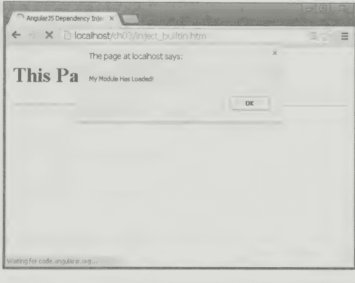

图 3.1 实现 `$window` 服务的依赖注入，以显示来自 `$scope` 的警告消息。

#### 实现自定义提供者并将其注入到控制器中

清单 3.3 展示了如何通过两个模坖实现依赖注入，每个模坖都有一个值提供者和一个控制器。第 2 行和第 8 行添加了值提供者。第 3 行和第 9 行使用依赖注入将值提供者注入到每个模坖的控制器中。

注意第 6 行中 `myApp` 模坖的定义在其依赖项列表中包含了 `myMod` 模坖。这会将 `myMod`（包括其内部的 `controllerB` 功能）注入进来。

清单 3.4 展示了将 `myApp` 模坖作为 AngularJS 应用程序的 HTML 代码。注意它同时使用了 `controllerA` 和 `controllerB` 控制器。它们之所以可以使用，是因为 `myMod` 模坖已被注入到 `myApp` 模块中。图 3.2 显示了生成的网页，其中每个模块的控制器显示了不同的消息。

60 第3章 理解AngularJS应用动态

#### 清单 3.3 inject_custom.js：在控制器和模坖定义中实现依赖注入

```
01 var myMod = angular.module('myMod', []);
02 myMod.value('modMsg', 'Hello from My Module');
03 myMod.controller('controllerB', ['$scope', 'modMsg',
04         function($scope, msg) {
05         $scope.message = msg;
06 }]);
07 var myApp = angular.module('myApp', ['myMod']);
08 myApp.value('appMsg', 'Hello from My App');
09 myApp.controller('controllerA', ['$scope', 'appMsg',
10         function($scope, msg) {
11         $scope.message = msg;
12 }]);
```

#### 清单 3.4 inject_custom.html：使用HTML代码实现一个依赖于另一个模坖的AngularJS模坖

```
01 <!doctype html>
02 <html ng-app="myApp">
03 <head>
04     <title>AngularJS Dependency Injection</title>
05 </head>
06 <body>
07     <div ng-controller="controllerA">
08         <h2>Application Message:</h2>
09         {{message}}
10     </div><hr>
11     <div ng-controller="controllerB">
12         <h2>Module Message:</h2>
13         {{message}}
14     </div>
15     <script src="http://code.angularjs.org/1.2.9/angular.min.js"></script>
16     <script src="/js/injector_custom.js"></script>
17 </body>
18 </html>
```

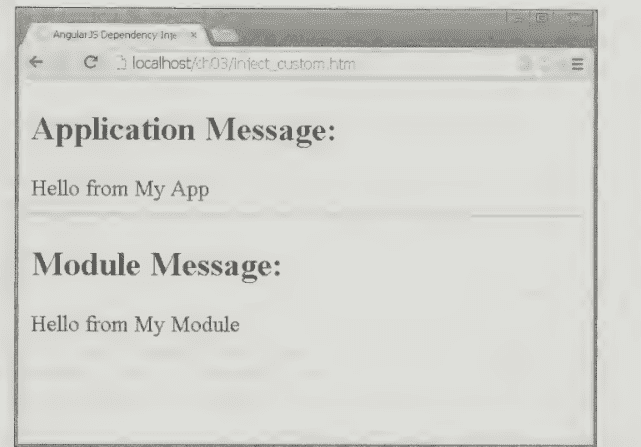

图 3.2  实现依赖注入，为模坖和控制器提供额外功能。

### 将配置块和运行块应用于模坖

既然你已经理解了模坖和依赖注入之间的关系，你需要了解实现 AngularJS 模坖的过程。AngularJS 模坖的实现分为两个阶段：配置阶段和运行阶段。以下部分将讨论这些阶段以及向 AngularJS 模坖添加提供者的基本过程。

#### 添加配置块

AngularJS 模坖配置阶段在模坖定义时执行。在此阶段，所有提供者都会在依赖注入器中注册。你应该只在配置块内放置配置和提供者代码。

你通过调用 `Module` 对象实例上的 `config()` 方法来实现配置块，使用以下语法：

```
config(function([injectable, ...]))
```

传入一个带有 `injectable` 参数的函数。`injectable` 参数通常是提供者服务函数，例如 `$provide`。

以下是一个基础配置块的示例：

```
var myModule = angular.module('myModule', []).
  config(function($provide, $filterProvider) {
    $provide.value("startTime", new Date());
    $filterProvider.register('myFilter', function(){});
});
```

注意 `$provide` 和 `$filterProvider` 服务被传入 `config` 函数。它们用于向注入器服务注册一个名为 `startTime` 的值提供者和一个名为 `myFilter` 的过滤器提供者。

#### 添加运行块

在配置块全部执行完毕后，AngularJS 模坖的运行阶段就可以执行了。在此阶段，你可以实现任何必要的代码来实例化模坖。你不能在运行块中实现任何提供者代码，因为此时整个模坖应该已经配置完毕并注册到了依赖注入器中。

运行块是放置需要在应用程序根级别执行的事件处理程序（例如，身份验证处理程序）的绝佳位置。

你通过调用 `Module` 对象的 `run()` 方法来实现运行块，使用以下语法：

```
run(function([injectable, . . .]))
```

传入一个带有实例 `injectable` 参数的函数。由于配置应该已经完成，`injectable` 参数应该只是注入器的实例。

以下是紧接上一个示例的 `run` 块的基础实现：

```
myModule.run(function(startTime) {
  startTime.setTime((new Date()).getTime());
});
```

注意，前面 `config()` 部分定义的 `startTime` 实例被传入 `run()` 函数。这允许 `run()` 函数将 `startTime` 提供者更新为一个新值。

#### 实现配置块和运行块

清单 3.5 展示了一个实现非常基础的配置块和运行块的例子。在第 2–8 行，使用 `config()` 方法实现了两个提供者 `configTime` 和 `runTime`，它们都是 JavaScript `Date` 对象。注意在第 5–7 行实现了一个简单的循环来注入延迟，以模拟配置过程中可能发生的延迟。

在第9-11行实现了 `run()` 方法。请注意，它接受在配置阶段创建的 `configTime` 和 `runTime` 实例，并将 `runTime` 的值更新为当前时间。然后在第12-16行实现了一个控制器，在作用域中设置了 `configTime` 和 `runTime` 的值。

清单 3.6 展示了实现 `myApp` 模坖并显示 `configTime` 和 `runTime` 值的 HTML。你可以看到注入的延迟导致这两个值的时间不同。图 3.3 展示了生成的网页。

**清单 3.5 config_run_blocks.js：在 AngularJS 模坖中实现配置块和运行块**

```javascript
var myModule = angular.module('myApp', []);
myModule.config(function($provide) {
    $provide.value("configTime", new Date());
    $provide.value("runTime", new Date());
    for(var x=0; x<1000000000; x++){
        var y = Math.sqrt(Math.log(x));
    }
});
myModule.run(function(configTime, runTime) {
   runTime.setTime((new Date()).getTime());
});
myModule.controller('controllerA', ['$scope', 'configTime', 'runTime',
    function($scope, configTime, runTime){
        $scope.configTime = configTime;
        $scope.runTime = runTime;
}]);
```

**清单 3.6 config_run_blocks.html：使用 HTML 代码显示在 AngularJS 模坖的配置块和运行块中生成的 configTime 和 runTime 值**

```html
<!doctype html>
<html ng-app="myApp">
    <head>
        <title>AngularJS Configuration and Run Blocks</title>
    </head>
    <body>
        <div ng-controller="controllerA">
            <hr>
            <h2>Config Time:</h2>
           {{configTime}}
           <hr>
           <h2>Run Time:</h2>
           {{runTime}}
           </div><hr>
        <script src="http://code.angularjs.org/1.2.9/angular.min.js"></script>
        <script src="js/config_run_blocks.js"></script>
    </body>
</html>
```

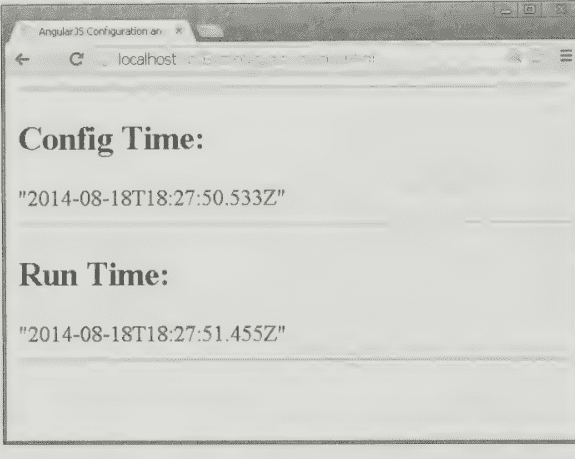

图 3.3 实现了配置块和运行块，设置并利用 JavaScript 的 Date 对象来显示各自的执行时间。

## 总结

依赖注入使你能够定义可以注入到其他 AngularJS 组件中的提供者功能。提供者功能包含在模坖内部，并向注入器服务注册。提供者定义了如何构建该功能，以便当另一个组件定义了对某个提供者的依赖时，可以创建并注入该提供者对象的一个实例。

AngularJS 提供了相当健壮的依赖注入模型，使你能够定义不同类型的服务提供者。使用依赖注入而非全局定义使你的代码更具模块化且更易于维护。在本章中，你了解了依赖注入模型，并看到了如何在模坖和控制器组件中实现它。

## 将作用域作为数据模型来实现

AngularJS 应用程序中最重要的方面之一是作用域。作用域不仅提供模型中表示的数据，还绑定了 AngularJS 应用程序的所有其他组件，例如模坖、控制器、服务和模板。本章解释了作用域与其他 AngularJS 组件之间的关系。

作用域提供了绑定机制，使得当模型数据发生变化时，DOM 元素和其他代码能够得到更新。在本章中，你将了解根作用域和子作用域。你还将了解作用域层次结构以及如何实现它们。

### 理解作用域

在 AngularJS 中，作用域充当应用程序的数据模型。对于任何以某种方式依赖数据的应用程序来说，它是最关键的部分之一，因为它充当着视图、业务逻辑和服务器端数据之间的粘合剂。理解作用域的工作原理，有助于你设计出更高效、使用更少代码且更易于理解的 AngularJS 应用程序。

以下各节讨论了作用域与应用程序、控制器、模板和服务器端数据之间的关系。还有一节介绍了作用域的生命周期，以帮助你了解在应用程序生命周期中，作用域是如何被构建、操作和更新的。

#### 根作用域与应用程序之间的关系

当应用程序启动时，会创建一个根作用域。根作用域在应用程序级别存储数据，你可以通过使用 `$rootScope` 服务来访问它。根作用域数据应在模坖的 `run()` 块中初始化，但也可以在模坖的组件中访问。为了说明这一点，以下代码在根作用域级别定义了一个值，然后在控制器中访问它：

```javascript
angular.module('myApp', [])
.run(function($rootScope) {
    $rootScope.rootValue = 5;
})
.controller('myController', function($scope, $rootScope) {
    $scope.value = 10;
    $scope.difference = function() {
        return $rootScope.rootValue - $scope.value;
    };
});
```

#### 作用域与控制器之间的关系

控制器是旨在通过扩展作用域来提供业务逻辑的代码片段。你通过使用应用程序模型对象的 `controller()` 方法来创建控制器。此函数将控制器注册为模坖中的提供者，但不会创建控制器的实例。该实例的创建发生在 AngularJS 模板中链接 `ng-controller` 指令时。

`controller()` 方法接受控制器名称作为第一个参数，依赖数组作为第二个参数。例如，以下代码定义了一个控制器，该控制器使用依赖注入来访问名为 `start` 的值提供者：

```javascript
angular.module('myApp', []).
    value('start', 200).
    controller('Counter', ['$scope', 'start',
            function($scope, startingValue) {
    }]);
```

当在 AngularJS 中创建控制器的新实例时，也会创建一个特定于该控制器的新子作用域，并且可以通过注入到前面 Counter 控制器中的 `$scope` 服务来访问。同样，在前面显示的示例中，`start` 提供者被注入到控制器中，并作为 `startingValue` 传递给控制器函数。参数注入是基于它们在传递给 `controller()` 函数的数组中的位置。

控制器必须初始化一个作用域的状态，该作用域被创建并添加到其中。控制器还负责附加到该作用域的任何业务逻辑。这可能意味着处理作用域的更新变化、操作作用域值，或基于作用域的状态发出事件。

清单 4.1 展示了如何实现一个控制器，该控制器利用依赖注入、初始化一些值，并使用 `inc()`、`dec()` 和 `calcDiff()` 函数实现基本的业务逻辑。请注意第5-8行，几个值被存储在作用域变量 `start`、`current`、`difference` 和 `change` 中。这些值随后在 `inc()`、`dec()` 和 `calcDiff()` 函数中被操作。

**清单 4.1 scope_controller.js：实现一个使用依赖注入、初始化作用域值并实现业务逻辑的基本控制器**

```javascript
angular.module('myApp', []).
  value('start', 200).
  controller('Counter', ['$scope', 'start',
                           function($scope, start) {
    $scope.start = start;
    $scope.current = start;
    $scope.difference = 0;
    $scope.change = 1;
    $scope.inc = function() {
       $scope.current += $scope.change;
       $scope.calcDiff();
     };
    $scope.dec = function() {
       $scope.current -= $scope.change;
       $scope.calcDiff();
     };
    $scope.calcDiff = function() {
       $scope.difference = $scope.current - $scope.start;
     };
  }]);
```

清单 4.2 展示了一个基本的 AngularJS HTML 模板，它提供了视图以查看和操作存储在作用域中的值。图 4.1 展示了正在运行的网页。你可以设置增减值，然后点击 +/- 按钮来递减当前值，并看到作用域中的差值变化。

**清单 4.2 scope_controller.html：允许你动态查看基于增量和减量值变化的视图中数据的 HTML 模板**

```html
<!doctype html>
<html ng-app="myApp">
  <head>
    <title>AngularJS Basic Scope</title>
  </head>
  <body>
    <div ng-controller="Counter">
      <span>Change Amount:</span>
      <input type="number" ng-model="change"><hr>
      <span>Starting Value:</span>
      {{start}}
      <br>
      <span>Current Value:</span>
      {{current}}
    </div>
  </body>
</html>
```

## 第4章 将作用域实现为数据模型

```html
15      <button ng-click='inc()'>+</button>
16      <button ng-click='dec()'>-</button><hr>
17      <span>Difference:</span>
18      {{difference}}
19    </div>
20    <script src="http://code.angularjs.org/1.3.0/angular.min.js"></script>
21    <script src="js/scope_controller.js"></script>
22  </body>
23 </html>
```

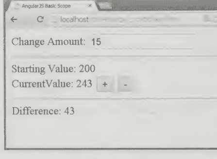

### 作用域与模板之间的关系

模板为AngularJS应用提供视图。HTML元素使用`ng-controller`属性被定义为控制器。在控制器HTML元素及其子元素内部，该控制器的作用域可用于表达式和其他AngularJS功能。

作用域中的值可以直接与模板中的`<input>`、`<select>`和`<textarea>`元素的值链接，使用`ng-model`指令。该指令将元素的值与作用域中的属性名链接起来。当用户更改输入元素的值时，作用域会自动更新。例如，下面的代码将`<input>`元素的数值与名为`valueA`的作用域链接起来：

```html
<input type="number" ng-model="valueA" />
```

你可以使用`{{expression}}`语法将作用域属性甚至函数添到模板中的表达式中。括号内的代码会被求值，结果显示在渲染后的视图中。例如，如果一个作用域包含名为`valueA`和`valueB`的属性，你可以在模板的表达式中像这样引用这些属性：

`{{valueA + valueB}}`

你也可以在模板中定义AngularJS指令时使用作用域属性和函数。例如，`ng-click`指令将浏览器点击事件绑定到名为`addValues()`的作用域函数，并传递作用域中`valueA`和`valueB`属性的值：

`<span ng-click="addValues(valueA, valueB)">Add Values{{valueA}} & {{valueB}}</span>`

请注意，在这段代码中，`{{}}`括号是必需的。然而，在`addValues()`函数调用中它们不是必需的。这是因为`ng-click`和其他AngularJS指令会自动作为表达式进行求值。

代码清单4.3和4.4将所有这些概念整合在一个非常基础的示例中，以便轻松理解模型与作用域之间的关系。代码清单4.3实现了一个名为`SimpleTemplate`的控制器，它用三个值初始化作用域：`valueA`、`valueB`和`valueC`。该作用域还包含一个名为`addValues()`的函数，该函数接受两个参数，将它们相加并设置`$scope.valueC`的值。

代码清单4.4实现了一个模板，该模板初始化了代码清单4.3中定义的`SimpleTemplate`控制器。第8行和第9行使用`ng-model`将作用域属性`valueA`和`valueB`链接到`<input>`元素。第10行使用作用域中`valueA`和`valueB`的值来显示表达式。第11行将作用域中的`valueA`和`valueB`相加以显示相加后的值。

第12行和第13行实现了一个`<input>`元素，它使用`ng-click`将浏览器点击事件绑定到作用域中的`addValues()`函数。请注意，`valueA`和`valueB`作为参数传递给该函数。

图4.2展示了此简单应用在网页浏览器中的样子。当两个输入元素被更改时，表达式会自动更改。但是，只有在点击`Click to Add Values`元素时，`valueC`表达式才会更改。

#### 代码清单4.3 scope_template.js：实现一个基础控制器以支持模板功能

```javascript
01 angular.module('myApp', []).
02   controller('SimpleTemplate', function($scope) {
03     $scope.valueA = 5;
04     $scope.valueB = 7;
05     $scope.valueC = 12;
06     $scope.addValues = function(v1, v2) {
07       var v = angular.$rootScope;
08       $scope.valueC = v1 + v2;
09     };
10 });
```

#### 代码清单4.4 scope_template.html：实现控制器并将多个字段链接到作用域的HTML模板代码

```html
01 <!doctype html>
02 <html ng-app="myApp">
03   <head>
04     <title>AngularJS Scope and Templates</title>
05   </head>
06   <body>
07     <div ng-controller="SimpleTemplate">
08       ValueA: <input type="number" ng-model="valueA" /><br>
09       ValueB: <input type="number" ng-model="valueB" /><br><br>
10       Expression: {{valueA}} + {{valueB}}<br><br>
11       Live Expression Value: {{valueA + valueB}}<br><br>
12       <input type="button" ng-click="addValues(valueA, valueB)"
13         value="Click to Add Values {{valueA}} & {{valueB}}" /><br>
14       Clicked Expression Value: {{valueC}}<br>
15     </div>
16     <script src="http://code.angularjs.org/1.3.0/angular.min.js"></script>
17     <script src="js/scope_template.js"></script>
18   </body>
19 </html>
```

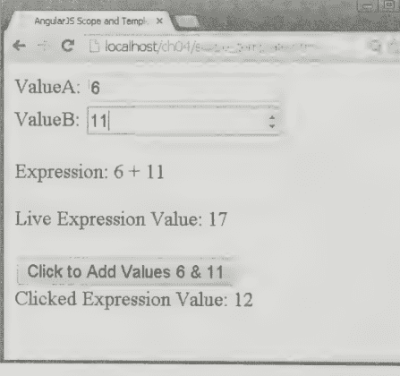

图4.2 一个基础的AngularJS模板，它实现了一个控制器，并将多个字段链接到作用域以提供值的输入和显示的结果。

### 作用域与后端服务器数据之间的关系

通常，用于AngularJS应用的数据来自后端数据源，例如数据库。在这种情况下，作用域仍然是AngularJS应用数据的权威来源。在与来自服务器端的数据交互时，你应该遵循以下规则：

- 通过第9章“在Web应用中实现AngularJS服务”中讨论的AngularJS服务访问来自数据库或其他后端源的数据。这包括读取和更新数据。

- 确保从服务器读取的数据更新作用域，从而更新视图。避免直接从数据库操作HTML值的诱惑，这可能导致作用域与视图不同步。

- 同样地，将对数据库或其他后端源所做的更改反映在作用域中。你可以通过先更新作用域，然后使用服务更新数据库来实现这一点，或者你可以先更新数据库，然后使用数据库的结果在作用域中重新填充相应的值。

### 作用域的生命周期

当应用在浏览器中加载时，作用域数据会经历一个生命周期。理解这个生命周期将有助于你理解作用域与其他AngularJS组件（尤其是模板）之间的交互。

作用域数据经历以下生命周期阶段：

1.  创建

2.  监视器注册

3.  模型变更

4.  变更观察

5.  作用域销毁

这些生命周期阶段将在接下来的部分中描述。

#### 创建阶段

创建阶段发生在作用域初始化时。引导应用会创建根作用域。当遇到`ng-controller`或`ng-repeat`指令时，链接模板会创建子作用域。

同样在创建阶段，会创建一个与浏览器事件循环交互的摘要循环。摘要循环负责将模型的更改更新到DOM元素，以及执行所有注册的监视器函数。虽然你永远不需要手动执行摘要循环，但你可以通过对作用域执行`$digest()`方法来实现。例如，以下代码会求值所有异步更改，然后在作用域上执行监视函数：

`$scope.$digest()`

#### 监视器注册阶段

监视器注册阶段为模板中表示的作用域值注册监视器。这些监视器会将模型更改自动传播到DOM元素。

你也可以通过使用`$watch()`方法在作用域值上注册自己的监视函数。该方法接受一个作用域属性名作为第一个参数，然后是一个回调函数作为第二个参数。当作用域中的属性发生更改时，旧值和新值会传递给回调函数。

例如，以下代码为作用域中的`watchedItem`属性添加一个监视器，并在每次更改时递增一个计数器：

```javascript
$scope.watchedItem = 'myItem';
$scope.counter = 0;
$scope.$watch('name', function(newValue, oldValue) {
  $scope.watchedItem = $scope.counter + 1;
});
```

#### 模型变更阶段

模型变更阶段发生在作用域中的数据发生更改时。当你的AngularJS代码发生更改时，一个名为`$apply()`的作用域函数会更新模型，并调用`$digest()`函数来更新DOM和监视器。这就是在你的AngularJS控制器中或由`$http`、`$timeout`和$interval`服务所做的更改会自动更新到DOM中的方式。

你应该始终尝试在AngularJS控制器或这些服务内部对作用域进行更改。然而，如果你必须在AngularJS领域之外对作用域进行更改，你需要对作用域调用`scope.$apply()`以强制模型和DOM正确更新。`$apply()`方法接受一个表达式作为唯一参数。该表达式被求值并返回，然后调用`$digest()`方法来更新DOM和监视器。

#### 变更观察阶段

变更观察阶段发生在摘要循环、`$apply()`调用或手动执行`$digest()`方法时。当`$digest()`执行时，它会求值所有监视器以查找更改。如果某个值已更改，`$digest()`会调用$watch监听器并更新DOM。

#### 作用域销毁阶段

`$destroy()`方法将作用域从浏览器内存中移除。当不再需要子作用域时，AngularJS库会自动调用此方法。`$destroy()`方法会停止$digest()调用并移除监视器，从而允许浏览器垃圾回收器回收内存。

### 实现作用域层次结构

作用域的一大特点是它们按层次结构组织。这种层次结构有助于你保持作用域的组织性，并与其代表的视图上下文相关。在 AngularJS 模块级别存在一个根作用域，然后子作用域可以在子组件（如控制器或指令）中实现。子作用域可以相互嵌套，形成一个层次结构。

> **注意**

> `$digest()` 方法使用作用域层次结构将作用域变更传播到相应的监视器和 DOM 元素。

作用域层次结构根据 AngularJS 模板中 `ng-controller` 语句的位置自动创建。例如，以下模板代码定义了两个 `<div>` 元素，它们创建了作为同级的控制器实例：

```html
<div ng-controller="controllerA"> . . . </div>
<div ng-controller="controllerB"> . . . </div>
```

然而，以下模板代码定义了其中 `controllerA` 是 `controllerB` 的父级的控制器：

```html
<div ng-controller="controllerA">
    <div ng-controller="controllerB"> . . . </div>
</div>
```

作用域层次结构的工作方式类似于面向对象语言中对象继承的工作方式。你可以从一个控制器访问父作用域的值，但不能访问同级或子作用域的值。如果你在子作用域中添加一个属性名，它不会覆盖父作用域，而是在子作用域中创建一个同名但值不同的属性。

代码清单 4.5 和 4.6 实现了一个基本的作用域层次结构，以演示作用域在层次结构中的工作方式。代码清单 4.5 创建了一个包含三个控制器的应用程序，每个控制器定义了两个作用域项。它们共享公共的作用域属性 `title`，以及作用域属性 `valueA`、`valueB` 和 `valueC`。

代码清单 4.6 在 AngularJS 模板中创建了这三个控制器。图 4.3 显示了渲染后的 AngularJS 应用程序。请注意，所有三个作用域中 `title` 属性的值都不同。这是因为为层次结构中的每个级别都创建了一个新的 `title` 属性。

第 17-19 行显示了 `valueA`、`valueB` 和 `valueC` 属性。这些值是从作用域层次结构中的三个不同级别读取的。该应用程序表明，当你在父作用域中增加该值时，子控制器中的一个 DOM 元素会更新为新值。

## 第 4 章 将作用域实现为数据模型

**代码清单 4.5** **scope_hierarchy.js**：实现基本作用域层次结构，并访问每个级别的属性

```javascript
angular.module('myApp', []).
  controller('LevelA', function($scope) {
    $scope.title = "Level A"
    $scope.valueA = 1;
    $scope.inc = function() {
      $scope.valueA++;
    };
  }).
  controller('LevelB', function($scope) {
    $scope.title = "Level B"
    $scope.valueB = 1;
    $scope.inc = function() {
      $scope.valueB++;
    };
  }).
  controller('LevelC', function($scope) {
    $scope.title = "Level C"
    $scope.valueC = 1;
    $scope.inc = function() {
      $scope.valueC++;
    };
  });
```

**代码清单 4.6** **scope_hierarchy.html**：实现控制器层次结构并从多个作用域级别渲染结果的 HTML 模板代码


```html
<!doctype html>
<html ng-app="myApp">
<head>
  <title>AngularJS Scope Hierarchy</title>
</head>
<body>
  <div ng-controller="LevelA">
    <h3>{{title}}</h3>
    ValueA = {{valueA}} <input type="button" ng-click="inc()" value="+" />
    <div ng-controller="LevelB"><hr>
      <h3>{{title}}</h3>
      ValueA = {{valueA}}<br>
      ValueB = {{valueB}}
      <input type="button" ng-click="inc()" value="+" />
      <div ng-controller="LevelC"><hr>
        <h3>{{title}}</h3>
        ValueA = {{valueA}}<br>
        ValueB = {{valueB}}<br>
        ValueC = {{valueC}}
        <input type="button" ng-click="inc()" value="+" />
      </div>
    </div>
  </div>
  <script src="http://code.angularjs.org/1.3.0/angular.min.js"></script>
  <script src="js/scope_hierarchy.js"></script>
</body>
</html>
```

图 4.3 实现了一个控制器层次结构，该结构从多个作用域级别渲染结果。

## 总结

作用域是 AngularJS 应用程序中数据的权威来源。作用域与模板视图、控制器、模块和服务有直接关系，并充当将应用程序绑定在一起的粘合剂。作用域还充当数据库或其他服务器端数据源的表示。

作用域的生命周期与浏览器事件循环相关联，因此浏览器中的更改可以改变作用域，而作用域的更改会反映在绑定到作用域的 DOM 元素中。你还可以添加自定义监视函数，在作用域更改时收到通知。

作用域被组织成层次结构，根作用域在应用程序级别定义。每个控制器的实例也会获得一个子作用域的实例。从子作用域中，你可以访问存储在父作用域层次结构中的数据。

# 使用 AngularJS 模板创建视图

AngularJS 模板提供了一个框架，用于向用户表示应用程序视图。AngularJS 模板包含表达式、过滤器和指令，它们为 DOM 元素定义了额外的功能和行为。这些模板建立在普通 HTML 之上，通过添加额外的元素和属性来扩展 HTML 的功能。

本章重点介绍 AngularJS 模板，以及表达式和过滤器。表达式使你可以在模板中的 HTML 代码旁实现类似 JavaScript 的代码。过滤器使你可以在显示数据值之前对其进行修改——例如，格式化文本。

## 理解模板

AngularJS 模板非常直观，但功能强大且易于扩展。模板基于标准 HTML 文档，但通过三个额外组件扩展了 HTML 功能：

- **表达式**：表达式是在作用域上下文中求值的类似 JavaScript 的代码片段。表达式用 `{{}}` 括号表示。表达式的结果被添加到编译后的 HTML 网页中。表达式可以放置在普通 HTML 文本中或属性的值中，如下所示：

  `<p>{{1+2}}</p>`

  `href="/myPage.html/{{hash}}"`

- **过滤器**：过滤器转换放置在网页上的数据的外观。例如，过滤器可以将作用域中的数字转换为货币字符串或时间字符串。

- **指令**：指令是 HTML 元素内的新 HTML 元素名称或属性名称。它们添加和修改 HTML 元素的行为，为 AngularJS 应用程序提供数据绑定、事件处理和其他支持。

以下代码片段展示了实现指令、表达式和过滤器的示例。`ng-model="msg"` 属性是一个指令，它将 `<input>` 元素的值绑定到作用域中的 `msg`。`{{}}` 括号中的代码是一个应用了大写过滤器的表达式：

```html
<div>
  <input ng-model="msg">
  {{msg | uppercase}}
</div>
```

当在浏览器中加载 AngularJS 网页时，你加载的是其原始状态，包含模板代码和 HTML 代码。初始 DOM 是从该网页构建的。当 AngularJS 应用程序引导时，AngularJS 模板被编译到 DOM 中，动态调整 DOM 元素的值、事件绑定和其他属性，以匹配模板中的指令、表达式和过滤器。

在编译过程中，HTML 标签和属性会被规范化，以支持 AngularJS 区分大小写而 HTML 不区分大小写这一事实。规范化执行两件事：

- 从元素和属性的前面去掉 `x-` 和 `data-` 前缀。
- 将带有 `:` 或 `-` 或 `_` 的名称转换为驼峰命名法。

例如，以下所有内容都规范化为 `ngModel`：

```
ng-model
data-ng-model
x-ng:model
ng_model
```

## 使用表达式

使用表达式是在 AngularJS 视图中表示来自作用域的数据的最简单方式。表达式是括号内封装的代码块：`{{expression}}`。AngularJS 编译器将表达式编译成 HTML 元素，以便显示表达式的结果。例如，看以下表达式：

```
{{1+5}}
{{'One' + 'Two'}}
```

基于这些表达式，网页显示以下值：

```
6
OneTwo
```

表达式绑定到数据模型，这带来了两大好处。首先，你可以在表达式中使用在作用域中定义的属性名和函数。其次，因为表达式绑定到作用域，所以当作用域中的数据发生变化时，表达式也会随之变化。例如，假设作用域包含以下值：

### 使用基本表达式

在本次练习中，你将有机会了解 AngularJS 表达式如何处理字符串和数字的渲染。本练习的目的是说明 AngularJS 如何评估包含字符串、数字以及基本数学运算符的表达式。

清单 5.1 中的代码是一个简单的 AngularJS 应用程序，其中包含一个名为 `myController` 的控制器。该控制器是空的，因为没有任何表达式访问其作用域。

清单 5.2 中的代码是一个 AngularJS 模板，其中包含几种类型的表达式，这些表达式被包裹在 `{{}}` 括号中。有些表达式只是数字或字符串，有些包含 `+` 运算符以组合字符串和/或数字，还有一个表达式应用了 `===` 运算符来比较两个数字。

图 5.1 展示了渲染后的网页。请注意，数字和字符串是直接渲染到最终视图中的。将字符串和数字相加使你能够构建渲染到视图中的文本字符串。另外请注意，使用比较运算符会向视图渲染单词 `true` 或 `false`。

#### 清单 5.1 expressions_basic.js：包含空控制器的基础 AngularJS 应用代码

```javascript
angular.module('myApp', [])
  .controller('myController', function($scope) {
  });
```

#### 清单 5.2 expressions_basic.html：将基础字符串、数字和简单数学运算应用于 AngularJS 模板

```html
<!doctype html>
<html ng-app="myApp">
<head>
  <title>AngularJS Expressions</title>
  <style>
    p{margin:0px;}
    p:after{color:red;}
  </style>
</head>
<body>
  <div ng-controller="myController">
    <h1>Expressions</h1>
    Number:<br>
    {{5}}<hr>
    String:<br>
    {{'My String'}}<hr>
    Adding two strings together:<br>
    {{'String1' + ' ' + 'String2'}}<hr>
    Adding two numbers together:<br>
    {{5+5}}<hr>
    Adding strings and numbers together:<br>
    {{5 + '+' + 5 + '='}}{{5+5}}<hr>
    Comparing two numbers with each other:<br>
    {{5===5}}<hr>
  <script src="http://code.angularjs.org/1.3.0/angular.min.js"></script>
  <script src="js/expressions_basic.js"></script>
</body>
</html>
```

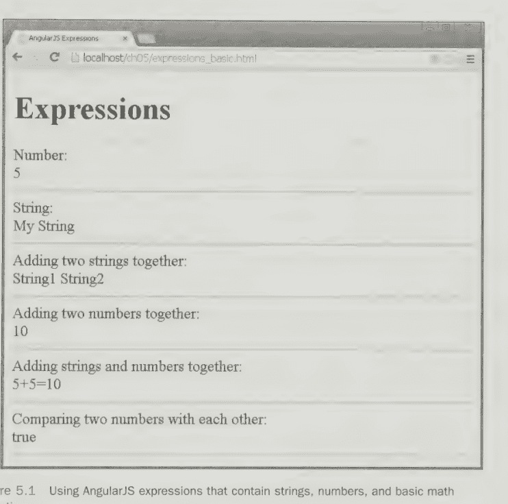

### 在表达式中与作用域交互

在你了解了一些基础的 AngularJS 表达式之后，让我们来看看如何在 AngularJS 表达式中与作用域进行交互。在前面的示例中，所有表达式的输入都来自显式的字符串或数字。这个示例阐释了 AngularJS 表达式真正强大的地方，即来自于与模型的交互。

清单 5.3 中的代码实现了一个包含控制器的基础 AngularJS 应用程序。该控制器在作用域中包含了变量 `speed`、`vehicle`、`newSpeed` 和 `newVehicle`。它还包括三个函数：`upper`、`lower` 和 `setValues`。这些变量和函数在清单 5.4 所示的模板中的 AngularJS 表达式中被使用。

清单 5.4 中的代码实现了一个 AngularJS 模板，该模板应用了 AngularJS 表达式，利用作用域中的值将文本渲染到屏幕上，并将它们作为函数的参数。首先需要注意的是，作用域中的变量名可以直接在表达式中使用。例如，第 14 行中的以下表达式根据 `speed` 和 `vehicle` 变量的值创建了一个字符串。

`{{speed + ' ' + vehicle}}`

另一点需要注意的是，你可以从 AngularJS 表达式内部调用作用域中的函数。当表达式被求值时，后端函数会被调用，并且返回值会被渲染到视图中。你可以将作用域中的变量名、数字以及字符串传递给函数，如下方第 19 行中的表达式所示：

`<a ng-click="setValues('Fast', newVehicle)">`

最后需要注意的是，即使没有显式地用 `{{}}` 括号包裹，赋给 HTML 元素的 AngularJS 属性的值也会作为 AngularJS 表达式进行求值。

图 5.2 展示了基于这些表达式渲染出的网页。请注意，当页面上的链接被点击时，相应的函数调用会调整作用域，从而改变前面讨论的表达式的渲染方式。

#### 清单 5.3 expressions_scope.js：构建 AngularJS 表达式可用的作用域

```javascript
angular.module('myApp', [])
  .controller('myController', function($scope) {
    $scope.speed = 'Slow';
    $scope.vehicle = 'Train';
    $scope.newSpeed = 'Hypersonic';
    $scope.newVehicle = 'Plane';
    $scope.upper = function(aString){
      return angular.uppercase(aString);
    };
    $scope.lower = function(aString){
      return angular.lowercase(aString);
    };
    $scope.setValues = function(speed, vehicle){
      $scope.speed = speed;
      $scope.vehicle = vehicle;
    };
  });
```

#### 清单 5.4 expressions_scope.html：使用多种表达式方式与作用域模型数据交互的 AngularJS 模板

```html
<!doctype html>
<html ng-app="myApp">
<head>
    <title>AngularJS Expressions</title>
    <style>
        a{color: blue; text-decoration: underline; cursor: pointer}
    </style>
</head>
<body>
    <div ng-controller="myController">
        Directly accessing variables in the scope:<br>
        {{speed}} {{vehicle}}<hr>
        Adding variables in the scope:<br>
        {{speed + ' ' + vehicle}}<hr>
        Calling function in the scope:<br>
        {{lower(speed)}} {{upper('Jeep')}}<hr>
        <a ng-click="setValues('Fast', newVehicle)">
            Click to change to Fast {{newVehicle}}</a><hr>
        <a ng-click="setValues(newSpeed, 'Rocket')">
            Click to change to {{newSpeed}} Rocket</a><hr>
        <a ng-click="vehicle='Car'">
            Click to change the vehicle to a Car</a><hr>
        <a ng-click="vehicle='Enhanced ' + vehicle">
            Click to Enhance Vehicle</a><hr>
    <script src="http://code.angularjs.org/1.3.0/angular.min.js"></script>
    <script src="js/expressions_scope.js"></script>
</body>
</html>
```

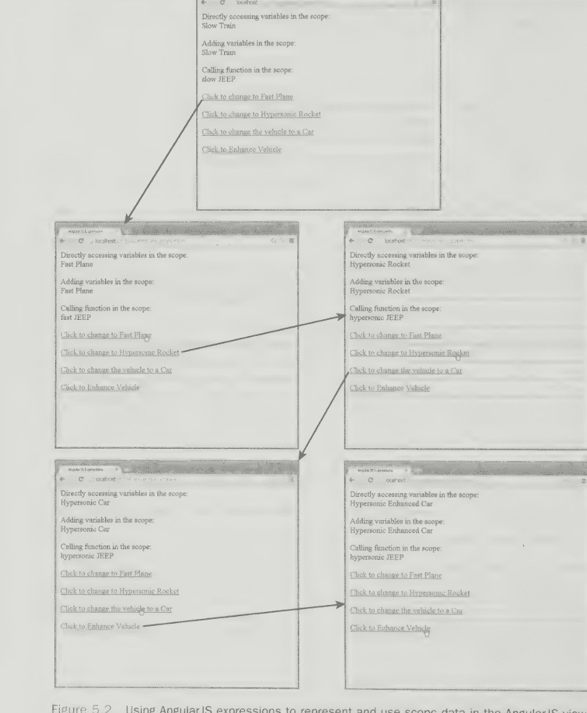

### 在 AngularJS 表达式中使用 JavaScript

在这个最后的例子中，我们来看看作用域内一些额外的 JavaScript 交互。如前所述，AngularJS 表达式支持大部分 JavaScript 功能。为了更好地说明这一点，该示例展示了一些数组操作，以及如何在表达式中利用 JavaScript 的 Math 对象。

清单 5.5 创建了一个简单的 AngularJS 控制器，该控制器在作用域中包含两个数组。注意，在第 3 行，以下语句通过将其赋值给 `window.Math`，将 Math 变量添加到作用域中。这对于使用 JavaScript Math 功能是必要的，因为在计算 AngularJS 表达式时，只有作用域变量是可用的：

`$scope.Math = window.Math;`

清单 5.6 实现了一个 AngularJS 模板，该模板使用 AngularJS 表达式来显示数组、显示数组长度，以及直接在表达式中使用 `push()` 和 `shift()` 操作数组元素。请注意，由于我们已经将 Math 添加到作用域中，我们可以在第 16 行和第 23 行的表达式中直接使用 JavaScript Math 运算。

图 5.3 展示了渲染后的 AngularJS 网页。请注意，随着链接的被点击，数组会发生调整，并且表达式会被重新计算。

#### 清单 5.5 expressions_javascript.js：构建一个包含数组和 Math 对象的作用域，供 AngularJS 表达式使用

```javascript
angular.module('myApp', [])
  .controller('myController', function($scope) {
    $scope.Math = window.Math;
    $scope.myArr = [1];
    $scope.removedArr = [];
  });
```

#### 清单 5.6 expressions_javascript.html：一个 AngularJS 模板，它使用以各种方式包含数组和 Math 逻辑的表达式来与作用域模型中的数据交互

```html
<!doctype html>
<html ng-app="myApp">
  <head>
    <title>AngularJS Expressions</title>
    <style>
      a{color: blue; text-decoration: underline; cursor: pointer}
    </style>
  </head>
  <body>
    <div ng-controller="myController">
      <h1>Expressions</h1>
      Array:<br>
      {{myArr}}<hr>
      Elements removed from array:<br>
      {{removedArr}}<hr>
      <a ng-click="myArr.push(Math.floor(Math.random()*100 + 1))">
      Click to append a value to the array</a><hr>
      <a ng-click="removedArr.push(myArr.shift())">
      Click to remove the first value from the array</a><hr>
      Size of Array:<br>
      {{myArr.length}}<hr>
      Max number removed from the array:<br>
      {{Math.max.apply(Math, removedArr)}}<hr>
    <script src="http://code.angularjs.org/1.3.0/angular.min.js"></script>
    <script src="js/expressions_javascript.js"></script>
  </body>
</html>
```

多次点击追加按钮

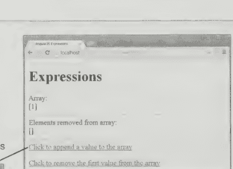

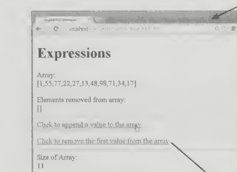

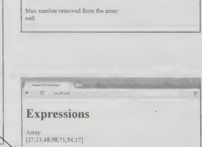

多次点击移除按钮

图 5.3 使用应用了 JavaScript 数组和 Math 运算的 AngularJS 表达式来与作用域数据交互。

## 使用过滤器

AngularJS 的一个强大功能是能够实现过滤器。过滤器是一种提供程序，它介入表达式解析器并修改表达式的结果以用于视图中的显示——例如，用于格式化时间或货币值。

你在表达式中实现过滤器，使用以下语法：

```
{{ expression | filter }}
```

如果你将多个过滤器链接在一起，它们将按照你指定的顺序执行：

```
{{ expression | filter | filter }}
```

有些过滤器允许你以函数参数的形式提供输入。你通过使用以下语法添加这些参数：

```
{{ expression | filter:parameter1:parameter2 }}
```

此外，你可以通过依赖注入将过滤器（提供程序）添加到控制器和服务中。过滤器提供程序的名称是过滤器名称加上 Filter。例如，货币过滤器提供程序名为 `currencyFilter`。过滤器提供程序充当一个函数，表达式作为第一个参数，其后是任何额外的参数。以下代码定义了一个注入 `currencyFilter` 并使用它来格式化结果的控制器。请注意，`currencyFilter` 被添加到控制器的依赖注入中，并作为一个函数被调用：

```javascript
controller('myController', ['$scope', 'currencyFilter',
    function($scope, myCurrencyFilter){
        $scope.getCurrencyValue = function(value){
            return myCurrencyFilter(value, "$");
        };
}]);
```

### 使用内置过滤器

AngularJS 提供了几种类型的过滤器，使你能够轻松格式化 AngularJS 模板中的字符串、对象和数组。表 5.1 列出了 AngularJS 提供的内置过滤器。

#### 表 5.1 修改 AngularJS 模板中表达式的过滤器

| 过滤器 | 描述 |
| :--- | :--- |
| `currency[:symbol]` | 根据提供的符号值将数字格式化为货币。如果未提供符号值，则使用区域设置的默认符号。例如：`{{ 123.45 | currency }}` |
| `filter:exp:compare` | 根据 `compare` 的值，使用 `exp` 参数的值过滤表达式。`exp` 参数可以是字符串、对象或函数。`compare` 参数可以是一个接受预期值和实际值并返回 `true` 或 `false` 的函数。`compare` 参数也可以是布尔值，其中 `true` 表示严格比较 `actual===expected`，`false` 表示宽松比较，检查该值是否是实际值的子集。例如：`{{"Some Text to Compare" | filter:"text":false}}` |
| `json` | 将 JavaScript 对象格式化为 JSON 字符串。例如：`{{ {'name':'Brad'} | json }}` |
| `limitTo:limit` | 通过 `limit` 量限制表达式中表示的数据。如果表达式是 `String`，则按字符数限制。如果表达式的结果是 `Array`，则按元素数量限制。例如：`{{ ['a','b','c','d'] | limitTo:2 }}` |
| `lowercase` | 将表达式的结果输出为小写。 |
| `uppercase` | 将表达式的结果输出为大写。 |
| `number[:fraction]` | 将数字格式化为文本。如果指定了 `fraction` 参数，则显示的小数位数将限制为该大小。例如：`{{ 123.4567 | number:3 }}` |
| `orderBy:exp:reverse` | 根据 `exp` 参数对数组进行排序。`exp` 参数可以是一个计算数组中项目值的函数，或者是一个指定对象数组中对象属性的字符串。`reverse` 参数为 `true` 表示降序，`false` 表示升序。 |
| `date [:format]` | 使用 `format` 参数格式化 JavaScript `Date` 对象、时间戳或 ISO 8601 日期字符串。例如：`{{1389323623006 | date:'yyyy-MM-dd HH:mm:ss Z'}}` |

**日期格式令牌：**

- `yyyy`：四位数年份
- `yy`：自 2000 年以来的两位数年份
- `MMMM`：年中的月份，一月至十二月
- `MMM`：年中的月份，Jan-Dec
- `MM`：年中的月份，补零，01-12
- `M`：年中的月份，1-12
- `dd`：月中的日，补零，01-31
- `d`：月中的日，1-31
- `EEEE`：星期中的天，星期日至星期六
- `EEE`：星期中的天，Sun-Sat
- `HH`：一天中的小时，补零，00-23
- `H`：一天中的小时，0-23
- `hh`：上午/下午的小时，补零，01-12
- `h`：上午/下午的小时，1-12
- `mm`：一小时中的分钟，补零，00-59
- `m`：一小时中的分钟，0-59
- `ss`：一分钟中的秒，补零，00-59
- `s`：一分钟中的秒，0-59
- `.sss` 或 `,sss`：一秒中的毫秒，补零，000-999
- `a`：上午/下午标记
- `Z`：四位数时区偏移量，-1200-+1200

日期的 `format` 字符串也可以是以下预定义名称之一。显示的格式为 en_US，但会与 AngularJS 应用程序的区域设置匹配：

- `medium`：'MMM d, y h:mm:ss a'
- `short`：'M/d/yy h:mm a'
- `fullDate`：'EEEE, MMMM d,y'
- `longDate`：'MMMM d, y'
- `mediumDate`：'MMM d, y'
- `shortDate`：'M/d/yy'
- `mediumTime`：'h:mm:ss a'
- `shortTime`：'h:mm a'

清单 5.7 和 5.8 展示了如何在 AngularJS 中实现一些基本过滤器。清单 5.7 实现了一个包含 `JSONObj`、`word` 和 `days` 属性的控制器。清单 5.8 在模板表达式中直接实现了 `number`、`currency`、`date`、`json`、`limitTo`、`uppercase` 和 `lowercase` 过滤器。图 5.4 展示了这些清单的输出结果。

#### 清单 5.7 filters.js：构建 AngularJS 过滤器可用的作用域

```javascript
angular.module('myApp', [])
  .controller('myController', function($scope) {
    $scope.currentDate = new Date();
    $scope.JSONObj = { title: "myTitle" };
    $scope.word="Supercalifragilisticexpialidocious";
    $scope.days=['Monday', 'Tuesday', 'Wednesday',
                 'Thursday', 'Friday'];
  });
```

#### 清单 5.8 filters.html：实现各种过滤器以修改渲染视图中显示数据的 AngularJS 模板

```html
<!doctype html>
<html ng-app="myApp">
  <head>
    <title>AngularJS Filters</title>
  </head>
  <body>
    <div ng-controller="myController">
      <h2>Basic Filters</h2>
      Number: {{123.45678|number:3}}<br>
      Currency: {{123.45678|currency:"$"}}<br>
      Date: {{ currentDate | date:'yyyy-MM-dd HH:mm:ss Z'}}<br>
      JSON: {{ JSONObj | json }}<br>
      Limit Array: {{ days | limitTo:3 }}<br>
      Limit String: {{ word | limitTo:9 }}<br>
      Uppercase: {{ word | uppercase | limitTo:9 }}<br>
      Lowercase: {{ word | lowercase | limitTo:9 }}
      <script src="http://code.angularjs.org/1.3.0/angular.min.js"></script>
      <script src="js/filters.js"></script>
    </body>
  </html>
```


图 5.4 使用 AngularJS 过滤器在显示数据之前对其进行修改。

### 使用过滤器实现排序和过滤

过滤器非常常见的一个用途是对使用 JavaScript 数组通过 `ng-repeat` 指令构建的动态元素进行排序或过滤。本节提供了一个实现 `orderBy` 过滤器的示例，该过滤器生成一个表格，该表格可以按列排序，并通过 `<input>` 元素的字符串进行过滤。

清单 5.9 实现了一个控制器，该控制器定义了 `$scope.planes` 数组作为作用域中的输入数据。由于您不想在排序和过滤时修改实际的模型数据，因此第 12 行添加了 `$scope.filteredPlanes` 属性来存储过滤后的数组。

注意，第 13 行设置了 `$scope.reverse` 值以跟踪排序方向。然后第 14 行设置了 `$scope.column` 值以跟踪 `planes` 数组中对象的哪个属性名称用于排序。第 15-16 行定义了 `setSort()` 函数，用于更新 `column` 和 `reverse` 的值。

第 19 行定义了 `$scope.filterString` 属性，用于过滤要包含在 `filteredPlanes` 中的对象。第 20-23 行定义了 `setFilter()` 函数，该函数调用 `filterFilter()` 提供程序将 `filteredPlanes` 中的项目限制为与 `filterString` 模糊匹配的项目。第 2 和 3 行将 `filterFilter` 提供程序注入到控制器中。

清单 5.10 实现了一个模板，其中包含一个绑定到 `filterString` 值的文本 `<input>` 和一个在点击时调用 `setFilter()` 的按钮 `<input>`。

注意，在第 14-16 行中，表头应用 `ng-click` 指令来调用 `setSort()` 以设置排序列。第 18-23 行使用 `ng-repeat` 指令实现了表格的行。注意，`ng-repeat` 指令使用 `orderBy` 过滤器来指定由 `setSort()` 函数设置的列名和 `reverse` 值。图 5.5 展示了生成的网页。

#### 清单 5.9 filter_sort.js：构建 AngularJS 可用的作用域，然后进行排序和过滤

```javascript
angular.module('myApp', [])
  .controller('myController', ['$scope', 'filterFilter',
                       function($scope, filterFilter) {
      $scope.planes = [
        {make: 'Boeing', model: '777', capacity: 440},
        {make: 'Boeing', model: '747', capacity: 700},
        {make: 'Airbus', model: 'A380', capacity: 850},
        {make: 'Airbus', model: 'A340', capacity: 420},
        {make: 'McDonnell Douglas', model: 'DC10', capacity: 380},
        {make: 'McDonnell Douglas', model: 'MD11', capacity: 410},
        {make: 'Lockheed', model: 'L1011', capacity: 380}];
      $scope.filteredPlanes = $scope.planes;
      $scope.reverse = true;
      $scope.column = 'make';
      $scope.setSort = function(column){
        $scope.column = column;
        $scope.reverse = !$scope.reverse;
      };
      $scope.filterString = '';
      $scope.setFilter = function(value){
        $scope.filteredPlanes =
          filterFilter($scope.planes, $scope.filterString);
      };
  }]);
```

#### 清单 5.10 filter_sort.html：实现 filter 和 orderBy 过滤器以对表格视图中的项目进行排序和过滤的 AngularJS 模板

```html
<!doctype html>
<html ng-app="myApp">
    <head>
        <title>AngularJS Sorting and Filtering</title>
        <style>
            table{text-align:right;}
            td,th{padding:3px;}
            th{cursor:pointer;}
        </style>
    </head>
    <body>
        <div ng-controller="myController">
            <h2>Sorting and Filtering</h2>
            <input type="text" ng-model="filterString">
            <input type="button" ng-click="setFilter()" value="Filter">
            <table>
                <tr>
                    <th ng-click="setSort('make')">Make</th>
                    <th ng-click="setSort('model')">Model</th>
                    <th ng-click="setSort('capacity')">Capacity</th>
                </tr>
                <tr ng-repeat=
                    "plane in filteredPlanes | orderBy:column:reverse">
                    <td>{{plane.make}}</td>
                    <td>{{plane.model}}</td>
                    <td>{{plane.capacity}}</td>
                </tr>
            </table>
            <script src="http://code.angularjs.org/1.3.0/angular.min.js"></script>
            <script src="js/filter_sort.js"></script>
        </body>
</html>
```


图 5.5 使用 AngularJS 过滤器在 AngularJS 视图中过滤和排序表格中的项目。

### 创建自定义过滤器

AngularJS 允许您创建自己的自定义过滤器提供程序，然后将其用于表达式、控制器和服务中，就像使用内置过滤器一样。AngularJS 提供了 `filter()` 方法来创建过滤器提供程序，并将其注册到依赖注入器服务器。

`filter()` 方法接受过滤器的名称作为第一个参数，函数作为第二个参数。过滤器函数应接受表达式输入作为第一个参数，其后是任何附加参数。例如：

```javascript
filter('myFilter', function(){
  return function(input, param1, param2){
    return <<modified input>>;
  };
});
```

在过滤器函数内部，您可以以任何喜欢的方式更改输入值。过滤器函数返回的任何值都将作为表达式结果返回。

清单 5.11 和 5.12 创建了一个自定义过滤器函数，该函数审查字符串中的单词，并允许将替换值作为可选参数。清单 5.11 在第 2-11 行实现了 `censor` 过滤器提供程序。然后在第 12-20 行，控制器通过依赖注入添加了 `censorFilter` 提供程序。第 17-19 行中的 `filterText()` 函数利用 `censorFilter` 提供程序审查文本并将其替换为 `<<censored>>`。

清单 5.12 中的代码实现了一个模板，该模板以多种方式使用过滤器，包括基于点击事件调用 `filterText()`。注意，第 9 行传递给 censor 过滤器的值来自作用域中的变量 `censorText`。图 5.6 展示了这些清单的输出。

#### 清单 5.11 filter_customer.js：在 AngularJS 中实现自定义过滤器提供程序

```javascript
angular.module('myApp', [])
  .filter('censor', function() {
    return function(input, replacement) {
      var cWords = ['bad', 'evil', 'dark'];
      var out = input;
      for(var i=0; i<cWords.length; i++){
        out = out.replace(cWords[i], replacement);
      }
      return out;
    };
  })
  .controller('myController', ['$scope', 'censorFilter',
                    function($scope, myCensorFilter) {
    $scope.censorText = "****";
    $scope.phrase="This is a bad phrase.";
    $scope.txt = "Click to filter out dark and evil.";
    $scope.filterText = function(){
      $scope.txt = myCensorFilter($scope.txt, '<<censored>>');
    };
  }]);
```

#### 清单 5.12 filter_custom.html：一个使用自定义过滤器的 AngularJS 模板

```html
<!doctype html>
<html ng-app="myApp">
  <head>
    <title>AngularJS 自定义过滤器</title>
  </head>
  <body>
    <div ng-controller="myController">
      <h2>排序与过滤</h2>
      {{phrase | censor:censorText}}<br>
      {{"This is some bad, dark, evil text." | censor:"happy"}}
      <p ng-click="filterText()">{{txt}}</p>
      <script src="http://code.angularjs.org/1.3.0/angular.min.js"></script>
      <script src="js/filter_custom.js"></script>
  </body>
</html>
```

## 总结

AngularJS 模板实现简单，却功能强大且应用广泛。本章讨论了 AngularJS 模板的组成部分，以及它们如何协同工作来扩展 HTML DOM 的行为和功能。表达式是包含在 `{{}}` 括号内或 AngularJS 模板指令定义中的 JavaScript 代码片段。表达式可以访问作用域，因此你可以将作用域的值渲染到视图中。

过滤器充当表达式的修饰器，使你能够为特定目的格式化表达式的结果。AngularJS 提供了多个内置过滤器，例如用于货币和日期格式化的过滤器。你也可以创建自己的自定义过滤器，在将数据渲染到页面之前应用任何你想要的格式化或修改。你通过依赖注入将过滤器作为提供者注入到注入器服务中，从而可以在控制器和模板内部访问它们。这意味着你也可以在 JavaScript 代码中访问过滤器。

# 在 AngularJS 视图中实现指令

AngularJS 最强大的功能之一是指令。指令扩展了 HTML 的行为，使你能够创建具有应用程序特定功能的自定义 HTML 元素、属性和类。AngularJS 提供了多个内置指令。事实上，AngularJS 库的大部分内容就是由内置指令构成的。这些指令提供了与表单元素交互、将作用域中的数据绑定到视图以及与浏览器事件交互的能力。

本章讨论了内置指令以及如何在 AngularJS 模板中实现它们。你将学习如何在 AngularJS 模板中应用这些指令，并在后端控制器中支持它们，从而快速将渲染后的视图转变为交互式应用程序。

## 理解指令

指令是 AngularJS 模板标记和配套 JavaScript 代码的组合。AngularJS 指令标记可以是 HTML 属性、元素名称或 CSS 类。JavaScript 指令代码定义了 HTML 元素的模板数据和行为。

AngularJS 编译器遍历模板 DOM 并编译所有指令。然后，它通过将指令与一个作用域相结合来链接指令，从而生成一个新的实时视图。实时视图包含指令中定义的 DOM 元素和功能。

## 使用内置指令

你需要在 HTML 元素中实现的大多数 AngularJS 功能都由内置指令提供。这些指令由库提供，在 AngularJS JavaScript 库加载后即可使用。

指令为 AngularJS 应用程序提供了广泛的支持。以下各节描述了大多数 AngularJS 指令，它们可分为以下几类：

- 支持 AngularJS 功能的指令
- 扩展表单元素的指令
- 将页面元素绑定到作用域模型中值的指令
- 将页面事件绑定到控制器的指令

以下每个部分都包含一个表格，列出了相关指令及其基本描述。你无需现在就理解所有这些指令；这些表格更多是作为参考。后续章节将提供使用其中许多指令的示例代码。

### 支持 AngularJS 功能的指令

有几个指令为 AngularJS 功能提供支持。这些指令的功能从引导应用程序到确保 AngularJS 所需的布尔表达式在 DOM 中得到保留，不一而足。

表 6.1 列出了这些指令，并描述了每个指令的行为和用法。

#### 表 6.1 支持 AngularJS 模板功能的指令

| 指令 | 描述 |
| :--- | :--- |
| `ngApp` | 此指令用于将应用程序引导到根元素。此属性设置为要用作应用程序根的 AngularJS 模块的名称，包含它的 HTML 元素将作为模板的编译根。例如，以下将模块 `myApp` 设置为 `<html>` 元素中的应用程序：`<html ng-app="myApp">` |
| `ngCloak` | 当元素中存在此属性时，该元素在 AngularJS 模板完全编译之前不会显示。否则，将显示元素包含模板代码的原始形式。 |
| `ngController` | 此指令将控制器附加到视图中的此元素以创建新的作用域，如前面章节所述。例如：`<div ng-controller="myController">` |
| `ngHref` | 这是一个你可以用来替代 `href` 属性的选项。如果你包含像 `{{hash}}` 这样的模板语法，用户可能在表达式求值之前点击链接，从而导致链接可能失效。 |
| `ngInclude` | 此指令自动从服务器获取、编译并包含外部 HTML 片段。使用它是包含来自服务器端脚本的部分 HTML 数据的好方法。例如：`<div ng-include="/info/sidebar.html">` |
| `ngList` | 此指令将作用域中的 `Array` 对象转换为分隔符分隔的字符串。（逗号是默认分隔符。）例如，如果作用域包含一个名为 `items` 的数组，以下 `<input>` 中显示的值将是 `item1, item2, item3,...`：`<input ng-model="items" ng-list=",">` |
| `ngNonBindable` | 当指令存在于元素中时，AngularJS 在编译期间不会编译或绑定该元素的内容。如果你尝试在元素中显示代码，这很有用。例如：`<p ng-non-bindable>表达式语法：{{exp}}</p>` |
| `ngOpen` | 浏览器不需要保留元素的布尔属性。如果存在此属性，则为 `true`。此指令使你能够通过测试属性是否存在来保留元素的 `true`/`false` 状态。例如，以下基于作用域中的 `open` 值应用 `ngOpen`：`<details ng-open="open">` |
| `ngPluralize` | 此指令使你能够根据 AngularJS 捆绑的 `en-US` 本地化规则显示消息。你可以通过添加 `count` 和 `when` 属性来配置 `ngPluralize`，如下所示：`<p ng-pluralize count="itemCount" when="{'0': 'Cart is empty.', 'one': 'Purchase 1 item.', 'other': 'Purchase {{itemCount}} items.'}">` |
| `ngReadonly` | 类似于 `ngOpen`，但用于 `readonly` 布尔值。例如，以下基于作用域中的 `notChangeable` 值应用 `ngReadonly`：`<input type="text" ng-readonly="notChangeable">` |
| `ngRequired` | 此指令类似于 `ngOpen`，但用于表单中 `<input>` 元素的 `required` 布尔值。例如，以下基于作用域中的 `required` 值应用 `ngRequired`：`<input type="text" ng-required="required">` |
| `ngSelected` | 此指令类似于 `ngOpen`，但用于 `selected` 布尔值。例如，以下基于作用域中的 `selected` 值应用 `ngSelected`：`<option id="optionA" ng-selected="selected"> 选项 A </option>` |
| `ngSrc` | 如果你包含像 `{{username}}` 这样的模板语法，可以使用此指令替代 `src` 属性（该属性在表达式求值前是无效的）。例如：`` |
| `ngSrcset` | 你可以使用此指令替代 `srcset` 属性（该属性在表达式求值前是无效的）。例如：`` |
| `ngTransclude` | 此指令将元素标记为使用 transclude 选项来包裹其他元素的指令的 transclude 点。 |
| `ngView` | 此指令将当前路由的渲染模板包含到主布局文件中。路由将在第 9 章讨论。 |
| `script` | 此指令加载带有 `next/ng-template` 的 `script` 标签的内容，以便 `ngInclude`、`ngView` 或其他模板指令可以使用它。 |

表 6.1 中的指令在代码的不同部分以不同方式使用。你已经在之前的示例中见过其中一些，比如 `ngApp` 和 `ngController`。有些指令相当直观，例如在模板中实现 `` 元素时使用 `ng-src` 代替 `src`。其他的将在后续章节的各种示例中使用。

我确实想在此时给你一个使用 `ngInclude` 指令的示例。这个小指令使用简单，可用于多种目的，特别是当你尝试将 AngularJS 引入现有系统时。在本例中，我们将使用 `ngInclude` 通过从服务器加载不同的部分 HTML 文件来切换基本网页顶部的横幅栏。

清单 6.1 中的代码实现了一个非常基本的 AngularJS 控制器，它将一个 HTML 文件名存储在名为 `titleBar` 的变量中。清单 6.2 中的代码实现了一个 AngularJS 模板，该模板顶部包含几个链接用于切换页面，以及第 24 行的一个 `<div>` 元素，该元素使用 `ng-include` 将 div 的内容更改为 `titleBar` 指定的文件。

标题栏的不同版本位于清单 6.3 和 6.4 所示的文件中。基本上，这些文件只包含一个 `<p>` 元素，该元素被分配了 `large` 或 `small` 类。类定义位于清单 6.2 的 `<style>` 元素中。

图 6.1 显示了两个标题横幅。当点击链接切换横幅时，原始 `<div>` 元素的内容将被加载的新 HTML 文件替换。

#### 清单 6.1 directive_angular_include.js：实现一个将标题元素的 HTML 文件名存储在作用域中的控制器

```javascript
angular.module('myApp', []).
  controller('myController', function($scope) {
    $scope.titleBar = "small_title.html";
});
```

#### 清单 6.2 directive_angular_include.html：一个使用 ng-include 指令通过在两个 HTML 文件之间切换来更改页面标题栏的 AngularJS 模板

```html
<!doctype html>
<html ng-app="myApp">
<head>
  <title>AngularJS Data Include Directive</title>
  <style>
    .large{
      background-color: blue; color: white;
      text-align: center;
      font: bold 50px/80px verdana, serif;
      border: 6px black ridge; }
    .small{
      background-color: lightgrey;
      text-align: center;
      border: 1px black solid; }
    a{
      color: blue; text-decoration: underline;
      cursor: pointer; }
  </style>
</head>
<body>
  <div ng-controller="myController">
    <a ng-click="titleBar='large_title.html'">Make Title Large</a>
    <a ng-click="titleBar='small_title.html'">Make Title Small</a>
    <div ng-include="titleBar"></div>
  </div>
  <script src="http://code.angularjs.org/1.3.0/angular.min.js"></script>
  <script src="js/directive_angular_include.js"></script>
</body>
</html>
```

#### 清单 6.3 small_title.html：包含小版本标题的部分 HTML 文件

```html
<p class="small">
  This is a Small Title
</p>
```

#### 清单 6.4 large_title.html：包含大版本标题的部分 HTML 文件

```html
<p class="large">
  This is a Large Title
</p>
```

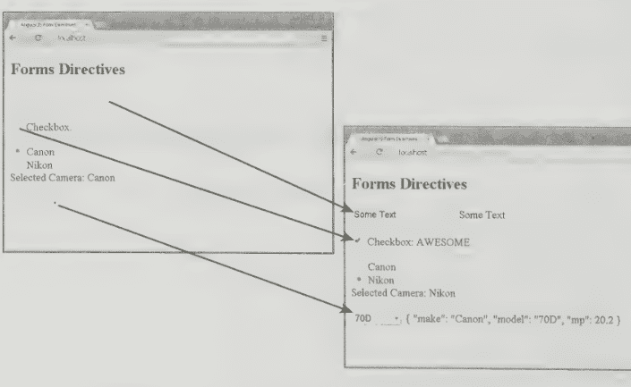

图 6.1 使用 ng-include 指令通过使用不同的 HTML 部分文件动态更改视图。

### 扩展表单元素的指令

AngularJS 与表单元素高度集成，为应用中的表单元素提供数据绑定和事件绑定。为了以正确的方式提供 AngularJS 功能，表单元素在编译时会被扩展。

表 6.2 列出了 AngularJS 扩展的表单元素。

#### 表 6.2 扩展表单元素以支持 AngularJS 模板功能的指令

| 指令 | 描述 |
| :--- | :--- |
| `a` | 此指令修改默认行为，以在 `href` 属性为空时阻止默认操作。这使你能够通过使用 `ngClick` 或其他事件指令创建操作链接。例如：`<a href="" ng-click="doSomething()">Click me</a>` |
| `input.email` | 此指令与 `input` 相同。 |
| `input.number` | 此指令除了已提供给 `input` 的属性外，还添加了以下额外的 AngularJS 属性：<br>- `min`：设置 `min` 验证错误量。<br>- `max`：设置 `max` 验证错误量。 |
| `input.radio` | 此指令除了已提供给 `input` 的属性外，还添加了以下额外的 AngularJS 属性：<br>- `value`：在元素被选中时设置作用域中的值。 |
| `input.text` | 此指令与 `input` 相同。 |
| `input.url` | 此指令与 `input` 相同。 |
| `input.date` | 此指令为日期输入元素添加日期验证和转换。作用域模型中的值也必须是 JavaScript `Date` 对象。此指令除了已提供给 `input` 的属性外，还添加了以下额外的 AngularJS 属性：<br>- `min`：设置 `min` 日期验证错误量。<br>- `max`：设置 `max` 日期验证错误量。 |
| `input.dateTimeLocal` | 此指令与 `input.date` 相同，只是格式必须输入为有效的 ISO-8601 本地日期时间格式（yyyy-MM-ddTHH:mm）。例如：`2014-11-28T12:37` |
| `input.month` | 此指令与 `input.date` 相同，只是格式必须输入为有效的 ISO-8601 月份格式（yyyy-MM）。例如：`2014-11` |
| `input.time` | 此指令与 `input.date` 相同，只是格式必须输入为有效的 ISO-8601 时间格式（HH:mm）。例如：`12:37` |
| `input.week` | 此指令与 `input.date` 相同，只是格式必须输入为有效的 ISO-8601 周格式（yyyy-W##）。例如：`2014-W02` |
| `select` | 此指令向 `<select>` 元素添加了额外的 `ngOptions` 指令。 |
| `ngOptions` | 此指令使你能够基于迭代表达式添加选项。如果作用域中的数据源是数组，请使用以下表达式为 ngOptions 设置 `<select>` 中每个 `<option>` 元素的 label、name 和 value 属性：<br> `label for value in array` <br> `select as label for value in array` <br> `label group by group for value in array` <br> `select as label group by group for value in array track by trackexpr` <br><br> 如果作用域中 ngOptions 的源是 JavaScript 对象，请使用以下表达式语法：<br> `label for (key, value) in object` <br> `select as label for (key, value) in object` <br> `label group by group for (key, value) in object` <br> `select as label group by group for (key, value) in object` <br><br> 例如：<br> `<select ng-model="color" ng-options="c.name for c in colors">` <br> `    <option value="">-- choose color --</option>` <br> `</select>` |
| `textarea` | 此指令与 `input` 相同。 |

清单 6.5 和 6.6 实现了一些基本的 AngularJS 表单元素与作用域的集成。清单 6.5 初始化作用域。清单 6.6 实现了几个常见的表单组件，包括文本框、复选框、单选按钮和 select 元素，以说明它们在模板中如何定义以及如何与作用域中的数据交互。图 6.2 显示了生成的网页。

#### 清单 6.5 directive_form.js：为表单指令实现一个控制器

```javascript
angular.module('myApp', []).
    controller('myController', function($scope) {
        $scope.cameras = [
            {make:'Canon', model:'70D', mp:20.2},
            {make:'Canon', model:'6D', mp:20},
            {make:'Nikon', model:'D7100', mp:24.1},
            {make:'Nikon', model:'D5200', mp:24.1}];
        $scope.cameraObj=$scope.cameras[0];
        $scope.cameraName = 'Canon';
        $scope.cbValue = '';
        $scope.someText = '';
    });
```

#### 清单 6.6 directive_form.html：一个实现了多种不同表单元素指令的 AngularJS 模板

```html
<!doctype html>
<html ng-app="myApp">
<head>
  <title>AngularJS Form Directives</title>
</head>
<body>
  <div ng-controller="myController">
    <h2>Forms Directives</h2>
    <input type="text" ng-model="someText"> {{someText}}<hr>
    <input type="checkbox" ng-model="cbValue"
          ng-true-value="AWESOME" ng-false-value="BUMMER">
    Checkbox: {{cbValue}}<hr>
    <input type="radio"
      ng-model="cameraName" value="Canon"> Canon<br/>
    <input type="radio"
      ng-model="cameraName" value="Nikon"> Nikon<br/>
    Selected Camera: {{cameraName}} <hr>
    <select ng-model="camera"
      ng-options="c.model group by c.make for c in cameras">
    </select>
    {{camera|json}}
  <script src="http://code.angularjs.org/1.3.0/angular.min.js"></script>
  <script src="js/directive_form.js"></script>
</body>
</html>
```


图 6.2 在 AngularJS 模板视图中实现表单指令元素。

### 将模型绑定到页面元素的指令

AngularJS 模板使你能够将作用域中的数据直接绑定到 HTML 元素中显示的内容。你可以通过多种方式将数据绑定到视图，包括以下几种：

- **值**：你可以直接在作用域中表示表单元素的值。例如，文本输入可以是作用域中的一个 `String` 变量，而复选框则由一个 `Boolean` 值表示。
- **HTML**：你可以通过使用类似 `<p>{{myTitle}}</p>` 这样的表达式，在元素的 HTML 输出中表示作用域中的数据值。
- **属性**：HTML 元素属性的值可以通过在定义中使用表达式来反映作用域中的数据，例如：`<a ng-href="/{{hash}}/index.html">{{hash}}</a>`。
- **可见性**：元素的可见性可以反映在视图的作用域中。例如，当基于作用域的表达式为 `true` 时，元素可见；否则，它不可见。
- **存在性**：你可以根据作用域中的值，从编译后的 DOM 中省略元素。

表 6.3 列出了将作用域中的数据直接绑定到视图元素的指令。

#### 表 6.3 将作用域中的数据绑定到 HTML 元素的值、表达式、可见性和存在性的指令

| 指令 | 描述 |
| :--- | :--- |
| `ngBind` | 此指令告诉 AngularJS 用给定表达式的值替换 HTML 元素的文本内容，并在作用域中的值发生变化时更新文本内容。例如：`<span ng-bind="titleString"></span>` |
| `ngBindHtml` | 此指令告诉 AngularJS 用给定表达式的值替换 HTML 元素的 innerHTML 内容，并在作用域中的值发生变化时更新 innerHTML 内容。例如：`<div ng-bind-html="someHTML"></div>` |
| `ngBindTemplate` | 此指令与 `ngBind` 类似，不同之处在于表达式可以包含多个 `{{}}` 表达式块。例如：`<span ng-bind-template="{{aValue}} and {{anotherValue}}"></span>` |
| `ngClass` | 此指令通过数据绑定一个表示要添加的类的表达式，来动态设置元素的 CSS 类。当表达式的值发生变化时，元素的 CSS 类会自动更新。例如：`<p ng-class="myPStyles"></p>` |
| `ngClassEven` | 此指令与 `ngClass` 相同，不同之处在于它与 `ngRepeat` 配合使用，仅将类更改应用于集合中索引为偶数的元素。例如：`<li ng-repeat="item in items"><span ng-class-even="evenRowClass">{{item}}</span></li>` |
| `ngClassOdd` | 此指令与 `ngClass` 相同，不同之处在于它与 `ngRepeat` 配合使用，仅将类更改应用于集合中索引为奇数的元素。例如：`<li ng-repeat="item in items"><span ng-class-odd="oddRowClass">{{item}}</span></li>` |
| `ngDisabled` | 如果表达式求值为 `true`，此指令会禁用按钮元素。 |
| `ngHide` | 此指令根据提供的表达式显示或隐藏 HTML 元素，使用 AngularJS 中提供的 `.ng-hide` CSS 类。如果作用域中的表达式求值为 `false`，则显示该元素；否则，它被隐藏。例如：`<div ng-hide="myValue"></div>` |
| `ngShow` | 此指令与 `ngHide` 相反：如果作用域中的表达式求值为 `true`，则显示该元素；否则，它被隐藏。例如：`<div ng-show="myValue"></div>` |
| `ngIf` | 此指令根据表达式删除或重新创建 DOM 树的一部分。这与 `show` 或 `hide` 不同，因为 HTML 根本不会出现在 DOM 中。例如：`<div ng-if="present"> </div>` |
| `ngModel` | 此指令将 `<input>`、`<select>` 或 `<textarea>` 元素的值绑定到作用域模型中的一个值。当用户更改元素的值时，作用域中的值会自动更改，反之亦然。例如：`<input type="text" ng-model="myString">` |
| `ngRepeat` | 此指令使你能够根据作用域中的数组添加多个 HTML 元素。这对于列表、表格和菜单非常有用。`ngRepeat` 使用 `item in collections` 风格的迭代语法。为创建的每个单独 HTML 元素都会创建一个新的作用域。在循环生成 HTML 元素期间，以下变量在作用域中可见：<br>    - `$index`：基于 0 的迭代器索引，第一个元素为 0。<br>    - `$first`：一个布尔值，如果这是第一个元素则为 `true`。<br>    - `$middle`：一个布尔值，如果这不是第一个或最后一个元素则为 `true`。<br>    - `$last`：一个布尔值，如果这是最后一个元素则为 `true`。<br>    - `$even`：一个布尔值，如果迭代器是偶数则为 `true`。<br>    - `$odd`：一个布尔值，如果迭代器是奇数则为 `true`。<br>    <br>    例如，以下代码根据具有 `firstname` 属性的用户数组进行迭代并构建一系列 `<li>` 元素：<br>    `<li ng-repeat="user in users">`<br>    `{{$index}}: {{user.firstname}}</li>` |
| `ngInit` | 此指令与 `ngRepeat` 一起使用，在迭代期间初始化一个值。例如：<br>    `<div ng-repeat="user in users" ng-init="offset=21">`<br>    `{{$index+offset}}: {{user.firstname}}</div>` |
| `ngStyle` | 此指令使你能够根据作用域中的一个对象动态设置样式，其中属性名和值与 CSS 属性匹配。例如：<br>    `<span ng-style="myStyle">Stylized Text</span>` |
| `ngSwitch` | 此指令使你能够根据作用域表达式，动态交换编译模板中包含的 DOM 元素。以下是用于多个元素的语法示例：<br>    `<div ng-switch="myLocation">`<br>    `<div ng-switch-when="home">Home Info</div>`<br>    `<div ng-switch-when="work">Work Info</div>`<br>    `<div ng-switch-default>Default Info</div>`<br>    `</div>` |
| `ngValue` | 此指令将 `input[select]` 或 `input[radio]` 的选定值绑定到 `ngModel` 中指定的表达式。例如：<br>    `<div ng-repeat="pizza in pizzas"`<br>    `<input type="radio" name="pizza"`<br>    `ng-model="myPizza" ng-value="pizza" id="{{pizza}}" >`<br>    `</div>` |

代码清单 6.7 和 6.8 提供了一些基本 AngularJS 绑定指令的示例。代码清单 6.7 初始化了作用域的值，包括第 4 行的 `myStyle` 对象。代码清单 6.8 在模板中提供了绑定指令的实际实现。

除了少数例外，代码清单 6.8 中的模板代码都很直接。第 15 行和第 16 行将单选按钮 `<input>` 绑定到作用域中的 `myStyle['background-color']` 属性。这展示了如何处理不允许使用通常的点表示法（例如 `myStyle.color`）的样式名称。还要注意，单选按钮的值是使用 `ng-value` 从 `ng-repeat` 作用域中设置的，以获取颜色值。

还要注意，当使用 `ng-class-even` 设置类名时，类名 `even` 需要放在单引号中，因为它是一个字符串。图 6.3 显示了生成的网页。

#### 清单 6.7 directive_bind.js：实现一个带有作用域模型的控制器以支持数据绑定指令

```javascript
angular.module('myApp', []).
    controller('myController', function($scope) {
        $scope.colors=['red','green','blue'];
        $scope.myStyle = { "background-color": 'blue' };
        $scope.days=['Monday', 'Tuesday', 'Wednesday',
                    'Thursday', 'Friday'];
        $scope.msg="Dynamic Message from the model";
    });
```

#### 清单 6.8 directive_bind.html：一个实现了多种不同数据绑定指令的 AngularJS 模板

```html
<!doctype html>
<html ng-app="myApp">
<head>
    <title>AngularJS Data Binding Directives</title>
    <style>
        .even{background-color:lightgrey;}
        .rect{display:inline-block; height:40px; width:100px;}
    </style>
</head>
<body>
    <div ng-controller="myController">
        <h2>Data Binding Directives</h2>
        <label ng-repeat="color in colors">
            {{color}}
            <input type="radio" ng-model="myStyle['background-color']"
                ng-value="color" id="{{color}}" name="mColor">
        </label>
        <span class="rect" ng-style="myStyle"></span><hr>
        <li ng-repeat="day in days">
```

### 将页面事件绑定到控制器的指令

AngularJS 模板允许你将浏览器事件绑定到控制器代码。这意味着你可以从作用域的角度处理用户输入。然后，你可以直接将浏览器事件的处理程序实现到相应的作用域。事件指令的工作原理与普通的浏览器事件处理程序非常相似，不同之处在于它们直接链接到作用域上下文。

表 6.4 列出了将页面和设备事件绑定到 AngularJS 模型的指令。这些指令中的每一个都允许你指定一个表达式，通常是在作用域中定义的函数，如第 5 章“使用 AngularJS 模板创建视图”中所讨论的。例如，以下是作用域中一个名为 `setTitle` 的函数：

```javascript
$scope.setTitle = function(title){
    $scope.title = title;
};
```

你可以通过使用以下 `ng-click` 指令，将作用域中的 `setTitle()` 函数直接绑定到视图中的输入按钮：

`<input type="button" ng-click="setTitle('New Title')">`

#### 表 6.4 将页面/设备事件绑定到 AngularJS 模型功能的指令

| 指令 | 描述 |
| --- | --- |
| `ngBlur` | 在触发 blur 事件时评估一个表达式。 |
| `ngChange` | 在表单元素的值发生更改时评估一个表达式。 |
| `ngChecked` | 在复选框或单选按钮元素被选中时评估一个表达式。 |
| `ngClick` | 在鼠标点击时评估一个表达式。 |
| `ngCopy` | 在触发复制事件时评估一个表达式。 |
| `ngCut` | 在触发剪切事件时评估一个表达式。 |
| `ngDblclick` | 在鼠标双击时评估一个表达式。 |
| `ngFocus` | 在元素获得焦点触发 focus 事件时评估一个表达式。 |
| `ngKeydown` | 在按下键盘按键时评估一个表达式。 |
| `ngKeypress` | 在按下并释放键盘按键时评估一个表达式。 |
| `ngKeyup` | 在释放键盘按键时评估一个表达式。 |
| `ngMousedown` | 在按下鼠标按键时评估一个表达式。 |
| `ngMouseenter` | 在鼠标进入元素时评估一个表达式。 |
| `ngMouseleave` | 在鼠标离开元素时评估一个表达式。 |
| `ngMousemove` | 在鼠标光标移动时评估一个表达式。 |
| `ngMouseover` | 在鼠标悬停在元素上时评估一个表达式。 |
| `ngMouseup` | 在释放鼠标按键时评估一个表达式。 |
| `ngPaste` | 在触发粘贴事件时评估一个表达式。 |
| `ngSubmit` | 阻止默认的表单提交操作（该操作会向服务器发送请求），转而评估指定的表达式。 |
| `ngSwipeLeft` | 在触发向左滑动事件时评估一个表达式。 |
| `ngSwipeRight` | 在触发向右滑动事件时评估一个表达式。 |

你可以使用 `$event` 关键字将 JavaScript `Event` 对象传递给事件表达式。这使你可以访问有关事件的信息，以及停止事件传播和通常对 JavaScript `Event` 对象进行的所有其他操作。例如，以下 `ng-click` 指令将鼠标点击事件传递给 `myClick()` 处理函数：

`<input type="button" ng-click="myClick($event)">`

以下部分提供了一些使用 AngularJS 事件指令与来自浏览器的事件进行交互的示例。

### 使用焦点和失焦事件

AngularJS 的 `ngBlur` 和 `ngFocus` 指令对于跟踪表单元素何时获得和失去焦点非常有用。例如，你可能希望在特定输入元素获得或失去焦点时在控制器中执行一些代码——比如说，在更新模型之前操作输入。代码清单 6.9 和 6.10 展示了一个使用 `ngBlur` 和 `ngFocus` 指令根据进入和离开文本输入框来设置作用域中的值的示例。

代码清单 6.9 中的代码实现了一个控制器，它定义了一个 `inputData` 对象来存储两个 `<input>` 元素的值。`focusGained()` 函数将在输入获得焦点时被调用，并将使用 `input` 参数将该输入在 `inputData` 中的值设置为空字符串。`focusLost()` 函数将接受事件和输入作为参数，并将使用事件对象获取目标元素的值，并更新 `inputData` 中对应的属性。

代码清单 6.10 是一个 AngularJS 模板，它实现了两个 `<input>` 元素，并将 `focusGained()` 和 `focusLost()` 处理程序分配给 `ng-focus` 和 `ng-blur` 属性。图 6.4 展示了这个基本示例的运行效果。请注意，当你点击一个输入元素时，存储在 `inputData` 中的值被设置为空字符串，而当你离开该输入元素时，该值会被更新。

#### 清单 6.9 directive_focus_events.js: 实现一个带有作用域数据和事件处理程序的控制器，以支持来自视图的失焦和聚焦事件


```
01 angular.module('myApp', []).
02   controller('myController', function($scope) {
03     $scope.inputData = { input1: '',
04                          input2: '' };
05     $scope.focusGained = function(input){
06       $scope.inputData[input] = '';
07     };
08     $scope.focusLost = function(event, input){
09       var element = angular.element(event.target);
10       var value = element.val();
11       $scope.inputData[input] = value.toUpperCase();
12     };
13   });
```

#### 代码清单 6.10 directive_focus_events.html: 一个实现了 ngFocus 和 ngBlur 指令的 AngularJS 模板

```
01 <!doctype html>
02 <html ng-app="myApp">
03 <head>
04   <title>AngularJS Focus Event Directives</title>
05 </head>
06 <body>
07   <div ng-controller="myController">
08     <h2>Focus Event Directives</h2>
09     Input 1:<br>
10     <input type="text"
11       ng-blur="focusLost($event, 'input1')"
12       ng-focus="focusGained('input1')"><br>
13     Input 2:<br>
14     <input type="text"
15       ng-blur="focusLost($event, 'input2')"
16       ng-focus="focusGained('input2')"><hr>
17     Input Data: {{inputData|json}}<br/>
18   </div>
19   <script src="http://code.angularjs.org/1.3.0/angular.min.js"></script>
20   <script src="js/directive_focus_events.js"></script>
21 </body>
22 </html>
```

### 处理 AngularJS 元素上的键盘事件

你将要使用的最常见的键盘事件指令是 `ngKeydown` 和 `ngKeyup` 事件，它们分别在按下和释放键盘按键时触发。键盘事件对于与用户在键盘上输入时进行更紧密的交互非常有用。最常用的键盘交互可能是在用户按下键盘上的回车键时执行某些操作。代码清单 6.11 和 6.12 展示了 `ngKeydown` 和 `ngKeyup` 指令的用法。

代码清单 6.11 中的代码实现了一个控制器，它为按键按下和释放事件提供模型和键盘处理函数。`storedString` 变量用于在用户在输入框中键入时按下回车键时存储文本输入的值。`keyInfo` 变量存储最后按下的键的 `keyCode`，而 `keyStrokes` 数组记录之前按下按键的 `keyCodes`。在 `keyPressed()` 函数内部，我们检查 `keyCode` 是否为 13（即表示按下了回车键），如果是，我们记录 `storedString` 并重置其他变量。

代码清单 6.12 是 AngularJS 模板，它将 `ng-keydown` 和 `ng-keyup` 指令分配给一个 `<input>` 元素。当 `ng-keydown` 触发时，`keyState` 变量在

# 第六章 在 AngularJS 视图中实现指令

当 `ng-keyup` 被触发时，会调用 `keyPressed()` 处理器。图 6.5 展示了 AngularJS 网页的运行效果。请注意，当你在文本输入框中输入每个字符时，模型会随之更新；当按下回车键时，单词会被存储，同时按键记录会被重置。

```
清单 6.11  directive_keyboard_events.js：实现一个包含作用域数据和事件处理器的控制器，以支持视图的键按下和键释放事件
01 angular.module('myApp', []).
02   controller('myController', function($scope) {
03     $scope.storedString = '';
04     $scope.keyInfo = {};
05     $scope.keyStrokes = [];
06     $scope.keyState = 'Not Pressed';
07     $scope.keyPressed = function(event){
08       if (event.keyCode == 13){
09         var element = angular.element(event.target);
10         $scope.storedString = element.val();
11         element.val('');
12         $scope.keyInfo.keyCode = event.keyCode;
13         $scope.keyStrokes = [];
14         $scope.keyState = 'Enter Pressed';
15       } else {
16         $scope.keyInfo.keyCode = event.keyCode;
17         $scope.keyStrokes.push(event.keyCode);
18         $scope.keyState = 'Not Pressed';
19       }
20     };
21   });
```

```
清单 6.12  directive_keyboard_events.html：一个实现了 ngKeydown 和 ngKeyup 指令的 AngularJS 模板
01 <!doctype html>
02 <html ng-app="myApp">
03 <head>
04   <title>AngularJS Keyboard Event Directives</title>
05 </head>
06 <body>
07   <div ng-controller="myController">
08     <h2>Keyboard Event Directives</h2>
09     <input type="text"
10         ng-keydown="keyState='Pressed'"
11         ng-keyup="keyPressed($event)"><hr>
12     Keyboard State:<br>
13       {{keyState}}<hr>
14       Last Key:<br>
15 {{keyInfo|json}}<hr>
16 Stored String:<br>
17 {{storedString}}<hr>
18 Recorded Key Strokes:<br>
19 {{keyStrokes}}
20 </div>
21 <script src="http://code.angularjs.org/1.3.0/angular.min.js"></script>
22 <script src="js/directive_keyboard_events.js"></script>
23 </body>
24 </html>
```

输入按键会更新模型

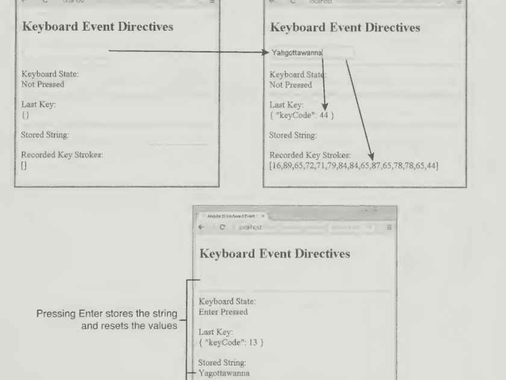

图 6.5 在 AngularJS 模板视图中实现键盘事件指令。

### 在 AngularJS 元素中处理鼠标事件

AngularJS 提供了多个鼠天事件指令，使你能够轻松地为 AngularJS 应用添加鼠标交互功能。你最常用的鼠标事件指令是 `ngClick`，用于处理鼠标点击。然而，你还有其他几个鼠标事件指令，它们对于创建丰富的交互式组件非常有用。清单 6.13 和 6.14 中的代码展示了 `ngClick`、`ngMouseenter`、`ngMouseleave`、`ngMousedown`、`ngMouseup` 和 `ngMouseMove` 指令的用法。

清单 6.13 中的代码实现了一个控制器，它提供了模型以及 `mouseClick()` 和 `mouseMove()` 处理器函数，用于处理点击和鼠标移动事件。鼠标在元素上移动时的实时位置信息存储在 `mouseInfo` 结构中。每次在元素上点击鼠标时，点击位置都会存储在 `lastClickInfo` 中。

清单 6.14 中的代码是 AngularJS 模板，它将鼠标事件指令分配给一个 `` 元素，并显示 `mouseInfo` 和 `lastClickInfo` 结构。图 6.6 展示了 AngularJS 应用的运行效果。请注意，当你进入、离开和点击图像时，鼠标状态会发生变化。还要注意，当你在图像上移动和点击时，位置信息会随之更新。

```
清单 6.13  directive_mouse_events.js：实现一个包含作用域数据和事件处理器的控制器，以支持视图的鼠标点击和移动事件
01 angular.module('myApp', []).
02     controller('myController', function($scope) {
03         $scope.mouseInfo = {};
04         $scope.lastClickInfo = {};
05         $scope.mouseClick = function(event){
06             $scope.lastClickInfo.clientX = event.clientX;
07             $scope.lastClickInfo.clientY = event.clientY;
08             $scope.lastClickInfo.screenX = event.screenX;
09             $scope.lastClickInfo.screenY = event.screenY;
10         };
11         $scope.mouseMove = function(event){
12             $scope.mouseInfo.clientX = event.clientX;
13             $scope.mouseInfo.clientY = event.clientY;
14             $scope.mouseInfo.screenX = event.screenX;
15             $scope.mouseInfo.screenY = event.screenY;
16         };
17 });
```

```
清单 6.14  directive_mouse_events.html：一个实现了 ngClick 及其他鼠标点击和移动事件指令的 AngularJS 模板
01 <!doctype html>
02 <html ng-app="myApp">
03 <head>
04   <title>AngularJS Event Directives</title>
05   <style>
06     img {
07       border: 3px ridge black;
08       height: 200px; width: 200px;
09       display: inline-block;
10     }
11   </style>
12 </head>
13 <body>
14   <div ng-controller="myController">
15     <h2>Event Directives</h2>
16     </img><hr>
25     Mouse State: {{mouseState}}<br/>
26     Mouse Position Info: {{mouseInfo|json}}<br/>
27     Last Click Info: {{lastClickInfo|json}}<br/>
28   </div>
29   <script src="http://code.angularjs.org/1.3.0/angular.min.js"></script>
30   <script src="js/directive_mouse_events.js"></script>
31 </body>
32 </html>
```

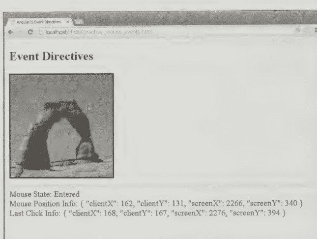

图 6.6 在 AngularJS 模板视图中实现鼠标点击和移动事件指令。

## 总结

AngularJS 指令扩展了 HTML 的行为。你可以将指令作为 HTML 元素、属性和类应用于 AngularJS 模板。你通过使用 JavaScript 代码来定义指令的功能。AngularJS 提供了多个内置指令，用于与表单元素交互、将作用域中的数据绑定到视图，以及与浏览器事件交互。例如，`ngModel` 将表单元素的值直接绑定到作用域。当作用域值发生变化时，元素显示的值也会相应变化，反之亦然。

## 创建你自己的自定义指令以扩展 HTML

与 AngularJS 的许多其他功能一样，你可以通过创建自己的自定义指令来扩展指令功能。自定�指令使你能够通过自行实现元素的行为来扩展 HTML 的功能。如果你有需要操作 DOM 的代码，你应该通过使用自定义指令来实现这一点。与内置指令一样，自定义指令提供了与表单元素交互、将作用域中的数据绑定到视图，以及与浏览器事件交互的能力。

本章讨论了自定义指令的设计和实现。你还将有机会看到几个扩展 HTML 能力的自定义指令的基本示例。

### 理解自定义指令定义

你通过调用 `Module` 对象上的 `directive()` 方法来实现自定义指令。`directive()` 方法接受指令名称作为第一个参数，以及一个提供者函数，该函数返回一个包含构建指令对象所需指令的对象。例如，以下是指令的基本定义：

```
angular.module('myApp', []).
  directive('myDirective', function() {
    return {
      template: 'Name: {{name}} Score: {{score}}'
    };
  });
```

表 7.1 提供了你可以应用于指令定义返回对象的属性列表，例如上述代码中返回的 `template`。

## 7.1 创建自定义指令以扩展HTML

表 7.1 定义了AngularJS指令功能的指令定义属性

| 属性 | 描述 |

|---|---|

| `template` | 允许你定义插入到指令元素中的AngularJS模板文本。 |

| `templateUrl` | 与`template`相同，不同之处在于你指定服务器上的URL，并且部分模板会被下载并插入到指令的元素中。 |

| `restrict` | 允许你指定指令是应用于HTML元素、属性还是两者兼有。 |

| `type` | 设置为一个表示标记使用的文档类型的字符串。这对于具有非HTML根节点的模板很有用，例如SVG或MathML。默认值是`html`。<br>- `html`：所有根模板节点都是HTML，不需要包装。根节点也可以是顶级元素，如`<svg>`或`<math>`。<br>- `svg`：模板仅包含SVG内容，在处理前必须包装在`<svg>`节点中。<br>- `math`：模板仅包含MathML内容，在处理前必须包装在`<math>`节点中。 |

| `multiElement` | 告诉编译器收集具有属性`directive-name-start`和`directive-name-end`的节点之间的DOM节点，并将它们作为指令元素分组在一起。你应该仅在非严格行为性的指令（如`ngClick`）上使用此选项，并且这些指令不操作或替换子节点（如`ngInclude`）。 |

| `priority` | 指定此指令的优先级编号。指令根据其优先级按顺序编译，从最高优先级值的指令开始。前向链接函数按相同顺序执行，从最高优先级开始，但后向链接函数从最低优先级的指令开始反向执行。 |

| `terminal` | 这是一个布尔值，告诉编译器停止并且不编译优先级编号较低的指令。任何优先级编号低于设置为`true`的`terminal`的指令都不会被编译。 |

| `transclude` | 允许你指定指令是否可以访问内部作用域之外的作用域。这使你可以在指令编译和链接时，将元素的内容包装到一个新生成的元素中。 |

| `scope` | 允许你为指令定义作用域。该作用域可以共享父作用域、从中继承，或者拥有自己的隔离作用域。 |

| `compile` | 允许你指定一个可以访问DOM元素属性的编译函数。编译函数使你能够定义可以与AngularJS模板DOM交互和操作的前向链接和后向链接函数。 |

理解自定义指令定义

| 属性 | 描述 |

|---|---|

| link | 类似于编译函数，但也提供对作用域的访问。只有在编译函数不存在时，链接函数才会执行。从链接函数中，你可以注册DOM事件监听器以及操作DOM。链接函数在模板被克隆后执行。通常你应该将大部分模板逻辑放在链接函数中。 |

| controller | 允许你在指令中定义一个控制器来管理指令的作用域和视界。 |

| controllerAs | 指定控制器的别名，以便可以在指令模板中引用它。指令需要为此配置定义一个作用域。当指令用作组件时，此选项很有用。 |

| bindToController | 当为组件使用隔离作用域并使用`controllerAs`时，`bindToController`允许组件将其属性绑定到控制器，而不是作用域。当控制器实例化时，隔离作用域绑定的初始值已经可用。 |

| require | 允许你指定实现此指令所需的其他指令。那些指令的提供程序必须可用，才能创建此指令的实例。 |

| template | 允许你定义插入到指令元素中的AngularJS模板文本。 |

以下各节将更详细地讨论指令选项。

### 定义指令视图模板

你可以包含AngularJS模板代码来构建将在包含指令的HTML元素中显示的视图组件。你可以通过使用`template`属性直接添加模板代码，如本例所示：

```javascript
directive('myDirective', function() {
  return {
    template: 'Name: {{name}} Score: {{score}}'
  };
});
```

你可以在自定义模板中指定一个根元素——但只能有一个元素。此元素作为定义在AngularJS模板中的任何子元素的根元素。此外，如果你使用`transclude`标志，该元素应包含`ngTransclude`。例如：

```javascript
directive('myDirective', function() {
  return {
    transclude: true,
    template: '<div ng-transclude></div>'
  };
});
```

你也可以使用`templateUrl`属性指定位于Web服务器上的AngularJS模板的URL，如本例所示：

```javascript
directive('myDirective', function() {
  return {
    templateUrl: '/myDirective.html'
  };
});
```

模板URL可以包含任何标准的AngularJS模板代码。因此，你可以根据需要使你的指令尽可能简单或复杂。

### 限制指令行为

你可以将指令作为HTML元素、属性或两者兼有来应用。`restrict`属性使你能够限制自定义指令的应用方式。`restrict`属性可以设置为以下值：

- **A**：作为属性名应用。例如：

  `<div my-directive="expression"></div>`

- **E**：作为元素名应用。例如：

  `<my-directive></my-directive>`

- **C**：作为类应用。例如：

  `<div class="my-directive: expression;"></div>`

- **M**：作为注释应用。例如：

  `<!-- directive: my-directive expression -->`

- **AEC**：作为属性、元素或类名应用。你也可以使用其他组合，如AE或AC。

例如，你可以将以下指令作为属性或元素应用：

```javascript
directive('myDirective', function() {
  return {
    restrict: 'AE',
    templateUrl: '/myDirective.html'
  };
});
```

以下展示了如何将指令同时实现为元素和属性。注意，驼峰命名被带有连字符的名称所取代：

```html
<my-directive></my-directive>
<div my-directive></div>
```

### 向指令添加控制器

你可以通过使用指令定义的`controller`属性向指令添加自定义控制器。这使你能够为指令模板提供控制器支持。例如，以下代码添加了一个简单的控制器，该控制器设置了一个作用域值和一个函数：

```javascript
directive('myDirective', function() {
  return {
    scope: {title: '='},
    controller: function ($scope){
      $scope.title = "new";
      $scope.myFunction = function(){
      };
    }
  };
});
```

你也可以使用`require`选项来确保控制器可用于该指令。`require`选项使用`require: '^controller'`语法来指示注入器服务在父级上下文中查找直到找到该控制器。以下是指令中要求`myController`控制器的示例：

```javascript
directive('myDirective', function() {
  return {
    require: '^myController'
  };
});
```

当你添加`require`选项时，指定的控制器作为`link()`函数的第四个参数传递。例如：

```javascript
directive('myDirective', function() {
  return {
    require: '^myController',
    link: function(scope, element, attrs, injectedMyController){
    }
  };
});
```

你也可以使用`require`选项要求多个控制器，在这种情况下，一个控制器数组会传递给`link()`函数。例如：

## 128 第七章 创建自定义指令以扩展HTML

```javascript
directive('myDirective', function() {
    return {
        require: ['^myControllerA', '^myControllerB'],
        link: function(scope, element, attrs, requiredControllers){
            var controllerA = requiredControllers[0];
            var controller = requiredControllers[1];
        }
    };
});
```

如果你在 `require` 选项中指定了另一个指令的名称，该指令的控制器就会被链接。例如：

```javascript
directive('myDirective', function() {
    return {
        require: '^myOtherDirective',
        link: function(scope, element, attrs, otherDirectiveController){
        }
    };
});
```

### 配置指令作用域

指令默认情况下与父级共享作用域。这通常足以满足大多数需求。最大的缺点是，你可能不希望将所有自定义指令属性包含在父作用域中，尤其是当父作用域是根作用域时。

为了解决这个问题，你可以使用 `scope` 属性为指令定义一个单独的作用域。以下几节将描述如何添加继承作用域和隔离作用域。

#### 添加继承作用域

为指令添加作用域的最简单方法是创建一个从父作用域继承的作用域。其优点是，你有一个独立于父作用域的区域来添加额外的值，但缺点是自定义指令仍然可以修改父作用域中的值。

要为自定义指令创建继承作用域，只需将指令的 `scope` 属性设置为 `true` 即可。例如：

```javascript
directive('myDirective', function() {
    return {
        scope: true
    };
});
```

#### 添加隔离作用域

有时你可能想要将指令内部的作用域与指令外部的作用域分开。这样做可以防止指令修改父控制器作用域中的值。指令定义允许你指定一个 `scope` 属性来创建一个隔离作用域。隔离作用域将指令作用域与外部作用域隔离开来，防止指令访问外部作用域，也防止外部作用域中的控制器修改指令作用域。例如，以下代码将指令的作用域与外部作用域隔离：

```javascript
directive('myDirective', function() {
  return {
    scope: { },
    templateUrl: '/myDirective.html'
  };
});
```

使用这段代码，指令将拥有一个完全空的隔离作用域。然而，你可能仍然希望将外部作用域中的一些项映射到指令的内部作用域。你可以使用以下前缀来修饰属性名，以使局部作用域变量在指令的作用域中可用：

- **@**：将一个局部作用域字符串绑定到DOM属性的值。该属性的值将在指令作用域内部可用。

- **=**：在局部 `scope` 属性和指令作用域属性之间创建双向绑定。

- **&**：将局部作用域中的函数绑定到指令作用域。

如果前缀后面没有属性名，则使用指令属性的名称。例如：

```javascript
title: '@'
```

等同于

```javascript
title: '@title'
```

以下代码展示了如何实现每种方法，将局部值映射到指令的隔离作用域中：

```javascript
angular.module('myApp', []).
  controller('myController', function($scope) {
    $scope.title="myApplication";
    $scope.myFunc = function(){
      console.log("out");
    };
  }).
  directive('myDirective', function() {
    return {
      scope: {title: '=', newFunc:"&myFunc", info: '@'},
      template: '<div ng-click="newFunc()">{{title}}: {{info}}</div>'
    };
  });
```

以下代码展示了如何在AngularJS模板中定义指令，以提供映射属性所需的必要属性：

```html
<div my-directive
    my-func="myFunc()"
    title="title"
    info="SomeString"></div>
```

### 插入元素

插入可能是一个一开始比较难理解的概念。基本上，其思想是你可以保留AngularJS模板中定义的自定义指令的内容，并将其绑定到作用域。其工作方式是，指令的链接函数接收一个预先绑定到当前作用域的插入函数。然后，指令内部的元素就可以访问指令外部的作用域。

你可以将 `transclude` 选项设置为以下值：

- **true**：插入指令的内容。

- **'element'**：插入整个元素，包括在较低优先级定义的任何指令。

你还必须在指令模板内部的元素中包含 `ngTransclude` 指令。以下是一个实现 `transclude` 的示例，展示了如何从 `myDirective` 指令模板中访问控制器作用域中的 `title` 变量：

```javascript
angular.module('myApp', []).
  directive('myDirective', function() {
    return {
      transclude: true,
      scope: {},
      template: '<div ng-transclude>{{title}}</div>'
    };
  }).
  controller('myController', function($scope) {
    $scope.title="myApplication";
  });
```

### 使用链接函数操作DOM

当AngularJS HTML编译器遇到一个指令时，它会运行指令的编译函数，该函数返回 `link()` 函数。`link()` 函数被添加到AngularJS指令列表中。所有指令编译完成后，HTML编译器会根据优先级按顺序调用link()函数。

如果你想修改自定义指令内部的DOM，你应该使用 `link()` 函数。`link()` 函数接受与指令关联的 `scope`、`element`、`attributes`、`controller` 和 `transclude` 函数，使你能够在指令内部直接操作DOM。`transclude` 函数是一个绑定到插入作用域的句柄。

在 `link()` 函数内部，你需要处理指令元素上的 `$destroy` 事件，并清理任何必要的内容。`link()` 函数还负责注册DOM监听器以处理浏览器事件。

`link()` 函数使用以下语法：

```javascript
link: function(scope, element, attributes, [controller], [transclude])
```

`scope` 参数是指令的作用域，`element` 是指令将被插入的元素，`attributes` 列出了元素上声明的属性，`controller` 是由 `require` 选项指定的控制器。`transclude` 参数是插入函数的句柄。

插入函数提供了在原始元素的内容被插入时创建的元素的访问权限。如果你只想要一个具有继承作用域的插入元素，你可以直接调用插入函数。例如：

```javascript
link: function link(scope, elem, attr, controller, transcludeFn){
    var transcludedElement = transcludeFn();
}
```

你也可以通过指定一个 `clone` 参数来访问插入元素的克隆。例如：

```javascript
link: function link(scope, elem, attr, controller, transcludeFn){
    transcludeFn(function(clone){
        //在此处访问克隆体...
    });
}
```

你还可以通过同时应用 `scope` 参数和 `clone` 参数，来访问具有不同作用域的插入元素的克隆体。例如：

```javascript
link: function link(scope, elem, attr, controller, transcludeFn){
    transcludeFn(scope, function(clone){
        //在此处访问克隆体...
    });
}
```

以下指令展示了一个基本 `link()` 函数的实现，该函数设置了一个作用域变量，向DOM元素追加数据，实现了一个 `$destroy` 事件处理器，并在作用域中添加了一个 `$watch`：

```javascript
directive('myDirective', function() {
    return {
        scope: {title: '='},
        require: '^otherDirective',
        link: function link(scope, elem, attr, controller, transclude){
            scope.title = "new";
            elem.append("Linked");
            elem.on('$destroy', function() {
                //清理代码
            });
            scope.$watch('title', function(newVal){
                //监视代码
            });
        }
    };
});
```

`link` 属性也可以设置为一个对象，该对象包含 `pre` 和 `post` 属性，分别指定预链接函数和后链接函数。在前面的示例中，`link` 被设置为一个函数，该函数作为后链接函数执行，这意味着它在子元素已经链接之后执行，而预链接函数则在子元素链接之前执行。因此，你应该只在后链接函数中进行DOM操作。事实上，很少需要包含预链接函数。

以下展示了包含预链接和后链接函数的语法示例：

```javascript
directive('myDirective', function() {
    return {
        link: {
            pre: function preLink(scope, elem, attr, controller){
                //预链接代码
            },
            post: function postLink(scope, elem, attr, controller){
                //后链接代码
            }
        }
    };
});
```

### 使用编译函数操作DOM

编译函数与链接函数非常相似，有一个主要优势，但也有一些缺点。其优势，也是使用编译函数的主要原因，是性能。编译方法在编译模板时只执行一次，而链接函数在每次元素链接时都会执行，例如，当你在 `ng-repeat` 循环中应用多个指令或当模型发生变化时。如果你进行大量的DOM操作，这可能是一个很大的问题。

这些是 `compile` 函数的局限性：

-   任何操作都是在克隆发生之前应用的。这意味着当自定义指令在 `ng-repeat` 内部使用时，任何 DOM 操作都将应用于生成的*所有*自定义指令。

-   `compile()` 方法无法处理在自身模板或 `compile()` 函数中递归使用自身的指令，因为这会导致无限循环。

-   `compile()` 方法无法访问 `scope`。

-   `transclude` 函数已被弃用并从 `compile` 函数中移除，因此你无法链接到被包含的元素。

`compile()` 方法的语法与 `link()` 方法的语法非常相似。你可以指定一个单独的 postlink 函数，如下所示：

```
directive('myDirective', function() {
  return {
    compile: function compile(scope, elem, attr, controller){
      //postlink code
    }
  };
});
```

你也可以使用一个对象指定 pre- 和 postlink 函数，如下所示：

```
directive('myDirective', function() {
  return {
    compile: {
      pre: function preLink(elem, attr){
        //prelink code
      },
      post: function postLink(elem, attr){
        //postlink code
      },
    }
  };
});
```

### 实现自定义指令

你可以定义的自定�指令类型实际上是无限的，这使得 AngularJS 具有极强的可扩展性。自定义指令是 AngularJS 中最复杂、也最难真正理解的部分。最好的入门方式是向你展示一些自定义指令的示例，让你感受一下如何实现它们以及它们如何相互交互。

### 在自定义指令中操作 DOM

在自定�指令中执行的最常见的任务之一就是操作 DOM。这应该是你的 AngularJS 应用中实际操作 DOM 的唯一地方。在这个练习中，我们构建一个基本的自定�指令，该指令在其包含的元素周围应用一个带有标题和页脚的方框。这个例子非常基础，让你有机会了解如何使用 AngularJS 中的一些机制，例如将值设置为自定�指令的属性。

清单 7.1 中的代码创建了一个简单的应用程序，其中包含一个只有作用域变量 `title` 的控制器。然后代码定义了一个启用包含（transclusion）、将自定�指令限制为仅元素名称、并定义一个接受参数 `title` 和 `bwidth`（作为字符串）的独立作用域的指令。该示例还定义了一个 `template`，它添加了标题栏和一个 `<div ng-transclude>` 来存储自定�指令的被包含内容。

`link()` 函数使用 `append` 来追加一个页脚元素。这也可以在 `template` 中完成；但是，我想说明它也可以在 `link()` 函数中完成。还要注意，页脚元素的文本来自父作用域的标题值，使用的是 `scope.$parent.title`。`link` 函数还添加了一个 `border`，并根据作用域中的 `bwidth` 值设置 `display` 和 `width` 值。

清单 7.2 中的代码实现了一个 AngularJS 模板，该模板设置了一些 CSS 样式，然后添加了清单 7.1 中定义的 `<mybox>` 自定�指令。注意，指令的内容从字符串到图像再到段落各不相同。结果显示在图 7.1 中。注意，`bwidth` 属性的大小决定了方框的宽度，并且所有元素都被相同类型的方框包围。

#### 清单 7.1 `directive_custom_dom.js`：实现操作 DOM 的自定�指令

```
01 angular.module('myApp', [])
02   .controller('myController', function($scope) {
03     $scope.title="myApplication";
04   })
05   .directive('mybox', function() {
06     return {
07       transclude: true,
08       restrict: 'E',
09       scope: {title: '@', bwidth: '@bwidth'},
10       template: '<div><span class="titleBar">{{title}}' +
11                '</span><div ng-transclude></div></div>',
12       link: function (scope, elem, attr, controller, transclude){
13         elem.append('<span class="footer">' + scope.$parent.title + '</span>');
14         elem.css('border', '2px ridge black');
15         elem.css('display', 'inline-block');
16         elem.css('width', scope.bwidth);
17       };
18     };
19   });
```

#### 清单 7.2 `directive_custom_dom.html`：使用操作 DOM 的自定�指令的 AngularJS 模板

```
01 <!doctype html>
02 <html ng-app="myApp">
03 <head>
04   <title>AngularJS Custom Directive</title>
05   <style>
06     * {text-align: center ;}
07     .titleBar { color: white; background-color: blue;
08                font: bold 14px/18px arial; display: block;}
09     .footer { color: white; background-color: blue;
10              font: italic 8px/12px arial; display: block;}
11   </style>
12 </head>
13 <body>
14   <div ng-controller="myController">
15     <h2>Custom Directive Manipulating the DOM</h2>
16     <mybox title="Simple Text" bwidth="100px">
17       Using AngularJS to build a simple box around elements.
18     </mybox>
19     <mybox title="Image" bwidth="150px">
20       
21     </mybox>
22     <mybox title="Paragraph" bwidth="200px">
23       <p>Using AngularJS to build a simple box around a paragraph.</p>
24     </mybox>
25   </div>
26   <script src="http://code.angularjs.org/1.3.0/angular.min.js"></script>
27   <script src="js/directive_custom_dom.js"></script>
28 </body>
29 </html>
```

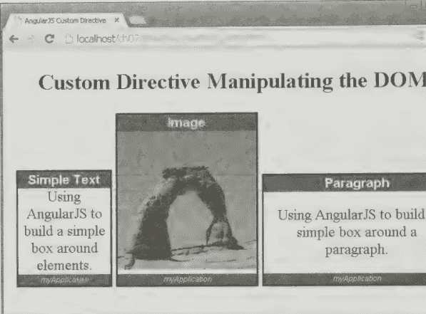

### 在自定义指令中实现事件处理程序

自定义指令的另一个非常常见的用途是实现事件处理程序，以与发生在自定义元素中的鼠标和键盘事件进行交互。这使你能够为自定义元素提供增强的用户交互。

在这个例子中，我们将添加鼠标事件处理程序，使你能够使用拖动操作来调整图像的大小和不透明度。当鼠标向左拖动时，图像缩小；向右拖动时，图像放大；向上拖动时，图像淡出；向下拖动时，不透明度增加。对于这个例子，我通过在 AngularJS 模板中加载完整的 jQuery 版本来实现。我选择这样做是为了使用一些在 jQuery lite 中不可用的功能，比如获取图像的 `width()`。

清单 7.3 中的代码实现了两个指令。第一个指令名为 `zoomit`。注意，在 link 函数内部，该指令监听 `mousedown`、`mouseup`、`mouseleave` 和 `mousemove` 事件。当按下鼠标按钮时，`dragging` 变量被设置为 true，当释放鼠标或鼠标离开元素时，`dragging` 被设置为 false。还要注意，在 `mousedown` 中，默认的事件行为被 `event.preventDefault()` 抑制。这是为了在拖动时消除与默认浏览器行为的任何交互冲突。

在 `mousemove` 处理程序中，我们确定鼠的位置移动，并相应地增加或减少图像大小。注意，由于加载了完整版本的 jQuery，我们能够使用 `width()` 和 `height()` 函数来获取和设置图像的大小。

`fadeit` 指令与 `zoomit` 指令非常相似，只是图像的 `opacity` 值被更改了。

`fadeit` 和 `zoomit` 指令在清单 7.4 所示的 AngularJS 模板中实现。注意，在第一个图像上添加了 `zoomit` 指令，在第二个图像上添加了 `fadeit` 指令，在最后一个图像上同时添加了两者。这向你展示了多个自定义指令可以添加到同一个元素上。结果显示在图 7.2 中。第一个图像通过向左拖动缩小，第二个图像通过向上拖动淡出，第三个图像同时放大和淡出。

#### 清单 7.3 `directive_custom_zoom.js`：实现注册 DOM 事件的自定义指令

```
01 angular.module('myApp', [])
02 .directive('zoomit', function() {
03   return {
04     link: function (scope, elem, attr){
05       var dragging = false;
06       var lastX = 0;
07       elem.on('mousedown', function(event){
08         lastX = event.pageX;
09         event.preventDefault();
10         dragging = true;
11       });
12       elem.on('mouseup', function(){
13         dragging = false;
14       });
15       elem.on('mouseleave', function(){
16         dragging = false;
17       });
18       elem.on('mousemove', function(event){
19         if(dragging){
20           var adjustment = null;
21           if (event.pageX > lastX &&
22               elem.width() < 300){
23             adjustment = 1.1;
24           } else if ( elem.width() > 100){
25             adjustment = .9;
26           }
27           //需要完整的jQuery库
28           if(adjustment){
29   elem.width(elem.width()*adjustment);
30   elem.height(elem.height()*adjustment);
31 }
32 lastX = event.pageX;
33 }
34 });
35 }
36 });
37 })
38 .directive('fadeit', function() {
39   return {
40     link: function (scope, elem, attr){
41       var dragging = false;
42       var lastY = 0;
43       elem.on('mousedown', function(event){
44         lastY = event.pageY;
45         event.preventDefault();
46         dragging = true;
47       });
48       elem.on('mouseup', function(){
49         dragging = false;
50       });
51       elem.on('mouseleave', function(){
52         dragging = false;
53       });
54       elem.on('mousemove', function(event){
55         if(dragging){
56           var adjustment = null;
57           var currentOpacity = parseFloat(elem.css("opacity"));
58           if (event.pageY > lastY &&
59               currentOpacity < 1){
60             adjustment = 1.1;
61           } else if ( currentOpacity > 0.5){
62             adjustment = .9;
63           }
64           //需要完整的jQuery库
65           if(adjustment){
66             elem.css("opacity", currentOpacity*adjustment);
67           }
68           lastY = event.pageY;
69         }
70       });
71     }
72   };
73 });
```

## 清单7.4 directive_custom_zoom.html：一个使用自定义指令通过鼠标事件提供交互的AngularJS模板

```html
01 <!doctype html>
02 <html ng-app="myApp">
03 <head>
04   <title>AngularJS自定义指令</title>
05   <style>
06     img { width: 200px; }
07   </style>
08 </head>
09 <body>
10   <h2>自定义指令：缩放与淡入淡出</h2>
11   </img>
12   </img>
13   </img>
14   <script
       src="http://ajax.googleapis.com/ajax/libs/jquery/1.11.1/jquery.min.js"></script>
15   <script src="http://code.angularjs.org/1.3.0/angular.min.js"></script>
16   <script src="js/directive_custom_zoom.js"></script>
17 </body>
18 </html>
```

140    第7章  创建自定义指令以扩展HTML

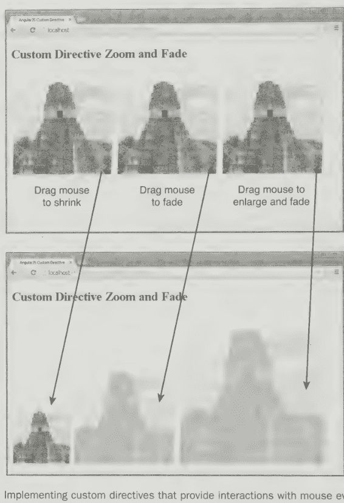

图7.2    实现自定义指令，通过鼠标事件与DOM元素进行交互。

### 实现嵌套指令

最后一个示例说明了如何将指令相互嵌套并让它们进行交互。嵌套指令是为相互关联的自定义元素提供父级上下文和容器的好方法。在此示例中，外层指令 `myPhotos` 作为容器，可以包含名为 `myPhoto` 的子指令。

清单7.5 实现了两个自定义指令：`myPhotos` 和 `myPhoto`。`myPhotos` 指令旨在作为 `myPhoto` 指令的容器。请注意，第7-18行定义了一个为 `myPhotos` 指令提供功能的控制器，其中包括一个 `addPhoto()` 函数。因为 `myPhoto` 指令中的 `代码` 使用了 `require: '^myPhotos'`，所以你也可以通过使用指向 `myPhotos` 控制器的 `photosControl` 句柄，从 `link()` 函数中调用 `addPhoto()` 方法。

清单7.6 在AngularJS模板中实现了 `myPhotos` 和 `myPhoto` 指令。`myPhoto` 指令嵌套在 `myPhotos` 指令内部。请注意，每个 `myPhoto` 指令都设置了 `title` 属性，并在清单7.5的第28行中将其链接到作用域。

清单7.7 实现了由 `myPhotos` 指令加载的部分模板。它生成一个 `<div>` 容器，然后使用 `myPhotos` 作用域中的 `photos` 数组来构建一个链接列表，这些链接通过 `ng-click` 绑定到 `select()` 函数。`<div ng-transclude></div>` 为 `myPhoto` 子元素提供了容器。

图7.3展示了由清单7.5、7.6和7.7创建的网页。

**清单7.5  `directive_custom_photos.js`：实现相互通信的自定义指令**

```javascript
01 angular.module('myApp', [])
02 .directive('myPhotos', function() {
03   return {
04     restrict: 'E',
05     transclude: true,
06     scope: {},
07     controller: function($scope) {
08       var photos = $scope.photos = [];
09       $scope.select = function(photo) {
10         angular.forEach(photos, function(photo) {
11           photo.selected = false;
12         });
13         photo.selected = true;
14       };
15       this.addPhoto = function(photo) {
16         photos.push(photo);
17       };
18     },
19     templateUrl: 'my_photos.html'
20   };
21 })
22 .directive('myPhoto', function() {
23   return {
24     require: '^myPhotos',
25     restrict: 'E',
26     transclude: true,
27     scope: { title: '@' },
28     link: function(scope, elem, attrs, photosControl) {
29       photosControl.addPhoto(scope);
30     },
31     template: '<div ng-show="selected" ng-transclude></div>'
32   };
33 });
```

## 清单7.6  directive_custom.html：一个实现嵌套自定义指令的AngularJS模板

```html
01 <!doctype html>
02 <html ng-app="myApp">
03 <head>
04   <title>AngularJS自定义指令</title>
05   <style>
06     img { width: 300px }
07   </style>
08 </head>
09 <body>
10   <h2>自定义指令：照片翻转</h2>
11   <my-photos>
12     <my-photo title="Flower">
13       
14     </my-photo>
15     <my-photo title="Arch">
16       
17     </my-photo>
18     <my-photo title="Lake">
19       
20     </my-photo>
21     <my-photo title="Bison">
22       
23     </my-photo>
24   </my-photos>
25   <script src="http://code.angularjs.org/1.3.0/angular.min.js"></script>
26   <script src="js/directive_custom_photos.js"></27>
28 </body>
29 </html>
```

## 清单7.7  my\_photos.html：一个为myPhotos自定义指令提供根元素的部分AngularJS模板

```html
01 <div>
02   <span ng-repeat="photo in photos"
03         ng-class="{active:photo.selected}">
04     <a href="" ng-click="select(photo)">{{photo.title}}</a>
05   </span>
06   <div ng-transclude></div>
07 </div>
```


## 总结

AngularJS最强大的特性之一就是能够创建自己的自定义指令。在代码中使用Module对象上的 `directive()` 方法来实现自定义指令非常简单。然而，由于其实现方式的千变万化，指令也可能变得非常复杂。本章让你初步了解了在AngularJS中使用自定义指令可以做什么。我建议你花些时间研究这些示例，并编写一些自己的指令，以便尽可能熟悉它们的工作原理。

## 使用事件与模型中的数据交互

事件是大多数AngularJS应用程序中最关键的组件之一。事件使用户能够与元素交互，也使应用程序能够知道何时执行特定任务。本章讨论了你当前和将来在AngularJS应用程序中将使用到的不同类型事件，旨在提供一个视角并介绍一些新主题。

具体来说，本章讨论了四种类型的事件，包括浏览器事件、用户交互事件、基于作用域的事件和自定义事件。你在前面的章节中已经接触过其中一些内容。之所以在此处讨论，是因为前面的章节为这里的讨论提供了背景。

### 浏览器事件

有一些事件是由浏览器本身触发的。从某种意义上说，这些也是用户交互事件；然而，为了本次讨论，我希望将它们分开。浏览器事件包括诸如文档加载时的 `ready` 事件，以及浏览器窗口大小调整时的 `resize` 事件。

了解用户视图何时发生变化很有用。你已经见过如何使用 `.on()` 函数为事件添加处理程序；问题是把处理程序放在哪里。我见过的最佳解决方案是，在整个应用程序的 `run` 块中注册一个处理程序。然后，任何信息都可以通过作用域模型或缓存服务提供给后续组件。

### 用户交互事件

你已经接触过用户交互事件。这些包括鼠标和键盘事件，以及其他事件，如 `focus` 和 `blur` 事件。通常，你会在两个地方实现用户事件的交互。一个是使用ng事件指令，

### 添加 `$watches` 以跟踪作用域变化事件

你已经在前面的章节中接触过这两种方法；我这里想指出的是，你确实可以选择使用哪一种。使用内置的 `ng` 事件指令（如 `ngClick`）的优势在于，对于简单的需求，你不必增加创建自定义指令的复杂性。

然而，使用 `ng` 事件指令也有一些缺点。一个是你不应该在控制器中执行 DOM 操作，而那里正是你可以定义 `ng` 指令处理程序的地方。另一个缺点是，每次你想要该功能时，都必须在模板中编写 `ngClick` 代码。例如，考虑以下为元素添加鼠标事件处理程序的模板代码：

```html
<span
   ng-mouseenter="mouseEntered(event)"
   ng-mouseleave="mouseLeft(event)"
   ng-click="clicked(event)">
</span>
```

代码本身并不算太糟，但如果有多个不同的地方需要相同的功能呢？如果它们位于一个 `ng-repeat` 块中，那问题不大，但否则就会很麻烦。一个好的经验法则是，如果你想在多个地方使用该功能，或者肯定要在多个应用中重用它，你就应该定义一个实现了这些处理程序的自定义指令。

另一个你将经常使用的常见事件并非由浏览器触发，而是由模型中的数据变化触发。此功能使你能够对模型变化做出反应，而无需在每个值可能变化的地方都添加代码。这个功能很有用，因为模型中的数据通常可能会以各种方式变化——用户输入、服务更新等等。

#### 使用 `$watch` 跟踪作用域变量

要添加处理作用域值变化的功能，你只需使用 AngularJS 内置的 `$watch` 功能，在作用域中的变量上添加一个 `$watch`。作用域中的 `$watch` 函数使用以下语法：

```javascript
$watch(watchExpression, listener, [objectEquality])
```

`watchExpression` 是作用域中要监视的表达式。此表达式在每次 `$digest()` 时被调用，并将返回要监视的值。`listener` 定义了一个函数，当 `watchExpression` 的值变为新值时，该函数将被调用。如果 `watchExpression` 变为其已设置的值，则不会调用 `listener`。

`objectEquality` 是一个布尔值，当为 true 时，将使用 `angular.equals()` 函数来判断相等性，而不是更严格的 `===` 运算符。使用 `objectEquality` 时要小心，因为对于复杂对象，它可能会导致内存和性能使用量增加。

以下示例展示了在作用域变量 `score` 上添加 `$watch`：

```javascript
$scope.score = 0;
$scope.$watch('score', function(newValue, oldValue) {
  if(newValue > 10){
    $scope.status = 'win';
  }
});
```

#### 使用 `$watchGroup` 跟踨多个作用域变量

AngularJS 还提供了使用 `$watchGroup` 方法监视表达式数组的功能。`$watchGroup` 方法的工作原理与 `$watch` 相同，只是第一个参数是要监视的表达式数组。`listener` 将接收到一个包含被监视变量的新值和旧值的数组。例如，如果你想监视变量 `score` 和 `time`，你可以使用这个：

```javascript
$scope.score = 0;
$scope.time = 0;
$scope.$watchGroup(['score', 'time'], function(newValues, oldValues) {
  if(newValues[0] > 10){
    $scope.status = 'win';
  } else if (newValues[1] > 5){
    $scope.status = 'times up';
  }
});
```

#### 使用 `$watchCollection` 跟踪作用域中对象属性的变化

你也可以使用 `$watchCollection` 方法监视对象的属性。`$watchCollection` 方法接受一个对象作为第一个参数，并监视该对象的属性。对于数组，它监视数组的各个值。例如：

```javascript
$scope.scores = [5, 10, 15, 20];
$scope.$watchCollection('scores', function(newValue, oldValue) {
  $scope.newScores = newValue;
});
```

#### 在控制器中实现监视

清单 8.1 和 8.2 中的代码演示了一个实现 `$watch`、`$watchGroup` 和 `$watchCollection` 方法的简单示例。清单 8.1 中的代码实现了一个控制器，该控制器在作用域中存储了 `myColor`、`hits` 和 `misses` 的值，以及一个名为 `myObj` 的对象。有事件处理程序根据鼠标点击来更新这些值。然后在第 18-25 行，实现了 `$watch`、`$watchGroup` 和 `$watchCollection` 方法，这些方法在值变化时调整对象和 `changes` 变量。

清单 8.2 中的代码实现了一个 AngularJS 模板，该模板使用户能够使用鼠标选择颜色并增加 `hits` 和 `misses` 变量。对象和变化值显示在底部，展示了 `$watch` 方法如何检测并更新作用域的变化。图 8.1 显示了渲染后的 AngularJS 网页。

**清单 8.1** scope_watch.js：实现 `$watch()`、`$watchGroup()` 和 `$watchCollection()` 处理程序以监视作用域变量的值

```javascript
01 angular.module('myApp', [])
02 .controller('myController', function ($scope) {
03   $scope.mColors = ['red', 'green', 'blue'];
04   $scope.myColor = '';
05   $scope.hits = 0;
06   $scope.misses = 0;
07   $scope.changes = 0;
08   $scope.myObj = {color: '', hits: '', misses: ''};
09   $scope.setColor = function (color){
10     $scope.myColor = color;
11   };
12   $scope.hit = function (){
13     $scope.hits += 1;
14   };
15   $scope.miss = function (){
16     $scope.misses += 1;
17   };
18   $scope.$watch('myColor', function (newValue, oldValue){
19     $scope.myObj.color = newValue;
20   });
21   $scope.$watchGroup(['hits', 'misses'], function (newValue, oldValue){
22     $scope.myObj.hits = newValue[0];
23     $scope.myObj.misses = newValue[1];
24   });
25   $scope.$watchCollection('myObj', function (newValue, oldValue){
26     $scope.changes += 1;
27   });
28 });
```

**清单 8.2** scope_watch.html：提供视图以及与清单 8.1 中定义的作用域和控制器交互的 HTML 模板代码

```html
01 <!doctype html>
02 <html ng-app="myApp">
03   <head>
04     <title>AngularJS Scope Variable Watch</title>
05     <style>
06     </style>
07   </head>
08   <body>
09     <h2>Watching Values in the AngularJS Scope</h2>
10     <div ng-controller="myController">
11       Select Color:
12       <span ng-repeat="mColor in mColors">
13         <span ng-style="{color: mColor}"
14               ng-click="setColor(mColor)">
15           {{mColor}}</span>
16       </span><hr>
17       <span ng-click="hit()">[+]</span>
18       Hits: {{hits}}<br>
19       <span ng-click="miss()">[+]</span>
20       misses: {{misses}}<hr>
21       Object: {{myObj|json}} <br>
22       Number of Changes: {{changes}}
23     </div>
24     <script src="http://code.angularjs.org/1.3.0/angular.min.js"></script>
25     <script src="js/scope_watch.js"></script>
26   </body>
27 </html>
```

更改被监视的值会更新对象和变化计数

图 8.1 使用 $watch()、$watchGroup() 和 $watchCollection() 处理程序来监视作用域变量的值。

### 发射和广播自定义事件

作用域的一个强大功能是在作用域层级中发射和广播事件。事件使你能够向作用域的不同层级发送通知，告知某个事件已经发生。事件可以是你选择的任何内容，例如值已更改或达到阈值。这在许多情况下都非常有用，例如让子作用域知道父作用域中的值已更改，反之亦然。

#### 向父作用域层级发射自定义事件

要从一个作用域发射事件，你使用 $emit() 方法。此方法通过父作用域层级向上发送事件。任何已注册监听该事件的祖先作用域……

#### 向子作用域层级广播自定义事件

你也可以使用 `$broadcast()` 方法通过子作用域层级向下广播事件。任何已注册该事件的后代作用域都会收到通知。`$broadcast()` 方法使用以下语法，其中 *name* 是事件名称，*args* 是传递给事件处理函数的一个或多个参数：

`scope.$broadcast(name, [args, . . .])`

#### 使用监听器处理自定义事件

要处理发出或广播的事件，你需要使用 `$on()` 方法。`$on()` 方法使用以下语法，其中 *name* 是要监听的事件名称：

`scope.$on(name, listener)`

*listener* 参数是一个函数，它接受事件作为第一个参数，以及由 `$emit()` 或 `$broadcast()` 方法传递的任何参数作为后续参数。事件对象具有以下属性：

-   **targetScope**：调用 `$emit()` 或 `$broadcast()` 的作用域。

-   **currentScope**：当前正在处理事件的作用域。

-   **name**：事件的名称。

-   **stopPropagation()**：一个阻止事件在作用域层级中向上或向上传播的函数。

-   **preventDefault()**：一个阻止浏览器事件默认行为但只执行你自己的自定�代码的函数。

-   **defaultPrevented**：一个布尔值，如果调用了 `event.preventDefault()`，则为 `true`。

#### 在嵌套控制器中实现自定义事件

清单 8.3 和 8.4 说明了如何使用 `$emit()`、`$broadcast()` 和 `$on()` 在作用域层级中上下发送和处理事件。在清单 8.3 中，第 2-15 行实现了一个名为 `Characters` 的父作用域控制器，第 16-32 行定义了一个名为 `Character` 的子作用域控制器。

同样在清单 8.3 中，`changeName()` 函数更改 `currentName` 值，然后广播一个 `CharacterChanged` 事件。`CharacterChanged` 事件在第 26-28 行中处理，使用 `$on()` 方法，并设置作用域中的 `currentInfo` 值，这将更新页面元素。

请注意，清单 8.3 的第 6 行使用了 `this` 关键字来访问 `name` 属性。`name` 属性实际上来自一个动态子作用域，该作用域是因为使用了清单 8.4 中以下指令生成多个元素而创建的。可以从作用域中的 `changeName()` 方法通过使用 `this` 关键字访问子作用域：

`ng-repeat="name in names"`

`ng-click="changeName()"`

清单 8.3 的第 9-14 行实现了一个处理 `CharacterDeleted` 事件的处理器，该事件从 `names` 属性中移除角色名称。第 27 行的子控制器通过 `$broadcast()` 广播此事件。

清单 8.4 中的 AngularJS 模板代码实现了嵌套的 `ng-controller` 语句，这生成了作用域层级并显示角色的作用域值。此代码还包括一些非常基本的 CSS 样式，使 span 看起来像按钮并在页面上定位元素。图 8.2 显示了生成的网页。当你点击一个角色名称时，会显示有关该角色的信息，当你点击“删除”按钮时，该角色将从按钮和“信息”部分中删除。

**清单 8.3** scope_events.js：在作用域层级中实现 $emit() 和 $broadcast() 事件


```javascript
01 angular.module('myApp', []);
02    controller('Characters', function($scope) {
03        $scope.names = ['Frodo', 'Aragorn', 'Legolas', 'Gimli'];
04        $scope.currentName = $scope.names[0];
05        $scope.changeName = function() {
06            $scope.currentName = this.name;
07            $scope.$broadcast('CharacterChanged', this.name);
08        };
09        $scope.$on('CharacterDeleted', function(event, removeName){
10            var i = $scope.names.indexOf(removeName);
11            $scope.names.splice(i, 1);
12            $scope.currentName = $scope.names[0];
13            $scope.$broadcast('CharacterChanged', $scope.currentName);
14        });
15    }).
16    controller('Character', function($scope) {
17        $scope.info = {'Frodo': { weapon: 'Sting',
18                                 race: 'Hobbit'},
19                       'Aragorn': { weapon: 'Sword',
20                                    race: 'Man'},
21                       'Legolas': { weapon: 'Bow',
22                                    race: 'Elf'},
23                       'Gimli': { weapon: 'Axe',
24                                  race: 'Dwarf'}};
25        $scope.currentInfo = $scope.info['Frodo'];
26        $scope.$on('CharacterChanged', function(event, newCharacter){
27            $scope.currentInfo = $scope.info[newCharacter];
28        });
29        $scope.deleteChar = function() {
30            delete $scope.info[$scope.currentName];
31            $scope.$emit('CharacterDeleted', $scope.currentName);
32        };
33    });
```

**清单 8.4** `scope_events.html`：为清单 8.3 控制器渲染作用域层次结构的 HTML 模板代码

```html
01 <!doctype html>
02 <html ng-app="myApp">
03 <head>
04     <title>AngularJS Scope Events</title>
05     <style>
06         span{
07             padding: 3px; border: 3px ridge;
08             cursor: pointer; width: 100px; display: inline-block;
09             font: bold 18px/22px Georgia; text-align: center;
10             color: white; background-color: blue }
11         label{
12             padding: 2px; margin: 5px 10px; font: 15px bold;
13             display: inline-block; width: 50px; text-align: right; }
14         .lList {
15             vertical-align: top;
16             display: inline-block; width: 130px; }
17         .cInfo {
18             display: inline-block; width: 175px;
19             border: 3px blue ridge; padding: 3px; }
20     </style>
21 </head>
22 <body>
23     <h2>嵌套控制器中的自定义事件</h2>
24     <div ng-controller="Characters">
25         <div class="lList">
26             <span ng-repeat="name in names"
27                   ng-click="changeName()">{{name}}
28             </span>
29         </div>
30         <div class="cInfo">
31             <div ng-controller="Character">
32                 <label>名称: </label>{{currentName}}<br>
33                 <label>种族: </label>{{currentInfo.race}}<br>
34                 <label>武器: </label>{{currentInfo.weapon}}<br>
35                 <span ng-click="deleteChar()">删除</span>
36             </div>
37         </div>
38     </div>
39     <script src="http://code.angularjs.org/1.3.0/angular.min.js"></script>
40     <script src="js/scope_events.js"></script>
41 </body>
42 </html>
```

在父控制器中点击角色会更改子控制器中的数据

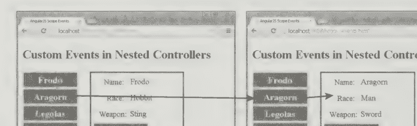

在子控制器中点击删除会从父控制器中移除角色

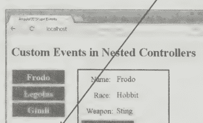

图 8.2 使用 `$broadcast()` 和 `$emit()` 通过作用域层级发送更改和删除事件。

## 总结

管理事件的能力是大多数 AngularJS 应用程序中最关键的组件之一。你可以在 AngularJS 应用程序中使用事件来提供与元素的用户交互，以及应用程序组件之间相互通信以了解何时执行某些任务。本章首先简要讨论了浏览器和用户交互事件，以及它们如何与整体应用程序架构相关联。

接下来，本章介绍了使用 `$watch`、`$watchGroup` 和 `$watchCollection` 方法来监视作用域中的值。使用监视允许你在作用域值发生变化时采取行动，而无需在那些值可能更改的每个位置放置代码。

作用域被组织成层级结构，根作用域在应用程序级别定义。每个控制器实例也会获得一个子作用域的实例。在本章中，你学习了如何从作用域内部发出或广播事件，然后实现监听这些事件并在触发时执行的处理器。

## 在Web应用中实现AngularJS服务

AngularJS功能最基本的组件之一是服务。服务为应用程提供基于任务的功能。可以将服务视为执行一个或多个相关任务的可重用代码块。AngularJS提供了若干内置服务，同时也允许你创建自定义服务。

本章介绍AngularJS服务。你将有机会了解并实现一些内置服务，例如用于Web服务器通信的`$http`、用于存储和检索浏览器Cookie的`$cookieStore`，以及提供动画功能的`$animate`。

### 理解AngularJS服务

AngularJS服务是单例对象，这意味着只会创建一个实例。服务的目的是提供一段简洁的代码来执行特定任务。服务可以简单到仅提供一个值定义，也可以复杂到提供与Web服务器的完整HTTP通信。

服务为可重用功能提供了一个容器，AngularJS应用程序可以方便地使用这些功能。服务通过AngularJS中的依赖注入机制进行定义和注册。这使你能够将服务注入到模块、控制器和其他服务中。

> 注意

第3章“理解AngularJS应用动态”讨论了依赖注入。如果你还没有阅读那一章，在继续本章之前应该先阅读。

### 使用内置服务

AngularJS提供了若干内置服务。这些服务会自动注册到依赖注入器中，因此你可以通过依赖注入轻松地将它们整合到AngularJS应用中。

表9.1描述了一些最常见的内置服务，以便你了解有哪些可用服务。以下小节将更详细地介绍其中部分服务。

#### 表9.1 AngularJS内置的常用服务

| 服务 | 描述 |

| :--- | :--- |

| `$anchorScroll` | 提供滚动到基于HTML5规范中定义的规则、由`$location.hash()`指定的页面锚点的功能。 |

| `$animate` | 提供动画钩子，用于连接基于CSS和JavaScript的动画。 |

| `$cacheFactory` | 提供将键/值对放入对象缓存的功能，以便其他使用相同服务的代码组件后续可以检索它们。 |

| `$compile` | 提供将HTML字符串或DOM对象编译为模板，并生成可将作用域和模板连接在一起的模板函数的功能。 |

| `$cookies` | 提供对浏览器Cookie的读写访问。 |

| `$document` | 指定对浏览器`window.document`元素的jQuery包装引用。 |

| `$exceptionHandler` | 指定一个处理程序，用于委托处理AngularJS表达式中未捕获的异常。 |

| `$http` | 提供简单易用的功能，用于向Web服务器或其他服务发送HTTP请请求。 |

| `$interpolate` | 将带有标记的字符串编译为插值函数。 |

| `$interval` | 提供对浏览器`window.setInterval`功能的访问。 |

| `$locale` | 提供被各种AngularJS组件使用的本地化规则。 |

| `$location` | 提供与浏览器`window.location`对象交互的功能。 |

| `$log` | 提供简单的日志服务。 |

| `$parse` | 将AngularJS表达式字符串解析为JavaScript函数。 |

| `$q` | 提供promise/延迟实现服务。 |

| `$resource` | 使你能够创建一个可以与RESTful服务器端数据源交互的对象。 |

| `$rootElement` | 提供对AngularJS应用中根元素的访问。 |

| `$rootScope` | 提供对AngularJS应用根作用域的访问。 |

| `$route` | 通过监视`$location.url()`并将路径映射到现有路由定义，为控制器和视图提供深度链接URL支持。 |

| `$routeParams` | 提供一项服务，使你能够检索路由中的当前参数集。 |

| `$sanitize` | 提供一项服务，可用于通过将HTML解析为标记来净化输入。 |

| `$sce` | 在处理来自不可信源的数据时，提供严格的上下文转义功能。 |

| `$swipe` | 提供一项服务，使实现设备滑动类型的指令更容易。 |

| `$templateCache` | 提供从Web服务器读取模板到缓存中以供后续使用的功能。 |

| `$timeout` | 提供对浏览器`window.setTimeout`功能的访问。 |

| `$window` | 指定对浏览器窗口元素的jQuery包装引用。 |

### 使用 $http 服务发送HTTP GET和PUT请求

`$http`服务使你能够直接从AngularJS代码与Web服务器交互。`$http`服务在底层使用浏览器的XMLHttpRequest对象，但从AngularJS框架的上下文来看是这样。

使用`$http`服务有两种方式。最简单的是使用以下与标准HTTP请求对应的内置快捷方法之一：

- delete(url, [config])

- get(url, [config])

- head(url, [config])

- jsonp(url, [config])

- post(url, data, [config])

- put(url, data, [config])

- patch(url, data, [config])

### 配置 $http 请求

在这些方法中，`url`参数是Web请求的URL。可选的`config`参数是一个JavaScript对象，用于指定实现请请求时使用的选项。表9.2列出了你可以在`config`参数中设置的属性。

你也可以通过直接向`$http(config)`方法发送`config`参数来指定请求、URL和数据。例如，以下两行代码完全相同：

```
$http.get('/myUrl');
$http({method: 'GET', url:'/myUrl'});
```

#### 表9.2 可在 $http 服务请求的 config 参数中定义的属性

| 属性 | 描述 |

| :--- | :--- |

| method | HTTP方法，例如GET或POST。 |

| url | 正在请求的资源的URL。 |

| params | 要发送的参数。这可以是格式为?key1=value1&key2=value2&...的字符串，也可以是一个对象，在这种情况下它会被转换为JSON字符串。 |

| data | 作为请求消息数据发送的数据。默认情况下，数据以JSON格式发送到服务器。 |

| headers | 随请求一起发送的头信息。你可以指定一个对象，其属性是要发送的头名称。如果对象中的某个属性值为null，则不会发送该头。 |

| xsrfHeaderName | 用于填充XSRF令牌的HTTP头的名称。 |

| xsrfCookieName | 包含XSRF令牌的Cookie的名称。 |

| transformRequest | 用于转换/序列化请求头和主体的函数。该函数接受主体数据作为第一个参数，以及一个按名称获取头信息的getter函数作为第二个参数。例如：function(data, getHeader) |

| transformResponse | 用于转换/反序列化响应头和主体的函数。该函数接受主体数据作为第一个参数，以及一个按名称获取头信息的getter函数作为第二个参数。例如：function(data, getHeader) |

| cache | 一个布尔值，当为true时，表示使用默认的$http缓存来缓存GET响应；否则，如果使用`$cacheFactory`构建了缓存实例，则使用该缓存进行缓存。如果为false且没有构建`$cacheFactory`，则响应不会被缓存。 |

| timeout | 超时时间（以毫秒为单位），超时后应中止请求。 |

| `withCredentials` | 一个布尔值，当为`true`时，表示在XHR对象上设置了`withCredentials`标志。 |

| `responseType` | 期望的响应类型，例如`json`或`text`。 |

### 实现 `$http` 响应回调函数

当你使用`$http`对象调用请求方法时，你会得到一个带有promise方法`success()`和`error()`的对象。你可以向这些方法传递一个回调函数，该函数在请求成功或失败时被调用。这些方法接受以下参数：

- `data`：响应数据。

- `status`：响应状态。

- `header`：响应头。

- `config`：请求配置。

以下是在`get()`请求上实现`success()`和`error()`方法的一个简单示例：

```
$http({method: 'GET', url: '/myUrl'}). 
    success(function(data, status, headers, config) {
        // 处理成功
    }).
    error(function(data, status, headers, config) {
        // 处理失败
    });
```

### 实现一个简单的HTTP服务器并使用 `$http` 服务访问它

清单9.1至9.3中的代码实现了一个简单的Node.js Web服务和一个访问它的AngularJS应用。该Web服务器包含一个简单的JavaScript对象，其中有物品和数量，用于模拟商店的库存。该Web应用允许用户告诉服务器补货、购买和使用物品。这个例子非常基础，以便代码易于理解，但它包含了GET和POST请求以及错误处理示例。

清单9.1实现的Node.js Web服务器处理GET路由`/reset/data`和POST路由`/buy/item`。如果某物品的数量为零，`/buy/item`路由会返回一个HTTP错误。前几行代码只是设置Node.js服务器。如果你不完全理解那里发生了什么，也不用担心。`initStore()`函数初始化产品及物品数量。在第17行，GET路由`/reset/data`被初始化，并将商店对象作为JSON返回。在第21行，POST路由被初始化。该路由递减物品数量并返回商店数据（通常它不需要返回完整数据，但在这个简单示例中，这样做使代码更简洁）。如果物品缺货，则返回400错误。

## 第9章 在Web应用中实现AngularJS服务

注意

如果你正在运行普通的server.js HTTP服务器，在启动清单9.1中的service_server.js之前，你需要先将其停止。此外，你还需要将清单9.1中的service_server.js文件放置在清单9.2中的service_http.html的父文件夹中，以便在Node.js静态路由中路径能够正确匹配。目录结构应类似于这样：

./service_server.js

./ch09/service_http.html

./ch09/js/service_http.js

### 清单9.1 service_server.js：实现支持AngularJS控制器GET和POST路由的Express服务器

```javascript
01 var express = require('express');
02 var bodyParser = require('body-parser');
03 var app = express();
04 app.use('/', express.static('./'));
05 app.use(bodyParser.urlencoded({ extended: true }));
06 app.use(bodyParser.json());
07 function initStore(){
08   var items = ['eggs', 'toast', 'bacon', 'juice'];
09   var storeObj = {};
10   for (var itemIDX in items){
11     storeObj[items[itemIDX]] =
12       Math.floor(Math.random() * 5 + 1);
13   }
14   return storeObj;
15 }
16 var storeItems = initStore();
17 app.get('/reset/data', function(req, res){
18   storeItems = initStore();
19   res.json(storeItems);
20 });
21 app.post('/buy/item', function(req, res){
22   if (storeItems[req.body.item] > 0){
23     storeItems[req.body.item] =
24       storeItems[req.body.item] - 1;
25     res.json(storeItems);
26   } else {
27     res.json(400, { msg: 'Sorry ' + req.body.item +
28                         ' is out of stock.' });
29   }
30 });
31 app.listen(80);
```

清单9.2实现了AngularJS应用和控制器。注意，`buyItem()`方法在服务器上调用了`/buy/item` POST路由，并将结果放入作用域变量`$scope.storeItems`中。如果发生错误，`$scope.status`变量将被设置为错误响应对象中的msg值。`resetStore()`方法在服务器上调用了`/reset/data` GET路由，并使用成功的响应更新`$scope.storeItems`。

清单9.3实现了一个AngularJS模板，其中包含“补充商店库存”按钮、错误时的状态消息以及商店商品列表。图9.1展示了当商品被购买和使用时，数量如何调整，以及当用户尝试购买缺货商品时，如何显示缺货错误消息。

### 清单9.2 service_http.js：实现一个使用$http服务与Web服务器交互的AngularJS控制器

```javascript
01 angular.module('myApp', []).
02   controller('myController', ['$scope', '$http',
03                              function($scope, $http) {
04   $scope.storeItems = {};
05   $scope.kitchenItems = {};
06   $scope.status = "";
07   $scope.resetStore = function(){
08     $scope.status = "";
09     $http.get('/reset/data')
10         .success(function(data, status, headers, config) {
11             $scope.storeItems = data;
12         })
13         .error(function(data, status, headers, config) {
14             $scope.status = data;
15         });
16   };
17   $scope.buyItem = function(buyItem){
18     $http.post('/buy/item', {item:buyItem})
19         .success(function(data, status, headers, config) {
20             $scope.storeItems = data;
21             if($scope.kitchenItems.hasOwnProperty(buyItem)){
22                 $scope.kitchenItems[buyItem] += 1;
23             } else {
24                 $scope.kitchenItems[buyItem] = 1;
25             }
26             $scope.status = "Purchased " + buyItem;
27         })
28         .error(function(data, status, headers, config) {
29             $scope.status = data.msg;
30         });
31   };
32   $scope.useItem = function(useItem){
33     if($scope.kitchenItems[useItem] > 0){
34      $scope.kitchenItems[useItem] -= 1;
35      }
36   };
37 }});
```

### 清单9.3 service_http.html：实现与Web服务器数据关联的指令的AngularJS模板

```html
01 <!doctype html>
02 <html ng-app="myApp">
03 <head>
04   <title>AngularJS $http Service</title>
05   <style>
06     span {
07       color:red; cursor: pointer; }
08     .myList {
09       display: inline-block; width: 200px;
10       vertical-align: top; }
11   </style>
12 </head>
13 <body>
14   <div ng-controller="myController">
15     <h2>GET and POST Using $http Service</h2>
16     <input type="button" ng-click="resetStore()"
17           value="Restock Store"/>
18     {{status}}
19     <hr>
20     <div class="myList">
21       <h3>The Store</h3>
22       <div ng-repeat="(item, count) in storeItems">
23         {{item}} ({{count}})
24         [<span ng-click="buyItem(item)">buy</span>]
25       </div>
26     </div>
27     <div class="myList">
28       <h3>My Kitchen</h3>
29       <div ng-repeat="(item, count) in kitchenItems">
30         {{item}} ({{count}})
31         [<span ng-click="useItem(item)">use</span>]
32       </div>
33     </div>
34   </div>
35   <script src="http://code.angularjs.org/1.3.0/angular.min.js"></script>
36   <script src="js/service_http.js"></script>
37 </body>
38 </html>
```

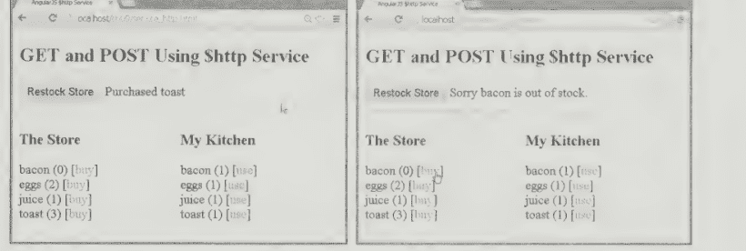

图9.1 实现允许AngularJS控制器与Web服务器交互的$http服务。

### 使用$cacheFactory服务

`$cacheFactory`服务提供了一个非常方便的仓库，用于临时存储键/值对数据。因为`$cacheFactory`是一个服务，所以它可以被多个控制器和其他AngularJS组件使用。

在创建`$cacheFactory`服务时，你可以指定一个包含`capacity`属性的选项对象——例如，`{capacity: 5}`。通过添加这个容量设置，你可以将缓存中的最大元素数量限制为五个。当添加新项时，最旧的项将被移除。如果未指定容量，缓存将继续增长。

清单9.4展示了在模块对象中实现`$cacheFactory`，然后从两个不同的控制器中访问它的基本示例。

#### 清单9.4 service_cache.js：在AngularJS应用中实现$cacheFactory服务

```javascript
01 var app = angular.module('myApp', []);
02 app.factory('MyCache', function($cacheFactory) {
03   return $cacheFactory('myCache', {capacity:5});
04 });
05 app.controller('myController', ['$scope', 'MyCache',
06                            function($scope, cache) {
07   cache.put('myValue', 55);
08 }]);
09 app.controller('myController2', ['$scope', 'MyCache',
10                            function($scope, cache) {
11   $scope.value = cache.get('myValue');
12 }]);
```

### 使用$window服务实现浏览器警报

`$window`服务为浏览器的`window`对象提供了一个jQuery封装器，允许你像在JavaScript中通常那样访问`window`对象。为了说明这一点，以下代码使用`window`对象上的`alert()`方法弹出一个浏览器警报。警报的消息从浏览器的`window`对象的`$window.screen.availWidth`和`$window.screen.availHeight`属性获取数据：

```javascript
var app = angular.module('myApp', []);
app.controller('myController', ['$scope', '$window',
    function($scope, window) {
        window.alert("Your Screen is: \n" +
            window.screen.availWidth + "X" + window.screen.availHeight);
}]);
```

### 使用$cookieStore服务与浏览器Cookie交互

AngularJS提供了几个用于获取和设置cookie的服务：`$cookie`和`$cookieStore`。Cookie在浏览器中提供临时存储，即使用户离开网页或关闭浏览器，它们也会持续存在。

`$cookie`服务使你能够使用点表示法获取和更改字符串cookie值。例如，以下代码检索名为`appCookie`的cookie值，然后更改它：

```javascript
var cookie = $cookies.appCookie;
$cookies.appCookie = 'New Value';
```

`$cookieStore`服务提供了`get()`、`put()`和`remove()`函数，用于获取、设置和移除cookie。`$cookieStore`服务的一个很好的特性是，它在设置值之前会将JavaScript对象值序列化为JSON字符串，然后在获取时将其反序列化回对象。

要使用`$cookie`和$cookieStore服务，你需要做三件事。首先，在模板中，在`angular.js`之后但在`application.js`之前加载`angular-cookies.js`库。例如：

```html
<script src="http://code.angularjs.org/1.3.0/angular.min.js"></script>
<script src="http://code.angularjs.org/1.3.0/angular-cookies.min.js"></script>
```

> 注意

你也可以从AngularJS网站 http://code.angularjs.org/<version>/ 下载`angular-cookies.js`文件，其中`<version>`是你正在使用的AngularJS版本。根据你使用的AngularJS版本，你可能还需要下载`angular-cookies.min.js.map`文件。

## 第9章 在Web应用中实现AngularJS服务

其次，你需要在应用程序的模块定义中，将ngCookies添加到依赖列表中。例如：

`var app = angular.module('myApp', ['ngCookies']);`

第三，你需要将`$cookies`或$cookieStore服务注入到你的控制器中。例如：

`app.controller('myController', ['$scope', '$cookieStore', function($scope, cookieStore) {`

`}]);`

代码清单9.5和9.6展示了如何使用$cookie服务来获取和设置Cookie。代码清单9.5在应用中加载了ngCookies，将$cookieStore注入到控制器中，然后使用get()、put()和remove()方法来与名为myAppCookie的Cookie进行交互。

代码清单9.6实现了一组单选按钮，这些按钮与模型中的favCookie值绑定，并使用ng-change在按钮值改变时调用setCookie()函数。图9.2展示了最终生成的网页效果。

```
var app = angular.module('myApp', ['ngCookies']);
app.controller('myController', ['$scope', '$cookieStore', function($scope, cookieStore) {
    $scope.favCookie = '';
    $scope.myFavCookie = '';
    $scope.setCookie = function(){
        if ($scope.favCookie === 'None'){
            cookieStore.remove('myAppCookie');
        }else{
            cookieStore.put('myAppCookie', {flavor:$scope.favCookie});
        }
        $scope.myFavCookie = cookieStore.get('myAppCookie');
    };
}]);
```

```
<!doctype html>
<html ng-app="myApp">
<head>
    <title>AngularJS $cookie Service</title>
</head>
<body>
    <div ng-controller="myController">
        <h3>Favorite Cookie:</h3>
        <input type="radio" value="Chocolate Chip" ng-model="favCookie" ng-change="setCookie()">Chocolate Chip</input><br>
        <input type="radio" value="Oatmeal" ng-model="favCookie" ng-change="setCookie()">Oatmeal</input><br>
        <input type="radio" value="Frosted" ng-model="favCookie" ng-change="setCookie()">Frosted</input><br>
        <input type="radio" value="None" ng-model="favCookie" ng-change="setCookie()">None</input>
        <hr>Cookies: {{myFavCookie}}
    </div>
    <script src="http://code.angularjs.org/1.3.0/angular.min.js"></script>
    <script src="http://code.angularjs.org/1.3.0/angular-cookies.min.js"></script>
    <script src="js/service_cookie.js"></script>
</body>
</html>
```

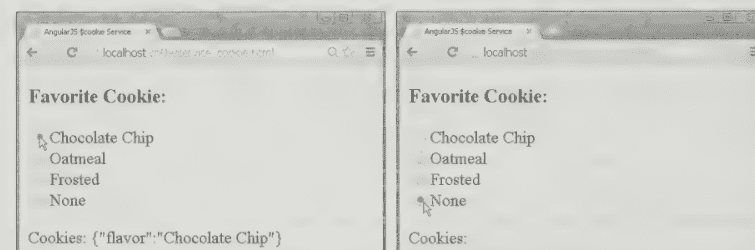

图9.2 实现$cookieStore服务，使AngularJS控制器能够与浏览器Cookie进行交互。

### 使用$interval和$timeout服务实现计时器

AngularJS的$interval和$timeout服务使你能够将代码执行延迟一段时间。这些服务与JavaScript的setInterval和setTimeout功能类似，但它们是在AngularJS框架内工作的。

$interval和$timeout服务使用以下语法：

```
$interval(callback, delay, [count], [invokeApply]);
$timeout(callback, delay, [invokeApply]);
```

参数说明如下：

-   **callback**：当延迟时间到期时执行的函数。

-   **delay**：指定回调函数执行前等待的毫秒数。

-   **count**：表示重复执行间隔的次数。

-   **invokeApply**：是一个布尔值，如果设置为true，会导致函数仅在AngularJS事件循环的$apply()块内执行。默认值为true。

当你调用$interval()和$timeout()方法时，它们会返回一个promise对象，你可以用它来取消超时或间隔。要取消一个现有的$timeout或$interval，请调用cancel()方法。例如：

```
var myInterval = $interval(function(){$scope.seconds++;}, 1000, 10, true);
...
$interval.cancel(myInterval);
```

如果你通过$timeout或$interval创建了超时或间隔，那么在作用域或元素指令被销毁时，你必须使用cancel()显式地销毁它们。最简单的方法是为$destroy事件添加一个监听器。例如：

```
$scope.$on('$destroy', function(){
    $scope.cancel(myInterval);
});
```

### 使用$animate服务

$animate服务提供了动画检测钩子，你可以在执行enter（进入）、leave（离开）和move（移动）DOM操作，以及addClass和removeClass操作时使用它们。你可以通过CSS类名或JavaScript中的$animate服务来使用这些钩子。

要实现动画，你需要为想要动画化的元素添加一个支持动画的指令。表9.3列出了支持动画的指令以及它们支持的动画事件类型。

#### 表9.3 支持动画的AngularJS指令

| 指令 | 描述 |

| :--- | :--- |

| ngRepeat | 支持enter、leave和move事件。 |

| ngView | 支持enter和leave事件。 |

| ngInclude | 支持enter和leave事件。 |

| ngSwitch | 支持enter和leave事件。 |

| ngIf | 支持enter和leave事件。 |

| ngClass | 支持addClass和removeClass事件。 |

| ngShow | 支持addClass和removeClass事件。 |

| ngHide | 支持addClass和removeClass事件。 |

### 在CSS中实现动画

要在CSS中实现动画，你需要在想要动画化的元素中包含ngClass指令。AngularJS使用ngClass的值作为根名称，用于在动画过程中添加和移除到该元素的其他CSS类。

当一个定义了ngClass指令的元素上触发事件时，就会调用动画事件。表9.4列出了在动画过程中添加和移除的附加类。

#### 表9.4 用于动画的附加CSS类

| 类名 | 描述 |

|---|---|

| ng-animate | 当事件触发时添加。 |

| ng-animate-active | 当动画开始并触发CSS过渡时添加。 |

| <super>-ng-move | 当move事件触发时添加。 |

| <super>-ng-move-active | 当移动动画开始并触发CSS过渡时添加。 |

| <super>-ng-leave | 当leave事件触发时添加。 |

| <super>-ng-leave-active | 当离开动画开始并触发CSS过渡时添加。 |

| <super>-ng-enter | 当enter事件触发时添加。 |

| <super>-ng-enter-active | 当进入动画开始并触发CSS过渡时添加。 |

| <super>-ng-add | 当addClass事件触发时添加。 |

| <super>-ng-add-active | 当添加类动画开始并触发CSS过渡时添加。 |

| <super>-ng-remove | 当removeClass事件触发时添加。 |

| <super>-ng-remove-active | 当移除类动画开始并触发CSS过渡时添加。 |

要实现基于CSS的动画，你只需要为表9.4中列出的附加类添加适当的CSS过渡代码。为了说明这一点，以下代码片段为一个名为.img-fade的用户自定义类实现了添加和移除类的过渡效果，该动画将图像的opacity在2秒内更改为.1：

```
.img-fade-add, .img-fade-remove {
    -webkit-transition:all ease 2s;
    -moz-transition:all ease 2s;
    -o-transition:all ease 2s;
    transition:all ease 2s;
}

.img-fade, .img-fade-add.img-fade-add-active {
    opacity:.1;
}
```

请注意，过渡被添加到了.img-fade-add和.img-fade-remove类上，但实际的类定义被应用到了.img-fade上。你还需要类定义.img-fade-add.img-fade-add-active来设置过渡的结束状态。

### 在JavaScript中实现动画

实现AngularJS的CSS动画非常简单，但你也可以使用jQuery在JavaScript中实现动画。JavaScript动画可以更直接地控制你的动画。此外，JavaScript动画不需要浏览器支持CSS3。

要在JavaScript中实现动画，你需要在加载angular.js库之前，在你的模板中包含jQuery库。例如：

```
<script src="http://code.jquery.com/jquery-1.11.0.min.js"></script>
```

> **注意**

如果你想利用jQuery动画的全部功能，就需要包含完整的jQuery库。如果你确实决定包含jQuery库，请确保它在HTML代码中是在AngularJS库之前加载的。

你还需要在你的应用程序Module对象定义中包含ngAnimate依赖。例如：

```
var app = angular.module('myApp', ['ngAnimate']);
```

然后，你可以使用Module对象上的animate()方法来实现动画。animate()方法返回一个对象，该对象提供了用于处理enter、leave、move、addClass和removeClass事件的函数。这些函数的第一个参数是要动画化的元素。然后，你可以使用jQuery的animate()方法来为元素设置动画。

## 第9章 在Web应用中实现AngularJS服务

jQuery的animate()方法使用以下语法，其中cssProperties是CSS属性更改的对象，duration以毫秒为单位，easing是缓动方法，callback是动画完成时要执行的函数：

```
animate(cssProperties, [duration], [easing], [callback])
```

例如，以下代码通过将opacity设置为0来为元素添加fadeClass类的动画效果：

```
app.animation('.fadeClass', function() {
  return {
    addClass : function(element, className, done) {
      jQuery(element).animate({ opacity: 0 }, 3000);
    },
  };
});
```

### 使用AngularJS为元素添加动画

清单9.7、9.8和9.9实现了一个基本动画示例，该示例使用JavaScript方法为图像应用淡入淡出动画，并使用CSS过渡动画来调整图像大小。

清单9.7包含了AngularJS控制器和动画代码。请注意，同一个类.fadeOut通过钩入addClass和removeClass事件，同时应用于淡入和淡出动画。

清单9.8实现了支持该动画的AngularJS模板。请注意，第5行加载jQuery库以支持JavaScript动画代码。此外，第6行加载了animate.css脚本，该脚本包含清单9.9中所示的过渡动画。按钮只需添加和移除相应的类即可触发动画。

清单9.9提供了在动画过程中实现添加和移除类时所需的过渡CSS定义。图9.3展示了效果。

#### 清单9.7 service_animate.js：实现使用$animation服务的jQuery动画的AngularJS控制器

```
01 var app = angular.module('myApp', ['ngAnimate']);
02 app.controller('myController', function($scope) {
03   $scope.myImgClass = 'start-class';
04 });
05 app.animation('.fadeOut', function() {
06   return {
07    enter : function(element, parentElement, afterElement, doneCallback) {},
08    leave : function(element, doneCallback) {},
09    move : function(element, parentElement, afterElement, doneCallback) {},
10    addClass : function(element, className, done) {
11      jQuery(element).animate({ opacity: 0}, 3000);
12    },
13    removeClass : function(element, className, done) {
14      jQuery(element).animate({ opacity: 1}, 3000);
15    }
16  };
17 });
```

#### 清单9.8 service_animate.html：实现按钮以更改图像类来触发动画效果（淡入淡出和调整大小）的AngularJS模板

```
01 <!doctype html>
02 <html ng-app="myApp">
03 <head>
04   <title>AngularJS $animate 服务</title>
05   <link rel="stylesheet" href="css/animate.css">
06 </head>
07 <body>
08   <div ng-controller="myController">
09     <h3>AngularJS图像动画：</h3>
10     <input type="button"
11           ng-click="myImgClass='fadeOut'" value="淡出"/>
12     <input type="button"
13           ng-click="myImgClass=''" value="淡入"/>
14     <input type="button"
15           ng-click="myImgClass='shrink'" value="缩小"/>
16     <input type="button"
17           ng-click="myImgClass='grow'" value="放大"/>
18     <hr>
19     
20   </div>
21   <script src="http://code.jquery.com/jquery-1.11.0.min.js"></script>
22   <script src="http://code.angularjs.org/1.3.0/angular.min.js"></script>
23   <script src="http://code.angularjs.org/1.3.0/angular-animate.min.js"></script>
24   <script src="js/service_animate.js"></script>
25 </body>
26 </html>
```

注意

你也可以从AngularJS网站 http:// code.angularjs.org/<version>/ 下载angular-animate.js文件，其中<version>是你使用的AngularJS版本。根据你使用的AngularJS版本，你可能还需要下载angular-animate.min.js.map文件。

#### 清单9.9 animate.css：为AngularJS动画代码中不同类阶段提供过渡效果的CSS代码

```
01 .shrink-add, .grow-add {
02   -webkit-transition:all ease 2.5s;
03   -moz-transition:all ease 2.5s;
04   -o-transition:all ease 2.5s;
05   transition:all ease 2.5s;
06 }
07 .shrink,
08 .shrink-add.shrink-add-active {
09   width:100px;
10 }
11 .start-class,
12 .grow,
13 .grow-add.grow-add-active {
14   width:400px;
15 }
```

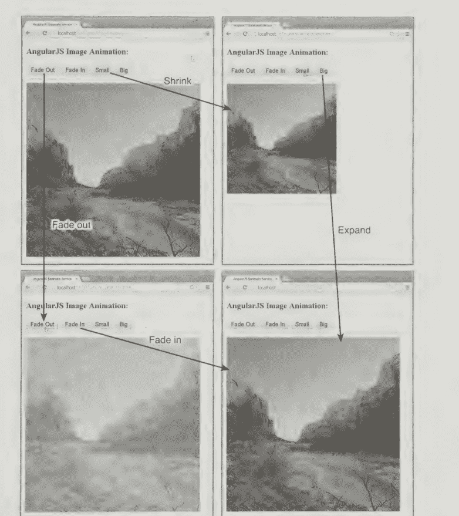

图9.3 在CSS和JavaScript中同时实现$animation服务，以对图像的淡入淡出和大小调整进行动画处理。

### 使用$location服务

$location服务是对JavaScript window.location对象的封装。这使得URL在你的AngularJS应用中可访问。你不仅可以获取关于URL的信息，还可以修改它，用新URL更改位置或导航到特定的哈希标签。

要将$location服务添加到控制器或服务中，你只需使用标准的依赖注入方法注入它。例如：

```
app.controller('myController', ['$scope', '$location',
    function($scope, location) {
        ...
    }]);
```

表9.5列出了可以在$location服务上调用的方法，并描述了它们的实现。

**表9.5 AngularJS $location服务对象上可用的方法**

| 方法 | 描述 |

| :--- | :--- |

| absUrl() | 返回传递给浏览器的完整URL。 |

| url([url]) | 如果不带参数调用，则返回传递给浏览器的URL，例如：<br>`location.url()`<br><br>向url()方法添加url参数将为位置设置当前的相对URL。例如：<br><br>`location.url('/new/path?new=query')` |

| protocol() | 返回当前URL中使用的协议。 |

| host() | 返回当前URL中使用的主机。 |

| port() | 返回当前URL中使用的端口。 |

| path([path]) | 如果不传递参数，则返回当前URL中使用的协议，例如：<br>`location.path()`<br><br>向path()方法添加path参数将为位置设置当前的相对路径。例如：<br><br>`location.path('/new/path')` |

| search([search], [paramValue]) | 如果不向search()函数传递search或paramValue参数，则返回一个包含作为URL一部分传递的查询参数的JavaScript对象，例如：`location.search()`<br><br>如果你传递了search和paramValue参数，那么URL中由search指定的参数的值将更改为由paramValue指定的值。例如：<br><br>`location.search("param1", "newValue")` |

| hash() | 返回当前URL中使用的哈希标签。 |

| replace() | 当你在$location服务对象上调用此方法时，所有后续对位置的更改将替换历史记录，而不是添加一条新记录。 |

清单9.10和9.11中的代码实现了一个简单的示例，展示了如何使用$location服务来访问和更改传递给浏览器的URL中的元素。清单9.10中的代码实现了一个控制器，该控制器注入了$location服务。updateLocationInfo()函数从$location服务获取url、absUrl、host、protocol、path、search和hash值。changePath()、changeHash()和changeSearch()函数更改位置中的path、hash和search值，然后用新值更新作用域。

清单9.11中的代码实现了一个AngularJS模板，用于显示捕获的$location服务信息，并提供用于更改path、search和hash属性的链接。图9.4展示了运行中的网页。请注意，当点击链接时，path、hash和search值会发生变化。

#### 清单9.10 service_location.js：实现控制器以从$location服务收集信息并提供更改path、search和hash值功能的AngularJS应用

```
01 var app = angular.module('myApp', []);
02 app.controller('myController', ['$scope', '$location',
03                                function($scope, location) {
04   $scope.updateLocationInfo = function() {
05     $scope.url = location.url();
06     $scope.absUrl = location.absUrl();
07     $scope.host = location.host();
08     $scope.port = location.port();
09     $scope.protocol = location.protocol();
10   $scope.path = location.path();
11   $scope.search = location.search();
12   $scope.hash = location.hash();
13 };
14 $scope.changePath = function(){
15   location.path("/new/path");
16   $scope.updateLocationInfo();
17 };
18 $scope.changeHash = function(){
19   location.hash("newHash");
20   $scope.updateLocationInfo();
21 };
22 $scope.changeSearch = function(){
23   location.search("p1", "newA");
24   $scope.updateLocationInfo();
25 };
26 $scope.updateLocationInfo();
27 }});
```

**代码清单 9.11** *service_location.html: 一个AngularJS模板，用于显示从 $location 服务收集的信息，并提供修改 path、search 和 hash 值的链接*

```
01 <!doctype html>
02 <html ng-app="myApp">
03 <head>
04   <title>AngularJS $location 服务</title>
05   <style>
06     span {
07       color: red; text-decoration: underline;
08       cursor: pointer; }
09   </style>
10 </head>
11 <body>
12   <div ng-controller="myController">
13     <h3>位置服务：</h3>
14     [<span ng-click="changePath()">更改路径</span>]
15     [<span ng-click="changeHash()">更改哈希值</span>]
16     [<span ng-click="changeSearch()">更改搜索参数</span>]
17     <hr>
18     <h4>URL 信息</h4>
19     url: {{url}}<br>
20     absUrl: {{absUrl}}<br>
21     host: {{host}}<br>
22     port: {{port}}<br>
23     protocol: {{protocol}}<br>
24     path: {{path}}<br>
25     search: {{search}}<br>
26     hash: {{hash}}<br>
27     </div>
28     <script src="http://code.angularjs.org/1.3.0/angular.min.js"></script>
29     <script src="js/service_location.js"></script>
30     </body>
31     </html>
```

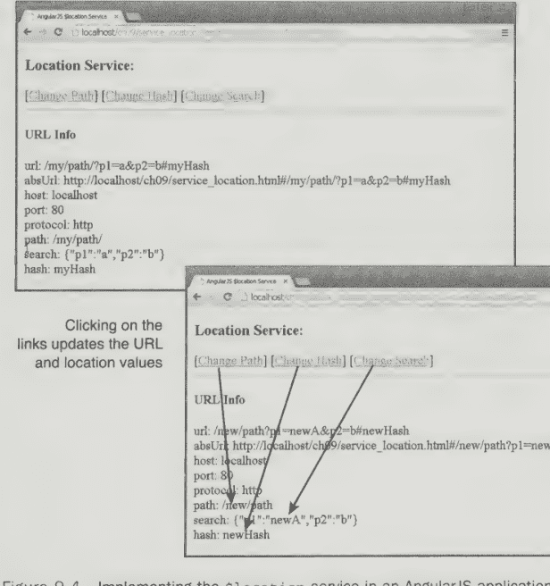

点击链接会更新URL和位置值。

图 9.4 在AngularJS应用中实现 $location 服务以与浏览器位置进行交互。

### 使用 $q 服务提供延迟响应

AngularJS提供的一个非常有用的服务是 $q 服务。$q 服务是一种 promise/deferred（承诺/延迟）响应实现。由于并非所有服务都能立即响应请求，因此需要将响应延迟到服务准备好响应为止。这就是 $q 服务的用武之地。其核心思想是，你可以发起一个请求，但你不会直接得到响应，而是会得到一个服务将进行响应的承诺。然后，请求的应用程序可以分配一个回调函数，该函数在延迟的请求成功完成或失败时执行。

要使用 $q 服务实现延迟响应，首先需要使用以下语法创建一个延迟对象：

```
var deferred = $q.defer();
```

创建延迟对象后，你可以通过访问 promise 属性来传递这个承诺。例如，下面这行代码将承诺返回给调用应用程序：

```
function makeDeferredRequest(){
  var deferred = $q.defer();
  return deferred.promise;
}
```

然后，请求的应用程序可以调用 promise 对象的 then() 方法，使用以下语法注册 successCallback（成功回调）、errorCallback（错误回调）和 notifyCallback（通知回调）函数：

```
promise.then(successCallback, [errorCallback], [notifyCallback])
```

下面展示了 then() 函数的一个示例实现：

```
var promise = makeDeferredRequest();
promise.then(
  function successCallback(value){
    //处理成功情况
  },
  function errorCallback(value){
    //处理错误情况
  },
  function notifyCallback(value){
    //处理通知
  }
)
```

从延迟服务端，你可以使用表 9.6 中描述的方法来处理通知请求应用程序关于请求的状态。

**表 9.6 $q 服务的延迟对象上可用的方法**

| 方法 | 描述 |

| :--- | :--- |

| $resolve(value) | 在 promise 对象上执行 successCallback 函数，并将指定的 value 传递给它。 |

| $reject(reason) | 在 promise 对象上执行 errorCallback 函数，并将指定的 reason 传递给它。 |

| $notify(value) | 在 promise 对象上执行 notifyCallback 函数，并将指定的 value 传递给它。 |

第10章“创建你自己的自定义AngularJS服务”中的“实现数据库访问服务”一节，展示了使用 $q 服务处理对远程数据库请求的延迟响应的一个好例子。

## 总结

AngularJS 服务是你可以注册到依赖注入器的单例对象；控制器和其他 AngularJS 组件，包括其他服务，都可以使用它们。AngularJS 以服务的形式提供了大量的后端功能，例如 $http，它使你能够轻松地将 Web 服务器通信集成到你的 AngularJS 应用程序中。

在本章中，你还了解了几种内置服务，如 $cookieStore、$q、$window、$location、$animate 和 $cacheFactory。这些以及其他 AngularJS 服务可用于轻松地将功能注入到你的控制器、指令和自定义服务中。

# 第10章 创建你自己的自定义AngularJS服务

AngularJS 在内置服务中提供了很多功能；然而，你也需要能够实现自己的自定义服务来提供你自己的特定功能。当你需要为你的应用程序提供基于任务的功能时，你应该实现一个自定义服务。

在实现自定服务时，你需要将服务视为执行一个或多个相关任务的可重用代码块。然后你可以设计并将它们分组到自定义模块中，这些模块可以被多个不同的 AngularJS 应用程序轻松使用。

本章介绍了 AngularJS 自定义服务。然后，本章提供了几个自定义 AngularJS 服务实现的示例，以便你更清楚地了解如何设计和构建自己的服务。

## 理解自定义AngularJS服务

AngularJS 允许你创建自己的自定义服务，为需要该功能的 AngularJS 组件提供功能。正如你在上一章中所看到的，内置的 AngularJS 服务为 AngularJS 应用程序提供了各种各样的功能。使用自定义服务，你可以以多种方式自定义、增强和扩展该功能。

在你的代码中，你可能主要会实现四种类型的服务：value（值）、constant（常量）、factory（工厂）和 service（服务）。以下各节将介绍这些服务。

### 定义 value 服务

你使用非常简单的 value 服务来定义一个单一的值，你可以将其作为服务提供者进行注入。value 方法使用以下语法，其中 name 是服务名称，object 是你想提供的任何 JavaScript 对象：

`value(name, object)`

例如：

```
var app = angular.module('myApp', []);
app.value('myValue', {color:'blue', value:'17'});
```

### 定义 constant 服务

constant 服务基本上与 value 服务相同，不同之处在于 constant 服务在构建模块对象的配置阶段可用，而 value 服务则不可用。constant 方法使用以下语法，其中 name 是服务名称，object 是你想提供的任何 JavaScript 对象：

`constant(name, object)`

例如：

```
var app = angular.module('myApp', []);
app.constant('myConst', "Constant String");
```

### 使用工厂提供者构建 factory 服务

factory 方法提供了将功能实现到服务中的能力。它也可以依赖于其他服务提供者，使你能够构建模块化的代码。factory 方法使用以下语法，其中 name 是服务名称，factoryProvider 是一个构建工厂服务的提供者函数：

`factory(name, factoryProvider)`

你可以用其他服务来注入 factory 方法，它返回一个具有适当功能的服务对象。该功能可以是一个复杂的 JavaScript 服务、一个值或一个简单的函数。例如，以下代码实现了一个 factory 服务，该服务返回一个将两个数相加的函数：

```
var app = angular.module('myApp', []);
app.constant('myConst', 10);
app.factory('multiplier', ['myConst', function (myConst) {
    return function(value) { return value + myConst; };
}]);
```

### 使用对象定义 service 服务

service 方法提供了将功能实现到服务中的能力。然而，service 方法的工作方式与 factory 方法略有不同。service 方法接受一个构造函数作为第二个参数，并使用它来创建对象的新实例。service 方法使用以下语法，其中 name 是服务名称，constructor 是一个构造函数：

`service(name, constructor)`

该服务方法同样可以接受依赖注入。以下代码实现了一个基础的服务方法，提供了add()函数和multiply()函数：

```
var app = angular.module('myApp', []);
app.constant('myConst', 10);
function ConstMathObj(myConst) {
  this.add = function(value){ return value + myConst; };
  this.multiply = function(value){ return value * myConst; };
}
app.service('constMath', ['myConst', ConstMathObj] );
```

请注意，ConstMathObj构造函数首先被创建，然后service()方法调用它，并通过依赖注入将myConst服务插入其中。

## 将自定义服务集成到你的AngularJS应用中

当你开始为你的应用实现AngularJS服务时，你会发现有些会非常简单，而有些则会变得非常复杂。服务的复杂性通常反映了其提供的底层数据和功能的复杂性。本节旨在为你提供一些不同类型自定义服务的基本示例，以说明如何实现和使用它们。

以下每个部分都包含一个示例，以说明自定义服务的不同方面。第一个示例旨在向你展示如何实现不同类型的服务。第二个示例旨在向你展示服务的可重用性。第三个示例旨在向你展示服务交互的另一种视角。

### 实现一个使用全部四种类型服务的简单应用

在这个示例中，你将构建constant、value、factory和service服务。目的是提供机会看看每种类型如何实现，以及在你的应用中使用多种类型服务的视角。

清单10.1中的代码展示了将value、constant、factory和service服务集成到单个模块中的示例。该示例非常基础且易于理解。请注意，censorWords和repString被注入到工厂和服务定义中并在其中使用。

第4-13行实现了一个工厂服务，该服务返回一个审查字符串的函数。请注意，第26行直接调用该工厂来审查字符串。

第14-25行实现了一个service服务，首先定义了CensorObj对象构造函数，然后在第26行向应用注册该服务。CensorObj对象定义了两个函数：censor()，用于审查字符串中的词语；以及censoredWords()，用于返回将被审查的词语。

在第27和28行，censorS和censorF服务被注入到一个控制器中。该控制器随后可以通过在第34行直接调用censorF()以及在第35行调用censorS.censor()来使用自定义服务。

清单10.2中的代码实现了一个AngularJS模板，用于显示被审查的词语并提供一个文本输入框以输入短语。该短语会显示两次，一次由censorF审查，一次由censorS审查。图10.1展示了运行中的AngularJS应用。

**清单10.1 service_custom_censor.js**：在AngularJS控制器中实现和使用多种自定义服务

```
01 var app = angular.module('myApp', []);
02 app.value('censorWords', ["can't", "quit", "fail"]);
03 app.constant('repString', "****");
04 app.factory('censorF', ['censorWords', 'repString',
05                        function (cWords, repString) {
06     return function(inString) {
07         var outString = inString;
08         for(i in cWords){
09             outString = outString.replace(cWords[i], repString);
10         }
11         return outString;
12     };
13 }]);
14 function CensorObj(cWords, repString) {
15     this.censor = function(inString){
16         var outString = inString;
17         for(i in cWords){
18             outString = outString.replace(cWords[i], repString);
19         }
20         return outString;
21     };
22     this.censoredWords = function(){
23         return cWords;
24     };
25 }
26 app.service('censorS', ['censorWords', 'repString', CensorObj]);
27 app.controller('myController', ['$scope', 'censorF', 'censorS',
28                             function($scope, censorF, censorS) {
29     $scope.censoredWords = censorS.censoredWords();
30 $scope.inPhrase = "";
31 $scope.censoredByFactory = censorF("");
32 $scope.censoredByService = censorS.censor("");
33 $scope.$watch('inPhrase', function(newValue, oldValue){
34   $scope.censoredByFactory = censorF(newValue);
35   $scope.censoredByService = censorS.censor(newValue);
36 });
37 }]);
```

### 清单10.2 service_custom_sensor.html：展示AngularJS控制器中多种自定义服务交互的模板

```
01 <!doctype html>
02 <html ng-app="myApp">
03 <head>
04   <title>AngularJS Custom Censor Service</title>
05   <style>
06     p { color: red; margin-left: 15px; }
07     input { width: 250px; }
08   </style>
09 </head>
10 <body>
11   <div ng-controller="myController">
12     <h3>Custom Censor Service:</h3>
13     Censored Words:<br>
14     <p>{{censoredWords|json}}</p>
15     <hr>
16     Enter Phrase:<br>
17     <input type="text" ng-model="inPhrase" />
18     Filtered by Factory:
19     <p>{{censoredByFactory}}</p>
20     Filtered by Service:
21     <p>{{censoredByService}}</p>
22   </div>
23   <script src="http://code.angularjs.org/1.3.0/angular.min.js"></script>
24   <script src="js/service_custom_censor.js"></script>
25 </body>
26 </html>
```

# 第10章 创建你自己的自定义AngularJS服务

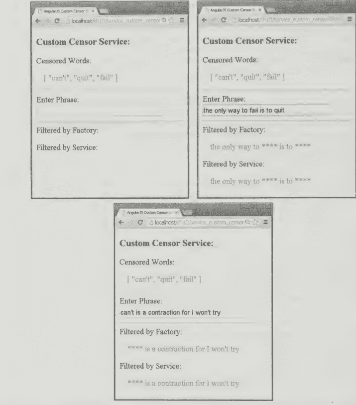

图10.1 在AngularJS控制器中使用多种自定义服务来审查短语中的词语。

## 实现简单的时间服务

在这个示例中，你将构建一个简单的时间服务，为不同的城市生成本地时间对象。然后，在AngularJS模板中，你将在多个控制器中使用该时间服务。目的是给你一个机会看看重用一个AngularJS服务是多么容易。

清单10.3中的代码使用函数TimeObj()来生成服务对象，实现了一个名为TimeService的自定义服务。TimeObj中的代码简单地定义了一个城市列表及其时区偏移量，并提供了getTZDate()函数以返回特定城市的JavaScript Date对象。getCities()函数创建一个包含所代表城市的数组并返回它。


请注意，应用中添加了几个控制器，包括`LAController`、`NYController`、`LondonController`和`TimeController`。这些控制器被注入了`TimeService`服务，并使用它来设置某个城市的当前时间，或者在`TimeController`的情况下，设置所有城市的时间。

清单10.4中的代码实现了一个AngularJS模板，显示了`LAController`、`NYController`、`LondonController`和`TimeController`控制器的时间。对于`TimeController`，所有时间都使用`ng-repeat`显示在表格中。

图10.2展示了生成的AngularJS应用网页。请注意显示的不同时间。

### 清单10.3 service_custom_time.js：在多个控制器中实现和使用自定义AngularJS服务

```javascript
01 var app = angular.module('myApp', []);
02 function TimeObj() {
03   var cities = { 'Los Angeles': -8,
04             'New York': -5,
05             'London': 0,
06             'Paris': 1,
07             'Tokyo': 9 };
08   this.getTZDate = function(city){
09     var localDate = new Date();
10     var utcTime = localDate.getTime() +
11       localDate.getTimezoneOffset() *
12       60*1000;
13     return new Date(utcTime +
14       (60*60*1000 *
15       cities[city]));
16   };
17   this.getCities = function(){
18     var cList = [];
19     for (var key in cities){
20       cList.push(key);
21     }
22     return cList;
23   };
24 }
25 app.service('TimeService', [TimeObj]);
26 app.controller('LAController', ['$scope', 'TimeService',
```

## 190 第10章 创建你自己的自定义AngularJS服务

```javascript
function($scope, timeS) {
  $scope.myTime = timeS.getTZDate("Los Angeles").toLocaleTimeString();
}});
app.controller('NYController', ['$scope', 'TimeService',
                           function($scope, timeS) {
  $scope.myTime = timeS.getTZDate("New York").toLocaleTimeString();
}});
app.controller('LondonController', ['$scope', 'TimeService',
                           function($scope, timeS) {
  $scope.myTime = timeS.getTZDate("London").toLocaleTimeString();
}});
app.controller('TimeController', ['$scope', 'TimeService',
                           function($scope, timeS) {
  $scope.cities = timeS.getCities();
  $scope.getTime = function(cityName){
    return timeS.getTZDate(cityName).toLocaleTimeString();
  };
}});
```

### 清单 10.4 service_custom_time.html：展示将自定义AngularJS服务注入多个控制器的AngularJS模板

```html
<!doctype html>
<html ng-app="myApp">
<head>
  <title>AngularJS Custom Time Service</title>
  <style>
    span {
      color: lightgreen; background-color: black;
      border: 3px ridge; padding: 2px;
      font: 14px/18px arial, serif; }
  </style>
</head>
<body>
  <h2>Custom Time Service:</h2><hr>
  <div ng-controller="LAController">
    Los Angeles Time:
    <span>{{myTime}}</span>
  </div><hr>
  <div ng-controller="NYController">
    New York Time:
    <span>{{myTime}}</span>
  </div><hr>
  <div ng-controller="LondonController">
    London Time:
    <span>{{myTime}}</span>
  </div><hr>
  <div ng-controller="TimeController">
      All Times:
      <table>
          <tr>
              <th ng-repeat="city in cities">
                  {{city}}
              </th>
          </tr>
          <tr>
              <td ng-repeat="city in cities">
                  <span>{{getTime(city)}}</span>
              </td>
          </tr>
      </table>
  </div><hr>
  <script src="http://code.angularjs.org/1.3.0/angular.min.js"></script>
  <script src="js/service_custom_time.js"></script>
</body>
</html>
```

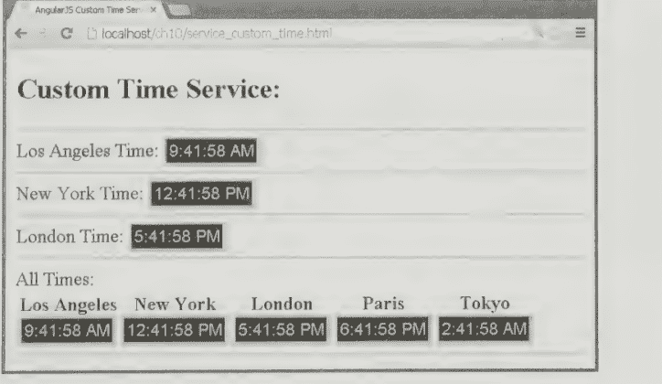

图 10.2 在多个控制器中使用自定义AngularJS服务来显示不同城市的时间。

## 192 第10章 创建你自己的自定义AngularJS服务

## 实现一个数据库访问服务

在这个例子中，你将构建一个中间数据库访问服务，它使用`$http`服务连接到一个简单的Node.js服务器，该服务器将充当服务器端的数据库服务。此练习的目的是展示内置服务与自定义服务结合使用。这同样为利用`$q`服务提供了一个很好的例子。

清单 10.5 实现了Node.js Web服务器，该服务器处理以下GET和POST路由，以获取和设置用户对象以及表数据数组，模拟对远程数据库服务的请求：

- `/get/user`：一个GET路由，返回用户对象的JSON版本。

- `/get/data`：一个GET路由，返回表数据数组的JSON版本。

- `/set/user`：一个POST路由，在请求体中接受一个用户对象，并更新服务器上的对象以模拟存储用户对象。

- `/set/data`：一个POST路由，在请求体中接受一个对象数组，并更新`data`变量以模拟存储数据库数据。通常，你不会一次性存储所有表数据，但为了本例的简便性，这里就是这样处理的。

你不必过多关注清单10.5中的代码，除了理解它提供的路由，以便你能跟上清单10.6、10.7和10.8中定义的AngularJS应用程序中的交互。该服务器非常基础，不处理错误，只是动态生成数据以模拟数据库。

> 注意

> 如果`server.js` HTTP服务器正在运行，你需要在启动清单10.5中的`service_server.js`之前停止它。此外，你需要将清单10.5中的`service_db_server.js`文件放在清单10.6中的`service_db_access.html`的父文件夹中，以便在Node.js静态路由中路径能正确匹配。结构应类似于：

> ./service_db_server.js

> ./ch10/service_custom_db.html

> ./ch09/js/service_custom_db_access.js

> ./ch09/js/service_custom_db.js

### 清单 10.5 service_db_server.js：实现一个支持GET和POST路由的Node.js Express服务器，为AngularJS控制器模拟数据库服务

```javascript
var express = require('express');
var bodyParser = require('body-parser');
var app = express();
app.use('/', express.static('./'));
app.use(bodyParser.urlencoded({ extended: true }));
app.use(bodyParser.json());
var user = {
    first: 'Christopher',
    last: 'Columbus',
    username: 'cc1492',
    title: 'Admiral',
    home: 'Genoa'
};
var data = [];
function r(min, max){
  var n = Math.floor(Math.random() * (max - min + 1)) + min;
  if (n<10){ return '0' + n; }
  else { return n; }
}
function p(start, end, total, current){
  return Math.floor((end-start)*(current/total)) + start;
}
function d(plusDays){
  var start = new Date(1492, 7, 3);
  var current = new Date(1492, 7, 3);
  current.setDate(start.getDate()+plusDays);
  return current.toDateString();
}
function makeData(){
  var t = 70;
  for (var x=0; x < t; x++){
    var entry = {
      day: d(x),
      time: r(0, 23) + ':' + r(0, 59),
      longitude: p(37, 25, t, x) + '\u00B0 ' + r(0,59) + ' N',
      latitude: p(6, 77, t, x) + '\u00B0 ' + r(0,59) + ' W'
    };
    data.push(entry);
  }
}
makeData();
app.get('/get/user', function(req, res){
  res.json(user);
});
app.get('/get/data', function(req, res){
  res.json(data);
});
app.post('/set/user', function(req, res){
  console.log(req.body.userData);
  user = req.body.userData;
  res.json({ data: user, status: "User Updated." });
});
app.post('/set/data', function(req, res){
  data = req.body.data;
  res.json({ data: data, status: "Data Updated." });
});
app.listen(80);
```

清单10.6中的代码实现了一个名为`dbAccess`的模块和一个名为`DBService`的自定义服务。创建服务对象的`DBAccessObj()`函数提供了`getUserData()`和`updateUser()`方法，用于使用`$http`请求从服务器检索和更新用户对象。`getData`和`updateData()`方法为表数据提供了类似的功能。注意`$q`服务是如何用于延迟响应`$http`请求的，因为请求不会立即返回。

清单10.7中的代码实现了应用模块。注意第1行将`dbAccess`模块注入到`myApp`模块中，以提供对`DBService`服务的访问。`DBService`在第2行被注入到控制器中，然后在第6、12、18和23行被用于调用服务器以获取和设置数据，并将其赋值给作用域中的`$scope.userInfo`和$`scope.data`值。注意`$q`服务`then()`函数是如何用于处理延迟响应的。为了简便，这里只实现了`successCallback`函数。通常，你也希望同时实现一个`errorCallback`函数。

清单10.8中的代码实现了一个AngularJS模板，该模板在文本输入框中显示用户信息，并将值直接绑定到作用域。还有两个输入按钮，分别调用`updateUser()`以更新服务器上的用户信息，以及`getUser()`以从服务器刷新作用域数据。类似地，有两个输入按钮调用`updateData()`和`getData()`，为从模型更新和刷新表数据提供相同的功能。

图10.3展示了正在运行的AngularJS Web应用程序。当你点击“Update User”或“Update Data”按钮时，服务器上的值会被更改。这意味着你可以重新加载网页，甚至退出浏览器再回来，这些值仍然是更新后的版本。

### 清单 10.6 service_custom_db_access.js：实现一个自定义AngularJS服务，该服务利用`$http`和`$q`服务提供与服务器上存储数据的交互

```javascript
var app = angular.module('dbAccess', []);
function DBAccessObj($http, $q) {
  this.getUserData = function(){
    var deferred = $q.defer();
    $http.get('/get/user')
      .success(function(response, status, headers, config) {
        deferred.resolve(response);
      });
    return deferred.promise;
  };
  this.updateUser = function(userInfo){
    var deferred = $q.defer();
    $http.post('/set/user', { userData: userInfo}).
      success(function(response, status, headers, config) {
```

## 第10章 创建您自己的自定义 AngularJS 服务

```javascript
15        deferred.resolve(response);
16     });
17     return deferred.promise;
18  };
19  this.getData = function(){
20    var deferred = $q.defer();
21    $http.get('/get/data')
22    .success(function(response, status, headers, config) {
23      deferred.resolve(response);
24    });
25    return deferred.promise;
26  };
27  this.updateData = function(data){
28    var deferred = $q.defer();
29    $http.post('/set/data', { data: data}).
30    success(function(response, status, headers, config) {
31      deferred.resolve(response);
32    });
33    return deferred.promise;
34  };
35  }
36  app.service('DBService', ['$http', '$q', DBAccessObj]);
```

**清单 10.7** `service_custom_db.js`：实现一个 AngularJS 应用程序，该程序注入了清单 10.6 中的模块和服务，以利用数据库访问服务。

```javascript
01 var app = angular.module('myApp', ['dbAccess']);
02 app.controller('myController', ['$scope', 'DBService',
03                                function($scope, db) {
04   $scope.status = "";
05   $scope.getUser = function(){
06     db.getUserData().then(function(response){
07       $scope.userInfo = response;
08       $scope.status = "User Data Retrieve.";
09     });
10   };
11   $scope.getData = function(){
12     db.getData().then(function(response){
13       $scope.data = response;
14       $scope.status = "User Data Retrieve.";
15     });
16   };
17   $scope.updateUser = function(){
18     db.updateUser($scope.userInfo).then(function(response){
19       $scope.status = response.status;
20     });
21     };
22     $scope.updateData = function(){
23         db.updateData($scope.data).then(function(response){
24             $scope.status = response.status;
25         });
26     };
27     $scope.getUser();
28     $scope.getData();
29 });
```

**清单 10.8** `service_custom_sensor.html`：一个 AngularJS 模板，它使用一系列 `<input>` 元素来显示和更新从服务器检索到的数据。

```html
01 <!doctype html>
02 <html ng-app="myApp">
03 <head>
04     <title>AngularJS Custom Database Service</title>
05     <style>
06         label {
07             display: inline-block; width: 75px; text-align: right; }
08         td, tr {
09             width: 125px; text-align: right; }
10         p {
11             color: red; font: italic 12px/14px; margin: 0px;}
12         h3 {
13             margin: 5px; }
14     </style>
15 </head>
16 <body>
17     <h2>Custom Database Service:</h2>
18     <div ng-controller="myController">
19         <h3>User Info:</h3>
20         <label>First:</label>
21             <input type="text" ng-model="userInfo.first" /><br>
22         <label>Last:</label>
23             <input type="text" ng-model="userInfo.last" /><br>
24         <label>Username:</label>
25             <input type="text" ng-model="userInfo.username" /><br>
26         <label>Title:</label>
27             <input type="text" ng-model="userInfo.title" /><br>
28         <label>Home:</label>
29             <input type="text" ng-model="userInfo.home" /><br>
30         <input type="button" ng-click="updateUser()" value="Update User" />
31         <input type="button" ng-click="getUser()" value="Refresh User Info" />
32         <hr>
33         <p>{{status}}</p>
34         <hr>
35  <h3>Data:</h3>
36  <input type="button" ng-click="updateData()" value="Update Data" />
37  <input type="button" ng-click="getData()" value="Refresh Data Table" /><br>
38  <table>
39    <tr><th>Day</th><th>Time</th><th>Latitude</th><th>Longitude</th></tr>
40    <tr ng-repeat="datum in data">
41      <th>{{datum.day}}</th>
42      <td><input type="text" ng-model="datum.time" /></td>
43      <td><input type="text" ng-model="datum.latitude" /></td>
44      <td><input type="text" ng-model="datum.longitude" /></td>
45    </tr>
46  </table>
47  <hr>
48  </div>
49  <script src="http://code.angularjs.org/1.3.0/angular.min.js"></script>
50  <script src="js/service_custom_db_access.js"></script>
51  <script src="js/service_custom_db.js"></script>
52  </body>
53  </html>
```

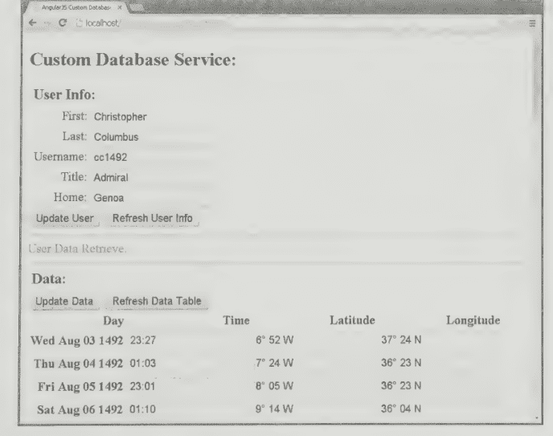

**图 10.3** 使用实现了 `$http` 的自定义 AngularJS 服务，以提供对服务器上数据的检索和更新访问。

## 总结

AngularJS 自定义服务是您可以注册到依赖注入器的单例对象。一旦它们被注册到依赖注入器，控制器、指令和其他 AngularJS 组件，包括其他服务，就可以使用它们。AngularJS 提供了几种创建自定义服务的方法，复杂程度各不相同。`value` 和 `constant` 方法创建简单服务。而 `factory` 和 `service` 方法则使您能够创建更为复杂的服务。

本章重点介绍了当您需要为应用程提供基于任务的功能时，可用于实现自己的自定义 AngularJS 服务的工具。您学习了四种自定义 AngularJS 服务的方法或类型，包括 `value`、`constant`、`factory` 和 `service`。

本章展示了如何实现每种类型的自定义 AngularJS 服务的示例。您还看到了一个在多个控制器中实现自定义 AngularJS 服务的示例。本章的最后一个示例向您展示了如何实现一个独立的自定义 AngularJS 服务，该服务使用 `$http` 与服务器交互，以及如何将其注入并在另一个模块中使用。

## 11 以 AngularJS 方式创建丰富的 Web 应用程序组件

本书的前十章主要旨在向您教授 AngularJS 应用程序不同组件的机制和基本实现。您已经学习了作用域/模型、视图、控制器、指令和服务。本章稍微转换了一下思路，仅提供一些示例，以帮助巩固在 AngularJS 中完成任务的方式。

与普通 JavaScript 甚至 jQuery 相比，AngularJS 期望的结构要多得多。然而，话虽如此，它在框架内仍然提供了很大的灵活性。因此，尽可能从多个不同角度审视在 AngularJS 中做事的方法是一个好主意。

本章中的示例并非经过精细打磨——有些比其他更甚——然而，它们确实从许多不同的角度展示了自定义指令的实现以及内置指令的使用。目的不是为您提供可直接重用的代码，而是给您一些不同的视角，并提供一个基本框架，您可以在设计自己的实现时在其基础上进行构建。

本章使用的代码文件列在章节开头，以便如果您从本书网站下载了代码，可以轻松跟进。

### 构建选项卡视图

在这个示例中，您将构建两个自定义 AngularJS 指令，一个充当选项卡组，另一个充当选项卡组中的单独窗格。本示例的目的是让您了解如何将自定义指令相互嵌套，以及两者之间的一些通信。

此示例的文件夹结构如下：

-   `./server.js`：提供静态项目文件的 Node.js Web 服务器。

-   `./images`：包含示例中使用图像的文件夹。

-   `./ch11`：项目文件夹。

-   `./ch11/tabbable.html`：项目的 AngularJS 模板。

-   `./ch11/tabs.html`：选项卡组的 AngularJS 部分模板。

-   `./ch11/panel.html`：选项卡组中每个单独面板的 AngularJS 部分模板。

-   `./ch11/js/tabbable.js`：支持自定义选项卡指令的 AngularJS 应用程序。

清单 11.1 中的代码展示了定义 `myTabs` 和 `myPane` 两个指令的 `tabbable.js` AngularJS 应用程序。请注意，模板内部使用的 HTML 来自使用指令定义中 `templateUrl` 选项的部分文件。另请注意，使用了 `transclude` 选项，它使我们能够将 `myPane` 元素的内容保留在 AngularJS 模板中。

两个指令之间的通信是通过在 `myPane` 的定义中要求 `myTabs` 指令来实现的。这导致定义在 `myTabs` 中的控制器被传递到 `myPane` 的链接函数中。请注意，在第 30 行，我们能够调用 `addPane()` 将 `myPane` 指令的作用域添加到 `myTabs` 指令中的列表中。可见的选项卡是使用 `myTabs` 控制器函数中的 `select()` 方法更改的。

**清单 11.1** `tabbable.js`：一个 AngularJS 应用程序，定义了两个可以嵌套的自定指令，以提供选项卡式面板视图。

```javascript
01 var app = angular.module('myApp', []);
02 app.directive('myTabs', function() {
03   return {
04     restrict: 'E',
05     transclude: true,
06     scope: {},
07     controller: function($scope) {
08       var panes = $scope.panes = [];
09       $scope.select = function(pane) {
10         angular.forEach(panes, function(pane) {
11           pane.selected = false;
12         });
13         pane.selected = true;
14       };
15       this.addPane = function(pane) {
16         if (panes.length == 0) {
17           $scope.select(pane);
18         }
19         panes.push(pane);
20       };
21     },
22     templateUrl: 'tabs.html'
23   };
24 });
25 app.directive('myPane', function() {
26   return {
27     require: '^myTabs',
28     restrict: 'E',
29     transclude: true,
30     scope: {
31       title: '@'
32     },
33     link: function(scope, element, attrs, tabCtrl) {
34       tabCtrl.addPane(scope);
35     },
36     templateUrl: 'panel.html'
37   };
38 });
```

**清单 11.2** tabs.html: 包含构建选项卡容器模板代码的 AngularJS 部分模板

```html
<div class="tabbable">
  <div class="tabs">
    <span class="tab" ng-repeat="pane in panes"
      ng-class="{activeTab:pane.selected}"
      ng-click="select(pane)">{{pane.title}}</span>
    </span>
  </div>
  <div class="tabcontent" ng-transclude></div>
</div>
```

清单 11.2 中的代码包含了作为 `myTabs` 指令替代品的 AngularJS 部分模板。注意，作用域中的 `panes` 值用于将选项卡作为 `<span>` 元素添加到视图的顶部。当每个 `myPane` 元素被编译并链接到模板中时，`panes` 数组会被构建起来。

**清单 11.3** pane.html: 包含构建选项卡容器各个窗格模板代码的 AngularJS 部分模板

```html
<div class="pane"
    ng-show="selected"
    ng-transclude>
</div>
```

清单 11.3 中的代码包含了作为 `myPane` 指令替代品的 AngularJS 部分模板。注意，我们使用 `ng-show` 来在点击窗格时显示和隐藏它们。`ng-transclude` 属性确保在 `myPane` 元素中定义的内容包含在渲染后的视图中。

清单 11.4 展示了支持 `myTabs` 和 `myPane` 指令的 AngularJS 模板。注意模板中所需元素的命名结构为 `my-tabs` 和 `my-pane`。在此示例中，只有图片被放置在 `myPane` 元素内。这里也可以同样轻松地放置一系列复杂的元素，如表单或表格。

图 11.1 展示了工作的网页。注意，当点击每个窗格的选项卡时，内容会发生变化。

**清单 11.4**  **tabbable.html:** 实现 `myTabs` 和 `myPane` 自定义指令以创建选项卡视图的 AngularJS 模板

```html
<!doctype html>
<html ng-app="myApp">
<head>
  <title>Tab and Tab Pane Directives</title>
  <style>
  .tab{
    display:inline-block; width:100px;
    border-radius: .5em .5em 0 0; border:1px solid black;
    text-align:center; font: 15px/28px Helvetica, sans-serif;
    background-image: linear-gradient(#CCCCCC, #EEEEEE);
    cursor: pointer; }
  .activeTab{
    border-bottom: none;
    background-image: linear-gradient(#66CCFF, #CCFFFF); }
  .pane{
    border:1px solid black; background-color: #CCFFFF;
    height:300px; width:400px;
    padding:10px; margin-top:-2px;
    overflow: scroll; }
  </style>
</head>
<body>
  <h2>AngularJS Custom Tabs</h2>
  <my-tabs>
    <my-pane title="Canyon">
      
    </my-pane>
    <my-pane title="Lake">
      
    </my-pane>
    <my-pane title="Sunset">
      
    </my-pane>
  </my-tabs>
  <script src="http://code.angularjs.org/1.3.0/angular.min.js"></script>
  <script src="js/tabbable.js"></script>
</body>
</html>
```


图 11.1 实现嵌套的自定义 AngularJS 指令以构建选项卡窗格视图。

## 实现可拖放元素

在此示例中，你将使用自定义 AngularJS 指令来实现一组可拖动的元素，这些元素包含可以拖到一组可放置图片元素上的单词。当单词被拖放到图片上时，它会被追加到图片下方显示的单词列表中。

这个练习的目的是向你展示使用 HTML5 拖放事件的示例。该示例仅使用事件，而实际的拖放功能是使用 AngularJS 机制构建的。这样做的原因是说明使用 AngularJS（另外，坦率地说，HTML5 的拖放实现得并不好，需要修订）。本示例中说明的另一件事是在 AngularJS 指令中向现有元素追加新元素。

本示例的文件夹结构如下：

- ./server.js: 提供静态项目文件的 Node.js Web 服务器。

- ./images: 包含示例中使用的图片的文件夹。

- ./ch11: 项目文件夹。

- ./ch11/dragdrop.html: 项目的 AngularJS 模板。

- ./ch11/js/dragdrop.js: 支持自定义拖放指令的 AngularJS 应用。

清单 11.5 中的代码包含了 `dragdrop.js` 应用，它定义了两个新的自定义 AngularJS 指令：`dragit` 和 `dropit`。注意，在父作用域中定义了 `dragStatus` 和 `dropStatus` 变量；这些变量在自定义指令中更新。这是可能的，因为指令中没有定义隔离作用域，所以它们共享父控制器作用域。

注意，在 `dragit` 指令内部，HTML5 的 `draggable` 属性通过 `attr()` 方法被添加到 `dragit` 元素上。同样在 `dragit` 指令中，实现了 `dragstart`、`drag` 和 `dragend` 事件处理程序。对于 `dragstart` 和 `drag`，其默认行为是允许拖动开始并触发 `dragenter`/`dragleave` 事件。然而，`dragend` 确实阻止了默认行为，以便我们的自定义 AngularJS 代码可以处理放置操作。

在 `dropit` 指令内部，实现了 `dragover`、`dragleave`、`dragenter` 和 `drop`。注意，在 `drop` 事件中，我们使用 `append` 方法将 `<p>` 元素追加到 `dropit` 元素。段落中的值来自作用域，是在 `dragit` 指令的 `dragstart` 期间设置的。同样，这是可能的，因为指令中没有定义隔离作用域。

**清单 11.5** dragdrop.js: 实现 dragit 和 dropit 自定义 AngularJS 指令以提供拖放功能的 AngularJS 应用

```javascript
var app = angular.module('myApp', []);
app.controller('myController', function($scope) {
  $scope.dragStatus = "none";
  $scope.dropStatus = "none";
  $scope.dropValue = "";
})
.directive('dragit', function($document, $window) {
  function makeDraggable(scope, element, attr) {
    angular.element(element).attr("draggable", "true");
    element.on('dragstart', function(event) {
      element.addClass('dragItem');
      scope.$apply(function(){
        scope.dragStatus = "Dragging " + element.html();
        scope.dropValue = element.html();
      });
      event.dataTransfer.setData('Text', element.html());
    });
    element.on('drag', function(event) {
      scope.$apply(function(){
        scope.dragStatus = "X: " + event.pageX +
                            " Y: " + event.pageY;
      });
    });
    element.on('dragend', function(event) {
      event.preventDefault();
      element.removeClass('dragItem');
    });
  }
  return {
    link: makeDraggable
  };
})
.directive('dropit', function($document, $window) {
  return {
    restrict: 'E',
    link: function makeDroppable(scope, element, attr){
      element.on('dragover', function(event) {
        event.preventDefault();
        scope.$apply(function(){
          scope.dropStatus = "Drag Over";
        });
      });
      element.on('dragleave', function(event) {
        event.preventDefault();
        element.removeClass('dropItem');
        scope.$apply(function(){
          scope.dropStatus = "Drag Leave";
        });
      });
      element.on('dragenter', function(event) {
        event.preventDefault();
        element.addClass('dropItem');
        scope.$apply(function(){
            scope.dropStatus = "Drag Enter";
        });
    });
    element.on('drop', function(event) {
        event.preventDefault();
        element.removeClass('dropItem');
        scope.$apply(function(){
            element.append('<p>' +
                event.dataTransfer.getData('Text') + '</p>');
            scope.dropStatus = "Dropped " + scope.dropValue;
        });
    });
  }
};
});
```

清单 11.6 中的代码实现了显示 `dragStatus` 和 `dropStatus` 值的 AngularJS 模板。注意，可拖动元素使用 `<dragit>` 语法声明，可放置元素使用 `<dropit>` 语法声明。

图 11.2 展示了正在运行的 AngularJS 应用。当单词被拖放并放置到图片上时，它们会被追加到图片下方。还要注意，拖动坐标和放置状态也会显示出来。

### 清单 11.6 dragdrop.html: 使用 dragit 和 dropit 指令将可拖放元素添加到网页的 AngularJS 模板

```html
<!doctype html>
<html ng-app="myApp">
<head>
    <title>HTML5 Draggable and Droppable Directives</title>
    <style>
        dropit, img, p{
            vertical-align: top; text-align: center;
            width: 100px;
            display: inline-block;
        }
        p {
            color: white; background-color: black;
            font: bold 14px/16px arial;
            margin: 0px; width: 96px;
            border: 2px ridge grey;
            background: linear-gradient(#888888, #000000);
        }
        span{
```

### HTML5 拖放组件

```html
<div ng-controller="myController">
    Drag Status: {{dragStatus}}<br>
    Drop Status: {{dropStatus}}
    <hr>
    <div id="dragItems">
        <span dragit>Nature</span>
        <span dragit>Landscape</span>
        <span dragit>Flora</span>
        <span dragit>Sunset</span>
        <span dragit>Arch</span>
        <span dragit>Beauty</span>
        <span dragit>Inspiring</span>
        <span dragit>Summer</span>
        <span dragit>Fun</span>
    </div>
    <hr>
    <dropit></dropit>
    <dropit></dropit>
    <dropit></dropit>
    <dropit></dropit>
</div>
```

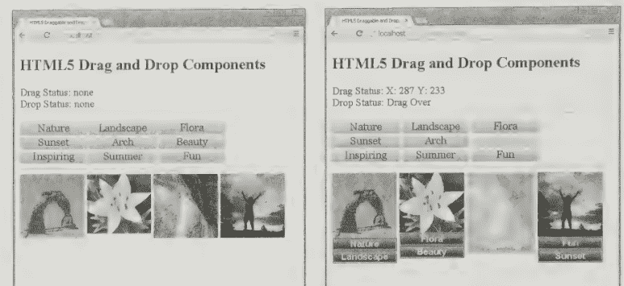

图 11.2 使用自定义 AngularJS 指令为网页提供拖放功能。

### 为图像添加缩放视图字段

在这个示例中，你将使用一个自定义的 AngularJS 指令来替换 `` 元素，并提供一个自动的缩放视视字段，该字段显示在页面图像的旁边。当你点击图像时，缩放视图字段将更新为图像的放大局部。

这个练习的目的是向你展示 AngularJS 自定义指令如何通过具有丰富功能集的新元素来扩展 HTML。这个例子也再次说明了何时你需要使用完整版的 jQuery 而不是 jQuery lite 来获取图像的大小和鼠标在图像内的位置。

这个示例的文件夹结构如下：

- `./server.js`：提供静态项目文件的 Node.js Web 服务器。

- `./images`：包含示例中使用的图像的文件夹。

- `./ch11`：项目文件夹。

- `./ch11/zooming.html`：项目的 AngularJS 模板。

- `./ch11/zoomit.html`：包含图像和缩放视图字段元素定义的 AngularJS 部分模板。

- `./ch11/js/zooming.js`：支持自定义标签指令的 AngularJS 应用程序。

清单 11.7 中的代码实现了 `zooming.js` AngularJS 应用程序，该程序定义了一个名为 `zoomit` 的自定义 AngularJS 指令。`zoomit` 指令仅限于元素，使用 `restrict: 'E'`。还要注意，模板定义中的 `src` 属性被注入到作用域中。

`zoomit` 指令的功能在 `controller` 函数中。注意创建了一个名为 `zInfo` 的对象，它包含 `background-image` 和 `background-position` 属性。`zInfo` 作用域值将用于设置清单 11.8 中 `zoomit.html` 部分模板中缩放视图字段的 `ng-style` 属性。设置 `background-image` 和 `background-position` 属性将图像添加到背景并定位缩放区域。

`imageClick()` 函数阻止默认的点击行为，然后将 `event.target` 元素作为 jQuery 对象获取。这就是我们需要完整版 jQuery 来获取图像在页面上的高度、宽度和当前偏移量的地方。然后我们可以计算鼠标点击位置相对于左侧 (`posX`) 和顶部 (`posY`) 的百分比，并适当地设置 `background-position` 样式。

#### 清单 11.7 `zooming.js`：定义名为 `zoomit` 的自定义 AngularJS 指令的 AngularJS 应用程序，该指令实现带有缩放视图字段的 `` 元素

```javascript
01 angular.module('myApp', [])
02 .controller('myController', ['$scope', function($scope) {
03 }])
04 .directive('zoomit', function() {
05   return {
06     restrict: 'E',
07     scope: { src: '@' },
08     controller: function($scope) {
09       $scope.zInfo = {
10          "background-image": "url(" + $scope.src + ")",
11          "background-position": "top right"
12       };
13       $scope.imageClick = function(event){
14          event.preventDefault();
15          //使用完整的jQuery来获取偏移量、宽度和高度
16          var elem = angular.element(event.target);
17          var posX = Math.ceil((event.pageX - elem.offset().left) /
18                                       elem.width() * 100);
19          var posY = Math.ceil((event.pageY - elem.offset().top) /
20                                       elem.height() * 100);
21          $scope.pos = posX + "% " + posY + "%";
22          $scope.zInfo["background-position"] = posX + "% " +
23                                                posY + "%";
24       };
25     },
26     link: function(scope, element, attrs) {
27      },
28      templateUrl: 'zoomit.html'
29  };
30  });
```

清单 11.8 中的代码实现了 `zoomit.html` 部分模板，该模板添加了 `` 元素和一个 `<div>` 元素，后者将包含缩放后的图像作为背景。注意 `ng-click` 方法被设置为作用域中的 `imageClick()` 函数，并传递了 `$event`。还要注意 `ng-style` 被设置为作用域中的 `zInfo`。

#### 清单 11.8 `zoomit.html`：实现图像和缩放视图字段的 `` 和 `<div>` 元素的 AngularJS 部分模板

```html
01  <div>
02      
04      <div class="zoombox"
05           ng-style="zInfo"></div>
06  </div>
```

清单 11.9 包含为缩放视图字段和图像提供样式的 AngularJS 模板代码。注意 `<zoomit>` 元素像任何其他元素一样被添加，并且 `src` 属性像 `` 元素一样被设置。还要注意完整的 jQuery 库在 AngularJS 库之前加载。

图 11.3 显示了网页上带有视图字段的图像。当你点击图像中的特定点时，缩放视图字段会更新。

#### 清单 11.9 `zooming.html`：设置样式并实现 `<zoomit>` 自定义 AngularJS 指令的 AngularJS 模板

```html
01  <!DOCTYPE html>
02  <html ng-app="myApp">
03  <head>
04      <title>放大镜</title>
05      <style>
06          .zoombox {
07              display: inline-block;
08              border: 3px ridge black;
09              width: 100px; height: 100px; }
10          img {
11              height: 200px;
12              vertical-align: top; }
13      </style>
14  </head>
15  <body>
16 <h2>图像缩放窗口</h2>
17 <div ng-controller="myController">
18 <zoomit src="/images/flower.jpg"></zoomit>
19 <hr>
20 <zoomit src="/images/arch.jpg"></zoomit>
21 </div>
22 </body>
23 <script src="http://ajax.googleapis.com/ajax/libs/jquery/1.11.1/jquery.min.js"></script>
24 <script src="http://code.angularjs.org/1.3.0/angular.min.js"></script>
25 <script src="js/zooming.js"></script>
26 </html>
```


图 11.3 实现一个提供图像和缩放视图的自定义 AngularJS 指令。

### 实现可展开和可折叠元素

在这个示例中，你将使用自定� AngularJS 指令来构建网页上可以展开和收缩的元素。每个元素顶部都有一个标题和一个展开/折叠按钮。当点击折叠按钮时，元素的内容将被隐藏。当点击展开按钮时，内容将再次显示。

这个练习的目的是巩固实现相互嵌套并相互通信的自定义 AngularJS 指令。在这个例子中，你还将看到作用域如何从控制器中隔离出来，但在展开容器和容器内的项目之间共享。

这个示例的文件夹结构如下：

- `./server.js`：提供静态项目文件的 Node.js Web 服务器。

- `./images`：包含示例中使用的图像的文件夹。

- `./ch11`：项目文件夹。

- `./ch11/expand.html`：项目的 AngularJS 模板，实现自定义的可展开指令。

- `./ch11/expand_list.html`：可展开元素指令的 AngularJS 部分模板。

- `./ch11/expand_item.html`：可展开元素中每个单独项目的 AngularJS 部分模板。

- `./ch11/js/expand.js`：支持可展开元素指令的 AngularJS 应用程序。

清单 11.10 中的代码包含了 `expand.js` AngularJS 应用程序，该程序定义了 `expandList` 和 `expandItem` 自定义 AngularJS 指令。使用了 transclude 选项来保留模板中定义的内容。

注意在 `expandList` 指令中，`scope` 是一个独立作用域，但接受 `title` 和 `exwidth` 属性，它们被设置为作用域中的 `title` 和 `listWidth`。注意第 27 行使用 `listWidth` 值来设置添加到展开列表中的项目的样式宽度。第 34 行也使用 `listWidth` 来设置可展开列表的 css 属性 `width`。

`expandItem` 指令需要 `expandList` 指令来提供对 `expandList` 指令作用域中 `addItem()` 函数的访问。注意 `myStyle` 属性用于构建一个样式对象，该对象将设置为展开列表中项目的 `ng-style`。

展开和折叠的工作方式是：在清单 11.11 所示的模板中，使用 `ng-hide` 将 `myHide` 值绑定到展开列表中的每个项目。`expandList` 作用域中的 `items` 属性提供了每个添加的 `expandItem` 元素的作用域列表。然后当展开/折叠按钮被点击时，在 `collapse()` 函数中，只需在每个项目的作用域中将 `myHide` 值设置为 `true` 或 `false`，就可以显示或隐藏展开元素中的项目。

#### 代码清单 11.10 expand.js：实现 expandList 和 expandItem 自定义指令以提供可展开/可折叠元素的 AngularJS 应用

```javascript
angular.module('myApp', [])
.controller('myController', ['$scope', function($scope) {
  $scope.items = [1,2,3,4,5];
}])
.directive('expandList', function() {
  return {
    restrict: 'E',
    transclude: true,
    scope: {title: '@', listWidth: '@exwidth'},
    controller: function($scope) {
      $scope.collapsed = false;
      $scope.expandHandle = "-";
      items = $scope.items = [];
      $scope.collapse = function() {
        if ($scope.collapsed){
          $scope.collapsed = false;
          $scope.expandHandle = "-";
        } else {
          $scope.collapsed = true;
          $scope.expandHandle = "+";
        }
        angular.forEach($scope.items, function(item) {
          item.myHide = $scope.collapsed;
        });
      };
      this.addItem = function(item) {
        item.myStyle.width = $scope.listWidth;
        items.push(item);
        item.myHide=false;
      };
    },
    link: function(scope, element, attrs, expandCtrl) {
      element.css("display", "inline-block");
      element.css("width", scope.listWidth);
    },
    templateUrl: 'expand_list.html',
  };
})
.directive('expandItem', function() {
  return {
    require: '^expandList',
    restrict: 'E',
    transclude: true,
    scope: {},
    controller: function($scope){
      $scope.myHide = false;
      $scope.myStyle = { width: "100px", "display": "inline-block" };
    },
    link: function(scope, element, attrs, expandCtrl) {
      expandCtrl.addItem(scope);
    },
    templateUrl: 'expand_item.html',
  };
});
```

代码清单 11.11 包含了 AngularJS 部分模板 `expand_list.html`，它为 `expandList` 元素提供了定义。添加了用于展开列表头部的元素，包括展开/折叠按钮和标题。`<div ng-transclude>` 元素是放置 `expandItem` 元素的位置。

#### 代码清单 11.11 expand_list.html：定义 expandList 元素的 AngularJS 部分模板

```html
<div>
    <div class="expand-header">
        <span class="expand-button"
              ng-click="collapse()">{{expandHandle}}</span>
        {{title}}
    </div>
    <div ng-transclude></div>
</div>
```

代码清单 11.12 包含了 AngularJS 部分模板 `expand_item.html`，它为可展开项提供了定义。请注意，`ng-hide` 被设置为作用域中的 `myHide` 以展开/折叠元素。`ng-style` 被设置为 `myStyle`，这样我们可以将宽度设置为展开列表的宽度。`expand-item` 类使我们能够轻松地使用 CSS 更改项目外观。`ng-transclude` 用于将 AngularJS 模板定义中的内容放置在列表项内部。

#### 代码清单 11.12 expand_item.html：定义 expandItem 元素的 AngularJS 部分模板

```html
<div ng-hide="myHide"
     ng-style="myStyle"
     class="expand-item"
     ng-transclude>
</div>
```

代码清单 11.13 实现了 AngularJS 模板，该模板提供了页面的样式以及 `<expand-list>` 元素的定义。请注意，定义了四个不同的 `<expand-list>` 元素。第一个是简单列表，其中 `<expand-item>` 元素只包含文本。第二个提供了一个包含表单元素的 `<expand-item>` 元素。第三个在每个 `<expand-item>` 元素中包含不同 HTML 元素的混合。最后一个只包含一个 `` 元素。

请注意，每个 `<expand-list>` 元素都包含不同的 `title` 和 `exwidth` 属性值，这导致页面上出现具有不同标题和宽度的列表。AngularJS 应用的结果如图 11.4 所示。请注意元素展开和折叠的版本。

#### 代码清单 11.13 expand.html：使用 expandList 和 expandItem 自定义指令为可展开/可折叠元素设置样式和实现的 AngularJS 代码

```html
<!DOCTYPE html>
<html ng-app="myApp">
<head>
  <title>可展开和可折叠列表</title>
  <style>
    * { vertical-align: top; }
    expand-list{
      border: 2px ridge black; }
    .expand-header{
      text-align: center;
      font: bold 16px/24px arial;
      background-image: linear-gradient(#CCCCCC, #EEEEEE);
      }
    .expand-button{
      float: left; padding: 2px 4px;
      font: bold 22px/16px courier;
      color: white; background-color: black;
      cursor: pointer;
      border: 3px groove grey; }
    .expand-item {
      border: 1px ridge black;}
    p { margin: 0px; padding: 2px;}
    label { display: inline-block; width: 80px; padding: 2px; }
    .small { width: 100px; padding: 2px; }
    .large { width: 300px; }
  </style>
</head>
<body>
<h2>可展开和可折叠列表</h2>
<hr>
<div ng-controller="myController">
  <expand-list title="伙伴" exwidth="120px">
    <expand-item>Rose</expand-item>
    <expand-item>Donna</expand-item>
    <expand-item>Martha</expand-item>
    <expand-item>Amy</expand-item>
    <expand-item>Rory</expand-item>
  </expand-list>
  <expand-list title="表单" exwidth="280px">
    <expand-item>
      <label>姓名</label>
      <input type="text" /><br>
      <label>电话</label>
      <input type="text" /><br>
      <label>地址</label>
      <input type="text" /><br>
      <label>备注</label>
      <textarea type="text"></textarea>
    </expand-item>
  </expand-list>
  <hr>
  <expand-list title="混合列列表" exwidth="300px">
    <expand-item>文本项</expand-item>
    <expand-item><p>我思故我在。</p></expand-item>
    <expand-item>
      日落
    </expand-item>
    <expand-item>
      <ul>
        <li>AngularJS</li>
        <li>jQuery</li>
        <li>JavaScript</li>
      </ul>
    </expand-item>
  </expand-list>
  <expand-list title="图片" exwidth="300px">
    <expand-item>
      
    </expand-item>
  </expand-list>
  </div>
</body>
<script src="http://code.angularjs.org/1.3.0/angular.min.js"></script>
<script src="js/expand.js"></script>
</html>
```

图 11.4 使用自定义 AngularJS 指令来构建和实现可展开/可折叠的网页元素。

### 为元素添加星级评分

在这个例子中，你将仅使用 AngularJS 的作用域、控制器和视图来实现为图片提供星级评分的元素。当你点击一颗星时，作用域中的评分会发生变化，星星的数量也会随之改变。

这个练习的目的只是为了提醒你，许多数据绑定和视图交互可以在基本的 AngularJS 模板中完成，而无需使用自定义指令。

## 第 11 章 以 AngularJS 的方式创建丰富的 Web 应用程序组件

本示例的文件夹结构如下：

-   ./server.js：提供静态项目文件的 Node.js Web 服务器。

-   ./images：包含示例中使用的图片的文件夹。

-   ./ch11：项目文件夹。

-   ./ch11/rating.html：项目的 AngularJS 模板，为元素实现简单的星级评分。

-   ./ch11/js/rating.js：定义支持星级评分元素的 AngularJS 应用。

代码清单 11.14 中的代码实现了 `rating.js` AngularJS 应用。请注意，使用的数据来自 `$scope.items`。这些数据可以来自服务、数据库或其他来源。数组 `$scope.stars` 在模板中用于在网页上显示星星。控制器代码中唯一需要的函数是 `adjustRating`，当用户通过点击星星来更改评分时会调用此函数。

### 代码清单 11.14 rating.js：为视图中支持星级评分提供数据和功能的 AngularJS 应用

```javascript
angular.module('myApp', [])
.controller('myController', ['$scope', function($scope) {
  $scope.stars = [1,2,3,4,5];
  $scope.items = [
    {
      description: "精致拱门",
      img: "/images/arch.jpg",
      rating: 3
    },
    {
      description: "银色湖泊",
      img: "/images/lake.jpg",
      rating: 4
    },
    {
      description: "黄石野牛",
      img: "/images/bison.jpg",
      rating: 4
    }
  ];
  $scope.adjustRating = function(item, value){
    item.rating = value;
  };
}]);
```

代码清单 11.15 中的代码实现了一个 AngularJS 模板，该模板遍历作用域中的 `items` 数组，并构建出包含描述和星级评分的图片元素。请注意，要构建星星列表，需要在作用域中的 `stars` 数组上使用 `ng-repeat`。

另请注意，在第31行中，要设置显示实心星或空星，`ng-class`属性是根据项目评分是否大于星索引来设置的。`ng-click`属性用于将每个星星上的鼠标点击事件绑定到作用域中的`adjustRating()`函数，以设置此项目的评分。

最终生成的网页如图11.5所示。请注意，随着星星被点击，显示的评分和星星也会相应变化。

### 清单 11.15 rating.html：利用作用域数据显示带描述和评分的图像列表的 AngularJS 模板

```html
01 <!DOCTYPE html>
02 <html ng-app="myApp">
03   <head>
04     <title>评分</title>
05     <style>
06       img {
07         width: 100px; }
08       .star {
09         display: inline-block;
10         width: 15px;
11         background-image: url("/images/star.png");
12         background-repeat: no-repeat;
13       }
14       .empty {
15         display: inline-block;
16         width: 15px;
17         background-image: url("/images/empty.png");
18         background-repeat: no-repeat;
19       }
20     </style
21   </head>
22   <body>
23     <h2>带评分的图像</h2>
24     <hr>
25     <div ng-controller="myController">
26       <div ng-repeat="item in items">
27         
28         {{item.description}}<br>
29         评分：{{item.rating}} 颗星<br>
30         <span ng-repeat="idx in stars"
31               ng-class="
32                 {true: 'star', false: 'empty'}[idx <= item.rating]"
33               ng-click="adjustRating(item, idx)">&nbsp;
34         </span>
35       </div>
36     </div>
37 </div>
38 </body>
39 <script src="http://code.angularjs.org/1.3.0/angular.min.js"></script>
40 <script src="js/rating.js"></script>
41 </html>
```

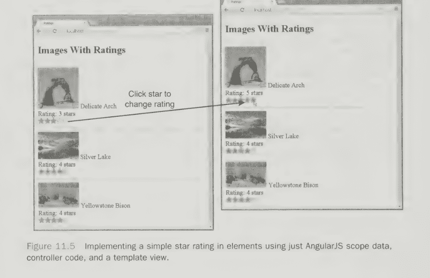

## 总结

AngularJS 通过使用包含内置和自定义指令的模板，提供了许多扩展 HTML 能力的工具。在本章中，你看到了几种不同的方法，可以轻松而有结构地将丰富的交互元素实现到你的网页中。

在本章中，你还了解了一些自定义指令。选项卡面板和可展开/可折叠示例展示了如何实现相互嵌套并彼此交互的指令。拖放示例展示了与 HTML5 拖放事件交互的一种方式，以及如何在控制器和自定�指令之间共享作用域。星级评分示例展示了如何仅使用 AngularJS 作用域、控制器和模板来构建交互性。缩放视图字段示例展示了如何将 HTML `` 元素的概念扩展为包含额外缩放元素的元素，该缩放元素可以与图像中的鼠标点击交互。

本书到此结束。我希望你像我一样喜欢学习 AngularJS。我热爱 AngularJS，因为它使得编写结构化代码变得容易，无需太多复杂性。使用 AngularJS，一切都有其位置，无论是作为视图、指令、控制器、服务，还是数据模型的一部分。阅读本书后，你应该对 AngularJS 框架有了很好的理解，这样你就可以自信地开始编写自己的 AngularJS 应用程序。祝你编码愉快！

## 附录 A：测试 AngularJS 应用程序

任何 AngularJS 项目的重要部分，即使不是最重要的部分，就是测试。良好的测试为你提供了自由，可以修改、调整和扩展你的 AngularJS 应用程序，而不会遇到重大复杂性和问题。这些年来，我听说过几种类型的测试。在本附录中，我只想谈谈单元测试和端到端测试，以及它们与 AngularJS 的关系。

本附录旨在作为测试 AngularJS 应用程序的信息性介绍。大部分内容讨论概念和一些示例，然后指出你可以获取更多信息的几个位置。原因是，测试 AngularJS 应用程序没有单一的方法。你的测试策略应基于你的环境、技能集、预算以及应用程序的特定需求。

### 选择测试平台

有几个不同的平台可用于测试 JavaScript 应用程序。你选择哪一个可能取决于你的工程师最熟悉什么、你的预算是多少、你需要哪个 JavaScript 框架，或者只是你已经在使用的框架。

这些都是非常实际和重要的考虑因素，你需要根据它们做出决定。话虽如此，AngularJS 团体似乎倾向于将 Jasmine 作为他们的单元测试框架。这是有道理的。Jasmine 似乎是那种提供大量功能而不妨碍测试的框架。事实上，对于端到端测试，你将需要使用 Protractor，它使用 Jasmine 语法进行测试。


# 附录 A 测试 AngularJS 应用

你应该花一些时间评估你决定的框架，因为你可能会使用它一段时间。你可以在维基百科上获得更知名的 JavaScript 测试框架列表：`http://en.wikipedia.org/wiki/List_of_unit_testing_frameworks#JavaScript`。

在决定测试平台之后，你需要了解如何实现各种测试概念，例如测试前准备工作、测试后清理以及模拟对象和服务，以便本附录的其余部分更有意义。

## 理解 AngularJS 单元测试

AngularJS 应用程序的单元测试与其他框架的单元测试非常相似。我不会在本附录中深入探讨单元测试的细节，因为它是框架特定的。相反，我将讨论单元测试的某些方面以及它们如何应用于 AngularJS 机制。

我在这里提供的许多信息也可以在 AngularJS 文档中找到。我在这里添加了 AngularJS 单元测试文档的 URL，以提供一些额外的思考：

`https://docs.angularjs.org/guide/unit-testing`

### 依赖项和单元测试

依赖项是 AngularJS 中使用最广泛的机制之一。你到处都能看到它们，从依赖注入到全局服务。这在单元测试时可能会带来问题，因为你不想在单元测试中测试依赖项的全部功能。相反，你将希望获取依赖项并使用你自己的模拟对象和服务来控制它。

控制依赖注入有四种方法：

- 使用 `new` 运算符创建你自己的依赖项实例。
- 将依赖项创建为可以在任何地方查找的全局对象。
- 向注册表请求它。此选项要求你也能访问注册表，这也意味着将其放在全局位置。
- 让依赖项传递给你。

以下各节描述了 AngularJS 中的每种方法。

### 使用 new 运算符

考虑以下函数，并假设 `MyService` 是一个你可以创建实例的全局服务：

```javascript
function MyClass() {
    this.doSomething = function() {
        var gSrv = new MyService();
        var data = gSrv.getSomething();
    }
}
```

要控制 `MyService`，你需要做这样的事情：

```javascript
var savedMyService = MyService;
MyService = function MockMyService() {};
var myClass = new MyClass();
myClass.doSomething();
MyService = savedMyService;
```

这是可行的；但是，如果出错，你可能会失去对 `MyService` 的控制，所以你需要小心。

### 使用全局查找

这类似于使用 `new` 运算符。考虑以下函数，并假设 `global.myService` 是你需要的 `MyService` 服务的单例实例：

```javascript
function MyClass() {
    this.doSomething = function() {
        var data = global.myService.getSomething();
    }
}
```

要控制 `MyService`，你需要做这样的事情：

```javascript
var savedMyService = global.myService;
global.myService = function MockMyService() {};
var myClass = new MyClass();
myClass.doSomething();
global.myService = savedMyService;
```

同样，这是可行的，但如果出错，你可能会失去对 `global.myService` 的控制，所以你需要小心。

### 从注册表请求依赖项

考虑以下函数，并假设 `global.serviceRegistry` 是一个已注册 `MyService` 服务的注册表的单例实例：

```javascript
function MyClass() {
    this.doSomething = function() {
        var myService = global.serviceRegistry.get('MyService');
        var data = myService.getSomething();
    }
}
```

要控制 `MyService`，你需要做这样的事情：

```javascript
var savedRegistry = global.serviceRegistry;
// 创建新的 global.serviceRegistry
global.serviceRegistry.set('MyService', function MockMyService() {});
var myClass = new MyClass();
myClass.doSomething();
global.serviceRegistry = savedRegistry;
```

### 将依赖作为参数传递

我向你展示前三种方法，是为了让你在看到通过参数传递的方法时，能够认识到这确实是你应该采用的方式。你应该尝试设计你的依赖使用方式，以便依赖可以被传递给使用者。这样你就可以轻松地从测试中控制依赖。

现在，考虑以下函数，并假设 `myService` 是一个通常通过参数传入的服务实例：

```javascript
function MyClass() {
    this.doSomething = function(myService) {
        var data = myService.getSomething();
    }
}
```

要控制 `MyService`，你只需要执行以下操作：

```javascript
var mockedService = function MockMyService() {};
var myClass = new MyClass();
myClass.doSomething(mockedService);
```

## 测试与作用域数据绑定的用户输入的控制器

AngularJS 使得测试与控制器作用域绑定的 HTML 元素变得非常简单。这是因为这些值存储在作用域中，可以在控制器中直接引用。

考虑一个网页，其中包含一个单独的文本 `<input>` 元素，你有一个后端函数来测试它，验证它不为空且字符数少于 10 个。

```html
<body>
    Data: <input type="text" />
</body>
```

后端代码大概如下所示：

```javascript
function InputCtrl() {
    var input = $('input');
    var val = input.val();
    this.verify = function() {
        if (val.length > 0 && val.length < 10) {
            return true;
        } else {
            return false;
        }
    }
}
```

要测试这个，你需要实际创建输入元素并将其注入到网页中，类似如下：

```javascript
var input = $('<input type="text"/>');
$('body').html('<div>')
    .find('div')
    .append(input);
var pc = new InputCtrl();
input.val('abc');
var result = pc.verify ();
expect(result).toEqual(true);
$('body').empty();
```

仔细想想，涉及的输入越多，这就会变得极其混乱。在 AngularJS 中，如果输入的值绑定到作用域，则会简单得多。下面展示了 AngularJS 控制器的定义，其中文本输入的值绑定到 `$scope.inStr`：

```javascript
function InputCtrl($scope){
    $scope.inStr = '';
    $scope.verify = function(){
        if ($scope.inStr.length > 0 && $scope.inStr.length < 10){
            return true;
        } else {
            return false;
        };
    }
}
```

现在测试可以看起来像下面这样：

```javascript
var $scope = {};
var mc = $controller('InputCtrl', { $scope: $scope });
$scope.inStr = 'abc';
var result = $scope.verify();
expect(result).toEqual(true);
```

你应该看到，只要有可能，将输入值绑定到控制器中的作用域变量的价值。

## 测试过滤器

如果你保持自定义过滤器的简单性，在 AngularJS 中测试它们会非常简单。为了说明这一点，考虑以下自定义过滤器和测试：

```javascript
myModule.filter('nospace', function() {
    return function(text){
        return text.replace(' ', '');
    }
});
```

```javascript
var nospace = $filter('nospace');
expect(nospace('my words')).toEqual('mywords');
```

## 测试简单指令

测试你在 AngularJS 中的自定义指令非常重要，因为将功能封装在自定义 HTML 标签、属性、类或注释中具有复杂性。单元测试是执行此操作的最佳方法，因为它们可以覆盖自定义元素使用的各种方式。

对于简单指令，你将需要使用 `$compile` 方法先编译对象，然后使用 `$digest()` 方法触发作用域中的所有监视，以确保表达式被求值。此外，如果你正在运行多个测试，你应该使用预测试构建方法为每个测试创建模块并注入 `$compile` 和 `$rootScope`。

为了说明这一点，考虑模板中的以下自定义指令 `two-plus-two`：

```html
<two-plus-two></two-plus-two>
```

该指令的控制器代码如下所示：

```javascript
var app = angular.module('myApp', []);
app.directive('twoPlusTwo', function () {
    return {
        restrict: 'E',
        replace: true,
        template: '<h1>Two Plus Two is {{ 2 + 2 }} </h1>'
    };
});
```

为了说明如何测试控制器，我需要选择一个测试框架。以下示例展示了 Jasmine 测试来测试自定义指令的功能。注意 `myApp` 模块、`$compile` 和 `$rootScope` 是如何通过 `beforeEach()` 注入到每个测试中的，以及如何使用 `$compile` 和 `$digest` 来编译和渲染元素并求值表达式。

```javascript
describe('Unit testing addition', function() {
    var $compile;
    var $rootScope;
    beforeEach(module('myApp'));
    beforeEach(inject(function(_$compile_, _$rootScope_){
        $compile = _$compile_;
        $rootScope = _$rootScope_;
    }));
    it('Adds element and handles filter', function() {
        var element = $compile("<two-plus-two></two-plus-two>")($rootScope);
        $rootScope.$digest();
        expect(element.html()).toContain("Two Plus Two is 4");
    });
});
```

## 测试使用转换的自定义指令

如果你测试的是包含转换的自定义 AngularJS 指令，你需要了解一些额外的事情。使用转换的指令被编译器特殊处理，因为在调用其编译函数之前，指令元素的内容会被移除，并通过转换函数提供。只有这样，指令的模板才会被附加到指令元素。此时，它才能插入转换后的内容。

我知道这很难一下子理解，所以这里是当使用 `transclude: true` 时的过程。这是编译前的元素：

```html
<div transclude-directive>
  "transcluded content"
</div>
```

这是转换提取后的元素：

```html
<div transclude-directive></div>
```

现在编译后：

```html
<div transclude-directive>
  "template content"
  <span ng-transclude>"transcluded content"</span>
</div>
```

如果你使用的是 `transclude: 'element'`，过程是这样的。编译器从 DOM 中移除指令的整个元素，并用一个注释节点替换它。然后，编译器将指令的模板作为注释节点的兄弟节点附加：

```html
<div element-transclude>
  "transclude content"
</div>
```

转换提取后：

```html
<!-- elementTransclude -->
```

编译后：

```html
<!-- elementTransclude -->
<div element-transclude>
  "template content"
  <span ng-transclude>"transcluded content"</span>
</div>
```

指出这一点的原因是，你需要以不同的方式处理使用 'element' 转换的指令的测试。当你在 DOM 片段的根元素上定义指令时，`$compile` 将返回注释节点，你将失去访问模板和转换内容的能力。这在以下测试片段中显示：

```javascript
var node = $compile('<div element-transclude></div>')($rootScope);
expect(node[0].nodeType).toEqual(node.COMMENT_NODE);
expect(node[1]).toBeUndefined();
```

处理这个问题的方法是，确保当自定义指令使用 `transclude: 'element'` 参数时，你将转换指令包装在另一个元素（如 `<div>`）中。例如：

```javascript
var node = $compile('<div><div element-transclude></div></div>')($rootScope);
var contents = node.contents();
expect(contents[0].nodeType).toEqual(node.COMMENT_NODE);
expect(contents[1].nodeType).toEqual(node.ELEMENT_NODE);
```

## 测试使用外部模板的指令

AngularJS 团队在这方面有点回避。他们的建议是，如果你使用的是通过 `templateUrl` 参数使用外部模板的自定义 AngularJS 指令，那么使用像 `karma-ng-html2js-preprocessor` 这样的工具来预编译 HTML 模板，从而避免在测试期间通过 HTTP 加载它们。

你可以从这里获取 `karma-ng-html2js-preprocessor`：

`https://github.com/karma-runner/karma-ng-html2js-preprocessor`

## 理解 AngularJS 端到端测试

我确实喜欢使用端到端测试来测试 Web 应用程序；然而，在我看来，它被使用得过于频繁，作为主要的（如果不是唯一的）测试方式。端到端测试非常适合以通用方式验证系统，但对于 AngularJS 应用程序，你应该将单元测试用于大部分测试需求。

话虽如此，你也应该考虑实现一些端到端测试，以捕获回归问题并总体测试系统的功能。端到端测试还可以暴露一些系统限制问题，例如网络或数据库带宽。

AngularJS 团队创建了一个名为 Protractor 的工具，使你能够实现 AngularJS 应用程序的端到端测试。Protractor 是一个 Node.js 程序，它将运行用 JavaScript 编写的端到端测试。它使用 WebDriver 来控制浏览器并模拟用户操作。Protractor 的语言语法基于 Jasmine，所以如果你熟悉 Jasmine，你应该能够很快上手。

使用 Protractor 进行端到端测试的想法是，你可以使用 Jasmine 代码在测试环境中设置某些内容，然后使用 WebDriver 通过 Web 浏览器向应用程序提供输入，然后验证结果。

端到端测试会因环境、设计、技术及其他变量而有很大差异，因此本附录中不会深入探讨。不过，我建议您在决定尝试于 AngularJS 应用程序中实施端到端编程时，查阅以下链接：

- `https://docs.angularjs.org/guide/e2e-testing`
- `https://github.com/angular/protractor/blob/master/docs/getting-started.md`
- `https://code.google.com/p/selenium/wiki/GettingStarted`

# 索引

## A

- `absUrl()` 方法，176
- 直接访问 jQuery/jQuery lite，49-50
- `addClass()` 方法，48
- 添加
    - 配置块到模块，61-62
    - 控制器到模板，46
    - 项到数组，30-31
    - 运行块到模块，62
- 加法运算符，12
- 一个指令，104
- `after()` 方法，48
- `$anchorScroll` 服务，158
- And 运算符，14
- `angular-animate.js` 库，174
- `angular-cookies.js` 库，166
- AngularJS
    - `angular.js` 库文件，提供，41-42
    - 应用程序。参见 应用程序
    - 优点，3，35-36
    - 编译器，定义，39
    - 控制器，定义，38
    - 数据绑定，定义，38
    - 定义，2，35
    - 依赖注入，定义，38-39
    - 指令，定义，37
    - 表达式
        - 定义，38
        - JavaScript 表达式对比，79
    - 全局 API，列表，42-43
    - HTML 文档，引导，42
    - 与 JavaScript 和 jQuery 集成，40-41
    - 生命周期阶段，39-40
    - 模块，定义，37
    - 作为 MVC 框架，36
    - 作用域，定义，37
    - 职责分离，40
    - 服务，定义，38
    - 模板，37
    - 网站，42
- `angular.js` 库文件
    - 引导 HTML 文档，42
    - 加载，45
    - 提供，41-42
- `angular.module()` 方法，54-55
- `animate()` 方法，171
- `$animate` 服务，158，169-172
    - 动画示例，172
    - 用于动画的指令，169
    - 实现
        - 在 CSS 中，170-171
        - 在 JavaScript 中，171-172
- `animate.css` 列表，174
- 动画
    - 用于动画的指令，169-170
    - 示例，172
    - 实现
        - 在 CSS 中，170-171
        - 在 JavaScript 中，171-172
- `animation()` 方法，56
- 匿名函数，21
- API，全局，列表，42-44
- `append()` 方法，48
- 在指令中追加元素，204-206
- 应用程序
    - 直接访问 jQuery，49-50
    - 创建
        - 添加控制器，46
        - 定义根元素，45
        - 文件夹结构，44
        - 实现作用域，46
        - 加载 `angular.js` 库，45
    - 拖放元素示例，204-206
    - 可展开/可折叠元素示例，212-215
    - 模块。参见 模块
    - 根作用域与应用程序，65-66
    - 星级评分示例，217-219
    - 标签视图示例，199-202
    - 测试，223
        - 端到端测试，230-231
        - 评估平台，223
        - 单元测试，224-230
    - 缩放视图字段示例，208-210
- `$apply()` 方法，72
- 算术运算符，列表，12-13
- 数组数据类型，12
- 数组
    - 添加/删除项，30-31
    - 组合，29
    - 转换为字符串，30
    - 定义，28
    - 遍历，30
    - 长度，28
    - 方法，28
    - 搜索项，30
    - 将字符串分割成数组，27
- 赋值运算符，列表，13
- `attr()` 方法，48

## B

- 后端服务器数据，作用域与，71
- `bind()` 方法，48
- 数据绑定。参见 数据绑定
- `bindToController` 属性，123
- `blur` 事件，115
- 布尔数据类型，11
- 引导阶段（AngularJS 生命周期），39
- 引导 HTML 文档，42
- `break` 关键字，16，18-19
- `$broadcast()` 方法，151
- 广播自定义事件，151
- 浏览器警报，实现，166
- 浏览器事件，145
- 浏览器。参见 网页浏览器
- 内置指令。参见 指令，内置指令
- 内置过滤器，87-90
- 内置服务
    - `$anchorScroll`，158
    - `$animate`，158，169-172
        - 动画示例，172
        - 用于动画的指令，169
        - 在 CSS 中实现，170-171
        - 在 JavaScript 中实现，171-172
    - `$cacheFactory`，158，165
    - `$compile`，158
    - `$cookie`，166-167
    - `$cookies`，158
    - `$cookieStore`，166-167
    - `$document`，158
    - `$exceptionHandler`，158
    - `$http`，158-163
        - 配置，160
        - HTTP 服务器实现与访问，161-163
        - 响应回调函数，161
        - 快捷方法，159
    - `$interpolate`，158
    - `$interval`，158，168-169
    - 列表，158
    - `$locale`，158
    - `$location`，158，176-177
    - `$log`，158
    - `$parse`，158
    - `$q`，158，180-181
    - `$resource`，158
    - `$rootElement`，158
    - `$rootScope`，158
    - `$route`，158
    - `$routeParams`，158
    - `$sanitize`，158
    - `$sce`，158
    - `$swipe`，158
    - `$templateCache`，158
    - `$timeout`，158，168-169
        - 与自定义服务一起使用，192-194
    - `$window`，158，166

## C

- `cache` 属性，160
- `$cacheFactory` 服务，158，165
- `case` 语句，15-16
- CDN（内容分发网络），41
- `charAt()` 方法，26
- `charCodeAt()` 方法，26
- 子作用域
    - 向子作用域广播事件，151
    - 控制器与子作用域，66
    - 在作用域层次结构中，73
- `children()` 方法，48
- `clone()` 方法，48
- 代码列表。参见 列表
- 可折叠/可展开元素示例应用程序，212-215
- 组合数组，29。另见 连接字符串
- 比较运算符，列表，14-15
- 编译阶段（AngularJS 生命周期），39
- `compile()` 函数，132-133
- `compile` 属性，123
- `$compile` 服务，158
- 编译器，定义，39
- `concat()` 方法
    - 数组，28-29
    - 字符串，26-27
- 连接字符串，13，27。另见 组合数组
- 条件语句
    - `if` 语句，15
    - `switch` 语句，15-16
- `config_run_blocks.html` 列表，63
- `config_run_blocks.js` 列表，63
- 配置块
    - 添加，61-62
    - 实现，62-63
- 配置阶段（模块）
    - 添加配置块，61-62
    - 实现配置块，62-63
- 配置
    - `$http` 服务，160
    - Node.js，6-7
    - 为自定义指令配置作用域，128-130
- `constant()` 方法，56
- `constant` 服务，184-186
- 内容分发网络（CDN），41
- `contents()` 方法，48
- 控制器
    - 向指令添加控制器，127-128
    - 添加到模板，46
    - 将事件绑定到控制器，113-120
    - 定义，38
    - 在控制器中实现监视，148
    - 向控制器注入提供者，58-59
    - 将作用域与控制器隔离，212-215
    - 嵌套控制器，实现自定义事件，151-152
    - 作用域与控制器，66-67
    - 单元测试，226-227
- 将数组转换为字符串，30
- `$cookie` 服务，166-167
- cookies，166-167
- `$cookies` 服务，158
- `$cookieStore` 服务，166-167
- `copy()` 全局 API，43
- 创建阶段（作用域），71-72
- CSS，动画在 CSS 中，170-171
- `css()` 方法，48
- `currency[:symbol]` 过滤器，87
- 自定义指令
    - 向指令添加控制器，127-128
    - 配置作用域，128-130
    - 定义视图模板，124-126
    - 定义，123
    - `directive()` 方法，123
    - DOM 操作
        - 使用 `compile()` 函数，132-133
        - 示例，134
        - 使用 `link()` 函数，130-132
    - 拖放元素示例，204-206
    - 事件处理器，136-137
    - 扩展 HTML，208-210
    - 嵌套指令，140-141，199-202，212-215
    - 属性，123
    - 限制行为，126-127
    - 嵌入元素，130
    - 单元测试，228
        - 使用外部模板，230
        - 使用嵌入，229-230
    - 用户交互事件，145-146
- 自定义事件，150
    - 广播，151
    - 发出，150-151
    - 使用监听器处理，151
    - 在嵌套控制器中实现，151-152
- 自定义过滤器，94-95
    - 单元测试，227-228
- 自定义对象，定义，23-24
- 自定义服务
    - `constant` 服务，184
    - 数据库访问服务示例，192-194
    - `factory` 服务，184
    - 实现示例，185-186
    - `service` 服务，184-185
    - 时间服务示例，188-189
    - 类型，183
    - `value` 服务，183-184
- 数据绑定
    - 定义，38
    - 与指令一起，109-112
    - 事件绑定到控制器，113-120
    - 在运行时阶段（AngularJS 生命周期），40
    - 星级评分示例应用程序，217-219
    - 测试控制器，226-227
- `data()` 方法，48
- 数据模型，作用域作为数据模型，65
    - 后端服务器数据，71
    - 控制器与数据模型，66-67
    - 表达式与数据模型，78-79，81-82
    - 生命周期阶段，71-72
    - 根作用域，65-66
    - 作用域层次结构，73
    - 模板与数据模型，68-69
- `data` 属性，160
- 数据类型，列表，11-12
- 数据库访问服务示例，192-194
- `date[:format]` 过滤器，87
- 递减运算符，12
- 延迟响应，180-181
- 定义
    - 数组，28
    - 自定义对象，23-24
    - 函数，19-20
    - 模块，54-55
    - 根元素，45
    - 字符串，25
    - 变量，10-11
- 依赖注入
    - 配置阶段（模块）
        - 添加配置块，61-62
        - 实现配置块，62-63
    - 定义模块，54-55
    - 定义，38-39，54
    - 过滤器与依赖注入，87
    - 实现，57-58
    - 注入器，54
    - 提供者，54
    - 注入控制器，58-59
    - 运行阶段（模块）
        - 添加运行块，62
        - 实现运行块，62-63
    - 服务，157
    - 单元测试与，224-226
        - 全局查找，225
        - `new` 运算符，224-225
        - 传递的参数，226
        - 注册表请求，225-226
- `$destroy` 事件，49
- `$destroy()` 方法，72
- `detach()` 方法，48
- 开发环境设置，5-6
- 摘要循环，72
- `$digest()` 方法，72
- `directive()` 方法，56，123
- `directive_angular_include.html` 清单，103
- `directive_angular_include.js` 清单，103
- `directive_bind.html` 清单，112
- `directive_bind.js` 清单，112
- `directive_custom_dom.html` 清单，135
- `directive_custom_dom.js` 清单，134
- `directive_custom_photos.js` 清单，141
- `directive_custom_zoom.html` 清单，139
- `directive_custom_zoom.js` 清单，137
- `directive_custom.html` 清单，142
- `directive_focus_events.html` 清单，116
- `directive_focus_events.js` 清单，116
- `directive_form.html` 清单，108
- `directive_form.js` 清单，105
- `directive_keyboard_events.html` 清单，118
- `directive_keyboard_events.js` 清单，118
- `directive_mouse_events.html` 清单，121
- `directive_mouse_events.js` 清单，120
- 指令
    - 用于动画，169-170
    - 内置指令
        - `a`，104
        - 将数据绑定到页面元素，109-112
        - 将事件绑定到控制器，113-120
        - `event`，113
        - 扩展表单元素，104-105
        - `input`，104
        - `input.checkbox`，104
        - `input.date`，104
        - `input.dateTimeLocal`，104
        - `input.email`，104
        - `input.month`，104
        - `input.number`，104
        - `input.radio`，104
        - `input.text`，104
        - `input.time`，104
        - `input.url`，104
        - `input.week`，104
        - `ng-app`，37，42，45，100
        - `ng-bind`，109
        - `ng-bind-html`，109
        - `ng-bind-template`，109
        - `ng-blur`，114-115
        - `ng-change`，114
        - `ng-checked`，114
        - `ng-class`，109
        - `ng-class-even`，109
        - `ng-class-odd`，109
        - `ng-click`，69，114，120
        - `ng-cloak`，100
        - `ng-controller`，66，100
        - `ng-copy`，114
        - `ng-cut`，114
        - `ng-dblclick`，114
        - `ng-disabled`，109
        - `ng-focus`，114-115
        - `ng-form`，104
        - `ng-hide`，109
        - `ng-href`，100
        - `ng-if`，109
        - `ng-include`，100，102
        - `ng-init`，109
        - `ng-keydown`，114，117-118
        - `ng-keypress`，114
        - `ng-keyup`，114，117-118
        - `ng-list`，100
        - `ng-model`，68，109
        - `ng-mousedown`，114，120
        - `ng-mouseenter`，114，120
        - `ng-mouseleave`，114，120
        - `ng-mousemove`，114，120
        - `ng-mouseover`，114
        - `ng-mouseup`，114，120
        - `ng-non-bindable`，100
        - `ng-open`，100
        - `ng-options`，104
        - `ng-paste`，114
        - `ng-pluralize`，100
        - `ng-readonly`，100
        - `ng-repeat`，109
        - `ng-required`，100
        - `ng-selected`，100
        - `ng-show`，109
        - `ng-src`，100
        - `ng-srcset`，100
        - `ng-style`，109
        - `ng-submit`，114
        - `ng-swipe-left`，114
        - `ng-swipe-right`，114
        - `ng-switch`，109
        - `ng-transclude`，100，130
        - `ng-value`，109
        - `ng-view`，100
        - `script`，100
        - `select`，104
        - 支持功能，100-102
        - `textarea`，104
    - 自定义指令
        - 为指令添加控制器，127-128
        - 配置作用域，128-130
        - 定义视图模板，124-126
        - 指令定义，127
        - `directive()` 方法，123
        - DOM 操作示例，134
        - 使用 `compile()` 函数进行 DOM 操作，132-133
        - 使用 `link()` 函数进行 DOM 操作，130-132
        - 拖放元素示例，204-206
        - 事件处理器，136-137
        - 扩展 HTML，208-210
        - 嵌套指令，140-141，199-202，212-215
        - 属性，123
        - 限制行为，126-127
        - 编译包含元素，130
        - 单元测试，228-230
        - 指令定义，37，77，99
        - 用户交互事件，145-146
- 除法运算符，12
- `$document` 服务，158
- DOM 操作，37
    - 使用 `compile()` 函数，132-133
    - 使用自定义指令，134
    - 使用 `link()` 函数，130-132
- `do/while` 循环，17
- 拖放元素示例应用程序，204-206
- `dragdrop.html` 清单，206
- `dragdrop.js` 清单，204
- 在嵌套控制器中实现，151-152
- 交互事件定义，145
- HTML5 拖放事件，204-206
- 作用域变化事件，146

## E

- 在控制器中实现，148
- 编辑器的用途，5
- `$watch()` 方法，146-147
- `element()` 全局 API，43
- `$watchCollection()` 方法，147
- `else` 语句，15
- `$watchGroup()` 方法，147
- `$emit()` 方法，150-151
- 用户交互事件，145-146
- 发出自定义事件，150-151
- 示例代码清单。参见 清单
- `empty()` 方法，48
- 异常处理。参见 错误处理
- 端到端测试，230-231
- `$exceptionHandler` 服务，158
- `eq()` 方法，48
- `expand_item.html` 清单，214
- 等于运算符，14
- `expand_list.html` 清单，214
- `equals()` 全局 API，43
- 可展开/可折叠元素示例应用程序，212-215
- 错误处理
    - `expand.html` 清单，215
    - `finally` 关键字，32-33
    - `expand.js` 清单，213
- 构建 Express Web 服务器，8-10
    - 抛出错误，32
    - `try/catch` 块，31-32
- `{{expression}}` 语法，69，77-78
- 字符串转义码，25
- 表达式
    - 评估测试平台，223
    - 基本表达式，79-80
    - 在数据模型中，78-79
    - 定义，38，77
    - 过滤器在表达式中，87
    - JavaScript 在表达式中，85
    - 定位，145
    - 作用域交互，81-82
- `$event` 关键字，115
- 事件
    - 绑定到控制器，113-120
    - 浏览器事件，145
    - 自定义事件，150
    - 广播，151
    - 发出，150-151
    - 使用监听器处理，151
- 扩展
    - 使用指令扩展表单元素，104-105
    - HTML，208-210
- 外部模板，测试自定义指令，230
- `function` 关键字，19
- 函数
    - 匿名函数，21
    - 定义，19-20
    - 函数定义，19
    - 在表达式中，81-82
    - 传递值给函数，20
    - 从函数返回值，20-21

## F

- `factory()` 方法，56
- `factory` 服务，184，185-186
- `filter()` 方法，56，94-95
- `filter_customer.js` 清单，95
- `filter_sort.html` 清单，93
- `filter_sort.js` 清单，92
- `filter:exp:compare` 过滤器，87
- 过滤器
    - 内置过滤器，87-90
    - 自定义过滤器，94-95
    - 过滤器定义，77
    - 使用过滤器进行排序和排序，91-92
    - 语法，87
    - 单元测试，227-228
- `filters.html` 清单，90
- `filters.js` 清单，90
- `finally` 关键字，32-33
- `find()` 方法，48
- `first.html` 清单，47
- `first.js` 清单，47
- 焦点事件，115
- 创建应用程序的文件夹结构，44
- `forEach()` 全局 API，43
- `for/in` 循环，18
- `for` 循环，17-18
- 表单元素，使用指令扩展，104-105
- `fromCharCode()` 方法，26
- `fromJson()` 全局 API，43

## G

- 全局 API 列表，42-44
- 全局查找，22
- 全局变量作用域，22
- 大于运算符，14
- 大于或等于运算符，14

## H

- `hasClass()` 方法，48
- `hash()` 方法，176
- `headers` 属性，160
- 作用域层次结构，73
- `host()` 方法，176
- HTML 文档
    - 引导程序，42
    - 扩展 HTML，208-210
- `html()` 方法，48
- HTTP 服务器，实现与访问，161-163
- `$http` 服务，158-163
    - 配置，160
    - HTTP 服务器实现与访问，161-163
    - 响应回调函数，161
    - 快捷方法，159
    - 与自定义服务一起使用，192-194
- 集成开发环境（IDE）设置，5-6
- `if` 语句，15
- 图像，缩放视图字段示例应用程序，208-210
- 递增运算符，12
- `indexOf()` 方法
    - 数组，28，30
    - 字符串，26-27
- 继承作用域，128
- `inheritedData()` 方法，49
- `$inject` 属性，57-58
- `inject_builtn.html` 清单，58
- `inject_builtn.js` 清单，58
- `inject_custom.html` 清单，60
- `inject_custom.js` 清单，60
- 注入。参见 依赖注入
- `injector()` 方法，49
- 注入器定义，54
- `input` 指令，104
- `input.checkbox` 指令，104
- `input.date` 指令，104
- `input.dateTimeLocal` 指令，104
- `input.email` 指令，104
- `input.month` 指令，104
- `input.number` 指令，104
- `input.radio` 指令，104
- `input.text` 指令，104
- `input.time` 指令，104
- `input.url` 指令，104
- `input.week` 指令，104
- 安装 Node.js，6-7
- 集成开发环境（IDE）设置，5-6
- `$interpolate` 服务，158
- 中断循环，18-19
- `$interval` 服务，158，168-169
- `isArray()` 全局 API，43
- `isDate()` 全局 API，43
- `isDefined()` 全局 API，43
- `isElement()` 全局 API，43
- `isFunction()` 全局 API，43
- `isNumber()` 全局 API，43
- `isObject()` 全局 API，43
- 隔离作用域，129-130
- `isolateScope()` 方法，49
- `isString()` 全局 API，43
- `isUndefined()` 全局 API，43
- 遍历数组，30

## J

- Jasmine，223
- JavaScript
    - 在 AngularJS 表达式中，85
    - 动画，171-172
    - 数组
        - 添加/删除项，30
        - 组合，29
        - 转换为字符串，30
        - 定义，28
        - 遍历，30
        - 长度，28
        - 方法，28
        - 搜索项，30
    - 数据类型列表，11-12
    - 开发环境设置，5-6
    - 错误处理
        - `finally` 关键字，32-33
        - 抛出错误，32
        - `try/catch` 块，31-32
    - 表达式，AngularJS 表达式与 JavaScript 表达式，79
    - 函数
        - 匿名函数，21
        - 定义，19-20
        - 定义，19
        - 传递值给函数，20
        - 从函数返回值，20-21
    - 与 AngularJS 集成，40-41
    - 循环
        - 定义，16
        - `do/while` 循环，17
        - `for/in` 循环，18
        - `for` 循环，17-18
        - 中断循环，18-19
        - `while` 循环，16-17
    - Node.js
        - 构建 Express Web 服务器，8-10
        - 在 Node.js 上运行代码，7
        - 设置，6-7
    - 对象
        - 定义自定义对象，23-24
        - 定义，22
        - 原型继承，24-25
        - 语法，23
    - 运算符
        - 算术运算符，12-13
        - 赋值运算符，13
        - 比较运算符，14
        - 定义，12
        - `if` 语句，15
        - 逻辑运算符，14
        - `switch` 语句，15-16
    - 字符串
        - 连接，27
        - 定义，25
        - 转义代码，25
        - 长度，26
        - 方法，26
        - 替换字符串中的词，27
        - 搜索子字符串，27
        - 分割成数组，27
    - 测试。*参见* 应用程序，测试
    - 变量
        - 定义，10-11
        - 作用域，22
- `join()` 方法，28，30
- jQuery
    - 直接访问，49-50
    - 动画，171-172
    - 完整版本使用示例，208-210
    - 与 AngularJS 集成，40-41
    - jQuery lite 与 jQuery 的比较，40-41
- jQuery lite
    - 直接访问，49-50
    - 定义，48
    - jQuery 与 jQuery lite 的比较，40-41
    - 方法，48-49
- `json` 过滤器，87

## K

- 键盘事件，117-118
- 关键字
    - `break`，16，18-19
    - `continue`，19
    - `finally`，32-33
    - `function`，19
    - `new`，23
    - `return`，20-21
    - `var`，10

## L

- `large_title.html` 清单，104
- `lastIndexOf()` 方法
    - 数组，28
    - 字符串，26
- `length`
    - 数组的长度，28
    - 字符串的长度，26
- 小于运算符，14
- 小于或等于运算符，14
- 生命周期阶段
    - AngularJS，39-40
    - 作用域，71-72
- `limitTo:limit` 过滤器，87
- `link()` 函数，130-132
- `link` 属性，123
- 监听器，处理自定义事件，151
- 列表
    - `animate.css`，174
    - `config_run_blocks.html`，63
    - `config_run_blocks.js`，63
    - 在 JavaScript 中定义全局和局部变量，22
    - `directive_angular_include.html`，103
    - `directive_angular_include.js`，103
    - `directive_bind.html`，112
    - `directive_bind.js`，112
    - `directive_custom_dom.html`，135
    - `directive_custom_dom.js`，134
    - `directive_custom_photos.js`，141
    - `directive_custom_zoom.html`，139
    - `directive_custom_zoom.js`，137
    - `directive_custom.html`，142
    - `directive_focus_events.html`，116
    - `directive_focus_events.js`，116
    - `directive_form.html`，108
    - `directive_form.js`，105
    - `directive_keyboard_events.html`，118
    - `directive_keyboard_events.js`，118
    - `directive_mouse_events.html`，121
    - `directive_mouse_events.js`，120
    - `dragdrop.html`，206
    - `dragdrop.js`，204
    - `expand_item.html`，214
    - `expand_list.html`，214
    - `expand.html`，215
    - `expand.js`，213
    - `expressions_basic.html`，80
    - `expressions_basic.js`，80
    - `expressions_javascript.html`，85
    - `expressions_javascript.js`，85
    - `expressions_scope.html`，83
    - `expressions_scope.js`，82
    - `filter_customer.js`，95
    - `filter_custom.html`，96
    - `filter_sort.html`，93
    - `filter_sort.js`，92
    - `filters.html`，90
    - `filters.js`，90
    - `first.html`，47
    - `first.js`，47
    - `inject_builtin.html`，58
    - `inject_builtin.js`，58
    - `inject_custom.html`，60
    - `inject_custom.js`，60
    - `large_title.html`，104
    - `my_photos.html`，143
    - `pane.html`，201
    - `rating.html`，219
    - `rating.js`，218
    - `scope_controller.html`，67
    - `scope_controller.js`，67
    - `scope_events.html`，153
    - `scope_events.js`，152
    - `scope_hierarchy.html`，74
    - `scope_hierarchy.js`，74
    - `scope_template.html`，70
    - `scope_template.js`，69
    - `scope_watch.html`，149
    - `scope_watch.js`，148
    - `server.js`，9
    - `service_animate.html`，173
    - `service_animate.js`，172
    - `service_cache.js`，165
    - `service_cookie.html`，167
    - `service_cookie.js`，167
    - `service_custom_censor.html`，187
    - `service_custom_censor.js`，186
    - `service_custom_db_access.js`，194
    - `service_custom_db.html`，196
    - `service_custom_db.js`，195
    - `service_db_server.js`，192
    - `service_http.html`，164
    - `service_http.js`，163
    - `service_location.html`，178
    - `service_location.js`，177
    - `service_server.js`，162
    - `small_title.html`，104
    - `tabbable.html`，202
    - `tabbable.js`，200
    - `tabs.html`，201
    - `welcome.css`，9
    - `welcome.html`，9
    - `zooming.html`，210
    - `zooming.js`，209
    - `zoomit.html`，210
- 加载
    - `angular.js` 库文件，45
    - 模块，45
- 局部变量作用域，22
- `$locale` 服务，158
- `$location` 服务，158，176-177
- `$log` 服务，158
- 逻辑运算符列表，14
- 循环
    - 定义，16
    - `do/while` 循环，17
    - `for/in` 循环，18
    - `for` 循环，17-18
    - 中断循环，18-19
    - `while` 循环，16-17
- `lowercase` 过滤器，87
- `lowercase()` 全局 API，43

## M

- `match()` 方法，26
- `message` 属性，32
- `method` 属性，160
- 方法
    - 数组方法，28-29
    - 延迟响应方法，180-181
    - 定义，23
    - `$http` 服务方法，159
    - jQuery lite 中的方法，48-49
    - `$location` 服务方法，176-177
    - 字符串方法，26
- 模型变更阶段（作用域），72
- 模块
    - 添加依赖，57-58
    - 配置阶段
        - 添加配置块，61-62
        - 实现配置块，62-63
    - 创建提供者
        - 服务提供者，56-57
        - 专用提供者，56
    - 定义，54-55
    - 定义，37，53-54
    - 加载，45
    - 运行阶段
        - 添加运行块，62
        - 实现运行块，62-63
- 取模运算符，12
- 鼠标事件，120
- `multiElement` 属性，123
- 乘法运算符，12
- 变更观察阶段（作用域），72
- MVC（模型-视图-控制器）模型，36
- `my_photos.html` 清单，143

## N

- `name` 属性，32
- 嵌套控制器，实现自定义事件，151-152
- 嵌套指令，140-141，199-202，212-215
- `new` 关键字，23
- `new` 运算符，224-225
- `ng-app` 指令，37，42，45，100
- `ng-bind` 指令，109
- `ng-bind-html` 指令，109
- `ng-bind-template` 指令，109
- `ng-blur` 指令，114-115
- `ng-change` 指令，114
- `ng-checked` 指令，114
- `ng-class` 指令，109，169-170
- `ng-class-even` 指令，109
- `ng-class-odd` 指令，109
- `ng-click` 指令，69，114，120
- `ng-cloak` 指令，100
- `ng-controller` 指令，66，100
- `ng-copy` 指令，114
- `ng-cut` 指令，114
- `ng-dblclick` 指令，114
- `ng-disabled` 指令，109
- `ng-focus` 指令，114-115
- `ng-form` 指令，104
- `ng-hide` 指令，109，169
- `ng-href` 指令，100
- `ng-if` 指令，109，169
- `ng-include` 指令，100，102，169
- `ng-init` 指令，109
- `ng-keydown` 指令，114，117-118
- `ng-keypress` 指令，114
- `ng-keyup` 指令，114，117-118
- `ng-list` 指令，100
- `ng-model` 指令，68，109
- `ng-mousedown` 指令，114，120
- `ng-mouseenter` 指令，114，120
- `ng-mouseleave` 指令，114，120
- `ng-mousemove` 指令，114，120
- `ng-mouseover` 指令，114
- `ng-mouseup` 指令，114，120
- `ng-non-bindable` 指令，100
- `ng-open` 指令，100
- `ng-options` 指令，104
- `ng-paste` 指令，114
- `ng-pluralize` 指令，100
- `ng-readonly` 指令，100
- `ng-repeat` 指令，109，169
- `ng-required` 指令，100
- `ng-selected` 指令，100
- `ng-show` 指令，109，169
- `ng-src` 指令，100
- `ng-srcset` 指令，100
- `ng-style` 指令，109
- `ng-submit` 指令，114
- `ng-swipe-left` 指令，114
- `ng-swipe-right` 指令，114
- `ng-switch` 指令，109，169
- `ng-transclude` 指令，100，130
- `ng-value` 指令，109
- `ng-view` 指令，100，169
- Node.js
    - 构建 Express Web 服务器，8-10
    - 在 Node.js 上运行 JavaScript 代码，7
    - 设置，6-7
- 规范化，78
- 不等于运算符，14
- 非运算符，14
- `$notify()` 方法，180
- `null` 数据类型，12
- `number` 数据类型，11
- `number[:fraction]` 过滤器，87
- 基本表达式中的数字，79-80

## O

- 对象字面量数据类型，12
- 对象
    - 数组
        - 添加/删除项，30
        - 组合，29
        - 转换为字符串，30
        - 定义，28
        - 迭代，30
        - 长度，28
        - 方法，28
        - 搜索项，30
    - 定义自定义对象，23-24
    - 定义，22
    - DOM 对象。*参见* DOM 操作
    - 错误处理
        - `finally` 关键字，32-33
        - 抛出错误，32
        - `try/catch` 块，31-32
    - 模块，定义，54-55
    - 属性，跟踪，147
    - 原型继承，24-25
    - 字符串
        - 连接，27
        - 定义，25
        - 转义代码，25
        - 长度，26
        - 方法，26
        - 替换字符串中的词，27
        - 搜索子字符串，27
        - 分割成数组，27
        - 语法，23
- `off()` 方法，48
- `one()` 方法，48
- `$on()` 方法，151
- `on()` 方法，48
- 运算符
    - 算术运算符，12-13
    - 赋值运算符，13
    - 比较运算符，14
    - 定义，12
    - `if` 语句，15
    - 逻辑运算符，14
    - `switch` 语句，15-16
- `orderBy:exp:reverse` 过滤器，87
- 使用过滤器排序，91-92
- 或运算符，14

## P

- `pane.html` 清单，201
- 参数，将依赖作为参数传递，226
- `params` 属性，160
- `parent()` 方法，48
- 父作用域，向父作用域发送事件，150-151
- `$parse` 服务，158
- 传递
    - 将依赖作为参数传递，226
    - 将变量传递给函数，20
- `path()` 方法，176
- `pop()` 方法，28
- `port()` 方法，176
- 定位事件处理器，145
- `prepend()` 方法，48
- `priority` 属性，123
- `prop()` 方法，48
- 属性
    - 自定义指令，123-125
    - 定义，23
    - `$http` 服务，160-161
    - 追踪，147
- `protocol()` 方法，176
- 原型对象，24-25
- Protractor，223，230
- `provider()` 方法，57
- 提供者
    - 创建
        - 服务提供者，56-57
        - 专用提供者，56
    - 定义，54
    - 实现，57-58
    - 注入到控制器，58-59
- `push()` 方法，28
- `$q` 服务，158，180-181
    - 与自定义服务一起使用，192-194

## R

- `rating.html` 清单，219
- `rating.js` 清单，218
- 评分示例应用程序，217-219
- `ready()` 方法，48
- 注册请求，225-226
- `$reject()` 方法，180
- `remove()` 方法，48
- `removeAttr()` 方法，48
- `removeClass()` 方法，48
- `removeData()` 方法，48
- 从数组中移除项目，30
- `replace()` 方法，26-27，176
- `replaceWith()` 方法，48
- 替换字符串中的单词，27
- `require()` 方法，7
- `require` 属性，123
- `$resolve()` 方法，180
- `$resource` 服务，158
- 响应回调函数，$http 服务，161
- `responseType` 属性，160
- 职责分离，40
- `restrict` 属性，123，126-127
- `return` 关键字，20-21
- 从函数返回变量，20-21
- 自定义服务的可重用性，188-189
- `reverse()` 方法，28
- 根元素，定义，45
- 根作用域，应用程序和，65-66
- `$rootElement` 服务，158
- `$rootScope` 服务，158
- `$route` 服务，158
- `$routeParams` 服务，158
- 运行块
    - 添加，62
    - 实现，62-63
- 运行阶段（模块）
    - 添加运行块，62
    - 实现运行块，62-63
- 在 Node.js 上运行 JavaScript，7
- 运行时阶段（AngularJS 生命周期），40

## S

- 示例代码清单。请参阅 清单
- `$sanitize` 服务，158
- `$sce` 服务，158
- 作用域变更事件
    - 在控制器中实现，148
    - `$watch()` 方法，146-147
    - `$watchCollection()` 方法，147
    - `$watchGroup()` 方法，147
- 作用域销毁阶段（作用域），72
- `scope()` 方法，49
- `scope` 属性，123，128-130
- `scope_controller.html` 清单，67
- `scope_controller.js` 清单，67
- `scope_events.html` 清单，153
- `scope_events.js` 清单，152
- `scope_hierarchy.html` 清单，74
- `scope_hierarchy.js` 清单，74
- `scope_template.html` 清单，70
- `scope_template.js` 清单，69
- `scope_watch.html` 清单，149
- `scope_watch.js` 清单，148
- 作用域
    - 在 AngularJS 中
        - 定义，37
        - 实现，46
    - 为自定义指令配置，128-130
    - 自定义事件，150
        - 广播，151
        - 派发，150-151
        - 使用监听器处理，151
        - 在嵌套控制器中实现，151-152
    - 作为数据模型，65
        - 后端服务器数据，71
        - 控制器和，66-67
        - 表达式和，78-79，81-82
        - 生命周期阶段，71-72
        - 根作用域，65-66
        - 作用域层次结构，73
        - 模板和，68-69
    - 对象属性，追踪，147
    - 共享，212-215
    - 测试控制器，226-227
    - 变量的，22
        - 追踪，146-147
- `script` 指令，100
- `search()` 方法，26，176
- 搜索
    - 数组中的项目，30
    - 字符串中的子串，27
- `select` 指令，104
- 职责分离，40
- 服务器数据，作用域和，71
- `server.js` 清单，9
- 服务器。参见 Web 服务器
- `service()` 方法，56
- 服务提供者，创建，56-57
- `service` 服务，184-185
    - 实现示例，185-186
- `service_animate.html` 清单，173
- `service_animate.js` 清单，172
- `service_cache.js` 清单，165
- `service_cookie.html` 清单，167
- `service_cookie.js` 清单，167
- `service_custom_censor.html` 清单，187
- `service_custom_censor.js` 清单，186
- `service_custom_db_access.js` 清单，194
- `service_custom_db.html` 清单，196
- `service_custom_db.js` 清单，195
- `service_custom_time.html` 清单，190
- `service_custom_time.js` 清单，189
- `service_db_server.js` 清单，192
- `service_http.html` 清单，164
- `service_http.js` 清单，163
- `service_location.html` 清单，178
- `service_location.js` 清单，177
- `service_server.js` 清单，162
- 服务
    - 内置服务
        - `$anchorScroll`，158
        - `$animate`，158，169-172
        - `$cacheFactory`，158，165
        - `$compile`，158
        - `$cookie`，166-167
        - `$cookies`，158
        - `$cookieStore`，166-167
        - `$document`，158
        - `$exceptionHandler`，158
        - `$http`，158-163
        - `$interpolate`，158
        - `$interval`，158，168-169
        - 列表，158
        - `$locale`，158
        - `$location`，158，176-177
        - `$log`，158
        - `$parse`，158
        - `$q`，158，180-181
        - `$resource`，158
        - `$rootScope`，158
        - `$route`，158
        - `$routeParams`，158
        - `$sanitize`，158
        - `$sce`，158
        - `$swipe`，158
        - `$templateCache`，158
        - `$timeout`，158，168-169
            - 与自定义服务一起使用，192-194
        - `$window`，158，166
    - 自定义服务
        - `constant` 服务，184
        - 数据库访问服务示例，192-194
        - `factory` 服务，184
        - 实现示例，185-186
        - `service` 服务，184-185
        - 时间服务示例，188-189
        - 类型，183
        - `value` 服务，183-184
    - 定义，38，157
    - 共享作用域，212-215
- `shift()` 方法，28
- `slice()` 方法
    - 数组，28
    - 字符串，26
- `small_title.html` 清单，104
- `sort()` 方法，28
- 使用过滤器排序，91-92
- 专用提供者，创建，56
- `splice()` 方法，28
- `split()` 方法，26-27
- 将字符串分割成数组，27
- 星级评分示例应用程序，217-219
- 字符串数据类型，11
- 字符串
    - 在基本表达式中，79-80
    - 连接，13，27
    - 将数组转换为，30
    - 定义，25
    - 转义码，25
    - 长度，26
    - 方法，26
    - 替换单词，27
    - 搜索子串，27
    - 分割成数组，27
- `substr()` 方法，26
- `substring()` 方法，26
- 子串，搜索，27
- 减法运算符，12
- `$swipe` 服务，158
- `switch` 语句，15-16

## T

- `tabbable.html` 清单，202
- `tabbable.js` 清单，200
- 带选项卡视图的示例应用程序，199-202
- `tabs.html` 清单，201
- `template` 属性，123-124
- `$templateCache` 服务，158
- 模板
    - 添加控制器，46
    - 组成部分，77-78
    - 使用自定义指令定义，124-126
    - 定义，77
    - 指令支持，100-102
    - 表达式，78-79
        - 基本表达式，79-80
        - JavaScript，85
        - 作用域交互，81-82
    - 外部模板，测试自定义指令，230
    - 过滤器，87
        - 内置过滤器，87-90
        - 自定义过滤器，94-95
        - 使用过滤器进行排序和过滤，91-92
    - 作用域和，68-69
    - 星级评分示例应用程序，217-219
- `templateUrl` 属性，123，126
- `terminal` 属性，123
- 测试
    - 应用程序，223
        - 端到端测试，230-231
        - 评估平台，223
        - 单元测试，224-230
    - 在 Node.js 上测试 JavaScript，7
- `text()` 方法，48
- `textarea` 指令，104
- `throw` 语句，32
- 抛出错误，32
- 时间服务示例，188-189
- `timeout` 属性，160
- `$timeout` 服务，158，168-169
- 计时器，168-169
- `toggleClass()` 方法，48
- `toJson()` 全局 API，43
- `toLowerCase()` 方法，26
- `toString()` 方法，28
- `toUpperCase()` 方法，26
- `transclude` 属性，123-124，130
- 嵌入，测试自定义指令，229-230
- `transformRequest` 属性，160
- `transformResponse` 属性，160
- `triggerHandler()` 方法，48
- `try/catch` 块，31-32
- `type` 属性，123

## U

- `unbind()` 方法，48
- 单元测试，224-230
    - 控制器，226-227
    - 自定义指令，228
        - 使用外部模板，230
        - 使用嵌入，229-230
    - 依赖注入和，224-226
        - 全局查找，225
        - `new` 运算符，224-225
        - 传递参数，226
        - 注册请求，225-226
    - 过滤器，227-228
- `unshift()` 方法，28
- `uppercase` 过滤器，87
- `uppercase()` 全局 API，43
- `url()` 方法，176
- `url` 属性，160
- 用户交互事件，145-146

## W

- `$watch()` 方法，72，146-148
- `$watchCollection()` 方法，147-148
- 监视器注册阶段（作用域），72
- `$watchGroup()` 方法，147-148
- Web 浏览器
    - 警报，实现，166
    - Cookies，166-167
    - 事件，145
    - 用途，6
- Web 服务器
    - Express Web 服务器，构建，8-10
    - 用途，6
- WebDriver，230
- 网站，AngularJS，42
- `welcome.css` 清单，9
- `welcome.html` 清单，9


- `welcome.html` 清单，9

## while 循环

- `while` 循环，16-17

## `$window` 服务

- `$window` 服务，158，166

## `withCredentials` 属性

- `withCredentials` 属性，160

## 单词，替换字符串中的

- 单词，替换字符串中的，27

## `wrap()` 方法

- `wrap()` 方法，48

## V

- `val()` 方法，48

- `value()` 方法，56

- 值服务，183-184

  - 实现示例，185-186

- `valueOf()` 方法

  - 数组，28

  - 字符串，26

- 值

  - 传递给函数，20

  - 从函数返回，20-21

- `var` 关键字，10

## 变量

- 数据类型，列表，11-12

- 定义，10-11

- 在表达式中，81-82

- 传递给函数，20

- 从函数返回，20-21

- 作用域，22

  - 追踪，146-147

## X–Y

- `xsrfCookieName` 属性，160

- `xsrfHeaderName` 属性，160

## Z

- 缩放视图字段示例应用程序，208-210

- `zooming.html` 清单，210

- `zooming.js` 清单，209

- `zoomit.html` 清单，210

# 构建基于 JavaScript 的 Web 应用程序权威指南：从服务器到浏览器

这是一本为希望将这三种技术整合为完整解决方案的 Web 程序员准备的完整指南。学习如何使用 Node.js 和 MongoDB 构建更具扩展性、高性能的站点，如何利用 AngularJS 创新的 MVC 方法来构建更高效的页面和应用程序，以及如何综合运用三者来提供出色的下一代 Web 解决方案。

提供纸质版和电子书版本。

电子书格式包括 EPUB、MOBI 和 PDF。

ISBN-13: 978-0-321-99578-0

包含超过 4 小时的视频教程，演示如何从服务器到浏览器构建基于 JavaScript 的 Web 应用程序。本视频课程包含大量教程、实用指南和示例，将使您能够编写快速、高效且可靠的应用程序和 Web 服务器。

ISBN-13: 978-0-133-92920-1

如需更多信息和示例内容，请访问 informit.com

书名也可在 safari.informit.com 获取。

注册您拥有的 Addison-Wesley、Exam Cram、Prentice Hall、Que 和 Sams 产品，即可解锁丰厚福利。

要开始注册流程，只需访问 `informit.com/register` 登录或创建一个帐户。

然后，您将被提示输入产品背面的 10 位或 13 位 ISBN 码。

注册产品可解锁以下福利：

- 访问补充内容，包括额外章节、源代码或项目文件。

- 下次购买时可使用的优惠券。

注册福利因产品而异。福利将列在您帐户页面的“已注册产品”下。

> **关于 InformIT —— 值得信赖的技术学习资源**

INFORMIT 是领先技术出版品牌的家园

Addison-Wesley Professional、Cisco Press、Exam Cram、IBM Press、Prentice Hall Professional、Que 和 Sams。在这里，您将获得来自技术作者、创作者、创新者和领袖的优质且值得信赖的内容和资源。无论您是在寻找关于新技术的书籍、有用的文章、及时的通讯，还是想访问 Safari Books Online 数字图书馆，InformIT 都能满足您的需求。

InformIT 是培生集团的一个品牌，也是全球领先技术出版商的在线平台。它是您获取可靠且合格内容与知识的来源，让您能够接触科技界领先的作者、品牌和贡献者。

# 在 InformIT 上学习

正在寻找关于新技术的书籍、电子书或培训视频？寻求及时且相关的信息和教程。想要获取专家意见、建议和技巧？**InformIT 有解决方案。**

- 订阅各种月度通讯，了解新书发布和特别促销活动。访问 `informit.com/newsletters`。

- 从 `informit.com/podcasts` 获取专家的免费播客。

- 在 `informit.com/articles` 阅读最新的作者文章和章节样本。

- 访问 Safari Books Online 数字图书馆中的数千本书籍和视频。**safari.informit.com**。

- 从 `informit.com/blogs` 的专家博客获取建议和技巧。

访问 `informit.com`，了解您获取最热门技术内容的所有方式。

# 您是 IT 圈子的一员吗？

通过 RSS 订阅、Facebook、Twitter、YouTube 等方式与培生的作者和编辑建立联系！访问 `informit.com/socialconnect`。

编程 / Web 开发

# 使用 AngularJS 进行 Web 开发快速入门

AngularJS 是 Web 开发领域中最令人兴奋和最具创新性的新兴技术之一。它旨在简化 Web 应用程序的开发和测试，同时也为整个开发过程提供了结构。

网站不再是简单的静态内容——相反，网站变得更加动态，单个页面常常作为整个站点或应用程序。AngularJS 允许 Web 开发人员将必要的编程逻辑直接构建到网页中，将客户端 Web 应用程序的数据模型与后端服务和数据库绑定。AngularJS 还允许扩展 HTML，从而可以轻松地在 HTML 模板文件中表达 UI 设计逻辑。

学习 AngularJS 将向您展示如何创建功能强大、交互性强的 Web 应用程序，这些程序拥有结构良好、可复用且易于维护的代码库。您还将学习如何利用 AngularJS 创新的 MVC 方法来实现设计精良、结构清晰的网页和 Web 应用程序。

> AngularJS 通过迫使您遵守底层结构和设计规则，帮助您成为更好的 Web 开发人员。

# 内容涵盖

- 了解 AngularJS 的组织方式，并学习设计 AngularJS 应用程序的最佳实践

- 了解如何定义模块和利用依赖注入

- 使用内置指令快速构建 AngularJS 模板，以增强用户体验

- 将 UI 元素绑定到您的数据模型，以便模型和 UI 的更改自动同步发生

- 定义扩展 HTML 的自定义 AngularJS 指令

- 实现可缩放的图像、可扩展的列表和其他丰富的 UI 组件

- 实现与 Web 服务器交互的客户端服务

- 构建动态浏览器视图以提供更丰富的用户交互

- 创建可轻松重用的自定服务

- 为 AngularJS 应用程序设计单元测试和端到端测试

在 `informit.com/register` 注册您的书籍，以便在更新、下载和更正可用时便捷地获取。

BRAD DAYLEY 是一位拥有超过 20 年企业应用程序和 Web 界面开发经验的高级软件工程师。他曾使用 JavaScript、jQuery、AngularJS 及相关技术来设计和实现从应用程序服务器到复杂的 2.0 Web 界面的广泛应用程序和服务。他的著作包括《Node.js、MongoDB 和 AngularJS Web 开发》、《Sams 24 小时自学 MongoDB NoSQL》、《Sams 24 小时自学 jQuery 和 JavaScript》以及《jQuery 和 JavaScript 短语手册》。

`informit.com/learningseries` | `informit.com/aw`

ISBN-13: 978-0-13-403454-6

ISBN-10: 0-13-403454-6

封面设计：Chuti Prasertsith

封面图片：Traffic Analyzer/Getty Images

内文印刷于再生纸上

# Addison-Wesley

53999

$39.99 US | $45.99 CANADA

9 780134 034546

永远学习

# PEARSON
