# DHTMLX Suite UI 学习题

## 致谢

**作者**

Eli Geske

**项目协调员**

Amey Sawant

**审阅者**

Asen Bozhilov

Ali Farhadi

Ed Wildgoose

**校对员**

Lauren Harkins

**组稿编辑**

Kartikey Pandey

Julian Ursell

**索引员**

Hemangini Bari

**图形设计**

Ronak Dhruv

**组稿编辑**

Govindan K

**制作协调员**

Kyle Albuquerque

**技术编辑**

Dipika Gaonkar

Mrunmayee Patil

**封面设计**

Kyle Albuquerque

## 关于作者

**Eli Geske** 是一位从图形设计师转型的企业家型程序员。他参与过各种网络应用项目，从创建和增强在线游戏社区，到构建提高公司效率的应用程序。他还发明过产品，申请过专利，并将其推向市场。他的编程技能涵盖 JavaScript、PHP 和 C#，应用于医疗行业、支付处理行业以及定制订单管理网站。他还拥有计算机科学学位，专注于网络和 Web 服务器管理。

他对 DHTMLX 的了解源于他日常参与的大型医疗应用程序开发工作。

Eli 的其他一些著作和公开内容可以在他的博客 www.eligeske.com 或 eligeske.github.com 上查看。

> 在过去的几年里，我日常参与 DHTMLX 组件套件的工作，包括与国内外优秀的开发团队合作。这些人让我能够扩展知识并学习新事物。我要向 Igor Lopez、Bruno Spinelli、Tengiz Tutisani、Jaya Uradhanda、Sergey Bilida、Dmitry Shumarov 和 Sergio Reyes 表示感谢，他们是这个伟大团队的一部分！我还要感谢 Roberto 和 Victor Beraja，他们的愿景不止一次地将 DHTMLX 库推向了极限。干杯！

## 关于审阅者

**Asen Bozhilov** 是一位拥有多年 Web 技术经验的 Web 开发人员。目前，他使用 JavaScript 和 XUL 开发 XULRunner 应用程序。他拥有计算机科学学士学位。在业余时间，他喜欢尝试新的技术和编程语言。他的兴趣主要在计算机科学领域，但也喜欢体育活动。

他审阅过其他 JavaScript 书籍，例如 *Maintainable JavaScript*、*JavaScript Patterns* 和 *JavaScript for PHP developers*。

**Ali Farhadi** 是一位居住在伊朗马什哈德的资深 Web 开发人员和系统管理员。他热衷于开源技术，并为 CakePHP 和 Lithium 等主要 PHP 框架做出了贡献。

他也是波斯 node.js 社区的先驱之一，自 2009 年起就为该项目做出了贡献。他还编写了一些开源项目，特别是 HTML5Sortable jQuery 插件和用于 node.js 的 SMPP 模块。

您可以在他的网站 `http://farhadi.ir` 上了解更多关于他及其作品的信息。

**Ed Wildgoose** 在 ZX81 还是前沿科技的时代长大，并在金融界度过了他的成长岁月，后来他决定未来的道路是成为自己的老板，工作时间更长，赚得更少。他享受学习 IT 艺术本身的过程，多年来尝试过大多数常见（和不常见）的编程语言和工具（还有其他人喜欢在 90 年代初期使用 Haskell 吗？）。他在过去的几年里在 Mac、Windows 和 Linux 上开发过项目，但目前更倾向于将 Linux 用于后端服务器，Mac 用于桌面。

他目前拥有 MailASail (http://mailasail.com)，这是一家精品公司，为使用卫星电话和漫游蜂窝设备的用户提供服务。MailASail 是卫星硬件和通信时间的主要供应商，但专注于提供内部解决方案，优化昂贵卫星链路上的 TCP 数据传输，也就是说，您可以拿着 iPhone，在海洋、沙漠或冰川中部以非常实惠的成本阅读电子邮件！他们的客户从 BBC 自然纪录片创作者到海洋划船者都有。

> 我要感谢我的妻子 Sue，以及我的孩子们 Katie 和 Luke，感谢他们在我花太长时间工作时没有父亲陪伴在身边。

## www.PacktPub.com

### 支持文件、电子书、折扣优惠等

您可能想访问 www.PacktPub.com 获取与您书籍相关的支持文件和下载。

您知道 Packt 为出版的每本书都提供电子书版本，提供 PDF 和 ePub 文件吗？您可以在 www.PacktPub.com 升级到电子书版本，作为纸质书的客户，您有权享受电子书的折扣。请通过 service@packtpub.com 联系我们了解更多详情。

在 www.PacktPub.com 上，您还可以阅读一系列免费技术文章，注册一系列免费时事通讯，并接收 Packt 书籍和电子书的独家折扣和优惠。


http://PacktLib.PacktPub.com

您需要 IT 问题的即时解决方案吗？PacktLib 是 Packt 的在线数字图书馆。在这里，您可以访问、阅读和搜索 Packt 整个图书馆的书籍。

### 为什么订阅？

- 完全可搜索 Packt 出版的每本书

- 复制和粘贴、打印和收藏内容

- 按需提供，可通过网绚浏览器访问

### Packt 账户持有者免费访问

如果您在 www.PacktPub.com 上拥有 Packt 账户，您可以使用它立即访问 PacktLib，并查看九本完全免费的书籍。只需使用您的登录凭据即可立即访问。

## 前言

DHTMLX 组件库快速、有趣且令人兴奋！如果你正在寻找构建用户友好、高度交互的 Web 应用程序的方法，那么 DHTMLX 是当今市场上最好的选择之一。

DHTMLX 提供了优秀的独立组件，如表格、图表、表单、布局、工具栏等，这些组件可以一起使用，也可以单独使用。每个组件都有出色的在线文档和许多示例。

在开始使用新工具进行编程时，总是存在一个学习曲线，即如何使用文档以及从哪里开始。本书旨在加速你的知识积累，并指数级缩短这个学习曲线！欢迎来到精彩的客户端编程世界！

# 本书涵盖的内容

第1章，*用户管理 Web 应用*，更深入地探讨了我们为何选择 DHTMLX 而非其他库，并准确解释了我们将要构建的内容。

第2章，*下载、设置和测试*，涵盖了如何开始使用 DHTMLX 库以及将下载的文件放置在哪里。它还涉及了 Chrome 的开发者工具。

第3章，*数据结构、存储和回调*，深入到应用程序代码，创建我们的存储和回调方法。它还提供了 HTML5 和本地存储的速成课程。

第4章，*DHTMLX 布局*，展示了如何创建布局及其不同的初始化方式，然后将其附加到应用程序。

第5章，*DHTMLX 工具栏*，全部关于工具栏，以及如何创建、禁用和监听它们的点击事件。

第6章，*DHTMLX 表格*，深入探讨了表格组件及其方法和事件，然后将表格编码到应用程序中。

第7章，*DHTMLX 窗口*，深入探讨了使用窗口组件创建弹出窗口。

第8章，*DHTMLX 表单和日历*，涵盖了表单组件及其不同的验证类型和项目，包括日历或日期选择器。

第9章，*DHTMLX 图表*，涵盖了图表组件，展示了不同的图表类型，添加多个数据系列，以及操作外观和感觉。

第10章，*终点线*，回顾了整个应用程序，并讨论了一些常见的故障排除方法以及如何自行进一步增强应用程序。

# 本书所需条件

假定你具备 HTML、CSS 和 JavaScript 知识，因为本书将使用这三个领域。本书的目标是向我们展示 DHTMLX 的组件是如何工作的。因此，我们将不关注代码结构或高级 JavaScript 对象以及深入的解释。

将使用 JSON 和 HTML5 在本地存储数据，以避免涉及服务器端数据库。如果你在这些方面不是专家，不要担心。在整个学习过程中，如果你遇到任何问题或不理解的地方，可以去学习一下再回来。这不会很难；我保证。

需要一个 Web 服务器。与普通的带有内联 JavaScript 的 HTML 文件不同，DHTMLX 应在 Web 服务器上运行。有许多 Web 服务器选项可供你安装。如果使用 Mac，有一个内置的 Web 服务器；或者如果使用 Windows，你可以使用 WAMP 等选项。这两个都极其容易设置。本书不涉及这些的安装。

需要一个代码编辑器和带有开发工具的 Web 浏览器。你需要某种代码编辑器和一个带有开发者工具的 Web 浏览器来调试我们的 JavaScript。由于你可能使用 Mac 或 Windows，让我们使用 Notepad++ 作为编辑器，Google Chrome 作为 Web 浏览器和工具。这将使跟进更容易。但如果你已经习惯了你的工具并感到舒适，请使用它们。

# 本书的目标读者

本书面向任何希望快速、轻松、干净地构建外观精美、且需要最少跨浏览器兼容性维护的 Web 应用程序的人。你将编写的代码将是简单且不太高级的。如果你是一个专业的后端开发者，你会发现更好、更高效的实现应用程序的方法。对于那些不是高级开发者的读者，代码足够干净和高效，可以在生产环境中毫无问题地运行此应用程序。

# 惯例

在本书中，你会发现许多不同风格的文本，用于区分不同类型的信息。这里有一些这些风格的示例以及它们含义的解释。

代码中的代码词显示如下：“`getUser` 方法从我们的 `localStorage` 中以字符串形式检索用户对象，并将 JSON 字符串解析回对象。”

代码块设置如下：

```
getUser: function(id) {
    var user = localStorage.getItem(id);
    return (user) ? JSON.parse(user) : false;
}
```

**新术语**和**重要词汇**以粗体显示。你在屏幕上看到的词汇，例如菜单或对话框中的词汇，在文本中出现如下：“关闭后，使用工具栏的**添加**按钮重新打开。”

> 警告或重要说明出现在这样的框中。

> 提示和技巧如下所示。

## 前言

## 读者反馈

我们始终欢迎读者的反馈。请告诉我们您对本书的看法——您喜欢或可能不喜欢的地方。读者的反馈对于我们开发您能真正受益的图书至关重要。

如需发送一般性反馈，请直接发送电子邮件至 feedback@packtpub.com，并在邮件主题中提及书名。

如果您对某个主题有专长，并且有兴趣编写或参与图书创作，请参阅我们的作者指南：www.packtpub.com/authors。

## 客户支持

既然您已经拥有了这本 Packt 图书，我们提供了许多帮助您充分利用购买内容的服务。

## 下载示例代码

您可以从您的账户 http://www.packtpub.com 下载已购买的所有 Packt 图书的示例代码文件。如果您在其他地方购买了本书，可以访 http://www.packtpub.com/support 并注册，以便将文件通过电子邮件直接发送给您。

## 勘误

尽管我们已尽力确保内容的准确性，但错误仍有可能发生。如果您在我们的任何一本书中发现错误——可能是文本或代码中的错误——我们将非常感激您能向我们报告。这样做可以避免其他读者感到困扰，并帮助我们改进本书的后续版本。如果您发现任何勘误，请通过访问 http://www.packtpub.com/support 来报告，选择您的图书，点击**勘误提交表单**链接，并输入勘误的详细信息。一旦您的勘误得到验证，您的提交将被接受，勘误将上传到我们的网站，或添加到该标题下“勘误”部分的任何现有勘误列表中。

## 盗版

互联网上版权材料的盗版是一个持续存在的问题。在 Packt，我们非常重视保护我们的版权和许许。如果您在互联网上以任何形式遇到我们作品的任何非法副本，请立即向我们提供位置地址或网站名称，以便我们采取补救措施。

请通过 `copyright@packtpub.com` 与我们联系，并提供疑似盗版材料的链接。

感谢您帮助保护我们的作者以及我们为您提供有价值内容的能力。

## 问题

如果您在本书的任何方面遇到问题，可以通过 `questions@packtpub.com` 联系我们，我们将尽力解决。

## 用户管理 Web 应用

在本章中，我们将介绍 DHTMLX 是什么，以及我们可以使用它的不同方式。了解其他可用选项以及为什么 DHTMLX 相较于其他选择脱颖而出，成为中小型到大型 Web 应用的绝佳选择，这是很有益的。我们还将解释我们将要构建的应用程序、将使用的组件以及实现此目标所需的条件。

## 关于 DHTMLX

DHTMLX 是一套强大的 JavaScript 组件，用于构建客户端、桌面风格的 Web 应用程序或网站。它还包含服务器端连接脚本，以更好地帮助格式化与所选类型的服务器端存储之间来回传输的数据结构。DHTMLX 的每个组件都可以作为网站的独立功能使用，也可以组合起来创建完整的 Web 应用程序。所有这些组件都能很好地协同工作。

如果您一直在网络上搜索不同的组件，如网格或模态窗口，您可能已经看到了许多其他选项。有 jQuery 驱动的网格、自定义 JavaScript 模态窗口，以及类似于 DHTMLX 的完整组件库。

## DHTMLX 和其他组件库

现有 JavaScript 组件的主要区别在于，大多数都很小，只包含一两个不同的组件。如果您计划仅为项目使用一个网格，有很多不错的选择。一些较知名的小型 JavaScript 组件库用于网格的是 jqGrid 和 SlickGrid。

令人惊讶的是，我发现 DHTMLX 的网格甚至比专门用于网格的单一库具有更多选项。此外，选择独立库时必须小心，因为文档和成熟度有时可能是个问题。

那么更强大的组件库呢？

DHTMLX 的一个可比库是 **Sencha Ext JS**。两者都旨在为开发者提供在 Web 环境中构建丰富桌面风格应用程序所需的工具。它们还提供免费版本以及包含支持的付费版本。

这两个组件库的主要区别在于其文档和编码结构。Sencha Ext JS 具有非常详细的文档，一旦掌握，非常有益。DHTMLX 则提供了针对每个组件可用方法和事件的直截了当的列表。

如今，越来越多的 Web 设计师想要创建应用程序。这些设计师更了解客户需求以及如何创建更用户友好的应用程序。这些设计师可能对编程和文档没有深入的理解。DHTMLX 很好地迎合了这一点。

## 组件

让我们熟悉一下 DHTMLX 提供的一些组件，并确切了解什么是组件。

DHTMLX 中的组件是一个 JavaScript 对象，用于以清晰高效的方式向最终用户呈现数据并允许交互。DHTMLX 通过创建符合跨浏览器兼容性的可呈现布局的 HTML 来完成所有繁重工作。

组件同样重要的是，它们可以组合使用，也可以单独用于块级 DOM 元素。

DHTMLX 提供以下组件：

- Grid

- Tree

- Tree Grid

- Layout

- Windows

- Toolbar

- DataView

- ColorPicker

- Editor

- Chart

- Menu

- Form

- Combo

- TabBar

- Calendar

> DHTMLX 团队正在努力频繁添加新组件，因此查看他们的网站以获取当前可用组件列表是有益的。

DHTMLX 还提供在线皮肤构建器和 Visual Designer 工具。皮肤构建器允许编辑当前皮肤的 CSS 或下载众多现有皮肤之一。对于我们的应用程序，我们将使用默认的“Blue Sky”皮肤。

Visual Designer 工具是一个图形用户界面，允用户无需实际编写代码即可创建代码。这是免费的，可在 DHTMLX 网站上获取。

## 我们将构建什么？

请鼓掌！我们将构建一个简单的用户管理 Web 应用程序，无需服务器端数据库。相反，我们将使用 HTML5 的本地存储。这将使我们能够快速开始使用 DHTMLX，而不受特定服务器端语言的限制。

对于该应用程序，我们将使用 DHTMLX 库中的 Layout、Grid、Toolbar、Form、Chart 和 Window 组件。该应用程序将提供添加、删除、编辑用户以及查看系统中这些用户的图表数据的功能。

以下截图是我们最终应用程序的样子：

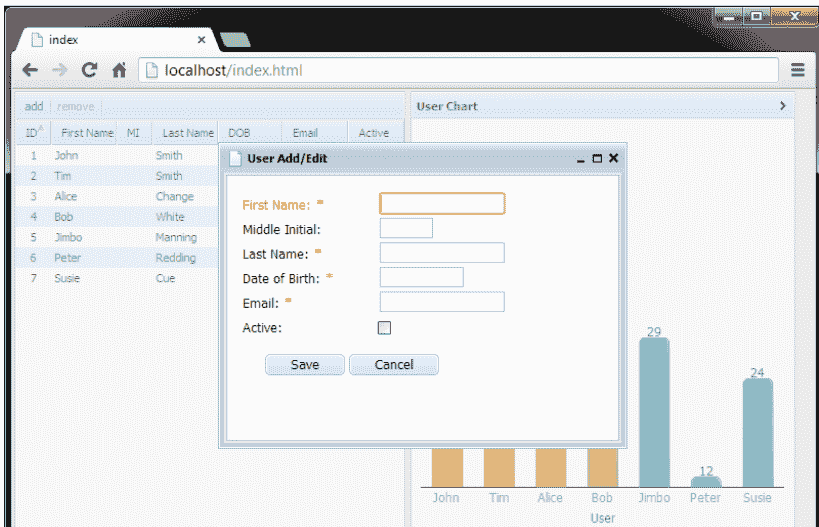

完成本书后，您将很好地理解如何在 Web 应用程序中让 DHTMLX 组件协同工作。

## 总结

在本章中，我们介绍了 DHTMLX 提供的内容、将要使用的组件以及完成后的应用程序外观。这个简短的介绍足以让我们开始。

在下一章中，我们将通过下载脚本并在本地 Web 服务器中附加脚本开始安装过程，然后测试库是否已正确安装。

# 2 下载、设置和测试

在本章中，我们将介绍下载 DHTMLX 库、创建基础文件和目录结构以及包含库文件。然后我们将编写应用程序的配置，并使用 Google Chrome 开发者工具测试安装。

## 安装 Web 服务器

DHTMLX 要求应用程序在 Web 服务器上使用，以允许所有功能正常工作。互联网上有几个预配置的 Web 服务器包可供下载。

Windows 的选项之一是 WampServer。它可在 `http://www.wampserver.com` 获取。对于 Mac 用户，一个流行的 Web 服务器包是 MAMP。它可在 `http://www.mamp.info` 获取。

这些网站都提供了使用其软件包的说明。

一旦您的 Web 服务器运行，您必须定位一个可以通过 Web 服务器访问的目录，您希望在该目录中创建应用程序。本书中的示例将使用已安装 Web 服务器的根目录作为应用程目录，并通过 `http://localhost/` 访问应用程序。本书还将`root`称为应用程序目录。

## 创建应用程序目录结构

在下载 DHTMLX 组件库之前，我们需要在 Web 服务器上创建应用程序目录结构。

## 下载、设置与测试

定位到Web服务器上可访问的应用程序目录。该目录将成为你的应用目录。

现在，在应用目录中创建一个名为`js`的新文件夹。在`js`文件夹内，分别创建名为`application`和`dhtmlx`的两个新文件夹。你的目录结构应如下图所示：

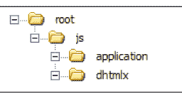

我们将把为应用程序创建的所有JavaScript文件放入`application`文件夹中。DHTMLX库代码将放置在`dhtmlx`文件夹内。

## 下载DHTMLX库

现在，我们要从其网站下载DHTMLX库，并选择要使用的文件。

打开你常用的Web浏览器并导航至 www.dhtmlx.com。你会在菜单中看到一个**下载**链点击。点击该链接。你现在应该看到一个类似下图截图的页面：

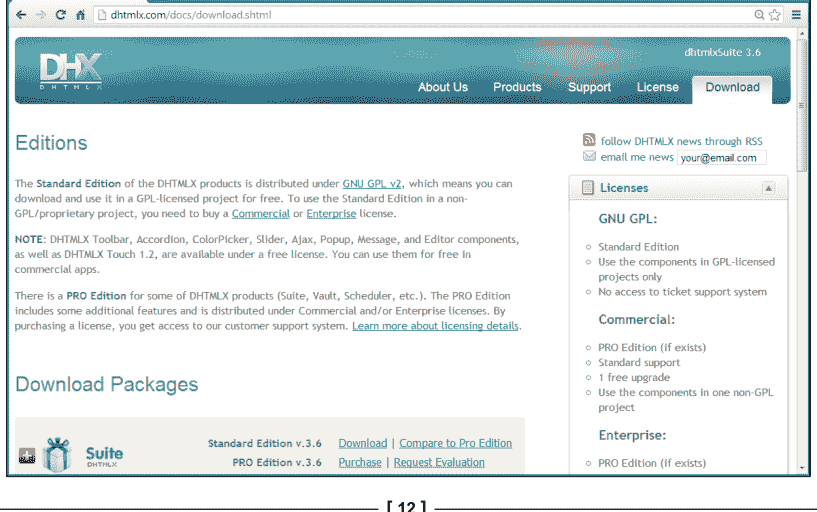

我们想要下载包含所有组件的完整库。DHTMLX称其为**套件**。找到页面上**标准版**套件的**下载**链接并点击。这将开始下载一个ZIP文件。将其下载到一个不是应用目录的位置，以便我们可以解压并选择需要的文件。

在文件管理器中打开解压后的文件夹以查看其内容。你会看到它包含许多文件夹、一个许可证文件、一个自述文件、一个`index.html`文件以及几个额外的ZIP文件。

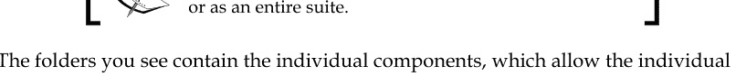

你看到的文件夹包含各个独立的组件，允许对每个组件单独使用。

ZIP文件以压缩格式包含不同皮肤样式的整个组件库。

`index.html`文件打开后提供所下载版本的DHTMLX文档。DHTMLX文档分为两个部分：文档和示例，详细介绍了每个组件。DHTMLX也在网站上提供最新版本的文档，但在离线工作或网络连接较慢时，拥有本地副本非常方便。

接下来，我们将把完整库的压缩版本解压到应用目录。找到名为`dhtmlx_std_full.zip`的ZIP文件。其中包含我们将用于构建应用程序的实际DHTMLX文件。将`dhtmlx_std_full.zip`文件的内容解压到应用目录中的`dhtmlx`文件夹。

一旦解压完成，我们将开始创建应用程序文件。

## 创建应用文件 app.js

第一个应用文件是`app.js`文件。它将包含创建组件和交互的所有JavaScript代码。

让我们首先在`js/application`目录中创建`app.js`文件。

在此文件顶部添加一个`config`对象，如下所示：

```
var config = {
    imagePath: "js/dhtmlx/imgs/",
    iconPath: ""
}
```

此`config`对象包含DHTMLX组件的全局属性。`imagePath`属性是组件样式所需图片的存放路径。我们留空的第二个属性是图标将存储的路径。图标可用于多个不同的组件，例如模态窗口标题和工具栏按钮。

图标不随DHTMLX提供，必须从免费或购买的图标库中添加。

## 数据存储文件

我们将为应用程序创建的下一个文件是`storage.js`文件。此文件将包含与HTML5 localStorage通信的迷你数据访问层。它将包含用户和显示的增删改查方法。

现在，在`js/application`目录中创建一个名为`storage.js`的新JavaScript文件。我们稍后将为此文件添加代码。

接下来，我们将添加一个HTML文件，将应用代码整合在一起。

## 创建 index.html 文件

应用程序将通过位于应用程序目录根目录的`index.html`文件进行访问。我们现在来设置它。

在应用程序目录的根目录中，添加一个名为`index.html`的新文件。它应该可以通过`http://localhost/index.html`访问。

现在，添加一个HTML5文档的标记，并包含外部的DHTMLX文件：

```
<!DOCTYPE html>
<html lang="en">
  <head>
    <title>Users</title>
    <link href="js/dhtmlx/dhtmlx.css" type="text/css"
      rel="stylesheet" />
    <style>
      /* layout css */
      html, body { height: 100%; width: 100%; }
    </style>
    <script src="js/dhtmlx/dhtmlx.js"></script>
    <script src="js/application/storage.js"></script>
    <script src="js/application/app.js"></script>
  </head>
  <body>
  </body>
</html>
```

> **下载示例代码**

你可以从你的账户 http://www.packtpub.com 下载已购买的所有Packt图书的示例代码文件。如果你在其他地方购买了本书，可以访问 http://www.packtpub.com/support 并注册，以便直接通过电子邮件接收文件。

`dhtmlx.css`和`dhtmlx.js`是DHTMLX库中使用所必需的仅有文件。`storage.js`和`app.js`将是创建用户管理应用程序代码的地方。

添加了额外的CSS，将`html`和`body`的高度和宽度设置为100%。这将允许稍后添加的DHTMLX布局组件在浏览器窗口调整大小时能够伸展和增长。我们将在后面的章节中添加更多CSS。

下图截图显示了你最终目录结构应有的样子：

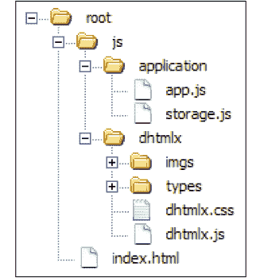

## 测试DHTMLX安装

我们现在拥有了必要的文件结构并创建了`index.html`文件。该文件包含了应用程序所需的外部DHTMLX CSS和JavaScript文件。

接下来，我们将讨论Chrome开发者工具，并测试DHTMLX库文件是否正确包含。

打开Chrome Web浏览器并导航至`http://localhost/`或`http://localhost/index.html`，加载`index.html`文件。

你应该看到一个空白页面。

为了方便JavaScript开发，Chrome提供了开发者工具。它为Web应用程序开发提供了许多有用的工具。我们将重点关注的是控制台。有两种方式可以访问Chrome开发者工具控制台窗口：通过Chrome菜单或通过键盘快捷键。让我们使用键盘快捷键方法。在Windows和Linux上，键盘快捷键是`Ctrl + Shift + J`，对于Mac，则是`Cmd + Opt + J`。使用提供的键盘快捷键，打开开发者工具控制台窗口。

在刚刚打开的控制台窗口中，输入单词`dhtmlx`。这将启动开发者工具的智能感知功能，显示所有以“dhtmlx”开头的可用属性和方法。你应该看到类似下图截图的内容：

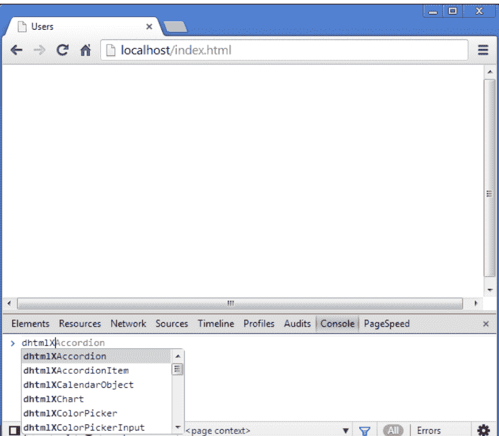

> 如果智能感知未打开或你在控制台中看到错误，请检查文件是否正确包含。

现在，我们将进行进一的测试，以检查CSS是否正确。为此，我们将在页面中添一个DHTMLX布局对象。

在控制台中输入以下代码行，然后按*Enter*键：

```
new dhtmlXLayoutObject(document.body);
```

页面现在被分成三个独立的容器，如下图截图所示：

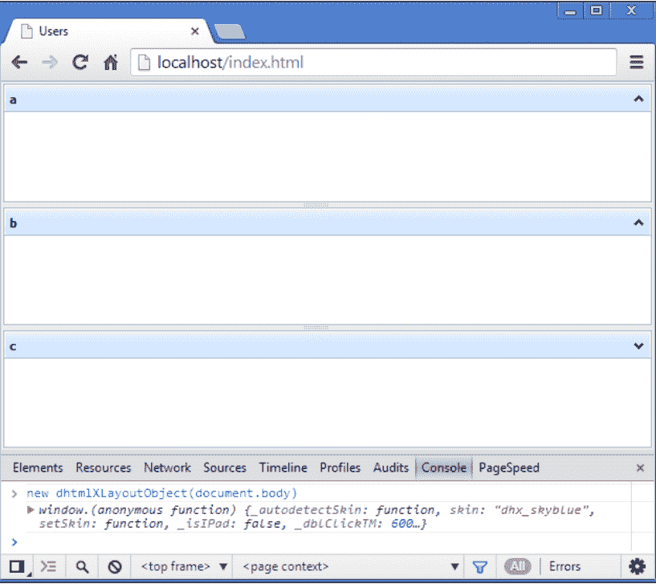

> 如果你只看到一个灰色屏幕，这意味着你尚未将高度和宽度的CSS样式添加到HTML和body标签中。

你在浏览器中看到的三个容器是DHTMLX布局单元格。这些将在后面的章节中讨论。这个简单的测试足以表明我们已正确设置文件。安装和测试现已完成。

## 总结

在本章中，我们介绍了下载DHTMLX套件和本地文档。我们还创建了启动应用程序所需的所有文件，并探索了使用Chrome开发者工具。我们提到了全局配置变量以及存储文件的用途。你应该对后续章节中被要求打开这些文件之一或开发者工具来添加代码行感到相当适应。

在下一章中，我们将开始编写访问存储并为组件创建数据结构的代码。

# 3 数据结构、存储与回调

本章将探讨用户信息的存储、检索以及如何触发更新相关数据组件。我们将介绍一些 HTML5 的酷炫特性，这些特性使我们能够将整个应用程序编写在客户端。这让我们能更专注于用户界面和 DHTMLX 组件，同时减轻维护数据库和服务器端代码的负担。

我们将在 `storage.js` 文件中添加一个 `storage` 对象，并在 `app.js` 文件的 `config` 对象正下方添加一个 `callbacks` 对象。

> DHTMLX 为不同的组件定义了特定的数据结构。对于表格和图表组件，会有单独的调用以检索和构建数据。

## localStorage

关于 HTML5 及其能力，坊间一直有很多讨论。我们将简要介绍其中一项。

在 HTML5 的 `localStorage` 出现之前，客户端 JavaScript 跨页面持久化数据的唯一选择是使用 Cookie。Cookie 有大小限制，且并非仅存在于客户端；它们会随每个请请求发送到服务器。HTML5 的 `localStorage` 显著提高了存储限制，并且严格存储在客户端。

使用 `localStorage` 的主要原因包括：缓存 Ajax 服务数据、跨页面的通用表单字段、自动完成结果，或者实现离线工作。然而，它相对较新，不同浏览器的实现仍有细微差异。

HTML5 的 `localStorage` 允许客户端在受同源策略限制的多个浏览器窗口之间，以键值对的形式存储持久化数据。其用法很简单。以下是我们将用于为应用程序创建存储的方法和属性：

```
localStorage.setItem(key,value) // 设置项目值
localStorage.getItem(key) // 返回项目值
localStorage.key(nth) // 返回枚举的键
localStorage.clear() // 清除所有存储的值
localStorage.length // 返回项目数量
```

这些方法和属性不言自明。

关于 `localStorage`，有一个重要的点需要了解：键和值参数都作为 DOMStrings 存储。这意味着对于应用程序而言，如果输入一个 `int`，它将被转换为该 `int` 的 `string` 版本。如果您尝试保存一个 `object`，它将返回为 "[object type]"，其中 type 是对象类型。那么，我们如何将更复杂的对象存储到 `localStorage` 项中呢？我们使用 `JSON.stringify()` 方法来实现。

对于应用程序，我们将在存储之前，使用 `JSON.stringify()` 方法将 JavaScript 对象字面量转换为字符串。然后，在检索时，我们将使用 `JSON.parse()` 将它们转换回对象。这很简单，允许我们将对象保存到 `localStorage` 并检索对象字面量。

## 创建 storage 对象

现在，我们将创建 storage 对象。找到我们创建的 `storage.js` 文件，它应该是空的。我们将使用 `storage` 对象来保存和检索应用程序数据。

> 请注意在向此 JavaScript 对象添加方法时使用尾随逗号。每个方法后都应跟一个逗号。最后一个方法是可选的。

首先，我们将看看每个单独的方法及其功能。然后我们将创建整个对象。

## storage 方法和属性

我们在 `storage` 对象中创建了两个特定的属性以帮助其运作。

### lastStoredId

第一个属性是 `lastStoredId` 属性：

`lastStoredId: localStorage.getItem("lastStoredId") ? localStorage.getItem("lastStoredId") : 0,`

此属性保留 `localStorage` 中最后输入项目的 ID。页面首次加载时，此属性会检查 `localStorage` 项目 `lastStoredId` 是否有值。如果有，则将该值分配给 `storage` 对象的 `lastStoredId` 属性。如果没有，则 `storage` 对象的 `lastStoredId` 属性值默认为 0。

这使得 `storage` 能够像具有递增主键的数据库一样运作。当插入新用户时，storage 对象方法将递增此属性以创建用户的 ID。

### setDateFormat

`setDateFormat` 方法是存储特定的。它接收一个 JavaScript 日期对象作为参数，并将其转换为可读的字符串进行存储。我们将在其他存储方法中使用它来格式化日期：

```
setDateFormat: function(date){
    var d = (date.getMonth() + 1);
    d += "-"+date.getDate();
    d += "-"+date.getFullYear();
    return d;
},
```

## 用户方法

用户方法将用于在 `localStorage` 中创建、更新、删除和检索用户对象。

## 用户模型

我们用户模型的结构将直接取自我们将要创建的 DHTMLX 表单的值。以下是表单将包含的数据预览：

```
{
    id: 1, // 整数
    firstName: "John", // 字符串
    middleInitial: "J", // 字符串
    lastName: "Smith", // 字符串
    dob: 1971-01-09T13:00:00.685Z, // 日期
    email: "john@somedomain.com", // 字符串
    active: 1 // 整数 (0,1)
}
```

### createUser

createUser 方法在 localStorage 中设置一个新的项目和值。此方法接收一个用户对象作为参数。我们还将调用 callbacks 对象的一个方法，dataChanged。这将在创建 callbacks 对象时介绍。

```
createUser: function(user){
    localStorage.setItem("lastStoredId", ++storage.lastStoredId);
    user.id = storage.lastStoredId;
    user.dob = storage.setDateFormat(user.dob);
    localStorage.setItem(user.id, JSON.stringify(user));
    callbacks.dataChanged();
},
```

#### user 参数

这是将从 DHTMLX 表单检索的用户对象。通常，人们会创建一个用户模型来定义结构，但由于我们的表单将驱动用户的所有数据更改，因此可以安全地从表单提取我们的用户数据模型。

创建用户时，还没有 ID。这就是 lastStoredId 的用武之地。我们将递增设置 lastStoredId，然后将其分配为存储的用户 ID。然后，我们查看任何附加了日历的表单字段。由于日历返回一个 JavaScript 日期对象，因此需要将其转换为可读格式。**dob** 字段是应用程序表单中唯一一个附加了日历的字段。

日期字段格式化并创建 ID 后，用户对象将保存到 localStorage。ID 用作 localStorage 的键，用户对象的字符串化版本用作值。

### getUser

getUser 方法从 localStorage 以字符串形式检索用户对象，然后将字符串解析为对象：

```
getUser: function(id){
    var user = localStorage.getItem(id);
    return (user)?JSON.parse(user):false;
},
```

### updateUser

updateUser 方法通过 ID 编辑用户对象：

```
updateUser: function(user){
    user.dob = storage.setDateFormat(user.dob);
    localStorage.setItem(user.id, JSON.stringify(user));
    callbacks.dataChanged();
},
```

### removeUser

`removeUser` 方法是所有方法中最简单的一个。它通过用户 ID 从 `localStorage` 中移除用户对象：

```
removeUser: function(id) {
    localStorage.removeItem(id);
    callbacks.dataChanged();
},
```

## 表格方法

DHTMLX 表格在加载数据时有特定的结构。它允许使用多种不同的数据格式。本应用程序将使用 JSON 格式。请注意按照指定创建数据结构，否则数据将无法加载。

### 表格的 JSON 数据结构

以下代码块是数据结构的示例。研究此内容将帮助您理解我们为何以及如何创建表格方法：

```
data = {
    "rows": [
        {
            "id":1,
            "data":["col1","col2","col3","col4","etc"]
        },
        {
            "id":2,
            "data":["col1","col2","col3","col4","etc"]
        }
    ],
    "total_count": 2
}
```

我们加载到表格中的对象有一个 rows 数组，其中包含每个用户行的一个对象。ID 必须是唯一的，否则表格将无法正常运行。

rows 数组中的每个单独对象都有一个名为 `data` 的属性。这是每一列的数据数组。数组中的位置对应于它将显示的列。

## 数据结构、存储与回调

还有一个名为 `total_count` 的属性。这是可选的，但当使用任何类型的分页处理大型数据集时，DHTMLX 会用到此属性。此外，它还可用于在网格底部的状态栏中显示记录数。

## gridRow

`gridRow` 方法顾名思义。它将用户对象构造成一个格式化的行项，以用于网格数据：

```
gridRow: function(user){
    var data= [];
    data.push(user.id);
    data.push(user.firstName);
    data.push(user.middleInitial);
    data.push(user.lastName);
    data.push(user.dob);
    data.push(user.email);
    data.push((user.active)?"Yes":"No");
    return {
        "id": user.id,
        "data": data
    }
},
```

## getUserGrid

`getUserGrid` 方法将返回格式化后的对象，以便加载到 DHTMLX 网格中。它遍历 `localStorage`，使用 `localStorage` 的键方法，并检查以确保我们不会将 `lastStoredId` 的值添加到网格中。接下来，`gridRow` 方法使用从 `localStorage` 检索到的数据格式化各个行。最后，我们构建返回对象，并使用行长度的值添加 `total_count` 属性：

```
getUserGrid: function(){
    var rows = [];
    for(var i =0; i<localStorage.length; i++){
        var storageKey = localStorage.key(i);
        if(storageKey != "lastStoredId"){
            var row = localStorage.getItem(storageKey);
            row = JSON.parse(row);
            row = storage.gridRow(row);
            rows.push(row);
        }
    }
    return {
        "rows": rows,
        "total_count": rows.length
    }
},
```

## 图表方法

DHTMLX 图表有多种不同的图表类型可供选择。本应用程序将使用的是条形图。与网格类似，它也有自己的数据结构。以下是图表数据结构的示例：

```
[
    {"id":1,"age":35,"name":"FirstName1"},
    {"id":2,"age":29,"name":"FirstName2"}
]
```

与加载 JSON 对象的网格不同，条形图将加载一个数组。数组中的每个项都是一个对象，其属性将为每个条形填充我们的图表值。

## barChartItem

`barChartItem` 方法与 `gridRow` 方法类似。它返回从 localStorage 格式化的数据作为一个项，以添加到整个图表数据中：

```
barChartItem: function(user){
    var getDateParts = function(date){
        return {
            d: date.getDate(),
            m: date.getMonth()+1,
            y: date.getFullYear()
        }
    }
    var date = getDateParts(new Date());
    var dob = getDateParts(new Date(user.dob));
    var age = date.y - dob.y;

    if(dob.m < date.m){
        age--;
    }
    if(dob.m == date.m && dob.d > date.d){
        age--;
    }

    return {
        "id": user.id,
        "age": age,
        "active": user.active,
        "name": user.firstName
    }
}
```

这里，我们使用了 `user` 对象的 `firstName`、`active` 和 `dob` 属性。使用 `dob` 属性，我们计算年龄。最后，根据这些值创建项结构并返回。

## createUserBarChart

`createUserBarChart` 遍历 `localStorage` 以检索用户，然后使用 `barChartItem` 方法来构造项数据：

```
getUserBarChart: function(){
    var items = [];
    for(var i =0; i<localStorage.length; i++){
        var storageKey = localStorage.key(i);
        if(storageKey != "lastStoredId"){
            var item = localStorage.getItem(storageKey);
            item = JSON.parse(item);
            item = storage.barChartItem(item);
            items.push(item);
        }
    }
    return items;
},
```

## storage 对象

现在我们已经介绍了 storage 对象的所有方法，请查看以下代码片段以了解整个对象。请注意，代码可以简化，但为了更好地理解每个方法中数据的变化，我们将其分解了。现在，如所示，将以下代码添加到 `storage.js` 文件中：

```
var storage = {
    // 存储方法
    lastStoredId: localStorage.getItem("lastStoredId")?
        localStorage.getItem("lastStoredId"):0,
    setDateFormat: function(date){
        var d = (date.getMonth() + 1);
        d += "-"+date.getDate();
        d += "-"+date.getFullYear();
        return d;
    },
    // 用户数据
    createUser: function(user){
        localStorage.setItem("lastStoredId",
            ++storage.lastStoredId);
        user.id = storage.lastStoredId;
        user.dob = storage.setDateFormat(user.dob);
        localStorage.setItem(user.id, JSON.stringify(user));
        callbacks.dataChanged();
    },
    getUser: function(id){
        var user = localStorage.getItem(id);
        return (user)?JSON.parse(user):false;
    },
    updateUser: function(user){
        user.dob = storage.setDateFormat(user.dob);
        localStorage.setItem(user.id, JSON.stringify(user));
        callbacks.dataChanged();
    },
    removeUser: function(id){
        localStorage.removeItem(id);
        callbacks.dataChanged();
    },
    // 网格数据
    getUserGrid: function(){
        var rows = [];
        for(var i =0; i<localStorage.length; i++){
            var storageKey = localStorage.key(i);
            if(storageKey != "lastStoredId"){
                var row = localStorage.getItem(storageKey);
                row = JSON.parse(row);
                row = storage.gridRow(row);
                rows.push(row);
            }
        }
        return {
            "rows": rows,
            "total_count": rows.length
        }
    },
    gridRow: function(user){
        var data= [];
        data.push(user.id);
        data.push(user.firstName);
        data.push(user.middleInitial);
        data.push(user.lastName);
        data.push(user.dob);
        data.push(user.email);
        data.push((user.active)?"Yes":"No");
        return {
            "id": user.id,
            "data": data
        }
    },
    // 图表数据
    getUserBarChart: function(){
        var items = [];
        for(var i =0; i<localStorage.length; i++){
            var storageKey = localStorage.key(i);
            if(storageKey != "lastStoredId"){
                var item = localStorage.getItem(storageKey);
                item = JSON.parse(item);
                item = storage.barChartItem(item);
                items.push(item);
            }
        }
        return items;
    },
    barChartItem: function(user){
        var getDateParts = function(date){
            return {
                d: date.getDate(),
                m: date.getMonth()+1,
                y: date.getFullYear()
            }
        }
        var date = getDateParts(new Date());
        var dob = getDateParts(new Date(user.dob));
        var age = date.y - dob.y;

        if(dob.m < date.m){
            age--;
        }
        if(dob.m == date.m && dob.d > date.d){
            age--;
        }
        return {
            "id": user.id,
            "age": age,
            "name": user.firstName
        }
    }
}
```

## callbacks 对象

我们创建的下一个对象是 `callbacks` 对象，它将保存所有需要在另一项被更新或更改时进行更新或更改的方法。

现在，将 callbacks 对象代码添加到 `app.js` 文件中，紧接在 `config` 对象之后：

```
var callbacks = {
    // 工具栏
    addClick: function(){

    },
    removeClick: function(){

    },
    editClick: function(userId){

    },
    setToolbarItemStates: function(){

    },
    // 网格
    refreshGrid: function(){

    },
    // 图表
    refreshChart: function(){

    },
    // 弹出窗口
    showPopup: function(){

    },
    hidePopup: function(){

    },
    // 用户数据
    dataChanged: function(){

    }
}
```

这个对象是保持所有应用组件中数据同步的粘合剂。在接下来的每一章中，我们将向这个对象添加内容。

*数据结构、存储与回调*

## 总结

本章涵盖了很多内容。我们创建了 `storage` 对象，它是整个应用的数据访问层。然后，我们创建了 `callbacks` 对象，并简要介绍了它的用途。

所有支持性的应用代码都已就位，我们准备好开始添加 DHTMLX 组件了。

在下一章，我们将学习 DHTMLX 布局组件，并将其附加到应用程序中。

# 4 DHTMLX 布局

在本章中，我们将学习 DHTMLX 布局组件，涵盖不同的初始化方式、事件、方法和设置。然后，我们将为应用程序创建主布局。

本章中进行的所有更改都将发生在 `app.js` 文件内，我们将在页面加载事件中添加一个创建方法。

## DHTMLX 布局

DHTMLX 布局是一个强大的组件，它使我们能够创建 Web 界面。简单来说，它是一个高度灵活的容器，我们可以将许多不同的组件附加到它上面。布局可用于将页面或指定的 DOM 容器分割成多个水平和垂直面板，以处理 UI 组件的放置。这些单独的面板称为单元格。这类似于使用 div 或 table 元素将页面划分为容器。但与 div 和 table 元素不同的是，DHTMLX 单元可以调整大小，可以随页面一起缩放，并且具有多种配置。

布局组件由其自身作为父级以及一个或多个子单元格组成。DHTMLX 在创建布局时提供了预定义的模式。这些模式范围包括将页面划分为列、行或两者的组合。这些预定义模式已经可以通过在安装章节中安装的库代码直接使用。

DHTMLX 还提供了更多可以通过额外的 JavaScript 文件添加的模式。执行此操作的步骤可在布局组件的文档中找到。对于我们要创建的应用程序，我们将使用预定义的 2U 模式。此模式会将页面划分为两列。

下图展示了可用的预定义模式及其关联的名称：

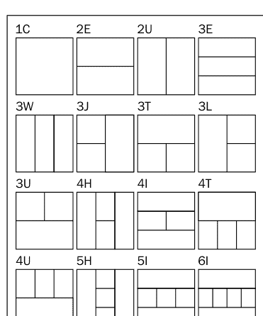

在开发应用程序时，您可能会发现提供的某个模式不符合您的需求。DHTMLX 目前不提供创建自定义布局模式的方法。在他们提供此功能之前，自定义模式最快的方法是使用多个布局进行构建。这是通过将另一个布局附加到一个布局的一个或多个子单元格来完成的。

布局组件的一些主要优势包括内置的附加其他 DHTMLX 组件的方法。布局及其单元格为开发人员提供了一种轻松创建 iframe、HTML 字符串、HTML 对象以及大多数 DHTMLX 套件组件的方式。当布局创建到 HTML `body` 标签时，其内部的所有组件都将跟随浏览器窗口的调整大小进行调整，前提是 `body` 标签的 CSS 高度和宽度设置为 `100%`。

查看下面 2U 布局模式的截图，以了解布局和单元格如何相互关联：

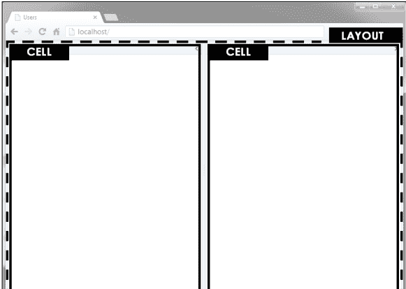

### 方法和事件

DHTMLX 布局主要由两种对象类型组成，一种是布局本身，其次是其子级的单元格。为什么了解这一点很重要？有些相同的方法可以在布局对象或单元格对象上调用。但存在差异，您将会看到。

现在，在 Chrome 浏览器中打开应用程序，并确保开发者工具控制台可用。我们将开始附加布局并学习不同的方法和事件，这将帮助我们更好地理解应用程序是如何开发的。

### 初始化

布局组件的初始化可以通过两种方式完成：将新的布局对象附加到现有的单元，或者将其附加到页面上的 DOM 元素。

我们将首先将布局组件附加到 DOM 元素，并学习如何访问单元格。

在您的控制台中键入并运行以下代码：

```
new dhtmlXLayoutObject(document.body);
```

您应该会看到一个新的三单元格布局，其标题分别为 a、b 和 c。

让我们通过刷新页面来清除它；然后在控制台中键入并运行以下代码：

```
new dhtmlXLayoutObject(document.body, "3E");
```

创建了相同的布局模式，因为布局构造函数的第二个参数是布局模式。默认情况下，DHTMLX 设置布局模式为 3E。您可以从我们之前谈到的任何预定义模式中进行选择。

再次刷新页面，以便我们可以添加不同的布局并学习访问其单元格。这次我们需要将创建的布局的引用分配给一个变量。

在控制台中键入以下代码：

```
var myLayout = new dhtmlXLayoutObject(document.body, "2U");
```

如您所见，我们现在有两个单元格。一个显示 "a"，另一个显示 "b"。当布局首次创建时，每个子单元的标题将具有其单元格 ID 作为文本。这有助于快速识别。单元格的 ID 是我们将用于访问该单元格对象及其方法的方式。让我们访问其中一个单元格，附加一个子布局组件，并保存对其的引用。

键入并运行以下代码：

```
var myChildLayout = myLayout.cells("a").attachLayout("3E");
```

通过这种方法附加布局组件只使用一个参数。同样，如果未传递参数，这将默认为 3E 模式。任何时候创建布局组件时，用于创建它的方法都会返回创建的布局对象。

任何已创建布局中的每个单元格都带有一个标题栏，可以展开或折叠，直到它被移除或附加了子布局组件。然后该单元格的标题将不再可见。

### 方法

现在，我们将介绍布局组件和各个单元格的一些可用方法。

### 单元格尺寸调整

当然，对于 HTML 页面上的任何设计，我们希望能够控制宽度和高度。

刷新页面并创建一个可用于设置高度和宽度的布局。

键入并运行以下代码：

```
var myLayout = new dhtmlXLayoutObject(document.body, "3T");
```

#### setHeight

设置单元格 "a" 的高度。键入并运行以下代码：

```
myLayout.cells("a").setHeight(55);
```

现在单元格 a 的高度设置为 55 像素。

#### setWidth

设置单元格 "b" 的宽度。键入并运行以下代码：

```
myLayout.cells("b").setWidth(70);
```

现在单元格 b 的宽度设置为 70 像素。

#### fixSize

您可能在创建布局时注意到每个单元格都被一个分隔符分开。可以拖动此分隔符来调整页面中单元格的大小。此功能可以使用 `fixSize()` 方法禁用。

`fixSize()` 方法接受 x 和 y 轴作为布尔值或真值和假值参数，指示每个轴是否可以调整大小。

键入并运行以下代码：

```
myLayout.cells("b").fixSize(0,1);
```

单元格 b 和任何共享 x 轴分隔符的单元格将无法垂直调整大小。

键入并运行以下代码：

```
myLayout.cells("b").fixSize(1,1);
```

单元格 b 和任何共享 y 轴分隔符的单元格将无法水平调整大小。

### 单元标题

每个单元格都有一个标题，我们可以通过折叠、更改文本、隐藏或显示来操作它。

#### showHeader 和 hideHeader

`showHeader` 和 `hideHeader` 方法用于显示和隐藏单元格标题。

键入并运行以下代码：

```
myLayout.cells("c").hideHeader();
```

然后键入给定代码并运行以下命令：

```
myLayout.cells("c").showHeader();
```

#### setText

DHTMLX 默认将单元格的标题文本设置为单元格 ID。要更改此文本，我们使用 `setText` 方法。

键入并运行以下代码：

```
myLayout.cells("a").setText("My Top Cell");
```

#### progressOn 和 progressOff

在使用 Ajax 构建 JavaScript 应用程序时，在等待期间提供指示器非常重要。这可以让键盘后的用户知道他们正在等待某些内容返回，并在必要时阻止使用某些界面功能。

布局对象和单元格对象都具有显示指示器的能力。执行此操作的方法是 `progressOn()` 和 `progressOff()` 方法。

现在我们将看看这些在我们创建的布局中是什么样子。

键入并运行以下代码：

```
myLayout.progressOn();
```

现在无法访问此布局内的任何界面功能。

现在，关闭该进度指示器。

键入并运行以下代码：

```
myLayout.progressOff();
```

尝试在单元格对象上使用这些方法。布局对象和单元格对象的进度指示器在样式上有所不同。这些进度指示器可以很容易地用 CSS 来设置样式。

## 方法概述

我们已经介绍了 DHTMLX 布局和单元格对象更常用的方法，以及我们将用于构建应用程序的方法。DHTMLX 提供了许多高级功能供您探索，例如视图、自动调整大小和停靠/取消停靠。

## 布局事件

在创建应用程序时，JavaScript 中的事件非常有用。DHTMLX 为每个组件提供了许多不同的事件。我们将介绍如何附加和分离其中一个事件，以便了解如何利用它们。

布局对象更常见的事件有 `onResizeFinish`、`onExpand`、`onCollapse` 和 `onDblClick`。让我们看看 `onResizeFinish`。

我们将使用之前章节中创建的布局来附加此事件。

### attachEvent 和 detachEvent

DHTMLX 提供了 `attachEvent` 和 `detachEvent` 方法。

附加事件时，第一个参数是要附加的事件名称。第二个是处理程序方法，即事件触发时将执行的方法。

键入并运行以下代码：

```
var myEventId = myLayout.attachEvent("onResizeFinish", function(){
    console.log("Layout Resized");
});
```

现在，如果您调整浏览器窗口的大小，您将在控制台中看到一条条目，显示 **Layout Resized**。

在大多数情况下，DHTMLX 事件会向处理程序方法传回一些参数。由于这只是告诉我们布局已调整大小，因此它没有传回任何内容。

要分离一个事件，我们使用从 `attachEvent` 方法返回的事件 ID。对于我们刚刚创建的事件，此事件 ID 已分配给 `myEventId` 变量。现在，我们将使用此 ID 来分离同一个事件。

键入并运行以下代码：

```
myLayout.detachEvent(myEventId);
```

控制台将不再记录来自该事件的文本。

如果您想清除在某个布局对象上创建的所有事件，也可以使用 myLayout.detachAllEvents()，不传递任何参数。

### dhtmlxEvent

与其他 JavaScript 库类似，DHTMLX 也有自己的方法将 HTML DOM 事件附加到 HTML DOM 元素。它接受三个参数：第一个是 DOM 元�素，第二个是不带 "on" 前缀的 HTML DOM 事件名称，最后一个是处理程序。我们将使用此方法在页面加载时加载应用程序的各个部分：

```
dhtmlxEvent(window, "load", function(){
    // 页面加载时运行的代码
});
```

DHTMLX 中所有添加到同一对象相同事件的事件都会被添加到一个内部数组中，并按照添加的顺序触发。

## 应用程序代码

现在我们已经介绍了如何使用 DHTMLX 的布局组件，是时候为应用程序创建一个布局了。打开 app.js 文件，准备开始编写代码。

### 创建布局

在 app.js 文件的 config 对象正下方输入以下代码：

```
// 布局
var appLayout;
dhtmlxEvent(window, "load", function(){
    appLayout = new dhtmlXLayoutObject(document.body, "2U");
    appLayout.cells("a").hideHeader();
    appLayout.cells("b").setText("User Chart");
});
```

首先，我们定义了全局变量 `appLayout`，它允许我们在应用程序的其他方法中访问布局。然后我们在页面加载事件中创建布局。当页面加载时，布局将被创建。

刷新页面后，它将如下图所示：

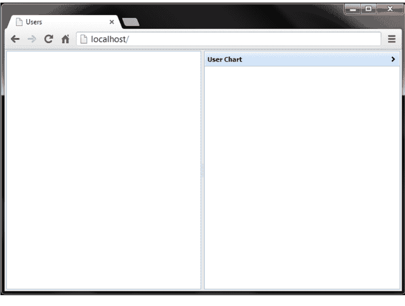

## 总结

在本章中，我们介绍了 DHTMLX 布局组件及其常用方法和事件。然后我们创建了应用程序的主布局。后续章节中的所有内容都将在此布局内或围绕此布局创建。

在下一章中，我们将学习 DHTMLX 工具栏组件，并为应用程序创建一个工具栏。

# 5

DHTMLX 工具栏

在本章中，我们将学习 DHTMLX 工具栏组件及其不同的初始化方式、事件、方法和设置。然后我们将为应用程序添加一个工具栏，使其能够删除和添加用户。

本章中的所有更改都将发生在 app.js 文件内部。

## DHTMLX 工具栏

DHTMLX 工具栏是应用程序或网页中非常方便的组件。它使我们能够快速轻松地创建一系列强大的按钮、下拉菜单和输入框。

创建 DHTMLX 工具栏时，我们可以自由地将其放置在 DOM 元素、DHTMLX 布局或 DHTMLX 单元格中。但是，将工具栏附加到 DHTMLX 布局或单元格时，每个都限于一个工具栏。以下屏幕截图显示了将工具栏附加到布局对象和单元格对象的区别。

此屏幕截图显示了一个空工具栏以及将其附加到布局对象后的样子：

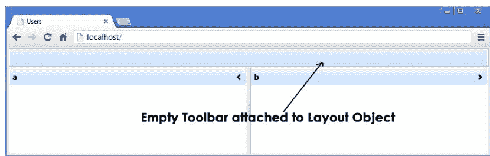

此屏幕截图显示了附加到单元格对象的工具栏：

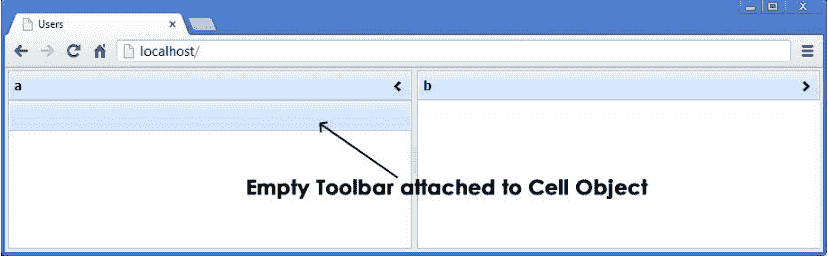

### 方法和事件

现在打开 Chrome 浏览器，显示开发者工具的控制台，我们将开始学习 DHTMLX 工具栏对象。我们将附加工具栏、添加工具栏项目并绑定事件。

### 初始化选择

DHTMLX 工具栏可以通过两种方式进行初始化。第一种是将其附加到 DOM 元素。第二种是将其附加到现有的 DHTMLX 布局或单元格。

#### 在 DOM 元素上初始化

首先，我们将工具栏附加到一个 DOM 元素。对于这些练习，我们将使用与应用程序相同的网页。要测试将工具栏附加到 DOM 元素，我们必须首先清除页面并在 `body` 标签内创建一个元素。我们将用 JavaScript 来完成此操作。

在控制台中键入并运行以下代码行：

```
document.body.innerHTML = "<div id='myToolbarCont'></div>";
```

我们刚刚清除了 body 的内容，并用一个 `id` 属性为 `myToolbarCont` 的 `div` 标签替换它。

接下来，初始化并附加一个工具栏到该 `div`。

在开发者工具控制台中键入并运行以下代码行：

```
new dhtmlXToolbarObject("myToolbarCont");
```

结果将在页面上显示一个空工具栏。

#### 在布局对象上初始化

在上一章中，我们将 `createLayout` 方法返回值的引用赋给了名为 `appLayout` 的全局变量。我们将使用它来访问布局及其子单元格，以进行接下来的练习。

首先刷新页面以清除之前的练习。然后在开发者工具控制台中键入并运行：

```
appLayout.attachToolbar();
```

现在您将看到工具栏附加到整个布局上，跨越两个单元格。

#### 在单元格对象上初始化

现在让我们添加另一个工具栏，这次是添加到其中一个子单元格。

在开发者工具控制台中键入并运行以下代码行：

```
appLayout.cells("a").attachToolbar();
```

现在您应该在布局的左侧单元格中看到一个空工具栏。

DHTMLX 目前不允许每个容器拥有多个工具栏。但是，可以通过在单元格内创建子布局对象并向每个子布局附加工具栏来达到相同的效果。我们现在将尝试此方法。

首先刷新页面以重置。

现在我们将创建一个子布局。在控制台中键入并运行以下代码行：

```
var childLayout = appLayout.cells("a").attachLayout("1C");
```

这会在一个单元格内添加一个嵌套布局。

有了这个额外的布局对象，我们现在可以开始向每个对象添加工具栏了。

在控制台中键入并运行以下代码行：

```
appLayout.cells("a").attachToolbar(); // 第1个工具栏
childLayout.attachToolbar(); // 第2个工具栏
childLayout.cells("a").hideHeader(); // 隐藏单元格标题
childLayout.cells("a").attachToolbar(); // 第3个工具栏
```

现在有三个工具栏从上到下依次显示。

既然我们知道如何初始化 DHTMLX 工具栏，我们就可以开始添加项目了。

### 工具栏项目

DHTMLX 工具栏有几种不同的项目类型：

-   按钮

-   双态按钮（切换）

-   按钮选择（选择）

-   滑块

-   输入框

-   文本（标签）

-   分隔符

-   间隔

我们现在将逐一介绍它们并了解它们如何工作。

首先刷新页面以清除之前的练习代码。

现在我们将在单元格 a 中添加一个新的工具栏。我们将使用此工具栏来添加接下来练习的项目。

在控制台中键入并运行以下代码行：

```
var myToolbar = appLayout.cells("a").attachToolbar();
```

> 向工具栏添加项目时；如果项目超出单元格的宽度，这些项目将不可见。对于本次练习，请确保您有足够的单元格宽度来显示所有将要添加的项目。

#### addButton

`addButton` 方法用于向工具栏添加一个按钮。按钮是可点击的项目，可以包含文本和图标。

参数包括按钮的ID、在工具栏中的位置、按钮文本、启用时的图标（可选），以及禁用时的图标（可选）。

在控制台中输入并运行以下代码行：

```
myToolbar.addButton("myButtonId", 0, "My Button");
```

现在，工具栏上已添加一个文本为 `My Button` 的按钮。

#### addButtonTwoState

`addButtonTwoState` 方法创建一个切换按�，该按钮会保持一个布尔状态。此方法与 `addButton` 方法具有相同的参数。当此项目被点击时，它会触发工具栏的 `onStateChange` 事件。

在控制台中输入并运行以下代码行：

```
myToolbar.addButtonTwoState("myButton2StateId", 1, "2 State");
```

现在工具栏上有一个新项目，其文本为 **2 State**。当点击此新项目时，它会在激活和非激活状态之间切换。

#### getItemState

`getItemState` 方法用于获取**双状态**按钮的按下状态，并返回一个布尔值。

在控制台中输入并运行以下代码行：

```
myToolbar.getItemState("myButton2StateId");
```

控制台将返回 `true` 或 `false`。

#### addSeparator

`addSeparator` 方法创建一条垂直线，用于分隔工具栏项目。唯一的参数是ID和位置。

在控制台中输入并运行以下代码行：

```
myToolbar.addSeparator("sepId", 2);
```

现在在**双状态**按钮的右侧有一条分隔线。

DHTMLX 工具栏

#### addText

`addText` 方法创建一个文本项目。当需要为另一个工具栏项目创建标签时，此方法很有用。

在控制台中输入并运行以下代码行：

```
myToolbar.addText("myTextId", 3, "A Label: ");
```

在工具栏上，分隔线的右侧出现了一个文本项目。

#### addButtonSelect

`addButtonSelect` 方法比之前的项目稍微复杂一些。它创建一个类似于 HTML select 元素的下拉选择按钮。

参数包括ID、位置、文本、选项的JavaScript数组、启用时的图标（可选）、禁用时的图标（可选），以及额外的高级参数。

以下是选项JavaScript数组的示例。参数包括ID、类型、文本和图标（可选）。

```
["myOptionId", "obj", "Option 1", "icon.gif"]
```

现在，让我们向工具栏添加一个下拉选择按钮。在控制台中输入并运行：

```
myToolbar.addButtonSelect("mySelectId", 4, "Select Me", [
  ["option1", "obj", "Option 1"],
  ["option2", "obj", "Option 2"]
]);
```

现在工具栏上已添加一个下拉选择按钮。点击箭头将打开下拉选项。当选择一个选项时，该选项会高亮显示。下次打开下拉选择按钮时，上次的选择将被记住。

> DHTMLX 文档中对于 `addButtonSelect` 方法有额的参数，允许创建的下拉选择按钮表现得更像 HTML select 元素。

#### getListOptionSelected

`getListOptionSelected` 方法将返回下拉选择按�中当前选中项目的ID。

在控制台中输入并运行以下代码行：

```
myToolbar.getListOptionSelected("mySelectId");
```

控制台将返回当前选中的选项ID。

#### addSpacer

`addSpacer` 方法将工具栏的左侧与右侧分开。位于此项目右侧的项目现在将在工具栏中右对齐。

它接受的唯一参数是你想要添加间隔的工具栏项目的ID。我们将把它添加到ID为 `myButtonId` 的第一个按钮上。

在控制台中输入并运行以下代码行：

```
myToolbar.addSpacer("myButtonId");
```

现在，My Button 右侧的所有项目都与工具栏右侧对齐。

#### removeSpacer

`removeSpacer` 方法从工具栏中移除一个间隔。在控制台中输入并运行以下代码行：

```
myToolbar.removeSpacer("myButtonId");
```

工具栏的间隔现在已被移除，所有项目都左对齐。

#### addSlider

`addSlider` 方法创建一个滑块项目，该滑块将保存一个值，以便在事件触发或特定请求时检索。此项目的参数是ID、位置、滑块长度（像素，整数）、最小值、最大值、当前值、左侧标签、右侧标签和工具提示（可选）。

在控制台中输入并运行以下代码行：

```
myToolbar.addSlider("mySliderId", 5, 40, 1, 10, 4, "Low", "High");
```

DHTMLX 工具栏

#### addInput

`addInput` 方法在工具栏中创建一个类似表单的输入框。其参数是ID、位置、初始值和宽度（像素，`int` 类型）。

在控制台中输入并运行以下代码行：

```
myToolbar.addInput("myInputId", 6, "Hi", 30);
```

现在我们有了一个默认值为 "Hi" 的输入框。

#### getValue

`getValue` 方法返回滑块或输入框工具栏项目的值。

在控制台中输入并运行以下代码行：

```
myToolbar.getValue("myInputId");
```

现在你可以在控制台中看到我们为输入框设置的初始值。

#### disableItem 和 enableItem

`disableItem` 方法将项目渲染为禁用状态，`enableItem` 方法则相反，将其启用。

在控制台中输入并运行以下代码行：

```
myToolbar.disableItem("myButtonId");
```

按钮现在被禁用，不会触发任何事件。

现在启用该按钮。在控制台中输入并运行以下代码行：

```
myToolbar.enableItem("myButtonId");
```

#### hideItem 和 showItem

`hideItem` 方法隐藏工具栏项目，`showItem` 方法则相反，将其显示出来。

在控制台中输入并运行以下代码行：

```
myToolbar.hideItem("myButtonId");
```

在控制台中输入并运行以下代码行：

```
myToolbar.showItem("myButtonId");
```

在限制功能访问权限时，隐藏和显示工具栏项目会很有用。

#### removeItem

`removeItem` 方法从工具栏中移除一个项目。在控制台中输入并运行以下代码行：

```
myToolbar.removeItem("myInputId");
```

输入框现在已从工具栏中移除。

### 工具栏事件

现在我们已经介绍了不同类型的项目以及如何获取它们的值，接下来我们将讨论可以被触发的事件。我们将要介绍的工具栏事件包括 `onClick`、`onStateChange`、`onValueChange` 和 `onEnter`。

这些事件的参数是事件名称和处理函数。当事件被触发时，事件处理函数将提供触发该事件的项目ID作为参数。

#### onClick

`onClick` 事件监听工具栏项目的任何点击操作。

让我们将此事件添加到工具栏。在控制台中输入并运行以下代码行：

```
myToolbar.attachEvent("onClick", function(itemId) {
    console.log(itemId);
});
```

现在，点击工具栏上的按钮项目，你会看到项目ID被记录到控制台。另外请注意，点击下拉选择按钮箭头左侧时，它也会作为一个按钮触发事件。

#### onValueChange

当工具栏滑块项目的值发生变化时，`onValueChange` 事件会被触发。

#### onStateChange

当工具栏双状态按钮项目的状态发生变化时，`onStateChange` 事件会被触发。

#### onEnter

当在工具栏输入框项目内按下 *Enter* 键时，`onEnter` 事件会被触发。

## 应用程序代码

我们已经介绍了 DHTMLX 工具栏组件提供的大量功能。这将为我们编写应用程序代码打下基础。

打开 `app.js` 文件，准备开始编写代码。

### 创建工具栏

现在我们将为应用程序创建工具栏。我们将使用一个 JavaScript 对象字面量来创建工具栏。

在 `app.js` 文件中布局创建代码的下方，输入以下代码：

```
// Toolbar
var appToolbar;
dhtmlxEvent(window, "load", function(){
    // create toolbar
    appToolbar = appLayout.cells("a").attachToolbar({
        items: [
            { type: "button", id: 1, text: "add" },
            { type: "separator", id: 2 },
            { type: "button", id: 3, text: "remove" },
            { type: "separator", id: 4 },
        ]
    });
    // attach toolbar events
    appToolbar.attachEvent("onClick", function(id){
        switch(id){
            case "1": callbacks.addClick(); break;
            case "3": callbacks.removeClick(); break;
            default: break;
        }
    });
});
```

## 第6章

## DHTMLX Grid

在本章中，我们将学习 DHTMLX Grid 组件，涵盖不同的初始化方法、事件、方法和设置。然后，我们将在应用程序中添加一个网格，以控制用户数据。


本章的所有更改都将发生在 `app.js` 文件中。

在本章中，我们将开始向 `callbacks` 对象添加代码，并首次使用 `storage` 对象。

## DHTMLX Grid

DHTMLX Grid 组件是该库中使用最广泛的组件之一。它拥有大量的设置和功能，功能非常强大，我们可能可以为此写一整本书。但由于我们要构建一个应用程序，我们将介绍一些主要方法并深入探讨其使用。

Grid 支持的一些很酷的功能包括：过滤、行和列合并、多级表头、动态滚动加载、分页、行内编辑、Cookie 状态、拖放/排序列、图片显示、多选以及事件处理。

在本章结束时，我们将拥有一个功能齐全的网格，用于控制用户的编辑、查看、添加和删除操作。

## Grid 方法与事件

创建一个 DHTMLX Grid 时，我们首先创建对象；其次添加所有设置，然后调用一个方法来初始化它。网格初始化后，就可以添加数据了。

创建网格的步骤顺序如下：

1.  创建网格对象

2.  应用设置

3.  初始化

4.  添加数据

现在我们将介绍如何初始化网格。

### 初始化选择

我们可以用两种方式初始化 DHTMLX Grid，与其他 DHTMLX 对象类似。第一种方式是将其附加到 DOM 元素上，第二种方式是将其附加到现有的 DHTMLX Layout 单元格或布局上。

> 可以通过传入包含所有设置的 JavaScript 对象，或者通过单独调用方法来构建一个 Grid。

#### 在 DOM 元素上初始化

让我们将网格附加到一个 DOM 元素上。首先，我们必须清空页面并使用 JavaScript 添加一个 `div` 元素。

在开发者工具控制台中输入并运行以下代码行：

```
document.body.innerHTML = "<div id='myGridCont'></div>";
```

我们刚刚清空了所有 `<body>` 标签的内容，并用一个 `id` 属性值为 `myGridCont` 的 `div` 标签替换了它。

现在，为这个 `div` 标签创建一个网格对象，添加一些设置并初始化它。

在开发者工具控制台中输入并运行以下代码：

```
var myGrid = new dhtmlXGridObject("myGridCont");
myGrid.setImagePath(config.imagePath);
myGrid.setHeader(["Column1", "Column2", "Column3"]);
myGrid.init();
```

你应该会看到页面上只显示一个带有三列的网格头部。

接下来，我们将在现有的单元对象上创建一个网格。

#### 在单元对象上初始化

刷新页面，并将一个网格添加到 `appLayout` 单元格中。

在开发者工具控制台中输入并运行以下代码：

```
var myGrid = appLayout.cells("a").attachGrid();
myGrid.setImagePath(config.imagePath);
myGrid.setHeader(["Column1", "Column2", "Column3"]);
myGrid.init();
```

现在，你会看到网格列就在工具栏下方。

## Grid 方法

现在我们来介绍一些可用的 Grid 方法。然后我们就可以在这个网格中添加行并调用事件。

在这些练习中，我们将使用全局变量 `appLayout`。

刷新页面。

### attachGrid

我们将从在单元格上创建一个网格开始。

`attachGrid` 方法创建一个网格对象并将其附加到单元格上。这是创建网格的第一步。

在控制台中输入并运行以下代码行：

```
var myGrid = appLayout.cells("a").attachGrid();
```

### setImagePath

`setImagePath` 方法允许网格知道我们在设计中引用的图片位置。我们已经在 `config` 对象中设置了应用程序的图片路径。

在控制台中输入并运行以下代码行：

```
myGrid.setImagePath(config.imagePath);
```

### setHeader

`setHeader` 方法设置列标题，并决定我们将有多少个标题。参数是一个 JavaScript 数组。

在控制台中输入并运行以下代码行：

```
myGrid.setHeader(["Column1", "Column2", "Column3"]);
```

### setInitWidths

`setInitWidths` 方法将设置每列的初始宽度。星号（`*`）用于自动设置宽度。

在控制台中输入并运行以下代码行：

```
myGrid.setInitWidths("125,95,*");
```

### setColAlign

`setColAlign` 方法允许我们对齐列内容的位置。

在控制台中输入并运行以下代码行：

```
myGrid.setColAlign("right,center,left");
```

### init

到目前为止，我们还没有看到太多变化。这都是在后台发生的。为了看到这些变化，必须初始化网格。

在控制台中输入并运行以下代码行：

```
myGrid.init();
```

现在你看到了我们提供的列。

### addRow

现在我们已经创建了一个网格，让我们添加几行并开始交互。

`addRow` 方法向网格中添加一行。参数是 ID 和列数据。

在控制台中输入并运行以下代码：

```
myGrid.addRow(1, ["test1", "test2", "test3"]);
myGrid.addRow(2, ["test1", "test2", "test3"]);
```

我们刚刚在网格内创建了两行。

### setColTypes

`setColTypes` 方法设置一列将包含的数据类型。

可用的类型选项有：

-   `ro`（只读）

-   `ed`（编辑器）

-   `txt`（文本域）

-   `ch`（复选框）

-   `ra`（单选按钮）

-   `co`（组合框）

目前，如果你双击网格单元格，网格允许进行行内编辑。我们不希望应用程序有这个功能。所以，我们将把列类型设置为只读。

在控制台中输入并运行以下代码：

```
myGrid.setColTypes("ro,ro,ro");
```

现在网格内的单元格不再可编辑。

### getSelectedRowId

`getSelectedRowId` 方法返回选中行的 ID。如果没有选中任何内容，它将返回 `null`。

在控制台中输入并运行以下代码行：

```
myGrid.getSelectedRowId();
```

### clearSelection

`clearSelection` 方法清除网格中的所有选中项。

在控制台中输入并运行以下代码行：

```
myGrid.clearSelection();
```

现在之前的任何选中状态都已清除。

### clearAll

`clearAll` 方法移除所有的网格行。在向网格添加更多数据之前，我们必须先清空它。否则我们将得到重复的数据。

在控制台中输入并运行以下代码行：

```
myGrid.clearAll();
```

现在网格是空的。

### parse

`parse` 方法允许以 XML 字符串、CSV 字符串、XML 岛、XML 对象、JSON 对象和 JavaScript 数组的格式将数据加载到网格中。在为应用程序创建网格时，我们将使用带有 JSON 对象的 `parse` 方法。

以下是 `parse` 方法的语法示例（不要在控制台中运行）：

```
myGrid.parse(data, "json");
```

## Grid 事件

DHTMLX Grid 组件拥有大量的事件。你可以在文档中查看完整的事件列表。我们将介绍 `onRowDblClicked` 和 `onRowSelect` 事件。

### onRowDblClicked

当双击网格行时，会触发 `onRowDblClicked` 事件。事件处理函数接收被双击行的 ID 作为参数。在控制台中输入并运行以下代码：

```
myGrid.attachEvent("onRowDblClicked", function(rowId){
    console.log(rowId);
});
```

双击其中一行，控制台将记录该行的 ID。

## onRowSelect

`onRowSelect`事件将在选择行时触发。

在控制台中输入并运行以下代码：

```
myGrid.attachEvent("onRowSelect", function(rowId){
    console.log(rowId);
});
```

现在，当你选择一行时，控制台将记录该行的ID。这可以理解为单击操作。

## 应用代码

现在，我们将为应用程序创建用户网格。首先，我们将创建创建网格和事件的方法。然后，我们将向`callbacks`对象添加逻辑并测试`storage`对象的代码。

### 创建网格

打开`app.js`文件并在末尾添加以下代码：

```
// Grid
var appGrid;
dhtmlxEvent(window, "load", function(){
    // create grid
    appGrid = appLayout.cells("a").attachGrid();
    appGrid.setHeader(["ID","First Name","MI",
    "Last Name","DOB","Email","Active"]);
    appGrid.setColTypes("ro,ro,ro,ro,ro,ro,ro");
    appGrid.setInitWidths("35,*,35,*,75,*,55");
    appGrid.setColAlign("center,left,center,left,center,left,center");
    appGrid.setImagePath(config.imagePath);
    appGrid.init();

    // attach grid events
    appGrid.attachEvent("onRowDblClicked", function(rowId){
        callbacks.editClick(rowId);
    });
    appGrid.attachEvent("onRowSelect", function(){
        callbacks.setToolbarItemStates();
    });
    // reset grid and load it with data
    callbacks.refreshGrid();
});
```

*DHTMLX 网格*

首先，我们创建了全局变量`appGrid`，用于保存网格的引用。接下来，创建网格并应用设置。然后，我们附加了将使用的事件，并添加了刷新网格数据的方法。

现在，我们将向`callbacks`对象添加代码，以处理网格事件和网格数据的刷新。

### callbacks.setToolbarItemStates

在`app.js`文件中找到`callbacks`方法`setToolbarItemStates`。

此方法将禁用和启用工具栏上的**删除**按钮。按照以下代码片段所示，向`setToolbarItemStates`方法添加代码：

```
setToolbarItemStates: function(){
    if(appGrid.getSelectedRowId()){
        appToolbar.enableItem(3);
    }else{
        appToolbar.disableItem(3);
    }
},
```

当使用此方法时，它将检查网格是否有选择，并启用或禁用**删除**按钮。

### callbacks.removeClick

当单击**删除**按钮时，`removeClick`方法将触发。发生这种情况时，我们将使用`storage`方法`removeUser`从`localStorage`中删除选定的用户。

按照以下代码片段所示，向`callbacks`对象`removeClick`方法添加代码：

```
removeClick: function(){
    storage.removeUser(appGrid.getSelectedRowId());
},
```

接下来，我们需要从`localStorage`重新加载最新的数据到网格中。

### callbacks.refreshGrid

refreshGrid方法使用最新数据更新网格。按照以下代码片段所示，在callbacks对象refreshGrid方法内添加代码：

```
refreshGrid: function(){
    appGrid.clearAll();
    appGrid.parse(storage.getUserGrid(), "json");
    callbacks.setToolbarItemStates();
},
```

当使用refreshGrid方法时，它首先清除网格中的所有数据，然后从localStorage检索要显示在网格中的数据。

网格清除并加载数据后，**删除**按钮将被禁用。

### callbacks.dataChanged

每当用户被添加、编辑或删除时，localStorage中的数据都会更改。dataChanged方法将在任何时候发生这种情况时使用，以刷新任何使用该数据的组件。将refreshGrid添加到callbacks对象dataChanged。

```
dataChanged: function(){
    callbacks.refreshGrid();
}
```

现在刷新页面。以下截图显示了刷新后我们应该有的内容：

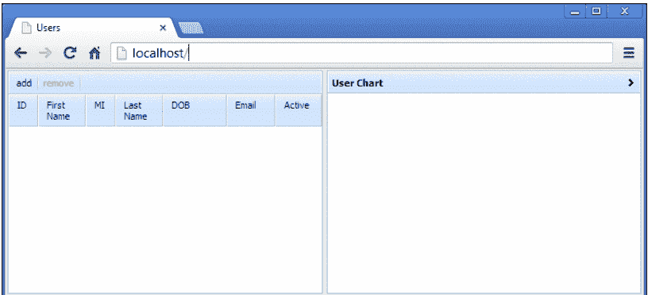

*DHTMLX 网格*

### 测试网格

现在，我们将使用`storage`方法添加几个用户来测试网格。测试后，我们将清除`localStorage`。

### 创建用户

`createUser`方法在*第3章，数据结构、存储和回调*中创建，用于向`localStorage`添加用户。我们将使用此方法向网格添加两个用户并测试功能。我们将使用简化的用户对象版本。

在控制台中输入并运行以下代码片段：

```
storage.createUser({firstName: "George", dob: new Date("1991")});
storage.createUser({firstName: "Steve", dob: new Date("1982")});
```

`createUser`将用户保存到`localStorage`，然后调用`dataChanged`方法，该方法刷新了网格。现在我们知道，当添加用户时，网格将更新。以下截图显示了添加了两个用户的网格：

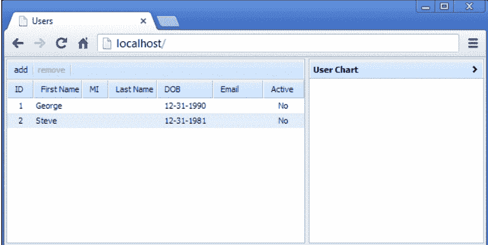

### 删除用户

现在，我们将测试删除用户。选择一个网格行并单击**删除**按钮。选定的行现在已删除。单击**删除**按钮将用户从`localStorage`中删除并刷新网格。

在控制台中输入并运行以下代码行：

```
localStorage.clear();
```

现在刷新页面以清除网格并重置ID计数。

## 总结

在本章中，我们了解了DHTMLX网格组件。我们还将用户网格添加到应用程序中，并使用`storage`和`callbacks`方法对其进行了测试。

在下一章中，我们将介绍DHTMLX的Window组件，该组件将提供一个弹出窗口来包含用于编辑和添加用户的表单。

# 7

## DHTMLX 窗口

在本章中，我们将学习DHTMLX窗口组件，涵盖不同的初始化、事件、方法和设置。然后，我们将向应用程序添加一个弹出窗口，该窗口将包含下一章创建的表单。

本章中的所有更改都将在`app.js`文件中进行。

## DHTMLX 窗口

DHTMLX窗口组件允许我们快速轻松地在网页内创建多个弹出窗口。窗口组件提供了快速附加DHTMLX表单、布局、网格和大多数其他组件的方法。它还负责样式、对齐和定位。

DHTMLX窗口组件是一个基础对象，可以从中创建许多子弹出窗口。基础对象接受所有重要的设置，如图像路径和可选的视口。

在本章结束时，我们将很好地理解如何初始化和控制DHTMLX窗口对象并创建弹出窗口。然后，我们将创建一个弹出窗口，当按下添加按钮时打开。

### 方法和事件

我们将从创建新的基础`dhtmlXWindows`对象实例开始。

刷新浏览器以清除之前练习中的任何控制台代码。

### 初始化

DHTMLX组件的初始化要么通过现有组件（如布局组件）完成，要么初始化到DOM元素。窗口组件则不同。必须先创建基础对象。从这个基础对象，可以创建一组新窗口。

其他讨论过的组件中的初始化设置始终以函数方式添加。DHTMLX还为大多数组件提供了可选的对象字面量方式来应用初始化设置。在第一个练习中，我们将使用对象字面量作为设置来创建多个窗口。

#### 创建基础对象

在控制台中，我们将使用设置对象创建一个新的`dhtmlXWindows`对象。此设置对象将设置图像文件夾的路径，並允許同時創建多個窗口。

在控制台中输入並運行以下代碼：

```
var myWindows = new dhtmlXWindows({
    image_path: config.imagePath,
    wins: [
        {
            id: "w1",
            height: 200,
            width: 200,
            text: "One"
        },
        {
            id: "w2",
            height: 200,
            width: 200,
            text: "Two",
            left: 20,
            top: 20
        },
        {
            id: "w3",
            height: 200,
            width: 200,
            text: "Three",
            left: 40,
            top: 40
        }
    ]
});
```

頁面中創建了三個新的彈出窗口。每個彈出窗口都可以在瀏覽器窗口內自由移動，類似於桌面窗口。

接下來，我們將通過提供的方法來創建這些窗口。

#### 通過方法創建窗口

首先，我們將創建一個新的 `dhtmlXWindows` 方法，然後應用其設定。

刷新頁面。在控制台中輸入並運行以下代碼：

現在，我們有了一個基礎對象，可以開始進行創建各個彈出窗口的練習。

```
var myWindows = new dhtmlXWindows();
myWindows.setImagePath(config.imagePath);
```

### 方法

每個獨立的彈出窗口都充當一個容器。這意味著它們可以附帶其他組件。這是一個很好的特性。使用彈出窗口的方法，我們可以創建並附加表單、網格、圖表、布局等組件。

現在，讓我們創建一個彈出窗口。

#### createWindow（基礎對象方法）

此方法的參數是 ID、x 位置、y 位置、寬度和高度。請注意，對於位置變量，我們將傳遞 `null`，因為除非需要指定屏幕位置，否則它們不是必需的。

在控制台中輸入並運行以下代碼：

我們剛剛創建了一個新的彈出窗口，並將其引用賦值給了 `myPopup` 變量。利用這個引用，我們將應用一些可用的設定和方法。

```
var myPopup = myWindows.createWindow("w1", null, null, 200, 200);
```

#### setDimension

`setDimension` 方法以像素為單位設定彈出窗口的高度和寬度。

在控制台中輸入並運行以下代碼：

```
myPopup.setDimension(300,300);
```

#### denyResize

當彈出窗口首次創建時，可以使用邊框手動調整窗口大小。`denyResize` 方法會禁用此功能。

在控制台中輸入並運行以下代碼：

```
myPopup.denyResize();
```

此方法還會禁用彈出窗口工具欄上的最大化按鈕。`allowResize` 方法可以重新啟用該功能。

#### centerOnScreen

`centerOnScreen` 方法消除了定位彈出窗口的所有猜測。此方法將彈出窗口定位在頁面的中心。

在控制台中輸入並運行以下代碼：

```
myPopup.centerOnScreen();
```

現在，彈出窗口已居中顯示。

#### setModal

`setModal` 方法創建一個覆蓋層，遮蓋頁面上的背景應用程序。當需要限制對活動彈出窗口之外功能的訪問時，此功能非常有用。

在控制台中輸入並運行以下代碼：

```
myPopup.setModal(true);
```

當彈出窗口關閉時，模態層也會被移除。但對於接下來的 `hide` 方法，情況並非如此。即使彈出窗口不可见，模態層仍然存在。

#### hide

`hide` 方法隱藏彈出窗口，但保持其狀態與隱藏前相同。

在控制台中輸入並運行以下代碼：

```
myPopup.hide();
```

彈出窗口不再顯示在屏幕上，但我們仍然留有來自 `setModal` 方法的模態層。讓我們將其關閉。

在控制台中輸入並運行以下代碼：

```
myPopup.setModal(false);
```

#### show

`show` 方法與 `hide` 方法相反。它會再次顯示彈出窗口。

在控制台中輸入並運行以下代碼：

```
myPopup.show();
```

它又可見了，就停留在我們離開它的位置。

#### setText

`setText` 方法允許我們更改彈出窗口的標題。

在控制台中輸入並運行以下代碼：

```
myPopup.setText("My Popup Window!");
```

#### hideHeader

`hideHeader` 方法允許我們完全隱藏標題欄。

在控制台中輸入並運行以下代碼：

```
myPopup.hideHeader();
```

#### showHeader

`showHeader` 方法與 `hideHeader` 相反。

在控制台中輸入並運行以下代碼：

```
myPopup.showHeader();
```

我們介紹了一些彈出窗口的基本方法，以及應用所需的所有必要方法。

### 事件

使用 DHTMLX 窗口組件，您可以將事件附加到從同一個基礎對象創建的所有彈出窗口。這是通過將事件附加到基礎對象來實現的。您也可以將事件附加到每個獨立的彈出窗口。

我們將在應用程序中使用 `onClose` 事件。讓我們用這個事件做一個快速練習。

#### onClose

`onClose` 事件在彈出窗口關閉之前觸發。這讓我們在窗口實際關閉之前有一些自由度來操作某些事情。它也可以用來阻止窗口關閉。

當 `onClose` 事件附加到彈出窗口時，我們必須從提供的處理函數返回 `true` 值，否則窗口將不會關閉。

在控制台中輸入並運行以下代碼：

```
myPopup.attachEvent("onClose",function(){
    console.log("close clicked");
});
```

現在嘗試用關閉按鈕關閉彈出窗口。事件被觸發，文本被記錄在控制台中，但彈出窗口沒有關閉。

在控制台中輸入並運行以下代碼：

```
myPopup.detachAllEvents();
myPopup.attachEvent("onClose",function(){
    console.log("close clicked again");
    return true;
});
```

我們分離了之前添加的事件，然後添加了一個返回 `true` 的新事件，允許事件完成。

接下來，我們將為應用程序創建彈出窗口。

## 應用程序代码

本章的應用程序代碼將創建一個彈出窗口，該窗口在網格行被雙擊或工具欄上的 **add** 按鈕被按下時打開。一旦彈出窗口創建完成，我們不希望再次重新創建它；因此我們將只對其進行隱藏和顯示。為了防止在按下關閉按鈕時彈出窗口關閉，我們將使用上一節討論的 `onClose` 事件。

### 創建彈出窗口

打開 `app.js` 文件，在末尾添加以下代碼：

```
// Popup
var appPopup;
dhtmlxEvent(window, "load", function(){
    // create popup
    var win = new dhtmlXWindows();
    win.setImagePath(config.imagePath);
    appPopup = win.createWindow(1,null,null,400,300);
    appPopup.setText("User Add/Edit");
    appPopup.centerOnScreen();
    // popup events
    appPopup.attachEvent("onClose",callbacks.hidePopup);
    // hide popup initially
    appPopup.hide();
});
```

首先，我們創建了全局變量作為彈出窗口的引用。然後我們創建了基礎對象，附加了一個事件，最後我們最初將彈出窗口隱藏。

接下來，我們將在 `callbacks` 對象中添加顯示和隱藏彈出窗口的代碼。

### callbacks

在 `callbacks` 對象中，我們將編輯 `addClick`、`showPopup` 和 `hidePopup` 方法為以下內容：

#### showPopup

`showPopup` 方法包含顯示彈出窗口和模態層的代碼。

將代碼添加到 `callbacks` 對象的 `showPopup` 方法中，如下所示：

```
showPopup: function(){
    appPopup.setModal(1);
    appPopup.show();
},
```

#### hidePopup

`hidePopup` 方法包含隱藏彈出窗口和清除模態層的代碼。

將代碼添加到 `callbacks` 對象的 `hidePopup` 方法中，如下所示：

```
hidePopup: function() {
    appPopup.setModal(0);
    appPopup.hide();
}
```

#### addClick

`addClick` 方法在按下 `add` 按鈕時觸發。

將代碼添加到 `callbacks` 對象的 `addClick` 方法中，如下所示：

```
addClick: function() {
    callbacks.showPopup();
}
```

### 測試我們的彈出窗口

現在，彈出窗口的所有方法都已就位。

為了測試，我們將首先刷新頁面。刷新後，直到我們點擊工具欄中的 `add` 按鈕之前，都不會有明顯變化。現在點擊它，您會看到彈出窗口在頁面中心打開，模態層覆蓋了背景應用程序。現在測試關閉按鈕並重新打開。

當彈出窗口打開時，您的應用程序應如下方截圖所示：

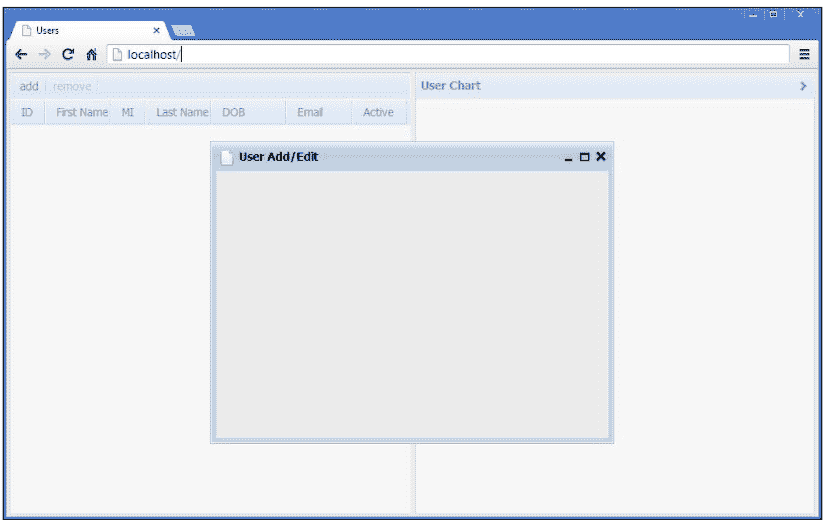

## 總結

在本章中，我們學習了 DHTMLX 的窗口組件，以及初始化它的各種方式。我們還介紹了一些獨立彈出窗口的重要方法和事件，以及它們如何與基礎窗口對象相關聯。然後，我們將這些知識應用到應用程序中，添加了彈出窗口代碼和方法。

在下一章中，我們將使用彈出窗口並添加一個 DHTMLX 表單。這將允許我們通過應用程序（而不是控制台）來添加用户。

# 8 DHTMLX 表單與日曆

在本章中，我們將學習 DHTMLX 的表單和日曆組件，涵蓋不同的初始化方式、方法和設置。然後，我們將在上一章創建的彈出窗口中添加一個表單。

本章中的所有更改都將發生在 `app.js` 和 `index.html` 文件中。

## DHTMLX 表單

DHTMLX 表單組件允許我們通過代碼創建 HTML 表單，或者將現有的 HTML 轉換為 DHTMLX 樣式的表單。我們將介紹如何使用 JavaScript 對象字面量數組通過代碼創建表單。

表單組件有許多不同的項目類型。例如，有按鈕、複選框、容器、輸入框、文件、隱藏字段、標籤、多選框、密碼框、單選按鈕、選擇框、模板、文本區域和上傳項。此外，還有位置相關的項目以及集成其他組件的項目。

DHTMLX 日曆是可以集成到表單中的組件之一。創建後，它仍然作為獨立組件處理。這意味著它的事件和方法是單獨處理的。

在本章結束時，我們將對 DHTMLX 表單有很好的理解，包括如何應用驗證、填充表單以及檢索其數據。然後，我們將把這些知識應用到應用程序中，創建一個用戶添加/編輯表單，以控制數據輸入和操作。

### DHTMLX 表單的初始化

正如我們在前幾章中介紹的，創建 DHTMLX 組件時，我們可以將它們附加到 DOM 元素或 DHTMLX 布局。表單組件也是如此。因此，我們不需要重複這些內容，相反，我們將嘗試一種新的方法，類似於將表單附加到布局。

在上一章中，我們學習了如何將組件直接附加到彈出窗口。這也將是我們附加表單的方式。

首先，我們將創建一個包含設置和表單項的對象數組。這將用於初始化現有彈出窗口中的表單。在這裡，我們將通過練習使用 `attachForm` 方法直接將表單添加到彈出窗口中。

### attachForm

我們將為練習創建的表單將包含 `settings`、`input`、`checkbox`、`calendar`、`select`、`button`、`block` 和 `newcolumn` 項。表單看起來不會太美觀，但我們只是為了了解每個項的作用。

點擊 **add** 按鈕顯示我們空的彈出窗口，然後我們將使用 `attachForm` 方法在彈出窗口中創建一個表單。

> 在將大量代碼輸入控制台時，先將其鍵入記事本或其他簡單的文本編輯器中，以便於語法檢查和後續編輯，會很有幫助。

在控制台中輸入並運行：

```javascript
var myForm = appPopup.attachForm([
    {
        type: "settings",
        position: "label-left",
        labelWidth: 100
    },
    {
        type: "input",
        label: "No name:",
        inputWidth: 50
    },
    {
        type: "input",
        name: "input1",
        label: "Some Label:",
        required: true
    },
    {
        type: "checkbox",
        name: "checkbox1",
        label: "Yes?"
    },
    {
        type: "calendar",
        name: "mydate",
        label: "date:"
    },
    {
        type: "select",
        name: "mySelect",
        label: "Select One:",
        options: [
            { text: "Option1", value: 1 },
            { text: "Option2", value: 2 },
        ]
    },
    {
        type: "button",
        name: "myButton1",
        value: "Click Me"
    },
    {
        type: "block",
        list: [
            { type: "button", value: "Button Left"},
            { type: "newcolumn", offset: 55 },
            { type: "button", value: "Button Right"},
        ]
    }
]);
```

運行此代碼後，您將在彈出窗口中看到一個如下截圖所示的表單：

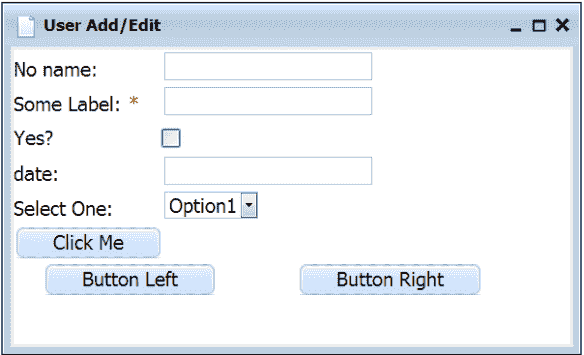

讓我們逐一了解這些表單項類型及其屬性。由於我們將新創建表單的引用賦給了變量 `myForm`，我們將使用它來調用一些方法。

### 表單項和屬性

表單上的每個項都有其可以應用的自己的屬性。其中一些是多種項類型共有的。以下是可用於大多數表單項的一些常見屬性：

- `className`（字符串）：為該項添加一個 CSS 類。

- `disabled`（布爾值）：禁用或啟用該項。

- `hidden`（布爾值）：顯示或隱藏該項。

- `tooltip`（字符串）：為該項設置一個工具提示。

- `name`（字符串）：表單元素的名稱。

#### settings

數組中的第一個對象是 `settings` 項。這是一個可選項，允許我們一次性為所有其他項應用屬性。例如，在一個有 20 個輸入框的表單中，為所有輸入框設置寬度會有些重複。因此，DHTMLX 提供了 settings 對象，它工作得很好。別擔心，這些設置可以在單個項級別被覆蓋。

在這個練習中，我們還將使用 `position` 將標籤左對齐，並設置一個寬度（`labelWidth`）使它們看起來均勻。

#### input

`input` 類型是您在任何 HTML 表單中都能看到的普通表單輸入框。我們在輸入框上設置的屬性有 `inputWidth`、`validate`、`required`、`label` 和 `name`。`name` 是我們稍後在代碼中檢索該輸入值的關鍵。

請注意，有三個 input 項，其中一個沒有 `name` 屬性。如果未為表單項提供 `name`，DHTMLX 會為我們生成一個唯一的名稱。這會使檢索值變得困難，因此在應用程序中我們將使用 `name`。

添加到輸入框的 `validate` 屬性會根據指定的規則驗證該輸入的值。提供的一些驗證規則有 `ValidSSN`、`ValidNumeric`、`Empty`、`NotEmpty` 和 `ValidEmail`。

`validate` 屬性的另一個特點是可以創建自定義驗證規則。這可以通過將自定義函數名甚至正則表達式作為 `validate` 屬性值來實現。也可以通過使用以逗號分隔的字符串對同一項應用多個驗證，例如 `NotEmpty` 和 `ValidNumeric`。

還有一個 `required` 屬性。它的作用與 `NotEmpty` 驗證完全相同，但還會自動在標籤旁邊添加一個星號。星號是 Web 表單的常見做法，用於通知用戶這些字段是必需的。

我們稍後將測試這些驗證如何工作。

#### hidden

`hidden` 類型與 HTML 的隱藏輸入類型完全相同。這允許我們將值放置在表單上，但在用戶界面中不可见。我們在練習中沒有使用它，但我們將在應用程序表單中使用它。

#### checkbox

`checkbox` 類型創建一個 HTML 復選框，其整數值為 1 或 0。我們也可以向復選框添加 `required` 和 `validate` 屬性。

#### calendar

`calendar` 類型創建一個輸入框，並自動初始化 DHTMLX 日曆組件。這種表單類型比普通表單元素有一些額外的屬性。

創建日曆時，可以選擇格式化日期顯示，並使用表單項屬性 `dateFormat` 設置是否啟用時間。如果您不設置格式，它將使用默認格式。

從附加了日曆組件的表單項檢索到的值是一個 JavaScript 日期對象。在將值保存到數據庫或希望稍後重新顯示時，了解這一點很重要。我們需要將 JavaScript 日期對象轉換為可讀的字符串以進行存儲和檢索。

#### select

`select` 類型創建一個 HTML 選擇框，其 `options` 屬性是一個數組，允許我們向選擇框添加 HTML 選項。我們也可以向 `select` 類型添加 `required` 和 `validate` 屬性。在每個 options 對象內部，我們可以設置 `selected` 屬性來將某個選項設置為選中狀態。

#### button

`button` 項類型創建一個表單按鈕。這些按鈕允許我們監聽 `onButtonClick` 表單事件。`value` 屬性用於設置按鈕內的文本。我們還添加了幾個位於 `block` 項類型內的其他按鈕。

#### block

DHTMLX 提供了幾種用於輔助表單佈局的表單項。`block` 表單項就是其中之一。它創建一個新的表單項組，我們可以將它們組合在一起定位。我們創建的按鈕組具有 `width` 等屬性。

我們使用 `list` 屬性將表單項添加到塊中，該屬性是一個表單項對象數組，與我們在 `block` 項外部使用的沒有區別。在 `list` 內部，我們使用 `newcolumn` 項在不同的列中創建了保存和取消按鈕。

#### 新列（newcolumn）

當表單項類型 `newcolumn` 被添加到表單項列表中時，它會將數組中位於 `newcolumn` 項之後的所有項移動到新的一列。此項唯一可用的屬性是 `offset`，用於設置列之間的間距。

如您所見，練習表單中的最後兩個按鈕位於兩列不同的位置。如果我們沒有在使用新列項之前將它們放置在 `block` 項內，那麼按鈕就會被推到其他表單元素的右側。`block` 項使我們能夠在不影響其他表單項的情況下包含該列。

### 表單方法

我們剛剛介紹了許多 DHTMLX 表單項類型及其一些屬性。DHTMLX 表單文檔中還有更多未涵蓋的內容。

現在，我們將探討一些用於驗證和操作表單中值的方法。

#### setItemFocus()

`setItemFocus` 方法允許我們將焦點置於所選的表單項上。這在創建表單時非常標準，並能帶來更好的用戶體驗。

在控制台中輸入並運行以下代碼行：

```
myForm.setItemFocus("input1");
```

當彈出窗口處於活動狀態時，光標將聚焦在名為 `input1` 的表單項上。

#### validate()

`validate` 方法會運行為每個表單項設置的驗證規則。

在控制台中輸入並運行以下代碼行：

```
myForm.validate();
```

您會注意到必填輸入的標籤變為紅色，如果輸入了文本，文本也會變紅。如果該字段中沒有文本，請輸入一些內容並保留。現在，再次運行 `validate` 方法。它將再次檢查該輸入，並清除該輸入上的驗證狀態。

#### clear()

`clear` 方法重置表單中的值。在輸入框中輸入一些數據或選擇一個日期。然後，在控制台中輸入並運行以下代碼行：

```
myForm.clear();
```

現在所有數據都被移除了。這也會清除可能存在的任何驗證錯誤。

#### enableLiveValidation()

`enableLiveValidation` 在表單項失焦時運行驗證方法。

在控制台中輸入並運行以下內容：

```
myForm.enableLiveValidation(true);
```

現在，當您在必填輸入框中聚焦並移動到下一個輸入框時，它將運行 `validate` 方法。我們也可以通過傳入 `false` 來關閉此功能。

#### setFormData()

`setFormData` 方法允許我們以編程方式設置表單項的值。此方法接受的參數是一個 JavaScript 對象字面量，其鍵是表單項的名稱，值是對應的值。如有必要，這允許我們用一個方法填充整個表單。讓我們向名為 `input1` 的表單項添加數據。

在控制台中輸入以下代碼行並運行：

```
myForm.setFormData({ input1: "Hello!" });
```

現在，名為 `input1` 的表單項已填入輸入的值。

#### getFormData()

`getFormData` 方法從表單中檢索值，返回一個 JavaScript 對象字面量。

在控制台中輸入以下代碼行並運行：

```
myForm.getFormData()
```

返回的對象會在控制台中被記錄。每個表單項都在其中。請注意，第一個屬性是 DHTMLX 為我們未提供名稱的輸入生成的一個隨機名稱。

## 應用程序代碼

現在，我們已經介紹了創建應用程序表單所需的所有表單方法。接下來，我們將把表單創建方法添加到包含表單初始化、事件、標誌和驗證的 `app.js` 文件中。

### app.js

打開 `app.js` 文件，並在末尾添加以下代碼：

```
// Form
var appForm;
dhtmlxEvent(window, "load", function(){
    // create form
    appForm = appPopup.attachForm([
        // settings
        {
            type: "settings", position: "label-left",
            labelWidth: 130, inputWidth: 120
        },
        // id
        {
            type: "hidden", name: "id"
        },
        // firstName
        {
            type: "input", name: "firstName",
            required: true, label: "First Name:"
        },
        // middleInitial
        {
            type: "input", name: "middleInitial",
            label: "Middle Initial:", inputWidth: 50
        },
        // lastName
        {
            type: "input", name: "lastName",
            required: true, label: "Last Name:"
        },
        // dob
        {
            type: "calendar", enableTime: false,
            dateFormat: "%n-%j-%Y", name: "dob",
            required: true, label: "Date of Birth:",
            inputWidth: 80
        },
        // email
        {
            type: "input", name: "email", required: true,
            validate: "ValidEmail", label: "Email:"
        },
        // active
        {
            type: "checkbox", name: "active",
            label: "Active:"
        },
        // buttons
        {
            type: "block",
            width: 300,
            list: [
                {
                    type: "button", value: "Save",
                    name: "save"
                },
                {
                    type: "newcolumn"
                },
                {
                    type: "button", value: "Cancel", name: "cancel"
                }
            ]
        }
    ]);

    // enable validation
    appForm.enableLiveValidation(true);

    // set event
    appForm.attachEvent("onButtonClick", function(btnName){
        // save or cancel
        if(btnName == "cancel"){
            callbacks.hidePopup();
        }else if(appForm.validate()){
            var formData = appForm.getFormData();
            if(formData.id){
                storage.updateUser(formData);
            }else{
                storage.createUser(formData);
            }
            callbacks.hidePopup();
        }
    });
});
```

### DHTMLX 表單和日曆

我們首先創建了全局變量 `appForm` 來引用我們創建的表單。然後，在頁面加載事件處理程序中，我們創建了表單並為其按鈕點擊事件添加了事件處理。我們還添加了實時驗證，以及在點擊 **save** 按鈕時進行驗證。

在 `onButtonClick` 事件處理程序中，我們確定是取消、編輯還是添加用戶。通過檢查隱藏的表單字段 `id` 是否有值，我們知道是編輯還是添加新用戶。然後，我們分別使用 `storage` 對象的 `updateUser` 或 `createUser` 方法，傳入整個表單值對象。最後，如果沒有驗證錯誤或點擊了 **cancel** 按鈕，彈出窗口將被關閉。

### callbacks

現在，我們將在 `callbacks` 對象的 `editClick`、`showPopup` 和 `hidePopup` 方法中添加一些代碼。

#### showPopup()

在 `showPopup` 方法中，我們已經添加了顯示和設置彈出模態框的方法。現在我們有了一个表單，我們希望在彈出窗口打開時將焦點設置在第一個輸入字段上。

編輯 `showPopup` 方法，添加如下所示的新代碼：

```
showPopup: function(){
    appPopup.setModal(1);
    appPopup.show();
    appForm.setItemFocus("firstName");
},
```

#### hidePopup()

`hidePopup` 方法已有隱藏彈出窗口的代碼。現在，當彈出窗口隱藏時，我們希望清除表單值。

編輯 `hidePopup` 方法，添加以下新代碼：

```
hidePopup: function(){
    appPopup.setModal(0);
    appPopup.hide();
    appForm.clear();
},
```

#### editClick()

當我們在網格中雙擊用戶行時，會觸發 `editClick`。在本章創建網格時，我們附加了 `onDblClick` 事件，該事件將用戶 ID 傳遞給 `callbacks` 對象的 `editClick` 方法。現在我們將使用它來檢索存儲的用戶信息並填充表單。

我們使用 `storage` 的 `getUser` 方法來檢索用戶對象，並使用表單的 `setFormData` 方法將這些值填充到表單中。

編輯 `editClick` 方法，添加以下新代碼：

```
editClick: function(userId){
    // get user
    var user = storage.getUser(userId);
    // load user into popup
    appForm.setFormData(user);
    // show popup
    callbacks.showPopup();
},
```

這是我們為表單在 `callbacks` 對象中需要進行的最後一次更改。接下來，我們將向 `index.html` 添加一些 CSS，使其看起來更好一些。

### 編輯表單 CSS

刷新頁面，點擊 **add** 按鈕以顯示彈出窗口和新創建的表單。正如您在下面的截圖中所看到的，表單內容在彈出窗口的邊緣顯得很擁擠：

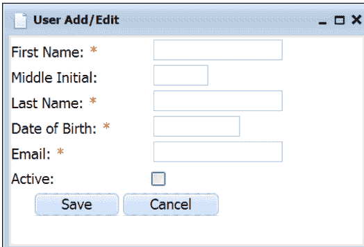

讓我們用 CSS 來修復這個問題。

DHTMLX 提供了編輯 CSS 以滿足我們需求的選項，我們現在就來進行操作。

### index.html

打開 index.html 文件，並在 head 標籤內找到內部 CSS 樣式。按照以下代碼片段編輯 style 標籤：

```
body, html { height: 100%; width: 100%; }
.dhxform_base { margin: 25px; }
.dhxform_base .dhxform_base { margin: 20px 15px;}
```

我們為 CSS 類 `dhxform_base` 和嵌套的 CSS 類 `dhxform_base` 添加了樣式。DHTMLX 會為整個表單的外部容器以及表單內創建的每一列添加這個類。

現在，刷新頁面以查看新應用的樣式。彈出窗口現在應該如以下截圖所示：

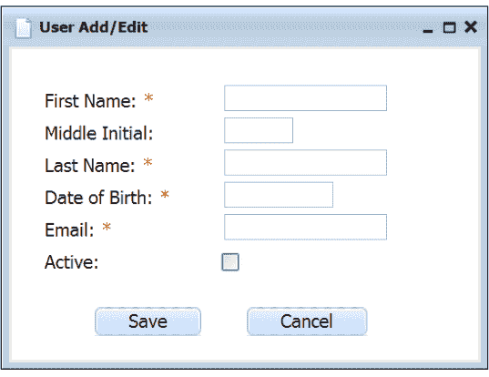

### 測試應用表單

既然表單已創建並通過 `callback` 方法連接到存儲，我們就可以進行測試了。首先，確保清除了 `localStorage`。

在控制台中輸入並運行以下代碼行：

```
localStorage.clear();
```

現在刷新頁面。

任何曾經出現在網格中的用戶現在應該都消失了。

自行測試所有以下操作：

- 添加一個用戶

- 雙擊網格中的用戶進行編輯

- 選擇網格中的用戶行並刪除一個用戶

所有這些操作都會在數據更改時刷新網格。你還會注意到對必填字段的驗證。

## 總結

在本章中，我們介紹了 DHTMLX 的表單，該表單使用了 DHTMLX 日曆實現。我們學習了如何在彈出窗口中初始化和附加表單以及表單驗證。然後，我們添加了允許我們添加和編輯用戶的應用程序代碼。

在下一章中，我們將學習 DHTMLX 圖表組件，並創建一個柱狀圖，該圖表將在每次任何用戶數據更改時自動更新。

# 9 DHTMLX 圖表

在本章中，我們將學習 DHTMLX 圖表組件，並涵蓋不同的初始化、事件、方法和設置。然後，我們將在應用程序中添加一個圖表。

本章中的所有更改都將發生在 app.js 和 index.html 文件中。

DHTMLX 圖表組件使我們能夠以極少的努力創建許多不同類型的圖表。DHTMLX 提供的圖表類型包括面積圖、水平條形圖、垂直條形圖、堆疊垂直條形圖、堆疊水平條形圖、環形圖、折線圖、餅圖、雷達圖、散點圖和樣條圖。這是一個功能非常強大的圖表集合。

對於應用程序，我們將重點關注垂直條形圖，並學習如何組織數據以及使用其事件。

在本章結束時，我們將對圖表組件有深入的了解，並在應用程序中添加一個柱狀圖，以按年齡顯示每個用戶。

## 方法與事件

我們將從初始化圖表、添加數據、定義系列以及操作圖表設置開始。在創建了用於測試的圖表後，我們將附加一個可用的事件。

### 初始化 DHTMLX 圖表

與我們涵蓋的其他 DHTMLX 組件一樣，圖表可以附加到 DOM 元素或 DHTMLX 布局單元格。

在初始化過程中需要了解的一件重要事情是，圖表需要一個 JavaScript 對象字面量作為參數，否則會發生異常。這個 JavaScript 對象可以包含圖表的設置和系列，也可以留空，允許稍後添加設置和系列。

#### dhtmlXChart()

DOM 初始化方法通過創建一個新的 `dhtmlXChart` 對象，並將 JavaScript 對象參數 `container` 屬性的值設置為 DOM 元素的 ID 來實現。代碼如下所示。不要在控制台中輸入此代碼：

```
var myChart = new dhtmlXChart({ container: "myContainerId" });
```

#### addChart()

`addChart` 方法實際上是 DHTMLX 布局單元格對象的一部分，它將圖表直接附加到我們選擇的單元格。現在，我們將圖表附加到 `appLayout` 單元格 `b`。

在控制台中輸入並運行以下代碼行：

```
var myChart = appLayout.cells("b").attachChart({});
```

這裡，我們將一個圖表初始化到一個單元格，並將引用賦值給 `myChart` 變量。我們將在接下來的練習中使用此圖表。

### 方法

現在我們將開始圖表方法的練習。

#### refresh()

`refresh` 方法允許新應用的設置在圖表中顯示。如果圖表設置被更改或添加，必須使用 `refresh` 方法，否則這些設置不會生效。

其實現代碼如下：

```
myChart.refresh();
```

#### add()

`add` 方法允許我們向圖表添加數據。可以將這些數據想像成來自數據庫或本地存儲的 `行`。此方法接受一個 JavaScript 對象字面量作為參數。添加到圖表的每個對象必須具有相同名稱的屬性才能進行比較或顯示。

假設我們有一個有多個用戶的社交個人資料網站。我們知道他們的姓名、年齡以及其個人資料的訪問次數。我們將使用這些信息向圖表添加一些數據以便查看。

在控制台中輸入並運行以下代碼：

```
myChart.add({ name: "Steve", age: 45, profileViews: 83 });
myChart.add({ name: "John", age: 27, profileViews: 115 });
myChart.add({ name: "Ashley", age: 34, profileViews: 225 });
```

數據會自動刷新到圖表中。一旦添加了這些數據，我們將看到一個類似於以下截圖中的圓形：

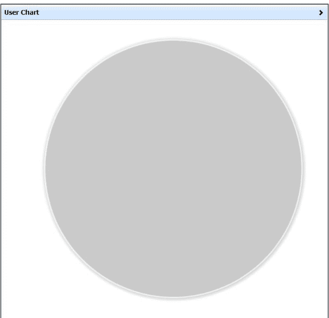

我們看到這個灰色圓形是因為 DHTMLX 圖表默認是餅圖，而且我們沒有為圖表應用任何設置來告訴它使用哪些數據進行比較。

接下來，我們將定義這些設置。

#### define()

`define` 方法允許我們單獨更改圖表的設置和第一個數據系列。它接受兩個參數。第一個是我們要設置的屬性的名稱，第二個是該屬性的值，根據屬性的不同，可以是字符串、對象、布爾值或整數。

以下是一些設置：

-   view: (字符串) 設置圖表類型

-   container: (字符串) 用於 DOM 初始化

-   padding: (對象, 整數) 設置圖表的內邊距

-   legend: (對象) 創建圖表圖例

-   value: (字符串) 設置第一個系列的值

-   label: (字符串) 設置第一個系列的標籤

-   gradient: (函數, 字符串) 設置值漸變

-   x axis: (對象) 設置 x 軸屬性

-   y axis: (對象) 設置 y 軸屬性

請注意，這些設置可能因圖表類型而異。我們正在構建一個柱狀圖。

### 定義一個系列

首先，我們將定義一個系列，讓圖表知道我們想要比較哪些數據。

系列分為幾個不同的設置：

-   value (要比較的值)

-   label (每個值的標籤)

-   color (該系列的顏色)

將值和標籤應用於圖表時，它們使用模板語法，允許組合被比較對象的屬性。每個屬性必須以 `#` 作為前綴和後綴。

現在，我們將通過添加 `value` 設置來添加一個新系列。記住，每次添加設置後，我們需要刷新圖表。

在控制台中輸入並運行以下代碼：

```
myChart.define("value", "#profileViews#");
myChart.refresh();
```

我們添加的這個系列正在比較我們數據對象在假想社交網站上獲得的個人資料訪問次數。

添加值後，我們可以看到一些彩色的切片，但我們仍然不知道它們屬於誰。我們將使用 `label` 設置來解決這個問題。

在控制台中輸入並運行以下代碼：

```
myChart.define("label", "#name# (#profileViews#)");
myChart.refresh();
```

我們使用模板語法在 `label` 組件中顯示了 `name` 和 `profileViews`。現在我們知道每個數據集屬於誰了。

然而，圖表的顯示存在一個問題。調整瀏覽器窗口大小，直到標籤只能部分可見。這可以通過為圖表定義 `padding` 來修復。

在控制台中輸入並運行以下代碼：

```
myChart.define("padding",100);
myChart.refresh();
```

### DHTMLX 圖表

這將為圖表在布局單元格內提供 100 像素的內邊距，現在標籤有足夠的空間可供閱讀。圖表現在看起來如下圖所示：

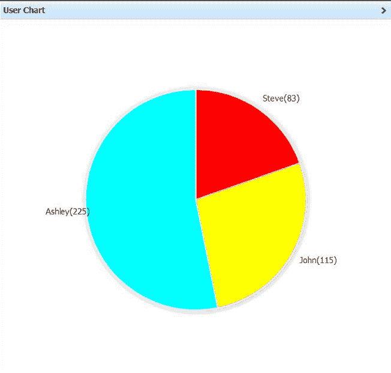

### 定義圖表類型

現在我們將圖表更改為柱狀圖。我們已經使用第一組數據設置了圖表。讓我們看看當使用 `view` 設置將其更改為柱狀圖時會發生什麼。

在控制台中輸入並運行以下代碼：

```
myChart.define("view","bar");
myChart.refresh();
```

我們的圖表已更改為柱狀圖。但佈局和標籤看起來不太合適。為此，我們需要設置 `xAxis` 以在底部顯示標籤，並更改一些其他設置。我們現在就來做。

在控制台中輸入並運行以下代碼：

```
myChart.define("label", false);
myChart.define("padding", 50);
myChart.define("xAxis", {
    title: "Names",
    template: "#name#",
    lines: false
})
myChart.define("tooltip","Views (#profileViews#)");
myChart.refresh();
```

圖表現在更具可讀性。我們移除了標籤並添加了工具提示，當鼠標懸停在圖表中的柱條上時，將顯示個人資料瀏覽次數。

`xAxis` 設置提供了在圖表底部使用有意義的標籤進行標記的能力。如您所見，我們添加了標題 `Names`，每個數據集都有一個標籤，顯示相應人員的名稱。我們還將 `lines` 屬性設置為 false，這會從圖表中移除垂直線。

圖表現在看起來如下圖所示：

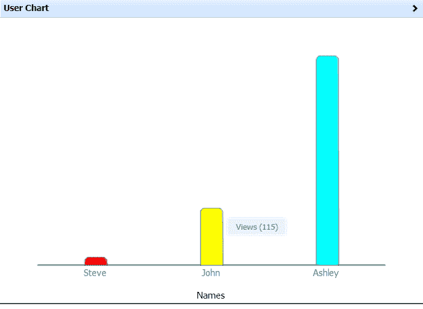

接下來，我們將介紹向圖表添加第二組數據。

### DHTMLX 圖表

### addSeries()

`addSeries` 方法允許我們為圖表創建額外的數據系列。我們必須提供一個對象作為參數。現在，我們將為圖表中每個人的年齡添加一個數據系列。

在控制台中輸入並運行以下代碼：

```
myChart.addSeries({
    value: "#age#",
    color: "purple",
    tooltip: "Age (#age#)"
});
myChart.refresh();
```

在對象內部，我們設置了值、顏色和工具提示，然後刷新。這應用了更改，現在年齡數據系列已添加。

### idByIndex()

我們之前添加到圖表的每個數據對象都被分配了圖表內部數組中的一個索引。這意味著 Steve 的第一個數據對象索引為零。這些數據對象中的每一個都有一個與之關聯的 ID，可以使用 `idByIndex` 方法檢索。這將允許我們在數據對象被添加後訪問它。

讓我們獲取 Steve 數據對象的 ID。在控制台中輸入並運行以下代碼：

```
var steveDataId = myChart.idByIndex(0);
```

現在，我們將 DHTMLX 生成的 ID 分配給了我們的 `steveDataId` 變量。

### get()

`get` 方法拉取我們之前使用 `add` 方法為 Steve 添加的所有數據。它接受我們想要檢索的關聯數據 ID 作為參數。返回的數據對象不是只讀的。我們可以使用同一個對象來更改值並刷新網格以應用更改。

在控制台中輸入並運行以下代碼：

```
var steveData = myChart.get(steveDataId);
```

您可以在控制台中看到我們擁有最初為 Steve 創建的所有數據。嗯，看起來 Steve 不喜歡被稱為 Steve，而是更願意被稱為 Steven。讓我們為他更新這一點。

在控制台中輸入並運行以下代碼：

```
steveData.name = "Steven";
myChart.refresh();
```

正如您所看到的，他的名字現在已更改。

現在，我們將探討事件。

### 事件

圖表有許多可用的事件。目前，讓我們看其中一個，以便對未來其他可用事件的使用有足夠的了解。

#### onItemClick

`onItemClick` 事件在我們點擊圖表中的每個柱條時觸發。它將返回被點擊項的數據對象 ID。讓我們使用這個事件來顯示一個警報，告訴我們剛剛點擊了誰的數據。

在控制台中輸入並運行以下代碼：

```
myChart.attachEvent("onItemClick", function(id){
  alert("This is data for "+myChart.get(id).name);
});
```

現在，當我們點擊每個柱條時，我們會看到一個警報，告訴我們該數據的名稱。

我們涵蓋了應用程序所需的所有必要的圖表方法和事件。讓我們開始應用我們所學的內容。

## 應用程序代碼

對於該應用程序，我們將基於通過表單添加的每個用戶的年齡顯示一系列數據。這將在數據更改時與網格匹配。如前所述，我們將使用柱狀圖，並在初始化方法中使用傳入的對象創建所有必要的設置。

首先，我們將在 `app.js` 文件中直接在表單創建方法之後添加創建方法。這將包含我們的全局圖表變量和創建方法。

### DHTMLX 圖表

### 創建圖表

將以下代碼添加到 `app.js` 文件的末尾：

```
// Chart
var appChart;
dhtmlxEvent(window,"load",function(){
    appChart = appLayout.cells("b").attachChart({
        view: "bar",
        value: "#age#",
        label: "#age#",
        gradient: "rising",
        tooltip: {
            template: "#age#"
        },
        xAxis: {
            title: "Users",
            template: "#name#",
            lines: false
        },
        yAxis: {
            title: "Years of Age",
            lines: true
        },
        padding: {
            left: 25,
            right: 10,
            top: 45
        }
    });
    // reset chart data
    callbacks.refreshChart();
});
```

首先，我們創建了全局變量，然後在頁面加載事件處理程序中創建了一個圖表。在圖表初始化內部，我們應用了剛剛學到的所有設置，並添加了 `gradient` 和 `yAxis`。`gradient` 在柱條上設置了漂亮的漸變效果。`yAxis` 將在圖表左側顯示年齡的網格線和數字。

初始化之後，我們調用了 `callbacks.refreshChart`，它將以與我們為網格所做的相同方式刷新圖表數據。

### callbacks.refreshChart()

在 `callbacks` 對象的 `refreshChart` 方法內部，我們將清除圖表並添加數據。

按照以下代碼編輯 `refreshChart` 方法：

```
refreshChart: function(){
    appChart.clearAll();
    appChart.parse(storage.getUserBarChart(), "json");
},
```

### callbacks.dataChanged()

在 `callbacks` 對象的 `dataChanged` 方法內部，我們將添加 `refreshChart` 方法。

按照以下方式編輯 `dataChanged` 方法：

```
dataChanged: function(){
    callbacks.refreshGrid();
    callbacks.refreshChart();
}
```

現在我們可以測試圖表了！

### 測試應用程序

首先，再次清除我們的本地存儲數據。

在控制台中輸入並運行以下代碼：

```
localStorage.clear()
```

現在，刷新頁面，圖表和網格應該為空。

我們將向應用程序添加一些用戶，但首先我們需要看一些事情。點擊 **add** 按鈕以彈出窗口。通過拖動標題將彈出窗口移動到圖表上方。在當前版本（撰寫本書時），圖表的 z-index 高於彈出窗口，這使我們無法正確使用彈出窗口。可以通過一個小的 CSS 更改來修復此問題。

如果您遇到此問題，讓我們通過進入 `index.html` 的 CSS 並在樣式末尾添加以下 CSS 來修復它：

```
.dhx_chart{ z-index: 1; }
```

### DHTMLX 圖表

現在，刷新頁面並再次嘗試使用彈出窗口。一切正常，彈出窗口再次位於頂部。

讓我們開始添加一些數據。使用彈出窗口添加以下用戶：

- John Smith, jsmith@email.com, 1-1-1963

- Tim Smith, tsmith@email.com, 1-1-1963

- Alice Chance, achange@email.com, 6-23-1972

- Bob White, bwhite@email.com, 12-22-1993

- Jimbo Manning, jmanning@email.com, 4-18-1984

- Peter Redding, predding@email.com, 9-9-2001

- Susie Cue, scue@email.com, 10-3-1989

當您輸入這些用戶時，所有數據組件都在同時刷新！請記住，我們始終可以通過雙擊網格行來編輯用戶。

圖表已完成，看起來如下圖所示：

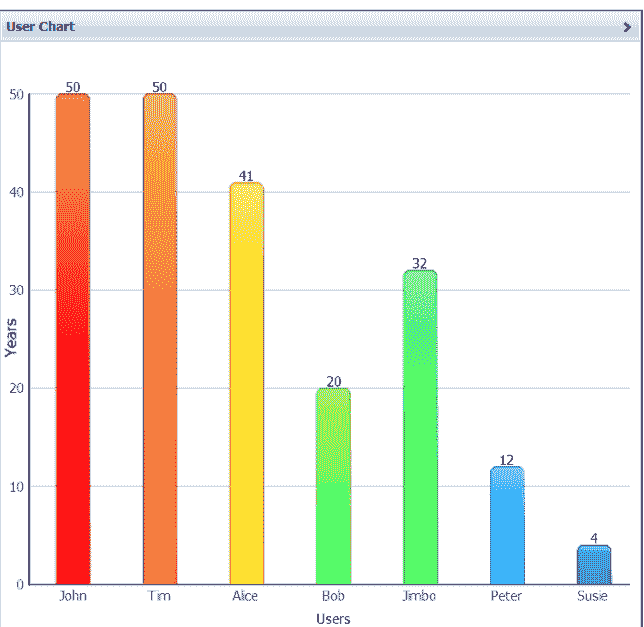

## 總結

本章中，我們探討了如何創建 DHTMLX 圖表，並在創建後對其進行操作。憑藉新學會的這項技能，我們能夠為應用程序創建了一個美觀的條形圖。

在下一章中，我們將討論如何測試應用程序、進行故障排除，並提供一些關於如何自行擴展它的想法。

# 10 終點線

歡迎來到終點線！應用程序現已完成。憑藉這些新掌握的技能，我們準備好踏入世界，在一切事物上使用 DHTMLX 組件了！好吧，這種說法可能有點誇張，但我們確實對該庫有了更深入的理解，並且應該能非常自如地應用它。

在本章中，我們將探討在創建應用程序過程中可能遇到的一些問題。我們還將討論一些可以用來擴展應用程序的額外內容。

本章中我們不會進行任何強制性的代碼修改。但強烈建議您自行嘗試一些推薦的擴展，以進一步提升您的技能。

## 測試

在上一章中，我們添加了一個用戶列表並初步測試了應用程序。現在全部完成後，它看起來如下截圖所示：

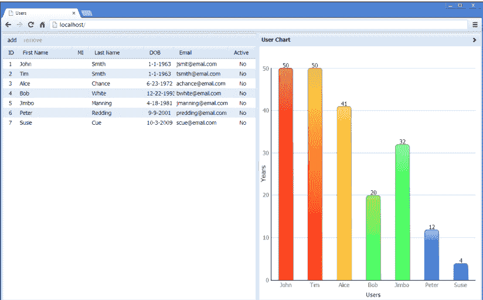

現在是測試所有已創建功能的時候了。測試時，請確保您按照以下列出的所有要點進行檢查：

- 表單應具有所有正確的驗證

- 工具欄應啟用和禁用按鈕，並觸發彈出窗口

- 雙擊一行應打開包含用戶信息的表單

- 更新或添加用戶應更改網格和圖表中的數據

- 彈出窗口在圖表上不應該有任何 z-index 問題

接下來讓我們談談故障排除。

## 故障排除

使用 JavaScript 開發時，語法錯誤非常常見，因為錯誤發生在運行時，而 JavaScript 編輯器可能功能非常有限。但如果您密切關注 Chrome 中的開發者控制台，它會直接帶您找到錯誤，並根據提供的異常給出相當合理的解釋。

最常見的一些問題包括：

- 對象中的項目之間缺少尾隨逗號

- 使用事件處理程序時缺少括號或方括號

- 變量和方法區分大小寫

它們聽起來像是簡單的問題，也確實如此。如果您是經驗豐富的開發人員，您已經了解這些細節。如果不是，請始終記住這些，因為首先檢查這些可以為您節省大量的調試時間。這類語法錯誤往往在長時間編碼後發生。

網格組件在初次學習時可能會帶來問題，特別是初始化。這是因為網格有一個單獨的 `init` 方法，該方法在其創建並應用所有設置後被調用。所以請記住這一點。

接下來，讓我們談談如何將應用程序提升到一個新的水平。

## 更多功能

我們構建的應用程序是一個相當簡單的應用程序，旨在讓我們熟悉這些組件。但是，如果我們要將其用於真實環境，則需要進行一些調整。

### 服務器端

HTML5 的 localStorage 非常適合在客戶端存儲數據，甚至允許 Web 應用程序離線工作。但是，一旦需要在其他 Web 用戶之間共享此數據，就需要某种類型的服務器端存儲，以便每個客戶端可以共享對數據的更改。

有很多選擇可供我個人考慮。我會創建一個寫入服務器端數據庫的 Web 服務。因為我們將所有數據調用分離到了 `storage` 對象中，本質上是一個 **數據訪問層（DAL）**，我們所需要做的就是調整這些方法並添加一些 Ajax 調用。應用程序的其他部分將保持不變。嗯，除了添加一些 `progressOn` 和 `progressOff` 方法。

### 添加圖標

我們前面章節沒有討論的一個內容是額外的圖標。這是添加到任何應用程序中的一個非常好的功能。

在工具欄的 **添加** 按鈕中添加一個加號圖標，在 **刪除** 按鈕中添加一個紅色叉號圖標，會使其看起來更專業。您也可以只使用圖標而不使用文字，以節省工具欄空間，並使用工具提示功能來提供有關該按鈕功能的更多信息。

我們在應用程序中使用的默認皮膚使用 18 X 18 像素的圖像，最好是帶透明背景的 .png 格式。

彈出窗口的標題欄中也可以包含一個圖標。可以將其設置為一個小型用戶圖標，也許根據我們是添加還是編輯用戶來更改圖標。

請查看每個組件的文檔，了解其添加圖像和圖標的方法。

### 事件調整

需要提及的一個特定事件調整是表單中日曆的事件。如果日期輸入框獲得焦點，我們可以自動觸發日曆，並禁止通過鍵盤自由輸入日期。但是，這取決於個人喜好，並非完全必要，因為存在日期驗證。這點您可以自行決定。

我個人喜歡做的一件事是在選擇年份時就應用日曆中的日期值。目前，要更改用戶的出生年份，您需要再次選擇年份和日期，然後日曆才會在表單中應用數據更改。這可能會相當煩人，並且可以修復。

日曆有一個 `onChange` 事件，該事件在日曆組件中的值發生任何變化時都會觸發。此事件返回當前日曆選定值。使用此事件，您可以隨時在日期（無論是月份、日期還是年份）變化時更新輸入框的值。

以下是將其應用到應用程序中的代碼示例：

```
var dobCal = appForm.getCalendar("dob");
dobCal.attachEvent("onChange", function(date){
    appForm.setItemValue("dob", date);
});
```

此代碼應放在表單初始化方法之後，如果您現在添加它，它將會生效。

### 圖表構想

另一個不錯的擴展是允許使用應用程序的人更改圖表類型。有幾種不同的方法可以實現這一點。其中一種是在包含圖表的單元格中添加一個工具欄。這個工具欄可以有一個選擇按鈕，將不同的圖表類型作為選項。當選擇按鈕改變時，您可以更改圖表設置以匹配選定的圖表類型。您也可以在每個項目的文本旁邊添加圖標，或者只使用圖標作為選項。

如果您真的想做得花哨一些，可以留空圖表，不顯示任何數據。在工具欄上創建一個額外的按鈕，以便用戶按需將用戶添加到圖表中。這樣，當在網格中選中一個用戶並按下新創建的按鈕時，它會將選定用戶的數據添加到圖表中。這將需要對當前檢索數據的代碼進行一些調整。您可能還想在圖表一側創建一個清除按鈕來清空數據。

我們還可以再花 10 頁篇幅來討論這個應用程序可以如何發展，但這對您的創造力就沒有挑戰了！所以，現在輪到您了！思考一下如何擴展它，並將其保存在您的代碼工具箱中，以便在您對 DHTMLX 庫更熟悉時參考！

## 總結

在本章中，我們回顧了應用程序以及在 JavaScript 和 DHTMLX 庫開發過程中需要注意的一些事項。我們還討論了一些很酷的代碼擴展，並查看了一個小的示例供您自行添加。至此，使用 DHTMLX 庫的用戶應用程序編程就結束了。希望您能將一些提到的想法與您自己的想法結合起來，進一步開發應用程序。

# 索引

**A**

- addButton 方法 45

- addButtonSelect 方法 46

- addButtonTwoState 方法 45

- addChart() 方法 90

- addClick 方法 72

- addInput 方法 48

- add() 方法 90, 91

- addRow 方法 56

- addSeparator 方法 45

- addSeries() 方法 96

- addSlider 方法 47

- addSpacer 方法 47

- addText 方法 46

- 應用程序代碼，DHTMLX 圖表 97

- 應用程序代碼，DHTMLX 表單

    - 關於 83

    - app.js 文件 83, 85

    - callbacks 對象 85

    - 表單 CSS，編輯 86, 87

    - index.html 87

- 應用程序代碼，DHTMLX 網格

    - callbacks.dataChanged 61

    - callbacks.refreshGrid 61

    - callbacks.removeClick 60

    - callbacks.setToolbarItemStates 60

    - 創建網格 59, 60

- 應用程序代碼，DHTMLX 布局 38

- 應用程序代碼，DHTMLX 窗口

    - callbacks 對象 71

    - 創建彈出窗口 71

    - 測試彈出窗口 72

- 應用程序目錄結構

    - 創建 11, 12

- 應用程序文件 app.js

    - 創建 13

- attachEvent 方法 37

- attachForm 方法

    - 用於附加 DHTML 表單 76, 78

- attachGrid 方法 55

- 屬性，DHTMLX 表單

    - className 78

    - disabled 78

    - hidden 78

    - name 78

    - tooltip 78

**B**

- barChartItem 方法 25, 26

- 基礎 dhtmlXWindows 對象

    - 創建 65-67

    - 使用 dhtmlXWindows 方法創建 67

    - 初始化 66

- block 項，DHTMLX 表單 80

- button 項，DHTMLX 表單 80

**C**

- calendar 項，DHTMLX 表單 80

- callbacks.dataChanged() 99

- callbacks 對象

    - 關於 29

    - addClick 方法 72

    - hidePopup 方法 72

    - showPopup 方法 71

- callbacks 對象，DHTMLX 表單應用程序代碼

    - editClick 方法 86

    - hidePopup 方法 85

    - showPopup 方法 85

callbacks.refreshChart() 99

centerOnScreen 方法 68

**圖表方法**

  add() 90

  addSeries() 96

  define() 92

  get() 96

  idByIndex() 96

  refresh() 90

**圖表方法，存儲對象**

  關於 25

  barChartItem 25

  createUserBarChart 26

複選框項，DHTMLX 表單 80

clearAll 方法 58

clear() 方法 82

clearSelection 方法 57

**組件，DHTMLX**

  Calendar 9

  Chart 9

  ColorPicker 8

  Combo 9

  DataView 8

  Editor 8

  Form 9

  Grid 8

  Layout 8

  Menu 9

  Tab bar 9

  Toolbar 8

  Tree 8

  Tree Grid 8

  Windows 8

createUserBarChart 方法 26

createUser 方法 22, 62

createWindow 方法 67

## D

**DAL (數據訪問層)** 105

dataChanged 方法 61, 62

數據存儲文件 14

**define() 方法**

  關於 92

  圖表類型，定義 94, 95

  序列，定義 92, 93

denyResize 方法 68

detachEvent 方法 37

**DHTMLX**

  關於 7

  組件庫 7, 8

  組件 8

  特性 105

  測試 104


故障排除 105

构建用户管理 Web 应用 9, 10

安装 Web 服务器 11

**DHTMLX 图表**

关于 89

`addChart()` 方法 90

应用代码 97

`callbacks.dataChanged()` 99

`callbacks.refreshChart()` 99

创建 98

`dhtmlXChart` 对象 90

事件 97

初始化 89

方法 90

测试 99

`dhtmlXChart()` 方法 90

`dhtmlxEvent` 38

**DHTMLX 表单**

关于 75

应用代码 83

附加，使用 `attachForm` 附加 76, 78

属性 78

初始化 76

项 78

方法 81

测试 88

DHTMLX 表单，初始化 76

**DHTMLX 表单项**

`block` 80

`button` 80

`calendar` 80

`checkbox` 80

`hidden` 79

`input` 79

`newcolumn` 81

`select` 80

`settings` 79

# DHTMLX grid

关于 53

应用代码 59

事件 53, 58

初始化选项 54

方法 53, 55

测试 62

创建用户 62

移除用户 63

# DHTMLX 安装

测试 15, 17, 18

# DHTMLX layout

关于 31, 32

应用代码 38

创建 38

事件 33, 37

初始化 33

方法 33, 34

# DHTMLX 库

下载 12, 13

# DHTMLX toolbar

关于 41, 42

应用代码 50

创建 50, 51

事件 42

初始化 42

在单元格对象上初始化 43

在 DOM 元素上初始化 42

在 layout 对象上初始化 43

项类型 44

方法 42

## DHTMLX 窗口

关于 65

应用代码 70

事件 65, 69

方法 65

`disableItem` 方法 48

## E

`enableItem` 方法 48

`enableLiveValidation()` 方法 82

事件，DHTMLX layout

关于 37

`attachEvent` 37

`detachEvent` 37

`dhtmlxEvent` 38

事件，DHTMLX 窗口

`onClose` 事件 70

## F

`fixSize()` 方法 35

## G

`getFormData()` 方法 82

`getItemState` 方法 45

`getListOptionSelected` 方法 47

`get()` 方法 96

`getSelectedRowId` 方法 57

`getUserGrid` 方法 24

`getUser` 方法 22

`getValue` 方法 48

## grid 事件

`onRowDblClicked` 58

`onRowSelect` 59

## grid 方法

`addRow` 56

`attachGrid` 55

`clearAll` 58

`clearSelection` 57

`getSelectedRowId` 57

`init` 56

`parse` 58

`setColAlign` 56

`setColTypes` 57

`setHeader` 56

`setImagePath` 55

`setInitWidths` 56

## grid 方法，存储对象

关于 23

`getUserGrid` 方法 24

grid JSON 数据结构 23

`gridRow` 方法 24

`gridRow` 方法 24

## H

`hidden` 项，DHTMLX 表单 79

`hideHeader` 方法 69

`hideItem` 方法 48

`hide` 方法 68

`hidePopup` 方法 72

## I

`idByIndex()` 方法 96

`iframe` 32

`index.html` 文件

创建 14

**初始化，DHTMLX grid**

在单元格对象上 55

在 DOM 元素上 54

`init` 方法 56

`input` 项，DHTMLX 表单 79

## J

**JavaScript 组件库**

`jqGrid` 7

`SlickGrid` 7

`jqGrid` 7

## L

`lastStoredId` 属性 21

`localStorage` 19

## M

**MAMP**

URL 11

**方法，DHTMLX 表单**

`clear()` 82

`enableLiveValidation()` 82

`getFormData()` 82

`setFormData()` 82

`setItemFocus()` 81

`validate()` 81

**方法，DHTMLX layout**

单元格标题 36

单元格尺寸调整 35

`fixSize` 35

`hideHeader` 36

概述 37

`progressOff` 36

`progressOn` 36

`setHeight` 35

`setText` 36

`setWidth` 35

`showHeader` 36

**方法，DHTMLX 窗口**

`centerOnScreen` 68

`createWindow` 67

`denyResize` 68

`hide` 68

`hideHeader` 69

`setDimension` 67

`setModal` 68

`setText` 69

`show` 69

`showHeader` 69

## N

`newcolumn` 项，DHTMLX 表单 81

## O

`onClick` 事件 49

`onClose` 事件 70

`onDblClick` 事件 86

`onEnter` 事件 50

`onItemClick` 事件 97

`onRowDblClicked` 事件 58

`onRowSelect` 事件 59

`onStateChange` 事件 45, 50

`onValueChange` 事件 49

## P

`parse` 方法 58

**弹出窗口，DHTMLX 窗口**

创建 71

`progressOff()` 方法 36

`progressOn()` 方法 36

## R

`refreshGrid` 方法 61

`refresh()` 方法 90

`removeClick` 方法 60

`removeItem` 方法 49

`removeSpacer` 方法 47

`removeUser` 方法 23

## S

- `select` 项，DHTMLX 表单 80

- Sencha Ext JS 8

- `setColAlign` 方法 56

- `setColTypes` 方法 57

- `setDateFormat` 方法 21

- `setDimension` 方法 67

- `setFormData()` 方法 82

- `setHeader` 方法 56

- `setImagePath` 方法 55

- `setInitWidths` 方法 56

- `setItemFocus()` 方法 81

- `setModal` 方法 68

- `setText` 方法 69

- `settings` 项，DHTMLX 表单 79

- `setToolbarItemStates` 方法 60

- `showHeader` 方法 69

- `showItem` 方法 48

- `show` 方法 69

- `showPopup` 方法 71

- `SlickGrid` 7

- 存储对象

  - 关于 26

  - 图表方法 25

  - 创建 20

  - grid 方法 23

  - `lastStoredId` 属性 21

  - 属性 20

  - `setDateFormat` 方法 21

  - 用户方法 21

- `addSeparator` 45

- `addSlider` 47

- `addSpacer` 47

- `addText` 46

- `getItemState` 45

- `getListOptionSelected` 47

- `getValue` 48

- `removeItem` 方法 49

- `removeSpacer` 47

- 故障排除 105

## T

- 测试 104

- toolbar 事件

  - 关于 49

  - `onClick` 事件 49

  - `onEnter` 50

  - `onStateChange` 50

  - `onValueChange` 49

- toolbar 项，DHTMLX toolbar

  - `addButton` 45

  - `addButtonSelect` 46

  - `addButtonTwoState` 45

  - `addInput` 48

  - `addSeparator` 45

  - `addSlider` 47

  - `addSpacer` 47

  - `addText` 46

  - `getItemState` 45

  - `getListOptionSelected` 47

  - `getValue` 48

  - `removeItem` 方法 49

  - `removeSpacer` 47

  - 故障排除 105

## U

- `updateUser` 方法 22

- 用户应用程序

  - 图表创意 107

  - 事件调整 106

  - 功能 105

  - 添加图标 106

  - 服务器端 105

- 用户管理 Web 应用

  - 构建 9, 10

- 用户方法，存储对象

  - 关于 21

  - `createUser` 22

  - `getUser` 方法 22

  - `removeUser` 方法 23

  - `updateUser` 方法 22

  - 用户模型 21

  - 用户参数 22

## V

- `validate()` 方法 81

- Visual Designer 工具 9

## W

- WampServer

  - URL 11

- Web 服务器

  - 安装 11

**感谢您购买**

# 学习 DHTMLX Suite UI

## 关于 Packt Publishing

Packt（发音为“packed”）于 2004 年 4 月出版了其第一本书《*精通 phpMyAdmin 以进行有效的 MySQL 管理*》，随后继续专注于出版针对特定技术和解决方案的高度专业化的书籍。

我们的书籍和出版物分享了您同行的 IT 专业人士在适应和定制当今系统、应用程序和框架方面的经验。我们基于解决方案的书籍为您提供知识和力量，以定制您正在使用的软件和技术来完成任务。Packt 的书籍比您过去见过的 IT 书籍更具体，不那么通用。我们独特的商业模式使我们能够为您提供更集中的信息，让您知道更多需要了解的内容，而减少不需要了解的内容。

Packt 是一家现代而独特的出版公司，专注于为开发者、管理员和新手社区制作高质量、前沿的书籍。有关更信息，请访问我们的网站：www.packtpub.com。

## 为 Packt 撰稿

我们欢迎所有对撰写书籍感兴趣的人士咨询。书籍提案应发送至 author@packtpub.com。如果您的书籍想法仍处于早期阶段，您希望在撰写正式书籍提案之前先讨论，请联系我们；我们的一位组稿编辑将与您联系。

我们不仅寻找已出版的作者；如果您拥有强大的技术技能但没有写作经验，我们经验丰富的编辑可以帮助您发展写作事业，或者仅仅为您的专业知识获得一些额外的回报。

### jQuery 1.4 参考指南

ISBN: 978-1-84951-004-2 平装: 336 页

全面解析这款流行的 JavaScript 库

1.  快速查阅 jQuery 库的功能特性

2.  以易于遵循的方式逐步讲解 jQuery 库中的每个函数、方法和选择器表达式

3.  理解 jQuery 脚本的内在结构

4.  利用 jQuery 强大的插件架构编写你自己的插件

### jQuery UI 1.8：jQuery 的用户界面库

ISBN: 978-1-84951-652-5 平装: 424 页

使用 jQuery 用户界面库中现成的组件，构建高度交互的 Web 应用程序

1.  充满示例和清晰的解释，指导你如何轻松地为你的 Web 应用程序设计优雅而强大的前端界面

2.  包含一个关于小部件工厂的章节，其中有一个关于如何构建自定义 jQuery UI 小部件的深入示例

3.  更新了代码，包含对前一版本的重大更改和修复

请访问 www.PacktPub.com 获取我们的图书信息

### 使用 HTML5 和 CSS3 进行响应式 Web 设计

ISBN: 978-1-84969-318-9 平装: 324 页

学习使用 HTML5 和 CSS3 进行响应式设计，使网站能适应任何浏览器或屏幕尺寸

1.  使用 HTML5 和 CSS3 编写能响应任何设备或屏幕尺寸的网站所需的一切

2.  学习 HTML5 的主要新功能，并使用 CSS3 惊人的新能力，包括动画、过渡和变换

3.  真实世界的示例展示了如何逐步增强响应式设计，同时为较旧的浏览器提供后备方案

### HTML5 Canvas 实战手册

ISBN: 978-1-84969-136-9 平装: 348 页

超过 80 个食谱，用 HTML5 Canvas 革命性地改变 Web 体验

1.  最快速度掌握 HTML5 Canvas 应用程序和游戏开发的方法

2.  无需 Flash 即可创建令人惊叹的 3D 可视化效果和游戏

3.  以现代、不突兀且面向对象的 JavaScript 风格编写，因此代码可在你自己的应用程序中重用

请访问 www.PacktPub.com 获取我们的图书信息
