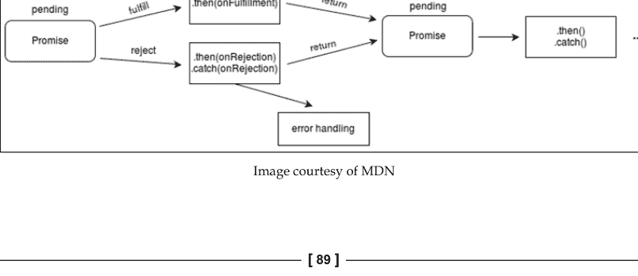
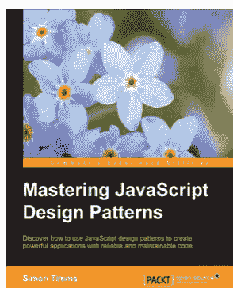

# 学习 ECMAScript 6：掌握所有 ES6 新特性，成为最杰出的 JavaScript 开发者之一，能够按照最新标准编写高效的 JS 程序


---

---


---

## 致谢

**作者**
纳拉扬·普拉斯特

**审稿人**
- 安德烈亚·基亚雷利
- 菲利普·勒内维尔·戈宁
- 多梅尼科·卢恰尼
- 米赫尔·莫内
- 竹原晴夫
- 尤里·斯特伦普弗勒纳

**策划编辑**
维娜·帕加雷

**内容开发编辑**
施韦塔·潘特

**技术编辑**
罗希特·拉詹

**文案编辑**
耶莎·甘加尼

**项目协调员**
希普拉·查汉

**校对**
Safis Editing

**索引编制**
泰贾尔·索尼

**制作协调员**
马努·约瑟夫

**封面设计**
马努·约瑟夫

---

## 序言

现在是从事JavaScript工作的最佳时机。在过去的几年里，我们目睹了JavaScript从一种无人真正愿意触碰的语言，变成了每个人都迫不及待想要掌握的语言。每天都有大型、复杂的应用程序在浏览器中构建，它们正在推动JavaScript达到前所未有的高度。为了满足客户端开发这个新世界的需求，各种框架和全新的应用程序设计方法应运而生，社区也围绕它们团结起来。

随着ECMAScript 2015（通常被称为ES6）的出现，我们终于拥有了与我们宏伟抱负相匹配的语言。我们获得了大量急需的功能，例如Promise，以及一个原生的模块系统；我们还获得了更小、更微妙的添加，使日常开发更加愉快。熟悉对象解构后，你会惊讶以前没有它是如何编写JavaScript的；第一次使用箭头函数后，你将永远不想再输入“function”。使用“let”避免函数作用域和变量泄漏的复杂性，你将少花时间用头撞桌子。

ES6不仅是一门伟大的语言，也是对ES5的惊人升级，而且社区许多成员的辛勤工作也意味着你现在就可以使用它，而不必等待浏览器的完整实现。现有工具可以让你将ES6代码转换为ES5兼容的代码，这意味着未来就是现在，而不是像JavaScript常常那样需要等待5年。

本书将引导你了解JavaScript最有用的新特性，并让你快速掌握当前可用的功能。你将了解如何使用ES6的原生模块系统更轻松地构建模块化应用程序，以及你的代码如何变得更简洁、更精炼、更易于使用。学习这个新标准对任何开发者来说都是一项艰巨的任务，我很高兴能为一本将大大减轻这项任务难度的书写一篇序言。

这个由JavaScript、客户端应用程序、框架等组成的勇敢新世界正由ES6驱动，本书将帮助你迈出走向它的第一步。我希望你读完本书时能像我一样兴奋。

**杰克·富兰克林**
GoCardless公司JavaScript开发者
@Jack_Franklin
http://www.jackfranklin.co.uk

---

## 关于作者

**纳拉扬·普拉斯特**是一位Web和移动应用开发者。他专精于WordPress、HTML5、JavaScript、PHP、Solr和Cordova。多年来，他一直使用这些技术学习和构建应用程序。

他是QScutter.com的创始人，该网站提供各种应用开发主题的课程，全球拥有超过10,000名订阅者。他的个人博客 http://www.QNimate.com 是顶级的Intel XDK和WordPress博客之一。他还为全球许多公司担任顾问和自由开发者。

在线访问他：http://www.twitter.com/narayanprusty。

> 首先要感谢网络社区。没有他们共同的智慧和在记录与分享解决方案方面的慷慨，我无法完成这本书。最后，感谢我的家人如此支持。

---

## 关于审稿人

**安德烈亚·基亚雷利**拥有超过20年的软件工程师和技术撰稿人经验。在他的职业生涯中，他在参与的项目中使用了各种技术，从C#到JavaScript，ASP.NET到AngularJS，REST到PhoneGap/Cordova。

他为许多在线和离线杂志撰稿，例如 *Computer Programming* 和 *ASP Today*，并是Wrox Press出版的几本书的合著者。

目前，他是在意大利的Apparound Inc.（一家成立于硅谷腹地的移动软件公司）担任高级软件工程师，并且是专注于Web技术的意大利在线杂志HTML.it的定期撰稿人。

**菲利普·勒内维尔·戈宁**自2005年起在法国尼斯大学索菲亚·安提波利斯分校担任助理教授。他教授Web技术、软件工程（架构和开发）以及HCI（人机交互）。
从研究的角度来看，菲利普研究以用户为中心的设计（例如，用户和任务模型）与软件工程（例如，组件架构和UI开发）之间的联系。在他的项目中，他经常使用Javascript、HTML、CSS和Java（Android）开发软件和工具。

**多梅尼科·卢恰尼**是一位22岁、充满激情的程序员。他目前在一些公司担任软件工程师，并在巴勒莫大学攻读计算机科学学位。

他是计算机视觉的爱好者。他热爱计算机安全，也经常进行渗透测试；他参加许多公司的漏洞赏金计划。他过去曾在许多技术领域工作过，例如MongoDB、Node.js、PHP、PostgreSQL和C。

他创建Node.js模块，并发布在NPM网站上。他曾担任审稿人，目前为了乐趣正在学习GoLang。

他也是Maker社区的一员，喜欢在他的树莓派上工作。他喜欢使用vim编写代码，并用Git管理。他也编写测试，并在网络上的开源项目中协作。

业余时间，他是一个跑步者，热爱跑酷。你可以在 `http://www.dlion.it` 上找到更多关于他的信息。

**米赫尔·莫内**是澳大利亚莫纳什大学的研究生。虽然他研究生学习的是网络计算，但如今他主要从事Web和移动开发。在花了一些时间摆弄路由器和交换机后，他迅速决定投身于他对Web开发的热爱——不是设计，而是开发。构建Web系统和应用程序，而不是制作那些花哨Flash动画的网站，对他来说非常有趣和吸引人。他甚至回到了母校教授Web开发，以便回馈他所学到的知识。

现在，他在墨尔本的一家小型软件/工程公司工作，从事Web开发，并在数据可视化和UX领域构思激动人心的新想法原型。

他也是一位狂热的JavaScript粉丝，曾审阅过几本关于jQuery和JavaScript的书籍。他是Linux爱好者，也是开源软件运动的坚定支持者。他相信软件应该始终是免费的，以实现其真正的潜力。

一个真正的极客，他花了一些空闲时间编写代码，希望它能对大众有所帮助。你可以在 `http://mihirmone.apphb.com` 上找到更多关于他的信息。


**Takeharu Oshida** (https://github.com/georgeOsdDev) 在一家名为 Mobilus (http://mobilus.co.jp/) 的小型初创公司工作。Mobilus 提供一个实时通信平台和一个名为 Konnect 的 SDK。

作为一名 JavaScript 工程师，他设计 JavaScript API，并使用 ES6 创建基于 React.JS 的 Web 应用程序。

他还是 Xitrum Web 框架项目 (http://xitrum-framework.github.io/) 的成员。作为该项目的一部分，他通过创建示例应用程序或翻译文档来学习 Scala 的函数式编程风格。

他曾担任 *《Learning Behavior-driven Development Javascript》* 一书的审稿人，该书由 *Packt Publishing* 出版。

**Juri Strumpflohner** 是一位充满热情的开发者，他热爱编程，关注 Web 开发的最新动态，并与他人分享自己的发现。他一直在一家电子政务公司担任编码架构师和技术负责人，负责指导开发者、进行创新并确保软件达到预期的质量。

在业余时间，他为开源项目做贡献，进行图书审阅（例如这一本），在推特上发帖（@juristr），并在他的博客 http://juristr.com 上撰写关于 Web 开发技术最新消息的文章。目前，他对 ES 2015 (ES6)、AngularJS、React、Babel 以及现代 Web 开发带来的所有热门技术特别感兴趣。

不编程的时候，Juri 要么在训练，要么在教授养神馆武道（Yoseikan Budo）—— 一门他目前拥有黑带二段的武术。你可以在网络上通过推特（@juristr）关注他，或访问他的博客 http://juristr.com 以了解他的最新动态。

# www.PacktPub.com

## 支持文件、电子书、折扣优惠等

有关与您书籍相关的支持文件和下载，请访问 www.PacktPub.com。

您知道吗？Packt 提供了其出版的每本书的电子书版本，提供 PDF 和 ePub 文件？您可以在 www.PacktPub.com 升级到电子书版本，作为纸质书的购买者，您有权获得电子书副本的折扣。请通过 service@packtpub.com 与我们联系以获取更多详情。

在 www.PacktPub.com，您还可以阅读一系列免费技术文章，注册各种免费新闻通讯，并获得 Packt 书籍和电子书的独家折扣和优惠。


https://www2.packtpub.com/books/subscription/packtlib

您需要 IT 问题的即时解决方案吗？PacktLib 是 Packt 的在线数字图书馆。在这里，您可以搜索、访问和阅读 Packt 的全部书籍库。

## 为什么订阅？

-   完全可搜索 Packt 出版的每一本书
-   复制和粘贴、打印和收藏内容
-   按需访问，可通过网络浏览器访问

## Packt 账户持有人的免费访问

如果您在 www.PacktPub.com 拥有 Packt 账户，您可以使用该账户立即访问 PacktLib 并查看 9 本完全免费的书籍。只需使用您的登录凭据即可立即访问。


# 前言

ECMAScript是一种由Ecma国际在ECMA-262规范和ISO/IEC 16262标准中标准化的脚本语言。JavaScript、JScript和ActionScript等脚本语言是ECMAScript的超集。尽管JavaScript、JScript和ActionScript的功能比ECMAScript更丰富，通过定义更多的对象和方法，但这些语言的核心特性与ECMAScript是相同的。

ECMAScript 6是ECMAScript语言的第六个版本，也是第七个版本。简而言之，它也被称为“ES6”。

尽管JavaScript功能极其强大且灵活，但常常因其不必要的冗余而受到批评。因此，JavaScript开发者经常使用CoffeeScript和TypeScript等抽象工具，它们提供了更简洁的语法、强大的功能，并可以编译为JavaScript。引入ES6的目的是为了改进JavaScript，确保开发者不再需要使用抽象工具或其他技术来编写高质量的代码，这个过程曾经变得相当冗长。

ES6的特性继承自其他流行且高度抽象的语言，例如CoffeeScript。因此，ES6语言特性的行为方式与其他语言相同，即使在JavaScript中它们是新的，但在编程世界中并非全新。

本书将通过示例对ECMAScript 6（即新版ECMAScript）的所有特性进行讲解。本书聚焦于ECMAScript 6的JavaScript实现。书中所有的特性和示例均适用于所有JavaScript环境，例如浏览器、Node.js、Cordova等。

# 本书涵盖的内容

第1章，《探索语法》，介绍了创建变量和函数参数的新方法。本章更深入地探讨了新的对象和函数语法。

第2章，《了解你的库》，介绍了现有对象基于原型的新方法。

第3章，《使用迭代器》，展示了ES6中可用的不同类型的迭代器，以及如何创建自定义迭代器。本章还讨论了ES6中的尾调用优化。

第4章，《异步编程》，阐述了Promise如何使编写异步执行的代码变得更加容易。

第5章，《实现Reflect API》，提供了关于ES6对象反射的深入指南。

第6章，《使用代理》，展示了如何使用ES6代理来定义对象基本操作的自定义行为。

第7章，《深入讲解类》，介绍了使用ES6类进行面向对象编程。本章解释了继承、构造函数、抽象、信息隐藏等概念。

第8章，《模块化编程》，解释了使用JavaScript创建模块的不同方式。涵盖了IIFE、CommonJS、AMD、UMD和ES6模块等技术。

# 本书所需的条件

如果你是在所有JavaScript引擎完全支持ES6之后阅读本书，那么你无需设置任何特定的测试环境。你可以直接在任何你选择的引擎上测试示例。

如果你是在所有JavaScript引擎完全支持ES6之前阅读本书，那么请跟随本书内容，并使用ES6转译器来执行代码片段。如果你想在浏览器环境中运行代码示例，请使用这个示例网页模板，它附加了Traceur转译器，可以在每次页面加载时将ES6转换为ES5：

```
<!doctype html>
<html>
<head>...</head>
<body>
....
<script src="traceur.js"></script>
<script src="bootstrap.js"></script>
<script type="module">
        //在此处放置ES6代码
</script>
</body>
</html>
```

从 <https://google.github.io/traceur-compiler/bin/traceur.js> 下载 `traceur.js` 脚本，从 <https://google.github.io/traceur-compiler/src/bootstrap.js> 下载 `bootstrap.js` 脚本。然后，将它们与包含上述代码的HTML文件放在同一目录中。

在练习文件（代码包）中，已经附加了Traceur转译器和填充库（polyfills）。练习文件是为了在浏览器中测试代码示例而创建的。

对于*第4章，异步编程*，你将需要在浏览器环境中进行测试，因为我们在示例中使用了jQuery和AJAX。你还需要一个Web服务器。

对于*第8章，模块化编程*，如果你使用浏览器环境进行测试，那么你需要一个Web服务器。但如果你使用Node.js环境，则不需要Web服务器。

# 与ECMAScript 6的兼容性

本书编写时，所有JavaScript引擎尚未开始完全支持ES6的所有特性。

ES6的规范已经最终确定。只是并非所有JavaScript引擎都完成了ES6所有特性的实现。我相当确信，到2016年底，所有JavaScript引擎都将支持ES6。

Kangax创建了一个ES6兼容性表，你可以在其中跟踪各种JavaScript引擎对各种ES6特性的支持情况。你可以在 <http://kangax.github.io/compat-table/es6/> 找到该表。

# 在不兼容的引擎中运行ECMAScript 6

如果你想在不支持ES6的引擎中运行ES6，那么你可以使用ES6填充库（polyfills）或ES6转译器（transpilers）。

填充库（polyfill）是一段代码，它提供了你，作为开发者，期望JavaScript引擎原生提供的技术。请记住，并非所有ES6特性都有可用的填充库，也无法为所有特性创建填充库。所有可用填充库及其下载链接的列表可在 <https://github.com/Modernizr/Modernizr/wiki/HTML5-Cross-Browser-Polyfills#ecmascript-6-harmony> 找到。

ES6转译器接收ES6源代码并输出ES5源代码，后者与所有JavaScript引擎兼容。转译器支持转换的特性比填充库更多，但可能不支持ES6的所有特性。有多种转译器可供选择，例如Google Traceur (<https://github.com/google/traceur-compiler>)、Google Caja (<https://developers.google.com/caja/>)、Babel (<https://babeljs.io/>)、Termi ES6 Transpiler (<https://github.com/termi/es6-transpiler>) 等。你应该始终在将ES6代码附加到网页之前将其转译为ES5，而不是在每次页面加载时在前端进行转译，以避免网页加载变慢。

因此，通过使用转译器和/或填充库，你甚至可以在所有引擎完全支持ES6之前，在非ES6引擎过时之前，就开始编写用于分发的ES6代码。

# 本书的目标读者

本书适用于任何熟悉JavaScript的读者。你不必是JavaScript专家也能理解本书。本书将帮助你将JavaScript知识提升到新的水平。

# 本书的排版约定

在本书中，你会发现多种文本样式，它们用于区分不同类型的信息。以下是一些样式示例及其含义说明。

代码文本、数据库表名、文件夹名、文件名、文件扩展名、路径名、虚拟URL、用户输入和Twitter账号名的显示方式如下：“我们可以通过 `include` 指令包含其他上下文。”


## 读者反馈

我们始终欢迎来自读者的反馈。请告诉我们您对本书的看法——喜欢或不喜欢哪些部分。读者反馈对我们开发您能真正受益的书籍至关重要。

要发送一般反馈，请直接发送电子邮件至 feedback@packtpub.com，并在邮件主题中提及书名。

如果您有擅长的主题，并且对撰写或参与编写书籍感兴趣，请参阅我们的作者指南 www.packtpub.com/authors。

## 客户支持

既然您已自豪地成为 Packt 图书的拥有者，我们准备了许多内容帮助您从购买中获得最大收益。

## 下载示例代码

您可以从您的账户 http://www.packtpub.com 下载所有已购买 Packt 图书的示例代码文件。如果您在其他地方购买了本书，可以访问 http://www.packtpub.com/support 并注册，文件将通过电子邮件直接发送给您。

## 勘误

尽管我们已尽力确保内容的准确性，但错误仍有可能发生。如果您在我们的任何书籍中发现错误——无论是文本还是代码中的错误——我们将非常感激您能向我们报告。这样做，您可以节省其他读者免受困扰，并帮助我们改进本书的后续版本。如果您发现任何勘误，请通过访问 http://www.packtpub.com/submit-errata 报告，选择您的书籍，点击勘误提交表单链接，并输入勘误的详细信息。一旦您的勘误得到验证，您的提交将被接受，勘误将上传到我们的网站，或添加到该标题下现有勘误列表的勘误部分。任何现有勘误都可以通过从 http://www.packtpub.com/support 选择您的标题来查看。

## 盗版

互联网上的版权材料盗版是所有媒体持续存在的问题。在 Packt，我们非常重视保护我们的版权和许可。如果您在互联网上以任何形式遇到我们作品的任何非法副本，请立即提供其位置地址或网站名称，以便我们采取补救措施。

请通过 copyright@packtpub.com 联系我们，并提供疑似盗版材料的链接。

我们感谢您在保护我们的作者以及我们为您带来有价值内容的能力方面所做的帮助。

## 问题

如果您在书籍的任何方面遇到问题，可以通过 questions@packtpub.com 联系我们，我们将尽力解决。

## 玩转语法

与其他编程语言相比，**JavaScript** 在某些语法形式上曾经落后，例如声明常量变量、声明块作用域变量、从数组提取数据、更简洁的函数声明语法等。**ES6** 为 JavaScript 添加了许多基于语法的新特性，帮助开发者编写更少的代码，完成更多的事情。ES6 还阻止程序员使用各种变通方法来实现目标，这些方法会对性能产生负面影响，并使代码更难阅读。在本章中，我们将探讨 ES6 引入的新语法特性。

本章我们将涵盖：

-   使用 `let` 关键字创建块作用域变量
-   使用 `const` 关键字创建常量变量
-   扩展运算符和剩余参数
-   使用解构赋值从可迭代对象和对象中提取数据
-   箭头函数
-   创建对象属性的新语法

### let 关键字

ES6 的 `let` 关键字用于声明一个块作用域变量，并可选择将其初始化为一个值。来自其他编程语言背景但对 JavaScript 不熟悉的程序员，常常最终编写出容易出错的 JavaScript 程序，误以为 JavaScript 变量是块作用域的。几乎每种流行的编程语言在变量作用域方面都有相同的规则，但由于缺乏块作用域变量，JavaScript 的表现有所不同。由于 JavaScript 变量不是块作用域的，存在内存泄漏的可能性，而且 JavaScript 程序更难阅读和调试。

### 声明函数作用域变量

使用 `var` 关键字声明的 JavaScript 变量称为**函数作用域**变量。如果在函数外部声明，函数作用域变量在脚本中全局可访问，即在整个脚本中均可访问。类似地，如果在函数内部声明函数作用域变量，则它们在整个函数中可访问，但在函数外部不可访问。

以下是一个示例，展示如何创建函数作用域变量：

```
var a = 12; //全局可访问

function myFunction()
{
    console.log(a);

    var b = 13; //在整个函数中可访问

    if(true)
    {
        var c = 14; //在整个函数中可访问
        console.log(b);
    }

    console.log(c);
}

myFunction();
```

代码的输出为：

```
12
13
14
```

> **下载示例代码**
>
> 您可以从您的账户 [http://www.packtpub.com](http://www.packtpub.com) 下载所有已购买 Packt 图书的示例代码文件。如果您在其他地方购买了本书，可以访问 [http://www.packtpub.com/support](http://www.packtpub.com/support) 并注册，文件将通过电子邮件直接发送给您。

在这里，您可以看到变量 `c` 在 `if` 语句外部也是可访问的，但在其他编程语言中并非如此。因此，来自其他语言的程序员可能期望变量 `c` 在 `if` 语句外部是未定义的，但事实并非如此。因此，ES6 引入了 `let` 关键字，可用于创建具有块作用域的变量。

### 声明块作用域变量

使用 `let` 关键字声明的变量称为块作用域变量。当在函数外部声明时，块作用域变量的行为与函数作用域变量相同，即全局可访问。但当在块内部声明时，它们只能在定义它们的块内部（以及任何子块）访问，而不能在块外部访问。

> 块用于将零条或多条语句组合在一起。一对花括号界定该块，即 { }。

让我们以之前的示例脚本为例，将 `var` 替换为 `let` 关键字，并查看输出：

```
let a = 12; //全局可访问

function myFunction()
{
    console.log(a);

    let b = 13; //在整个函数中可访问

    if(true)
    {
        let c = 14; //在整个"if"语句中可访问
        console.log(b);
    }

    console.log(c);
}

myFunction();
```

代码的输出为：

```
12
13
ReferenceError: c is not defined
```

现在，输出与习惯使用其他编程语言的程序员的预期一致。

### 重新声明变量

当您使用 `var` 关键字声明一个已经使用 `var` 关键字声明过的变量（在同一作用域内）时，它会被覆盖。考虑这个示例：

```
var a = 0;
var a = 1;

console.log(a);

function myFunction()
{
    var b = 2;
    var b = 3;

    console.log(b);
}

myFunction();
```

代码的输出为：

```
1
3
```

输出符合预期。但使用 `let` 关键字创建的变量行为则不同。

当您使用 `let` 关键字声明一个在同一作用域内已经使用 `let` 关键字声明过的变量时，它会抛出 `TypeError` 异常。考虑这个示例：

```
let a = 0;
let a = 1; //TypeError

function myFunction()
{
    let b = 2;
    let b = 3; //TypeError

    if(true)
    {
        let c = 4;
```


## `const` 关键字

ES6 的 `const` 关键字用于声明只读变量，即其值不能被重新赋值的变量。在 ES6 之前，程序员通常会为那些应为常量的变量添加前缀。例如，看看下面的代码：

```
var const_pi = 3.141;
var r = 2;
console.log(const_pi * r * r); //输出 "12.564"
```

`pi` 的值应该始终保持不变。这里，尽管我们给它加了前缀，但仍然有可能在程序中的其他地方意外地更改其值，因为对 `pi` 的值没有原生的保护。仅仅通过前缀来跟踪常量变量是不够的。

因此，引入了 `const` 关键字来为常量变量提供原生的保护。所以，上面的程序在 ES6 中应该这样写：

```
const pi = 3.141;
var r = 2;

console.log(pi * r * r); //输出 "12.564"

pi = 12; //抛出只读异常
```

这里，当我们尝试更改 `pi` 的值时，会抛出一个只读异常。

## 常量变量的作用域

常量变量是块级作用域的变量，也就是说，它们遵循与使用 `let` 关键字声明的变量相同的作用域规则。下面是一个例子，展示了常量变量的作用域：

```
const a = 12; //全局可访问

function myFunction()
{
    console.log(a);

    const b = 13; //在整个函数内可访问

    if(true)
    {
        const c = 14; //在整个"if"语句块内可访问
        console.log(b);
    }

    console.log(c);
}

myFunction();
```

上述代码的输出为：

```
12
13
ReferenceError 异常
```

这里，我们可以看到，当涉及作用域规则时，常量变量的行为方式与块级作用域变量相同。

## 使用常量变量引用对象

当我们将一个对象赋值给一个变量时，变量存储的是对象的引用，而不是对象本身。因此，当将对象赋值给一个常量变量时，该变量持有的引用是常量的，而不是对象本身是常量的。因此，对象本身是可变的。

考虑这个例子：

```
const a = {
    "name" : "John"
};

console.log(a.name);

a.name = "Eden";

console.log(a.name);

a = {}; //抛出只读异常
```

上述代码的输出为：

```
John
Eden
a 是只读的：异常
```

在这个例子中，变量 `a` 存储了对象的地址（即引用）。所以对象的地址是变量 `a` 的值，它不能被更改。但对象本身是可变的。所以当我们尝试将另一个对象赋值给变量 `a` 时，得到了一个异常，因为我们试图更改变量 `a` 的值。

## 默认参数值

在 JavaScript 中，没有标准的方法为未传递的函数参数分配默认值。因此，程序员通常会检查参数值是否为 `undefined`（因为这是缺失参数的默认值），然后为它们分配默认值。下面是一个例子，展示了如何做到这一点：

```
function myFunction(x, y, z)
{
    x = x === undefined ? 1 : x;
    y = y === undefined ? 2 : y;
    z = z === undefined ? 3 : z;

    console.log(x, y, z); //输出 "6 7 3"
}
myFunction(6, 7);
```

ES6 提供了一种新的语法，可以用更简单的方式完成这件事。以下是展示如何在 ES6 中实现的代码：

```
function myFunction(x = 1, y = 2, z = 3)
{
    console.log(x, y, z); // 输出 "6 7 3"
}

myFunction(6,7);
```

此外，传递 `undefined` 也被视为缺少参数。以下是一个演示此行为的例子：

```
function myFunction(x = 1, y = 2, z = 3)
{
    console.log(x, y, z); // 输出 "1 7 9"
}

myFunction(undefined,7,9);
```

默认值也可以是表达式。以下是一个演示此用法的例子：

```
function myFunction(x = 1, y = 2, z = 3 + 5)
{
    console.log(x, y, z); // 输出 "6 7 8"
}

myFunction(6,7);
```

## 展开运算符

**展开运算符** 由 `"..."` 标记表示。展开运算符将一个可迭代对象拆分成其独立的值。

> 可迭代对象是包含一组值并实现了 ES6 迭代协议的对象，这让我们可以遍历其值。数组就是内置的可迭代对象的一个例子。

在代码中，任何期望有多个函数参数或多个元素（对于数组字面量）的地方，都可以放置展开运算符。

展开运算符通常用于将可迭代对象的值展开为函数的参数。让我们以一个数组为例，看看如何将其拆分为函数的参数。

在 ES6 之前，为了将数组的值作为函数参数提供，程序员使用函数的 `apply()` 方法。以下是一个例子：

```
function myFunction(a, b)
{
    return a + b;
}

var data = [1, 4];
var result = myFunction.apply(null, data);

console.log(result); //输出 "5"
```

这里，`apply` 方法接收一个数组，提取其值，将它们作为独立的参数传递给函数，然后调用该函数。

ES6 使用展开运算符提供了一种更简单的方法。以下是一个例子：

```
function myFunction(a, b)
{
    return a + b;
}

let data = [1, 4];
let result = myFunction(...data);
console.log(result); //输出 "5"
```

在运行时，JavaScript 解释器在调用 `myFunction` 函数之前，会将 `...data` 替换为 `1,4` 表达式：

```
let result = myFunction(...data);
```

上述代码被替换为：

```
let result = myFunction(1,4);
```

之后，函数被调用。

> 展开运算符并不调用 `apply()` 方法。JavaScript 运行时引擎使用迭代协议来展开数组，与 `apply()` 方法无关，但行为是相同的。

### 展开运算符的其他用途

展开运算符不仅限于将可迭代对象展开为函数参数，它还可以在代码中任何期望有多个元素（对于数组字面量）的地方使用。因此它有很多用途。让我们看看展开运算符在数组方面的其他用例。

### 将数组值作为另一个数组的一部分

它也可以用于将一个数组的值作为另一个数组的一部分。以下示例代码演示了在创建数组时，如何将现有数组的值作为新数组的一部分。

```
let array1 = [2,3,4];
let array2 = [1, ...array1, 5, 6, 7];

console.log(array2); //输出 "1, 2, 3, 4, 5, 6, 7"
```

下面这行代码：

```
let array2 = [1, ...array1, 5, 6, 7];
```

会被替换为以下代码：

```
let array2 = [1, 2, 3, 4, 5, 6, 7];
```

### 将一个数组的值推入另一个数组

有时，我们可能需要将一个现有数组的值推入另一个现有数组的末尾。

在 ES6 之前，程序员通常这样做：

```
var array1 = [2,3,4];
var array2 = [1];

Array.prototype.push.apply(array2, array1);

console.log(array2); //输出 "1, 2, 3, 4"
```


玩转语法

但在 ES6 中，我们有一种更简洁的方式来实现，如下所示：

```
let array1 = [2,3,4];
let array2 = [1];

array2.push(...array1);

console.log(array2); //输出 "1, 2, 3, 4"
```

这里的 `push` 方法接受一系列变量，并将它们添加到调用它的数组末尾。

下面这行代码：

```
array2.push(...array1);
```

将被替换为：

```
array2.push(2, 3, 4);
```

## 展开多个数组

多个数组可以在单行表达式中被展开。例如，考虑以下代码：

```
let array1 = [1];
let array2 = [2];
let array3 = [...array1, ...array2, ...[3, 4]];//多数组展开
let array4 = [5];

function myFunction(a, b, c, d, e)
{
    return a+b+c+d+e;
}

let result = myFunction(...array3, ...array4); //多数组展开

console.log(result); //输出 "15"
```

## 剩余参数

剩余参数也由“...”标记表示。一个函数的最后一个参数如果以“...”为前缀，则称为剩余参数。剩余参数是一个数组类型，当参数数量超过命名参数数量时，它包含函数的其余参数。

剩余参数用于从函数内部捕获可变数量的函数参数。

在 ES6 之前，程序员使用函数的 `arguments` 对象来获取传递给函数的额外参数。`arguments` 对象不是数组，但它提供了一些类似于数组的接口。

下面是一个代码示例，展示了如何使用 `arguments` 对象来获取额外参数：

```
function myFunction(a, b)
{
  var args = Array.prototype.slice.call(arguments,
    myFunction.length);

  console.log(args);
}

myFunction(1, 2, 3, 4, 5); //输出 "3, 4, 5"
```

在 ES6 中，使用剩余参数可以更简单、更简洁地实现。以下是使用剩余参数的示例：

```
function myFunction(a, b, ...args)
{
  console.log(args); //输出 "3, 4, 5"
}

myFunction(1, 2, 3, 4, 5);
```

`arguments` 对象不是数组对象。因此，要对 `arguments` 对象进行数组操作，需要先将其转换为数组。由于 ES6 的剩余参数是数组类型，因此更容易处理。

> 问：“...”标记被称为什么？
> 答：“...”标记根据使用的位置和方式，被称为**展开运算符**或**剩余参数**。

## 解构赋值

解构赋值是一种表达式，允许你使用类似于数组或对象构造字面量的语法，将可迭代对象或对象的值或属性赋给变量。

解构赋值通过提供更简洁的语法，使得从可迭代对象或对象中提取数据变得容易。解构赋值已经存在于**Perl**和**Python**等编程语言中，并且工作方式相同。

解构赋值表达式有两种——数组解构赋值和对象解构赋值。让我们详细了解每一种。

## 数组解构赋值

数组解构赋值用于提取可迭代对象的值并将其赋给变量。它之所以被称为*数组解构赋值*，是因为该表达式类似于数组构造字面量。

在 ES6 之前，程序员通常这样将数组的值赋给变量：

```
var myArray = [1, 2, 3];
var a = myArray[0];
var b = myArray[1];
var c = myArray[2];
```

这里，我们正在提取数组的值并将它们分别赋给变量 a、b、c。

在 ES6 中，我们可以使用数组解构赋值在一行语句中完成：

```
let myArray = [1, 2, 3];
let a, b, c;

[a, b, c] = myArray; //数组解构赋值语法
```

正如你所看到的，`[a, b, c]` 是数组解构表达式。

在数组解构语句的左侧，我们需要放置希望接收数组值的变量，使用类似于数组字面量的语法。在右侧，我们需要放置一个数组（实际上是任何可迭代对象），我们想要提取它的值。

前面的示例代码可以这样变得更短：

```
let [a, b, c] = [1, 2, 3];
```

这里我们在同一条语句中创建变量，并且不是提供数组变量，而是提供带有构造字面量的数组。

如果变量数量少于数组中的项数，则只考虑前面的项。

> 如果在数组解构赋值语法的右侧放置一个不可迭代对象，则会抛出 `TypeError` 异常。

## 忽略值

我们也可以忽略可迭代对象的一些值。以下是示例代码，展示了如何做到这一点：

```
let [a, , b] = [1, 2, 3];

console.log(a);
console.log(b);
```

输出如下：

```
1
3
```

## 在数组解构赋值中使用剩余运算符

我们可以在数组解构表达式的最后一个变量前加上“...”标记。在这种情况下，如果其他变量的数量少于可迭代对象中的值数量，该变量将始终被转换为一个数组对象，该数组对象持有可迭代对象的其余值。

考虑这个例子来理解它：

```
let [a, ...b] = [1, 2, 3, 4, 5, 6];

console.log(a);
console.log(Array.isArray(b));
console.log(b);
```

输出如下：

```
1
true
2,3,4,5,6
```

在前面的示例代码中，你可以看到变量 `b` 被转换成了一个数组，它持有右侧数组的所有其他值。

这里的“...”标记被称为**剩余运算符**。

我们也可以在使用剩余运算符时忽略值。下面是一个示例来演示这一点：

```
let [a, , , ...b] = [1, 2, 3, 4, 5, 6];

console.log(a);
console.log(b);
```

输出如下：

```
1
4,5,6
```

这里，我们忽略了值 `2` 和 `3`。

## 变量的默认值

在解构时，你还可以为变量提供默认值，以防数组索引为 `undefined`。下面是一个示例来演示这一点：

```
let [a, b, c = 3] = [1, 2];
console.log(c); //输出 "3"
```

## 嵌套数组解构

我们也可以从多维数组中提取值并将其赋给变量。下面是一个示例来演示这一点：

```
let [a, b, [c, d]] = [1, 2, [3, 4]];
```

## 将解构赋值用作参数

我们也可以将数组解构表达式用作函数参数，以从作为参数传递给函数参数的可迭代对象中提取值。下面是一个示例来演示这一点：

```
function myFunction([a, b, c = 3])
{
    console.log(a, b, c); //输出 "1 2 3"
}

myFunction([1, 2]);
```

在本章前面，我们了解到如果向函数调用传递 `undefined` 作为参数，JavaScript 会检查默认参数值。因此，我们也可以在这里提供一个默认数组，当参数为 `undefined` 时将使用该数组。下面是一个示例来演示这一点：

```
function myFunction([a, b, c = 3] = [1, 2, 3])
{
    console.log(a, b, c); //输出 "1 2 3"
}

myFunction(undefined);
```

这里，我们传递了 `undefined` 作为参数，因此使用了默认数组 `[1, 2, 3]` 来提取值。

## 对象解构赋值

对象解构赋值用于提取对象的属性值并将其赋给变量。

在 ES6 之前，程序员通常这样将对象属性的值赋给变量：

```
var object = {"name" : "John", "age" : 23};
var name = object.name;
var age = object.age;
```

在 ES6 中，我们可以使用对象解构赋值在一行语句中完成：

```
let object = {"name" : "John", "age" : 23};
let name, age;

({name, age} = object); //对象解构赋值语法
```

在对象解构语句的左侧，我们需要放置希望接收对象属性值的变量，使用类似于对象字面量的语法。在右侧，我们需要放置一个我们想要提取其属性值的对象，最后使用 `()` 标记结束语句。

这里的变量名必须与对象属性名相同。如果你想使用不同的变量名，可以这样做：

```
let object = {"name" : "John", "age" : 23};
let x, y;

({name: x, age: y} = object);
```

前面的代码可以这样变得更短：

```
let {name: x, age: y} = {"name" : "John", "age" : 23};
```

这里我们在同一行创建了变量和对象。我们不需要使用 `()` 标记结束语句，因为我们是在同一条语句中创建变量。

## 变量的默认值

在解构时，如果对象属性为 `undefined`，你也可以为变量提供默认值。下面是一个示例来演示这一点：

```
let {a, b, c = 3} = {a: "1", b: "2"};
console.log(c); //输出 "3"
```


## 解构计算属性名

有些属性名是通过表达式动态构建的。在这种情况下，要提取属性值，我们可以使用 [ ] 标记来为属性名提供一个表达式。以下是示例：

```
let {["first"+"Name"]: x} = { firstName: "Eden" };
console.log(x); //Output "Eden"
```

## 解构嵌套对象

我们还可以从嵌套对象中提取属性值，即对象内部的对象。以下是演示此操作的示例：

```
var {name, otherInfo: {age}} = {name: "Eden", otherInfo: {age: 23}};
console.log(name, age); //Eden 23
```

## 将对象解构赋值用作参数

就像数组解构赋值一样，我们也可以将对象解构赋值用作函数参数。以下是演示此操作的示例：

```
function myFunction({name = 'Eden', age = 23, profession = "Designer"} = {})
{
    console.log(name, age, profession); //Output "John 23 Designer"
}

myFunction({name: "John", age: 23});
```

这里，我们传递了一个空对象作为默认参数值，如果向函数传递 `undefined` 作为参数，该对象将用作默认对象。

## 箭头函数

ES6 提供了一种使用 => 运算符创建函数的新方式。这些函数称为 **箭头** 函数。这种新方法语法更短，并且箭头函数是匿名函数。

语法实践

以下是展示如何创建箭头函数的示例：

```
let circleArea = (pi, r) => {
  let area = pi * r * r;
  return area;
}

let result = circleArea(3.14, 3);

console.log(result); //Output "28.26"
```

这里，circleArea 是一个变量，引用匿名的箭头函数。
前面的代码与 ES5 中的以下代码类似：

```
Var circleArea = function(pi, r) {
  var area = pi * r * r;
  return area;
}

var result = circleArea(3.14, 3);

console.log(result); //Output "28.26"
```

如果箭头函数只包含一条语句，则不必使用 {} 括号来包裹代码。以下是示例：

```
let circleArea = (pi, r) => pi * r * r;
let result = circleArea(3.14, 3);

console.log(result); //Output "28.26"
```

当不使用 {} 括号时，函数体中语句的值将自动返回。

## 箭头函数中 "this" 的值

在箭头函数中，this 关键字的值与包含它的作用域（全局作用域或函数作用域，箭头函数定义在其中）中 this 关键字的值相同，而不是引用上下文对象（即函数作为其属性的对象），这是传统函数中 this 的值。

考虑以下示例，以理解传统函数和箭头函数 `this` 值的区别：

```
var object = {
  f1: function(){
    console.log(this);
    var f2 = function(){ console.log(this); }
    f2();
    setTimeout(f2, 1000);
  }
}

object.f1();
```

输出如下：

```
Object
Window
Window
```

这里，`f1` 函数内部的 `this` 指向 `object`，因为 `f1` 是它的属性。`f2` 函数内部的 `this` 指向 `window` 对象，因为 `f2` 是 `window` 对象的属性。
但是 `this` 在箭头函数中的行为有所不同。让我们将前面代码中的传统函数替换为箭头函数，看看 `this` 的值：

```
var object = {
  f1: () => {
    console.log(this);
    var f2 = () => { console.log(this); }
    f2();
    setTimeout(f2, 1000);
  }
}

object.f1();
```

输出如下：

```
Window
Window
Window
```

这里，`f1` 函数内部的 `this` 复制了全局作用域的 `this` 值，因为 `f1` 位于全局作用域中。`f2` 函数内部的 `this` 复制了 `f1` 的 `this` 值，因为 `f2` 位于 `f1` 的作用域内。

语法实践

## 箭头函数与传统函数之间的其他区别

箭头函数不能用作对象构造函数，即不能对它们使用 `new` 运算符。

除了语法、`this` 值和 `new` 运算符之外，箭头函数和传统函数在其他方面是相同的，即它们都是 `Function` 构造函数的实例。

## 增强的对象字面量

ES6 为 `{}` 对象字面量添加了一些基于语法的新扩展，用于创建属性。让我们来看看：

### 定义属性

ES6 提供了一种更短的语法，用于将与属性同名的变量值赋给对象属性。

在 ES5 中，你一直这样做：

```
var x = 1, y = 2;
var object = {
  x: x,
  y: y
};

console.log(object.x); //output "1"
```

在 ES6 中，你可以这样做：

```
let x = 1, y = 2;
let object = { x, y };

console.log(object.x); //output "1"
```

### 定义方法

ES6 提供了一种新的语法来在对象上定义方法。以下是展示新语法的示例：

```
let object = {
    myFunction(){
        console.log("Hello World!!!"); //Output "Hello World!!!"
    }
}

object.myFunction();
```

这种简洁的函数允许在其中使用 `super`，而对象的传统方法不允许使用 `super`。我们将在本书后面进一步学习。

### 计算属性名

在运行时求值的属性名称为 **计算属性名**。通常通过解析表达式来动态查找属性名。

在 ES5 中，计算属性是这样定义的：

```
var object = {};

object["first"+"Name"] = "Eden";//"firstName" is the property name

//extract
console.log(object["first"+"Name"]); //Output "Eden"
```

这里，在创建对象之后，我们将属性附加到对象上。但在 ES6 中，我们可以在创建对象时添加具有计算名称的属性。以下是示例：

```
let object = {
    ["first" + "Name"]: "Eden",
};

//extract
console.log(object["first" + "Name"]); //Output "Eden"
```

## 总结

在本章中，我们学习了变量的作用域、只读变量、将数组拆分为单个值、向函数传递不定参数、从对象和数组中提取数据、箭头函数以及创建对象属性的新语法。

在下一章中，我们将学习内置对象和符号，并将探索 ES6 为字符串、数组和对象添加的新属性。

## 2 了解你的库

ES6 为内置的 JavaScript 对象添加了许多新属性和方法，使程序员能够轻松完成繁琐的任务。这些新功能旨在帮助开发者摆脱使用 hack 和易出错的技术来执行与数字、字符串和数组相关的各种操作。在本章中，我们将探讨 ES6 为原生对象添加的所有新功能。

在本章中，我们将涵盖：

- Number 对象的新属性和方法
- 以二进制或八进制表示数字常量
- Math 对象的新属性和方法
- 创建多行字符串以及 String 对象的新方法
- Array 对象的新属性和方法
- 什么是 Maps 和 Sets？
- 使用数组缓冲区和类型化数组
- Object 对象的新属性和方法

## 处理数字

ES6 添加了创建数字的新方法和 Number 对象的新属性，使处理数字更容易。ES6 中的 Number 对象得到了增强，使其更容易创建数学功能丰富的应用程序，并防止导致错误的常见误解。ES6 还提供了新的方法来执行在 ES5 中已经可以完成的任务，例如将数字常量表示为八进制。

> JavaScript 将数字表示为十进制基数。数字常量默认被解释为十进制基数。

### 二进制表示法

在 ES5 中，没有原生方法将数字常量表示为二进制。但在 ES6 中，你可以使用 0b 标记为数字常量添加前缀，使 JavaScript 将其解释为二进制。

以下是示例：

```
let a = 0b00001111;
let b = 15;

console.log(a === b);
console.log(a);
```

输出如下：

```
true
15
```

这里，0b00001111 是十进制基数 15 的二进制表示。

### 八进制表示法

在 ES5 中，要将数字常量表示为八进制，我们需要使用 0 为数字常量添加前缀。例如，请查看以下内容：

```
var a = 017;
var b = 15;

console.log(a === b);
console.log(a);
```

输出如下：

```
true
15
```


## Number.isInteger(number) 方法

JavaScript 中的数字以 64 位浮点数形式存储。因此，JavaScript 中的整数是没有小数部分的浮点数，或者小数部分全为 0 的浮点数。

在 ES5 中，没有内置的方式来检查一个数字是否为整数。ES6 为 `Number` 对象添加了一个名为 `isInteger()` 的新方法，它接受一个数字作为参数，并根据该数字是否为整数返回 `true` 或 `false`。

示例代码如下：

```
let a = 17.0;
let b = 1.2;

console.log(Number.isInteger(a));
console.log(Number.isInteger(b));
```

输出如下：

```
true
false
```

## Number.isNaN(value) 方法

在 ES5 中，没有办法检查一个变量是否持有 `NaN` 值。

> 全局 `isNaN()` 函数用于检查一个值是否为数字。如果该值不是数字，则返回 `true`，否则返回 `false`。

因此，ES6 为 `Number` 对象引入了一个名为 `isNaN()` 的新方法，用于检查一个值是否为 `NaN`。下面是一个示例，它演示了 `Number.isNaN()` 并解释了它与全局 `isNaN()` 函数的区别：

```
let a = "NaN";
let b = NaN;
let c = "hello";
let d = 12;

console.log(Number.isNaN(a));
console.log(Number.isNaN(b));
console.log(Number.isNaN(c));
console.log(Number.isNaN(d));

console.log(isNaN(a));
console.log(isNaN(b));
console.log(isNaN(c));
console.log(isNaN(d));
```

输出如下：

```
false
true
false
false
true
true
true
false
```

这里你可以看到，`Number.isNaN()` 方法仅在传入的值恰好是 `NaN` 时才返回 `true`。

> 你可能会问，为什么不用 `==` 或 `===` 操作符来替代 `Number.isNaN(value)` 方法呢？因为 `NaN` 值是唯一一个不等于自身的值，也就是说，表达式 `NaN===NaN` 或 `NaN===NaN` 都会返回 `false`。

## Number.isFinite(number) 方法

在 ES5 中，没有内置的方式来检查一个值是否为有限数字。

> 全局 `isFinite()` 函数接受一个值并检查它是否为有限数字。但不幸的是，对于那些可以转换为 `Number` 类型的值，它也会返回 `true`。

所以 ES6 引入了 `Number.isFinite()` 方法，它解决了 `window.isFinite()` 函数的问题。下面是一个演示此方法的示例：

```
console.log(isFinite(10));
console.log(isFinite(NaN));
console.log(isFinite(null));
console.log(isFinite([]));

console.log(Number.isFinite(10));
console.log(Number.isFinite(NaN));
console.log(Number.isFinite(null));
console.log(Number.isFinite([]));
```

输出如下：

```
true
false
true
true
true
false
false
false
```

## Number.isSafeInteger(number) 方法

JavaScript 数字以 64 位浮点数形式存储，遵循国际 IEEE 754 标准。这种格式将数字存储在 64 位中，其中数字（尾数）存储在 0 到 51 位，指数存储在 52 到 62 位，符号存储在最后一位。

因此，在 JavaScript 中，安全整数是指那些不需要四舍五入为其他整数就能适应 IEEE 754 表示的数字。从数学上讲，从 -(2^53-1) 到 (2^53-1) 的数字被认为是安全整数。

下面是一个演示此概念的示例：

```
console.log(Number.isSafeInteger(156));
console.log(Number.isSafeInteger('1212'));
console.log(Number.isSafeInteger(Number.MAX_SAFE_INTEGER));
console.log(Number.isSafeInteger(Number.MAX_SAFE_INTEGER + 1));
console.log(Number.isSafeInteger(Number.MIN_SAFE_INTEGER));
console.log(Number.isSafeInteger(Number.MIN_SAFE_INTEGER - 1));
```

输出如下：

```
true
false
true
false
true
false
```

这里，`Number.MAX_SAFE_INTEGER` 和 `Number.MIN_SAFE_INTEGER` 是在 ES6 中引入的常量值，分别代表 (2^53-1) 和 -(2^53-1)。

## Number.EPSILON 属性

JavaScript 使用的二进制浮点表示法导致计算机无法精确表示像 0.1、0.2、0.3 这样的数字。当你的代码执行时，像 0.1 这样的数字会被舍入为该格式中最近的数字，这会导致微小的舍入误差。

考虑这个例子：

```
console.log(0.1 + 0.2 == 0.3);
console.log(0.9 - 0.8 == 0.1);
console.log(0.1 + 0.2);
console.log(0.9 - 0.8);
```

输出如下：

```
false
false
0.30000000000000004
0.09999999999999998
```

`Number.EPSILON` 属性在 ES6 中引入，其值大约为 2^-52。这个值代表了在比较浮点数时一个合理的误差范围。利用这个数字，我们可以创建一个自定义函数来比较浮点数，从而忽略最小的舍入误差。

下面是示例代码：

```
function epsilonEqual(a, b)
{
    return Math.abs(a - b) < Number.EPSILON;
}

console.log(epsilonEqual(0.1 + 0.2, 0.3));
console.log(epsilonEqual(0.9 - 0.8, 0.1));
```

输出如下：

```
true
true
```

这里，`epsilonEqual()` 是我们构建的用于比较两个值是否相等的自定义函数。现在，输出符合预期。

> 要了解更多关于 JavaScript 这一行为以及浮点运算的信息，请访问 http://floating-point-gui.de/。

## 进行数学运算

ES6 为 `Math` 对象添加了许多与三角函数、算术运算和杂项相关的新方法。这使得开发者可以使用原生方法而不是外部数学库。原生方法经过性能优化，并且具有更好的十进制精度。

## 三角函数相关操作

下面是一个示例代码，展示了为 `Math` 对象添加的所有三角函数相关方法：

```
console.log(Math.sinh(0));      //双曲正弦值
console.log(Math.cosh(0));      //双曲余弦值
console.log(Math.tanh(0));      //双曲正切值
console.log(Math.asinh(0));     //反双曲正弦值
console.log(Math.acosh(1));     //反双曲余弦值
console.log(Math.atanh(0));     //反双曲正切值
console.log(Math.hypot(2, 2, 1));//勾股定理
```

输出如下：

```
0
1
0
0
0
0
3
```

## 算术相关操作

下面是一个示例代码，展示了为 `Math` 对象添加的所有算术相关方法：

```
console.log(Math.log2(16));     //以2为底的对数
console.log(Math.log10(1000)); //以10为底的对数
console.log(Math.log1p(0));     //等同于 log(1 + value)
console.log(Math.expm1(0));     //Math.log1p() 的逆运算
console.log(Math.cbrt(8));      //一个数的立方根
```

输出如下：

```
4
3
0
0
2
```

## 杂项方法

ES6 为 `Math` 对象添加了一些杂项方法。这些方法用于转换和从数字中提取信息。

## Math.imul(number1, number2) 函数

`Math.imul()` 函数将两个数字作为 32 位整数相乘。它返回结果的低 32 位。这是 JavaScript 中进行 32 位整数乘法的唯一原生方法。

下面是一个演示此方法的示例：

```
console.log(Math.imul(590, 5000000)); //32位整数乘法
console.log(590 * 5000000); //64位浮点数乘法
```

输出为：

```
-1344967296
2950000000
```

这里，当进行乘法运算时，产生了一个如此大的数字，以至于无法存储在 32 位中，因此低位被丢弃了。

## Math.clz32(number) 函数

`Math.clz32()` 函数返回一个数字的 32 位表示中前导零位的数量。

下面是一个演示此方法的示例：

```
console.log(Math.clz32(7));
console.log(Math.clz32(1000));
console.log(Math.clz32(2950000000));
```

输出为：

```
29
22
3
```


## Math.sign(number) 函数

`Math.sign()` 函数返回一个数字的符号，指示该数字是负数、正数还是零。

以下是演示此功能的示例：

```
console.log(Math.sign(11));
console.log(Math.sign(-11));
console.log(Math.sign(0));
```

输出为：

```
1
-1
0
```

从上面的代码中，我们可以看到，如果数字为正，则 `Math.sign()` 函数返回 1；如果数字为负，则返回 -1；如果数字为零，则返回 0。

## Math.trunc(number) 函数

`Math.trunc()` 函数通过移除任何小数位来返回一个数字的整数部分。以下是演示此功能的示例：

```
console.log(Math.trunc(11.17));
console.log(Math.trunc(-1.112));
```

输出为：

```
11
-1
```

## Math.fround(number) 函数

`Math.fround()` 函数将一个数字舍入为 32 位浮点值。以下是演示此功能的示例：

```
console.log(Math.fround(0));
console.log(Math.fround(1));
console.log(Math.fround(1.137));
console.log(Math.fround(1.5));
```

输出为：

```
0
1
1.1369999647140503
1.5
```

## 使用字符串

ES6 提供了创建字符串的新方法，并为全局 `String` 对象及其实例添加了新的属性，使字符串处理更加容易。与 **Python** 和 **Ruby** 等编程语言相比，JavaScript 中的字符串在功能和能力方面有所欠缺，因此 ES6 增强了字符串以改变这种情况。

在了解新的字符串特性之前，让我们先复习一下 JavaScript 的内部字符编码和转义序列。在 Unicode 字符集中，每个字符都由一个十进制基数表示的数字表示，称为**码点**。**码元**是内存中用于存储码点的固定位数。编码方案决定了码元的长度。如果使用 **UTF-8** 编码方案，则码元为 8 位；如果使用 **UTF-16** 编码方案，则码元为 16 位。如果码点无法放入一个码元，则将其分割成多个码元，即多个连续的字符代表单个字符。

JavaScript 解释器默认将 JavaScript 源代码解释为 UTF-16 码元的序列。如果源代码是用 UTF-8 编码方案编写的，则有多种方法告诉 JavaScript 解释器将其解释为 UTF-8 码元的序列。JavaScript 字符串始终是 UTF-16 码点的序列。

任何码点小于 65536 的 Unicode 字符都可以在 JavaScript 字符串或源代码中使用其码点的十六进制值进行转义，并以 `\u` 为前缀。转义序列长度为六个字符。它们需要在 `\u` 之后恰好跟随四个字符。如果十六进制字符代码只有一个、两个或三个字符长，则需要用前导零填充。以下是演示此功能的示例：

```
var a = "\u0061\u0062\u0063";
console.log(a); //Output is "abc"
```

## 转义更大的码点

在 ES5 中，对于需要超过 16 位存储空间的字符转义，我们需要两个 Unicode 转义。例如，要将 `\u1F691` 添加到字符串中，我们必须这样转义：

```
console.log("\uD83D\uDE91");
```

这里 `\uD83D` 和 `\uDE91` 称为**代理对**。代理对是两个 Unicode 字符，当连续书写时代表另一个字符。

在 ES6 中，我们可以不用代理对来书写：

```
console.log("\u{1F691}");
```

字符串将 `\u1F691` 存储为 `\uD83D\uDE91`，因此上述字符串的长度仍然是 2。

## codePointAt(index) 方法

字符串的 `codePointAt()` 方法返回一个非负整数，即给定索引处字符的码点。

以下是演示此功能的示例：

```
console.log("\uD83D\uDE91".codePointAt(1));
console.log("\u{1F691}".codePointAt(1));
console.log("hello".codePointAt(2));
```

输出为：

```
56977
56977
1080
```

## String.fromCodePoint(number1, ..., number 2) 方法

`String` 对象的 `fromCodePoint()` 方法接受一系列码点并返回一个字符串。以下是演示此功能的示例：

```
console.log(String.fromCodePoint(0x61, 0x62, 0x63));
console.log("\u0061\u0062 " == String.fromCodePoint(0x61, 0x62));
```

输出为：

```
abc
true
```

## repeat(count) 方法

字符串的 `repeat()` 方法构造并返回一个新字符串，该字符串包含在调用它的字符串上指定数量的副本，并将它们连接在一起。以下是演示此功能的示例：

```
console.log("a".repeat(6));		//Output "aaaaaa"
```

## includes(string, index) 方法

`includes()` 方法用于查找一个字符串是否可以在另一个字符串中找到，返回 `true` 或 `false`。以下是演示此功能的示例：

```
var str = "Hi, I am a JS Developer";
console.log(str.includes("JS")); //Output "true"
```

它接受一个可选的第二个参数，表示在字符串中开始搜索的位置。以下是演示此功能的示例：

```
var str = "Hi, I am a JS Developer";
console.log(str.includes("JS", 13)); // Output "false"
```

## startsWith(string, index) 方法

`startsWith()` 方法用于查找一个字符串是否以另一个字符串的字符开头，返回 `true` 或 `false`。以下是演示此功能的示例：

```
var str = "Hi, I am a JS Developer";
console.log(str.startsWith('Hi, I am')); //Output "true"
```

它接受一个可选的第二个参数，表示在字符串中开始搜索的位置。以下是演示此功能的示例：

```
var str = "Hi, I am a JS Developer";
console.log(str.startsWith('JS Developer', 11)); //Output "true"
```

## endsWith(string, index) 函数

`endsWith()` 方法用于查找一个字符串是否以另一个字符串的字符结尾，返回 `true` 或 `false`。它还接受一个可选的第二个参数，表示字符串中被视为字符串结尾的位置。以下是演示此功能的示例：

```
var str = "Hi, I am a JS Developer";
console.log(str.endsWith("JS Developer"));  //Output "true"
console.log(str.endsWith("JS", 13));        //Output "true"
```

## 规范化

**规范化**简单来说就是搜索和标准化码点而不改变字符串含义的过程。

规范化也有不同的形式：NFC、NFD、NFKC 和 NFKD。

让我们通过一个用例来理解 Unicode 字符串规范化：

### 一个案例研究

有许多 Unicode 字符可以用 16 位存储，也可以使用代理对表示。例如，'é' 字符可以用两种方式转义：

```
console.log("\u00E9");  //output 'é'
console.log("e\u0301"); //output 'é'
```

问题是，当应用 `==` 运算符、迭代或查找长度时，你会得到意外的结果。以下是演示此功能的示例：

```
var a = "\u00E9";
var b = "e\u0301";

console.log(a == b);
console.log(a.length);
console.log(b.length);

for(let i = 0; i<a.length; i++)
{
    console.log(a[i]);
}

for(let i = 0; i<b.length; i++)
{
    console.log(b[i]);
}
```

输出为：

```
false
1
2
é
é
```

这里两个字符串显示方式相同，但当我们对它们进行各种字符串操作时，会得到不同的结果。

`length` 属性忽略代理对，并假设每个 16 位都是单个字符。`==` 运算符匹配二进制位，因此它也忽略代理对。`[]` 运算符也假设每个 16 位都是一个索引，因此忽略代理对。

在这种情况下，为了解决问题，我们需要将代理对转换为 16 位字符表示。这个过程称为**规范化**。为此，ES6 提供了一个 `normalize()` 函数。以下是演示此功能的示例：

```
var a = "\u00E9".normalize();
var b = "e\u0301".normalize();

console.log(a == b);
console.log(a.length);
console.log(b.length);

for(let i = 0; i<a.length; i++)
{
    console.log(a[i]);
}

for(let i = 0; i<b.length; i++)
{
    console.log(b[i]);
}
```


## 了解你的库

输出结果如下：

```
true
1
1
é
é
```

这里输出结果符合预期。`normalize()` 方法返回字符串的规范化版本。`normalize()` 默认使用 NFC 形式。

规范化不仅针对代理对进行；还有许多其他情况。

> 字符串的规范化版本并非用于向用户展示；而是用于字符串的比较和搜索。

要了解更多关于 Unicode 字符串规范化和规范化形式的信息，请访问 http://www.unicode.org/reports/tr15/。

## 模板字符串

模板字符串只是一种新的字符串字面量，它使各种操作变得更加容易。它们提供了诸如嵌入表达式、多行字符串、字符串插值、字符串格式化、字符串标记等特性。它们总是在运行时被处理并转换为普通的 JavaScript 字符串，因此可以在任何使用普通字符串的地方使用。

模板字符串使用反引号而不是单引号或双引号编写。这是一个简单的模板字符串示例：

```
let str1 = `hello!!!`; //模板字符串
let str2 = "hello!!!";

console.log(str1 === str2); //输出 "true"
```

## 表达式

在 ES5 中，要在普通字符串中嵌入表达式，需要这样做：

```
var a = 20;
var b = 10;
var c = "JavaScript";
var str = "My age is " + (a + b) + " and I love " + c;

console.log(str);
```

输出结果如下：

```
My age is 30 and I love JavaScript
```

在 ES6 中，模板字符串使得在字符串中嵌入表达式变得容易得多。模板字符串可以包含表达式。表达式被放置在由美元符号和花括号指定的占位符中，即 `${expressions}`。占位符中表达式的解析值以及它们之间的文本被传递给一个函数，用于将模板字符串解析为普通字符串。默认函数只是将各部分连接成一个字符串。如果我们使用自定义函数来处理字符串部分，那么该模板字符串就被称为**标签模板字符串**，而自定义函数被称为**标签函数**。

这是一个展示如何在模板字符串中嵌入表达式的示例：

```
let a = 20;
let b = 10;
let c = "JavaScript";
let str = `My age is ${a+b} and I love ${c}`;

console.log(str);
```

输出结果如下：

```
My age is 30 and I love JavaScript
```

让我们创建一个标签模板字符串，即使用标签函数处理字符串。我们将实现一个标签函数，使其执行与默认函数相同的功能。以下是演示此内容的示例：

```
let tag = function(strings, ...values)
{
  let result = "";

  for(let i = 0; i<strings.length; i++)
  {
    result += strings[i];

    if(i<values.length)
    {
      result += values[i];
    }
  }
  return result;
}
```

```
let a = 20;
let b = 10;
let c = "JavaScript";
let str = tag `My age is ${a+b} and I love ${c}`;

console.log(str);
```

输出结果如下：
```
My age is 30 and I love JavaScript
```

这里我们的标签函数名为 `tag`，但你可以使用任何其他名称。这个自定义函数接受两个参数：第一个参数是模板字符串的字符串字面量数组，第二个参数是表达式的解析值数组。第二个参数作为多个参数传递，因此我们使用剩余参数语法。

## 多行字符串

模板字符串提供了一种创建包含多行文本的字符串的新方法。

在 ES5 中，我们需要使用 `\n` 换行符来添加换行。以下是演示此内容的示例：
```
console.log("1\n2\n3");
```

输出结果如下：
```
1
2
3
```

在 ES6 中，使用多行字符串，我们可以简单地编写：

```
console.log(`1
2
3`);
```

输出结果如下：

```
1
2
3
```

在上面的代码中，我们只是在需要放置 `\n` 的地方包含了换行符。在将模板字符串转换为普通字符串时，换行符会被转换为 `\n`。

## 原始字符串

原始字符串是一种不解释转义字符的普通字符串。

我们可以使用模板字符串创建原始字符串。我们可以使用 `String.raw` 标签函数获取模板字符串的原始版本。以下是演示此内容的示例：

```
let s = String.raw `xy\n${ 1 + 1 }z`;
console.log(s);
```

输出结果如下：

```
xy\n2z
```

这里 `\n` 没有被解释为换行符，而是它的两个字符，即 `\` 和 `n`。变量 `s` 的长度将是 6。

如果你创建了一个标签函数并希望返回原始字符串，请使用第一个参数的 `raw` 属性。`raw` 属性是一个数组，它保存第一个参数字符串的原始版本。以下是演示此内容的示例：

```
let tag = function(strings, ...values) {
    return strings.raw[0]
};

let str = tag `Hello \n World!!!`;

console.log(str);
```

输出结果如下：

```
Hello \n World!!!
```

## 数组

ES6 向全局 `Array` 对象及其实例添加了新属性，以使处理数组更容易。JavaScript 中的数组与 Python 和 Ruby 等编程语言相比，在功能和特性方面有所欠缺，因此 ES6 增强了数组以改变这一点。

### `Array.from(iterable, mapFunc, this)` 方法

`Array.from()` 方法从可迭代对象创建一个新的数组实例。第一个参数是对可迭代对象的引用。第二个参数是可选的，是一个回调函数（称为 **Map 函数**），它为可迭代对象的每个元素调用。第三个参数也是可选的，是 Map 函数中 `this` 的值。

以下是演示此内容的示例：

```
let str = "0123";
let obj = {number: 1};
let arr = Array.from(str, function(value){
    return parseInt(value) + this.number;
}, obj);

console.log(arr);
```

输出结果如下：

```
1, 2, 3, 4
```

### `Array.of(values...)` 方法

`Array.of()` 方法是 `Array` 构造函数创建数组的替代方案。使用 `Array` 构造函数时，如果我们只传递一个参数，而且该参数是一个数字，那么 `Array` 构造函数会创建一个空数组，其数组 `length` 属性等于传递的数字，而不是创建一个包含该数字作为唯一元素的数组。因此引入了 `Array.of()` 方法来解决这个问题。

以下是演示此内容的示例：

```
let arr1 = new Array(2);
let arr2 = new Array.of(2);

console.log(arr1[0], arr1.length);
console.log(arr2[0], arr2.length);
```

输出结果如下：

```
undefined 2
2 1
```

当你在动态构建新数组实例时（即你不知道值的类型和元素的数量时），应该使用 `Array.of()` 而不是 `Array` 构造函数。

### `fill(value, startIndex, endIndex)` 方法

数组的 `fill()` 方法用给定值填充从 `startIndex` 到 `endIndex`（不包括 `endIndex`）的所有数组元素。请记住 `startIndex` 和 `endIndex` 参数是可选的；因此如果未提供，则整个数组将用给定值填充。如果只提供了 `startIndex`，则 `endIndex` 默认为数组长度减 1。

如果 `startIndex` 是负数，则它被视为数组长度加 `startIndex`。如果 `endIndex` 是负数，则被视为数组长度加 `endIndex`。

以下是演示此内容的示例：

```
let arr1 = [1, 2, 3, 4];
let arr2 = [1, 2, 3, 4];
let arr3 = [1, 2, 3, 4];
let arr4 = [1, 2, 3, 4];
let arr5 = [1, 2, 3, 4];

arr1.fill(5);
arr2.fill(5, 1, 2);
arr3.fill(5, 1, 3);
arr4.fill(5, -3, 2);
arr5.fill(5, 0, -2);

console.log(arr1);
console.log(arr2);
console.log(arr3);
console.log(arr4);
console.log(arr5);
```

输出结果如下：

```
5, 5, 5, 5
1, 5, 3, 4
1, 5, 5, 4
1, 5, 3, 4
5, 5, 3, 4
```

### `find(testingFunc, this)` 方法

数组的 `find()` 方法返回满足提供的测试函数的数组元素；否则返回 `undefined`。

`find()` 方法接受两个参数：第一个参数是测试函数，第二个参数是测试函数中 `this` 的值。第二个参数是可选的。

测试函数有三个参数：第一个参数是正在处理的数组元素，第二个参数是正在处理的当前元素的索引，第三个参数是调用 `find()` 的数组。

测试函数需要返回 `true` 才能满足条件。`find()` 方法返回第一个满足提供的测试函数的元素。

以下是演示 `find()` 方法的示例：

```
var x = 12;
var arr = [11, 12, 13];
var result = arr.find(function(value, index, array){
    if(value == this)
    {
        return true;
    }
}, x);

console.log(result); //输出 "12"
```


## findIndex(testingFunc, this) 方法

`findIndex()` 方法类似于 `find()` 方法。`findIndex()` 方法返回满足条件的数组元素的索引，而不是元素本身。

```
let x = 12;
let arr = [11, 12, 13];
let result = arr.findIndex(function(value, index, array){
    if(value == this)
    {
        return true;
    }
}, x);

console.log(result); 输出 "1"
```

## copyWithin(targetIndex, startIndex, endIndex) 函数

数组的 `copyWithin()` 方法用于将数组的值序列复制到数组内的不同位置。

`copyWithin()` 方法接受三个参数：第一个参数表示要将元素复制到的目标索引，第二个参数表示开始复制的索引位置，第三个参数表示索引，即实际结束复制元素的位置。

第三个参数是可选的，如果未提供，则默认为 `length-1`，其中 `length` 是数组的长度。如果 `startIndex` 为负数，则计算为 `length+startIndex`。类似地，如果 `endIndex` 为负数，则计算为 `length+endIndex`。

以下是一个演示此功能的示例：

```
let arr1 = [1, 2, 3, 4, 5];
let arr2 = [1, 2, 3, 4, 5];
let arr3 = [1, 2, 3, 4, 5];
let arr4 = [1, 2, 3, 4, 5];

arr1.copyWithin(1, 2, 4);
arr2.copyWithin(0, 1);
arr3.copyWithin(1, -2);
arr4.copyWithin(1, -2, -1);

console.log(arr1);
console.log(arr2);
console.log(arr3);
console.log(arr4);
```

输出为：

```
1,3,4,4,5
2,3,4,5,5
1,4,5,4,5
1,4,3,4,5
```

## entries()、keys() 和 values() 方法

数组的 `entries()` 方法返回一个可迭代对象，该对象包含数组每个索引的键/值对。类似地，数组的 `keys()` 方法返回一个可迭代对象，该对象包含数组每个索引的键。同样，数组的 `values()` 方法返回一个可迭代对象，该对象包含数组的值。

`entries()` 方法返回的可迭代对象以数组的形式存储键/值对。

这些函数返回的可迭代对象不是数组。

以下是一个演示此功能的示例：

```
let arr = ['a', 'b', 'c'];
let entries = arr.entries();
let keys = arr.keys();
let values = arr.values();

console.log(...entries);
console.log(...keys);
console.log(...values);
```

输出为：

```
0,a 1,b 2,c
0 1 2
a b c
```

## 集合

集合是将多个元素作为单个单元存储的任何对象。ES6 引入了各种新的集合对象，以提供更好的数据存储和组织方式。

数组是 ES5 中唯一可用的集合对象。ES6 引入了数组缓冲区、类型化数组、集合（Sets）和映射（Maps），这些都是内置的集合对象。

让我们来看看 ES6 提供的不同集合对象。

## 数组缓冲区

数组的元素可以是任何类型，例如字符串、数字、对象等。数组可以动态增长。数组的问题在于它们的执行时间较慢，并且占用更多内存。这在开发需要大量计算和处理大量数字的应用程序时会导致问题。因此，引入了数组缓冲区来解决这个问题。

数组缓冲区是内存中 8 位块的集合。每个块都是一个数组缓冲区元素。数组缓冲区的大小需要在创建时决定，因此它不能动态增长。数组缓冲区只能存储数字。创建数组缓冲区时，所有块都初始化为数字 0。

使用 `ArrayBuffer` 构造函数创建数组缓冲区对象。

```
let buffer = new ArrayBuffer(80); //80 字节大小
```

可以使用 `DataView` 对象从数组缓冲区对象读取值和写入值。并非必须使用 8 位来表示一个数字。我们可以使用 8、16、32 和 64 位来表示一个数字。以下是一个示例，展示如何创建 `DataView` 对象以及读取/写入 `ArrayBuffer` 对象：

```
let buffer = new ArrayBuffer(80);
let view = new DataView(buffer);

view.setInt32(8,22,false);

var number = view.getInt32(8,false);

console.log(number); //输出 "22"
```

## 了解你的库

这里我们使用 `DataView` 构造函数创建了一个 DataView 对象。DataView 对象提供了多种方法来向数组缓冲区 `object` 读取和写入数字。这里我们使用了 `setInt32()` 方法，该方法使用 32 位来存储提供的数字。

DataView 对象用于向数组缓冲区对象写入数据的所有方法都接受三个参数。第一个参数表示偏移量，即我们想要写入数字的字节位置。第二个参数是要存储的数字。第三个参数是一个布尔类型，表示数字的字节序，例如 `false` 表示大端序。

类似地，DataView 对象用于读取数组缓冲区对象数据的所有方法都接受两个参数。第一个参数是偏移量，第二个参数表示使用的字节序。

以下是 DataView 对象提供的用于存储数字的其他函数：

-   **setInt8**：使用 8 位存储一个数字。它接受一个有符号整数（负数或正数）。
-   **setUint8**：使用 8 位存储一个数字。它接受一个无符号整数（正数）。
-   **setInt16**：使用 16 位存储一个数字。它接受一个有符号整数。
-   **setUint16**：使用 16 位存储一个数字。它接受一个无符号整数。
-   **setInt32**：使用 32 位存储一个数字。它接受一个有符号整数。
-   **setUint32**：使用 32 位存储一个数字。它接受一个无符号整数。
-   **setFloat32**：使用 32 位存储一个数字。它接受一个有符号的十进制数字。
-   **setFloat64**：使用 64 位存储一个数字。它接受一个有符号的十进制数字。

以下是 DataView 对象用于检索已存储数字的其他函数：

-   **getInt8**：读取 8 位。返回有符号整数。
-   **getUint8**：读取 8 位。返回无符号整数。
-   **getInt16**：读取 16 位。返回有符号整数。
-   **getUint16**：读取 16 位。返回无符号整数。
-   **getInt32**：读取 32 位。返回有符号整数。
-   **getUint32**：读取 32 位。返回无符号整数。
-   **getFloat32**：读取 32 位。返回有符号的十进制数字。
-   **getFloat64**：读取 64 位。返回有符号的十进制数字。

## 类型化数组

我们了解了如何在数组缓冲区中读取和写入数字。但这种方法非常繁琐，因为我们每次都必须调用一个函数。**类型化数组** 让我们可以像处理普通数组一样读取和写入数组缓冲区对象。

类型化数组充当数组缓冲区对象的包装器，并将数组缓冲区对象的数据视为 *n* 位数字的序列。*n* 的值取决于我们创建类型化数组的方式。

以下是演示如何创建数组缓冲区对象并使用类型化数组对其进行读取/写的代码示例：

```
var buffer = new ArrayBuffer(80);
var typed_array = new Float64Array(buffer);
typed_array[4] = 11;

console.log(typed_array.length);
console.log(typed_array[4]);
```

输出为：

```
10
11
```

这里我们使用 `Float64Array` 构造函数创建了类型化数组，因此它将数组缓冲区中的数据视为 64 位有符号十进制数字的序列。这里数组缓冲区对象大小为 640 位，因此只能存储 10 个 64 位数字。

类似地，还有其他类型化数组构造函数，用于将数组缓冲区中的数据表示为不同位数的数字序列。以下是列表：

-   **Int8Array：** 视为 8 位有符号整数
-   **Uint8Array：** 视为 8 位无符号整数
-   **Int16Array：** 视为 16 位有符号整数
-   **Uint16Array：** 视为 16 位无符号整数
-   **Int32Array：** 视为 32 位有符号整数
-   **Uint32Array：** 视为 32 位无符号整数
-   **Float32Array：** 视为 32 位有符号十进制数字
-   **Float64Array：** 视为 64 位有符号十进制数字

## 集合 (Set)

**集合 (Set)** 是任意数据类型的 *唯一* 值的集合。集合中的值按插入顺序排列。使用 `Set` 构造函数创建集合。以下是一个示例：

```
let set1 = new Set();
let set2 = new Set("Hello!!!");
```

这里 `set1` 是一个空集合。而 `set2` 是使用可迭代对象的值（即字符串的字符）创建的，并且字符串不为空，因此 `set2` 非空。

以下是示例代码，展示了可以在集合上执行的各种操作：

```
let set = new Set("Hello!!!");

set.add(12); //添加 12

console.log(set.has("!")); //检查值是否存在
console.log(set.size);

set.delete(12); //删除 12

console.log(...set);

set.clear(); //删除所有值
```

输出为：

```
true
6
H e l o !
```

这里我们向 `set` 对象添加了九个项目，但 `size` 只有六，因为集合会自动删除重复的值。字符 l 和 ! 重复了多次。


Set 对象也实现了可迭代协议，因此可以作为可迭代对象使用。

当你想要维护一个值的集合并检查某个值是否存在，而不是检索该值时，可以使用 Set。例如：如果你的代码中只使用数组的 `indexOf()` 方法来检查值是否存在，那么 Set 可以作为数组的替代方案。

## WeakSet

以下是 Set 和 WeakSet 对象之间的区别：

- Set 可以存储原始类型和对象引用，而 WeakSet 对象只能存储对象引用。
- WeakSet 对象的一个重要特性是，如果存储在 WeakSet 对象中的对象没有其他引用，那么它们将被垃圾回收。
- 最后，WeakSet 对象是不可枚举的，也就是说，你无法获取它的大小；它也没有实现可迭代协议。

除了这三个区别之外，它的行为与 Set 完全相同。除了这三个区别之外，Set 和 WeakSet 对象之间其他方面都相同。

使用 `WeakSet` 构造函数创建 WeakSet 对象。你不能将可迭代对象作为参数传递给 WeakSet 对象。

以下是一个演示 WeakSet 的示例：

```
let weakset = new WeakSet();

(function(){
    let a = {};
    weakset.add(a);
})()

//这里 'a' 从 weakset 中被垃圾回收了
console.log(weakset.size); //输出 "undefined"
console.log(...weakset); //抛出异常

weakset.clear(); //异常，没有这个函数
```

## Map

Map 是键/值对的集合。Map 的键和值可以是任何数据类型。键/值对按插入顺序排列。使用 `Map` 构造函数创建 Map 对象。

以下示例演示了如何创建 Map 对象并对其进行各种操作：

```
let map = new Map();
let o = {n: 1};

map.set(o, "A"); //添加
map.set("2", 9);

console.log(map.has("2")); //检查键是否存在
console.log(map.get(o)); //检索与键关联的值
console.log(...map);

map.delete("2"); //删除键及其关联的值
map.clear(); //删除所有内容

//从可迭代对象创建 map
let map_1 = new Map([[1, 2], [4, 5]]);

console.log(map_1.size); //键的数量
```

输出为：

```
true
A
[object Object],A 2,9
2
```

从可迭代对象创建 Map 对象时，我们需要确保可迭代对象返回的值是数组，每个数组长度为 2，即索引 0 是键，索引 1 是值。

如果我们尝试添加一个已存在的键，那么它将被覆盖。Map 对象也实现了可迭代协议，因此也可以作为可迭代对象使用。在使用可迭代协议迭代 Map 时，它们返回包含键/值对的数组，正如你在前面的示例中看到的那样。

## WeakMap

以下是 Map 和 WeakMap 对象之间的区别：

- Map 对象的键可以是原始类型或对象引用，但 WeakMap 对象中的键只能是对象引用。
- WeakMap 对象的一个重要特性是，如果键所引用的对象没有其他引用，那么该键将被垃圾回收。
- 最后，WeakMap 对象是不可枚举的，也就是说，你无法获取它的大小，并且它没有实现可迭代协议。

除了这三个区别之外，Map 和 WeakMap 对象之间其他方面都相似。

使用 `WeakMap` 构造函数创建 WeakMap。以下示例演示了其用法：

```
let weakmap = new WeakMap();

(function(){
  let o = {n: 1};
  weakmap.set(o, "A");
})()

//这里 'o' 键被垃圾回收了
let s = {m: 1};

weakmap.set(s, "B");

console.log(weakmap.get(s));
console.log(...weakmap); //抛出异常

weakmap.delete(s);
weakmap.clear(); //异常，没有这个函数

let weakmap_1 = new WeakMap([[{}, 2], [{}, 5]]); //这可以工作

console.log(weakmap_1.size); //undefined
```

## Object

ES6 标准化了对象的 `__proto__` 属性，并向全局 `Object` 对象添加了新属性。

### `__proto__` 属性

JavaScript 对象有一个内部的 `[[prototype]]` 属性，它引用对象的原型，即它继承的对象。要读取该属性，我们不得不使用 `Object.getPrototypeOf()`，而要使用给定的原型创建新对象，我们必须使用 `Object.create()` 方法。`[[prototype]]` 属性不能被直接读取或修改。

由于 `[[prototype]]` 属性的特性，继承操作很繁琐，因此一些浏览器在对象中添加了特殊的 `__proto__` 属性，这是一个访问器属性，它暴露了内部的 `[[prototype]]` 属性，使得原型操作更容易。`__proto__` 属性在 ES5 中未被标准化，但由于其流行性，在 ES6 中被标准化了。

以下是演示此内容的示例：

```
//在 ES5 中
var x = {x: 12};
var y = Object.create(x, {y: {value: 13}});

console.log(y.x); //输出 "12"
console.log(y.y); //输出 "13"

//在 ES6 中
let a = {a: 12, __proto__: {b: 13}};
console.log(a.a); //输出 "12"
console.log(a.b); //输出 "13"
```

### Object.is(value1, value2) 方法

`Object.is()` 方法用于确定两个值是否相等。它类似于 `===` 运算符，但 `Object.is()` 方法有一些特殊情况。以下示例演示了这些特殊情况：

```
console.log(Object.is(0, -0));
console.log(0 === -0);
console.log(Object.is(NaN, 0/0));
console.log(NaN === 0/0);
console.log(Object.is(NaN, NaN));
console.log(NaN === NaN);
```

输出为：

```
false
true
true
false
true
false
```

### Object.setPrototypeOf(object, prototype) 方法

Object.setPrototypeOf() 方法只是分配对象的 [[prototype]] 属性的另一种方式。以下是演示此内容的示例：

```
let x = {x: 12};
let y = {y: 13};

Object.setPrototypeOf(y, x)

console.log(y.x); //输出 "12"
console.log(y.y); //输出 "13"
```

### Object.assign(targetObj, sourceObjs...) 方法

Object.assign() 方法用于将一个或多个源对象的所有可枚举自有属性的值复制到目标对象。此方法将返回 targetObj。

以下是演示此内容的示例：

```
let x = {x: 12};
let y = {y: 13, __proto__: x};
let z = {z: 14, get b() {return 2;}, q: {}};

Object.defineProperty(z, "z", {enumerable: false});

let m = {};
Object.assign(m, y, z);

console.log(m.y);
console.log(m.z);
console.log(m.b);
console.log(m.x);
console.log(m.q == z.q);
```

输出为：

```
13
undefined
2
undefined
true
```

以下是使用 `Object.assign()` 方法时需要记住的重要事项列表：

- 它会调用源对象的 getter 和目标对象的 setter。
- 它只是将源对象属性的值赋给目标对象的新属性或现有属性。
- 它不复制源对象的 `[[prototype]]` 属性。
- JavaScript 属性名可以是字符串或 Symbol。`Object.assign()` 会复制两者。
- 属性定义不会从源对象复制，因此你需要改用 `Object.getOwnPropertyDescriptor()` 和 `Object.defineProperty()`。
- 它会忽略值为 `null` 和 `undefined` 的键的复制。

## 总结

在本章中，我们学习了 ES6 添加的用于处理数字、字符串、数组和对象的新特性。我们了解了数组如何影响数学密集型应用的性能，以及如何使用数组缓冲区作为替代。我们还介绍了 ES6 提供的新集合对象。

在下一章中，我们将学习 Symbol 和迭代协议，并探索 `yield` 关键字和生成器。

# 3 使用迭代器

ES6 引入了新的对象接口和循环用于迭代。新的迭代协议的添加为 JavaScript 开启了算法和能力的新世界。本章将首先介绍 Symbol 和 Symbol 对象的各种属性。我们还将了解为嵌套函数调用创建的执行栈、它们的影响，以及如何优化它们的性能和内存使用。

尽管 Symbol 是一个独立于迭代器的主题，但我们仍将在本章中介绍 Symbol，因为要实现可迭代协议，你需要使用 Symbol。

在本章中，我们将介绍：

- 使用 Symbol 作为对象属性键
- 在对象中实现迭代协议
- 创建和使用生成器对象
- 使用 for...of 循环进行迭代
- 尾调用优化

## ES6 Symbol

ES6 Symbol 是 ES6 中引入的新原始类型。Symbol 是一个唯一的、不可变的值。以下是演示如何创建 Symbol 的示例代码：

```
var s = Symbol();
```

Symbol 没有字面量形式；因此，我们需要使用 Symbol() 函数来创建 Symbol。Symbol() 函数每次调用都会返回一个唯一的 Symbol。


## 使用迭代器

`Symbol()` 函数接受一个可选的字符串参数，该参数表示符号的描述。符号的描述可用于调试，但不能用于访问符号本身。具有相同描述的两个符号是完全不相等的。下面是一个演示此内容的示例：

```javascript
let s1 = window.Symbol("My Symbol");
let s2 = window.Symbol("My Symbol");

console.log(s1 === s2); //Output is "false"
```

从前面的示例中，我们也可以说符号是一种*类似字符串*的值，它不会与任何其他值冲突。

## “typeof”运算符

当 `typeof` 运算符作用于一个保存符号的变量时，它会输出 `"symbol"`。下面是一个演示此内容的示例：

```javascript
var s = Symbol();
console.log(typeof s); //Output "symbol"
```

使用 `typeof` 运算符是识别一个变量是否保存符号的唯一方法。

## “new”运算符

你不能对 `Symbol()` 函数使用 `new` 运算符。`Symbol()` 函数会检测它是否被用作构造函数，如果是，它会抛出一个异常。下面是一个演示此内容的示例：

```javascript
try
{
    let s = new Symbol(); //"TypeError" exception
}
catch(e)
{
    console.log(e.message); //Output "Symbol is not a constructor"
}
```

但是 JavaScript 引擎可以在内部将 Symbol() 函数用作构造函数，将符号包装在一个对象中。因此，“s” 将等于 Object(s)。

> 从 ES6 引入的所有原始类型都不允许手动调用其构造函数。

## 将符号用作属性键

在 ES5 之前，JavaScript 对象的属性键必须是字符串类型。但在 ES6 中，JavaScript 对象的属性键可以是字符串或符号。下面是一个演示如何将符号用作对象属性键的示例：

```javascript
let obj = null;
let s1 = null;

(function(){
    let s2 = Symbol();
    s1 = s2;
    obj = {[s2]: "mySymbol"}
    console.log(obj[s2]);
    console.log(obj[s2] == obj[s1]);
})();

console.log(obj[s1]);
```

输出是：

```
mySymbol
true
mySymbol
```

从前面的代码中，你可以看到，为了使用符号创建或检索属性键，你需要使用 `[]` 标记。我们在*第 2 章，了解你的库*中讨论计算属性名时见过 `[]` 标记。

要访问符号属性键，我们需要该符号。在前面的示例中，s1 和 s2 都保存了相同的符号值。

> 在 ES6 中引入符号的主要原因是，它可以被用作对象属性的键，并防止属性键的意外冲突。

## Object.getOwnPropertySymbols() 方法

`Object.getOwnPropertyNames()` 方法无法检索符号属性。因此，ES6 引入了 `Object.getOwnPropertySymbols()` 来检索对象的符号属性数组。下面是一个演示此内容的示例：

```javascript
let obj = {a: 12};
let s1 = Symbol("mySymbol");
let s2 = Symbol("mySymbol");

Object.defineProperty(obj, s1, {
    enumerable: false
});

obj[s2] = "";

console.log(Object.getOwnPropertySymbols(obj));
```

输出如下：

```
Symbol(mySymbol) ,Symbol(mySymbol)
```

从前面的示例中，你可以看到 `Object.getOwnPropertySymbols()` 方法也可以检索不可枚举的符号属性。

> 为了向后兼容，`in` 运算符可以在对象中找到符号属性，而 `for...in` 循环和 `Object.getOwnPropertyNames()` 则不能在对象中找到符号属性。

## Symbol.for(string) 方法

`Symbol` 对象维护一个键/值对的注册表，其中键是符号描述，值是符号。每当我们使用 `Symbol.for()` 方法创建符号时，它会被添加到注册表中，并且该方法返回该符号。如果我们尝试创建一个具有已存在描述的符号，那么将检索到现有的符号。

使用 `Symbol.for()` 方法而不是 `Symbol()` 方法创建符号的优势在于，使用 `Symbol.for()` 方法时，你不必担心使符号全局可用，因为它始终是全局可用的。下面是一个演示此内容的示例：

```javascript
let obj = {};

(function(){
    let s1 = Symbol("name");
    obj[s1] = "Eden";
})();

//obj[s1] cannot be accessed here

(function(){
    let s2 = Symbol.for("age");
    obj[s2] = 27;
})();

console.log(obj[Symbol.for("age")]); //Output "27"
```

## 内置符号

除了你自己定义的符号外，ES6 还带来了一组内置符号，称为 **内置** 符号。以下是引用一些重要内置符号的属性列表：

- Symbol.iterator
- Symbol.match
- Symbol.search
- Symbol.replace
- Symbol.split
- Symbol.hasInstance
- Symbol.species
- Symbol.unscopables
- Symbol.isConcatSpreadable
- Symbol.toPrimitive
- Symbol.toStringTag

你将在本书的各个章节中遇到这些符号的使用。

> 在文本中引用内置符号时，我们通常使用 @@ 符号作为前缀。例如，Symbol.iterator 符号被称为 @@iterator 方法。这样做是为了在文本中更容易引用内置符号。

## 迭代协议

迭代协议是一组对象需要遵循的规则，以实现该接口，当使用该接口时，循环或构造可以迭代对象的一组值。

ES6 引入了两个新的迭代协议，称为 **可迭代协议** 和 **迭代器协议**。

## 迭代器协议

任何实现迭代器协议的对象都称为迭代器。根据迭代器协议，对象需要提供一个 `next()` 方法，该方法返回一组项目序列中的下一个项目。

下面是一个演示此内容的示例：

```javascript
let obj = {
    array: [1, 2, 3, 4, 5],
    nextIndex: 0,
    next: function(){
        return this.nextIndex < this.array.length ? 
        {value: this.array[this.nextIndex++], done: false} : 
        {done: true};
    }
};

console.log(obj.next().value);
console.log(obj.next().value);
console.log(obj.next().value);
console.log(obj.next().value);
console.log(obj.next().value);
console.log(obj.next().done);
```

输出如下：

```
1
2
3
4
5
true
```

每次调用 `next()` 方法时，它都会返回一个包含两个属性的对象：`value` 和 `done`。让我们看看这两个属性代表什么：

- `done` 属性：如果迭代器已完成对值集合的迭代，则返回 `true`。否则，返回 `false`。
- `value` 属性：这包含集合中当前项目的值。当 `done` 属性为 `true` 时，它会被省略。

## 可迭代协议

任何实现可迭代协议的对象都称为可迭代对象。根据可迭代协议，对象需要提供 `@@iterator` 方法；即，它必须具有 `Symbol.iterator` 符号作为属性键。`@@iterator` 方法必须返回一个迭代器对象。

下面是一个演示此内容的示例：

```javascript
let obj = {
  array: [1, 2, 3, 4, 5],
  nextIndex: 0,
  [Symbol.iterator]: function(){
    return {
      array: this.array,
      nextIndex: this.nextIndex,
      next: function(){
        return this.nextIndex < this.array.length ?
          {value: this.array[this.nextIndex++], done: false} :
          {done: true};
      }
    }
  }
};

let iterable = obj[Symbol.iterator]();

console.log(iterable.next().value);
console.log(iterable.next().value);
console.log(iterable.next().value);
console.log(iterable.next().value);
console.log(iterable.next().value);
console.log(iterable.next().done);
```

输出如下：

```
1
2
3
4
5
true
```

## 生成器

生成器函数类似于普通函数，但它不是返回单个值，而是一个接一个地返回多个值。调用生成器函数不会立即执行其函数体，而是返回生成器对象的新实例（即一个同时实现了可迭代和迭代器协议的对象）。

每个生成器对象都保存生成器函数的一个新的执行上下文。当我们执行生成器对象的 `next()` 方法时，它会执行生成器函数的函数体，直到遇到 `yield` 关键字。它返回产出的值，并暂停函数。当再次调用 `next()` 方法时，它恢复执行，然后返回下一个产出的值。当生成器函数不再产出任何值时，`done` 属性为 true。

生成器函数使用 `function*` 表达式编写。下面是一个演示此内容的示例：

```javascript
function* generator_function()
{
  yield 1;
  yield 2;
  yield 3;
  yield 4;
  yield 5;
}

let generator = generator_function();
```


## `return(value)` 方法

你可以随时使用生成器对象的 `return()` 方法，在生成器函数产出所有值之前结束它。`return()` 方法接受一个可选参数，表示要返回的最终值。

以下是演示此方法的示例：

```javascript
function* generator_function()
{
  yield 1;
  yield 2;
  yield 3;
}

var generator = generator_function();

console.log(generator.next().value);
console.log(generator.return(22).value);
console.log(generator.next().done);
```

输出如下：

```
1
22
true
```

## `throw(exception)` 方法

你可以使用生成器对象的 `throw()` 方法，在生成器函数内部手动触发一个异常。你必须将想要抛出的异常传递给 `throw()` 方法。以下是演示此方法的示例：

```javascript
function* generator_function()
{
    try
    {
        yield 1;
    }
    catch(e)
    {
        console.log("1st Exception");
    }

    try
    {
        yield 2;
    }
    catch(e)
    {
        console.log("2nd Exception");
    }
}

var generator = generator_function();

console.log(generator.next().value);
console.log(generator.throw("exception string").value);
console.log(generator.throw("exception string").done);
```

输出如下：

```
1
1st Exception
2
2nd Exception
true
```

在上面的示例中，你可以看到异常是在函数上次暂停的地方被抛出的。异常被处理后，`throw()` 方法继续执行，并返回下一个产出的值。

## `yield*` 关键字

生成器函数内部的 `yield*` 关键字接受一个可迭代对象作为表达式，并对其进行迭代以产出其值。以下是演示此方法的示例：

```javascript
function* generator_function_1()
{
  yield 2;
  yield 3;
}

function* generator_function_2()
{
  yield 1;
  yield* generator_function_1();
  yield* [4, 5];
}

var generator = generator_function_2();

console.log(generator.next().value);
console.log(generator.next().value);
console.log(generator.next().value);
console.log(generator.next().value);
console.log(generator.next().value);
console.log(generator.next().done);
```

输出如下：

```
1
2
3
4
5
true
```

## `for...of` 循环

到目前为止，我们一直使用 `next()` 方法来遍历可迭代对象，这是一项繁琐的任务。ES6 引入了 `for...of` 循环，使这项任务变得更容易。

`for...of` 循环的引入是为了遍历可迭代对象的值。以下是演示此方法的示例：

```javascript
function* generator_function()
{
    yield 1;
    yield 2;
    yield 3;
    yield 4;
    yield 5;
}

let arr = [1, 2, 3];

for(let value of generator_function())
{
    console.log(value);
}

for(let value of arr)
{
    console.log(value);
}
```

输出如下：

```
1
2
3
4
5
1
2
3
```

## 尾调用优化

每当进行函数调用时，都会在栈内存中创建一个执行栈，用于存储该函数的变量。

当在一个函数调用内部进行另一个函数调用时，会为内部函数调用创建一个新的执行栈。但问题在于，内部函数的执行栈会占用一些额外的内存，即它会存储一个额外的地址，表示该函数执行完毕后应从何处恢复执行。切换和创建执行栈也会消耗一些额外的 CPU 时间。当只有几层或几百层嵌套调用时，这个问题并不明显，但当有数千层或更多嵌套调用时，这个问题就变得显著了，即 JavaScript 引擎会抛出 `RangeError: Maximum call stack size exceeded` 异常。你可能在某个时候创建递归函数时遇到过 `RangeError` 异常。

**尾调用**是一个函数调用，它可选地在函数末尾使用 `return` 语句执行。如果一个尾调用导致再次调用同一个函数，则称为**尾递归**，这是递归的一种特殊情况。尾调用的特殊之处在于，有一种方法可以在进行尾调用时实际防止额外的 CPU 时间和内存使用，即重用外层函数的栈，而不是创建新的执行栈，从而节省 CPU 时间和额外的内存使用。在进行尾调用时重用执行栈称为**尾调用优化**。

ES6 在脚本以“严格模式”编写时，添加了对尾调用优化的支持。让我们看一个尾调用的示例：

```javascript
"use strict";

function _add(x, y)
{
    return x + y;
}

function add1(x, y)
{
    x = parseInt(x);
    y = parseInt(y);

    //尾调用
    return _add(x, y);
}

function add2(x, y)
{
    x = parseInt(x);
    y = parseInt(y);

    //非尾调用
    return 0 + _add(x, y);
}

console.log(add1(1, '1')); //2
console.log(add2(1, '2')); //3
```

这里，`add1()` 函数中的 `_add()` 调用是一个尾调用，因为它是 `add1()` 函数的最后一个操作。但 `add2()` 函数中的 `_add()` 调用不是尾调用，因为它不是最后一个操作，最后一个操作是将 0 与 `_add()` 的结果相加。
`add1()` 中的 `_add()` 调用不会创建新的执行栈。相反，它重用 `add1()` 函数的执行栈；换句话说，发生了尾调用优化。

## 将非尾调用转换为尾调用

由于尾调用会被优化，你应该尽可能使用尾调用，而不是非尾调用。你可以通过将非尾调用转换为尾调用来优化你的代码。
让我们看一个将非尾调用转换为尾调用的示例，这与之前的示例类似：

```javascript
"use strict";

function _add(x, y)
{
    return x + y;
}

function add(x, y)
{
    x = parseInt(x);
    y = parseInt(y);

    var result = _add(x, y);
    return result;
}

console.log(add(1, '1'));
```

在之前的代码中，`_add()` 调用不是尾调用，因此创建了两个执行栈。我们可以通过这种方式将其转换为尾调用：

```javascript
function add(x, y)
{
    x = parseInt(x);
    y = parseInt(y);

    return _add(x, y);
}
```

这里，我们省略了 `result` 变量的使用，而是将函数调用与 `return` 语句对齐。同样，还有许多其他策略可以将非尾调用转换为尾调用。

## 总结

在本章中，我们学习了使用符号创建对象属性键的新方法。我们了解了迭代器和可迭代协议，并学习了如何在自定义对象中实现这些协议。然后，我们学习了如何使用 `for...of` 循环遍历可迭代对象。最后，我们通过学习什么是尾调用以及它们如何在 ES6 中被优化来结束本章。

在下一章中，我们将学习什么是 Promise，以及如何使用 Promise 编写更好的异步代码。


## 4 异步编程

ES6 引入了对一种众所周知的编程模式的原生支持。其中一种模式就是 Promise 模式，它使得异步代码的读写变得更加容易。在本章中，我们将学习如何使用 ES6 Promise API 来编写异步代码。新的 JavaScript 和 **HTML5** 异步 API 现在都采用 Promise 来实现，以促进编写更少、更干净的代码。因此，深入学习 Promise 非常重要。我们还将看到一些通过 Promise 暴露的示例 API，例如 **Web Cryptography API** 和 **Battery Status API**。

在本章中，我们将涵盖以下内容：

- JavaScript 执行模型
- 编写异步代码时遇到的困难
- 创建 Promise 以及 Promise 的工作原理
- Promise 如何使编写异步代码变得更容易
- Promise 的不同状态
- Promise 对象的各种方法
- 使用 Promise 的各种 JavaScript 和 HTML5 API

## JavaScript 执行模型

JavaScript 代码在单线程中执行，也就是说，两段脚本不能同时运行。在浏览器中打开的每个网站都会获得一个用于下载、解析和执行该网站的线程，称为主线程。

主线程还维护一个队列，异步任务在此排队等待逐一执行。这些排队的任务可以是事件处理器、回调函数或任何其他类型的任务。当 **AJAX** 请求/响应发生、事件发生、定时器注册等操作时，新任务会被添加到队列中。一个长时间运行的队列任务可以阻止所有其他队列任务和主脚本的执行。主线程会在可能时执行此队列中的任务。

> HTML5 引入了 **web workers**，它们是与主线程并行运行的实际线程。当 web worker 完成执行或需要通知主线程时，它只需将一个新的事件项添加到队列中。

正是这个队列使得异步执行代码成为可能。

## 编写异步代码

ES5 原生支持两种编写异步代码的模式，即事件模式和回调模式。在编写异步代码时，我们通常启动一个异步操作，并注册事件处理器或传递回调函数，这些将在操作完成后执行。

事件处理器或回调的使用取决于特定异步 API 的设计方式。为事件模式设计的 API 可以用一些自定义代码包装，从而为该 API 创建回调模式，反之亦然。例如，AJAX 是为事件模式设计的，但 **jQuery** AJAX 将其作为回调模式暴露出来。

让我们考虑一些涉及事件和回调的异步代码编写示例及其面临的困难。

### 涉及事件的异步代码

对于涉及事件的异步 JavaScript API，你需要注册成功和错误事件处理器，它们将根据操作成功与否分别执行。

例如，在发出 AJAX 请求时，我们会注册事件处理器，它们将根据 AJAX 请求是否成功来执行。考虑以下发出 AJAX 请求并记录检索到信息的代码片段：

```javascript
function displayName(json)
{
    try
    {
        //we usually display it using DOM
        console.log(json.Name);
    }
    catch(e)
    {
        console.log("Exception: " + e.message);
    }
}

function displayProfession(json)
{
    try
    {
        console.log(json.Profession);
    }
    catch(e)
    {
        console.log("Exception: " + e.message);
    }
}

function displayAge(json)
{
    try
    {
        console.log(json.Age);
    }
    catch(e)
    {
        console.log("Exception: " + e.message);
    }
}

function displayData(data)
{
  try
  {
    var json = JSON.parse(data);

    displayName(json);
    displayProfession(json);
    displayAge(json);
  }
  catch(e)
  {
    console.log("Exception: " + e.message);
  }
}

var request = new XMLHttpRequest();
var url = "data.json";

request.open("GET", url);
request.addEventListener("load", function(){
  if(request.status === 200)
  {
    displayData(request.responseText);
  }
  else
  {
    console.log("Server Error: " + request.status);
  }
}, false);

request.addEventListener("error", function(){
  console.log("Cannot Make AJAX Request");
}, false);

request.send();
```

这里，我们假设 `data.json` 文件包含以下内容：

```json
{
    "Name": "Eden",
    "Profession": "Developer",
    "Age": "25"
}
```

`XMLHttpRequest` 对象的 `send()` 方法是异步执行的，它检索 `data.json` 文件，并根据请求是否成功来调用 `load` 或 `error` 事件处理器。

这种 AJAX 的工作方式本身没有任何问题，问题在于我们如何编写涉及事件的代码。以下是在编写前面的代码时遇到的问题：

- 我们必须为每个将异步执行的代码块添加一个异常处理程序。我们无法只用单个 `try...catch` 语句包装整个代码。这使得捕获异常变得困难。
- 代码更难阅读，由于嵌套的函数调用，难以遵循代码流程。
- 如果程序的另一部分想知道异步操作是已完成、挂起还是正在执行，那么我们必须为此目的维护自定义变量。因此可以说，很难找到异步操作的状态。

如果你嵌套多个 AJAX 或任何其他异步操作，这段代码可能会变得甚至更复杂和更难阅读。例如，在显示数据后，你可能想要求用户验证数据是否正确，然后将布尔值发送回服务器。以下是演示此操作的代码示例：

```javascript
function verify()
{
    try
    {
        var result = confirm("Is the data correct?");
        if (result == true)
        {
            //make AJAX request to send data to server
        }
        else
        {
            //make AJAX request to send data to server
        }
    }
    catch(e)
    {
        console.log("Exception: " + e.message);
    }
}

function displayData(data)
{
    try
    {
        var json = JSON.parse(data);

        displayName(json);
        displayProfession(json);
        displayAge(json);

        verify();
    }
    catch(e)
    {
        console.log("Exception: " + e.message);
    }
}
```

### 涉及回调的异步代码

对于涉及回调的异步 JavaScript API，你需要传递成功和错误回调函数，它们将根据操作成功与否分别被调用。

例如，在使用 jQuery 发出 AJAX 请求时，我们需要传递回调函数，这些函数将根据 AJAX 请求是否成功来执行。考虑以下使用 jQuery 发出 AJAX 请求并记录检索到信息的代码片段：

```javascript
function displayName(json)
{
    try
    {
        console.log(json.Name);
    }
    catch(e)
    {
        console.log("Exception: " + e.message);
    }
}

function displayProfession(json)
{
  try
  {
    console.log(json.Profession);
  }
  catch(e)
  {
    console.log("Exception: " + e.message);
  }
}

function displayAge(json)
{
  try
  {
    console.log(json.Age);
  }
  catch(e)
  {
    console.log("Exception: " + e.message);
  }
}

function displayData(data)
{
  try
  {
    var json = JSON.parse(data);

    displayName(json);
    displayProfession(json);
    displayAge(json);
  }
  catch(e)
  {
    console.log("Exception: " + e.message);
  }
}

$.ajax({url: "data.json", success: function(result, status,
    responseObject){
        displayData(responseObject.responseText);
    }, error: function(xhr,status,error){
        console.log("Cannot Make AJAX Request. Error is: " + error);
    }});
```

即使在这里，这种 jQuery AJAX 的工作方式本身也没有任何问题，问题在于我们如何编写涉及回调的代码。以下是在编写前面的代码时遇到的问题：

- 捕获异常很困难，因为我们必须使用多个 `try` 和 `catch` 语句。
- 代码更难阅读，由于嵌套的函数调用，难以遵循代码流程。
- 难以维护异步操作的状态。

即使这段代码，如果嵌套多个 jQuery AJAX 或任何其他异步操作，也会变得更加复杂。

## Promise 的救赎

ES6 引入了一种新的用于编写异步代码的原生模式，称为 Promise 模式。

这种新模式消除了事件和回调模式存在的常见代码问题。它还使代码看起来更像同步代码。

Promise（或 Promise 对象）代表一个异步操作。现有的异步 JavaScript API 通常用 Promise 包装，而新的 JavaScript API 正在完全使用 Promise 来实现。

Promise 在 JavaScript 中是新的概念，但已经存在于许多其他编程语言中。C# 5、C++ 11、Swift、Scala 等编程语言都是支持 Promise 的示例。

ES6 提供了 Promise API，通过它我们可以创建和使用 Promise。让我们来探索 ES6 Promise API。


## `Promise` 构造函数

`Promise` 构造函数用于创建新的 Promise 实例。Promise 对象代表一个异步操作。

我们需要向 `Promise` 构造函数传递一个回调函数，该函数执行异步操作。这个回调函数被称为 **执行器**。执行器应接受两个参数，即 `resolve` 和 `reject` 回调。如果异步操作成功，应执行 `resolve` 回调；如果操作不成功，则应执行 `reject` 回调。如果异步操作成功并有结果，我们可以将异步操作的结果传递给 `resolve` 回调。如果异步操作不成功，我们可以将失败原因传递给 `reject` 回调。

下面是一个代码示例，演示如何创建一个 Promise 并用它来包装一个 AJAX 请求：

```javascript
var promise = new Promise(function(resolve, reject){
  var request = new XMLHttpRequest();
  var url = "data.json";
  request.open("GET", url);
  request.addEventListener("load", function(){
    if(request.status === 200)
    {
      resolve(request.responseText);
    }
    else
    {
      reject("Server Error: " + request.status);
    }
  }, false);
  request.addEventListener("error", function(){
    reject("Cannot Make AJAX Request");
  }, false);
  request.send();
});
```

执行器是同步执行的。但执行器执行的是异步操作，因此，在异步操作完成之前，执行器可能就已经返回了。

一个 Promise 总是处于以下状态之一：

- **已兑现**：如果使用非 Promise 对象作为参数或不带参数调用 `resolve` 回调，则称该 Promise 已兑现。
- **已拒绝**：如果调用了 `reject` 回调或在执行器作用域内发生了异常，则称该 Promise 已拒绝。
- **待定**：如果 `resolve` 或 `reject` 回调尚未被调用，则称该 Promise 处于待定状态。
- **已敲定**：如果 Promise 已兑现或已拒绝（但非待定），则称其已敲定。

一旦 Promise 被兑现或拒绝，它就不能再转换回其他状态。尝试转换它将没有任何效果。

> [!NOTE]
> 如果使用一个 Promise 对象作为参数调用 `resolve` 回调，那么 Promise 对象将被兑现或拒绝，具体取决于传入的 Promise 对象是被兑现还是被拒绝。

## 兑现值

已兑现的 Promise 的兑现值代表成功异步操作的结果。

如果我们传递给 `resolve` 回调的参数是除另一个 Promise 对象以外的任何值，那么该参数本身就被视为 Promise 对象的兑现值。

如果我们没有向 `resolve` 回调传递任何值，那么兑现值被视为 `undefined`，并且 Promise 被认为已兑现。

要了解当我们向 `resolve` 回调传递一个 Promise 对象作为参数时会发生什么，请看这个例子——假设我们有一个名为 A 的 Promise。Promise A 的 `resolve` 回调被调用时传入了 Promise B 作为参数，那么如果 Promise B 被兑现，Promise A 就被认为已兑现，且 Promise A 现在的兑现值与 Promise B 的兑现值相同。

请看这个代码示例：

```javascript
var a = new Promise(function(resolve, reject){
    var b = new Promise(function(res, rej){
        rej("Reason");
    });
    resolve(b);
});

var c = new Promise(function(resolve, reject){
    var d = new Promise(function(res, rej){
        res("Result");
    });
    resolve(d);
});
```

在上面的例子中，由于 Promise B 被拒绝，因此 Promise A 也被拒绝。这两个 Promise 被拒绝的原因都是字符串 "Reason"。类似地，如果 D 被兑现，C 也会被兑现。C 和 D 的兑现值都是字符串 "Result"。

> 当我们说“一个 Promise 解析（resolves）为一个值，或被解析（resolved）为一个值”时，意思是该 Promise 的执行器调用或已经使用该值调用了 resolve 回调。

## `then(onFulfilled, onRejected)` 方法

Promise 对象的 `then()` 方法允许我们在 Promise 被兑现或拒绝之后执行一些任务。该任务也可以是另一个基于事件或回调的异步操作。

Promise 对象的 `then()` 方法接受两个参数，即 `onFulfilled` 和 `onRejected` 回调。如果 Promise 对象被兑现，则执行 `onFulfilled` 回调；如果 Promise 被拒绝，则执行 `onRejected` 回调。

如果在执行器作用域内抛出了异常，`onRejected` 回调也会执行。因此，它的行为类似于异常处理程序，即它捕获异常。

`onFulfilled` 回调接受一个参数，即 Promise 的兑现值。类似地，`onRejected` 回调接受一个参数，即拒绝的原因。

## 异步编程

传递给 `then()` 方法的回调是异步执行的。

下面是演示 `then()` 方法的代码示例：

```javascript
var promise = new Promise(function(resolve, reject){
    var request = new XMLHttpRequest();
    var url = "data.json";
    request.open("GET", url);
    request.addEventListener("load", function(){
        if(request.status === 200)
        {
            resolve(request.responseText);
        }
        else
        {
            reject("Server Error: " + request.status);
        }
    }, false);
    request.addEventListener("error", function(){
        reject("Cannot Make AJAX Request");
    }, false);
    request.send();
});

promise.then(function(value){
    value = JSON.parse(value);
    return value;
}, function(reason){
    console.log(reason);
});
```

这里，如果 AJAX 请求成功（即 Promise 被兑现），那么 `onFulfilled` 回调会被执行，并将响应文本作为参数传入。`onFulfilled` 回调将 JSON 字符串转换为 JavaScript 对象。`onFulfilled` 回调返回该 JavaScript 对象。

许多程序员会移除 Promise 对象变量，并以这种方式编写前面的代码：

```javascript
function ajax()
{
    return new Promise(function(resolve, reject){
        var request = new XMLHttpRequest();
        var url = "data.json";
        request.open("GET", url);
        request.addEventListener("load", function(){
            if(request.status === 200)
            {
                resolve(request.responseText);
            }
            else
            {
                reject("Server Error: " + request.status);
            }
        }, false);
        request.addEventListener("error", function(){
            reject("Cannot Make AJAX Request");
        }, false);
        request.send();
    });
}

ajax().then(function(value){
    value = JSON.parse(value);
    return value;
}, function(reason){
    console.log(reason);
});
```

这种风格使代码更易于阅读。所有使用 Promise 实现的新 JavaScript API 都采用了这种模式。

`then()` 方法总是返回一个新的 `promise` 对象，该对象解析为调用回调的返回值。以下是 `then()` 方法返回新 `promise` 对象的方式：

- 如果调用了 `onFulfilled` 回调且其内部没有 `return` 语句，则内部会创建并返回一个新的已兑现 Promise。
- 如果调用了 `onFulfilled` 回调并返回了一个自定义 Promise，那么它会在内部创建并返回一个新的 `promise` 对象。新的 Promise 对象解析该自定义 Promise 对象。
- 如果调用了 `onFulfilled` 回调并返回了除自定义 Promise 以外的其他值，同样会在内部创建并返回一个新的 Promise 对象。新的 Promise 对象解析该返回值。
- 如果我们传递 `null` 而不是 `onFulfilled` 回调，那么内部会创建一个回调并替换掉这个 `null`。内部创建的 `onFulfilled` 返回一个新的已兑现 `promise` 对象。新 `promise` 对象的兑现值与父 Promise 的兑现值相同。
- 如果调用了 `onRejected` 回调且其内部没有 `return` 语句，则内部会创建并返回一个新的已拒绝 Promise。
- 如果调用了 `onRejected` 回调并返回了一个自定义 Promise，那么它会在内部创建并返回一个新的 `promise` 对象。新的 `promise` 对象解析该自定义 `promise` 对象。
- 如果调用了 `onRejected` 回调并返回了除自定义 Promise 以外的其他值，同样会在内部创建并返回一个新的 `promise` 对象。新的 `promise` 对象解析该返回值。
- 如果我们传递 `null` 而不是 `onRejected` 回调，或者省略它，那么内部会创建一个回调并使用。内部创建的 `onRejected` 回调返回一个新的已拒绝 `promise` 对象。新 `promise` 对象的拒绝原因与父 Promise 的拒绝原因相同。

在前面的代码示例中，我们还没有将检索到的数据记录到控制台。我们可以通过链接 Promise 来实现这一点。另外，在前面的代码中，我们没有处理 `onFulfilled` 回调中可能发生的异常。以下是我们如何扩展代码来记录数据并处理所有链接的 `onFulfilled` 回调的异常：

```javascript
function ajax()
{
    return new Promise(function(resolve, reject){
        var request = new XMLHttpRequest();
        var url = "data.json";
        request.open("GET", url);
        request.addEventListener("load", function(){
            if(request.status === 200)
            {
                resolve(request.responseText);
            }
            else
            {
                reject("Server Error: " + request.status);
            }
        }, false);
        request.addEventListener("error", function(){
            reject("Cannot Make AJAX Request");
        }, false);
        request.send();
    });
}
```


## 异步编程

```
}, false);

request.send();
});
}
```

```
ajax().then(function(value){
  value = JSON.parse(value);
  return value;
}).then(function(value){
  console.log(value.Name);
  return value;
}).then(function(value){
  console.log(value.Profession);
  return value;
}).then(function(value){
  console.log(value.Age);
  return value;
}).then(null, function(reason){
  console.log(reason);
});
```

在这个代码示例中，我们使用 `then()` 方法链式调用了多个 Promise，以解析并打印出第一个 Promise 的执行器所接收到的响应。这里，最后一个 `then()` 方法用作所有 `onFulfilled` 方法和执行器的异常或错误处理器。

下图展示了多个链式 Promise 的执行流程：



图片由 MDN 提供

让我们继续向这个链中添加一个事件驱动的异步操作，即验证显示的数据是否正确。我们可以这样扩展代码来实现：

```
function ajax()
{
    return new Promise(function(resolve, reject){
        var request = new XMLHttpRequest();
        var url = "http://localhost:8888/data.json";
        request.open("GET", url);
        request.addEventListener("load", function(){
            if(request.status === 200)
            {
                resolve(request.responseText);
            }
            else
            {
                reject("Server Error: " + request.status);
            }
        }, false);
        request.addEventListener("error", function(){
            reject("Cannot Make AJAX Request");
        }, false);

        request.send();
    });
}

function verify(value)
{
    return new Promise(function(resolve, reject){
        if(value == true)
        {
            //发起 AJAX 请求将数据发送到服务器
        }
        else
        {
            //发起 AJAX 请求将数据发送到服务器
        }
    });
}

ajax().then(function(value){
    value = JSON.parse(value);
    return value;
}).then(function(value) {
    console.log(value.Name);
    return value;
}).then(function(value) {
    console.log(value.Profession);
    return value;
}).then(function(value) {
    console.log(value.Age);
    return value;
}).then(function(value) {
    var result = confirm("Is the data correct?");
    return result;
}).then(verify).then(null, function(reason) {
    console.log(reason);
});
```

现在我们可以看到，用 Promise 封装 AJAX 操作如何使代码更易于阅读和编写。现在，代码一目了然，更容易理解。

## catch(onRejected) 方法

当 `then()` 方法仅用于处理错误和异常时，我们可以使用 `promise` 对象的 `catch()` 方法来代替它。`catch()` 方法的工作原理并无特别之处，它只是让代码更易读，因为 "catch" 这个词使其语义更清晰。

`catch()` 方法只接受一个参数，即 `onRejected` 回调。`catch()` 方法的 `onRejected` 回调的调用方式与 `then()` 方法的 `onRejected` 回调相同。

`catch()` 方法总是返回一个 Promise。以下是 `catch()` 方法返回新 `promise` 对象的方式：

- 如果在 `onRejected` 回调中没有返回语句，那么内部会创建并返回一个已 fulfilled 的 Promise。
- 如果我们返回一个自定义 Promise，那么内部会创建并返回一个新的 `promise` 对象。这个新的 `promise` 对象会解析（resolve）该自定义 `promise` 对象。
- 如果我们在 `onRejected` 回调中返回了自定义 Promise 以外的其他值，同样会内部创建并返回一个新的 `promise` 对象。这个新的 `promise` 对象会解析（resolve）该返回值。
- 如果我们传递 `null` 代替 `onRejected` 回调，或者省略它，那么内部会创建一个回调并使用。内部创建的 `onRejected` 回调会返回一个被拒绝（rejected）的 `promise` 对象。新 `promise` 对象被拒绝的原因与父 `promise` 对象被拒绝的原因相同。
- 如果调用 `catch()` 的 `promise` 对象最终被 fulfilled，那么 `catch()` 方法只会简单地返回一个新的 fulfilled `promise` 对象，并忽略 `onRejected` 回调。新 `promise` 对象的 fulfilled 值与父 Promise 的 fulfilled 值相同。

要理解 `catch()` 方法，请看这段代码：

```
promise.then(null, function(reason){
});
```

使用 `catch()` 方法，可以重写为：

```
promise.catch(function(reason){
});
```

这两段代码片段的作用完全相同。

让我们重写 AJAX 代码示例，将最后一个链式 `then()` 方法替换为 `catch()` 方法：

```
function ajax(){
  return new Promise(function(resolve, reject){
    var request = new XMLHttpRequest();
    var url = "data.json";
    request.open("GET", url);
    request.addEventListener("load", function(){
      if(request.status === 200){
        resolve(request.responseText);
      }
      else{
        reject("Server Error: " + request.status);
      }
    }, false);
    request.addEventListener("error", function(){
      reject("Cannot Make AJAX Request");
    }, false);
    request.send();
  });
}

function verify(value)
{
    return new Promise(function(resolve, reject){
        if(value == true)
        {
            //发起 AJAX 请求将数据发送到服务器
        }
        else
        {
            //发起 AJAX 请求将数据发送到服务器
        }
    });
}

ajax().then(function(value){
    value = JSON.parse(value);
    return value;
}).then(function(value){
    console.log(value.Name);
    return value;
}).then(function(value){
    console.log(value.Profession);
    return value;
}).then(function(value){
    console.log(value.Age);
    return value;
}).then(function(value){
    var result = confirm("Is the data correct?");
    return result;
}).then(verify)
.catch(function(reason){
    console.log(reason);
});
```

现在代码更加一目了然，易于阅读。

## 异步编程

## Promise.resolve(value) 方法

`Promise` 对象的 `resolve()` 方法接受一个值，并返回一个已解析（resolved）该传入值的 promise 对象。

`resolve()` 方法主要用于将一个值转换为 `promise` 对象。当你遇到一个可能不是 Promise 的值，但你想把它当作 Promise 来使用时，它就很有用。例如，jQuery 的 Promise 与 ES6 Promise 的接口不同。因此，你可以使用 `resolve()` 方法将 jQuery 的 Promise 转换为 ES6 Promise。

以下是如何使用 `resolve()` 方法的代码示例：

```
var p1 = Promise.resolve(4);
p1.then(function(value){
  console.log(value);
});

//传入一个 promise 对象
Promise.resolve(p1).then(function(value){
  console.log(value);
});

Promise.resolve({name: "Eden"}).then(function(value){
  console.log(value.name);
});
```

输出如下：

```
4
4
Eden
```

## Promise.reject(value) 方法

`Promise` 对象的 `reject()` 方法接受一个值，并返回一个被拒绝（rejected）的 promise 对象，该值作为拒绝的原因。

与 `Promise.resolve()` 方法不同，`reject()` 方法主要用于调试，而不是将值转换为 Promise。

以下是如何使用 `reject()` 方法的代码示例：

```
var p1 = Promise.reject(4);
p1.then(null, function(value){
  console.log(value);
});

Promise.reject({name: "Eden"}).then(null, function(value){
    console.log(value.name);
});
```

输出如下：

```
4
Eden
```

## Promise.all(iterable) 方法

`Promise` 对象的 `all()` 方法接受一个可迭代对象作为参数，并返回一个 Promise。当可迭代对象中的所有 Promise 都 fulfilled 时，该 Promise 才会 fulfilled。

当我们想在一些异步操作完成后执行某些任务时，这非常有用。

以下是演示如何使用 `Promise.all()` 方法的代码示例：

```
var p1 = new Promise(function(resolve, reject){
    setTimeout(function(){
        resolve();
    }, 1000);
});

var p2 = new Promise(function(resolve, reject){
    setTimeout(function(){
        resolve();
    }, 2000);
});

var arr = [p1, p2];

Promise.all(arr).then(function(){
    console.log("Done"); // 2秒后打印 "Done"
});
```

如果可迭代对象中包含一个不是 `promise` 对象的值，那么它会使用 `Promise.resolve()` 方法被转换为 Promise 对象。


## 异步编程

如果传入的任何一个 Promise 被拒绝，那么 `Promise.all()` 方法会立即返回一个新的被拒绝的 Promise，其拒绝原因与那个被拒绝的传入 Promise 相同。这里有一个例子来演示这一点：

```javascript
var p1 = new Promise(function(resolve, reject){
  setTimeout(function(){
    reject("Error");
  }, 1000);
});

var p2 = new Promise(function(resolve, reject){
  setTimeout(function(){
    resolve();
  }, 2000);
});

var arr = [p1, p2];

Promise.all(arr).then(null, function(reason){
  console.log(reason); //1秒后输出 "Error"
});
```

## `Promise.race(iterable)` 方法

`Promise` 对象的 `race()` 方法接受一个可迭代对象作为参数，并返回一个 Promise，该 Promise 的状态会随着可迭代对象中任何一个 Promise 的解决或拒绝而随之解决或拒绝，其值或原因来自那个 Promise。

顾名思义，`race()` 方法用于在 Promise 之间进行竞争，看哪个先完成。

这里有一个展示如何使用 `race()` 方法的代码示例：

```javascript
var p1 = new Promise(function(resolve, reject){
  setTimeout(function(){
    resolve("Fulfillment Value 1");
  }, 1000);
});

var p2 = new Promise(function(resolve, reject){
  setTimeout(function(){
    resolve("Fulfillment Value 2");
  }, 2000);
});

var arr = [p1, p2];

Promise.race(arr).then(function(value){
  console.log(value); //输出 "Fulfillment value 1"
}, function(reason){
  console.log(reason);
});
```

## 基于 Promise 的 JavaScript API

新的异步 JavaScript API 现在基于 Promise 模式，而不是事件和回调。而旧的 JavaScript API 的新版本现在也基于 Promise。

例如，旧版的 Battery Status API 和 Web Cryptography API 基于事件，但这些 API 的新版本纯粹使用 Promise 实现。让我们来看看这些 API 的概览。

## Battery Status API

Battery Status API 为我们提供了电池的当前电量水平和充电状态。这里有一个新版 Battery Status API 的代码示例：

```javascript
navigator.getBattery().then(function(value){
  console.log("Battery Level: " + (value.level * 100));
}, function(reason){
  console.log("Error: " + reason);
});
```

`navigator` 对象的 `getBattery()` 方法在成功获取电池信息时返回一个已解决的 Promise。否则，它返回一个被拒绝的 Promise。

如果 Promise 被解决，那么其解决值是一个持有电池信息的对象。该解决值的 `level` 属性代表剩余的电量水平。

## Web Cryptography API

Web Cryptography API 让我们能够进行哈希计算、签名生成与验证、加密和解密。

这里有一个新版 Web Cryptography API 的代码示例：

```javascript
function convertStringToArrayBufferView(str)
{
    var bytes = new Uint8Array(str.length);
    for (var iii = 0; iii < str.length; iii++)
    {
        bytes[iii] = str.charCodeAt(iii);
    }

    return bytes;
}

function convertArrayBufferToHexaDecimal(buffer)
{
    var data_view = new DataView(buffer)
    var iii, len, hex = '', c;

    for(iii = 0, len = data_view.byteLength; iii < len; iii++)
    {
        c = data_view.getUint8(iii).toString(16);
        if(c.length < 2)
        {
            c = '0' + c;
        }

        hex += c;
    }

    return hex;
}

window.crypto.subtle.digest({name: "SHA-256"}, convertStringToArrayBufferView("ECMAScript 6")).then(function(result){
    var hash_value = convertArrayBufferToHexaDecimal(result);
    console.log(hash_value);
});
```

在这个代码示例中，我们将找到一个字符串的 SHA-256 哈希值。

`window.crypto.subtle.digest` 方法接受一个字符串的数组缓冲区和哈希算法名称，并返回一个 Promise 对象。如果它成功生成了哈希值，那么它返回一个已解决的 Promise，其解决值是一个表示哈希值的数组缓冲区。

## 总结

在本章中，我们学习了 JavaScript 如何执行异步代码。我们了解了编写异步代码的不同模式。我们看到了 Promise 如何使读写异步代码变得更加容易，以及如何使用 ES6 Promise API。我们还看到了一些基于 Promise 的 JavaScript API。总的来说，本章旨在解释 Promise、它们的优点以及如何使用基于它们的 API。

在下一章中，我们将学习 ES6 Reflect API 及其用途。

## 实现 Reflect API

ES6 引入了一个新的 API，即用于对象反射（即检查和操作对象属性）的 **Reflect API**。尽管 ES5 已经有了用于对象反射的 API，但这些 API 组织得不够好，并且在失败时，它们会抛出异常。ES6 Reflect API 组织良好，使代码更易于阅读和编写，因为它在失败时不会抛出异常。相反，它返回一个布尔值，表示操作是否成功。由于开发者正在适应使用 Reflect API 进行对象反射，因此深入学习此 API 很重要。

在本章中，我们将涵盖：

- 使用给定的 `this` 值调用函数
- 使用另一个构造函数的 `prototype` 属性调用构造函数
- 定义或修改对象属性的特性
- 使用迭代器对象枚举对象的属性
- 检索和设置对象的内部 `[[prototype]]` 属性
- 以及其他许多与检查和操作对象方法和属性相关的操作。

## Reflect 对象

ES6 全局 `Reflect` 对象公开了所有用于对象反射的新方法。`Reflect` 不是一个函数对象，因此你不能调用 `Reflect` 对象。同时，你也不能将它与 `new` 运算符一起使用。

ES6 Reflect API 的所有方法都封装在 `Reflect` 对象中，使其看起来组织良好。

`Reflect` 对象提供了许多方法，这些方法在功能上与全局 `Object` 对象的方法重叠。

让我们看看 `Reflect` 对象为对象反射提供的各种方法。

## `Reflect.apply(function, this, args)` 方法

`Reflect.apply()` 方法用于使用给定的 `this` 值调用函数。由 `Reflect.apply()` 调用的函数被称为目标函数。它与函数对象的 `apply()` 方法相同。

`Reflect.apply()` 方法接受三个参数：

- 第一个参数代表目标函数。
- 第二个参数代表目标函数内部的 `this` 值。此参数是可选的。
- 第三个参数是一个数组对象，指定目标函数的参数。此参数是可选的。

`Reflect.apply()` 方法返回目标函数返回的任何值。

这里有一个代码示例，展示如何使用 `Reflect.apply()` 方法：

```javascript
function function_name(a, b, c)
{
    return this.value + a + b + c;
}

var returned_value = Reflect.apply(function_name, {value: 100},
[10, 20, 30]);

console.log(returned_value); //输出 "160"
```

## `Reflect.construct(constructor, args, prototype)` 方法

`Reflect.construct()` 方法用于将函数作为构造函数调用。它类似于 `new` 运算符。将被作为构造函数调用的函数被称为**目标构造函数**。

你可能想使用 `Reflect.construct()` 方法而不是 `new` 运算符的一个特殊原因是，当你希望目标构造函数的 `prototype` 与另一个构造函数的 `prototype` 匹配时。

`Reflect.construct()` 方法接受三个参数：

- 第一个参数是目标构造函数。
- 第二个参数是一个数组，指定目标构造函数的参数。此参数是可选的。
- 第三个参数是另一个构造函数，其 `prototype` 将用作目标构造函数的 `prototype`。此参数是可选的。

`Reflect.construct()` 方法返回由目标构造函数创建的新实例。

这里有一个代码示例，展示如何使用 `Reflect.construct()` 方法：

```javascript
function constructor1(a, b)
{
    this.a = a;
    this.b = b;

    this.f = function(){
        return this.a + this.b + this.c;
    }
}

function constructor2(){}
constructor2.prototype.c = 100;

var myObject = Reflect.construct(constructor1, [1,2], constructor2);

console.log(myObject.f()); //输出 "103"
```

在前面的例子中，我们在调用 `constructor1` 时使用了 `constructor2` 的 `prototype` 作为 `constructor1` 的 `prototype`。

## `Reflect.defineProperty(object, property, descriptor)` 方法

`Reflect.defineProperty()` 方法直接在对象上定义一个新属性，或修改对象上的现有属性。它返回一个布尔值，指示操作是否成功。


## 实现 Reflect API

它与 `Object.defineProperty()` 方法类似。区别在于 `Reflect.defineProperty()` 方法返回一个布尔值，而 `Object.defineProperty()` 返回被修改的对象。如果 `Object.defineProperty()` 方法未能修改或定义对象属性，则会抛出异常，而 `Reflect.defineProperty()` 方法则返回 `false` 结果。

`Reflect.defineProperty()` 方法接受三个参数：

-   第一个参数是要用于定义或修改属性的对象。
-   第二个参数是要定义或修改的属性的符号或名称。
-   第三个参数是要定义或修改的属性的描述符。

## 理解数据属性和访问器属性

自 ES5 起，每个对象属性要么是数据属性，要么是访问器属性。数据属性具有一个值，该值可能是可写的，也可能不是；而访问器属性则有一对 getter-setter 函数来设置和检索属性值。

数据属性的特性是 `value`、`writable`、`enumerable` 和 `configurable`。另一方面，访问器属性的特性是 `set`、`get`、`enumerable` 和 `configurable`。

**描述符**是一个描述属性特性的对象。当使用 `Reflect.defineProperty()` 方法、`Object.defineProperty()` 方法、`Object.defineProperties()` 方法或 `Object.create()` 方法创建属性时，我们需要为该属性传递一个描述符。

数据属性的描述符对象具有以下属性：

-   **Value**：这是与属性关联的值。默认值为 `undefined`。
-   **Writable**：如果此值为 `true`，则属性值可以通过赋值运算符进行更改。默认值为 `false`。
-   **Configurable**：如果此值为 `true`，则属性特性可以更改，并且该属性可以被删除。默认值为 `false`。请记住，当 `configurable` 特性为 `false` 而 `writable` 为 `true` 时，`value` 和 `writable` 特性可以被更改。
-   **Enumerable**：如果此值为 `true`，则该属性会出现在 `for...in` 循环和 `Object.keys()` 方法中。默认值为 `false`。

访问器属性的描述符具有以下属性：

-   **Get**：这是一个返回属性值的函数。该函数没有参数，默认值为 `undefined`。
-   **Set**：这是一个设置属性值的函数。该函数将接收分配给属性的新值。
-   **Configurable**：如果此值为 `true`，则属性描述符可以更改，并且该属性可以被删除。默认值为 `false`。
-   **Enumerable**：如果此值为 `true`，则该属性会出现在 `for...in` 循环和 `Object.keys()` 方法中。默认值为 `false`。

根据描述符对象的属性，JavaScript 会决定该属性是数据属性还是访问器属性。

如果你在添加属性时没有使用 `Reflect.defineProperty()` 方法、`Object.defineProperty()` 方法、`Object.defineProperties()` 方法或 `Object.create()` 方法，那么该属性是一个数据属性，并且其 `writable`、`enumerable` 和 `configurable` 特性都会设置为 `true`。属性添加后，你可以修改其特性。

如果在调用 `Reflect.defineProperty()` 方法、`Object.defineProperty()` 方法或 `Object.defineProperties()` 方法时，对象已经具有指定名称的属性，那么该属性将被修改。描述符中未指定的特性保持不变。

你可以将数据属性更改为访问器属性，反之亦然。如果你这样做，描述符中未指定的 `configurable` 和 `enumerable` 特性将在属性中保留。描述符中未指定的其他特性将设置为其默认值。

以下示例代码演示了如何使用 `Reflect.defineProperty()` 方法创建一个数据属性：

```javascript
var obj = {};

Reflect.defineProperty(obj, "name", {
    value: "Eden",
    writable: true,
    configurable: true,
    enumerable: true
});

console.log(obj.name); //输出 "Eden"
```

以下是另一个示例代码，演示如何使用 `Reflect.defineProperty()` 方法创建一个访问器属性：

```javascript
var obj = {
    __name__: "Eden"
}

Reflect.defineProperty(obj, "name", {
    get: function(){
        return this.__name__;
    },
    set: function(newName){
        this.__name__ = newName;
    },
    configurable: true,
    enumerable: true
});

obj.name = "John";
console.log(obj.name);     //输出 "John"
```

## Reflect.deleteProperty(object, property) 方法

`Reflect.deleteProperty()` 方法用于删除对象的属性。它与 `delete` 运算符的作用相同。

此方法接受两个参数，即第一个参数是对象的引用，第二个参数是要删除的属性的名称。如果 `Reflect.deleteProperty()` 方法成功删除了该属性，则返回 `true`。否则，返回 `false`。

以下是演示如何使用 `Reflect.deleteProperty()` 方法删除属性的代码示例：

```javascript
var obj = {
    name: "Eden"
}

console.log(obj.name);     //输出 "Eden"

Reflect.deleteProperty(obj, "name");

console.log(obj.name);     //输出 "undefined"
```

## Reflect.enumerate(object) 方法

`Reflect.enumerate()` 方法接受一个对象作为参数，并返回一个迭代器对象，该对象表示对象的可枚举属性。它还返回对象可枚举的继承属性。

`Reflect.enumerate()` 方法类似于 `for...in` 循环。`Reflect.enumerate()` 方法返回一个迭代器，而 `for...in` 循环则遍历可枚举属性。

以下是演示如何使用 `Reflect.enumerate()` 方法的示例：

```javascript
var obj = {
    a: 1,
    b: 2,
    c: 3
};

var iterator = Reflect.enumerate(obj);

console.log(iterator.next().value);
console.log(iterator.next().value);
console.log(iterator.next().value);
console.log(iterator.next().done);
```

输出如下：

```
a
b
c
true
```

## Reflect.get(object, property, this) 方法

`Reflect.get()` 方法用于检索对象属性的值。
第一个参数是对象，第二个参数是属性名称。
如果该属性是访问器属性，那么我们可以提供第三个参数，它将是 get 函数内部的 `this` 值。

以下是演示如何使用 `Reflect.get()` 方法的代码示例：

```javascript
var obj = {
    __name__: "Eden"
};

Reflect.defineProperty(obj, "name", {
  get: function(){
    return this.__name__;
  }
});

console.log(obj.name);      //输出 "Eden"

var name = Reflect.get(obj, "name", {__name__: "John"});

console.log(name);          //输出 "John"
```

## Reflect.set(object, property, value, this) 方法

`Reflect.set()` 方法用于设置对象属性的值。第一个参数是对象，第二个参数是属性名称，第三个参数是属性值。如果该属性是访问器属性，那么我们可以提供第四个参数，它将是 set 函数内部的 `this` 值。

如果属性值设置成功，`Reflect.set()` 方法返回 `true`。否则，返回 `false`。

以下是演示如何使用 `Reflect.set()` 方法的代码示例：

```javascript
var obj1 = {
  __name__: "Eden"
};

Reflect.defineProperty(obj1, "name", {
  set: function(newName){
    this.__name__ = newName;
  },

  get: function(){
    return this.__name__;
  }
});

var obj2 = {
  __name__: "John"
};

Reflect.set(obj1, "name", "Eden", obj2);

console.log(obj1.name); //输出 "Eden"
console.log(obj2.__name__); //输出 "Eden"
```

## Reflect.getOwnPropertyDescriptor(object, property) 方法

`Reflect.getOwnPropertyDescriptor()` 方法用于检索对象属性的描述符。

`Reflect.getOwnPropertyDescriptor()` 方法与 `Object.getOwnPropertyDescriptor()` 方法相同。`Reflect.getOwnPropertyDescriptor()` 方法接受两个参数。第一个参数是对象，第二个参数是属性名称。

以下是演示 `Reflect.getOwnPropertyDescriptor()` 方法的示例：

```javascript
var obj = {
    name: "Eden"
};

var descriptor = Reflect.getOwnPropertyDescriptor(obj, "name");

console.log(descriptor.value);
console.log(descriptor.writable);
console.log(descriptor.enumerable);
console.log(descriptor.configurable);
```

输出如下：

```
Eden
true
true
true
```

## Reflect.getPrototypeOf(object) 方法

`Reflect.getPrototypeOf()` 方法用于检索对象的原型，即对象内部 `[[prototype]]` 属性的值。

`Reflect.getPrototypeOf()` 方法与 `Object.getPrototypeOf()` 方法相同。


实现 Reflect API

以下是演示如何使用 `Reflect.getPrototypeOf()` 方法的代码示例：

```javascript
var obj1 = {
    __proto__: {
        name: "Eden"
    }
};

var obj2 = Reflect.getPrototypeOf(obj1);

console.log(obj2.name); //Output "Eden"
```

## Reflect.setPrototypeOf(object, prototype) 方法

`Reflect.setPrototypeOf()` 用于设置对象内部 `[[prototype]]` 属性的值。如果内部 `[[prototype]]` 属性的值设置成功，`Reflect.setPrototypeOf()` 方法将返回 `true`。否则，它将返回 `false`。

以下是演示如何使用它的代码示例：

```javascript
var obj = {};

Reflect.setPrototypeOf(obj, {
    name: "Eden"
});

console.log(obj.name); //Output "Eden"
```

## Reflect.has(object, property) 方法

`Reflect.has()` 用于检查对象中是否存在某个属性。它也会检查继承的属性。如果属性存在，则返回 `true`。否则，它将返回 `false`。

这与 `in` 运算符相同。

以下是演示如何使用 `Reflect.has()` 方法的代码示例：

```javascript
var obj = {
    __proto__: {
        name: "Eden"
    },
    age: 12
};

console.log(Reflect.has(obj, "name")); //Output "true"
console.log(Reflect.has(obj, "age")); //Output "true"
```

## Reflect.isExtensible(object) 方法

`Reflect.isExtensible()` 方法用于检查一个对象是否是可扩展的，也就是说，我们是否可以向对象添加新的属性。

可以使用 `Object.preventExtensions()`、`Object.freeze()` 和 `Object.seal()` 方法将一个对象标记为不可扩展。

`Reflect.isExtensible()` 方法与 `Object.isExtensible()` 方法相同。

以下是演示如何使用 `Reflect.isExtensible()` 方法的代码示例：

```javascript
var obj = {
    name: "Eden"
};

console.log(Reflect.isExtensible(obj)); //Output "true"

Object.preventExtensions(obj);

console.log(Reflect.isExtensible(obj)); //Output "false"
```

## Reflect.preventExtensions(object) 方法

`Reflect.preventExtensions()` 用于将一个对象标记为不可扩展。它返回一个布尔值，指示操作是否成功。

这与 `Object.preventExtensions()` 方法相同：

```javascript
var obj = {
    name: "Eden"
};

console.log(Reflect.isExtensible(obj)); //Output "true"

console.log(Reflect.preventExtensions(obj)); //Output "true"

console.log(Reflect.isExtensible(obj)); //Output "false"
```

## Reflect.ownKeys(object) 方法

`Reflect.ownKeys()` 方法返回一个数组，其值表示提供对象的属性的键。它忽略继承的属性。

以下是演示此方法的示例代码：

```javascript
var obj = {
    a: 1,
    b: 2,
    __proto__: {
        c: 3
    }
};

var keys = Reflect.ownKeys(obj);

console.log(keys.length); //Output "2"
console.log(keys[0]); //Output "a"
console.log(keys[1]); //Output "b"
```

## 总结

在本章中，我们学习了什么是对象反射，以及如何使用 ES6 Reflect API 进行对象反射。我们通过示例看到了 `Reflect` 对象的各种方法。总的来说，本章介绍了 ES6 Reflect API，用于检查和操作对象的属性。

在下一章中，我们将学习 ES6 代理及其用途。

## 6 使用代理

代理用于为对象上的基本操作定义自定义行为。代理已经在 C#、C++ 和 Java 等编程语言中存在，但 JavaScript 从未有过代理。ES6 引入了 Proxy API，它让我们能够创建代理。在本章中，我们将探讨代理、它们的用法以及代理陷阱。由于代理的好处，开发者正越来越多地使用代理，因此通过示例深入学习代理非常重要，我们将在本章中进行。

在本章中，我们将涵盖：

-   使用 Proxy API 创建代理
-   理解代理是什么以及如何使用它们
-   使用陷阱拦截对象上的各种操作
-   不同类型的可用陷阱
-   代理的一些用例

## 代理简述

代理就像对象的包装器，并为对象上的基本操作定义自定义行为。对象上的一些基本操作包括属性查找、属性赋值、构造函数调用、枚举等。

一旦对象被代理包装，所有原本应该在对象上执行的操作现在都应该在代理对象上执行，以便自定义行为能够发生。

## 术语

以下是学习代理时使用的一些重要术语：

-   **目标 (Target)**：这是被代理包装的对象。
-   **陷阱 (Traps)**：这些是拦截目标对象上各种操作并为这些操作定义自定义行为的函数。
-   **处理程序 (Handler)**：这是一个包含陷阱的对象。处理程序附加到代理对象。

## Proxy API

ES6 Proxy API 提供了 `Proxy` 构造函数来创建代理。`Proxy` 构造函数接受两个参数，分别是：

-   **目标 (Target)**：这是将被代理包装的对象。
-   **处理程序 (Handler)**：这是一个包含目标对象陷阱的对象。

可以为目标对象上的每个可能操作定义陷阱。如果未定义陷阱，则目标上的默认操作将发生。

以下是一个代码示例，展示如何创建代理并在目标对象上执行各种操作。在此示例中，我们没有定义任何陷阱：

```javascript
var target = {
    age: 12
};
var handler = {};
var proxy = new Proxy(target, handler);

proxy.name = "Eden";

console.log(target.name);
console.log(proxy.name);
console.log(target.age);
console.log(proxy.age);
```

输出如下：

```
Eden
Eden
12
12
```

在这里，我们可以看到目标对象的 `age` 属性可以通过代理对象访问。当我们向代理对象添加 `name` 属性时，它实际上是被添加到了目标对象。

由于没有为属性赋值附加陷阱，`proxy.name` 的赋值导致了默认行为，即简单地将值赋给属性。

所以，我们可以说代理只是目标对象的包装器，可以定义陷阱来改变操作的默认行为。

许多开发者不保留目标对象的引用变量，以便强制使用代理来访问对象。仅在需要为多个代理重用处理程序时才保留其引用。以下是他们重写前面代码的方式：

```javascript
var proxy = new Proxy({
    age: 12
}, {});

proxy.name = "Eden";
```

## 陷阱

对象上可以执行的不同操作有不同的陷阱。其中一些陷阱需要返回值。它们在返回值时需要遵循一些规则。返回的值会被代理拦截以进行过滤，和/或检查返回的值是否遵守规则。如果陷阱在返回值时违反规则，代理将抛出 `TypeError` 异常。

陷阱内部 `this` 的值始终是处理程序的引用。

让我们来看看各种类型的陷阱。

### get(target, property, receiver) 方法

当我们使用点表示法或括号表示法，或者 `Reflect.get()` 方法检索属性值时，`get` 陷阱会被执行。它接受三个参数，即目标对象、属性名和接收者。

它必须返回一个代表属性值的值。

以下是一个代码示例，展示如何使用 `get` 陷阱：

```javascript
var proxy = new Proxy({
    age: 12
}, {
    get: function(target, property, receiver){
        if(property in target)
        {
            return target[property];
        }
        else
        {
            return "Not Found";
        }
    }
});

console.log(Reflect.get(proxy, "age"));
console.log(Reflect.get(proxy, "name"));
```

输出如下：

```
12
Not found
```

在这里，我们可以看到 `get` 陷阱在目标对象中查找属性，如果找到，则返回属性值。否则，它返回一个字符串表示未找到。

`receiver` 参数是我们打算访问其属性的对象的引用。请考虑以下示例以更好地理解 `receiver` 参数的值：

```javascript
var proxy = new Proxy({age: 13}, {
    get: function(target, property, receiver){
        console.log(receiver);

        if(property in target)
        {
            console.log(receiver);
            return target[property];
        }
    }
});
```


## `set(target, property, value, receiver)` 方法

当我们使用赋值运算符或 `Reflect.set()` 方法设置属性的值时，`set` 陷阱会被调用。它接受四个参数，即目标对象、属性名、新属性值和接收者。

如果赋值成功，`set` 陷阱必须返回 `true`。否则，它将返回 `false`。

以下是一个代码示例，演示了如何使用 `set` 陷阱：

```
var proxy = new Proxy({}, {
    set: function(target, property, value, receiver){
        target[property] = value;
        return true;
    }
});

Reflect.set(proxy, "name", "Eden");
console.log(proxy.name); //输出 "Eden"
```

## 规则

使用 `set` 陷阱时，不应违反以下规则：

- 如果目标对象属性是一个不可写、不可配置的数据属性，那么它将返回 `false`，即你无法更改该属性的值。
- 如果目标对象属性是一个不可配置的访问器属性，其 `[[Set]]` 属性为 `undefined`，那么它将返回 `false`，即你无法更改该属性的值。

## `has(target, property)` 方法

当我们使用 `in` 运算符检查属性是否存在时，`has` 陷阱会被执行。它接受两个参数，即目标对象和属性名。它必须返回一个布尔值，指示该属性是否存在。

以下是一个代码示例，演示了如何使用 `has` 陷阱：

```
var proxy = new Proxy({age: 12}, {
    has: function(target, property){
        if(property in target)
        {
            return true;
        }
        else
        {
            return false;
        }
    }
});

console.log(Reflect.has(proxy, "name"));
console.log(Reflect.has(proxy, "age"));
```

输出如下：

```
false
true
```

## 规则

使用 `has` 陷阱时，不应违反以下规则：

- 如果该属性作为 `target` 对象的一个不可配置的自有属性存在，则你不能返回 `false`。
- 如果该属性作为 `target` 对象的一个自有属性存在，并且 `target` 对象不可扩展，则你不能返回 `false`。

## `isExtensible(target)` 方法

当我们使用 `Object.isExtensible()` 方法检查对象是否可扩展时，`isExtensible` 陷阱会被执行。它只接受一个参数，即 `target` 对象。它必须返回一个布尔值，指示该对象是否可扩展。

以下是一个代码示例，演示了如何使用 `isExtensible` 陷阱：

```
var proxy = new Proxy({age: 12}, {
    isExtensible: function(target){
        return Object.isExtensible(target);
    }
});

console.log(Reflect.isExtensible(proxy)); //输出 "true"
```

## 规则

使用 `isExtensible` 陷阱时，不应违反以下规则：

- 如果目标是可扩展的，则你不能返回 `false`。类似地，如果目标是不可扩展的，则你不能返回 `true`。

## `getPrototypeOf(target)` 方法

当我们使用 `Object.getPrototypeOf()` 方法或 `__proto__` 属性检索内部 `[[prototype]]` 属性的值时，`getPrototypeOf` 陷阱会被执行。它只接受一个参数，即 `target` 对象。

它必须返回一个对象或 `null` 值。`null` 值表示该对象不继承任何其他内容，是继承链的终点。

以下是一个代码示例，演示了如何使用 `getPrototypeOf` 陷阱：

```
var proxy = new Proxy({age: 12, __proto__: {name: "Eden"}}, {
  getPrototypeOf: function(target){
    return Object.getPrototypeOf(target);
  }
});

console.log(Reflect.getPrototypeOf(proxy).name); //输出 "Eden"
```

## 规则

使用 `getPrototypeOf` 陷阱时，不应违反以下规则：

- 它必须返回一个对象或 `null` 值。
- 如果目标不可扩展，则此陷阱必须返回实际的原型。

## `setPrototypeOf(target, prototype)` 方法

当我们使用 `Object.setPrototypeOf()` 方法或 `__proto__` 属性设置内部 `[[prototype]]` 属性的值时，`setPrototypeOf` 陷阱会被执行。它接受两个参数，即 `target` 对象和要分配的属性值。

此陷阱将返回一个布尔值，指示是否成功设置了原型。

以下是一个代码示例，演示了如何使用 `setPrototypeOf` 陷阱：

```
var proxy = new Proxy({}, {
    setPrototypeOf: function(target, value){
        Reflect.setPrototypeOf(target, value);
        return true;
    }
});

Reflect.setPrototypeOf(proxy, {name: "Eden"});

console.log(Reflect.getPrototypeOf(proxy).name); //输出 "Eden"
```

## 规则

使用 `setPrototypeOf` 陷阱时，不应违反以下规则：

- 如果目标不可扩展，则必须返回 `false`。

## `preventExtensions(target)` 方法

当我们使用 `Object.preventExtensions()` 方法阻止添加新属性时，`preventExtensions` 陷阱会被执行。它只接受一个参数，即 `target` 对象。

它必须返回一个布尔值，指示是否成功阻止了对象的扩展。

以下是一个代码示例，演示了如何使用 `preventExtensions` 陷阱：

```
var proxy = new Proxy({}, {
    preventExtensions: function(target){
        Object.preventExtensions(target);
        return true;
    }
});

Reflect.preventExtensions(proxy);

proxy.a = 12;
console.log(proxy.a); //输出 "undefined"
```

## 规则

使用 `preventExtensions` 陷阱时，不应违反以下规则：

- 只有当目标不可扩展，或者此陷阱已使目标不可扩展时，此陷阱才能返回 `true`。

## `getOwnPropertyDescriptor(target, property)` 方法

当我们使用 `Object.getOwnPropertyDescriptor()` 方法检索属性的描述符时，`getOwnPropertyDescriptor` 陷阱会被执行。它接受两个参数，即目标对象和属性名。

此陷阱必须返回一个描述符对象或 `undefined`。如果属性不存在，则返回 `undefined` 值。

以下是一个代码示例，演示了如何使用 `getOwnPropertyDescriptor` 陷阱：

```
var proxy = new Proxy({age: 12}, {
  getOwnPropertyDescriptor: function(target, property){
    return Object.getOwnPropertyDescriptor(target, property);
  }
});

var descriptor = Reflect.getOwnPropertyDescriptor(proxy, "age");

console.log("Enumerable: " + descriptor.enumerable);
console.log("Writable: " + descriptor.writable);
console.log("Configurable: " + descriptor.configurable);
console.log("Value: " + descriptor.value);
```

输出如下：

```
Enumerable: true
Writable: true
Configurable: true
Value: 12
```

## 规则

使用 `getOwnPropertyDescriptor` 陷阱时，不应违反以下规则：

- 此陷阱必须返回一个对象或一个 `undefined` 属性。
- 如果该属性作为 `target` 对象的一个不可配置的自有属性存在，则你不能返回 `undefined` 值。
- 如果该属性作为 `target` 对象的一个自有属性存在，并且 `target` 对象不可扩展，则你不能返回 `undefined` 值。
- 如果该属性不作为 `target` 对象的自有属性存在，并且 `target` 对象不可扩展，则你必须返回 `undefined`。
- 如果该属性作为 `target` 对象的自有属性存在，或者它作为 `target` 对象的一个可配置的自有属性存在，则你不能使返回的描述符对象的 `configurable` 属性为 `false`。

## `defineProperty(target, property, descriptor)` 方法

当我们使用 `Object.defineProperty()` 方法定义属性时，`defineProperty` 陷阱会被执行。它接受三个参数，即 `target` 对象、`property` 名和 `descriptor` 对象。

此陷阱应返回一个布尔值，指示是否成功定义了该属性。

以下是一个代码示例，演示了如何使用 `defineProperty` 陷阱：

```
var proxy = new Proxy({}, {
    defineProperty: function(target, property, descriptor){
        Object.defineProperty(target, property, descriptor);
        return true;
    }
});

Reflect.defineProperty(proxy, "name", {value: "Eden"});

console.log(proxy.name); //输出 "Eden"
```


## 规则

在使用 `defineProperty` 陷阱时，不应违反以下规则：

*   如果 `target` 对象不可扩展，且属性尚不存在，则必须返回 `false`。

## deleteProperty(target, property) 方法

`deleteProperty` 陷阱在使用 `delete` 运算符或 `Reflect.deleteProperty()` 方法删除属性时执行。它接收两个参数，即 `target` 对象和 `property` 名称。

此陷阱必须返回一个布尔值，指示属性是否已成功删除。

以下是代码示例，演示了如何使用 `deleteProperty` 陷阱：

```javascript
var proxy = new Proxy({age: 12}, {
    deleteProperty: function(target, property){
        return delete target[property];
    }
});

Reflect.deleteProperty(proxy, "age");
console.log(proxy.age); //Output "undefined"
```

## 规则

在使用 `deleteProperty` 陷阱时，不应违反以下规则：

*   如果该属性作为 `target` 对象的不可配置自有属性存在，则此陷阱必须返回 `false`。

## enumerate(target) 方法

`enumerate` 陷阱在使用 `for...in` 循环或 `Reflect.enumerate()` 方法遍历属性键时执行。它接收一个参数，即 `target` 对象。

此陷阱必须返回一个迭代器对象，表示对象的可枚举键。

以下是代码示例，演示了如何使用 enumerate 陷阱：

```javascript
var proxy = new Proxy({age: 12, name: "Eden"}, {
    enumerate: function(target){
        var arr = [];

        for(var p in target)
        {
            arr[arr.length] = p;
        }

        return arr[Symbol.iterator]();
    }
});

var iterator = Reflect.enumerate(proxy);

console.log(iterator.next().value);
console.log(iterator.next().value);
console.log(iterator.next().done);
```

输出为：
age
name
true

## 规则

在使用 enumerate 陷阱时，不应违反以下规则：

-   此陷阱必须返回一个对象。

## ownKeys(target) 方法

`ownKeys` 陷阱在使用 `Reflect.ownKeys()`、`Object.getOwnPropertyNames()`、`Object.getOwnPropertySymbols()` 和 `Object.keys()` 方法检索自有属性键时执行。它仅接收一个参数，即目标对象。

`Reflect.ownKeys()` 方法类似于 `Object.getOwnPropertyNames()` 方法，即它们都返回对象的可枚举和不可枚举属性键。它们忽略继承的属性。唯一的区别是 `Reflect.ownKeys()` 方法同时返回符号和字符串键，而 `Object.getOwnPropertyNames()` 方法仅返回字符串键。

`Object.getOwnPropertySymbols()` 方法返回键为符号的可枚举和不可枚举属性。它忽略继承的属性。

`Object.keys()` 方法类似于 `Object.getOwnPropertyNames()` 方法，但唯一的区别是 `Object.keys()` 方法仅返回可枚举属性。

`ownKeys` 陷阱必须返回一个数组，表示自有属性键。

以下是代码示例，演示了如何使用 `ownKeys` 陷阱：

```javascript
var s = Symbol();

var object = {age: 12, __proto__: {name: "Eden"}, [s]: "Symbol"};

Object.defineProperty(object, "profession", {
  enumerable: false,
  configurable: false,
  writable: false,
  value: "Developer"
})

var proxy = new Proxy(object, {
  ownKeys: function(target){
    return Object.getOwnPropertyNames(target).concat(Object.getOwnPropertySymbols(target));
  }
});

console.log(Reflect.ownKeys(proxy));
console.log(Object.getOwnPropertyNames(proxy));
console.log(Object.keys(proxy));
console.log(Object.getOwnPropertySymbols(proxy));
```

输出如下：

```
["age", "profession", Symbol()]
["age", "profession"]
["age"]
[Symbol()]
```

这里我们可以看到，`ownKeys` 陷阱返回的数组的值由代理根据调用者的期望进行了过滤。例如，`Object.getOwnPropertySymbols()` 调用者期望一个符号数组。因此，代理从返回的数组中移除了字符串。

## 规则

在使用 `ownKeys` 陷阱时，不应违反以下规则：

-   返回数组的元素必须是字符串或符号
-   返回的数组必须包含 `target` 对象所有不可配置自有属性的键
-   如果 `target` 对象不可扩展，则返回的数组必须包含 `target` 对象所有自有属性的键，且不能包含其他值

## apply(target, thisValue, arguments) 方法

如果目标是函数，则调用代理将执行 `apply` 陷阱。
`apply` 陷阱也会为函数的 `apply()` 和 `call()` 方法以及 `Reflect.apply()` 方法执行。

`apply` 陷阱接收三个参数。第一个参数是 `target` 对象，第三个参数是一个数组，表示函数调用的参数。第二个参数与目标函数的 `this` 值相同，即如果目标函数在没有代理的情况下被调用，其 `this` 值是多少。

以下是代码示例，演示了如何使用 `apply` 陷阱：

```javascript
var proxy = new Proxy(function(){}, {
  apply: function(target, thisValue, arguments){
    console.log(thisValue.name);
    return arguments[0] + arguments[1] + arguments[2];
  }
});

var obj = {
  name: "Eden",
  f: proxy
}

var sum = obj.f(1,2,3);

console.log(sum);
```

输出如下：

```
Eden
6
```

## construct(target, arguments) 方法

如果目标是函数，则使用 `new` 运算符或 `Reflect.construct()` 方法将目标作为构造函数调用将执行 `construct` 陷阱。

`construct` 陷阱接收两个参数。第一个参数是 `target` 对象，第二个参数是一个数组，表示构造函数调用的参数。

`construct` 陷阱必须返回一个对象，表示新创建的实例。

以下是代码示例，演示了如何使用 `construct` 陷阱：

```javascript
var proxy = new Proxy(function(){}, {
    construct: function(target, arguments){
        return {name: arguments[0]};
    }
});

var obj = new proxy("Eden");
console.log(obj.name); //Output "Eden"
```

## Proxy.revocable(target, handler) 方法

可撤销代理是一个可以被撤销（即禁用）的代理。

要创建可撤销代理，我们必须使用 `Proxy.revocable()` 方法。`Proxy.revocable()` 方法不是构造函数。此方法也接收与 `Proxy` 构造函数相同的参数，但它不是直接返回可撤销代理实例，而是返回一个包含两个属性的对象，如下所示：

-   proxy: 这是可撤销代理对象
-   revoke: 当调用此函数时，它会撤销 `proxy`

一旦可撤销代理被撤销，任何使用它的尝试都会抛出 `TypeError` 异常。

以下是演示如何创建可撤销代理并撤销它的示例：

```javascript
var revocableProxy = Proxy.revocable({
    age: 12
}, {
    get: function(target, property, receiver){
        if(property in target)
        {
            return target[property];
        }
        else
        {
            return "Not Found";
        }
    }
});

console.log(revocableProxy.proxy.age);

revocableProxy.revoke();

console.log(revocableProxy.proxy.name);
```

输出如下：

```
12
TypeError: proxy is revoked
```

## 用例

您可以使用可撤销代理代替常规代理。当您将代理传递给异步运行或并行运行的函数时，可以使用它，以便在您不希望该函数再能使用该代理时随时撤销它。

## 代理的用途

代理有多种用途。以下是一些主要用例：

-   创建虚拟化对象，例如远程对象、持久对象等
-   对象的延迟创建
-   透明的日志记录、跟踪、性能分析等
-   嵌入特定领域语言
-   通过泛型拦截抽象来强制执行访问控制


## 总结

在本章中，我们学习了什么是代理以及如何使用它们。我们通过示例了解了可用的各种陷阱（traps）。我们还看到了不同陷阱需要遵循的不同规则。本章深入解释了ES6代理API的所有内容。最后，我们了解了代理的一些使用场景。

在下一章中，我们将深入探讨面向对象编程和ES6类。

## 带你了解类

ES6引入了类，它为创建构造函数和处理继承提供了更简洁清晰的语法。尽管JavaScript是一门面向对象的编程语言，但它从未有过类的概念。来自其他编程语言背景的程序员常常因为缺少类的概念，而难以理解JavaScript的面向对象模型和继承机制。在本章中，我们将学习使用ES6类的面向对象JavaScript：

- JavaScript数据类型
- 以经典方式创建对象
- 原始类型的构造函数
- ES6中的类是什么
- 使用类创建对象
- 类中的继承
- 类的特性

## 理解面向对象JavaScript

在继续学习ES6类之前，让我们先复习一下关于JavaScript数据类型、构造函数和继承的知识。在学习类时，我们将比较构造函数和基于原型的继承的语法与类的语法。因此，牢固掌握这些主题非常重要。

## JavaScript数据类型

JavaScript变量保存（或存储）数据（或值）。它们所保存的数据变量的类型被称为**数据类型**。在JavaScript中，有七种不同的数据类型：**数字、字符串、布尔值、null、undefined、符号和对象**。

当涉及到保存对象时，变量保存的是对象的引用（即内存地址），而不是对象本身。

除了对象之外的所有其他数据类型被称为**原始数据类型**。

> 数组和函数实际上是JavaScript对象。

## 创建对象

在JavaScript中创建对象有两种方式：使用对象字面量，或者使用构造函数。当我们想要创建固定对象时使用对象字面量，而当我们想要在运行时动态创建对象时则使用构造函数。

让我们考虑一个可能需要使用构造函数而不是对象字面量的例子。这是一个代码示例：

```
var student = {
    name: "Eden",
    printName: function(){
        console.log(this.name);
    }
}

student.printName(); //输出 "Eden"
```

在这里，我们使用对象字面量，即`{}`符号创建了一个`student`对象。当你只想创建单个`student`对象时，这工作得很好。

但当你想要创建多个`student`对象时，问题就出现了。显然，你不想多次编写之前的代码来创建多个`student`对象。这就是构造函数的用武之地。

当使用`new`关键字调用一个函数时，该函数就像一个构造函数。构造函数创建并返回一个对象。在函数内部，当作为构造函数调用时，`this`关键字指向新的对象实例，一旦构造函数执行完毕，新对象会自动返回。看这个例子：

```
function Student(name)
{
    this.name = name;
}

Student.prototype.printName = function(){
    console.log(this.name);
}

var student1 = new Student("Eden");
var student2 = new Student("John");

student1.printName(); //输出 "Eden"
student2.printName(); //输出 "John"
```

在这里，为了创建多个学生对象，我们多次调用构造函数，而不是使用对象字面量创建多个学生对象。

为了向构造函数的实例添加方法，我们没有使用`this`关键字，而是使用了构造函数的`prototype`属性。我们将在下一节中学习更多关于为什么这样做以及`prototype`属性是什么的内容。

实际上，每个对象都必须属于一个构造函数。每个对象都有一个名为`constructor`的继承属性，指向该对象的构造函数。当我们使用对象字面量创建对象时，`constructor`属性指向全局的`Object`构造函数。通过这个例子来理解这种行为：

```
var student = {}

console.log(student.constructor == Object); //输出 "true"
```

## 理解继承

每个JavaScript对象都有一个内部的`[[prototype]]`属性，指向另一个对象，该对象被称为它的原型。这个原型对象有自己的原型，如此继续，直到到达一个原型为`null`的对象。`null`没有原型，它是原型链中的最终环节。

当尝试访问对象的属性时，如果该属性在对象中找不到，那么就会在该对象的原型中查找该属性。如果仍然找不到，就在原型对象的原型中查找。这个过程会一直持续，直到在原型链中遇到`null`。这就是JavaScript中继承的工作方式。

由于一个JavaScript对象只能有一个原型，JavaScript只支持单继承。

在使用对象字面量创建对象时，我们可以使用特殊的`__proto__`属性或`Object.setPrototypeOf()`方法来为一个对象指定原型。JavaScript还提供了一个`Object.create()`方法，我们可以用它创建一个指定原型的新对象，因为`__proto__`缺乏浏览器支持，而`Object.setPrototypeOf()`方法看起来有点奇怪。这个代码示例演示了在使用对象字面量创建对象时设置原型的不同方式：

```
var object1 = {
    name: "Eden",
    __proto__: {age: 24}
}

var object2 = {name: "Eden"}
Object.setPrototypeOf(object2, {age: 24});

var object3 = Object.create({age: 24}, {name: {value: "Eden"}});

console.log(object1.name + " " + object1.age);
console.log(object2.name + " " + object2.age);
console.log(object3.name + " " + object3.age);
```

输出如下：

```
Eden 24
Eden 24
Eden 24
```

在这里，`{age:24}`对象被称为**基对象**、**超对象**或**父对象**，因为它被继承。而`{name: "Eden"}`对象被称为**派生对象**、**子对象**或**子对象**，因为它继承了另一个对象。

如果你在使用对象字面量创建对象时没有为其指定原型，那么原型将指向`Object.prototype`属性。`Object.prototype`的原型是null，因此导致了原型链的结束。下面是一个演示此行为的例子：

```
var obj = {
    name: "Eden"
}

console.log(obj.__proto__ == Object.prototype); //输出 "true"
```

在使用构造函数创建对象时，新对象的原型总是指向函数对象的一个名为`prototype`的属性。默认情况下，`prototype`属性是一个包含一个名为`constructor`属性的对象。`constructor`属性指向函数本身。通过这个例子来理解这个模型：

```
function Student()
{
    this.name = "Eden";
}

var obj = new Student();

console.log(obj.__proto__.constructor == Student); //输出 "true"
console.log(obj.__proto__ == Student.prototype); //输出 "true"
```

为了向构造函数的实例添加新方法，我们应该将它们添加到构造函数的`prototype`属性中，就像我们之前做的那样。我们不应该在构造函数体内使用`this`关键字添加方法，因为构造函数的每个实例都会有方法的副本，这不太内存高效。通过将方法附加到构造函数的`prototype`属性上，每个函数只有一个副本，所有实例共享。为了理解这一点，请看这个例子：

```
function Student(name)
{
    this.name = name;
}

Student.prototype.printName = function(){
    console.log(this.name);
}
```

## 逐步讲解类

```javascript
var s1 = new Student("Eden");
var s2 = new Student("John");

function School(name)
{
    this.name = name;
    this.printName = function(){
        console.log(this.name);
    }
}

var s3 = new School("ABC");
var s4 = new School("XYZ");

console.log(s1.printName == s2.printName);
console.log(s3.printName == s4.printName);
```

输出结果如下：

```
true
false
```

此处，`s1` 和 `s2` 共享同一个 `printName` 函数，这减少了内存的使用。而 `s3` 和 `s4` 包含两个名为 `printName` 的不同函数，这使得程序使用了更多的内存。这是不必要的，因为这两个函数执行的功能相同。因此，我们将实例的方法添加到构造函数的 `prototype` 属性中。

在构造函数中实现继承层次结构，不如在对象字面量中那样直接。因为子构造函数需要调用父构造函数，以便执行父构造函数的初始化逻辑，同时我们需要将父构造函数 `prototype` 属性的方法添加到子构造函数的 `prototype` 属性中，这样我们才能在子构造函数的对象上使用这些方法。没有预定义的方法可以完成所有这些操作。开发者和 JavaScript 库有自己的实现方式。我将展示最常见的方法。

以下示例演示了如何在使用构造函数创建对象时实现继承：

```javascript
function School(schoolName)
{
    this.schoolName = schoolName;
}
School.prototype.printSchoolName = function(){
    console.log(this.schoolName);
}

function Student(studentName, schoolName)
{
    this.studentName = studentName;

    School.call(this, schoolName);
}
Student.prototype = new School();
Student.prototype.printStudentName = function(){
    console.log(this.studentName);
}

var s = new Student("Eden", "ABC School");
s.printStudentName();
s.printSchoolName();
```

输出结果如下：

```
Eden
ABC School
```

此处，我们使用函数对象的 `call` 方法调用了父构造函数。为了继承方法，我们创建了一个父构造函数的实例，并将其赋值给子构造函数的 `prototype` 属性。

这不是在构造函数中实现继承的万无一失的方法，因为存在许多潜在问题。例如——如果父构造函数除了初始化属性外还执行其他操作，比如 DOM 操作，那么在将父构造函数的新实例赋值给子构造函数的 `prototype` 属性时，可能会引起问题。

因此，ES6 类提供了一种更好、更简单的方式来继承现有的构造函数和类。我们将在本章后面看到更多关于此的内容。

## 原始数据类型的构造函数

原始数据类型，如布尔值、字符串和数字，都有对应的构造函数。这些对应的构造函数就像这些原始类型的包装器。例如，`String` 构造函数用于创建一个字符串对象，该对象包含一个内部的 `[[PrimitiveValue]]` 属性，用于保存实际的原始值。

在运行时，根据需要，原始值会用其对应的构造函数包装，同时对应的对象也会被视为原始值，以便代码能按预期工作。请看以下示例代码，了解其工作原理：

```javascript
var s1 = "String";
var s2 = new String("String");

console.log(typeof s1);
console.log(typeof s2);

console.log(s1 == s2);
console.log(s1.length);
```

输出结果如下：

```
string
object
true
6
```

此处，`s1` 是原始类型，而 `s2` 是对象，尽管对它们应用 `==` 运算符会得到 `true` 的结果。`s1` 是原始类型，但我们仍然能够访问 `length` 属性，然而原始类型不应该有任何属性。

所有这些发生的原因是因为之前的代码在运行时被转换为这样：

```javascript
var s1 = "String";
var s2 = new String("String");

console.log(typeof s1);
console.log(typeof s2);

console.log(s1 == s2.valueOf());
console.log((new String(s1)).length);
```

此处，我们可以看到原始值是如何用其对应的构造函数包装的，以及对应的对象在必要时是如何被视为原始值的。因此，代码按预期工作。

从 ES6 引入的原始类型将不允许将其对应的函数作为构造函数调用，也就是说，我们不能显式地使用其对象对应物来包装它们。我们在学习符号时已经见过这种行为。

`null` 和 `undefined` 原始类型没有任何对应的构造函数。

## 使用类

我们看到 JavaScript 的面向对象模型是基于构造函数和基于原型的继承。嗯，ES6 类只是现有模型的新语法。类并没有为 JavaScript 引入新的面向对象模型。
ES6 类旨在提供一种更简单、更清晰的语法来处理构造函数和继承。
事实上，类就是函数。类只是创建用作构造函数的函数的新语法。使用类创建的函数如果不用于构造函数，那就没有任何意义，也不会提供任何好处。相反，它会使你的代码难以阅读，因为会变得混乱。因此，只有当你想用它来构造对象时，才使用类。让我们详细看看类。

## 定义类

就像定义函数有两种方式——函数声明和函数表达式——定义类也有两种方式：使用类声明和类表达式。

## 类声明

要使用类声明定义一个类，你需要使用 `class` 关键字，并为类命名。
以下代码示例演示了如何使用类声明定义一个类：

```javascript
class Student
{
    constructor(name)
    {
        this.name = name;
    }
}

var s1 = new Student("Eden");
console.log(s1.name); //输出 "Eden"
```

此处，我们创建了一个名为 `Student` 的类。然后，我们在其中定义了一个 `constructor` 方法。最后，我们创建了该类的一个新实例——一个对象，并记录了对象的 `name` 属性。

类的主体在花括号中，即 `{}`。这是我们定义方法的地方。方法在定义时不使用 `function` 关键字，并且方法之间不使用逗号。

类被视为函数，内部类名被视为函数名，`constructor` 方法的主体被视为函数的主体。

一个类中只能有一个 `constructor` 方法。定义多个构造函数将抛出 `SyntaxError` 异常。

类主体内的所有代码默认都以严格模式执行。

之前的代码与使用函数编写的这段代码相同：

```javascript
function Student(name)
{
    this.name = name;
}

var s1 = new Student("Eden");
console.log(s1.name); //输出 "Eden"
```

为了证明类是一个函数，请看这段代码：

```javascript
class Student
{
    constructor(name)
    {
        this.name = name;
    }
}

function School(name)
{
    this.name = name;
}

console.log(typeof Student);
console.log(typeof School == typeof Student);
```

输出结果如下：

```
function
true
```

此处，我们可以看到类是一个函数。它只是创建函数的新语法。

## 类表达式

类表达式的语法与类声明类似。但是，使用类表达式时，你可以省略类名。无论使用哪种方式，类主体和行为都保持不变。

以下代码示例演示了如何使用类表达式定义一个类：

```javascript
var Student = class {
    constructor(name)
    {
        this.name = name;
    }
}

var s1 = new Student("Eden");
console.log(s1.name); //输出 "Eden"
```

此处，我们将类的引用存储在一个变量中，并使用它来构造对象。

之前的代码与使用函数编写的这段代码相同：

```javascript
var Student = function(name) {
    this.name = name;
}

var s1 = new Student("Eden");
console.log(s1.name); //输出 "Eden"
```

## 原型方法

类主体中的所有方法都被添加到类的 `prototype` 属性中。`prototype` 属性是使用该类创建的对象的原型。

以下示例展示了如何向类的 `prototype` 属性添加方法：

```javascript
class Person
{
    constructor(name, age)
    {
        this.name = name;
        this.age = age;
    }
}
```


## 逐步讲解类

```javascript
printProfile()
{
    console.log("Name is: " + this.name + " and Age is: " + this.age);
}
}

var p = new Person("Eden", 12)
p.printProfile();

console.log("printProfile" in p.__proto__);
console.log("printProfile" in Person.prototype);
```

输出如下：

```
Name is: Eden and Age is: 12
true
true
```

这里我们可以看到，`printProfile` 方法被添加到了类的 `prototype` 属性上。

以下代码使用函数编写时与上述代码是等价的：

```javascript
function Person(name, age)
{
    this.name = name;
    this.age = age;
}

Person.prototype.printProfile = function()
{
    console.log("Name is: " + this.name + " and Age is: " + this.age);
}

var p = new Person("Eden", 12)
p.printProfile();

console.log("printProfile" in p.__proto__);
console.log("printProfile" in Person.prototype);
```

输出如下：

```
Name is: Eden and Age is: 12
true
true
```

## get 和 set 方法

在 ES5 中，要为对象添加访问器属性，必须使用 `Object.defineProperty()` 方法。ES6 为方法引入了 `get` 和 `set` 前缀。这些方法可以添加到对象字面量和类中，用于定义访问器属性的 `get` 和 `set` 属性。

当在类体中使用 `get` 和 `set` 方法时，它们会被添加到类的 `prototype` 属性上。

下面是一个示例，演示如何在类中定义 `get` 和 `set` 方法：

```javascript
class Person
{
    constructor(name)
    {
        this._name_ = name;
    }

    get name(){
        return this._name_;
    }

    set name(name){
        this._name_ = name;
    }
}

var p = new Person("Eden");
console.log(p.name);
p.name = "John";
console.log(p.name);

console.log("name" in p.__proto__);
console.log("name" in Person.prototype);
console.log(Object.getOwnPropertyDescriptor(p.__proto__,
    "name").set);
console.log(Object.getOwnPropertyDescriptor(Person.prototype,
    "name").get);
console.log(Object.getOwnPropertyDescriptor(p, "_name_").value);
```

输出如下：

```
Eden
John
true
true
function name(name) { this._name_ = name; }
function name() { return this._name_; }
John
```

这里，我们创建了一个访问器属性来封装 `_name_` 属性。我们还输出了一些其他信息，以证明 `name` 是一个访问器属性，它被添加到了类的 `prototype` 属性上。

## 生成器方法

要将一个对象字面量的简洁方法作为生成器方法，或将类的方法作为生成器方法，我们只需在前面加上 `*` 字符即可。

类的生成器方法会被添加到类的 `prototype` 属性上。

下面是一个示例，演示如何在类中定义生成器方法：

```javascript
class myClass
{
    * generator_function()
    {
        yield 1;
        yield 2;
        yield 3;
        yield 4;
        yield 5;
    }

}

var obj = new myClass();

let generator = obj.generator_function();

console.log(generator.next().value);
console.log(generator.next().value);
console.log(generator.next().value);
console.log(generator.next().value);
console.log(generator.next().value);
console.log(generator.next().done);

console.log("generator_function" in myClass.prototype);
```

输出如下：

```
1
2
3
4
5
true
true
```

## 静态方法

使用 `static` 前缀添加到类体中的方法称为静态方法。静态方法是类自身的方法，也就是说，它们没有被添加到类的 `prototype` 属性上，而是直接添加到类本身。例如，`String.fromCharCode()` 方法是 `String` 构造函数的一个静态方法，也就是说，`fromCharCode` 是 `String` 函数自身的属性。

静态方法通常用于为应用程序创建实用函数。

下面是一个示例，演示如何在类中定义和使用静态方法：

```javascript
class Student
{
    constructor(name)
    {
        this.name = name;
    }

    static findName(student)
    {
        return student.name;
    }
}

var s = new Student("Eden");
var name = Student.findName(s);

console.log(name); //输出 "Eden"
```

这里，`findName` 是 `Student` 类的一个静态方法。

以下代码使用函数编写时与上述代码是等价的：

```javascript
function Student(name)
{
    this.name = name;
}

Student.findName = function(student){
    return student.name;
}

var s = new Student("Eden");
var name = Student.findName(s);

console.log(name); //输出 "Eden"
```

## 在类中实现继承

在本章前面，我们看到了在函数中实现继承层次结构是多么困难。因此，ES6 通过引入 `extends` 子句和 `super` 关键字来简化类的继承。

通过使用 `extends` 子句，一个类可以继承另一个构造函数（无论该构造函数是否使用类定义）的静态和非静态属性。

`super` 关键字有两种使用方式：

-   在类的 `constructor` 方法中用于调用父类构造函数
-   在类的方法内部使用时，用于引用父类构造函数的静态和非静态方法

下面是一个示例，演示如何使用 `extends` 子句和 `super` 关键字在构造函数中实现继承层次结构：

```javascript
function A(a)
{
    this.a = a;
}

A.prototype.printA = function(){
    console.log(this.a);
}

class B extends A
{
  constructor(a, b)
  {
    super(a);
    this.b = b;
  }

  printB()
  {
    console.log(this.b);
  }

  static sayHello()
  {
    console.log("Hello");
  }
}

class C extends B
{
  constructor(a, b, c)
  {
    super(a, b);
    this.c = c;
  }

  printC()
  {
    console.log(this.c);
  }

  printAll()
  {
    this.printC();
    super.printB();
    super.printA();
  }
}

var obj = new C(1, 2, 3);
obj.printAll();

C.sayHello();
```

输出如下：

```
3
2
1
Hello
```

这里，`A` 是一个函数构造函数；`B` 是一个继承了 `A` 的类；`C` 是一个继承了 `B` 的类；由于 `B` 继承了 `A`，因此 `C` 也继承了 `A`。

因为类可以继承函数构造函数，所以我们也可以继承内置的函数构造函数，例如 `String` 和 `Array`，以及使用类而不是以前使用的那些“取巧”的方式来继承自定义的函数构造函数。

上一个示例也展示了如何以及在何处使用 `super` 关键字。请记住，在 `constructor` 方法内部，需要在使用 `this` 关键字之前先调用 `super`。否则，将抛出异常。

> 如果子类没有 `constructor` 方法，那么默认行为会调用父类的 `constructor` 方法。

## 计算的方法名称

你还可以在运行时决定类的静态和非静态方法以及对象字面量的简洁方法的名称，也就是说，可以通过表达式来定义方法名称。下面是一个示例：

```javascript
class myClass
{
    static ["my" + "Method"](){
        console.log("Hello");
    }
}

myClass["my" + "Method"](); //输出 "Hello"
```

计算属性名称还允许你使用符号（Symbol）作为方法的键。下面是一个示例：

```javascript
var s = Symbol("Sample");

class myClass
{
    static [s]()
    {
        console.log("Hello");
    }
}

myClass[s](); //输出 "Hello"
```

## 属性的特性

使用类时，构造函数的静态和非静态属性的特性与使用函数声明时不同：

-   静态方法是可写和可配置的，但不可枚举
-   类的 `prototype` 属性以及 `prototype.constructor` 属性是不可写、不可枚举且不可配置的
-   `prototype` 属性上的属性是可写和可配置的，但不可枚举

## 类不会被提升！

你可以在函数定义之前调用它，即函数调用可以出现在函数定义之上。但对于类而言，你不能在类定义之前使用它。如果在类定义之前尝试这样做，将会抛出 `ReferenceError` 异常。

下面是一个示例：

```javascript
myFunc();
function myFunc(){}

var obj = new myClass(); //抛出 ReferenceError 异常
class myClass{}
```


**带你走进类的世界**

## 覆盖构造函数方法的结果

默认情况下，如果构造函数方法中没有 `return` 语句，它将返回新的实例。如果存在 `return` 语句，则 `return` 语句中的值将被返回。

下面是一个演示此行为的示例：

```javascript
class myClass
{
    constructor()
    {
        return Object.create(null);
    }
}

console.log(new myClass() instanceof myClass); //Output "false"
```

## "Symbol.species" 静态访问器属性

@@species 静态访问器属性可选择性地添加到子构造函数中，以向父构造函数的方法发出信号，表明当父构造函数的方法返回新实例时，构造函数应该使用什么。如果子构造函数上未定义 @@species 静态访问器属性，则父构造函数的方法可以使用默认构造函数。

考虑这个例子来理解 @@species 的用途——数组对象的 `map()` 方法返回一个新的 `Array` 实例。如果我们调用一个继承数组对象的对象的 `map()` 方法，那么 `map()` 方法将返回子构造函数的一个新实例，而不是 `Array` 构造函数，这并不总是我们想要的。因此，ES6 引入了 @@species 属性，它提供了一种方式来通知此类函数，使其使用不同的构造函数，而不是默认构造函数。

下面是一个演示如何使用 @@species 静态访问器属性的代码示例：

```javascript
class myCustomArray1 extends Array
{
    static get [Symbol.species]()
    {
        return Array;
    }
}

class myCustomArray2 extends Array{}

var arr1 = new myCustomArray1(0, 1, 2, 3, 4);
var arr2 = new myCustomArray2(0, 1, 2, 3, 4);

console.log(arr1 instanceof myCustomArray1);
console.log(arr2 instanceof myCustomArray2);

arr1 = arr1.map(function(value){ return value + 1; })
arr2 = arr2.map(function(value){ return value + 1; })

console.log(arr1 instanceof myCustomArray1);
console.log(arr2 instanceof myCustomArray2);

console.log(arr1 instanceof Array);
console.log(arr2 instanceof Array);
```

输出如下：

```
true
true
false
true
true
false
```

建议如果你正在创建一个 JavaScript 库，那么库中构造函数的方法在返回新实例时，应始终查找 `@@species` 属性。下面是一个演示此建议的示例：

```javascript
//Assume myArray1 is part of library
class myArray1
{

    //default @@species. Child class will inherit this property
    static get [Symbol.species]()
    {
        //default constructor
        return this;
    }

    mapping()
    {
        return new this.constructor[Symbol.species]();
    }
}

class myArray2 extends myArray1
{
    static get [Symbol.species]()
    {
        return myArray1;
    }
}

var arr = new myArray2();

console.log(arr instanceof myArray2); //Output "true"

arr = arr.mapping();

console.log(arr instanceof myArray1); //Output "true"
```

如果你不想在父构造函数中定义默认的 `@@species` 属性，那么可以使用 `if...else` 条件语句来检查 `@@species` 属性是否已定义。但前面的模式更可取。内置的 `map()` 方法也使用了前面的模式。

在 ES6 中，所有 JavaScript 构造函数的内置方法在返回新实例时都会查找 `@@species` 属性。例如，`Array`、`Map`、`ArrayBuffer`、`Promise` 等构造函数的方法在返回新实例时，都会查找 `@@species` 属性。

## "new.target" 隐式参数

ES6 为所有函数添加了一个名为 `new.target` 的参数。中间的点是参数名称的一部分。

`new.target` 的默认值是 `undefined`。但是当一个函数被作为构造函数调用时，`new.target` 参数的值取决于以下条件：

-   如果构造函数使用 `new` 操作符调用，则 `new.target` 指向这个构造函数。
-   如果构造函数通过 `super` 关键字调用，则其中的 `new.target` 值与调用 `super` 的构造函数的 `new.target` 值相同。
-   在箭头函数内部，`new.target` 的值与包围该箭头函数的非箭头函数的 `new.target` 值相同。

下面是一个演示此行为的示例代码：

```javascript
function myConstructor()
{
    console.log(new.target.name);
}

class myClass extends myConstructor
{
    constructor()
    {
        super();
    }
}

var obj1 = new myClass();
var obj2 = new myConstructor();
```

输出如下：

```
myClass
myConstructor
```

## 在对象字面量中使用 "super"

`super` 关键字也可用于对象字面量的简洁方法中。对象字面量简洁方法中的 `super` 关键字，与定义该对象字面量的对象的 `[[prototype]]` 属性具有相同的值。

在对象字面量中，`super` 用于访问被子对象覆盖的属性。

下面是一个演示如何在对象字面量中使用 `super` 的示例：

```javascript
var obj1 = {
    print(){
        console.log("Hello");
    }
}

var obj2 = {
    print(){
        super.print();
    }
}

Object.setPrototypeOf(obj2, obj1);
obj2.print(); //Output "Hello"
```

## 总结

在本章中，我们首先学习了使用 ES5 进行面向对象编程的基础知识。然后，我们进入了 ES6 类的世界，学习了它如何使我们更容易地阅读和编写面向对象的 JavaScript 代码。我们还学习了一些杂项特性，例如 `new.target` 和访问器方法。

在下一章中，我们将学习如何创建和使用 ES6 模块。

# 模块化编程

**模块化编程**是最重要的、也是最常用的软件设计技术之一。不幸的是，JavaScript 原生并不支持模块，这导致 JavaScript 程序员使用替代技术来在 JavaScript 中实现模块化编程。但现在，ES6 正式将模块引入了 JavaScript。

本章将全面介绍如何创建和导入 JavaScript 模块。在本章中，我们将首先了解早期是如何创建模块的，然后我们将转向 ES6 中引入的新的内置模块系统，即 ES6 模块。

在本章中，我们将涵盖：

-   什么是模块化编程？
-   模块化编程的好处
-   IIFE 模块、AMD、UMD 和 CommonJS 的基础知识
-   创建和导入 ES6 模块
-   模块加载器的基础知识
-   使用模块创建一个基本的 JavaScript 库

## JavaScript 模块概述

将程序和库分解成模块的做法被称为模块化编程。

在 JavaScript 中，一个模块是程序或库的一组相关对象、函数和其他组件，它们被包装在一起，并与程序或库其余部分的作用域隔离。

模块向外部程序导出一些变量，以让外部程序访问模块包装的组件。要使用模块，程序需要导入该模块以及模块导出的变量。

一个模块也可以进一步拆分成称为其子模块的模块，从而创建一个模块层次结构。

模块化编程有许多好处。一些好处是：

-   通过将代码分割成多个模块，它使我们的代码既保持整洁的分离和组织。
-   模块化编程导致更少的全局变量，也就是说，它消除了全局变量的问题，因为模块不通过全局作用域进行接口交互，并且每个模块都有自己的作用域。
-   使代码重用更容易，因为在不同项目中导入和使用相同的模块更容易。
-   它允许多个程序员在同一个程序或库上协作，让每个程序员负责一个具有特定功能的特定模块。
-   应用程序中的错误可以很容易地被识别，因为它们被定位在特定的模块中。

## 实现模块 – 旧方式

在 ES6 之前，JavaScript 从未原生支持模块。开发者使用其他技术和第三方库在 JavaScript 中实现模块。

使用 **立即调用函数表达式（IIFE）**、**异步模块定义（AMD）**、**CommonJS** 和 **通用模块定义（UMD）** 是在 ES5 中实现模块的各种流行方式。由于这些方式并非 JavaScript 原生，因此存在一些问题。让我们概述一下这些旧的模块实现方式。

## 立即调用函数表达式

IIFE 用于创建一个匿名函数，该函数会调用自身。使用 IIFE 创建模块是最流行的模块创建方式。


让我们来看一个使用 IIFE 创建模块的示例：

```
//模块开始

(function(window) {
    var sum = function(x, y) {
        return x + y;
    }

    var sub = function(x, y) {
        return x - y;
    }

    var math = {
        findSum: function(a, b) {
            return sum(a, b);
        },
        findSub: function(a, b) {
            return sub(a, b);
        }
    }

    window.math = math;
})(window)

//模块结束

console.log(math.findSum(1, 2)); //输出 "3"
console.log(math.findSub(1, 2)); //输出 "-1"
```

这里，我们使用 IIFE 创建了一个模块。`sum` 和 `sub` 变量对于模块来说是全局的，但在模块外部不可见。`math` 变量由模块导出到主程序，以暴露其提供的功能。

这个模块完全独立于程序工作，可以通过简单地将其复制到源代码中，或将其作为单独的文件导入，从而被任何其他程序导入。

> 使用 IIFE 的库，例如 jQuery，会将其所有 API 封装在一个单独的 IIFE 模块中。当程序使用 jQuery 库时，它会自动导入该模块。

## 异步模块定义

AMD 是一个在浏览器中实现模块的规范。AMD 在设计时考虑了浏览器的限制，即它异步导入模块以防止阻塞网页的加载。由于 AMD 不是浏览器的原生规范，我们需要使用一个 AMD 库。**RequireJS** 是最流行的 AMD 库。

让我们看一个如何使用 RequireJS 创建和导入模块的示例。根据 AMD 规范，每个模块都需要由一个单独的文件表示。因此，首先创建一个名为 `math.js` 的文件来代表一个模块。以下是模块内的示例代码：

```
define(function(){
    var sum = function(x, y){
        return x + y;
    }
    var sub = function(x, y){
        return x - y;
    }
    var math = {
        findSum: function(a, b){
            return sum(a,b);
        },
        findSub: function(a, b){
            return sub(a, b);
        }
    }
    return math;
});
```

这里，模块导出了 `math` 变量以暴露其功能。

现在，让我们创建一个名为 `index.js` 的文件，它作为主程序，导入该模块和导出的变量。以下是 `index.js` 文件中的代码：

```
require(["math"], function(math){
    console.log(math.findSum(1, 2)); //输出 "3"
    console.log(math.findSub(1, 2)); //输出 "-1"
})
```

这里，第一个参数中的 `math` 变量是被视作 AMD 模块的文件名。文件名的 `.js` 扩展名由 RequireJS 自动添加。

第二个参数中的 `math` 变量引用了导出的变量。这里，模块是异步导入的，回调函数也是异步执行的。

## CommonJS

CommonJS 是一个在 **Node.js** 中实现模块的规范。根据 CommonJS 规范，每个模块都需要由一个单独的文件表示。CommonJS 模块是同步导入的。

让我们看一个如何使用 CommonJS 创建和导入模块的示例。首先，我们将创建一个名为 `math.js` 的文件来代表一个模块。以下是模块内的示例代码：

```
var sum = function(x, y){
    return x + y;
}

var sub = function(x, y){
    return x - y;
}

var math = {
    findSum: function(a, b){
        return sum(a,b);
    },

    findSub: function(a, b){
        return sub(a, b);
    }
}

exports.math = math;
```

这里，模块导出了 `math` 变量以暴露其功能。现在，让我们创建一个名为 `index.js` 的文件，它作为主程序导入该模块。以下是 `index.js` 文件中的代码：

```
var math = require("./math").math;

console.log(math.findSum(1, 2)); //输出 "3"
console.log(math.findSub(1, 2)); //输出 "-1"
```

这里，`math` 变量是被视作模块的文件名。文件名的 `.js` 扩展名由 CommonJS 自动添加。

## 通用模块定义

我们看到了实现模块的三种不同规范。这三种规范各有其创建和导入模块的方式。如果我们能够创建可以被当作 IIFE、AMD 或 CommonJS 模块导入的模块，那不是很好吗？

UMD 是一组用于创建可以被当作 IIFE、CommonJS 或 AMD 模块导入的模块的技术集合。因此，现在一个程序可以导入第三方模块，无论它使用什么模块规范。

最受欢迎的 UMD 技术是 `returnExports`。根据 `returnExports` 技术，每个模块都需要由一个单独的文件表示。所以，让我们创建一个名为 `math.js` 的文件来代表一个模块。以下是模块内的示例代码：

```
(function (root, factory) {
    //环境检测
    if (typeof define === 'function' && define.amd) {
        define([], factory);
    } else if (typeof exports === 'object') {
        module.exports = factory();
    } else {
        root.returnExports = factory();
    }
}(this, function () {
    //模块定义
    var sum = function(x, y){
        return x + y;
    }
    var sub = function(x, y){
        return x - y;
    }
    var math = {
        findSum: function(a, b){
            return sum(a,b);
        },
        findSub: function(a, b){
            return sub(a, b);
        }
    }
    return math;
}));
```

现在，你可以成功地以任何你希望的方式导入 `math.js` 模块，例如使用 CommonJS、RequireJS 或 IIFE。

## 实现模块——新方式

ES6 引入了一个新的模块系统，称为 ES6 模块。ES6 模块是原生支持的，因此可以被称为标准的 JavaScript 模块。

你应该考虑使用 ES6 模块而不是旧的方式，因为它们有更简洁的语法、更好的性能，以及许多可能被打包为 ES6 模块的新 API。

让我们详细地看看 ES6 模块。

### 创建 ES6 模块

每个 ES6 模块都需要由一个单独的 .js 文件表示。一个 ES6 模块可以包含任何 JavaScript 代码，并且可以导出任意数量的变量。

一个模块可以导出一个变量、函数、类或任何其他实体。

我们需要在模块中使用 `export` 语句来导出变量。`export` 语句有多种不同的格式。以下是这些格式：

```
export {variableName};
export {variableName1, variableName2, variableName3};
export {variableName as myVariableName};
export {variableName1 as myVariableName1, variableName2 as myVariableName2};
export {variableName as default};
export {variableName as default, variableName1 as myVariableName1, variableName2};
export default function(){};
export {variableName1, variableName2} from "myAnotherModule";
export * from "myAnotherModule";
```

以下是这些格式的区别：

-   第一种格式导出一个变量。
-   第二种格式用于导出多个变量。
-   第三种格式用于以另一个名称导出变量，即别名。
-   第四种格式用于以不同名称导出多个变量。
-   第五种格式使用 `default` 作为别名。我们将在本章后面了解其用途。
-   第六种格式类似于第四种格式，但它也包含 `default` 别名。
-   第七种格式的工作原理类似于第五种格式，但这里你可以放置一个表达式而不是变量名。
-   第八种格式用于导出子模块的导出变量。
-   第九种格式用于导出子模块的所有导出变量。

以下是关于 `export` 语句你需要知道的一些重要事项：

-   导出语句可以在模块中的任何地方使用。不必在模块末尾使用它。
-   一个模块中可以有任意数量的 `export` 语句。
-   你不能按需导出变量。例如，将 `export` 语句放在 `if...else` 条件中会抛出错误。因此，我们可以说模块结构需要是静态的，即导出可以在编译时确定。
-   你不能多次导出相同的变量名或别名。但你可以用不同的别名多次导出一个变量。
-   模块内的所有代码默认在 `strict` 模式下执行。
-   导出变量的值可以在导出它们的模块内部被更改。

### 导入 ES6 模块

要导入一个模块，我们需要使用 `import` 语句。`import` 语句有多种不同的格式。以下是这些格式：

```
import x from "module-relative-path";
import {x} from "module-relative-path";
import {x1 as x2} from "module-relative-path";
import {x1, x2} from "module-relative-path";
import {x1, x2 as x3} from "module-relative-path";
import x, {x1, x2} from "module-relative-path";
import "module-relative-path";
import * as x from "module-relative-path";
import x1, * as x2 from "module-relative-path";
```

一个 `import` 语句由两部分组成：我们想要导入的变量名和模块的相对路径。


以下是这些格式之间的差异：

-   在第一种格式中，导入了 `default` 别名。`x` 是 `default` 别名的别名。
-   在第二种格式中，导入了 `x` 变量。
-   第三种格式与第二种格式相同。只是 `x2` 是 `x1` 的别名。
-   在第四种格式中，我们导入了 `x1` 和 `x2` 变量。
-   在第五种格式中，我们导入了 `x1` 和 `x2` 变量。`x3` 是 `x2` 变量的别名。
-   在第六种格式中，我们导入了 `x1` 和 `x2` 变量，以及 `default` 别名。`x` 是 `default` 别名的别名。
-   在第七种格式中，我们只导入了模块。我们没有导入模块导出的任何变量。
-   在第八种格式中，我们导入了所有变量，并将它们包装在一个名为 `x` 的对象中。甚至 `default` 别名也被导入了。
-   第九种格式与第八种格式相同。在这里，我们给 `default` 别名赋予了另一个别名。

以下是关于 `import` 语句您需要了解的一些重要事项：

-   在导入变量时，如果我们使用别名导入它，那么要引用该变量，我们必须使用别名而不是实际的变量名，也就是说，实际的变量名将不可见，只有别名可见。
-   `import` 语句不会导入导出变量的副本；相反，它使这些变量在导入它的程序的作用域中可用。因此，如果您在模块内部对导出变量进行了更改，那么该更改对导入它的程序是可见的。
-   导入的变量是只读的，也就是说，您不能在导出它们的作用域之外将它们重新赋值为其他值。
-   在 JavaScript 引擎的单个实例中，一个模块只能被导入一次。如果我们尝试再次导入它，那么将使用已经导入的模块实例。
-   我们不能按需导入模块。例如，将 `import` 语句放在 `if...else` 条件中会导致错误。因此，我们可以说导入应该能够在编译时确定。
-   ES6 导入比 AMD 和 CommonJS 导入更快，因为 ES6 导入是原生支持的，并且导入模块和导出变量也不是按需决定的。因此，它使 JavaScript 引擎更容易优化性能。

## 模块加载器

模块加载器是 JavaScript 引擎的一个组件，负责导入模块。

`import` 语句使用内置的模块加载器来导入模块。

不同 JavaScript 环境的内置模块加载器使用不同的模块加载机制。例如，当我们在浏览器中运行的 JavaScript 中导入模块时，模块是从服务器加载的。另一方面，当我们在 Node.js 中导入模块时，模块是从文件系统加载的。

模块加载器在不同的环境中以不同的方式加载模块，以优化性能。例如，在浏览器中，模块加载器异步加载和执行模块，以防止导入会阻塞网页加载的模块。

您可以使用模块加载器 API 以编程方式与内置模块加载器进行交互，以自定义其行为、拦截模块加载以及按需获取模块。

我们也可以使用这个 API 来创建我们自己的自定义模块加载器。

模块加载器的规范未在 ES6 中指定。它是一个独立的标准，由 **WHATWG** 浏览器标准组控制。您可以在 http://whatwg.github.io/loader/ 找到模块加载器的规范。

ES6 规范仅指定了 `import` 和 `export` 语句。

## 在浏览器中使用模块

`<script>` 标签内的代码不支持 `import` 语句，因为该标签的同步特性与浏览器中模块的异步性不兼容。相反，您需要使用新的 `<script type="module">` 标签来导入模块。

使用新的 `<script type="module">` 标签，我们可以将一个脚本定义为模块。现在，这个模块可以使用 `import` 语句导入其他模块。

如果您想使用 `<script>` 标签导入模块，那么您必须使用**模块加载器 API**。

`<script type="module">` 标签的规范未在 ES6 中指定。

## 在 eval() 函数中使用模块

您不能在 `eval()` 函数中使用 `import` 和 `export` 语句。要在 `eval()` 函数中导入模块，您需要使用模块加载器 API。

## 默认导出与命名导出

当我们使用 `default` 别名导出一个变量时，它被称为**默认导出**。显然，一个模块中只能有一个默认导出，因为一个别名只能使用一次。

除默认导出外的所有其他导出都称为**命名导出**。

建议一个模块要么使用默认导出，要么使用命名导出。两者混用不是一个好的做法。

当我们只想导出一个变量时使用默认导出。另一方面，当我们想导出多个变量时使用命名导出。

## 深入示例

让我们使用 ES6 模块创建一个基本的 JavaScript 库。这将帮助我们理解如何使用 `import` 和 `export` 语句。我们还将了解一个模块如何导入其他模块。

我们将要创建的库将是一个数学库，提供基本的对数函数和三角函数。让我们开始创建我们的库：

-   创建一个名为 `math.js` 的文件，以及一个名为 `math_modules` 的目录。在 `math_modules` 目录内，分别创建两个名为 `logarithm.js` 和 `trigonometry.js` 的文件。
    这里，`math.js` 文件是根模块，而 `logarithm.js` 和 `trigonometry.js` 文件是其子模块。
-   将此代码放入 `logarithm.js` 文件中：

```
var LN2 = Math.LN2;
var N10 = Math.LN10;

function getLN2()
{
    return LN2;
}

function getLN10()
{
    return LN10;
}

export {getLN2, getLN10};
```

这里，模块正在导出名为 exports 的函数。

建议模块层次结构中的底层模块应该单独导出所有变量，因为程序可能只需要库的一个导出变量。在这种情况下，程序可以直接导入这个模块和一个特定的函数。当你只需要一个模块时加载所有模块，从性能角度来看是一个坏主意。

类似地，将此代码放入 `trigonometry.js` 文件中：

```
var cos = Math.cos;
var sin = Math.sin;

function getSin(value)
{
    return sin(value);
}

function getCos(value)
{
    return cos(value);
}

export {getCos, getSin};
```

我们在这里做类似的事情。将此代码放入作为根模块的 `math.js` 文件中：

```
import * as logarithm from "math_modules/logarithm";
import * as trigonometry from "math_modules/trigonometry";

export default {
    logarithm: logarithm,
    trigonometry: trigonometry
}
```

它不包含任何库函数。相反，它使程序可以轻松地导入完整的库。它导入其子模块，然后将它们导出的变量导出到主程序。

这里，如果 `logarithm.js` 和 `trigonometry.js` 脚本依赖于其他子模块，那么 `math.js` 模块不应该导入那些子模块，因为 `logarithm.js` 和 `trigonometry.js` 已经导入了它们。

以下是程序可以使用导入完整库的代码：

```
import math from "math";

console.log(math.trigonometry.getSin(3));
console.log(math.logarithm.getLN2(3));
```

## 总结

在本章中，我们了解了什么是模块化编程，并学习了不同的模块化编程规范。最后，我们使用模块化编程设计技术创建了一个基本库。现在，您应该有足够的信心使用 ES6 模块来构建 JavaScript 应用程序了。


# 索引

## A

- AJAX 请求 76
- apply() 方法 10
- apply(target, thisValue, arguments) 方法 127
- 数组缓冲区 49
- 数组解构赋值
    - 关于 14
    - 变量的默认值 16
    - 嵌套数组解构 17
    - 使用剩余操作符 15, 16
    - 作为参数使用 17
    - 忽略值 15
- 数组
    - 关于 44
    - Array.from() 方法 44
    - Array.of() 方法 44, 45
    - copyWithin() 方法 47
    - entries() 方法 48
    - fill() 方法 45
    - findIndex() 方法 47
    - find() 方法 46
    - keys() 方法 48
    - values() 方法 48
- 箭头函数
    - 关于 19
    - 与传统函数的区别 22
    - this 值 20, 21
- 异步代码
    - 编写 76
    - 涉及回调 80-82
    - 涉及事件 77-79
- 异步模块定义（AMD）
    - 关于 156
    - 用于实现模块 158
- 属性的属性描述符 149

## B

- 基对象 134
- 电池状态 API 75, 97
- 二进制表示法 26
- 浏览器
    - 在浏览器中使用模块 164

## C

- 子对象 134
- 类声明 139, 140
- 类
    - 定义 139
    - 在类中实现继承 146-148
    - 在类中使用静态方法 145, 146
    - 使用 139
- 类表达式 141
- codePointAt() 方法 36
- 代码单元 35
- 集合
    - 关于 49
    - 数组缓冲区 49, 50
    - Map 54
    - Set 52, 53
    - 类型化数组 51, 52
    - WeakMap 55
    - WeakSet 53
- CommonJS
    - 关于 156
    - 用于实现模块 159
- 计算方法名称 148
- const 关键字
    - 关于 6
    - 常量变量，作用域 7
    - 使用常量变量的对象，引用 7
- 构造函数方法
    - 结果，覆盖 150
- 原始数据类型的构造函数 137, 138
- construct(target, arguments) 方法 128
- copyWithin() 方法 47

## D

- 数据类型 132
- 默认导出
    - 与命名导出的比较 165
- 默认参数值 8
- defineProperty(target, property, descriptor) 方法
    - 关于 123
    - 规则 124
- deleteProperty(target, property) 方法
    - 关于 124
    - 规则 124
- 派生对象 134
- 访问器属性的描述符对象
    - configurable 属性 105
    - enumerable 属性 105
    - get 函数 105
    - set 函数 105
- 数据属性的描述符对象
    - configurable 属性 104
    - enumerable 属性 104
    - value 属性 104
    - writable 属性 104
- 解构赋值
    - 关于 14
    - 数组解构赋值 14
    - 对象解构赋值 18

## E

- endsWith() 函数 38
- 增强的对象字面量
    - 关于 22
    - 计算属性名 23
    - 定义方法 23
    - 定义属性 22
- entries() 方法 48
- enumerate(target) 方法
    - 关于 124
    - 规则 125
- ES5 25
- ES6
    - 关于 25
    - const 关键字 6
    - let 关键字 1
- ES6 模块
    - 关于 155
    - 创建 161, 162
    - 示例 165-167
    - 导入 162, 163
- ES6 符号
    - 关于 59, 60
    - new 操作符 60
    - Object.getOwnPropertySymbols() 方法 62
    - Symbol.for(string) 方法 62
    - typeof 操作符 60
    - 作为属性键使用 61
- eval() 函数
    - 在 eval() 函数中使用模块 165
- 执行器 83
- 表达式
    - 关于 41, 42
    - 多行字符串 42, 43
    - 原始字符串 43

## F

- fill() 方法 45
- findIndex() 方法 47
- find() 方法 46
- 浮点运算
    - URL 31
- for...of 循环 71
- 函数
    - 用于存储数字 50

## G

- 生成器方法 144, 145
- 生成器
    - 关于 66, 67
    - for...of 关键字 71
    - return(value) 方法 68
    - throw(exception) 方法 69, 70
    - yield* 关键字 70
- get 方法 143, 144
- getOwnPropertyDescriptor(target, property) 方法
    - 关于 122
    - 规则 123
- getPrototypeOf(target) 方法
    - 关于 120
    - 规则 120
- get(target, property, receiver) 方法
    - 关于 115, 116
    - 规则 117

## H

- 处理器 114
- has(target, property) 方法
    - 关于 118
    - 规则 119
- HTML5 75

## I

- 立即调用函数表达式（IIFE）
    - 关于 156
    - 用于实现模块 156, 157
- includes() 方法 37
- 继承
    - 关于 133
    - 示例 134-136
    - 在类中实现继承 146-148
- isExtensible(target) 方法
    - 关于 119
    - 规则 120
- isFinite() 函数 29
- isNaN() 函数 28
- 迭代协议
    - 关于 64
    - 可迭代协议 65
    - 迭代器协议 64

## J

- JavaScript
    - 在 JavaScript 中创建对象 132, 133
- 基于 Promise 的 JavaScript API
    - 关于 97
    - 电池状态 API 97
    - Web 加密 API 98, 99
- JavaScript 数据类型
    - 关于 132
    - Boolean 132
    - null 132
    - number 132
    - object 132
    - string 132
    - symbol 132
    - undefined 132
- JavaScript 执行模型 76
- JavaScript 模块 155
- JavaScript 对象 25
- jQuery 76

## K

- keys() 方法 48

## L

- let 关键字
    - 关于 1
    - 声明块级作用域变量 3
    - 声明函数作用域变量 2
    - 变量的重新声明 4, 5

## M

- Map 54
- Math
    - 关于 31
    - 算术相关操作 32
    - 三角函数相关操作 32
- 杂项方法
    - 关于 33
    - Math.clz32() 函数 33
    - Math.imul() 函数 33
    - Math.sign() 函数 34
    - Math.trunc() 函数 34
- 模块化编程
    - 关于 155
    - 优势 156
- Module Loader API 165
- 模块
    - 实现 156, 161
    - 使用异步模块定义（AMD）实现模块 158
    - 使用 CommonJS 实现模块 159
    - 使用立即调用函数表达式（IIFE）实现模块 156, 157
    - 使用通用模块定义（UMD）实现模块 160
    - 在浏览器中使用模块 164
    - 在 eval() 函数中使用模块 165

## N

- 命名导出
    - 与默认导出的比较 165
- new 操作符 60
- new.target 隐式参数 152
- Node.js 159
- 非尾调用
    - 转换为尾调用 73, 74
- 规范化
    - 关于 38
    - 案例研究 38-40
    - URL 40
- Number.EPSILON 属性 30
- 数字
    - 二进制表示法 26
    - Number.isFinite() 方法 29
    - Number.isInteger() 方法 27
    - Number.isNaN() 方法 28
    - Number.isNaN() 方法 29
    - Number.isSafeInteger() 方法 30
    - 八进制表示法 26
    - 数字的使用 25

## O

- 对象
    - \_\_proto\_\_ 属性 56
    - 关于 56
    - 在 JavaScript 中创建对象 132, 133
    - Object.assign() 方法 57, 58
    - Object.is() 方法 56
    - Object.setPrototypeOf() 方法 57
- 对象解构赋值
    - 关于 17
    - 计算属性名的解构 19
    - 变量的默认值 18
    - 嵌套对象的解构 19
    - 作为参数使用 19
- Object.getOwnPropertySymbols() 方法 62
- 对象字面量
    - 在对象字面量中使用 super 关键字 153
- 面向对象的 JavaScript
    - 关于 131
    - JavaScript 数据类型 132
- 八进制表示法 26
- ownKeys(target) 方法
    - 关于 125, 126
    - 规则 127

## P

- 父对象 134
- Perl 14
- preventExtensions(target) 方法
    - 关于 121
    - 规则 122
- 原始数据类型
    - 关于 132
    - 构造函数 137, 138
- Promise 模式
    - 关于 82
    - catch(onRejected) 方法 91-93
    - 兑现值 84, 85
    - Promise.all(iterable) 方法 95
    - Promise 构造函数 83, 84
    - Promise.race(iterable) 方法 96
    - Promise.reject(value) 方法 94
    - Promise.resolve(value) 方法 94
    - 状态 84
    - then(onFulfilled, onRejected) 方法 85-91
- 属性
    - 属性描述符 149
- 属性键
    - 使用 ES6 符号作为属性键 61

## prototype 方法

- 关于 141, 142
- generator 144, 145
- get 143
- set 143

## 代理

- 关于 113
- 使用案例 129

## Proxy API 114

## Proxy.revocable(target, handler) 方法

- 关于 128
- 使用案例 129

## Python 35

## R

## Reflect API 101

## Reflect 对象

- 关于 101
- Reflect.apply(function, this, args) 方法 102
- Reflect.construct(constructor, args, prototype) 方法 102, 103
- Reflect.defineProperty(object, property, descriptor) 方法 103, 104
- Reflect.deleteProperty(object, property) 方法 106
- Reflect.enumerate(object) 方法 107
- Reflect.get(object, property, this) 方法 107
- Reflect.getOwnPropertyDescriptor(object, property) 方法 109
- Reflect.getPrototypeOf(object) 方法 109, 110
- Reflect.has(object, property) 方法 110, 111
- Reflect.ownKeys(object) 方法 112
- Reflect.preventExtensions(object) 方法 111
- Reflect.set(object, property, value, this) 方法 108
- Reflect.setPrototypeOf(object, prototype) 方法 110

## repeat() 方法 37

## RequireJS 158

## 剩余操作符 16

## 剩余参数 13

## return(value) 方法 68

## Ruby 35

## S

## Set

- 关于 52, 53
- 与 WeakSet 的区别 53
- 唯一值 52

## set 方法 143, 144

## setPrototypeOf(target, prototype) 方法

- 关于 120
- 规则 121

## set(target, property, value, receiver) 方法

- 关于 118
- 规则 118

## 展开操作符

- 关于 9, 10
- 将数组值与另一个数组合并 11
- 将数组值推送到另一个数组 11, 12
- 展开多个数组 12
- 用途 11

## Promise 模式的状态

- 已兑现 84
- 待定 84
- 已拒绝 84
- 已定型 84

## 静态方法

- 在类中使用静态方法 145, 146

## String.fromCodePoint() 方法 36

## 字符串

- codePointAt() 方法 36
- endsWith() 函数 38
- 表达式 40
- includes() 方法 37
- 转义较大的码点 36
- 规范化 38
- repeat() 方法 37
- startsWith() 方法 37
- String.fromCodePoint() 方法 36
- 模板字符串 40
- 字符串的使用 35

## 子对象 134

## super 关键字

- 在对象字面量中使用 super 关键字 153


## # T

**标签函数** 41

**带标签的模板字符串** 41

**尾调用优化** 72

**尾调用**
关于 72
非尾调用，转换为 73, 74

**尾递归** 72

**目标** 114

**目标构造函数** 102

**术语，代理**
handler 114
target 114
traps 114

**throw(exception) 方法** 69, 70

**陷阱**
关于 114, 115
apply(target, thisValue, arguments) 方法 127
construct(target, arguments) 方法 128
defineProperty(target, property, descriptor) 方法 123, 124
deleteProperty(target, property) 方法 124
enumerate(target) 方法 124
getOwnPropertyDescriptor(target, property) 方法 122, 123
getPrototypeOf(target) 方法 120
get(target, property, receiver) 方法 115-117
has(target, property) 方法 118, 119
isExtensible(target) 方法 119
ownKeys(target) 方法 125, 126
preventExtensions(target) 方法 121, 122
setPrototypeOf(target, prototype) 方法 120
set(target, property, value, receiver) 方法 118

**类型化数组**
关于 51, 52
构造函数 51

**typeof 运算符** 60

## # U

**Unicode 字符串规范化**
URL 40

**通用模块定义 (UMD)**
关于 156
用于实现模块 160

**UTF-8** 35

**UTF-16** 35

## # V

**values() 方法** 48

## # W

**WeakMap** 55

**WeakSet**
与 Set 区分 53

**Web 加密 API** 75, 98, 99

**Web Workers** 76

**众所周知的符号** 63

**WHATWG**
URL 164

## # Y

**yield\* 关键字** 70


感谢购买

# 学习 ECMAScript 6

## 关于 Packt Publishing

Packt，发音为 'packed'，于 2004 年 4 月出版了其第一本书《精通 phpMyAdmin 进行有效的 MySQL 管理》，随后继续专注于出版针对特定技术和解决方案的高度专业书籍。

我们的书籍和出版物分享了您的 IT 同行在适应和定制当今系统、应用程序和框架方面的经验。我们的基于解决方案的书籍为您提供知识和力量，以定制您正在使用的软件和技术来完成工作。Packt 书籍比您过去见过的 IT 书籍更具体，更少泛泛而谈。我们独特的业务模式使我们能够为您带来更多针对性的信息，提供更多您需要了解的内容，而减少您不需要的内容。

Packt 是一家现代而独特的出版公司，专注于为开发者、管理员和新手社区制作高质量、前沿的书籍。欲了解更多信息，请访问我们的网站 www.packtpub.com。

## 关于 Packt Open Source

2010 年，Packt 推出了两个新品牌：Packt Open Source 和 Packt Enterprise，以继续专注于专业化。本书是 Packt Open Source 品牌的一部分，该品牌出版围绕开源许可构建的软件书籍，并为从高级开发人员到新兴网页设计师的任何人提供信息。开源品牌还运营 Packt 的开源版税计划，通过该计划，Packt 向每个开源项目的每个销售其软件的书籍支付版税。

## 为 Packt 写作

我们欢迎所有有兴趣写作的人士咨询。书籍提案应发送至 author@packtpub.com。如果您的书籍想法仍处于早期阶段，您希望在撰写正式书籍提案之前先讨论一下，请联系我们；我们的一位组稿编辑将与您联系。

我们不仅寻找已出版的作者；如果您拥有强大的技术技能但没有写作经验，我们的经验丰富的编辑可以帮助您发展写作事业，或者仅仅为您的专业知识获得一些额外的报酬。


# 快速上手 Underscore.js [视频]

ISBN: 978-1-78439-162-1 时长: 00:49 小时

驾驭 Underscore.js 广泛功能集带来的强大能力

- 1. 借助 Underscore 库将函数式编程提升到新水平。
- 2. 了解为什么 Underscore 是任何 JavaScript 程序员工具包的重要补充。
- 3. 一步一步创建一个激动人心的国际空间站项目。


# JavaScript Promises 精粹

ISBN: 978-1-78398-564-7 平装: 90 页

使用 JavaScript 中的新标准 Promise 构建功能完备的 Web 应用程序

- 1. 通过掌握 Promise API 的关键概念，将 JavaScript Promise 集成到您的应用程序中。
- 2. 用更直观的链式 Promise 替换 JavaScript 中复杂的嵌套回调。
- 3. 获取立即开始使用 JavaScript Promise 所需的知识。

请访问 www.PacktPub.com 了解我们的书目信息




# 精通 JavaScript 设计模式

## 设计模式

ISBN: 978-1-78398-798-6 平装: 290 页

探索如何使用 JavaScript 设计模式创建功能强大、代码可靠且可维护的应用程序

- 1. 学习如何使用久经考验的软件设计方法来增强您的 JavaScript 代码。
- 2. 发现经典及高级设计模式的健壮 JavaScript 实现。
- 3. 附带易于理解的示例，可用于创建可重用的代码和可扩展的设计。


# 介绍 Grunt：JavaScript 任务运行器 [视频]

ISBN: 978-1-78439-617-6 时长: 01:00 小时

通过使用 Grunt 自动化工作流来加速和简化 Web 开发

- 1. 自动化您的工作流，以减少花在琐碎任务上的时间。
- 2. 省去耗时的额外步骤，让每个人都能轻松共享相同的工作流工具。
- 3. 组合课程中使用的所有任务，创建一个简洁紧凑的部署包。

请访问 **www.PacktPub.com** 了解我们的书目信息
