# 学习 HTML5 游戏编程实用指南：使用 Canvas、SVG 和 WebGL 构建在线游戏

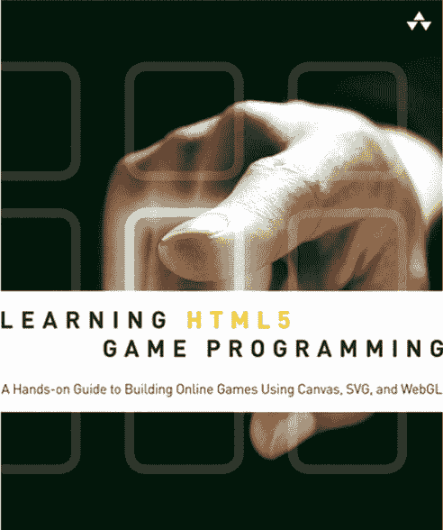

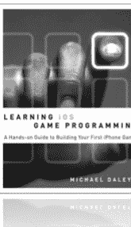

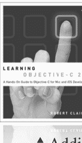

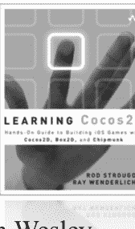

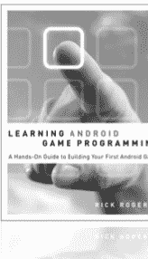

Addison-Wesley 学习系列是一系列实战编程指南，帮助你快速学习新技术或语言，以便能够立即应用所学知识。

每本书都附有书中构建的一个或多个应用程序的示例代码。这些代码经过了完整的注释，并可以在附加字符串的情况下复用到你自己的项目中。许多章节都以一系列练习结束，鼓励你重新审视刚刚学习的内容，并通过调整和修改代码来不断学习。

该系列书籍采用简单的方法：它们让你立即上手，并让你具备离开后构建自己应用程序的能力，并将该语言或技术应用到你正在从事任何工作中。

Boston, MA 02116

Kristy Hart

Anne Goebel

Sheri Cain

致灵感

午夜的约会约而来

清晨便离去，仿佛听号出发

—作者

- 理解简单框架 57

- 使用小行星实现高级检测和粒子系统 66

- 创建 87

- 游戏音效 88

- 同时播放多个声音 90

# 第 6 章 使用 SVG 和 RaphaëlJS 创建游戏 95

- 绘制游戏面板 98

- 路径 (Paths) 110

- 从 SVG 文件导出路径 112

- 速度考量 114

- 使用材质和着色器 120

- 使用 Three.js 加载 3D 模型 129

- 重温粒子系统 140

- 3D 模型资源获取 143

- 使用缓存持久化数据 168

- 与 Socket.IO 通信 169

- 使用 NowJS 让 WebSockets 更简单 171

- 管理游戏玩法 175

- 使用 jQuery 和 Zepto 简化客户端脚本 185

- 使用 jQuery 变体 185

- 使用 JoApp 构建你的应用架构 187

- 选择应用框架 188

- PhoneGap 188

- Appcelerator Titanium 191

# 前言

我写这本书是为了满足自己的兴趣，但也是因为我看到了（当时）处于婴儿阶段的 HTML5 游戏社区的潜力。我想要帮助开发者在 HTML5 的荒野中穿行，并学习 Canvas、WebGL 和 SVG，以及它们各自的最佳实践。

有时需要通过一些讨论才能说服开发者们，HTML5 并非只是小玩具。他们惊讶地发现，自己可以拥有具有桌面应用程序所有精细功能的丰富内容——例如双倍缓冲、硬件加速。

## 本书的主要特性

本书涵盖了 HTML5，即与游戏相关的 Canvas、WebGL 和 SVG。它包含了关于游戏引擎的章节，并选择了在需要时允许低级访问的高级库。本书的目标是让你快速上手，而不是教你掌握关于 WebGL 的所有知识（那本身就可以写一本书了）。

## 本书的目标读者

本书 intended用于那些使用或想要学习如何使用 HTML5 及相关 Web 技术创建游戏的应用程序开发者。它假设读者具备某些编程语言的知识和数学能力。

## 本书的代码示例与练习题

书中的代码列表以及练习题答案可以在书籍网站上找到。你可以在 http://www.informit.com/title/9780321767363 下载章节代码和章节练习答案（如果章节中包含的话）。代码列表也可以在 Github 上：https://github.com/jwill/html5-game-book。

# 致谢

我需要感谢几个人对这本书的贡献。Pearson 团队（包括 Trina MacDonald、邱松林和 Olivia Basegio）在项目期间提供了无价的帮助。他们的目标是让人们的工作变得更加出色，我认为他们做到了。在一个快速演进的主题上写书，需要在某种程度上对市场去向进行推测。我很幸有这几位技术评审员（Romin Irani、Pascal Rettig 和 Robert Schwentker），他们分享对该主题的热情，提供了快速且准确的反馈，并在我的预测正确时给予验证，在我略微偏离轨道时将我带回正轨。最后，感谢我的家人和朋友，他们耐心地倾听且不加评判，在我放鸽子时宽容我，并在有时甚至强迫我休息；谢谢，我确实需要这些。

# 关于作者

**James L. Williams** 是一位驻驻硅谷的开发者，也是活跃于国内外会议的频繁演讲者。他曾是 2007 年 Google 之源代码（Google Summer of Code）的成功参与者，致力于让应用程序轻松访问 SwingLabs UI 组件。他是 Griffon 项目的共同创建者，这是一个用于 Java 应用程序的丰富桌面框架。他和他的团队 WalkIn 在通往 SXSW 的大大巴上创建了一个产品，并荣获 2011 年 StartupBus 冠军。他的第一款视频游戏是 Coleco Adam 上的 *Buck Rogers: Planet of Zoom*，那是一台性能强劲的机器，拥有 3.58MHz 的高速 CPU、高速磁带驱动器，以及在启动时擦除软盘的倾向。他在 http://jameswilliams.be/blog 编写博客，并在 Twitter 上账号为 @ecspike。

# 介绍 HTML5

HTML5 是 HTML 下一个主要迭代版本的草案规范。它代表了与其前身 HTML4 和 XHTML 的决裂。某些元素已被移除，且它不再基于 SGML（一种较旧的文档标记标准）。HTML5 对错误语法的容忍度比 HTML4 更高。它拥有解析规则，允许不同的浏览器显示相同的错误文档。HTML5 还有许多显著的新增，例如原生绘图支持和音视频元素。在本章中，我们将讨论 HTML5 添加的功能以及相关的 JavaScript API。

# 超越基础 HTML 

HTML（超文本标记语言）由提姆·伯纳斯-李（Tim Berners-Lee）发明，自 1990 年诞生以来已经很久了。图 1-1 显示了来自 HTML5R 幻灯片（http://slides.html5.com/#slide3）的 HTML 简要时间线。尽管这些进步对推动标准的制定至关重要，但我们特别感兴趣的是 1996 年 JavaScript 的引入和 2005 年 AJAX 的出现。这些进步将 Web 从一种呈现静态单向数据的媒介（如报纸或书籍）转变为一种允许双向通信的双向媒介。

# JavaScript

JavaScript（曾名 LiveScript，正式称为 ECMAScript）最初是 Netscape Communications 浏览器的脚本语言。它是一种弱类型、基于原型的语言，可以是面向对象的，也可以是函数式的。尽管名字如此，JavaScript 与 C 语言语言最相似，尽管它确实继承了 Java 的某些特性。

该语言重命名为 JavaScript 是 Sun Microsystems（现为 Oracle Corporation）与 Netscape 之间营销协议的一部分，旨在与 Sun 的 Java 技术一起推广这种脚本语言。它被广泛用于客户端 Web 页面的脚本编写。

# Web 技术粗略时间线

| 年份 | 技术 |

| :--- | :--- |

| 1991 | HTML |

| 1994 | HTML 2 |

| 1996 | CSS 1 + JavaScript |

| 1997 | HTML 4 |

| 1998 | CSS 2 |

| 2000 | XHTML 1 |

| 2002 | 无表格网页设计 |

| 2005 | AJAX |

| 2009 | HTML5 |

图 1-1 HTML 时间线

微软发布了一个名为 JScript 的兼容版本，带有一些添加和更改，因为 Sun 拥有 "JavaScript" 名称的商标权。

# AJAX

AJAX（异步 JavaScript 和 XML）引发了 JavaScript 编程的新一轮热潮。AJAX 曾被视为业余爱好者和脚本孩子的玩具，现在它帮助开发者解决了更复杂的问题。

AJAX 的核心是微软在 90 年代后期发明的 XMLHttpRequest 对象。XMLHttpRequest 允网站连接到远程服务器并接收结构化数据。与创建一组静态页面不同，开发者被赋予了创建高度动态应用程序的能力。Gmail、Twitter 和 Facebook 都是这类应用的示例。

我们正处于另一场 JavaScript 复兴的中，因为主要的开发者一直在将他们的 JavaScript 引擎的速度作为比较的基准。JavaScript 作为主要的编程语言，拥有服务器端组件（如 Node.js）以及移动应用框架（如 WebOS 和 PhoneGap）。

# 弥合鸿沟

即使是最好的标准也需要一段时间才能普及。为了不让功能的缺失限制创新，Google 创建了 Chrome Frame 和 Google Gears（后来简单称为 Gears），为旧版浏览器引入高级功能。

# Google Gears

Google Gears 最初于 2007 年 5 月发布，它已经定义了 HTML5 草案规范中的一些高级功能。在 HTML5 出现之前，许多应用程序以某种方式使用了 Gears，包括 Google Properties（Gmail、YouTube、Doc、Reader 等）、MySpace、Remember the Memory 以及 WordPress。Gears 由多个模块组成，为浏览器增加了更典型的桌面应用程序功能。让我们花点时间聊它的特性。

在首次发布中，Gears 引入了 Database、LocalServer 和 WorkerPool 模块。Gears API 使用类似 SQL 的语法为 Web 应用程序创建关系数据存储。数据本地于特特应用程序，并符合通用跨站脚本规则，即应用程序无法访问其域之外的数据。LocalServer 允许在没有互联网连接时将资产保存并检索到本地缓存中。用于本地缓存的资产指定在清单文件中。当请求与清单中的 URL 匹配的资产时，LocalServer 会拦截请求并从本地存储中提供服务。

WorkerPool 模块帮助解决了 JavaScript 密集型任务的一个常见问题：运行会阻塞网站交互的脚本。浏览器默认有一个单线程来执行此工作。对于返回快速的极短爆发（如 DOM 操作），这通常不是问题。任何长时间运行的脚本（例如文件/输出或尝试从本地服务器检索资源）都会阻塞交互并强制浏览器无响应且完全崩溃。WorkerPool 模块通过让你的 WorkerPool 创建可以执行任意 JavaScript 的“workers”，将多线程计算的概念引入了浏览器。只要在同一个 WorkerPool 中，Workers 就可以互相发送和接收消息，因此它们可以协作任务。Workers 可以继承它们被获取时的策略。为了考虑到 Timer 和 HttpRequest 等几个属性由 window 对象暴露（而 workers 无法访问 window），Gears 提供了自己的实现。

另一个 API 是 Geolocation API。Geolocation API 尝试通过可用数据（如 IP 地址、已知位置的可用 Wi-Fi 路由器、手机基站和其他相关数据）来获取访问者的定位。

Google 于 2009 年 11 月停止了 Gears 的主要开发， seitdem转向将功能引入 HTML5。坦率地说，我们讨论的所有这些功能都以某种形式进入了 HTML5。

# Chrome Frame

Chrome Frame 是一个将 Google Chrome 作为插件嵌入 Internet Explorer 6 及更高版本的项目，因为这些版本对 HTML5 的支持较弱。Chrome Frame 在识别到 meta 标签时激活。Chrome Frame 目前安装不需要管理员权限，从而在其他被锁定的系统中开启了机会。你可以在 http://code.google.com/chromeframe/ 找到更多 Chrome Frame 的信息。

# 使用 WebSockets 和 Web Workers 完成工作

HTML5 添加的功能之一是帮助 Web 应用程通信和工作的 API。WebSockets 允许 Web 应用程序开启与 Web 服务交互通道。Web Workers 允许它们在不锁定浏览器的情况下运行非平凡任务。

## WebSockets

WebSockets 允许应用程序拥有到 URI 终点的双向通道。Sockets 可以发送和接收消息，并响应 WebSocket 的打开或关闭。虽然不是规范的一部分，但可以通过其他方式实现双向通信，包括 Comet（带轮轮的 AJAX）、Bayeux 和 BOSH。

列表 1-1 显示了如何创建一个与 echo 服务器通信的 WebSocket。在创建 socket 后，我们设置了函数来处理 socket 打开、关闭、接收消息或抛出错误的情况。接下来，发送“Hello World!”消息，浏览器在接收返回消息后显示“Hello World!”。

## 列表 1-1 回显消息的 WebSocket 代码

```
var socket = new WebSocket("ws://websockets.org:8768/");```

## Web Workers

Web Workers 是 Google Gears 中 WorkerPool 的 HTML5 实例化。与 WorkerPool 不同，我们不需要创建一个池来容纳我们的 Web Workers。列表 1-2 显示了创建 worker 并为其设置一个在接收消息时执行的函数的代码。列表 1-2 和 1-3 显示了创建一个带有 Worker 的网页的 HTML 代码，该 Worker 每隔两秒显示一次当前日期和时间。

## 列表 1-2 请求时间的网页

```html
<!DOCTYPE HTML>
<html>
<head>
<title>Web Worker example</title>
</head>
```

# 应用缓存

```html
</head>
<body>
<p>当前时间是: <span id="result"></span></p>
<script>
  var worker = new Worker('worker.js');
  worker.onmessage = function (event) {
    document.getElementById('result').innerText = event.data;
  };
</script>
</body>
</html>
```

相关的 JavaScript 工作线程 `worker.js` 文件如列表 1-3 所示。

- 列表 1-3 获取日期和时间的 Worker.js 文件

```javascript
setInterval(function {
  postMessage(new Date());
}, 2000);
```

在这行代码中，我们看到可以使用 `postMessage()` 发送消息，并在闭包 `onmessage` 上监听消息。我们还通过分别传递 `onerror` 错误和使用 `terminate()` 方法来处理错误并终止工作线程。

Worker 是共享的，并通过 `MessagePorts` 发送消息。与 Web Worker 的其他方面一样，这部分处于变动中，并且在某种程度上超出了本书书中示例的需求。因此，使用 `SharedWorkers` 留给读者自行研究。

# 应用缓存

应用缓存提供了一种离线时运行应用程序的方法，类似于 Gears 中的 `LocalServer`。这两个功能之间的一个区别是，应用缓存不使用 JSON 文件，而是使用扁平文件来指定要缓存的文件。用于缓存资产的简单清单文件如列表 1-4 所示。

```
CACHE MANIFEST
# 上行必须的，此行是注释
mygame/game.html
mygame/images/image1.png
mygame/assets/sound2.ogg
```

应用缓存有几个响应的事件：`onchecking`、`error`、`cached`、`noupdate`、`progress` 和 `obsolete`。你可以使用这些事件告知用户应用程序的状态。使用应用缓存可以让游戏对连接问题更具容性，并可以通过让用户启动游戏（在资产缓存后）来让他们感到开心。此外，如果你愿意，可以使用应用缓存允许用户离线玩你的游戏。现在不要过度担心它。在第 11 章“发布你的游戏”中，我们将更详细地讨论应用缓存。

# 数据库 API

目前，有多种使用 HTML5 存储结构化数据的方法，包括由 Webkit 浏览器实现的 WebSQL API，以及由 Firefox 领导的竞争性 IndexedDB API。

## WebSQL API

WebSQL 通过实现类似 SQL 的语法提供结构化数据存储。目前，实现集中在 SQLite 上，但那并不是特定要求。

WebSQL 中没有 `createDatabase` 函数。`openDatabase` 函数会在数据库不存在时根据给定的参数创建一个数据库。要创建一个名为 `mydb` 的数据库，我们需要在以下代码中进行调用：

```javascript
var db = openDatabase("mydb", "1.0", "mydb Database", 100000);
```

其中我们将 "mydb" 作为名称，分配值 "1.0"，指定显示名称为 "mydb Database"，并给它一个 100KB 的预留空间（估算大小）。我们还可选地指定了一个在创建时执行的回调函数。图 1-2 显示了 Chrome 开发者工具标签页的内容，在执行上述代码后，我们将在第 2 章“设置你的环境”中更详细地介绍它。

在右侧窗口中，我们可以运行任意 SQL，如图 1-3 所示，我们在其中创建了一个表，插入了一些信息并运行了一个查询。

尽管没有被普遍支持，但规范提到了异步和同步数据库连接的存在。我们目前的示例创建了一个异步连接；要创建一个同步连接，我们将使用相同的参数调用 `openDatabase`。在初始连接之后，除了调用 `transaction(...)` 进行读/写事务以及调用 `readTransaction` 进行只读事务外，没有其他断开连接的操作。

警告：同步连接的支持并不良好，通常你应该组织代码以异步方式运行。

## IndexedDB API

IndexedDB 直接将对象存储在存储中。这使得实现 JavaScript 版本的 NoSQL 数据库变得更容易，例如 MongoDB、CouchDB 和 SimpleDB。在编写时，这些 API 的实现尚未同步，并且使用了与规范不同的命名方案。Internet Explorer 需要一个 ActiveX 插件。我鼓励你查看 http://example.com/indexedDB 以查看 Firefox、Chrome 和 Internet Explorer 中的一些示例。模式下的 Chrome 代码将在 Safari 上无缝运行。

## Web Storage

Web Storage 提供了几种 API，以类似于浏览器 Cookie 的方式在客户端保存数据。对于需要在重启后持久化的数据，有一个名为 `localStorage` 的对象；另一个会在会话结束时被清除。数据以键/值对的形式存储。这些对象实现了表 1-1 中列出的函数。

表 1-1 Web Storage 函数

| 函数名称 | 说明 |

| :--- | :--- | :--- |

| setItem(key:String, value) | 根据给定的值创建一个键/值对。某些实现要求值为字符串。 |

| getItem(key:String) | 返回由给定键指定的项。 |

| removeItem(key:String) | 由给定键标识的项目。 |

| clear() | 清除 Storage 对象中所有的键/值对。 |

| key(index:long) | 返回特定索引的键。 |

每个 Storage 对象还有一个有一个 `length` 属性，表示键/值对的数量。

# 第 1 章 引入 HTML5

Web Storage 提供了一个更流畅的 API，我们可以用它代替表 1-1 中列出的 `getItem` 和 `setItem` 函数。备用 API 使用类似数组的方法来引用键。要设置一个值为 `hometown` 的 `localStorage` 键/值对，我们可以像如下所示操作：

```javascript
localStorage['newspaper'] = 'The Baltimore Sun';
```

同样，我们可以通过前一个表达式的左半部分获取该值：

```javascript
localStorage['newspaper'];
```

在游戏编程背景下，我们可以使用 Web Storage 来存储用户高分以及保存的游戏存档。

## 地理定位

Geolocation API 没有一个显式函数来请求用户许可跟踪其位置。相反，浏览器会为我们透明地处理这一切。当 Geolocation API 第一次从一个没有权限的网站请求位置信息时，会弹窗请用户许可。

我们可以通过检查以下内容来确认浏览器是否支持 Geolocation API：

```javascript
navigator.geolocation
```

如果它解析为非空值，我们就具有定位能力。

用户的计算位置由 `Position` 对象定义，它包含一个名为 `coords` 的 `Coordinates` 对象和一个指示何时获取固定位置的时间戳。表 1-2 显示了 `coords` 对象的属性。

## 表 1-2 Coordinates 对象属性

| 属性名称 | 返回值 | 说明 |

| :--- | :--- | :--- |

| latitude | double | 位置固定的纬度。 |

| longitude | double | 位置固定的经度。 |

| altitude | double | 位置固定的高度（米）。如果此不可用，该值将为 null。 |

| accuracy | double | 经纬固定的误差范围（米）。如果此不可用，该值将为 null。 |

| altitudeAccuracy | double | 高度值的误差范围。如果此不可用，该值将为 null。 |

| heading | double | 设备移动的方向（角度，0° 到 360°，包含边界）。如果此不可用，该值将为 NaN。 |

| speed | double | 设备移动的速度（米/秒）。如果此不可用，该值将为 null。 |

在我们验证地理定位可用后，在设备上获取位置固定是简单的。我们只需要调用 `getCurrentPosition` 并传递一个、两个或三个参数，分别对应于获取固定成功、失败时运行的函数以及请求选项。

列表 5 显示了获取位置、在地图上绘制标记以及在标记周围绘制近性圆的代码。

### 列表 1-5 使用地理定位绘制地图

```javascript
if(navigator.geolocation) {
  navigator.geolocation.getCurrentPosition(function(pos) {
    var latitude = pos.coords.latitude;
    var longitude = pos.coords.longitude;

    var options = {
      position:new google.maps.LatLng(latitude, longitude),
      title:"您的位置"
    };

    var marker = new google.maps.Marker(options);

    var circle = new google.maps.Circle({
      map:map,radius:pos.coords.accuracy
    });
    circle.bindTo('center', marker, 'position');

    marker.setMap(map);

    map.setCenter(new google.maps.LatLng(latitude, longitude));
  },
  function(error) {
    console.log(error.message);
  });
}
```

# 第 1 章 介绍 HTML5

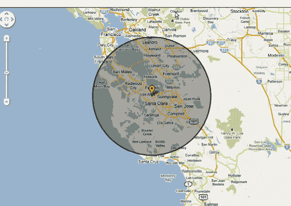

图 1-4 来自浏览器的地理定位

我们可以使用地理定位来对排行榜进行本地化，或者在多人游戏中匹配物理距离较的玩家。

## 通过通知吸引用户的注意力

在 HTML4 中，与用户通信的选项非常有限。你可以显示一个警报窗口，或者在 <div> 元素中显示消息。显示警报窗口在所有浏览器中都得到了很好的支持，但它具有很强的干扰性。它需要用户立即关注，并且在你处理它之前无法进行其他操作。骚扰用户的一种方法是让他们因为某些消息遮挡了内容而失去了一个生命值。在 div 元素中显示消息的效果稍好一点，但还没有还没有标准来添加这些消息。这些类型的消息很容易被忽略。一方面我们有吸引注意力的通知，另一方面我们有很容易被忽略的通知。这就是 Web 通知（web notifications）。

在 Mac OS X 和 Ubuntu 平台上，以及在 Windows 上通过插件，应用程序可以配置给用户的消息，并通知他们其认为重要的事件或更改。此类通知的示例如图 1-5 所示。

```
Test Message
This is a test
```

图 1-5 桌面通知消息

与其桌面对应的版本一样，Web 通知可以包含图像以及上下文消息。

## 请求显示通知

在向用户显示通知之前，我们必须获得他们的许可。显式许可可以保护用户免受意外通知的轰扰。我们可以通过执行以下代码请求显示通知权限：

```javascript
window.webkitNotifications.requestPermission();
```

这将在浏览器中显示一条上下文消息，允许用户批准或拒绝访问，如图 1-6 所示。除了无参数函数，我们还可以传递一个函数，当用户对提示做出响应时执行该函数。


图 1-6 通知权限消息

我们同样可以通过运行以下命令来验证权限：

```javascript
window.webkitNotifications.checkPermission();
```

在这种情况下，`checkPermission()` 返回一个指示权限级别的整数，如表 1-3 所示。

### 表 1-3 通知权限级别

| 常量名称 | 值 |

|---|---|

| PERMISSION_ALLOWED | 0 |

| PERMISSION_UNKNOWN | 1 |

| PERMISSION_DENIED | 2 |

在 Webkit 浏览器中，你可以看到 Chrome 和 Safari 都实现了此功能。尽管 Safari 实现了它，但由于该 API 尚处于草案阶段，因此可能会更改。

## 创建通知

你可以创建两种类型的通知：简单通知（simple）和 HTML 通知（HTML）。例如，通过执行以下代码创建简单通知：

```javascript
var msg = window.webkitNotifications.create(
  '', 'Test Notification', 'Hello World'
);
```

正如所提到的，HTML 通知可以从任意 URL 获取内容。该函数接收要显示的 URL，如下所示。我们传递一个空字符串会导致显示“undefined”的测试消息。图 1-7 显示了我们的通知。

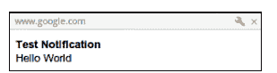

图 1-7 简单 Web 通知

正如提到的，HTML 通知可以从任意 URL 获取内容。该函数接收的形式如下：

```javascript
var msg = "window.webkitNotifications.createHTMLNotification('http://example.com');";
```

它们提供了调整大小的方法，除非 URL 具有优化小屏幕的代码，否则会出现滚动条。在 668x1050 的屏幕上，默认大小将是300 像素乘以 50 像素，但由于该 API 在编写时仍处于草案阶段，因此可能会更改。对于简单通知。

## 与通知交互

通知有两个控制它的基本函数：`show()` 将通知展示给用户，而 `cancel()` 则在通知不可见时隐藏它。Web 通知还可以响应通知事件执行函数，以防止其在不可见时显示。表 1-4 列出了你可以指定以响应事件的函数。

### 表 1-4 Web 通知函数

| 函数 | 描述 |

|---|---|

| onclick | 当通知被点击且底层平台支持时，该函数将执行。尽量避免使用此事件。 |

| onclose | 在关闭事件触发后，该函数将执行。这可能是用户关闭了通知，或者通过程序关闭了它。 |

### 表 1-4 Web 通知函数

| 函数名称 | 描述 |

|---|---|

| onshow | 当通知显示时，该函数将执行。 |

| onerror | 当发生错误时，该函数将执行。 |

## 媒体元素

在编写时，不同浏览器中的音频和视频元素并不一定支持所有的音频和视频类型。特定浏览器不支持特定格式的原因可能是由于该格式过时、与受支持的格式竞争，或者是浏览器母公司不想处理的专利限制。媒体标签有几种方法来处理这个问题。

## 列出多个源

与其指定单个源，开发者可以选择列出多个源，让浏览器选择最合适的一个。以下代码片段列出了两个源：

# HTML5 绘制 API

用于 video 标签以及当浏览器不支持其中任何一种格式时显示的备用性消息。

```
<video>
  <source src="video.ogv" />
  <source src="video.avi" />
  <!-- 如果两个都不支持，则显示消息或回退到 Flash -->
  <div><span>请使用现代浏览器</span></div>
</video>
```

虽然对于静态页面来说，列出多个源是一个可选方案，但它对于具有动态内容的应用程序来说并不理想。对于这些情况，建议使用 Modernizr 工具。我们将在第 2 章中详细讨论 Modernizr，但请先将此作为入门指南。

## 使用 Modernizr

Modernizr (modernizr.com) 在运行时检查浏览器能力，并将属性注入到 JavaScript 对象中。要检查浏览器是否可以播放音频或视频，我们需要检查 `Modernizr.audio` 或 `Modernizr.video` 的值，看它们是否为 true。

检查对特定格式的支持情况略有不同。验证对 MP3 文件的支持是通过检查 `Modernizr.audio.mp3` 的值完成的，但返回的值不是 true 或 false。HTML5 规范规定，浏览器应该返回其能够播放该格置的置信度。返回值将是"probably"可能）、"maybe"也许）或空字符串。当我们在条件句中使用 `Modernizr.audio.mp3` 时，任何空值都被视为 true，空字符串被视为 false。

## CSS

CSS3 不在本书的涵盖范围内，鼓励感兴趣的读者去探索相关规范。与 HTML 类似，CSS3 通过添加新功能和将提案法典化来扩展其前身（CSS2），例如网络字体和语音，这些功能在之前的版本中已经引入，但尚未得到广泛支持。获取更多信息的有用网站是 http://www.css3.info。

# HTML5 绘制 API

HTML5 规范中一个有趣的领域是新的绘图 API。Canvas、SVG 和 WebGL 分别提供了位图、矢量和三维绘制能力。

# Canvas

canvas 元素最初是作为 Apple 对 Webkit 的扩展的（Webkit 是驱动 Safari 和 Chrome 的布局引擎），用于显示 Dashboard 小部件和 Safari 浏览器的扩展。后来它被 Opera、Firefox 和相关浏览器采用，最终成为 HTML5 规范的一个组件。Internet Explorer 9 (IE9) 的测试版本

# 第 1 章 引入 HTML5

已为所有主流浏览器提供了原生支持，尽管 IE9 的支持不如上述浏览器那么完整。

canvas 元素可以简单地描述为具有高度和宽度属性的可绘制区域，使用 JavaScript 来绘制和动画化图表、图像等复杂图形。JavaScript 语言暴露了一整套 2D 绘制函数。由于 JavaScript 和 ActionScript 之间紧密的关系，使用 ActionScript 的 Flash 绘制或动画可以很容易地移植到 JavaScript 中。Canvas 将在第 5 章“使用 Canvas 创建游戏”中详细介绍。

# SVG

SVG（可缩矢量图形）是一项用于绘制静态或动画图形的成熟 W3C 规范。HTML5 添加了在不使用 object 或 embed 标签的情况下内联 SVG 的能力。矢量图形是数学的组合，用于绘制线、路径和矩形等原始形状，创建出无论比例如何都具有相同的图形。与图像相比，这是一个显著优势，因为图像在以大于设计比例的显示时，其可见质量会下降。

SVG 采取了与 canvas 元素明显不同的方法，因为它用 XML 文件表示绘制，而不是纯代码。XML 不是数据的简洁表示，因此文件可能包含任何重复部分。这可以通过压缩文件来解决，从而大大缩小其尺寸。与 canvas 元素一样，可以使用 JavaScript 编写脚本。在 IE9 之前，IE 支持一种名为的的不兼容矢量格式。从 IE9 开始，所有主流桌面浏览器都支持 SVG 1.1 的一个相当常见的功能。“使用 SVG 和 RaphaJS 创建游戏”将 SVG 置于核心位置。

## 使用微数据（Microdata）传递信息

解析页面的 Web 应用或 API 可以解释带有微数据标记的 HTML 并对其做出响应。例如，返回带有微数据结果的搜索引擎可以被浏览器扩展或脚本解析，为视障人士或色盲用户呈现更好的数据。微格式（Microformats）是实现相同目标的前身概念。微格式和 HTML5 微数据之间的一个关键区别是数据标记方式。如列表 1-6 所示，微格式使用对象的 class 属性来指示对象上的字段。

## 列表 1-6 hCard 微格式示例

```
<div class="fn">James Williams</div>
<div class="org">Some Company</div>
<div class="tel">+660-555-3055</div>
<a class="url" href="http://example.com/">http://example.com/</a>
</div>
</div>
```

微数据使用了类似但略有不同的符号。使用了 `itemprop` 关键字。`itemscope` 标记单个单元。微数据的核心是由项目组成的一组名称/值对。列表 1-7 显示了一个微数据示例。`itemtype` 属性提供了对象的定义。

### 列表 1-7 微数据示例

```
<p itemprop="address" itemscope itemtype="http://schema.org/Address">
  <span itemprop="streetAddress">1600 Amphitheatre Parkway</span><br>
  <span itemprop="locality">Mountain View</span><br>
  <span itemprop="region">CA</span><br>
  <span itemprop="postalCode">94043</span><br>
  <span itemprop="countryName">USA</span>
</p>
```

# 总结

HTML5 使我们与浏览器交互的方式发生了突破性的变化。本章介绍了增加我们需求的补充。你学习了 Chrome 如何将 HTML5 功能引入 IE，以及绘制资产的多种方法。你学习了允许你在不阻塞浏览器的情况下运行计算密集型任务的功能、在应用程序之间建立双向通信通道以及启用应用程序离线执行的功能。

你可以在 www.informit.com/title/9780321767363 下载章节代码。

# 设置你的开发环境

HTML5 的伟大之处之一，拥有一台可靠互联网连接的计算机是开始开发的主要障碍。你所需的其他工具都可以从网上免费获取。某些特殊应用程序需要许可，但我们将关注它们的免费替代品。

在本章中，你将安装制作 HTML5 应用程序所需的工具。我们还将详细检查这些工具。

## 第 2 章 设置开发环境

如果该命令失败，说明你没有安装 SDK。但是，如果你收到了类似下面的片段且版本号为 1.5 或更高，说明你已经准备就绪了：

```
javac 1.6.0_17
```

对于 Mac，OS X 10.7（代号 Lion）之前的版本预装了 Java SDK。这些电脑拥有 Java 1.5，而版本 10.6（代号 Snow Leopard）的电脑拥有 Java 1.6。

Windows 用户可以从 http://java.sun.com/java/downloads/index.jsp 下载 SDK 的可执行文件，并确保选择包含“JDK”的下载项。文件下载完成后，执行它即可安装 Java。

在 Linux 上安装 Java 稍微有点复杂。安装方法因发行版而略有不同，所有主流发行版的包管理器中都提供了兼容 Java 6 的二进制文件。如果失败，你可以使用 Sun/Oracle 网站上的下载安装 Java。

## 安装 Eclipse IDE 和 Google 插件

Eclipse 是 Java 开发者使用的多功能工具。Eclipse 采用模块化设计，并具有插件架构，可以向 IDE 开放新功能。其插件架构支持其他编程语言，包括 C++、Python、Ruby 和 PHP。它还是许多专用 IDE 的基础，其中一些将在本章稍后的部分中进行探讨。

在所有平台上安装 Eclipse IDE 都非常简单。图 2-1 显示了 Eclipse 的加载界面。Eclipse 基金（Eclipse 的制作者）提供的不是安装程序，而是一个自包含的压缩包。你下载压缩包并将其解压到机器的某个地方就可以使用了。你可以在 http://www.eclipse.org/downloads/ 下载最新版本的 Eclipse。确保你获取的是“Eclipse IDE for Java Developers（Java 开发者 Eclipse IDE）”包。

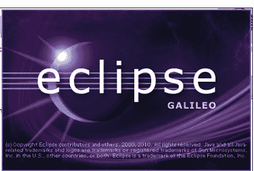

图 2-1 Eclipse 加载界面

安装好 Eclipse 后，双击可执文件（可能是 eclipse.exe 或简单的 eclipse）即可打开。如果你是从后面处理 App Engine 的章节回到本节的，可能想通过选择 Window | Open Perspective | Java（窗口 | 打开透视图 | Java）将视图切换到 Java 视图。要在 Eclipse 中集成 App Engine，你需要安装几个包。以下是操作步骤：

- 选择 Help | Install New Software（帮助 | 安装新软件）。可能会有一个标题为“Software Updates”（软件更新）的选项。

- 点击 Add 按钮添加新的软件站点。你也可以从硬盘安装该包，但添加站点允许 Eclipse 定期检查软件更新。

- 你可以为你想要的站点命名，因为它是出于日常维护目的的标识符。我在图 2-2 中将其命名为“Google App Plugin”。将以下 URL 之一添加到 Location 文本框并点击 OK（高于 3.5 的版本请检查 code.google）：

- 针对 Eclipse 3.5 (Galileo)：http://dl.google.com/eclipse/plugin/3.5

- 针对 Eclipse 3.4 (Ganei)：http://dl.google.com/eclipse/plugin/3.4

- 针对 Eclipse 3.3 (Europa)：http://dl.google.com/eclipse/plugin/3.3

如图 2-3 所示，勾选“Google App Engine”和“Google Web Toolkit”旁边的框框，然后点击 Next（下一步）。你的版本可能更高。确认插件出现在 Install Details（安装详情）列表下并点击 Next。Google 插件有多个依赖项，所以如果你看到其他插件，请不要惊慌。下载完所需包后，Eclipse 会提示你重启。重启后，你就一切都就绪了。

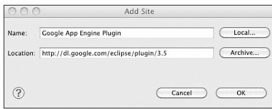

图 2-2 Eclipse Site 站点面板

## Google Web Toolkit

Google Web Toolkit (GWT) 是一组库，允许开发者使用 Java 语言编写丰富的网绚应用程序，并将其转换为跨平台的异步 JavaScript (AJAX) 应用程序，而无需担心目标浏览器的怪癖或不兼容性。

如果 Java 不是你的菜，可以使用 Python 和 Ruby 的 GWT 开源移植，但它们往往落后于 GWT 的最新版本，因此我们不会在示例中直接使用它们。然而，大部分核心 GWT 代码会有相似的代码。你可以分别找到更多关于 GWT 和 RubyJs 的信息。

GWT 要求目标机器上安装 java 1.5。你可以从 http://code.google.com/webtoolkit/download.html 下载 GWT 并将其解压到机器的某个地方。Eclipse 的 Google 插件支持 GWT，请返回前一节查看安装插件的说明。第 8 章“无 JavaScript 创建游戏”将详细介绍结合 Canvas、WebGL 和 SVG 的 GWT。

## Web 服务器工具与选项

除非你打算把游戏留给自己玩，或者将其封装为移动应用程序，否则你可能需要某种形式的 Web 服务器。在本节中，我们将讨论部署游戏的一些选项。

## Google App Engine

Google App Engine 是一个用于 Java 和 Python 的托管环境，允许你在 Google 的基础设施上托管你的应用程序。理论上，你的应用程序可以几乎无限扩展。为了实现这一点，存在一些权衡，例如使用非结构化数据存储、对文件系统的访问限制，以及用于身份验证、邮件和获取特殊 API。App Engine 的其他优点之一是你可以使用 Rhino（JavaScript 的 Java 实现）编写应用程序，因此你可以从后端到前端运行 JavaScript。使用 App Engine 还能从安装 Eclipse 中获得一点额外价值。Google 插件让你只需双击即可部署到 App Engine。你可以安装 Google App Engine，或在 http://code.google.com/appengine 阅读关于 Eclipse 插件的介绍。

## Opera Unite

Opera 浏览器 10.0 版本封装了一个名为 Opera Unite 的嵌入 Web 服务。它内置了用于流文件、分享照片、聊天和托管网站的应用程序。要托管网站，你通常需要注册域名、寻找 Web 主机并上传文件。Unite 让你只需点击按钮即可完成这一切。当你启动服务时，它会将你的计算机注册到 Opera 的代理服务器。因此，访问 http://your_domain.operaunite.com/（其中 your_domain 是你的计算机名称）的访问将获得正确路由。代理服务器允许你建立服务器而无需在路由器上打洞。它的 Web 使用服务器端 JavaScript 运行并允许访问文件。你可以打包并发布游戏，以便他人无需连接到你的 Unite 实例即可安装。

Unite 非常适合向朋友或测试人员发布内容，但它需要浏览器保持运行，因此对于任何需要 24/7 在线的任务来说并不是选项。我们将在第 11 章“发布你的游戏”中讨论用于分发的应用程序。

## Node.js 和 RingoJS

RingoJS 是一个运行在 Rhino 之上的 Web 框架，实现了 CommonJS API 的规范和提案。于 JavaScript 的进化没有离散的规范，CommonJS 为那些最初可能不在 JavaScript 应用程序范围内的事务寻求标准——例如访问本地文件系统。

Node.js 和 RingoJS 都实现了 CommonJS 的部分，RingoJS 是一个更符合 API 的客户端。一个主要的区别点是 Node.js 运行在 Google 的 V8 上上，该引擎驱动 Google Chrome 的 JavaScript 支持并用 C++ 实现。我们将在第 9 章“构建多人游戏服务器”中详细讨论服务器端 JavaScript，特别是 Node.js。

## 浏览器工具

开发 HTML5 应用的一个重要部分是一个实现了大部分规范并具有调试工具的浏览器。Google Chrome、Mozilla Firefox（及其衍生版本）、Apple Safari 和 Opera 具有出色的 HTML5 兼容性和调试工具。2011 年 3 月发布的 Internet Explorer 9 比其前身版本更符合 HTML5 标准，但在支持方面与上述浏览器相比仍然落后。

## Chrome 开发者工具

使用 Chrome 开发者工具，我们可以动态检查页面的 DOM、查看资源加载时间并运行任意 JavaScript。我们可以通过选择 View | Developer | Developer Tools（查看 | 开发者 | 开发者工具）查看任何页面的开发者工具控制台。图 2-4 显示了 Google.com 的控制台窗口。通过 Elements（元素）选项卡，我们可以获得 DOM 的嵌套视图以及与文档元素相关的样式。悬停在元素标签上会在浏览器窗口中高亮它。这在尝试找出哪个元素偏移了几个像素时非常有用。


图 2-3 可用开发者工具面板

开发者工具控制台中的另外两个选项卡对游戏开发者极其有用：Resources（资源）和 JavaScript Console（JavaScript 控制台）选项卡。图 2-5 所示的 Resources 选项卡允许你按资产跟踪究竟是什么减慢了你的小工具获取 Waves 的速度。当你第一次在新站点上运行时，你可以决定是仅针对本次会话激活还是永久激活。资源跟踪会对页面加载时间产生一些开销，因此最好尽量使用。

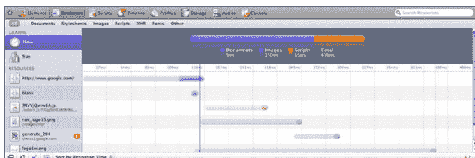

图 2-5 Chrome 开发者工具资源（Resources）标签页

在本节中，我最后一个介绍的是 JavaScript 控制台（Console），如图 2-6 所示。对于那些并不是 JavaScript 大师的人来说，它简直是福音，因为它连 `console.log()` 命令一起，让你从编程中最令人可畏的操作中解放出来：打印（在本例中为 `alert`）调试。你还可以使用它来程序化地检查 DOM 或运行任意的 JavaScript。

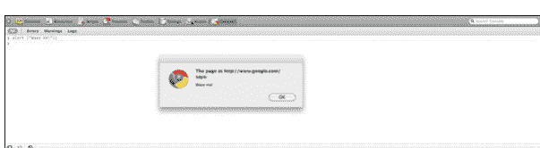

图 2-6 Chrome 开发者工具控制台（Console）标签页

## Chrome 扩展

与 Eclipse IDE 类似，Google Chrome 的功能可以通过扩展进行增强。扩展的用途广泛，从 RSS 阅读器、特定网站的增强或通知器到游戏玩家无应皆有。你可以在 https://google.com/extensions 找到完整列表。让我们花点时间介绍几个可以让创建小工具变得更简单一点的扩展。

我们可以通过点击 Chrome 扩展页面上的“安装”按钮并在 Chrome 中安装这些扩展，如图 2-7 所示，并遵循提示。对于开发者来说，有两个用的插件是 JSONView 和 YSlow。JSONView 允许你查看格式化后的 JSON 以增加可读性。YSlow 分析网页并提供如何提高性能的建议。

## 第 2 章设置你的开发环境

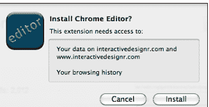

图 2-7 安装 Chrome 扩展

## Safari 开发者工具

Apple Safari 中的开发者工具与 Google Chrome 中的工具非常相似。默认情况下，它们对终端用户隐藏的。

要启用它，请在标题栏或图标栏中选择“偏好”（Preferences），导航到“高级”（Advanced）标签页。如图 2-8 所示，确保勾选了“在菜单栏中显示开发”。访问上一节关于 Chrome 开发者工具的章节，以了解其中包含的内容概述。

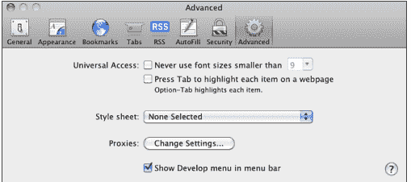

图 2-8 启用开发菜单

## Firebug

Firebug 是适用于 Mozilla Firefox 的扩展，允许开发者调试网站的 HTML、CSS 和 JavaScript。虽然最初是为 Firefox 设计的，但 Firebug 也有一个“Lite”版本，可以在 Google Chrome 中运行，并补充浏览器中已有的工具。

你可能会发现，Firebug 的核心组件和标签页看起来和 Chrome 以及 Safari 的非常相似。与 Chrome 一样，Firefox和 Firebug 也有插件，可以为多种编程语言（如 PHP 和 Python）暴露更多的开发者能力（如 DOM 操控和检查）。你可以通过访问 http://getfirebug.com 找到安装 Firebug 或 Firebug Lite 的说明。

www.it-ebooks.info

## HTML5 工具

在本节中，我们将讨论一些允许我们为游戏创建简易资产的工具。在 Raphaël 和 ProcessingJS 的情况下，这些是轻量级的图形库。

## ProcessingJS

ProcessingJS 是一个 JavaScript 库，可以作为 `canvas` 标签上的抽象层，用于绘制原始形状、响应用户交互以及处理图像。ProcessingJS 是在 2008 年夏天由 John Resig 创建的，他是流行的 JavaScript 库 jQuery 的创建者，将其从同名的 Processing Java 库移植过来。因此，其函数和 API 在语法上与 Java 版本是一致的。同样，许多示例可以在不更改代码的情况下迁移。但必须注意的是，ProcessingJS 并没有实现完整的 Java API。对于我们的目的来说，这些功能我们大部分愿意使用 WebGL 完成，这并不重要。

你可以在 http://processingjs.org 查看示例和 API 参考。

## Inkscape

Inkscape 是一个使用 SVG 的成熟的跨平台矢量编辑器。它可以与商业应用 Adobe Illustrator 和 CoreDRAW 相比美。虽然最新版本仅为 0.48，但它从 2003 年诞生起就有一个充满活力的社区。版本号更多是表示该应用程序实现了 SVG 1.1 规范的多少内容。虽然它不支持完整的 SVG 规范（有些人可能认为没有哪个应用支持），但 Inkscape 社区通过增强平台的插件弥补了这一点。

你可以在 http://inkscape.org 下载该应用程序。

## SVG-edit

SVG-edit 是一个基于 Web、由 JavaScript 驱动的 SVG 创建工具。SVG-edit 非常适合应用有限效果的简单绘图。如图 2-9 所示，该界面具有创建文本、简单形状以及嵌入图像的控件。

如果你在急需时创建一个，比如棋盘，SVG-edit 会非常棒。它不包含文件管理，并且能够显示原始 SVG 代码以便复制粘贴到文本编辑器中，如图 2-10 所示。

你可以在 http://code.DRAW.google.com/p/svg-edit/ 下载源码或在线尝试。

## 第 2 章设置你的开发环境

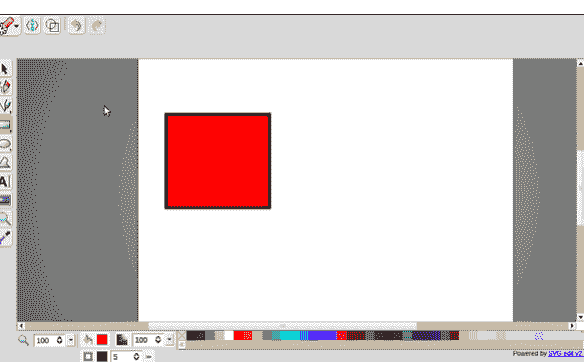

图 2-9 SVG-edit 界面

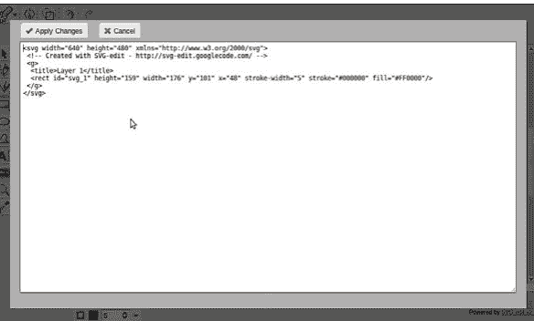

图 2-10 SVG-edit 代码视图

## Raphaël

在之前的两个节中，我们讨论了使用用户界面创建 SVG 文件的轻量级和高级工具。那些适用于资产都预先制作的游戏——比如角色类游戏。对于需要动态创建资产的 SVG 游戏，或者对于倾向于使用代码创建 SVG 图形的开发者，有了 Raphaël。Raphaël 是一个 JavaScript 库，提供了原始形状、字体和动画支持，并在运行时评估嵌入的 SVG。它有一个

www.it-ebooks.info

如果浏览器实现了 VML 而不是 SVG，则会有一个兼容层来使用矢量标记语言（VML）进行渲染（即直到 IE9 的 IE 浏览器）。你可以在 http://raphaeljs.com/ 下载 Raphael。

我们将在第 6 章“使用 SVG 和 Raphael 创建游戏”中利用这些工具。

## 3D 建模工具

在第 7 章“使用 WebGL 和 Three.js 创建游戏”中，我们将讨论使用 WebGL 创建。我们需要工具来创建 WebGL。在行业中，这些工具用于创建资产， 3D 软件如 3D Max 和 Maya。

## Blender

Blender，如图 2-11 所示，是一个跨平台开源 3D 软件。它的功能包括布料、骨骼、刚体模拟、纹理、粒子动力学和合成。Blender 可以导入和导出许多不同的格式。

你可以在 blender.org 获取有关 Blender 的更多信息。

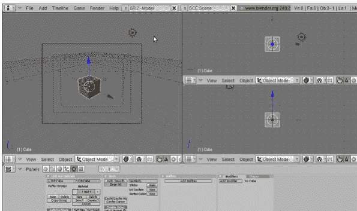

图 2-11 Blender 

# 总结

在本章中，我们识别了一些最适合创建 HTML5 游戏的工具和框架。我们安装了 Java SDK 和 Eclipse IDE，并讨论了我们在书中使用的 SVG 和 3D 建模工具。

你可以在 www.informit.com/title/9780321767363 下载章节代码。

## 3

## 学习 JavaScript

虽然书名没有明确提到 JavaScript，但 JavaScript 是一种弱类型的动态语言，起源于 Netscape 的一个名为 LiveScript 的项目。它在 Java 语言插件被添加到 Netscape 左右被重命名 JavaScript，这引起了各地开发者的苦恼。尽管名称相同，JavaScript 和 Java 之间只有松散的关系，因为它们都受到 C 语言以及一些关键词和结构的影响。JavaScript 是 GWT 和 Coffee-Script 等书中后面提到的语言的的基础。Node.js（书中后面也会提到）使用 JavaScript 运行服务器端代码。在本章中，我们将涵盖 JavaScript 的基础，以及一些有助于创建游戏的工具和库，并使用 JavaScript 库创建你的第一个游戏。

## 什么是 JavaScript？

某些类型在每个 JavaScript 实现中都存在。它们也可以被认为是创建其他类型对象的基石。JavaScript 的基础类型如下：

- Array—一组东西。

- Boolean—真或假的值。

- Function—执行某些工作的代码。

- Number—示例包括 42、3.54e-3 和 3.14159。

- String—单引号或双引号括的字符集合，例如“Hello”。

- Object—所有其他类型的基类。

# 第 3 章 学习 JavaScript

- undefined—引用的对象不存在。

- null—对象存在但没有值，JavaScript 特别区分了“对象存在但没有值”与“不知道该对象是否存在”。

```javascript
var x = null;
```

你是在告诉 JavaScript，你正在定义一个当前没有值、但未来可能会被使用的对象。相反，如果你只是执行

```javascript
var x;
```

在这种情况下，x 的值将是 `undefined`。

## 理解算术运算符

我们在一年级时就学过基本的算术运算符 `+`、`-`、`/`、`*` 和 `=`，分别用于加、减、除、乘和赋值。前四个通常用于数值，但某些编程语言允许你重新定义它们与用户定义对象的交互方式。JavaScript 并不是这些语言之一。你应该避免在对象上使用运算符，除非它们是数字；这样你就能避免意想不到的结果。例如，鉴于两个字符串相加会拼接，你可能期望减去它们会从第一个字符串中移除第二个字符串的实例。在其他语言中是这样工作的，但在 JavaScript 中不是。JavaScript 在尝试将它们作为数字求值后会抛出异常（Exceptions）。

## 理解 JavaScript 函数

让我们开始查看列表 3–1 中的 JavaScript 函数。在代码中，我们声明了一个名为 `HelloWorld` 的函数（向控制台打印“Hello, World!”），然后执行了它。

列表 3-1 Hello World JavaScript

```javascript
function HelloWorld() {
  console.log('Hello, World!');
}
HelloWorld();
```

`function` 关键字告诉运行代码的应用包含的代码将执行某些任务。在这种情况下，我们的函数没有接受任何参数来操作或执行工作，也没有返回任何内容。其他编程语言要求为函数返回的对象指定类型。但在 JavaScript 中，无论函数是否返回任何内容，都用 `function` 关键字开始声明。列表 3–2 显示了一个接收两个值并将它们相加的函数。

### 列表 3-2 相加两个对象

```javascript
function add(one, two) {
    return one + two;
}
```

此列表介绍了两个新概念：函数参数和 `return` 关键字。函数参数为我们提供了函数执行工作所需的数据，而 `return` 关键字在工作完成后向我们发送一个对象。如果我们调用函数

`add(23, 43);`

它会返回 66。我们也可以用任何其他对象（如字符串）调用它，并拼接描述这些对象的字符串。

## 作为一等对象的函数

JavaScript 中的函数不仅可以执行，还可以在运行时构造和修改、赋值给变量并由其他函数返回。具有后能力的对象（即所有可以执行的对象）被称为一等对象（first-class objects）。这些能力提供了一种类似于 Java 和 C# 等编程语言中类（class）的结构。在这些语言中，类为对象将包含的变量和函数定义原型。此外，函数即使具有一等公民属性，也不允许嵌套在类内部。在这个方面，JavaScript 跨越了类和函数的界限，因此某些人将返回相同类型的函数视为类。列表 3-3 显示了一个包含启动、加速和应用刹车函数的 Car“类”。

### 列表 3-3 JavaScript Car“类”，

```javascript
function Car() {
    var self = this;
    self.speed = 0;
    self.start = function() {
        console.log("Car started.");
    }

    self.accelerate = function() {
        self.speed = self.speed + 10;
        console.log("Speed is now:"+self.speed+" mph");
    }

    self.applyBrakes = function() {
        self.speed = 0;
        console.log("Brakes applied.");
    }
}
```

# 第 3 章 学习 JavaScript

从此列表中需要注意的是，我们正使用一种替代形式来声明函数，通过定义存储函数的变量并将匿名函数赋值给它们。我们可以创建一个 Car 的实例，并通过执行以下代码启动它：

```javascript
myCar = new Car();
myCar.start();
```

与之前的区别在于，我们不是直接执函数，而是请求将它的实例或副本存储在全局变量 `myCar` 中。这允许我们在对象上调用成员函数。另一个新概念是使用 `var` 关键字为变量。使用 `var` 通常是可选的，但它会影响变量作用域。作用域决定了可见性，结果就是包含的值。假设在 `Car` 外部，我们通过以下方式声明了一个名为 `self` 的变量：

```javascript
self = "me"
```

值为 "me" 的变量具有全局作用域并随处可见；然而，Car 使用的 `self` 仅对 `Car` 内部的函数可见。`this` 关键字指向的对象可以根据调用位置发生变化。使用本地 `self` 变量可以确保对象内的调用正常运行。

## 比较运算符

比较运算符测试两个对象是否相等或它们的相对值。例如，我们可以使用表 3-1 所示的运算符通过执行以下操作来测试字符串 "abc" 是否等于 "def"

"abc" == "def"

结果将为 false

| 表 3-1 比较运算符 |

| 运算符 | 说明 |

| --- | --- |

| ! | 反转操作的结果 |

| == | 检查相等性 |

| != | 检查不相等 |

| < | 检查是否小于 |

| > | 检查是否大于 |

| >= | 检查是否大于或等于 |

| <= | 检查是否小于等于 |

| === | 检查严格相等 |

| !== | 检查严格不相等 |

## 条件循环和语句

表 3-1 比较运算符

| 运算符 |  |

| --- | --- |

| ! | 反转操作的结果 |

| == | 检查相等性 |

| != | 检查不相等 |

| < | 检查是否小于 |

| > | 检查是否大于 |

| >= | 检查是否大于或等于 |

| <= | 检查是否小于等于 |

| === | 检查严格相等 |

| !== | 检查严格不相等 |

在列表中，我们首先检查存储在变量 `name` 中的值是否为 John。如果不是，则向控制台打印适当的消息。如果变量 `name` 等于 John，我们执行一系列比较来确定年龄范围（而该比较失败了）。

### 列表 3-4 if-else

```javascript
if (name == "John") {
  if (age < 18) {
    console.log("Age is less than 18");
  } else if (age < 35) {
    console.log("Age is between 18 and 35");
  }
  console.log("Age is greater than 35");
} else {
  console.log("User is not John");
}
```

## 使用循环控制程序流

最终，我们需要反复运行代码块。虽然反复复制粘贴代码块可行的，但在需要修改它时会变得非常混乱。循环允许在满足某些先决或后置条件下运行特特的代码块。

## while 循环

while 循环在表达式不再为真之前运行特定的代码块。例如，我们可以创建一个初始值为 0 的变量 `count`，将计数器打印到控制台并增加 `count` 直到它等于 10。列表 3-6 显示了该 while 循环的代码。

### 列表 3-6 Sample while 循环

```javascript
var count = 0;
while (count < 10) {
  console.log("The count is now":+count);
}
```

## 条件循环与语句

count++;

}

值得注意的是，如果 `while` 循环测试的条件在第一次尝试时为假，那么 `do-while` 循环则是传统 `while` 循环的一种变体，确保代码块至少执行一次。列表 3-7 显示了一个对无意义比较仅执行一次的 `do-while` 循环。与 `while` 关键字和表达式开始执行相反，我们使用 `do` 关键字进行评估，并将 `while` 子句放在最后。

## 列表 3-7 示例 do-while 循环

```javascript
do {
  console.log('This loop executes only once.');
} while (1 != 1);
```

## for 循循环

`while` 和 `do-while` 循环允许我们测试单个条件。`for` 循环为我们提供了更控制流的方法。JavaScript 的 `for` 循环模仿了 Java `for` 循环的形式，以关键字 `for` 开始初始化、测试条件和循环间隔。列表 3-8 显示了将列表 3-7 中的 `while` 循环适配为 `for` 循环。

## 列表 3-8 示例 for 循环

```javascript
for (var count = 0; count < 10; count++) {
  console.log("The count is now:" + count);
}
```

`for` 循环中的每个表达式都是可选的。我们可以像在 `while` 循环中那样跳出初始化表达式，在代码块中增加计数，或者省略所有三个部分来创建一个无限循环。列表 3-9 在代码中展示了这些变体。

```javascript
/* Loop 1 */
var count = 0;
for ( ; count < 10; ) {
  console.log("The count is now:" + count);
  count++;
}
/* Loop 2 */
for ( ; ) {
  /* For demonstration purposes only, don't ever do this. */
```

## 使用 setTimeout 和 setInterval 进行延迟执行

JavaScript 在单线程中运行这一事实决定了该语言的许多设计选择。你将在本章看到各种库如何使用事件通知应用程序发生了某些事情。另一种适应这种单线程的方法是使用 `setTimeout` 函数在未来启动任何任意代码。列表 3-10 显示了在 1000 毫秒后在控制台中打印当前日期和时间的代码。

## 列表 3-10 setTimeout 事件示例

```javascript
setTimeout(function() {
  console.log(new Date());
}, 1000);
```

`setTimeout` 执行一次后即结束。如果你需要反复运行相同的代码，可以让每个 `setTimeout` 创建一个新的 `setTimeout`。然而，更简洁的方法是使用 `setInterval`。除了用 `setInterval` 代替 `setTimeout` 之外，方法调用是相同的。`setInterval` 将每隔 X 毫秒运行一次代码。JavaScript 会尽力满足执行代码的。`setInterval` 内部的代码将运行得良好。短间隔内的长耗运行任务可能会延迟后续迭代的执行，直到第一次完成。`clearTimeout` 和 `clearInterval` 分别取消 `setTimeout` 和 `setInterval` 的下一次执行。它们不会影响可能正在运行的代码。

## 通过继承和多态创建复杂对象

正如章节提到的，JavaScript 使用函数来暴露面向对象编程语言中类的概念。使用类的编程语言的另一组特性还能够创建定义其他类属性和函数的类的能力，以及多个类的对象能够响应相同方法签名的能力。这些特性被称为继承和多态。

声明继承简单方法是“是”（is-a）关系。继续我们章节中的示例，丰田是（继承自）汽车（Car）。JavaScript 使用点语法向对象添加属性或函数。使用 `prototype` 关键字，我们可以识别特定类型的所有实例。列表 3-11 显示了类的声明：`Car` 和 `Toyota`。在声明 `Car` 后，下一步将其原型（其函数和属性）赋值给 `Toyota`。`Toyota` 类型的构造函数被创建并覆盖了 `Car` 版本。如果我们处理一个 `Toyota` 对象，它将使用 `Toyota` 版本而不是 `Car` 的。这就是多态的作用。只要对象扩展自 `Car`，我们就可以保证基类型创建的函数和属性具有某种值。正如列表最后几行所示，我们可以使用 `instanceof` 关键字来判断对象的类型。根据我们编写的代码，当针对 `Car` 和 `Toyota` 进行检查时，结果将为 `true`。

## 列表 3-11 JavaScript 继承

```javascript
function Car() {
  var self = "this";
  self.type = "Car";
  self.go = function() {
    console.log("Going...");
  };
}
var Toyota = function() {};
Toyota.prototype = new Car();
Toyota.prototype.constructor = function() {
  var self = "this";
  self.type = "Toyota";
  self.go = function() {
    console.log("A Toyota car is going...");
  };
}
Toyota.prototype.isJapaneseCar = true;
```

```javascript
var t = new Toyota();
console.log(t instanceof Toyota);
console.log(t instanceof Car);
```

## 使用 Prototype 库简化继承

Prototype (www.prototype.js) 是一个 JavaScript 库，它让面向对象编程变得稍微简单一点。它提供的继承和多态支持与你使用 `prototype` 关键字学到的并无区别。Prototype 为你提供了一种简洁且易读的继承方式。使用 `Class` 对象及其 `create` 方法是我们交互的主要方式。

## 操作 DOM 选择器

jQuery 的另一个重要概念是选择器（selectors）。选择器允许我们通过命令深层访问对象图，例如检索文档中的锚点标签，或者检索 div 内部表格中的第三个元素。选择器的语法融合了 CSS 、XPath（一种用于查询 XML 文档的语言）以及 jQuery 特有的语法。表 3–2 显示了一些常用的选择器。

表 3-2 常用 jQuery 选择器

| 选择器 | 说明 |

| --- | --- |

| #id | 返回匹配给定 ID 的元素 |

| element | 返回所有指定类型的元素 |

| .class | 返回所有应用了 CSS 类的元素 |

| [attribute="value"] | 返回所有具有匹配属性值的元素 |

| :eq(n) | 返回集合中索引等于 n（从 0 开始计数）的元素 |

| :even | 返回给定集合中的偶数元素元素 |

| :odd | 返回给定集合中的奇数元素 |

| parent descendants | 返回父元素或选择器的后代 |

| parent > child | 仅返回父元素或选择器的第一级子元素 |

| selector1, selector2, selector3 | 返回给定选择器结果的组合列表 |

选择器可以链式调用，因此我们可以通过执行元素选择器然后执行属性选择器 `$("div="header")` 来找到 ID 为 "header" 的 div 元素。

或者，我们可以简单地执行：

`$header$`

在通过选择器返回元素或元素集后，我们可以通过多种方式对其进行操作，包括但不限于：

- 添加、删除或修改 CSS 样式和属性

- 添加或删除子元素

- 添加动画过渡和效果

## jQuery 事件

JavaScript 不是忙碌地等待某事的发生，而是使用事件来通知我们变化。这使得应用程序在没有事件需要处理时可以执行其他任务，而不会在检查输入时浪费周期。这更像是一种“不要叫，我们，我们会来找你”的模型。因为你无法容易预测这些事件何时何时触发，所以你将收到通知，以便绑定（bind）或附加（attach）一个函数，该函数会在每次事件触发时被调用。jQuery 有一个通用的 bind 函数，可以通用地处理任何事件类型，并有一组针对点击、双击等常见事件类型的函数。列表 3-15 显示了两种等效的方法，为 ID 为 "menuBar" 的元素绑定（或附加）处理程序，该元素在 HTML 代码中可能表示如下：

我们将在第 10 章重新讨论这一概念。

列表 3-15 jQuery 事件绑定示例

```javascript
/* 方法 1 */
$("#menuBar").bind("click", function() {
    console.log("Clicked on menu bar.");
});
/* 方法 2 */
$("#menuBar").click(function() {
    console.log("Clicked on menu bar.");
});
```

## 使用 jQuery 使用 AJAX

每个 Web 应用程序都需要检索某些不在本地服务器上的资源。AJAX（异步 JavaScript 和 XML）允许你对文档发送请求，并在数据被检索或发送时接收通知。正如浏览器事件一样，jQuery 有几种不同的形式。为了简单起见，我们假设不需要任何身份验证、请求头和跨域要求等高级功能。jQuery 的 API 为 AJAX 请求提供了选项，可以与完整的服务器端框架和语言相媲。列表 3-16 显示了执行 AJAX 请求的通用方法。在其中，我们向 ajax 函数传递一组键值对，以指明我们 AJAX 请求的细节。常见的 GET (get) 和 POST (post) 也有快捷方法，以及作为 JSON (getJSON) 或脚本 (getScript) 获取数据的方法。jQuery 还会为 AJAX 生命周期的不同部分触发事件。

## 第 3 章学习 JavaScript

列表 3-16 jQuery AJAX: POST 和 GET

```javascript
$.ajax({
  type: "GET",
  url: "request.html",
  success: function(data) {
    console.log(data);
  }
})
```

## 跨站脚本

通常，网站被禁止发起并非来自同一域的 AJAX 调用，这就是同源策略（same-origin policy）。跨站脚本（Cross-site scripting）是一种注入攻击，恶意用户利用网站设计中的漏洞注入代码，就像来自同一域一样。当从其他网站和 Web 服务发送和接收数据时，从那里检索资源的能力变得额外重要。

## JSON：JavaScript 对象格式

JSON（或称 JavaScript 对象表示法）是一种数据交换格式，它比 XML 不那么冗长，因此更轻量且更容易传输。JSON 比 XML 更具人类可读性和可写性，且更不容易出错。每个 JSON 对象由五种类型组成：

- null

- Number

- String

- Array

- Object（由大括号界定的键值对集合）

表 3-3 显示了一些示例 JSON 及其对应的 XML 代码。你可以看到 JSON 代码通过减少所有的大于号和小于号，在保持结构感的同时。

表 3-3 JSON 与 XML 的比较

| JSON 代码 | XML 代码 |

| --- | --- |

| { | <car> |

| "make":"Chevrolet", | <make>Chevrolet</make> |

| "model":"Cavalier", | <model>Cavalier</model> |

| "year":2002 | <year>2002</year> |

| } | </car> |

## 浏览器 JavaScript

通常，网站被禁止发起并非来自同一域的 AJAX 调用，这就是同源策略。跨站脚本（Cross-site scripting）是一种注入攻击，恶意用户利用网站设计中的漏洞注入代码，就像来自同一域一样。当从其他网站和 Web 服务发送和接收数据时，从那里检索资源的能力变得额外重要。由于你无法容易预测何时何时何时触发，所以你将收到通知，以便绑定（bind）或附加（attach）一个函数，该函数会在每次事件触发时被调用。jQuery 有一个通用的 bind 函数，可以通用地处理任何事件类型，并有一组针对点击、双击等常见事件类型的函数。列表 3-15 显示了两种等效的方法，为 ID 为 "menuBar" 的元素绑定（或附加）处理程序，该元素在 HTML 代码中可能表示如下：

我们将在第 10 章重新讨论这一概念。

XULrunner（https://developer.mozilla.org/en/xlrunner）是一个由 Mozilla 创建的运行环境，由于你无法容易预测何时何时何时触发。

GlueScript (http://glue.sourceforge.org) 是一个 xWidgets 进化的桌面框架。xWidgets 是一个基于 C++ 的平台框架，具有许多编程语言的绑定。GlueScript 使用 Mozilla 的 SpiderMonkey 引擎作为其 JavaScript 层。此外，还有一种名为 XPI 的插件格式，允许开发者使用 JavaScript 扩展应用程序的能力。XUL和 XBL（XML User Interface 和 XML Binding，分别）决定了布局、外观和交互，XULrunner。其他公司和开源项目正在使用 XULrunner 创建跨平台应用程序。一些流行的有 Miro（电视应用）以及 Songbird（媒体库应用，其的 iTunes。

## 移动平台

WebOS 带有 Palm 设备，现在惠普扩展了。它是一个使用 JavaScript 作为主要语言的移动操作系统。

## 作为中间语言的 JavaScript


每个 Web 应用程序都需要检索某些不在本地服务器上的资源。AJAX（异步 JavaScript 和 XML）允许你对文档发送请求，并在数据被检索或发送时接收通知。正如浏览器事件一样，jQuery 有几种不同的形式。为了简单起见，我们假设不需要任何身份验证、请求头和跨域要求等高级功能。jQuery 的 API 为 AJAX 请求提供了选项，可以与完整的服务器端框架和语言相媲美。列表 3-16 显示了执行 AJAX 请求的通用方法。在其中，我们向 `ajax` 函数传递一组键值对，以指明我们 AJAX 请求的细节。常见的 `GET` (`get`) 和 `POST` (`post`) 也有快捷方法，以及作为 JSON (`getJSON`) 或脚本 (`getScript`) 获取数据的方法。jQuery 还会为 AJAX 生命周期的不同部分触发事件。

XULjet (http://code.google.com/p/xuljet) 是一个运行在 XULrunner 之上的桌面框架。虽然代码在后端调用 Java，但开发者使用一种基于 XUL 的领域特定语言。这是否是最合适的做法——与有清晰的分离

模型-视图-控制器（Model-View-Controller）不在本书的涵盖范围内。然而，它可以让用户界面更加简洁且具有可读性。列表 3–18 和 3–19 显示了等效 XUL 代码和 XULJet DSL 代码。

## 列表 3-18 XUL 代码

```xml
<vbox>
<toolbox>
  <menubar>
    <menu label="File" accesskey="f">
      <menupopup>
        <menuitem label="Close" oncommand="window.close() />
      </menupopup>
    </menu>
  </menubar>
</toolbox>
<vbox align="center" pack="center", flex="1">
  <description id="descId">Press the button</description>
  <button label="OK" oncommand="this['desc'].value = this.message" />
</vbox>
<status>
  <statusbarpanel flex=1 label="Ready" />
</status>
</vbox>
```

## 列表 3-19 XULJet DSL 代码

```javascript
vbox(flex: 1,
  toolbox(
    menubar({\label: "File", accesskey: "f",
      menupopup(
        menuitem({label: "Close", oncommand: "window.close()"}))),
      vbox(align: "center", pack: "center", flex: 1),
      description(bind: "desc", "Press the button",
        button({label: "OK", oncommand: function() {
          this['desc'].value = this.message
        }))))))
    status(
    statusbarpanel({flex: 1, label: "Ready..."}))
  )
)
```

## 服务器端 JavaScript

JavaScript 在许多浏览器中都得到了支持，与其他编程语言不同，它并非由单一组织引导或塑造。因此，许多应用程序声称支持 JavaScript，但它们的实现可能并不兼容。此外，作为一种浏览器技术，它不支持与文件系统交互、包管理以及创建桌面应用程序。目标是提供一组通用规范，让可以实现这些规范，以便合规的应用程序和框架可以相互交互并共享。

在过去的几年里，服务器端 JavaScript（或在浏览器之外运行的 JavaScript）已成为运行 Web 应用程序日益流行的手段。部分归功于 Rhino 编程语言（一种构建在 Java 虚拟机 JVM 上运行的 JavaScript 版本），现在有很多服务器端 JavaScript 的运行时。这些运行时大多数利用了 Java 中的 Web 服务器，并允许用户使用类似 JavaScript 代码来调用它们。

RhinoJS 是一个基于 JVM 的运行时，使用 Rhino 作为其编程语言。Node.js 是另一个流行的服务器端 JavaScript 运行时，它使用 Google 的 V8 引擎执行代码。

模块提供了一种将函数封装到单个文件或进程的方法，以便浏览器在许多应用程序中使用。为浏览器编写并挂载到 `window` 对象的函数，在 RhinoJS 和 Node.js 中则挂载到 `exports` 对象上。列表 3-20 显示了一个反转字符串的简单函数。你可以看到，就函数声明而言，没有任何变化。我们只是合并了一行代码，表示在 `exports` 命名空间中，函数名称为 `reverseString`。

## 列表 3-20 示例模块

```javascript
function reverse(text) {
  var reversed = "";
  for (var i = text.length-1; i>=0; i--) {
    reversed += text[i];
  }
  return reversed;
}

exports.reverseString = reverseString;
```

# 总结

在本章中，我们讨论了 JavaScript 及其配套的生态系统。这种语言不再仅仅局限于在浏览器中运行客户端脚本。它正被用作服务器端语言、中间语言以及用于创建移动应用程序。JavaScript 不断提高的速度意味着它将继续渗透到更多的开发领域。良好的 JavaScript 基础是制作 HTML5 游戏的关键。即使你使用替代语言，该语言也会编译为 JavaScript。JavaScript 是 Web 的通用语言。

## 练习

1. 哪个关键字允许你在 JavaScript 中扩展对象？

2. Prototype 中的 `$super` 对象可以访问什么？

3. 解释 `==` 和 `===` 之间的区别。

4. 编写一个函数，每五秒检查一次现在是否是午夜 12 点。提示：使用 `getHours()` 和 `getMinutes()`。

你可以在 www.informit.com/title/9780321767363 下载章节代码和本章练习题的答案。

# 第 4 章 游戏是如何工作的

尝试准确地定义什么是游戏、什么游戏，比看起来要困难得多。尽管我们认为游戏纯粹是为了竞争或娱乐，但它们实际上包含了更多的内容。一个判断建筑结构是否稳固的模拟可以被认为是一个游戏，因为它试图预测人们对特定刺激的反应。我能想出的最全面的定义是：游戏是一种具有目标和结构的交互形式。基于我们从 Prototype 及其面向对象编程方法中汲取的教训，我们将使用基于 Prototype 的简单游戏框架（SGF）来创建本章的游戏。选择 SGF 并不是因为它的 API 已经完整，而是因为它提供了足够的底层细节，以便在我们深入探讨书中后续复杂的话题之前建立良好的目标。SGF 不应被视为游戏引擎的终极。

## 设计游戏

在坐下来创建游戏之前，你可以做的最重要的事情之一就是计划。对于像《魔兽世界》这样的大型游戏，设计文档将有很多页，并讨论不同的区域和场景。但对于我们的目的，设计文档将非常短。在某些情况下，它们可以写在纸上。

## 编写基础设计文档

设计文档是你的游戏如何运作的合同，也是你在项目开始时想法的记录。如果你创建一个包含角色的游戏，还可以包含动机和故事。至少，设计文档应包含以下元素：

## 游戏如何运作

- 游戏规则

- 口号

- 游戏标题或临时标题

这些元素也应该按此顺序优先考虑。游戏玩法是优秀游戏的基础。一个好的标题和口号只能为糟糕的游戏提供有限帮助。对于 Pong 游戏（顺便我们将创建的第一个游戏），设计文档可能如下：

- 两个玩家由可以上下移动的矩形拍子代表。

- 球可以在两个拍子之间击打，并在游戏区域的顶部和底部墙反弹。

- 游戏区域的左右边界不会让球反弹，但顶部和底部墙会。

- 玩家必须通过将球击入对方的区域来防御自己的区域。

- 当拍子未能阻止球离开游戏区域时，对方得分。

- 冒险游戏

- 策略游戏（包括点击/时间管理类，如《过家家王》和《农场牧场》）

- 街机和动作游戏

- 文字和智答游戏

- 卡牌和桌游游戏

对处理器和显卡的要求较低，这让新手更容易进入这一领域。你不需要大量的 2D 和 3D 画师。你只需要一些专业的游戏技巧、一个创意以及一个会画画的朋友就能应付了。

## 游戏循环 (Game Loop)

请忽略这些安静，但游戏循环是魔法发生的地方。用户与你的游戏交互的大部分时间都在游戏循环内部。游戏循环的每次运行都可能执行以下列表中的任何操作：

- 获取用户输入，例如按下按钮或方向键

- 接收来自对手（计算机或人类）的输入

- 更新玩家和敌人的位置以及生存状态

- 启动或停止音效和背景音乐

- 根据更新后的玩家位置和状态绘制世界

这些操作通常每秒完成多次，有时以不同的间隔进行。人眼对看到的帧数有极限，因此我们可能每秒只重绘屏幕 30 到 60 次，但我们可能每秒检查 100 次用户输入。这取决于游戏的条件。

## 从用户获取输入

用户输入通常通过键盘、鼠标或可能的游戏控制器传输。我们的应用程序将接收考虑到字母和数字 ASCII 码的状态数值值。JavaScript 可以告诉我们是否同时按下了 Ctrl 和 Shift 等修饰键。在第 3 章“学习 JavaScript”中，我们简要讨论了如何使用 jQuery 捕获这些事件。因为输入对于获取它们非常重要，游戏引擎提供了一些辅助函数和库来封装玩家的输入。你将在在本章创建游戏时首先看到这一点。

## 使用高级数据结构表示游戏对象

你在第 3 章中学习过，JavaScript 为我们提供了几种核心对象类型。我们将使用所有它们，但在许多情况下它们是不够的。最重要的是，除了将游戏对象指定为矩形（Rectangle）、圆形和精灵（Sprite）之外，我们还需要更复杂的结构来帮助我们维护列表，但它们的函数非常基础。如果我们想要一个只存储唯一对象的类呢？如果想要一个存储不同点之间对象图的类呢？对于这些每一个，我们都必须自己实现。

## 使用 Set 创建唯一数据列表

Set（集合）是不包含重复值的集合。一个持有单副扑克牌或画廊列表的对象可以实现为 set。我们实现的核心是一个数组，它在后台为我们的对象工作。强制唯一性意味着，如果我们使用 String、Number 或 Boolean 类型，我们必须确保插入到集合中的对象实现了它的 `equals` 方法。列表 4-1 显示了 set 类的代码以及为 Number 添加 `equals` 方法的代码，以便你可以在 set 中使用 Numbers。如果你想使用 Strings，也必须进行相同的操作。

### 列表 4-1 JavaScript Set 类

```javascript
var Set = Class.create({
  initialize: function () {
    this.rawArray = [];
  },
  add: function (object) {
    if (this.contains(object) == undefined) {
      this.rawArray.push(object);
    }
  },
  get: function (index) {
    return this.rawArray[index];
  },
  remove: function (object) {
    var index = this.contains(object);
    if (index != undefined) {
      this.rawArray.remove(index);
    }
  },
  contains: function (object) {
    for (var i = 0; i < this.rawArray.length; i++) {
      var obj2 = this.rawArray[i];
      if (object.equals(obj2)) {
        return true;
      }
    }
    return false;
  }
});
```

```javascript
  return undefined;
}

Number.prototype.equals = function (obj) {
  return this == obj;
}
```

现在我们有了一个存储唯一值的 set，如果能对它们进行排序就太好了。基于回合的卡牌游戏，如《红花》和《黑桃》，是脑海中跳出的一些可能需要排序 set 的示例。JavaScript 不允许我们对自定义类型使用操作符如 `<`, `>`, `>=` 也称为运算符重载；我们通过使用 Java 的一个名为 Comparator（比较器）的概念来绕过这个限制，它是一个契约或接口，要求任何实现它的类都具有一个接受两个对象作为参数并返回负数、零或大于另一个参数对象的函数。在 Java 中，该函数必须命名为 "compare"，但在 JavaScript 中我们没有这个要求，该函数甚至不需要是类的成员。我们可以在列表 4-2 中看到如何在一个按花色和点数排序的 Card 类中实现这一点。正如我们之前看到的 `equals` 方法那样，原始类型没有自己的 `compare` 方法。`primitiveCompare` 适用于所有原始类型（Booleans、Numbers 和 Strings）。

### 列表 4-2 JavaScript Comparator

```javascript
primitiveCompare = function (s1, s2) {
  if (s1 == s2)
    return 0;
  else if (s1 < s2)
    return -1;
  else return 1;
}

compare = function (obj, obj2) {
  if (primitiveCompare(obj.get(), obj2.get()) == 0)
    return 0;
  else
    return primitiveCompare(obj.get(), obj2.get());
}
```

# 第 4 章 游戏是如何工作的

支持。在 JavaScript 的情况下，它是 `console.log`。SGF 命名空间提供的第二个函数是 `require`，这是一个只将你需要的组件导入到你的应用程序中的方法。在基础的 SGF 游戏中，所有类默认情况下都是隐藏的，你必须使用 `require` 来让它们可用。`EventEmitter` 和 `Screen` 不会在本章的任何游戏中被直接使用，学习它们将留给感兴趣的读者作为练习题。

## 组件 API

如果说 Core API 控制对象之间如何交互，那么 Components API 则规定了它们如何绘制。这里是该 API 中的类：

- Component（组件）

- Container（容器）

- Shape（形状）

- Rectangle（矩形）

- Sprite（精灵）

- DumbContainer（简单容器）

Component 是 SGF 可视游戏对象扩展的基类。它不能被直接实例化，但代表了对象必须遵循的约定。Component 包含了用于指定对象尺寸、方向、深度（z-index）以及它自身的渲染（render）和更新（update）函数的属性。Container 类是 Component 的一个具体类。它实现了所有的 Component 方法，并可以持有其他 Component 对象及其子类。Container 可用于同时动画许多不同的对象以创建模拟。Shape 是另一个仅为了提供约定的类，它的子类除了可以使用 Component 中提供的属性外，还可以访问颜色（color）属性。Rectangle 是 Shape 的一个类。Sprite 是代表游戏中单个图像的类。这些图像通常创建动画——类似于一本书。我们将在第 5 章“使用 Canvas 标签创建游戏”中讨论 Sprite 的内部细节。图 4–1 显示了 Components API 的类及其后代。

## 资源 API 和网络 API

如果我们只能受限于默认系统字体和对象的实色，那么游戏看起来将相当无聊。SGF 的 Resources API 赋予了你加载自定义字体和图像并在游戏使用的能力。我们将在第 5 章详细介绍这些内容，目前我们将推迟讨论这些。

SGF 有能力使用其内置的 `Client` 类和相应的 `Server` 类或其他 WebSocket 服务器连接到其他客户端或服务器。在讨论 SGF 时为了完整性提到了这些，我们在本章中不会涵盖任何网络功能。API 文档有一些示例代码，回顾第 9 章的网络材料可能会有所益。

## 使用简单游戏框架构建 Pong

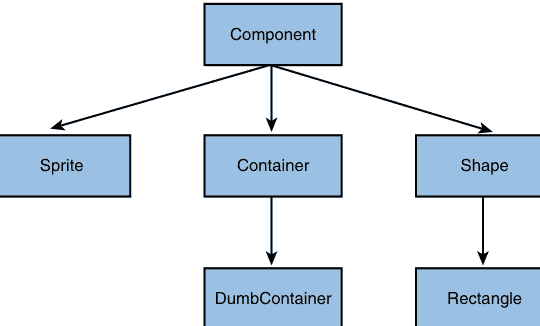

图 4-1 Components API 类及其后代

## 使用简单游戏框架构建 Pong

Pong 通常被认为是游戏编程版本的“Hello, World!”。它是一个 2D 的乒乓球游戏。这项游戏帮助了视频游戏行业的启动，它以复古的外观隐藏了其复杂性。在编写 Pong 时，我们必须管理游戏状态、跟踪评分、游戏组件，并执行碰撞检测和响应。

## 设置应用程序

列表 4-4 显示了我们将应用程序嵌入网页中所需的 HTML 骨架代码。样式表的定义（其内容显示在列表 4-5 中）格外重要。SGF 使用 HTML `div` 元素来绘制图形。该元素具有尽可能占据少量空间的内在倾向。样式表告诉浏览器为我们的游戏分配指定的尺寸，无论我们是否在使用它。另一个可移植的代码是脚本标签中的以下内容：

```
data-screen="screen"
```

它告诉 SGF 哪个 `div` 将持有游戏。如果我们省略它，游戏将添加到页面的 `body` 中。

### 列表 4-4 Pong HTML 宿页代码

```html
<!DOCTYPE HTML>
<html
<head>
<title>Pong</title>
<meta http-equiv="Content-Type" content="text/html; charset=UTF-8">
<!-- 用于 IE 使用到最新的渲染模式。 -->
<meta http-equiv="IE-X-Compatible" content="IE=edge">
<!-- 一些基础样式。这些对于 SGF 来说不是强制性的... -->
<link href="styles.css" type="text/css" rel="stylesheet" />

<script type="text/javascript" src="js/SGF.js">
    data-debug="true"
    data-swofobject="lib/swofobject.js"
    data-screen="screen"
    data-game="Pong"
</script>
</head>
<body>
<div id="screen"></div
</body>
</html>
```

### 列表 4-5 Pong CSS

```css
body {
    margin:0 0 0;
    width:100%;
    height:100%;
    text-align:center;
}
#screen {
    width:400px;
    height:400px;
    border:Solid 1px #000000;
    margin:0 auto;
}
```

### 列表 4-6 Pong main.js

```javascript
// 导入所需的类
var Game = SGF.require("Game");
var Input = SGF.require("Input");
var Rectangle = SGF.require("Rectangle");
var Label = SGF.require("Label");
// 从 SGF 命名空间检索几个对象
var myGame = SGF.require();
// 设置游戏属性
var input = myGame.input;
var game_height = 400;
var game_width = 400;
// 检索用于 Paddle 类的脚本
var Paddle = SGF.require();
// 在屏幕上的 (0,150) 处画了一个球板
var leftPaddle = new Paddle(0, 150);
// 添加球板
myGame.addComponent(leftPaddle);
```

## 绘制道具

我们的游戏道具是绘制的球板。我们需要 `checkInput` 和 `update` 两个方便方法。我们从 `Rectangle` 类开始并扩展它。在我们的构造函数 `initialize` 中，我们设置了宽度、高度和颜色。列表 4-7 Paddle 代码显示如下。

### 列表 4-7 Paddle 代码

```javascript
{
  initialize: function(super) {
    super();
    this.width = 100;
    this.height = 20;
    this.color = "FF";
  },
  setPosition: function(x, y) {
    this.x = x;
    this.y = y;
  },
  getPosition: function(){
    return {
      'x': this.x,
      'y': this.y
    }
  },
  setIsPlayerOne: function(bool) {
    this.isPlayerOne = bool;
  },
  checkInput: function() {
    if (this.isPlayerOne == false) {
      if (myInput.KeyDown(Input.UP)) {
        if (this.y > 0) {
          this.y -= 10;
        }
      } else {
        if (myInput.KeyDown(Input.DOWN)) {
          if (this.y < game_height - this.height) {
            this.y += 10;
          }
        }
      }
    }
  },
  update: function() {
    this.checkInput();
  }
}
```

你可能注意到我们对边界的检查进行了高度调整。这是因为如图 4–2 所示，屏幕坐标从左上角的 (0,0) 开始，分别向右和下方正方向延伸。

## 通过碰撞检测和响应让世界碰撞

在我们开始添加球对象并让它在屏幕上跳跃之前，让我们稍微偏离一下讨论一下让它运行的原因。当你阅读这些内容时，即使你相对静止，也有许多力作用于你。这并不是为了进行详尽的讨论，但足以解释这些概念。艾萨克·牛顿——没错，就是那个苹果男孩——描述了塑造我们理解物体相互作用的万有引力和运动定律。

### 理解牛顿三大

牛顿第一定律处理惯性，规定静止物体将保持静止，运动物体将以相同的速度（速率和方向）保持运动，直到受到不受平衡外力的作用。在 Pong 游戏的背景下，我们的球想要继续运动，直到遇到一个大到无法使其继续按原定路径运行（例如球板或墙壁）。

牛顿第二定律处理动量。动量是质量（物体中存在的物质）与其速度的乘积。你可能听过的公式是

F = ma

力 = 质量乘以加速度（速度随时间的变化率）。换句话说，对物体施加合力会按比例地影响物体的加速度。尽管足球球可能很快地向你飞来，但你用脚踢出的足球球涉及对球球施加足够的力，以克服它朝向你的动量，并使其让它朝相反方向移动。

牛顿第三定律指出，每一个作用力都有一个相等且方向相反的反作用力。不存在单向的力。如果你在推一个球，它也会对你施加同样的力。

# 在乒乓球游戏中加入 AI

对于我们的简单乒乓球游戏，我们可以快速创建具有多个复杂度等级的 AI 对手。我们可以通过让电脑玩家周期性地访问球的位置，或者给它一个数值范围并让它猜测球可能的位置来实现这一点。列表 4-12 显示了允许电脑玩家“感知”球位置的代码。在此处，我们获取球的当前位置，并通过减去挡板的高度来计算目标位置。这是为了让球击中挡板的中间。请记住，坐标是从左上角计算的，因此我们需要这种调整来避免击偏。为了让电脑玩家的移动更平滑，我们将增量从 10 减少到 3。考虑到电脑玩家每秒可以获取 30 次球的位置，它可以轻松地定义自己的区域。

### 列表 4-12 乒乓球电脑 AI

```javascript
function() {
    if (this.isPlayerOne == true) {
        var y = myGame.ball.y;
        var currentY = this.y;

        targetY = y - this.height/2

        if (targetY > this.y) {
            this.y = this.y + 3;
        } else if (targetY < this.y) {
            this.y = this.y - 3;
        }
    } else this.checkInput();
}
```

# 井字棋中的高级电脑 AI

为了避免使用图像或花哨的 CSS 来表示井字棋游戏中的 X 和 O，我们将使用纯色：红色代表 O（图中颜色较浅的色调），蓝色代表 X。图 4-4 显示了一个玩家刚刚获胜的游戏板。

井字棋与其他一些双人游戏（如国际象棋、黑白棋和跳棋）的共同点是，它们都是零和、有限、性游戏。这是一种非常挑剔的说法：

- 对于任何移动，A 玩家的收益将以 B 玩家的某种代价代价。

- 双方都知道所有可能的游戏状态。

- 游戏状态/决策/移动的数量是有限的，并且可以被列举。

- 没有变量为游戏引入随机性。

# 使用人工智能创建具有竞争力的对手

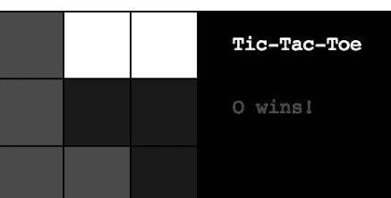

图 4-4 井字棋获胜游戏

只要有处理能力，计算机就可以计算玩家可能采取的所有移动（就像击败国际象棋大师的深蓝号象棋计算机一样）。这种方法被称为“暴力破解”。它类似于通过尝试目录中的每一个单词来破解某人的密码。这种方法非常有效，但也非常耗时。如果无法评估这些移动，那么知道玩家可能采取的移动就毫无意义。这类游戏的算法会计算电脑和玩家可能进行的若干（多达数千种）移动组合。它根据移动是有助于获胜还是输掉来给每个移动打分。在为对手选择可能的移动时，它假设对手总是会选择最佳移动。这种算法被称为极大极值算法（Minimax）。在没有任何限制的情况下，极大极值算法会尝试强制执行它的解决方案——而 JavaScript 不喜欢这一点。在尝试评估移动较少的游戏时，它可以轻松用尽浏览器提供给它的运行空间。应对这种问题的方法之一是设置深度限制。经过一些测试，我将其设置为 20。这让算法有机会评估许多棋盘，但又不会产生明显的卡顿。因为它无法评估所有的棋盘，有时它会做出次优移动。

我们的 `miniMax` 函数首先查看我们是否可以为当前棋盘评分。我们有三个指定的得分：1 表示当前玩家获胜，-1 表示对手获胜，0 表示没有可感知的移动或达到了 `depthLimit`。如果我们无法决定分数且尚未达到 `depthLimit`，我们就会创建一个游戏板的副本并找到可能的移动。接下来，我们遍历移动列表并递归地调用 `minimax`，这次切换到对手的视角。当我们收到分数时，将其与最佳分数进行比较，如有需要则保存。当函数完成后，电脑将从它尝试的所有可能移动中选择最佳移动。极大极值算法的代码在列表 4-13 中。尽管我们将其留在了主代码文件中，但 `minimax` 函数将是 Worker 的绝佳候选者。

### 列表 4-13 极大极值算法

```javascript
miniMax: function(board, currentPlayer) {
    if (this.currentDepth == this.depthLimit) {
        return 0;

if (TTT.checkForWin(board) == currentPlayer)
  return 1;
if (TTT.checkForWin(board) == this.getPlayer(currentPlayer))
  return -1;
this.currentDepth++;
var best = -10;
var bestMove = null;
var clone = TTT.cloneGame(board);
var moves = TTT.generateMovesFrom(clone, currentPlayer);

for (var i = 0; i<moves.length; i++) {
  var m = moves[i];
  clone[m[0]][m[1]] = currentPlayer;
  var value = -this.minMax(clone, this.getPlayer(currentPlayer));
  //reset board
  clone[m[0]][m[1]] = null;
  if (value > best) {
    best = value;
  }
}
if (best != -10) {
  return best;
}
return 0;
}
```

# 总结

在本章中，我们创建了第一个游戏。我们还深入了游戏的构造。学到的知识将让我们受益浅。

## 练习

1. 为什么 2D 比 3D 容易？

2. 井字棋有什么不同？

3. 路径是使用线条和弧创建形状的方法。让我们花时间学习它们。

尽管路径可以简单如一条直线，但路径通过一个一个地积累指令直到画出最终形状来形成复杂的形状。任何路径由三种类型组成：

- 线

- 弧

- 曲线

如果你考虑现实中的物体，它们是由这三种类型组成的。在我写这一章时，我正看着窗外的路灯和一些树化箱。如果你对这些物品进行横截，你将使用这些路径组件，它们可以绕中心点旋转或沿路径重新开发以创建三维形状。使用计算机辅助设计（CAD）的工程师利用这些原语来制作你驾驶的汽车或骑的自行车。

# 绘制你的第一个路径

在创建画布对象并获取上下文之后，绘制路径的第一步是调用 `beginPath()` 函数，它会清除我们可能绘制过的其他路径栈。这很重要，因为路径指令是累积的，并且给定画布标签的所有路径都使用同一个上下文。我们需要做的下一步是移动到想要开始绘制的地方。使用 `moveTo()` 传入 x 和 y 位置即可实现。你可以将其想象成拿起纸上的笔以绘制另一个形状。一旦“笔”到位，调用带有 x 和 y 位置的 `lineTo` 就会落笔并画到该点。我们需要做的最后一步是描边我们绘制的线条。你可以将 `moveTo` 和 `lineTo` 指令想象成纸上的痕迹，而 `stroke` 则在我们知道它们在哪里之后回去填充这些线条。我们可以利用这些知识为我们的井字棋游戏绘制游戏板，如列表 5–1 所示。它由两条平行的垂直线和两条平行的水平线组成形成一个九宫格网格。

## 列表 5-1 绘制井字棋游戏盘

```javascript
self.drawGameBoard = function() {
  var ctx = self.context;

  ctx.beginPath();

  ctx.moveTo(200,0);
  ctx.lineTo(200,600);

  ctx.moveTo(400,0);
  ctx.lineTo(400,600);

  ctx.moveTo(0,200);
  ctx.lineTo(600,200);

  ctx.moveTo(0,400);
  ctx.lineTo(600,400);

  ctx.stroke();
}
```

## 绘制井字棋的游戏精灵

现在游戏盘已经准备就绪，我们需要绘制用于游戏的精灵（sprites）。让我们从 X 开始。

我们可以再次使用之前之前的方法来绘制 X。它们的绘制方式是：从某一点开始，画一条向右和下方偏移指定距离的线，拿起“笔”，向上移动相同的单位，然后向左画一条指向该点左下方的线。

为了让我们的游戏精灵简单化，游戏盘被设置为 600 比 600 像素。我们不希望精灵接触到分割线，因此所有的线都画在离边缘一点一点。列表 5-2 显示了在画布上绘制 X 的代码。

## 列表 5-2 绘制井字棋的 X

```javascript
ctx.lineWidth = 2;
ctx.beginPath();
ctx.moveTo(10,10);
ctx.lineTo(190,190);
ctx.moveTo(190,10);
ctx.lineTo(10,190);
ctx.stroke();
```

# 第 5 章 使用 Canvas 标签创建游戏

绘制我们的 O 需要使用弧（arcs）。最简单的弧是我们在每天都能看到的形状——圆由一个中心点和距离中心点的给定距离（半径）定义；围绕该中心点绘制的线保持相同的径向距离。`arc` 函数可以绘制圆的一部分，也可以绘制完整的圆，因此我们可以用可选的顺时针或逆时针标志来指定起始和结束角度。

你在几何课程中学学习过用于计算形状表面积、圆面积和周长之类的数学知识。如果你全都忘了，我们现在只需复习基础知识。几何课程中一个重要的概念是角度的计算。我们不使用度，而是使用弧度（radians）。因此，对于绕一点的一圈旋转，我们说旋转了 2π（或 2 倍 pi），相当于 360 度。π（Pi）是一个数学常数，代表任何圆的周长（即圆边缘线的距离）与其直径的比例，大约是 3.14159……它无法以小数的形式整洁地表示，因此使用符号来定义近似值更为简单。表 5-1 显示了角度和弧度表示的常见角度。

## 表 5-1 角度和弧度的常见角度

| 角度数 | 弧度表示 |
|---|---|
| 0° | 0 |
| 45° | π/4 |
| 90° | π/2 |
| 180° | π |
| 270° | 3π/2 |
| 360° | 2π |

如果你需要表中未列出的角度，可以使用以下公式将度转换为弧度。你不需要担心记住 π，因为 JavaScript 将该值存储在 `Math.PI` 中。

弧度 = (度) * (pi / 180)

以下代码段显示了绘制中心点和半径以及从 0 到 2*π 弧度绘制的代码。为了配合我们的 O 和 3x3 游戏盘的尺寸，半径设置为 90 像素，直径为 180 像素。它看起来比 190 像素更好看，而这就是编程的意义。换句话说，有时数学上的正确解并不总是最美的。

```javascript
ctx.lineWidth = 2;
ctx.beginPath();

ctx.arc(100,100, 90, 0, 2*Math.PI);
ctx.stroke();
```

## 使用变换在画布上绘制对象

在传统的井字棋游戏盘中，有九个 X 或 O 可能出现的位置。我们可以仅创建显式在每个位置绘制对象的函数，但那样效率太低了。我们可以使用平移（translation）将整个绘平面从原点移动到我们的目标点，绘制对象，然后将绘平面移回来。如果我们决定制作 4x4 的网格而不是 3x3，这允许我们重用相同的代码。

矩阵（matrix）是定义空间中对象位置、比例和方向的行和列集合。对于任何平移，我们使用 2x2 矩阵来表示。在进入更复杂的示例之前，让我们先从平移开始。

要将位于 (x,y) 的对象平移 (xr,yr) 个单位，我们需要相加两个 2x1 矩阵，如图 5-1 所示。图中，我们有一个位于 (0,5) 的点，想要向左移动 5 个单位并向下移动 5 个单位。


对于缩放（scaling）、剪切（shearing）和旋转（rotation），我们需要相乘矩阵。这就是 2x2 矩阵大显用场的地方。图 5-2 显示了矩阵中每个位置的作用。


我们可以使用的最基本的矩阵是单位矩阵（Identity matrix），如图 5-3 所示。单位矩阵的一个有趣特性是，对于任何其他矩阵，将其与其相乘都会返回原始矩阵。我们可以从图中看到它代表 x 轴和 y 轴的比例为 1，且没有斜变。


# 在 Canvas 上使用图片

对于你使用的每一张图片，服务器端都会产生一次请求来获取它。我们已经通过基础 HTML 知道了如何使用 `img` 标签。在本节中，我们将查看在应用程序中使用图片的其他几种方法。

## 使用 Data URLs 提供的图片

Data URLs 提供了一种将文件数据内联到 HTML 代码中的方法。这样，在下载 HTML 时就会获取文件的内容，从而减少了对服务器的请求次数并节省了等待时间。其通用格式如下：

```
data:<mime type>;charset=<charset>;base64,<encoded data>
```

以下是图像标签内的一个简单数据：

`<img src="data:image/gif;base64,R0lGODlhAQABIAAAAAAAP///yH5BAEAAAAAAADRAAAADADWWAAAAABJRU5ErkJggg=="`

让我们来看这个 URI。原始文件是 gif，因此 mime type 设置为 `image/gif`。MIME 类型本应该是 `image/png`，以反映源文件的类型。PNG charset 指的是如果文件是文本文件时的其字符集。由于该文件不是文本，所以我们没有使用 charset。如果 MIME 类型和字符集都被省略，则 MIME 类型的默值为 `/plain`，字符集默认为 `US-ASCII`。下一个组件 `base64` 表示数据是否为 Base64 格式，或者更适用于在 Web 服务基础密码编码的介质上传输二进制数据。Base64 编码使用 A-Z、a-z 和 0-9 以及两个额外的字符 `+` 和 `/` 来格式化数据。请注意，Web 字体会将图像文件转换为数据 URL。网站 www.veinhbjorn.org/dataurlmaker 提供了一个带有指向桌面应用程序链接的 Web 应用程序。

## 使用精灵图（Sprites）提供图片

尝试加载大量图片（即使它们很小）可能会给服务器带来很大负担，并导致用户等待长时间。精灵图通过将图片打包成一张解决了这个问题。它们通常用于大量尺寸相似的小图片。图片被填充为统一的尺寸，并可以使用图片的计算坐标进行检索。诸如 GIMP、ImageMagick 和 Photoshop 等图像编辑应用程序可以为你创建它们，某些 Web 服务也可以创建。精灵图可以使用 data URLs 创建。

## 在 Canvas 上绘制图片

现在我们已经加载了图片，需要一种方法来绘制它们。Canvas 有一个名为 `drawImage` 的函数，带有多个变体。我们所有的示例都假设我们已经从图像标签 `document.getElementById`、`document.images` 集合获取了图片，或者使用 JavaScript 中的 `Image()` 直接创建了图片并添加了 `src` URI。

最简单的变体是：

`drawImage(image, x, y)`

它以当前的大小完整地绘制图片，其左上角位于 (x,y)。

第二个变体是：

`drawImage(image, x, y, width, height)`

它与第一个变体一样，绘制整张图片。最后两个参数用于缩放 Canvas 上的绘制结果。

最后一种变体最强大，参数也最多：

`drawImage(image, sx, sy, width, height, dx, dy, dWidth, dHeight)`

这允许你只使用源图像的部分并在 Canvas 上进行缩放。sx 和 sy 指向图像切片的左上角。(sx,sy) 和 (sx+Width, sy+height) 范围内的所有数据都会被绘制。在 Canvas 上，图片被绘制在 (dx,dy) 和 (dx+dWidth, dy+Height) 区域。

Trident.js (https://github.com/kirillkov/trident-js) 是由 Kirill Grouchnikov 创建的 JavaScript 动画库，从他同名的 Java 库移植而来。该库的重点在于 timeline（timeline），类似于视频编辑程序中的 timeline，允许我们通过关键帧在不同状态之间进行过渡。缓冲函数（Easing functions）允许对象以更生动的方式移动。许多具有不同函数的 timeline可以同时运行，也可以按照特定的顺序逐一运行。这是 Trident.js 在众多可能的 JavaScript 动画库中被选中的主要原因。

目前，Trident 使用 `setTimeout` 来请求 `requestAnimationFrame`。`requestAnimationFrame` 根据浏览器窗口是否可见或页面是否正在渲染来决定是否绘制对象，并将刷新率限制为 60Hz。`setTimeout` 则不具备这些功能。如果应用程序仍在渲染或不在视图中，它会尝试尽可能渲染。Trident 是一个多功能动画库。`setTimeout` 同时适用于基于 DOM 和基于 Canvas 的动画，而 `requestAnimationFrame` 则不能。这看起来使用 `setTimeout` 似乎让 Trident 在起跑线上就失去了资格。挽回它的特性是暂停时间轴的能力。这一特性与其他特性共同揭示了使用 `setTimeout` 的缺点。

## 创建 timeline

Trident.js 中最基础的 timeline 有一个运行持续时间，以及一个用于插值的对象和属性。插值器告诉 Trident.js 如何生成中间值以及可选的起始和结束值。timeline 通过周期性唤醒或脉冲工作，检查经过了时间并适当调整值。虽然不能保证 脉冲的频率或时间，但对于大多数应用程序来说，它们的表现良好且规律。这些属性受到客户端机器负载以及每个脉冲运行时运行程序的影响。列表 5-4 显示了如何创建一个 timeline。

### 列表 5-4 创建 timeline

```javascript
var timeline = new Timeline(2000);
timeline.add({
  property: "opacity",
  from: 0,
  to: 1
});
```

在本文写作时，Trident.js 拥有 31 个缓动函数。我并不打算在这里列出它们，而是鼓励你下载源代码并亲自尝试 `testBallLoop` 页面。当我们讨论第 6 章“使用 SVG 和 RaphaelJS 创建游戏”时，我们会再次介绍缓动函数。

# 使用精灵集制作游戏对象

在学习了如何切割和处理图像以在 Canvas 上绘图后，我们可以使用一些 Transient.js 时间轴来创建动画。此演示中的精灵素材源于 OpenGameArt (http://opengameart.org)。该网站列出的所有游戏资产都具有非常宽松的许可，可以免费使用。我为演示选择的精灵是一个行走的僵尸，随后在头部中显示。所有单独帧的大小均为 128 像素乘以 128 像素。让我们开始设置时间轴来控制动画。名为 `sprites` 的 JavaScript 函数（代码列表 5–7）展示了初始化函数中设置时间轴的代码。

## 代码列表 5-7 为动画设置时间轴

```javascript
self.init = function() {
  // 为了简洁起见进行了省略
  var self = this;
  self.current = 0;
  self.spriteTimeline = new Timeline(this);
  self.spriteTimeline.addPropertiesToInterpolate({
    property: "current", from: 0, to: 36,
    interpolator: new IntInterpolator()
  });

  self.spriteTimeline.duration = 5000;
  self.spriteTimeline.addEventListener("onpulse",
    function (timeline, durationFraction, timelinePosition) {
      self.drawSprite();
    });
  self.spriteTimeline.play();
});
```

这与之前示例的一个显著不同之处是，新时间轴的参数指向当前对象。另一个区别是我们处理在 Canvas 上绘图的方式。与会自动传播到 HTML 元素的 CSS 属性不同，我们需要分两步进行。首先，我们设置一个监听器，每次时间轴位置更新时触发。当时间轴播放时，它会修改当前属性，该属性被 `drawSprite` 函数用于计算绘制所需的切片。代码列表 5–8 显示了绘制单个精灵的代码。

## 代码列表 5-8 绘制单个精灵

```javascript
self.drawSprite = function() {
    var ctx = self.context;
    var row = 3;
    ctx.clearRect(0, 0, 128, 128);
    ctx.drawImage(self.sheet, self.current * 128,
    row * 128, 128, 128, 0, 0, 128, 128);
}
```

# 在 2D 空间中模拟 3D

从街机和早期主机时代开始，在 2D 空间中模拟三维的能力提供了更愉的游戏体验。那时，真正的 3D 是可能的，模拟 3D（称为 2.5D）是唯一的选择。从某种意义上说，情况保持不变。在写作此时，2D Canvas API 得到了更好的支持，而 WebGL 被归为实验性状态。因此，Canvas 中的 2.5D 游戏比 WebGL 中的游戏具有更多的潜在用户。2.5D 的另一个优势是它所需的计算能力可能比真正的 3D 游戏少。在本节中，我们将讨论创建 2.5D 体验的一些方案。

## 透视投影

透视投影试图模仿人眼观察物体的方式。我们的眼睛为我们提供了 3D 场景的 2D 投影。多个因素协同作用赋予了我们深度感。例如，远处的物体看起来更小，细节也比近处少。最简单且适合 2D 游戏的形式是单点透视。这个点就是消失点，平行线在此处似乎汇聚。图 5-9 显示了使用 3D 建模应用 Blender 创建的图形的此效果示例。正交投影是在 2D 空间中表示 3D物体的方法。为物体的顶、底、左、右、正面和背面创建图像。通常，顶视图、正面和右视图的信息就足够重建物体。图中右侧的视图分别是顶视图和侧视图。在左侧的透视图中，我们可以看到矩形的边缘似乎在缓慢向地平线汇聚。我们可以通过对近物体进行比远物体更详细的纹理处理来增强这种效果。

图 5-9 在 Blender 中渲染的透视投影

## 视差滚动

在《超级马里奥兄弟》和《索尼克》等横向卷轴游戏中，经常用于模拟三维并创建更沉浸式体验的技术是视差滚动。我们可以通过让背景的不同组件作为独立的、可移动的层存在，并以不同的速度移动来创建这种效果。

## 使用 JavaScript 创建视差效果

对于此演示，我们使用了天空、山脉和地面层。每一层以不同的速度移动以以深度幻觉。为了实现这一点，我们使用时间轴来更新每层的水平位置。

### 代码列表 5-9 为动画设置时间轴

```javascript
self.init = function() {
  // 为了简洁起见进行了省略
  var self = this;
  self.current = 0;
  self.spriteTimeline = new Timeline(this);
  self.spriteTimeline.addPropertiesToInterpolate({
    property: "current", from: 0, to: 36,
    interpolator: new IntInterpolator()
  });

  self.spriteTimeline.duration = 5000;
  self.spriteTimeline.addEventListener("onpulse",
    function (timeline, durationFraction, timelinePosition) {
      self.drawSprite();
    });
  self.spriteTimeline.play();
});
```

滚动效果是通过以不同的速度移动层实现的。层越远，移动看起来就越慢，而近的层移动得越快。

### 代码列表 5-10 绘制单个精灵

```javascript
self.drawSprite = function() {
    var ctx = self.context;
    var row = 3;
    ctx.clearRect(0, 0, 128, 128);
    ctx.drawImage(self.sheet, self.current * 128,
    row * 128, 128, 128, 0, 0, 128, 128);
}
```

根据时间轴位置，我们可以计算用于绘制的源图像起始像素。如果像素不足以填充视口，我们计算需要绘制多少像素（`pixelsToDraw`），并从图像开始绘制部分内容以填充该空间。为了避免缝隙之间出现 1 像素的间隙，我们将 Canvas 中的目标 x 位置减 1，以便将所有内容完美地缝合在一起。

## 模仿我

为了实践你目前所学的内容，我们将创建一个旧电子记忆游戏 *Simon* 的克隆。这个游戏名字源自儿童游戏 *Simon* Says（西蒙说），玩家必须模仿西蒙所说的每一件事。在 *Simon* 游戏中，计算机为玩家创建一个音调序列供模仿。当每个音调播放时——无论是红色、绿色、蓝色还是黄色——都会亮起。随着每一回合的进行，序列会增加一个。游戏一直持续直到玩家出错。

## 绘制我们的游戏对象

我们不让游戏看起来像传统的 *Simon* 游戏，而是使用矩形和阴影，利用 Canvas Path API 的其他特性。代码列表 5-11 显示了创建一个矩形的代码。

### 代码列表 5-11 绘制带有阴影的矩形

```javascript
ctx.save();
ctx.fillStyle = "rgb(150,150,0)";
ctx.shadowOffsetX = yellowOffset.x;
ctx.shadowOffsetY = yellowOffset.y;
ctx.beginPath();
ctx.rect(400,200,200,200);
ctx.fill();
ctx.restore();
```

`rect` 函数接收左上角的 x 和 y 坐标——在本例中为 (400,200)——随后是宽度和高度。创建投影也同样简单。需要注意的是，在绘制阴影之前，需要在上下文中设置 `shadowColor`。图 5–10 显示了完成后的游戏板。

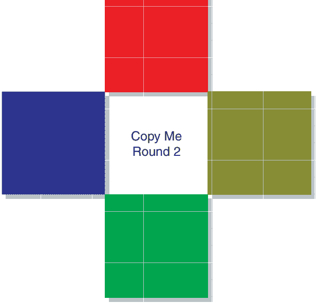

图 5-10：Copy Me 游戏板

## 游戏音调制作

当我想到 20 世纪 70 年代的游戏时，立刻会想到带有旋律电子音的 8 位音板。为了复制那种效果，我们可以尝试寻找音调，或者使用 MIDI（乐器数字接口）自己创建。MIDI 给我们的优势是，现软件软件包允许我们使用文本文件创建音调。MIDI 还提供了灵活性，可以根据客户端机器上的乐器直接使用文件，或者转换为 WAV 或 MP3，将冷门且独特的乐器引入游戏。我们只需要四种音调，因此对于我们的需求来说非常容易。按照惯，音调的组织如下：

## 创建 Copy Me

- 红色按钮：一个音

- 绿色按钮：比红色按钮高一个八度的音

- 蓝色按钮：一个 D 音，比绿色按钮高一个四度

- 黄色按钮：一个 G 音，比蓝色按钮高一个四度

有几个项目可以生成 MIDI 文件（例如 GarageBand），甚至可以使用文本文件来实现。由于我没有音乐键盘，所以我自己写了文本。最流行的两个转 MIDI 应用程序是 Lilypond 和 ABC 记法。然而，两者都更适合创作长篇作品，对于一个四个音的“乐谱”来说大材小用了。此外，它们的记谱样式有点复杂。我用 Jfugue 实现了它。通过大约十行代码，就能听到所有的音调，以判断它们听起来是否正确。它不是 JavaScript，但你很容易将其误认为是代码。用 Java 创建 MIDI 文件后，我们可以使用 MIDI 编辑器/序列器将“乐谱”切成单音片段，并转换为 WAV 或 MP3 文件。

### 代码列表 5-12 使用 Jfugue 生成 MIDI 音符

```javascript
import org.jfugue.Player;
public class TestMidi {
    public static void main(String [] args) {
        Player player = new Player();
        String midiString = "I[Harpichord] A4h A5h D5h";
        player.play(midiString);
        player.saveMidi(midiString,
            new File("/Users/jwill/Desktop/test.mid"));
    }
}
```

## 在浏览器中播放 MIDI 文件

现在我们有了 MIDI 文件，但面临一个小问题。我们没有播放它们的方法。某些浏览器确实有播放 .midi 文件的插件，但它们没有我们游戏所需的程序化控制。幸运的是，`jasmid` (https://github.com/gasman) 项目具有这一功能。它可以使用 HTML5 Audio API 解析并播放 MIDI 文件，并回退到 Flash。在运行时，会生成 .wav 文件并将其传递到 Audio API。获取文件并分配乐器涉及大量工作，因此这对于勇于探索的人来说是一项练习。我预计浏览器最终将支持原生 MIDI 音频文件格式。

# 第 5 章 使用 Canvas 标签创建游戏

在此，可以通过将 MIDI 预处理为其他声音格式（如 WAV、MP3 或 OGG）来减少部分工作。开源项目 Audacity 在这项任务上做得很好，同时也满足了其他音频编辑需求。

## 同时播放多个声音

你在第 1 章“介绍 HTML5”中已经看到如何使用 Audio API 编写 HTML 或 JavaScript 代码来播放声音。我们在那一章中没有提到的是如何同时播放多个声音。这比将多个声音传递到一个 Audio 对象并执行 `play()` 要复杂一点。

每个 Audio 对象一次只能做一件事。当你对一个已经正在播放的对象调用 `play` 时，它会忽略掉该请求。如果你等到它播放结束稍后再次播放它，它就能正常工作。如果你的声音没有播放，可能会破坏游戏体验并让人们认为你的游戏是有故障的。我们可以通过为每个声音创建一个 Audio 对象来解决这个问题；我们创建一个 Audio 对象池，并遍历它，寻找当前没有正在播放的对象。我们可以通过比较 `duration` 和 `currentTime` 来检查状态。如果它们相等，说明声音已播放完毕，可以使用该通道。如果不相等，说明声音正在队列或等待播放。你可以在代码列表 5-13 中看到这段代码。

### 代码列表 5-13 播放多个声音

```javascript
// 代码列表 5-13 播放多个声音
var numChannels = 10;
channels = new Array();
for (var i = 0; i<numChannels; i++) {
  channels[i] = new Audio();
}

var play_multi_channel = function(id) {
  for (var i = 0; i<numChannels; i++) {
    if (channels[i].duration == channels[i].currentTime) {
      channels[i].src = id;
      channels[i].play();
      break;
    }
  }
}
```

## 练习

- 1. 将 290 度转换为弧度。

- 2. 你如何为你的游戏关卡播放主题曲，然后在执行跳跃和踢等动作时播放声音而不中断主题曲？

- 3. 尽管文件大小很小，为什么你可能不会直接使用 MIDI 用于游戏声音？

你可以在 www.informit.com/title/9780321767363 下载章节代码以及章节练习的答案。

# 第 6 章 使用 SVG 和 RaphaelJS 创建游戏

我们在使用 Canvas 创建游戏时遇到的问题之一是，我们必须在渲染完成后，独立地跟踪鼠标交互和绘制对象的位置。可缩矢量图形（SVG）通过为我们提供一种在绘制对象的同时保留其位置的手段来解决这些疑虑，并使我们能够能够对它们进行事件处理和修改。在本章中，你将学习 SVG 的基础知识以开始创建游戏。我们还讨论了它在渲染能力以及大多数客户端实现的 SVG 子集方面与 Canvas 的对比。

## SVG 简介

与 HTML5 的其他元素相比，SVG 是一个相对成熟的组件，首次发布于2001年，最近一次发布于2008年12月。与 Canvas 不同，它使用基于 XML 的格式来存储绘制组件的指令。因此，用纯 SVG 绘制的对象可以等比例放大而不丢失质量。图 6–1 显示了一个被放大了四倍大小的位图（Canvas）图像。SVG 图像不会出现模糊和锯齿现象。

Canvas 和 SVG 相似的一个领域是它们为绘制提供的原始原语。两者都提供了以下原语和效果：

- 圆形和弧

- 线或路径

- 多边形

- 描边（Strokes）

- 文本

- 渐变

- 图像嵌入

- 裁剪、遮罩和合成

Internet 9 之前的 Internet Explorer 版本大部分不支持两者，而 Internet 9 将同时支持 Canvas 和 SVG。除了纯基于绘制的功能外，SVG 对象可以使用 JavaScript 编写脚本，并能响应以下事件：

- click（点击）

- doubleclick（双击）

- hover（悬停）

- mouseover（鼠标移入）

- mouseout（鼠标移出）

- mouseup（鼠标释放）

- mousedown（鼠标按下）

在某些实现中，SVG 还支持按键、鼠标轮和文本输入事件。在浏览器中，按键事件与现代网络浏览器的原生能力存在重叠。现代浏览器还可以直接嵌入 SVG 对象，使其能够在没有 JavaScript 的情况下使用，引入了另一种创建手段。

第 8 章“创建游戏”引入了另一种使用 Java 编程语言创建 SVG 资产的手段，但本章将使用两种更广泛的方法：RaphaelJS，这一个 JavaScript 库，能够在早于 IE9 的浏览器中渲染动态资产；以及 Inkscape，这是一个类似于 Adobe Illustrator 的开源矢量图形应用程序，用于处理更复杂的静态资产。如果你还没有安装 Inkscape (http://inkscape.org/) 或你偏好的矢量图形程序，请花点时间安装它们。

## RaphaëlJS 的第一步

对于对 RaphaëlJS (http://raphaeljs.com/) 的首次体验，我们将创建一个简单的卡牌匹配游戏。这将让我们将大部分注意力集中在 SVG 上，而不是游戏逻辑上。我们的游戏将在游戏板上显示几行卡牌，并包含一个计时器和一个记录已完成步数的计数器。图 6-2 显示了我们完成的游戏的一个帧。

图 6-2 卡牌匹配游戏截图

## 设置开发环境

某些浏览器比其他浏览器更严格，允许你从本地机器引用 JavaScript 文件，而要求你将 JavaScript 托管在服务器上。如果你的 Web 服务器距离你所在的位置很远，这可能会非常麻烦且容易产生延迟。编辑文件、上传并检查更新结果的流程很快就会让人厌倦。当然，前提是你没有直接在服务器上编辑文件。你没有那样做，对吧？

幸运的是，Java 有一个名为 Jetty 的轻量级服务器，我们可以在本地使用它来模拟运行的服务器。别担心，你不需要编写任何 Java 代码，但你需要一点一点命令行“魔法”来启动服务器。在本章的代码目录中，有一个名为 `webserver` 的目录。将其拷贝到你的工作目录（其他你想要访问多个目录的地方）。只要你安装了 Java，在命令提示符中输入以下内容：

```
java -jar webserver/webserver.jar
```

此命令启动了一个监听在 localhost 端口 8080 的 Jetty 服务器。如果你不喜欢 Java，可以自由使用你喜欢的本地技术（如 Django、Node.js 或 Rails）进行替换。现在你可以在本地测试我们的游戏，或者在服务器上运行它，让我们创建游戏板吧。

## 绘制游戏板

网页中显示 SVG 的区域通常被称为“canvas”（画布）。但为了避免与 HTML5 Canvas 混，我们将使用 Raphael 的术语“paper”（纸）。我们首先需要创建一个 paper 来绘制游戏。Raphael 有重载的构造函数来创建 paper，但我们将使用接受 DOMElement、宽度和高度的版本。在创建了默认透明的 paper 之后，我们需要为游戏创建一个矩形背景。列表 6-1 显示了创建这些元素的代码。

### 列表 6-1 初始化游戏板

```html
<script src="raphael.js" type="text/javascript">
<script type="text/javascript">
var paper = Raphael("gameBoard", 800, 600);
// 在 0, 0，宽度 800px 高度 600px 处绘制，并带有圆角 [可选]。
var rect = paper.rect(0, 0, 800, 600, 15);
rect.attr({
  fill:"#090", /* 填充绿色 */
  stroke:'#000' /* 绘制黑色边框 */
});
</script>
<body
<div id="gameBoard"></div>
</body>
```

在列表 6-1 中，我们绘制了一个矩形并对其应用了填充和描边。然而，我们并不限于这些属性。表格 6-1 显示了我们可以应用到大多数对象上的其他属性。

### 表格 6-1 绘制属性

| 属性名称 | 说明 |
| :--- | :--- |
| cursor | 设置显示的光标。 |
| fill | 填充闭合对象或路径的颜色。 |
| fill-opacity | 颜色的不透明度。 |
| stroke | 描边路径的线条颜色。 |
| stroke-width | 描边路径的线条粗细。 |
| opacity | 对象的全局半透明度。 |
| path | 一组用于复杂对象的坐标和指令。（此属性将在后文中讨论） |

## 绘制文本

接下来，我们需要绘制标题。

Raphael 提供了多种选项来绘制文本，我们甚至可以改变颜色和填充。我们可以通过以下代码指定 x 和 y 位置进行填充：

```
var text = paper.text(600, 50, "Timer");
```

如列表 6-2 所示，可以通过 `obj.attr("attribute", "value")` 应用属性。不适用于对象的属性会被忽略。表格 6-2 显示了我们可以应用于文本的属性。

### 表格 6-2 字体属性

| 属性名称 | 说明 |
| :--- | :--- |
| font | 使用的字体名称。 |
| font-family | 具有不同大小、权重样式的字体族。 |
| font-size | 指定字体的大小。 |
| font-weight | 字体的样式（加粗、普通或斜体）。 |

## 自定义字体

有时，基础字体并不可行。为什么你的游戏受限于所有计算机上都存在的少数字体？嗯，好消息是，通过 Cofon 它们不必于此。

Cofon 是一个工具，允许你将专利字体转换为可以使用的 JavaScript 格式进行样式化。如果全球的设计师能够团结并成功从所有浏览器中剔除 Comic Sans，请放心你可以在需要时包含它。Cofon 的其他优势之一是缩小了原生字体（如 TTF 和 OTF）的大小。

使用 Cofon 转换字体很容易。访问 http://font-editor.com/generate/ 或下载代码并在服务器上运行转换工具。Cofon 生成器允许你指定常规权重之外的字体，包括加粗、斜体和加粗斜体。你还可以修改指定的 font-family 标识符。图 6-3 显示了这些选项。

图 6-3 选择要转换的字体

图 6-4 显示了可以在生成的字体中输出的不同字符组合。这是一个我们可以进一步缩小输出字体尺寸的区域。默极选择是基础拉丁，包含了大写和小写字母、数字和标点符号。如拉丁扩展 A 和 B、西里尔、俄语和希腊等选项取决于字体本身的能力。这些扩展字符集可能不可用，请使用 Cofon 验证你是否可以使用它们。

Cofon 为我们提供了一些限制字体用于特定设计的选项。然而，我最感兴趣的选项如图 6-5 所示。右侧有一个微小的画刷符号。

在使用时请务必调查许可协议。相反，你也可以坚持使用开源免版税的字体，这些字体在互联网上免费提供。

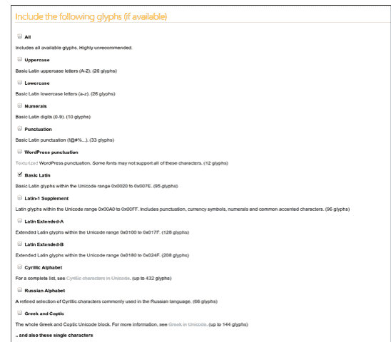

图 6-4 选择要转换的字符

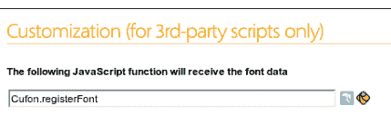

图 6-5 字体自定义

与之前使用的 `text(...)` 函数不同，Raphaël 中的另一个函数 `print(...)` 让我们对字符进行非常细粒度的控制。使用 `text(...)` 创建的字符串属性适用于所有字符，而使用 `print(...)` 创建的字符串可以逐字符应用。动画也是如此。

SVG 和 Raphael 暴露的属性让我们自由地与 Web 交互并链接到其他 SVG 文档或网页。得益于搜索引擎的魔力，Listing 6-2 中的链接展示了可以导航到不同网站的几个矩形和一个圆形。

## Listing 6-2 链接到外部文档

```javascript
var paper = Raphael(0, 0, 300, 300);
var circle = paper.circle(50, 50, 40);
circle.attr((fill:'#F00'));
circle.node.onclick = function () {
  document.location = "http://facebook.com";
};
circle.node.onmouseover = function () {
  console.log('over at ' + new Date());
};
var r = paper.rect(200, 100, 40, 40);
r.attr("fill", "00cc");
r.click(function () {
  document.location = "http://amazon.com";
});
var rect = paper.rect(150, 200, 80, 80);
rect.attr((fill:"F0F", href:'http://google.com'));
```

Listing 6-2 展示了几个功能。首先，我们第一次使用了 `node` 关键字，它指定你想要访问并操作底层的 `DOMElement`。或者，对于最常见的事件类型，我们可以将监听函数直接附加到蓝色矩形元素上。虽然这三个都会将浏览器引导到不同的页面，但需要注意的是，只有带有 `href` 属性的最后一个元素像传统的链接一样，会将光标变为“可点击手型”。表 6–3 显示了 SVG 对象可用于链接文档的一些其他属性。

## Table 6-3 链接属性

| 属性名称 | 说明 |
|---|---|
| href | 将关联对象转换为超链接 |
| target | href 页面上要链接的子元素 |

我们希望游戏文本使用一种用户机器上很可能存在的字体，除了字体大小外，我们还将指定一个字体列表进行尝试。如果其中一个都不存在，Raphael 将回退到一种无衬线字体。Listing 6–3 显示了我们如何实现这一目标。

## Listing 6-3 在文本块上设置属性

```javascript
var attrList = {fill:"FFF", stroke: 2};
var gameTitle = paper.print(150,30,
  "Card Match Game", gameTitle.setFont("Droid Sans", "bold", 48
gameTitle.attr(attrList)
```

## 指定颜色

在早期的示例中，我们通过使用简单的三字符十六进制表示红、绿、蓝值来指示颜色。Raphaël 提供了多种指定颜色的方法。除了短的 RGB 十六进制格式外，我们还可以使用表 6-4 所示的标识符指定颜色。

## Table 6-4 指定颜色的方法

| 方法 | 说明 |
|---|---|
| 颜色名称 | 指定 HTML 和 CSS 定义的 147 种颜色之一的字符串。例如："yellow", "green", "pink" |
| 颜色通道 | 指定从 0 到 255 的红、绿、蓝值，或从 0% 到 100% 的百分比。可选地，可以使用相同的方法指定 alpha 通道（Alpha）。例如：rgb(140,200,10).rgba(100%, 5%, 20%, 90%) |
| 十六进制 | 使用十六进制格式表示颜色。同时支持短格式 (#RGB) 和长格式 (#RRGGBB)。 |
| 色相、饱和度、亮度,(Alpha) | 使用 0.0 到 1.0 之间的色相、饱和度和亮度值表示颜色。或者，可以使用百分比并指定透明度。 |

SVG 支持渐变，允许在指定的间隔内颜色之间进行平滑过渡。指定渐变需要多一点工作。渐变分为两大类：线性渐径向渐变。线性渐变假设一个维度的影响，有一个延伸到空间的向量和影响角度，生成的渐变与该向量匹配。线性渐变遵循通用格式

```
angle-color-[color:offset]*-color
```

其中 `angle` 是入射/出射角度，随后是连字符和颜色。在初始颜色之后，通过冒号，可以指定任意数量可选的停止点（stops）。它们由连字符、颜色、冒号和可选的相对于向量原点的偏移百分比标记。如果未指定偏移量，过渡将分布在...

## 第 6 章 使用 SVG 创建游戏

Raphaël 存储 SVG 的方式是规范的子集，因此我们无法直接对任何 SVG 文件进行操作。有几种解析器可以获取原始 SVG 文件并创建 Raphael 来渲染它。我们的另一种选择是将复杂的属性渲染到位图文件并使用它。对于我们的简单游戏，后者是最好的。如果我们将卡片渲染为对象，渲染器将反复重绘设计，降低游戏的交互性。幸运的是，除了能够读取和创建 SVG 文件外，Inkscape 还可以将它们转换为 PNG、PDF 以及其他格式。

## 将 SVG 转换为位图图像

在卡片中，每张卡片存储在一个组中，卡片名称和花色的格式如下：(1,2,3,4,5,6,7,8,9,10,jack,queen,king){club, diamond,spade, heart}(red,black)_joker 要转换，例如两个梅花，我们将使用 Inkscape 终端：inkscape -shell

交互式终端允许我们在不启动大量 Inkscape 进程的情况下运行多个命令。我们需要为请求指定参数：> svg-cards.svg -i 2_club -e 2_club.png

本章的代码目录包含了该项目所需的已转换资源。现在我们已经有了卡片图像和背面位图文件，只需要创建交互所需的类即可。

```javascript
if (!(this instanceof arguments.callee)) {
  return new arguments.callee(arguments);
}
```

```javascript
var ord;
var suit;
var cardBackPath = "";
var cardFrontPath = "";
var self = this;
self.init = function() {
  var paper = Raphael("#gameboard", 0, 800, 600);
  self.ord = ordinal;
  self.suit = suit;
}
```

```javascript
self.createCard = function(ordinal, suit) { };
self.init();
```

# 列表 6-5 牌类源代码

```javascript
/**
 * 定义 Deck 对象。
 * @author jwill
 */
```

```javascript
function Deck(numDecks) {
  if (!(this instanceof arguments.callee)) {
    return new arguments.callee(arguments);
  }
  var cards;
  var self = this;
  self.init = function() {
    var paper = Raphael("#gameboard", 0, 800, 600);
    self.cards = new Array(5 * numDecks);
  };
  self.initCards = function() {
    // 初始化卡牌
    var ordinals = ['1', '2', '3', '4', '5', '6', '7', '8', '9', '10', 'jack', 'queen', 'king'];
    var suit = ['club', 'spade', 'heart', 'diamond'];
    // 填充卡牌数组
    for (var k = 0; k < numDecks; k++) {
      for (var j = 0; j < suit.length; j++) {
        for (var i = 0; i < ordinals.length; i++) {
          var index = (i + (j*13) + (k*52));
          self.cards[index] = new Card(ordinals[i], suits[j]);
        }
      }
    }
  }
}
```

# 洗牌

就像你在商店买到的扑牌一样，我们的牌组在初始化时是有有序的。为了洗牌，我们可以使用由唐纳德·克纳斯（Donald Knuth）普及的随机算法，该算法从数组的倒数第二张开始向前移动，并在零和当前位置之间选取一个随机数。然后我们交换这些索引中引用的牌，并重复此过程直到完成。为了彻底打乱牌，算法会针对我们提供的每副牌重复一次这个过程。列表 6-6 显示了执行洗牌的代码。

## 列表 6-6 洗牌

```javascript
self.shuffleDecks = function () {
    var rand = function(max) {
        return Math.floor(Math.random()*max);
    }
    var swap = function(i,j) {
        var temp = self.cards[j];
        self.cards[j] = self.cards[i];
        self.cards[i] = temp;
    }
    for(var j = 0; j < numDecks; j++) {
        for(var i = (numDecks * 51); i >= 0; i--) {
            var r = rand(i);
            swap(i,r);
        }
    }
}
```

# 抽牌与动画卡牌

虽然卡牌状态之间没有过渡也是完全可以的，但这样做可以为游戏增添一点精致感，让游戏过程更加有趣。表格 6-5 和 6-6 引入了 Raphael 中最后几个最常用的属性，即用于定位和变换对象的属性。

# 第 6 章 使用 SVG 和 RaphaelJS 创建游戏

## 表格 6-5 位置属性

| 属性名称 | 说明 |
| --- | --- |
| cx | 居心的 x 位置 |
| cy | 中心的 y 位置 |
| r | 对象的统一半径 |
| rx | 对象的水平半径 |
| ry | 对象的垂直半径 |
| height | 对象的高度 |
| width | 对象的宽度 |
| x | 对象的 x 位置 |
| y | 对象的 y 位置 |

## 表格 6-6 变换属性

| 属性名称 | 说明 |
| --- | --- |
| rotation | 关于中心点旋转 |
| scale | 增大或减小对象的大小 |
| translation | 在屏幕上移动对象 |

我们在游戏中对图形效果的要求相当低，但我们需要一些过渡来增强游戏体验。我们需要设计一种翻转卡牌的过渡，以便在找到匹配对时让它们消失，并启动和结束游戏。让我们从动画卡牌开始吧。

正如你所看到的，我们可以像使用其他 DOMElement 一样使用卡牌来响应点击等事件。由于我们是在二维空间中工作，我们将“翻转”卡牌的一侧为 0，使其变为透明，同时逐渐让卡牌的另一侧变得不透明。列表 6-7 显示了我们的 `flipCard` 函数，它返回卡牌正面是否显示，并执行过渡。

## 列表 6-7 翻转卡牌


# 创建类

```javascript
self.flipCard = function(frontShown) {
  if (self.meta('hidden') == true)
    return;
  self.frontShown = self.frontShown;
  if (self.frontShown) {
    self.cardBack.animate({opacity: 0}, 1000);
    self.cardFront.animate({opacity: 1}, 1000);
  } else {
    self.cardBack.animate({opacity: 1}, 1000);
    self.cardFront.animate({opacity: 0}, 1000);
  }
}
```

我们在游戏中对图形效果的要求相当低，但我们需要一些过渡来增强游戏体验。我们需要设计一种翻转卡牌的过渡，以便在找到匹配对时让它们消失，并启动和结束游戏。让我们从动画卡牌开始。

正如你所看到的，我们可以像使用其他 `DOMElement` 一样使用卡牌来响应点击等事件。由于我们是在二维空间中工作，我们将“翻转”卡牌的一侧为 0，使其变为透明，同时逐渐让卡牌的另一侧变得不透明。列表 6-7 显示了我们的 `flipCard` 函数，它返回卡牌正面是否显示，并执行过渡。

## 表格 6-7 可动画属性

| 属性 | 说明 |
| --- | --- |
| cx | cx |
| cy | cy |
| r | r |
| rx | rx |
| ry | ry |
| height | height |
| width | width |
| x | x |
| y | y |

## 表格 6-8 缓动函数

| 值 | 说明 |
| --- | --- |
| `>` | 简单减速 |
| `<` | 简单加速 |
| `<>` | 加速后减速 |
| `backIn` | 目标移动 |
| `backOut` | 目标移动 |
| `bounce` | 目标移动 |
| `elastic` | `backIn`、`backOut` 和 `bounce` 的组合 |

当玩家找到匹配对时，我们将卡牌淡出透明。这可以通过简单的行代码实现：

```javascript
self.cardBack.animate({opacity: 0}, 1000, "bounce");
```

源代码的后续：

```javascript
self.meta['hidden'] = true;
```

# 高级动画

我们需要完成的最后一个动画是游戏结束时的动画。没有人会输掉我们的游戏，让我们通过显示动画“你赢了！”消息让它变得格外特别。在深入动画消息之前，让我们退一步讨论一个我们尚未涵盖的概念：路径。

## 路径

路径提供了创建复杂形状的方法。它们本身没有可见的表示。它们是一组抽象的线。如果我们给它们一个颜色填充，就会绘制出一个实心对象。如果我们添加一个描边，它看起来像一组线。我们还可以取一个形状并沿着路径多次绘制，以创建一个具有 3D 效果的挤压形状。在 Raphaël 中，我们还可以使用路径来确定对象如何被动画。

## moveto 和 inline

与某些早期 BASIC 和 Logo 的图形库不同，没有显式的抬笔或落笔。在 SVG 术语中，移动光标相当于拿起笔，移动到另一个位置，然后将笔重新放在纸上。

该位置可以根据“笔”的当前位置是绝对的还是相对。需要注意的是，我们几乎所有的路径指令都有绝对版本和相对版本。`moveto`（移动到点）指令用小写的 `m` 或大写的 `M` 加上笛卡尔坐标，分别表示相对或绝对指令。

绘制线条有三种变体：`lineto`（画线）、`horizontal lineto`（水平画线）和 `vertical lineto`（垂直画线）。`lineto` 用大写的 `L` 表示绝对坐标，用小写的 `l` 表示相对坐标。你可以指定单个点或一组点。`horizontal lineto` 用 `H` 或 `h` 表示，接受一个或多个值。`vertical lineto` 用 `V` 或 `v` 表示，它执行着与 `horizontal lineto` 相同的操作，但作用于 y 轴。最后，我们需要将你的垂直线、水平线和普通线组合成形状。`closepath`（闭合路径）指令用 `Z` 或 `z` 标记，其作用正是如此：从当前位置画到当前子路径的起点画一条直线。`Z` 和 `z` 的功能完全相同，但为了与其他命令保持对称性。

我向你保证，这一节你只需要忍受一下手动绘制这些路径。没有开发者会手动这样做。只需把它想象成在微积分课上学习计算导数一样；一旦你理解了简单的方法，你再也不需要去对付困难的方法了。列表 6-8 将光标移动到 100,100 并绘制一个长度为 40 个单位的矩形路径，使用水平线和垂直线并分配白色颜色填充它。之后，使用相对坐标绘制一个黑色填充的矩形。

### 列表 6-8 矩形路径

```javascript
var rect = paper.path("M100 100 h40 v40 h-40 z");
var rect2 = paper.path("M200,140 140,10 l-40,0,0 z");
rect.attr({fill: "#FFF"});
rect2.attr({fill: "#000"});
```

## curveteto

线段只能带你走得不远远。你可以用 `lineto` 指令来近似曲线，但缩放绘图会泄露你绘制它们的方法。而且，构建所有线段来绘制曲线本身也并不好玩。贝塞尔曲线为我们提供了所需的精度，同时减少了所需的指令数量。虽然皮埃尔·贝塞尔（Pierre Bézier）并不是以他命名曲线的创造者，这位雷诺的一名法国工程师创建了一个计算机辅助设计系统，用于汽车零件和车身的曲线。今天，我们在许多消费产品的设计和某些字体标准中使用贝塞尔曲线。用于打印此文本的字体很可能也使用了贝塞尔曲线。

## 第 6 章 使用 SVG 和 RaphaëlJS 创建游戏

现在你已经知道它们有多酷以及在现实生活中应用在哪里了，那么贝塞尔曲线究竟是什么？它们由一个起点、一个终点和一组控制点定义。曲线并不通过这些控制点，但它们会影响曲线的路径，像磁铁一样推拉它。

SVG 中的贝塞尔曲线有两种类型：二次和三次。两者的区别在于，二次曲线有一个控制点，而三次曲线有两个。SVG 为每种曲线都提供了若干个标识符，其中 `C`/`c` 和 `S`/`s` 表示三次贝塞尔曲线，`Q`/`q` 和 `T`/`t` 表示二次贝塞尔曲线。`C`/`c` 和 `Q`/`q` 后面跟着控制点的绝对或相对坐标。`S`/`s` 和 `T`/`t` 是上述曲线的简写版本。它们获取上一个曲线中的最后一个控制点，并取其镜像作为控制点。对于二次曲线，你只需要指定新的端点，但三次曲线要求你也指定第二个控制点。

## 从 SVG 文件导出路径

现在你已经刻苦地学习了如何绘制线条和曲线等所有内容，让我们讨论一下简单的方法。打开你最喜欢的图形编辑器（如 Inkscape 或 Adobe Illustrator），使用铅笔/钢笔工具随心所欲地绘制，并将文件保存为 SVG。然后，寻找 `path` 标签并复制“d”或数据属性的内容。SVG-edit（如图 6-7 所示）允许你通过提供从网页内部查看原始 SVG 的选项来跳过这些步骤之一。

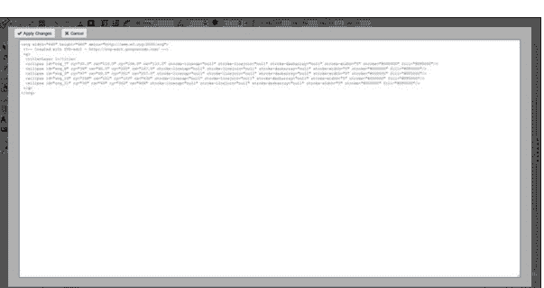

图 6-7 显示原始 SVG 代码的 SVG-edit

## 使用插件扩展 Raphaël

## 沿路径动画化

Raphaël 带有两个沿路径动画对象的函数：`animateAlong` 和 `animateAlongBack`。这两个函数分别让对象从路径的起点和终点开始动画。这些函数接受一个路径对象或字符串、动画跨越的毫秒数、一个用于旋转动画对象的可选布尔值，以及一个可选的回调函数。给定我们已经定义的圆，我们可以通过执行以下代码来让我们的任何一个矩形路径动画化：

```javascript
circle.animateAlong(rect, 2000, false);
```

关于 `animateAlong` 和 `animateAlongBack` 需要注意的一点是，除非形状的位置在移动过程中保持不变，否则它将相对于其自身的空间移动。对于前面的代码段，从起始位置开始，圆将向右移动 40 个单位，向下移动 40 个单位，向左移动 40 个单位并向上移动 40 个单位，无论矩形路径画在哪里。我们的结束屏幕使用 8 字形路径对消息“You win!”进行动画处理。

## 使用插件扩展 Raphaël

Raphaël 可以通过插件进行扩展。其由于为了集成所需的第三方库，以及暴露 SVG 规范中尚未实现的功能。Raphaël 是针对非 Internet 浏览器的 SVG 功能与用于绘制矢量图形的 Internet Explorer 标准 VML 之间的折中方案。如果某个功能在两个标准中都不存在，它会被保留以允许开发者添加某些缺失的功能，尽管是以一种非平台的方式。

## 添加函数

Raphaël 允许你将函数添加到 `paper` 中，或者作为属性添加到元素。添加到 `paper` 的函数与添加到元素的函数之间的关键区别在于，`paper` 对象必须在实例化 `paper` 之前创建。函数可以在任何时间添加到元素并进行修改。

向 `paper` 添加的功能通过 `Raphael.fn` 对象暴露。你可以使用命名空间来使代码模块化。gRaphaël 图表库正是这样做的。元素函数通过 `Raphael.el` 对象暴露。向该对象添加函数将其添加到所有 Raphaël 对象中。

## SVG 过滤器

SVG 过滤器包含了一些受益于插件的区域。SVG 里的过滤器与 GIMP 和 Adobe Photoshop 等许多图形处理应用中的过滤器不同。它们允许你更改所给定的单个对象或一组对象。因为它们不在 Raphaël 核心中，我们将讨论它们的功能，但将其留给作为读者的练习来整合它们。

## 第 6 章 使用 SVG 和 RaphaëlJS 创建游戏

表 6-9 显示了可用过滤器的简要列表及其描述。开发者社区成员创建了支持它们的插件，但到本文写作时，所有过滤器都尚未实现。关于已实现部分的良好资源是 Raphaël Google 小组。在过滤器的范围内，“图像”可以是任何实际图像，如 JPEG 或 PNG、填充色或渐变色。

### 表 6-9 过滤器摘要列表

| 过滤器名称 | 描述 |
| --- | --- |
| `feBlend` | 使用预定义算法之一合并两个组件的数据 |
| `feDiffuseLighting` | 定义为场景提供环境照明的光 |
| `feGaussianBlur` | 通过高斯函数模糊图像 |
| `feImage` | 将图像渲染到栅化画布 |
| `feOffset` | 通过给定矢量偏移图像 |
| `fePointLight` | 定义向所有方向发射自特定点的光；位于空间中特定点的光，具有影响锥 |
| `feTile` | 使用平铺重复图案填充目标对象 |
| `feTurbulence` | 为图像添加噪声 |

使用 SVG 编写的游戏以及那些无法使用它的游戏。了解你打算使用的工具和库的固有能力，有助于你在日后确保自己做出了正确的决策，而不是在（通俗地说）正试图用螺丝刀来盖房子。

# 练习题

1. 我们简要讨论了 Cufón 库，它可以转换字体以供 RaphaëlJS 使用。使用 Google Font 目录（http://code.google.com/webfonts）中找到的开源字体，将其转换为供 Raphaël 使用的格式，并使用该自定义字体创建一个包含任意文本字符串的场景。
2. 修改卡牌匹配游戏代码，为卡片使用自定义背景。
3. 修改卡牌匹配游戏代码，可选地在牌组中加入王牌。
4. 使用路径（paths）绘制六边形和五边形。
5. 我们使用动画来翻转扑克牌。制作一个在三角形、方形和圆形之间切换的动画。

你可以在 www.informit.com/title/9780321673633 下载章节代码和练习题答案。

# 使用 WebGL 和 Three.js 创建游戏

在之前的章节中，我们费了很大力通过硬方法来学习，然后再进入那些让编码工作变得更简单的库和框架。WebGL 是一头巨兽。它基于 OpenGL ES 2.0（而后者本身是老旧的 OpenGL API 的简化版），它仍然相当庞大。虽然在没有框架帮助的情况下使用 Canvas 2D 或 SVG 是合情理的，但 WebGL 并非如此。有许多需要考虑的问题，包括光照、纹理、景深、粒子系统以及碰撞检测与响应，在没有框架的情况下操作就像在没有安全网的情况下走钢丝。我们在本章中将大量使用的框架是 Three.js。Three.js 是一个用于现代浏览器的 3D 图形库，如之前提到的，它可以渲染到 Canvas、WebGL 和 SVG。它支持 WebGL 中所有可能的功能，同时允许你对所有渲染器使用相同的代码，无例外。兼容层并不会阻止你进行广泛的测试，但至少如果客户端计算机不是最新最强大的设备，它能为你提供一个可能的回退方案。Three.js 抽象了许多棘手的部分——例如，在处理材质和着色器时。它内置了一些常用 3D 几何形状（如球体、立方体和圆柱体）的助手，以及功能完整的纹理系统、映射基础碰撞检测。在本章中，我们将尽可能在大多数情况下保持在高级通用层面，但在某些情况下深入底层细节——取决于任务的具体需求。让我们从讨论 OpenGL ES（WebGL 背后的技术）开始本章。

嵌入式系统的 OpenGL ES 是一种运行在手机、平板电脑和视频游戏等设备上的 3D 图形 API 规范。一些移动设备（Android, iOS, Blackberry/QNX, WebOS）支持该规范的部分。视频游戏实现者包括任天堂（Nintendo 3DS）、索尼（PlayStation 3）和 OpenPandora（Pandora）。尽管名称相似且 OpenGL ES 的版本追踪 OpenGL，但 OpenGL ES 并不是 OpenGL。OpenGL ES 是 OpenGL 的子集。一些关键区别在于移除了用于原始图的 `glBegin`/`glEnd` 和 `glVertex*`。对显示列表的使用已被废弃，取而代之的是顶点缓冲区。

我们将不会直接使用它们，因为 Three.js 将它们抽象化了，但意识到这些差异是非常重要的。

## 迈向三维

当我们在 2D Canvas 上下文中绘图时，我们不需要担心对象的深度，无论它离我们近还是远。我们只需要一个代表我们能看到的内容视口。对于 WebGL，我们确实必须考虑深度，这确实地让我们的变换计算变得更加复杂。别担心——我不会再次引入矩阵数学了。至少现在不会。如果你对这些感到有些模糊，请花点回到第 5 章“使用 Canvas 标签创建游戏”。我们可以通过 z 轴控制深度，如图 7-1 所示。

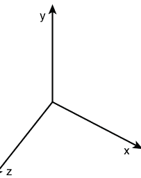

图 7-1 XYZ 轴

第三轴的引入为我们提供了一种表示空间点的新结构：顶点。以下代码显示了在 Three.js 中创建顶点所需的代码。

```javascript
new THREE.Vertex(new THREE.Vector3(0, 0, 0));
```

绘制两个顶点就有一条线。绘制三个顶点就有一个三角形。选择是无限的。现在我们可以在屏幕上画许多顶点，但我们无法看到它们。那是因为它们之间没有任何关系；在这一阶段，它们只是空间中的一堆随机点。网格是描述对象的顶点集合。这些顶点被排列成面，每个面由三个或更多顶点组成。要创建一个三角形，我们需要执行以下任务：

- 创建一个存储顶点的 `Geometry` 对象。
- 添加面来告诉顶点如何排列自己。
- 使用 `Geometry` 对象和材质创建一个网格。

先不要担心如何定义材质。我们将在本章稍晚时候介绍材质。我们可以在图 7-2 中看到示例输出，以及列表 7-1 中生成网格的对应代码。

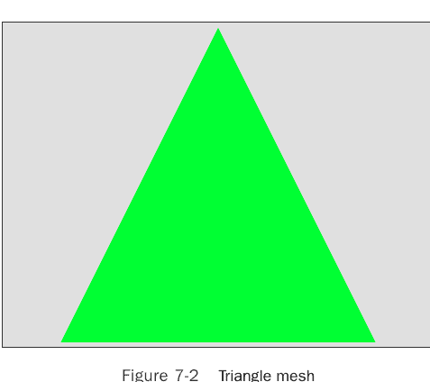

### 列表 7-1 创建三角形

```javascript
geometry = new THREE.Geometry();
geometry.vertices.push(new THREE.Vertex(new THREE.Vector3(0,0,0)));
geometry.vertices.push(new THREE.Vertex(new THREE.Vector3(0,10,0)));
geometry.vertices.push(new THREE.Vertex(new THREE.Vector3(10,0,0)));
geometry.faces.push(new THREE.Face3(0,1,2));
var triangle = new THREE.Mesh(geometry, material);
```

## 使用材质和光照让你的对象更有风采

我们现在有了关于不同顶点之间相互关系的背景，但我们仍然无法看到它们。为什么？我们告诉了世界它们应该像什么样。我们通过材质和光照来实现这一点。

### 理解光照

除了防止人类被冻死之外，Three.js 中的光照与现实世界中通过太阳发生的情况相似。它有三种类型的光照对象：

- **AmbientLight（环境光）**——环境光是区域内从所有光源产生的光的平均值。仅用环境光渲染的对象将看起来是二维的。这是因为所有顶点接收到相同的光量。看待此的一种方法是将环境光看作空调的恒温器。通常情况下，打开它不会让单个房间变冷或变热，而是将它们带到大约的温度。
- **PointLight（点光）**——点光是来自世界空间中特定位置的衰减光。光从点向各个方向发射使物体呈现三维效果。当物体离开光源时，光对物体的影响会越来越小（衰减，或通俗说的“掉落”）。点光还可以产生或贡献于高光反射。
- **DirectionalLight（定向光）**——定向光可以被看作是从相同方向向主体投射的一束光。点光会随距离的增加而衰减，而定向光在延伸到无限远或指定的最大距离时保持相同的强度。

列表 7-2 显示了三种光类型的示例，从 `AmbientLight` 开始，它只有一个参数。`intensity`（强度）对应于光线的亮度，`distance` 是在完全衰减之前的最长光线的距离。`castShadow` 是布尔值，定义被 `DirectionalLight` 照射的对象是否产生阴影。虽然在构造函数中没有列出，但你可以在 `PointLight` 和 `DirectionalLight` 上设置位置。括号中的参数是可选的。

```javascript
// 光照示例
new THREE.AmbientLight(hexColor);
new THREE.PointLight(hexColor, [intensity], [distance]);
new THREE.DirectionalLight(hexColor, [intensity], [distance], [castShadow]);
```

### 使用材质和着色器

材质通过赋予颜色和纹理让物体变得不再平庸。我们在介绍光照后将介绍材质，因为场景的光照极大地影响材质在用户看来的样子。许多大气组件共同决定了顶点或面的最终颜色，包括但不限于：

- 光照（环境光、点光和定向光）
- 阴影
- 着色器
- 混合模式
- 遮蔽

我们已经涵盖了光照，阴影不需要过多描述，所以让我们继续讨论着色器。着色器使用软件指令通常在图形处理器（GPU）上计算渲染效果，也可以在软件中完成。着色器通常有三种：

- **顶点着色器**——为网格中的每个顶点渲染。它们可以携带位置、颜色、法线、光照和纹理坐标等属性。
- **像素或片元着色器**——在屏幕上渲染时，为网格中的每个像素计算颜色和其他属性。
- **几何着色器**——用于在网格上添加或删除顶点。一种用法是为场景添加 LOD（细节层次）效果——即根据网格靠近或远离屏幕的距离分别增加或减少顶点数量。

WebGL 和 Three.js 在编程上重点关注顶点着色器和片元着色器。几何体的 LOD 在 Three.js 中处理，但本文不会详细介绍离散对象。在讨论着色器和材质之前，你需要学习一个概念：法线。它是一个垂直于表面或顶点的向量。它通常用于光照计算，会影响材质的外观，并可以在不增加多边形数量的情况下为模型创建更多细节。阴影算法要么在 Three.js 中原生支持，要么易于实现。让我们从易到难先查看它们。

#### 平着色

平着色根据网格中的多边形的法线对对象进行着色。对于像矩形等非常规则的形状，其计算与我们之后讨论的大多数高级算法没有区别。平着色的问题在于，任何具有合理数量多边形的模型看起来都是块状的，用户可以很容易看出一个多边形结束而另一个开始的地方。

#### 兰伯特着色

简单来说，兰伯特着色向所有方向均匀地反射光。这导致模型无论观察者的视角如何看起来都一样。未经过处理的木材、混凝土和其他哑光表面具有这种特性。由于缺乏动态性，兰伯特着色像平着色一样对 GPU 来说非常容易。

#### 高德着色

高德着色是在每个顶点上应用法线，该顶点是接触的所有多边形表面法线的平均值。这比平着色提供了更平滑的光照，但对 CPU/GPU 的代价很低。由于它是多个顶点的平均值，会涉及到一定的误差，因为应用的法线是一个估计值，会比实际法线值正或负。这在任何引起高光（反射物体上的亮点）现象中都尤为明显。图 7-3 显示了平面法线如何计算的信息图。

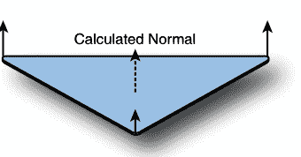

图 7-3 高德着色的法线计算

#### 冯着色

冯着色是四种中成本最昂贵的。它也被称为像素级着色，它获取顶点法线并为每个像素计算中间法线值。这产生的光照模型在很大程度上改进了高德着色的结果，但对处理器来说成本很高。

冯反射虽然相当真实，但本身并不是着色模型。冯反射考虑了极少数物体是完全光滑或粗糙的。因此，物体上的反射是两种属性（分别为高光反射和漫反射）的结合。冯反射的组成部分如下：

- 环境色，用于均匀分布在物体中的光量
- 漫反射色，向所有方向散射光线
- 用于高光的特殊颜色，假设由光源引起

你可能还会指定光泽或不透明度。所有这些协同工作产生最终材质。例如，完全均匀的法线将不考虑高光值。

## 创建第一个 Three.js 场景

我在 OpenGL 中学习绘制的早期内容之一是来自某个随机在线教程的雪人场景。雪人很棒，因为没有人讨厌雪人，而且画一个看起来相当像的东西很容易。它还给了我们机会来讨论一些内置的 3D 形状。

### 设置视图

在开始之前，我们需要进行一些清理工作来设置绘制雪人的环境。在我们截断的 `init` 函数中，我们实例化了一个渲染器和一个场景。如之前提到的，Three.js 可以渲染到几个不同的环境。将渲染器更改为 `CanvasRenderer` 或 `SVGRenderer` 就是实现这种方法。我们需要设置渲染器的尺寸。Three.js 会尽力使用渲染器渲染场景。虽然许多效果和材质可以用所有渲染器渲染，但某些是 WebGL 专用的。在 `init` 函数下方，我们有一对处理动画和渲染的函数。`requestAnimationFrame` 尝试尽可能按照显示器的刷新率刷新画布，如果窗口不可见，则跳过绘制。你可以在列表 7-3 中看到这一点。

### 列表 7-3 设置环境

```javascript
function init() {
  //
  // 创建渲染器和场景
  renderer = new THREE.WebGLRenderer();
  renderer.setSize(WIDTH, HEIGHT);
  // 其他代码
}
function animate() {
  requestAnimationFrame(animate);
  render();
}
function render() {
  renderer.render(scene, camera);
}
```

在本章中，你可能会注意到“场景”和“场景图”的使用。场景图描述环境。场景图描述对象之间的关系。场景图是排列在 3D 空间的对象集合。场景图是一个节点树。场景图中的每个节点都是对象。场景图允许你组织和管理对象。场景图是创建复杂场景的强大工具。场景图是掌握 Three.js 的关键。一旦你理解了场景图，你就可以构建想象的任何东西。场景图是 Three.js 一切的基础。场景图是应用程序的核心。场景图是项目的灵魂。场景图是代码的生命。场景图是图形的魔法。场景图是设计的精美。场景图是技术的威力。场景图是开发者的快乐。场景图是创造者的骄傲。场景图是 Web 的未来。场景图是旅程的终点。场景图是终结的开始。场景图是开始的终结。场景图是故事的现实。场景图是世界的现实。场景图是宇宙的梦想。场景图是灵魂的反射。场景图是真理的阴影。场景图是真理的光芒。场景图是光之真理。场景图是声音的回声。场景图是沉默的声音。场景图是声音的寂静。场景图是和平的响。场景图是声音的和平。场景图是战争之爱。场景图是爱的战争。场景图是永恒的时间。场景图是时间的永恒。场景图是终结的圆圈。场景图是圆圈的终结。

### 列表 7-5 添加手臂

```javascript
var arm, arm2, armMaterial;

armMaterial = new THREE.MeshLambertMaterial({
  color: 0x8B5A00
});
arm = new THREE.Mesh(
  new THREE.CylinderGeometry(20, 0.3, 0.3, 10),
  armMaterial
);
arm2 = new THREE.Mesh(
  new THREE.CylinderGeometry(20, 0.3, 0.3, 10),
  armMaterial
);

arm.rotation.x = 30;
arm.rotation.y = 10;
arm.translateX(8);
arm.translateZ(1);
arm.translateY(15);

arm2.rotation.x = -30;
arm2.rotation.y = 10;
arm2.translateX(-7);
arm2.translateZ(1);
arm2.translateY(15);

scene.add(arm);
scene.add(arm2);
```

图 7-7 所示的平面为我们的场景增添了深度。把它想象成一张巨大的纸，或者更好地看作一张大地毯。

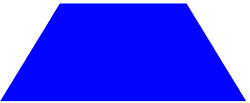

图 7-7 平面

与之前的球体圆柱一样，平面允许你控制网格的详细程度。在声明宽度和高度后，你可以设置相应的步进值。绘制平面的代码在列表 7-6 中。

### 列表 7-6 绘制平面

```javascript
plane = new THREE.Mesh(
    new THREE.PlaneGeometry(500, 500, 20),
    planeMaterial
);
```

尽管我们在绘制中有三种主要的形状，但雪人的鼻子既可以被看作圆柱，也可以一种新形状：圆锥，如图 7-8 所示。某些图形库会区分两者，但它们之间的关系类似于矩形和正方形：所有的圆锥都是圆柱，但并不是所有的圆柱都是圆锥。它们的挤出方式是相同的，但每个后续圆的半径都越来越小，直到达到零。

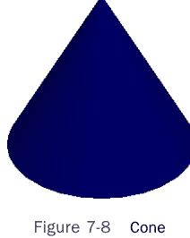

你可以在列表 7-7 中看到，圆锥和圆柱之间的唯一区别是一个一个接近零。

### 列表 7-7 绘制鼻子

```javascript
nose = new THREE.Mesh(
    new THREE.CylinderGeometry(20, 0.8, 0.01, 33),
    noseMaterial
);
```

## 查看世界

如果你尝试运行目前为止编写的代码，你会发现页面上什么也看不到，并怀疑它坏了。我们看不到任何东西的原因是因为我们没有告诉 Three.js 我们位于何处以及正在看什么。在场景中放置相机是查看场景的方法。就像人眼一样，相机具有决定哪些内容可见或不可见的属性。`Camera` 对象的签名所示：

```javascript
var cam = new THREE.Camera(fov, aspect, near, far, {target optional})
```

最重要的参数也是第一个参数 `fov`，即视野。FOV 决定了任何时候可见的世界区域。它通常用角度来讨论。我们可以通过使用三脚架放置相机（如果你想更恐怖一点，可以用眼睛）并在不移动相机的情况下指向它，注意你能看到的最右侧的物体，并从这里到该点画一条线。对最左侧的对象执行相同的操作。现在在两个物体之间画一条线。我们得到了一个可以用来寻找 FOV 的三角形。关于此点的信息图见图 7-9。请放心，你不需要计算这个……永远。计算机会为你完成所有的工作。

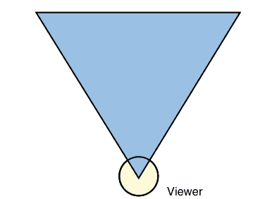

图 7-9 计算视野 (FOV)

下一个参数是 `aspect`，即宽高比。你可能在显示器或电视的规格中见过这个术语。宽高比例是你的视口长维与短维的比例。大多数屏幕的比例都在 4:3（标准定义）或 16:9（宽屏）左右。宽高比例与 FOV 协作工作，决定了视野中裁剪掉了多少世界。

接下来的两个参数 `near` 和 `far` 代表你世界的裁剪平面。在一个同时绘制成千上万物体和纹理的场景中，尝试显示所有内容会对 CPU 和 GPU 造成沉重负担。更糟糕，绘制你看不见的东西是浪费的。近裁剪平面通常靠近用户，而远裁剪平面则在某个远处。当物体跨越远平面时，它们会自发地出现或消失。某些游戏使用雾来让物体的出现和消失更加真实。`target` 是一个可选参数，允许你指定要观察的对象。图 7-10 显示了前四个参数如何组合成视锥。

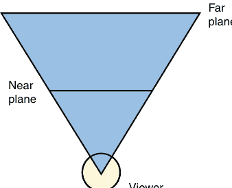

图 7-10 视锥

但是，等一下，为什么我们在 2D Canvas 上绘制时不需要处理这些内容呢？简短的回答是，我们确实处理了；Canvas 在后台为我们完成了。2D 场景的视锥可以通过创建一个使用 `near` 和 `far` 值的相机来创建，这些值也是所有绘制物体的 z 值。实际上，该相机被限制只能看到世界的特定切片。

## 使用 Three.js 加载 3D 模型

必须在代码中创建一切会变得很快。你可能会高兴地知道 Three.js 支持加载其自身 JSON 格式的 3D 模型，并提供了 Autodesk 3ds Max 和 Blender 的文件导出器。

Autodesk 3ds Max——或者口称为 3D Studio MAX 或简称 MAX——被认为是创建、动画和渲染 3D 模型的行业标准。它不仅被游戏艺术家广泛使用。

```json
"colorDiffuse" : [0.64, 0.64, 0.64],
"colorSpecular" : [0.5, 0.5, 0.5],
"shading" : "Lambert",
"specularCoef" : 50,
"transparency" : 1.0,
"vertexColors" : false
]],
```

```json
"vertices": [1.00...],
"morphTargets" : [],
"normals" : [0.577349,...],
"colors" : [[]],
"uvs" : [[]],
"faces" : [35,...],
"edges" : []
};
```

```javascript
postMessage( model );
close();
```

# 着色器与纹理编程

如果你忘记使用 Three.js 内置的材质功能并创建更高级的效果，你可以深入 WebGL 特性并创建自己的顶点着色器和片元着色器。在 Three.js 中，你可以像本章之前演示的那样创建一个并挂载你的着色器。要编写着色器代码，你需要稍微了解一下 OpenGL 着色语言（OpenGL Shader Language，简称 GLSL）。

GLSL 是一种具有类 C 语法的高级语言。虽然它的结构像程序，但在某些情况下（顶点着色器和片元着色器的组合），着色器并没有被编译，而是以字符串的形式传递的。它们在运行时创建（在 Three.js 中也是如此），或者从文件或网页上的 `<div>` 标签读取。GLSL 中不存在像指针那样一些危险的运算符，但它与 C 的功能集、C 和 C++ 的运算符非常匹配，并且可以实现你想做的任何操作，包括流程控制以及创建/调用函数。GLSL 还包含一些专门用于图形处理的函数。

代码列表 7-10 和 7-11 显示了一个 GLSL 程序的代码，该程序将所有顶点涂为白色。在代码列表 7-10 中，我们使用 `vec4` 来表示所需的红、绿、蓝和 Alpha 色。

### 代码列表 7-10 示例片元着色器

```html
<script id="shader-fs" type="x-shader/x-fragment">
#ifdef GL_ES
precision highp float;
#endif

void main() {
    gl_FragColor = vec4(1.0, 1.0, 1.0, 1.0);
}
</script>
```

代码列表 7-11 显示了顶点着色器的代码。当我们查看顶点时，尽管它们在 3D 空间中绘制，但它们在屏幕上时会被投影到 2D 空间。`gl_Position` 通过将投影矩阵和模型矩阵乘以顶点的位置确定顶点在屏幕上的最终位置。不要担心矩阵乘法中额外的 1.0，维度必须匹配。`projectionMatrix`、`modelMatrix` 和 `position` 都是由 Three.js 为我们注入的。如果你从另一个平台适配 GLSL 程序，可能会看到这些程序显式地声明这些变量。

### 代码列表 7-11 示例顶点着色器

```html
<script id="shader-vs" type="x-shader/x-vertex">
#ifdef GL_ES
precision highp float;
#endif

void main() {
    gl_Position = projectionMatrix * modelMatrix * vec4(position, 1.0);
}
</script>
```

为了在应用程序中使用这些着色器，我们需要为使用它的对象创建一个着色器材质。实例化后，我们就可以像使用其他材质一样使用它。代码列表 7-12 显示了使用最小属性创建 `ShaderMaterial` 的代码。该代码使用查询库获取脚本标签的内容。

```javascript
var shaderMaterial = new THREE.ShaderMaterial({
    vertexShader: $('#shader-vs').get(0).innerHTML,
    fragmentShader: $('#shader-fs').get(0).innerHTML
});
```

通常，着色器需要进行一些高级计算，或者你可能想从宿主应用程序向 GLSL 程序传递数据。着色器变量允许你实现这一点。共有三种类型：

- **Uniform（统一变量）**——值在帧的渲染期间保持不变，并且对两个着色器都可用。
- **Attribute（属性）**——顶点着色器可用的只读变量。
- **Varying（变体变量）**——允许顶点着色器和片元着色器共享数据。

在代码列表 7-11 中，`projectionMatrix` 和 `modelMatrix` 是 uniform，而 `position` 是 attribute。在创建我们的变量时，重要的是 GLSL 程序不是 JavaScript，它们需要显式声明类型。除了 C/C++ 中可用的基本数据类型外，还有 GLSL 特有的类型。表格 7-1 显示了可能的向量类型，而 7-2 和 7-3 分别显示了矩阵和纹理类型。

### 表格 7-1 GLSL 向量类型

| 类型 | 描述 |
|---|---|
| `vec2`, `vec3`, `vec4` | 用于 2D、3D 和 4D 的浮点向量 |
| `ivec2`, `ivec3`, `ivec4` | 用于 2D、3D 和 4D 的整数向量 |
| `bvec2`, `bvec3`, `bvec4` | 用于 2D、3D 和 4D 的布尔向量 |

### 表格 7-2 GLSL 矩阵类型

| 类型 | 描述 |
|---|---|
| `mat2` | 2x2 |
| `mat3` | 3x3 |
| `mat4` | 4x4 |

### 表格 7-3 GLSL 纹理类型

| 类型 | 描述 |
|---|---|
| `sampler1D` | 1D |
| `sampler2D` | 2D |
| `sampler3D` | 3D |
| `samplerCube` | 立体 |

## 使用纹理

在代码列表 7-11 中，`projectionMatrix` 和 `modelMatrix` 是 uniform，而 `position` 是 attribute。在创建我们的变量时，重要的是 GLSL 程序不是 JavaScript，它们需要显式声明类型。除了 C/C++ 中可用的基本数据类型外，还有 GLSL 特有的类型。表格 7-1 显示了可能的向量类型，而 7-2 和 7-3 分别显示了矩阵和纹理类型。

通常，着色器需要进行一些高级计算，或者你可能想从宿主应用程序向 GLSL 程序传递数据。着色器变量允许你实现这一点。

- **Uniform（统一变量）**——值在帧的渲染期间保持不变，并且对两个着色器都可用。
- **Attribute（属性）**——顶点着色器可用的只读变量。
- **Varying（变体变量）**——允许顶点着色器和片元着色器共享数据。

在代码列表 7-11 中，`projectionMatrix` 和 `modelMatrix` 是 uniform，而 `position` 是 attribute。

## 使用游戏物理模拟真实世界

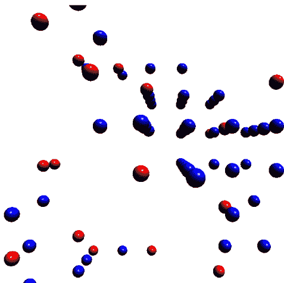

图 7-14 栩栩如生的游戏截图

### 使用游戏物理模拟真实世界

在第 4 章“游戏是如何运作的”中，我们讨论了实现碰撞检测和创建粒子系统的一些基础方法。在该章中，我们使用了非正式的边界框来判断是否发生了碰撞，这导致了受限的响应。我们还对粒子系统进行了一点调试。在本章中，我们将以更正式的方式将物理属性应用到粒子上。

当我们思考使类人关节变得真实的因素时，我们是在寻找物理引擎的作用——更具体地说，是刚体动力学。理解此点的一种思考是将刚体视为人体中的骨骼。骨骼本身不会弯曲，但可以在关节处活动，并最多具有六个自由度（x、y 或 z 轴上的平移和旋转）。我们还添加了约束来限制运动，以便我们的关节在移动时不会脱臼。这些约束可以简单到让墙或地面等物体不可移动，或者通过关节来实现。关节允许我们连接和约束刚体。大多数物理系统支持的两种关节类型是铰链关节和球关节。铰链关节将运动限制在一个轴上。人体的例子是膝盖和手指。另一方面，球关节允许在可能的所有自由度上进行自由范围运动。你的肩关节和髋关节就是球关节的极佳例子。

## 第 7 章 使用 WebGL 和 Three.js 创建游戏

刚体还具有物理属性，如质量、惯性、速度等。虽然你的骨骼仅占身体质量的 30% 到 40%，但刚体包含了模拟对象 100% 的质量。刚体并不非要是像骨骼一样的结构，它们可以是静止的物体（如墙和地面），也可以是它们相遇的经过物体或移动物体。

物理引擎使用原始形状的组合来检测碰撞，例如球体、箱体、立方体和自由形状网格。你可以根据需要使用任意数量的；例如，你可以用一个碰撞原形检测右手的通用碰撞，然后深入到受影响的手指。一旦所有原形都定义，物理引擎就会启动并缓慢地通过时间步进，以检查对象和刚体变换矩阵的变化。这些变化被修改用于渲染函数并与玩家输入相结合。另一种类型的动力学称为软体动力学。任何类型的布料以及头发，都会使用软体动力学。我们不会详细介绍这一点，因为这是一个高级主题。然而，它值得提及。

物理引擎将使用 JigLib。它是可以在 www.jiglibs.org/ 获取的流行的 JigLib 库的 JavaScript 版本的一部分。原始库用 C++ 编写，除了 JavaScript 之外，JigLib 还移植到了 C# 和 Actionscript。列表 7-14 显示了我们物理世界的初始设置。我们从获取 `PhysicsSystem` 实例开始，设置世界的重力以及使用的求解器类型。在这种情况下，我们使用了 `FAST`，但其他选项还有 `NORMAL` 和 `ACCUMULATED`。选择 `FAST` 相比于 `NORMAL` 和 `ACCUMULATED` 你牺牲了一点点精度，但通常没有明显的区别。

### 列表 7-14 设置 JigLib

```javascript
function initLib() {
  system = jigLib.PhysicsSystem.getInstance();
  system.setSolverType("FAST");
  system.setGravity(jigLib.Vector3Util.create(0, -9.8, 0));
}
```

在我们创建物理系统后，我们需要为地面创建一个网格，并创建一个相应的刚体来表示地面。我们需要在刚体上设置的属性，大部分与我们在网格上设置的属性匹配，但额外调用了 `set_movable(false)` 以使地面不受外力的影响。这段代码在列表 7-15 中。

### 列表 7-15 绘制地面

```javascript
// 创建地面
var plane = new THREE.Mesh(
  new THREE.PlaneGeometry(75, 75, 10, 10),
  new THREE.MeshLambertMaterial({
    color: 0x222222
  })
);
plane.translateY(-10);
plane.rotation.x = -70;
scene.add(plane);

var ground = new jigLib.Plane();
ground.set_y(-10);
ground.set_rotationX(-70);
ground.set_movable(false);
system.addBody(ground);
plane.rigidBody = ground;
```

接下来，我们需要绘制我们的球体并为其分配一个刚体。创建 Three.js 球体的代码非常直观，因此我在列表 7-16 中将其删除了。我们需要复习一下，这从实例化 `JSphere` 开始，为皮肤传递 `null`，为半径传递一个值。在对象上设置好网格后，我们可以使用 `moveTo` 函数和 `Vector3DUtil` 类在 3D 空间中对其定位。我们通过单独的 `set_x`、`set_y` 和 `set_z` 函数获取要移动的点，就像我们对地面做的那样，或者像注释行所示传递一个值数组。你可能想要构造 Vector 的原因之一是。

### 列表 7-16 绘制球体的刚体

```javascript
// 创建球体
var sphere = new jigLib.JSphere(null, 5);
sphere.setMesh(mesh);
sphere.moveTo(0, 10, 0);
// 或者使用
sphere.set_x(0);
sphere.set_y(10);
sphere.set_z(0);

// 分配刚体
var body = new jigLib.RigidBody();
system.addBody(body);
sphere.rigidBody = body;
```

## 场景中的对象选择

确定屏幕上哪个对象被选中（也称为“拾取”，picking）在 3D 空间比在 2D 空间困难得多。在 2D 中，我们可以读取鼠标的 x 和 y 位置，并轻松地检查我们的对象约束。在 3D 空间中，由于我们处理的是投影到 2D 空间的 3D 世界，这为我们增加了一些额外工作。一种方法是使用唯一的颜色渲染对象，然后检查鼠标位置的像素颜色。你可以通过使用场景图渲染一个专门用于拾取的离屏画布。只要多边形数量不高，或者你仅使用 2D 画布，拾取的性能就会非常好。我们还可以通过使用低细节模型进行拾取算法来进一步提高速度。

颜色拾取的缺点之一，虽然它擅长定位被选中的对象，但无法告诉我们 3D 投影点的位置。要做到这一点，我们必须给每个对象的每个面赋予一个唯一的颜色。双倍的工作，而且并不有趣。

更高级的方法是使用射线投影法，这是一种向目标发射光束并对遇到的第一个多边形做出反应的测试手段。Three.js 的分支（https://github.com/mindbrix/three.js/）包含了使用射线投影进行拾取的代码。

## 模型动画

让你的模型像人类是让游戏更真实的方法之一。这种方法被称为“骨骼动画”，除了顶点网格，我们还赋予对象一个骨骼解剖结构，每根骨骼根据给定的权重影响周围的顶点。当你拿起一个咖啡杯时，你的大脑可以对如何移动肩膀、手臂、前臂和手腕进行多次计算，最终知道如何移动手去握住杯子。这被称为正向运动学。逆向运动学则利用手的最终位置进行回溯并确定关节的位置。我们不是为动画的每一帧计算精确位置，而是计算几个，也称为关键帧，并在它们之间进行插值。关键帧有助于引导动画向正确的方向进行。关键帧太少（特别是当起始和结束状态差异巨大时）可能会导致不符合人类的肢体轮廓。虽然 3ds Max 和 Blender 支持逆向和正向运动学，但脚本不支持。这给了我们两个选择：我们可以编写一个导出脚本来获取骨骼绑定，或者在 3D 建模中选择对象，导出单个关键帧，然后在应用程序中将其缝合在一起。当它们处理单个对象时，关键帧可以用更精确的术语讨论，即变形目标。关键帧是对象变换的快照或其对象顶点单独的位置，而变形目标只描述后者。为了在两个目标之间产生平滑动画，使用了变形影响器。如果一个目标代表动画的 2 秒，下一个目标代表 4 秒，如果当前时间是 t = 2.25 秒，那么 t = 2 的目标的影响将大于 t = 4。变形目标是 Three.js 中一个新且文档较少的领域（在本文完成时仅有 3 天）。查看 Three.js 源码以获取示例和更多细节。

## 获取 3D 模型

虽然创建树、树干和基础家具等无生命物体并不困难，但创建真实的模型和纹理超出了大多数人的技能范围。如果你熟悉 Photoshop、GIMP 或 Maya、Autodesk 3ds Max 或 Maya，请尽管跳过本节。

TurboSquid (www.turbosquid.com)，以前称为 Gamasutra Exchange，是一个 2D/3D 模型、纹理和应用程序插件的在线市场平台。超过 200,000 个模型可供多种格式下载，适用于开源和商业应用程序。资产的信息页清楚地列出了许可条款。

如果你使用 SketchUp (http://sketchup.google.com) 创建模型，你可能会对 3D Warehouse (http://sketchup.google.com/3dwarehouse) 感兴趣。即使你不使用 SketchUp，可能对 3D Warehouse 也感兴趣，它是历史建筑以及现实世界的很好的来源。例如，如果你正在做一个基于伦敦的间谍游戏，3D Warehouse 是获取大本钟和威斯敏斯特模型的好地方。有限的导出脚本附带在 SketchUp 的免费版本中。你可以购买商业版（495 美元），也可以尝试在互联网上寻找社区资源。

对于冒险者来说，有 MakeHuman (www.makehuman.org)。这是一个基于 Blender 插件的开源项目，允许你通过指定种族特征、性别、年龄、肤色、体重和身高来创建高度自定义的人体模型。模型也经过了完整的骨骼绑定和纹理制作，允许你将其快速集成到游戏中。你可以编辑面部表情，并支持导入 BVH（BioVision Hierarchy）文件，这是提供动作捕捉数据的行业标准之一，可用于骨骼绑定的模型。图 7-15 显示了基本的 MakeHuman 应用。

## 第 7 章：使用 WebGL 和 Three.js 创建游戏

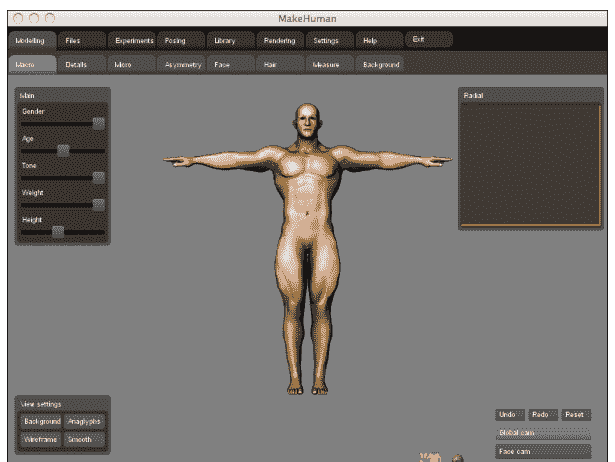

图 7-15 MakeHuman 主界面

## 游戏基准测试

使用 WebGL 编程需要巨大的处理能力，而且并不总是最宽容的。你早期容易犯的一个错误是绘制了太多。无论你使用 WebGL 还是 Three.js，绘制 1000 个相同大小的球体并不意味着你需要为每个球创建一个新的顶点集。那是一种比需要更多处理能力的确定方法。让我们讨论一些可以帮助你优化应用程序的工具。

### 使用 Stats.js 检查帧率

Three.js 源码包含一个用于测量帧率的小实用程序库。列表 7-19 显示了创建 stats 对象的代码，并带有一些 CSS 将元素置于窗口左上角。在 `animate` 函数的某处调用 `stats.update()` 就大功告成了。

### 列表 7-19 创建 Stats

```javascript
stats = new Stats();
stats.domElement.style.position = 'absolute';
stats.domElement.style.top = '0px';
document.getElementById('container').appendChild(stats.domElement);
```

### 使用 WebGL Inspector

如果 Debug 和 Chrome/Safari 开发者工具适用于 HTML/JS，那么 WebGL Inspector (https://github.com/benvanik/WebGL-Inspector) 的目标就是适用于 WebGL 项目，它作为 Chrome 扩展程序、Firefox 插件存在，或者可以直接封装到应用程序中，为 WebGL 程序的运行情况提供监控。你可以看到所有引用的纹理和着色器，以及逐帧执行的调用。图 7-16 显示了在浏览器窗口中运行的 WebGL Inspector。

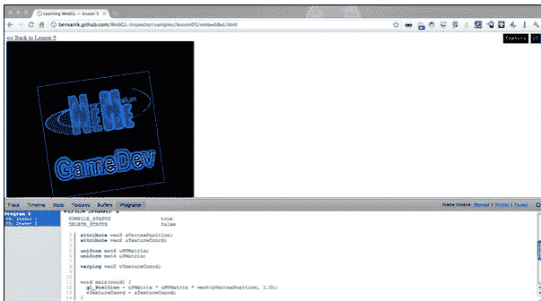

图 7-16 WebGL Inspector

# 总结

在一个章节中涵盖 WebGL 的所有知识是不可能的。相反，我们采取了更实用的方法，在需要时讨论低级细节和概念，大部分时间保持高层级，利用 Three.js 处理困难工作。你可以将原始 WebGL 代码视为汇编代码。许多人学习它，但你每天都在使用它。你学习了如何利用低级 API 处理着色器等项目，以及如何结合 Three.js 提供的材质、纹理和照明抽象。你还学习了如何将物理引擎和 3D 模型集成到游戏中。在使用 Three.js 创建游戏后，你学习了一些帮助我们优化代码进行基准测试的工具。

## 练习

1. 加载模型文件并从中检索材质数据。
2. 描述如何使用纹理坐标对三角形进行贴纹。
3. 编写为圆柱贴纹的代码。

你可以在 www.informit.com/title/9780321767363 下载章节代码和练习题答案。

# 不使用 JavaScript 创建游戏

你说不使用 JavaScript 的 HTML5 游戏？是的，我是这么说的。某种程度上，JavaScript 被许多人视为互联网的通用语言。没有它，或者使用某些非 JavaScript 的插件技术，你几乎做不了什么。虽然“不使用 JavaScript”这个短语也可以意味着使用 Flash 或 Silverlight 等插件，但在这种情况下，它并非如此。本章介绍了几种使用替代语言但在编译阶段或运行时输出 JavaScript 的技术。这些技术利用了 JavaScript 的无处不在，使其成为一种编译目标。这类似于 Java 或 C# 编译器编译我们编写的代码，并生成某种可读性较低但针对运行它的机器进行了优化的内容。

我们想要使用替代语言来构建 JavaScript 应用有以下几个原因：

- 存在原生 JavaScript 中不存在的功能
- 开发时间可能缩短
- 对原生 JavaScript 缺乏了解或认同

虽然许多开发者不愿涉足字节码/中间代码层面，但我们可以兼得两者的优点。你可以查阅编译后的输出，也可以停留在元层。推测，本章一个更具描述性的标题可能是“使用针对 JavaScript 但不将其作为主要语言的替代技术创建游戏：”，但这读起来并不顺口。

## Google Web Toolkit

Google Web Toolkit (http://code.google.com/webtoolkit/)，也称为 GWT，是一个 Java 框架，允许开发者使用 Java 创建 AJAX 应用。编译器将 Java 代码转换为 JavaScript。虽然开发应用需要一个 Java 开发环境，但 GWT 对运行编译代码的服务器没有此类限制。开发者可以在 GWT 的远程过程调用机制中使用 REST 或他们自己的方法与服务器进行通信。Google 的多个产品，如 Google Wave、AdWords 和 Orkut 都是用 GWT 构建的。

GWT 致力于通过提供一组在浏览器之间操作相似的组件，来减少通常由特定浏览器奇异性带来的痛苦。

### 理解 GWT 组件和布局

与其像编写原生 JavaScript 应用时那样直接与文档对象模型（DOM）交互，在 GWT 中，你交互的是 Java 组件，这些组件是 HTML 对应的 GWT 表示。

`RootPanel` 是将页面锚接到 HTML 的组件。它在 Java 代码和托管应用程序的 HTML 页面之间提供了接口。我们可以使用它来获取特定元素，如下：

```java
RootPanel.get("buttonDiv")
```

或者我们可以获取页面本身：

```java
RootPanel.get()
```

除了 `get()` 的各种变体外，我们最常用的函数是 `add()` 和 `remove()`，它们分别用于从页面中添加和移除组件。列表 8-1 显示了在网页上放置按钮的代码。按钮通过显示“Hello, World!”的警报消息来响应点击事件。

### 列表 8-1 GWT Hello World

```java
import com.google.gwt.core.client.EntryPoint;
import com.google.gwt.event.dom.client.ClickHandler;
import com.google.gwt.event.dom.client.ClickEvent;
import com.google.gwt.user.client.Window;
import com.google.gwt.user.client.ui.*;

public class MyFirstPage implements EntryPoint {

    public void onModuleLoad() {
        Button button = new Button("Click Me");

        button.addClickHandler(new ClickHandler() {
            public void onClick(ClickEvent event) {
                Window.alert("Hello, World!");
            }
        });

        RootPanel.get("buttonDiv").add(button);
    }
}
```

列表中的对 `addClickHandler` 的调用等同于设置 `onclick` 函数。你也可以看到有一个 `Window` 类来暴露浏览器方法。`MyFirstPage` 类本身什么都不做。它需要一个 HTML 页面来托管从我们 Java 代码生成的 JavaScript，以及一个以 `.gwt.xml` 结尾的特殊 XML 文件，告诉编译器要包含哪些特性。列表 8-2 显示了对应列表 8-1 的 HTML 页面。

### 列表 8-2 MyFirstPage 的宿主页

```html
<html>
<head>
  <title>MyFirstPage Application</title>
  <link rel="stylesheet" href="MyFirstPage.css">
</head>
<body>
  <script type="text/javascript" src="com.test.MyFirstPage.nocache.js"></script>
  <div id="buttonDiv"></div>
</body>
</html>
```

列表 8-3 显示了 MyFirstPage 应用的模块文件。

### 列表 8-3 MyFirstPage 模块文件

```xml
<module>
  <inherits name='com.google.gwt.user.User'/>
  <entry-point class='com.test.client.MyFirstPage'/>
</module>
```

类和 `.gwt.xml` 文件与 HTML 视图一起定义了一个模块。如果我们是为了包含在项目中而打包功能，那么创建 HTML 页面是完全可选的。从模块继承是我们用新功能扩展应用的方法。列表 8-3 中，MyFirstPage 模块正在继承 User 模块的功能。我们将在本章稍后访问另外两个例子。

### 通过 JNI 将 JavaScript 库暴露给 GWT

如果没有操作 JavaScript 的方法，GWT 将变得毫无用处。对于这些情况，我们可以通过其 JavaScript 原生接口（JNI）来扩展 GWT。JNI 使用特殊格式向编译器信号从 Java 到 JavaScript 的编码代码调用，反之亦然。列表 8-4 显示了：

### 列表 8-4 简单的 JNI 函数

```java
public static native void log(String text) /*-{
    console.log(text);
}-*/;
```

## gwt-g2d

`gwt-g2d` 与 Canvas 上下文对应的类是 `Surface` 类。它是我们主要的绘制接口。`Surface` 提供了对 Canvas 的即时非缓存访问。列表 8-8 显示了宽度为 640 像素、高度为 480 像素的表面初始化。接下来，向表面添加了一个蓝色矩形和一些缩放过的黑色文本。最后，将表面添加到页面中。

### 列表 8-8 使用 Surface 类的基础示例

```java
public class SurfaceExample implements EntryPoint {
    public void onModuleLoad() {
        Surface surface = new Surface(640, 480);
        surface.setStyle(KnownColor.BLUE)
            .fillRectangle(100, 175, 40, 40);
        surface.setStyle(KnownColor.BLACK)
            .scale(2).fillText("Hello from gwt-g2d", 100, 100);
        RootPanel.get().add(surface);
    }
}
```

还有一个名为 `ShapeBuilder` 的更高级 API，它会存储命令直到你将它们批量输出为一个形状。该形状可以更容易地重新绘制。列表 8-9 显示了使用 `ShapeBuilder` 的示例。首先，我们通过绘制一个半径为 25 的弧来描述圆，圆心在 100，从 0 弧到 2*π 弧，这代表绕圆点的完整旋转。该形状在表面上绘制，使用绿色填充颜色和黄色填充颜色，并向右平移 75 像素。

### 列表 8-9 使用 ShapeBuilder 的示例

```java
public class ShapeBuilderExample implements EntryPoint {
    public void onModuleLoad() {
        ShapeBuilder builder = new ShapeBuilder();
        builder.drawArc(new Arc(100, 100, 25, Math.PI * 2));
        Shape shape = builder.build();

        Surface surface = new Surface(640, 480);
        surface.setStyle(KnownColor.GREEN).fillShape(shape);
        surface.setStyle(KnownColor.YELLOW).translate(75, 0).fillShape(shape);
        RootPanel.get().add(surface);
    }
}
```

# CoffeeScript

CoffeeScript 是一种受 Ruby 和 Python 启发的 JavaScript 语言。它编译为 JavaScript 并可以无缝使用 JavaScript 库。对于对 Groovy（Java 的一种脚本语言）有经验的人来说，他们会发现它有一些相似之处。Ruby 和 Python 允许开发者创建 Web 应用并比 Java 和 C# 等静态类型语言更快地迭代。CoffeeScript 可以为 JavaScript 提供相同的体验，CoffeeScript 允许开发者通过类和继承机制以更面向对象的方式进行编码。

Ars Technica（流行的技术博客）和 37signals（Ruby on Rails 的创建者）都使用 CoffeeScript 创建了 iPhone 应用程序。据传报道称，用 CoffeeScript 重写库可以减少多达一半的代码行。

## 安装 CoffeeScript

CoffeeScript 编译器是自托管的，并能够编译自身，其中一种实现作为 Node.js 模块运行。Node.js 是一个构建在 V8 JavaScript 引擎之上的事件驱动框架，用于编写网络应用程序。我们将在第 9 章“构建多人游戏服务器”中更详细地介绍其他服务器端 JavaScript 选项，但目前，我们承认它的存在可以作为帮助我们编译 CoffeeScript 的工具。在克隆 Node.js 和 CoffeeScript 存储库后，你可以在 CoffeeScript 源代码目录中运行以下命令安装编译器：

```bash
sudo bin/cake install
```

在 Node.js 不可用或难以安装的情况下（例如在 Windows 或 Mac OS 上，这需要 Xcode），可以使用以下方法：

- Ruby：`gem install coffee-script`。
- Java：使用 Rhino 编程语言编译或在 Java 应用程序中的库。
- Ubuntu/Cygwin：可以使用 Cygwin 在 Windows 上安装 Node.js（如果你有空间或方法，可以安装一个 Ubuntu 虚拟镜像并在其中进行编译）。CoffeeScript 存在于 Ubuntu 仓库中，可以通过执行以下命令安装及其依赖项：

```bash
sudo apt-get install coffee-script
```

为了本章，我们将假设你正在使用通过 Node.js 安装方法提供的 `coffee` 可执行文件。

## 编译 CoffeeScript 文件

在大多数情况下，我们通过执行以下命令来调用 CoffeeScript 编译器：

```bash
coffee *.coffee -c
```

此命令创建当前目录下每个 CoffeeScript 文件的 JavaScript 版本。我们可以指定输出目录：

```bash
coffee *.coffee -c -o [directory]
```

另一个有用的开关是 `-p`，它将编译输出打印到控制台而不是文件。完整的选项列表可以在 CoffeeScript 网站上的 http://jashkenas.github.com/coffee-script/#installation 找到。

## CoffeeScript 快速指南

在本节中，我们将深入了解 CoffeeScript。这并不是为了权威参考，而是传统的 JavaScript 与 CoffeeScript 之间的差异。

### 基础知识

与 JavaScript 的核心区别之一是大多数括号和分号都是可选的。当一组括号可以被隐含时（例如当有多个参数时），可以省略它们。只有当我们在一行中放置了多个表达式时，才需要分号。在 CoffeeScript 中，空格是有意义的，这是 Python 的特征。正如你之后看到的，这与大括号的缺失配合工作。注意第一个实例 `console.log` 显示了用 CoffeeScript 写的 "Hello World"。`console.log` 包含括号是为了澄清我们指的是函数 `console.log()` 而不是属性的歧义。

#### 列表 8-10 CoffeeScript 中的 Hello World

```coffeescript
console.log()
console.log "Hello World!"
```

`var` 键在 CoffeeScript 中也是可选的。而在 JavaScript 中，省略 `var` 会将变量放入全局作用域，CoffeeScript 会替你插入 `var` 并防止你在函数作用域中重载变量。每个脚本都被包装在一个匿名函数中，以避免污染全局命名空间。

### 函数和调用

CoffeeScript 函数是形式类似于 Groovy 的简化形式。不需要 `function` 关键字，只需要可选的带括号参数列表、一个箭头（`->`）和函数体。列表 8-11 显示了计算圆周的 CoffeeScript 及其相关的 JavaScript。

#### 列表 8-11 CoffeeScript 和 JavaScript 中的圆周

```coffeescript
# CoffeeScript
circum = (r) -> Math.PI * 2 * r
alert circum(10)
```

```javascript
// JavaScript
var circum = function(r) {
    return Math.PI * 2 * r;
};
alert(circum(10));
```

为了防止输出产生如 "NaN" 或 "undefined" 的副作用，你必须提供最小数量的参数。因此，如果函数调用两个普通参数和一个带变号的参数，你必须提供至少两个以避免任何副作用。列表 8-12 显示了使用变号的 CoffeeScript。这是最后的表达式。

#### 列表 8-12 CoffeeScript 和 JavaScript 中的求和

```coffeescript
# CoffeeScript
sum = (x, y, z...) ->
    result = x + y
    for i in z
        result += i
    return result
alert sum 1, 2, 3, 4, 5, 6
```

```javascript
// JavaScript
var sum;
var _slice = Array.prototype.slice;
sum = function(x, y) {
    var _len, _ref, i, result;
    z = _slice.call(arguments, 2);
    result = x + y;
    for (i = 0, _len = z.length; i < _len; i++) {
        result += z[i];
    }
    return result;
};
alert(sum(1, 2, 3, 4, 5, 6));
```

```coffeescript
for item, index in list
  doStuffIndex(index)
  doStuff(item)
```

我们可以使用相同的名称来遍历 map，略有不同的是将 `in` 替换为 `of`：

```coffeescript
for key, value of map
  doStuff(key, value)
```

正如你可以想象的，查看列表 8-12 中的代码，生成的 JavaScript 代码会长得多。

### 类与继承

CoffeeScript 最令人兴奋的特性之一是在 JavaScript 中创建类。你总是可以创建行为类似于类的对象，但典型的编译语言与 JavaScript 之间的差异确实很大。

CoffeeScript 使用了一个新关键字（`class`），配合显著缩进、`@property` 标记以及新的函数格式，创建一个与我们认为的“类”合理的相似物。列表 8-13 显示了一个简单的 `Human` 类。

#### 列表 8-13 CoffeeScript 中的 Human

```coffeescript
class Human
  constructor: (@name) ->
  setAge: (@age) ->
  getAge: -> @age
  setHeight: (@height) ->
  getHeight: ->
    @height
```

在这里你可以看到与传统 JavaScript 的一个变化是使用 `constructor` 代替 `Human(parameters)`。`constructor` 不需要函数体，因为 `@name` 会告诉自动将值保存到实例变量中。出于同样的原因，我们的 setter 也不需要函数体。所有的 `@property` 都是公共的，因此给定一个 `Human` 对象 `h`，我们可以直接通过调用获取高度：

```coffeescript
h.height
```

或者

```coffeescript
h.getHeight()
```

防止不当访问的方法之一是更改 `@property` 变量签名，使其与普通属性名称不同，可以通过在名称后添加下划线或其他名称混淆。这些策略将帮助我们在涉及继承时保留状态。

## 第 8 章 不使用 JavaScript 创建游戏

类继承是一个计算机科学概念，接收类（或子类）隐式地接收其他类（称为父类）的属性和方法定义。子类的实现者可以选择原封不动地使用方法或重用它们的逻辑。列表 8-14 展示了这些应用。

#### 列表 8-14 扩展 Human 类

```coffeescript
class Male extends Human
  constructor: (name) ->
    super(name)
    @gender = "male"
  getHeight: ->
    super() + 3
```

我们类的每个实例都是一个 `Human`。`Male` 类喜欢伪造高度，或者它通过调用 `super()` 获取高度并增加 3 个单位。`super` 会调用与父函数同名的函数并传入给定的参数（如果有的话）。我们所做的任何更改都是在构造函数中声明了性别。

## 替代技术

Google Web Toolkit 和 CoffeeScript 并不是唯一的非 JavaScript 选项。在本节中，我们将简要讨论其他几个选项。

### Cappuccino

280 North（2010 年被摩托罗拉收购）创建了 Cappuccino 框架，它使用 Objective-J 编程语言以及 GNUstep/OS X Cocoa 框架的移植来创建应用程序。Objective-J 的语法与 Objective-C 非常相似，但后者运行在 JavaScript 之上。使用 Objective-J，开发者不需要直接操作 DOM 或创建 CSS；这些能力由框架本身处理。它与 Objective-C 的关系可能有助于当前的 iOS 开发者快速移植应用程序。

### Pyjamas

Pyjamas 是使用 Python 代替 Java 的 Google Web Toolkit 移植版。尽管它的功能可能落后于 GWT，但它提供了一个比 Java 更快速开发环境。Pyjamas 支持 HTML5 Canvas，但尚未实现 WebGL。Pyjamas 拥有一个与 JavaScript 代码交互的核心，类似于 JNI，因此没有障碍阻止开发者将其 WebGL 移植到其中。Pyjamas Desktop 是 Pyjamas 的组件，允许应用程序在桌面上不经修改地运行。它不是将代码编译为 HTML 和 JavaScript，而是运行 Python 代码，分别利用针对 Gecko、WebKit 和 Trident 浏览器的 Python 库，分别驱动 Mozilla、Safari/Chrome 和 Internet Explorer 浏览器。

# 总结


在本章中，我们探索了多种允许我们使用不同语言在 Web 上创建游戏的技术。我们深入研究了 Google Web Toolkit 强大的库支持，并查看了 CoffeeScript 如何与 JavaScript 无缝集成。在研究 GWT 时，我们把第 6 章的记忆牌游戏创建了一个 GWT 版本，并添加了 HTML5 音频。在本章结束时，我们简要讨论了在 JavaScript 不是主要语言的情况下制作游戏的其他选项。希望本章能让你看到，对 JavaScript 掌握得不够精不再是创建迷人的 HTML5 游戏的障碍。

## 练习

1. CoffeeScript 中 `true` 的替代值是什么？
2. 从 GWT 调用 JavaScript 的协议名称是什么？
3. Pyjamas 是什么？

你可以在 `www.informit.com/title/9780321767363` 下载章节代码和练习题答案。

# 构建多人游戏服务器

在本章中，我们将构建一个游戏服务器来容纳我们游戏的逻辑，并为玩家提供一种共同体验。延续我们一直开发的游戏精神，本章中的所有示例和演示都将使用 CoffeeScript。如果 CoffeeScript 不是你最喜欢的编程语言，CoffeeScript 编译器生成的 JavaScript 可读性很高，你可以直接使用。

# Node.js 简介

Node.js 是一个基于 V8 的异步事件驱动环境，以速度快而称。在大多数非平凡的示例中，你都会想要使用 Node.js。Node 被开发者接受，因为它允许他们使用同一种语言进行前后端编码。因此，Node 的用途不仅限于 Web 服务器、实用脚本、测试框架和命令行应用程序。简单的 Node.js 示例：

```javascript
const http = require('http')
http.createServer((req, res) => {
  res.writeHead(200, {'Content-Type': 'text/plain'})
  res.end('Hello World')
}).listen(8080, () => {
  console.log('Server running at http://localhost:8080/')
})
```

# 管理多个 Node 版本

Node 在稳定性方面还处于非常早期。某些 npm 包需要在特定版本上运行，或者会有不可预测的行为。因此，通过使用版本管理器安装 npm 可以避免一些痛苦。

`n` (`https://github.com/visionmedia/n`) 是一个允许你管理 node 版本的脚本文件。并不是所有版本都并存，但你可以指定一个 Node 版本作为默认以通过它运行所有命令，或者你可以选择性地通过特定版本运行命令。你可以通过以下方式安装 `n`：

```bash
npm install n
```

如果你已经安装了某些版本的 Node，也可以通过克隆 git 仓库并执行以下命令：

```bash
make install
```

命令 `n ls` 列出可安装的 Node 版本，而命令 `n latest [or version]` 和 `n rm [version]` 分别用于安装/使用指定的版本以及删除指定的 Node 版本。

## 使用 ExpressJS 让 Web 应用变得更简单

ExpressJS (`http://expressjs.com/`) 是一个用于 Node 的快速 Web 应用开发框架。可以将其视为在更具通用性的 Node 之上一个专注于 Web 开发的层。Express 关注以下内容：

- URL 路由 DSL
- 中间件
- 视图模板与渲染
- 与 Connect 深度集成，Connect 是 Node 的一个中间件层，用于管理 cookie、session 和路由等事项

列表 9-2 显示了一个非常基本的 ExpressJS 应用。在执行 `npm install express` 安装 Express 后，我们需要获取 Express 库以便使用。我们创建了一个服务器、一个路由（稍后会解释）以及服务器将监听的端口。导入了 `sys` 包以提供一些消息输出。`sys.puts` 等同于 `console.log`。

> 列表 9-2 ExpressJS 应用程序示例

```javascript
express = require 'express'
app = express.createServer()
sys = require 'sys'

app.get('/', (req, res) ->
  res.send('Hello World')
  sys.puts('Server started on http://localhost:3000')
app.listen(3000);
```

## 使用 URL 路由处理请求

ExpressJS 允许你定义应用可以响应的路由或 URL 端点。路由可以响应 GET、PUT、POST 和 DELETE 的任意方法。列表 9-3 显示了一个响应基础服务器 URL 并打印“Hello, World”的路由定义。

> 列表 9-3 简单的 ExpressJS 路由

```javascript
app.get("/", (req, res) ->
  res.send("Hello, World")
```

你可以为每个 HTTP 动词创建单独的块，也可以使用 `app.all` 方法，将所有路由都通过同一个代码块。ExpressJS 的路由 API 非常灵活，允许你将路由到基础 URL（如列表 9-3 所示）、静态 URL 以及格式化端点（如列表 9-4 所示）。

在端点之前使用冒号意味着该组件将暴露为请求参数。片段末尾的问号告诉 Express 该端点的部分是可选的。我们可以像处理 `/about` 和 `/about/:id` 那样分离路由和扩展路由，或者像处理 `/profile/:id?` 那样与条件逻辑结合。最后一个示例 `/updateProfile` 使用 POST 方法。它演示了我们如何通过检查 `req.body` 对象来访问传输的数据。

列表 9-4 高级路由

```javascript
express = require 'express'
app = express.createServer()
sys = require 'sys'
app.configure ()
  app.use(express.logger())
  app.use(express.cookieParser())
  app.use(express.bodyParser())
  app.use(express.static(__dirname + '/public'))

app.get('/about', (req, res) =>
  res.send('About Page')

app.get('/about/:id', (req, res) =>
  id = req.params.id
  res.send('About Page for ' +id)

app.get('/profile/:id', (req, res) =>
  id = req.params.id
  if (id is undefined)
    res.send('Profile not found')
  else res.send(id+'s Profile')

app.post('/updateProfile', (req, res) =>
  newData = req.body
  name = req.body.name
  doStuffWithData(data)
  res.send('Update successful.')

sys.puts('Server started on http://localhost:3000')
app.listen(3000);
```

## 使用 ExpressJS 让 Web 应用变得更简单

ExpressJS 通过捆绑的 Connect (`http://senchalabs.github.com/connect`) 库暴露中间件层。Connect 的中间件为应用可能需要的常见功能提供了可重用的函数，包括限于身份验证、日志记录、session 管理和请求解析。我们在示例应用程序已经编写了一些最好的中间件函数。列表 9-4 显示了一些高级路由，并使用 `bodyDecoder` 来启用对 POST 请求体的解析。它还指定了一个名为 `public` 的静态目录，用于提供客户端 JavaScript、图像、CSS 和 HTML 等资源。

## 管理 Session

为了使用 session，我们需要包含几个中间件组件。在看到列表 9-5 中的 `session` 路由之前，需要实例化 `cookieDecoder` 和 `bodyDecoder`。`session` 的 `secret` 参数帮助中间件为 session ID 编码 GUID。`session` 对象在后台无缝地创建，我们可以向其附加可序列化的对象，也可以对其进行修改或删除。如果我们不指定后端存储（backing store），它将默认为内存。虽然没有与 Connect 或 ExpressJS 捆绑，但几乎每个流行的数据库都有相应的后端存储。

## 列表 9-5 记录 Session 访问计数

```javascript
app.configure ()
  app.use(express.cookieParser())
  app.use(express.bodyParser())
  app.use(express.session({secret:'asdf'}))
)

app.get('/', (req, res) ->
  if (req.session.visitCount == undefined)
    req.session.visitCount = 1
  else
    req.session.visitCount = req.session.visitCount + 1;
  res.send("Session ID:"+req.session.id+"<br>+'You have visited '+req.session.visitCount);
```

## 理解 ExpressJS 结构

ExpressJS 在结构方面非常自由，允许你设置所在的位置。它提供了清晰的关注点分离，并在以下代码段中使得更容易解耦：

```javascript
app.set('views', __dirname + '/views')
```

## 使用 CoffeeCup 模板化 HTML

CoffeeCup 是一个 HTML 模板引擎，允许你使用 CoffeeScript 创建 HTML。只要已经安装了 Node.js，可以通过执行 `npm install coffeecup` 安装 CoffeeCup。

## 列表 9-6 一个简单的 CoffeeCup 页面

```javascript
@title = "Hello World"
doctype 5
html ->
  head ->        title @title
  body ->
    div id: 'content'
    div id: 'fragment'
    script -> document.getElementById('content').innerText = "Hello World!"
```

## 列表 9-7 生成的代码

```html
<!DOCTYPE html>
<html>
<head>
  <title>Hello World</title>
</head>
<body>
  <div id="content"></div>
  <div id="fragment"></div>
  <script>
    function () {
      return document.getElementById('content').innerText = "Hello World!";
    });
  </script>
</body>
</html>
```

到目前为止，我们使用 CoffeeCup 生成完整页面。将其作为模板引擎在 ExpressJS 中，我们可以模块化 UI 并使用一组通用布局动态渲染页面片段。我们可以通过在应用程序中包含以下代码段向 ExpressJS 注册 Cupid：

```javascript
app.register('.coffee', require('coffeecup'))
app.set('view engine', 'coffee')
```

代码告诉 ExpressJS，默认情况下我们将使用 CoffeeScript 文件作为视图，并在引用它们时可以使用扩展名。使用完整文件名允许我们使用其他库来混合布局：Jade、Haml、jQuery Templates 和 EJS。当引用片段时，系统会查找关联的布局文件，描述要显示的 HTML 结构。对于 CoffeeCup 来说，它会在视图目录中搜索 `layout.coffee`，如果找不到，则回退到其他目录。列表 9-6 是可以在布局文件中定义的示例。在渲染视图时，ExpressJS 提取我们正在渲染的视图的内容，并将其作为 `body` 变量的值放入布局文件中。假设有一个名为 `index.coffee` 的视图片段，其中包含以下代码：

```
"The time is now #{new Date()}"
```

我们可以为 `/getTime` 设置一个路由，如列表 9-8 所示，访问时它将返回 `index.coffee` 和 `layout.coffee` 的位置。

# 列表 9-8 为 /getTime 创建路由

```javascript
app.get('/getTime', (req, res) ->
  util.log "Client visited"
  res.render 'getTime'
```

视图变量可以在运行时传递。如果我们想向 `getTime` 页面传递时区，可以像列表 9-9 所示修改视图，通过名为 `context` 的 map 属性传递所需的变量。

# 列表 9-9 修改后的路由

```javascript
app.get('/getTime', (req, res) ->
  util.log "Client visited", context:{timezone: 'America/Los Angeles'}
  res.render 'getTime'
```

# 使用缓存持久化数据

在应用程序中，会有某种形式的后端数据库来存储数据。就像硬盘一样，读取数据相当快——耗时长的部分是寻找数据。缓存允许我们更快地访问数据。一旦数据被访问，它在未来很有可能会再次访问。缓存设置了一部分内存来存储最近访问的对象。缓存具有无限的存储空间；否则，它们将失去相对于数据库的优势。选择要逐出的对象的缓存策略差异很大，许多策略都围绕着最不经常使用（LFU）、最久未使用（LRU）和最近使用（MRU）对象的某种变体或组合。或者，缓存也可以在空闲一段时间后逐出，就像网站会话那样。

[node-cache 项目](https://github.com/ptanjan/node-cache) 提供了一些可以在其基础上构建的基础功能。node-cache 的 API 非常直观，提供了表 9-1 中列出的六个函数。

# 表 9-1 node-cache API

| 函数 | 描述 |
|---|---|
| `get(key)` | 获取给定键的值；否则返回 null。 |
| `put(key,value,duration)` | 使用指定的键存储给定的值。如果指定了时间，该键值对将在持续时间后清除。否则，它将一直存储直到显式删除。 |
| `del(key)` | 删除给定键持有的值。 |
| `size()` | 返回缓存中非空键值对的数量。 |
| `memsize()` | 返回缓存中键值对的数量。 |
| `debug(bool)` | 开启或关闭调试。 |

# 管理客户端/服务器通信

在 Web 早期，当使用“世界范围（World Wide）”名称部分仍然流行时，交互是非常有限的。你点击一个链接，它向你发送一些内容。你填写一个长表单，点击发送，然后被路由到一个新的静态页面。随着网站开始使用 AJAX 在不重定向用户的情况下更新信息，缓慢但可靠的交互机制逐渐变得更加动态。创新并未止于此。进一步的进步带来了服务器端推送、长轮询，并最终使浏览器原生支持 TCP 套接字。目前形式的 Web Sockets 是新的，但概念并非新鲜。早期的 Java Applet 能够在服务器和客户端浏览器之间打开套接字。

# 与 Socket.IO 通通信

Socket.IO 是用于 Node.js 的库，旨在提供一个通用接口，无论消息的源或地如何，不同的传输机制都可以使用它。Socket.IO 支持使用以下技术进行通信：

- 原生 Web Sockets
- Adobe Flash 套接字
- AJAX 长轮询
- AJAX 多部分流
- 永久性 IFrames
- JSONP 轮询

这种传输组合使得 Socket.IO 能够支持几乎所有版本的桌面和移动浏览器。除了官方的 Node.js 实现外，还有针对 Java、Python、Google Go 和 Rack (Ruby) 的非官方服务器实现。

# 使用 Express 设置简单的 Socket.IO 应用程序

列表 9-10 和 9-11 显示了一个简单的 Socket.IO 应用程序的服务器和客户端，该程序会回显服务器或客户端发送的任何内容。服务器有一个它监听的连接事件。当触发该事件时，它会在控制台上打印出新客户端已连接，并注册一个在每次有消息时执行的函数。在代码示例中它是空的，但你可以看到响应断开事件也是可能的。

# 列表 9-10 Hello World 的服务器代码

```javascript
# Setup socket.io
socket = io.listen app
socket.on 'connection', (client) ->
  sys.puts "new client connected."
  client.on 'message', (data) ->
    sys.puts data
    client.send data
  client.on 'disconnect', ->
```

列表 9-11 显示了方程的另一面，客户端代码。在包含必要的 JavaScript 文件后，我们实例化一个新的 socket，并像在服务器上做的那样为连接和消息事件注册函数。

# 列表 9-11 Hello World 的 CoffeeKup 模板

```javascript
doctype 5
html ->
  title '#@{title}'
  script src: '/js/socket.js'

  coffeescript ->
    socket = new io.Socket 'localhost'
    socket.connect()
    socket.on 'connection', ->
      console.log 'Connected.'
    socket.on 'message', (data) ->
      console.log data
      socket.send "Hello World"
```

# 使用 NowJS 让 Web Sockets 更简单

Socket.IO 非常适合简单的通信，但复杂对话需要你执行一些操作，例如将消息格式化为 JSON、通过套接字发送它们，并在双方进行解码/编码。随着我们需要处理的连接数量增加，为我们应用程序的所有功能构建微语言将变得不可行。如果服务器能够在没有复杂消息传递的情况下调用客户端的特定方法——反之亦然——将会容易得多。有了 NowJS，我们可以直接这样做。

NowJS 是一个客户端-服务器端 JavaScript 库，允许客户端和服务器通过 Web Socket 管道进行远程调用。NowJS 通过封装一切使用 Socket.IO 进行通信。它有两个命名空间，分别称为 `everyone` 和 `now`。前者在服务器上实现，后者是客户端到 NowJS 的接口。任何变量或对象都在所有客户端和服务器之间共享。如果服务器调用了 `everyone` 命名空间中的一个函数且该函数在客户端存在，则客户端将尝试在客户端命名空间中执行同名函数。一个例子可以更好地说明这一点。我们在服务器上执行的常见任务之一是获取玩家数据。我们正在使用 NowJS 让客户端请求当前连接的玩家列表。当我们在 `everyone` 命名空间中有一个名为 `getPlayerList` 的函数时，它接收一个客户端回调并将代码作为参数返回。列表 9-12 仅显示从初始应用程序文件中发生变化的代码。

# 列表 9-12 NowJS 演示应用程序文件

```javascript
nowjs = require("now")

app = express.createServer()
everyone = nowjs.initialize(app)

everyone.now.getPlayerList = (callback) ->
  players = ['Jake', 'John', 'Cathy']
  callback(players)
```

或者，我们可以在客户端上定义一个函数供服务器调用。服务器可以使用此进行通信，而不是使用回调。在定义了所需的 nowjs 脚本文件后，我们的客户端代码定义了一个名为 `getPlayers` 的函数，它调用服务器的 `getPlayerList` 函数并将结果打印到控制台。最后一段代码是对 `now.ready` 的调用。`ready` 函数允许我们在连接建立时指定代码。这在列表 9-13 中所示。

# 列表 9-13 NowJS 客户端代码

```javascript
doctype 5
html ->
  head ->
    title "#{@title || 'NowJS Demo'}"
    script src: '/nowjs/nowjs.js'

  body ->
    coffeescript ->
      window.getPlayers = ->
        now.getPlayerList(data) ->
          console.log(data)

      now.ready ->
        console.log('ready')
    div ->
      input type='button', value:'Get Players', onclick:'getPlayers();'
```

## 调试 Node

由于有所有的异步回调，能够有效地调试我们的应用程序变得格外重要。如果我们需要短时间内查找单个对象的值，控制台调试（即在控制台上打印输出）可能起作用。`sys` 对象有一个名为 `inspect` 的函数，它可以将对象的详细信息转换为字符串。我们可以配合 `sys.put` 使用它输出到命令行，如下所示代码段所示：

```javascript
sys.put(sys.inspect(obj))
```

在急需时很有用，但当你试图检查流程控制或遇到深层错误时，控制台调试将变得不可行。对于更高级的情况，功能全调试器更有帮助，可以对运行中的应用程序提供更多控制。node-inspector 项目（`https://github.com/dannycotes/node-inspector`）为 Node 提供了这种功能。你通过执行以下命令安装 node-inspector：

```bash
npm install node-inspector
```

然后你可以使用以下命令启动调试器：

```bash
node-inspector &
```

现在 node-inspector 准备好监控你的应用程序了。最后一步是通过执行以下命令以调试模式启动 Node：

```bash
node -debug <app file>
```

或者

```bash
coffee -nodejs <app file>
```

并在基于 WebKit 的浏览器中导航到 node-inspector 提供的地址（通常为 `http://0.0.0.0:8080/debug?port=5858`）。在在那里，你会看到开发者控制台（Developer Console）被重用，以显示有关应用程序的细节。如果需要，可以回到第 1 章“介绍 HTML5”进行复习。node-inspector 的一个非常酷的功能是 Scripts，它可以将你的 CoffeeScript 文件显示为实际上在服务器端运行的编译后的 JavaScript。

# 创建游戏服务器

一个典型的多人游戏服务器包含几处供用户交互的区域，至少包括一个游戏大厅、特定的游戏房间以及用户之间交流的手段。在接下来的章节中，我们将处理这些每一个区域。

# 创建游戏大厅

游戏大厅是用户看到的应用程序的第一部分。从大厅，用户可以看到正在进行且可以加入的游戏，与其他用户聊天，并创建自己的游戏房间。

列表 9-14 显示了实现应用程序落地页所需的 CoffeeKup 代码。在页面上，我们有一个包含 Canvas 的大型容器。右侧是一个供玩家与其他通信的聊天窗口。

```
Listing 9-14 Application Landing Page Code
@title = 'Game Lobby'
div style: 'float:left;height:600px;width:800px', ->
  div style: 'float:right;', ->
    textarea id: 'chat', rows: '10', columns: '50', style: 'width:200px;height:550px'
    input type: 'text', columns: '40', id: 'message'
    input type: 'button', value: 'Send'
    onclick:'distributeMessage(${'message'}).get(0).value'
```

当用户点击按钮时，它会将文本区域的内容传递给我们的 `distributeMessage` 函数，该函数反过来调用服务器上同名的函数。当客户端发送 `distributeMessage` 调用时，服务器会在所有客户端上调用 `receiveMessage`。我们可以在列表 9-15 中看到客户端代码。

# 列表 9-15 发送和接收聊天消息的客户端代码

```javascript
window.now.receiveMessage = (name, message) ->
  val = $('chat').get(0).value
  val += ':' + message + '\n'
  $('chat').get(0).value = val
  console.log('Received message: ' + message + ' from: ' + name)

window.distributeMessage = (message) ->
  if now.name is 'Unknown'
    now.name = prompt("What is your name?")
  now.distributeMessage(message)
```

注意列表 9-16，服务器只需要在执行工作的地方实现该函数。放心地赖地调用 `receiveMessage`，相信它会在客户端上存在。

# 列表 9-16 发送和接收聊天消息的服务器代码

```javascript
everyone.now.distributeMessage = (message) ->
  console.log('Received message: ' + message + ' from: ' + this.now.name)
  everyone.now.receiveMessage(this.now.name,message)
```

# 使用 NodeJS Groups 创建游戏房间

从大厅，玩家可以选择他们想要进入的游戏房间，或者创建一个。每个游戏房间都具有预设范围的属性，例如正在进行的游戏、最大玩家人数以及游戏的逻辑逻辑。玩家离开游戏房间后不久，服务器会将他们从视图中移除。

NodeJS 允许你使用组（groups）来划分用户。组有它们自己的与客户端共享的对象集合。组使得我们游戏房间中的人不会被消息和通知轰炸。列表 9-17 显示了我们在创建房间的代码片段中的此操作。游戏房间创建后，感谢 'connect' 和 'disconnect' 事件，房间内的人会收到玩家进入和出的公告。

# 列表 9-17 创建游戏房间

```javascript
everyone.now.createRoom = (roomName, callback) ->
  console.log('Created room: '+roomName)
  group = nowjs.getGroup(roomName)
  group.on 'connect', (clientId) ->
    group.now.receiveMessage(this.user.clientId + " joined the game room.")
  group.on 'disconnect', (clientId) ->
    group.now.receiveMessage(this.user.clientId + " left the game room.")
    gameRooms.push(group)
    callback(group)
```

# 管理游戏参与者并在游戏房间之间移动

现在我们有了游戏房间，我们需要把人放入其中。这就是我们的游戏参与者发挥作用的地方。我们有两种类型的游戏参与者：玩家和观望者。进入游戏并受游戏逻辑影响，而观望者可以在游戏展开时管理游戏。任何种类型的参与者都能向游戏房间内的其他人广播消息。列表 9-18 显示了我们封装在 NowJS 对象周围的代码，用以从游戏房间中添加或移除用户。

- 列表 9-18 在游戏房间之间移动

```javascript
everyone.now.joinRoom = (roomName) ->
  group = nowjs.getGroup(roomName)
  group.addUser(this.user.clientId)

everyone.now.leaveRoom = (roomName) ->
  group = nowjs.getGroup(roomName)
  group.removeUser(this.user.clientId)
```

# 管理游戏玩法

在本节中我们进入了游戏服务器的细节。我们将为在第 5 章“使用 Canvas 创建游戏”中的井字游戏编写逻辑。

将游戏从本地移动到在服务器上运行，就像将 Web 应用程序从传统的 Web 框架转换为纯事件驱动模型一样。虽然你在本地可以一直等待单个应用程序，但在像 Node 这样的平台上，你必须同时跟踪几十或上百个游戏。我们将使用数据库和缓存允许我们同时管理许多游戏并扩展。

在第 5 章中，我们使用代码创建井字游戏的基础，在第 4 章“游戏如何工作”中，我们编写了驱动它的人工智能。我们使用我们的游戏服务器来完成并将它们结合在一起。

房间创建后，用户可以创建一个新游戏。游戏房间对象存储游戏板的状态，其中玩家是 X，O 是 O，以及服务器的 now 对象用于验证和应用。与之前的版本的另一个变化是使用缓存来存储当前游戏状态。虽然组有 now 对象，但它们无法像 `everyone.now` 对象那样附加任意对象。缓存还解决了 now 对象中的内容在所有客户端之间共享的问题。例如，如果我们把游戏中所有的牌都存储在 now 对象中，没有什么能阻止一个不诚实的玩家轻松地挑选或更改他手中的牌牌。你可以在列表 9-19 中看到这一点。

# 列表 9-19 验证和应用玩家移动

```javascript
everyone.now.createTicTacToeMove = (room, x, y, player) ->
  rooms = cache.get("rooms")
  room = rooms[roomName]
  group = nowjs.getGroup(room)
  roomState = cache.get(room)
  board = roomState.board

otherPlayer = if player is 'X' then 'O' else 'X'
  if board[x][y] is '-'
    board[x][y] = player
    # check for win
    cache.put(this.now, roomState)
  else
    roomState.message = ' Player #{player}, Please try again.'
    cache.put(room, roomState)
  group.now.receiveGameState(roomState)
```

# 总结

本章为服务器端 JavaScript Web 框架及其生态系统提供了入门课程。你学习了如何使用 ExpressJS 为网页创建路由，并学习了如何在访问特定路由时提供用于服务的 HTML 模板。你还学习了如何结合 NodeJS 和 Socket.IO 项目使用 WebSockets 实现服务器与客户端之间的实时通信。接下来，我们深入研究了使用简单缓存进行数据持久化。最后，我们通过创建一个游戏服务器的技术演示结束了本章。

# 练习题

1. 编写代码创建一个 NodeJS 组，并在有人加入组时向控制台打印“Welcome”。
2. 安装 Node.js 0.4.8 版本的 npm 命令是什么？
3. 创建一个响应“location”并接收一个名为 `city` 参数的路由。

你可以在 `www.informit.com/title/9780321767363` 下载本章代码和章节练习题答案。

# 第 10 章 开发移动游戏

可以很容易认为，2007 年 iPhone 的发布是移动游戏和 Web 内容“应用化”的开端。包括手机、平板电脑和电视在内的移动设备内容销售额已达数十亿。尽管移动游戏在此之前就已经存在，但智能手机的出现是移动设备首次可以使用 Web —— 真正的 Web，而不是某种用于消费和生产内容的缩水版本。在本章中，我们将部分讨论主流的手机操作系统、涉及这些操作系统的开发，以及与之兼容的一些框架。在进入“如何做”和“为什么”之前，让我们简要讨论一下平台本身。

## 选择移动平台

在本节中，我们简要介绍了主流移动设备操作系统的功能和特点。

### iOS

iOS 原名为 iPhone OS，驱动着苹果的大多数移动和娱乐设备，包括 iPhone、iPod Touch、iPad 和 AppleTV。仅考虑移动设备，在写作期间 iOS 占据了约 16.8% 的市场份额。iOS 是基于 BSD 的 Mac OS 的变体，针对触摸交互进行了优化。iOS 限于苹果品牌设备；不通过浏览器提供的 iOS 应用通常使用 Objective-C 语言编写。iPhone、iPod Touch 和 iPad 可以通过 Wi-Fi 有时蓝牙以及 CDMA/GSM 窝服务连接到其他设备。WebKit 是开源 HTML 布局引擎的分支，驱动了这些设备的浏览器体验。HTML5 对苹果来说格外重要，因为它在其 iOS 设备上禁止了 Flash 等插件技术。除了 iOS 设备外，在桌面端，WebKit 是 Google Chrome 和 Apple Safari 的核心，这两个者是第三和第四流行的桌面浏览器。在实现 HTML5 标准方面，使用 Webkit 的浏览器一直处于前沿。

### Android

Android 是谷歌创建的用于运行在移动设备上的操作系统。得益于大量的运营商和设备选择，Android 占据了 36% 的市场。Android 在初代 iPhone 发布后大约一年推出。运行 Android 设备和运行 iOS 设备之间的一个关键区别点是，除少数情况外，谷歌并不控制设备及其规格。原生 Android 应用可以使用 Java 语法编写，并可以编译为 Dalvik 虚拟机。通信选项因设备而异，但与 iOS 相当。Android 和 iOS 设备还可能包含用于定向的陀螺仪和用于检测运动的加速度计。得益于 Android 的开源许可，运营商可以在任何设备上安装 Android 或修改操作系统的部分，而无需获得谷歌的许可。这有助于了 Android 市场份额的增长。在过去的三年里，出现了围绕大约五个不同版本的大量手机和平板电脑。这可能会导致核心操作系统功能出现碎片化，但对 HTML5 设备产生的影响较小。Android 使用谷歌浏览器的变体，该浏览器源自 Web 的部分。虽然某些设备仍发布相对陈旧的 Cupcake 和 Donuts（分别为 1.5 和 1.6），但大多数设备运行 Eclair (Android 2.0/2.1)、Froyo (Android 2.2) 及更高版本——这些版本改进了 HTML5 支持和 JavaScript 引擎。与 iOS 设备不同，最近的 Android 设备还可以运行 Flash 内容，而且往往大量运行不同版本 Android 的设备。尽管关于碎片化有很多讨论，但在任何给定时间，大多数设备的版本通常只有一或两个。

### WebOS

WebOS 是 Palm（后由 HP）创建的用于运行在移动设备上的操作系统。第一批设备于 2009 年 6 月发布。在 Palm 经营期间，仅发布了两设备：Palm Pre 和 Palm Pre/Pixi Plus。WebOS 尽管使用 Linux 实现功能，但大多数面向用户的应用程序使用了 JavaScript、HTML 和 AJAX。自从收购以来，更新的 Palm 2 已经发布，HP 宣布了其打算将 WebOS 用于手机、平板电脑和阅读器。WebOS 仅占市场极小的一部分。2011 年 8 月中下旬，HP 决定退出硬件领域并停止了 Palm 2 及其平板电脑形态的生产。现有设备已降价到清仓价，许多消费者寻求将 Android 移植到上面的希望。HP 表示，退出硬件并不意味着 WebOS 的终结。这仍有待观察。

### Windows Phone 7

最后是市场上的最新进入者 Windows Phone 7，由微软创建。Windows Phone 7 的市场份额在 3.3% 以下。该数字还包含了 Windows Mobile 设备。第一批 Windows Phone 7 设备于 2010 年后期发布。Windows Phone 7 与前身 Windows Mobile 6.5 兼容。应用程序可以使用 C# 使用微软的 Internet 应用程序框架或更专注于游戏的 XNA 项目进行编写。对于我们的需求，Windows Phone 7 目前还不是一个可行的选择。内置浏览器是 Internet Explorer 7 和 8 功能的混合体，不支持任何 HTML5 功能。请记住，Internet Explorer 9 beta 版对 HTML5 功能有更完整的实现。

2011 年中旬，微软和诺基亚达成了一项协议，使 Windows Phone 7 成为新诺基亚设备的标准操作系统。随着这些设备开始推出，Windows Phone 7 将开始消耗运行诺基亚 Symbian 操作系统的设备的 27.4% 市场份额。在此期间，微软宣布了 Windows Phone 7 的“Mango”更新，其中包含支持 HTML5 的移动版 Internet Explorer 9。该更新预计将在 2011 年某个时候推出。

## 通过框架，你可以获得一个运行相当良好的产品，而不需要进行大量的测试

尽管三个主要的移动平台都使用了某种形式的 Webkit，但它们各自都有自己的特性。这些细微差异可能会在这些浏览器上引起意外的行为。例如，运行 2.2 或更高版本的 Android 设备以及较新的 WebPhones 使用 Flash 处理音频，但 iOS 设备已剔除了 Flash。在这种情况下，在网站上使用 Flash 会破坏某些设备上的体验。

为了应对这些问题，我们可以将游戏部署为针对每个独立平台的应用程序。作为独立产品进行让我们让我们有机会进行以下操作：

- 为每个平台定制体验
- 更好地营销应用程序

相反，为每个平台单独部署会增加维护成本，以及寻找精通移动平台的全才型开发者的难度。在本章中，我们将更详细地讨论一些帮助打包应用程序的特定库，但首先让我们泛谈一下背后的工作原理。无论你的游戏是作为网站还是移动应用程序发布，唯一的共同点是你的游戏资源：HTML、JS、CS 以及你创建的任何其他资源。区别在于它们的运行方式。在移动应用程序中，文件被打包并在本地运行。在最基本的实现中，应用程序本质上是一种显示 HTML 内容的小部件，并带有少量的 Java、Objective-C 或原生代码将它们所有绑定在一起。可能解释手势的框架位于离用户的最外层。图 10-1 显示了 Android 应用程序各个层级的划分。

| HTML/CSS/JS |
| --- |
| 应用程序 | WebView / Java 代码 |
| 操作系统 | |

图 10-1 Android 应用程序层

原生代码是我们定义特定操作系统可能支持的新手势的地方。除了特定系统的手势外，我们可能暴露只能从原生代码访问的其他功能，例如摄像头或加速度计的支持。将游戏作为应用程序发布的最大优势是更好的营销机会。大多数移动平台都有应用商店，提供了可以在其设备上运行的程序，例如 iPhone App Store 和即将推出的 Android Store，每个应用都经过了审核以确保其运行正常且符合预期。其他商店（如 Android Market）允许开发者部署应用，并几乎立即即可供下载或购买。如果你的游戏没有封装成应用，那么它无法成为任何商店中的精选下载。让潜在用户购买你的游戏也会变得更加困难。如果你使用网站，你必须设置支付系统，还要处理退款和下载错误。通过商店发布应用会将这些繁重的工作交给他人。

制作游戏应用程序并不是没有风险的。应用程序是脆弱的。它们可以被复制、破解和拆毁。如果你制作了一个好游戏，它很可能会被盗版。尽管如此，在我拙见看来，获得更大曝光机会的机会远大于风险。

## 在移动设备上存储数据

大多数非简单的应用程序都需要存储结构化数据。移动设备的共识是采用 SQLite。在第 1 章“引入 HTML5”中，我们简要讨论了 WebSQL，它与 SQLite 密切相关。请注意，对于大多数人，请使用操作系统内置的 SQLite 支持而不是浏览器的。WebSQL（浏览器中）已被类似 NoSQL 的 IndexedDB 标准所取代。

我们在本章中讨论的应用程序框架——Appcelerator Titanium 和 PhoneGap——都允许你在 HTML 应用程序中进行原生操作系统数据库调用。如果你大量使用数据库，那么为浏览器使用一种方法而为移动应用程序使用另一种方法并不是最优的。通常，需要更改的代码越少越好。引入 Lawchair。

## 在你的 Lawchair 中放松：更简单的存储方法

Lawchair 是 PhoneGap 之前的一些人员创建的存储 API。它允许我们使用单一 API 在许多后端数据存储中持久化数据。我们可以使用 Lawchair 处理如简单的保存状态或复杂的游戏地图等任务。它让我们为自己的代码提供了面向未来的保障。Lawchair 支持以下后端：

- DOMStorage (`localStorage`)
- WebSQL（包括 Webkit 和 Gears）
- Window-Name
- BlackBerry
- IE 用户数据
- IndexedDB

如果你正在使用 NoSQL 键值存储器（如 MongoDB 和 CouchDB），你会在 Lawchair 中感到非常亲切。（键值存储数据库在对象集合中存储数据，这些对象映射属性，通常为 JSON 对象。）你可以创建一个数据库并开始向其中放入内容。你不需要提前声明对象将具有哪些属性。它们会随着时间的推移自然演变。因此，所有相同“类型”的对象可能没有相同的属性集。安装说明可以在 `http://westcoastlogic.com/lawchair/` 找到。我们需要包含 Lawchair 文件和一个内置的适配器。

## 开始使用 Lawchair

我们需要做的第一件事是创建一个 Lawchair 存储。你可以将其看作一组通常相似的对象包。在用户被浏览器管理员限制（通常在用户获得权限前约为 5MB）提示之前，你可以创建任意多个存储。列表 10-1 显示了创建一个类存储并使用 `save` 函数向其填充几个对象的代码。或者，我们可以提供一个在存储操作完成后执行的函数。

### 列表 10-1 创建 Lawchair 存储

```javascript
var classes = new Lawchair({name:'classes'}, function() {
  this.save({name:'Calculus 101', professor:'Jenkins'});
  this.save({name:'Physics 220', maxSize:30});
  this.save({name:'Advanced Physics', prerequisite:'Physics 220'});
});
```

Lawchair 提供了几个函数来检索记录：`each`、`get` 和 `all`。正如其名称所示，`each` 遍历存储中的每条记录并在结果上提供一个函数。列表 10-2 显示了打印我们的类名称的代码。

### 列表 10-2 Lawchair each 示例

```javascript
classes.each(function(record) {
  console.log(record.name);
});
```

`get` 允许我们根据指定的键检索记录，如果找到，则对结果运行函数。到此为止，我们还没有讨论键。如果我们在创建记录时没有指定键，Lawchair 会提供一个 GUID 字符串作为键。列表 10-3 显示了使用自定义键保存记录并使用 `get` 函数查找它们的代码。

### 列表 10-3 Lawchair save and get 示例

```javascript
classes.save({key:'CISC650', name:'Intro to Computer Science'});
classes.save({key:'CISC615', name:'Analysis of Algorithms'});
classes.get('CISC615',
  function(r){console.log(r);
});
```

## jQuery 和 Zepto 简化客户端脚本

到目前，我们还没有讨论删除记录。Lawchair 允许我们使用 `remove` 删除单条记录，或使用 `nuke` 移除整个存储。`remove` 像 `get` 一样接收要删除对象的键。`nuke` 默认不接受任何参数，但你可以选择包含一个在 `nuke` 完成后执行的回调函数。列表 10-4 显示了两种方法的用法。

### 列表 10-4 Lawchair remove 和 nuke 示例

```javascript
classes.remove("CISC615", function(r) {
  console.log("remove completed");
});

classes.nuke();
```

## jQuery 和 Zepto 简化客户端脚本

基于浏览器的应用程序越来越多地从静态页面列表转向单页应用，单页应用中交互性得到了提高，部分内容是动态加载的。尽管有许多可用选项，但我们将关注 jQuery 变体和 Zepto。选择它们是基于 jQuery 作为客户端脚本标准的普遍性。Zepto 在类 jQuery 接口之上提供了一些触摸屏手势。jQueryMobile 和 JTouch 为 HTML5 应用程序提供了更多框架。它们的默认外观看起来像 iOS 应用，而当你使用 Zepto 时，必须定义自己的样式表。

## 使用 jQuery 变体

jQuery 是一个 JavaScript 库，简化了 HTML 文档的遍历、选择器、事件处理和 AJAX。调查和分析差异很大，但共识是，在可以检测到 JavaScript 库的网站中，有 50% 到 78% 使用 jQuery。jQuery 的功能可以通过用户开发的插件进行扩展。jQuery 以其使用 `$` 和 `.` 闻名，后者允许调用单个离散函数，而前者的函数可以链式调用。用于优化网络应用程序的两个常用 jQuery 框架/插件是 jQueryMobile 和 JTouch。

jQueryMobile (`http://jquerymobile.com/`) 是一个专注于在当今移动浏览器上提供高级体验的框架。它托管在 jQuery 网站上，从理论上讲，jQuery 的的进展会迅速流入 jQueryMobile。该项目在未提供完整 HTML5 兼容功能的浏览器中显示时，尝试进行优雅降级。

JQueryMobile 支持许多原生移动应用中也支持的手势。除了通过 `orientationchange` 事件感知你改变手持设备的方向外，JQueryMobile 还支持以下触摸事件：

- tap（点击）
- taphold（长按）
- swipe（滑动）
- swipeLeft（向左滑动）
- swipeRight（向右滑动）

在本章较早之前，我们讨论了 tap。当触摸屏幕并向上或向下移动 30 像素或更多时（对于通用 swipe 事件），或者分别向左（swipeLeft）或向右（swipeRight）移动，就会触发 swipe 事件。JQueryMobile 包含了几个 CSS 过渡效果用于页面间的切换。支持以下过渡效果：

- slide（滑入）
- slideup（向上滑入）
- slidown（向下滑入）
- pop（弹出）
- fade（淡入）
- flip（翻转）

我们可以通过包含以下代码，使用 pop 过渡效果到锚点 pop：`<a href="index.html" data-transition="pop">我将弹出</a>`

相反，使用 `data-back="true"` 会在点击返回按钮时反转过渡效果。

除了 CSS 过渡效果外，还可以构建 JQueryMobile 的组件。它有一个内置主题，紧密模仿 iOS 应用程序的用户界面。目前，还没有一个主题能让应用看起来更像“Android 风格”（针对任何其他非 iOS 平台）。你可能将其归因于两个平台原生应用的演进。在 iOS 上，来自外部开发者的原生应用在设备发布后近一年才出现。当时 Apple 的建议是制作 Web 应用。而 Android，从第一天起就支持软件开发工具包。

## 使用 JQTouch 构建你的应用程序架构

JQTouch (`http://jqtouch.com/`) 与 jQueryMobile 有许多共同点。JQTouch 专注于较小的设备，而 jQueryMobile 尝试与设备无关。与 jQueryMobile 类似，JQTouch 的内置主题支持 iOS 设备，且并不太相似。与 jQueryMobile 相比，JQTouch 内置触摸事件的数量相当有限。只有 tap 和 swipe 是预定义的。然而，你可以通过解析 `touchmove` 的返回值来为你的应用程序构建更多手势。

## 使用 Zepto.js

最后但同样重要是 Zepto.js (`http://zepto.com/`)。它不是官方的 jQuery 变体，但它具有与 jQuery 兼容链式语法。它非常小。该库在压缩和 gzip 压缩之前小于 5KB。其代价是不包含组件的样式，类似于 jQuery UI 选择器和链式。Zepto 支持 jQuery 风格的 HTTP GET、POST 和 AJAX 调用，并可以感知其运行的移动操作系统。对触摸事件的支持非常健壮，具有 tap、doubleTap、swipeLeft 和 swipeRight 的监听器。

## 使用 JoApp 构建你的应用程序架构

Jo (`http://joapp.com/`) 是一个用于 HTML5 应用的跨平台 JavaScript 框架。相同的代码可以部署在 Safari、Chrome、Firefox、iOS、Android 和 WebOS 上。Jo 尽可能地使用 CSS3 来处理呈现和动画。Jo 还为存储提供了持久化支持，并且可以与任何 JavaScript 库无障碍地工作。Jo 关注应用程序的视觉元素，将设备特定的微细节留给框架——我们将在本章稍后部分讨论。与上述的 JQTouch 和 jQueryMobile 类似，Jo 提供了一个相当吸引人的 iOS 主题。列表 10-5 显示了基础应用程序的 HTML。如果应用程序在代码中创建所有界面，则不需要其他内容。

### 列表 10-5 基础 Jo 应用程序

```html
<html>
<head>
<link rel="stylesheet" type="text/css" href="css/aluminum.css">
<link rel="stylesheet" type="text/css" href="css/webkit.css">
<!--<link rel="stylesheet" type="text/css" href="css/webos.css" -->
<!--<link rel="stylesheet" type="text/css" href="css/chrome.css" -->
</head>
<body>
<!-- 任何页面内容在此处 -->
<!-- 加载 jo 库 -->
<script src="jo_min.js"></script>
```

# Appcelerator Titanium

Appcelerator Titanium (`www.appcelerator.com`) 是一款软件开发工具包，允许开发者使用 HTML、JavaScript 和 CSS 等 Web 技术创建桌面和移动应用程序。在桌面端，其体验让人联想起并可比于 Adobe AIR 运行时。

对于移动设备，Titanium 仅支持 Android 和 iOS。尽管这在技术上不属于跨平台，但 iOS 和 Android 占据了智能手机市场大部分。对尖端移动操作系统的聚焦，使得创建者能够真正精炼 iOS 和 Android 上的体验。

## 深入研究 Appcelerator Titanium API

PhoneGap 期望你使用 HTML 和 CSS 或另一个库来布局用户界面，而 Appcelerator Titanium 拥有自己的一套 JavaScript API 来创建 UI 元素。这些元素在编译期间会生成原生组件，并隐藏你的应用是用 Titanium 构建的秘密。你可以自由地仅使用 HTML、JS 和 CSS 开发你的应用程序。

`Titanium.FileSystem` 暴露的 `File` 对象允许你与文件系统进行交互。任何你在传统编译语言中可以预期的操作——例如创建和读取文件与目录、创建临时文件以及为它们设置标志——在该模块中都得到了支持。这是 Titanium 与 PhoneGap 的不同之处。由于需要处理功能相当丰富的 Android 和 iOS，启用这一功能变得更容易。

Titanium 的 `Network` 模块同样健壮。与 PhoneGap 的对应部分一样，它可以检测网络连接，并判断主机是通过 Wi-Fi 还是蜂窝网络连接。该模块创建并接收 HTTP 和 TCP 请求，并搜索已连接的 Bonjour/Zeroconf 服务。Bonjour 是 Apple 对 Zeroconf 的实现，它允许计算机、服务器以及打印机、扫描仪等外围设备通过极简配置连接到网络。

## 使用 Titanium 和 PhoneGap 打包 Android 应用程序

现在我们已经讨论了 Titanium 和 PhoneGap，让我们通过使用它们打包应用程序来深入了解。该应用程序在本质上非常基础，提供有关移动浏览器的信息并响应某些事件。为了帮助我们处理移动手势，我们将使用 Zepto.js。我们将展示的核心 HTML 文件位于列表 10-9 中。它使用 `window.innerHeight/innerWidth` 来获取浏览器窗口的高度和宽度，并使用 `$.os` 对象上的属性来显示操作系统和版本。

### 列表 10-9 移动应用的 HTML 文件

```html
<!DOCTYPE HTML>
<html>
<head>
    <script src="zepto.min.js"></script>
    <title>Test Application</title>
</head>
<body>
    <div id="t"></div>
    <canvas id="canvas" height="200" width="200" tabindex="1">
    </canvas>
    <div id="os"></div>
    <div id="browserWidth"></div>
    <div id="browserHeight"></div>
</div>

<script>
function determineOS() {
    if ($.os.ios == true || $.os.iphone == true || $.os.ipad == true) {
        return "iOS/iPhone/iPad " + $.os.version;
    } else if ($.os.android == true) {
        return "Android " + $.os.version
    } else {
        return navigator.userAgent;
    }
}

$("#os").text("Operating System:"+ determineOS());
$("#browserWidth").text("Width:"+window.innerWidth + " px");
$("#browserHeight").text("Height:"+window.innerHeight + " px");

$("#canvas").bind('click', function(event) {
    $("#t").text('tapped at '+new Date());
});
$("#canvas").bind('tap', function(event) {
    $("#t").text('tapped at '+new Date());
});
</script>
</body>
</html>
```

## Android 设备上的音频

尽管对 `audio` 元素的支持比通常要好，但某些 Webkit 浏览器（如 Android 2.2 中的浏览器）并不原生支持它。解决这种缺乏支持的变通方法是使用视频元素，并将音频文件作为源然后调用 `play()`。如果你正在使用 PhoneGap 或 Titanium 这样的框架，这不是问题，但如果你在自己开发解决方案，则需要注意。

## 使用 Titanium 打包应用程序

使用 Titanium 创建项目非常简单，只需要填写几个文本框并点击几次按钮。图 10-2 显示了一个示例 Titanium 应用程序的新项目屏幕。

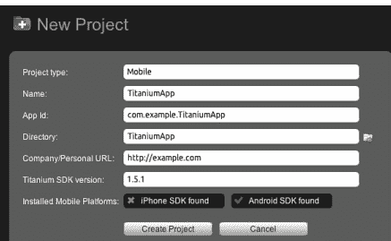

图 10-2 在 Titanium 中创建新项目

通过 Titanium ，我们可以在 Android 或 iOS 模拟器、物理设备上运行应用，或者将其部署到各自的应用中，如图 10-3 所示。

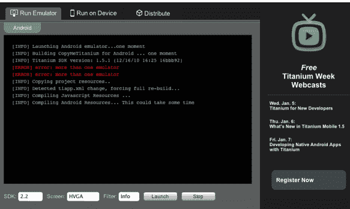

图 10-3 在 Titanium 中部署选项

图 10-4 显示了应用程序的文件列表。我们特别关注的是 `Resources` 目录（存放我们所有的应用程序代码）和 `tiapp.xml`（描述了我们的应用在 iOS 和 Android 上的行为）。

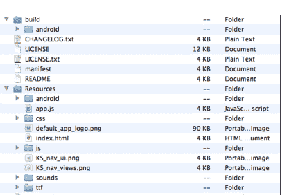

图 10-4 Titanium 中的应用程序目录结构

Titanium 维护自己的 Android 镜像。任何修改都会被持久，因为 Titanium 会定期重新生成。在后台，当你部署到模拟器时，Titanium 会启动选定的镜像并编译、部署应用程序。

Titanium 使用名为 `app.js` 的文件来描述应用程序的用户界面和逻辑。列表 10-10 显示了如何使用 Titanium 的 JavaScript API 创建窗口、向其中填充 `WebView` 并将其显示给用户。

### 列表 10-10 示例 app.js 文件

```javascript
// 这设置了主 UIView 的背景颜色
// （当上面没有窗口/标签页组时）
Titanium.UI.setBackgroundColor('#000');

// 创建根窗口
//
var win = Titanium.UI.createWindow({
  title:'App',
  backgroundColor:'#fff'
});

var webview = Titanium.UI.createWebView({
  url:'index.html'
});

win.add(webview);

// 打开窗口
win.open();
```

## 使用 PhoneGap 打包应用程序

与 Titanium 使用种自定义模拟器不同，PhoneGap 强烈依赖 Android 工具链。这意味着你可以使用 `AndroidManifest.xml` 配置文件。为了本示例，我们假设你已经在 IDE 中安装了 Android 插件。创建项目非常直接，与创建原生应用没有区别。图 10-5 和 10-6 显示了我们项目的创建屏幕。PhoneGap 通过两个文件向 HTML 应用程序暴露 Java 功能：一个名为 `phonegap.jar` 的 Java 库及其 JavaScript 对应物，`phonegap.js`。`phonegap.jar` 需要放在路径的某个地方。


图 10-5 使用 PhoneGap 创建应用程序

### 列表 10-11 AndroidManifest.xml 的新增内容

列表 10-11 显示了我们必须添加到 `AndroidManifest.xml` 中的项，以便 PhoneGap 工作。该片段以标签开始，告知此应用程序允许在哪些类型的屏幕上运行。接下来是设备组件的一系列启用权限，例如相机访问、联系人、音频和 GPS。在 Android 中，每个应用程序必须显式声明它将使用哪些权限。对于我们的示例应用程序，我们使用的唯一权限是 `android.permission.INTERNET`，但列表 10-11 显示了启用 PhoneGap 所有功能所需的权限。


图 10-6 使用 PhoneGap 创建应用程序（续）

```xml
<uses-permission android:name="android.permission.INTERNET" />
<uses-permission android:name="android.permission.RECEIVE_SMS" />
<uses-permission android:name="android.permission.RECORD_AUDIO" />
<uses-permission android:name="android.permission.MODIFY_AUDIO_SETTINGS" />
<uses-permission android:name="android.permission.READ_CONTACTS" />
<uses-permission android:name="android.permission.WRITE_CONTACTS" />
<uses-permission android:name="android.permission.WRITE_EXTERNAL_STORAGE" />
<uses-permission android:name="android.permission.ACCESS_NETWORK_STATE" />
```

在 `AndroidManifest.xml` 文件中，我们需要添加以下内容：`android:configChanges="orientation|keyboardHidden"`

这告诉 Android 当发生指定的更改时（在本情况下是用户旋转设备和滑出键盘），该应用程序将自行处理这些变化，而不是执行默认行为并重新启动应用程序。

接下来，我们需要对 Android 为我们创建示例 Activity 文件进行修改。Activity 代表设备的单个屏幕。除非你有非常充分的理由像编写 Java 代码那样工作，否则你可以直接接受列表 10-12 显示所示更改。

# 列表 10-12 示例应用程序 Activity 文件

```java
package com.html5book;

import android.app.Activity;
import android.os.Bundle;
import com.phonegap.*;

public class App extends DroidGap {
	@Override
	public void onCreate(Bundle savedInstanceState) {
		super.onCreate(savedInstanceState);
		super.loadUrl("file://android_asset/www/index.html");
	}
}
```

就像我们在 Titanium 中必须关注 `Resources` 目录一样，在初始设置之后，我们在 PhoneGap 中工作时有一个主要的目录。我们甚至在修改 Java 文件时看到过提示。我们需要在路径上分别创建一个名为 `assets` 和 `assets/www` 的目录和子目录。这里是我们所有与 HTML 相关的应用程序文件所在地。`android_asset` 是指向 `assets` 的链接。为了将我们的 Java 功能暴露给应用程序，我们只需要将 `phonegap.js` 文件复制到 `assets/www` 即可。图 10-7 显示了我们应用程序的目录布局。

| | | |
|---|---|---|
| AndroidManifest.xml | 4 KB | 文本文档 |
| assets | | 文件夹 |
| - www | | |
| - index.html | 0 KB | HTML... |
| - phonegap-0.9.3.js | 102 KB | JavaScript |
| build | | 文件夹 |
| - build.properties | | 4 KB | 文本... |
| - build.xml | | 4 KB | 文本文档 |
| - default.properties | | 4 KB | 文本... |
| gen | | 文件夹 |
| - phonegap-0.9.3.jar | 115 KB | Java 文件 |
| - local.properties | | 4 KB | 文本... |
| - phonegap.json | | 4 KB | 配置json 文件 |
| src | | 文件夹 |
| - src | | 文件夹 |

图 10-7 PhoneGap 中的应用程序目录结构

与需要特殊的构建来构建、启动或安装应用程序不同，我们可以使用喜欢的 IDE 或直接通过 `build.xml` 文件从命令行工作。

# 总结

在本章中，我们讨论了用于在移动设备上创建 HTML5 程序的各种库和框架。我们关注了暴露触摸事件和存储选项的库。我们详细研究了两个封装应用程序的框架：PhoneGap 和 Appcelerator Titanium。最后，我们使用这些框架封装了一些应用程序。

## 练习

1. 在 Android 2.2 浏览器中使用 HTML5 播放音频的解决方法是什么？
2. 使用 Appcelerator Titanium 版本与 PhoneGap 相比的优缺点是什么？
3. 使用 Lawchair 或任何受 NoSQL 启发的存储解决方案相比 SQLite 数据库的优势是什么？
4. 如果你想创建 HTML 应用程序，目前哪个操作系统是不可行的？

你可以在 `www.informit.com/title/9780321767363` 下载章节代码和章节练习答案。

# 第 11 章 发布你的游戏

本书的前十章主要涉及学习与 HTML5 相关的技术和开发游戏。在本章中，我们转移了焦点，涵盖了如何部署你的游戏，并加入了大量的优化。Web 应用程序的生死取决于速度。在将你的工作推向大众时，优化和有效使用离线缓存是拼图中的重要部分。

# 优化你的游戏资源

我们正在制作游戏，所以游戏逻辑中有很多大量的负载。为了尝试写出六个月或一年后你还能理解的代码，你可能费力地对代码进行了注释和格式化。或者没有。所有这些注释的问题在于它们占据了文件空间，而对用户来说，你解释了某功能有效，其实它就是有效。文件越小，下载速度越快。压缩（Minification）是使代码变小的过程。通常这包括移除空格和注释，以及重命名函数和变量。

# 使用 Google Closure Compiler 进行压缩

Google Closure Compiler 是一个代码分析器、优化器和最小化器，三者合一。大多数最小化工具只会执行标准的函数和变量命名、删除注释，然后结束了。Closure Compiler 更进一步，它会遍历代码的抽象语法树，并标记哪些代码可以因为不可达而被删除，或者可以通过内联（即用代码替换函数调用）来简化。它还能识别你代码中的错误。我们在本章中不会使用高级功能，但如果你感兴趣，鼓励你进行更多研究。Closure Compiler 需要安装 Java 来运行应用程序，所以如果你的机器上还没有安装 Java，请花点时间下载一个。

从 `http://closure-compiler.googlecode.com/files/compiler-latest.zip` 所在的压缩包下载并提取 `compiler.jar`。该编译器没有任何外部 Java 依赖。我们可以通过在命令行执行来优化文件：

```bash
java -jar compiler.jar
```

随后加上我们需要的选项和 `--js`。我们需要的有用标志是 `--js`、`--compilation_level` 和 `--js_output_file`。

你可以通过执行以下命令查看可用命令行选项（包括我们将不会涵盖的所有）：

```bash
java -jar compiler.jar --help
```

- `--js` 指定要压缩的文件。我们可以包含任意数量的文件，只要每个文件都有自己的 `--js` 标志即可。
- 对于 `--compilation_level` 我们有三种选择：
  - `WHITESPACE_ONLY`
  - `SIMPLE_OPTIMIZATIONS`
  - `ADVANCED_OPTIMIZATIONS`

如之前提到的，我们将 `ADVANCED_OPTIMIZATIONS` 留给以后。`WHITESPACE_ONLY` 标识符执行 `WHITESPACE_ONLY` 优化，并额外混淆顶级变量和参数名称。`--js_output_file` 正如其名，允许我们指定一个输出文件来存放优化后的 JavaScript。如果我们通过 `--js` 传递了多个文件，它们将合并成一个文件。你可以看到使用简单优化优化多个文件的示例：

```bash
java -jar compiler.jar --js Game.js --js zepto.min.js --js_output_file outfile.js --compilation_level SIMPLE_OPTIMIZATIONS
```

空间的大小和注释的数量决定了压缩版本有多小。在其他章节的某些项目文件中，我注意到优化后尺寸平均减小了 40%。思考一下：下载量减少了 40%，而且在大多数情况下减少了需要下载的文件（因为它们被合并了）。如果你在运行自己的服务器，你应该知道大多数服务器允许你更进一步对资源进行 gzip 压缩。可能需要安装额外的模块或插件，但这是值得考虑的，gzip 压缩可以产生双位数的文件大小缩小。当客户端从服务器请求文件时，服务器将返回一个 gzipped 版本，客户端对其进行提取。请求该资源的 Web 页面并不知道提供的是经过压缩的资源。

CSS 也可以进行压缩和 gzip 压缩。Closure Compiler 不做 CSS 压缩。你的游戏可能大部分依赖 CSS 且侧重于 JavaScript，因此 CSS 压缩不太可能产生显著差异。

图片同样需要进行优化。文档中包含的每个图片都是一个独立的 HTTP 请求。将它们合并为精灵图（sprite sheet）允许我们通过一次性提供所有图片来节省宝贵的时间。

## 使用应用程序缓存离线运行应用程序

HTML5 带来的趋势之一是模糊在线和离线访问之间的界限。在第 1 章“介绍 HTML5”中，我们简要讨论了已废的 Gears 如何允许你存储数据以便进行离线访问；这一概念通过 HTML5 应用程序缓存（Application Cache）得以延续。它消除了用户以前必须面对的二元选择：是上线还是不访问应用程序。结构良好的应用程序可以保留部分功能，尽管你可能无法访问外部服务器（例如发布排行榜），但其他工具（如 `localStorage`）可以在本地缓存数据并在重新建立连接时重新传输到服务器。

列表 11-1 显示了一个基础的应用程序缓存清单（manifest）。所有清单都必须以 `CACHE MANIFEST` 行开头。如果没有分节标题，列出的清单的默认行为是缓存所有指定的文件。

### 列表 11-1 基础应用程序缓存清单

```
CACHE MANIFEST
/game.css
/game.js
```

我们可以在缓存清单中指定的节如下：

- `CACHE`
- `NETWORK`
- `FALLBACK`

这些分别表示始终缓存、永不缓存以及如何处理未缓存文件的请求。`CACHE` 是默认值。列表 11-1 等同于列表 11-2 所示的代码。

### 列表 11-2 基础应用程序缓存清单

```
CACHE MANIFEST
CACHE:
/game.css
/game.js
```

`NETWORK` 节可以通过两种方式之一指定。我们可以显式地指定哪些资源可以在线访问，就像在列表 11-1 和 11-2 中对缓存资源那样，或者我们可以指定通配符 (`*`) 值。列表 11-3 显示了一个将所有 Ruby 文件排除在缓存之外的清单。如果我们省略了 `.rb` 扩展名，清单将对我们未在 `CACHE` 节中显式列出的所有内容要求网络访问。任何第一个非空格字符为 `#` 的行都被视为注释。与编程语言中的注释不同，这些注释必须单独成行。这样做的原因是 `#` 在 URL 中也用作片段标识符。与 URL 位于同一行的注释对浏览器来说具有歧义。

### 列表 11-3 带有 NETWORK 节的应用程序缓存清单

```
CACHE MANIFEST
# 包含 CACHE 和 NETWORK 节的清单
CACHE:
/game.css
/Game.js

NETWORK:
*.rb
```

文件的最后也是最重要的部分是 `FALLBACK` 节。这些对有助于你的用户处理离线访问。第一个值是匹配的 URL 模式。后面是用于替换它的资源。如果某些用户离线查看排行榜，我们可以为他们显示一个通用头像。我们也可以跳转到一个页面，说明他们处于离线状态，在重新连接之前某些功能将不可用。目标是为他们提供尽可能多的功能。列表 11-4 显示了一个清单文件，对 `/images/avatars/` 目录的所有请求提供 `generic_avatar.png`，对所有未缓存的 HTML 文件显示 `offline.html`。

### 列表 11-4 包含所有节的应用程序缓存清单

```
CACHE MANIFEST
# 包含所有节的清单
CACHE:
/game.css
/Game.js

NETWORK:
*.rb

FALLBACK:
/images/avatars/ /generic_avatar.png
/ /offline.html
```

现在我们有了一个定义了所有节的清单，我们需要告诉我们的应用程序向用户提供它。你可能注意到，我们从未指定任何要缓存的 HTML 文件。我们通过在代码中添加属性值来同时指示要缓存的 HTML 并向用户提供清单，如列表 11-5 所示。

### 列表 11-5 带有 manifest 属性的 HTML 文件

```html
<!DOCTYPE html>
<html lang="en" manifest="/offline.manifest">
  // 内容在此处
</html>
```

文件名可以是任何内容，但必须以 `.manifest` 结尾。这不如文件名那么担心。大多数 Web 服务器会根据文件的扩展名和内容正确地推断出 MIME 类型 `text/cache-manifest`。如果我们使用单页应用，在添加了列表 11-5 中的代码后，工作就完成了。对于多页应用，我们需要在每个应该缓存的页面中包含 `manifest` 属性。虽然你可以在清单本身列出所有 HTML 文件，但将该属性作为模板的一部分会更整洁，而且在需要时它可以防止缓存，而不是在清单中维护一个巨大的 HTML 文件列表。

一个常见的误解是，在服务器上更改文件而不更改清单，会自动检索更改的文件并忽略未更改的文件。事实并非如此。更改清单文件是通知浏览器变更的方式。更改清单的一种快速简单的方法是添加版本号，或者增加文件中引用的已更改的数字。当你访问网站时，它会检查之前是否查看过该文件，并在过程中触发一个 `checking` 事件。清单将与本地版本进行比对（如果存在的话）；如果没有，浏览器将触发 `navigate` 事件，然后触发 `download` 事件并下载所有资源。在下载过程中，将触发 `progress` 事件以提供下载状态的更新。完成后，无论站点是否有先前的清单，都会为该站点触发 `cached` 或 `updateready` 事件。尽管发生了缓存，但除非你强制对 `updateready` 事件进行刷新，否则用户的版本将不会切换到使用缓存的资源。缓存资源将在缓存后的下次刷新时被使用。

## 托管自己的服务器

当涉及到运行自己的服务器时，你可以选择在家里或工作地物理运行设备，也可以使用托管服务。某些服务为你提供精选的体验，你只需要登录在线仪表板即可上传文件；另一些则提供一个干净的服务器实例，供你安装要在上面运行的软件。

如果你和我一样，即使你一直在努力让那些慢速机器运行起来，你家里可能也有一两台没用的机器。我的咖啡之一是一台屏幕坏了但拥有 2GB 内存的笔记本电脑。配上外部显示器进行初始设置，那是运行网站的完美机器。

域名系统 (DNS) 将友好的域名翻译为 IP 地址。当你使用 Rackspace 或 Amazon 时，IP 地址不会改变。而住宅互联网提供商另一方面会失效并重新分配给你调制调制解调器的 IP 地址。如果 IP 地址经常变化，这对你的用户来说就是一个问题。动态 DNS 通过在短间隔内向主机报告你的 IP 地址来解决这个问题。许多现代路由器内置了此功能。DynDNS 和 NoIP.com 是两个广为人知且信任的 DNS 服务。除了处理你域名的路由外，它们还提供可以使用的免费域名。

## 在托管的 Node.js 服务上部署应用程序


# 发布你的游戏

在撰写期间，只有少数公司专门针对 Node.js 应用程序。随着 Node.js 变得更加主流，这种情况预计会有改善。使用此类服务的优点是你无需担心维护托管服务器的细微细节，例如开放和路由端口、强制不同域名的共享箱箱的应用之间进行隔离，以及操作系统。使用此类服务的缺点是缺乏控制。你无法决定网站运行在什么设备上，并在出现连接问题时无能为力。由于它们的弹性，你无法在运行时将文件保存到实例中。这是 Amazon 和 Rackspace 等在线服务处理的问题，但确实值得考虑。在本节中，我们将关注 Noderster 提供的服务。

## Noderster

Noderster (www.noder.com) 是一个 Node.js 应用程序的开源托管平台。Noderster 使用 Git 来跟踪更改以及启动和停止你的应用程序。只要你安装了 Node.js 和 NPM，就可以通过以下命令安装 `noderster-cli` 模块开始使用：

```
npm install noderster-cli -g
```

接下来，你需要请求一个注册令牌：

```
noderster coupon <email address>
```

在几小时后，你应该会收到一封欢迎邮件，其中包含了你的注册代码和一些基础的“入门”指南。这封邮件将引导你完成创建新用户、生成 SSH 密钥以及提供密码的步骤。我们在这里将快速跳过这些步骤，转而关注让 Noderster 酷酷的地方：它的 API。Noderster 的命令行界面是 Node、NPM 和 Git 常用任务的桥梁。当你使用以下命令创建一个 Noderster 应用时：

```
noderster app create <app_name>
```

你实际上是在为该应用创建一个 Github 仓库。你可以通过运行以下命令来管理 NPM 模块：

```
noderster npm <install> <modules>
```

你可以随时通过运行此命令启动或重启应用：

```
noderster app <start> [stop] [restart] <app_name>
```

这些命令只会影响远程服务器上的代码。任何本地更改在显示之前，都需要提交并推送到远程服务器。

从 `appname.noderster.com` 运行应用对于概念验证应用来说是可以的，但真实的应用需要自己的域名。Noderster 可以从你自己的域名进行重定向。你可以通过执行以下命令管理从你的名称到域名的别名：

```
noderster appdomain <add|delete> <app-name> <domain-name>
```

你还需要在你的 DNS 托管中添加一个 A 记录，将你的域名指向 Noderster 的 IP 地址 `50.16.203.53`。你可以通过在命令行中不带参数运行 `noderster` 来发现其他可用命令。

Noderster 通过深度集成到包中的托管和版本控制，为托管问题提供了新的解决方案。它在短板的一个方面是持久化。Noderster 没有提供内置数据库供你使用——这很有道理。构建一个能够解决大多数开发者需求并保持数据妥当隔离的解决方案很容易。幸运的是，数据库托管行业非常强大，有 MongoDB、Cloudant (CouchDB) 和 Amazon (SimpleDB/SQL) 等产品。

## 在 Chrome 网上应用商店发布应用

Chrome 网上应用商店是一个你可以为 Chrome 网页浏览器购买应用、主题和扩展的地方。据估计，全球 Chrome 用户数约为 1.2 亿。Chrome 网上应用商店也是 Chromebook（运行 Chrome OS 的笔记本电脑）安装应用程序的主要手段。运行 Chrome OS 的计算机具有 Linux 内核，但用户与之交互的唯一界面是 Chrome 浏览器。Chrome 浏览器会在后台静默更新，因此你不需要像在其他支持旧版本的其他主流浏览器时那样担心。通过 Chrome 网上应用商店分发的应用程序还能够以很小的努力推送到用户。通过 Chrome 网上应用商店，你可以学习浏览器的前沿尖端功能。这并不是说你在定义诸如 WebGL 或硬件加速等功能时不会遇到一些困难，但针对单一浏览器可以减少这种痛苦。我们在整本书中一直在谈论什么是应用，但我们还没有真正讨论过主题和扩展。主题通过自定义图像和字体修改你的 Chrome 应用的锁定和感觉。扩展微型应用通常只有一个目的。扩展的一个例子是对于看起来像 Twitter Handle 句的文本进行“链接化”。在本节中，我们关注应用程序的打包。当涉及到应用时，Chrome 网上应用商店提供了两种交付给用户的选项。你可以部署托管在你服务器上的应用，也可以部署一个用户下载的打包应用。

### 描述你的应用元数据

每个可安装的——无论是托管应用还是打包应用——都需要元数据以便在 `manifest.json` 文件中进行描述。在清单文件中，我们描述了基本信息，如应用程序的名称、描述和版本、图标、URL（外部或捆绑）以及应用将使用的权限。列表 11-6 显示了一个打包应用的示例 `manifest.json` 文件。

#### 列表 11-6 示例 manifest.json 文件

```json
{
  "name": "Copy Me Game",
  "version": "0.0.1",
  "description": "一个类似 Simon 类的“重复模式”游戏",
  "app": {
    "launch": {
      "local_path": "index.html",
      "container": "tab"
    }
  },
  "icons": {
    "16": "icons/icon_16.png",
    "128": "icons/icon_128.png"
  }
}
```

### 部署托管应用

托管应用不仅仅是合法的书签。清单文件允许你在安装时请求额外的权限。列表 11-7 显示了一个托管应用的典型清单文件。与之前的示例相比，一个显著的变化是 `web_url` 键值对。它指示了应用启动时将启动的网站。该网站也将获得请求权限的批准。

#### 列表 11-7 示例托管应用 manifest.json 文件

```json
{
  "name": "Copy Me Game",
  "version": "0.0.1",
  "description": "一个类似 Simon 类的“重复模式”游戏",
  "app": {
    "launch": {
      "web_url": "http://copyme.example.com/index.html"
    }
  },
  "icons": {
    "16": "icons_16.png",
    "128": "icons_128.png"
  },
  "permissions": [
    "unlimitedStorage",
    "notifications"
  ]
}
```

*(注：原文 JSON 格式略有错乱，翻译时已修正其括号结构以符合逻辑)*

在没有 5MB 限制的情况下，以下是我们可以请求的权限列表：

- `background`
- `geolocation`
- `unlimitedStorage`

在第 1 章中，我们讨论过使用 `geolocation` 和 `notifications`，请回到该章节。`unlimitedStorage` 消除了 `localStorage` 的限制。

`background` 权限允许应用在 Chrome 启动时加载，并在用户未与应用交互时运行。它运行一个你可以处理杂杂任务的 HTML 页面。Twitter 客户端 Tweet-Deck 使用后台页面检查新闻，并在用户被提及或私信时发送浏览器通知。在游戏的语境中，为了使用 `background` 权限，你还需要在清单中添加 `background_page` 键值对。

### 部署打包应用

打包应用非常适合离线访问，并且像托管应用一样，是一个包含 `manifest.json` 文件的压缩包。此外，包含了所有的应用代码。扩展面板（可以通过地址栏输入 `chrome://extensions` 访问）允许你安装应用的工作副本，并配置、卸载或禁用其他扩展程序和应用程序。图 11-1 显示了扩展了开发者模式的扩展面板。你会点击“加载解压的扩展程序”按钮并导航到应用的根目录。

### 在本地测试你的应用

Chrome 让你能够本地快速测试你的应用，而无需重新部署到网上商店。当你已经在本地测试好你的内容后，是时候进入下一阶段了，无论是测试测试还是全球部署。如果你从新标签页进入 Chrome 网上应用商店，底部将开发者面板链接。从该面板中，你可以管理更新或新的主题、扩展和应用。

### 在 Chrome Web 商店发布应用

Android 开发者费用并不是一项年度循环费用——它是一次性费用。在处理好注册开发者的情况后，你可以导航到仪表板。图 11-2 显示了包含几个处于 Beta 测试状态应用的仪表板。

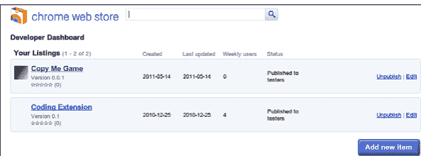

在 Beta 测试期间，这些应用会在 Chrome Web 商店中显示，但仅创建者以及其加入白名单的测试者可见。列表下方有一个“不容错过”按钮，允许你添加新项目。点击该按钮后，你会看到一个简单的 Web 表单，要求你上传压缩文件，如图 11-3 所示。

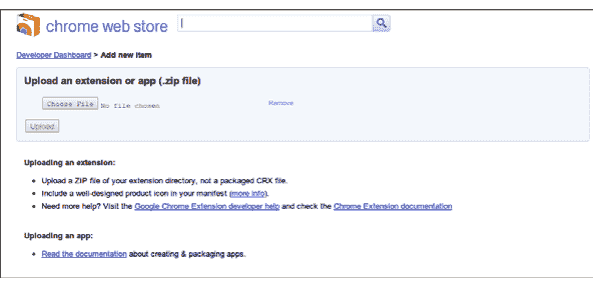

当你尝试提交文件时，服务器会确保该文件至少包含一个 `manifest.json` 文件、一个用于浏览器标签页的小图标（16×16 像素）以及一个用于已安装应用仪表板的大图标（128×128 像素）。如果忘记包含其中任何项，服务器将拒绝上传文件。

图 11-2 中应用的最右侧有两个链接：一个用于切换应用的已发布或未发布状态，另一个是编辑项目的链接。后者允许我们以比 `manifest` 文件更细的粒度来配置应用。

### 配置你的应用

图 11-4 显示了配置应用属性的大表单的第一部分。你可以看到它包含了源自 `manifest` 文件的某些基础信息，包括应用名称、版本和描述。你还可以选择哪些国家的用户可以在 Chrome Web 商店中看到该应用。从那里，我们还可以加载图标并添加截图、YouTube 视频链接或 Google Docs 演示文稿链接。

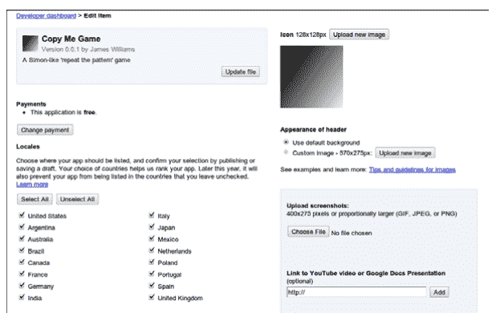

第二部分（图 11-5 所示）让你有机会为应用选择类别或添加自己的类别。这里还有一个用于详细描述的区域，以及在你的应用被推荐时用于上传宣传横幅的按钮。最后，有一个默认语言指定。Chrome 为主题、扩展程序和应用提供了内置的本地化支持，因此你可以在部署时包含所有消息，而不是替换多个版本的应用。


第三部分也是最后一部分（图 11-6 所示），允许你将应用与一个经过验证的网站关联、将内容标记为“成人（Mature）”、附加链接，并指定使用 OpenID 认证。需要注意的是，如果你使用 Chrome Web 商店支付功能，必须使用 OpenID 认证，以便购买行为可以被验证并绑定到用户的 Google 帐户。相关文档建议使用 OpenID，因为它刻意简化了从免费到付费应用载体的转换路径，并提升了用户体验。


### 决定使用托管（Hosted）还是打包（Packaged）Chrome 应用

决定将应用制作为托管应用还是打包应用取决于许多因素。免费应用可以轻松使用这两种模型，而付费应用如果部署为打包应用，则必须支付额外费用进行验证。虽然用户可以通过简单的点击按钮来获取应用更新，但更新打包应用对用户来说需要更多步骤。虽然托管和打包应用都需要更新代码并将其加载到你或 Google 的服务器上，但托管应用可以在用户访问应用时自动更新。托管应用的大小也是考虑因素，因为它每次运行时都必须下载。打包应用的大小也是考虑因素，因为它只需要下载一次并安装。

## 使用 TapJS 发布应用

TapJS 是一个允许你将以下元素无缝集成到游戏中的平台：

- 成就
- 排行榜
- 玩家帐户

与 TapJS 集成非常简单：只需包含列表 11-8 中的 `script` 标签。

### 列表 11-8 TapJS 脚本

```html
<script type="text/javascript" src="https://ajax.googleapis.com/ajax/libs/jquery/1.4.4/jquery.min.js"></script>
<script type="text/javascript" src="http://YOUR-URL.tapjs.com/api/js"></script>
```

### 创建 TapJS 应用

创建一个 TapJS 游戏也很简单：只需填写标题并点击“继续”（如图 11-7 所示），你将进入第 11-8 到 11-12 部分的长表单。图 11-8 显示了你可以更详细描述应用的区域，图 11-9 显示了有限的主题和布局选项以及成就。

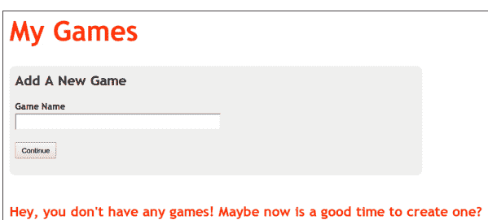

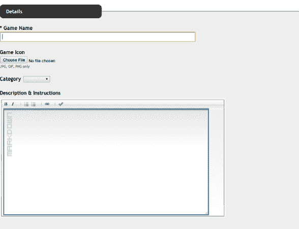

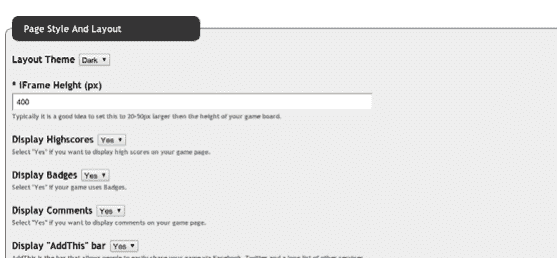

子域名定义了你提供给朋友以及 Facebook 用于访问你游戏的 URL。如图 11-10 所示。图 11-11 显示了你的游戏可以请求的权限——即 Internet Explorer 7 和 8 用户是否会被下载现代浏览器、移动设备是否可以访问你的游戏，以及游戏是否已发布并可以玩。最后，图 11-12 显示了你在哪里输入 Facebook 特定的细节。

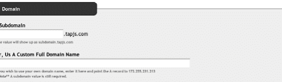

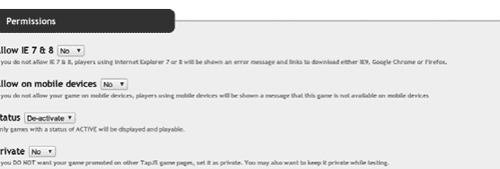

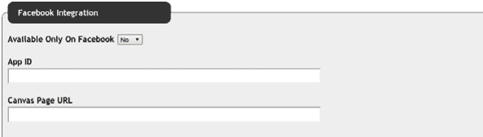

### 为 TapJS 打包应用

为 TapJS 打包就像创建一个 zip（存档）文件一样简单，完成后就搞定了。你可以在 zip 包中包含以下任何类型的文件：

- `.html`
- `.css`
- `.ttf`
- `.js`
- `.swf`
- `.jpg`, `.png`, `.gif`
- `.mp3` 和 `.ogg`

你可以自由使用任何喜欢的文件夹结构。唯一的要求是在你的应用程序中某处包含上述的脚本标签以及一个 `index.html` 文件。

### 将 TapJS 应用发布到 Facebook

TapJS 还可以将应用部署并在在 Facebook 上使用。这种选择在调用的函数上需要进行权衡。我们在第 9 章“构建多人游戏服务器”中简要介绍过这一点，但现在将结合 TapJS 应用所需的更改再次进行回顾。图 11-13 显示了 Facebook 开发者应用程序的网站。你需要将 Set URL 设置为在 TapJS 上创建游戏时选择的 URL（通常为 `http://YOURGAME.tapjs.com`）。

在 Facebook 集成选项卡上，`Canvas URL` 和 `Tab URL` 字段应设置为你的 TapJS URL。`IFrame` 大小应设置为 `Auto-Resize`（自动调整大小）。`Canvas Page` 和 `Tab Name` 字段也应该设置。图 11-14 显示了开发者控制台此部分的截图。

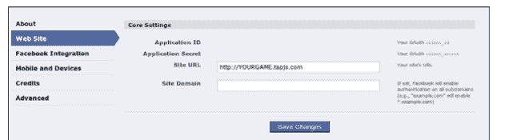

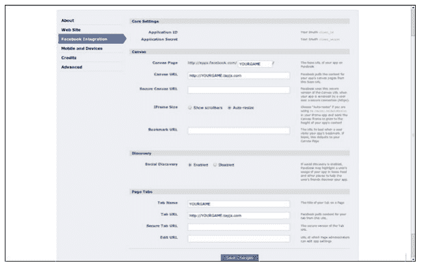

TapJS 的 Facebook API 非常简洁。`tapjsSocial` 对象上有三个函数。它们的签名列在这里：

- `tapjsSocial.fbCheck([callbackFunction])`
- `tapjsSocial.fbApp([callbackFunction])`
- `tapjsSocial.fbWallPost(message, [link], [caption], [description], [callbackFunction])`

`fbCheck` 确定用户是否正在通过 Facebook Canvas 访问应用程序。可以调用此函数为你的应用程序提供提示，以开启或关闭 Facebook 特有的功能。特别是 Facebook 禁止使用 AdSense 广告。`fbApp` 获取有关你应用的信息，例如应用 ID 和页面 URL。`fbWallPost` 正如其名，允许你发布到用户的 Facebook 墙上。TapJS API 目前尚不支持作为 Facebook Credits 和 Google Payments 的应用内支付，尽管应用内支付已列在路线图中。使用 TapJS 部署到 Facebook 是在尝试针对平台进行更多定制之前，在 Facebook 上进行烟测试回滚的好方法。

## 通过 Kongregate 发布游戏

Kongregate 是一个在线游戏托管平台，最初支持 Flash 和 Unity 游戏，现在能够托管 HTML5 游戏。它非常成熟，拥有大量的用户和开发者。Konduit 是一个应用平台，包含了许多与 TapJS 相同的元素以及更多，包括以下内容：

- 聊天集成
- 微支付
- 游客游戏玩家（未登录 Kongregate）
- 用户资料

有一个感兴趣的点是，当你部署到 Kongregate 时，你也部署到了 Android。Kongregate 发布了一个 Android 版本，允许访问其平台上的所有游戏。Konduit 在这里有很多内容要讨论，但鼓励感兴趣的读者在 `http://www.kongregate.com/developer_center/docs/konduit-platform` 上阅读它。

## 将 HTML5 应用发布到桌面

如所述，Webkit 是驱动 Google Chrome 和 Apple Safari 的浏览器引擎，它起始于一个名为 KHTML 的开源项目。Webkit 的开源根意味着它可以通过许多与 C/C++ 接口的编程语言进行调用。开发者可以从他们所选的语言到 Webkit 编写自己的绑定，或者从使用 GTK (`http://en.wikipedia.org/wiki/GTK`) 或 wxWidgets (`http://en.wikipedia.org/wiki/wxWidgets`) 小部件库的现成解决方案编写绑定，每个库都有许多编程语言的绑定。此外，这些库是跨平台的。这些绑定允许你根据需要让应用程序功能尽可能丰富或基础。你只需要编写一个外壳应用来加载任何其他浏览器的应用程序（这在 XULRunner 应用中很常见），或者可以使用你的应用来使用普通浏览器无法提供的游戏手柄或外设。

XULRunner (`http://en.wikipedia.org/wiki/XULRunner`) 是 Mozilla 产品中的运行时引擎，开放作为 Webkit 被嵌入。通过 XULRunner 解决方案，你与其说是在编写代码，不如说是在组合应用程序。你的应用程序运行在 XULRunner 实例中，大部分情况下，除了一些 XUL 布局外，你不需要处理 HTML5 应用，它们甚至已经发布到 Mac App Store (`www.apple.com/mac/app-store/`)，而无需更改游戏代码，只需少量的代码在游戏周围封装一个 WebView。在 Linux 上，Ubuntu 软件中心 (`http://developer.ubuntu.com/`) 最初允许你安装免费应用和库。

# 总结

我们在这一章中涵盖了大量内容。我们讨论了如何为 TapJS 打包应用以及如何将它们部署到 Facebook 和 Kongregate。我们还研究了使用 Webkit 和 XULRunner 将 HTML5 应用发布到桌面。

## 练习

1. 如何使用 manifest 文件强制缓存资源？
2. 什么是 `localStorage`？
3. 使用 TapJS 进行 Facebook 的优缺点是什么？

# 索引

## 符号

- `beginPath()` 函数, 72
- `drawImage` 函数, 223
- `setInterval` 函数 (JavaScript), 38
- `setTimeout` 函数 (JavaScript), 38
- `updatedDynamicsWorld` 函数, 139

## A

- Android
  - 应用层, 182
  - 部署游戏, 182
  - 使用 Accelerator Titanium 打包应用, 193–194
  - 使用 PhoneGap, 195–198
  - 音频元素支持, 192
- Ars Technica, 153
- 算术运算符, 32

## B

- background 权限, 207
- 贝塞尔曲线 (Bezier curves), 112
- Bezier, Pierre, 111
- 广告牌效果 (billboarding), 140
- 位图图像，使用 SVG 文件创建, 105
- Blender, 29, 84, 129
- Blender 大会, 130

## C

- CACHE 区域 (应用程序缓存清单文件), 201
- 缓存数据, 168
- Camera 对象 (Three.js), 128–129
- 画布 (Canvas), 15–16, 71
  - 与 SVG 比较, 95–96
  - 在 Jo 中显示, 188
  - 绘制状态，保存与恢复, 77
  - 图像，绘制, 79
  - 路径，绘制, 72
  - 精灵图 (sprites), 绘制, 73–74
  - 变换, 75–77
- Cappuccino, 158
- 卡片
  - 动画, 107–110
  - 绘制, 105
  - 翻转, 108
  - 洗牌, 107
- Chrome (Google)
  - 扩展, 25
  - Chrome 开发者工具, 24
  - Chrome Frame, 3
- Chrome Web Store
  - 应用，发布
    - 托管应用，部署, 207–208
    - 元数据，描述, 206
    - 打包后的应用，部署, 208
    - 测试应用, 208
  - 应用，上传, 208–210
- 类
  - CoffeeScript, 157–158
  - JavaScript, 继承, 38–40
- 客户端脚本
  - JQTouch, 187
  - jQuery, 185
  - jQueryMobile, 185–186
  - Zepto.js, 187
- 客户端服务器通信
  - NodeJS, 171
  - WebSockets, Socket.IO, 169–170
- 裁剪平面, 128
- 代码，最小化, 199–201
- CoffeeKup
  - 安装, 166
  - 布局文件, 167–168
  - 在 ExpressJS 中注册, 167
- CoffeeScript, 45
  - 别名, 156
  - 类, 157–158
  - 条件语句, 155
  - 文件，编译, 153
  - for 循环, 156–157
  - 函数, 154
  - 停顿, 153
  - 分号，使用, 154
  - 散列符 (splats), 155
  - var 关键字, 154
- 碰撞检测 (Pong), 65–66
- 在 Raphael 中指定颜色, 103–104
- 拾颜色, 142
- 注释，最小化, 199–201
- 比较器 (JavaScript), 55–56
- 比较
  - CoffeeScript 和 JavaScript, 154
  - 微数据和微格式, 17
  - SVG 和 画布, 95–96
  - XML 和 JSON, 44
- 比较运算符 (JavaScript), 34–35
- 编译器, Google Closure Compiler, 199–201
- 编译 CoffeeScript 文件, 153
- 组件 API, 58
- 条件循环 (JavaScript)
  - for 循环, 37
  - if-else 语句, 35
  - switch-case 语句, 36
  - while 循环, 36

## D

- 数据 URL, 78
- 数据库 API
  - 控制台调试, 172–173
  - IndexedDB API, 7
- 控制
  - WebSQL API, 6–7
- 程序流 (JavaScript)
  - for 循环, 37
  - while 循环, 36
- 调试 Node 应用, 172–173
- 决定类型, 52–53
- 康威生命游戏 (Conway's Game of Life), 136

## E

- 部署
  - Copy Me, 87
  - 桌面应用, 46–47

## F

- 开发工具
  - Blender, 29
  - Chrome 开发者工具, 24
  - Eclipse IDE, 安装, 20–21
  - Firebug, 26
  - GWT, 安装, 19–20
  - Java, 安装, 22
  - Processing, 27
  - Safari 开发者工具, 26
- 跨平台框架, 10–11
- 跨站点脚本, 44
- CSS (样式表), 92
- 立体映射, 135
- 方向光照, 120
- 自定义字体, 100

## G

- 绘制函数, 78
- 绘制
  - 第一类对象, 33–34
  - 图像, 79
  - 游戏对象, 87–88
  - 游戏道具, 61–63
  - 游戏物理, 64–66
- 游戏循环, 14–15
- 游戏资源, 14–15
- 游戏类型, 52–53
- 游戏播放, 19–20
- 游戏房间, 175
- 刚体动力, 137–138
- 软体动力, 138
- 帧，使用 Stats.js 检查, 144
- 帧率, 144
- 碎片光化, 121

## H

- Google Closure Compiler, 最小化, 199–201
- Google plugin for Eclipse, 安装, 20–21
- Google SketchUp, 143
- Gouraud 光照, 121
- Grouchnikov, Kirill, 79
- GWT (Google Web Toolkit), 45, 147
  - gwt-html5-media module, 151
  - JSNI, 149
  - Pyjamas, 158
  - widgets, RootPanel, 148–149
  - 安装, 22

## I

- if-else 语句 (JavaScript), 35
- 图像
  - 位图，使用 SVG 文件进行绘图, 105
  - 在 Canvas 上绘图, 79
  - 渲染, 78
- IndexedDB API, 7
- 惯性，牛顿第一定律, 63
- 实例, 38
  - CoffeeScript, 158
  - Prototype 库, 39–40
- 注入攻击，跨站脚本, 44
- 逆向动力学, 142
- iOS, 179
- Is-a 关系 (JavaScript), 继承, 38

## J

- Java, 安装, 19–20
- JavaScript, 1
  - AJAX, 2
  - 与 CoffeeScript 比较, 154
  - 算术运算符, 32
  - 作为中间接语言, 45
  - 基础类型, 31
  - Comparator, 55–56
  - 比较运算符, 34–35
  - 条件循环
    - for 循环, 37
    - if-else 语句, 35
    - switch-case 语句, 36
    - while 循环, 36
  - 函数, 22–33
    - 一等对象, 33–34
  - 继承, 38–40
- jQuery
  - AJAX, 43–44
  - 事件, 43
  - ready 函数, 41
  - 选择器, 42
- JSON, 44–45
- JSONP (带填充的 JSON), 45
- JVM (Java 虚拟机), 48

## K

- KHTML, 217
- Knuth, Donald, 107
- Kongregate, 发布游戏, 217
- 关键帧, 81, 142

## L

- Lawnchair, 183
- 记录
  - 移除, 185
  - 获取, 184
  - 存储，创建, 184
- 矩阵, 75-76
- 媒体元素 (HTML5), 13
  - 控制, 13–14
  - 不支持的处理, 5
  - 列出多个源, 14–15
  - 配合 Modernizr, 15
- 布局文件, CoffeeKup, 167-168
- 库 (JavaScript), Prototype, 39-40
- 光照, 120-122
- 线性渐变, 103
- 指令 (Raphael), 110-111
- 链表, 56-57
- 在 HTML 中列出多个媒体源, 14-15
- 元数据，描述, 206
- 方法，equals, 54
- 微数据 (microdata), 17
- 微格式 (microformats), 与微数据的比较, 17
- MIDI, 创建 Copy Me 游戏音调, 88-91
- 代码压缩 (minification), 199-201
- 极极极算法, 69-70
- LiveScript, 31
- 加载
  - 使用 Three.js 加载 3D 模型, 129–131
  - Raphael 中的游戏资源, 104–105

## M

- main.js 文件, Pong, 60-61
- MakeHuman, 143
- 管理
  - ExpressJS 会话, 165
  - 多人游戏，游戏 175–176
  - 多个 Node 版本, 162
- manifest 文件, 应用缓存 (Application Cache), 201-203
- manifest.json, 206
- Lambertian 着光, 121
- 启动游戏
  - 作为应用, 183
  - 作为网站, 181

## N

- 网络 API, 58
- 牛顿定律, 63
- Node.js
  - 应用，调试, 172-173
  - node-cache 项目, 168
  - Node 包管理器 (NPM), 168
  - Node.js, 23, 204
  - 节点, 56-57
- 常规, 121
- 非线性时间轴，创建, 81-82
- 通知，创建, 11–12
- 与之交互, 12
- NoSQL 键值对存储, 183
- 显示权限, 11
- NowJS, 创建游戏房间, 174-175
- 使用 Nodester 管理 NPM 模块, 205

## O

- Object-J, 158
- 对象 (objects) (JavaScript), 31
- 离线访问，使用应用缓存运行应用, 201-203
- 请求显示通知的权限, 11
- 持久化缓存, 168
- OpenGL ES, 117
- Opera Unite, 23
- 操作系统，选择移动平台
  - Android, 179-180
  - iOS, 179
  - WebOS, 180
  - Windows Phone 7, 181
- 运算符重载, 55

## P

- 打包应用，部署, 208
- 对于 iOS 的打包应用, 212
- 对于 CoffeeScript 的打包, 215
- 在 Raphael 上创建, 98
- 路径 (paths), 113
- 动画化对象, 113
- 平台 (platforms)
  - 部署游戏, 182
  - 选择, 179
- PhoneGap, 188
  - Android 应用，打包, 195-198
  - API, 189
  - 文档, 190
  - FileReader 对象, 190
  - FileUpload 对象, 190
  - FileWriter 对象, 190
- 透视投影, 84
- Phong 反射, 122
- Phong 着光, 122

## Q-R

- 径向渐变, 103–104
- 随机算法，洗牌, 107
- 刚体动力学, 137-138
- RingoJS, 23, 48
- Rosendael, Ton, 129
- RootPanel 组件, 148-149
- 着光 (shading)
  - 平直着光, 121
  - Gouraud 着光, 121
  - Lambertian 着光, 121
  - Phong 着光, 122

## S

- ShapeBuilder API, 152
- 洗牌, 107
- 使用 ExpressJS 简化应用, 163
  - 应用结构, 165
  - 会话管理, 165
  - URL 路由, 163–165
- Safari 开发者工具, 26
- 保存 Canvas 状态, 77
- 场景图, 123
- 脚本语言 (JavaScript), 1
- 会话管理, 165
- sessionStorage 对象 (Web Storage), 7-8
- set class (JavaScript), 54
- 集合 (sets), 54–55
- 设置 JigLib, 138
- Socket.IO, 169-170
- 软体动力学, 138
- 排序数组和集合, 55
- 使用 gwt-html5-module (GWT) 添加声音, 151
- 源自 3D 模型, 143
- 为 Raphael 指定颜色, 103-104
- SVG 速度考虑, 114
- 球体应用纹理, 135
- SpiderMonkey, 46
- splats, 155
- 在 Canvas 中绘图 (sprites), 73-74
- 精灵图集 (spritesheets), 78, 83
- Stats.js，检查帧率, 144
- 存储 API，Lawnchair, 183
- 存储的结构化数据
  - IndexedDB API, 7
  - WebSQL API, 6-7
- 纹理, 134
  - 应用于球体, 135
  - 立方体映射, 135
  - UV 映射, 134
- 为 Copy Me 游戏设置样式, 92
- Suzanne 奖, 130
- SVG (缩放矢量图形), 16, 95
  - SVG-edit, 27
- switch-case 语句 (JavaScript), 36
- 同步连接，WebSQL API, 7
- Three.js, 117, 136
  - 3D 模型，加载, 129–131
  - Camera 对象, 128–129
  - 设置, 123–127
  - 查看, 128–129
- 顶点 (vertex), 创建, 118–119

## T

- 井棋游戏 (Tic-Tac Toe)
  - AI, 68
- 标签, 画布, 71
- 绘制状态，保存与恢复, 77
- 图像，绘制, 79
- 路径，绘制, 72
- 精灵图，绘制, 73–74
- 变换, 75–77
- 时间轴, 83
  - 在 Trident.js 中创建, 80
  - 关键帧, 81
  - 非线性，创建, 81–82
  - 反转, 81
- TapJS
  - 应用程序
    - 创建, 213
    - 打包, 215
    - 发布, 212, 215–217
- Titanium Appcelerator, 45
- 变换, 75–76
  - 排序, 76–77

## W

- Web Sockets
  - 使用 NowJS 简化, 171
  - Socket.IO, 169–170
- Web Storage, 7-8
- Web Workers, 4-5
- WebGL, 16, 117
- WebGL Inspector, 145
- 网页浏览器
  - Geolocation API 支持，验证, 8
  - Google Chrome V8, 161
  - Google Gears, 3
- 网页通知
  - 创建, 11-12
  - 交互, 12
  - 请求显示权限, 11
- 网页服务器工具, 23
- 网页托管
  - 托管应用程序，部署, 207–208
  - 托管 Node.js 服务, Nodester, 204–205
  - 托管自己的服务器, 203–204
- 网站
  - 作为游戏启动, 181
  - 在浏览器上验证 Geolocation API, 8

## V

- V8, 161
- 封装的应用程序，部署, 202
- 变量，着色器, 132
- 向量, 121

## X-Y-Z

- XML, 与 JSON 比较, 44
- XMLHttpRequest 对象, 2
- XULJet, 46-47
- XULRunner, 46, 217
- z-轴排序, 85
- Zepto.js, 187
