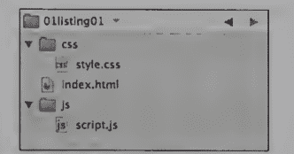
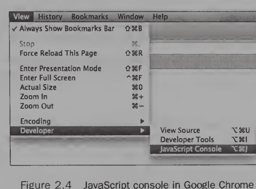
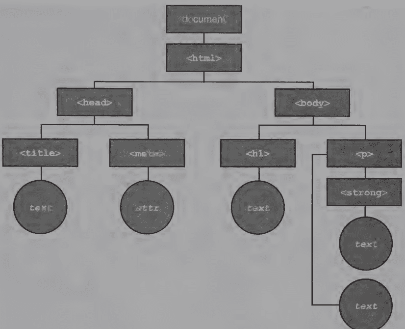
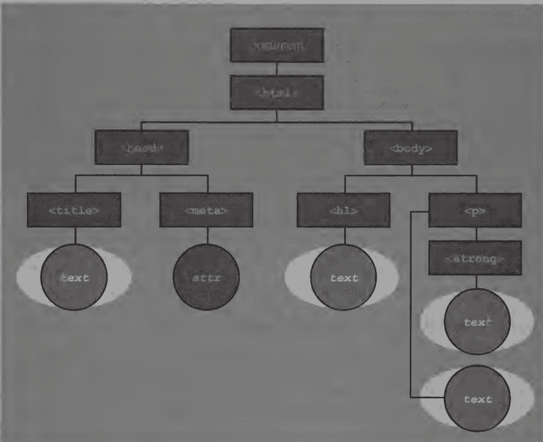
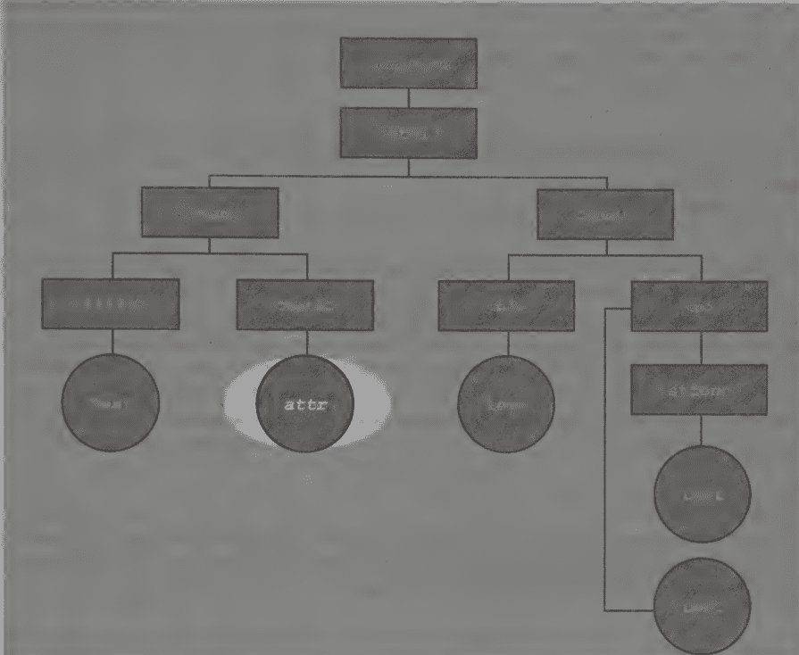
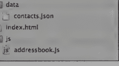
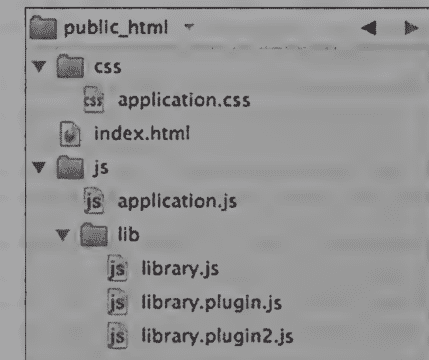
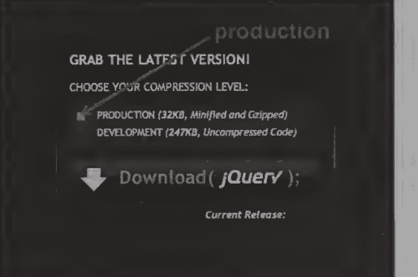
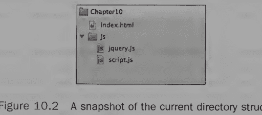
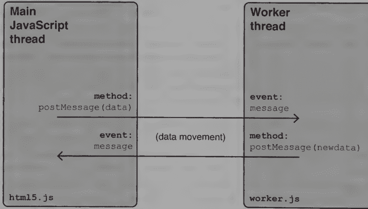

# 学习 JavaScript：现代 JavaScript 基础实用指南

## 对《学习 JavaScript》的评价

“在现代网络界面、服务器端技术和 HTML5 游戏之间，JavaScript 从未像现在这样成为如此重要且多能的工具。对于任何刚开始学习 JavaScript 或想要深入了解该语言实用核心知识的人，我都会强烈推荐《学习 JavaScript》。”

—Evan Burch，独立 Web 开发人员

“虽然我以前读过几本关于 JavaScript 的书，但作为一名后端开发者，看到 Tim Wright 的《学习 JavaScript》我感到非常兴奋。渐进式增强与优雅降级之间的细微差别，在书中终于以一种前端编程初学者也能理解的方式得到了阐释。干得好，Tim。”

—Joe Devon，StartupDevs 联合创始人

“Tim Wright 为想要学习 JavaScript 的初级前端开发者编写了一本极具实用性的书籍。这本书的优势在于既对 JavaScript 提供了良好的介绍，又说明了在何时何地应该使用它。”

—R. S. Doiel，俄亥俄州立大学（USC）Web 服务高级软件工程师

“《学习 JavaScript》是一本关于现代 JavaScript 开发的极佳入门书，从历史到其令人兴奋的未来，它让初级开发者能够胜任工作中的实际应用。我真希望这本书在我还是新手的时候就出现了！”

—Hillisha Haywood，《体育新闻》高级 Web 开发人员

“Tim 展示了无价的技巧，将渐进式增强放在核心位置来编写 JavaScript。如果你是 JavaScript 初学者，这本书将成为你学习过程中的宝贵财富。它涵盖了所有基础知识，一直延伸到触摸事件、AJAX 和 HTML5 API，示例清晰易于遵循。通过这本书，你将学习并学会如何高效地使用 JavaScript。”

—Tom Leadbetter，自由 Web 设计师

“《学习 JavaScript》对于新开发者和资深开发者都有价值。它对新开发者来说很棒，因为它易于阅读，并提供了成为 JavaScript 高手的分步过程。对于资深开发者，它会让他们想起许多他们已经忘记的最佳实践。”

—Christopher Swenor，zMags 技术经理

Tim Wright

Nonie Ratcliff

+ 索引 309

引言 1

- 可重用 5

### 回调函数 52

- 属性节点操作 70

- 设置属性 72

- 作为方法的函数 112

### 库的劣势 238

## 第11章：HTML5 API 242

- 什么是 HTML5? 244

- 标记 244

- 创建语义化 244

- 构建内容 248

- 导航 248

- 地理定位 249

- 音频和视频 251

- Web Workers 254

- 设备 265

- 历史记录 266

- 状态 API 267

- 网络 API 268

- 使用特性检测 270

- 总结 271

- 练习 272

## 第12章：前进发展 273

- 复习 274

- DOM 274

- DOM 操作 275

- 数据 277

- 服务器 279

- JavaScript 279

- 接口 280

- 高级 284

- JavaScript 289

- 总结 292

- 练习 303

## 答案 305

## 索引 309

## 本书的读者群体

本书的读者是任何刚开始 Web 设计和开发并想要学习 JavaScript 的人。在阅读本书之前，你应该具备 HTML 和 CSS 知识，并熟悉渐进式增强（`progressive enhancement`）背后的概念。

本书同样适用于初学者，也适用于希望将知识领域扩展到 JavaScript 的资深 Web 老兵。在此过程中，我希望它能激发你学习这个快速发展的行业的热情。

## 本书的代码示例

本书的示例代码可以在书籍网站 `http://learningjsbook.com` 获取。

## 渐进式增强

尽管我们倾向于认为人们访问我们的网站是为了查看那些宏伟而复杂的图形、流滑的 CSS 动画和语义化的 HTML，但我可以肯定地告诉你，遗憾的是，事实并非如此。我经常访问某些网站是因为——也许你可能也会这样做——而且这可能成为下班后闲谈的话题，但真正的互联网用户（我们不是真实用户；我们是开发者和设计师）我们是那些不会注意到这些东西的“边缘案例”。他们关心的都是能多高效地完成需要做的事情，无论是检查邮件和天气、下载歌曲还是看电影。但点就在于：我们应该设计出让这些技术在未经训练的眼中几乎察觉不到的东西。当这些技术开始显眼时，整体目标就会变得模糊。

人们访问你的网站、Yahoo!、Google 或 MSN 是同一个原因：内容。每个人都想要内容；它是任何网站或应用程序最重要的方面。回想一下你下次访问网站时，你为什么去那里？答案几乎总是“内容”。在设计社区，我们有一条强调内容重要性的指导原则。它指导着我们处理所有大小项目的方式，它被称为渐进式增强。

### 定义渐进式增强

渐进式增强是所有前端开发的基石。在最基础的层，它是在 HTML、CSS 和 JavaScript 之间创建功能上的分离。显然，这远不止于此（否则不会专门用一整章来介绍它），但如果你记住保持这三项技术分离，你就有了一个良好的开始。

渐进式增强是一种 Web 设计的分层方法，其重点在于内容、用户和可访问性。第一步是保持 HTML、CSS 和 JavaScript 分离，但我们不称它们为 HTML、CSS 和 JavaScript。我们将这三个“层”称为结构、表现和行为，可能是为了让该方法能够准确地应用到当前 Web 设计之外的其他领域。简而言之，它是网站或应用程序的一种自下而上或从内向外的构建模型。

你首先关注内容并用语义化且有意义的 HTML 进行标记。这是第一层，“结构”。在内容被正确标记后，我们就可以进入第二层，“表现”。在表现层上，我们处理 CSS。渐进式增强的第三层，“行为”，我们最后处理。我们将在这里花费大量时间，因为这是 JavaScript 所在的地方。图 1.1 显示了 Web 设计的不同层级。

图 1.1 渐进式增强的图形表示

这三个层级之间有趣之处在于，它们从未打算过相互接触，但它们都是集成的——当你顺着梯子向上移动时，下一层依赖于前一层。JavaScript 需要 CSS，而 CSS 需要 HTML。这种顺序的设定是为了让你能够从上到下移除每一层，而永远不会丢失网站最核心的部分：内容。

只要你保持各层分离，让你的网站仅使用 HTML 即可运行，使用 CSS 美化它，并使用 JavaScript 平滑行为，你就能确保你的内容始终是可以访问的。

## 历史

2003 年在德克萨斯州奥斯汀的西南偏节（SXSW），产生了一个新术语，让 Web 回归到 Tim Berners-Lee 的原始路径；这个术语被宣布为渐进式增强，从那时起 Web 设计的面貌发生了变化。我们构建和思考的方式从关注机器（浏览器）转向了更友好的、以人（用户）为中心的模型。我们开始意识到内容比装饰更重要。我们关心用户，并关心让他们尽可能快速、方便地获取他们寻找的内容。

在此之前，Web 应用程序在设计停止测试时会导致几个浏览器版本崩溃，或者浪费宝贵的时间将新功能适配到替代输出中。许多事物如新设备、屏幕尺寸、带宽限制和内存限制会不断出现。渐进式增强是我们跳出这种无尽循环的方法，近 10 年后，它依然运行良好。

直到今天，我们仍在构建并寻找改进内容以及专注于以用户为中心的设计。渐进式增强改变了 Web。

## 目的

渐进式增强的目的是将重点放在内容上，这完全合逻辑；这也是你们访问你们网站的原因。主要关注点是内容，它同时也考虑了技术。假设你正在使用渐进式增强和精美的 JavaScript 动画构建一个网站，用户在浏览器中关闭 JavaScript 的情况下访问了你的网站。他们看不到你精心添加的任何 JavaScript 增强，但这并不要要，因为你可以剥离这些层并有效地获取内容。

保持你的各层分离，让你的网站仅使用 HTML 即可运行，使用 CSS 美化它，并使用 JavaScript 平滑行为，你就能确保你的内容始终是可以访问的。

## 可访问性

渐进式增强的目的是将重点放在内容上，这完全合逻辑；这也是你们访问你们网站的原因。主要关注点是内容，它同时也考虑了技术。假设你正在使用渐进式增强和精美的 JavaScript 动画构建一个网站，用户在浏览器中关闭 JavaScript 的情况下访问了你的网站。他们看不到你精心添加的任何 JavaScript 增强，但这并不紧要，因为你可以剥离这些层并有效地获取内容。

保持你的各层分离，让你的网站仅使用 HTML 即可运行，使用 CSS 美化它，并使用 JavaScript 平滑行为，你就能确保你的内容始终是可以访问的。

## 可复用性

渐进式增强的目的是将重点放在内容上，这完全合逻辑；这也是你们访问你们网站的原因。主要关注点是内容，它同时也考虑了技术。假设你正在使用渐进式增强和精美的 JavaScript 动画构建一个网站，用户在浏览器中关闭 JavaScript 的情况下访问了你的网站。他们看不到你精心添加的任何 JavaScript 增强，但这并不紧要，因为你可以剥离这些层并有效地获取内容。

保持你的各层分离，让你的网站仅使用 HTML 即可运行，使用 CSS 美化它，并使用 JavaScript 平滑行为，你就能确保你的内容始终是可以访问的。

## 渐进式增强对比 优雅降级

渐进式增强源于一种名为优雅降级（`graceful degradation`）的旧开发方法，这种方法会针对最先进的版本进行构建。听起来很熟悉，不是吗？在很多方面，优雅降级与渐进式增强相似。两者之间的主要区别在于，渐进式的主要关注点是内容，而优雅降级的主要关注点是浏览器。

## 结构层

一切都有意义，但没有任何设计。

渐进式增强的第一步是以有意义的方式布局内容。标记为标题的标题创建层级流，段落包裹在 `<p>` 标签中，列表标记为 `<ul>`，我们确保 HTML 具有意义且不传达任何关于设计。

渐进增强的下一个领域。让我们来看列表 1.1 中的基础基础 HTML 文档。

## 列表 1.1 HTML 文档

```html
<!doctype html>
<html>
<head>
  <title>Great Home Page</title>
  <meta charset="utf-8">
</head>
<body>
  <div id="header">
    <h1><a href="/">Great Home Page</a></h1>
  </div>
  <div id="nav">
    <ul>
      <li><a href="/about">About</a></li>
      <li><a href="/articles">Articles</a></li>
      <li><a href="/staff">Staff</a></li>
      <li><a href="/contact">Contact</a></li>
    </ul>
  </div>
  <div id="main">
    [content here]
  </div>
  <div id="footer">
    <p>&copy; 2012 Awesome Site</p>
  </div>
</body>
</html>
```

在这个示例中，你可以看到你拥有一个包含头部、导航、内容区域和页脚的基础文档。在构建文档结构方面，这是你应该所在的地方，而不是考虑这段 HTML 将如何在浏览器中渲染，因为在此时这并不重要。我们想做的只是确保页面上最重要的标题是顶级标题，我们用于导航的列表是正确的，并且我们的文档被划分为有意义的部分。

这些内容易于处理、清晰、具有语义化，而且最重要的是具有良好的可访问性（`accessible`）。一旦确定了文档结构，你就可以转向演示，开始应用一些 CSS，并确定视觉效果。

## 第 1 章 渐进增强

**注意**

当你构建任何类型的列表时，通常需要决定是否使用无序列表。在这一阶段，我们通常使用无序列表进行导航并直接继续（因为我们已经解决了这个问题）。你处理的大多数列表将是无序的，但当你需要在灰色地带寻求指导时怎么办？这里有一种确保你选择正确类型列表的方法：问自己如果打乱所有项目的顺序，列表是否还有意义？如果答案是“是”，那么你的列表没有顺序；如果答案是“否”，你可能拥有类似于排名或步骤食谱的内容，这时顺序至关重要（你不能在打鸡蛋和混合原料之前将蛋糕放入烤箱）。这有时会很棘，但在思考混合列表项的顺序是否真的破坏了内容目标时要加小心。这将确保你拥有一个有意义的内容结构。

### 使用 HTML5 增加更多含义

来自列表 1.1 的文档是一个完全有效且带有语义标记的文档，它是任何项目的绝佳起点。你可以获取它、使用它，并创建一个出色的产品。然而，随着最近 HTML5 的涌入，我们现在可以让这个基础 HTML 向我们的目标迈进一步：创建包含含义并为 CSS 通通信真实结构的 HTML。

HTML5 中的新元素如 `<header>`、`<nav>`、`<section>`、`<article>`、`<aside>` 和 `<footer>` 为设计师进一步描述元素内的内容提供了机会。这些新元素中的每一个都有特殊的含义和使用规则，而以前使用的 `<div>` 几乎没有或没有语义含义。让我们再次查看列表 1.1 中相同的文档，现在它已使用完整的 HTML5 进行了标记：

### 列表 1.1.1 HTML5 文档

```html
<!doctype html>
<html>
<head>
  <title>Great Home Page in HTML5</title>
  <meta charset="utf-8">
</head>
<body>

<!-- 用新的 HEADER 元素替换 DIV -->
<header id="header" role="banner">
  <h1><a href="/">Great Home Page in HTML5</a></h1>
</header>

<!-- 用新的 NAV 元素替换 DIV -->
<nav id="nav" role="navigation">
  <ul>
    <li><a href="/about">About</a></li>
    <li><a href="/articles">Articles</a></li>
    <li><a href="/staff">Staff</a></li>
    <li><a href="/contact">Contact</a></li>
  </ul>
</nav>

<!-- 用新的 ARTICLE 元素替换 DIV -->
<article id="main" role="main">
  [content here]
</article>

<!-- 用新的 FOOTER 元素替换 DIV -->
<footer id="footer" role="contentinfo">
  <p>&copy; 2012 Awesome Site</p>
</footer>

</body>
</html>
```

HTML5 还带来了新的向 HTML5 阅读器描述内容的可访问性属性（`accessibility attributes`）。在之前的列表中，你可以看到附着在新的 HTML5 元素上的 "role" 属性。这些元素非常有帮助，因为 HTML5 元素可以在单个文档外部和内部重复使用（只能使用一次的元素并不是很有帮助的！）而且通过为元素分配角色，你可以更准确地描述其内容。例如，列表 1.1.1 中的 `<header>` 角色为 "banner"，这让你知道在这种情况下，`<header>` 被用文档的横幅或页眉。这些被称为 aria roles，并与 HTML5 结构相辅。

一旦你确定了结构，就可以关注演示了。为了获得最佳效果，我们需要理解 CSS 如何与 HTML 交互。

## 演示层

HTML 和 CSS 之间的关系是开发的基础。HTML 提供结构，而 CSS 提供演示。这种关注点的分离允许我们在不更改内容的情况下更改网站的外观。对于维护和扩展特别有用。

有几种方法可以将 CSS 应用到 HTML 文档中：

- 内联样式：使用 `style` 属性直接应用于 HTML 元素。
- 内部样式：定义在文档 `<head>` 中的 `<style>` 标签内。
- 外部样式表：定义在单独的 CSS 文件并通过 `<link>` 标签链接。

外部样式表通常是最好的方法，因为允许在多个页面之间重复代码，并保持 HTML 的整洁和可读。

这是一个使用外部样式表的示例：

```html
<!doctype html>
<html>
<head>
  <title>Example Page</title>
  <link rel="stylesheet" href="styles.css">
</head>
<body>
  <h1 class="main-title">这是一个标题</h1>
  <p>这是一个段落。</p>
</body>
</html>
```

而 `styles.css` 文件看起来像：

```css
.main-title {
  color: blue;
  text-align: center;
}

p {
  font-size: 16px;
  line-height: 1.5;
}
```

通过将它们分离，我们可以通过编辑一个文件来轻松地更新整个网站的设计。这就是渐进增强的力量——我们从坚固的结构开始，在其之上添加层。

## 备注

你可能已经注意到，尽管 HTML5 示例只有一个元素 `<nav>`，但我们仍然选择在 CSS 中通过其 ID `#nav` 来定位该元素。这样做是因为一个页面上可能存在多个 `<nav>` 元素，你希望对它们设置不同的样式，而且这为更改 HTML 提供了灵活性。只要 ID 值不变，你就可以让你的 CSS 保持独立，仅作用于 HTML。这能让你的 CSS 更加独立且易于维护。

### 行为层

所有内容在没有 JavaScript 的情况下必须是完全功能的。

在本书中，你将花费大部分时间在行为层上。它是本书的基础，因为 JavaScript 代表了整个行为层，而你将要学习 JavaScript。

在很多情况下，JavaScript 仅仅是种奢侈品。你使用它来排序交互、发起 Ajax 调用、让元素在页面滑动以及修改 HTML。它确实是渐进增强的另一个层，因为当你到达第三层时，你的网站或应用程序应该已经具有完全的功能。在你开始布局行为以及你想要实现的方式之前，它需要完全正常工作。从用户体验的角度来说，如果你可以在没有 JavaScript 的情况下实现它，你不仅在 JavaScript 失败时拥有内置的回退机制，而且编写少量的 JavaScript 就能为用户实现同样的体验。当然，代码越少意味着性能越好，性能越好意味着用户体验越佳。这一切的核心就是提供我们提供的最佳用户体验。你可以用更少的代码做到，而且应该这样做。

就像在 CSS 中一样，使用 JavaScript 时你定位 HTML 中的元素并对其进行操作。在 CSS 中，你应用样式；在 JavaScript 中，你应用 JavaScript 和行为。同样像 CSS 一样，有几种方法可以将 JavaScript 应用到 HTML 文档。我们将讨论三种方法：

- 内联 JavaScript
- 嵌入式 JavaScript
- 外部 JavaScript

### 内联 JavaScript

内联 JavaScript 类似于内联 CSS，是指将 JavaScript 直接附加在 HTML 中。这具有与内联 CSS 相同的陷阱，但你仍然能经常看到这种做法，尽管内联 CSS 在实际开发中已经过时了。内联 JavaScript 最常见的应用之一为元素添加点击行为。“点击”是一个 JavaScript 事件，当用户点击时执行，你可以在向页面添加交互时将某些行为绑定到它。列表 1.1.5 展示了你如何使用内联 JavaScript 应用该事件。

### 列表 1.1.5 使用内联 JavaScript 的 HTML5 文档中的 `<nav>` 部分

```html
<nav>
<ul>
  <li><a href="/" onclick="alert('this is the thing');">About</a></li>
  <li><a href="/articles">Articles</a></li>
  <li><a href="/staff">Staff</a></li>
  <li><a href="/contact">Contact</a></li>
</ul>
</nav>
```

在例例中，当用户点击“about（关于）”时，会弹出一个 JavaScript 警报框，显示“This is the thing（这是那个东西）”，然后执行访问“About”页面的正常链接行为。这是一个简单的交互，但任何内容都可以替换 alert；在点击链接时可以执行任何函数、调用或方法。有方法可以阻止正常链接行为的执行，但我们将在书的稍后部分讨论这一点。如果你现在被好奇心完全淹没，请随时翻到索引并使用 `return false` 或 `preventDefault`。

使用内联 JavaScript 通常不是一个好主意，即使它是通过 JavaScript 事件与用户交互的好方法。使用这种方法会让你的 HTML 充斥着不必要的行为，而这些行为应该分段并隔离在自己的层中。当 JavaScript 像这样内联到 HTML 中时，我们称之为非侵入式 JavaScript（`unobtrusive JavaScript`），因为它带有侵入性。我们的目标是编写非侵入式的 JavaScript。

### 嵌入式 JavaScript

使用嵌入式 JavaScript 是使语言对 HTML 非侵入式的第一步。它并不是完全非侵入式的，因为它仍然位于 HTML 中。

### 列表 1.1.6 使用嵌入式 JavaScript 的 HTML5 文档

```html
<nav>
<ul>
  <li><a href="/" onclick="alert('this is the thing');">About</a></li>
  <li><a href="/articles">Articles</a></li>
  <li><a href="/staff">Staff</a></li>
  <li><a href="/contact">Contact</a></li>
</ul>
</nav>
<script>
/* 函数，
定义你想要发生的事情
 */
function doTheThing() {
  alert('this is the thing!');
}
/* 变量，
获取元素
 */
var elem = document.getElementById("about");

/* 事件监听器，
设置你想要监听的
 */
elem.addEventListener("click", doTheThing, false);
</script>
```

### 外部非侵入式 JavaScript

在渐进增强的最后一层中，你将把所有 JavaScript 从 HTML 文档中移除，并收紧分离。正如之前提到的，当你到达这一步时，你的应用程序或网站应该具有完全的功能。你使用 JavaScript 只是为了增强用户体验并对用户需求做出响应。

将 JavaScript 文件外部化与 CSS 文件没有区别。你在上一节中学过的 `<script>` 元素 `src` 属性，它允许你将外部 JavaScript 文件引入 HTML 文档并执行其中的函数。

在列表 1.1.7 中，你可以看到如何在 HTML 文档底部链接 JavaScript 文件，随后是列表 1.1.8，它是 JavaScript 的内容。

### 列表 1.1.7 使用外部 JavaScript 的 HTML5 文档底部

```html
<script src="js/script.js"></script>

<body>
</html>
```

### 列表 1.1.8 script.js 的内容

```javascript
/* 函数，
定义你想要发生的事情
 */
function doTheThing() {
  alert('this is the thing!');
}
```

```javascript
/*
变量，
获取你想要对其操作的元素
*/
var elem = document.getElementById("about");
```

```javascript
/*
事件监听器，
设置某些内容来监听你想要的事件，然后执行函数
*/

elem.addEventListener("click", doTheThing, false);
```

在示例 1.1.8 中，你可以看到 `script.js` 的内容与示例 1.1.6 中 `<script>` 标签内包含的代码是相同的。它的功能也是一样的；唯一的区别是它现在存在于外部文件中，可以被独立缓存，并且可以通过将该文件链接到任何相关的 HTML 文档，在整个网站中轻松地复用。

这样做还允许你复用在不同地方以不同方式定义的函数和变量，而不是不断地从零开始重写它们。

在外部 JavaScript 文件中使用事件监听器等同于在示例 1.1.5 中使用 `onclick` 属性。它们实现了相同的结果，即在执行你定义的函数之前等待（监听）用户点击链接。继续通过这种模型，将你所有的 CSS 添加到你创建的 CSS 文件中，并将所有的 JavaScript 添加到同一个 JavaScript 文件中，将确保你拥有一个可维护的网站或应用程序，并且通过优化性能开启通往良好用户体验的道路。

## 渐进式增强的好处

现在你已经了解了渐进式增强的内部机制，你可能会问自己，这些额外工作的好处是什么？首先，在前端完成所有这些工作和组织将为你节省大量的修复时间。在渐进式增强中我个人最喜欢之一是你最终得到的文档。在图 1.2 中，你可以看到当你保持分层分离时，文件结构是如何开始创建的。对于你或任何可能参与此项目的人员来说，都不需要猜测在何处进行设计更改。你不仅知道它在 CSS 文件中，而且知道它将存放在“css”目录中，提供了通往所需位置的直接路径。行为和结构也是如此；它们都以一种有意义的方式分离了。

这种结构也有助于编程思维——打开一个 JavaScript 文件并只看到 JavaScript；打开一个 HTML 文档并只看到结构化标记；打开你的 CSS 文件，确切知道会看到什么。使用渐进式增强无疑改进工作流。在图 1.2 中，你可以看到一个清晰且有意义的目录结构。



图 1.2 美观且有序的文件结构

使用这种方法的一些明显益处是性能和可扩展性。在进入更深入的 JavaScript 之前，让我们先谈谈这些。

## 性能

通过外部链接你的 CSS 和 JavaScript 文件，你允许浏览器为每个用户在内存中缓存它们。这意味着什么？当有人访问你的首页时，许多资产已经保存，用户无需再次下载它们。这从用户的角度提升了你网站的性能。如果整个网站的所有 JavaScript 在第一次访问网站或应用程序时都下载，当用户在其中导航时，就不需要再次下载该资产，从而了网站的加载速度并最小化了 HTTP 请求。同样的规则也适用于 CSS。用户只需要下载所有缓存在你为内部页面构建的新的、洁的 HTML 中的资产。因为那里没有内联 CSS 或 JavaScript，所以下载速度极快。

## 为未来构建

渐进式增强中有两种类型的扩展：

- 添加功能
- 为了未来的增长而扩展（我们在这里指的是移动端）

向已经使用渐进式增强构建的网站添加功能或更改网站设计，可以像打开相应的图层、进行你的增强并离开它一样简单。这对于团队协作也有帮助，一个人可以处理 JavaScript，而另一个人可以摆弄 CSS 和设计。团队成员可以独立工作，并确保最终所有工作都能相互契合。

将小屏幕界面扩展以适应未来的增长，在渐进式增强相关的概念上更远一些，但请听我说。示例 1.1.9 包含一个 CSS 媒体查询，它位于你 CSS 文件的底部。

### 示例 1.1.9 在 CSS 中使用媒体查询

```css
@media only screen and (max-width:480px) {
  /* 对小屏幕设计进行某些处理 */
}
```

媒体查询的目标是检测用户查看你的网站或应用程序的设备屏幕尺寸或窗口大小。在前面的示例中，你正在检测最大屏幕尺寸为 480px；然后在括号内部，你调整了设计（在表现层）以更好地适应较小的屏幕尺寸。最棒的部分是它是与设备无关的，因此你可以通过将浏览器窗口调整为 480px 来激活这些媒体查询。

除非你必须为网站的移动版本对文档进行重大的结构更改，否则可以使用这些媒体查询来重流布局或对设计进行微调，以优化在较小屏幕设备上的显示。这允许你通过在表现层应用所有更改来维护渐进式增强层栈。

使用媒体查询针对较小屏幕的用户非常快且轻量级。这些非常棒，因为它们不仅适用于移动设备，还适用于任何带有小屏幕的设备，如笔记本电脑。

### 触摸界面

触摸界面很棒对吧？但我们的交互方式大不同。

### 示例 1.1.10 使用触摸 JavaScript

```javascript
if("touchstart" in window) {
    /* 仅针对触摸执行某些操作 */
    alert("你有触摸功能！");
}
```

通过这段 JavaScript，你可以根据用户的情况条件地向界面加载功能。

## 关于渐进式增强的结语

在这一章中，我们讨论了许多新项目，你现在可能无法完全理解——JavaScript 中特定的函数、变量和事件监听器。但没关系。从这一章中学习最重要的东西不是代码示例；而是渐进式增强的整体概念、我们使用它以及在模型中构建的好处。当你继续阅读这本书的其他部分时，不要担心，那些知识空白会被填补，你会有很多“恍然开悟”的时刻。

## 总结

在本章中，你学习了前端开发的核心指导原则：渐进式增强（`progressive enhancement`）。我们讨论了三个层中的每一层以及它们直接相关的技术。我们还触及了在构建网站时考虑到渐进式增强将如何从长远上提高你网站的可扩展性和可维护性。

你学习了使用这种方法论的益处以及这些益处对于网站的整体目标（关于性能、可访问性以及确保无论何时内容对用户而言始终可用）是多么多么重要的。内容即为王。

## 练习题

- 1. 渐进式增强的三层是什么？
- 2. 当我们考虑渐进式增强时，网站的哪个部分被标记为“最重要”的？
- 3. 渐进式增强是如何提升性能的？

## 浏览器中的 JavaScript

在本章中，我们奠定了基础，帮助你在任何项目上编写 JavaScript 时都能保持正确的专注。就像生活中的任何事情一样，当你越深入研究某件事时，你往往会偶尔偏离正轨。了解你在代码中所做的每项决策的核心原因，不仅能帮助你日后成功地捍护你的选择，还能在编写高性能 JavaScript 时创造出尽可能最好的用户体验。

编写良好的 JavaScript 的第一步是了解你的环境。嗯，第一步实际上是了解 JavaScript（历史等等，但我们很快就会提到）。作为开发者和设计师，我们的环境是浏览器。浏览器是你那步履蹒跚的朋友——JavaScript 的外壳。从任何意义上说，如果没有某种形式的浏览器，这种语言几乎没有存在的必要。稍后你会发现这并不一定是对的，但现在你可以先将其视为法则。

当你对环境进行进一步拆解时，你会发现就像在 CSS 中一样，它不仅仅是“浏览器”，取决于你的受众，“环境”可以是任何 1 到 10 个或甚至更多地方。在大多数情况下，这些浏览器在渲染速度和功能支持等方面会有细微差异（从 Mac 上的 Firefox 到 PC 的兼容性问题）或巨大的差异（Google Chrome 对比 Internet Explorer 7）。

功能支持是你需要在每个浏览器中进行测试的（或阅读关于它的文章/书籍）；而渲染速度、惯例和最佳实践是 JavaScript 与任何浏览器交互的通用准则。了解这些将帮助你做出决策。

## 渐进式增强的优势

当你进一步拆解环境时，你会发现就像在 CSS 中一样，它不仅仅是“浏览器”，取决于你的受众，“环境”可以跨越从 1 到 10 个或甚至更多地方。在大多数情况下，这些浏览器在渲染速度和功能支持等方面会有细微差异（从 Mac 上的 Firefox 到 PC 的兼容性问题）或巨大的差异（Google Chrome 对比 Internet Explorer 7）。

功能支持是你需要在每个浏览器中进行测试的（或阅读关于它的文章/书籍）；而渲染速度、惯例和最佳实践是 JavaScript 与任何浏览器交互的通用准则。了解这些将帮助你做出决策。

（注：由于提供的原文文本存在大量重复段落和逻辑混乱，翻译时已根据“不要重复输出原文”的指令，对重复内容进行了去重和整合，以确保译文的逻辑连贯。）

---

**由于你提供的待翻译文本包含大量段落的完全重复（例如“Summary”、“JavaScript in the Browser”等章节多次出现），为了符合“绝对不要重复输出原文”的原则，以下是经过去重处理、逻辑清晰的完整译文：**

## 总结

在本章中，你学习了前端开发的核心指导原则：渐进式增强（`progressive enhancement`）。我们讨论了三个层中的每一层以及它们直接相关的技术。我们还触及了在构建网站时考虑到渐进式增强将如何从长远上提高你网站的可扩展性和可维护性。

你学习了使用这种方法论的益处以及这些益处对于网站的整体目标（关于性能、可访问性以及确保无论何时内容对用户而言始终可用）是多么重要的。内容即为王。

## 练习题

- 1. 渐进式增强的三层是什么？
- 2. 当我们考虑渐进式增强时，网站的哪个部分被标记为“最重要”的？
- 3. 渐进式增强是如何提升性能的？

## 浏览器中的 JavaScript

在本章中，我们奠定了基础，帮助你在任何项目上编写 JavaScript 时都能保持正确的专注。就像生活中的任何事情一样，当你越深入研究某件事时，你往往会偶尔偏离正轨。了解你在代码中所做的每项决策的核心原因，不仅能帮助你日后成功地捍护你的选择，还能在编写高性能 JavaScript 时创造出尽可能最好的用户体验。

编写良好的 JavaScript 的第一步是了解你的环境。嗯，第一步实际上是了解 JavaScript（历史等等，但我们很快就会提到）。作为开发者和设计师，我们的环境是浏览器。浏览器是你那步履蹒跚的朋友——JavaScript 的外壳。从任何意义上说，如果没有某种形式的浏览器，这种语言几乎没有存在的必要。稍后你会发现这并不一定是对的，但现在你可以先将其视为法则。

当你对环境进行进一步拆解时，你会发现就像在 CSS 中一样，它不仅仅是“浏览器”，取决于你的受众，“环境”可以跨越从 1 到 10 个或甚至更多地方。在大多数情况下，这些浏览器在渲染速度和功能支持等方面会有细微差异（从 Mac 上的 Firefox 到 PC 的兼容性问题）或巨大的差异（Google Chrome 对比 Internet Explorer 7）。

功能支持是你需要在每个浏览器中进行测试的（或阅读关于它的文章/书籍）；而渲染速度、惯例和最佳实践是 JavaScript 与任何浏览器交互的通用准则。了解这些将帮助你做出决策。

## 渐进式增强的优势

当你对环境进行进一步拆解时，你会发现就像在 CSS 中一样，它不仅仅是“浏览器”，取决于你的受众，“环境”可以跨越从 1 到 10 个或甚至更多地方。在大多数情况下，这些浏览器在渲染速度和功能支持等方面会有细微差异（从 Mac 上的 Firefox 到 PC 的兼容性问题）或巨大的差异（Google Chrome 对比 Internet Explorer 7）。

（注：原文中后续内容大量重复，此处已按要求去重，仅保留核心逻辑部分。）

## 渐进式增强的定义

正如前一章提到的，渐进式增强是我们构建 Web 时采用的分层方法，其核心关注在于内容的可访问性和用户，而不是浏览器（那就是优雅的降级）。我们使用 HTML 构建结构，使用 CSS 呈现，使用 JavaScript 实现行为。但你已经从第一章了解了“渐进式增强”。当时 Web 充存在大量的嵌入和内联 JavaScript。这使得网站变得非常难以维护，而这种方法帮助了

## 第 2 章 浏览器中的 JavaScript

它引导你创建一个从用户角度来看更加愉悦，而且从开发者/设计者角度来看更具维护性的 Web 页面。你不再需要猜测代码中需要进行哪些更新；你确切知道它位于哪一层级，而且它不可避免地被分离到自己的可缓存文件中，这样修改内容就可以与网站或应用程序的其他部分隔离开。

### 行为层

本书的大部分内容将聚焦渐进增强的行为层，并将其逐个拆解，因此，理解该层在流程中的位置、它为什么在那里以及如何利用它的特性非常重要。请注意，既有好的特性也有糟糕的特性。90 年代中期的浏览器暴露了 JavaScript 的许多安全漏洞，我很遗憾地说，这些漏洞并没有在 JavaScript 层面得到修复。对于其他语言，如果出现高度公开的安全漏洞，会发布版本补丁来修复它。由于 JavaScript 在一个你无法控制的环境中执行的，在不破坏大量网站的情况下，这非常困难。除非你去你奶奶家里手动升级她的浏览器（我做过），否则这几乎是不可能的。自 1995 年以来，JavaScript 作为官方语言经历了两次重大版本发布。第二次是非常最近的。由于安全漏洞从未被修复，这更多是关于教育而非其他。知道该用什么是非常强大的能力。在本书中，你将学习正确的方法。

从内联函数向非侵入式 JavaScript（`unobtrusive JavaScript`）的跨越对某些来说是一种挣，因为这是处理交互的新方法。你不再需要在 HTML 中使用 `onClick` 事件，而是必须将其提取并在外部 JavaScript 文件中启动事件监听器（`Event Listeners`）。这是一种全新的思维方式和巨大的跨越；而将 CSS 移动到外部文件则不是，因为语法通常非常相似。你不需要学习任何新东西，但对于非侵入式 JavaScript 并非如此。这需要一点时间才能理解，而且它仍然是我们努力反对的对象。你仍然会在实际环境中经常看到它。

作为一门语言，JavaScript 远非完美。如前所述，它有许多安全漏洞和低效之处，在寻找 bug 时，有时你感觉像是在试图理顺一团乱线。但如果你处于全速运转状态，你的行为层完全从结构和表现中抽象出来，你的代码运行轻快，并且你会发现自己创造出一种无与伦比的用户体验，让用户在点击和实现目标时感到愉悦。快乐的用户就是回头客。将 JavaScript 视为一种行为技术将帮助你建立心理模型，以有效地构建你的下一个项目。

### 展望

JavaScript 的未来显然尚未编写，但如果你带着开放的心态和对过去的良好理解进入其中，你将能够保持足够的灵活性，以适应方向快速变化的行业。

自 1995 年首次构想以来，JavaScript 已经走了很远，但仍然还有很长的路要走。我们使用它在浏览器中创建更愉悦的体验。我们使用它更高效地发送数据并在各种方式存储信息（将在第 5 章“在 JavaScript 中存储数据”中介绍）。很多时候人们忽略了你可以设计最酷的交互，但如果平台无法处理，对终端用户来说意义不大。理解浏览器环境的局限性并掌握 JavaScript 如何从你写的代码到达屏幕的概念至关重要。浏览器处理 JavaScript 的将引导你许多基于性能的决策。

### JavaScript 与浏览交互

如前所述，JavaScript 不像其他可以控制环境的编程语言。在编写 PHP 代码时，只要你的服务器上安装了正确版本的 PHP，它就能工作，而且你知道它会工作。同样的原理也适用于 Python 或 Ruby 等其他后端语言；如果你位于你控制的服务器上，它对于访问网站或应用程序的用户来说就能工作。这里真的没有灰色地带，如果它对你有效，它对所有人都有效。JavaScript 并不那样。它主要是一门前端语言。

前端语言在 Web 浏览器中渲染之前是不运行或执行的。HTML 和 CSS 是其他前端语言的例子。这一点非常重要，因为许多因素（如功能支持、连接速度、屏幕尺寸和渲染性能）完全不受你控制。当用前端语言编写代码时，你必须在整个构建过程中记住所有的不一致性。

在日常 JavaScript 生活中，你可能听过客户端（`client`）和服务器（`server`）之类的术语。服务器非常直观；它是你执行 PHP、Python 或 Ruby 等内容的物理机器，然后它将这些页面提供给终端用户。你控制服务器。如果它太慢或拖后了，你可以升级它，并且你可以在上面运行服务器端技术。**客户端**有时会让人感到困惑，因为它的名字并不十分清晰。简而言之，客户端是浏览器，你在客户端上运行客户端代码。JavaScript 是客户端代码的一个示例。它有时也被称为**前端**（`front-end`）。在服务器上执行的代码总是比在客户端执行执行得快，所以如果可以在服务器端而不是客户端执行某些事情，这通常是个好主意。

图 2 描述了每次资源在浏览器中渲染时发生的（高层）过程。

 

图 2 描述了每次资源在浏览器中渲染时发生的（高层）过程。

img/1fc495d5f409712b6e281b5d531f60c4_0.png)

图 2.1 获取资源的示例

除非服务器（或互联网）宕机，浏览器会请求 HTML。当 HTML 请求完成后，它会从服务器获取这些资源，包括：

- 字体
- 图片
- HTML
- JavaScript 文件
- CSS 文件
- 媒体内容（音频/视频）
- 字体

在许多情况下，如果你通过 CSS 文件获取图像（背景图像），你可能还有隐藏的请求，这会增加总数并拖慢页面性能。

默认情况下，平均浏览器会成对获取这些资源——也就是说，一次获取两个。它可以获取两个图像、两个 CSS 文件，等等，直到由于带宽限制所有内容都已获取，但大多数浏览器都有一个用户设置可以将此设置从 2 更改为你喜欢的数值（极罕遇到更改过此设置的人）。它通常保持为 2，以保持处理器的损耗最低，不影响用户机器上的其他操作。

## 第 2 章 浏览器中的 JavaScript

在这里，“2”是我们的魔术数字。假设浏览器一次只能下载两个资源。这就是为什么你想要尽力将 HTTP 请求次数减少到最低的准确原因。有些是你是你无法控制的，例如新闻文章中的图片数量；对于这种情况，这是不可避免的。而你可以控制的是你构建的页面元素、整体设计、CSS、HTML 和 JavaScript。

### HTML

尽可能保持 HTML 的精简，可以确保浏览器不需要解析不必要的 HTML 元素即可向用户显示内容。在保持 HTML 语义化的同时实现你的设计目标至关重要。不要成为那种丢出一堆无意义的 `div` 元素的人。从文档解析的角度来看，过多的 HTML 元素与使用表格布局一样糟糕（有时更糟）。将 HTML 减到最少也能加快 JavaScript 的运行，因为它减少了需要解析的数量。

### CSS

CSS 通常被拆分成易于模块化的文件结构，稍后再进行合并。只要合并发生在服务器而不是客户端，这样做就是好的。当你为每个文档使用多个 CSS 文件时，你就会遇到性能问题，因为每增加一个文件都需要服务器上的一个 HTTP 请求（可缓存文件）。如果你希望遵循通用原则，将所有 CSS 放在一个单一的（可缓存）文件中，那么通常超过一个 CSS 文件都是没有必要的，且对性能不利。性能与可维护性之间存在着持续的斗争，但许多服务器端技术可以合并并压缩（删除所有空格）你的 CSS 文件，以保持 HTTP 请求次数在最低。

### JavaScript

JavaScript 遵循与 CSS 相同的 HTTP 规则。越少越好。在现实世界，如果你使用了库和代码扩展（插件），一个文档附加三个 JavaScript 文件且是完全合理的并不罕见，但这是我们将在第 10 章“使用库让 JavaScript 更简单”中讨论的话题。

图像和 CSS 等资源使用的 HTTP 请求与 JavaScript 使用的处理过程之间存在一个显著且重要的区别。如前所述，资源一次下载两个。这对其他所有资源都是如此；但 JavaScript 程度上被视为浏览器的“皇后”。当它通过 HTTP 请求传输时，其他一切都会停止。在 JavaScript 传入期间，什么都不进行，这在所有浏览器中都产生了一个有趣的问题。人们所说的 JavaScript 是阻塞的，指的就是这一点。浏览器实现 JavaScript 的方式使得它在完成之前阻塞其他内容的下载。所以，JavaScript 本身并不是阻塞的；是浏览器对该语言的实现实际上产生了语言的阻塞特性。

通常情况下，你在浏览器中不可见的代码（例如 `<meta>` 元素、`<title>` 元素、DOCTYPE、图标（`favicons`）链接或外部 CSS 文件）被放在 `<head>` 或文档顶部，因为你希望所有资源先被下载，这样当文档渲染时，你的设计就能完成并正确放置。

如果你曾访问过某个在浏览器完全渲染之前会闪烁一下白屏的网页，那是 JavaScript（放置在 `<head>` 中）正在下载并阻塞过程中所有其他资源。这通常只有一秒钟，但通过将 JavaScript 引用移动到文档底部可以轻松解决。这将确保整个文档平滑渲染。如果你从渐进式增强的角度进行构建，那么你的网站或应用程序在 JavaScript 下载和渲染之前仍然具有完全的功能；这对于用户来说应该是一个透明的过程，因为他们很可能是为了内容而不是为了你酷炫的 JavaScript 动画来的（别担心，我会为了那些酷的动画存在的）。

在资源下载时，过程的最后一步也在发生；浏览器将你编写的代码翻译成某种连贯的输出形式。这被称为**渲染**，所有的浏览器处理方式都不同。

### JavaScript 与渲染引擎

浏览器中的渲染引擎创建你在屏幕上看到的内容。不同的浏览器有不同的渲染引擎。表 2.1 显示了常见浏览器及其关联渲染引擎。

| 表 2.1 流行网页浏览器及其渲染引擎 |
| :--- | :--- |
| Firefox | Gecko |
| Internet Explorer | Trident |
| Chrome | Webkit |
| Safari | Webkit |
| iOS & Android | Webkit |
| Opera | Presto |

如表 2.1 所示，渲染引擎有很多。当你谈到代码在不同浏览器（现代浏览器）中运行不同时，通常指的是渲染引擎。这就是为什么 Chrome 和 Safari 之间的支持差异非常小；它们都是基于同一个开源渲染引擎 Webkit 构建的。

> 注意
>
> 你可能会注意到引擎名称对应 CSS 中的厂商扩展。在某些 CSS 函数（如关键帧动画）中，在属性前加上 `--webkit-` 将针对所有使用 Webkit 渲染引擎的浏览器。

某些渲染引擎比其他的快，这也延伸到每个浏览器中的 JavaScript 引擎。正如某些渲染引擎优于其他一样，内置在浏览器中的 JavaScript 引擎也是如此。JavaScript 引擎的速度差异很大，这通常就是为什么与 CSS 等其他技术相比，JavaScript 的执行速度非常缓慢的原因。

由于 JavaScript 需要特殊的关注，性能始终是一个大问题。你必须密切关注每一行执行的代码，确保它们都是高效的……（注：原文在此处截断）

从客户端获取数据比访问客户端存储的数据要耗费得多。这完全符合逻辑：你不需要在昂贵的 HTTP 请求中往返于服务器，而是直接在当前所在的地方（即浏览器）访问它。

目前的客户端数据存储方法多种多样，可以从你在 JavaScript 文件中引用的简单变量到存储在浏览器本地的完整数据库。在浏览器中存储整个数据库是极其前沿的技术，但 JavaScript 的存储能力正在不断增长，不断推向应用程序运行速度和响应能力的极限。

### 你应该如何使用 JavaScript

正如我所提到的，JavaScript 是一门动态语言，你可以用它做任何事情。你可以做很多好事，也可以做很多坏事。你很容易在自己的 JavaScript 代码中迷失。仅仅因为 JavaScript 可以修改 HTML 和控制 CSS，并不意味着就应该这样做。还记得增强层吗？尽可能坚持这些分层是非常重要的。随着学习的进行，自然会有重叠。也许你可能会向文档中注入一段 HTML 代码段。你不可避免地会遇到这类的事情，但要确保你不是因为当时正好开着 JavaScript 文件才那样做的。你代码库中的一切都应该具有意义。

一个很好的自检方法是，偶尔关闭浏览器中的 JavaScript，看看你作为用户是否可以完成所有目标。如果可以，那太棒了——但如果不能，说明过程中出了问题，你应该后退一步，检查问题发生在哪里。你是否过度依赖 JavaScript 来创建你的内容？或者这可能仅仅是一个疏忽。无论何种，在开发和设计过程中建立一些检查点是好的，以确保你没有偏离项目目标，并且始终将用户体验考虑在内。

### 提升用户体验

JavaScript 的大部分功能（至少是我们将如何使用它）都是通过行为层来提高用户体验。我们将扩展现有的功能并使其更加活跃。为网站或应用程序添加行为、通过 Ajax 等技术使其更具响应性、创建本地数据存储以提高性能，以及缩短用户生成请求（用户点击操作）之间的延迟时间，这些都可能决定一个项目的成败。

你用 JavaScript 所做的一切都将引导用户体验，随着你这本书的阅读，正确使用这种强大语言的路径将逐渐展现。

### 负责任地使用 JavaScript

负责任地使用 JavaScript 意味着要知道何时需要 JavaScript 以及何时可以使用 CSS。正如前面提到的，JavaScript 是一个性能大户。

它会阻塞一切加载，速度很慢，并且有需要担心的安全漏洞。在你构建项目的行为层时，你需要问自己是否绝对需要使用 JavaScript 来完成你尝试实现的事情。很多时候，你可以将 JavaScript 与 CSS 结合，通过切换元素上的类（`class`）来实现相同的效果。

隐藏/显示是 Web 上一种常见的交互，大部分情况下是通过 JavaScript 实现的。但像这样简单的交互可以通过 CSS 和 JavaScript 的结合以更高效的方式完成。在列表 2.2 中，你使用了一个基础 HTML 布局，我们将使用它来描绘这一概念：当用户点击按钮时隐藏某些文本。注意，HTML 中没有 JavaScript。

### 列表 2.2 用于隐藏行为演示的基础 HTML 文档

```html
<!doctype html>
<html lang="en">
<head>
<title>Click to Hide</title>
<meta charset="utf-8">
<!-- CSS -->
<link rel="stylesheet" href="css/hide.css">
</head>
<body>
<button type="button" id="hide">Hide the text</button>
<div id="target">
<p>Lorem dolor sit amet, consectetur adipiscing elit. Morbi dolor metus, sagittis at aliquam, ornare et libero. Etiam eu nisi felis, ac posuere metus. Vivamus molestie bibendum imperdiet. Etiam at faucibus metus.</p>
</div><!--#target-->

<!-- javascript -->
<script src="hide.js"></script>
</body>
</html>
```

如你所见，那里并没有复杂的逻辑；重点在于按钮（其 ID 为 "hide"）和文本块（其 ID 为 "target"，即我们的目标对象）。接下来，我们将构建你可能用于隐藏某些内容的 CSS。列表 2.2.1 描述了一个为了隐藏元素而创建的 CSS 样式对象。

### 列表 2.2.1 附加到列表 2.2 HTML 文档的 CSS

```css
.hide {
  display: none;
}
```

你会看到像 `clearfix`、`float-left`、`float-right` 等类形式的 CSS 对象，这些通常是为了配合 HTML 工作而设置的。你也可以对 JavaScript 执行同样的操作。在 CSS 中放置 "hide" 类允许你反复将其作为一种行为使用。这是一个非常原始的例子，但你可以创建任意数量此类类，意图是在整个 JavaScript 文件中引用它们。它还允许你将 CSS 保持在它所属的 JavaScript 文件之外（保持分离）。

列表 2.2.2 显示了当用户点击按钮时，用于向目标元素添加 "hide" 类的 JavaScript。

### 列表 2.2.2 附加到列表 2.2 HTML 文档的 JavaScript

```javascript
/* 将两个节点保存到变量中 */
var button = document.getElementById("hide");
target = document.getElementById("target");

/* 定义我们在函数中想要执行的操作 */
function hide() {
  target.classList.add("hide");
}

/* 当点击按钮时添加监听器 */
button.addEventListener("click", hide, false);
```

```javascript
// use localStorage
else {
  // use normal cookies
}
```

## 帮助你使用 JavaScript 的工具

JavaScript 并不是一种服务器端语言，如果你编写了语法错误，它不会因为应用程序崩溃并弹出一个友好的错误消息而变得显而易见。许多 JavaScript 错误会被忽略，因为只要构建得当，一切仍然运行良好。这可能是一把双刃剑：你可能希望用户像无其事一样继续进行业务，但它也会让寻找问题变得极其困难。幸运的是，语言内置了一些工具，Web 上也有一些工具可以缓解你在调试 JavaScript 时的痛苦。

JavaScript 调试是在你在代码中追踪错误的过程中。别担心，没有人是完美的。我们都会犯语法错误。如果我们不犯错，这些工具就不复存在了。

## 语言内置的工具

JavaScript 控制台（`console`）是一个可以成为设计师或开发者救星的功能。实际的“控制台”是你在浏览器中使用的东西，但我认为它是内置在语言中的，所以我们又回到了这个下一个标题下。

控制台会自动执行一些操作，例如监控 Ajax 调用并输出带有行号的错误代码以帮助你。你可以看到 Ajax 请求的 URL，并拆解任何传递的数据。这对于任何调试任务都极具帮助。

你可以从 JavaScript 文件内部手动操作控制台。它对于输出数据或定位代码中的故障点非常有用。因为 JavaScript（通常）是从文件的顶部运行到底部的，所以很容易定位到脚本可能出错的精确位置。在列表 2.4 中，你可以看到如何使用控制台输出各种信息。

### 列表 2.4 利用 JavaScript 控制台

```javascript
/* 向控制台输出基本消息 */
console.log("hello there");
```

```javascript
/* 在控制台中输出变量 */
var msg = "this is from a variable";
```

```javascript
console.log(msg);
```

## 帮助你使用 JavaScript 的工具

每个浏览器都有可用的 JavaScript 控制台，主要在于如何找到它。如果有开发者菜单（`Developer menu`），它一定在那里。图 2.4 显示了 Google Chrome 中 JavaScript 控制台的位置。



已经有人完全使用控制台编写了文章，但就我们的目的而言，将其用于调试、监控错误和 Ajax 交互。调试时，控制台可以是你最好的朋友。

## 浏览器内置工具

浏览器内置工具是指纯为帮助你编写 JavaScript 而创建的 Web 应用程序。很棒吧？浏览器工具可以帮助移除代码中的所有空白以提高性能，例如 YUI Compressor (`http://www.yahoo-sf.com/yui/`)。压缩器可以通过减小文件大小极大提高 JavaScript 的性能。该应用程序可以处理文本（发布的代码）、上传的文件或远程 URL。请谨慎使用。YUI Compressor 是一个很棒的工具，但它会将你的代码压缩成一行，使其基本上无法管理。考虑到这一点，如果你计划使用此服务，请保留一份可以工作的未压缩版本文件。

像 YUI Compressor 这样的压缩应用很棒，但另一个在线服务 JSLint (`http://www.jslint.com`)，它会解析你的 JavaScript 并寻找语法和格式问题。“JSLint 会伤害你的感情”这个口号已经过时了。阅读错误生成的结果总是一个冲击。大多数并不是浏览器中的实际错误，但 JSLint 还会引导你遵循代码组织的最佳实践，帮助你创建更加精简、功能强大的 JavaScript。

## 总结

在本章中，你学习了 JavaScript 的历史：它是如何诞生而来的；从 1995 年到今天版本的历史，以及我们为什么像这样处理它。随后历史与上一章关于渐进增强的内容联系起来，我们开始深入研究行为层，并解释其存在的原因，介绍了 JavaScript 作为一种语言的一些缺陷。

接下来，引入了浏览器交互，包括 JavaScript 如何在浏览器中渲染、什么是渲染引擎，以及为什么 JavaScript 最好放在 HTML 文档的底部，而不是与所有“隐藏”代码（如 meta 元素和 CSS）一起放在顶部。

我们还讨论了 JavaScript 的能力，让你为本书中接下来的内容做好准备，包括修改 HTML、数据存储以及使用 Ajax 和 XMLHttpRequest 等技术与服务器通信。

然后我们详细阐述了 JavaScript 的功能并进入了正确用法，包括改进用户体验、在与 CSS、代码协作时负责任地使用 JavaScript，并在保持性能的同时创建支持回退（`fallback`）。

## 练习

- 1. JavaScript 属于哪一层？
- 2. 为什么你将 JavaScript 放在 HTML 文档的底部？
- 3. 什么是 DOM？

```html
<ul>
  <li>Anna</li>
  <li>Tim</li>
</ul>
```

## 兄弟元素 (Siblings)

兄弟元素就像现实生活中的兄弟一样，处于同一层级（且不具有那种固有的竞争关系）。如果一个父元素有多个孩子，它们就被称为兄弟元素。在列表 3.1.2 中，你可以看到父元素 `<ul>` 下的所有列表项都在同一层级，它们既是 `<ul>` 的子元素，也是彼此的兄弟元素。如果它们有子元素，它们可以同时是子元素、父元素和兄弟。

### 列表 3.1.2 HTML 中的兄弟元素

```html
<!-- 每个 LI 都是其他列表项的兄弟，因为它们处于同一层级 -->
<ul>
  <li>Joan</li>
  <li>Charlie</li>
  <li>Peter</li>
  <li>Christine</li>
  <li>Anna</li>
  <li>Tim</li>
</ul>
```

尽管列表 3.1.2 中的人物在现实生活中可能不是兄弟，但在文档对象模型（DOM）眼中，它们是兄弟。

## 变量 (Variables)

JavaScript 中的变量可以存储值、对象甚至函数。它们是可以改变的，可以是静态的，甚至可以是空的。我想你可以说它们在 JavaScript 中的作用是多变的（`variable`，这里是个双关语）。变量的基本功能是存储某些信息。在学习 JavaScript 的过程中，你可能会遇到类型的变量：局部变量和全局变量。

## 局部变量 (Local Variables)

局部变量定义在函数内部，且只能在该函数内部使用（你稍后会学习函数）。这意味着你不能在函数 A 内部声明局部变量并在 B 中使用它们，因为它们被包含在定义它们的函数内部。局部变量在定义时总是使用 "var" 前缀。列表 3.2 显示了定义的基础变量列表。这些变量目前是空变量，但我们很快就会填充它们。

## 第 3 章 JavaScript 术语

### 列表 3.2 空变量列表

```javascript
var familyMember;
var familyMember2;
var familyMember3;
var familyMember4;
var familyMember5;
var familyMember6;
```

当变量像这样为空时，这被称为初始化变量，这在某些时候是必要的，正如你稍后在本章节中学习循环时看到的那样。

### 全局变量 (Global Variables)

你可能遇到的另一种类型的变量是全局变量。全局变量的命名很贴切，因为它们可以在整个 JavaScript 代码中使用。它们可以通过三种不同的方式定义：

- 在函数外部使用 "var" 定义
- 直接向 `window` 对象添加内容
- 在任何地方定义而不使用 "var"

使用全局变量时需要考虑的因素之一是跟踪这些名称，以防止出现重复。在使用大量 JavaScript 时，这一点对于防止命名冲突尤为重要。列表 3.2.1 显示了如何设置全局变量。请节制地使用它们。

### 3.2.1 一个空全局变量

```javascript
/* 在函数外部使用 var */
var titleOfApplication;
```

```javascript
/* 挂载到 window 对象 */
window.titleOfApplication
```

```javascript
/* 从函数内部变为全局 */
titleOfApplication;
```

像这样的全局变量通常用于你确定永远不会改变的内容，或者需要经过整个 JavaScript 文件过滤的内容，例如目录 URL 或你可能使用的特殊前缀。它们在较小的项目中可能很有用，但随着应用程序变大，会变得难以处理，因此请务必节制使用它们。

### 字符串 (Strings)

字符串是一组杂杂字符，基本上就是一堆内容，通常保存到变量中。并不是所有保存到变量的内容都是字符串。在列表 3.2.2 中，你可以看到我们开始向列表 3.2 定义变量中添加一些新内容（字符串）。现在变量包含了字符串值，它们变得更有意义了。

### 列表 3.2.2 将数据保存到变量

```javascript
var familyMember1 = "joan";
var familyMember2 = "charlie";
var familyMember3 = "peter";
var familyMember4 = "christine";
var familyMember5 = "anna";
var familyMember6 = "tim"; /* 这是我 */
```

字符串总是带有引号的。因此，如果你将内容保存到变量，JavaScript 将其视为字符串而不是数字。如果你计划使用 JavaScript 运算符进行任何数学运算，注意这一点很重要。

### 注释 (Comments)

JavaScript 注释与其他任何语言中的注释类似，但你可以使用两种语法。一种用于代码块，另一种用于单行注释，但这实际上取决于个人偏好；如果你选择使用其中一种注释风格而不是另一种，没人会评判你。列表 3.2.3 显示了 JavaScript 中的两种注释样式。

### 列表 3.2.3 JavaScript 注释

```javascript
// 这是一个单行注释

/*
如果你需要更详细的描述，这是一个多行
注释
或者为了禁用大段代码
*/
```

在代码中使用有帮助的注释很重要，这不仅是为了让你在日后可以回来轻松地进行更新，还可以作为可能与你在同一代码库中工作的其他开发者的笔记。人们常说写注释是优秀开发者的标志，所以尽管写注释吧！务必确保你的注释有意义且详细，但仍保持简洁；它们可以作为你网站或应用程序的前线文档。

### 运算符 (Operators)

运算符是你在数学中熟悉的符号。你可以进行加、减、乘、除或组合（连接）值。表格 3.1 显示了各种运算符。

| 运算符 | 描述 |
| :--- | :--- |
| + | 加 |
| - | 减 |
| * | 乘 |
| / | 除 |
| ++ | 增（计数增加） |
| -- | 减（计数减少） |
| = | 赋值 |

### 3.3 使用运算符组合字符串

```javascript
/* 将名称保存到变量 */
var myName = "tim";

/* 组合字符串 */
alert(myName + ", this is me");

/* 数字相加 */
alert(100 + 50);

/* 连接字符串 */
alert("100" + "50");
```

## 第 3 章 JavaScript 术语

复杂且嵌套（多维数组）。数组是 JavaScript 中最灵活的数据存储格式之一，它们在 Ajax 调用中非常常见，因为在每次 JavaScript 解析中，数据通常都以某种数组格式存储。列表 3.5 显示了最基本形式的数组。

### 列表 3.5 将数据保存到数组

```javascript
/* 在数组中存储家庭成员姓名 */
var family = [
  "joan", /* 计数从 "0" 开始 */
  "charlie",
  "peter",
  "christine",
  "anna",
  "tim" /* 这是我！ */
];
```

### Cookies

Cookies 同时用于服务器和客户端（不同类型的 Cookie——想象一下燕麦饼和巧克力碎片饼，当然，它们都是 Cookie，但是两种完全不同的怪物）。它们允许我们在用户的浏览器中本地存储数据，以便稍后访问。这种存储数据的方法开始变得过时了，但所有主流浏览器都对其有完全支持。目前，这是一项用户可以关闭的设置，因此对于关键问题最好不要过度依赖这种存储类型。

### JavaScript 对象表示法 (JSON)

JSON 是另一种可以与 JavaScript 轻松集成的数据格式；它通常用于你在 JavaScript 内部调用的外部服务。通常情况下，JSON 存在于自己的文件中，并且通常位于完全另一台服务器上。它是目前 API 服务最常用的格式，被选中是因为人类肉眼易于阅读。它最初被认为是数据交换中 XML 的替代方案，并迅速占据了主导。

JSON 优于 XML 调用，因为它非常轻量，并且可以跨域用于远程 Ajax 调用。尽管它是 JavaScript 的原生格式，但它是平台独立的，可以与客户端或服务器上的任何技术配合传输数据。

列表 3.5.1 显示了列表 3.5 中定义的数组如果转换为 JSON 格式会是什么。

### 列表 3.5.1 将数据保存到 JSON

```json
{
  "family" : [
    "joan",
    "charlie",
    "peter",
    "christine",
    "anna",
    "tim"
  ]
}
```

### 对象

与其说对象是一个由其他东西组成的“东西”——这没什么帮助——不如直接与我的奶奶进行比较。在 JavaScript 中，我的奶奶会被认为一个对象（在现实生活中不是，但在 JavaScript 中绝对是），她拥有特征或属性。她有名字、姓和昵号，这些都是父对象“grandmother（奶奶）”的对象。

你可以在列表 3.5.2 中看到用 JavaScript 对象术语描述我的奶奶。注意“grandmother”的父级声明以及“first-name”、“last-name”和“nickname”的嵌套对象。JavaScript 中的一事万物都是对象，当你开始让你的代码符合这一假设时，很多内容变得更加清晰且更容易处理。

### 列表 3.5.2 将数据保存到对象

```javascript
/* 在对象中存储关于我奶奶的额外信息 */
var grandmother = {
  "first-name": "anna",
  "last-name": "carroll",
  "nickname": "ma"
};
```

任何内容都可以存储在对象中；它可以是一个字符串，如“anna”，甚至可以是整个函数，如 `getTheMail()`。这是创建面向对象的 JavaScript 和开发代码组织模式的第一步。

### 创建交互

创建交互层是 JavaScript 的工作，本节包含了执行此操作的专业工具。这里是所有动作发生的地方。

## 循环

JavaScript 中的循环是为了允许你执行特定次数的代码块。该代码块可以位于函数内部，也可以本身就是一个函数。在我们构建的家庭数组中，有六项内容；在该代码上执行循环意味着我们想要进入每一项（称为循环遍历）并执行某些事情。列表 3.5.3 说明了如何设置和使用基础循环。

### 列表 3.5.3 遍历家庭数组中每个项的基础 for 循环

```javascript
/* 将家庭成员数组保存到变量，并将长度保存在 peopleCount 中 */
var people = [];
var peopleCount = items.length;
var i;

/* 检查列表中是否有人员 */
if(peopleCount > 0){

    /* 循环遍历每个人，由于 i 是总数，这段代码将循环相应的次数 */
    for(i = 0; i < peopleCount; i = i + 1){

        /* 这代表1个人 */
        var person = people[i];
    }
}
```

### 条件判断

条件判断用于你想根据某些条件执行不同的代码的情况。条件判断的使用还提供了使用更多类型运算符比较值的的机会，例如 "==="，它会寻找精确的值匹配。这就是你编写可以做出决策的代码。

### if 语句

if 语句是所有条件判断中最常见的。用通俗的话说，就像你在说：“如果发生了这种情况，就做某些事。”if 语句有三种类型：

- 普通的 if 语句
- if/else 语句，有两个条件
- if/else if/else，有无限数量的条件

列表 3.5.4 显示了一个 if/else 语句的示例。

### 列表 3.5.4 检查精确匹配的基础 if/else 语句

```javascript
/* 寻找精确匹配 */
if(person === "tim") {
    alert("this is me!");
} else {
    alert(person);
}
```

### switch 语句

switch 语句用于你根据单个值检查多个可能的条件。它通常比长 if/else 语句链更整洁。

### 列表 3.5.5 switch 语句示例

```javascript
/* 使用 switch 语句检查 person */
switch(person) {
  case "joan":
    alert("joan");
    break;
  case "charlie":
    alert("charlie");
    break;
  case "tim":
    alert("this is me!");
    break;
  default:
    alert("unknown member");
}
```

### 函数

函数是一个设计用于执行特定任务的代码块。你可以向函数传递数据，它可以返回一个结果。列表 3.5.6 显示了如何定义函数并调用它。

### 匿名函数

匿名函数是在运行时声明的函数，它们没有被分配的名称。与其编写一个详细的函数（如列表 3.5.6 中的那一个），你可以使用匿名函数并在它运行时让立即执行，而不是在文档的其它地方引用它。

匿名函数的性能优于普通定义的函数，因为没有需要引用的东西；它们在需要时执行。这些函数只使用一次；无法被反复引用。将某些内容变为匿名函数可以防止变量进入全局作用域（变量被保留在函数内部）。在列表 3.6 中，你可以看到之前定义的 getFamilyNames 已转换为一个在页面加载时立即执行的匿名函数。

### 列表 3.6 将 getFamilyNames 转换为匿名函数

```javascript
(function () {
  "use strict";

  /* 在数组中存储家庭成员姓名 */
  var family = [
    "joan", /* 计数从 "0" 开始 */
    "charlie",
    "peter",
    "christine",
    "anna",
    "tim" /* 这是我！ */
  ];

  var peopleCount = family.length;
  var i;

  /* 检查列表中是否有人员 */
  if(peopleCount > 0){

    for(i = 0; i < peopleCount; i = i + 1){

      /* 这代表1个人 */
      var person = family[i];

      if(person === "tim") {
        alert(person + ", this is me!");
      } else {
        alert(person);
      }
    }
  }
})();
```

## 第 3 章 JavaScript 术语

```javascript
/* tim /* this is me! */
var peopleCount = family.length;
var i;
/* checking to make sure there are people in the list */
if(peopleCount > 0) {
  for(i = 0; i < peopleCount; i = i + 1) {
    var person = family[i];
    /* if the person is "tim", do something special */
    if(person === "tim") {
      alert(person + " ", this is me!");
    } else {
      alert(person);
    }
  }
}();
```

# 回调函数

当一个函数作为参数传递给另一个函数时，它被称为回调函数（`callback function`）。该函数可以是你定义的函数，也可以是 JavaScript 已经存在的原生函数。函数在分离逻辑和保持代码库尽可能整洁方面非常有帮助。匿名函数也可以是回调函数。它们稍微有点难以解释，所以让我们直接看列表 3.7，它展示了一个作为匿名的回调示例。

列表 3.7 函数调用函数的示例（回调）

```javascript
window.addEventListener("load", function () {
  alert("call back function");
}, false);
```

前面的回调函数被绑定到原生 JavaScript 方法 `addEventListener` 上，并在 "load" 事件时执行。这直接带我们进入 JavaScript 事件中比较有趣的话题之一。

### 方法

首先，从本质上说，方法（`method`）就是一个函数。将某物标记为“函数”与“方法”的区别在于代码组织。在本章稍早之前，有一个关于 JavaScript 对象的章节，我提到过任何内容都可以保存到对象中，包括函数。当这种情况发生时，当函数被保存到对象内部时，它被称为方法。这就是为什么我们在整个章节使用的 JavaScript 方法 `alert()` 被称为方法，尽管它看起来和函数调用完全一样。

虽然 JavaScript 创建了 `alert()` 方法，你也可以创建方法，这完全取决于你选择如何组织代码。在第 9 章“代码组织”中，你将更深入地接触代码组织，但现在重要的是，如果某物是 JavaScript 原生的或内置在外部库中的，它通常被称为方法。列表 3.8 阐了你如何定义自己的方法。

### 列表 3.8 JavaScript 方法示例

```javascript
/* 定义你的对象，即命名这组函数 */
var getInformation = {

  /* 第一个方法（对象内部的函数）被称为 "names" */
  names: function () {
    "use strict";
    alert("get the names");
  },

  /* 第二方法被称为 "checkForTim" */
  checkForTim: function () {
    "use strict";
    alert("checking for tim");
  }
};
/* 加载时获取名称 */
window.addEventListener("load", getInformation.names, false);

/* 点击时检查 Tim */
document.addEventListener("click", getInformation.checkForTim, false);
```

随着你的不断进步并成为 JavaScript 专家，你可能会发现自己正在创建越来越多的方法。在任何语言中编写代码这都是非常面向对象的方法，对于可维护性非常好，尽管通过将函数深度嵌套在其他对象中，你以后会涉及到性能影响。这是一种组织良好且可重用代码的流行方式。

### 事件

事件是你从用户那里获取反馈的方式。如果你想在页面上执行任何 JavaScript，它必须通过某种事件来实现。页面加载、点击链接和提交表单都被视为事件，并且你可以为它们所有每一个绑定函数。在 JavaScript 中，你有许多可以绑定函数的事件，包括：

- click
- dblclick
- mousedown
- mousemove
- mouseout
- mouseover
- mouse
- keydown
- keypress
- key
- blur
- focus
- submit
- load
- touchstart
- touchmove
- touchcancel
- orientationchange
- gesturestart
- gestureend
- gesturechange

* 专门用于触摸交互的新事件。

列表 3.9 显示了你如何在页面加载时以及点击文档中任何位置时执行 `getFamilyMemberNames` 函数。

### 列表 3.9 执行 getFamilyMemberNames 函数的加载和点击事件

```javascript
/* 在窗口加载时执行函数 */
window.addEventListener("load", getFamilyMemberNames, false);

/* 在点击文档时执行函数 */
document.addEventListener("click", getFamilyMemberNames, false);
```

### Ajax


# Ajax

Ajax 是在不重新加载整个页面的情况下刷新 HTML 文档一部分的概念。它被严重误用了，我向你保证，你在阅读这本书时将学习使用这项技术的正确方法（第 8 章“通过 Ajax 与服务器通信”）完全是关于 Ajax 和服务器通信的。

## 练习

Ajax 不是一个缩写；它不代表任何内容。很多人认为它代表 Asynchronous JavaScript and XML，但它并不是；它只是一个单词。Ajax 可以是同步的，而且不必须是 XML。它可以是 XML、JSON 甚至是 HTML。这完全取决于你想要在与服务器之间传递的数据，几乎可以是任何你想要的形式。

## 总结

在本章中，你学习了所有 JavaScript 开发者为了成功而需要熟悉的术语。当你阅读此书时，我们将更详细地扩展每一个主题。我们将深入探讨示例、现实生活中的场景，并学习情境化的 JavaScript（何时使用什么）。

我们涵盖了从基础知识（如 DOM、变量和字符串）到各种数据存储选项的定义（还有更多，那是后面的章节），我们还涉及了更高级的主题条件判断、循环和函数。

如果你觉得这一章有点压力，不要担心，我们将在书中拆解每个主题。现在重要的是了解术语，能够识别代码示例，并了解它们的通用含义。这将有助于对 JavaScript 进行流畅的交流。我们现在可以讨论函数和循环了，因为你已经知道它们是什么。

## 练习

1. 什么是匿名函数？
2. 在什么情况下函数被认为是回调函数？
3. 如何从用户那里获取反馈？

# 第 4 章 访问 DOM

在本章中，我们开始实践在之前章节中学到的概念，并开始编写基础 JavaScript。我们进入了操作页面内元素、访问 HTML 节点以及如何在文档结构中移动的方法。这是 JavaScript 交互的基础；随着你 JavaScript 生命周期的发展，这些是你大多数时候都会使用的技能。

## 什么是 DOM？

当你听到人们谈论 JavaScript 时，他们经常提到“DOM”或“文档对象模型”。这是你遇到的最常见且最重要的方面之一。每当你修改页面、插入数据或修改界面时，你都会使用它。简单来说，DOM 是 HTML 的映射布局模型，也是 JavaScript 到那里并进行操作的方式。掌握 DOM 后，它可以成为 JavaScript 的最好的朋友。

## DOM 树

每个文档背后都有某种结构，无论是本书书中的一个章节、一张庭院出售的传单、一份报纸还是一个 HTML 文档。在这种情况下，我们显然是在讨论 HTML 文档，但这一原理适用于我们创建的大多数事物。

DOM 起于 Web 浏览器。当你访问一个网站时，浏览器会将 HTML 渲染为文档，读取所有元素，并以正确的格式显示给用户。这个过程创建了文档的初始模型，并将其存储起来，这样我们就不需要在访问每个元素时重复执行所有工作（我们大部分时候只需要引用浏览器已经存储的内容即可）。

考虑列表 4.1 所示的 HTML 结构。

### 列表 4.1 用于阐释 DOM 的基础 HTML 结构

```html
<!DOCTYPE html>
<html>
<head>
  <meta charset="utf-8">
  <title>Basic DOM example</title>
</head>
<body>
  <h1>Hello World!</h1>
  <p>虽然这是一个`基础 HTML 文档`，但它实际上是文档对象模型的详细示例。</p>
</body>
</html>
```

从初看去，这可能像是一个极其简单的 HTML 文档示例，它也是我们必须处理的 DOM 所有项的很好的表示。

DOM 由项节点组成，这些节点可以有父节点、子节点和兄弟（就像家庭一样），这决定了它们在树中的位置。父节点下方的子节点与兄弟节点处于同一级别（如果你愿意的话，可以称为兄弟和姐妹）。让我们看看图 4.1 中此 HTML 文档的 DOM 翻译。

在图 4.1 中，你可以看到我们如何从文档顶部到所有节点，在 DOM 中创建了父子关系，从而在图中创建了一种伪层级结构。我用“伪”这个词，是因为当我们靠近文档时，文档分支出不同类型的节点，这些节点由圆表示，这些圆在技术上可能与其他节点处于同一水平，但在它们之间的父子关系中并不被认为是相关的。

正如你可能猜的那样，DOM 中确实有不同类型的被称为节点的东西。代表 HTML 元素的节点是元素节点，代表文本的称为文本节点，最后是属性节点，当你猜对时，你确实猜对了，属性。所有节点也是整个父文档节点的子节点，显示在图的顶部。

### 图 4.1 文档对象模型 (DOM) 的图形表示



了解这些节点类型之间的区别非常重要，因为当我们使用 JavaScript 遍历整个 DOM 时，访问它们的方式是不同的。

> **注意**
>
> 文档极其重要，在构建 DOM 的图形化表示时经常被忽视。正如你之后将学到的，每当我们想要访问文档中的节点时，我们必须先通过文档节点，才能向下移动并开始任何形式的交互。

## 元素节点

元素节点占据你文档的大部分，并且是你移动的基础（我们稍后会讨论这一点）。这些节点将定义你的结构，并持有你想要交互和修改的大部分数据和内容。元素节点占据文档的大部分，并创建了你在图 4.1 中看到的类树形结构。让我们看看图 4.2 中高亮显示的元素节点。

### 图 4.2 高亮显示我们 DOM 中的元素节点


你可以看到，这是我们文档的大部分。

## 文本节点

文本节点与元素节点相似，是因为它们在 DOM 中的存在方式，以及我们使用相同的 JavaScript 方法来访问它们。当然，这两种类型的节点之间存在某些差异，否则我们就不需要学习更多术语了。

最显著的区别是它们的外观；元素节点包含在角括号（大于和小于符号）中。文本节点则不是；它们位于元素节点之间。在图 4.3 中，你可以看到这种图形化表示。

这两种类型之间的另一个重要区别是，文本节点没有子节点（它们多年来一直尝试，但没有成功）。你可以在图 4.1 中看到 `<p>` 元素有一个文本节点，而另一个元素节点 `<strong>` 有子节点。然而，尽管元素节点 `<strong>` 在 HTML 结构中技术上位于段落内部，但它并不是文本节点的子节点。这就是我们开始进入之前提到的伪层级结构。

### 图 4.3 显示元素节点和文本节点之间的差异


### 图 4.4 高亮显示我们 DOM 中的文本节点



## 属性节点

属性节点像文档节点一样，在构建 DOM 时很容易被忽视，因为我们在使用 JavaScript 访问它们的方式不同。在图 4.5 中，你可以看到由于元素节点。

### 图 4.5 属性节点与元素节点的关系


就像文本节点不能有子节点（这是一个悲剧故事），它们总是附加到元素节点上。在编写高效的 JavaScript 时（当你习惯了它之后），我们会非常频繁地从元素节点中添加和删除类。让我们看看我们在图 4.6 中高亮显示的最后一种节点类型。

### 图 4.6 高亮显示我们 DOM 示例中唯一的属性节点



## 操作元素节点

现在我们对 DOM 到底是什么以及父子关系是如何构建的有了固定的理解，就可以开始访问它。我们讨论过的每个节点都可以通过某种方式获取。有些比其他的更容易。

正如之前的章节中提到的，由于浏览器的怪异，JavaScript 的性能是一个持续问题，特别是在遍历 DOM 时。你希望尽量减少为了到达所需位置而评估的节点数量。了解进入 DOM 的不同方法并找到最高效的访问点似乎是一件微不足的事，当我们创建一个良好的用户体验时，每一毫秒都关键，因此我们希望尽快这样做。

### 通过 ID 目标

HTML 标准规定元素的 ID 值在文档中必须是唯一的。也就是说，每个页面只能有一个 ID。正因如此，使用元素的 ID 作为文档访问点是目前效率最高且最理想的方法。我们尽可能在可能使用这种方法，但让我们看看具体如何做到。考虑列表 4.2 中的以下 HTML 代码段。

### 列表 4.2 使用 ID 标记以便快速访问的 HTML 元素

```html
<div id="header">
  <h1><a href="/" id="homelink">你的网站标题</a></h1>
</div>
```

这是一个简单的 HTML 代码段，包含两个 ID 值，我们可以利用它们来访问每个元素。大多数情况下，你的 HTML 元素上会有自然的 ID（例如“header”在的）。

你可以将其用于定位，但有时你需要添加额外的（自然）ID，例如示例中的“homelink”，以便快速访问某个元素节点。还有其他方法，但从性能角度来看，这是最快的。在列表 4.2.1 中，让我们来看看你访问这些节点时将使用的 JavaScript 代码。

### 列表 4.2.1 通过 ID 访问元素的 JavaScript

```javascript
document.getElementById("header");
document.getElementById("homelink");
```

正如前面提到的，在获取你需要的节点之前，你必须访问文档对象。在访问该节点之后，你就可以使用 JavaScript 内置的许多方法来存储、修改或检索有关元素的额外信息，我们将在整本书中探索这些方法。需要记住的重要的一点是，虽然我们正在使用 ID 属性来访问节点，但在此时我们仍然是在访问`元素节点`而不是属性节点。如果我们访问 ID 属性的内容（“header”和“homelink”），我们访问的就是属性节点，但由于我们没有那样做，所以我们仍然处于元素节点上。

### 支持

`getElementById()` 方法在所有浏览器中都得到了广泛支持，因为它是我们最常用的方法之一。事实上，你甚至可以称之为“复古”。我们都知道复古风现在很流行，所以我们要用好它！

### 注意事项

在整个 HTML 中使用 ID 不仅对 JavaScript 性能有益，对于应用样式时的 CSS 性能和特异性也有帮助。在为屏幕阅读器或视障用户创建“跳转”或“跳过正文”链接时，ID 也可以用于增强可访问性。

### 通过标签名定位

由于 ID 在每个文档中是唯一的，因此 `getElementById()` 只能返回单个元素。有时这行不通，我们需要多个元素，甚至一组元素。在这种情况下，我们以类似的方式使用 `getElementsByTagName()`。

> **注意事项**
>
> JavaScript 语法中一个非常常见（且令人沮丧）的错误是在 `getElementsByTagName()` 中没有将“elements”一词使用复数形式。密切注意这一点，将为你节省一些调试时间。

通过标签名定位元素（节点）是在 DOM 中创建访问点另一种方法。如果你需要，你既可以定位一组元素，也可以定位组内部的单个元素。假设我们有一个像列表 4.3 所示的精简 Web 页面。

### 列表 4.3 带有混合和重复元素节点的 HTML 结构

```html
<!doctype html>
<html>
<head>
  <meta charset="utf-8">
  <title>getElementsByTagName Example</title>
</head>
<body>
  <h1>UsingElementsByTagName</h1>
  <p>Content paragraph</p>
  <p>Content paragraph</p>
  <p>Content paragraph</p>
</body>
</html>
```

我们可以通过列表 4.3.1 中的单行 JavaScript 代码获取列表 4.3 中的每个段落。

### 列表 4.3.1 getElementsByTagName 的 JavaScript 示例

```javascript
document.getElementsByTagName("p");
```

这将返回一个名为 `NodeList` 的 DOM 对象。`NodeList` 是一个保持源顺序（source order）的节点集合。换句话说，它是一个元素列表，这些元素以相同的顺序出现在页面上。顺序非常重要，因为如果项目被随机打乱，那么当我们需要它们时将很难访问。

在获取 `NodeList` 之后，我们还想检查它的长度。检查长度允许我们在执行一段脚本之前确保值可用。我们可以使用列表 4.3.2 所示的 `length` 方法来实现。

### 列表 4.3.2 返回 NodeList 中元素的总数

```javascript
document.getElementsByTagName("p").length; // 将返回 3

// 在执行脚本前检查长度
if(document.getElementsByTagName("p").length > 0) {
  // 它返回 "3"，且 3 大于 "0"，所以我们可以继续了。
}
```

### 评估 DOM

到目前为止，我们已经定位了一组元素并检查了它们的长度；之后，我们可能想要获取单个节点进行处理。从 `NodeList` 中提取项目非常简单。我们有两种方法可以：

- 使用 `item` 方法
- 使用数组语法

这两种方法将返回相同的值，因此当你选择访问 `NodeList` 中元素的方式时，更多是个人偏好的问题。让我们在列表 4.3.3 中查看两种。

### 列表 4.3.3 使用ElementsByTagName 定位单个节点

```javascript
// 使用 item 方法获取第一个段落
document.getElementsByTagName("p").item(0);

// 使用数组语法获取第一个段落
document.getElementsByTagName("p")[0];

// 使用 item 方法获取第二个段落
document.getElementsByTagName("p").item(1);

// 使用数组语法获取第二个段落
document.getElementsByTagName("p")[1];
```

> **注意事项**
>
> `NodeList` 和数组从 0 开始，而不是 1。因此，列表看起来是 0, 1, 2, 3 等。这就是为什么我们在前面的示例中使用 0 来访问第一个元素。如果 `NodeList` 中只返回一个元素，你仍然需要获取它。

当我们把这些整合在一起时，你可以创建一个功能性的 JavaScript 代码段。到目前为止，我们定位了 `NodeList`，检查了它的长度，并访问了内部的单个元素。这在 JavaScript 中是非常常见的操作，让我们看看它们在列表 4.3.4 中是如何结合的。

### 列表 4.3.4 整合所有内容

```javascript
// 在执行脚本前检查长度
if(document.getElementsByTagName("p").length > 0) {
  // 它返回 "3"，且 3 大于 "0"，所以我们可以继续了。
}

// 我们用数组语法访问一些元素
document.getElementsByTagName("p")[0];
document.getElementsByTagName("p")[2];
```

### 支持

`getElementsByTagName()` 方法的支持非常广泛，我们可以随心所欲地使用它而不必担心。

### 通过类定位

到目前为止，我们讨论的节点定位方法与 CSS 类似。在 CSS 中，你可以通过 ID 和 tagName 定位，它们被频繁使用。你也可以通过类定位。JavaScript 并不一样；然而，它落后了一些。

多年来，自从在 CSS 中可以通过类定位元素以来，社区一直希望将此功能添加到 JavaScript 中。花了一些时间，但我们终于拥有了！最近添加到 JavaScript 的是 `getElementsByClassName` 方法。让我们通过列表 4.4 中的 HTML 开始这些类。

### 列表 4.4 带有类的 HTML 代码段

```html
<!doctype html>
<html>
<head>
  <meta charset="utf-8">
  <title>getElementsByTagName Example</title>
</head>
<body>
  <h1>UsingElementsByTagName</h1>

  <p class="dropcap huge">Content paragraph</p>
  <p id="e" class="dropcap">Content <span class="huge">paragraph</span></p>
  <p class="dropcap">Content paragraph</p>

</body>
</html>
```

再次，我们将处理 HTML 4.4 中的段落。注意我们使用的类。第一个元素有两个类，第二个段落有一个类，子 span 节点有一个类，最后一个元素有一个类。通过列表 4.4.1 中的 JavaScript，我们可以单独定位这些节点。

### 列表 4.4.1 使用 getElementsByClassName

```javascript
// 获取类为 dropcap 的所有元素
document.getElementsByClassName("dropcap");

// 获取 dropcap 和 huge 类的元素（示例中为 1 个）
document.getElementsByClassName("dropcap", "huge");

// 获取 e 元素内部类为 huge 的元素（示例中的 1 个：span）
document.getElementById("e").getElementsByClassName("huge");
```

### 支持

正如提到的，这是 JavaScript 家族中一个非常新的成员。这里情况变得有点复杂；我会说目前支持非常好，但还没有达到 100%。在我们所有的写作内容中，当我们需要回溯一段时间时，会发现支持开始减弱。你可能关心的浏览器主要是 IE 8 及更早版本，但让我们看看支持表 4.1。

### 表 4.1 getElementsByClassName 的浏览器支持

| 浏览器 | 支持 |
| :--- | :--- |
| Internet Explorer | 9.0 及以上 |
| Firefox | 3.0 及以上 |
| Chrome | 4.0 及以上 |
| Opera | 9.5 及以上 |
| Safari | 3.1 及以上 |

由于该方法长期以来备受期待，社区的其他开发者创建了自定义函数在不支持的情况下处理 `getElementsByClassName` 方法。

## 在 JavaScript 中使用 CSS 选择器定位节点

在 JavaScript 中使用易记的 CSS 选择器的愿望，在 2009 年当 JavaScript 大师 John Resig 开发了 Sizzle 选择器库后得以实现。Sizzle 允许我们维护 CSS 和 JavaScript 在选择器之间使用了一致的语法。这导致了 JavaScript 社区的爆发式增长，这种曾经对设计师来说难以使用的语言突然之间变得非常易用。

随着 HTML5 规范的发布，一大新的 JavaScript API 也随之而来。HTML5 的主要主题之一是听取社区希望正式化到语言中的。显而易见，他们希望在 JavaScript 中使用 CSS 选择器，因此诞生了新方法：`querySelector()` 和 `querySelectorAll()`。

这两个方法都可以接受 CSS 格式的选择器。它们之间的区别在于，`querySelectorAll()` 会返回一个 `NodeList`（与 `getElementsByClassName()` 和 `getElementsByTagName()` 相同），而 `querySelector()` 则仅返回它遇到的第一个元素。让我们来看下列表 4.5 中的以下 HTML。

### 列表 4.5 带有元素、ID 和类的基础 HTML 结构

```html
<body>
  <div id="header">
    <h1>Using querySelector</h1>
  </div>

  <p class="dropcap huge">Content paragraph</p>
  <p class="dropcap">Content <span class="huge">paragraph</span></p>
  <p class="dropcap">Content paragraph</p>
</body>
```

我们可以使用下面的 JavaScript 来定位这些元素，如列表 4.5.1 所示。

### 列表 4.5.1 使用 querySelectors

```javascript
// 获取 header ID 元素
document.querySelector("#header");

// 获取第一个具有 dropcap 类的元素
document.querySelector(".dropcap");

// 获取所有具有 "dropcap" 类的段落 -- 生成一个 NodeList
document.querySelectorAll(".dropcap");

// 获取所有类名为 "dropcap" 或 "huge" 的元素
document.querySelectorAll(".dropcap, .huge");

// 获取所有带有类名的段落
document.querySelectorAll("p[class]");
```

`querySelector()` 是 JavaScript 语言中一个极其灵活且强大的方法。它可以接受多个选择器、ID、类、属性，甚至是高级的 CSS 伪类来定位元素。对这个新特性的唯一抱怨是错误信息没有太大帮助，但希望这会在浏览器中得到解决。

### 支持情况

这是那种你预期它能正常工作的事情。我什么意思呢？许多 HTML5 特性，尤其是 JavaScript API，在旧浏览器中支持并不良好，IE 8 之前的（IE 6 和 7）以及 Firefox 3.6 之前的浏览器通常是一个很好的瓶颈；对于开始来说，有许多新特性。这是你正在开发的内容。让我们查看表 4.2 关于该特性的支持情况。

### 表 4.2 querySelector 和 querySelectorAll 的浏览器支持

| 浏览器 | 支持情况 |
| :--- | :--- |
| Internet Explorer | 8.0 及以上 |
| Firefox | 3.5 及以上 |
| Chrome | 1 及以上 |
| Opera | 10 及以上 |
| Safari | 3.2 及以上 |

选择器是你的 JavaScript 代码中非常重要的一部分，确保它们按照你想要的方式运行始终很重要。对于像 `querySelector()` 这样的方法，你需要检查自己的浏览器统计数据，并判断它是否是可以安全使用的内容。老故事了——我们需要开始放弃旧浏览器，遗憾的是，这可能需要一些时间。

就像这些需要微小支持增强的选择器一样，也有库可以帮助你检测特性支持情况，并根据这些结果使用适当的方法。这些支持解决方案与之前提到的 `getElementsByClassName()` 方法属于同一类别。使用 JavaScript 库时，你将不知道在使用哪种方法，因为库会为你处理这些；但知道它们作为选项存在是很重要的。

## 属性节点的操作

现在我们已经熟练掌握了如何操作和定位元素节点，我们可以开始在这些节点内部工作，并尝试操作属性节点。如图 4.5 所示，属性包含在元素节点内部，但不被认为是该节点的子节点，因此我们需要一些特殊方法来获取、修改或删除这些信息。这些方法是：

- `getAttribute()`
- `setAttribute()`
- `removeAttribute()`
- `hasAttribute()`

在所有这些方法中，我们都针对属性并返回其值，例如在 `class="visible"` 示例中，我们的目标是 "class" 并返回值 "visible"。

获取和更改属性对于编写性能良好的 Web 应用程序至关重要。因为我们创建的许多常见交互（如隐藏/显示）都可以通过 CSS 高效创建，只需简单地添加或删除类即可。在这个示例中，我们将处理列表 4.6 所示的以下 HTML。

### 列表 4.6 属性节点的 HTML 示例

```html

```

### 获取属性

在获取属性之前，我们需要先跳转到 DOM 中的某个元素节点（使用我们学过的方法之一），然后就可以访问该属性。这是我们获取元素更多信息的方法之一。`getAttribute` 方法接受一个参数，即你想要定位的属性名称。

在定位属性之前，就像我们检查 `NodeList` 长度一样，我们确保元素包含我们正在寻找的属性。这可以通过 `hasAttribute()` 方法完成。假设你想定位列表 4.6 中引用的图像并获取其类。列表 4.6.1 将演示如何完成此任务。

### 列表 4.6.1 获取图像类值的 JavaScript

```javascript
// 我们定位元素并检查它是否具有类
if(document.getElementById("plc").hasAttribute("class")) {

  // 在确定类存在后，我们可以获取值
  document.getElementById("plc").getAttribute("class");

  // 这会返回 "show"，它是图片上的类
}
```

你可能意识到目标区域存在类，但使用 `hasAttribute()` 是一种良好的做法，以防它不存在（这种情况会发生）。我们不需要无故浪费宝贵的处理执行时间。

### 设置属性

设置属性在许多情况下都有价值，无论你是临时保存数据、设置类，还是将属性替换为新值。该方法内置了语句，所以除非我们要执行其他值的操作，否则不需要运行条件判断。

该方法接受两个参数——第一个是你想要设置的属性名称，第二个是你想要设置的值。请看列表 4.6.2。

### 列表 4.6.2 设置图像类的属性 JavaScript

```javascript
// 将当前类替换为 "hidden" 值
document.getElementById("plc").setAttribute("class", "hidden")
```

在这个示例中，我们将类从 "visible" 更改为 "hidden"，为了更好的可访问性和屏幕阅读器，我们添加了标题来告诉它们我们不再显示这张图片。相反，标题属性原本并不在元素上，所以我们创建了它（恭喜你动态创建了你的第一个 DOM 节点！）。更改显示属性允许我们保持我们在第 1 章讨论过的呈现与行为的分离。通过这个示例，你可能会考虑列表 4.6.3 中的以下 CSS。

### 列表 4.6.3 应用到图像的 CSS

```css
/* 这是图像的默认状态 */
.visible {
  position: static;
}

/* 当我们的类改变时应用，并将图像移出视图 */
.hidden {
  position: absolute;
  top: -9999px;
  left: -9999px;
}
```

> **注意**
>
> 在 CSS 中这样工作时，不要使用 `display: none` 是重要的，因为屏幕阅读器无法查看设为 `display: none` 的内容。这就是为什么我们选择通过简单将其移到屏幕外来隐藏内容。

### 移除属性

移除属性与获取属性一样简单。我们只需要定位元素节点并使用 `removeAttribute()` 将其移除即可。如果你尝试移除一个不存在的属性，JavaScript 不会抛出异常，但使用我们之前提到的 `hasAttribute()` 方法仍然是一个最佳实践，如列表 4.6.4 所示。

### 列表 4.6.4 使用 JavaScript 移除我们图像的 class 值

```javascript
// 首先我们定位到该元素并检查它是否具有类名
if (document.getElementById("plc").hasAttribute("class")) {
  // 在确定类存在后，我们可以移除它
  document.getElementById("plc").removeAttribute("class");
}
```

这些方法在所有浏览器中都得到了完全支持，你可以自由地在所有浏览器中使用它们。

## 处理文本节点和更改内容

现在我们已经学习了元素节点和属性节点，可以转向最后一种类型的节点：文本节点。当你处理文本节点时，大部分工作都是对内容的修改。文本节点内部无法进行“遍历”，因为它不能包含任何子节点。在与这些节点交互的某些方面与处理属性节点类似。你会对它们进行修改、获取和删除，但会使用不同的方法来实现。

在 JavaScript 中，更改内容是非常常见的。无论是为了按钮的切换值，还是通过 Ajax 加载内容，你都会不时地向 DOM 插入文本或 HTML。如果你想更改或修改某个区域的所有内容，而不是解析 DOM，你可以使用 JavaScript 方法 `innerHTML` 一次完成。这种方法有很多优点，特别是性能方面。与对你想要替换的每个单独 DOM 节点执行相同操作相比，一次性清除大块信息的速度要快得多。在列表 4.7 中，你将看到此示例将要使用的 HTML 代码段。

### 列表 4.7 演示更改内容的 HTML 示例

```html
<html><body>
<div id="target-area">
  <p>This is our text.</p>
</div>
</body></html>
```

在这个示例中，我们想要定位文本节点并将其更改为“hello world”。此内容可能来自任何地方，例如 Ajax 调用，也可以像列表 4.7.1 中的示例那样进行硬编码。

### 列表 4.7.1 使用 innerHTML

```javascript
// 定位文本节点
document.getElementById("target-area").innerHTML;

// 更改文本节点中的内容 - 你可以直接跳到这一步
document.getElementById("target-area").innerHTML = "<p>hello world</p>";
```

## 在 DOM 中移动

在 DOM 内部移动时，我们开始真正利用 DOM 的树形结构，并从了解 HTML 文档的布局以及元素之间的关系中获益。到本章此处，我们已经讨论了如何定位不同类型的 DOM 节点，但它们都可以通过通过 ID、标签名或 NodeList 中的特定位置跳转到文档中间来获得直接访问权限。遗憾的是，在编写整洁、语义化 HTML 的世界里，我们需要在 HTML 中填充大量的类和 ID（嗯，不过我们现在先不偏离这个话题），有时你只能合理地跳转到树的那么深。从那里开始，你必须使用一些最实原生 JavaScript 方法进行向上和向下导航。在本节中，我们将使用五个新方法在 DOM 中穿行：

- `parentNode`
- `previousSibling`
- `nextSibling`
- `firstChild`
- `lastChild`

就像你可以获取元素节点的子节点一样，你也可以获取它的父节点（或父节点），而且它们都有父节点。让我们看看 4.8 中的 HTML，假设我们将获取目标节点的父元素并为它添加一个“active”类。

### 列表 4.8 导航的基础 HTML 示例

```html
<ul id="nav">
  <li><a href="/" id="home">Home</a></li>
  <li><a href="/about" id="about">About Us</a></li>
  <li><a href="/contact" id="contact">Contact Us</a></li>
</ul>
```

使用 4.8.1 中的 JavaScript，你可以执行所期望的行为。

### 列表 4.8.1 定位 parentNode

```javascript
// 定位 "about" 链接并向其父级列表项应用类名
document.getElementById("about").parentNode.setAttribute("class", "active");
```

除了在父子关系（或反之）中移动外，你还可以在 DOM 中左右移动，并定位目标节点旁边的节点。这些被称为“兄弟节点”，特殊方法允许我们定位它们：`previousSibling` 和 `nextSibling`。在我们的示例中，我们仍然想为 About 链接添加类名，但不是给父元素添加类名，而是给 Home（previousSibling）和 Contact Us 添加类名。我们可以使用 4.8.2 中的 JavaScript。

### 列表 4.8.2 为上一个兄弟节点添加类

```javascript
// 获取 "about" 的父节点，然后获取它的上一个兄弟并应用类名
document.getElementById("about").parentNode.previousSibling.setAttribute("class", "previous");
```

```javascript
// 获取 "about" 的父节点，然后获取下一个兄弟并应用类名
document.getElementById("about").parentNode.nextSibling.setAttribute("class", "next");
```

4.8.1 和 4.8.2 中的 JavaScript 将生成列表 4.8.3 中的内容。

### 列表 4.8.3 添加类名后的 HTML

```html
<ul id="nav">
  <li class="previous"><a href="/" id="home">Home</a></li>
  <li class="active"><a href="/about" id="about">About Us</a></li>
  <li class="next"><a href="/contact" id="contact">Contact Us</a></li>
</ul>
```

使用这些方法可以帮助你在 HTML 文档中移动，而无需对其填充标记、ID 和类，同时保持性能在可控范围内。然而，始终要评估页面加载时间并遵循你希望采用的最佳实践。换句话说，在 DOM 树中上下移动对于任何特定情况都是消耗资源的，因此值得花时间研究这些方法，以理解在实际项目中使用它们时发生了什么。

### 获取第一个最后一个孩子

JavaScript 为我们提供了获取信息的替代路径；例如直接跳转到 NodeList 中的第一个或最后一个项目。但就像 `parentNode` 和 `childNodes` 一样，它们处于 NodeList 级别。但这些够了。让我们深入 4.8 中的 HTML 示例，并使用列表 4.8.4 中的 JavaScript 为导航中的第一个两个项添加类。

### 列表 4.8.4 为导航中的第一个两个项添加类

```javascript
// 为第一个节点添加类
document.getElementById('nav').firstChild.setAttribute("class", "first");
```

```javascript
// 为最后一个节点添加类
document.getElementById('nav').lastChild.setAttribute("class", "last");
```

这将生成列表 4.8.5 中的内容。

### 列表 4.8.5 添加类名后的 HTML

```html
<ul id="nav">
  <li class="first"><a href="/" id="home">Home</a></li>
  <li><a href="/about" id="about">About Us</a></li>
  <li class="last"><a href="/contact" id="contact">Contact Us</a></li>
</ul>
```

### 动态从 DOM 中添加和删除节点

到目前为止，我们一直在访问 DOM 中已经存在的节点。在构建界面时，你将需要动态向 DOM 插入节点、创建新元素、为它们填充内容，并将它们放入文档的某个位置。幸运的是，JavaScript 内置了这种功能。在本节中，我们将介绍四个新方法：

- `createElement()`
- `createTextNode()`
- `appendChild()`
- `removeChild()`

当你向 DOM 插入新元素时，前三个方法不可避免地交织在一起，因此我们将一次性介绍它们，并使用列表 4.9 中的 HTML。

### 列表 4.9 创建新元素的 HTML 示例

```html
<body>
  <div id="target-area">
    <p id="tagline">Hello World!</p>
  </div>
</body>
```

### 向 DOM 中添加元素

创建并插入新元素通常是一个三步过程：

1. 创建元素。
2. 为其填充内容（或留其留空）。
3. 将其放入 DOM。

首先，我们使用 `createElement([tagName])` 方法创建元素。该方法接受一个参数，即你想要创建的元素的标签名。当我说我们创建元素时，在我们将其放入 DOM 之前，它实际上并不存在任何地方；这有助于将此方法理解为“构思一个想法”。这个想法在你脑海中浮浮，在你把它写在纸上、告诉某人或构建它之前，它并不是一个物理实体。

第二步是为你的元素添加内容。你可以立即这样做，也可以稍后进行，但元素最终会被填充上某些东西：一个空元素有什么用呢？我们使用 `createTextNode()` 方法来实现此。它接受一个参数，即要插入到元素中的文本字符串。

最后一步是在 DOM 中选择一个点来插入你的新元素。我们通过 `appendChild()` 方法实现这一点。该方法接受一个参数，即你想要插入的完整元素。然后，像魔法一样，你创建了一个新元素。

我们在章节前面的部分已经通过 `setAttribute()` 方法介绍过创建节点，因为它也可以在 DOM 中动态创建节点。现在让我们来看创建一个新元素的示例；记住，在本次练习中我们将使用列表 4.9 中的 HTML，并应用列表 4.9.1 中的 JavaScript。

### 列表 4.9.1 创建新元素的 JavaScript 示例

```javascript
// 将目标区域存储到变量中以保持整洁
var targetArea = document.getElementById("target-area");

// 创建我们的 <p> 元素
var p = document.createElement("p");

// 在 <p> 内部创建一个文本节点，注意我们在这里使用了变量 "p"
var snippet = document.createTextNode("this was a generated paragraph");

// 将我们生成的段落插入 DOM
targetArea.appendChild(snippet);
```

生成的 HTML 应该像列表 4.9.2 所示。

### 列表 4.9.2 插入 DOM 的新元素

```html
<body>
<div id="target-area">
  <p id="tagline">Hello World!</p>
  <p>this was a generated paragraph</p>
</div>
</body>
```

### 从 DOM 中移除元素

正如你可以向文档中添加元素一样，你也可以将它们移除。这是一个相似的过程，但我们不需要三个方法，只需要一个。建造房子可能需要一年，但拆掉它只需要几分钟。

使用与列表 4.9 相同的 HTML，假设我们不想创建一个新的段落，而是想要移除标题（tagline）。我们可以通过导航到它的父元素并使用 `removeChild()` 方法移除子元素来实现，如列表 4.9.3 所示。

### 列表 4.9.3 从 DOM 移除元素的 JavaScript

```javascript
// 将目标区域存储到变量中以保持整洁
var targetArea = document.getElementById("target-area");

// 将标题存储到变量中
var tagline = document.getElementById("tagline");

// 从 DOM 中移除它
targetArea.removeChild(tagline);
```

*(注：由于原文中存在大量 OCR 重复错误，上述译文已根据核心逻辑进行清理处理。)*

# 第 5 章 在 JavaScript 中存储数据

## 变量

字符串可以使用单引号或双引号保存到变量中；它们产生的结果相同，这更多是个人喜好的问题。由于两种引号在保存的字符串内部都经常被使用，它们往往会破坏你的 JavaScript，因此需要进行转义。在列表 5.3 中，你可以看到使用单引号、双引号保存的变量，以及在适用情况下的转义示例。

### 列表 5.3 字符串中的引号转义

```javascript
/* 双引号 */
var favoriteBreakfastSandwich = "Egg, Sausage and Cheese";

/* 单引号 */
var favoriteLunchSandwich = 'Turkey Club';

/* 转义的双引号 */
var statementBreakfast = "I said, \"It is important, you know that.";

/* 转义的单引号 */
var statementOnLunch = 'It\'s good for your metabolism';
```

转义的规则是：如果你使用单引号，就需要转义字符串中的单引号；如果你使用双引号，则需要转义字符串中的双引号。总的来说，非常简单对吧？如果你选择其中一种引用方式，请确保在你编写的整个 JavaScript 代码中保持一致。

> **提示**
> 如果你经常将 HTML 保存到字符串中，使用单引号可以节省一些时间，因为你不需要转义 HTML 中所有双引号的属性值。

### 数字

数字正如它们听起来的那样：它们是保存到变量中的数值。数字的棘手之处在于它们也可以是字符串。为了让 JavaScript 将一个变量视为数字，它可以是一个带引号的值；如果加了引号，JavaScript 将其视为字符串，后续处理起来可能会很困难。

可以使用 JavaScript 运算符对数字进行数学运算。所有的基础数学函数都是可用的：加、减、乘、除。这就像在 JavaScript 中直接内置了一个计算器——非常方便。在列表 5.4 中，你看到了数字保存到变量中的示例以及一些简单的数学运算。数字可以是正数、负数，甚至是小数。注意，这些值都没有被加引号，所以你可以将它们相加。

### 列表 5.4 将数字值保存为变量

```javascript
/* 存储吃了多少个三明治的计数 */
var mondaySandwichCount = 3;
var tuesdaySandwichCount = 1.5; // 送了一半我的三明治
var wednesdaySandwichCount = 2;
var thursdaySandwichCount = -1; // 周四生病了
var fridaySandwichCount = 6; // 周五有力地康复了

/* 弹出我这周吃的三明治总数 (11.5) */
alert(mondaySandwichCount + tuesdaySandwichCount + wednesdaySandwichCount +
thursdaySandwichCount + fridaySandwichCount);
```

### 布尔值

与值具有无限可能的字符串和数字不同，布尔值只能是 true（真）或 false（假）。布尔值不包含引号内。它们通常用于基本的“是/否”场景，例如检查浏览器是否支持某项功能。在列表 5.5 中，你可以看到一个布尔真值和一个布尔假值的示例。

### 列表 5.5 将布尔值保存为变量

```javascript
var fullStomach = true;
var stillHungry = false;
```

> **注意**
> 布尔值看起来可能很局限，但它们是大多数编程语言的基础，在条件执行脚本时可能非常有价值。

与其使用 true 和 false，你可以使用数字 0 或 1：0 代表 false，1 代表 true；这些也被视为布尔值。如果你将 0 设置为数字值，那么这可能会很棘手，因为布尔比较会将该值视为 false。

### 变量的性能

在声明变量时，你实际上将其缓存在了你的 JavaScript 文件中，并允许它被重复使用。这可能是提高脚本性能和可维护性的极佳方法。与其一个接一个输出字符串（反复输出同一个字符串），你只需要声明一次，保持其缓存，并根据意愿多次引用该变量。由于获取变量有极微的开销，性能的一项通用规则是：如果你需要使用数据超过一次，就将其存储在变量中。

### 数组

大多数变量只能包含单个字符串、单个数字或单个布尔值。很多时候，你需要比这些更多。如果你需要在变量中存储实际数据，你将使用所谓的数组。它们的声明方式类似，都使用 `var` 声明，但它们可以包含更多信息并传递到整个 JavaScript 中。数组基本上是保存到一个变量中的物品列表。用处是，你可以直接访问数组中的每个项，同时让它们以逻辑方式分组在一起。

在列表 5.6 中，我们看到了声明数组的两种方式。最初使用 `new` 对象声明数组告诉 JavaScript，“嘿，我有一个数组要过来了。”

### 列表 5.6 声明数组

```javascript
/* 使用 "new" 关键字 */
var favoriteSandwiches = new Array();
```

```javascript
/* 使用简短括号 */
var favoriteSandwiches = [];
```

声明数组后，你需要填充内容。如果你已经确定了这些值，可以将声明数组和赋值的过程结合起来。列表不需要是完整的，但你确实需要一些东西来开始构建列表。正如你以后发现的，你可以动态地向数组添加项，但现在让我们手动把它们放进去。列表 5.7 显示了声明数组和赋值某些值的组合。

### 列表 5.7 声明数组并赋值

```javascript
var favoriteSandwiches = ["Egg, Sausage and Cheese", "Turkey Club", "Meatball"];
```

### 基础数组

如提到的，数组是物品列表。用处是你可以直接访问数组中的每个项，同时让它们以逻辑方式分组在一起。

到目前为止，favoriteSandwiches 数组非常局限。如果我每顿饭都有多种喜欢的三明治，并且我想将它们合并成一个数据源呢？这就是多维数组的用场了。你首先需要将三顿饭拆分成不同的数组：早餐、午餐、晚餐；然后这些数组（它们已保存到变量中，记得吗？）并将它们添加到第四个数组中。让我们在列表 5.10 中查看。

### 列表 5.10 多维数组示例

```javascript
/* 正常声明早餐 */
var breakfast = ["Egg, Sausage and Cheese", "Egg Whites on Flatbread", "Egg and Cheese"];

/* 正常声明午餐 */
var lunch = ["Turkey Club", "Grilled Cheese", "Peanut Butter and Jelly"];

/* 正常声明晚餐 */
var dinner = ["Meatball", "Hamburger", "Oatmeal and banana on Rye"];

/* 将所有数组合并为喜爱的三明治 */
var favoriteSandwiches = [breakfast, lunch, dinner];
```

这是一种将更多数据挤入 `favoriteSandwiches` 的方法，同时保持其结构在你的代码的其他部分中具有意义且可重用性。接下来，你将想要从中提取数据。访问多维数组可能很复杂，所以让我们逐一分析。列表 5.10.1 显示了如何从列表 5.10 定义的数组中提取出各种类型的三明治。

### 列表 5.10.1 从多维数组中提取数据

```javascript
alert(favoriteSandwiches[0][1]); // Egg Whites on Flatbread
alert(favoriteSandwiches[1][0]); // Turkey Club
alert(favoriteSandwiches[2][1]); // Hamburger
```

让我们看看这个数据调用到底发生了什么：`favoriteSandwiches[0][1]`，它返回了 "Egg Whites on Flatbread"。这是该操作过程的逐步说明：

1. 访问名为 "favoriteSandwiches" 的数组。
2. 进入第 1 个项目（breakfast）；记住，数组从 0 开始，而不是从 1。
3. 在 "breakfast" 内部获取第二个项目（Egg Whites on Flatbread）。
4. 弹出结果。

这种相同的模式适用于每次访问数组数据时。你必须在移动到第二个数组之前传递第一个数组。

### 向数组中推入数据

现在你已经了解了所有不同类型的数组以及如何从它们中提取数据，下一个逻辑步骤是开始动态地向数组中添加内容（你并不总是需要手动操作——那样太糟糕了）。通常会有你需要向数组添加新信息的时候，要么是你自己生成这些信息，要么是通过用户输入收集信息——这两种都非常常见。

列表 5.11 扩展了列表 5.10 中的早餐数组。在示例中，我们想要做几件事：

- 将 Jalapeño Bagel & Ham 添加到早餐数组中。
- 在末尾弹出整个数组，以确认它已正确添加。
- 直接访问新添加的数组项（Jalapeño Bagel & Ham）并弹出它。

### 列表 5.11 向数组添加项

```javascript
/* 正常声明早餐 */
var breakfast = ["Egg, Sausage and Cheese", "Egg Whites on Flatbread", "Egg and Cheese"];

/* 向早餐数组中添加墨西哥辣椒贝果圈和火腿 */
breakfast.push("Jalapeño Bagel & Ham");

/* 弹出整个数组 */
alert(breakfast);

/* 提取最近的数组成员 */
alert(breakfast[3]);
```

### 使用数组方法

访问和从数组中删除项是你将遇到的所有基本交互，但因为这种数据存储方式至关重要，JavaScript 开放了一系列专门用于与数组交互的方法。知道某个方法的存在就意味着解决问题成功了一步，我亲自挑选了一些我在日常开发中经常遇到的数组交互方法。曾经有人帮助我发现了这些术语，现在我要来帮助你。希望当数组看起来运行得不像你所预想的那样时，这能为你节省好几个小时的沮丧时间。

我们将介绍的方法有：

- `join`
- `slice`
- `shift` and `unshift`
- `pop`
- `concat`
- `sort`

### join

`join` 方法是一种使用特定术语或分隔符快速组合数组中所有项的方法。你可能已经从列表 5.11 中注意到，当我们弹出早餐数组时，它是以一个不带空格的逗号分隔列表的形式输出的。这是数组的默认输出，但在该点它在技术上仍然是一个数组。如果你想在某处输出该数组的内容，你可能希望对其进行一些清理，添加一些空格，甚至可能不使用逗号。

`join` 方法将把数组中的所有项转换为字符串，并按你指定的格式输出它们。在列表 5.12 中，你可以看到我们正在处理整个章节中一直使用的基于饮食的三明治数组。

`join` 接收一个参数，即你想要在每个数组项中输出的字符串值。在这种情况下是 " plus "。结果将是 `[数组项], plus [数组项], plus [数组项]`。

### 列表 5.12 在数组上使用 join

```javascript
/* 定义三明治数组 */
var breakfast = ["Egg, Sausage and Cheese", "Egg Whites on Flatbread", "Egg and Cheese"];
var lunch = ["Turkey Club", "Grilled Cheese", "Peanut Butter and Jelly"];
var dinner = ["Meatball", "Hamburger", "Oatmeal and banana on Rye"];

/* 为了输出清理早餐数组 */
var joinBreakfast = breakfast.join(", plus "); // 用逗号、空格和单词 "plus" 分隔它们

/* 弹出它 */
alert('join: ' + joinBreakfast);
```

### slice

`slice` 方法是一种将数组的一部分复制到新数组中的方法，而不会修改原始数组。它接收两个参数：起始索引和结束索引。如果省略起始索引，它将从数组的开始开始。如果省略结束索引，它将一直到数组的末尾。

### 列表 5.13 切片数组

```javascript
/* 定义三明治数组 */
var breakfast = ["Egg, Sausage and Cheese", "Egg Whites on Flatbread", "Egg and Cheese"];

/* 从索引 1 到 3 切片 */
var slicedBreakfast = breakfast.slice(1, 3);

alert(slicedBreakfast); // 返回 ["Egg Whites on Flatbread", "Egg and Cheese"]
```

### shift and unshift

`shift` 方法从数组中删除第一个元素并返回该元素。它会修改原始数组。`unshift` 方法在数组开头添加一个或多个元素并返回数组的新长度。这两种方法都会修改原始数组。

### 列表 5.12.2 在数组开头删除和添加项

```javascript
/* SHIFT */
/* 晚餐第一个元素 */
var shiftDinner = dinner.shift();

/* 弹出它 */
alert("shift: " + shiftDinner); // 返回 Meatball

/* UNSHIFT */
/* 在晚餐开头添加一个项 */
var unshiftDinner = dinner.unshift("Nacho Cheese-wich");

/* 弹出它 */
alert("unshift: " + dinner); // 现在以 Nacho Cheese-wich 开始
```

### pop

`pop` 方法从数组中删除最后一个元素并返回该元素。它会修改原始数组。

### 列表 5.12.3 数组弹出示例

```javascript
/* 从数组末尾删除项 */
var popDinner = dinner.pop();

/* 弹出它 */
alert("pop: " + popDinner); // 返回 Oatmeal and banana on Rye
```

> **注意**：如果你需要访问数组，使用 `shift()`、`unshift()` 和 `pop()` 都会改变数组的物理长度。

### concat

`concat` 是 concatenate 的缩写。它是一个复制并合并多个数组为单个数组的方法。原始数组仍然存在，因为合并后的数组只是一个副本。

### 列表 5.12.4 将所有数组合并为一个数组

```javascript
/* 在一个合并所有数组 */
var favoriteSandwiches = breakfast.concat(lunch, dinner);

/* 将 HTML 元素保存到变量 */
var target = document.getElementsByTagName("body")[0];

/* 在 HTML 中输出数组值 */
target.innerHTML = favoriteSandwiches.join("<br>");
```

### sort

`sort` 是一个有趣的方法；它可以对数组项进行按字母顺序或自定义排序的输出。它接受一个可选参数，即你必须编写的自定义排序函数。否则，它将使用基础的字母顺序排序。需要注意的是，数字将无法被正确排序；30 会比 4 小，因为 sort 并没有考虑真正的数值排序。

在列表 5.12.5 中，我们对 `favoriteSandwiches` 数组使用了 `sort` 方法，并输出了所有合并后的数组项按字母顺序的列表。

### 列表 5.12.5 按字母顺序对合并后的数组进行排序

```javascript
/* 对合并后的数组进行字母排序 */
var sortFavorites = favoriteSandwiches.sort();
```

```javascript
/* 使用排序后的列表覆盖原始输出列表 */
target.innerHTML = sortFavorites.join("<br>");
```

## Objects

当数据开始变得极其复杂且难以处理时，我经常发现自己正在从数组转向对象。你仍然可以将数组保存到对象中，但与其将它们堆积成复杂的多维数组，你可以使用对象创建一种更符合人类阅读习惯的格式（在我看来）。

在列表 5.13 中，你可以看到如何将所有喜爱的三明治数据保存到对象中，然后访问每个数组中的单个项。

### 列表 5.13 在对象中保存数据

```javascript
/* 将所有三明治保存到对象中 */
var favoriteSandwiches = {
	breakfast : ["Egg, Sausage and Cheese", "Egg Whites on Flatbread", "Egg and Cheese"],
	lunch : ["Turkey Club", "Grilled Cheese", "Peanut Butter and Jelly"],
	dinner : ["Meatball", "Hamburger", "Oatmeal and banana on Rye"]
};

alert(favoriteSandwiches.dinner[0]); // Meatball
```

当然，对象不需要包含像那样的数组；它们也可以包含字符串、数字、布尔值，甚至是函数。它们非常灵活，在一致性是高级关注点的大型项目中，通常是首选的编码方法。

列表 5.13.1 显示了一个肉三明治配料的基础数组以及如何访问单个项。这某种程度上让你想起了关联数组，不是吗？

### 列表 5.13.1 在对象中保存数据

```javascript
/* 将肉三明治配料保存到另一个对象 */
var meat = {
  bread: "Kaiser Roll",
  meat: "Beef",
  cheese: "Mozzarella"
}

/* 弹出面包的类型 */
alert(meat.bread); // Kaiser Roll
```

## Performance in Objects

你到为止看到的对象只有一层深，但嵌套对象的可能性是无限的——取决于你可以嵌套多深。它们对于组织结构和使代码更具模块化非常有帮助，但在权衡性能与可维护性时，这是你会遇到的一种持续平衡动作的一部分。

例如，在列表 5.13.1 中，访问肉丸对象具有如下处理过程：

- 访问 "meatball"
- 访问 "bread"
- 弹出值 "Kaiser Roll"

这个三步过程消耗的运行时间比你反复使用它要多，如果你这样做，你的代码将直接变成一个“Kaiser Roll”，一团乱麻。相反，它会被缓存在一个对象中并反复引用。只访问一层来检索字符串并没有什么问题，但当你开始达到 3、4 或 5 层深时，你可能会遇到一些性能问题。

> **注意**
> 尽管面向对象的编程在服务器端运行良好（在那种你可以控制处理速度），但在客户端有时会失败。这正是经验的前端开发人员知道何时使用面向对象的开发方法，何时使用非面向对象的方法以避免性能瓶颈的地方。

## JSON

JSON 是 JavaScript 中较新的数据存储方法之一；在过去几年中才被大量使用。它代表 JavaScript Object Notation（JavaScript 对象表示法），是一种用于服务器端和客户端交换数据的轻量级格式。它不仅对人类易于读写，对机器也易于读写，因此你兼顾了两者的优点。现代编程语言以某种方式支持 JSON，这使得当你需要与其他可能未在相同平台上的系统集成时，它非常好。

列表 5.14 显示了你一直处理的三明治信息保存到了 JSON 对象 `favoriteSandwiches` 中。

### 列表 5.14 保存到 JSON 对象的数据

```javascript
var favoriteSandwiches = {
  "breakfast": [
    {
      "name": "Egg, Sausage and Cheese",
      "bread": "English Muffin"
    },
    {
      "name": "Egg Whites on Flatbread",
      "bread": "Flatbread"
    }
  ],
  "lunch": [
    {
      "name": "Turkey Club",
      "bread": "Wheat Bread"
    },
    {
      "name": "Grilled Cheese",
      "bread": "White Bread"
    }
  ],
  "dinner": [
    {
      "name": "Meatball",
      "bread": "Kaiser Roll"
    },
    {
      "name": "Hamburger",
      "bread": "Hamburger Roll"
    }
  ]
};
```

```javascript
/* 进入晚餐并获取第一个项的名称 */
alert(favoriteSandwiches.dinner[0].name); // Meatball
```

## Benefits of JSON

JSON 是 JavaScript 中较新的数据存储方法之一；在过去几年中才被大量使用。它代表 JavaScript Object Notation，是一种用于服务器端和客户端交换数据的轻量级格式。它不仅对人类易于读写，对机器也易于读写，因此你兼顾了两者的优点。现代编程语言以某种方式支持 JSON，这使得当你需要与其他可能未在相同平台上的系统集成时，它非常好。

## Web Storage

列表 5.15 展示了你如何手动保存一个名为“favoriteSandwich”、值为“Meatball”的 `localStorage` 对象。

### 列表 5.15 使用 localStorage 保存数据

```javascript
/* 设置 localStorage */
localStorage.setItem("favoriteSandwich", "Meatball");
```

### getItem

设置一个项目后，你可能某时刻想要获取同一个项目，这是理所当然的。否则，你最初为什么要存它呢？为了这一点，你使用 `getItem` 方法。它接受一个参数，即你之前设置的项目名称。列表 5.15.1 显示了如何使用 `getItem` 获取列表 5.15 中的 `favoriteSandwich` 数据。

### 列表 5.15.1 从 localStorage 获取数据

```javascript
/* 获取已存储的数据 */
var sandwich = localStorage.getItem("favoriteSandwich"); // 返回 "Meatball"

/* 证明它已设置 */
alert(sandwich);
```

### removeItem

我的妈妈总是教我要做完事情后收拾，在设计和开发应用程序时，我也尽量记住这一点。W3C 为了全世界的母亲，在 Web storage 中添加了一个方法来帮助你清理；它被称为“removeItem”。此方法将删除存储在用户本地的项目。它和它的伙伴 `getItem` 一样接受一个参数。列表 5.15.2 描述了如何移除本地存储的项目。

### 列表 5.15.2 清理现场

```javascript
/* 删除已存储的数据 */
localStorage.removeItem("favoriteSandwich"); // 返回一个开心的妈妈 :-)
```

`localStorage` 和 `sessionStorage` 使用相同的语法和方法。这两个对象的唯一区别是，`localStorage` 将保持激活，直到由你（开发者）或用户通过浏览器设置显式删除；对于用户来说，清除它其实很难。`sessionStorage` 的机制不同，因为它是一种基于会话的存储方法，这意味着会在浏览器会话结束时（浏览器关闭时）自动删除。

## 使用 JSON 存储数据块

Web 存储目前只能接受字符串作为数据。当你需要存储多个项目时，这可能会产生问题。你可以通过将数据存储在 JSON 对象中，然后使用 `JSON.stringify` 方法将整个对象转换为可以使用 Web 存储存储的字符串，从而绕过这一局限性。

列表 5.16 展示了你如何获取列表 5.14 中创建的 `favoriteSandwiches` JSON 对象并使用 Web 存储将其保存到本地。

### 列表 5.16 使用 JSON.stringify 存储数据

```javascript
/* 先对 JSON 对象进行字符串化 */
var stringObject = JSON.stringify(favoriteSandwiches);

/* 将字符串添加到 localStorage */
localStorage.setItem("favoriteSandwiches", stringObject);
```

由于此 JSON 对象现在是一个字符串，且对象中的单个项目无法被高效地访问，因此当你访问此项目时，它需要从字符串重新转换回 JSON 对象。列表 5.16.1 显示了如何使用 `JSON.parse` 将字符串转换回可操作的 JSON 格式。

### 列表 5.16.1 使用 JSON.parse 获取数据

```javascript
/* 获取本地存储的数据 */
var storedItem = localStorage.getItem("favoriteSandwiches");

/* 将其从字符串转换回 JSON 对象 */
var convertObject = JSON.parse(storedItem);

/* 证明它有效了 */
alert(convertObject.breakfast[0].name); // 鸡蛋、香肠和奶酪
```

你可以看到，列表 5.16.1 中返回的值与主数组中第一个早餐三明治的值相同，但它现在是从 Web 存储中提取的，而不是从原始数组。

### 支持

> **注意**
> 因为这种存储方式对于 HTML5 来说是新的，你必须关注目标受众群体内的支持水平。如果你只针对高端设备和浏览器，这可能不是一个问题，但对我们其他人来说，意识到这一点非常重要。表 5.1 显示了流行浏览器对 HTML5 存储的支持情况。

### 表 5.1 浏览器对 localStorage 和 sessionStorage 的支持情况

| 浏览器 | 支持情况 |
| :--- | :--- |
| Internet Explorer | 8.0 及以上 |
| Firefox | 3.5 及以上 |
| Chrome | 4.0 及以上 |
| Opera | 10.5 及以上 |
| Safari | 4.0 及以上 |

## 负责任地使用 Web Storage

正如表 5.1 所示，Web 存储尚未在所有地方都得到支持。结合无论用户使用什么浏览器都希望创建流畅用户体验的通用愿望，这让我们回到了所谓的“特性检测”，这在之前的章节中简要介绍过。每当我们为 HTML5 带来的这些新标准编写代码时，这将是一个主旋。

核心思想是 `localStorage` 和 `sessionStorage` 是高级浏览器的特性。你可以检测该特性是否存在，并针对其存在或不存在编写代码。如果该特性不存在，你可以使用替代方法，该方法可能旧一点，或者可能没那么好，但仍然可以完成任务。列表 5.17 展示了你如何将特性检测用于 `localStorage`。

### 列表 5.17 在继续之前检查 localStorage 支持

```javascript
/* 检查 localStorage 是否支持 */
if(typeof(localStorage) === "undefined") {
  // 不支持 localStorage，也许可以使用 cookies；
} else {
  // 支持 localStorage，使用它并享受吧。
  // 在此处添加你的 localStorage 代码
}
```

使用这种特性检测方法将确保你的用户使用的是最新、最强大的选项。使用 if 语句可以确保不支持的浏览器不会尝试执行代码。

## 总结

在本章中，你学习了在 JavaScript 中存储数据的不同方法以及如何与每种方法进行交互。首先，我们涵盖了可以存储在变量或数组中的所有数据类型。我们还讨论了在处理数据时会遇到的不同数组：基础、关联和多维。你还学习了每种方法的适用场景，以及如何通过它们操作对象，以及如何动态添加和删除项目。当数据变得复杂时，我们还学习了使用详细对象代替数组。

最后，我们介绍了用户存储方法的示例，并接触了如 localStorage 和 sessionStorage 等高级方法。我们还讨论了如何通过提前支持来负责任地使用这些特性。

## 练习

1. 变量中可以使用哪种类型的数据？
2. 什么是关联数组？
3. 什么是多维数组？

# 第 6 章 变量、函数与循环

这比像“firstVariableName”这样的命名要有用得多。命名变量时需要考虑的另外一点是它们不能以数字开头。它可以包含数字，如“dogs3”或“catsStink4Eva”，但不能以数字开头，如“3dogs”。

## 变量分组

在编写应用程序时，最好将所有变量都放在 JavaScript 文件或函数的顶部（在可能的情况下），这样它们就能被立即捕获，以备日后引用。有些人觉得这种方法稍微有点不自然，因为函数是贯穿整个文档定义的，如果变量与它们所属的函数放在一起，维护起来会更容易一些；但将变量分组在顶部是你提供给应用程序的一种性能提升手段。你可以将其看作一个包含应用程序 JavaScript 代码的大型文件，而不是将文件看作是一个正在执行的次性动作的集合。当将其视为单一单元时，将所有变量分组在顶部的感觉会（对我来说）更好。

你可以通过两种方式在文档中对变量进行分组。到为止，我们为每个变量使用了一个新的 `var` 声明；很多人更倾向于这种方法，而且使用它是完全没问题的。另一种方法是使用单个 `var` 声明，用逗号分隔各个变量，并在最后使用一个分号。列表 6.1 显示了使用单个声明分组变量的示例。注意每行末尾的逗号。

### 列表 6.1 使用单个 var 声明分组变量

```javascript
var highSchool = "Hill", ncollege = "Paul", gradSchool = "Vishaal";
```

在访问这些变量的方式上与通过单独 `var` 声明访问的变量没有区别。在变量层级，这纯粹是一种分组方式。在现阶段，它没有好坏之分——只是个人偏好。在查看他人编写的 JavaScript 代码时，你会看到这两种方法，所以了解其原理是有好处。

在进入对象、方法和将函数分组在一起时，你会更多地看到这种风格的变量声明。我更喜欢它，因为它感觉更整洁、更一致，但随着你学习的深入，你将形成自己的偏好。这两种方法都是有效的。

## 保留术语

JavaScript 包含了许多核心功能。到目前为止，我们已经过了相当多的内容。在核心功能之外，你将定义很多你自己的代码。如果你的自定义 JavaScript 与语言内置的任何内容匹配，可能会导致冲突并抛出错误。这就像你在写一个大型 JavaScript 文件一样——你想确保所有的函数和变量名尽可能唯一，以防止问题。

## 函数

在解析信息时产生困惑。如果你有两个同名的函数，很难告诉浏览器应该使用哪一个，因此这是不允许的。

为了防止原生 JavaScript 中出现这些问题，有一些保留字（关键字），你在代码中定义变量、函数、方法或标识符时不能使用。以下是保留字的列表：

- break
- new
- case
- package
- catch
- private
- protected
- public
- return
- static
- switch
- this
- throw
- try
- typeof
- var
- void
- while
- with
- default
- delete
- debugger
- do
- else
- finally
- for
- function
- if
- interface

这些中的大多数都是是不言而喻的，比如 `function` 和 `var`，在正常情况下，你可能永远不会遇到像 "implements" 这样的词作为变量或函数的合理名称的情况。如果你在代码中使用了这些术语中的任何一个，控制台将报错错误并通知你正在使用保留字。考虑到这一点，我认为这个列表的价值不在于背记它，而是识别这些词映射到语言中的原生操作。这会帮助你写出更好的代码，如果你将来选择研究一些超出本书范围的这些术语（例如 `public`、`private` 和 `protected`），它也将有助于助于你学习更高级的 JavaScript。

### 基础函数

任何编程语言中的函数都是编写以后可以重复使用的代码的方式。在最基本的形式下，JavaScript 也是如此。你可以编写一段自定义代码而不随意执行它，但你也可以反复执行它，这可以通过增加其可维护性来简化你的应用程序（声明一段代码并引用它，而不是重写它的功能）。这就像将所有的 CSS 都保存在同一个文件中，或者你为什么将所有的 JavaScript 都保存在同一个文件中——当你需要更改或添加某些内容时，你确切知道它在哪里。

在前面的章节中，当你将数据传递给 `alert()` 时就已经使用了函数。“Alert”在技术上被称为方法，但从所有意义上来说它和函数是一样的。

### 列表 6.2 编写一个基础函数

```javascript
function sayHello() {
  alert("hey there!");
}
```

### 调用函数

调用函数非常简单。你输入名称，然后加上括号，函数就会执行。6.2.1 显示了如何调用我们定义的函数。括号告诉浏览器你想执行“hey there!”

### 列表 6.2.1 调用基础函数

```javascript
sayHello();
```

### 参数

参数是向函数传递信息或数据的方式。正如前面提到的，到为止你一直在使用 `alert()` 方法。原生 JavaScript 的 alert 方法设计用于接收参数并以弹出框的形式显示它们。

函数可以接受任意数量的参数。字符串、变量、大型数据集以及你想到的任何其他内容传递给参数。当我们定义函数时，我们会给参数命名，就像我们之前为变量命名一样。在参数被函数命名后，它变成了函数内部使用的变量。

在 6.2.2 中，你可以看到 `sayHello()` 函数有一个名为 "message" 的单个参数。在内部，"message" 被作为变量传递到 alert 方法。

### 列表 6.2.2 通过参数传递函数

```javascript
/* 声明函数 */
function sayHello(message) {
    alert(message); // "message" 也是 alert 中的一个参数
}

/* 使用不同的消息调用几次 */
sayHello("Hey there, you stink!");
sayHello("I feel bad I just said that.");
```


# 当函数被调用时

当函数被调用时，我们将参数设置为“Hey there, you stink!”然后通过另一个 `alert` 迅速道歉，因为实话这很没礼貌。这是参数在函数中的非常真实的用法。字符串可以在调用函数之前声明（如我们在 6.2.2 中做的那样），也可以直接在函数声明中声明。（而不是使用 `message` 变量，你可以插入字符串。）但我们调用的方式在现实世界中常见得多。

## 匿名函数

匿名函数是没有名称的函数（显然——它们是匿名的）。它们会立即执行并可以包含任意数量的其他函数。声明匿名函数的语法稍有不同。它们是动态的，因为它们在运行时执行，而不是等待被调用。

匿名函数在浏览器中性能良好，因为在文档的其他部分没有引用它们。这有利也有弊。因此，当你编写 JavaScript 时，如果想反复重写匿名函数，最好将其提取到普通函数中，以减少维护工作和重复代码。

人们对匿名函数的用途感到困惑。如果你想让某些东西在运行时执行，为什么不直接把代码丢进 JavaScript 文件？为什么要大费周章把它包装在一个匿名函数里？嗯，这里是一个引入你可能会经常听到的术语的好地方：作用域（scope）。

## 作用域

作用域是一个编程概念，旨在减少代码中变量和函数的冲突。它控制了信息在整个 JavaScript 文档中传递的范围。早些时候我们简要提到了全局变量。“全局”是一种作用域；变量的全局作用域意味着变量可以在文档的任何地方被访问和使用。全局变量通常是坏事，特别是在命名冲突更有可能发生的较大文件中。尽可能将内容排除在全局作用域之外。列表 6.3 显示了如何声明一个匿名函数并将变量保持在作用域之外。

### 列表 6.3 定义匿名函数

```javascript
/* 设置你的匿名函数 */
(function () {
  /* 在函数内部定义一个变量 */
  var greeting = "Hello Tim";
  /* 在函数内部访问变量 */
  alert("scope: " + greeting);
}); // 匿名函数结束
```

在大多数情况下，你处理的是函数级作用域。这意味着在函数内部定义的任何变量都不能在函数外部使用。这是使用匿名函数的巨大优势。如果你将代码块包装在匿名函数中，该函数的内容（通常默认为全局作用域）现在将包含在该匿名函数的作用域内。

列表 6.3.1 在匿名函数内部定义了一个变量，弹出了该变量，并尝试在函数外部弹出该变量（结果将不会太妙）。

### 列表 6.3.1 显示匿名函数内部的作用域

```javascript
/* 设置你的匿名函数 */
(function () {
  /* 在函数内部定义一个变量 */
  var greeting = "Hello Tim";
  /* 在函数内部访问变量 */
  alert("scope: " + greeting);
}(); // 匿名函数结束

/* 尝试在函数作用域外访问该变量 */
alert("out of scope: " + typeof(greeting)); // 弹出 "undefined"
```

如你所见，变量 `greeting` 是未定义的（`undefined`），尽管你可以清晰地看到它在匿名函数内部定义。这是因为函数作用域不允许变量离开函数。

> **注意**
> 在列表 6.3.1 的第二个 `alert` 中，我们使用了 JavaScript 的 `typeof()` 方法，它会弹出变量类型 "undefined"。如果我们不这样做，文件将抛出错误，你也将无法看到第二个 `alert`。JavaScript 控制台将显示错误 "greeting undefined"。

## 使用函数调用函数

当你有一个函数调用另一个函数时，第二个函数被称为“回调函数”（callback）。回调函数的定义与其他所有函数一样普通，但它是在另一个函数内部执行的。它们略有不同，因为你必须执行某些操作来执行该函数，即另一个函数执行了某些操作。这就像拥有由其他机器人制造的机器人——完全疯狂，我理解。

回调函数是分离代码中功能层级的极佳方法，并使部分更具重用性。你通常会看到回调函数作为其他函数的参数。在下一章讨论 JavaScript 事件时，我们将深入探讨。

### 列表 6.3.2 使用回调函数

```javascript
function sayHello(message) {
  alert(message);
}

(function () {
  var greeting = "Welcome,";
  var exitStatement = "ok, please leave.";
  sayHello(greeting);
  sayHello(exitStatement);
})();
```

### 返回数据

你创建的每个函数都不会产生直接输出。到目前为止，你创建的函数都在执行具体的操作，通常是向浏览器弹出一段数据。你并不总是想这样做，偶尔你也会创建一个返回信息的函数，供另一个函数使用。这会让你的函数变得更小，而且如果收集信息的函数足够通用，你就可以重用它将相同（或不同）的信息传递给多个函数。

能够返回数据并将其传递到另一个函数中是 JavaScript 的强大特性。

#### 返回单个值

回到之前在列表 6.2 中执行的 `sayHello()` 函数，我们将移除之前在调用函数时执行的 `alert()` 操作，并将其替换为 `return` 语句。这在列表 6.3.3 中如所示。

### 列表 6.3.3 使用函数返回数据

```javascript
function sayHello(message){
  return message + "!"; // 也添加一些情感
}
```

你可能会注意到 `sayHello()` 函数在浏览器中不再执行任何操作了。这是一件好事（除非你遇到了错误——那是坏事）。这意味着函数现在正在返回数据，但它只是静静地待在那里被另一个函数使用。

#### 返回多个值

有时，返回单个值对于你试图实现的目标是不够的。在这种情况下，你可以返回多个值并以数组格式将它们传递给其他函数。记得我提到过数组实际上非常重要吗？在处理 JavaScript 的数据存储和流时，它们频繁出现。在列表 6.3.4 中，你可以看到 `sayHello()` 函数接收了两个参数。这些参数发生了细微变化并保存到变量中；它们以数组格式返回以便稍后访问。

### 列表 6.3.4 使用函数返回多个数据值

```javascript
function sayHello(greeting, exitStatement) {
  /* 为这些添加一些热情 */
  var g = greeting + "!";
  var e = exitStatement + "!!";
  /* 以数组格式返回 */
  return [g, e];
}
```

### 将值传递给函数

当我们返回数据后，下一步是将其传递给另一个函数。列表 6.3.5 显示了如何将一个返回的数组作为另一个函数的参数。

### 列表 6.3.5 传递返回的数据

```javascript
function sayHello(greeting, exitStatement) {
  return [greeting + "!", exitStatement + "!!"];
}

(function () {
  var results = sayHello("Hello", "Goodbye");
  alert(results[0]);
  alert(results[1]);
})();
```

### 作为方法的函数

就像你可以将变量分组到对象中，你也可以对函数这样做。当你将函数分组到对象中时，它们被称为“方法”（methods）。当我开始学习 JavaScript 时，我来自设计背景而非开发者背景。我不熟悉对象、函数、方法、循环等常用术语。通过大量的搜索，我很快学会了函数以及如何使用它们。但当我听到人们谈论 `alert()` 方法以及 JavaScript 原生的其他方法时，我并不真正理解，因为它们和函数看起来一模一样。“为什么不是 `alert` 函数呢？”我毫无头绪。当你处理 JavaScript 库时也会遇到这种情况（我们在书中会介绍）；一切都是方法而不是函数，尽管它们看起来和运行起来一样。

情况是：在第五章“在 JavaScript 中存储数据”中，你学习了如何在对象中存储信息。我提到过你也可以在对象中存储函数。这样做时，它们变成了方法而不是函数，但它们的功能是一样的。这很奇怪，我理解，而且在编写代码时这并不是一个重要的区别。它更多是关于对你的函数进行分组以便维护。`alert()` 方法位于一个全局对象内部（你看不见），这就是为什么它被称为方法。

现在我们已经过了那个困境，将函数分组到有意义的对象中可以清理大量的代码，特别是在需要代码组织来保持理智的大型项目中。

### 列表 6.4 分类相似函数

```javascript
var addressBookMethods = {
  sayHello: function(message) {
    return message;
  },
  startle: function() {
    alert(addressBookMethods.sayHello("hey there, called from a method"));
  }
};

/* 调用函数 */
addressBookMethods.startle();
```

调用方法与调用函数略有不同。你会在列表 6.4 中发现，你不需要直接调用 `start()`，而是必须调用 `addressBookMethods.start()`。这是因为在访问该方法之前，你必须先访问该对象，并深入到该方法。

## 性能考虑

在对象中嵌套函数对性能的影响与我们讨论过的在对象中嵌套变量的影响相同。函数在对象（`addressBookMethods`）内部嵌套得越深，它提取的资源就越多。这是你代码中另一个需要在性能和可维护性之间取得平衡的地方。我们谈论的不是大量的时间——可能只是几毫秒的差异——但这些差异会累积。大多数情况下，这并不重要，但如果你发现自己需要提升性能，函数对象可能是寻找瓶颈的地方。我可能在创建这些对象时，嵌套深度上不会超过几层。列表 6.4 仅嵌套了一层，这在性能和可维护性之间取得了很好的平衡。

## 循环

循环会不断执行一段代码，直到你告诉它停止为止。它可以遍历数据或 HTML。对于我们的目的，我们将遍历数据。就像一段 JavaScript 代码一样，循环可以让该函数反复执行——就像一个你必须帮你处理重复性任务的小伙伴。而且它们是直接内置在语言中的！

对于这一个，我们需要一些数据来遍历。我们将使用联系信息作为数据，并将其保存到名为 "contacts" 的 JSON 对象中。列表 6.5 显示了我们将遍历的联系信息的一个小样本。如果处理代表人的数据更容易的话，那么当其中某项出现问题时，比起其他任何事情，对你认识的人更容易生气。你可以随意在数据中替换你的朋友或家人，这样当发生问题时你就不会沮丧。

### 列表 6.5 在 JSON 对象中创建数据

```javascript
var contacts = {
  "addressBook": [
    {
      "name": "hillisha",
      "email": "hill@example.com"
    },
    {
      "name": "paul",
      "email": "cleveland@example.com"
    },
    {
      "name": "vishaal",
      "email": "vish@example.com"
    },
    {
      "name": "mike",
      "email": "grady@example.com"
    },
    {
      "name": "jamie",
      "email": "dusted@example.com"
    }
  ]
};
```

### for 循环

JavaScript 中有几种不同类型的循环：`while` 循环、`do-while` 循环和 `for` 循环。大多数完全没问题；我会避免 `foreach` 循环，因为它是众所周知的性能大杀器，但其他的都没问题。`while` 循环和 `for` 循环基本上是一样的，`for` 循环稍微直接一点、更切题，它是你在实际开发中遇到最常见的循环类型。在我编写 JavaScript 的多年里，99% 的情况都是 `for` 循环。考虑到这一点，我们将在本书中介绍 `for` 循环。

列表 6.5.1 将向你展示一个基础循环，然后我们将介绍发生了什么。

### 列表 6.5.1 一个集成了地址录数据的 for 循环

```javascript
/* 缓存一些初始变量 */
var object = contacts.addressBook,
    contactsCount = object.length,
    i;

/* 遍历每个 JSON 对象项，直到遇到 #5，然后停止 */
for (i = 0; i < contactsCount; i = i + 1) {
  // 你想反复执行的代码
} // for 循环结束
```

我们立刻看到我们正在将一些信息保存到变量中。第一个变量 `object` 将我们创建的 JSON 对象保存到变量中，以便更容易处理。第二个变量 `contactsCount` 遍历 JSON 对象并统计其中的项目数量。这将让我们知道需要遍历数据多少次。第三个变量 `i` 只是为我们的循环声明计数变量的方法。稍后我们将设置它的值。

在 `for` 内部，你可以看到三条语句。第一条语句是将计数器变量 (`i`) 设置为它的初始值 0（我们从 0 开始）。第二条语句是运行循环的条件。只要 `i` 的值小于数据中项目的总数（Count），它应该执行包含循环括号 `{ }` 内部的代码。最后一条语句获取 `i` 的值，并在每次循环执行时加 1，直到它不再超过总数。在我们的情况下，这个循环将执行 5 次，因为地址录中有五个人。

列表 6.5.2 将使用循环遍历保存到 JSON 对象中的地址录，然后使用 `innerHTML` DOM 方法将结果输出到文档 `<body>` 元素中。关于输出，列表 6.5.2 中需要注意的一个主要区别是，我们现在对 `contactsCount` 变量进行检查，确保它在继续循环之前大于 0。这是一种通用的最佳实践，防止在数据出现错误时执行不必要的代码。

### 列表 6.5.2 遍历地址录数据的 for 循环

```javascript
/* 缓存一些初始变量 */
var object = contacts.addressBook; // 保存对象
contactsCount = object.length; // 项目总数
var i; // 计数器
target = document.getElementsByTagName("body")[0]; // 输出位置

/* 检查是否有数据 */
if (contactsCount > 0) {
  /* 遍历每个 JSON 对象项，直到遇到 #5，然后停止 */
  for (i = 0; i < contactsCount; i = i + 1) {
    var item = object[i]; // 当前项
    var name = item.name; // 姓名
    var email = item.email; // 邮箱
    // 如果姓名是 hillisha
    if (name === "hillisha") {
      target.innerHTML += '<a href="mailto:' + email + '">' + name + '</a>';
    }
  }
}
```

### 列表 6.5.3 基础 if 语句

```javascript
/* if "hillisha comes up, add an exclamation point to the end" */
if(name === "hillisha") {
    target.innerHTML += '<p><a href="mailto:' + email + '">' + name + '</a></p>';
}
```

> **注意**
> 注意我们在条件判断中使用 `===` 来检查名称是否与我们寻找的匹配。这个三等号运算符表示精确匹配。你也可以使用双等号 (`==`) ，它表示“匹配”。最佳实践是使用 `===` 而不是 `==`因为它更具体；而且在处理布尔值时，可能会产生混淆，因为 `true == 1` 且 `false == 0`。因此，如果你在寻找一个为“false”的布尔值，使用双等号不仅会返回你想要的内容，“0” 也会得到同样的结果。简而言之，使用 `===` 运算符而不是 `==` 运算符，这样在处理布尔值时你就不会遇到 `false 0` 和 `true 1` 这种奇怪的灰色地带了。

### if/else 语句

在列表 6.5.3 中，输出只有一个人的名字，因为条件被设置为仅处理 `name === "hillisha"` 的一种情况。通常情况下，你希望在地址簿中的其他人输出时也执行某些操作。`if/else` 语句正是为此目的设计的。

`if/else` 语句让你能够创建多个条件，并为任何不符合条件标准的项目提供一个回退条件。在列表 6.5.4 中，你可以看到我们仍然在遍历地址簿 JSON 对象，但这次我们设置了条件：

- 如果 name 是 hillisha
- 如果 name 是 paul
- 其他所有人

### 列表 6.5.4 if/else 语句

```javascript
if(name === "hillisha") {
    /* if "hillisha comes up, add an exclamation point to the end" */
    target.innerHTML += '<p><a href="mailto:' + email + '">' + name + '</a></p>';
} else if (name === "paul") { // 第 5 行
    /* if "paul" comes up, add a question mark */
    target.innerHTML += '<p><a href="mailto:' + email + '">' + name + '</a></p>';
    /* otherwise, output the person as normal */
} else {
    target.innerHTML += '<p><a href="mailto:' + email + '">' + name + '</a></p>';
}
```

在列表 6.5.4 的第 5 行，你可以看到可以将两种类型的语句组合到 `else` 中，以创建一个条件语句流。使用这种方法，你可以创建的条件数量是没有限制的。当你遇到像这样大量的条件时，你可能考虑将 `if/else` 语句切换为效率稍高的 `switch` 语句。

### switch 语句

`switch` 语句在表面上的功能与 `if/else` 语句几乎相同。在 `switch` 语句中，你首先必须设置一个 switch 值（你要检查的内容）；在这个例子中，我们正在检查 `name`，所以它就是 switch 值。然后你设置各种 cases 来进行测试。我们检查了一次 "hillisha"，也检查了 "paul"；这些将是被使用的 cases。最后，如果没有一个 case 返回为真，则有一个默认（default）状态。

列表 6.5.5 中的 `switch` 语句创建与列表 6.5.4 中的 `if/else` 语句相同的输出，但在底层和语法上它们非常不同。让我们来看：

### 列表 6.5.5 基础 switch 语句

```javascript
switch(name){
  case "hillisha":
    /* if "hillisha" comes up, add an exclamation point to the end */
    target.innerHTML += '<p><a href="mailto:' + email + '">' + name + '</a></p>';
    /* break out of the statement */
    break;
  case "paul":
    /* if "paul" comes up, add a question mark */
    target.innerHTML += '<p><a href="mailto:' + email + '">' + name + '</a></p>';
    /* break out of the statement */
    break;
  default:
    /* otherwise, output the people as normal*/
    target.innerHTML += '<p><a href="mailto:' + email + '">' + name + '</a></p>';
} // switch statement 结束
```

## if 与 switch

除了语法之外，`if/else` 语句的功能方式与 `switch` 语句相比还有一个主要区别。首先，`if/else` 中的 `else` 不是强制要求的；你可以像我们在列表 6.5.3 中做的那样只使用 `if` 语句。在 `switch` 语句中，默认（default）选项是要求的。

迭代机制也是不同的。在列表 6.5.4 的 `if/else` 语句中，它仍然对 JSON 对象中的每个项目运行相同的进程。例如，当条件语句执行时，它询问三个问题：

- 是 hillisha? – true
- 是 paul? – false，是 hillisha
- 其他 – false

即使第一个条件为真，语句也会继续判断其他条件。在 `switch` 语句中，一旦找到条件，它就会跳出 cases。这就是 `switch` 语句大显身手的地方。

## 整合

为止，我们通过创建联系信息并将其输出到 DOM 构建了一个简单的地址簿。列表 6.6 是将所有内容整合的代码。

### 列表 6.6 整合代码

```javascript
var contacts = {
  "addressBook": [
    {
      "name": "hillisha",
      "email": "hill@example.com"
    },
    {
      "name": "paul",
      "email": "veland@example.com"
    },
    {
      "name": "vish",
      "email": "vish@example.com"
    },
    {
      "name": "mike",
      "email": "grady@example.com"
    },
    {
      "name": "jamie",
      "email": "dusted@example.com"
    }
  ]
};

/* 将所有内容封装在一个匿名函数中 */
(function () {
  /* 缓存一些变量 */
  var object = contacts.addressBook,
      contactsCount = object.length,
      target = document.getElementsByTagName("body")[0],
      i; // 为稍后的循环声明变量 "i"

  /* 在执行任何操作之前确保有联系可以遍历 */
  if(contactsCount > 0) {
    /* 遍历每个项目直到结束，然后停止 */
    for (i = 0; i < contactsCount; i = i + 1) {
      /* 在循环内部 "i" 是数组索引 */
      var item = object[i],
          name = item.name,
          email = item.email;
      target.innerHTML += '<p><a href="mailto:' + email + '">' + name + '</a></p>';
    } // 循环结束
  } // 检查结束
}()); // 匿名函数结束
```

## 总结

在本章中，我们更深入地探讨了变量。你学习了声明变量时不同的分组选项，以及一些最佳实践建议，例如为什么应该在 JavaScript 文档顶部声明变量。我们还回顾了在为函数和变量命名时应该考虑的保留词列表，以帮助防止脚本文件中的冲突。

之后，我们详细阐述了不同类型的函数、它们之间的区别，并讨论了在不同场景下可能需要使用每种函数的情况。

我们讨论了基础函数、匿名函数、回调函数以及对象中的函数，并学习了如何通过返回和相互传递数据让你的函数协同工作，以及返回单个值和多个值。

在这一章之前，我们在处理数据时是直接访问项的。这一章展示了如何以循环的形式对每个数据项重复执行相同的代码。我们专门学习了循环，并讨论了性能考虑因素以及为什么循环要以这种方式组装。

在循环之后，我们进入了以 `if/else`、`switch` 语句形式存在的条件判断。它们在表面上看起来相似，但我们也讨论了它们之间的不同之处，以及在哪些情况下你可能希望使用一种风格而不是另一种。

这一章是构建真实的 JavaScript 应用程序（一个通讯录）的第一步。在下一章中，我们将通过讨论事件将用户引入进来，探讨如何将用户交互应用到此应用程序中，并学习关于 JavaScript 事件的一些通用知识。

## 练习题

1. 为什么将所有变量放在 JavaScript 文件的顶部是最好的？
2. 为什么 JavaScript 中有些单词是保留字？
3. 匿名函数与基础函数有何区别？

# 第 7 章 通过事件与用户交互

在本章中，你将学习如何通过创建和执行事件来与用户交互。到目前为止，你（作为开发者）完全控制着函数执行的所有条件。你已经学习了创建函数、构建循环、存储数据以及在 DOM 之间穿梭。所有的交互控制尽在你的指尖。应用程序的很多后台部分都是这样运作的，但这只成功了一半。你并不总是能控制函数执行的时机。你需要让用户来决定何时使用某个函数最为合适。这些被称为事件。

当某些事情发生时，浏览器会触发事件（显而易见）；用户并不总是发起它们，但他们经常这样做。例如，“load”是一个在页面首次加载时触发的事件；虽然用户在技术上做了某些操作来让页面加载，但这比用户点击链接要间接得多。Click 是另一个事件，发生在用户点击某些内容时（点击的是什么没关系，我们稍后会讨论）。

这些事件需要绑定到 DOM 元素上才能执行。“点击链接”语句意味着将“click”事件绑定到“链接”上，然后执行一个函数。无论该函数的设计是为了从 `href` 属性打开 URL、隐藏/显示内容，还是可能从前一章精心设计的 JSON 对象中加载某人的联系信息（提示，提示），相同的模型都适用：

1. 获取 DOM 节点。
2. 为其绑定一个事件。
3. 在事件触发时执行一个函数。

你可能听过被称为事件驱动的 JavaScript。就像某些后端技术最适合重类密集型的面向对象模型一样，JavaScript 最擅长处理事件驱动模型。这意味着你编写代码，发生了某些事情（事件），然后它被执行（一个函数/方法）。关于 JavaScript 的最佳格式化一直存在争论：是让它随性生长、是否使用后端的模型视图-控制器（MVC）方法、你应该达到多大面向对象的程度，或者是否使用事件驱动模型。某些领域的技术是为非常面向对象的模型而设计的。我最喜欢的 JavaScript 部分之一是它设计上的自由；它没有真正的隐含结构，你可以做对你、你的团队和你的用户来说最好的任何事情。就个人而言，我喜欢事件驱动模型，因为它感觉更符合语言的特质以及以用户为中心的设计理念。事件驱动模型允许你以任何喜欢的风格编写代码，并且根据情况，在绑定到 DOM 元素时，可以使用普通函数、方法、对象或任何匿名函数。

## 绑定事件

现在你已经在考虑事件了，我们就可以讨论如何将它们绑定到 DOM 元素上。事件和函数是非常棒的；它们创建了像人类可读的语句，如“点击时显示警告消息”。这很好，但单这些本身意义不大；JavaScript 需要更多信息来完成眼下的任务。你需要准确地告诉浏览器当某个项被点击时该做什么。因此，像“在点击按钮时显示警告消息”或“在提交表单时验证此表单”这样的语句对程序要有意义得多。

将事件绑定到 DOM 元素是保持渐进增强（progressive enhancement）方法论最重要的地方之一；很容易创建那些（例如）与服务器或数据集通信的事件，而忽略了在 JavaScript 被禁用时没有服务器端备用方案。正如之前提到的，编写这种代码不仅可以确保你的内容对所有用户可用，还可以减少你需要编写的 JavaScript 数量。这将带来更好的效果。

有许多方法可以将事件绑定到 DOM 元素，有些是错误的（例如在 HTML 中），有些是不错的，有些要更好。我们将介绍两种：

- 事件处理器 (Handlers)
- 事件监听器 (Listeners)

### 事件处理器 (Handlers)

事件处理器是我认为的“不太差”的绑定事件到 DOM 元素的方法。它们非常易于使用，因为它们是人类可读的。在列表 7.1 中，我们看到使用一个 id 为 "btn" 的按钮设置 onclick 事件，然后将其设置为匿名函数，这将提示“点击了按钮”。

### 列表 7.1 通过事件处理器添加基础 onclick 事件

```javascript
function(){
  // HTML: <button type="button" id="btn">按钮</button>
  // 将按钮保存到变量
  var btn = document.getElementById("btn");
  // 使用事件处理器绑定 onclick
  btn.onclick = function() {
    // 此匿名回调函数
    alert('clicked');
  };
}
```

### 事件监听器 (Listeners)

事件监听器的功能与事件处理器类似，你仍然需要一个 DOM 元素来绑定它们，你仍然需要识别事件，并且仍然需要一个调用的函数。区别在于，你没有在同一个 DOM 元素和事件上分配多个函数的限制。这稍微松了你作为开发者的手脚，我个人比处理器更喜欢使用它们。

事件监听器的语法与处理函数（handler）略有不同——最显著的区别是缺少等号，而且它看起来更像是一个原生方法。让我们来拆解它并查看事件监听器的每个部分。列表 7.2 显示了一个使用匿名函数的事件监听器示例。

### 列表 7.2 事件监听器的剖析

```javascript
// 使用匿名函数的事件监听器
element.addEventListener("event", function(){
    // 你希望函数执行的操作
}, false);
```

一个事件监听器由四个部分组成：

- 列表 7.2 中的 DOM 元素 (`element`)
- 列表 7.2 函数中的事件类型 (`event`)
- 事件监听器，又名函数（列表 7.2 中的匿名函数）
- 一个用于启动所谓的“捕获”（capture）的布尔值（在列表 7.2 中设置为 `false`）

除了启动捕获之外，`addEventListener()` 方法中的大多数参数都非常直观，所以让我们简单地回顾一下。

在 99% 的情况下，你都会将此捕获选项设置为 `false`。将其设置为 `true` 就像拿着扩声器向所有父 DOM 节点宣布某个事件正固定在特定的节点上。设置为 `false` 则可以防止这种行为，因为在大多数情况下这是没有必要的。这通常被称为“事件传播”（event propagation）。W3C DOM 规范中有一个非常详细且令人困惑的解释，正如我所说的，99% 的情况下你会将其设置为 `false` 然后继续下一步。

在列表 7.2.1 中，你将看到一个在按钮上设置基础事件监听器的真实世界示例，该按钮的 ID 值为 "btn"。我们正在使用 `getElementById()` 方法将其保存到变量中，并为它添加了事件监听器。事件定义为 "click"，我们正在执行一个匿名函数来弹出消息，并将捕获设置为 `false`。

### 列表 7.2.1 通过监听器添加基础点击事件

```javascript
/* 将其封装在匿名函数中以包含变量 */
function(){
  /* HTML: <button type="button" id="btn">a button</button> */
  // 将按钮保存到变量
  var btn = document.getElementById("btn");
  // 为按钮附加一个"click"监听器
  btn.addEventListener("click", function() {
    // 在此匿名回调函数内部弹出
    alert("clicked the button");
  }, false);
}
```

### 浏览器支持

支持性是使用 `addEventListener()` 方法的一个注意事项。它是“在它预期工作的地方能够正常工作”的实例之一。Internet Explorer 8 及更早版本不支持 `addEventListener()`，但有一种功能几乎相同的方法。在 IE 及更早版本中使用的方法称为 `attachEvent()`；这两个方法之间最明显的区别是 `attachEvent` 仅接受两个参数。它排除了捕获布尔值，因为在 Internet Explorer 9 中，IE 并没有可用的事件传播模型。所以该值不存在是合情合理的。

由于这两个方法的版本之间没有重叠，它们存在或不存在；你不需要检测浏览器版本（尽管这本身是很坏的做法），你可以检测 `addEventListener()` 是否存在，并相应使用 `if` 语句修改你的脚本。如果方法存在，则使用它；如果不存在，则使用 `attachEvent()`。

列表 7.2.2 显示了如何使用 `if` 语句检测 `addEventListener` 是否存在，并让浏览器条件决定使用哪种方法。

### 列表 7.2.2 监听器的 IE 备用代码

```javascript
var btn = document.getElementById("btn");

if(btn.addEventListener) {
  /* 如果支持 event 则执行此操作 */
  btn.addEventListener("click", function() {
    // 在此匿名回调函数内部弹出
    alert("clicked the button");
  }, false);
} else {
  /* 如果不支持则执行此操作（针对 IE8 及以下版本） */
  btn.attachEvent("onclick", function() {
    // 在此匿名回调函数内部弹出
    alert("Clicked the button");
  });
}
```

列表 7.2.2 中的检测方法有效，是因为在不支持的浏览器中，`btn.addEventListener` 将返回 `undefined`，`if` 语句将继续执行语句的 `else` 部分。

### 绑定事件的细节

向 DOM 元素绑定（附加）事件时，有一些奇怪的地方需要注意。记住，当一个函数嵌套在对象内部时，它实际上被称为方法？嗯，事件监听器和事件绑定也发生着类似的事情。

当一个函数在 `addEventListener()` 方法内部时，它被称为事件监听器。当它在 `addEventListener()` 方法外部时，它仍然是一个函数，但在特定方法的上下文中，它被称为你正在添加的事件监听器。

在 `addEventListener()` 方法内部调用函数还有另一个奇怪的地方。它们没有像在书中目前为止的那样带有括号。因为括号意味着“现在调用此”，而我们不希望在监听器中这样做，所以你把括号去掉了。列表 7.3 显示了如何通过丢弃括号来使用预定义的函数作为监听器。如果留着括号，该函数将在页面加载时立即执行，即使它在 `addEventListener()` 方法内部亦是如此。

### 列表 7.3 将事件绑定到 DOM 元素

```javascript
// 保存你想要附加的 DOM 元素
var btn = document.getElementById("btn");

// 定义你的函数
function alertMessage() {
  alert("the button");
}

// 使用预定义的函数作为监听器，"alertMessage"
btn.addEventListener("click", alertMessage, false);
```

### 列表 7.3.1 带参数调用监听器

```javascript
// 保存你想要附加的 DOM 元素
var btn = document.getElementById("btn");

// 定义你的函数
function alertMessage(message) {
  alert(message);
}

// 使用预定义的函数（事件处理器），"alertMessage"
btn.addEventListener("click", function() {
  // 回调函数！
  alertMessage("clicked the button");
}, false);
```

### 取消绑定事件

就像你想向 DOM 元素绑定（附加）事件一样，有时你也想从 DOM 节点上取消绑定（分离）事件。大多数时候你可能会附加一个事件并留下它，但如果你想自己清理一下，你可以像添加一样简单地移除监听器。Internet Explorer 8 及更早版本有它们的方法来移除（分离）事件。列表 7.3.2 显示了如何以它们添加的方式移除和分离事件。

### 列表 7.3.2 移除事件监听器

```javascript
if(btn.removeEventListener) {
  // 如果支持 removeEventListener
  btn.removeEventListener("click", alertMessage, false);
} else {
  // 如果不支持 removeEventListener（IE8 及以下）
  btn.detachEvent("onclick", alertMessage);
}
```

## 鼠标和键盘事件

除了 `load` 之外，你将最常用的事件可能是鼠标和键盘事件。什么是鼠标和键盘事件？例如：

- `click`
- `focus`
- `blur`
- `change`
- `mouseover` (悬停部分 1)
- `mouseout` (悬停部分 2)
- `submit` (表单提交)

### 通讯录应用示例

你可以从 HTML 中看到，我们对界面进行了一些预备，通过添加一个 ID 为 "output" 的空 `div` 来接收数据，使其为我们的 JavaScript 功能做好准备，此外还有一个备用按钮用于获取通讯录中的所有联系人。

有很多活跃的开发者像这样将 HTML 插入 DOM 中；有些人不喜欢这样做，因为它不符合语义化。另一种方法是通过 JavaScript 文件进行添加。通过 JavaScript 文件添加违反了“不要在 JavaScript 中放置 HTML”的渐进式增强方法，因此我们将将其留在 HTML 中，但你应该知道，这两种方法都是完全可以的。

### 列表 7.4.1 通讯录数据

```javascript
var contacts = {
  "addressBook": [
    {
      "name": "hillisha",
      "email": "hill@example.com"
    },
    {
      "name": "paul",
      "email": "cleveland@example.com"
    },
    {
      "name": "vishaal",
      "email": "vish@example.com"
    },
    {
      "name": "mike",
      "email": "grady@example.com"
    },
    {
      "name": "jamie",
      "email": "dusted@example.com"
    }
  ]
};
```

### click

`click` 是你将遇到的所有原生事件中最常见的。它可以应用于任何元素。你希望确保为你绑定点击事件的元素确实是可点击的元素。判断一个元素是否可点击有两种方法。第一种是关闭浏览器中的所有 CSS 和 JavaScript 并点击它；如果发生了某些事情，说明它是一个可点击的元素。如果没有，就不是。第二种是通过 Tab 键遍历界面，并在到达该元素时按下 Enter/Return 键。你会在你的通讯录表单中发现，可以通过 Tab 键遍历界面并按下 Return/Enter 键来提交表单。

很多元素都是可点击的。例如，一个标题 (`h1`) 在技术上是可点击的，但因为你无法通过鼠标以外的任何方式执行它（你无法 tab 选中它并按下 Return/Enter），所以无论它有多简单，你都不应该给它绑定点击事件。

本章中之前的所有事件示例都是基于 click 事件，因此我不会花费大量时间重复相同的信息。我们可以直接进入你一直在构建的通讯录应用程序。此功能将绑定到“获取所有联系人”按钮上。你可能已经猜到我们要构建什么。

在列表 7.4.2 中，第一步是定义一个对象来存放我们所有的方法（即函数）。将其命名为 "adr"，第一个方法将是 "getAllContacts"。在该方法内部将包含你在上一章节中定义的函数循环，用于解析你的 JSON 对象并将其输出到页面上。

### 列表 7.4.2 从 JSON 对象获取所有联系人的方法

```javascript
/* 定义 adr 对象以存放你的方法（即函数） */
var adr = {
  /* 保存我们放置输出的 DOM 元素 */
  target: document.getElementById("output"),
  /* 将联系人 JSON 对象保存到变量 */
  book: contacts.addressBook,
  /* 为了性能，将长度保存到循环外的变量中 */
  count: book.length,
  /* 准备循环！ */
  i: 0,
  /* 清空 #output 的内容，以防里面有东西 */
  init: function() {
    this.target.innerHTML = "";
    /* 照常，在循环之前检查计数 */
    if(this.count > 0) {
      /* 遍历联系人 */
      for(this.i = 0; this.i < this.count; this.i = this.i + 1) {
        var obj = this.book[this.i];
        this.target.innerHTML += '<p>' + obj.name + ', <a href="mailto:' + obj.email + '">' + obj.email + '</a></p>';
      } // 结束循环
    } // 结束计数
  }
}; // 结束对象

// 将按钮保存到变量
var btn = document.getElementById("get-all");
// 在按钮上激活点击事件
btn.addEventListener("click", adr.init, false);
```

此示例与你在上一章节中创建的循环唯一区别是，它是嵌套在方法中的，而不是在对象内部。在最后，你可以看到我们把按钮保存到一个变量，然后为它绑定了点击事件。如果你现在在浏览器中尝试，它应该会在 HTML 中创建的 ID 为 "output" 的 `div` 中输出所有的联系人。

### focus 和 blur

除了 `click`，`focus` 和 `blur` 是构建 JavaScript 应用时常见的事件类型。Web 由链接和表单组成，而链接和表单是我们处理 `focus` 和 `blur` 事件的对象。`focus`/`blur` 的一个很好的例子是激活搜索输入字段。通过点击该字段或使用 Tab 键导航到它。

### keyup、keydown 和 keypress

`keyup`、`keydown` 和 `keypress` 是三个键盘事件。它们在用户按下键盘上的键时触发。`keydown` 在按键按下时触发，`keypress` 在字符被输入时触发，`keyup` 在按键释放时触发。在选择菜单中，当通过点击或键盘导航选择新值或选项时，会触发 `change` 事件。

我们的通讯录不需要使用 `change` 事件，但将其纳入你的工具箱是非常有用的，而且它的绑定方式与其他所有事件相同——通过监听器绑定。

### mouseover 和 mouseout (悬停)

当用户将鼠标光标置于某个元素上时，会触发 `mouseover` 事件。`mouseout` 则相反触发，即用户将鼠标光标从同一元素上移开时。这两个事件的结合创建了一个完整的悬停（hover）效果。

让我们回到通讯录应用程序，创建一个简单的事件行为：在 `mouseover` 时给表单添加一个 "hovering" 类，在 `mouseout` 时从该类中移除。你可以从列表 7.4 的 HTML 代码段中看到，我们已经为该类预留了一些 CSS。列表 7.4.4 显示了如何将此行为添加到搜索表单中。

### 列表 7.4.4 为表单添加悬停行为

```javascript
// 将元素保存到变量中
var searchForm = document.getElementById("search-form");

/* 使用相同的 adr 方法 */
var adr = {
    /* ...之前定义的方法在此处... */
    addHoverClass: function() {
        // 给包裹的 div 添加一个 "hovering" 类
        searchForm.setAttribute("class", "hovering");
    },
    removeHoverClass: function() {
        // 移除包裹 div 的所有类
        searchForm.removeAttribute("class");
    }
}; // 结束对象

// 激活搜索框上的 mouseover 事件
searchForm.addEventListener("mouseover", adr.addHoverClass, false);
// 激活搜索框上的 mouseout 事件
searchForm.addEventListener("mouseout", adr.removeHoverClass, false);
```

列表 7.4.4 是一个如何使用 JavaScript 重建悬停效果为我们的搜索表单添加类的示例。这可以通过少量的 CSS（`form:hover{ /* css 代码 */ }`）来实现，而且可能应该这样做。开发者经常在可以使用 CSS 更好的选择的地方使用 JavaScript。识别出这种情况非常重要。虽然这个示例是为了展示如何执行悬停行为而创建的，但如果你在现实世界中使用它，你将希望确保你尝试实现的行为用 CSS 完成效果更好。

这种方法也用于创建回退方案，以防浏览器不支持非链接元素上的 `:hover` （IE 6 不支持非链接元素上的 `:hover`）。随着旧浏览器的逐渐淘汰，这种情况正变得越来越罕见。

### submit

当表单提交时，会触发 `submit` 事件，可以通过点击提交按钮、制表切换到提交按钮并按下 Enter/Return，或者有时在表单元素获得焦点时按下 Enter/Return。无论你如何提交表单，此事件都会触发。

在你的通讯录中，将触发 `submit` 事件来搜索名称或字符串并返回结果。通常这种搜索将在服务器端完成，但由于通讯录数据是 JavaScript 文件内部的 JSON 对象（我们还没有到 Ajax 章节），我们将使用 JavaScript 来解析 JSON 对象，搜索搜索字段中输入的字符串，并在输出区域返回结果。列表 7.4.5 包含一个与你一直使用的循环非常相似的数据循环，但我们不是输出所有数据，而是使用 JavaScript 中的 `indexOf()` 方法来搜索特定字符串。例如，如果你在搜索框中输入 "i" 并提交表单，每个包含该字母的联系人都应该被返回。`indexOf()` 方法将返回匹配项或 -1，因此你只需要检查是否为 -1 并返回其他的即可。

### 列表 7.4.5 为表单 submit 事件添加监听器

```javascript
/* 使用相同的 adr 方法 */
var adr = {
    /* ...之前定义的方法在此处... */
    // 定义方法（即函数）
    search: function(event){
        /* 阻止默认行为 */
        event.preventDefault();
        /* 保存我们输出的 DOM 元素 */
        var target = document.getElementById("output");
        /* 将联系人 JSON 对象保存到变量 */
        var book = contacts.addressBook;
        /* 将长度保存到循环外以提高性能 */
        var count = book.length;
        /* 准备循环！ */
        var i;
        // 清空目标区域，以防里面有内容。
        target.innerHTML = "";
        // 获取搜索值
        var searchValue = document.getElementById('q').value;
        // 检查计数，当然还有值是否为空
        if(count > 0 && searchValue != "") {
            // 遍历联系人
            for(i = 0; i < count; i = i + 1) {
                // 查找名称值查看是否包含搜索词
                var obj = contacts.addressBook[i];
                var isItFound = obj.name.indexOf(searchValue);
                // 除了 -1 以外的任何值都找到了匹配
                if(isItFound != -1) {
                    target.innerHTML += '<p>' + obj.name + ', <a href="mailto:' + obj.email + '">' + obj.email + '</a></p>';
                }
            } // 结束循环
        } // 结束 if
    }
}; // 结束对象
```

### 完整的通讯录应用代码

```javascript
/* 定义你需要的 DOM 元素和常用变量 */
var searchForm = document.getElementById('search-form'),
    searchField = document.getElementById('q'),
    getAllButton = document.getElementById('get-all'),
    count = contacts.addressBook.length,
    target = document.getElementById('output');

/* 定义地址录方法 */
var adr = {
  search: function(event) {
    // 将输入值、联系人数量和 i 保存到变量中
    var searchValue = searchField.value,
        i;
    // 阻止默认行为
    event.preventDefault();
    // 清空目标区域，以防里面有内容。
    target.innerHTML = "";
    // 检查计数，这是当然的
    if(count > 0 && searchValue != "") {
      // 遍历联系人
      for(i = 0; i < count; i = i + 1) {
        // 遍历名称值以检查是否包含搜索词
        var obj = contacts.addressBook[i];
        var isFound = obj.name.indexOf(searchValue);
        // 除了 -1 的任何值都意味着我们找到了匹配项
        if(isFound != -1) {
          target.innerHTML += '<p>' + obj.name + ', <a href="mailto:' + obj.email + '">' + obj.email + '</a></p>';
        }
      } // 结束循环
    } // 结束计数检查
  }, // 结束 search 方法
  getAllContacts: function () {
    var i;
    // 清空目标区域，以防里面有内容。
    target.innerHTML = "";
    // 检查计数，这是当然的
    if(count > 0) {
      // 遍历联系人
      for(i = 0; i < count; i = i + 1) {
        var obj = contacts.addressBook[i];
        target.innerHTML += '<p>' + obj.name + ', <a href="mailto:' + obj.email + '">' + obj.email + '</a></p>';
      } // 结束循环
    } // 结束计数检查
  }, // 结束 getAllContacts 方法
  setActiveSection: function() {
    searchForm.setAttribute("class", "active");
  },
  removeActiveSection: function() {
    searchForm.removeAttribute("class");
  },
  addHoverClass: function() {
    searchForm.setAttribute("class", "hovering");
  },
  removeHoverClass: function() {
    searchForm.removeAttribute("class");
  }
}; // 结束对象

/* 激活事件监听器 */
searchField.addEventListener("keyup", adr.search, false);
searchField.addEventListener("focus", adr.setActiveSection, false);
searchField.addEventListener("blur", adr.removeActiveSection, false);
getAllButton.addEventListener("click", adr.getAllContacts, false);
searchForm.addEventListener("mouseover", adr.addHoverClass, false);
searchForm.addEventListener("mouseout", adr.removeHoverClass, false);
searchForm.addEventListener("submit", adr.search, false);
```

## 触摸与方向事件

触摸和方向事件可能让人感到有些生畏，因为它们是语言中较新添加的内容，但它们实际上是以与你绑定所有 `click` 和 `focus` 等非触摸事件相同的方式绑定的。在某些情况下，它们甚至可以使用这些函数。

由于地址录应用程序已经进入了相当稳定的状态，对于触摸事件示例，我们将使用一个新的空白的 HTML 文件。列表 7.5 显示了这个空白文件。请注意 `<body>` 标签设置了最小高度；因为它是空的，我们希望给它设置一些高度，以便有一个可供触摸的表面。

### 列表 7.5 使用触摸事件

```html
<!doctype html>
<html lang="en">
<head>
<title>Touch Events</title>
<meta charset="utf-8">
<style>
body { min-height:600px;background:#ddd; }
</style>
</head>
<body>
<h1>Touch Events Demo</h1>
<!-- JS 在底部，因为我们的性能依然很强大 -->
<script src="js/script.js"></script>
</body>
</html>
```

### touchstart 和 touchend

`touchstart` 和 `touchend` 的配对使用非常常见，因为它们标记了相反的事件。当用户触摸屏幕时触发 `touchstart` 事件，而 `touchend` 事件在相反的动作（即松开屏幕）时触发（如果你是用鼻子触摸屏幕的，那么当你把鼻子离开屏幕时它就会执行）。

在列表 7.5.1 中，我们声明了一个新对象来包含基于触摸的事件，并创建了两个方法，通过向文档的 `<body>` 元素插入一些文本，在 `touchstart` 和 `touchend` 事件上执行。

### 列表 7.5.1 使用触摸事件

```javascript
/* 又是匿名函数封装！ */
(function(){
    var body = document.getElementsByTagName("body")[0];
    // 声明一个用于存储触摸控制的对象
    var touchControls = {
        pokeTheScreen: function(){
            // 向 body 输出一条消息
            body.innerHTML += "you just poked me, how rude!<br>";
        },
        stopPokingTheScreen: function() {
            // 向 body 输出另一条消息
            body.innerHTML += "please do not do that again.<br><br>";
        }
    };
    // 为 body 添加事件监听器
    body.addEventListener("touchstart", touchControls.pokeTheScreen, false);
    body.addEventListener("touchend", touchControls.stopPokingTheScreen, false);
}());
```

如果你实现了列表 7.5.1 中的方法，当你触摸屏幕时，你应该会看到“you just poked me, how rude!”，当你松开手指时看到“please do not do that again.”

### touchmove

`touchmove` 事件在用户在屏幕上移动手指时触发。在列表 7.5.2 中，我们在 `touchControls` 对象内部创建了一个方法，向 `body` 输出“moving!”

### 列表 7.5.2 使用 touchmove 事件

```javascript
/* 又是匿名函数封装！ */
(function(){
  // 相同的 body 变量，不需要重新声明
  var body = document.getElementsByTagName("body")[0];
  // 声明一个用于触摸控制的对象
  var touchControls = {
    /* 之前定义的方法 */
    showMovement: function(){
      // 向 body 输出消息
      body.innerHTML += "moving! <br>";
    } // 结束方法
  }; // 结束对象
  // 为 body 添加事件监听器
  body.addEventListener("touchmove", touchControls.showMovement, false);
}());
```

### orientationchange

`orientationchange` 是与触摸相关的非触摸事件。正如我之前提到的，这个事件依赖于加速度计的存在。加速度计允许手机或平板的屏幕在旋转设备时发生旋转。

有竖屏、横屏、倒置竖屏和倒置横屏设置，可以通过某些工作来实现，但我们只对设备方向改变的事件感兴趣。

在列表 7.5.3 中，你将使用添加到 `touchControls` 对象中的 `changedOrientation` 方法。这个新方法设置为在 `orientationchange` 事件触发时清空 `body` 内容。如果你将此方法添加到对象中，你可以通过旋转到竖屏或横屏来清空屏幕。

### 列表 7.5.3 在 orientationchange 上执行方法

```javascript
/* 又是匿名函数封装！ */
(function(){
  // 相同的 body 变量，不需要重新声明
  var body = document.getElementsByTagName("body")[0];
  // 声明一个用于触摸控制的对象
  var touchControls = {
    /* 之前定义的方法 */
    changedOrientation: function() {
      // 清空 body 内容
      body.innerHTML = "";
    } // 结束方法
  }; // 结束对象
  // 为 body 添加监听器
  body.addEventListener("orientationchange", touchControls.changedOrientation, false);
}());
```

### 对触摸事件的支持

触摸事件在触摸设备上的支持非常好。基于触摸的事件只会在支持触摸的设备（手机、平板等）上执行，而方向事件将在任何带有加速度计的设备上获得支持。初看起来，这些似乎是同一件事，但有些笔记本电脑出厂带有加速度计，即使它们从未被使用过。

这些事件可以用于在浏览器中创建类似原生 App 的体验。它们是你在触摸设备上所体验的所有滑动和手势行为的基础，即使它们只是一个简单的事件。例如，用于非触摸设备的拖放功能可以轻松地复用，以在基于触摸的设备上创建触摸/拖动功能。

### 汇总

再次，我认为将整个触摸事件的 JavaScript 代码整合在一起可能会有所帮助。列表 7.5.4 显示了那里列出的所有方法和监听器。

### 列表 7.5.4 所有的触摸方法汇总

```javascript
/* 再次使用匿名函数包装器！ */
(function(){
  // 相同的 body 变量，不需要重新声明。
  var body = document.getElementsByTagName("body")[0];
  // 定义一个对象来存储触摸控制
  var touchControls = {
    pokeTheScreen: function() {
      // 向 body 中输出一条消息
      body.innerHTML += "you just poked me, how rude!<br>";
    },
    stopPokingTheScreen: function() {
      // 向 body 中输出另一条消息
      body.innerHTML += "please do not do that again.<br>";
    },
    showMovement: function() {
      // 向 body 中输出一条消息
      body.innerHTML += "moving!<br>";
    },
    changedOrientation: function() {
      // 清空 body 内容
      body.innerHTML = "";
    }
  }; // 对象结束
  // 为 body 添加事件监听器
  body.addEventListener("touchstart", touchControls.pokeTheScreen, false);
  body.addEventListener("touchend", touchControls.stopPokingTheScreen, false);
  body.addEventListener("touchmove", touchControls.showMovement, false);
  body.addEventListener("orientationchange", touchControls.changedOrientation, false);
}());
```

## 总结

在本章中，我们回顾了 JavaScript 开发中最重要的概念之一：事件。我们讨论了可以用来告诉浏览器在事件发生时调用某个函数的不同方法。我们讨论了事件处理程序和事件监听器之间的差异，以及如何创建一个支持跨浏览器的事件监听器。我们还涵盖了你将会遇到的一些常用事件，例如 `click`（点击）、`focus`（聚焦）、`blur`（失去焦点）、`keyup`（按键释放）、`keydown`（按键按下）、`keypress`（按键按下）、`mouseover`（鼠标移入）和 `mouseout`（鼠标移出）。然后，我们将这些许多中的许多直接应用到我们的通讯录应用程序中。

通讯录现在应该包含三个功能：获取所有联系人、基本搜索和自动补全。

最后，我们稍微偏离了主题进入了触摸事件，为你提供了关于它们何时以及如何执行的信息，以及它们在现实世界中如何运作的基本示例。

在下一章中，我们将开始探索 Ajax，并学习从你的 JavaScript 文件中移除数据如何帮助你创建一个更具扩展性和易于维护的应用程序，它将具有在非 JavaScript 环境中回退的能力。

## 练习

1. 事件处理程序和事件监听器之间有什么区别？
2. 使用哪种方法用于 IE8 及更早版本对事件监听器的回退支持？
3. `preventDefault()` 方法的作用是什么？

# 第 8 章 通过 Ajax 与服务器通信

在本章中，我们进入了 Ajax 的世界。我们扩展了之前章节的代码，并通过将其与服务器通信层交织以检索数据，将该代码库推向新的水平。具体来说，我们将你一直使用的 JSON 对象移动到外部文件中。然后，我们通过用户事件（像之前一样）和 Ajax 调用结合将其拉入，创建了另一层分离，使得数据源源于我们正常的结构、表示和行为堆栈之外。数据层可以是几乎任何形式，从 JSON（我们正在使用的）到完全功能性的数据库。

## Ajax 历史

Ajax 是一种在不重新加载网页的情况下刷新 HTML 文档的概念。它是 JavaScript 成为现状的很大原因。

“Ajax”一词本身也演变了；最初它是 AJAX，一个缩写，意味着：异步 JavaScript 和 XML。这在很快（在几天内）就改变了，当人们发现了这个说法中的两个重要缺陷：

- Ajax 可以同步或异步的。
- Ajax 可以使用 XML、JSON、纯文本或 HTML 作为数据源。

与其更改整个缩写，他们坚持使用它并不再称其为缩写，而是定名为“Ajax”。我不管维基百科上怎么说，Ajax 并不代表任何东西（你在这里听到的）；它仅仅是一个代表一组促进客户端与服务器通信技术的集合术语。

### 服务器通信

服务器通信是 Ajax 技术的核心。其目标一直是能够从客户端与服务器之间发送和接收信息，并在过程中创造更好的用户体验。在 Ajax 出现之前，所有的服务器通信都发生在服务器端，而重绘页面的部分需要使用 `iframe`（`iframe` 非常糟糕）或全页刷新。

Ajax 为我们提供了两种服务器通信类型：

- 同步
- 异步

### 同步

同步 Ajax 并不常见，但它在逻辑上是完全有效的。你可能不会使用它，但以防你遇到需要使用它的情况，了解它是什么是有好的。

同步 Ajax 意味着 Ajax 调用与你应用程序中的所有其他请求同时发生。这既有优点也有缺点。让你的 Ajax 调用变为同步会阻塞其他资源的下载，直到请求完成，这可能会导致一种奇怪的用户体验，即在浏览器完全渲染页面之前，需要进行一些额外的“沉重工作”。许多人跳过了同步 Ajax 模型，并在服务器端解析数据以提高速度。这就是为什么它不经常被使用的原因。通常情况下，如果你可以在服务器上进行处理，它的速度会比客户端快得多，你应该利用这一点。

从积极的一方面来说，你可以找到一种规避缓慢速度的方法，使用同步 Ajax 调用提供了将 Ajax 数据保存到对象中的机会，并调整某些函数执行时机。如果一个 Ajax 调用对用户来说至关重要，以至于你在请求进行期间阻止他们执行某些操作，那么同步 Ajax 调用可能正是你需要的。

### 异步

异步 Ajax 要常见得多。当你编写 100 次 Ajax 调用时，可能有 99 次都会用到它。（是的，你会编写很多 Ajax 调用。）异步意味着 Ajax 并不是与所有其他内容同时触发；它是相当独立的，并且与页面或 Web 应用程序的其他资源分离。这些 Ajax 交互在后台发生，并且不会真正阻塞任何东西的下载。即使你使用 `onload` 事件执行 Ajax 调用，它的执行时机在正常页面加载之后也稍微慢一点。异步调用可以在任何点发生，并由任何事件（点击、聚焦、失焦、触摸开始等）触发。它们的意义在于它们不是作为一个大整体与页面上的其他 HTTP 请求打包在一起执行的。

使用异步可以消除由于同步调用的阻塞性质，因为在处理请求期间，用户仍然可以通过其他方式与页面进行交互。

许多异步 Ajax 调用在不断运行，用户甚至不知道正在发生什么。不信吗？在 Web 浏览器中访问你喜爱的电子邮件应用程序，并打开 JavaScript 调试控制台。你将能够看到每个执行的 Ajax 请求，并注意到大多数人从未注意到后台发生了什么，即异步执行的内容。


## XMLHttpRequest

`XMLHttpRequest` 对象是任何 Ajax 用的核心。我们在几个段落之前刚刚介绍了该对象的起源，所以我不再重复这些内容了。接下来，我们将破解你在整本书中一直在构建的联系人搜索表单，并为自动补全功能添加 Ajax 功能。

创建 `XMLHttpRequest` 实例是进行 Ajax 用的第一步，这非常简单。在列表 8.1 中，你可以看到我们正在获取该对象的实例并将其保存到 `xhr` 变量中，以便使用它。

### 列表 8.1 创建 XMLHttpRequest 实例

```javascript
var xhr = new XMLHttpRequest();
```

## 跨浏览器问题

记住，在这一章的早期部分，微软首先发明了 `XMLHttpRequest` 对象，后来变成了更流行的 `XMLHttpRequest`。这导致了一些问题，因为 Internet Explorer 5 和 Internet Explorer 6 支持的 Ajax 不同。现在已经没有人支持 IE 5 了，所以我们将忽略它。尽管对 IE 6 的支持正在迅速下降，但值得提前处理这个问题。

如果有人使用 IE 6 访问你支持 Ajax 的应用程序，它将不支持标准的 `XMLHttpRequest` 对象，而是较旧的 `XMLHttpRequest` 对象。这有点麻烦，但如果你在开发过程中不再个人个人支持 IE 6，就不用担心它。对 `XMLHttpRequest` 进行快速检查并继续后续操作是很容易的，以防来自市场份额快速下降群群的人恰好发现了你的应用程序。

在列表 8.1 中，你看到了检查支持情况的步骤。我们只是运行一个简单的语句来检查 `XMLHttpRequest` 或 `ActiveXObject` 是否存在，然后将适当的 Ajax 对象赋给 `xhr` 变量。这是特征检测（feature detection）的一种。我们没有直接针对 IE 6（因为那非常具体），而是对一个可能更广泛的支持者群体提供一个通用的解决方案。再次，如果你完全不支持 IE 6，你就不需要担心这一步。

### 列表 8.1.1 用于检查 XMLHttpRequest 支持的 If 语句

```javascript
if (window.XMLHttpRequest) { // 检查支持情况
  // 如果支持，则使用它，因为它更好
  xhr = new XMLHttpRequest();
} else if (window.ActiveXObject) { // 检查 IE 6 版本
  // 将其保存到 xhr 变量中
  xhr = new ActiveXObject("Msxml12.XMLHTTP");
}
```

由于这是任何 Ajax 调用中一个非常常见的功能，并且会被反复使用，最好是将其保存到一个函数中。你会在 Web 上各处发现带有 `XMLHttpRequest` 特征检测的类似函数。

该函数的目标是检测正确的 Ajax 对象并返回它，以便在任何需要的地方使用。由于这是一个将信息传递另一个函数的函数，第一步是初始化变量，然后运行常规的 if 语句。在列表 8.1.2 中，你可以看到完整的函数以及最后的 xhr 返回值。

### 列表 8.1.2 返回正确 Ajax 对象的函数

```javascript
function getHTTPObject() {
  // 初始化变量
  var xhr;

  if (window.XMLHttpRequest) { // 检查支持情况
    // 如果支持，则使用它，因为它更好
    xhr = new XMLHttpRequest();
  } else if (window.ActiveXObject) { // 检查 IE 6 Ajax
    // 将其保存到 xhr 变量中
    xhr = new ActiveXObject("Msxml12.XMLHTTP");
  }

  // 输出正确的对象以便我们使用
  return xhr;
}
```

### 创建 Ajax 调用

创建 Ajax 对象实例与创建实际 Ajax 调用是两个独立的步骤。到目前为止，我们只是在说：“嘿，我们正准备使用 Ajax。”

对于我们的应用程序，需要一些准备工作将其转换为 Ajax。最大的变化将是数据源。以前，数据存储在主 JavaScript 文件中的一个 JSON 对象中。将数据与 JavaScript 放在一起将提供最短的响应时间，但会防止你的应用程序从我们使用的五个数据扩展到更真实的地址规模。你的主 JavaScript 文件将迅速变得难以管理。

本章中的示例将假设 `contacts.json` 位于一个名为“data”的目录中。为了确保我们的理解一致，图 8.1 显示了你的应用程序目录结构目前应该是怎样的。



图 8.1 联系人搜索表单程序的当前目录结构

## 向服务器发送请求

Ajax 与服务器通信，而不是服务器与 Ajax 通信。正因如此，Ajax 执行了两件事：

- 向服务器发送请求
- 处理从服务器返回的数据

在创建完用于工作的 Ajax 对象实例后，你所做的第一件事就是发送请求。发送 Ajax 请求会为你开启一个供你监控的新属性名为 `readyState`，我们稍后会介绍它。

## GET 与 POST 与性能

Ajax 调用可以是 GET 或 POST 形式。你并不像在获取信息时用 GET、提交信息时用 POST 那样必须二选一。它们的工作方式更类似于普通的 HTML 表单方法。

在 HTML 中创建搜索表单时，表单中有一个名为 `method` 的属性；你可以将其设置为 GET 或 POST。它的作用是生成搜索结果页——所有数据都暴露在 URL 中。这非常常见，因为数据完全不敏感。使用 GET 的缺点是对于传递的数据有一个（相当大的）字符限制。

不过，并不是所有方法都设置为 GET，某些方法被设置为 POST 是因为数据更敏感，例如用户名和密码。同样的原理也适用于 Ajax GET 和 POST 方法。如果你通过 Ajax 调用发送敏感数据，则应该通过 POST 发送；但如果你处理的是非敏感数据（如我们现在正在做的），最好使用 GET。

你可能在想，为什么 Ajax 不一直使用 POST 呢，因为这样 URL 就不被暴露？答案是，在大多数情况下，GET 请求的性能优于 POST。因为 GET 中的数据是直接暴露的，涉及的处理较少，从而加快了请求的性能。

### open()

`open()` 方法是启动 Ajax 用的第二步。将其想象为 Ajax 调用的配置文件。它不执行任何实际工作，但它的作用是通过收集所有必要信息来准备准备要执行的语句。这就像为你的 Ajax 调用配备了一位行政助理。

列表 8.3 显示了我们创建的 Ajax 对象函数被保存到名为 `request` 的变量中，然后在其上附加了带有三个参数的 `open()` 方法。

### 列表 8.3 准备 Ajax 调用

```javascript
var request = getHTTPObject();

/* 准备好就绪 */
request.open("GET", "data/contacts.json", true);
```

列表 8.3 中 `open()` 方法的三个参数：

- 方法
- 要获取的文件或 URL
- 用于异步脚本的布尔标志

此外还有两个可选参数：

- 用户名
- 密码

### 方法

`open()` 方法的第一个参数是你想要为 Ajax 调用使用的方法。这可以设置为 GET 或 POST。

### 文件或 URL

`file` 或 `URL` 参数是用于存放通过 Ajax 调用调取的数据源的文件路径或完整的 HTTP URL。如果它是本地文件（如我们的文件），该路径相对于你正在使用的 HTML 文档，而不是 JavaScript 文件。这就是为什么我们将其设置为 `data/contacts.json` 而不是 `./data/contacts.json`。

### 异步或同步

`open()` 方法的第三个参数是一个标志，用于告诉 Ajax 调用是作为同步调用还是异步调用执行。如前所述，这几乎总是被设置为 `true`，因为与同步调用相比，异步 Ajax 调用通常提供更好的体验。

### 凭据

`open()` 方法的最后两个参数留给了用户名和密码。

## 服务器响应

在 `onreadystatechange` 事件处理程序内部，在你检查请求已完成并成功后，你就可以获取从 Ajax 调用返回的数据。

除了 `readyState` 和 `status` 之外，Ajax 对象还会将你的数据作为一个属性返回。它将以字符串形式或 XML 形式返回，取决于你选择与哪种数据格式进行交互。

### 作为字符串

如果你的数据响应是字符串形式的，它将作为 `responseText` 返回。这仅仅是一段数据字符串，可以在返回时直接输出，或者使用 JavaScript 中提供的某些原生对象进行解析。这是 Ajax 响应数据常用的格式。

这种格式之所以常用，是因为它可以包含从纯文本、HTML 到 JSON（提示，提示）的任何内容，然后进行相应的解析。要在你的 Ajax 调用内部访问这些数据，你可以使用 Ajax 对象，然后使用 `responseText`，如下：`request.responseText`。

### 作为 XML

如果你返回的是 XML 数据，响应将以 `responseXML` 的形式呈现。除此之外，其他大大相同。

列表 8.4.2 显示了如何将返回的数据输出到 JavaScript 控制台，以观察响应的内容。

### 列表 8.4.2 输出返回的数据

```javascript
var request = getHTTPObject();

request.onreadystatechange = function() {
  // 检查请求是否就绪以及是否成功
  if (request.readyState === 4 && request.status === 200) {
    // 输出返回的数据
    console.log(request.responseText);
  }
};

/* 准备好所有就信息 */
request.open("GET", "data/contacts.json", true);

/* 执行实际调用 */
request.send(null);
```

### 将其放入函数中

现在你已经有了一个可以工作的 Ajax 调用，你可能想在应用程序中多次使用它。事实上，我们确实想多次使用它：一次用于自动完成功能，另一次用于在单个调用中获取所有联系人。

为了让该函数更容易重用，我们将把已有的代码放入一个函数中并进行一个细小的改动。

为了确保此函数可以在应用程序上下文中被重用并检索 `contacts.json` 文件，我们将对 `data/contacts.json` 的引用从函数中提取出来，转而使用在调用时传递的参数。列表 8.5 显示了带有传入 `dataURL` 的完整 Ajax 函数。

### 列表 8.5 可重用的 Ajax 函数

```javascript
/* 定义 Ajax 调用函数 */
function ajaxCall(dataURL) {
  /* 使用我们的函数根据支持情况获取正确的 Ajax 对象 */
  var request = getHTTPObject();

  request.onreadystatechange = function() {
    /* 检查 Ajax 调用是否通过 */
    if (request.readyState === 4 && request.status === 200) {
      /* 提取返回的数据 */
      console.log(request.responseText);
    } // ajax 状态检查
  }

  request.open("GET", dataURL, true);
  request.send(null);
}
```

使用列表 8.5 中列出的函数，现在可以使用数据源作为参数进行调用，例如：`ajaxCall("data/contacts.json")`。这样调用函数让我们能够轻松地在数据源上重用它，无论是在同一个项目中还是在任何数量的其他项目中，这样你就不需要为了实现简单的 Ajax 用的结果而反复编写相同的函数。这就是你开始构建自己的 JavaScript 函数库的方式。

目前，它只会将返回的数据输出到 JavaScript 控制台，但我们希望能够以各种方式返回并使用这些数据。

### 返回数据

现在数据被困在 `onreadystatechange` 事件处理程序内部。这显然不是我们想要的。如果我们只使用一次这个函数，可以将所有的数据解析和输出直接添加到事件处理程序中。你可以在 `ajaxCall()` 函数内部构建你所有的功能。那将是完全没问题的——虽然集成到我们目前的代码库中有一点困难，但本身没有问题。

幸运的是，我们不会满足于“仅仅还可以”。通过找到一种在处理返回数据的同时仍保持在 `onreadystatechange` 事件处理程序上下文中的方法，可以让这个函数变得非常可重用。为了实现这个目标，我们需要找到一种调用 `ajaxCall()` 函数的方法，并允许它接受一个额外的目标参数。这有点复杂，函数调用另一个函数在现在已经不是新鲜概念了。记得吗？调用另一个函数的函数被称为**回调函数**。基于此，我们需要做的是允许 `ajaxCall()` 函数执行回调函数。

要做的第一步是将响应保存到变量中，以便我们方便地处理它。列表 8.5.1 引入了一个新参数 `callback`，它代表我们将传递以访问数据响应的函数。因此，我们有两个参数；一个是字符串，另一个是函数。

由于数据已保存到变量（`contacts`）中，很容易将该数据传递给回调函数。

### 列表 8.5.1 接收回调函数

```javascript
function ajaxCall(dataURL, callback) {
  /* 使用我们的函数根据支持情况获取正确的 Ajax 对象 */
  var request = getHTTPObject();

  request.onreadystatechange = function() {
    /* 检查 Ajax 调用是否通过 */
    if (request.readyState === 4 && request.status === 200) {
      /* 解析返回的数据 */
      var contacts = JSON.parse(request.responseText);

      /* 检查回调是否为函数 */
      if (typeof callback === "function") {
        callback(contacts);
      }
    }
  }

  request.open("GET", dataURL, true);
  request.send(null);
}
```

## Ajax 数据格式

由于 Ajax 中的 X 并不代表任何内容（尤其是不是 XML），Ajax 可以接受任何数据格式。最常见的，你将处理三种特定的数据格式：XML、HTML 和 JSON。每种格式都有优缺点；了解它们之间的区别将帮助你为任务选择合适的工具。

### XML

XML 代表可扩展标记语言（extensible Markup Language）。它是一种非常灵活的数据格式，在应用程序数据中极其受欢迎。在结构上，它与 HTML 非常相似，包含了 DOCTYPE、元素、标签和属性。它甚至遵循与 HTML 相同的文档模型。

列表 8.7 展示了 `contacts.json` 数据文件如果转换为 XML 格式后的样子。

### 列表 8.7 XML 格式示例数据

```xml
<?xml version="1.0" encoding="utf-8"?>
<addressBook>
  <person>
    <name>hillisha</name>
    <email>hill@example.com</email>
  </person>
  <person>
    <name>paul</name>
    <email>cleveland@example.com</email>
  </person>
  <person>
    <name>vishaal</name>
    <email>vish@example.com</email>
  </person>
  <person>
    <name>mike</name>
    <email>grady@example.com</email>
  </person>
  <person>
    <name>jamie</name>
    <email>dusted@example.com</email>
  </person>
</addressBook>
```

#### 优点

作为一种可扩展格式是 XML 的一大优势。你不需要被限制在任何预定义的结构，因为你可以根据需要定义它，只要它在整个文件中保持一致即可。遵循 DOM 标准是 XML 的另一个优点。在通过 Ajax 获取数据后，可以像解析普通 HTML 文档一样解析，使用 `getElementsByTagName()`、`getAttribute()`、`parentNode`、`firstChild` 和 `lastChild` 等方法。不需要重新学习解析 XML 的新方法使其成为一个非常有吸引力的选择。

#### 缺点

由于 XML 与 HTML 非常相似并使用相同的 DOM 标准，解析并构建输出结果可能需要大量的代码。

使用 XML 的一个大缺点是它无法通过 Ajax 进行跨域使用。所有对 XML 数据文件的 Ajax 调用必须来自同一域，否则请求将失败。出于这个原因，你看不到很多 XML 格式的公共数据源。如果有，你需要创建一个服务器端代理来获取 XML，并让 Ajax 通过代理引用数据。

### HTML

处理 Ajax 和 HTML 片段的操作再不过于直接了。你有一个 HTML 文件，并通过 Ajax 调用完全消费其内容。列表 8.8 显示了 HTML 形式形式的 JSON 数据。

### 列表 8.8 HTML 格式示例数据

```html
<ul>
  <li><a href="mailto:hill@example.com">hillishia</a></li>
  <li><a href="mailto:cleveland@example.com">paul</a></li>
  <li><a href="mailto:vish@example.com">vishaal</a></li>
  <li><a href="mailto:grady@example.com">mike</a></li>
  <li><a href="mailto:dusted@example.com">jamie</a></li>
</ul>
```

#### 优点

速度是使用这种方法的重要原因。与其他数据不同，需要进行客户端解析，因为你正在获取整个 HTML 片段并将其输出到 DOM 中。不需要编写大量的额外 JavaScript 来解析传入的 HTML 不仅可以为开发者节省时间，还能为用户节省处理时间。

#### 缺点

如果你是异步更新文档中的单个内容块，使用 HTML 作为数据源效果非常好，但它无法带给你 XML 或 JSON 提供的那种细粒度控制。

除非你确实是在用静态内容块更新 HTML 文档（这有点奇怪，且坦率说很少见），否则你必须进行服务器端处理来获取数据。这通常是执行的最快方法，但如果你喜欢服务器端代码，这可能是使用 HTML 作为数据格式的一个需要考虑的缺点。

### JSON

JSON 的奇妙世界；我们一直在使用 JSON 作为数据格式，你应该熟悉它。它是一种非常易于人类阅读和机器读取的格式，没有任何结构限制。JSON 格式中的每个项目都可以与其他所有项目不同。在我们的数据文件中，我们使用了一致的结构，但不必如此。列表 8.9 显示了我们一直在处理的 JSON 数据，你可以将其与 XML 和 HTML 版本进行比较。

### 列表 8.9 JSON 格式示例数据

```json
{
  "addressBook": [
    {
      "name": "hillisha",
      "email": "hill@example.com"
    },
    {
      "name": "paul",
      "email": "cleveland@example.com"
    },
    {
      "name": "vishaal",
      "email": "vish@example.com"
    },
    {
      "name": "mike",
      "email": "grady@example.com"
    },
    {
      "name": "jamie",
      "email": "dusted@example.com"
    }
  ]
}
```

#### 优点

JSON 是我最喜欢的，因为它是 JavaScript 原生的，非常快、灵活且与平台无关——这意味着任何编程语言都能与 JSON 良好共处。与 XML 不同，JSON 可以很方便地跨域消费；它没有域限制。这使其成为结构化的理想人选。因为由于是如此灵活的格式，你会发现大多数提供的 Web 服务都是以 JSON 格式呈现的。

#### 缺点

尽管数据格式非常灵活，但语法并非如此（这适用于任何数据格式）。每个逗号和冒号都需要处于正确的位置，数据才能正确解析。来自任何第三方服务的 JSON 也存在一些安全问题，因为从本质上说它只是 JavaScript，你应该只从信任的源消费 JSON 数据。

## 可访问性

Ajax 开发中一个被忽视的部分是可访问性。我们付出了很多工作让网站对残障用户可用，但当 AJAX 功能叠加在上面时，我们往往会力不从心。当 DOM 初始渲染时，视觉用户能够点击并看到页面更新时的反馈，但我们往往会忘记，有方法可以通过属性标记某个区域，让视觉障碍用户知道页面的部分将在不刷新刷新的情况下进行更新，这样他们就可以定期回来检查该区域的内容。

这种方法被称为可访问富网络应用程序（ARIA），这是你在深入研究 Ajax 之前应该熟悉的内容。可访问性至关重要。

### 可访问区域与 ARIA

HTML 中的可访问区域是为了告知辅助技术（屏幕阅读器）某些区域在不聚焦或不刷新 own的情况下可能会变化。

ARIA 区域已经存在多年，独立于其他 W3C 规范，但现在正获得越来越多的关注。目前有四种 ARIA 实时区域属性：

- `aria-atomic`
- `aria-busy`
- `aria-live`
- `aria-relevant`

### aria-atomic

`aria-atomic` 指示阅读器根据更改通知展示整个区域还是部分区域。该属性接受布尔值，true 或 false。

### aria-busy

`aria-busy` 是一个报告给阅读器的状态，报告一个实时区域是否正在更新。与 `aria-atomic` 类似，此属性也接受 true 或 false 值。由于该属性根据更新状态变化，因此需要在 Ajax 调用中设置和更新。

### aria-live

`aria-live` 用于报告文档中实时更改有多重要。它可以采取三个值之一：off、polite 或 assertive。

将 `aria-live` 属性设置为 off 可以防止在用户直接聚焦该元素之前进行冒泡。polite 值将确保只在礼貌的情况下更新用户。换句话说，如果正在发生重要事情，它不会打断用户，而是在下一刻更新用户。最后一个选项 assertive 将更改设置为最高优先级，并无论如何都会立即通知用户任何更改。由于此选项可能会分散用户的注意力，因此应仅在绝对必要时使用。

### aria-relevant

`aria-relevant` 将通知原子区域发生了类型的更改。此属性有四种选项：additions、removals、text 和 all。

### 列表 8.10 联系人 Ajax 输出区域的 ARIA 可访问性

```html
<!-- 向 HTML 输出中添加 aria -->
<div id="output" aria-atomic="true" aria-live="polite" aria-relevant="additions removals"></div>
```

这样使用 Aria 可以确保你的应用程序对残障用户与非残障用户一样具有访问性。作为设计师和开发者，我们能帮助残障受众做的事情并不多，因此做这些小事总是好的，它们对改进你的整体体验有很大帮助。

## 常见的 Ajax 错误

开发者在使用 Ajax 时犯的首要错误是由于他们觉得它很酷而使用它。Ajax 并不总是标准答案。事实上，它往往根本不需要。请负责任且谨慎地使用它；没有什么比调试一个像线线球一样堆满了 Ajax 调用的应用程序更糟糕的了。

大多数浏览器中的问题都可以追溯到 JavaScript 或 Ajax 的源头，如果你在开始前认真思考是否真的需要使用 Ajax 来实现某个目标，你将避免很多麻烦。

## 提供反馈

在应用程序的这个阶段，没有任何迹象告诉用户我们正在获取要提取的数据，这并不是什么大问题，因为数据非常接近且很小，Ajax 调用几乎立即就会执行并完成。情况并非总是如此。有时服务器会很缓慢，数据会很大，或者网络连接会慢得像爬一样。因此，最佳实践是在 Ajax 调用在服务器之间往返传输时向用户提供反馈。

我们在后台进行请求时，在浏览器中见过那些旋转的扇叶和加载消息。这些消息可以极大地提升用户体验。如果用户触发了 Ajax 调用，但由于请求延迟导致什么都没有发生，他们可能会认为出故障了并离开页面。一条简单的“加载中...”消息可以让他们知道某些事情正在发生，他们应该留下来。

列表 8.10 描述了 `ajaxCall()` 函数以及我们可能如何输出加载消息（请参见**粗体文本**）。该函数现在还接收第三个参数，用于定义放置加载消息的区域。我们还将使用相同的区域输出实际内容，这样当数据返回时，加载消息就会被移除。

### 列表 8.11 输出加载消息

```javascript
/* 定义 Ajax 调用 */
function ajaxCall(dataUrl, outputElement, callback) {
  /* 使用我们的函数根据支持情况获取正确的 Ajax 对象 */
  var request = getHTTPObject();

  outputElement.innerHTML = "Loading...";

  request.onreadystatechange = function() {
    // 检查 Ajax 调用是否通过
    if (request.readyState === 4 && request.status === 200) {
      // 将响应保存到变量
      var contacts = JSON.parse(request.responseText);

      // 在执行前确保回调确实是一个函数
      if (typeof callback === "function") {
        callback(contacts);
      } // 结束检查
    } // 结束 ajax 状态检查
  }

  request.open("GET", dataUrl, true);
  request.send(null);
}
```

## 后退按钮

通过 Ajax 进行页面导航是一种趋势，但缺点之一是，由于 URL 从未变化，书签和使用后退按钮等正常的浏览器行为本质上被禁用了。这产生了一个巨大的可用性问题。

在 HTML5 JavaScript API 普及之前，修复后退按钮是一个折磨。坦率地说，我们现在有了 History API，它允许你动态更新文档的 URL，从而实现精确的书签功能以及正常的后退按钮行为。

我们将在后的第 11 章“HTML5 JavaScript API”中讨论 HTML5 时再详细介绍 History API。现在，重要的是记住它是你需要重新编码回你的 Ajax 应用程序中的内容。

## 安全

敏感信息在发送到互联网之前始终需要进行加密。用户名、密码、社会安全号码、银行账户、信用卡信息——这些都是由于开发者错误而通过未加密通道发送的数据类型。

通过 Ajax 调用传输传输未加密的信息会导致账户被盗取、身份盗用以及一般的日常烦恼。如果你正在处理敏感信息，请始终记住在将数据发送到世界之前使用加密层。

## 整合一切

在本章中，我们一直在为构建的应用程序添加各种 Ajax 方法。列表 8.12 显示了整个文件的当前状态。有些东西发生了变化，有些东西被添加了用于额外功能。注意我们正在进行两次 Ajax 调用。第一次调用是为了获取所有联系人，第二次调用帮助我们实现自动补全功能。代码块与之前是一样的，但现在被封装在我们的 `ajaxCall()` 函数中；无论如何，核心功能的变化很小。我们在粗体中看到了变化。

需要注意的几个其他变化是 `length` 变量现在移动到了 Ajax 内部，因为在 JSON 对象返回之前我们无法检查它的长度。

```javascript
// (此处代码保持不变，不翻译)
```

```javascript
} // end for loop

// end count check

}); // end ajax call
```

```javascript
,
getAllContacts : function () {
```

```javascript
/* set the output element */
var output = document.getElementById("output");
```

```javascript
/* start the Ajax call */
ajaxCall('data/contacts.json', output, function (data) {
  var addrBook = data.addressBook,
  count = addrBook.length,
  i;

  // clear the target area just in case there's something in it.
  target.innerHTML = "";

  // check the count, of course
  if(count > 0) {
    // loop through the contacts
    for(i = 0; i < count; i = i + 1) {
      // look the name value to see if it contains the
      searchTerm string
      var obj = addrBook[i];
```

```javascript
      target.innerHTML += '<p>' + obj.name + ', <a href="mailto:" + obj.email + " >"+obj.email + '</</p>';
      // end for loop
    }
  }
}); // end ajax call
```

```javascript
,
setActiveSection : function() {
  /* add a class of "active" */
  add a class of "active" to the wrapping div
  this.parentNode.setAttribute("class", "active");
},
removeActiveSection : function() {
  // remove the class from the wrapping div
  this.parentNode.removeAttribute("class");
},
addHoverClass : function() {
  // remove the class from the wrapping div
  searchForm.setAttribute("class", "hovering");
},
removeHoverClass : function(){
  // remove the class from the wrapping div
  searchForm.removeAttribute("class");
}
} // end Up object

// activate auto complete on keyUp
searchField.addEventListener("keyup", addr.search, false);

// set active section on focus of the form field
searchField.addEventListener("focus", addr.getActiveSection, false);

// remove active section on blur of the form field
searchField.addEventListener("blur", addr.removeActiveSection, false);

// get all contacts when you click the button
getAllButton.addEventListener("click", addr.getAllContacts, false);

// add hover class on mouse over of the form field
searchForm.addEventListener("mouseover", addr.addHoverClass, false);

// remove hover class on mouse out of the form field
searchForm.addEventListener("mouseout", addr.removeHoverClass, false);

// activate search on form submit
searchForm.addEventListener("submit", addr.search, false);

)(); // end anonymous function
```

# Ajax 正在走向何方？

Ajax as it currently sits is a surprisingly old technology, but we still use it in almost the same way we used it in the early days of its existence. With the speed the Web moves, sometimes we ask ourselves, what's next? Well, next for Ajax?

The question isn't so much what's next for Ajax, but rather, “客户端服务器通信的未来是什么？” That's really the goal of Ajax, to help us communicate with the server from the front-end and systematically refreshes piece of a Web application without reloading the entire document. As long as we're addressing the overall goal of a better user experience, the technology is almost irrelevant. Ajax will probably be relevant for decades more, whether there is a serious competitor or not. Some will abandon Ajax for something like Web Sockets. Ajax was created to increase the responsiveness of the Web, making it more pleasant to use. In the coming chapters we will talk about technologies that do just that—make the Web a more pleasing place to spend your time. Always, we should focus on an improved user experience.

## 总结

In this chapter, you learned about Ajax. You first started off with a short history about the origins of Ajax in its early days with Microsoft and then learned about how it came to be in its current form, along with the difference between synchronous and asynchronous server communication.

We broke down the individual pieces of the famous XMLHttpRequest, including open and send methods and the kinds of information that can be passed into each of them. We introduced a new JavaScript event readyState, which is triggered by the Ajax call itself and returns five state values you can check before executing a block of code after a call has completed.

We talked about the different data formats that can be used when dealing with Ajax, namely: JSON, HTML and XML, and visited some positive and negative aspects of each, including use-cases for each in the event you hit a time when you may want to use one over the other.

We converted the Ajax call into a function that was able to autocomplete the contact form application we've been building throughout the course of this book. We were able to reuse the function because it was written in a way where it was kept extensible by implementing a callback function.

We also talked about Ajax accessibility and why it is important to flag zones of your application using ARIA so screen readers can identify certain areas of the page as being updated by Ajax. We also mentioned some common mistakes people make using Ajax, such as failing to provide feedback to the user and how that incorporates with the guiding principles of progressive enhancement. (Are you sick of hearing about progressive enhancement yet?)

Last was a brief section on the future of the client-side server communications, where user experience was addressed, and we talked about how some of the overall goals of Ajax can be met, whether it is with a technology like Ajax or something else entirely.

## 练习

1. What are the five possible arguments in the XMLHttpRequest open() method, and which are optional?
2. What does Ajax stand for?
3. What JavaScript method is typically used to make repeat Ajax calls?

## 代码组织

Don't skip this chapter—it's really important. If we were sitting next to each other or in a classroom setting, this would be where I'd emphasize its importance.

### 通用编码风格规则

特定功能的出现。在紧急关头，拥有一些可以依靠的通用编码策略总是一件好事。在这一节中，我们将讨论其中几个。

#### 作用域

作用域并不是一个仅适用于 JavaScript 的概念；它在所有编程语言中都被广泛使用。JavaScript 的作用域可能有些不同，但核心概念相同。作用域是指你的 JavaScript 文档中资源的可用性。在你需要定义变量时会被频繁使用。在书中，我们将使用匿名函数来包含我们正在使用的所有变量。这里有一个作用域的示例。函数内部的所有变量都包含在函数的作用域内——这意味着你不返回变量并调用函数，否则无法在函数外部使用该变量。它不会自然出现。

在函数内部定义的变量作用域可以在函数内部使用（这一点你是的），然后进入在该函数内部定义的函数中（这有点新颖）。在本章的后半部分会有该概念的示例，但这种变量作用域向下传递（如果你称之为级联，就像 CSS 术语一样）的概念被称为**闭包**。掌握闭包会在 JavaScript 开发人员的人生中产生许多“豁然开朗”的时刻，因此值得深入研究。然而，我们将在本章稍晚些时候讨论它。

在处理变量定义和作用域时，我们会简要提到全局作用域。在全局作用域中声明内容会使其对所有函数可用。这样做非常有诱惑力，而且有时会有帮助，但当你过度使用全局作用域时，它被称为**污染全局作用域**。最终的结果是你用光了所有好的变量名，使得从长远来看，创建一个可维护的应用程序变得更加困难。请务必谨慎且负责地使用全局作用域。列表 9.1 展示了如何在全局作用域中声明变量，该变量对整个文档及其所有包含它的函数可用。在这种情况下，`partyStarter` 被定义并可以向下传递到 `pizzaParty()` 函数或定义的匿名函数中。

### 列表 9.1 污染全局作用域

```javascript
/* 全局变量 */
var partyStarter = "Starlen";

/* 一个确定每个人可以吃多少块披萨的函数 */
function pizzaParty(totalSlices, peopleCount) {
  "use strict";

  /* 在此节点 partyStarter 变量是可，因为它是全局的 */
  var fairness = totalSlices / peopleCount;

  // 在此节点 fairness 被赋予一个值
  return fairness;
}

/* 将脚本封装在匿名函数中，因为我们这样做 */
(function () {
  "use strict";

  /* 在此节点 partyStarter 变量是可用，因为它是全局的 */
  var body = document.getElementsByTagName("body")[0];

  // 带有参数调用函数以输出返回值
  body.innerHTML = "<p>" + partyStarter + ", 每人可以有 " + pizzaParty(32, 10) + " 块披萨</p>";

  /* 在此节点 "fairness 是 undefined" 因为它是
  包含在 pizzaParty() 函数内部 */

}); // 关闭匿名函数
```

全局变量像任何编程语言中的任何东西一样，都有它们存在的用武之地。关键在于负责任地使用它们，并对变量的内容和命名进行思考。设置应用程序的全局可能是全局变量的一个良好用处。全局配置包括：存储基础 URL、目录信息、应用程序名称，或者你知道将要反复使用的项目（如果持续精炼这些将浪费资源）。万物皆有其位置；关键在于找到那个位置并加以利用而不滥用。

列表 9.1.1 展示了你如何通过将 `partyStarter` 变量移动到匿名函数内部更符合逻辑的地方（9.1.1 中的**粗体文本**）来清理代码的全局作用域。它不仅将变量放在了合适的位置，而且从逻辑上讲使其不再污染 `pizzaParty()` 函数。

### 列表 9.1.1 清理全局作用域

```javascript
/* 一个确定每个人可以吃多少块披萨的函数 */
function pizzaParty(totalSlices, peopleCount) {
  "use strict";
  var fairness = totalSlices / peopleCount;

  // 在此节点 fairness 被赋予一个值
  return fairness;
}

/* 将脚本封装在匿名函数中，因为我们这样做 */
(function () {
  "use strict";

  /* 移动全局作用域的 partyStarter */
  var body = document.getElementsByTagName("body")[0];
  partyStarter = "Starlen";

  // 带有参数调用函数以输出返回值
  body.innerHTML = "<p>" + partyStarter + ", 每人可以有 " + pizzaParty(32, 10) + " 块披萨</p>";

  /* 在此节点 "fairness 是 undefined" 因为它是
  包含在 pizzaParty() 函数内部 */

}); // 关闭匿名函数
```

#### 快速失败

这听起来很奇怪，但它是为了快速失败的原则。快速失败意味着什么？如果我们在创建时就进行检查，那么结果将总是真或假。我们使用大量的条件语句来处理这种情况。由于对 `<body>` 元素的检查是快速失败的示例，这种语句可以执行很长时间。因为遍历函数是消耗资源的，最好尽早在解析 DOM 之前捕获它们。这就是我们创建快速失败的代码。

列表 9.2 展示了对列表 9.1.1 的代码块修改，增加了一个简单的语句来确保人数大于 0 且订购披萨数量也大于 0。这就是我所指的创建快速失败的代码。

### 列表 9.2 创建快速失败的代码

```javascript
/* 一个确定每个人可以吃多少块披萨的函数 */
function pizzaParty(totalSlices, peopleCount) {
  "use strict";
  var fairness = totalSlices / peopleCount;

  // 在此节点 fairness 被赋予一个值
  return fairness;
}

/* 将脚本封装在匿名函数中，因为我们这样做 */
(function () {
  "use strict";
  var body = document.getElementsByTagName("body")[0];
  partyStarter = "Starlen";
  peopleCount = 10; // 来参加派对的人数
  pizzaCount = 4; // partyStarter 订购的披萨数量
  sliceCount = pizzaCount * 8; // 可用的切数

  // 确保有人来且订了披萨
  if (peopleCount > 0 && pizzaCount > 0) {
    // 带有参数调用函数以输出返回值
    body.innerHTML += "<p>" + partyStarter + ", 每人可以有 " + pizzaParty(sliceCount, peopleCount) + " 块披萨</p>";
  } else {
    // 创建一个回退消息
    body.innerHTML += "<p>你需要邀请朋友或者订购披萨</p>";
  }
}); // 关闭匿名函数
```

#### 用户体验

我知道这可能感觉像是我正在把这个点命刻进你的脑子里，但这正说明了它有多重要。快速失败、作用域、循环性能、变量缓存、使用对象和方法——这些每一项都可以追溯到我们创建良好用户体验的目标。

当你处理你的应用程序，并对如何处理 JavaScript 各部分做出结构和样式决策时，牢记用户体验将指导你的过程。当我们谈论用户体验时，通常关注的是应用程序的终端用户。但现实中，开发应用程序时，另一个被称为“可维护性”的用户体验方面同样重要。可维护性对于你团队成员或任何可能更新你代码的人来说是易用性。为了终端可用性而牺牲可维护性的情况并不罕见。这正是你应该关注的重点，在开发过程中，你必须在可维护性与性能以及终端用户可用性之间取得平衡。

如果你遇到了艰难的十字路口，有时问问：“这对终端用户来说什么最好？”以及“这将对我们未来维护该代码库的能力有多大影响？”如果你回答了这两个问题，你就走了为你的用户以及你团队其他成员创造最佳可能体验的道路。

### 代码设计

代码设计的概念是许多开发者都会接触的领域。很多时候，特别是对于经验丰富的开发者来说，人们会陷入一种已经使用了多年的自然编码风格中。由于这个原因，实施代码风格指南可能是一项艰巨的任务。你的风格会随着整个过程自然流动，这样它们就不会变成开发者不情愿遵守、极力抗拒的东西。规则样式通常在你在团队工作或公开共享代码时建立，以最大限度地减少仅凭样式带来的困惑。在阅读代码时，你总会遇到某些自然困惑的地方，但你可以确保这些困惑不要存在于涵盖文件命名、目录结构、缩进和行内空格等元素的样式层面。

前端样式指南往往被推得太远，因此，不要具体到阻碍创作自由和实施新实践程度，这是重要的。你聘佣团队成员是基于他们的才华水平，在某种程度上，你需要信任这些人和他们的技能，而不是用政策、官僚主义和过度激进的标准化来束缚他们。

#### 文件与目录

处理 JavaScript 文件和目录结构非常简单，遵循的模型与 HTML 或 CSS 等任何类型的前端代码非常相似。所有的 JavaScript 文件都应该包含在同一个父目录下，并共享所有的 .js 文件扩展名。使用 .js 文件扩展名并不是强制要求的（我曾尝试过短时间内使用 .tim 扩展——感觉棒极了），但它是行业标准之一，它的存在是因为它是合理的，改变它会让人困惑。文件扩展名应该描述文件的编码内容，html 包含 HTML，css 包含 CSS，json 包含 JSON 数据，js 包含 JavaScript。

在开源开发中，你可能会发现自己以某种形式使用另一个开发者编写的代码。这完全没有问题；使用 JavaScript 库来填充你不想自己处理的空白是很常见的。下一章我们将介绍 JavaScript 库以及它们如何帮助你，目前，将它们划分到父 JavaScript 文件夹的独立子目录环境中始终是最佳实践。

在处理外部库时，文件命名规范也派上了用场。你可能在使用多个基于主库的插件或附加功能。在这种情况下，最好用实际库的名字作为插件的前缀，这样你就可以快速区分基于库的插件和你在项目中可能使用的任何其他外部代码。

图 9.1 显示了上述文件结构的描述。如你所见，“js”目录包含一个“lib”子目录。这个“lib”目录是存放所有第三方代码（别人编写的代码）的地方。在这种情况下，应用程序名称是“application”，外部库的名称是“library”。实际目录的名称由你的团队进行讨论。有些人倾向于使用“script”或“javascript”而不是“js”，但总的原则仍然是专门为 JavaScript 划分出一个目录。



图 9.1 处理 JavaScript 和库时建议的目录结构

> **注意**
> 这种结构模型并不局限于 JavaScript。如果你也使用外部 CSS 库，可以很容易将其转移到你的 CSS 目录。

#### 文内脚本

到目前为止我们一直将 JavaScript 放在文档底部，所以到现在你应该熟悉 JavaScript 是如何阻塞页面加载的。通过将脚本放在底部，你可以创建一个加载更快页面。这并不是新鲜事，但记住这一点很重要，因为有时你可能需要在文档顶部放置 `<script>` 引用以设置任何对象初始化。

JavaScript 并不非要组合在一起。把所有东西放在一个地方很好，但万一发生你需要在文档顶部添加 JavaScript 文件引用的情况，你不应该觉得它必须待在上面。有些可以放在顶部，其余...

#### 变量声明

良好且一致的变量声明和分组可以让编写他人代码变成一种非常愉快的体验。相比之下，糟糕的声明模式会让它变成绝对的噩梦。

在声明变量时，你可以遵循几个简单的规则：

- 将所有变量放在包含函数的顶部。
- 使用清晰且描述性的注释。
- 使用一致的分组模式。

变量声明中的分组模式描述了它们在代码中的排列方式。因为你所有的局部变量都以 var 开头并分组，你可以省略 var 并用逗号分隔它们。这是目前为止书中所有的代码示例都遵循的模式。列表 9.4 显示了用逗号分隔的变量定义块。

### 列表 9.4 变量定义块示例

```javascript
(function () {
  "use strict";

  var body = document.getElementsByTagName("body")[0]; // 目标元素
  partyStarter = "Starlen"; // 组织派对的人
  peopleCount = 10; // 参加派对的人数
  pizzaCount = 4; // partyStarter 订购的披萨数量
  sliceCount = pizzaCount * 8; // 可用的切数

  /* 你的函数其余代码 */
}
```

或者，为变量分配单独的 `var` 声明，如列表 9.4.1 所示。这两种方法之间的区别仅仅是视觉上的。只要变量分组在每个函数的顶部，格式完全可以由你决定。在这个领域，召开一次关于风格指南的团队会议将是一个好主意；虽然代码执行结果是相同的，但在团队中使用相似的格式是非常棒的。每条注释也应该有自己的独立行。

### 列表 9.4.1 多行变量声明

```javascript
(function () {
  "use strict";

  var body = document.getElementsByTagName("body")[0]; // 目标元素
  partyStarter = "Starlen"; // 组织派对的人
  peopleCount = 10; // 参加派对的人数
  pizzaCount = 4; // partyStarter 订购的披萨数量
  sliceCount = pizzaCount * 8; // 可用的切数

  /* 你的函数其余代码 */
}
```

#### 变量和函数命名

变量和函数名称应该遵循任何前端代码的常规模式。名称应限制为使用标准 26 个字母 (a-z)、数字和下划线 (_)。在命名函数和变量时，避免使用如 !@#$%^&*() 等不清晰的字符和符号。

除了名称的内容之外，命名时你还应该考虑一些额外的限制。首先，名称要有意义，并描述与标签相关的实际内容或操作。其次，名称应该始终以小字母开头，绝不能是数字，特别是不能下划线。

在其他编程语言中，下划线通常表示私有值。由于 JavaScript 中不存在这个概念，在变量或函数名前加下划线可能会引起混惑；出于这个原因，在开始命名变量或函数时，最好坚持小写字母。

列表 9.5 显示了两种不同的变量声明。第一个 `partyStarter` 是一个正确的模型，因为它以小字母开头并遵循驼峰命名语法模式。第二个变量 `_partyAnimal` 是变量声明的一次惨败失败。尽管它可以运行，但以下划线开头是令人困惑的并且与其他语言不一致。如果你是一个在同一天内必须在语言之间切换的程序员，你就知道编码风格冲突时是多么令人沮丧。这个变量还使用了感叹号，这在该领域是一个坏习惯。

### 列表 9.5 变量命名规范

```javascript
(function () {
  "use strict";

  /* 好的变量名 */
  var partyStarter = "Starlen";

  /* 糟糕的变量名 */
  var _partyAnimal = "The Ian";
});
```

#### 注释

你可以通过一个人注释的详细程度来判断这个程序员有多优秀。这不在于长度，而在于质量。为代码编写注释是文档的第一道防线。有时是为了你自己，有时是为了他人。但无论如何，使用有帮助且具有描述性的注释可以缩短进入文件（或重新进入文件）时的上手时间。

确保你对注释足够慷慨；这是你解释自己的想法以及你为什么在代码中做某事的机会。有一个你需要修复的奇怪 Bug 吗？你是否正在将一个声明设置为特殊的应用程序 API 钩子？也许吧，但如果你不写下来，没人会知道。

在为代码编写注释时，尽力说明那些显而易见的内容。你可以安全地假设打开你某个 JavaScript 文件的人知道该语言的基础知识（或者他们根本就不该出现在那里）。如果你正在给父节点添加一个类，留下一条类似“向父级添加类”的注释并没有什么帮助；任何人都能看出你在做什么。更好的注释应该读起来像这样：“在 body 元素上添加一个类，用作 CSS 的样式标记，并供 JS 检查文档状态。application.css 中对应的 CSS 行。”对于来到代码库的开发者来说，这将是一条非常有帮助的注释。编写文档可能很痛苦，但如果你在注释中写得好，就可以大幅减少你需要创建的开发文档量。

列表 9.6 展示了 `pizzaParty()` 函数中的一个示例，其中的注释差强人意。

### 列表 9.6 糟糕注释示例

```javascript
/* 披萨派对函数 */
function pizzaParty(totalSlices, peopleCount) {
  "use strict";

  // 将总切数除以人数 <- 没开玩笑！
  var fairness = totalSlices / peopleCount;

  // 返回 fairness 值
  return fairness;
}
```

列表 9.6 中的注释看起来像是计算机编写的。它们不仅对第一次查看文档的人来说惊人地毫无帮助，而且它们都超级无聊。编码总是可能比我们想象的更有压力，所以不要害怕在你的注释中注入一些幽默。至于在当某人的眼睛深陷代码时点亮他们的一天，只要在注释中加入一些幽默就足够。列表 9.6.1 展示了一个可能更有帮助的示例。

### 列表 9.6.1 更好的注释示例

```javascript
/* 披萨派对函数：
   计算每个人应该分到多少披萨切，
   确保派对的公平性。 */
function pizzaParty(totalSlices, peopleCount) {
  "use strict";

  /* 将总切数除以人数 */
  var fairness = totalSlices / peopleCount;

  /* 返回公平性值 */
  return fairness;
}
```

#### 缩进

JavaScript 不像 Python 这样的语言有关于缩进和空格的规则。正因如此，JavaScript 文件可能会像西部荒一样混乱。取决于你使用的文本编辑器，你可以通过按下 Tab 键让另一个人的生活变得痛苦。不幸的是，我们对程序如何使用 Tab 键无能为力。解决方案是使用空格。

有些程序允许你将 Tab 距离设置为空格值。如果这对你来说是一个选项，它比反复按空格键要好得多。单个缩进单位应该是四个空格。这是一个行业标准（有标准真是件好事，对吧？）并且让你的代码具有统一性。你需要多于一个缩进单位，所以每次增加四个。两个缩进等于八个空格；三个十二，以此类推，直到你的眼睛掉出来，手指酸了。

我们在整书中一直使用这种缩进模式。图 9.2 了我们在本章中使用的匿名函数，并显示了代码块中某些行的缩进水平。

当我第一次听说 JavaScript 缩进的标准化时，我认为这太离谱了，并拒绝关注这种事情。但我遇到过一些后端开发人员要求我从 Tab 切换到空格，以解决跨编辑器的格式问题。我不撒谎——如果我的文本编辑器里有一个产生空格而不是 Tab 的设置，我可能还会拼命争夺。但这是一个更好的改变，因为你可以确保你写的代码不会弄乱别人代码的格式，反之亦然。为了避免头疼，付出这个代价是微不足道的。

> **注意**：使用空格代替 Tab 会增加文件的总体大小，但不要担心这些多余的空格；你可以在向公众提供文件之前通过简单的混压缩来移除它们。

```javascript
// 将脚本封装在一个匿名函数中，因为我们这样做 (this)
(function() {
    // 4 个空格
    var body = document.getElementsByTagName("body")[0];
    var partyStarter = "starter"; // 开始派对的人的名字
    partyCount = 0; // 参加派对的人数
    pizzaCount = 0; // 可用的披萨切数

    // 如果有人要来且点了披萨
    if(partyCount > 0 && pizzaCount > 0) {
        // 带参数调用函数并输出返回值
        console.log(partyStarter + ": + 每个人有一份");
    }

    // 如果有内部列表 - 你可以邀请别人或者
    if(innerList) {
        function
    }
})(); // 结束匿名函数
```


# 代码设计

## 缩进

图 9.2 以四个空格为增量的缩进。

### 空格

如前一节所述，JavaScript 没有标准的包围空格。在某种程度上，这取决于个人的喜好。空格应该被用于增加你的 JavaScript 文档的可读性。使用大量的额外的空格会增加你 JavaScript 文档的大小。通常情况下，增加文档的大小是一件坏事，但在这种情况（以及对于注释），这可能是一件好事，或者更可能不是问题。

文件有两种类型：开发文件和生产环境文件。生产环境文件存储在服务器上并发送出去使用。就像之前提到的合并方法一样，你可以在文件上线之前在服务器上对其进行某种“最小化（minification）”。最小化是移除文档中所有空格的过程。与合并一样，它是一个服务器端的过程。当一个 JavaScript 文件被最小化时，所有的注释都会被删除，文件会被收缩成单行。文件在被最小化后几乎无法进行工作，这就是为什么我们同时也拥有文件的开发版本。开发文件将包含你工作所需的所有空格、格式和注释。

列表 9.7 显示了一段代码（`pizzaParty()` 函数），其中包含了我所谓的对空格的不当利用。请记住，为了可读性而使用空格是完全主观的；对某一个人来说好的东西，对另一个人来说可能是糟糕的。在这种情况下，你可能希望与其他成员达成共识，确定如何处理空格。

#### 列表 9.7 空格使用不当的代码

```javascript
/* 确定每个人可以吃多少切片披萨 */
function pizzaParty(totalSlices, playerCount) {
  'use strict';
  // 获取参数并决定每个人分多少块是公平的
  var fairness = totalSlices / playerCount;
  // 让公平性值可用
  return fairness;
}
```

列表 9.7.1 是同一个 `pizzaParty()` 函数的清理后的示例，具有更好的空格，创建了更具可读且可维护的代码。

#### 列表 9.7.1 空格使用更好的代码

```javascript
/* 确定每个人可以吃多少切片披萨 */
function pizzaParty(totalSlices, playerCount) {
  'use strict';
  // 获取参数并决定每个人分多少块是公平的
  var fairness = totalSlices / playerCount;
  // 让公平性值可用
  return fairness;
}
```

当你将合并与最小化结合时，你可以在一个完全不同的环境中进行开发，并将其公开给公众。你可以保持你的开发代码非常模块化、整洁且文档良好，而在生产环境中，你获得的是最小且性能最好的的文件。

### 语句间距

在文档中创建适当的间距方案有助于增加你的 JavaScript 的可读性。行与行之间的额外空格外，在操作符、变量和值之间添加空格将确保记录的一致性。在本节中，我们将查看列表 9.2 中条件语句内部的空格模式。在列表 9.8 中，你可以看到条件语句的高亮部分。

#### 列表 9.8 正确的间距

```javascript
if (peopleCount > 0 && pizzaCount > 0) {
    body.innerHTML += "<p>爱的 " + partyStarter + ", 每个人可以有 " + pizzaParty(sliceCount, peopleCount) + " 个披萨</p>"; // 语句结尾有分号
} else {
    body.innerHTML += "<p>你需要邀请别人或点披萨</p>";
    // 语句结尾有分号
} // 结束 if 语句
```

作为一条通用规则，括号前后应该有空格。这个原则可以应用于任何条件语句、函数和任何类型的 JavaScript 循环。你会在列表 9.8 中注意到 `if` 语句的内容被包裹在括号中，并说明了这种模式。语句的 `else` 部分遵循了类似的模式。也应该在 `else` 和 `else` 语句周围插入空格，如列表 9.8 所示。

### 换行

JavaScript 中的行可以在几乎任何地方断开，只要换行没有出现在单词中间。这可能会让你文档中的换行感觉有点奇怪且略显随性。幸运的是，代码世界中存在一些约定，我们可以转向这些这类问题。Java 中有一个原则（是的，是 Java，不是 JavaScript），说明代码行不应超过 80 个字符。某些针对 Java 的文本编辑器会在屏幕上提供一条你行应该断行的垂直线。对于 JavaScript 来说，这通常是一个应该遵循的规则，但在 60 到 80 个字符左右是文本（任何文本）变得难以阅读和理解的界点。没有人期望你在 JavaScript 代码的 80 字符处插入一个硬换行，但这是需要注意的。

```javascript
// 将脚本封装在一个匿名函数中，因为我们这样做 (this)
(function() {
    // 4 个空格
    var body = document.getElementsByTagName("body")[0];
    var partyStarter = "starter"; // 开始派对的人的名字
    partyCount = 0; // 参加派对的人数
    pizzaCount = 0; // 可用的披萨切数
    // 如果有人要来且点了披萨
    if (partyCount > 0 && pizzaCount > 0) {
        // 带参数调用函数并输出返回值
        console.log(partyStarter + ": + 每个人有一份");
    }
    // 如果有内部列表 - 你可以邀请别人或者
    if (innerList) {
        function
    }
})(); // 结束匿名函数
```

图 9.2 以四个空格为增量的缩进。

### 空格

如前一节所述，JavaScript 没有标准的包围空格。在某种程度上，这取决于个人的喜好。空格应该被用于增加你的 JavaScript 文档的可读性。使用大量的额外的空格会增加你 JavaScript 文档的大小。通常情况下，增加文档的大小是一件坏事，但在这种情况（以及对于注释），这可能是一件好事，或者更可能不是问题。

文件有两种类型：开发文件和生产环境文件。生产环境文件存储在服务器上并发送出去使用。就像之前提到的合并方法一样，你可以在文件上线之前在服务器上对其进行某种“最小化（minification）”。最小化是移除文档中所有空格的过程。与合并一样，它是一个服务器端的过程。当一个 JavaScript 文件被最小化时，所有的注释都会被删除，文件会被收缩成单行。文件在被最小化后几乎无法进行工作，这就是为什么我们同时也拥有文件的开发版本。开发文件将包含你工作所需的所有空格、格式和注释。

列表 9.7 显示了一段代码（`pizzaParty()` 函数），其中包含了我所谓的对空格的不当利用。请记住，为了可读性而使用空格是完全主观的；对某一个人来说好的东西，对另一个人来说可能是糟糕的。在这种情况下，你可能希望与其他成员达成共识，确定如何处理空格。

#### 列表 9.7 空格使用不当的代码

```javascript
/* 确定每个人可以吃多少切片披萨 */
function pizzaParty(totalSlices, playerCount) {
  'use strict';
  // 获取参数并决定每个人分多少块是公平的
  var fairness = totalSlices / playerCount;
  // 让公平性值可用
  return fairness;
}
```

列表 9.7.1 是同一个 `pizzaParty()` 函数的清理后的示例，具有更好的空格，创建了更具可读且可维护的代码。

#### 列表 9.7.1 空格使用更好的代码

```javascript
/* 确定每个人可以吃多少切片披萨 */
function pizzaParty(totalSlices, playerCount) {
  'use strict';
  // 获取参数并决定每个人分多少块是公平的
  var fairness = totalSlices / playerCount;
  // 让公平性值可用
  return fairness;
}
```

当你将合并与最小化结合时，你可以在一个完全不同的环境中进行开发，并将其公开给公众。你可以保持你的开发代码非常模块化、整洁且文档良好，而在生产环境中，你获得的是最小且性能最好的的文件。

### 语句间距

在文档中创建适当的间距方案有助于增加你的 JavaScript 的可读性。行与行之间的额外空格外，在操作符、变量和值之间添加空格将确保记录的一致性。在本节中，我们将查看列表 9.2 中条件语句内部的空格模式。在列表 9.8 中，你可以看到条件语句的高亮部分。

#### 列表 9.8 正确的间距

```javascript
if (peopleCount > 0 && pizzaCount > 0) {
    body.innerHTML += "<p>爱的 " + partyStarter + ", 每个人可以有 " + pizzaParty(sliceCount, peopleCount) + " 个披萨</p>"; // 语句结尾有分号
} else {
    body.innerHTML += "<p>你需要邀请别人或点披萨</p>";
    // 语句结尾有分号
} // 结束 if 语句
```

作为一条通用规则，括号前后应该有空格。这个原则可以应用于任何条件语句、函数和任何类型的 JavaScript 循环。你会在列表 9.8 中注意到 `if` 语句的内容被包裹在括号中，并说明了这种模式。语句的 `else` 部分遵循了类似的模式。也应该在 `else` 和 `else` 语句周围插入空格，如列表 9.8 所示。

### 换行

JavaScript 中的行可以在几乎任何地方断开，只要换行没有出现在出现在中间。这可能会让你文档中的换行感觉有点奇怪且略显随性。幸运的是，代码世界中存在一些约定，我们可以转向这些这类问题。Java 中有一个原则（是的，是 Java，不是 JavaScript），说明代码行不应超过 80 个字符。某些针对 Java 的文本编辑器会在屏幕上提供一条你行应该断行的垂直线。对于 JavaScript 来说，这通常是一个应该遵循的规则，但在 60 到 80 个字符左右是文本（任何文本）变得难以阅读和理解的界点。没有人期望你在 JavaScript 代码的 80 字符处插入一个硬换行，但这是需要注意的。

## 代码设计 197

在 JavaScript 中使用数学遵循与现实世界中数学相同的规则（除了你在 JavaScript 中更频繁使用它）。我的六年级老师，My. Day（我觉得我现在可以叫他 Richard 了），教了我数学的运算顺序原则，PEMDAS 或 Please Excuse My Aunt Sally 给外行。如果你不熟悉，PEMDAS 告诉我们在数学等式中应该执行哪些操作。它如下：

- 括号
- 幂
- 乘法或除法
- 加法或减法

列表 9.11 显示了一个 `calculator()` 函数，它接受三个参数并将它们代入等式中，实现了运算顺序原则。

```javascript
function calculator(a, b, c) {
  // 为我们做一些数学
  return (a + b) * c;
}
(function() {
  // 将结果保存到变量
  var result = calculator(1, 2, 3);
  alert(result); // 返回 9
})()
```

### 使用 eval()

`eval()` 方法具有评估或执行其参数的能力。`eval()` 通常被认为不是一个可以随意使用的安全函数（或永远不要使用）。关于这个方法，最初需要记住的几点是

- `eval()` 是糟糕的，也就是“邪恶”的
- 不要使用 `eval()`

## 第 9 章 代码组织

关于使用 `eval()`，你基本上只需要知道这些了，许多人就止此为止并将其视为一个概括性的陈述。但如果我也止此为止，那我会算是一个什么样的作者呢？

有几个不使用使用这种方法的理由，但说实话，如果它那么糟糕，我还会费心提到它吗？它是一种确实存在的方法，而且实际上非常易用且非常有帮助。遗憾的是，使用 `eval()` 的微小优点被其巨大的缺点所完全掩盖了。

由于 `eval()` 的核心功能是评估并执行任何作为参数传递给它的字符串，这使得该方法变得极不安全，并且很可能是整个语言中最大的安全漏洞之一。通过向该方法传递字符串，我们基本上是在说：“在这里随你所欲做什么。”正因如此，使用第三方脚本可能会让你极易受到注入攻击的威胁。

安全性是使用 `eval()` 时最明显的问题，但它还可能让你的脚本调试变得更加困难，因为它不会报告正确的错误和行号。在出现某种情况时，使用一些 `eval()` 的替代方案会好得多。

你已经遇到过本可以使用 `eval()` 的情况，但我们却选择了另一种替代方法。在第 8 章“通过 AJAX 与服务器通信”中，当我们可以使用 `JSON.parse()` 方法解析 JSON 数据文件并将其保存到变量时，你可以使用 `eval()`。然而，我们不希望那样消费数据馈，评估其内容是非常危险的。在我们的案例中，它并不危险，因为我们对静态磁盘上的数据有完全控制权，攻击的可能性很低。然而，如果它是一个外部脚本或从数据库输出的内容，注入攻击的可能性就会大大增加。这就是为什么我们使用 `JSON.parse()` 而不是 `eval()` 的原因。养成这种习惯是好的，因为消费远程 JSON 数据是一种极其常见的做法。

在列表 9.12 中，你可以看到如果选择使用 `eval()` 而不是 `JSON.parse()`，第 8 章中的 Ajax 调用将变成什么样。这在表面上是一个很小的变化，但在底层是一个巨大的变化。

#### 列表 9.12 使用 eval() 的第 8 章 Ajax 调用

```javascript
request.onreadystatechange = function() {
  // 检查 Ajax 调用是否通过
  if (request.readyState === 4 && request.status === 200) {
    // 将 ajax 响应保存到变量
    var contacts = eval("(" + request.responseText + ")");
    // 在执行回调之前确保它确实是一个函数
    if (typeof callback === "function") {
      callback(contacts);
    }
  }
} // // 结束检查
// // 结束状态检查
// // 结束 onreadystatechange
```

如你在列表 9.12 所示，`eval()` 接收单个参数，即 Ajax 调用返回的 JSON 数据。

列表 9.12.1 显示了使用 `JSON.parse()` 的第 8 章 Ajax 调用返回到其原始位置，替换了 `eval()`。这是一种引入和访问 JSON 数据的更安全的方法，因为它不再受到注入攻击的影响。说真的，不要使用 `eval()`。

#### 列表 9.12.1 使用 eval() 替代方案 JSON.parse() 的第 8 章 Ajax 调用

```javascript
request.onreadystatechange = function() {
  // 检查 Ajax 调用是否通过
  if (request.readyState === 4 && request.status === 200) {
    // 将 ajax 响应保存到变量
    var contacts = JSON.parse(request.responseText);
    // 在执行回调之前确保它确实是一个函数
    if (typeof callback === "function") {
      callback(contacts);
    }
  } // 结束检查
} // // 结束状态检查
// // 结束 onreadystatechange
```

### 过度追求风格指南

我们一直在过的所有代码设计和风格技术都应该被视为指南，帮助你在开发过程中制定出最适合你自己流程的风格指南。间距、空白字符和注释等原则的设立都是为了帮助你的开发，无论你是在团队中工作还是个人工作。

当你为 JavaScript 设定风格指南时，务必不要在错误的地方将它收紧。如果你将其推到定义在某些情况下应使用的特定方法的程度，那么你可能做得太过了了。风格指南仅仅是指南，它们不是让你盲目遵循的规则，而且它们不应该被构建到会对创造力产生负面影响的程度。创造力和创新自 Web 早期以来驱动 Web 的动力。如果你能确保你的风格指南比你自己更有帮助，你将能够营造一个发生神奇事情的环境。将人们不想做的事情自动化，你就会留出空间让他们创造坚实的基础和创新的未来。

### 代码结构

到目前你已经知道代码块被封装在函数中。我们已经探索了普通函数之外的内容，到了匿名函数以及在对象内部嵌套函数，以及难以捉摸的 JavaScript 方法。函数本身可以有许多不同的版本，决定使用哪一个会极大影响你的应用程序及其性能。

在这一节中，我们将观察 `pizzaParty()` 函数，以及如果我们将其转换为所有不同的函数类型，它会是什么样。我们还将讨论什么时候使用其中一种比另一种是更好的时机。

#### 函数

普通的函数调用是我们不仅在本章中，而且到本书为止一直一直在使用的内容。

`pizzaParty()` 函数是我们一直在使用的标准函数。它以 `function` 关键字开头，后面跟着函数名、参数列表，然后是函数本身。该函数还会返回一个计算结果。

后续所有的函数将具有相同的功能，但我们将探索不同的实现方式并讨论它们有何不同。列表 9.13 展示了为了复目的 `pizzaParty()` 函数。

##### 列表 9.13 普通 pizzaFunction

```javascript
/* 确定每个人可以吃多少块披萨 */
function pizzaParty(totalSlices, personCount) {
  "use strict";
  // 获取参数并决定每个人多少公平
  var fairness = totalSlices / personCount;
  // 让 fairness 值可用
  return fairness;
}
```

##### 用法

这种风格的函数适用于较小的 JavaScript 应用程序，你希望能够多次复用 `pizzaParty()` 计算。因为访问函数并内联调用它需要处理时间，除非你要多次使用，否则你不想将其功能提取出来。

#### 匿名函数

匿名函数中的没有任何是可以复用的。变量可以，但仅在该函数的作用域内（记得作用域吗？）。

列表 9.14 是如果 `pizzaParty()` 函数被写成单个匿名函数而不是匿名函数和标准函数的形式。该函数是自执行的，并将从上到下运行。

列表 9.14 的区别在于 `fairness` 现在被设置为定义块中的一个普通变量，即计算发生的地方，而且现在不是调用 `pizzaParty()` 函数并输出返回值，而是输出 `fairness` 变量。总的来说，没有太大变化，但它现在的灵活性小了一些（这有时是可以接受的）。

##### 列表 9.14 如果 pizzaParty 是一个大型匿名函数

```javascript
(function () {
  "use strict";
  var body = document.getElementsByTagName("body")[0],
      partyStarter = "Starlen",
      peopleCount = 10,
      pizzaCount = 4,
      sliceCount = pizzaCount * 8,
      fairness = sliceCount / personCount;
  if (peopleCount > 0 && pizzaCount > 0) {
    body.innerHTML += "<p>亲爱的 " + partyStarter + ", 每个人可以吃 " + fairness + " 块披萨</p>";
  } else {
    body.innerHTML += "<p>你需要邀请别人或者订购披萨</p>";
  }
  // 结束 if 语句
})();
```

##### 用法

由于我们没有多次调用原始的 `pizzaParty()` 函数，将其作为匿名函数的一部分使用会更快，因为省去了向上到函数跳转所需的时间。这是一种细微的性能提升，但在这种情况下，采取“一刀切提取所有函数”的策略可能不是实现这一目标的最佳方法。

对于这种情况，匿名函数可能是最好的选择，但如果我们以后需要再次使用该计算，它要么需要重写，要么需要被提取到另一个函数中。

#### 作为变量的函数

函数也可以声明为变量。该函数与原始的 `pizzaParty()` 函数之间没有区别。它们产生相同的结果，并且以相同的方式调用 `pizzaParty(argument1, argument2)`。

这是一种风格选择，更倾向于将函数视为对象/方法的开发风格。列表 9.15 展示了这种风格的函数声明。

##### 列表 9.15 作为变量的函数示例

```javascript
var pizzaParty = function(totalSlices, peopleCount) {
  "use strict";
  // 获取参数并决定每人分多少块才公平
  var fairness = totalSlices / peopleCount;
  // 使公平性值可用
  return fairness;
}; // 结尾有分号，因为它仍然是一个变量
/*
调用方式: pizzaParty(sliceCount, peopleCount)
*/
```

##### 用法

这种函数语法的用法与普通函数语法相同，如果你有一段需要执行多次的代码块。然而，由于其风格上完全不同，在同一个文档中同时看到这两种非常罕见。

#### 作为方法的函数

我们的自动补全搜索表单对应用内部的函数（方法）采用了这种结构模式。该函数与其他函数产生相同的结果，但执行路径完全不同。

##### 代码结构

当使用函数作为方法时，语法和嵌套是最显著的特征。我们的 `pizzaParty()` 函数被拆分为 `party` 对象和一个 `pizza` 方法。这为在 `pizza` 对象中添加更多与派对相关的方法提供了机会，进一步在我们的应用程序中对此功能进行分组和划分。

列表 9.16 显示了如果我们将 `pizzaParty()` 函数转换为包含方法的对象，它将是什么样子。

##### 列表 9.16 作为方法的 pizzaParty 函数

```javascript
var party = {
  pizza: function(totalSlices, peopleCount) {
    "use strict";
    // 获取参数并决定每人分多少块才公平
    fairness = totalSlices / peopleCount;
    // 使公平性值可用
    return fairness;
  } // 方法结束
} // // pizza 对象结束
/*
调用方式: party.pizza(sliceCount, peopleCount)
*/
```

> 注意
>
> 使用方法的函数调用略有不同，因为你不仅必须进入对象，还要向下到达函数（方法）本身。

##### 用法

使用对象和方法在具有多个功能类的大型应用程序中效果非常好。对象用于将相似的方法组合在一起，以促进代码内部更好的组织。

Pizza Party 应用程序的功能还不足以值得这种函数嵌套，但如果我们必须扩展它以添加诸如饮料（beverage）方法的功能，对象和方法的模式将非常适用。在列表 9.16.1 中，你可以看到如果我们通过添加 `beverage` 方法来扩展它，`party` 对象将变成什么样。

#### 列表 9.16.1 作为方法的 pizzaParty 函数

```javascript
var party = {
  pizza: function(totalSlices, peopleCount) {
    "use strict";
    // 获取参数并决定每人分多少块才公平
    var fairness = totalSlices / peopleCount;
    // 使公平性值可用
    return fairness;
  },
  beverage: function(fluidounces, peopleCount) {
    // 创建相同的东西，但针对饮料
  }
};
```

正如你在列表 9.16.1 中看到的，就像我们在自动补全联系人搜索应用程序中所的那样，向对象添加第二个方法的过程与创建逗号分隔的变量列表类似。

### JavaScript 开发模式

除了选择使用哪种函数语法外，必须对 JavaScript 的开发模式做出决定。为了讨论开发模式，我们需要一个新的应用程序。

这个应用程序将模拟音频控制。它有一个基础的 HTML 结构和一些用于演示的 CSS。从这里开始，我们将讨论两种可以应用于此示例以实现相同目标的常用 JavaScript 开发模型。我们将介绍的两种开发模式是：

- 函数与闭包模式
- 事件驱动模式

在列表 9.17 中，我们为这个音频控制应用程序使用了基础 HTML 结构。大部分内容都是完全标准的，但请注意有一个外部 CSS 文件，我们将为它创建内容，以帮助视觉化我们将写入按钮功能中的动作。文档还包含一个带有两个按钮的 `div`，分别被标识为 `play` 和 `stop`。当然，我们的外部 JavaScript 文件链接在文档的底部。

##### 列表 9.17 JavaScript 模式的 HTML 示例

```html
<!doctype html>
<html lang="en">
<head>
  <title>第 9 章</title>
  <!--元数据组-->
  <meta charset="utf-8">
  <!--css-->
  <link rel="stylesheet" href="css/audio-controls.css">
</head>
<body>
<div id="controls">
  <button id="play" type="button">Play</button>
  <button id="stop" type="button">Stop</button>
</div>
<!--js-->
<script src="js/audio-controls.js"></script>
</body>
</html>
```

使用方法的函数调用略有不同，因为你不仅必须进入对象，还要向下到达函数（方法）本身。

使用对象和方法在具有多个功能类的大型应用程序中效果非常好。对象用于将将的方法组合在一起，以促进代码内部更好的组织。

Pizza Party 应用程序的功能还不足以值得这种函数嵌套，但如果我们必须扩展它以添加诸如饮料（beverage）方法的功能，对象和方法的模式将非常适用。在列表 9.16.1 中，你可以看到如果我们通过添加 `beverage` 方法来扩展它，`party` 对象将变成什么样。

CSS 文件的内容非常基础。我们将为包含元素添加 20px 的留白。有两个 CSS 类：一个用于播放器设置为 "playing" 时，另一个用于播放器设置为 "stopped" 时。我们使用灰色系以便观察浏览器中发生了什么。

##### 列表 9.17.1 audio-css 的内容

```css
#controls { padding: 20px; }
.playing { background:#eee; }
.stopped { background:#ccc; }
```

#### 函数与闭包模式

我们将介绍的第一种开发模式被称为“函数与闭包”。我们在在本章早期简要提到了闭包，这是一种变量可以进入函数的模型。这种利用闭包的模式允许将所有内容封装在单个对象中，并创建一个可以在应用程序范围内使用的公共 API，同时将其其他内容保持私有。

在列表 9.17.2 中，你可以发现定义了一个对象，它接收一个参数，即包含元素。在这个对象内部，一切看起来都很熟悉。你一眼就能看到三个变量：一个参数，一个是 Play 按钮，另一个是 Stop 按钮。

在变量定义下方是普通的监听器，它们都绑定到点击事件并执行相应的函数。

在设置监听器之后，你会发现声明了 `play()` 和 `stop()` 函数。这两个函数都使用变量 `audioControls`，它定义在每个函数外部，但在父级对象内部。这是一个变量从父级向下传递其他函数的示例。

总来说，这个函数完成了我们需要的一切，但你仍然需要返回数据以便操作从函数中提取。这就是为什么你在对象的结尾看到 `play` 和 `stop` 函数被返回。返回时时不带括号，因为括号会导致函数立即执行，而我们显然不想这样做。这就是你设置一个对应用程序可用但保持其内容私有的方法。

##### 列表 9.17.2 JavaScript 中函数与闭包示例

```javascript
/* 函数与闭包开发模式 */
var audioControls = el,
    playButton = document.getElementById("play"),
    stopButton = document.getElementById("stop");
// 像往常设置监听器
playButton.addEventListener("click", play, false);
stopButton.addEventListener("click", stop, false);
function play() {
  // 访问父函数变量 - 这是闭包
  audioControls.setAttribute("class", "playing");
}
function stop() {
  // 使用父函数变量
  audioControls.setAttribute("class", "stopped");
}
// set up a natural API to return
return play, stop;
(function () {
    var element = document.getElementById("controls");
    action = controls(element);
    // Use the API
    action.play;
    action.stop
})();
```

Play 和 stop 函数就像调用 controls 对象、传递适当参数并访问我们设置的 API 一样简单。实现此代码后，你应该能够在浏览器中打开 HTML 文档，并在点击 Play 和 Stop 按钮之间切换。该操作（action）切换容器元素上的类名（class），而 CSS 应该会改变背景颜色。

#### 事件驱动模式

我们将介绍的第二种开发模式被称为“事件驱动”。这种模式非常直观，因为你只需要设置函数，然后用事件监听器调用它们。如果你关注为为应用程序设置一个公共 API，这种模式就尤为适用。与其他模式相比，事件驱动的 JavaScript 使用的代码更少，许多人喜欢这种方法，因为它简洁且直击要害。

在列表 9.17.3 中，你可以看到与列表 9.17.2 相同的功能，但使用的是事件驱动模式编写的代码。在这种模式中，你会注意到许多相同的元素。我们有两个函数：`play()` 和 `stop()`，并设置了两个按钮及其各自的事件监听器。这种模式的主要区别在于，你提供的不是公共 API，而是让这两个函数公开可可用。

##### 列表 9.17.3 事件驱动 JavaScript 示例

```javascript
/* 事件驱动 JavaScript */
function play() {
    // 为被点击的元素的父节点应用类名
    this.parentNode.setAttribute("class", "playing");
}
function stop() {
    // 为被点击的元素的父节点应用类名
    this.parentNode.setAttribute("class", "stopped");
}
(function() {
    // 将音频控制保存到变量
    var playButton = document.getElementById("play");
    var stopButton = document.getElementById("stop");
    // 设置事件监听器
    playButton.addEventListener("click", play, false);
    // 设置停止事件监听器
    stopButton.addEventListener("click", stop, false);
})();
```

事件驱动的 JavaScript 模式可能会让你觉得更舒服，因为这是我们在整本书中一直在使用的模型。但两种方法都有其用武之地；如果你觉得其中一种比另一种更舒服，请尽管去探索那个选项。它们都是非常流行的模式，并且在浏览器中运行非常好。

## 总结

在本章中，我们深入探讨了在构建 JavaScript 文件时需要考虑的各种选项和标准。我们更多地讨论了如何通过遵循有关空格、使用健壮的注释、正确的缩进以及在条件判断、函数和循环运算符中使用整洁间距等方面的行业标准，来处理性能与可维护性之间的不断平衡。所有这些都是风格的元素，可以帮助你编写出更高效的代码。

从那里，我们介绍了了在选择函数结构时的不同选项，以及何时使用匿名函数而不是比对象/方法模型更健壮的选项。

最后，我们讨论了两种流行的 JavaScript 开发模式——函数和闭包模型以及事件驱动模型，每种模型在客户端开发中都有其合理的用途。我们还讨论了这两种模式之间的区别。

## 练习题

1. 在构建 JavaScript 时，你想要完成的四件事是什么？
2. 为什么你不应该用下划线开头命名函数或变量？
3. 什么时候使用匿名函数最好？

# 第 10 章 使用库让 JavaScript 变得简单

## 使用库让 JavaScript 变得更容易

在本章中，我将让你的生活变得简单。我知道这是一句很大胆的陈述，但这正是我们在这里的意义。在编写所有这些章节的过程中，我一直竭尽全力，以一种独特且真实的方式呈现 JavaScript 语言，其初衷是减轻学习那些在其他媒介中可能呈现得过于复杂的知识的痛苦。然而，对于某些人来说，学习 JavaScript 与其构建流程非常自然；但对于另一些人来说，学习像 JavaScript 这样的开发语言可能非常困难。我意识到，我们正尽力创建一个易理解且有机的学习体验，以帮助产生所谓的“啊哈时刻”——在那个时刻，你所学的一切突然变得说通了，就像魔法一样。

由于 JavaScript 和整个 Web 是一个巨大的进行中的工作，存在许多未知数、功能空白以及我们需要处理或绕开的不断发展的标准。取决于你目前对 JavaScript 的喜爱程度，这可能是一种享受，也可能是一场噩梦。

本章是对 JavaScript 库（libraries）的探索和介绍。在本章之前，你已经简短地提到过库以及我们如何使用它们。本章详细阐述了库的一般概念以及它们在 JavaScript 中的用法。我们涵盖了包含使用他人代码概念的许多方面；我们讨论了优点、缺点以及一些替代方案。我们还探索了一些库方法，以及它们如何帮助映射并关联到它们的原生 JavaScript 对应项。

使用 JavaScript 库会让你的生活变得更容易，而且有整本书专门教授每一种库（不是每一个，但绝对包括那些流行的）。在你 JavaScript 职业生涯的某一点，你很可能会使用某种库；事实上，你很有可能听过我们将介绍的那些库。

## JavaScript 库基础

JavaScript 库是可重用格式的函数和方法的集合。库可以是你从一个项目带到另一个项目的资产。你可能没有注意到，但我们整整书中都在构建这些。我承认这非常小，但每当你编写一个灵活的函数时，你就有在当前范围重用它的能力。事实上，许多原始库就是这样开始的。由个人收集并提供给世界使用的。

正如我说的，库是别人编写的代码集合。无论它们是库、工具箱还是框架，基本上都是由其他人（或一个团队）为你编写的集合。

## 库的学习过程

每个人在探索各种库时，都会经历一个学习过程。大多数人严密地遵循这一思维模式，以至于观察另一位开发者或设计师经历这一过程时几乎显得有些滑稽。这些步骤将不可避免地让你从热爱库转变为讨厌它们，最终停留在中间的某个位置。你甚至可能成为那些真正聪明的人之一，当被问及对使用库的意见时，你会总是回答：“这取决于情况”。

当你刚接触 JavaScript 时，你会因为浏览器支持不一致、知识盲区以及苦于通过组织代码来找回编码节奏而感到许多挫败。简而言之，有一份不断增长的任务清单，里面是你不想处理的事务，无论你是否完全理解它们。将无聊的事情自动化以便专注于更有趣的事情，这完全是一种自然的反应。对于某些人来说，专注于交互设计是他们的计划之中的，因此他们可能会使用库来处理 JavaScript 中更核心的部分，例如服务器通信（Ajax）。而其他喜欢 JavaScript 开发端的人则使用库来获取简单且即时的用户界面模式，而无需担心这些东西的设计。

当你发现了自己对语言中喜欢和不喜欢的部分时，你可能会开始用库来填补你不喜欢的部分，并让别人来完成你不想做的繁重工作。这是进入库的第一步。在第 1 步中，你喜欢库是因为它们做了你不想做的事，而且没有什么需要担心的。你甚至会发现库的某些方面可以增强你真正喜欢的工作部分。库让事情变得简单；这正是它们的工作，而且它们非常擅长此道。

当你深入开发基于库系统的 JavaScript 程序时，你可能会进入学习过程的第 2 步，开始在你之前薄弱的领域加强通用 JavaScript 技能，并开始发现库中有很多代码是你不再需要的。也许你只使用了少数预定义方法，并且在在不依赖它们的情况下就成功了。在这个阶段，你将开始远离库，并开始仅使用原生 JavaScript 构建应用程序。当你穿过新的基于库的 JavaScript 应用程序时，你重新发现了最初开始时必须处理的许多挫败。你甚至可能在构建自己的库之前，才意识到某人已经花时间汇总了人们使用的所有常用函数。然后，就像魔法一样，

尽管你回到了使用库的状态，但由于你一路获得的所有知识，学习过程的第 3 步与第 1 步非常不同。在这个阶段，你得出了结论：库可以是好的也可以是坏的；这取决于你如何使用它们（这就是“这取决于情况”这句话）。库可以被非常优雅地使用并集成到你的常规代码中，也可以以压倒应用程序的方式使用。使用库是好事还是坏事，完全取决于你如何使用。我们将在本章稍后部分讨论其优缺点。

### 语法

学习一个库类似于学习一种新语言（口语语言，而非编码语言）。你可能不知道英语中所有的单词，但你知道你使用的那些，可能还知道许多你在备考 SAT 考试时学到的词。学习一个库就像在已经学会英语后尝试学习西班牙语。这关乎新的语法以及发现一种传达相同含义的新方法。

学习一个库的正确方法就像学习第二语言一样，是在向前之前坚实掌握你的第一门语言（JavaScript/英语）。否则，你最终会说出像 `Mi perro walked to la biblioteca` 这样的句子，而永远不理解为什么作为一个整体这是一个非常奇怪的句子。这两种语言具有相同的通信目标，但实现方式不同。学习库也是非常相似的。

库的所有功能都是 JavaScript 的原生功能。像访问 DOM 或执行 Ajax 调用这样的事情都可以完成，但库以不同的方式实现它们；精通一个库在于学习该库解决特定问题的特殊方式。大多数库使用的语法通常与其他库非常不同，因此花时间发现哪些功能最适合你以及如何最高效地将它们应用到项目中，是完全值得的时间投入。

### 专注于目标

正如前面提到的，库允许你（在某种程度上）专注于有趣的事情，并在某种程度上自动处理那些过于复杂或你不想处理的部分。无论何种方式，它将极大地加快你的开发进程并专注于项目目标。

除非你的项目是编写一个可扩展的 JavaScript 库，否则你可能与客户或早期的开发团队约定时，项目目标并不包括以下内容：

- 构建一个强大的 JavaScript 方法来处理多层跨浏览器兼容的 Ajax 功能。
- 创建一个使用更可读性语法的 DOM 选择系统。
- 创建可以复用的简单动画模型。

十有八九，你的项目目标看起来像这样：

- 提高转化率。
- 创建引人胜胜的用户体验。
- 使其在浏览器中运行良好。

你为了实现这些目标而采取的步骤会因项目而异，但使用库的最具吸引力的理由之一——也是力量真正所在的地方——在于库允许你更高效地专注于实现这些项目目标。在那个时刻，

### JavaScript 库基础

无论它是你个人编写并从一个项目带到另一个项目的，还是第三方写的，并不重要。库的目标是消除复杂性，并引导你回到高影响的领域。这是库在适用处的极佳用法。

### 创建快捷方式

创建代码的快捷方式本质上就是库所做的事情。记住这一点很重要，因为快捷方式虽然非常有帮助，但从远来看可能会有害。毫无疑问，库让编码变得更容易。如果它们让编码变得困难，我保证没有人会使用它们，但这本书会少短很多章节。这就是为什么在学习库之前学习 JavaScript 是如此重要的。我意识到这听起来像是一句显而易见的话，但你会惊讶于有多少人在接触语言之前就学习了库。了解 JavaScript 以及库如何创建快捷方式，将帮助你选择性地利用库，而不是在你的应用程序中充斥不必要的快捷方式。

这引出了关于你为什么要使用创建快捷方式的库的有趣争论。正如我提到的，所有的库都有优缺点。你并不总是利用特定库中提供的所有方法。好处在于你可以选择你想要的。

我仍然记得有一天，我正在使用一个流行的 JavaScript 库，发现我使用的每个方法都只是另一个原生 JavaScript 方法的快捷方式。区别在于对 JavaScript 架构有更深理解的人编写了它。在我开始编写更高效的代码、在适用的地方点缀库快捷方式之后，我开始意识到某些地方不需要库的帮助，以及我编写的代码可以比库中的代码更高效。

### 修复浏览器问题

前端开发工作中最糟糕的部分是什么？如果你问 100 个前端程序员（写 HTML、CSS、JavaScript 的人），99 个人会告诉你，他们最讨厌的是测试和修复在不同浏览器和平台上运行崩溃的代码。除非你不是那个因为其他原因被解雇的唯一少数，否则这将是你真正喜欢使用 JavaScript 库的地方。

几年前，CSS 世界出现了一项名为“CSS 重置”（CSS Reset）的发展。Eric Meyer 本人提出了一个想法，通过将外边距（margin）、内边距（padding）、尺寸、定位和边框值重置为基准点，解决所有的浏览器不一致问题，试图减少我们每天都要面对跨浏览器问题、测试头疼和各种破解方案（hacks）。效果非常惊人。我们都很喜欢 CSS 重置，除了少数人（但你会适应一切的）。它节省了大量的时间和挫败感。我们必须处理跨浏览器测试，但使用重置让这种体验变得更容易接受。JavaScript 库做着类似的事情。

库将解决你的跨浏览器 JavaScript 问题。在之前的章节中，有几个具体的例子说明我们在继续编写代码之前必须进行检查。这些检查是为了通用的支持性检查，例如 `XMLHttpRequest` 和 `addEventListener`。虽然“检查支持性”而不是“检查浏览器”的方法论仍然适用于该模型，但我们之所以进行检查是因为它们在旧版本的 Internet Explorer 中无法工作；因此当你进行浏览器测试时，一切都能正常运行。库所做的是为像 `XMLHttpRequest` 这样的支持性检查以及像 `addEventListener` 这样的方法创建方法快捷方式，并在后台返回正确支持的方法。当使用库时，你很少需要参与 JavaScript 测试，因为它们在通过多轮质量保证（QA）发布给公众之前，已经经过过（通常是）极其充分的测试。

没有人喜欢浏览器测试，所以这是库的另一个绝佳用处。深入学习 JavaScript 和详细学习一个库将帮助你识别出 JavaScript 中那些你认为会有浏览器问题的地方，并在适当的情况下使用库中经过跨浏览器测试的方法。它还将允许你识别出库中哪些地方存在跨浏览器问题（即该方法的原生 JavaScript 版本中存在跨浏览器问题），从而避免任何不必要的开销。

随着浏览器变得越来越先进，现代 JavaScript 方法获得全球支持，而旧浏览器慢慢退出舞台，对某些库功能的需求将逐渐消失。那一天可能会到来，但地平线仍然很遥远。如果库的功能仅仅是让你免于处理跨浏览器支持以及为了更好的支持构建 JavaScript 回退（fallbacks），我仍然认为它们是值得使用的。幸运的是，它们做的远不止于此。

### 流行库

在你的 JavaScript 开发生涯中，你可能会选择一个首选库（如果你还没有选一个的话）。目前可选的库多到令人口舌；坦率说，大多数人根据流行程度来选择。选择最流行的可能不是处理这些问题的最佳方法，但对于某个特定库为什么最流行，确实有其道理。它实际上可能是整体表现最好的；或者它可能拥有最优秀的文档、非常强大的社区，或者它可能只是第一批进入市场的。

当你选择一个库时，你应该考虑你在项目中经常会执行的所有操作。因为你可能不会在每个项目中都切换库（那样太愚蠢了），所以你应该尽力根据为你自己定义的标准做出明智的决定。挑选几个在不同的项目中使用它们，然后选择一个感觉最符合你编程喜好的那个，这也没有错。对于你来说，你可以阅读任何关于某事的文档、文章、书籍和评论，但在你在实际情况中使用它之前，很难判断某物将如何符合你的个人偏好和风格。

然而，你必须从某个地方开始。那里有这么多库和这么多需要考虑的因素，很难筛选出哪些是顶尖水平的，哪些正在崛起的，以及哪些正在迅速被遗忘的。

对于任何开源项目（包括库），文档和社区通常是关键组成。如果你的标准是流行程度，那么选择最流行的选项将很容易获得最好的结果。一些 JavaScript 辅助工具将自己归类为库，有些被称为工具箱（toolkits），而另一些则与框架（frameworks）紧密结合。

这三者之间存在差异，但它们都实现了让 JavaScript 易于使用的相同目标。库和工具箱是最常见的，因为它们通常以单个文件的形式出现，并到你的 HTML 文档中。某些工具箱是那些在与库和框架对比时不符合上述定义的工具。框架远比简单的库复杂；它们可以包含库（例如我们将介绍的那种），但它们代表了你编写 JavaScript 代码的整体结构性变化，提供了更多的工具。框架的结果通常是你将使用一种非常独特的编码风格，而库则可以随心所欲使用，对代码施加的结构限制很少。让我们先来看一个流行的框架，YUI。

#### YUI

YUI 是一个免费的开源 JavaScript 和 CSS 框架，其目标是创建交互式 Web 应用。它是一个功能齐全且轻量级的框架，设计时考虑了模块化。它由 Yahoo! 的前端工程师构建并支持。如果你正在寻找一个文档良好的框架或库，你可以安全地停止搜索并选择 YUI。YUI 的文档是行业内顶尖水平的。它周围还围绕着强大的社区。

YUI 与其他库的不同之处在于它是模块化的，这允许你加载所需要的部分。它在构建大型 Web 应用时效果非常好。YUI 的某些功能包括：

- 事件绑定
- DOM 遍历
- 缓存
- 数据存储

YUI 的功能太多，无法在这里列全，但你可以在文档中找到所有功能的列表。关于 YUI 的一点是，它有自动完成功能；如果我们使用 YUI 来构建搜索表单，所有这些功能包括 Ajax 都已经为我们写好了。当然，这样什么也学不到，但这些正是你在库中构建的 JavaScript 操作。

### jQuery

jQuery 是真正意义上的一个库。它是一系列预定义函数和方法的集合，通过外部脚本加载到你的文档中，供你根据需要访问和使用。jQuery 是一个非常大的库，正如在本章之前提到的，你可能不会使用它的整个部分（也不应该这样做）。jQuery 最擅长的是让事情变得简单。这听起来似乎有些多余，因为任何库的目标都是让事情变得简单，但 jQuery 在这方面做得异常出色。

由于它与 JavaScript 的易用性，jQuery 降低了设计师开始编写 JavaScript 代码的门槛。jQuery 团队在揭开 JavaScript 的神秘面纱方面做得非常好，让任何需要编写代码的人都能接触这门语言。无论好坏，设计师将 jQuery 列为技能 set 之一而忽略 JavaScript 并不罕见。jQuery 是如此流行，以至于许多人没有将其视为真正的 jQuery。但不要忘记，它仍然是 JavaScript。

jQuery 库包含了你构建从小型营销网站到健壮 Web 应用程序所需的所有内容，且该库中功能的浏览器支持一直延伸到 Internet Explorer。关于 jQuery 的每一个方面，都有无数书籍、文章和博客文章，包括 jquery.com 上的完整 API 文档。因为它是目前最流行的库，围绕 jQuery 的社区和支持是任何其他库无法比拟的。

可以从 jquery.com 下载 jQuery 库。你可以获得库的生产版本（经过压缩和压缩，没有空格）或开发版本，后者是一个极佳的学习资源；它有完善的注释，并由业内最顶尖的 jQuery 专家构建。对于我们来说，我们不会拆解任何 jQuery 核心功能，因为你完全可以从优秀的人那里学习，对吧？所以生产版本可能是最好的。图 10.1 显示了如何从 jquery.com 下载该库。



点击 Download jQuery 将直接链接链接到原始 JavaScript 文件。要下载它，你可以直接从浏览器复制代码并粘贴到 `jquery.js` 文件中，或者从浏览器保存它。对于第一次下载的人来说，这是一个奇怪的困惑点，因为 Download 按钮实际上并没有下载任何东西。下载文件后，我们将将其添加到与我们目前为止使用的类似文件结构中。图 10.2 显示了一个基础文件结构，包含一个 `index.html` 和一个包含两个 JavaScript 文件的目录：`jquery.js` 和 `script.js`。`jquery.js` 是库，`script.js` 是我们想要写的任何自定义 JavaScript；这与之前的流程相同，唯一的不同之处是这次我们在目录结构中也包含了 jQuery。



下载 jQuery 后，下一步是将其附加到文档中。我们无法使用未包含在 HTML 文档中的库。就像我们将 `script.js` 包含在 HTML 文档中一样，我们需要包含 `jquery.js`。列表 10.1 打开了图 10.2 中的 `index.html` 文件，显示了一个链接了两个 JavaScript 文件的骨架 HTML 文件。

##### 列表 10.1 链接两个 JavaScript 文件的骨架 HTML 文档

```html
<!doctype html>
<html lang="en">
<head>
  <title>Chapter 10</title>
  <meta charset="utf-8">
</head>
<body>
<!--js-->
  <script src="js/jquery.js"></script>
  <script src="js/script.js"></script>
</body>
</html>
```

必须记住，在这种背景下，文件的顺序非常重要。因为 jQuery 包含了我们想要的方法，而文档是从上到下渲染的，所以你需要确保在任何自定义编写的脚本在 jQuery 的任何方法中使用之前，库已经完全加载。

在下一节中，我们将深入研究 jQuery 的实际代码。我们将讨论遇到的新语法以及它究竟是如何运作的。我们将逐步介绍书中之前章节中涵盖的许多主题，并结合一些代码示例，让你看到原生 JavaScript 的写法与由 jQuery 驱动的 JavaScript 之间的物理差异。

## jQuery 基础

任何事流行通常与其入门门槛有关。这个概念在 jQuery 身上尤为真实。它就像弹贝斯吉他一样；容易上手但难以精通。jQuery 以许多方式呼应了这种情感，从它革命性的选择器引擎，到 Ajax 的自然实现，再到大量经过精心收集的预定义方法和函数，这些方法的重点都是为了帮助你在编写更少代码的同时完成更多事情。

这种开发风格让 jQuery 面向了曾害怕深入 JavaScript 的设计师群体。在这一节中，你将通过回顾在本书过程中已经学过的 JavaScript 元素来学习 jQuery 的基础。通过将 jQuery 中的方法映射到原生 JavaScript 中的方法，你可以清楚地看到应该使用库的哪些部分，以及你可能想要执行的方法。

为了有效地描述 jQuery 的基础，我们需要一个 HTML 文档来研究。列表 10.2 显示了一个包含容器 `div` 和其他三个类为 module 的 `div` 的基础 HTML 结构。文档的 `<head>` 中还嵌入了一些基础 CSS 来创建一个三列布局。

##### 列表 10.2 显示 jQuery 功能的示例 HTML

```html
<!DOCTYPE html>
<html lang="en">
<head>
  <title>Chapter 10</title>
  <meta charset="utf-8">
  <style>
  #container {
    overflow: hidden;
  }
  .module {
    width:33%;
    float: left;
    background: #eee;
  }
  </style>
</head>
<body>
<button type="button">Don't click the button</button>
<div id="container">
  <div class="module">
    <p>Hello module one!</p>
  </div>
  <div class="module">
    <p>Hello module two!</p>
  </div>
  <div class="module">
    <p>Hello module three!</p>
  </div>
</div>
<!--js-->
<script src="js/jquery.js"></script>
  <script src="js/script.js"></script>
</body>
</html>
```

### 选择元素

#### 列表 10.2.2 通过 ID 选择元素

```javascript
// native JavaScript 版本
var container = document.getElementById("container");
// 原生 JavaScript - 新版本
var container = document.querySelector("#container");
// jQuery 版本
var container = $("#container");
```

由于这些方法是 JavaScript 原生方法的快捷方式，它们将带给你由于使用原生 JavaScript 带来的性能提升。这是你在使用库时需要意识到的概念。使用库的最佳实践是减少你在创建灵活且可扩展的跨浏览器代码时需要完成的工作。列表 10.2.3 是你可能想要使用库的一个示例。因为原生 JavaScript 对通过类名获取元素的支持并不完美，因此使用 jQuery 处理这一功能可以确保你不需要编写复杂的代码来让该功能按照你想要的方式工作。

#### 列表 10.2.3 通过类名选择元素

```javascript
// native JavaScript 版本
var module = document.getElementsByClassName("module");
// 原生 JavaScript - 新版本
var module = document.querySelector(".module");
// 原生 JavaScript - 新版本，返回数组
var module = document.querySelectorAll(".module");
// jQuery 版本
var module = $(".module");
```

尽管看起来并不像，但在使用像列表 10.2.3 示例中的功能时，jQuery 会经过一系列检查。你只看到了简洁整洁的选择器版本（`.module`），但在后台，该库正在运行特征检测，检查你正在使用的浏览器，以确定应该使用哪种原生方法来获得最高效率。

它首先检查 `querySelectorAll`，然后是 `getElementsByClassName`，如果其他尝试都失败，它将使用一个自定义的函数来返回按类名请求的元素或元素。这些是你自己编写这段代码时会采取的步骤，因此像这样使用库可以节省宝贵的开发和浏览器测试时间。

### 遍历 DOM

使用列表 10.2 中的 HTML 示例，我们将开始在 DOM 中进行穿梭，就像我们在第 4 章“访问 DOM”中做的那样，但这次我们将使用 jQuery 库的快捷捷方法。

你已经完成过的在对象模型中向上、向下和侧向移动的所有功能都在 jQuery 中被重新构建了。你可能记得，在使用原生 JavaScript 时，可能会遇到代码中的空格引起的问题，导致在遍历文档时出现错误的返回。这在 jQuery 中不是问题，这是使用库的另一个优势（它处理了许多常见问题）。

在列表 10.2.4 中，你将找到四种遍历 DOM 的方法：

- `parent()`— 获取直接父节点。
- `parents()`— 查找所有父节点，直到找到匹配的选择器（可以跨多个层级）。
- `find()`— 遍历 DOM 直到找到匹配（可以跨多个层级）。
- `siblings()`— 获取与选择器匹配的兄弟元素。

你可能还会注意到 `addClass()` 方法；这个方法（如果你猜对了的话）为选中的元素添加一个类。这样做是为了让你在查看生成的源代码时，能够判断出元素确实被选中了。`addClass()` 接收一个参数，即要附加到元素上的类名。

#### 列表 10.2.4 使用 jQuery 遍历 DOM

```javascript
// 向上移动一级
$('.module').parent().addClass('module-parent');
// 向上移动多级
$('p').parents('#container').addClass('p-parents');
// 向下移动
$('#container').find('.module').addClass('container-find');
// 横向移动
$('.module').siblings('.module').addClass('module-siblings');
```

就像在 JavaScript 中一样，jQuery 包含了用于对 DOM 进行更细粒度遍历的快捷方法。有可以可以跳转到 DOM 节点数组中的第一个项、跳转到最后一个项，并使用 `next()` 和 `prev()` 向上或向下移动一个节点。

列表 10.2.5 显示了如何使用这些快捷方法跳转并并在 DOM 中进行穿梭。在这个示例中，我们再次使用 `addClass()` 方法，以便在生成的源代码中显示目标元素。这些是 jQuery 中非常常用的方法，但重要的是记住，它们只是原生 JavaScript 方法更具读性的快捷方式。

#### 列表 10.2.5 第一个、最后一个、下一个和上一个 DOM 节点

```javascript
// 获取第一个 module
$(".module").first().addClass('first-module');
// 获取下一个 module
$(".module").next().addClass('second-module');
// 获取最后一个 module
$(".module").last().addClass('last-module');
// 获取上一个 module
$(".module").last().prev().addClass('second-to-last-module');
```

### 添加样式信息

通而言之，通过 JavaScript 向 DOM 添加样式信息不是一个好主意。如果你可以通过为元素添加类并从中使用 CSS 来完成相同任务，你就应该这样做——这不仅性能更好，而且将样式信息保留在它所属的表示层中。

然而，在某些情况下，你可能需要用 JavaScript 为元素应用动态样式——例如，需要对移动光标做出反应的定位值（拖放界面）。jQuery 通过 `css()` 方法让向 DOM 添加样式信息变得非常简单。该方法接收一个参数，一个包含所有你想应用于元素的 CSS 属性的对象。

在列表 10.2.6 中，你可以看到我们正在为所有类名为 `module` 的元素添加 300px 的高度和红色的字体。

#### 列表 10.2.6 添加样式信息

```javascript
// 为所有类名为 module 的元素设置 300px 的高度和红色字体
$('.module').css({
  'height': '300px',
  'color': 'red'
});
```

### 绑定事件

在 jQuery 中绑定事件与原生 JavaScript 中绑定元素没有区别。jQuery 提供了映射到每种类型事件的方法，包括 click、mouseover、mouseout、submit、change、blur、focus、keyup 以及你想到的任何其他事件。还有常用操作的快捷事件如 `hover()` 和 `toggle()`，它们非常方便。每个 jQuery 事件都可以作为回调函数传递，包含了你想的操作，就像普通事件一样。通过 jQuery 的语法，你不需要担心事件监听器与事件处理器的浏览器支持；它会为你处理。

在列表 10.2.7 中，你将找到所需的 jQuery 来为 10.2 中的按钮绑定点击事件。此操作应该弹出一个显示“you got me!”的 alert 窗口。jQuery 中所有的事件绑定都使用这种语法，你可以将 click 替换为选择的任何事件，比如 focus 或 blur。

#### 列表 10.2.7 使用 jQuery 绑定点击事件

```javascript
// 为文档中唯一的按钮绑定点击事件
$('button').click(function () {
  // 显示 alert 的匿名函数
  alert('you got me!');
}); // 关闭点击匿名函数
```

### 动画

结合事件和 `css()` 方法创建 JavaScript 动画的能力是 jQuery 最受欢迎的功能之一。为此，该库暴露了 `animate()` 方法，包含了你想动画的 CSS 属性。

`animate()` 方法接收三个参数。第一个是要动画的 CSS 属性，就像你配合 `css()` 方法使用一样。第二个参数是动画的持续时间（毫秒）。第三个参数（可选）是你在动画完成后执行的回调函数。

在列表 10.2.8 中，你可以看到我们仍在为按钮元素绑定点击事件，但不是显示 JavaScript alert()，而是将 `.module` 的高度从 300px 动画到 0px。这个第三个参数将被激活，按钮文本将变为“now what, smart guy?”。这就是在 jQuery 中制作动画的方法。动画可以变得非常复杂，但这始终是核心。当你动画 DOM 节点时，你正在动态更新 CSS 属性。

#### 列表 10.2.8 jQuery 动画

```javascript
// bind a click event to the only button on the page
$('button').click(function () {
  // animate all heights of each module to 0
  $('.module').animate({
    'height': '0px'
  }, 500, function () {
    // after the animation is complete, change the button text
    $('button').text('now what, smart guy?');
  });
  // close animate anonymous callback function
});
```

## jQuery 非基础

jQuery 中的所有基础内容都很快。选择器和 DOM 快捷方式结合易于使用的动画功能，使其从一开始就变得非常强大。其他基础内容仅仅是基础内容而已。你已经知道如何用原生 JavaScript 完成所有任务，因此如果你继续使用该库，学习它们的 jQuery 版本实现更多是为了你的方便。

jQuery（或任何库）的大大节省之处在于我所说的“非基础知识”。它们并不完全是“高级”主题，但远超库的基础知识，这才是将 JavaScript 库集成到应用程序中并获得回报的地方。

jQuery 中有三个主要领域库真正提升到了下一个水平：Ajax、循环以及调用适当的链式函数。为了解决这些问题，我们将回到一直在处理的自动完成搜索表单 JavaScript 文件。我们将用 jQuery 版本替换我们自定义的 Ajax 函数，并将其与 jQuery 循环语法结合，以创建相同的自动完成搜索效果，但通过使用库来实现。

### 在 jQuery 中使用 Ajax

还记得我们在为自动完成搜索表单创建 Ajax 调用时必须编写的所有循环和 if 语句吗？当你发现用 jQuery 实现 Ajax 请求是如此简单时，你可能会感到惊讶。Ajax 是许多人认为是库的救星的之一，因为在后台创建一个成功的 Ajax 调用之前，需要处理所有的跨浏览器问题和检查。

我们在之前的几个章节中编写的 Ajax 调用非常针对我们的目的。我们需要一个 Ajax 调用，它返回一个将被解析的 JSON 对象。尽管这是一个非常常见的情况，但 jQuery 中的 `ajax()` 对象提供了一个极其灵活的 API，你可以轻松地为调用设置配置，无论是 GET 还是 POST，并使用 JSON、HTML、XML 或 script。它还为成功调用或失败调用提供了直接的回调选项。

在列表 10.3 中，你可以看到 Ajax 用的基本设置结构，它使用了 jQuery 方法。此特定调用将检索 contacts.json 文件，返回它并在 JavaScript 代码中输出内容。你也可以直接用基本的 for 循环解析这些数据。

#### 列表 10.3 使用 jQuery 的 Ajax 调用

```javascript
$(document).ready(function () {
  $.ajax({
    type: 'GET', // request type GET or POST
    url: 'data/contacts.json', // data URL
    dataType: 'json', // type: xml, json, script, or html
    success: function(data) {
      // if the call is a success we do this
      console.log(data.addressBook);
    },
    error: function () {
      // if the call fails to do this
      alert('ajax error occurred');
    }
  }); // end Ajax call
}); // close document.ready
```

### getJSON

`ajax()` 方法本身非常灵活，但因为我们的应用程序使用 JSON，我们可以利用 jQuery 库内置的专门为正确解析 JSON 数据而创建的 Ajax。此方法被称为 `getJSON()`，它是普通 `ajax()` 方法的快捷方式。

`getJSON()` 接受两个参数。第一个是 JSON 数据的 URL，第二个是数据成功返回后你想要执行的函数。在列表 10.3.1 中，你可以看到我们将数据 URL 传递给 `getJSON()` 方法，并使用匿名回调函数将数据保存到变量并检查其内容的长度。这看起来可能很熟悉，因为这是我们在书中为止介绍过的每一个循环之前都会做的事情。

#### 列表 10.3.1 针对 JSON 数据的 jQuery Ajax 调用

```javascript
$(document).ready(function () {
  // start Ajax call
  $.getJSON('/data/contacts.json', function (data) {
    var addrBook = data.addressBook,
        count = addrBook.length;
    // clear the target area just in case there's something in it.
    $('#output').empty();
    // check the count, of course
    if (count > 0) {
      console.log(addrBook);
    }
  }); // end count check
}); // end Ajax call
```

> 注意
>
> jQuery 包含了其他 jQuery 方法的快捷方式，这些方法最终映射到原生 JavaScript 方法。`getJSON()` 就是其中的例子。记住，从一个快捷方式切换到另一个快捷方式会对性能产生影响。尽可能使用尽可能短的路径。

### 在 jQuery 中遍历数据

现在我们已经使用 `getJSON()` 方法设置了 Ajax 请求，下一步是使用 jQuery 的 `each()` 方法遍历并输出返回的数据。

该方法是最受欢迎的方法之一因为它非常符合人类阅读习惯且合逻辑。`each()` 方法的意思是“对于这些中的每一个，执行某些操作”，这和普通的 `for()` 所说的一样。

#### 列表 10.3.2 使用 jQuery 遍历数据

```javascript
$(document).ready(function () {
  $.getJSON('/data/contacts.json', function (data) {
    var addrBook = data.addressBook,
        count = addrBook.length;
    $('#output').empty();
    if (count > 0) {
      $.each(addrBook, function (index, value) {
        // 对每个联系人执行操作
        $('#output').append('<p>' + value.name + '</p>');
      }); // end each
    } // end count check
  }); // end Ajax call
}); // close document.ready
```

### 链式调用

链式调用是 jQuery 中最强大的功能之一。它允许你在一条语句中连续调用多个方法，而不需要重复选择器。这不仅可以让你在代码中节省大量的宝贵空白字符，还可以通过强制你思考每个方法的执行时机，来保持逻辑处于正确的执行顺序中。

#### 列表 10.3.3 使用链式调用处理 Ajax 回调

```javascript
$(document).ready(function () {
  $.getJSON('/data/contacts.json')
    .done(function (data) {
      var addrBook = data.addressBook;
      $('#output').empty();
      if (addrBook.length > 0) {
        $.each(addrBook, function (index, value) {
          $('#output').append('<p>' + value.name + '</p>');
        });
      }
    })
    .fail(function () {
      // 如果在 ajax 调用期间发生了任何错误
      alert('there was an ajax error');
    })
    .always(function () {
      // 如果 ajax 调用已完成（无论成功与失败）
      alert('your ajax call was completed');
    });
}); // close document.ready
```

## 通过插件扩展库

插件（Plug-ins）是扩展库功能的一种内置方式。正如前面提到的，一个库可能会满足你 100% 的需求；你不可避免地需要为了个人使用而对其功能进行扩展。通常，你会发现自己多次使用同一个库的功能。当这种情况在原生 JavaScript 开发的正常流程中发生时，你可能会将该功能提取到一个对象或函数中，以便在需要时重复使用。

当你创建一个这样的函数时，也希望让其他人尽可能方便地使用它。库中存在某些机制，目的是让你在继续使用库的同时扩展其功能。这些被称为插件。这些插件通常发布到开源社区，这就是为什么它们与你编写它们时针对的库保持紧密联系至关重要。

在本节中，我们将从一个普通函数开始，将其转换为 jQuery 函数，以观察这两种代码用方法之间的实际差异。

### 构建插件

很多时候，创建插件的第一步是将其写成普通的 JavaScript 函数，随后发现将其作为插件对他人或自己可能很有帮助。将函数转换为 jQuery 插件非常直观，但让我们先从插件本身开始。

假设你正处于这样一种情况：你正在创建大量的 HTML 表格，这些表格需要具有“斑马纹”效果（striping effect），即每隔一个表格行都需要浅灰色的背景颜色。

列表 10.4 显示了一个名为 `zebraripe` 的函数，它接受两个参数：一个是容器元素（可能是 `table`），另一个是你想要添加斑马纹效果的元素（可能是 `tr`）。该函数接收参数后，只寻找奇数行，并将背景颜色设置为 #ccc（浅灰色）。

#### 列表 10.4 斑马纹函数

```javascript
// 定义你的斑马纹函数
function zebraripe(wrapper, stripe) {
  $(wrapper).find(stripe + ':odd').css({
    'background': '#ccc'
  });
}
// 等待文档就绪
$(document).ready(function () {
  var output = $('table');
  var tr = output.find('tr');
  // 使用所需的参数调用函数
  zebraripe(output, tr);
});
```

在列表 10.4 中调用该函数就像在 JavaScript 中调用任何函数并向其传递参数。这个函数在 jQuery 中可以运行得非常完美，但语法还没有完全到位。在调用函数时，我们没有使用普通的 jQuery 语法将它挂载到 DOM 节点上。这正是我们需要将普通 JavaScript 函数转换为 jQuery 插件的地方。

列表 10.4.1 显示了创建 jQuery 插件的模板，它包含了插件名称、默认选项、用户可以覆盖的选项、循环以及来自 `zebraripe()` 函数的实际斑马纹代码。

#### 列表 10.4.1 斑马纹插件

```javascript
// 封装插件以防止变量向外泄漏
(function($) {
  // 定义并命名插件
  $.fn.zebraripe = function(options) {
    // 定义默认选项
    var defaults = {
      stripe: "tr"
    };
    // 允许用户自定义选项
    var options = $.extend(defaults, options);
    // 遍历你挂载插件的每个元素
    return this.each(function() {
      // 使用挂载的元素和值
      $(this).find(options.stripe + ':odd').css({
        'background': '#ccc'
      });
    }); // 结束循环
  });
})(jQuery);

$(document).ready(function () {
  // 将 zebraripe 插件挂载到输出
  $('#output').zebraripe({
    stripe: "tr" // 如果你想更改选项
  });
}); // 关闭 document.
```

你可以看到，普通函数和 jQuery 插件之间的区别在于调用方式。插件利用了 jQuery 引擎，这在与库配合工作时感觉更自然。第一个函数的第二个参数是函数内部的一个选项。这种模式在 JSON 对象以及 jQuery 的 `css()`、`animate()` 和 `ajax()` 方法中可能看起来熟悉。

以插件的形式编写你的 jQuery 代码并不总是标准答案，但因为你极可能会使用他人构建的插件，所以了解它们是如何组合在一起的很有处，这可能让你具备足够的技能，为你所选择的任何库的相关的社区做出贡献。

## 库的优点

正如我们在本章中所述的，所有的库都有其优缺点，即使是 jQuery 也如此。重点不在于去寻找单个库的缺陷，例如讨论 UI 是否比 jQuery 更好，或者它们比其他库是更好还是更差。如果你选择使用库而不是自己编写自定义代码，那么了解你所面对的是什么至关重要。在选择库之前，你首先必须权衡使用库的利弊。在本节中，我们将保持积极态度，介绍使用库的一些优点。

### 库的优点

#### 更快

事实确实如此，而这与使用库的关系在于，许多（流行的）库可以通过第三方 CDN 进行集中托管。

Google 是这些公司之一，它慷地收集了大量流行的 JavaScript 库，并将它们集中托管在自己的内容分发网络上，你可以直接从 HTML 文档中链接到它们。

Google 托管的 JavaScript 库列表包括：

- jQuery
- jQuery UI
- Dojo
- MooTools
- Prototype
- Ext Core

如果你没有自己的 CDN 可以使用，使用像这样的集中服务来托管你的库可以显著提高网站或应用程序的性能，这不仅利用了 CDN 的地理优势，还释放了域名的 HTTP 请求，允许更快速地加载资源。

列表 10.5 显示了一个示例 HTML 代码段，展示了如何链接到托管在 Google CDN 的 jQuery。

##### 列表 10.5 链接到 Google 托管的 jQuery

```html
<!-- 从 Google CDN 加载 jquery -->
<script src="http://ajax.googleapis.com/ajax/libs/jquery/jquery.min.js"></script>
<script src="js/script.js"></script>
```


# 第 10 章 使用库让 JavaScript 变得更简单

和之前一样，链接到远程库发生在 HTML 文档的底部。

## 高效代码

人们通常有一个假设，如果有人花时间组装并发布一个公共 JavaScript 库，那么组装它的个人或团队非常擅长编写高效的 JavaScript。使用他人编写的库通常可以确保你正在使用的代码和预定义方法（使用，而不是编写）在编写时已经考虑了效率和性能。JavaScript 中可能存在许多性能瓶颈，而让以编写 JavaScript 为职业的团队在幕后解决所有这些问题，可以帮助你的项目有一个良好的开始。

在使用库时，你通常可以预期的循环、解析 DOM 和执行 Ajax 调用将以尽可能最高的方式完成。因为库的代码是开源的且对公众免费，因此它们始终处于严厉的审查之下。这有时会让作者们感到沮丧，但通常会产生大量由公众提交的 bug 报告和功能请求。拥有如此庞大的质量测试群体不断寻找代码库的漏洞是有价值的。这要么导致该库被弃用（优胜劣汰），要么创建一个伟大、强大且高效的 JavaScript 库，让你能够信心地使用。

此最大的好处是，如果你在库中发现性能漏洞，你可以通过几种不同的方式来解决：

- 向作者提交 bug 报告。
- 什么都不做，等待库的版本更新。
- 忽略库的该部分，并改用原生 JavaScript 代替。

这回到了使用库的初衷点之一——它只是 JavaScript，你不应该觉得有义务使用库中某些你认为可以做得更好的东西。

## 库的缺点

如果你听从它们的话，库带来的挫败感可能和它们为你屏蔽的烦恼一样多。就像生活中的一切一样，JavaScript 库并不是 100% 完好的。不使用它们的原因可能和使用它们的原因一样多。在这一节中，我们将采取负面观点，希望能唤起你内心对库的悲观主义态度。在开始你的旅程之前，不仅要了解好的库，还要了解坏的库。

当以负责的方式使用库时，它们可以做惊人的事情；遗憾的是，由于某些库极大地降低了 JavaScript 的门槛，它们掩盖了语言本身，并防止开发者和设计师编写高效的前端代码。在使用库时，我说“前端代码”而不是“JavaScript”，许多人掉入了我一直提到的陷阱：在 CSS 可能是更好选择的各种地方使用 JavaScript。这个问题在使用库时往往会被放大。使用库还有其他几个缺点。

### 开销

库的体积是庞大的。你不会使用库中包含的每一个功能，但在大多数情况下，如果你想使用其中的任何功能，就必须包含并下载整个库。这可能会在你的网站或应用程序中产生许多不必要的开销，迫使用户下载，尤其是当你试图优化用户体验时。

遗憾的是，对于使用库引起的开销，你并无能做什么。你需要权衡用户下载额外文件大小的成本与你所依赖库所提供的交互水平之间的关系。大多数时候，使用库是胜出的，但你会惊讶地发现，有多少次 JavaScript 库被加载到文档中，结果要么完全没有被使用，要么其使用方式很容易被原生 JavaScript 替换掉。

### 性能

我们已经讨论过使用库对性能的影响。有几个不同层次需要注意：你仅仅通过下载所有额外代码而遭受的性能损失，以及库内部在你可用的方法和函数中的性能问题。

我在本章关于用 jQuery 循环数据的章节中提到过，它是整个库中性能最差的之一，因为它引发了链反应，导致它在返回原生 JavaScript 方法的路径上执行所有所需的函数。这是使用库时一个非常常见的问题。重要的是要记住库中的一切内容都只是对 JavaScript 原生方法的引用；因此，如果你使用原生方法，它们的性能永远无法比浏览器更好。它们总会有一个回到该方法的链接，而这种距离总是会消耗时间。

记住这一点，你将能够做出明智的决定，何时使用库，何时使用原生方法以保持性能。

### 过度依赖和使用寿命

对库的过度依赖对于开发者或设计师来说是一个相当严重的问题。很多时候人们在学习核心语言之前就学会了库。这远超 JavaScript 的范畴；在任何跳跃到学习框架或库的编程语言中这都是一个问题。在 JavaScript 中，你会看到之前提到的场景：将库加载到文档中以执行一个完全可以用更少代码完成的简单任务。由于对库的过度依赖，应用程序无法进行性能调优，因为在留在库内部时能做的事情是有限的。由于库已经经过了优化，如果不跳出库并回到原生 JavaScript，你几乎无能为力。

库的另一个问题是它们的使用寿命。确实，有些库非常流行并存在多年，但我们谈论的是 Web。这是一个几乎每天都在变化的媒介，每天都充斥着新技术。所有的库和框架最终都会消失。如果你深度使用某个库，而从未注意到你最喜欢的库有了一个闪亮的新竞争对手，那么你的库失去流行并退出只是时间问题。这发生在任何事物身上。学习 JavaScript 的核心语言将帮助你成为一个更好、更灵活的前端编码员。你可以在需要时使用库，在其他人切换时切换到新库，最重要的是，可以不使用它们。

## 使用微库

每当一个主流库、工具包或框架发布功能丰富的新版本时，库的体积变大往往是一个不可避免的副作用。这导致开发者和设计师不断质疑：库的加载负担和整体重量是否值得上使用全功能库带来的收益。在需要持续关注性能的情况下，如果有人为自己的前端开发问题寻找一个更小但更具针对性的解决方案，也是完全可以理解的。

在现实的开发场景中，你可能只需要你选择的某个库中的少数几个功能。你可能喜欢使用 jQuery 的选择引擎，或者它处理动画等复杂功能的方式，又想利用其对各种数据格式的高级 Ajax 支持。无论何种，库中会有很多非常有用的快捷方法，但如果你认为任何库都能解决你的所有问题，那也太天真了。总会有一些需求是无法通过预构建插件满足的，而你必须为每个项目单独构建它们。这就是它的常态。有时，你可能会问自己，加载一个大型库是否是完成任务的正确工具。如果你能用更少的代码实现目标，请务必这样做。

当你考虑到某个旧库的体积相对于你在项目中的利用率过大并对其产生怀疑时，你可能想要尝试使用微库。使用微库将帮助你直接组装完成项目所需的组件，确保没有代码浪费。这种模块化的格式对许多开发者和设计师非常有吸引力，因为几乎没有浪费，而且性能可以进行精细调整。

考虑到这一切，让我们来看看微库的一些优缺点（好的和坏的）。

### 优点

如果你将像 jQuery 这样的库拆解成它所有不同的函数，它将形成一组微库。其中会有一个用于 DOM 解析，一个用于 Ajax 功能，一个用于动画，以此类推，整个库被拆分成了碎片。这就像把做晚饭比作一个项目，如果你每天都去买菜，你只会买做晚餐所需的原料，绝不多买。这让一个项目变得非常有针对性且高效。

许多微库高度专注于解决特定问题。正因如此，代码不会被浪费或不使用。这与使用全能库相反，后者会有很多你用不到的代码。浪费少意味着代码处理少，这就意味着更好的性能和为用户提供更简洁的体验。

很多人认为，在 JavaScript 中使用模块化架构是未来的趋势，因为它减少了你解决问题时所需的代码量。如果各个库能与其他微库良好集成，那么这极有可能是事实。

微库的另一个积极方面是它们更容易学习。对于像 jQuery 这样的工具，即使是解决最简单的问题也可能有多种方法；由于需要学习的无穷无尽的方法和函数会让你头脑发胀，永远不知道某个解决方案是否是最好的。微库如此专注，可以帮助你以非常高效的方式处理非常特定的问题。

### 缺点

生活中的任何事情都有好的一面和坏的一面，微库的体积通常比其对应的标准库小得多，但这并不意味着代码更高效。这正是许多人在选择探索路径时容易掉进去的地方。在比较 3K 大的文件和 30K 大的文件时，微库可能极具诱惑力，但在处理性能和浪费时，考虑效率始终是重要的。仅仅因为它们更小，并不意味着它们的性能更好。

使用这些较小、集中的库也有一些缺点。基本上，使用 jQuery 或 YUI 这类主流库的所有理由，都是不使用微库的理由。文档是微库的一个大问题。并不是说没有文档，而是你可能在一个项目中使用 3 到 6 个微库，每个微库都有自己的文档和仓库，如果你在编写代码时遇到困难，你需要熟悉它们。在不同的文档源之间来回跳转确实会破坏你开发进程的节奏。

当使用多个微库构建项目时，你需要确保它们都能良好协同工作。有些可以，有些则不能。这就是当你从 Web 的各处拼凑东西时会发生的情况。它适用于从 CSS 到 JavaScript，再到你选择的任何后端语言的任何事物。每当你需要将多个源集成到一个单一源时，你肯定会遇到不符合预期的情况。这是使用全功能库可以减轻集成许多功能痛苦的一个领域，因为它们都存在于同一个库中，并经过了彻底测试，因此在相同环境中运行良好。

带着这种适度的心态进行开发，可以成为你开发过程中遵循的极佳范本。然而，也有许多主流库和框架采用了这种“仅使用所需内容”的方法论。正如本章前面简要提到的，`YOU` 是一个成熟 JavaScript 框架的绝佳例子，背后有开发者团队、支持和文档支撑，它提供了一个模块化框架，可以帮助你优化性能。许多主流库正在转向这种模块化模型，在深入研究自定义的微库集合之前，它们值得去探索，因为自定义集合可能无法提供你的项目所需的足够持续性和支持。

## 总结

在本章中，我们学习了关于 JavaScript 库你需要的一切知识，从你随着不断学习 JavaScript 而不可避免经历的心理过程，到 jQuery 的具体语法示例。

学习如何使用库可能比实际使用库更重要。

## 练习

1. 什么是 JavaScript 库？
2. 什么是插件？
3. 什么是内容分发网络 (CDN)？

# 第 11 章 HTML5 JavaScript API

## 什么是 HTML？

HTML5 是将语义化标记与 JavaScript API 结合在一起的概念。在过去的几年里，“HTML5”这个词已经膨胀成某种全能的怪物术语，人们在谈论添加到 Web 开发工具包中的一系列新功能时经常会使用它。然而，HTML5 中添加的内容很少有是能被 Web 社区认为是“全新”的。是的，这些元素是新的，JavaScript API 也是以前未见过的。但核心概念并没有太大变化。我将对此解释。

可以说，HTML5 最伟大的特点之一是对该语言第五版本的设计采用了以用户为中心的方法。等等，代码的用户为中心的设计？听起来很奇怪，但事实确实如此。但在该语言正式化之前，HTML5 中的所有内容已经以某种或另一种形式存在了。我们验证过表单字段吗？是的。我们可以获取地理位置吗？是的。我们可以在浏览器中播放音频和视频吗？日历式的日期选择器呢？大多数主要功能已经存在了；我们只是以非标准对象创建了它们，无论是服务器端验证还是用 JavaScript 构建的日期选择器。

发生的情况是权力机构（W3C）看到了社区中正在发生的所有挣扎和黑客行为，并决定将它们正式化为语言。由于这种模型的实现方式，HTML5 中的几乎所有内容现在都是可用的。例如，你可以实现 HTML5 表单验证，并创建 JavaScript 验证的回退序列，以及服务器端验证。使用这种模型可以确保每个用户都能获得最佳体验，即使这并不符合你的意图。如果浏览器不支持某个功能，它将优雅地降级到次要体验。这种方法适用于所有以前在正式化之前已以其他形式存在的所有 HTML5 特性。

并不是所有功能都预先存在，有些甚至仍在添加中。我们在本章中将介绍几个 JavaScript API。其中一些属于“我们以前已经可以做到”的范畴，而另一些则不会。无论如何，随着你不断深入学习 JavaScript，这将是一段发现你可以利用的功能的旅程。让我们在进入 JavaScript API 之前，从了解一些新元素开始吧。

## 标记（又称 HTML）

初看之下，HTML5 的新元素脱颖而出并吸引了关注。W3C 听取了社区的意见，并在构建丰富的新元素时为未来规划了道路。我们拥有从像 `<header>` 和 `<footer>` 这样的基础元素到像 `<video>` 和 `<audio>` 等其他元素，这些元素利用了看似强大的 API，它允许我们自由地创建更符合用户的应用程序，同时进一步减少我们对 Flash 保存数据和剧烈动画的依赖。

由于本书的重点是 JavaScript，我们不会花费大量时间来讨论 HTML 元素，但 HTML5 话题本身为讨论随该语言第五版本一起发布的 JavaScript API 开启了大门。某些元素带有可用的 JavaScript 钩子，我们将在本章中介绍这些。现在，让我们概述一下你可能已经在遇到的新元素中的 HTML5 基础知识。

## 创建更好的语义化

创建更有意义的内容封装器是 W3C 在制定 HTML5 规范时的核心目标。创建有意义的布局意味着可以围绕它们创建更多的标准。与无意义的布局元素（如 `<div>`，无冒犯之意）相比，你可以真正看到用 `<article>` 或 `<section>` 替换它的好处；两者的语义化程度都比普通的 `<div>` 更强。

当你观察这些新元素时，它们似乎正在取代我们带有 ID 的常用 `<div>`；在某种程度上，事实确实如此。但它们在单个页面上可以使用多次；它们的行为更像类和普通的 HTML 元素，你可以反复使用它们来保留语义化结构。无论是普通网站、博客文章还是全功能应用程序，你都有能力在文档中嵌入更多意义。

`<header>` 和 `<footer>` 等元素并不是为了表示当前文档的顶部和底部。它们也代表每个文档部分的 `<header>` 和 `<footer>`，就像我们在数据表中使用 `<thead>` 和 `<tfoot>` 一样。

使用这些结构化元素的好处主要因为它们定义得非常详尽，并为语义化结构化文档提供了一种极佳的方法。然而，使用这些元素需要经过仔细考虑，因为它们很容易被过度使用。图 11.1 显示了你可能如何使用新的 HTML5 元素来布局页面。

## 构建更具访问性的内容

在 HTML5 规范发布之前，有一个名为 WAI-ARIA 的访问性规范；简称，我们称之为 ARIA。我们在章节中介绍过一些 ARIA 属性，这涉及到创建可访问的 Ajax 内容。使用 ARIA 的用途多得多；你还可以标记文档的普通区域，以赋予超出语义元素之外的意义。

以 `<header>` 为例。`<header>` 显然比 `<div>` 更具描述性，但因为它在单个文档中被多次使用（以前只能使用一次元素），理论上它的意义可能会根据上下文而改变。在文档的最顶部，`<header>` 可能作为留给品牌信息或横幅的区域，而 `<article>` 或 `<section>` 元素内部的另一个 `<header>` 完全可以作为文档各个部分的头部，而不是整个文档。相同的情况适用于任何元素，但你会发现使用 ARIA 角色来为辅助技术澄清意图是有帮助的。图 11.1 显示了你可能如何使用新的 HTML5 元素布局页面。

```html
<!doctype html>
<html lang="en">
<head>
  <meta charset="utf-8">
  <title>第11章</title>
</head>
<body>
  <header role="banner">
    <group>
      <h1>网站标题</h1>
      <h2>标语</h2>
    </group>
  </header>
  <nav role="navigation">
    <ul>
      <li><a href="/">首页</a></li>
      <li><a href="/blog">博客</a></li>
      <li><a href="/portfolio">作品集</a></li>
      <li><a href="/contact">联系我们</a></li>
    </ul>
  </nav>
  <section>
    <article role="main">文章</article>
    <aside role="complementary">侧边栏</aside>
  </section>
  <footer role="contentinfo"></footer>
</body>
</html>
```

## JavaScript API

HTML5 不仅仅是 HTML——它包含了许多 JavaScript 钩子以及一些新功能，例如我们之前探索的数据存储方法 `localStorage()` 和 `sessionStorage()`。当我们逐步介绍内置的一些 JavaScript API 时，会有一些你可能听说过的，如基于位置的服务、媒体嵌入和服务器通信。正如我提到的，它们由于了 HTML 而熟悉。

### navigator 对象

`navigator` 对象是 JavaScript 中的一个根对象，用于报告用户访问时使用的浏览器信息。它已经存在很长时间，所以 `navigator` 对象本身并没有什么革命性，但它确实返回了一些有用信息：

- 浏览器名称和版本
- 平台
- Cookie 是否开启
- 是否启用 Java
- 用户字符串

在 HTML5 之前，这些是 `navigator` 对象返回的唯一信息；在后 HTML5 世界中，让我们看看现在拥有的所有数据。列表 11.2 显示了传递给 `navigator` 对象的 JavaScript 控制台日志。

列表 11.2 将 navigator 对象发送到 JavaScript 控制台分析

如果你在浏览器中运行列表 11.2 中的代码并打开调试工具，你将看到 `navigator` 对象当前返回的所有信息。正如你所看到的，它比以前多得多。图 11.2 显示了来自 Firefox 的控制台日志。

```javascript
window.navigator = {
  get appName: function() {
    return 'Chrome';
  },
  get version: function() {
    return '91.0.446';
  },
  get buildID: function() {
    return 'true';
  },
  get geolocation: function() {
    return new Geolocation(constructor(geoLocation, getCurrentPosition, getCurrentPosition));
  },
  get language: function() {
    return new MimeType(MimeType, 1MimeType, 2MimeType, ...);
  },
  get battery: function() {
    return new BatteryManager(constructor(getBatteryManager, level=1, charging=true, ...);
  },
  get cookies: function() {
    return new Array(0, Cookie, 1Cookie, 2Cookie, ...);
  },
  get screen: function() {
    return '1920x1080';
  },
  get plugin: function() {
    return new Array(0, Plugin, 1Plugin, 2Plugin, ...);
  },
  get product: function() {
    return 'Mozilla/5.0';
  },
  get userAgent: function() {
    return new Array(0, UserAgent, 1UserAgent, 2UserAgent, ...);
  },
  get vendor: function() {
    return 'Google';
  },
  get java: function() {
    return true;
  },
  get isLocationEnabled: function() {
    return true;
  },
  get registerContentHandler: function() {
    return false;
  },
  get registerProtocolHandler: function() {
    return false;
  },
  get isEnabled: function() {
    return false;
  },
  __proto__: ''
}
```

图 11.2 navigator 对象控制台日志图

### Geolocation 地理定位

多年来，我们一直拥有获取用户 IP 地址、在服务器上对其进行某些处理并输出用户大致位置的能力。地理定位概念本身对 Web 来说并不新鲜；我们一直在为本地业务投放广告。解析 IP 地址的过程可能足够准确，足以为了提供广告信息而定位用户，但如果你想要更具体的数据（例如精确的纬度和经度），你需要一个具有更细粒度输出模型。这就是地理定位发挥用场的地方。

正如你在上一节中看到的，`Geolocation` 是 JavaScript 中 `navigator` 对象的一部分。要查看所有可用的属性和方法，你可以再次进行控制台日志，但包含次级对象，例如：`console.log(navigator.geolocation);`。

`Geolocation` API 中最有用的方法之一是 `getCurrentPosition()` 方法。该方法返回定位用户所需的所有信息。返回的信息包括：

- 纬度和经度
- 位置精度（以米为单位报告）
- 高度
- 高度精度（以米为单位报告）
- 航向
- 速度

某些对象在大多数时候不会返回数据，例如高度、速度和航向，除非目标实际上在移动或离开地面，但知道它们在你需要时就在那里也是好的。

此 API 的常见用法是获取用户纬经度的快照。列表 11.3 显示了如何将 `Geolocation` API 的相关定位数据返回到浏览器。此脚本将附加到任何 HTML 文档上运行，因为我们正将数据输出到 `<body>` 中。

### 列表 11.3 返回所有可用数据的 Geolocation 示例

```javascript
// 用于包含变量的匿名函数
(function() {
  // 定义一个函数输出从 navigator.geolocation 返回的所有数据
  function getPositionData(position) {
    var body = document.getElementsByTagName("body")[0];
    body.innerHTML += "<p>纬度: " + position.coords.latitude + "</p>";
    body.innerHTML += "<p>经度: " + position.coords.longitude + "</p>";
    body.innerHTML += "<p>位置精度（米）: " + position.coords.accuracy + "</p>";
    body.innerHTML += "<p>高度: " + position.coords.altitude + "</p>";
    body.innerHTML += "<p>航向: " + position.coords.heading + "</p>";
    body.innerHTML += "<p>速度: " + position.coords.speed + "</p>";
  } // 成功回调结束

  if (navigator.geolocation) {
    // 使用 getCurrentPosition 返回定位数据
    navigator.geolocation.getCurrentPosition(getPositionData);
  } else {
    // 对被逗过的用户表示歉意
    alert("抱歉，此浏览器不支持 Geolocation API.");
  } // 检查结束
})(); // 匿名函数结束
```

### Geosecurity 地理安全

从用户处收集地理数据的一个主要考虑是安全性。很多时候，用户可能不想让网站报告纬度和经度。因此，所有支持的浏览器都实现了权限系统来处理地理定位。它们大多数以弹出消息的形式出现，请求获取用户当前位置的权限。获得权限后，你就可以继续获取数据。没有用户的许可无法这样做。

从用户处收集基于位置的信息在用得当时是非常强大且有趣的事情，但如果使用不当就会非常烦人。

## 音频和视频

### 列表 11.4.1 创建音频控制的完整 HTML 结构

```html
<!doctype html>
<html lang="en">
<head>
    <title>第11章 - 音频和视频</title>
    <meta charset="utf-8">
</head>
<body>
    <audio id="player" preload="auto" autobuffer>
        <source src="audio/demo.mp3">
        <source src="audio/demo.ogg">
    </audio>
    <div id="controls">
        <button type="button" id="play">播放/暂停</button>
        <button type="button" id="vol-up">音量增加</button>
        <button type="button" id="vol-down">音量减小</button>
    </div>
    <!--js-->
    <script src="js/html5.js"></script>
</body>
</html>
```

### 列表 11.4.2 为音频或视频元素创建自定义控制

```javascript
// 用于包含变量的匿名函数
(function() {
    var player = document.getElementById("player");
    var playBtn = document.getElementById("play");
    var volUpBtn = document.getElementById("vol-up");
    var volDownBtn = document.getElementById("vol-down");
    var volumeStep = 0.1;

    playBtn.addEventListener("click", function() {
        if (player.paused) {
            player.play();
        } else {
            player.pause();
        }
    });

    volUpBtn.addEventListener("click", function() {
        if (player.volume < 1) {
            player.volume += volumeStep;
        }
    });

    volDownBtn.addEventListener("click", function() {
        if (player.volume > 0) {
            player.volume -= volumeStep;
        }
    });
})();
```

```javascript
// 播放或暂停音频文件
function playPause() {
  // 如果音频处于暂停状态，则播放
  if (player.paused) {
    player.play();
  }
  // 如果音频正在播放，则暂停
  else {
    player.pause();
  }
}
```

```javascript
// 每次降低 .1 的音量
function volumeDecrease() {
  // 检查音量是否已经降到最低
  if (player.volume > 0.1) {
    player.volume -= 0.1;
  } else {
    alert("minimum volume level");
  }
}
```

```javascript
// 每次增加 .1 的音量
function volumeIncrease() {
  // 检查音量是否已经达到最大
  if (player.volume <= 0.9) {
    player.volume += 0.1;
  } else {
    alert("max volume level, see an ear doctor");
  }
}
```

```javascript
// 设置监听器
document.getElementById("play").addEventListener('click', playPause, false);
document.getElementById("vol-up").addEventListener('click', volumeIncrease, false);
document.getElementById("vol-down").addEventListener('click', volumeDecrease, false);
```

列表 11.4.2 中的脚本可能包含很多内容，但我们对播放按钮的意思是：如果歌曲正在播放，就暂停它；如果它已暂停，就播放它。我们可以通过检查 API 中的可用对象来实现这一点。音量按钮也是一样。因为音量被报告为 0 到 1 之间的值，你可以每次点击增加（或减少） 0.1，直到达到最小或最大音量级别。

## History API

`History API` 允许你操作浏览器的地址栏和历史记录。这是 HTML5 JavaScript API 中以前不存在的功能之一。随着 Ajax 的涌入，对其有了明确的需求，因此被创建出来。它有助于在加载 Ajax 内容时保留有意义的 URL。在 Web 应用中使用 Ajax 作为主导航功能的缺点之一是，除非你强制更改，否则 URL 不会改变。在共享 URL 和书签（这是浏览器交互的自然过程）时，这会导致不佳的用户体验。`History API` 解决了这个问题，允许将有意义的（且真实的）URL 推送到地址栏，并维护在浏览器历史中（前进和后退）。

为了帮助说明 `History API`，我们将使用列表 11.5 中的 HTML 文档。你还需要创建引用的文档：`cat.html`、`dog.html` 和 `bird.html`。这些文件不是完整的文档，只是 HTML 代码段（一个段落），我们将在通过示例时通过 Ajax 调用来取它们。

### 列表 11.5 显示 History API 的 HTML 文档

```html
<!doctype html>
<html lang="en">
<head>
<title>Chapter 11 - History API</title>
<meta charset="utf-8">
</head>
<body>
<p>
<a href="cat.html">Cats</a> |
<a href="dog.html">Dogs</a> |
<a href="bird.html">Birds</a> |
</p>
<div id="output"></div><!------output-->
<!--js-->
<script src="js/html5.js"></script>
</body>
</html>
```

### pushState()

`History API` 开启了一个名为 `pushState()` 的相关方法。`pushState()` 方法扩展了历史对象并接受三个参数。这是用于更改地址 URL 的方法。这三个参数是数据、页面标题和新 URL。数据和页面标题是传递给历史对象的信息，但你会在地址栏中看到变化。

关于 `pushState()` URL 参数的一个重要注意事项是，它会推入你放入它的任何内容；因为没有刷新，所以 URL 不必是有效的。建议让它是有效的，但不是强制要求的。

列表 11.5 显示了对我们文档中所有链接的简单循环，并为每个链接挂载了点击事件。这是我们第一次使用循环对 DOM 节点应用事件监听器，但这是在文档内自动化事件绑定的完全有效的方法。

在事件监听器内部，我们将 `href` 属性（要推入的 URL）和链接文本（要发送的内容）存储在变量中。然后这些变量被传递给 `history.pushState()` 方法。在此时，你应该能看到地址栏中的 URL 变为所点击的链接中的任何内容。

### 列表 11.5.1 实现 History API 的示例

```javascript
// 创建变量的匿名函数
(function() {
  var links = document.getElementsByTagName('a'),
      linkCount = links.length,
      output = document.getElementById("output");

  if (linkCount > 0) {
    // 遍历页面上所有的链接
    for (var i = 0; i < linkCount; i = i + 1) {
      var obj = links[i];
      // 为每个链接挂载点击事件
      obj.addEventListener('click', function(e) {
        e.preventDefault();
        // 存储 href 和文本
        var href = this.getAttribute("href");
        var title = this.innerHTML;
        // 将新 URL 推送到地址栏
        history.pushState(href, title, href);
        // 发起 Ajax 调用获取页面中的 HTML 代码段
        ajaxCall(href, output, function(data) {
          output.innerHTML = data;
        });
      }, false);
    } // 结束循环
  } // 结束 if
})();

// 注意
function ajaxCall(url, output, callback) {
  // 设置输出为
  output.innerHTML = "Loading...";
  var request = new XMLHttpRequest();
  request.open("GET", url, true);
  request.onreadystatechange = function() {
    // 检查请求是否已完成
    if (request.readyState === 4) {
      // 检查状态码
      if (request.status === 200) {
        // 保存响应到
        var data = request.responseText;
        // 回调函数确实
        callback(data);
      }
    }
  };
  // 发送请求
  request.send();
}
```

### 列表 11.5.4 使用 History API 激活 popstate 事件

```javascript
// 监听 popstate 事件（前进和后退按钮）
window.addEventListener("popstate", function(e) {
  // 访问历史状态（被保存的 URL）
  var storedHistoryData = e.state;
  // 调用 ajax 以获取页面中的 HTML 片段
  ajaxCall(storedHistoryData, output, function(data) {
    output.innerHTML = data;
  });
});
```

当 `pushState()` 和 `popstate` 与 Ajax 结合使用时，你可以在不刷新页面的情况下模拟正常的浏览体验，创建更无缝的用户体验。

## Web Workers

`Web Workers` 是 HTML5 尝试在一个领域创建更好的用户体验，而到目前为止，该领域一直是 Web 上被“暴力破解”最严重的区域之一：服务器通信。没错，Ajax。Workers 并不是为了取代 Ajax；它们的存在是为了补充现有的服务器通信模型。

JavaScript 本质上是阻塞的，你很清楚这一点；这就是为什么我们在 DOM 底部执行，并且一次只执行一个请求。与 JavaScript 阻塞通信相关的是，它也运行在浏览器的单线程上。将线程想象成一条路，在任何给定时间只有一条路。当 JavaScript 在那条路上行驶时，其他任何事情都无法发生。任何正在进行的其他请求将被阻塞，直到原始请求设置并成功返回。JavaScript 的单线程问题一直存在，但最近才变成了一个大问题。随着我们依赖 JavaScript 和 Ajax 来创建更响应式的 Web 应用程序，请求开始冲突并阻塞响应，导致了笨拙的用户体验。

`Web Workers` 通过开启一个次要线程来解决这个问题，你可以在该线程来回传递数据。`Web Workers` 存在于独立的 JavaScript 文件中，由主 JavaScript 文件引用。由于安全考虑，workers 无法访问 DOM；它们的唯一目的是获取数据并将其返回给主文件。将你的脚本执行和数据获取组织到 worker 中，可以提高你的整体用户体验。`Web Workers` 开启了新方法和新事件，提供了向 worker、缓存传递信息并将处理后的数据发送到主文件的方法。新增内容包括：

- `postMessage(data)`
- `message` 事件

### postMessage()

`postMessage()` 方法用棒球术语来说就是“投手”。`postMessage()` 接受一个参数，代表你想要发送到另一个文件的数据或信息。由于数据可以从主文件传输到 worker 再传回主文件，因此 `postMessage()` 在双方都会使用。使用 `postMessage()` 将把任何可用信息传递给接收文件并触发 `onmessage` 事件。

### message 事件

`message` 事件在调用 `postMessage()` 方法后被触发。接收文件将等待 `message` 事件触发动作。监听 `message` 事件的过程与等待任何其他事件（如触发点击事件）是相同的。唯一的区别在于，事件不是由用户触发的，而是当你准备好发送和处理数据时，由程序化触发的。

此事件与 `postMessage()` 结合，允许你将部分服务器通信卸载给 Worker，而你的主文件继续执行其正常的通信模型。为了描述 Worker 如何与另一个不断执行的脚本并行运行，我们在列表 11.6 中设置了 HTML。有一个启动 worker 的按钮（我们将对其绑定事件），两个用于捕获输出的 div 元素，以及另一个用于终止 worker 的按钮。

### 列表 11.6 显示 Web Worker 功能的 HTML 文档

```html
<!doctype html>
<html lang="en">
<head>
<title>Chapter 11 - Web Workers</title>
<meta charset="utf-8">
</head>
<body>
<button type="button" id="start">start worker</button>
<button type="button" id="stop">stop worker</button>
<div id="timer"></div><!--#timer-->
<div id="output"></div><!--#output-->
<!---js-->
<script src="js/html5.js"></script>
</body>
</html>
```

使用 Web worker 的第一步是创建一个你想要使用的 worker 的新实例。该实例包含指向 worker 文件的路径。它应该是另一个 JavaScript 文件，可能与你的主文件在同一个目录下。

### 列表 11.6.1 初始化 Worker

```javascript
// 创建 worker 的新实例
var worker = new Worker('js/worker.js');
```

为了说明 worker 的功能，我们将回到本书中一直使用的相同联系人 JSON 数据，但为了简洁起见，我们将其嵌入主 JavaScript 文件中。使用这种格式，传递到 worker 的数据将是整个 contacts 对象。如果我们将联系人信息留存在外部 JSON 文件中，传递给 worker 的数据将只是 worker 目标 Ajax 用的数据 URL。

作为回顾，列表 11.6.2 显示了保存到 `contacts` 变量的 addressBook 信息，该变量将传递给 worker。

### 列表 11.6.2 Worker 将解析的联系人信息数据

```javascript
var contacts = {
  "addressBook": [
    { "name": "hillisha", "email": "hill@example.com" },
    { "name": "paul", "email": "cleveland@example.com" },
    { "name": "vishaal", "email": "vish@example.com" },
    { "name": "mike", "email": "grady@example.com" },
    { "name": "jamie", "email": "dusted@example.com" }
  ]
}
```

为了准确地展示 worker 的工作情况，在主文件中我们将设置一个场景：其中有一个过程不断向 worker 传递信息，这些信息将被处理并返回给浏览器。在主文件中，我们将设置一个简单的计数器函数，每秒递增一次（count）。为了实现这一点，我们将使用 `setInterval()` 方法，并将执行时间设置为半秒。换句话说，每隔半秒，该函数将从数据集中发送一个项目到主 JavaScript 文件。

### 列表 11.6.3 显示了 html5.js 的内容

```javascript
// 包含变量的匿名函数
(function() {
  // 创建 worker 的新实例
  var worker = new Worker("js/worker.js");
  var btnStart = document.getElementById("start");
  var btnStop = document.getElementById("stop");
  var timerOutput = document.getElementById("timer");
  var workerOutput = document.getElementById("output");
  var num = 0;

  // 创建一个不断运行的脚本
  setInterval(function() {
    num = num + 1;
    timerOutput.innerHTML = num;
  }, 500);

  // 为开始按钮添加点击事件以激活 worker
  btnStart.addEventListener("click", function() {
    worker.postMessage(contacts); // 将 contacts 数据发送给 worker
  }, false);

  // 设置消息监听器
  worker.addEventListener("message", function(e) {
    workerOutput.innerHTML += e.data;
  }, false);

  // 为停止按钮添加点击事件以终止 worker
  btnStop.addEventListener("click", function() {
    worker.terminate();
    btnStart.setAttribute("disabled", "disabled");
    alert("worker has been terminated");
  }, false);
})();
```

设置你的 worker 的第二步是创建一个 worker 文件，用于处理通过主文件中调用的 `postMessage()` 方法发送的信息。在主文件的顶部，你可以看到我们正在引用 worker 文件 `worker.js`。这是你所有脚本所在的地方，即在次要线程上。

设置 worker 的方法与设置主文件类似，只是方向相反。在主文件中，你首先调用 `postMessage()`，然后等待从 worker 响应中触发的消息。在 worker 文件中，情况相反。你首先设置一个事件监听器来等待带有来自主脚本文件的信息的消息触发，然后处理信息并调用 `postMessage()` 将其发回。这一切都在主 JavaScript 文件（在主线程）上并行发生。

在我们的案例中，worker 文件接收整个 contacts 对象，该对象可以被解析并返回到主 JavaScript 线程。通常这需要一个循环，但在这种情况下，循环执行速度太快，无法看到任何操作发生。为了减慢处理速度，我们将再次使用 `setInterval()` 方法，并将执行时间设置为半秒。换句话说，每隔半秒，该函数将从数据集中发送一个项目到主 JavaScript 文件。

### 列表 11.6.4 worker.js 中的 Worker Script

```javascript
// worker.js
(function() {
  // 设置事件监听器以捕捉消息
  addEventListener("message", function(e) {
    var data = e.data.addressBook,
        dataCount = data.length,
        counter = 0;

    // 每半秒发送一次数据，直到到达结束
    setInterval(function() {
      if (counter < dataCount) {
        postMessage("<p>" + data[counter++].name + "</p>");
      }
    }, 500);
  }, false);
})();
```

如果你在浏览器中打开此示例，你应该能看到来自主 JavaScript 文件的原始计时器在计数，并且 worker 的 `postMessage()` 数据处理结果每半秒出现一次。这是 JavaScript 中两个脚本同时执行的示例。

图 11.3 展示了在 Web worker 语境中，`postMessage()` 和消息事件是如何协同工作的插图。



## 设备 API

通过 `Device API`，我们可以进一步缩小构建原生设备应用与在纯 Web 上进行开发之间的差距。它是 Web 最前沿的技术之一。在编写时，只有极少数浏览器和设备支持此规范，但它目前是 JavaScript 地平线上最酷的特性之一。我们终于有了一条途径，可以获取我们正在访问的设备的高级访问权限。在 Web 设计和开发目前为止，获取设备能力高级访问权限的限制，一直是实现我们“单一 Web”目标以及在 HTML、CSS 和 JavaScript 的单一代码库上构建所有应用的极少数障碍之一。这种局限性被归因于 JavaScript 多年来一直带有的负面声誉。尽管我们对 JavaScript 的已知问题非常警惕，但我们能够以负责任的方式推动 Web 的进步。其中的第一个主要步骤之一就是 `Device API`。

API 的部分已添加到 JavaScript 中，其他部分已添加到 HTML 中。`Device API` 通过连接设备信息（如电池寿命和当前可用带宽）开启了新的机会世界，并能够从浏览器震动用户的手机来震撼世界，这将有助于创建一个更贴合用户需求的 Web，并为每个人提供定制的极优体验。

在本节中，我们将窥探 `Device API` 及其三个主要组件：电池状态 API、震动 API 和网络信息 API。每个 API 都将作为 W3C 的官方草案规范进行介绍，并将成为浏览器中客户端交互的未来。

### 电池状态 API

`Battery Status API` 的初始规范于 2010 年作为 `System Information API` 规范的一部分发布，但在一年内它就分出来成为自己的草案，以便更方便地提供和独立实现。它被认为具有足够的价值独立存在，而且该规范已成长为一份健壮的文档，并在 Firefox 10 中获得了支持。

此 API 提供了一种让你从浏览器检索设备电池寿命和状态的方法，这将允许你设计出高效的 Web 应用，能够根据设备剩余电量做出响应，提供最可能的体验。它可以用于在设备未充电时推迟或缩小过量处理。例如，如果你在 Ajax 章节中正尝试使用 `setInterval()` 创建实时数据幻象，你可以根据电量有条件地调整向服务器发送 Ajax 请求的数量。

你可能已经从图 11.2 中注意到 `navigator` 对象内部有一个标记为 `mozBattery` 的东西。这是 Firefox 中用于 `Battery Status API` 的对象。它提供了查找设备电池寿命所需的所有信息。API 将返回四种类型：

- 电池电量（0 到 1 的数字）
- 电池充电状态（true 或 false）
- 电池充电时间（距离电池充满还需要多久）
- 电池放电时间（距离电池耗尽还需要多久）

每条信息都可以通过 `navigator` 对象访问，例如 `navigator.battery.level`。除了新对象外，此 API 还开放了四个 JavaScript 事件来持续监控电池状态：

- `chargingchange`（电量增加时）
- `levelchange`（当电量改变时）
- `chargingtimechange`（当充电时间改变时）
- `dischargingtimechange`（当放电时间改变时）

在这些事件上附加事件监听器将帮助你在用户留在你的网站较长时间时自定义处理逻辑。列表 11.7 显示了如何使用官方 W3C 语法实现 `Battery Status API` 的示例。此示例可用于任何 HTML 文档，因为它会将输出信息附加到 body 中。它应该向你显示设备的当前电池信息。

### 列表 11.7 使用电池状态 API

```javascript
// 包含变量的匿名函数
(function() {
  var battery = navigator.battery || navigator.mozBattery || navigator.webkitBattery,
      body = document.getElementsByTagName("body")[0];

  function updateBatteryStatus() {
    body.innerHTML += "<p>Battery level: " + battery.level * 100 + "</p>";
    body.innerHTML += "<p>Battery is charging: " + battery.charging + "</p>";
    body.innerHTML += "<p>Battery charging time: " + battery.chargingTime + "</p>";
    body.innerHTML += "<p>Battery discharging time: " + battery.dischargingTime + "</p>";
  }

  // 检查电池状态 API 是否支持
  if (battery) {
    battery.addEventListener("chargingchange", updateBatteryStatus);
    battery.addEventListener("levelchange", updateBatteryStatus);
    battery.addEventListener("chargingtimechange", updateBatteryStatus);
    battery.addEventListener("dischargingtimechange", updateBatteryStatus);
  }

  updateBatteryStatus();
})();
```

由于它是实验性对象，你可能需要使用厂商前缀来访问它，以便列表 11.7 中的示例正常工作。在 Firefox 中电池对象是 `mozBattery`，而在 Chrome/Safari 中是 `webkitBattery`。对于实验性属性，厂商扩展在 JavaScript 中的工作方式与 CSS 中类似。

### 震动 API

`Vibration API` 是另一个前沿的 JavaScript API，虽然目前还不完全成熟，但它的功能正如你想象的那样。它提供了对设备震动机制的程序访问。当然，只有当主机设备具有震动机制时才能生效。你可能无法震动某些 Apple iPhone，即使你找到了让它在最新版本的 Chrome 中运行的方法。

此 API 的官方 W3C 规范似乎没有强制震动限制，因此在开始流行后这将是最有趣的 API 之一。我想象如果随机震动某些东西，会导致大量的掉帧。

像 `Battery Status API` 一样，`Vibration API` 是 JavaScript 中 `navigator` 对象的一部分，并以相同的方式访问。它接收单个参数，该参数可以是表示震动长度（毫秒）的数值，也可以是表示震动间隔的数字数组。列表 11.8 显示了调用震动的两种语法可能性。

### 列表 11.8 震动 API 基础

```javascript
// 震动 1 秒
navigator.vibrate(1000);
```

```javascript
// 使用数组震动 1 秒
navigator.vibrate([1000]);
```

列表 11.8 展示了 `Vibration API` 的两种格式。数组选项用于设置间歇性震动。例如，如果你向数组中输入三个数字，第一个和第三个代表两次震动的长度，而第二个值是 API 在执行第二次震动之前暂停的时间。

### 列表 11.8.1 使用震动 API

```javascript
// 包含变量的匿名函数
(function() {
  // 为 ID 为 "vibrate" 的按钮绑定点击事件
  document.getElementById("vibrate").addEventListener("click", function() {
    if (navigator.vibrate) {
      // 震动 1 秒，等待半秒，然后震动 2 秒
      navigator.vibrate([1000, 500, 2000]);
    } else {
      // 向用户道歉，戏弄了他们
      alert("sorry, this browser doesn't support the vibrate API");
    }
    // 结束支持检查
  }, false);
})();
```

`Battery Status API` 和 `Vibration API` 是你对设备进行细粒度访问的两个最佳示例。在你的工具箱中拥有这两个 API 将帮助你为用户创建独特的体验。

### 网络信息 API

`Network Information API` 是我们要检查的设备 API 中的最后一项。它是那种用户完全不知道其存在的 API 之一。我总是说，Web 开发就像电影中的电影摄影术；当它非常出色时，你根本不会察觉它的存在。这个 API 就是这一说法的证明。它具有成为迄今为止发布的最强大 API 的潜力，让我们来看看吧。

`Network Information API` 提供了对设备底层连接信息的访问。这意味着什么呢？它可以在加载资源之前，在设备上运行轻量级的连接和带宽测试。与我们讨论过的 `Battery Status API` 类似，你可以根据可用资源修改用户体验。

目前构建 Web 体验面临的最大问题之一是管理问题。构建一个在所有浏览器和大屏幕分辨率下都能运行的设计是一项艰巨的任务，而由于蜂窝网络带宽受限产生的问题使得这项任务变得更加困难。`Network Information API` 允许我们在可用带宽不足以支撑大图形时，限制高分辨率图像等资源的加载。我们可以加载与数据交换速率更匹配的图像，再次确保顺畅的用户体验。这完全关乎用户体验，我相信你现在已经明了。

访问连接信息与 `navigator` 对象中的任何其他内容是一样的。你首先进入连接对象，然后输入：`navigator.connection.type`。该 API 返回一个数值，该数值映射到连接速度。

为了说明这一点，让我们看看是否能用此 API 和几行 JavaScript 解决资源管理问题。列表 11.9 显示了一个包含图像引用的 HTML 文档。默认情况下，我们将一个小图像加载到 DOM 中，并利用 HTML 自定义数据属性为将在额外带宽中加载的大型图像提供源路径。

### 列表 11.9 用于展示网络信息 API 的 HTML 文档

```html
<!DOCTYPE html>
<html class="no-js" lang="en">
<head>
  <title>第 11 章 - 网络连接</title>
  <meta charset="utf-8">
</head>
<body>
  
  <script src="js/html5.js"></script>
</body>
</html>
```

在列表 11.9.1 中，你将找到与列表 11.9 中的 HTML 配合使用的 JavaScript。

在这个示例中，我们对页面上的每个图像运行一个普通的 `for` 循环，检查连接速度是否为未知、以太网或 WiFi（0, 1, 2 类型代码），如果是，我们就获取大图像源并将其加载到 DOM 中。

### 列表 11.9.1 检查网络连接以加载更大的图像

```javascript
// 包含变量的匿名函数
(function() {
  // 检查是否支持带宽级检测
  var connection = navigator.connection || { 'type': '0' },
      images = document.querySelectorAll('img[data-large]'),
      imageCount = images.length,
      i;

  // 如果 navigator.connection 不可用，则创建一个自定义对象
  if (connection.type === '0' || connection.type === '1' || connection.type === '2') {
    for (i = 0; i < imageCount; i = i + 1) {
      var obj = images[i],
          largeImg = obj.getAttribute('data-large');
      obj.setAttribute('src', largeImg);
    }
  }
})();
```

我们讨论过的所有设备 API 在支持方面都还非常超前。但领先一步就赢了一半。我们只需要在这些 API 开始流行之前，有一台设备能够支持它们。现在已经有传言说这些功能将在非常不久的将来获得支持（如果它们还没有支持的话）。

幸运的是，通过条件语句和特性检测的良好结合，我们从今天就可以为这些功能编写代码，然后坐在一旁看着它们在社区中获得更多势头。让我们仔细看看我们现在如何使用其中的一些功能。

## 现在通过特性检测使用这些功能

本章充满了尖端开发技术。其中一些支持非常好，某些“在它们预期的工作范围内可以工作”，而另一些目前还没有什么支持。当你进入构建这一阶段并开始使用这些尖端技术时，特定的浏览器支持信息就不再有用了。你完全清楚，你正在使用的东西不会在所有浏览器中正常工作。

知道某个功能不会在所有浏览器或设备上运行，可以让你设置一种所谓的“特性检测”。我们在整书中一直提到（并使用）这种方法。它始终很重要，但在使用 HTML 和 JavaScript 的一些新特性时尤为重要。

特性检测是一种前端方法论，在执行取决于某个对象的代码块之前，先检查该对象是否存在。将其归结为核心，特性检测完成了两件事：

- 当某些内容不受支持时创建回退方案
- 防止不受支持的代码块被执行

如果一个对象不受支持，它将返回 `undefined`，因此你可以根据该假设设置条件语句。

列表 11.10 描绘了我们在本章早期检测地理位置支持时常用的特性检测示例。

### 列表 11.10 位置特性检测示例

```javascript
if (navigator.geolocation) {
  // 你拥有定位功能
} else {
  // navigator.geolocation 对象返回 undefined，你没有该功能
}
```

这种特性检测模型可以应用于 JavaScript 中的任何内容以及 HTML 中的许多内容。如果你像我一样总是想使用最新最强大的 API，这将是实现方法。由于我们始终致力于为所有用户创建丰富的体验，检测特性支持是实现跨多个 Web 环境的一致性和相关性的必要练习。

## 总结

在本章中，我们深入研究了一些在过去几年中 Web 开发社区中开始爆发的 HTML5 JavaScript API。我们首先概述了 HTML5 规范的总体目标、它是如何关注开发者的，以及该语言是如何被使用的。我们讨论了 HTML5 中的新结构性元素创建了更清晰的语义标记结构，并随着 WAI-ARIA 规范的引入开启了无障碍选项的新世界。

从那里开始，我们进入了一些 JavaScript API、地理位置、媒体嵌入、访问浏览器历史和强制更改 URL，以及通过 `Web Workers` 改进的服务器通信模型。

我们向边缘又迈了一步，通过 `Device API` 进入了 Web 的最前沿。我们讨论了你通过不同方式获取硬件能力的细粒度访问，例如电池寿命、震动机制，甚至是网络信息，以便根据任何时间的可用带宽条件加载资源。

## 练习

1. ARIA 角色有哪四种？
2. 电池状态 API 可以返回哪些信息？
3. 网络信息 API 返回哪些连接类型？

# 第 12 章 进阶 JavaScript

## 关键话题简要回顾

回顾你目前所学的内容是向前迈进的重要一步。当你坐下来学习像 JavaScript 这样庞大的话题时，忘记一些事情并进行回顾是自然的。幸运的是，这是一本书，你随时可以翻回去查看代码示例来唤醒记忆。此时的回顾尤为重要，因为我们正在谈论随着该语言继续前进，如果不退后一步回顾你已经知道的知识，你就无法有效地前进。这对于你学习的任何东西都是一个良好的习惯。如果你能在过程中建立自然的检查点，你就能评估自己的进度，并确保你仍然处于你想要的道路上。

在整本书中，我们涵盖了许多 JavaScript 核心话题，你会在其中发现对未来有帮助的信息。一些像渐进式增强和可访问性这样的主要概念将作为提醒，并在你从项目移动时引导你走向正确的方向。这些方法将从高层次指导你的开发策略，并帮助你规划为 Web 设计和构建的风格。当我们在 JavaScript 的背景下谈论它们时，渐进式增强和创建可访问内容的概念范围远超像 JavaScript 这样的行为语言的局限性。这些话题还将渗透到你的 HTML、CSS 以及后端技术，如 PHP、Python 或 Ruby（甚至是后端 JavaScript）。

还有一些更特定于 JavaScript 开发执行的话题，例如精通 DOM、数据存储和处理服务器通信。这些是构建你 JavaScript 技能的话题。你使用它们在项目中进行实际编码。它们包含了所有的交互设计、Ajax 调用、循环和事件模型。你在这个领域选择追求的风格将侧重于性能、响应能力，以及创建一个可以扩展到流量和不断变化的设备列表的应用程序或网站。在使用 JavaScript 时负责任并不是最有吸引力的话题，但归到底，如果你考虑了用户体验，为特定工作选择正确的工具就是最重要的。了解 JavaScript 的能力及其局限性，可能是让你在 JavaScript 领域获得一份不错的职业还是一份伟大的职业之间的区别。

## 渐进式增强

我意识到渐进式增强的概念已经在你脑子里被灌输了一段时间，而且它在开发和设计过程中是至关重要的。渐进式增强是一种 Web 设计的分层方法，专注于内容始终的可访问性。它承认内容消费是任何 Web 访问者的主要目标，因此无论通过何种媒介传递（手机、桌面电脑、平板电脑、纸飞机等），它都对用户可用。

渐进式增强还引出了可访问性和优雅降级等领域，这两个话题都是本书内容中的核心方法论，并在你继续为 Web 设计和开发时引导你。

当涉及到可访问性话题时，通常是从残障用户通过某种辅助技术访问网站的角度出发的。我们以 WAI-ARIA 的形式讨论了可访问性的两个主要领域。一个是在 HTML 内部，通过标记文档区域来更准确地描述内容；另一个是从服务器通信模型，通过让 Ajax 和文档的异步更新（无需刷新页面）在区域更新时通过公告，使之对屏幕阅读器可见。

可访问性超越了屏幕阅读器和设备。它论证了渐进式增强的主要目标：创建一个内容始终可用的系统，无论它是通过功能全的桌面、屏幕阅读器、移动设备、平板电脑或其他由于某种原因关闭了 JavaScript 的设备访问的。

关闭 JavaScript 的用户是一个随时间演变的担忧，但在这种选项从浏览器中完全移除之前，它是我们都必须注意的。这些是渐进式增强的主要原则，不拒绝任何人需要的内容。第一步是学习和实施这些指南。第二步（我们将在本章稍后讨论）是打破它们。当然，完全忽略规则和打破它们是有区别的。渐进式增强的规则不应该被忽略，但在适当的情况下为特定工作选择正确的工具，打破规则可以为你创造极佳的用户体验创造有趣的场景。

## DOM 操作

操作和遍历 DOM 是 JavaScript 开发中的核心概念。在界面设计的例子中，很少有一个是不需要以某种方式操作 DOM 的。无论是在 Ajax 调用后输出数据，还是根据用户交互向 DOM 节点添加类，你都会以某种形式进行 DOM 操作。

我们学习了进入 DOM 的许多不同方法。JavaScript 方法如 `parentNode`、`firstChild` 和 `lastChild` 在你遍历文档时利用了父子关系。其他的如 `nextSibling` 和 `previousSibling` 则允许你在 HTML 文档内进行水平移动。到目前为止，希望你对各种进入文档的方法已经熟悉了，并且探索过 JavaScript 库的世界，以及这些方法如何映射到原生 JavaScript 中的相关方法。

在为了界面设计操纵 DOM 时，考虑性能至关重要，因为它是我们塑造用户体验的第一道防线。使用事件驱动的 JavaScript 模型意味着界面中发生的许多事情都是由用户反馈（以事件的形式）触发的。当用户以任何方式点击、滑动、缩放或旋转页面时，他们期望立即获得某些反馈。反馈可能是模态窗口关闭、点击本身，或者在接收到数据之前显示加载图形。由于这种反馈需要尽可能快地创建，如果能够识别出交互中的某些点，使用 CSS 就能完成原本尝试用 JavaScript 实现的任务，这对于整体用户体验来说是无价的，因为在此时，浏览器中 CSS 的渲染速度远快于 JavaScript。添加/移除类的操作可以允许你将某些处理卸载到非阻塞的 CSS，而不是使用已经在其他语言中存在、现成可用且可能从缓存中提供的 JavaScript 自定义功能。

### 列表 12.1 使用 JavaScript 使用 CSS

```css
/* CSS 部分 */
.hide-and-move-up {
  opacity: 0;
  position: absolute;
  margin-top: -100%;
  transition: all linear .5s; /* 添加厂商扩展 */
}
```

```javascript
/* JavaScript 部分 */
var modalWindow = document.getElementById("modal-window"),
    closeButton = document.getElementById("close");
```

```javascript
/* 当点击关闭按钮时应用该类 */
closeButton.addEventListener("click", function() {
  modalWindow.setAttribute("class", "hide-and-move-up");
}, false);
```

你可以查看列表 12.1 中的示例代码，并注意到使用过渡效果来创建某种形式的动画，并思考这是否会通过将行为嵌入 CSS 中而打破渐进式增强的原则。将行为引入 CSS 是一个热门的话题，因为许多人认为它应该完全包含在 JavaScript 层中。这一切的秘密在于，在某种程度上，CSS 中一直存在通过 `:hover` 伪类实现的行为。随着过渡和关键帧动画引入 CSS，你可以让项目的展示更生动一点，同时卸载掉部分由 JavaScript 承担的进程负担。

## 数据存储

存储数据是另一个 JavaScript 核心概念，我们花费了大量时间来利用它。当你阅读书中的示例时，数据存储方法变得越来越稳定。我们开始使用简单的变量来存储字符串、数字和布尔值等信息；这也是为了存储对 DOM 节点的引用。从那里开始，存储模型通过添加不同类型的数组（数据列表），如关联数组和多维数组，进入了更健壮的系统。以这些方式使用数据存储向你说明，仅仅因为 JavaScript 中没有真正的数据库概念，你不必依赖扁平化的数据模型。变量和数组的组合可以为应用程序创建一个非常健壮且灵活的数据源。

在我们浏览了用于存储数据的数组和变量之后，我们研究了在对象中保存信息——具体来说是 JSON 对象。这促使我们将数据存储移动到外部 JSON 文件，并直接进入了 Ajax 交互模型来消费外部数据（很顺滑吧？）。这些都是你可以以各种格式存储信息并在应用程序内部使用的方法。

### 列表 12.2 应用数据存储

```javascript
// 在变量中存储数据
var name = "Tim",
    city = "Boston",
    age = "107";

// 在对象中存储数据
var dude = {};
dude["name"] = "Tim";
dude["city"] = "Boston";
dude["age"] = "107";
```

```json
// 在 JSON 对象中存储数据
{
  "name": "Tim",
  "city": "Boston",
  "age": "107"
}
```

使用变量和对象存储这种方式使用数据是你将最常用的数据交互方式，但硬币的另一面是另一种存储形式。浏览器数据存储是在用户身上留下标记的方式，我们涵盖了实现这一点的两种方法：`localStorage` 和 `sessionStorage`。

通过这些在浏览器中存储的方法，你可以将从服务器传输的一些数据对象保存到本地浏览器中，可以是持久的（保留在那里）或会话的（浏览器关闭时删除）。列表 12.3 为你复习了如何通过浏览器存储方法保存和检索“dude”JSON 对象。

### 列表 12.3 浏览器数据存储

```javascript
localStorage.setItem("dudeInfo", JSON.stringify(dude));
sessionStorage.setItem("dudeInfoSession", JSON.stringify(dude));
```

```javascript
// 获取保存的数据
localStorage.getItem("dudeInfo");
sessionStorage.getItem("dudeInfoSession");
```


从浏览器获取数据与设置数据同样重要。掌握 JavaScript 中的数据存储将帮助你超越这种语言本身，因为 `JSON` 格式在所有编程语言中都是许多情况下数据存储的首选方法，特别是在处理客户端-服务器通信时。

当你与第三方 `API` 工作时，也会经常看到 `JSON` 格式的数据，因此能够以类似于处理本地存储数据的方式获取它、消费并处理它，将有助于简化你的开发流程。这是一个不与他人共同开发的绝佳例子。如果在数据格式（`XML` 对比 `JSON`）之间需要做出选择，你可能希望检查整个应用程序，并识别哪种格式更符合你正在使用的场景。

## 服务器通信

当你谈论 JavaScript 服务器通信时，`Ajax` 是那个避而不谈的话题。在构建自动完成搜索表单应用时，我们能够以逻辑的方式使用 `Ajax`，但 `Ajax` 往往没有以逻辑的方式使用。这是 JavaScript 中最常用的方法之一，很大程度上是因为它的“酷炫因素”和普及。由于这个原因，你会看到许多 Web 应用程序是用大量的 JavaScript 拼凑而成的并受到性能问题的困扰。

许多处理 `Ajax` 的开发者忽视了规则，并在过程中过早地添加行为层来构建渐进式增强模型。无论出于什么原因，这种情况产生的问题比它解决的问题要多。

当我们进入 `Web Workers` 和 `HTML5 API` 时，我们将服务器通信进一步推进了一步。通过为 JavaScript 的单线程阻塞特性创建更好的用户体验，我们开启了客户端通信的另一扇门。使用 `Web Workers` 与使用 `CSS` 无关，它们是完全不同的技术，做着完全不同的事情，但它们通过将部分处理交给 JavaScript 来实现目标。

## 设计师的 JavaScript

JavaScript 是一种如此丰富的语言，你可以发现两个拥有专家级知识的人做着完全不同的事情。有的界面设计师大量使用 JavaScript，但从不进入该语言深度的数据处理。也有 JavaScript 开发者进入了界面领域。

在书的目前为止，你获得的所有 JavaScript 知识都满足了设计和开发社区的需求。但随着你继续学习，你可能会发现自己越来越倾向于某一方，特别是随着时间的推移和技术的指数级复杂。这一部分针对的是你在设计界面时可能会发现的 JavaScript 水平。我们现在将其称为“面向设计师的 JavaScript”，我相信你将发现设计的道路布满了开发的尘土。

# 高级界面设计

多年来，界面设计一直被归类为以桌面端（笔记本电脑）这种非常标准的形式存在。在很大程度上，情况依然如此。你仍然在设计通过键盘和鼠标交互的界面，但它们还必须足够灵活，能够在其他上下文中工作，例如触摸界面。

在界面设计中，关注给定环境的特性非常重要。例如，屏幕尺寸就是一个特性。通过屏幕尺寸，你可以使用 `CSS` 媒体查询修改应用程序的设计以适应环境，因为设计存在表现层，这就是为什么我们使用 JavaScript 来处理它。使用 JavaScript 添加和删除类的方法也允许你根据屏幕大小轻松修改类的行为。这是你以这种方式构建界面的副作用，即在任何你构建到 JavaScript 的地方，都让 `CSS` 和 JavaScript 与事件驱动模型结合起来。

触摸能力是另一项设备特性。此特性将直接影响你的 JavaScript，因为它是一种行为，并通过行为层进行处理。在构建触摸界面时，有很多事件你可能希望从非触摸界面继承到触摸版本。由于在多个设备上创建一致的用户体验以确保你的用户不感到困惑是关键的，你可以构建一个同时用于触摸和非触摸（鼠标事件）的函数库，或者你可以将触摸事件映射到鼠标事件。触摸界面中的许多事件无法直接映射到鼠标事件，例如双指缩放（`pinchzoom`）。但许多事件，如 `mousedown` 和 `touchstart`，可以在逻辑上直接相互关联。

列表 12.4 显示了如何设置两个附加到文档的事件监听器，一个用于 `mousemove` 事件，另一个用于 `touchmove`。如果你想对相似的操作执行两个不同的不同的任务，或者你计划独立使用它们，这种模型就有效。

### 列表 12.4 使用鼠标和点击事件

```javascript
// set up mousemove event
document.addEventListener("mousemove", function(e) {
  alert('got it!');
}, false);

// set up touchmove event
document.addEventListener("touchmove", function(e) {
  alert('got it!');
}, false);
```

`mousemove` 事件将执行与 `touchmove` 相同的操作（如拖放动作），你可以通过直接将 `mousemove` 事件映射到 `touchmove` 事件并将你的事件绑定到 `mousemove` 而不是两者，从而节省自己编写代码的时间。这听起来有点复杂，但它实际上意味着你为 `mousemove` 事件使用一个事件监听器，每当触发 `touchmove` 事件时，你将强制触发 `mousemove` 事件，以便其伴随的函数也能执行。你通过这种方式可以将任何事件映射到任何其他事件，以确保你只需要编写（维护）任何额外的代码。

代码列表 12.4.1 确切地展示了你可能如何将触摸事件映射到鼠标事件，允许你在不处理单独事件的情况下执行相同的函数。示例中包含很多内容，让我们来看它并逐步进行。

### 代码列表 12.4.1 将触摸映射到点击

```javascript
// declare a function to map touch events to mouse events
function mapTouches(e) {
  e.preventDefault();
  var first = e.touches[0], // get the first touch
    type = "",
    simulatedEvent = document.createEvent("MouseEvent"); // initialize a phantom mouse event

  switch(e.type) {
    // if the event is touchstart map it to mousedown
    case "touchstart":
      type = "mousedown";
      break;
    // if the event is touchmove map it to mousemove
    case "touchmove":
      type = "mousemove";
      break;
    // if the event is touchend map it to mouseup
    case "touchend":
      type = "mouseup";
      break;
    default:
      return;
  }

  // set all the values of the phantom event
  simulatedEvent.initMouseEvent(type, true, true, window, 1, first.screenX,
    first.screenY, first.clientX, first.clientY, false, false, false, false, 0,
    null);

  // trigger the event on the item in context
  first.target.dispatchEvent(simulatedEvent);
}
```

当用户触摸屏幕时，浏览器可以通过 `touch` 对象获取每个手指的触摸坐标数组。你可以在列表 12.4 中看到这一点；我们正在访问 `touch` 对象并获取数组中的第一项：`e.touches[0]`。之后，你可以通过返回事件的 `type` 对象（`e.type`）来访问事件类型。这就是你要测试的内容，反映在 `switch` 语句中。正如你所见，我们正在运行一个检查事件类型的 `switch`，如果其中一个返回 `true`，我们会将事件类型对象重置为我们选择映射到它的任何鼠标。从那里开始，我们继续初始化并设置现在已从触摸事件映射到鼠标事件的虚拟事件。

## 创建和执行虚拟事件

在列表 12.4.1 中，你可能注意到两个我们以前没有使用过的方法：`createEvent()` 和 `initMouseEvent()`。这些是用于触发 `switch` 语句中映射的事件的两个方法。创建一个虚拟事件有三个主要步骤：

- 创建事件类型的实例。
- 初始化实际事件并赋予其属性。
- 触发事件。

### `createEvent()` 方法

`createEvent()` 是用于创建特定类型事件的方法。它接受一个参数，即事件类型。可以通过 `createEvent()` 创建的事件类型有：

- `UIEvents`
- `MouseEvents`
- `MutationEvents`
- `HTMLEvents`
- `KeyboardEvents`

我们现在不会引入其他事件类型，但对于我们的目的，我们只需要知道：在创建 `MouseEvent` 后，下一步是使用 `initMouseEvent` 方法初始化事件。在普通事件中，这一步由系统处理。

此时，你必须创建事件并赋予它常规事件具有的所有属性。`initMouseEvent` 方法接受 15 个参数。第一个参数是最重要的，即事件名称。我们在 `switch` 语句中通过返回 `type` 对象设置每个事件的名称，因此列表 12.4.2 显示了使用 `createEvent` 和 `initMouseEvent` 方法创建此事件的信息和步骤。

### 代码列表 12.4.2 `createEvent()` 和 `initMouseEvent()`

```javascript
// initialize a phantom mouse event
var simulatedEvent = document.createEvent("MouseEvent");

// set all the values of the phantom event
simulatedEvent.initMouseEvent(type, true, true, window, 1, first.screenX,
  first.screenY, first.clientX, first.clientY, false, false, false, false, 0,
  null);
```

### `dispatchEvent()` 方法

现在事件已完全创建并映射到所需的触摸事件，最后一步是触发事件。此方法附加在上下文的对象上；在我们的案例中，那是用户的第一次触摸以及手指上的目标（`first.target`）。

在列表 12.4.3 中，你可以看到将 `simulatedEvent` 对象传递给 `dispatchEvent` 方法。这是创建并共同映射事件的最后一步，但我们仍然需要设置执行函数的事件监听器。

### 列表 12.4.3 `dispatchEvent()`

```javascript
// trigger the event on the item in context
first.target.dispatchEvent(simulatedEvent);
```

现在整个映射已经构建到 `mapTouches` 中了，你可以查看一些在事件监听器中看起来更熟悉的内容。当触摸事件发生时，仍然需要触发 `mapTouches` 函数。为此，我们为每个事件设置了一系列监听器：`touchstart`、`touchmove` 和 `touchend`，每个监听器都会单独执行 `mapTouches` 函数。

列表 12.4.4 显示了如何为每个触摸事件设置监听器，以便将事件映射在一起。在下方，你将使用一个普通的 `mousemove` 事件，它会弹出一个 JavaScript 警告框。

### 列表 12.4.4 监听触摸事件

```javascript
// 用于作用域的匿名函数
(function() {
  // 设置事件监听器
  document.addEventListener("touchstart", mapTouches, false);
  document.addEventListener("touchmove", mapTouches, false);
  document.addEventListener("touchend", mapTouches, false);

  // 使用 mousemove 事件测试映射
  document.addEventListener("mousemove", function(e) {
    alert('got it!');
  });
})(); // 匿名函数结束
```

现在事件已正确映射且监听器已设置完毕，你应该能够在支持触摸的浏览器中执行列表 12.4–12.4.4 中的代码，在页面上滑动手指，并看到警告窗口弹出。这意味着你的事件正在正确映射。如果你禁用了映射并重试，它将无法工作。

## JavaScript 中的 CSS 变换

任何样式都可以用 JavaScript 添加，但正如我之前几次提到的那样，这通常不是一个好主意，因为 `CSS` 比 JavaScript 快得多。如果你可以使用 `CSS` 应用样式，就应该使用它。在某些情况下，你可能希望使用 JavaScript 为 DOM 节点应用动态样式。我所说的动态样式不是指在文档渲染后添加的样式，而是需要响应用户交互模式的样式。

对对象进行双指缩放、拖放，或者用户在浏览器中对对象进行旋转，都是你必须编写动态样式来响应用户手指、多指或鼠标移动的示例。

由于我们正在使用 JavaScript 应用 `CSS` 变换，我们将关注一个在对象上创建双指缩放效果的示例。为了有效地测试双指缩放，你需要一个支持触摸的设备或模拟器。

在关于 `HTML5 JavaScript API` 的章节中，我提到过 JavaScript 中的某些实验性属性通过添加厂商扩展（`vendor extensions`）的处理方式与在 `CSS` 中相同。这些扩展具有类似的语法（`-moz` vs. `Moz`，`-webkit-` vs. `Webkit` 等），在 JavaScript 中处理变换时，需要通过检查匹配来使用它们。与在 `CSS` 中堆叠所有厂商扩展的方式不同，在 JavaScript 中我们有函数、对象和变量可供使用，并可以使用它们来检测需要应用的正确厂商扩展。

列表 12.5 显示了一个名为 `getTransformExtension` 的函数，它在属性数组中列出所有可能的扩展，然后遍历这些扩展，检查传递的唯一参数元素中是否存在匹配。当找到匹配项时，返回正确的属性。在在 JavaScript 中处理 `CSS` 变换时，这是一个非常有用的函数。

### 列表 12.5 获取变换扩展

```javascript
// get the proper transformExtension(element)
function getTransformExtension(element) {
  "use strict";

  // 创建已知扩展的静态数组
  var properties = [
    "transform", // normal
    "WebkitTransform", // Safari and Webkit
    "msTransform", // Internet Explorer
    "MozTransform", // Firefox
    "OTransform" // Opera
  ];

  // 获取数组计数用于循环
  var count = properties.length,
    i;

  // 遍历数组
  for (i = 0; i < count; i = i + 1) {
    // 将属性保存到上下文的变量中
    var property = properties[i];

    // 通过元素的 style 对象传递属性并检查其是否定义
    if (typeof element.style[property] !== "undefined") {
      // 当获取的内容不是 undefined 时，返回它
      return property;
    }
  }
}
```

执行列表 12.5 中的函数，你可以看到它被附加到 `body` 元素上（使用哪个元素并不重要），并弹出返回值。此值将应用于每个变换，这样我们可以使用相同的语法，并确保它在所有适当浏览器中都能工作。

为了有效地展示这个示例，我们将取一个块的基础 HTML，并根据从双指缩放（`gesturechange`）事件返回的缩放级别对其进行缩放。

列表 12.5.1 显示了我们将使用的 HTML 以及用于设置块尺寸的附带 `CSS` 代码段。注意 `<style>` 块末端的两个额外属性：`transform-origin` 和 `transition`。这些属性需要 `CSS` 厂商扩展才能正常工作。

### 列表 12.5.1 厂商扩展示例的 HTML

```html
<!doctype html>
<html lang="en">
<head>
  <title>Chapter 12</title>
  <meta charset="utf-8">
  <style>
    #block {
      height: 125px;
      width: 200px;
      background: cyan;
      margin: 50px auto;
      transform-origin: center 0; /* add css vendor extension */
      transition: all linear .15s; /* add css vendor extension */
    }
  </style>
</head>
<body>
<div id="block"></div><!--#block-->
<script src="js/transforms.js"></script>
</body>
</html>
```

使用列表 12.5.1 中的 HTML，我们将首先通过 JavaScript 应用一个普通的变换，以阐明我们构建的 `getTransformFunction` 的语法和用法。

列表 12.5.2 显示了如何将变换应用到块上。

### 列表 12.5.2 使用厂商扩展

```javascript
// 用于包含变量的匿名函数
(function() {
  "use strict";
  var body = document.getElementsByTagName("body")[0],
      block = document.getElementById("block"),
      extension = getTransformExtension(body);

  // 旋转块 10 度
  block.style[extension] = "rotate(10deg)";
})();
```

下一步是让缩放响应用户输入。缩放和移动与手势事件相关。我们将处理 `gesturechange` 和 `gestureend` 事件。`gesturechange` 在缩放值开始时触发，`gestureend` 事件在手指离开表面时触发。

由于手势事件与对象的捏力和缩放直接相关，它们会返回一个可以访问并手动应用于对象的缩放值。在这个用双指缩放 HTML 块的示例中，我们将利用 `getTransformExtension` 函数结合从手势事件返回的缩放值将缩放应用于对象。

在列表 12.5.3 中，你可以看到一个监听器来捕获手势变化事件，防止整个文档缩放，并将缩放值应用到变换中。

### 列表 12.5.3 缩放块

```javascript
// 用于包含变量的匿名函数
(function() {
  "use strict";
  var body = document.getElementsByTagName("body")[0],
      block = document.getElementById("block"),
      extension = getTransformExtension(body);

  // 旋转块 10 度
  block.style[extension] = "rotate(10deg)";

  // 当事件监听器变化时，将缩放值应用到块
  block.addEventListener("gesturechange", function(e) {
    e.preventDefault();
    block.style[extension] = "scale(" + e.scale + ")";
  }, false);

  // 当捏合结束时，检查缩放值
  block.addEventListener("gestureend", function(e) {
    // 如果缩放比例大于 1.5，则缩放到 3，否则恢复初始状态
    if(e.scale > 1.5) {
      block.style[extension] = "scale(3)";
    } else {
      block.style[extension] = "scale(1) rotate(10deg)";
    }
  }, false);
})();
```

在缩放完成时也有一个事件监听器。该监听器会检查缩放值，如果小于 1.5，则块将返回到原始的 1 级比例。如果结束时的缩放值大于 1.5，它将缩放到第 3 级。

由于我们在 `CSS` 中对 `#block` 元素使用了线性过渡，这种完成缩放到 1 或 3 级的动作看起来应该是有动画效果的。这是一个展示如何结合使用 `CSS` 和 JavaScript 来创建无缝交互，并对响应触摸事件的物体应用动态 `CSS` 变换（`transform`）的示例。

## 从桌面进行交互

作为一名设计师，你的目标是为用户创造尽可能最好的交互和视觉体验。有时这包括处理 Web 交互时最笨拙的部分。上传文件目前是我们在浏览器中限制的操作之一，而我们通常对系统级的行为置之不理。然而，作为一名进阶界面设计师，你希望尽所能为应用程序的方方面面创建一个自然的体验。

通常情况下，桌面就是桌面，浏览器就是浏览器，但当从本地机器上传文件时，可能会出现重叠。这种重叠允许我们钩入 `File API` 来创建一个桌面拖放文件的交互。这就是你的设计开始突破浏览器限制的地方。

在本节中，我们将通过一个相当高级的演示，介绍如何创建一个系统，使用户可以从桌面拖动文件并将其放入浏览器，同时我们渲染图像和文件信息，这些信息可以用于构建文件上传系统。

## 创建从桌面到浏览器的拖放释放接口

在列表 12.6 中，你可以创建一个基础的 HTML 文档，其中包含一个 ID 为 `drop-zone` 的 `div` 元素（用于放置图像的地方）、为拖放区域提供一些轻量样式的 `CSS`，以及一个用于给用户提供反馈的类（我们稍后会提到）。

### 列表 12.6 带有图像上传拖放区域的 HTML 文档

```html
<!doctype html>
<html lang="en">
<head>
<title>Chapter 12</title>
<meta charset="utf-8">
<style>
#drop-zone {
  min-height:300px;
  max-width:300px;
  padding:15px;
  border:4px dashed #999;
}
#drop-zone img {
  max-width:100%;
  display:block;
}
.over {
  border-color:#333;
  background:#ddd;
}
</style>
</head>
<body>
<div id="drop-zone"></div><!--/drop-zone-->
<script src="js/filedrop.js"></script>
</body>
</html>
```

如果你在浏览器中加载这个基础 HTML 文档并将图像拖到它上方，它会根据默认行为在浏览器窗口中加载该图形。这是我们需要阻止的，因为我们希望将图像嵌入到文档中。

此示例将结合使用 `File API`，它允许我们获取名称、类型和文件大小等文件信息。我们还将使用 `Drag and Drop API` 来处理拖放事件。我们将使用的主要事件是 `dragover` 和 `drop`。`dragover` 事件会告诉我们文件何时正被拖动到拖放区域上方，而 `drop` 事件会告诉我们文件何时被放入区域内。

文件被释放后，我们可以使用 `File API` 获取信息、输出信息并在浏览器中渲染图像预览。列表 12.6.1 展示了为了创建这种效果而设置的两个事件。

`dragover` 事件监听器被设置为为拖放区域添加一个 `over` 类。这是为了给用户提供关于其操作的反馈。它也与我们编写的 `CSS` 关联。

当文件释放到区域内时，我们通过事件触发 `File API`，该事件包含一个 `dataTransfer` 对象。在该对象内部，你会找到 `files`，即一个包含所有被释放文件的数组，以及关于每个文件的信息。我们正在遍历该对象，并将文件名、文件大小和文件类型输出到拖放区域中。

### 列表 12.6.1 获取文件数据

```javascript
// 变量的匿名函数
(function() {
  "use strict";
  // 定义拖放区域
  var dropZone = document.getElementById("drop-zone");

  // 为区域添加 dragover 事件
  dropZone.addEventListener("dragover", function(e) {
    e.preventDefault();
    // 添加悬停类以便你可以看到效果
    dropZone.className = "over";
  }, false);

  // 文件释放时获取所有可用图像信息
  dropZone.addEventListener("drop", function(e) {
    "use strict";
    e.preventDefault();
    // 获取被释放的文件
    var files = e.dataTransfer.files,
      fileCount = files.length,
      i;

    if(fileCount > 0) {
      // 遍历所有文件并输出数据
      for (i = 0; i < fileCount; i++) {
        var file = files[i],
          name = file.name,
          size = file.size,
          type = file.type;
        // 移除悬停类
        dropZone.className = "";
        // 输出数据
        dropZone.innerHTML += "<div>" + name + "<br>type: " + type + "<br>size: " + size + "</div>";
      }
    }
  }, false);
}()); // 匿名函数
```

## 文件预览

在浏览器中运行列表 12.6.1 中的代码后，你应该可以将文件拖入浏览器并看到信息在拖放区域内渲染。这里，下一步是建立一个预览文件的系统。为此，JavaScript 提供了一个需要初始化的 `FileReader` 对象，以便在浏览器中渲染图像。

在列表 12.6.2 中，你可以看到代码块内部已被修改。在初始化 `FileReader` 对象后，我们设置了一个 `onload` 事件处理程序，等待图像完全加载到浏览器。这将图像的 `src` 属性以 `dataURL` 的形式返回。

### 列表 12.6.2 预览文件

```javascript
// 文件释放时获取所有可用图像信息
dropZone.addEventListener("drop", function(e) {
  "use strict";
  e.preventDefault();
  // 获取被释放的文件
  var files = e.dataTransfer.files,
    fileCount = files.length,
    i;

  if(fileCount > 0) {
    // 遍历所有文件并输出数据
    for (i = 0; i < fileCount; i++) {
      var file = files[i],
        name = file.name,
        size = file.size,
        type = file.type;
      // 移除悬停类
      dropZone.className = "";
      // 初始化 FileReader
      var reader = new FileReader();
      reader.onload = function(e) {
        dropZone.innerHTML = '<div><br>' + name + ', ' + type + ', ' + size + ' bytes</div>';
      };
      // 将图像作为 data URL 渲染
      reader.readAsDataURL(file);
    }
  }
}, false);
```

你现在可以探索的一个目前非常热门的领域是使用 JavaScript 作为布局引擎，来构建从数据源中构建的文档。这被称为使用 JavaScript 模板。

## JavaScript 模板

JavaScript 模板用于处理和构建 HTML 文档内部的数据。它们的工作方式与 `MVC` 框架的视图层（后端代码部分）非常相似。JavaScript 模板是带有特殊钩子的 HTML 块，封装在 HTML 文档的 `<script>` 元素中。JavaScript 模板的目的是解析导入的数据，这些数据是通过 `Ajax` 调用加载的，或者是嵌入到主脚本文件对象中的数据。

在整本书中，你读到过渐进式增强，以及保持三层分离有多么重要。与此同时，你已经在我们的 JavaScript 文件中循环数据并将其输出到 DOM 时看到过 HTML。当这些层级交织在一起时，这与该方法论产生了一定的冲突。JavaScript 模板以非常直接的方式解决了这个问题。

解析大量数据的一个主要问题是，你可能会导致一个 JavaScript 文件中包含了不成比例的 HTML 片段，这些片段用于将数据输出到 DOM 中。在构建自动完成搜索表单并循环输出数据时，你就遇到过这个问题。列表 12.7 显示了我们构建的 JavaScript 代码段，显示了嵌入数据循环中的 HTML 代码。

### 列表 12.7 JavaScript 中的 HTML（自动完成搜索表单的片段）

```javascript
if(count > 0 && searchValue != "") {
  // 遍历联系人
  for(i = 0; i < count; i = i + 1) {
    // 查找名称值查看是否包含搜索term字符串
    var obj = addBook[i];
    isItFound = obj.name.indexOf(searchValue);
    // -1以外的任何值都意味着找到了匹配项
    if(isItFound != -1) {
      target.innerHTML += '<p>' + obj.name + ', <a href="mailto:' + obj.email + ' ">' + obj.email + '</a></p>';
    }
  }
} // for 循环结束
// 计数结束
```

移除列表 12.7 数据循环内部的 HTML 片段将创建一个更流畅的 JavaScript 文档。通过将其移动到 HTML 并使用 JavaScript 模板进行渲染，我们还可以让文档结构保持在它所属的地方，即 HTML 中。正如你可能猜到的那样，我正在引导你进入一个潜在的问题。

今天有很多流行的 JavaScript 模板库可用，尝试涵盖它们对你没有好处。尽管每个库都包含不同的语法模型，但无论你选择哪种库，在 HTML 中嵌入模板并结合 `JSON` 数据使用 JavaScript 进行解析的总概念仍然占据主导。对于我们的目的，我们将研究 `Mustache` 库来满足 JavaScript 模板需求。

## 学习 Mustache

`Mustache` 是一个 JavaScript 模板库，它在 HTML 中渲染文档结构的原则比许多其他可用库更好。由于 `Mustache` 是一个库，它需要被下载并包含在文档中，就像我们在第 10 章“使用库让 JavaScript 更简单”中将 `jQuery` 文档一样。

## 引入模板库

因为说明 JavaScript 模板功能的最佳方法是查看它们，让我们检查列表 12.7.1 以及文档究竟是如何准备好接受 JavaScript 模板的。

你可能在文档底部注意到的第一个是包含了 `mustache.js` 文件。这就是库，就像我们引入 `jquery.js` 一样。你可能没有识别出的另一个添加是 `<script>` 元素。我们将返回这里，为我们的 JavaScript 模板添加结构。

### 列表 12.7.1 为 Mustache 模板准备的 HTML 结构

```html
<!doctype html>
<html lang="en">
<head>
    <title>第12章 - JS 模板</title>
    <meta charset="utf-8">
</head>
<body>
<form action="" method="get" id="search-form">
<div>
    <label for="q">搜索地址簿</label>
    <input type="search" id="q" required placeholder="type a name" autocomplete="off">
</div>
<div class="button-group" id="search-btn">
  <button type="submit" id="search"></button>
  <button type="button" id="get-all">获取所有联系人</button>
</div><!--.button-group-->
</form>
<div id="output" aria-atomic="true" aria-live="polite"></div>
<script type="text/x-mustache-tmpl" id="mustache-template">
  // 特殊的 mustache 模板在这里
</script>
<!--js-->
<script src="js/mustache.js"></script>
<script src="js/addressbook.js"></script>
</body>
</html>
```

你可能会注意到 `<script>` 元素的 `id` 设置为 `mustache-template`。这可以是你想要的任何值，它只是 JavaScript 文件中 DOM 钩子的一个普通 `id` 值。`type` 属性也是半随机的；如果省略，模板将可以正常渲染，但在其他库中存在问题，如果你不提供 `type` 属性，可能会与嵌入在 `<script>` 元素中的 JavaScript 模板冲突。使用如 `text/x-mustache-tmpl` 类的唯一属性将确保该值在未来永远不会冲突。

## 将模板系统集成到 JavaScript

渲染模板的第一步是定位 `<script>` 元素。尽管它不是我们用 JavaScript 操作的普通元素，但它是 HTML 元素。现在我们的 HTML 已准备好包含 `Mustache` 风格的模板，让我们跳转到内容所在的主 JavaScript 文件。

在 `Ajax` 调用内部，你可以访问 `Mustache` 对象和 `to_html` 方法，它接受两个参数。第一个是我们之前存储的模板变量，第二个是通过 `Ajax` 调用返回的 `JSON` 对象（`data`）。

### 列表 12.7.2 修改为使用 Mustache 模板的 `addr.getAllContacts` 方法

```javascript
// 封装在匿名函数中包含变量
(function() {
    // 定义你需要的 DOM 元素和变量
    var getAllButton = document.getElementById("get-all");
    // 地址簿方法
    var addr = {
        getAllContacts : function () {
            // 设置输出元素
            var output = document.getElementById("output");
            mustacheTemplate = document.getElementById("mustache-template");
            template = mustacheTemplate.innerHTML;
            // 开始 Ajax 调用
            ajaxCall("data/contacts.json", output, function (data) {
                // 通过结合 HTML 和 JSON 渲染 mustache 模板
                var renderedContent = Mustache.to_html(template, data);
                // 将渲染后的模板放入 DOM
                output.innerHTML = renderedContent;
            }); // Ajax 调用结束
        }
    }; // 添加 addr 对象
    // 点击按钮时获取所有联系人
    getAllButton.addEventListener("click", addr.getAllContacts, false);
}()); // 匿名函数结束
```

在使用 `Mustache` 的 `to_html` 方法将模板转换为更具可用性的 HTML 后，它像往常一样插入 DOM 中，通过使用 `innerHTML` 并传递 `renderedContent` 对象来实现。

## 在 DOM 中创建 JavaScript 模板

现在所有 JavaScript 都已就绪，让我们进入列表 12.7 中的 HTML 文档，通过使用 `Mustache` 的特殊模板语法，在我们之前留下的 `<script>` 元素中添加一些实际内容。

无论你使用 `Mustache` 还是其他的 JavaScript 模板系统，你不可避免地会在模板语言语法上遇到细微差异，但其概念都是相同的。`Mustache` 使用双大括号：`{{object}}` 来表示需要解析的对象。列表 12.7.3 显示了你所需的简单模板，它用于从 `Ajax` 调用返回的 `addressBook` `JSON` 对象中输出名称列表。如果你运行此程序，你将看到与第 8 章“通过 Ajax 与服务器通信”中示例相同的输出，但现在它们是以 `mustache` 模板的形式进行渲染的。

### 列表 12.7.3 需要添加到 HTML 中的 Mustache 模板

```html
<script type="text/x-mustache-template" id="mustache-template">
<ul>
  {{#addressBook}}
  <li><a href="mailto:{{email}}">{{name}}</a></li>
  {{/addressBook}}
</ul>
</script>
```

`Mustache` 会将 `<script>` 元素内部的信息解析为模板，并将每个 `{{object}}` 与我们调入的 `JSON` 数据（`to_html` 方法的第二个参数）中的对应项配对。你可能注意到 `{{#addressBook}}`、`{{email}}` 和 `{{name}}` 与 `contacts.json` 中使用的对象相同。这并非巧合。你 JavaScript 模板中的对象需要与数据源中的对象匹配。数据源需要是通过 `Ajax` 调用引入的外部文件；它也可以嵌入主 JavaScript 文件中，但将 JavaScript 模板与 `Ajax` 使用是最常见的用例之一。

在列表 12.7.4 中，你可以看到 `contacts.json` 的内容以及 JavaScript 模板中的每个对象如何存在于 `JSON` 数据中。

### 列表 12.7.4 映射 Mustache 模板到数据

```json
{
  "addressBook": [
    {
      "name": "hillisha",
      "email": "hill@example.com"
    },
    {
      "name": "paul",
      "email": "cleveland@example.com"
    },
    {
      "name": "vishaal",
      "email": "vish@example.com"
    },
    {
      "name": "mike",
      "email": "grady@example.com"
    },
    {
      "name": "jamie",
      "email": "dusted@example.com"
    }
  ]
}
```


## JavaScript 模板的优势

使用 JavaScript 模板系统有许多优势。对于那些非常反感在 JavaScript 文件中包含 HTML 内容的人来说，它们是将结构从行为中抽象出来并将其放回所属 HTML 的绝佳方法，以略有不同且更具动态的方式进行。

关于是否在 CSS 文件中通过动画放入行为一直存在争论，现在又出现了一个关于是否将部分结构层放入 JavaScript 的新争论。使用在客户端渲染内容的 JavaScript 模板与渐进式增强的概念并不一致，因为虽然你可能在其他地方可用内容，但从其他方面使用这些模板为结构层创建了更难界定的边界，因为它在通常意义上并不是 JavaScript。我不认为世界上有开发者会诚实地说，他们第一次看到 JavaScript 模板时说：“噢，是的，这绝对是 JavaScript。”它看起来和用起来都不像 JavaScript。唯一能判断的方法是它封装在 `<script>` 元素中，而且如果你关闭 JavaScript，它就会崩溃。

在没有 JavaScript 的情况下拥有正确的内容是一件大事；这并不骗人。这是一个你需要调查你的受众是否有人关闭了 JavaScript 的问题。如果你的受众 100% 使用 JavaScript，那么渲染内容不显示的风险就极低。这些是你作为开发者必须做出的决定。有时这些是很难做出的决定，例如停止对某些浏览器的支持，但有了足够的分析数据，你可以确保为用户做出正确的决定。

## 使用 NodeJS 在服务器上运行 JavaScript

NodeJS 是 JavaScript 的服务端实现，但它的意义远于此。NodeJS 的目标是提供创建一个极其快速网络应用的平台。不过，它不仅仅是运行在服务器上的 JavaScript；服务器本身是用 JavaScript 编写的。通过 Node，提供了一个后端库，包含了帮助你轻松编写 Node 服务器的模块。这听起来可能非常复杂，但稍后我将向你展示编写一个在服务器上运行 Node JavaScript 的服务器有多简单。

Web 浏览器被认为是运行 JavaScript 的上下文。浏览器中的 JavaScript 运行在客户端，容易受到渲染错误、浏览器问题、安全漏洞和通信瓶颈的影响。当你听到对你几乎快读完一整本书的语言的负面评价时，可能并不感到愉快。但并不是秘密的是，JavaScript 在过去确实存在问题，其中许多问题我们仍在以兼容性检查和条件语句的形式付出代价。然而，JavaScript 仍然是一种非常强大的编程语言。它通常易于使用、逻辑合理，并且被广泛采用，并以其他语言难以比拟的速度增长着动力。正因如此，JavaScript 正在展现它的实力。

此外，服务器有一个开启和关闭开关。要运行你刚刚编写的 Node http 服务器，你需要访问命令行。

在命令行中，找到你创建 `server.js` 的目录（或将文件夹拖入命令行窗口）。当你到达该目录后，输入 `node server.js` 即可启动你的 Node 服务器。现在，打开你最喜爱的 Web 浏览器并访问你指定的端口（示例中为 `http://localhost:3000`），坐好，享受你与 JavaScript 共同开启的未来。

## 总结

在本章中，我们向后退了一小步，回顾了在本书过程中学过的一些高级主题，以唤起你的记忆并将章节之间的知识点联系起来，揭示你走到这一步所经历的路径。我们回顾了渐进式增强、DOM 操作、你学习过的在 JavaScript 中存储数据的所有方法，以及 Ajax 和 Workers 这样的服务器通信模型。

本章还分为两个主要部分：面向设计师的 JavaScript 和面向开发者的 JavaScript，用来说明你可以采取的两种完全不同的路径，无论你选择如何继续学习这种语言。

设计师路径讨论了高级界面设计的未来，以及创建丰富的应用程序，这些程序不仅能够跨设备运行，还能以独特的方式触达并增强功能。我们讨论了如何捕获触摸和鼠标事件，以创建一个单一界面，而该界面无需重构特定功能的代码。我们还深入探讨了在 JavaScript 中使用 CSS 变换应用动态样式，以及如何让对象响应触摸交互。

从这里开始，面向设计师的 JavaScript 跳出了浏览器，通过结合 JavaScript 可用新 API 的拖放界面进入了桌面。

开发者们学习了如何使用 JavaScript 模板创建文档结构。我们学习了使用名为 Mustache 的模板系统创建和布局动态内容的新方法。我们学习了这类系统的优缺点，以及它如何与渐进式增强联系起来。

最后，设计师们和开发者们都跳出了浏览器，但方式非常不同。我们引入了一个新的 JavaScript 平台，可以在浏览器环境之外的自己的服务器上运行该语言。我们讨论了 NodeJS，并演示了一个基于 NodeJS 用 JavaScript 编写的创建和运行服务器的简单实现示例。

## 练习题

- 1. `touchstart`、`touchmove` 和 `touchend` 对应的鼠标事件是什么？
- 2. `createEvent()` 方法可以创建哪四种类型的事件？
- 3. JavaScript 模板用于什么？

## 答案

### 第 1 章

- 1. 结构、表现和行为
- 2. 内容
- 3. 渐进式增强确保你在正确的地方使用了适当数量的代码，这促进了技术在浏览器中的强缓存。

### 第 2 章

- 1. 行为层
- 2. 底部 JavaScript 允许整个文档在 JavaScript 阻塞页面后续对象下载之前加载。
- 3. Cookies

### 第 3 章

- 1. 一个在运行时声明且没有指定名称的
- 2. 当它被另一个函数调用时
- 3. 通过事件

### 第 4 章

- 1. 文档 (Document)、元素 (Element)、文本 (Text)、属性 (Attribute)
- 2. DOM 是 HTML 文档的标准大纲，它通过节点的形式创建访问点或“钩子”，让 JavaScript 进入。
- 3. 属性节点将自动创建并按正常设置。

### 第 5 章

- 1. 数字 (Number)、字符串 (String)、布尔值 (Boolean)
- 2. 关联数组是一种使用字符串作为索引值而非数字的普通数组。
- 3. 包含其他数组的数组

### 第 6 章

- 1. JavaScript 中的变量有缓存，因此最好一次性缓存它们以便更好地引用。
- 2. 保留关键字是对 JavaScript 语言中已存在术语的引用。因此，在代码中使用它们会产生意外的冲突和错误。
- 3. 匿名函数立即执行，且没有分配标签或名称。

### 第 7 章

- 1. 使用事件处理程序，你只能为 DOM 节点的特定事件附加单个函数。这种限制在事件监听器中并不存在。
- 2. `attachEvent()`
- 3. `preventDefault()` 方法用于停止事件的默认浏览器行为，例如停止浏览器执行 href 提交表单提交。

### 第 8 章

- 1. 方法 (method)、文件/URL、异步用户名、密码。用户名和密码是可选的。
- 2. Ajax 不代表任何含义；它仅仅是用于从客户端与服务器通信的技术组合。
- 3. `setInterval()`

### 第 9 章

- 1. 这四件事
  - 让代码运行起来。
  - 让代码运行得良好。
  - 让代码易于理解。
  - 让代码尽可能可重用。
- 2. 在其他语言中，下划线表示私有性，这在 JavaScript 中并不存在。
- 3. 当你只想使用一段代码块时。

### 第 10 章

- 1. JavaScript 库是以可重用格式呈现的函数和方法的集合。
- 2. 插件 (plug-in) 是扩展库功能的内置方式。
- 3. 内容分发网络（CDN）是一个大型分布式服务器集合，根据用户的地理位置交付内容。

### 第 11 章

- 1. 地标 (Landmark)、文档结构、抽象 (abstract) 和组件 (widget)
- 2. 来自电池 API 的信息包括电量 (Level)、充电 (true 或 false)、充电时间 (chargingTime) 和放电时间 (dischargingTime)。
- 3. 网络信息 API 返回以下连接类型：2G、3G、WIFI。

### 第 12 章

- 1. `mousedown`、`mousemove` 和 `mouseup/click`
- 2. UI 事件、鼠标事件、HTML 事件
- 3. JavaScript 模板用于处理 HTML 文档内部的数据。

## 索引

### 符号

- `=`（等于），117

### A

- 可访问性 (accessibility)
  - Ajax, 168
  - 焦点 (focus), 135
  - 渐进式增强 (progressive enhancement), 5 参见 ARIA (Accessible Internet Applications)
  - 第一个和最后一个孩子, 76
- ActiveX 控制, 23
- `addClass()` 方法, 225
- 添加元素到 DOM, 77-78
- 从 DOM 节点添加, 77
- 应用、代码, 120-121
- 地址、数据, 132
- 高级界面设计, 280-282
- `createEvent()` 方法, 283-284
- 幻影事件 (phantom events), 282

#### Ajax

- Ajax, 23, 54, 149
- 可访问性 (accessibility), 168
- 调用, 154-155
- 从服务器接收数据, 158-163
- 重复, 163-164
- 返回数据, 162-163
- 向服务器发送, 155-158
- 数据格式, 164
- HTML, 166-167
- JSON (JavaScript Notation), 167-168
- XMLHttpRequest 对象, 152
- 跨浏览器兼容性问题, 152-153
- `ajaxCall()` 函数, 164
- `alert()` 方法, 106, 112
- 动画、jQuery, 227-228
- 匿名函数, 51-52, 107-108
- 代码结构, 201-202
- API, JSON (JavaScript Notation), 96-97
- `appendChild()`, 77
- 基础函数, 106-107
- 调用监听器, 129
- ARIA (Accessible Internet Applications), 168
- 实时区域 (live regions), 168-169
- `aria-atomic`, 169
- `aria-busy`, 169
- `aria-live`, 169
- `aria-relevant`, 169-170
- 角色属性 (role attribute), 246
- `aria-atomic`, 169
- `aria-busy`, 169
- `aria-live`, 169
- `aria-relevant`, 169-170
- 数组, 45-46, 85
- 关联数组, 77
- 基础数组, 85-87
- 方法, 89
  - `concat`, 92
  - `join`, 90
  - `pop`, 92
  - `shift`, 91
  - `slice`, 90-91
  - `sort`, 93
  - `unshift`, 91
- 文件, 156
- 未来, 177
- 历史, 150
- 查询, 228-229
  - `getJSON`, 229-230
- 错误, 170
- 后退按钮, 171-172
- 提供反馈, 170-171
- 安全性, 172
- 视图, 172-176
- `readyState`, 158-159
- `send()` 方法, 157-158
- 服务器通信, 151
- 异步, 151-152
- 同步, 151
- 服务器响应, 160
- 服务器状态, 159
- 字符串, 160
- URL, 156
- XML, 160

### B

- 调用, 311
- 多维数组, 87-88
- 推入数据到, 89
- 关联数组, 87
- 异步 Ajax, 151-152
- `attachEvent()`, 127
- 绑定事件, 124
- 库, 236
- 代码, 237-238
- 流行与社区, 236-237
- 微型库, 240-241
- 渐进式增强, 16-17
- 为未来构建, 178
- 性能, 17
- 触摸界面, 18-19
- 绑定事件, 128-129
- 事件处理器, 124-125
- 事件监听器, 125-127
- 解除事件, 129-130
- 属性节点, 70-71
- DOM (文档对象模型), 62-63
- `getAttribute()`, 71
- `removeAttribute()`, 73
- `setAttribute()`, 72
- Berners-Lee, Tim, 5
- 绑定事件, 128-129
- jQuery, 227
- 块引用 (blockquote), 6
- 失去焦点 (blur), 134-135
- 布尔值 (Boolean), 84
- 音频, JavaScript APIs, 251-254

### C

- 调用 (calls), Ajax, 154-155
- 函数, 161-162
- 从服务器接收数据, 158-163
- 重复, 163-164
- 返回数据, 162-163
- 向服务器发送请求, 155-158
- `eval()`, 197-199
- 文件和目录, 186-187
- 作为方法的函数, 202-204
- 缩进, 192
- 文档内脚本, 177-188
- 换行, 195-196
- 数学和运算符, 196-197
- 语句间距, 194-195
- 风格指南, 199-200
- CDN (内容分发网络), 236-237
- 链式调用, JQuery, 232-233
- 改变, 鼠标事件, 135-136
- 更改, 266
- 变量和函数命名, 189-190
- 变量声明, 188-189
- 空格, 193-194
- 子元素, 40-41
- 访问, 76
- 类, 目标元素节点, 67-68
- 点击, 鼠标事件, 132-134
- 代码, 高效代码, 库, 237-238
- 代码设计, 代码组织, 185
- 代码结构, 200
  - 匿名函数, 201-202
  - 函数, 200-201
  - 作为变量的函数, 202
  - JavaScript 开发模式, 204-208
- 代码组织, 179-180
- 编码风格规则, 180-181
- 快速失败, 183-185
- 作用域, 181-183
- 用户体验, 185
- 注释, 190-192
- 注释, 43

### D

- 设备 API, 265
- 与服务器通信, JavaScript, 31
- 社区, 库, 236-237
- `concat`, 92
- 条件判断, 48, 116
  - `if` 语句, 48-49, 116-117
  - `if/else` 语句, 117-118
  - `switch` 语句, 49-50, 118-119
- 内容, 3
- `getItem`, 98
- HTML5, 97
- JavaScript, 31-32
- JSON (JavaScript 对象表示)
- 对象, 47, 93-95
- `removeItem`, 98-100
- `setItem`, 77-98
- 变量
- 在 JSON 格式中存储数据块, Ajax, 164
- 使用文本节点更改, 73-74
- 内容分发网络 (CDN), 236-237
- 烹饪, 46
- `createElement()`, 77
- `createEvent()`, 282-283
- `createTextNode()`, 77
- 凭证, HTTP 请求, 28
- 跨域问题, XMLHttpRequest 对象, Ajax, 152-153
- HTML, 166-167
- JSON (JavaScript 对象表示), 167-168
- XML, 165-166
- 数据存储, 277-278
- 默认行为, 阻止, 139
- JavaScript 的设计者, 279
- 高级界面设计, 280-284
- CSS 变换, 284-289
- 从桌面交互, 289-293
- CSS (层叠样式表), 10
- 内联 CSS, 10
- JavaScript, HTTP 请求, 28
- 链接样式表, 10-12
- CSS 选择器, 目标节点, 68-70

### E

- 将数据推入数组, 89
- 返回, 110
- 多值, 110-111
- 将返回的值解析到另一个函数, 111
- 单值, 110
- 存储, 81, 277-288
- 桌面到浏览器的拖放接口, 289-292
- JavaScript 开发者, 293-294
- NodeJS, 299-300
- 编写服务器, 301-302
- 模板, 294-299
- 设备 API, 265
- 状态 API, 265-267
- 网络信息 API, 268-270
- 振动 API, 267-268
- 目录, 代码设计, 314
- 目录, 代码设计, 186-187
- 放电, 266
- `dispatchEvent()` 方法, 283-284
- 文档对象模型 (DOM), 23, 39-40, 57
- `document.ready`, jQuery, 222-223
- 添加和移除节点, 77
- 在内部创建模板, 298-299
- jQuery, 225-226
- 移动, 74-76
- 移除元素, 78-79
- 结构, 58-59
- 属性节点, 62-63
- 元素节点, 59
- 文本节点, 60-61
- 绑定事件到, 128
- 元素节点, 通过类定位, 62 67-68
- 通过 ID 定位, 63-64
- 通过名称定位, 64-67
- 添加到 DOM, 77-78
- 从 DOM 移除, 78-79
- 嵌 JavaScript, 13-14
- 转义引号, 83
- `eval()`, 代码设计, 197-199
- 事件处理器, 124-125
- 浏览器支持, 127-128
- 调用, 129
- 事件驱动 JavaScript, 124
- 事件驱动模型, 124
- 事件驱动模式, 207-208
- 事件, 54, 123
- 绑定事件, 128-129
- 事件处理器, 124-125
- 事件监听器, 125-127
- 解除事件, 129-130
- 焦点, 无障碍性, 135
- 键盘事件, 130-132
- `keydown`, 139-140
- `keypress`, 139-140
- `keyup`, 139-140
- 鼠标事件, 130-132
- 失去焦点, 134-135
- 改变, 135-136
- 点击, 132-134
- 焦点, 134-135
- 鼠标移出, 136-137
- 鼠标悬入, 136-137
- 提交, 137-138

### F

- 变量分组 (Grouping variables), 313
- 触摸事件, 145
- 触摸改变, 145-146
- 幽灵 (phantom), 282
- 阻止默认行为, 139
- 触摸事件, 143
- 触摸支持, 146-147
- 触摸结束, 144
- 触摸移动, 145
- 触摸开始, 144
- 基础函数, 106
- 事件驱动 JavaScript, 207-208
- 调用, 106
- 回调函数, 109-110
- 调用函数, 109-111
- 链式调用, jQuery, 232-233
- 代码结构, 200-201
- 作为方法的函数, 212-213
- 代码结构, 202-204
- 作为变量的函数, 202
- 外部 JavaScript, 15-16
- 外部库, 187
- 闭包, 205-207
- JavaScript 的未来, 24

### G

- 快速失败, 编码风格规则, 183-185
- 回退方案, JavaScript, 34-36
- 功能检测, 270-271
- 功能支持, 21
- 反馈, Ajax 错误, 170-171
- 文件, Ajax, 156
- 模板创建, 292-293
- 文件, 代码设计, 186-187
- 查找, 225
- 焦点, 135
- 代码设计, 190-192
- 编码风格规则, 代码组织, 180-181
- 快速失败, 183-185
- 作用域, 181-183
- 用户体验, 185
- 注释, 43
- 代码设计, 190-192
- 变量和函数命名, 189-190
- 变量声明, 188-189
- 空格, 193-194

### H

- HTTP 请求, 28-29
- DOM (文档对象模型), 225-226
- CSS, 28
- HTML, 28
- 遍历数据, 230-232
- 内联 JavaScript, 12-13
- 选择器, 223-224
- 修改 JavaScript, 31
- JSON (JavaScript 对象表示), 46-47, 95-96
- 渐进增强, 23-24
- 行为层, 24
- Ajax 数据格式, 167-168
- 渲染引擎, 29-30
- API, 96-97
- 存储数据, 36
- 优势, 96
- 存储分块数据, 99
- 浏览器内置工具, 37
- 语言内置工具, 36-37
- 键盘事件, 130-132
- `keydown`, 139-140
- JavaScript APIs, 243, 248
- 音频和视频, 251-254
- `keypress`, 139-140
- 地位 (Geolocation), 249-251
- `keyup`, 139-140
- History API, 254-255
- `keydown`, 139-140
- `popstate`, 258-259
- `keypress`, 139-140
- `pushState()`, 255-258
- `keyup`, 139-140
- `navigator` 对象, 248
- web workers, 259

### L

- `message` 事件, 260-264
- 学习过程, 库, 213
- `postMessage()`, 260
- `levelchange`, 266
- JavaScript 开发模式, 代码, 204-208
- 库, 211-212, 216-237
- 优势, 236
- JavaScript 对象表示 (JSON), 46-47
- jQuery, 218-222
- `join`, 代码, 237-238
- jQuery 流行程度和社区, 236-237
- 添加样式信息, 266
- Ajax, 228-229
- CDN (内容分发网络), 236-237
- `getJSON`, 229-230
- 外部库, 187
- 动画, 227-228
- 目标, 214-215
- 绑定事件, 227
- Google, 237
- 链式函数, 232-233
- `document.ready`, 222-223
- 为我们导航栏中的第一个和最后一个项目添加类, 76
- 为表单添加悬停行为, 136
- 为表单提交事件添加监听器, 137-138
- 为新的 HTML5 元素添加描述性角色 (Roles), 247
- DOM (文档对象模型), 225-226
- 为搜索框添加焦点和失去焦点的方法, 134-135
- 遍历数据, 230-235
- 选择器, 223-224
- 学习过程, 213
- 微型库 (microlibraries), 240
- 向数组添加项, 89
- 使用运算符合并字符串和数字, 44
- 优势, 240-241
- 存在, 241
- 插件, 233-235
- 问题, 238
- 开销, 238-239
- 过度依赖和保质期, 239
- 性能, 239
- 创建快捷方式, 215
- 语法, 214
- 模板, 295-296
- 使用 Query 添加样式信息, 226
- 通讯录数据, 132
- 修改 `addr.getAllContacts` 方法以使用 Mustache 模板, 297
- 第 8 章使用 `eval()` 替代方案 `JSON.parse()` 的 Ajax 调用, 198-199
- 第 8 章使用 `eval()` 的 Ajax 调用, 199
- 使用 jQuery 针对 JSON 的 Ajax 调用, 230
- YUI, 217-218
- 代码设计中的换行, 195-196
- 链接样式表, CSS, 10-12
- 接收回调函数, 162-163
- 使用 History API 激活后退按钮, 259
- 为基础点击事件添加监听器, 126-127
- 通过事件处理器添加基础 onClick 事件, 125
- 为之前的和下一个兄弟节点添加类, 75
- 所有方法, 147-148
- 事件监听器的解剖结构, 126
- 应用代码, 120-221
- 应用数据存储, 277-278
- 通讯录输出区域的无障碍 (ARIA), 170
- 数组索引, 86
- 自动完成监听器, 140
- 使用 jQuery 的基础 Ajax, 229
- 遍历数组中每个项的基础 for 循环, 90
- 用于隐藏的基础 HTML 文档, 33
- 基础导航示例, 75
- 基础 HTML 表单, 130-131
- 说明元素和类的基础 HTML 结构, 69
- 基础 `if` 语句, 117
- 基础 `switch` 语句, 118-119
- 震动 API 基本, 267
- 使用 jQuery 绑定点击事件, 227
- 为 DOM 元素绑定事件, 128
- 调用基础函数, 106
- 带参数调用监听器, 129
- 使用 Ajax 方法链式调用, 232-233
- 检查 `localStorage`, 100
- 检查 Ajax 请求, 158
- 检查连接, 270
- 检查服务器状态, 159
- HTML 中的子元素, 40-43
- 清理全局作用域, 182-183
- 自清理, 98
- 代码块标题, 82
- 带有空格的代码, 194
- 带有糟糕空格的代码, 194
- 本章中完整的 JavaScript, 140-143
- 创建自定义控制控件, 252
- Worker 解析, 261-262
- `contacts.json` 文件内容, 154
- `script.js` 内容，包含模块, 301
- 将 `getActivity` 转换为匿名函数, 51-52
- `initMouseEvent()`, 283
- 创建 XMLHttpRequest 实例, 152
- 快速失败, 184-185
- 为音频或视频创建自定义控制控件, 252-253
- 在 JSON 对象中创建数据, 113-114
- 2.2 附加到 HTML 文档, 34
- 1.1.3 引用的 styles.css 文件中的 CSS, 11
- 应用到我们图像的 CSS, 72
- 保存到 JSON 对象中的数据, 95-96
- 声明数组, 85
- 在同一步骤中声明数组并赋值, 85
- 定义匿名函数, 108
- `Dispatch()`, 284
- 空的全局变量, 42
- 此处的整个搜索表单, 172-176
- 字符串中的转义, 83
- HTML 格式数据, 166
- JSON 格式数据, 167
- XML 格式数据, 165
- JavaScript 模式示例 HTML, 205
- 第一、最后一个、之前的 DOM 节点, 226
- 遍历家族数组并弹出结果, 50-51
- 返回正确的 Ajax 对象, 153
- 添加类后生成 HTML, 75-76
- JavaScript 用于设置我们图像的类值, 72
- JavaScript 用于访问其 ID, 64
- JavaScript 用于移除图像的值, 73
- 输出加载消息, 171
- 输出返回的数据, 160
- 从 localStorage 获取数据, 98
- 获取文件数据, 291-292
- 获取扩展, 285-286
- 函数作为变量示例, 202
- 函数调用函数（回调）示例, 52
- JavaScript 方法示例, 53
- 多维数组示例, 88
- 使用 `switch` 语句遍历家族数组示例, 49-50
- 关联数组示例, 87
- 数组弹出示例, 92
- 更好的注释示例, 191-192
- 事件驱动 JavaScript 示例, 207-208
- 地位功能检测示例, 271
- JavaScript 中的函数和闭包示例, 206-207
- 实现 History API 的示例, 255-256
- 内联 CSS 示例, 10
- 与 JavaScript 使用 CSS 的示例, 276
- 在 orientation-change 上执行方法, 146
- 相似函数分组, 112
- 使用单个声明分组变量, 104
- HTML5 文档的 head 部分, 11
- 带 Ajax 的 History API, 257-258
- HTML 文档, 7
- 显示网络功能的 HTML 文档, 260
- 显示网络 API 的 HTML 文档, 269
- 带有图像上传区域的 HTML 文档, 289-290
- 显示 History API 的 HTML 文档, 254-255
- 用于快速访问的 ID HTML 元素, 63
- 属性节点的 HTML 示例, 71
- 创建新元素的 HTML 示例, 77, 78
- 说明内容的 HTML 结构, 74
- 扩展的 HTML, 286
- jQuery `document.ready`, 223
- 循环处理 JSON 数据, 231
- 合并所有数组, 92
- 链接到 Google 托管, 237
- 带有合并脚本 HTML, 188
- 嵌入 JavaScript 的 HTML5 文档, 13-14
- 集成地址数据的 for 循环, 115
- 监听器的 IE 备回, 127-128
- 多行变量声明, 157-189
- 如果 `pizzaParty` 是大型匿名函数, 201
- 将 Mustache 模板映射到数据, 298-299
- 将触摸映射到点击, 281-282
- 需要添加到 HTML 的 Mustache 模板, 298

### M

- 函数中的父级元素, 40
- 通过参数传递变量, 107
- 作为方法的 `pizzaParty` 函数, 203-204
- 污染全局作用域, 181-182
- 准备 Ajax 调用, 15.6
- 预览文件, 292-293
- 正确的语句间距, 195
- 从多维数组中提取数据, 88
- 将它们整合在一起, 66-67
- 在数组开头移除和添加项, 91
- 移除事件监听器, 129-130
- 使用函数返回数据, 110
- 使用函数返回多个数据值, 111
- 返回我们 NodeList 中的元素总数, 65
- 可重用的 Ajax 函数, 161
- 用于显示查询功能的示例 HTML, 221-222
- 在对象中保存数据, 93-94
- 将数据保存到数组, 46
- 将数据保存到对象, 47
- 将数据保存为 JSON, 43
- 使用 localStorage 保存数据, 98
- 将数字值保存为变量, 84
- 将字符串保存为变量, 82
- 缩放区块, 288
- 通过类名选择元素, 224
- 通过 ID 选择元素, 224
- 为服务器端过滤发送额外数据, 157
- 发送实际数据, 157
- 将 `navigator` 对象发送到 JavaScript 控制台进行分析, 248
- 设置 "use strict", 45
- 在匿名函数内部显示作用域, 108-109
- HTML 中的兄弟元素, 41
- 简单的查询动画, 228
- 连接两个 JavaScript 文件的骨架 HTML 文档, 220
- 切片数组, 91
- 之前稍微修改的 Ajax 函数, 256-257
- 按字母顺序对新的合并数组排序, 93
- 间距和运算符, 196
- 目标父节点 `parentNode`, 75
- 使用 jQuery 遍历 DOM, 22
- 使用回调函数, 109-110
- 在 CSS 中使用媒体查询, 18
- 使用 touch 事件, 143-144
- 使用 `touchmove` 事件, 145
- 使用回调函数功能性, 163
- 使用 `getElementsByClassName`, 68
- 使用 `getElementsByTagName` 处理单个节点, 66
- 使用 `innerHTML`, 74
- 负责任地使用 JavaScript, 35-36
- 在数组上使用 `Join`, 90
- 使用 `JSON.parse` 获取数据, 99
- 使用 `JSON.stringify` 存储数据, 99

### N

- NodeList, 65
- names, 72
- `navigator` object, 24
- Netscape, 12
- Network API, 268
- NodeJS, 299

### P

- parsing returned, 97
- play, 252
- plug-ins, 233
- popState, 255
- returning data with a Function, 110
- returning Multiple Data Values with a Function, 111
- returning the Total Number of Elements in Our NodeList, 65
- Reusable Ajax Function, 161
- receiving data, 153
- rendering, 217
- reserved terms, 104-105

### S

- scope, 108-109
- syntax, 194
- storage, 98
- style guides, 188-190
- structure, 110

### T

- targeting a parentNode, 75
- traveling Through the DOM with jQuery, 22
- using a Callback Function, 109-110
- using a Media Query in CSS, 18
- using a touch Event, 143-144
- using a touchmove Event, 145
- using Callback Function Functionality, 163
- using getElementsByClassName, 68
- using getElementsByTagName to a Single Node, 66
- using innerHTML, 74
- using JavaScript Responsibly, 35-36
- using Join on an Array, 90
- using JSON.parse to Get Data, 99
- using JSON.stringify to Store Data, 99

### V

- var declaration, 104
- variable declarations, code design, 188-19
- variable naming, code design, 189-190
- variable scope, 181
- variables, 41, 81-82

### W

- WAMP, 149
- web storage, 100
- HTML5, 97
- web workers, 259
- `message` 事件, 260-264
- `postMessage()`, 260
- 空白, 代码设计, 193-194
- 编写服务器 NodeJS, 301-302

### X

#### XML

- Ajax, 160
- Ajax 数据格式, 165-166
- XMLHttpRequest, 23
- XMLHttpRequest, 216
- XMLHttpRequest 对象, 23, 150
- Ajax, 152
- 浏览器兼容问题, 152-153

### Y-Z

- YUI, 217-218
- YUI Compressor, 37

# 免费试用 15 天 Safari Books Online

在线访问数千书籍和视频

- 滋养你的大脑
  从 O'Reilly Media、Addison-Wesley、Microsoft Press、Cisco Press、McGraw Hill、Wiley、WROX、Prentice-Hall、Que、Sams、Apart、Adobe Press 以及其他顶级出版社，无限访问有关技术、数字媒体和专业发展的数千种书籍和视频。

- 眼见为实
  针对您最感兴趣的话题，观看数百个专家级教学视频。

# 等等，还有更多！

- 获得竞争优势
  通过 Rough Cuts 预发布手稿和 Short Cuts 中的新技术概览，抢先学习最新的技术和主题。

- 加速您的项目
  复制并粘贴代码，创建智能搜索以便在关于您感兴趣的话题的新书出版时通知您，并使用收藏、高亮、标签、笔记、混编等功能自定义您的库文件。

* 仅适用于新订阅者。折扣适用于 Safari Library 且在连续 12 个计费周期内有效。Safari Library 并非在所有国家均可用。

informit.com/register
注册您拥有的 Addison-Wesley、Exam Cram、Prentice Hall、Que 和 Sams 产品，以解锁巨大的福利。

注册您的产品可以解锁以下福利：

- 访问补充内容，包括额外章节、源代码或项目文件。
- 可在下次购买时使用的优惠券。

要开始注册过程，请访问 informit.com/register 登录或创建账户。随后系统将提示您输入出现在产品封底的 10 位或 13 位 ISBN。

注册福利随产品而异。福利将列在“账户页面”的“已注册产品（Registered Products）”下。

# 关于 InformIT — 可信赖的技术学习源

INFORMIT 是领先技术出版品牌的品牌所在地，包括 Addison-Wesley Professional、Cisco Press、Exam Cram、IBM Press、Prentice Hall Professional、Que 和 Sams。在这里，您将获得来自技术领域作者、创造者、创新者和领导者的高质量且值得信赖的内容和资源。无论您是在寻找关于新技术的书籍、有用的文章、及时的时事通讯，还是访问 Safari Books Online 数字库，InformIT 都能为您提供解决方案。

# informIT.com 可信赖的技术学习源

InformIT 是培生（Pearson）的一个品牌，也是全球领先技术出版商的在线平台。它是您可靠且优质内容与知识的来源，提供来自技术社区顶级品牌、作者和贡献者的资源。

Addison-Wesley Cisco Press EXAM/CRAM IBM Press. QUE® PRENTICE HALL SAMS Safari

# 在 InformIT 学习 IT

寻找新技术的书籍、电子书或培训视频吗？寻找及时且相关的信息和教程吗？寻找专家意见、建议和技巧吗？InformIT 拥有解决方案。

- 通过订阅各种时事通讯来了解新书发布和特别促销活动。访问 informit.com/newsletters。
- 在 informit.com/podcasts 访问专家提供的免费播客。
- 在 informit.com/articles 阅读最新文章和示例章节。
- 在 safari.informit.com 的 Safari Books Online 数字库中访问数千种书籍和视频。
- 在 informit.com/blogs 从专家博客中获取贴士。

在 informit.com/blogs 从专家博客中获取贴士。
在 safari.informit.com 的 Safari Books Online 数字库中访问数千种书籍和视频。
在 informit.com/articles 阅读最新文章和示例章节。
在 informit.com/podcasts 访问专家提供的免费播客。
通过订阅各种时事通讯来了解新书发布和特别促销活动。访问 informit.com/newsletters。

寻找新技术的书籍、电子书或培训视频吗？寻找及时且相关的信息和教程吗？寻找专家意见、建议和技巧吗？InformIT 拥有解决方案。

在 informit.com/blogs 从专家博客中获取贴士。
在 safari.informit.com 的 Safari Books Online 数字库中访问数千种书籍和视频。
在 informit.com/articles 阅读最新文章和示例章节。
在 informit.com/podcasts 访问专家提供的免费播客。
通过订阅各种时事通讯来了解新书发布和特别促销活动。访问 informit.com/newsletters。

寻找新技术的书籍、电子书或培训视频吗？寻找及时且相关的信息和教程吗？寻找专家意见、建议和技巧吗？InformIT 拥有解决方案。

在 informit.com/blogs 从专家博客中获取贴士。
在 safari.informit.com 的 Safari Books Online 数字库中访问数千种书籍和视频。
在 informit.com/articles 阅读最新文章和示例章节。
在 informit.com/podcasts 访问专家提供的免费播客。
通过订阅各种时事通讯来了解新书发布和特别促销活动。访问 informit.com/newsletters。

在 informit.com/blogs 从专家博客中获取贴士。
在 safari.informit.com 的 Safari Books Online 数字库中访问数千种书籍和视频。
在 informit.com/articles 阅读最新文章和示例章节。
等等，还有更多。
Addison-Wesley Cisco Press EXAM/CRAM IBM Press. QUE® PRENTICE HALL SAMS Safari
informIT.com 可信赖的技术学习源

InformIT 是培生（Pearson）的一个品牌，也是全球领先技术出版商的在线平台。它是您可靠且优质内容与知识的来源，提供来自技术社区顶级品牌、作者和贡献者的资源。

在 informit.com/blogs 从专家博客中获取贴士。
在 safari.informit.com 的 Safari Books Online 数字库中访问数千种书籍和视频。
在 informit.com/articles 阅读最新文章和示例章节。
在 informit.com/podcasts 访问专家提供的免费播客。
通过订阅各种时事通讯来了解新书发布和特别促销活动。访问 informit.com/newsletters。

informIT.com 可信赖的技术学习源

- --Wesley Cisco Press EXAM/CRAM IBM Press
- - QUE® PRENTICE HALL SAMS Safari
- 购买此书可获得 45 天在线访问权限

| ISBN-13: 978-0-321-83274-0 | ISBN-10: 0-321-83274-4 |
| 9780321832740 5 999 | |
| $39.99 US | $41.99 CANADA |

*   * Text printed on recycled paper
*   Addison-Wesley
Pearson Education
ALWAYS LEARNING
PEARSON
