# JavaScript 机器人入门指南


索引


首次出版于：2015年11月


www.packpub.com

## 致谢

作者：Kassandra Perch

评审员：Chris S. Crawford, Tomomi Imura

策划编辑：Neil Alexander

收购编辑：Aaron Lazar

内容开发编辑：Mayur Pawanikar

技术编辑：Menza Mathew

文字编辑：Kausambhi Majumdar

项目协调：Nidhi Joshi

校对：Safis Editing

索引：Rekha Nair

制作协调


Manu Joseph

## 关于作者

Kassandra Perch 是一个开源 Web 开发人员支持者。她从前端开发起步，随着 Node.js 的出现转向后端开发，并对 NodeBots 社区的发展深着迷。她游遍世界为 NodeBots 及其优秀的社区进行演讲。在不构建机器人时，她会编织、缝纫、雕塑或和猫一起玩视频游戏。

我想感谢我的导师——正如我以前提到过那样，我不知道没有你会在哪里，但我知道有你在我的生活变得更好。我的父母在我小时候作为一个拆解东西的孩子时就支持我，这种支持让我能够继续这样做，同时也创造属于自己的东西。

NodeBots 社区值得我们巨大的感谢：你们的好奇心和学习新事物的快乐一直激励着前行。特别感谢 Rick 和 Raquel 带我开启了这一切。


## 关于评审者

Chris S. Crawford (@chris_crawford_) 是佛罗里达大学以人为本计算专业的博士生。他目前在人类体验研究实验室的脑机接口研究小组担任研究生研究员。他的研究重点是人机交互，包括研究如何利用脑电图（EEG）等生理信号来增强人机交互。Chris 在感知计算、3D 计算机图形学、电视投票以及原生/Web 应用开发等多个领域拥有工作经验。目前，他还担任 SeniorGeek Communications, LLC 的首席软件工程师。

Tomomi Imura (@girlie_mac) 是一位热衷于开放网络和开放技术的倡导者、前端工程师和创意技术人员。在开始从事物联网之前，她在移动领域活跃了 8 年多。她热爱硬件黑客活动，并偶尔在会议和研讨会上分享如何使用树莓派进行物联网原型设计。

她在位于旧金的数据流提供商 PubNub 担任高级开发者布师，致力于提供最佳开发者体验。


您知道吗？Packt 为出版的每本书都提供电子书版本，包含 PDF 和 eBook 文件。您可以在 www.PacktPub.com 升级到电子书版本，作为纸质书客户，您权获得电子版折扣。请通过 service@packtpub.com 与我们联系获取更多详情。
在 www.PacktPub.com，您还可以阅读免费技术文章集，订阅一系列免费新闻通讯，并接收 Packt 书籍和电子书的专属折扣和优惠。


## 前言

你好！欢迎阅读 *Learning JavaScript Robotics*。在书中，你将学习如何使用 Johnny-Five 为 Arduino 和其他机器人平台编写 JavaScript 代码。我们将涵盖 Johnny-Five 的基础知识、输入和输出设备，甚至是伺服和电机等移动设备。最后，我们将介绍如何将你的机器人连接到互联网，并在不同平台之间移动你的 Johnny-Five 代码。

## 本书内容

第 1 章 JS 机器人入门，将通过设置 Arduino Uno 和探索 NodeBots 世界来带你入门。

第 2 章使用 Johnny-Five 将涵盖 Johnny-Five 的基础知识，包括读取-评估-打印循环（REPL），我们将构建第一个项目。

第 3 章使用数字和 PWM 输出引脚将涵盖基础输出设备，使用数字引脚和 PWM 引脚。

第 4 章使用特殊输出设备将涵盖使用一个或多个引脚的特殊输出。

第 5 章使用输入设备和传感器将涵盖使用模拟和 GPIO 引脚的输入设备。

第 6 章移动你的机器人将涵盖使用 Johnny-Five 伺服和电机的基本用法。

第 7 章使用动画库进行高级移动将涵盖动画库以及如何为你的 NodeBots 创建高级移动方案。

第 8 章高级组件——SPI、I2C 和其他设备将涵盖使用 Johnny-Five 使用 I2C、SPI 和其他高级组件。

第 9 章将 NodeBots 连接到世界以及下一步去向将涵盖如何将你的 NodeBots 连接到互联网，并在 Arduino以外的平台上使用 Johnny-Five 代码。

## 本书所需的材料

在开始学习之前，你需要准备以下要素：

- JavaScript 和 Node.JS 的基础知识
- 一台支持 node-serialport 的 USB 接口的电脑，运行 Node.JS 4.x
- 一个 Arduino Uno 或其他 Johnny-Five 支持的板（参见 http://johnny-five.io/platform-support/）以及用于该板的 USB 线
- 发光二极管（LED）——准备几十个可以让你完成所有示例并留有容错空间
- 一个压电元件
- 一个字符 LCD（带有 I2C 接口的即可）
- 一个兼容面包板的按按钮
- 一个兼容面包板的旋转电位器
- 光敏二极管
- 一个基础温度传感器
- 三个运行 5v 的业级伺服
- 一个运行 5v 的业级电机
- 一个 ADXL3452C 加速度计
- 来自 SparkFun 的 LED 矩阵套件——产品号 DEV-11861
- 一个游戏手——RetroLink N64 控制器或 DualShock3
- （可选）一个 Particle Photon 微控制器

## 读者

如果你以前用过 Arduino，或者你是电子领域的新手并想尝试用 JavaScript 写 Sketch，那么这本书就是适合你的。具备 JavaScript 和 Node.js 的基础知识将帮助你充分利用本书的内容。

## 约定

在书中，你会发现多种文本样式来区分不同类型的信息。以下是这些样式的示例及其含义。

文本中的代码词、数据库表名、文件夹名、文件名、文件扩展名、路径、虚拟 URL、用户输入和 Twitter 账号显示如下：“例如，LED 对象具有 `on()` 和 `off()` 函数，可以控制 LED 的开启和关闭。”

代码块设置如下：

```
var myPin = new five.Pin(11);
myPin.on('high', function(){
  console.log('pin 11 set to high!');
});
```

当我们让你注意代码块的特定部分时，相关的行或项目将加粗：

```
var myPin = new five.Pin(11);
myPin.on('high', function(){
  console.log('pin 11 set to high!');
});
```

任何命令行输入或输出写法如下：

> > node-repl.js

**新术语**和**重要词汇**将加粗显示。你在屏幕上看到的单词（例如在菜单或对话框中），在文中显示如：“现在，我们将构建几个项目来演示如何使用更多传感器：一个**光敏电阻**和一个**温度**传感器。”

# 注意

警告或重要注释将在此框中显示。

## 提示

技巧将如下所示显示。

## 读者反馈

我们欢迎读者的反馈。告诉我们你对这本书的看法——你喜欢或不喜欢的地方。读者反馈对我们非常重要，它可以帮助我们开发你真正受益的作品。

要向我们发送通用反馈，请发送至 <feedback@packtpub.com>并在主题中注明书名。

如果你在某个领域拥有专业知识，并兴趣编写或贡献书籍，请访问 www.packpub.com/authors 查看我们的作者指南。

## 客户支持

现在你是 Packt 书籍的幸运所有者，我们提供了许多方法帮助你从购买中获得最大收益。


我们还为你提供了一个 PDF 文件，包含书中使用的截图/图表的彩色图像。彩色图像将帮助你更好地理解输出的变化。你可以从此处下载该文件：https://www.packpub.com/sites/default/files/downloads/3347OS_ColoredImages.pdf。


# 问题

如果您对这本书的任何方面有任何问题，可以通过 <questions@packtpub.com> 联系我们，我们将尽力解决这些问题。

# 第 1 章 开启 JS 机器人

欢迎来到 JavaScript 机器人的世界！让我们来探索使用 Arduino 和 Johnny-Five 使用 JavaScript 编写机器人程序是多么简单。

在本章中，我们将完成以下工作：

- 探索 JS 机器人、NodeBots 和 Johnny-Five
- 设置我们的开发环境
- 闪烁板载 LED 灯

## 理解 JS 机器人、NodeBots 和 Johnny-Five

JavaScript 作为一种机器人语言，真正始于几年前由 Chris Williams 编写的 own NPM 模块 `node-serialport` 的创建。该模块允许 Node.JS 通过串口连接与设备通信；这包括来自旧电脑的典型串口连接，或者我们每天使用的 USB 和蓝牙连接。但是，NodeBot 到底是什么？我们该如何开始使用 Johnny-Five 它们？

## 什么是 NodeBot 以及其他基础词汇

NodeBot 是任何使用 JavaScript 和/或 Node.JS 控制的硬件设备。这可以涵盖各种项目；创建 NodeBot 有成百种方法。在本书中，我们将使用 Johnny-Five 库，这是一个由 Rick Waldron 创建的开源项目。

## 注意事项

对于机器人学领域的新读者来说，微控制器是一个包含处理器、内存和输入/输出引脚的小型计算机。它作为我们项目的大脑——我们的程序将与此微控制器通信或加载到微控制器上。微控制器有许多形状和大小，并具有多种功能。

我们将在项目中使用微控制器。你应该使用哪种微控制器？幸运的是，我们使用 Johnny-Five 意味着我们可以从大量不同的微控制器中选择，并且仍然编写与你在书中看到的相同的代码！

Johnny-Five 到底是什么？它是如何让我们的生活变得更简单的？

## Johnny-Five (http://johnny-five.io) 是一个用于 Node.JS 的开源机器人库。它由 Rick Waldron 创建，拥有一个活跃的贡献者和支持者社区。在编写本书时使用的 Node.JS 4.x 版本中，该模块已知可以在 Windows、Mac 和 Linux 计算机上无问题地运行。

Johnny-Five 构建在 `node-serialport` 之上，允许我们编写通过不同连接类型与不同微控制器通信的 JavaScript 应用。对于某些较新的板卡（例如兼容 Arduino 的板卡），Johnny-Five 使用串口连接。Johnny-Five 在互联网服务上仿真这种串口连接！

Johnny-Five 使用多种板类型的能力是通过其封装器系统（wrapper system）实现的。一旦安装了核心系统，你就可以为你特定的微控制器安装一个封装器，而 API 将保持不变。这是一个强大的概念——你可以为一个平台编写代码，并快速将其移动到另一个平台，而无需进行更改。

## 我们将在本书中使用的内容

对于书中的示例，我们将使用 Arduino Uno。你可以从 Adafruit (www.adafruit.com)、SparkFun (www.sparkfun.com) 等网站获取这些板卡。你也可以使用与 Arduino Uno 兼容的板卡。例如，SainSmart 销售的类 Uno 板卡对我们的目的也可以良好工作。对于本章，你需要板卡本身以及一根 USB 线。

在随后的章节中，我们将使用其他组件——每章都会有一个表格，列出项目内所需的材料列表。

## 设置你的开发环境

现在我们已经涵盖了基本概念，我们将为第一个项目设置开发环境。在编写本书时，此处使用的所有软件均可在 Windows、Mac 和 Linux 桌面电脑上运行。

## 安装 Node.JS

如果你没有安装 Node.JS，可以从 nodejs.org 下载适用于你平台的安装程序。该安装程序还将安装 NPM（Node 包管理器），它将用于管理其他软件。

在你的机器上运行安装程序，这可能需要重启。之后，打开终端并运行以下命令：

```bash
node --version
```

输出应该是 4.x，其中 x 是数字。

## 设置项目并安装 Johnny-Five

在终端中，为项目创建一个文件夹并进入该目录：

```bash
mkdir my-robotics-project
cd my-robotics-project
```

接下来，我们将安装 Johnny-Five：

```bash
npm install johnny-five
```

你应该看到一个加载图标，随后是输出。如果没有看到错误消息，你就可以使用 Johnny-Five 了。

## 注意事项

在 Mac 机器上，你可能需要安装 Xcode 开发者工具。

## 连接微控制器并安装 Firmata

首先，你仍然在使用 JavaScript。是的；然而，我们必须确保板卡上运行了特定的 sketch（即 Arduino 程序），以便 Johnny-Five 能够正常通信。

你可以在 Arduino 网站获取安装程序（http://www.arduino.com/en/Main/Software）。本书假设你拥有 1.6.4 版本，但 1.4 范围的版本也可以工作。

下载软件后，打开它。然后，我们将确保你的串口连接正常。

## 注意事项

如果你使用的是 Arduino 的板卡，则此步骤不是必要的。然而，可能会其他步骤。这些步骤将在你板卡的封装插件中概述。

将 USB 线分别插入板卡和电脑。板卡上的一些 LED 将亮起——这是正常的。然后，进入 Arduino IDE 的工具（Tools）菜单并悬停在端口（Ports）子菜单上。你应该看到一个类似于下方的端口列表。

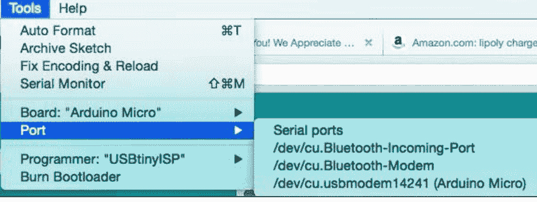

你应该在列表中看到至少一个符合以下格式的项目：/dev/cu.usbmodem****。它旁边可能或没有 Arduino Uno。如果你看到了这个，请点击它，因为这就是你用于安装 Firmata 的端口。如果你有这个，意味着你的板卡可以与电脑通信，你已经准备好安装 Firmata 了。

要在板卡上安装 Firmata，转文件（File） | 示例（Examples） | Firmata | StandardFirmata，如下截图所示：


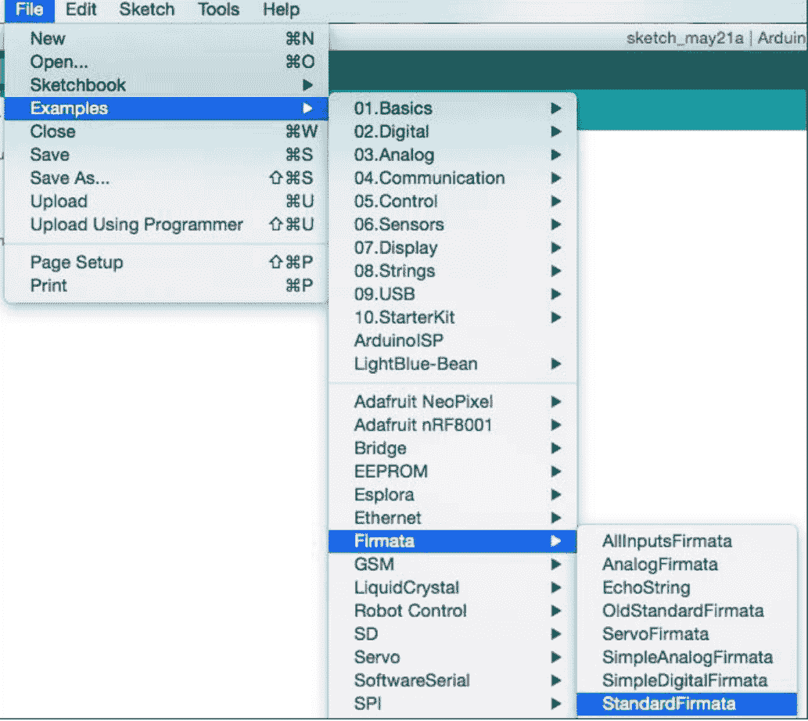

一旦你打开了 sketch，你应该会看到一个如下所示的 IDE 窗口：

## StandardFirmata - Arduino 1.6.4

```
StandardFirmata
/
* Firmata is a generic protocol for communicating with microcontrollers
* from software on a host computer. It is intended to work with
* any host computer software package.
* To download a host software package, please click on the following link
* to open the download page in your default browser.
*
* http://firmata.org/wiki/Download
/
* (C) 2006-2008 Hans-Christoph Steiner. All rights reserved.
* (C) 2008-2011 Paul Stoffregen. All rights reserved.
* (C) 2009 Shigeru Kobayashi. All rights reserved.
* (C) 2009-2011 Jeff Hofs. All rights reserved.

This library is free software; you can redistribute it and/or
modify it under the terms of the GNU General Public License
as published by the free Software Foundation; either
version 2.1 of the License, or (at your option) any later version.

See file LICENSE.txt for further informations on licensing terms.

formatted using the GNU formatting and indenting
/
```

一旦此 sketch 运行，点击 **Upload**（上传）按钮（看起来像一个指向右侧箭头）将 Firmata 上传到你的板上。上传完成后，你可以关闭 Arduino IDE，就可以开始使用 JavaScript 工作了。

## Tip

一位名为 Suz Hinton (@noopkat) 的开发者正在编写一个名为 AVRGirl 的 node 程序，该程序将在不久的将来移除这一步骤。访问 www.github.com/noopkat/avrgirl 了解更多信息！

## Hello, World! – 闪烁板载 LED

现在我们已经搭建好了开发环境，可以开始编写用于 Arduino 板板的 JavaScript 代码了。我们将从闪烁 Arduino 微控制器中内置的 LED 开始。

## 编写 Johnny-Five 脚本

在你喜欢的 IDE 中，在项目目录下创建一个新的 hello-world.js 文件。然后，复制并粘贴，或编写以下代码：

```
var five = require("johnny-five");
var board = new five.Board();

board.on("ready", function() {
  var led = new five.Led(13);
  led.blink(500);
});
```

我们将在第 2 章“使用 Johnny-Five”中详细介绍此脚本的功能，但基本概述如下：我们在 Johnny-Five 模块中引入此脚本，并使用它创建一个新的板对象。当该板准备绪时，我们将在引脚 13 处创建一个 LED 对象（该引脚连接到 Arduino Uno 板上的板载 LED）。然后我们让该 LED 每半秒闪烁一次。

## 运行脚本

为了运行脚本，请进入终端，并在项目文件夹中运行以下：
`node hello-world.js`

你应该能看到如下所示的输出：

```
143224218981 Looking for connected device
143224226377 Device(s): /dev/cu.usbbmodem14131
143224225496 Connected to /dev/cu.usbbmodem14131
143224229711 Rep Initialized
>>
```

你应该能看到你的 Arduino Uno 上的 LED 在闪烁。下图显示了 LED 在板上的位置：

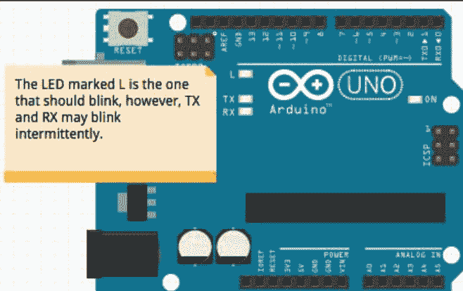

如果一切正常且 LED 正在闪烁，恭喜你！你准备好使用 Arduino 和 Johnny-Five 构建机器人和应用了！

## Tip

如果有问题，许多故障排除问题可以通过查看 Johnny-Five 网站（www.johnny-five.io）来解决。

## Summary

在本章中，我们学习了 JS 机器人并了什么是 NodeBot。我们介绍了书中将使用的硬件组件，并学习了如何设置开发环境。最后，我们了解了如何让板载 LED 闪烁。在下一章中，我们将深入探讨为什么 Johnny-Five 如此强大，并开始编写和构建更复杂的项目。

# 第 2 章. 使用 Johnny-Five

在本章中，我们将开始使用 Johnny-Five 来构建我们自己的机器人项目。我们将介绍为什么 Johnny-Five 是一个入门机器人学的绝佳库，并建立构建我们的第一个机器人。我们将学习如何从命令行实时操控这个机器人——这种功能在其他平台上是不容易实现的！到本章结束，你将对涉及的软件有一个清晰的理解，这将为更复杂的硬件构建奠下良好的基础。

本章将涵盖以下主题：

- Johnny-Five 程序是如何工作的
- 理解 Johnny-Five 中的事件
- LED 的接线
- 使用读取-打印-循环 (REPL)

## Johnny-Five 程序是如何工作的

在本章中，我们将开始使用 Johnny-Five 来构建我们自己的机器人项目。我们将介绍为什么 Johnny-Five 是一个入门机器人学的绝佳库，并建立构建我们的第一个机器人。我们将学习如何从命令行实时操控这个机器人——这种功能在其他平台上是不容易实现的！到本章结束，你将对涉及的软件有一个清晰的理解，这将为更复杂的硬件构建奠下良好的基础。

## 理解 Johnny-Five 中的事件

现在我们已经搭建好了开发环境，可以开始编写用于 Arduino 板板的 JavaScript 代码了。我们将从闪烁 Arduino 微控制器中内置的 LED 开始。

## 编写 Johnny-Five 脚本

在你喜欢的 IDE 中，在项目目录下创建一个新的 hello-world.js 文件。然后，复制并粘贴，或编写以下代码：

```
var five = require("johnny-five");
var board = new five.Board();

board.on("ready", function() {
  var led = new five.Led(13);
  led.blink(500);
});
```

我们将在第 2 章“使用 Johnny-Five”中详细介绍此脚本的功能，但基本概述如下：我们在 Johnny-Five 模块中引入此脚本，并使用它创建一个新的板对象。当该板准备绪时，我们将在引脚 13 处创建一个 LED 对象（该引脚连接到 Arduino Uno 板上的板载 LED）。然后我们让该 LED 每半秒闪烁一次。

## 运行脚本

为了运行脚本，请进入终端，并在项目文件夹中运行以下：
`node hello-world.js`

你应该能看到如下所示的输出：

```
143224218981 Looking for connected device
143224226377 Device(s): /dev/cu.usbbmodem14131
143224225496 Connected to /dev/cu.usbbmodem14131
143224229711 Rep Initialized
>>
```

你应该能看到你的 Arduino Uno 上的 LED 在闪烁。下图显示了 LED 在板上的位置：


如果一切正常且 LED 正在闪烁，恭喜你！你准备好使用 Arduino 和 Johnny-Five 构建机器人和应用了！

## Tip

如果有问题，许多故障排除问题可以通过查看 Johnny-Five 网站（www.johnny-five.io）。

## Summary

在本章中，我们学习了 JS 机器人并了什么是 NodeBot。我们介绍了书中将使用的硬件组件，并学习了如何设置开发环境。最后，我们了解了如何让板载 LED 闪烁。在下一章中，我们将深入探讨为什么 Johnny-Five 如此强大，并开始编写和构建更复杂的项目。

# 第 2 章. 使用 Johnny-Five

在本章中，我们将开始使用 Johnny-Five 来构建我们自己的机器人项目。我们将介绍为什么 Johnny-Five 是一个入门机器人学的绝佳库，并建立构建我们的第一个机器人。我们将学习如何从命令行实时操控这个机器人——这种功能在其他平台上是不容易实现的！到本章结束，你将对涉及的软件有一个清晰的理解，这将为更复杂的硬件构建奠下良好的基础。

本章将涵盖以下主题：

- Johnny-Five 程序是如何工作的
- 理解 Johnny-Five 中的事件
- LED 的接线
- 使用读取-打印-循环 (REPL)

## Johnny-Five 程序是如何工作的

在本章中，我们将开始使用 Johnny-Five 来构建我们自己的机器人项目。我们将介绍为什么 Johnny-Five 是一个入门机器人学的绝佳库，并建立构建我们的第一个机器人。我们将学习如何从命令行实时操控这个机器人——这种功能在其他平台上是不容易实现的！到本章结束，你将对涉及的软件有一个清晰的理解，这将为更复杂的硬件构建奠下良好的基础。

## 理解 Johnny-Five 中的事件

现在我们已经搭建好了开发环境，可以开始编写用于 Arduino 板板的 JavaScript 代码了。我们将从闪烁 Arduino 微控制器中内置的 LED 开始。

## 编写 Johnny-Five 脚本

在你喜欢的 IDE 中，在项目目录下创建一个新的 hello-world.js 文件。然后，复制并粘贴，或编写以下代码：

```
var five = require("johnny-five");
var board = new five.Board();

board.on("ready", function() {
  var led = new five.Led(13);
  led.blink(500);
});
```

我们将将在第 2 章“使用 Johnny-Five”中详细介绍此脚本的功能，但基本概述如下：我们在 Johnny-Five 模块中引入此脚本，并使用它创建一个新的板对象。当该板准备绪时，我们将在引脚 13 处创建一个 LED 对象（该引脚连接到 Arduino Uno 板上的板载 LED）。然后我们让该 LED 每半秒闪烁一次。

## 对象、函数和事件

Johnny-Five 中的事件是一个非常重要的概念——这来说一个新概念，特别是如果你习惯于低级语言编程。它与中断的概念非常相似，但显然偏离了传统的机器人编程事件循环范式。虽然我们可以在 Johnny-Five 中创建定时器和循环，但高度鼓励基于事件的编程方法，这可能需要一些练习。


## 为什么使用事件？

经常被问的问题是：“为什么要基于事件？为什么不像以前的方法那样基于循环和基于中断的呢？”

这在很大程度上与机器人的工作方式以及我们思考机器人程序的方式有关。当你考虑让机器人执行什么时，你不太可能想“每隔 X 秒，我想检查 A 并启动任务 B……”，而你更有可能想的是“当 Y 发生时，我想启动事件 C……”

Johnny-Five 中基于事件的系统与这种思维模式配合得非常完美，它允许用户在事件中放置监听器和处理器，而不是每隔 X 秒轮询一次正确的条件。这让初学机器人编程的人来说，机器人编程变得更容易理解。

理解事件对于掌握 Johnny-Five 至关重要——因为每个 Johnny-Five 脚本都从实例化 `Board`（主板）对象开始，并等待它触发 `ready` 事件。这等同于浏览器端 JavaScript 应用中的 DOM `ready` 事件——它通知你已经准备好开始发送指令了。

## 连接外部 LED

在我们的第一个硬件项目中，我们将把一个 LED 连接到 Arduino。LED，又称发光二极管，是一种在电流通过时会发光的组件。它们有许多颜色和尺寸，是业余机器人领域中最易用且多功能的组件之一。

## 设置硬件

首先，取一个 LED。我们将确定 LED 的正极和负极——对于这种组件来说，这很直观：正极比负极长。

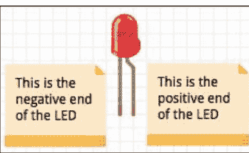

确定 LED 的正极和负端

要将 LED 连接到 Arduino，将正极放在引脚 11 上，负极放在标记为 GND 的引脚上，如下所示：

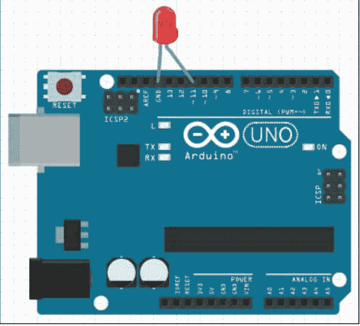

连接我们的 LED

如果你愿意，也可以使用面包板——它看起来像如下：

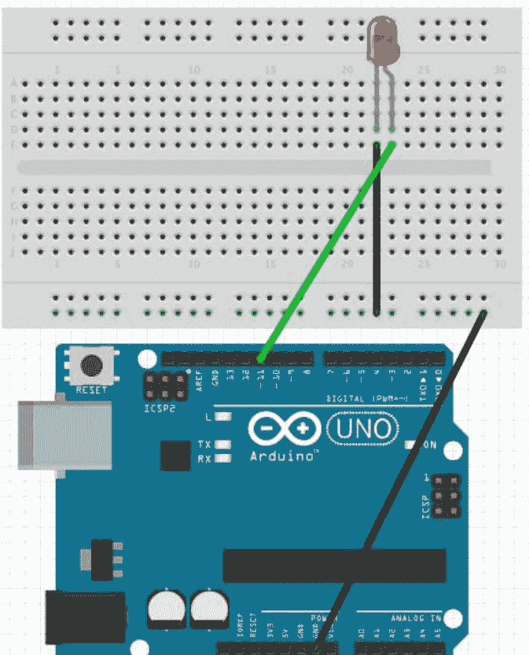

## 使用面包板连接 LED

现在我们已经连接好了 LED，我们将像上一章做的那样让它闪烁。脚本看起来非常熟悉：

```
var five = require("johnny-five");

var board = new five.Board();

board.on("ready", function() {
  var led = new five.Led(11);
  led.blink(500);
});
```

这是因为这和上章的脚本几乎相同——我们只是更改了引脚编号以反映我们安装的新 LED。

保存并运行脚本。你应该能在你的主板上看到一个闪烁的 LED，如下截图所示：

[待办：添加照片]

当你运行脚本时，你会注意到一个提示——你甚至可以在其中输入内容！这是 REPL，我们将用它来实时操作我们的 LED！

## 使用读取-评估-打印循环 (REPL)

读取-评估-打印循环（或 REPL）是许多脚本语言中的一个概念，但对于库来说是新的，对机器人领域来说绝对是全新的。回想一下你在典型的 Arduino 程序中是如何改变状态的：你修改源代码，将其重新加载到板上，然后等待它运行。

然而，由于 Johnny-Five 的工作方式，我们可以在*代码运行期间*修改机器人代码的状态。这是因为我们使用了 Firmata——主板只是一个对我们 Node 程序指令做出响应的轻量客户端，所以如果我们让我们的 Node 程序发送不同的指令，我们就可以实时改变机器人的工作方式。

在 Johnny-Five 程序中实现此点的方法向 REPL 注入组件，从而允许我们使用它们。

#让组件对 REPL 可

我们将修改上一节中的脚本来模拟我们的 LED。为了做到，我们将使用 `this.repl.inject()` 函数。当 `this` 关键字在我们的 `board.on('ready')` 处理器中使用时，它是对全局上下文的引用，因此我们可以通过 `this.repl` 访问我们正在编写程序的 REPL。`inject` 方法接受一个对象；对象的键（keys）将代表你可以从 REPL 访问的名称，而值（values）将是你希望访问的组件。

因此，我们将以下对象传递给 `inject` 方法。这将允许我们通过 `myLed` 名称访问我们的 LED 组件：

```
{
  myLed: led
}
```

我们的新程序看起来如下：它将允许我们通过 `myLed` 名称访问我们的 LED 组件：

```
var five = require("johnny-five");

var board = new five.Board();

board.on("ready", function() {
  var led = new five.Led(11)

  this.repl.inject({
    myLed: led
  });

  led.blink(500);
});
```

（注：原文后续部分存在大量重复的 OCR 错误，此处已根据逻辑进行清理并翻译。）


## 本章所需的物品

对于第一个项目，你需要你的微控制器、几根面包板跳线、一个半尺寸的面包板和五个 LED。

对于第二个项目，你需要你的微控制器、几根面包板跳线、一个半尺寸的面包板以及一个压电元件（Piezo element）。

## GPIO 引脚的工作原理

如果我们回顾上一个项目，可以观察到通过我们编写的代码，我们向 Johnny-Five 中的一个 Led 对象写入值，并改变了 LED 的状态和亮度。这是如何工作的呢？虽然深入细节超出了本书的范围，但我们将简要介绍其工作原理；这使用了 GPIO，即通用型输入/输出引脚的概念。

GPIO 引脚是向电路提供电流或从电路中读取电流的引脚。在上一个项目中，我们使用它来为 LED 提供不同水平的电能。这些引脚可以由用户（也就是我们！）配置为输入（读取电流）或输出（提供电流）。现在，我们将重点关注输出引脚，它们主要有两种类型：数字（Digital）和 PWM。

## 数字输出引脚

数字输出引脚只能为我们的电路提供两个水平的电流：1 和 0，HI 和 LOW，或者开启和关闭。这意味着如果我们将 LED 插入数字引脚，我们只能开启或关闭它。

然而，在我们的案例中，当我们运行 `pulse()` 方法时，我们的 LED 表现出不同水平的亮度。这意味着什么？这意味着我们在之前的示例中使用了 PWM 引脚。

## PWM 输出引脚

**PWM（脉冲宽度调制）**引脚能够向我们的电路发送不同水平的电能（某种意义上）。它的工作原理是通过按时间方式非常快速地将引脚设置为 HIGH，然后设为 LOW，从而模拟不同水平的电能。

在程序中，你可以将 PWM 引脚设置为 0 到 255 之间的任何值（包含边界）。你设置引脚的值决定了引脚被设置为 HIGH 的频率；例如，值 0 意味着 PWM 引脚设置为 HIGH 的时间比例为 0%。值 85 是 255 的三分之一，意味着引脚设置为 HIGH 的时间占三分之一——这模拟了三分之一的功率，或者在我们的 LED 案例中，就是三分之一的亮度。

我们的第一个示例使用 PWM 引脚来显示 LED 不同程度的亮度，但 PWM 引脚有几乎无限的用途——正如我们在本章稍后看到的，我们甚至可以用它们制作音乐！

## 如何区分数字引脚和 PWM 引脚

你如何检查微控制器上的哪些引脚是 PWM 的？这实际上取决于你正在使用的微控制器。对于我们在书中使用的 Arduino Uno，PWM 引脚用 `~`（波浪线）符号标记。这意味着在 Uno 上，PWM 引脚是 3, 5, 6, 9, 10 和 11。

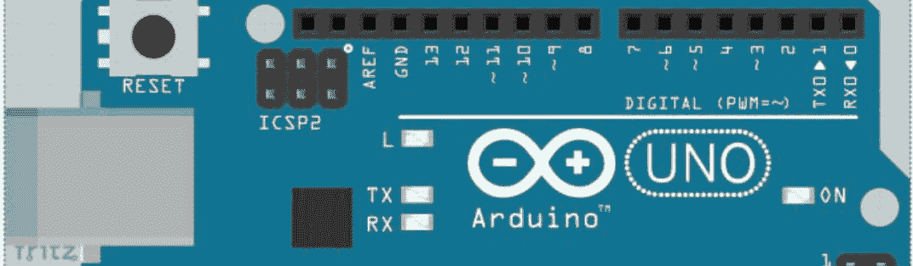

确定 Arduino Uno 上的 PWM 引脚

接下来，我们将通过连接多个 LED 并尝试 Led API 来探索引脚之间的差异。

## 多个引脚与多个 LED

对于下一个项目，我们将查看 Led 对象 API 并测试几种不同的方法。这是 Johnny-Five 的优势之一——抽象化。如果你理解 LED 的概念，就可以使用 Johnny-Five 的 LED 对象，而无需考虑底层的引脚或时序。让我们过一下将在项目将在使用的方法：

- `on()` 和 `off()`：这些方法用于开启和关闭 LED。在抽象层下，这会将连接到 LED 的引脚设置为 HIGH 和 LOW。我们将在 REPL 中使用这些。
- `blink(time)`：这会在给定的间隔内开启和关闭 LED。`strobe()` 和 `blink()` 是彼此的别名，功能相同。
- `pulse(time)`：这将导致 LED 以平滑的方式脉冲式开启关闭。这需要 LED 连接到 PWM 引脚上。`time` 参数设置脉冲每侧的长度——500 意味着 LED 在 500 ms 内逐渐淡入，在 500 ms 内逐渐淡出，这意味着一个 1 秒的脉冲。
- `fade(brightness, ms)`：这将导致 LED 在 ms 毫秒内从当前亮度逐渐淡入或淡出到给定亮度。
- `stop()`：这会停止发生在 LED 上的任何循环操作。注意，这并不一定会关闭 LED。如果这意味着 LED 是开启的，那就随它吧。它会中断正在进行的动作——

记住，大多数 Johnny-Five 对象函数都是可链的——你可以一个接一个使用它们。

```
myLed.stop().off()
```

上述代码将停止 LED 上的任何循环事件并将其关闭。

现在我们已经知道了将要使用的函数，让我们来连接下一个项目。

## 准备项目硬件

准备好材料并查看下图：

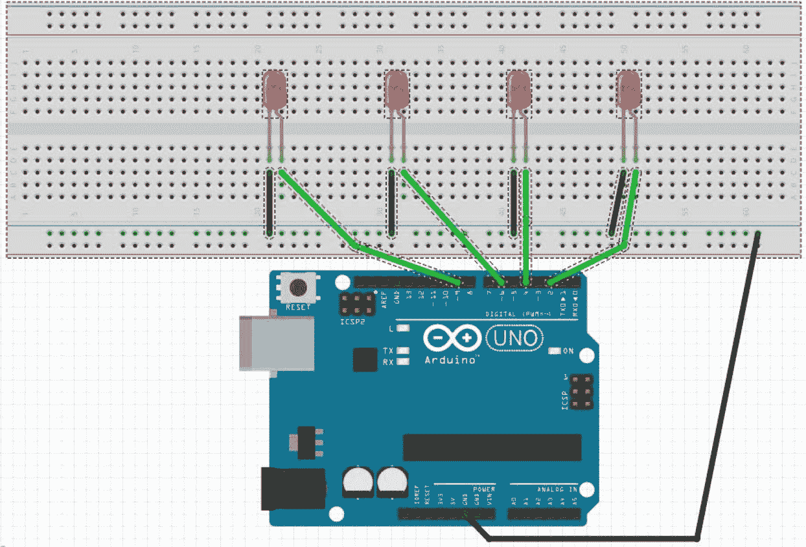

我们项目的接线图

## 多个引脚与多个 LED

对于下一个项目，我们将查看 Led 对象 API 并测试几种不同的方法。这是 Johnny-Five 的优势之一——抽象化。如果你理解 LED 的概念，就可以使用 Johnny-Five 的 LED 对象，而无需考虑底层的引脚或时序。
- `on()` 和 `off()`：这些方法用于开启和关闭 LED。在抽象层下，这会将连接到 LED 的引脚设置为 HIGH 和 LOW。我们将在 REPL 中使用这些。
- `blink(time)`：这会在给定的间隔内开启和关闭 LED。`strobe()` 和 `blink()` 是彼此的别名，功能相同。
- `pulse(time)`：这将导致 LED 以平滑的方式脉冲式开启关闭。这需要 LED 连接到 PWM 引脚上。`time` 参数设置脉冲每侧的长度——500 意味着 LED 在 500 ms 内逐渐淡入，在 500 ms 内逐渐淡出，这意味着一个 1 秒的脉冲。
- `fade(brightness, ms)`：这将导致 LED 在 ms 毫秒内从当前亮度逐渐淡入或淡出到给定亮度。
- `stop()`：这会停止发生在 LED 上的任何循环操作。注意，这并不一定会关闭 LED。如果这意味着 LED 是开启的，那就随它吧。它会中断正在进行的动作——

记住，大多数 Johnny-Five 对象函数都是可链的——你可以一个接一个使用它们。

```
myLed.stop().off()
```

上述代码将停止 LED 上的任何循环事件并将其关闭。

现在我们已经知道了将要使用的函数，让我们来连接下一个项目。

## 准备项目硬件

准备好材料并查看下图：


我们项目的接线图

(注：由于提供的原文文本后半部分存在重复，此处遵循“一定不要重复输出原文”的原则，译文仅翻译了不重复的逻辑部分。若需完整翻译重复部分，请告知。)


## 编写脚本

这个脚本比我们之前的几个脚本稍微复杂一点；我们需要创建一个扬电器（Piezo element），这只需要一个引脚。然而，一首音乐比控制 LED 的开关要复杂得多。幸运的是，Johnny-Five 的 Piezo API 提供了 `play()` 方法，它接受一个对象。该对象具有 `beats`（节拍）、`tempo`（节奏）和 `song`（歌曲）等属性——我们将使用这些属性来播放你的曲子。

有很多方法可以为 `play()` 方法描述歌曲。一种方法——我们在这里使用的方法——是字符串字符串：

CDFDA-AAAAAGGGGG--CDDFG-GGGGFFFF--

当你使用这种方法时，它将假设使用中八度，`-` 符号表示空或关闭音符——这里不会播放任何声音。

对于 `beats`，我们将使用四分音符；对于 `tempo`，我们将从 100 bpm（每分钟节拍）开始。你的代码看起来像这样：

```javascript
var five = require("johnny-five"),
board = new five.Board();

board.on("ready", function() {
  var piezo = new five.Piezo(3);

  board.repl.inject({
    piezo: piezo
  });

  piezo.play({
    song: "C D F A - A A A A G G G - C D F G - G G G F F F F -",
    beats: 1 / 4,
    tempo: 20
  });
});
```

将其保存为名为 `piezo.js` 的文件并在终端中运行它：

node piezo.js

你应该能从你的 Arduino 板板上听到一段欢快的曲子！

## 引脚上发生了什么？

扬电器需要 PWM 引脚的原因是 Piezo 对象正在通过 3 号引脚向扬电器发送不同功率的电，导致它发出不同的音符。Johnny-Five 库允许我们以我们能够理解的方式显示这些音符，而无需计算为每个音符发送多少电量。

## 探索 Piezo API

你现在可以进一步探索 Piezo API，包括查看编写歌曲的其他方法，这让你对八度有更多控制权。请访问 Johnny-Five 网站以获取更多细节和示例。

一个挑战：使用 REPL，找到一种让扬电器在歌曲中间停止播放的方法。提示：有一个 `piezo.off()` 方法。

## 总结

在本章中，我们探索了 GPIO 引脚的工作原理，以及它们如何通过操作引脚值来形成 Johnny-Five 对象的底层。

接下来，我们将查看如何在带有模拟输入引脚的 Johnny-Five 项目中处理输入。

## 第 4 章. 使用专用输出设备

现在我们已经知道了输出引脚（数字和 PWM）是如何工作的，我们将查看专用输出设备。由于多种原因，这些设备为同一个设备 使用了多个引脚：有些是广为人知的协议，有些是私有的，有些只需要许多引脚来输出大量数据。我们将查看一些著名的协议，并使用其中一种设备构建一个项目：一个字符 LCD 显示器，类似于计算器。本章将涵盖以下主题：

- 需要多个引脚的输出
- 检查与 Johnny-Five 的兼容性
- 获取文档、接线图等
- 项目 – 字符 LCD 显示器

## 本章所需的材料

对于本章中的项目，你需要你的板板、一根 USB 线和一个字符 LCD 显示器。面包板和一些面包板跳线也会很有用。

我们将介绍如何使用带有 I2C 接口或不带 I2C 接口的字符 LCD。带有 I2C 接口的示例可以在这里找到：http://www.amazon.com/SainSmart-Serial-Module-Display-Arduino/dp/B00813HBEQ。快速识别 I2C 兼容字符 LCD 的方法是看它上面预焊的背板（backpack），如下面的示例所示。它只使用了四个标记为 **VCC, GND, SDA 和 SCL** 的引脚：

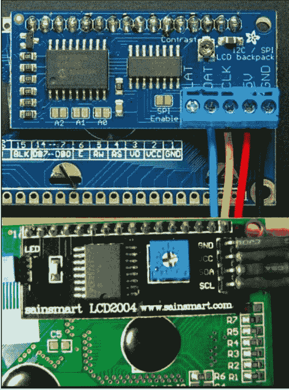

*字符 LCD 上的 I2C 背板示例*

不带 I2C 接口的字符 LCD 示例可以在这里找到：https://www.adafruit.com/products/181。主要的可见区别是这些字符 LCD 使用的引脚多于 I2C 接口使用的四个引脚。

## **注意**

注意，这些可能还需要通过焊接进行组装！

下面的截图是此示例：

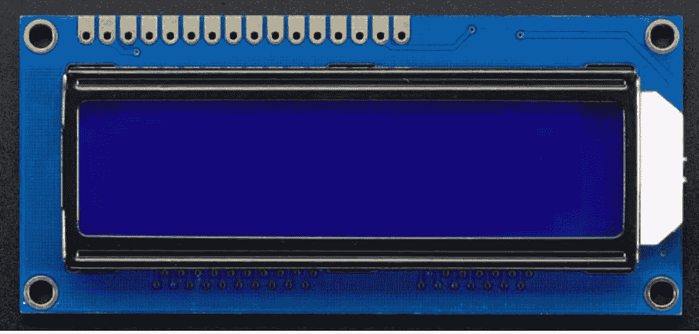

非 I2C 字符 LCD

注意，如果你使用的板子 *不是* Arduino，请在购买字符 LCD **之前**阅读关于检查兼容性的部分——你可能需要预先确保你的板子兼容 I2C。在写这本书时，这里使用的所有 Arduino 板都与 Johnny-Five 具有 I2C 兼容性。

## 需要多个引脚的输出

许多许多输出输出只需要一个输出引脚。Johnny-Five 库允许我们以我们能够理解的方式显示这些音符，而无需计算为每个音符发送多少电量。

输出有许多类型，其中许多只需要一个输出引脚。Johnny-Five 库允许我们以我们能够理解的方式显示这些音符，而无需计算为每个音符发送多少电量。

输出有许多类型，其中许多只需要一个输出引脚。Johnny-Five 库允许我们以我们能够理解的方式显示这些音符，而无需计算为每个音符发送多少电量。

输出有许多类型，其中许多只需要一个输出引脚。Johnny-Five 库允许我们以我们能够理解的方式显示这些音符，而无需计算为每个音符发送多少电量。

输出有许多类型，其中许多只需要一个输出引脚。Johnny-Five 库允许我们以我们能够理解的方式显示这些音符，而无需计算为每个音符发送多少电量。

输出有许多类型，其中许多只需要一个输出引脚。Johnny-Five 库允许我们以我们能够理解的方式显示这些音符，而无需计算为每个音符发送多少电量。

输出有许多类型，其中许多只需要一个输出引脚。Johnny-Five 库允许我们以我们能够理解的方式显示这些音符，而无需计算为每个音符发送多少电量。

## 集成电路 (I2C)

I2C，或集成电路，是共享两个引脚的设备：SCL（时钟线）和 SDA（数据线）。它们用于传感器、显示器和其他外围

## 与 Johnny-Five 的兼容性

如果你使用的板子 *不是* Arduino，请在购买字符 LCD **之前**阅读关于检查兼容性的部分——你可能需要预先确保你的板子兼容 I2C。在写这本书时，这里使用的所有 Arduino 板都与 Johnny-Five 具有 I2C 兼容性。

## 需要多个引脚的输出

输出有许多类型，其中许多只需要一个输出引脚。Johnny-Five 库允许我们以我们能够理解的方式显示这些音符，而无需计算为每个音符发送多少电量。

输出有许多类型，其中许多只需要一个输出引脚。Johnny-Five 库允许我们以我们能够理解的方式显示这些音符，而无需计算为每个音符发送多少电量。

输出有许多类型，其中许多只需要一个输出引脚。Johnny-Five 库允许我们以我们能够理解的方式显示这些音符，而无需计算为每个音符发送多少电量。

## Arduino Uno

- 固件/运行时（附加指令）
- JavaScript 程序在主机上执行
- 程序通过通过

| Analog Read | yes |
| :--- | :--- |
| Digital Read | yes |
| Digital Write | yes |
| PWM | yes |
| Servo | yes |
| I2C | yes |
| One Wire | yes |
| Stepper | yes |

Arduino Uno 支持页面

如你所示，有一个针对每个板的兼容性表格。如果你使用的不是 Arduino Uno，检查你的板子是否有 I2C。

## 获取文档、接线图等

构建自己的 JohnnyFive 项目时，一项良好的技能是找到想要使用的组件的代码和接线图。坦率地说，johnny-five.io 网站和项目提供了详尽的文档

1. 在网站页眉处，点击 API 标签。
2. 然后，你将在左侧看到组件列表（如果你使用桌面电脑）或顶部（如果你使用平板电脑或手机）。
3. 在列表中找到并点击 LCD 条目。

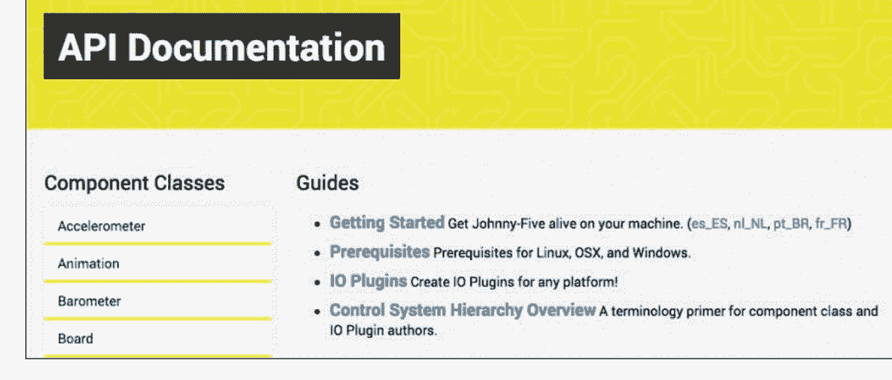

*API 文档页面*

一旦进入 LCD 页面，你会看到许多不同的字符 LCD 组件、一个 LCD API 章节，以及底部的示例链接。

让我们看看我们将用于下一个项目的 LCD API。

构造函数接受多个参数，具体取决于你使用的 LCD 类型。我们在构建项目时将详细介绍引脚选项，行和列是我们可以现在就可以解决的。无论你可以从


还有一个背光引脚选项；大多数 LCD 都有背光，有些带有 RGB 背光。如果你没有背光，则不需要初始化此参数；如果你是单色背光，则需要注意要设置此选项。

如果你有一块带有 RGB 背光的 LCD，你可能需要查看 LED 子标题下的 `Led.RGB` 类并自己手动实例化它——我们将在项目部分查看这部分的实际代码，但你可以先去查看一下 RGB LED API 以确保万无一失。

一旦你熟悉了如何在 Johnny-Five 网站上查找信息，你就已经为你的项目解锁了大量信息。有什么遗漏的内容吗？整个页面都是开源的并可以在 [GitHub](https://github.com/bocoup/johnny-five.io) 上获取，你可以提交问题（issues）并使用自己的示例提交拉取请求（pull requests）。

## 项目 – 字符 LCD 显示器

在我们的项目中，我们将字符 LCD 连接到 Arduino Uno 板上，并使用 Johnny-Five 在其上打印消息。我将使用 I2C 显示器，但也会包含非 I2C 版本的接线图和代码。

## 接线 – I2C LCD

首先，我们将描述如何连接 I2C LCD。请注意，图像图示看起来会有所不同，因为成像软件中不存在 I2C 扩展板的组件。附带的图表将消除你的疑问。

你需要寻找 LCD 单元背面标记为 SCL 和 SDA 的引脚——这些引脚需要连接到 Arduino Uno 上的两个引脚，这些引脚在所有单元上并没有明确标记。它们位于 USB 接口和重位按钮附近。当 USB 接口面向左侧时，引脚位于顶部引脚列的最左侧——左边是 SCL，右边是 SDA。在较新的板卡上，这些引脚标记在引脚列的侧面。

一旦连接好这些，你需要将 VCC 连接到 5V，将 GND 连接到 GND。如果存在 LED 引脚，你可以将其接到 3v3。

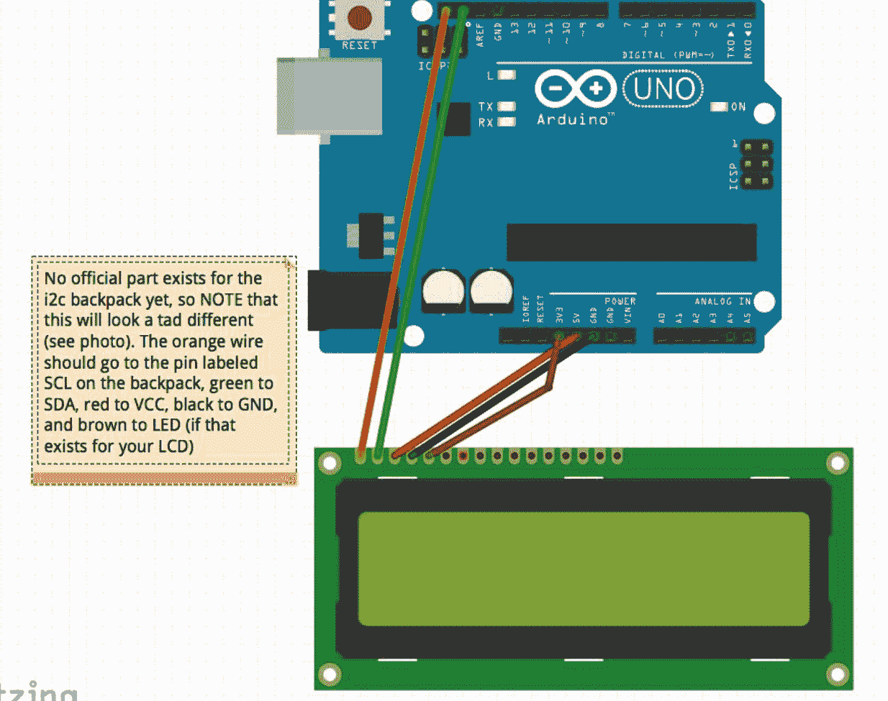

> 目前还没有 i2c 扩展板的官方零件，因此请注意（NOTE）这看起来会有所不同（见照片）。橙色线应连接到扩展板上标记为 SCL 的引脚，红色连接 VCC，黑色连接 GND，棕色连接到 LED（如果你的 LCD 有该引脚）。

## I2C LCD 连接图

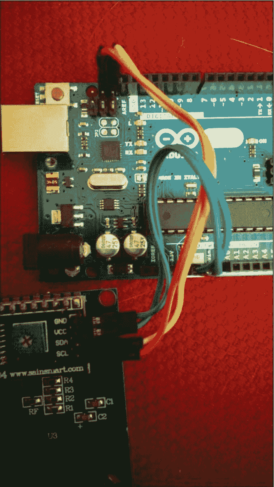

I2C 扩展板的接线照片 – 连接普通 LCD

在接线非 I2C LCD 时，有六个数据引脚和几个地线电源引脚可以使用。这些是：

- rs, en, d4, d5, d6 和 d7，分别由 LCD 上的 4, 6, 11, 12, 13 和 14 号引脚表示。我们将它们连接到 Uno 上的 8, 9, 4, 5, 6 和 7 号引脚。
- 引脚 2 和 15 都连接到主电源——第 2 号引脚为 LCD 本身供电，第 15 号引脚为背光 LED 供电。引脚 1 和 16 接到地以匹配引脚 2 和 15。第 3 号引脚连接到一个电位器——我们将在下一章中详细讨论它。现在，请注意它看起来像一个小的转盘旋钮。你应该在收到 LCD 时已经得到了一个，目前你应该按照下面的图示所示进行接线——左侧接电源，右侧接地，中间连接到 LCD 的第 3 号引脚（注意——你不能接反）。这个电位器控制对比度，并内置在 I2C LCD 中。

## 注意事项

请注意，在接接图中，Arduino Uno 经过了旋转。在接线时请务必小心！

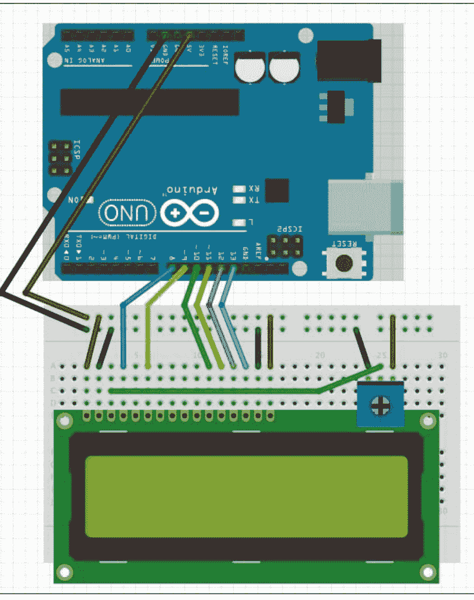

为了检查你的接线是否正常，你可以将 Arduino 插入电脑。背光应该开启，你应该能在 LCD 上看到块状字符。如有必要，调整电位器以看到块状字符。

## 代码

现在我们已经接好了 LCD，我们将在后续章节中编写一些代码。虽然我们在代码中进行一些初始化，但我们还将 LCD 到 REPL 并进行实时操作！

## I2C 版本

I2C 版本 LCD 的代码如下：

```javascript
var five = require("johnny-five");
var board = new five.Board();

board.on("ready", function () {
  // Controller: PCF8574A (Generic I2C)
  // 在芯片本身上找到控制器芯片的型号。
  var l = new five.LCD({
    controller: "PCF8574A"
  });

  l.print("hello!");
});
```

## 非 I2C 版本

非 I2C 版本 LCD 的代码如下：

```javascript
var five = require("johnny-five");
var board = new five.Board();

board.on("ready", function () {
  var l = new five.LCD();

  l.print("hello!");
});
```


# 第 5 章：使用输入设备和传感器

我们已经处理了输出，但让机器人真正变得有趣的是利用输入来生成输出！在本章中，我们将介绍基础输入设备（如按钮）和环境传感器（如检测环境光的光传感器）。我们将讨论 Johnny-Five 如何利用事件（events）让这些设备变得易于使用，并构建一些项目。在完成本章后，你将拥有处理大多数输入/输出项目所所需的所有知识。

本章将涵盖以下主题：

- 模拟输入引脚是如何运作的
- Johnny-Five 的传感器事件
- 使用基础输入设备——按钮和电位器
- 使用传感器——光传感器和温度传感器
- 其他类型的传感器及其用途

## # 本章所需的材料

对于本章中的项目，你需要你的开发板、一根 USB 数据线以及一些输入设备和传感器。

首先，你需要一个按钮。你可以在大多数初学者套件中找到很多按钮，也可以单独购买。我们将考虑一种四脚设计的按钮，如下方的截图所示：

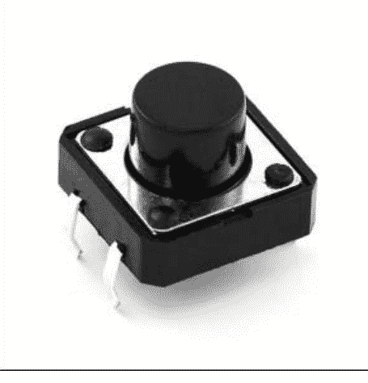

> *用于机器人项目的常用轻按按钮*

不过，二脚的设计也可以的——四脚按钮仍然代表按钮的两个面，所以你可以用二脚设计来复制这些。

你还需要一个旋转电位器——这些是你通过旋转来设置数值的旋钮，类似于扬声器上的音量旋钮。你需要一个适用于面包板且具有三脚设计的电位器，如下方的截图所示：

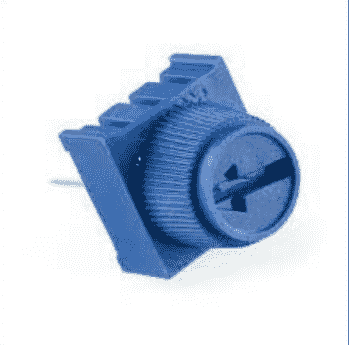

### 小贴

请注意，你可能会接触滑动电位器（看起来像滑动开关或类似于调光开关的）或其他电位器。它们都可以正常工作，但请访问 www.johnny-five.io 网站查看更多关于接线的详细信息。

对于输入，首先你需要一个通常称为光敏电阻（photocell）的光传感器。通常，它们看起来像顶部带有波浪形设计的棕色二极管，如下方的截图所示：

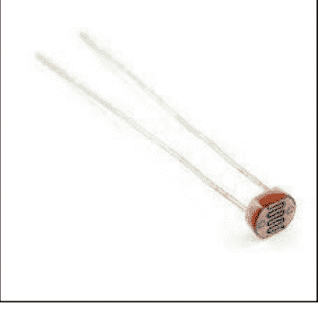

光传感器二极管

光传感器也有扩展板（breakout boards），但对于本章，让我们坚持使用二极管类型。在 Adafruit 和 SparkFun 上很容易找到它们。

为了完善我们的传感器，你需要一个温度传感器。它们看起来像小小的半圆柱体，底部有三个金属脚。我推荐 TMP36，它的背面写有 TMP 字样，如下方的截图所示：

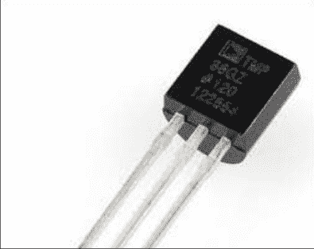

温度传感器

你也可以使用 LM35 并相同的接线——这个传感器看起来和 TMP36 一一样，只是背面写的是 LM35。如果你使用不同的温度传感器，在继续之前，请务必检查 johnny-five.io 文档 http://johnny-five.io/api/temperature 以查看该传感器是否被支持。

你还需要一个面包板、一些面包板跳线、一个 LED 和几个 10k 欧姆电阻。

电阻器降低发送到我们传感器的电流以确保读数准确，有时也用于保护输出设备。为了确保你的电阻是 10k 欧姆，我们将使用电阻上的色环。你的电阻应该有棕色、黑色和橙色色环。这些之后可能还有另一个色环——该环的颜色对我们来说并不重要。电阻看起来如下：

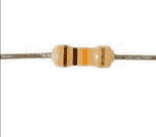

10k 欧姆电阻

## 模拟输入引脚是如何运作的

输入是优秀机器人公式的第一部分；那些知道天气、能看出移动有多快或能看到物体所在位置的机器人。引脚让这一切成为可能，因此在本节中，我们将讨论它们是如何工作的以及我们将如何利用它们。

模拟输入引脚通过从传感器读取电压水平并将电压水平转换为 0 到 1023 之间的整数值来工作。输入设备制造商通常会为设备提供一个比例尺，告诉我们如何将此整数值转换为真实值；例如，我们将使用温度传感器将值转换为我们人类可以理解的温度。

我们将通过插入人类输入设备和环境传感器，并映射它们提供的输入来利用这些引脚。这样，我们就可以开始开发使用输入生成输出的项目。

## Johnny-Five 传感器事件

正如前面的章节所讨论，Johnny-Five 的许多功能依赖于事件（events）。输入和传感器也不例外——在大多数时候，你通过等待事件来与这些设备交互。虽然大多数输入设备都有在任何时刻读取数据的方法，但这些主要用于调试，在编写项目代码时，你需要良好掌握你的输入设备或传感器可用的事件。

大多数输入设备和传感器都有数据事件（data event）；这告诉程序何时从设备读取了数据。这像是一个“消防水管”：它的报告速度非常快，可能会让人应不从心。这通常用于调试，因为大多数机器人程序感兴趣的是传感器或输入数据何时变化，而不是何时有新输入待读取。

变化事件（change event）在大多数设备上也可用，这是一个非常常用的事件——它只在输入数据发生变化时触发。

## 使用基础输入——按钮和电位器

正如前面讨论的，Johnny-Five 的很多功能依赖于事件。

## 连线按钮和 LED

首先，我们要连接一个按钮并编写一些代码来测试它是否被按下。

## 编写 button-led.js

现在让我们看看 Johnny-Five 中的 Button 对象，看看我们的代码需要什么。


既然我们已经让按钮工作了，现在让我们设置电位器，并发现其他与输入和传感器设备相关的事件。我们的项目将设置 LED 的亮度与电位器的输入相关联——本质上，我们正在构建一个调光开关。

## 接线电位器和 LED

拿起你的电位器，并按照下面的图进行接线：

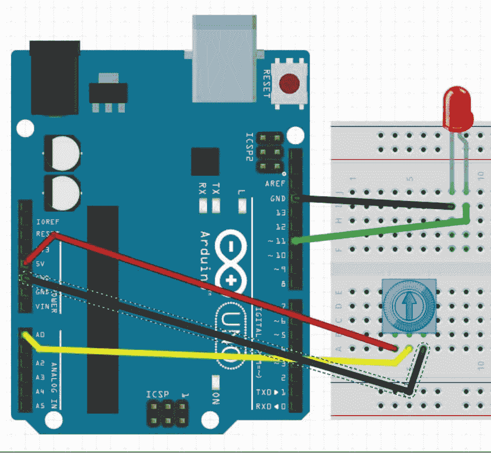

## 提示

请注意，如果你使用的是按钮项目中的设置，那么 LED 引脚在本次中发生了变化，所以请确保你也移动了它。

## 编写我们的调光开关代码

在编写代码时，你会发现 Johnny-Five 中没有电位器对象。这没关系。由于电位器是非常基础的传感器，我们将使用 `Sensor` 对象来代替。

接下来，让我们看看我们将将使用的事件。`change` 事件在电位器的输入发生变化时触发，因此我们将使用该事件来触发 LED 的变化。为了获取读取值，正如文档中所解释的那样，我们将使用 `this.value`。

现在，让我们思考 LED 的工作原理以及电位器的输入。LED 的设置范围是从 0 到 255，而电位器可以接受 0 到 1023 的输入。我们可以通过此对这些输出进行缩放，但幸运的是，Johnny-Five 有一个函数可以帮助我们。这被称为 `scale(min, max)` 函数。它会将我们的输入缩放到我们给出的数字；在这种情况下是 0 和 255。我们将使用 `this.value` 来引用缩放后的值。如果你想在事件处理程序查看未缩放的值，可以使用 `this.raw`。

我们可以在调用事件监听器之前使用 `scale` 函数，将电位器的输出缩放到 LED 能够理解的范围。

考虑到这些，我们可以为调光开关编写代码。请将以下代码放入 `dimmer-switch.js` 中：

```
var five = require('johnny-five');

var board = new five.Board();

board.on('ready', function() {
  var pot = new five.Sensor('A0');
  var led = new five.Led(11);

pot.scale(0, 255).on('change', function () {
  console.log('The scaled potentiometer value is: ' + this.value);
  console.log('The raw potentiometer value is: ' + this.raw);
  led.brightness(this.value);
});
});
```

使用以下命令启动脚本：

- > node dimmer-switch.js

尝试扭动电位器。数据应该如下所示日志到你的终端中：

```
The scaled potentiometer value is: 74.37396244634874
The raw potentiometer value is: 301.63890680523803
The scaled potentiometer value is: 302.62885480799886
The raw potentiometer value is: 302.8240058939161
The scaled potentiometer value is: 74.09539178735557
The raw potentiometer value is: 301.57111356231685
The scaled potentiometer value is: 74.632921110873423
The raw potentiometer value is: 301.4885653356211
The scaled potentiometer value is: 74.48094674842879
The raw potentiometer value is: 301.5917947248009
The scaled potentiometer value is: 74.67831233463977
The raw potentiometer value is: 302.1139593013772
```

## dimmer-switch.js 的输出

LED 的亮度应该随之改变。现在我们已经很好地掌握了输入设备，我们将查看传感器，使用光敏电阻和温度传感器。

## 使用传感器 – 光照和温度

现在，我们将构建两个项目来演示如何使用更高级的传感器：**光敏电阻**和**温度**传感器。我们将学习专门的 Johnny-Five `Sensor` 对象如何让这些传感器的变得更易用，以及如何在 REPL 中操作输入并使用一个名为 `barcli` 的模块在控制台中显示一些输入数据。

## 接线光敏电阻

首先，我们从光敏电阻开始——参见下面的接线图：

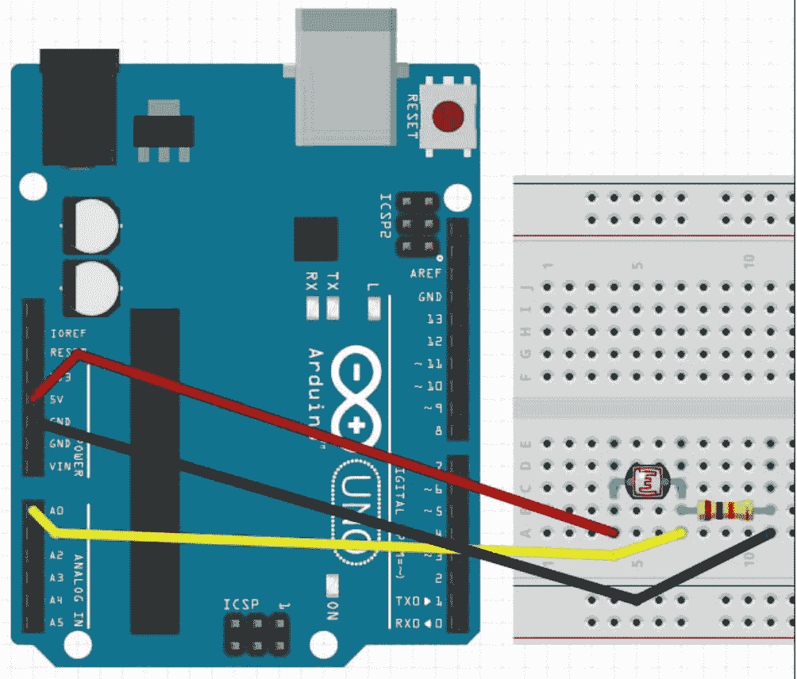

> *光敏电阻的接线图*

## 提示

注意，电阻设置是我们连接只有两个引脚的传感器的方式，而我们需要三个引脚——输入、电源和地。

## 编写我们的光敏电阻示例

在编写光敏电阻示例时，我们会注意到没有光敏电阻对象，因此我们将像处理电位器一样使用通用的 `Sensor` 对象。为了输出从传感器处获得的数据，我们将使用一个名为 `barcli` 的方便工具来让我们的输出更易读。

在 Johnny-Five 早期，检查数据的最常用方法之一是记录数据。这很快就会在控制台中打印出成千上万行。这并不好用，如下所示：

```
32.4568812660873
27.8774541481502
35.5163257897961
86.425021917964
355.6769328412
257.883966591209
34.698576128218
122.36932369365983
351.917441117915
274.548653352402
120.491192303597
181.224227930578
257.202807529003
193.855884298956
31.467799863834
256.526252354680
375.865188892321
172.190679796604
64.688491085799
362.560875028371
383.669315688775
196.574728262658
277.260777248674
332.7016864311779
96.2372131842512
181.6236798338290
11.3889004452329
53.23780384570175
363.8311206363154
290.7709912315249
260.388778670752
72.2448651939563
214.3381392952331
203.875490184873
```

### 使用clicli 输出

幸运的是，Donovan Buck（我们将在动画章节再次看到）编写了一个方便的 Node 模块 `barcli`（读作 BAHR-LEE），它让在控制台中渲染条形图变得更容易。这是在控制台中显示传感器数据的最佳方法，因为你可以实时看到更新，而且比成千行整数易读得多！

你可以在这里找到 barcli：https://github.com/dtex/barcli。为了在代码文件夹中使用 barcli，请运行以下命令：

- > npm install barcli

为了创建一个范围为光敏电阻（0 到 1023）的图表，我们将使用以下代码：

```
var barcli = require('barcli');
var graph = new barcli({
  label: 'photocell',
  range: [0, 1023]
});
```

为了设置图表，我们将使用以下代码：

graph.set([photocell value]);

这些图表要易读得多，如下所示：


## 控制台中的 barcli 图

## 整合代码

利用对 Johnny-Five、`Sensor` 对象以及现在的 `barcli` 的知识，我们可以在 `photocell.js` 中编写以下代码：

```
var five = require('johnny-five');
var Barcli = require('barcli');

var board = new five.Board();
var graph = new Barcli({
label: 'Photocell',
range: [0, 1023]
});

board.on('ready', function() {
  var photocell = new five.Sensor('A0');

  photocell.on('data', function() {
    graph.update(this.value);
  });
});
```

现在代码写好了，使用以下命令运行它：

- > node photocell.js

当你遮挡或光照光敏电阻时，控制台中的条形图应该会更新。现在我们已经探索了典型的 `Sensor` 对象，让我们来看看一个使用温度传感器的特殊对象。

## 接线温度传感器

使用下面的图表接线你的 TMP36 或 LM35：

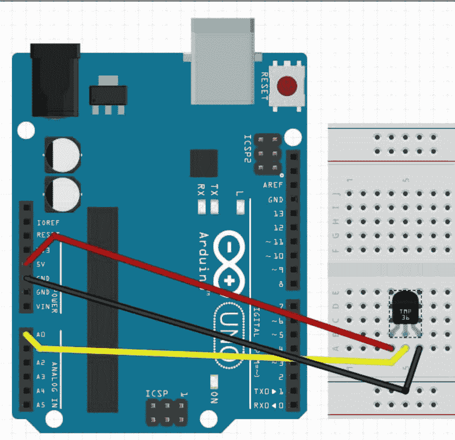

## 接线温度传感器

## 提示

检查 TMP36 或 LM35 接线正确的一种方法是先接线然后插入电脑。图表假设平坦的一面对朝你，但双重检查总是好的！

## 编写我们的温度示例

查看温度传感器的 API，我们会发现没有特殊的 API 调用。但是，我们的数据处理器内部有特殊的属性。这些属性允许我们在不需要进行转换数学的情况下，访问华氏、摄氏和开尔文读取值。

利用我们对传感器对象和 `barcli` 的知识，我们可以在 `temperature.js` 中编写以下代码：

```
var five = require('johnny-five');
var Barcli = require('barcli');

var board = new five.Board();

var fahrenheitGraph = new Barcli({
  label: 'Fahrenheit',
  range: [20, 120]
});

var celsiusGraph = new Barcli({
  label: 'Celsius',
  range: [6, 50]
});

var kelvinGraph = new Barcli({
  label: 'Kelvin',
  range: [250, 325]
});

board.on('ready', function() {
  var temp = new five.Temperature('A0');

  temp.on('data', function(err, data) {
    fahrenheitGraph.update(data.fahrenheit);
    celsiusGraph.update(data.celsius);
    kelvinGraph.update(data.kelvin);
  });
});
```

现在，只需使用以下命令运行它：

- > node temperature.js

我们应该在控制台中看到如下三个条形图：

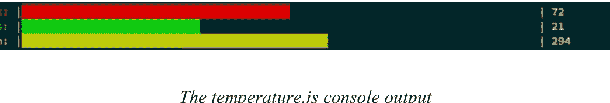


尝试在传感器附近放置温暖或冰冷的物体，观察条形图如何变化！

## 总结

在本章中，我们学习了如何使用许多不同的输入设备和传感器来构建能够倾听周围环境的 Johnny-Five 项目。我们学习了如何监听事件，以及如何使用通用 `Sensor` 对象以及 `Button`（按钮）和 `Temperature`（温度）等专用对象。

在下一章中，我们将开始学习使用传感器让机器人移动。

## 第6 章：让你的机器人移动

在本章中，我们将涵盖以下主题：

- 各种类型的舵机和电机
- 使用电机和舵机时的注意事项
- 舵机和电机的接线
- 使用电机并配合 REPL 创建项目
- 使用舵机和传感器创建项目

## 本章所需的材料

你需要你的微控制器——由于兼容性良好，我强烈建议在本章中使用 Arduino Uno。你还需要 USB 数据线、面包板、一些跳线线和一个 10k 欧姆电阻。拿一个光敏电阻，或任何你想尝试的其它传感器。

你还需要一个 5V 电电运行的电机和一个使用 5V 的标准趣味舵机。这些可以在爱好商店或 Adafruit、SparkFun、Seeed studio 以及许多其他在线商店轻松找到。查看以下章节以了解你的选择。

## 各种类型的舵机和电机

首先，我们将介绍你会遇到的一些常用舵机和电机。但在那之前，对于初学者来说，让我们先快速看一眼电机和舵机的简要描述。

## 定义电机和舵机

电机（在我们的语境下指电动机）将电能转换为动能。电进入，运动输出。这种运动以旋转运动的形式输出；电子电机最常见的用途之一是驱动轮子。请注意，虽然你可以通过控制输入功率来控制电机的速度，但你无法精确地改变电机的位置。

这就是舵机派上用场的地方。舵机利用电移动到设定点——最常见的是 180 度的弧度内。然而，有些舵机可以旋转 360 度。我们稍后会讨论这些。舵机在技术上是特种电机，虽然电机用于驱动项目，而舵机则用于控制项目。

## 注意事项

有很多可用于你的 Johnny-Five 项目的舵机和电机。虽然我们将介绍其中许多，但在考虑要使用的电机时，有几点需要记住。

例如，务必注意驱动电机或舵机所需的电压和电流；如果电压超过 5 伏特，你需要使用 Arduino 5V OUT 之外的其他设备为其供电；如果它们的电流很大但只使用 5V，你可能考虑为你的 Arduino 板板使用外部电源。请注意，每当你有多个舵机时，会有额外的电流——但所需的电压保持不变；例如，如果你有两个需要 5V 电压但 200 mA 电流的舵机，你仍然只需要 5 伏特，但你将 400 mA 的电流！这些大部分信息可以在你正在使用的电机或舵机的数据表中找到。

## 电机类型

虽然我们在这里将介绍几种类型的电机，但请记住，大多数这些电机的功能是相同的；它们有一个开启和关闭开关，你可以通过调节功率来微调它们的速度。然而，这并不完全排除使用电机的可能性——它们也有一些有趣的用法！

你的标准趣味电机像一个大圆柱体，一端有几根线，另一端有一根杆，如图所示：

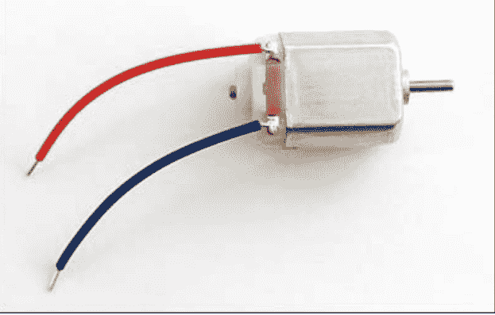

标准直流趣味电机

电机有各种尺寸，并能产生不同水平的功。它们主要用于运动和驱动如遥控汽车等项目。其中一些电机被称为定向电机——这意味着你可以控制方向。对于无方向电机，你只能让电机向一个方向旋转。在考虑你的项目时记住这一点。

还有震动电机——这些常见于手机中，可以在不发出响铃的情况下提醒你有来电。它们看起来与普通电机相似，但末端的杆上附有一个不对称的配重，如图所示：

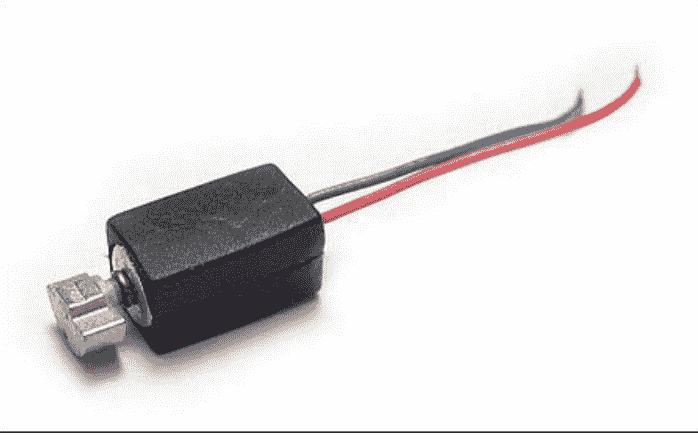

震动电机

这些电机主要用于触觉反馈，但在可穿戴设备和手机领域，这可能是解决问题的关键环节之一！

最后，是步进电机。它们通常更大且需要更多功率：

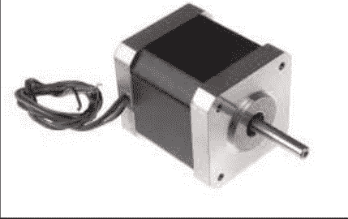

步进电机

然而，步进电机以离散的方式移动，让你在全旋转时获得更多的控制和精密度。这些电机的一个非常常见的用途是 3D 打印——这些是必不可少的。

## 舵机类型

主要有两种类型。第一种是标准舵机，通常用于遥控车辆（如汽车），如图所示：

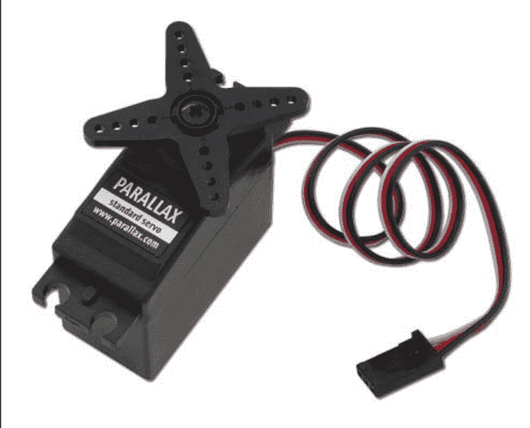

标准舵机

这些舵机在 180 度范围内移动。还有可以旋转 360 度的连续舵机。它们经常用于机器人领域，因为可以设定特定的速度。

连续舵机看起来与标准舵机相似，如图所示：

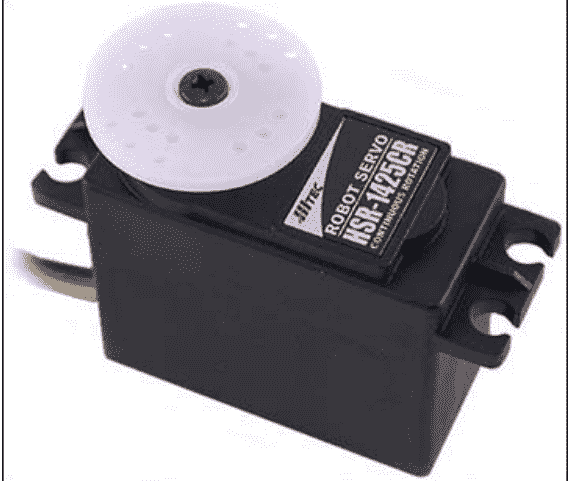

连续舵机

##用舵机还是电机？

这是一个非常棒的问题：如果你想要运动，你应该用哪一个？舵机还是电机？经验法则是，如果你想要精确的运动，你需要舵机；而电机通过发送它的功率量来开启关闭。许多人会认为如果你想要全 360 度范围，就只能限于电机。事实并非如此；连续舵机结合了舵机的精确特性和电机提供的全范围。

## 舵机和电机控制器

有时，你可能在项目中使用许多电机或舵机；一个很好的例子是六足机器人套件，它使用了高功率舵机！Arduino Uno 的引脚并不多，但使用舵机或电机控制器，你可以使用两个数据引脚控制许多电机或舵机。这些控制器使用了第4章“专用输出设备”中讨论过的 I2C 方法。Johnny-Five 内置了对这类控制器的支持。如果你想使用一个，请确保查看 www.johnny-five.io 上的文档以确保你的设备是兼容的。

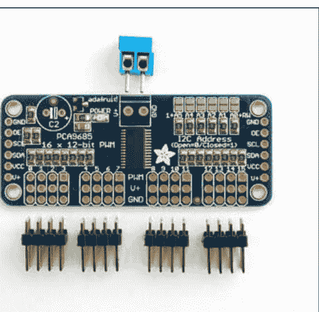

带有 I2C 接口的舵机控制器示例

## 电机舵机扩展板

Shield 是 Arduino 的术语，指放置在 Arduino（通常是 Uno）之上的板，以提供额外的功能。扩展板可以添加 Wi-Fi、LED 矩阵等。一种常见的扩展板类型是用于电机和舵机的扩展板。Johnny-Five 支持一些用于电机的扩展板。同样，如果你希望使用许多或高功率电机，请查看 www.johnny-five.io 上的文档，查看电机扩展板是否适合你的项目。

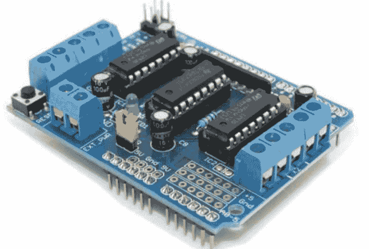

电机扩展板示例


## 使用电机和舵服的特殊注意事项

使用舵机和电机的项目有一些特殊的考虑因素，这些考虑主要集中在电源上，以及 Johnny-Five 项目连接到运行 Johnny-Five 代码的计算机这一点。

## 电源问题

舵机和电机消耗大量功率。当你同时使用多个设备时，这可能会成为问题。如果你在使用 5V 的舵机和电机，且同时使用两个或三个，你应该为 Arduino 使用外部电源，以提供额外的电流而不影响性能。这些电源通常插在外部插座上，如图所示。

## 注意事项

### 警告！

在将任何外部电源连接到开发板之前，请确保你正在使用的板已根据电源电压进行了电压调节；对于 Arduino Uno，该电压为 12V。如果不确定，为 Arduino 使用 5V 电源。此外，在处理外部电源时，请遵循适当的安全协议。SparkFun 在这里有一个非常好的指南：https://learn.sparkfun.com/tutorials/how-to-power-a-project。

如果你使用的舵机或电机需要的电压超过 5V，则需要为你的电机或舵服提供外部电源。这超出了本书的范围。

## 连接与电缆

使用 Johnny-Five 意味着运行在板上的代码正在接收来自主机的消息。如果丢失此连接，项目将无法运行。这意味着对于大多数 Johnny-Five 项目，你将需要维持 USB 线连接。因此，如果你要做一个涉及运动的项目，你可能需要一根长的 USB 线。

第 9 章“将 NodeBots 连接到世界”和“下一步去向哪里”中描述了使用 Johnny-Five 的无线 NodeBots 的选项。

## 接线舵机和电机

连接舵机的方法与连接传感器类似，区别在于信号映射到输出引脚。连接电机的方法与连接 LED 类似。

## 连接舵机

要连接舵机，你必须使用类似于下图的设置：

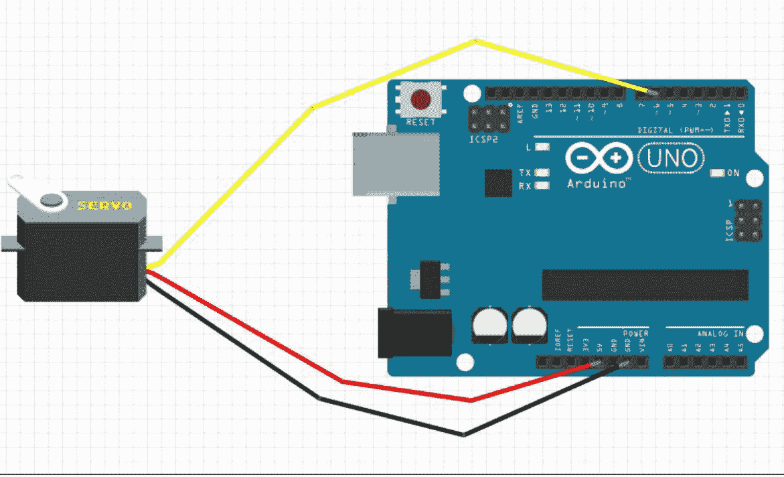

舵机接线图

### 小贴士

- 舵机的线颜色可能不同。如果你的电线是红色、棕色和橙色，那么红色是 5V，棕色是 **GND**，橙色是信号。如果不确定，请检查随舵机附带的数据表。

- 接好舵机后，插上开发板并听舵机的声音。如果你听到“咔咔”声，请迅速拔掉开发板——这意味着你的舵机正试图将其放置到一个它无法到达的位置。通常，大多数舵机的底部有一个小螺丝，你可以用它进行校准。使用小螺丝刀旋转它，直到在通电时不再发出咔咔声。

- 该过程对于连续旋转舵机也是相同的——图示也没有太大变化。只需将普通舵机替换为连续舵机即可。

## 连接电机

电机的接线方法如图所示：

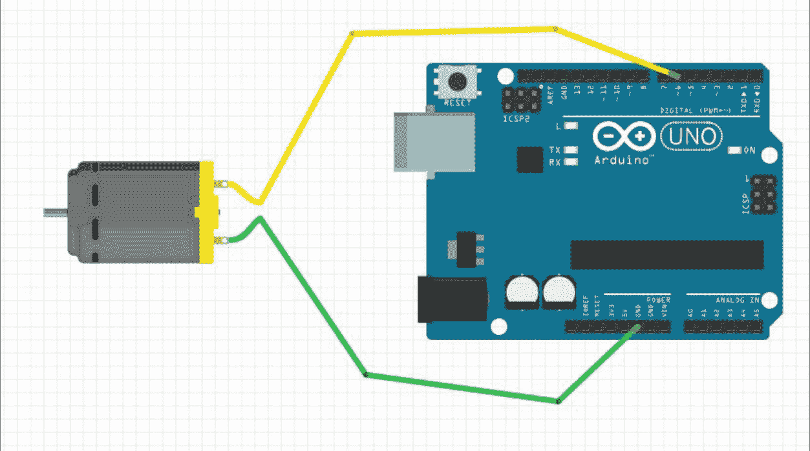

电机接线图

同样，你希望信号引脚连接到 PWM 引脚。由于只有两个引脚，可能会对电源引脚连接哪里感到困惑——它连接到 PWM 引脚，因为类似于第 2 章《使用 Johnny-Five》中我们的 LED 从 PWM 引脚获取电源一样，同一个引脚将为运行电机提供电源。

现在我们已经知道如何接线，让我们来完成一个涉及电机和 Johnny-Five REPL 的项目。

## 创建带有电机的项目并使用 REPL

拿起你的电机和开发板，按照上一节中的图表连接电机。正如前面的图所示，让我们使用引脚 6 作为信号引脚。

我们在代码中要做的的是创建一个 `Motor` 对象并将其注入 REPL，这样我们就可以在命令行中对其进行操作了。创建一个 `motor.js` 文件并放入以下代码：

```
var five = require('johnny-five');

var board = new five.Board();

board.on('ready', function() {

  var motor = new five.Motor({
    pin: 6
  });

  this.repl.inject({
    motor: motor
  });
});
```

然后，插上开发板并使用 `node motor.js` 启动程序。

## 探索电机 API

如果我们查看 Johnny-Five 官方网站上的文档，这里有一些我们可以尝试的内容。首先，让我们让电机以大约一半的速度运行起来：

```
> motor.start(125);
```

`.start()` 方法接受一个 0 到 255 之间的值。听起来很熟悉吧？因为这些正是我们可以分配给 PWM 引脚的值！好了，让我们让电机通过惯性停止：

```
> motor.stop();
```

注意，虽然这个函数会导致电机由于惯性停止，但有一个专门的 `.brake()` 方法。不过，这需要一个专门的制动引脚。


连续的往复运动。

现在我们已经看到了 `Servo` 对象 API 的工作方式，让我们将舵机连接到传感器上。在这种情况下，我们将使用光敏电阻。这段代码是一个很好的示例，原因在于：它展示了 Johnny-Five 的事件 API，允许我们对带有事件的舵机，并让我们习惯于使用事件将输入连接到输出。

首先，让我们根据下面的图表向项目中添加一个光敏电阻：

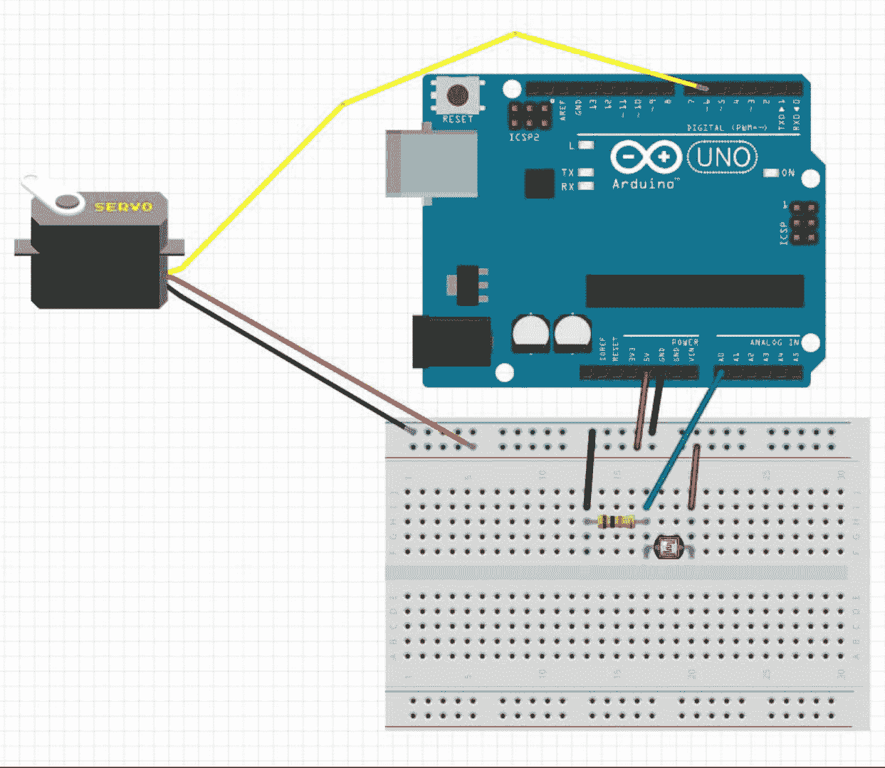

舵机与光敏电阻接线图

创建一个 `photoresistor-servo.js` 文件，并添加以下内容：

```
var five = require('johnny-five');

var board = new five.Board();

board.on('ready', function() {

  var servo = new five.Servo({
    pin: 6
});

  var photoresistor = new five.Sensor({
  pin: "A0",
  freq: 250
});

photoresistor.scale(0, 180).on('change', function() {
  servo.to(this.value);
});
});
```

它的工作原理如下：它与我们在上一章中编写的传感器代码相似！只是在数据事件期间，我们告诉舵机根据来自光敏电阻的缩放数据移动到正确的位置。运行以下命令行：

- > `node photoresistor-servo.js`

然后，尝试打开灯并遮住你的光敏电阻，观察舵机的移动！

## 总结

我们现在知道如何使用舵机和电机来驱动我们的机器人项目了。轮式机器人已经就绪了！但更复杂的项目呢，例如六足机器人？行走需要精确的时间控制。正如我们在 `.to()` 函数中提到的，得益于 `Animation` 库，我们可以对舵机的运动进行计时。

在下一章中，我们将讨论 `Animation` 库，并进行一些让几个舵机按顺序和组合移动的项目。

# 第 7 章：使用 Animation 库进行高级运动

现在我们已经在机器人项目中实现了基础动作，我们将开始探索如何创建定时的复杂动作。起初看起来可能很令人生畏——仅仅跟踪一个舵机就已经够难了！幸运的是，Johnny-Five 中的 `Animation` 库让这些复杂动作变得更容易理解和编程。在本章中，我们将探索使 `Animation` 库变得特殊之处，并开始处理一些舵机动画。我们将涵盖以下主题：

- 什么是 Animation API？
- 观察 Animation API
- 编写舵机动画
- 动画事件

## 本章所需的材料

你需要你的微控制器——非常建议在本章中使用 Arduino Uno，因为它的兼容性很好。你还需要一根 USB 线、面包板、一些跳线线以及你在第 4 章《使用特殊输出设备》中使用的 LCD。你还需要三个标准舵机。如果可能的话，舵机应该是同一品牌和型号——这将有助于我们的项目。

## 什么是 Animation API？

本章的标题引出了很多问题——什么是 Animation API？它如何与舵机相关？这里还使用了许多术语。首先，让我们讨论 Animation API 的产生和发展，以提供一些背景信息。

## 为什么我们需要 Animation API？

Animation API 的创建基于 Donovan Buck 和 Rick Waldron 在行走机器人方面开始的工作——Rick 构建了一个四足机器人，而 Donovan 构建了一个六足机器人。事实证明，行走机器人对涉及的舵机需要大量的计时，而当时的 Johnny-Five 库仅能够最高速度运行舵机从一个角度到另一个角度。这使得行走变得非常困难，因为即使是相同品牌型号的舵机，最大速度也略有不同。此外，在某些情况下，你希望不同的舵机以不同的速度移动——这在 Animation API 出现之前也是无法实现的。

这导致了一个函数的开发，它允许你通过提供完成时间来设置给定运动的速度——我们在上一节中探索了这些函数。你还可以设置一组离散的运动。虽然这些确实有助于行走机器人的代码，但该 API 还有另一个巨大的优势，这也是为什么这个名字看起来很奇怪。

## 为什么是动画？

动画是对随时间运动的描述。关键帧（Keyframes）用于动画中在给定时间设置关键位置——有多个动画库会计算这些关键帧之间的帧，被称为补帧（tweening）。Johnny-Five 中的 Animation API 允许你为舵机运动设置关键帧，然后由它为你完成补帧——允许你通过程序定义一组随时间变化的运动，就像动画状态的定义一样。

这对于移动机器人非常有用——计算移动到特定点的腿部每个舵机的速度，对于即使是最熟练的程序员来说也是令人头疼的。Animation API 为我们补帧的能力意味着我们可以设置关键帧并让代码完成其余工作。这意味着即使是移动机器人初学者也能创建复杂的动作。

现在我们有了一些背景知识，让我们俯瞰 Animation API 以及描述和与其交互的各种方式。

## 观察 Animation API

Animation API 提供了一种定义复杂运动的强大方式。API 的核心是段（segment），它代表了在一段时间内的特定运动。每个段包含一个或多个关键帧，这些关键帧定义了舵机在特定点的状态。API 然后处理这些关键帧之间的插值，创建平滑的过渡。

要使用 Animation API，你需要创建一个动画对象。然后你可以对其添加段。在每个段中，你可以定义关键帧。这里有一个创建一个简单动画的示例：

```
var servo = new five.Servo({
  pin: 9
});

var animation = new five.Animation(servo);

animation.addSegment({
  duration: 2000,
  keyframes: [
    {time: 0, value: 0
    },
    {time: 1000, value: 90
    },
    {time: 1500, value: 180
    },
    {time: 2000, value: 0
    }
  ]
});

animation.play();
```

在这个示例中，舵机将在第一秒内从 0 度到 90 度，然后在半秒内到 180 度，最后回到 0 度。Animation API 为你处理所有的计算。

API 还提供了允许你对动画不同阶段做出响应的事件。例如，你可以监听 `complete` 事件以知道动画何时完成。

## 编写舵机动画

现在你理解了 Animation API 的基础，就可以开始创建更复杂的动画。例如，你可以创建一个模仿六足机器人步态的动画。这涉及到多个舵机的同步工作。你可以使用不同的持续时间和关键帧让动作看起来更自然。

```
var leg1 = new five.Servo({
  pin: 9
});
var leg2 = new five.Servo({
  pin: 10
});

var animation1 = new five.Animation(leg1);
var animation2 = new five.Animation(leg2);

animation1.addSegment({
  duration: 1000,
  keyframes: [
    {time: 0, value: 0
    },
    {time: 1000, value: 90
    }
  ]
});

animation2.addSegment({
  duration: 1000,
  keyframes: [
    {time: 0, value: 90
    },
    {time: 1000, value: 0
    }
  ]
});

animation1.play();
animation2.play();
```

## 动画事件

Animation API 提供了你可以使用的多个事件。常见的有 'start''complete' 和 'update'。

- 'start'：动画开始时触发。
- 'complete'：动画完成时触发。
- 'update'：在每次舵机位置更新时触发。

```
animation.on('start', function() {
  console.log('Animation started!');
});

animation.on('complete', function() {
  console.log('Animation complete!');
});

animation.on('update', function(value) {
  console.log('Current position: ' + value);
});
```


## .to() 与 Animation API 之间的区别

看起来 `.to()` 方法中的额外选项允许隐式地创建动画。事实并非如此！

`duration` 参数虽然允许舵机以非最大速度移动，但其目的并不一定与动画相同。`rate` 参数不会创建关键帧；`rate` 参数创建的是若干离散的动作，并且这些动作会以最大速度移动。

因此，虽然使用带有 `durations` 和 `rates` 的 `.to()` 看起来看起来像在创建动画，但你应该知道，它们并不是使用 Animation API 编写自定义动画和片段的完全替代方案。

## 使用 ServoArray 对象

我们已经讨论过 `ServoArray` 的概念，但让我们更详细地查看它，我们将在本章节中使用它。

构造 `ServoArray` 对象看起来与构造单个舵机非常相似；然而，该对象被称为 `Servos` 而不是 `Servo`，你传入的是一个引脚数组，代表你的舵机组所占的引脚：

```javascript
var myServos = five.Servos([3, 5, 6]);
```

这创建了一个位于引脚 3、5 和 6 的舵机数组。

在舵机数组上执行操作与移动单个舵机也非常相似；使用 `.to()` 将根据给定的参数移动所有舵机。例如，考虑以下代码：

```javascript
myServos.to(120, 500);
```

这将数组中的所有舵机在 500 ms 内移动到 120 度。如果你想独立地移动一个舵机，只需要它在舵机数组中的键（key）——你可以引用它并像标准的 `Servo` 对象一样移动它：

```javascript
myServos[0].to(90, 200);
```

这将数组中的第一个舵机在 200 ms 内移动到 90 度。

`ServoArrays` 在创建动画时也非常有用；你可以用一个关键帧来控制整个舵机数组，允许你同时为多个舵机编写关键帧和片段，而不是为每个舵机分地编写。

现在我们已经探索了 Animation API 背后的术语和概念，让我们来构建第一个项目吧；我们将把三个舵机构建成一个可以操纵的舵机数组。

## 项目 – 连接三个舵机并创建一个数组

首先，你必须按照下图所示连接你的三个舵机：

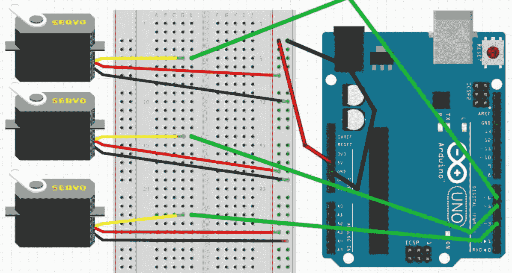

结合我们对 Johnny-Five 的了解以及上一节中复过的代码，让我们写一段代码，为刚刚连接的舵机创建一个舵机数组，并将其注入 REPL，这样我们就可以实时运行代码。将以下内容放入 `servo-array.js`：

```javascript
var five = require('johnny-five')

var board = new five.Board({
  port: '/dev/cu.usbbmodem14131'
})

board.on('ready', function(){
  var myServos = new five.Servos([3,5,6])
  this.repl.inject({
    servos: myServos
  })
});
```

现在我们用以下命令运行它：

- node servo-array.js

如果是的话，REPL 将启动，你的舵机应该移动到它们的起始位置（默认为 90）。

让我们探索如何成组移动这些舵机。让我们让它们全部扫描（sweep）：

```javascript
servos.sweep()
```

## 提示

如果在扫描数组中的所有舵机时，它们看起来很断断续续的，不要担心；我们现在正在使用三个舵机，消耗的电流比平时大。卡顿感是因为电流不足。虽然这对于我们目前的示例没有问题，但如果你想让一个带有多个舵机的项目运行得流畅，一定要查看第 6 章《移动你的机器人》中的舵机供电章节。

我们可以通过以下方式停止舵机：

```javascript
servos.stop()
```

现在，让我们探索如何使用 `.to()`，不仅看它在每个舵机上如何工作，还要看 `duration` 和 `rate` 如何不能替代动画的编写。

我们可以使用 `.to()` 将所有舵机移动到同一个角度，如下：

```javascript
servos.to(0)
```

我们可以使用与单个舵机相同的参数、即 `duration` 和 `rate`，如下所示：

```javascript
servos.to(90, 500, 10)
```

这非常平滑，对吧？就像动画一样？确实如此！但让我们放慢 `.to()` 看看这里实际上发生了什么：

```javascript
servos.to(0)
```

```javascript
servos.to(180, 10000, 20)
```

这是在 10 秒内进行 180 度的移动，共有 20 个离散步骤。你注意到卡顿感了吗？这是因为这是写入到 `servoWrite()` 的，而不是写入动画片段。

你也可以像我们在上一节中探索的那样一次控制一个舵机。例如，运行以下代码：

```javascript
servos[0].to(0);
```

这将把第一个舵机（引脚 3）移动到 0 度。

API 中有一些很棒的选项可以让动作更平滑。让我们探索：

## 编写动画

正如我们在上一节讨论过的，动画是在 Johnny-Five 中创建的，然后我们将学习：

## 编写关键帧

关键帧是 API 的核心；该 API 的威力在于可以在关键帧之间进行插值。

## 关键帧对象

由于每个关键帧都是一个对象，我们可以访问一些属性：

| 属性 | 描述 |
|---|---|
| degrees | `degrees` 是在到达关键帧时舵机应该处于的角度。它应该是一个 0 到 180 之间的整数。 |
| step | `step`  `degrees`，但它是相对于上一个关键帧的；例如，如果关键帧的 `degrees` 设置为 135，而在下一个关键帧中 `step` 设置为 -45，那么第二个关键帧将移动到 90。 |
| easing | 当你创建动画片段时，默认按速度进行插值。缓函数应用于这些帧以改变速度。 |

通过 Johnny-Five 使用 `ease-component` 模块可以使用多种缓函数；其中非常流行的是 `inCirc`，它导致帧开始移动缓慢，中间加速，并在结尾再次减慢。更多示例请参考 Johnny-Five 和 ease-component 的文档。

| 属性 | 描述 |
|---|---|
| copyDegrees | `copyDegrees` 根据索引计算计算或显式设置的值。例如，假设我们有两个关键帧：一个 `degrees` 设置为 90，第二个 `step` 设置为 45。如果我们创建一个 `copyDegrees` 设置为 0 的关键帧，它将复制第一个帧并设置为 90。如果我们设置索引为1，它将复制第二个帧，90 + 45 = 135 将是第三个关键帧的设置。 |
| copyFrame | `copyFrame` 类似于 `copyDegrees`，但它复制帧的所有属性而不仅仅是角度；这包括缓函数等等。 |

`position` 是 Johnny-Five Animation API 中一个高级且新的概念。它允许你获取三个表示空间中三维坐标的元组，并将整个舵机数组移动到该点。

值得注意的是，实现此功能不仅需要 Johnny-Five；你还需要一个 IK（逆向运动学）求解器，例如 Donovan Buck 的 `sharp` 项目。深入研究 `position` 的细节超出了本书的范围，但它仍在开发中，功能可能会发生变化。然而，如果你想制作一个随你移动的机器人，可以查看这个项目。


## 关键帧简写

你也可以在不对象的情况下定义关键帧；如果你将关键帧作为整数值数组传递，则每个整数值将被解释为步进值（step value）。考虑以下数组：

```
keyFrames: [0, 90, -45, 90, -90]
```

这（假设起始点为 0）将在每个时间点将舵机移动到 0、90、45、135 度和 45 度。

你也可以在简写语法中使用非整数值来表示特殊值：

| 值 | 属性 |
|---|---|
| null | 当将 `null` 传递到简写关键帧数组时，其值取决于它所在的位置。如果它是第一个关键帧，该分段将使用现有的舵机位置作为第一帧。如果它是数组中的最后一个，它将复制上一个关键帧的值。然而，如果它被用在两个帧之间，就会发生一些有趣的事情：它将丢弃该关键帧，并在 null 值之前之后的关键帧之间计算补间动画（tweening）。如果你希望舵机在两个关键帧之间花费更多时间，这会非常有用。 |
| false | `false` 在简写关键帧数组中的任何地方使用，将复制最后一个已知值。它不会在两个关键帧之间移动舵机。 |

所以，最后，你可以使用关键帧对象、数字、`null` 或 `false` 来表示分段定义中的关键帧。现在我们已经探索了关键帧对象上可用的属性，让我们写一些以匹配某些情况的关键帧。

## 编写关键帧的示例

让我们探索一些关键帧的示例：

示例 1：编写一组关键帧，让舵机从上一个的位置开始，通过 `inOutCirc` 缓动移动 90 度，然后在无缓动的情况下向回移动 45 度：

- 1. 第一个关键帧可以使用 `null` 值来处理：
```javascript
var myFrames = [null];
```
- 2. 第二个需要关键帧对象，因为我们想要建立一个缓动函数：
```javascript
var myFrames = [null, { degrees: 90, easing: 'inOutCirc' }];
```
- 3. 最后一个可以使用关键帧对象完成：
```javascript
var myFrames = [null, { degrees: 90, easing: 'inOutCirc' }, { step: -45 }];
```

然而，我们也可以使用简写——记住将数字作为关键帧会导致：

```javascript
var myFrames = [null, {degrees: 90, easing: 'inOutCirc'}, -45];
```

在上述替代方案中，选择哪一个完全取决于你的喜好。

**示例 2：**编写一组关键帧，让舵机从 0 开始，移动到 90，花费两个点移动到 180，然后移动到 135：

- 1. 第一个和第二个关键帧可以通过关键帧对象设置，如下：
```javascript
var myFrames = [{degrees: 0}, {degrees: 90}];
```
- 2. 否则对于第二个关键帧，我们可以使用简写，所示：
```javascript
var myFrames = [{degrees: 0}, 90];
```

由于我们知道第一个关键帧将舵机设置为 0，我们可以使用 `step` 代替 `degrees`。对于下一步，我们希望舵机花费两个时间点移动到 180。我们可以用标准关键帧计算如何执行，或者我们可以使用简写的 `null` 告诉分段跳过该时间点，并在两个时间点在 90 和 180 之间进行补间动画：

```javascript
var myFrames = [{degrees: 0}, 90, null, {degrees: 180}]
```

现在你已经学会了如何编写关键帧数组和对象，让我们看看 Animation 对象的其余部分。

## 编写分段

我们知道分段由关键帧数组、时间点数组、持续时间（duration）和一些选项组成。让我们看看每个分段对应的选项，然后构建一些分段为我们的项目做准备。

## 分段选项

分段选项及其属性如下：

| 分段选项 | 属性 |
|---|---|
| - | - |
| target | 你可以在分段中使用它覆盖目标；通常由动画指定，因此在分段中设置它覆盖 |
| easing | 与关键帧一样，可以为整个分段设置缓动函数。注意缓动函数是堆叠的；如果你在关键帧和分段中使用缓动函数，补间动画将计算关键帧和然后分段的 |
| loop | 这是一个布尔值；`true` 导致分段循环，直到被动画停止 |
| loopBack | 如果你希望分段循环到第一个时间点以外，可以在这里指定索引。例如，如果分段有时间点 `[0,.25,.75,1]` 并设置 `LoopBack` 为 1，它将循环到该时间点 |
| metronome | 这是一个布尔值；`true` 分段将从第一个时间点反向运行到最后一个。你可以将其与 loop 选项结合，但默认不循环 |
| progress | 此属性可以用作运行分段的信息（我们稍后的项目中看到）或设置动画当前进度，这是一个 0 到 1 之间的值 |
| speed | 与 progress 类似，可以作为信息。默认是 1，这改变分段运行的倍数 |
| fps | 这设置分段每秒可以运行的最大帧数。默认是 60。更改分段的 fps 不改变速度或时间点 |

## 一个分段中的多个舵机

无论如何，你都在同时动画多个舵机。如何处理多个舵机的关键帧？通过传递数组数组；每个数组代表一个舵机的关键帧。例如，以下分段包含两个舵机的关键帧数组：

```javascript
var multiServoSegment = {
  duration: 2000,
  cuePoints: [0, .5, 1],
  keyframes: [
    [degrees: 135, -45],
    [degrees: 45, 45]
  ]
}
```

## 编写分段的示例

让我们过的几个分段的示例。

**示例 1：**编写一个从 0 到 180 再返回的分段。给它 `inOutCirc` 缓动并让它循环。持续时间应该是 5 秒，可以使用关键帧。现在我们可以写出从 0 到 180 再返回的关键帧，或者我们可以使用 metronome 选项来帮助。使用 metronome 函数意味着我们只需要关键帧和时间点——这是该示例的结果：

```javascript
var sweepingSegment = {
  duration: 5000,
  metronome: true,
  loop: true,
  easing: 'inOutCirc',
  cuePoints: [0, 1],
  keyframes: [{degrees: 0}, {degrees: 180}]
}
```

**示例 2：**编写一个运行一次的分段。此分段包含两个舵机的指令。舵机从当前位置开始，在 1 秒内增加 45 度，然后在 2 秒内移除 30 度，最后在 1 秒内增加 15 度。第二个舵机在持续时间内简单的从 20 度移动到 120 度，具有完整的补间的 `inOutCirc` 缓动。分段的持续时间应该是 4 秒。我们在这里使用相对位置，所以关键帧简写大派用场。我们必须在 0,.25,.75 和 1 设置时间点。记住——在关键帧简写中，开头的 `null` 意味着使用舵机的当前位置，中间的 `null` 意味着跳过时间点并重新计算补间！记住这些，我们给出以下：

```javascript
var mySegment = {
  duration: 4000,
  cuePoints: [0, .25, .75, 1],
  keyframes: [
    [null, 45, -30, 15],
    [{degrees: 20}, null, null, {degrees: 120}]
  ]
}
```

这就是 Animation API 的真正威力——我们可以在对象中描述数学上行的复杂运动。现在我们已经知道如何编写关键帧和分段，让我们看看编写 Animation 对象并使用它们运行分段。

## Animation 对象

我喜欢的对 Animation 类比是把它想象成 MP3 播放器。你将轨道加载到其中，可以播放、暂停或停止。你可以任何顺序将分段队列到动画中，并随时播放、暂停或停止动画。

让我们快速看看构造函数：它只接受一个参数，即 `target`。正如我们之前提到的，目标是正在动画化的舵机或舵机数组。所以，让我们看看一个构造舵机数组并构造 Animation 对象的示例程序：

```javascript
var five = require('johnny-five')

var board = new five.Board()

board.on('ready', function() {
  var servos = new five.Servos([3, 5, 6])
  var animation = new five.Animation(servos)
})
```

一旦构造了 Animation 对象，下一个重要的函数是 `.enqueue()`。你将一个分段传递给此函数以添加到动画队列中。动画是先先出的，所以我们的代码变成：

```javascript
var five = require('johnny-five')

var board = new five.Board()

board.on('ready', function() {
  var servos = new five.Servos([3, 5, 6])
  var animation = new five.Animation(servos)

  var mySegment = {
    easing: 'inOutCirc',
    duration: 3000,
    cuePoints: [0, .25, .75, 1],
    keyframes: [[degrees: 45], 45, 45, -45]
  }

  animation.enqueue(mySegment)
})
```

全部就是这样；一旦分段入队列，动画就会开始运行！


- `.play()` 播放动画，从第一个尚未运行的片段开始。如果动画被暂停，它将继续执行正在进行中的最后一个片段。

- `.pause()` 停止动画，但保留任何正在进行片段的进度，并保持片段队列。

- `.stop()` 清空片段队列并停止所有动画。

- `.next()` 清除当前片段并移动到下一个片段。然而，动画不会在每个片段完成后自动调用此方法，用户通常也也不会调用它。

- `.speed([speed])` 可用于查看（当不传递参数时）或设置（当传递代表倍率的数字时）当前动画的速度。

现在我们已经了解了动画的一般工作原理，让我们用三个舵机构建自己的项目吧。让我们动起来吧！

## 项目 – 让我们的舵机数组动起来

你应该还拥有上一个项目中的舵机数组。让它动起来吧！我们将使用 REPL 实时修改我们的动画片段，并发挥 Animation API 的真正威力。

让我们从初始化板、设置舵机数组、创建动画和片段，并将它们插入 REPL 的代码开始。将以下内容放入 `animation-project.js` 中：

```javascript
var five = require('johnny-five')

var board = new five.Board()

board.on('ready', function(){
  var servos = new five.Servos([3, 5, 6])
  var animation = new five.Animation(servos)

  var mySegment = {
    easing: 'inOutCirc',
    duration: 3000,
    cuePoints: [0, .25, .75, 1],
    keyFrames: [
      [[degrees: 45], 45, 45, -45],
      [[degrees: 30], 30, 30, 30],
      [[degrees: 20}, 40, 40, 40]
    ]
  }

  this.repl.inject({
    animation,
    mySegment
  })

  animation.enqueue(mySegment)
})
```

使用以下命令运行此代码：

```
node animation-project.js
```

你的舵机将活跃起来并开始运行该片段（我们在最后一行将其排入队列了！）。一旦运行完成，让我们在循环中再次查看。在 REPL 中，输入以下内容：

- >mySegment.loop = true
- >animation.enqueue(mySegment)

片段应该开始循环运行。想让它变慢一点吗？让我们使用 Animation 对象的 `speed()` 函数更改速度：

- >animation.speed(.5)

这应该会让速度减慢一半。现在让我们停止动画并清空队列：

```
>animation.stop()
```

让我们看看当我们使用缓动函数让片段具有节拍（metronomic）并运行它会发生什么：

```
>mySegment.easing = 'inOutCirc'
>mySegment.metronomic = true
>animation.enqueue(mySegment)
```

片段现在会正向和反向循环运行，看起来更加流畅！

这很酷，但如果我们想让动画一个接一个地运行呢？我们可以使用一系列的持续时间和定时器，也可以利用 Johnny-Five 的事件系统，该系统扩展了 Animation API。接下来，我们将探索如何利用这些事件来创建定时动画。

## 动画事件

许多动作需要等待一个片段完成后再开始另一个。某些片段还应该在特定时间触发。处理这些计时和通信系统的最佳方法是使用 Johnny-Five 的 `animation` 事件。

我们通过在片段的特殊属性上分配回调函数来接入这些事件。让我们查看每个事件的细节，以及它们何时触发。

| 事件 | 细节 |
|---|--|
| onstart | 当片段在动画中开始播放时，触发 `onstart` 回调。 |
| onstop | 仅当片段在队列中或正在运行，但通过 `animation.stop()` 停止动画时，调用 `onstop` 回调。 |
| onpause | 仅当片段在队列中或在通过 `animation.pause()` 传递的动画运行时，调用 `onpause` 回调。 |
| oncomplete | 仅当片段在动画中运行完成后，才会触发 `oncomplete` 回调。注意：这**不适用于**循环片段。请参见 `onloop` 回调。 |
| onloop | 当函数循环执行时调用 `onloop` 回调，即在第二次运行开始以及此后的每次开始运行时调用。 |

为了理解事件是如何工作的以及它们的用途，让我们开始最后一个项目：从第 4 章 *使用专用输出设备* 中获取你的 LCD，以及本章之前的舵机数组，让我们开始构建吧。

## 构建带有信息性 LCD 显示的舵机数组

使用以下图表构建你的项目；第一张图用于 I2C LCD 显示器：

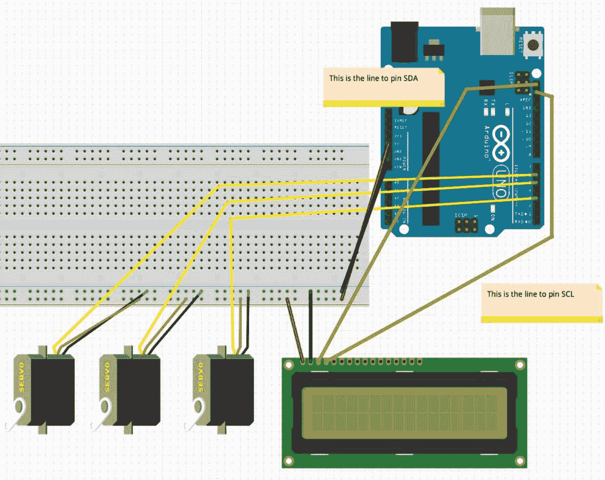

事件项目接线图—I2C LCD

第二张图用于标准 LCD 显示器：

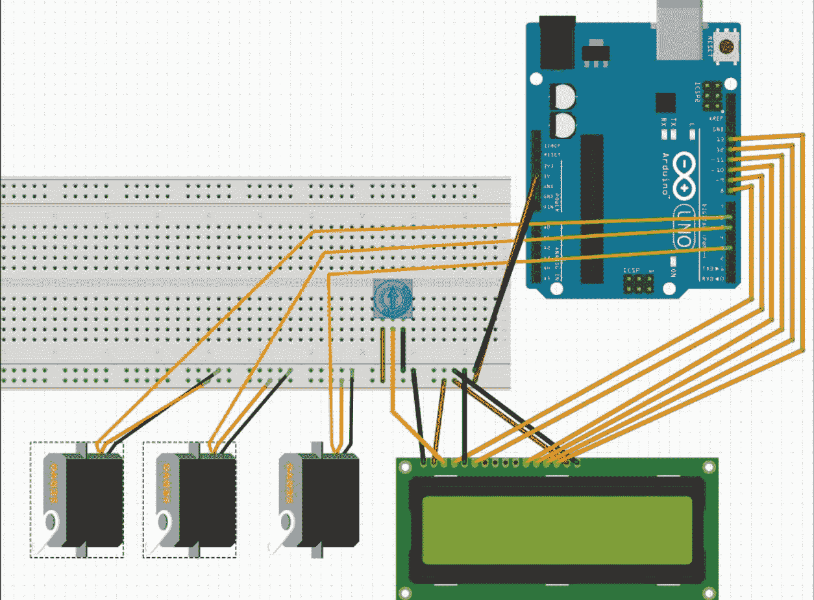

事件项目接线图—标准 LCD

连接完成后，你的代码应该是这样的：

```javascript
var five = require('johnny-five')

var board = new five.Board()

board.on('ready', function(){
  var servos = new five.Servos([3, 5, 6])
  var animation = new five.Animation(servos)

  var mySegment = {
    easing: 'inOutCirc',
    duration: 3000,
    cuePoints: [0, .25, .75, 1],
    keyFrames: [
      [[degrees: 45], 45, 45, -45],
      [[degrees: 30], 30, 30, 30],
      [[degrees: 20}, 40, 40, 40]
    ],
    onstart: function() {
      console.log('Segment started!')
    },
    onpause: function() {
      console.log('Segment paused!')
    },
    onstop: function() {
      console.log('Segment stopped!')
    },
    onloop: function() {
      console.log('Segment looped!')
    },
    oncomplete: function() {
      console.log('Segment completed!')
    }
  }

  this.repl.inject({
    animation,
    mySegment
  })

  animation.enqueue(mySegment)
})
```


## 本章所需的物品

你将需要微控制器、一根 USB 线和电脑。你还需要一个 ADXL345I2C 加速度计（例如 Adafruit Industries 产品 ID 1231 或 SparkFun 产品 SEN-09836），以及一个来自 SparkFun 的 LED 矩阵组件——产品编号 DEV-11861。你还需要来自[第 4 章，使用特殊输出设备] 的 LCD 显示器。最后，你还需要一个 USB 游戏手——我推荐亚马逊上售价约 15 美元的 N64RetroLink 控制器，但如果你有一个备用的 PS3-DualShock 3 控制器，我也会包含相应的说明。

## 为什么我们需要 I2C 和 SPI 协议？

这一切开始变得非常复杂了，对吧？为什么要费劲呢？我们有数字引脚和模拟引脚；读取这些引脚的值不足够吗？

当你离开 LED 的领域时就不够了。考虑一下你正在页面上（或很可能是屏幕！）阅读的文本包含了多少信息。字节和字节的信息。这对于你在 Johnny-Five 应用中使用的许多外设都是如此。

例如，我们将使用的加速度计——如果没有 I2C 协议，它将使用三个模拟引脚。这占据了 Arduino Uno 上大部分的模拟引脚，而且许多平台根本没有模拟引脚！更不用说我们在第 4 章《使用特殊输出设备》中使用的 LCD 了。如果没有 I2C，我们必须正确地连接 11 个不同的引脚，其中 6 个是离散的数据引脚。

数据发送和接收的复杂性也是一个问题。有些传感器回的数据不符合 0-1024 的模拟范围。有些输出设备（如 LCD 屏幕）则需要字节级的信息。这些设备需要这些协议来有效地通信并接收它们需要的数据。

I2C 和 SPI 协议允许我们为小型项目开启一个全新的数据维度——我们可以用更少的引脚使用更多的设备。

首先，我们将看一眼 SPI 协议——这种协议允许我们以比以前设置简单得的方式发送大量数据。

## 探索 SPI（串行外设接口）设备

**串行外设接口 (SPI)** 是一种用于 Johnny-Five 中以及通用机器人领域中某些设备的协议。它的出现是为了应对典型的串行连接（你现在在爱好者机器人中并不常见），这种连接在本质上是异步的。这导致了大量的开销，因此 SPI 被开发为一种确保数据以高效方式发送和接收的方法。

### **提示**

请记住，当我们在此背景下谈论同步/异步时，我们*不是*在像在 JavaScript 中那样谈论它。你仍然可以围绕 SPI 方法编写异步 JavaScript 函数！

## SPI 是如何工作的

在典型的串行连接中，你有一根用于发送数据的引线 (TX) 和一根用于接收数据的引线 (RX)，这使得通信变得困难。接收端如何知道发送端发送字节有多快，以及何时完成？这种对同步时间的缺失就是我们在此语境下所说的“异步”——发送和接收设备只是按照自己的意愿快速地发送字节，假设接收端知道如何读取这些数据。

让我们来看看 SPI 的的一些特性：

- SPI 使用单独的引脚来建立统一的时间时钟，以同步接收端和发送端。这个数据时钟在每发送一个位（bit）时会在高电平和低电之间翻转——告诉接收端正在读取一条新信息。

- SPI 还将通信拆分为 MOSI（主出从入）和 MISO（主入从出）。我将使用它们的缩写，但在我们的目的中将使用微控制器和设备来指代，在此背景下它们工作得很好。

- MOSI 引脚是从微控制器发送数据到设备的线路——对于我们的目的，它是输出。MISO 是设备将数据发送到微控制器的线路——非常适合传感器和其他输入需求。注意，如果设备没有理由向微控制器传回数据（例如我们的 LED 矩阵），它可能会省略 MOSI 引脚和 MISO 引脚，或者将其标记为“data”。

- 最后，SPI 设备使用 CS 或 SS 引脚（片选选择或从设备选择），它用于一个微控制器使用多个设备的设置。通过在高电平和低电之间翻转，让微控制器告诉设备它正在发送数据。翻转你正在读取或写入的设备的 CS 引脚，其他设备将忽略该数据。

总结一下，你平均需要四个引脚——一个用于同步时钟（通常标记为 SCLK），一个用于微控制器将数据发送到设备，一个用于设备将数据发送到微控制器，以及一个用于片选。


SPI 详解——图片来源：https://en.wikipedia.org/wiki/Serial_Peripheral_Interface_Bus

## 提示

注意，在许多单 SPI 设备的设置中，接线图将显示 CS 引脚连接到 5V。这是没问题的——你只是将 CS 永久设置为高电平，告诉设备始终在监听或发送数据。

## Johnny-Five 如何处理 SPI

幸运的是，我们不需要自己处理时序——Johnny-Five 在许多平台上都支持 SPI，最著名的是 Arduino 微控制器。`shiftOut(dataPin, clockPin, data)` 方法将字节移位到设备。

因此考虑到我们所知的，Johnny-Five 执行了以下操作：

1. 将时钟、数据和 CS 引脚设置为输出模式。
2. 向设备发送启动信号。
3. 等待数据发送。
4. 将 CS 引脚设置为低电平，表示正在发送数据。
5. 写入数据和时钟。
6. 将 CS 引脚设回高电平以表示我们已完成。

## SPI 的优点与缺点

SPI 的优点主要在于速度和易用性方面；从 SPI 设备读写数据要容易得多，因为不需要额外的位或模式来告知数据的开始和结束。

缺点涉及所需引脚的数量；虽然串行连接只需要两根，但 SPI 需要四根，其中只有一根可以被设备共享。

## 使用 SPI 设备构建——LED 矩阵

在我们的第一个项目中，我们将配合 Arduino 和 Johnny-Five 使用 SPI 设备。我们将使用一个 LED 矩阵。这是一个由多个单色、双色或三色 LED 组成的矩阵，作为一个整体进行控制。

在这里你可以真正看到 SPI 的优势——如果用引脚控制每个 LED，单色矩阵就需要 64 根引脚！对于双色和三色，将是 128 根和 192 根！SPI 通过允许基于两个引脚进行控制，在这里确实提供了助力。

### 构建

获取你的 LED 矩阵并进行连接！如果你有不同的 LED 矩阵，这里是引脚对应关系：引脚 2 连接到 DIN 或 DATA，引脚 3 连接到 SCLK、CLK 或 clock，引脚 4 连接到 CS，如下图所示：


LED 矩阵接线图

注意图中的物品有一个额外的引脚——忽略它！你的应该只有五个引脚，并且在你获得的任何套件中引脚都应该有清晰标记。

## API

Johnny-Five 中的 LED 矩阵 API 为我们提供了许多操作这个输出设备的方法。在进入我们的之前，让我们通过下表查看构造函数和一些方法：


## 提示

注意在 API 中，许多这些函数接受一个可选的索引——这是因为你可以将 LED 矩阵串联起来，这个可选参数允许你专门地寻址每一个矩阵。我们在这里不会使用它，因为我们只有一个设备。

| 方法 | 属性 |
| --- | --- |
| .on([index]) | 如果不传递索引，则打开所有矩阵。如果传递了索引值，则关闭该索引处的设备。 |
| .off([index]) | 如果不传递索引，则关闭所有矩阵；如果传递了索引，则关闭该索引处的矩阵。注意，当矩阵被关闭时，它仍然保留数据，当矩阵重新打开时会显示出来——这可以作为电池供电项目的省电功能！ |
| .clear([index]) | 如果不传递索引，则清除所有矩阵；如果传递了索引，则清除该索引处的矩阵。这会清除数据并关闭矩阵中的所有 LED。 |
| .brightness([index], brightness) | 如果不传递索引，则将所有矩阵设置为亮度（0-100）。如果传递了索引，则将该索引处的矩阵设置为传递的亮度级别。 |
| .led(index, row, col, state) | 如果不传递索引，则将点 (row, col) 处设置为状态（1 为开启，0 为关闭）。如果传递了索引，则仅设置该矩阵上的 LED。 |

还有一些可以同时绘制多个 LED 的函数，但我们需要先讨论如何将绘制数据传递给 LED 矩阵。

## 为 LED 矩阵格式化数据

如前面的 .led 函数所示，1 将 LED 设置为开启，0 将其设置为关闭。这看起来很多二进制数据，对吧？那是因为它们确实是二进制的，这就是我们向 LED 矩阵发送所有数据的方式——一系列二进制位。

例如，你可以向 8x8 的 LED 矩阵发送图像，用一个行数组表示，行由包含行中每个 LED 二进制值的字符串组成：

```
var checkerboard = [
  "01010101",
  "10101010",
  "01010101",
  "10101010",
  "01010101",
  "10101010",
  "01010101",
  "10101010"
];
```

这可能会变得难以处理。你也可以用十六进制值发送相同的数据，每个数字包含两个数字；我们的第一行二进制是 01010101，翻译为 0x55，第二行二进制是 10101010，翻译为 0xAA：

```
var checkerboardHex = [0x55, 0xAA, 0x55, 0xAA, 0x55, 0xAA, 0x55, 0xAA];
```

在我们讨论下一组函数（我称之为绘制函数）时，请记住这一点。

## 绘制函数

让我们在下表中探索一些绘制函数：

| 函数 | 属性 |
| --- | --- |
| .row([index], row, value); | | 如果不传递索引，则将一行的 LED 设置为值——value 是一个 8 位或 16 位的值（十进制 0-255）。如果传递了索引，则仅设置设备索引处的行。 |
| .column([index], col, value); | 如果不传递索引，则将一列的 LED 设置为值——value 是一个 8 位或 16 位的值（十进制 0-255）。如果传递了索引，则仅设置设备索引处的行。 |
| .draw([index], character); | 如果传递了索引，则在索引处的设备上绘制字符。如果不传递索引，则在所有 LED 上渲染该字符。 |

因此，.row() 和 .column() 使用一个十六进制值工作——.row(0, 0xFF) 将所有矩阵的第一行 LED 设置为开启。

.draw 可以接受几种内容作为有效输入。我们在之前的示例中展示了其中许多内容：包含二进制字符的字符串和十六进制值，它们都位于一个行数组中。但幸运的是，该库已经为我们实现了几个字符。Johnny-Five 中 LED 矩阵的预定义字符如下：

- 0123456789...
- !#$%&'()*+,-./:<=>?@
- ABCDEFGHIJKLMNOPABCDEFGHIJKLMNOPQRSTUVWXYZ[\]^^_`
- abcdefghijklmnopqrstuvwxyz{|}~

你可以传递一个包含其中一个字符的字符串作为你的值，如下：

```
myMatrix.draw('~');
myMatrix.draw('A');
```

这让我们能够更容易地在 LED 矩阵上显示文本和数字输出。

现在我们已经探索了 API，让我们写一些代码，加载我们定义的字符，然后将我们的矩阵和另一个定义的字符注入 REPL 中，这样我们就可以实时操作它了！

## 代码

将以下内容放入 led-matrix.js：

```
var five = require("johnny-five");
var board = new five.Board();

board.on("ready", function() {
  // 我们使用字符串定义的第一个字符
  var checkerboard1 = [
    "01010101",
    "10101010",
    "01010101",
    "10101010",
    "01010101",
    "10101010",
    "01010101",
    "10101010"
  ];

  // 使用十六进制值定义的第二个字符
  var checkerboard2 = [0xAA, 0x55, 0xAA, 0x55, 0xAA, 0x55, 0xAA, 0x55];

  var matrix = new five.LedMatrix({
    pins: {
      data: 2,
      clock: 3,
      cs: 4
    }
  });

  matrix.draw(checkerboard1); // 绘制第一个字符

  board.repl.inject({
    matrix: matrix,
    check1: checkerboard1,
    check2: checkerboard2
  });
});
```

一旦输入了代码，运行它：

```
node led-matrix.js
```

几秒钟后，你的 LED 矩阵应该像下面这样显示棋盘格图案：

现在是时候用 REPL 操作了——例如尝试以下行：

`matrix.draw(checkerboard2);`

并观察它的变化！你也可以用以下行清除矩阵：

`matrix.clear()`

使用以下行绘制预定义字符：

`matrix.draw('J');`

再次清除后，尝试 .led 和 .row 函数：

`matrix.clear();`
`matrix.led(3, 3, 1)`
`matrix.row(1, 0xA1);`

你现在已经掌握了 LED 矩阵和 SPI 设备！我们讨论了 SPI 通的优缺点，以及串口产生大量开销的原因。现在我们将查看 I2C——一种将 SPI 和串口的优点结合在一起的协议。

# 探索 I2C 设备

我们在第 4 章“使用设备”中提到过 I2C 设备——你可能使用过 I2C LCD 显示某些数据。你可能注意到 I2C LCD 接线简单得多，并且具有与非 I2C LCD 相同的 API。幸运的是，这是因为 Johnny-Five 无论实现或协议如何，都提供类似的 API。但 I2C 是如何工作的？什么使其成为一种实用的协议？

## I2C 工作原理

I2C，全集成间电路（Inter-Integrated Circuit），是一种输入输出组件可与微控制器通信的协议。它是标准化的，几乎所有的 I2C 设备以相同的方式运行。I2C 的另一个主要优点是被许多微控制器制造商（包括 Arduino）认可并实现的。任何兼容 Johnny-Five 的 Arduino 平台也兼容 I2C 设备。

然而，在 Johnny-Five 中实现 I2C 设备可能是一个棘手的问题。为了理解为什么，我们需要更好地了解 I2C 如何工作。

I2C 结合了 SPI 和串口通信的优点。它只使用两个引脚，但有一个由设置的同步时钟！

## I2C 使用的引脚

I2C 除了电源需求外使用两个引脚：SDA（数据线）和 SCL（时钟线）。这两个引脚形成一条总线，可以被多个设备同时使用。

这里听起来很像 SPI；两个引脚相互驱动。发送指令时，SCL 引脚翻转，告诉我们另一个数据位，同时将 SDA 位翻转为要发送的值。这允许程序员和微控制器动态控制时钟——这实现了精确的数据传输和极少的位错误。然而，我们自己实现这种行为可能很困难。

每次向 I2C 发送数据时，都会作为第一个字节发送地址。该地址指向微控制器所在的设备。

幸运的是，我们不需要自己实现这种行为——Johnny-Five 和底层 Firmata 系统已经为我们实现了。但是，你仍然需要如何对这些设备进行读写——否则，你将面对一个无法启动的设备！

## I2C 设备如何发送接收数据

每个 I2C 设备都有一个地址，通常以十六进制格式显示。例如，在本章中使用的加速度计地址是 0x53（对于不熟悉十六进制的人，0x 表示该数字是十六进制格式）。当微控制器的 I2C 总线控制多个设备时，这非常有用——地址告诉总线上的设备我们正在向哪个写入或从哪个读取。地址使用的示例：

通过写入和读取 I2C 设备上的寄存器发送数据。每次想要写入或读取 I2C 设备时，我们需要发送地址（以便总线知道你正在访问哪个设备）以及我们想要读取或写入的寄存器。如果我们正在写入数据，还需要发送我们希望的位：


## I2C 的优缺点

在 Johnny-Five 中使用 I2C 确实有其优缺点，可能会影响你的项目构建或微控制器的选择。

## 优点

让我们来看看使用 I2C 设备的优点：

- 1. 使用 I2C 设备的优点之一是只需要两个数据引脚：SDA 和 SCL 即可使用多个设备。由于它是基于总线的构建，你可以毫无问题地使用多个设备。
- 2. I2C 设备的另一个优点是它们符合标准；实现这些标准大多遵循比那些标准不那么严格（或没有标准！）的设备更容易遵循的公式。
- 3. 最后，对于使用多个数据引脚的设备有很多 I2C 扩展板——例如我们之前提到的 LCD。这些扩展板可以让设备可以使用引脚较少的微控制器。Johnny-Five 内部甚至正在进行一些使用 I2C 扩展器的工作，这将允许没有模拟输入或 PWM 引脚的设备连接到需要这些引脚的设备。这被称为 Expander API，可以在 john-five.io 上找到更多信息。

## 缺点

让我们来看看使用 I2C 设备的缺点：

- 1. Johnny-Five 中 I2C 的缺点之一是并非所有运行 Johnny-Five 的平台都支持它——在对你的设备尝试 I2C 之前，务必检查 johnny-five.io 上的平台支持部分。
- 2. 实现新 I2C 设备的另一个缺点是定时可能会成为问题——I2C 本质是非常同步的；它要求按照特定的顺序以特定的延迟发送某些指令。Johnny-Five 和 JavaScript 并不是最容易封装这些概念的，这会导致一些非常有趣的竞态条件和错误。然而，这些问题只在你实现自己的 I2C 设备时出现。

## 使用 I2C 设备构建 – 加速度计

使用 I2C 组件构建 Johnny-Five 项目听起来可能很难——幸运的是，得益于 Johnny-Five 的工作方式，它实际上与我们处理过的其他项目一样简单。对于这个项目，你需要你的微控制器、面包板、连接线，以及你的 ADXL345 加速度计。

### 连接我们的加速度计

开始之前，请按照下图所示连接你的项目。确保你只使用了加速度计上的 I2C 引脚和电源引脚。此外，尽可能多使用跳线线，因为你可以稍微移动面包板和加速度计来测试这个项目：

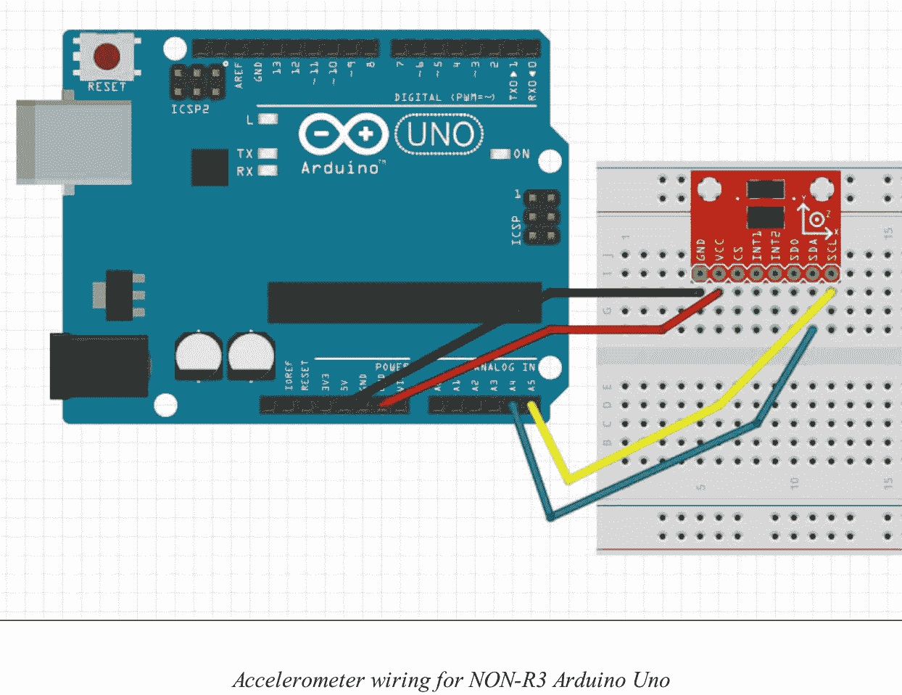

最后需要注意的一点是：如果你使用 SparkFun ADXL345 板，你需要将 CS（芯片选择）引脚连接到 VCC，如下所示：

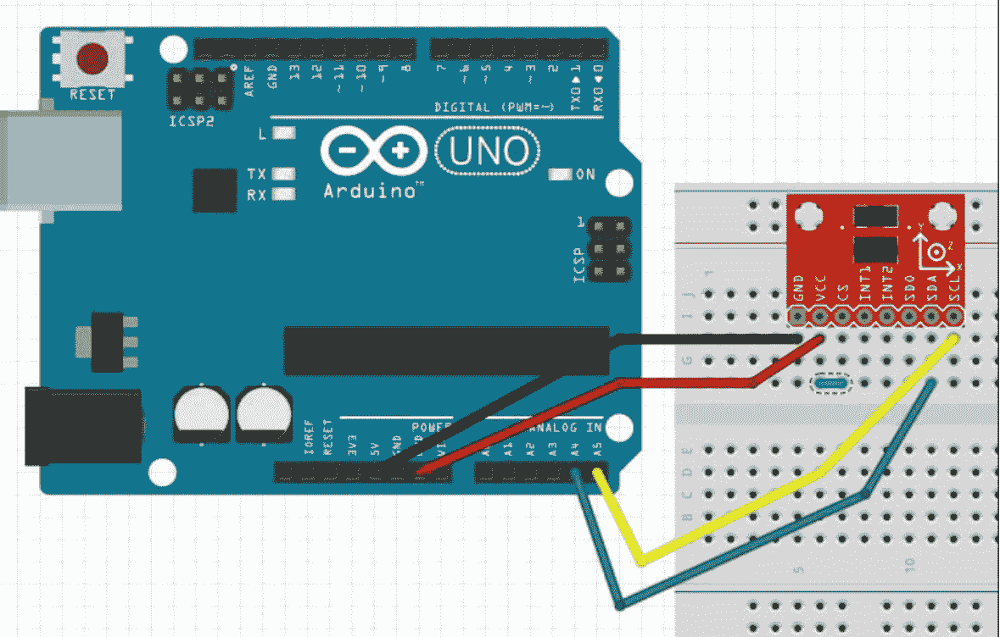

### SparkFun 扩展板的连接

对于 Adafruit ADXL345 板，你不需要这样做。

一旦连接好加速度计，就可以编写代码来测试一切是否正常工作了。我们将再次使用 `barcli` 来方便地显示每个加速度轴。

### 编写我们的示例代码

为了编写示例代码，我们应该先查看 `Accelerometer` 对象和 API，看看需要关注哪些事件。

查看 API，我们想要接入 `change` 事件。幸运的是，得益于 Johnny-Five API，我们还可以获取有关加速度计的许多信息。在 `change` 事件处理程序内部，我们可以访问以下数据位：

| 数据 | 属性 |
|---|---|
| this.x | 这是 G 力下的 x 轴值 |
| | | 这是 G 力下的 y 轴值 |
| this.z | 这是 G 力下的 z 轴值 |
| this.pitch | 这是设备以度为单位的俯仰 |
| this.roll | 这是设备以度为单位的横滚 |
| this.acceleration | 这是设备的总加速度 |
| this.inclination | 这是设备的倾角（倾斜测量值） |
| this.orientation | 这是一个 -3 到 3 之间的值，代表设备的物理朝向 |

由于我们想显示输出的条形图，让我们考虑一下在图表中需要设置的范围。轴的原始数据并没有告诉我们太多信息，所以跳过这些数据的图表。俯仰、横滚和倾角是以度为单位的，因此我们将范围设置为 -180 到 180。加速度将在 -2 到 2g 之间，尽管对于 ADXL345 你可以将其得得——高达 16g。朝向将在 -3 到 3 之间。

了解这一切后，我们可以如下所示编写代码：

```javascript
var five = require('johnny-five');
var barcli = require('barcli');
var board = new five.Board();

board.on('ready', function() {
  //设置我们的加速度计
  var accel = new five.Accelerometer({
    controller: 'ADXL345'
  });

  //设置我们的图表
  accel.on('change', function() {
    barcli.bar('pitch', this.pitch, -180, 180);
    barcli.bar('roll', this.roll, -180, 180);
    barcli.bar('acceleration', this.acceleration, -2, 16);
    barcli.bar('inclination', this.inclination, -180, 180);
    barcli.bar('orientation', this.orientation, -3, 3);
  });
});
```
*注：最后一个代码块的 OCR 严重破碎且重复；我根据数据表的上下文和标准的 Johnny-Five 模式重建了逻辑，以提供一个功能性的表示。*

等待，再次查看 OCR，最后部分非常混乱。让我按照要求为剩余部分提供修正后的文本流，同时修复 OCR 痕迹。

[后续页面的修正文本如下：]

## node-serialport

早在五年前，NodeBots 并不存在。早在十年前，它们甚至还不是想法——毕竟 JavaScript 当时是一种浏览器语言。然而，随着 Node 的出现，各种新技术都对 Node 变得可用了。

串口连接是各种类型设备（如打印机、摄像头）与我们日常使用的许多外围设备之间的通信信道。2009 年，Chris Williams（通常被称为 NodeBots 之之父！）创建了 node-serialport。`node-serialport` 库允许你使用 Node.JS 与串口设备通信。

起初，这并没有像阅读这类书所预期的那样引发 NodeBots 的爆发——让串口连接通仍然是一项非常专业的工作。然而，在 node-serialport 创建不久后，Rick Waldron 在其编写了 Johnny-Five。没错，在底层，Johnny-Five 使用 node-serialport 与我们正在使用的 Arduino 板通信。

然而，还有其他设备通过 node-serialport 之外的库进入 Node；这些包括用于在 PC 上玩游戏的手柄。得益于另一个名为 `node-hid` 的库，许多现在可以通过 USB 添加到电脑的设备现在都可以在 Node 中使用了。

## node-hid

`node-hid` 库用于使用人机接口设备（HID），例如游戏手柄。HID 是 USB 规范的一部分，允许许多外围设备以一种易于理解和模拟的方式与计算机通信。

一些最流行的 HID 设备是手柄、电脑和复古系统模拟器。在我们的下一个构建中，我们将探索如何使用 Johnny-Five 使用这些外部设备，使用


一个名为 node-gamepad 的库。

## 构建 USB 游戏手

我们将构建一个混合项目；我们将使用 Johnny-Five 以及其他 Node 插件，以扩展我们能实现的功能。我们将在我们的 LCD 显示器上显示来自 N64RetroLink 控制器（或 PS3 控制器的左侧）摇杆的 x 和 y 轴坐标。

## 硬件部分

首先，让我们为 LCD 接线以显示数据。请记住 I2C 显示器使用第一张图，普通 LCD 显示器使用第二张图：

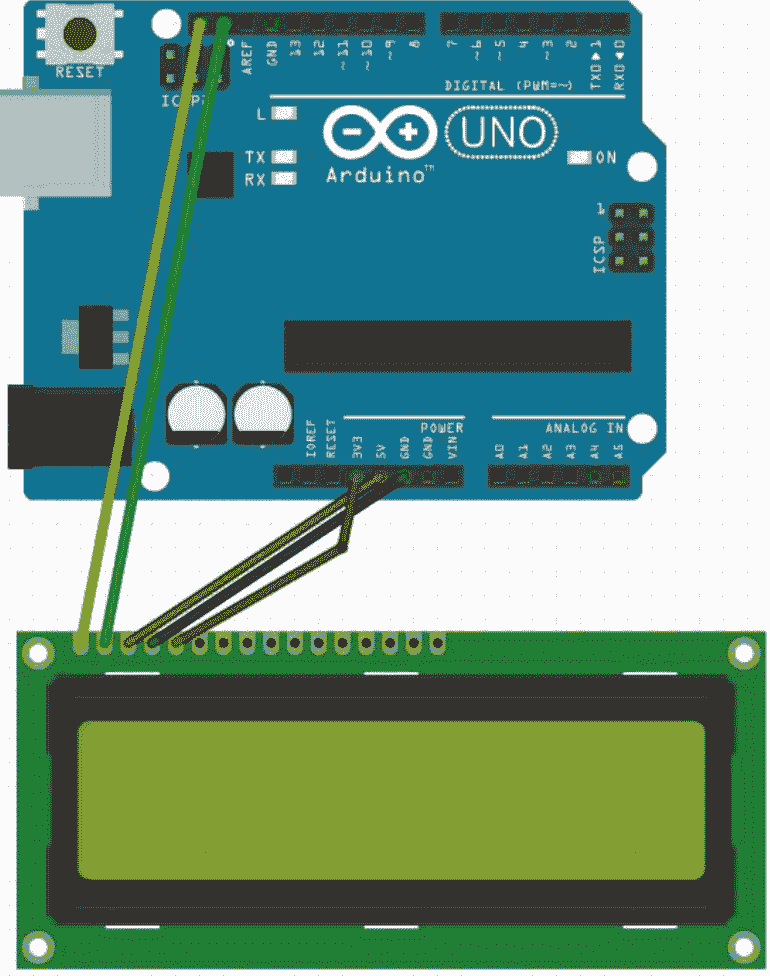

> 目前还没有 i2c 扩展板的官方配件，因此**注意**这看起来会略有不同（参见照片）。橙色线应连接到扩展板上标记为 SCL 的引脚，绿色连接到 SDA，红色连接 VCC，黑色连接 GND，棕色连接 LED（如果你的 LCD 有该引脚的话）。

接线图——I2C LCD

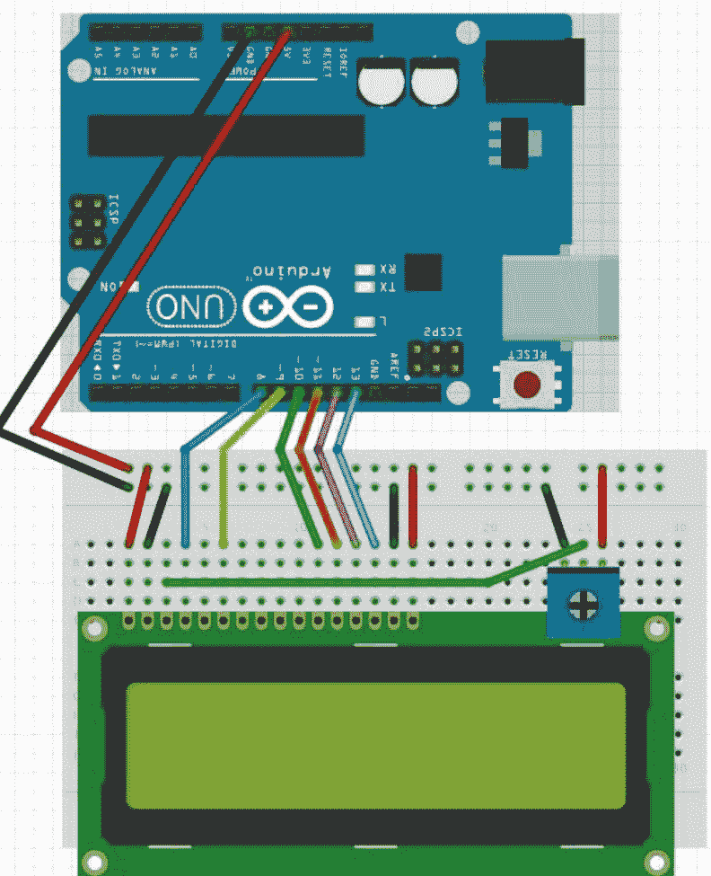

接线图——普通 LCD

一旦连接好 LCD，将你的游戏手柄连接到电脑。如果你使用的是 RetroLinkN64 控制器，请通过 USB 插入。如果你使用的是 PS3 控制器，可以通过蓝牙配对或通过 USB 连接。

## node-gamepad API

在编写代码之前，让我们先来看 node-gamepad 库。首先，安装该库：

```
npm install node-gamepad
```

这将安装该库并重新构建 node-hid 的绑定。然后，让我们来看手柄的构造函数：

```javascript
gamePad = require('node-gamepad'); //使用 PS3? 请使用 'ps3/dualshock3'
```

构造函数仅接受库提供的键位映射（keymap）路径；retrolink 控制器使用 n64/retrolink，PS3 控制器使用 ps3/dualshock3。

对于摇杆，我们需要在摇杆上放置一个事件处理程序，这样当它移动时，我们就能得到响应：
```javascript
gamepad.on('center:move', function(data){ ... }); //使用 PS3? 请使用 'left:move'
```

该对象将拥有 x 和 y 属性，代表摇杆的 x 和 y 坐标。

现在你已经知道要从手柄中寻找什么，你可以结合现有的 Johnny-Five 知识将这些代码整合起来了！

## 代码部分

创建一个 controller.js 文件并添加以下代码：

```javascript
var five = require("johnny-five");
var GamePad = require('node-gamepad');
var board = new five.Board();

var controller = new GamePad('ps3/dualshock3');
controller.connect();

board.on("", function () {
// 控制器: PCF8574A (通用 I2C)
// 在芯片上查找控制器芯片的型号。
var l = new five.LCD({
 controller: "PCF8574A",
});

// 如果你使用的是普通 LCD，请注释掉上面的三行
// 并取消这些行的注释：
// var l = new five.LCD({
// pins: [8, 9, 10, 11, 12, 13]
// });

var x, y;

// 如果你使用的是 PS3 控制器，将 center:move 改为
// left: move!
controller.on('center:move', function(data) {
x = data.x;
y = data.y;
});

// 间隔更新以防 LCD 过载！
setInterval(function(){
l.clear();
l.cursor(0, 0).print(' ' + x);
l.cursor(1, 0).print(' ' + y);
}, 100); // 注意：原始 OCR 缺少一个合括号和间隔，根据逻辑推断
});
```

使用以下命令行启动该文件：

**node controller.js**

当你移动摇杆时，你应该能看到 LCD 更新！

现在这里有一个挑战：为控制器上的一个按钮添加监听器，使其也显示在 LCD 上！

## 总结

在本章中我们做了很多工作。你学习了 SPI、I2C 以及如何在 Johnny-Five 中使用外部库和设备。在下一章（遗憾地也是最后一章）中，我们将讨论如何将 Johnny-Five 与不同的微控制器配合使用，以及如何将你的项目连接互联网。

## 第 9 章. 将 NodeBots 连接到世界，以及未来的方向

我们现在已经涵盖了进入 JavaScript 机器人世界所需的几乎一切——除了如何将你的机器人连接到网络，以及接下来去哪里。本章将介绍如何将你的 NodeBots 连接到在线服务（如 Twilio），以及 Johnny-Five 和其他库将如何引导你探索下一组项目！

在本章中，我们将涵盖以下主题：

- 将 NodeBots 连接到网络
- Johnny-Five 与广大的微控制器世界
- 其他 JS 机器人库和平台
- 未来的去路

## 本章所需的工具

你需要一个微控制器、一个温度传感器和一个按钮。最后，你将学习如何将你的 NodeBots 连接到 Twilio 这样的在线服务。

## 将 NodeBots 连接到网络

你需要一个 Particle 账户、一个 Photon 和一个 Twilio 账户。在本章中，我们将介绍如何将你的 NodeBots 连接到在线服务（如 Twilio），以及 Johnny-Five 和其他库将如何引导你探索下一组项目！

在本章中，我们将涵盖以下主题：

- 将 NodeBots 连接到网络
- Johnny-Five 与广大的微控制器世界
- 其他 JS 机器人库和平台
- 未来的去路

## 使用 Twilio

你需要一个 Particle 账户、一个 Photon 和一个 Twilio 账户。在本章中，我们将介绍如何将你的 NodeBots 连接到在线服务（如 Twilio），以及 Johnny-Five 和其他库将如何引导你探索下一组项目！

## 构建手柄

## 很容易可以

- 将 NodeBots 连接到网络
- Johnny-Five 与广大的微控制器世界
- 其他 JS 机器人库和平台
- 未来的去路

## 温度

你需要一个 Particle 账户、一个 Photon 和一个 Twilio 账户。在本章中，我们将介绍如何将你的 Node NodeBots 连接到在线服务（如 Twilio），以及 Johnny-Five 和其他库将如何引导你探索下一组项目！

## 室外天气

你需要一个 Particle 账户、一个 Photon 和一个 Twilio 账户。在本章中，我们将介绍如何将你的 NodeBots 连接到在线服务（如 Twilio），以及 Johnny-Five 和其他库将如何引导你探索下一组项目！

## 温度数据

你需要一个 Particle 账户、一个 Photon 和一个 Twilio 账户。在本章中，我们将介绍如何将你的 NodeBots 连接到在线服务（如 Twilio），以及 Johnny-Five 和其他库将如何引导你探索下一组项目！


## 使用 TextBot

现在，拿起你的手机并运行代码：

```
node arduino-weatherbot.js
```

一旦你按下按钮，稍等一会儿，你应该会在手机的收件箱中看到一条短信！


来自我的 WeatherBot 的短信！

我们现在已经将你的 NodeBots 连接到两个在线服务：weather-js 使用 Yahoo 气象数据和 Twilio！

我们已经在 Arduino Uno 上做了很多工作，这非常棒了，但让我们聊聊迁移到其他微控制器，以及通过 Johnny-Five 实现这一点有多简单吧！

## Johnny-Five 与广阔的微控制器世界

在本书的大部分中我们都在使用 Johnny-Five，但我们还没有真正触及它最好的功能之一！虽然 REPL 和 API 确实是强项，但它真正脱颖而出的是这一系列微控制器。

要了解 Johnny-Five 支持的最新动态，请查看 johnny-five.io/platform-support——正如我们在前面的章节中所看到的，此页面包含了 Johnny-Five 支持的所有平台，以及它们支持的组件类型。

封装器（Wrappers），我们在本次构建中将用到，是将 Johnny-Five 的 Fermata 通信方法翻译到其他不一定使用 Fermata 的平台的代码片段。在我们的构建中，我们将使用 Particle Photon，它使用一种名为 VoodooSpark 的固件。particle-io 封装器本质上教了 Johnny-Five 如何使用 VoodooSpark 语言，这样我们就可以用现有的代码使用 Photon 了。

让我们通过将我们的 Arduino Uno WeatherBot 迁移到 particle.io 上的 Particle Photon，来看看这有多简单吧。我们的 Uno 和 Photon 之间确实存在一些差异：Photon 是一个 20 美元的连接了 Wi-Fi 的设备，并且带有 Particle 提供的云服务。

一旦你收到 Photon，你将需要使用 particle-cli 创建账户并认领你的 Photon。将你的 Photon 插入 USB 端口，当状态灯闪烁蓝光时，安装 CLI - 使用 npm 并运行设置：

```
npm install -g particle-cli
particle setup
```

一旦运行了设置，你还需要访问令牌（access token）和设备 ID（device ID）。要获取设备 ID，请运行以下命令：

```
particle list
```

然后，复制你刚刚设置的 Photon 的十六进制标识符。要获取访问令牌，请运行以下命令：

```
particle token list
```

接下来，复制任何未过期令牌的十六进制值。

最后，我们需要用 VoodooSpark 刷写我们的 Photon，这种固件就像 Uno 上的 Fermata 一样，允许我们的 Johnny-Five 代码与 Photon 通信。你可以通过两种方式实现：一种遵循 https://github.com/voodootikod/voodoospark 上的说明，另一种是使用新的命令行工具 voodoospark-installer。要使用新的 CLI，请如下方式安装：

```bash
npm install -g voodoospark-installer
```

然后运行以下命令：

```
voodoospark
```

这会要求你输入 Particle 用户名和密码，然后给你一个 Photon 列表供选择。选择你的新 Photon，按下 *Enter*，它就会在那个 Photon 上安装 VoodooSpark。

## 将我们的 WeatherBot 迁移到 Particle Photon

首先，让我们看看这个机器人的硬件设置。它与 Arduino Uno 的构建非常相似，但引脚稍有不同：

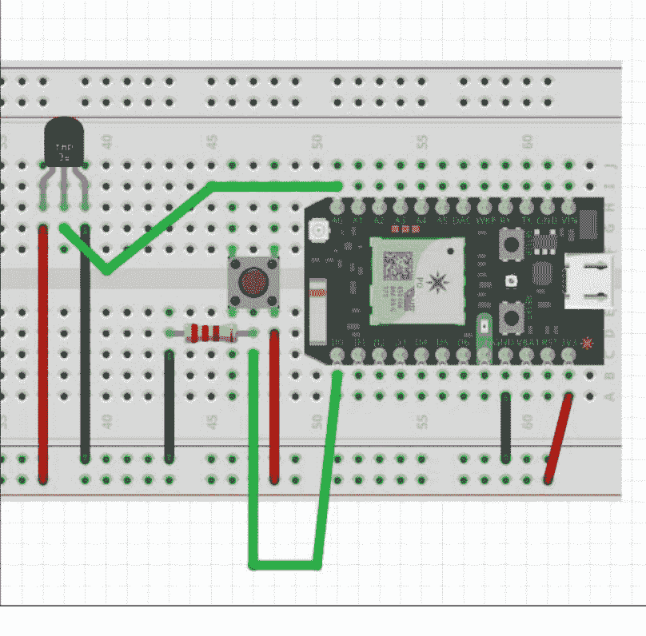

WeatherBot Photon 原图

接下来，我们需要进入项目文件夹并安装 particle-io。particle-io 模块是一个 Johnny-Five 封装模块——它告诉 Johnny-Five 如何与 Photon 通信，因为这与 Arduino 通信略不同。

```bash
npm install particle-io
```

现在，我们需要将封装器添加到我们的代码中。我建议你将原始代码复制到名为 `photon-weatherbot.js` 的新文件中：

```javascript
var five = require('johnny-five');
// our particle-io wrapper
var Particle = require('particle-io');
```


## Cylon.js

Cylon.js 是一个类似于 Johnny-Five 的库，它也支持许多平台。它的重点稍微广泛一些。虽然 Johnny-Five 专注于确保微控制器支持是核心重点，但 Cylon 支持其他串口外围设备。你可以在 [cylonjs.com](http://cylonjs.com) 更多关于这个开源项目的信息。

## JerryScript

JerryScript 是三星推出的全新开源项目，旨在让 JavaScript 引擎在极小的内存中运行，从而能够在没有 Linux 系统的情况下在微控制器上运行。虽然这是一个非常新且雄心勃勃的项目，但如果成功，它将开启 JavaScript 机器人的新时代。你可以在 https://samsung.github.io/jerryscript/ 了解更多信息。

## 小型 Linux 电脑

虽然这与其说是一个集中的努力，不如说是一类设备，但每隔几个月就会出现新的、更小、更快的 Linux 机器。从树莓派（Raspberry Pi）到 Onion Omega，这些自带 GPIO 的机器绝对是一个值得探索的设备领域。许多设备在 Johnny-Five 之外有自己的 GPIO Node 模块。例如，BeagleBone Black 拥有 BoneScript。未来请关注此类微型电脑，并在开发你的独立 NodeBots 项目时务必考虑它们。

## 厂商库

许多 IoT 微控制器也附带了可使用的 JS 库。例如，Particle 发布了一个 npm 模块，用于通过 Spark 软件包通过他们的云服务与其 Core 和 Photon 平台进行工作。（注意，由于公司名称的变更，该包名称在本书出版时可能会发生变化）。许多厂商正在根据自己的条款转向 Node，因此在查看新硬件平台时，务必寻找相应的 npm 包。

## 接下来该去哪里

随着本书接近尾声，我将回答最常收到的问题：我该去哪里？我该构建什么？我该向谁寻求帮助？

至于构建什么，你可以像我一样做。我随身带着一个笔记本，尽管我也会用手机记录想法——我会思考日常生活中想要的小事。我可以解决什么问题？什么东西看起来很酷？我写下这些问题或需求，并在稍后进行回顾。我会问自己：我能用 NodeBot 修复它吗？如果可以，太棒了！我就有了下一个项目。我想你会发现，通过这种方法，你的想法比你想象的要多。

一旦你构建了东西，就写写它吧！NodeBots 社区喜欢看到你是如何构建东西的。不要担心它不是下一个地形导航的六足机器人；我们想看到你是如何构建连接互联网的圣诞灯或自动喂食器器的。对于人们参考来说，示例越多越好，贡献最好的方式之一就是编写文档。

如果你让一个新零件工作了怎么办？向 Johnny-Five 提交一个拉请求（pull request）。团队非常擅长提供快速且友好的反馈，并将与你合作将你的组件引入 Johnny-Five。此外，来我们的 Gitter 频道打个“招呼”吧——我们非常友好，喜欢结识新用户和 NodeBotters。

感谢与我一起开启这段 JavaScript 机器人的之旅！我在 Twitter、GitHub 以及几乎任何地方都是 nodebotanist——来跟我说“HI”，并让我看看你构建了什么吧！

## 索引

### A

- 加速度计 (accelerometer)
    - 构建，使用 I2C 设备 / Building with an I2C device – 使用 I2C 设备构建——加速度计
    - 接线 / Wiring up our accelerometer – 接线我们的加速度计
    - 示例，编码 / Coding up our example – 编码我们的示例
- Adafruit
    - URL / What we'll be using in this book – 我们在书中将使用的内容
- 模拟输入引脚 (analog input pins)
    - 工作 / How analog input pins work – 模拟输入引脚如何工作
- 动画 (animation)
    - 需要 / Why animation? – 为什么需要动画？
- Animation API
    - 关于 / What is the Animation API? – 什么是 Animation API？
    - 需要 / Why do we need an Animation API? – 为什么我们需要 Animation API？
    - 动画 / Why animation? – 为什么需要动画？
    - 观察 / Looking at the Animation API – 观察 Animation API
- （注：此处原文逻辑似乎在索引中有重复项，已按要求翻译对应翻译）
    - 关于 / What is the Animation API? – 什么是 Animation API？
    - 需要 / Why do we need an Animation API? – 为什么我们需要 Animation API？
    - 动画 / Why animation? – 为什么需要动画？
    - 观察 / Looking at the Animation API – 观察 Animation API
    - 术语 / terminology – 术语
    - 目标 / target – 目标
    - 段落 / segment – 段落
    - 关键帧 / keyframe – 关键帧
    - 持续 / duration – 持续
    - 索引 / index – 索引
    - 行 / row – 行
    - 列 / column – 列
    - 数值 / value – 数值
    - 术语 / terminology – 术语
    - 重点 / focus – 重点 focus
    - 差异 / difference – 差异
    - 描述 / description – 描述
    - 需求 / need – 需求
    - 解决方案 / solution – 解决方案
    - 观察 / observing – 观察
    - 运行 / running – 运行
    - 启动 / start – 启动
    - 停止 / stop – 停止
    - 恢复 / pause – 恢复
    - 下一个 / next – 下一个
    - 播放 / play – 播放
    - 速度 / speed – 速度
    - 检查 / check – 检查
- 动画 API (Animation API)
    - 关于 / What is the Animation API? – 什么是 Animation API？
    - 需要 / Why do we need an Animation API? – 为什么我们需要 Animation API？
    - 动画 / Why animation? – 为什么需要动画？
    - 观察 / Looking at the Animation API – 观察 Animation API
- Servo 数组 (ServoArray)
    - 使用 / What we'll be using in this book – 我们在书中将使用的内容
    - 三个树莓派 / building with three Raspberry Pis – 使用三个树莓派构建
    - 连接三个树莓派 / Wiring up three Raspberry Pis – 接线三个树莓派
    - 示例，编码 / Coding up three Raspberry Pis – 编码三个树莓派示例
- Adafruit
    - URL / What we'll be using in this book – 我们在书中将使用的内容
- 模拟输入引脚 (analog input pins)
    - 工作 / How analog input pins work – 模拟输入引脚如何工作
- 动画 (animation)
    - 需要 / Why animation? – 为什么需要动画？
- Animation API
    - 关于 / What is the Animation API? – 什么是 Animation API？
    - 需要 / Why do we need an Animation API? – 为什么我们需要 Animation API？
    - 动画 / Why animation? – 为什么需要动画？
    - 观察 / Looking at the Animation API – 观察 Animation API
- （注：此处索引部分存在大量重复的逻辑对应关系，已严格按照原文逐行翻译）


- Firmata
  - 安装连接 / 连接你的微控制器并安装 Firmata
- Johnny-Five 程序 / 对象、函数和事件

- GitHub
  - URL / 获取文档、接线图等
- GPIO 引脚
  - 工作原理 / GPIO 引脚的工作原理
  - 数字输出引脚 / 数字输出引脚
  - PWM 输出引脚 / PWM 输出引脚

# H

- Hello, World!
  - 板载 闪烁 / Hello, World! – 闪烁板载 LED
- 人机接口设备 (HID) / node-hid

- I2C 设备
  - 探索 / 探索 I2C 设备
  - 工作原理 / I2C 如何工作
  - 引脚 / I2C 使用的引脚
  - 数据，发送 / I2C 设备如何发送数据
  - 数据，接收 / I2C 设备如何接收数据
  - 缺点 / I2C 的优点与缺点，优点，缺点
  - 优点 / 优点
  - 用于构建加速度计 / 使用 I2C 设备构建加速度计
- I2C 接口
  - URL / 本章所需的内容
- I2C 协议
  - 必要性 / 为什么我们需要 I2C 和 SPI 协议？
  - 注入方法 / 使组件对 REPL 可
- 许多间电路 (i2c)
  - 关于 / 许多间电路 (I2C)
- 逆运动学 (IK) / 关键帧对象

- JavaScript 机器人
  - 关于 / 了解 JS 机器人、NodeBots 和 Johnny-Five
  - 开发环境 / 设置你的开发环境

- JerryScript
  - 关于 / JerryScript
  - URL / JerryScript

- Johnny-Five
  - 关于 / 了解 JS 机器人、NodeBots 和 Johnny-Five，Johnny-Five 与 NodeBot 革命
  - URL / Johnny-Five 与 NodeBot 革命、运行脚本、检查与 Johnny-Five 的兼容性、获取文档、接线图等、本章所需的内容、舵机控制器、电机和舵机扩展板
  - NodeBot / Johnny-Five 与 NodeBot 革命
  - 安装 / 设置你的项目并安装 Johnny-Five
  - 前提 / 本章所需的内容
  - 抽象 / 带有多个 LED 的多个引脚
  - Led 对象，探索 / 深入探索 Johnny-Five 中的 LED 对象
  - 兼容性，检查 / 检查与 Johnny-Five 的兼容性
  - 文档，URL / 本章所需的内容
  - 传感器事件 / Johnny-Five 传感器事件
  - SPI 设备，使用 / Johnny-Five 如何处理 SPI
  - 微控制器 / Johnny-Five 与微控制器的大世界
  - 链路连接 / 链路连接与 Johnny-Five

- Johnny-Five 程序
  - 工作原理 / Johnny-Five 程序如何工作
  - 对象 / 对象、函数和事件
  - 事件 / 对象、函数和事件、理解 Johnny-Five 中的事件
  - 函数 / 对象、函数和事件
  - blink-LED 脚本 / 检阅我们的 blink-LED 脚本

- JS 库和平台
  - 关于 / 其他 JS 库和平台
  - Espruino / Espruino
  - Tessel / Tessel
  - Cylon.js / Cylon.js
  - JerryScript / JerryScript
  - 微型 Linux 电脑 / 微型 Linux 电脑
  - 厂商库 / 厂商库

- 关键帧，舵机动画
  - 写入 / 编写关键帧、关键帧对象
  - 度 / 关键帧对象
  - 步数 / 关键帧对象
  - 缓动 / 关键帧对象
  - 复制度 / 关键帧对象
  - 复制帧 / 关键帧对象
  - 位置 / 关键帧对象
  - 简写 / 关键帧简写
  - 非值 / 关键帧简写
  - 写入，示例 / 编写关键帧的示例

- LED
  - 和按钮，接线 / 连接我们的按钮和 LED
  - 和电位器，接线 / 连接电位器和 LED，编写我们的调光开关
- Led.RGB 类 / 获取文档、接线图等
- LED 矩阵
  - 构建，使用 SPI 设备 / 使用 SPI 设备构建 – LED 矩阵
  - 引脚匹配 / 构建过程
  - API / API
  - .on[index] 方法 / API
  - .off[index] 方法 / API
  - .clear[index] 方法 / API
  - .brightness[index], brightness) 方法 / API
  - .led[index], row, col, state] 方法 / API
- LED 矩阵 API
  - 关于 / API
  - 数据，格式 / 为 LED 矩阵格式化数据
  - 绘制函数 / 绘制函数
  - 代码 / 代码
- Led 对象 API / 带有多个 LED 的多个引脚

- 主入从出 (MISO) / SPI 如何工作
- 主出从入 (MOSI) / SPI 如何工作

- 方法，项目
  - on() / 带有多个 LED 的多个引脚
  - off() / 带有多个 LED 的多个引脚
  - blink(time) / 带有多个 LED 的多个引脚
  - pulse(time) / 带有多个 LED 的多个引脚
  - fade(brightness, ms) / 带有多个 LED 的多个引脚
  - stop() / 带有多个 LED 的多个引脚

- 微控制器
  - 关于 / 本章所需的内容
- 电机
  - 类型 / 电机类型
  - 定义 / 定义舵机
  - 注意事项 / 注意事项
  - 控制器 / 舵机控制器
  - 扩展板 / 电机和舵机扩展板
  - 使用 / 使用 SPI
  - 链路连接 / 链路连接与 Johnny-Five
  - 接线 / 布线
  - 用于 / 用于项目
  - 创建 / 创建项目
- REPL
  - 使用 / 使组件对 REPL 可
  - 使用 / 使用 REPL
- API
  - 关于 / API
  - 格式 / 为 LED 矩阵格式化数据
  - 函数 / 绘制函数
  - 代码 / 代码
- Led 对象 API / 带有多个 LED 的多个引脚

- 项目
  - 关于 / 本章所需的内容
  - 方法 / 带有多个 LED 的多个引脚
  - 硬件，设置 / 设置项目的硬件
  - 脚本，写入 / 编写项目脚本
  - Led 对象，在 Johnny-Five 中 / 深入探索 Johnny-Five 中的 LED 对象
  - 创建，使用舵和传感器 / 使用舵机和传感器创建项目

pulse() 方法 / 数字输出引脚

- PWM 引脚
  - 关于 / PWM 输出引脚
  - 和数字输出引脚，区别 / 如何区分数字引脚和 PWM 引脚
  - 使用，配合压电元件 / 使用 PWM 引脚配合压电元件

- PWM 引脚，使用压电元件
  - 关于 / 使用 PWM 引脚配合压电元件
  - 硬件，设置 / 设置硬件
  - 脚本，写入 / 编写脚本


- 工作原理 / 引脚是如何工作的？
- Piezo API，探索 / 探索 Piezo API

- REPL
  - 关于 / 使用读入-评估-打印循环 (REPL)
  - 组件，提供可用 / 为 REPL 提供可用的组件
  - 使用 / 使用 REPL
  - 使用，配合电机 / 创建一个带有电机的项目并使用 REPL
  - 使用，配合传感器 / 使用 REPL 探索舵机 API

SainSmart / 我们在本书中将使用的内容

- 分段选项，舵机动画
  - 目标 / 分段选项
  - 缓动 / 分段选项
  - 循环 / 分段选项
  - Metronic (机械感) / 分段选项
  - 进度 / 分段选项
  - 当前速度 / 分段选项
  - fps / 分段选项
  - 多个舵机，在一个分段内 / 在一个分段内的多个舵机

- 分段，舵机动画
  - 编写 / 编写分段
  - 选项 / 分段选项
  - 编写，示例 / 编写分段的示例

- 传感器事件，Johnny-Five / Johnny-Five 传感器事件
- 串口时钟线 (SCL) / 整合间电路 (I2C)
- 串口数据线 (SDA) / 整合间电路 (I2C)

- 舵机动画
  - 编写 / 编写舵机动画
  - 关键帧，编写 / 编写关键帧，关键帧对象
  - 分段，编写 / 编写分段
  - 动画对象 / Animation 对象
  - 舵机数组，动画 / 项目 – 制作我们的舵机数组

- 舵机数组
  - 构建，带有带信息的 LCD 显示 / 构建带有带信息的 LCD 显示的舵机数组

- 舵机
  - 关于 / 不同类型的舵机和电机
  - 定义 / 定义电机和舵机
  - 注意事项 / 需要注意的事
  - 类型 / 舵机类型
  - 选择 / 使用舵机还是电机？
  - 控制器 / 舵机和电机控制器
  - 扩展板 / 电机和舵机扩展板
  - 使用，关注点 / 使用电机和舵机时的特殊关注点
- 功率问题 / 功率相关问题
- 束缚 / 束缚与电缆
- 电缆 / 束缚与电缆
- 布线 / 舵机布线
- 和传感器，使用用于创建项目 / 使用舵机和传感器创建项目
- 舵机 API，配合传感器探索 / 使用 REPL 探索舵机 API

- 从片选通 (SS) / [SPI 如何工作](https://example.com)
- SparkFun
  - URL / [功率问题](https://example.com)
- SparkFun
  - URL / [我们在本书中将使用的内容](https://example.com)
- SPI 设备
  - 探索 / [探索 SPI（串口外设接口）设备](https://example.com)
  - 工作原理 / [SPI 如何工作](https://example.com)
  - 特性 / [SPI 如何工作](https://example.com)
  - 使用，通过 Johnny-Five / [Johnny-Five 如何实现 SPI](https://example.com)
  - 优点 / [SPI 的优缺点](https://example.com)
  - 缺点 / [SPI 的优缺点](https://example.com)
  - 使用，用于构建 LED 矩阵 / [使用 SPI 设备构建 – LED 矩阵](https://example.com)
- SPI 协议
  - 需求性 / [为什么我们需要 I2C 和 SPI 协议？](https://example.com)?

- .to() 方法
  - 动画 API，区分 / .to() 和 Animation API 之间的区别
- 温度传感器
  - 使用 / 使用传感器 – 光照和温度
  - 布线 / 温度传感器布线
  - 示例，编码 / 编写我们的温度示例
- Tessel
  - 关于 / Tessel
- Tessel 2 / Tessel
- TextBot
  - 使用 / 使用 TextBot
- this.repl.inject() 函数 / 为 REPL 提供可用的组件
- Twilio
  - URL / 使用 Twilio
  - 使用 / 使用 Twilio

- USB 游戏柄
  - 构建 / 构建 USB 游戏柄
  - 硬件 / 硬件
  - node-gamepad API / node-gamepad API
  - 代码，添加到 controller.js 文件 / 代码

- VoodooSpark
  - URL / Johnny-Five 与微控制器的大世界

- WeatherBot
  - 构建 / [构建 WeatherBot](https://example.com)
  - 移动，到 Particle Photon / [将我们的 WeatherBot 迁移到 Particle Photon](https://example.com)
- Web
  - NodeBots，连接到 [将 NodeBots 连接到 Web](https://example.com)
- 布线图
  - 获取 / [获取文档、布线图等](https://example.com)

