# Kendo UI Web 开发学习：无需 JavaScript 专家也能为网页添加精彩功能的实易上手教程


# 致谢

作者
John Adams

项目协调员
Anugya Khurana

审稿人
Ricardo Covo
Long Le

校对
Dan McMahon
Lesley Harrison

策划编辑
Kartikey Pandey

索引员
Hemangini Bari

首席技术编辑
Mayur Hule

制作协调员
Melwyn D'sa

技术编辑
Vrinda Amberkar Bhosale
Dominic Pereira

封面制作
Melwyn D'sa

# 关于作者

John Adams 目前在达拉斯/沃斯沃斯地区的一名为 RBA 的优秀公司担任应用程序开发顾问。他已经使用 Microsoft .NET 平台开发自定义业务应用程序 6 年，并专攻 ASP.NET MVC 开发。他热爱编写代码和创建解决方案。最重要的是，他爱他的妻子孩子以及主耶稣基督。

> 本本书献给 Michell、Samuel 和 Sophie，他们对我我深夜工作的耐心让这个项目成为可能。

> 我还想感谢 RBA，特别是我的经理 Will，他向我介绍了这个项目并启动了一切。

> 最后，我要感谢 Kartikey Pandey、Anugya Khurana、Mayur Hule、Ricardo Covo 和 Long Le，感谢他们提供的监督和编辑技能。他们的工作在整个过程中是极其出色且足具价值的。

# 关于审稿人

**Ricardo Covo** 在软件开发领域拥有十多年的拉丁美洲经验，涵盖拉丁美洲、加利福尼亚和加拿大。他在交付跨行业的数据驱动企业解决方案方面拥有丰富经验。

他拥有系统工程学士学位，并辅以高级项目管理认证，具备构建开发团队并使其高效执行所需的技术与领导技能组合。

2007年，他创立（并担任院长）Web Nodes – Software Development (http://webnodes.ca)；这是一家定制软件开发公司，客户遍布加拿大、美国和南美洲。

在创立 Web Nodes 之前，Ricardo 曾在加拿大和美国的企业界工作，曾任职 Loblows Inc.、Trader Corporation、UNX (http://www.unix.com) 和 Auctiva (http://www.auctiva.com) 等公司。

Ricardo 对技术的激情不仅限于工作；为了跟上技术的变化，他通常从事个人项目。这些项目包括：http://ytnext.com, serverok.com, 以及 toystruck.com。

Long Le 是 CBRE 的高级 .NET 架构师和首席 ALM Practitioner。他专注于广泛的技术，如 ASP.NET Web Forms、ASP.NET MVC、Windows Workflow、LINQ 和 Entity Framework、DevExpress 以及 Kendo UI。在空闲时间，他喜欢写博客 (http://blog.longle.net) 和玩《使命召唤》。他最近成为了一个新生女儿 Khloe 的父亲。你可以通过 Twitter @long3 联系他。

> 特别感谢 Tina Le 在整个项目中的爱与支持。

> 感谢我的新生女儿 Khloe。我爱你们。

# 支持文件、电子书、优惠

你可能想访问 www.Packt.com 获取有关本书的支持文件和下载。你知道 Packt 的每本书书都提供电子版、PDF 和 ePub 文件吗？你可以在 www.Packt.com 升级到电子版。作为纸质书读者，你受邀获取电子书折扣。请联系 service@packtpub.com 获取更多详情。在 www.PacktPub.com，你还可以阅读免费的技术文章，订阅系列新闻通讯并获取 Packt 书籍的专属折扣和优惠。


```
http://PacktLib.PacktPub.com你需要 IT 问题的快速解决方案吗？PacktLib 是 Packt 的在线数字图书馆。在这里你可以访问、阅读和搜索 Packt 的全部书籍。

# 为什么要订阅？

- 搜索 Packt 出版的每本书
- 复制、粘贴、打印和书签内容
- 按需通过网络浏览器访问

# Packt 账户持有者的免费访问

如果你在 www.PacktPub.com 拥有 Packt 账户，可以使用它访问 PacktLib 并查看九本免费书籍。只需使用你的登录凭据即可访问。


| 章节 | 页码 |
| :--- | :--- |


- Value | 70


- invisible/visible 属性 | 107


- 为 PanelBar 节点添加图片 168
- 使用 PanelBar 载入 AJAX 内容 170
- 介绍 TabStrip 控件 172
- 数据源使用 TabStrip 174
- 为 TabStrip 标签添加 URL 176
- 控制 TabStrip 控件的动画效果 178


- 使用 MVC 扩展方法使用 Slider 和 RangeSlider 182
- 使用 MVC 扩展方法的基础实现 186
- 学习键盘控制 188
- 工具提示自定义 189
- 自定义默认值 191
- 自定义滑块方向 195
- enable 和 disable 方法 195
- 从 Kendo slider 获取值 196
- 挂钩事件 197
- Kendo slider 控件的 change 事件 197
- slide 事件 198
- 总结 198
## 第 9 章：实现 Splitter 和 TreeView 控件 199
## Splitter 控件 199
- 学习 Splitter 控件 199
- 使用 AJAX 载入内容 202
- collapse 事件 204
- expand 事件 204
- resize 事件 205
- 获取 splitter 对象的引用 206
- 使用 collapse 方法 207
- 使用 max 和 min 方法 208
- 使用 toggle 方法 209

TreeView 209

- 学习 TreeView 210
- 绑定到数据源 211
- 使用拖放 212
- 配置动画事件 214
- 显示图片 214
- 使用模板 217
- 挂钩 TreeView 事件 218
- 调用 TreeView API 方法 219

## 总结 220

## 第 10 章：Upload 和 Window 控件 221

## 上传文件 221

- 学习 Upload 控件 222
- 启用异步上传 224
- 同时上传多个文件 226
- 已上传的文件 227
- 跟踪上传进度 228
- 取消正在进行中的更新 228
- 使用文件拖放 229

## Kendo UI Window 控件 229

- 自定义 Window 动作 231
- 使用 AJAX 载入内容 234
- 使用动画效果 235
- 使用 Window 效果 238
- 使用 Window API 239
- 总结 240


- 通过 Web API 使用 256


# 前言


第 9 章，“实现拆分器（Splitter）和树视图（TreeView）控件”将介绍如何在你的网页上布局可调整大小的内容区域，以及如何使用简单的控件实现层级数据的可视化。Splitter 控件将网页组织成可调整大小的区域。TreeView 控件为层级数据创建动态显示。学习如何创建这些控件并将它们连接到数据源。

第 10 章，“上传（Upload）和窗口（Window）控件”将提供有关如何在你的网站中构建强大的上传页面和交互式对话框的说明。Upload 控件创建了一个强大的文件上传工具，它支持 AJAX 并允许拖放功能。Window 控件可以创建模态对话框，使网页的某些区域在需要时显示在其他内容之上。学习如何制作这些控件并将它们添加到你的页面中。

第 11 章，“Web API 示例”将利用你已经通过 Kendo UI 控件学到的知识，并带你进入使用 ASP.NET Web API 框架进行更高级别的开发领域。Web API 为你的 Kendo UI 控件提供了强大的服务器端后端，并为创性的自定义开发开启了可能性。学习如何在自己的 ASP.NET MVC Web 应用中管理这项技术。

## 本书所需的准备

为了完成本书中的示例，你首先需要 Visual Studio 2012。如果你还没有安装，可以从 www.microsoft.com/visualstudio 下载 Visual Studio 的免费试用版。你还需要来自 Telerik 的适用于 ASP.NET MVC 的 Kendo UI Complete for ASP.NET 安装包，你可以从 http://www.kendoui.com/download.aspx 获取它。

## 本书的读者

本书是为初级 Web 开发者设计的，他们正开始学习如何利用 JavaScript 库来创建丰富且交互式的 Web 应用程序。用户应该熟悉 JavaScript、HTML 和 CSS。具备一些 ASP.NET MVC 的知识会有帮助，但并非必须。

## 惯例

在书中，你将发现许多不同风格的文本以区分不同类型的信息。以下是这些风格的示例及其含义的解释。

# 前言

文本中的代码词、数据库表名、文件夹名、文件扩展名、路径名、虚拟 URL、用户输入和 Twitter 账号显示如下：
“勾选框位置选项将选择滑块两边的勾选标记。”

代码块设置如下：

```html
<style>
  #stateOrTerritory
    width:200px;
</style>
<h2>AutoAutoCompletePage</h2>
<input type="text" name="stateOrTerritory" id="stateOrTerritory" />
<script type="text/javascript">
```

当我们注意代码块的某部分时，相关的行或项目将加粗：

- - new StateTerritory({ Name = "Washington", IsContiguous = true, IsState = true, IsTerritory = false });
- - new StateTerritory({ Name = "Virginia", IsContiguous = true, IsState = true, IsTerritory = false });
- - new StateTerritory({ Name = "Wisconsin", IsContiguous = true, IsState = true, IsTerritory = false });
- - new StateTerritory({ Name = "Wyoming", IsContiguous = true, IsState = true, IsTerritory = false });

**新术语和重要单词**将加粗显示。你在屏幕上、菜单或对话框中看到的单词在文中显示如例如：“注意，Kendo UI Window 控件的内容尚未显示，它必须先通过事件激活；在这种情况下，即点击 **Show Window**。”

警告或重要注释将以像这样的框形式出现。
提示和技巧将像这样形式出现。

# 读者反馈

我们随时欢迎读者的反馈。让我们知道你对这本书的看法——你喜欢或可能不喜欢的地方。读者的反馈对于我们开发让你真正受益的籍目至关重要。

要向我们发送通用反馈，只需向 feedback@example.com 发送电子邮件。

如果你在使用 ASP.NET MVC 在自己的 Web 应用中管理这项技术时遇到问题，请联系我们。

如果你在书中发现任何错误或有任何改进建议，请通过 feedback@example.com 联系我们。

# 客户支持

如果你对本书的任何方面有疑问，请通过 support@example.com 联系我们。

# 下载

如果你在下载书中的任何代码示例时遇到问题，请通过 support@example.com 联系我们。

# 疑问

如果你对书中提到的任何技术有疑问，或者有任何建议，请通过 questions@example.com 联系我们。

# 盗版

我们非常重视对作品的防盗。如果你在互联网上发现我们作品的非法副本，请立即告知我们所在的位置。Kendo UI 用于 Web 开发是一个强大的框架，我们非常重视其防盗工作。

## 1 交互数据：DataSource、TabStrip 和 Grid

现在是 Web 开发者的激动时代。Kendo UI 用于 Web 开发是一个基于 jQuery 的客户端框架，它不依赖于任何特定的服务器技术或平台。这意味着你可以使用选择的工具和调试环境来调试和运行书中的客户端示例。然而，Telerik 为 Microsoft ASP.NET MVC 框架发布了一组优秀的服务器端扩展，可以显著提高生产力。为了利用这两种模型，我将使用 Visual Studio 2012 和 ASP.NET MVC 4 模板进行演示，并邀请你一同学习。Visual Studio 2012 Express 版可以通过 http://www.microsoft.com/visualstudio/products/visual-studio-overview 免费获取（如果你还没有的话）。

在这些领域，开发工具也一直在改进，Visual Studio 2012 是一个很好的例子。JavaScript 现在是微软世界中的一等公民，并且 IDE 对 HTML5 和 CSS3 有了许多改进。这很大程度上是为了支持 Windows 8 的新编程模型，但这些改进也直接受益于 ASP.NET 开发。

我们在书中演示并学习 Kendo UI 框架。

### 交互数据：DataSource、模板、TabStrip、Grid

## 设置示例项目

Kendo UI 用于 Web 开发是一个基于 jQuery 的框架，它不依赖于任何特定的服务器技术或平台。这意味着你可以使用选择的工具和调试环境来调试和运行书中的客户端示例。然而，Telerik 为 Microsoft ASP.NET MVC 框架发布了一组优秀的服务器端扩展，可以显著提高生产力。为了利用这两种模型，我将使用 Visual Studio 2012 和 ASP.NET MVC 4 模板进行所有的演示。

> 想要下载完整的示例？
书中的示例可以下载，如果你不想遵循所有的设置步骤，可以从完成的代码开始。

一旦你安装了 Visual Studio 2012，从启动页或文件菜单点击“新建项目”。从项目选择组中选择 ASP.NET MVC 4 Web 。如下所示，我将我的项目命名为 LearningKendoUI:Web：

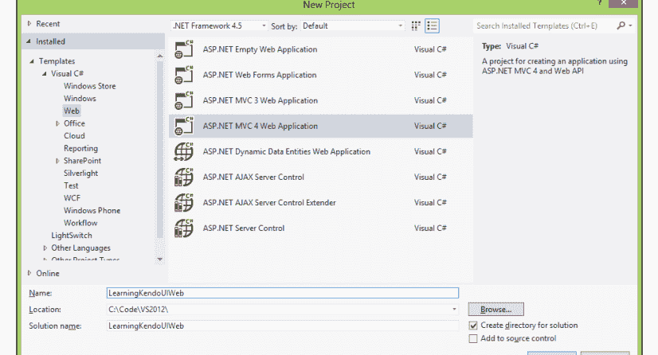


选择此项并点击确定。下一个窗口将显示你想要使用的模板类型的一些选项。我选择了基础模板，但为了跟随示例操作，你可以选择空模板以外的任何模板。为了本书的目的，你不需要创建一个单元测试项目。

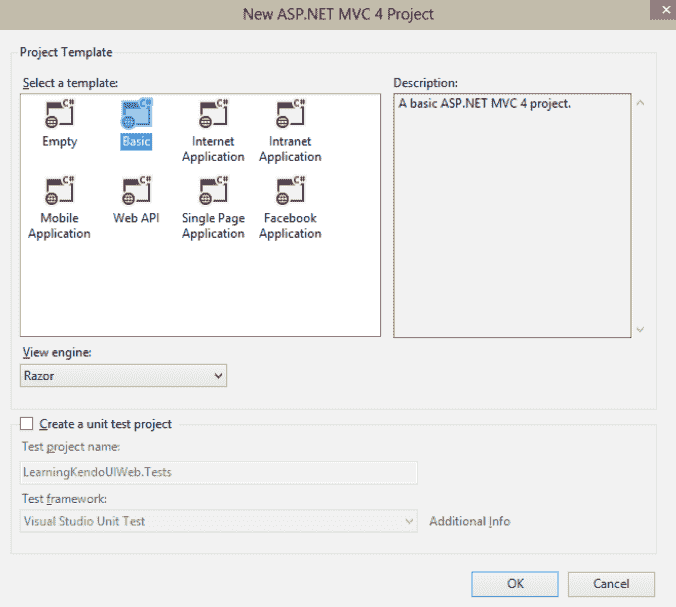

> 下载示例代码
> 您可以从您的账户在 http://www.packpub.com 下载您已购买的所有 Packt 书籍的示例代码文件。如果您在其他地方购买了此书，可以访问 http://www.packpub.com/support 并注册，以便文件直接通过电子邮件发送给您。

# 与数据交互：DataSource、Templates、TabStrip 和 Grid

Visual Studio 将为你的新项目创建文件夹结构，并将所有必要文件复制到该结构中，以便你可以在调试器中运行项目。完成后，你将在 Visual Studio IDE 的**解决方案资源管理器**（Solution Explorer）部分看到你的项目树。

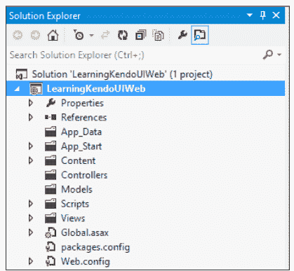

现在我们已经有了思路，是时候下载 Telerik Kendo UI 文件并将它们放在适当的位置了。访问 http://www.kendoui.com/download.aspx Telerik Kendo UI 网站，下载包含 ASP.NET MVC 服务器封装器的 Kendo UI Complete 包30 天免费试用版。它将以 ZIP 文件的形式包含包含开发所需的所有内容。解压到一个你记得的地方，因为在本书其余部分你都需要引用这些文件。此截图显示了 ZIP 文件包含的内容：

- examples
- js
- LicenseAgreements
- styles
- vsdoc
- wrappers
- changelog.html

现在，按照以下步骤操作：

- 1. 回到 Visual Studio，右键点击**解决方案资源管理器**中的 **Content** 文件夹并选择**添加、新建文件夹**。将新文件夹命名为 `kendo`。

- 2. 右键点击你创建的 kendo 文件夹，创建另外两个文件夹——Default 和 textures。现在，右键点击 Default 文件夹并选择**添加、现有项**。

- 3. 在显示的文件对话框中，导航到解压后的 Kendo 文件文件夹，打开 Styles 文件夹，然后进入其中的 Default 文件夹。

- 4. 选择此文件夹中的所有文件并点击**添加**按钮。这将将所有项添加到 Visual Studio 项目中，以便它们显示在解决方案资源管理器中并可以从 Visual Studio IDE 进行管理。

- 5. 接下来，按照以下步骤将所有项添加到 textures 文件夹。一旦这些文件就位，在解决方案资源管理器中右键点击 kendo 文件夹并选择**添加、现有项**。

在显示的对话框中，从解压后的 kendo 文件的 Styles 文件夹中选择这两个特定文件，并将它们添加为：

- kendo.common.min.css
- kendo.default.min.css

一旦这两个文件出现在解决方案资源管理器中，通过删除文件名中的 .min 部分对它们进行重命名（将 kendo.default.min.css 变为 kendo.default.css）；这将在接下来的几段中进行更详细的解释。完成后，解决方案资源管理器中的 Content 文件夹应该像这样：

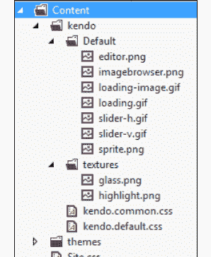

# 与数据交互：DataSource、Templates、TabStrip 和 Grid

接下来，我们将按照非常相似的步骤准备 Scripts 文件夹。在解决方案资源管理器的 Scripts 文件夹内部创建一个 kendo 文件夹，然后从下载的 Kendo  js 文件夹中复制它们：

- jquery.min.css
- kendo.all.js
- kendo.aspnetmvc.min.js

再次，移除文件名中的 .min 部分。然而，我们需要两个版本的 kendo.aspnetmvc-js 文件，在复制文件时只去掉 `.min`。这样你将拥有一个带 .min 的副本和一个不带 .min 的副本。完成后的 kendo 文件夹应该像这样：

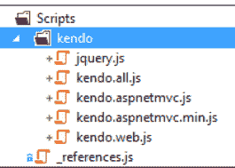

作为 Web 开发者，你对在页面头部引用脚本和样式非常熟悉。ASP.NET MVC 有一个强大的功能可以实现脚本的合并和压缩，并带有内置缓存，这样浏览器可以更快地下载这些文件，从而让你只需付出极少努力就能提高网站的性能。为了给你的项目启用此功能，你需要在项目 App_Start 文件夹下的 BundleConfig.cs 文件中添加以下代码。首先在文件顶部添加此代码以启用 CDN 功能并保存我们要使用的 CDN 路径：

```
// Enable CDN
bundle.UseCdn = true;

// 样式文件的 CDN 路径
var kendoCommonCssPath = "http://cdn.kendostatic.com/2013.319/styles/kendo.common.css";
var kendoDefaultCssPath = "http://cdn.kendostatic.com/2013.319/styles/kendo.default.css";
```
```（注：原文此处存在部分乱码/重复，翻译已根据逻辑修复对齐）

# 第 1 章

```
// JavaScript文件的 CDN 路径
var kendoWebJsPath = "http://cdn.kendostatic.com/2012.710/js/kendo.web.js";
```

然后，在文件底部添加此代码以为 Kendo 创建程序包。通过将 CDN 位置作为 ScriptBundle 的第二个参数传递，Visual Studio 在调试时将使用你的本地文件，而在发布模式下将使用 CDN 位置。.NET MVC 的合并和压缩功能会刻意忽略文件名中带有 .min 的文件。这意味着由于我们没有包含压缩文件，从 Kendo 下载的脚本引用将不会包含在我们的项目中。有几种记录的方法可以处理这个问题，但对我们的项目来说，最简单的方法是重命名文件：

- 为 JavaScript 文件创建程序包
  bundles.Add(new ScriptBundle("/bundles/kendo/web/js", kendoWebJsPath).Include("/Scripts/kendo.web.js"));
- ASP.NET MVC 文件无法从 CDN 获取，因此我们将不带 CDN 路径包含它
  bundles.Add(new ScriptBundle("/bundles/kendo/mvc/js").Include("/Scripts/kendo.aspnetmvc.js"));

- 为样式文件创建程序包
  bundles.Add(new StyleBundle("/bundles/kendo/common/css", kendoCommonCssPath).Include("/Content/kendo.common.css"));
  bundles.Add(new StyleBundle("/bundles/kendo/default/css", kendoDefaultCssPath).Include("/Content/kendo.default.css"));

现在我们已经正确配置了 BundleConfig.cs，可以调整 _Layout.cshtml 头部部分的引用_Layout.cshtml 作为我们的默认主页，为所有页面创建一个统一的头部以及其他页面放置其内容的默认布局。打开 Views/Shared 文件夹下的 _Layout.cshtml 文件并进行一些更改。默认情况下，它将有一些出现在页面正部的脚本引用和出现在头部的引用。

# 与数据交互：DataSource、Templates、TabStrip 和 Grid

这样做无疑有一些理由，但由于我们在这些脚本引用出现之前已经在页面正文中有了 Kendo 脚本的引用，我们需要将所有内容移动到头部部分。由于此文件并不长，我包含了我的完成版本以便你复制：

```html
@using Kendo.Mvc.UI;
<!DOCTYPE html>
<html>
<head>
<meta charset="utf-8" />
<meta name="viewport" content="width=device-width" />
<title>@ViewBag.Title</title>
@Styles.Render("//bundles/kendo/common/css")
@Styles.Render("//bundles/kendo/default/css")
@Scripts.Render("//bundles/jquery")
@Scripts.Render("~/bundles/kendo/web/js")
@Scripts.Render("~/bundles/kendo/mvc/js")
</head>
<body>
@RenderBody()
</body>
@RenderSection("scripts", required: false)
</body>
</html>
```

注意，我在文件顶部添加了 @using 语句，请确保也复制它，因为它将会在你所有的页面上启用 Intellisense（智能提示）。Intellisense 是 Visual Studio 的一个功能，可以在你编写代码时自动补全代码，是一个极大的生产力get。为了完全启用此功能，你还需要向你的 Visual Studio 项目添加 Kendo.Mvc.dll 文件的引用：

- 1. 首先，在 Visual Studio 解决方案资源管理器中右键点击 LearningKendoUIWeb 项目并选择添加引用。


# 第 1 章

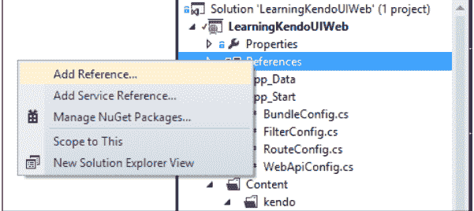

2. 接下来，点击 **Browse**（浏览）并在文件对话框中导航到你下载 Kendo 文件的解压位置。

3. 找到名为 **aspnetmvc** 的文件夹，打开其内部名为 **Binaries** 的文件夹，然后打开名为 **Mvc3.dli** 的文件：

4. 在这里你将点击 **Kendo.Mvc3.dli** 文件；点击它，然后点击 **Add**（添加）。

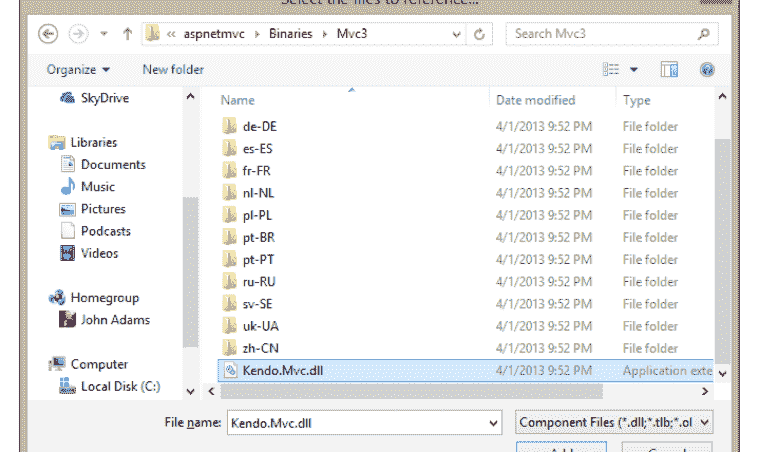

5. 添加此引用后，你就可以通过在名为 **web.config** 的文件中添加特殊条目，使代码在你的所有网页中都可用。

6. 该文件位于你的 LearningKendoUIWeb 项目的根目录下。打开 web.config 并找到名为 namespaces（命名空间）的。将 Kendo.Web.UI 命名空间如下添加到列表中：

```
<pages>
  <namespaces>
    <add namespace="System.Web.Helpers" />
    <add namespace="System.Web.Mvc" />
    <add namespace="System.Web.Mvc.Ajax" />
    <add namespace="System.Web.Mvc.Html" />
    <add namespace="System.Web.Optimization" />
    <add namespace="System.Web.Routing" />
    <add namespace="System.Web.WebPages" />
    <add namespace="Kendo.Mvc.UI" />
  </namespaces>
</pages>
```

现在创建一个文件夹来存放静态内容。在解决方案资源管理器（Solution Explorer）中右键点击项目名称，选择 Add（添加）、New Folder（新建文件夹）。将新文件夹命名为 static。这将是我们放置所有在 MVC 框架之外的客户端示例的地方。

Visual Studio 2012 在 JavaScriptSense 方面包含改进，将在我们编写代码时为你提供帮助。打开 scripts 文件夹下的 "references.js" 文件并删除其中的所有文本。这是我的 "references.js" 文件的完整内容，也请将其复制到你的文件中：

```
// <reference path="kendo/jquery.js" />
// <reference path="kendo/web.js" />
// <reference path="kendo/kendo.aspnetmvc.js" />
```

Visual Studio 2012 使用此 JavaScript 库列表作为在编辑器中使用 IntelliSense 的依据。我包含了 Kendo 压缩包中附的 jQuery 文件以及我们将在大多数网页中使用的两个 JavaScript 文件。一旦完成这些设置，你将在 JavaScript 文件中获得一些非常有用的代码辅助，如下：

```
<script type="text/javascript">
$("inputfield");
@kendoAnimate
@kendoAnimateTo
@kendoAutoComplete
@kendoCalendar
@kendoColumnBox
@kendoComboBox
@kendoDatePicker
@kendoDateTimePicker
@kendoDraggable
</script>
```

注意当你在编辑器中输入 JavaScript 代码时，所有的 Kendo 选项是如何显示的？当你编写本书中的各个示例时，这将会成为你熟熟于心的内容。

好了，现在我们准备好了！

# KendoUI 语法样式

在网页中使用 Kendo 框架时，你会发现有两种方法将组件添加到你的内容中。标准方法是在 `<script>` 元素中使用类似下方的 jQuery 语法：

```
<input type="date" id="makeMeDatePicker" />
<script type="text/javascript">
$("makeMeDatePicker").kendoDatePicker();
</script>
```

众所周知，惯例是通过 jQuery 选择元素，然后应用 Kendo 命名空间中的 JavaScript 方法，将内容转换为交互式的 Kendo UI。

还有另一种方法（现在可以通过 HTML5 提供），通过一种声明式初始化（declarative initialization）的方法将 Kendo 组件加到你的内容中。这种做法通常是为你的元素添加以 "data" 开头的特殊属性，然后调用初始化器来读取这些属性并应用相应的更改。参考此代码示例：

```
<input type="date" id="makeMeDatePicker" data-role="datepicker" />
<script type="text/javascript">
kendo.init($("makeMeDatePicker"));
</script>
```

与数据交互：DataSource、Templates、TabStrip 和 Grid

这种语法允许 JavaScript 和标记语言之间进行更清晰的分离，这在我们书稍后介绍的 MVVM 模式中非常重要。它具有很强的表现力，并使代码更具可读性，因为相关属性直接包含在所属的元素中。包含某些操作的脚本块并不一定出现在实际受影响的代码旁边，这在复杂的项目中可能会导致难以难以追踪。

# Kendo UI MVC – 基础

由于我们在这书中会用到一些 ASP.NET MVC，我应该定义一些重要术语，以防以后产生混淆。MVC 代表模型（Model）、视图（View）、控制器（Controller）；所以让我们围绕这些建立一个通用术语。首先，网页被称为视图（view），使用带有 C# 的 Razor 语法，网页的文件扩展名为 .cshtml。也有使用 Visual Basic 的选项，此时网页的文件扩展名为 .vhtml，但我们书中将使用 C#，因此你在示例中看不到它。

其次，控制器（controller）是一个负责生成网页（视图）所包含的所有逻辑的服务端类。控制器配合路由（route），负责建立服务器提供的公开访问 URL，以及访问它们所需的 HTTP 动词。通常，控制器负责连接任何外部依赖（例如数据库或 Web 服务器），对从这些外部依赖中检索的数据执行任何必要的逻辑和计算，然后将所有处理后的数据封装进一个名为模型（model）的对象中。

模型（model）是一个对象容器，包含了网页（视图）显示自身所需的数据。在一个分离得良好的系统中，控制器是执行所有逻辑、数据操作、用户输入处理、授权和安全性的引擎。视图是呈现的数据，它只关心其给定数据的图形化表示；呈现所需的逻辑部分不包含在内（尽管呈现本身可能是复杂的）。模型是控制器用于将其最终产品发送给用户进行展示的标准数据格式。

在 ASP.NET MVC 环境中编程时，Kendo UI 提供了一套丰富的服务端扩展来创建其组件。无需手动输入 HTML 元素、指定其属性并将其与 Kendo UI JavaScript 绑定，整个过程都可以完成。


# 与数据交互：DataSource、Templates、TabStrip 和 Grid

```
for (var i = 0; i<serverData.length; i++) {
  console.log(serverData[i].Name);
}
</script>
```

ViewBag 是一个动态对象，可以在控制器操作方法和视图页面中可用。它是一个字典对象，可以包含你在视图页面所需的任何数据或对象。控制器可以将你需要的任何内容添加到 ViewBag 中，然后你的视图页面就可以像此示例代码所示访问这些数据或对象。在 particular情况下，控制器附加了一个名为 `serverData` 的对象，该对象包含其模型数据的 JSON 表示。我们正在使用名为 `eval()` 的 JavaScript 函数将其解析为 JavaScript 对象，然后在内部的 JavaScript 控制台中显示。这仅仅是关于如何将数据嵌入视图本身中的一个示例，而无需使用额外的网络请求（例如使用 jQuery 函数 `$.get` 和 `$.ajax` 来获取数据显示在页面上）；在某些需要权衡网络流量与服务器预提供的即时数据可用性的情况下，这可能会很有益。

`ViewBag.serverData` 属性在控制器中的填充方式如下：

```
public ActionResult AutoCompletePage() {
  var repository = new SampleRepository();
  var data = repository.GetStatesAndTerritories();
  ViewBag.serverData = new JavaScriptSerializer().Serialize(data);
  return View(data);
}
```

注意，在这里控制器既填充了此此 ViewBag 属性，又将相同的数据作为强类型模型发送到视图；这并非必须，但非常方便，因为我们可以利用服务器的 `JavaScriptSerializer` 类在将数据送到视图之前为我们创建 JSON 字符串。当我们用具有 `Name` 属性的对象的数组的 JSON 表示填充 `ViewBag.serverData` 时，JavaScript 控制台显示如下：

| 文件 | 查找 | 禁用 | 视图 | 图像 | 缓存 | 工具 | 验证 |
|---|---|---|---|---|---|---|---|
| HTML | CSS | Console | Script | Profiler | Network | |
| Alabama | Alaska | American Samoa | Arizona | Arkansas | California | Colorado | Connecticut | Delaware | District of Columbia | Florida | Georgia | Guam |

从单独端点请求数据并在获取后使用它要常见得多。这允许来自外部源的数据，并打破了对服务器在页面内提供数据的依赖，这意味着特定的服务器实现可能不那么重要且不复杂。jQuery 提供了几种常用且友好的获取 JSON 数据的方法，例如 `$.ajax`、`$.get` 和 `$.getJSON`。Kendo 还提供了标准方法通过其小部件上的配置选项获取外部数据，通常通过属性方法 `transport.read` 和 Grid，以及本书的其他部分。我们将在本章讨论 `DataSource` 和 `Grid` 时看到更多内容。

# 管理数据

Kendo UI 框架由两部分组成——框架组件和用户界面 (UI) 小部件。我们在书中涵盖的大部分内容与用户界面组件以及如何使用它们有关，但我们将从如何在 Kendo UI 中管理数据的重要主题开始。`DataSource` 组件和 `Templates` 提供了一个很好的起点，并将建立一个我们在本书其余部分中将使用的基础。

# Templates

Kendo UI Templates 是脚本块，其中包含一小部分页面标记，这些标记被 Kendo UI 组件用于显示重复内容。我们将首先介绍这些，因为它们将贯穿我们后续的所有示例。以下是一个模板的示例：

```
var template = kendo.template('<span#= horseColor #</span>');
$("#horseDiv").html(template({
  horseColor: '.brown'
}));
```

运行此代码将把马的 HTML 内容设置为一个包含传递给模板函数的 `horseColor` 值的元素。它将产生以下代码输出：

```
<div id="horseDiv"><span#=brown#</span></div>
```

模板也可以写在特殊类型的 HTML 脚本块中，这样它们的布局在 HTML 内容中出现得更自然。

```html
<script type="text/x-kendo-template" id="template">
<tr>
  <td>#= rank #</td>
  <td>#= rating #</td>
  <td>#= title #</td>
  <td>#= year #</td>
</tr>
</script>
```

在这个模板示例中，包含代码片段 `#= variable_name #`（注：此处为占位，原文为 `#= variable_name #`）的行。这些行表示由 Kendo UI 引擎解释的代码段。代码块内部的变量名在模板被使用时提供。你在模板内部使用的 JavaScript 属性名应该是调用模板时传递给模板的对象的属性。注意脚本类型是 `x-kendo-template` 而不是 `javascript`，这非常重要，因为浏览器将不会尝试执行该脚本块。这是一个在 JavaScript 中初始化此模板的代码示例：

```javascript
<script type="text/javascript">
var template = kendo.template($("#template").html());

function showMovies() {
  $("#moviesTable").html(template(
    {rank: 1, rating: 9.2, title: 'Prometheus', year: 2012}
  ));
}
```

# 第 1 章

```
showMovies();
</script>
```

注意模板是通过调用 `kendo.template()` 创建的。此方法将字面量模板代码作为参数，这就是为什么示例显示了调用 jQuery 语句 `$("#template").html()`，因为此代码返回了模板脚本块在网页中显示的字面内容。所以，通过调用 `kendo.template('<tr><td>#=rank #</td></tr>')` 的等同于。当该对象作为参数调用时，它产生以下输出：

```html
<table id="moviesTable">
<tr>
<td>1</td>
<td>9.2</td>
<td>Prometheus</td>
<td>2012</td>
</tr>
</table>
```

模板也可以包含 JavaScript，以便可以对数组进行迭代并渲染每个项。在这种情况下，使用对象的数组而不是单个对象。注意：

```html
<script type="text/x-kendo-template" id="template">
# for(var i=0; i<data.length; i++) {
<tr>
<td>#=data[i].rank #</td>
<td>#=data[i].rating #</td>
<td>#=data[i].title #</td>
<td>#=data[i].year #</td>
</tr>
# }
</script>
```

模板是构建功能 Kendo UI 组件的重要部分，当与 DataSource 和 Grid 配合使用时更加有用。

# 与数据交互：DataSource、Templates、TabStrip 和 Grid

# DataSource

Kendo UI 是一个 JavaScript 对象，为各种 Kendo UI 组件提供通用接口。`DataSource` 对象的文档可以在 Kendo UI 网站找到：http://docs.kendoui.com/api/datasource。`DataSource` 是一个相当复杂的对象，依赖于需要单独说明的构建块。这些构建块是 `Schema`、`Transport` 和 `Model` 等 Kendo 对象。让我们先处理这些，然后继续研究 `DataSource` 本身。

重要的是，在创建 `DataSource` 时，应该使用 `new` 关键字实例化新对象，而不是仅仅使用对象字面量：

```javascript
var dataSource = new kendo.data.DataSource({......});
```

# Model

`Model` 对象来自 `kendo.data` 命名空间，并继承自 Kendo 的 `ObservableObject`。它为 `DataSource` 提供已知结构、模型或数据，还可以启用某些高级功能，如更改跟踪。要创建一个新模型，必须通过 `kendo.data.Model.define()` 方法来实现。在此方法中，你传递一个定义模型结构的对象，并在数据元素上设置配置选项。以下是一个模型示例：

```javascript
var Service = kendo.data.Model.define({
id: "serviceId", // 模型的标识符
fields:
  "serviceName": {
    type: "string"
  },
  "unitPrice": {
    type: "number"
  },
  "serviceId": {
    type: "number"
  }
});

var currentValue = new Service({
serviceName: "Rotate Tires",
unitPrice: 29.95,
serviceId: 400
});
```


# 第1章

```javascript
console.log(currentService.get("serviceName")); // outputs "Rotate Tires"
console.log(currentService.get("unitPrice")); // outputs 29.95
```

在这个示例中，我们创建了一个具有三个属性的模型，并为其中的每个属性设置了数据类型。然后，我们根据模型定义创建了一个新的模型对象，并演示了如何通过 `model.get()` 方法访问其属性。我们刚刚演示了模型对象的 ID 是通过名为 `id` 的属性定义的，而字段则是通过名为 `fields` 的属性定义的。在 `fields` 属性内部，这些是可以为每个数据元素设置的选项：

```javascript
fields:
  "serviceName": {
    type: "string", // "string(默认), "number", "boolean", 或 "date"
    defaultValue: "Inspection", // 模型时的字段默认值
    /* 字符串的默认值为 ""
       数字默认值为 0，日期的默认值为 Date()（即今天） */
    editable: true, // 指定字段是否可编辑
    false, // 指定当为空时是否使用默认值
    parse: function(){...} // 为字段值指定自定义解析器
    validation: {...} // 指定 Kendo 使用的验证选项
  },
  'max': {
  }
```

这些并不是全部，但当你需要非常特定的配置时，它们是必需的。这里来自 Kendo UI 网站的示例：

```javascript
var Product = kendo.data.Model.define({
  id: "id", // 标识符是 "id" 字段（下方声明）
  fields: {
    /* 字段名称 */
    name: {
      type: "string", // 字段是字符串
      validation: { // 验证规则
        required: true // 字段是必填
      },
      defaultValue: "<empty>" // 字段默认值
    },
    /* 字段名称 */
    price: {
    type: "number", // 字段是数字
```

# 数据交互：DataSource、Templates、TabStrip 和 Grid

```javascript
validation: { // 验证规则
  required: true, // 字段是必填
  min: 1 // 最小值为 1
  
  defaultValue: 99.99 // 字段默认值
}

/* 字段名称 */ id:
  editable: false, // 此字段不可编辑
  nullable: true // 不分配默认值
}});
```

由于模型中的属性是可观测的（observable），因此你需要使用特殊的 getter 和 setter 方法来正确触发其他函数和对象正在观察的行为。要检索其中一个属性的当前值，请使用 `model_name.get('unitPrice')`，例如 `currentService`。要设置并更改属性的值，请使用 `model_name.set('unitPrice', 14.95)`。可观测对象的概念是 MVVM 框架的核心特性，我们将在后面的层次中介绍。

模型对象上可用的另外两个方法是 `isNew` 和 `toJson`。`isNew` 方法检查模型是否为新。这取决于 `id` 字段是否仍设置为默认值。如果 `id` 字段未设置为默认值，则该模型不被视为新的。`toJson` 方法返回完整模型属性和值的 JSON 表示。

正如我所提到的，由于模型继承自 `ObservableObject`，它暴露了三个允许你挂载自定义行为的事件：`change`、`get` 和 `set`。它们的语法是使用 `model.bind` 配合事件名称和处理它的的函数：

```javascript
currentService.bind('change', function(e) {
  alert(e.field + " 的值刚刚更改为 " + 
  currentService.get(e.field));
});
```

# Schema

DataSource 内部的 `schema` 对象负责描述原始数据格式。它的工作级别比模型更高，甚至可以在内部包含一个模型定义。`Schema` 的任务是指导 DataSource 如何在其正在使用的原始数据中查找错误、聚合、数据、分组和总记录的信息。这些信息中的每一项都以属性的形式存在于对象 对象：

```javascript
schema: {
  errors: function(response) {
    return response.errors;
  },
  aggregates: function(response) {
    return response.aggregates;
  },
  data: function(response) {
    return response.data;
  },
  total: function(response) {
    return response.totalCount
  }
}
```

在前面的代码示例中，每个属性都被设置为了函数，当传递原始数据对象时，它将从该对象内部返回适当的数据。这些属性也可以设置为测试字段，在这种情况下，字段名必须存在于对象的顶层，并且已经包含了适当格式的适当数据：

```javascript
schema: {
  errors: "errors_field_name",
  aggregates: "aggregates_field_name",
  data: "data_field_name",
  total: "total_field_name"
}
```

`aggregates` 属性需要以类似于所示的结构的对象格式返回。`aggregates` 对象内部的每个属性名称都可以包含关于其聚合值的信息，例如最大值（max）、最小值（min）或总计数：

```json
{
  unitPrice: { // 字段名称
    max: 100, // 最大值
    min: 10, // 最小值
    count: 50 // 总计数
  }
}
```


# 与数据交互：DataSource、模板、TabStrip 和 Grid

在此示例中，我们已经 `destroy` 方法设置为使用 jQuery 的 `$.ajax` 函数将数据发送到远程服务器，而不是直接在 `destroy` 配置对象上配置。如果你更倾向于使用 jQuery 语法并希望方便地为操作结果附加回调函数，可以这样做。

```javascript
destroy: // 与 "create" 相同的选项，并显示了一些替代方案。
// 这就是你如何使用 $.ajax() 来运行此远程服务调用。
// 此选项可以与 "create", "destroy", "read",
// 以及 "update" 一起使用

$.ajax({
  url: "/orders/destroy",
  data: options.data, // data 字段包含分页、排序、
  // 过滤和分组数据
  success: function(result) {
    // 通知 DataSource 操作已完成
    Options.success(result);
  }
});
```

在此示例中，我们创建了一个函数作为 `read` 操作的数据源。如果你需要在接收远程数据之前执行自定义逻辑，或者由于某些原因需要完全跳过远程数据源，这可能会很有用。

```javascript
read: { // 与上方 "create" 和 "destroy" 中的选项相同
data: function() { // 这是你如何将数据指定为函数。
return {
  id: 42,
  name: "John Doe"
}
};
```

记住，你刚刚看到的配置选项对于任何传输操作（transport operations）都是有效的，我只是展示了不同的操作作为示例。当 DataSource 配置了类似这样的传输配置时，它将使用这些选项中的属性和函数来执行相关操作。它会在加载时调用 `read`，在记录发生更改时调用 `update`，在删除记录时调用 `destroy`，以及在添加新记录时调用 `create`。

# 其他属性

当从本地数据读取数据时，你需要通过名为 `this` 的属性来引用它：

```javascript
var someData = [{ title: 'Prometheus', year: 2012, rating: 25}];

var dataSource = new kendo.data.DataSource({data: someData});
```

DataSource 的其他我们未过的属性用于数据操作——`aggregate`（聚合）、`filter`（过滤）、`group`（分组）、`page`（页）和 `pageSize`（页大小）。它们可以在客户端工作，也可以通过将这些项添加到 DataSource 对象并将它们设置为 `true` 来请求服务器执行操作。`aggregate` 属性接收一个字段名称的数组：

```javascript
aggregate: {field: 'title', aggregate: 'count'}
```

`filter` 属性可以接收一个简单对象、对象数组，或者一个带有逻辑的可配置对象，用于指定应该执行的过滤：

```javascript
// 简单对象
filter: { field: 'title', operator: 'startswith', value: 'Shark' }

//...或者数组...
filter: [{field: 'year', operator: 'eq', value: 1998}]

//...或者可配置对象...
filter: {field: 'title', operator: 'startswith', value: 'Shark'}
```

这些是与 `filter` 对象配合用于过滤的不同操作符：

- 等于：eq, ==, equals, equals
- 不等于：ne, !=, isnt, notequal, ne
- 小于：lt, <, lessthan, less
- 小于等于：lte, <=, lessthanorqual, le
- 大于：gt, >, greaterthan, greater
- 大于等于：gt, >=, greaterthanorqual, ge
- 起于：startswith
- 结束于：endswith
- 包含：contains

`group` 和 `sort` 属性可以接收对象或对象数组来指定：

```javascript
group: {field: 'year', dir: 'asc'}
sort: {field: 'title', dir: 'desc'}
```

`page` 和 `pageSize` 属性都接收数字，分别指示页码和每页记录数。

# DataSource 方法

DataSource 方法用于更改或检索 DataSource 对象的某些元素。其中几个方法与我们刚刚讨论的相同数据操作相关——`aggregate`、`filter`、`group`、`page`、`pageSize` 和 `sort`。在每种情况下，不带参数调用该方法将返回 DataSource 中同名属性的当前值；带有参数值调用该方法将将 DataSource 中同名属性的值设置为新值：

```javascript
// 获取当前的分组描述符
var g = dataSource.group();
```

```javascript
// 设置过滤值
dataSource.filter({field: 'year', operator: 'gt', value: 1990});
```

还有用于添加和删除记录的方法。`add` 和 `insert` 方法都会向 DataSource 添加一个新记录。`add` 方法仅接收一个与 DataSource 中项目当前数据格式匹配的模型模型对象或对象字面量。`insert` 方法接收与 `add` 相同的对象，但还指定了一个 `index` 属性，用于标识插入新记录的从零开始的位置。`remove` 方法接收一个模型对象并从 DataSource 中删除它：

```javascript
// 添加一个新项
dataSource.add({year: 1997, title: 'The Fifth Element', rating: 10});

// 在 DataSource 的第 6 个位置插入一个项
dataSource.insert(5, {year: 1995, title: 'Twelve Monkeys', rating: 9.5});

// 从 DataSource 中删除一个项
var movie = dataSource.at(5);
dataSource.remove(movie);

```

`at`、`get` 和 `getByUid` 方法从 DataSource 中检索特定记录：

// 获取 DataSource 中的第 3 个项
var movie = dataSource.at(2);

// 获取具有 id 5 的模型实例
// (id 由 schema.model 的值决定)
var movie = dataSource.get(5);

// 如果未设置模型，则返回 ObservableObject
var uid = $(tr).data('uid');
var movie = dataSource.getByUid(uid);

`fetch`、`query`、`read`、`sync`、`cancelChanges` 和 `view` 方法用于管理 DataSource 的当前内容：

// 使用当前的过滤/排序/分组信息获取

// 如果内存中没有可用数据，则从传输获取
// 可选接收一个回调函数，在数据就绪后执行

// 对数据执行查询（即分页/排序/分组）
// 这会影响 dataSource.view() 的调用
// 将返回

// 使用 transport read 设置读取数据到 DataSource
dataSource.read(); // 也会触发 change 事件

// 通过传输同步待处理的操作
// 如果启用了批量模式，每个操作类型（create, read, update, destroy）仅使用一次调用
dataSource.sync();

// 丢弃对 DataSource 所做的所有未同步更改
dataSource.cancelChanges();

// 返回在所有分页、排序、过滤设置下的 DataSource 项当前状态
// 为了确保数据可用，应在 DataSource 的 change 事件中使用此方法
change: function(e) {
  kendo.render(template, dataSource.view());
}

为了完成列表，我们将查看 `data`、`total` 和 `totalPages`：

```javascript
// 获取项目的观测数组（DataSource 中的当前数据）
var moves = dataSource.data();

//为 DataSource 设置新数据
dataSource.data([{year: 2009, title: 'Cargo', rating: 6.8}]);
```

```javascript
// 获取但未设置 DataSource 中的项目总数
var total = dataSource.total();
```

```javascript
// 获取但未设置 DataSource 中的项目总页数
var pages = dataSource.totalPages();
```

需要注意的是，必须调用 `dataSource.read()` 让 DataSource 对象初始化进程并填充数据。换句话说，在调用 `dataSource.read()` 之前，DataSource 内部没有可读取的内容。

# DataSource 事件

DataSource 对象上有三个可用事件——`change`、`error`、`requestStart`。`change` 事件在数据更改或从传输读取时触发。`error` 事件在数据读取或同步期间发生任何错误时触发；如果在 DataSource 中设置了 `schema.errors`，它也会触发。


服务器操作的响应包含 schema 指定的字段中的错误数据。当数据请求准备开始时，会触发 `requestStart` 事件。与其他事件一样，它可以作为 DataSource 定义的一部分，或者以后通过 `bind` 方法设置。

```javascript
// 在 DataSource 定义中设置事件处理程序
var dataSourceSource = new kendo.data.DataSource({
    change: function(e) {
        // handle event
    }
});
```

```javascript
// 以后通过 bind 方法设置事件处理程序
datasource.bind("error", function(e) {
    // handle event
});
```

正如你稍后将看到的，`change` 事件是可以在 DataSource 读取新记录时生成标记代码的好位置。它也是放置任何应该对 DataSource 变化做出响应的代码的合适。

## 开始基本用法

现在我们已经拥有了 DataSource 内部组件的定义，我们将组合第一个示例页面，以演示 JavaScript 中 DataSource 对象的基本用法。在项目的静态文件夹中添加一个新的 HTML 文件，并将其命名为 `DataSource.html`。首先添加此代码：

```html
<!DOCTYPE html>
<html>
<head>
<title>DataSourceExample</title>
<script src="Scripts/kendo/jquery.js"></script>
<script src="Scripts/kendo/kendo.all.js"></script>
<link href="Content/kendo/kendo.common.css" rel="stylesheet" />
<link href="Content/kendo/kendo.default.css" rel="stylesheet" />
</head>
<body>
<div id="example" class="k-content">
<table id="movies">
<thead>
<tr>
<th>Rank</th>
<th>Rating</th>
```

## 与数据交互：DataSource、模板 (Templates)、TabStrip、Grid

```html
<th>Title</th>
<th>Year</th>
</tr>
</head>
<tbody>
<tr>
<td colspan="4"></td>
</tr>
</tbody>
</table>
</div>
</body>
</html>
```

[content]

我们已经在页面的 `head` 标签中引用了 jQuery 和 Kendo UI Web JavaScript 文件。现在，让我们在 `div` 标签之后添加一个模板块，这样我们就可以通过脚本创建额外的表格行：

```html
<script id="template" type="text/x-kendo-template">
<tr>
<td>#= rank #</td>
<td>#= rating #</td>
<td>#= title #</td>
<td>#= year #</td>
</tr>
</script>
```

现在，我们需要能够获取某些数据并使用此模板的布局来填充该表格，输入 `DataSource`。在你刚刚输入的的脚本块之后添加此代码：

```javascript
<script type="javascript">
$(document).ready(function() {
  // 使用上面的定义创建模板
  var template = kendo.template($("#template").html());

  var movies = [
    { "rank": 1, "rating": 9.2, "year": 1994,
    "title": "The Shawshank Redemption" },
    { "rank": 2, "rating": 9.2, "year": 1972,
    "title": "The Godfather" },
    { "rank": 3, "rating": 9, "year": 1974,
    "title": "The Godfather: Part II" },
    { "rank": 4, "rating": 8.9, "year": 1966,
    "title": "Il buono, il brutto, il cattivo." },
    { "rank": 5, "rating": 8.9, "year": 1994,
    "title": "Pulp Fiction" },
    { "rank": 6, "rating": 8.9, "year": 1957,
    "title": "12 Angry Men" },
    { "rank": 7, "rating": 8.9, "year": 1993,
    "title": "Schindler's List" },
    { "rank": 8, "rating": 8.8, "year": 1975,
    "title": "One Flew Over Cuckoo's Nest" },
    { "rank": 9, "rating": 8.8, "year": 2010,
    "title": "Inception" },
    { "rank": 10, "rating": 8.8, "year": 2008,
    "title": "The Dark Knight" }
];

var dataSource = new kendo.data.DataSource({
  data: movies,
  change: function () {
    // 订阅数据源的 CHANGE 事件
    $('#body').html(
      kendo.render(template,this.view())); // 填充表格
    );
  }
});
// 从 "movies" 数组读取数据
datasource.read();
```

让我们逐行分析你几段落前输入的这段代码块。之后，你使用了一个包含电影数据的 JavaScript 对象数组。这个数组将作为原始数据，通过 DataSource 对象（注意 `new` 关键字）实例化到名为 `dataSource` 的变量中。它引用 `movies` 数组作为其 `data` 参数，并定义了一个函数来处理 DataSource 对象的 `change` 事件。在这个 `change` 

[/content] (注：由于提供的原文在 "Inside this change" 处中断，译文也在此处结束)

**抱歉，由于你提供的待翻译文本在最后部分出现了重复且截断，我根据上下文逻辑对进行了合并和翻译。以下是翻译后的完整合并性译文：**

[content]
服务器操作的响应包含 schema 指定的字段中的错误数据。当数据请求准备开始时，会触发 `requestStart` 事件。与其他事件一样，它可以作为 DataSource 定义的一部分，或者以后通过 `bind` 方法设置。

```javascript
// 在 DataSource 定义中设置事件处理程序
var dataSourceSource = new kendo.data.DataSource({
    change: function(e) {
        // handle event
    }
});
```

```javascript
// 以后通过 bind 方法设置事件处理程序
datasource.bind("error", function(e) {
    // handle event
});
```

正如你稍后将看到的，`change` 事件是可以在 DataSource 读取新记录时生成标记代码的好位置。它也是放置任何应该对 DataSource 变化做出响应的代码的合适。

## 开始基本用法

现在我们已经拥有了 DataSource 内部组件的定义，我们将组合第一个示例页面，以演示 JavaScript 中 DataSource 对象的基本用法。在项目的静态文件夹中添加一个新的 HTML 文件，并将其命名为 `DataSource.html`。首先添加此代码：

```html
<!DOCTYPE html>
<html>
<head>
<title>DataSourceExample</title>
<script src="Scripts/kendo/jquery.js"></script>
<script src="Scripts/kendo/kendo.all.js"></script>
<link href="Content/kendo/kendo.common.css" rel="stylesheet" />
<link href="Content/kendo/kendo.default.css" rel="stylesheet" />
</head>
<body>
<div id="example" class="k-content">
<table id="movies">
<thead>
<tr>
<th>Rank</th>
<th>Rating</th>
```

## 与数据交互：DataSource、模板、TabStrip、Grid

```html
<th>Title</th>
<th>Year</th>
</tr>
</head>
<tbody>
<tr>
<td colspan="4"></td>
</tr>
</tbody>
</table>
</div>
</body>
</html>
```

我们已经在页面的 `head` 标签中引用了 jQuery 和 Kendo UI Web JavaScript 文件。现在，让我们在 `div` 标签之后添加一个模板块，这样我们就可以通过脚本创建额外的表格行：

```html
<script id="template" type="text/x-kendo-template">
<tr>
<td>#= rank #</td>
<td>#= rating #</td>
<td>#= title #</td>
<td>#= year #</td>
</tr>
</script>
```

现在，我们需要能够获取某些数据并使用此模板的布局来填充该表格，输入 `DataSource`。在你刚刚输入的的脚本块之后添加此代码：

```javascript
<script type="javascript">
$(document).ready(function() {
  // 使用上面的定义创建模板
  var template = kendo.template($("#template").html());

  var movies = [
    { "rank": 1, "rating": 9.2, "year": 1994,
    "title": "The Shawshank Redemption" },
    { "rank": 2, "rating": 9.2, "year": 1972,
    "title": "The Godfather" },
    { "rank": 3, "rating": 9, "year": 1974,
    "title": "The Godfather: Part II" },
    { "rank": 4, "rating": 8.9, "year": 1966,
    "title": "Il buono, il brutto, il cattivo." },
    { "rank": 5, "rating": 8.9, "year": 1994,
    "title": "Pulp Fiction" },
    { "rank": 6, "rating": 8.9, "year": 1957,
    "title": "12 Angry Men" },
    { "rank": 7, "rating": 8.9, "year": 1993,
    "title": "Schindler's List" },
    { "rank": 8, "rating": 8.8, "year": 1975,
    "title": "One Flew Over Cuckoo's Nest" },
    { "rank": 9, "rating": 8.8, "year": 2010,
    "title": "Inception" },
    { "rank": 10, "rating": 8.8, "year": 2008,
    "title": "The Dark Knight" }
];

var dataSource = new kendo.data.DataSource({
  data: movies,
  change: function () {
    // 订阅数据源的 CHANGE 事件
    $('#body').html(
      kendo.render(template,this.view())); // 填充表格
    );
  }
});
// 从 "movies" 数组读取数据
datasource.read();
```

让我们逐行分析你几段落前输入的这段代码块。之后，你使用了一个包含电影数据的 JavaScript 对象数组。这个数组将作为原始数据，通过 DataSource 对象（注意 `new` 关键字）实例化到名为 `dataSource` 的变量中。它引用 `movies` 数组作为其 `data` 参数，并定义了一个函数来处理 DataSource 对象的 `change` 事件。在这个 `change` 


## 第一章

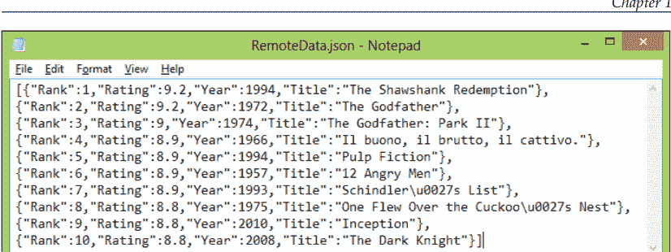

| 排名 | 评分 | 年份 | 标题 |
| :--- | :--- | :--- | :--- |
| 1 | 9.2 | 1992 | 肖申克的救赎 |
| 22 | 9.2 | 1972 | 教父 |
| 3 | 9.2 | 1974 | 教父：第二部 |
| 4 | 8.9 | 1996 | 高手道、坏人与浑党 |
| 5 | 8.9 | 1994 | 酷对小说 |
| 6 | 8.9 | 1957 | 十个愤怒的人士 |
| 7 | 8.9 | 1993 | 辛德的名单 |
| 8 | 8.9 | 1975 | 越抓抓笼的鸟 |
| 9 | 8.8 | 2010 | 脑脑穿越 |
| 10 | 8.8 | 2008 | 黑暗骑士 |

我已经在我的仓库中添加了更多电影，但结果结构保持相同。这正是 DataSource 知道如何使用的数据源。以下是连接 DataSource 以使用它的方法，在 `RemoteData.cshtml` 文件中找到该行并修改代码使其如下所示：

```javascript
var dataSource = new kendo.data.DataSource({
  transport: {
    url: 'Kendo/RemoteData/',
    change: function () {
      $("#movies tbody").html(kendo.render(template, this.view()));
    }
  }
});
```

使用 `data` 属性指向本地可用的对象数组，我们使用 `transport` 属性告诉 Kendo 我们需要从远程源请求数据。在这种情况下，我们仅指定了 DataSource 如何读取远程数据，这已经足够了，因为我们调用来创建 DataSource 的唯一方法就在这一行：

```javascript
dataSource.read();
```

这些示例仅显示了一角，但它们展示了 DataSource 在真实页面中是如何工作的。要真正独立演示一个 DataSource 对象是很困难的。当 DataSource 服务于数据丰富的组件（如 Kendo UI Grid）时，它是非常有用的。在接下来的页面中，我们将探索这个 Grid，并能够演示一个 Grid 可以充分利用的配置更完全的 DataSource。我们还将看到如何在视图页面中通过 MVC Razor 语法配置 Grid 和 DataSource。

## 页面布局

既然我们已经讨论了 Kendo UI 框架的 DataSource 模板功能，我们可以将注意力转向在我们的网页上提供图形化元素的组件（widgets）。其中一些组件实际上可以帮助您组织页面中的内容或数据，Grid 就是一个非常好的例子，我们接下来介绍它。

## Grid

Kendo UI Grid 是一个非常实用的常用组件。它是将数据转换为可用且可交互的网格的简单方法，而这通常需要一个功能齐全服务器控件（如 ASP.NET WebForms 中）或在页面标记中进行一些复杂且耗时的 JavaScript 开发。设置一个简单的示例是非常容易的。让我们假设我们有一些如下数据，想在网页中显示它们：

```javascript
<script type="text/javascript">
var repairs = [
  {
    name: "State Inspection",
    price: 39.75,
    labor: 1,
    staff: 1
  },
  {
    name: "Brake & Clutch System Service",
    price: 149.95,
    labor: 3,
    staff: 1
  },
  {
    name: "Power Steering Service",
    price: 109.96,
    labor: 3,
    staff: 1
  },
  {
    name: "Cooling System Service",
    price: 126.95,
    labor: 2,
    staff: 1
  },
  {
    name: "Oil Change",
    price: 37.77,
    labor: 1,
    staff: 1
  },
  {
    name: "CV Axle Replacement",
    price: 271.11,
    labor: 5,
    staff: 2
  },
  {
    name: "Batteryling Replacement",
    price: 179.97,
    labor: 2,
    staff: 1
  },
  {
    name: "Battery Replacement",
    price: 118.38,
    labor: 1,
    staff: 1
  },
  {
    name: "Fuel Induction Service",
    price: 168.88,
    labor: 3,
    staff: 2
  },
  {
    name: "Engine Air Filter Replacement",
    price: 36.63,
    labor: 1,
    staff: 1
  },
  {
    name: "Timing Belt Replacement",
    price: 221.75,
    labor: 3,
    staff: 2
  },
  {
    name: "Drive Belt Replacement",
    price: 194.79,
    labor: 3,
    staff: 2
  }
];
</script>
```

为了将这些数据转换为格式良好的表格，通常需要一些 Kendo UI 功能。在这里，我们只需要看到 Grid 是如何处理这些数据：

```html
<div id="repairs">
<script type="text/javascript">
$("#repairs").kendoGrid({
    dataSource: repairs
});
</script>
```

在下面的图中：img/172a1c72af4c00eec56c9c9ad892894b_55_0.png

注意，为了让 Grid 显示这些功能，我们需要指定哪些列：

在下面的图中：img/172a1c72af4c00eec56c9c9ad892894b_55_0.png

在下面的图中：img/172a1c72af4c00eec56c9c9ad892894b_55_0.png

在下面的图中：img/172a1c72af4c00eec56c9c9ad892894b_55_0.png

在下面的图中：img/172a1c72af4c00eec56c9c9ad892894b_55_0.png

在下面的图中：img/172a1c72af4c00eec56c9c9ad892894b_55_0.png

在下面的图中：img/172a1c72af4c00eec56c9c9ad892894b_55_0.png

在下面的图中：img/172a1c72af4c00eec56c9c9ad892894b_55_0.png

在下面的图中：img/172a1c72af4c00eec56c9c9ad892894b_55_0.png

在下面的图中：img/172a1c72af4c00eec56c9c9ad892894b_55_0.png

在下面的图中：img/172a1c72af4c00eec56c9c9ad892894b_55_0.png

在下面的图中：img/172a1c72af4c00eec56c9c9ad892894b_55_0.png

在下面的图中：img/172a1c72af4c00eec56c9c9ad892894b_55_0.png

在下面的图中：img/172a1c72af4c00eec56c9c9ad892894b_55_0.png

在下面的图中：img/172a1c72af4c00eec56c9c9ad892894b_55_0.png

在下面的图中：img/172a1c72af4c00eec56c9c9ad892894b_55_0.png

在下面的图中：img/172a1c72af4c00eec56c9c9ad892894b_55_0.png

在下面的图中：img/172a1c72af4c00eec56c9c9ad892894b_55_0.png

在下面的图中：img/172a1c72af4c00eec56c9c9ad892894b_55_0.png

在下面的图中：img/172a1c72af4c00eec56c9c9ad892894b_55_0.png

在下面的图中：img/172a1c72af4c00eec56c9c9ad892894b_55_0.png

在下面的图中：img/172a1c72af4c00eec56c9c9ad892894b_55_0.png

在下面的图中：img/172a1c72af4c00eec56c9c9ad892894b_55_0.png

在下面的图中：img/172a1c72af4c00eec56c9c9ad892894b_55_0.png

在下面的图中：img/172a1c72af4c00eec56c9c9ad892894b_55_0.png

在下面的图中：img/172a1c72af4c00eec56c9c9ad892894b_55_0.png

在下面的图中：img/172a1c72af4c00eec56c9c9ad892894b_55_0.png

在下面的图中：img/172a1c72af4c00eec56c9c9ad892894b_55_0.png

在下面的图中：img/172a1c72af4c00eec56c9c9ad892894b_55_0.png

在下面的图中：img/172a1c72af4c00eec56c9c9ad892894b_55_0.png

在下面的图中：img/172a1c72af4c00eec56c9c9ad892894b_55_0.png

在下面的图中：img/172a1c72af4c00eec56c9c9ad892894b_55_0.png

在下面的图中：img/172a1c72af4c00eec56c9c9ad892894b_55_0.png

## 列

列：：img/172a1c72af4c00eec56c9c9ad892894b_55_0.png

注意：img/172a1c72af4c00eec56c9c9ad892894b_55_0.png

列：img/172a1c72af4c00eec56c9c9ad892894b_55_0.png

列：img/172a1c72af4c00eec56c9c9ad892894b_55_0.png

列：img/172a1c72af4c00eec56c9c9ad892894b_55_0.png

列：img/172a1c72af4c00eec56c9c9ad892894b_55_0.png

列：img/172a1c72af4c00eec56c9c9ad892894b_55_0.png

列：img/172a1c72af4c00eec56c9c9ad892894b_55_0.png

列：img/172a1c72af4c00eec56c9c9ad892894b_55_0.png

列：img/172a1c72af4c00eec56c9c9ad892894b_55_0.png

## 与数据交互，DataSource，模板：

DataSource 的输出：

| 服务 | 价格 | 工时 | 人员 |
| :--- | :--- | :--- | :--- |
| State Inspection | 39.75 | 1 | 1 |
| Brake & Clutch System Service | 149.95 | 3 | 1 |
| Power Steering Service | 109.96 | 3 | 1 |
| Cooling System Service | 126.95 | 2 | 1 |
| Oil Change | 37.77 | 1 | 1 |
| CV Axle Replacement | 271.11 | 5 | 2 |
| Batteryling Replacement | 179.97 | 2 | 1 |
| Battery Replacement | 118.38 | 1 | 1 |
| Fuel Induction Service | 168.88 | 3 | 2 |
| Engine Air Filter Replacement | 36.63 | 1 | 1 |
| Timing Belt Replacement | 221.75 | 3 | 2 |
| Drive Belt Replacement | 194.79 | 3 | 2 |

与数据交互，DataSource，：

```javascript
$("#repairs").kendoGrid({
  columns: [
    {
      field: "name",
      title: "Service",
      width: 300,
      sortable: true,
      filterable: true
    },
    {
      field: "price",
      title: "Price",
      width: 50,
      format: "{0:###.##}",
      sortable: true,
      filterable: true
    },
    {
      field: "labor",
      title: "Labor",
      width: 50,
      template: "#= labor(s)",
      sortable: true,
      filterable: true
    },
    {
      field: "staff",
      title: "Staff",
      width: 50,
      template: "#= staff(s)",
      sortable: true,
      filterable: true
    }
  ]
});
```


## 与数据交互：DataSource、模板、TabStrip 和 Grid

当 Grid 配置为允许编辑数据时，`columns` 属性允许你指定一个自定义的编辑器函数，该函数可以在更改该列数据时使用。这是一种为用户提供方便输入更改的实用方法，甚至可以控制可以进行更改的类型。例如，这个更新后的代码示例为 `Labor`（工时）列添加了编辑器函数，使其在编辑时显示下拉列表，为用户提供了一组特定的选项供选择。接下来我们还会讨论另外几处变化：

```javascript
$$(repairsGrid).kendoGrid({
  dataSource: repairs,
  columns: [
    {
      title: "Action",
      width: 75,
      command: {"edit"},
    },
    {
      field: "name",
      title: "Service",
      width: 300,
      sortable: true,
      filterable: true,
    },
    {
      field: "price",
      title: "Price",
      width: 50,
      format: "$ {0:##.##}",
      sortable: true,
      filterable: true,
    },
    {
      field: "labor",
      title: "Labor",
      width: 50,
      template: "#=labor hour(s)",
      sortable: true,
      filterable: true,
      editor: function (container, options) {
        var selectEditor = $("<select name=" + options.field + "</select>");
        selectEditor.append(new Option("1", 1));
        selectEditor.append(new Option("2", 2));
        selectEditor.append(new Option("3", 3));
        selectEditor.append(new Option("4", 4));
        selectEditor.append(new Option("5", 5));
        selectEditor.appendTo(container);
      }
    },
    {
      field: "staff",
      title: "Staff",
      width: 50,
      template: "#= staff # tech(s)",
      sortable: false,
      filterable: false,
    }
  ],
  sortable: true,
  filterable: true,
  editable: "inline"
});
```

这是编辑器函数的输出，显示了当行进入编辑模式时出现的下拉列表。设置 `<select>` 元素的 `name` 属性非常重要，这样 Kendo 可以在保存编辑时将用户的选择绑定到 `dataSource`。

| Update | Cancel | State Inspection | Price | Staff |
|---|---|---|---|---|
| Edit | | State Inspection | $1259.72 | 1.00 |
| Edit | Brooks & Clash Screen Service | $149.85 | 3 hour(s) | 1 tech(s) |
| Edit | Pn Streaming Service | $109.96 | 3 hour(s) | 1 tech(s) |
| Edit | Coding Screen Service | $126.95 | 2 hour(s) | 1 tech(s) |
| Edit | Old Change | $57.77 | 1 hour(s) | 1 tech(s) |
| Edit | CV Ardle Replacement | $271.11 | 1 hour(s) | 2 tech(s) |
| Edit | Battery Coding Replacement | $178.97 | 2 hour(s) | 1 tech(s) |
| Edit | Battery Replacement | $118.38 | 1 hour(s) | 1 tech(s) |
| Edit | Fuel Induction Service | $168.88 | 3 hour(s) | 2 tech(s) |
| Edit | Engine Air Filter Replacement | $50.63 | 1 hour(s) | 1 tech(s) |
| Edit | Tanning Belt Replacement | $221.73 | 3 hour(s) | 2 tech(s) |
| Edit | Drive Belt Replacement | $194.79 | 3 hour(s) | 2 tech(s) |

## 与数据交互：DataSource、模板、TabStrip、Grid

在使用像 true这样的自定义编辑器函数时，传入的 `container` 和 `options` 对象具有某些特定的属性，这些属性在编写函数时对你非常有用。`container` 对象是你应该在其添加任何标记的页面元素，正如我们在示例中所做的那样。`options` 对象包含两个属性：`options.field` 和 `options.model`。`field` 属性包含你在新标记中使用的字段名称，以便 Kendo 能够绑定任何内容。`options.model` 属性包含如果在 `dataSource` 中指定了模型，对正在编辑的数据实际模型的引用；这让你能够访问在创建自定义逻辑时可能重要的数据。

代码示例中出现的其他变化是：Grid 定义中的 `editable: "inline"`（这是编辑工作所必需的；`inline` 的替代方案是 `popup`，它会打开一个特殊的窗口来编辑记录），以及包含命令按钮的新列。列对象的 `command` 属性接收一个命令按钮数组，用于在每行中生成。该数组的可用选项包括 `edit`、`create`、`destroy`、`save` 和 `cancel`。我们将在详细讨论如何构建用于 CRUD 操作的 Grid 时回到这个话题。

请注意，要在 Grid 中添加命令按钮的必要条件是指定列对象的 `command` 属性。我没有向列中添加任何 `<button>` 元素，也没有创建 JavaScript 事件处理程序。Kendo UI 为 Grid 组件的现有功能生成了所有必要的标记。

Grid 的大部分功能可以通过描述 Grid 当前能力的属性来启用。每个属性都以 `-able` 结尾。这些属性有 `editable`、`filterable`、`groupable`、`navigable`、`pageable`、`scrollable`、`selectable` 和 `sortable`。我们已经见过 `filterable` 和 `sortable`，以及它们在使用时取 `true/false` 值。我们还见过 `editable`，但关于它还可以做更多操作：

```javascript
confirmation: "Are you sure?", // 用于确认删除文本
operation: "",
destroy: true, // 或在点击按钮时不删除项目
mode: "popup", // 选项有 "incell", "inline" 和 "popup"
template: "#= ... #", // 用于弹窗编辑的模板
update: true // 点击时切换项目到编辑模式
```

## 第1章

`groupable` 属性允许用户通过将列拖到屏幕顶部来对列进行分组。`groupable` 选项还包含一个属性 `groupable.messages`。`groupable` 选项可以简单地设置为 `true/false`，但如果你需要，它也允许进行细粒度的控制：

```javascript
groupable: {
  messages: {
    display: "Detail Template - (1) of {2} items",
    empty: "No Records",
    page: "Page",
    of: "Detail Template",
    itemsPerPage: "items per page",
    first: "Go to first page",
    previous: "Go to previous page",
    next: "Go to next page",
    last: "Go to last page",
    refresh: "Refresh"
  }
}
```

`pageable` 选项可以像其他选项一样简单地设置为 `true/false`，但如果你指定了它，它允许进行细粒度的控制：

```javascript
pageable: {
  pageSize: 10
}
```


## 与数据交互：DataSource、Templates、TabStrip、Grid

`toolbar` 属性为 Grid 启用一个带有特定命令集的工具栏，类似于列对象的 `command` 属性。`toolbar` 数组中的每个工具栏都可以配置名称（name）、模板和文本（text）：

```javascript
toolbar: {
  "create": [
    { name: "save", text: "Save This Record" },
    { name: "cancel", text: "Cancel Changes" }
  ]
}
```

注意，工具栏可以是一个简单的文本值，指示要实现哪个命令。你也可以指定对象来配置你想要的配置数据（如前面的截图所示）。请参考以下截图：

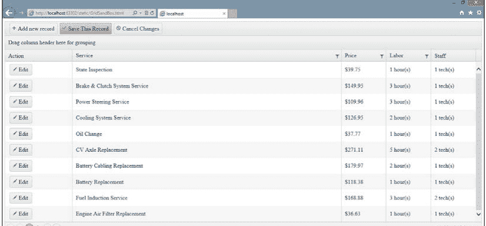

## 总结

在本章中，我们涵盖了基础信息，以便你能够开始构建启用 Kendo UI 的网页。为了使用 Kendo UI 框架完成许多工作，理解如何使用 Template（模板）以及如何使用 DataSource（数据源）至关重要。其次，Grid 是 Kendo UI 框架中的核心组件，了解如何配置它将让你在构建需要向用户显示表格数据的页面时领先一步。

在下一章中，我们将学习 AutoComplete（自动完成）组件。它允许你在输入框中添加“词轮”效果，帮助用户输入可以从数据源中查找的信息。这是一个许多用户都喜欢的极佳工具，可以在不费力编写代码的情况下为你的网页添加很多功能。

## 2  AutoComplete 组件及其用法

Kendo UI 的 AutoComplete 组件在用户输入字时，会在输入框中创建“词轮”效果。词轮是一种效果，当用户输入字时，文本框下方会出现单词，建议可能的搜索术语。你经常在 Google 和 Bing 等搜索引擎上看到这种功能。它可以给用户提供一组认可的选项供其选择，也可以帮助用户准确地输入特定关键词，因为项目的标准形式会直接出现在输入框下方供用户选择。如果用户只需要输入一个长搜索词中的一两个字符，它还能节省用户的时间。Kendo UI 中的 AutoComplete 组件非常易配置，你只需少少努力就能为你的网站带来此功能。

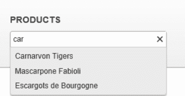

### AutoComplete 组件——基础

打开你在上一章中创建的 Visual Studio 项目，然后打开 Controllers 文件夹下的 `KendoController.cs` 类。让我们为初始的 AutoComplete 测试页面添加一个新的动作方法。

```csharp
public ActionResult AutoCompletePage()
{
    return View();
}
```

右键点击动作方法的名称并选择 "Add View"（添加视图）。现在，选择对话框中出现的默认值，这将带你进入网页，我们可以开始了。

```csharp
public ActionResult AutoCompletePage()
{
    // GhostDoc Pro.
    return View();
}
```

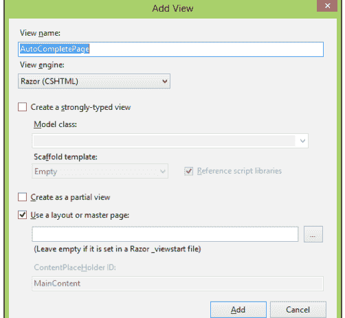

### 将 AutoComplete 绑定到本地源

由于我们引用了上一章创建的默认布局，我们将在页面页头中获取所需的所有 Kendo 和 jQuery 文件，而无需重试任何内容。

我们将演示如何纯通过 JavaScript 和本地数据绑定使用 AutoComplete 组件。我们需要一个输入元素、一个 JavaScript 数组以及一些 jQuery。

```html
<style>
#StateOrTerritory {
  width:200px;
}
</style>
<h2>AutoComplete</h2>
<input type="text" name="stateOrTerritory" id="stateOrTerritory" />
<script type="text/javascript">
var statesAndTerritories = [
  "Alaska",
  "American Samoa",
  "Arizona",
  "Arkansas",
  "Washington",
  "West Virginia",
  "Wisconsin",
  "Wyoming"
];

$("#stateOrTerritory").kendoAutoComplete({
  dataSource: statesAndTerritories,
  filter: "startwith",
  placeholder: "Choose state or territory...",
  separator: ","
});
</script>
```

## AutoComplete 组件及其用法

我们可以使用美国及其领土的列表作为字母表的良好采样，并且这是一个长度足够用于演示的列表。到目前，我们所做的只是在 JavaScript 中创建了一些数据供 AutoComplete 使用，然后通过 jQuery 和 Kendo UI 将其连接到页面顶部的输入元素。我们指定了想要使用 `StateAndTerritories` JavaScript 数组作为数据源，想要以 `startsWith` 模式过滤，在输入元素中设置占位符文本，并且数组中的项用逗号分隔。这些属性将在章末尾进行详细解释。运行它，你应该会在浏览器中看到一个带有漂亮占位符文本的输入框。在其中输入一些字母，你会立即获得一些州和领土的建议。

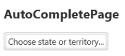

### 将 AutoComplete 绑定到远程数据

现在我们已经看到了如何使用本地数据连接 AutoComplete，让我们看看如何使用远程数据来实现。在 Models 文件夹中添加名为 `StateTerritory.cs` 的新类。构建其结构以存储有关州和领土的相关数据。

```csharp
namespace KendoUI.Models
{
    public class StateTerritory
    {
        public string Name { get; set; }
        public bool IsState { get; set; }
        public bool IsContiguous { get; set; }
    }
}
```

现在打开 `SampleRepository.cs` 类并添加一些逻辑来创建州领土数据的存储库。注意，我特意将哥伦比亚特区（District of Columbia）既视为州也视为领土。

```csharp
public List<StateTerritory> GetStatesAndTerritories() {
    var stateTerritories = new List<StateTerritory>{
        new StateTerritory { Name = "Alabama", IsState = true, IsContiguous = true },
        new StateTerritory { Name = "Alaska", IsState = true, IsContiguous = false },
        new StateTerritory { Name = "American Samoa", IsState = false, IsContiguous = false },
        new StateTerritory { Name = "Arizona", IsState = true, IsContiguous = true },
        new StateTerritory { Name = "Arkansas", IsState = true, IsContiguous = true },
        new StateTerritory { Name = "District of Columbia", IsState = true, IsContiguous = false },
        new StateTerritory { Name = "Washington", IsState = true, IsContiguous = true },
        new StateTerritory { Name = "West Virginia", IsState = true, IsContiguous = true },
        new StateTerritory { Name = "Wisconsin", IsState = true, IsContiguous = true },
        new StateTerritory { Name = "Wyoming", IsState = true, IsContiguous = true }
    };
    return stateTerritories;
}
```

现在我们拥有了可以操作的服务端数据，但仍需通过 HTTP 暴露。回到 `KendoController.cs` 类文件并添加如代码所示的方法：

```csharp
public JsonResult AutoCompleteData() {
    var repository = new SampleRepository();
    var data = repository.GetStatesAndTerritories();
    return Json(data, JsonRequestBehavior.AllowGet());
}
```

## AutoComplete 组件及其用法

这将我们的州和领土集合暴露为 `StateTerritory` 对象的 JSON 数组。记得设置 `JsonRequestBehavior.AllowGet` 属性，否则它无法工作。我们可以修改 `AutoCompletePage.cshtml` 文件，使用 `transport` 属性来获取数据。

```javascript
$("#stateTerritory").kendoAutoComplete({
  dataSource: {
    transport: {
      read: {
        url: "/Kendo/AutoCompleteData/"
      }
    }
  },
  dataFile: "Name",
  filter: "startswith",
  placeholder: "Choose state or territory..."
});
```

再次运行页面并等待它从服务器拉取数据。我们必须指定哪个字段包含数据文本字段，因为我们的 JSON 数据结构化为对象而不是简单的数组。我们不再需要 `separator` 属性。

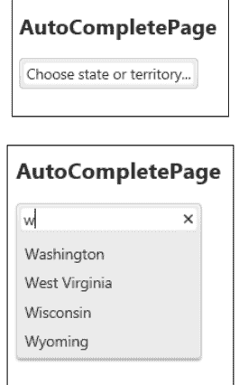


## 通过模型结合 MVC 使用 AutoComplete

我们可以更进一步，通过 MVC 将代码转换为 Razor 语法。首先，创建一个控制器操作方法，用于从服务器返回数据。

```csharp
public ActionResult AutoCompletePage()
{
    var repository = new SampleRepository();
    var data = repository.GetStatesAndTerritories();
    return View(data);
}
```

接下来，打开 `AutoCompletePage.cshtml` 并删除 `<h2>` 标签之后的所有内容。在页面顶部，我们需要添加一个声明，以便此视图（View）页面成为我们新模型类 `StateTerritory.cs` 的强类型页面。

@Model IEnumerable<KendoUI.Models.StateTerritory>

现在添加这段使用 HTML 助手类和 Kendo 扩展方法的代码。

```html
<h2>AutoCompletePage.cshtml</h2>
@Html.Kendo().AutoComplete(
    .Name("statesAndTerritories")
    .DataField("Name")
    .BindTo(Model)
    .Filter("startswith")
    .Placeholder("choose state or territory...")
)
```

识别出语法了吗？对于 `BindTo(Model)` 语句，这些方法名称是我们在 JavaScript 中使用的属性（当然，它们以大写字母开头）。调用 `bindTo(Model)` 是 MVC 控制器将数据传递到 MVC 的方式。在这种情况下，我们将视图强类型为 `StateTerritory` 对象的集合（IEnumerable），在这里在代码中，我们正在告诉 Kendo 框架 `StateTerritory` 模型包含了要在 AutoComplete 中显示的数据。这些数据在服务器创建页面时被使用，并且仅通过 View 中的 Razor 语法语句进行访问。

## AutoComplete 组件及其用法

尽管我们刚刚通过 MVC 将 AutoComplete 链接到服务器，但所使用的方法并不真正像调用远程数据。它实际上是使用本地数据，通过将从服务器获取的所有数据保存到初始化 AutoComplete 的页面中。只要加载不缓慢，这并没有问题。事实上，在某些情况下，这是提高性能的好方法，了解数据位于何处以及页面如何访问它至关重要。如果我们希望页面从 URL 请求数据，我们需要对视图进行一些更改。

## 通过 Ajax 结合 MVC 使用 AutoComplete

打开视图，并像此代码块所示更改 `AutoComplete()` 扩展调用。

```html
<h2>AutoComplete</h2>
@Html.Kendo().AutoComplete()
    .Name("stateAndTerritories")
    .Placeholder("Choose state or territory...")
    .DataField("Name")
    .Filter("startswith")
    .DataSource(source => {
        read.Action("AutoCompleteData", "Kendo");
    })
    .ServerFiltering(false);
```

我们删除了 `BindTo(Model)` 并将其替换为 `DataSource()` 的调用，其中我们使用 Lambda 表达式定义如何创建数据。在这种情况下，我们将其配置为使用返回 JSON 数据的操作方法，并且没有执行任何过滤。这有效地设置了我们的网页，就像我们原始页面使用 `transport` 属性从服务器获取数据一样。

## 将数据发送到服务器

我们能够在客户端对 AutoComplete 组件的数据进行过滤。可以使用 JavaScript 对象中的 `data` 属性，也可以继续我们的 MVC 示例并在 `DataSource` Lambda 表达式内部指定数据。例如，假设我们想要选择哪种类型的州显示在 AutoComplete 组件中。当请求时，服务器会返回数据。用此更新后的代码替换 `AutoCompletePage` 的内容。

```html
<h2>AutoComplete</h2>
<label for="stateType">选择是否查看州（States）：</label>
<select id="stateType" name="stateType">
  <option value="true">显示州</option>
  <option value="false">仅显示地区（Territories）</option>
</select>
<br />
@(Html.Kendo().AutoComplete()
  .Name("statesAndTerritories")
  .Placeholder("Choose state or territory...")
  .DataField("Name")
  .Filter("startsWith")
  .DataSource(source => {
    read.Action("AutoCompleteData", "Kendo")
      .Data("onAdditionalData");
  })
  .ServerFiltering(false)
)
<script type="text/javascript">
var autocomplete = $("#statesAndTerritories");

function onAdditionalData() {
  return {
    showStates: $("#stateType").val()
  }
}
</script>
```

## AutoComplete 组件及其用法

注意 Lambda 表达式中的 `Data("onAdditionalData")` 调用以及同名的新 JavaScript 方法 `onAdditionalData()`。当 AutoComplete 的数据源被读取时，它将触发此 JavaScript 事件并将带有 `showStates` 参数的结果发送到服务器。为了在你的操作方法中接收此数据，你需要为它添加一个具有匹配名称的参数。

```csharp
public JsonResult AutoCompleteData(bool showStates = true)
{
    // 设置 showStates = true 意味着这是一个可选参数
    // 默认值为 true。
    var repository = new SampleRepository();
    var data = repository.GetStatesAndTerritories();
    if (!showStates)
    {
        data = data.Where(s => s.IsState == false).ToList();
    }
    return Json(data, JsonBehavior.AllowGet());
}
```

现在AutoComplete 代码将 `showStates` 参数作为其网络请求的一部分发送，控制器将使用该值来决定是否过滤。

## 使用模板自定义 AutoComplete

Kendo 模板可以用于自定义 AutoComplete 中项的外观。这甚至可以使用图片和特殊样式。更新 `AutoCompletePage` 页面如下：

```html
@{
    var template = "# Name # # IsState #";
}
@(Html.Kendo().AutoComplete()
    .Name("statesAndTerritories")
    .Placeholder("Choose state or territory...")
    .Filter("startsWith")
    .DataSource(source =>
    {
        read.Action("AutoCompleteData", "Kendo")
              .Data("onAdditionalData");
        })
    })
    .ServerFiltering(false)
    .Template(template)
)
```

我们添加了一个名为 `template` 的变量，它持有 Kendo 模板定义。我们在 AutoComplete 设置中引用了它。运行代码并查看。


## 配置 Auto Auto 属性

AutoComplete 组件有多个可以在初始化时设置的属性，以自定义其行为。这是一个结构化代码示例，显示了 AutoComplete 可用的属性。

```javascript
$("#autocomplete").kendoComplete({
    dataSource: dataSource, // 示例
    animation: {
        close: {
            effects: "fadeOut",
            duration: 300,
            hide: false
        },
        open: {
            effects: "fadeIn",
            duration: 300
        }
    },
    show: true,
    dataFile: "Name", // 数据源中显示的字段名称
    delay: 500, // 自动完成前的毫秒数
    enable: true, // 设置为 "false" 可禁用
    filter: "contains", // 过滤类型，传递给远程源
    height: 200, // 下拉列表的高度
    highlightFirst: true, // 是否高亮列表项
    ignoreCase: true,
    minLength: 1, // 激活列表所需的最小字符
    placeholder: "Enter value...", // 占位文本
    separator: "", // 搜索词分隔符
    // 允许使用逗号或其他分隔符多个搜索词
    suggest: false, // 自动输入剩余搜索词
    template: template // 示例
})
```

## 钩入 Auto 事件

AutoComplete 组件在页面执行操作时会触发不同的事件。你可以在 AutoComplete 初始化后这样绑定它们：

```javascript
var autocomplete = $("#AutoComplete").data("kendoAutoComplete");
$("#AutoComplete").data("kendoAutoComplete").bind("change",
function(e) {
  // 处理事件
});
```

或者你可以在 AutoComplete 组件的属性中定义它们，如下：

```javascript
("#AutoComplete").kendoAutoComplete({
    close: function(e) {
        // 处理事件
    }
});
```


# 更改 (Change)

当 AutoComplete 控件的选择发生时，触发 change 事件。你可以在初始化后绑定事件。

# 关闭 (Close)

当 AutoComplete 控件关闭下拉列表时，触发 close 事件。

# 打开 (Open)

每当从 AutoComplete 控件打开下拉列表时，触发 open 事件。

# 选择 (Select)

当从 AutoComplete 控件中选择任何元素时，触发 select 事件。它会将参数 `e.item` 传递给处理它的函数，以便你可以访问被选项目。

# 使用 API AutoComplete 方法

要从 JavaScript 代码内部访问 AutoComplete 控件，你可以通过 jQuery 以如下方式调用 API 来访问它：

```javascript
var autocomplete = $("#autocomplete").data("kendoAutoComplete");
```

一旦你获得了 AutoComplete 控件的引用，你就可以按照意愿调用 API 方法并通过代码对其操作。这些是 AutoComplete 控件上可用的 API 方法。

# 关闭 (Close)

`close()` 方法关闭 AutoComplete 控件上的下拉列表。

```javascript
// 获取 autocomplete 控件的引用
var autocomplete = $("#autocomplete").data("kendoAutoComplete");

autocomplete.close();
```

AutoComplete 控件及其用法

# 数据项 (DataItem)

`getItem()` 方法检索指定索引处的数据记录。
该 `getItem` 对象将是 AutoComplete 控件数据源中指定索引处的特定对象。在上面的示例中，它将是一个特定的 `stateOrTerritory` 对象。

```javascript
var autocomplete = $("#autocomplete").data("kendoAutoComplete");
```

```javascript
// 获取与传递索引对应的 getItem
var dataitem = autocomplete.data(1);
```

# 销毁 (Destroy)

`destroy()` 方法为 AutoComplete 控件从 DOM 中安全移除做好准备。它解绑了所有事件处理器并删除了数据属性。它并没有实际执行从 DOM 中移除它的最后步骤；那是你必须通过编程实现的操作。

```javascript
var autocomplete = $("#autocomplete").data("kendoAutoComplete");
```

```javascript
// 解除事件
autocomplete.destroy();
```

# 启用 (Enable)

`enable()` 方法切换 AutoComplete 控件的开启状态。

```javascript
// 获取 autocomplete 的引用
var autocomplete = $("#autocomplete").data("kendoAutoComplete");
```

```javascript
// 禁用 autocomplete
autocomplete.enable(false);
```

```javascript
// 启用 autocomplete
autocomplete.enable(true);
```

# 刷新 (Refresh)

`refresh()` 方法重新渲染 AutoComplete 控件下拉列表中的项。

```javascript
// 获取 Kendo UI AutoComplete 的引用
var autocomplete = $("#autocomplete").data("kendoAutoComplete");
```

```javascript
// 重新渲染下拉列表中的项。
autocomplete.refresh();
```

# 搜索 (Search)

`search()` 方法使用提供的参数过滤 AutoComplete 控件的数据源，然后重新绑定下拉列表。

```javascript
// 获取 autocomplete 控件的引用
var autocomplete = $("#autocomplete").data("kendoAutoComplete");
```

```javascript
// 搜索名称包含 "Inception" 的项目
autocomplete.search("Inception");
```

# 选择 (Select)

`select()` 方法从 AutoComplete 控件中选择一个下拉列表项并设置 AutoComplete 输入框的文本。

```javascript
// 获取 autocomplete 控件的引用
var autocomplete = $("#autocomplete").data("kendoAutoComplete");
```

```javascript
// 通过 jQuery 对象选择
autocomplete.select(autocomplete.ul.children().eq(0));
```

# 建议 (Suggest)

`suggest()` 方法强制在 AutoComplete 控件的文本上显示建议。

```javascript
// 注意，此 suggest 与配置方法不同
// suggest 方法用于启用/禁用 AutoComplete 的自动建议功能
//
```

```javascript
// 获取 Kendo UI AutoComplete 的引用
var autocomplete = $("#autocomplete").data("kendoAutoComplete");
```

```javascript
// 强制为名称为 "Inception" 的项目提供建议
autocomplete.suggest("Inception");
```

# 值 (Value)

`value()` 方法获取或设置 AutoComplete 控件的值。

```javascript
// 获取 autocomplete 的引用
var autocomplete = $("#autocomplete").data("kendoAutoComplete");
```

```javascript
// 获取 autocomplete 的文本。
var value = autocomplete.value();
```

# 总结 (Summary)

AutoComplete 控件是帮助你网站用户的极佳方法。每当输入框的值可以预测时（例如当它们来自特定的值集或搜索常用术语时），AutoComplete 控件将立即让你的网站更易用，你的用户肯定会注意到并感谢它。不仅如此，它的配置是非常直观，你可以毫不费力地启用它。

在下一章中，我们将学习如何使用 Calendar 控件。此控件允许你在网页中显示和配置交互式日历控件，使用户可以轻松选择日期。它还将提供一种将数据绑定到日历的方法以显示重要日期。Telerik Kendo UI Calendar 控件将帮助将复杂的 JavaScript 日历转变为开发优秀网页的易用工具。

## 3 使用和自定义日历

日历长期以来一直是网页中的一项功能，需要一些巧妙的 JavaScript。HTML5 正在努力让这一切变得简单得多，但浏览器的支持仍然不一致。这正是 Kendo UI 的完美解决方案，它是一个结合 HTML5 和 JavaScript 的框架，使用最新标准创建跨浏览器的一致性。像一往一样，Kendo UI 解决方案实现起来再简单不过了。

## 日历控件 – 基础

Kendo UI Calendar 控件将简单的 HTML 元素（如 div）转换为专门的日历控件。它通过一个 HTML 表格显示日历。为了看到最简单的实现，创建一个 action 并设置一个视图：

```csharp
public ActionResult Calendar()
{
    return View();
}
```

```html
@{ViewBag.Title = "Calendar";}
```

<h2>日历</h2>

<div id="calendar"></div>

<script type="text/javascript">
  $("#calendar").kendoCalendar();
</script>
```

Kendo UI Calendar 控件将一个简单的 HTML 元素（如 div）转换为专门的日历控件。它通过一个 HTML 表格显示日历。为了看到最简单的实现，创建一个 action 并设置一个视图：

```csharp
public ActionResult Calendar()
{
    return View();
}
```

```html
@{ViewBag.Title = "Calendar";}
```

<h2>日历</h2>

<div id="calendar"></div>

<script type="text/javascript">
  $("#calendar").kendoCalendar();
</script>

Kendo UI Calendar 控件将一个简单的 HTML 元素（如 div）转换为专门的日历控件。它通过一个 HTML 表格显示日历。为了看到最简单的实现，创建一个 action 并设置一个视图：

```csharp
public ActionResult Calendar()
{
    return View();
}
```

```html
@{ViewBag.Title = "Calendar";}
```

<h2>日历</h2>

<div id="calendar"></div>

<script type="text/javascript">
  $("#calendar").kendoCalendar();
</script>

# 日历 (Calendar)

Kendo UI Calendar 控件将一个简单的 HTML 元素（如 div）转换为专门的日历控件。它通过一个 HTML 表格显示日历。为了看到最简单的实现，创建一个 action 并设置一个视图：

```csharp
public ActionResult Calendar()
{
    return View();
}
```

```html
@{ViewBag.Title = "Calendar";}
```

<h2>日历</h2>

<div id="calendar"></div>

<script type="text/javascript">
  $("#calendar").kendoCalendar();
</script>

# 日历 (Calendar)

Kendo UI Calendar 控件将一个简单的 HTML 元素（如 div）转换为专门的日历控件。它通过一个 HTML 表格显示日历。为了看到最简单的实现，创建一个 action 并设置一个视图：

```csharp
public ActionResult Calendar()
{
    return View();
}
```

```html
@{ViewBag.Title = "Calendar";}
```

<h2>日历</h2>

<div id="calendar"></div>

<script type="text/javascript">
  $("#calendar").kendoCalendar();
</script>

# 日历 (Calendar)

Kendo UI Calendar 控件将一个简单的 HTML 元素（如 div）转换为专门的日历控件。它通过一个 HTML 表格显示日历。为了看到最简单的实现，创建一个 action 并设置一个视图：

```csharp
public ActionResult Calendar()
{
    return View();
}
```

```html
@{ViewBag.Title = "Calendar";}
```

<h2>日历</h2>

<div id="calendar"></div>

<script type="text/javascript">
  $("#calendar").kendoCalendar();
</script>

# 日历 (Calendar)

Kendo UI Calendar 控件将一个简单的 HTML 元素（如 div）转换为专门的日历控件。它通过一个 HTML 表格显示日历。为了看到最简单的实现，创建一个 action 并设置一个视图：

```csharp
public ActionResult Calendar()
{
    return View();
}
```

```html
@{ViewBag.Title = "Calendar";}
```

<h2>日历</h2>

<div id="calendar"></div>

<script type="text/javascript">
  $("#calendar").kendoCalendar();
</script>

# 日历 (Calendar)

Kendo UI Calendar 控件将一个简单的 HTML 元素（如 div）转换为专门的日历控件。它通过一个 HTML 表格显示日历。为了看到最简单的实现，创建一个 action 并设置一个视图：

```csharp
public ActionResult Calendar()
{
    return View();
}
```

```html
@{ViewBag.Title = "Calendar";}
```


<h2>日历</h2>

<div id="calendar"></div>

<script type="text/javascript">
  $("#calendar").kendoCalendar();
</script>

## 配置日历 (Configuring the Calendar)

由于日历控件只有几个属性，让我们从检查这些属性开始，然后移动到使用这些属性的示例。日历控件有两类不同类型的属性：

-   数据/模板属性：这些属性配置日历背后的数据。
-   显示/格式属性：这些属性配置日历在页面上的渲染方式以及数据。

以下是代码中列出的这些属性。将此代码添加到页面并运行：

```javascript
$("#calendar").kendoCalendar({
  culture: 'en-US', // 指定文化
  depth: 'month', // 指定导航深度
  // //世纪/年代/月份/年份)
  max: new Date(2012,11,31), // 日历允许的最大日期
  min: new Date(1980,0,1), // 日历允许的最早日期
  start: 'year', // 指定起始视图（世纪/年代/月份/年份）
  value: new Date(2012,9,25), // 初始选择日期
  format: 'yyyy/MM/dd' // 请求日历值时使用的格式字符串
});
```

按上述配置的日历初始渲染为显示当前选择年份内可用的月份（start: 'year'）。由于我们配置了允许进入每个月的导航深度（depth: 'month'），我们可以点击一个月份并查看该月份的所有可用天数：

| | 2012 | | |
|---|---|---|---|
| Jan | Feb | Mar | Apr |
| May | Jun | Jul | Aug |
| Sep | Oct | Nov | Dec |
| 周四, 2012年10月25日 | | | |

> 即使当前视图是“年份”，今天的日期仍然在日历的页脚中可见。

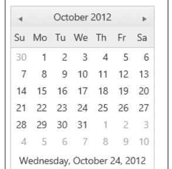


说到页脚，让我们来看看日历提供的数据/模板属性。这里的三个主要属性是 `data`、`month` 和 `footer`，它们是自定义日历控件的主要方式。为了演示在日历中自定义日期的简单示例，请将此代码添加到页面并运行它：

```
<h2>Calendar</h2>
<div id="calendar">
</div>
<style type="text/css">
.specialDay {
    color: white;
    background-color: orange;
    border:1px solid black;
}
</style>
<script type="text/x-kendo-template" id="redDays">
  # if ($.Array(data.date, data.dates) != -1) { #
  <div class="specialDay">#= data.value #</div>
  } else { #
  #= data.value #
  } #
</script>
<script type="text/javascript">
var datesArray = [+new Date(2012, 5, 15), +new Date(2012, 5, 21)];

$$(calendar).kendoCalendar({
    type: 'en-US', // 指定文化
    depth: 'month', // 指定导航深度
    max: new Date(2012, 5, 31), // 日历可以显示的最新日期
    min: new Date(2012, 5, 1), // 日历可以的最的最早日期
    start: 'month', // 指定起始视图
    value: new Date(2012, 5, 11), // 初始选择日期
    format: 'yyyy/MM/dd', // 用于格式化日期的字符串
    dates: datesArray,
    month: {
        content: $("#redDays).html(),
        empty: "X"
    },
    footer: "Today is #= kendo.toString(data, 'd') #"
});
</script>
```

# 第 3 章

让我们把这些代码组合在一起。首先，我们有一个特殊的样式指令，用于定义特殊日的显示方式。在这种情况下，橙色背景上的白色文字，并带有实线黑色边框。我们还指定了一个带有 JavaScript 的 Kendo UI 模板，用于判断渲染的日期是否为我们的特殊日之一。如果是特殊日之一，我们希望对其应用自定义样式；否则，原样渲染。

```
<style type="text/css">
.specialDay {
  color: white;
  background-color: orange;
  border:1px solid black;
}
</style>
<script type="text/x-kendo-template" id="redDays">
# if ($.Array(data.date, dates) != -1) {
<div class="specialDay">#= data.value #</div>
} else {
#= data.value #
}
</script>
```

接下来，我们定义了日历控件的实际配置。这里 `month` 属性与 `dates` 属性之间的关系提供了 `month` 属性用于渲染日历上日期的数据。在我们定义的模板中，我们检查当前渲染的日期是否在 `dates` 数组中，然后使用 `data.value` 渲染 `dateArray` 中的日期，并通过一个加号 `+` 强制将其转换为数值日期，以便我们轻松地与 `$.inArray()` 进行比较。这在所有情况下都不是必须的，但在此示例中有效。

```
<script type="javascript">
var datesArray = [new Date(2012, 5, 15),new Date(2012, 5, 21)];
kendoCalendar({
  culture: 'en-US', // 指定文化
  depth: 'month', // 指定导航深度
  max: new Date(2012, 5,31), // 日历可以显示的最新日期
  min: new Date(2012, 5, 1), // 日历可以的最的最早日期
  start: 'month', // 指定起始视图
  value: new Date(2012,5,11), // 初始选择日期
  format: 'yyyy/MM/dd', // 用于格式化日期值的字符串
  dates: datesArray;
});
</script>
```

## 使用和自定义日历

```
month: {
  content: $("#redDays).html(),
  footer: "Today is #= kendo.toString(data, 'd') #"
};
</script>
```

其他需要注意的是的是，新属性 `footer` 被用于渲染日历页脚的模板，它可以通过传递给它的 `data` 属性访问今天的日期。此外，注意 `month` 对象还有另一个 `empty` 属性，用于渲染落在 `min` 或 `max` 属性值范围之外的日期。

设置好日历后，在浏览器中看起来如下：

| 日历 |
| | 2012年6月 |
| 日 一 二 三 四 五 六 |
| X X X X X 1 2 |
| 3 4 5 6 7 8 9 |
| 10 11 12 13 14 15 16 |
| 17 18 19 20 21 22 23 |
| 24 25 26 27 28 29 30 |
| | X X X X X |
| 今天是 10/25/2012 |

注意通过 `dateArray` 提供的特殊日显示，以及页脚中的新文本。

## 使用 MVC 的日历控件

日历控件可以通过 ASP.NET MVC 方法配置。为了模仿日历，你可以将视图的内容替换为如下：

```html
<h2>Calendar</h2>
<style type="text/css">
.specialDay {
  color: white;
  background-color: orange;
  border:1px solid black;
}
</style>
<script type="text/x-kendo-template" id="redDays">
# if ($.Array(data.date, dates) != -1) { #
<div class="specialDay">#= data.value #</div>
} else { #
#= data.value #
} #
</script>
<script type="text/javascript">
var datesArray = [new Date(2012, 5, 15),+new Date(2012, 5, 21)];
</script>
@Html.MvcK().Calendar()
.Name("mvcCalendar")
.Depth(CalendarView.Month)
.Max(new DateTime(2012, 6, 30))
.Min(new DateTime(2012, 6, 1))
.Start(CalendarView.Month)
.Value(new DateTime(2012, 6, 11))
.Format("yyyy/MM/dd")
.MonthTemplate("# if ($.Array(data.date,dates) != -1) { " +
"<div class='specialDay'>#= data.value #</div>" +
"# } else { #" +
"#= data.value #" +
"# }") +
.Footer("Today is #= kendo.toString(data, 'd') #")
```

使用此代码时的输出是：

# 日历

| 2012年6月 | | | |
| 日 一 二 三 四 五 六 |
| | | | | 1 |
| 2 | 3 | 4 | 5 | 6 | 7 | 8 |
| 9 | 10 | 11 | 12 | 13 | 14 | 15 |
| 16 | 17 | 18 | 19 | 20 | 21 | 22 |
| 23 | 24 | 25 | 26 | 27 | 28 | 29 |
| 30 | | | | | |
| 今天是 10/25/2012 | |

## 使用和自定义日历

很相似吗？注意 MVC 扩展隐藏了 `max` 和 `min` 下方的日期，并且没有在月份上提供 `empty` 属性。这里有几点特殊情况需要了解：首先，我们仍然通过视图内部 JavaScript 使用日期数组。因为月份模板是在 JavaScript 中运行的，而不是通过 MVC 扩展。由于这一点，以及 MVC 扩展未提供属性，我们必须使用 `data.dates` 将模板改为 JavaScript 数组 `datesArray`。在这个示例中，我直接将代码输入到 MVC 方法，但还有一个名为 `MonthTemplateId` 的方法，你可以传递页面已有的模板 id。

此外，记住对每个 Kendo MVC 扩展对象始终调用 `.Name()` 方法以便工作。这是 MVC 方法为渲染的 HTML 输出分配唯一名称和 id ，以及所有 JavaScript 方法和事件在网络浏览器中正确连接的方式。如果你不包含 `.Name()` 方法，当你尝试运行页面时也会看到运行时错误。

## 日历控件上的可用方法

日历控件暴露了几个可以在页面上与其进行交互的方法。这些方法可以通过更改其属性或实时过滤特定性来配置控件。以下是 Kendo UI 日历控件可用方法的代码形式：

```javascript
var calendar = $("#calendar").data("kendoCalendar");

// 设置新的最大日期
calendar.max(new Date(2013,11,31));
// 获取当前最大日期
var lastDay = calendar.max();

// 设置新的最小日期
calendar.min(new Date(2011, 11, 31));
// 获取当前最小日期
var oldestDay = calendar.min();

// 使用特定日期导航到特定日期
calendar.navigate(new Date(2012,2,5), "month");
```

# 第 3 章

```javascript
// 导航到较低视图（例如从“年”到“月”）
calendar.navigateDown(new Date(2012,6,7)); // 日期是可选的
```

```javascript
// 导航到未来
calendar.navigateToFuture();
```

```javascript
// 导航到过去
calendar.navigateToPast();
```

```javascript
// 导航到较高视图（例如从“年”到“世纪”）
calendar.navigateUp("year");
```

```javascript
// 为日历设置新值（选择的日期）
calendar.value(new Date(2012,4,7));
```

```javascript
// 获取日历的当前值（选择的日期）
var selectedDate = calendar.value();
```

让我们取其中的一些示例并在我们的页面上运行它。修改我们用于 MVC 的代码如下：


# 使用与自定义日历

```javascript
"# + 
# "<div class='specialDay'>#= data.value #</div>" + 
# } else { "# + 
#= data.value #" + 
# })"

Footer("Today is #= data.toString(data, 'd') #")
```
<br />
<button type="button" id="navigateUp">向上</button><br />
<button type="button" id="navigateDown">向下</button><br />
<button type="button" id="showValue">弹出值</button>

```javascript
<script type="javascript">
$("#navigateUp").click(function () {
  var calendar = $("#kendoCalendar").data("kendoCalendar");
  calendar.navigate();
});
$("#navigateDown").click(function () {
  var calendar = $("#kendoCalendar").data("kendoCalendar");
  calendar.navigateDown(calendar.value());
});
$("#showValue").click(function () {
  var calendar = $("#kendoCalendar").data("kendoCalendar");
  alert(calendar.value());
});
</script>
```

为了将日历组件作为 JavaScript 对象使用，我们必须在包含已创建日历的页面元素上调用 `.data()` 函数。点击页面上的按钮观察它们的功能。这应该让你对日历组件能提供的功能有所了解，并让你明白如何将你的交互式代码引入日历中以提升用户体验。

# 日历

| 2012年6月 |
| 日 一 二 三 四 五 六 |
| 27 28 29 30 31 1 2 |
| 3 4 5 6 7 8 9 |
| 10 11 12 13 14 15 16 |
| 17 18 19 20 21 22 23 |
| 24 25 26 27 28 29 30 |
| 1 2 3 4 5 6 7 |
| 今天是 2013/4/7 |

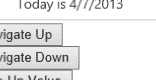

## 日历触发的事件

Kendo 日历组件有两个事件：change（更改）和 navigate（导航）。这些事件在操作发生后触发。`change` 在选择日期更改时触发，`navigate` 在日历进行导航时触发——例如切换月份或将视图从“月”移动到“年”视图时。

如果你想让日历仅在用户选择页面上的某个输入框时才出现，并将其值放入该输入框中，你可以尝试如下操作。修改我们正在处理的页面最后的脚本块如下：

```javascript
<script type="javascript">
$(document).ready(function () {
  $("#kendoCalendar").hide();
  $("#kendoCalendar").data("kendoCalendar").bind("change", function (e) {
    var date = $("#kendoCalendar").data("kendoCalendar").value().toString(date, 'd');
  });
  $("#showValue").focus(function () {
    $("#kendoCalendar").slideDown();
  });
  $("#nameInput").focus(function () {
    $("#kendoCalendar").slideUp();
  });
  $("#ageInput").focus(function () {
    $("#kendoCalendar").slideUp();
  });
  $("#navigateUp").click(function () {
    var calendar = $("#kendoCalendar").data("kendoCalendar");
    calendar.navigateUp();
  });
  $("#navigateDown").click(function () {
    var calendar = $("#kendoCalendar").data("kendoCalendar");
    calendar.navigateDown(calendar.value());
  });
  $("#showValue").click(function () {
    var calendar = $("#kendoCalendar").data("kendoCalendar");
    alert(calendar.value());
  });
});
</script>
```

# 使用与自定义日历

在这里，我们有一些通过简单的 jQuery UI 接的事件，用于显示或隐藏日历并获取其值。日历的 `change` 事件用于判断何时将新日期放入页面的输入元素中。这是页面首次渲染时的样子。

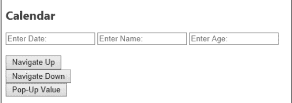

日历处于隐藏状态，直到用户点击文本框。一旦发生这种情况，我们接好的事件就会导致日历出现，以便用户可以为页面选择合适的日期。

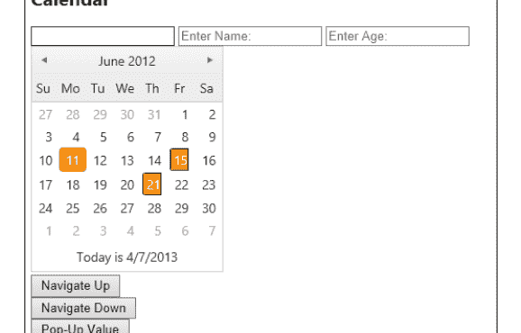

## 总结

Kendo 日历组件易于配置，并为你的页面提供了一个丰富的元素，可以使日期处理工作变得简单得多。它可以通过从 JavaScript 或 MVC 进行配置，并利用 Kendo 模板来实现高度自定义的格式化和显示。我只展示了使用模板和事件可以完成的一些基础示例；你可以基于这些示例进行开发，创建一些实用的交互内容。

在下一章中，我们将学习所有 Kendo UI 框架中最强大的功能之一：模型-视图-模型（MVVM）框架。该框架允许你通过简单的 HTML 属性将数据和功能绑定到页面上，并实现实时的交互更新。

# Kendo MVVM 框架

Kendo 日历组件易于配置，并为你的页面提供了一个丰富的元素，可以使日期处理工作变得简单得多。它可以通过从 JavaScript 或 MVC 进行配置，并利用 Kendo 模板来实现高度自定义的格式化和显示。我只展示了使用模板和事件可以完成的一些基础示例；你可以基于这些示例进行开发，创建一些实用的交互内容。

在下一章中，我们将学习所有 Kendo UI 框架中最强大的功能之一：模型-视图-模型（MVVM）框架。该框架允许你通过简单的 HTML 属性将数据和功能绑定到页面上，并实现实时的交互更新。

# Kendo MVVM 框架

JavaScript 开发自诞生以来已经进步巨大，MVVM 框架的出现是这种演变的证明。这些框架允许开发者分离职责以更好地处理复杂性。它们还提供了优雅的语法，使得 MVVM 框架本身能够处理绑定动态数据的繁琐工作。如果你以前从未用过 JavaScript MVVM 框架，你将受益匪浅。

## 理解 MVVM —— 基础

MVVM 代表模型（M）、视图（V）和 ViewModel（VM）。它是系统架构设计模式族的一部分，将职责划分到不同的单元中。相关的模式有模型-视图-控制器（MVC）和模型-视图-演示器（MVP）。它们在框架哪个部分的职责归属上有所不同，但都试图通过相同的底层原则来管理复杂性。这里不深入探讨细节，只需说明这些模式对于开发可靠且可重用的代码非常有益，如果你实现得当，无疑会受益。幸运的是，良好的 JavaScript MVVM 框架通过为你接好组件，让你专注于代码而不是“胶水”工作。

# Kendo MVVM 框架

在 Kendo UI 的 JavaScript MVVM 模式中，你需要为想要显示和操作的数据创建一个定义（模型）、构建整个网页布局的 HTML 标记（视图），以及处理用户输入、响应事件并将静态标记转换为动态元素的 JavaScript 代码（ViewModel）。另一种说法是，你拥有数据（模型）、演示和逻辑（ViewModel）。

在实践中，模型是 MVVM 模式中定义最模糊的部分，在实现中并不总是作为独立的实体存在。ViewModel 可以通过直接连接内部的数据属性来承担模型和视图的角色，这在 ASP.NET MVC 中当视图使用 ViewBag 或 ViewData 集合而不是强类型模型类时，也是可以接受且常见的做法。


## 创建视图

这里是一个简单的 HTML 页面，展示了视图的基本工作原理：

```html
<!DOCTYPE html>
<html xmlns="http://www.w3.org/1999/xhtml">
<head>
<title>MVVM Demo 1</title>
<script src="Scripts/kendo/jquery.js"></script>
<script src="Scripts/kendo.all.js"></script>
<link href="Content/kendo/kendo.common.css" rel="stylesheet" />
<link href="Content/kendo/kendo.default.css" rel="stylesheet" />
<style type="css">
th{
width: 135px;
}
</style>
</head>
<body>
<table>
<caption>人员数据</caption>
<head>
<tr>
<th>发色</th>
<th>喜欢的食物</th>
</tr>
</head>
<tbody data-template="row-template"
data-bind="source: people"></tbody>
</table>
</body>
</html>
```

在这里，我们有一个简单的表格元素，包含三列，但主体中没有包含任何 `tr` 元素，有一些特殊的 HTML5 `data-*` 属性表示这里正在发生某些操作。这些 `data-*` 属性本身不起作用，Kendo UI 会读取它们（如下文所示）并解释它们的值，以便将视图（View）与视图模型（View-Model）连接起来。`data-bind` 告诉 Kendo UI 该元素应该绑定到 `people` 对象集合。

# Kendo MVVM 框架

`data-template` 属性告诉 Kendo UI `people` 对象应该使用 Kendo UI 模板进行格式化。以下是模板的代码：

```html
<script id="row-template" type="text/x-kendo-template">
  <tr>
    <td data-bind="text: name"></td>
    <td data-bind="text: hairColor"></td>
    <td data-bind="text: favoriteFood"></td>
  </tr>
</script>
```

这是一个简单的模板，它为表格中的每一行定义了 `tr` 结构。`td` 元素也有一个 `data-bind` 属性，Kendo UI 知道要将属性的值作为 HTML 元素的“text”插入，在这种情况下，这意味着将值放在 `<td></td>` 之间作为普通文本显示在页面上。

## 创建模型和视图模型

为了将这些连接起来，我们需要执行数据绑定的视图模型。以下是该视图的视图模型：

```javascript
<script type="text/javascript">
var viewModel = kendo.observable({
people: [
  {name: "John", hairColor: "Blonde", favoriteFood:
  "Burger"},
  {name: "Bryan", hairColor: "Brown", favoriteFood:
  "Steak"},
  {name: "Jennifer", hairColor: "Brown", favoriteFood:
  "Salad"}
]
});
kendo.bind($("body"), viewModel);
</script>
```

Kendo UI 视图模型通过调用 `kendo.observable()` 声明，它创建一个可观测对象，用于视图内部的数据绑定。可观测对象是一个特殊对象，它包装了一个普通的 JavaScript 变量并带有事件，每当该变量的值发生时，事件就会触发。这些事件通知 MVVM 框架更新任何使用该变量值的数据绑定，以便它们能够立即更新并反映更改。这些数据绑定也是双向的，因此当绑定到可观测对象的字段发生变化时，绑定到该字段的变量也会同步更改。

## 第 4 章

在这种情况下，我创建了一个 `people` 数组，它包含了三个带有某些人员属性的对象。这个数组在示例中充当模型（Model），因为它包含了数据以及数据结构的定义。
在代码示例的最后，你可以看到对 `kendo.bind("body"), viewModel` 的调用，这是 Kendo UI 实际执行 MVVM 渲染的地方。我将 `body` 标签的 jQuery 选择器传递给第一个参数，因为这个 ViewModel 适用于我的 HTML 页面的整个主体，而不仅仅是部分。

将所有内容结合在一起，这里是简化示例的完整源代码：

```html
<!DOCTYPE html>
<html xmlns="http://www.w3.org/1999/xhtml">
<head>
<title>MVVM Demo 1</title>
<script src="Scripts/kendo/jquery.js"></script>
<script src="Scripts/kendo/kendo.all.js"></script>
<link href="Content/kendo/kendo.common.css" rel="stylesheet" />
<link href="Content/kendo/kendo.default.css" rel="stylesheet" />
<style type="css">
th {
width: 135px;
}
</style>
</head>
<body>
<table>
<caption>人员数据</caption>
<thead>
<tr>
<th>姓名</th>
<th>发色</th>
<th>喜欢的食物</th>
</tr>
</thead>
<tbody data-template="row-template" data-bind="source: people"></tbody>
</table>
<script id="row-template" type="text/x-kendo-template">
<tr>
<td data-bind="text: name"></td>
<td data-bind="text: hairColor"></td>
<td data-bind="text: favoriteFood"></td>
</tr>
</script>
## Kendo MVVM 框架</h2>

<script type="text/javascript">
var viewModel = kendo.observable({
people: [
  {name: "John", hairColor: "Blonde", favoriteFood:
"Burger"},
  {name: "Bryan", hairColor: "Brown", favoriteFood:
  "Steak"},
  {name: "Jennifer", hairColor: "Brown", favoriteFood:
  "Salad"}
]
});
kendo.bind($("body"), viewModel);
</script>
</body>
</html>
```

*(注：由于原文文本在后部分出现了明显的重复和格式混乱，译文已根据上下文逻辑对内容进行了整理和对齐，确保技术术语的准确性。)*


# Kendo MVVM 框架

以下是我在 `people` 数组下方添加的代码。在这个示例中，前三个属性构成了 Model（模型）。它们包含了被观察并绑定到页面其他部分的数据：

```javascript
personName: "", // Model属性
personHairColor: "", // Model属性
personFavFood: "", // Model属性
addPerson: function () {
    this.get("people").push({
    name: this.get("personName"),
    hairColor: this.get("personHairColor"),
    favoriteFood: this.get("personFavFood")
    });
    this.set("personName", "");
    this.set("personHairColor", "");
    this.set("personFavFood", "");
}
```

你看到的前几个属性是我们绑定到输入表单的属性。它们初始值为空，因为在页面加载时表单不应该有任何值。在 View-Model 中声明这些空属性仍然非常重要，这样当它们发生变化时就可以追踪它们的值。

数据属性之后的函数 `addPerson` 是我们绑定到输入表单中按钮点击事件的。在这个函数中，我们访问 `people` 并根据用户在表单字段中提供的内容添加新记录。注意，我们必须使用 `this.get()` 和 `this.set()` 函数来访问 View-Model 内部的数据。这非常重要，因为此 View-Model 中的属性是特殊的观察属性，因此直接访问它们的值可能无法得到预期的结果。

最重要的一点是，你应该注意到 `addPerson` 函数是通过 View-Model 属性与页面上的数据进行交互的。它没有使用 Query、`document.querySelector` 或任何其他 DOM 交互来读取元素的值；由于我们在输入元素的 `value` 上声明了数据绑定属性并绑定到 View-Model 的属性上，我们始终可以通过访问 View-Model 本身获取这些元素的值。这些值始终被追踪。这允许我们在 `addPerson` 函数内部检索并更改这些 View-Model 属性，HTML 页面会在变化发生时立即显示。通过对属性调用 `this.set()` 并将其值更改为空字符串，HTML 页面将清除用户刚刚输入并添加到表格中的值。再次，我们不需要自己访问 HTML 即可更改 View-Model 属性。

这是该示例的完整源代码：

```html
<!DOCTYPE html>
<html xmlns="http://www.w3.org/1999/xhtml">
<head>
<title>MVVM Demo 2</title>
<script src="/Scripts/kendo/jquery.js"></script>
<script src="/Scripts/kendo/all.js"></script>
<link href="/Content/kendo.common.css" rel="stylesheet" />
<link href="/Content/kendo.default.css" rel="stylesheet" />
<style type="text/css">
th {
width: 135px;
}
</style>
</head>
<body>
<table>
<caption>People Data</caption>
<head>
<tr>
<th>Name</th>
<th>Hair Color</th>
<th>Favorite Food</th>
</tr>
</head>
<tbody data-template="row-template" data-bind="source: person">
</tbody>
</table>
<br />
<form>
<header>Add a Person</header>
<input type="text" name="personName" placeholder="Name" data-bind="personName" /><br />
<input type="text" name="personHairColor" placeholder="Hair Color" data-bind="personHairColor" /><br />
<input type="text" name="personFavFood" placeholder="Favorite Food" data-bind="personFavFood" /><br />
<button type="button" data-bind="click: addPerson">Add</button>
</form>
<script id="row-template" type="text/x-kendo-template">
<tr>
<td data-bind="text: name"></td>
<td data-bind="text: hairColor"></td>
<td data-bind="text: favoritesFood"></td>
</tr>
</script>
```

```javascript
<script type="text/javascript">
var viewModel = kendo.observable({
people: [
    {name: "John", hairColor: "Blonde", favoriteFood: "Burger"},
    {name: "Bryan", hairColor: "Brown", favoriteFood: "Steak"},
    {name: "Jennifer", hairColor: "Brown", favoriteFood: "Salad"}
  ],

personName: "",
personHairColor: "",
personFavFood: "",
addPerson: function () {
    this.get("people").push({
        name: this.get("personName"),
        hairColor: this.get("personHairColor"),
        favoriteFood: this.get("personFavFood")
    });

    this.set("personName", "");
    this.set("personHairColor", "");
    this.set("personFavFood", "");
}
});
kendo.bind("body*", viewModel);
</script>
</body>
</html>
```

这是该页面运行情况的截图。你会看到通过填写表单，表格中又增加了一个人员。你自己尝试一下，看看这段代码带来的即时交互：


## 在 View 中使用观察属性

我们刚刚展示了向 View-Model 集合中添加新数据是多么简单，以及这如何导致数据绑定元素更新内容。为了演示这一新功能，我在表格中添加了列：

```html
<table>
<caption>People Data</caption>
<head>
<tr>
  <th>Name</th>
  <th>Hair Color</th>
  <th>Favorite Food</th>
  <th>Live Data</th>
</tr>
</head>
<tbody data-template="row-template" data-bind="source: person">
</tbody>
</table>
```

# Kendo MVVM 框架

第一个新列没有标题文本，但表格中的每一行都会包含一个按钮。第二个新列将显示 View-Model 中每个对应对象的“实时数据”值。

这是更新后的行模板：

```html
<script id="row-template" type="text/x-kendo-template">
<tr>
  <td><input type="text" data-bind="value: name" /></td>
  <td><input type="text" data-bind="value: hairColor" /></td>
  <td><input type="text" data-bind="value:favoriteFood" /></td>
  <td><button type="button" data-bind="click: deletePerson">Delete</button></td>
  <td><span data-bind="text:name"></span>&nbsp;&nbsp;
  <span data-bind="text:hairColor"></span>&nbsp;&nbsp;
  <span data-bind="text: favoriteFood"></span></td>
</tr>
</script>
```

注意，我将所有简单的文本 `data-bind` 属性替换为了输入元素。我还添加了带有 `data-bind` 属性的按钮，以便你可以实时观察观察式行为。

这是更新后 View-Model 的完整源代码：

```javascript
deletePerson: function (e) {
  var person = e.data;
  var people = this.get("people");
  var index = people.indexOf(person);
  people.splice(index, 1);
}
```

当此函数由 Kendo UI 创建的绑定调用时，它会将一个参数（此处称为 `e`）传递到包含数据的函数中。当你点击删除按钮时，你可以观察到表格的立即响应。


# Kendo MVVM 框架

这是新页面的截图：

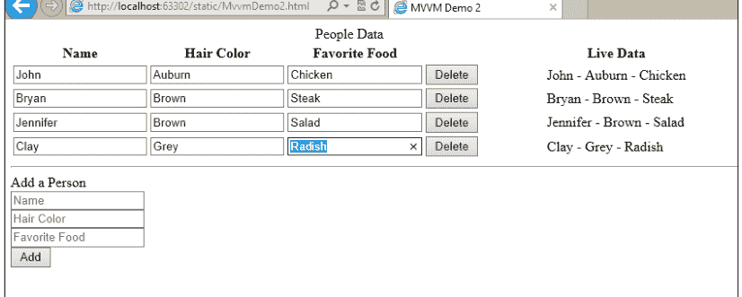

点击 **Delete**（删除）按钮可以看到一个条目消失。你还可以看到我在表格中添加了一个新人员，并且对表格中的输入框进行了更改，这些更改立即显示在右侧。这表明视图模型（View-Model）正在跟踪实时数据并相应更新其绑定。

## 更好地利用可观察数组

在之前的几个示例中，我们一直使用一个 `people` 数组来通过 Kendo UI 绑定显示动态表格。到目前为止这种方法是行的，但随着模型和功能变得更加复杂，我们可能会遇到某种“瓶颈”。例如，没有办法直接从 Model 对象本身获取“实时数据”；我们必须在模板中拼接 `span` 元素来形成最终输出。对于更复杂且功能全的页面，这可能会导致问题，在这些页面中，你可能有一个 Model 对象数组，它们需要处理事件并计算自己的值，而不是在视图模型层面进行处理。

修改行模板如下：

```
<script id="row-template" type="text/x-kendo-template">
<tr>
<td><input type="text" data-bind="value:name.stuff" /></td>
<td><input type="text" data-bind="value:hairColor.stuff" /></td>
<td><input type="text" data-bind="value:favoriteFood.stuff" /></td>
<td><button type="button" data-bind="click: deletePerson">Delete</button></td>
<td data-bind="text: dataString"></td>
</tr></script>
```

我们更改了 `data-bind` 声明中的属性名称，使其指向我们为它们创建的名为 `stuff` 的内部属性。示例中的关键部分是将函数指向一个名为 `dataString` 的计算值。随着后续的进行，其意义将变得清晰。更新视图模型的 JavaScript 如下：

```
<script type="text/javascript">
  var viewModel = kendo.observable({
    people: [],
    personName: "",
    personHairColor: "",
    personFavFood: "",
    addPerson: function () {
      this.get("people").push(new person({
        name: this.get("personName"),
        hairColor: this.get("personHairColor"),
        favoriteFood: this.get("personFavFood")
      }));
      this.set("personName", "");
      this.set("personHairColor", "");
      this.set("personFavFood", "");
    },
    deletePerson: function (e) {
      var person = e.data;
      var people = this.get("people");
      var index = people.indexOf(person);
      people.splice(index, 1);
    }
  });

  var person = function (data) {
    var self = this;
    self.name = kendo.observable({ stuff: data.name });
    self.hairColor = kendo.observable({ stuff: data.hairColor });
    self.favoriteFood = kendo.observable({ stuff: data.favoriteFood });
    this.dataString = function () {
      return self.name.get("stuff") + " - " + 
             self.hairColor.get("stuff") + " - " + 
             self.favoriteFood.get("stuff");
    }
  }

# Kendo MVVM 框架

```
viewModel.get("people").push(new person({
  name: "John",
  hairColor: "Blonde",
  favoriteFood: "Burger"
}));
viewModel.get("people").push(new person({
  name: "Bryan",
  hairColor: "Brown",
  favoriteFood: "Steak"
}));
viewModel.get("people").push(new person({
  name: "Jennifer",
  hairColor: "Brown",
  favoriteFood: "Salad"
}));

kendo.bind("body", viewModel);
</script>
```

我们做了几处更改，让我们仔细查看。第一个重要的更改位于顶部，我们将静态数组声明替换为使用括号 `[]` 的 `people` 属性。其次，我们创建了一个名为 `person` 的新类型对象，并为其提供了一个带有内部可观察属性的构造函数。每个可观察对象都需要一个对象来管理，简单值的效果不好，因此为它们创建了一个名为 `stuff` 的任意属性。这里唯一的地方在于，这个新 `person` 类型的属性指向的是对象而不是简单数据。为什么呢？如果属性不是可观察的，视图模型将无法感知更改，界面也不会通过数据绑定进行更新。

此目的是启用对象特定实例的计算值，我们在 `person` 构造函数内部通过 `dataString` 函数实现了这一点。如你所示，`dataString` 从本地可观察属性中提取值并返回格式化后的字符串。意义重大，因为这意味着每个 `person` 对象都有该函数的副本，视图模型本身不参与此计算。这意味着视图模型 `person` 数组中的每个对象都可以观察自己的变化并根据这些变化计算值。这种类型的模型在高级场景中会非常有用。

声明 `person` 构造函数后，我们手动向数组添加了一些新的 `person` 对象，然后像往常一样调用 `kendo.bind()`。渲染时，页面加载和行为与上一个示例相同，但现在模型对象更小了。以下是更新后的视图模型的完整源码：

```
<script id="row-template" type="text/x-kendo-template">
<tr>
<td><input type="text" data-bind="value:name" /></td>
<td><input type="text" data-bind="value:hairColor" /></td>
<td><input type="text" data-bind="value:favoriteFood" /></td>
<td><button type="button" data-bind="click: deletePerson()">Delete</button></td>
<td data-bind="text: dataString"></td>
</tr>
<script type="text/javascript">
var viewModel = kendo.observable({
  people: [],
  personName: "",
  personHairColor: "",
  personFavFood: "",
  addPerson: function () {
    this.get("people").push(new person({
      name: this.get("personName"),
      hairColor: this.get("hairColor"),
      favoriteFood: this.get("personFavFood")
    }));
    this.set("personName", "");
    this.set("personHairColor", "");
    this.set("personFavFood", "");
  },
  deletePerson: function (e) {
    var person = e.data;
    var people = this.get("people");
    var index = people.indexOf(person);
    people.splice(index, 1);
  }
});

var person = function (data) {
  var self = this;
  self.name = kendo.observable({ d: data.name });
  self.hairColor = kendo.observable({ d: data.hairColor });
  self.favoriteFood = kendo.observable({ d: data.favoriteFood });
  this.dataString = function () {
    return self.name.get("d") + " - " + 
           self.hairColor.get("d") + " - " + 
           self.favoriteFood.get("d");
  }
};

viewModel.get("people").push(new person({
  name: "John",
  hairColor: "Blonde",
  favoriteFood: "Burger"
}));
viewModel.get("people").push(new person({
  name: "Bryan",
  hairColor: "Brown",
  favoriteFood: "Steak"
}));
viewModel.get("people").push(new person({
  name: "Jennifer",
  hairColor: "Brown",
  favoriteFood: "Salad"
}));

kendo.bind("body", viewModel);
</script>
```


# Kendo MVVM 框架

```javascript
// 单选按钮的字符串绑定
// 字符串将根据用户选择的单选选项而改变
// 初始页面将显示值为 "surface" 的输入框为选中状态
<input type="radio" name="tablet" value="surface" data-bind="checked: tablet />
<input type="radio" name="tablet" value="ipad" data-bind="checked: tablet />
<input type="radio" name="tablet" value="android" data-bind="checked: tablet />
```

正如你稍后看到的，`checked` 绑定与隐藏绑定结合使用非常有用，使得页面上的复选框或单选按钮可以动态显示或隐藏页面的其他部分。

## click 属性

`click` 属性将按钮的点击事件绑定到视图（View-Model）内部的函数。与传统的点击事件绑定不同，Kendo UI 框架会为事件处理程序提供上下文数据，从而提供丰富的事件处理体验。例如，当点击事件绑定在行模板内时，传递给事件处理程序的事件参数可以访问源集合中的项。这允许事件处理程序直接对该 Model 进行操作，而无需任何额外的 DOM 遍历，并保持所有可观察功能可用。

技术上，Kendo UI 将封装在 jQuery 对象中的 DOM 事件传递给绑定中指定的事件处理程序，但它也像上段提到的的那样管理 `data` 属性。由于事件参数仍然连接到 DOM 事件，你可以在该事件上调用 `stopPropagation()` 和 `preventDefault()`，以阻止 DOM 在页面上执行任何其他操作。

我们已经在上面的代码示例中看到了 `click` 绑定的示例；这里是我们用到的一些代码段：

```javascript
// 示例行模板包含了 click 绑定，
// 它会将 data 属性传递给事件处理程序
<script id="row-template" type="text/x-kendo-template">
  <tr>
    <td><input type="text" data-bind="value: name.d" /></td>
    <td><input type="text" data-bind="value: hairColor.d" /></td>
    <td><input type="text" data-bind="value: favoriteFood.d" /></td>
    <td><button type="button" data-bind="click: deletePerson">删除</button></td>
    <td data-bind="value: dataString"></td>
  </tr>
</script>
```

```javascript
// 我们的示例表单包含了 click 绑定，但// 没有相关的 data 属性传递给事件处理程序
<form>
  <header>添加人员</header>
  <input type="text" name="userName" placeholder="姓名" data-bind="value: personName /><br />
  <input type="text" name="personHairColor" placeholder="发色" data-bind="value: personHairColor" /><br />
  <input type="text" name="personFavFood" placeholder="最喜欢的食物" data-bind="value: personFavFood /><br />
  <button type="button" data-bind="click: addPerson">添加</button>
</form>
```

```javascript
// 此版本的 click 绑定没有使用事件参数
addPerson: function () {
  this.get("people").push(new person({
    name: this.get("userName"),
    hairColor: this.get("personHairColor"),
    favoriteFood: this.get("personFavFood")
  }));
  this.set("userName", "");
  this.set("personHairColor", "");
  this.set("personFavFood", "");
}
```

```javascript
// 此版本的 click 绑定使用事件参数来
// 获取源集合中的数据项
deletePerson: function (e) {
  var person = e.data;
  var people = this.get("people");
  var index = people.indexOf(person);
  people.splice(index, 1);
}
```

## custom 属性

Kendo UI 允许自定义绑定，以便你可以创建与 Model 相关的行为。请参考 Kendo UI 文档获取有关自定义绑定的详细 API。

## disabled/enabled 属性

`disabled` 和 `enabled` 绑定用于 `input`、`select` 和 `textarea` 元素。正如名称所示，它们分别禁用或启用元素。这些绑定会将 0、`null`、`undefined` 和 `""`（空字符串）视为禁用，将所有其他值视为启用。示例代码如下：

```javascript
allowEdit: false,

// 该元素在 Model 的 allowEdit 属性变为 true 之前将被禁用
<input type="text" data-bind="enabled: allowEdit" />
```

## events 属性

`events` 绑定是一种方便的方法，可以将 Model 中的事件处理程序绑定到 View 中的 HTML 元素。正如我们在上面看到的，`click` 绑定遵循相同的模式： 

```html
<button type="button" data-bind="events: {blur: blurHandler, click: clickHandler, mouseover: mouseHandler}">交互按钮</button>
```

## HTML/text 属性

该绑定使用 Model 属性设置 HTML 元素的 `innerHTML` 内容。它与 `text` 绑定的区别在于在生成输出时不对 HTML 标签进行编码，这意味着 Model 中的 HTML 标签将被渲染。例如：

```javascript
content: "<strong></strong>"
```

## source 属性

`source` 绑定设计用于使用 Model 属性渲染 Kendo UI 。如果属性是一个数组，Kendo UI 框架将为数组的每个元素渲染模板。模板通过 HTML 元素上的 `data-template` 属性指定，并通过其 `id` 指定模板。当模板渲染时，它们将直接放置在 DOM 中。此绑定适用于任何适合包含子元素集合的元素；`table` 只是一个自然的例子；其他用例如 `ul`、`ol` 和 `select` 元素。

我们已经在代码示例中看过了 `table` 的 `source` 绑定。我在这里粘贴一小部分作为回顾：

```html
// 在 tbody 元素上使用 source 绑定
<table>
  <caption>人员数据</caption>
  <head>
    <tr>
      <th>姓名</th>
      <th>发色</th>
      <th>最喜欢的食物</th>
      <th>实时数据</th>
    </tr>
  </head>
  <tbody data-template="row-template" data-bind="source: people">
    <!-- 创建行的模板 -->
    <script id="row-template" type="text/x-kendo-template">
      <tr>
        <td><input type="text" data-bind="value: name.d" /></td>
        <td><input type="text" data-bind="value: hairColor.d" /></td>
        <td><input type="text" data-bind="value: favoriteFood.d" /></td>
        <td><button type="button" data-bind="click: deletePerson">删除</button></td>
        <td data-bind="text: dataString"></td>
      </tr>
    </script>
  </tbody>
</table>
```


## 第 4 章

这是一个使用对象数组进行“源绑定”（source binding）的良好示例。源绑定也可以用于简单值的数组，以防你需要在模板内部使用关键字而不是对象内部的属性名：

```html
<script id="row-template" type="text/x-kendo/template">
<tr>
<td data-bind="this:name"></td>
</tr>
</script>
```

源绑定也可以用于单个对象（与数组相反），以防它的行为就像绑定到一个包含单个元素的数组上一样。如果你想将 View-Model 内部的单个属性作为源，你也可以绑定到 View-Model 本身，此时你将通过 `this` 关键字的属性来引用源：

```html
// 在 tbody 元素上使用源绑定的表格
<table>
<caption>人员数据</caption>
<thead>
<tr>
<th>名称</th>
<th>发色</th>
<th>最喜欢的食物</th>
</tr>
<tr>
<th>实时数据</th>
</tr>
</thead>
<tbody data-template="row-template" data-bind="source: viewModel">
<tr>
<input type="text" data-bind="value: this.name" />
<input type="text" data-bind="value: this.hairColor" />
<input type="text" data-bind="value: this.favoriteFood" />
<td><button type="button" data-bind="click: deletePerson">删除</button></td>
<td data-bind="text: dataString"></td>
</tr>
</tbody>
</table>
..

// 创建行的模板
<script id="row-template" type="text/x-kendo/template">
<tr>
<input type="text" data-bind="value: this.name" />
<input type="text" data-bind="value: this.hairColor" />
<input type="text" data-bind="value: this.favoriteFood" />
<td><button type="button" data-bind="click: deletePerson">删除</button></td>
<td data-bind="text: dataString"></td>
</tr>
</script>
..
<script type="text/javascript">
```

```javascript
var viewModel = kendo.observable({
name: "john",
hairColor: "blonde",
favoriteFood: "burger"
});
<script>
```

注意其结构与引用单个对象时是相同的，但由于我们直接引用了 View-Model，因此使用了 `this` 关键字。

绑定到 select 元素时，注意你可以使用简单值的数组或对象数组。如果你只有一个对象数组，使用 `data-text-field` 指明哪个属性包含在选项中显示的文本，并使用 `data-value-field` 指明每个选项元素包含的值。

## style 属性

样式绑定（style binding）是在你的 View-Model 中的数据与样式之间创建动态关系的极佳方法。这是一种非常简单的绑定，在 View-Model 的属性和标记语言中的样式之间建立直接关系。例如下：

```html
<span data-bind="style:{color: myColor, fontWeight: fontWeight}" />
<script type="text/javascript">
var viewModel = kendo.observable({
myColor: "orange",
fontWeight: "bold"
});
</script>
```

显然，如果你将某些逻辑绑定到页面中使用的样式上，这将变得非常有用，例如为交替行更改样式，或者在文本符合某些标准（如超支）时更改文本颜色。请注意我们使用了属性 `fontWeight`，这对你来说可能很奇怪。如果你需要引用通常包含连字符（如 `font-weight`）的样式，你需要在绑定中使用驼峰命名法，使其作为一个有效的属性名工作。最后，如果你将样式值设置为空字符串，它将把值重置为原始设置。

## value 属性

值绑定（value binding）的工作方式与文本绑定（text binding）类似，但设置的是输入元素的值而不是显示元素的文本。View-Model 中的值默认在失去焦点（blur）时更新，例如当你按下 Tab 键离开页面上的输入元素时。如果你希望根据不同的 DOM 事件更新 View-Model，你可以在与绑定的同一个元素上通过 `data-value-update` 设置该设置。我们已经在代码中见过 `value` 绑定的用法。这里有一个使用 `data-value-update` 绑定自定义行为的示例：

```html
// 行模板
<script id="row-template" type="text/x-kendo/template">
<tr>
<td><input type="text" data-bind="value: name" data-value-update="keyup" /></td>
</tr>
</script>
```

记住这是双向绑定，对于在用户填写表单时获取数据最为有用。与我们上面看到的绑定类似，`value` 绑定以类似的方式处理元素。通过将选中元素的值绑定到字符串，如果没有值，它将绑定到内部被选中选项的值。以下是该功能在标记语言中如何运作的：

```html
// 绑定值，selectedCar 属性将绑定到数字
<select data-bind="value: selectedCar">
<option value="1">本田</option>
<option value="2">丰田</option>
</select>
```

绑定文本，`selectedCar` 属性将绑定到：

```html
<select data-bind="value: selectedCar">
<option>本田</option>
<option>丰田</option>
</select>
```

## Kendo MVVM 

当然，你可以将源和 select 元素绑定到 View-Model。你并不受限于单个数组（而不是字符串），这样它可以处理多个值。

通过 `data-role` 属性进行声明式初始化

使用 `data-role` 属性进行组件的声明式初始化。这与 JavaScript 方法不同，但它提供了许多功能性。这里是这些组件的详细介绍：

```html
<table>
<tr>
<th>组件</th>
</tr>
<tr>
<td>自动完成 (AutoComplete)</td>
</tr>
<input data-role="autocomplete" data-bind="value: colors" />
</tr>
<tr>
<td>组合框 (ComboBox)</td>
</tr>
<select data-role="combobox" data-text-field="name" data-value-field="value"></select>
</tr>
<tr>
<td>日期选择器 (DatePicker)</td>
</tr>
<input data-role="datepicker" data-bind="value: datePicker" />
</tr>
<tr>
<td>下拉列表 (DropdownList)</td>
</tr>
<select data-role="dropdownlist" data-text-field="name" data-value-field="value"></select>
</tr>
<tr>
<td>网格 (Grid)</td>
</tr>
<div data-role="grid" data-sortable="true" data-editable="true" data-columns='["Name", "Price", "UnitsInStock", "command": "destroy"]' data-bind="source: gridSource"></div>
</tr>
<tr>
<td>数值输入框 (NumericTextBox)</td>
</tr>
<input data-role="numerictextbox" data="c" data-bind="value: numericValue" />
</tr>
<tr>
<td>滑动条 (Slider)</td>
</tr>
<input data-role="slider" data-bind="value: sliderValue" />
</tr>
<tr>
<td>时间选择器 (TimePicker)</td>
</tr>
<input data-role="timepicker" data-bind="value: timePickerValue" />
</tr>
<tr>
<td>标签页组 (TabStrip)</td>
</tr>
<div data-role="tabstrip" data-animation="false">
<ul>
<li class="k-state-active">第一页</li>
<li>第二页</li>
</ul>
</div>
<h4>第一页：</h4>
```html
选择一个时间： <input data-role="timepicker" data-bind="value: timePickerValue"/>
</div>
<div>
<h4>第二页：</h4>
时间是：<span data-bind="text: displayTimePickerValue"></span>
</div>
</tr>
<tr>
<td>树视图 (TreeView)</td>
</tr>
<div data-role="treeview" data-animation="false" data-drag-and-drop="true" data-bind="source: treeSource"></div>
</tr>
</table>
```


# HTML 编辑器与自定义工具

交互式 HTML 编辑器是任何鼓励用户发布自己撰写内容的网站的重要部分。论坛和博客经常提供这些控件，以便用户可以创建具有吸引人样式的内容，就像在文字处理器中创建一样。这对于不熟悉如何格式化文本 HTML 标签或 CSS 样式的用户特别有用。事实上，即使是熟悉 HTML 和 CSS 的用户也会喜欢无需手动输入所有内容。本章将介绍以下主题：

- Kendo Editor 小部件基础
- 配置编辑器小部件工具
- 使用 HTML 代码
- 自定义编辑器小部件工具

## 理解 HTML 编辑器

Kendo Editor 小部件在网页上创建了一个区域，用户可以在其中创建格式化文本。要查看运行的基本示例，请将此代码复制到名为 `HtmlEditor.html` 的 HTML 页面中。这将允许您看到实际页面上使用的小部件，并为本章其余部分提供起点。

```
<!DOCTYPE html>
<html>
<head>
<title></title>
<script src="Scripts/kendo/jquery.js"></script>
<script src="Scripts/kendo.all.js"></script>
<link href="Content/kendo.common.css" rel="stylesheet" />
```

```html
<link href="/Content/kendo/kendo.default.css" rel="stylesheet" />
<style type="text/css">
textarea {
width: 100%;
height: 300px;
}
</style>
</head>
<body>
<textarea id="editor"></textarea>
<script type="text/javascript">
  $(document).ready(function () {
    $("#editor").kendoEditor();
  });
</script>
</body>
</html>
```

这是假设使用了默认设置，因为没有显式设置任何设置或选项。

> 注意，我们已经将 `kendoEditor` 函数绑定到 `textarea` 元素上，这是重要的，您应该始终将 HTML 编辑器控件绑定到 `textarea` 元素，这样对于可能不支持所需的 JavaScript 特性的浏览器，功能可以优雅降级。

如果我们使用 ASP.NET MVC 实现它，它在视图中看起来像这样：

```csharp
@using Kendo.Mvc.UI;

@{
ViewBag.Title = "Html Editor";
}

<style type="text/css">
textarea {
width: 100%;
height: 300px;
}
</style>

<h2>Html Editor</h2>
@(Html.Kendo().Editor()
.Name("htmlEditor"))
```

## 第 5 章

再次注意，Kendo MVC 扩展将生成 HTML 编辑器元素，这就是为什么对 `textarea` 的样式声明在页面输出中有效的原因。

无论您使用 HTML 还是 MVC 视图，这都是带有所有默认设置的页面输出外观。我使用 HTML 编辑器功能添加了一些文本，以说明该控件的：

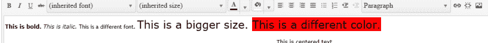

- 项目符号
1. 编号列表
   缩进文本。

这是一个超链接。

查看编辑器小部件顶部所有的工具按钮。在输入时点击它们以观察它们的作用。还要注意，由 Kendo HTML 编辑器生成的不同按钮都支持 HTML `tabindex`，因此您可以使用 `Tab` 键和 `Shift + Tab` 组合分别按照您想要的顺序在命令之间来移动。

对于许多网站来说，这些功能可能足够了。要格式化用户创建的文本，只需检索 `textarea` 元素的值，它将同时包含内容和 HTML 标记。

> 不要忘记检查您的输入
> 既然您公开允许用户在其数据内容中发布 HTML 标记，因此在将其放入数据库或另一个页面之前，务必格外小心地对输入进行清理。尽管 Kendo 工具生成的 HTML 标记是安全的，但您永远无法信任传输到服务器浏览器的最终标记，应始终将其视为可能包含有害代码的内容。

然而，在您的格式化文本下方，您还需要检查您正在处理的值是否已经经过了编码。如果您从 DOM 中检索 `textarea` 元素的值，您将获得 HTML 编码的数据。这意味着 `<strong>` 变成 `&lt;strong&gt;`，这可能正是或不是您实际想要的。

要获取非 HTML 编码的数据，您需要使用像下面的代码调用 `kendoEditor` 对象上的 `value()` 函数：

```javascript
var editor = $("#editor").data("kendoEditor");
var nonEncodedText = editor.value();
```

但再次，您需要对自己的操作保持小心。您无法在绕过某些安全措施的情况下将非 HTML 编码数据发布到此列表到 Web 服务器。更安全的选项是在使用数据之前将数据发布到服务器端。使用 HTML 编码格式，然后进行解码和清理，可能在开始解释用户输入的过程之前拒绝页面输出中的某些潜在的恶意代码。

这是一个更新后的页面，带有一些按钮，可以向您显示 DOM `val()` 函数与 `kendoEditor` `value()` 函数的不同输出：

```html
<!DOCTYPE html>
<html>
<head>
<title>title</title>
<script src="Scripts/jquery.js"></script>
<script src="Scripts/kendo/kendo.all.js"></script>
<link href="Content/kendo/kendo.common.css" rel="stylesheet" />
<link href="Content/kendo/kendo.default.css" rel="stylesheet" />
<style type="text/css">
textarea {
width: 100%;
height: 300px;
}
</style>
</head>
<body>
<textarea id="editor"></textarea>
<script type="text/javascript">
  $(document).ready(function () {
    $("#editor").kendoEditor();
  });
</script>
</body>
</html>
```


```js
"strikethrough",
"fontName",
"fontSize",
"foreColor",
"backgroundColor",
"justifyCenter",
"justifyRight",
"justifyFull",
"insertUnorderedList",
"insertOrderedList",
"indent",
"outdent",
"formatBlock",
"createLink",
"unlink",
"insertImage",
"script",
"subscript",
"superscript",
"viewHtml",
"style",

style:
  {text: "Big Blue", value:"bigBlue"},
  {text: "Dark Grey", value:"darkGrey"},
  stylesheets:[
    "css/StyleTool.css"
  ]
};
```

以下是 StyleTool.css 文件的内容：

```css
.blueBlue {
  font-size:large;
  color:blue;
}

darkGrey {
  color:white;
  background-color:#111111;
}
```

## 第 5 章

为了实现这一功能，我将 Style 添加到工具列表中，然后添加了样式配置属性和可选的样式表配置属性。样式配置属性定义了出现在样式下拉列表中的不同选项，并定义了当 HTML 编辑器文本区域中的某些文本选择这些样式时，应该应用哪些 CSS 类。样式表选项允许您在需要显示自定义样式时导入一些额外的样式表。

以下是您使用 ASP.NET MVC 实现这些样式的方法：

```javascript
@(Html.Kendo().Editor())
Name("htmlEditor")
.Tools(tools => tools
.SubScript()
.SuperScript()
.Styles(styles => styles
.Add("Big Blue", "bigBlue")
.Add("Dark Grey", "darkGrey")
.StyleSheets(css => css)
.Add("/Content/StyleTool.css")
```

以下是该代码的输出：

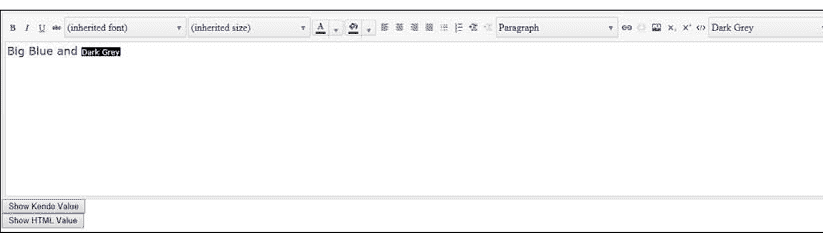

为了演示，我包含了一些样式文本，并点击了样式下拉列表，显示列表中的选项也经过了样式处理，以匹配它们各自的 CSS 类。

[ 123 ]

# 插入 HTML 代码段的工具

Snippets（代码段）工具是一种特殊的工具栏选项，旨在通过单击向编辑器窗口中插入预定义的文本块。它可以用于为常见问题添加标准回复、签名块、时间戳，或任何预先输入文本有用的场景。要启用此功能，就像配置 Styles 选项一样，您通过 `kendoEditor` 对象配置工具，并指定哪些选项应该出现在样式下拉列表中。以下是一个示例：

```javascript
$("#editor").kendoEditor({
tools: [
  "italic",
  "underline",
  "strikethrough",
  "fontName",
  "fontSize",
  "foreColor",
  "backColor",
  "justifyLeft",
  "justifyCenter",
  "justifyRight",
  "justifyFull",
  "insertUnorderedList",
  "insertOrderedList",
  "indent",
  "outdent",
  "formatBlock",
  "createLink",
  "unlink",
  "insertImage",
  "subscript",
  "superscript",
  "viewHtml",
  "style",
  "insertHtml"
],
style: [
  {text: "Big Blue", value:"bigBlue"},
  {text: "Dark Grey", value:"darkGrey"}
],
sheets: [
  "css/StyleTool.css"
];
```

```javascript
insertHtml: [
  {text: "Today's date", value: "December 7, 2012"},
  {text: "Signature", value: "<p>Sincerely,<br/>John Adams</p>"}
];
```

注意，启用此功能只需要非常少的配置。我们在工具配置中包含了 `insertHtml` 选项，然后在 `kendoEditor` 的末尾添加了 `insertHtml` 配置属性。在 `insertHtml` 配置属性内部，我们包含了一个简单对象的数组。每个项目的标题将出现在下拉列表中，精确的标记将粘贴到 HTML 编辑器中。以下是您实现这些代码段的方法：

```javascript
@Html.Kendo().Editor()
  .Name("htmlEditor")
  .Tools(tools => tools
    .SubScript()
    .SuperScript()
    .Styles(styles => styles
      .Add("Big Blue", "blue")
      .Add("Dark Grey", "darkGrey"))
    .Snippets(snippets => snippets
      .Add("Today's Date", DateTime.Today.ToShortString())
      .Add("Signature", "<p>Sincerely,<br/>John Adams</p>"))
    .StyleSheets(css => css
      .Add("Content/Style.css"))
);
```

这是该代码的输出：

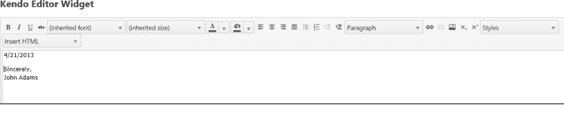

# 自定义 HTML 编辑器工具

Kendo HTML Editor 允许您在工具栏上添加自己的自己的选项。这是 Kendo UI 框架中一个非常灵活的特性，如果提供的内置工具不能完全满足您的需求，您可能会发现它有用。HTML 编辑器至少可以接受三种类型的自定义工具。可能还有更多，但在 Kendo UI 网站的文档中出现了这三种：

- 覆盖内置工具
- 自定义模板工具
- 自定义行内工具

# 下拉列表工具

如果您想更改某些内置的下拉列表工具，可以重新定义出现在它们内部的选项。这不会改变工具的性质或功能。它只决定了当您点击工具时，哪些选项出现在工具的下拉列表中。例如，限制字体工具中出现的选项。通过替换 `items` 数组的内容，您可以自定义工具在页面上显示时确切出现的哪些选项：

```javascript
$("#editor").kendoEditor({
  name: "fontName",
  items: [
    {text:"Garamond", value: "Garamond, serif"},
    {text:"Calibri", value:"calibri, sans-serif"}
  ]
});
```

此代码示例演示了一个限制两个特定选项的自定义工具。正如我们之前看到的，这两个字体未包含在默认字体工具中，但您也可以在这个自定义列表中包含默认字体。以下是使用此自定义工具配置的 HTML 编辑器的输出：

## 第 5 章

| (inherited font) |
| (inherited font) |
| Garamond |
| Calibri |
| Garamond, serif |


您会注意到，启用此功能只需要非常少的配置。我们在工具配置中包含了 `insertHtml` 选项，然后在 `kendoEditor` 的末尾添加了 `insertHtml` 配置属性。在 `insertHtml` 配置属性内部，我们包含了一个简单对象的数组。每个项目的标题将出现在下拉列表中，精确的标记将粘贴到 HTML 编辑器中。以下是您实现这些代码段的方法：

您能注意到，启用此功能只需要非常少的配置。我们在工具配置中包含了 `insertHtml` 选项，然后在 `kendoEditor` 的末尾添加了 `insertHtml` 配置属性。在 `insertHtml` 配置属性内部，我们包含了一个简单对象的数组。每个项目的标题将出现在下拉列表中，精确的标记将粘贴到 HTML 编辑器中。以下是您实现这些代码段的方法：

这种工具配置可以与 HTML 编辑器中的字体名称、字体大小和格式块工具一起工作。

# 按钮工具

似乎可能不需要覆盖这些控件，因为创建您自己的工具可能更有效。但是，如果您想查看如何操作的，这里有一个来自 Kendo UI 的示例代码，展示了如何替换 viewHtml 功能：

```html
<script type="text/x-kendo-template" id="viewHtml-template">
<div>
  <textarea style="width:400px; height:300px;"></textarea>
  <div class="viewhtml-actions">
    <button class="k-button viewHtml-update">Update</button>
    <button class="k-button viewHtml-cancel">Cancel</button>
  </div>
</div>
</script>
```

```javascript
$("#editor").kendoEditor({
  tools: {
    name: "View HTML",
    tooltip: "View HTML",
    exec: function (e) {
      var editor = $(this).data("kendoEditor");
      var dialog = $("#viewHtml-template").html()
        .appendTo("body").kendoWindow();

      dialog.find("textarea").val(editor.html());

      dialog.find(".viewHtml-update").click(function () {
        editor.html(dialog.find("textarea").val());
        dialog.close();
      });

      dialog.find(".viewHtml-cancel").click(function () {
        dialog.close();
      });

      dialog.kendoWindow({
        modal: true,
        title: "View HTML",
        deactivate: function () {
          dialog.destroy();
        }
      }).center().open();
    }
  }
});
```

这是代码在页面上显示的样式：

```html
View HTML

lorem ipsum...
<p>lorem ipsum...</p>
```

此源码包含了模板和 `kendoEditor` 配置。您可以通过打开一个对话框、填充 HTML 编辑器的内容、设置按钮事件并显示给用户来查看此代码。

# 自定义模板工具

如果您想创建一个带有选项列表的自定义工具，自定义模板是最佳选择。它允许您使用 Kendo UI 模板来标记工具在工具栏上的显示方式，然后您可以编写其功能，以便您的工具能够执行需要的操作：


# HTML 编辑器与自定义工具

```javascript
{
  name: "editorBackground",
  template: "($#editorColor-template).html"
}

$("#showHtmlVal").click(function () {
  alert($("#editor").val());
});
var editor = $("#editor").data("kendoEditor");
$("#showKendoVal").click(function () {
  alert($("#editor").value());
});
$("#customTool").change(function (e) {
  $("#editor").data("kendoEditor").body.style.backgroundColor = 
  $("#customTool").val();
});
```

你可以看到 Kendo 模板，其中声明了 label 和 select 元素。select 元素的行为是在 jQuery 代码中定义的，但自定义的下拉列表是通过通过 `tools` 属性添加到了 HTML 编辑器中。

以下是带有此自定义工具的页面输出：

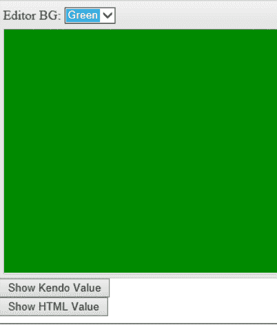

这就是创建行为类似于下拉列表的自定义工具的方法。如你所见，行为完全由你决定，因此你可以根据网站的场景创建任何需要的工具。

## 自定义内联工具

如果你想在工具栏上创建自己的按钮工具，内联工具是正确的选择。它允许你定义工具名称以及当从工具栏上选择该工具时要执行的代码。

```javascript
$("#editor").kendoEditor({
  {
    name: "addHr",
    tooltip: "插入水平线",
    exec: function (e) {
      var editor = $(this).data("kendoEditor");
      editor.exec("insertHtml", { value: "<hr/>" });
    }
  }
});
```

这段代码显示了一个自定义工具 `addHr`，点击时它会向 HTML 编辑器控件添加一个 `hr` 元素。你还可以看到在 `kendoEditor` 上对 `exec` 函数的使用，在其中你指定了 HTML 编辑器的内置函数/工具之一，然后提供一个提供其参数的对象。

以下是该代码的输出：

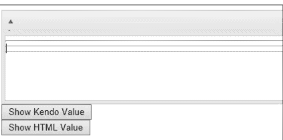

## 使用 HTML 编辑器 API

Kendo HTML Editor 拥有一大量的 API 配置选项，允许你根据网页的特定需求和情况对组件进行微调。它暴露了一系列方法和事件，你可以通过这些方法程序化地启用并响应 Edit 组件在页面上运行时所提供的功能。这些选项结合在一起，使你能够扩展编辑器以超出默认范围。

### 配置选项

我们已经在上面的材料中涵盖了部分内容，这里是 HTML 编辑器控件可用的配置选项。如既常，请访问 docs.kendo.com/api/web/editor 查看 Kendo UI Web 文档，获取更详细的编辑器设置列表以及 API 的最新更改或更新。

```javascript
$("#").({
  encoded: true, // 编辑器是否输出编码的 html
  tags,
  messages: { // 为内置工具和对话框定义自定义标签
    dialogs,
    bold: "粗体",
    stylesheets: {...}, // 见上，为编辑器加载的自定义样式表
    tools: {...}, // 见上，编辑器中显示的自定义和内置工具
    imageBrowser: { // imageBrowser 工具可以接受自定义
      configuration
      transport: { // 用于图像操作的端点
        read: "imagebrowser/read",
        destroy: "imagebrowser/destroy",
        create: "imagebrowser/createDirectory",
        uploadURL: "imagebrowser/upload",
        thumbnailUrl: "imagebrowser/thumbnail" // 缩略图路径
      }
      imageUrl: "/content/images/{0}" // {0} 是虚拟占位符
    } // 路径和图像名称
  },
  path: "/myInitialPath/", // 显示图片的初始路径
  fileTypes: {".png,.gif,.jpg,.jpeg"}, // 允许的图像文件扩展
  schema: {...}, // 可以定义 schema 来解析显示图像时
  // 从远程端点返回的数据
  messages: {...} // imageBrowser 控件和对话框的自定义消息
});
```

## 事件

作为复杂网站中的任何 HTML 元素或 JavaScript 对象，网页会在用户在页面执行某些操作时触发事件。通过你的 JavaScript 代码挂钩这些事件，你可以实时响应页面的变化和数据，并根据用户执行的操作组织页面的功能。HTML 编辑器控件响应用户操作触发以下事件：

- change: 每当编辑器组件内部的数据发生变化时，触发此事件。
- execute: 当执行工具时触发此事件。每当点击工具栏并执行该按钮后的代码时，触发此事件。
- keydown: 每当用户在编辑器窗口内打字按下按键时，触发 keydown 事件。挂钩此事件允许你在用户输入时对文本做出响应。
- keyup: 每当用户在编辑器组件窗口内打字按下并释放按键时，触发 keyup 事件。挂钩此事件允许你在用户输入时对文本做出响应。
- paste: 每当文本被粘贴到编辑器中时，触发 paste 事件。
- select: 每当选择文本时，触发 select 事件。

## 总结

HTML 编辑器是创建富文本内容的强大工具。通过使用它的 API 和配置选项，你可以自定义编辑器体验以满足你的特定需求。编辑器提供的事件允许你响应用户操作并扩展编辑器的功能。


## 第 6 章

```html
}};
<script>
</body>
</</html>
```

这是一个显示不同音乐风格、视频和一些选项的菜单，仅用于演示代码的工作原理。无序列表中的顶级 `<li>` 元素在输出中均作为实际的菜单标题，在本例中它们是音乐（Music）、视频（Videos）、活动（Events）和新闻（News）。

> 注意，这些顶级元素中的每一个都包含自己的名称，然后可以可选地内部包含一个嵌套列表 `<ul>`，这将成为当在页面上选择顶级项目时出现的选项。

继续向下看，嵌套列表中的每个 `<li>` 元素也可以包含自己的 `<ul>`，用于更深层次的嵌套菜单。这创建了一种级联效果，当你将鼠标移动到不同选项时，菜单选项可以继续展开。还需要注意，最后一个顶级 `<li>` 项目“新闻”（News）被标记为禁用（disabled）属性，这意味着它仍然显示在输出中，但不可选择。

以下是该代码在页面首次加载时的输出：

| 音乐 (Music) | 视频 (Videos) | 活动 (Events) | 新闻 (News) |
| --- | --- | --- | --- |
| 基督教福音 (Christian Gospel) | | | |
| 古典音乐 (Classical) | | 巴洛克 (Baroque) | | |
| 乡村音乐 (Country) | | 古典 (Classical) | | |
| 电子/舞蹈 (Electronic/Dance) | | 古典吉他 (Classical Guitar) | | |
| 嘻哈 (Hip Hop) | | 古典时期 (Classical Period) | | |
| 爵士 (Jazz) | | 现代古典 (Contemporary Classical) | | |
| 拉丁 (Latin) | | 融合 (Crossover) | | |
| 流行 (Pop) | | 早期音乐 (Early Music) | | |
| R&B/灵魂 (R&B/Soul) | | 歌剧运作 (Opera Operations) | | |
| 雷鬼/舞厅 (Reggae/Dancehall) | | 浪漫 (Romantic) | |
| 摇滚 (Rock) | | | |
| 世界音乐 (World) | | | |

这是鼠标悬停在菜单某些元素上的 Menu 组件。尝试自己操作一下，看看菜单对这些事件的反应有多快、流畅；沉浸感非常强。

## Menu 和 ListView

与 Kendo UI 框架中的大多数组件一样，Menu 组件不必从静态 HTML 运行，它可以由本地或远程数据的 `DataSource` 对象提供支持。以下是改为使用本地 `DataSource` 代替静态 HTML 的代码：

```html
<!DOCTYPE html>
<head>
    <title>Kendo UI Menu</title>
    <script src="Scripts/kendo/jquery.js"></script>
    <script src="Scripts/kendo/kendo.all.js"></script>
    <link href="Content/kendo/common.css" rel="stylesheet" />
    <link href="Content/kendo/kendo.default.css" rel="stylesheet" />
</head>
<body>
    <div id="menuDemo"></div>
    <script type="text/javascript">
        var menuData = {
            text: "Music",
            items: [
                {
                    text: "Blues/Folk",
                    items: [
                        { text: "Contemporary Blues" },
                        { text: "Contemporary Folk" },
                        { text: "Traditional American" },
                        { text: "World Folk" }
                    ]
                }
            ],
            text: "Christian / Gospel",
            items: [
                { text: "Christian Rock / Hip Hop" },
                { text: "Contemporary Christian" },
                { text: "Traditional Gospel" }
            ]
        },
        text: "Videos",
        items: [
                { text: "Movies" },
                { text: "TV" },
                { text: "Trailers" }
        ]
    </script>
</body>
</html>
```

```javascript
]
},
{
  text: "Events"
},
{
  text: "News",
  enabled: false
}
];
</script>
<script type="text/javascript">
  $(document).ready(function () {
    $("#menuDemo").kendoMenu({
      dataSource: menuData 
    });
  });
</script>
</body>
</html>
```

注意，`DataSource` 对象可以配置你在前面章节中看到过的所有选项，并且同样容易地配置用于远程数据的 `transport` 属性。

输出与我们第一次使用的静态 HTML 完全相同：


与大多数 Kendo UI 组件一样，无论数据是来自页面标记还是 JavaScript 数据源，页面上的交互内容都是相同的。要将此适配到 MVC 扩展方法，我们可以在 `cshtml` 文件中使用以下源代码创建一个 MVC 视图：

```cshtml
@using Kendo.Mvc.UI;

@{
    ViewBag.Title = "Mvc Menu";
}

<h2>Mvc Menu</h2>
@(Html.Kendo().Menu()
    .Name("menuDemo")
    .Items(items => {
        items.Add().Text("Music").Items(sub => {
            sub.Add().Text("Blues / Folk").Items(subsub => { // 修复了原代码中的 subsub 拼写错误
                subsub.Add().Text("Contemporary Blues");
                subsub.Add().Text("Contemporary Folk");
                subsub.Add().Text("Traditional American");
                subsub.Add().Text("World Folk");
            });
            sub.Add().Text("Christian / Gospel").Items(subsub => {
                subsub.Add().Text("Christian Rock / Hip Hop");
                subsub.Add().Text("Contemporary Christian");
                subsub.Add().Text("Traditional Gospel");
            });
        });
        items.Add().Text("Videos").Items(sub => {
            sub.Add().Text("Movies");
            sub.Add().Text("TV");
            sub.Add().Text("Trailers");
        });
        items.Add().Text("Events");
        items.Add().Text("News").Enabled(false);
    })
)
```


## Menu API 配置选项

正如你所预料的，Kendo UI 组件可以通过全套 API 属性和方法进行配置。这些选项是可以进行配置的属性，使得 Menu 组件能够适应你页面的需求和样式。这些配置是在创建 Menu 组件的代码点处指定的。这些章节将为你展示你可以使用的选项。

## animation 属性

Kendo UI Menu 的动画动作可以针对样式、速度和方向进行配置。当你配置菜单的打开（open）动作时，Kendo 会自动为关闭（close）动作分配反向。如果你想独立于打开动作配置关闭动作，你应该分别配置它们，如下：

```javascript
$("menu").kendoMenu({
  close: { // 关闭菜单时使用的动画
    effects: "slideIn", // 'slideIn' / 'fadeIn' / 'expand'
    duration: 10
  },
  open: { // 打开菜单时使用的动画
    effects: "slideInDown", // 你也可以指定方向
    duration: 10
  }
});

// 或者完全禁用动画
$("menu").kendoMenu({
  animation: false
});
```

## direction 属性

direction 属性决定了用户悬停在菜单上时菜单打开的方向。这里可选选项有 top、bottom、left 和 right。

```javascript
$("menu").kendoMenu({
  direction: "bottom"
});
```

第 6 章

```javascript
...
// 或者你可以单独指定每一级子菜单的打开方式
$("menu").kendoMenu({
  direction: "bottom right" // 菜单使用 "bottom"，子菜单使用 "right"
  menus
});
```

## 更多选项

还有一些额外的选项可用于配置菜单行为。你可以通过 `onClick`、`openOnClick` 和 `hoverDelay` 属性配置菜单相对于鼠标移动和点击的行为。你可以通过 `orientation` 属性配置菜单是水平方向还是垂直方向，并可以通过 `popupCollision` 属性配置如何使用 Kendo UI 框架让菜单适应页面。所有这些内容所示：

```javascript
$("menu").kendoMenu({
  onClick: true, // 选中项目时关闭菜单
  hoverDelay: 100, // 菜单打开/关闭之前的延迟
  openOnClick: false, // 选中项目时打开根子菜单
  orientation: "vertical", // 方向：
  popupCollision: "fit" // 如何调整菜单以适应屏幕边界
  // 垂直菜单使用 "fit flip"。
  // 设置为 false 以禁用边界检测
});
```

完全。

## 配置菜单方法

Kendo UI Menu 组件的某些方法要求你获取现有菜单项的引用（而不仅仅是 HTML 元素），作为添加或插入额外菜单项的引用点。在这种情况下，你可以通过对 Kendo Menu 的引用这样访问菜单项对象：

```javascript
var menu = $("#menuDemo").data("kendoMenu");
```

在这段代码中，你可以在实例化它的同一行代码中获取 Kendo Menu 对象的引用。这样，你可以在页面的其他部分和 JavaScript 逻辑中引用此对象。你也可以在代码任何时候对包含它的 HTML 元素调用 `.data(...)` 来获取 Kendo Menu 对象的引用，但一步到位会更好。

— 145 —

一旦你有了这个引用，就可以可以通过 `element` 属性访问 Kendo Menu 内部的子元素：

```javascript
menu.element.child("li").eq(3);
```

在代码示例中，我们向此特定菜单对象的子元素添加了第四个 `li` 元素。这里的返回值是一个 JavaScript 对象，可以作为 `append`、`insertAfter` 和 `insertBefore` 方法的引用点。

## append(), insertAfter(), 和 insertBefore() 方法

`append` 方法接受两个参数：作为子项添加的新菜单项（项）的 JSON 表示，以及作为新添加项父元素的菜单项的引用：

```javascript
var menu = $("menu").data("kendoMenu");
var referenceItem = menu.element.child("li").eq(1);

menu.append({
  text: "new menu item",
  url: "http://www.music.com",
  items: [...]
}, referenceItem);
```

这段代码将此菜单项作为子项添加到页面上的第二个菜单项中。`insertAfter` 和 `insertBefore` 方法的工作原理完全相同，只是它们将新菜单项插入相同的菜单层级，并分别在引用项之后或之前。

> 所有这些方法都返回 Menu 对象以支持链式调用。

## close(), enable(), open(), 和 remove() 方法

这些 Kendo UI Menu 方法不需要 JavaScript 对象引用；它们直接操作页面内的 HTML 元素。正因如此，你可以使用 jQuery 选择器语法以熟悉的语法来选择要操作的项目（项）。

`enable` 方法接受两个参数：HTML 元素的选择器，以及一个 `true` 或 `false` 值，指示该元素应该被启用（true）还是禁用（false）：

```javascript
var menu = $("menu").data("kendoMenu");
menu.enable("#secondItem", false);
```

这段代码示例将禁用 HTML id 值为 `seconditem` 的元素。

这里的其他方法，即 `close`、`open` 和 `remove`，只接受单个参数，即 HTML 元素的选择器。

`close` 方法接受 HTML 元素的选择器并关闭菜单。

`open` 方法接受 HTML 元素的选择器并打开菜单。

`remove` 方法接受 HTML 元素的选择器并移除菜单。

`enable` 方法接受 HTML 元素的选择器，以及一个 `true` 或 `false` 值，指示该元素应该被启用（true）还是禁用（false）：

```javascript
var menu = $("menu").data("kendoMenu");
menu.enable("#secondItem", false);
```

这段代码示例将禁用 HTML id 值为 `seconditem` 的元素。

这里的其他方法，即 `close`、`open` 和 `remove`，只接受单个参数，即 HTML 元素的选择器。

`close` 方法接受 HTML 元素的选择器并关闭菜单。

`open` 方法接受 HTML 元素的选择器并打开菜单。

`remove` 方法接受 HTML 元素的选择器并移除菜单。

`enable` 方法接受 HTML 元素的选择器，以及一个 `true` 或 `false` 值，指示该元素应该被启用（true）还是禁用（false）：

```javascript
var menu = $("menu").data("kendoMenu");
menu.enable("#secondItem", false);
```

这段代码示例将禁用 HTML id 值为 `seconditem` 的元素。

> 所有这些方法都返回 Menu 对象以支持链式调用。

## 菜单事件

Kendo UI 触发三个事件：`close`、`open` 和 `select`。

`close` 事件在菜单关闭时触发。

`open` 事件在菜单打开时触发。

`select` 事件在项目被选中时触发。

```javascript
$("#menu").on("close", function(e) {
  console.log("Menu closed");
}).on("open", function(e) {
  console.log("Menu opened");
}).on("select", function(e) {
  console.log("Item selected", e.item);
});
```


# 菜单与 ListView

```javascript
{ animalName: "Giraffe", imageName: "giraffe.jpg" },
{ animalName: "Hummingbird", imageName: "humming-bird.jpg" },

{ animalName: "Jaguar", imageName: "jaguar.jpg" },
{ animalName: "Lemur", imageName: "lemur.jpg" },
{ animalName: "Red Fox", imageName: "red-fox.jpg" },
{ animalName: "Striped Skunk", imageName: "striped-skunk.jpg" }

$(document).ready(function () {
  $("#listView").kendoListView({
    dataSource: animals,
    template: kendo.template($("#template").html())
  });
});
</script>
```

下面的代码示例从上到下显示了出现在 ListView 小部件内部元素的某些样式。这些样式声明对于在网页上正确布局 ListView 小部件内部的图像非常重要：

```css
<style type="text/css">
.animal {
  width:250px;
  height:200px;
  position:relative;
  float:left;
}
.animal-label {
  font-size:large;
}
.animal-image {
  max-height:100px;
  max-width:150px;
  margin: 5px;
}
#listView {
  width:750px;
  height:100%;
}
</style>
```

## 第 6 章

我们创建了包含 ListView 小部件的 div 元素以及用于构建单个 ListView 元素的 Kendo UI 模板。该模板决定了 ListView 中的每个项在网页中的渲染方式。对 ListView 项目的任何更改都必须在此进行：

```html
<div id="listView"></div>
<script type="text/x-kendo-tpl" id="template">
  <div class="animal">
    
  </div>
</script>
```

我们有一个包含某些数据的 JavaScript 对象字面量，以及 ListView 的实例化，其中设置了 `dataSource` 和 `template` 属性：

```javascript
var animals = [
  { animalName: "African Elephant", imageName: "african-elephant.jpg" },
  { animalName: "African Lion", imageName: "african-lion.jpg" },
  { animalName: "Alpaca", imageName: "alpaca.jpg" },
  { animalName: "Badger", imageName: "badger.jpg" },
  { animalName: "Black Bear", imageName: "bear-black.jpg" },
  { animalName: "Bison", imageName: "bison.jpg" },
  { animalName: "Jack-Rabbit", imageName: "black-tailed-jackrabbit.jpg" },
  { animalName: "Caribou", imageName: "caribou.jpg" },
  { animalName: "Giraffe", imageName: "giraffe.jpg" },
  { animalName: "Hummingbird", imageName: "humming-bird.jpg" },
  { animalName: "Jaguar", imageName: "jaguar.jpg" },
  { animalName: "Lemur", imageName: "lemur.jpg" },
  { animalName: "Red Fox", imageName: "red-fox.jpg" },
  { animalName: "Striped Skunk", imageName: "striped-skunk.jpg" }
];

$(document).ready(function () {
  $("#listView").kendoListView({
    dataSource: animals,
    template: kendo.template($("#template").html()
  });
});
```

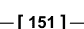

```javascript
}};
</script>
```

一如既往，请记住 `DataSource` 对象可以完全配置为指向远程数据源，这些数据源可以使用 `schema` 进行结构化，或者使用你在生产场景中可能希望的任何其他选项。

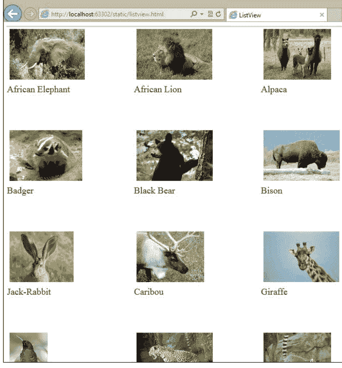

你可以看到 `DataSource` 对象中的每个元素是如何通过模板渲染、样式处理并按照你预期的方式呈现在页面上的。

## 使用 ListView 选择元素

然而，ListView 小部件提供的行为比简单显示数据要丰富得多，让我们来看看它如何允许“选择”元素。在段代码示例中，我在 ListView 实例化逻辑中添加了一些属性和一个事件处理程序来演示这一点：

```javascript
$(document).ready(function () {
  $("#listView").kendoListView({
    dataSource: animals,
    template: kendo.template($("#template").html()),
    selectable: "multiple",
    notifyUser: notifyUser
  });

  function notifyUser(e) {
    var selected = $.map(this.select(), function (item) {
      return animals[$(item).index()].animalName;
    });
    alert(selected.join(","));
  }
});
</script>
```

`selectable` 属性被设置为 `multiple`，以允许多选多个项目（你可以通过按住键盘上的 Ctrl 键并点击鼠标来选择页面上的多个项目）。我们还为 `change` 事件添加了事件处理程序，这样我们就可以看到显示已选择元素的警报框。

在 `notifyUser` 事件处理器函数中，`selected` 变量显示了警报框中显示哪些元素被选中。

## 使用 ListView 编辑元素

ListView 小部件提供了更丰富的行为，而不仅仅是显示数据，让我们来看看它如何允许“选择”元素。在段代码示例中，我在 ListView 实例化逻辑中添加了一些属性和一个事件处理程序来演示这一点：

`selectable` 属性被设置为 `multiple`，以允许多选多个项目（你可以通过按住键盘上的 Ctrl 键并点击鼠标来选择页面上的多个项目）。我们还为 `change` 事件添加了事件处理程序，这样我们就可以看到显示已选择元素的警报框。

在 `notifyUser` 事件处理器函数中，`selected` 变量显示了警报框中显示哪些元素被选中。

ListView 小部件提供了更丰富的行为，而不仅仅是显示数据，让我们来看看它如何允许“选择”元素。在段代码示例中，我在 ListView 实例化逻辑中添加了一些属性和一个事件处理程序来演示这一点：

`selectable` 属性被设置为 `multiple`，以允许多选多个项目（你可以通过按住键盘上的 Ctrl 键并点击鼠标来选择页面上的多个项目）。

还为 ` ``` 事件添加了`处理`，这样我们就能看到显示已选择元素的警 alert。。

    编辑的代码：

```html
<script type="text/x-kendo-tpl" id="edit-template">
  <div class="animal">
    
  </div>
  <div class="animal-label">
    <input type="text" data-bind="value:animalName"
           name="animalName"
           required="required" />
  </div>
  <a class="k-button k-button-update"
     href="javascript:void"><span class="k-icon k-update"></span></a>
  <a class="k-button k-button-cancel"
     href="javascript:void"><span class="k-icon-cancel"></span></a>
</div>
</script>
```

你注意到两个按钮的 `href` 属性中的特殊字符了吗？双反斜杠字符 `\#` 防止标记被渲染为模板的一部分。如果没有使用这些反斜杠对标记进行转义，模板将无法渲染。

我们在创建 ListView 的 JavaScript 块中添加了一些更多配置。具体来说，我们现在有一个 `editTemplate` 属性指向我们创建的内容：

```javascript
$(document).ready(function () {
  $("#listView").kendoListView({
    dataSource: animals,
    template: kendo.template($("#template").html(),
    editTemplate: kendo.template($("#edit-template")).html()
  });
});
```

## 第 6 章

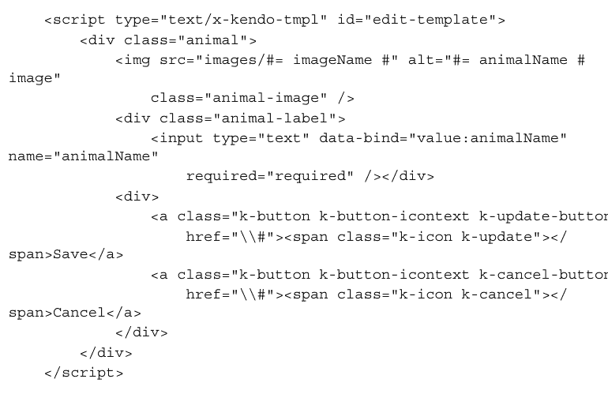

```javascript
}};
</script>
</body>
</html>
```

这是一张截图，显示驯驼的名字已被编辑为驯鹿：

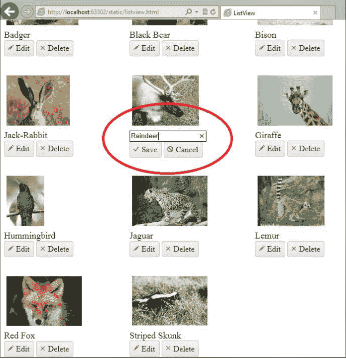

| Badger | Black Bear | Bison |
| Edit Delete | Edit Delete | Edit Delete |
| Jack-Rabbit | Reindeer (Save Cancel) | Giraffe |
| Edit Delete | Edit Delete | Edit Delete |
| Hummingbird | Jaguar | Lemur |
| Edit Delete | Edit Delete | Edit Delete |
| Red Fox | Striped Skunk | |
| Edit Delete | Edit Delete |

# # ListView API 和配置

我们已经在先前的示例中涵盖了 ListView 的几个方面；这里是文档中剩余的配置属性：

```javascript
$("#listView").kendoListView({
autoBind: true, // 如果为 false，你必须手动调用 read()
```


```
dataSource: ..., // 如上所示
editTemplate: ..., // 如上所示
navigable: false, // 是否启用键盘导航
selectable: false, // true/false 或 "single"/"multiple" 是有效选项
template: ..., // 如上所示
altTemplate: ..., // 如果需要，用于交替样式的模板
));
```

## ListView 方法

ListView 组件提供了多个可用方法。大部分方法用于操作 ListView 内部的项，让你可以通过代码控制其行为。与任何组件一样，在调用这些方法之前，你需要 ListView 对象的引用，如下：

```javascript
var listView = $("#listView").data("kendoListView");

listView.add();
```

通过 `.data(...)` 方法获取引用即可调用 ListView 特有的方法。以下是不带参数的方法简要概述：

- add: 向 ListView 插入一个空项目并将其准备好进行编辑
- cancel: 取消当前正在编辑的项目的更改
- clearSelection: 清除 ListView 的已选项目并触发 change 事件
- refresh: 重新加载数据并重新打印 ListView
- save: 保存编辑过的 ListView 项目。如果验证通过，将调用数据源的 sync 方法

还有几个带有参数的方法。

## edit 方法

该方法编辑指定的 ListView 项目并触发 edit 事件。该方法接受一个参数，即需要编辑的 ListView 项目。示例如下：

```javascript
var listView = $("#listView").data("kendoListView");
...
listView.edit(listView.element.children().first());
```

## remove 方法

该方法移除指定的 ListView 项目并触发 remove 事件。它还会触发数据源的 sync 方法。

```javascript
var listView = $("#listView").data("kendoListView");

listView.remove(listView.element.children().first());
```

## select 方法

该方法选择 ListView 项目。如果调用此方法时不传递任何参数，它将返回 ListView 中所有已选项目的集合。这就是我们在代码示例中选择项目的方法。以下是带参数使用方法的代码示例：
这里有一个列表：

```javascript
var listView = $("#listView").data("kendoListView");

listView.select(listView.element.children().first());
```

## ListView 事件

ListView 组件暴露了多个事件，用于挂钩其生命周期和行为。我们已经在示例中见过其中一些。正如我们在在本节早期所述的，这些事件都可以在 ListView 实例化期间分配给处理程序。

- change: 当 ListView 选择发生变化时触发
- dataBound: 当 ListView 从 DataSource 对象接收到数据并准备渲染它时触发
- dataBinding: 当数据即将渲染到页面上时触发
- edit: 当 ListView 进入编辑模式时触发
- remove: 在 ListView 项目被移除之前触发

## 总结

Menu 和 List 组件是构建网页上数据结构的极佳工具。Menu 组件可以轻松创建用于导航的交互式 JavaScript 菜单，甚至可以用于图形显示数据。当你需要一种在网页上渲染数据元素集合的标准方法时，ListView 组件应该成为一个标准选项。它让你能够连接某些功能，而这些功能通常需要大量的代码和调试。

在下一章中，我们将查看 Kendo UI PanelBar 组件。正如你将看到的，由于它的 API 与 Kendo UI Menu 组件非常相似，并且是在网页上渲染手风琴控件（accordion controls）的一种强大方式。与 Kendo UI Menu 组件类似，它的首要责任是以一种节省屏幕空间的方式组织层级内容，但仍能为用户理解提供一个合理的结构。

## 7 实现 PanelBar 和 TabStrip

PanelBar 和 TabStrip 组件是用于组织数据的特殊 UI 控件，它们使得网页可以包含大量内容但一次只显示其中一部分内容。这些内容部分通过 PanelBar 组件分成面板（panels），或通过 TabStrip 组件分成标签（tabs）。在两种情况下，效果非常相似，并且是防止网页变得过于拥挤的一种有用方法。本章将解释如何使用 HTML 和 ASP.NET MVC 实现 PanelBar 和 TabStrip 控件的基础，然后说明以下功能：

- 向 PanelBar 和 TabStrip 项目添加图像
- 向 PanelBar 和 TabStrip 项目添加 URL
- 使用 PanelBar 和 TabStrip 加载 AJAX 内容
- 控制 PanelBar 和 TabStrip 的动画效果

## PanelBar 基础知识

PanelBar 组件是 Kendo UI 在网页上实现 JavaScript “手风琴”的方式。这种类型的控件对于显示可能占用大量屏幕空间的数据列表非常有用，但可以将其压缩成用户易于理解的格式。作为介绍，这里有一个从静态 HTML 无序列表创建的 基础 PanelBar 代码示例。该列表将被重新格式化为手风琴控件，每次显示列表的一个区域。正如你所看到的，当运行此代码示例时，它允许大量数据在视觉上被压缩到较小的空间内。它还允许用户选择他们感兴趣查看的列表区域，并隐藏其他部分的详细信息。这有力地证明了 Kendo 组件实现之间的一些共同点。

注意，我使用了与上一章中 Menu 控件相同的数据。

```html
<!DOCTYPE html>
<html>
<head>
<title>Kendo UI PanelBar</title>
<script src="Scripts/jquery.js"></script>
<script src="Scripts/kendo.all.js"></script>
<link href="Content/default.css" rel="stylesheet" />
</head>
<body>
  <div id="panelBar">
    <ul>
      <li>Music
        <ul>
          <li>Blues/Folk
            <ul>
              <li>Contemporary Folk</li>
              <li>Traditional Folk</li>
              <li>American Folk</li>
              <li>World Folk</li>
            </ul>
          </li>
          <li>Christian/Gospel
            <ul>
              <li>Rock/Hip Hop</li>
              <li>Contemporary Gospel</li>
              <li>Traditional Gospel</li>
            </ul>
          </li>
        </ul>
      </li>
      <li>Videos
        <ul>
          <li>Movies</li>
          <li>TV</li>
        </ul>
      </li>
      <li>Events</li>
      <li disabled="disabled">News</li>
    </ul>
  </div>
  <script type="text/javascript">
  $(document).ready(function () {
    $("#panelBar").kendoPanelBar();
  });
  </script>
</body>
</html>
```

此源代码创建了一个与 Menu 控件数据相同的 PanelBar。嵌套列表中的顶级元素在输出中都显示为标题。在这个示例中，就像菜单一样，它们是 **Music、Video、Events 和 News**。注意，每个顶级元素都包含自己的名称，并可能包含一个嵌套列表 `<ul>`，作为该顶级项被选中时显示的选项。向下移动，嵌套列表中的每个 `<li>` 元素也可以包含自己的 `<ul>` 用于进一步的嵌套菜单选项，这令人印象，因为并不是所有的手风琴实现都能处理这种嵌套数据。这创建了一种级联效果，随着移动不同的选项，菜单可以继续展开。还要注意最后一个顶级项 News 被标记了禁用属性，这意味着它在输出中会显示但不可选择。

## 实现 Panel 和 TabStrip

这是该代码的输出：

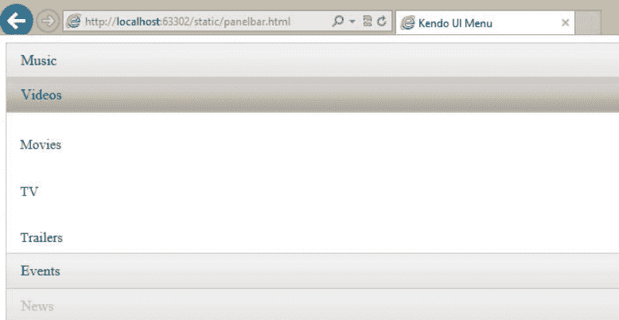

在拍摄此截图之前点击了 **Videos** 面板，以便你可以看到部分数据是打开的，通常情况下所有面板都是关闭的。

与之前的 Menu 组件一样，PanelBar 组件不需要从静态 HTML 运行，它可以由本地或远程数据的 DataSource 对象驱动。以下是适配为使用数据源而非静态 HTML 的代码：

```javascript
<body>
  <div id="panelBarDemo">
</div>
  <style type="text/css">
#panelBarDemo img{
    max-height: 30px;
    max-width: 30px;
}
</style>
  <script type="text/javascript">
  var panelBarData = [
    {
      text: "Music",
      items: [
        {
          text: "Blues/Folk",
          items: [
```


# 第7章

```javascript
{
  text: "Contemporary Blues" },
  { text: "Contemporary Folk" },
  { text: "Traditional American" },
  { text: "World Folk" }
},
{
  text: "Christian / Gospel",
  items: [
    { text: "Christian Rock / Hip Hop" },
    { text: "Contemporary Christian" },
    { text: "Traditional Gospel" }
  ]
},
...
},
{
  text: "Videos",
  imageUrl: "/Images/reel.png",
  items: [
    { text: "Movies" },
    { text: "TV" },
    { text: "Trailers" }
  ]
},
{
  text: "Events",
},
{
  text: "News",
  enabled: false
}
}
</script>
<script type="text/javascript">
  $(document).ready(function () {
    $("#panelBarDemo").kendoPanelBar({ dataSource: panelBarData
});
  });
</script>
</body>

</html>
```

[ 165 ]

# 实现 PanelBar 和 TabStrip

> 注意，DataSource 对象可以配置你在前面的章节中看到的所有选项，并且可以同样容易通过 transport 属性为远程数据进行配置。

在这个代码示例中，我们还实现了一个新功能，即“Videos”（视频）标签页的 `imageUrl` 属性。通过指定项目中的图像 URL，输出将在屏幕上的标签页标题旁边显示此图像，你可以在下面的屏幕图中看到：

| 音乐 |
| 视频 |
| 电影 |
| 电视 |
| 预告片 |
| 事件 |
| 新闻 |

要将其适配为 MVC 扩展方法，你需要在 cshtml 文件中创建一个带有此源代码的 MVC 视图：

```cor
@using Kendo.Mvc.UI;

{
    ViewBag.Title = "Mvc PanelBar";
}

<style type="text/css">
li img {
    max-height: 25px;
    max-width: 25px;
}
</style>
```

## Mvc Menu

```csharp
@(Html.PanelBar().Kendo())
.Name("panelBarDemo")
.Items(items => {
    items.Add().Text("Music").Items(sub => {
        sub.Add().Text("Blues / Folk").Items(subsub => {
            subsub.Add().Text("Contemporary Blues");
            subsub.Add().Text("Contemporary Folk");
            subsub.Add().Text("Traditional American");
            subsub.Add().Text("World Folk");
        });
        ..
        sub.Add().Text("Christian / Gospel").Items(subsub => {
            subsub.Add().Text("Christian Rock / Hip Hop");
            subsub.Add().Text("Contemporary Christian");
            subsub.Add().Text("Traditional Gospel");
        });
    });
    items.Add().Text("Videos").ImageUrl("*/static/images/reel.png").Items(sub => {
        sub.Add().Text("Movies");
        sub.Add().Text("TV");
        sub.Add().Text("Trailers");
    });
    items.Add().Text("Events");
    items.Add().Text("News").Enabled(false);
})
```

请注意，在这个代码示例中，我们静态地声明了数据。它同样可以使用 C# 代码中的逻辑从不同的源收集数据，甚至可以作为 JavaScript 的一部分并通过 HTTP 从远程源检索。我们在这里也可以看到如何通过 ASP.MVC 语法而不是上一个示例中的 JavaScript 来提供图像。

# 实现 PanelBar 和 TabStrip

如你从这张屏幕图中所示，输出与其他两个代码示例是完全相同的：

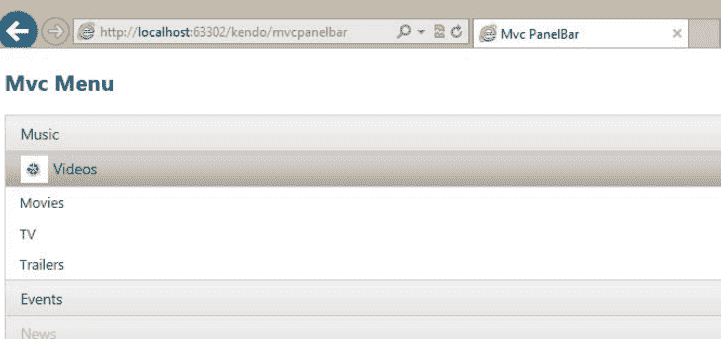

这说明了创建 Kendo UI PanelBar 组件的三种独特方式，就像之前的 Menu 组件一样，以及它们之间的区别。

## 向 PanelBar 标项中添加精灵图图像（sprite images）

我们已经看到了一些关于 PanelBar 组件如何包含 `imageUrl` 属性以在章节标题旁边显示图像的示例。它还可以通过通过 `spriteCss` 属性指定精灵图来使用更高级的图像选项。无论何种情况，图像或精灵图都将作为图标出现在菜单项文本的左侧。

正如我们之前已经部分看到的，这里有一个使用 `imageUrl` 属性为“Videos”（视频）菜单项显示图标的示例：

```javascript
{
  text: "Videos",
  imageUrl: "/images/reel.png",
  items: {
    { text: "Movies" },
    { text: "TV" },
    { text: "Trailers" }
  }
}
...
```

通过添加此属性，输出现在会在菜单中显示图像：

| 视频 |
| 电影 |
| 电视 |
| 预告片 |

这是使用 MVC 语法时的代码示例：

```csharp
items.Add().Text("Videos").ImageUrl("/images/reel.png").Items(sub => {
sub.Add().Text("Movies");
sub.Add().Text("TV");
sub.Add().Text("Trailers");
});
```

注意 `ImageUrl` 扩展方法将该图像添加到输出中。若要使用精灵图，你首先需要设置应显示图标的菜单项的背景，并使用 `spriteCss` 属性指示 CSS 类。每个具有 `spriteCss` 属性的菜单项都会自动装饰上 `k-sprite` 类，只要它的连接正确。这里是一个潜在的示例：

```css
<style>
#panelDemo .k-sprite {
  background-image: url("/images/sprites.png");
}
someIcon {
  background-position: 0 0;
}
someOtherIcon {
  background-position: -32px;
}
</style>
```

```javascript
{
  text: "Videos",
  spriteCssClass: "someIcon",
  items: [
{
  "text": "Movies",
  "text": "TV",
  "text": "Trailers"
}
},
```

此示例的 CSS 显示了所有带有 `k-sprite` 装饰的元素的 `background-image` 属性，并指定了精灵图的位置。

## 向 PanelBar 添加 URL

到目前为止，我们看到的所有示例都是不执行任何操作的 PanelBar 标项。我们需要做的只是向 PanelBar 标项中添加 `url` 属性，以便在点击时进行导航。因此，对于任何我们想要导航到不同页面的 PanelBar 标项，请使用该属性：

```javascript
{
  text: "Videos",
  spriteCssClass: "someIcon",
  url: "http://www.microsoft.com",
  items: [
    "text": "Movies",
    "text": "TV",
    "text": "Trailers"
  ]
}
```

## 使用 AJAX 加载 PanelBar

与其将所有内容嵌入页面，PanelBar 可以通过 AJAX 从位置加载内容，这可以减小页面体积。要启用此功能，使用 `contentUrls` 属性给 PanelBar：

```javascript
$("#panelId").kendoPanelBar({
  contentUrls: [
    "content1.html",
    "content2.html"
  ]
});
```

其次，我们需要如下所示的 HTML 结构来指示 AJAX 内容加载后出现的位置：

```html
<ul id="panelDemo">
  <li>
    远程内容
    <div></div>
  </li>
  <li>
    更多内容
    <div></div>
  </li>
</ul>
```

通过这种标记标记和 JavaScript 代码的组合，PanelBar 将为第一个标签页加载 content1，为第二个标签页加载 content2，依此类推。为了让 PanelBar 区域不失真，最好让这些内容尽可能简单。

| 远程内容 |
|---|
| 在这里你可以看到通过 AJAX 加载的内容 |
| 更多内容 |

## 控制 PanelBar 动画

PanelBar 的动画功能可以在配置 PanelBar 对象时通过 `animation` 属性进行控制。可以将 `animation` 属性设置为 `false` 以完全禁用所有动画，也可以像下面的代码示例进行配置：

```javascript
$("#panelId")({
...
  expandMode: "single", // "multiple" 同时打开多个标签
  animation: {
    collapse: {
      duration: 1000, // 动画毫秒
      effects: "fadeOut" // fadeout 是折叠的唯一选项
    },
    expand: {
      duration: 500,
      effects: "expandVertical fadeIn" // 选择其中其一
    }
  }
});
```

折叠的唯一可用效果是 `fadeOut`。对于展开，你可以选择 `expandVertical`（这是 PanelBar 的正常动作）和 `fadeIn`（它在展开时改变透明度）。


# 第 7 章

开始，将以下代码复制到新的 HTML 页面并在 浏览器中运行：

```html
<!DOCTYPE html>
<html>
<head>
    <title>Kendo UI TabStrip</title>
    <script src="Scripts/kendo/jquery.js"></script>
    <script src="Scripts/kendo/kendo.all.js"></script>
    <link href="Content/kendo/kendo.common.css" rel="stylesheet" />
    <link href="Content/kendo/kendo.default.css" rel="stylesheet" />
</head>
<body>
    <div id="panelBar">
        <ul>
            <li>Music</li>
            <li>Videos</li>
            <li>Events</li>
            <li disabled="disabled">News</li>
        </ul>
        <div>Next concert in May of 2013!</div>
        <div>Next music video in July of 2013!</div>
        <div>Memorabilia signing on April 15th</div></div>
    </div>
    <script>
        $(document).ready(function () {
            $("#panelBar").kendoTabStrip();
        });
    </script>
</body>
</html>
```

[173]

对于此小部件，标记语言需要遵循特定的模式。TabStrip 本身必须声明在一个 `<div>` 元素上，该元素包含一个无序列表 (`<ul>`)，并且在无序列表之后紧跟一组 `<div>` 元素。这在前面的代码示例中是显而易见的。无序列表包含所有标题。`<div>` 元素集合包含了每个标签页中显示的所有内容，其顺序与它们在标记中出现的顺序相同。这就是此特定示例在 浏览器中运行时的显示方式：

| Music | Videos | Events | News |
|---|---|---|---|
| Memorabilia signing on April 15th | | | |

## 使用数据源配合 TabStrip

与 PanelBar 类似，TabStrip 可以被配置为使用数据源（datasource），而不是在网页上现有的 HTML 标记上创建。要将上一节的代码示例适配到这种模式，请将页面的 body 部分替换为以下代码：

```html
<body>
  <div id="panelBar"></div>
  <script>
    $(document).ready(function () {
      $("#panelBar").kendoTabStrip({
        dataFile: 'text',
        dataTextField: 'content',
        dataSource: [
          {
            text: 'Music',
            content: 'Next concert in May of 2013!'
          },
          {
            text: 'Videos',
            content: 'Next music video in July of 2013!'
          },
          {
            text: 'Events',
            content: 'Memorabilia signing on April 15th'
          },
          {
            text: 'News',
            content: ''
          }
        ]
      });
    });
  </script>
</body>
```

此代码的输出与之前完全相同，但 News 标签页没有被禁用，因为在使用数据源时没有用于定义禁用元素的属性：

| Music | Videos | Events | News |
|---|---|---|--|
| | Next music video in July of 2013! | | |

## 在 TabStrip 小部件中添加图像

到目前为止，所有的 TabStrip 标签页只包含文本。然而，TabStrip 小部件（就像 Panel 小部件一样）也可以包含一个 `Image` 属性，用于在标签标题旁边显示图像。它还可以通过 `spriteCssClass` 属性指定精灵图（sprite），使用更高级的图像选项。无论哪种情况，图像或精灵图将作为图标出现在标签标题的左侧。这是一个使用 `imageUrl` 属性为 Videos 菜单项显示图标的示例：

```
{
  text: "Videos",
  imageUrl: "/images/reel.png",
  content: "Next music video in July of 2013!"
}
...
```

通过此属性，输出现在菜单中显示图像：

| Music | Videos | Events | News |
|---|---|---|--|
| | Next music video in July of 2013! | | |

# 实现 PanelBar 和 TabStrip

当使用 MVC 语法时，相同的代码示例看起来如下：

```cor
@using Kendo.Mvc.UI;
{
    ViewBag.Title = "Mvc TabStrip";
}

<style type="text/css">
li img {
    max-height: 25px;
    max-width: 25px;
}
</style>

<h2>Mvc TabStrip</h2>
@Html.Kendo().TabStrip()
    .Name("tabStripDemo")
    .Items(items => {
        items.Add().Text("Music")
            .Content("Next concert in May of 2013!");
        items.Add().Text("Videos")
            .Content("Next music video in July of 2013!")
            .Image("/images/reel.png");
        items.Add().Text("Events")
            .Content("Memorabilia signing on April 15th!");
        items.Add().Text("News").Enabled(false);
    })
```

你应该能够注意到与我们之前用于 Panel 的代码有几相似之处。要在 TabStrip 中使用带，你可以遵循我们讨论过的 PanelBar 的相同步骤。

## 在 TabStrip 标签页中添加 URL

要将 TabStrip 作为指向另一个页面的超链接，你可以为该标签页配置 `url` 属性，它将承担这一角色。通过这种方式，我们不再使用标签页在页面上显示任何内容，它只是在被点击时直接导航到另一个网页。

```
{
    text: 'News',
    content: '',
    url: 'http://www.kendoui.com'
}
```

按这样修改代码后，News 标签页将变成超链接，而不是显示内容的实际标签。

## 使用 TabStrip 加载 AJAX 内容

要向标签页中加载 AJAX 内容，我们需要在配置中指定每个标签页内容的 URL。这遵循 TabStrip 内部其他选项的相同模式，所以你现在应该觉得它非常熟悉：

```javascript
<script>
$(document).ready(function () {
  $("#panelBar").kendoTabStrip({
    dataFile: 'text',
    dataTextField: 'content',
    dataSource: [
      {
        text: 'Music',
        content: 'Next concert in May of 2013!'
      },
      {
        text: 'Videos',
        content: 'Next music video in July of 2013!'
      },
      {
        text: 'Events',
        content: 'Memorabilia signing on April 15th'
      },
      {
        text: 'News',
        content: ''
      }
    ]
  });
});
</script>
```


# 滑块基础知识

沿着此思路，在页面上创建 Kendo UI Slider 滑块组件时，请务必遵循此模式：

```
<!-- value 是可选的，但将设置滑块的初始值 -->
<input id="sliderId" value="2" />
...
<script>
$(function() {
  $("#sliderId").kendoSlider({......});
});
</script>
```

`kendoSlider` 方法需要绑定到真实的 HTML 元素。那么 Kendo RangeSlider（范围滑块）组件又是怎样的？它的控件只包含一个值。它是如何维护这两个独立值的？答案是它在容器 `div` 标签内部使用了两个 `input` 元素：

```
<div id="rangeSliderId">
  <input />
  <input />
</div>
...
<script>
$(function() {
  $("#rangeSliderId").kendoRangeSlider({......});
});
</script>
```

通过这种，Kendo UI RangeSlider 组件创建在一个 `div` 元素上，并将它的范围值构建到该容器 `div` 内部的两个 `input` 元素中，以便在页面上正确渲染。

## 使用 MVC 扩展方法使用 Slider 和 RangeSlider

以下代码示例说明了如何使用 ASP.NET MVC 扩展方法实例化滑块组件的基础知识。为了让所有 Kendo 组件能够正常工作，必须调用 `Name` 方法。

```
@(Html.Kendo().Slider().Name("horizontalSlider"))
...
@(Html.Kendo().RangeSlider().Name("horizontalRangeSlider"))
```

## 实现基础功能

作为介绍，我创建了一个示例页面，展示了各种配置下的滑块和范围滑块。在接下来的讨论功能和选项的章节中，我们将使用相同的代码示例。在这个示例中，我们使用 CSS 绝对定位固定了元素的位置。这对于网页设计不一定是最好的，但对于这些孤的控件是有效的。在第一个代码块中，我们正在创建包含 Slider 组件所需的 HTML 标记。每个 Slider 都是在一个带有内部元素的 `div` 元素之上创建的。关于这一点我们将在接下来的代码示例后进行详细解释：

```html
<!DOCTYPE html>

<body>
  <!-- 两个滑块组件 -->
  <div id="sliders">
    <h2 style="position:absolute;top:5px;left:40px">滑块组件</h2>

    <!-- 垂直滑块组件 -->
    <div style="position:absolute;top:65px;left:100px">
      <input id="verticalSlider" value="2" />
    </div>

    <!-- 水平滑块组件 -->
    <div style="position:absolute;top:285px;left:15px">
      <input id="horizontalSlider" value="7" />
    </div>
  </div>

  <!-- 两个范围滑块组件 -->
  <div id="rangeSliders">
    <h2 style="position:absolute;top:5px;left:300px">范围滑块组件</h2>

    <!-- 垂直范围滑块组件 -->
    <div style="position:absolute;top:65px;left:388px">
      <input id="verticalRangeSlider">
      <!-- 这些 input 用于包含范围内的 Values -->
      <input />
    </div>

    <!-- 水平范围滑块组件 -->
    <div id="horizontalRangeSlider" style="position:absolute;top:285px;left:300px">
      <!-- 这些 input 用于包含范围内的两个 Values -->
      <input /> <input />
    </div>
  </div>
</body>
```

你会发现我们在页面上创建了四个独立的滑块组件，其中两个是普通滑块组件，另外两个是范围滑块。接下来的 JavaScript 代码部分是将 HTML 标记转换为网页 Kendo 组件的部分。你可以在这些示例中看到一些配置选项，我们将在几段文字之后详细讨论它们。

```javascript
<script>
$(function () {
  // 创建垂直滑块组件
  $("#verticalSlider").kendoSlider({
    min: -10,
    max: 20,
    orientation: "vertical",
    smallStep: 2,
    largeStep: 10,
    tickPlacement: "both"
  });

  // 创建水平滑块组件
  $("#horizontalSlider").kendoSlider({
    min: 0,
    max: 20,
    smallStep: 1,
    largeStep: 5
  });

  // 创建垂直范围滑块组件
  $("#verticalRangeSlider").kendoRangeSlider({
    min: 0,
    max: 20,
    orientation: "vertical",
    selectionStart: 2,
    selectionEnd: 6,
    smallStep: 1
  });

  // 创建水平范围滑块组件
  $("#horizontalRangeSlider").kendoRangeSlider({
    min: 0,
    max: 30,
    selectionStart: 5,
    selectionEnd: 15,
    smallStep: 1,
    largeStep: 5,
    tickPlacement: "none"
  });
</script>
```

这是执行上述代码的输出：


我整理了页面上的内容，以便你可以看到不同的滑块组件及其输出。左侧的两个滑块（一个垂直一个水平）都是普通滑块组件。右侧的两个滑块（一个垂直一个水平）是范围滑块组件。我还调整了每一个的属性，以便它们显示独特的选项。我们将在学习本章的其余部分时介绍这些选项。

## 使用扩展方法的基础实现

以下代码示例说明了如何使用 ASP.NET 扩展方法实例化这些相同的滑块。我只包含了实际的滑块组件，没有整个页面。

```html
<div id="sliders">
  <h2 id="slidersLabel">滑块组件</h2>
  @(Html.Kendo().Slider().Name("verticalSlider")
    .HtmlAttributes(new { id = "verticalSlider" })
    .Min(0)
    .Max(20)
    .Orientation("Vertical")
    .Value(5)
    .SmallStep(10)
    .TickPlacement("None")
    .Tooltip(tt => tt.Format("{0}")))

  @(Html.Kendo().Slider().Name("horizontalSlider")
    .HtmlAttributes(new { id = "horizontalSlider" })
    .Min(0)
    .Max(20)
    .Orientation("Horizontal")
    .Value(7)
    .SmallStep(1)
    .LargeStep(5)
    .TickPlacement("Both")))
</div>
<div id="rangeSliders">
  <h2 id="rangeSlidersLabel">范围滑块组件</h2>
  @(Html.Kendo().RangeSlider().Name("verticalRangeSlider")
    .HtmlAttributes(new { id = "verticalRangeSlider" })
    .Min(0)
    .Max(20)
    .Orientation("Vertical")
    .SelectionStart(2)
    .SelectionEnd(6)
    .SmallStep(1))

  @(Html.Kendo().RangeSlider().Name("horizontalRangeSlider")
    .HtmlAttributes(new { id = "horizontalRangeSlider" })
    .Min(0)
    .Max(30)
    .Orientation("Horizontal")
    .SelectionStart(5)
    .SelectionEnd(15)
    .SmallStep(1)
    .LargeStep(5)
    .TickPlacement("None")))
</div>
```

正如上面的 JavaScript 和 HTML 示例一样，MVC 扩展创建了相同的输出。四个滑块都以相同的选项并具有相同的行为。


## 使用工具提示和弹出文本

滑块组件为用户提供了多种视觉提示，以指示其值和功能。有工具提示（或悬停效果），用于指示滑块末端按钮的作用。这些工具提示始终存在，不需要额外的配置或代码，尽管可以使用 API 进行自定义。下面的截图显示了悬停在增加按钮上的工具提示：


下面的截图显示了悬停在**减少**按钮上的工具提示：


还有提示标签指示刻度的值（如果存在），并指示如何通过拖拽与滑块控件交互。下面的截图显示了代表数字 **18:** 的刻度工具提示：


下面的截图显示了悬停在**拖拽**句柄上的工具提示：


最后，当用户拖动范围滑块组件的控件时，页面将显示指示当前选择范围的标签。下面的截图显示了所选范围上的工具提示，在此情况下，显示句柄位于 **4** 和 **15:**


## 学习键盘控制

同样重要的是，当滑块组件获得页面焦点时，还可以使用键盘箭头键以及 *Page Up*、*Page Down* 键来操作滑块控件。按下向上或向下的箭头键


将根据 `smallStep` 属性包含的数值增加或减少滑块的值。按下 Page Up（上页）或 Page Down（下页）键将根据 `largeStep` 属性包含的数值增加或减少滑块的值。

正如我们在之前的示例代码所示，在 JavaScript 中实例化滑块组件时，可以设置属性 `smallStep` 和 `largeStep`：

```javascript
$("#verticalSlider").kendoSlider({
  min: -10,
  max: 20,
  orientation: "vertical",
  smallStep: 2,
  largeStep: 10,
  tickPlacement: "both"
});
```

数字不需要是偶数，可以是对你的应用程序有意义的整数增量。

## 自定义滑块组件的用户界面

许多滑块组件可用于自定义用户在网页上与之交互的方式。工具提示（tooltips）和刻度标签中显示的文本可以自定义，以显示与你的页面更相关的特定文本。你还可以自定义滑块的方向和它们的默认值。

### 工具提示自定义

滑块组件的工具提示可以使用自定义格式或自定义模板进行自定义，如果不需要，也可以完全禁用。例如，假设你的滑块旨在让用户选择度（例如温度计上）。你可以自定义工具提示的格式以反映独特的格式。你还会发现，当更改工具提示格式时，数据标签的格式也会自动匹配：

```javascript
$("#verticalSlider").kendoSlider({
  min: -10,
  max: 20,
  orientation: "vertical",
  smallStep: 2,
  largeStep: 10,
});
```

```javascript
tickPlacement: "both", tooltip: {
  format: "{0}"
};
```

默认格式为 "{0}"，因此通过在后面添加度符号，它将正确地显示在页面上：

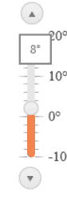

注意标签和工具提示是如何更改以匹配新格式的。
另外注意，我添加格式时使用了未使用 HTML 编码的度符号，Kendo UI 系统为我处理了适当的编码。

配置 `tooltip` 属性的完整选项显示在此：

```javascript
// kendoSlider 的选项
tooltip: {
  enabled: true, // 是否启用工具提示
  format: "{0}", // 工具提示的格式字符串
  template:{
    value: "..." // 工具提示的模板值
  }
}
// kendoRangeSlider 的选项
tooltip: {
  enabled: true, // 是否启用
  format: "{0}", // 工具提示的格式字符串
  template:{
    selectionStart: "..." // 范围开始位置的模板值
    selectionEnd: "..." // 范围结束位置的模板值
  }
}
```

你不应该同时使用 `format` 和 `template`，因为这两个属性都设计用于自定义工具提示的显示。正如你在之前的章节中看到的，`template`（模板）需要遵循 Kendo 模板语法，并可用于为滑块控件创建高度自定义的工具提示。

## 使用 MVC 扩展方法自定义工具提示选项

这是使用 ASP.NET MVC 扩展方法时配置的工具提示的样式。

```csharp
.Tooltip(tt =>
  tt.Enabled(true)
  .Format("template would go here")) @* Kendo 代码中的拼写错误
@*
```

记住，就像在 JavaScript 中一样，你不会同时设置 `format` 和 `template`。另外注意 Kendo 库拼错了一个单词，它写的是 "template" 而不是 "template"。请务必检查此处的代码，以防 Telerik 已修复该拼写。

## 自定义默认值

滑块组件可以配置为从特定的默认值开始。对于普通的 Kendo 滑块组件，这表现为 HTML 元素的 `value` 属性，或者在 JavaScript 中初始化 Kendo 组件时设置，如下所示：

```html
<input id="sliderId" value="4" />

// 或

$("#sliderId").kendoSlider({
  value: 4,
...
})
```

这两种方法任一种都会将滑块组件的初始或默认值设置为数字 4。

## 滑块基础

对于 Kendo 范围滑块，你需要同时设置范围的两个数字，因此你需要使用名为 `selectionStart` 和 `selectionEnd` 的不同属性，或者设置 HTML 中两个输入元素的 `value` 属性：

```html
<div id="rangeSliderId">
  <input value="2" />
  <input value="8" />
</div>

// 或

$('#rangeSliderId').kendoRangeSlider({
  selectionStart: 2,
  selectionEnd: 8
});
```

这两种方法都会将选定范围的起点设置为 2，选定范围的终点设置为 8。

## 自定义刻度位置

滑块组件上的标记和数据标签也可以通过选择四种支持选项之一进行自定义：topLeft`（左上）、`bottomRight`（右下）、`both`（两者）和 `none`（无）。这些通过名为 `tickPlacement` 的配置属性设置。

```javascript
$('#sliderId').kendoSlider({
  tickPlacement: "topLeft"
});
```

## 将刻度放在左上角

`topLeft` 刻度位置选项将刻度标记放在垂直滑块的左侧或水平滑块的顶部。

```javascript
$("#verticalSlider").kendoSlider({
  tickPlacement: "topLeft"
});
```

```javascript
$("#verticalSlider").kendoSlider({
  tickPlacement: "topLeft"
});
```

这是垂直滑块的输出：

```javascript
172a1c72af4c00eec56c9c9ad892894b_204_0.png
```

## 将刻度放在右下角

`bottomRight` 刻度位置选项将刻度放在垂直滑块的右侧或水平滑块的底部。

```javascript
$("#verticalSlider").kendoSlider({
  tickPlacement: "bottomRight"
});
```

```javascript
$("#verticalSlider").kendoSlider({
  tickPlacement: "bottomRight"
});
```

这是垂直滑块的输出：

## 将刻度放在两侧

`both` 刻度位置选项将刻度标记放在滑块的两侧。

```javascript
$("#verticalSlider").kendoSlider({
  tickPlacement: "both"
});
```

```javascript
$("#verticalSlider").kendoSlider({
  tickPlacement: "both"
});
```

这是垂直滑块的输出：

## 移除刻度

`none` 刻度位置选项将从滑块上移除刻度标记：

```javascript
$("#verticalSlider").kendoSlider({
  tickPlacement: "none"
});
```

```javascript
$("#verticalSlider").kendoSlider({
  tickPlacement: "none"
});
```

这是垂直滑块的输出：


## 挂钩事件

与其他 Kendo UI 组件一样，事件处理器可以在对象实例化期间绑定，也可以稍后通过调用 JavaScript `bind` 方法进行绑定。这些示例将仅显示实例化代码。

## 使用 change 事件

当用户通过点击箭头之一、使用鼠标移动滑块或使用键盘控制更改滑块的值时，滑块组件将触发 `change` 事件。

## Kendo slider 组件的 change 事件

Kendo 滑块组件的 `change` 事件可以如下所示绑定并使用：

```javascript
$("#sliderId").kendoSlider({
  change: changeHandler,
  ...
});

function changeHandler(e) {
  alert(e.value); // e.value 包含滑块的新值
}
```

`e.value` 属性将包含滑块的新值，以便你可以在 JavaScript 代码中正确响应事件。

## Kendo range slider 组件的 change 事件

Kendo 范围滑块组件的 `change` 事件可以如下代码段所示绑定。它与滑块组件的 `change` 事件不同之处在于它向事件处理器传递的是数组而不是单个值。

```javascript
$("#rangeSliderId").kendoRangeSlider({
  change: changeHandler,
  ...
});

function changeHandler(e) {
alert(e.value.toString()); // e.value 是一个新范围值的数组
}
```

## slide 事件

`slide` 事件在语法上与 `change` 事件相同，但它仅在用户使用鼠标移动滑块时触发，而不会在键盘事件或按钮点击时触发。之前 `change` 事件的示例同样适用于 `slide` 事件。

```javascript
$("#sliderId").kendoSlider({
slide: changeHandler,
  ...
});
```

## 使用 MVC 扩展方法的 change 和 slide 事件

这是如何使用 ASP.NET MVC 扩展方法连接事件处理器的。请注意，输出结果与之前概述的相同；这是使用 MVC 执行代码所需的语法。请参阅前面的章节获取更多信息。

- .Events(events => events)
  .Slide("slideHandler")
  .Change("changeHandler")

## 总结

Kendo UI Slider 和 Kendo UI RangeSlider 是为网页中的输入元素收集数字的实用工具。在收集必须落在指定范围内的数字时，这些组件比向用户返回关于数字无效的错误消息要友好得多。我建议在适当的地方使用它们，让你的网站对用户更有趣。

在下一章中，你将学习 Splitter 和 TreeView 组件，它们允许你向页面加载动态内容并以树形显示的方式组织层次内容。这些组件将帮助你构建强大的页面，能够动态处理和加载内容并按组织模式显示内容。

# 9

## 实现 Splitter 和 TreeView 组件

在本章中，你将学习 Kendo UI 框架中的两个不同的组件：Splitter 组件和 TreeView 组件。Splitter 组件是一个用于组织网页内部内容的工具。它在网页内创建块状区域，这些区域可以包含普通的页面元素，甚至是额外的 Splitter 控制以进一步细分内容区域。TreeView 组件是一个用于显示层次组织数据（例如树形结构）的工具。这种方式组织数据的良好例子是硬盘上的文件夹结构。文件夹可以包含文件或额外的文件夹。在绘图时，这会创建一个像树一样的嵌套结构，非常适合 TreeView 组件。

## Splitter 组件

Kendo UI Splitter 组件是创建动态页面布局的强大工具。它在网页内生成带框的区域，这些区域可以调整大小、滚动、折叠和嵌套。这些区域构建在 `div` 元素之上，并用令人的功能扩展了底层的 `div` 元素。当你在本节学习如何使用此组件时，我相信你可以想象许多使用它的方法。

## 学习 Splitter 组件

Kendo UI Splitter 组件的设计用于将 `div` HTML 元素扩展为灵活的内容区域，这些区域可以拆分网页中的元素，因此名为“splitter”。这些内容区域变成了可调整大小的块，允许用户选择页面的哪些部分占据更多的可见屏幕空间。每个块都可以配置特定的行为和选项，例如滚动条以及单击折叠页面元素的能力。

## 实现

这里是一个可用于 Kendo UI Splitter 组件的 HTML 标记示例。请特别注意 `div` 元素是如何组织和嵌套的；当你看到实例化 Kendo 对象的 JavaScript 代码时，这将变得非常重要：

```html
<div id="outerSections" style="height: 600px">
  <div id="outerTopSection" style="height: 200px">
    <div id="topSections" class="k-pane" style="height: 200px">
      <div style="height: 200px" class="k-pane"></div>
    </</div>
    <div style="height: 200px" class="k-pane"></div>
  </</div>
  <div id="outerMiddleSection" style="height: 200px" class="k-pane">
    <div class="k-pane"></div>
  </</div>
  <div id="outerBottomSection" style="height: 200px" class="k-pane">
    <div id="bottomSections" class="k-pane" style="height: 200px">
      <div style="height: 200px" class="k-pane"></div>
    </</div>
    <div style="height: 200px" class="k-pane"></div>
  </</div>
</</div>
```


# 第 9 章

```javascript
contentUrl: "LoremIpsum.html" 
] 
};
```

Lorem ipsum dolor sit amet, consectetur adipiscing elit. Nullam nec lectus id diam cursus semper. Nam lero quam, bibendum dapibus volutpat mattis, commodo nisl et risus. Cras sit amet odio sed libero tempor element. Morbi cursus vitae, a bibendum libero; ullamcomper. Ut. Aenean convallis eget lectus gravida mattis. Phellus nec sapien risus, in aliquam purus. Class aptent taciti sociosus ad litora torquent per curumbia nostra, inceptos himeneos. Nam Maenas varius quam in risus porttitor. Nulla odio leo, facilisis. Nulla odio leo, fermentum et de-hooking into Splitter events.

## 挂钩 Splitter 事件

Kendo UI Splitter 组件配备了一系列丰富的行为。这些行为大部分（无论是通过用户操作触发还是通过方法调用触发）都会触发事件。在 JavaScript 中，你可以将自己的事件处理函数附加到这些事件上，并用自己的自定义代码响应这些操作。本节将展示 Kendo UI Splitter 组件上提供的不同事件，并演示如何挂钩这些事件。

## collapse 事件

当用户点击两个窗格之间的折叠图标来折叠 Kendo UI Splitter 区域时，会触发 collapse 事件。该图标以小三角形的形式出现，指向折叠动作的方向。以下是使用事件处理程序使用 collapse 事件的代码：

```javascript
// 在创建 Splitter 组件时绑定
$("#splitterElement").kendoSplitter({
...
  collapse: collapseEventHandler
});
```

```javascript
// 动态绑定与解绑
var splitter = $("#splitterElement").data("kendoSplitter");
splitter.bind("collapse", collapseEventHandler);
splitter.unbind("collapse", collapseEventHandler);
```

## contentLoad 事件

当内容加载到 Kendo UI Splitter 组件窗格中时，会触发 contentLoad 事件。该事件的通常用法是响应 AJAX 内容从远程源加载完成的点。以下是使用事件处理程序连接 contentLoad 事件的代码：

```javascript
// 在创建 Splitter 组件时绑定
$('#splitElement').kendoSplitter({
...
  contentLoad: contentLoadEventHandler
...
});
```

```javascript
// 动态绑定与解绑
var splitter = $('#splitElement').data("kendoSplitter");
splitter.bind("contentLoad", contentLoadEventHandler);
splitter.unbind("contentLoad", contentLoadEventHandler);
```

## expand 事件

当窗格被折叠后，用户点击展开图标来展开 Kendo UI Splitter 窗格时，会触发 expand 事件。该图标以小三角形的形式出现，点击时指向窗格展开的方向，所示：

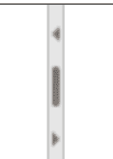

以下是使用事件处理程序连接 expand 事件的代码：

```javascript
// 在创建 Splitter 组件时绑定
$('#splitElement').kendoSplitter({
...
  expand: expandEventHandler
...
});
```

```javascript
// 动态绑定
splitter = $("#splitterElement").data("kendoSplitter");
splitter.bind("expand", expandEventHandler);
splitter.unbind("expand", expandEventHandler);
```

## LayoutChange 事件

当 kendo Splitter 组件的布局发生变化时，会触发 LayoutChange 事件。此事件比 expand、collapse 和 resize 更具通用性，因此它通常会这些事件一起出现，所有它们都指示布局已发生变化。以下是使用事件处理程序连接 layoutChange 事件的代码：

```javascript
// 在创建 Splitter 组件时绑定
$("#splitterElement").kendoSplitter({
  ...
  layoutChange: layoutChangeEventEventHandler
});
```

```javascript
// 动态绑定与解绑
splitter = $("#splitterElement").data("kendoSplitter");
splitter.bind("layoutChange", layoutChangeEventEventHandler);
splitter.unbind("layoutChange", layoutChangeEventEventHandler);
```

## resize 事件

当用户拖动两个 UI Splitter 组件窗格之间的柄来调整它们大小时，会触发 resize 事件。此事件在折叠和展开期间也会触发。以下是使用事件处理程序连接 resize 事件的代码：

```javascript
// 在创建 Splitter 组件时绑定
$("#splitterElement").kendoSplitter({
  ...
  resize: resizeEventHandler
});
```

```javascript
// 动态绑定与解绑
splitter = $("#splitterElement").data("kendoSplitter");
splitter.bind("resize", resizeEventHandler);
splitter.unbind("resize", resizeEventHandler);
```

## 调用 Splitter API 方法

Kendo UI Splitter 组件配备了一系列实现其丰富行为的方法。这些方法大部分在触发时会触发事件。在 JavaScript 中，你可以将自己的事件处理函数附加到这些事件上，并用自己的自定义代码响应这些操作。本节将展示 Kendo UI Splitter 组件上提供的不同方法。

## 获取 splitter 对象的引用

在处理所有 Kendo UI 组件的方法时，要记住的第一件事是在这些方法可用之前必须获取 JavaScript 对象的引用。要实现这一点，你需要使用 JavaScript 方法 .data()。示例所示：

```javascript
var splitter = $("#splitterElement).data("kendoSplitter");
```

注意如何使用 jQuery 选择创建了 Kendo UI splitter 的文档对象模型 (DOM) 元素，然后调用 .data() 函数并传入参数 kendoSplitter，表示我们尝试获取的对象类型。现在已获取 Kendo UI splitter 组件实例，可以直接从 splitter 变量调用方法。

```javascript
splitter.collapse("#outerPane");
```

## 使用 ajaxRequest 方法

ajaxRequest 方法用于将 AJAX 内容加载到特定的 Kendo UI splitter 窗格中。该方法接受三个参数。第一个参数是用于选择要加载 AJAX 内容特定窗格的字符串。它使用 jQuery 语法来选择元素，因此要选择 id 为 panel 的元素，请使用 #panel。第二个参数是包含要加载到窗格内容的远程端 URL。第三个参数是可选的，如果远程端需要参数来返回数据，则可以使用。以下是显示该用法的代码示例：

```javascript
// 获取 Kendo UI Splitter 组件的引用
var splitter = $("#splitterElement).data("kendoSplitter");
```

```javascript
// 调用 ajaxRequest 方法
splitter.ajaxRequest("#panel","someContent.html");
```

> 注意此方法会导致 contentLoad 事件触发。

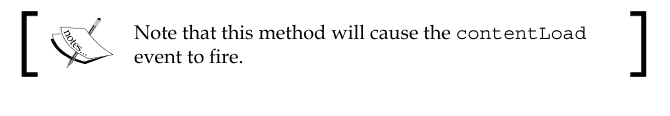


## 使用 max 和 min 方法

max 和 min 方法用于设置特定 Kendo UI Splitter（拆分器）部件面板的最大或最小尺寸。这些方法接受两个参数。第一个参数是字符串，用于选择要配置的特定窗格。它使用 jQuery 语法来选择元素，因此使用 `#pane3` 来选择它。第二个参数是代表新最大或最小尺寸的字符串值。该值可以以像素数或百分比的形式表示。以下是该方法的用法代码示例：

```javascript
// 获取 Kendo UI Splitter 部件的引用
splitter = $("#splitterElement").data("kendoSplitter");
```

```javascript
// 调用 max 方法
splitter.max("#pane3", "300px");
```

```javascript
// 调用 min 方法
splitter.min("#pane3", "25px");
```

> 注意，此方法不会触发任何事件。

## 使用 size 方法

size 方法用于设置特定 Kendo UI Splitter（拆分器）部件面板的大小。该方法接受两个参数。第一个参数是字符串，用于选择要配置的特定窗格。它使用 jQuery 语法来选择元素，因此要选择 id 值为 pane4 的元素，您可以使用 `#pane4` 来选择它。第二个参数是代表新尺寸的字符串值。该值可以以像素或百分比表示。它必须处于 max 和 min 尺寸值的范围内。以下是该方法的用法代码示例：

```javascript
// 获取 Kendo UI Splitter 部件的引用
splitter = $("#splitterElement").data("kendoSplitter");
```

```javascript
// 调用 size 方法
splitter.size("#pane4", "300px");
```

> 注意，此方法将触发 layoutChange 和 resize 事件。

## 使用 toggle 方法

toggle 方法用于在特定 Kendo UI Splitter（拆分器）部件面板的折叠和展开状态之间进行切换。如果窗格当前处于展开状态，toggle 方法将将其折叠。如果窗格当前处于折叠状态，toggle 方法将将其展开。该方法接受两个参数。第一个参数是字符串，用于选择要切换的特定窗格。它使用 jQuery 语法来选择元素，要选择 id 值为 pane5 的元素，您可以使用 `#pane5` 来选择它。第二个参数是一个布尔值（true 或 false），表示窗格应该处于的特定状态，无论其当前状态如何。值为 true 将将窗格设置为展开状态。值为 false 将将窗格设置为折叠状态。以下是该方法的用法示例：

```javascript
// 获取 Kendo UI Splitter 部件的引用
var splitter = $("#splitterElement").data("kendoSplitter");

// 调用 toggle 方法
splitter.toggle("#pane5");

// 强制窗格展开
splitter.toggle("#pane5", true);

// 强制窗格折叠
splitter.toggle("#pane5", false);
```

> 注意，此方法将触发 layoutChange 和 resize 事件，但不会触发折叠或展开事件。

## TreeView（树形视图）

当您需要显示按层次结构组织的数据时，Kendo UI TreeView 部件是一个非常有用的部件。硬盘上的文件和业务组织结构是这种组织数据的良好示例。数据有一个顶层元素（例如根文件夹或 CEO），然后在该顶级元素之下有若干个单独元素（例如文件或员工）和组（例如文件夹或部门）。每个组都有进一步的组级，使得最终的图表可以想象成一棵树，它有一个根和许多分支（元素组），这些分支多次分裂并最终以叶（单个元素）结束。正如您可以想象的，此类数据在网页上进行可视化和布局并不容易。幸运的是，Kendo UI TreeView 部件的出现为我们提供了一种简单的方法来显示这些数据，并带有丰富的交互和配置选项。

## 学习 TreeView

Kendo UI TreeView 部件设计用于处理嵌套在 HTML 无序列表中的数据。这些对于 TreeView 的工作是天然契合的，因为它们可以按层次嵌套，正如 Kendo UI 预期的显示和组织它们的方式一样。与组织数据的其他 Kendo UI 部件类似，TreeView 部件可以在已经在网页上渲染的 HTML 之上实例化，也可以在通过源对象馈送数据时构建构建 HTML 本身。以下是在在预渲染的 HTML 之上实例化 Kendo TreeView 的简单示例：

```html
<div class="demo-section">
  <ul id="treeview">
    <li data-expanded="true">
      组织架构图
      <ul>
        <li>办公室经理</li>
        <li>资源经理</li>
        <li>行政助理</li>
      </ul>
    </li>
    <li data-expanded="true">
      咨询
      <ul>
        <li data-expanded="true">
          软件开发
          <ul>
            <li>桌面应用程序</li>
            <li>Web 应用程序</li>
          </ul>
        </li>
        <li>业务智能</li>
      </ul>
    </li>
    <li>
      特殊项目
      <ul>
        <li>门户与协作</li>
      </ul>
    </li>
  </ul>
</div>
<script>
$(document).ready(function () {
$("#treeview").kendoTreeView();
});
</script>
```

此页面显示了一个组织架构图：
- 组织架构图
    - 行政
        - 办公室经理
        - 资源经理
        - 行政助理
    - 咨询
        - 软件开发
            - 桌面应用程序
            - Web 应用程序
        - 业务智能
    - 特殊项目
        - 门户与协作

## 绑定数据源

正如你所看到的，Kendo UI TreeView 部件设计用于处理嵌套在 HTML 无序列表中的数据。这些天然契合，因为它们可以按层次嵌套，正如 Kendo UI 预期的显示和组织它们的方式。与组织数据的其他 Kendo UI 部件一样，TreeView 部件可以在已经在网页上渲染的 HTML 之上实例化，也可以在通过源对象馈送数据时构建 HTML 本身。以下是在在预渲染的 HTML 之上实例化 Kendo TreeView 的简单示例：

```javascript
<script>
$(document).ready(function () {
  var orgChart = [
    {
      text: "组织架构图",
      expanded: true,
      items: [
        {
          text: "行政",
          expanded: true,
          items: [
            { text: "办公室经理" },
            { text: "资源经理" },
            { text: "行政助理" }
          ]
        },
        {
          text: "咨询",
          expanded: true,
          items: [
            {
              text: "软件开发",
              expanded: true,
              items: [
                { text: "桌面应用程序" },
                { text: "Web 应用程序" }
              ]
            },
            { text: "业务智能" }
          ]
        },
        {
          text: "特殊项目",
          items: [
            { text: "门户与协作" }
          ]
        }
      ]
    }
  ];
  $("#treeview").kendoTreeView({
    dataSource: orgChart
  });
});
</script>
```

## 实现 Splitter 和 TreeView 部件

每个元素都可以通过 `items` 属性包含自己的子元素列表，例如软件开发组包含两个子元素：桌面应用程序和 Web 应用程序。这些子元素也可以包含自己的子元素列表，依此类推。这就是数据树的形成方式以及 TreeView 的工作方式。Kendo UI TreeView 部件将数据处理为网页上的图形树。通过任何 DataSource 连接，数据都可以绑定到远程源而不需要硬编码在页面中。

## 使用拖放

由于 Kendo TreeView 部件通过 Kendo Framework 启用了特殊功能，它比标准的 HTML 无序列表强大得多。这些特殊功能之一就是拖放。当此功能在 Kendo UI TreeView 上启用时，用户可以点击 TreeView 中的元素并将其拖到该 TreeView 的任何地方。不仅如此，如果同一页面上有多个启用了拖放的 TreeView 部件，用户可以将元素从一个 TreeView 拖到另一个 TreeView！要启用此功能，你只需要将 Kendo UI TreeView 的 `dragAndDrop` 属性设置为 `true`。

```javascript
$(document).ready(function() {
  $('#treeview').kendoTreeView({
    dataSource: files,
    dragAndDrop: true
  });
});
```


启用此功能后，TreeView 小部件的元素在鼠标悬停在其上方时会显示深色背景，以帮助用户了解它们是可交互的。当拖动 TreeView 中的元素时，它旁边会出现一个图标，用于指示释放鼠标按键后将发生的操作。`+` 号表示该项将被添加到层级章节中，如下幅截图所示：

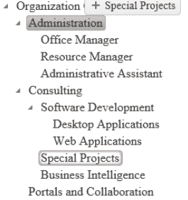

然而，如果鼠标悬停的位置会让该项保留在列表中，图标将更改为一张类似于短项目列表的图片。同时，列表中会出现一条小线来接收该项，以指示其放置位置，所示：

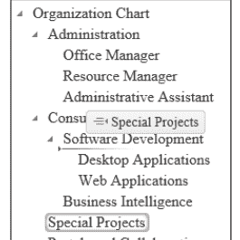

## 配置动画效果

你可能已经注意到，Kendo UI 小部件在树形布局中具有子项的每个部分旁边放置了小的三角形图标。如果你用鼠标点击其中一个三角形图标，该部分将折叠为隐藏状态或展开为可见状态。当隐藏和可见之间发生这种转换时，Kendo UI Framework 将使用某些效果进行动画处理，使其视觉上更有吸引力。你可以根据自己的个人喜好配置这些效果：

```javascript
$("#treeview").kendoTreeView({
  animation: {
    expand: {
      // 配置展开动画
      duration: 200, // 动画毫秒
      hide: false, //?
      show: true, //?
      effects: "Vertical fadeIn" // 之一或两者
    },
    collapse: {
      // 配置折叠动画
      duration: 200, // 动画毫秒
      hide: false, //?
      show: true, //?
      effects: "fadeOut" // "fadeOut" 是这里的唯一选项
    }
  }
});
```

## 显示图像

Kendo UITreeView 小部件旨在为你的内容提供吸引人的布局。为此，Kendo UI Framework 内置了在 TreeView 显示项旁显示小图像的支持。这可以通过两种方式实现。第一种方法是为要显示的每个图像使用单独的图像文件。第二种方法是使用 CSS 雪图图像，它包含许多偏移了特定像素的图像。

要在 Kendo UI TreeView 中使用单独的图像文件，你可以使用 Tree 项的 `imageUrl` 属性。以下是代码中的实现：

```javascript
var orgChart = {
  text: 'Organization Chart', expanded: true, items: {
    text: 'Administration', expanded: true,
    imageUrl: '/Images/icon-organizational-chart.gif',
    items: [
      { text: 'Office Manager' },
      { text: 'Resource Manager' },
      { text: 'Administrative Assistant' }
    ]
  },
  text: 'Consulting', expanded: true,
  imageUrl: '/Images/icon-organizational-chart.gif',
  items: [
    { text: 'Software Development', expanded: true, items: [
      { text: 'Desktop Applications' },
      { text: 'Web Applications' }
    ]
  },
    { text: 'Business Intelligence' }
  },
  text: 'Special Projects',
  imageUrl: '/Images/icon-organizational-chart.gif',
  {
    text: 'Portals and Collaboration',
    imageUrl: '/Images/icon-organizational-chart.gif'
  }
];
```

## 实现 Splitter 和 TreeView 小部件

使用此类图像会将图形直接渲染在 TreeView 小部件的左侧，并与装饰有 `imageUrl` 属性的每个 TreeView 项文本对齐，如下幅所示：

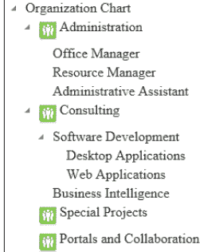

在 TreeView 小部件中使用图像的另一种方法是从 CSS 雪图图像引用它们。通过使用雪图，你可以减少 页面调用服务器获取单独图像文件的次数，并提高网站的性能。如果你有一个包含图像的雪图，你可以在代码中如下所示引用它：

```html
<style type="css">
.org{
  background-image: url('/Images/icon-organizational-chart.gif');
  max-height: 25px;
  max-width: 25px;
}
</style>
<script>
$(document).ready(function () {
  var orgChart = [
    {
      text: 'Organization Chart', expanded: true, items: [
        {
          text: 'Administration', expanded: true,
          spriteClass: 'org',
          items: [
            { text: 'Office Manager' },
            { text: 'Resource Manager' },
            { text: 'Administrative Assistant' }
          ]
        }
      ]
    },
  ];
});
</script>
```

## 使用模板

（注：原文文本在此处存在大量重复和OCR错误，已根据核心逻辑处理。）


## 实现 Splitter 和 TreeView 组件

- findByText: `findByText` 方法通过文本值查找 TreeView 元素。
- findByUID: `findByUID` 方法通过其 UID 值查找 TreeView 元素。
- insertAfter: `insertAfter` 方法在 TreeView 的指定元素之后插入一个新元素。
- insertBefore: `insertBefore` 方法在 TreeView 组件的指定元素之前插入一个新元素。
- parent: `parent` 方法获取 TreeView 组件中某个元素的父元素。
- remove: `remove` 方法从 TreeView 组件中删除一个元素。
- select: `select` 方法将 TreeView 组件中的某个元素标记为已选中。
- dataSource: `setData` 方法为 TreeView 设置数据源。
- text:  `text` 方法可以获取或设置 TreeView 中元素的文本值。
- toggle: `toggle` 方法可以折叠或展开 TreeView 区域。

## 总结

Kendo UI 的 Splitter 和 TreeView 组件在开发网页页面时提供了许多功能。Splitter 组件是一个非常强大的工具，用于组织可折叠、展开和可调整大小的区块。这种功能通常非常简单。TreeView 组件提供了丰富的无序列表版本，具有非常有用的方法和事件。这两个组件都为你的网站添加了大量价值。

在下一章，你将学习来自 Kendo UI 框架的两个组件：Window 和 Upload 组件。Window 组件允许你创建和管理带有内容的模态弹出框。

## Upload 和 Window 组件

现代 Web 应用已经发展到这种程度：文件上传和对话框从简单的 HTML 元素演变为交互式且可自定义的控件。这种强大的功能并非免费，因为它通常需要编写良好的 JavaScript 和 CSS 样式。Kendo UI 框架提供了预构建的组件，只需少量努力即可实现这些功能。本章将探索这些组件的用法。

### 上传文件

传统的网页文件上传是通过 HTML 元素，上传多个文件通常很糟糕，因为需要用户为每个文件都点击按钮。Kendo UI 框架提供了一个专门的 Upload 组件来帮助用户和开发者。无需为每个文件点击按钮，用户只需拖拽所需的文件到页面，即可在后台自动上传。此外，可以通过 JavaScript 同时接收多个文件的上传，而不会导致页面变慢或无响应。

### 学习 Upload 组件

由于 Upload 组件的设计是为了将一个或多个文件上传到服务器，因此在 ASP.NET MVC 项目中实现其最基本的功能非常简单。你需要创建一个接受 `IEnumerable<HttpPostedFileBase>` 作为参数的 Action 方法。以下是使用 Kendo UI 组件接收文件的方法：

```csharp
// 接收上传文件的 Action 方法
[HttpPost] // 此属性确保只有 POST 请求可以调用此方法
public ActionResult Submit(IEnumerable<HttpPostedFileBase> files)
{
    if (files != null)
    {
        //...
        // 处理并保存文件
        //...
    }

    return View();
}
```

使用此代码接收上传的文件，你可以构建托管 Upload 组件的页面。请注意表单有两个输入元素：文件输入和提交输入。对于任何上传文件的表单，你应该期望文件输入以按钮的形式显示而不是普通的 HTML 样式。以下是 index 页面的 HTML：

```html
<form method="post" action="submit" style="width:45%">
<div>
    <input name="files" id="files" type="file" /> // 文件上传
    <p>
        <input type="submit" value="Submit" class="k-button" /> // 提交按钮
    </p>
</div>
</form>
<script>
$(document).ready(function() {
  $("#files").kendoUpload(); // 创建 Kendo Upload 组件
});
</script>
```

以下标记将出现在实际网页上。特别注意文件输入元素是默认的 HTML 样式。

img/172a72af4c00ec56c9ad8294b_237.png

在完成这一切后，你可以点击按钮选择上传到服务器的文件。一旦你选择了文件并点击确定，服务器将接收文件并运行服务器端设置的任何处理指令。

img/172a72af4c00ec56c9ad8294b_237.png

## Window 组件

之前的示例展示如何在如何在表单中使用 Upload 组件。现在来看看如何在 Window 组件中使用它。Window 组件是一个强大的工具，可用于各种目的，例如显示信息、捕捉输入或提供交互内容。

要在 Window 组件中使用 Upload 组件，你需要将 Upload 组件封装在 Window 内部然后初始化两个组件。以下代码示例显示了如何操作：

```html
<div id="window">
    <div id="upload">
        <input name="files" id="files" type="file" />
    </div>
</div>
```

```javascript
$(document).ready(function() {
  $("#window").kendoWindow({
    title: "Upload Files",
    width: 400,
    height: 300,
    visible: true
  });

  $("#upload").kendoUpload();
});
```

在这个示例中，Window 在页面加载时自动打开。Upload 组件位于窗口内，用户可以像之前的示例一样选择文件进行上传。

## 启用异步上传

虽然我们看到的上传体验已经优于传统的 HTML 元素，但体验还可以变得更好。JavaScript 现在能够在后台异步发送文件，这意味着用户不需要提交会导致页面刷新的表单。要启用此功能，只需在实例化 Upload 组件时设置 `async` 属性。以下代码示例显示了如何实现：

```html
<form method="post" action="submit" style="width:45%">
<div>
  <input name="files" id="files" type="file" />
  <p>
    <input type="submit" value="Submit" class="k-button" />
  </p>
</div>
</form>
```

```javascript
<script>
$(document).ready(function() {
  $("#files").kendoUpload({
    async: { // 异步配置
      saveUrl: "Save", // 保存文件的 URL 为 '/save'
      removeUrl: "remove", // 删除文件的 URL 为 '/remove'
      autoUpload: true // 选择后自动上传文件
    }
  });
});
</script>
```

此功能还需要对服务器进行一些更改。虽然这段代码的大部分与之前的示例相同，但此 Action 方法返回 `ContentResult` 而不是 `ActionResult`，因为该方法没有向浏览器发送新的网页。相反，它发送一个字符串结果，通知网页中的 JavaScript 文件上传已成功。如果文件上传出现任何问题，服务器将发送错误代码（例如 500 内部错误）。

```csharp
public ContentResult Save(IEnumerable<HttpPostedFileBase> files)
{
  // Upload 组件的为 "files"
  if (files != null)
  {
    foreach (var file in files)
    {
      // ...
      // 处理文件并保存它们...
      // ...
    }
  }

  // 返回空字符串表示成功
  return Content("");
}
```


# 同时上传多个文件

默认情况下，Kendo UI Upload 组件启用了同时上传多个文件，但你可以像下面的代码示例那样显式指定此设置：

```javascript
<script>
$(document).ready(function() {
  $("#files").kendoUpload({
    multiple: true
  });
});
</script>
```

要上传多个文件，在上传窗口中点击文件时按住 Ctrl 键。请查看下方截图一次性选择多个文件的显示。当你点击 OK 按钮时，所有文件将一起上传到服务器并在单个事务中进行处理。不再需要额外的按钮！

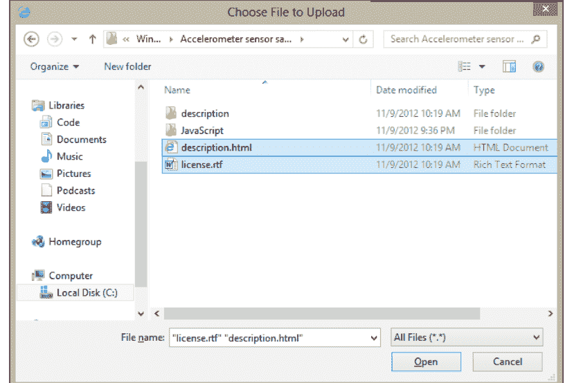

# 删除已上传的文件

当使用 Kendo UI Upload 组件上传时，你将看到页面文件上传区域出现一个文件名列表。如果你使用的是标准上传行为而非异步配置，则页面上列出的文件尚未上传到服务器。相反，它们的文件名被存储起来，准备以便你点击页面上的 Submit 按钮以提交带有文件的 HTML。你可以在下面的截图中看到标记为上传的文件列表；它们尚未发送到服务器：

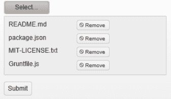

由于文件尚未上传，你可以在这些任何文件之前点击 Remove 按钮将它们从列表中移除而不会产生任何副作用。然而，如果你使用的是异步文件上传功能，文件将立即上传到服务器，在它们完全上传之前没有办法删除它们。正如接接的截图所示，此文件已异步加载到服务器，并被服务器代码保存到了某处：

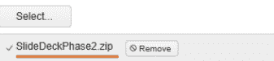

仍然有方法删除文件，但这需要在服务器端编写一些额外的代码来实现。具体而言，为了删除异步自动上传的文件，需要另一个控制器操作方法。该操作方法接收一个或多个文件名列表，并从服务器上删除它们，因为它们已经上传并保存了。当点击页面上的 Remove 按钮时，Kendo UI Upload 组件会自动调用此方法。

```csharp
public ContentResult Remove(string[] fileNames)
{
    // Remove action 的参数必须命名为 "fileNames"
    if (fileNames != null)
    {
        foreach (var fullName in fileNames)
        {
            // ...
            // 删除文件
            // ...
        }
    }

    // 返回空字符串表示成功
    return Content("");
}
```

# 跟踪上传进度

当文件正在异步上传时，你可以通过文件名下方的进度条查看上传进度，并通过一个旋转的圆点表示操作仍在进行。下方的截图显示了正在上传的文件：

| 关于 Azure |
| :--- |
| Azure 是微软创建的云计算平台和基础设施服务。通过微软管理的数据中心的全球网络来构建、部署和管理应用程序及服务，Azure 提供了平台即服务 (PaaS) 和软件即服务 (SaaS) 的工具和框架，包括微软和第三方软件及系统。Windows Azure 是微软的计算产品，对应亚马逊的 AWS 计算平台、Google App Engine 以及其他系统 |

# 取消正在进行的更新

在进行异步文件上传时，进度条旁边会出现一个取消上传的按钮。如果你点击此按钮，它将尝试取消正在进行的异步上传。你应该注意，取消异步上传并不是一项有保证的服务。大多数文件上传发生得很快，你可能无法及时取消它。此外，即使你能够及时点击取消 按钮，进程在后台线程响应取消之前仍会持续短段时间。这只是想说明，取消文件上传可能有效，也可能无效，且两种情况都难以预测。

# 使用文件拖放

如果你使用异步文件上传功能，还有另一个可以利用的特殊功能。由于异步文件上传通过 JavaScript 立即处理文件，网页端可以启用某些特殊行为，例如使用鼠标将文件拖到页面上。此功能默认也启用，因此你无需任何进一步配置即可利用它。你只需要从计算机上拖动文件，并将其释放到存在有 Kendo UI Upload 组件的屏幕上。当你将文件拖到页面上时，你会看到页面做出响应，显示一些指示用户放置放置文件的文本。当文件被释放时，上传将立即开始。

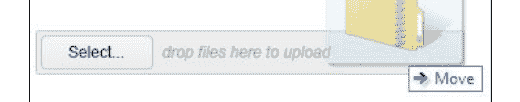

# Kendo UI Window 组件

JavaScript长期以来一直支持向 Web浏览器中的用户发送消息的弹出窗口。这些消息可以是供用户看到的简单文本，可以是请求权限的确认框，有时也可以提示用户输入某些信息。

# Kendo UI Window 组件

Kendo UI Window 组件允许你在 Web 应用程序中创建和管理窗口。这些窗口可以用于各种目的，例如显示信息、捕获用户输入或提供确认消息。

## 自定义窗口

你可以根据需求自定义 Window 组件的许多方面。例如，你可以设置窗口的标题、宽高以及在屏幕上的位置。你还可以控制窗口是否为模态（modal）或是否可以调整大小。

- Title: 显示在窗口标题栏中的文本。
- Width: 窗口的宽度。
- Height: 窗口的高度。
- Position: 窗口在屏幕上的初始位置。
- Modal: 窗口是否阻塞背景交互
- Resizable: 用户是否可以调整窗口大小

还可以自定义窗口执行的操作。例如，你可以从窗口工具栏中添加或删除按钮。这些按钮可以触发各种事件，例如关闭窗口、保存数据或执行其他任务。

### Kendo UI Window 示例

下面的示例展示了如何创建一个基本的 Kendo UI Window 组件：

```html
<div id="window">
    <p>This is a Kendo UI Window.</p>
</div>
<button id="windowButton">Show Window</button>

<script>
$(document).ready(function() {
    $("#window").kendoWindow({
        width: "400px",
        height: "300px",
        title: "My Window"
    });

    $("#windowButton").on("click", function() {
        $("#window").data("kendoWindow").open();
    });
});
</script>
```


# 上传与窗口小组件

如你所见，默认显示的唯一按钮是关闭按钮。然而，还有其他三个可以轻松添加的按钮：刷新、最小化和最大化。这些按钮已经关联了默认功能。如果窗口小组件的内容是从远程源加载的，刷新按钮将刷新该窗口小组件内部的内容。最小化按钮会将窗口小组件的大小缩小为仅留标题栏。最大化按钮将放大窗口，使其占据整个 Web浏览器的屏幕大小。在你点击最小化或最大化按钮后，会出现一个一个新的特殊按钮，专门用于将窗口小组件恢复到原始的位置和大小。以下是在你的窗口小组件中启用这些操作所需的代码：

```javascript
<script>
$(document).ready(function() {
  $("#window").kendoWindow({
    width: "600px",
    title: "About Azure",
    actions: ["Minimize", "Maximize", "Close"],
    close: onClose
  });

var onClose = function() {
  $("#windowButton").show();
};

$("#windowButton").on("click", function() {
  $("#window").data("kendoWindow").open();
  $("#windowButton").hide();
});
});
</script>
```

以下是带有这些操作的窗口小组件外观：

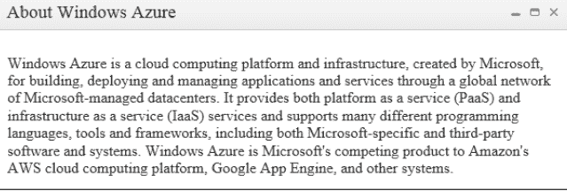

Windows Azure 是一个云计算平台和基础设施，由微软创建，通过全球微软管理的数据中心网络，用于构建、部署和管理应用程序及和服务。它提供平台即服务 (PaaS) 和基础设施即服务 (IaaS)，并支持许多编程语言、工具和框架，包括微软特有的和第三方软件及系统。Windows Azure 是微软与亚马逊 AWS 云计算平台、Google App Engine 以及其他系统的竞争产品。

这是一个已最小化的窗口小组件，注意最小化按钮已经更改为恢复窗口原始大小和形状的按钮：

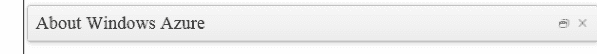

在下一张截图中是最大化的窗口小组件。注意最大化按钮已经更改为恢复窗口原始大小和形状的按钮：

| 关于 Windows Azure |
| --- |
| Windows Azure 是一个云计算平台和基础设施，由微软创建，通过全球微软管理的数据中心网络，用于构建、部署和管理应用程序及和服务。它提供平台即服务 (PaaS) 和基础设施即服务 (IaaS)，并支持许多不同的编程语言、工具和框架，包括微软特有的和第三方软件及系统。Windows Azure 是微软与亚马逊 AWS 云计算平台、Google App Engine 以及其他系统的竞争产品。 |

# 使用 AJAX 加载内容

到目前为止的所有示例都在窗口小组件中显示了本地内容，或已嵌入网页中的内容。这只在有限的场景下有用。当窗口小组件可以从外部源（如你网站中的其他网页）加载内容时，它会变得灵活得多。要实现此功能，你需要为窗口小组件配置内容源。你可以在下面的代码示例中看到：

```javascript
<script>
$(document).ready(function() {
  $("#window").kendoWindow({
    width: "600px",
    title: "Rams's Ten Principles of Good Design",
    content: "OtherPage.html",
    close: onClose
  });
});

var onClose = function() {
  $("#windowButton").show();
};

$("#windowButton").on("click", function() {
  $("#window").data("kendoWindow").open();
  $("#windowButton").hide();
});
</script>
```

启用此功能后，窗口小组件一旦激活就会加载并显示此外部内容。这有一个额外的好处，即在必要之前不会下载加载的内容，因此页面加载会快一些。以下是以这种方式加载了外部内容的窗口小组件：

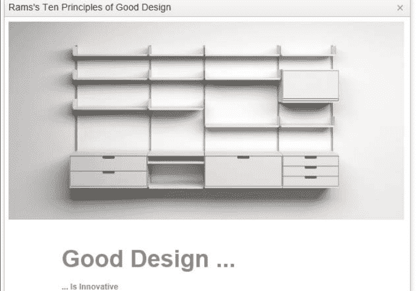

## 使用动画效果

当窗口小组件在页面上激活时，它会以一些悦目的动画进入屏幕。默认情况下，它将使用缩放效果，使窗口小组件看起来像是从一个非常小的物体放大到全尺寸。其他可用的效果包括切换效果（toggle）、展开效果（expand），以及可以选择窗口小组件动画是否应以半透明方式开始。以下代码示例显示了默认配置的动画效果：

> 注意，未包含任何特殊的动画配置。运行默认动画的唯一方法是在设置中留空动画配置元素。

```javascript
<script>
$(document).ready(function() {
  $("#window").kendoWindow({
    width: "600px",
    title: "About Alvar Aalto",
    close: onClose
  });
});
</script>

```

```javascript
var onClose = function() {
  $("#windowButton").show();
}

$("#windowButton").on("click", function() {
  $("#window").data("kendoWindow").open();
  $("#windowButton").hide();
});
});
</script>
```

要启用切换动画，更改代码使其像下面的示例所示。切换动画实际上是不通过图形过渡，而是让窗口小组件立即出现或消失。

```javascript
<script>
$(document).ready(function() {
  $("#window").kendoWindow({
    width: "600px",
    title: "About Alvar Aalto",
    close: onClose,
    animation: {
      open: {
        effects: ""
      },
      close: {
        effects: ""
      }
    },
    close: onClose
  });
});

var onClose = function() {
  $("#windowButton").show();
}

$("#windowButton").on("click", function() {
  $("#window").data("kendoWindow").open();
  $("#windowButton").hide();
});
</script>
```

要启用展开动画，更改代码使其像下面的示例所示。反向配置用于关闭效果。

```javascript
<script>
$(document).ready(function() {
  $("#window").kendoWindow({
    width: "600px",
    title: "About Alvar Aalto",
    animation: {
      open: {
        effects: "vertical"
      },
      close: {
        effects: "vertical",
        reverse: true
      }
    },
    close: onClose
  });

var onClose = function() {
  $("#windowButton").show();
};

$("#windowButton").on("click", function() {
  $("#window").data("kendoWindow").open();
  $("#windowButton").hide();
});
</script>
```

透明度效果可以用于这些动画效果中的任何一种，并且是可以启用或禁用的。下面的代码示例显示了如何启用或禁用动画。与之前的示例的区别在于 effects 值末尾额外的字符串值 `fadeIn`。

```javascript
<script>
$(document).ready(function() {
  $("#window").kendoWindow({
    width: "600px",
    title: "About Alvar Aalto",
    animation: {
      open: {
        effects: "vertical fadeIn"
      }
    },
    close: {
      effects: "vertical fadeIn",
      reverse: true
    }
    close: onClose
  });

var onClose = function() {
  $("#windowButton").show();
};

$("#windowButton").on("click", function() {
  $("#window").data("kendoWindow").open();
  $("#windowButton").hide();
});
});
});
</script>
```

# 使用窗口小组件事件

Kendo UI 小组件提供了一系列响应用户事件的事件。由于事件有很多，我将在这里列出它们并对每个事件进行简要描述：

- Activate（激活）：当窗口小组件打开后的动画完成后触发此事件。
- Close（关闭）：当窗口小组件关闭时触发此事件。
- Deactivate（取消激活）：当窗口小组件关闭后的动画完成后触发此事件。
- Dragend（拖拽结束）：当用户用鼠标结束拖动窗口时触发此事件。
- Dragstart（开始拖拽）：当用户开始用鼠标拖动窗口时时触发此事件。
- Error（错误）：当窗口小组件通过 AJAX 加载远程内容遇到错误时触发此事件。


第 10 章

- Open（打开）：当 Window 组件打开时，会触发此事件。
- Refresh（刷新）：当 Window 组件内的远程内容从远程源刷新时，会触发此事件。
- Resize（调整大小）：当用户使用鼠标调整 Window 组件 own时，会触发此事件。

## 使用 Window 组件 API 方法

API 方法允许我们在 JavaScript 代码中根据需要对 Window 组件执行功能。以下是关于调用 API 方法时可用的选项的简要描述：

- Center（居中）：调用此方法将 Window 组件返回到屏幕中心。
- Close（关闭）：调用此方法会关闭 Window 组件。
- Content（内容）：在时不带参数调用时，用于获取 Window 组件的当前内容；当提供新内容作为参数时，用于设置 Window 组件的内容。
- Maximize（最大化）：调用此方法将 Window 组件最大化。
- Minimize（最小化）：调用此方法将 Window 组件最小化。
- Open（打开）：调用此方法可以打开一个 Window 组件。
- Refresh（刷新）：调用此方法通过 AJAX 从其远程源刷新 Window 组件的内容。此方法仅适用于设置了 AJAX 内容属性的 Window 组件对象。
- Restore（还原）：调用此方法将 Window 组件从最小化状态恢复到正常大小和位置。
- SetOptions（设置选项）：调用此方法设置 Window 组件的配置选项。
- Title（标题）：调用此方法可以获取或设置 Window 组件的标题。
- ToFront（置顶）：调用此方法将 Window 组件带到页面上其他元素的前面。
- ToggleMaximization（切换最大化）：调用此方法可以使当前未最大化的 Window 组件最大化，或者将已最大化的组件恢复到其原始大小和位置。

## 总结

在这一章中，我们学习了如何使用 Window 和 Upload 组件。这些组件让您能够创建可扩展且交互性的 Web 网页，您的用户会非常青赏这些功能。最重要的是，这些组件为非常常见的 Web 开发问题提供了现成的解决方案，让您可以专注于代码，而不是解决重复性问题。

在本书中，我们已经了用于开发强大网页的全系列不同 Kendo UI Web 工具。正如您每一章中所看到的，这些组件非常易用，并提供了广泛的配置选项，以根据您的特定需求和情况进行定制。不仅如此，Telerik 还拥有一个活跃的开发者社区，可以通过 Web 论坛、博客甚至在必要时通过付费支持来协助解决实现细节。我希望您喜欢学习 Kendo UI Web 框架中提供的强大工具。这些工具将减少交付丰富的 Web 页面所需的整体时间投入和精力，这是我们大多数人都会乐意赞同的。

## 11 Web API 示例

我们在之前的章节中探索的许多组件在与更高级服务器端代码配合使用时最为有用。例如，许多应用程序使用数据库并处理文件。虽然之前的章节展示了使用这些组件所需的客户端代码（如 HTML 和 JavaScript），但它们没有关注许多真实世界应用程序中使用的 ASP.NET 服务器端 C# 代码。为了演示如何在这些场景中使用 Kendo UI 框架，本章将展示一些结合 ASP.NET Web API 和 Entity Framework 使用 Kendo UI 框架的特殊示例。

> 如果您不熟悉 ASP.NET Web API 框架，可以访问 www.asp.net/web-api 获取一些示例、视频和教程。

## 熟悉 ASP.NET Web API

ASP.NET MVC 框架的最新版本 MVC 4 包含了一项名为 Web API 控制器新功能的模板。这些控制器是专门的 HTTP 通信端点，允许创建 RESTful API 服务。RESTful API 服务是一种 HTTP Web 服务，允许客户端使用标准的 HTTP 动词（Get, Post, Put, Delete 和 Patch）进行通信，以便在服务器上执行操作。

# Web API 示例

传统上，ASP.NET 具有创建作为 SOAP 端点的 Web 服务的能力（与 REST 端点相反）。SOAP Web 服务使用 XML 架构，非常擅长序列化和反序列化强类型对象，并在生产系统中被广泛采用。与 RESTful 服务相比，SOAP 服务更加冗长且脆弱，实现任何新功能都需要对架构（schema）进行更改。此外，JavaScript 的爆炸式增长让 RESTful 服务对开发者更具吸引力，因为它们可以通过脚本块和常见的 JavaScript 代码轻松访问。

RESTful Web 服务在互联网上正变得越来越常见。许多流行的基于 Web 的服务都暴露了 RESTful API，以便与移动应用、Web 仪表板和其他软件项目集成。这种广泛的采用在很大程度上归于 JavaScript 对象表示法（JSON）在对象序列化和反序列化中的同样普及。JSON 让任何 Web 客户端都能轻松解释来自任何服务器的数据，而无需专有许可或算法。

 RESTful Web 请求非常简单，如果您不知道的话，您每天都在使用它们。每当您在 浏览器中输入 URL 时，您都会向该地址的服务器发出一个 HTTP GET 请求。同样，大多数网页包含如 HTTP POST 这样的表单，用于将数据传回服务器进行保存。您还记得在某些控制器操作方法上看到 `[HttpGet]` 和 `[HttpPost]` 特性吗？这些属性指示 ASP.NET 为该操作方法只允许特定类型的 HTTP 动词（GET 或 POST）。这确实具有安全影响，但实际上对于确定服务器应该依赖客户端随请求发送的哪种 HTTP 动词更有用。换句话说，一个控制器可以有五个不同的操作方法，每个方法都有不同的 HTTP 特性，如下：

```csharp
[HttpGet]
public ActionResult Get(int objectID = 0)
{
...
}
```

```csharp
[HttpPost]
public ActionResult Post(Object postedObject)
{
```


> 你可以访问 http://www.asp.net/web-api/overview/web-routing-and-actions/routing-in-aspnet-web-api 来了解 Web API 路由规则和命名规范的概述。

你还会注意到，这些操作方法上没有标有 HTTP 动词属性。对于 API 控制器来说，这些属性不是必需的。然而，代码示例中有一个新属性。你可以在 Post 和 Put 操作的参数前面看到它：[FromBody]。这个特殊属性用于帮助模型绑定器（model binder）在 HTTP 请求正体中定位参数。它并不是总是必要的，例如当你绑定一个复杂对象时，模型绑定器可以清楚地看到它是由具有特定名称的属性组成的。但是，对于此代码示例中的简单字符串值，它需要知道你打算将 HTTP 请求正体绑定到该输入参数。此外还有一个属性 ([FromUri]) 用于指示参数来自 URL。在大多数情况下，这些参数是不必要的，但它们可以帮助解决模型绑定器无法独立解决的问题。如果你对它不熟悉，值得进行更多研究。Web API 用于模型绑定的基本规则如下：

- 简单类型从 URL (URI) 获取
- 复杂类型从请求正体获取

简单类型包括所有 .NET 框架的原始类型，加上 DateTime、Guid、String 和 TimeSpan。对于每个操作方法，最多有一个参数可以读取请求正体。如果你尝试对多个一个参数标记为 [FromBody]，你将获得运行时错误或空值。

> 你可以访问 http://blogs.msdn.com/b/jmstall/archive/2012/04/16/webapi-does-parameter-binding.aspx 以获取更多关于 Web API 参数绑定的信息。

## Web API 示例

关于 API 控制器，另一个需要理解的重要概念是它们不像标准控制器那样返回值。API 控制器不是为 Web 浏览器生成 HTML 标记，而是生成供专用客户端代码（如 JavaScript）消费的数据。这种数据的格式是不需要担心的。注意上一个代码示例中的操作方法是如何直接返回字符串值，而没有使用我们在之前一些章节中见过的 `Json()` 方法。我们不需要告诉 API 如何格式化它的数据，因为它将与通信过程自动协商（auto-negotiate）格式。常见的格式是 JSON，某些客户端可能更喜欢 XML 或 ASP.NET 框架可以理解并序列化的其他数据类型。

> 你可能想了解自动协商是如何工作的。这里是答案：它很大程度上基于 API 调用期间客户端的 Accept 请求头。你可以创建自己的内容类型来扩展 API 框架，以用于自定义场景。请访问此页面获取更多信息：http://www.asp.net/web-api/asp-net-framework/formats-and-model-binding/content-negotiation。

由于 API 控制器并非设计用于渲染带有标记的网页，因此你需要像像常做的那样为你的网页创建普通控制器。为了与 API 控制器交互，通常会利用 JavaScript（尤其是 jQuery）通过特定的 HTTP 动词访问 API 节点，以完成你的页面设计的任何任务。

## 熟悉 Entity Framework Code First

大多数应用程序使用数据库来存储信息。然而，大多数数据库存储信息的方式与面向服务器的编程并不完全匹配。这是一个非常常见的问题，并催生了对象关系映射（ORM）系统领域。这类系统有很多种，微软创建了一个专门针对 .NET 框架的系统，称为 Entity Framework (EF)。它基本上是一个框架，旨在更方便地编写在数据库中存储信息但行为上像面向对象系统的代码。如果你已经下载了本章的示例内容，请打开第 11 章的解决方案进行跟随。否则，创建一个新的 ASP.NET MVC 4 项目，并在提示时选择 Web API 模板。

## 第 11 章

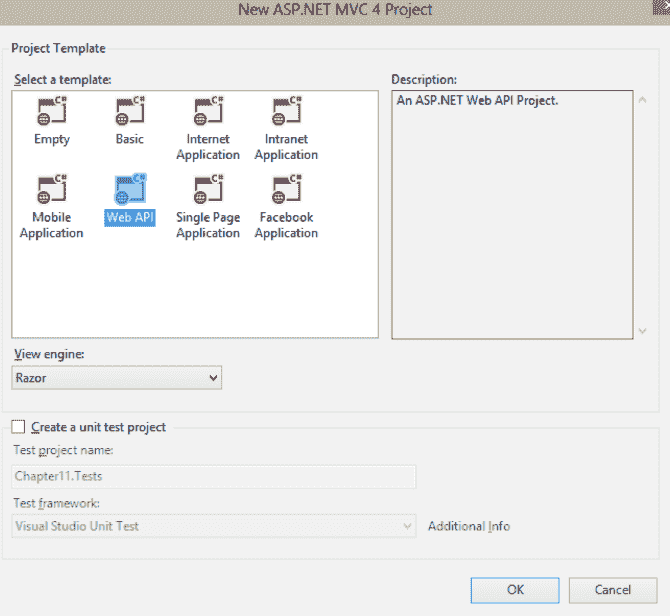

Entity Framework 的细节非常多，这里没有足够的空间进行探索。我们将通过一个如何利用 Entity Framework Code First 模型的的基本示例，以便在本章的示例中展示这一点。要使用 Entity Framework，你必须首先通过 NuGet 将安装到你的 Visual Studio 项目中。你可以通过在 Visual Studio 的解决方案管理器中右键点击项目并选择“管理 NuGet 包...”来实现，如下所示：

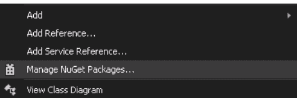

## Web API 示例

在接下来的场景中，你应该确保你正在查看在线目录。在搜索框中输入文本 Entity Framework，并在结果窗口中出现它时选择“安装”。安装完成后，它将显示绿色标记，表示已准备就绪。

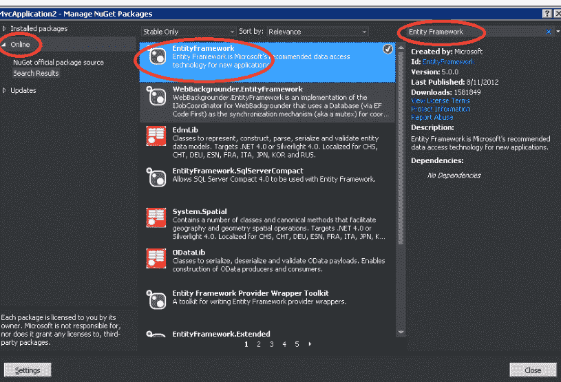

这将 Entity Framework 的所有必要组件安装到你的 Visual Studio 解决方案中。我们将使用 Entity Framework 中名为 Code First 的功能。这允许我们在数据库存在之前先为数据创建类（或实体）。这种模型最大的处是它保证了数据库将根据我们的对象架构进行设计。

为了说明，我们将在 Models 文件夹中创建实体类。在 Models 文件夹中创建一个 Movie 类，如下：

```sharp
public class Movie
{
    public int Id { get; set; }
    public string Name { get; set; }
    public int ReleaseYear { get; set; }
    public int Rating { get; set; }
    public int Rank { get; set; }
}
```

Entity Framework 会推断 Id 属性应该是主键。有了模型后，我们需要告诉 Entity Framework 我们想要一个数据库。在 Models 文件夹中创建另一个类 MoviesContext，如下所示：

```csharp
using System.Data.Entity;
public class MoviesContext : DbContext
{
    public DbSet<Movie> Movies { get; set; }
}
```

这段代码形成了 Movie 实体的 DbSet。让我们在数据库中添加一些电影，以便在示例中使用它们。为了开始，我们需要一个页面可以输入电影数据并让 Web 服务器保存这些数据。

## Web API 示例

创建一个带有这些选项的 MoviesController；它将为我们的 Movie 实体生成具有基本操作的方法和视图。


> 如果找不到 Movie 实体或 MoviesContext 类，请尝试生成项目并再次尝试。

现在去 Movies/Index 页面创建一些电影。第一次运行项目可能会慢。这是因为 Entity Framework 正在后台根据你提供的模型和上下文创建数据库。当你看到网页时，数据库就已经运行了。你可以看到我在截图中创建了一些。以便在章节后续可以使用。

## Index

- Create New

| Name | ReleaseYear | Rating | Rank | Edit | Delete |
| --- | --- | --- | --- | --- | --- |
| Eternal Sunshine of the Spotless Mind | 2004 | 84 | 1 | Edit | Delete |
| Safety Not Guaranteed | 2012 | 71 | 2 | Edit | Delete |
| Star Trek | 2009 | 80 | 3 | Edit | Delete |
| Go | 1999 | 72 | 4 | Edit | Delete |
| Wonder Boys | 2000 | 74 | 5 | Edit | Delete |
| The Game | 1997 | 77 | 6 | Edit | Delete |
| The Ghost and the Darkness | 1996 | 67 | 7 | Edit | Delete |
| Heat | 1995 | 83 | 8 | Edit | Delete |
| Cowboys & Aliens | 2011 | 61 | 9 | Edit | Delete |
| The Fugitive | 1993 | 78 | 10 | Edit | Delete |


尽管 Entity Framework 有很多需要学习的内容，但这个简短的示例已经带你从单个类到了完全可以运行的数据库。我们将在本章的剩余部分使用这个数据库。如果你不熟悉 Entity Framework 并想学习更多，我建议使用 Visual Studio 检查刚刚创建的 `MoviesController.cs` 类，查看我们是如何创建默认操作的；你可以访问 www.msdn.com 获取该主题的官方文档。

## 熟悉 OData

ASP.NET Web API 框架支持通过名为 OData 的语法进行查询。OData 是一种与 HTTP URL 兼容的查询语言，因此它可以执行查询字符串。它为被使用的 API 操作方法提供了两个非常强大的益处：首先，它会自动将 OData 查询语言翻译成操作方法内部的实际数据查询。这种功能极其强大，在亲眼看到之前可能难以置信。基本上，它是一个免费的搜索引擎。其次，OData 特性允许你查询数据源以获取特定的匹配元素，然后将结果返回给客户端。客户端不需要查询完整数据集并进行自行过滤。这是一项性能上的巨大提升，同时也简化了客户端和服务器的代码。

您可以通过以下四种方式为 API 控制器启用 OData 查询功能。每种方式都比前一种提供更细粒度的控制。

- 通过 WebApiConfig.cs 全局启用查询
- 为特定的 API 操作方法添加 `[Queryable]` 属性
- 继承 `ODataController` 而不是 `ApiController`
- 继承 `EntitySetController` 而不是 `ODataController`

第一种方案将在全局范围内为任何返回类型为 `IQueryable` 的 `ApiController` 方法启用查询支持。要启用此功能，请使用 App_Start 文件夹下的 `WebApiConfig.cs` 文件，并取消 `config.EnableQuerySupport();` 行的注释。

```javascript
// 取消以下代码的注释以为具有 IQueryable 或 IQueryable<T> 返回类型的操作启用查询支持。
// 为了避免处理意外或恶意的查询，请使用 QueryableAttribute 上的
// 设置来验证传入的查询。
// 更多信息请访问
http://go.microsoft.com/fwlinkink/?LinkId=279712.
config.EnableQuerySupport();
```

## Web API 示例

第二种方案将为装饰了 `[Queryable]` 属性特定的操作方法启用查询支持。这比上一个方案提供了更多的配置选择，因为 `[Queryable]` 属性具有许多可以配置的属性，以精调其行为。装饰了此属性的操作方法看起来如下：

```csharp
// GET api/values
[Queryable]
public IQueryable<string> Get()
{    return new string[] {"value1", "value2"}.AsQueryable();
}
```

第三种方案涉及继承您的控制器而不是 `ODataController`。这将启用 Web API 提供的完整 OData 支持，并允许进行更多配置，使 OData 引擎能够理解它所暴露的实体的实体数据模型 (EDM)。

```csharp
OModelBuilder modelBuilder = new ODataConventionModelBuilder();
modelBuilder.EntitySet("Movies");
Microsoft.Data.OData.EdModel model = modelBuilder.GetEdModel();
config.Routes.MapODataRoute("OData", "OData", model);
```

前面的代码需要在 Web 启动时运行，因此它应该放置在 `Global.asax` 或 `App_Start` 中的某个类中（例如 `WebApiConfig`）。它读取与 Entity Framework 相同类型的实体模型，并将其加载到 OData 路由中，以便 Web API 理解模型的每个部分是如何关联的、主键是什么等。这使得更高级的场景成为可能，例如属性导航。关于此的更多信息，你可以访问 http://www.asp.net/web-api/overview/odata-support-in-aspnet-web-api/getting-started-odata-in-web-api/create-a-read-only-endpoint 了解介绍。

第四种方案与上一种方案类似，但它会自动启用更多 OData 功能，而这些功能 `ODataController` 类则必须手动完成。它仍然需要最后一种方案中的 `ODataModelBuilder` 类。列出的 URL 也涵盖了该主题的信息。

在本章的示例中，我们将使用 `[Queryable]` 属性为特定的操作方法启用查询支持。我鼓励你自己更多探索这项技术，因为它是一个强大且扩展的框架，可以为你的代码提供极大的生产力提升。要了解更多关于 OData 的信息，你可以访问 www.odata.org。

## 在 Kendo Grid 中 DataSourceRequest

正如我们在第一章看到的，Kendo Grid 组件的设计是为了支持丰富的功能，如分页、过滤和排序。我们之前见过如何通过 JavaScript 和 Kendo DataSource 对象在客户端驱动这些功能。然而，当 Grid 与服务器端功能连接起来以驱动其特性时，它变得更加强大。

用于 ASP.NET MVC 的 Kendo UI 框架包含一个特殊对象，帮助在标准 MVC 控制器实现此功能。它不需要 Web API 或 OData，尽管如果你想手动配置 Kendo DataSource 也可以使用它们。在这个示例中，我们将学习如何使用 `DataSourceRequest` 对象以及它如何驱动 Kendo Grid 组件的功能。

首先，在我们之前创建的 `MoviesController` 类中添加一个新方法。

```csharp
public ActionResult MoviesGrid([DataSourceRequest] DataSourceRequest request)
{
    return Json(
        db.Movies.ToDataSourceResult(request), JsonRequestBehavior.AllowGet);
}
```

你应该会立即注意到 `Kendo.Mvc` 命名空间，因此 Grid 组件需要在方法签名中使用此 `DataSourceRequest` 属性。这对于 Kendo Grid 正确理解分页、排序和过滤的服务器端功能非常重要。

使用此代码，在控制器中添加一个新的操作方法：

```csharp
public ActionResult Grid()
{
    return View();
}
```

为此创建一个视图并在其中放置以下 Razor 代码：

```razor
@using Kendo.MvcUI
@{
    ViewBag.Title = "Grid";
}

@(Html.KendoGrid<Models.Movie>().Name("moviesGrid")
    .Columns(columns => {
        columns.Bound(p => p.Name);
        columns.Bound(p => p.ReleaseYear);
        columns.Bound(p => p.Rating);
        columns.Bound(p => p.Rank);
    })
    .Pageable()
    .Sortable()
    .Filterable()
    .DataSource(dataSource => dataSource
        .Ajax(read => read.Action("Grid", "Movies"))
        .PageSize(5))
)
```

然而，与第一章与数据的交互不同，这个 Grid 组件正在向服务器请求排序顺序、页面和过滤结果。它是通过向服务器发送特殊指令来实现的，这些指令会被 Grid 属性和对象解释。查看这些，可以按 F12 打开 IE 开发者工具。在出现的工具栏中，点击“网络 (Network)”选项卡，然后点击“开始捕获 (Start Capturing)”。点击这些按钮后，点击 Grid 的一个功能（如箭头或列标题）。你将在开发者工具中看到一些活动，这意味着 Grid 正在通过 AJAX 调用与服务器通信。

| Name | Release Year | Rating | Rank |
|---|---|---|---|
| Cowboys & Aliens | 2011 | 61 | 9 |
| Eternal Sunshine of the Spotless Mind | 2004 | 84 | 1 |
| Go | 1999 | 72 | 4 |
| Heat | 1995 | 83 | 8 |
| Safety Not | 2012 | 71 | 2 |


你可以在这里看到 Grid 请求了第 2 页，页大小为 5 条记录。这表明 Kendo Grid 是通过 HTTP 请求体与服务器通信的。

# 使用 Web API 驱动 ListView

与 Grid 控件类似，ListView 控件能够利用 [DataSourceRequest] 属性来帮助驱动操作的特殊功能。在这种情况下，我们不仅简单地从服务器查询数据，还要通过 Web API 进行编辑。

在 KendoController 类中为你的 ListView 示例创建一个操作方法，如下所示：

```csharp
private MoviesContext db = new MoviesContext();

public ActionResult ListView()
{
    return View(db.Movies);
}
```

然后为此操作方法添加一个视图，并在内部添加以下 HTML 标记：

```html
@using Kendo.Mvc.UI;

@model IEnumerable<Chapter11.Models.Movie>

{
    ViewBag.Title = "ListView";
}
<script type="text/x-kendo-tmpl" id="template">
<div class="movie-view">
<dl>
<dt>Name</dt>
<dd>${Name}</dd>
<dt>Rating</dt>
<dd>${Rating}</dd>
<dt>Rank</dt>
<dd>${Rank}</dd>
</dl>
</div>
<<div>
<a class="k-button k-button-icontext k-edit-button" ref="#<span class="k-icon k-edit"></span>Edit</a>
<a class="k-button k-button-icontext k-delete-button" ref="#<span class="k-icon k-delete"></span>删除</a>
</div>
</div>
</script>
```

<h2>ListView</h2>

此基础 HTML 和 Kendo 模板将在数据检索后被用于构建页面。你可以看到模板如何简单地显示 Movie 对象的每个元素，并提供编辑和删除按钮。接下来，在此视图的底部添加以下 MVC Razor 代码将所有内容连接起来：

```csharp
@(Html.Kendo().ListView(Model))
.Name("moviesListView")
.TagName("div")
.ClientTemplateId("template")
.Editable()
.DataSource(dataSource => {
    .Read(read => read.Action("MoviesGrid", "Movies"))
    .Update(update => update.Type(HttpVerbs.Post))
    Url("/api/MovieApi")
    PageSize(5)
    Model(config => config.Id("Id"))
    .Pageable()
})
```

在这里，我们创建了一个 Kendo ListView，指定了在页面渲染时使用的模板 ID，将其标记为可编辑并指定了数据源。在数据源内部，我们指示了哪里哪里显示数据（Read 方法）以及向哪里发送更新的数据（Update 方法）。

# Web API 示例

接下来，我们需要为 Movie 对象创建一个编辑器模板，以便此 ListView 可以编辑我们的 Movie 对象。在 Views/Shared 文件夹下创建一个名为 EditorTemplates 的新文件夹。然后，向 EditorTemplates 文件夹中添加一个名为 Movie.cshtml 的视图。


打开 Movie.cshtml 文件并添加以下代码：

```html
@model Chapter11.Models.Movie

<div class="movie-view">
  <dt>Name</dt>
  <dd>@Html.EditorFor(model => model.Name )</dd>
  <dt>Rating</dt>
  <dd>@Html.EditorFor(model => model.Rating )</dd>
  <dt>Rank</dt>
  <dd>@Html.EditorFor(model => model.Rank )</dd>
</div>
<div>
  <a class="k-button k-button-icontext k-update-button" href="#"><span class="k-icon k-update"></span>保存/</a>
  <a class="k-button k-button-icontext k-cancel-button" href="#"><span class="k-icon k-cancel"></span>取消/</a>
</div>
</div>
```

当点击 Movie 项目上的编辑按钮时，ListView 控件将使用使用此视图。以下是页面的默认外观（当查看电影时）。你可以看到电影项的不同元素以及用于编辑或删除它的按钮：

# 第 11 章

| Name | Eternal Sunshine of the Spotless Mind |
| :--- | :--- |
| Rating | 84 |
| Rank | 1 |

这是当你点击编辑按钮时，电影项的渲染方式。查看字段现在如何按照我们在 EditorTemplate 文件夹中为 Movie 数据类型指定的进行渲染。

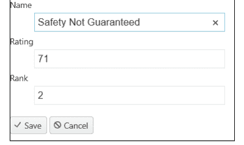

由于我们已将其连接到 Web API，如果我们在 Visual Studio 中被调用的 API 方法内部设置了断点，就可以观察发送到服务器进行处理的变化。你可以看到我在下面的中这样做了：

```csharp
namespace Chapter11.Controllers
{
    public class MovieApiController : ApiController
    {
        private MoviesContext db = new MoviesContext();
        public string Post(Movie movie)
        {
            return movie.Rating.ToString();
        }
    }
}
```
通过这种 Visual Studio 设置，当进行更新时程序将停止，你可以检查数据以观察发生了什么。对于生产应用程序，将使用 Entity Framework 来编辑电影对象并保存更改。

## 总结

在本章中，我们学习了如何使用 Web API 处理涉及 Kendo 控件的一些真实场景。我们还快速探索了 ASP.NET Web API 以及 Entity Framework 和 OData。这些工具结合使用，可以帮助模型绑定、服务器端分页和过滤。Telerik 提供的这些属性鼓励你继续探索这些技术并查看如何创建自己的自定义页面。

# Index

- <button> 50
- Layout.cshtml file 13
- <select> 49

# A

- action method 39
- activate event, Window widget 238
- add method, DataSource 32
- add method, ListView methods 157
- Person method, 91, 92
- aggregate property, DataSource 31
- AJAX content loading with PanelBar 170
- AJAX content with TabStrip 177
- ajaxRequest method, Splitter widget 206
- animation effects, PanelBar 172
- animation effects, TabStrip 178
- animation effects, TreeView widget 223
- animation effects, Window widget 214
- animation effects, Window widget 235-237
- animation property, menu API 144
- animation property, 144
- direction property, 145-145
- direction property, 145
- hover property, 145
- orientation property, 145
- append method, menu methods 146
- append method, TreeView widget 219
- ASP.NET_MVC 4
- ASP.NET_Web API 241-245
- asynchronous uploads, Upload widget 224, 235
- at method, DataSource 33
- altar property, Kendo MVVM 102
- AutoComplete(extension method) 62
- AutoComplete properties 55
- AutoComplete methods, using 67
- basic: 56
- binding, to local source 57, 58
- binding, to remote data 58-60
- customizing, Kendo templates used 64
- data, to server 63, 64
- events, hooking into 66
- properties, configuring 65
- using, with Ajax 62
- using, with methods 61

# AutoComplete widget events

- change event 67
- close event 67
- hooking into 66
- open event 67
- select event 67

# B

- buttons
- adding, to HTML Editor toolbar 120
- removing, from HTML Editor 121
- tools, HTML Editor 127, 129

# C

- Calendar Widget about 71, 72
- basis 71
- configuring 72-76
- events 81
- methods 78, 80
- MVC, using 76, 78
- properties 72
- cancelChange, DataSource 33
- cancel method, ListView methods 157
- center method, Window widget 239
- change event, AutoComplete widget events 67
- change event, DataSource 34
- change event, HTML Editor 133
- change event, Kendo range widget 197
- change event, Kendo slider widget 197
- change event, slider widgets 197
- checked property, Kendo MVVM 106
- clearSelection method, ListView methods 157
- click event 91
- click property, Kendo MVVM 104
- close event, AutoComplete widget events 67
- close event, Window widget 238
- close(), AutoComplete methods 67
- close(), method, Window methods 147
- closeOnClick property, menu API 145
- configuration options 145
- Code First 248
- collapse event, Splitter widget 203
- collapse event, TreeView widget 218
- collapse method, Splitter widget 207
- collapse method, TreeView widget 219
- columns object array 45
- columns object example, Grid 45
- contentLoad, Splitter widget 204
- content method, Window widget 239
- content, Window widget
- loading, AJAX used 234
- CSS? 77
- custom In-line tools, HTML Editor 131
- custom property, Kendo MVVM 106
- custom templates, HTML Editor 129-131

# D

- data-* attributes 87
- data-bind attribute 88
- data-bind properties, Kendo MVVM
- attr 102
- checked 103
- click 104
- custom 106
- disabled 106
- enabled 106
- events 106
- invisible 107
- html 106
- source 108
- style 110
- text 106
- value 111
- visible 107
- dataBound, TreeView widget 219
- dataitem() method, AutoComplete methods 68
- dataitem, TreeView widget 219
- data method, DataSource 34
- data() method, slider widgets 195
- datasource
- TabPage using with 174, 175
- DataSource events
- change 34
- error 34


- requestStart 35 Kendo UI。参阅 Kendo UI Data-dragged 事件，Window widget 238
- DataSource methods 拽事件, TreeView 219
- dragStart 事件, TreeView 219
- Source dragstart 事件, Window widget 238
- DataSource methods 下拉列表工具, HTML Editor 126, 127
- about 32 drop event, TreeView widget 219
- add 32
- at 33
- cancelChanges 33
- data 34 editable property, Grid 50
- fetch 33 edit method, ListView methods 155
- get 33 enabled property, Kendo MVVM 16
- getByUID 33 enable() method, AutoComplete methods 68
- insert 32 enable(n) method, slider widgets 195
- query 33 enable method, TreeView widget 219
- read 33 Entity Data Model (EDM) 252
- remove 32 Entity Framework (EF) 246, 248
- sync 33 error event, DataSource 34
- total 34 error event, Window widget 238
- totalPages 34 eval() function 20
- view 33 events, Calendar Widget 81, 82
- DataSource properties events, Kendo MVVM 106
- aggregate 31 events, slider widgets
- filter 31 change event 197
- group 31 slide 198
- page 31 execute event, HTML Editor 133
- pageSize 31 expand event, Splitter widget 204
- sort 31 expand event, TreeView widget 219
- DataSourceRequest expand method, Splitter widget 207
- using, Kendo 253-256 expand method, TreeView widget 219
- dataString 99
- data-template attribute 88
- # F fetch method, DataSource 33
- DatePicker widget 188 文件拖放, Upload widget files 
- deactivate event, Window widget 238
- declarative initialization, of widgets using 221
- through Data-Role MVVM 112 filter property, Grid 50
- destroy() method, AutoComplete methods filter property, DataSource 31
- 68 findByText, TreeView widget 220
- direction property, menu API configuration
- findViewById, TreeView widget 220
- options 144
- disabled property, Kendo MVVM 106
- disable() method, slider widgets 195
- Document Object Model (DOM) element 206
- drag and drop, TreeView widget using 212, 213
- drag event, TreeView widget 219

# G
- getByUid method, DataSource 33
- get method, DataSource 33
- groupable property, Grid 50
- group property, DataSource 32
- insertBefore method, TreeView widget 220
- insert method, DataSource 32
- Intellisense 14
- invisible property, Kendo MVVM 107
- isNew method 26

# H
- hoverDelay property, menu API configuration options 145
- HTML 7
- HTML Editor
- about 115-119 Snippets tool 124, 125
- Styles tool 131
- HTML Editor API
- about 132
- configuration options 132
- events 133
- using 132
- HTML Editor events
- change 132
- execute 132
- keydown 133
- keyup 132
- paste 133
- select 133
- HTML Editor toolbar
- buttons, adding 120, 121
- button, removing, 121
- HTML Editor tools
- button tool 127, 129
- Custom In-line tools 131
- customizing 126
- custom templates 129-131
- drop-down lists 126, 127
- html property, Kendo MVVM 106

# J
- JavaScript 7
- JavaScript Object Notation (JSON) 39, 242
- Json(object) method 39

# K
- kendo.bind() 100
- kendoController class 39
- kendoController.cs class 56
- kendo.data.Model 24
- kendo.data.Model.define(function) method 24
- kendoEditor value function 118
- kendo Grid method 182
- kendo Grid
- DataSourceRequest, using with 253
- kendoGrid() function 44
- kendo HTML Editor。参阅 HTML Editor
- kendo MVVM framework
- about 158
- data-binding properties 102
- declarative widgets 112
- kendo.observable() 88
- kendoSlider method
- kendo templates
- using for customizing AutoComplete 64
- kendo UI
- about 8
- AutoComplete widget 55
- Calendar widget 71
- data, managing 21
- framework components 21
- ListView widget 135, 148
- Menu widget 135
- PanelBar widget 161
- slider widgets 181
- Splitter widget 199
- TabStrip widget 172
- TreeView widget 209
- user interface (UI) widgets 211
- Window widget 229

# I
- images
- adding, to TabStrip 175, 176
- images, TreeView widget
- displaying 214-217
- insertAfter() method, menu methods 146
- insertAfter method, TreeView widget 220
- insertBefore() method, menu methods 146

# Kendo UI DataSource
- about 24
- basic usage 35-37
- events 34
- model object 24-26
- properties 31
- remote data, binding to 38-41
- schema object 27
# Kendo UI Grid
- about 42, 44
- columns array 45, 46
- columns 48
- editable 50
- filterable 50
- groupable 50
- navigable 50
- options.field 50
- options.model 50
- pagable 50
- scrollable 50, 53
- selectable 50, 53
- sortable 54

# Kendo UI MVC
- about 18-20
- Kendo UI Slider widget 181
- Kendo UI widget 181
- UI syntax 17
# Kendo UI View-Model
- about 88
- keydown event, HTML Editor 133
- keyup event, HTML Editor 133

# L
- layout event, Slider widget 205
- Learning Kendo UI Web 8
- about 158
- dataBinding 8
- dataSet 158
- edit 158
- clearSelection 157
- edit method 157
- remove method 157
- refresh 157
- save 157
# ListView widget
- about 135, 148, 152
- basics 148, 150
- configuration properties 156
- driving, with Web API 256-260
- elements, editing 154, 155
- elements, selecting 153, 154
- events 158
- methods 157
- maximize method, Window widget 239
- max method, Splitter widget 208

# menu methods
- append 146
- close 147
- enable 147
- insertBefore 146
- open 147
- remove 147

# Menu widget
- about 135-141
- API configuration options 144
- basics 135
- code sample 135
- menu events 147
- menu items, with images 141-143
- menu items, with URLs 143
- menu methods, configuring 145
- methods, Calendar Widget 78, 80
- methods, slider widgets 195
- enable 195
- minimize method, Window widget 239
- min method, Splitter widget 208
- model(get) method 251
- Model(M) 85
- model object, DataSource 24
- View-Controller (MVC) 85
- View-Presenter (MVP) 85
- MovieContext class 250
- Movie.Controller.class as 251
- multiple_files, Upload widget
- uploading: 226
- pageSize property, DataSource 32

# PanelBar widget
- about 161-167
- AJAX content, loading 170
- animation effects, controlling 172
- basics 161
- sprite images, adding 168-170
- URLs, adding 170
- parent method, TreeView widget 220
- paste event, HTML Editor 133
- people 87
- popup Collision method, menu API configuration options 145
- properties, Calendar Widget 72
- data/template properties 72
- display/formatting properties 72
- MVC 18
- MVC Razor syntax 18
- MVVM
- about 85, 86
- observable data binding, 90
- simple data binding 86

# N
- navigable property, Grid 50
- tree event, TreeView widget 219
- query method, DataSource 33

# O
- Object Relational Mapping (ORM) 246
- observable data binding, MVVM
- about 90
- data, adding 91-95
- observable arrays, using 98-100
- observable properties, using View 95-98
- read method, DataSource 33
- refresh event, Window widget 239
- refresh() method, AutoComplete methods 68
- refresh method, ListView methods 157
- refresh method, Window widget 239
- remove method, ListView methods 158
- remove method, DataSource 32
- removeMethod(), menu methods 146
- remove method, TreeView widget 220
- requestStart 35 Kendo UI。参阅 Kendo UI Data-dragged 事件，Window widget 238
- requestStart 35 Kendo UI。参阅 Kendo UI Data-dragged 事件，Window widget 238
- requestStart 35 Kendo UI。参阅 Kendo UI Data-dragged 事件，Window widget 238
- requestStart 35 Kendo UI。参阅 Kendo UI Data-dragged 事件，Window widget 238
- requestStart 35 Kendo UI。参阅 Kendo UI Data-dragged 事件，Window widget 238
- requestStart 35 Kendo UI。参阅 Kendo UI Data-dragged 事件，Window widget 238
- requestStart 35 Kendo UI。参阅 Kendo UI Data-dragged 事件，Window widget 238
- requestStart 35 Kendo UI。参阅 Kendo UI Data-dragged 事件，Window widget 238
- requestStart 35 Kendo UI。参阅 Kendo UI Data-dragged 事件，Window widget 238
- requestStart 35 Kendo UI。参阅 Kendo UI Data-dragged 事件，Window widget 238
- requestStart 35 Kendo UI。参阅 Kendo UI Data-dragged 事件，Window widget 238
- requestStart 35 Kendo UI。参阅 Kendo UI Data-dragged 事件，Window widget 238
- requestStart 35 Kendo UI。参阅 Kendo UI Data-dragged 事件，Window widget 238
- requestStart 35 Kendo UI。参阅 Kendo UI Data-dragged 事件，Window widget 238
- requestStart 35 Kendo UI。参阅 Kendo UI Data-dragged 事件，Window widget 238
- requestStart 35 Kendo UI。参阅 Kendo UI Data-dragged 事件，Window widget 238
- requestStart 35 Kendo UI。参阅 Kendo UI Data-dragged 事件，Window widget 238
- requestStart 35 Kendo UI。参阅 Kendo UI Data-dragged 事件，Window widget 238
- requestStart 35 Kendo UI。参阅 Kendo UI Data-dragged 事件，Window widget 238
- requestStart 35 Kendo UI。参阅 Kendo UI Data-dragged 事件，Window widget 238
- requestStart 35 Kendo UI。参阅 Kendo UI Data-dragged 事件，Window widget 238
- requestStart 35 Kendo UI。参阅 Kendo UI Data-dragged 事件，Window widget 238
- requestStart 35 Kendo UI。参阅 Kendo UI Data-dragged 事件，Window widget 238
- requestStart 35 Kendo UI。参阅 Kendo UI Data-dragged 事件，Window widget 238
- requestStart 35 Kendo UI。参阅 Kendo UI Data-dragged 事件，Window widget 238
- requestStart 35 Kendo UI。参阅 Kendo UI Data-dragged 事件，Window widget 238
- requestStart 35 Kendo UI。参阅 Kendo UI Data-dragged 事件，Window widget 238
- requestStart 35 Kendo UI。参阅 Kendo UI Data-dragged 事件，Window widget 238
- requestStart 35 Kendo UI。参阅 Kendo UI Data-dragged 事件，Window widget 238
- requestStart 35 Kendo UI。参阅 Kendo UI Data-dragged 事件，Window widget 238
- requestStart 35 Kendo UI。参阅 Kendo UI Data-dragged 事件，Window widget 238
- requestStart 35 Kendo UI。参阅 Kendo UI Data-dragged 事件，Window widget 238
- requestStart 35 Kendo UI。参阅 Kendo UI Data-dragged 事件，Window widget 238
- requestStart 35 Kendo UI。参阅 Kendo UI Data-dragged 事件，Window widget 238
- requestStart 35 Kendo UI。参阅 Kendo UI Data-dragged 事件，Window widget 238-238
- requestStart 35 Kendo UI。参阅 Kendo UI Data-dragged 事件，Window widget 238
- requestStart 35 Kendo UI。参阅 Kendo UI Data-dragged 事件，Window widget 238
- requestStart 35 Kendo UI。参阅 Kendo UI Data-dragged 事件，Window widget 238
- requestStart 35 Kendo UI。参阅 Kendo UI Data-dragged 事件，Window widget 238
- requestStart 35 Kendo UI。参阅 Kendo UI Data-dragged 事件，Window widget 238
- requestStart 35 Kendo UI。参阅 Kendo UI Data-dragged 事件，Window widget 238
- requestStart 35 Kendo UI。参阅 Kendo UI Data-dragged 事件，Window widget 238
- requestStart 35 Kendo UI。参阅 Kendo UI Data-dragged 事件，Window widget 238
- requestStart 35 Kendo UI。参阅 Kendo UI Data-dragged 事件，Window widget 238
- requestStart 35 Kendo UI。参阅 Kendo UI Data-dragged 事件，Window widget 238
- requestStart 35 Kendo UI。参阅 Kendo UI Data-dragged 事件，Window widget 238
- requestStart 35 Kendo UI。参阅 Kendo UI Data-dragged 事件，Window widget 238
- requestStart 35 Kendo UI。参阅 Kendo UI Data-dragged 事件，Window widget 238
- requestStart 35 Kendo UI。参阅 Kendo UI Data-dragged 事件，Window widget 238
- requestStart 35 Kendo UI。参阅 Kendo UI Data-dragged 事件，Window widget 238
- requestStart 35 Kendo UI。参阅 Kendo UI Data-dragged 事件，Window widget 238
- requestStart 35 Kendo UI。参阅 Kendo UI Data-dragged 事件，Window widget 238
- requestStart 35 Kendo UI。参阅 Kendo UI Data-dragged 事件，Window widget 238
- requestStart 35 Kendo UI。参阅 Kendo UI Data-dragged 事件，Window widget 238
- requestStart 35 Kendo UI。参阅 Kendo UI Data-dragged 事件，Window widget 238
- requestStart 35 Kendo UI。参阅 Kendo UI Data-dragged 事件，Window widget 238
- requestStart 35 Kendo UI。参阅 Kendo UI Data-dragged 事件，Window widget 238
- requestStart 35 Kendo UI。参阅 Kendo UI Data-dragged 事件，Window widget 238
- requestStart 35 Kendo UI。参阅 Kendo UI Data-dragged 事件，Window widget 238
- requestStart 35 Kendo UI。参阅 Kendo UI Data-dragged 事件，Window widget 238
- requestStart 35 Kendo UI。参阅 Kendo UI Data-dragged 事件，Window widget 238
- requestStart 35 Kendo UI。参阅 Kendo UI Data-dragged 事件，Window widget 238
- requestStart 35 Kendo UI。参阅 Kendo UI Data-dragged 事件，Window widget 238
- requestStart 35 Kendo UI。参阅 Kendo UI Data-dragged 事件，Window widget 238
- requestStart 35 Kendo UI。参阅 Kendo UI Data-dragged 事件，Window widget 238
- requestStart 35 Kendo UI。参阅 Kendo UI Data-dragged 事件，Window widget 238
- requestStart 35 Kendo UI。参阅 Kendo UI Data-dragged 事件，Window widget 238
- requestStart 35 Kendo UI。参阅 Kendo UI Data-dragged 事件，Window widget 238
- requestStart 35 Kendo UI。参阅 Kendo UI Data-dragged 事件，Window widget 238
- requestStart 35 Kendo UI。参阅 Kendo UI Data-dragged 事件，Window widget 238
- requestStart 35 Kendo UI。参阅 Kendo UI Data-dragged 事件，Window widget 238-238
- requestStart 35 Kendo UI。参阅 Kendo UI Data-dragged 事件，Window widget 238
- requestStart 35 Kendo UI。参阅 Kendo UI Data-dragged 事件，Window widget 238
- requestStart 35 Kendo UI。参阅 Kendo UI Data-dragged 事件，Window widget 238
- requestStart 35 Kendo UI。参阅 Kendo UI Data-dragged 事件，Window widget 238
- requestStart 35 Kendo UI。参阅 Kendo UI Data-dragged 事件，Window widget 238
- requestStart 35 Kendo UI。参阅 Kendo UI Data-dragged 事件，Window widget 238
- requestStart 35 Kendo UI。参阅 Kendo UI Data-dragged 事件，Window widget 238
- requestStart 35 Kendo UI。参阅 Kendo UI Data-dragged 事件，Window widget 238
- requestStart 35 Kendo UI。参阅 Kendo UI Data-dragged 事件，Window widget 238
- requestStart 35 Kendo UI。参阅 Kendo UI Data-dragged 事件，Window widget 238-238
- requestStart 35 Kendo UI。参阅 Kendo UI Data-dragged 事件，Window widget 238
- requestStart 35 Kendo UI。参阅 Kendo UI Data-dragged 事件，Window widget 238
- requestStart 35 Kendo UI。参阅 Kendo UI Data-dragged 事件，Window widget 238
- requestStart 35 Kendo UI。参阅 Kendo UI Data-dragged 事件，Window widget 238
- requestStart 35 Kendo UI。参阅 Kendo UI Data-dragged 事件，Window widget 238
- requestStart 35 Kendo UI。参阅 Kendo UI Data-dragged 事件，Window widget 238
- requestStart 35 Kendo UI。参阅 Kendo UI Data-dragged 事件，Window widget 238
- requestStart 35 Kendo UI。参阅 Kendo UI Data-dragged 事件，Window widget 238
- requestStart 35 Kendo UI。参阅 Kendo UI Data-dragged 事件，Window widget 238
- requestStart 35 Kendo UI。参阅 Kendo UI Data-dragged 事件，Window widget 238
- requestStart 35 Kendo UI。参阅 Kendo UI Data-dragged 事件，Window widget 238
- requestStart 35 Kendo UI。参阅 Kendo UI Data-dragged 事件，Window widget 238
- requestStart 35 Kendo UI。参阅 Kendo UI Data-dragged 事件，Window widget 238
- requestStart 35 Kendo UI。参阅 Kendo UI Data-dragged 事件，Window widget 238
- requestStart 35 Kendo UI。参阅 Kendo UI Data-dragged 事件，Window widget 238
- requestStart 35 Kendo UI。参阅 Kendo UI Data-dragged 事件，Window widget 238
- requestStart 35 Kendo UI。参阅 Kendo UI Data-dragged 事件，Window widget 238
- requestStart 35 Kendo UI-238

# P
- pageable property, Grid 50
- pageSize property, DataSource 32
- sample project, 22
- setting up 18-20
- save method, ListView methods 157
- schema object 27

# S
- scrollable property, Grid 50
- search(), AutoComplete methods 69
- selectable property, Grid 50
- select event, AutoComplete widget 67
- select event, HTML Editor 133
- select event, TreeView widget 219
- select method, ListView methods 158
- select method, TreeView widget 220
- set property, DataSource 31
- set method, TreeView widget 220
- simple data binding, MVVM 86
- simple data binding, 90
- slide event, slider widgets 198
- slider widget, 181
- slider widgets, 197
- Snippets tool, 124, 125
- sortable property, Grid 50
- sort property, DataSource 32
- source property, Kendo MVVM 108-110
- Splitter API methods
- about 206
- ajaxRequest 206
- collapse 207
- expand 207
- max 208
- min 208
- reference, for splitter widget 206
- size 208
- toggle 209

- Splitter events
- about 203
- collapse event 203
- contentLoad event 204
- expand 204
- layoutChange event 205
- resize event 205

- Splitter widget
- about 199
- API methods 206
- content, loading 202
- content, loading with AJAX 202
- div elements 200
- events 203
- learning: 199-201

- sprite images
- adding, to PanelBar items 168-170
- style property, Kendo MVVM 110
- Styles tools
- adding, to HTML Editor 121, 123
- suggest() method, AutoComplete methods
- 69
- sync method, DataSource 33

# T
- table element 88
- TabStrip widget
- about 172
- Ajax, loading 177
- effects, controlling 178
- basics 172, 174
- images, adding 175, 176
- URLs, adding 176
- using, with datasource 174, 175

- Telerik 7
- Telerik UI UI website
- URL 10
- templates, Kendo UI. See Kendo UI
- Templates


- 模板, TreeView widget 217, 218
- textdata-bind 属性 96
- text method, TreeView widget 220
- text 属性, Kendo MVVM 106
- this.get function 92
- this.set function 92
- title method, Window widget 239
- tofront method, Window widget 239
- ToggleMaximization method, Window widget 239
- toggle method, Splitter widget 209
- toggle method, TreeView widget 220

## API 方法 219
- 数据源, 绑定到 211
- 拖放, 使用 212, 213
- 事件 218
- 图片,显示 214-217
- 学习 210, 211
- 模板, 使用 217
- toJSON 方法 26
- total method, DataSource 34
- totalpages method, DataSource 34
- 传输对象, DataSource 29, 30

## TreeView API 方法

## U

### update, Upload widget
- 取消 228
- 上传文件, Upload widget
- 移除 222
- 更新进度, Upload widget
- 破解 228
- 附加 219
- 折叠 219
- datalen 219
- 启用 219
- 展开 219
- findBy 220
- findByUID 220
- insertBefore 220
- insertAfter 220
- parent 220
- 移除 220
- select 220
- setData 220

## Upload widget
- 关于 222-254
- 异步上传, 启用, 224, 225
- 文件拖放, 使用 229
- 多文件文件, 上传 226
- update, 取消 228
- 上传文件, 移除 222
- 更新进度, 移除 228
- text 220
- toggle 220

## TreeView 事件
- 关于 218
- 折叠 218
- dataBound 219
- drag 219
- dragdrop 219
- dragStart 219
- drop 219
- 展开 219
- navigate 219
- select 219

## URLs
- 添加，到 PanelBar 项 170
- 添加，到 TabStrip 176

## 用户界面, slider widgets
- 双方刻度放置选项 194
- 右下角刻度放置选项 193
- 默认值, 自定义 191, 192
- 无刻度放置选项 194
- 滑块方向, 自定义 195
- 刻度放置, 自定义 192

## TreeView widget
- 关于 199, 209
- 动画效果, 配置 214

## V

- val() function 118
- valuated-bind 属性 96
- value() method, AutoComplete 方法 69
- value 属性, Kendo MVVM 111
- ViewBag 20
- ViewBag.serverData 属性 20
- tooltip, 自定义 189, 190, 191
- tooltip, 自定义使用的 MVC 扩展方法 191
- toleft 刻度放置选项 192
- view method, DataSource 33
- View-Model 代码 88
- View-Model (VM) 85
- visible 属性, Kendo MVVM 107
- Visual Studio 2012 Express
- URL 8

## Visual Studio IDE 10

## W

- Web API  241
- Web API 示例 241, 242
- ASP.NET Web API 241, 242
- DataSourceRequest, 与 Data Grid 使用 253
- Entity Framework Code First 256
- ListView, 驱动 256
- OData 251
- Window 动作, Window widget 自定义 231-233

## Window widget
- 关于 229, 231
- 动画效果, 使用 235-237
- API 方法 239
- 代码示例 230
- content, 使用 AJAX 加载 234
- 事件 238

## Window 动作, 自定义 231–233

## Window widget API 方法
- center 239
- close 239
- content 239
- maximize 239
- minimize 239
- open 239
- refresh 239
- restore 239
- SetOptions 239
- title 239
- tofront 239
- ToggleMaximization 239

## Window widget 事件
- activate 238
- close 238
- deactivate 238
- dragend 238
- dragstart 238
- open 239
- refresh 239
- resize 239

# 感谢购买
学习 Kendo UI Web 开发

# 关于 Packt Publishing

Packt（发音为 'packed'）于 2004 年 4 月出版了第一本书《Mastering phpMyAdmin for Effective MySQL Management》，随后继续专注于出版针对特定技术和解决方案的高度聚焦书籍。

我们的书籍和出版物分享了您的同行 IT 专业人士在适配和自定义今日系统、应用程序和框架方面的经验。我们基于解决方案的书籍为您提供了知识和力量，用于自定义正在使用的软件和技术以完成工作。过去，我们独特的方法比您过去过的 IT 书籍更具体，不那么通用。我们的独特性为您提供更聚焦的信息，让您获得更多需要的内容，减少您不需要的内容。Packt 是一家专注于高质量书籍的现代出版社。

我们欢迎所有对写作感兴趣的人进行咨询。书稿建议应发送到我们的网站。如果您的想法仍处于早期阶段并想先讨论，我们的策划编辑将与您联系。如果您有技术技能但没有写作经验，我们丰富的编辑可以帮助您。

# jQuery Mobile Development Essentials
ISBN: 978-1-84951-726-3
平装: 246 页
学习用于智能手机和平电脑的 JQM 框架
- 1. 创建在各种移动设备上完美运行的网站
- 2. 通过示例应用程序进行学习
- 3. 包含大量易于遵循的示例，书中的代码可直接用于您自己的项目中

# Learning jQuery, Third Edition
ISBN: 978-1-84951-654-9
平装: 428 页
使用简单的 JavaScript 创建更好的交互、设计和 Web 开发
- 1. jQuery 介绍，所需的编程经验极少
- 2. 针对特定客户端问题的详细解决方案
- 3. 这本热门书籍的修订和更新版本

# WordPress Mobile Web Development: Beginner's Guide
ISBN: 978-1-84951-572-6
平装: 332 页
让您的 WordPress 网站支持移动端，并掌握设计领域的两个热门趋势——移动端和 WordPress
- 1. 学习如何使用 WordPress 构建移动和响应式网站
- 2. 熟悉最好的移动插件并理解它们如何与您的网站交互
- 3. 学习如何让自己的 WordPress 主题或站点具有响应式，包括布局、图像、导航等

# jQuery Tools UI Library
 978-1-84951-780-5
平装: 112 页
通过清晰、实用的示例学习 jQuery Tools，并为使用该库开发自己的想法寻找灵感
- 1. 学习如何使用 jQuery Tools，通过可用于网站的清晰、实用的项目进行学习
- 2. 学习如何使用如 Overlay、Scrollable、Tabs 和 Tooltips 等有用工具
- 3. 充满了实用示例和插图，书中的代码可直接用于您自己的项目中
