# 渐进式 Web 应用学习指南：使用 Service Workers 构建现代 Web 应用

## 序言

作者：Simon MacDonald

我通常将书献给我的妻子 Anna，但对于这一本，她建议我尝试一些不同的。基于此，我在此将本书献给数字 42。

本页特意留空。

## 目录

- 结语 98

## 前言

我记得我是如何结识 John Wargo 的。当时我正在俄勒冈州波特兰举行的 PhoneGap 大会议上演讲，我抬头望去，看到 Brian LeR 正在与一个我不认识的人聊天。我凑过去问一个朋友：“嘿，那个穿西装的人是谁？”朋友回答道：“噢，那是 John Wargo。他是一个分析师。”在那个极客聚会上，这身西装让他脱颖而出，因为大多数与会者穿着印有幽默口号的 T 恤。这在马克·扎克伯格流行“程序员穿连帽衫”造型之前。

如果我没记错，我的 T 恤上画了一只猪，对话框里写着“嗯……培肉”，当我回想起来时，John 穿的甚至不是西装——只是一件西装外套。不过，说他是会议上穿得最体面的人也不为夸张，但我离题了。

“天哪！”我在想，“一个分析师。”你看，他刚刚从电信行业转型到完全的软件开发。在电信行业，分析师的名声并不算好。我和 John 聊了聊。他开始对我在 PhoneGap 和 Apache Cordova 社区的工作提出富有见解的问题。

朋友们，在这一点，我忍制住了插入一个“不要以人取相”笑话的冲动，而且我并不擅长讲冷笑话。

John 后来成为了 Apache Cordova 社区的重要成员和教育者，并写了不是一本而是四本关于该主题权威著作，不像你手中这本关于渐进 Web 应用（PWA）的书。

PhoneGap/Cordova 项目被引用的原则之一最终是“消失”，但另一个较少被提到的是“让 Web 成为一流开发平台”。现在，渐进 Web 应用已经履行了成为一流平台的承诺。作为 Apache Cordova 社区多年的主要成员，这让 John 处于一个非常棒的位置，因为他在每一步都见证了移动 Web 的演变。

如果你某天在会议或书签发布会上遇到 John，请准备好一个关于哪里能买到新鲜美味甜甜圈的推荐。这是我们共同的特质之一，另一个是冷幽默和讽刺。

你选择这本书是一个非常明智的决定。如果我刚刚开始通往渐进 Web 应用的学习之路，我没有哪个比 John 更信任能带我到达那里的人了。我只希望你在读这本书时，能像我一样听到 John 的声音。

> Simon MacDonald，Adobe 开发者倡导
>
> 2019年11月

## 前言

在构建针对桌面电脑、笔记本电脑、智能手机和平板的应用时，开发者通常有两种选择可以使用：专门为目标平台构建的原生应用，或者通过浏览器提供的抽象层运行在任何系统上的 Web 应用。为任何目标平台构建原生应用是一项耗时且昂贵的任务，特别是当你的应用针对多种类型的系统（桌面电脑、智能手机、电视等）时。

由于屏幕空间减小、处理器速度、网络带宽等原因，Web 应用具有局限性。这些限制大部分已经消失，但原生应用和 Web 能力之间仍然存在相当差距。

Web 开发者有很多工具可以使用，帮助他们构建丰富、吸引人的应用。多年来，Sun Microsystems 的 Java 和 Adobe Flash 等不同技术出现，人们期望它们将改变 Web 应用的世界——为用户提供更具吸引力的体验。但它们最终由于正当原因从浏览器中消失。

开发者和用户需要的是一种让 Web 应用运行得更像原生应用的方法。如果有这种方法，我们的 Web 应用将会飞跃，并使我们能够更容易通过浏览器交付跨平台应用，而不是为每个支持的平台手工制作原生应用。

多年来，浏览器（特别是运行在智能手机和平板等移动设备上的浏览器）开始向 Web 应用开放原生能力。例如，现代 Web 应用可以访问设备的文件系统，并让基于浏览器的应用程序知道地理位置。这使得 Web 应用运行得更像原生应用，但仍然存在限制。`Service workers` 是一项相对新的技术，它让 Web 应用更容易地弥合原生与 Web 能力之间的差距，消除了 Web 应用的许多限制。

这是一本关于 `service workers` 的书。

是的，我知道标题上说这本书是关于渐进 Web 应用（PWA）的，事实也如此，但这本书侧重于如何使用 `service workers` 来增强 Web 应用的能力并创建 PWA。

市面上有很多书关注 PWA 对互动的影响；即如何构建让用户感到愉悦并深受灵感的 PWA。

## 前言

我在 `https://learningpwa.com` 为这本书创建了一个公共网站站。随着时间的推移，我将在这里发布勘误表，并尽可能发布相关内容。为了杜绝任何可能的抱怨，在我写下这些文字时，该网站并不是一个 PWA（渐进式 Web 应用程序）。它不是 PWA 是因为它不需要成为 PWA。它只是这本书的营销落地页，我并不想向访问者发送任何浏览器通知，也没有必要为了提高性能或离线使用而缓存网站内容。仅仅因为我可以把网站做成 PWA，并不意味着我应该这样做。请只为那些真正需要 PWA 的网站使用 PWA 的力量。

书中的三个示例中有两个已在线发布。第一个是第 2 章的小费计算器，你可以通过 `https://learningpwa.com/tipcalc/` 访问它。另一个是第 3、4、5 章中的 PWA 新闻网站————你可以在 `https://pwa-news.com` 找到它。由于《学习渐进式 Web 应用程序》（*Learning Progressive Web Apps*）是一个托管在 Netlify 上的静态网站，因此只要这本书还在出版，它可能就会一直活跃。PWA 新闻网站需要计算资源（它的服务器端是 `node.js` 应用），因此只要大家对这本书感兴趣，我就会让服务器一直运行。最终，我会关闭它，但服务器的完整源代码已包含在书中源码，因此你始终可以运行服务器的本地副本，或者自己在某处托管该网站。

就这些！这份前言包含了我想告诉你的关于这本书的所有信息。我深信 PWA，并认为它们是移动应用开发的未来，这就是为什么我努力将这本书交到你手中。我非常享受写作的过程，也希望你阅读时能像我一样喜欢，甚至更喜欢。

请在 InformIT 网站上注册你的副本《学习渐进式 Web 应用程序》，以便在更新或更正错误出现时方便地访问。开始注册流程，访问 `informit.com/register` 并登录或创建账户。输入产品 ISBN（9780136484226）并点击提交（Submit）。在“已注册产品”（Registered Products）标签页查找指向此产品的“访问奖励内容”（Access Bonus Content）链接，点击该链接访问任何可用的奖励材料。如果您希望在获得新版本和更新独家优惠时收到通知，请勾选框以接收我们的邮件。

- 6. `https://www.netlify.com/`
- 7. `https://nodejs.org/`

## 致谢

如果没有几位同事的工作，这本书就不会存在。感谢 Pearson 的 Greg Doench，信任我并出版了这本书（这是我们合作的第六本书了）。我是一个经验丰富的软件开发人员，但我并不擅长让应用变得美观，我之所以有酷酷的示例应用可以处理，完全归于我的朋友 Scott Good 那种时尚的魔法。

感谢 Simon MacDonald，你在序言中的赞美之词，并分享和我一样对甜甜圈的热爱。当我在某地的开发者会议上演讲时，Simon 会在那里并带我去另一家很酷的甜甜圈店，这种感觉太酷了。

感谢 Maxim Salnikov 为手稿初稿提供反馈，并将我引荐到 PWA 社区。

感谢 PWABuilder 团队的 Jeff Burtoft、David Rousset 和 Justin Willis，让我快速熟悉了 PWABuilder 并帮助我准备了第 8 章的内容。

如果没有 Pearson 制作团队的辛勤工作，这本书绝对无法印刷。感谢 Pearson 的 Julie Nahil、Carol Lallier、Vaishnavi Venenkatan 等人在幕后辛勤工作，完成手稿并付印刷。

最后，如果没有我妻子 Anna 的全力支持，我永远无法写出书中的一个字。我花费大量时间在办公室里摆腾、编写应用以及为了兴趣和利润学习新技术。

## 关于作者

**John M. Wargo** 是一位产品经理、软件开发人员、作家、丈夫。他从事软件开发已有超过 30 年，是多个开源项目的长期贡献者。他住在北卡罗来纳州夏洛特，与妻子 Anna 和孩子们。

# 什么是 PWA

什么是渐进式 Web 应用（PWA）是一种利用现代浏览器功能，使其行为更像原生应用的 Web 应用。根据维基百科的定义，一种渐进式 Web 应用（PWA）是“利用现代浏览器的功能（包括 `Service Workers` 和 `Web Manifest`），允许用户升级应用程序”。

开发者构建 PWA 主要使用现代浏览器支持的两种技术：清单文件（`Manifest Files`）和 `Service Workers`。第 2 章“清单文件”将告诉您关于清单文件的所有信息。

PWA 是一种在浏览器中运行的、更像原生应用的 Web 应用。Google 的渐进式 Web 应用落地页¹称 PWA 是

- 可靠的（Reliable）
- 快速的（Fast）
- 有吸引力的（Engaging）

这些术语描述的是用户的感知，而不是应用是如何构建的。用于构建 PWA 的技术允许开发者构建可靠、快速且吸引人的 Web 应用，但前提是开发者具备相关技能并投入时间。我认为 Google 的描述有些片面，因为那里有很多缺乏经验的开发者构建的 PWA 并不可靠、快速或具有吸引力，但它们仍然是 PWA。

所以，考虑到这一点，在书中，PWA 是关于所使用的技术以及如何制作它们。目前有很多关于 PWA 如何更吸引人以及它们对业务影响的在线文章和书籍；获取信息的最佳地方是 PWA Stats²

## PWA 是 . . .

Google 的渐进式 Web 应用落地页说 PWA 是

- 可靠的（Reliable）
- 快速的（Fast）
- 有吸引力的（Engaging）

这些词描述的是用户的感知，而不是应用是如何构建的、它使用了什么技术或它能做什么。用于构建 PWA 的技术允许开发者构建可靠、快速且吸引人的 Web 应用，但前提是开发者具备相关技能并投入时间。我认为 Google 的描述有些片面，因为那里有很多缺乏经验的开发者构建的 PWA 并不可靠、快速或具有吸引力，但它们仍然是 PWA。

所以，考虑到这一点，在书中，PWA 是关于所使用的技术以及如何制作它们。目前有很多关于 PWA 如何更吸引人以及它们对业务影响的在线文章和书籍；获取信息的最佳地方是 PWA Stats²

我认同 Keith 在《什么是渐进式应用》（What Is a Progressive App³）中的定义。我的 PWA 是带有一点特殊魔法的 Web 应用，使其更像移动应用。Web 应用使用更多移动应用的概念让 PWA 变得有趣。

如果你考虑你在手机上使用的大多数原生应用，它们

- 从手机平台的公共应用商店（以及用于员工的企业级商店）安装，并在设备主屏幕上放置图标。
- 无论设备是否有网络连接，都能加载和运行（尽管功能可能有限）。应用的 UI 嵌入在应用程序二进制文件中，并在打开应用时本地加载（可以时从网络拉取数据）。
- 可以在后台运行，即使你正在设备上处理其他事情时，它也可以执行操作或处理数据。
- 可以接收推送通知（从外部系统发送到设备或应用的消息）。
- 通过一些额外工作，甚至可以提供丰富且健的离线体验，缓存新记录以便稍后上传，并与基于服务器的应用程序同步数据。

+ 1. `https://developers.google.com/web/progressive-web-apps/`
+ 2. `https://www.pwastats.com/`
+ 3. `https://www.adactio.com/journal/13098/`

## 什么是 PWA...

这描述了你今天使用的许多移动应用吗？你的电子邮件（或在此处填入另一个应用名称）无论设备是否有网络连接都能工作吗？当你打开收音机并打开应用时，应用的 UI 是否会打开并显示之前的大部分数据？当你离线状态下发送消息时，应用会将数据加入队列以便稍后传输？应用会接收通知（当有新邮件时）吗？是的，我想是如此；这些都是移动应用的核心能力。

转向 PWA：

- PWA 是可安装的：移动和桌面用户可以快速将它们安装到手机主屏幕，或使用应用中的安装 UI 进行安装。手机几乎一直具有将网站 URL 复制到设备主屏幕的能力，但安装应用更好。我将在第 2 章中详细解释。
- PWA 在本地设备上缓存应用 UI，因此当用户打开应用时，UI 在应用尝试从网络获取和更新数据之前加载。因此，PWA 感觉比传统的 Web 应用更快速。
- PWA 运行后台任务，实现资源缓存和后台处理。传统的 Web 应用无法做到这一点（嗯，它们可以，但需要大量手工编写的代码或第三方库）。
- PWA 无论应用是否运行，都可以从后端服务器接收推送通知。

当苹果宣布 iPhone 时，他们由于假设开发者乐意仅为该平台构建 Web 应用而遭遇了失败。史蒂夫·乔斯和公司傲慢地认为浏览器就足够满足大多数应用需求。开发者社区迅速反抗，迫使苹果让步，这就是我们获得在 iOS 上编写原生应用的能力。

尽管 Safari 在 iOS 上相当强大，而且苹果提供了一些很棒的工具（不，不是 Xcode，还有人记得 Dashcode 吗？），但仍然有很多应用开发者在浏览器中无法做。这些局限性也是 Gap 项目（后来变为 Apache Cordova）的动力；该项目的启动专门是为了实现跨平台移动开发，并让开发者访问当时原生浏览器不具备的设备能力。

多年来，许多能力通过开放标准进入了浏览器，涵盖了加速度计、指南针、麦克风等。浏览器应用变得更加强大，但最终要求是——这听起来很熟悉——在设备上安装 Web 应用，即使应用未运行时也在本地缓存代码和内容，并接收推送通知。启用 PWA 的技术为浏览器提供了最终能力；而且有了这些能力，Web 应用现在可以更像原生应用一样。

许多技术启用了 PWAs；没有它们，Web 应用就无法成为 PWA。这些技术是 `web manifest` 文件、`service workers` 以及超文本传输协议（HTTPS），或者更准确地说，是传输层安全协议（TLS）。HTTPS 实现了客户端和服务器之间的安全通信，这不是我将在书中以后介绍的话题，它是大多数 PWA 能力的基础。接下来的章节将介绍如何使用 `web manifest` 文件和 `service workers` 来构建 PWA。现在，要知道 `web manifest` 文件在本地系统上安装 Web 应用，而 `service workers` 完成其他工作。

表 1.1 列出了上一节中的功能与启用它们的 PWA 技术之间的关系。

| 能力 | Web Manifest | Service Workers | TLS (HTTPS) |
| --- | --- | --- | --- |
| 安装快捷方式 | 是 | 需要，但未涉及 | 是 |
| 缓存内容 | 否 | 是 | 是 |
| 后台处理 | 否 | 是 | 否 |
| 推送通知 | 否 | 是 | 是 |

开发者必须投入大量工作来让网站有趣、吸引人且有用。开发者在构建这些网站时会考虑客户端浏览器的能力，以便在不同尺寸的屏幕或浏览器窗口（宽度和高度）中看起来良好且运行良好。某些移动浏览器（如手机上的）无法处理许多客户端代码，因此 JavaScript 可能会被禁用或在设备上功能有限。

开发者用于这些场景构建网页的过程被称为*渐进式增强*（progressive enhancement），即开发者专注于简单地显示所需内容，无论浏览器是否支持额外的功能（如 CSS 转换），为了更强大的浏览器。如果这些功能存在，用户就能获得完整的体验；如果没有，用户至少可以查看内容。

Web 应用更具互动性，例如 Wikipedia（网站）对比 Gmail（应用）。Web 应用使用 JavaScript（或其衍生语言 TypeScript）等客户端脚本语言来提供更动态、令人兴奋的客户端体验。对于 Web 应用，当你第一次访问应用 URL 时，应用外壳会在应用去服务器获取数据之前下载并渲染，然后可能并行地从服务器检索应用数据。

你可以在图 1.2 中看到此的示例。应用外壳由侧边导航和顶部栏组成，而内容区域（橙色边界内）的内容根据用户在应用中的选择动态变化。

图 1.2 应用外壳结构——这就是为什么它们被称为渐进式 Web 应用。

PWAs 渐进地增强了 Web 应用——这就是为什么它们被称为渐进式 Web 应用。

## PWA 市场影响

# 第 2 章 Web 应用清单文件

对于那些已经了解一点 manifest 和 PWA 的人来说，这一章的位置可能看起来很奇怪，因为要让一个 Web 应用变得可安装，不仅仅需要一个 manifest。我们会更深入地讨论可安装性的要求，但一个应用必须满足特定标准并拥有 manifest 文件和一个 `service worker` 才能被安装。由于书的其余涵盖了 `service worker` 的细节，而不是在书中间插入一个不关于 `service worker` 的章节，我决定现在涵盖这个主题，并让书的剩余部分完全专注于 `service worker`。

为了本章示例的需要，我添加了一个简单的 `service worker`，只是为了让安装成为可能，但我仅提供了该主题的概述。你将在接下来的章节中获得足够的覆盖，因此我请求你暂时忽略 `service worker`，并向你承诺你将在书的后部分学到所需要的所有知识。

如果你对这种方法不满意，请跳过这一章，在完成第 3 章“Service Workers”后再回来查看。

在本章中，我们使用我为这本书创建的几个应用中的第一个，即图 2.1 所示的小费计算器（Tip Calculator）。这是一个简单的单页应用（SPA），用于渲染一个原始的小费计算器。当用户打开应用时，他们在输入框中输入餐费，应用会根据餐的整体质量（食物、服务、环境等）自动计算几个小费选项。

你今天可以在 `https://learningpwa.com/tipcalc` 访问该应用，应用的完整源代码位于书的 GitHub 仓库 `https://github.com/johnmarco/learning-pwa-code` 的 `chapter-0` 文件夹中。我想特别感谢一下我的朋友 Scott Good，他将自己看起来很糟糕的应用（应用了某些精妙的样式处理）转换成了图中看到的那个精美页面（Scott 建议他的版本是“没那么糟糕”，但我决定坚持使用“精美页面”这个描述）。

我们从应用的一个原始版本（Tip Calc 1.0）开始，然后在整个章节中通过添加 `web manifest` 来增强，为用户提供更好的体验。

图 2.1 小费计算器

另一个可安装 Web 应用的例子是 Google 的 Air (`https://airhorn.com/`)。

浏览器用户现在可以在系统主屏幕上安装 Web 应用。例如，在桌面 Chrome（以及大多数基于 Chrome 的浏览器）中，只需打开 Chrome 菜单（右上角的点）并选择“更多工具”，然后“创建快捷方式”。Chrome 会提示你为快捷方式设置标题，并将其保存到桌面。

在 Android 设备上，你打开浏览器菜单并选择“添加到主屏幕”，如图 2.2 所示。

对于 iOS 设备，过程类似于：浏览器，点击窗口底部的分享按钮并选择“添加到主屏幕”，如图 2.3 所示。

图 2.2 Android 上的添加到主屏幕（Chrome 浏览器）

接下来，浏览器给你一个机会为快捷方式命名，如图 2.4 所示。

然后浏览器给你一个机会决定你想要放置快捷方式的位置，或者让浏览器为你处理，如图 2.5 所示。注意，在 iOS 上，Safari 并不提供选择——它直接把图标放在它想放的地方。

图 2.3 iPhone 分享按钮（Safari 浏览器）

图 2.4 设置主图标标题

图 2.5 设置图标位置

最后，图 2.6 显示了我放置在设备主屏幕左上角的快捷方式。当你点击图标时，设备会打开浏览器并渲染你在图 2.1 中看到的页面。这种用户体验并不算糟糕，但可以更好，对吧？用户可能不希望 Chrome Logo 遮住快捷方式的一部分，而且打开带有所有外壳的浏览器并不会让这个应用看起来像个应用。此外，你可能希望应用快捷出现在应用程序列表中，因为并不是所有用户都希望在主屏幕上有这么多图标。

保存到主屏幕 15

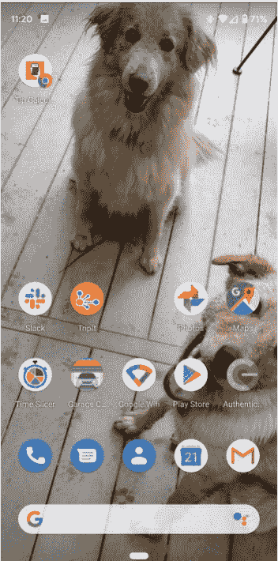

图 2.6 添加了主屏幕图标

> **注意**
>
> 小写的 `chrome` 一词用于描述浏览器中渲染的 Web 页面之外的 UI 元素（例如：菜单、地址输入框、边框、工具栏等），不应与 Google 的浏览器 Chrome 混淆。

这种方法的另一个问题是，“安装”应用是一个应用外的体验。用户必须与浏览器的菜单系统交互来保存应用以便稍后访问。PWA 通过 Web 应用清单文件（manifest）解决了这个问题以及其他问题。

## 让 Web 应用变得可安装

好了，我告诉你，在你的 Web 应用中添加 Web 应用清单文件可以使应用变得可安装；在本章的剩余部分中，我将向你展示方法。

Web 应用清单¹ 是由世界维网联盟（W3C）发布的一个不断演变的规范。该规范定义了一个基于 JSON 的清单文件，为开发者提供了一个存放 Web 应用元数据的集中位置。它描述了当清单链接到 Web 应用时，用户代理程序（浏览器）应该如何操作。由于 Google 在 Chrome 上对 Web 清单的支持最充分：

> **注意**
>
> 并非所有现代浏览器都支持 Web 应用清单；事实上，正如我告诉你的那样，这种支持相当糟糕。例如，尽管 Safari 浏览器对 iOS 和 macOS 用户非常流行，但 Apple 尚未对 PWA 提供完全支持；其 Safari 浏览器支持清单文件，但不支持在设备上安装 PWA 的事件。
>
> 好消息是浏览器开发者经常更新他们的产品，所以你喜欢的浏览器应该会有支持。判断你的应用目标是否支持该技术的最佳方法是检查 Can I use 网站³。通常，我会包含一张结果的截图，但这里的情况变化太快了，这样做将浪费时间。

对于 PWA，我们讨论的元数据是清单文件中的属性，这些属性定义了应用在安装时的外观（基本上只是应用图标和标题）、运行时的状态（启动页、浏览器 `chrome` 选项等），以及用户点击或触摸图标时浏览器如何启动和运行应用。

稍后我们会讨论该文件的特定格式，但首先让我们谈谈浏览器如何判断一个应用是可安装的。浏览器判断 Web 应用是否可安装的标准取决于浏览器。以 Google 的 Chrome 浏览器为例，它看起来像这样：

- 尚未安装在本地系统上。
- 符合用户参与启发式算法；基本上，用户看起来对该应用感兴趣。
- 包含一个 Web 清单，定义了一组最小属性（`short_name` 和/或 `name`、图标必须引用 192 和 512 像素的图标、`start_url` 以及 `fullscreen`、`standalone` 或 `minimal-ui` 的 `display` 属性）。你稍将了解更多这些属性。
- 通过 HTTPS（或用于测试的 localhost）服务。
- 具有带有 `fetch` 处理程序的注册 `service worker`。

1. `https://www.w3.org/TR/appmanifest/`
2. `https://developers.google.com/web/fundamentals/web-app-manifest/`
3. `https://caniuse.com/#feat-web-app-manifest`

## Web 清单的结构

要让你的 Web 应用可以使用 Web 清单，你必须在 Web 应用的 `index.html` 文件的 `<head>` 部分添加它的链接引用：

```html
<link rel="manifest" href="app.webmanifest">
```

在这个示例中，链接引用指向位于 Web 应用根目录下的 `app.webmanifest` 文件。对于章节的示例项目，`<head>` 部分如下：

```html
<head>
  <meta charset="utf-8">
  <title>小费计算器</title>
  <meta name="description" content="简单的小费计算器应用">
  <meta name="viewport" content="width=device-width, initial-scale=1">
  <link rel="manifest" href="app.webmanifest">
</head>
```

现在我已经展示了浏览器如何使用清单以及如何链接到应用中，让我们谈谈清单文件中包含的内容。

## Web 应用清单的结构

Web 应用清单是一个 JavaScript 对象表示法（JSON）文件。该文件没有特定的名称或扩展名；重要的是它包含一个如列表 2.1 所示具有特定属性的 JSON 对象。在早期，开发者通常将其命名为 `manifest.json`，但现在的习惯是使用带有 `.webmanifest` 扩展的文件。我们稍后将使用列表 2.2 所示的文件，但现在我们将其作为简单 `.webmanifest` 文件的示例。

### 列表 2.1 示例 Web 应用清单文件

```json
{
  "short_name": "TipCalc",
  "name": "Tip Calculator",
  "icons": [
    {
      "src": "icons/android-icon-192x192.png",
      "sizes": "192x192",
      "type": "image/png"
    },
    {
      "src": "icons/android-icon-512x512.png",
      "sizes": "512x512",
      "type": "image/png"
    }
  ],
  "start_url": "/index.html",
  "display": "standalone",
  "background_color": "#ffffff",
  "theme_color": "#303f93"
}
```

20 第 2 章 Web 应用清单文件

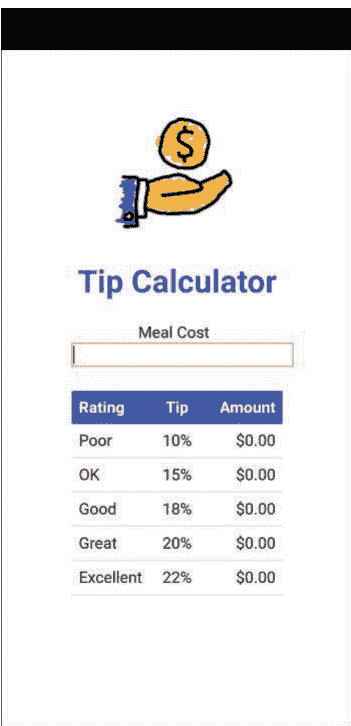

图 2.7 全屏显示模式下的小费计算器应用

### standalone 显示模式 (独立模式)

当 `display` 设置为 `standalone` 时，安装的 Web 应用打开时不会带有任何浏览器 UI（外壳），但不会占据整个屏幕。相反，设备将像显示原生应用一样显示该应用。在 Android 上，它不会隐藏设备状态栏（如图 2.8 所示），但可能会根据浏览器显示其他 UI 元素。

如果浏览器不支持 `standalone` 模式，它将回退到 `minimal-ui` 模式。

## Web 应用清单文件结构解析

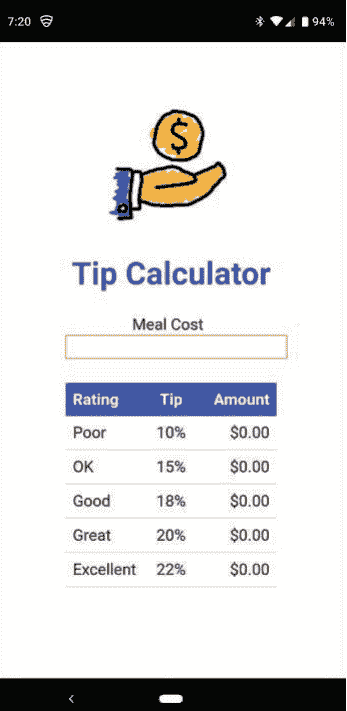

图 2.8 独立显示模式下的小费计算器应用

### minimal-ui 显示模式 (最小化 UI 模式)

当 `display` 设置为 `minimal-ui` 时，安装的 Web 应用打开时带有浏览器窗口默认 UI 的子集，如图 2.9 所示。在这个示例中，Android Chrome 浏览器显示了地址栏，但不显示任何其他导航元素（例如前进和后退按钮）。请忘记，是浏览器开发者而不是 W3C 决定在此种模式下显示什么种 UI。

如果浏览器不支持 `minimal-ui` 模式，它将回退到浏览器模式。

### Display Mode (显示模式)

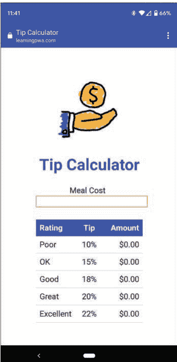

当 `display` 设置为 `browser` 时，安装的 Web 应用将使用设备打开超链接（URL）的标准方式打开，这基本上意味着使用默认浏览器应用打开一个新窗口（或标签页），如图 2.10 所示。

请记住，可安装的 PWA 不支持浏览器显示模式，因此图显示的是将应用保存到主屏幕后的结果，而不是通过应用内安装过程安装的。。

浏览器显示模式没有回退模式；所有符合规范的浏览器都支持 `browser`。

## Web 应用清单文件结构解析

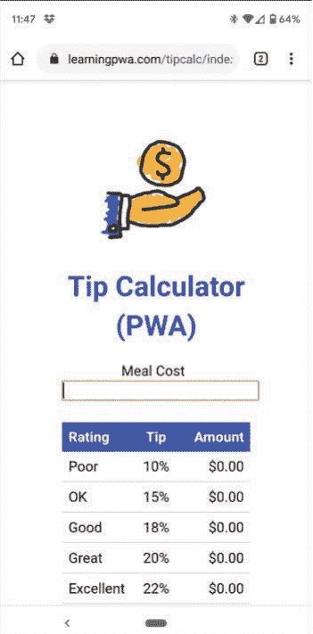

图 2.10 浏览器显示模式下的计算器应用

## 设置安装应用的启动 URL

浏览器使用 `start_url` 来定义启动应用的 URL。在规范中，使用它只是一个建议，因此浏览器可能会忽略它。在如何为你的 PWA 使用此属性方面有很大的灵活性；你如何配置它取决于你的应用是如何编写和服务的。

一些示例展示了如如下的 `start_url` 的设置：

```
"start_url": ".",
```

在这种情况下，它指示浏览器打开 Web 应用的根目录。其他示例建议使用以下内容：

```
"start_url": "./",
```

这本质上是相同的，但应用 Unix 约定来指定当前文件夹。

其他示例显示了如下操作：

```
"start_url": "/utm_source=homescreen",
```

或者这个：

```
"start_url": "?source=pwa",
```

这些示例对 URL 上的查询参数，允许应用区分应用是直接通过浏览器从托管站点加载，还是作为安装的 PWA 加载。例如，使用 `https://myapp.com` 从服务器加载应用，如果查询字符串不包含该参数，则应用现在直接来自在浏览器中输入或点击的 URL。当用户启动 PWA 版本时，额外的查询字符串参数告诉应用它是一个 PWA，然后如果它想，就可以执行不同的操作。

查询字符串参数不需要是任何特殊的；如果你愿意，可以使用 `/pwa=1` 或 `/pwa=99`。这取决于你；你可以更改页面内容来显示它是一个 PWA（例如更改背景颜色或在第一个标题中改为“PWA”）。

稍后，当我们为小费计算器应用添加 Web 清单时，我将让你安装一个本地 Web 服务器用于测试。该服务器没有允许你为服务器设置参数，因此我将 `start_url` 的值改为：

```
"start_url": "index.html?source=pwa",
```

这强制浏览器打开文件夹的 `index.html` 文件，并使我的 PWA 能够在各种环境中正确安装。

在网站上，我的小费计算器应用从网站的子目录 `https://learningpwa.com/tipcalc/` 服务，所以我必须不同的处理。对于我的托管环境，我需要按照以下内容配置清单文件：

```
"start_url": "/tipcalc/index.html?source=pwa",
"scope": "/tipcalc/",
```

在这个示例中，我必须指定我的应用的目标文件夹并添加指向相同文件夹的 `scope`。 如果没有 `scope` 参数，应用将安装，但当我启动它时，将显示托管站点的 404（未找到）错误页面。

## Web 应用清单结构解析

### 警告

如果 Web 应用包含 `scope` 之外的资源，浏览器将在新窗口中打开它们。为了避免这种情况，请在任何 `<a>` 标签中使用 `target="_blank"` 属性。

```html
<a href="https://learningpwa.com" target="_blank">Learning PWA</a>
```

## 应用选项

到为止我展示的所有都是应用所需的清单选项。在本节中，我将涵盖其他有用的选项。

启动 PWA 时，浏览器使用图标和标题（由 `name` 或 `short_name` 属性定义）构建简单的启动屏。背景默认为白色，但如果你的应用使用不同的颜色，启动屏到应用的过渡可能会很兀。为了改进用户体验，请使用 `background_color` 属性。

在新费计算器应用中，我将背景设置为白色：

```
"background_color": "FFFFFF"
```

## 附加选项

完整的属性列表位于 `https://www.w3.org/TR/appmanifest` 规范中。还有几个我想让你注意的。查看有关清单文件中使用的其他事项的规范。

在 Google Chrome 等兼容浏览器中，清单的 `theme_color` 属性是一个提示，告诉浏览器使用什么颜色来设置安装的应用（例如地址栏样式）。对于小费计算器应用，我将主题颜色设置为应用图标中的蓝色：

```
"theme_color": "#3653b3"
```

你还可以为安装的应用强制方向：

```
"orientation": "landscape",
```

## 2 章 Web 应用清单文件

可用选项定义在 `https://www.w3.org/TR/screen-orientation/#screenorientation-interface` 中的 `OrientationLock` 中，包括 `any`、`landscape`、`portrait` 以及许多其他。该属性的一个实际示例是为获得最佳用户体验而必须以横屏模式运行的游戏应用。

## 控制安装体验

好了，我们在本章中花了大量时间讨论清单文件以及你如何使用它来描述应用安装为 PWA 时的外观和工作。在本节中，我将涵盖通过浏览器暴露的功能，这些功能允许开发者控制安装过程。

如果你将清单文件添加到小费计算器的 `index.html` 文件中，并且应用符合早些在“使 Web 应用可安装”中描述的其他安装标准，当你在 Chrome 浏览器中加载应用时，浏览器将显示图 2.11 所示的安装提示。

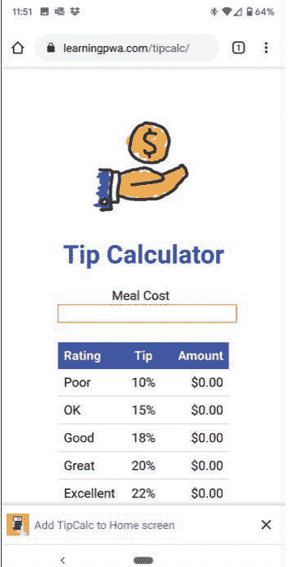

图 2.11 Chrome 应用安装横幅

## 准备代码 27

这是浏览器的辅助功能，向用户展示他们可以将此应用添加到设备的桌面上。Firefox 的做法略有不同，会在地址栏中显示徽章，如图 2.12 所示。

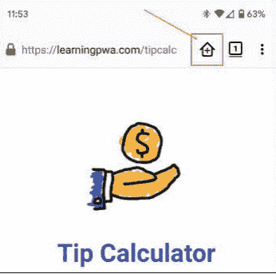

图 2.12 Firefox 应用安装徽章

> **注意**
>
> 你可能在奇怪为什么到目前为止没有看到很多 iOS 的截图。那是因为我编写该应用时，Apple 的 Safari 浏览器还不支持使用本章讨论的机制安装 PWA。当你读到这一部分时，Safari 可能已经支持安装 PWA；如果支持，安装 PWA 的方式应该与 Android 上一样。
>
> 我没有展示 iOS 示例是因为 iOS 也不支持安装 PWA（无论你使用哪种浏览器）。你甚至无法在 iOS 上的 Chrome 上为主页添加图标。这是一个非常糟糕的状况，我希望它会随着时间的推移而好转。

如果你想控制这一点呢？如果你想在应用内部显示安装提示，或者仅在用户登录应用或完成某些初始配置后才提供安装呢？嗯，浏览器暴露了允许你做到这些的功能。

在浏览器显示安装横幅之前，它会触发安装提示。监听该提示的 Web 事件可以以任何想要的方式管理该过程。稍后在我们让小费计算器应用变为可安装时我会我会如何这样做。

## 准备代码

在我们开始修改代码使小费计算器变为可安装之前，你必须安装一些在后续过程中使用的软件依赖。谁知道呢，你可能已经安装了它们（你应该已经有了）。

### Node.JS

为了测试小费计算器应用的 PWA 功能，你必须通过 Web 服务器运行应用，因此稍后我将让你安装一个基于 node 的 Web 服务器。如果你的开发工作站已经安装了 Node.js，请跳到下一段。如果没有，请访问 `https://nodejs.org/en/` 并按照说明在你的开发工作站上安装客户端。

要确认你已安装了 Node.js，请打开一个新的终端窗口并执行以下命令：

```bash
node -v
```

如果终端返回了版本号（我的显示的是 v10.16.0），则 Node.js 安装正确。如果你看到错误消息，那么你需要在继续之前解决该错误。

为了在本地测试 Web 应用，我们将使用来自 `https://github.com/http-party/http-server` 的 HTTP Server 应用。该服务器基于 node 的，因此要安装它，请打开一个新的终端窗口并执行以下命令：

```bash
npm install http-server -g
```

安装完成后，执行 `http-server` 命令，系统应该返回类似以下的内容：

```text
Starting http-server, serving . /

Available on:

http://172.20.15.161:8080
http://172.28.224.1:8080
http://192.168.86.247:8080
http://192.168.60.1:8080
http://192.168.19.1:8080
http://127.0.0.1:8080
```

如果你看到了这些，说明没问题了。按下 `Ctrl-C` 杀死进程。如果不是，请查找任何错误消息并排查安装问题直到成功为止。

### Git 客户端

我在 GitHub 仓库 `https://github.com/johnwargo/learning-pwa-code` 中发布了本书的源代码。获取代码以及在我发布更改时更新代码的最简单方法是通过 Git。如果你的开发工作站已经安装了 Git，说明没问题了。如果没有，请访问 `https://git-scm.com/` 并按照说明在你的开发工作站上安装客户端。

要确认你已安装了 Git，请打开一个新的终端窗口并执行以下命令：

```bash
git --version
```

如果终端返回了版本号（我的显示 git version 2.22.0..windows 1），则 Git 安装正确。如果你看到错误消息，那么你需要在继续之前解决该错误。

安装好 Git 后，打开终端窗口或命令提示符，导航到你想存储书籍代码的文件夹，执行以下命令：

```bash
git clone https://github.com/jnhwago/learning-pwa-code
```

一旦进程完成，在终端中进入克隆的项目 `\learning-pwa-code\chapter-02\tip-calculator-start` 文件夹。该文件夹包含了小费计算器应用的非 PWA 版本，我们将在那里工作。

> **注意**
>
> 如果你想让这个版本的应用保持原始状态，请将项目的 `tip-calculator-start` 文件夹复制到不同的位置并在那里工作。

### Visual Studio Code

我使用 Visual Studio Code 作为大多数项目的主要代码编辑器；这并不是因为我为微软工作（我确实是），而是因为它是一个非常强大的编辑器，而且丰富的可用扩展使我能够通过一些非常酷的功能来配置编辑器环境，让编码变得更简单。如果你还没有尝试过，请访问 `https://visualstudio.com/` 并尝试一下。

正如之前解释的那样，可安装的应用必须注册 `service worker`，而 `service worker` 必须提供特定的功能。后续章节将详细讨论 `service worker`，所以现在我们只是使用项目中的一个示例。

# 应用安装实战

好了，我们花费了大量时间学习清单文件以及如何使用它们。在本节中，我们将对小费计算器应用的初始版本添加一些内容。在本节结束时，你将拥有该应用并能够进行测试。

> **注意**
>
> 我们只将在桌面上测试应用，因为在移动设备上访问更为复杂。要使应用可安装，的要求之一是通过 TLS 连接访问它。为了实现这一点，你的本地开发环境需要一个自定义域名。

## 添加 Service Worker

打开项目的 `index.html` 文件，并将以下代码添加到文件 `<head>` 部分的结尾：

```html
<script>
// 浏览器是否支持 service workers
if ('serviceWorker' in navigator) {
  // 注册我们的 service worker
  navigator.serviceWorker.register('./sw.js')
    .then(function (reg) {
      // 显示成功消息
      console.log(`Service Worker Registration (Scope: ${reg.scope})`);
    })
    .catch(function (error) {
      // 显示错误消息
      console.log(`Service Worker Error (${error})`);
    });
} else {
  // 当应用通过 TLS 连接 (HTTPS) 服务时
  console.warn('Service Worker not available');
}
</script>
```

> **Tip**
> 在示例代码以及书中剩余部分的代码中，我使用 JavaScript 的模板字符串根据运行应用的值来格式化控制台输出。请特别注意使用的引号：模板使用反引号（` `）字符，而而非模板代码使用单引号（'）。

这段代码检查浏览器是否支持 `service workers`，如果是则安装 `service worker`，如果不是则向控制台输出警告。`service worker` 位于名为 `sw.js` 的文件中；它并没有实际做什么——它只是为了帮助让应用变得可安装（可安装的要求之一）。

你可以将这段代码放在外部 JavaScript 文件中吗？可以。没有理由不把它放在 JavaScript 文件中。我在本书的后续章节中采用这种方法。

接下来，将该行添加到项目 `index.html` 文件的 `<head>` 部分：

```html
<link rel="manifest" href="app.webmanifest">
```

此代码将清单文件（我们尚尚未创建它）链接到 Web 应用程序。列表 2.2 显示了项目 `index.html` 文件的完整源代码。

### 列表 2.2 小费计算器 index.html 文件

```html
<!doctype html>
<html>
<head>
<meta charset="utf-8">
<title>Tip Calculator</title>
<meta name="description" content="width=device-width, initial-scale=1">
<link rel="viewport" content="app.webmanifest">
<!-- Favicon generated by -->
<link rel="image" href="https://thenounproject.com/search?q=348398&i=34839">
<link rel="apple-touch-icon" href="https://icons8.com/ios/57x57/apple-icon-57x57.png">
<link rel="apple-touch-icon" sizes="60x60" href="https://icons8.com/ios/60x60.png">
<link rel="apple-touch-icon" sizes="72x72" href="https://icons8.com/ios/72x72.png">
<link rel="apple-touch-icon" sizes="76x76" href="https://icons8.com/ios/apple-icon-76x76.png">
<link rel="apple-touch-icon" sizes="114x114" href="https://icons8.com/ios/apple-icon-114x114.png">
<link rel="apple-touch-icon" sizes="120x120" href="https://icons8.com/ios/apple-icon-120x120.png">
<link rel="apple-touch-icon" sizes="144x144" href="https://icons8.com/ios/apple-icon-144x144.png">
<link rel="apple-touch-icon" sizes="152x152" href="https://icons8.com/ios/apple-icon-152x152.png">
<link rel="apple-touch-icon" sizes="180x180" href="https://icons8.com/ios/apple-icon-180x180.png">
<link rel="icon" type="image/png" sizes="192x192" ref="icons/android-chrome-192x192.png">
<link rel="icon" type="image/png" sizes="32x32" href="favicon-32x32.png">
<link rel="icon" type="image/png" sizes="96x96" href="favicon-96x96.png">
<link rel="icon" type="image/png" sizes="16x16" href="favicon-16x16.png">
<meta name="application-title" content="#ffffff">
<meta name="application-titleImage" content="icons/ms-icon-144x144.png">
<meta name="theme-color" content="#ffffff">
<link rel="stylesheet" href="css/normalize.css">
<link rel="stylesheet" href="css/main.css">

<script>
  // 浏览器支持 service workers 吗？
  if ('serviceWorker' in navigator) {
    // 然后注册我们的 service worker
    navigator.serviceWorker.register('./sw.js')
    .then(function (reg) {
      // 显示一条成功消息
      console.log('Service Worker Registration: ' + reg.scope);
    })
    .catch(function (error) {
      // 显示一条错误消息
      console.log('Service Worker Error: ' + error);
    });
  } else {
    // 当应用未通过 TLS 连接 (HTTPS) 提供时，会发生这种情况
    console.warn('Service Worker not available');
  }
</script>
</head>
<body>
<div id="pageX"></div>
<h1 id="title">Tip Calculator</h1>
<div class="costArea">
<label for="mealCost">Meal Cost</label>
<input type="number" id="mealCost" min="0" value="" autofocus>
</div>
<table style="width:100%" cellspacing="0">
<tr>
<th class="rating">Rating</th>
<th class="tip">Tip</th>
<th class="amount">Amount</th>
</tr>
<tr>
<td class="rating">Poor</td>
<td class="tip">10%</td>
<td class="amount" id="tip10">$0.00</td>
</tr>
<tr>
<td class="rating">OK</td>
<td class="tip">15%</td>
<td class="amount" id="tip15">$0.00</td>
</tr>
<tr>
<td class="rating">Good</td>
<td class="tip">18%</td>
<td class="amount" id="tip18">$0.00</td>
</tr>
<tr>
<td class="rating">Great</td>
<td class="tip">20%</td>
<td class="amount" id="tip20">$0.00</td>
</tr>
<tr>
<td class="rating">Excellent</td>
<td class="tip">22%</td>
<td class="amount" id="tip22">$0.00</td>
</tr>
</table>
<script src="js/main.js"></script>
</body>
</html>
```

## 第2 章 Web 应用清单文件

应用的 Web 清单文件告诉浏览器如何安装和运行应用。我们还没有它，请在与 `index.html` 文件相同的目录下创建一个 `app.webmanifest` 文件。使用列表 2.1 中的 JSON 代码填充新文件。

## 添加 Web 清单文件

## 运行 Web 清单文件

在进行高级操作之前，在浏览器中打开它以确保配置正确。打开终端，进入该目录并执行：

```bash
http-server
```

服务器应该报告如下内容：

```text
Starting server on http://127.0.0.1:8080
Available on:
http://127.0.0.1:8080
http://192.168.1.15:8080
http://192.168.1.16:8080
```

按下 `CTRL-C` 停止服务器。

由于安全考虑，我将在第 3 章解释为什么如果不通过 HTTPS 访问，浏览器将不允许你安装应用。

## 创建物理设备上测试应用的环境

如果你将移动设备浏览器指向 Android 设备（iOS 尚不支持安装 PWA），将出现安装横幅，你可以安装应用。


## 增强安装过程

好了，记住我们想要能够控制这一过程，因此我们将对应用进行一些更改。打开项目的 `index.html` 文件，并在 `<body>` 部分的顶部（即 `pageX` `div` 之上）添加以下代码：

```html
<div id='installButton'>
  <button id='installButton'>Install</button>
</div>
```

## 第 2 章 Web App Manifest 文件

> **注意**
>
> 文档的样式已经包含在应用程序的 `main.css` 文件中。按钮默认是隐藏的，因此在在我们想要显示它之前，它不会出现。

这添加了一个用户可以触摸或点击来安装应用程序的按钮。

打开项目的 `/js/main.js` 文件。在文件末尾添加以下代码：

```javascript
// get a handle to the install button
let installButton = document.getElementById('installButton');
// now set the click handler for the install button
installButton.onclick = doInstall;
```

这创建了一个 `installButton` 变量，指向安装页面的元素（我们稍后需要它在安装后隐藏按钮），并为按钮添加了点击事件处理器。

现在，让我们开始处理安装过程，所有的操作都围绕着描述过的 `beforeInstallPrompt` 事件。在文件末尾添加以下代码：

```javascript
// 创建一个对象用于存储对 PWA 的引用
// 安装事件
let deferredPrompt;

// 添加事件监听器来响应该事件。
// 在浏览器安装 PWA 之前，它会触发
// beforeinstallprompt 事件。在这里，我们将
// 自己管理安装
window.addEventListener('beforeinstallprompt', (event) => {
  // 我们不允许浏览器现在执行此安装，我们希望
  // 在用户点击我们的安装按钮时执行
  event.preventDefault();
  // 存储事件对象以便我们稍后可以使用它（当
  // 点击安装按钮时）
  deferredPrompt = event;
  // 现在显示安装按钮，让用户可以点击！
  installButton.style.display = 'block';
});
```

这段代码创建了 `deferredPrompt` 对象，我们稍将用它来捕获由 `beforeinstallprompt` 事件创建的对象。稍后你会看到为什么这很重要。

接下来，它创建了 `beforeinstallprompt` 事件。监听器第一件事是调用 `event.preventDefault()`，这告诉浏览器不要担心安装应用程序，并且应该抑制图 2.11 所示的安装横幅。这种抑制功能目前在桌面版 Chrome 中可用，但尚未进入 Android 版 Chrome，但在你读这本书时应该已经有了。

接下来，代码将传递给监听器的事件存储在之前创建的 `deferredPrompt` 对象中。我们将使用该对象上的方法来实际安装应用程序。

## 实际应用安装

最后，代码将按钮的显示样式设置为 block，取消页面上按钮的隐藏，让用户现在可以看到它。设置完成后，我们需要执行安装的代码。在我们刚刚添加到项目 `js/main.js` 文件的 `beforeinstallprompt` 事件监听器中添加以下函数：

```javascript
function doInstall() {
  // 我们点击了按钮，隐藏它
  installButton.style.display = 'none';
  // 执行延迟的安装提示
  deferredPrompt.prompt();
  // 等待延迟提示的响应
  deferredPrompt.userChoice.then((res) => {
    // 用户是否批准了安装？
    if (res.outcome === 'accepted') {
      console.log('doInstall: accepted');
    } else {
      console.log('doInstall: declined');
    }
    // 清除延迟提示对象，以便我们
    // 只能执行一次
    deferredPrompt = null;
  });
}
```

正如注释所述，这段代码（不需要安装两次应用程序）：

- 隐藏安装按钮。
- 调用 `deferredPrompt` 对象上的 `prompt` 方法；我们专门为此捕获了该对象，以便调用其 `prompt` 方法来提示用户安装应用程序。
- 等待用户决定是否安装应用程序。
- 一旦用户决定如何操作，会将结果记录到控制台并清除 `deferredPrompt` 对象，不再再次使用。

当浏览器触发 `beforeinstallprompt` 事件时，它会传递一个对象，应用程序稍后用它提示用户安装应用程序。这段代码只是延迟了安装，并通过安装按钮将其交给应用程序处理。

在终端中，按 `Ctrl-C` 杀死服务器，然后执行 `http-server` 命令（将修改后的代码重新加载到服务器）。刷新浏览器中的 Tip Tip 页面，你应该能看到安装按钮出现。记住，浏览器在应用程序遇到用户交互启发式时才会显示安装提示，这意味着可能需要一段时间才会显示。使用它在本地安装应用程序，然后关闭浏览器并使用安装的快捷方式查看它是如何运行的。

某些操作系统会将应用程序安装在桌面（Windows），而另一些将应用程序安装在浏览器的应用程序区域。在我 Windows 上的测试中，Chrome 在 `chrome://apps` 以及桌面都会安装 PWA。图 2.14 显示了带有安装的 Tip 计算器程序的 Chrome 页面。

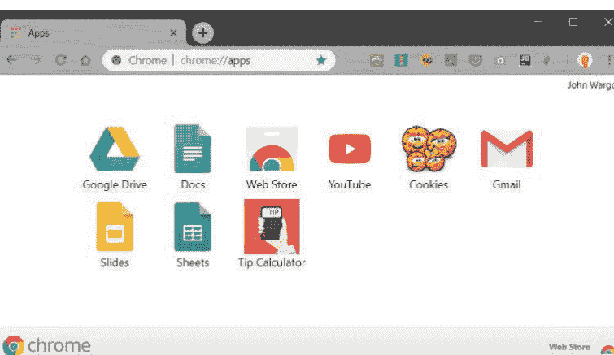

图 2.14 Chrome 应用程序页面

从应用程序页面删除 PWA（右键点击并选择“从 Chrome 中移除...”，如图 2.15 所示）也会从桌面删除它。微软的新版 Edge 浏览器（基于 Chromium）会将应用程序安装在应用程序区域，但不会安装在桌面。


图 2.15 删除 PWA

## 故障排除 41

```javascript
// add an event listener to respond to the event. right
// before the browser installs the PWA, it fires
// beforeinstallprompt event. here, we'll manage
// installation ourselves
window.addEventListener('beforeinstallprompt', (event) => {
  // don't allow the browser to do install it, we want to do
  // when the user taps our install button
  event.preventDefault();
  // stash the event object so we can use it later (when the
  // user taps the install button)
  deferredPrompt = event;
  // now update the install button so the user can tap it!
  installButton.style.display = 'block';
});

// register an event listener for the app installs
window.addEventListener('appinstalled', (event) => {
  console.log('App Installed');
});
```

> **提示**
>
> 注意源代码列表顶部带有 `@ts-check` 的注释。记得我提到过 Visual Studio Code 添加了一个特殊功能，让我能够编写更好的代码吗？在 `.js` 文件中，Visual Studio Code 会会在我输入时将 TypeScript 编译器应用于代码，实时查找错误——即使我编辑的是 JavaScript 文件而不是 TypeScript 文件。这意味着我可以在不为应用使用 TypeScript 的情况下获得 TypeScript 的好处。你可以在此处阅读更多关于该功能的信息：`https://code.visualstudio.com/docs/njs/working-with-javascript#type-check-javascript`

# 故障排除

浏览器不会在处理 PWA 安装时通知你。基本上，它要么能工作，要么不能工作，而弹出的警告和错误会困惑用户。因此，考虑到这一点，在应用中添加清单（manifest）和服务程序工作线程（service worker）使其变得可安装，要么成功，要么失败。

你可以采取一些事情来调试此过程。最简单的方法之一是在代码中设置断点，并通过开发者工具观察整个过程。我也非常喜欢在代码中使用 `console.log()`，这样我就可以通过控制台运行它。

大多数浏览器都提供理解清单文件和服务工作线程的开发者工具。2.16 显示了 Chrome 开发者工具中的应用清单。当一个应用链接到清单文件时，关于清单的信息会出现在此面板中。当浏览器解析清单时遇到错误，或者清单不满足使应用可安装的最低要求时，它将显示类似图中所示错误消息。在这种情况下，我错误地配置了 `scope` 属性，并且我的服务工作线程存在错误，这让我非常头疼。

# 第 2 章 Web 应用清单文件

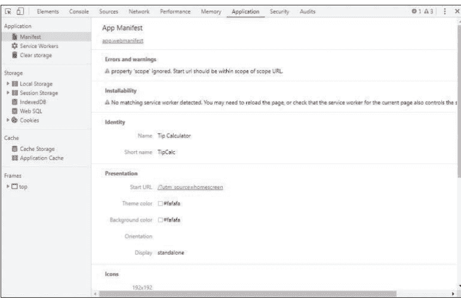

## 清单生成等

尽管 Apple 在 iOS 或 Safari 上尚未完全支持，但 PWA 已经存在了一段时间，因此有很多很好的工具可以让你的生活更轻松。我在第 8 章“评估、自动化和部署”中介绍了一些工具，但这里有一份在线免费工具列表，可以帮助为你的 PWA 配置 Web清单：

- PWA Builder: `https://www.pwabuilder.com`
- Web App Manifest Generator: `https://app-manifest.firebaseapp.com`
- （另一个）Web App Manifest Generator: `https://tomitm.github.io/appmanifest`
- PWA Firefox: `https://pwafire.io/developer/tools/get-manifest`

Google 还发布了 pcompat 库⁸，它为不兼容的浏览器带来了 Web 应用清单支持，从而在旧浏览器上实现了类似 PWA 的体验。

## 总结

在本章中，我为你展示了如何向 Web 应用添加清单文件以使其在兼容的浏览器上安装。在下一章及后续章节中，我们将深入研究使用服务工作线程可以的所有酷炫功能。

- 8. `https://github.com/GoogleChromeLabs/pwacmp`

# 第 3 章 服务工作线程 (Service Workers)

如果说构建渐式 Web 应用 (PWAs) 就像盖房子，那么 Web 应用清单文件就像一个房地产经纪，致力于让人对你的房子产生兴趣并进行准备，以便买家即可入住。相比之下，服务工作线程是在后台工作的住工，确保房屋有坚实的基础，并在买家搬入后所有墙壁依然存在。

本章介绍了服务工作线程，并展示了如何使用它们在你的 Web 应用中启用后台处理。在这里，我们建立了服务工作线程的作用及其实现方式的基础，从简单的应用资源缓存和服务工作线程生命周期开始。在后续章节中，我将展示如何为应用的服务工作线程添加额外功能，为应用增添活力。

## PWA 新

在本章及接下来的几章中，你将使用图 3.1 所示的 PWA News Web 应用。该应用在 `https://pwa-news.com` 公开，但在学习章节期间，你将在本地服务器上运行应用版本。我想特别感谢我的朋友 Scott Good，他创建了应用 UI，并通过精湛的样式处理制作了你在应用中看到的文章。

该应用是一个简单的新闻网站，汇总了来自世界各地关于 PWA 的文章。它的服务器使用 Microsoft Bing Search API 查找带有关键词 PWA 的文章并显示前 20 个结果。应用托管了一个简单的“关于”页面来介绍该网站（并推广书籍），以及一个渲染人们对该网站感受数据的“反馈”页面。在本章中，我向你展示了如何向 Web 应用添加清单文件使其在兼容的浏览器上安装。在下一章及后续章节中，我们将深入研究服务工作线程可以的所有酷炫功能。

- 8. `https://github.com/GoogleChromeLabs/pwacmp`

# PWA News

开发者使用它是因为许多浏览器都内置了 AppCache 支持，但很少有开发者对其感到满意。尽管如此，编写自己的缓存实现也是有问题的，出于性能的考虑，它必须在独立的线程中运行，而这在 Web 应用中也具有挑战性。

在第 4 章“资源缓存”中描述的 `CacheStorage API` 是社区修复 AppCache 的尝试，它是让如今 PWA 变得有趣且实用的关键技术之一。对我骗了你感到抱歉，但希望现在你明白我为什么要这么做了。

当然，`Service Worker`（服务工作）也有局限性：

- 除非浏览器打开，否则 `Service Worker` 不运行。Web 应用不需要打开，但浏览器必须打开。
- `Service Worker` 无法访问 应用的文档对象模型（DOM），但我们将在第 7 章中讨论这里的解决方法。

取决于浏览器和操作系统（OS），第一个限制可能是大问题。在许多移动设备上，浏览器始终运行，因此它在那里运行 `Service Worker`。在桌面系统上，浏览器也会后台运行，或者可以配置为运行。Chrome 暴露了一个高级设置：如图 3.2 所示的“在 Google Chrome 关闭时继续运行后台应用”。

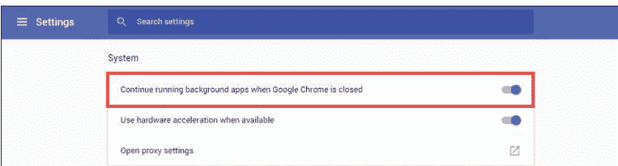

图 3.2 Chrome 高级设置

在本章剩下的内容中，我将向你展示更多 `Service Worker` 可以做什么以及如何实现。

## 准备编码

在本章的剩余部分中，你将从 PWA News 网站的基础版本开始，并为其添加一个 `Service Worker`。然后我们将调整和调优该 `Service Worker` 以演示其功能。在我们在此之前，你必须使用所需的组件配置你的本地开发环境。

- `https://developer.mozilla.org/en-US/docs/Web/API/CacheStorage`

## 先决条件

在我们开始修改代码以增强 PWA News 应用之前，你必须安装一些在跟随过程中会用到的软件前提。谁知道呢，你可能已经安装了（你应该已经安装了）。此设置与之前的章节不同，在确保你准备好所需的一切之前，请不要跳读。

### Node.js

我使用 Node.js 和 Express（一个用于 Node.js 的 Web 框架）构建了 PWA News 网站。它托管了静态 PWA News 网站以及 Web 应用使用的应用程序编程接口（API）。如果你的开发工作站已经安装了 Node.js，请跳到下一个应用。如果没有，请访问 `https://nodejs.org` 并按照说明在你的开发工作站上安装客户端。

要确认你已安装了 Node.js，请打开一个新的终端窗口并执行以下命令：

```bash
node -v
```

如果终端返回版本号（我的版本是 v10.16.0），则说明 Node.js 已正确安装。如果你看到错误消息，那么在继续之前你需要做一些工作来解决该错误。

### TypeScript

安装 Node.js 后，现在是安装 TypeScript 编译器的时间了。在终端窗口中执行以下命令：

```bash
npm install -g typescript
```

这会安装 `tsc` 命令，你将在书的剩余部分中多次使用该命令，将 Web 服务器应用的的 TypeScript 代码编译为 JavaScript。

### Git 客户端

我在 GitHub 存储库 `https://github.com/johnwargo/learning-pwa-code` 中发布了本书的源代码。获取代码以及在我发布更改时更新本地副本的简单方法是通过 Git。如果你的开发工作站已经安装了 Git，那么就没问题。如果没有，请访问 `https://git-scm.com` 并按照说明在你的开发工作站上安装客户端。

要确认你已安装了 Git，请打开一个新的终端窗口并执行以下命令：

```bash
git --version
```

如果终端返回版本号（我的版本是 git version 2.22.0.windows 1），则说明 Git 已正确安装。如果你看到错误消息，那么在继续之前你需要做一些工作来解决该错误。

48 第3 章 Service Workers

安装 Git 后，打开终端窗口或命令提示符，导航到你想存储书籍代码的文件夹，然后执行命令：

```bash
git clone https://github.com/johnwargo/learning-pwa-code
```

一旦克隆过程完成，请在终端中进入克隆项目的 `\learning-pwa-code\chapter-03\` 文件夹。该文件夹包含 PWA News 服务器应用，我们将在那里工作。

既然在这里了，我们可能很好安装应用所有的依赖项。在指向项目文件夹（`\learning-pwa-code\chapter-03\`）的终端窗口中，执行以下命令：

```bash
npm install
```

此命令使用 Node 包管理器（npm）按服务器安装 Node.js 模块。

### Visual Studio Code

我使用 Studio Code 作为我大多数项目的主要编辑器；这并不是因为我为微软工作（我不是），因为它是一个非常强大的编辑器，而且丰富的可用扩展目录使我能够配置编辑器环境，具备一些非常棒的编码功能。如果你还没有尝试过，请访问 `https://visualstudio.com/`。

## 导航应用

应用的文件夹结构如图 3.3 所示

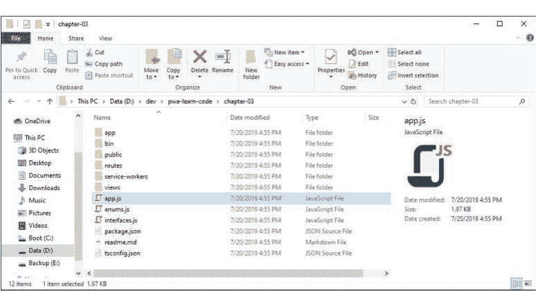

图 3.3 导航应用

## 准备编码

应用的文件夹结构如图 3.3 所示


图 3.3 导航应用

## 配置服务器

应用的文件夹结构如图 3.3 所示


图 3.3 导航应用

## 配置服务器

应用的文件夹结构如图 3.3 所示


图 3.3 导航应用

## 注意事项

Microsoft Azure 提供了一个你在学习本章时可以使用强大免费层级。免费层级为客户提供每秒三次交易（每月 3000 次），因此在测试此应用时，你不可能超出免费额度。为了进一步帮助，我编写了服务器应用来限制连接 Bing 的频率。默认情况下，它每 15 分钟检查一次，无论客户端访问多频繁。如果你做一下算术，你会发现服务器永远无法超过那个免费限制。

当你到达图 3.4 所示的页面时，点击 KEY 1 或 KEY 2 最右侧的复制图标将选定的密钥复制到剪贴板。你在下一步步骤中需要其中一个密钥。

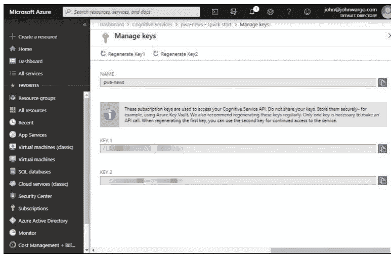

图 3.4 Azure 门户

例如，你将把

```
BING_ACCESS_KEY: ''
```

改为类似所示的内容：

```
BING_ACCESS_KEY: 'your-super-secret-api-key'
```

保存文件，然后打开终端窗口，导航到项目根文件夹（如图 3.3 所示），并执行以下命令：

```bash
tsc
```

此步骤将调用 TypeScript 编译器将 `.ts` 文件编译为根文件夹下的一个新 `config.js` 文件（图 3.3 未显示）。完成这一步后，你就可以开始启动服务器进程并与应用进行交互了。

在后续章节中阅读代码时，你需要这个相同的 `config.js` 文件，因此我包含了一个批处理文件和 shell 脚本来自动将编译后的文件复制到其他项目文件夹。如果你的开发系统运行 Windows 上，在指向 `\learning-pwa-code\03\` 的终端窗口中，执行以下命令：

```bash
copy-config.cmd
```

如果你的开发系统运行 macOS 上，在指向 `\learning-pwa-code\03\` 的终端窗口中，执行以下命令：

```bash
./copy-config.sh
```

在任一过程结束时，你应该能看到在每个使用 PWA News 应用的章节文件夹中，`config.js` 文件都被复制到了项目根文件夹中。

# 启动服务器

所有部分都就绪后，是时候启动服务器了。如果你还没有打开项目文件夹的终端窗口，请打开一个并导航到 `\learning-pwa-code\chapter-03\` 文件夹。完成后，执行以下命令：

```bash
npm start
```

如果代码中的一切设置得当，服务器将在终端中响应以下文本：

```text
pwa-news-server@0.0.1 start D:\learning-pwa-code\chapter-03
node ./bin/www
```

此时，你已经准备就绪——服务器已启动运行并准备好提供内容了。如果你看到错误消息，你必须深入研究任何报告的错误并在解决它们之前才能继续。

要查看当前状态下的 Web 应用，请打开 Google Chrome 或支持 `service workers` 的浏览器之一，并导航到

```
http://localhost:3000
```

稍等片，服务器应该会渲染出如图 3.1 所示的应用。当你查看终端窗口时，你应该能看到服务器进程，然后是它提供应用不同部分时的日志消息，所示：

```text
> pwa-news-server@0.0.1 start D:\pwa-code\chapter-03
> node . /bin/www

2019-07-27T22:25.25042Z GET / 304 8.365 ms -
2019-07-27T22:25.0752Z GET /css/custom.css 304 2.004 ms -
2019-07-27T22:25.0792Z GET /img/bimg-logo.png 304 0.935 ms -
2019-07-27T22:25.1042Z GET /js/sw-reg.js 304 0.746 ms -
2019-07-27T22:25.1142Z GET /js/utils.js 304 0.756 ms -
2019-07-27T22:25.1152Z GET /js/index.js 304 0.731 ms -
Router: /api/news
2019-07-27T22:26.3762Z GET /sw-js.4 app 304 1132.92 ms - 565
2019-07-27T22:26.3812Z GET /api.webmanifest 304 1.766 ms -
2019-07-27T22:26.4202Z GET /icons/android-icon-192x192.png 204 20.681 ms - 565
Returning result (1)
2019-07-27T22:26.2782Z GET /api/news 200 1645.317 ms - 12222
```

服务器在端口 3000 上托管应用（端口号是示例中最后一个冒号后的数字值），但如果你的系统有另一个进程在监听该端口，那么它将无法工作。要更改应用中使用的端口号，请打开项目的 `bin/www` 文件并查找以下行：

```javascript
var port = normalizePort(process.env.PORT || '3000');
```

将 `'3000'` 改为另一个端口（最好是可用的端口），保存你的更改，重启服务器并在新站点启动服务。如果你愿意，也可以使用本地环境变量来设置端口。

## 注册 Service Worker

Web 应用遵循特定的流程来安装 `service worker`；目前还没有自动的方法可以实现这一点。应用基本上是执行一些 JavaScript 代码来向浏览器注册 `service worker`。在第 1 章“介绍渐进式应用”的计算费计算器中，我已经在项目的 `index.html` 文件中添加了执行此操作。对于 PWA News 应用，我们使用了不同的方法。

在本节中，你将修改项目现有的 `public/index.html` 并添加两个文件：`public/sw-reg.js` 和 `public/sw.js`。在项目 `public/index.html` 文件的 `<head>` 部分，添加以下代码：

```html
<!-- Register the service worker -->
<script src='js/sw-reg.js'></script>
```

这告诉 Web 应用加载一个 JavaScript 文件来为我们注册 `service worker`。接下来，让我们创建一个新文件 `public/sw-reg.js` 并用列表 3.2 所示的代码填充它。

### 列表 3.2 PWA News sw-reg.js 文件

```javascript
// 浏览器是否支持 service workers？
if ('serviceWorker' in navigator) {
  // 那么注册 service worker
  navigator.serviceWorker.register('/sw.js')
  .then(reg => {
    // 显示成功消息
    console.log('Service Worker Registration (Scope: ${reg.scope})');
  })
  .catch(error => {
    // 显示错误消息
    let msg = 'Service Worker Error (${error})';
    console.error(error);
    // 显示警告对话框（使用 Alert 2）
    Swal.fire(msg, 'error');
  });
} else {
  // 发生在应用未通过 TLS 连接（HTTPS）提供时
  // 或者如果浏览器不支持 service workers
  console.warn('Service Worker not available');
}
```

这里的代码


# 启动服务器

所有部分都就绪后，是时候启动服务器了。如果你还没有打开项目文件夹的终端窗口，请打开一个并导航到 `\learning-pwa-code\chapter-03\` 文件夹。完成后，执行以下命令：

```
npm start
```

如果代码中的一切设置得当，服务器将在终端中响应以下文本：

```
pwa-news-server@0.0.1 start D:\learning-pwa-code\chapter-03
node ./bin/www
```

此时，你已经准备就绪——服务器已启动运行并准备好提供内容了。如果你看到错误消息，你必须深入研究任何报告的错误并在解决它们之前才能继续。

要查看当前状态下的 Web 应用，请打开 Google Chrome 或支持 service workers 的浏览器之一，并导航到

```
http://localhost:3000
```

稍等片刻，服务器应该会渲染出如图 3.1 所示的应用。当你查看终端窗口时，你应该能看到服务器进程，然后是它提供应用不同部分时的日志消息，所示：

```
> pwa-news-server@0.0.1 start D:\pwa-code\chapter-03
> node . /bin/www
```

```
2019-07-27T22:25.25042Z GET / 304 8.365 ms -
2019-07-27T22:25.0752Z GET /css/custom.css 304 2.004 ms -
2019-07-27T22:25.0792Z GET /img/bimg-logo.png 304 0.935 ms -
2019-07-27T22:25.1042Z GET /js/sw-reg.js 304 0.746 ms -
2019-07-27T22:25.1142Z GET /js/utils.js 304 0.756 ms -
2019-07-27T22:25.1152Z GET /js/index.js 304 0.731 ms -
Router: /api/news
2019-07-27T22:26.3762Z GET /sw-js.4 app 304 1132.92 ms - 565
2019-07-27T22:26.3812Z GET /api.webmanifest 304 1.766 ms -
2019-07-27T22:26.4202Z GET /icons/android-icon-192x192.png 204 20.681 ms - 565
Returning result (1)
2019-07-27T22:26.2782Z GET /api/news 200 1645.317 ms - 12222
```

服务器在端口 3000 上托管应用（端口号是示例中最后一个冒号后的数字值），但如果你的系统有另一个进程在监听该端口，那么它将无法工作。要更改应用中使用的端口号，请打开项目的 `bin/www` 文件并查找以下行：

```
var port = normalizePort(process.env.PORT || '3000');
```

将 `'3000'` 改为另一个端口（最好是可用的端口），保存你的更改，重启服务器并在新站点启动服务。如果你愿意，也可以使用本地环境变量来设置端口。

## 注册 Service Worker

Web 应用遵循特定的流程来安装 service worker；目前还没有自动的方法可以实现这一点。应用基本上是执行一些 JavaScript 代码来向浏览器注册 service worker。在第 1 章“介绍渐进式应用”的计算费计算器中，我已经在项目的 `index.html` 文件中添加了执行此操作。对于 PWA News 应用，我们使用了不同的方法。

在本节中，你将修改项目现有的 `public/index.html` 并添加两个文件：`public/sw-reg.js` 和 `public/sw.js`。在项目 `public/index.html` 文件的 `<head>` 部分，添加以下代码：

```html
<!-- Register the service worker -->
<script src='js/sw-reg.js'></script>
```

这告诉 Web 应用加载一个 JavaScript 文件来为我们注册 service worker。接下来，让我们创建一个新文件 `public/sw-reg.js` 并用列表 3.2 所示的代码填充它。

### 列表 3.2 PWA News sw-reg.js 文件

```javascript
// 浏览器是否支持 service workers？
if ('serviceWorker' in navigator) {
  // 那么注册 service worker
  navigator.serviceWorker.register('/sw.js')
  .then(reg => {
    // 显示成功消息
    console.log('Service Worker Registration (Scope: ${reg.scope})');
  })
  .catch(error => {
    // 显示错误消息
    let msg = 'Service Worker Error (${error})';
    console.error(error);
    // 显示警告对话框（使用 Alert 2）
    Swal.fire(msg, 'error');
  });
} else {
  // 发生在应用未通过 TLS 连接（HTTPS）提供时
  // 或者如果浏览器不支持 service workers
  console.warn('Service Worker not available');
}
```

在这个示例中，代码添加了一个对加载事件的监听器，并在事件触发后启动 worker 注册。这一切在应用完成所有其他启动工作并对用户变得察觉之前执行了额外工作。

如列表 3.3 所示的变体：

### 列表 3.3 PWA News sw-reg.js 文件（变体）

```javascript
// 浏览器是否支持 service workers？
if ('serviceWorker' in navigator) {
  // 在页面完成后延迟注册 service worker
  window.addEventListener('load', () => {
    // 注册我们的 service worker
    navigator.serviceWorker.register('/sw.js')
    .then(reg => {
      // 显示成功消息
      console.log('Service Worker Registration (Scope: ${reg.scope})');
    })
    .catch(error => {
      // 显示错误消息
      let msg = 'Service Worker Error (${error})';
      console.error(error);
      // 显示警告对话框（使用 Alert 2）
      Swal.fire(msg, 'error');
    });
  });
} else {
  // 发生在应用未通过 TLS 连接（HTTPS）提供时
  // 或者如果浏览器不支持 service workers
  console.warn('Service Worker not available');
}
```

接下来，让我们创建一个 service worker。创建一个新文件 `public/sw.js` 并用列表 3.4 所示的代码填充它。注意，我们将 service worker 注册文件创建在了 `project/public/js/`，但一个进入 Web 应用的根目录（`public/`）；我将在本章中解释什么是“Service Worker Scope”——我只是提到这一点是为了防止你放错位置而导致潜在的问题。

### 列表 3.4 第一个 Service Worker 示例：sw-34.js

```javascript
self.addEventListener('fetch', event => {
  // 每当应用请求资源（文件或数据）时触发
  console.log('SW: Fetching ${event.request.url}');
});
```

> 注意
为了节省在 service worker 示例代码中输入的时间，我将每个 service worker 示例（使用列表编号命名）放在名为 `public/service-workers` 的文件夹中。你可以在上面的列表中看到文件名：列表 3.4 对应 `sw-34.js`。

这段代码同样简单。它所做的只是为浏览器的 `fetch` 事件创建一个监听器，然后将请求的资源记录到控制台。当浏览器或运行在浏览器中的应用请求外部资源（如文件或数据）时，就会触发 `fetch` 事件。这与 JavaScript 的 `fetch` 方法不同，后者允许应用的 JavaScript 代码从网络请求数据或资源。浏览器请求（例如 HTML 脚本或标签中引用的 JavaScript 文件或图像文件）以及 Web 应用使用 `fetch` 方法请求资源的 JavaScript 代码，都会触发 `fetch` 事件。

这是 service worker 的核心功能：拦截 `fetch` 事件并对请求进行处理——例如从网络获取请求的资源、从缓存中提取请求的文件，甚至向请求资源的应用发送完全不同的内容。这完全取决于你：你的 service worker 为你的应用提供尽可能多或尽可能少的增强。

设置好后，在浏览器中刷新应用并观察发生了什么。什么都没发生，对吧？这里没什么可看的，一切都在后台运行。在这个示例中，service worker 除了记录事件外什么都没做；正如你在浏览器中看到的，应用按预期加载，应用仍然运行方式与之前完全相同。

打开浏览器的开发者工具，寻找标记为“Application”（应用）或类似的标签页，以及侧栏的“Service Workers”标签页。如果你操作无误，你应该能看到你的 service worker 已经在浏览器中正确注册，如图 3.5（Google Chrome）所示。

## PWA 新闻

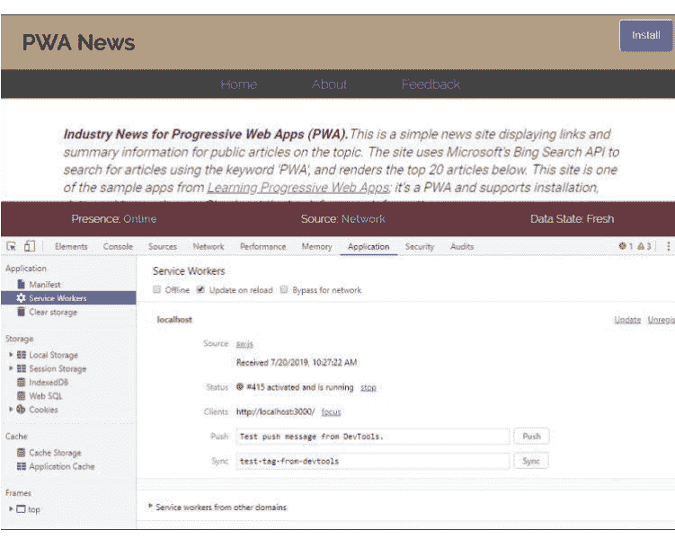

图 3.5 Chrome 开发者工具应用标签页

如果浏览器无法注册 service worker，它会在面板中显示错误消息让你知道。

在最新版本的 Chrome 浏览器和基于 Chromium 的 Edge 浏览器中，你还可以打开一个特殊页面，显示浏览器中注册的所有 service worker 信息。打开浏览器并在地址栏中输入以下值：

```
chrome://servicework-internals/
```

浏览器会打开图 3.6 所示的页面，列出所有已注册的 service worker。

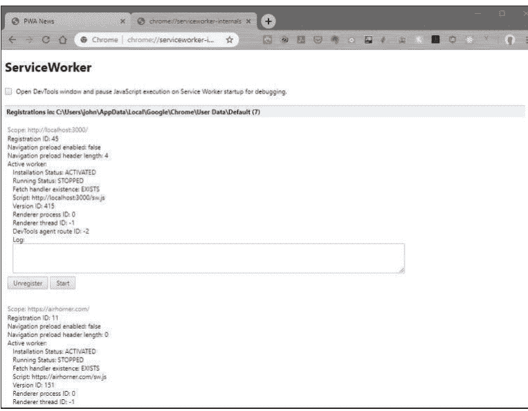

图 3.6 Service Worker 内部

目前 service worker 缺少的一项是可以对 `fetch` 请求进行处理。列表 3.5 为我们现有的 service worker 增加了一行代码：

```
event.addEventListener('fetch', (event) => {
```

这段代码指示浏览器去从网络获取请求的文件。如果事件监听器中没有这条语句，浏览器实际上什么也没做。这就是为什么应用在没有这一行的情况下也能正常工作。添加这一行只是完成了事件监听器并确定了请求了什么资源。

### 列表 3.5 第二个 Service Worker: sw-35.js

```javascript
self.addEventListener('fetch', event => {
  // 每当应用请求资源（文件或数据）时都会触发
  console.log(`SW: Fetching ${event.request.url}`);
  // 接下来，从网络获取请求的资源，
  // 这里没什么复杂的操作。
  event.respondWith(fetch(event.request));
});
```

Service workers 使用这种机制来决定是从缓存中获取资源还是从网络请求它。我稍后（在本章中）会详细介绍这一点。浏览器会触发两个对 service worker 关键的事件：`install` 和 `activate`。列表 3.6 显示了一个包含了这两个事件监听器的 service worker。

### 列表 3.6 第三个 Service Worker: sw-36.js

```javascript
self.addEventListener('install', event => {
  // 当浏览器安装应用时触发
  // 在这里我们只是记录了事件以及传递给事件
  // 对象的的内容。事件的目的是
  // 为 service worker 提供在安装完成后设置本地
  // 环境的地方。
  console.log(`SW: Event fired: ${event.type}`);
  console.dir(event);
});

self.addEventListener('activate', event => {
  // 在 service worker 完成安装后触发。
  // 这是 service worker 清理
  // 之前的 service worker 版本的地方。
  console.log(`SW: Event fired: ${event.type}`);
  console.dir(event);
});

self.addEventListener('fetch', event => {
  // 每当应用请求资源（文件或数据）时都会触发
  console.log(`SW: Fetching ${event.request.url}`);
  // 接下来，从网络获取请求的资源，
  // 这里没什么复杂的操作。
  event.respondWith(fetch(event.request));
});
```

浏览器在完成 service worker 的安装后会触发 `install` 事件。该事件为应用提供了一个执行 service worker 所需设置工作的机会。在此时，service worker 已经安装但尚未运行（它什么都没做）。

当当前的 service worker 成为该应用的激活工作句柄时，浏览器会触发 `activate` 事件。service worker 工作在浏览器级别，而不是应用级别，因此当浏览器安装它时，在所有运行该应用的浏览器标签页中重新加载应用之前，它是不会变为激活的。一旦它激活，它在任何运行该应用的浏览器标签页中保持激活状态，直到浏览器关闭该应用的所有标签页或浏览器重启。

`activate` 事件为 service workers 提供了一个在激活后执行任务的机会。当 service worker 激活后，它可以清理之前的旧版本。我们将在第 4 章“资源缓存”中详细介绍这些内容。

## Service Worker 的生命周期

当应用注册 service worker 时，浏览器会：

- 查找 service worker（从服务器请求它）
- 下载 service worker
- 解析并执行 service worker

如果浏览器无法下载或执行 service worker，它将丢弃该 service worker（如果它已存在），并通知调用 `navigator.serviceWorker.register` 的代码。在列表 3.3 中，这意味着 `catch` 子句将执行，并且该块中的任何代码都会被执行。

如果浏览器成功下载了 service worker，它将执行该 service worker，这就是 service worker 在 service worker 代码中注册 `install` 和 `activate` 事件监听器的方式。

此时，`install` 事件监听器触发；service worker 在此处创建其本地缓存并执行任何额外的设置步骤。图 3.9 显示了处于 `Installing` 状态的 service worker 表示（版本 1）。

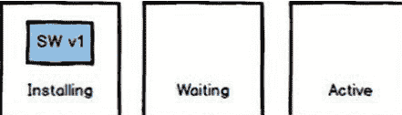

图 3.9 Service Worker 1 正在安装

如果当前没有注册 service worker，service worker 将切换到 `Active` 状态，并准备在下一次应用重载时获取请求，如图 3.10 所示。

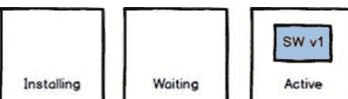

图 3.10 Service Worker 1 已激活

如果应用尝试安装新版本的 service worker（例如版本 2），则针对新的 service worker 重新开始过程。浏览器下载并执行 service worker v2，触发 v2 的 `install` 事件，并完成其初始设置。

此时，应用仍然处于激活状态，并有一个活跃的 service worker (v1)。请记住，除非关闭浏览器（或至少关闭所有运行 web 应用的标签页），或浏览器配置为强制重新加载 service worker，否则当前的 service worker 将保持激活状态。在存在已激活 service worker 的情况下，service worker v2 将进入等待状态，如图 3.11 所示。

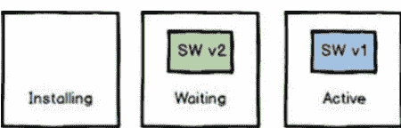

图 3.11 运行中的两个 Service Workers

一旦用户关闭运行应用的所有浏览器标签页或重启浏览器，浏览器将丢弃 worker v1 并将 service worker v2 设置为激活，如图 3.12 所示。

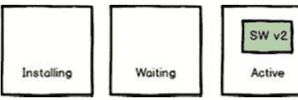

图 3.12 Service Worker V2 已激活

当你更新 service worker 用户导航到应用时，浏览器会尝试再次下载 service worker。如果新下载的 service worker 与已注册的仅有一个字节的差异，浏览器将注册新的 service worker 并重新启动激活过程。无论是否发生变化，浏览器在每次页面重载时都会下载 service worker。

## 强制激活

之前我描述了通过重载页面或在浏览器开发者工具中启用“刷新”选项来强制浏览器激活 service worker 的方法。这两个选项都非常棒，但需要用户执行某些操作。要通过程序强制浏览器激活 service worker，只需在你的 service worker 中执行以下行代码：

```javascript
// 强制 service worker 激活
self.skipWaiting();
```

你通常会在 `install` 事件期间执行此操作，如列表 3.7 所示。

### 列表 3.7 第四个 Service Worker 示例：sw-sw.js

```javascript
self.addEventListener('install', () => {
  // 当浏览器安装应用时触发
  // 这里我们只是记录事件以及传递给事件的
  // 对象的内容。此事件的目的是
  // 为 service worker 在安装完成后设置本地
  // 环境提供一个地方。
  console.log(`SW: Event fired: ${event.type}`);
  console.dir(event);
  // 强制 service worker 激活
  self.skipWaiting();
});

self.addEventListener('activate', event => {
  // 在 service worker 完成安装后触发。
  // 这是 service worker 清理之前的
  // service worker 版本的地方
  console.log(`SW: Event fired: ${event.type}`);
  console.dir(event);
});

self.addEventListener('fetch', event => {
  // 每当应用请求资源（文件或数据）时触发
  console.log(`SW: Fetching: ${event.request.url}`);
  // 接下来，从网络获取请求的资源，
  // 这里没有其他操作。
  event.respondWith(fetch(event.request));
});
```

## 声明额外的浏览器标签页

在某些情况下，用户可能在不同的浏览器标签页中运行应用的多个实例。当你注册一个新的 service worker 时，可以将该新 service worker 应用所有相关的标签页。要实现这一点，在 service worker 的 `activate` 事件监听器中添加以下代码：

```javascript
// 将此 service worker 应用到所有运行应用的标签页
self.clients.claim(null)
```

列表 3.8 提供了使用此功能的 service worker 完整列表。

### 列表 3.8 第五个 Service Worker 示例：sw-38.js

```javascript
self.addEventListener('install', event => {
  // 当浏览器安装应用时触发
  // 这里我们只是记录事件以及传递给事件的
  // 对象的内容。此事件的目的是
  // 为 service worker 在安装完成后设置本地
  // 环境提供一个地方。
  console.log(`SW: Event fired: ${event.type}`);
  console.dir(event);
  // 强制 service worker 激活
  self.skipWaiting();
});

self.addEventListener('activate', event => {
  // 在 service worker 完成安装后触发。
  // 这是 service worker 清理之前的
  // service worker 版本的地方
  console.log(`SW: Event fired: ${event.type}`);
  console.dir(event);
  // 将此 service worker 应用到所有运行应用的标签页
  self.clients.claim(null)
});

self.addEventListener('fetch', event => {
  // 每当应用请求资源（文件或数据）时触发
  console.log(`SW: Fetching: ${event.request.url}`);
  // 接下来，从网络获取请求的资源，
  // 这里没有其他操作。
  event.respondWith(fetch(event.request));
});
```

如果你希望在每次发布 service worker 新版本时通过发送特殊的通知消息来强制更新，可以通过推送通知来触发此代码的执行。

## Service Worker ready Promise

我还有一个尚未涵盖的 service worker 生命周期。`serviceWorker` 对象有一个只读的 `ready` promise，它会返回一个永远不会被拒绝的 promise，并一直耐心等待，直到 service worker 注册处于激活状态。这为你的 service worker 注册代码提供了一个地方，在加载带有活跃 service worker 的页面时执行某些操作。

我们已经有了 `install` 和 `activate` 事件，这两个事件在 service worker 的注册和替换期间都会参与。如果你的应用只想在 service worker 激活时执行代码，请使用以下代码：

```javascript
if ('serviceWorker' in navigator) {
  navigator.serviceWorker.ready.then((reg) => {
    // 我们有一个活跃的 service worker 在线工作
    console.log(`Service Worker ready (Scope: ${reg.scope})`);
    // 做一些有趣的事情...
  });
} else {
  // 当应用未激活时发生
  console.warn('Service Worker not available');
}
```


# 第 4 章 资源缓存

## 总结

在本章中，我们涵盖了大量关于 service workers 的内容，并在应用中运行了一个。我们学习了关于 service worker 生命周期的所有知识，以及开发者提供的特殊事件和方法。遗憾的是，这个 service worker 并没有做什么。在下一章中，我们将扩展 service worker 的功能，并探索管理应用所用资源的方法。

## 资源缓存

在第 3 章“Service Workers”中，我们为 Web 应用添加了 service worker 并学习了关于 service worker 生命周期的所有知识。当时 service worker 并什么都没做，但在本章中，我们将涵盖使用 service worker 缓存 Web 内容的许多方法。

Web 应用使用缓存有两个原因：加速加载以及让渐进式 Web 应用 (PWAs) 的性能更像移动应用。当 UI 显示很快时，用户并不介意花一点时间来填充页面，而当 UI 加载时间很久、加载数据更久时，用户就会感到沮丧。你选择的缓存策略取决于你编写的 Web 应用的性质，以及你希望在浏览器离线时有多少部分内容可用。

### Service Worker Cache Interface

启用 service workers 的核心能力之一是浏览器的 `Cache Interface`（缓存接口）。该缓存为 service workers 提供了一种内置方式来缓存 Web 应用所使用的资源。缓存是请求/响应对的本地仓库；请求（`request`）是代表应用资源的对象，而响应（`response`）是代表服务器上该特定资源的对象。

通过一个正确填充的缓存，service worker 可以从缓存响应资源，而应用对此无所知；对于应用而言，这些资源是直接来自服务器的。缓存不仅缓存资源文件（例如 `.css`、`.html` 或 `.js` 文件），它还缓存请求资源的完整服务器响应（包括标头、其他内容，以及实际请求的文件）。

## 注意事项

缓存是浏览器支持 service workers 时包含的一个接口，但你可以在 service worker 之外的应用程序其他部分使用该缓存。

## JavaScript 和 Promises

我们还没有花时间讨论的内容之一是现代 JavaScript 开发方法和 promises。旧的 JavaScript 使用回调函数（`callbacks`）来实现同步异步操作：当应用调用一个异步函数或方法时（这可能需要一些时间来完成），应用会传递一个它希望在完成完成后执行的函数。当你有异步任务调用其他异步任务时，情况就会变得错综复杂。这导致了被称为“回调地狱（`callback hell`）”的情况，并创建了非常难以阅读的 JavaScript 代码。

JavaScript 社区最近的工作引入了 promises 的概念，这种结构解决了大部分这类问题。Promises 之所以重要，是因为 service workers 及其相关的缓存机制大量使用了 promises。在之前的章节中，我们调用的任何函数或方法都可以通过附加在函数或方法末尾的 `.then` 和 `.catch` 方法轻松处理。

在本章中，我们将深入研究更多使用 promises 的主题，因此你必须加强对它们工作原理的理解。这本书并不是关于 promises 的，而且网上有很多优秀的资源可以比我做得更好地涵盖这个主题。所以，如果你不熟悉也不擅长处理 promises 的工作，为什么不先放下书一会儿，在重新拿起它之前，先对 promises 做一些额外的阅读呢？

`Cache` 接口暴露了以下方法：

- `add`：从网络获取请求的资源并将请求（以及关联）添加到缓存中。
- `addAll`：对于请求对象数组，获取数组中每个对象所代表的请求资源，并将每个添加到缓存中。
- `delete`：从缓存中删除指定的请求项。
- `keys`：返回一个 promise，该 promise 解析为缓存中的键数组；在这种情况下，键是请求对象。
- `match`：返回一个 promise，该 promise 解析为缓存中第一个匹配请求的响应。基本上，应用传入一个请求对象，此方法从缓存中返回第一个匹配的响应。
- `matchAll`：返回一个 promise，该 promise 解析为缓存中所有匹配指定请求的请求响应数组。
- `put`：将请求/响应对象对添加到缓存中。

在本章的剩余部分中，我们将使用这些大部分方法。

## 准备编码

我们在本章中的工作围绕着书中 GitHub 存储库代码（地址为 `https://github.com/johnwargo/learning-pwa-code`）中的服务器应用代码。我在第 3 章的“准备编码”部分提供了有关如何下载代码和配置开发环境的完整说明。如果你还没有完成步骤，请先去那里。

> 我在 Windows 上编写这本书的大部分内容（不是因为我为微软工作，而是因为这是我的主系统）。因此，本章及后续章节的文件路径使用反斜杠（`\`）作为分隔符。如果你在运行 Linux 或 macOS 的系统上遵循这些示例，请将文件夹路径中的反斜杠替换为正斜杠（`/`），一切都会正常。

打开一个窗口并导航终端进入克隆项目的 `\learning-pwa-code\chapter-04/`。此文件夹包含了第 4 章版本的应用（包含了你本应在第 3 章进行的所有代码更改）。

执行以下命令安装应用所需的所有依赖项：

```bash
npm install
```

此命令使用 Node Package Manager (`npm`) 安装 Node.js 模块。

如果你在第 3 章的设置过程中运行了配置命令，那么就没问题——直接跳到下段落之后运行 `npm` 命令即可。如果没有运行，请从 `\learning-pwa-code\chapter-03\app\` 复制 `config.ts` 文件到 `\learning-pwa-code\chapter-04\app\`。这会复制你所使用的 API 密钥的配置文件。在复制文件后，执行以下命令：

```bash
tsc
```

这会将 `.ts` 文件（包括编译后的 `config.ts` 文件）编译为项目根目录中的 `.js` 文件。你将看到代码对代码中某些对象的引用错误和警告，但如果第 3 章一切运行正常，那么通常没问题。

所有部分都已就绪，现在是启动服务器了；在终端窗口中执行以下命令：

```bash
npm start
```

如果代码设置正确，服务器将在终端中响应以下文本：

```text
pwa-news-server@0.0.1 start D:\learning-pwa-code\chapter-04
node ./bin/www
```

到此时，你已经准备就绪——服务器正在运行并可以继续。如果你看到错误消息，必须深入研究任何报告的错误并解决它们才能继续。

要查看 Web 应用当前状态，请打开 Google Chrome 或支持服务工作（service workers）的浏览器并导航至：

```text
http://localhost:3000
```

短暂等待后，服务器将按照图 3.1 所示渲染应用。

> 提示
> 在本章中，我们在服务器运行时对基于 node 的服务器应用进行了许多更改。与其每次进行更改都强制杀死并重启服务器相比，你可以使用 `nodemon` 在每次对服务器的 Web 应用进行更改时，自动重启 node 服务器进程。要使用该模块，请遵循模块主页上的安装说明，然后执行以下命令来启动服务器：`nodemon node bin/www` 而不是之前描述的 `npm` 命令。

## 缓存应用资源

在 PWA 中启用资源缓存的一种方法是预加载应用启动所需的所有资源。对于 PWA 新闻应用而言，这意味着缓存应用 UI 和其他必要部分，让应用代码在 UI 加载完成后连接服务器获取最新数据。

要做到这一点，你可以使用像下面所示的简单数组：

```javascript
var urlList = [
  '/',
  '/app.webmanifest',
  '/index.html',
  '/css/custom.css',
  '/img/bing-logo.png',
  '/js/index.js',
  '/js/sw-reg.js',
  '/js/utils.js'
];
```

在这个示例中，我根据已知必须在浏览器中渲染应用主页的文件构建了该数组。数组中的第一个项目可能会让你感到惊讶。当我在本地服务器上测试此应用时（你很快也会这样做），服务器会接受 `/` 或 `/index.html` 来加载应用，因此我必须在缓存中兼顾这两个选项。

你不需要 `app.manifest` 文件，因为当应用已经安装时，它并不重要。我将其添加在这里是为了避免应用在离线并尝试加载清单时由 `index.html` 文件生成的错误。

让我们将其添加到服务工作线程并缓存一些数据。打开位于 `learning-pwa-code/chapter-04/public/sw.js` 的项目工作文件。将上一个示例中的 `urlArray` 代码复制到文件的顶部。

接下来，更新 `install` 监听器以便在服务工作线程安装期间缓存 Web 资源。将以下代码复制或输入以替换 `sw.js` 文件中现有的 `install` 工作：

```javascript
self.addEventListener('install', event => {
  console.log(`SW: ${event.type} event fired`);
  // 服务工作线程正在安装，所以这是我们的机会
  // 来设置应用。在这种情况下，我们告诉
  // 浏览器等待我们填充完缓存后
  // 再考虑此服务工作线程为已安装
  event.waitUntil(
    // 为我们的应用资源创建一个本地缓存
    caches.open('pwa-learn-cache')
      // 一旦打开...
      .then(cache => {
        console.log(`SW: Cache opened`);
        // 缓存数组中的所有资源
        return cache.addAll(urlList);
      })
      .catch(error => {
        console.error(error);
      })
  );
});
```

这段代码的作用是通过服务工作线程对象的 `waitUntil` 方法，指示浏览器延迟完成服务工作线程的安装过程，直到括号中的代码执行完毕。该方法期望一个 promise，因此在 promise 解析（resolve）之前内部不会执行任何操作。

代码运行了，但也发生了其他有趣的事情：
* 对 `caches.open` 的调用打开了 `pwa-learn-cache` 缓存并返回一个 promise
* 当缓存打开时，`caches.open` 的 `.then` 方法调用缓存的 `addAll` 方法，该方法返回一个 promise
* 缓存的 `addAll` 方法使用 `urlList` 请求应用所需的所有资源。给定一个 URL 数组，`addAll` 会检索每个目标并将每个目标返回的响应对象添加到缓存中。该数组看起来并不像一个 URL 数组，但从 Web 应用范围来看，它确实是。

在所有这些代码的最后，应用拥有了一个新缓存，其中填充了 `urlList` 数组中每个元素的响应对象。

这段代码只是我在侧边栏中提到的第一个示例，即你必须理解 promise 才能操作服务工作线程和缓存。代码比使用回调函数要简单得多，但仍然有很多操作在进行。保持代码方法具有正确的 promise，或者确保在需要返回 promise 时返回它，可以为你节省一些排错时间。

最后，更新 `fetch` 事件监听器，使其在对请求的资源回退网络之前缓存第一次获取的内容。将以下代码复制或输入以替换项目 `sw.js` 文件中现有的 `fetch` 事件：

```javascript
self.addEventListener('fetch', event => {
  console.log(`SW: ${event.type} ${event.request.url}`);
  // 每当应用请求资源（文件或数据）时都会触发
  event.respondWith(
    // 检查是否在缓存中
    caches.match(event.request)
    .then((response) => {
      // 如果在，从缓存返回缓存
      // 响应对象
      if (response) {
        console.log(`SW: Return Cache ${event.request.url}`);
        return response;
      }
      // 否则，告诉浏览器从网络获取
      // 资源
      console.log(`SW: Return Network ${event.request.url}`);
      return fetch(event.request);
    });
  );
});
```

在这个监听器中，代码通过 `fetch` 响应，这种情况下来自 `caches.match`。`match` 方法返回一个 promise；如果缓存找到了请求，代码返回 `fetch` 解析后的响应。如果请求不在缓存中，代码通过 `fetch` 从网络获取资源。当 `fetch` 完成时，代码向浏览器返回包含请求结果的响应（或错误）。

Listing 4.1 显示了该版本服务工作线程的完整内容。文件位于 `learning-pwa-code/chapter-04/public/service-workers` 文件夹，以及我们在本章中创建的所有服务工作线程。

### Listing 4.1 第一个服务工作线程示例：sw.js

（此处省略了重复原文中的代码块内容，根据要求不翻译且不重复）

Service Worker 在你重新加载应用之前不会激活，所以现在请执行加载并查看输出。你应该能看到 Service Worker 正根据资源的不同从缓存或网络获取请求，如图 4.2 所示。

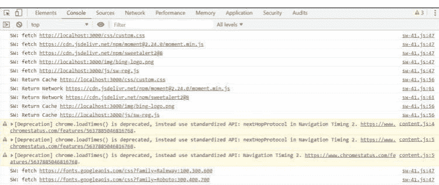

现在，如果你想使用缓存存储（Cache Storage）标签页（如图 4.3 所示），你会看到创建的缓存包含了所有内容。当你使用不同的策略并测试应用时，可以使用此视图获取缓存资源、删除缓存，甚至删除特定的缓存资源。

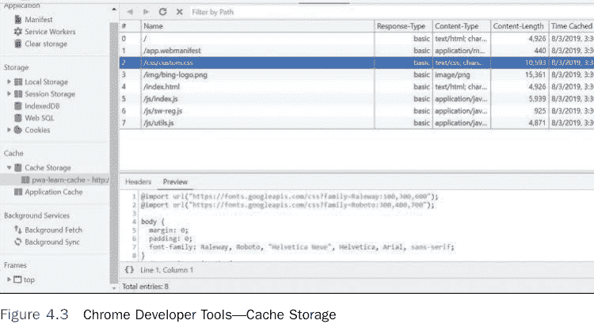

之前，我提到许多缓存资源返回的是你请求的类型的响应对象（资源作为 HTML、CSS 或 JavaScript 文件）。图中显示的每一列都映射到你请求的资源的内部属性。

让我们离线应用并看看代码是如何工作的；有三种方法可以实现：

- 在终端窗口中按 `Ctrl-C` 停止服务器。
- 在浏览器中勾选“Offline”（离线）复选框，如图 4.4 所示的开发者工具 Workers 面板左上角。
- 在图 4.5 所示的开发者工具 Network 面板中将网络状态从“Online”（在线）更改为“Offline”（离线）。

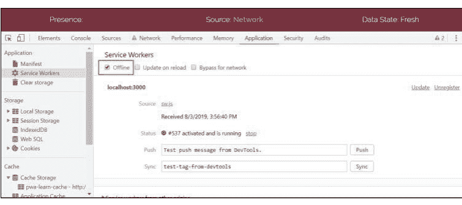
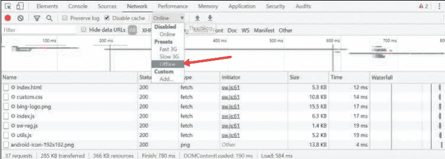

处于离线并刷新页面。当你查看控制台输出时，你应该看到许多应用资源从缓存加载，而许多其他资源报错。这就是我们预期的。接下来，查看页面；它应该如预期般显示没有数据。你只看到一条错误信息，我们也许可以做得更好。当你离线加载应用页面时，你会得到浏览器默认的“Can't find page”（找不到页面）错误。我们也可以做得更好。我会向你如何修复这些问题，但在向你展示如何管理应用缓存之后。

## 离线感知

当我创建 PWA 站点时，我知道在测试不同的缓存策略时必须处理在线和离线情况，因此我想在应用中展示如何让它变得尽可能简单。好消息是，浏览器让这种实现变得非常简单。如果你查看项目中的 `utils.js` 文件，你会发现以下内容：

```javascript
// 为在线和离线注册监听器
// 这样我们就可以确保 UI 相应更新
// 并理解当前状态
console.log('Registering listeners');
window.addEventListener("offline", setNetworkStatus);
window.addEventListener("online", setNetworkStatus);

function setNetworkStatus() {
  // 我们的状态是什么？
  let netStatus = (navigator.onLine) ? ONLINE_STR : OFFLINE_STR;
  // 告诉开发者（纯属娱乐）
  console.log(`Network status: ${netStatus}`);
  // 获取 body 的句柄，以防万一
  let body = document.querySelector('body');
  // 移除 online 类（如果存在）
  body.classList.remove(ONLINE_STR.toLowerCase());
  // 移除 offline 类（如果存在）
  body.classList.remove(OFFLINE_STR.toLowerCase());
  // 设置存在性值
  document.getElementById('presenceValue').textContent = netStatus;
  // 将状态类添加到对象中
  body.classList.add(netStatus.toLowerCase());
}
```

PWA 为在线和离线状态都注册了监听器，然后当应用进入任一种状态时都会更新页脚中的内容。这是你可以轻松添加到 PWA 中的功能，让用户知道应用正在以何种模式运行。

## 缓存管理

我们更新了 service worker，使其缓存应用使用的主要资源，但当你更新应用时该怎么办呢？你如何将新版本的应用资源放入缓存中？在本节中，在进入后续章节的缓存策略之前，我们将讨论管理本地缓存的策略。

我们必须回答第一个问题是：应用如何识别 Web 应用有新版本？在第 2 章“Web 清单文件”中，我提到每当你重新加载应用时，浏览器都会下载 service worker，并确保它与安装在浏览器中的那个是同一个。如果不同（即使只变化了一个字节），浏览器就会解析、执行并完成为下载的 service worker 完成安装和激活过程。这个过程为我们提供了一个实用的选项：在 service worker 顶部添加一个简单的变量或常量，例如：

```javascript
// service worker 版本号
const SW_VERSION = 1;
```

该常量定义了一个简单的 service worker 版本标识符，当你发布应用的新版本时，只需增加它的值即可。设置完成后，浏览器会检测到新的 service worker 版本，安装更新后的 service worker，并使用应用的新资源重建缓存。

> 浏览器并不是通过读取变量来检测 service worker 变化的。它之所以检测到 service worker 变化是因为在激活的 service worker 和应用加载的那个之间进行了字节比较。如果它们不同，浏览器就知道有一个新版本需要注册。你也可以在每次更新 service worker 时在两个值之间轻松切换常量，即可获得相同的结果。

如果新版本的应用对应用资源使用了不同的名称怎么办？该怎么办？嗯，一种方案是只需缓存新资源并忽略我们已经在列表 4.1 中实现的旧资源。这种方法的问题在于，你将缓存永远再也不会需要的数据，这是很浪费的（特别是在移动设备上）。

在在这里思考了一会儿后（你不需要对应用做任何更改），你可以使用以下代码删除缓存：

```javascript
caches.delete('pwa-learn-cache').then(() => {
  console.log('SW: Cache deleted');
  // 在此处执行其他操作
});
```

从 service worker 的生命周期知道，当前的 service worker 正在激活并使用此缓存。如果我们删除了当前 service worker 的缓存，谁知道会发生什么（可能会糟糕）。不，一定有更好的方法。

你可以将早期的示例扩展为所示：

```javascript
// service worker 版本号
const SW_VERSION = 1;
// 为每个 service worker 生成自定义缓存名称
const CACHE_NAME = `pwa-learn-cache-${SW_VERSION}`;
```

这为每个版本生成了自定义名称：`pwa-learn-cache-v1`、`pwa-learn-cache-v2`、`pwa-learn-cache-v3` 等以此类推。每当 `swVersion` 的值变化时，代码就会生成一个新的 `cacheName`，从而生成一个新的缓存。这需要对 service worker 的安装处理器进行细小的更改，将原始的

```javascript
caches.open('pwa-learn-cache')
```

替换为

```javascript
caches.open(CACHE_NAME)
```

这是新事件处理器的完整列表：

```javascript
self.addEventListener('install', event => {
  console.log(`SW: ${event.type} event fired`);
  event.waitUntil(
    // 为我们的资源创建一个本地缓存
    caches.open(CACHE_NAME)
      // 缓存打开后...
      .then(cache => {
        console.log(`SW: Cache opened`);
        // 缓存数组中的所有资源
        return cache.addAll(urlList);
      })
      .catch(error => {
        console.error(error);
      })
  );
});
```

```javascript
// 在所有代码运行完之前不要完成激活
event.waitUntil(
  // 获取缓存键列表（缓存名称）
  caches.keys().then(cacheList => {
    // 直到全部完成后再停止
    return Promise.all(
      cacheList.map(theCache => {
        // 缓存键是否与当前的
        // 缓存名称不同？
        if (CACHE_NAME !== theCache) {
          // 如果是，则删除它。
          return caches.delete(theCache);
        }
      })
    );
  })
);
```

这段代码的问题在于，它会删除除 service worker 使用的当前缓存之外的所有缓存。如果应用只有一个缓存，这没问题；但如果应用打开了其他缓存，这个过程将删除除当前缓存以外的所有缓存。

在接下来的示例中，我添加了一个 `CACHE_ROOT` 常量，service worker 使用它来构建缓存名称。我们可以利用它来识别所有的 service worker 版本，并将其与其他缓存区分来：

```javascript
// service worker 版本号
const SW_VERSION = 1;
// 我们缓存的根名称
const CACHE_ROOT = 'pwa-learn-cache';
// 为每个 service worker 生成自定义缓存名称
const CACHE_NAME = `${CACHE_ROOT}-v${SW_VERSION}`;
```

这只需要对隐藏在激活事件监听器深处的语句进行微调：

```javascript
if ((CACHE_NAME !== theCache) && (theCache.startsWith(CACHE_ROOT))) {
```

以下是事件监听器的代码：

```javascript
self.addEventListener('activate', event => {
  // 在 service worker 完成安装后触发。
  // 这是 service worker 用来清理之前的
  // service worker 版本的。
  console.log(`SW: ${event.type} event fired`);
  // 在所有代码运行完之前不要完成激活
  event.waitUntil(
    // 获取缓存键列表（缓存名称）
    caches.keys().then(cacheList => {
      // 直到全部完成后再停止
      return Promise.all(
        cacheList.map(theCache => {
          // 缓存键是否与当前的
          // 缓存名称不同且具有相同的根？
          if ((CACHE_NAME !== theCache) && (theCache.startsWith(CACHE_ROOT))) {
            // 如果是，则删除它。
            console.log(`SW: deleting cache ${theCache}`);
            return caches.delete(theCache);
          }
        })
      );
    })
  );
});
```

完成配置后，service worker 会在安装事件期间创建一个新缓存，并在激活事件期间删除所有旧缓存，而遗留其他缓存。

列表 4.2 显示了此更新后的 service worker 的完整代码列表。请花一点时间使用列表 4.2 中的代码更新应用 service worker 并进行测试。确保检查浏览器开发者工具中的本地缓存内容（参考图 4.3）以验证操作是否正确。

### Listing 4.2 第二 Service Worker 示例：sw-42.js

```javascript
// service worker 版本号
const SW_VERSION = 1;
// 我们缓存的根名称
const CACHE_ROOT = 'pwa-learn-cache';
// 为每个 service worker 生成自定义缓存名称
const CACHE_NAME = `${CACHE_ROOT}-v${SW_VERSION}`;
```

```javascript
var urlList = [
  '/app.webmanifest',
  '/index.html',
  '/css/custom.css',
  '/img/bing-logo.png',
  '/js/index.js',
  '/js/sw-reg.js',
  '/js/utils.js'
];
```

```javascript
self.addEventListener('install', event => {
  console.log(`SW: ${event.type} event fired`);
  // service worker 正在安装，所以我们需要设置
  // 缓存。在这种情况下，我们告诉
  // 浏览器等待直到我们填充完缓存，
  // 再认为此 service worker 已安装
  event.waitUntil(
    // 为我们的应用资源创建一个本地缓存
    caches.open(CACHE_NAME)
      .then(cache => {
        console.log('SW: Cache opened');
        // 缓存数组中的所有资源
        return cache.addAll(urlList);
      })
      .catch(error => {
        console.error(error);
      })
  );
});

self.addEventListener('activate', event => {
  // 在 service worker 完成安装后触发。
  // 这是 service worker 用来清理之前的
  // service worker 版本的。
  console.log(`SW: ${event.type} event fired`);
  // 在所有代码运行完之前不要完成激活
  event.waitUntil(
    // 获取缓存键列表（缓存名称）
    caches.keys().then(cacheList => {
      // 直到全部完成后再停止
      return Promise.all(
        cacheList.map(cache => {
          // 缓存键是否与当前的
          // 缓存名称不同且具有根？
          if ((CACHE_NAME !== cache) && (cache.startsWith(CACHE_ROOT))) {
            // 如果是，则删除它。
            console.log(`SW: deleting cache ${cache}`);
            return caches.delete(cache);
          }
        })
      );
    })
  );
});
```

这段代码尝试从服务器获取数据；如果无法获取，`catch` 方法就会介入，并返回我们在文件顶部添加的空新闻对象。现在，当你在离线状态下尝试加载页面时，你将看到应用内置的、更友好的消息，如图 4.7 所示。

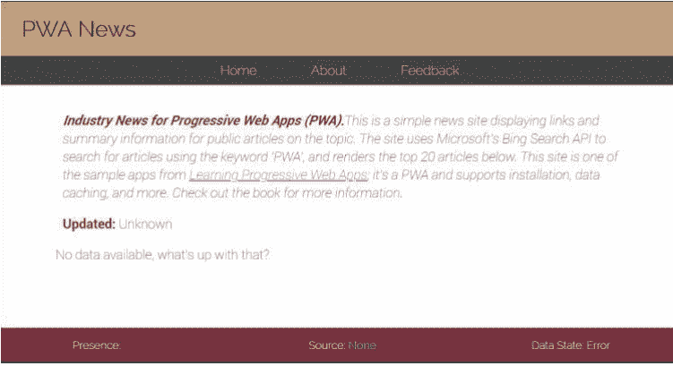

以下是该新事件处理程序的源代码：

```javascript
self.addEventListener('fetch', event => {
  console.log(`SW: ${event.type} ${event.request.url}`);
  // 这是一个对新闻数据的请求吗？
  if (event.request.url == `${event.request.origin}/api/news`) {
    console.log('Sw: Data request detected');
    event.respondWith(
      // 然后如果你获取了数据
      fetch(event.request)
      // 噢，错误，无法完成 fetch
      .catch(() => {
        // 返回空新闻对象
        return new Response(JSON.stringify(EMPTY_NEWS_OBJECT),
          { "status": 200, "statusText": "Dummy data!" });
      });
    );
  } else {
  // 非数据请求，所以返回 fetch 详情
  event.respondWith(
    // 检查是否在缓存中
    caches.match(event.request)
      .then(response => {
        // 如果是，返回来自缓存的响应
        // 对象
        if (response) {
          console.log(`SW: Return Cache ${event.request.url}`);
          return response;
        }
        // 否则，告诉浏览器从网络获取
        // 资源
        console.log(`SW: Return Network ${event.request.url}`);
        return fetch(event.request);
      });
```

你可以轻松调整此代码，为每种类型的请求提供不同的数据对象。

## 注意事项

我不打算在这里展示这个，因为我认为这是一个愚蠢的例子，但你也可以使用这种方法根据应用中的某些条件来调整页面上的应用内容或样式。使用在线/离线体验侧边栏，你可以编写 service worker，让它根据应用是否在线来交付正确的 CSS。

我提到这一点是因为大多数书籍和文章在开始主题时，都会展示如何返回一个翻转版本的图像，或者通过 CSS 动态为页面设置不同的背景颜色，我不想想为什么我从未提到过这些方法。😊

此示例的 service worker 代码位于项目文件夹的 `public/service-workers/sw-43.js` 文件中。

## 添加离线页面

在本章的开始，我从缓存资源列表中省略了其他页面——“关于”（About）和“反馈”（Feedback）。我没有包含它们，并不是因为我讨厌这些页面，而是因为在本章的章节中需要某些页面离线可用。

当你让浏览器离线并尝试加载“关于”或“反馈”页面时，你会看到一个类似于图 4.8 所示的错误页面。这对用户来说并不是最好的体验，因为这与应用的外观和风格不符，而且没有说明到底发生了什么。浏览器尝试解释当前错误状况的一些可能原因，但失败得非常惨。

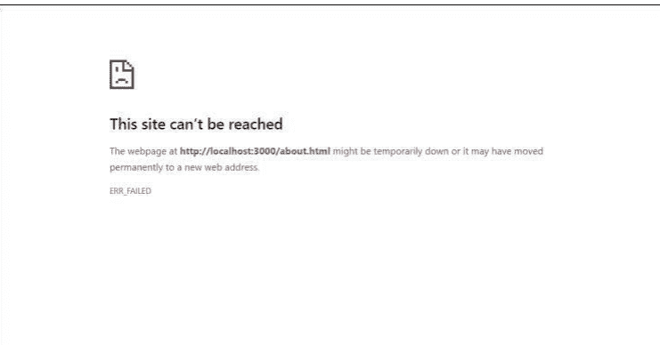

另一方面，我们对页面没有出现的原因了解得多，并且可以通过 service workers 为用户提供更好的体验。实现这一点有许多不同的方法，从简单到复杂不等。我在这里重点介绍几种，其他的留给你们自己发现。

一种方法是使用上一节的方法，在 fetch 请求失败时返回自定义内容。你不再像我们在上一节中那样返回数据对象，而是返回文本或 HTML 内容。

这里是一个执行此操作的 fetch 监听器示例：

```javascript
self.addEventListener('fetch', event => {
  console.log(`SW: ${event.type} ${event.request.url}`);
  event.respondWith(
    // 检查是否在缓存中
    caches.match(event.request)
      .then(response => {
        // 如果是，返回来自缓存的响应
        // 对象
        if (response) {
          console.log(`SW: Return Cache ${event.request.url}`);
          return response;
        }
        // 否则，告诉浏览器从网络获取
        // 资源
        console.log(`SW: Return Network ${event.request.url}`);
        return fetch(event.request)
      })
      .catch(() => {
        return new Response("Hmm, I can't seem to access that page.");
      })
  );
});
```

在这种情况下，当 fetch 失败时，代码创建一个包含内容的新 `Response` 对象并将其作为 fetch 操作的响应。当你在浏览器中尝试这样做时，你会得到图 4.9 所示的页面。

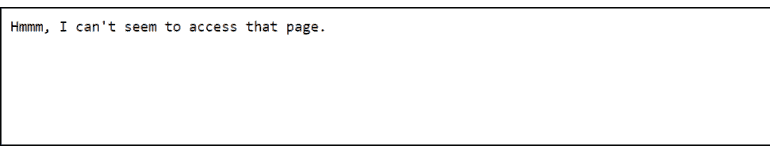

现在你可以获取带有自定义 HTML 的离线页面；受影响的代码部分看起来如下：

```javascript
return fetch(event.request)
  .catch(() => {
    return new Response(
      "<!DOCTYPE html><html>" +
      "<h1>Access Error</h1>" +
      "<p>Hmm, I can't seem to access that page.</p>" +
      "</body></html>",
      { "Content-Type": "text/html" }
    );
  });
```

在这种情况下，当 fetch 失败时，代码创建一个包含内容的新 `Response` 对象并将其作为 fetch 操作的响应。当你在浏览器中尝试这样做时，你会得到图 4.9 所示的页面。

```javascript
.includes('text/html')) {
  return caches.match(OFFLINE_PAGE);
}
);
```

将应用恢复到在线，在浏览器中重新加载页面，然后再次离线。当你在浏览器离线状态下尝试加载“关于”页面时，你会看到图 4.11 所示的精漂亮页面，它包含了应用页眉、菜单和页脚，与应用程序的其他页面完全一样。这是一种好得多的用户体验，你不觉得吗？

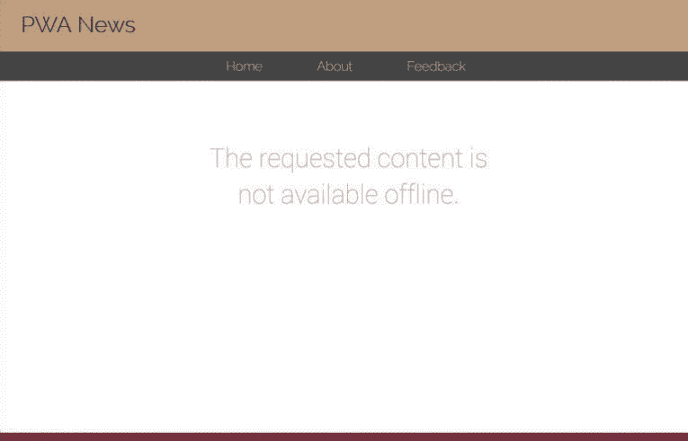

此示例的完整 service worker 代码位于项目文件夹 `public/service-workers/sw-44.js` 文件中。

## 实现额外的缓存策略

到目前为止，我们已经建立了一套强大的技能，你可以利用这些技能让你的 Web 应用对网络问题具有韧性。我们在上一节中的 service worker 示例提供了一个 service worker，它仅仅记录了每个请求，然后从网络获取每个资源的最新版本（这没什么大不了）。在本章中，你已经看到了 service worker 策略的不同变体，这些策略会缓存资源以防无法从网络获取，但尽可能从网络获取最新内容。当资源无法从网络抓取且缓存中不存在时，我展示了几种方法来减轻对你应用用户带来的负面影响。

在本节中，我扩展了涵盖范围，包含了你可以在你的 PWA 中使用的额外缓存策略。这绝不意味着对所有可能的选项进行完整覆盖，但以这些为基础，你可以为你自己的应用拼凑出你想要的任何或冷门的缓存策略。你为应用实现什么种策略，取决于应用本身以及应用资源更改的频率。

对于接下来的示例，我不期望你用不同的缓存策略来更新应用。如果你确实想这样做，本章的剩余部分仅仅是为了为你突出显示其他你可以使用的选项。

### 仅缓存模式 (Cache-Only)

对于已安装的 PWA，特别是像第 2 章的小贴费计算器那样的简单应用，应用是完全静态的；应用中没有动态内容。你可以轻松地在 service worker 中构建一个 URL 数组，并在启动时缓存所有资源，正如我在之前的示例中展示的那样。一旦到位，无论浏览器是否有网络连接，应用都能正常工作。

在 P News 应用中，只有应用的部分内容很少更改。为了让应用在设备没有连接的情况下也能运行，你可以更新最近的 service worker 中的 URL 数组，使其包含应用所需的每一个可能的静态资源。一旦到位，你就可以在下面的 fetch 事件监听器中实现所强调的仅缓存方法：

```javascript
self.addEventListener('fetch', event => {
  console.log(`SW: ${event.type} ${event.request.url}`);
  // 每当应用请求资源（文件或数据）时都会触发
  event.respondWith(
    // 检查它是否在缓存中
    caches.match(event.request)
      .then(function (response) {
        // 如果存在，返回来自缓存的
        // 响应对象
        if (response) {
          console.log(`SW: Return Cache ${event.request.url}`);
          return response;
        }
      })
  );
});
```

如果资源不在缓存中，代码将什么都不做；service worker 让浏览器处理其失败。在这种情况下，浏览器将显示图 3.8 所示的通用资源未找到错误页面。你可以向资源数组添加一个离线文件，如之前的示例所示，这只有在你向资源数组中放入文件时才需要它。fetch 事件监听器的代码如下：

```javascript
self.addEventListener('fetch', event => {
  console.log(`SW: ${event.type} ${event.request.url}`);
  // 每当应用请求资源（文件或数据）时都会触发
  event.respondWith(
    // 检查它是否在缓存中
    caches.match(event.request)
      .then(function (response) {
        // 如果存在，返回来自缓存的
        // 响应对象
        if (response) {
          console.log(`SW: Return Cache ${event.request.url}`);
          return response;
        }
        // 否则，检查是否接受 HTML
        if (event.request.headers.get('accept').includes('text/html')) {
          // 返回离线页面
          console.log(`SW: Serving offline page`);
          return caches.match(OFFLINE_PAGE);
        }
      });
  );
});
```

此示例的完整 service worker 代码位于项目文件夹的 `public/service-workers/sw-44.js` 文件。我展示了这种方法来减轻对你应用用户带来的冲击。

### 网络优先，后缓存 (Network First, Then Cache)

对于许多应用，尤其是那些显示动态数据的应用，你希望尽可能从网络获取内容，如果不可用，则回退到缓存。

与上一节的仅缓存示例类似，在这种方法下，service worker 尝试从网络获取资源，如果不可用，则从缓存获取。对于动态网站，你的缓存会有所不同。在下一章中，我们将让 service worker 在应用运行时自动缓存，自动填充缓存。一旦资源列表到位，下面的 fetch 事件监听器展示了如何实现网络优先方法：

```javascript
self.addEventListener('fetch', event => {
  console.log(`SW: ${event.type} ${event.request.url}`);
  // 每当应用请求资源（文件或数据）时都会触发
  event.respondWith(
    // 尝试从网络获取文件
    fetch(event.request)
      .catch(() => {
        // 哎，网络不可用
        // 缓存中有它吗？
        console.log(`SW: Trying Cache ${event.request.url}`);
        return caches.match(event.request)
          .then(response => {
            // 如果存在，则返回缓存响应
            if (response) {
              console.log(`SW: Return Cache ${event.request.url}`);
            }
            return response;
          });
      });
  );
});
```

此示例的完整 service worker 代码位于项目文件夹 `public/service-workers/sw-46.js` 文件。

### 网络优先，更新缓存 (Network First, Update Cache)

在目前为止的所有示例中，我们使用的缓存都是静态的，在服务安装期间填充并且不再更新。这并不有趣；这种方法强制 service worker 每次都手动重建缓存，即使文件没有变化或没有再次使用。

另一种方法是让 service worker 在应用运行时进行缓存，使用应用请求的每个资源自动填充缓存。这有点棘手，请稍等我为你详细说明。

对于第 2 章的小贴费计算器应用，这是完美的缓存策略。每个请求都会被缓存。因此，如果你安装了应用或者稍后在设备无连接时访问应用，应用将完全从缓存加载。

当我为 PWA News 应用实现这种缓存策略时，我对应用的数据有些担心。我们看到 Bing 如何结构化其结果，数据以 JSON 对象的形式返回，其中包含文章相关的任何图片的 URL（通常是缩略图）。我不想缓存这些图片，因为它们会随着新闻更新而更改，我不想让缓存充满未使用的图片，也不想写出一个清理它们的方法。

当我测试稍后与你分享的代码时，我发现一切都自动为我处理好了。好极了！让我解释。

以下代码实现了一个 service worker 的 `fetch` 监听器，它可以缓存服务器发出的每一个请求。我在测试中发现，它缓存了每一个资源请求，甚至包括向服务器获取新数据的 API 请求。它没有做的是自动缓存图像文件——因为我没有做任何特殊操作来让它发生。它不仅为我缓存了图像文件，当我禁用网络并刷新页面时，Web 应用程序仍然显示了这些图片。感到惊讶吗？是的，花点时间看一下代码，我将在另一为你解释这一切。

```javascript
self.addEventListener('fetch', event => {
  console.log(`SW: ${event.type} ${event.request.url}`);
  // 每当应用请求资源（文件或其他）时都会触发
  event.respondWith(
    // 尝试从网络获取文件
    fetch(event.request)
    // 我们，我们拿到了
    .then(response => {
      // 我们有有效的响应吗？
      if (response && response.status == 200) {
        // 克隆响应；它是一个流，所以我们不能
        // 同时将其写入缓存并返回
        let responseClone = response.clone();
        // 尝试打开缓存
        caches.open(CACHE_NAME) 
          // 如果我们成功打开了缓存
          .then(function (cache) {
            console.log(`SW: Adding ${event.request.url} to the cache`);
            // 然后写入克隆的响应 responseClone
            cache.put(event.request, responseClone);
          });
        // 返回原始响应
        return response;
      } else {
        // 返回从服务器收到的任何错误响应
        return response;
      }
    })
    .catch(() => {
      // 糟糕，网络资源不可用
      // 缓存中有它吗？
      console.log(`SW: Trying Cache ${event.request.url}`);
      caches.match(event.request)
      .then(response => {
        // 如果有，则从缓存中返回
        // 响应对象
        if (response) {
          console.log(`SW: Return Cache ${event.request.url}`);
          return response;
        }
      })
    });
  }); // catch
});
```

此示例的完整 service worker 代码位于项目文件夹的 `public/service-workers/sw-47.js` 中。

好了，对于每一个资源请求，此 service worker 执行了以下操作：

- 尝试从网络检索资源。
- 如果获得了响应，
- 检查响应是否为有效且不是错误。
- 克隆响应（响应是流，因此 service worker 无法同时将响应传递给浏览器并写入缓存）。
- 将克隆的响应写入缓存。
- 将原始响应返回给请求者。
- 如果响应不是 HTTP 200 响应（成功），它会将收到的任何内容返回给请求者，由请求者处理错误。
- 检查缓存中是否存在该资源。
- 如果有，则返回缓存的资源。
- 否则，它什么都不做，让请求者自行处理问题（通常显示图 4.8 所示的页面）。

当它处理应用的所有请求时，返回的响应类型取决于浏览器和应用中的安全设置对源（origin）的查看方式。记住，service worker 关乎安全，如果你请求的资源与请求页的同源不同，service worker 就会报错。它报错的方式是通过是不缓存该资源。

service worker 在此处使用以下代码检查响应的有效性：

```javascript
if (response.status == 200)
```

你在网上看到的一些示例采用这种方法：

```javascript
if (response.status == 200 && response.type == 'basic')
```

我在测试这段代码时学到的点是，service worker 只会缓存类型为 `basic` 的资源。在缓存之前不需要检查类型。所有同源请求都以 `basic` 形式到达，但图像请求因为其源是 Bing 而不是本地 API 服务器，被忽略且未被加入缓存。为了证明这一点，请看图 4.12；它显示了由此 `fetch` 事件监听器生成的完整资源缓存。

[https://developer.mozilla.org/en-US/docs/Web/API/Response/type](https://developer.mozilla.org/en-US/docs/Web/API/Response/type)

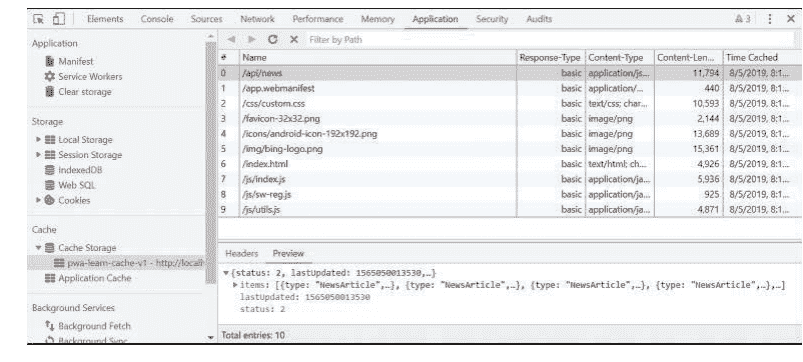

我提到过当我禁用网络时，缩略图文件在应用中正常显示。这是为什么呢？嗯，即使我有一个 service worker 为浏览器管理缓存，它仍然遵循响应中的缓存标头。如果你在 Fiddler 中查看 Bing 图像请求标头（如图 4.13），你会发现 Bing 在图像高亮部分为资源设置了 `Cache-Control max-age` 标头。这告诉浏览器，如果愿意，它可以保留该图像 1,209,000 秒。

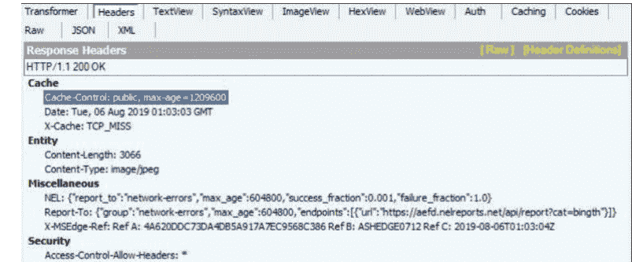

## 介绍背景同步

开发者有两种方案可以实现此项功能。第一种方案使用本章描述的背景同步进程，另一种是使用浏览器在 service worker 和 Web 应用程序之间发送数据的能力，如第 7 章“在 Service Worker 和 Web 应用程序之间传递数据”所描述。这两种方法的区别在于，背景同步适用于 service worker 无法立即将数据发送到服务器的场景；相反，service worker 每当浏览器（稍后）上线时就会重试该操作。第 7 章中描述的选项允许 Web 应用程序在两个实体（Web 应用程序和 service worker）之间传递数据，这实际上对于实时操作非常有用。

为了使背景同步工作，Web 应用程序通过两个进程共享的本地数据库与 service worker 共享数据：

- service worker 和 Web 应用程序使用同一个本地数据库。Web 应用程序将数据写入数据库。service worker 从数据库读取操作，并在成功处理后删除该操作。
- 当应用调用背景同步来处理某个操作时，它会将操作数据写入数据库，然后向 service worker 触发同步事件以处理该操作。
- 当 service worker 的同步事件监听器接收到事件时，在监听器中从本地数据库读取操作，并对数据进行任何所需的处理。
- 如果浏览器（因此也是 service worker）具有网络连接并可以立即执行操作，它就会执行。如果操作成功，service worker 会从本地数据库中删除操作数据。如果失败，它会将数据留在原处，以便 service worker 在下次同步事件触发时再次尝试。
- 如果浏览器没有网络连接，浏览器会将事件放入队列以便稍后重试。
- 这不能永远持续。一段时间后，必须允许操作转移到其他地方。在这种情况下，浏览器会警告 service worker 它正在尝试完成该操作，service worker 必须从队列中移除数据。

图 5.2 阐了这一过程，突出了浏览器和 service worker 在该过程中扮演的角色。

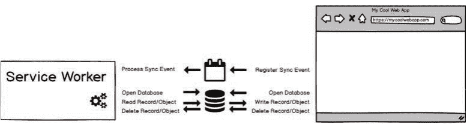

# 第 5 章 通过背景同步实现完全离线

要触发同步，Web 应用程序使用以下代码注册同步事件：

```javascript
navigator.serviceWorker.ready.then((reg) => {
  reg.sync.register('doThatSyncThing');
});
```

`navigator.serviceWorker.ready` 返回当前 service worker 的注册对象，代码使用它来注册同步事件。你也可以在 service worker 内部使用以下代码注册同步事件：

```javascript
self.registration.sync.register('doThatSyncThing');
```

传递给方法的是标识同步事件的标签。你可以在应用程序中使用任意标签；关键在于 service worker 需要有代码在事件进入时识别并处理它们。

浏览器跟踪 service worker 的所有注册同步事件，并在同步事件解决之前反复触发 service worker 的事件监听器。浏览器管理同步事件的方式异，但通常如下：

- 如果浏览器在线状态，同步事件立即触发，service worker 尝试完成操作。
- 如果同步失败，浏览器会等待后重试。它应该实现指数退避策略，每次重试的延迟都会增加。
- 如果浏览器状态从离线变为在线，浏览器会再次尝试。
- 最终，浏览器会放弃，因为它知道可能无法完成操作——所需时间取决于浏览器。

在 service worker 内部，事件监听器监听同步事件，并执行与同步事件关联的代码：

```javascript
self.addEventListener('sync', (event) => {
  if (event.tag == 'doThatSyncThing') {
    // 执行某些操作
  }
});
```

标签在过程中起着有趣的作用。通常，应用程序使用标签将操作分组。例如，聊天应用可能会使用以下标签：

- 添加联系人
- 删除消息
- 设置状态

然后，在 service worker 中，应用使用单独的代码块处理每种事件。当应用注册同步事件且队列中已存在相同标签的同步事件时，浏览器的 `SyncManager` 不向队列添加新事件；它会忽略新事件，假设处理事件的 service worker 代码会处理所有数据。

之前我提到浏览器在多次尝试后最终放弃处理同步事件。当这种情况发生时，它会停止处理，直到触发另一个相同标签同步事件。为了防止这种情况的影响，Web 应用程序可以为每个事件生成唯一的标签，如下所示：

```javascript
navigator.serviceWorker.ready.then(reg => {
  reg.sync.register('doThatSyncThing-' + Date.now());
});
```

然后，在处理事件时，service worker 处理所有匹配特定模式的事件，如下：

```javascript
self.addEventListener('sync', event => {
  if (event.tag.startsWith('doThatSyncThing')) {
    // 执行某些操作
  }
});
```

像 service worker 的其他部分一样，背景同步大量使用了 promise，所以如果你对上一章的 promise 不熟悉，现在应该加强。

### 离线数据同步

service worker 没有提供管理应用离线数据的能力。service worker 运行在浏览器中但并非一直运行，这种限制阻止了它们用于背景同步。浏览器只有在有工作要做时才会使用之前章节所示事件接口唤醒 service worker。遗憾的是，目前 service worker 没有数据事件或定时事件选项。

如果你的应用程序需要数据同步，你应该使用市场上提供的许多同步开发包（SDK），例如来自 Amazon、Couchbase 和 Firebase 的。不要自己写——比我们聪明的人已经做过很多次。

- [1. https://www.chromestatus.com/feature/5689383275462656](https://www.chromestatus.com/feature/5689383275462656)
- [2. https://aws.amazon.com/appsync/](https://aws.amazon.com/appsync/)
- [3. https://www.couchbase.com/](https://www.couchbase.com/)
- [4. https://firebase.google.com/](https://firebase.google.com/)

在某些情况下，这种限制有一个简单的变通方法。PWA 新闻应用从服务器拉取数据，用户无法对新闻进行任何更新，因此轻松实现基于 worker 的同步进程。该方法使用浏览器推送和“推拉”模式（如图 5.3 所示）：

- 当 service worker 创建本地数据库以存储新闻数据并在激活时填充数据时。
- 修改 Web 应用程序，使其从数据库查找新闻数据，而不是从服务器获取。
- 更新 service worker，每当有新数据可用时向应用发送通知（推）。推送通知将在第 6 章“推送通知”中介绍。
- 为 service worker 添加一个 `push` 监听器，以便当它接收到服务器的特定推送通知时，从服务器检索新更新（拉）。

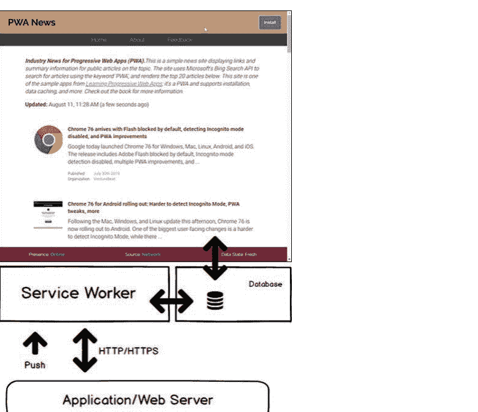

### 选择同步数据库

从本地数据库加载数据的 Web 应用代码必须包含一个回退机制，当运行在不支持 service worker（服务工作）的浏览器时，从服务器拉取数据。请记住，PWA 是渐进增强的 Web 应用，即使在不支持 service worker 的情况下也必须正常工作。

“点按拉取”（poke-and-pull）方法是该应用的最佳方案吗？可能不是。但对于某些类型的应用，这是一种合理的方法。例如，许多应用都是以此方式构建的，使用推送通知或 WebSocket 通知客户端应用程序有新数据。

正如我在前面的章节中所示，浏览器并没有提供一种让 Web 应用将数据发送到 service worker 进行后台同步的直接机制。你可以创建一个 Web 应用和 service worker 都能访问的共享存储（shared store）。Web 应用将数据排队到存储，然后通知 worker 通过 sync 事件获取并处理这些数据。

你有许多方法可以在你的 Web 应用中实现此缓存存储，但 Google 推荐，且网上几乎所有的后台同步示例都使用了浏览器的 `IndexedDB`。正如《Service Worker 中的实时数据》和《渐进式 Web 应用的离线存储》所指出的，`IndexedDB` 是异步的，并且供 service worker 使用。其他可用选项具有局限性（同步而非异步、数据类型限制等）。基于此，我们将使用 `IndexedDB` 数据库作为 PWA 同步队列。

我将不再提供关于 `IndexedDB` 的详尽入门；网上有很多很好的材料，我不倾向于重复。然而，我将分享一些核心示例，以便在我们深入增强 PWA 新闻的后台同步功能之前，我们都处于同一认知水平。如果你已经熟悉了 `IndexedDB`，请直接跳到下一节。

`IndexedDB` 提供了一种已经过时的异步操作方法。它没有使用现代的 promise 方案，而是使用回调函数（`callbacks`）来处理异步操作。这种方法会迅速导致第 4 章中描述的“回调地狱”。为了解决这个问题，社区针对 `IndexedDB` API 封装了几个基于 promise 的包装器；你可以使用这些库来简化你的 `IndexedDB` 代码的可读性。对于本书，我决定不随所欲地向你推荐某个第三方库，而是向你展示如何通过老式的“回调地狱”与 `IndexedDB` 数据库交互，但在 PWA 新闻的增强部分，我将实现一种基于 promise 的方法。

#### 创建数据库

要创建一个 `IndexedDB` 数据库，Web 应用必须执行以下代码：

```javascript
var theDB = window.indexedDB.open(DATABASE_NAME, 1);
```

这创建了一个指向已打开数据库的 `theDB` 对象。如果代码执行时数据库不存在，浏览器 worker 无法访问浏览器的 `window` 对象，因此为了创建/打开 `IndexedDB` 数据库，请使用以下代码：

```javascript
var theDB = self.indexedDB.open(DATABASE_NAME, 1);
```

我们可以在两个位置计数运行次数，因为 Web 应用和 service worker 都打开了数据库，所以将在 PWA 新闻中使用后一个示例。

请记住，这里没有 promise，因此为了报告或处理数据库操作的成功或失败，你必须创建回调函数。对于 `IndexedDB` 操作，你最关心的两个是 `onsuccess` 和 `onerror` 回调：

```javascript
theDB.onsuccess = function (event) {
  console.log('Open Success');
  // 获取数据库的句柄
  let db = event.target.result;
}
```

```javascript
theDB.onerror = function (event) {
  console.log('Open Error');
}
```

成功回调获取一个事件对象，你可以使用它来获取数据库的句柄，例所示。如果你保留了 `theDB` 对象的引用，稍后也可以从这里访问数据库：

```javascript
let db = theDB.result;
```

数据库对象还支持其他回调选项：

```javascript
theDB.onclose = function (event) {
  console.log('Closing database');
} 
```

```javascript
theDB.onabort = function (event) {
  console.log('Aborting...');
}
```

你可能已经注意到我在调用 `IndexedDB` `open` 方法时传递了一个数字。该参数指定了数据库的版本号。当你打开 `IndexedDB` 数据库时，浏览器会将你提供的版本号与现有数据库进行比对；如果它们不同（当你创建一个新数据库时如此），浏览器会触发 `onupgradeneeded` 回调。该回调让应用有机会进行新版本所需的任何数据库更改。

```javascript
theDB.onupgradeneeded = function (event) {
  console.log('Database needed');
  // 执行一些有趣的操作
}
```

#### 创建存储

`IndexedDB` 将相关数据分组到存储（stores）中；你至少需要一个存储来管理应用程序的数据。数据库的 `onupgradeneeded` 回是创建它的完美位置：

```javascript
const STORE_NAME = 'my-store';
theDB.onupgradeneeded = function (event) {
  console.log('Database update needed');
  // 存储已经存在了吗？
  let db = event.target.result;
  if (!db.objectStoreNames.contains(STORE_NAME)) {
    // 没有吗？那就创建它
    console.log('creating store');
    var storeOptions = { keyPath: "id", autoIncrement: true };
    var theStore = db.createObjectStore(STORE_NAME, storeOptions);
  } else {
    console.log('Store already exists');
  }
}
```

正如你从名称中看到的，`IndexedDB` 是带索引的，因此可以在存储中创建索引并使用它们。在这个示例中，我创建了一个名为 `idx` 的索引，以便更方便地定位存储中的对象。

#### 添加数据

使用之前的示例作为基础，通过执行以下代码向存储中添加数据：

```javascript
// 获取数据库的句柄
let db = theDB.result;
let transaction = db.transaction([STORE_NAME], "readwrite");
// 获取存储的句柄
let store = transaction.objectStore(STORE_NAME);
// 最后，添加记录
let request = store.add({ key1: 'value1', key2: 'value2' });
```

中间变量很多对吧？我们可以通过以下方式简化它：

```javascript
// 获取数据库的句柄
let db = theDB.result;
let request = db.transaction([STORE_NAME], "readwrite")
  .objectStore(STORE_NAME)
  .add({ key1: 'value1', key2: 'value2' });
```

```javascript
request.onsuccess = function (event) {
  console.log('Add successful!');
};
```

```javascript
request.onerror = function (event) {
  console.error('Add failure');
}
```

当然，我们还有标准的成功和失败的回调函数。

`IndexedDB` 是一个事务数据库系统，因此应用必须通过事务进行数据库更新，你可以使用事务对象的 `abort` 方法取消操作。`IndexedDB` 是一个索引对象存储，因此在这个示例中，代码向存储添加了一个对象。

要查看此代码的结果，你必须使用开发者工具，然后选择顶部的 Application（应用程序）选项卡。接下来，在图中我展开了左侧导航器中的 `IndexedDB` set。Chrome 不会自动刷新此窗格的内容，因此我必须右键点击 `IndexedDB` 并选择 Refresh IndexedDB 才能看到我的数据库和存储。

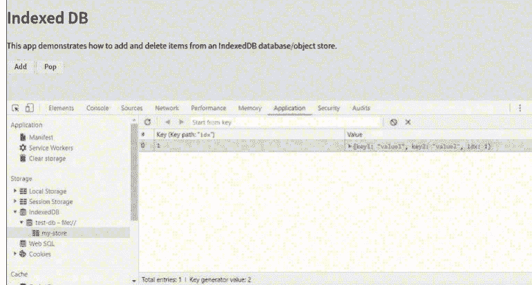

在图中，你可以看到生成的键以及与键关联的数据对象。注意代码中没有在 `add` 中包含 `idx` 对象，但 `IndexedDB` 自动为你添加了那里。

#### 删除对象

要从 `IndexedDB` 存储中删除对象，应用需要对象的索引以及以下代码：

```javascript
// 获取数据库的句柄
let db = theDB.result;
let idx = 3;
let request = db.transaction([STORE_NAME], "readwrite")
  .objectStore(STORE_NAME)
  .delete(idx);
```

```javascript
// success!
request.onsuccess = function (event) {
  console.log(`Item ${idx} deleted`);
}
```

```javascript
// ugh, error
request.onerror = function (event) {
  console.log(`Unable to delete item ${idx}`);
}
```

#### 使用游标进行迭代

`IndexedDB` 使用游标（cursors）来遍历存储（store）中的对象。Web 应用打开一个游标，如果游标不为空，则使用它从存储中检索数据对象：

```javascript
// get a handle to the db
let db = theDB.result;
var request = db.transaction([STORE_NAME], "readonly")
  .objectStore(STORE_NAME)
  .openCursor();
```

```javascript
// success!
request.onsuccess = function (event) {
  // get a handle to the cursor
  var cursor = event.target.result;
  // do we have a valid cursor?
  if (cursor) {
    // get the object value from the cursor
    item = cursor.value;
    // do something with the item's data
    // Move onto the next item in the object store
    cursor.continue();
  } else {
    // no valid cursor, so must be at the end
  }
}
```

```javascript
// ugh, error
request.onerror = function (event) {
  console.error(request.error);
  // do something with the error
}
```

在示例中，`item` 指向对象 (`key1: "value1", key2: "value2", idx: 1`)。应用通过 `item.key1`、`item.key2` 和 `item.idx` 访问值。

当应用跨游标处理数据时，它会调用 `cursor.continue()`，这将游标移动到存储中的下一个对象。这创建了一个循环，游标会移动存储中的所有对象，直到完成，此时代码将进入 `else` 分句以结束处理。

这基本上就是你为 PWA 应用添加后台同步所需要的所有关于 `IndexedDB` 的知识。在接下来的章节中，我们将 PWA News 应用直接将用户数据发布到服务器的现有过程，更新为使用 service worker 后台同步。我将通过我们在 PWA News 应用中添加的代码，详细说明后台同步的工作各个细节。

## 准备代码

我们在本章中做的工作围绕 GitHub 仓库中的服务器应用代码展开，地址为：`https://github.com/johnwargo/learning-pwa-code`。我已经在第 3 章“Service Workers”的“准备代码”部分中提供了有关如何下载代码和配置开发环境的完整说明。如果你尚未完成这些步骤，请在开始此处之前去完成它们。

打开终端并导航到克隆项目的 `\learning-pwa-code\chapter-05\pwa-news` 文件夹。该文件夹包含了第 5 版本的 PWA News 服务器应用程序（包含了你本应在第 4 章中进行的所有代码更改）。

执行以下命令安装应用程序所需的所有依赖项：

```bash
npm install
```

此命令使用 Node Package Manager (`npm`) 安装服务器所使用的 Node.js 模块。

如果你在第 3 章的设置过程中运行了 `copy-config` 命令，那么就没问题。直接跳到下一段文字之后运行 `npm` 命令。如果没有，请从 `\learning-pwa-code\chapter-03\app\` 复制 `config.ts` 文件。这会复制包含你在第 3 章中使用的 Bing API 密钥的配置文件。复制文件后，执行以下命令：

```bash
tsc
```

这会将 `server.ts` 文件（包括复制的 `config.ts` 文件）编译为项目根目录中的 `.js` 文件。你将看到由于代码引用了某些对象而引起的一些错误和警告，但如果在第 3 章中一切运行正常，那么你应该没问题。

所有部分都就绪后，是时候启动服务器了。在终端窗口中执行以下命令：

```bash
npm start
```

如果代码设置正确，服务器将在终端中响应以下文本：

```text
pwa-news-server@0.0.1 start D:\learning-pwa-code\chapter-05\pwa-news
node ./bin/www
```

此时，你已经准备就绪，服务器已启动并准备好提供内容。如果你看到错误消息，你必须深入研究报告的错误并在解决它们之前继续。

要查看 Web 应用的当前状态，请打开 Google Chrome 或支持 service workers 的浏览器并导航到：

```text
http://localhost:3000
```

稍等片刻，服务器应该像图 3.1 所示渲染应用程序。此时，你准备好编写代码了。

## 增强 PWA 应用

PWA News 的反馈（Feedback）页面显示了一个显示网站访问者情感的图表。还有一个选择下拉列表，访问者可以提交他们对网站的反馈。在本章的处理中，service worker 必须缓存所有应用资源，包括 fetch 页面，这样即使运行应用程序的设备处于网络覆盖之外，应用也会缓存。应用无法做到的将在本章中修复：在离线时接受反馈。我们使用后台同步和一些代码来实现这一目标。在本章的剩余部分中，我们将使用书籍仓库 `chapter-05/pwa-news/` 中的 Web 应用代码进行工作。

### 为后台同步准备 Service Worker

```javascript
self.addEventListener('sync', event => {
  // Process the feedback action
  if (event.tag == 'feedback') {
    console.log('SW: Processing Feedback');
  } else {
    console.log(`SW: Unrecognized sync: ${event.tag}`);
  }
});
```


# 第5章：使用后台同步实现完全离线

```javascript
openIDDB()
  .then((db) => {
    queueFeedback(db, selectedSentiment)
      .then(() => {
        console.log('submitFeedback: Successfully queued feedback');
      })
      .catch((error) => {
        console.error(error);
        Swal.fire('Sync Error', error, 'error');
      });
  });
} else {
  // 不支持 service worker 或同步
  // 所以我们使用旧方法
  postFeedback(selectedSentiment);
};
```

对 `Swal` 的调用引用了 SweetAlert2，这是一个用于在 Web 应用中生成视觉效果良好的警告对话框的开源库。第一个引号内的字符串是警告框的标题。第二个参数（`error`）是调用 `queueFeedback` 返回的错误消息，最后的 `'error'` 告诉 SweetAlert 显示一个错误类型。

此示例的完整反馈代码位于项目的 `public/chapter-codefeedback-5.js` 文件中。

代码准备就绪，现在是时候编写与本地 IndexedDB 数据库交互的代码了。如果你还记得同步过程的工作原理，即 Web 应用和 service worker 如何在不同时间访问数据库。当 Web 应用将情感放入队列进行处理时，它具有写入权限并访问数据库。当 service worker 处理情感数据队列时，它具有读写权限访问数据库。service worker 需要读写访问，是因为它需要从存储中读取数据，并在成功处理后删除数据。

如果你在想我为什么要写刚才描述的那些代码，你可能意识到这些进程都会运行一些代码来完成它们的工作。为了减少在 Web 应用和 service worker 中重复输入代码，我们将所有代码都放在同一个文件中，并从两个地方都访问它。向项目中添加一个名为 `public/js/db.js` 的新文件，然后打开它进行编辑。

在文件顶部添加以下常量：

```javascript
// IndexedDB DB 和 Store 属性
const DB_NAME = 'pwa-news';
const DB_VERSION = 1;
const STORE_NAME = 'feedback-store';
```

模块代码在多处引用了存储名称，因此我将该值移动到一个常量中，这样我就不必到处都输入它。我将数据库版本也提取到一个常量中，因为我可能会随着每个应用版本更改此值，并且我想在一个易于找到的地方放置它。它只被使用了一次，但将其放在文件顶部使其非常容易更改。随后，我将数据库名称也移动到了常量中，仅仅是因为；我所有的内容都在这里了，所以也更改数据库名称也是合理的。

接下来，向新文件添加所示的 `openIDB` 函数。该函数使用了本章之前描述的概念来打开 IndexedDB 数据库，并将数据库对象返回给调用函数，以便它可以使用与打开的数据库进行交互。

```javascript
function openIDB() {
  // 打开应用使用的 indexeddb 数据库
  return new Promise((resolve, reject) => {
    // 打开反馈数据库
    var theDB = self.indexedDB.open(DB_NAME, DB_VERSION);
    theDB.onsuccess = function (event) {
      console.log('openIDB: Successfully opened database');
      // 返回 db 对象结果
      resolve(event.target.result);
    };
    // 定义数据库错误回调
    theDB.onerror = function (event) {
      let msg = `Database error ${theDB.error}`;
      console.log(`openIDB: ${msg}`);
      Swal.fire('Database Error', msg, 'error');
      // 拒绝 promise，我们失败了
      // 包含错误消息
      reject(msg);
    };
    theDB.onupgradeneeded = function (event) {
      console.log('openIDB: Upgrade needed');
      // 获取数据库
      var db = event.target.result;
      // 检查是否已存在
      if (!db.objectStoreNames.contains(STORE_NAME)) {
        // 如果不存在，则创建
        console.log('openIDB: Creating store');
        // 创建 store 的配置
        var storeOptions = { keyPath: "id", autoIncrement: true };
        // 然后创建 store
        db.createObjectStore(STORE_NAME, storeOptions);
      }
    };
  });
}
```

## 增强 PWA 应用程序

从下拉字段中选择一种情感，并点击“分享情感”按钮。应用程序应立即显示图 5.5 所示的队列框。此时，我们认为已经为 service worker 队列了一些待处理的数据——让我们检查一下。

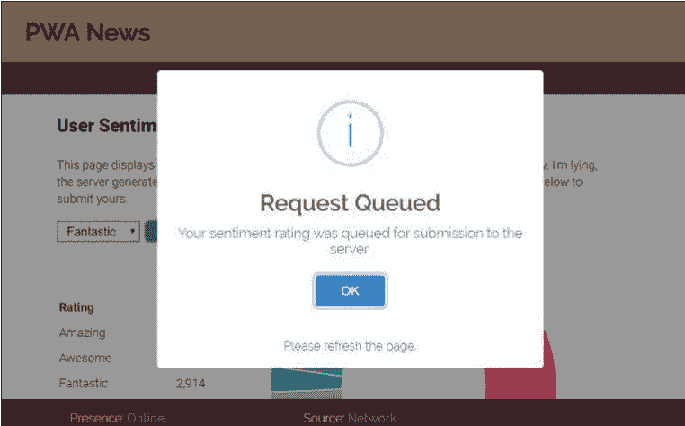

图 5.5 提交反馈

打开浏览器的开发者工具并切换到“应用程序”选项卡。在左侧导航器中，展开 IndexedDB 选项并刷新内容。你应该能看到队列中的反馈数据，如图 5.6 所示。

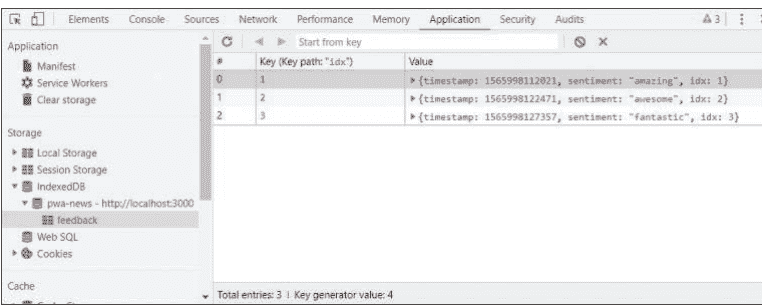

图 5.6 为 Service Worker 队列处理的反馈数据

数据仍然在那里，是因为我们还没有向 service worker 中添加任何代码来处理它；我们将在下一节中完成这一操作。

## 完成 Service Worker

我们的最后一步是完成对 service worker 的增强，使其知道如何处理反馈队列。在本节中：

- 在 service worker 中添加新 `db.js` 文件的引用。
- 完成 service worker 中同步事件监听器中的代码。
- 向项目的 `db.js` 文件中添加两个函数。

打开项目的 `public/sw.js` 文件，并在文件顶部添加以下代码行：

```javascript
// 服务器反馈 API 端点
const FEEDBACK_URL = `${self.location.origin}/api/sentiment`;
```

该 service worker 将在处理反馈时使用此常量连接服务器。

接下来，在调用 `skipWaiting()` 之前，添加以下行来安装事件监听器：

```javascript
self.importScripts('./db.js');
```

记住，service worker 运行在与 Web 应用程序独立的进程中，因此它不知道你已经在反馈页面加载了数据库库。你必须在 service worker 中显式地加载它。

结果应该是这样的：

```javascript
self.addEventListener('install', event => {
  // 当浏览器安装应用时触发
  // 这里我们只是记录事件以及传递给事件的对象的内容
  // 事件的目的是为了给 service worker 提供一个在
  // 安装完成后设置本地环境的地方。
  console.log(`SW: Event fired: ${event.type}`);
  console.dir(event);
  self.importScripts('./db.js');
  // 强制激活 service worker
  self.skipWaiting();
});
```

好了，现在是时候告诉 service worker 如何处理处理队列中的反馈了。我们即将处理的代码可能是我们目前为止所见过的最复杂的代码。为了尽可能清晰地解释它，我在表 5.1 中标识了高级步骤。

### 表 5.1 Service Worker 队列处理

| 步骤 | 方法 | 描述 |
| :--- | :--- | :--- |
| 1 | `event.waitUntil()` | 指示 service worker 保持活动状态（不关闭），直到所有操作完成。 |
| 2 | `getFeedbackItems()` | 从数据存储中获取反馈项。 |
| 3 | `Promise.all()` 和 `data.items.map()` | 遍历每一个反馈项。 |
| 4 | `fetch()` | 将数据 POST 到服务器。 |
| 5 | `deleteFeedback()` | 从数据存储中删除已处理的反馈。 |

这里 service worker 执行的所有操作都是异步的，因此我处处都使用了承诺。更新项目 service worker 中的同步事件监听器；在你完成后我将解释这些代码：

```javascript
self.addEventListener('sync', event => {
  console.log('SW: Sync event fired');
  if (event.tag === 'feedback') {
    console.log('SW: Processing sync');
    event.waitUntil(
      getFeedbackItems()
        .then(data => {
          // 遍历项数组
          return Promise.all(
            data.items.map(function (feedbackItem) {
              // 如果可以，则更新服务器
              return fetch(FEEDBACK_URL, {
                method: 'post',
                headers: { 'Content-Type': 'application/json' },
                body: JSON.stringify({
                  sentiment: feedbackItem.sentiment
                })
              })
                .then(() => {
                  // 成功发布，
                  // 所以删除索引处的记录
                  return deleteFeedback(data.db, feedbackItem.idx);
                })
                .catch(error => {
                  // 哎呀，出错了
                  console.error(`SW: Sync Error: ${error}`);
                });
            })
          );
        })
    );
  } else {
    // 这不应该发生
    console.log(`SW: Unrecognized sync event (${event.tag})`);
  }
});
```

以下是该代码的作用：

- 我们不会等待浏览器在 service worker 处理队列时才关闭 service worker，因此代码从调用 `event.waitUntil()` 开始，这指示浏览器的 `SyncManager` 等待到我们完成为止。
- `waitUntil` 期望一个承诺，因此 `getFeedbackItems` 创建了一个承诺（我们稍后会添加那部分代码），然后开始工作。
- `getFeedbackItems` 连接到数据库并构建所有反馈项的数组，然后将其作为承诺的结果返回。
- 代码遍历反馈项数组。它使用 `Promise.all()` 表示它要创建一组承诺，如果其中一个失败，整个它就会解析（失败）。
- 在 `Promise.all()` 内部，它使用 `array.map()` 方法对数组中的每个元素执行函数。
- `map` 方法调用 `fetch()` 将数组中的每个项数据 POST 到服务器。`fetch` 方法返回一个承诺，因此让 `Promise.all()` 满意。
- 当 POST 成功完成后，代码调用 `deleteFeedback()`，它会从数据存储中删除已处理的项。

### `getFeedbackItems` 函数

向 `public/js/db.js` 文件添加以下函数：

```javascript
function getFeedbackItems() {
  return new Promise((resolve, reject) => {
    openIDB()
      .then(db => {
        var transaction = db.transaction(STORE_NAME, 'readonly');
        var store = transaction.objectStore(STORE_NAME);
        var request = store.getAll();
        request.onsuccess = function (event) {
          let items = event.target.result;
          console.log(`getFeedbackItems: Retrieved ${items.length} items`);
          resolve({ db: db, items: items });
        };
        request.onerror = function (event) {
          console.error('getFeedbackItems: Error retrieving items', event.target.error);
          reject(event.target.error);
        };
      })
      .catch(error => {
        reject(error);
      });
  });
}
```

### `deleteFeedback` 函数

向 `public/js/db.js` 文件添加以下函数：

```javascript
function deleteFeedback(db, idx) {
  return new Promise((resolve, reject) => {
    var transaction = db.transaction(STORE_NAME, 'readwrite');
    var store = transaction.objectStore(STORE_NAME);
    var request = store.delete(idx);
    request.onsuccess = function (event) {
      console.log('deleteFeedback: Successfully deleted item ' + idx);
      resolve();
    };
    request.onerror = function (event) {
      console.log('DB: deleteFeedback: Unable to delete item ' + idx);
      console.error(transaction.error);
      reject(transaction.error);
    };
  });
}
```

此示例的 service worker 代码位于项目文件夹的 `public/service-worker.js` 文件中。

现在我们开始编写代码更改。保存所有文件的更改，切换到浏览器并刷新首页。请记住，service worker 是从项目的 `index.html` 文件加载的，但它主管着应用的所有页面。你必须刷新反馈页面来更新 service worker，或者切换到反馈页面以加载我们代码更改的另一部分。

继续提交一个新的反馈，切换到开发者工具的控制台。你应该能看到你的队列反馈项正在处理，如图 5.8 所示。

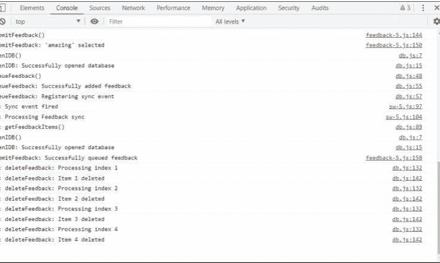

图 5.8 Chrome 开发者工具控制台输出显示反馈队列处理

尝试将应用离线并提交一些反馈。当你重新开启网络连接时，service worker 应该唤醒并立即处理队列的项目。

我们刚刚处理了大量的代码并生成了很多 promise，但我们现在有了一个可以在在线或离线状态正常工作的 PWA 新闻网站。

## 处理最后机会

早些时候我提到过如果后台同步失败，浏览器稍后会重试。我没说、文档也没有记录的是，浏览器在成功之前会重试多少。我在某处听过浏览器使用指数退避算法来控制重试的频率。为了更好地理解这一点，我遇到了一篇名为《Chrome、后台同步 API 与指数退避》的文章，它研究了这个问题。

思考这个问题，你可能会认为浏览器在放弃同步事件之前会重试 5 次、10 次或 20 次，但事实是像 Chrome 这样的浏览器只同步一次后就会放弃。引用凯文·克莱恩在《鱼不可欺浅》中的台词：“太失望了！”

对于我们简单的 PWA 新闻页面来说，尝试交付三次数据并不是什么大事。对于更具事务性的同步（例如银行应用），我真的想要更多尝试。好消息是，浏览器的 `SyncManager` 会在你准备放弃请求时通知你。以下列表包含了传递给 service worker 同步监听器的事件快速副本。在里面你应该看到 `lastChance` 属性。它现在是 `false`，因为它是从第一次通过到处理同步事件时捕获的。

```javascript
bubbles: false,
cancelBubble: false,
cancelable: false,
composed: false,
currentTarget: ServiceWorkerGlobalScope,
  clients: [],
  registration: ServiceWorkerRegistration,
  onactivate: null,
  fetch: null,
  onstall: null,
defaultPrevented: false,
phase: 0,
isTrusted: true,
path: [],
returnValue: true,
src: ServiceWorkerGlobalScope,
  clients: [],
  registration: ServiceWorkerRegistration,
  onactivate: null,
  fetch: null,
  onstall: null,
tag: "feedback",
target: ServiceWorkerGlobalScope,
  clients: [],
  registration: ServiceWorkerRegistration,
  onactivate: null,
  fetch: null,
  onstall: null,
timeStamp: 0,
type: "sync",
__proto__: SyncEvent
```

当浏览器的 `SyncManager` 对这个同步事件感到无奈时，它会将 `lastChance` 切换为 `true`，这样你就知道即将发生什么，并以最符合你应用的方式采取行动。在 service worker 中，你可以这样做：

```javascript
// 这是浏览器最后一次处理此操作吗？
if (event.lastChance) {
  console.warn('SW: ' + event.tag.toUpperCase() + ' sync chance');
}
```

这只是向控制台抛出一个警告，但用户永远看不见它，而且实际上并没有做任何事。记得之前我提到过你可以在 service worker 内部注册同步事件吗？没错，这是保持此事件活跃的一种方法。如果你的代码得知 `SyncManager` 准备放弃此事件且仍有数据要处理，只需使用以下代码重新启动后台同步：

```javascript
self.registration.sync.register('feedback');
```

这有点危险，因为它强制 service worker 永久处理该事件，然而，它确实有效。所以，在我们当前的监听器中，之前的代码将进入同步监听器：

```javascript
self.addEventListener('sync', event => {
  console.log('SW: Sync event fired');
  // 这是浏览器最后一次处理此操作吗
  if (event.lastChance) {
    console.warn('SW: ' + event.tag.toUpperCase() + ' sync chance');
  }
  if (event.tag === 'feedback') {
    console.log('SW: Processing Feedback sync');
    event.waitUntil(
      getFeedbackItems()
        .then(data => {
          return Promise.all(
            // 遍历项目
            data.items.map(function (feedbackItem) {
              // 如果可以，则更新服务器
              return fetch(FEEDBACK_URL, {
                method: 'post',
                headers: { 'Content-Type': 'application/json' },
                body: JSON.stringify({
                  sentiment: feedbackItem.sentiment
                })
              })
                .then(() => {
                  // 成功发布到 idx
                  // 所以我们删除 idx 处的记录
                  return deleteFeedback(data.db, feedbackItem.idx);
                })
                .catch(error => {
                  // 糟糕，出问题了
                  console.error('SW: Sync Error: ' + error);
                });
            })
          );
        })
    );
    if (event.lastChance) {
      // 对最后的事件进行处理
      // 警告用户，再次提交事件
      self.registration.sync.register('feedback');
    }
  } else {
    // 这不应该发生
    console.log(`SW: Unrecognized sync event (${event.tag})`);
  }
});
```

好了，回到这个指数退避算法。由于引用的文章有点久远了，我担心浏览器可能发生了变化，所以我以文章的代码为起点，进行了改进，并在浏览器中运行以查看它是如何处理退避的。确实如此吧？你可以在 `learning-pwa-code/chapter-05-fallback` 找到我的完整列表。

我测试这段代码的方法是在浏览器中加载，然后停止终端窗口中运行的服务进程。我的发现如图 5.9 所示。

### 后台同步退避测试

此网页验证了 Service Worker 后台同步指数退避的操作。打开开发者工具控制台窗口观察发生了什么。

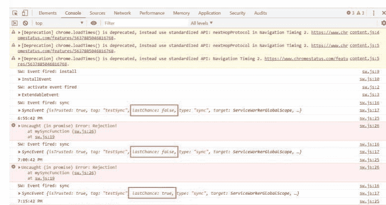

图 5.9 后台同步退避结果

SyncManager 检测到无法完成同步事件，它等待 5 分钟后重试。如果重试失败，SyncManager 等待 15 分钟后再次尝试，但这次会将 `lastChance` 属性从 `false` 切换为 `true`。这不是一个非常复杂的算法；我无法想象 Google 的博士在这个上面花了大量时间。

总之，这是你必须意识到并在应用中适应的后台同步局限性。如果数据很重要，你必须使用本节介绍的策略强制浏览器重试同步两次以上。

## 总结

在本章中我们涵盖了大量的代码，你学到了很多关于后台同步的知识。我们的 PWA 新闻应用功能完整了；它通过资源和数据缓存以及用于数据提交的后台同步正常工作。我希望你阅读这一章时像我写它一样有趣。

在下一章中，我们将深入书中最后一个真正的 PWA 主题：浏览器通知。

---

# 第6章：推送通知

移动应用程序之所以如此引人注目的原因之一是移动平台的推送通知能力，这种功能允许应用开发人员向运行应用程序的设备发送信息。根据设备操作系统和通知的类型，发送到设备的信息会显示在设备的通知区域，或在应用内出现。通知扩展了应用在设备当前可用范围之外范围，并提供了一种简洁的方式，让应用用户了解几乎任何信息。

使用 Service Worker 的 Web 应用程序也具有一些类似的能力。在本章中，我将展示如何配置 Web 应用程序以支持通知，并通过服务器进程向已订阅的浏览器发送通知。与前一个一样，本章充满了代码，让我们开始吧。

## 介绍推送通知

在 Web 应用程序中，通知是接收到通知消息时显示的小型弹出窗口。Web 应用程序可以向自己发送通知，你也可以从远程系统（通常通过应用或 Web 服务器）向浏览器发送通知。通知仅在目标浏览器运行时才会出现，但许多智能手机上的默认浏览器会持续运行，而且 Google Chrome 有一个用户可以开启的设置，使其保持在后台运行。图 6.1、6.2 和 6.3 显示了在 Windows、macOS 和 Android 上相同的通知界面。

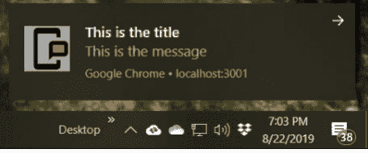

图 6.1 Windows 上的浏览器通知

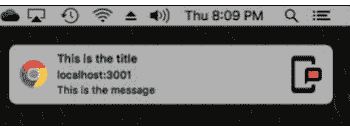

图 6.2 macOS 上的浏览器通知

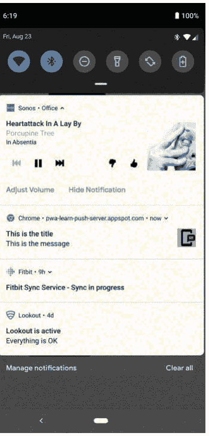

图 6.3 Android 上的浏览器通知

Windows 通知显示在桌面的左下角，而 macOS 通知显示在桌面的右上角。在 Android 上，通知与设备显示的其他通知一起出现。如果你在好奇我为什么没有提 iOS，那是因为由于我写这部分内容时，iOS 还不支持浏览器通知。

这些通常被称为*推送通知*，因为它们通常通过网络连接推送到浏览器。我更倾向于称之为*远程通知*，因为它们是从远程服务发送的。另一种类型的通知是我所说的*本地通知*，即由在该浏览器运行的 Web 应用程序向浏览器发送的通知。你将在本章稍后的代码中看到这两种者的示例。

本地通知仅在请求的网页已托管时才起作用。如果你直接从文件系统打开页面（而不是使用 URL），通知将无法工作。

然而，远程通知需要 Service Worker 才能运行。对于由远程系统发送的通知，是 Service Worker 在通知到达时对其进行处理，并决定如何操作它。

在浏览器能够从 Web 应用程序或远程系统接收通知之前，浏览器用户必须先授予权限，授权浏览器代表应用显示通知。如果用户未授予权限，你就无法向浏览器发送通知。

你在浏览网页时可能周期性地看到这些权限请求，某些网站在你知道该网站是否包含你感兴趣的内容之前，就会立即请求向你的浏览器发送通知的权限。这种方法会让用户非常反感，并引发诸如图 6.4 所示的推文。

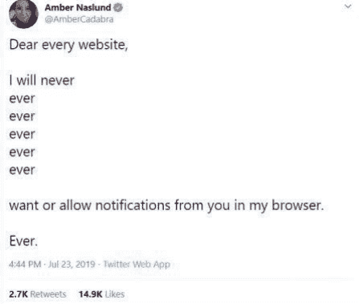

图 6.4 关于推送权限请求的推文评论

Web 应用程序应该等待到确定网站对接收通知感兴趣后再请求。

## 远程通知架构

在进入具体的代码示例之前，让我们聊聊推送是如何工作的。为了向浏览器发送通知，这需要以下三要素：
- 一个能够接收、处理并显示通知的浏览器。
- 一个可以发送通知的应用程序。
- 一个管理通知推送的云端服务。

订阅时，订阅的 Web 应用程序会将订阅对象（以及它认为相关的任何附加信息）发送到后端应用程序，并存储在那里，供以后发送通知时使用。

为了保护用户免受恶意通知，应用程序后端以加密格式发送所有通知请求。为了做到这一点，Web 应用程序生成一组用于与推送服务交互的加密密钥。Web 应用程序将公钥包含在发送给推送服务的订阅请求中。

当 Web 应用程序后端向推送服务发送通知请求时，它使用服务器的私钥对请求进行加密。由于推送服务拥有公钥（来自订阅请求），它可以解密消息并确定请求确实是由正确的服务器发送的。

当后端应用服务器有信息或数据要发送到浏览器时，服务器会：
- 使用服务器的私钥对通知请求进行加密。
- 使用 Push API 将请求发送到推送服务。
- 推送服务解密请求，验证发送者的身份，如果验证通过，则将通知发送到目标浏览器。
- 浏览器唤醒推送工人来处理通知。

在本书中，我不会涉及任何与 Push API 实现相关的的内容。它是一个带有社区支持的开放标准，因此我将跳过所有这些工作，使用一个流行的开源解决方案来管理发往推送服务的通知请求交付。在章节的末尾，我将展示服务器如何使用我们的开源解决方案来发送通知。

## 准备代码

我们在本章中的工作围绕我为本章创建的新应用展开（当然，样式是由 Scott Good 设计的）。除非接收接收的 Web 应用被托管在某处（而不是仅仅从系统加载），否则通知将无法工作，因此，我包含了一个与之前章节类似的推送流程。设置过程与你之前看到的略有不同，所以请不要跳过此处或下一节的指令。

服务器应用的代码可以在 GitHub 仓库中找到，地址为 https://github.com/johnwargo/learning-pwa-code。我在第 3 章“Service Workers”的“准备代码”部分提供了关于如何下载代码和配置开发环境的完整指令。如果你还没有完成这些步骤，请在重新开始这里之前完成它们。

打开终端并导航到克隆项目的 `learning-pwa-code/chapter-06` 文件夹。该文件夹包含一个相对空的 Web 应用版本，我们将在学习本章的过程中构建它。执行以下命令安装应用所需的所有依赖项：

```bash
npm install
```

此命令使用 Node Package Manager (npm) 安装服务器使用的 Node.js 模块。

## 生成加密密钥

通知过程需要一组加密密钥：用于确保通知过程完整性的公钥和私钥。浏览器通知使用自愿应用服务器识别协议（VAPID）作为 Web Push 加密密钥对与推送服务的通信进行加密。我不需要详细介绍这些密钥以及它们是如何制作的，因为知道这些信息对你学习推送没有帮助。推送过程使用了它们，因此为你创建的任何发送浏览器通知的 Web 应用都必须有一组密钥。

生成密钥的方法之一是使用 Secure VAPID 生成器。本章代码包含的服务器过程使用了流行的 `web-push` 模块来管理发往浏览器云服务的通知请求交付。它包含一个自动生成密钥的函数，我们将使用它。

打开终端窗口，导航到项目的 `learning-pwa-code/chapter-06` 文件夹，并执行以下命令：

```bash
node generate-keys.js
```

这会执行我编写的一个小型 Node 应用，它会生成一组 VAPID 密钥并将它们写入 Web 应用使用的一些配置文件。该应用使用 `web-push` 模块的 `webpush.generateVAPIDKeys()` 方法，该方法为我们处理了整个过程。

我之前提到过客户端需要服务器的公钥，而服务器使用私钥，因此过程生成了两个文件。第一个是 `chapter-06/app/config.ts`，如下所示：

```javascript
const Config = {
  GCMAPID_KEY: 'SUPER-SECRET-PUBLIC-KEY',
  VAPID_PRIVATE: 'SUPER-SECRET-PRIVATE-KEY'
};
```

服务器使用此文件在通过推送服务发送通知消息时提供私加密密钥。

另一个文件是 `chapter-06/public/js/config.js`，如下所示：

```javascript
const Config = {
  VAPID_PUBLIC: 'SUPER-SECRET-PUBLIC-KEY'
};
```

Web 应用在订阅通知时使用此文件提供公加密密钥。

> **注意**：你不需要像我在这里这样将 VAPID 密钥拆分到单独的配置文件。这样做是因为我知道服务器源代码将通过书籍的 GitHub 仓库公开，将密钥保存到单独的文件中可以让我从仓库中省掉它们。

与之前的章节一样，我用 TypeScript 编写了服务器应用，因此在你使用新配置文件配合服务器之前，你必须打开终端窗口，导航到项目文件夹并执行以下命令：

```bash
tsc
```

此命令将 `chapter-06/app/config.ts` 编译为 `chapter-06/config.js`。准备就绪后，我们就可以开始了。

你可能注意到我忽略了在第一个文件示例中解释 `GCMAPI_KEY`。Google 在推送标准出现之前就提供了浏览器通知的支持，且 Google 的实现使用了现在已废弃的 Google Cloud Messaging (GCM) 服务。在本章中，我假设我们的目标是支持该功能的现代浏览器；如果你的应用支持旧版浏览器，你必须在 Google 的 Firebase Cloud Messaging (FCM) 中设置账户。有关此主题的更多信息，请参考 Google 的“什么是 GCM 与 Web Push 的关系？”。

现在启动服务器。在终端中执行以下命令：

```bash
npm start
```

如果一切配置正确，服务器将响应：如果你看到错误消息，你必须深入研究错误并解决它们。

> **注意**：本章的服务器进程运行在端口 3001，这与之前的章节不同。我这样做是因为浏览器会缓存资源，而我知道我们会在这个项目和之前的项目之间来回切换，我决定让它们运行在不同的端口上以防浏览器混淆。

要查看应用的当前状态，打开支持 service worker 的浏览器并导航到：

```text
http://localhost:3001
```

稍短延迟后，服务器应该渲染如图 6.6 所示的网页。该应用目前什么都不做，但很快就会了。当我们完成后，应用将允许用户订阅通知（如图所示），并拥有一个 service worker 来处理通过服务器发送给它的远程通知。

我使用 HTML5 Boilerplate 模板创建了这个应用，并从 https://icons.com/2517/push-notifications 获取了一个推送图标。你会在应用中看到 jQuery 和其他东西，但我们不会使用其中大部分内容——这只是因为模板的原因。

## 验证通知支持

某些浏览器（例如 iOS 上的 Safari）不支持通知功能。在应用对通知进行任何操作之前，应用必须首先检查浏览器是否支持通知。要做到这一点，可以使用以下代码来检查 `Notification` 对象是否存在：

```javascript
// 浏览器是否支持通知？
if ("Notification" in window) {
  // 支持的！做一些有趣的事情
} else {
  // 不支持？那么显示一条警告消息
  // 或者禁用处理通知的 UI 部分
}
```

此检查是项目 `chapter-06/public/js/index.js` 中 `updateUI` 函数的核心组件。应用执行此函数以在启动时以及每次浏览器订阅发生变化时更新 UI。

你的应用在执行任何与通知相关的操作之前，必须检查通知支持吗？不，真的。如果你不这样做，任何使用 `Notification` 对象的代码在不支持通知的浏览器上将直接失败。

## 检查通知权限

一旦应用知道浏览器支持通知，它应该使用 `Notification` 对象的 `permission` 属性来检查用户是否授予了权限，如下代码所示：

```javascript
if (Notification.permission === "granted") {
  console.log('用户已批准通知');
}
```

支持的权限值为：
- `granted`（已批准）
- `denied`（已拒绝）
- `default`（默认）

权限值 `granted` 意味着用户已批准了该应用使用通知。权限值 `denied` 意味着相反：用户没有授予该应用使用通知的权限。很简单，对吧？

`default` 值很奇异，因为它意味着浏览器不确定用户是否批准了通知。在这种情况下，浏览器会简单地假设用户没有授予权限。这发生在用户在没有做出任何选择的情况下关闭了权限提示框时。

## 获取通知权限

现在你已经知道如何检查浏览器是否支持通知，以及用户是否已授予了通知权限，现在是时候获取用户的通知权限了。要做到这一点，应用调用 `Notification` 对象的 `requestPermission` 方法，然后由浏览器接管后续的审批过程。

`requestPermission` 方法返回一个 promise；当该 promise 解析时，它会返回一个 `DOMString`，其中包含上一节描述的 `granted`、`denied` 和 `default` 值。

以下代码演示了 `requestPermission` 方法的用法。打开 Web 应用项目的 `chapter-06/public/index.js` 文件，并将代码添加到现有的 `doSubscribe` 函数中。

```javascript
Notification.requestPermission().then(result => {
  switch (result) {
    case 'granted':
      // 用户授予了我们权限，
      // 所以我们可以继续进行订阅
      break;
    case 'denied':
      // 代码块
      console.error('Denied');
      Swal.fire({
        type: 'info',
        title: '订阅',
        text: '你拒绝了访问通知权限。',
        footer: '准备好后请重试。'
      });
      break;
    default:
      // 用户在没有做出选择的情况下
      // 关闭了权限框
      console.warn('Default');
      Swal.fire({
        type: 'info',
        title: '订阅',
        text: '对话框在未做出选择的情况下关闭。',
        footer: '请稍后重试。'
      });
  }
});
```

当应用用户点击或触摸“订阅”按钮时，此代码会请求通知权限，然后通知用户结果。我们稍后会对此结果进行更多操作，但现在先让它运行起来。

> **注意**：你在代码不同地方看到的对 `Swal` 的调用是指 SweetAlert2，这是一个用于在 Web 应用中显示酷炫对话的流行 JavaScript 库。

我本可以在请求权限之前检查用户是否已经授予了权限（使用上一节的代码），但如果用户已经授予了权限，对 `requestPermission` 的调用将直接返回之前的的结果。

保存文件更改，切换到浏览器并打开 `http://localhost:3001`。浏览器应该显示图 6.6 所示的页面。如果没有显示，请返回检查你的代码。当运行正常时，点击“订阅”按钮，你应该会在图 6.8 的顶部看到通知提示。

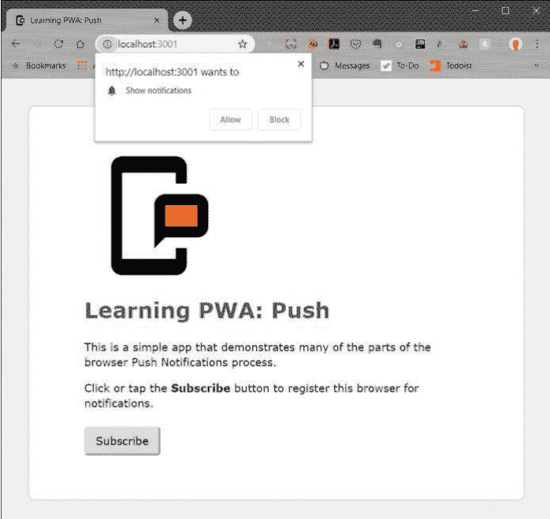

图 6.8 提示通知权限

打开浏览器的开发者工具，切换到 Console 选项卡，然后在通知提示中做出选择。你应该能看到写入到控制台的权限结果，在某些情况下，当你不允许通知时，会弹出对话框。

我在编写本章代码时学到的点之一是，当你多次在没有做出选择的情况下关闭通知提示时，浏览器会变得有点挑剔。当我关闭几次提示框后，Chrome 不再向我显示提示框，快速查看控制台显示了以下内容：

> 通知权限已被用户阻止，因为用户多次忽略了权限。这可以在“页面信息”中重置，通过点击 URL 旁的锁图标可以访问。查看 https://www.chromestatus.com/features/64431。

## 通知选项

正如我在上一节中所解释的，你在图 6.10 中看到的只是一个简单的通知，使用了传递给 `Notification` 对象构造函数的标题字符串，或者在第二个示例中传递给 `registration.showNotification` 方法。浏览器的能力远得多。

> **注意**：由于使用 `Notification` 对象仅限于桌面浏览器（至少目前如此），我今后将忽略这种形式的通知。好消息是，我在本章其余部分显示的内容都适用于该类型的通知，因此如果你想在应用程序中使用它们，也可以将本节的细节应用于它们。

要利用额外的通知选项，你必须在调用 `registration.showNotification` 时传递一个 `options` 对象，如下所示：

```javascript
registration.showNotification(title, options);
```

`options` 对象是一个简单的 JavaScript 对象，包含以下一个或多个属性：

- `actions`：项数组，表示用户可以对此通知执行的操作。你稍后会看到一个这方面的示例。
- `badge`：指向图像文件的 URL，当没有足够的空间显示完整通知时，用它表示通知。
- `body`：通知的正文文本。稍后你将看到一个示例。
- `data`：与通知关联的任意数据对象。service worker 在处理通知时可以使用它。
- `dir`：通知文本的方向。该属性默认认为 `auto`；其他选项为 `rtl`（从右到左）和 `ltr`（从左到右）。
- `icon`：指向图像文件的 URL，显示在通知中（通常在窗口左侧，macOS 上在右侧）。
- `image`：指向图像文件的 URL，显示在通知中（通常在通知上方）。
- `lang`：指定通知的语言。
- `renotify`：布尔值，指定当新通知替换旧通知时，浏览器是否应该通知用户。默认值为 `false`。
- `requireInteraction`：布尔值，指定在用户点击或关闭通知之前，通知是否应该保持激活状态。默认值为 `false`，这会让浏览器在几秒后自动关闭通知。
- `tag`：标识通知的字符串值。为了防止通知弄乱用户的系统，当具有相同 `tag` 的新通知进入时，它会替换队列中任何具有相同 `tag` 的之前的通知。
- `vibrate`：在通知用户新闻通知时使用的振动模式数组。该数组包含每个操作播放/暂停的毫秒数。例如，要振动 200 毫秒，暂停 100 毫秒，重复三次，你需要使用 `[200, 100, 200, 100, 200, 100]`。

关于这些选项的更详细的描述，以及许多浏览器不支持的较新选项列表，可以在 `Notification.Notification()` 中找到。

> **警告**：这里描述的许多选项仅在 Microsoft Windows 上有效。特别是 macOS，以及 Android 也不支持所有可用选项。

现在是时候看看这些选项的操作了。下面的示例为通知设置了正文文本和图标：

```javascript
let options = {
  body: "Isn't this cool?",
  icon: "/img/push-icon-red.png"
};

let title = 'I read Learning PWA, and ' + 'all I got was this silly notification!';
registration.showNotification(title, options);
```

当你在浏览器中运行此代码时，你将看到图 6.12 所示的通知。


图 6.12 带有正文和图标的通知

我喜欢的用法之一是随通知包含一个随机图像文件，如下所示：

```javascript
let options = {
  body: "Isn't this cool?",
  image: "https://picsum.photos/200/100",
  icon: "/img/push-icon-red.png"
};

let title = 'I read Learning PWA, and ' + 'all I got was this silly notification!';
registration.showNotification(title, options);
```

这生成了图 6.13 所示的通知。

你也可以为通知包含操作，如下面的示例所示：

```javascript
let options = {
  body: "Isn't this cool?",
  image: "https://picsum.photos/200/100",
  icon: "/img/push-icon-red.png",
  actions: [
    { action: 'like', title: 'Like' },
    { action: 'dismiss', title: 'Dismiss' }
  ]
};

let title = 'I read Learning PWA, and ' + 'all I got was this silly notification!';
registration.showNotification(title, options);
```

## 订阅通知

记住，我们需要服务器上的订阅对象以便以后向浏览器发送通知，因此接下来我们必须将该对象上传到服务器。为了配合这一点，在项目的 `index.js` 文件中添加 `postRegistration` 函数：

```javascript
function postRegistration(subscription) {
  const serverURL = `${location.origin}/api/subscribe`;
  return new Promise((resolve, reject) => {
    if (subscription) {
      // 构建指向应用 API 的 URL
      console.log(`Submitting subscription to ${serverURL}`);
      // 我们传递给服务器的数据
      const data = {
        subscription: subscription,
        name: `${platform.name} (${platform.version})`,
        platformName: platform.name,
        platformVersion: platform.version,
        platformLayout: platform.layout,
        platformOS: platform.os,
        platformDesc: platform.description
      };
      // 将数据 POST 到服务器
      fetch(serverURL, {
        method: 'POST',
        headers: { 'Content-Type': 'application/json' },
        body: JSON.stringify(data)
      })
        .then(response => {
          console.log('Received response from the server');
          if (response.status == 201) {
            console.log('Subscription submitted');
            response.json()
              .then(data => {
                console.log(`UUID: ${data.uuid}`);
                localStorage.setItem(UUID_KEY, data.uuid);
                resolve();
              });
          } else {
            // 告诉用户失败了
            Swal.fire('POST Error', response.statusText, 'error');
            reject(response.statusText);
          }
        });
    } else {
      reject('Missing endpoint value');
    }
  });
}
```

这段代码将带有浏览器额外信息的订阅对象发送到服务器。稍后当我们测试更改时，你将看到这些数据的示例。代码还记录了服务器生成的订阅唯一 ID。我们将此值存储在应用的本地存储器中（使用我们之前添加到应用中的 `UUID_KEY`，这样在取消订阅的过程中我们可以使用它）。

最后一部分是应用如何检查订阅状态。应用可能希望根据浏览器的订阅状态更新 UI；实现此操作的代码如下：

```javascript
navigator.serviceWorker.ready.then(registration => {
  console.log('Checking subscription');
  // 检查确保浏览器没有已经订阅
  registration.pushManager.getSubscription()
    .then(subscription => {
      if (subscription) {
        // 浏览器已订阅
      } else {
        // 浏览器未订阅
      }
    });
});
```

现在是时候结束本节，并为 Web 应用添加订阅通知的功能了。这段代码替换了应用中现有 `doSubscribe` 函数中的 `granted` 分支情况。它与之前显示的订阅代码略有不同；在这种情况下，它会在订阅前检查浏览器是否已经订阅。请继续将此代码添加到项目 `index.js` 文件的 `doSubscribe` 函数中：

```javascript
case 'granted':
  // 用户授予了我们权限，
  // 继续进行注册
  console.log('Permission granted');
  navigator.serviceWorker.ready.then(registration => {
    console.log('Checking subscription');
    // 检查确保浏览器没有已经订阅
    registration.pushManager.getSubscription()
      .then(subscription => {
        if (subscription) {
          console.log('Browser is already subscribed');
          Swal.fire({
            type: 'info',
            title: 'Subscribe',
            text: 'This browser is already subscribed for notifications'
          });
        } else {
          // 订阅浏览器
          console.log('Subscribing the browser');
          var subOptions = {
            userVisibleOnly: true,
            applicationServerKey: urlBase64Uint8Array(Config.VAPID_PUBLIC)
          };
          registration.pushManager.subscribe(subOptions)
            .then(subscription => {
              console.log('Browser subscribed');
              registration.showNotification('I read Learning PWA, ' +
                'all I got was this silly notification!');
              postRegistration(subscription)
                .then(() => {
                  console.log('Subscription POSTed to server');
                  updateUI();
                  Swal.fire({
                    type: 'info',
                    title: 'Subscribe',
                    text: 'The browser was successfully subscribed for notifications',
                    timer: 2000
                  });
                })
                .catch(error => {
                  console.error(error);
                });
            })
            .catch(error => {
              // 唔，没成功
              console.error(error);
              // 告诉用户我们的情况
              Swal.fire({
                type: 'error',
                title: 'Subscribe Error',
                text: error
              });
            });
        }
      });
    updateUI();
    break;
```

既然我们已经知道如何判断浏览器是否已订阅，让我们更新 `updateUI` 函数，根据浏览器的订阅状态隐藏订阅按钮并显示取消订阅按钮。

```javascript
function updateUI() {
  console.log('updateUI()');
  // 浏览器支持通知吗？
  if ("Notification" in window) {
    navigator.serviceWorker.ready.then(registration => {
      // 检查是否已订阅
      registration.pushManager.getSubscription()
        .then(subscription => {
          if (subscription) {
            console.log('Browser is already subscribed');
            document.getElementById("subscribeDiv").style.display = 'none';
            document.getElementById("unsubscribeDiv").style.display = 'block';
          } else {
            // 未订阅？
            document.getElementById("subscribeDiv").style.display = 'block';
            document.getElementById("unsubscribeDiv").style.display = 'none';
          }
        });
    });
  } else {
    // 不支持？显示警告
    document.getElementById("noNotifications").style.display = 'block';
  }
}
```

请保存更改并刷新浏览器页面。当你重置通知权限（如图 6.9 所示）然后点击订阅按钮时，你应该看到图 6.15 所示的结果。

在这个项目中，我为 SweetAlert 添加了超时值使其自动消失，所以不要对这些对话消失感到惊讶。

## 取消通知

取消通知比订阅通知简单得多。你仍然需要注册对象，并且必须使用注册对象来获取订阅对象。一旦拥有它，只需调用 `subscription.unsubscribe` 即可取消通知。

当然，涉及的所有操作都使用 Promise，因此完整代码如下：

```javascript
navigator.serviceWorker.ready.then(registration => {
  registration.pushManager.getSubscription()
    .then(subscription => {
      subscription.unsubscribe()
        .then(status => {
          if (status) {
            // 成功取消
          } else {
            // 失败
          }
        });
    });
});
```


`unsubscribe` 返回的状态值是一个布尔值（`true` 或 `false`），表示操作结果。

对于我们的应用，需要的比这更多。我们需要告诉用户订阅已完成（或未），此外我们必须从服务器上删除该订阅，使其知道不再向此浏览器发送通知。基于此，请将以下代码添加到项目 `chapter-06\public\js\index.js` 文件中的 `Unsubscribe` 函数中：

```javascript
navigator.serviceWorker.ready.then(registration => {
  registration.pushManager.getSubscription()
    .then(subscription => {
      subscription.unsubscribe()
        .then(status => {
          console.log(`doUnsubscribe: status: ${status}`)
          if (status) {
            Swal.fire({
              type: 'info',
              title: 'Unsubscribe',
              text: 'Successfully unsubscribed',
              timer: 2000
            })
          }
        })
    })
})
```

```javascript
// get the UUID from storage
let uuid = localStorage.getItem(UUID_KEY)
do we have a UUID?
if (uuid) {
  // build a server URL using it
  let serverUrl = `${location.origin}/api/unsubscribe/${uuid}`
  // POST the data to the server
  fetch(serverUrl, { method: 'POST' })
    .then(response => {
      console.log(`doUnsubscribe: ${response.status}`, response)
    })
} else {
  Swal.fire({
    type: 'error',
    title: 'Unsubscribe Error',
    text: "I'm not sure what happened here"
  })
}
```

保存更新后的代码并在浏览器中刷新应用。现在应用应该能够感知订阅状态，并根据订阅状态显示“订阅”或“取消订阅”按钮。当你点击“取消订阅”按钮时，应用应该取消浏览器的订阅并显示图 6.16 所示的通知。

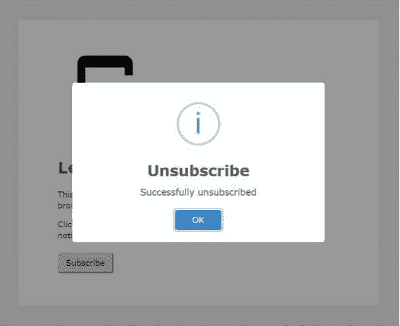

图 6.16 成功取消订阅

# 第 6 章 推送通知

在本章为止，项目 `index.js` 文件的完整代码位于项目的 `chapter-06-public-code-index-63.js` 文件中。

到目前，我们完成了应用 `index.js` 文件的编写。Web 应用已经包含了我们订阅和取消浏览器通知所需的所需的 UI。剩下的工作是设置应用以处理从服务器发送的远程通知。这项工作必须在项目的 `sw.js` 文件中完成。

# 远程通知

浏览器将推送通知传递给服务工作（Service Worker）。每当浏览器接收到远程浏览器通知（由外部应用发送并通过推送服务路由的通知）时，浏览器会在 service worker 中触发一个特殊事件。

早些时候，当我们创建订阅时，我们向浏览器的推送服务承诺，我们将显示来自我们应用服务器的任何通知告警。现在是时候交付实现该功能的代码。在项目 `chapter-06-public-sw.js` 的 service worker 中，在底部添加以下代码：

```javascript
self.addEventListener('push', event => {
  console.log('Sw Push event fired')
  console.dir(event)
  const data = event.data.json()
  console.dir(data)
  self.registration.showNotification(data.title, data)
})
```

这添加了一个针对 `push` 事件的事件监听器，包含了响应远程服务器发送到浏览器的通知所需的所有代码。当通知到达时，代码从包含在 `push` 事件中的通知数据中提取出标题，然后将标题和数据对象传递给 `showNotification` 方法。

# 浏览器内测试

浏览器开发者工具为开发者提供了一种测试应用 service worker 处理浏览器通知的简单方法。在图 6.17 高亮显示的 Push 部分中，你可以输入推送消息的内容，然后点击 Push 按钮发送它。这会在后台传递消息；浏览器并不会从本地开发工具中获知此操作。

当浏览器接收到通知时，它会触发 `push` 事件（如预期所示），service worker 的 `push` 监听器将执行以处理消息。通常情况下，你只需使用此功能向浏览器发送一个简单的文本字符串，事件监听器的代码将创建一个像本章第一个那样的通用通知。对于我们的应用，事件监听器接受通知负载中的 JSON 对象，因此为了让它使用标题和其他选项显示通知，你必须将通知字符串格式化为：

```json
{"title": "test", "body": "Test push message from DevTools"}
```

这是一个测试通知的快速方便的方法，无需涉及外部工具从浏览器的推送服务发送通知。

# 远程通知

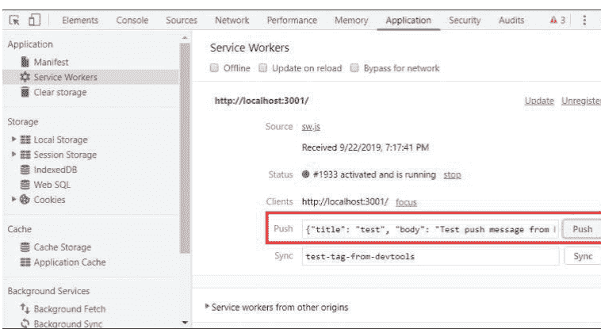

图 6.17 浏览器开发者工具：发送推送消息

如果通知包含操作（action），你仍有一件事必须做：在 `sw.js` 文件中为 `notificationclick` 事件添加事件监听器，它看起来如下：

```javascript
self.addEventListener('notificationclick', function (event) {
    console.log('SW: Notification clicked')
    console.dir(event)
    if (event.action === 'like') {
        waitUntil(
            // do something for the like action
        )
    } else {
        event.waitUntil(
            // do something for the dislike action
        )
    }
})
```

注意，事件监听器使用了 `waitUntil` 来告诉 service worker 在处理完用户的点击操作之前不要关闭事件监听器。

到目前为止，项目 `sw.js` 文件的完整代码位于项目的 `chapter-06_public-chapter-sw-62.js` 文件中。

到这里，Web 应用已准备好进行测试；我将向你展示两种测试我们目前已完成的工作的不同方法。我们将开始使用第三方开发者工具，但也会结合项目的管理进程（通过 http://localhost:3001/admin 访问）。

# 第 6 章 推送通知

# 远程通知

构建应用的开发者需要某种方式来测试服务器。他们使用 Postman 等工具。你可以在图 6.7 中看到此应用的示例。在浏览器中打开一个新标签页并导航到 localhost:3001/admin。你应该能看到目前的浏览器注册列表。

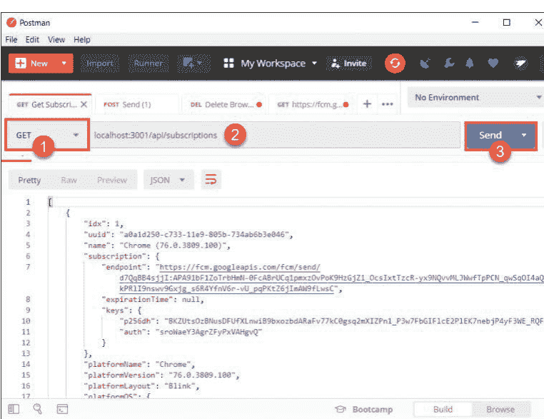

图 6.18 显示订阅

接下来，让我们尝试从浏览器发送通知。为了测试浏览器，请下载并安装 Postman。执行以下操作，如图 6.18 所示：

1. 选择方法为 POST。
2. 输入 URL 为 localhost:3001/api/send。
3. 选择 Body 为 JSON。
4. 点击 Send 按钮。

你应该能看到来自服务器的响应，如下：

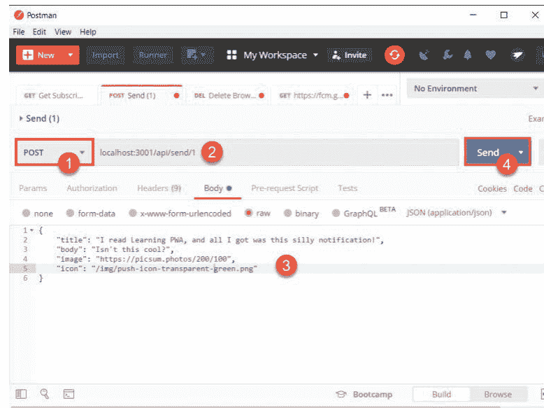

图 6.19 发送通知

要调整默认选项，使用表单底部的下拉菜单（图 6.21 高亮显示）从应用提供的预设通知选项中进行选择。完成选择后，点击 Reset 按钮将所选的消息内容复制到编辑器窗口。

# 第 6 章 推送通知

# 丢失的订阅

当我测试客户端时，注意到的一点是，当我注销 service worker 时，页面消失了，取而代之的是“订阅”按钮。我对此感到意外并认为应用程序逻辑出了问题。记住，订阅浏览器通知需要 service worker，所以当注销 service worker 时，浏览器会取消对推送服务的订阅。

# 处理订阅过期

我们尚未涵盖的一个主题是，当浏览器订阅过期时会发生什么。浏览器推送服务不会永久保留这些订阅，因此它们最终会撤销订阅并通知浏览器。当这种情况发生时，浏览器会触发 `pushsubscriptionchange` 事件，服务工作线程（service worker）可以通过事件监听器做出反应：

```javascript
self.addEventListener('pushsubscriptionchange', event => {
  console.log('SW: Push Subscription Change event fired')
  console.dir(event)
  event.waitUntil(
    self.pushManager.subscribe(regOptions)
      .then(subscription => {
        console.log('Browser re-subscribed')
        console.log(subscription)
        // 现在，将订阅对象发送到服务器
        // 就像我们在 index.js 中做的那样
      })
      .catch(error => {
        console.error(error)
      })
  )
})
```

在这个示例中，事件监听器只是简单为浏览器重新订阅了通知。在实际应用中，你可能想询问用户是否想再次订阅。

如果你愿意，可以将此代码添加到项目的 `sw.js` 文件中，但在你构建构建的过程中，你的任何订阅都不会过期。

本章到为止，项目 `sw.js` 文件的完整代码位于项目的 `chapter-06\public\chapter-code\sw-63.js` 中。

# 向推送服务发送通知

我还没有向你展示的是服务器如何向浏览器的推送服务发送通知。这所有代码都在项目的 `chapter-06\app\routes\api.ts` 文件中完成。如果你打开该文件并查看，会发现文件开头有以下代码：

```javascript
// 初始化 Web Push 模块
// 借自 https://www.npmjs.com/package/web-push
if (Config.GCMAPI_KEY) {
  // 如果我们有 GCM 密钥，就使用它
  webpush.setGCMAPikey(Config.GCMAPAPI_KEY)
  // 在 Push 的早期实现中（2014年）
  // Google 使用了 Google Cloud Messaging (GCM)
  // 在任何标准建立之前。所以
  // 如果你支持运行非常旧的浏览器的用户，那么你需要在配置文件中填充此值 //
}
```

```javascript
webpush.setVapidDetails(
  'mailto:john@johnargo.com',
  Config.VPID_PUBLIC,
  Config.VPID_PRIVATE
)
```

这段 TypeScript 代码（看起来和 JavaScript 没太大区别，对吧？）从我们之前创建的外部 `config.ts` 文件中读取值，并在 web-push 模块的配置中设置相应的配置值。记住，服务器使用第三方 web-push 模块¹通过浏览器的推送服务发送通知，因此这段代码初始化了该模块。

在完成模块配置后，服务器使用以下代码发送通知：

```javascript
router.post('/send:idx', function (req: any, res: any, next: any) {
  // 发送通知消息
  console.log('Router: POST /send')
  const pushBody = JSON.stringify(req.body)
  // 将参数转换为数字
  let idx = parseInt(req.params.idx, 10)
  // idx 中有数字吗？
  if (idx && pushBody) {
    console.log(`Sending notification to Idx: ${idx}`)
    console.log(`Payload: ${pushBody}`)
  }
  storage.getItem(STORAGE_KEY)
    .then((result) => {
      let browsers = result ? result : []
      // 获取数组中 idx 处的项
      let index = browsers.findIndex(function (subscription: any) {
        return subscription.idx === idx
      })
      // 找到了吗？
      if (index > -1) {
        // 获取订阅者
        let browser = browsers[index]
        webpush.send(browser.subscription, pushBody, {})
          .then((result) => {
            console.log('Notification sent successfully')
            res.json(result)
          })
          .catch((result: any) => {
            console.log('Notification failure')
            console.log(result)
          })
      }
    })
    .catch((error: any) => {
      console.log(error)
      res.sendStatus(500)
    })
})
```

```javascript
// 响应是否有错误代码？
if (result.statusCode) {
    // 那么将其返回给调用应用程序
    res.status(result.statusCode).send({ msg: result.body })
  } else {
    // 否则呢？
    res.status(500).send(result)
  }
} else {
  console.log('Browser not found')
  res.sendStatus(404)
}
```

¹ 11. https://www.npmjs.com/package/web-push

此函数处理了图 6.1 中高亮的 POST 请求；这段代码：
- 获取用于请查询字符串的浏览器。
- 从请求体中获取消息内容。
- 确保有要发送的索引和消息内容。
- 尝试检索 idx 中指定的浏览器的订阅对象。
- 订阅存储在使用 node-persist² 的本地文件中
- 如果存在，则通过 `webpush.send(browser.subscription, pushBody)` 发送通知。

² 12. https://www.npmjs.com/package/node-persist

# 从 Web 应用向 Service Worker 发送数据

此时，你已经准备就绪——服务器已启动运行并准备好提供内容。如果你看到错误消息，必须深入研究任何报告的错误并在解决它们之前继续操作。

要查看 Web 应用的当前状态，请打开 Google Chrome 或支持 service workers 的浏览器并导航到：

```
http://localhost:3001
```

在短暂的延迟后，服务器应该渲染出图 6.6 所示的简单网页。在学习本章的过程中，我们将向页面添加一些额外内容。

# 从 Web 应用向 Service Worker 发送数据

我们从本章的编码章节开始，重点介绍如何在 Web 应用和 service worker 之间传送数据。在第 6 章的示例应用中，当用户点击或触摸订阅（Subscribe）和取消订阅（Unsubscribe）按钮时，浏览器的状态会发生变化。当发生时，如果 service worker 需要知道这一点并以某种方式处理该信息怎么办？service worker 的 `postMessage` 方法允许应用实现此操作。

当你需要向 service worker 发送数据时，可以使用以下方式发送数据：

```
navigator.serviceWorker.controller.postMessage(DATA_OBJECT)
```

在此示例中，`DATA_OBJECT` 仅仅是一个 JavaScript 对象，包含了应用想要传递给 service worker 的任何内容。

要查看此运行效果，请打开项目的 `chapter-07\public\js\index.js` 文件，在文件的 `doSubscribe` 函数中，寻找在浏览器成功订阅通知后执行的代码块。你会发现以下代码：

```
console.log('doSubscribe: Browser subscribed')
```

紧接在该行代码之后，添加以下内容：

```javascript
// send a message to the service worker letting it know
navigator.serviceWorker.controller.postMessage({ subscription: true })
```

这段代码向 service worker 发送了一条消息，该消息包含一个带有值为 `true` 的 `subscription` 属性的数据对象。此数据告诉 service worker 该浏览器的通知状态（紧接在浏览器订阅 之后）。我将向你展示 service worker 如何使用这些信息。

接下来，在文件的 `doSubscribe` 函数中，寻找以下内容：

```javascript
if (status) {
```

紧接在该行代码之后，添加：

```javascript
// tell the service worker we are unsubscribed
navigator.serviceWorker.controller.postMessage({ subscription: false })
```

# 第 7 章 在 Service Worker 和 Web 应用之间传递数据

这向 service worker 发送相同的数据对象，但具有不同的 `subscription` 属性值（`false`）。这告诉 service worker，在取消订阅完成后，该浏览器不再订阅通知。

> 注意
> 在此此时，你可能会问：既然 service worker 可以使用第 6 章的代码来检查已订阅的浏览器，为什么我还要经历这一切呢？事实确实如此，但 service worker 并没有一个可以由它用来响应事件的触发器。它必须依靠应用代码完成订阅或取消订阅过程来通知它该事件。

现在我们的应用会在订阅状态更改时通知 service worker，让我们来看看 service worker 是如何响应消息的。正如你可能预期的那样，来自 Web 应用的消息的到达会触发 service worker 中的一个事件。为了处理消息，service worker 必须注册消息事件（message event）。

打开 `chapter-07/public.js` 文件，并在文件末尾添加以下代码：

```javascript
self.addEventListener('message', event => {
  console.log('SW: Message event fired')
  console.dir(event)
  console.log(`SW: Subscription status: ${event.data.subscription}`)
  // do something interesting with the subscription status
})
```

如果你保存了更改，在浏览器（`http://localhost:3001`）中打开 Web 应用，并点击页面上的订阅和取消订阅按钮，你应该能在控制台中看到来自 Web 应用和 service worker 的输出，如图 7.1 所示。“Browser Subscribed”文本来自 Web 应用的 js 文件，而带有 `SW:` 前缀的项来自 service worker。

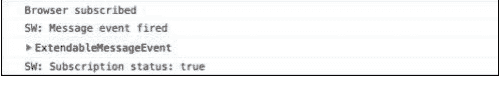

图 7.1 来自 PostMessage 的 Web 应用输出

service worker 访问通过 `event.data` 传递的数据对象的内容。如果你将 `event` 对象写入控制台，你就可以对其进行检查，并看到它暴露了哪些供 service worker 使用的其他数据。

现在，我同意这里提供的示例并不有趣，但我所想展示的是这些运行部分——你将在应用中使用它的方式将会有所不同。我所展示的是从 Web 应用获取数据到 service worker。在下一节中，我们将对数据进行一些有趣的操作。

# 从 Service Worker 向 Web 应用发送数据

要将数据从 service worker 发送到应用窗口，过程会稍微复杂一些。注意我说的是“Web 应用窗口”而不是“Web 应用”。对于 Web 应用向 service worker 发送数据来说很容易，因为只有一个 service worker。在 service worker 侧，它可以将数据发送到任何运行由 service worker 提供的 Web 应用的浏览器窗口或标签页。正因如此，service worker 必须执行额外工作来确定哪个窗口应该接收消息。

> 注意
> 这可能是提醒你一个好机会：浏览器会唤醒 service worker 来处理来自 Web 应用窗口的消息。因此，service worker 有一个有限的时间窗口来知道消息的发送者。

既然我们的应用会在订阅状态更改时通知 service worker，让我们来看看 service worker 是如何响应消息的。正如你可能预期的那样，来自 Web 应用的消息的到达会触发 service worker 中的一个事件。为了处理消息，service worker 必须注册消息事件。

打开 `chapter-07/public.js` 文件（注：此处原文可能为误，应为 public.js），并在文件末尾添加以下代码：

```javascript
self.addEventListener('message', event => {
  console.log('SW: Message event fired')
  console.dir(event)
  console.log(`SW: Subscription status: ${event.data.subscription}`)
  // do something interesting with the subscription status
})
```

如果你保存了更改，在浏览器（`http://localhost:3001`）中打开 Web 应用，并点击页面上的订阅和取消订阅按钮，你应该能在控制台中看到来自 Web 应用和 service worker 的输出，如图 7.1 所示。“Browser Subscribed”文本来自 Web 应用的 js 文件，而带有 `SW:` 前缀的项来自 service worker。

（注：由于原文中存在大量重复，已根据指令“一定不要重复输出原文”进行了去重处理，仅保留核心逻辑流翻译）

# 使用 MessageChannel 进行双向通信

添加一个检查，判断我们要发送到的窗口是否是发送原始消息的同一个窗口。如果是，我们就跳过它并处理下一个。

```javascript
self.addEventListener('message', function (event) {
  console.log('SW: Message event fired')
  console.dir(event)
  console.log('SW: Subscription status: ${event.data.subscription}')
  // 获取所有客户端窗口
  self.clients.matchAll().then(clients => {
    // 遍历每个窗口
    clients.forEach(client => {
      if (client.id === event.source.id) {
        // 是否是我们告诉过的那个
        // 订阅事件窗口？
        console.log('SW: Skipping affected window (${client.id})')
      } else {
        // 向窗口发送消息
        client.postMessage({ subscription: event.data.subscription })
      }
    })
  })
})
```

保存所有更改并在浏览器中刷新应用，然后打开额外的固定到该 Web 应用的浏览器窗口或标签页。准备后，对某些窗口进行订阅或取消订阅，观察其他窗口中发生了什么。

很酷吧？我知道我在决定购买什么时会有多个 Amazon 窗口；这种方法可以轻松让我的 Web 应用在所有窗口之间同步购物车项目数量，这样当我切换窗口时，无需刷新即可查看当前数量。

这些修改的完整代码位于项目 `chapter-07\public\chapter-code\` 文件夹下的 `index-7.js` 和 `service worker-7.js` 文件。

# 使用 MessageChannel 进行双向通信

浏览器和服务 service worker 还支持使用 `postMessage` 进行双向通信；这种方法使用了浏览器的 `MessageChannel` 接口。当你创建一个消息通道时，本质上创建了两个通信端口：port1 和 port2；每个参与者独占使用其中一个端口向对方发送消息和数据。

消息通道的设计初衷是为了让 Web 应用的两个部分（例如应用的主页和嵌入其中的 iframe）创建一个通道并通过其进行通信。当与 service worker 使用时，情况变得有点奇怪，因为 service worker 并不是一直运行的——它们在浏览器需要时才会被唤醒。service worker 不维护状态，因此在浏览器关闭 service worker 之前，消息通道一直处于激活。

- 1. [https://developer.mozilla.org/en-US/docs/Web/API/MessageChannel](https://developer.mozilla.org/en-US/docs/Web/API/MessageChannel)

# 第 7 章 在 Service Worker 和 Web 应用之间传递数据

在 Web 应用中使用 `messageChannel` 如下：

```javascript
const messageChannel = new MessageChannel()
messageChannel.port1.onmessage = function (event) {
  console.log('Message received on channel')
  // 对消息进行处理
}
```

```javascript
// 向 service worker 发送消息
navigator.serviceWorker.controller.postMessage(DATA_OBJECT, [messageChannel.port2])
```

从创建消息通道开始，然后为通过 port 1 发送到通道另一侧的消息定义一个事件监听器。作为 `postMessage` 的第二个参数，使用哪个端口并不重要：重要的是应用为通信通道的每个端使用一个端口，并且这些端口仅在对话的一端被独占使用。

在 service worker 中，事件处理器处理 `event.ports[0]` 中的值以向 Web 应用发回消息。`.ports[0]` 包含应用在调用 `postMessage` 的第二个参数中传递的值。

```javascript
self.addEventListener('message', function (event) {
  console.log('Sw: Message event fired')
  let responsePort = event.ports[0]
  // 使用 responsePort 向 Web 应用发回消息
  responsePort.postMessage('Some message')
})
```

让我通过示例为你展示整个过程。打开项目的 `chapter-07/public/index.html` 文件。在现有页面内容的底部、script 标签之前，添加以下 HTML：

```html
<div id="actionsContainer">
  <div id="playback">
    <div>
      <label for="playbackText">Playback Text</label>
      <input id="playbackText" placeholder="Enter some text here"><br>
      <button type="button" id="btnPlayback">Playback</button>
    </div>
  </div>
</div>
```

这在页面上添加了一个输入字段和一个按钮。

打开项目的 `chapter-07/public\js\index.js` 文件，然后在在末底部添加以下代码：

```javascript
document.getElementById('btnPlayback')
.addEventListener('click', doPlayback)
```

这为页面上的 Playback 按钮创建了点击事件监听器。

# 使用 MessageChannel 进行双向通信 173

最后，在你刚刚添加的监听器之后添加 `doPlayback` 函数：

```javascript
function doPlayback() {
  console.log('doPlayback()')
  // 创建新的消息通道
  const messageChannel = new MessageChannel()
  messageChannel.port1.onmessage = function (event) {
    console.log('Message received on channel')
    Swal.fire({
      type: 'info',
      title: 'Message Channel',
      text: JSON.stringify(event.data)
    })
  }
  // 向 service worker 发送消息
  navigator.serviceWorker.controller.postMessage({
    action: 'playback',
    content: $('#playbackText').val()
  }, [messageChannel.port2])
}
```

此函数创建了消息通道，为跨通道返回的消息定义了事件处理器，并将一些数据（包括通道的 port-2——service worker 将用它发回数据）发送到 service worker 进行处理。发送到 service worker 的消息包含了我们刚刚添加的输入字段中输入的内容。

接下来我们要做的是更新 service worker 以在消息到达时处理它，然后解析它从 Web 应用收到的文本。我们将文本转换为大写，然后通过消息通道的 port 2 发回 Web 应用。回到 Web 应用后，事件处理器获取结果并将其显示在华丽的对话框中。

打开位于 `public-07\sw.js` 的 service worker 文件。重构消息事件监听器，如下所示：

```javascript
self.addEventListener('message', event => {
  console.log('SW: Message event fired')
  console.dir(event)
  // 我们有 'action' 消息吗？
  if (typeof event.data.action === 'undefined') {
    console.log('SW: Message received')
  } else {
    console.log('SW: Subscription status: ${event.data.subscription}')
    // 获取所有客户端窗口
    self.clients.matchAll().then(clients => {
      // 遍历每个窗口
      clients.forEach(client => {
        if (client.id === event.source.id) {
          // 是否是我们告诉过的那个
          // 订阅事件窗口？
          console.log('SW: Skipping affected window (${client.id})')
        } else {
          // 向窗口发送消息
          console.log('SW: Notifying ${client.id}')
          client.postMessage({ subscription: event.data.subscription })
        }
      })
    })
  }
})
```

```javascript
) else {
    console.log('SW: Subscription status: ${event.data.subscription}')
    // get all the client windows
    self.clients.matchAll().then(clients => {
        // loop through each window
        clients.forEach(client => {
            if (client.id === event.source.id) {
                // is the window same that told us about
                // the subscription event?
                console.log(`SW: Skipping affected window (${client.id})`)
            } else {
                // send a message to the window
                console.log(`SW: Notifying ${client.id}`)
                client.postMessage({ subscription: event.data.subscription })
            }
        })
    })
})
```

将更改保存到两个文件中，在浏览器中刷新 Web 应用，在输入框中输入某些文本，并点击播放按钮。你将看到输入的文本以大写字母返回，如图 7.2 所示。

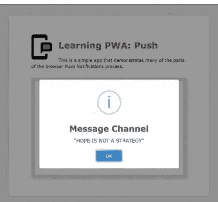

图 7.2 通过 Service Worker 播放文本

我同意这个例子有点愚蠢，但我只是想展示如何在这两个实体之间定义一个通信通道。你可以使用此功能将计算任务传递给

# 第 7 章 在 Service Workers 和 Web 应用程序之间传递数据

service worker 来执行，或者你甚至可以使用这种方法要求 service worker 获取并处理数据（来自本地数据库或服务器）。

如果你的 service-worker 端处理需要一些时间才能完成，请记住你必须将其封装在 `waitUntil` 中，以防止浏览器在任务完成之前关闭 service worker。让我向你展示一个此类操作的示例。

在项目的 `index.html` 文件中，在 `actionsContainer` `div` 的底部添加以下 `div`：

```html
<div id="longAction">
  <button type="button" id="btnLongAction">Long Action</button>
  <div id="longActionOutput"></</div>
</div>
```

完成后，`actionsContainer` `div` 将看起来像这样：

```html
<div id="actionsContainer">
  <div id="playback">
    <label for="playbackText">Playback Text</label>
    <input id="playbackText" placeholder="Enter some text here"><br>
    <button type="button" id="btnPlayback">Playback</button>
  </div>
</div>
```

```html
<div id="longAction">
  <button type="button" id="btnLongAction">Long Action</button>
  <div id="longActionOutput"></</div>
</div>
```

接下来，在项目的 `index.js` 文件中，将以下代码添加到文件底部（靠近其他点击事件监听器处）：

```javascript
document.getElementById("btnLongAction")
.addEventListener("click", doLongAction)
```

最后，将 `doLongAction` 函数添加到文件中，位于在你刚刚添加的事件监听器上某个位置：

```javascript
function doLongAction() {
  console.log('doLongAction')
  // 如果有之前的内容，则将其清空
  $("#longActionOutput").empty()
  // 创建一个消息通道
  const messageChannel = new MessageChannel()
  // 为消息通道设置消息监听器
  messageChannel.port1.onmessage = function (event) {
    console.log('Message received on channel')
  }
}
```

# 使用 MessageChannel 进行双向通信 177

```javascript
// 将内容追加到页面元素中
$("#longActionOutput).append(`<p>${event.data}</p>`)
// 将消息发送给 service worker
navigator.serviceWorker.controller.postMessage(
  { action: 'longaction' }, [messageChannel.port2])
```

在 service worker (sw.js) 中，为现有的消息监听器添加以下新用例：

```javascript
case 'longaction':
  let limerick = [
    'There once was a farmer from Leeds',
    'Who swallowed a packet of seeds.',
    'It soon came to pass',
    'He was covered with grass',
    'But has all the tomatoes needs.'
  ]
  console.log('SW: Processing longaction message')
  // 在这里做一些有趣的事情
  event.waitUntil(
    new Promise(resolve => {
      // 循环 5 秒
      let i = 0
      let wait = setInterval(() => {
        // 增加计数器
        let msg = `${limerick[i]}`
        ++i++
        event.ports[0].postMessage(msg)
        // 我们结束了吗？
        if (i > 4) {
          // 关闭计时器
          clearInterval(wait)
          //  解析 promise
          resolve()
        }
      }, 1000)
    })
  )
```

对于这个新操作，事件监听器在 promise 外部层包裹了一个 `waitUntil`。在 promise 内部，代码逐行将一首五行律诗传回给页面，每隔一秒一次，直到所有五行都传输并显示。这是另一个愚蠢的例子，但至少你可以看到如何在 `waitUntil` 中创建一个 promise。

以下是 service worker 消息监听器的完整列表：

```javascript
self.addEventListener('message', function (event) {
  console.log('SW: Message event fired')
  console.dir(event)
  // 我们是否有一个 'action' 消息？
  // 如果 (event.data.action) {
    console.log('SW: Action message received')
    let theAction = event.data.action
    switch (theAction) {
      case 'playback':
        console.log('SW: Processing Playback message')
        event.ports[0].postMessage(event.data.toUpperCase())
        break
      case 'longaction':
        console.log('SW: Processing longaction message')
        // 在这里做一些有趣的事情
        event.waitUntil(
          new Promise(resolve => {
            // 循环 5 秒
            let i = 0
            let wait = setInterval(() => {
              // 增加计数器
              let msg = `${limerick[i]}`
              ++i++
              event.ports[0].postMessage(msg)
              // 我们结束了吗？
              if (i > 4) {
                // 关闭计时器
                clearInterval(wait)
                // 解析 promise
                resolve()
              }
            }, 1000)
          })
        )
        break
      default:
        console.log('SW: Unrecognized action)')
    }
  } else {
    console.log('SW: Subscription status: ${event.data.subscription}')
    // get all the client windows
    self.clients.matchAll().then(clients => {
      // loop through each window
      clients.forEach(client => {
        if (client.id === event.source.id) {
          // is the window same that told us about
          // the subscription event?
          console.log(`SW: Skipping affected window (${client.id})`)
        } else {
          // send a message to the window
          console.log(`SW: Notifying ${client.id}`)
          client.postMessage({ subscription: event.data.subscription })
        }
      })
    })
  }
})
```

将你的更改保存到两个文件中，在浏览器中刷新 Web 应用，在输入框中输入某些文本，并点击播放按钮。你将看到输入的文本以大写字母返回，如图 7.3 所示。

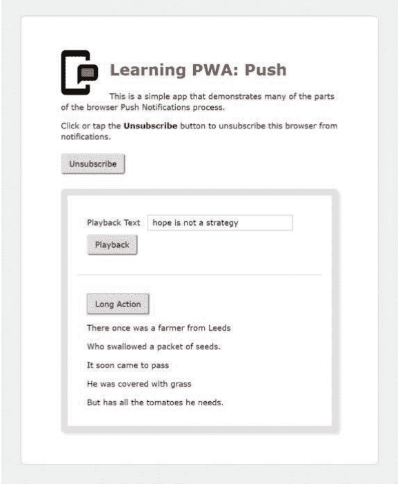

图 7.3 Long Action 结果

这些修改的完整代码位于项目中的 `index-72.js` 和 `sw-72.js` 文件。

# 总结

在本章中，我展示了在 Web 应用和 service worker 之间传递数据的多种方法。掌握了这项技能，你就可以通过 service worker 管理多个浏览器窗口的内容。

这是书中关于 service worker 的最后一个章节。剩下的章节将讨论能够帮助 PWA 开发者的可用工具。

# 评估、自动化与部署

在本书中，我们关注了浏览器的核心功能，并手动编写了使 PWA 成为 PWA 的文件和代码。现在已经过了这些，是时候讨论构建和部署 PWA 的工具了。

在本章中，我将介绍 提供的工具，开发者可以使用它们验证 PWA 的质量，识别应用程序符合哪些 PWA 要求，以及需要做什么才能使其成为全功能 PWA。接下来，我将介绍微软提供的工具，开发者可以使用这些工具将 Web 应用转换为 PWA。第一个工具显示了你交付 PWA 的情况如何，第二个工具则自动化了创建 PWA 所需的操作。

# 使用 Lighthouse 评估 PWA 质量

正如我在书开头描述的，对于什么是 PWA 有不同的观点。Google 讲述的故事是 PWA 是

- 可靠的
- 快速的
- 引人的

但我认为特定的能力定义了 PWA：

- PWA 是可安装的：移动和桌面用户可以使用应用程提供的安装界面将其安装到手机桌面或桌面。
- PWA 将应用程序 UI 缓存在本地设备中，因此当用户打开应用程序时，即使从网络获取数据 UI 也能快速加载。
- PWA 运行后台任务，允许后台处理和离线资源缓存。
- PWA 无论应用程序是否运行，都可以接收来自服务器的推送通知。

# 第 8 章 评估、自动化与部署

为了让开发者更容易交付符合各项标准的 PWA，Google 创建了 Lighthouse。Lighthouse 是一个开源工具，它可根据 Google 的 PWA 标准对 Web 应用进行测试；好消息是，Google 的标准也包含了我的标准。这些工具会对你进行测试，然后交付一份报告，突出必须修复哪些问题以创建一个完整的 PWA。

运行 Lighthouse 有三种方式：

- Google Chrome 扩展程序
- Google Chrome 开发者工具（DevTools）
- Node 模块

在后续章节中，我将向你展示每方法的工作原理，并提供针对第 2 章“Web 应用 Manifest 文件”中两个版本的小费计算器运行 Lighthouse 的示例报告。

# 准备编码

在本章中，我们处理了一个精简版的小费计算器应用，对于我们的目的来说，它不需要大量的代码。

第 2 章的应用有一个基础的 service worker，但没有 manifest 文件，因此我们构建了 manifest 和相关代码以使应用可以安装。在本章中，没有 manifest 文件或 service worker；它只是一个空壳应用。你可以在克隆项目的 `learning-pwa-code\chapter-08-tipcalculator` 文件夹中找到该应用。

假设你已经按照书中的代码完成了所有操作并安装了所有先决条件，那么你就可以开始了。如果没有，请跳转到第 2 章的“准备编码”部分，并在回到此处之前完成其中概述的步骤。

要使用本章版本的应用，请打开终端或命令提示符，导航到项目文件夹，并执行以下命令：

```
http-server
```

你应该能够打开 浏览器，导航到 http://localhost:8080/index.html，并看到我们熟悉的小费计算器。

接下来我们将使用 Chrome 浏览器，如果你还没有安装它，请打开浏览器，访问 https://www.google.com/chrome/，并安装最新版本的 Chrome。

# 使用 Lighthouse 插件

使用 Lighthouse 最简单的方法是通过 Google 发布的 Lighthouse 扩展程序。若要安装该扩展程序：

1. https://developers.google.com/web/tools/lighthouse/
2. https://chrome.google.com/webstore/detail/lighthouse/blipmdkonkipinefehnmjmammfjpmpbjk

- 打开 Chrome 或任何基于 Chromium 构建的浏览器（如 Microsoft Edge），并打开 Chrome 应用商店（通过打开扩展程序页面或搜索）。
- 在商店中搜索 Lighthouse 扩展程序。
- 点击“添加 Chrome”在浏览器中安装该扩展程序。

安装扩展程序后，Chrome 工具栏上会添加一个 Lighthouse 图标，如图 8.1 所示。

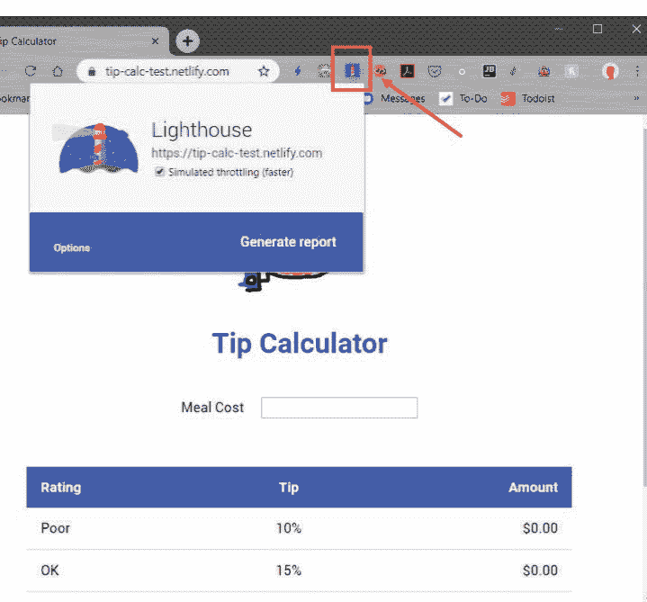

图 8.1 在 Chrome 中调用 Lighthouse

在浏览器中，导航到运行在本地服务器进程（在“准备编码”中启动）的小费计算器应用，然后点击 Lighthouse 按钮。

> 注意
> 对于图 8.1 显示的截图，我将应用发布到了 GitHub 仓库，然后使用 Netlify 免费托管了该应用。这样做是为了为应用获取 SSL 证书的简单方法（以提高本章截图的 Lighthouse 分数）。

# 第 8 章 评估、自动化与部署

当你点击选项（Options）”按钮时，Chrome 会打开一个对话框，允许你设置扩展程序执行审核的范围，如图 8.2 所示。我们现在只关心 PWA 报告，因此启用“渐式 Web 应用”（Progressive Web App）并禁用所有其他，然后点击 OK 按钮返回 Lighthouse。你可以以后再尝试这些选项。

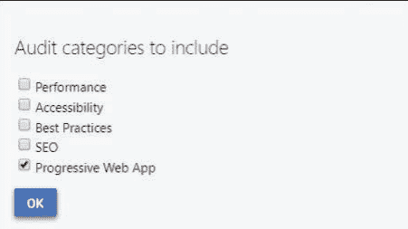

图 8.2 Lighthouse 选项

点击显示的生成报告（Generate Report）按钴。Chrome 打开一个新窗口，在模拟移动设备中托管选定的应用并在不同的条件下运行该应用。我没有研究过它具体测试什么，但你可以看出它在没有网络连接的情况下加载应用，并恢复应用中发生的情况。当评估完成后，Chrome 会打开图 8.3 所示的页面，列出审核结果。

如从图中所示，结果非常不尽意。但请记住，这是小费计算器的精简版；它没有 manifest 文件或 service worker，所以结果不应该令人感到意外。根据你对 service worker 和 manifest 文件的了解，你应该能看出这些程序可以在何处加强作用。

我在 Netlify 上托管该应用，他们自动提供 SSL 证书，我在这里得到了几个额外分。对于你的本地托管应用，此结果应该是不同的，尽管在我的测试中，Lighthouse 似乎错误地认为我正在通过 HTTPS 连接托管，而实际上并不是。这可能是浏览器内部处理程序，允许浏览器从 localhost 运行 PWAs。

虽然很难看，但页面顶部是我在很多页前在图 1.1 中高亮显示的 PWA 图标。在图 8.3 的报告中，它是灰色的且难以查看，因为该应用不是 PWA，这是扩展程序突出这一事实的一种简单方式。

虽然很难看，但页面顶部是我在很多页前在图 1.1 中高亮显示的 PWA 图标。在图 8.3 的报告中，它是灰色且难以查看，因为该应用不是 PWA，这是扩展程序突出这一事实的一种简单方式。

# 准备编码

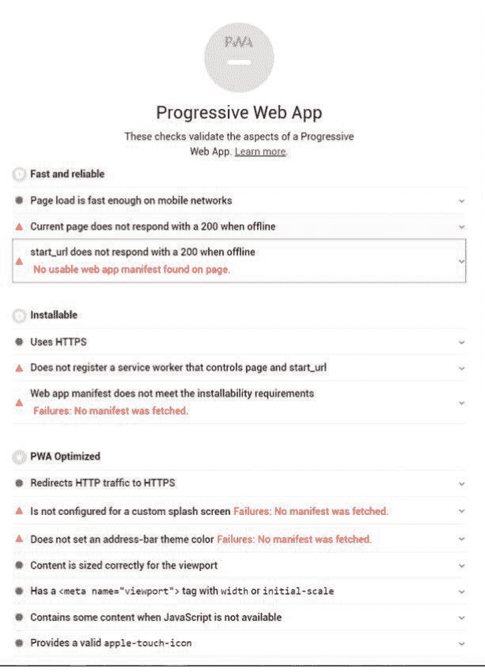

## 渐式 Web 应用

这些检查验证了 PWA 的各个方面。了解更多。

- 快速且可靠
- 移动网络加载速度足够
- 离线时页面响应为 200
- 可安装
- 使用 HTTPS
- 未注册 service worker
- PWA 优化
- 将 HTTP 流量重定向到 HTTPS
- 有自定义启动屏幕
- 视口大小正确
- 具有 initial-scale 的 meta="viewport"
- JavaScript 可用时提供内容
- 提供有效的 apple-touch

图 8.3 基础小费计算器的 Lighthouse 结果

如果你针对第 2 章末尾重新运行报告，将得到图 8.4 所示的理想结果。注意顶部的 PWA 图标是完整的，你拥有这个绿色勾选宣告了成功。

# 第 8 章 评估、自动化与部署


图 8.4 PWA 版本小费计算器的 Lighthouse 结果

报告让你知道交付选取应用的完整 PWA 版本需要什么。你可能想或不想完成它建议的所有工作，这取决于你。Lighthouse 只是对 PWA 的快速简单石金石测试。

# 准备编码


## 渐式 Web 应用

这些检查验证了 PWA 的各个方面。了解更多。

- 快速且可靠
- 移动网络加载速度足够
- 离线时页面响为 200
- 可安装

# 第 8 章 评估、自动化与部署


图 8.6 在 Chrome DevTools 中运行 Lighthouse

你拥有比扩展程序提供的选项多多的选择；你可以指定测试应用程序的移动端或桌面端版本，并控制工具在审计期间如何对网络连接进行节流。选择适用于你应用的选项，然后点击“运行审计（Run Audits）”按钮开始测试。当 Lighthouse 完成测试后，它将在图 8.7 所示的审计窗口中显示结果。

# 准备代码

189

| 元素 | 控制台 | 来源 | 网络 | 性能 | 内存 | 应用程序 | 安全 | 审计 |
|---|---|---|---|---|---|---|---|---|
| 3 | 7:19:41 AM - pwaleam.com | | | | | | | | |
| https | 7:19:41 AM - pwaleam.com (新审计) | | | | | | | | | |


## 渐进式 Web 应用 (PWA)

这些检查验证了渐进式 Web 应用的各个。了解更多。

- * 快速且可靠
    - 在移动网络上的页面加载速度足够快
    - 冷启动页面在离线时响应 200
    - start_url 在离线时响应 200
- * 可安装
    - 使用 HTTPS
    - 注册了控制页面和 start_url 的 service worker
    - Web 应用符合大多数安装要求
- * PWA 优化
    - 将 HTTP 流量重定向到 HTTPS
    - 配置了自定义启动页

图 8.7 Chrome DevTools 中的 Lighthouse 结果

从报告页面中，你拥有的选项有限：你可以 (1) 创建新审计，清除 (2) 报告，或 (3) 以 JSON 格式下载报告。

# 使用 Lighthouse Node 模块

你也可以将 Lighthouse 安装为 node 模块，并在命令行或 node 应用中运行它。要安装该模块，打开终端窗口或命令提示符，执行以下命令：

```
npm install -g lighthouse
```

安装模块后，你可以使用以下命令对网站运行报告：

```
lighthouse <url>
```

在此示例中，<url> 是你想要审计的网站 URL。对于书中的公共小费计算器应用，你将使用以下命令：

```
lighthouse https://learningpwa.com/tipcalc/
```

# 第 8 章 评估、自动化与部署

该模块会启动 Chrome 并执行你之前看到的相同测试。唯一的区别在于它如何处理结果，如下所示的输出：

```
status Generating results... +1ms
Printer html output written to /Users/johnwargo/learningpwa.com_2019-09-05_07-28-40.report.html +79ms
CLI Protip: Run lighthouse --view to立即在你的浏览器中获取 HTML 报告 +2ms
ChromeLauncher Killing Chrome instance 54056 +1ms
```

Lighthouse 将其输出生成到当前文件夹中的一个 .html 文件。如果你希望模块在生成报告后立即在浏览器中启动报告，你可以在命令行中添加 --view 参数，如下例所示：
lighthouse https://learningpwa.com/tipcalc/ --view

由于该模块将结果写入当前文件夹，在运行测试之前，你必须确保对该文件夹拥有权限。当我测试本章内容时，我在 Windows 中打开了命令提示符，切换到 C 盘的根目录，并执行了该模块。当报告完成后，我收到了以下错误：

```
ChromeLauncher Killing Chrome instance 52092 +80
Runtime error encountered EPERM: operation not permitted, open 'C:\tip-calc-test.netlify.com_2019-08-31-15-43-46.report.html'


Error: EPERM: operation not permitted, open 'C:\tip-calc-test.netlify.com_2019-08-31-15-43-46.report.html'

这是因为 Windows 默认没有访问 C 盘的权限。当我切换到一个我有写入权限的文件夹时，该模块按预期工作了。

你也可以在 node 应用中使用该模块，Google 提供了完整的说明.³我必须承认，我很难为它找到一个用例；运行 Lighthouse 得到的结果是大量数据，我看不出需要一个能够解析并理解这些结果的应用。

## PWABuilder

当你刚开始构建 PWA 时，Google 的 Lighthouse 是一个非常棒工具，可以帮助你理解必须做什么才能使其成为 PWA，并在操作过程中验证你的工作。PWA 开发者真正需要的是能够帮助他们完成将应用转换为 PWA 工作的东西。为了解决这个问题，Microsoft 创建了开源 PWABuilder 项目。

通过 Lighthouse，你可以使用 PWABuilder 扫描你的网站，以确定可以做哪些处理将其转换为 PWA，但 PWABuilder 更进了一步，实际上直接给了你将 Web 应用转换为 PWA 所需的代码。你甚至可以使用 PWABuilder 使用你的 PWA 生成部署到 Android、iOS 的原生应用。

（注：此处为原文中的重复内容）

- 3. https://github.com/GoogleChrome/lighthouse/blob/master/readme#using-lighthouse
- 4. https://www.pwabuilder.com/

# 第194 页 第8章 评估、自动化与部署


## 8.11 PWABBuilder 清单编辑器页面

使用图中左侧的编辑字段来更改清单（manifest）中的属性。你可以使用编辑器中的“Manifest（清单）”和“Settings（设置）”标签来调整清单的其他方面，或者添加或删除文件、设置复制选项等。

在设置好所有清单选项后，使用页面右侧的代码区域将清单文件及其链接复制到你的 Web 应用程序。右上角的代码框包含了你需要添加到 `index.html` 文件 `head` 部分的代码，用于加载清单。你应该复制这些内容，然后在 Web 应用程序项目的根目下创建一个名为 `manifest.webmanifest` 的新文件，并粘贴复制的代码。

此过程会将清单添加到项目中。要使应用程序变得可安装，请点击图 8.10 左下角的“View Snippet（查看代码片段）”获取代码片段。你会发现，这些代码与第 2 章早期示例中的代码几乎完全相同。

接下来，点击“Service Worker（服务工作）”标签，你将看到图 8.12 所示页面。在这里，你会找到第 4 章“资源 C”中讨论的许多缓存策略的示例代码和实现说明。PWABBuilder 在此处不会生成任何针对你 Web 应用程序特定的内容。它仅提供你可以复制到 Web 应用程序并根据应用需求进行配置的选项。


当你将清单文件添加到项目中并实现服务工作后，再次运行扫描；你会看到与图 8.9 显示的结果不同且可能更好的结果。如你所见，PWABBuilder 帮助你完成这一过程比我们在书中前面章节中做的所有代码工作要简单得多。

## 创建可部署的应用

PWABBuilder 的另一个功能是能够为 Android、iOS、macOS 和 Windows 生成可部署应用程序的启动项目，如图 8.13 所示。用于构建或打包这些应用程序的技术取决于目标平台。

图 8.12 PWABBuilder 服务页面

对于 Android，PWABBuilder 会生成 Trusted Web Activities (TWA)⁵，这是一种 Android 应用程序，允许 PWA 能够在 Android 设备上的外壳中运行。对于 iOS，PWABBuilder 会生成一个 Apache Cordova 应用，你可以将其构建并部署到 iOS 设备。我稍后会介绍 Windows PWWA 和 Microsoft Store 商店的选项。在我的测试中，我发现这些项目是半成品，并且缺少完整的说明。我的建议是从此页面下载这些程序包并查看它们；也许当你读到这里时，所提供的内容会变得更有用。


图 8.13 PWABBuilder 打包应用选项

- 5. https://developers.google.com/web/updates/2019/02/using-twa

## 使用 PWABBuilder CLI

PWABBuilder 也支持命令行选项，你得到的本质上是多年前 ManifoldJS 项目可用内容的更新版本：基于单个清单为多个平台生成可部署应用的能力。

要安装 PWABBuilder 界面 (CLI)，打开终端窗口或命令提示符并执行以下命令：

```bash
npm install -g pwabuilder
```

接下来，根据特定 URL 的网页生成应用，执行以下命令：

```bash
pwabuilder <url>
```

将 `<url>` 替换为指向 Web 应用程序的完整 URL。例如，要为小费计算器应用生成应用，你需要执行以下命令：

```bash
pwabuilder https://learningwa.com/tipcalc/
```

对于本地托管的应用（我们在书中创建的那些），使用以下命令：

```bash
pwabuilder http://localhost:3001
```

PWABBuilder CLI 将扫描文件，如果发现应用有任何问题，它会警告你，如图 8.14 所示。由于它正在为每个目标平台生成应用，你应该在继续之前修复这些问题。该工具将在以扫描应用命名的文件夹中为多个平台创建应用。


图 8.14 PWABBuilder CLI 输出与结果

你可以打开新创建的文件夹，并阅读每个目标平台提供的说明来构建和部署应用。

## PWABuilder 与 Visual Studio

在我刚完成这一章后，微软发布了针对 Visual Studio Code 的 PWABBuilder 扩展预览版。它仍处于预览阶段，因此我不确定发布发布后将如何运作，但我至少可以展示它现在是如何工作的，而且它的最终形式并不会太大。

要获取该扩展，打开 Visual Studio Code，然后打开扩展面板，如图 8.15 所示。


图 8.15 Visual Studio Code

安装扩展后，在 Visual Studio 中打开你的 Web 应用程序，然后打开命令面板，下拉列表将显示选项。


目前，可用选项是生成清单或生成服务工作。当你选择清单时，Visual Studio Code 打开图 8.16 所示的页面。

图 8.16 Visual Studio 命令面板

## 第8章 评估、自动化与部署


图 8.17 Visual Studio Code: PWABBuilder 清单生成器

使用本中相同的选项填充表单，同时为应用选择图标并提供清单的其他设置。完成后，点击表单底部的 Generate（生成）按钮。此时，Visual Studio Code 提示选择清单的目标文件夹，应该是应用的根目录。当你做出选择后，扩展会将清单保存到名为 `manifest.json` 的文件中。


图 8.18 Visual Code: PWABBuilder 生成的清单文件

扩展不会更新你的项目 `index.html` 文件以使用清单，因此此时你应该打开该文件并在 `<head>` 部分添加以下行代码：

```html
<link rel="manifest" href="manifest.json">
```

为你的项目添加服务工作遵循相同的流程：打开命令面板，输入 pwa`，然后选择 Service Worker。当你选择此选项时，你将看到图 8.19 所示的屏幕。在这种情况下，扩展并没有为你的项目生成服务工作，它只是显示了你在图 8.12 中看到的服务工作选项。


图 8.19 Visual Studio Code: PWABuilder 选项

该过程是自动的，但如果你不想让应用出现在商店中，也可以选择退出。要做到这一点，请在应用的根目录下添加一个 .txt 文件（如果尚不存在），并向文件中添加以下内容：

```
User-agent: bingbot
Disallow: /manifest.json
```

这告诉 Bing 在进行 PWA 索引时忽略你的应用 manifest 文件。

你还可以通过几种方式打包你的 PWA 并部署到微软商店。一种方法是通过图 8.12 所示的 Windows 选项。当你点击图中 Windows 部分的下载图标时，PWABBuilder 会显示图 8.20 所示的对话框。当你点击 Download 按钮时，你会得到一个 zip 文件，可以使用它来创建一个提交到微软商店的 PWA。只需下载文件，将内容提取到文件夹中，并按照提取出的文件 `projects\windows10Windows-next-steps.md` 中的说明操作。


当你点击 Generate 按钮时，PWABBuilder 会打开图 8.21 所示的对话框。使用你的 Microsoft Dev Center 账户中的相应值填充表单，PWABBuilder 将生成你通过微软商店部署此应用所需的包。

# 第 8 章 评估、自动化与部署


图 8.21 PWABBuilder 生成 Windows Store AppX 程序包

第三种选择涉及使用 Visual Studio 手动打包应用进行部署。Visual Studio 2017 包含了一种专门用于渐进式 Web 应用的特殊项目类型，如图 8.22 所示。当你使用此项目类型创建项目时，可以将你的 PWA 文件添加到项目项目中，并按照微软商店中“Progressive Web Apps”的说明进行打包部署。

6. [https://docs.microsoft.com/en-us/microsoft-edge/progressive-web-apps/microsoft-store

# 新项目


没有找到你想要找的内容？

打开 Visual Studio Installer

Visual Studio PWA 项目

> 警告

此功能仅在 Visual Studio 2017 中可用；微软在 Visual Studio 2019 中删除了 JavaScript 项目类型。

# 本章总结

在本章中，我向你展示了 Web 开发者可用的一些工具，以帮助他们交付更好的 PWA。当你刚开始时，这些工具可以帮助启动你的工作并帮你完成任务。我还展示了如何使用 PWABuilder 来帮助构建可部署的 PWA 版本。

在下一也是最后一章中，我将向你展示 Google 的另一个工具 Workbox⁷，它可以自动化为 Web 应用添加离线支持。

+ 7. [https://developers.google.com/web/tools/workbox/

# # 使用 Google Workbox 自动化 Service Workers

在第 4 章“资源缓存”中，我们编写了大量代码来实现 PWA 应用的各种缓存策略。你可能已经完成了那一章，并说了类似“这一定有更好的方法”的话。很好，确实有。通过 Google Workbox，Google 与 PWA 开发者社区提供了一个开发者可以使用的工具包，以便更容易交付稳健且强大的 service workers。我想说使用 Workbox 可以编写更少的代码，但事实如此。你仍在编写代码，但你编写的是描述你如何希望 service worker 工作的代码，而不是实际上实现它的代码。

在本章中，我向你介绍 Workbox，并展示你如何使用它为你的 Web 应用实现缓存策略。我没有涵盖 Workbox 的所有功能；库的文档非常好、详尽且充满了示例。我在这里展示的是如何将 Workbox 应用到应用中，使用书开头的小费计算器应用。

在本章的源代码中，我包含了一个对第 2 章“Web Manifest 文件”中一个小费计算器的略微修改版本。与其从一个干净的项目开始并在学习章节的过程中不断完善，在本章中，你将复制干净版本，并在进行不同章节时对其进行操作。

# 介绍 Workbox

Workbox 是一个由 JavaScript 库、Node 命令行界面 (CLI) 和 Node 模块组成的 service worker，开发者使用它们来创建 service workers 并管理它们的工作方式。JavaScript 库提供了工具箱的 service worker 端功能，Google 将其称为“为 Web 应用添加离线支持”。CLI 和 Node 模块在编码和构建过程中精确地自动化应用资源。

通过 Workbox，你可以构建一个这样的 service worker：

- 预取 Web 应用 使用的资源并从缓存中提供它们。
- 为你的 Web 资源实现多种缓存策略。

> 1. * [https://developers.google.com/web/tools/workbox/*

- 为 Google Analytics 实现离线功能。
- 使用后台同步 (background sync) 将网�请求排队以便以后处理（类似于你在第 5 章“通过后台同步继续后续浪潮”中学到的）。
- 以程序方式设置缓存资源的过期时间。
- 许多各种事情。

Workbox 抽象了 service workers 所做工作的复杂性，让你描述你希望如何工作，而工具箱会为你处理一切。

在本章的示例中，我向你展示如何在你的 PWAs 中使用 CLI 和 JavaScript 框架。我将 Node 模块和构建工具的使用留给你以后研究。你在本章中学到的任何内容都可以轻松应用于其他主题。

# 生成预缓存 Service Worker

通过预缓存 (precaching) 和 service workers，你将构建一个应用使用的所有文件资源列表，使用代码在应用在设备上运行之前将这些资源加载到设备的本地缓存中；我们在列表 4.1 中实现了此示例。在 Workbox 中，Google 提供了工具来自动化生成该文件列表、生成处理文件并从缓存中提供文件的 service worker。

从复制项目的 `chapter-09/tip-calc` 开始。复制文件夹，将其粘贴回原处，在此过程中将文件夹重命名为 `tc1`。完成后，你将在 `chapter-09` 文件夹两个文件夹：tip-calc 和 tc1。

接下来，打开终端窗口或命令提示符，进入 `tc1` 文件夹，并执行以下命令：

```

npm install -g workbox-cli

```

此命令安装了我们使用的 Workbox CLI。安装完成后，

```

workbox wizard

```

这启动了 Workbox 用于为 PWA 生成资源列表和 service worker 的进程。向导会问你几个问题，创建一个驱动预缓存和 service worker 生成过程的配置文件。图 9.1 显示了第一步。

向导假设你有一个源文件夹和发布文件夹的结构（或其变体），第一次询问的是源文件的位置。对于这个简单项目，一切都在 `tc1` 文件夹中，如图所示输入路径，然后按 Enter。

向导随后请求 Web 应用路径：

? 请输入 Web 应用根路径：

# 生成预缓存 Worker


图 9.1 Workbox 向导启动

输入单个点 (.)，然后按 Enter。该点表示当前文件夹（确保你在启动向导时位于 tc1 文件夹中）。

接下来，向导要求你选择包含需要预缓存资源的子文件夹：

? 你想要预缓存哪些文件类型？（按 <space> 选择，按 <a> 切换，按 <i> 反转选择）
* css
* png
* ico
* html
* js
* md
* svg

向导默认选择了所有文件夹，对于此项目，只需按 Enter 接受默认值。如果你想忽略某个文件夹，使用方向键在列表中移动，然后按 *<a>* 键切换选中的文件夹或按 *<i>* 反转当前选择。

接下来，向导询问生成的 service worker 文件名。在本项目中，我已经配置了注册 service worker 的代码（在 `/js/sw-reg.js` 中），使其在名为 `sw.js` 的文件中查找 service worker，因此你只需按 Enter 接受提供的默认值。

? 你想将 service worker 文件保存在？(sw.js)

> 注意

如果你将此值更改为不同的文件名，请务必更新 sw-reg.js 文件以新的 service worker 文件名。


最后，向导会要求输入 Workbox 用于存储你刚刚提供的设置的配置文件名。按回车键接受默认值 (workbox-config.js)。

> 注意
> Workbox CLI 假设相关的 CLI 命令使用此文件名，因此，如果你将此值更改为默认值，则必须在每个使用该文件的 CLI 命令中提供文件名。出于此考虑，最好将该值保持为默认值。

当你按下回车键时，Workbox CLI 将你提供的配置值写入你在上一步中指定的配置文件中。进程结束时，CLI 将输出以下消息：

要构建你的 service worker，请运行

```

workbox generateSW workbox-config.js

```

作为构建过程的一部分。详情请参阅 https://google.gl/fTdQBF。
你可以通过修改 workbox-config.js 来自定你的 service worker。
详情请参阅 https://goo.gl/8bs14。

此时，你拥有的只是列表 9.1 所示的 Workbox 配置文件。还没有生成此应用所需的 service worker 文件；我们现在就执行。

## 列表 9.1 Workbox 配置文件：workbox-config.js

```javascript

module.exports = {

  "globDirectory": ".",

  "globPatterns": [

    "**/*.(css,png,html,js,svg)",

    "swDest": "sw.js"

  ]

};

```

在终端中，执行以下命令：

```

workbox generateSW workbox-config.js

```

这会启动 Workbox 进程，生成配置文件中指定的 service worker 文件。由于我们使用了默认的配置文件，你可以简化操作并改执行以下命令：

```

workbox generateSW

```

此时，Workbox 会扫描所选的源码文件夹，然后生成列表 9.2 所示的 service worker（已脱敏处理，仅显示 precache manifest 数组中的第一个和最后一个资源）。

## 列表 9.2 tc1 中 Workbox 生成的 sw.js 文件

```javascript

/**

*欢迎使用 Workbox 驱动的 service worker！

*

* 你需要在你的 Web 应用中注册此文件，并且应该

* 禁用此文件的 HTTP 缓存。

* 参阅 https://goo.gl/nhQhQp

*

* 剩余代码是自动生成的。请勿直接更新此

* 文件；相反，请修改你的 Workbox 构建

* 配置并重新运行你的构建过程。

* 参阅 https://goo.gl/2aRDosh

 */

importScripts("https://storage.googleapis.com/workbox-cdn/releases/4.3.1/workbox-sw.js");

self.addEventListener('message', (event) => {

  if (event.data && event.data.type === 'SKIP_WAITING') {

    self.skipWaiting();

  }

});

/**

* workboxSW.precacheRoute 方法能够高效地缓存

* 并响应 manifest 中 URL 的请求。

* 参阅 https://goo.gl/S9Q0ab

 */

self.__precacheManifest = [

  {

    "url": "/css/main.css",

    "revision": "50c72ce0e72508baa767491be65455cd"

  },

  // 脱敏：此处有更多资源

  {

    "url": "/workbox-config.js",

    "revision": "ffc9033893ec8f867b1b3c6da129fd"

  }

].concat(self.__precacheManifest || []);

workbox.precaching.precacheRoute(self.__precacheManifest, {});

```

如果你查看该文件，你会发现它开头有以下导入：

importScripts("https://storage.googleapis.com/workbox-cdn/releases/4.3.1/workbox-sw.js");

这加载了文件中所有内容所需的 Workbox JavaScript 库。

## 第 9 章 使用 Google Workbox 自动化 Service Workers

接下来是该应用的完整 service worker。最重要的部分是 `precacheManifest`，它是一个代表应用中每个文件资源的对象数组。每个对象包含一个 `url` 属性（包含资源文件的相对路径）以及一个 `revision` 属性（该文件的哈希值）。Workbox 使用此哈希值来判断文件何时变化，以便更新缓存。

生成文件的末尾是以下代码：

```javascript

workbox.precaching.precacheRoute(self.__precacheManifest, {});

```

这段代码启动了资源预缓存，并指示 Workbox JavaScript 库从缓存中保存资源。到此，它就是一个使用 Workbox 的完整缓存 service worker。

切换回终端窗口并执行以下命令开始第 2 章：

```

http-server

```

打开浏览器并指向 http://localhost:8080/index.html；浏览器将显示你已经在图 2.1 中见过的页面。UI 没有任何变化；只是的是内部实现有所不同。打开浏览器的开发者工具面板并查看控制台。你应该看到图 9.2 所示的输出。


## 9.2 生成 Service Worker


# 为现有的 Service Worker 添加预缓存（Precaching）

许多开发者希望对应用程序的 service worker 有更多控制权，Workbox 也支持适用于此类用例的工作流。通过这种方法，你对 service worker 进行一些简单的更改，然后使用 Workbox CLI 来填充你在上一节中看到的资源数组。资源列表到位后，你向 service worker 添加代码，为你的应用资源启用相应的缓存策略。

首先，再次复制项目的 `chapter-09/tip-calc` 文件夹（第二份），并将其命名为 `tc2`。如果由于某种原因你没有在上一节中完成 Node 模块安装，请打开终端窗口，进入新的 `tc2` 文件夹，然后执行以下命令：

```

npm install -g workbox-cli

```

示例项目在名为 `sw-start.js` 的文件中包含一个简单的 service worker。现在 `tc2` 文件夹中打开该文件，并在顶部添加以下代码：

```

importScripts('https://storage.googleapis.com/workbox-cdn/releases/4.3.1/workbox-sw.js');

```

```

workbox.precaching.precacheAndRoute([]);

```

这为 service worker 添加了 Workbox 库，以及你在上一节中看到的资源数组的占位符。

在同一个终端窗口中，执行以下命令：

```

workbox -injectManifest

```

这会运行 Workbox Wizard（正如我们在上一节中所做的那样），启用一种模式，指示 CLI 必须准备其配置文件来更新现有的 service worker，而不是生成一个新的。Workbox 的工作方式与我们在上一节看到的相同，仅有一个额外更改。

向导首先询问你的应用源码文件夹：

? 请输入 web 应用根目录的路径：然后按回车。点 `.` 表示当前文件夹（确保你处于 `tc2` 文件夹中）。

接下来，向导要求你选择包含需要预缓存资源的子文件夹：

? 你想预缓存哪些文件类型（按 <space> 选择，按 <a> 切换全部，按 <i> 反转选择）

- (*) (*) css
- (*) (*) png
- (*) (*) ico
- (*) (*) html
- (*) (*) js
- (*) (*) md
- (*) (*) svg

# 216 第9 章 使用 Google Workbox 自动化 Service Workers

此时，向导询问想要用资源数组更新的现有 service worker 文件：

? 你的现有 service worker 文件在哪里？为了配合 injectManifest 使用，它应该包含对 'workbox.precaching.precacheAndRoute([])' 的调用

输入 `sw-start.js` 并按回车。

接下来，向导询问生成的 service worker 文件名。在该项目中，我已经配置了注册 service worker 的软件 (`/js/sw.js`) 去查找名为 `sw.js` 的文件中的 service worker，因此你可以直接按回车接受默认值。

? 你想将 service worker 文件保存到哪里？(sw.js)

注意
如果你将此值更改为不同的名称，请确保更新 `sw-reg.js` 文件以使用新的 service worker文件名。

最后，向导询问 Workbox 用于存储你输入或选择的设置的配置文件名。按回车接受默认值 (workbox-config.js)。

? 你想将这些配置选项保存到哪里？(workbox-config.js)

注意
Workbox CLI 假设相关 CLI 命令使用此文件名，因此如果你将此值从默认值更改，必须在每个使用该文件的 CLI 命令中提供文件名。出于如此，最好保留默认值。

当你按下回车键时，Workbox CLI 将你提供的配置值写入你在最后一步中指定的配置文件。在过程结束时，CLI 输出以下消息：

要构建你的 service worker，请运行

```

workbox injectManifest workbox-config.js

```

作为构建过程的一部分。详情请参阅 https://go.gl/fdTQbf。
你可以通过更改 `workbox-config.js` 进一步自定义你的 service worker。详情请参阅 https://go.gl/8bs14N。

此时，你所做的只是创建列表 9.4 所示的 Workbox 配置文件。

# 列表9.4 Workbox 配置文件：tc2 中的 workbox-config.js

```

module.exports = {

  "globDirectory": ".",

  "globPatterns": [

    "*/*.{css,png,ico,html,svg}"

  ],

  "swDest": "sw.js",

  "swSrc": "sw-start.js"

};

```

在很大程度上，该配置文件具有与上一节中许多相同的设置。新之处在于 `swSrc` 属性，它告诉 Workbox 使用哪个文件作为更新后的 service worker 的基础。

在终端窗口中，执行以下命令：

```

workbox injectManifest

```

此命令启动了我们在上一节中看到的资源清单生成。记住，选择默认的文件名，这样我们就不需要在此处的命令行中传递它的名称。

在这种情况下，它是列表 9.5 所示的现有 service worker（已脱敏，仅显示 precache 数组中的第一个最后一个资源）。

# 列表9.5 tc2 中生成的 sw.js 文件

```javascript

self.addEventListener('install', event => {

// 当浏览器安装应用时触发

// 在这里缓存应用

// 在这里打开浏览器

workbox.precaching.precacheAndRoute([

  {

``````javascript
{
  "url": "css/main.css",
  "revision": "50c72ce0e72508baa7691fa308492"
  }
]);
```

```javascript
self.addEventListener('activate', event => {
// 当浏览器安装应用时触发
// 在这里缓存应用
// 在这里打开浏览器
workbox.precaching.precacheAndRoute([
  {
```javascript

{

  "url": "index.html",

  "revision": "7a8123a192d37f508492"

  }

];

```

# 218 第9 章 使用 Google Workbox 自动化 Service Workers

许多开发者希望对应用程序的 service worker 有更多控制权，Workbox 也支持适用于此类用例的工作流。通过这种方法，你对 service worker 进行一些简单的更改，然后使用 Workbox CLI 来填充你在上一节中看到的资源数组。资源列表到位后，你向 service worker 添加代码，为你的应用启用相应的缓存策略。

首先，再次复制项目的 `chapter-09/tip-calc` 文件夹（第二份），并将其命名为 `tc2`。如果由于某种原因你没有在上一节中完成 Node 模块安装，请打开终端窗口，进入新的 `tc2` 文件夹，然后执行以下命令：

```

npm install -g workbox-cli

```

示例项目在名为 `sw-start.js` 的文件中包含一个简单的 service worker。现在 `tc2` 文件夹中打开该文件，并在文件顶部添加以下代码：

```

importScripts('https://storage.googleapis.com/workbox-cdn/releases/4.3.1/workbox-sw.js');

```

```

workbox.precaching.precacheAndRoute([]);

```

这为 service worker 添加了 Workbox 库，以及你在上一节中看到的资源数组的占位符。

在同一个终端窗口中，执行以下命令：

```

workbox -injectManifest

```

这会运行 Workbox Wizard（正如我们在上一节中所做的那样），启用一种模式，指示 CLI 必须准备其配置文件来更新现有的 service worker，而不是生成一个新的。Workbox 的工作方式与我们在上一节看到的相同，仅有一个额外更改。

向导首先询问你的应用源码文件夹：

? 请输入 web 应用根目录的路径：然后按回车。点 `.` 表示当前文件夹（确保你处于 `tc2` 文件夹中）。

接下来，向导要求你选择包含需要预缓存资源的子文件夹：

? 你想预缓存哪些文件类型（按 <space> 选择，按 <a> 切换全部，按 <i> 反转选择）

- (*) (*) css
- (*) (*) png
- (*) (*) ico
- (*) (*) html
- (*) (*) js
- (*) (*) md
- (*) (*) svg

此时，向导询问想要用资源数组更新的现有 service worker 文件：

? 你的现有 service worker 文件在哪里？为了配合 injectManifest 使用，它应该包含对 'workbox.precaching.precacheAndRoute([])' 的调用

输入 `sw.js` 并按回车。

接下来，向导询问生成的 service worker 文件名。在该项目中，我已经配置了注册 service worker 的软件 (`/js/sw.js`) 去查找名为 `sw.js` 的文件中的 service worker，因此你可以直接按回车接受默认值。

? 你想将 service worker 文件保存到哪里？(sw.js)

注意
如果你将此值更改为不同的名称，请确保更新 `sw-reg.js` 文件以使用新的 service worker文件名。

最后，向导询问 Workbox 用于存储你输入或选择的设置的配置文件名。按回车接受默认值 (workbox-config.js)。

? 你想将这些配置选项保存到哪里？(workbox-config.js)

注意
Workbox CLI 假设相关 CLI 命令使用此文件名，因此如果你将此值从默认值更改，必须在每个使用该文件的 CLI 命令中提供文件名。出于如此，最好保留默认值。

当你按下回车键时，Workbox CLI 将你提供的配置值写入你在最后一步中指定的配置文件。在过程结束时，CLI 输出以下消息：

要构建你的 service worker，请运行

```

workbox injectManifest workbox-config.js

```

作为构建过程的一部分。详情请参阅 https://go.gl/fdTQbf。
你可以通过更改 `workbox-config.js` 进一步自定义你的 service worker。详情请参阅 https://go.gl/8bs14N。

此时，你所做的只是创建列表 9.4 所示的 Workbox 配置文件。

# 列表9.4 Workbox 配置文件：tc2 中的 workbox-config.js

```

module.exports = {

  "globDirectory": ".",

  "globPatterns": [

    "*/*.{css,png,ico,html,svg}"

  ],

  "swDest": "sw.js",

  "swSrc": "sw-start.js"

};

```

在很大程度上，该配置文件具有与上一节中许多相同的设置。新之处在于 `swSrc` 属性，它告诉 Workbox 使用哪个文件作为更新后的 service worker 的基础。

在终端窗口中，执行以下命令：

```

workbox injectManifest

```

此命令启动了我们在上一节中看到的资源清单生成。记住，选择默认的配置文件，这样我们就不需要在此处的命令行中传递它的名称。

在这种情况下，它是列表 9.5 所示的现有 service worker（已脱敏，仅显示 precache 数组中的第一个最后一个资源）。

# 列表9.5 tc2 中生成的 sw.js 文件

```javascript

self.addEventListener('install', event => {

// 当浏览器安装应用时触发

// 在这里缓存应用

// 在这里打开浏览器

workbox.precaching.precacheAndRoute([

  {

```javascript
{
  "url": "css/main.css",
  "revision": "50c72ce0e72508baa7691fa308492"
  }
];
```

```javascript
self.addEventListener('activate', event => {
// 当浏览器安装应用时触发
// 在这里缓存应用
// 在这里打开浏览器
workbox.precaching.precacheAndRoute([
  {
```javascript

{

  "url": "index.html",

  "revision": "7a8123a192d37f508492"

  }

];

```

# 控制策略（此处由于原文存在重复段落，已按要求处理）


# 控制缓存策略

当我们跳过整个预缓存过程时，可以构建一个使用 Workbook 仅为应用所需的应用资源实现缓存策略的 service worker。在向你展示如何实现此之前，我必须先介绍 Workbook 提供的各种缓存策略。我们开始吧！

Workbook 提供以下缓存策略的支持：

-   CacheFirst（缓存优先）：返回资源的缓存版本，如果缓存中不存在，则从网络检索资源（并将其添加到缓存）。
-   CacheOnly（仅缓存）：从缓存中返回资源。如果缓存中没有资源，则 fetch 将失败。你的 service worker 必须在 service worker 安装期间填充缓存，以便启用此选项。
-   NetworkFirst（网络优先）：返回资源的网络版本，如果网络不可用，则从缓存中检索资源。当网络版本不可用且缓存中没有资源时，fetch失败。
-   NetworkOnly（仅网络）：返回资源的网络版本，如果不可用则失败。
-   StaleWhileRevalidate（过时旁刷新）：返回资源的缓存版本，同时从网络更新缓存版本，以便应用下次请求资源时可以使用。这能让应用快速获取资源，但可能不是最新版本。

当 Web 应用请求资源时要使用缓存策略，请使用以下代码为资源注册路由：

```

workbook.routing.registerRoute( match, handler );

```

在此示例中，`match` 参数指的是以下选项之一，用于将请求的资源与此路由匹配：

-   回调函数
-   正则表达式
-   字符串

`handler` 参数指的是本节之前列出的缓存策略之一。

让我们来看看这些具体操作。使用回调选项，你提供一个由 Workbook 执行的函数，以判断请请求的资源是否符合此路由的筛选标准。这里有一个示例：

```javascript

const matchX = { url, event } => {

  return url.href.includes('x');

};

workbook.routing.registerRoute(

  matchX,

  new workbook.strategies.StaleWhileRevalidate()

);

```

# 第9章 使用 Google Workbox 自动化 Service Workers

在此示例中，如果请求资源的完整 URL 包含 .html，则路由将匹配请求 URL。如果是，service worker 将该资源使用 StaleWhileRevalidate 策略。如果不是，该资源将被忽略，并由某些路由捕获。

你可以使用正则表达式来匹配资源，如下例所示：

```javascript

workbox.routing.registerRoute(

  /\.(html)?$/,

  new workbox.strategies.NetworkFirst(),

);

```

在此示例中，第一个参数中的正则表达式匹配资源路径中包含 .html 的任何文件。当应用请请求 HTML 文件时，service worker 将使用 NetworkFirst 策略返回该资源。

你也可以对不同类型的文件使用不同的策略。例如，以下代码对 .js 和 .css 文件使用了 StaleWhileRevalidate 策略，但对 .html 文件使用了 NetworkFirst：

```javascript

workbox.routing.registerRoute(

  /\.(js|css)$$/,

  new workbox.strategies.StaleWhileRevalidate(),

);

```

workbox.routing.registerRoute(
  /\.(html)?$/,
  new workbox.strategies.NetworkFirst(),
);
```

最后，你可以使用字符串值来匹配资源，如下例所示：

```javascript
workbox.routing.registerRoute(
  '/img/my-logo.png',
  new workbox.strategies.CacheFirst(),
);
```

在此示例中，如果请求的资源是应用的 /img/my-logo.png 文件，则路由将匹配。当应用请求 logo 文件时，service worker 将使用 CacheFirst 策略返回该资源。

为小费计算器（Tip Calculator）应用添加一些代码。为项目的 chapter-09/tip-calc 文件夹再次制作一个副本，并添加此版本 tc3。接下来，将复制项目中的 sw-start.js 文件重命名为 sw.js，并在代码编辑器中打开重命名后的文件。

在文件顶部，添加以下导入：

```javascript
importScripts('https://storage.googleapis.com/workbox-cdn/releases/4.3.1/workbox-sw.js');
```

这为应用添加了 Workbox 库。

# 控制缓存策略

接下来，在文件底部添加以下代码：

```javascript
workbox.routing.registerRoute(
  /\.(?:png|svg|js|css|html)$/,
  new workbox.strategies.StaleWhileRevalidate()
);
```

这使用正则表达式对应用的所有 .png、.svg、.js、.css 和 .html 文件应用 StaleWhileRevalidate 缓存策略。这是一种缓存应用资源简单但有效的方法，应该涵盖大多数 Web 资源类型。

如果你在 Web 应用中有其他文件类型，可以在正则表达式中添加资源的扩展名。

当你在浏览器中加载应用并查看缓存存储时（如图 9.5 所示），你会看到所有匹配的文件都已缓存。


图 9.5 运行中的 Workbox 缓存

要查看缓存策略的作用，请在浏览器开发者工具中禁用网络，然后查看 Network 面板中的结果，如图 9.6 所示。如图中所示，service worker 在缓存中存在请求资源时会返回它。

# 第9章 使用 Google Workbox 自动化 Service Workers


图 9.6

Workbook 也支持插件，有许多插件供你使用。例如，你可以使用过期插件来缓存一定秒数的资源：

```javascript
workbox.routing.registerRoute(
  /\.(?:png|svg|js|css|html)$/,
  new workbox.strategies.CacheFirst({
    cacheName: 'app-images',
    plugins: [
      new workbox.expiration.Plugin({
        maxEntries: 50,
        maxAgeSeconds: 86400
      })
    ]
  })
);
```

此示例可以缓存 50 个 .png、.jpg 和 .svg 文件 10 天（86400 秒）。示例还添加了名为 app-images 的缓存。

# 控制缓存策略

当你关闭开发者工具中的网络连接并重新加载应用时，你会发现此版本的存在图 9.3 中突出的问题。在这种情况下，问题是我们的缓存策略没有缓存应用的外部资源（字体和 SweetAlert2 库）。有几种解决方法。

你可以为特定资源添加处理程将其放在单独的缓存中，如下：

```javascript
workbook.routing.registerRoute(
  'https://cdn.jsdelivr.net/npm/sweetalert2',
  new workbox.strategies.CacheFirst({
    cacheName: 'external-cache',
    plugins: [
      new workbox.cacheableResponse.Plugin({
        statuses: [0, 200],
      })
    ]
  })
);
```

在此示例中，我们使用 cacheableResponse 插件来启用通常由于跨源资源共享 (CORS) 问题无法被 service worker 缓存的资源。我在第4 章“资源缓存”中解释过。

你也可以实现一个匹配来自 https://fonts.googleapis.com 的字体请求的路由，并存储在缓存中：

```javascript
workbook.routing.registerRoute(
  /^https:\:\/\/fonts\.googleapis\.com/,
  new workbox.strategies.StaleWhileRevalidate({
    cacheName: 'external-cache'
  })
);
```

可能的简单的解决方案是设置一个默认处理程序来捕捉任何未被其他路由匹配的资源。在 service worker 底部添加以下代码：

```javascript
workbook.routing.setDefaultHandler(
  new workbox.strategies.NetworkFirst({
    cacheName: 'default-cache'
  })
);
```

在此示例中，我们添加了一个名为 default-cache 的缓存，并告诉 Workbox 将所有未匹配的资源放入其中。当你重新加载应用并查看缓存存储时，你会看到外部资源已缓存，如图 9.7 所示。

# 第4章 使用 Workbox 自动化 Service Workers


图 9.7 小费计算器的默认缓存

## 本结

在这个内容丰富的章节中，我向你展示了如何使用 Google 的 Workbox 工具包为你的应用生成 service workers，或者使用 Workbox 的现代缓存策略来构建 service workers，而不是自己编写和维护所有的缓存代码。本章提供的材料仅仅是 Workbox 功能冰山一角。你应该花些时间研究 Google 的 Workbox 文档和示例，进一步了解 Workbox 如何让你的生活变得轻松。

本章也是全本书的结束。我真心希望你喜欢这段从清单文件到 service workers 及其提供的所有功能的旅程。你现在拥有了利用 PWA 能力极大增强 Web 应用性能所需的知识。尽情享受吧！

# 索引

| 符号 | |

| :--- | :--- |

| ' (单引号) | 30 |

| . (句号) | 209, 215 |

| ^ (反引号) | 30 |

### A

- <a> 标签，target 属性, 25

- abort 方法, 108

- actions 属性, 145

- actionsContainer div, 176

- activate 事件监听器, 58, 61, 80–81

- 激活 service workers, 59, 62–63

- Add Features 面板 (PWABuilder), 193

- add 方法, 68

- Add to Home Screen 选项, 11–15

- addNew 方法, 68, 71

- addEventListener 方法, 64, 71, 168, 169–171

- admin..js 文件 (推送应用), 154

- Airborne app, 10

- all 方法, 120, 121

- Amazon sync SDKs, 103

- Android 设备. *另参* 消息

- 在...上安装 Web 应用

  - Add to Home Screen 选项, 11–15

  - 使用清单文件. *见* Web 应用清单文件

- 开启消息, 129–130

- Angular, 7

- 质量评估

- Apache Cordova, 3, 7

- Chrome Lighthouse 工具, 187–189

- APIs (应用程序编程接口),

  - 编码准备, 182

  - Push API, 49–51, 134

  - Lighthouse node 模块, 189–190

  - Lighthouse 插件, 182–187

  - api.ts 文件, 162–164

  - 概述, 181–182

  - 应用商店, 7

- 自动化, service worker

  - AppCache, 45–46

  - 概述, 207–208

  - 卸载事件监听器, 39

  - 预缓存到现有

    - 缓存策略, 218–224

    - Add to Home Screen 选项, 11–15

    - 使用清单文件. 见 Web 应用清单文件

  - 生成, 208–214

- Apple Dashboard, 3

- Apple iOS 设备

  - 在...上安装 Web 应用

- Azure

  - 推送消息, 不支持, 129–130

- Bing News Search API, 49–51

  - 免费计划, 50

- Case, 45–46

- 应用资源缓存. 见

  - applicationServerKey, 148–149

- 后台同步

  - 应用, 转换为 PWA

    - 功能, 99–103

    - 可部署应用, 195–196

  - 数据对象

    - 概述, 190–191

    - 添加到存储中, 107–108

    - PWABBuilder CLI, 277

    - 从存储中删除, 108–109

    - PWABBuilder UI, 191–195

    - 遍历, 109–110

    - Add Features 面板, 193

  - 数据库

    - 首页, 191–192

    - 选择, 105

    - Manifest Editor 页面, 193–194

    - 创建, 105–106

    - 扫描结果, 192

    - 离线数据同步, 103–105

    - Service Worker patch, 194–195

    - poke-and-pull 方法, 104–105

    - Visual Studio PWABuilder 扩展, 198–202

- PWA News Feedback页面

  - db.js 文件, 114–127–124

  - 命令面板, 198–199

  - install 事件监听器, 119

  - 生成的清单, 200–201

  - 最后更改, 125–128

  - ongeneratedback 回调,

  - Manifest Generator 页面, 199–200

  - openIDB 函数, 113, 115–16

  - postFeedback 方法, 112–113

  - 为...准备 service workers

  - Archibald, 45

  - 数组, 70–71

  - queueFeedback, 116–17

  - service worker 准备, 111–112

  - service worker 处ling, 119–125

  - 软件前提, 110–111

  - 测试, 118–119

  - 存储创建, 107

  - 自定义缓存生成, 79

  - 缓存删除, 78, 79–80

  - sw-42.js 文件, 81–83

  - fetch 事件监听器, 71–72

  - sw-41.js 文件, 72–74

  - url 数组, 70–71

  - 离线感知, 77

  - 离线页面, 创建, 86–91

  - 后台任务, 3

  - badge 属性, 25

  - prompt, 136

  - Biman, 2

  - body 属性, 145–147

  - BING_ACCESS_KEY 属性, 50–51

  - 浏览器模式, 22–23

  - 将 service workers 应用于 63–64

  - web清单支持, 44–45

  - 添加到现有 service workers, 215–218

  - 生成, 208–214

  - 概述, 207–208

  - 错误返回数据, 83–86

  - 策略, 91–92

  - cache-only, 92–93

  - network-first, cache-next, 93–94

  - network-first, update-cache, 94–98

### C

- Cache Storage (Chrome), 74–77

- CACHE_ROOT 常量, 80

- cacheableResponse 插件, 223

- CacheFirst 策略, 219

- CacheOnly 策略, 92–93, 219

- CacheStorage API, 46

- callbacks

- callback hell, 68

- onclose, 106

- error, 106

- success, 106

- needed, 107, 117

- 缓存

  - AppCache, 45–46

  - Cache 接口, 67–68

  - 缓存管理, 76–77

  - activate 事件监听器, 80–81

  - 我可以使用 locale, 44–45

  - PWAs (Progressive Web Apps) 功能, 4–6

  - PWAs (Progressive Apps) 特性, 2–4

- catch 方法, 53

- Developer Tools Application Tab, 55

- Lighthouse 工具在, 187–189

- PWAs, 安装/移除, 36

- Service Worker Internals, Page 56

- service workers

  - 注册, 55–56

  - 支持, 44–45

  - 快捷方式, 11

- CLI (命令行接口), 197

- clients, Git, 28–29, 47–48

- 客户端脚本, 4–5

- 颜色选项, 配置, 25

- 命令

  - copy-config, 51, 69, 110

  - git clone, 28, 48

  - git --version, 28, 47

  - http-server, 28, 33, 182, 212

  - node generate-keys.js, 135, 166

  - node-v, 28, 47

  - pm install, 48, 69, 110, 134, 166

  - pm install -g lighthouse, 189

  - pm install -g pwabuilder, 197

  - pm install -g typescript, 47

  - pm install -g workbench-cli, 208

  - pm install http-server, 28

  - pm install workbench-cli, 215

  - pm start, 51, 110, 136, 196

  - pubuilder, 197

  - tsc, 49, 51, 69, 110, 166

  - workbench injectManifest, 217

  - workbench wizard, 208

  - workbench wizard -injectManifest, 215

- 社区驱动登录 (PWA), 1

- 编译器. 见 TypeScript

- 配置文件

  - 推送应用, 135

  - PWA News Web 应用, 50, 51, 69, 110

  - workbox-config.js 文件, 110

- Web 应用配置

  - 图icon, 2

  - 名称, 25

  - 通道, 171–172

  - 主题, 25

- 通信

  - 数据到服务, 119–125

  - 来自 web worker 的数据, 116–127

  - 从存储中的数据, 108–109

  - 数据到存储中, 107–108

  - 与...的双向通信, 145

## 230 索引

- 返回数据对象, 83–86

- 返回 text/HTML 内容, 87–91

- Workbox, 214

## 事件与事件监听器, 39, 84

- activate, 58, 61, 80–81

- beforeinstallprogram, 36, 131

- controllerhelper, 64

- fetch, 55

- 仅限缓存策略 (cache-only strategy), 92–93

- 缓存, 启用, 72

- 数据对象, 错误时返回, 84–86

- 网络优先，缓存缓存策略 (network-first, cache-next strategy), 93–94

- 网络优先，更新缓存策略 (network-first, update-cache strategy), 94–96

- 返回 text/HTML 内容, 87–91

## install

- 缓存, 启用, 71–72

- install 事件监听器, 119

- service worker 生命周期, 61

- service worker 注册, 58

- message, 168, 172, 173–175, 177–179

- notificationclick, 157

- pushsubscriptionchange, 162

- sync. 另见后台同步 (background sync)

- 注册, 102–103

- 触发, 102

## 过期订阅, 162

- 指数退避算法, 125–128

## Express, 47

- 最后机会 (last chances), 125–128

- unopgradeneeded 回调, 116

- openDB 函数, 113, 115–116

- postFeedback 函函数, 112, 113

- 为 Express 准备 service workers, 111–112

- queueFeedback 函数, 116–117

- 成功后刷新, 117

- service worker 准备, 111–112

- service worker 队列准备, 119–125

- 软件前提条件, 110–111

- submitFeedback 函数, 112, 113–114, 118–119

## fetch 事件监听器, 55, 84

- 仅限缓存策略 (cache-only strategy), 92–93

- 缓存, 启用, 72

- 数据对象, 错误时返回, 84–86

- 网络优先，缓存缓存策略 (network-first, cache-next strategy), 93–94

- 网络优先，更新缓存策略 (network-first, update-cache strategy), 94–96

- 返回 text/HTML 内容, 87–91

- fetch 函数, 120, 121

- fetchWrapper.js 文件, 221

## Firebase, 103

- 文件夹, 用于预缓存的选择, 209, 215

- 强制 service worker 激活, 62–63

- 强制 service worker 更新 (/), 64–66

- 全屏显示模式, 19–20

## 反馈 (PWA Web 应用), 99

- db.js 文件, 114–117, 119, 122–124

- 反馈页面, 99

- install 事件监听器, 119

## Gaunt, Matt, 16

- GCM (Google Cloud Messaging), 136

- GCM_KEY, 136

- generateAPIDKeys, 135, 166

- 错误时返回 HTML 内容, 87–91

- getItems 函数, 120, 121, 122–123

- HTML5 Boilerplate 模板, 136

- Git 客户端, 客户端, 28–29, 47–48

- git clone 命令, 28, 48

- git --version 命令, 28, 47

- http-server 命令, 28, 33, 182

- 安全超文本传输协议 (HTTPS), 4

- Electron, 7

- icon 属性, 145–147

- HTTP Server, 应用, 28

- GitHub 仓库, 10, 28, 69, 130, 166

- globinproperty, 213

- Good, Scott, 10, 134, 160

## Chrome

- 缓存存储 (Cache Storage), 74–77

- 开发者工具应用标签页, 55

- Lighthouse 工具中的, 187–189

- PWA 支持, 2

- service worker 内部页面, 56

- service workers, 列出已注册的项, 55–56

- service workers, 支持, 44–46

## IndexedDB

- 优势, 105

- 数据库创建, 105–106

- open 方法, 106

- 向其中添加数据, 107–108

- 从中删除数据, 108–109

- 遍历, 109–110

- index.html 文件

- 安装按钮 (小费计算器应用)

- PWA 新闻应用, 52

- 小费计算器应用, 31–33, 36

- appinstalled 监听器, 39

- beforeinstallprompt 监听器, 36

- deferredPrompt 对象, 36

- doinstall 函数, 37

- installbutton 变量, 36

- preventDefault 函数, 36

- granted 权限值, 138

- headers, max-age, 97

- PWAs (渐进式 Web 应用) 的历史, 2–6

## install 事件监听器

-后台同步, 119

- 缓存, 启用, 71–72

- service worker 生命周期, 61

- service worker 注册, 58

## Keith, Jeremy, 2

- keys, 加密, 134–137

- keys 方法, 68

- Kinlan, 16

## 安装

- Git 客户端, 28–29, 47–48

- Node.js, 28, 47, 69, 110, 134

- 速度, 3

- TypeScript, 47

- Visual Studio Code, 29, 48

- Visual Studio PWABuilder 扩展, 198

- lang 属性, 145

- 最后机会,后台同步, 125–128

- last 属性, 125–128

- JavaScript 仓库, 10, 28, 69, 110, 134, 166

- 库, pwcompat, 42

- 生命周期, service worker, 60–62

- manifest 文件

- Chrome 工工具, 187–189

- Lighthouse 插件, 182–187

- node module, 189–190

- 视图, 181–182

- Capacitor, 7

- Ionic Framework, 7

- 添加到主屏幕选项, 11–15

- 链接应用 manifest 文件, 17, 31–33

- Service Worker 中的数据, 105

- 本地通知, 142–143

- logo (PWA), 1

- iPhone, 3

- macOS 电脑上的通知, 129–130

- main.js 文件 (小费计算器应用), 36, 37, 39–41

- 将 .js 文件, 49, 69, 110, 136

- JavaScript (Object Notation), 17

- activate 事件监听器, 80–81

- 自定义缓存生成, 79

- 删除缓存, 78–80

- service worker 数字, 79

- sw-42.js 文件, 81–83

- Jobs, Steve, 3

## 索引 231

- Manifest 页面 (PWABBuilder), 193–194

- Manifest Generator 页面 (Visual Studio PWABBuilder), 199–200

- ManifoldJS, 191, 197

- 影响, 6–7

- match 方法, 68, 72

- matchAll 方法, 68, 170

- max-age header, 97

- message 通道

- actionsContainer div, 176

- 浏览器日志事件, 179

- doAction 函数, 176–177

- doPlayback 函数, 173

- message 事件, 162, 173–175, 177–179

- MessageChannel , 171–179

- actionsContainer div, 176

- 浏览器日志事件, 179

- doAction 函数, 176–177

- message 通道, 171–172

- message 事件监听器, 172, 173–175, 177–179

- 方法. 见函数与方法

## Azure

- Bing News Search API, 49–51

- 免费计划, 50

- Edge, 44–45

- ManifoldJS, 191, 197

- Microsoft Store, 7, 202–205

- PWABBuilder. 见 PWABBuilder

- minimal-ui 显示模式, 21–22

- modules, node, 70, 189–190

- Mozilla Firefox, 44–58

## N

- name 值, 18

- names, 定义, 18

- 网络优先，缓存-缓存策略, 93–94

- 网络优先，更新缓存策略, 94–98

- NetworkFirst 策略, 219

- NetworkOnly 策略, 219

- node generate-keys-js 命令, 135, 166

- node modules, 70, 189–190

- Node Package Manager (npm), 48, 69, 110, 134

- node 服务器, 自动重启, 70

- node v 命令, 28, 47

- Node.js, 安装, 28, 47, 69, 110, 130

- nodemon, 70

## Notification 对象

- 检查, 138

- 事件处理, 142–143

- permission 属性, 138

- requestPermission, 139–140

- showNotification 方法, 144

- notificationclick 事件, 157

## 通知

- 本地, 142–143

- 概述, 129–131

- 渐进式的, 3

- 浏览器支持, 129

- 这里的, 156–157

- 代码准备, 134

- 定义, 129

- 加密, 134–137

- 加密钥的, 129

- 本地通知, 142–143

- 选项, 145

- 概述, 129–131

- 权限, 142–143

- 反馈, 158

## 索引 234

- 接收, 156–158

- 远程架构, 132–134

- 发送, 159–161

- 订阅到, 148–154

- 订阅, 149, 168

- 取消订阅, 154–156

## P

- 数据

- 向存储添加, 107–108

- 从存储中删除, 108–109

- 遍历, 109–110

- 错误时返回, 83–86

- 传递数据. 见数据

- 路径分隔符, 69

- 性能, 3

- permission 属性, 138

- 权限通知, 138–143

- 检查, 138

- 获取, 139–140

- deferredPrompt, 31

# 索引 235

- 路由注册与匹配, 219

  - 支持的策略, 219

    - 生成, 208–214

    - 配置文件, 210

    - 错误处理, 214

    - 文件夹选择, 209

    - globignores 属性, 213

    - precacheAndRoute 函数, 212

    - precacheManifest, 212

    - sw.js 文件, 211

  - Workbench CLI, 安装, 208

  - workbox-config.js 文件, 213

  - 概述, 207–208

- start_url, 23–25, 39

  - 标签, 145

  - theme_color, 25

  - VAPID_PUBLIC, 148–149

  - 动, 145

- Push API, 134

  - 推送通知应用

    - admin.js 文件, 154

    - api.ts 文件, 162–164

    - 架构, 132–134

    - 浏览器内测试, 156–157

    - 代码准备, 134–167

    - 数据通信

      - preventDefault 函数, 36

  - 可编程网络代理。见 service workers

  - 渐进式增强, 4

  - Promise.all 方法, 120, 121

- prom (JavaScript), 68

- 属性

  - actions, 145

    - background_color, 25

    - bad, 145

    - BING_ACCESS_KEY, 50–51

    - body, 145–147

    - data, 145

    - dir, 145

    - display, 19–23

    - icon, 145–147

    - icons, 18–19

    - image, 145–147

    - lang, 145

    - lastChance, 125–128

    - orientation, 25

    - permission, 138

    - ready, 66

    - renotify, 145

    - requireInteraction, 145

    - 从 service worker 向 web app 窗口发送数据, 169–171

  - 从 web app 向 service worker 发数据, 167–168

- 与 MessageChannel 的双向通信, 171–179

- index.js 文件, 142

- index-61.js, 143

- index-62.js, 154

- index-63.js, 156

- index-71.js, 171

- index-72.js, 179

- 通知

  - 浏览器支持, 129

  - 定义, 129

  - 加密密钥, 生成, 134–137

  - 加密, 133

  - 选项, 144–147

  - 权限, 131

  - 接收, 156–158

  - 发送, 159–161, 162–164

  - 订阅, 148–154

  - 订阅过期, 162

  - 取消订阅, 154–156

  - 验证支持, 138

# 236 索引

- 概述, 129–131

- 权限, 138–142

  - 检查, 138

  - 获取, 139–142

- Postman, 158–159

- 远程通知架构, 132–134

- service workers

  - service worker-71.js, 171

  - sw-63.js, 172

  - sw-72.js, 179

  - web-push 模块, 162–164

  - 推送服务, 向其发送通知, 162–164

  - onsubscriptionchangeevent, 162

- put 方法, 68

- PWA Builder, 42

- PWA Fire Developer, 42

- PWA News web app

  - 应用源, 48–49

  - 使用 PWABuilder 自动化

  - 创建可部署应用, 195–196

    - 概述, 190–191

- PWABuilder CLI, 197

- PWABuilder UI, 191–195

- Visual Studio PWA 扩展, 198–202

- 缓存

  - 缓存管理, 78–83

    - cache-only 策略, 92–93

    - 启用, 70–77

    - 优先网络，cache-next 策略, 93–94

    - 优先网络，update-cache 策略, 94–98

  - 离线感知, 77

  - 创建离线页面, 86–91

  - 错误时返回数据对象, 83–86

  - config.ts 文件, 50–51, 69, 110, 135

  - db.js 文件, 114–117, 119, 122–124

  - Feedback 页面同步, 99

  - Feedback Page, 99

    - 监听器, 119

    - 最后机会, 128–125

    - 回调函数, 116

    - onFeedback 函数, 113, 115–116

    - 为 service workers 准备, 111–112

    - queueFeedback 函数, 116–17

    - 成功刷新, 111–112

    - service worker 处理, 119–125

    - 软件准备, 110–111

    - submitFeedback 函数, 112, 113–114

    - 测试, 118–191

  - 文件夹结构, 48–49

  - GitHub 仓库, 69

  - index.html 文件, 52

  - 在线资源, 43

  - 概述, 43

  - server

    - API 配置, 49–51

    - , 51–52

    - service workers

      - 激活, 59, 62–63

      - 应用于浏览器标签页, 63–64

      - 控制事件, 64

      - 强制更新, 64–66

      - index.html 文件, 52

      - 生命周期, 60–62

      - ready 属性, 66

      - 注册, 52–59, 65–66

      - 范围, 60

  - 版本号, 78

  - 软件准备, 47–48

  - Node.js, 47

  - TypeScript, 47

  - Visual Studio Code, 48

  - utils.js 文件, 77

  - PWA Stats, 2

  - PWABuilder

    - CLI (命令行界面), 197

    - 创建可部署应用, 195–196

    - 概述, 190–191

    - UI (用户界面), 191–195

    - 首页, 191–192

    - Manifest Editor 页面, 193–194

    - 扫描结果, 192


- Service Worker 页面, 194–195
- Visual Studio PWABuilder 扩展, 198–202
- 生成的 文件, 200–201
- Manifest Generator 页面, 199–200
- pwabuilder 命令, 197
- PWAs (Progressive Web Apps)
  - 能力, 4–6
  - 特性, 2–4
  - 社区驱动登录, 1
  - 定义, 1
  - 历史, 2–6
  - 市场影响, 6–7
  - shell 结构, 4–5
- pwcompat library, 42
- 质量评估
  - Chrome Lighthouse 工具, 178–189
  - 代码准备, 182
  - Lighthouse Node 模块, 189–190
  - lighthouse 插件, 182–187
  - 概述, 181–182
  - 队列处理, 119–125
- 引号, 单引号 (), 30
- R
  - React acts
    - 转换为 PWAs, 6–7
    - 定义, 6
    - ready, 66
    - 接收远程通知, 154–156
    - 成功刷新, 117
    - register 方法, 53, 102
  - 注册 service workers
    - PWA News web app, 52–59
    - 强制更新, 65–66
    - index.html 文件, 52
    - sw-34.js, 54
    - sw-35.js, 56–57
    - sw-36.js, 57
    - sw-reg.js, 53–54
    - 在 Chrome 中验证, 55–76
  - 注册同步事件, 102–103
  - registerRoute, 219
    - 远程通知, 3
      - 架构, 132–134
      - 浏览器支持, 129
      - 浏览器内支持, 156–157
      - 代码准备, 134
      - 定义, 129
      - 加密密钥, 生成, 134–133
  - 加密, 133
  - Secure VAP 密钥生成器, 135–137
  - 本地通知对比, 142–143
  - 发送通知。见通知
    - 选项, 144–147
  - sendNotification 方法, 164
    - 概述, 129–131
  - server (PWA News)
    - 权限, 138–142
    - 服务器 APIs 配置, 49–51
    - 检查, 138
    - 启动, 51–52
    - 获取, 139–142
  - Service Worker 页面 (PWABuilder)
    - 权限提示, 131
  - service workers。见 push notification
    - 应用: PWA News web app, 132–134
    - 激活, 59, 62–63
    - 应用于浏览器标签页, 63–64
    - 控制事件, 64
    - 强制更新, 64–66
    - index.html 文件, 52
    - 生命周期, 60–62
    - ready 属性, 66
    - 注册, 52–59, 65–66
    - 范围, 60
  - 版本号, 78
  - 软件准备, 47–48
  - Node.js, 47
  - TypeScript, 47
  - Visual Studio Code, 48
  - utils.js 文件, 77
  - PWA Stats, 2
  - PWABuilder
    - CLI (命令行界面), 197
    - 创建可部署应用, 195–196
    - 概述, 190–191
    - UI (用户界面), 191–195
    - 首页, 191–192
    - Manifest Editor 页面, 193–194
    - 扫描结果, 192
    - Service Worker 页面, 194–195
    - Visual Studio PWABuilder 扩展, 198–202
    - 生成的 文件, 200–201
    - Manifest Generator 页面, 199–200
  - pwabuilder 命令, 197
  - PWAs (Progressive Web Apps)
    - 能力, 4–6
    - 特性, 2–4
    - 社区驱动登录, 1
    - 定义, 1
    - 历史, 2–6
    - 市场影响, 6–7
    - shell 结构, 4–5
  - pwcompat library, 42
  - 质量评估
    - Chrome Lighthouse 工具, 178–189
    - 代码准备, 182
    - Lighthouse Node 模块, 189–190
    - lighthouse 插件, 182–187
    - 概述, 181–182
    - 队列处理, 119–125
  - 引号, 单引号 (), 30
- 索引 239
  - 注册- React acts
    - 转换为 PWAs, 6–7
    - 定义, 6
    - ready, 66
    - 接收远程通知, 154–156
    - 成功刷新, 117
    - register 方法, 53, 102
  - 注册 service workers
    - PWA News web app, 52–59
    - 强制更新, 65–66
    - index.html 文件, 52
    - sw-34.js, 54
    - sw-35.js, 56–57
    - sw-36.js, 57
    - sw-reg.js, 53–54
    - 在 Chrome 中验证, 55–76
  - 注册同步事件, 102–103
  - registerRoute, 219
    - 远程通知, 3
      - 架构, 132–134
      - 浏览器支持, 129
      - 浏览器内支持, 156–157
      - 代码准备, 134
      - 定义, 129
      - 加密密钥, 生成, 134–133
  - 加密, 133
  - Secure VAP 密钥生成器, 135–137
  - 本地通知对比, 142–143
  - 发送通知。见通知
    - 选项, 144–147
  - sendNotification 方法, 164
    - 概述, 129–131
  - server (PWA News)
    - 权限, 138–142
    - 服务器 APIs 配置, 49–51
    - 检查, 138
    - 启动, 51–52
    - 获取, 139–142
  - Service Worker 页面 (PWABuilder)
    - 权限提示, 131
  - service workers。见 push notification
    - 应用: PWA News web app, 132–134
    - 激活, 59, 62–63
    - 应用于浏览器标签页, 63–64
    - 控制事件, 64
    - 强制更新, 64–66
    - index.html 文件, 52
    - 生命周期, 60–62
    - ready 属性, 66
    - 注册, 52–59, 65–66
    - 范囚, 60
  - 版本号, 78
  - 软件准备, 47–48
  - Node.js, 47
  - TypeScript, 47
  - Visual Studio Code, 48
  - utils.js 文件, 77
  - PWA Stats, 2
  - PWABuilder
    - CLI (命令行界面), 197
    - 创建可部署应用, 195–196
    - 概述, 190–191
    - UI (用户界面), 191–195
    - 首页, 191–192
    - Manifest Editor 页面, 193–194
    - 扫描结果, 192
    - Service Worker 页面, 194–195
    - Visual Studio PWABuilder 扩展, 198–202
    - 生成的 文件, 200–201
    - Manifest Generator 页面, 199–200
  - pwabuilder 命令, 197
  - PWAs (Progressive Web Apps)
    - 能力, 4–6
    - 特性, 2–4
    - 社区驱动登录, 1
    - 定义, 1
    - 历史, 2–6
    - 市场影响, 6–7
    - shell 结构, 4–5
  - pwcompat library, 42
  - 质量评估
    - Chrome Lighthouse 工具, 178–189
    - 代码准备, 182
    - Lighthouse Node 模块, 189–190
    - lighthouse 插件, 182–187
    - 概述, 181–182
    - 队列处理, 119–125
  - 引号, 单引号 (), 30
- 索引 240
  - 注册- React acts
    - 转换为 PWAs, 6–7
    - 定义, 6
    - ready, 66
    - 接收远程通知, 154–156
    - 成功刷新, 117
    - register 方法, 53, 102
  - 注册 service workers
    - PWA News web app, 52–59
    - 强制更新, 65–66
    - index.html 文件, 52
    - sw-34.js, 54
    - sw-35.js, 56–57
    - sw-36.js, 57
    - sw-reg.js, 53–54
    - 在 Chrome 中验证, 55–76
  - 注册同步事件, 102–103
  - registerRoute, 219
    - 远程通知, 3
      - 架构, 132–134
      - 浏览器支持, 129
      - 浏览器内支持, 156–157
      - 代码准备, 134
      - 定义, 129
      - 加密密钥, 生成, 134–133
  - 加密, 133
  - Secure VAP 密钥生成器, 135–137
  - 本地通知对比, 142–143
  - 发送通知。见通知
    - 选项, 144–147
  - sendNotification 方法, 164
    - 概述, 129–131
  - server (PWA News)
    - 权限, 138–142
    - 服务器 APIs 配置, 49–51
    - 检查, 138
    - 启动, 51–52
    - 获取, 139–142
  - Service Worker 页面 (PWABuilder)
    - 权限提示, 131
  - service workers。见 push notification
    - 应用: PWA News web app, 132–134
    - 激活, 59, 62–63
    - 应用于浏览器标签页, 63–64
    - 控制事件, 64
    - 强制更新, 64–66
    - index.html 文件, 52
    - 生命周期, 60–62
    - ready 属性, 66
    - 注册, 52–59, 65–66
    - 范围, 60
  - 版本号, 78
  - 软件准备, 47–48
  - Node.js, 47
  - TypeScript, 47
  - Visual Studio Code, 48
  - utils.js 文件, 77
  - PWA Stats, 2
  - PWABuilder
    - CLI (命令行界面), 197
    - 创建可部署应用, 195–196
    - 概述, 190–191
    - UI (用户界面), 191–195
    - 首页, 191–192
    - Manifest Editor 页面, 193–194
    - 扫描结果, 192
    - Service Worker 页面, 194–195
    - Visual Studio PWABuilder 扩展, 198–202
    - 生成的 文件, 200–201
    - Manifest Generator 页面, 199–200
  - pwabuilder 命令, 197
  - PWAs (Progressive Web Apps)
    - 能力, 4–6
    - 特性, 2–4
    - 社区驱动登录, 1
    - 定义, 1
    - 历史, 2–6
    - 市场影响, 6–7
    - shell 结构, 4–5
  - pwcompat library, 42
  - 质量评估
    - Chrome Lighthouse 工具, 178–189
    - 代码准备, 182
    - Lighthouse Node 模块, 189–190
    - lighthouse 插件, 182–187
    - 概述, 181–182
    - 队列处理, 119–125
  - 引号, 单引号 (), 30
- 索引 241
  - T
    - installbutton 变量, 36–41
    - 在线资源, 10
    - preventDefault 函数, 36
    - start URL, 39
    - main.js 文件, 36, 37, 39–41
    - manifest 文件, 17
    - 预缓存 service workers (precaching service workers)
      - tag 属性，145
      - tags，后台同步以及, 102–123
      - target 属性 (<a>), 25
    -  (tasks), 3
    - 测试
      - 后台同步, 118–119
      - 远程通知, 156–157
      - 测试环境, 35
      - 提示计算器应用, 29, 35
      - 文本，出错时返回, 87–91
    - tDB 对象, 106
    - 主题颜色，配置, 25
    - theme_color 属性, 25
    - 向现有的 service workers 添加预缓存, 215–218
    - 缓存策略，控制, 218–224
    - 生成, 208–214
    - 概述, 207–208
    - 移除, 37–38
    - 运行, 33
    - service worker 注册, 30–33
    - 测试, 29, 35
      - 使用 Lighthouse 测试提示计算器应用
      - Chrome Lighthouse 工具, 187–189
      - 编码准备, 182
      - Lighthouse node 模块, 189–190
      - Lighthouse 插件, 182–187
      - 使用 PWABuilder 自动化
        - 可部署应用, 195–196
        - 概述, 190–191
        - PWABuilder CLI, 197
        - PWABuilder UI, 191–195
        - Visual PWABuilder 扩展, 198–202
    - web app manifest 文件，添加, 33
    - workbox-config.js 文件, 210, 213, 216–217
    - TLS (传输层安全),HTTP over, 4
    - 事务对象, 108
    - 传输层安全 (TLS),HTTP over, 4
    - 触发同步事件, 102
    - web manifest 文件的排排除, 41–42
    - 可信 Web  Activity (TWA), 7, 196
    - tls 文件，编译入, 65, 69, 110, 136
    - tsc. 参见 TypeScript
    - tsc 命令, 49, 51, 69, 110, 166
    - @tsc-check, 41
    - TWA (可信 Web  Activity), 7, 196
    - 显示模式, 19
    - 浏览器, 22–23
    - 全屏, 19–20
    - minimal-ui, 21–22
    - 独立模式 (standalone), 20–21
    - index.html 文件, 31–33, 35–36
    - 安装按钮，创建
      - 已安装事件监听器, 39
      - beforeinstallprompt 事件, 36
      - deferredPrompt 对象, 36
      - doinInstall 函数, 37
    - 与 MessageChannel 的双向通信, 171–179
      - actionsContainer div, 176
      - 浏览器长操作结果, 179
      - dLongAction 函数, 176–177
      - dPlayback 函数, 173
      - 消息通道，创建, 171–172
      - 消息事件监听器, 172, 173–175, 177–179
    - Visual Studio Code, 29, 48. 另参见 TypeScript
    - 类型检查, 41
    - 自愿应用服务器识别 (VAPID), 134–136
    - TypeScript, 4–5
  - W-X-Y-Z
    - 优点, 49
    - 安装, 47
    - 类型检查, 41
    - W3C (万维网联盟联盟), 16
    - waitUntil 函数, 71, 120, 121
  - U
    - web manifest 文件
      - 应用图标, 18–19
      - 应用名称, 18
      - 浏览器的支持, 16
      - 显示模式配置, 19–23
        - 浏览器, 22–23
        - 全屏, 19–20
        - minimal-ui, 21–22
        - 独立模式, 20–21
      - 示例, 17
      - 链接到应用, 17, 31–33
      - 概述, 9–10
      - 结构, 17–18
      - 提示计算器应用示例
        - 显示模道, 19–23
        - index.html 文件, 31–33, 35–36
        - 安装按钮，创建, 36–41
        - main.js 文件, 39–41
        - manifest 文件，添加, 33
        - manifest 代码列表, 17
      - 在线资源, 10
      - 运行, 23
      - service worker 注册, 33–82
      - start, URL
      - 测试, 29, 35
      - 工作工具, 42
      - 排排除, 41–42
      - Web App Manifest 规范, 16
      - UIs (界面), PWABuilder, 191–195
        - 功能页面, 193
        - 主页, 191–192
        - Manifest 页面, 193–194
        - 扫描结果, 192
      - Service Worker, 194–195
      - 取消订阅, 154
      - 从通知中取消订阅, 154–156
      - 更新方法, 64
      - updateUI 函数, 152–153, 170
      - 更新 service workers, 64–66
      - urlToArray 函数, 149
      - urlList 数组, 70–71
      - userOnly, 148
      - utils.js 文件, 77
  - V
    - 验证通知支持, 138
    - VAPID (自愿应用服务器识别), 134–136, 166
    - VAPID_PUBLIC 属性, 148–149
    - service worker 版本号, 78
    - vibrate 属性, 145
    - Visual PWABuilder 扩展, 198–202
      - 命令面板, 198–199
      - 生成 manifest 文件, 200–201
      - 安装, 198
      - Manifest 页面, 199–200
      - Web App Manifest, 42
      - Web App Manifest 规范, 16
      - 向 web app 窗口发送数据, 169–171
      - 预缓存 service workers
        - 向现有的 service workers 添加预缓存, 215–218
      - web-push 模块, 162–164
      - 缓存策略，控制, 218–224
      - 生成, 208–214
      - WebSockets, 132
      - Webpack 插件, 214
      - Workbox Wizard, 208–210, 215–216
      - 什么是渐进式 Web 应用？(Keith), 2
      - Windows 电脑上的通知, 129
      - workbox injectManifest 命令, 217
      -  wizards, Workbox Wizard, 208–210, 215–216
      - workbox wizard 命令, 208
      - Workbox 的组件, 207
      - 安装, 208
      - NodeJS 模块, 214
      - 概述, 207–208
      - workbox-injectManifest 命令, 215
      - workbox-config.js 文件, 210, 213, 216–217
      - 万维网联盟 (W3C), 16
  - IT 专业人士视频培训
    - 快速学习
      仅需几小时即可学习一项新技术。视频培训可以在更短的时间内教授更多内容，而且材料通常更容易吸收和记忆。
    - 观看并学习
      讲师会演示概念，让你直观地看到技术的应用。
    - 自我测试
      我们的完整视频课程贯穿始终提供自评估测验。
    - 便捷性
      大多数视频支持流媒体播放，并提供下载课程进行离线查看的。
    - 访问 informit.com/video 了解更多信息、浏览我们的商店并观看免费示例课程。
    - 使用折扣码 VIDBOB 可享视频课程原价 **5 折**优惠*
      *折扣码 VIDBOB 可用于在 informit.com 购买的合格书目享受原价折扣。合格标题包括完整课程视频标题。*电子书、纸质书/电子书组合包、单个视频课程、Rough Cuts、Safari Books Online、不可折扣书籍、与零售合作伙伴促销的标题，以及任何作为“每日电子书”或“每周视频特惠”展示的标题均不参与折扣。折扣可能与其他任何优惠结合使用，且不可兑换现金。内容可能发生更改。
  - 在 informit.com/register 注册您的产品
    - 获取额外福利并在下次购买时节省 35%
      - 自动获得一张下次购买 65 折的优惠券，有效期为 30 天。在您的 InformIT 购物车或账户页的“管理部分”中查找您的代码。
      - 下载可用的产品更新。
      - 如果可用，可访问奖励材料。
      - 勾选框以接收我们的消息并获取新版本及相关产品的独家优惠。
      > *注册情况因产品而异。福利将列在您账户页的“注册产品”下。
  - InformIT.com—值得信赖的技术学习源
    - InformIT 是全球领先教育公司——得得（Pearson）旗下信息技术品牌的在线平台。在 Informit.com，您可以：
      - 选购我们的书籍、电子书、软件和视频培训
      - 利用我们的特别优惠和促销活动 (informit.com/promotions)
      - 订阅特别优惠和内容通讯邮件 (informit.com/newsletters)
      - 访问数千个免费章节和视频课程
  - 与 InformIT 建立联系—访问 informit.com/community
    - Adison-Wesley • Adobe • Cisco Press • Microsoft Press • Pearson IT Certification • Que • Sams • Peachpit Press
