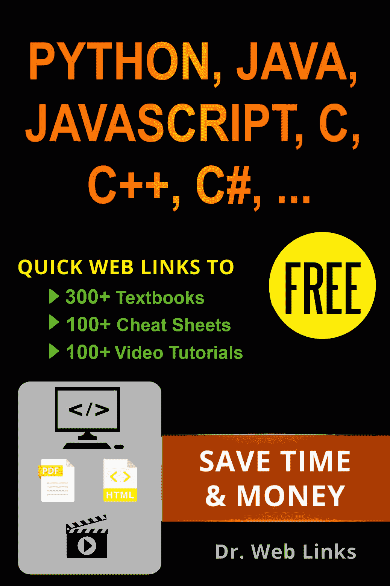
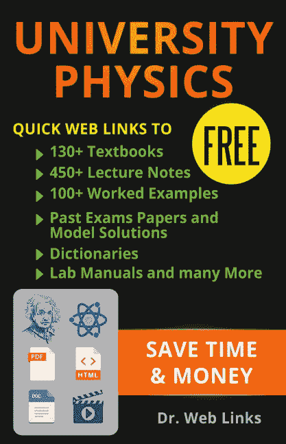
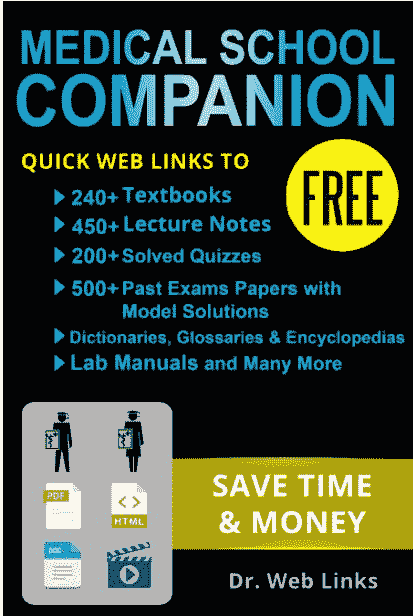
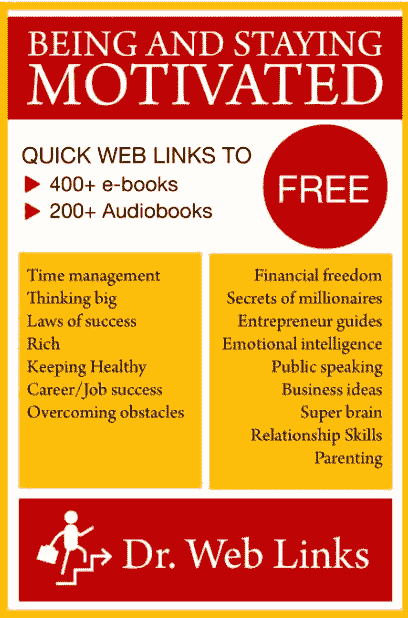

# 学习 Python, Java, JavaScript, C, C++, C#, CSS, HTML, jQuery, MySQL, SQL, LINUX, Perl, PHP 或 XML：快速获取 300+ 种免费教材、100+ 份查表、100+ vi 脚本的链接

## 献辞
致所有勤工作的专题作者以及 Dr. Links 网络搜索团队

# 缩写词

| 缩写 | 含义 |
| :--- | :--- |
| AJAX | 异步 JavaScript 和 XML |
| C# | C Sharp |
| CSS | 层叠样式表 |
| HTML | 超文本标记语言 |
| N/A | 不适用 |
| NF | 未找到 |
| PHP | 超文本预处理器 |
| SQL | 结构化查询语言 |
| XML | 可扩展标记语言 |

# 关于作者
Dr. Web Links 是一位亚马逊畅销书的笔名，他拥有奥克兰大学的博士学位，该大学是 R 编程语言的诞生地。他曾在两所公立大学授课，现在致力于帮助学生取得优异成绩。[Dr. Links](https://www.amazon.com/s/ref=dp_byline_sr_ebooks_1?ie=UTF8&text=Dr+Web+Links&search-alias=digital-text&field-author=Dr+Web+Links&sort=relevancerank) 及其团队的其他书籍：

- [大学生物课程](https://www.amazon.com/dp/B07HMT7KSY)
- [大学数学与统计学：](https://www.amazon.com/dp/B07G5X3JWD)
- [大学物理](https://www.amazon.com/dp/B07DSLQJ1C)
- [大学化学与生物化学](https://www.amazon.com/dp/B07GZ8TZTL)
- [医学院指南](https://www.amazon.com/dp/B07JDJVY97)
- [护理学院指南](https://www.amazon.com/dp/B07JLBZZNT)

# 引言
如你可能所知，互联网包含许多优秀的计算机编程学习资源，适用于学生、讲师以及想要掌握编程或编码的人。这些资源包含了许多精彩的教科书、参考指南以及视频课程。挑战在于，这些资源散落在各处，且充斥着广告和干扰信息。如果你足够幸运，你需要点击多次才能找到实用的计算机编程材料。这正是本书的用处，它将你连接到网上最相关的且有趣的链接。

这些链接将帮助你免费获取这些材料。它将让你能够快速在线探索或下载：

- 多本教科书
- 多本视频教程
- 许多示例代码
- 关键备忘表和参考指南
- 致力于专题编程语言的优质 YouTube 频道
- 以及更多有趣的内容。

将所有这些链接汇集在一个方便的地方不是很酷吗？

预计本书将引导你找到实用的学习资源，这些资源对你理解任何语言都将非常有帮助。

在我的学习过程中（从本科到博士阶段），我发现比较学习材料以及解决更多问题是促进理解的最佳方法之一。本书将引导你完成这一点。

## 如何使用本书书
主题按顺序排列。

## 链接集 1. Python, Java, JavaScript, C, C++, C#...你现在就可以下载的备忘表和参考指南

链接集 2. 关于 Python, Java, JavaScript, C, C++, C# 及其他 13 种语言的可访问/下载教科书

链接集 3. 你可以访问下载额外书籍的计算机编程书籍网络数据库

链接集 4. 你会喜欢的优质 YouTube 频道和其他相关视频

链接集 5. 你可以探索的计算机编程在线论坛

## 免责声明

# Python 速查表

- [Python 快速入门 - 速查表](https://ehmatthes.github.io/pcc/cheatsheets/README.html)
- [Python 语言与语法速查表](https://ddi.ifi.lmu.de/probestudium/2013/ws-i-3d-programmierung/tutorials/python-referenzkarte)
- [Python 速查表](http://www.datasciencefree.com/python.pdf)
- [Python 3 – 快速参考卡](https://www.cs.put.poznan.pl/csobaniec/software/python/py-qrc.html)
- [数据科学 Python 速查表 Python 基础](http://www.utc.fr/~jlaforet/Suppl/python-cheatsheets.pdf)
- [Python 基础](http://huttenhower.sph.harvard.edu/moodle/pluginfile.php/1409/mod_folder/content/0/python_cheat_sheet.pdf?forcedownload=1)
- [Python 2.7 快速参考性表](http://huttenhower.sph.harvard.edu/moodle/pluginfile.php/1409/mod_folder/content/0/Python_qr.pdf?forcedownload=1)
- [Python 语言与语法速查表](http://huttenhower.sph.harvard.edu/moodle/pluginfile.php/1409/mod_folder/content/0/PythonCheatSheet.pdf?forcedownload=1)
- [PYTHON 速查表](http://vis.usal.es/rodrigo/documentos/bioinfo/avanzada/pythonCheatsheet.pdf)
- [Python 快速入门手册](https://s3.amazonaws.com/michael-kennedy/downloads/DM/python_cheat_sheet.pdf)
- [Python 速查表](https://blogs.sans.org/pen-testing/files/2016/07/SEC573_PythonCheatSheet_06272016.pdf)
- [Python 速查表](https://bit.ly/2TqHxxj)
- [Python 速查表](http://ai.unibo.it/webfm_send/27)
- [Python & Pylab 速查表](https://www.uzh.ch/cmsssl/physik/dam/jcr:1d91aa92-1c3a-419a-b3dd-6888a2b1b187/python.pdf)
- [ANACONDA 速查表](http://janroman.dhis.org/AFI/Python/Anaconda_CheatSheet.pdf)
- [Python 快速参考（PQR 2.7 及以下）](http://rgruet.free.fr/#QuickRef%20)
- [Python 参考指南](http://overapi.com/python)

# Ajax 速查表

- [Ajax 入门](http://web-algarve.com/books/JS%20AJAX%20jquery%20&%20angular/ajax_online%20QuickRef.pdf)
- [ajax 速查表](https://gist.github.com/joelrojo/c54765a748cd87a395a2b865359d6add)

# BASH 速查表

- [BASH 参考](http://index-of.es/EBooks/English/Bash%20Quick%20Reference.pdf)
- [Linux Bash Shell 速查表](https://learncodethehardway.org/unix/bash_cheat_sheet.pdf)
- [Bash 速查表](http://ftp.psu.ac.th/pub/bash-howto/reference_bash-cheat.pdf)
- [Bash 参考手册](https://www.gnu.org/software/bash/manual/bash.pdf)

# C 速查表

- [C 参考卡](http://mmc.geofisica.unam.mx/femp/Herramientas/Lenguajes/CyC++/ReferenceC.pdf)
- [C 语言快速粗暴指南](https://courses.cs.washington.edu/courses/cse351/14sp/sections/1/Cheatsheet-c.pdf)
- [C 参考速查表](https://www.cheatography.com/ashlyn-black/cheat-sheets/c-reference/pdf/)
- [C 速查表](https://sites.ualberta.ca/~ygu/courses/geoph624/codes/C.CheatSheet.pdf)
- [C 语言编程快速参考](https://www.engr.uvic.ca/~mech410/ACAD_and_C/c_reference.pdf)
- [C 参考速查表](https://www.cs.mun.ca/~dchurchill/pc/pdf/c.pdf)
- [C 参考卡](https://www.math.brown.edu/~jhs/ReferenceCards/CRefCard.v2.2.pdf)
- [C 参考手册](https://www.bell-labs.com/usr/dmr/www/cman.pdf)

# C# 速查表

- [C# 参考表](https://www.dreamincode.net/downloads/ref_sheets/csharp_basics_reference_sheet.pdf)
- [C# 速查表](https://www.codingguys.net/resources/cheat-sheet)
- [C# 速查表](http://cogsci.pi.edu/public/html/cSharp/CheatSheet)
- [基础 C# 速查表](https://learnappdevelopment.com/wp-content/uploads/2016/05/basic_c_cheat_sheet)
- [C# 参考指南](https://www.glowtouch.com/downloads/C_Sharp_Reference)
- [面向开发者的 C#](https://download.microsoft.com/download/D/E/DEE91FC0-7AA9-4F6E-B8FA-A658FA0D.pdf)

# C++ 速查表

- [C++ 参考卡](http://index-of.es/Programming/C++ )
- [如何用 C++ 编程](https://cs.fit.edu/~mahoney/cse2050/howcpp)
- [小白看的 C++ 速查表](http://xlb6.es/C++%20for%20Dummies%20Cheat%20Sheet)
- [C++ 语法表](https://github.com/gibsjose/cpp-cheat-sheet/blob/master/C%2B%2BSyntax.md)
- [C++ 快速参考](http://index-of.es/Programming/C++ )
- [C++ 参考指南](http://index-of.es/Programming/C++ )

# CSS 速查表

- [快速参考 CSS](http://rgruet.free.fr/#QuickRef%20)
- [CSS3 基础](http://rgruet.free.fr/#QuickRef%20)
- [CSS3 速查表](http://rgruet.free.fr/#QuickRef%20)
- [CSS 快速参考](http://rgruet.free.fr/#QuickRef%20)
- [CSS 速查表](http://rgruet.free.fr/#QuickRef%20)
- [CSS 快速参考](http://rgruet.free.fr/#QuickRef%20)
- [CSS 快速参考](http://rgruet.free.fr/#QuickRef%20)
- [CSS 速查表](http://rgruet.free.fr/#QuickRef%20)

# HTML 速查表

- [HTML 标签快速参考](http://rgruet.free.fr/#QuickRef%20)
- [HTML5 画布速查表](http://rgruet.free.fr/#QuickRef%20)
- [HTML 速查表](http://rgruet.free.fr/#QuickRef%20)
- [HTML5 速查表](http://rgruet.free.fr/#QuickRef%20)
- [HTML5 速查表](http://rgruet.free.fr/#QuickRef%20)
- [HTML5 快速参考](http://rgruet.free.fr/#QuickRef%20)
- [HTML5 快速参考](http://rgruet.free.fr/#QuickRef%20)
- [HTML 初学者速查表](http://rgruet.free.fr/#QuickRef%20)

# Java 参考指南
- [Java 参考指南](http://overapi.com/java)
- [Java 编程速查表](https://introcs.cs.princeton.edu/java/11cheatsheet/)
- [JAVA 语法速查表](http://lesliefranke.com/sandbox/ref/javacheatsheet.html)

# Javascript 速查表
- [Javascript 快速参考卡](http://www.cheat-sheets.org/saved-copy/jsquick.pdf)
- [JavaScript 与浏览器对象快速参考](http://web-algarve.com/books/JS%20AJAX%20jquery%20&%20angular/JS%20&%20visual%20objects%20QuickRef.pdf)
- [javascript 速查表](http://web-algarve.com/books/JS%20AJAX%20jquery%20&%20angular/javascript%20QuickRef.pdf)
- [Javascript 快速参考卡](http://web-algarve.com/books/JS%20AJAX%20jquery%20&%20angular/jsquick%20QuickRef.pdf)
- [JavaScript 速查表](https://www.cheatography.com/davechild/cheat-sheets/javascript/pdf_bw/)
- [JavaScript 速查表](https://htmlcheatsheet.com/js/)
- [JavaScript 速查表（新手必备）](https://websitesetup.org/wp-content/uploads/2018/04/wsu-js-cheat-sheet.pdf)
- [javascript 参考指南](http://overapi.com/javascript)

# jQuery
- [jQuery 1.5 视觉速查表](http://index-of.co.uk/Cheat-Sheet/jQuery-1.5-Visual-Cheat-Sheet.pdf)
- [jQuery 1.5 视觉速查表](http://web-algarve.com/books/JS%20AJAX%20jquery%20&%20angular/jQuery-1.5%20QuickRef.pdf)
- [jquery_online 快速参考](http://web-algarve.com/books/JS%20AJAX%20jquery%20&%20angular/jquery_online%20QuickRef.pdf)
- [jquery 速查表](http://www.define-web.com/jquery_cheat_sheet/jquery_cheat_sheet_080306_v1.pdf)
- [jquery 速查表](http://www.define-web.com/jquery_cheat_sheet/jquery_cheat_sheet_080306_v1_pg2.pdf)
- [jQuery 速查表](https://htmlcheatsheet.com/jquery/)
- [jquery 参考指南](http://overapi.com/jquery)
- [jQuery 视觉速查表](http://researchers.lille.inria.fr/~yabouzid/refCardJQUERY.pdf)
- [jQuery 快速 API 参考](https://oscarotero.com/jquery/)

# MySQL 速查表
- [MySQL 参考指南](http://overapi.com/mysql)
- [MySQL 速查表](http://www.dusun-think.net/czyayin/mysqlatsheet.pdf)
- [MySQL MySQL 速查表](https://www.cheatography.com/guslong/cheat-sheets/mysql/pdf_bw/)
- [MySQL 速查表](https://havel.mojesvery.cz/wp-content/uploads/2015/10/mysql-ref.pdf)
- [MySQL 速查表](http://www.davidckie.com/Carleton%20MySQL%20cheat.sheet)
- [MySQL 表格](https://www.codeconquest.com/wp-content/uploads/MySQL-Cheat-Sheet-by-CodeConquest.pdf)
- [MySQL 教程](https://downloads.mysql.com/mysql/tutorial-5.5-en)
- [MySQL 速查表](https://appletree.or.kr/quick_reference_cards/Databases-NoSQL/mysql-sheet.pdf)

# Perl 速查表
- [Perl 快速参考卡](http://index-of.co.uk/Cheat-Sheet/Perl%20Quick%20Reference)
- [Perl 正则表达式卡](http://index-of.co.uk/Cheat-Sheet/Perl%20Regular%20Expression%20Card)
- [Perl 正则表达式参考](http://index-of.co.uk/Cheat-Sheet/Perl%20Regular%20Expression%20Reference)

# PHP 速查表
- [PHP 速查表](http://index-of.co.uk/Cheat-Sheet/php_cheat_sheet)
- [PHP 参考表](https://www.dreamincode.net/downloads/ref_sheets/php_reference_sheet)
- [PHP 参考表（高级版）](https://www.dreamincode.net/downloads/ref_sheets/php_advanced_sheet.pdf)
- [PHP 速查表](http://www.fzolee.hu/download.php?fname=./cheatsheets/php-cheat-sheet-v1)
- [PHP 速查表](https://www.cheatography.com/krabat1/cheat-sheets/php/pdf)
- [PHP 速查表（新手必备）](https://websitesetup.org/wp-content/uploads/2018/06/wsu-php-cheat-sheet.pdf)
- [PHP 参考表](http://overapi.com/php)
- [PHP 速查表](https://www.cheatography.com/krabat1/cheat-sheets/php/pdf)
- [PHP 快速参考](http://overapi.com/php)
- [PHP 速查表](http://overapi.com/php)

DEBUGGING/PHP SHOING:

Featured programming languages:
| Python | D |
| C | LINUX |
| C++ | Perl |
| C# | PHP |
| HTML | BASH |
| Java | SQL |
| jQuery | Unix |
| AJAX | |

Click the title to download!

| Author | Title | Date |
| :--- | :--- | :--- |
| AJAX | ü | |
| Thomas A. Powell | [AJAX: The Complete Reference](https://robot.bolink.org/ebooks/AJAX%20-%20The%20Complete%20Reference.pdf) | 2008 |
| Steve Holzner | [Ajax For Dummies](https://doc.lagout.org/programmation/Ajax/Ajax%20For%20Dummies%20%282006%29.pdf) | 2006 |
| Dave Crane et al. | [Ajax In Action](https://doc.lagout.org/programmation/Ajax/Ajax%20In%20Action%20%282006%29.pdf) | 2006 |
| Jeremy Keith | [Bulletproof Ajax](https://doc.lagout.org/programmation/Ajax/Bulletproof%20Ajax.pdf) | |
| Carl Albing | [Bash Pocket Reference](https://the-eye.eu/public/Books/Humble/bashpocketreference_2nd.pdf) | 2016 |
| Lee Babin | [Beginning Ajax With PHP](https://doc.lagout.org/programmation/Ajax/Beginning%20With%20PHP%20-Professional) | 2007 |
| Ryan Asleson and Nathaniel Shutta | [Foundations of Ajax](https://doc.lagout.org/programmation/Ajax/Foundations%20Ajax) | 2006 |
| Rebecca M. Riordan | [Head First Ajax](https://robot.bolink.org/ebooks/AJAX%20-%20The%20Complete%20Reference.pdf) | 2008 |

If your computer’s browser flags some links as dangerous, use a different browser (e.g. Internet explorer): copy and paste into:

See below:

If you still have the alarms, please email me:

| 作者 | 书名 | 年份 |
| :--- | :--- | :--- |
| Gary J. Bronson | [工程师与科学家的 C 语言 - ANSI C 编程入门](http://index-of.es/C++/C%20for%20Engineers%20and%20Scientists%20-%20An%20Introduction%20to%20Programming%20With%20ANSI%20C.pdf) | 1993 |
| David Griffiths and Dawn Griffiths | [C 语言入门](http://index-of.es/C++/Griffiths%20D.,%20Griffiths%20D.%20-%20Head%20First%20C%20-%202012-.pdf) | 2012 |
| Stephen G. Kochan | [C 语言编程](http://index-of.es/C++/Programming%20in%20C%203rd%20edition%20by%20Stephen%20G.%20Kochan.pdf) | 2005 |
| Greg Perry and Dean Miller | [C 语言编程初学者指南](http://cache3.pdfdrive.com/dl.php?id=34434517&h=16305f3570927791787abd82e5e0ea39&u=cache) | 2014 |
| Bradley L. Jones and Peter Aitken | [Sams 21 天自自学 C 语言](http://www.e-reading.mobi/bookreader.php/135186/Aitken,_Jones_-_Sams_Teach_Yourself_C_in_21_Days,_6th_Edition.pdf) | 2003 |
| Ben Klemens | [21 世纪 C 语言](https://doc.lagout.org/programmation/C/21st%20Century%20C%20%5BKlemens%202012-11-05%5D.pdf) | 2013 |
| Paul Deitel and Harvey Deitel | [C 语言程序](https://drive.uqu.edu.sa/_/ajshaor/files/Scientific/Deitel-C_%20How%20to%20Program,%207th.pdf) | 2013 |
| Tim Bailey | [C 语言编程与软件设计入门](http://www-personal.acfr.usyd.edu.au/tbailey/ctext/ctext.pdf) | NF |
| C# | ü | ü |
| Svetlin Nakov and Veselin Kolev | [C# 计算机编程基础](http://ksuweb.kennesaw.edu/~rgesick1/Fundamentals-of-Computer-Programming-with-CSharp-Nakov-eBook-v2013.pdf) | 2013 |
| Andrew Stellman and Jennifer Greene | [Head First C##](https://robot.bolink.org/ebooks/Head%20First%20CSharp%202e%20May%202010.pdf) | 2010 |
| ü | [链接 2](https://doc.lagout.org/programmation/CSharp/Head%20First%20CSharp%202nd%20Edition%20May%202010.pdf) | ü |
| Jesse Liberty | [C# 编程](http://index-of.es/Programming/CSharp/O'Reilly%20-%20Programming%20C%23%202nd%20Edition.pdf) | 2002 |
| ü | [链接 2](https://doc.lagout.org/programmation/CSharp/Programming_C%23.pdf) | ü |
| Jay Hilyard and Stephen Teilhet | [C# 3.0 菜谱](http://index-of.es/Programming/CSharp/O'Reilly%20C%23%203.0%20Cookbook%20(3rd%20Edition).pdf) | 2008 |
| Bradley L. Jones | [Sams 21 天自学 C# 语言](http://ceit.aut.ac.ir/~shiry/lecture/programming/Sams%20-%20Teach%20Yourself%20the%20C%20sharpLanguage%20in%2021%20Days.pdf) | 2004 |
| Eric Gunnerson | [程序员 C# 入门指南](https://doc.lagout.org/programmation/CSharp/APress%20A%20Programmer%27s%20Introduction%20to%20C%23.pdf) | 2000 |
| Trey Nash | [加速 C# 2010](https://doc.lagout.org/programmation/CSharp/Apress%20Accelerated%20C%20Sharp%202010.pdf) | 2010 |
| Stephen Randy Davis and Chuck Sphar | [傻呆教程 C# 2005](https://doc.lagout.org/programmation/CSharp/C%23%202005%20for%20Dummies.pdf) | 2006 |
| Paul Deitel and Harvey Deitel | [Visual C# 2012 程序](http://cache3.pdfdrive.com/dl.php?id=194374&h=c085ec4d92f8190a2) | 2012 |
| John Sharp | [Microsoft C# 2012 详解](http://zeus.nyf.hu/~bajalin/MS_Sharp_2012) | 2012 |
| C++ | ü | ü |
| Bjarne Stroustrup | [C++ 语言](https://robot.bolink.org/ebooks/The%20C++%20ByBjarne%20Stroustrup) | 1997 |
| ü | [链接 2](http://index-of.es/C++/Addison%20Wesley%20The%20C++%20Programming%20Third%20Edition) | ü |
| C. Pozrikidis | [C++ 入门](https://robot.bolink.org/ebooks/Introduction%20to%20C++) | 2007 |
| Alan Parker | [C++ 算法与结构](https://robot.bolink.org/ebooks/CRC%20Press%20-%20Algorithms%20Structures%20in%20C++) | 1993 |
| Herbert Schildt | [C++：完全参考](http://amarblog.olasite.com/resources/c++) | 2003 |
| Stanley B. Lippman | [Essential C++](http://index-of.es/C++/Addison%20Wesley%20-) | 2002 |
| Nicolai M. Josuttis | [C++ 标准库：教程与参考](http://index-of.es/C++/Addison%20Wesley%20-%20The%20C++%20Standard%20Library.%20A%20Tutorial%20Reference) | 1999 |
| Stephen Prata | [C++ Plus (C++ Primer Plus), 第 6 版] | 2012 |
| Ivor Horton | [Visual C++](http://index-of.es/C++/Beginning%20Visual%20C++%202005(2008)) | 2005 |
| P. J. Deitel and H. M. Deitel | [C++ 程序](https://profs.basu.ac.ir/y-seifi/upload_file/deitel%20c++%20how%20program,%207th%20edition%202010) | 2009 |
| Jesse Liberty et al. | [Sams 每天小时自学 C++](http://index-of.es/C++/Computer%20-%20Sams%20Teach%20Yourself%20C++%20in%20One%20Hour%20a%20Day,%206th%20Edition%20-%20(Jesse%20Liberty)) | 2009 |
| Victor Shtern | [C C++ 软件工程方法](http://index-of.es/C++/Core%20C++) | 2000 |
| Joe Pitt-Francis and Jonathan Whiteley | [C++ 科学计算指南](http://index-of.es/C++/Guide%20to%20Scientific%20Computing%20in%20Cpp) | 2012 |
| John Smiley | [用 C++ 编程](http://index-of.es/C++/Learn%20To%20Program%20With%20CPP%20(2003)) | 2003 |
| Jeff Kent | [C++ 揭秘：自学指南](http://index-of.co.uk/Misc/McGraw-Hill%20-%20C++%20Demystified%20(2004)) | 2004 |
| Nicholas A. Solter and Scott J. Kleper | [专业版 C++](http://index-of.es/C++/Professional%20CPP) | 2005 |
| Vladimir Kushnir | [安全 C++](http://index-of.es/C++/Safe%20cpp) | 2012 |
| Matthew Telles | [傻呆教程 C++ 高效时间技巧](http://index-of.es/C++/Wiley%20Publishing%20-%20C++%20Timesaving%20Techniques%20for%20Dummies) | 2005 |
| Stephen Randy Davis | [傻呆教程 C++](http://index-of.es/C++/Wiley%20Publishing%20-%20C++%20for%20Dummies) | 2005 |
| Francis Glassbor | [你可以编程](http://index-of.es/C++/Wiley%20Publishing%20-%20C++%20for%20Dummies) | 2006 |
| Jesse Liberty and Bradley Jones | [Sams 21 天自学 C++](http://index-of.es/C++/Wiley%20Publishing%20-%20C++%20for%20Days) | 2012 |

| 作者 | 标题 | 年份 |
| :--- | :--- | :--- |
| Elisabeth Freeman and Eric Freeman | [Head First HTML with CSS & XHTML](https://robot.bolink.org/ebooks/Head%20First%20HTML%20with%20CSS%20&%20XHTML%20Big.pdf) | 2006 |
| Molly E. Holzschlag | [250 个 HTML 和 Web 设计秘密](https://robot.bolink.org/ebooks/250%20HTML%20And%20Web%20Design%20Secrets.pdf) | 2004 |
| Thomas A. Powell | [HTML & CSS: 完整参考](http://cloudforall.weebly.com/uploads/1/2/7/5/12759856/htmlandcss-thecompletereference5thed-t.powellmcgraw-hill2010bbs_nxpowerlite.pdf) | 2010 |
| Rob Larsen | [入门 HTML 和 CSS](http://pdf.th7.cn/down/files/1312/beginning_html_and_css.pdf) | 2013 |
| Jeremy Osborn | [使用 HTML 和 CSS 进行 Web 设计](https://stevebraysduis.files.wordpress.com/2014/02/web-design-with-html-and-css-digital-classroom.pdf) | 2011 |
| Jeremy Osborn et al. | [使用 HTML 和 CSS 进行 Web 设计](https://stevebraysduis.files.wordpress.com/2014/02/web-design-with-html-and-css-digital-classroom.pdf) | NF |
| Jon Ducket | [HTML & CSS：设计与构建网站](https://robot.bolink.org/ebooks/HTML%20And%20CSS%20-%20Design%20And%20Build%20Websites.pdf) | 2011 |
| Leslie F. Sikos | [精通 HTML5, CSS3 和 XML](https://robot.bolink.org/ebooks/Web%20Standards%20Mastering%20HTML5,%20CSS3,%20and%20XML.pdf) | NF |
| Luke Stevens | [HTML5 的真相（针对 Web 设计师）](https://robot.bolink.org/ebooks/Preview%20-%20The%20Truth%20About%20HTML5%20(For%20Web%20Designers).pdf) | 2012 |
| Andy Harris | [HTML5 快速指南](https://bit.ly/2BUwK6K) | 2011 |
| Steve Fulton and Jeff Fulton | [HTML5 Canvas](https://robot.bolink.org/ebooks/HTML5%20Canvas%20-%20S.%20Fulton,%20J.%20Fulton%20(O'Reilly,%202011)%20WW.pdf) | 2011 |
| Eric Freeman and Elisabeth Robson | [Head First HTML5 编程](https://robot.bolink.org/ebooks/Head%20First%20HTML5%20Programming%20-%20Building%20Web%20Apps%20with%20JavaScript.pdf) | 2011 |
| Jeremy Keith | [面向 Web 设计师的 HTML5](https://robot.bolink.org/ebooks/HTML5%20for%20Web%20Designers%20By%20Jeremy%20Keith.pdf) | 2010 |
| Eric Rowell | [HTML5 Canvas 教程](https://robot.bolink.org/ebooks/HTML5%20Canvas%20Cookbook%20-%20Eric%20Rowell.pdf) | 2011 |
| Rob Hawkes | [用于游戏和娱乐的基础 HTML5 Canvas](https://robot.bolink.org/ebooks/Foundation%20HTML5%20Canvas%20-%20Rob%20Hawkes.pdf) | NF |
| Mark Pilgrim | [深入浅 HTML5](https://robot.bolink.org/ebooks/Dive%20into%20HTML5%20By%20Mark%20Pilgrim.pdf) | NF |
| David Geary | [核心 HTML5 Canvas：图形、动画与游戏开发](https://robot.bolink.org/ebooks/Core%20HTML5%20Canvas%20-%20Graphics,%20Animation,%20and%20Game%20Development%20By%20David%20Geary.pdf) | 2012 |
| ALEXIS GOLDSTEIN et al. | [实战中的 HTML5 和 CSS3](http://index-of.es/CSS/HTML5%20and%20CSS3%20for%20the%20real%20world.pdf) | 2011 |
| PETER LUBBERS et al. | [专业 HTML5 编程：用于更丰富的互联网应用开发的强大 API](http://index-of.es/HTML/Pro%20HTML5%20Programming.pdf) | 2010 |
| Christopher Schmitt and Kyle Simpson | [HTML5 教程](http://index-of.es/HTML/Oreilly.HTML5.Cookbook.Nov.pdf) | 2012 |
| Bruce Lawson and Remy Sharp | [简介 HTML5](http://index-of.es/HTML/Introducing%20HTML5.pdf) | 2011 |
| Jesse Cravens and Jeff Burtoft | [HTML5 技巧](http://web-algarve.com/books/HTML5%20Hacks) | 2013 |
| Brian P. Hogan | [HTML5 和 CSS3](http://web-algarve.com/books/HTML5%20and%20CSS3,%202Edition) | 2013 |
| Java Wikooks.org | [Java 编程](https://robot.bolink.org/ebooks/Java.pdf) | 2011 |
| Brian D. Eurbanks | [高效通 Java：开源库与项目](https://robot.bolink.org/ebooks/Wicked%20Cool%20Java%20Open-Source%20Libraries,%20Project) | NF |
| James Gosling et al. | [Java 语言规范](https://robot.bolink.org/ebooks/The%20Language%20Java%20SE7%20Edition) | 2011 |
| Danny Goodman with Michael Morrison | [JavaScript 教程](https://robot.bolink.org/ebooks/Wiley%20-%20Javascript,%205e) | 2004 |
| Nathan Meyers | [Linux 上的 Java 编程](https://robot.bolink.org/ebooks/Java%20Programing%20on%20Linux) | 2001 |
| Tim Lindholm et al. | [Java 虚拟机](https://robot.bolink.org/ebooks/The%20Virtual%20Machine,%20Java%20SE7%20Edition) | 2013 |
| Phil Ballard and Michael Moncur | [自学 Ajax 和 PHP](https://robot.bolink.org/ebooks/Sams%20TeachYourself%20Ajax%20Javascript) | 2009 |
| E. Balagurus | [使用 Java 编程：入门](https://robot.bolink.org/ebooks/Programming%20with%20Java%20a%20Primer%203e%20Balagurus) | 2007 |
| Mauro Marnilli | [专业 Java 用户界面](https://robot.bolink.org/ebooks/Professional%20Java%20Interfaces) | 2006 |
| W. Clay Richardson et al. | [专业 Java JDK](https://robot.bolink.org/ebooks/Professional%20Java%20JDK%26e) | 2007 |
| Herbert Schildt and James Holmes | [Java 艺术](https://robot.bolink.org/ebooks/The%20Art%20Java%20(2003).pdf) | 2003 |
| Nicholas C. Zakas | [Web 开发者专业 JavaScript](https://robot.bolink.org/ebooks/Professional%20JavaScript%20For%20Web%20Developers%22e.pdf) | 2009 |
| Gennadiy Nikishkov | [Java 有限元编程](https://robot.bolink.org/ebooks/Programming%20Finite%20Elements%20in%20Java.pdf) | 2010 |
| David Flanagan | [Java 详解：桌面快速参考](https://robot.bolink.org/ebooks/OReilly%20-%20Java%20In%20A%20Nutshell%205e.pdf) | 2005 |
| Danny Goodman | [JavaScript 教程](https://robot.bolink.org/ebooks/JavaScript%20Bible%20Gold%20Edition.pdf) | 2001 |
| Emily A. Vander Veer | [JavaScript 快速指南](https://robot.bolink.org/ebooks/Javascript%20For%20Dummies%20Quick%20Reference.pdf) | NF |
| Emily Vander Veer | [傻瓜 JavaScript（第 4 版)](http://index-of.es/JS/Wiley%20-%20JavaScript%20for%20Dummies,%204th%20Ed%20-%202005%20-%20(By%20Laxxuss).pdf) | 2005 |
| Dr. Axel Rauschmayer | [给急躁者的 JavaScript](http://exploringjs.com/impatient-js) | NF |
| Marijn Haverbek | [精通 JavaScript：现代入门](http://art.yale.edu/file_columns/0000/9186/eloquent_javascript.pdf) | 2014 |
| Marijn Haverbek | [精通 JavaScript：现代入门](https://eloquentjavascript.net/) | 2018 |
| Mark Myer | [更智能的学习 JavaScript：利用技术减少一半努力的新方法](https://www.cpp.edu/~jcmcgar/513_2016/ASmarterWaytoLearnJavaScript.pdf) | 2013 |

| 作者 | 书名 | 年 |
| :--- | :--- | :--- |
| Herbert Schildt | [Java：入门指南](https://robot.bolink.org/ebooks/Java%20A%20Beginners%20Guide%203e%20McGrawHill.pdf) | 2005 |
| Jonathan Knudsen | [Java 2D 图形](https://robot.bolink.org/ebooks/Java%202D%20Graphics.pdf) | 2001 |
| Michael Morrison | [深入精通 JavaScript](https://robot.bolink.org/ebooks/Head%20First%20Java%20Script.pdf) | 2008 |
| ü | [链接 2](http://web-algarve.com/books/JS%20AJAX%20jquery%20&%20angular/Head%20First%20JavaScript.pdf) | ü |
| Kathy Sierra and Bert Bates | [深入精通 Java](https://robot.bolink.org/ebooks/Head%20First%20Java%202e%20by%20Kathy%20Sierra%20and%20Bert%20Bates.pdf) | NF |
| Joan Krone et al. | [Java 语言编程教程](https://robot.bolink.org/ebooks/Essentials%20of%20the%20Java%20Programming%20Language.pdf) | NF |
| Joshua Bloch | [Effective Java：编程语言指南](https://robot.bolink.org/ebooks/Effective%20Java%20Programming%20Language%20Guide.pdf) | 2001 |
| JOHN R. HUBBARD | [Java 数据结构](https://robot.bolink.org/ebooks/Data%20Structures%20with%20Java%20e%20By%20John%20R%20hubbard,%20Schaum's%20Outline%20Series.pdf) | 2007 |
| Michelle Waite | [Java 数据结构与算法](https://robot.bolink.org/ebooks/Data%20Structures%20&%20Algorithms%20in%20Java%20-%20Robert%20Lafore.pdf) | 2001 |
| Robert Lafore | [Java 数据结构与算法](https://robot.bolink.org/ebooks/Data%20Structures%20and%20Algorithms%20in%20Java%20e%20-%20Robert%20Lafore.pdf) | 2003 |
| Vivek Chopra et al. | [JavaServer Pages 入门](https://robot.bolink.org/ebooks/Beginning%20JavaServer%20Pages.pdf) | 2005 |
| Herbert Schildt | [Java 全参考手册](https://memberfiles.freewebs.com/74/74/55387474/documents/Java%20The%20Complete%20Reference,%207th%20Edition.pdf) | 2007 |
| Cay Horstmann | [大 Java：兼容 Java 5, 6, 和 7](http://newton.uam.mx/xgeorge/uea/Lab_Prog_O_O/materiales_auxiliares/Big_Java_4th_Ed.pdf) | 2010 |
| Paul Wilton and Jeremy McPeak | [入门 JavaScript](https://robot.bolink.org/ebooks/Beginning%20JavaScript%204e.pdf) | 2010 |
| Kevin Mukhar et al. | [入门 Java EE 5：从新手到专家](https://robot.bolink.org/ebooks/Beginning%20Java%20EE%205.pdf) | 2006 |
| Bruce Eckel | [Java 编程](http://www.dblab.ntua.gr/~gtsat/collection/Java%20books/Bruce.Eckel.Thinking.In.Java.4th.Edition.Dec.2007.eBook-BBL.pdf) | 2006 |
| Doug Lowe | [自自学 Java 全书](http://1.droppdf.com/files/1lTSh/java-all-in-one-for-dummies-4th-edition-doug-lowe.pdf) | 2014 |
| Mark Watson | [Java 编程：10 分钟解决方案](https://doc.lagout.org/programmation/Java/Java%20Programming_%2010-Minute%20Solutions%20%5BWatson%202003-12-30%5D.pdf) | 2004 |
| Rogers Cadenhead | [Sams 21 天自学 Java](http://file.allitebooks.com/20151230/Java%20in%2021%20Days,%20Sams%20Teach%20Yourself%20(Covering%20Java%208),%207th%20Edition.pdf) | 2016 |
| Danny Goodman | [JavaScript 圣经，黄金版](http://www3.dsi.uminho.com/ie/JavaScript) | 2001 |
| Danny Goodman et al. | [JavaScript 圣经第 7 版](http://www3.dsi.uminho.com/ie/JavaScript) | 2010 |
| Danny Goodman | [JavaScript 示例](https://doc.lagout.org/programmation/Java) | 2001 |
| David Sawyer | [JavaScript 编程指南](https://doc.lagout.org/programmation/Java) | 2014 |
| Alexander Redko | [高级 Java](https://doc.lagout.org/programmation/Java) | NF |
| jQuery | ü |
| Seyed M.M. Tahagog | [入门 jQuery](https://robot.bolink.org/ebooks/pdf) | 2012 |
| George Reese | [深入精通 jQuery](https://the-eye.com/pdf) | 2010 |
| Yehuda | [深入精通 JavaScript](https://robot.bolink.org/ebooks/pdf) | 2011 |
| Ryan Reynolds | [深入精通 JavaScript](https://robot.bolink.org/ebooks/pdf) | 2013 |
| Arun | [jQuery 2.0 开发指南](https://robot.bolink.org/ebooks/pdf) | 2014 |
| LINUX | ü |
| Neil Matthew and Richard Stones | [专业 Linux](https://robot.bolink.org/ebooks/pdf) | 2004 |
| Neil Matthew and Richard Stones | [入门 Linux](https://robot.bolink.org/ebooks/pdf) | 2004 |
| Daniel J. Barrett | [Linux Pocket 指南](https://the-eye.com/pdf) | 2016 |
| MySQL | ü |
| Seyed M.M. Tahagog and Hugh E. Williams | [学习 MySQL](https://robot.bolink.org/ebooks/pdf) | 2007 |
| Mark Maslak | [21 天自学 MySQL](http://www.webbasedprogramming.com/) | 2000 |
| Michael Kofler | [MySQL 5 权威指南](https://doc.lagout.org/programmation/Java) | 2005 |
| Alexander Pachev | [MySQL 企业级解决方案](http://index-of.es/EBooks/) | 2003 |
| Paul DuBois | [MySQL 食谱](http://index-of.es/EBooks/) | 2002 |
| ü | [链接 2](https://doc.lagout.org/programmation/Java) | ü |
| ü | [链接 3](http://web-algarve.com/) | ü |

| 作者 | 标题 | 年份 |
| :--- | :--- | :--- |
| George Schlossnagle | [高级 PHP 编程](https://doc.lagout.org/programmation/tech_web/Sams.Advanced.PHP.Programming.673pp.3-2004.pdf) | 2004 |
| Marc Rochkind | [Expert PHP and MySQL](http://web-algarve.com/books/MySQL%20&%20PHP/Expert%20PHP%20and%20MySQL.pdf) | 2013 |
| Robin Nixon | [学习 PHP, MySQL, JavaScript, CSS & HTML5](http://web-algarve.com/books/MySQL%20&%20PHP/Learning%20PHP,%20MySQL,%20JavaScript,%20CSS%20&%20HTML5,%203rd%20Edition.pdf) | 2014 |
| Andrew Curioso et al. | [Expert PHP and MySQL.](https://robot.bolink.org/ebooks/Expert%20PHP%20and%20MySQL.pdf) | 2010 |
| PHP and MySQL |   |  |
| Shelley Johnston et al. | [PHP and MySQL Web Development](https://robot.bolink.org/ebooks/PHP%20and%20MySQL%20Web%20Development.pdf) | 2001 |
| KevinYank | [PHP & MySQL: 从入门到忍者](https://robot.bolink.org/ebooks/PHP%20&%20MySQL%20Novice%20To%20Ninja.pdf) | 2012 |
| Tim Converse et al. | [PHP5 And MySQL Bible](https://robot.bolink.org/ebooks/PHP5%20And%20MySQL%20Bible%20(2004).pdf) | 2004 |
| ü | [链接 2](https://robot.bolink.org/ebooks/PHP5%20and%20MySQL%20Bible%20-%20John%20Wiley%20&%20Sons.pdf) | ü |
| Ellie Quigley | [实例教程 PHP & MySQL](https://robot.bolink.org/ebooks/PHP%20and%20MySQL%20by%20Example.pdf) | 2007 |
| Brett McLaughlin | [PHP & MySQL: 缺失手册](https://robot.bolink.org/ebooks/PHP%20and%20MySQL%20The%20Missing%20Manual.pdf) | 2012 |
| Steve Suehring and Janet Valade | [自学者教程 PHP MySQL JavaScript and HTML5 全家一](https://robot.bolink.org/ebooks/PHP%20MySQL%20JavaScript%20and%20HTML5%20All-in-One%20For%20Dummies%20Small.pdf) | 2013 |
| ü | [链接 2](https://khmerbamboo.files.wordpress.com/2014/09/php-mysql-javascript-html5-all-in-one-for-dummies.pdf) | ü |
| Robin Nixon | [学习 PHP, MySQL, and CSS](https://robot.bolink.org/ebooks/PHP%20MySQL%20JavaScript%20And%20CSS) | 2012 |
| Robin Nixon | [学习 PHP, MySQL, and JavaScript](https://robot.bolink.org/ebooks/Learning%20PHP,%20MySQL,%20and%20JavaScript) | 2009 |
| Kevin Yank | [使用 PHP & MySQL 构建你的数据库驱动网站](https://robot.bolink.org/ebooks/Build%20Your%20Database%20Driven%20Website%20Using%20PHP%20&%20MySQL) | 2009 |
| W. Jason Gilmore | [PHP 和 MySQL 入门: 从入门到专业](http://minitorn.tlu.ee/jaagup/kool/14/webpr/beginning_php_and_mysql_novice_to_professional_4th.pdf) | 2010 |
| Larry ULLman | [动态网站的 PHP and MySQL](http://personal.graceland.edu/aallshou/classwork/210/GFX/PHP.and.for.Dynamic.Sites.Quick.4th.pdf) | 2012 |
| Lynn Beighley and Michael Morrison | [Head First PHP & MySQL](http://web-algarve.com/books/MySQL%20&%20PHP/Head%20First.pdf) | 2009 |
| John M. Zelle | [Python 编程: 计算机科学入门](https://mybiostats.files.wordpress.com/2015/03/python-programming-an-introduction-to-computer-science-2nd.pdf) | 2002 |
| ü | [链接 2](https://robot.bolink.org/ebooks/Python%20Programming-An%20Introduction%20To%20Computer.pdf) | ü |
| Jennifer Campbell et al. | [实用编程: 使用 Python 的计算机科学入门](https://robot.bolink.org/ebooks/Practical%20Programming%20An%20Introduction%20to%20Science%20Using%20Python) | 2009 |
| ü | [链接 2](https://doc.lagout.org/programmation/Pragmatic/Programming.pdf) | ü |
| Allen B. Downey | [软件设计: 像计算机科学家一样思考](https://robot.bolink.org/ebooks/Python%20for%20Design%20-%20How%20Think%20a%20Scientist.Big) | 2009 |
| Allen B. Downey | [软件设计: 像计算机科学家一样思考](https://robot.bolink.org/ebooks/Python%20for%20Design%20-%20How%20Think%20a%20Scientist.Small) | 2009 |
| Paul Barry | [Head First Python](https://robot.bolink.org/ebooks/Head%20First%20Python%20ora%2011) | 2011 |
| Dave Kuhlman | [Python 书: 入门 Python, 进阶 Python 及练习](http://www.daveuhlman.org/python_book_01.pdf) | 2009 |
| Allen B. Downey | [Think Python: 像计算机科学家一样思考](http://file.allitebooks.com/2015218/Think%20Python,%20nd%20Edition.pdf) | 2016 |
| ü | [链接 2](http://mmc.geofisica.unam.mx/femp/Herramientas/Lenguajes/Python/thinkpython.pdf) | ü |
| David Beazley | Python Essential | 2006 |
| NAOMI R. CEDER | [Quick Python Book](http://www.astro.caltech/~vieira/The_Python_Book.pdf) | 2010 |
| ü | [链接 2](https://github.com/varunkashyap/Books/master/The-Python-Book.pdf) | ü |
| John Paul Mueller | [自学者教程 Python 门](https://doc.lagout.org/programmation/Beginning%20Programming%20with%20Python%20for%20Dummies%20BMeller%202014-09-22.pdf) | 2014 |
| PHP and MySQL |  |  |
| Magnus Hetland | 从入门到专业的 PHP | 2008 |
| ü | [链接 2](https://bit.ly/2gha) | ü |
| Charles R. Severance | [动态网站的 Python](http://mmc.geofisica.unam.mx/femp/Herramientas/Lenguajes/python.pdf) | |
| Mark Lutz | [Learning Python](http://mmc.geofisica.unam.mx/femp/Herramientas/Lenguajes/Python.pdf) | |
| Alex Martelli and David As | [Head First PHP & MySQL](http://web-algarve.com/books/MySQL%20&%20PHP/Head%20First.pdf) | |
| Mark Lutz | [Python Pocket](http://mmc.geofisica.unam.mx/femp/Herramientas/Lenguajes/Python/Python.4th.Edition) | 2009 |
| Zed A. Shaw | [实战学习 PHP](https://robot.bolink.org/ebooks/PHP%20The%20Hard%20Way%205th%20The%20Missing%20Manual.pdf) | 2011 |
| Anders Michel | [Python 3 Web 开发入门](https://robot.bolink.org/ebooks/Python%203%20Web%20Development%20Beginners.pdf) | 2011 |
| Steven F. Lott | [在 Python 中构建技能](http://robot.bolink.org/ebooks/Building%20Skills%20in%20Python.pdf) | 2010 |
| Timothy A. Budd | [Exploring Python](https://robot.bolink.org/ebooks/Exploring%20Python.pdf) | |
| Tarek Ziadé | [Expert Python](http://www.e-reading.by/php/13816/Ziad_-_Expert_python.pdf) | 2008 |
| ü | [链接 2](https://www.e-reading.by/php/13816/Ziad_Expert_programming.pdf) | ü |
| Anthony Briggs | [Hello Python](https://robot.bolink.org/ebooks/Hello%20Python.pdf) | 2012 |
| Magnus Hetland | [Python 算法: 精通 Python 语言中的基础算法](https://robot.bolink.org/ebooks/Python%20Algorithms.pdf) | 2010 |
| Mark Lutz | [Programming Python](http://mmc.geofisica.unam.mx/femp/Herramientas/Lenguajes/Python/Python.4th.Edition) | 2009 |
| Sebastian Vinci | [Python Programming Cookbook](http://mmc.geofisica.unam.mx/femp/Herramientas/Lenguajes/Python.pdf) | 2016 |
| David Mertz | [Python 函数编程](http://mmc.geofisica.unam.mx/femp/Herramientas/Lenguajes/Python/functional-programming-python.pdf) | 2015 |
| Al Sweigart | [自动化无聊的工作: Python 自动化无聊的工作](http://1.droppdf.com/files/5iHzx/automate-the-boring-stuff-with-python-2015-.pdf) | 2015 |
| Gopi Subramanian | [Python Data Science Cookbook](http://file.allitebooks.com/20151124/Python%20Data%20Science%20Cookbook.pdf) | 2015 |

| Igor Milovanović 等人 | [Python 数据可视化食食谱](http://file.allitebooks.com/20151216/Python%20Data%20Visualization%20Cookbook,%20Second%20Edition.pdf) | 2015 |
| Brett Slatkin | [高效 Python：编写更好 Python 的 59 种方法](https://arisuchan.jp/%CE%BB/src/1498628824511-0.pdf) | 2015 |
| Luciano Ramalho | [精通 Python](http://1.droppdf.com/files/X06AR/fluent-python-2015-.pdf) | 2014 |
| Al Sweigart | [用 Python 编写自己的计算机游戏](http://inventwithpython.com/IYOCGwP_book1.pdf) | 2012 |
| Zed A. Shaw | [Python 教程：对极其优美的计算机与代码世界的非常简单介绍](http://nuovolabs.fauser.edu/~valeria/materiale-didattico/python/Learn%20Python%20The%20Hard%20Way%203rd%20Edition.pdf) | 2014 |
| ü | [链接 2](http://nuovolabs.fauser.edu/~valeria/materiale-didattico/python/Learn%20Python%20The%20Hard%20Way%203rd%20Edition.pdf) | ü |
| Michael Driscoll | [Python 101](http://nuovolabs.fauser.edu/~valeria/materiale-didattico/python/python_101.pdf) | 2014 |
| Samir Madhavan | [数据科学 Python 精进](http://nuovolabs.fauser.edu/~valeria/materiale-didattico/python/Packt.Mastering.Aug.2015.ISBN.1784390151.pdf) | 2015 |
| Wes McKinney | [数据分析 Python](http://nuovolabs.fauser.edu/~valeria/materiale-didattico/python/Wes%20McKinney-Python%20for%20Data%20Analysis-O'Reilly%20Media%20(2012).pdf) | 2013 |
| Bryson Payne | [教孩子写代码：面向家长的 Python 编程指南](http://file.allitebooks.com/20150810/Teach%20Your%20Kids%20to%20Code.pdf) | 2015 |
| Peter Norten 等人 | [入门 Python](https://doc.lagout.org/programmation/python/Beginning%20Python.pdf) | 2005 |
| Hans Petter Langtangen | [Python 科学编程入门](https://doc.lagout.org/programmation/python/A%20Primer%20on%20Scientific%20Programming%20with%20Python%20%5BLangtangen%202009-10%5D) | 2009 |
| Brian Heinold | [Python 实战入门](https://www.bheinold.net/python/A_Practical_Introduction_to_Programming.pdf) | 2012 |
| Mark Summerfield | [Python 3 编程：完全介绍](https://www.pdfdrive.com/download?id=34537598&h=51ee9445b723dc5cf40915) | 2010 |
| Jason R. Briggs | [少儿 Python](https://the-eye.eu/public/Books/HumbleBundle/pythonids_14900541.pdf) | 2013 |
| Mahesh Venkitalam | [Python 乐场](https://the-eye.eu/public/Books/HumbleBundle/pythonplayground_geekforthecurious) | 2016 |
| Eric Matthes | [Python 课程](https://the-eye.eu/public/Books/HumbleBundle/pythoncourse_updated.pdf) | 2016 |
| Ruby | ü |
| Peter Cooper | [入门 Ruby：从新手到专业](http://index-of.es/Ruby/Begining%20Ruby-1.pdf) | 2009 |
| Huw Collingbourne | [Ruby 之书](http://index-of.es/Ruby/Book%20of%20Ruby.pdf) | 2009 |
| SQL | ü | ü |
| Paul Weinberg 等人 | [SQL 完全参考](https://robot.bolink.org/ebooks/SQL%20-%20Complete%20Reference%203.pdf) | 2010 |
| James R. Groff 等人 | [SQL - 完全参考](https://robot.bolink.org/ebooks/SQL%20-%20Complete%20Reference%203.pdf) | 2009 |
| Lynn Beighley | [上上入门 SQL](https://robot.bolink.org/ebooks/Head%20First%20SQL%20By%20Beighley.pdf) | 2007 |
| ü | [链接 2](http://web-algarve.com/books/MySQL%20&%20PHP/Head%20First%20SQL.pdf) | ü |
| Dušan Petković | [Microsoft SQL Server 2008：入门指南](https://robot.bolink.org/ebooks/Beginners%20Guide%20to%20SQL%20Server%2008.pdf) | 2008 |
| Andy Oppel 和 Robert Sheldon | [SQL：入门指南](https://doc.lagout.org/programmation/Databases/SQL-%20A%20Beginner’s%20Guide,%203rd%20Edition.pdf) | 2009 |
| Allen G. Taylor | [SQL 自用手册](http://file.allitebooks.com/20151213/SQL%20For%20Dummies,%208th%20Edition.pdf) | 2013 |
| Allen G. Taylor | [SQL 合集精要](https://drive.google.com/uc?export=download&id=1xn0dCF05QnL7sokvDup) | 2011 |
| Alex Kriegel | [探索 SQL：新手上手指南](https://www.pdfdrive.com/download.pdf?id=156844262&h=518bb68b99413e64f218be06a0afca) | 2011 |
| Ryan Stephens 等人 | [24 小时学会 SQL](http://file.allitebooks.com/20151224/SQL%20in%2024%20Hours,%20Sams%20Teach%Yourself,%206th%20Edition.pdf) | 2016 |
| Jonathan Gennick | [SQL 口袋本](https://isidore.co/calibre/get/pdf/6535) | 2011 |
| Alan Beaulieu | [学习 SQL](http://www.r-5.org/files/books/computers/languages/sql/mysql/Alan_Beaulieu-Learning_SQL-EN.pdf) | 2009 |
| Unix | ü | ü |
| Kay A. Robbins 和 Steven Robbins | [Unix 系统编程：通信、并发与线程](https://robot.bolink.org/ebooks/Unix%20Systems%20Programming%20-%20Communication,%20Concurrency,%20and%20Threads.pdf) | 2003 |
| W. Richard Stevens 和 Stephen A. Rago | [Unix 环境下的高级编程](http://file.allitebooks.com/20151213 | 2013 |
| SQL | [完全参考](https://robot.bolink.org/ebooks/SQL%20-%20Complete%20Reference%203.pdf) | 2010 |

## C 语言编程
- [初学者 C 语言视频教程](https://www.youtube.com/playlist?list=PLfVsf4Bjg79CZ5kHTiQHcm-l2q8j06ofd)
- [C 编程教程 [ 基础 ]](https://www.youtube.com/playlist?list=PLfVsf4Bjg79A_LrMgUr5DUkT4IBAAb1it)

## C#
- [C# 教程](https://youtu.be/lisiwUZJXqQ)
- [Visual Studio C# 编程教程](https://www.youtube.com/playlist?list=PLS1QulWo1RIZrmdggzEKbhnfvCMHtT-Sa)
- [初学者 C# 教程（针对零基础）](https://www.youtube.com/playlist?list=PLS1QulWo1RIZWLRQfMwDjdknN5cV7LM9m)
- [C# 教程 - 初学者完整课程](https://youtu.be/GhQdlIFylQ8)
- [零基础 C# 基础](https://youtu.be/nRjHGKaJY8M)
- [完整 C# 教程：从零开始成为 C# 专家](https://youtu.be/QKzqmV1ofig)
- [初学者 C# 教程](https://www.youtube.com/playlist?list=PLAC325451207E3105)

## C++
- [C++ 编程](https://youtu.be/Rub-JsjMhWY)
- [初学者 C++ 教程 - 完整课程](https://youtu.be/vLnPwxZdW4Y)
- [C++ 从基础到进阶教程](https://youtu.be/mUQZ1qmKlLY)
- [C++ 编程教程列表](https://www.youtube.com/playlist?list=PLAE85DE8440AA6B83)
- [初学者 C++ 编程教程（针对零基础）](https://www.youtube.com/playlist?list=PLS1QulWo1RIYSyC6w2-rDssprPrEsgtVK)
- [初学者 C++ 视频教程（完整系列）](https://www.youtube.com/playlist?list=PLfVsf4Bjg79Cu5MYkyJ-u4SyQmMhFeC1C)
- [高级 C++ 编程视频教程](https://www.youtube.com/playlist?list=PLfVsf4Bjg79AxxmZwARAh3J9SHNGarty8)
- [让我们学习 C++：中级教程](https://www.youtube.com/playlist?list=PL82YdDfxhWsBZG0EwdxNIegmCc7LtQv5l)
- [让我们学习 C++：基础教程](https://www.youtube.com/playlist?list=PL82YdDfxhWsCyZLsg_kXhH8sy5ixQNras)
- [C++ 从基础到进阶教程](https://youtu.be/mUQZ1qmKlLY)

## CSS
- [零基础 CSS 速成](https://youtu.be/yfoY53QXEnI)
- [初学者 CSS 教程](https://www.youtube.com/playlist?list=PLr6-GrHUlVf8JIgLcu3sHigvQjTw_aC9C)
- [CSS 视频教程](https://www.youtube.com/playlist?list=PL07454EA7FF8D28AB)

## D 语言
- [D 编程语言](https://www.youtube.com/playlist?list=PLW0ahWDuXZ9w0brZKNFXMkT4Db57Sb-gf)
- [D 语言编程](https://www.youtube.com/playlist?list=PLBF7AE87D0F93C02D)

## HTML
- [HTML5 教程列表](https://www.youtube.com/playlist?list=PL081AC329706B2953)
- [初学者 HTML5 教程](https://www.youtube.com/playlist?list=PLS1QulWo1RIbU9SCKLXBou3-p6LZye5L_)
- [HTML5 教程](https://www.youtube.com/playlist?list=PL1A2CSdiySGIlme1vVXbXBpK1aDb4TBG)
- [HTML 教程](https://www.youtube.com/playlist?list=PLWKjhJtqVAbnSe1qUNMG7AbPmjIG54u88)

## HTML & CSS
- [初学者 HTML 和 CSS 教程](https://www.youtube.com/playlist?list=PLS1QulWo1RIbPrLaiosApdbbTwk-xMlIa)
- [HTML & CSS](https://www.youtube.com/playlist?list=PLillGF-RfqbZTASqIqdvm1R5mLrQq79CU)
- [HTML 和 CSS 教程](https://www.youtube.com/playlist?list=PL0eyrZgxdwhwNC5ppZo_dYGVjerQY3xYU)
- [初学者 HTML & CSS](https://www.youtube.com/v=48FS3Z1Esg)
- [HTML5 & CSS3 教程：从入门到专家](https://youtu.be/3MH8PeFnn8)
- [零基础 HTML5 & CSS3 基础](https://youtu.be/zgRxrA)
- [HTML5 和 CSS3 入门](https://www.youtube.com/playlist?list=PLEAF1C18AE)

## Java
- [Java 视频教程](https://www.youtube.com/playlist?list=PLE7E8B4F56)
- [初学者 Java 教程](https://www.youtube.com/playlist?list=PL9ooVr1hQauWNg4F)
- [Java 入门编程教程](https://www.youtube.com/playlist?list=PLFE0928)
- [初学者 Java 教程（分步教学）](https://www.youtube.com/playlist?list=PLS1QulWo1RIbfQvTyyRg)
- [初学者 Java 教程](https://www.youtube.com/playlist?list=PLsyeobWxl7qtLo9TReqUMki46)
- [Java](https://www.youtube.com/playlist?list=PLS1QulWo1RIZ4e3k8zWA5j2m)

## JavaScript
- [JavaScript 教程](https://youtu.be/fju9iiGs)
- [JavaScript 教程](https://www.youtube.com/playlist?list=PL-osiE80Teuc10zv4S7)
- [高级 JavaScript](https://www.youtube.com/playlist?list=PLei96ZX_m9sUbbr0ntLDMR)
- [JavaScript 入门](https://www.youtube.com/playlist?list=PLei96ZX_m9sUbbr0ns9Mxhc9LZaTYJ)
- [JavaScript 教程](https://www.youtube.com/playlist?list=PL46F0A159EC02DF82)
- [初学者 JavaScript 教程](https://www.youtube.com/playlist?v=1)
- [初学者 JavaScript 教程](https://www.youtube.com/playlist?list=PLsyeobWxl7qtLo9TReqUMki46)
- [JavaScript 教程](https://www.youtube.com/playlist?list=PLTjRv0rdlxEI0OBZkMAK5uirax)
- [初学者 JavaScript 基础](https://www.youtube.com/playlist?list=PLillGF-RfqbnaGy3ROiLWk)
- [零基础 JavaScript 基础 2018](https://youtu.be/YMvzfQSI6pQ)
- [面向开发者的 JavaScript](https://www.youtube.com/v=h50lRx3Myfo)
- [JavaScript：理解奇异之处](https://youtu.be/Bv_5Zvc-Ts)
- [JavaScript 入门教程](https://www.youtube.com/playlist?list=PL41lfR-6DnOrw5d824q9-Y6z3JSQa)
- [JavaScript 教程](https://www.youtube.com/playlist?list=PL1A2CSdiySGKhJql2MuJfOi3q1Ghm)
- [JavaScript 教程](https://www.youtube.com/playlist?list=PLWKjhJtqVAbleDe3_ZA8h3AO2rXar-Q2v)
- [JavaScript 基础课程](https://www.youtube.com/playlist?list=PLWKjhJtqVAbk2qRZtWSCIN38JC_NdhW5)

## jQuery
- [jQuery 视频教程](https://www.youtube.com/playlist?list=PL3877C5434C042349)
- [jQuery 教程](https://www.youtube.com/playlist?list=PLXmMXHVSvS-CroDWZXHTy7K9pdCBptV9)
- [jQuery 速成教程](https://www.youtube.com/playlist?list=PLillGF-RfqbYJVXBgZ_nA7FTAAEpp)
- [初学者 jQuery 教程](https://www.youtube.com/playlist?list=PLoYCgNOIyGABd2V8I_SWo22tFpgh2s6)
- [jQuery](https://www.youtube.com/playlist?list=PL41lfR-6DnOrw5d824q9-Y6z3JSQa)

## LINUX
- [Linux Linux：从入门到高级用户](https://youtu.be/wBp0Rb-Zjak)
- [LINUX 编程](https://www.youtube.com/watch?v=S8hifIrDh-g)

## MySQL
- [MySQL 教程](https://youtu.be/yPu6qV5by4)
- [初学者 MySQL](https://www.youtube.com/playlist?list=PLS1QulWo1RIahlYDqHWZb1)
- [初学者 MySQL](https://www.youtube.com/playlist?list=PL41lfR-6DnOokmJfmMDU5B6i_JLY8w)
- [MySQL 课程](https://www.youtube.com/playlist?list=PLS1QulWo1RIZ4AYe3k8zWA5j72m)

## Perl
- [Perl 教程](https://youtu.be/WEghIX8F6c)
- [Perl 6 教程](https://youtu.be/l0zPwhgWTM)
- [Perl 教程](https://www.youtube.com/playlist?list=PL_RGaFnxSHWpqRBcStwV0NwMA3nXM5GC)
- [Perl 编程](https://www.youtube.com/playlist?list=PL5eJgcQ87sgcXxN)

## PHP
- [PHP 编程](https://youtu.be/7TF00hJI78Y)
- [PHP 教程列表](https://www.youtube.com/playlist?list=PL442FA2C127377F07)
- [初学者 PHP 教程（针对零基础）](https://www.youtube.com/playlist?list=PLS1QulWo1RIZc4GM_E04HCPEd_xpcaQgg)
- [PHP 前后端](https://www.youtube.com/playlist?list=PLillGF-Rfqbap2IB6ZS4BBBcYPagAjpn)
- [PHP 入门教程](https://www.youtube.com/playlist?list=PL41lfR-6DnOrw5d824q9-Y6z3JSQa)

# Python 学习资源

- [Python 编程](https://youtu.be/N4mEzFDjqtA)
- [Python 教程](https://www.youtube.com/playlist?list=PL-osiE80TeTt2d9bfVyTiXJA-UTHn6WwU)
- [Python 编程入门教程](https://www.youtube.com/playlist?list=PL-osiE80TeTskrapNbzXhwoFUiLCjGgY7)
- [Python - 安装 Python 环境](https://www.youtube.com/playlist?list=PL-osiE80TeTt66h8cVpmbayBKlMTuS55y)
- [Python 初学者教程](https://www.youtube.com/playlist?list=PLei96ZX_m9sWS2gm1zGqGq6ZzU9T5QSg7)
- [学习 Python 3.5](https://www.youtube.com/playlist?list=PLei96ZX_m9sW2Ih2W_MVi0kMscY3CfCpG)
- [针对零基础者的 Python 教程](https://www.youtube.com/playlist?list=PLBZBJbE_rGRWeh5mIBhD-hhDwSEDxogDg)
- [Python 训练：教程](https://www.youtube.com/playlist?list=PLYx7XA2nY5Ge5eBbY1f-eDNPy3A8ANgvF)
- [用 Python 3 编程 (py 3.7)](https://www.youtube.com/playlist?list=PLQVvvaa0QuDeAams7fkdcwOGBpGdHpXln)
- [Python 机器学习](https://www.youtube.com/playlist?list=PLQVvvaa0QuDfKTOs3Keq_kaG2P55YRn5v)
- [针对初者的 Python 教程](https://www.youtube.com/playlist?list=PL9ooVrP1hQOHY-BeYrKHDrHKphsJOyRyu)
- [Python 3.4 编程教程](https://www.youtube.com/playlist?list=PL6gx4Cwl9DGAcbMi1sH6oAMk4JHw91mC_)
- [初学者 Python 教程（适合零基础）](https://www.youtube.com/playlist?list=PLS1QulWo1RIaJECMeUT4LFwJ-ghgoSH6n)
- [针对初者的 Python 3 教程](https://www.youtube.com/playlist?list=PLS1QulWo1RIYt4e0WnBp-ZjCNq8X0FX0J)
- [学习 Python - 初学者完整课程](https://youtu.be/rfscVS0vtbw)
- [针对初者的 Python 教程](https://www.youtube.com/playlist?list=PLsyeobzWxl7poL9JTVyndKe62ieoN-MZ3)
- [初编程者的 Python 实战介绍](https://youtu.be/rkx5_MRAV3A)
- [Python 教程](https://www.youtube.com/playlist?list=PLTjRvDozrdlxj5wgH4qkvwSOdHLOCx10f)
- [Python 编程入门](https://youtu.be/2Thymdugfp4)
- [每个人的 Python 编程](https://www.youtube.com/playlist?list=PLaatXkJEXKyKLF0T-sk0so4Lrb7o2DHlj)
- [Python 教程 - 初学者完整课程](https://www.youtube.com/playlist?list=PLlz0muypSBNaksy2PnUeA7NQqGJc17VBH)
- [使用 Python 的统计学教程](https://www.youtube.com/playlist?list=PLlz0muypSBNZXEDDy7RftBdIJNHEN0t1a)
- [Python 编程从零到英雄 - 2017 从学者到高级学习者的完整 Python 教程](https://youtu.be/3cZsjOclmoM)
- [Python 与编程简介](https://youtu.be/Xmxy2NU9LOI)
- [使用 Python 的编程入门](https://www.youtube.com/playlist?list=PL0845FEB57E5894C2)
- [微软虚拟学院 Python 编程入门播放列表](https://www.youtube.com/playlist?list=PLK_wBJzvInVUFcLYuThCG_5mpxd954zv8)
- [可汗学院 - Python](https://www.youtube.com/playlist?list=PLJR1V_NHIKrCkswPMULzQFHpYa57ZFGbs)
- [让我们学习 Python：基础](https://www.youtube.com/playlist?list=PL82YdDfxhWsDJTq5f0Ae7M7yGcA26wevJ)
- [Python3 进阶教程](https://www.youtube.com/playlist?list=PL1A2CSdiySGIPxpSlgzsZiWDavYTAx61d)
- [Python3 初学者教程](https://www.youtube.com/playlist?list=PL1A2CSdiySGIPxpSlgzsZiWDavYTAx61d)
- [Python3 中级教程](https://www.youtube.com/playlist?list=PL1A2CSdiySGIPxpSlgzsZiWDavYTAx61d)

[`www.amazon.com/dp/B07F76N8QH`](https://www.amazon.com/dp/B07F76N8QH) (Kindle)

[`www.amazon.com/dp/1983311022`](https://www.amazon.com/dp/1983311022) (平装版)

[`www.amazon.com/dp/B07JYN1MQK`](https://www.amazon.com/dp/B07JYN1MQK)

1

