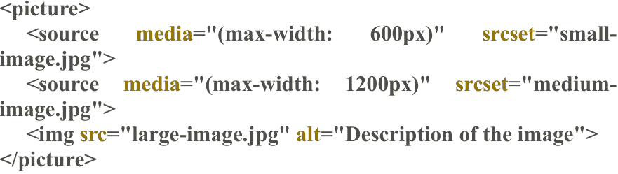
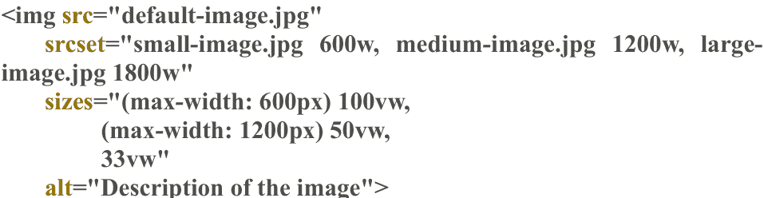

# Web 设计学习：使用 Html、Css、Javascript 和 Web 图形创建互动网站的实用指南


# 关于作者

Declan Ashford 是一位经验丰富的网页设计师、前端开发人员和作者，多年来致力于完善创建引入胜、用户友好网站的艺术。在 HTML、CSS、JavaScript 和网页图形方面拥有坚实的基础，Declan 已帮助许多个人和企业构建并维护了具有吸引力的在线形象。

# 专业背景

在职业生涯中，Declan 与各类客户合作，从小型初创公司到成熟企业，为他们提供了设计和开发网站所需的专业知识，这些网站不仅在视觉上吸引人，而且功能齐全且响应迅速。他对前端技术和设计原则的深刻理解使其成为网页设计社区中备受尊敬的人物。

# 教育贡献

Declan 对教学的热情使他创建了许多工作坊、在线课程和文字资源，旨在为初学者和资开发者揭开网页设计的神秘面。他的教学风格注重实践并以项目为导向，确保学习者能够将发现的新技能应用于真实的网页设计项目中。

# 出版

除了《学习网页设计：使用 HTML、CSS、JavaScript 和网页图形创建引入胜网站的实战指南》外，Declan 还编写了多部关于网页开发和设计的著作。他的作品以清晰、实用闻名，专注于帮助读者在竞争激烈的网页设计世界中取得所需的技能。

# 个人历程

Declan 的网页设计之旅源于对创造的热爱以及在数字世界将想法变为现实的愿望。多年来，他掌握了使现代网页设计成为可能的工具和技术，并致力于与他人分享这些知识。Declan 的目标是赋予读者能力，让他们创建不仅看起来美观而且提供卓越用户体验的网站。


# 用户体验 (UX)的重要性

用户体验 (UX) 是 Web 设计中的关键环节。它关注用户如何与网站交互以及他们的整体满意度。良好的用户体验可以带来更高的参与度、更低的跳出率和更高的转化率。为了创建良好的 UX，设计师应该考虑以下几点：

- 可访问性：网站应该让所有用户（包括残障人士）都能访问。这可以通过遵循 Web可访问性指南来实现。

- 响应式设计：随着移动设备的兴起，响应式设计已变得至关重要。这种方法确保网站在各种屏幕尺寸（从桌面电脑到智能手机）上运行良好。

- 加载速度：快速加载的网站可以提高用户满意度。优化图像、最小化代码和使用高效的托管可以短加载时间。

# 有效网页设计的原则

有几个原则指导着有效的网页设计：

- 1. 简单性：简单的设计通常是最有效的。避免杂乱，专注于核心元素，以创建整洁、有条的布局。

- 2. 一致性：一致的设计元素（如颜色、字体和按钮样式）有助于在整个网站建立统一的视觉效果和感受。

- 3. 视觉层次结构：使用尺寸、颜色和位置来建立视觉层次结构。重要元素应该脱颖而出，引导用户找到关键信息。

- 4. 对比：有效利用对比可以增强可读性，并将注意力吸引到特定元素。确保文本在背景上清晰可见。

- 5. 对齐：元素的正确对齐可以营造秩序感和组织感。它帮助用户更轻松地浏览内容。

# 网页设计的工具与技术

网页设计师使用各种工具和技术来创建网站。最常用的包括：

- HTML（超文本标记语言）：创建网页的标准语言。HTML 结构化了内容并定义了标题、段落和链接等元素。
- CSS（层叠样式表）：CSS 用于为 HTML 元素样式。它控制网站的布局、颜色、字体和整体外观。
- JavaScript：一种为网站添加交互性的编程语言。它允许动态内容更新、表单验证和用户交互。
- 设计软件：如 Adobe Photoshop、Figma 和 Sketch 等工具被广泛用于设计模型和原型。

# 网页设计流程

网页设计流程通常涉及几个阶段：

- 规划：定义网站的用途、目标受众和目标。此阶段涉及研究和收集信息。
- 线框图（Wireframing）：使用线框图创建网站的基本布局。这有助于视觉化结构和元素的放置。
- 设计：开发网站的视觉方面，包括配色方案、排版和图形。
- 开发：使用 HTML、CSS 和 JavaScript 将设计转换为功能性网站。
- 测试：进行彻底测试以识别并修复任何问题。这包括检查不同浏览器和设备之间的兼容性。
- 发布：测试完成后，网站将发布并向公众开放。
- 7. 维护：定期的更新和维护对于保持网站运行流畅且安全至关重要。

## 1.2 HTML、CSS 和 JavaScript 的重要

HTML、CSS 和 JavaScript 是 Web 开发的基础技术。它们在创建现代网站和 Web 应用中均扮演着独特且至重要的角色。对于任何对 Web 设计和开发感兴趣的人来说，理解这些语言的重要性至关重要。

### HTML（超文本标记语言）

HTML 是任何网站的骨干。它是一种结构化 Web 内容的标记语言。HTML 使用一系列由标签表示的元素来定义标题、段落、列表、链接、图像和其他内容类型。以下是关于 HTML 的要点：

- 结构与语义：HTML 提供了网页的基本结构。它允许开发者创建浏览器可以解释的组织良好的布局。使用语义化 HTML（如 `<header>`, `<footer>`, `<article>` 和 `<section>`）有助于搜索引擎和辅助技术更好地理解内容。

- 可访问性：正确使用 HTML 可以提高残障人士用户的可访问性。例如，为图像使用 `alt` 属性允许屏幕阅读器向视觉受障用户传递信息。

- 浏览器兼容性：所有 Web 浏览器都支持 HTML。这确保了内容在不同平台上的显示一致，使其成为 Web 开发者不可缺的工具。

- 其他技术的的基础：HTML 是 CSS 和 JavaScript 构建的基础。没有了 HTML，就没有了用于样式化或交互的结构。

### CSS（层叠样式表）

CSS 负责网页的呈现和布局。它允许开发者为 HTML 元素应用样式，控制颜色、字体、间距和整体布局等方面。以下是 CSS 的重要特性：

- 内容与样式的分离：CSS 允许内容 (HTML) 与设计 (CSS) 分离。这增强了可维护性，使得更新样式更加容易。

- 响应式设计：CSS 促进了响应式设计，允许网站适应不同的屏幕尺寸和设备，提供无缝体验。

- 视觉吸引力：CSS 提供了广泛的样式选项，包括颜色、字体和动画，能够吸引用户。

- 高级功能：CSS 支持高级技术，如过渡和网格布局，增强了用户体验。

### JavaScript

JavaScript 是一种为网站添加交互性的编程语言。虽然 HTML 构建了内容而 CSS 设计了样式，但 JavaScript 为网页注入了生命。以下是 JavaScript 的关键方面：

- 交互性：JavaScript 为网页启用交互元素，如下拉菜单、图片幻灯片和表单验证，增加了参与度。

- 动态内容：JavaScript 允许实时操作 HTML 和 CSS。可以在刷新刷新的情况下更改内容、样式和属性，创建更流畅的体验。

- 客户端脚本：JavaScript 在用户的浏览器中运行，允许快速响应的交互。这种客户端处理减少了服务器负载并提高了性能。

- 广泛采用与框架：JavaScript 在开发中被广泛使用，许多库和框架（如 React、Angular 和 Vue.js）可以简化流程并提高效率。

### HTML、CSS 和 JavaScript 的协同作用

HTML、CSS 和 JavaScript 的协作对于构建现代网站至关重要。每种语言相互互补，创造无缝且愉快的 Web 体验。以下是它们如何协同工作：

- 结构：HTML 提供了网站的基本框架，定义了内容和布局。
- 样式：CSS 增强了 HTML 内容的视觉呈现，使其更加漂亮且易于使用。
- 交互：JavaScript 增加了动态功能，允许用户以意义的方式与网站交互。

结合这三种技术时，开发者能够创建独特且有趣的 Web 体验。例如，一个简单的 Web 表单可以使用 HTML 构建结构，使用 CSS 设置样式使其美观，并使用 JavaScript 实现交互以验证用户输入并提供反馈。

## 1.3 Web 开发工具与技术概述

Web 开发工具和技术对于创建、测试和维护网站及 Web 应用是必不可少的。它们简化了开发流程，提高了生产力并提升了整体质量。


Web 项目的概述。本概述将探索各种 Web 开发工具的类别、它们的重要性，以及目前最流行的一些选项。

### Web 开发工具分类

Web 开发工具可以分为几类，在开发工作流中发挥特定的作用：

1. **代码编辑器**：这些是开发者用于编写和编辑代码的应用程序。它们通常包含语法高亮、代码补全和调试工具等功能。
2. **版本控制系统**：帮助随时间推移管理源代码变化的工具。它们允许多个开发者高效地协作完成项目。
3. **框架和库**：开发者可以使用这些预先编写的代码来更快速、更高效地构建应用程序。框架提供了结构，而库则提供了特定的功能。
4. **测试和调试工具**：这些工具帮助开发者识别并修复代码中的问题。它们可以自动化测试过程，并提供性能方面的洞察。
5. **设计与原型工具**：协助设计用户界面和为 Web 应用创建原型的应用程序。它们有助于视觉化最终产品的外观和功能。
6. **部署与托管工具**：允许开发者将应用程序部署到网上并管理托管环境的服务。

### Web 开发工具的重要性

使用正确的 Web 开发工具对于以下几个原因至关重要：

- **效率**：工具简化了开发流程，让开发者工作得更快、更有效。它们自动化了重复性任务，并提供了提高生产力的快捷方式。
- **协作**：许多工具促进了团队成员之间的协作，使得共享代码、跟踪更改和有效通信变得更加容易。
- **质量保证**：测试和调试工具有助于确保应用程序无错误且运行良好。这带来了更高质量的产品和更好的用户体验。
- **可扩展性**：随着项目的增长，正确的工具可以帮助管理复杂性并维护性能。它们支持开发者扩展应用程序以满足日益增长的需求。
- **学习与适应**：许多工具都带有详尽的文档和社区支持，让开发者更容易学习新技能并适应不断的技术。

### 流行的 Web 开发工具

以下是各个类别中被最广泛使用的 Web 开发工具：

#### 1. 代码编辑器：

- **Sublime Text**：一种轻量且快速的编辑器。
- **Visual Studio Code**：由微软开发的极其流行的编辑器，拥有丰富的插件支持。
- **WebStorm**：功能强大的 Web 开发 IDE。

#### 2. 版本控制系统：

- **Git**：最流行的分布式版本控制系统。
- **GitHub**：基于 Git 的代码托管平台。
- **GitLab**：提供企业级版本控制的平台。

#### 3. 框架和库：

- **React**：由 Facebook 开发用于构建用户界面的库。
- **Vue.js**：一个易于上手的 JavaScript 框架。
- **Angular**：由 Google 支持的用于构建应用的框架。

#### 4. 测试和调试工具：

- **Jest**：用于 JavaScript 的测试框架。
- **Postman**：用于开发和测试 API 的工具。
- **Chrome DevTools**：内置在浏览器中的强大调试工具。

#### 5. 设计与原型工具：

- **Figma**：强大的协作 UI 设计工具。
- **Adobe XD**：用于 UI/UX 设计的工具。
- **Sketch**：专为 macOS 设计的矢量工具。

#### 6. 部署与托管工具：

- **Vercel**：专注于前端框架的快速部署平台。
- **Netlify**：适用于静态网站的托管平台。
- **Heroku**：云平台，用于部署各种应用程序。


-   用户体验：响应式设计通过确保网站在任何设备上都具有可访问性和功能性，优先考虑用户体验。在移动浏览日益普及的时代，这种适应性至关重要。

尽管响应式网页设计具有优点，但它需要仔细的规划和执行。开发人员必须考虑内容如何适应不同的屏幕尺寸，并确保所有元素保持可访问性且具有视觉吸引力。

## 4. Web 开发中的编程范式

除了设计范式，编程范式在 Web 开发中也起着关键作用。这些范式影响了开发者构建和编写代码的方式。Web 开发中最常用的编程范式包括：

-   命令式编程：这种范式涉及编写显式描述计算机实现预期结果必须采取步骤的代码。它通常用于 JavaScript，开发者通过操作文档对象模型（DOM）来创建动态网页。

-   声明式编程：与命令式编程不同，声明式编程关注程序“应该完成什么”，而不是“如何完成它”。这种方法通常用于 React 等框架，开发者通过通过描述组件及其属性来定义用户界面。

-   面向对象编程 (OOP)：OOP 将代码组织成类和对象，允许封装和继承。这种范式适用于 Web 应用中复杂数据结构和行为建模。

-   函数式编程：这种范式将计算视为数学函数的求值。它强调不可变性和纯函数，使代码更具预测且更容易测试。JavaScript 支持函数编程概念，允许开发者使用 `map`、`filter` 和 `reduce` 等函数。

-   响应式编程：响应式编程处理异步数据流和事件驱动编程。它允许开发者创建能够实时响应用户交互和数据变化的响应式应用程序。

## 1.5 Web 设计原则简介

Web 设计原则是帮助创建有效、用户友好且具有视觉吸引力的网站的基本指南，涵盖了设计的各个方面，包括布局、色彩理论、字体排版、易用性和可访问性。对于 Web 设计师和开发者来说，理解并应用这些原则对于创建不仅吸引用户而且提供无缝体验的网站至关重要。

## 1.目的与目标

每个 Web 设计项目都应该从明确其目的和目标开始。定义网站旨在实现对于引导设计决策至关重要。以下是一些考虑因素：

-   目标读者：识别网站的主要用户。了解他们的需求、偏好和行为将为设计选择提供参考。

-   项目目标：建立特定目标，例如增加品牌知名度、生成线索或提供信息。这些目标将塑造整体设计策略。

-   内容策略：确定将在网站上展示的内容类型。这包括与网站目的一致的文本、图像、视频和交互元素。

### 2. 视觉层次结构

视觉层次结构是指在网页上对元素的元素，以引导用户的注意力并传达重要性。有效的视觉层次结构有助于用户导航网站并理解不同元素之间的关系。关键方面包括：

-   尺寸与比例：较大的元素倾向于吸引更多注意力。使用尺寸来强调重要内容，如标题或行动号召。

-   对比：文本与背景颜色之间的高对比度可以增强可读性。使用对比颜色来突出关键信息并创造视觉兴趣。

-   邻近：将相关元素组合在一起以指示它们的联系。这有助于用户快速理解内容的结构。

-   对齐：元素的适当对齐营造了一种秩序和组织感。一致的对齐可以提高设计的整体美感。

### 3. 一致性

设计中的一致性对于创建凝聚的用户体验至关重要。这一原则适用于 Web 设计的各个方面，包括：

-   视觉元素：在整个网站中保持一致的色调、字体排版和图像。

-   导航：确保导航一致，让用户知道如何跳转。

-   交互：确保交互元素（如按钮和链接）在各个页面上的行为一致。

### 4. 易用性

易用性侧重于让网站易于使用和导航。用户友好网站会增强体验。关键原则包括：

-   直观导航：设计清晰的菜单，允许用户找到信息。

-   清晰的行动号召：使用醒目的行动号召（CTA）引导用户执行所需操作，例如订阅新闻邮件或进行购买。

-   可读性：通过适当的字体大小、行间距对比对比确保文本易于阅读。

### 5. 可访问性

可访问性确保所有个人（包括残障人士）都能使用网站。设计可访问性不仅是许多地区的法律要求，而且还能增强用户体验。重要的可访问性考虑因素包括：

-   替代文本：为图像使用描述性的 alt 文本，为依赖屏幕阅读器的用户提供帮助。

-   键盘导航：确保所有交互元素都可以通过键盘访问和操作。对于无法使用鼠标的用户来说这是至关重要的。

-   色彩对比：文本与背景颜色之间保持足够的对比，以确保视觉障碍用户的可读性。

-   语义化 HTML：使用语义 HTML 元素为内容提供结构和含义。这有助于辅助技术正确解释内容。

### 6. 响应式设计

响应式设计是一种确保网站在各种设备和屏幕尺寸上运行良好的现代方法。随着移动设备的使用增加，响应式设计对于提供一致的用户体验至关重要。关键原则包括：

-   流式网格：使用根据屏幕尺寸调整的流式网格布局。这允许内容根据用户的设备调整大小并重新。

-   媒体查询：实现 CSS 媒体查询，根据设备特性（如屏幕宽度和分辨率）应用不同的样式。这实现了增强易用性的定制化设计。

-   弹性图像：确保图像在容器内适当缩放。使用 CSS 技术防止图像在较小屏幕上溢出或变形。

### 7. 美学与视觉吸引力

美学在吸引和留住方面起着重要作用。具有视觉吸引力的网站可以增强参与度并留下良好印象。关键审美原则包括：

-   色彩理论：选择与品牌身份一致并能引起预期情感反应的色调。在选择颜色时考虑色彩心理。

-   字体排版：选择易读且符合整体设计风格的字体。使用有限的字体族以保持一致性。

-   留白：加入充足的留白在元素之间创造呼吸空间。这增强了可读性并防止设计显得拥挤。

-   图像：使用补充内容的高质量图像和图形。视觉元素应该增强信息而非分散注意力。


-   **用户测试**：与真实用户进行可用性测试，以收集对设计的反馈。观察用户如何与网站交互，并识别痛点。
-   **分析**：使用网络分析工具跟踪用户行为并收集有关网站性能的数据。这些信息可以为设计改进提供参考。
-   **持续改进**：愿意根据用户反馈和分析进行更改。定期更新网站以增强可用性并应对新出现的趋势。

## 第 2 章：HTML 入

## 2.1 HTML 文档的结构

HTML（超文本标记语言）是用于创建网页的标准语言。理解 HTML 文档的结构对于任何想要构建网站的人来说至关重要。让我们进入 HTML 文档的基础组成部分，包括基本结构、元素、属性以及编写简洁高效 HTML 的最佳实践。

### 1. HTML 文档的基本结构

HTML 文档由一系列嵌套元素组成，这些元素定义了页的内容和结构。HTML 文档的基本结构包含以下组件：

```html
<!DOCTYPE html>
<html lang="en">
<head>
  <meta charset="UTF-8">
  <meta name="viewport" content="width=device-width, initial-scale=1.0">
  <title>Your Page Title</title>
</head>
<body>
  <h1>Hello, World!</h1>
  <p>This is a simple HTML document.</p>
</body>
</html>
```

组件说明：

1.  `<!DOCTYPE html>`：此声明定义了所使用的 HTML 文档类型和版本。它告诉浏览器该文档是一个 HTML5 文档。

2.  `<html>`：这是 HTML 文档的根元素。它包含了文档中的所有其他元素和属性。`lang` 属性指定了文档的语言，这对于搜索引擎和可访问性工具很有帮助。

3.  `<head>`：头部部分包含关于文档的元信息，如标题、字符集以及指向样式表或脚本的链接。这些信息不会直接显示在网页上，但对于正确的渲染和 SEO 关关重要。

   - `<meta charset="UTF-8">`：此标签指定文档的字符编码，确保文本在不同的浏览器和设备上正确显示。
   - `<meta name="viewport" content="width=device-width,initial-scale=1.0">`：此标签控制移动浏览器上的布局。它将视口宽度设置为设备的宽度并建立初始缩放级别。
   - `<title>`：标题元素定义了网页的标题，它显示在浏览器标签页中，并被搜索引擎用搜索结果中可点击的标题。

4.  `<body>`：主体部分包含在网页上显示的内容。这包括文本、图像、链接和其他媒体。页面的所有可见元素都嵌套在 `<body>` 标签内。

### 常用 HTML 元素

HTML 文档由各种元素组成，每个元素都有特定的用途。以下是一些常用的 HTML 元素：

-   **标题**：标题使用 `<h1>` 到 `<h6>` 标签定义，其中 `<h1>` 级别最高，<h6><h6> 级别最低。标题有助于结构化内容并提高可读性。

```html
<h1>Main Title</h1>
<h2>Subtitle</h2>
<h3>Section Title</h3>
```

-   **段落**：段落使用 `<p>` 标签定义。它们用于组合文本块。

```html
<p>This is a paragraph of text.</p>
```

-   **链接**：链接使用 `<a>` 标签（代表 anchor 锚点）创建。`href` 属性指定了链接指向的 URL。

```html
<a href="https://www.example.com">Visit Example</a>
```

-   **图像**：使用 `` 标签嵌入。`src` 属性指定图像源，而 `alt` 属性为可访问性提供了替代文本。

```html

```

-   **列表**：HTML 支持有序列表 (`<ol>`) 和无序列表 (`<ul>`)。列表项使用 `<li>` 标签定义。

```html
<ul>
  <li>Item 1</li>
  <li>Item 2</li>
</ul>
```

-   **分区 (Div)**：`<div>` 标签是一个块级元素，用于将内容分组。它通常用于布局目的，并可以使用 CSS 进行样式化。

```html
<div>
  <h2>Section Title</h2>
  <p>Content for this section.</p>
</div>
```

### 3. HTML 中的属性

属性提供了有关 HTML 元素的额外信息。它们始终在起始标签中指定，由一个名称和一个值组成。以下是一些常见属性：

-   `id`：`id` 属性为元素分配一个唯一标识符，允许通过 CSS 或 JavaScript 进行定位。

```html
<h1 id="main-title">Welcome to My Website</h1>
```

-   `class`：`class` 属性为元素分配一个或多个类名，可以对具有相同类的元素进行样式处理。

```html
<p class="highlight">This paragraph is highlighted.</p>
```

-   `style`：`style` 属性允许直接对元素应用内联 CSS 样式。

```html
<p style="color: blue;">This text is blue.</p>
```

-   `href`：在 `<a>` 标签内指定链接 URL。

```html
<a href="https://www.example.com">Visit Example</a>
```


```xml
<h1>Welcome to My Website</h1>
```

在此示例中：

- `<h1>` 是标题元素的起始标签。
- Welcome to My Website 是内容。
- `</h1>` 是结束标签。

## 4. HTML 元素的类型

HTML 元素可以根据其功能和结构进行分类：

1. **块级元素 (Block Elements)**：这些元素占据可用宽度并在新行开始。示例包括 `<div>`、`<p>`、`<h1>` 和 `<ul>`。
2. **行内元素 (Inline Elements)**：这些元素不会在新行开始，只占据必要的宽度。示例包括 `<span>`、`<a>` 和 ``。
3. **空元素 (Void Elements)**：也称为自闭合元素，不需要结束标签。示例包括`<br>`（换行）、`<>`（图像）和`<hr>`（水平线）。

## 5. HTML 元素中的属性

HTML 元素可以拥有属性提供关于元素的额外信息。属性在起始标签中指定，通常以键值对的形式出现。常见属性包括：

- `id`：元素的唯一标识符，允许通过 CSS 或 JavaScript 对其定位。

```xml
<div id="header">Header Content</div>
```

- **class**：为元素指定一个或多个类名，可用于样式设置。

```xml
<p class="highlight">这段文字被高亮了。</p>
```

- **style**：允许将内联 CSS 样式直接应用于元素上。

```xml
<h2 style="color: blue;">This is a blue heading</h2>
```

## 6. HTML 元素的嵌套

HTML 元素可以嵌套以创建复杂的结构。嵌套允许更好的组织和样式设置。例如：

```xml
<div>
  <h2>Section Title</h2>
  <p>This is a paragraph within a</p>
  <a href="https://www.example.com">Visit Example</a>
</div>
```

在此示例中，`<p>` 元素嵌套在 `<div>` 元素内部，创建了一个结构化的内容块。

## 7. 使用 HTML 元素的最佳实践

为了确保 HTML 的整洁、可维护且有效，请考虑以下最佳实践：

- **语义化 HTML (Semantic HTML)**：选择能够传递含义的适当标签。例如，使用 `<header>` 用于头部，使用 `<footer>` 用于页脚，使用 `<article>` 用于文章。
- **保持标签小写**：虽然 HTML 标签不区分大小写，但为了一致性和可读性，使用小写是最佳实践。
- **验证您的 HTML**：使用验证工具检查错误并确保符合标准。
- **为代码注释**：在此处使用注释来解释代码部分，这有助于未来的参考。

### 1. 什么是语义化 HTML？

语义化 HTML 指使用能够准确描述内容及其目的的 HTML 标记。与 `<div>` 和 `<span>` 等不具语义元素不同（它们不传递任何含义），语义化元素提供了上下文。例如，`<header>`、`<footer>`、`<article>` 和 `<section>` 等元素清楚地指示了它们在文档结构中的角色。

#### 语义化元素示例

- `<header>`：代表介绍性内容或一组导航链接。
- `<footer>`：定义章节或文档的页脚，通常包含元数据或版权信息。
- `<article>`：代表可以独立分发或重用的自包含内容，如博客文章或文章。
- `<section>`：定义内容的主题分组，通常带有标题。
- `<nav>`：包含指向网站其他部分的导航链接。

使用这些语义化元素有助于开发者和浏览器理解内容的结构和目的，使其更容易管理和设置样式。

### 2. 语义化 HTML 的优势

#### 提高可访问性 (Accessibility)

使用语义化 HTML 的主要优势之一是增强残障用户的可访问性。屏幕阅读器和其他辅助技术依赖语义化标记来解释页面内容。通过使用语义化元素，开发者提供了上下文和含义，使用户能够更有效地导航和理解内容。例如，屏幕阅读器可以将 `<nav>` 元素识别为导航部分，帮助视觉障碍用户快速定位到其他页面的链接。同样，使用 `<header>` 和 `<footer>` 元素允许屏幕阅读器告知用户页面结构，从而提高整体体验。

#### 更好的 SEO

搜索引擎使用语义化 HTML 来索引和排名网页。通过使用有意义的元素，搜索引擎可以理解页的内容和上下文。这可以提高搜索排名并提升搜索结果中的可见度。例如，对博客文章使用 `<article>` 标签会告诉搜索引擎内容是自包含的且相关的，可能会增加其在搜索结果中出现的几率。

#### 增强可维护性

语义化 HTML促进了更整洁、更有组织的代码。当开发者使用有意义的元素时，文档结构变得更加清晰，更容易阅读和维护。这对于涉及多个开发人员的大型项目特别有利。通过避免对所有内容使用 `<div>` 等非语义化元素，开发者可以创建一个反映内容结构的更有逻辑的层次。这减少了对过度注释的需求，并更容易理解代码每个部分的目的。

### 3. 实现语义化 HTML

为了有效地实现语义化 HTML，开发者应该考虑以下最佳实践：

#### 使用适当的语义化元素

在构建网页时，选择最能代表内容的元素。例如，使用`<article>` 用于博客文章，使用`<section>` 用于主题分组，使用`<aside>` 用于相关内容。这不仅提高了可访问性，还增强了代码的可读性。

```xml
<article>
  <header>
    <h1>Understanding Semantic HTML</h1>
    <p>Published on <time datetime="2024-08-18">August 2024</time></p>
  </header>
  <p>Semantic HTML is essential for modern web development...</p>
</article>
```

#### 避免过度使用非语义化元素

虽然 `<div>` 和 `<span>` 对于样式和布局很有用，但不应将其作为所有内容的默认选择。将这些元素留给没有语义化替代方案的情况。过度使用非语义化元素会导致结构混乱，不利于导航。

#### 提供有意义的上下文

使用语义化元素时，确保其内部的内容是且有意义的。例如，`<nav>` 元素应该包含指向其他页面或其他部分的链接，而 `<footer>`应该提供关于文档的相关信息。

```xml
<nav>
  <ul>
    <li><a href="#home">Home</a></li>
    <li><a href="#about">About</a></li>
    <li><a href="#contact">Contact</a></li>
  </ul>
</nav>
```


改进内容层级结构：使用语义元素有助于在内容内部建立逻辑层级结构。例如，标题标签（`<h1>` 到 `<h6>`）指示了不同部分的重要性。搜索引擎会根据关键词在这些标签中的位置对其进行权重排序，因此恰当地使用标题对于增强内容相关性至关重要。

### 使用语义化 HTML 对可维护性的优势

使用语义化 HTML 不仅有利于 SEO，还能显著增强 Web 项目的可维护性。以下是一些关键优势：

- 1. **更清晰的代码结构**：语义化 HTML 促进了良好的代码结构。通过使用具有意义的元素，开发者可以创建一个反映内容组织的逻辑层级。这种清晰性使得其他开发者（或日后的原始开发者）更容易理解代码并进行必要的更新。
- 2. **降低复杂性**：语义元素减少了对 `<div>` 和 `<span>` 等不传递任何信息的通用标签的依赖。通过使用特定的语义标签，开发者可以简化代码库，使其更容易管理并减少错误。
- 3. **增强协作**：在团队环境中，语义化 HTML 有助于开发者之间进行更好的协作。当每个人都遵循语义标准时，在项目的不同部分工作将变得更加不容易混乱。这在涉及多个开发者的大型项目中尤为重要。
- 4. **面向未来**：语义化 HTML 遵循 Web 标准，使其对技术变化更具弹性。随着浏览器和辅助技术的演进，语义化 HTML 确保内容保持可访问且易于理解，减少了未来进行大量重写或更新的需求。

### 语义化 HTML 用户体验

语义化 HTML 从以下几个方面显著提升了用户体验：

- 1. **提高可访问性**：语义元素为屏幕阅读器等辅助技术提供了必要的上下文。使用语义化 HTML 时，残障用户可以更容易导航和理解 Web 内容。例如，屏幕阅读器可以识别导航部分、标题和内容区域，允许用户有效地与网站交互。
- **更好的导航**：语义化 HTML 有助于为网页创建逻辑且直观的结构。通过使用 `<nav>` 作为导航菜单、`<article>` 作为内容部分，用户可以快速找到所需的信息。这种组织改进了整体可用性，并鼓励用户在网站上停留更久。
- **响应式设计**：语义化 HTML 支持响应式设计原则，确保内容在各种设备和屏幕尺寸上都是可访问且功能完。通过使用语义元素，开发者可以创建无缝适应不同场景的布局，增强移动设备上的用户体验。
- **增强可读性**：语义化 HTML 通过清晰定义内容的结构有助于提高可读性。用户可以轻松扫描标题、段落和列表，使信息更容易消化。这种清晰度对于可能有认知障碍的用户或仅仅在寻找特定信息的用户来说尤为重要。
- **内容面向未来**：通过遵循语义标准，开发者创建的内容在技术演进时很可能保持可访问性和相关性。这种面向未来的设计确保了无论用户使用什么设备或技术，都能继续从结构良好且意义丰富的 Web 体验中受益。

## 2.4 表单与输入验证

表单是 Web 开发中的关键组件，允许用户高效地输入和提交数据。它们实现了用户与网站之间的交互，促进了注册、提交反馈和数据收集等任务。

### 1. 理解 HTML 表单

HTML 表单是网页的一部分，包含用于收集用户输入的交互式控件。用于创建表单的主要元素是 `<form>` 标签，它作为所有表单元素的容器。这是一个 HTML 表单的示例示例：

```xml
<form action="/submit" method="POST">
  <!-- 表单元素将在这里 -->
</form>
```

### <form> 元素的关键属性：

- action: 指定提交表单时发送表单数据所在的 URL。这通常是一个处理数据的服务器端脚本。
- method: 定义用于发送数据的 HTTP 方法。常用方法包括 GET（将数据附加到 URL）和 POST（在请求体中发送数据）。

### 表单元素

HTML 表单可以包含各种元素来收集数据。

- 输入：用于单行文本输入，例如姓名或电子邮件。

```xml
<label for="name">姓名:</label>
<input type="text" id="name" name="name" required>
```

**密码输入**：类似于文本输入，但会隐藏输入内容。

```xml
<label for="password">密码:</label>
<input type="password" id="password" name="password" required>
```

**单选按钮**：允许用户从集合中选择一个。

```xml
<label for="gender">性别:</label>
<input type="radio" id="male" name="gender" value="male" required>
<label for="male">男性</label>
<input type="radio" id="female" name="gender" value="female">
<label for="female">女性</label>
```

**复选框**：允许用户选择多个选项。

```xml
<label for="subscribe">订阅邮件</label>
<input type="checkbox" id="subscribe" name="subscribe">
```

**下拉菜单**：提供选择选项的菜单。

```xml
<label for="country">国家:</label>
<select id="country" name="country" required>
  <option value="">选择您的国家</option>
  <option value="usa">美国</option>
  <option value="canada">加拿大</option>
  <option value="uk">英国</option>
</select>
```

**文本区域**：用于多行文本输入。

```xml
<label for="message">消息:</label>
<textarea id="message" name="message" rows="4" cols="50"></textarea>
```

**提交按钮**：将表单发送到服务器。

```xml
<input type="submit" value="提交">
```

### 3. 输入验证

输入验证是一个确保通过表单提交的数据准确、完整且安全的进程。它可以防止错误并防止恶意输入。

#### 客户端验证

在表单提交前向用户提供即时反馈。可以使用 HTML 属性和 JavaScript 实现。常用的 HTML 属性包括：

- required: 确保字段必须填写。
- pattern: 指定输入匹配的正则表达式。
- min 和 max: 设置数值输入的最小值和最大值。
- type: 使用适当输入类型（如 email）。

#### 服务器端验证

虽然客户端验证增强了用户体验，但它并非完美。服务器端验证对于确保收到的数据有效且安全至关重要。这可能涉及：

- 检查字段。
- 验证数据格式（例如电子邮件地址）。
- 清输入以防止 SQL 注入和其他攻击。

### 4. 完整 HTML 表单示例

包含各种输入类型和验证的完整 HTML 表单简单示例：

```xml
<form action="/submit" method="POST">
  <label for="name">姓名:</label>
  <input type="text" id="name" name="name" required>
  
  <label for="email">电子邮件:</label>
  <input type="email" id="email" name="email" required>
  
  <label for="password">密码:</label>
  <input type="password" id="password" name="password" required>
  
  <label for="gender">性别:</label>
  <input type="radio" id="male" name="gender" value="male" required>
  <label for="male">男性</label>
  <input type="radio" id="female" name="gender" value="female">
  <label for="female">女性</label>
  
  <label for="country">国家:</label>
  <select id="country" name="country" required>
    <option value="">选择您的国家</option>
    <option value="usa">美国</option>
    <option value="canada">加拿大</option>
    <option value="uk">英国</option>
  </select>
  
  <label for="message">消息:</label>
  <textarea id="message" name="message" rows="4" cols="50"></textarea>
  
  <input type="submit" value="提交">
</form>
```


```html
<input type="submit" value="提交">
</form>
```

## 2.5 不同类型的输入元素

HTML 表单通过带有 `type` 属性的 `<input>` 元素支持多种输入类型。常用的输入类型包括：

- 文本：`<input type="text">` 用于单文本输入
- 密码：`<input type="password">` 用于密码字段
- 单选按钮：`<input type="radio">` 用于从选项中选择一个
- 复选框：`<input type="checkbox">` 用于选择零个或多个选项
- 提交：`<input type="submit">` 用于提交表单
- 电子邮件：`<input type="email">` 用于输入电子邮件地址
- 数字：`<input type="number">` 用于数字输入
- 日期：`<input type="date">` 用于选择日期

其他输入类型包括颜色、文件、范围、搜索、电话、时间、URL 等。每种类型都提供特定的功能和验证。

### 验证用户输入

HTML 表单支持使用属性进行内置验证，例如：

- required：确保字段在提交前已填写
- pattern：指定输入必须匹配的正则表达式
- min 和 max：为数字输入设置最小值和最大值
- type：使用适当类型（如 email、url）提供基础验证

服务器端验证对于确保所有数据有效且安全至关重要。这涉及检查必填字段、验证格式以及清理输入以防止攻击。

### <label> 元素的作用

`<label>` 元素为像 `<input>` 这样的表单控件提供标签。它有几个作用：

- 将标签文本与特定的表单控件关联，以提高可访问性
- 通过为每个输入提供上下文来提高易用性
- 允许用户点击标签聚焦或选择关联的控件
- 为表单结构提供语义含义

使用标签是创建易用且可访问表单的实践实践。总之，HTML 表单提供了广泛的输入类型来收集用户数据。在客户端和服务器端进行输入验证可以确保数据的完整性。标签通过为每个表单控件提供上下文增强了易用性和可访问性。

## 2.6 如何创建下拉菜单

要在 HTML 表单中创建下拉菜单，请使用 `<select>` 和 `<option>` 元素：

```html
<form>
  <label for="dropdown">选择一个选项:</label>
  <select id="dropdown" name="dropdown">
    <option value="">选择一个选项</option>
    <option value="option1">选项 1</option>
    <option value="option2">选项 2</option>
    <option value="option3">选项 3</option>
  </select>
  <button type="submit">提交</button>
</form>
```

- `<select>` 元素定义下拉菜单
- 每个可用选项都使用 `<option>` 元素定义
- `value` 属性指定每个选项提交的值
- 第一个 `<option>` 通常是默认的“选择一个选项”选择
- 将错误包裹在 `<form>` 中以提交所选值

### 需要避免的常见错误

**未使用 <label> 元素：**始终使用 `<label>` 元素为每个表单控件提供上下文。这提高了了可访问性和易用性。

**未设置 name 属性：**确保每个表单控件都有唯一的 `name` 属性。这允许服务器识别提交的数据。

**未验证用户输入：**使用 HTML5 验证属性如 required、pattern、min、max 在表单提交之前验证输入。

**未处理空下拉选择：**如果需要某个选项，在 `<select>` 元素上使用 `required` 属性。这可以防止表单在没有选择的情况下提交。

**过度使用下拉菜单：**谨慎使用下拉菜单。对于较少数选项，单选按钮或复选框可能更符合用户习惯。

**未对下拉菜单设置样式：**使用 CSS 自定义 `<select>` 元素的外观，以匹配表单的整体设计。

## 2.7 在 HTML 中嵌入多媒体内容

在 HTML 中嵌入多媒体内容通过使网页更具互动性和吸引力来增强用户体验。让我们开启各种方法。图片、音频、视频等。

在 HTML 中嵌入多媒体内容通过使网页更具互动性和吸引力来增强用户体验。让我们开启各种方法。

### 1. 嵌入图片

使用 `` 标签嵌入图片。

```html

```

`` 标签的属性：
- `src`：图片的路径
- `alt`：提供替代文本

### 2. 嵌入音频

使用 `<audio>` 标签嵌入音频内容。

```html
<audio controls>
  <source src="path/to/audio.mp3" type="audio/mp3">
  您的浏览器不支持音频。
</audio>
```

`<audio>` 标签的属性：
- `controls`：添加播放控件
- `autoplay`：自动播放音频

### 3. 嵌入视频

使用 `<video>` 标签嵌入视频内容。

```html
<video width="640" height="360" controls>
  <source src="path/to/video.mp4" type="video/mp4">
  您的浏览器不支持视频。
</video>
```

`<video>` 标签的属性：
- `controls`：显示播放控件
- `autoplay`：页面加载时自动播放
- `muted`：静音

### 4. 使用 <embed> 和 <object> 标签

除了特定的标签，HTML 还提供了 `<embed>` 和 `<object>` 标签来嵌入各种类型。

- `<embed>`：用于嵌入外部内容，如多媒体文件或应用程序。
- `<object>`：此标签可以嵌入不同类型的资源，包括图片、视频和 PDF。

### 5. 嵌入多媒体的最佳实践

- **优化媒体文件**：压缩图片、音频和视频文件以缩短加载时间并提高性能。
- **提供多种格式**：为了兼容不同的浏览器，使用 `<source>` 标签为音频视频提供多种格式。
- **使用描述性替代文本**：始终为图片包含描述性替代文本以增强可访问性。
- **考虑用户体验**：避免自动播放音频或视频，因为这可能会干扰。允许用户控制播放。
- **跨浏览器测试**：确保多媒体内容在不同的浏览器和设备上正常工作。

## 2.8 确保与旧浏览器兼容

要在嵌入多媒体内容时确保与旧浏览器的兼容性，请考虑以下策略：

- **使用回退方案**：为多媒体元素提供替代内容或格式。例如，在使用 `<video>` 标签时，如果浏览器不支持，请包含回退消息或下载视频的链接。

```html
<video controls>
  <source src="video.mp4" type="video/mp4">
  <p>您的浏览器不支持 HTML5 视频。您可以 <a href="video.mp4">在此处下载视频</a>。</p>
</video>
```

**Polyfills 和补丁**：利用 Modernizr 或 HTML5shiv 等 JavaScript 库为旧浏览器添加对 HTML5 功能的支持。这些


工具可以帮助检测能力并为不支持的特性提供填充（polyfills）。

**渐进式增强：** 设计你的多媒体内容使其首先具有基本功能，然后针对支持高级特性的浏览器进行增强。这种方法确保了所有用户都能访问核心内容。

**多种格式：** 提供多种格式的多媒体文件，以确保跨不同浏览器的兼容性。例如，视频同时使用 MP4 和 WebM 格式。

```html
<video controls>
  <source src="video.mp4" type="video/mp4">
  <source src="video.webm" type="video/webm">
  <p>您的浏览器不支持 HTML5 视频。</p>
</video>
```

- 4. **跨浏览器测试：** 使用跨浏览器测试工具检查你的多媒体内容在各种浏览器（尤其是旧版本）中的。这有助于有助于开发早期识别兼容性问题。

### HTML 中优化多媒体文件的最佳实践

优化多媒体文件对于提高加载时间和整体用户体验至关重要。以下是一些最佳实践：

- 1. **压缩文件：** 使用压缩工具减小图像、音频和视频的文件大小，同时不牺牲质量。JPEG 图像、MP3 音频和 MP4 视频等格式常用，因为它们的压缩效率很高。

- 2. **使用适当格式：** 为你的多媒体内容选择正确的字体格式。对于图像，使用 JPEG、PNG 或 WebP 等格式。对于音频，MP3 广泛支持；对于视频，推荐使用 MP4因为它具有广泛的兼容性。

- 3. **响应式设计：** 确保多媒体元素是响应式的并能适应不同的屏幕尺寸。使用 CSS 为图像和视频设置最大宽度和高度，以保持它们的宽高比例。

- 4. **懒加载：** 为图像和视频实现懒加载，延迟到它们进入视口再加载。这缩短了初始加载时间并提升了性能。

```html

```

- 5. **使用 CDN：** 将多媒体文件托管在内容分发网络（CDN）上，通过从距离用户最近的位置内容来提高加载速度。

### 在 HTML 嵌入视频中添加字幕或说明

要在 HTML 嵌入视频中添加字幕或说明，请在 `<video>` 标签内使用 `<track>` 元素。该元素允许你为字幕、说明或描述指定文本轨道。

### 添加字幕的示例

```html
<video width="640" height="360" controls>
  <source src="video.mp4" type="video/mp4">
  <track src="subtitles.en.vtt" kind="subtitles" srclang="en" label="English">
  <track src="subtitles.es.vtt" kind="subtitles" srclang="es" label="Spanish">
  <p>您的浏览器不支持 HTML5 视频。</p>
</video>
```

### <track> 元素的关键属性：

- src：指定包含字幕或说明的 WebVTT  URL。
- kind：指示文本轨道类型。常见值包括字幕（subtitles）、说明（captions）、描述（descriptions）和章节（chapters）。
- srclang：使用语言代码指定轨道语言（例如，en 代表英语，es 代表西班牙语）。
- label：为轨道提供用户可读的标题，该标题出现在视频播放器的轨道选择菜单中。

## 第 3 章：精通 CSS 样式

## 3.1 CSS 语法和选择器

CSS（层叠样式表）是一种用于 HTML 文档样式的强大语言。理解 CSS 语法和选择器对于有效地为网页应用样式至关重要。

### 1. CSS 语法

CSS 语法由定义如何设置 HTML 元素样式规则组成。一个典型的 CSS 规则由选择器和一个声明块组成。

#### 基础结构

CSS 规则的基础语法如下：

```css
selector {
  property: value;
}
```

- 选择器：这指定了样式将应用于哪些 HTML 元素。可以通过标签名、类、ID 或其他标准来定位元素。
- 声明块：封装在花括号 `{}` 中，包含一个或多个声明。每个声明由一个属性和一个值组成，用冒号 `:` 分隔。多个声明之间用分号 `;` 分隔。

### 示例

这里有一个 CSS 语法的简单示例：

```css
h1 {
  color: green;
  text-align: center;
}
```

在此示例中：

- h1 是针对所有 `<h1>` 元素的选择器。
- color 和 text-align 是属性，green 和 center 是它们对应的值。

### 2. CSS 选择器的类型

CSS 选择器用于定位 HTML 元素以设置样式。有几种类型的选择器，每种都有不同的用途：

#### 2.1 简单选择器

- 类型选择器：通过标签名定位元素。

```css
p {
  font-size: 16px;
}
```

类选择器：定位具有特定类属性的元素。类选择器以点 `.` 开头。

```css
.highlight {
  background-color: yellow;
}
```

ID 选择器：定位具有特定 ID 属性的唯一元素。ID 选择器以哈号 `#` 开头。

```css
#header {
  background-color: blue;
}
```

#### 2.2 属性选择器

这些选择器根据属性的存在或值定位元素。

```css
input[type="text"] {
  border: 1px solid #ccc;
}
```

此示例为所有类型为 "text" 的 `<input>` 元素设置样式。

#### 2.3 伪类

伪类允许你根据元素的状态或位置设置样式。

```css
a:hover {
  color: red;
}
```

此示例在鼠标悬停时将链接颜色更改为红色。

#### 2.4 伪元素

伪元素允许你为元素的特定部分设置样式。

```css
p::first-line {
  font-weight: bold;
}
```

此示例将所有段落的第一行样式设置为粗体。

#### 2.5 组合选择器

组合选择器允许你根据元素与其他元素的关系选择元素。

- 后代选择器：选择嵌套在元素内的元素。

```css
div p {
  color: blue;
}
```

- 子选择器：选择指定元素的直接子元素。

```css
ul > li {
  list-style-type: square;
}
```

- 相邻兄弟选择器：选择跟在指定元素后面的元素。

```css
h1 + p {
  margin-top: 0;
}
```

- 通用兄弟选择器：选择指定元素的所有兄弟元素。

```css
h1 ~ p {
  color: gray;
}
```

### 选择器分组

你可以通过用逗号分隔选择器来组合共享样式的多个选择器。这样做。

```css
h1, h2, h3 {
  color: navy;
  font-family: Arial, sans-serif;
}
```

## 3.2 设置文本、颜色和背景

CSS（层叠样式表）为设置网页文本、颜色和背景提供了强大的工具。让我们如何有效地使用 CSS 来增强文本外观、设置颜色并管理背景。

### 1. 文本

文本样式涉及控制字体大小、权重、对齐和装饰的各种属性。是一些文本相关的属性：

#### 1.1 字体属性

- font-family：指定文本的字体。你可以列出多个字体作为备用。

```css
p {
  font-family: 'Arial', sans-serif;
}
```

- font-size：设置字体大小。你可以使用像素 (px)、em 或百分比 (%) 等单位。

```css
h1 {
  font-size: 24px;
}
```

- font-weight：控制文本的粗细程度。常见值包括normal、bold、bolder 以及数值 (100 到 900)。

```css
strong {
  font-weight: bold;
}
```

- font-style：定义字体的样式，如 normal、斜或倾斜。

```css
em {
  font-style: italic;
}
```

#### 1.2 文本对齐和装饰

- text-align：设置块内文本的水平对齐。常见值有左、右、居中对齐。

```css
h2 {
  text-align: center;
}
```

- text-decoration：为文本添加装饰，如下划线、上划线或删除线。

```css
a {
  text-decoration: underline;
}
```

#### 1.3 文本间距

- line-height：设置行间距，提高可读性。


```css
p {
  line-height: 1.5;
}
```

**letter-spacing:** 调整字符之间的间距。

```css
h1 {
  letter-spacing: 2px;
}
```

**word-spacing:** 更改单词之间的间距。

```css
p {
  word-spacing: 4px;
}
```

### 2. 设置颜色

CSS 允许你使用多种方法为文本和背景设置颜色。`color` 属性用于定义文本颜色，而 `background-color` 属性用于设置元素的背景颜色。

#### 2.1 Color 属性

可以使用以下方式定义 `color` 属性：

- **颜色名称：** Common颜色名称，如 red（红色）、blue（蓝色）等。

```css
p {
  color: red;
}
```

**十六进制值：** 表示颜色的六位代码。

```css
h1 {
  color: #ff5733; /* 橙色 */
}
```

RGB 值：指定红、绿、蓝分量。

```css
div {
  color: rgb(255, 0, 0); /* 红色 */
}
```

RGBA 值：与 RGB ，但包含一个用于透明度的 alpha 通道。

```css
p {
  color: rgba(0, 0, 255, 0.5); /* 半透明蓝色 */
}
```

#### 2.2 背景颜色

`background-color` 属性设置元素的背景颜色。

```css
body {
  background-color: lightgrey;
}
```

你还可以使用 `background-image` 属性使用图像背景。

```css
div {
  background-image: url('background.jpg');
}
```

### 3. 样式最佳实践

- **对比度**：确保文本和背景颜色之间有足够的对比度以提高可读性，特别是对于视觉障碍用户。

- **一致性**：在整个网站中使用一致的字体样式和颜色，以创建统一的设计。

- **响应式设计**：考虑使用 `em` 或 `%` 等相对单位设置字体大小和间距，以确保文本在不同设备上良好地缩放。

- **无障碍性**：使用语义化 HTML 和 CSS 来增强无障碍性。例如，确保链接和按钮易于识别和区分。

### 使用 CSS 创建渐变背景

要在 CSS 中创建渐变背景，你可以在 `background-image` 或 `background` 属性中使用 `linear-gradient()` 或 `radial-gradient()` 函数。以下是方法：

#### 1. 线性渐变

线性渐变沿直线进行颜色过渡。语法如下：

```css
background-image: linear-gradient(direction, color-stop1, color-stop2, ...);
```

- **方向**：你可以使用关键词（如 `to right`、`to bottom` 等）或角度（如右的 `90deg`）指定方向。

- **颜色停止点**：定义渐变中的颜色，可以包含多种颜色。

### 示例

```css
body {
  background-image: linear-gradient(to right, #ff7e5f, #feb47b);
}
```

此示例创建了一个从左到右从桃子色过渡到浅橙色的渐变。

#### 2. 径向渐变

径向渐变从中心点向外进行颜色过渡。语法为：

```css
background-image: radial-gradient(shape size at position, color-stop1, color-stop2, ...);
```

### 示例

```css
body {
  background-image: radial-gradient(circle, #ff7e5f, #feb47b);
}
```

此示例创建了一个从中心向外过渡的圆形渐变。

#### 3. 多颜色停止点

你可以为渐变添加更多颜色：

```css
background-image: linear-gradient(to right, red, orange, yellow, green, blue);
```

#### 4. 透明度

你还可以使用 RGBA 颜色来在渐变中创建透明度：

```css
background-image: linear-gradient(to right, rgba(255, 0, 0, 0), rgba(255, 0, 0, 1));
```

这创建了一个从完全透明的红色到实色红色的渐变。

### 参考文献

如需更详细的示例和解释，可以参考 W3Schools 和 CSS Gradient。

### 确保可读性的文本颜色选择最佳实践

选择正确的文本颜色对于确保可读性至关重要。以下是一些最佳实践：

- 1. 对比度：确保文本颜色和背景颜色之间有足够的对比度。使用 WebAIM Contrast Checker 等工具来验证你的颜色组合是否符合无障碍标准 (WCAG)。

- 2. 避免在亮色背景上使用亮色：避免在亮背景上使用亮色，因为这会导致眼睛疲劳。相反，在浅色背景上使用深色文本或反之。

- 3. 明智使用颜色组合：坚持有限的调色板。使用过多的颜色会让文本难以阅读。设计目标最多使用三到四种颜色。

- 4. 考虑色盲：注意色盲用户可能难以区分的颜色组合。避免同时使用红色和绿色，因为这些是色盲可能会混淆的常见颜色。

- 5. 在不同设备上测试：颜色在不同屏幕上的显示可能不同。在多个设备上测试你的颜色选择，以确保跨平台的可读性。

### 使用 CSS 为文本添加阴影

要在 CSS 中为文本添加阴影效果，你可以使用 `text-shadow` 属性。语法如下：

```css
text-shadow: horizontal-offset vertical-offset blur-radius color;
```

### 示例

```css
text-shadow: 2px 2px 4px rgba(0,0,0,0.5);
```

在此示例中：

- 2px 是水平偏移。
- 2px 是垂直偏移。
- 4px 是模糊半径。
- `rgba(0,0,0,0.5)` 是颜色。

### 多重阴影

你可以通过逗号分隔为同一文本应用多个阴影：

```css
h1 {
  text-shadow: 1px 1px 2px rgba(0,0,0,0.5), 0 0 25px rgba(255,0,0,0.5);
}
```

此示例创建了更复杂的发发光效果。

### CSS 中 text-shadow 和 box-shadow 的区别

`text-shadow` 和 `box-shadow` 是用于创建阴影效果的属性，但它们有不同的用途和特性：

- 应用：
  - `text-shadow` 专门用于文本添加阴影。它应用于元素的内容。
  - `box-shadow` 应用于元素的模型，包括内边距和边框。

- 语法：
  - `text-shadow` 包含水平偏移、垂直偏移、模糊半径和颜色。
  - `box-shadow` 语法类似，但包含可选的扩散半径和 `inset` 关键字以创建内阴影。

- 视觉效果：
  - `text-shadow` 创建的阴影只影响文本，不会影响元素的布局。
  - `box-shadow` 可以为元素创建深度，影响它们与周围元素的交互。

- 用途：
  - `text-shadow` 适用于增强文本可读性和审美，例如创建发光文本或为标题添加深度。
  - `box-shadow` 适用于为按钮、卡片和图像等 UI 组件创建深度和分离。


}
```

### 代码说明

- 1. HTML 结构：一个类名为 `marquee` 的 `<div>` 包含一个用于滚动文本的 `<p>` 元素。

- 2. CSS 样式：
  - `.marquee` 类设置了宽度、隐藏了溢出并防止换行。
  - `<p>` 元素被设置为 `display: inline-block`，以允许文本水平滚动。`padding-left` 属性将文本初始定位在溢出区域之外。
  - `animation` 属性应用了持续时间 10s 的滚动效果，使用了线性计时函数（linear）并无限无限循环。

- 3. 关键帧（Keyframes）：`@keyframes` 规则定义了动画。文本从原始位置开始向左移动，直到完全移出视线。

## 3.3 使用 Flexbox 和 Grid 进行布局

CSS Flexbox 和 Grid 是强大的布局模型，允许开发者轻松地创建响应式且复杂的网页设计。本节将探索 Flexbox 和 Grid 的基本概念、它们的区别，以及如何在网页布局中有效使用它们。

### 1. CSS Flexbox

CSS Flexbox（全弹性盒子布局）是一种一维布局模型，允许在行或列中排列项目。它提供了一种灵活的方式在容器内的项目之间分配空间，是响应式设计的理想选择。

#### Flexbox 的核心特性

- Flex 容器（Flex Container）：要创建 flexbox 布局，需要通过将 `display` 属性设置为 `flex` 或 `inline-flex` 来定义 flex 容器。

```css
.flex-container {
  display: flex;
}
```

- **Flex 项目（Flex Items）**：容器的直接子元素成为 flex 项目，可以使用各种属性进行排列和对齐。

- 主轴和交叉轴（Main and Cross Axes）：Flexbox 沿着两个轴进行操作：
  - 主轴（Main Axis）：flex 项目布局的主要方向（默认为水平）。
  - 交叉轴（Cross Axis）：垂直于主轴的方向（默认为垂直）。

- Flex 属性（Flex Properties）：Flexbox 提供了几个属性来控制布局：
  - flex-direction：定义主轴的方向（例如：row、column）。
  - justify-content：沿主轴对齐项目（例如：flex-start、center、space-between）。
  - align-items：沿交叉轴对齐项目（例如：stretch、flex-start、center）。
  - flex-wrap：控制项目是否应该换行到多行。

#### Flexbox 布局示例

```html
<div class="flex-container">
  <div>Item 1</div>
  <div>Item 2</div>
  <div>Item 3</div>
</div>
```

```css
.flex-container {
  display: flex;
  justify-content: space-around; /* 均匀分配空间 */
  align-items: center; /* 垂直居中项目 */
}
```

### 2. CSS Grid

CSS Grid 是一种二维布局系统，允许开发者通过定义行和列来创建复杂的布局。与 Flexbox 相比，它对对两个维度都提供了更细致的控制。

#### Grid 的核心特性

- 网格容器（Grid Container）：要创建网格布局，将元素的 `display` 属性设置为 `grid` 或 `inline-grid`。

```css
.grid-container {
  display: grid;
}
```

- 网格项目（Grid Items）：网格容器的直接子元素成为网格项目，可以放置在特定的行和列中。
- 网格模板（Grid Template）：可以使用 `grid-template-rows` 和 `grid-template-columns` 定义网格的结构。
- 网格区域（Grid Areas）：可以使用 `grid-area` 属性将网格项目分配给特定区域。

#### Grid 布局示例

```html
<div class="grid-container">
  <div class="item1">Item 1</div>
  <div class="item2">Item 2</div>
  <div class="item3">Item 3</div>
</div>
```

```css
.grid-container {
  display: grid;
  grid-template-columns: repeat(3, 1fr); /* 创建三个等宽列 */
  grid-gap: 10px; /* 网格项目之间的间距 */
}
.item1 {
  grid-column: 1 / 3; /* 跨越第1列到第3列 */
}
```

### 3. Flexbox 和 Grid 的区别

- 维度：Flexbox 是一种一维布局系统（行或列），而 Grid 是一种二维布局系统（行和列都是）。
- 使用场景：Flexbox 最适合需要在在一个方向上进行对齐的小型组件和布局。Grid 适用于需要同时控制两个维度的复杂布局。
- 对齐：Flexbox 提供了沿单个轴对齐项目的属性，而 Grid 则对两个维度上的放置和对齐提供了更全面的控制。

### 4. 使用 Flexbox 和 Grid 的最佳实践

- 选择正确的工具：对于简单的布局和组件使用 Flexbox，对于需要对行和列进行精确控制的复杂页面布局使用 Grid。
- 结合使用 Flexbox 和 Grid：你可以在同一个布局中结合使用 Flexbox 和 Grid。例如，使用 Grid 进行整体页面布局，使用 Flexbox 网格单元内的项目。
- 响应式设计：Flexbox 和 Grid 都是创建响应设计的优秀工具。使用媒体查询根据屏幕尺寸调整布局属性。
- 跨设备测试：始终在各种设备上测试你的布局。

## 3.4 结合 Flexbox 和 Grid

你可以在同一个布局中结合使用 Flexbox 和 Grid。例如，使用 Grid 进行整体页面布局，使用 Flexbox 网格单元内的项目。

### 结合使用的示例：

```html
<div class="grid-container">
  <header class="header">Header</header>
  <nav class="nav">Navigation</nav>
  <main class="main">
    <div>Item 1</div>
    <div>Item 2</div>
    <div>Item 3</div>
  </main>
</div>
```

```css
.grid-container {
  display: grid;
  grid-template-columns: 1fr 3fr;
  grid-gap: 10px;
}

.main {
  display: flex;
  justify-content: space-around;
  align-items: center;
}
```


### 垂直对齐单个项目

要垂直对齐特定的 flex 项目，请在该项目上使用 `align-self` 属性。这会覆盖在容器上设置的 `align-items` 值。

```css
.flex-item {
  align-self: center; /* 垂直居中此项目 */
}
```

### 在列方向上对齐项目

当使用 `flex-direction: column;` 时，`justify-content` 属性用于垂直对齐项目（沿主轴），而 `align-items` 则用于水平对齐项目（沿交叉轴）。

```css
.flex-container {
  display: flex;
  flex-direction: column;
  justify-content: center; /* 垂直居中项目 */
}
```

### 使用 Flexbox 的常见陷阱

- 1. **显示值设置错误：** 忘记在容器上设置 `display: flex;`，或者在需要使用 `display: flex;` 时使用了错误的值如 `display: inline-flex;`。
- 2. **误解 flex-direction：** 假设 `flex-direction` 只影响项目的布局，而不影响主轴和交叉轴的方向。这可能会在对齐项目时导致困惑。
- 3. **过度使用 flex-wrap：** 在不考虑后果的情况下应用 `flex-wrap`。这可能会导致意外的换行行为，并使布局更难以控制。
- 4. **过度依赖 flex-grow 和 flex-shrink：** 过度使用这些属性会使布局更难以控制和维护。请谨慎使用它们，并考虑替代方案，如设置固定宽度或使用媒体查询。
- 5. **缺乏对旧浏览器的回退支持：** Flexbox 在旧版浏览器中的支持有限。提供回退方案或使用渐进增强对于确保跨浏览器的一致体验至关重要。
- 6. **将 Flexbox 与其他布局方法混合：** 将 Flexbox 与浮动（floats）或绝对定位等布局方法结合使用可能会导致冲突和意外行为。注意不同布局技术之间是如何相互作用的。
- 7. **布局过于复杂：** 虽然 Flexbox 功能强大，但尝试仅用 Flexbox 实现复杂的设计可能会导致布局过于复杂。对于更错复杂的设计，可以考虑使用 CSS Grid 或多种布局方法的组合。

## 3.6 像 Bootstrap 和 Tailwind CSS 这样的 CSS 框架

CSS 框架为网页和应用程序提供了结构化的样式方法。两个流行的 CSS 框架是 Bootstrap 和 Tailwind CSS。虽然它们有一些相似之处，但在网页设计哲学和方法上有着明显的区别。

### Bootstrap

Bootstrap 是一个全面、功能丰富的 CSS 框架，提供了广泛的预设计组件和工具。它遵循移动优先的方法，并以其响应式网格系统闻名。Bootstrap 的一些关键特性包括：

- **预构建组件：** Bootstrap 提供了大量预样式的组件，如按钮、导航栏、表单和模态框。这些组件可以在极少自定义的情况下开箱即用。
- **响应式网格系统：** Bootstrap 的网格系统基于 12 列布局，通过媒体查询适应不同的屏幕尺寸。这使得创建响应式设计变得简单许多。
- **主题化与定制：** Bootstrap 允许通过使用 Sass 变量和混入（mixins）进行主题化和定制。开发者可以覆盖默认样式并创建自定义主题。
- **详尽的文档：** Bootstrap 拥有优秀的文档，包含清晰的示例和代码片段，让开发者易于上手并学习该框架。

### Tailwind CSS

Tailwind CSS 是一种实用优先的 CSS 框架，其方法与 Bootstrap 不同。Tailwind CSS 并不提供预设计的组件，而是侧重于低级工具类，这些工具类可以组合起来创建自定义设计。Tailwind CSS 的一些关键特性包括：

- **实用优先方法：** Tailwind CSS 强调使用工具类，这些是针对特定样式的细小、单一用途类。开发者可以在 HTML 中组合这些类来创建自定义设计。
- **高度可定制：** Tailwind CSS 具有高度可定制性，允许开发者通过配置文件修改默认工具类并创建自己的类。
- **响应式设计：** Tailwind CSS 为其工具类提供了响应式变体。
- **文件大小：** Tailwind CSS 能够通过只生成使用的 CSS 来保持更小。

### 比较

在比较 Bootstrap 和 Tailwind CSS 时，有以下差异：

- **方法：** Tailwind CSS 提供了不同的方法，Bootstrap 提供了预设计的组件。
- **定制化：** Tailwind CSS 允许开发者修改默认，而 Bootstrap 在需要自定义时可能会导致样式不一致。
- **学习曲线：** Tailwind CSS 具有更陡的学习曲线，而 Bootstrap 通常被认为更容易。
- **文件大小：** Tailwind CSS 的结果更小，而 Bootstrap 可能会导致。

### 选择正确的框架

在 Bootstrap 和 Tailwind CSS 之间进行选择时，考虑以下因素：

- **项目需求：** 如果你需要快速构建，Bootstrap 可能是更好的选择。
- **团队熟悉度：** 如果你的团队已经熟悉某种方法，那么它可能更合适。
- **性能：** 如果性能是关键因素，Tailwind CSS 可能更受青睐。
- **学习曲线：** 如果。

## 3.7 用于动画和效果的高级 CSS 技术

CSS 已成为创建动态和引人注目体验的强大工具。除了基础样式之外，CSS 还提供了制作视觉效果的高级技术。

- **1. 关键帧动画：** 关键帧动画允许你在动画序列期间定义特定的样式。通过使用 `@keyframes` 规则，你可以创建平滑的动画。

```css
@keyframes rotate {
  0% { transform: rotate(0deg); }
  100% { transform: rotate(360deg); }
}
.element {
  animation: rotate 2s linear infinite;
}
```

此示例创建了一个持续旋转 360 度的动画。

- **2. 过渡与变换：** 过渡和变换共同工作，在不同状态之间创建平滑动画。过渡定义了动画的持续时间和，而变换修改元素的外观。

```css
.element {
  transition: transform 0.5s ease;
}
.element:hover {
  transform: scale(1.2);
}
```

在此示例中，当用户悬停在元素上时，它会在 0.5 秒内平滑地放大 20%。

- **3. 裁剪路径与形状：** `clip-path` 属性允许为元素创建自定义形状和掩罩。通过定义多边形、圆形或椭圆，你可以显示或隐藏元素的部分。

```css
.element {
  clip-path: polygon(50% 0, 100% 50%, 50% 100%, 0 50%);
}
```

这通过定义四个点创建了一个菱形元素。

- **4. 视差滚动：** 视差滚动通过让背景元素的移动速度比前景元素慢来营造深度感。这种效果可以使用 CSS 变换和 `translateY()` 函数来实现。

```css
.foreground {
  transform: translateY(20%);
}
.background {
  transform: translateY(10%);
}
```

当用户滚动时，前景元素移动比背景元素快，从而产生视差效果。

- **5. 混合模式：** CSS 混合模式允许你控制元素如何与其背景混合。这可以用于创建独特的叠加层、渐变和


颜色效果。

```css
.overlay {
  mix-blend-mode: multiply;
  background-color: rgba(255, 0, 0, 0.5);
}
```

在这个示例中，使用相乘（multiply）混合模式应用了一个半透明的红色叠加层，创建了更深且更饱和的效果。

### 6. 过滤器

CSS 过滤器提供了一种为元素应用视觉效果的方法，类似于照片编辑软件。过滤器可以创建灰度图像、模糊内容或应用颜色调整。

```css
.element {
  filter: grayscale(100%) blur(5px);
}
```

这会对元素应用灰度滤镜和 5 像素的模糊。

### 7. 使用 JavaScript 进行动画

虽然 CSS 动画非常强大，但将其与 JavaScript 结合可以开启更多可能性。JavaScript 可用于动态添加或删除类、根据用户交互触发动画，或创建复杂的动画序列。

```js
const element = document.querySelector('.element');

element.addEventListener('click', () => {
  element.classList.add('animate');
});
```

在这个示例中，点击元素会触发 `animate` 类的添加，反过来会触发样式表中定义的 CSS 动画。

## 第 4 章：JavaScript 基础

## 4.1 JavaScript 简介

JavaScript 是一种多功能、高级编程语言，是现代 Web 开发的重要部分。它允许开发者创建交互性和动态的 Web 应用程序，增强用户体验和功能。

### 1. 什么是 JavaScript?

JavaScript 是一种脚本语言，允许开发者在网页上实现复杂的功能。它是一种客户端语言，意味着它运行在用户的浏览器中而不是服务器上。JavaScript 可以操纵 HTML 和 CSS，响应用户事件并与服务器通信，它是 Web 开发的基石。

### 2. JavaScript 在 Web 开发中的作用

JavaScript 在构建交互 Web 应用程序中起着至关重要的作用。它的主要功能包括：

- 动态内容：JavaScript 允许在不重新加载网页的情况下更新内容。这是通过文档对象模型（DOM）实现的，DOM 代表了网页的结构。
- 事件处理：JavaScript 可以响应用户交互，如点击、鼠标移动和键盘输入。这允许开发者创建表单、按钮和动画等交互式元素。
- AJAX 和 Fetch API：JavaScript 可以使用 AJAX（异步 JavaScript 和 XML）或 Fetch API 向服务器发送异步请求。这允许开发者在不刷新页的情况下从服务器检索数据，创建更流畅的用户体验。
- 客户端验证：JavaScript 可以在表单发送到服务器之前验证用户输入，提供即时反馈并提高用户体验。

### 3. JavaScript 的关键特性

JavaScript 以其灵活性和赋予开发者创建健壮应用的特性闻名：

- 解释型语言：JavaScript 是一种解释型语言。
- 动态类型：JavaScript 是动态类型的，这意味着变量可以持有任何数据类型的值，并在执行期间更改类型。这种灵活性简化了编码，但如果管理不当，可能会导致运行时错误。
- 面向对象：JavaScript 支持面向对象（OOP）原则，允许开发者创建对象、封装数据并使用继承。
- 一等函数：JavaScript 中的函数是一等公民，这意味着它们可以被赋值给变量、作为参数传递并从其他函数返回。这使得函数式编程等强大的编程范式成为可能。
- 原型继承：JavaScript 使用原型继承，允许对象从其他对象继承属性和方法。这与 Java 或 C++ 等语言中的经典继承有所不同。

### 4. JavaScript 语法

JavaScript 语法相对容易学习，特别是对于熟悉其他编程语言的人来说。以下是一些基础语法元素：

- 变量：使用 `var`、`let` 或 `const` 变量。

```javascript
let name = "John";
const age = 30;
```

数据类型：JavaScript 支持多种数据类型，包括：

- 字符串（String）：文本值。
- 数字（Number）：数值（整数和浮点数）。
- 布尔值（Boolean）：true 或 false。
- 对象（Object）：键值对集合。
- 数组（Array）：值的有序列表。

运算符：JavaScript 包含了用于算术、比较和逻辑操作的各种运算符。

```javascript
let sum = 5 + 10; // 算术
let isEqual = (5 === 5); // 比较
let isTrue = (true && false); // 逻辑
```

控制结构：JavaScript 使用 `if`、`for` 和 `while` 等控制结构来控制执行流。

```javascript
if (age >= 18) {
  console.log("Adult");
} else {
  console.log("Minor");
}
```

### 在哪里编写 JavaScript

JavaScript 可以写在几个地方：

- HTML 中的内联：你可以使用 `<script>` 标签直接在 HTML 中包含 JavaScript。

```html
<script>
  alert("Hello, World!");
</script>
```

**外部文件：** 为了更好的组织，可以将 JavaScript 放在外部 js 文件中并链接到 HTML。

```html
<script src="script.js"></script>
```

## 4.2 变量、数据类型和运算符

理解变量、数据类型和运算符是 JavaScript 编程的基础。这些概念构成了数据存储、操纵和处理的骨干。

### 1. 变量

变量在 JavaScript 中用于存储值。你可以将变量认为是值的命名的容器。在 JavaScript 中，你可以使用三个关键字声明变量：`var`、`let` 和 `const`。

#### 1.1 变量声明

- var：声明变量的传统方式。用 `var` 声明的变量具有函数作用域或全局作用域。

```javascript
var name = "Alice";
```

- let：在 ES6 (2015) 中引入，`let` 允许你声明块作用域变量。用 `let` 声明的变量可以更新，但不能重新声明。

```javascript
let age = 25;
```

- const：同样在 ES6 中引入，`const` 用于声明不能更新或重新声明的块作用域变量。它是常量的理想选择。

```javascript
const pi = 3.14;
```

### 2. 数据类型

JavaScript 具有几种内置数据类型，可以分为两类：原始类型和引用类型。

#### 2.1 原始数据类型

原始数据类型是最基础的数据类型。它们包括：


- 字符串（String）：代表字符序列。字符串被单引号、双引号或反引号包裹。

```javascript
let greeting = "Hello, World!";
```

- 数字（Number）：同时代表整数和浮点数。

```javascript
let count = 42;
let price = 19.99;
```

- 布尔值（Boolean）：代表逻辑实体，可以有两个值：true 或 false。

```javascript
let isActive = true;
```

- 未定义（Undefined）：已声明但未赋值值的变量是 `undefined`。

```javascript
let notAssigned;
```

- 空值（Null）：代表任何对象的有意缺失。它是一个原始值。

```javascript
let emptyValue = null;
```

- 符号（Symbol）：在 ES6 中引入，符号是唯一且不可变的值，通常用作对象的键。

```javascript
const unique = Symbol("id");
```

#### 2.2 引用数据类型

引用类型更为复杂，包括：

- 对象（Object）：键值对的集合。对象可以使用对象字面量或 `new Object()` 语法创建。

```javascript
let person = {
    name: "Alice",
    age: 25,
    isStudent: false
}
```

- 数组（Array）：用于存储有序值的特殊对象。数组可以包含不同类型的值。

```javascript
let fruits = ["apple", "banana", "cherry"];
```

### 3. 运算符

运算符是用于对变量和值执行操作的特殊符号。JavaScript 支持多种运算符：

#### 3.1 算术运算符

这些运算符执行数学计算：

- 加法 (+)：两个数字相加。

```javascript
let sum = 5 + 10; // 15
```


减法 (-): 从一个数字减去另一个数字。

```javascript
let difference = 10 - 5; // 5
```

乘法 (*): 两个数字相乘。

```javascript
let product = 5 * 2; // 10
```

除法 (/): 将一个数字除以另一个数字。

```javascript
let quotient = 10 / 2; // 5
```

取模 (%): 返回除法操作的余数。

```javascript
let remainder = 10 % 3; // 1
```

#### 3.2 比较运算符

这些运算符比较两个值并返回布尔结果（true 或 false）：

- **相等 (=):** 检查两个值是否相等（会发生类型转换）。

```javascript
console.log(5 == '5'); // true
```

- **全等 (===):** 检查两个值是否相等且类型相同。

```javascript
console.log(5 === '5'); // false
```

- **不等于 (!):** 检查两个值是否不等（会发生类型转换）。

```javascript
console.log(5 != '5'); // false
```

- **全等不等于 (!=):** 检查两个值是否不等或类型不同。

```javascript
console.log(5 !== '5'); // true
```

- **大于 (>):** 检查左侧值是否大于右侧。

```javascript
console.log(10 > 5); // true
```

- **小于 (<):** 检查左侧值是否小于右侧。

```javascript
console.log(5 < 10); // true
```

#### 3.3 逻辑运算符

逻辑运算符用于组合多个布尔表达式。

- **与 (&&):** 如果两个操作数都为 true，则返回 true。

```javascript
console.log(true && false); // false
```

- **或 (||):** 如果至少有一个操作数为 true，则返回 true。


```javascript
console.log(true || false); // true
```

- **非 (!):** 反转布尔值。

```javascript
console.log(!true); // false
```

## 4.3 控制结构、函数和作用域

JavaScript 控制结构、函数和作用域是基础概念，允许开发者管理程序中的执行流、定义可重用代码并理解变量的可见性。

### 1. 控制结构

JavaScript 中的控制结构根据条件和循环决定执行流。它们允许开发者做出决策、重复操作并控制程序的行为。

#### 1.1 条件语句

条件语句允许根据特定条件执行特定的代码块。条件语句的主要类型有：

- **If 语句:** 如果指定的条件为真，则执行代码块。

```javascript
let age = 20;
if (age >= 18) {
  console.log("Adult");
}
```

- **If-Else 语句:** 当条件为假时，提供另一个备选代码块执行。

```javascript
if (age >= 18) {
  console.log("Adult");
} else {
  console.log("Minor");
}
```

- **If-If 语句:** 允许顺序检查多个条件。

```javascript
if (age < 13) {
  console.log("Child");
} else if (age < 18) {
  console.log("Teenager");
} else {
  console.log("Adult");
}
```

- **Switch 语句:** 多个 if-else 语句的替代方案，根据表达式的值执行不同的代码块。

```javascript
let grade = 'B';
switch (grade) {
    case 'A':
        console.log("Excellent");
        break;
    case 'B':
        console.log("Good");
        break;
    case 'C':
        console.log("Fair");
        break;
    default:
        console.log("Unknown grade");
}
```

#### 1.2 循环语句

循环语句允许在指定条件为真时重复执行代码块。常见的循环结构包括：

- **For 循环:** 执行指定次数的代码块。

```javascript
for (let i = 0; i < 5; i++) {
    console.log("Iteration:", i);
}
```

- **While 循环:** 只要指定条件为真，就重复执行代码块。

```javascript
let i = 0;
while (i < 5) {
    console.log("Iteration", i);
    i++;
}
```

- **Do-While 循环:** 与 while 循环类似，但保证代码块至少执行一次。

```javascript
let j = 0;
do {
    console.log("Iteration", j);
    j++;
} while (j < 5);
```

#### 1.3 跳跳转语句

跳转语句会改变循环或条件语句内的正常执行流：

- **Break 语句:** 立即退出循环或 switch 语句。

```javascript
for (let i = 0; i < 10; i++) {
    if (i === 5) {
        break; // 当 i 为 5 时退出循环
    }
    console.log(i);
}
```

- **Continue 语句:** 跳过当前迭代并继续循环的下一次迭代。

```javascript
for (let i = 0; i < 10; i++) {
    if (i % 2 === 0) {
        continue;
    }
}
```

### 2. 函数

函数是执行特定任务的可重用代码块。

#### 2.1 函数声明

使用 `function` 关键字声明。

```javascript
function greet(name) {
  console.log("Hello " + name);
}
```

#### 2.2 函数表达式

函数也可以以表达式的形式定义。

```javascript
const greet = function(name) {
  console.log("Hello " + name);
};
```

#### 2.3 箭头函数

ES6 引入的箭头函数提供了更简洁的语法：

```javascript
const greet = (name) => `Hello, ${name}`;
```

#### 2.4 调用函数

通过括号调用。

```javascript
greet("Alice");
```

### 3. 作用域

作用域指的是变量的可见范围。

#### 3.1 全局作用域

在函数外部定义的变量具有全局作用域，可以在地方访问。

```javascript
let globalVar = "I am global";
console.log(globalVar);
```

#### 3.2 函数作用域

在函数内部定义的变量只在该函数内有效。

```javascript
function myFunction() {
  let localVar = "I am local";
  console.log(localVar);
}
myFunction();
```

#### 3.3 块作用域

使用 `let` 和 `const` 定义的变量仅在它们所在的块内有效。

```javascript
if (true) {
  let blockVar = "I am block-scoped";
  console.log(blockVar);
}
```

### 4. 异步 JavaScript

异步 JavaScript 是一种非阻塞执行任务的范式，对于需要时间的操作非常有用。

### 1. 理解异步 JavaScript

JavaScript 上是单线程的，这意味着它按行执行代码。当遇到耗时任务（如网络请求）时，如果等待任务完成，程序可能会无响应。异步编程允许 JavaScript 在等待时继续执行代码。

### 异步示例

考虑以下代码片段：

```javascript
console.log("Start");

setTimeout(() => {
  console.log("Timeout finished");
}, 3000);

console.log("End");
```

### 输出：

```
Start
End
Timeout finished
```

示例中，`setTimeout` 函数是异步的。程序立即打印 "Start" 和 "End"，而消息 "Timeout finished" 在 3 秒后打印，证明了 JavaScript 在等待超时时不会阻塞执行。

### 2. 回调

回调是作为参数传递给函数的函数，并在特定任务完成后执行。它们是 JavaScript 处理异步操作的基础方法。

### 回调示例

```javascript
function fetchData(callback) {
  setTimeout(() => {
    const data = { name: "Alice", age: 25 };
    callback(data);
  }, 2000);
}

fetchData((data) => {
  console.log("Data received:", data);
});
```

示例中，`fetchData` 模拟了一个需要 2 秒完成的异步操作。一旦数据准备绪，它就会调用提供的回调函数并传递数据。

### 3. Promise

Promise 是处理异步操作更高级的方法，与回调相比提供了更整洁的语法。Promise 代表现在、未来或永远可能的值。Promise 可以处于三种状态：进行中（pending）、已完成（fulfilled）或已拒绝（rejected）。

### 创建 Promise

```javascript
const fetchData = () => {
  return new Promise((resolve, reject) => {
    setTimeout(() => {
      const data = { name: "Bob", age: 30 };
      resolve(data); // 完成 promise
    }, 2000);
  });
});
```


```javascript
fetchData()
.then((data) => {
  console.log("Data received:", data);
})
.catch((error) => {
  console.error("Error:", error);
});
```

在这个示例中，fetchData 返回一个 promise，并在 2 秒后解析并返回数据。.then() 方法用于处理已完成的 promise，而 .catch() 则处理任何潜在的错误。

### 4. Async/Await

async/await 语法引入 ES8 (ECMAScript 2017)，提供了一种更具可读性的方式来处理 promise。async 函数总是返回一个 promise，并且可以使用 await 关键字来暂停执行，直到 promise 解决。

### Async/Await 示例

```javascript
const fetchData = () => {
  return new Promise((resolve) => {
    setTimeout(() => {
      const data = { name: "Charlie", age: 35 };
      resolve(data);
    }, 2000);
  });
};
```

```javascript
const getData = async () => {
  try {
    const data = await fetchData();
    console.log("Data received:", data);
  } catch (error) {
    console.error("Error:", error);
  }
};

getData();
```

在这个示例中，getData 是一个 async 函数，它会在记录数据之前等待 fetchData 解析。如果发生错误，它将在 catch 块中被捕获。

## 4.5 DOM 操作与事件处理

DOM（文档对象模型）操作和事件处理是 Web 开发者的必备技能。它们实现了 JavaScript 与 HTML 文档之间的动态交互，允许开发者创建响应式且交互性的 Web 应用程序。

### 什么是 DOM 操作？

DOM 操作是指使用 JavaScript 更改页面结构、样式和内容的过程。DOM 将页面表示为对象树，开发者可以在无需重新加载的情况下面的实时创建、修改或删除元素。

### 访问 DOM 元素

要操作 DOM，你首先需要访问它的元素。JavaScript 提供了几种方法来选择元素：

- getById(): 通过 ID 选择单个元素。
- getClassName(): 选择具有特定类名的元素。返回一个实时的 HTMLCollection（live HTMLCollection）。
- getElementsByTagName(): 通过标签名选择元素。返回一个实时的 HTMLCollection（live HTMLCollection）。
- querySelector(): 选择第一个匹配 CSS 选择器的元素。
- querySelectorAll(): 选择所有匹配 CSS 选择器的元素，返回一个静态的 NodeList。

### 操作 DOM 元素

一旦你访问了元素，就可以使用各种属性和方法对其进行操作：

- 更改内容：使用 textContent 或 innerHTML 更改元素的内容。
- 创建新元素：使用 document.createElement() 创建新元素。
- 添加元素：使用 appendChild() 向父节点添加新元素。
- 移除元素：使用 removeChild() 从 DOM 中删除元素。
- 修改属性：使用 setAttribute() 和 getAttribute() 更改或获取元素的属性。
- 更改样式：使用 style 属性直接修改 CSS 样式。

## 4. 事件处理

事件处理是对用户与 Web 页面交互的过程，例如点击、按键按下和鼠标移动。JavaScript 提供了一种监听并响应这些事件的方法。

### 4.1 添加事件监听器

可以使用 addEventListener 为 DOM 元素添加事件监听器。该方法接受两个参数：事件类型和事件发生时执行的回调函数。

```javascript
const button = document.getElementById('myButton');
button.addEventListener('click', () => {
  alert("Button was clicked!");
});
```

### 4.2 常见事件

你可以处理的一些常见事件包括：

- 点击事件：当元素被点击时触发。
- 鼠标事件：包括 mouseover、mouseout 和 mouse 等事件。
- 键盘事件：包括 keydown、keyup 和 keypress 事件。
- 表单事件：包括 submit、focus 和 change 事件。

### 4.3 事件传播

JavaScript 中的事件可以通过两个阶段在 DOM 中进行传播：**捕获**（capturing）和**冒泡**（bubbling）。你可以使用 addEventListener 中的 capture 参数来控制这种行为。

- **冒泡**：事件从目标元素开始并向上传播到根节点。
- **捕获**：事件从根节点开始向下到达目标元素。

```javascript
document.getElementById('parent').addEventListener('click', () => {
  console.log("Parent clicked!");
}, false); // 冒泡阶段

document.getElementById('child').addEventListener('click', () => {
  console.log("Child clicked!");
}, true); // 捕获阶段
```

## 第 5 章：探索用于 Web 设计的 Web 图形

## 5.1 格式与优化

在进行 Web 设计时，选择正确的图像格式并针对性能优化图像对于创建视觉吸引力且高效的网站至关重要。本节将探索常见的图像格式、它们的特性以及优化的最佳实践。

### 1. 图像格式

Web 上广泛使用了多种图像格式，每种都有其优缺点。常见的格式包括：

#### 1.1 JPEG (联合摄影专家小组)

- 特性：
  - 最适合照片和具有渐变的图像。
  - 使用有损压缩，通过丢弃某些图像数据来减小文件大小。
  - 不支持透明。
- 用途：适用于需要高质量但必须最小化文件大小 Web 图片。
- 优点：
  - 文件大小小且质量良好。
  - 支持百万种颜色。

#### 1.2 PNG (便携网络图形)

- 特性：
  - 支持无损压缩，保留图像质量。
  - 允许透明，包括可变透明（alpha 通道）。
- 用途：最适合需要透明度的图像，如 Logo 和图标。
- 优点：
  - 无细节丢失的高质量图像。
  - 支持透明。

#### 1.3 GIF (图形交换格式)

- 特性：
  - 支持最多 256 种颜色，适用于简单的图形和动画。
  - 允许单色透明。
- 用途：常用于简单动画、Logo 和颜色有限的图形。
- 优点：
  - 支持动画。
  - 支持透明。
- 缺点：
  - 调色板有限可能导致复杂图像质量较低。
  - 与其他格式相比，动画的文件大小较大。

#### 1.4 SVG (可缩矢量图形)

- 特性：
  - 一种矢量格式，使用 XML 描述图像，允许在不损失质量的情况下无限缩放。
- 适用于 Logo、图标和插图。
- 用途：最适合需要在不同分辨率和尺寸之间缩放的图形。
- 优点：
  - 与分辨率无关，确保在任何尺寸下都保持清晰。
  - 简单图形的文件较小。
- 缺点：
  - 不适合复杂图像或照片。
  - 渲染比位图图像需要更多的处理能力。

#### 1.5 WebP

- 特性：
  - 由 Google 开发，WebP 支持有损和无损压缩，以及透明度。
  - 比 JPEG 和 PNG 提供更好的压缩率，从而获得更小的文件。
- 用途：适用于性能和质量优先优先的 Web 图片。
- 优点：
  - 相同质量下文件更小。
  - 支持透明和动画。
- 缺点：
  - 并非所有浏览器都支持（尽管支持率正在增长）。
  - 对于旧浏览器可能需要回退方案。

### 2. 图像优化


优化图像对于提高网站性能、缩短加载时间和增强用户体验至关重要。以下是一些图像优化的最佳实践：

#### 2.1 选择正确的格式

根据图像类型及其预期用途选择合适的图像格式。例如，JPEG适用于照片，PNG适用于需要透明度的图像，SVG适用于标志和图标。

#### 2.2 压缩图像

使用压缩工具减小文件大小，同时不显著影响质量。TinyPNG、ImageOptim 和 Squoosh 等工具可以有效地压缩图像。

#### 2.3 调整图像尺寸

确保图像尺寸大于显示所需的尺寸。在将图像上传到网站之前，使用图像编辑软件调整其尺寸。

#### 2.4 使用响应式图像

使用 `srcset` 属性实现响应式图像，根据用户的设备和屏幕分辨率不同的图像尺寸。这有助于交付最合适的图像尺寸，提高加载速度。

```html

```

#### 2.5 实现懒加载

使用懒加载延迟加载视口中不可可见的图像。这可以显著提高初始加载速度。

```html

```

## 5.2 网页图形中何时使用 PNG 代替 JPG

在以下场景中你应该在网页图形中使用 PNG 而非 JPG：

- 透明度需求：PNG 支持透明度和 Alpha 通道，使其成为需要清晰背景或叠加的理想选择，例如标志和图标。这允许平滑的边缘并与各种背景更好地融合。

- 带有文本或锐利边缘的图像：PNG 非常适合包含文本、标志或具有锐利边缘和实色的插图。PNG 的无损压缩保留了这些图像的质量和细节，确保了清晰度和可读性。

- 颜色有限的图形：如果你正在处理调色板有限或需要高细节且不产生伪影的图形，PNG 是更好的选择。它比 GIF 能够更好地处理超过 256 颜色的图像，并在所有编辑中保持质量。

- 复杂的图形：对于涉及渐变或需要高保真的图像，PNG 是优选，因为它能够显示平滑渐变而不会出现色带或色调化（这些会在 JPG 图像中由于有损压缩产生）。

### 在网页中使用 GIF 动画的优势

GIF 在网页动画方面具有多个优势：

- 简单动画支持：GIF 广泛用于简单动画，允许按顺序显示多个帧。这使其适用于短的循环动画，例如加载指示器或装饰元素。

- 浏览器兼容性：所有主流浏览器都支持 GIF，确保动画在不同平台和设备上运行一致。

- 透明度：GIF 支持单色透明，允许简单图形无缝融入各种背景。这对于需要保持形状而无可见背景的标志和图标非常有用。

- 低复杂度：GIF 易于创建和实现，使其成为想要添加简单动画而无需复杂代码或额外库的网页设计师的热选。

### 在不损害质量的情况下确保网页图形的透明度

要在不损害质量的情况下确保网页图形的透明度，请考虑以下实践：

- 使用 PNG 格式：PNG 是需要透明度的图像的最佳格式。它支持无损压缩，这意味着在应用透明度时会保留图像质量。这允许实现平滑的边缘和高质量的视觉效果。

- 优化图像尺寸：在保持透明度的同时，优化 PNG 图像以减小文件大小而不丢失质量。使用 TinyPNG 或 ImageOpt 等工具有效压缩 PNG 文件，确保它们在快速加载的同时保留视觉完整性。

- 限制颜色深度：如果可能，减少 PNG 图像的颜色深度以在保持透明度的同时最小化文件大小。对于不需要全光谱的图形，考虑使用 PNG-8 代替 PNG-24，这有助于在不显著损失质量的情况下减小文件大小。

- 避免过度压缩：保存 PNG 图像时，避免可能引入伪影或降低质量的过度压缩设置。目标是保持透明度和视觉保真度之间的平衡。

- 使用 SVG 矢量图形：对于需要透明度和扩展性的图形，考虑使用 SVG（可缩矢量图形）。SVG 图像与分辨率无关，允许在任何尺寸下不损失质量地进行高质量渲染，并且它们支持透明背景。

## 5.3 SVG 图形和动画

可缩矢量图形（SVG）是一种强大且多功能的格式，广泛应用于网页设计。SVG 允许创建与分辨率无关的图形，这些图形可以缩放到任何尺寸而不丢失质量。

### 1. 什么是 SVG？

SVG 代表 Scalable Vector Graphics（可缩矢量图形），是一种基于 XML 的矢量图像格式，使用几何形状、线条、曲线和文本描述图像。与由像素组成的位图（如 JPEG 或 PNG）不同，SVG 图形由数学方程定义，允许它们在任何尺寸下保持锐利清晰。所有主流网络浏览器都支持 SVG，使其成为网页图形的可靠选择。

### 2. 使用 SVG 的优势

SVG 为网页设计提供了许多益处：

- **可伸缩性**：SVG 图像可以在不损失任何质量的情况下调整大小，使其成为响应式网页设计的理想选择。它们在高分辨率显示器和标准屏幕上看起来都非常锐利。
- **小文件大小**：SVG 文件通常比位图更小，有助于缩短页面加载时间并节省带宽。这对于提高网站性能和用户体验特别为重要。
- **可访问性**：SVG 图形本质上对屏幕阅读器和其他辅助技术是可的，使其成为包容性网页设计的良好选择。
- **动画和交互性**：SVG 通过 CSS 和 JavaScript 支持动画和交互。这允许设计师创建引人入胜的动画、交互式信息图和动态用户界面。
- **SEO 收益**：搜索引擎会索引 SVG 文件的内容，使其对 SEO 友好。正确实现的 SVG 图形可以提高搜索引擎排名。

### 3. 在网页设计中使用 SVG

可以通过多种方式将 SVG 整合到网页中：

#### 3.1 内联 SVG

你可以使用 `<svg>` 标签直接在 HTML 代码中包含 SVG。这种方法对 SVG 有完全控制权，并允许你使用 CSS 对其进行样式处理。

```xml
<svg xmlns="http://www.w3.org/2000/svg" width="100" height="100">
  <circle cx="50" cy="50" r="40" stroke="black" stroke-width="2" fill="red" />
</svg>
```

#### 3.2 外部 SVG 文件

你也可以使用 ` 标签或 `background-image` CSS 属性引用外部 SVG 文件。

```html

```

### 4. SVG 动画

SVG 图形可以使用 CSS 或 JavaScript 进行动画处理，实现动态视觉效果。以下是 SVG 动画的一些常用方法：

#### 4.1 CSS 动画

你可以使用 CSS 动画对 SVG 属性（如 `transform`、`opacity` 和 `fill`）制作动画。

```css
@keyframes pulse {
  0% {
    transform: scale(1);
  }
  50% {
    transform: scale(1.1);
  }
  100% {
    transform: scale(1);
  }
}
.circle {
  animation: pulse 1s infinite;
}
```

#### 4.2 JavaScript 动画

可以使用 JavaScript 通过动态操作 SVG 属性创建创建复杂的动画。

```javascript
const circle = document.querySelector('circle');
circle.addEventListener('click', () => {
  circle.setAttribute('fill', 'blue');
});
```

### 5. 使用 SVG 的最佳实践

- 优化 SVG 文件：使用工具移除 SVG 文件中不元素和属性以减小文件大小并提高性能。
- 使用 viewBox 属性：使用 `viewBox` 属性定义 SVG 的坐标系和宽高比以确保缩放正确。
- 跨浏览器测试：虽然 SVG 被广泛支持，但必须在不同浏览器中测试你的 SVG 以确保渲染一致性。
- 添加回退方案：在不支持 SVG 的情况下，通过 `<picture>` 元素或其他方法为用户提供回退内容或图像。
- 检查可访问性：确保你的 SVG 对所有用户（包括残障人士）都是可访问的，使用适当的


属性和描述。

## 5.4 如何使用 SVG 创建交互元素

使用 SVG 创建交互元素涉及利用其响应用户操作（如点击、悬停和拖拽）的能力。以下是创建交互 SVG 的步骤：

- 1. 使用内联 SVG：使用 `<svg>` 标签将 SVG 直接嵌入 HTML 中。这允许易于使用 CSS 和 JavaScript 进行操作。

```xml
<svg width="200" height="200">
  <circle id="myCircle" cx="100" cy="100" r="80" fill="blue" />
</svg>
```

**使用 JavaScript 添加交互性：** 使用 JavaScript 为 SVG 元素添加监听器。例如，你可以在点击时改变圆的颜色。

```javascript
const circle = document.getElementById('myCircle');
circle.addEventListener('click', () => {
  circle.setAttribute('fill', 'red');
});
```

**使用 CSS 创建悬停效果：** 你也可以使用 CSS 创建悬停效果。例如，当用户悬停在 SVG 元素上时，改变其透明度。

```css
#myCircle:hover {
  opacity: 0.5;
}
```

### 创建可点击区域：在 SVG 内部使用 `<a>` 标签使某些区域可点击，以便进行导航或额外操作。

```html
<a href="https://example.com">
  <circle cx="100" cy="100" r="80" fill="blue" />
</a>
```

### 提示框和弹出窗口：使用 JavaScript 或 CSS 在用户悬停在 SVG 元素上时显示提示，提供额外信息。

```javascript
circle.addEventListener('mouseover', () => {
  // 此处显示提示的逻辑
});
```

### SVG 动画的常见用例

SVG 动画可以增强用户参与并提供视觉趣味。以下是一些常见用例：

- 1. 交互式信息图：可以 可以制作动画，创建响应用户交互的迷人信息图，例如在点击时显示更多信息。
- 2. 加载指示器：动画 SVG 可以作为加载指示器，在内容加载时提供视觉反馈。
- 3. 图标和按钮：动画图标可以提供视觉线索并增强用户体验。例如，按钮可以在悬停时改变颜色或形状。
- 4. 数据可视化：SVG 是创建动态图表和图形的理想选择，可以根据用户输入或数据变化动态更新。
- 5. 插画和标志：SVG 动画可以让 Logo 和插画活起来，为品牌设计增加动态元素。

### 确保 SVG 图形对所有用户可用

为了确保你的 SVG 图形具有可用性，请考虑以下实践：

- 1. 使用 `<title>` 和 `<desc>` 元素：在 SVG 内部包含描述性的 `<title>` 和 `<desc>` 元素，为屏幕阅读器提供上下文。

```xml
<svg>
  <title>圆形示例</title>
  <desc>一个点击时改变颜色的蓝圆。</desc>
  <circle cx="100" cy="100" r="80" fill="blue" />
</svg>
```

添加 ARIA 属性：使用 `role`、`aria-label` 和 `aria-labelledby` 等 ARIA 属性来增强交互式 SVG 元素的可用性。

```xml
<circle role="button" aria-label="点击改变颜色" />
```

键盘导航：确保所有交互元素都可以通过键盘导航访问。使用 `tabindex` 使 SVG 元素可获取焦点。

```xml
<circle tabindex="0" />
```

- 3. 提供回退方案：确保通过 SVG 传达的重要信息对于无法访问 SVG 图形的用户来说，以替代格式可用。
- 4. 使用屏幕阅读器进行测试：定期使用屏幕阅读器测试你的 SVG 图形，以确保所有用户都能访问并理解内容。

## 5.5 使用 Adobe Creative Suite 创建和编辑图形

Adobe Creative Suite (CS) 是由 Adobe Systems 开发的一套综合图形设计、视频编辑和 Web 开发应用程序套件。尽管它已被 Adobe Creative Cloud 取代，但 CS 中的许多原理和工具对于创建和编辑图形仍然具有相关性。

## 1. Adobe Creative Suite 中的关键应用程序

Adobe Creative Suite 包含了多个强大的应用程序，每个程序都为特定的设计任务身定制：

### 1.1 Adobe Photoshop

- 用途：主要用于照片编辑、处理和图形设计。
- 特性：
    - 基于图层的编辑允许复杂的构图。
    - 用于修饰、色彩校正和特殊效果的工具。
    - 丰富的画笔和文本工具用于创建自定义图形。
- 用例：是创建 Web 图形、社交媒体图像和数字艺术的理想选择。

### 1.2 Adobe Illustrator

- 用途：专注于矢量图形和插画。
- 特性：
    - 用于创建和编辑矢量形状、路径和字型的工具。
    - 支持在任何尺寸下保持质量的可缩放图形。
    - 用于复杂设计的形状生成器和钢笔工具。
- 用例：最适合需要缩放而不丢失质量的 Logo 设计、图标和插画。

### 1.3 Adobe InDesign

- 用途：用于打印和数字出版物的布局设计。
- 特性：
    - 将文本和图像组织成多页文档的工具。
    - 支持高级排版和布局选项。
    - 与其他 Adobe 应用程序集成，实现无缝工作流。
- 用例：是设计杂志、书籍和电子书的理想选择。

## 2. 使用 Adobe Creative Suite 创建图形

在 Adobe Creative Suite 中创建图形涉及几个步骤：

- 1. 选择正确的应用程序：根据你的项目需求选择合适的软件。例如，使用 Photoshop 用于位图图像和照片编辑，使用 Illustrator 用于矢量图形，使用 InDesign 用于布局设计。
- 2. 利用工具和功能：
    - Photoshop：使用图层分离不同元素，应用滤镜效果，并利用选择工具进行精确编辑。
    - Illustrator：利用钢笔工具等矢量工具创建自定义形状，并使用颜色指南创建和谐的配色。
    - InDesign：创建主页以保持布局一致，并利用文本样式实现统一排版。
- 3. 导出图形：一旦完成设计，根据其预期用途以适当的格式（例如 PNG、JPEG、SVG）导出。

## 3. 在 Adobe Creative Suite 中编辑图形

编辑图形涉及精炼和修改现有设计：

- 1. 使用调整层：在 Photoshop 中，调整层允许对颜色和色调进行非破坏性编辑，而不改变原始图像。
- 2. **在 Illustrator 中进行矢量编辑**：使用直接选择工具修改矢量路径和形状，并应用缩放和旋转变换。
- 3. **在 InDesign 中调整布局**：使用文本框工具和对齐选项轻松重新排列元素并调整文本流。

### 4. 图形设计最佳实践

- 保持一致性：在设计中使用一致的颜色、字体和样式，创建统一的视觉效果。
- 利用快捷键：熟悉应用程序中的键盘快捷键以提高效率。
- 保持组织：使用图层来管理复杂设计。
- 尝试功能：探索功能以开启新可能。

## 5.6 在 Web 上实现图标化

图标在 Web 设计中起着至关重要的作用，通过提供视觉线索增强用户体验。

### 1. 图标的作用

图标作为操作、对象或概念的视觉表示，对于以下方面至关重要：

- 便利导航：图标帮助用户快速识别功能并导航网站。
- 减轻认知负担：通过使用图标，设计师可以在不依赖文本的情况下传递含义，简化用户界面。
- 增强审美：设计良好的图标可以提升视觉效果，有助于品牌建设和用户参与。

### 2. 图标设计的最佳实践

在创建和实现图标时，请考虑以下最佳实践：

### 2.1 清晰简单

- 使图标易于理解：图标应清晰地传达其预期的操作或含义。避免可能误导用户的复杂设计。
- 使用通用符号：采用广泛认可的符号（例如用于搜索的放大镜、用于首页的房屋），增强理解。

### 2.2 一致性

- 保持风格统一：确保一套中的所有图标具有一致的视觉风格，包括线条粗细、颜色和形状。这为界面带来了统一的感觉。
- 使用网格系统：在网格上设计图标以保持对齐和比例，有助于实现统一。

### 2.3 可缩放性

- 针对多种尺寸设计：图标在各种尺寸（从小按钮到较大的显示图形）下都应该良好。创建矢量图形（例如 SVG）以确保它们在缩放时保持清晰。

### 2.4 可用性

- 添加描述性标签：使用 `alt` 属性或 `aria-label` 属性为图标提供文本描述，确保屏幕阅读器用户能够理解其目的。
- 确保足够的对比度：图标与背景之间应有足够的对比度以便于可见，兼顾用户需求。


对于视力障碍用户。

## 3. 将图标集成到网页设计中

### 3.1 使用 SVG 图标

SVG（可缩放矢量图形）由于其扩展性和高质量，是 Web 图标的优选格式。SVG 图标可以直接嵌入 HTML 中，也可以作为外部文件链接。

```xml
<svg width="24" height="24" aria-hidden="true">
<circle cx="12" cy="12" r="10" fill="blue" />
</svg>
```

- 内联 SVG：允许在 HTML 文档中轻松进行样式设置和脚本编写。
- 外部 SVG 文件：可以使用  标签或 CSS background-image 进行引用。

### 3.2 图标字体

图标字体（如 Font Awesome 或 Material Icons）允许你将图标符号作为文本使用，易于使用 CSS 进行样式化。然而，它们可能无法提供 SVG 样的扩展性。

```xml
<i class="fas fa-home"></i>
```

- 优点：易于实现和样式化，可以使用 CSS 更改颜色和大小。
- 缺点：限于字体提供的符号，且扩展效果可能不如 SVG。

## 4. 图标的常见用例

- 导航菜单：在导航菜单中使用图标配合文本，以增强可用性。
- 按钮和行动呼召：在按钮中加入图标以视觉化表示操作（例如：下载、分享）。
- 状态指示：使用图标指示项目的状态（例如：完成的任务使用复选标记，错误使用警告标志）。
- 社交媒体链接：用各自的图标代表社交媒体平台，以便于识别。

## 5.7 在网站上实现图标系统时应避免的常见错误

在网站上实现图标系统时，一些常见错误会损害用户体验和整体设计质量：

**设计不一致：** 使用风格各异的图标。

**尺寸不当：** 太大的图标会令用户感到压力，而太小的图标则可能被忽略。确保图标尺寸与其语境相适应，并保持站内尺寸统一。

**缺乏清晰度：** 图标应该易于识别，并传达其预期意图而不产生歧义。避免用户可能无法立即理解的过于复杂的设计。

**忽略无障碍性：** 未能为图标提供替代文本会排除残障用户。始终为图标添加描述性标签或 alt 文本，以确保所有用户都能理解图标的功能。

**图标过于复杂：** 图标应该简单且直观。复杂的设计可能导致误解并阻碍用户交互。

## 确保残障用户的图标无障碍性

为了让残障用户能够无障碍使用图标，请考虑以下策略：

- **使用描述性 alt 文本：** 使用 `alt` 属性或交互式元素的 `aria-label` 为每个图标提供有意义的替代文本。这有助于屏幕阅读器向视觉障碍用户传达图标的作用。

```xml

```

- **键盘导航：** 确保所有交互式图标都能获得焦点，并可以使用键盘进行导航。使用 `tabindex` 属性允许图标通过快捷键访问。

```xml
<div tabindex="0" aria-label="关闭" role="button">
  <svg>...</svg>
</</div>
```

- 2. **提供足够的对比度：** 确保图标与背景有足够的颜色对比度，以便低视力用户清晰可见。使用工具检查颜色对比度率。
- 3. **使用清晰且可识别的图标：** 选择通用认可的图标以减少混淆。如果使用自定义图标，请考虑添加文本标签以明确其功能。
- 4. **使用屏幕阅读器测试：** 定期使用屏幕阅读器测试您的网站，确保所有图标都能被残障用户正确读取和理解。

## 创建可缩放图标的最佳工具

在创建可缩放图标时，有几种工具可以使用：

创建可缩放图标时，以下几种工具可以提供帮助：

- 1. **Adobe Illustrator：** 强大的矢量图形编辑器，用于设计和导出。
- 2. **Figma：** 流行的设计工具，支持协作和导出。
- 3. **Sketch：** 专为 macOS 设计的工具，广泛用于 UI。
- 4. **Inkscape：** 免费开源矢量编辑器，支持 SVG。
- 5. **Affinity Designer：** 一次购买的软件，提供多种设计功能。
- 6. **Noun Project：** 寻找和使用图标的资源。

## 可缩放图标风格对用户体验的影响

在创建可缩放图标时，以下几种工具可以提供帮助：

创建可缩放图标时，以下几种工具可以提供帮助：

- 1. **Adobe Illustrator：** 强大的矢量图形编辑器，用于设计和导出。
- 2. **Figma：** 流行的设计工具，支持协作和导出。
- 3. **Sketch：** 专为 macOS 设计的工具，广泛用于 UI。
- 4. **Inkscape：** 免费开源矢量编辑器，支持 SVG。
- 5. **Affinity Designer：** 一次购买的软件，提供多种设计功能。
- 6. **Noun Project：** 寻找和使用图标的资源。

## 不同图标风格如何影响用户体验

网页中使用的图标风格通过以下方式显著影响用户体验 (UX)：

**清晰度与识别度：** 极简的图标通常更容易识别和理解。通过去除不必要的细节，这些图标让用户快速掌握其含义，这对于高效导航至关重要。

**视觉一致性：** 一致的图标风格有助于保持界面的整洁有序。通过使用更少的视觉元素，设计师可以创造更专注的用户体验。

**审美吸引力：** 图标的风格影响网站的视觉感受。设计良好的图标更具吸引力；反之则则可能。

**认知负担：** 简单的图标减轻了认知负担，使用户能够毫不轻松地导航。当图标直观时，交互会更加顺畅。

**文化背景：** 不同的风格对不同群体产生不同的共鸣。一个群体熟悉的图标可能会让另一个群体感到困惑。理解目标受众的文化背景对于确保图标有效且真实至关重要。

## 5.8 为网页性能优化图形

图形优化是网页性能的一个关键方面，直接影响加载时间、用户体验和搜索引擎排名。

### 1. 图片优化的重要性

图像通常是网页最大的文件，未优化的图形会显著降低加载速度。优化图像有助于：

- 缩短加载时间：较小的文件大小意味着更快的加载速度，从而提升用户体验并降低跳出率。


- 优化 SEO：搜索引擎将页面加载速度视为排名因素之一。优化的图像有助于提高搜索引擎的可见性。

- 增强用户参与度：加载速度更快的页面可以留住用户，并鼓励他们探索更多内容，从而提高转化率。

## 2. 图像优化技术

以下是几种用于优化 Web 性能的图像的有效技术。

#### 2.1 选择正确的格式

根据图像类型选择合适的图像格式：

- JPEG：最适合照片和具有渐变效果的图像，其压缩效率高。

- PNG：理想用于需要透明度或具有锐利边缘的图像，例如 Logo。

- SVG：非常适合矢量图形、图标和需要缩放且不失质量的插图。
- WebP：一种现代格式，为有损和无损图像均提供更优的压缩率，显著减小了文件大小。

#### 2.2 调整图像尺寸

确保图像尺寸与其显示尺寸匹配。避免在 HTML 或 CSS 中通过缩小大图像，因为这会导致不必要的数据传输。相反，在将图像上传到网站之前，调整其大小以匹配所需的尺寸。

```xml
<!-- 使用调整尺寸后的图像 -->

```

#### 2.3 压缩图像

使用压缩工具在不牺牲质量的情况下减小文件大小。TinyPNG、ImageOptim 和 Squoosh 等工具可以有效压缩图像。

#### 2.4 实施懒加载

懒加载是一种技术，仅当图像出现在视口时才进行加载。这减少了初始页面加载时间并节省了带宽，对于图像丰富的页面尤其如此。

```html

```

### 2.5 使用 CSS 精灵图 (Sprites)

将多个小图像合并到单个精灵图中以减少 HTTP 请求次数。然后可以使用 CSS 为网站上的各种元素显示精灵图的特定部分。

### 3. 图形优化最佳实践

- 代码精简：通过消除不必要的字符（如空格和注释）减小 HTML、CSS 和 JavaScript 文件的大小。这可以提高加载速度并减少带宽消耗。
- 启用缓存：配置服务器对静态资源启用缓存，允许浏览器在本地存储频繁访问的图像和文件。这减少了后续访问时从服务器获取的需求。
- 使用响应式图像：使用 `srcset` 属性实现响应式图像，允许浏览器根据设备的屏幕分辨率选择合适的图像尺寸。

```html

```

- 测试性能：使用 Google Speed Insights 或 GTmetrix 等工具定期评估网站性能，以识别需要改进之处。

## 5.9 服务器请求的有效技术

减少 HTTP 请求次数对于优化 Web 性能至关重要。是一些最有效的技术：

- 合并文件：将多个 CSS 和 JavaScript 文件合并为单个文件。这减少了浏览器发起的请求。
- 使用 CSS 精灵图：将多个图像合并到一个精灵图中。这允许你加载单个图像而不是多个图像，减少 HTTP 请求。
- 化 HTTP 请求：移除不必要的图像、脚本和样式表。评估页面内容并消除任何没有价值的元素。
- 实施懒加载：仅在需要时加载图像和其他资源（即当它们进入视口时）。这减少了初始页面加载期间发起的请求。
- 利用浏览器缓存：设置适当的缓存头以允许浏览器在本地存储静态资源。这减少了后续访问时对相同资源重复请求的需求。
- 减少第三方请求：限制第三方脚本和资源的使用，因为可能会显著增加请求数量。考虑将必要的脚本托管在本地。

### 在您的网站上实现懒加载

懒加载是一种延迟到需要时才加载图像和其他资源的技术，可以提高初始加载速度。以下是实现懒加载的方法：

- 使用 `loading` 属性：对于图像，可以通过在 `` 标签中添加 `loading="lazy"` 属性轻松实现懒加载。

```xml
```


## JavaScript 库：使用 Intersection Observer API 等 JavaScript 库为图像、视频和 iframe 实施懒加载。

```javascript
const images = document.querySelectorAll('img[data-src]');
const options = {
  root: null,
  rootMargin: '0px',
  threshold: 0.1
};
```

```javascript
const observer = new IntersectionObserver((entries, observer) => {
  entries.forEach(entry => {
    if (entry.isIntersecting) {
      const img = entry.target;
      img.src = img.dataset.src; // 加载图像
      observer.unobserve(img); // 停止观察图像
    }
  });
}, options);
```

```javascript
images.forEach(image => {
  observer.observe(image);
});
```

- CMS 插件：如果你使用 WordPress 等内容管理系统 (CMS)，请考虑使用自动为图像和其他媒体实施懒加载的插件。

## 使用 WebP 和 AVIF 等现代格式的优势

WebP 和 AVIF 等现代格式具有多种优势：

- 1. 减小文件大小：与传统格式相比，WebP 和 AVIF 提供了更优的压缩。
- 2. 支持透明度：WebP 和 AVIF 支持透明（Alpha通道），类似于 PNG。
- 3. 支持动画：WebP 支持动态图像，类似于 GIF。
- 4. 提高质量：这些格式在更小的文件下提供了更高的质量。
- 5. 浏览器支持：对 WebP 和 AVIF 的支持正在增长，使其成为 Web 图形的可行方案。

## 第 6 章：多媒体集成

## 6.1 嵌入图像、音频和视频

在页面中集成图像、音频和视频等多媒体内容可以增强用户体验。

### 嵌入图像

使用 `` 标签嵌入图像，需要 `alt` 属性。

```html

```

### 嵌入音频

`<audio>` 元素用于嵌入音频。它可以包含多个 `<source>` 元素以提供兼容性。

```html
<audio>
  <source src="audio.mp3" type="audio/mpeg">
  <source src="audio.ogg" type="audio/ogg">
  您的浏览器不支持音频元素。
</audio>
```

### 嵌入视频

`<video>` 元素用于嵌入视频。与 `<audio>` 元素类似，它也可以包含多个 `<source>` 元素。

```html
<video controls poster="image.jpg">
  <source src="video.mp4" type="video/mp4">
  <source src="video.ogg" type="video/ogg">
  您的浏览器不支持视频标签。
</video>
```

**音频属性：**
- controls：为用户显示播放控件。
- autoplay：页面加载时自动播放音频。
- loop：音频结束后重复循环播放。
- muted：以静音状态启动音频。
- preload：指定音频如何加载（例如：auto, metadata, none）。

**视频属性：**
- controls：为用户显示播放控件。
- poster：指定在视频加载期间显示的图像。
- autoplay：页面加载时自动播放视频。
- loop：视频结束后重复循环播放。
- muted：以静音状态启动视频。
- width 和 height：设置视频播放器的尺寸。

### 最佳实践

1. 提供回退方案：在 `<audio>` 和 `<video>` 标签内始终为不支持这些元素的浏览器提供退内容。
2. 使用多源：为音频和视频文件提供多种格式，以确保跨浏览器兼容性。
3. 优化媒体文件：压缩并优化音频视频文件，以缩短加载时间并提高性能。
4. 无障碍考量：通过在适用情况下提供字幕和文本，确保多媒体内容无障碍可用。


5. 使用 ARIA 角色：对于非交互式媒体，考虑使用 ARIA 角色来增强可访问性。

## 6.2 确保背景视频的可访问性

为了确保背景视频的可访问性，请考虑以下实践：

- 1. **提供控制按钮**：始终包含播放控制，允许用户暂停、停止或隐藏视频。这对于循环或自动播放的视频尤为重要，因为持续的可能会让某些用户感到分散或压力，特别是对于前庭系统障碍或认知障碍的用户。

- 2. **添加替代内容**：如果视频传达信息，请提供替代文本或转录。这确保无法看到或听到视频的用户可以访问内容。

- 3. **使用 ARIA 角色**：如果视频纯属装饰性的且不传意义内容，你可以将 `role` 属性设置为 `none` 或 `presentation`，以指示辅助技术忽略它。

- 4. **考虑性能**：确保视频经过性能优化，以避免加载速度缓慢，从而对用户体验产生负面影响。静音视频可以减少干扰，并在不需要时移除音频轨道。

- 5. **进行可访问性测试**：定期使用屏幕阅读器和其他辅助技术测试您的网站，确保背景视频不会干扰其他内容的可访问性。

## 在 <video> 和 <audio> 中使用 <source> 元素的优势

在 `<video>` 和 <audio>` 标签中使用 `<source>` 元素有多个优势：

- 1. **多种格式**：`<source>` 元素允许为单个视频或音频元素指定多种媒体文件格式。这确保浏览器可以选择其最支持的格式，提高跨设备和浏览器的兼容性。

```xml
<video>
  <source src="video.mp4" type="video/mp4">
  <source src="video.webm" type="video/webm">
  您的浏览器不支持视频标签。
</video>
```

- 2. **提高加载性能**：通过提供不同的格式，浏览器可以快速选择最合适的文件，可能缩短加载时间并增强用户体验。

- 3. **回退内容**：如果提供的任何源都不支持，你可以在开始和结束标签之间包含回退内容。这确保如果媒体无法播放，用户会收到消息或替代操作。

## 为不同的浏览器优化视频播放

为了为不同的浏览器优化视频播放，请考虑以下策略：

- 1. **使用多种格式**：使用 `<source>` 元素提供多种格式的视频（例如 MP4, WebM, OGG）。这确保了与各种浏览器的兼容，因为并非所有浏览器都支持相同的格式。

```xml
<video>
  <source src="video.mp4" type="video/mp4">
  <source src="video.webm" type="video/webm">
  <source src="video.ogg" type="video/ogg">
  您的浏览器不支持视频标签。
</video>
```

- 2. **优化视频文件**：压缩视频文件以减小其尺寸而不牺牲质量。像 HandBrake 或 FFmpeg 等工具可以帮助你实现网页使用的最佳文件大小。

- 3. **实施自适应流媒体**：使用 HLS (HTTP Live Streaming) 或 DASH (Dynamic Adaptive Streaming over HTTP) 等自适应流媒体技术来交付视频内容，并根据用户的网络连接和设备能力调整质量。

- 4. **预加载和自动播放设置**：使用 `preload` 属性控制视频的加载方式。将其设置为 `metadata` 可以只加载视频元数据，直到用户与播放器交互，从而缩短初始加载时间。

- 5. **跨浏览器测试**：定期在不同的浏览器和设备上测试您的视频播放，以确保一致的性能和功能。这有助于识别由于浏览器特定行为可能引起的任何问题。

## 嵌入媒体内容时的常见陷阱

在网站上嵌入媒体内容时，一些常见的陷阱可能会阻碍用户体验和功能：

- 1. **格式不兼容**：使用不受通用支持的视频或音频格式会导致播放问题。提供多种格式（例如 MP4, WebM, OGG）以确保跨不同浏览器和设备的兼容性至关重要。

- 2. **文件过大**：嵌入大型媒体文件会显著减慢页面加载速度，对用户体验产生负面影响。通过在不牺牲质量的情况下压缩媒体文件进行网页优化至关重要。

- 3. **缺乏回退内容**：未能对不支持的媒体格式提供回退内容会导致用户感到沮丧。始终为浏览器无法播放嵌入媒体的用户包含替代文本或消息。

- 4. **在无控制按钮的情况下自动播放**：在不提供用户控制的情况下自动播放视频和音频是侵入性且令人讨厌的。用户应该能够根据自己的选择播放、暂停或停止媒体内容。

- 5. **忽略可访问性**：不考虑可访问性可能会排除残障用户。为媒体内容提供字幕、转录和替代文本是重要的，以确保所有用户都能访问信息。

- 6. **位置不当**：在破坏页面流的位置嵌入媒体内容会导致负面的用户体验。确保将媒体元素逻辑性地放置在内容中。

## 处理不支持媒体格式的回退内容

要有效处理不支持媒体格式的回退内容，请遵循以下策略：

- 1. **使用 <source> 元素**：在嵌入音频或视频时，使用 `<source>` 元素提供多种格式。这允许浏览器选择最支持的格式。

```xml
<video controls>
  <source src="video.mp4" type="video/mp4">
  <source src="video.webm" type="video/webm">
  <p>您的浏览器不支持视频标签。请考虑升级您的浏览器。</p>
</video>
```

提供替代文本：对于图像，使用 `alt` 属性提供传达图像目的描述性文本。这对于视觉障碍的用户至关重要。

```xml

```

- 2. **包含转录和字幕**：对于音频和视频内容，提供转录和字幕，以确保无法听到或看到媒体的用户仍然可以使用信息。

- 3. **优雅降级**：设计您的媒体内容使其能够优雅降级。如果用户的浏览器不支持某些功能，确保他们仍然获得功能性体验，例如提供下载媒体的链接或以不同格式查看。

- 4. **跨浏览器测试**：定期在不同的浏览器和设备上测试您的媒体内容，以识别任何兼容性问题。这确保所有用户无论设置如何，都能访问内容。


- 提高学习成果：通过允许用户与内容交互，他们可以更好地保留信息并理解复杂的概念。
- 个性化：用户可以根据自己的喜好和选择自定义体验，创造更令人满意的交互。
- 更好的受众留存：交互式内容往往能留住用户的注意力，从而提高信息的留存率。

## 3. 设计交互多媒体体验

在创建交互多媒体体验时，请考虑以下步骤：

- 1. 定义目标和受众：清晰概述你希望通过多媒体内容实现的目标，并识别目标受众。理解他们的需求和偏好将引导你的设计选择。

- 2. 选择合适的工具：选择用于创建交互多媒体的适当工具和技术。选项包括：
    - H5P：用于创建测验、视频和演示文稿等交互内容的 Web 工具。
    - Adobe Captivate：用于创建 eLearning 内容和交互模拟的强大工具。
    - Articulate Storyline：用于开发交互课程和演示文稿的多功能工具。

- 3. 计划和分镜：创建一个分镜脚本来概述内容、交互和导航的流程。这有助于视觉化用户旅程并确保逻辑进展。

- 4. 收集资产：收集并组织图像、视频、音频文件和动画等多媒体元素。确保所有资产都是高质量且与内容相关的。

- 5. 开发和测试：使用所选工具构建你的交互多媒体体验。在不同的设备和浏览器上测试内容，以确保兼容性和无缝的用户体验。

- 6. 发布和分发：测试完成后，将你的内容发布在适当的管理平台上，例如网站或学习学习管理系统 (LMS)。

- 7. 监控和评估：部署后，监控用户参与度并收集反馈。使用分析来评估多媒体体验的有效性，并根据需要进行改进。

## 4. 交互多媒体的最佳实践

- 保持简单：避免用过多的信息或交互让用户感到崩溃。专注于清晰、简洁的内容，以增强理解。
- 确保可访问性：确保你的多媒体内容对所有用户（包括残障人士）可用。为图像提供字幕、转录和替代文本。
- 使用清晰的导航：确保用户可以轻松浏览内容。在整个体验提供清晰的指令和反馈。
- 纳入反馈：允许用户对其交互获得即时反馈，例如测验中的正确或错误答案。
- 情感投入：使用故事性元素与用户建立情感连接，使体验更具共鸣和影响力。

## 6.4 Web  WebGL 和 3D 图形

WebGL（Web图形库）是一种强大的 JavaScript API，它能够在任何兼容的浏览器中渲染交互式 2D 和 3D 图形，无需额外的插件，GPU（图形处理器）即可提供高性能图形，使其成为希望在网页上创建引人视觉的开发者的者的工具。

### 1. WebGL 概述

- 与 HTML5 集成：WebGL 与 HTML5 集成，允许开发者使用 <canvas> 元素绘制图形。这种集成可以将 WebGL 图形与其他 HTML 元素结合，增强交互性和视觉吸引力。
- 渲染流水线：WebGL 使用渲染流水线运行，涉及多个阶段，包括顶点处理、片段处理和栅格化。开发者使用 GLSL（OpenGL 着色语言）编写着色器以自定义图形的渲染方式。
- 支持 3D 图形：WebGL 基于 OpenGL ES，它是为嵌入式系统设计的 OpenGL 图形 API 的子集。WebGL 1.0 基于 OpenGL ES 2.0，而 WebGL 2.0 构建在 OpenGL ES 3.0 之上，引入了 3D 纹理和改进渲染能力等额外功能。

### 2. WebGL 的应用

WebGL 广泛应用于各种领域，包括：

- 游戏：许多网页游戏利用 WebGL 渲染 3D 图形，直接在浏览器中提供沉浸式体验。
- 数据可视化：WebGL 能够为数据分析创建复杂的可视化，允许用户与 3D 模型和图表交互。
- 虚拟和增强现实：随着 VR 和 AR 技术的发展，WebGL 在开发交互环境和体验方面着关键作用。
- 教育工具：WebGL 用于教育平台创建交互式模拟和可视化，以增强学习。

## 3. 使用 WebGL 的优势

- 高性能：通过利用 GPU，WebGL 可以以高性能渲染复杂场景和动画，适用于实时应用。
- 跨平台兼容性：WebGL 在所有现代网络浏览器中均可用，允许开发者创建在各种设备上运行的应用，而无需安装额外的软件。
- 丰富的交互性：WebGL 允许高度交互的体验，使用户能够实时操纵 3D 对象和环境。
- 无需插件：与需要插件（如 Flash）的老技术不同，WebGL 内置于浏览器，简化了部署并降低了安全风险。

## 4. 挑战与注意事项

虽然 WebGL 提供了许多优势，但也存在考虑的挑战：

- 学习曲线：使用 WebGL 开发需要对 3D 图形概念、着色器和渲染流水线有良好的理解，这对初学者来说可能是困难的。
- 性能波动：WebGL 应用的性能根据用户的硬件和浏览器能力而显著变化。开发者必须针对不同环境优化他们的应用程序。
- 调试复杂性：由于 API 的底层性质以及着色器的使用，调试 WebGL 应用可能比传统的 Web 开发更复杂。

### 5. 工具和库

为了简化开发过程，创建了许多用于配合 WebGL 的库和框架：

- Three.js：一个流行的 JavaScript 库，它抽象了 WebGL 的许多复杂性，使得创建 3D 图形和动画变得更容易。
- Babylon.js：一个强大的 3D 引擎，为构建游戏和交互体验提供了一套全面的功能。
- A-Frame：一个使用 WebGL 构建虚拟现实体验的框架，旨在让 Web 开发者易于使用。
- PlayCanvas：一个基于 Web 的游戏引擎，允许开发者通过可视化编辑器创建交互式 3D 内容。


## 2. 受限的图形保真度

问题：WebGL 基于 OpenGL ES 2.0，与完整的 OpenGL API 相比，它在功能方面存在局限性。这可能会限制图形的保真度，使得创建高质量的视觉效果具有挑战性。
缓解措施：

- 利用库：使用如 Three.js 或 Babylon.js 等库，这些库在原生 WebGL 之上提供了抽象和额外功能，使得创建高保真度图形变得更容易。
- 利用 WebGL 2.0：升级到 WebGL 2.0，它引入了新功能，如 3D 纹理、改进的渲染能力以及对高级图形技术的更好支持。

## 3. 跨浏览器兼容性

问题：虽然大多数现代浏览器都支持 WebGL，但不同浏览器实现 WebGL 的方式仍然存在差异，从而导致潜在的兼容性问题。
缓解措施：

- 功能检测：在尝试渲染图形之前，使用功能检测库检查用户浏览器对 WebGL 的支持情况和能力。
- 回退方案：对于完全不支持 WebGL 的浏览器，提供回退内容或替代渲染路径。

## 4. 安全考量

问题：如果未妥善保护，WebGL 可能会暴露敏感数据。由于 WebGL 运行在浏览器中，它可能容易受到 shader 注入等攻击。
缓解措施：

- 净化输入：确保所有到 shader 和 WebGL 上文的输入都经过妥善净化，以防止注入攻击。
- 限制数据暴露：避免向客户端发送敏感数据，并使用安全的方法处理必需的数据。

## 5. 开发的复杂性

问题：使用 WebGL 开发可能非常复杂，需要对 3D 图形概念、shader 和渲染流水线有深入的理解。
缓解措施：

- 使用高级别库：利用 Three.js 或 Babylon.js 等库，这些库通过提供更高级别的抽象和内置功能来简化开发过程。
- 教育资源：投入时间通过教程、文档和社区资源进行学习，为 WebGL 建立坚实的基础。

## 6.6 音频/视频编辑与优化

优化音频视频内容对于创建高质量的多媒体体验至关重要，既能吸引用户，又能确保高效性能。

### 1. 选择正确的格式

为音频和视频选择合适的文件格式对于平衡质量和文件大小至关重要：

- 视频格式：
    - MP4 (H.264)：广泛支持，在质量和文件大小之间提供了良好的平衡，是网络用途的理想选择。
    - WebM：一种开放格式，提供了卓越的压缩和质量，特别适用于 Web 应用程序。
    - AVI：提供高质量但会导致文件体积较大；最适用于存档而非网络用途。

- 音频格式：
    - AAC：与 MP3 相比，它在较低比特率下提供更好的音质，适用于流媒体传输。
    - MP3：一种常见且广泛支持的格式，可能会为了更小的文件体积牺牲一些质量。
    - WAV：一种无损格式，保留了音频质量但会导致文件体积较大；理想用于专业用途。

### 2. 优化音频质量

为了确保视频中的高质音频，请考虑以下技术：

- 麦克风选择：选择适合你的录音环境和预算的麦克风。USB 麦克风因其易用性和高质量而受欢迎。
- 设置技巧：
    - 安静的环境：在背景噪音和回声最小的空间内录制。
    - 适当的麦克风位置：正确放置麦克风，以在捕捉清晰音频的同时减少干扰。
- 编辑软件：使用音频编辑软件增强音质。推荐的工具包括：
    - Audacity：一个免费的开源音频编辑器，允许进行降噪、均衡化和其他增强处理。
    - Adobe Audition：一款专业的音频编辑软件，具有用于音效优化的高级功能。

### 3. 视频编辑技术

在编辑视频内容时，请关注以下方面：

- 剪辑和切割：删除不必要的素材，以保持视频简洁且引人入胜。使用 Adobe Premiere Pro 或 Final Cut Pro 等视频软件进行精确剪辑。
- 色彩校正和调色：调整色彩平衡并增强色彩。

### 4. 压缩与优化

为了优化音频视频内容，请考虑以下策略：

- 比特率调整：在确保字幕可访问的情况下，调整比特率。
- 分辨率管理：在不同设备上确保1080p 即可解决显示问题。
- 使用压缩工具：使用 HandBrake 或 FFmpeg 等工具进行。

### 5. 测试与预览

在确定音频视频内容之前，在不同设备上进行测试至关重要：

- 跨设备测试：确保在平板和平手机上运行流畅。
- 音频归一化：使用软件进行音频归一化。
- 多平台预览：在不同浏览器上查看。

## 6.7 实现多媒体无障碍

确保多媒体内容对所有用户（包括残障人士）可访问至关重要。

### 1. 提供文本替代

文本替代对于视觉障碍或由于技术限制无法访问内容的用户至关重要。实践包括：

- 图像的替代文本：为所有图像提供描述性的替代文本。
- 视频字幕和转录：为听障或听力障碍用户提供同步字幕和转录。

### 2. 使用无障碍播放器

选择无障碍播放器对于确保用户交互和控制多媒体内容至关重要。寻找支持：

- 键盘导航：允许用户仅使用键盘控制媒体。
- 提供字幕和转录：确保。

### 3. 确保界面的可感知性和操作性

多媒体内容的用户界面应该应对所有用户（包括残障人士）可感知且可操作。考虑因素包括：

- 清晰可见的控件：确保所有控件易于识别、具有足够的对比度并可以通过键盘操作。
- 提供无障碍标签：为所有控件和元素提供清晰、描述性的标签，帮助用户理解其用途。
- 支持键盘焦点：确保所有交互元素都可以获取键盘焦点并通过键盘操作。

### 4. 针对辅助技术进行优化

多媒体内容的设计应与辅助技术（如屏幕阅读器和屏幕放大镜）无缝集成。技术包括：

- 提供语义结构：使用适当的 HTML 元素（例如 `<video>`, `<audio>`），确保辅助技术准确解释内容。
- 利用 ARIA 属性：使用 ARIA 属性为辅助技术提供额外的上下文和语义，例如 `aria-label` 和 `aria-describedby`。
- 使用辅助技术进行测试：定期使用各种辅助技术测试多媒体内容，以识别并解决任何障碍问题。

### 5. 考虑多样化的用户需求

在实施多媒体无障碍时，考虑用户的多样化需求和偏好是重要的。这包括：

- 提供多种格式：提供带有字幕和转录的视频等格式，以满足不同的用户偏好。
- 允许用户控制：让用户控制播放速度、音量和字幕等因素，以适应个人需求。
- 考虑文化差异：在为全球受众创建多媒体内容时，注意语言、符号和习惯上的文化差异。


# 第 7 章：利用 jQuery 实现 Web 开发中的交互

## 7.1 理解 jQuery 在 Web 开发中的作用

jQuery 是一个快速、轻量且功能丰富的 JavaScript 库，它简化了创建动态交互式 Web 应用程序的过程。它提供了一个易于使用的 API，可以在多个浏览器中运行，使其成为 Web 开发者的流行选择。以下是 jQuery 在 Web 开发中的作用、优势以及它如何增强交互性的概述。

### 1. 简化 JavaScript

jQuery 抽象了许多与 JavaScript相关的复杂性，允许开发者编写更少的代码来实现相同的功能。这对于以下任务特别有益：

- **DOM 操作：** jQuery 提供了简单的方法来选择、遍历和操作 HTML 元素。例如，更改元素的背景颜色只需要一行代码：

```javascript
$('body').css('background', 'green');
```

- **事件处理：** jQuery 通过 `.on()` 和 `.off()` 等方法简化了事件处理，允许开发者在绑定事件监听器时而不必担心跨浏览器兼容性。

```javascript
$('#myButton').on('click', function() {
  alert('Button clicked!');
});
```

- **AJAX 调用：** jQuery 简化了 AJAX 操作，允许开发者用极少的代码异步加载数据。

```javascript
$.ajax({
  url: 'data.json',
  method: 'GET',
  success: function(data) {
    console.log(data);
  }
});
```

### 2. 增强交互性

jQuery 在创建交互式 Web 体验方面起关重要。它的功能包括：

- **动画和效果：** jQuery 提供了创建动画和效果内置方法，例如元素的淡入淡出或上下滑动。

```javascript
$('#myElement').fadeOut();
```

- **插件：** jQuery 拥有庞大的插件生态系统，可以扩展其功能，允许开发者轻松添加滑块、模态框和表单验证等功能，而无需大量的编码。
- **跨浏览器兼容性：** jQuery 处理了浏览器之间的许多不一致之处，允许开发者专注于构建功能，而不是调试跨浏览器问题。

### 3. 使用 jQuery 的优势

- **易于学习：** jQuery 简化的语法让初学者也能上手。开发者可以快速掌握其概念，并在无需深度理解 JavaScript 的情况下开始构建交互功能。
- **缩短开发时间：** 通过尽可能地减少常用任务所需的代码量，jQuery 显著加快了开发进程。
- **社区支持：** jQuery 拥有庞大活跃的社区，提供了广泛的文档、教程和论坛支持。
- **SEO 优化：** jQuery 可以针对搜索引擎进行优化，确保动态内容被正确索引。

### 4. jQuery 的局限性

虽然 jQuery 提供了许多优势，但它也有一些局限性：

- **性能开销：** 与原生 JavaScript 相比，jQuery 可能会引入性能开销，特别是对于原生 JavaScript 就足够的简单任务。
- **文件大小：** 引入 jQuery 库会增加项目的文件大小，这对于性能敏感的应用可能并不理想。
- **对 jQuery 的依赖：** 如果项目未来需要迁移到不同的框架或库，过度依赖 jQuery 可能会导致挑战。

## 7.2 使用 jQuery 进行 DOM 操作和事件处理

jQuery 简化了操纵文档对象模型 (DOM) 和处理事件的过程。通过提供一系列强大的方法和工具，jQuery 让开发者能够更容易地导航、选择和修改 HTML 元素，以及绑定事件处理程序来响应用户交互。

### 1. 使用 jQuery 进行 DOM 操作

jQuery 提供了选择和操作 DOM 元素的各种方法。一些最常用的方法包括：

- **选择元素：** jQuery 使用 CSS 样式的选择器来选择元素，例如 `$(p)` 元素或 `(#myId)` 选择具有特定 ID 的元素。
- **遍历 DOM：** `find()`、`children()` 和 `siblings()` 等方法允许你遍历 DOM 树并根据元素与其他元素的关系选择元素。
- **修改内容：** `text()`、`html()` 和 `val()` 方法可以分别用于获取或设置文本内容、HTML 内容或表单元素的值。
- **操作属性：** `attr` 方法用于获取或设置属性值，例如 `src` 或 `href`。
- **添加和删除元素：** `append()`、`prepend()`、`before()`、`after()` 和 `remove()` 方法允许你从 DOM 中添加或删除元素。

这是一个使用 jQuery 操作 DOM 的示例：

```javascript
// 通过 ID 选择元素并更改其文本
$('#myElement').text('New Text');

// 为所有段落添加一个类
$('p').addClass('highlighted');

// 移除元素
$('#myElement').remove();
```

### 2. 使用 jQuery 处理事件

jQuery 简化了向 DOM 元素绑定事件处理程序的过程。它提供了 `click()`、`hover()`、`focus()` 和 `submit()` 等方法来将事件处理程序绑定到特定事件。此外，`on()` 方法可以将事件处理程序绑定到任何事件类型。这是一个使用 jQuery 处理事件的示例：

```javascript
// 为按钮绑定点击事件处理器
$('#myButton').click(function() {
    alert('Button clicked!');
});

// 为段落绑定悬悬事件处理器
$('p').hover(
    function() { $(this).addClass('hover'); },
    function() { $(this).removeClass('hover'); }
);

// 为表单绑定提交事件处理器
$('form').submit(function(event) {
  event.preventDefault();
  // 处理提交
});
```

### 3. 使用 jQuery 进行事件委托

事件委托是一种允许你向父元素绑定事件处理程序，并让其对子元素做出响应的技术。这在处理动态内容时特别有用。这是一个示例：

```javascript
// 为表格绑定点击事件委托
$('table').on('click', 'tr', function() {
  $(this).toggleClass('selected');
});
```

### 4. jQuery 中的链式调用

jQuery 允许将方法链在一起，使代码更加简洁且易读。当你调用一个 jQuery 方法时，它会返回一个 jQuery 对象，允许你在同一组元素上调用另一个方法。这是一个示例：

```javascript
$('p')
  .addClass('highlighted')
  .css('color', 'red')
  .slideUp(1000)
  .slideDown(1000);
```

## 7.3 使用 AJAX 请求处理动态内容

AJAX（异步 JavaScript 和 XML）是一种强大的技术，允许 Web 页面在不刷新页的情况下更新内容。通过利用 AJAX，开发者可以创建增强参与感和性能的用户体验。

### 1. 使用 jQuery 发起 AJAX 请求

jQuery 通过 `.ajax()` 方法简化了发起 AJAX 请求的过程。该方法允许为请求配置各种选项，例如 URL、HTTP 方法、要发送的数据以及预期响应类型。这是一个使用 `.ajax()` 从服务器获取数据的示例：

```javascript
$.ajax({
  url:'data.php',
  method: 'GET',
  dataType:'json',
  success: function(data) {
    // 处理成功响应
    console.log(data);
  },
  error: function() {
    // 处理错误响应
    alert('获取数据时发生错误。');
  }
});
```

### 2. 使用 AJAX 响应更新 DOM

一旦获取了 AJAX 响应中的数据，就可以使用 jQuery 使用动态内容更新 DOM。这允许你在无需刷新整个页面的情况下在 Web 页面上显示获取的数据。


```javascript
$.ajax({
  url: 'data.php',
  method: 'GET',
  dataType: 'json',
  success: function(data) {
    // 清空现有内容
    $('#content').empty();

    // 遍历数据并创建 HTML 元素
    $.each(data, function(index, item) {
      var Sitem = $('<div>').text(item.name);
      $('#content').append(Sitem);
    });
  },
  error: function() {
    // 处理错误响应
    alert('获取数据时发生错误。');
  }
});
```

在此示例中，预期的 AJAX 响应是一个 JSON 数组。请求成功后，将使用 `empty()` 清空 `#content` 元素中的现有内容。然后，通过循环遍历数据，为每个项目创建一个新的 `<div>` 元素并将其添加到 `#content` 元素中。

## 3. 处理用户交互

AJAX 可以由各种用户交互触发，例如点击按钮、提交表单或滚动页面。通过向这些交互绑定处理程序，你可以启动 AJAX 请求并相应地更新内容。以下是一个处理按钮点击以加载动态内容的示例：

```html
<button id="loadContent">加载内容</button>
<div id="content"></div>
```

```javascript
$('#loadContent').click(function() {
  $.ajax({
    url: 'data.php',
    method: 'GET',
    dataType: 'json',
    success: function(data) {
      // 清空现有内容
      $('#content').empty();

      // 遍历数据并创建 HTML 元素
      $.each(data, function(index, item) {
        var Item = $('<div>').text(item.name);
        $('#content').append(Item);
      });
    },
    error: function() {
      // 处理错误响应
      alert('获取数据时发生错误。');
    }
  });
});
```

在此示例中，点击“加载内容”按钮会触发 AJAX 请求。当请求成功时，动态内容将加载到 `#content` 元素中。

## 4. 缓存 AJAX 响应

为了优化性能并减少服务器请求，你可以缓存 AJAX 响应。这涉及将获取的数据存储在内存或 `localStorage` 中，并在发送新请求之前检查其是否可用。以下是使用 `localStorage` 缓存响应的示例：

```javascript
var cachedData = localStorage.getItem('cachedData');

if (cachedData) {
  // 使用缓存数据更新 DOM
  $('#content').html(cachedData);
} else {
  $.ajax({
    url: 'data.php',
    method: 'GET',
    dataType: 'html',
    success: function(data) {
      // 将响应缓存到 localStorage
      localStorage.setItem('cachedData', data);

      // 使用获取的数据更新 DOM
      $('#content').html(data);
    },
    error: function() {
      // 处理错误响应
      alert('获取数据时发生错误。');
    }
  });
}
```

在此示例中，代码首先检查 `localStorage` 中是否存在可用缓存数据。如果是，它将使用缓存数据更新 DOM。如果没有找到缓存数据，它将发送 AJAX 请求，将响应缓存到 `localStorage` 中，然后使用获取的数据更新 DOM。

### 如何缓存 AJAX 响应以提高加载速度

以下是缓存 AJAX 响应以提高加载速度的一些有效方法：

#### 使用 HTTP 缓存

缓存 AJAX 响应最简单的方法是在服务器端设置适当的 HTTP 缓存头部。对于 `GET` 请求，你可以设置以下头部：

-   **Expires**：指定响应过期的日期/时间，过期后在不向服务器检查的情况下应不再使用。根据数据更改的频率将其设置为未来的某个时间。
-   **Cache-Control**：将其设置为 `public` 以允许与其他用户共享缓存响应。对于私有数据，请使用 `private`。
-   **Last-Modified**：允许浏览器发送条件请求，以检查自上次请求以来数据是否已发生变化。

设置这些头部告诉浏览器缓存 AJAX 响应并在后续请求中重用它，无需访问服务器。这仅适用于 `GET` 请求，不适用于 `POST`。

#### 实现客户端缓存

你还可以在 JavaScript 中实现客户端缓存，将 AJAX 响应存储在内存或 `localStorage` 中。这允许缓存 `POST` 请求，并让你对缓存过期有更多控制权。以下是一个使用内存缓存的简单客户端缓存实现：

```javascript
var cache = {
  get: function(url) {
    var cacheEntry = this[url];
    if (cacheEntry && cacheEntry.expiresAt > Date().getTime()) {
      return cacheEntry.response;
    }
    return null;
  },
  put: function(url, response, expiresMinutes) {
    this[url] = {
      response: response,
      expiresAt: Date().getTime() + (expiresMinutes * 60000)
    };
  }
};

function ajaxGet(url, callback) {
  var cachedResponse = cache.get(url);
  if (cachedResponse) {
    callback(cachedResponse);
  } else {
    $.ajax({
      url: url,
      success: function(response) {
        cache.put(url, response, 5); // 缓存 5 分钟
        callback(response);
      }
    });
  }
}
```

这会将 `GET` 响应在内存中缓存 5 分钟。在发送 AJAX 请求时，会在发送实际请求之前首先检查响应是否已缓存。

#### 使用缓存插件或库

如果使用 jQuery，可以使用许多插件来简化 AJAX 请求：

-   **jQuery.ajax**：为 jQuery 添加缓存支持。
-   **Axios Cache**：用于 Axios 客户端的缓存器。

对于 WordPress，插件可以提供缓存。

#### 在服务器端缓存响应

对于更高级的缓存，你可以使用 Redis 或 Memcached 等缓存层。

## 7.4 自定义 jQuery 插件和扩展

自定义 jQuery 插件和扩展允许开发者根据项目需求定制功能。

### 1. 理解 jQuery 插件

jQuery 插件是扩展 jQuery 功能的可重用代码。它们可以创建 UI 组件、增强现有元素或为应用程序添加特定行为。

### 2. 自定义现有插件

要自定义现有插件，请遵循以下步骤：

-   **定义插件**：使用立即调用函数表达式（IIFE）为你的插件代码创建闭包，确保 `$` 指向 jQuery。
```javascript
(function($) {
  $.fn.customPlugin = function(options) {
    // 默认设置
    var settings = $.extend({
      color: 'red',
      fontSize: '16px'
    }, options);

    // 插件逻辑
    return this.each(function() {
      $(this).css({
        color: settings.color,
        fontSize: settings.fontSize
      });
    });
  };
}(jQuery);
```
-   **包含插件**：确保在 HTML 中包含 jQuery 库和插件文件。
```html
<script src="code.jquery.com/jquery-3.6.0.min.js"></script>
<script src="path/to/plugin.js"></script>
```
-   **初始化插件**：选择你想应用插件的元素，并传入自定义选项进行初始化。
```javascript
$('#myElement').myPlugin({
  option1: 'value1',
  option2: 'value2'
});
```
-   **自定义选项**：大多数插件允许在初始化时传递选项以自定义其行为。参考插件文档了解可用选项。
```javascript
$('#myElement').myPlugin({
  speed: 500,
  color: 'blue'
});
```
-   **覆盖方法**：如果插件允许覆盖方法，你可以通过定义自己的方法或修改现有方法来扩展其功能。这对于采用发布/订阅模式的插件特别有用。
```javascript
$fn.myPlugin = function(options) {
  // 自定义实现
};
```

### 3. 创建自定义 jQuery 插件

创建自己的 jQuery 插件涉及定义一个扩展 jQuery 原型的函数。以下是分步骤指南：

-   **使用插件**：在定义插件后，你可以在任何 jQuery 对象上使用它。
```javascript
$('#myElement').customPlugin({
```


```javascript
color: 'blue',
fontSize: '20px'
});
```

# 4. 扩展 jQuery 插件

要扩展现有 jQuery 插件的功能，你可以：

- **添加新方法**：向插件的原型中引入新方法以增强其功能。

```javascript
$fn.customPlugin.newMethod = function() {
  // 新功能
};
```

- **使用链式调用**：确保你的插件方法返回 `this` 以维护 jQuery 的链式能力。

```javascript
$fn.customPlugin = function(options) {
  // 插件逻辑
  return this; // 启用链式调用
};
```

- **维护兼容性**：在扩展插件时，确保不会破坏现有功能。进行彻底测试以保持向后兼容性。

# 5. 自定义 jQuery 插件的最佳实践

- **查阅文档**：始终参考插件文档中获取可用选项和方法，以了解如何有效地对其进行自定义。
- **避免修改原始插件**：不要修改原始插件代码，而是创建一个新插件或扩展现有插件。这有助于保持原始代码的完整性，并使更新变得更容易。

- **使用命名空间**：在创建自定义插件时，使用唯一的命名空间，以避免与其他插件或 jQuery 方法发生冲突。

- **跨浏览器测试**：确保你的自定义内容在不同浏览器和设备上都能保持一致。

# 7.5 使用 jQuery 实现平滑动画

Web 应用中的平滑动画通过使交互更具参与感和视觉吸引力，提升了用户体验。jQuery 提供了一个强大且易于使用的 API 来实现动画。

# 1. 理解 jQuery 的动画方法

jQuery 提供了几种创建动画的方法，最主要是 `.animate()`。它允许你在指定的持续时间内对 CSS 属性进行动画处理，为动态效果提供了多种可能性。**基础语法：**

```javascript
$(selector).animate({ properties }, duration, easing, complete);
```

- **properties**：一个包含 CSS 属性及其目标值的对象。

- **duration**：动画所需的时间（毫秒）。你也可以使用预定义的字符串，如 "slow" 或 "fast"。

- **easing**：一个定义用于过渡的缓动函数的字符串（默认是 "swing"）。

- **complete**：一个在动画完成后执行一次的回调函数。

# 示例：

```javascript
$('#myDiv').animate({ left: '250px', opacity: 0.5 }, 1000, 'swing', function() {
alert('Animation complete!');
});
```

# 2. 动画链式调用

jQuery 允许你将多个动画链在一起。这意味着你可以将动画排在另一个动画之后发生，创建无缝的效果流。**链式调用示例：**

```javascript
$('#myDiv')
  .animate({ left: '250px', 1000 });
  .animate({ opacity: 0.5, 500 });
  .animate({ height: 'toggle', 1000 });
```

在此示例中，动画将按顺序执行，创建从上一个到下一个的平滑过渡。

# 3. 使用 stop() 方法保持平滑性

在链式调用动画或响应用户交互（如鼠标移动）时，动画可能会队列并导致延迟。为了防止这种情况，请使用 `stop()` 方法立即停止当前动画并清空队列。**示例：**

```javascript
$('#myDiv').on('mouseenter', function() {
  $(this).stop().animate({ opacity: 1 }, 500 });
}).on('mouseleave', function() {
  $(this).stop().animate({ opacity: 0.5, 500 });
});
```

通过在启动新动画之前调用 `stop()`，你可以确保只有最近的动画在运行，防止延迟并创建更流畅的体验。

# 4. 缓动函数

缓动函数控制动画的加速和减速，使运动更加自然。jQuery 提供了两个内置的缓动函数："swing"（默认）和 "linear"。

- **Swing**：开始缓慢，中间加速，然后在结束时减慢。
- **Linear**：在整个动画过程中恒定速度移动。

你也可以通过引入 jQuery UI 库或其他缓动库来使用额外的缓动函数。**带有缓动的示例：**

```javascript
$('#myDiv').animate({ left: '250px' }, 1000, 'linear');
```

# 5. 性能优化技巧

为了确保动画平滑，请考虑以下优化技术：

- **使用 CSS 过渡**：对于简单动画，考虑使用 CSS 过渡而非 jQuery。CSS 动画通常具有更好的性能，因为它们通常经过硬件加速。
- **限制 DOM 操作**：尽力减少在动画中操作 DOM 的次数。尽可能将更改批量处理。
- **缩短动画持续时间**：更短的动画可以带来更灵敏的感觉。尝试不同的持续时间以找到平衡点。
- **避免对布局属性进行动画处理**：对 width、height 或 margin 等属性进行动画可能会触发布局重新计算，导致性能问题。相反，考虑对 transform 属性（如 scale 缩放或 translate 平）进行动画。

# 6. 示例：平滑动画实现

这是一个完整的示例，结合了多种技术来创建平滑动画：

```xml
<div id="myDiv" style="width: 100px; height: 100px; background: red; position: relative;"></</div>
<button id="animateBtn">Animate</button>

<script>
$(document).ready(function() {
  $('#animateBtn').click(function() {
    $('#myDiv').animate({ left: '250px', opacity: 0.5 }, 1000, 'swing', function() {
      alert('Animation complete!');
    });
  });
});
</script>
```

在此示例中，动画将按顺序执行，创建从上一个到下一个的平滑过渡。

# 第8章：为用户体验设计

## 8.1 以用户中心的设计原则

以用户中心的设计（UCD）是一种设计理念和流程，将用户置于开发的中心。通过理解用户的需求、目标和行为，UCD 旨在创建有效的产品。

### 1. 理解用户需求和目标
UCD 的基础是深入理解目标用户。

### 2. 关注易用性
UCD 的一个核心准则是关注创建易于使用和学习的产品。设计师应追求直观的界面。

### 3. 在整个过程中让用户参与
UCD 是迭代过程，从研究到测试的每个阶段都涉及用户。通过不断收集用户反馈，设计师可以验证假设。

### 4. 保持一致性
一致性是创建连贯体验的关键。设计师应在视觉设计、交互模式和术语上保持一致。这有助于用户感到方向明确。

### 5. 优先考虑无障碍性
为无障碍进行设计可以确保具有各种能力和障碍的人都能使用产品。设计师应遵守无障碍指南和最佳实践。

### 6. 针对用户上下文进行优化
用户体验深受产品使用语境的影响。设计师必须考虑设备、环境和用户状态。例如，移动应用可能比桌面应用程序需要不同的设计。

### 7. 衡量与迭代
UCD 是一个持续衡量用户满意度并根据反馈进行迭代的过程。设计师应定义成功指标、收集数据，并根据见解不断完善产品。这有助于确保用户体验随时间保持有效且相关。

## 8.2 线框和原型工具

### 线框工具
线框工具允许设计师创建网站或应用程序布局和结构的低保真视觉表示。一些最好的线框工具包括：

- **Figma**：流行的免费在线线框工具，界面友好。Figma 易于创建任何保真度的线框，并与他人实时协作。
- **Miro**：免费在线白板工具，提供线框模板和 UI 库，可快速创建低保真原型。Miro 支持实时协作，并与 Icon Finder 和 Unsplash 等工具集成。
- **Lucidchart**：一种绘图和视觉协作工具，提供线框功能。Lucidchart 提供免费计划，付费计划每人每月 6.67 美元起。
- **Balsamiq**：一种专注于快速创建低保真模型稿的线框工具。Balsamiq 具有简单的拖放界面，价格为每用户每月 9 美元起。

# 原型工具


原型工具允许设计师创建最终产品的交互式、高保真表示。一些流行的原型工具包括：

- **InVision**: 一种原型设计工具，允许设计师将静态设计转换为可点击的原型。InVision 与 Sketch 和 Photoshop 等设计工具集成。

- **Adobe XD**: Adobe 的原型设计和线框图工具。XD 允许设计师创建交互式原型并将其与利益相关者共享以获取反馈。

- **Marvel**: 一种简单的原型工具，可以轻松地将静态设计转换为交互式原型。Marvel 提供免费计划。

- **Proto.io**: 一种功能强大的原型工具，具有微交互、动画和内置设计工具等高级功能。Proto.io 的价格每位用户每月 24 美起。

在选择线框图或原型设计工具时，请考虑易用性、协作功能、与其他设计工具的集成情况以及价格等因素。许多工具提供免费计划或试用版，以便在决定付费订阅之前测试其功能。

## 8.3 用户测试与反馈收集

用户测试是以用户为中心的设计流程中的关键环节，允许设计师评估用户如何与产品或原型交互。通过观察用户完成任务的过程，设计师可以识别可用性问题、收集反馈，并做出明智决策以增强用户体验。

### 1. 用户测试的类型

用户测试可以分为几种方法，每种方法都有其优势和适用场景：

- **有引导测试 vs 无引导测试**:
  - **有引导测试**: 涉及一名引导员引导参与者完成测试过程，提供支持并提问。这种方法允许实时观察并对任务进行现场澄清。
  - **无引导测试**: 参与者在没有引导员的情况下独立完成任务。这种方法通常更有成本效益，并且远程进行，但可能缺乏从引导会议中获得的深度洞察。

- **远程测试 vs 现场测试**:
  - **远程测试**: 通过在线平台进行，允许用户在自己的环境中参与。这种方法可以接触更广泛的受，但可能会引入与用户环境相关的变量。
  - **现场测试**: 在受控环境中进行，引导员密切观察用户交互。这种方法提供了宝贵的非语言信号，但可能消耗更多资源。

- **可用性测试**: 关注用户通过产品完成任务的易易程度。这种方法通常涉及观察用户如何导航特定场景，以识别痛点和可用性问题。

- **A/B 测试**: 涉及比较两个设计版本以确定哪一个表现更好。这种方法对于评估特定的设计元素（如布局或行动号召按钮）非常有用。

- **概念测试**: 使用低保真原型对想法或概念进行早期测试。这种方法有助于在全量开发之前衡量用户兴趣并收集初始反馈。

### 2. 进行用户测试

要进行有效的用户测试，请遵循以下步骤：

- 1. 定义目标: 清晰地列出测试会议的目标。你想要评估用户体验的哪些特定方面？
- 2. 选择参与者: 选择代表你的目标受众的参与者。这确保了收集到的反馈具有相关性和可操作性。
- 3. 准备任务: 为参与者创建测试期间完成的真实任务。这些任务应该反映常见的用户场景和目标。
- 4. 选择测试方法: 根据你的目标和结果，决定进行有引导还是无引导测试，以及是远程还是现场。
- 5. 引导会议: 在有引导测试期间，引导参与者完成任务，鼓励他们在操作产品时出声思考。这可以提供对他们思维过程和痛点的洞察。
- 6. 记录观察结果: 对测试期间的用户行为、评论和遇到的任何困难进行记录。对于无引导测试，可以考虑使用录屏软件来捕捉用户交互。
- 7. 分析结果: 测试会议结束后，分析收集的数据以识别趋势、可用性问题和改进领域。寻找用户行为和反馈中的模式。

### 3. 反馈收集技术

有效地收集反馈对于理解用户体验至关重要。以下是一些技术：

- **调查和问卷调查**: 测试后，使用调查收集有关用户满意度和设计特定方面的定量数据。包含开放式以获取定性洞察。
- **访谈**: 与参与者进行后续访谈，以深入了解他们的体验并收集详细反馈。
- **出声思考法**: 鼓励参与者在与产品交互时将想法口化。这种方法为他们的决策过程提供了宝贵的见解。
- **会话记录**: 对于有引导测试，分析录制的会话以观察用户交互并识别可用性问题。
- **热力图和点击追踪**: 使用提供热力图和点击追踪的工具将用户在界面上的交互可视化。这些数据有助于识别感兴趣的区域和潜在的混乱。

## 8.4 A/B 测试与转化率优化

A/B 测试也称为分流测试，是转化率优化（CRO）的一种关键方法，允许企业比较两个网页或 App 版本，以确定哪一个在用户参与度和转化率方面表现更好。此过程涉及对用户体验中的元素进行系统性更改，并衡量这些更改对用户行为的影响。

### 1. A/B 测试的重要性

A/B 测试至关重要，原因如下：

- **数据驱动决策**: 它允许企业根据实际用户行为而非假设做出决策。通过测试变体，公司可以识别哪些元素会导致更高的转化率。
- **持续改进**: A/B 测试不是一次活动，而是一个持续的过程。定期测试完善用户体验，适应变化的偏好，并随着时间的优化营销策略。
- **增强用户体验**: 通过识别有效的设计元素，A/B 测试有助于提升用户体验，从而提高客户满意度和忠诚度。

### 2. A/B 测试流程

A/B 测试过程可以分解为几个关键步骤：

- 1. 识别目标: 定义清晰的转化目标，例如增加点击率、表单提交或产品购买。建立可衡量的目标对于评估测试成功至关重要。
- 2. 生成假设: 根据用户数据和洞察，对哪些更改可以提高转化率建立假设。根据潜在影响和实施易性对这些假设进行排序。
- 3. 创建变体: 开发两个版本的网页或 App 元素——版本 A（对照组）和版本 B（变体）。确保一次更改一个元素以准确衡量其影响。
- 4. 运行实验: 使用 A/B 测试软件将访问者随机分配到某个版本并跟踪他们的交互。这确保了结果在统计学上有效。
- 5. 分析结果: 测试结束后，分析数据以确定哪个版本表现更好。寻找转化率上具有统计学意义的差异以验证发现。
- 6. 实施更改: 如果变体优于对照组，则永久实施更改。否则，利用所获得的见解指导未来的测试。

### 3. 需要避免的常见 A/B 测试错误

为了最大化 A/B 测试的有效性，请避免这些常见陷阱：

- **同时测试多个更改**: 一次测试多个变量会使结果复杂化。每次测试专注于一个更改，以隔离其影响。
- **样本量不足**: 确保测试运行足够的时间以收集具有统计学意义的数据。运行时间过短会导致结论不准确。


- 忽略外部因素：注意可能影响用户行为的外部影响，例如正在进行的营销活动或季节性趋势。在分析结果时，应当考虑这些因素。
- 未能定义定义清晰的目标：如果没有明确的目标，衡量测试的成功将面临挑战。在开始 A/B 测试之前，请定义具体的、可衡量的目标。

### 4. A/B 测试工具

有多种工具可以辅助 A/B 测试，每种工具都提供独特的功能：

- Optimely：领先的 A/B 测试平台，提供用于创建和管理测试的易于使用的界面，并带有强大的分析功能。

- Google Optimize：一个与 Google Analytics 集成的免费工具，允许用户高效地运行 A/B 测试并分析结果。

- VWO (Visual Website Optimizer)：提供 A/B 测试，以及热力图等功能，以理解用户行为。

- Adobe Target：一种全面的测试和个性化工具，支持 A/B 测试、多变量测试和自动化个性化。

## 8.5 实施响应式设计以提升用户体验

响应式设计是一种 Web 开发方法，旨在创建在从桌面电脑到手机手机的各种设备上都能提供最佳查看体验的网站。通过确保布局适应不同的屏幕尺寸和分辨率，响应式设计增强了用户体验 (UX) 和可访问性。

### 1. 响应式设计的原则

响应式设计建立在几个核心原则之上，这些原则指导其实现：

- **流式网格 (Fluid Grids)**：响应式设计不使用固定像素尺寸，而是使用相对单位（百分比）来定义布局元素的流式网格。这允许布局根据屏幕尺寸按比例调整。

- **媒体查询 (Media Queries)**：CSS 媒体查询允许设计师根据设备特性（如屏幕宽度、高度和分辨率）应用不同的样式。这允许定制化的布局和样式，从而增强在各种设备上的可用性。

- **弹性图像 (Flexible Images)**：响应式设计中的图像被设置为在其容器元素内缩放。使用如 `max-width: 100%` 等 CSS 属性等技术可以确保图像调整调整大小而不丢失质量或扭曲布局。

## 响应式设计的优势

实施响应式设计具有许多优势：

- **提升用户体验**：响应式网站在不同设备上提供一致且愉快的体验。用户可以轻松地导航并与网站交互，无论他们使用何种设备，从而提高满意度和参与度。

- **增加可访问性**：响应式设计确保内容对更广泛的观众可用，包括残障用户。通过针对不同设备优化布局和导航，设计师可以创建更具包容性的体验。

- **SEO 优势**：搜索引擎（特别是 Google）在排名中优先考虑移动友好型网站。响应式设计通过为所有设备提供单一 URL 帮助提高搜索引擎优化 (SEO)，让搜索引擎更容易索引内容。

- **成本和时间效率**：维护一个单一响应式网站比为不同设备开发单独版本更具效益。这缩短了开发时间并简化了内容管理。

## 3. 实施响应式设计的最佳实践

为了有效实施响应式设计，请考虑以下最佳实践：

- **内容优先**：识别并优先考虑关键内容元素，确保它们在较小的屏幕上显眼显示。这可能涉及隐藏不重要的元素或重新组织内容以提高可读性。
- **优化导航**：设计在所有设备上都能良好工作的直观导航。考虑使用移动友好型导航模式，以简化在较小屏幕上对内容的访问。
- **跨设备测试**：在各种设备和屏幕尺寸上进行可用性测试，以确保设计具有功能性且对用户友好。测试有助于识别由于不同布局和交互而可能产生的问题。
- **监控性能**：如果优化不当，响应式设计有时会导致性能问题。确保图像已压缩、脚本已经过压缩化处理并监控加载时间，以提供无缝体验。
- **使用响应式框架**：考虑使用 Bootstrap 或 Foundation 等响应式设计框架，它们提供了预构建的组件和网格系统，可以简化设计过程并确保一致性。

## 4. 响应式设计的挑战

虽然响应式设计提供了许多优势，它也带来了设计师必须解决的挑战：

- **设计复杂性**：为多个屏幕尺寸设计会使布局复杂化，并需要仔细的规划以确保跨设备的可用性。

- **性能优化**：为多个屏幕尺寸设计会使布局复杂化，并需要仔细的规划以确保跨设备的可用性。

- **性能优化**：如果优化不当，响应式设计有时会导致性能问题。确保图像已压缩、脚本已经过最小化处理并监控加载时间，以提供无缝体验。

- **内容管理**：如果优化不当，响应式设计有时会导致性能问题。

## 第 9 章：优化网站性能

## 9.1 最小化和压缩技术

最小化和压缩是优化网站性能的重要技术。它们有助于减小文件大小，提高加载速度并增强用户体验。

### 1. 什么是最小化？

最小化是从源代码中删除不必要字符的过程，而不影响其功能。这包括消除空格、注释以及其他非必要的元素。**最小化的关键优势：**

- **提升加载速度**：更小的文件导致更快的下载，提升加载速度。
- **减少带宽消耗**：最小化的文件消耗更少的带宽，可以降低托管成本。
- **增强 SEO**：更快的网站受搜索引擎青睐，从而提高可见性。

### 2. 最小化技术

最小化可以应用于各种类型的资源，包括 HTML、CSS 和 JavaScript。以下是一些常用技术：

- **HTML 最小化**：从 HTML 文件中移除必要的空格、注释和冗余属性。使用 HTMLMinifier 可以实现此过程。
- **CSS 最小化**：使用 CSSNano 等工具消除 CSS 中的空格、注释和重复规则，从而减小样式表。
- **JavaScript 最小化**：使用 UglifyJS 和 Terser 通过移除注释、空格和缩短变量名来压缩 JavaScript。

### 3. 什么是压缩？

压缩是指将文件编码为更紧凑的格式，从而减少其在互联网上传输的大小。与直接修改代码的最小化不同，压缩通常在文件提供给浏览器时需要解压步骤。

### 常见的压缩算法

- **Gzip**：一种广泛使用的压缩方法，可以将文件大小缩小高达 90%。它受到大多数服务器和浏览器的支持。
- **Brotli**：一种较压缩算法，比 Gzip 提供更好的压缩率，特别是对于文本文件。

### 4. 压缩的优势

- **显著减小文件大小**：压缩可以大幅缩小文件大小，提高加载速度。
- **提升慢连接下的性能**：较小文件对于连接速度较慢的用户特别有利，增强了可访问性。
- **更好的用户体验**：更快的加载时间有助于带来更积极的用户体验，降低跳出率并增加参与度。

### 5. 实施最小化和压缩

为了在您的网站上有效实施最小化和压缩，请考虑以下步骤：

- **使用构建工具**：在开发工作流中集成 Webpack、Gulp 或 Grunt 等构建工具。这些工具可以在构建阶段自动最小化和压缩过程。
- **利用内容分发网络 (CDN)**：许多 CDN 提供了内置的最小化和压缩功能，


自动向用户提供优化的资源。

- 服务器配置：配置您的 Web 服务器以启用 Gzip 或 Brotli 压缩。例如，在 Apache 中，您可以使用 `mod_deflate` 模块，而 Nginx 则使用 `ngx_http_gzip_module`。
- 监控性能：使用 Google PageSpeed Insights 或 GTmetric 等工具分析网站性能，并识别进一步优化的机会。

## 9.2 图像和内容的懒加载

懒加载是一种性能优化技术，它推迟图像和其他内容的加载，直到它们被需要（特别是当它们即将进入视口时）。这种方法可以缩短页面加载时间，减少带宽占用并增强整体用户体验，对于包含大量图片的页面尤其如此。

### 1. 什么是懒加载？

懒加载延迟非必要资源的加载，直到用户滚动到页面上的对应位置。这种技术对于图像特别有效，因为图像通常是网页上体积最大的资源。通过只加载用户可见的图像，网站可以显著减少初始加载时间并提高响应速度。

**基础懒加载示例：** 你可以使用 `` 标签中的 `lazy` 属性为图像实现懒加载：

```html

```

当此属性设置为 `lazy` 时，浏览器只有在图像接近进入视口时才会加载该图像。

### 2. 懒加载的好处

- 更快的页面加载速度：通过只加载屏幕上可见的图像，初始页面加载更快，从而提升用户体验并可能增加用户参与度。
- 减少带宽占用：懒加载通过不下载用户可能永远不会滚动查看的图像来帮助节省带宽，这对于流量套餐有限的用户特别有益。
- 改进 SEO：加载速度更快的页面会对搜索引擎排名产生积极影响，因为页面速度是 Google 等搜索引擎的排名因素。
- 更好的资源管理：懒加载可以更高效地利用服务器资源，因为它减少了对用户可能不需要的资源发起的请求次数。

### 3. 实现懒加载

有几种方法可以实现懒加载，取决于你的需求以及想要支持的浏览器：

- 浏览器级懒加载：现代浏览器（如 Chrome 和 Firefox）支持 `loading` 属性，可以使用极少的代码轻松实现懒加载。这种方法简单直观，不需要额外的库。
- JavaScript 库：对于更复杂的实现或为了支持旧版浏览器，可以使用以下库：
    - lazysizes：一个功能丰富的库，支持图像和 iframes 的懒加载，自动绑定到带有 `lazyload` 类的元素。
    - vanilla-lazyload：一个轻量级选项，使用 `Intersection Observer API` 懒加载图像、背景图像和 iframes。
    - lozad.js：另一个关注性能并使用 `Intersection Observer` 的轻量级库。

**使用库的示例：**

```html

<script src="path/to/lazysizes.min.js" async></script>
```

在此示例中，图像源存储在 `data-src` 属性中，`lazyload` 类会在图像进入视口时触发加载。

### 4. 懒加载的注意事项

- 折叠以上的内容：确保在初始视口中（折叠以上）可见的图像是尽早加载的，以避免在渲染关键内容时出现延迟。
- 不支持浏览器的回退方案：虽然现代浏览器支持懒加载，但为不识别 `loading` 属性的旧浏览器提供回退方案仍然很重要。这可以通过 JavaScript 库来实现。
- 用户体验：在实现懒加载时要留意用户体验。如果用户在滚动时图像加载时间过长，可能会导致挫败感。考虑使用模糊占位符或加载动画来提高感知性能。

## 9.3 性能监控与优化工具

性能监控和优化工具对于确保网站和应用程序高效运行、提供无缝的用户体验至关重要。这些工具帮助开发者和 IT 团队识别瓶颈、跟踪应用程序状况并优化资源使用。

### 1. 性能监控工具的类型

性能监控工具可以分为几类，包括：

- 应用程序性能监控 (APM) 工具：这些工具专注于监控应用程序的性能，提供应用程序行为、响应时间、错误率和用户交互的洞察。它们有助于实时识别问题并促进故障排除。
- Web 性能监控工具：这些工具评估网站性能，衡量加载时间、页面速度和用户体验指标。它们通常提供有关页面不同元素如何影响整体性能的洞察。
- **真实用户监控 (RUM)：** RUM 工具在实际用户与应用程序交互时收集数据，提供真实世界性能和用户体验的洞察。
- 合成监控：这涉及模拟用户与应用程序的交互，以测试各种条件下的性能。合成监控可以帮助在影响真实用户之前识别问题。

### 流行的性能监控工具

以下是广泛使用的性能监控和优化工具：

- **Google Lighthouse：** 一个开源工具，用于审核 Web 页面的性能、可访问性、SEO 等。它提供了可操作的洞察和指标，如首次内容绘制 (FCP) 和首次可交互时间 (TTI)。
- **WebPageTest：** 一个免费工具，提供详细的性能数据，包括加载时间、渲染开始和测试运行之间的视觉比较。它允许对网站的不同版本进行自动测试。
- **Firebase Performance Monitoring：** 一种实时性能监控工具，帮助开发者从用户角度获取应用程序性能的洞察。它跟踪网络请求、启动时间和自定义跟踪，允许进行有效的故障排除和优化。
- **New Relic：** 一个全面的 APM 工具，提供有关应用程序性能、事务追踪、错误跟踪和基础设施监控的详细洞察。
- **Datadog：** 一个监控和分析平台，提供 APM、基础设施监控和日志管理。它提供了跨环境应用程序性能的统一视图。
- **Dynatrace：** 一种先进 APM 解决方案，使用 AI 监控应用程序性能，提供跨复杂环境下用户体验和应用程序行为的深度洞察。
- **Prometheus：** 一个开源监控和告警工具包，为可靠性和扩展性设计。它在监控时间序列数据方面特别有效，并与各种应用程序集成。
- **AppDynamics：** 强大的 APM 工具，提供应用程序性能、用户体验和业务指标的实时监控。

### 使用性能监控工具的好处

- 主动检测问题：性能监控工具有助于在问题影响用户之前识别潜在问题，允许团队主动解决问题。
- 增强用户体验：通过优化应用程序性能，这些工具有助于提供更好的用户体验，缩短加载时间并提高整体满意度。
- 数据驱动决策：性能监控提供了可操作的洞察，帮助团队就优化和资源分配做出明智决策。
- 提高应用程序可靠性：持续监控有助于确保应用程序运行良好，减少机时间并提高可靠性。

### 性能监控的最佳实践

- 定义关键性能指标 (KPI)：建立衡量应用程序性能的清晰 KPI，例如响应时间、错误率和用户满意度指标。
- 定期监控：实施持续监控以跟踪随时间的应用程序性能，并识别趋势或反复出现的问题。


- * 结合开发工作流：将性能监控工具整合到你的开发和部署工作流中，以确保在应用程序生命周期的每个阶段都考虑性能。
- * 明智地使用警报：为关键性能指标设置警报以通知团队潜在问题，但要通过关注重大变化来避免警报疲劳。

## 9.4 Web 性能最佳实践

优化 Web 性能对于增强用户体验、提高搜索引擎排名以及增加转化率至关重要。

### 1. 优化图像

图像通常占据网页总权重的很大部分。要优化图像：

- * 使用适当格式：选择正确的图像格式（照片使用 JPEG，带透明度的图像使用 PNG，矢量图形使用 SVG）。

- * 压缩图像：使用 TinyPNG 或 ImageOptim 等工具在不牺牲质量的情况下减小文件大小。

- * 实现响应式图像：使用 `<picture>` 元素或 `srcset` 属性根据用户的设备提供不同尺寸的图像。

### 2. 压缩和合并文件

混压缩是指从 CSS 和 JavaScript 文件中移除不必要的字符（如空格和注释）。这可以减小文件大小并提高加载速度。将多个文件合并为单个文件可以进一步减少 HTTP 请求次数。

- * 压缩工具：使用如 UglifyJS（用于 JavaScript）和 CSSNano 等工具来自动化压缩过程。

### 3. 使用浏览器缓存

浏览器缓存允许频繁访问的资源存储在用户的浏览器中，减少后续访问的加载时间。设置适当的缓存头来指定资源的缓存时间。

- **Cache-Control 头：** 使用 `Cache-Control` 和 `Expires` 头来有效管理缓存。

### 4. 实现内容分发网络 (CDN)

CDN 将内容分发到全球多个服务器，允许用户从地理位置上更近的服务器访问资源。这减少了延迟并提高了了加载时间。

- **CDN 的优势：** CDN 可以增强性能、减轻服务器负载，并在服务器故障时提供冗余备份。

### 5. 优化代码执行

简化代码执行可以显著提升性能。这包括：

- **减少 DOM 操作：** 减少与 DOM 的直接交互，因为这很慢。批量处理 DOM 更新以减少重流和重绘。

- **异步加载：** 使用 `async` 或 `defer` 属性异步加载 JavaScript 文件，以防止阻塞页面渲染。

### 6. 开启 Gzip 压缩

Gzip 压缩在向浏览器发送之前之前减小文本资源（HTML、CSS、JavaScript）的大小。大多数现代 Web 服务器都支持 Gzip 压缩，可以通过服务器配置启用。

- **配置：** 确保在你的 Web 服务器（例如 Apache、Nginx）上启用 Gzip，以压缩文件并提高加载速度。

### 7. 减少重定向

重定向会增加加载时间，因为它们需要额外的 HTTP 请求。目标是减少网站上的重定向次数。

- **保持 URL 更新：** 定期检查并更新你的站点地图，确保用户被引导到正确的页面，而不产生不必要的重定向。

### 8. 优化第三方脚本

第三方脚本（如广告、分析和社交媒体小组件）会显著减慢页面加载。通过以下方式优化它们的使用：

- **异步加载脚本：** 使用 `async` 或 `defer` 属性加载第三方脚本，而不阻塞页面渲染。

- **移除未使用的插件：** 定期审核并移除任何可能增加额外加载时间的非必要插件。

### 9. 定期监控性能

持续监控网站性能对于确保最佳速度和响应能力至关重要。使用性能监控工具跟踪关键指标并识别改进区域。

- **监控工具：** 利用 Google PageSpeed Insights、GTmetric 和 WebPageTest 等工具分析性能并接收可操作的建议。

### 10. 实施性能预算

设置性能预算涉及为各种性能指标（如加载时间、文件大小）定义限制，以防止性能退化。这种做法有助于在开发期间关注性能。

- **建立预算：** 使用工具跟踪相对于建立预算的性能，确保新功能不会对整体性能产生负影响。

## 9.5 实现缓存策略以获得更快加载速度

以下是实现缓存策略以实现网站更快加载速度的关键点：

### 缓存策略类型

- **浏览器缓存：** 指示用户的浏览器存储静态资源（如图像、CSS 和 JavaScript 文件）一段时间。这减少了后续访问对服务器的请求次数。
- **服务器端缓存：** 在服务器上缓存动态页面的输出，以避免为每个请求重新生成相同的内容。包括：
    - **对象缓存：** 在内存中存储频繁访问的用户配置文件或购物车对象。
    - **数据库缓存：** 缓存数据库查询结果以加快数据检索速度。
    - **页面缓存：** 缓存整个页面的输出，直接从缓存中提供。
- **内容分发网络 (CDN) 缓存：** 在地理分布的服务器网络上存储静态资产。通过从距离用户位置最近的服务器提供内容来减少延迟。

### 实现浏览器缓存

- **设置适当的缓存头：** 使用 HTTP 头（如 Cache-Control、Expires 和 ETag）为不同类型的文件类型指定缓存策略。例如：
- **在 WordPress 中利用浏览器缓存：** 使用 W3 Total Cache 或 WP Rocket 等插件自动配置浏览器缓存。

```
Cache-Control: max-age=31536000, public
```

- 1. 这告诉浏览器缓存该资源一年。

### 实现服务器端缓存

- 1. WordPress 中的对象缓存：使用 Redis 或 Memcached 等工具启用对象缓存。
- 2. WordPress 中的数据库缓存：缓存数据库查询结果以减轻服务器负载。
- 3. WordPress 中的页面缓存：使用插件缓存整个页面的 HTML 输出。

### 实现 CDN 缓存

- 1. 选择 CDN 供应商：选择如 Cloudflare、Amazon CloudFront 或 Fastly 等 CDN 供应商。
- 2. 配置 CDN 设置：设置 CDN 以缓存图像、CSS 和 JavaScript 等静态资产。
- 3. 将 CDN 集成 WordPress：使用插件集成你的 CDN。

### 最佳实践

- **定期清除缓存：** 通过设置适当的过期时间并在内容更改时清除缓存，以确保缓存内容保持新鲜。
- **监控缓存性能：** 使用 Google PageSpeed Insights 和 GTmetric 等工具监控你的缓存策略的有效性。
- **结合缓存策略：** 结合浏览器缓存、服务器端缓存和 CDN 缓存以获得性能优势。这创建了一个多层缓存系统，可以从最近且最快的源提供内容。


嵌套：允许将 CSS 规则相互嵌套，以反映 HTML 结构并提高可读性。

```
nav {
  ul {
    list-style: none;
  }
  li {
    display: inline-block;
  }
}
```

混合入（Mixins）：定义可重用的样式块，并将其包含在其他选择器中。

```
@mixin border-radius($radius) {
  -webkit-border-radius: $radius;
  -moz-border-radius: $radius;
  border-radius: $radius;
}

.box {
  @include border-radius(10px);
}
```

- 函数：创建自定义函数来执行计算或操作值。

# 3. Less 概述

Less 是另一种流行的 CSS 预处理器，提供了与 Sass 相似的功能，但语法和方法略有不同。Less 以简单易用而闻名，是从 CSS 转换开发者的良好选择。Less 的主要特性：

- 变量：像 Sass 一样，Less 允许使用变量来存储值以便重用。

```less
@primary-color: #3498db;
body {
  background-color: @primary-color;
}
```

**嵌套：** 支持嵌套规则，类似于 Sass，以保持清晰的结构。

```css
nav {
  ul {
    list-style: none;
  }
  li {
    display: inline-block;
  }
}
```

**混合入：** Less 也支持混合入，实现了样式的重用。

```less
.border-radius(@radius) {
  -webkit-border-radius: @radius;
  -moz-border-radius: @radius;
  border-radius: @radius;
}

.box {
  .border-radius(10px);
}
```

**运算：** 允许在样式表中直接进行数学运算。

```less
@width: 10px;
box {
  width: @width * 2; // 结果为 20px
}
```

# 4. 使用 CSS 预处理器的优势

- 提高可维护性：预处理器有助于组织和模块化 CSS 代码，使其更容易管理和更新。

- 减少冗余：通过使用变量和混合入，开发者可以避免代码重复，从而生成更简洁、高效的样式表。

- 增强功能：与标准 CSS 相比，嵌套、函数和运算提供了更强大的样式能力。

- 加快开发：预处理器简化了编码过程，允许开发者更快速、更高效地编写 CSS。

## 10.2 任务运行器和构建工具（例如 Grunt, Gulp）

### 什么是任务运行器和构建工具？

任务运行器和构建工具用于自动化重复的开发任务。它们通过自动化以下过程来帮助简化开发工作流：

- 编译代码（例如将 ES6 转译为 ES5，将 Sass 编译为 CSS）
- 优化资源（例如压缩 JS/CSS，优化图像）
- 运行测试
- 代码久备检查（Linting）
- 部署代码

一些流行的任务运行器和构建工具包括：

- Grunt：最早且最流行的任务运行器之一。使用基于插件的架构，拥有庞大的生态系统。

- Gulp：专注于简单性和性能。使用流（streaming）方法在任务之间传递文件。

- npm scripts：npm 内置的任务运行器。允许在 `package.json` 文件中定义脚本。

- Webpack：一个模块打包器，可以处理许多构建任务，如转译、压缩和代码分割。

### 任务运行器的优势

- 自动化：自动化重复任务，节省时间并减少手动工作。
- 一致性：确保不同环境和开发者之间构建过程的一致性。
- 可扩展性：随着项目规模扩大，允许管理复杂的构建过程。
- 生态系统：Grunt 和 Gulp 拥有庞大的生态系统，有数百个插件可用。

### Grunt 和 Gulp 的衰落

近年来，Grunt 和 Gulp 的流行度下降由于几个原因：

1. Webpack 的崛起：Webpack 已成为主导的模块打包器，开箱即可处理许多构建任务。
2. npm scripts 的简单性：对于简单项目，npm scripts 通常足以定义构建任务，而不需要完整的运行器。
3. 缺乏维护：与新工具相比，Grunt 和 Gulp 近年的活跃维护较少。

### 现代替代方案

虽然 Grunt 和 Gulp 仍在在使用，但已经出现了一些现代替代方案：

- Vite：一种快速构建工具，使用原生 ES 模块进行快速重新构建。
- Rome：一个 linter、编译器、打包器等，旨在成为一个多合一的工具。
- Snowpack：Webpack 的现代替代方案，侧重于快速重新构建。
- Nx：一套用于单仓库（monorepos）的可扩展开发工具，包含构建系统。

## 10.3 前端框架（例如 React, Vue.js）

前端框架是现代 Web 开发必必要的工具，允许开发者高效地构建交互和动态的用户界面。在最流行的框架中，React 和 Vue.js 各有独特的特性和优势。

### 1. React 概述

React 是由 Facebook 开发的 JavaScript 库，用于构建用户界面，特别是单页应用（SPA）。它以组件化架构闻名。React 的主要特性：

- 组件化架构：React 提供复用组件，使构建 构建变得更容易。
- 虚拟 DOM：React 只更新变化的 DOM 部分，提高了性能。
- JSX 语法：React 利用 JSX（JavaScript XML），增强了可读性。
- 强大的生态系统：React 拥有庞大的库生态系统，例如用于状态管理的 Redux 和用于导航的 React Router。

React 的优点：
- 由于虚拟 DOM，具有高性能。
- 与其他库和框架集成。

React 的缺点：
- 学习曲线较陡，特别是结合 TypeScript 时。
- 需要额外的库进行状态管理。

### 2. Vue.js 概述

Vue.js 是由尤虎开发的渐进式 JavaScript 框架，旨在构建用户界面和单页应用。Vue 以简单易于集成闻名，是一个热门选择。Vue.js 的主要特性：

- 响应式数据绑定：Vue 提供自动更新 DOM 的响应式数据绑定系统。
- 单文件组件：Vue 允许开发者将 HTML、CSS 和 JavaScript 封装在单个文件组件中。
- 灵活增：Vue 可以逐渐集成到项目中，而无需完全重写现有代码。

Vue.js 的优点：
- 易于学习和集成，适合初。
- 文档清晰且有帮助。
- 双向数据绑定简化了状态管理。

Vue.js 的缺点：
- 与 React 相比社区较小，这可能会限制可用资源和第三方库。
- 过度灵活可能导致团队成员之间代码风格的不一致。

### 3. React 和 Vue.js 的对比

| 特性 | React | Vue.js |
|---|---|---|
| 架构 | 组件化 | 组件化 |
| 数据绑定 | 单向数据绑定 | 双向数据绑定 |
| 学习曲线 | 较陡，特别是使用 TypeScript | 对初学者更友好 |
| 生态系统 | 广泛，有很多第三方库 | 更精简，有官方库 |
| 性能 | 虚拟 DOM 高性能 | 高效的响应式系统 |
| 社区支持 | 社区庞大 | 社区增长，但小于 React |

### 4. 如何选择每个框架

- 使用 React 当：
- 构建高性能和可扩展的复杂应用。
- 需要与其他库或框架集成。
- 希望利用庞大的生态系统和社区支持。

- 使用 Vue.js 当：
- 寻找一个易于学习和集成的简单框架。
- 希望快速构建中小型应用程序。
- 倾向于使用具有清晰文档的规范化框架。


## 10.4 使用 Node.js 和 RESTful APIs 进行后端集成

Node.js 是一个强大的运行时环境，允许开发者使用 JavaScript 构建可扩展且高效的后端服务。它最常见的应用之一是创建 RESTful APIs，允许客户端和服务器通过 Web 进行通信。

### 1. 理解 RESTful APIs

REST（表层表示状态转移）是一种用于设计网络应用的架构风格。RESTful APIs 使用标准的 HTTP 方法（GET, POST, PUT, DELETE）对资源执行操作，资源通常以 JSON 或 XML 格式表示。RESTful APIs 的核心原则：

- 无状态性（Statelessness）：客户端的每个 API 请求必须包含理解和处理该请求所需的信息。服务器不存储任何客户端上下文。
- 基于资源（Resource-Based）：资源通过 URL 标识，并使用标准的 HTTP 方法对这些资源进行操作。
- 统一接口（Uniform Interface）：REST APIs 应该具有一致且标准化的接口，便于客户端与 API 交互。

### 2. 设置 Node.js RESTful API

要使用 Node.js 创建 RESTful API，请遵循以下步骤：

- 安装 Node.js 和 Express.js：首先，确保机器上已安装 Node.js。然后，创建一个新的项目文件夹并使用 npm 初始化它：

```bash
mkdir my-api
cd my-api
npm init -y
npm install express
```

### 创建服务器：在你的项目文件夹中，创建一个文件（例如 app.js）来定义你的服务器和 API 路由。

```javascript
const express = require('express');
const app = express();
const port = 5000;

app.use(express.json()); // 解析 JSON 体的中间件

app.listen(port, () => {
  console.log(`Server is running on port ${port}`);
});
```

### 定义路由：为你的 API 创建路由以处理各种 HTTP 请求。例如，管理博客：

```javascript
let posts = []; // 模拟数据库
```

```javascript
// GET 所有博客
app.get('/posts', (req, res) => {
  res.json(posts);
});
```

```javascript
// POST 发布新博客
app.post('/posts', (req, res) => {
  const newPost = { id: posts.length + 1, ...req.body };
  posts.push(newPost);
  res.status(201).json(newPost);
});
```

```javascript
// GET 获取特定博客
app.get('/posts/:id', (req, res) => {
  const post = posts.find(p => p.id === parseInt(req.params.id));
  if (!post) return res.status(404).send('Post not found');
  res.json(post);
});
```

```javascript
// DELETE 删除博客
app.delete('/posts/:id', (req, res) => {
  posts = posts.filter(p => p.id !== parseInt(req.params.id));
  res.status(204).send();
});
```

- 3. 测试 API：使用 Postman 或 curl 等工具测试你的 API 端点。你可以发送 GET、POST、PUT 和 DELETE 请求来验证你的 API 行为符合预期。

### 3. 构建 RESTful APIs 的最佳实践

- 使用有意义的资源名称：使用名词作为资源名称（例如 /posts, /users），并在 URL 中避免动词，因为 HTTP 方法定义了操作。
- API 这里的版本控制：在 API URL 中包含版本号（例如 /api/v1/posts/）以管理更改并确保向后兼容。
- 实现错误处理：为不同的错误场景提供有意义的错误信息和适当的 HTTP 状态码。
- 安全 API：实现认证和授权机制（例如 JWT、OAuth）来保护你的 API 端点。
- 文档化 API：使用 Swagger 或 Postman 等工具为你的 API 创建完善文档，方便其他开发者理解和使用。

### 4. Node.js RESTful APIs 的工具和库

- Express.js：一个极简且灵活的 Node.js Web 框架，为构建 Web 和移动应用提供了一套健强大的功能。
- Mongoose：用于 MongoDB 和 Node.js 的 ODM（对象数据建模）库，简化了数据库交互和模式验证。
- Cors：一种用于在 API 中启用跨源资源共享（CORS）的中间件，允许从不同的源进行访问。
- Helmet：一种通过设置各种 HTTP 头部来帮助保护 Express 应用的中间件。

## 10.5 在 Web 开发中实现微服务架构

微服务架构是一种现代软件开发方法，将应用程序结构化为一组小型、独立的服务。每个服务都设计用于执行特定的业务功能，并可以独立运行，通过定义良好的 API 与服务通信。

### 1. 微服务架构概述

微服务架构与传统的单体架构形成对比，后者将应用程序构建为一个单一的紧密集成单元。在微服务架构中，每个服务都是自的，允许更大的活性和可扩展性。关键特性包括：

- 去中心化：每个微服务可以使用自己的数据库和技术栈，促进了技术多样性并减少了供应商锁定。
- 独立部署：服务可以独立地开发、部署和扩展，允许团队并发工作并发布更新，而不影响整个应用程序。
- 服务间通信：微服务之间使用轻量级协议进行相互通信。

### 2. 微服务架构的优势

实现微服务架构具有若干优势：

- 可扩展性：微服务可以根据需求独立扩展。
- 敏捷性与速度：较小的团队可以更快地开发功能，从而缩短开发周期。
- 故障隔离：如果一个微服务失败，不会导致整个应用程序崩溃。
- 技术灵活性：团队可以为每个服务选择最佳技术。
- 提高可维护性：微服务的模块化简化了维护。

### 3. 微服务架构的挑战

尽管具有优势，微服务也带来了挑战：

- 复杂性：管理多个服务会导致部署复杂性增加。
- 数据管理：去中心化的数据在维护一致性方面带来了挑战。
- 服务间通信：确保服务之间可靠的通信需要仔细的设计。
- DevOps 与文化：过渡到微服务通常需要组织内部的文化转变。

### 4. 实现微服务的最佳实践

要成功实现微服务，请考虑以下最佳实践：

- 定义清晰的服务边界：根据业务能力识别并定义每个服务的范围。
- 使用 API 网关：实现 API 网关来管理客户端和微服务之间的流量。这可以处理路由、认证和速率限制。
- 实现服务发现：使用服务发现工具使微服务能够动态地找到并相互通信。
- 监控与日志：实现健壮的监控和日志解决方案，以跟踪每个微服务的性能和状况。

## 第 11 章：响应式 Web 设计

## 11.1 媒体查询与响应式布局

响应式 Web（RWD）是一种确保 页面在各种设备和窗口大小上良好渲染的方法。响应式设计的核心组件之一是媒体查询的使用，它允许根据用户设备的特征（如屏幕宽度、高度、方向和分辨率）应用不同的样式。

### 1. 什么是媒体查询？

媒体查询是 CSS3 中引入的一种功能，用于条件样式。它允许开发者指定在满足某些条件时应用的样式，例如视口大小。这种能力对于创建适应从桌面电脑到手机等设备的布局至关重要。基本语法：

```css
@media mediaType and (condition) {
  /* CSS 规则 */
}
```

- mediaType：指定媒体类型（例如屏幕、打印）。
- condition：定义样式应用的条件（例如 max-width、min-width）。

示例：

```css
@media only screen (max-width: 600px) {
  body {
    background-color: lightblue;
  }
}
```

在这个示例中，当视口宽度为 600 像素或更小时，body 的背景颜色将变为浅蓝色。

### 2. 实现响应式布局


响应式布局通过使用媒体查询（media queries）根据屏幕尺寸调整元素的样式来实现。以下是一些常用技术：

- **移动优先策略（Mobile-First Approach）：** 先从最小屏幕开始设计，然后添加媒体查询，以逐步增强针对大屏幕的设计。这种方法确保了核心内容在所有设备上均可访问。

- **断点（Breakpoints）：** 在你的 CSS 中定义布局应该改变的断点。常见的断点包括：
  * 320px（移动设备）
  * 768px（平板电脑）
  * 1024px（桌面电脑）

## 断点示例：

```css
/* 移动端基础样式 */
body {
  font-size: 16px;
}

/* 平板电脑样式 */
@media only screen and (min-width: 768px) {
  body {
    font-size: 18px;
  }
}

/* 桌面端样式 */
@media only screen and (min-width: 1024px) {
  body {
    font-size: 20px;
  }
}
```

- **流式网格（Fluid Grids）：** 布局元素使用百分比宽度而不是固定像素值。这允许元素根据屏幕尺寸按比例调整大小。

- **柔性图像（Flexible Images）：** 通过使用 `max-width: 100%;` 和 `height: auto;` 等 CSS 属性确保图像在容器内正确缩放。

## 3. 使用媒体查询的最佳实践

- **明智选择断点：** 专注于你设计中最关键的断点。避免使用过多的媒体查询导致 CSS 负载载。

- **优化性能：** 尽量减少大型图像和重量脚本的使用，这些可能会降低页面加载速度，尤其是在移动设备上。

- **跨设备测试：** 定期在各种设备和屏幕尺寸上测试你的设计，以确保一致的用户体验。使用开发者工具模拟不同的条件。

- **内容优先：** 识别核心内容并确保其在所有设备上均可访问。必要时使用媒体查询重新组织内容，但要保持清晰度和可访问性。

## 11.2 移动优先策略与响应式图像

移动优先策略是一种设计策略，它优先考虑为移动设备开发网站，然后再适配更大的屏幕。在当今的数字格局中，很大一部分网络流量来自移动设备，这种方法是至关重要的。了解如何有效实施这一策略以及响应式图像的使用，对于创建友好的网络体验至关重要。

## 1. 什么是移动优先策略？

移动优先策略涉及从最小屏幕尺寸开始设计和开发网站，并逐渐增强针对大设备的设计。这种策略强调了移动用户体验的重要性，确保核心内容在较小屏幕上可访问且易于导航。

## 移动优先设计的核心原则：

**内容优先：** 关注用户在移动设备上需要的最关键信息，例如联系方式、营业时间并简化导航元素。这迫使设计人员精简内容并移除可能干扰界的非必要元素。

**渐进式增强（Progressive Enhancement）：** 从为移动用户提供的简单功能设计开始，随着屏幕尺寸的增加逐渐添加功能和内容。这确保了核心体验在所有设备上都保持完整。

**直观导航：** 设计在移动设备上易于使用的导航，利用折叠面板菜单（accordion menus）或汉堡图标等功能来节省空间并增强可用性。

## 2. 移动优先策略的优势

**提升用户体验：** 通过优先考虑移动用户，设计人员创建了更直观、更易访问的体验，从而提高了用户满意度和参与度。

**更好的性能：** 移动优先设计通常会导致更快的加载速度，因为与传统的桌面优先设计相比，它们所需的数据和资源更更少。

**SEO 优势：** 搜索引擎在排名中优先考虑移动端友好的网站，这使得移动优先策略有利于于搜索引擎优化（SEO）。

## 3. 响应式图像

响应式图像对于确保图像在不同设备和屏幕尺寸上最优加载至关重要。使用正确的技术允许图像适应各种分辨率，并在不不必要地增加加载时间的情况下保持质量。**实现响应式图像的技术：**

- HTML `<picture>` 元素：`<picture>` 元素允许开发者为图像指定多个源，使浏览器能够根据设备特性选择最合适的一个。

```xml

```

`srcset` 属性：可以向 `` 标签添加 `srcset` 属性，为不同的显示条件提供不同的图像分辨率。



- 在此示例中，浏览器根据视口宽度和尺寸选择合适的图像。
- CSS 技术：使用 `max-width: 100%;` 和 `height: auto;` 等 CSS 属性，确保图像在容器内正确缩放而不丢失宽高比例。

## 11.3 响应式排版与流式排版

响应式排版是响应式网页设计的一个关键方面，确保文本在各种设备和屏幕尺寸上都具有可读性和视觉吸引力。流式排版（Fluid typography）更进一步，允许字体大小动态变化。响应式排版通过使用媒体查询根据屏幕尺寸调整元素的样式来实现。响应式排版是响应式网页设计的一个关键方面，确保文本在各种设备和屏幕尺寸上都具有可读性和视觉吸引力。媒体查询：使用媒体查询在特定的断点调整字体大小。

```css
/* 移动端基础样式 */
body {
  font-size: 16px;
}

/* 平板电脑样式 */
@media only screen and (min-width: 768px) {
  body {
    font-size: 18px;
  }
}

/* 桌面端样式 */
@media only screen and (min-width: 1024px) {
  body {
    font-size: 20px;
  }
}
```

相对单位：使用 `em` 或 `rem` 等相对单位而不是固定像素值。这允许字体大小根据根元素进行缩放。

```css
body {
  font-size: 1rem; /* 基础大小 */
}
```

## 流式排版（Fluid Typography）

式排版通过允许字体大小随视口尺寸平滑变化，进一步提升了这一点。通过使用 `clamp()` 函数设置最小、首选和最大限制。**CSS() 函数：**

```css
h1 {
  font-size: clamp(1.5rem, 2vw + 1rem, 3rem);
}
```

在此示例中：

- 字体大小不会小于 `1.5rem`。
- 它将根据 `2vw + 1rem` 缩放。
- 它不会超过 `3rem`。

## 流式排版的优势：

- **减少媒体查询：** 流式排版减少了对媒体查询的需求。
- **提高可读性：** 文字在不同设备上平滑缩放。

## 3. 响应式排版的最佳实践

- **跨设备测试：** 定期在各种设备和屏幕尺寸上测试排版，以确保可读性。
- **维护可访问性：** 确保文本可读且可访问，考虑对比度和字体大小。
- **使用 CSS 变量：** 为字体大小实现自定义属性（变量）以保持一致性并方便调整。

```css
:root {
  --font-size-base: 16px;
}
body {
  font-size: var(--font-size-base);
}
```

- **考虑行高和间距：** 结合字体大小调整行高和间距以保持可读性。通常指南是将行高设置为字体大小的 1.5 倍。
- **旧浏览器回退方案：** 虽然现代浏览器支持流式排版技术，但请为不支持 CSS `clamp()` 函数的旧浏览器准备回退样式。

## 11.4 实现响应式导航菜单

响应式导航菜单对于跨各种设备和屏幕尺寸提供无缝用户体验关关。随着移动使用的持续增长，确保导航在较小屏幕上直观且可访问是至关重要的。

## 1. 响应式导航菜单的重要性

响应式导航菜单适应不同的屏幕尺寸，使用户能够顺畅地访问链接和功能。良好的响应式菜单可以增强可用性、提高用户参与度，并显著影响转化率。

## 2. 实现响应式导航菜单的技术

创建响应式导航菜单有多种方法，各有优势：

- CSS 媒体查询：根据屏幕尺寸更改导航元素的布局和可见性。例如，您可以在移动设备上隐藏某些链接，转而显示切换按钮。

```css
@media screen and (max-width: 600px) {
  .topnav a:not(:first-child) {
    display: none; /* 隐藏除第一个之外的链接 */
  }
  .topnav a.icon {
    float: right;
    display: block; /* 显示切换按钮 */
  }
}
```


Flexbox：Flexbox 是创建响应式导航菜单的极佳工具。它允许在容器内的项目之间进行轻松对齐和空间分配，使其成为响应式布局的理想选择。

```css
.topnav {
  display: flex;
  justify-content: space-between;
  align-items: center;
}
```

JavaScript 切换功能：实现 JavaScript 在较小屏幕上切换导航菜单的显示性。这允许用户根据需要展开或折叠菜单。

```javascript
function toggleMenu() {
  var nav = document.getElementById("myTopnav");
  nav.classList.toggle("responsive");
}
```

# 3. 流行的库和框架

几个库和框架可以简化创建响应式导航菜单的过程：

- **Bootstrap**: Bootstrap 为响应式导航提供了内置组件，例如 Navbar（导航栏）。它包含了下拉菜单和折叠菜单的各种选项，使响应式设计变得简单。
- **SlickNav**: 这个 jQuery 插件创建一个易于实现和自定义的移动友好导航菜单。它符合 ARIA 标准，确保了可访问性。
- **FlexNav**: 这是一个为移动优先导航设计的轻量级 jQuery 插件。它允许轻松自定义并支持各种屏幕尺寸。
- **Responsive Nav**: 这是一个极简的 JavaScript 解决方案，无需 jQuery 即可创建响应式导航菜单。

# 4. 响应式导航菜单的最佳实践

- **保持简单**: 避免过多的菜单项让用户负担。优先考虑核心链接，并考虑使用下拉菜单处理次选项。
- **使用清晰的标签**: 确保菜单项有清晰的标签，帮助用户理解其用途。避免使用术语或模糊词汇。
- **针对触摸优化**: 设计足够菜单项以便在触摸设备上轻松点击。在项目之间提供足够的间距以减少误触。
- **跨设备测试**: 定期在各种设备和屏幕尺寸上测试您的导航菜单，以确保可用性和访问性。
- **提供视觉反馈**: 使用悬停效果或动画在用户与菜单项交互时提供反馈，增强整体用户体验。

# 11.5 跨设备响应式设计测试

# 响应式设计测试的重要性

- 响应式网页设计允许网站适应不同的屏幕尺寸和设备，提供最佳用户体验。
- 测试对于确保网站在广泛的设备上正常运行且外观良好至关重要。
- 响应式测试有助于识别问题并确保布局、内容和功能的一致性。

# 响应式测试方法

- 1. 使用浏览器开发者工具：
    - Chrome DevTools 和 Firefox 开发者工具提供了设备模拟模式来模拟不同的屏幕尺寸。
    - 轻松调整视口宽度和高度以查看网站的响应情况。
    - 在特定设备配置（如 iPhone、Android、iPad 等）上进行测试。

- 利用专用响应式测试工具：
    - 如 Responsator、Screenfly 和 Viewport Resizer 等工具允许您输入 URL 并在各种设备尺寸上查看网站。
    - BrowserStack 提供了响应式网页设计测试工具，可在 3000 真实设备和浏览器上立即测试。

- 在真实设备上测试：
    - 尽可能在实际的移动设备、平板电脑和桌面上测试网站。
    - 借用或租赁设备以覆盖一系列热门型号和屏幕尺寸。
    - 仿真器和模拟器虽然有用，但无法完全模拟真实情况。

# 响应式测试最佳实践

- 根据数据分析和市场研究定义目标设备和浏览器。
- 采用移动优先的方法，在增强大屏幕设计之前先针对小屏幕进行设计。
- 根据常见的设备尺寸和分辨率建立响应式断点。
- 在每个断点进行测试，以确保平滑过渡和布局一致性。
- **移动端优先考虑内容和导航**，保持其简单直直观。
- **避免干扰性元素**，如弹窗，这些元素会对移动体验产生负面影响。
- **在开发过程中和部署后持续测试**，以发现回归问题。

# 第 12 章：网页设计最佳实践

# 12.1 跨浏览器兼容性测试

跨浏览器兼容性测试是 Web 开发的一个关键方面，确保网站或 Web 应用程序在不同的网络浏览器及其各种版本上正常运行。此测试过程有助于识别并解决浏览器解释 HTML、CSS 和 JavaScript 时的差异，从而无论使用何种浏览器都能获得一致的用户体验。

- 1. 跨浏览器兼容性测试的重要性
- 用户体验：由于用户之间存在不同的浏览器偏好，确保网站在所有平台上的外观和行为一致，对于维护用户满意度和参与度至关重要。
- 更广泛的受众：跨浏览器兼容性允许企业接触更广泛的受众，因为从不同浏览器访问的用户将获得无缝体验。
- 品牌声誉：跨浏览器提供一致且功能完整的网站有助于维护良好的品牌形象，防止用户在遇到问题时产生负面反馈。

- 2. 常见的跨浏览器兼容性问题
- 渲染差异：不同的浏览器使用不同的渲染引擎，这可能导致网页显示方式的不一致。例如，CSS 样式可能被以不同的解释，导致布局问题。
- JavaScript 执行：JavaScript 在不同浏览器中的行为可能不同，导致功能问题。与表单提交或交互元素相关的 Bug可能会出现不一致的表现。
- HTML 和 CSS 标准：并非所有浏览器都同样支持最新的 HTML 和 CSS 标准。如果代码在所有平台上不兼容，会导致布局问题和样式失效。

# 3. 跨浏览器兼容性测试最佳实践

- **识别目标浏览器**：确定哪些浏览器最常用。
- **优先考虑流行浏览器**：将测试精力放在 Chrome、Firefox、Safari 和 Edge 等广泛使用的浏览器上。
- **在移动设备上测试**：鉴于来自移动设备的巨大流量，确保您的网站在 iOS Safari 和 Android Chrome 上是响应式的。
- **利用浏览器开发者工具**：熟悉现代浏览器中提供的开发者工具，以检查元素并调试 JavaScript。
- **利用自动化测试工具**：使用 BrowserStack、Sauce Labs 或 CrossBrowserTesting 等跨浏览器测试工具在多个浏览器和设备上测试您的网站。
- **定期更新浏览器列表**：确保目标浏览器列表包含最新版本。
- **验证 HTML 和 CSS**：使用 W3C Markup Validation Service 等验证工具确保代码符合标准。
- **实施渐进式退化和渐进增强**：设计您的网站，为所有浏览器提供基础体验，然后为现代浏览器增强额外功能。
- **记录测试结果**：维护准确的测试记录，包括遇到的问题和解决方案。

# 4. 持续测试与监控

跨浏览器兼容性测试是一个持续的过程，因为浏览器经常更新。持续测试和监控可确保网站与最新的浏览器版本保持兼容。定期测试关键功能并监控流行浏览器的兼容性，以及时解决任何问题。


**高质量内容**：创建有价值、引入胜且信息丰富的内容，回答用户的问题并满足他们的搜索意图。定期更新内容以保持其新鲜度和相关性。

**移动端友好型**：确保您的网站具有响应式设计，并在移动设备上提供无缝体验。谷歌在排名中会优先考虑移动端友好型网站。

**优化页面速度**：加载快速页面可以提升用户体验并受到搜索引擎的青睐。使用 Google PageSpeed Insights 等工具来识别需要改进之处。

**内部和外部链接**：建立稳固的内部链接结构，帮助搜索引擎爬取您的网站并建立内容关系。此外，从声誉良好的网站获取高质量的反向链接以增强权威性。

**使用描述性 URL**：创建整洁、简洁且反映页面内容的描述性 URL。避免使用复杂的参数和不必要的单词。

**实施技术 SEO**：确保您的网站在技术上是健全的，例如使用 HTTPS、创建 XML 站点地图并确保搜索引擎能够有效爬取您的内容。

## 2. Schema 标记

Schema 标记是微数据的一种形式，有助于搜索引擎理解您内容的上下文。通过在 HTML 中添加 Schema 标记，您可以利用富摘要（rich snippets）增强您的搜索列表，从而为用户提供额外信息。

**Schema 标记的优势：**

**增强可见性**：通过在搜索结果中直接提供更多内容上下文，富摘要可以提高点击率（CTR），使其对用户更具吸引力。

**提高搜索排名**：虽然 Schema 标记本身不直接影响排名，但它可以增强可见性和参与度，随着时间的推移可能会带来更好的排名。

- * Schema 标记的类型：有多种类型的 Schema 标记，包括：
  * 文章（Article）：用于新闻文章和博客帖子。
  * 产品（Product）：用于电子商务产品，包括价格和可用性。
  * 事件（Event）：用于本地活动，包括日期和地点。
  * 本地业务（Local Business）：用于本地业务，包括地址和联系信息。

## Schema 标记示例：

```xml
<script type="application/ld+json">
{
  "@context": "https://schema.org",
  "@type": "Article",
  "headline": "SEO Best Practices",
  "author": [
    "@type": "Person",
    "name": "John Doe"
  ],
  "datePublished": "2023-08-01",
  "image": "https://example.com/image.jpg",
  "articleBody": "This article discusses essential SEO best practices..."
}
</script>
```

## 12.3 Web 开发安全实践

Web 开发安全对于保护敏感数据、维护用户信任以及确保应用程序完整性至关重要。随着网络威胁不断演变，实施稳健的安全实践对于保护 Web 应用至关重要。

## 1. 进行安全威胁评估

在开发 Web 之前，进行彻底的安全威胁评估是非常重要的。这包括分析潜在的网络威胁、其影响以及发生的可能性。通过尽早识别漏洞，开发者可以在发布之前优先考虑安全控制并有效地实施它们。

## 2. 加固配置

安全的 Web 应用需要对其底层基础设施进行妥当配置。遵循软件和云服务提供商提供的文档安全设置和最佳实践。利用 CIS Benchmarks 框架可以帮助确保配置是安全的并降低配置错误的风险。

## 3. 定期更新依赖项

Web 应用的所有组件都可能包含安全漏洞。定期检查更新并对库和框架应用安全补丁至关重要。保持软件更新可以减少被已知漏洞利用的风险。

## 4. 实施强身份验证和访问控制

- **密码策略**：执行强制复杂密码和定期更新强密码策略。
- **基于角色的访问控制 (RBAC)**：实施 RBAC 以确保用户仅拥有其角色所需的必要信息和功能。这限制了对敏感数据的暴露。

## 5. 加密敏感数据

对传输和存储的敏感数据进行加密。使用 HTTPS 安全客户端和服务器之间传输的数据，并使用加密算法保护存储的数据。这确保了即使数据被拦截，对未经授权的用户来说也是不可读的。

## 6. 实施日志和监控

记录所有安全相关事件对于跟踪潜在入侵至关重要。实施记录相关信息的日志机制，例如用户操作和访问尝试。定期检查日志以识别可疑活动，并确保日志安全存储以防篡改。

## 7. 准备备份和恢复计划

建立稳健的备份和恢复计划，以防止因攻击或系统导致导致丢失。定期测试备份程序以确保数据可以有效恢复。这对于关键任务型应用尤为重要。

## 8. 员工教育

人为错误是安全泄露的一个重要因素。开展定期的培训课程，教育员工安全最佳实践、钓鱼意识以及如何安全地处理敏感数据。赋予员工知识可以帮助减少与人类行为相关的风险。

## 9. 应用漏洞管理

持续监控漏洞并应用适当的修复措施。定期进行安全评估（包括渗透测试），以识别并解决应用程序中潜在的弱点。

## 10. 使用安全头部

实施 HTTP 头部以防止常见漏洞。如内容安全策略 (CSP)、X-Content-Type-Options 和 X-Frame-Options 等头部有助于缓解跨站脚本 (XSS) 和点击劫持攻击相关的风险。

## 11. 定期进行安全审计

执行安全审计以评估所实施安全措施的有效性。这应该包括检查代码中的漏洞、检查配置并确保符合安全标准。

## 12. 制定应急响应计划

准备应急响应计划以应对潜在的安全泄露。该计划应概述发生泄露时要采取的步骤，包括通信协议、遏制策略和恢复程序。

## 12.4 Web 无障碍指南与合规性

Web 内容无障碍指南（WCAG）是 Web 无障碍的主要国际标准。它们为提高 Web 内容的可访问性提供了指南，针对残障人士。

当前版本是 WCAG 2.1，于 2018 年发布。WCAG 指南围绕四个原则展开：

- 1. **可感知 (Perceable)**：用户必须能够感知呈现的信息，信息不能对所有感官都是不可见的。
2. **可操作 (Operable)**：用户界面组件和导航必须是可以操作的。
3. **可理解 (Understandable)**：信息和用户界面的操作必须是可以理解的。
4. **健壮性 (Robust)**：内容必须足够健壮，以便被各种用户代理（包括辅助技术）可靠地解释。

在这四个原则下，有 13 条引导作者的目标指南。每个指南都有 A、AA 或 AAA 级的可测试标准，其中 A 为最低级，AAA 为最高无障碍级别。

许多国家的法律要求网站无障碍，通常引用 WCAG 指南：

- **美国**：《美国残人障碍法》（ADA）已被解释适用于网站。目前对于 ADA 合规应遵循何种 WCAG 水平尚未达成共识。
- **欧盟**：《欧洲无障碍法》要求公共部门网站和移动应用符合 EN 301 549，该标准引用了 WCAG 2.1 AA。
- **加拿大**：《无障碍加拿大法案》要求联邦政府网站符合 WCAG 2.1 AA。
- **澳大利亚**：Web 无障碍国家转型战略要求政府网站符合 WCAG 2.1 AA。
- **印度**：印度政府网站指南要求符合 WCAG 2.0 AA。


为了符合这些法律，组织应至少达到 WCAG 2.1 AA 标准。需要通过自动化测试和手动测试来验证合规性。以下是一些关键考虑因素：

- 定期进行无障碍性审计
- 确保新内容符合标准
- 为内容作者提供培训
- 实施无障碍性声明
- 建立无障碍政策

## 12.5 在网页设计中实现 GDPR 合规

《通用数据保护条例》（GDPR）是欧盟联盟颁布的一项全面数据保护法，旨在保护欧盟公民的个人数据和隐私。对于网页设计师和开发者来说，确保符合 GDPR 规定至关重要，特别是在处理个人数据时。

### 1. 理解 GDPR 要求

GDPR 规定组织必须保护欧盟公民的个人数据和隐私。关键要求包括：

- **明确同意**：用户必须对其数据的收集和处理提供清晰且明确的同意。这种同意必须是自愿提供的、具体的、知情的的且不含歧义的。
- **数据访问权**：个人有权访问其个人数据、请求更正并要求删除。
- **数据泄露通知**：组织必须在数据泄露后 72 小时内通知受影响的个人和相关机构。
- **设计隐私**：数据保护措施必须从一开始就集成到开发过程中。

### 2. 进行数据审计

在实施 GDPR 合规措施之前，进行彻底的数据审计，以了解收集了哪些个人数据、如何处理以及存储在何处。这涉及：

- 识别收集的所有类型的个人数据（例如：姓名、电子邮件地址、支付信息）。
- 绘制数据流图，以了解数据是如何收集、处理和共享的。
- 评估网站上可能处理个人数据的第三方服务和插件。

### 3. 更新隐私政策

您的网站必须有一个清晰且易于访问的隐私政策，概述：

- 收集了哪些个人数据。
- 数据将如何被使用和处理。
- 数据处理的法律依据（例如：同意、合同必要）。
- 用户对其数据的权利（访问、更正、删除）。
- 数据保护查询的联系方式。

确保隐私政策易于访问，理想情况下在每个页的页脚中链接。

### 4. 实现同意机制

为了符合 GDPR，请实现获取用户对数据收集同意的机制，特别是针对 Cookie 和跟踪技术。这包括：

- Cookie 同意横幅：当用户首次访问网站时显示清晰的横幅，告知他们 Cookie 的用法并提供接受或管理 Cookie 偏好的选项。
- 细粒度同意选项：允许用户选择他们同意的 Cookie 类型（例如：功能性、分析性、营销性）。
- 加入（Opt-In）表单：对于新闻邮件或营销信息，确保用户明确加入并可以轻松撤回同意。

### 5. 用户数据安全

实施稳健的安全措施，保护个人数据免受未经的访问和泄露。关键实践包括：

- 加密：使用加密协议（例如 SSL/TLS）保护传输中和存储中的数据。
- 访问控制：将对个人数据的访问限制为仅因其角色需要的人员。
- 定期安全审计：定期进行安全评估和漏洞测试，以识别并解决潜在风险。

### 6. 为数据泄露做好准备

制定清晰的应急响应计划以应对潜在的数据泄露。该计划应包括：

- 检测和报告泄露的程序。
- 在要求的 72 小时内通知受影响个人和机构的步骤。
- 泄露的记录，包括其性质、影响以及为减轻损害所采取的。

## 7. 持续监控与合规

GDPR 合规是一个持续的过程。定期审查和更新数据保护实践，以确保持续合规。这包括：

- 关注数据保护法律和法规的变化。
- 定期对数据处理实践和同意机制进行审计。
- 培训员工 GDPR 合规和数据保护最佳实践。

# 第 13 章：网页无障碍与包容性设计

## 13.1 理解网页无障碍标准 (WCAG)

网页无障碍标准对于确保包括残障人士在内的所有用户都能有效访问和交互网页内容至关重要网络内容无障碍指南（WCAG）是网页无障碍的主要国际标准，由万维网联盟（W3C）的无障碍倡议（WAI）开发。这些指南为让各种残障人士更容易地访问网页提供了一个全面的框架。

### 1. WCAG 概述

WCAG 指南围绕四个基本原则，通常被称为 POUR 原则：

- **可感知 (Perceivable)**：信息和用户界面组件必须以用户可以感知到的方式呈现。这包括为非文本内容（如图像）提供文本替代，并确保内容可以以不同的方式呈现而不丢失意义。
- **可操作 (Operable)**：用户必须能够操作界面。这意味着所有功能都应该可以通过键盘访问，并且用户应该有足够的时间阅读和使用内容。
- **可理解 (Understandable)**：信息和用户界面的操作必须是理解的。这包括使文本具有可读性和可预测性，并在用户遇到错误时提供帮助。
- **健壮性 (Robust)**：内容必须足够健壮，以便被各种用户代理（包括辅助技术）可靠地解释。这涉及使用标准的编码实践并确保与当前及未来技术的兼容性。

### 2. WCAG 版本

WCAG 经历了多个版本的演变，每个版本都在前一个的基础上进行了改进：

- WCAG 1.0：于 1999 年 5 月发布，该版本引入了 14 条指南，并带有三个优先级的检查点。它主要关注基于 HTML 的网站，并强调了图像替代文本的重要性。
- WCAG 2.0：于 2008 年 12 月发布，WCAG 2.0 引入了更灵活、技术中立的方法，并围绕 POUR 原则组织指南。它建立了三个合规级别：A、AA 和 AAA。
- WCAG 2.1：于 2018 年 6 月发布，该版本填补了移动无障碍的空白，并包含了 17 项新的成功标准。
- WCAG 2.2：最新版本，于 2023 年 10 月发布，它在之前版本的基础上引入了新的成功标准以进一步增强无障碍性。

### 3. WCAG 的关键组件

WCAG 指南包括具体的成功标准，这些是用于衡量无障碍性的测试语句。每个标准都属于四个原则之一，并分为三个级别：

- A ：最低无障碍级别。未能达到 A 级意味着内容不可访问。
- AA ：无障碍标准级别。大多数组织的目标是达到 AA，因为它解决了更广泛的无障碍问题。
- AAA ：最高无障碍级别，通常很难实现，且对于所有内容可能可行。

### 4. WCAG 合规的重要性

符合 WCAG 对几个原因至关重要：

- 法律要求：许多国家都有法律要求网页无障碍，通常引用 WCAG 标准。不合规可能会导致法律后果。
- 包容性设计：遵循 WCAG 指南促进了包容性，确保所有用户无论能力如何都能访问并受益于网页内容。
- 增强用户体验：无障碍网站通常能提供更好的整体用户体验，让所有用户受益。
- 优化 SEO：许多无障碍实践与 SEO 最佳实践相一致，有助于提高搜索引擎排名。

## 13.2 实现无障碍表单与导航

创建无障碍表单和导航对于确保包括残障人士在内的所有用户都能与网络应用程序交互至关重要。

### 1. 无障碍表单的重要性

无障碍表单对于公平地获取信息和服务至关重要。它们有助于防止残障用户产生沮丧并放弃，确保每个人都能充分参与在线活动，如注册服务、完成调查调查或购物。

**关键益处：**

- 增强用户体验：无障碍表单提高了所有用户的可用性，而不仅仅是残障用户。
- 增加参与度：通过使表单更易使用，组织可以提高参与度和转化率。
- 法律合规：许多司法辖区要求符合无障碍标准，如 WCAG 和 ADA。

### 2. 创建无障碍表单的最佳实践


使用描述性标签：每个表单字段都应该有一个与其关联的清晰标签。在 HTML 中使用 `<label>` 元素，确保 `for` 属性与对应输入字段的 `id` 匹配。这种关联有助于屏幕阅读器宣告每个字段的用途。

```xml
<label for="email">Email:</label>
<input type="email" id="email" name="email" required>
```

避免使用占位符作为标签：占位符文本不应替代标签，因为它们在用户开始输入时会消失。务必提供显式标签以确保清晰度。

分组相关字段：使用 `<fieldset>` 和 `<legend>` 元素对相关的表单控件进行分组。这有助于用户理解表单结构，特别是在处理复杂表单时。

```xml
<fieldset>
  <legend>Contact Information</legend>
  <label for="phone">Phone:</label>
  <input type="tel" id="phone" name="phone">
</fieldset>
```

确保键盘可访问：用户应该能够仅通过键盘导航表单。确保 Tab 顺序是逻辑性的，并且在用键盘导航时焦点样式是可见的。

提供清晰指令：在表单开始以及需要的特定字段附近包含简洁的指令。使用通俗的语言来增强理解。

错误处理：当用户提交表单时，明确指示错误。在相关字段附近提供错误信息，并确保辅助技术能够检测到这些信息。

```xml
<span class="error" id="email-error">Please enter a valid email address.</span>
```

**使用适当的输入类型**：为每个字段选择正确的输入类型（例如 email、tel、checkbox、radio）。这不仅改进了可用性，还增强了屏幕阅读器的可访问性。

**保持足够的色彩对比度**：确保文本和背景颜色之间有足够的对比度，以帮助视觉障碍用户。使用工具检查相对于可访问性指南的对比率。

**使用辅助技术进行测试**：定期使用屏幕阅读器和其他辅助技术测试表单，以识别并解决可访问性问题。这种迭代过程对于完善表单的可访问性至关重要。

# 3. 可访问导航的最佳实践

1. **逻辑结构**：逻辑化地组织导航菜单，确保用户能够轻松理解如何导航网站。使用清晰的标题和子标题来引导用户。

2. **键盘导航**：确保所有导航元素均可通过键盘访问。用户应该能够使用 Tab 键遍历菜单。

3. **使用 ARIA 角色和属性**：在必要处实现 ARIA（可访问富互联网应用程序）角色和属性，以增强动态内容和复杂导航结构的可访问性。

4. **提供清晰的焦点指示**：确保所有交互元素（如链接和按钮）的焦点指示均可见，以帮助用户知道自己在导航中的位置。

5. **响应式导航**：设计适应不同屏幕尺寸的导航。使用移动优先的导航模式（如汉堡菜单），同时确保它们保持良好的可访问性。

6. **跳过链接**：实现“跳过内容”链接，允许用户跳过重复的导航链接并直接跳转到主内容。

## 13.3 针对残障人士进行设计

以下是为残障人士设计可访问且包容性网站和应用程序的要点：

理解不同类型的残障

在进行可访问性设计时，考虑以下类型的残障：

- 视觉障碍（盲明、低视、色盲）
- 听力障碍（聋、听力受损）
- 运动/物理障碍（无法使用鼠标、反应速度慢、缺乏精细动作控制）
- 认知/神经系统障碍（学习障碍、自闭症、ADHD）
- 语言障碍

# 遵循Web内容可访问性指南 (WCAG)

Web内容可访问性指南 (WCAG) 为提高Web内容的可访问性提供了一个全面的框架。关键 WCAG 原则包括：

- 可感知性：确保信息以用户可以感知的方式呈现，例如为非文本内容提供文本替代。
- 可操作性：使所有功能通过键盘可用。给用户足够的时间阅读和使用内容。
- 可理解性：使文本具有可读性和预测性。帮助用户避免并纠正错误。
- 健壮性：最大化与当前及未来代理（包括辅助技术）的兼容性。

# 实现可访问设计实践

一些关键的可访问设计实践包括：

- 确保文本和背景之间有足够的对比度，以服务低视或色盲用户。
- 使用清晰、描述性的链接文本，使其脱离上下文也有意义。避免使用“点击这里”。
- 为聋或听力受损的用户提供音频和视频内容的字幕和转录文本。
- 使用清晰的分级标题来组织内容，使其更容易使用屏幕阅读器进行导航。
- 设计具有清晰标签、指令和错误信息的表单，并确保屏幕阅读器可访问。
- 确保无法使用鼠标的用户仅通过键盘即可使用所有功能。
- 提供定位内容的多种方法，例如搜索功能和网站地图。

# 使用辅助技术进行测试

定期使用屏幕阅读器、放大镜、语音识别软件和其他辅助技术测试您的网站或应用程序，以识别并修复可访问性问题。招募残障用户参与，对设计的可访问性和可用性提供反馈。

# 在流程早期优先考虑可访问性

从项目开始就将可访问性考虑纳入其中，而不是在结束时尝试“补救”。教育整个团队了解可访问性最佳实践，并在整个设计和开发过程中将其作为首要任务。

## 13.4 网站可访问性合规测试

对网站进行可访问性合规测试对于确保所有用户（包括残障人士在内）都能有效导航并交互Web内容至关重要。

# 1. 可访问性测试的重要性

可访问性测试评估了残障人士使用网站的便利程度。它是可用性测试的一个子集，确保所有用户都能理解、导航并与Web内容交互。进行可访问性测试的关键原因包括：

- **法律合规**：许多司法管辖区要求网站符合可访问标准，例如Web内容可访问性指南 (WCAG)。不合规可能导致法律后果。

- **增强用户体验**：提高可访问性有利于所有用户，而不仅仅是残障人士。更具访问性的网站通常意味着更好的可用性和参与度。

- **更广泛的受众范围**：通过提高网站的访问性，机构可以触及更广泛的受众，包括估计的6100万美国人。

# 可访问性测试的关键领域

在进行可访问性测试时，关注以下领域：

- **键盘导航**：确保所有交互元素都可以通过键盘访问和操作。对于无法使用鼠标的用户至关重要。

- **屏幕阅读器兼容性**：测试网站与屏幕阅读器的配合效果。这包括检查所有图像是否有 alt 文本、表单标签是否正确关联以及内容结构是否符合逻辑。

- **色彩对比度**：验证文本与其背景之间有足够的对比度，以便视觉障碍用户（包括色盲）能够阅读。

- **表单可访问性**：通过提供清晰的标签、指令和错误信息来确保表单可访问。测试所有表单元素是否都能通过键盘导航并完成。


- **多媒体无障碍性：** 检查音频和视频内容是否包含字幕、转录以及为听障或听力障碍用户提供的音频描述。

## 3. 进行无障碍测试的方法

- **自动化测试工具：** 使用自动化无障碍测试工具来快速识别常见问题。这些工具可以扫描网页并提供无障碍违规的报告。一些流行的工具包括：

- **WAVE：** 提供关于网页内容无障碍性的视觉反馈。

- **axe DevTools：** 一个可以实时识别无障碍问题的浏览器扩展。

- **Lighthouse：** 一个用于审计网页性能和无障碍性的开源工具。

- **手动测试：** 虽然自动化工具很有用，但它们无法捕获所有的无障碍问题。手动测试对于识别需要人类判断的问题至关重要。这包括：

    - 仅使用键盘导航网站。
    - 使用屏幕阅读器以视障用户的用户的身份体验网站。
    - 邀请残障用户参与可用性测试，以收集有关他们体验的反馈。

- **用户反馈：** 从残障用户处收集反馈，以了解他们的体验并识别改进领域。这可以提供自动化工具可能错过的价值见解。

## 4. 无障碍测试清单

为了方便无障碍测试，请考虑使用涵盖网页无障碍关键方面的检查清单，例如：

- 所有的图像是否都带有有描述性的替代文本（alt text）？
- 所有交互元素是否可以使用键盘访问？
- 颜色对比度是否足够清晰？
- 表单字段是否已正确标记并易于导航？
- 多媒体内容是否可以通过字幕和转录访问？
- 是否正确使用了标题来结构化内容？

## 13.5 为所有用户创建包容性设计体验

创建包容性设计体验对于确保所有用户（无论能力或背景如何）都能有效使用数字产品至关重要。包容性设计超越了无障碍；它旨在涵盖人类多样性，承认每个人都有独特的需求和体验。

## 1. 理解包容性设计

包容性设计是一种专注于理解和解决多样化用户需求的方法，包括残障人士、不同文化背景和不同数字素养水平的用户。其目标是为尽可能的人创建无障碍、可用且有益的产品和服务的。包容性设计的核心原则：

- **识别排斥：** 承认排斥可能源于设计过程中的偏差。设计师应积极寻求识别并解决排斥点，以创建更公平的体验。
- **从多样性中学习：** 通过在设计过程中让各种背景和经验的人参与，拥用户的多样性。这种多样性带来了新的视角和见解，可以带来更好的设计解决方案。
- **解决一人，扩展及众人：** 解决特定用户需求的设计方案通常可以惠及更广泛的观众。例如，为残障用户开发的功能增强了所有用户的可用性，例如较大的字体不仅帮助视障人士，还能提高在强光环境下用户的可读性。

## 2. 实现包容性设计实践

为了创建包容性设计体验，请考虑以下实践：

- **开展用户研究：** 在研究阶段与多样化的用户接触，以了解他们的需求、偏好和痛点。使用访谈、调查和可用性测试从不同统计群体中收集见解。
- **制定包容性设计原则：** 建立一套优先考虑包容性的设计原则。这些原则应指导设计决策并在团队成员之间培养共同愿。例如，“每个人都能使用”和“为最广泛的用户群设计”。
- **创建灵活的界面：** 设计能够适应不同用户需求的界面。包括允许用户自定义设置，如字体大小、颜色对比度和布局偏好。
- **使用清晰且包容的语言：** 确保内容使用易于理解的简单语言编写。避免术语并使用尊重所有用户的包容性术语。
- **针对多样化用户组进行测试：** 对包括残障人士在内的多样化用户进行可用性测试。收集他们的体验反馈并根据他们的输入进行改进。
- **培训团队：** 通过提供包容性设计原则和实践的培训及资源，在组织内部培养包容性设计文化。鼓励团队成员在工作中考虑包容性。

## 3. 包容性设计的工具和资源

多种工具和资源可以支持包容性设计工作：

 ** **Microsoft Inclusive Design 工具包：** 该工具包提供了资源、指南和活动，帮助设计师将包容性设计原则融入工作中。
- **包容性设计原则：** 包括微软在内的多个组织已发布了指导包容性设计实践的原则。这些原则强调识别排斥、从多样性中学习以及通过解决一人问题来扩展及及众益处。
- **无障碍测试工具：** 利用自动化无障碍测试工具（例如 WAVE、axe）识别设计中潜在的无障碍问题。然而，请手动测试和用户反馈来补充自动化测试。

