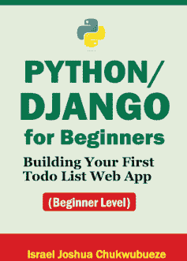
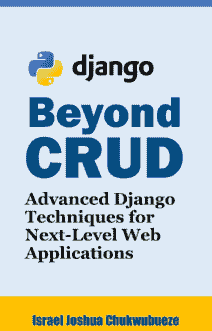
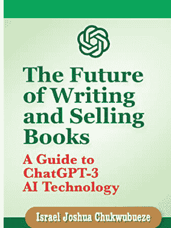

# 让我们问问 ChatGPT：45 分钟学会学习 HTML、CSS 和 JavaScript (ChatGPT 书籍写作与 AI 工具 1)

# 获取信息，请联系我们：

care@israeljoshua.com.ng

israeljoshua.com.ng

电话：+234 803 815 4459

WhatsApp：+234 813 813 2228 534

# 献言：

我将本书《让我们问问 ChatGPT：如何在 45 分钟学会 HTML、CSS 和 JavaScript》献给以下：

献给全能的神，您赋予了我学习、创造和分享知识的能力。感谢您在这段旅程对我的引导，并激励我去探索迷人的 Web 开发世界。

献给我的孩子们，你们不断提醒我好奇心、毅力和持续学习的重要性。你们的纯真和对发现新事物的渴望每天激励着我。这本书是给你们的，我的宝贝们。希望它能提醒你们，只要有决心，你们的成就将没有极限。

献给我亲爱的母亲，您对我能力的坚定支持和信任激发了我的抱负，并培养了我的梦想。感谢您赋予了我对知识的热爱和追求激情的勇气。您的指导和鼓励我深表感激。

最后，献给我的读者们，你们信任我有机会分享我的知识和见解。这本书献给你们，这些好奇的心灵、有抱的 Web 开发者以及正开启学习旅程的人们。希望这本书能成为一份宝贵的资源，赋予你们投入 HTML、CSS、JavaScript 迷人世界的力量。你们对学习的热情和投入激励着我继续分享知识并创造影响。

愿这篇献言能成为支撑本书的爱、支持和感激的提醒。让我们一起在 Web 开发领域开启学习、成长和转变的旅程。感谢大家，祝编程愉快！

# 前言：

亲爱的读者：

我带着非常大的快乐和热情向你们推介《让我们问问 ChatGPT：如何在 45 分钟学会 HTML、CSS 和 JavaScript》。我的名字是 Israel Joshua Chukueze（曾名 Christopher Ekene Okade），我非常高兴能与你们一起开启这段教育旅程。

写作一直是我的热情，通过写作，我可以分享知识、激励他人并产生积极的影响。当我潜入 Web 开发的世界时，我意识到 HTML、CSS 和 JavaScript 在塑造数字版图方面具有巨大潜力。这三种语言是创建引人入胜的网站、迷人的用户体验和交互式 Web 应用的基础。然而，我也意识到，许多有抱负的 Web 开发者在有效、高效地学习这些语言方面面临着挑战。

这种认识，结合我对教学和分享知识的热情，激发了这本书的灵感。我想创建一种资源，不仅能提供对 HTML、CSS 和 JavaScript 的全面介绍，而且以一种易于理解、引人入胜且高效时的方式呈现。我的目标是让像你们这样的读者能够在短时间内学到 Web 开发的核心知识，而不会牺牲学习体验的深度和质量。

在本书创作过程中，我寻求了 ChatGPT 的帮助，这是一个由 OpenAI 开发的强大语言模型。ChatGPT 在全书中充当虚拟伴侣，提供解释、示例和代码辅助。通过将 ChatGPT 整合到学习过程中，我旨在弥合理论与实际应用之间的鸿沟，确保你不仅理解概念，还能通过与 ChatGPT 一起编程来获得实践经验。

在接下来的章节中，我们将开启一段穿越 HTML、CSS 和 JavaScript 世界的精彩旅程。我们将探索基本概念，深入研究实践代码示例，并逐步建立技能来应对涵盖这三种语言的小项目。无论你是完全的初学者，还是已经具备一些 Web 开发知识，本书的设计都能适应你目前的水平并引导你走向精通。

需要注意的是，虽然本书旨在提供对 HTML、CSS 和 JavaScript 的全面介绍，但它并不是一份详尽的参考指南。Web 开发是一个庞大且不断发展的领域，本书是开启你学习之旅的垫脚石。在章节中，你会发现更多资源和学习材料的参考，让你能够深入研究特定话题并继续扩展本书范围的知识。

我想强调，学习任何技能都需要投入、练习和愿意尝试。随着章节的深入，我鼓励你积极参与内容，提问并挑战自己去应用所学。记住，最有效的学习方法就是实践。

我衷心感谢 OpenAI 团队，他们在开发 ChatGPT 方面做出的卓越工作，这改变了我们与人工智能交互的方式。他们对自然语言处理领域的奉献，使得创作一本整合 AI 能力以增强学习体验的书籍成为可能。

我还要感谢我的家人和爱人，他们坚定的支持和鼓励。他们对我的信任以及对我写作的热情是我不断的动力源。我的读者们，感谢你们与我一起开启这段旅程。我诚诚地希望，这本书不仅能赋予你们在 Web 开发领域脱而出所需的技能，还能点燃对学习和探索新技术的终身热爱。

那么，废话多说，让我们潜入 HTML、CSS 和 JavaScript 的迷人世界吧。让我们一起开启一段教育冒险，赋予你们创建精美网站、打造卓越用户体验并解锁 Web 开发无限可能的能力。

祝编程愉快！

# Israel Joshua Chukwueze

（曾名 Christopher Okade）

# 关于作者：

## Israel Joshua Chukwubueze

您可以[点击此处了解更多][关于作者在亚马逊上的书籍]...

(https://www.amazon.com/stores/Israel-Joshua-Chukwubueze/author/B0BHF5T1V7)

### 作者官方网站

了解更多关于官方、才华和技能

[点击此处了解更多]...

(https://israeloshua.com.ng)

我知道你会喜欢这本书的，别忘了为这本书留评价。

**点击此处发表评价！**

# 第 1 章：

# HTML 简介

什么是 HTML？

HTML 全称为“超文本标记语言”（HyperText Markup Language），是用于创建网页和应用程序的标准标记语言。它遵循 Web 标准来定义在网页上显示的内容的结构和布局。HTML 利用标签和元素来定义网页的各种组件，如标题、段落、图像、链接等。

## 基础 HTML 结构

每个 HTML 文档都遵循一个基础结构。它由一个 `<!DOCTYPE html>` 声明开始，紧接着是一个 `<html>` 元素，该元素作为文档的根元素。在 `<html>` 元素内部，我们有 `<head>` 和 `<body>` 元素。`<head>` 元素包含文档的元数据，如标题以及指向外部样式表或脚本的链接。<body>` 元素包含用户在浏览器中看到的网页实际内容。

## 创建 HTML 文档

要创建一个 HTML 文档，你可以从打开纯文本编辑器开始，如 Windows 上的记事本或 macOS 上的文本编辑。在最开始处声明 `<!DOCTYPE>` 以指定 HTML 版本。文档类型声明有助于浏览器理解如何解释和渲染 HTML 代码。

```html
<!DOCTYPE html>
<html>
<head>
<title>我的第一个网页</title>
</head>
<body>
<!-- 内容放在此处 -->
</body>
</html>
```

检查资源文件：chapter-1-01.html

## HTML 标签和元素

HTML 使用标签和元素来定义内容的结构和呈现方式。标签被包裹在角括号 (`<>`) 中，并且通常成对出现：一个起始标签和一个结束标签。起始标签表示元素的开始，结束标签表示其结束。元素可以相互嵌套，创建出层级结构。

以下是一些常用的 HTML 标签和元素：

- `<h1>` 到 `<h6>`：标题标签代表不同层级的标题，其中 `<h1>` 最高，`<h6>` 最低。

- `<p>`：段落标签定义文本段段落。

- `<a>`：锚点标签创建超链接，用于链接到其他网页或资源。

- ``：图像标签用于在网页中嵌入图像。

- 5. `<ul>` 和 `<li>`：无序列表 (`<ul>`) 和列表项目 (`<li>`) 标签用于创建带项目符号的列表。

- 6. `<div>`：div 标签是一个容器，有助于组织组织和分组元素。

- 7. `<span>`：span 标签是一个内联元素，用于应用样式或操作文本的特定部分。

## 使用 ChatGPT 编程：创建一个基础 HTML 文档

让我们使用 ChatGPT 创建一个基础 HTML 文档：

```html
<!DOCTYPE html>
<html>
<head>
<title>我的第一个网页</title>
</head>
<body>
<h1>欢迎来到我的网页</h1>
<p>这是一段文本。</p>
<a href="https://www.example.com">访问 Example.com</a>

<ul>
<li>项目 1</li>
<li>项目 2</li>
<li>项目 3</li>
</ul>
<div>
<p>这是一个 div 容器。</p>
<span>这是一个 span 元素。</span>
</div>
</body>
</html>
```

## 检查资源文件：chapter-1-02.html

在这个示例中，我们包含了一个标题、段落、链接、图像、无序列表和一个 div 容器。这些元素让我们一窥了 HTML 在结构化和呈现网页内容方面提供的可能性。

通过理解 HTML 的基础知识并利用适当的标签和元素，你可以创建结构良好的网页，有效地传达信息并吸引用户。

在下一章中，我们将深入研究 HTML 标签和元素，更详细探索它们的功能和用法。

# 第 2 章：HTML 标签和元素

HTML 提供了大量的标签和元素，允许开发者以各种方式结构化和呈现内容。在本章中，我们将探索一些重要的 HTML 标签和元素，包括标题标签、段落标签、链接标签、图像标签和列表标签。此外，我们将在 ChatGPT 的帮助下通过代码示例演示如何使用这些标签。

## 标题标签

标题标签 (`<h1>` 到 `<h6>`) 是在 HTML 文档中创建层级标题至关重要的。它们代表不同层级的标题，其中 `<h1>` 是最高的（主标题），`<h6>` 是最低的（子标题）。这些标�有助于组织内容，并为用户和搜索引擎提供视觉层级结构。

字体 h1 标题的用法示例：

```html
<h1>主标题</h1>
<h2>子标题</h2>
<h3>三级标题</h3>
```

> 检查资源文件：chapter-2-01.html

## 段落标签

段落标签 (`<p>`) 用于定义 HTML 文档中的文本段落。它是一个块级元素，为文本内容提供了结构和可读性。

段落标签的用法示例：

```html
<p>这是一段文本。</p>
<p>这里的另一个段落。</p>
```

检查资源文件：chapter-2-02.html

## 链接标签

链接标签 (`<a>`) 用于在 HTML 中创建超链接。允用户在不同的网页、同一页面内的部分或外部资源之间导航。`href` 属性指定链接的 URL 或目标。

链接标签的用法示例：

```html
<a href="https://www.example.com">访问 Example.com</a>
<a href="#section2">跳转到第 2 部分</a>
```

检查资源文件：chapter-2-03.html

## 图像标签

图像标签 (``) 用于在 HTML 文档中嵌入图像。它们需要 `src` 属性来指定图像文件的源（URL 或本地文件路径）。`alt` 属性在图像加载失败时提供替代文本。

图像标签的用法示例：

```html

```

检查资源文件：chapter-2-04.html

## 列表标签

HTML 提供了两种列表：有序列表 (`<ol>`) 和无序列表 (`<ul>`)。有序列表显示编号，而无序列表显示项目符号。列表项目 (`<li>`) 代表单独的列表条目。

列表标签的用法示例：

```html
<ul>
  <li>项目 1</li>
  <li>项目 2</li>
  <li>项目 3</li>
</ul>
<ol>
  <li>步骤 1</li>
  <li>步骤 2</li>
  <li>步骤 3</li>
</ol>
```

> 检查资源文件：chapter-2-05.html

## 使用 ChatGPT 编程：使用各种标签

让我们在 ChatGPT 的帮助下探索如何使用这些 HTML 标�标签。我们将包含不同标签的简单网页。

```html
<!DOCTYPE html>
<html>
<head>
  <title>HTML 标签示例</title>
</head>
<body>
  <h1>欢迎来到我的网页</h1>
</body>
</html>
```

## 标题标签

<h3>子标题</h3>

## 段落标签

<p>这是一段文本。</p>

## 链接标签

<a href="https://www.example.com">访问 Example.com</a>

## 图像标签


## 列表标签

<ul>

<li>项目 1</li>

<li>项目 2</li>

<li>项目 3</li>

</ul>

检查资源文件：chapter-2-06.html

网页的。

## 第3 章：HTML 格式化

HTML 提供了系列格式化选项，以增强网页内文本的外观和结构。在本章中，我们将探索所有的文本格式标签、语义化标签和 HTML 实体。我们将在 ChatGPT 的帮助下提供详细的解释和代码示例，展示如何有效利用这些格式化选项。

## 文本格式标签

HTML 提供了几个用于格式化和样式化的标签。这些标签允许开发人员修改网页内文本的大小、样式、对齐方式和强调程度。

- 1. `<strong>` 和 `<b>`：这些标签用于表示强强调并使文本加粗。

```
<strong>This text is important</strong>
<b>This text is bold</b>
```

- 2. `<em>` 和 `<i>`：这些标签用于强调文本并使其变为斜体。

```
<em>This text is emphasized</em>
<i>This text is italicized</i>
```

- 3. `<u>`：此标签用于给文本添加下划线。

```
<<u>This text is underlined</u>
```

-- 4. ``：此标签用于给文本添加删除线。

```
This text is strikethrough
```

- 5. `<sup>`：此标签用于显示上标文本。

```
E = MC<sup>2</sup>
```

- 6. `<sub>`：此标签用于显示下标文本。

```
<sub>2</sub>
```

以上全部：检查资源文件：chapter-3-01.html

## 语义化标签

语义化标签为网页内容提供了意义和语境。它们描述了特定部分的目的和意义，使得 HTML 代码对于开发人员和辅助技术设备都更具结构化且易于理解。

- 1. `<header>`：此标签代表网页或部分顶部的介绍性内容或导航性内容。

```html
<header>
```

```html
<h1>Welcome to My Website</h1>
<nav>
<ul>
  <li>Home</li>
  <li>About</li>
  <li>Contact</li>
</ul>
</nav>
</header>
```

检查资源文件：chapter-3-02.html

- 2. `<main>`：此标签封装了网页的主要内容。

```html
<main>
  <h2>About Me</h2>
  <p>I am a web developer with a passion for creating user-friendly websites.</p>
</main>
```

检查资源文件：chapter-3-03.html

- 3. `<article>`：此标签代表一个自包含的组合，例如博客文章或新闻文章。

```html
<article>
  <h3>My Journey as a Web Developer</h3>
  <p>In this article, I will share my experiences and lessons learned along the way.</p>
</article>
```

检查资源文件：chapter-3-04.html

- 4. `<section>`：此标签定义了文档或网页中的一个章节。

```html
<section>
  <h2>Skills</h2>
  <ul>
    <li>HTML</li>
    <li>CSS</li>
    <li>JavaScript</li>
  </ul>
</section>
```

检查资源文件：chapter-3-05.html

## HTML 实体

HTML 实体是 HTML 中具有保留含义的特殊字符。为了在网页中正确显示这些字符，我们使用它们对应的实体代码。

- 1. `<`：小于号的实体代码是 `&lt;`。

```html
&lt;
```

- 2. `>`：大于号的实体代码是 `&gt;`。

```html
&gt;
```

- 3. `&`：和符号的实体代码是 `&amp;`。

```html
&amp;
```

- 4. `"`：双引号的实体代码是 `&quot;`。

```html
&lt;p&gt;This is a &quot;quoted&quot; text.&lt;/p&gt;
```

- 5. `'`：单引号（撇号）的实体代码是 `&apos;`。注意并非所有浏览器都支持此实体。

He said, &amp;Hello&apos;.

以上全部：检查资源文件：chapter-3-06.html

使用 ChatGPT 编码：格式化文本和使用语义化标签

让我们在 ChatGPT 的帮助下探索如何在 HTML 中格式化文本并利用语义化标签。我们将创建一个包含这些格式化选项的简单网页。

```html
<!DOCTYPE html>
<html>
<head>
<title>HTML Formatting Example</title>
</head>
<body>
<h1>Welcome to My Webpage</h1>
<h2>Text Formatting Tags</h2>
<p>This is an example of using <strong>strong</strong> and <b>bold</b> tags.</p>
<p>This is an example of using <em>emphasized</em> and <i>italicized-text-text-italicized</i> tags.</p>
<p>This is an example of using <u>underlined</u> and <st>strikethrough</st>   tags.</p>
<p>Displaying superscript: E = MC<sup>2</sup></p>
<p>Displaying subscript: H=CO<sub>2</sub>/O22</p>
<h2>Semantic Tags</h2>
<header>
<h3>Header Tag</h3>
<nav>
<ul>
<li>Home</li>
<li>About</li>
</ul>
</nav>
</header>
<main>
<h3>Main Tag</h3>
<article>
<h4>Article Tag</h4>
<p>This is a self-contained article.</p>
</article>
<section>
<h4>Section Tag</h4>
<p>This is a section within the main content.</p>
</section>
</main>
</body>
</html>
```

## 检查资源文件：chapter-3-07.html

在这个示例中，我们使用了各种文本格式标签，如 `<strong>`、`<em>`、`<u>` 和 `<sup>` 来格式化文本。此外，我们整合了语义化标签，如 `<header>`、`<main>`、`<article>` 和 `<section>`，为内容提供了结构和意义。

通过理解并利用这些格式化选项，可以有效地增强网页内容。

## 第4 章：CSS 导论

在本章中，我们将探索 CSS（级联样式表）的基础。CSS 是一种强大的样式语言，用于控制 HTML 元素的样式。我们将涵盖 CSS 的目的、不同的实现方法以及如何将样式应用于 元素。

## 什么是 CSS？

CSS 全称为 Cascading Style Sheets（级联样式表）。它是一种描述 HTML 元素如何显示的样式语言。它为网页提供了视觉层，并关注内容的呈现方式。

## 内联 CSS

内联 CSS 是通过在 HTML 文档的 `<head>` 部分使用 `<style>` 标签放置 CSS 代码。在 `<style>` 标签内定义的样式将应用于 HTML 文档中的元素。

使用内联 CSS 的示例：

```html
<!DOCTYPE html>
<html>
<head>
<title>Internal CSS Example</title>
<style>
p {
  color: red;
  font-size: 20px;
}
</style>
</head>
<body>
<p>This is a paragraph with internal CSS styles.</p>
</body>
</html>
```

## 内联 CSS

内联 CSS 指通过 `style` 属性直接向 HTML 元素添加样式。这种方法允许你对特定元素应用样式而不影响其他元素。

使用内联 CSS 的示例：

```html
<p style="color: blue; font-size: 18px">This is a paragraph with inline styles.</p>
```

检查资源文件：chapter-4-01.html

在上面的示例中，样式 属性被添加到了 `<p>` 标签，应用的样式是蓝色和 18 像素。虽然内联 CSS 对于快速更改样式很方便，但对于较大的项目，通常建议使用外部或内部 CSS。

## 外部 CSS

外部 CSS 涉及创建一个扩展名为 `.css` 的独立 CSS 文件，并使用 `<link>` 标签将其链接到 HTML 文档。外部 CSS 文件包含 HTML 文档的所有样式，将样式代码与 结构分离。

使用外部 CSS，你需要创建一个 CSS 文件并在其中定义样式。然后，通过在 `<head>` 部分添加 `<link>` 标签将 CSS 文件链接到 HTML 文档。`<link>` 标签的 `href` 属性指定了 CSS 文件的路径。

```html
<!DOCTYPE html>
<html>
<head>
  <title>External CSS Example</title>
  <link rel="stylesheet" href="styles.css">
</head>
<body>
  <p>This is a paragraph with external CSS styles.</p>
</body>
</html>
```

检查资源文件：chapter-4-03/index.html

## CSS 文件 (styles.css):

```css
p {
  color: green;
  font-size: 22px;
}
```

检查资源文件：chapter-4-03/styles.css

在上面的示例中，CSS 样式被定义在一个名为 `styles.css` 的独立文件中。HTML 文件中的 `<link>` 标签使用 `href` 属性链接到 `styles.css` 文件。CSS 文件中定义的样式将应用到 HTML 文档中的所有 `<p>` 元素上，将它们的颜色设置为绿色，字体大小设置为 22 像素。

使用外部 CSS 具有多个优势，例如更易维护、代码组织更好，以及在多个 HTML 文件中复用样式的能力。

## 使用 ChatGPT 编码：将 CSS 样式应用于 HTML 元素

让我们探索如何使用内联、内部和外部方法将 CSS 样式应用于 HTML 元素。我们将创建一个简单的网页并演示每种方法的用法。

## 使用内联 CSS 的示例：

```html
<!DOCTYPE html>
<html>
<head>
<title>Inline CSS Example</title>
</head>
<body>
  <p style="color: blue; font-size: 18px;">This is a paragraph with inline CSS styles.</p>
</body>
</html>
```

在此示例中，`style` 属性被添加到 `<p>` 标签中，CSS 样式定义在属性值内。段落文本将以蓝色显示，字体大小为 18 像素。

## 使用内部 CSS 的示例：

```html
<!DOCTYPE html>
<html>
<head>
  <title>Internal CSS Example</title>
  <style>
  p {
    color: red;
    font-size: 20px;
  }
</style>
</head>
<body>
<p>This is a paragraph with internal CSS styles.</p>
</body>
</html>
```

在此示例中，CSS 样式定义在 `<head>` 部分的 `<style>` 标签内。样式应用到 HTML 文档中的所有 `<p>` 元素上，将它们的颜色设置为红色，字体大小设置为 20 像素。

## 使用外部 CSS 的示例：

HTML 文件 (index.html):

```html
<!DOCTYPE html>
<html>
<head>
  <title>External CSS Example</title>
  <link rel="stylesheet" href="styles.css">
</head>
<body>
  <p>This is a paragraph with external CSS styles.</p>
</body>
</html>
```

## CSS 文件 (styles.css):

```css
p {
  color: green;
  font-size: 22px;
}
```

在此示例中，CSS 样式定义在一个名为 `styles.css` 的独立文件中。HTML 文件中的 `<link>` 标签使用 `href` 属性链接到 `styles.css` 文件。CSS 文件中定义的样式将应用到 HTML 文档中的所有 `<p>` 元素上，将它们的颜色设置为绿色，字体大小设置为 22 像素。

通过理解和利用将 CSS 样式应用于 HTML 元素的各种方法，你可以创建视觉上吸引人且结构良好的网页。

在下一章中，我们将深入研究 CSS 并探索选择器、属性和值，以对 CSS 样式有更全面的理解。

# 第 5 章：CSS 选择器

在本章中，我们将深入研究 CSS 选择器，它们用于定位并样式化特定的 HTML 元素。CSS 选择器允许你根据元素类型、类、ID 或属性对元素应用样式。我们将探索不同类型的 CSS 选择器，包括元素选择器、类选择器和属性选择器。在整个章节中，ChatGPT 将提供详细的解释和代码示例，以有效地说明这些选择器的用法。

## 元素选择器

元素选择器是 CSS 中最基本的选择器类型。它们根据元素类型定位 HTML 元素。通过使用元素选择器，你可以对网页上特定元素的实例应用样式。

要使用元素选择器，只需编写元素名称，随后在花括号内编写 CSS 属性和值即可。

## 使用元素选择器的示例：

```css
p {
  color: blue;
  font-size: 16px;
}
```

在上面的示例中，元素选择器定位到 `<p>` 元素并应用定义的样式，例如蓝色和 16 像素的字体大小。

## 类选择器

类选择器允许你根据分配的类属性定位 HTML 元素。通过使用类选择器，你可以对共享相同类的特定元素组组应用样式。

要使用类选择器，在 CSS 代码中添加点 (`.`) 后跟类名。在 HTML 文档中，为想要样式化的元素分配相同的类名。

## 使用类选择器的示例：

```css
.red-text {
  color: red;
}
```

在上面的示例中，类选择器 `.red-text` 定位所有具有 `red-text` 类的元素，并应用定义的红色样式。

要将类应用于 HTML 元素，请使用 `class` 属性并分配所需的类名：

```html
<p class="red-text">This paragraph has red text.</p>
```

## ID 选择器

ID 选择器用于根据唯一的 ID 属性定位特定的 HTML 元素。每个元素都应该分配一个唯一的 ID，允许你使用 ID 选择器定位并样式化该特定元素。

要使用选择器，在 CSS 代码中添加哈希 (`#`) 后跟 ID 名称。在 HTML 文档中，为想要样式化的元素分配相应的 ID。

## 使用 ID 选择器的示例：

```css
#header {
  background-color: lightgray;
  height: 100px;
}
```

在上面的示例中，ID 选择器 `#header` 定位具有 ID 属性 `header` 的元素，并应用定义的样式，例如浅灰色背景颜色和 100 像素的高度。

要将 ID 应用于 HTML 元素，请使用 `id` 属性并分配所需的 ID 名称：

```html
<div id="header">This is the header element.</div>
```

## 属性选择器

属性选择器根据属性值定位 HTML 元素。此类选择器允许你根据特定的属性条件选择元素，例如属性的存在、属性值以特定字符串开头，或属性值包含特定字符串。

属性选择器有几种变体，包括：

- **[attribute]:** 选择具有指属性的元素。

- **[attribute=value]:** 选择具有具有精确值的指定属性的元素。

- **[attribute^=value]:** 选择属性值以指定字符串开头的指定属性。

- **[attribute$=value]:** 选择属性值以指定字符串结尾的指定属性。

- **[attribute*=value]:** 选择属性值包含指定字符串的指定属性。

## 使用属性选择器的示例：

```css
a[href] {
  color: blue;
}
```

在上面的示例中，属性选择器 `a[href]` 定位所有具有 `href` 属性的 `<a>` 元素，并应用定义的蓝色样式。

这些只是你可以用于定位 HTML 元素的不同类型 CSS 选择器的的少数示例。通过有效地理解和利用 CSS 选择器，你可以将样式精确地应用于网页上所需的元素。

```html
color: red;
}
</style>
</head>
<body>
<p class="red-text">这段文字是红色的。</p>
<p>这段文字是默认的文本颜色。</p>
</body>
</html>
```

检查资源文件：chapter-5-02.html

在此示例中，类选择器 `.red-text` 目标是带有 `red-text` 类的 `<p>` 元素，并应用了定义的红色文本样式。

## 使用 ID 选择器的示例：

```html
<!DOCTYPE html>
<html>
<head>
<title>ID 选择器示例</title>
<style>
#header {
  background-color: lightgray;
  height: 100px;
}
</style>
</head>
<body>
<div id="header">这是页眉元素。</div>
  <p>这是一个段落。</p>
</body>
</html>
```

检查资源文件：chapter-5-03.html

在此示例中，ID 选择器 `#header` 目标是具有 ID 属性 `header` 的 `<div>` 元素，并应用了定义的样式，例如浅灰色背景颜色和 100 像素的高度。

使用属性选择器的示例：

```html
<!DOCTYPE html>
<html>
<head>
  <title>属性选择器示例</title>
  <style>
    a[href] {
      color: blue;
    }
  </style>
</head>
<body>
<a href="https://www.example.com">这是一个蓝色的链接。</a>
<<a>>这是一个默认颜色的链接。</a>
</body>
</html>
```

## 检查资源文件：chapter-5-04.html

在此示例中，属性选择器 `a[href]` 目标是所有具有 `href` 属性的 `<a>` 元素，并应用了蓝色样式。

通过有效地使用 CSS 选择器，你可以根据特定需求精确地定位并为 HTML 元素设置样式。

在下一章中，我们将深入探索 CSS 属性和值，涵盖广泛的样式选项，以进一步增强网页的视觉效果。

# 第 6 章：CSS 盒模型

在本章中，我们将探索 CSS 盒模型，这是 Web 设计和布局中的一个基础概念。理解盒模型对于控制网页上元素的间距、尺寸和定位至关重要。我们将讨论盒模型的不同组件，包括外边距（margin）、内边距（padding）和框（border）。此外，我们将介绍 `box-sizing` 属性，它影响元素宽度高度的计算方式。在本章中，ChatGPT 将提供详细的解释和代码示例，帮助你使用 CSS 有效操作盒模型。

## 理解盒模型

CSS 盒模型是元素在网页上渲染的一种。它由四个部分组成：内容、内边距、框和外边距。

这些组件围绕元素并构成了元素的总宽度和高度。

- **内容 (Content)**：内容区域是显示元素实际内容（如文本或图像）的地方。它的尺寸由 `width` 和 `height` 属性定义。

- **内边距 (Padding)**：内边距是内容与框之间的空间。它提供了元素内部的留。可以使用 `padding` 属性设置内边距。

- **框 (Border)**：框是包围内边距和内容的线。可以使用 `border` 属性定义其厚度、样式和颜色。

- **外边距 (Margin)**：外边距是框外部的空间。它在元素之间创建一个间隙。可以使用 `margin` 属性设置外边距。

通过操作这些组件（注：应为这些组件），你可以控制网页上元素的间距、尺寸和定位。

## 外边距、内边距和框

让我们更仔细地观察盒模型的每个组件：外边距、内边距和框。

外边距 (Margin)：外边距是框外部的空间。它在元素周围创建一个不可见的区域，推开其他元素。你可以使用 `margin` 属性为元素的每个侧（上、右、下、左）设置不同的值。

设置外边距的示例：

```css
div {
  margin-top: 10px;
  margin-right: 20px;
  margin-bottom: 10px;
  margin-left: 20px;
}
```

检查资源文件：chapter-6-01.css

在此示例中，我们为 `<div>` 的每个侧设置了不同的外边距值，在顶部和底部创建了 10 像素的外边距，在右侧和左侧创建了 20 像素的外边距。

内边距 (Padding)：内边距是内容与框之间的空间。它提供了元素内部的留留。你可以使用 `padding` 属性为元素的每个侧（上、右、下、左）设置不同的值。

设置内边距的示例：

```css
div {
  padding-top: 10px;
  padding-right: 20px;
  padding-bottom: 10px;
  padding-left: 20px;
}
```

检查资源文件：chapter-6-02.css

在此示例中，我们为 `<div>` 的每个侧设置了不同的内边距值，在顶部和底部创建了 10 像素的内边距，在右侧和左侧创建了 20 像素的内边距。

框 (Border)：框是包围内边距和内容的线。可以使用 `border` 属性定义其厚度、样式和颜色。

设置框的示例：

```css
div {
  border-width: 2px;
  border-style: solid;
  border-color: black;
}
```

检查资源文件：chapter-6-03.css

在此示例中，我们为 `<div>` 设置了 2 像素的框宽、实线框样式和黑色的框颜色。这将在元素周围创建一个实线框。

## 盒尺寸 (Box Sizing)

`box-sizing` 属性允许你控制元素宽度高度的计算方式。默认情况下，元素的宽度高度包含内容、内边距和框。然而，通过 `box-sizing` 属性，你可以更改这种行为。

`box-sizing` 属性有两个可能的值：

- **content-box**：这是默认值，宽度和高度只包含内容。内边距和框会被加上宽度和高度。

- **border-box**：使用此值时，宽度和高度包含内容、内边距和框。内边距和框从宽度和高度中减去。

设置 box-sizing 的示例：

```css
div {
  box-sizing: border-box;
}
```

检查资源文件：chapter-6-04.css

在此示例中，我们为 `<div>` 将 `box-sizing` 属性设置为 `border-box`。这意味着宽度高度将包含内容、内边距和框。

## 使用 ChatGPT 编程：使用 CSS 操作盒模型

现在，让我们对盒模型的理解应用到一些 CSS 代码示例中。我们将操作 `margin`、`padding`、`border` 和 `box-sizing` 属性来控制元素的间距和尺寸。

## 示例 1：操作外边距

```html
<!DOCTYPE html>
<html>
<head>
  <title>外边距示例</title>
  <style>
    div {
      margin: 20px;
      background-color: lightgray;
    }
  </style>
</head>
<body>
  <div>带有外边距的 元素</div>
</body>
</html>
```

检查资源文件：chapter-6-05.html

在此示例中，我们为 `<div>` 设置了 20 像素的外边距，在元素与周围内容之间创建一个间隙。`<div>` 的背景颜色设置为浅灰色以便观察。

## 示例 2：操作内边距

```html
<!DOCTYPE html>
<html>
<head>
  <title>内边距示例</title>
  <style>
    div {
      padding: 10px;
      background-color: lightgray;
    }
  </style>
</head>
<body>
  <div>带有内边距的 元素</div>
</body>
</html>
```

检查资源文件：chapter-6-06.html

在此示例中，我们为 `<div>` 设置了 10 像素的内边距，在元素内部创建了留留。`<div>` 的背景颜色设置为浅灰色以便观察。

## 示例 3：操作框

```html
<!DOCTYPE html>
<html>
<head>
  <title>框的示例</title>
  <style>
    div {
      border: 2px solid black;
      background-color: lightgray;
    }
  </style>
</head>
<body>
  <div>带有框的 元素</div>
</body>
</html>
```

检查资源文件：chapter-6-07.html

在此示例中，我们为 `<div>` 设置了 2 像素的黑色实线框。`<div>` 的背景颜色设置为浅灰色以便观察。

## 示例 4：操作盒尺寸

```html
}
</style>
</head>
<body>
<div>This is a div element with box-sizing applied.</div>
</body>
</html>
```

## 检查资源文件：chapter-6-08.html

在这个示例中，我们将 `<div>` 元素的 `box-sizing` 属性设置为 `border-box`。宽度被设置为 200 像素，且内边距（padding）和边框（border）的也会被计入宽度的计算中。这确保了包括内容、内边距和边框在内的总宽度保持为 200 像素。

通过操纵盒模型组件并使用 `box-sizing` 属性，你可以对网页上元素的间距、尺寸和定位实现精确的控制。

在下一章中，我们将深入研究高级 CSS 技术，并探索如何对文本、背景和布局进行样式化，以创建视觉吸引力的网页。

## 图籍推荐





- Python/Django for Beginners: Building Your First Todo List Web App

- Beyond CRUD: Advanced Django Techniques for Next-Level Web Applications

- https://www.amazon.com/gp/product/B0CW1KSKBB

- https://www.amazon.com/gp/product/B0CWPF3RXL

# 第7章：CSS 布局

在本章中，我们将探索 CSS 布局，这对于在网页上构建化和安排元素至关重要。我们将讨论定位元素的各种技术，包括静态（static）、相对（relative）、绝对（absolute）和固定（fixed）定位。此外，我们将涵盖控制元素在布局中行为的显示（display）属性。我们还将探索浮动（float）和清除（clear）属性来创建简单的布局。最后，我们将深入研究强大的 CSS Grid 和 Flexbox 系统，用于创建复杂且响应式的布局。在整个章节中，ChatGPT 将提供详细的解释和代码示例，帮助你使用 CSS 创建不同的布局。

## 元素定位

CSS 为元素提供了多种定位选项。默认情况下，元素具有静态定位，这意味着它们按照在 HTML 文档流中的顺序出现。

然而，你可以使用 CSS 定位属性覆盖默认行为并精确地定位元素。

- **静态定位 (Static Positioning)**：这是元素的默认定位方式。静态定位的元素根据正常的文档流进行定位。

- **相对定位 (Relative Positioning)**：相对定位允许元素相对于其正常位置移动。你可以使用 `top`、`right`、`bottom` 和 `left` 属性来控制定位。

- **绝对定位 (Absolute Positioning)**：绝对定位允许元素相对于最近的定位祖先元素进行定位；如果没有定位祖先，则相对于文档定位。你可以使用 `top`、`right`、`bottom` 和 `left` 属性来控制定位。

- **固定定位 (Fixed Positioning)**：固定定位相对于浏览器窗口定位元素，无论页面如何滚动。即使页面滚动，元素也会固定在它的位置。你可以使用 `top`、`right`、`bottom` 和 `left` 属性来控制定位。

## 元素定位示例：

```css
div {
  position: relative;
  top: 50px;
  left: 20px;
}
```

在这个示例中，我们将 `<div>` 元素的定位设置为 `relative`，并将其从正常位置向下移动 50 像素，向右移动 20 像素。

## 显示属性

CSS 中的 `display` 属性决定了元素的显示方式以及它如何与布局中的其他元素进行交互。

你可以使用多种 `display` 属性值：

- **block**：此值使元素表现为块级元素，占据父容器的整个宽度并另起一行。

- **inline**：此值使元素表现为行内级元素，与周围文本混合且不另起行。

- **inline-block**：此值结合了块级和行内元素的特点。它允许元素具有宽度和高度，但它仍然与周围文本混合。

- **none**：此值隐藏元素并将其从布局中移除。

## 显示属性示例：

```css
div {
  display: inline-block;
  width: 200px;
  height: 150px;
}
```

在这个示例中，我们将 `<div>` 元素的 `display` 属性设置为 `inline-block`，这允许元素具有特定的宽度和高度，并与周围文本混合。

## 浮动与清除

CSS 中的 `float` 属允许元素放置在其容器元素的左侧或右侧，文本和其他元素会绕过它们。它通常用于创建简单的布局。

- **float: left**：此值将元素定位在左侧，允许文本和其他元素环绕其周围。

- **float: right**：此值将元素定位在右侧，允许文本和其他元素环绕其周围。

`clear` 属性用于控制元素相对于浮动元素的行为。它指定了元素应该定位在任何浮动元素的下方、上方还是旁边。

## 浮动与清除示例：

```css
div {
  float: left;
  width: 200px;
  height: 150px;
}

.clear {
  clear: both;
}
```

在这个示例中，第一个 `<div>` 元素浮动在左侧，第二个 `<div>` 元素应用了 `clear` 类。`clear: both` 属性确保第二个 `<div>` 元素出现在浮动元素下方。

## Flexbox 和 Grid

Flexbox 和 Grid 是强大的 CSS 布局系统，允许你创建复杂且响应式的布局。

- **Flexbox**：Flexbox 是一种一维布局模型，提供了在容器内分配空间和对齐元素的灵活性。它允许你在不依赖浮动或定位的情况下创建灵活且响应式的布局。

## Flexbox 布局示例：

```css
.container {
  display: flex;
  justify-content: center;
  align-items: center;
}

item {
  flex: 1;
  margin: 10px;
}
```

在这个示例中，`display: flex` 属性被应用于容器元素，创建了一个 flex 容器。`justify-content` 属性使 flex 项目水平居中，`align-items` 属性使它们垂直居中。`flex: 1` 属性应用于每个项目，将可用空间平均分配给它们。

- **Grid**：CSS Grid 是一种二维布局系统，允许你创建基于网格的布局。它对行、列以及元素在网格中的放置提供了精确的控制。

## Grid 布局示例：

```css
.container {
  display: grid;
  grid-template-columns: 1fr 1fr 1fr;
  grid-template-rows: auto;
  gap: 10px;
}

.item {
  background-color: lightgray;
  padding: 10px;
}
```

在这个示例中，`display: grid` 属性被应用于容器元素，创建了一个网格容器。`grid-template-columns` 属性定义了三个等宽列，`grid-template-rows` 属性自动设置高度。`gap` 属性在网格项目之间创建了 10 像素的间隙。

```css
justify-content: space-between;
align-items: center;
}

.item {
flex: 1;
height: 200px;
margin: 10px;
background-color: lightgray;
}
</style>
</head>
<body>
<div class="container">
  <div class="item">Item 1</div>
  <div class="item">Item 2</div>
  <div class="item">Item 3</div>
</div>
</body>
</html>
```

## 检查资源文件: chapter-7-02.html

在这个示例中，我们使用 `display: flex` 属性创建了一个 flex 布局。容器元素被设置为 `display:flex`，且 `justify-content` 属性被设置为 `space-between` 以均匀分布项目。项目具有 `flex: 1` 属性，以确保它们占据相同的空间。

## 示例 3：Grid 布局

```html
<!DOCTYPE html>
<html>
<head>
  <title>Grid Layout Example</title>
```

```css
<style>
.container {
  display: grid;
  grid-template-columns: repeat(3, 1fr);
  gap: 10px;
}

.item {
  background-color: lightgray;
  padding: 10px;
}
</style>
</head>
<body>
<div class="container">
  <div class="item">Item 1</div>
  <div class="item">Item 2</div>
  <div class="item">Item 3</div>
  <div class="item">Item 4</div>
  <div class="item">Item 5</div>
  <div class="item">Item 6</div>
</div>
</body>
</html>
```

## 检查资源文件: chapter-7-03.html

在这个示例中，我们使用 `display: grid` 属性创建一个网格布局。`grid-template-columns` 属性设置为 `repeat(3, 1fr)`，这创建了三个等宽列。`gap` 属性在网格项目之间创建了 10 像素的间隙。

通过结合不同的定位技术、浮动和清除属性、flexbox 布局以及 grid 布局，你可以创建各种适应你设计需求的各种布局。

在下一章中，我们将深入探索 JavaScript 的世界，探索其创建交互式和动态网页的强大能力。

# 第 8 章：

JavaScript 

简介

在本章中，我们将探索 JavaScript 的基础知识。JavaScript 是一种强大的编程语言，可以为网页添加交互性和动态行为。我们将涵盖 JavaScript 的基础内容，包括它的用途、如何将其嵌入 HTML 文档中，以及变量和数据类型的概念。在 ChatGPT 的帮助下，我们将提供详细的解释和代码示例，帮助你理解并在 HTML 文档中编写 JavaScript 代码。

# 什么是 JavaScript？

JavaScript 是一种高级的、解释型的编程语言，旨在为网页添加交互性和动态功能。它允许你操作网页的内容和行为，响应用户操作并与 Web 服务器进行交互。JavaScript 受到现代浏览器的广泛支持，已成为 Web 开发中不可或缺组件。

## 在 HTML 中嵌入 JavaScript

要在 HTML 文档中使用 JavaScript，你可以将其直接嵌入 HTML 代码中。使用 `<script>` 元素来定义和执行 JavaScript 代码。你可以将 `<script>` 元素放置在 HTML 文档的 `<head>` 或 `<body>` 部分。

这是一个在 HTML 文档中嵌入 JavaScript 的示例：

```html
<!DOCTYPE html>
<html>
<head>
  <title>JavaScript Example</title>
  <script>
    // 在此处编写 JavaScript 代码
    alert("Hello, JavaScript!");
  </script>
</head>
<body>
  <h1>Welcome to My Webpage</h1>
  <!-- 剩余的 HTML 内容 -->
</body>
</html>
```

检查资源文件: chapter-8-01.html

在这个示例中，JavaScript 代码被放置在 HTML 文档 `<head>` 部分的 `<script>` 标签内。`alert()` 函数用于显示带有“Hello, JavaScript!” 文本的弹出消息。

## 变量和数据类型

变量在 JavaScript 中用于存储和操作数据。变量是一个存储了值的命名容器，该值可以是不同的数据类型。JavaScript 具有多种内置数据类型，包括数字、字符串、布尔值、数组、对象等。

在 JavaScript 中声明变量，你使用 `var`、`let` 或 `const` 关键字，后跟变量名。传统上使用 `var` 关键字，但由于其作用域行为，现在倾向于使用 `let` 和 `const` 来声明变量。

## 以下在 JavaScript 中声明和使用变量的示例：

```html
<!DOCTYPE html>
<html>
<head>
<title>JavaScript Variables Example</title>
<script>
  // 声明变量
var name = "John";
let age = 25;
const PI = 3.14;

  // 使用变量
  console.log("Name:", name);
  console.log("Age:", age);
  console.log("PI:", PI);
</script>
</head>
<body>
  <!-- HTML 内容 -->
</body>
</html>
```

# 检查资源文件: chapter-8-02.html

在这个示例中，我们声明了三个变量：值为 "John" 的 name（使用 `var`），值为 25 的 age（使用 `let`），以及值为 3.14 的 PI（使用 `const`）。

（注：原文后续部分存在大量重复的占位符性描述，已根据要求翻译核心逻辑并保持格式）

开始。

请注意，控制台是一个强大的工具，允许你与网页进行交互并对其进行操作。运行来自不可信源的命令时请务必小心，因为它们可能会损害你的安全或网页的完整性。

总结来说，在 Firefox 和 Chrome 中访问浏览器控制台是一个简单的过程，它涉及打开开发者工具面板并切换到控制台（Console）选项卡。一旦进入控制台，你就可以执行 JavaScript 代码、调试问题、检查元素、监控网络请求等。控制台对于开发者和用户来说都是一个宝贵的资源，使他们能够有效地与网页交互并排排除故障。

## 使用 ChatGPT 进行编码：在 HTML 文档中编写 JavaScript 代码

现在，让我们使用各种 JavaScript 概念和语法在 HTML 文档中编写 JavaScript 代码。ChatGPT 将提供详细的解释和代码示例，帮助你有效地理解和编写 JavaScript 代码。

## 示例 1：操作 HTML元素

```html
<!DOCTYPE html>
<html>
<head>
  <title>JavaScript Example</title>
<script>
  function changeText() {
    var element = document.getElementById("myElement");
    element.innerHTML = "New Text";
}
</script>
</head>
<body>
<h1 id="myElement">Old Text</h1>
<button onclick="changeText()">Change Text</button>
</body>
</html>
```

检查资源文件：chapter-8-03.html

在此示例中，我们定义了一个 JavaScript 函数 `changeText()`。当点击按钮时，该函数会被调用，它使用 `document.getElementById()` 获取 ID 为 "myElement" 的元素。然后，它通过将 `innerHTML` 属性设置为 "New Text" 来修改该元素的内容。

## 示例 2：处理用户输入

```html
<!DOCTYPE html>
<html>
<head>
<title>JavaScript Example</title>
<script>
function greet() {
  var name = prompt("Please enter your name:");
  if (name) {
    alert("Hello, " + name + "!");
  }
}
</script>
</head>
<body>
<button onclick="greet()">Say Hello</button>
</body>
</html>
```

## 检查资源定义文件：chapter-8-04.html

在此示例中，我们定义了一个 JavaScript 函数 `greet()`。当点击按钮时，该函数会被调用，并使用 `prompt()` 提示用户输入名称。输入的名称存储在 `name` 变量中。如果输入了名称（即变量不为空），则会使用字符串拼接显示带有问候消息的警告框（alert）。

这些只是 JavaScript 如何在 HTML 文档中使用以添加交互性和动态行为的少数示例。JavaScript 是一门多功能的编程语言，具有许多更多的特性和能力，我们将在接下来的章节中进行探索。

在下一章中，我们将深入探讨 JavaScript，并讨论运算符、控制结构、函数等，以进一步加强你对 JavaScript 编程的理解。

# 第 9 章：JavaScript 函数

在本章中，我们将探索 JavaScript 函数，它是是执行特定任务的可重用代码块。函数是 JavaScript 编程中的一个基本概念，允许我们组织代码、提高代码的可重用性并将应用程序模块化。我们将涵盖函数的各个方面，包括声明函数、处理函数参数和返回值，以及理解箭头函数。在 ChatGPT 的帮助下，我们将提供详细的解释和代码示例，帮助你有效地创建和利用 JavaScript 函数。

## 声明函数

在 JavaScript 中声明函数，你使用 `function` 关键字，后跟函数名、一组括号和一对大括号。括号可以包含参数，参数是函数期望的值的占位符。

这是一个声明简单 JavaScript 函数的示例：

```javascript
function sayHello() {
  console.log("Hello, world!");
}
```

在此示例中，我们声明了一个名为 `sayHello` 的函数，它不接受任何参数。函数体包含在大括号中，由一个单一语句组成，使用 `console.log()` 函数向控制台打印字符串 "Hello, world!"。

## 函数参数和返回值

函数可以接收参数，参数是函数期望的值的占位符。函数也可以有返回值，这是函数返回给调用者的值。

### 带有参数的示例：

```javascript
function greet(name) {
  alert("Hello, " + name + "!");
}
```

在此示例中，我们定义了一个 JavaScript 函数 `greet()`。当点击被点击时，该函数会被调用，并使用 `prompt()` 提示用户输入名称。输入的名称存储在 `name` 变量中。如果输入了名称（即变量不为空），则会使用字符串拼接显示带有问候消息的警告框（alert）。

这些只是 JavaScript 如何在 HTML 文档中使用以添加交互性和动态行为的少数示例。JavaScript 是一门多功能的编程语言，具有许多更多的特性和能力，我们将在接下来的章节中进行探索。

### 带有返回值的示例：

```javascript
function add(a, b) {
  return a + b;
}
```

在此示例中，`add` 函数接收两个参数 `a` 和 `b`，并返回它们的和。

## 箭头函数

箭头函�是编写 JavaScript 函数的简洁语法。它们提供了一种更紧凑的方式来定义函数。

### 箭头函数的示例：

```javascript
const square = (num) => num * num;
```

在此示例中，`square` 箭头函数接收参数 `num`，并通过将其乘以自身返回其平方。

# 第 10 章：JAVASCRIPT 条件语句

在本章中，我们将深入探讨 JavaScript 条件语句，这些语句允许我们根据某些条件做出决策并执行不同的代码块。条件语句是编程中不可或缺的一部分，使我们能够创建动态且响应的应用程序。我们将探索 `if` 语句、比较运算符、逻辑运算符，并演示如何在 ChatGPT 的帮助下在 JavaScript 中实现条件语句。通过提供详细的解释和代码示例，旨在增强你对有效使用条件语句的理解和掌握。

## If 语句

`if` 语句是 JavaScript 中基本的条件语句形式。它允许我们检查条件并在仅在条件为真时执行代码块。

以下是 `if` 语句的语法：

```javascript
if (condition) {
  // 如果条件为真则执行的代码
}
```

条件是一个表达式，其结果为 `true` 或 `false`。如果条件为真，将执行大括号括起来的代码块。如果条件为假，则将跳过该代码块。

## 这是一个 if 语句的示例：

```javascript
let num = 10;
if (num > 0) {
  console.log("The number is positive.");
}
```

在这个示例中，我们检查变量 `num` 的值是否大于 0。如果条件为真，控制台将打印消息“The number is positive.”。

## 比较运算符

比较运算符用于条件语句内部以比较值并评估条件。JavaScript 提供了几个比较运算符，包括：

- > (大于)

- < (小于)

- >= (大于或等于)

- <= (小于等于)

- === (严格相等)

- != (严格不相等)

这些运算符允许我们根据值比较数字、字符串或其他数据类型。比较操作的结果是一个布尔值（`true` 或 `false`）。

## 以下是一些比较运算符的示例：

```javascript
let a = 5;
let b = 10;
console.log(a > b); // false
console.log(a < b); // true
console.log(a === b); // false
console.log(a != b); // true
```

在这些示例中，我们使用不同的比较运算符比较变量 `a` 和 `b` 的值。表达式根据比较结果求值为为 `true` 或 `false`。

## 逻辑运算符

逻辑运算符用于在条件语句中组合多个条件。JavaScript 提供了三个逻辑运算符：`&&` (与)、`||` (或) 和 `!` (非)。

- `&&` 运算符在两个条件都为真时返回 `true`。

- `||` 运算符在至少一个条件为真时返回 `true`。

- `!` 运算符对条件的结果取反反。

## 这是一个演示逻辑运算符用法的示例：

```html
<!DOCTYPE html>
<html
<head>
<title>JavaScript Example</title>
<script>
  let num = 15;

  if (num > 0 && num < 20) {
    console.log("The number is between 0 and 20.");
  }

  if (num < 0 || num > 100) {
    console.log("The number is either negative or greater than 100.");
  }
  if (!(num === 0)) {
    console.log("The number is not zero.");
  }
</script>
</head>
<body>
</body>
</html>
```

## 查看资源文件：chapter-10-01.html

在这个示例中，我们使用 `&&` 运算符来检查数字是否在 0 到 20 之间。`||` 运算符用于检查数字是否为负或大于 100。`!` 运算符用于对检查数字是否为零的条件取反。

## 使用 ChatGPT编程：在 JavaScript 中实现条件语句

现在让我们探索一些代码示例并在 JavaScript 中实现条件语句。ChatGPT 将提供详细的解释和代码示例，帮助你理解并有效利用条件语句。

## 示例 1：检查成绩

```html
<!DOCTYPE html>
<html
<head>
  <title>JavaScript Example</title>
  <script>
  let score = 85;
  let grade;
  if (score >= 90) {
    grade = "A";
  } else if (score >= 80) {
    grade = "B";
  } else if (score >= 70) {
    grade = "C";
  } else if (score >= 60) {
    grade = "D";
  } else {
    grade = "F";
  }
  console.log("Your grade is:", grade);
  </script>
</head>
<body>
</body>
</html>
```

查看资源文件：chapter-10-02.html

在这个示例中，我们有一个 `score` 变量，代表学生的考试分数。我们使用条件语句根据分数确定相应的等级。`if` 和 `else if` 语句检查分数相对于不同的范围并分配相应的等级。最后，我们将等级打印到控制台。

## 示例 2：检查登录凭据

```html
<!DOCTYPE html>
<html
<head>
  <title>JavaScript Example</title>
  <script>
let username = "admin";
let password = "password123";

if (username === "admin" && password === "password123") {
    console.log("Login successful.");
} else {
    console.log("Login failed.");
}
</script>
</head>
<body>
</body>
</html>
```

查看资源文件：chapter-10-03.html

在这个示例中，我们使用 `&&` 运算符来检查用户名和密码是否正确。`else` 语句允许我们处理凭据不符合条件的情况。

```html
<head>
  <title>JavaScript Example</title>
<script>
  for (let i = 0; i < 5; i++) {
    if (i === 2) {
      continue; // 如果 i 是 2，跳过迭代
    }
    if (i === 4) {
      break; // 如果 i 是 4，终止循环
    }
    console.log("Index:", i);
  }
  console.log("Loop ended.");
</script>
</head>
<body>
</body>
</html>
```

# 资源文件：chapter-11-01.html

在这个示例中，循环将从 0 迭代到 4。然而，当 i 等于 2 时，会遇到 `continue` 语句。当 i 达到 4 时，会遇到 `break` 语句，循环终止。循环结束后，控制台会打印消息 "Loop ended."。

# 使用 ChatGPT 编程：在 JavaScript 中使用循环迭代

现在，让我们探索一些代码示例，看看我们如何使用循环来遍历数据并执行重复性任务。

## 示例 1：累加数组元素

```html
<!DOCTYPE html>
<html>
<head>
  <title>JavaScript Example</title>
<script>
const numbers = [1, 2, 3, 4, 5];
let sum = 0;

for (let i = 0; i < numbers.length; i++) {
  sum += numbers[i];
}
console.log("Sum:", sum);
</script>
</head>
<body>
</body>
</html>
```

## 资源文件：chapter-11-02.html

在这个示例中，我们有一个数字数组。我们使用 `for` 循环来遍历数组的元素，并将它们加到 `sum` 变量中。循环结束后，我们将最终总和打印到控制台。

## 示例 2：打印偶数

```javascript
for (let i = 0; i <= 10; i++) {
  if (i % 2 === 0) {
    console.log(i);
  }
}
```

javascript

在这个示例中，我们使用 `for` 循环从 0 迭代到 10。在循环内部，我们使用 `if` 语句通过取模运算符 `%` 来检查当前数字是否为偶数。如果条件为真，我们将该数字打印到控制台。

这些示例展示了如何使用 `while` 循环和 `for` 循环来遍历数据并执行重复性任务。通过利用循环控制语句，我们可以自定义循环的行为并控制执行流。理解和掌握循环对于 JavaScript 中高效的编程和数据处理至关重要。

在下一章中，我们将探索 JavaScript 数组，它允许我们存储和操作数据集合。我们将涵盖数组的创建、元素访问、添加和删除元素，并演示如何使用 ChatGPT 数组进行工作。

# 第 12 章：

JavaScript 数组 (JAVASCRIPT ARRAYS)

在本章中，我们将探索 JavaScript 数组。数组是一种强大的数据结构，允许我们存储和操纵数据集合。数组在 JavaScript 中被广泛使用，并提供了各种添加、删除和修改元素的方法。我们将涵盖创建和操作数组的基础知识，讨论重要的数组方法，并探索多维数组。在 ChatGPT 的帮助下，我们将提供详细的解释和代码示例，帮助你有效地在 JavaScript 中理解和处理数组。

# 创建和操作数组

在 JavaScript 中创建数组，可以使用数组字面量表示法 `[]` 或 `Array` 构造函数。

这是一个示例：

```javascript
// 使用数组字面量表示法
const numbers = [1, 2, 3, 4, 5];

// 使用 Array 构造函数
const fruits = new Array("apple", "banana", "orange");
```

数组可以存储任何类型的数据，包括数字、字符串、对象甚至其他数组。数组元素通过从 0 开始的索引进行访问。例如，

`numbers[0]` 指向 numbers 数组的第一个元素，值为 1。

## 为了操作数组，JavaScript 提供了几个内置方法，允许你添加、删除和修改元素。

```javascript
const fruits = ["apple", "banana", "orange"];

// 添加元果
fruits.push("grape"); // 在数组末尾添加 "grape"
fruits.unshift("kiwi"); // 在数组开头添加 "kiwi"

// 删除元素
fruits.pop(); // 从数组中删除最后一个元素 ("grape")
fruits.shift(); // 从数组中删除第一个元素 ("kiwi")

// 修改元素
fruits[1] = "mango"; // 将第二个元素修改为 "mango"
```

## 数组方法

JavaScript 数组带有一套丰富的内置方法，使得处理和操作数组数据变得更加简单。让我们探索一些常用的数组方法：

- push: 在数组末尾添加一个或多个元素。

- pop: 从数组中删除最后一个元素并返回它。

- shift: 在数组开头添加一个或多个元素。

- shift: 从数组中删除第一个元素并返回它。

- concat: 合并两个或多个数组并返回一个新数组。

- slice: 返回数组部分内容的浅拷贝。

- splice: 在指定索引处从数组中添加或删除元素。

- forEach: 为数组的每个元素执行一次提供的函数。

- map: 通过对每个元素应用函数创建一个新数组。

- filter: 创建一个包含通过测试元素的新数组。

- find: 返回数组中满足条件的第一个元素。

- indexOf: 返回元素首次出现位置的索引。

- includes: 检查数组中是否存在某个元素。

- sort: 原地对数组元素进行排序。

- reverse: 反转数组中元素的顺序。

这些方法为操作数组提供了强大的功能。通过理解并利用这些方法，你可以高效对数组执行各种操作。

## 多维数组

JavaScript 数组也可以是多维的，这意味着它可以包含数组。这允许你创建矩阵、表格或任何需要多层嵌套的数据结构。这里有一个多维数组的示例：

```javascript
const matrix = [
  [1, 2, 3],
  [4, 5, 6],
  [7, 8, 9]
];
console.log(matrix[1][2]); // 访问元素 6
```

在这个示例中，matrix 是一个包含维数组，每个内部数组代表行，内部数组的元素代表列。可以使用 `matrix[1][2]` 访问元素 6，它指向第二行的第三列。

## 使用 ChatGPT 编程：在 JavaScript 中处理数组

让我们探索一些代码示例，看看我们如何在 JavaScript 中处理数组。

## 示例 1：累加数组元素

```javascript
const numbers = [1, 2, 3, 4, 5];
let sum = 0;

for (let i = 0; i < numbers.length; i++) {
  sum += numbers[i];
}
console.log("Sum:", sum);
```

在这个示例中，我们有一个数字数组。我们使用 `for` 循环来遍历数组的元素，并将它们加到 `sum` 变量中。循环结束后，我们将最终总和打印到控制台。

## 示例 2：过滤偶数

```javascript
const numbers = [1, 2, 3, 4, 5];
const evenNumbers = numbers.filter((number) => number % 2 === 0);

console.log("Even Numbers:", evenNumbers);
```

在这个示例中，我们使用 `filter` 方法创建一个只包含数组中偶数的数组。我们向 `filter` 方法传递了一个回调函数，该函数通过取模运算符 `%` 检查每个数字是否为偶数。

对象属性可以存储任何数据类型，包括数字、字符串、布尔值、数组甚至其他对象。

## 访问对象属性和方法

可以使用点符号（dot notation）或方括号符号（square bracket notation）访问对象属性。

这是一个示例：

```javascript
console.log(person.name); // 使用点符号访问属性
console.log(person["age"]); // 使用方括号符号访问属性
```

在这个示例中，我们使用点符号访问 `name` 属性，使用方括号符号访问 `age` 属性。两种方法实现相同的结果。

对象还可以包含方法，方法是定义为对象属性的函数。这些方法可以执行与对象相关的操作或计算。

这是一个示例：

```javascript
const person = {
  name: "John",
  age: 25,
  profession: "Developer",
  greet: function() {
    console.log(`Hello, my name is ${this.name}.`);
  }
};

```

person.greet(); // 调用 greet 方法

在这个示例中，我们在 `person` 对象中定义了一个 `greet` 方法。该方法使用对象的 `name` 属性打印问候信息。`this` 关键字指向当前对象，允许我们在方法内部访问其属性。

## JSON 记法

JSON（JavaScript 对象表示）是一种广泛用于存储和传输数据的格式。它基于 JavaScript 对象的语法，但具有更严格、更标准的结构。JSON 通常用于服务器和 Web 应用程序之间交换数据。

这是一个 JSON 对象的示例：

```json
{
  "name": "John",
  "age": 25,
  "profession": "Developer"
}
```

在这个示例中，JSON 对象与我们之前创建的 JavaScript 对象具有相同的属性。属性名包含在双引号中，这是 JSON 的要求。

JavaScript 提供了内置方法在 JSON和 JavaScript 对象之间进行转换。`JSON.stringify()` 方法将 JavaScript 对象转换为 JSON，而 `JSON.parse()` 方法将 JSON 转换为 JavaScript 对象。

```javascript
const person = {
  name: "John",
  age: 25,
  profession: "Developer"
};

const json = JSON.stringify(person); // 将 JavaScript 对象转换为 JSON
console.log(json);

const object = JSON.parse(json); // 将 JSON 转换为 JavaScript 对象
console.log(object);
```

## 在 JavaScript 中利用对象

对象对于组织和管理 JavaScript 中的复杂数据结构非常强大。它们允许我们将相关数据和行为组合在一起，提供了一种更直观、结构化的数据处理方式。

对象在 JavaScript 中广泛用于表示实体，例如用户、产品或任何其他真实世界对象。通过在对象内部封装相关的属性和方法，我们可以轻松地访问和操作数据。

此外，对象可以用于创建和实现更高级的概念，例如面向对象编程（OOP）。OOP 提供了一种通过创建具有属性和方法并可以相互交互的对象来结构化代码的方法。


JavaScript 框架和库（如 React 和 Angular）大量利用对象来构建动态交互的 Web 应用。理解 JavaScript 中的对象对于掌握这些框架和库至关重要。

在 ChatGPT 的帮助下，我们探索了创建对象、访问和操作对象属性及方法的基础，讨论了 JSON 记法，并学习了如何在 JavaScript 中有效利用对象。对象是 JavaScript 语言的基础组成部分，在现代 Web 开发中起着至关重要的作用。

在下一章中，我们将深入更高级的 JavaScript 概念，例如与 API 交互以及发送异步请求，这些都是构建动态和数据驱动 Web 应用的必备技能。

# 书籍推荐


- App Ideas for the Future; The Next Big Thing: Ultimate Thousands of App Ideas Handbook

- Get Started with Pictory AI Video Creation: The Beginner Cookbook

https://www.amazon.com/gp/product/B0C2NXGVZ

https://www.amazon.com/gp/product/B0BYB6OFY

## 第14 章：JavaScript DOM 操作

在本章中，我们将探索 JavaScript DOM（文档对象模型）操作，这是一种与 页面 HTML 结构交互的强大技术。DOM 将 HTML 文档的结构表示为树形结构，每个元素、属性和文本节点都可以使用 JavaScript 进行访问、修改或操作。我们将涵盖访问和修改元素、事件处理、创建动态内容等主题，并在 ChatGPT 的帮助下提供代码示例，以深化对使用 JavaScript 操作 DOM 的理解。

## 访问和修改元素

JavaScript 提供了几种方法来访问和修改 DOM 中的元素。这些方法允许我们根据 ID、类或其他属性定位特定元素。一旦获取了元素的引用，就可以修改它的属性，例如文本内容、属性甚至是 CSS 样式。让我们来看一些示例：

### 通过 ID 访问元素：

```javascript
const element = document.getElementById("myElement");
```

### 通过类访问元素：

```javascript
const elements = document.getElementsByClassName("myClass");
```

### 通过标签名访问元素：

```javascript
const elements = document.getElementsByTagName("div");
```

### 修改元素属性：

```javascript
element.textContent = "New text content";
element.setAttribute("src", "image.jpg");
element.style.color = "red";
```

## 事件处理

事件处理是 DOM 操作的一个重要方面。当 Web 页面发生某些操作（如点击按钮、提交表单或滚动）时，就会触发事件。JavaScript 允许我们监听这些事件并在发生时执行代码。

### 让我们来看为按钮点击绑定事件处理程序的示例：

```javascript
const button = document.getElementById("myButton");

button.addEventListener("click", function() {
  // 点击按钮时要执行的代码
});
```

在这个示例中，我们使用 `addEventListener` 为按钶添加了点击事件监听器。当按钮被点击时，将执行提供的回调函数。这允许我们响应用户交互并根据事件执行操作。

## 创建动态内容

JavaScript DOM 操作允许我们动态创建和修改内容，这意味着我们可以根据用户操作或条件在页面上生成并更新元素。这对于创建交互式和数据驱动的 Web 应用特别有用。

### 让我们考虑一个动态创建列表的示例：

```javascript
const listContainer = document.getElementById("myList");
// 动态生成列表
const list = document.createElement("ul");

for (let i = 1; i <= 5; i++) {
  const listItem = document.createElement("li");
  listItem.textContent = "Item " + i;
  list.appendChild(listItem);
}

listContainer.appendChild(list);
```

在这个示例中，我们动态创建了一个列表（ul）元素，并根据循环生成了列表项（li）。列表项被添加到列表中，列表本身被添加到页面上的容器中。这演示了如何使用 JavaScript 创建和更新内容。

## 与 ChatGPT 协作编码：使用 JavaScript 操作 DOM

现在我们已经涵盖了访问和修改元素、事件处理以及使用 JavaScript DOM 操作创建内容的基础，让我们通过 ChatGPT 探索几个代码示例以深化理解。

### 示例 1：更改元素样式

```javascript
const element = document.getElementById("myElement");
element.style.backgroundColor = "blue";
element.style.color = "white";
```

在这个示例中，我们访问 ID 为 myElement 的元素，并使用 style 属性修改其背景颜色文本颜色。

### 示例 2：添加监听器

```javascript
const button = document.getElementById("myButton");
button.addEventListener("click", function() {
  console.log("Button clicked!");
});
```

在这个示例中，我们为 ID 为 myButton 的按钮元素添加了点击事件监听器。当按钮被点击时，提供的回调函数会在控制台打印消息。

### 示例 3：创建动态列列表

```javascript
const listContainer = document.getElementById("mylist");
function createList() {
  const list = document.createElement("ul");
  for (let i = 1; i <= 3; i++) {
    const listItem = document.createElement("li");
    listItem.textContent = "Item " + i;
    list.appendChild(listItem);
  }
  listContainer.appendChild(list);
}
createList();
```

在这个示例中，我们定义了一个名为 `createList` 的函数，它可以动态生成一个包含三个项目的列表。然后，该列表被添加到网页 ID 为 `myList` 的元素上。

通过结合访问和修改元素、事件处理以及创建动态内容的知识，我们可以使用 JavaScript DOM 操作创建交互式且动态的网页。

在下一章中，我们将深入学习更高级的 JavaScript 概念，例如处理 API 和发送异步请求，这些都是构建动态化和数据驱动的 Web 应用的关键技能。

**如果你购买/下载了我的书并觉得很有趣，我将非常高兴；如果你能为这本书留一个好评，这将帮助其他潜在读者产生兴趣。**

这只需要 30 秒钟，我将不胜感激。

# 点击此处发表评论！

提前感谢，我爱你，你是最棒的

# 第 15 章：HTML 与 CSS 的集成

在本章中，我们将探索 HTML 和 CSS 的集成，这是构建时尚且具有视觉吸引力的网页的两种基础技术。我们将涵盖等主题，如使用 CSS 为 HTML 元素设置样式、理解 CSS 优先级以及内联样式与外部样式表之间的差异。在 ChatGPT 的帮助下，我们将提供详细的解释和代码示例，以加深对有效集成 HTML 和 CSS 的理解。

## 使用 CSS 为 HTML 元素设置样式

CSS（层叠样式表）用于设置和格式网页上 HTML 元素的样式。通过 CSS，我们可以控制元素呈现各个方面，包括颜色、大小、位置等。要将 CSS 样式应用于 HTML 元素，我们使用选择器定位特定元素并定义所需的样式。让我们来看一个示例：

```html
<!DOCTYPE html>
<html>
<head>
<style>
h1 {
  color: blue;
  font-size: 24px;
}
p {
  color: red;
  font-size: 16px;
}
</style>
</head>
<body>

<h1>这是一个标题</h1>

<p>这是一个段落。</p>

</body>
</html>
```

## CSS 优先级 (Specificity)

CSS 优先级是一组规则，决定了当多个样式指向同一个元素时应用哪些 CSS 样式。它有助于解决冲突并确保显示正确的样式。优先级基于用于定位元素的选择器组合。选择器越具体，优先级越高。

## 以下是一条通用规则：

- ID 选择器的优先级最高。
- 类选择器的优先级中等。
- 标签选择器的优先级最低。

理解优先级对于管理和排错 CSS 样式至关重要，特别是在样式可能会冲突的复杂项目中。

## 内联样式 vs 外部样式表

CSS 样式可以通过两种方式应用：内联样式和外部样式表。

内联样式是通过 `style` 属性直接应用于单个 HTML 元素的 CSS 样式。内联样式的优先级高于外部样式表，但在多个元素需要相同样式时，维护性较低。

外部样式表是包含网站所有样式的独立 CSS 文件。它们通过 `<link>` 标签链接到 HTML 文档。外部样式表允许进行集中样式管理，多个 HTML 文档可以共享样式。这种方法提高了可维护性和重用性。

## 使用 ChatGPT 编码：集成 HTML 和 CSS

在 ChatGPT 的帮助下，让我们通过示例加深对有效集成 HTML 和 CSS 的理解。# 示例：将 CSS 样式应用于 HTML 元素

```html
<!DOCTYPE html>
<html>
<head>
  <link rel="stylesheet" type="text/css" href="styles.css">
</head>
<body>
  <div class="calculator">
    <input type="text" id="display" readonly>
    <div class="buttons">
      <button class="number">1</button>
      <button class="number">2</button>
      <button class="number">3</button>
      <!-- 其他数字按钮 -->
      <button class="operator">+</button>
      <button class="operator">--</button>
      <button class="operator">*</button>
      <button class="operator">/</button>
      <!-- 其他运算符按钮 -->
      <button class="special">Clear</button>
      <button class="special">Equal</button>
    </div>
  </div>
  <script src="script.js"></script>
</body>
</html>
```

在这个 HTML 结构中，我们有一个类为 `calculator` 的 `<div>`，它包含一个 ID 为 `display` 的 `<input>` 元素，用于显示计算器的输入和输出。在 `calculator` `<div>` 内部，我们还有另一个类为 `buttons` 的 `<div>`，它持有所有的计算器按钮。我们将按钮分为三类：number 用于数字按钮，operator 用于运算符按钮，special 用于特殊功能按钮。

## 实现功能

一旦有了用户界面结构，我们需要使用 JavaScript 实现计算器的功能。这涉及捕捉按钮点击、执行计算并相应地更新显示。

## 我们在名为 script.js 的单独文件中定义 JavaScript 函数：

```javascript
// 获取显示元素
const display = document.getElementById("display");
// 为按钮添加事件监听器
const buttons = document.getElementsByClassName("buttons");
for (let i = 0; i < buttons.length; i++) {
  // 注意：此逻辑需要调整以定位容器内的单个按钮
  // 在实际应用中，你会使用 document.querySelectorAll('.buttons button') 或类似方法
}
// 更新显示的函数
function updateDisplay(value) {
  display.value += value;
}
// 清空显示的函数
function clearDisplay() {
  display.value = ""
}
// 计算表达式并显示结果的函数
function evaluateExpression() {
  try {
    display.value = eval(display.value);
  } catch (error) {
    display.value = "Error";
  }
}
```


利用 HTML5 特性和元素可以极大地增强网页的功能和交互性，而 ChatGPT 可以引导你有效地实现它们。

## 2. 语义化 HTML：语义化 HTML 指以反映内容结构和含义的方式使用 HTML 元素。通过选择合适的语义元素，你可以提高网页的可访问性、SEO 和可维护性。

例如，与其使用 `<div>` 来创建导航栏，不如使用 `<nav>` 元素。同样，与其使用 `<div>` 来标记文章，不如使用 `<article>` 元素。通过使用语义元素，你为辅助技术和搜索引擎提供了有意义的信息，使你的内容更易于访问和发现。

ChatGPT 可以协助你识别并为网页的不同部分选择实现最合适的语义元素。它可以就如何结构化你的内容以及确保使用语义化 HTML 进行恰当的标记提供指导。

## 3. 可访问性考虑：Web 可访问性对于确保残障人士能够有效地感知、导航和与网页内容交互至关重要。通过遵循可访问性指南，你可以让你的网页对更广泛的用户具有包容性和可用性。重要的可访问性考虑包括：

- a. 为图像提供替代文本：图像应该具有描述性的替代文本（使用 `alt` 属性），向无法看到图像的用户传达其含义。ChatGPT 可以根据图像的上下文帮助你生成合适的 `alt`。

- b. 正确结构化内容：使用 `<h1>` 到 `<h6>`、列表（`<ul>`、`<ol>`、`<dl>`）以及其他语义元素，你可以以逻辑和分层的方式结构化内容。这有助于使用屏幕阅读器的用户更轻松地导航和理解内容。

- c. 键盘可访问性：确保所有交互元素（链接、按钮、表单输入）都可以仅通过键盘访问和操作。这对于无法使用鼠标或其他指向设备的用户至关重要。

- d. 颜色对比度：确保文本和背景颜色之间有足够的对比，以确保可读性，特别是对于视觉障碍的用户。

ChatGPT 可以就如何提高你网页的可访问性提供见解和建议。它可以帮助你识别潜在的可访问性问题，并推荐解决这些问题的最佳实践。

## 4. 使用 ChatGPT 编程：探索高级 HTML 技术：在 ChatGPT 的帮助下，你可以探索并实现各种高级 HTML 技术。以下是一些示例：

- a. 使用 HTML5 语义元素：ChatGPT 可以引导你有效地使用语义元素。它可以根据你内容的结构和含义，帮助你理解何时使用 `<header>`、`<nav>` 或其他语义元素。

- b. 实现 ARIA 角色和属性：ChatGPT 可以提供实现可访问富网络应用 (ARIA) 角色和属性的指导，以增强网页的可访问性。ARIA 允许你为辅助技术提供额外信息，改善残障人士的用户体验。

- c. 针对移动和响应式设计进行优化：ChatGPT 可以通过推荐响应式设计技术和 HTML5 特性（如 `<meta viewport>` 标签和 CSS 媒体查询），协助为移动设备优化网页。

- d. 使用结构化数据增强 SEO：结构化数据标记（如 Schema.org）有助于搜索引擎理解你网页的内容和语境。ChatGPT 可以提供实现结构化数据标记的指导，以提高 SEO 并增强网页在搜索结果中的可见性。

通过与 ChatGPT 协作，你可以利用它的知识和专业知识有效地探索和实现高级 HTML 技术。

在本章中，我们深入探讨了可以提升网页结构、语义化和可访问性的高级 HTML 技术。HTML5 特性、语义化 HTML、可访问性考虑以及使用 ChatGPT 编程可以帮助你创建不仅视觉上吸引人，而且具有包容性、易发现且用户友好的网页。通过掌握这些高级 HTML 技术，你可以将 Web 开发技能推向高度，构建更健壮、更吸引人的 Web 体验。

## 使用 ChatGPT 编程：探索高级 HTML 技术

在本节中，我们将探索一些可以在 ChatGPT 帮助下实现的高级 HTML 技术示例。这些示例将展示 HTML 在创建动态和交互式网页方面的强大和灵活性。

## 让我们深入一些代码片段：

### 1. 响应式图像：

```html
<!DOCTYPE html>
<html>
<head>
<style>
.responsive-image {
max-width: 100%;
height: auto;
}
</style>
</head>
<body>

</body>
</html>
```

在这个示例中，我们创建了一个响应式图像，它会根据设备的屏幕宽度自动调整大小。`.responsive-image` 类应用了 CSS 样式，使图像具有流性和响应式。

### 2. 视频嵌入：

```html
<!DOCTYPE html>
<html>
<body>
<video controls>
<source src="video.mp4" type="video/mp4">
您的浏览器不支持视频标签。
</video>
</body>
</html>
```

在这里，我们使用 `<video>` 元素嵌入了视频。`controls` 属性启用了默认的视频播放器控件。可以添加多个 `<source>` 元素来提供不同的视频格式，以获得更好的浏览器兼容性。

### 3. 交互式表单验证：

```html
<!DOCTYPE html>
<html>
<body>
<form>
<label for="email">邮箱:</label>
<input type="email" id="email" required>
<button type="submit">提交</button>
</form>
```

```html
<script>
const form = document.querySelector('form');
form.addEventListener('submit', (event) => {
  if (!form.checkValidity()) {
    event.preventDefault();
    // 显示错误消息或执行自定义验证
  }
});
</script>
</body>
</html>
```

在这个示例中，我们创建了一个带有邮箱输入和验证的简单表单。`required` 属性确保在提交表单之前必须填写邮箱字段。JavaScript 代码为表单的提交（submit）事件添加了监听器，允许实现自定义验证逻辑。

### 4. HTML5 地理定位：

```html
<!DOCTYPE html>
<html>
<body>
<button onclick="getLocation()">获取位置</button>
<p id="demo"></p>
<script>
function getLocation() {
  if (navigator.geolocation) {
    navigator.geolocation.getCurrentPosition(showPosition);
  } else {
    alert("此浏览器不支持地理定位。");
  }
}
</script>
</body>
</html>
```

```javascript
function showPosition(position) {
  const location = `纬度: ${position.coords.latitude}<br>经度: ${position.coords.longitude}`;
  document.getElementById("demo").innerHTML = location;
}
</script>
</body>
</html>
```

这段代码演示了如何使用 HTML5 地理定位 API 获取用户的当前位置。`getLocation()` 函数检查浏览器是否支持地理定位，然后调用 `getCurrentPosition()` 获取坐标。`showPosition()` 函数在网页上显示纬度和经度值。

这些示例展示了一些用于创建动态和交互式网页的高级 HTML 技术。在 ChatGPT 的帮助下，你可以探索更多高级的 HTML 特性，并利用它们增强你的 Web 应用程序的功能和用户体验。

## 书推荐




**写作与出版的未来：ChatGPT-3 AI 技术指南**

https://www.amazon.com/gp/product/B0BTWVXXFFS

**释放 Amazon Kindle 的力量：如何轻松售出你的前 1000 册并获得评论...**

https://www.amazon.com/gp/product/B0BX6K1TJN

# 第 25 章：高级 CSS 技术

CSS（层叠样式表）是一种强大的样式语言，允许你控制网页的呈现和布局。在本章中，我们将探索可以让你的 Web 设计技能提升到新层次的高级 CSS 技术。在 ChatGPT 的帮助下，我们将深入研究 CSS 预处理器、CSS 框架、响应式设计和媒体查询。

让我们开始吧！

### 1. CSS 预处理器：诸如 Sass（Syntactically Awesome Stylesheets）和 Less（Leaner CSS）等 CSS 预处理器通过引入变量、混入（mixins）、函数等扩展了 CSS 的功能。它们允许你编写模块化和可复用的 CSS 代码，使你的样式表更有组织且易于维护。

### 2. 这是一个使用 Sass 的示例：

```scss
// styles.scss
$primary-color: #007bff;

.button {
  background-color: $primary-color;
  color: white;
  padding: 10px 20px;
  border-radius: 4px;
}
```

在 ChatGPT 的指导下，你可以学习如何有效地设置和使用 CSS 预处理器。它们可以极大地增强你的 CSS 开发工作流。

### 2. CSS 框架：Bootstrap 和 Tailwind CSS 等 CSS 框架提供了一组预设计的 CSS 样式和组件，你可以利用它们来构建响应式且视觉良好的网页。这些框架提供了网格系统、排版样式、表单组件、导航菜单等。你可以使用 ChatGPT 学习如何在你的项目中集成和自定义这些框架。

### 3. 响应式设计和媒体查询：响应式设计是 Web 开发的一个关键方面。它确保你的网页在不同的设备和屏幕尺寸上都能适应并良好显示。媒体查询允许你根据设备的特性应用特定的 CSS 样式。

### 4. 这是一个媒体查询的示例：

```css
@media (max-width: 768px) {
  container {
    width: 100%;
  }
}
```

在 ChatGPT 的帮助下，你可以学习如何有效地处理这些和媒体查询。它们可以极大地增强你的 CSS 设计。

### 4. **CSS 过渡与动画：** CSS 过渡和动画为页面添加了交互。ChatGPT 可以引导你了解这些过渡和关键帧动画，创建平滑的视觉效果。

### 5. **Flexbox 和 Grid：** Flexbox 和 Grid 是强大的布局系统。Flexbox 关注单方向（无论是水平还是垂直），而 Grid 允许创建二维布局。在 ChatGPT 的支持下，你可以有效地利用这些布局系统。

在本章中，我们探索了高级 CSS 技术。CSS 预处理器、CSS 框架、响应式设计、媒体查询、过渡与动画，以及布局系统 Flexbox 和 Grid 提供了创建视觉吸引力的网页工具。

# 第 26 章：高级 JavaScript 概念

JavaScript 是一种功能强大的编程语言，允许你创建动态和交互式的 Web 应用程序。在本章中，我们将探索可以提升你项目技能水平的高级 JavaScript 概念。在 ChatGPT 的帮助下，我们将深入研究异步 JavaScript、错误处理与调试以及 ES6 特性。让我们开始吧！

### 1. 异步 JavaScript：JavaScript 对于处理需要时间完成的任务非常重要，例如从 API 获取数据或执行复杂的计算。Promise 和 async/await 语法是管理异步操作的工具。

### 2. 这是一个使用 Promise 的示例：

```javascript
function fetchData() {
  return new Promise((resolve, reject) => {
    // 异步任务
    setTimeout(() => {
      const data = { name: "John", age: 25 };
      resolve(data);
    }, 2000);
  });
}
```

```javascript
fetchData()
.then((data) => {
  console.log(data);
})
.catch((error) => {
  console.error(error);
});
```

在 ChatGPT 的指导下，你可以学习如何有效地使用 Promise、处理 async/await 操作并在 JavaScript 应用程序中管理异步代码。

### 2. **错误处理与调试：**错误处理和调试是任何 JavaScript 开发者的基本技能。了解如何识别并修复代码中的错误对于维护流畅的用户体验至关重要。ChatGPT 可以帮助你探索各种调试技术，包括控制台日志、断点和异常处理。你将学习如何有效地捕获和处理错误，确保应用程序的稳定可靠。

### 3. **ES6 特性与语法：ECMAScript 6 (ES6) 也称为 ECMAScript 2015，为 JavaScript 引入了许多特性和语法增强。这些新增使得语言更加强大、灵活且高效。一些 ES6 特性包括箭头函数、模板字符串字量、解构赋值和展开运算符。

```javascript
console.log(`Hello, ${name}!`);
const [first, second, ...rest] = [1, 2, 3, 4, 5];
console.log(first); // 1
console.log(second); // 2
console.log(rest); // [3, 4, 5];
```

在 ChatGPT 的帮助下，你可以探索 ES6 特性的全范围，理解它们的优势，并利用它们编写更整洁、更简洁的 JavaScript 代码。

### 4. **设计模式：** 设计模式是解决常见编程问题的可重用方案。它们为设计和组织代码提供了一种结构化的方法，使代码更具维护性和可扩展性。设计模式的示例包括单例模式、观察者模式和模块模式。ChatGPT 可以引导你理解并实现这些模式，让你能够编写更健壮、模块化的 JavaScript 应用程序。

### 5. **性能优化：** 编写高效且优化的 JavaScript 代码对于交付快速响应的 Web 应用程序至关重要。ChatGPT 可以提供有关性能优化技术的见解，例如最小化 DOM 操作、减少网络请求以及优化算法。你将学习如何分析和改进你的 JavaScript 代码性能，确保无缝的用户体验。

在本章中，我们探索了可以提升你编码技能的高级 JavaScript 概念。异步 JavaScript、错误处理与调试、ES6 特性和语法、设计模式以及性能优化是成为精通 JavaScript 的开发者关注的关键领域。通过与 ChatGPT 协作，你可以对这些概念有更深入的理解，并提升创建强大高效 JavaScript 应用程序的能力。

如果你购买/下载了我的书并觉得很有趣，我会非常高兴；如果你能为这本书留一个好评，这将帮助其他潜在读者产生兴趣。

这只需要 30 秒钟，并将不胜感激。

# 点击此处留下评价！

预先感谢，我爱你，你是最棒的

# 第 27 章：

结论与后续

祝贺你完成《让我们问 ChatGPT：如何在 45 分钟内学习 HTML、CSS 和 JavaScript！》一书！在这段旅程中，通过学习 HTML、CSS 和 JavaScript，你已经在 Web 开发方面建立了坚实的基础。在最后一章中，我们将回顾所学内容，提供进一步的学习和实践资源，并鼓励你继续探索广阔的 Web 开发世界。

让我们在 ChatGPT 的帮助下结束本书，并展望你的下一步。

### 1. **所学内容回顾：** 在本书中，你涵盖了广泛的主题，从 HTML、CSS 和 JavaScript 的基础开始，进到更高级的概念和实际示例。你学习了如何构建 HTML 文档、为 HTML 元素应用 CSS 样式，并使用 JavaScript 添加交互性。你探索了各种 HTML 标签、CSS 选择器和 JavaScript 编程结构。此外，你还构建了计算器、注册表单、拼图表格游戏和待办事项列表等小型项目，将知识应用于现实场景。回顾你的旅程并庆祝你取得的成就吧！

### 2. **进一步的学习与实践资源：** 虽然此书已为你提供了坚实的基础，但 Web 开发是一个充满无限可能的广阔领域。为了进一步增强你的技能和知识，这里是一些你可以探索的资源：

- 在线教程和课程：像 Codecademy、Udemy 和 freeCodeCamp 等网站提供了涵盖 HTML、CSS、JavaScript 等等的广泛 Web 开发课程。这些平台提供了互动式学习体验和项目，让你能够练习技能。

- 文档和参考资料：探索 HTML、CSS 和 JavaScript 的官方文档。像 MDN Web Docs（Mozilla 开发者网络）这样的网站提供了带有示例和指南的最新文档。

- 在线编程社区：加入 Stack Overflow、Reddit 的 r/webdev 或 GitHub 等编程社区。参讨论、提问并与其他开发者协作，以增强你的学习和解决问题的能力。

- 编程挑战和实践平台：Codewars、LeetCode 和 HackerRank 等网站提供了挑战和练习来提高编程技能。这些平台提供了解决问题和提高解决能力的机会。

- 个人项目：开展个人项目以应用你的知识并探索新概念。从零开始网站或 Web 应用程序将提供实践经验，并让你尝试不同的技术和技巧。

### 3. **继续探索 Web 开发的鼓励：** Web 开发是一个动态且不断演变的领域，总有新东西要学习。在 Web 开发之旅中，请拥抱持续学习和成长的心态。保持好奇心，尝试新技术，并挑战自己应对更复杂的项目。记住，犯错和遇到挑战是学习过程的一部分，所以要把它们视为增长的机会。

### 4. **使用 ChatGPT 编程：** 总结本书并展望未来：当我们结束本书时，我想对你和我一起开启这段学习冒险表示感谢。我希望 ChatGPT 提供的指导是有价值的，并点燃了你对 Web 开发的热情。记住，ChatGPT 随时在这里帮助你应对编码之旅中可能遇到的任何问题或挑战。

### 5. 展望未来，我鼓励你继续练习技能，探索新技术，并为 Web 开发社区做出贡献。记住利用前面提到的资源来加深理解，并关注 Web 开发的最新趋势。

记住，精通的关键在于实践、耐心和坚持。通过奉献和成长的心态，你可以成为一名精通的 Web 开发者，并在网上将你的创意想法变为现实。

再次感谢你与我共同这段冒险。祝你未来好运，愿你的开发旅程充满无限可能！

# 书籍推荐

- ChatGPT 的 2000+ 低内容书籍构思：设计、营销策略和快速销售的实战策略

- ChatGPT 的 2000+ 低内容书籍构思：365 天创意：一年内容构思

- 释放 Amazon Kindle 的力量：如何不费力地卖出前 1000 册并获得评价

- ChatGPT 用于技术写作：初指南

- 赢得比赛：使用 ChatGPT 掌握顶级畅销策略

- 101 作者提示词：使用 ChatGPT 强效你的书籍推广：获得更多销售的内部技巧

- ChatGPT 用于以销代写：创建畅销书的策略

- 构建 1 亿美元帝国：知识产权的力量：利用专利、版权和商标

- 从副业到 1 亿美元：在保留全工作的同时建立成功的业务

- ChatGPT 秘密武器：在 24 小时内开始写作和销售的 5 个步骤

- 写作与销售的未来：AI 技术指南

- 如何通过 ChatGPT 和 Amazon KDP 发财：解锁 AI 和自出版的力量增长财富

- 针对作者和写作者的 ChatGPT

- 入门 Amazon 自出版：逐步分步指南

- ChatGPT 还是真实频道：如何通过你的频道每月赚取 $10,000-$50,000

- 推荐书籍列表：查看我的所有书籍

https://www.amazon.com/dp/B0C4PWPWFS

创业者千万美元指南：用于创造财富的创新商业创意

https://www.amazon.com/gp/product/B0C5X1NRDR

被动收入 101：如何构建价值1亿美元的被动收入流投资组合

https://www.amazon.com/gp/product/B0C5KL9345

赚取百万美元的 50 种方法：财富积累指南

https://www.amazon.com/gp/product/B0C5W7RP57

ChatGPT 结合居家办公的妈妈或爸爸：完美的商业创意

https://www.amazon.com/gp/product/B0C5N6K93D

# 自由职业书籍

- ChatGPT 结合 Fiverr 和 Upwork：你可以立即开始使用 ChatGPT 为客户生成构思和内容的 30 份自由职业工作

https://www.amazon.com/dp/B0C42JXBRC

# GumRoad 与社交媒体营销书籍

- GumRoad 自主出版终极指南：提升销量并为你的书籍建立读者

https://www.amazon.com/dp/B0C1QWZL5B

- ChatGPT、YouTube 与 GumRoad：变现、建立高参与度读者和销售产品的入门指南

https://www.amazon.com/dp/B0C1ZXDGS2

- ChatGPT、Instagram 与 GumRoad：变现、建立高参与度读者和销售产品的入门指南

https://www.amazon.com/dp/B0C1ZX1JX5

- ChatGPT、Facebook 与 GumRoad：变现、建立高参与度读者和销售产品的入门指南

https://www.amazon.com/dp/B0C1MC4JBH

- ChatGPT、Twitter 与 GumRoad：变现、建立高参与度读者和销售产品的入门指南

https://www.amazon.com/dp/B0C1LQ27H1

# AI 视频创作者书籍

- 从 Pictory AI 视频创作开始：入门教程

https://amazon.com/dp/B0BY6QFY1

# App 创意与开发书籍

- 未来的 App 创意；下一个大：数千个 App 创意手册

https://www.amazon.com/dp/B0BT8NKYNO

# 社交媒体书籍

- ChatGPT + YouTube 频道或房地物：如何通过你的 YouTube 频道和 ChatGPT每月赚入 $10,000-$50,000

https://www.amazon.com/dp/B0BVCQBBXY

- 还在认为 TikTok 是小孩子的玩具吗？ChatGPT 创建的短视频内容正爆发式增长！

https://amazon.com/dp/B0BWQZ92BH

# ChatGPT 百富翁书籍

- ChatGPT 百富翁创意：230+ Ways使用 ChatGPT 和其他隐藏秘密信息

https://www.amazon.com/dp/B0BW85S76R

- 从零到在线百万富翁：ChatGPT + Facebook：在社交媒体上赚取百万——分步指南，如何在线赚钱

https://www.amazon.com/gp/product/B0BXYBWJW

- 从零到在线百万富翁：ChatGPT + Instagram：在社交媒体上赚取百万——分步指南，如何在线赚钱

https://www.amazon.com/gp/product/B0BY2XXL3J

- 从零到在线百万富翁：ChatGPT + LinkedIn：在社交媒体上赚取百万——分步指南，如何在线赚钱

https://www.amazon.com/gp/product/B0BY318HFF

- 使用 ChatGPT 从零到在线百万富翁：通过博客、电子商务、联盟营销、YouTube、TikTok、Twitter 在线赚钱的50+种方法

https://www.amazon.com/dp/B0BY57NJ1F

- 从零到在线百万富翁：ChatGPT + 博客：在24小时内建立你自己的（WordPress）网站——分步指南，如何在线赚钱

https://www.amazon.com/gp/product/B0BXY9W6P8

- 从零到在线百万富翁：ChatGPT + 电子商务：创建并设置你的在线商店：生成产品描述、SEO 排名、在线赚钱

https://www.amazon.com/gp/product/B0BXY6NX3J

- 从零到在线百万富翁：ChatGPT + Pinterest：在社交媒体上赚取百万——分步指南，如何在线赚钱

https://www.amazon.com/gp/product/B0BY33BPFWW

# 个人成长、成功与财务心态书籍

- 财富创造的四大支柱

https://www.amazon.com/dp/B0BKYH7ZTG

- 跟我学读；我是百万富翁：百万富翁的秘密

https://www.amazon.com/dp/B0BNLXGYYV

- 财务规划心态：赚取、管理和投资——财务自由的入门指南

https://www.amazon.com/dp/B0BWWLXD3S

# 时间管理书籍

## 计划的力量：通过战略性行动实现目标

https://www.amazon.com/dp/B0BTGT58F2

- 征服分心：精通时间管理走向成功

https://www.amazon.com/dp/B0BTGT7MHB

# 笔记本与日记

- 横线笔记本：记笔记本 8.5 英寸 x 11 英寸

https://www.amazon.com/dp/B0BQ99KTT5

- 2023 年/月/周计划表：适用于男性、女性和忙碌的创业者设定每月和每周目标、待办事项并记录笔记

https://www.amazon.com/dp/B0BW2JL4GM

- 空 12 个月日历，年/月/周计划表，适用于男女，每月和每周目标、待办事项和笔记

https://www.amazon.com/dp/B0BR9J8OXW
