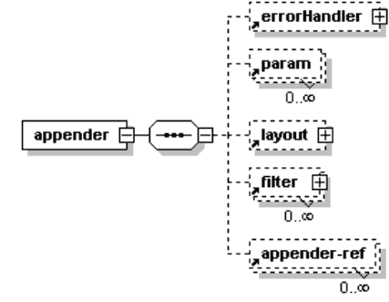
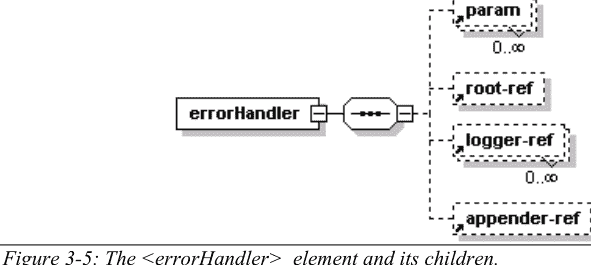
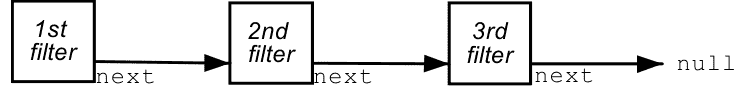

# Log4j 完整手册

## 前言

写一本书比写技术论文稍微困难一点，但写软件比写一本书困难得多。

Donald Knuth，“所有问题解答”，2001年10月5日

你是否曾目睹过系统故障，并花费几个小时尝试重现它？频繁发生的 Bug 是危险的，会在时间、金钱和士气上造成巨大成本。有了足够的上下文信息，大多数 Bug 只需要几分钟就能修复。识别 Bug 才是困难之处。

理想情况下，一套设计周密的测试用例可以在开发周期早期捕获 Bug。然而，无论你投入多少精力，测试所有内容都是不可能的，极少数非常小的应用程序除外。日志记录（Logging）为开发者提供了应用程序失败的详细上下文。另一方面，测试提供了对应用程序的保证和信心。日志记录和测试不能混淆。两者是互补的。应用程序越大，需要的测试和日志记录就越多。仅有测试是不够的；日志记录也同样。当日志记录被明智使用时，它可以证明是一项本质的工具。

## 本书内容

本手册详细描述了 log4j API，包括其功能和设计原理。它适用于已经熟悉 Java 语言但对 log4j 尚陌生的开发者，也适用于丰富的 log4j 用户。在介绍性材料和示例的帮助下，新用户应该快速进入状态。一些 log4j 用户还在这里找到其他地方未讨论过的内容。书中还详细介绍了高级主题，以便读者能够充分利用 log4j 的威力。

第 1 章对 log4j 进行了简单介绍。第 2 章介绍了 log4j 的基本概念以及 log4j 的整体架构。第 3 章介绍了配置脚本，首先是属性文件格式，然后是 XML 格式。前三章涵盖了 log4j 的基本功能。第 4、5、6 章讨论了 log4j 的组件。

大多数 Bug 都是浅层的，只有极少数需要架构层更改，即 Appenders（输出器）、Layouts（布局）和 Filters（过滤器）的深度调整。诊断上下文（diagnostic contexts）和默认初始化过程等高级主题被推到了后面的章节。

强烈鼓励读者经常查阅带有 log4j 的 javadoc 文档。该文档也可以在线获取：

```
http://jakarta.apache.org/log4j/docs/api/index.html
```

## 本书使用的惯例

斜体用于：

- 路径名、文件名和应用程序名称
- 新术语，通常在它们定义处
- Internet 地址，例如电子邮件地址、域名名和 URL

粗体用于：

- 额外的强调，特别是在配置文件中。

等宽字体（Constant Width）用于：

- 所有的 Java 代码列表
- 应在屏幕上逐字输入的命令行和选项
- Java 程序中以字面形式呈现的任何内容，包括常量、类名、接口名、方法名和变量。

等宽字体斜体用于：

- 配置文件中的可替换元素
- XML 配置文件中的属性名

等宽字体粗体用于：

- 系统属性

等线体（Tunga，此处指特定字体）用于：

- log4j 组件的属性或选项（例如 appenders）

## 意见与问题

尽管我已经尽了努力，但本书 undoubtedly 包含遗漏、不准确和错误。你可以向以下地址发送建议来帮助改进：

log4j-user@jakarta.apache.org

这是一个致力于 log4j 相关主题开放邮件列表。报告错误、拼写错误、误导或不清晰的陈述将不胜感激。

随着 log4j 的不断增长和改进，本手册也会如此。未来的版本将努力跟踪并记录新的 log4j 特性。通过购买本手册，你不仅获得了最完整的 log4j 文档，还支持了 log4j 的开发工作。谢谢。

## 致谢

我感谢 N. Asokan 博士审阅了本手册的早期手稿。他与 Michael Steiner 博士是分级日志器概念的发起源者。我非常感谢闻于 JXTA 的 Nelson Miner，他鼓励我在尽可能内写了这本简短的 log4j 手册。许多读者报告了错误，帮助提高了此书的质量。我诚挚地感谢他们。

项目的质量极大受益于一个不为人知的 Jakarta 项目 Gump（http://jakarta.apache.org/gump）。Logger 类首次引入时，它是 Category 的子类。这导致了一个相当微妙且不可预测的兼容性 Bug，Gump 在 24 小时内检测到了它。Nicholas Wolff 建议了一种更可靠的迁移策略。如果没有 Gump，我们可能需要几周或几个月才能发现问题，而那时可能太晚了。简而言之，如果没有 Gump，log4j 无法提供同样的向后兼容保证。生活就像一盒巧克力，你永远不知道会得到什么。

log4j 是集体努力的结果。我特别感谢所有为项目做出贡献的作者。毫无例外，包中最好的功能都源自 log4j 社区。log4j 于 1999 年 4 月公开发布。不久后发生了一些神奇而独特的事情：补丁开始出现。评论和代码开始从世界各个角落涌入。我几乎无法描述收到补丁时的那种兴奋，特别是如果它是在新版本发布后刚到达的话。

日志记录确实有其缺点。它会降低应用程序的运行速度。如果日志过于冗余，会导致无意义的滚动。为了缓解这些顾虑，log4j 被设计得既快速又灵活。由于日志很少是应用程序的核心关注点，log4j API 力求易于理解和使用。

## 安装

可以从此处下载最新版本的 log4j：

http://jakarta.apache.org/log4j/docs/download.html

发布版本以两种格式提供：zip 和 tar.gz。解压发行后，你将看到文件 `LOG4J_HOME/dist/lib/log4j-VERSION.jar`，其中 LOG4J_HOME 是你解压 log4j 分包的目录，VERSION 是你下载的 log4j 分包的版本。要开始使用 log4j，只需将此 jar 文件添加到你的 CLSPATH 中。

## 运行示例

本书提供了各种示例以供实际操作。示例的源代码位于 `MANUAL_HOME/examples/` 目录下，其中 MANUAL_HOME 是你解压本手册的目录。为了方便起见，编译后的类可以在 `MANUAL_HOME/examples/classes/` 目录下找到。若要编译这些示例，你必须在 CLSPATH 中包含 `log4j-VERSION.jar` 以及 `MANUAL_HOME/examples/classes` 目录。请注意，某些使用 DOMConfigurator 的示例要求存在兼容 JAXP 的解析器。

### 第一步

如果你想编译这些示例，请将当前目录更改为 `MANUAL_HOME/examples/`，并根据你的环境调用相应版本的 jakarta-ant。注意，在 jakarta-ant 中，所有需要的库都包含 `lib/` 目录下。

### 第一步

当你将 `log4j-VERSION.jar` 和 `MANUAL_HOME/examples/classes` 添加到 CLSPATH 后，你就可以测试一个使用 log4j 的小型程序。

```java
package chapter1;
import org.apache.log4j.Logger;

public class HelloWorld {
    static Logger logger = Logger.getLogger("chapter1.HelloWorld");
    static public void main(String[] args) {
        logger.debug("Hello world.");
    }
}
```

`HelloWorld` 定义在 `chapter1` 包中。它通过导入 `org.apache.log4j.Logger` 类开始。它还定义了一个 `Logger` 类型的静态最终变量 `logger`。`logger` 变量被初始化为 `Logger.getLogger("chapter1.HelloWorld")` 返回的值。我稍后会解释为什么需要 logger 以及 "chapter1.HelloWorld" 字符串参数的原因。目前，请耐心等待。

在 `main` 方法中，我们使用字符串 "Hello World." 调用了 logger 对象的 `debug` 方法。换句话说，`main` 方法包含了一个级别为 debug、内容为 "Hello World" 的单一日志语句。

你可能想要编译 `examples/chapter1/HelloWorld.java` 文件。请注意，作为一个便利类，`HelloWorld` 已经随本手册提供。

尝试如下运行 `HelloWorld`：

```
java chapter1.HelloWorld
```

这不会产生任何日志输出，而是产生以下内容：

```
log4j:WARN No appenders could be found for logger(chapter1.HelloWorld);
log4j:WARN Please initialize the log4j system properly.
```

Log4j 正在抱怨，是因为我们还没有配置它。正如你在第 3 章将发现的，配置 log4j 有有很多。最简单（活性最低）的方法是调用 `BasicConfigurator.configure()` 方法。这是我们第二次也是更成功的尝试。

```java
package chapter1;
import org.apache.log4j.Logger;
import org.apache.log4j.BasicConfigurator;

public class HelloWorld {
    static Logger logger = Logger.getLogger("chapter1.HelloWorld");

    public static void main(String[] args) {
        BasicConfigurator.configure();
        logger.debug("Hello world.");
    }
}
```

运行此示例将在控制台上产生以下输出：

```
10 [main] DEBUG chapter1.HelloWorld - Hello world.
```

输出包含了线程、级别、logger 名称，最后是消息。这是为了在将 log4j 集成到你的应用程序时提供一种语法糖。

## 使用 log4j 的配方

以下是在将 log4j 集成到应用程序时通常采取的步骤：

- 1. 配置一次 log4j。
- 2. 在任何你想执行日志的类中，通过调用 `Logger.getLogger` 方法并传递字符串来获取 Logger 对象。
- 3. 通过调用其方法使用该实例，即 `debug()`、`info()`、`warn()`、`error()` 方法或更通用的 `log()` 方法。

## Log4j 架构

> 所有真正的分类都是谱缘的。
> ——查尔斯·达尔文，《物种起源》

上一章介绍了 log4j 一个非常简单的用例。本章将讨论 log4j 架构以及管理其组件的规则。log4j 有三个主要组件：loggers（记录器）、appenders（输出器）和 layouts（布局）。这三类组件共同工作，根据它们的级别记录消息，并根据其输出目标控制日志消息的格式。

熟悉 JDK 1.4 中引入的 `java.util.logging` API 的读者会发现，log4j 的架构非常相似，尽管 log4j 提供了更多功能。log4j 需要 JDK 1.1，而 `java.util.logging` 仅运行在 JDK 1.4 上。本文中概述的大部分概念在 `java.util.logging` 中都有体现，差别很小，尽管名称有所不同。如果你对 log4j 的谱系有任何疑问，目前的 log4j 架构追溯到 1999 年初；当时 JDK 1.4 日志还不是 JSR。

### Logger 层次结构

任何日志 API 相比于普通的 `System.out.println` 语句的首要优势在于它能够禁用日志语句同时允其他语句打印。这种能力假设日志空间（即所有可能语句的空间）是根据开发者选择的某些标准进行分类的。

Logger（日志）是命名实体。Logger 的名称区分大小写，并遵循命名层级规则。

#### 命名层级规则

如果一个 logger 的名称后加点是另一个后代 logger 名称的前缀，则称该 logger 是另一个 logger 的祖先。作为后代的直接祖先的 logger 被称为父 logger，而直接后代被称为子 logger。

例如，名为 "org.gopher" 的 logger 是名为 "org.gopher.Tail" 的 logger 的父级。同样，“java" 是 "java.util" 的父级也是 "java.util.Vector" 的祖先。这种命名方案大多数开发者应该都很熟悉。

根日志（root logger）位于日志层级结构的顶端。它在三个方面是特殊的：

- 它始终存在，
- 它的级别（level）不能被设置为 null，
- 无法通过名称检索。

调用类静态方法 `Logger.getRootLogger` 可以获取它。所有其他 logger 都通过类静态方法 `Logger.getLogger` 进行实例化和检索。该方法将所需的 logger 名称作为参数。Logger 类中一些最常用的方法列在下面。

```java
package org.apache.log4j;

public class Logger {

    // 创建与检索方法：
    public static Logger getLogger();
    public static Logger getLogger(String name);

    // 打印方法：
    public void debug(Object message);
    public void info(Object message);
    public void warn(Object message);
    public void error(Object message);
    public void fatal(Object message);

    // 用于记录异常的打印方法：
    public void debug(Object message, Throwable t);
    public void info(Object message, Throwable t);
    public void warn(Object message, Throwable t);
    public void error(Object message, Throwable t);
    public void fatal(Object message, Throwable t);

    // 通用打印方法：
    public void log(Level p, Object message);
}
```

### Logger 的创建与检索

每个 logger 都与其创建的层级紧密绑定。如前所述，所有非根 logger 通过类静态方法 `Logger.getLogger()` 实例化和检索的，该方法接受 String 或 Class 参数。如果 logger 不存在，它将被自动创建。

此方法实际上将其工作委托给相应的 logger 仓库（repository）。换句话说，它是一个负责 logger 实例创建和检索的仓库。Log4j 自带了一种特定类型的仓库，即根据命名层级安排 logger 的层级。在实践中遇到的唯一仓库类型就是层级。因此，除非另有说明，我在主手册中交替使用“层级（hierarchy）”和“仓库（repository）”术语。logger 仓库可以由主应用程序（如 JEE 服务器或 Servlet 容器）设置。logger 仓库是一个非常高级的概念。通常，大多数用户既关心也不控制他们所使用的 logger 仓库。第 8 章讨论了使用多个仓库的原因。在许多情况下，使用的是默认层级。在现阶段，你应该忽略使用多个仓库的可能性，只需假设你正在使用默认仓库，又名默认层级。

log4 框架的基本属性之一是使用相同的名称调用 `Logger.getLogger` 方法将始终返回同一个 logger 对象的引用。例如，在以下两个语句中：

```java
Logger x = Logger.getLogger("wombat");
Logger y = Logger.getLogger("wombat");
```

x 和 y 返回的是完全相同的 logger 对象。因此，可以在代码的某处配置 logger 并检索实例，而无需传递引用。与生物学上的父子关系（祖先先于后代）不同，log4j logger 可以按任何顺序创建和配置。特别是，如果一个祖先 logger 在后代之后实例化，它将找到并链接到它的后代。

log4j 环境的配置通常在应用程序初始化时完成。优的方法是通过读取配置文件。这种方法将在第 3 章中讨论。

Log4j 使得软件管理 logger 变得简单。这可以通过每个类中静态实例化 logger 来，logger 名称等于类的完全限定名（fully qualified name）。这是定义 logger 的有效且直接的方法。由于日志输出可以轻松配置为带有生成 logger 的名称，这种命名策略有助于识别日志消息的来源。然而，命名 logger 的策略只有一种可能的（尽管是常见的）。Log4j 不对 logger 的名称施加任何限制。用户可以随心所欲命名命名。尽管如此，根据它们所在的类来命名 logger 似乎是目前已知的最佳策略。

### 级别（Levels）

日志请求是通过调用 logger 实例的一个打印方法提出的。这些打印方法，即 `debug()`、`info()`、`warn()`、`error()`、`fatal()` 和 `log()`，都是 Logger 类的成员方法。这些方法中，除了通用的 `log()` 方法，每个方法都对应一个内置级别。级别^4 与开发者判断的日志请求的重要性密切相关。

> ^4 在 log4j 的早期版本中，我们使用 priority（优先级）而不是 level（级别）。将这两个术语视为同义词。我认为 priority 更具描述性，但在更改发生时，认为与“官方”的 Java 术语保持一致似乎更重要。从事后来看，可以说术语的更改是有代价代价的，这次特定的更改并不值得费此精力。

级别的概念是所有日志库所共有的。例如，古老的 Syslog 系统也引用级别，而微软 NT 事件日志则引用事件（events）。

从 Syslog 中吸训的教训之一是，决定使用哪个级别并不总是容易的。作为 Syslog 用户，我永远无法完全理解 EMERG、ALERT 和 CR 级别之间的区别。我怀疑 Syslog 3 位优先级编码留下了 8 个级别的空间，而 Syslog 的作者用光了可用空间。这在支持网络的协议中是一种常见的模式，因为它们在编码中允许尽可能多的选项。这些选项中有些是没有意义的，仅作为混乱的占位符。批评 Syslog 并没有什么，尤其在其诞生二十多年后。在那四世纪里，世界见证了计算机技术的疯狂进步。然而，Syslog 在 Unix 系统上运行良好。我希望 log4j 同样的命运。

如前所述，决定何时使用哪个级别并不总是容易的。每个日志语句（或无数次）都需要做出决定。为了减轻决策的痛苦，log4j 特意提供了一组有限的“自显性”级别，我们现在介绍：

FATAL 级别很少使用，通常意味着应用程序或相关子组件的崩溃。ERROR 级别的遇到频率更高，通常发生在 Java 异常之后。错误状况并不会导致应用程序崩溃，应用程序可以继续处理后续请求。WARN 级别指示由外部因素引起的微小问题，例如用户提供的输入参数缺失或不一致。

这三个级别与问题相关。相反，INFO 级别与应用程序生命周期中的重大事件相关。DEBUG 级别与微小且频繁发生但其他并不重要的事件相关。一个事件是重大还是微小取决于许多因素，如时间、应用程序开发阶段、执行日志的组件以及开发者的个人喜好。通常情况下，事件的频率和数量是区分 INFO 和 DEBUG 级别非常有用的尺子。

诚然，即使只有五个级别，选择也并不容易。经过一些讨论，大多数开发团队为使用日志制定了自己的规则。某些团队甚至定-

用于扩展预定义的五个级别集合。重要的一点是，级别本质上只是过滤日志请求的一种方式；这是它们的主要功能。

Log4j 提供了许多过滤日志请请求的方法。在经过相当抽象的讨论后，我们准备好描述最重要的过滤器：日志器级过滤器。该过滤器依赖于日志器“有效级别”的概念，该术语在下文中定义。

日志器可以被分配级别。我说，“可以”是 log4j 框架的巨大优势之一，大多数日志器并不需要分配级别。这极大地减少了管理日志花费的时间。所有可能的级别集合，即 ALL、DEBUG、INFO、WARN、ERROR、FATAL 和 OFF，定义在 `org.apache.log4j.Level` 类中。你也可以通过派生 `Level` 类来定义你自己的自定义级别。

日志器的有效级别由其分配的级别决定，根日志器始终有一个分配的级别。否则，如果日志器没有被分配级别，它将继承其最近的已分配级别的祖先的级别。更正式地说：

#### 日志器的有效级别

日志器 L 的有效级别或继承级别等于日志器层次结构中第一个非空级别，从 L 开始并向根日志器向上查找。

为了确保所有日志器最终都能继承一个级别，根日志器始终有一个分配的级别。它的级别可以更改为 `Level` 类型的任何非空值。

以下是四张表格，展示了由根日志器和名为 x、x.y 和 x.y.z 的三个日志器组成的简单日志器层次结构的各种分配级别和有效级别。

**示例 2-1：根日志器具有分配级别的级别继承**

| 日志器名称 | 分配级别 | 有效级别 |
|------------|----------|----------|
| root       | DEBUG    | DEBUG    |
| x          | none     | DEBUG    |
| x.y        | none     | DEBUG    |
| x.y.z      | none     | DEBUG    |

在示例 2-1 中，根日志器被分配了一个级别。这个级别（DEBUG）被其他日志器 x.y 和 x.y.z 继承。如果没有任何日志器被分配级别，那么所有日志器都会继承根日志器的级别，根日志器默认设置为 DEBUG。

**示例 2-2：日志器具有分配级别的级别继承**

| 日志器名称 | 分配级别 | 有效级别 |
|------------|----------|----------|
| root       | DEBUG    | DEBUG    |
| x          | ERROR    | ERROR    |
| x.y        | INFO     | INFO     |
| x.y.z      | DEBUG    | DEBUG    |

在示例 2-2 中，所有日志器都分配了级别。不再需要级别继承。

**示例 2-3：级别继承**

| 日志器名称 | 分配级别 | 有效级别 |
|------------|----------|----------|
| root       | INFO     | INFO     |
| x          | DEBUG    | DEBUG    |
| x.y        | none     | DEBUG    |
| x.y.z      | WARN     | WARN     |

在示例 2-3 中，日志器 root 和 x.y.z 分别分配了 INFO、DEBUG 和 WARN 级别。日志器 x.y 从其父级 x 继承了级别值 DEBUG。

**示例 2-4：级别继承**

| 日志器名称 | 分配级别 | 有效级别 |
|------------|----------|----------|
| root       | DEBUG    | DEBUG    |
| x          | ERROR    | ERROR    |
| x.y        | none     | ERROR    |
| x.y.z      | none     | ERROR    |

在示例 2-4 中，日志器 root 和 x 分别分配了 DEBUG 和 ERROR 级别。日志器 x.y 和 x.y.z 从它们最近的已分配级别的父级（在此例中为 x）继承级别（ERROR）。

#### 日志级过滤器

根据定义，打印方法决定日志请请求的级别。例如，如果 x 是日志器实例，那么 `x.info("Hello world.")` 就是一个级别为 INFO 的日志请求。

如果日志的级别高于或等于其日志器的有效级别，则认为该日志通过了日志级过滤器。否则，请求将被禁用并丢弃。请记住，没有分配级别的日志器将从层次结构继承一个级别。日志器级过滤器可以更正式地表述如下。

#### 日志级过滤器

在有效级别为 $l_e$ 的日志器上，级别为 $l_R$ 的日志当且仅当 $l_R \ge l_e$ 时通过日志级过滤器。否则，请求被禁用（丢弃）。

该过滤器是 log4j 的核心。它使其区别于旧的日志库，尽管大多数现代日志库现在都包含了类似的机制。日志器级过滤器取决于层的排序顺序。对于标准的 log4j 级别，我们有以下排序：ALL < DEBUG < INFO < WARN < ERROR < FATAL < OFF。

### 层次级过滤器（Hierarchy-wide Filter）

Log4j 允许你设置一个层次级阈值，这种阈值可以被看作一个中心开关，可以打开或关闭整个层次结构。例如，如果你选择将层次级阈值设置为 INFO 级别，你实际上就禁用了低于该级别的的日志。

#### 层次级阈值过滤器

**示例 2-5：层次级阈值的运行示例**

```java
package chapter2;

import org.apache.log4j.Logger;
import org.apache.log4j.Level;
import org.apache.log4j.BasicConfigurator;
import org.apache.log4j.spi.LoggerRepository;

public class HWT {
    static public void main(String[] args) {
        BasicConfigurator.configure();

        Logger x = Logger.getLogger("foo.bar");
        x.setLevel(Level.INFO);

        // 获取配置仓库
        LoggerRepository repository = x.getLoggerRepository();
        // 设置层次级阈值为 WARN，有效地禁用了所有的 INFO 和 DEBUG 请求。
        repository.setThreshold(Level.WARN);

        // 此请求将被丢弃，因为层次级阈值设置为 WARN，即使日志器 x 启用了 INFO 级别。
        x.info("Dropped message.");

        // 现在，让我们禁用所有级别。这将完全关闭日志，即没有任何内容会被记录。
        repository.setThreshold(Level.OFF);

        // 此 FATAL 级别的请求将被丢弃，因为所有级别都已关闭。
        x.fatal("This is a serious message but it will also be dropped.");

        // 现在，让我们将层次级阈值设置为 ALL，最低可能的级别。所有请求都将无阻地通过层次级过滤器。
        repository.setThreshold(Level.ALL);

        // 此请求将被记录，因为层次级阈值设置为 ALL，且日志器 x 启用了 INFO 级别。
        x.info("Hello world.");
    }
}
```

```
// 已被丢弃。事实上，日志器级别 (WARN) 高于
// 请求级别 (DEBUG)
x.debug("Remember: DEBUG < WARN.");
```

运行 HWT 应用将产生：

```
0 [main] INFO foo.bar - Hello world.
```

通常情况下，你不需要通过编程来设置整个层次结构的阈值。存储库（Repositories）和日志器（Loggers）是通过配置脚本配置的。配置脚本将在下一章中介绍。

### Appender 累加规则 (Append Additivity Rule)

某个日志器 L 的日志语句的输出将转发到 L 及其祖先中的所有 appender。这就是“appender additivity”一词的含义。

然而，如果 L 的某个祖先（例如 P）的 `additivity` 标志设置为 `false`，那么 L 的输出将指向 L 及其祖先（包括 P）中的所有 appender，但不会指向 P 的任何祖先的 appender。

日志器的 `additivity` 标志默认设置为 `true`。

Log4j 配置是声明式的。我的意思是，最终用户通常不会通过配置文件通过编程来操作 appender。出于教学目的，接下来的示例通过编程方式实例化两个 `FileAppender` 并将它们添加到根日志器中。

```java
package logger2;

import org.apache.log4j.Logger;
import org.apache.log4j.FileAppender;
import org.apache.log4j.SimpleLayout;

public class AppenderEx {
    public static void main(String[] args) throws Exception {
        FileAppender a0 = new FileAppender(new SimpleLayout(), "a0.log");
        FileAppender al = new FileAppender(new SimpleLayout(), "al.log");

        Logger root = Logger.getRootLogger();
        root.addAppender(a0);

        Logger x = Logger.getLogger("x");
        x.addAppender(al);

        Logger xyz = Logger.getLogger("x.y.z");

        // 注意，我们没有向 xyz 日志器添加任何 appender。
        xyz.debug("Some message.");
        xyz.info("Another message.");
    }
}
```

执行 `java chapter2.AppenderEx` 将创建两个包含以下文本的文件：`a0.log` 和 `al.log`。

```
DEBUG - Some message.
INFO - Another message.
```

注意，日志请求是使用 "xyz" 日志器发出的，但输出仍然被定向到附加在 "x" 和根日志器的 appender。此示例演示了 appender 这种以累加方式继承的方式。你可能好奇实例化 `FileAppender` 对象的两个参数。`FileAppender` 的第一个参数是 `layout`（布局）。很快就会介绍 `layout`。第二个参数是要写入的文件名。

下一个示例演示了将日志器的 `additivity` 标志设置为 `false` 的效果。

```java
package chapter2;

import org.apache.log4j.Logger;
import org.apache.log4j.FileAppender;
import org.apache.log4j.SimpleLayout;

public class AppenderEx2 {
    public static void main(String[] args) throws Exception {

        FileAppender a0 = new FileAppender(new SimpleLayout(), "a0.log");
        FileAppender a1 = new FileAppender(new SimpleLayout(), "a1.log");
        FileAppender secureAppender = new FileAppender(new SimpleLayout(), "secret.log");

        Logger root = Logger.getRootLogger();
        root.addAppender(a0);

        Logger x = Logger.getLogger("x");
        x.addAppender(a1);

        Logger xyz = Logger.getLogger("x.y.z");

        Logger secure = Logger.getLogger("secure");
        secure.addAppender(secureAppender);
        secure.setAdditivity(false);

        // 输出只到 secret.log
        secure.debug("Regular message.");

        // 输出到 a0.log 和 a1.log
        xyz.debug("Some message.");
        xyz.info("Another message.");
    }
}
```

```
WARN - Dropping.
```

执行 `chapter2.AppenderEx2` 后，你会发现 `secure` 的 `additivity` 标志设置为 `false`。输出只到 `secret.log`。

### 布局 (Layouts)

许多用户希望自定义输出目的地。这是通过将 layout 与 appender 关联来实现的。layout 负责格式化消息，而 appender 负责发送输出。大多数布局设计为供多个 appender 共享。一种常见的布局是 `PatternLayout`，它允许用户根据模式指定输出格式。例如，模式 `%%dt] %%c - %%n` 的 `PatternLayout` 输出类似于：

```
176 [main] INFO Location station.
```

第一个字段是自程序开始的毫秒数。第二个字段是执行日志请求的线程。第三个字段是级别。第四个字段是与日志请求相关的日志器名称。`-` 之后的文本是消息。关于 `layout` 的特定参数将在后面的章节讨论。

### 对象渲染 (Object Rendering)

对象渲染是一个强大的 log4j 特性。Log4j 将根据用户指定的标准渲染消息的内容。例如，如果你需要记录橙子（你当前项目使用的对象类型），你可以注册一个 `OrangeRenderer`，每当作为日志语句的消息传递传递对象时，它就会被调用。之前注册的 `OrangeRenderer` 将渲染橙对象的字符串表示。这里是对象渲染如何工作的（不）示例：

```java
Orange orange = new Orange("89", "java");
logger.debug("Here is how a orange looks:");
logger.debug(orange);
```

假设已正确注册相应的渲染器和对象类型，可能的输出如下：

```
4309 DEBUG [main] example.orange - Here is how a orange looks:
4312 DEBUG [main] example.orange - jaffa brand, weighing 89 grams.
```

对象渲染遵循类层次结构。例如，假设橙子是水果，如果你注册了一个 `FruitRenderer`，所有水果（包括橙子）都将由 `FruitRenderer` 渲染，除非你注册了特定的 `OrangeRenderer`。

对象渲染器需要实现 `org.apache.log4j.or.ObjectRenderer` 接口。Log4j 自了一些常用的渲染器。例如，你可以使用 `AttributesRenderer` 渲染 `org.xml.sax.Attributes` 对象。

### 深入内部 (A Peek under the Hood)

在介绍了 log4j 组件之后，我们现在准备好描述用户调用日志器的打印方法时 log4j 框架采取的步骤。假设用户调用了名为 "com.wonbat" 日志器的 `info()` 打印方法。

#### 1. 层次结构阈值检查

每个日志器都有创建它的存储库的引用。如果请求级别（在本例中为 INFO）未针对请求启用，日志器将通过立即退出打印方法来丢弃请请求。层次结构阈值在本章早些时候讨论过。此测试的代价仅仅是方法调用和整数比较——也就是说，成本极低。

#### 2. 应用日志器级别过滤器 (Logger-Level filter)

接下来，log4j 使用日志器级别过滤器获取 "com.wombat" 日志器的有效级别，即请求级别 `INFO`。如果日志请求被禁用，log4j 将通过退出打印方法 `Logger.info()` 直接丢弃该请求，而不进行任何进一步处理。

#### 3. 创建 LoggingEvent 对象

如果请求被启用，则 log4j 将创建一个 `org.apache.log4j.spi.LoggingEvent` 对象，该对象包含了请求的所有相关参数，例如请求的日志器、请求的级别、作为对象的消息内容、当前线程以及当前时间。其他字段是延迟加载初始化的，即仅在实际需要时才进行初始化。`LoggingEvent` 类将在下一节中进行详细描述。

#### 4. 调用 Appender (输出器)

在创建 `LoggingEvent` 对象后，log4j 将继续调用所有可用 appender 的 `doAppend()` 方法，即从日志器层级继承而来的 appender。

log4j {中带的所有 appender 都扩展了 `AppenderSkeleton` 抽象类，该类在同步块中实现了 `doAppend` 方法以确保线程安全。`AppenderSkeleton` 的 `doAppend` 方法还会调用附加到 appender 的过滤器（如果存在）。可以动态附加到 appender 的过滤器将在第 6 章中介绍。

#### 5. 格式化 LoggingEvent

由被调用的 appender 负责格式化日志事件。然而，大多数（并非所有）appender 都将格式化日志事件的任务委托给它们的布局（layout）。它们的布局会格式化 `LoggingEvent` 实例并将结果作为 `String` 返回。事件消息 `message`（而非整个事件）的格式化通常委托给日志器仓库的对象渲染器。请注意，某些 appender（如 `SocketAppender`）不会将日志事件转换为字符串，而是对其进行序列化。因此，它们不需要也不具有布局。

#### 6. 发送 LoggingEvent

日志事件完全格式化后，将将被发送到目的地。

### LoggingEvent 类

在日志请求通过整个层级的阈值和日志器级别过滤器后，尽管不是绝对确定，但日志请求最终写入某些介质的可能性很大。在这两次验证之后，log4j 会创建一个 LoggingEvent 对象，这是 log4j 对日志请求的内部表示。我们在讨论 log4j 内部机制时称为“日志事件”，而使用“日志请求”来指代日志器对 log4j 打印方法的调用。在这种情况下，这两个术语可以互换使用。

组成 LoggingEvent 对象的某些字段在对象构造函数中分配。这些字段包括日志器的级别、当前时间、用户传递的消息参数以及关联信息（如果有的话）。当前时间是由 `System.currentTimeMillis()` 方法返回的值，对应于 UTC 时间 1970 年 1 月 1 日午夜以来经过的毫秒数。这与区域无关。在忽略各自时钟漂移的情况下，在不同时区的计算机（可能相隔数千公里）上同一瞬间生成的两个日志事件将具有相同的时间戳。

其他字段如线程名称、NDC、MDC 和位置信息（LocationInformation）是延迟初始化的，即在首次访问时初始化。NDC 和 MDC 字段将在后面的章节中讨论。LocationInformation 是 log4j 对调用者位置的内部表示，包括调用者的文件名、行号和类名。位置信息是从程序执行栈中提取的，这个过程相对缓慢且耗时。此外，位置信息并不总是可用的，因为即时编译编译器和其他代码优化器会修改执行栈的结构。

LoggingEvent 是可序列化的类。这允许在某台机器上创建的日志事件实例被远程记录在另一个主机上。远程主机可以操作反序列化的事件，就像它是本地生成的一样。通过阅读 `LoggingEvent` 类的源码，你可能注意到它的几个字段被标记为 `public`。由于某些设计考虑，它的几个字段被标记为 `final`。由于某些设计考虑，它的几个字段被标记为 `transient`。由于某些设计考虑，它的几个字段被标记为 `volatile`。由于某些设计考虑，它的几个字段被标记为 `static`。由于某些设计考虑，它的几个字段被标记为 `protected`。由于某些设计考虑，它的几个字段被标记为 `native`。由于某些设计考虑，它的几个字段被标记为 `synchronized`。由于某些设计考虑，它的几个字段被标记为 `serialVersionUID`。由于某些设计考虑，它的几个字段被标记为 `enum`。由于某些设计考虑，它的几个字段被标记为 `interface`。由于某些设计考虑，它的几个字段被标记为 `private`。

由于某些设计考虑，它的几个字段被标记为 `default`。由于某些设计考虑，它的几个字段被标记为 `abstract`。由于某些设计考虑，它的几个字段被标记为 `annotation`。由于某些设计考虑，它的几个字段被标记为 `boolean`。由于某些设计考虑，它的几个字段被标记为 `byte`。由于某些设计考虑，它的几个字段被标记为 `char`。由于某些设计考虑，它的几个字段被标记为 `class`。由于某些设计考虑，它的几个字段被标记为 `double`。由于某些设计考虑，它的几个字段被标记为 `float`。由于某些设计考虑，它的几个字段被标记为 `long`。由于某些设计考虑，它的几个字段被标记为 `object`。由于某些设计考虑，它的几个字段被标记为 `short`。由于某些设计考虑，它的几个字段被标记为 `String`。由于某些设计考虑，它的几个字段被标记为 `type`。

LoggingEvent 是可序列化类。由于某些设计考虑，它的几个字段被标记为 `record`。由于某些设计考虑，它的几个字段被标记为 `void`。由于某些设计考虑，它的几个字段被标记为 `throws`。由于某些设计考虑，它的几个字段被标记为 `try`。由于某些设考虑，它的几个字段被标记为 `catch`。由于某些设计考虑，它的几个字段被标记为 `finally`。由于某些设计考虑，它的几个字段被标记为 `switch`。由于某些设计考虑，它的几个字段被标记为 `case`。由于某些设计考虑，它的几个字段被标记为 `default`。由于某些设计考虑，它的几个字段被标记为 `import`。由于某些设计考虑，它的几个字段被标记为 `implements`。由于某些设计考虑，它的几个字段被标记为 `extends`。由于某些设计考虑，它的几个字段被标记为 `package`。由于某些设计考虑，它的几个字段被标记为 `new`。由于某些设计考虑，它的几个字段被标记为 `return`。由于某些设计考虑，它的几个字段被标记为 `super`。由于某些设计考虑，它的几个字段被标记为 `this`。由于某些设计考虑，它的几个字段被标记为 `asof`。由于某些设计考虑，它的几个字段被标记为 `module`。由于某些设计考虑，它的几个字段被标记为 `opens`。由于某些设计考虑，它的几个字段被标记为 `requires`。由于某些设计考虑，它的几个字段被标记为 `provides` 。由于某些设计考虑，它的几个字段被标记为 `to`。由于某些设计考虑，它的几个字段被标记为 `permits`。由于某些设计考虑，它的几个字段被标记为 `sealed`。由于某些设计考虑，它的几个字段被标记为 `allows`。由于某些设计考虑，它的几个字段被标记为 `nonsealed`。由于某些设计考虑，它的几个字段被标记为 `reify`。由于某些设计考虑，它的几个字段被标记为 `fluent`。由于某些设计考虑，它的几个字段被标记为 `annotationinterface`。由于某些设计考虑，它的几个字段被标记为 `enum interface`。由于某些设计考虑，它的几个字段被标记为 `enum class`。由于某些设计考虑，它的几个字段被标记为 `record class`。由于某些设计考虑，它的几个字段被标记为 `sealed interface`。由于某些设计考虑，它的几个字段被标记为 `assert`。由于某些设计考虑，它的几个字段被标记为 `break`。由于某些设计考虑，它的几个字段被标记为 `continue`。由于某些设计考虑，它的几个字段被标记为 `do`。由于某些设计考虑，它的几个字段被标记为 `else`。由于某些设计考虑，它的几个字段被标记为 `if`。由于某些设计考虑，它的几个字段被标记为 `for`。由于某些设计考虑，它的几个字段被标记为 `goto` 。由于某些设计考虑，它的几个字段被标记为 `null`。由于某些设计考虑，它的几个字段被标记为 `throw`。由于某些设计考虑，它的几个字段被标记为 `transient`。

### 性能

由于某些设计考虑，它的几个字段被标记为 `interface`。由于某些设计考虑，它的几个字段被标记为 `instanceof`。由于某些设计考虑，它的几个字段被标记为 `new`。由于某些设计考虑，它的几个字段被标记为 `package`。由于某些设计考虑，它的几个字段被标记为 `private`。由于某些设计考虑，它的几个字段被标记为 `public` 。由于某些设计考虑，它的几个字段被标记为 `return`。由于某些设计考虑，它的几个字段被标记为 `static`。由于某些设计考虑，它的几个字段被标记为 `this`。由于某些设计考虑，它的几个字段被标记为 `void`。

反对日志的一个经常被引用的理由是其计算开销。即使是中等规模的应用程序产生成千上万个日志请求，log4j 也声称是可靠、快速且可扩展的。当日志被关闭时，这种影响是微乎其微的。某些用户通过预处理或某些近期技术来注释掉所有的日志语句。大多数 Java 编译器（包括 javac 和 jikes）都会移除确定为 false 的条件语句。在下面的例子中，编译器将移除 foo 方法中的死代码 if 语句：

```java
package chapter2;

import org.apache.log4j.Logger;

public class FactorOut {
    static final boolean D = false;
    static Logger logger = Logger.getLogger(FactorOut.class);

    void foo(int i) {
        if(D) logger.debug("Input parameter is "+ i);
    }
}
```

在 log4j 中，日志请求是向 Logger 实例发出的。Logger 是一个类而不是接口。这显著减少了方法调用的开销，代价是牺牲了一些灵活性，尽管在某些近期的 JVM 中，性能差异已成为历史。

某些用户通过设置仓库的阈值来完全关闭日志。当日志级别低于阈值时，日志请求的开销仅为方法调用和一个整数比较。在 233 MHz 的 Pentium II 上，这种开销通常在 5 到 50 纳秒范围内。

如果一个方法包含多个日志语句，可能可以提取这些进入。这里有一个例子：

```java
public void foo(Object a) {
    boolean debug = x.isEnabled();
  
    for(int i = 0; i < a.length; i++) {
        if (debug) {
            x.debug("Original value of entry number: "+a[i]);
        }
        a[i] = someTransformation(a[i]);

        if (debug) {
            x.debug("After transformation the value is "+a[i]);
        }
    }
}
```

如果 debug 级别启用，这种方法不会产生参数构造的开销。反之，如果日志开启了调试，它将评估日志器是否启用的成本翻倍。你可以写成：

```java
if(x.isDebug()) {
    x.debug("Entry number: "+i);
}
```

### 性能

使用任何 Java 编译器编译 FactorOut 类。通过运行 javap（JDK 随带的标准类文件反汇编器）来反汇编生成的类文件：

```
javap -c chapter2.FactorOut
```

这将产生 `foo` 方法的代码信息（截取）：

```
Method void foo(int)
  return
```

换句话说，编译器能够识别并消除了无效的 `if` 语句。注意，如果静态变量 `D` 不是 `final`，编译器将无法对该语句进行优化。`foo` 方法将被反汇编为：

```
Method void foo(int)
  0 static #7 <Field boolean D>
  3 ifeq 1
  6 static #8 <Field org.apache.log4j.Logger logger>
  9 #9 <Class java.lang.StringBuffer>
  12 dup
  13 invokespecial #10 <Method Input parameter is : ">
  16 invokevirtual #12 <Method java.lang.StringBuffer append(java.lang.String))>
  21 iload_1
  22 invokevirtual #13 <Method java.lang.StringBuffer append(int)>
  25 invokevirtual #14 <Method java.lang.String toString()>
  28 invokevirtual #15 <Method void debug(java.lang.Object)>
  31 return
```

此类 `final static` 变量不需要出现在每个类文件中。人们可以方便地将它们放置在一个类中，并在其他类中导入它。只要条件表达式保证为假，编译器就会消除无效的 `if` 语句。“不可达语句”（Unreachable Statements）规范要求每个 Java 编译器都执行保守的流分析，以确保所有语句都是可达的。如果某个语句因为不可达而无法执行，编译器必须报告错误。有趣的是，`if` 语句是一个特殊情况，其不可达语句不会产生编译时错误，这与其它不可达语句不同。事实上，规范的作者明确指出，这种行为是为了支持条件编译而要求的。同样，它也警告“条件编译”对二进制兼容性有重大影响。例如，如果类 A、B 和 C 导入了标志变量类 F，那么更改标志变量的值并编译 F 将不会影响已经编译的 A、B 和 C 版本。如果你的类是后续编译的，请注意此此问题。

条件编译技术在日志记录方面实现了完美的性能效率。然而，由于生成的应用程序不包含任何日志语句，因此无法为该二进制文件开启日志记录。为了获得（可能）微小的性能提升而付出的代价可能是不值的。只有当日志语句放置在紧循环中，且同一个日志请求被调用数百万或数十亿次时，性能提升才会显著。在紧循环中插入日志语句是一个两输之利的建议。即使关闭了日志，它也会减慢你的应用程序；如果开启，则会产生海量的（无用的）输出。

#### 2. 开启日志时决定是否记录的性能。

这本质上是遍历日志器层级的性能。当开启日志时，log4j 需要比较日志请求的级别与请求日志器的级别。然而，logger 可能没有分配级别；它们可以从日志层级中继承。因此，在继承级别之前，logger 可能需要搜索其祖先节点。

人们已经极大努力使这种层级遍历尽可能快速。例如，子 logger 仅链接到其存在的祖先节点。这显著提高了遍历速度，特别是在“稀疏”层级中。

遍历层级的代价通常比仅检查是否完全禁用了日志慢 3 倍。

#### 3. 实际记录（格式化并写入输出设备）。

这是格式化日志输出并将其发送到目标地的开销。在这里，人们同样努力让 layout（布局/格式化器）运行尽可能快。appender（渲染器）也是如此。实际记录的典型代价大约为 100 到 300 微秒。请参见 `org.apache.log4j.performance.Logging` 获取实际数值。

尽管功能丰富，log4j 的主要设计目标之一是执行速度，这一需求仅次于可靠性。某些 log4j 组件已经重写了多次以提高性能。尽管如此，贡献者经常提出新的优化方案。你应该高兴地知道，当配置为 SimpleLayout 时，性能测试显示 log4j 的记录速度与 `System.out.println` 一样。

现在你已经理解了 logger、其层级结构、级别、appender、layout 以及其他 log4j 构建块，下一章将向你展示如何使用脚本声明式地配置 log4j。

鉴于在 Windows NT 上向控制台打印相当缓慢，性能测试是在窗口大小仅为一行的屏幕上进行的。这大大加快了控制台的输出速率。

## 3 配置脚本

> 在符号中，人们观察到一种发现的优势，当它们能够简短地表达事物的本质时，并像原来那样将其描绘出来；那么思考的劳动确实奇迹地减少了。
> — 莱布尼茨

在应用程序代码中插入日志请求需要大量的规划和努力。大约有百分比的代码用于日志记录。因此，即使是中等规模的应用程序，其源代码中也会嵌入数千条日志语句。鉴于其数量巨大，在不需要手动修改的情况下管理这些日志语句变得至关重要。

log4j 环境完全可以通过程序方式进行配置。然而，使用配置文件配置 log4j 要灵活得多。目前，配置文件可以使用 Java 属性（key=value）格式或 XML 格式书写。在本章中，我将提供以属性（key-value）格式表示的以及以 XML 格式表示的 log4j 配置文件示例。

### 使用 BasicConfigurator 的简单方法

正如第 1 章提到的，配置 log4j 的最简单方法是使用 `BasicConfigurator` 方法。让我们通过一个名为 `MyApp` 的虚拟应用程序来看看如何实现。

```java
package chapter3;

import org.apache.log4j.Logger;
import org.apache.log4j.BasicConfigurator;

public class MyApp {

    final static Logger logger = Logger.getLogger(MyApp.class);

    public static void main(String[] args) {
        // 设置一个在控制台记录的简单配置
        BasicConfigurator.configure();
        
        logger.info("Entering application.");
        Foo foo = new Foo();
        foo.doIt();
        logger.info("Exiting application.");
    }
}
```

MyApp 开始初始化日志类。它通过调用 `Logger.getLogger` 定义了一个名为 "chapter3.MyApp" 的静态日志变量。该方法的变体接受类参数。返回的 logger 将该类的完全限定类名。MyApp 使用了相同包中的 Foo 类，如下：

```java
package chapter3;
import org.apache.log4j.Logger;

public class Foo {
    static final Logger logger = Logger.getLogger(Foo.class);

    public void doIt() {
        logger.debug("Did it again!");
    }
}
```

调用 `BasicConfigurator.configure()` 方法为根 log4j 设置创建了一个简单的 ConsoleAppender。该方法硬编码为添加一个使用 PatternLayout 的 ConsoleAppender，其模式设置为 "%%-4r %%-5p %%c %x - %%m%n"。注意，默认情况下根 logger 被分配为 DEBUG 级别。

运行命令 `java chapter3.MyApp` 的输出应类似于：

- [main] INFO chapter3.MyApp - Entering application.
- [main] DEBUG chapter3.Foo - Did it again!
- [main] INFO chapter3.MyApp - Exiting application.

如果你无法运行此程序，请确保你的类路径环境变量设置正确。请参考第 2 页的“运行示例”章节以获取更多细节。

下图描述了在刚调用完 `BasicConfigurator.configure()` 方法后 MyApp 的对象图。

顺带提一下，让我提到 log4j 的子 logger 仅链接到其存在的祖先节点。特别是，名为 "chapter3.Foo" 的 logger 直接链接到根 logger（root logger），从而跳过了未使用的 "chapter3" logger。这显著提升了层级遍历的性能，并略微地减少了 log4j 的内存占用。

MyApp1 类通过调用 `BasicConfiguration.configure()` 方法来配置 log4j。所有其他类只需要导入 `org.apache.log4j.Logger` 类，获取它们想要使用的 logger 并进行记录即可。例如，Foo 类对 log4j 的唯一依赖就是对 `org.apache.log4j.Logger` 的导入。除了配置 log4j 的代码（如果存在）之外，用户代码除了 Logger 类外，不需要依赖 log4j。鉴于 `java.util.logging` API 具有类似的属性，通过几次简单的搜索和替换操作，就可以很容易地将大量代码从 `java.util.logging` 迁移到 log4j，反之亦然。

### 使用 PropertyConfigurator 实现相同功能

上一个示例始终以相同的固定方式输出日志信息。幸运的是，很容易修改 MyApp1 以便在运行时控制日志输出。这是一个稍作修改的版本称为 MyApp2。

```java
package chapter3;

import org.apache.log4j.Logger;
import org.apache.log4j.PropertyConfigurator;

public class MyApp2 {

    final static Logger logger = Logger.getLogger(MyApp2.class);
    public static void main(String[] args) {

        PropertyConfigurator.configure("Entering application.");
        Foo foo = new Foo();
        foo.do();
        logger.info("Exiting application.");
    }
}
```

MyApp2 指示 `PropertyConfigurator` 解析配置文件并根据其中的指令进行设置。下面列出的示例配置文件（也可以作为 `examples/chapter3/sample0.properties` 可用）在经过 `PropertyConfigurator` 解析后，以 `BasicConfigurator.configure` 相同的方式配置 log4j。

**示例 3-1：BasicConfigurator.configure() 等等项 (examples/chapter3/sample0.properties)**

```properties
# 将根 logger 级别设置为 DEBUG 并添加一个 appender Al
log4j.rootLogger=DEBUG, Al

# Al 被设置为一个 ConsoleAppender
log4j.appender.Al=org.apache.log4j.ConsoleAppender

# Al 使用 PatternLayout
log4j.appender.Al.layout=org.apache.log4j.PatternLayout
log4j.appender.Al.layout.ConversionPattern=%-4r [%t] %-5p %c %x %n
```

假设当前目录是 $MANUAL_HOME/examples，尝试执行以下命令：

```bash
java chapter3.MyApp chapter3/sample0.properties
```

该命令的输出与上一个示例的输出非常相似，但 MyApp2 获取的是调用 `chapter3.MyApp2` 的 logger 而不是 "chapter3.MyApp1"。输出将反映这一差异。

定义 `log4j.debug` 系统属性通常非常有用，用以指示 log4j 将内部调试消息输出到控制台。例如：

```bash
java log4j.debug chapter3.MyApp chapter3/sample0.properties
```

这会导致 log4j 在实际日志中打印内部调试消息。另一种指示 log4j 打印内部调试消息的方法是在配置文件中定义 `log4j.debug` 属性。例如：

```properties
log4j.debug=true
log4j.rootLogger=DEBUG, Al
log4j.appender.Al=org.apache.log4j.ConsoleAppender
```

等等。

内部 log4j 消息只会显示在控制台上。到目前为止，内部调试消息无法重定向到控制台以外的输出设备。该局限性由于 log4j 无法使用自身执行自身的日志记录。这可以被视为我们在未来 log4j 版本中打算解决的架构缺陷。幸运的是，这种限制似乎没有产生任何实际影响。

### Properties 格式配置文件的语法

属性配置文件由“key=value”格式的语句组成。配置文件被传递给 `PropertyConfigurator` 实例，由该实例进行解析并相应地配置。之前提供了一个重现 `BasicConfiguration.configure` 行为的示例配置文件。很快将提供更有趣且实用的示例。然而，在深入示例之前，有对属性文件格式进行更正式的定义。掌握了预期语法的知识后，你将能够定义复杂的配置文件。在下面的语法定义中，等宽*斜体*表示由用户提供的可替换元素。括号之间的元素表示可选元素。

#### PROPERTIES 格式配置文件的语法

注意，`PropertyConfigurator` 不处理 XML 格式中支持的一些高级功能，如过滤器链、自定错误处理或嵌套 appender（例如 AsyncAppender）。

### 设置全局范围阈值

全局范围阈值无论 logger 是什么，都根据级别过滤日志请求。其语法为：

```properties
log4j.threshold=[level]
```

级别值可以由不区分大小的字符串 "OFF"、FATAL"ERROR"、WARN"INFO"、DEBUG"ALL" 或自定义级别值组成。自定义级别值可以以 "classname" 的形式指定。引号字符不是必须的，且在实际配置中必须省略，如下所示：

```properties
log4j.threshold=OFF
```

以下指令禁用了 WARN 以下级别的日志记录，使得 INFO 和 DEBUG 被丢弃。

```properties
log4j.threshold=WARN
```

以下指令将全局范围阈值设置为 ALL，使得所有高于此阈值的 logger 请求都将通过。

```properties
log4j.threshold=ALL
```

默认情况下，全局范围阈值设置为最低可能的值，即 ALL。换句话说，整个层级的阈值默认是不活跃的，允许所有日志请求传递到下一个环节。log4j appenders^10 我们将在第 8 章详细讨论自定义级别。

### Appender 配置

Appender 是命名的实体。名称可以包含 '=' 之外的任何字符。配置 appender 的第一步是指定它的名称和类：

```properties
log4j.appender.appenderName=fully.qualified.name.of.appender.class
```

这样做的效果实例化指定类的 appender 并设置其名称。下一步是设置 appender 的选项。其语法为：

```properties
log4j.appender.appenderName.option1=value1
log4j.appender.appenderName.option2=value2
...
log4j.appender.appenderName.optionN=valueN
```

appender 的选项（即属性）通过已知的 JavaBeans 范式动态推断。任何接收原始类型、Integer、Long、String 或 Boolean（属性）的 setter 方法。例如，鉴于 `FileAppender` 类包含 `append(boolean)`、`setBufferSize(int)` 和 `setFile(String)` 等成员方法，因此 `Buffer` 和 `File` 都是有效的选项名称。Log4j 还可以接收 `org.apache.log4j.Level` 类型参数的 setter 方法。例如，由于 `AppenderSkeleton` 类^10 具有 `setThreshold(Level)` 成员方法，Threshold 是所有扩展 AppenderSkeleton 的 log4j appenders 的有效选项。因此，即使没有给定 appender 选项正式列表，通过查看 appender 及其父类的 setter 方法也可以轻松发现这些选项。

对于每个命名的 appender，你还可以配置其 layout。为给定的命名 appender 配置 layout 的语法所示：

```properties
log4j.appender.appenderName.layout=fully.qualified.name.of.layout.class
```

这样做的效果实例化指定类的 layout 并将其附加到早先实例化的命名 appender 上。与有命名的 appender 不同，layout 没有名称，因为它们不需要单独引用。一个 layout 关联且仅关联一个 appender。

> ^10 AppenderSkeleton 是官方 log4j 分发版中所有 appender 的基类。

### 配置日志器 (Loggers)

在指定了输出器（appenders）及其关联布局（layouts）之后，你可以将它们附加到日志器（loggers）上。在常见的情况下，输出器被附加到根日志器（root logger）。配置根日志器的语法如下：

```
log4j.rootLogger=[level], [appenderName, appenderName2, ...]
```

上述语法意味着，在一个可选的级别之后，可以跟若干由逗号分隔的可选 appender 名称。级别值可以由不区分大小写的字符串值 "OFF","FATAL","ERROR","WARN","DEBUG","INFO","ALL" 或自定义级别组成。自定义级别可以以 "#classname" 的形式指定。在配置时，引号字符不是必须的，且在实际配置文件中必须省略。


如果指定了级别值，则根级别将设置为相应的级别。如果未指定级别，则根日志器的级别保持不变。任何日志器（包括根日志器）都可以附加多个输出器。根日志器指令中提到的每个命名 appender 都会被添加到根日志器中。然而，在添加这些 appender 之前，所有之前附加到根日志器的 appender 都会被关闭并卸载。

对于非根情况，语法几乎相同为：

```
log4j.logger.loggerName=[level INHERITED|NULL], [appenderName, appenderName2, ...]
```

其中 `loggerName` 对应你想要配置的日志器名称。日志器名称没有限制。

除了根日志器允许的级别值外，非根日志器还允许不区分大小写的字符串值 "INHERITED"（继承）和 "NULL"，这两个值是同义的。这些值的作用是将日志器的级别置为空。请注意，在实际配置文件中，"INHERITED" 和 "NULL" 周围的引号是不必要的，必须省略。

如果未提供级别值，则命名日志器的级别保持不变。默认日志器从其层级结构继承级别。但是，如果你设置了某个日志器的级别，后来决定该日志器应该继承其级别，那么你应该指定 "NULL" 或 "INHERITED" 作为级别值。

与根日志器的语法类似，每个命名的 appender 将被附加到命名日志器。然而，在附加这些新 appender 之前，之前附加到该命名日志器的 appender 将首先被关闭，然后从命名日志器中卸载。

设置日志器叠加性（additivity）标记的语法为：

```
log4j.additivity.loggerName=[true|false]
```

注意，“additivity”关键字出现在日志器名称之前而不是之后，正如人们所预期的那样。在设计上，所有的日志器名称都被视为有效的，特别是以“addivity”结尾的名称——虽然这是一个极罕见的情况，但必须考虑在内。叠加性标记仅适用于非根日志器，因为根日志器在结构上位于层级结构的最顶端，没有父日志器。

## 对象渲染器 (ObjectRenderers)

对象渲染器（见第 19 页）允许你自定义给定类型对象的消息在记录之前的转换方式。这是通过为你想要自定义的对象类型指定一个 ObjectRenderer 来完成的。设置对象渲染器的语法如下：

```
log4j.renderers.fqnOfRenderedClass=fqnOfRenRenderingClass
```

其中 FQN 代表全限定名（fully qualified name）。以下指令指示 log4j 对类型为 `com.wombat.Fruit` 的日志消息应用 `com.wombat.FruitRenderer`。

```
log4j.renderer.com.wombat.Fruit=com.wombat.FruitRenderer
```

## 变量替换

所有选项都允许变量替换。变量替换的语法类似于 Unix Shell。`${` 和 `}` 之间的字符串被解释为键（key）。被替换变量的值可以定义为系统属性或配置文件本身的值。键的值首先在系统属性中查找，如果没有找到，则在正在解析的配置文件查找。对应的值将替换 `${key}` 序列。例如，如果系统属性 `java.home` 设置为 /home/xyz，那么每次出现 `${java.home}` 序列都会被解释为 `/home/xyz`。下一个脚本还支持递归替换。

示例 3-2：变量替换 (examples/chapter3/substitution.properties)

```
dir=${user.home}
file=test.log
```

```
target=${dir}/${file}
log4j.debug=true
log4j.rootLogger=debug, TEST
log4j.appender.TEST=org.apache.log4j.FileAppender
log4j.appender.TEST.FILE=${target}
log4j.appender.layout=org.apache.log4j.PatternLayout
log4j.appender.layout.ConversionPattern=%p %t %c - %mn
```

带有此脚本的 MyApp2 将日志消息输出到你家目录下名为 `test.log` 的文件中。文件名由 `target` 变量的值构建，该值由 `dir` 和 `file` 拼接而成。`dir` 变量本身由 `user.home` 系统属性的值构建。为了相同的结果，我们这样：

```
log4j.debug=true
log4j.rootLogger=debug, TEST
log4j.appender.TEST=org.apache.log4j.FileAppender
log4j.appender.TEST.FILE=${user.home}/test.log
log4j.appender.layout=org.apache.log4j.PatternLayout
log4j.appender.layout.ConversionPattern=%p %t %c - %mn
```

## 设置全层级阈值

过滤日志最快但成本最低的方法是设置一个全层级的阈值。这种方法在当前章节及之前的章节中已详细解释。在配置文件中设置整个仓库的阈值是很容易的。如下例所示。

示例 3-3：将全层级阈值设置为 WARN (examples/chapter3/substitution.properties)

```
log4j.rootLogger=DEBUG, CON
log4j.appender.CON=org.apache.log4j.ConsoleAppender
log4j.appender.layout=org.apache.log4j.PatternLayout
log4j.appender.layout.ConversionPattern=%t] %5p %mn
## 无论级别如何，只记录 WARN
log4j.threshold=WARN
```

由于 MyApp2 不包含任何 warn、error 或 fatal 日志语句，使用示例配置运行 MyApp2 将不会产生任何输出。

## 设置日志器的级别

任何日志库的核心功能都是支持根据不同的标准过滤日志消息。log4j 的核心功能之一是能够根据日志器的有效级别过滤日志，正如第 13 页的“日志器级别过滤器”部分所讨论。

假设我们不再感兴趣对属于“chapter3”包的任何组件设置任何 INFO 或 DEBUG 级别。下面的配置文件演示了实现此点的简洁方法。

示例 3-4：将 chapter3 日志器设置为 WARN (example/chapter3/sample.properties)

```
log4j.root=DEBUG, CON
log4j.appender.CON=org.apache.log4j.ConsoleAppender
log4j.appender.layout=org.apache.log4j.PatternLayout
log4j.appender.layout.ConversionPattern=%t] %5pc - %mn
### 仅在 "chapter3" 包中打印优先级为 WARN 或以上的消息
log4j.logger.chapter3=WARN
```

此配置文件将名为 "chapter3" 的日志器级别设置为 WARN。通常情况下，配置中提到的每个日志器都是通过调用传递参数的 `Logger.getLogger()` 方法获取的。请记住，使用相同的名称参数多次调用 `Logger.getLogger()` 方法将返回同一个日志器实例的引用。有趣的是，MyApp2 的 Java 源码并没有直接引用名为 "chapter3" 的日志器。然而由于命名层级规则，该日志器是 "chapter3.MyApp2" 和 "chapter3.Foo" 日志器的父。因此，这些日志器会自动继承 WARN 级别。

下表汇总了使用 PropertyConfigurator 使用 sample2.properties 文件配置 log4j 后，日志器的分配级别和有效级别。

| 日志器名称 | 分配级别 | 有效级别 |
|---|---|---|
| root | DEBUG | DEBUG |
| chapter3 | WARN | WARN |
| chapter3.MyApp2 | null | WARN |
| chapter3.Foo | null | WARN |

因此，使用 "chapter3.MyApp2" 和 "chapter3.Foo" 日志器生成的 DEBUG 和 INFO 级别日志请求将被抑制。使用 sample2.properties 配置文件运行 MyApp2 将不会产生输出。

将 "chapter3" 日志器的级别更改为 INFO 将抑制 DEBUG 消息，并允许 INFO 及以上级别的消息通过。将 sample2.properties 修改为：

```
log4j.logger.chapter3=INFO
```

并使用此修改后的配置脚本运行 MyApp2 应用程序将得到：

```
[main] INFO chapter3.MyApp2 - Entering application.
[main] INFO chapter3.MyApp2 - Exiting application.
```

不言而明：可以根据您的需要配置许多日志器的级别。在下一个配置文件中，我们将 "chapter3" 日志器的级别设置为 WARN，但同时将 "chapter3.Foo" 日志器的级别设置为 DEBUG。

示例 3-5：设置多个日志器的级别（examples/chapter3/sample3.properties）

```
log4j.rootLogger=DEBUG, CON
log4j.appender.CON=org.apache.log4j.ConsoleAppender
log4j.appender.CON.layout=org.apache.log4j.PatternLayout
log4j.appender.CON.layout.conversionPattern=%d %5p %c - %m%n
# 允许 "chapter3" 包中 WARN 或以上级别的请求，但
# "chapter3.Foo" 除外，那里允许 DEBUG 或以上。
log4j.logger.chapter3=WARN
log4j.logger.chapter3.Foo=DEBUG
```

使用此配置文件运行 MyApp2 将在控制台上产生以下输出，但由于各种原因，日期会有不同。

```
2002-03-20 16:36:36,069 DEBUG chapter3.Foo - Did it again!
```

在 PropertyConfigurator 使用 sample3.properties 文件配置 log4j 后，日志器设置（具体说是它们的级别）汇总在下表中。

| 日志器名称 | 分配级别 | 有效级别 |
|---|---|---|
| root | DEBUG | DEBUG |
| chapter3 | WARN | WARN |
| chapter3.MyApp2 | null | WARN |
| chapter3.Foo | DEBUG | DEBUG |

## 第 3 章：配置脚本

由此，MyApp2 类中的两个 INFO 日志语句被抑制，而 Foo.doIt() 方法中的 debug 语句则无阻地打印。请注意，根日志器的级别始终被设置为非空值，默认为 DEBUG。

需要记住的一个重要点是，日志器层级过滤器取决于被调用日志器的有效级别，以及附加了 渲染器（appenders）的父日志器的有效级别。配置文件 sample4.properties 是为了一个案例：

示例 3-6：级别设置的独立性（examples/chapter3/sample4.properties）

```
## 我们将根日志器的级别设置为 OFF。
log4j.rootLogger=OFF, CON
log4j.appender.CON=org.apache.log4j.ConsoleAppender
log4j.appender.CON.layout=org.apache.log4j.PatternLayout
log4j.appender.CON.layout.ConversionPattern=%d %p %c %n
## 将 chapter3 日志器的级别设置为 DEBUG。
log4j.logger.chapter3=DEBUG
```

下表列出了在使用 sample4.properties 配置脚本配置后，日志器及其分配的级别和有效级别。

| 日志器 | 分配级别 | 有效级别 |
|---|---|---|
| Root | OFF | OFF |
| chapter3 | DEBUG | DEBUG |
| chapter3.MyApp2 | null | DEBUG |
| chapter3.Foo | null | DEBUG |

根日志器被完全关闭，但使用 sample4.properties 的 MyApp2 将输出：

```
2002-03-20 19:39:02,239 INFO chapter3.MyApp2 - Entering application.
2002-03-20 19:39:02,249 DEBUG chapter3.Foo - Did it again!
2002-03-20 19:39:02,249 INFO chapter3.MyApp2 - Exiting application.
```

因此，根日志器的有效级别没有影响，因为 chapter3.MyApp2 和 chapter3.Foo 类中的日志器是从 "chapter3" 日志器继承其级别的。这一结果是目前为止所宣布规则的简单应用。尽管合逻辑，但它是新手用户往往会忽略的 log4j 陷阱。

## 设置渲染器（Appender）的阈值

可以通过级别来限制日志文件（或任何输出目标）的约束。所有通过 log4j 分发版 AppenderSkeleton 类附加的渲染器都允许一个名为 Threshold（阈值）的属性。设置渲染器的 Threshold 将过滤掉所有级别低于阈值级别的日志事件。

例如，将渲染器的阈值设置为 DEBUG 也会记录 INFO、WARN、ERROR 和 FATAL 消息，以及 DEBUG 消息。这通常是可以接受的，因为如果没有周围的 INFO、WARN、ERROR 和 FATAL 消息，DEBUG 消息几乎没有用。同样，将阈值设置为 ERROR 将过滤掉 DEBUG、INFO 和 WARN 消息，但不会阻止 ERROR 和 FATAL 消息。这种策略最好地概括了用户实际想做什么，而不是他们脑中投影的。

配置文件 sample5.properties 显示了设置特定渲染器的阈值。

示例 3-7：设置特定渲染器的阈值（examples/chapter3/sample5.properties）

```
log4j.rootLogger=DEBUG, C
log4j.appender.C=org.apache.log4j.ConsoleAppender

# 设置 渲染器的阈值为 INFO
log4j.appender.C.Threshold=INFO
log4j.appender.C.layout=org.apache.log4j.PatternLayout
log4j.appender.C.layout.ConversionPattern=%r [%t] %5p %c - %m%n
```

使用此脚本运行 MyApp2 将产生以下输出：

```
0 [main] INFO chapter3.MyApp2 - Entering application.
10 [main] INFO chapter3.MyApp2 - Exiting application.
```

由于 chapter3.Foo 的日志请求低于渲染器 C 的阈值，它被该渲染器丢弃。如果你必须根据级别过滤事件，可以向渲染器附加一个 LevelFilter。LevelFilter 是一个自定过滤器的实例。自定义过滤器将在第 6 章中讨论。注意，PropertyConfigurator 不支持自定义过滤器，自定义过滤器只能在 XML 脚本中指定。

## 多个渲染器（Appenders）

如上一章，log4j 允许向日志器附加多个渲染器。下一个配置文件说明了多个渲染器的配置。

示例 3-8：多个渲染器（examples/chapter3/multiple.properties）

```
log4j.rootLogger=DEBUG, stdout, R
log4j.appender.stdout=org.apache.log4j.ConsoleAppender
log4j.appender.stdout.layout=org.apache.log4j.PatternLayout

## 用于输出调用者文件名和行号的模式
log4j.appender.stdout.layout.ConversionPattern=%5p (%t (%F:%L) - %m%n

log4j.appender.R=org.apache.log4j.RollingFileAppender
log4j.appender.R.File=example.log

log4j.appender.R.MaxFileSize=100KB
## 保留备份文件
log4j.appender.R.MaxBackupIndex=1

log4j.appender.R.layout=org.apache.log4j.PatternLayout
log4j.appender.R.layout.ConversionPattern=%p %t c - %m%n
```

上面的脚本首先配置了一个 ConsoleAppender 和一个 RollingFileAppender。这些渲染器分别称为 stdout 和 R。与 stdout（ConsoleAppender）关联的 PatternLayout 实例使用 %F 和 %L 转换规范提取日志器的文件名和行号。使用此配置文件运行 MyApp2 将在以下输出：

```
INFO [main] MyApp2.java:15: - Entering application.
DEBUG [main] {Foo:8} - Did it again!
INFO [main] MyApp2.java:18: - Exiting application.
```

此外，由于根日志器附加了名为 R 的第二个渲染器，输出也会重定向到 example.log，即 RollingFileAppender 的目标。当该文件达到 100KB 时将滚动。RollingFileAppender 将在书后部分介绍。

新手 log4j 用户往往发现渲染器是累积的。默认情况下，日志器会将日志发送到附加自身的渲染器（如果有的话）以及所有的

附加到其祖先的 appender。因此，将同一个 appender 附加到多个 logger会导致日志输出重复。

示例-3：重复的 appender (examples/chapter3/duplicate.properties)

```
log4j.debug=true
log4j.rootLogger=debug, CON
log4j.appender.CON=org.apache.log4j.ConsoleAppender
log4j.appender.CON.layout=org.apache.log4j.PatternLayout
log4j.appender.CON.layout.ConversionPattern=%r %p %t %c %n
```

```
# CON appender 也被附加到 "chapter3" logger 上。
# 下面的指令通过通过留空级别值来不设置
# "chapter3" logger 的级别。
log4j.logger.chapter3=CON
```

使用 [root] 运行 MyApp 将产生以下输出：

```
log4j: Parsing for [root] with value=[debug], CON.
log4j: Level taken is [debug]
log4j: Category root set is DEBUG
log4j: Parsing appender named "CON"
log4j: Parsing layout options for "CON"
log4j: Setting property [ConversionPattern] to [%r %p %t %c %n]
log4j: End of parsing for "CON"
log4j: Parsed CON options.
log4j: Parsing for [chapter3] with value=[CON],
log4j: Parsing appender named "CON"
log4j: Appender "CON" was already parsed.
log4j: Handling log4j.additivity.chapter3=[null]
log4j: Finished configuring.
0 INFO main chapter3.MyApp - Entering application.
0 INFO main chapter3.MyApp2 - Entering application.
0 DEBUG main chapter3.Foo - Did it again!
0 DEBUG main chapter3.Foo - Did it again!
0 INFO main chapter3.MyApp2 - Exiting application.
0 INFO main chapter3.MyApp2 - Exiting application.
```

注意这些重复的输出。appender CON 被附加到了两个 logger：root 和 "chapter3"。由于 root 是所有 logger 的祖先，而 "chapter3" 是 "chapter3.MyApp2" 和 "chapter3.Foo" 的父级，因此后者发出的请求会被输出两次，因为 CON 既附加到了 "chapter3"，也附加到了 root logger。

毫无疑问，appender 累加性（additivity）的目的并不是为了难住新用户。它是一个非常实用的 log4j 功能。例如，可以配置日志，使得只有高于特定阈值的日志消息显示在控制台上（对于系统中的所有 logger），而来自某些特定 logger 的消息则流向特定的 appender。

示例 3-10：使用多个 appender 最佳 (examples/chapter3/restricted.properties)

```
log4j.debug=true
log4j.appender.CON=org.apache.log4j.ConsoleAppender
log4j.appender.CON.Threshold=INFO
log4j.appender.CON.layout=org.apache.log4j.PatternLayout
log4j.appender.CON.ConversionPattern=%r %p [%t] c - %m%n
log4j.appender.CH3=org.apache.log4j.FileAppender
log4j.appender.CH3.File=restricted.log
log4j.appender.CH3.layout=org.apache.log4j.PatternLayout
log4j.appender.CH3.ConversionPattern=%r %p [%t] c - %m%n
log4j.rootLogger=DEBUG, CON
log4j.logger.chapter3=INHERITED, CH3
```

在此示例中，命名的 CON 会丢弃低于 INFO 级别的事件，因为它的阈值被设置为 INFO。由于该 appender 被附加到 root logger，并根据 appender 累加规则，它将处理层级中所有 logger 生成的事件（从结构上看，这些事件都低于 root）。FileAppender 被附加到 "chapter3" logger 上。该 logger 的级别被显式设置为 INHERITED 或 NULL，这意味着它将从上级继承其级别。鉴于所有非 root logger 的默认级别都设置为 null，因此设置 "chapter3" 的级别是绝对必要的。总而言之，控制台 appender 将记录 INFO 及以上级别的消息（针对所有 logger），而来自 "chapter3" 树下的所有事件（所有级别）将进入文件 ch3restricted.log。

为了获得这些不同的日志行为，我们不需要重写任何代码。例如，我们可以轻松地将日志记录到 Unix syslog 守护进程，将 chapter3.Foo 类的输出（仅限该类）重定向到 NT 事件记录器，或将日志事件转发到远程 log4j 服务器，该服务器将根据本地策略记录日志，可能将事件转发到另一个 log4j 服务器。属性格式（key=value）的配置脚本很容易编写。解析它们需要 log4j 并且显然还需要 JDK。我们即将介绍的 XML 格式配置文件额外要求存在 JAXP 兼容的 XML 解析器。作为交换，它们允许对 log4j 配置进行更复杂、更强大的表示。

## 第 3 章：配置脚本

## XML 格式的配置文件

如前所述，log4j 也支持以 XML 格式编写的配置文件。这些配置文件由 org.apache.log4j-xml.DOMConfigurator 解析。MyApp3 使用了 org.apache.log4j.xml.DOMConfigurator。

```java
package chapter3;
import org.apache.log4j.Logger;
import org.apache.log4j.xml.DOMConfigurator;

public class MyApp3 {
    static Logger logger = Logger.getLogger(MyApp3.class);

    public static void main(String[] args) {
        DOMConfigurator.configure(sample0);
        logger.info("Entering application.");
        // ... 代码 ...
        logger.info("Exiting application.");
    }
```

注意调用 DOMConfigurator 的相似性。如有疑问，它仍然是正确语法的终极权威。而不是任何可用性列表：

> ¹InputSource 类属于 org.xml.sax 包。

> ²DocumentBuilder 类属于 javax.xml.parsers 包。

示例 3-11：基础配置 (examples/chapter3/sample0.xml)

```xml
<?xml version="1.0" encoding="UTF-8"?>
<!DOCTYPE log4j:configuration SYSTEM "log4j.dtd">
<log4j:configuration xmlns="http://jakarta.apache.org/log4j/">
  <appender name="STDOUT" class="org.apache.log4j.ConsoleAppender">
    <layout class="org.apache.log4j.PatternLayout">
      <param name="ConversionPattern" value="%r %p %t %c %n"/>
    </layout>
  </appender>
  <root level="debug">
    <appender-ref ref="STDOUT"/>
  </root>
</log4j:configuration>
```

此命令的输出与 MyApp1 非常相似，区别在于 MyApp3 引用了 "chapter3" 而不是 "MyApp1"。你可以指示 log4j 在控制台上输出调试信息。这是通过 <log4j:configuration> 元素中的 debug 属性实现的。

```xml
<log4j:configuration debug="true" xmlns="http://jakarta.apache.org/log4j/">
...
</log4j:configuration>
```

## 第 3 章：配置脚本

- <renderer> 元素：

该元素是空的；它既没有子元素也没有主体。然而，它必须包含两个属性：`renderedClass` 和 `renderingClass`，两者都是必须的。

| renderer |

| :--- |

图 3-3：`<renderer>` 元素。

- <appender> 元素：

该元素允许两个属性 `name` 和 `class`，两者都是强制性的。`name` 属性指定 appender 的名称，而 `class` 属性指定命名 appender 将作为实例的类的全限定名。`appender` 元素包含零或一个 `<error-Handler>` 元素，随后是零或多个 `<layout>` 元素，然后是零或多个 `<filter>` 元素，最后是零或多个 `<appender-ref>` 元素，如图 3-4 所示。



图 3-4：`<appender>` 元素及其子元素。

- <errorHandler> 元素：

每个 appender 都有一个关联的错误处理器以响应其错误条件。错误处理器将在下一章讨论。目前的描述仅限于 `<errorHandler>` 元素的语法。`<errorHandler>` 元素允许一个强制性的 `class` 属性，对应于要实例化的错误处理器实现的全限定名。它还包含零或多个 `<param>` 元素，随后是最多一个 `<root-ref>` 元素，然后是零或多个 `<logger-ref>` 元素，最后是零或多个 `<appender-ref>` 元素，如图 3-5 所示。



`<root-ref>` 和 `<logger-ref>` 元素指示了 appender 附加的 logger。`<appender-ref>` 元素是对次级 appender 的引用，当主 appender 失败时可以作为备用 appender 使用。

- <param> 元素：

`<param>` 元素作为子元素出现在其他元素中，例如 `<appender>`、`<layout>` 和 `<filter>`。它不接受子元素，但接受两个强制性属性：name 和 value，它们对应于在父元素关联的对象中设置的属性名和值。

appender、layout 或 filter 的选项（即属性）是使用标准的 JavaBeans 约定动态推断的。任何接受单个原始类型、Integer、Long、String 或 Boolean 的 setter 方法都实现了一个选项名称。例如，假设 FileAppender 类包含 `setAppend(boolean)`、`setBufferSize(int)` 和 `File(String)` 成员方法，那么对应的 Append、BufferSize 和 File 都是有效的选项名称。Log4j 还可以处理带有 `org.apache.log4j.Level` 参数的更好方法。例如，由于 AppenderSkeleton 类具有成员方法 `setThreshold(Level)`，

13 The AppenderSkeleton 类是官方 log4j 分发版中所有 appender 的基类。对于所有扩展 Appender-Skeleton 类的 log4j appender 来说，Threshold 是一个有效的选项。

- <layout> 元素：

`<layout>` 元素接受一个强制性的 class 属性，指定关联的 layout 对象将作为实例的类的全限定名。它可以有零或多个 `<param>` 元素作为子元素。与 `<appender>` 元素中的 `<param>` 元素类似，`<layout>` 中的 `<param>` 元素被解释为 layout 实例的选项。


图 3-6：`<layout>` 元素及其子元素。

- <filter> 元素：

任何 appender 附加零或多个过滤器。过滤器将在后面的章节讨论。`<filter>` 元素的结构与 `<layout>` 元素的结构相同。`<filter>` 元素接受 class 属性并包含一个或多个 `<param>` 元素作为子元素。


图 3-7：`<filter>` 元素。

- <appender-ref> 元素：

该元素允许通过名称引用另一个 appender。它接受 `ref` 属性，该属性应与在 `<appender>` 元素内其他定义的 appender 名称匹配。`<appender-ref>` 元素不包含子元素。


图 3-8：`<appender-ref>` 元素。

- <logger> 元素：

`<logger>` 元素配置 Logger 实例。它精确接受一个强制性的 name 属性和一个可选的 additivity 属性，接受 "true" "false"。`<logger>` 元素最多添加一个后续的 `<level>` 元素。`<logger>` 元素包含零或多个 `<appender-ref>` 元素；每个引用的 appender 都会添加到命名的 logger 中。重要的是声明 logger 时要指定级别，否则它将从 root logger 继承。

- <level> 元素：

`<level>` 元素用于设置级别。它接受两个属性：value 和 class。value 可以是 "DEBUG""INFO""WARN""ERROR" 或 "FATAL" 字符串之一。`<level>` 元素没有子元素。

- <root> 元素：

`<root>` 元素配置 root logger。它不接受任何属性，因为 root logger 不能命名。此外，它接受最多一个 `<level>` 元素和零或多个 `<appender-ref>` 元素。类似于 `<logger>` 元素，在没有其他指令的情况下，root logger 的级别将被继承。

抱歉，由于你提供的待翻译文本存在严重的格式混乱（代码块与描述文字完全交织在一起），我已根据原文的逻辑结构对其进行了重新梳理和翻译，以确保 Markdown 格式正确且逻辑通顺。以下是翻译后的译文：

```xml
<log4j:configuration xmlns="http://jakarta.apache.org/log4j/">
  <appender name="STDOUT" class="org.apache.log4j.ConsoleAppender">
    <layout class="org.apache.log4j.PatternLayout">
      <param name="ConversionPattern" value="[%t] %5p %c - %m%n"/>
    </layout>
  </appender>

  <logger name="chapter3">
    <level value="OFF"/>
  </logger>

  <root>
    <!-- 下面的 level 元素是没有必要的，因为
    <!-- 根级别默认被设置为 DEBUG。 -->
    <level value="DEBUG"/>
    <appender-ref ref="STDOUT" />
  </root>
</log4j:configuration>
```

此配置设置了名为 "chapter3.MyApp3" 和 "chapter3.Foo" 的日志器的级别。因此，这些日志器将继承 OFF 级别。结果是，发送这些日志器的包括 DEBUG 和 INFO 在内的所有级别的请求都将被抑制。换句话说，使用 sample2.xml 配置运行 MyApp 应用将不会产生任何输出。

将 "chapter3" 日志器的级别更改为 INFO 将抑制 DEBUG 消息，但允许 INFO 消息通过。将 sample2.xml 修改为：

```xml
<logger name="chapter3">
  <level value="INFO"/>
</logger>
```

将产生输出：

+   [main] INFO chapter3.MyApp3 - Entering application.

+ [main] INFO chapter3.MyApp3 - Exiting application.

显然，你可以按照自己的意愿配置所有日志器的级别。在接下来列出的配置文件中，我们将 "chapter3" 日志器的级别设置为 INFO，但同时将 "chapter3.Foo" 日志器的级别设置为 DEBUG。

示例 3-14：设置多个日志器的级别 (examples/chapter/sample3.xml)

```xml
<?xml version="1.0" encoding="UTF-8" ?>
<!DOCTYPE log4j:configuration SYSTEM "log4j.dtd">
<log4j:configuration xmlns:log4j="http://jakarta.apache.org/log4j/">
  <appender name="STDOUT" class="org.apache.log4j.ConsoleAppender">
    <layout class="org.apache.log4j.PatternLayout">
      <param name="ConversionPattern" value="%d %5p %c %m%n"/>
    </layout>
  </appender>

  <logger name="chapter3">
    <level value="INFO"/>
  </logger>

  <logger name="chapter3.Foo">
    <level value="DEBUG"/>
  </logger>

  <root>
    <level value="DEBUG">
      <appender-ref ref="STDOUT" />
    </root>
</log4j:configuration>
```

使用此配置运行 MyApp3 将在控制台上输出以下内容（由于明显原因，差异会有所不同）：

```
2002-05-16 23:51:51 INFO chapter3.MyApp3 - Entering application.
2002-05-16 23:51:51 DEBUG chapter3.Foo - Did it again!
2002-05-16 23:51:51 INFO chapter3.MyApp3 - Exiting application.
```

在使用 DOMConfigurator log4j 使用 sample3 文件后，日志器设置（特别是它们的级别）汇总如下表所示。

| root | 分配级别 | 有效级别 |
|:--- | :--- | :--- |
| root | DEBUG | DEBUG |
| chapter3 | INFO | INFO |
| chapter3.MyApp | null | INFO |
| chapter3.Foo | DEBUG | DEBUG |

由此可见，MyApp3 类中的两个 INFO 级别的日志语句是启用的状态，而 Foo.doIt() 方法中的 debug 语句也将无阻碍地打印。根日志器的级别是非空值，默认是 DEBUG。另一个需要记住的要点是，日志器级别过滤器依赖于被调用日志器的有效级别，而这可能与挂载 appender 的日志器级别不同。配置文件 sample4 就是一个很好的例子：示例 3-15：级别设置的独立性 (examples/chapter/sample4.xml)

```xml
<?xml version="1.0" encoding="UTF-8"?>
<!DOCTYPE log4j:configuration SYSTEM "log4j.dtd">
<log4j:configuration xmlns:log4j="http://jakarta.apache.org/log4j/">
  <appender name="STDOUT" class="org.apache.log4j.ConsoleAppender">
    <layout class="org.apache.log4j.PatternLayout">
      <param name="ConversionPattern" value="%p %c %n"/>
    </layout>
  </appender>

  <logger name="chapter3">
    <level value="INFO"/>
  </logger>

  <root>
    <level value="OFF"/>
    <appender-ref ref="STDOUT" />
  </root>
</log4j:configuration>
```

下表列出了应用 sample4.xml 配置文件后日志器及其级别设置：

| 日志器名称 | 分配级别 | 有效级别 |
|:--- | :--- | :--- |
| Root | OFF | OFF |
| chapter3 | INFO | INFO |
| chapter3.MyApp | null | INFO |
| chapter3.Foo | null | INFO |

名为 "STDOUT" 的 ConsoleAppender 是 sample4.xml 中唯一配置的 appender，它挂接到级别设置为 OFF 的根日志器上。然而，使用 sample4.xml 配置运行 MyApp3 将输出：

```
INFO chapter3.MyApp - Entering application.
INFO chapter3.MyApp - Exiting application.
```

因此，根日志器的级别没有明显影响，因为 chapter3.MyApp 和 chapter3.Foo 中的日志器（即 "chapter3.MyApp" 和 "chapter3.Foo"）继承了级别设置为 INFO 的 "chapter3" 日志器的级别。正如之前提到的，“chapter3" 日志器是因为其在配置文件中的声明而存在的——即使 Java 源代码中没有引用它。

## 设置 Appender 的阈值 (XML)

可以按级别限制 appender 的输出。log4j 分发版自带的所有 appender 均扩展了 AppenderSkeleton 类，该类有一个名为 `Threshold` 的属性。设置 appender 的阈值将过滤掉所有低于阈值级别的事件。例如，将 appender 的阈值设置为 INFO 将过滤掉 DEBUG 消息，但允许 WARN、ERROR 和 FATAL 消息通过。类似地，将 appender 的阈值设置为 ERROR 将过滤掉 DEBUG、INFO 和 WARN 消息，但允许 ERROR 或 FATAL 消息。sample5 配置文件提供了设置 appender 阈值的示例。示例 3-17：设置 appender 的阈值 (examples/chapter/sample5.xml)

```xml
<?xml version="1.0" encoding="UTF-8"?>
<!DOCTYPE log4j:configuration xmlns:log4j="http://jakarta.apache.org/log4j/">
  <appender name="STDOUT" class="org.apache.log4j.ConsoleAppender">
    <param name="Threshold" value="INFO"/>
    <layout class="org.apache.log4j.PatternLayout>
      <param name="ConversionPattern" value="-5p [%t] %c%n"/>
    </layout>
  </appender>

  <root>
    <priority value="debug" />
    <appender-ref ref="STDOUT" />
  </root>
</log4j:configuration>
```

使用 sample5.xml 配置运行 MyApp3 会产生：

INFO [main] chapter3.MyApp3 - Entering application.

INFO [main] chapter3.MyApp3 - Exiting application.

注意，Foo.doIt() 方法中的 debug 请求低于 CONSOLE appender 的阈值，被该 appender 丢弃。但对于名为 chapter3.Foo 的日志器来说，消息是启用的。决定丢弃消息的是 appender。

## 多多个 Appender (XML)

向多个 appender 输出日志只需定义各种 appender 并在其中引用它们，如下配置文件所示：示例 3-18：定义多个 appender (examples/chapter/multiple.xml)

```xml
<?xml version="1.0" encoding="UTF-8"?>
<!DOCTYPE log4j:configuration SYSTEM "log4j.dtd">
<log4j:configuration debug="true" xmlns:log4j="http://jakarta.apache.org/log4j/">
  <appender name="LIFE_CYCLE" class="org.apache.log4j.FileAppender">
    <param name="File" value="lifecycle.log"/>
    <param name="Threshold" value="INFO"/>
    <layout class="org.apache.log4j.PatternLayout">
      <param name="ConversionPattern" value="%d %5p [%c] (%F:%L) - %m%n"/>
    </layout>
  </appender>

  <appender name="ROLLING" class="org.apache.log4j.RollingFileAppender">
    <param name="File" value="sample.log"/>
    <param name="MaxFileSize" value="100KB"/>
    <param name="MaxBackupIndex" value="2"/>
    <layout class="org.apache.log4j.PatternLayout">
      <param name="ConversionPattern" value="%m%n"/>
    </layout>
  </appender>

  <root>
    <appender-ref ref="LIFE_CYCLE" />
    <appender-ref ref="ROLLING" />
  </root>
</log4j:configuration>
```

## 第 3 章：配置脚本

通过在 <appender-ref> 元素中引用名称，可以将 appender 附加到根日志器（root logger）。注意，每个 appender 都有自己的布局（layout）。布局通常不是设计供多个 appender 共享。XML 配置文件或属性配置脚本没有提供任何共享布局的语法手段。

新的 log4j 用户往往会忘记 appender 是累积的。默认情况下，日志器会记录附加到自身的 appender（如果有的话）以及附加到其祖先日志器的 appender。因此，将同一个 appender 附加到多个日志器会导致日志输出重复。

示例 3-19：重复的 appender (examples/chapter3/duplicate.xml)

```xml
<?xml version="1.0" encoding="UTF-8" ?>
<!DOCTYPE log4j:configuration SYSTEM "log4j.dtd">
<log4j:configuration debug="true"
xmlns:log4j="http://jakarta.org/log4j/">
  <appender name="CON" class="org.apache.log4j.ConsoleAppender">
    <layout class="org.apache.log4j.PatternLayout">
      <param name="ConversionPattern" value="%5p [%t] %c - %m%n"/>
    </layout>
  </appender>
  <logger name="chapter3">
    <appender-ref ref="CON" />
  </logger>
  <root>
    <priority value="debug" />
    <appender-ref ref="CON" />
  </root>
</log4j:configuration>
```

使用 duplicate.xml 运行 MyApp3 将产生以下输出。

```
log4j: Threshold="null".
log4j: Retrieving an instance of org.apache.log4j.log4j.Logger.
log4j: Setting [chapter3] additivity to [true].
log4j: Class name: [org.apache.log4j.ConsoleAppender].
log4j: Setting property [ConversionPattern] to [%5p [%t] %c - %m%n\].
log4j: Adding appender named [CON] to category [chapter3].
log4j: Level value for root is [debug].
log4j: root level set to DEBUG.
log4j: Adding appender named [CON] to category [root].
INFO [main] chapter3.MyApp3 - Entering application.
INFO [main] chapter3.MyApp3 - Entering application.
DEBUG [main] chapter3.Foo - Did it again!
```

## 多个 appender (XML)

```
[main] chapter3.Foo - Did it again!
INFO [main] chapter3.MyApp3 - Exiting application.
INFO [main] chapter3.MyApp3 - Exiting application.
```

这就是重复的输出。appender CON 被附加到了两个日志器上：一个是 root，而 root 是所有日志器的祖先；另一个 "chapter3" 是 "chapter3.MyApp2" 和 "chapter3.Foo" 的父级；使用这两个日志器的请求会被输出两次，因为一次是因为 CON 附加到了 "chapter3"，另是因为它被附加到了 "root"。

appender 的身份并不是意在用来设置新用户的陷阱。它是一个方便的 log4j 功能。例如，你可以配置日志，使得只有高于阈值的消息显示在控制台上（针对系统中的所有日志器），而来自某些特定日志器的消息流向特定的 appender。

示例 3-20：多个 appender 的使用 (examples/chapter3/restricted.properties)

```xml
<?xml version="1.0" encoding="UTF-8" ?>
<!DOCTYPE log4j:configuration SYSTEM "log4j.dtd">
<log4j:configuration debug="true"
  xmlns:xsi="http://jakarta.apache.org/log4j/">
  <appender name="CON" class="org.apache.log4j.ConsoleAppender">
    <param name="Threshold" value="INFO"/>
    <layout class="org.apache.log4j.PatternLayout">
      <param name="ConversionPattern" value="%5p [%t] %c - %m%n"/>
    </layout>
  </appender>
  <appender name="CH3" class="org.apache.log4j.FileAppender">
    <param name="File" value="ch3restricted.log"/>
    <layout class="org.apache.log4j.PatternLayout">
      <param name="ConversionPattern" value="%r %p %c - %m%n"/>
    </layout>
  </appender>
  <logger name="chapter3">
    <appender-ref ref="CH3" />
  </logger>
  <root>
    <priority value="debug" />
    <appender-ref ref="CON" />
  </root>
</log4j:configuration>
```

在这个示例中，控制台 appender 将记录 INFO 级的消息（针对系统中的所有日志器），而只有 "chapter3" 树下的所有日志（所有级别）会进入 `ch3restricted.log` 文件。在更贴实际的例子中，CON appender 的阈值本应设置为 WARN，以将控制台输出限制为警告和错误消息。

## 重新加载配置文件

重新加载配置文件或从不同的配置重新配置 log4j 是被允许的，并且是线程安全的。与预期的行为相反，重新加载 log4j 配置器不会重置现有的（之前的）配置。这种出意外行为背后的原理允许对配置进行增量式更改，如下例所示。

示例 3-21：初始配置 (examples/chapter3/initial.xml)

```xml
<?xml version="1.0" encoding="UTF-8" ?>
<!DOCTYPE log4j:configuration SYSTEM "log4j.dtd">
<log4j:configuration xmlns:log4j="http://jakarta.apache.org/log4j/">
  <appender name="A1" class="org.apache.log4j.FileAppender">
    <param name="File" value="A1.log">
    <layout class="org.apache.log4j.PatternLayout">
      <param name="ConversionPattern" value="%d %p [%t] %c - %m%n"/>
    </layout>
  </appender>
  <appender name="A2" class="org.apache.log4j.FileAppender">
    <param name="File" value="A2.log">
    <layout class="org.apache.log4j.PatternLayout">
      <param name="ConversionPattern" value="%r %p [%t] %c - %m%n"/>
    </layout>
  </appender>
  <logger name="com.foo">
    <appender-ref ref="A2" />
  </logger>
  <logger name="com.wombat">
    <appender-ref ref="A2" />
  </logger>
  <root>
    <priority value="debug" />
    <appender-ref ref="A1" />
  </root>
</log4j:configuration>
```

initial.xml 定义了附加到 root 日志器的 appender A1，第二个 appender A2 附加到日志器 com.foo 和 com.wombat。

## 重载配置文件

需要记住的关键点是，调用任何 log4j 配置器都不会重置之前的配置。重新配置显然对现有配置有影响。特别是，新配置中显式提到的任何日志器的 appender 都会从该日志器中移除。然而，新配置中未提到的日志器保持不变。重新配置后，附加到这些日志器的 appender 仍然存在。如果一个 appender 被附加到多个日志器，可能会在重新配置期间该 appender 被关闭，但仍附加在未被提及的日志器上。

示例 3-22：第二个配置文件

```xml
<?xml version="1.0" encoding="UTF-8" ?>
<!DOCTYPE log4j:configuration SYSTEM "log4j.dtd">
<log4j:configuration xmlns:log4j="http://jakarta.apache.org/log4j/">
  <appender name="A1" class="org.apache.log4j.FileAppender">
    <param name="File" value="A1.log">
    <layout class="org.apache.log4j.PatternLayout">
      <param name="ConversionPattern" value="%r %p %c - %m%n"/>
    </layout>
  </appender>

  <logger name="com.foo">
    <level value="WARN"/>
  </logger

  <root>
    <priority value="debug" />
    <appender-ref ref="A1" />
  </root>
</log4j:configuration>
```

当 DOMConfigurator 读取第二个配置文件时，由于 "com.foo" 在第二个配置文件被提到，A2 将关闭并从 "com.foo" 中移除。然而，它仍附加到 com.wombat。尝试使用 com.wombat 日志器记录会导致 log4j 发出警告。

## 使用 log4j 的嵌入库

原则上说，配置 log4j 是终端用户或通常是应用程序部署者的责任。只要可能，库不应尝试配置日志，而是将其交给部署者。毕竟，日志只有在有人花时间查看时才有用。如果终端用户希望记录，她应该控制日志配置。尽管如此，库开发者来说提供日志方面的文档（最好带有完整的示例）是有帮助的。库使用的日志器名称是此类此类文档的理想候选者。

该策略的一个问题是，除非用户配置了 log4j，否则 log4j 在库中第一次记录时会在控制台上输出令人可怕的警告消息。

```
log4j:WARN No appenders could be found for logger (some.logger.name)
log4j:WARN Please initialize the log4j system properly.
```

我们在第 1 章已经遇到过这个消息。这是 log4j 告诉你它未被配置的方式。目前，此消息可能会不必要地引起终端用户，导致她认为你的库或正在部署的封装软件存在异常。

假设 Spookz 是一家专门从事加密软件的公司。CryptoLib 的旗舰产品是封装在他们的 CryptoLib 库中的一种通用不可破解的加密算法。CryptoLib 使用 log4j 进行记录。CryptoLib 中的所有日志器都是 "com.spookz.cryptolib" 日志器的子。按照我们让终端用户配置 log4j 的策略，Spookz 的工程师决定最初从他们的库内部关闭所有日志。

```java
void turnOffCryptoLogging() {
    Logger.getInstance("com.spookz.cryptolib").setLevel(Level.OFF);
}
```

此方法在游戏非常早阶段被调用，在 CryptoLib 中的其他代码有机会发出请求之前。由于终端用户没有配置 log4j，cryptolib 中的所有日志请求都将被抑制，包括那条令人厌烦的“Please initialize log4j”消息。

如果相反，用户决定配置 log4j，那么两种可能的结果取决于用户配置 log4j 与 cryptolib 关闭日志的顺序。用户可以

可以通过编程方式或在配置脚本中轻松地开启 CryptoLib 中的日志记录。

这可以通过在配置文件（properties 格式）中包含以下指令来实现：

```
log4j.com.spookz.cryptolib=INHERITED
```

XML 格式的相同写法如下：

```xml
<logger name="com.spookz.cryptolib">
  <level name="INHERITED"/>
</logger>
```

这些指令将 "com.spookz.cryptolib" 的级别设置为 `null`，使其及其子类从日志器层次结构中的更高层继承其级别。显然，开发者可以像配置其他日志器一样，以不同的方式配置 "com.spookz.cryptolib" 日志器。

在一种不太理想的情况下，log4j 的配置可能在调用 `turnOffCryptoLogging` 方法之前发生。在这种情况下，CryptoLib 实际上覆盖了部署者预期的日志配置。这很可能会导致一些困惑，且体验不佳。幸运的是，我们可以通过对 `turnOffCryptoLogging` 方法进行微小的修改来避免这种无意之外的干扰。

```java
static void turnOffCryptoLogging() {
  Logger root = Logger.getRoot();
  boolean rootIsConfig = root.getAllAppenders().hasMoreElements();
  if(!rootIsConfig) {
    Logger.getInstance("com.spookz.cryptolib").setLevel(Level.OFF);
  }
}
```

在 `turnOffCryptoLogging` 的此修改版本中，我们实际上通过检查根日志器是否包含任何 appender 来检查 log4j 是否已经过配置。如果是，我们认为 log4j 已经配置过了，并跳过关闭 "com.spookz.cryptolib" 日志器根日志器的步骤。

对根日志器的检查是基于 `getAllAppenders` 方法的文档属性。`Logger.getAllAppenders` 方法将所有附加到日志器上的 appender 以 `Enumeration`（枚举）的形式返回。如果没有附加的 appender，它将返回一个包含任何元素的 `NullEnumeration`，其 `hasMoreElements` 方法始终返回 `false`，而非空枚举保证在第一次调用 `hasMoreElements` 方法时返回 `true`。

这种技术确保了 log4j 的配置和关闭日志记录可以按任何顺序调用而不会产生相互干扰。然而，它假设任何配置都会会向根日志器添加一个或多个 appender，这在理论上并不总是如此。在极罕见的情况下，如果 log4j 在没有向根日志器添加至少一个 appender 的情况下进行配置，这将不再是有效的。除了记录你的工作假设之外，没有做什么可以防止这一点，即假设至少向根日志器添加了一个 appender。在最坏的情况下，即使部署者启用了 CryptoLog 日志，CryptoLog 也不会产生任何日志输出。作为解决方法，可以在根日志器上添加一个 `NullAppender14`。正如名称所示，`Nullenders` 存在但不会向任何设备输出任何内容。

本章的示例包含了 Java 文件 `examples/chapter3/CryptoLog.java` 和 `examples/chapter3/CryptoUser.java`。这些示例展示了库如何将其其日志设置与终端用户配置的设置进行协调。还包含了 XML 配置 `user1.xml` 和 `user2.xml`。

## 默认初始化

Log4j 旨在成为 Java 语言的通用日志包。这种通用性禁止了对 log4j 运行环境做出假设。在大多数平台上看起来自然的假设，在其他平台上可能是无效的。例如，AS/400 平台上的 JVM 没有控制台，即使大多数 Java 平台都有。同样重要的是，log4j 可能缺乏向控制台写入的权限，因为控制台可能被留作日志之外的其他用途。因此，向控制台记录日志并不总是合适的。同样，根据 JEE 规范，禁止从 EJB 向文件写入内容。由于不存在通用的或受接受的日志设备，log4j 没有定义默认的 appender。本质上，log4j 必须在使用之前进行配置。这可以通过编程完成，也可以通过调用带有适当配置脚本的配置器来实现。

然而，某些应用程序有多个入口点，对于用户来说，在使用之前配置 log4j 可能是繁琐甚至是不可能的。为了解决这个问题，log4j 定义了一个默认初始化程序，log4j 在定义良好的条件下受用户控制下执行该程序。

> 14 `NullAppender` 类定义在 `org.apache.log4j.varia` 包中。

## 默认初始化

默认初始化在 log4j 类加载到内存时执行，更具体地说，是在 `LogManager` 类的静态初始化器中执行的。Java 语言保证类的静态初始化器只会被调用一次，且仅在加载类到内存时调用。由于类在使用之前必须加载到内存，且由于在检索所有 log4j 实例时直接或间接地调用 LogManager，因此保证默认初始化将在任何日志尝试之前。

## 默认 log4j 初始化程序

默认初始化算法在 `LogManager` 类加载到内存时被调用。该类保证在任何日志器在使用之前加载。具体的初始化算法定义如下：

- 如果系统属性 `log4j.defaultInitToOverride` 设置为 "false"以外的任何值，则跳过默认初始化（程序）。

- 系统属性 `log4j.configuration` 的值定义了配置资源。`log4j.configuration` 的值可以是 URL 或系统格式表示的文件。

- 如果未定义 `log4j.configuration`，则按照以下算法搜索配置资源 `log4j.xml`：

在 JDK 1.2 及更高版本中，使用线程上下文类加载器（thread context class loader）搜索资源。如果失败，则尝试使用加载 log4j 库的类加载器加载资源。最后一次尝试是通过调用 `ClassLoader.getResource(resource)` 方法，即使用系统类加载器。搜索结果如果成功，始终是一个 URL。

- 如果找不到资源 `log4j.xml`，使用相同的算法搜索 `log4j.properties`。

- 如果未定义 `log4j.configuration` 属性且未找到资源 `log4j.xml` 或 `log4j.properties`，则无法发生默认初始化。

- 否则，如果配置资源，调用 log4j 配置器的 `configure(URL)` 方法。如果配置资源以 .xml 结尾，则使用 `DOMConfigurator`。否则，使用 `PropertiesConfigurator`。用户可以选择一个自定件配置器。系统属性 `log4j.configuratorClass` 的值作为自定义配置器的全类名。自定义配置器必须实现 `Configuration` 接口。

注意：log4j 1.2.7 及更高版本探测 log4j.xml 文件。之前的 log4j 版本仅探测 log4j.properties。

接下来的 MyApp4 应用程序没有显式配置 log4j，而是依赖默认初始化。

示例 3-23：无显式配置的应用程序 (examples/chapter3/MyApp4)

```java
package chapter3;
import org.apache.log4j.Logger;

public class MyApp4 {
    final Logger logger = Logger.getLogger(MyApp4.class);

    public static void main(String[] args) {
        logger.info("Entering application.");
        Foo foo = new Foo();
        foo.doSomething();
        logger.info("Exiting application.");
    }
}
```

在没有准备的情况下运行 MyApp4 将导致以下令人讨厌的警告信息：

log4j:WARN No appenders could be found for logger (chapter3.MyApp4). log4j:WARN Please initialize the log4j system properly.

如果设置了 `log4j.configuration` 系统属性或文件 `log4j.xml`/`log4j.properties` 在类路径上（或线程加载器），则会发生初始化。假设 `MANUAL_HOME/examples/` 在类路径上，将任何 XML 配置脚本复制为 `MANUAL_HOME/examples/log4j.xml`。同样，你可以将属性文件复制为 `MANUAL_HOME/examples/log4j.properties`。尝试再次运行 MyApp4。你会发现配置文件被自动加载了。

我们可以借助 `log4j.configuration` 系统属性来强制默认初始化过程考虑特定的文件。例如：

```
java -Dlog4j.configuration=chapter3/defaultIni.xml chapter3.MyAppApp
```

请注意，`log4j.configuration` 系统属性的值可以 URL。例如：

```
java -Dlog4j.configuration=file:chapter3/defaultIni.xml chapter3.MyAppApp
```

## Web 容器中的 Log4j 初始化

Java Servlet 是许多服务器端应用程序的基石。对于那些不熟悉 Servlets 的人，我强烈推荐 Jason Hunter 由 O'Reilly & Associates 出版的名为《Java Servlet Programming》的书。

尽管在 Java Servlet 2.3 和 Java Server Pages 1.2 规范中没有明明说明，但大多数 Web 容器会在单独的类加载器包含 Web 应用程序的类。此外，根据规范的 SRV.3.7 节，容器被要求加载 servlet 以及在单个类加载器范围内可能使用的类。在实践中，这意味着应用程序的任何工具类都会为每个 Web 应用程重新加载。因此，你可能同时加载多个 log4j 类的副本。每个副本都将通过默认的 log4j 初始化过程。

不同的类加载器会加载同一类的不同副本，这一点很重要。JVM 认为这些相同类的副本是完全无关的。类加载是 Java 中一个核心但相当高级的话题。为了进行这项讨论，对类加载器有一定的了解是必要的。关于这个主题有几十个教程，我推荐以下几个：

- “The basics of Java class loaders”来自 http://www.javaworld.com/javajorld/jw-10-1996/jw-10-indepth.html

- “Understanding Class.forName()”来自 http://www.javaeks.com/Papers/ClassName/index.html

- “EJB 2 and JEE2 Packaging, Part II”来自 http://www.onjava.com/pub/a/onjava/2001/07/25/ejb.html

根据 Java Servlet 规范的 SRV.9.5 节，Web 应用程序类加载器被加载 WEB-INF/lib 目录中的任何库 JAR 包。此外，根据 SRV.9.7.2 节，建议优先加载在 war 文件中打包的类，而不是容器全局库 JAR 包中的类。特别是，Tomcat 4.0 有一种类加载器层次结构，使其工具类对 Web 应用程序不可见。

因此，将 `log4j-VERSION.jar` 放在 Web 应用程序的 WEB-INF/lib 目录下会导致 log4j 类在每次 Web 应用程序加载/卸载时加载/卸载。此外，JVM 将 log4j 类的每个副本视为一个独立的无关副本。因此，你的每个 Web 应用程序都可以在自己的 log4j 日宇宙中运行。

## Tomcat 下的默认初始化

默认的 log4j 初始化在 Web 服务器环境中特别有用。在 Tomcat 3.x 和 4.x 下，你应该将 `log4j.xml` 或 `log4j.properties` 放在应用程序的 WEB-INF/classes 目录下。Log4j 将找到这些属性并初始化自己。这很容易实现且有效。

如之前提到的，你也可以选择在启动 Tomcat 之前设置 `log4j.configuration` 系统属性。对于 Tomcat 3.x，使用 `TOMCAT_OPTS` 环境变量来设置命令行选项。对于 Tomcat 4.0，使用 `CATALINA_OPTS` 环境变量代替 `TOMCAT_OPTS`。

## 相对路径配置文件 (PropertyConfigurator)

Unix Shell 命令：

```
export TOMCAT_OPTS="-Dlog4j.configuration=foobar.txt"
```

告诉 log4j 使用 `foobar.txt` 作为默认配置文件。该文件应该放在 Web 应用程序的 WEB-INF/classes 目录下。该文件将使用 `PropertyConfigurator` 读取。每个 Web 应用程序将使用不同的默认配置文件，因为每个文件都是相对于特定的 Web 应用程序的。

## 相对路径配置文件 (DOMConfigurator)

Unix Shell 命令：

```
export TOMCAT_OPTS="-Dlog4j.debug -Dlog4j.configuration=foobar.xml"
```

告诉 log4j 为搜索位置列表输出 log4j 内部调试信息，并使用 `foobar.xml` 作为默认配置文件。该文件应该放在 Web 应用程序的 WEB-INF/classes 目录下。由于文件以 .xml 扩展结尾，它将使用 `DOMConfigurator` 解析。

每个 Web 应用程序将使用不同的默认配置文件，因为每个文件都是相对于特定的 Web 应用程序的。

## 绝对路径配置文件

Windows Shell 命令：

```
set TOMCAT_OPTS=-Dlog4j.configuration=file:c:/foobar.xml
```

告诉 log4j 使用 `c:\foobar.xml` 作为默认配置文件。配置由 URL `c:/foobar.xml` 全完全指定。因此，所有 Web 应用程序将使用相同的配置。

不同的 Web 应用程序将通过各自的类加载器加载 log4j 类，每个相互独立且没有任何相互同步。这可能导致危险的情况。例如，如果不同的 Web 应用程序定义了写入到绝对路径文件的 `FileAppender`，它们将在没有相互同步的情况下进行写入。结果可能不尽如意。确保不同 Web 应用程序的 log4j 配置不共享相同资源是你的责任。确保不同 Web 应用程序的 log4j 配置不共享相同资源是你的责任。确保不同的 log4j 配置不共享相同资源是你的责任。

## 初始化 servlet

也可以使用特殊的 servlet 来处理 log4j。这是一个示例：

初始化 servlet (chapter3/Log4jServlet)

```java
package chapter3;

import org.log4j.PropertyConfigurator;
import javax.servlet.HttpServlet;
import javax.servlet.http.HttpServletRequest;
import javax.servlet.http.HttpServletResponse;
import java.io.PrintWriter;
import java.io.IOException;

public class Log4jServlet extends HttpServlet {

    public void init() {
        String prefix = getServletContext().getContextPath();
        String file = getServletContext().getInitParameter("log4jConfig");
        if (file != null) {
            PropertyConfigurator.configure(prefix + file);
        }
    }
}
```


在`web.xml`中定义servlet：

```xml
<servlet>
  <servlet-name>log4j-init</servlet-name>
  <servlet-class>chapter3.Log4jServlet</servlet-class>
  <init-param>
    <param-name>log4jConfig</param-name>
    <param-value>WEB-INF/classes/log4j.properties</param-value>
  </init-param>
  <load-on-startup>1</load-on-startup>
</servlet>
```

是将`log4j.jar`包含在你的EJB jar文件中。这会导致明显的膨胀缺点。

有一种更好且非常优雅的方法。Java平台1.2版本增加了对jar文件捆绑扩展的支持。jar文件可以通过"Class-Path"manifest属性指定其所需的扩展和库的相对URL。以'/'结尾的相对URL假定引用的是目录。

例如，将以下行

```
Class-Path: lib/log4j-VERSION.jar lib/
```

添加到你应用程序的ear或EJB jar文件的manifest文件中，将允许相对于ear或jar文件的相对路径从`log4j-VERSION.jar`加载log4j类。将`log4j.xml`或`log4j.properties`放置在`lib/`目录中可以让log4j找到属性配置文件并自动初始化。

### IBM Websphere

请参考IBM Redbook《WebSphere Version 4 Application Development Handbook》的第13章，了解关于在WebSphere下使用log4j的讨论。

尽管该红书无疑是出于高尚的意图，但我强烈建议不要采用它的初始化封装器（LogHelper）方法。那个特定的封装方案具有高度侵入性，并且违背了使用与配置分离的原则。遗憾的是，这种方法仍然偶尔被良好的用户建议。

### Appenders

关于那个西方国家有太多可以说了，以至于不知道从何说起。一点引发百个其他问题。问题在于决定说哪一个。

> John Steinbeck，《伊甸园纪》

Log4j将写入日志事件的任务委托给appender。Appender必须实现`org.apache.log4j.Appender`接口。该接口的关键方法总结如下（省略了getter方法）：

```java
package org.apache.log4j;
public interface Appender {
    void addFilter(Filter newFilter);
    void clearFilters();
    void close();
    void doAppend(LoggingEvent event);
    boolean requiresLayout();
    void setErrorHandler(ErrorHandler errorHandler);
    void setLayout(Layout layout);
    void setName(String name);
}
```

Appender接口中的大部分方法由setter和getter方法组成。一个显著的例外是`doAppend`方法，它接受一个`LoggingEvent`实例作为唯一参数。该方法可能是log4j框架中最重要的。它负责以适当的格式将日志事件输出到相应的输出设备。Appenders是命名实体，确保它们可以通过名称进行引用，这种特性在配置脚本中被证明是特别相关的。所有的appender必须有一个`ErrorHandler`负责响应错误状况。一个appender可以包含多个过滤器，每个过滤器都通过调用`addFilter`方法添加。过滤器将在接后的章节中详细讨论。

Appenders最终负责输出日志事件。然而，它们可以将事件的实际格式化委托给一个`Layout`对象。每个layout关联且仅关联于一个appender，称为配置appender。某些appender具有内置或固定的格式，不需要layout。例如，`SocketAppender`和`JMSAppender`仅在将它们通过网线传输之前对`LoggingEvent`对象进行序列化。log4j自定义appender的开发者应该确保任何不需要layout的appender都在其`requiresLayout`方法中返回`false`。未这样做将导致当自定义appender不需要layout时，log4j配置器（例如`DOMConfigurator`）会由于缺少layout信息而报错。

### AppenderSkeleton

AppenderSkeleton类是一个抽象类。它实现了所有appender共同享的功能，例如获取或设置它们的名称、阈值、过滤器和错误处理程序的方法。它是所有附加到log4j中的appender的父类。尽管是一个抽象类，但`AppenderSkeleton`实际上实现了`Appender`接口中的`doAppend()`方法。讨论`AppenderSkeleton`类最清晰的方法可能是展示实际源代码。

```java
public synchronized void doAppend(LoggingEvent event) {
    if(closed) {
        LogLog.error("Attempted to append to closed appender ["+name+"].");
        return;
    }
    if(!isAsSevereAsThreshold(event.level)) {
        return;
    }
    Filter f = this.headFilter;
    FILTER_LOOP:
    while(f!=null) {
        switch(f.decide(event)) {
            case Filter.DENY: return;
            case Filter.ACCEPT: break FILTER_LOOP;
            case Filter.NEUTRAL: f = f.next;
        }
    }
    this.append(event);
}
```

此`doAppend`方法的实现是同步的。这意味着从不同线程向appender写入日志是安全的。当一个线程（例如$T$）执行`doAppend`方法时，其他线程的后续调用将排队，直到$T$离开`doAppend`方法，确保$T$拥有独占访问。

`doAppend`方法的第一条语句检查`closed`字段是否为`true`。如果是，`doAppend`将向控制台输出警告消息并返回。换句话之，一旦关闭，就无法写入appender。`AppenderSkeleton`的子类在调用其`close()`方法时需要将布尔变量`closed`设置为`true`。语句检查日志事件是否低于appender的阈值。如果是，该方法将返回而不进行进一步处理。接下来，方法遍历过滤器。根据过滤器链做出的决策，事件可以被拒绝或接受。

## 第4章：APPENDERS

图4-1：AppenderSkeleton的简化UML图

图4-1中的简化UML图说明了AppenderSkeleton与其他类的关系，省略了所有属性和getter方法。Appender可以将错误状况的处理委托给`ErrorHandler`。默认情况下，AppenderSkeleton将错误处理器设置为`OnceErrorHandler`，它向控制台打印单个警告消息而随后的错误将被忽略。注意AppenderSkeleton还实现了`Option`接口。该接口拥有一个方法`activateOptions()`。在设置appender的所有选项后，配置器调用此方法以通知appender进行绑定或激活。事实上，取决于appender，某些选项因为与其他选项的干扰而无法激活。例如，由于文件创建取决于截断模式，`FileAppender`在`Append`选项已知之前无法操作。AppenderSkeleton仅提供一个选项，尽管它是重要的：

- Threshold (Level)：在配置字符串中，级别值可以是以下不区分大小写的字符串之一："ALL","DEBUG","INFO","WARN","ERROR","FATAL"，或者一个自定义级别值。自定义级别值可以以"level|classname"的形式指定。标准级别字符串不区分大小写，与自定义类级的类名部分相反。

默认情况下，所有AppenderSkeleton类都将Threshold选项设置为`null`。

### WriterAppender

WriterAppender将事件写入`java.io.Writer`。该类提供了其他类在其基础上构建的基础服务。用户通常不会直接实例化`WriterAppender`对象。由于`java.io.Writer`类型无法映射到字符串，因此在脚本中无法指定目标Writer对象。换句话说，你无法从脚本中配置`WriterAppender`。这显然意味着`WriterAppender`没有可配置选项，我们将在接下来描述。

- Encoding (String)：编码指定了16位Unicode字符转换为8位字节的转换方法。此appender将使用本地平台的默认编码，除非你使用编码选项另行指定。根据`java.lang`包的文档，允许的值取决于虚拟机的实现，尽管所有实现都要求至少支持以下编码："US-ASCII","ISO-8859-1","UTF-8","UTF-16LE"和"UTF-16"。

默认情况下，Encoding选项为`null`，以便使用平台默认编码。

### ImmediateFlush布尔值

如果设置为true，每次写入LoggingEvent后都会在底层的Writer对象上执行一次刷新（flush）操作。相反，如果该选项设置为false，则每次写入后都不会执行刷新操作。通常情况下，这可以使日志吞吐量提高约15%。缺点是，如果应用程序异常退出，在Writer缓冲区中未写入的字符可能会丢失。这可能会特别棘手，因为这些未写入的字符可能包含识别崩溃原因的关键信息¹¹⁵。

### Threshold阈值级别

默认情况下，ImmediateFlush选项设置为true。请参见AppenderSkeleton的选项。

通常情况下，如果你禁用了刷新，请确保在应用程序退出时（即使是正常退出）也刷新输出流。否则，正如接下来的示例所示，日志消息将是无法输出的。

示例4-1：在不刷新的情况下退出应用程序 (examples/chapter4/ExitWoes1.java)

```java
package chapter4;

import org.apache.log4j.*;
import java.io.*;

/**
 * 一个简单的应用程序，说明了在退出应用程序时如果不刷新i/o缓冲区
 * 将导致日志数据丢失。
 */
public static class ExitWoes1 {

    public static void main(String[] argv) throws Exception {
        WriterAppender writerAppender = new WriterAppender();
        writerAppender.setLayout(new SimpleLayout());
        OutputStream os = new FileOutputStream("ExitWoes1.log");
        writerAppender.setWriter(new OutputStreamWriter(os));
        writerAppender.setImmediateFlush(false);
        writerAppender.activateOptions();

        Logger logger = Logger.getLogger(ExitWoes1.class);
        logger.addAppender(writerAppender);

        logger.debug("Hello world.");
    }
}
```

此示例创建了一个WriterApp，它使用封装了FileOutputStream的OutputStreamWriter作为其底层Writer对象，并禁用了立即刷新。然后它附加了该appender并记录了一个简单的debug消息。根据OutputStreamWriter的JavaDoc，调用write()方法会触发对编码字符的转换器。生成的字节在写入底层输出流之前会累积在缓冲区中。尽管这听起来可能很奇怪，但运行ExtWoe不会在exitWoe.log文件中产生任何输出，因为Java VM在退出时不会刷新现有的流。调用Logger-Repository的shutdown()方法可以确保层级中的所有appender都被关闭并且它们的缓冲区被刷新。对于大多数应用程序来说，这只需要在退出应用程序之前包含以下语句。

```java
LogManager.getLoggerRepository().shutdown();
```

请参见文件examples/chapter4/ExitWoe2.java的示例用法。

WriterApp是另外四个appender的父类，分别名为ConsoleAppender和FileAppender，而后者反又是RollingFileAppender和DailyRollingFileAppender的父类。图4-2展示了WriterApp及其子类的类图。

```java
<<interface>>
Appender
```

```java
<<abstract>>
AppendersSkeleton
+setThreshold(level)
```

```java
WriterAppender
+setEncoding(String)
+setImmediateFlush(boolean)
```

```java
ConsoleAppender
+setTarget(String)
```

```java
FileAppender
+setAppender(boolean)
+setFile(String)
+setBufferedIO(boolean)
+setBufferSize(int)
```

```java
RollingFileAppender
+setMaxBackupIndex(int)
+setMaxFileSize(String)
```

```java
DailyRollingFileAppender
+setDatePattern(String)
```

图4-2：WriterAppender及其派生类的简化类图。

### ConsoleAppender

ConsoleAppender如其名，在控制台上追加内容，或者更准确地说，是在System.out或System.err上，并使用用户指定的布局对事件进行格式化。默认目标是System.out。System.out和System.err都是java.io.PrintStream对象。因此，它们被封装在OutputStream中，该输出会缓冲i/o操作，但不会缓冲字符转换。

| 选项名称 | 类型 |  |

|---|---|---|

| Encoding | String | 参见WriterAppender选项。 |

| ImmediateFlush | boolean | 缓冲i/o并没有太大意义，因此将此选项保持为默认值（true）通常是合适的。更多细节请参见WriterAppend选项。 |

| Target | String | 字符串值"System.out"或"System.err"之一。默认目标是System.out。 |

| Threshold | Level | 参见AppenderSkeleton选项。 |

### FileAppender

FileAppender是WriterAppender的子类，将日志事件追加到文件中。如果文件已存在，则根据Append选项的值进行追加或截断。它使用一个FileOutputStream，该流被一个OutputStreamWriter封装，后者执行的是i/o操作而非字符转换。为了优化字符转换，你可以将BufferedIO选项设置为true，这实际上是将StreamWriter封装在BufferedWriter中。FileAppender的选项总结如下所示。

| 选项名称 | 类型 | 描述 |

|---|---|---|

| Append | Boolean | 如果为true，则将事件追加到现有文件的末尾。否则，如果Append为false，任何现有文件都将被截断。此选项默认设置为true。 |

| Encoding | String | 参见WriterAppender选项。 |

| BufferedIO | Boolean | 此选项默认设置为false。如果设置为true，底层的OutputStreamWriter将被BufferedWriter对象封装。将BufferedIO设置为true会自动将ImmediateFlush设置为false。 |

| BufferSize | int | BufferedIO这个名称具有误导性，因为OutputStreamWriter已经支持了BufferedIO。 |

| File | String | 写入的文件名。如果文件不存在，则会创建。 |

在Windows平台上，用户忘记转义反斜杠。例如，"c:\temp.log"可能无法被正确解析，因为'\t'被解释为制表符（u009）。正确的值可以指定c:/temp/log。

| ImmediateFlush | Boolean | 参见WriterAppend选项 |

| Threshold | Level | 参见Append选项 |

默认情况下，FileAppender在写入事件时执行刷新操作，以确保每个事件都立即写入磁盘。将ImmediateFlush设置为false可以通过让OutputStream在写入磁盘之前缓冲字节来大幅减少i/o活动。对于短消息，可以观察到吞吐量提高了两或三倍（即单位时间内的日志数量）。对于长消息，吞吐量的收益较小，范围在1到2倍之间。启用BufferedIO选项（即字符到字节的缓冲），与仅磁盘i/o缓冲（ImmediateFlush=false）相比，性能额外提升了10%到40%。性能在很大程度上取决于主机和JDK版本。吞吐量测量基于chapter4/io应用程序。请参见文件examples/chapter4/io.java的源码。

### RollingAppender

RollingAppender扩展了FileAppender，限制日志文件的大小为用户指定的长度。日志输出写入由File选项指定的文件。当日志文件达到指定大小时，它会滚动（roll over）：通过在文件名后附加“1”来重命名。如果存在“1”文件，则会先将其重命名为“2”，依此类推。例如，如果File选项设置为wombat.log，那么wombat.log将重命名为wombat.log.1。任何现wombat.log.1文件将重命名为wombat.log.2，任何先存在的wombat.log.2文件将重命名为.3以此类推，假设MaxBackupIndex设置为4，wobat.log.4将被直接删除而不进行后续级联。

因此，除了FileAppender的选项外，RollingAppender还有两个额外的MaxFileSize和MaxBackupIndex，总结如下。

| 选项名称 | 类型 | 描述 |

|---|---|---|

| Append | Boolean | 参见FileAppender选项。 |

| Encoding | String | 参见WriterAppend选项。 |

### ROLLINGFileAppender

| | | |

|---|---|---|

| BufferedIO | Boolean | 参见FileAppend选项。 |

| BufferSize | int | 参见FileAppend选项。 |

| File | String | 参见FileAppend选项。 |

| ImmediateFlush | Boolean | 参见WriterAppend选项。 |

| MaxBackupIndex | int | |

MaxBackupIndex选项决定了之前滚过的文件的数量。该选项接受一个正整数值。如果设置为零，则在达到MaxFileSize时将不会发生滚动。该选项的默认值为1。出于效率考虑，MaxBackupIndex选项的值不应超过10。可以考虑增加MaxFileSize而不是MaxBackupIndex。

MaxFileSize选项接受一个字符串值，表示0-2^31范围内的长整数。你可以使用后缀"KB"、MB"或"GB"来指定该值，以便该整数被解释为以千字节、兆字节或吉字节。例如，值"10KB"将被解释为10240。

当日志文件达到MaxFileSize时会发生滚动。请注意，由于最后一个事件在触发滚动之前会被完整写入，实际文件通常比MaxFileSize的值大一点。

| | | |

|---|---|---|

| Threshold | Level | 参见AppendersSkeleton选项。 |

size的默认值为10MB。

examples/chapter4/目录下包含一个简单的示例chapter4.Rolling。它通过读取属性格式或XML格式的配置文件来配置log4j，并提供循环直到生成用户指定的数量的日志事件。用户应该包含同一目录下的properties和rolling.xml配置文件，以获取RollingFileAppender配置的简短示例。

使用RollingFileAppender，系统管理员可以控制日志文件的大小。显然，容量并不是组织日志文件的常用标准；大多数系统管理员更喜欢通过以下方式组织日志文件：

### DailyRollingFileender

DailyRollingFileender扩展了FileAppender在用户选择的时间滚动文件。滚动调度由DatePattern选项指定。该模式应遵循java.text.SimpleDateFormat约定。特别是，你必须对单引号内的字面文本进行转义。格式化后的日期模式将用作滚动文件的后缀。例如，如果File设置为/foo/bar.log且DatePattern设置为'yyyy-MM-dd'，那么在2002-06-19午夜，日志文件/foo/bar.log将复制到/foo/bar.log.2002-06-19，2001-06-20的日志将继续在该文件中记录，并在第二天同样进行滚动。

可以指定每月、每周、半天、每日、每小时甚至每分钟的调度。下表列出了各种DatePattern值以及滚动间隔和文件名。

| DatePattern | Result |

|---|---|

| .yyyy-MM | 在每个月的初滚动。<br><br>示例：假设每周的第一天是周日，在2001年3月25日00:00，/foo/bar.log将被复制到/foo/bar.log.2001-03。4月份的日志将输出到/foo/bar.log，直到5月初滚动。 |

| .yyyy-ww | 在每周的第一天滚动。每周的第一天取决于区域设置。<br><br>示例：假设每周的第一天是周日，在2000年6月9日（周六午夜），/foo/bar.log将被复制到/foo/bar.log.2001-23。2002年第24周的日志将输出到/foo/bar.log，直到下周滚动。 |

| .yyyy-MM-dd | 在每天午夜滚动。<br><br>示例：在2002年3月9日午夜，/foo/bar.log将被复制到/foo/bar.log.2001-03-08。3月9日的日志将输出到/foo/bar.log，直到第二天开始滚动。 |

| .yyyy-MM-dd-a | 在每天的午夜和中午滚动。<br><br>示例：在2002年3月9日中午，/foo/bar.log将被复制到/foo/bar.log.2002-03-09-AM。9日下午的日志将输出到/foo/bar.log，直到午夜滚动。 |

.yyyy-MM-dd-HH 每小时整点滚动。

> 示例：在2002年3月9日大约11:00:000，/foo/bar.log将被复制到/foo/bar.log.2002-03-09-10。3月9日第11小时的日志将输出到/foo/bar.log，直到下一小时开始滚动。

.yyyy-MM-dd-HH-mm 每分钟初滚动。

> 示例：在2002年3月9日大约11:23.000，/foo/bar.log将被复制到/foo/bar.log.2002-03-09-11-23。3月9日第11小时的日志将输出到/foo/bar.log，直到午夜滚动。 |

| Option Name | Type | Description |

|---|---|---|

| Append | Boolean | 参见FileAppend选项。 |

| DatePattern | String | 滚动调度由DatePattern选项指定。该模式应遵循java.text.SimpleDateFormat约定。 |

| ... | | | |

| Threshold | Level | 参见AppendersSkeleton选项。 |

size的默认值为10MB。

| Encoding | String |

| --- | --- |

| Option Name | Type | Description |

|---|---|---|

| IO | String | 参见Writerender选项。 |

| BufferedIO | Boolean | 参见FileAppender选项。 |

| BufferSize | int | 参见FileAppender选项。 |

| File | String | 参见FileAppender选项。 |

| ImmediateFlush | Boolean | 参见Writerender选项。 |

| Threshold | Level | 参见SkeletonAppender选项 |

一个简单的示例chapter4.Rolling包含在examples/chapter4/目录下。它通过读取属性格式或XML格式的配置文件来配置log4j，并提供循环直到生成用户指定的数量的日志事件。用户应该包含同一目录下的properties和rolling.xml配置文件，以获取RollingFileAppender配置的简短示例。

使用RollingFileAppender，系统管理员可以控制日志文件的大小。显然，容量并不是组织日志文件的常用标准；大多数系统管理员更喜欢通过以下方式组织日志文件：

### DailyRollingFileender

DailyRollingFileender扩展了FileAppender在用户选择的时间滚动文件。滚动调度由DatePattern选项指定。该模式应遵循java.text.SimpleDateFormat约定。特别是，你必须对单引号内的字面文本进行转义。格式化后的日期模式将用作滚动文件的后缀。例如，如果File设置为/foo/bar.log且DatePattern设置为'yyyy-MM-dd'，那么在2002-06-19午夜，日志文件/foo/bar.log将复制到/foo/bar.log.2002-06-19，2001-06-20的日志将继续在该文件中记录，并在第二天同样滚动。

可以指定每月、每周、半天、每日、每小时甚至每分钟的调度。下表列出了各种DatePattern值以及滚动间隔和文件名。

| DatePattern | Result |

|---|---|

| .yyyy-MM | 在每个月的初滚动。<br><br>示例：假设每周的第一天是周日，在2001年3月25日00:00，/foo/bar.log将被复制到/foo/bar.log.2001-03。4月份的日志将输出到/foo/bar.log，直到5月初滚动。 |

| .yyyy-ww | 在每周的第一天滚动。每周的第一天取决于区域设置。<br><br>示例：假设每周的第一天是周日，在2000年6月9日（周六午夜），/foo/bar.log将被复制到/foo/bar.log.2001-23。2002年第24周的日志将输出到/foo/bar.log，直到下周滚动。 |

| .yyyy-MM-dd | 在每天午夜滚动。<br><br>示例：在2002年3月9日午夜，/foo/bar.log将被复制到/foo/bar.log.2001-03-08。3月9日的日志将输出到/foo/bar.log，直到第二天开始滚动。 |

| .yyyy-MM-dd-a | 在每天的午夜和中午滚动。<br><br>示例：在2002年3月9日中午，/foo/bar.log将被复制到/foo/bar.log.2002-03-09-AM。9日下午的日志将输出到/foo/bar.log，直到午夜滚动。 |

.yyyy-MM-dd-HH 每小时整点滚动。 

> 示例：在2002年3月9日大约11:00:000，/foo/bar.log将被复制到/foo/bar.log.2002-03-09-10。3月9日第11小时的日志将输出到/foo/bar.log，直到下一小时开始滚动。

.yyyy-MM-dd-HH-mm 每分钟初滚动。

> 示例：在2002年3月9日大约11:23.000，/foo/bar.log将被复制到/foo/bar.log.2002-03-09-11-23。3月9日第11小时的日志将输出到/foo/bar.log，直到午夜滚动。 |

| Option Name | Type | Description |

|---|---|---|

| Append | Boolean | 参见FileAppend选项。 |

| DatePattern | String | 滚动调度由DatePattern选项指定。该模式应遵循java.text.SimpleDateFormat约定。 |

| ... | | | |

| Threshold | Level | 参见AppendersSkeleton选项。 |

size的默认值为10MB。

| Encoding | String |

| --- | --- |

| Option Name | Type | Description |

|---|---|---|

| IO | String | 参见Writerender选项。 |

| BufferedIO | Boolean | 参见FileAppender选项。 |

| BufferSize | int | 参见FileAppender选项。 |

| File | String | 参见FileAppender选项。 |

| ImmediateFlush | Boolean | 参见Writerender选项。 |

| Threshold | Level | 参见SkeletonAppender选项 |

一个简单的示例chapter4.Rolling包含在examples/chapter4/目录下。它通过读取属性格式或XML格式的配置文件来配置log4j，并提供循环直到生成用户指定的数量的日志事件。用户应该包含同一目录下的properties和rolling.xml配置文件，以获取RollingFileAppender配置的简短示例。

使用RollingFileAppender，系统管理员可以控制日志文件的大小。显然，容量并不是组织日志文件的常用标准；大多数系统管理员更喜欢通过以下方式组织日志文件：

### DailyRollingFileender

DailyRollingFileender扩展了FileAppender在用户选择的时间滚动文件。滚动调度由DatePattern选项指定。该模式应遵循java.text.SimpleDateFormat约定。特别是，你必须对单引号内的字面文本进行转义。格式化后的日期模式将用作滚动文件的后缀。例如，如果File设置为/foo/bar.log且DatePattern设置为'yyyy-MM-dd'，那么在2002-06-19午夜，日志文件/foo/bar.log将复制到/foo/bar.log.2002-06-19，2001-06-20的日志将继续在该文件中记录，并在第二天同样滚动。

可以指定每月、每周、半天、每日、每小时甚至每分钟的调度。下表列出了各种DatePattern值以及滚动间隔和文件名。

| DatePattern | Result |

|---|---|

| .yyyy-MM | 在每个月的初滚动。<br><br>示例：假设每周的第一天是周日，在2001年3月25日00:00，/foo/bar.log将被复制到/foo/bar.log.2001-03。4月份的日志将输出到/foo/bar.log，直到5月初滚动。 |

| .yyyy-ww | 在每周的第一天滚动。每周的第一天取决于区域设置。<br><br>示例：假设每周的第一天是周日，在2000年6月9日（周六午夜），/foo/bar.log将被复制到/foo/bar.log.2001-23。2002年第24周的日志将输出到/foo/bar.log，直到下周滚动。 |

| .yyyy-MM-dd | 在每天午夜滚动。<br><br>示例：在2002年3月9日午夜，/foo/bar.log将被复制到/foo/bar.log.2001-03-08。3月9日的日志将输出到/foo/bar.log，直到第二天开始滚动。 |

| .yyyy-MM-dd-a | 在每天的午夜和中午滚动。<br><br>示例：在2002年3月9日中午，/foo/bar.log将被复制到/foo/bar.log.2002-03-09-AM。9日下午的日志将输出到/foo/bar.log，直到午夜滚动。 |

.yyyy-MM-dd-HH 每小时整点滚动。 

> 示例：在2002年3月9日大约11:00:000，/foo/bar.log将被复制到/foo/bar.log.2002-03-09-10。3月9日第11小时的日志将输出到/foo/bar.log，直到下一小时开始滚动。

.yyyy-MM-dd-HH-mm 每分钟初滚动。

> 示例：在2002年3月9日大约11:23.000，/foo/bar.log将被复制到/foo/bar.log.2002-03-09-11-23。3月9日第11小时的日志将输出到/foo/bar.log，直到午夜滚动。 |

| Option Name | Type | Description |

|---|---|---|

| Append | Boolean | 参见FileAppend选项。 |

| DatePattern | String | 滚动调度由DatePattern选项指定。该模式应遵循java.text.SimpleDateFormat约定。 |

| ... | | | |

| Threshold | Level | 参见AppendersSkeleton选项。 |

size的默认值为10MB。

| Encoding | String |

| --- | --- |

| Option Name | Type | Description |

|---|---|---|

| IO | String | 参见Writerender选项。 |

| BufferedIO | Boolean | 参见FileAppender选项。 |

| BufferSize | int | 参见FileAppender选项。 |

| File | String | 参见FileAppender选项。 |

| ImmediateFlush | Boolean | 参见Writerender选项。 |

| Threshold | Level | 参见SkeletonAppender选项 |

一个简单的示例chapter4.Rolling包含在examples/chapter4/目录下。它通过读取属性格式或XML格式的配置文件来配置log4j，并提供循环直到生成用户指定的数量的日志事件。用户应该包含同一目录下的properties和rolling.xml配置文件，以获取RollingFileAppender配置的简短示例。

使用RollingFileAppender，系统管理员可以控制日志文件的大小。显然，容量不是组织日志文件的常用标准；大多数系统管理员更喜欢通过以下方式组织日志文件：

之前过的appenders只能记录到本地资源。相比之下，SocketAppender设计为通过网上传输LoggingEvent对象来记录到远程实体。远程日志对于日志事件来说是非侵入的。在接收端，反序列化后，事件可以像本地生成一样被记录。运行在不同机器上的多个SocketAppender可以将它们的日志输出重定向到中央日志服务器。SocketAppender工作在传输控制协议(TCP)层之上，该层提供了可靠、有序、流控的端到端流。因此，如果远程服务器可访问，事件将继续到达。否则，如果远程服务器宕机或无法访问，事件将被丢弃。当服务器恢复时，传输将透明地恢复。这种透明重连由一个定期尝试连接服务器的连接器执行。

日志事件由原生TCP实现自动缓冲，这意味着如果链路慢但比客户端产生（日志）事件的速度快，则客户端不会受到慢网络连接的影响。然而，如果网络连接慢于事件产生的速度，则客户端只能以网络速度进行。特别是，如果到服务器的网络链路中断，客户端将被阻塞。或者，如果网络链路是连通的，

# SocketAppender 89

但如果服务器宕机，客户端在进行日志请求时不会被阻塞，尽管事件会因为服务器不可用而丢失。

即使SocketAppender不再附加到任何日志器上，只要存在连接器（connector），它就不会被垃圾回收。即使与服务器的连接中断，连接器依然存在。为了避免这个垃圾收集问题，你应该显式地调用`close()` SocketAppender。创建/销毁许多SocketAppender实例的长生命应用程序应该注意这个垃圾收集问题。大多数其他应用程序可以安全地忽略它。如果托管SocketAppender的JVM在显式关闭或随垃圾回收之前退出，那么管道中可能存在未传输的数据，这些数据可能会丢失。通常，在退出应用程序之前显式地调用`close()` SocketAppender或调用`LogManager.shutdown()`就足够了。

远程服务器通过`RemoteHost`和`Port`选项标识。SocketAppender选项如下表所示。

| 选项名称 | 类型 |or |

| --- | --- | --- |

| LocationInfo | boolean | LocationInfo接受一个布尔值。如果为true，发送到远程主机的信息将包含位置信息。默认情况下不向服务器发送位置信息。 |

| Port | int | 远程服务器的端口号。 |

| ReconnectionDelay | int | ReconnectionDelay接受一个正整数，表示每次尝试连接服务器之间等待的毫秒数。此选项的默认值为30000，对应30秒。将此选项设置为零将关闭连接功能。注意，在连接成功期间不存在连接器。 |

| RemoteHost | String | 服务器的主机。 |

| Threshold | Level | 参见AppendersSkeleton选项。 |

Log4j包含一个日志服务器应用`org.apache.log4j.SimpleSocketServer`，它可以为多个SocketAppender客户端服务。它等待来自SocketAppender客户端的日志事件。SimpleSocketServer接收后，事件将记录到本地服务器策略中。SimpleSocketServer应用接受两个参数：port和configFile；其中port是监听的端口，configFile是属性格式或XML格式的配置脚本。

假设你处于`MANUAL_HOME/examples`目录，使用以下命令启动SimpleSocketServer：

```
java org.apache.log4j.net.SimpleSocketServer 6000 chapter/server1.xml
```

6000是监听的端口号，server1.xml是一个向根日志器添加`ConsoleAppender`和`RollingFileAppender`的配置脚本。启动SimpleSocketServer后，你可以从运行SocketAppender的多个客户端向它发送日志。手册中包含了两个客户端：`chapter4.SocketClient1`和`chapter4.SocketClient2`。这两个客户端都会等待用户在控制台上输入一行文本。该文本被封装在debug级别中然后发送到远程服务器。两个客户端的区别在于SocketAppender的配置。`SocketClient1`通过编程方式配置appender，而`SocketClient2`需要一个配置文件。

假设SimpleSocketServer运行在本地主机上，使用以下命令连接到它：

```
java -log4j.debug chapter4.SocketClient1 localhost 6000
```

你输入的每行内容都会出现在上一步启动的SimpleSocketServer控制台上。如果你停止并重启SimpleSocketServer，客户端将透明地重新连接到新的服务器实例，尽管断开连接期间生成的事件将不可挽回地丢失。

与SocketClient1不同，示例应用SocketClient2不进行自我配置。它需要一个属性格式或XML格式的配置文件。下所示的`client.xml`文件创建了一个SocketAppender并将其附加到根日志器。

示例4-2：SocketAppender配置 (examples/chapter4/client1.xml)

```xml
<?xml version="1.0" encoding="UTF-8"?>
<!DOCTYPE log4j:configuration SYSTEM "log4j.dtd">
<log4j:configuration debug="true"
    xmlns:log4j="http://jakarta.apache.org/log4j/">

  <appender name="SOCKET" class="org.apache.log4j.net.SocketAppender">
    <param name="RemoteHost" value="${host}"/>
    <param name="Port" value="${port}"/>
  </appender>

  <root>
    <level value="debug"/>
```

```
<appender-ref ref="SOCKET" />
</log4j:configuration>
```

注意，在上面的配置脚本中，RemoteHost和Port选项的值没有直接给出，而是作为替换变量键。变量的值可以通过系统属性指定：

```
java -Dhost=localhost -Dport=6000 chapter4.SocketClient2 \
chapter4/client1.xml
```

此命令应该产生与之前的SocketClient示例相似的结果。

让我重复并强调一下，日志事件的序列化是非侵入性的。反序列化事件带有与任何其他日志事件相同的信息，并且可以像本地生成的一样进行操作；只是默认情况下序列化的日志事件不包含位置信息。这里有一个例子来说明第一点，使用以下命令启动SimpleSocketServer：

```
java org.apache.log4j.net.SimpleSocketServer 600 chapter-4/server2.xml
```

配置文件`server2.xml`创建了一个`ConsoleAppender`，它列出了调用者的文件名、行号和其他信息。如果你像之前那样用`client1.xml`配置文件运行SocketClient2，你会发现

```
2002-06-19 22:36:48,181 DEBUG [main] chapter4.SocketClient2 -
```

服务器端的输出将包含：

```
2002-06-19 22:36:48,181 DEBUG [main] chapter4.SocketClient2 -
```

可以通过在`examples/chapter4/client2.xml`中设置LocationInfo来改变结果。

由于反序列化事件可以像本地生成的事件一样处理，它们可以发送到第二个服务器进行进一步处理。作为一个练习，你可能希望设置两个服务器，让第一个服务器转发来自客户端的事件。

### JMSAppender

JMSAppender在概念上与SocketAppender完成相同的任务，但JMS API为消息中间件（MOM）产品提供了抽象。JMS的核心架构概念之一是消息生产者和消费者解耦。生产者不需要等待接收者处理消息，相反，接收者在消息可用时进行消费；消息是异步传递的。同样，消费者和生产者可以在通信通道中添加或删除，而彼此相互感知。

JMS规范提供了两种消息模型：发布/订阅和对点队列。在编写时，log4j仅支持发布/订阅模型¹⁶ JMSAppender将事件发布到用户指定的主题上，一个或多个JMSink应用可以消费这些事件，如图4-3所示。

¹⁶ 增加对队列模型也非常容易。JMSQueueAppender的实现留给读者练习。

JMSAppender生成事件的消费者不必仅是JMSink应用，任何能够订阅相应主题并消费包含序列化日志消息的应用或消息驱动Bean都是合适的。然而，log4j自带的唯一消费者是`org.apache.log4j.net.JMSSink`应用，可以基于JMink构建额外的消费者。

AppenderSkeleton中的`doAppend`方法将实际放置数据的任务委托给派生类的`append()`方法。JMSAppender的`append()`方法列如下。

```
public void append(LoggingEvent event) {
    if(!checkEntryConditions()) {
        return;
    }

try {
    ObjectMessage msg = topicSession.createObjectMessage();
    if(locationInfo) {
        event.getLocationInformation();
```

```
msg.setObject(event);
topicPublisher.publish(msg);
catch (Exception e) {
    errorHandler.error("Could not publish message in JMSAppender (" + name + ")", e, ErrorCode.GENERIC_FAILURE);
}
```

`checkEntryConditions()`方法检查是否满足JMSAppender正常运行的先决条件，特别是有效且打开的`TopicConnection`以及`TopicSession`是否可用。如果不满足，该方法将返回而不执行任何操作。如果满足了先决条件，我们将继续发布日志事件。这是通过从`TopicSession`获取一个`java.jms.ObjectMessage`，将其负载设置为日志事件并发布该消息来实现的。`LoggingEvent`是一个可序列化类这一点特别重要，因为总而言之，JMSAppender会将由序列化的`LoggingEvent`组成的消息广播到用户指定的JMS主题（topic）。

这些事件由`JMSink`或类似的消费者处理。根据JMS规范，提供程序将异步调用已注册并订阅的`java.jms.MessageListener`对象的`onMessage()`方法。`JMSink`中的`onMessage()`方法实现如下：

```java
public void onMessage(java.jms.Message message) {
    Logger remoteLogger;

    if(message instanceof ObjectMessage) {
        ObjectMessage objMessage = (ObjectMessage) message;
        LoggingEvent event = (LoggingEvent) objMessage.getObject();
        remoteLogger = Logger.getLogger(event.getLoggerName());
        remoteLogger.callAppenders(event);
    } else {
        logger.warn("Received message is of type " + message.getJMSType() + ", which was expecting ObjectMessage.");
    }
}
```

`onMessage()`方法首先检索日志事件负载。然后它获取一个与传入事件包含的logger名称相同的`Logger`。随后，通过该logger记录事件，就像它是在本地生成的一样：

# JMSAPPENDER

调用其`callAppenders()`方法。这与`SimpleSocketServer`通过`Socket`处理入站日志事件的方式本质相同。

JMS主题（topics）和连接工厂（connection factories）是使用JNDI API获取的管理对象，这随后需要检索JNDI Context。获取JNDI Context有两种常用方法。如果JNDI API可用名为`jndi.properties`的文件，它将使用其中找到的信息来检索初始JNDI上。要获取初始上下文，只需调用：

```java
InitialContext jndiContext = new InitialContext();
```

调用无参数的`InitialContext()`构造函数在JavaBeans(EJBs)内部同样有效。事实上，它是应用程序服务器EJB构造函数的一部分，用于为每个bean提供环境命名上下文（ENC）。

在第二种方法中，指定若干预定义的属性，并将这些传递给`InitialContext`构造函数以连接到命名服务供应商。例如，调用：

```java
Properties env = new Properties();
env.put(Context.INITIAL_CONTEXT_FACTORY, "org.jndi.interfaces.NamingContextFactory");
env.put(Context.PROVIDER_URL, "ldap://hostname:1099");
env.put(Context.URL_PKG_PREFIXES, "org.jboss.naming.jnp.interfaces");
InitialContext jndiContext = new InitialContext(env);
```

如果host是Weblogic应用程序服务器的命名服务，则应写：

```java
Properties env = new Properties();
env.put(Context.INITIAL_CONTEXT_FACTORY, "weblogic.jndi.InitialContextFactory");
env.put(Context.PROVIDER_URL, "t3://hostname:7001");
InitialContext jndiContext = new InitialContext(env);
```

其他JNDI提供程序显然需要不同的值。如前所述，可以在EJBs内部调用无参数的`InitialContext()`构造函数获取初始JNDI Context。只有在单独JVM中运行的客户端才需要`jndi.properties`文件，或者在调用`InitialContext(Hashtable)`方法之前设置不同的属性。

远程服务器通过`RemoteHost`和`Port`选项标识。`SocketAppender`选项列如下所示。

| 选项名称 | 类型 | 描述 |

| --- | --- | --- |

| LocationInfo | boolean | `LocationInfo`选项包含一个布尔值。如果为true，发布在JMS主题上的信息将包含位置信息。默认情况下，发布的消息中不包含位置信息。 |

| InitialContextClassName | String | 初始JNDI上下文工厂的类。如果你有配置正确的`jndi.properties`文件或`JBossAppender`运行在应用程序服务器内部，则不需要设置此项。如果你设置了此项，还应设置ProviderURL选项。 |

| ProviderURL | String | 此选项指定JNDI服务提供者的配置信息。属性值应包含URL字符串（例如http://localhost:3889）。只有在指定了`InitialContextClassName`选项时，才会考虑`ProviderURL`选项。 |

| URLPkgPrefixes | String | 此选项包含加载URL工厂时使用的包前缀列表。属性值应为冒号分隔的包前缀列表，用于创建URL工厂的工厂类的类名。对于JBoss，此选项的值应为：`org.jboss.naming.jnp.interfaces`。在Weblogic下不需要此选项。 |

| SecurityPrincipalName | String | 访问JNDI命名空间时使用的安全主体名称。此选项通常不需要。只有在指定了`InitialContextClassName`选项时，才会考虑此选项。否则将被忽略。 |

确保log4j类以及`weblogic.jar`都在类路径（classpath）可用。注意，`examples/resources/weblogic/`目录不需要在classpath上，因为所有与JNDI相关的信息都是通过传递JMSAppender的选项指定的。

LogStdin上的每一行都会出现在JMSink窗口或多个窗口中。

### 使用JBoss设置JMSAppender（已在3.0.1版本通过测试）

使用JBossMQ（JBoss中的JMS提供者）运行JMSAppender的区别并不大；必须配置一个连接工厂（connection factory）和一个主题（topic）。为了方便操作，JBoss已经在JNDI命名空间中预先配置了一个名为"Connection"的连接工厂和一个名为"topic/test"的主题，这对于本示例的目的已经足够了。

在命令行启动JMSink之前，请确保以下文件在classpath上：

- JBOSS/client/jboss-j2ee.jar

- JBOSS/client/jnp-client.jar

- JBOSS/client/jnet.jar

- JBOSS/client/jbsmq-client.jar

- JBOSS/client/jboss-common-client.jar

- JBOSS/client/concurrent.jar

其中JBOSS是你安装JBoss的目录名称。如果你打算使用XML配置，还必须向classpath添加一个JAXP解析器。本手册在`examples/resources/jboss/`目录下包含一个特定的`jndi.properties`文件。该文件的内容复制在下方。

```
java.naming.factory.initial=org.jnp.interfaces.NamingContextFactory
java.naming.factory.provider.url=jnp://localhost:1099
java.naming.factory.url.pkg=org.jboss.naming:org.jnp.interfaces
```

完成上述操作后，我们在命令窗口中启动JMSink。

```
java.org.apache.log4j.JMSink ConnectionFactory topic/testTopic \ guest guest chapter4/jmsink.xml
```

注意，使用JBoss启动JMSink的命令仅在连接工厂和主题名称上不同。我们不需要更改用户名，因为根据实例，“guest"用户在JBoss中也是可用的。

### 第4章：附加器（APPENDERS）

一旦我们的事件消费者JMSSink启动，日志事件的生产者就会被启动。在上一个示例中，我们将JMSAppender附加到我们的简单应用程序chapter4中。`chapter4.LogStdin`读取在控制台行输入的输入。每一行都以debug级别记录。LogStdin接受的参数是配置文件的位置。下方列出的`jboss.xml`配置文件创建了一个具有适当选项的JMSAppender。该附加器被挂载到根记录器（root logger）。

示例4-4：用于jBoss的JMSAppender配置 (examples/chapter4/jboss.xml)

```xml
<?xml version="1.0" encoding="UTF-8" ?>
<!DOCTYPE log4j:configuration SYSTEM "log4j.dtd">
<log4j:configuration debug="true"
    xmlns:log4j="http://jakarta.apache.org/log4j/">
    <appender name="JMS" class="org.apache.log4j.net.JMSAppender">
        <param name="InitialContextFactoryName" value="org.jnp.interfaces.NamingContextFactory">
        <param name="ProviderURL" value="jndi://localhost:1099">
        <param name="Factory" value="org.jboss.naming:org.jnp.interfaces">
        <param name="ConnectionFactoryBinding" value="ConnectionFactory/">
        <param name="TopicBindingName" value="topic/testTopic/"
        <param name="Username" value="guest/">
        <param name="Password" value="guest/">
        <param name="LocationInfo" value="true"/>
    </appender>
    <root>
        <level value="debug"/>
        <appender-ref ref="JMS" />
    </root>
</log4j:configuration>
```

按照如下方式启动一个或多个LogStdin：

```
java chapter4.LogStdin chapter4/jboss.xml
```

确保log4j类以及上述JBoss相关文件列表中的在classpath上。注意，`examples/resources/jboss/`目录不需要在classpath上，因为JNDI相关信息是通过配置文件包含的选项指定的。

来自LogStdin的每一行都会出现在JMSink窗口中。如果你正在运行多个JMSink窗口，那么每一行都将被每个sink接收。

### 关于JMSAppender的说明

使用JMS传输数据包无疑比使用原始TCP socket发送相同的数据包慢得多。JMS供应商在吹嘘其消息平台的性能时往往忽略了这个简单的事实。消息的可保证存储需要高昂的代价。作为成本增加的回报，JMS消息提供了发送者和接收者的解耦。只要JMS提供者可访问，消息最终将到达目的地。但是，如果JMS服务器宕机或无法访问怎么办？

根据JMS规范，提供者可以将消息标记为持久的（persistent）或非持久的（non-persistent）。持久性交付模式指令JMS在客户端发送操作的一部分将消息记录到稳定存储中，从而允许消息在提供者崩溃时幸存。JMSAppender不设置消息的交付模式，因为根据JMS规范，交付模式被认为是一个管理属性。

一旦消息到达JMS提供者，提供者就承担了将其递送到目的地的责任，将客户端免于这一职责。如果JMS服务器无法访问怎么办？根据JMS规范，提供者可以将消息标记为持久的或非持久的。持久性交付模式指令JMS在客户端发送操作的一部分将消息记录到稳定存储中，从而允许消息在提供者崩溃时幸存。一旦消息到达JMS提供者，提供者就承担了将其递送到目的地的责任，将客户端免于这一职责。

*(注：此处原文中存在重复段落，翻译已按要求进行对应处理)*

所选接收者应该收到一封包含300个由PatternLayout格式化的日志事件的电子邮件。

在另一个配置`mail2.xml`包含在`chapter4/examples/`目录下，其中`SMTPHost`和`From`选项的值通过变量替换定义。这里是`mail2.xml`的相关部分。

```
<appender name="EMAIL" class="org.apache.log4j.net.SMTPAppender">
  <param name="SMTPHost" value="${Host}"/>
  <param name="To" value="${to}"/>
  <param name="From" value="${from}"/>
  <Layout class="org.apache.log4j.HTMLLayout"/>
</appender>
```

你可以通过命令行提供值：

```
java -DFrom=source@xyz.com -DTo=recipient@xyz.com
-DSMTPHost=some_smtp_host chapter4.EMail 10000 chapter4/mail2.xml
```

请确保替换为适用于环境的正确值。

当循环缓冲区默认大小为512时，接收者应该看到一封包含512个以HTML表格方便格式化的事件的电子邮件。注意，此运行`chapter4.Email`产生了10,000个事件，其中只有最后512个包含在电子邮件中。

SMTPAppender的各种选项汇总如下表。

| 选项名称 | 类型 | 描述 |

|---|---|---|

| SMTPHost | String | SMTP服务器的主名。此参数是强制性的。 |

| To | String | 接收者的电子邮件地址。可以通过逗号分隔每个接收者来指定多个接收者。 |

| From | String | SMTPAppender发送的电子邮件的发件者。 |

| BufferSize | int | BufferSize选项接受一个正整数，表示在循环缓冲区中收集日志事件的最大数量。当达到BufferSize时，随着新事件添加到缓冲区，旧的事件将被删除。循环缓冲区的默认大小为512。 |

| EvaluatorClass | String | EvaluatorClass选项接受一个字符串值，表示实现`TriggeringEventEvaluator`接口的类名。将实例化相应的对象并将其分配为该选项（SMTPAppender）的触发事件评估器。在缺少此情况下，SMTPAppender被分配一个默认评估器，该评估器会对任何ERROR或更高级别的日志响应触发电子邮件传输。 |

| LocationInfo | boolean | LocationInfo选项返回一个布尔值。如果为true，循环缓冲区中的事件将包含位置信息。默认情况下，缓冲区事件不包含位置信息。 |

| Threshold | Level | 参见AppenderSkeleton选项。 |

默认情况下，SMTPAppender将对任何ERROR级别的日志响应启动电子邮件的传输。然而，可能通过提供`TriggeringEventEvaluator`接口的自定义实现来覆盖此默认行为。该接口包含一个名为`TriggeringEvent()`的单方法。

```
package org.apache.log4j.spi;
public interface TriggeringEventEvaluator {
    public boolean isTriggeringEvent(LoggingEvent event);
}
```

SMTPAppender通过调用其`TriggeringEvent()`方法将每个传入的事件提交给其评估器，以检查该事件是否应该触发电子邮件或被放入循环缓冲区。SMTPAppender包含且仅包含一个评估器。该对象可能拥有自己的状态。为了说明起，接下来列出的`CounterBasedTEE`类实现了一种触发策略，每1024个事件触发一封邮件。

示例4-6：每1024个事件触发一次的`TriggeringEventEvaluator`实现 (examples/chapter/4/CounterBasedTEE.java)

```
import org.apache.log4j.spi.TriggeringEventEvaluator;
import org.apache.log4j.spi.LoggingEvent;

public class CounterBasedTEE implements TriggeringEventEvaluator {
    int counter = 0;
    static int LIMIT = 1024;

    public boolean isTriggeringEvent(LoggingEvent event) {
      counter++;
      if(counter == LIMIT) {
        counter = 0;
        return true;
      } else {
        return false;
      }
    }
```

设置SMTPAppender的`EvaluatorClass`选项会指示它使用自定义评估器。下一个配置文件将SMTPAppender挂载到根日志器上。该appender的缓冲区大小为1024，并使用`CounterBasedTEE`实例作为其触发评估器。

示例4-7：带有自定义评估器和缓冲区大小的SMTPAppender (examples/chapter4/mail3.xml)

```xml
<?xml version="1.0" encoding="UTF-8" ?>
<!DOCTYPE configuration SYSTEM "log4j.dtd">
<log4j:configuration debug="true" xmlns:log4j="http://jakarta.apache.org/log4j/">
 <appender name="EMAIL" class="org.apache.log4j.net.SMTPAppender">
  <param name="EvaluatorClass" value="chapter4.CounterBasedTEE" />
  <param name="SMTPHost" value="${smtpHost}" />
  <param name="BufferSize" value="2048" />
  <param name="To" value="${to}" />
  <param name="From" value="${from}" />
  <layout class="org.apache.log4j.HTMLLayout" />
</appender>
 <root>
  <level value="debug"/>
  <appender-ref ref="EMAIL" />
</root>
</log4j:configuration>
```

### AsyncAppender

AsyncAppender异步记录日志。它使用边界队列来存储事件。`AsyncAppender.append()`方法在事件放入队列后立即返回。当队列不空时，调度线程将从队列中移除事件并分发到附加到AsyncAppender的appender。

只要边界队列未满，AsyncAppender就是非阻塞的。但如果队列满了，`AsyncAppender.append()`将阻塞直到可用空间。AsyncAppender并不会提高吞吐量。相反，大量的CPU周期消耗在管理边界队列以及同步调度线程与各种线程上。因此，虽然每个事件完成的时间稍长，但I/O密集型应用程序将从异步日志中受益。

由于AsyncAppender是包含其他appender的组合appender，它只能通过DOMurator配置。在配置文件中，AsyncAppender引用的每个appender都挂载在其上，如示例配置所示：

示例4-8：带有两个附加appender的AsyncAppender (examples/chapter4/async.xml)

```xml
<log4j:configuration>
  <appender name="ASYNC" class="org.apache.log4j.asm.AsyncAppender">
    <param name="Append" value="false"/>
    <layout class="org.apache.log4j.PatternLayout">
      <param name="ConversionPattern" value="%d [%t] %5p c - %m%n"/>
    </layout>
  </appender>

  <root>
    <level value="debug"/>
    <appender-ref ref="ASYNC" />
  </root>
</log4j:configuration>
```

### 错误处理

Appender将错误条件的处理委托给实现了`org.apache.log4j.spi.ErrorHandler`接口的对象。默认情况下，`AppenderSkeleton`将错误处理器设置为`OnceErrorHandler`，它会在控制台上打印单条警告信息——即仅在第一个错误发生时进行报告，随后的错误将被忽略。`ErrorHandler`接口如下：

```java
package org.apache.log4j.spi;

import org.apache.log4j.Appender;
import org.apache.log4j.Logger;

public interface ErrorHandler extends OptionHandler {

  void setLogger(Logger logger);
  void error(String message, Exception e, int errorCode);
  void error(String message);
  void error(String message, Exception e, int errorCode, LoggingEvent event);

  void setAppender(Appender appender);
  void setBackupAppender(Appender appender);
}
```

所有继承自`AppenderSkeleton`的Appender都包含且仅包含一个错误处理器。Appender通过调用其错误处理器的`error()`方法之一来信号错误状态。调用`setAppender(appender)`方法会通知错误处理器其关联的主Appender。`setBackupAppender`则将一个备用Appender与错误处理器关联。并不是所有错误处理器都会使用备用Appender。`setLogger`方法（本应为`addLogger`）用于添加一个logger，以便在响应错误条件时进行查找。事实上，某些错误处理器会将主Appender从logger中解绑，并用备用Appender替换它。

`OnceErrorHandler`不使用上述任何信息。它只是打印收到的第一个错误，并忽略随后的错误。位于`org.apache.log4j.varia`包中的`Fallback-ErrorHandler`实现了一种更复杂的策略：当主Appender发生错误时，将其从其所属的logger中解绑，并用备用Appender替换它。

在配置文件中可以使用`<errorHandler>`元素配置appender的错误处理器。该元素在前章节的第48页中已正式引入。它有一个强制性的`class`属性，用于指定与包含它的appender关联的错误处理器实现类的全限定名。它可能包含`<param>`元素以便向错误处理器传递参数。`FallbackErrorHandler`不使用`<param>`元素。`<root-ref>`和`<logger-ref>`元素引用主Appender附加的logger。`<appender-ref>`元素引用在主Appender失败时作为备用的appender。

下一个配置文件演示了`FallbackErrorHandler`的用法。

示例4-9：`FallbackErrorHandler`配置示例 (example-ples/4/fallback1.xml)

```xml
<?xml version="1.0" encoding="UTF-8" ?>
<!DOCTYPE log4j:configuration SYSTEM "log4j.dtd">
<log4j:configuration debug="true" xmlns:log4j="http://jakarta.apache.org/log4j/">
<appender name="PRIMARY" class="org.apache.log4j.varia.FallbackErrorHandler">
<errorHandler class="org.apache.log4j.varia.FallbackErrorHandler">
<root-ref ref="root" />
<appender-ref ref="FALLBACK" />
</errorHandler>
<param name="File" value="/xyz/x.log" />
<layout class="org.apache.log4j.PatternLayout">
<param name="ConversionPattern" value="%%p %%c(2) - %%m%%n" />
</layout>
</appender>
<appender name="FALLBACK" class="org.apache.log4j.FileAppender">
<param name="File" value="fallback.log" />
<param name="Append" value="false" />
<layout class="org.apache.log4j.PatternLayout">
<param name="ConversionPattern" value="%%-d %%p %%t %%c - %%m%%n" />
</layout>
</appender>

<root>
<priority value="debug" />
<appender-ref ref="PRIMARY" />
</root>
</log4j:configuration>
```


在上面的配置文件中，有一个名为 "PRIMARY" 的 `FileAppender` 附加到 root logger。该 appender 的错误处理器类型为 `FallbackErrorHandler`，它引用名为 "FALLBACK" 的 `FileAppender`。`<root-ref>` 元素指示该 appender 附加到了 root logger。回退错误处理器使用此信息来定位主 appender 附加的 logger。

假设 `/xyz/` 目录不存在，`FileAppender` 将无法打开 `/xyz/x.log` 文件，并在写入任何消息之前失败。然而，它会调用其错误处理器，后者会将失败的 "PRIMARY" appender 替换为 "FALLBACK" appender。

你可以通过执行以下命令看到 `FallbackErrorHandler` 的作用：

```
java chapter4.EventGenerator 10 chapter4/fallback1.xml
```

控制台上的消息应显示主 appender 的功能。

## 编写你自己的 Appender

通过继承 `AppenderSkeleton` 可以轻松编写 Appender。派生类只需要实现命名的 `append` 和 `requiresLayout` 方法。

示例 4-10：一个在控制台输出限制数量事件的示例 appender (examples/chapter4/CountingAppender.java)

```java
package chapter4;
// (省略 import 语句以保持与逻辑一致)

public class CountingAppender extends AppenderSkeleton {

  int counter = 0;
  int limit = 16;

  public CountingAppender() { }
  public void setLimit(int limit) { this.limit = limit; }
  public int getLimit() { return limit; }

  public void append(LoggingEvent event) {
    if(this.layout == null) {
      errorHandler.error("No layout set for appender named ["+name+]", null, ErrorCode.MISSING_LAYOUT);
      return;
    }
    if(counter >= limit) {
      errorHandler.error("Limit reached in ["+getName()]", null, ErrorCode.WRITE_FAILURE);
      return;
    }
    // 通过我们的 layout 输出事件
    System.out.print(this.layout.format(event));
    // 如果 layout 不处理异常，我们需要处理
    if(layout.ignoresThrowable()) {
        String[] t = event.getThrowableRep();
        if (t != null) {
            int len = t.length;
            for (int i = 0; i < len; i++) {
                System.out.println(t[i]);
            }
        }
    }
    // 为下一个事件做准备
    counter++;
  }

  public void close() {
    if(this.closed) // closed 定义在 AppenderSkeleton 中
      return;
    this.closed = true;
  }

  public boolean requiresLayout() { 
    return true;
  }
}
```

这个自定义 appender 阐述了几点：

- 所有遵循 setter/getter JavaBeans 规范的选项都是透明处理的。然而，在选项之间存在依赖关系的情况下，可以在 `activateOptions` 方法中并发激活它们。参见 `FileAppender`、`JMSAppender` 或 `SMTPAppender` 的源码。

- `AppenderSkeleton.doAppend⁷ 调用派生类的 `append` 方法，实际输出操作在此发生。appender 在此方法中调用其 layout 格式化事件。如果 layout 忽略异常，派生 appender 也负责输出的异常。派生 appender 在发生错误时必须调用其错误处理器。

> ⁷ 参见本章开头关于 `AppenderSkeleton.doAppend` 方法的讨论。

- 派生类在 `close()` 方法被调用时必须将 `closed` 字段（定义在 AppenderSkeleton 中）的值设置为 `true`。

- 需要 layout 的派生类必须在其 `requiresLayout()` 方法中返回 `true`。

`CountingAppender` 可以像任何 appender 一样进行配置。参见示例 `examples/chapter4/countingConsole.xml`。我们的自定义 appender 处理错误条件。执行以下命令可以看到在我们自定义 appender 达到限制后，它被一个普通的 `ConsoleAppender` 替换。

## 布局 (Layout)

TCP 实现将遵循健壮性的通用原则：对你所做的要保守，对从他人接受的要慷慨。

Jon Postel, RFC 793

虽然附加器（appenders）负责向特定的附加器写入日志，但布局（layouts）则负责输出的格式。如果你在好奇的话，破折号与大型庄园之间没有任何关系。`Layout` 类中的 `format()` 方法接收一个 `LoggingEvent` 并返回一个 `String`。下面是 `Layout` 类的概览。

```
public abstract class Layout implements OptionHandler {

  // 衍生类需要实现自己的格式化策略。
  abstract public String format(LoggingEvent event);
  public String getContentType() { return "text/plain"; }
  public String getHeader() { return null; }
  public String getFooter() { return null; }
  abstract public boolean ignoresThrowable();
}
```

实际上，由于省略了类和其他通常的辅助代码，上述就是完整的 `Layout` 实现。老实说，来自郊区的黑客 Willy 可能会声称：实现一个布局只需要两个方法？那应该是轻而易举的事！

## 编写你自己的 Layout

让我们实现一个功能性的布局，它可以打印自应用程序启动以来经过的时间、日志事件的级别、括号中的线程、其日志器、一个破折号后跟事件消息以及换行。示例输出可能如下：

# 10489 DEBUG [main] com.marsupial.Pouch - Hello world.

由于一系列事件，非常顽皮的黑客 Willy 比我们抢了一步。像任何有自尊的黑客一样，Willy 拥有 2 Gbit/s 的互联网连接，而对我们其他人来说则是近 56K 的拨号连接。以下是他在高速连接上遇到的代码。

```
package chapter5;
import org.apache.log4j.Layout;
import org.apache.log4j.spi.LoggingEvent;

public class Mylayout extends Layout {

    public Mylayout() {
    }
    public void activateOptions() {
    }

    public String format(LoggingEvent event) {
        StringBuilder sbuf = new StringBuilder(128);
        sbuf.append(event.timeStamp - event.getStartTime());
        sbuf.append(event.level.toString());
        sbuf.append(": ");
        sbuf.append(event.getThreadName());
        sbuf.append(": ");
        sbuf.append(event.getLoggerName());
        sbuf.append(": - ");
        sbuf.append(event.getRenderedMessage());
        sbuf.append(LINE_SEP);
        return sbuf.toString();
    }

    // Mylayout 忽略事件中包含的任何 throwable。因此，如果存在这样的 throwable，则由包含它的附加器负责处理。
    public boolean ignoresThrowable(Throwable t) {
        return true;
    }
}
```

注意 `Layout` 类实现了 `OptionHandler` 接口。由于 `Mylayout` 没有任何选项，因此 `activateOptions` 方法是空的。非空部分即最有趣的格式从实例化 `StringBuilder` 开始。它通过添加 `event` 参数的字段来继续。Willy 留心地打印打印消息的格式而不是其对象形式。这允许在注册了 `ObjectRenders` 的情况下触发对象渲染。在 `Layout` 类的列表中，我省略了静态字符串 `LINE_SEP` 字段，该字段由 `System.getProperty("line.separator")` 分配。在添加系统相关的换行符字符后，将缓冲区 `WRITING OWN LAYOUT` 返回为字符串。该格式忽略了事件中包含的任何异常，将任务留给包含它的附加器。

自定义布局的配置与其他任何布局一样，如下所示。

示例 5-1：配置自定义布局 (examples/chapter5/mylayout1.xml)

```xml
<?xml version="1.0" encoding="UTF-8" ?>
<!DOCTYPE log4j:configuration SYSTEM "log4j.dtd">
<log4j:configuration xmlns:log4j="http://jakarta.apache.org/log4j/">

  <appender name="CONSOLE" class="org.apache.log4j.ConsoleAppender">
    <layout class="chapter5.Mylayout1"/>
  </appender>

  <root>
    <level value="debug" />
  </root>
</log4j:configuration>
```

示例应用程序 `chapter5.Sample` 通过作为参数传递的配置脚本配置 log4j，并记录一条调试消息，随后是一条包含异常的错误消息。具体细节见 `examples/chapter5/Sample.java`。

执行命令

```
java chapter5.Sample chapter5/mylayout1.xml
```

将在控制台上输出以下内容：

```
0 DEBUG [main] chapter5.Sample - First message
11 WARN [main] chapter5.Sample - Nothing is wrong, just testing.
java.lang.Exception: Just a test.
   at chapter5.Sample.main(Sample.java:34)
```

这足够简单了。带有选项的布局如何？来自埃利亚的怀疑论者 Pyrrho 可能会问。读者可能会在 `MyLayout2.java` 中发现我们自定布局的稍微修改的版本。她会发现向布局添加一个选项

> 18 Pyrrho 坚持认为，除了不确定性本身，没有什么是确定的，而不确定性也绝非确定。

声明一个选项一样简单。参见 `chapter5/mylayout2.xml`。

## PatternLayout

虽然转换模式 `"%5p [%t]: %m"` 很少被用户使用，埃利亚的怀疑论者 Pyrrho 可能会问。读者可能会在 `MyLayout2.java` 中发现我们自定义布局的稍微修改的版本。她会发现向布局添加一个选项

> 18 Pyrrho 坚持认为，除了不确定性本身，没有什么是确定的，而不确定性也绝非确定。

声明一个选项一样简单。参见 `chapter5/mylayout2.xml`。

虽然转换模式 `"%5p [%t]: %m"` 很少被用户使用，`PatternLayout` 能够区分字文本（空格、括号、冒号）和转换器。在上面的示例中，转换器 `%5p` 意味着优先级（即级别）左对齐，宽度为五个字符。识别的转换字符列在表中。

示例 5-2用法 (chapter5/PatternSample.java)

```java
package chapter5;

import org.apache.log4j.Logger;
import org.apache.log4j.PatternLayout;
import org.apache.log4j.ConsoleAppender;

public class PatternSample {
    public static void main(String[] args) throws Exception {
        Logger logger = Logger.getLogger();
        PatternLayout layout = new PatternLayout("-5p [%t]: %m");
        ConsoleAppender appender = new ConsoleAppender(layout);
        logger.addAppender(appender);

        logger.debug("Message 1");
        logger.warn("Message 2");
    }
}
```

转换模式设置为 `"%5p [%t]: %m"`。运行 `PatternSample` 将控制台上输出以下内容：

```
DEBUG [main] Message 1
WARN [main] Message 2
```

注意在转换模式 `"%5p [%t]: %m"` 中，字面和转换器之间没有显式的分隔符。在解析转换模式时，`PatternLayout` 能够区分字面和转换器。

| 转换字符 | 效果 |

| --- | --- |

| c | 输出日志事件的类别^19。类别转换器可以可选跟随精度指定符，即括号内的整数常量。如果给了精度指定符，则只打印日志器最右侧的部分。默认打印完整的日志器名称。例如，对于日志器 "a.b"，模式 `%c{2}` 将输出 "b.c"。 |

| C | 输出调用请求的全限定类名。此转换器可以可选跟随精度指定符，即括号内的整数常量。如果给了精度指定符，则只打印类名最右侧的部分。默认打印完整的类名。例如，对于类名 "org.apache.xyz.SomeClass"，模式 `%C{1}` 将输出 "SomeClass"。 |

| d | 输出日志事件的日期。日期转换指定符可以跟随一个位于括号之间的日期格式指定符。例如，`%d[HH:mm:ss,SSS]` 或 `%d[dd MMMM yyyy HH:mm:ss]`。如果没有日期指定符，则假设为 ISO8601 格式。日期格式允许与 `java.text.SimpleDateFormat` 相同。尽管使用了标准 JDK，`SimpleDateFormat` 的性能相当差。为了获得更好的结果，建议使用 log4j 日期格式化。 |

^19 类别和优先级以及相应的转换字符由于历史原因被保留。

分别对应 AbsoluteTimeDateFormat、DateTimeDateFormat 和 ISO08601DateFormat 的 "ISO08601"。例如，`%d{ISO08601}` 或 `%d{ABSOLUTE}`。这些专用的日期格式性能远优于 SimpleDateFormat。

| F | 说明 |

|---|---|

| F | 输出发布日志请求的文件名。输出生成日志事件的调用者位置信息。位置信息取决于 JVM 的实现，但通常由调用方法的完全限定名，后跟调用者的源文件名和括号中的行号组成。位置信息非常有用；但是，它的速度极慢。应该只在执行速度不是问题时使用。 |

| L | 输出发布日志请求的行号，即调用者的行号。 |

| m | 输出与日志事件相关的应用程序提供的消息。 |

| M | 输出发布日志请求的方法名。输出依赖于平台的换行符字符或字符组合。这种转换字符提供的性能与使用非可移植的换行符字符串（如 "\u" 或 "\u\n"）几乎相同。因此，它是指定换行符的首选方式。 |

| p | 输出日志事件的优先级，也称为级别。 |

| r | 输出从应用程序启动到创建日志事件所经过的毫秒数。 |

| t | 输出生成日志事件的线程名称。 |

| x | 输出与生成日志事件的线程相关的 NDC（嵌套诊断上下文）。NDC 将在第 7 章中讨论。输出与生成日志事件的线程相关的 MDC（映射诊断上下文）。X 转换字符后面必须跟一个放置在花括号中的键，例如 %X{clientNumber}，其中 clientNumber 是键。将输出 MDC 中对应的值。MDC 将在第 7 章中讨论。 |

| % | 序列 %%% 输出单个百分号符号。 |

**警告：** 生成调用者类信息是非常缓慢的。因此，在执行速度不是问题的情况下，应避免使用 C、F、i、L 和 M 转换字符。

相关信息按原样输出。然而，借助格式修饰符的帮助，可以更改最小字段宽度、最大字段宽度对齐方式。可选的格式修饰符放在 % 号和转换字符之间。

第一个可选修饰符是左对齐标志，即减号 (-) 字符。第二个可选修饰符是最小字段宽度修饰符。这是一个十进制常量，表示输出的最小字符数。如果数据项所需的字符较少，则会在左侧或右侧填充直到达到该宽度。默认是在左侧填充（右对齐），但您可以使用左对齐标志指定右侧填充。填充字符是空格。如果数据项大于最小字段宽度，字段将扩展以容纳数据。值永远不会被截断。

这种行为可以使用最大字段宽度修饰符更改，该修饰符由点号后跟十进制常量指定。如果数据项大于最大字段，则将从数据项的开头删除字符而不是结尾。例如，如果最大字段宽度为八，而数据项长度为十个字符，则数据项的前两个字符将被丢弃。这种行为与 C 语言中的 printf 函数不同，后者是从尾截断的。

下表给出了分类转换符各种格式修饰符的示例。

| 格式修饰符 | 左对齐 | 最小宽度 | 最大宽度 | 注释 |

|---|---|---|---|---|

| %%20c | false | 20 | 无 | 如果日志名称少于 20 个字符，则左侧填充空格。 |

| %%-20c | true | 20 | 无 | 如果日志名称少于 20 个字符，则右侧填充空格。 |

| %.30c | NA | 无 | 30 | 如果日志名称长于 30 个字符，则从开头截断。 |

| %%20.30c | false | 20 | 30 | 如果日志名称少于 20 个字符，则左侧填充空格。然而，如果日志名称大于 30 个字符，则从开头截断。 |

## 第 5 章：布局 (LAYOUT)

如果日志名称少于 20 个字符，则右侧填充空格。然而，如果日志名称长于 30 个字符，则从开头截断。

| 格式修饰符 | 左对齐 | 最小宽度 | 最大宽度 |

|---|---|---|---|

| %-20.30c | true | 20 | 30 |

以下是一些转换模式的示例。

ConversionPattern: %r [%t] %-5p %c %mn

示例输出：

```
100 [main] INFO com.marsuarial.Pouch = Hi. I am from Austila.
110 [main] DEBUG com.marsuarial.Pouch - Hi again
120 [main] WARN com.marsuarial.Gopher - I am getting thirsty.
```

这是另一个示例：%6r [%10.10c] %-5p %20.2cx x %mn

示例输出：

| 0 [main] DEBUG chapter5.Sample - First message |

| 10 [chapter5.Sample - Nothing is wrong. |

如果相对时间小于 6 位数字，则右侧填充；线程名称少于 10 个字符则右侧填充，长了则截断；日志名称少于 20 个字符则左侧填充，长了则截断。

PatternLayout 的大纲灵感来自 Peter A. Darnell 和 Philip E. Margolis 强烈推荐的《C – a Software Engineering Approach》。

## XMLLayout

XMLLayout 生成固定格式的日志事件流。具体来说，XMLLayout 的输出由 log4j.dtd 定义的一系列 <log4j:event> 元组成。它生成一个完全格式良好的 XML 文件。输出设计用于作为外部实体包含在单独文件中。例如，如果 abc 是 XMLLayout 结果的文件名，以下代码将其作为外部实体包含。

```xml
<?xml version="1.0" ?>

<!DOCTYPE log4j:event SYSTEM "log4j.dtd" [<!ENTITY data "abc">
```

这种方法强制了渲染的独立性。value 属性有助于组件正确解释由 XMLLayout 生成的输出。对于 1.2 之前的 log4j 版本生成的输出，该属性的值应为 "1.1"，对于 1.2 及更高版本为 "1.2"。

XMLLayout 允许单个选项 LocationInfo：

| 选项名称 | 类型 | 说明 |

|---|---|---|

| LocationInfo | boolean | LocationInfo 选项接受一个布尔值。如果为 true，输出将包含调用者的位置。默认情况下不包含位置信息。 |

一个级别为 WARN、logger 为 chapter5.Sample、消息为 "Hello World." 的日志事件格式如下：

```
<log4j:event logger="chapter5.Sample" timestamp="1025013672670" level="WARN" thread="main">
<log4j:message><![CDATA[Hello world.]]></log4j:message>
</log4j:event>
```

大多数 XML 输出一样，XMLLayout 的输出通常在转换后以不同的形式呈现给用户。log4j 项目中的 chainsaw 工具可以读取 XMLLayout 生成的文件，并以 Swing 表格的形式呈现给用户。

## HTMLLayout

HTMLLayout 以固定格式表格输出事件。表格中的每一行对应一个事件，而五列：时间、线程、级别、类别和消息分别对应日志事件的成员字段。示例配置文件包含在 examples/chapter5/ 文件夹中。

## 6

## 自定义过滤器

> 产生大量的想法，并丢弃糟糕的。除非你有大量的想法和某种选择原则，否则你永远不会产生好的想法。

> 林纳斯·鲍林 (Linus Pauling)

正如我们所见，log4j 提供了几种内置的方法来过滤日志请求，包括全局存储库级过滤器、logger 级过滤器以及追加阈值。这些方法为最常见的情况提供了高性能过滤。为了处理更具特殊性的情况，log4j 提供了一种通用且强大的机制——自定义过滤器，其设计灵感很大程度上受源于近期 Linux 内核中的 Linux ip 或 iptables。自定过滤器基于三元逻辑，允许它们被组合或链式连接在一起，以构成任意复杂的过滤策略。到此为止，过滤器一直是 log4j 中一个文档记录不足且利用率偏低的特性。

自定义过滤器类必须继承自 `org.apache.log4j.spi.Filter` 类。

```java
package org.apache.log4j.spi;

public abstract class Filter implements OptionHandler {

    // 指向链中的下一个过滤器，可以为 null。
    public Filter next;

    public static final int DENY = -1;
    public static final int NEUTRAL = 0;
    public static final int ACCEPT = 1;

    // 一个默认的默认实现
    public void activateOptions() {}

    // 返回值必须是 DENY、NEUTRAL 或 ACCEPT 之一。
    abstract public int decide(LoggingEvent event);
}
```

## 第 6 章：自定义过滤器

此抽象类假设过滤器被组织成一个线性铲。成员字段 `next` 指向链中的下一个过滤器，如果链中没有更多过滤器，则置为 `null`。图 6-1 描述了一个由三个过滤器组成的示例链。



图 6-1：示例过滤器链

自定义过滤器基于三元逻辑。每个过滤器的 `decide(LoggingEvent)` 方法被按顺序调用。该方法返回整数 `DENY`、`NEUTRAL` 或 `ACCEPT` 之一。如果返回值为 `DENY`，日志将立即丢弃，不再咨询剩余的过滤器。如果返回值为 `NEUTRAL`，则咨询链中的下一个过滤器。如果没有更多过滤器需要咨询，则该日志事件将被正常处理。如果返回值为 `ACCEPT`，则日志事件将立即处理，不再咨询剩余的过滤器。

从 log4j 1.2 开始，过滤器只能添加到 `Appender` 实例中。通过向 appender 添加自定义过滤器，你可以根据各种标准对事件进行过滤，例如日志消息的内容、NDC 的内容、当天的时间或日志事件的任何部分。log4j 附带了几个位于 `org.apache.log.varia` 包中的过滤器，根据消息内容分类。`StringMatchFilter` 根据级别过滤事件，`LevelMatchFilter` 根据一系列级别范围过滤事件，而 `DenyAllFilter`（通常位于过滤器链的末尾）则拒绝所有消息。

这里是一个过滤器链，它拒绝任何包含 "hot cakes" 或 "CPU cycles" 字符串的消息。

示例 6-1：拒绝包含 "hot cakes" 或 "CPU cycles" 消息的示例过滤器链。

```xml
<filter class="org.apache.log4j.varia.StringMatchFilter">
  <param name="StringToMatch" value="hot cakes" />
  <param name="AcceptOnMatch" value="false" />
</filter>

<filter class="org.apache.log4j.varia.StringMatchFilter">
  <param name="StringToMatch" value="CPU cycles" />
  <param name="AcceptOnMatch" value="false" />
</filter>
```

`StringMatchFilter` 的 `AcceptOnMatch` 属性决定了发生字符串匹配时所采取的操作。如果 `AcceptOnMatch` 属性为 `true`，则过滤器在匹配时返回值 `ACCEPT`。相反，如果 `AcceptOnMatch` 属性为 `false`，则过滤器在匹配时返回值 `DENY`。如果没有匹配，则返回值为 `NEUTRAL`（无论 `AcceptOnMatch` 属性如何）。

给定的链可以附加到给定的过滤器上。此外，在配置过滤器中，每个链只能以 XML 格式表示。请参考 `examples/chapter6filter1.xml` 获取完整的过滤器链。其过滤器链针对示例应用程序 `chapter6.Sample` 设计，顺便提一下，该程序包含了包含 "hot cakes" 和 "CPU cycles" 的日志语句。

下一个过滤器链接受包含字符串 "teacher" 的事件，以及所有级别为 `info` 的事件。

示例 6-2：接受包含 "teacher" 消息或 `INFO` 级别事件的不完整过滤器链。

```xml
<filter class="org.apache.log4j.varia.StringMatchFilter">
  <param name="StringToMatch" value="teacher" />
  <param name="AcceptOnMatch" value="true" />
</filter>
<filter class="org.apache.log4j.varia.LevelMatchFilter">
  <param name="LevelToMatch" value="info" />
  <param name="AcceptOnMatch" value="true" />
</filter>
```

与之前的过滤器链不同，此链不是在匹配时拒绝事件，而是在匹配发生时接受事件。该过滤器链包含在配置脚本 `filter2.xml` 中。将其应用于 `chapter6.Sample` 应用程序时，你会发现不仅指定的事件允许通过，所有其他事件也是允许的。事实上，示例 6-2 中的过滤器链是不完整的，因为它允许事件通过，但没有指定要阻塞的事件。在链的末尾，未被拒绝的事件将正常处理——它们被隐式接受了。下面的过滤器链接受包含字符串 "teacher" 的事件以及所有级别为 info 的事件。

示例 6-3：接受包含 "teacher" 消息或 info 级别事件的过滤器链。

```xml
<filter class="org.apache.log4j.varia.StringMatchFilter">
  <param name="StringToMatch" value="teacher" />
  <param name="AcceptOnMatch" value="true" />
</filter>
<filter class="org.apache.log4j.varia.LevelMatchFilter">
  <param name="LevelToMatch" value="info" />
  <param name="AcceptOnMatch" value="true" />
```

## 编写你的过滤器

log4j 的设置相当基础。幸运的是，编写自定义过滤器只需要扩展 `Filter` 类，实现 `decide(LoggingEvent)` 方法并根据每个过滤器选项添加任何设置/get 方法。

重复日志（即携带相同消息的日志事件）是一种常见现象。一位明智且果断的开发者通过编写 `RepeatFilter` 来解决重复日志问题：

示例 6-4：移除重复消息的 RepeatFilter (examples/chapter6/RepeatFilter.java)

```java
package chapter6;
import org.apache.log4j.spi.Filter;
import org.apache.log4j.spi.LoggingEvent;

public class RepeatFilter extends Filter {

  String lastMessage;
  int repeatCount = 0;
  int toleratedRepeats = 0;

  public int getToleratedRepeats() {
    return toleratedRepeats;
  }
  public void setToleratedRepeats(int toleratedRepeats) {
    this.toleratedRepeats = toleratedRepeats;
  }

  public int decide(LoggingEvent event) {
    // 获取消息的渲染（字符串）形式
    String msg = event.getRenderedMessage();

    if (msg == null) {
        return Filter.NEUTRAL;
    }

    if (msg.equals(lastMessage)) {
        repeatCount++;
    } else {
        repeatCount = 0;
    }

    lastMessage = msg;

    if (repeatCount > toleratedRepeats) {
        return Filter.DENY;
    } else {
        return Filter.NEUTRAL;
    }
  }
}
```

`RepeatFilter` 的 `decide` 方法检查当前事件是否包含上一个事件的相同消息。如果消息相同，则 `repeatCount` 变量加增；否则重置为零。如果事件不是重复，或者检测到的重复次数少于 `toleratedRepeats` 选项指定的次数，则 `decide` 方法返回 `NEUTRAL`。只有在检测重复次数超过容忍次数时，`decide` 方法才返回 `DENY`。`toleratedRepeats` 默认值为零。

下面的过滤器链将消除所有重复：

```xml
<filter class="chapter6.RepeatFilter"/>
```

# 7

## 诊断上下文 (Diagnostic Contexts)

log4j 的设计目标之一是对复杂的分布式应用程序进行审计和调试。大多数真实的分布式系统需要同时处多个客户端。在这种系统的典型线程实现中，不同的线程将处理不同的客户端。区分一个客户端另一个客户端日志输出的一种可能不推荐的方法是为每个客户端实例化一个新的、独立的 logger。这种技术会导致 logger 的泛滥，并显著增加开销。一种更轻量的技术是给每个特定的客户端打上唯一标记。Neil Harrison 在 R. Martin、D. Riehle 和 F. Buschmann 编辑的《Pattern Languages of Program Design 3》中的《Patterns for Logging Diagnostic Messages》章节（Addison-Wesley, 1997）一书中描述了这种方法。log4j 提供了这种技术的两种变体：映射诊断上下文（MDC）和嵌套诊断上下文（NDC）。

## 映射诊断上下文 (Mapped Diagnostic Contexts)

为了给每个请求打上唯一标记，用户将上下文信息放入 MDC，MDC 是 Mapped Diagnostic Context 的缩写。MDC 类的公共接口下所示。

```
package org.apache.log4j;

public class MDC {
    // Put a context value (the o parameter) as identified by key into
    // the current thread's context map.
    static void put(String key, Object object);

    // Get the context identified by key.
    static Object get(String key);

    // Remove or clear the context identified by key.
    static void remove(String key)
}
```

## 映射诊断上下文

MDC 类只包含静态方法。它允许开发者将信息放置在“诊断上下文”中，该上下文随后可以被 log4j 组件检索。MDC 基于线程来管理上下文信息。通常，在开始管理一个新的客户端请求时，开发者会将上下文信息（例如客户端 ID、客户端 IP 地址、请求参数等）插入 MDC 中。如果配置得当，log4j 组件将自动将这些内容包含在每条日志记录中。接下来的 SimpleMDC 展示了这一基本原理。

示例 7-1：MDC 使用的一个非常简单示例 (examples/chapter7/SimpleMDC.java)

```
import org.apache.log4j.Logger;
import org.apache.log4j.MDC;
import org.apache.log4j.ConsoleAppender;
import org.apache.log4j.PatternLayout;

class SimpleMDC {
    static public void main(String[] args) throws Exception {
        // 你可以在任何时间向 MDC 中放入名字。我们先放入
        // 第一个名字
        MDC.put("first", "Dorothy");

        // 配置 log4j
        PatternLayout layout= new PatternLayout("%c %X(first) %X(last) %m%n");
        ConsoleAppender appender = new ConsoleAppender(layout);
        Logger root = Logger.getRootLogger();
        root.addAppender(appender);

        // 获取一个 logger
        Logger logger = Logger.getLogger(SimpleMDC1.class);

        // 我们现在放入姓
        MDC.put("last", "Parker");

        // 根据 Dorothy Parker 的说，英语语言中最美丽的两个单词：
        logger.info("Check enclosed.");
        logger.debug("The most beautiful two words in English.");

        MDC.put("first", "Richard");
        MDC.put("last", "Nixon");
        logger.info("I am not a crook.");
        logger.info("Attributed to the former US president. 17 Nov 1973.");

    }
}
```

## 第 7 章：诊断上下文

`main` 方法首先在 MDC 中将值 "Dorothy" 与键 "first" 关联起来。你可以根据意愿在 MDC 中放置任意数量的键/值关联。对相同键的多次插入会覆盖旧值。随后代码配置了 log4j。在 Layout 转换模式中使用了 %x 占位符。%x 转换占位符被调用了两次，一次针对键 "first"，一次针对键 "last"。在配置了根 logger 后，代码两次调用 logger 并传入不同的消息。代码通过将 MDC 设置为不同的值并多次调用 logger 来结束。运行 SimpleMDC 得到如下输出：

```
> java chapter7.SimpleMDC

Dorothy Parker - Check enclosed.
Dorothy Parker - The most beautiful two words in English.
Richard Nixon - I am not a crook.
Richard Nixon - Attributed to the former US president. 17 Nov 1973.
```

SimpleMDC 应用说明了 log4j layout 如果配置得当，将如何自动输出 MDC 信息。此外，放入 MDC 的信息可以被多次调用使用。

映射诊断上下文在客户端/服务器架构中受益最多。通常，客户端将由服务器上的多个线程服务。尽管 MDC 中的方法是静态的，但诊断上下文是基于线程管理的，这允许每个服务器线程携带一个独特的 MDC 标记。MDC 操作（如 `put()` 和 `get()`）仅影响当前线程的 MDC。鉴于 MDC 信息是基于线程管理的，每个线程都拥有自己的 MDC 副本。因此，在用 MDC 编程时，开发者不需要担心线程安全或同步问题，因为它会透明且安全地处理这些问题。

下一个示例稍微复杂一些。它展示了如何在客户端-服务器设置中使用 MDC。服务器端实现了下方示例 7-2 显示的 `NumberCruncher` 接口。`NumberCruncher` 接口包含一个名为 `factor()` 的方法。使用 RMI 技术，客户端调用整数的不同因数分解。

示例 7-2：服务 (examples/chapter7/NumberCruncher.java)

```java
package chapter7;

import java.rmi.Remote;
import java.rmi.RemoteException;
import java.rmi.server.UnicastRemoteObject;
import org.apache.log4j.*;
import java.util.Vector;

public interface NumberCruncher extends Remote {
    int[] factor(int number) throws RemoteException;
}
```

示例 7-3：服务器端 (examples/chapter7/NumberCrunchServer.java)

```java
package chapter7;

import java.rmi.Remote;
import java.rmi.RemoteException;
import java.rmi.server.UnicastRemoteObject;
import org.apache.log4j.*;
import java.util.Vector;

public class NumberCrunchServer extends UnicastRemoteObject implements NumberCruncher {

    static Logger logger = Logger.getLogger(NumberCrunchServer.class);

    public NumberCrunchServer() throws RemoteException {
    }

    public int[] factor(int number) throws RemoteException {
        // 请求中包含的信息是另一个信息源
        // 在 servlet 环境中它可能揭示用户名、请求日期、请求 ID 等，
        // 有用信息包含在 HttpRequest 或 HttpSession 中。
        MDC.put("client", this.getClientHost());
        MDC.put("number", new Integer(number));

        logger.info("Beginning to factor.");
        if (number <= 0) {
            throw new IllegalArgumentException(number + " is not a positive integer.");
        } else if (number == 1) {
            return new int[] {1};
        }

        Vector factors = new Vector();
        int n = number;

        for(int i = 2; (i <= n) && (i <= n) && (i*i <= number); i++) {
            // 在紧凑循环中放置日志语句是不良的做法。
            // 这样做是为了显示不同结果交织的日志输出。
            logger.debug("Trying to see " + i + " is a factor.");
            if(n % i == 0) {
                logger.info("Found factor "+i);
                factors.addElement(new Integer(i));
                do {
                    n /= i;
                } while (n % i == 0);
            }
        }
        // 在紧凑循环中放置人工延迟也会导致不佳的结果。
        delay(100);

        if(n != 1) {
            logger.info("Found factor "+n);
            factors.addElement(new Integer(n));
        }

        int len = factors.size();
        int[] result = new int[len];
        for(int i = 0; i < len; i++) {
            result[i] = ((Integer) factors.elementAt(i)).intValue();
        }

        // cleanup
        MDC.remove("client");
        MDC.remove("number");

        return result;
    }

    private String getClientHost() {
        return "localhost";
    }

    static void delay(int millis) {
        try {
            Thread.currentThread().sleep(millis);
        } catch (InterruptedException e) {
        }
    }

    public static void main(String[] args) {
        if(args.length != 1) {
            usage("Usage: NumberCrunchServer <port>");
        }
        // ...
    }

    static void usage(String msg) {
        System.err.println(msg);
        System.err.println("" + "java chapter 7.NumberCrunchServer configFile\n" + " where configFile is a log4 configuration file.");
        System.exit(1);
    }
}
```

## 映射的诊断上下文

```java
usage("Wrong number arguments.");

String configFile = args[0];
if(configFile.endsWith(".xml")) {
    new DOMConfigurator().configure(configFile);
} else {
    new PropertyConfigurator().configure(configFile);
}
```

new NumberCruncherServer n;

```java
try {
    ncs = new NumberCruncherServer();
    logger.info("Creating registry.");
    Registry registry = LocateRegistry.createRegistry(Registry.REGISTRY_PORT);
    registry.rebind("Factor", ncs);
    logger.info("NumberCruncherServer bound and ready.");
} catch (Exception e) {
    logger.error("Could not bind NumberCruncherServer.", e);
    return;
}
```

`factor(int number)` 方法的实现特别为相关。它首先将客户端的主机名放在 MDC 键 "client" 下。根据客户端请求，需要分解因数的数字被放在 MDC 键 "number" 下。在计算完整数参数的各个因子后，将结果返回给客户端。在返回结果之前，通过调用 `MDC.remove()` 清空 "client" 和 "number" 的值。一个 MDC `put` 操作应该由一个相应的 `remove()` 操作来平衡。否则，MDC 将包含某些键的过期值。我建议尽可能在 `finally` 块中执行 `remove()` 操作，以确保无论代码的执行路径如何，这些操作都会执行。

在完成这些理论解释之后，我们已经准备好运行数字计算器示例了。使用以下命令启动服务器：

```bash
java chapter7.NumberCruncherServer chapter7/mdc1.properties
```

配置文件 `mdc1.properties` 如下所示。

```properties
log4j.rootLogger=debug, CON
log4j.appender.CON=org.apache.log4j.ConsoleAppender
log4j.appender.CON.layout=org.apache.log4j.PatternLayout
log4j.appender.CON.layout.ConversionPattern=%4r [%t] %5p C:%X{client} N:%X{number} - %m%n
```

# 第 7 章：诊断上下文

注意在转换模式（Conversion pattern）中使用 `%X` 版本说明符。

以下命令启动了一个 `NumberCruncherClient` 程序的实例：

```bash
java chapter7.NumberCruncherClient hostname
```

其中 *hostname* 是运行 *NumberCruncherServer* 的宿主机。

执行多个客户端实例，并请求服务器分解第一个客户端的 129，并紧接着请求第二个客户端分解数字 71，服务器输出如下内容（已根据需要进行调整）：

```
0 [main] INFO C: N - Creating registry.
20 [main] INFO C: N - NumberCruncherServer bound and ready.
57213 [RMI Connection(12)] INFO C:n N-129 - Beginning to factor.
57213 [RMI Connection(12)] DEBUG C:n N-129 - Trying 2 as a factor.
57313 [RMI Connection(12)] DEBUG C:n N-129 - Trying 3 as a factor.
57313 [RMI Connection(12)] INFO C:n N-129 - Found 3 as a factor.
57413 [RMI Connection(12)] DEBUG C:n N-129 - Trying 4 as a factor.
57513 [RMI Connection(12)] DEBUG C:n N-71 - Trying 5 as a factor.
57613 [RMI Connection(12)] DEBUG C:n N-129 - Trying 6 as a factor.
57703 [RMI Connection(12)] INFO C:n N-71 - Beginning to factor.
57713 [RMI Connection(12)] DEBUG C:n N-71 - Trying 2 as a factor.
57803 [RMI Connection(12)] DEBUG C:n N-129 - Trying 3 as a factor.
57813 [RMI Connection(12)] DEBUG C:n 129 - Trying 7 as a factor.
57904 [RMI Connection(12)] DEBUG C:n N-71 - Trying 4 as a factor.
58004 [RMI Connection(12)] DEBUG C:n N-129 - Trying 5 as a factor.
58014 [RMI Connection(12)] DEBUG C:n N-71 - Trying 6 as a factor.
58104 [RMI Connection(12)] DEBUG C:n N-129 - Trying 8 as a factor.
58204 [RMI Connection(12)] DEBUG C:n N-71 - Found 7 as a factor.
58304 [RMI Connection(12)] DEBUG C:n N-129 - Found 3 as a factor.
58404 [RMI Connection(12)] INFO C:n N-71 - Found 7
```

客户端来自名为 'etan' 的机器，可以在上方输出中看到。然而，如果服务器同时处理请请求，可以通过研究 MDC（特别是与 "number"，即需要分解的数字相关的标记）来区分每个请求。细心的读者会注意到，如果服务器端使用的技术复用了线程，线程名称可能会引起混乱。在这种情况下，很难确定请求的边界，即线程何时完成一个请求并开始下一个请求。由于 MDC 是由开发者控制的，MDC 标记不受此问题影响。

嵌套诊断上下文

MDC 类需要 JDK 1.2 或更高版本。在 JDK 1.1 下，MDC 将返回空值，这不会影响或损坏您的应用程序。

NDC 是嵌套诊断上下文的写，与 MDC 非常相似。NDC 以栈的形式按线程管理信息，而不是映射。由于 NDC 是按线程管理的，每个线程都有自己的副本。NDC 的主要方法列如下：

```java
public class NDC {
  //为线程添加诊断上下文。
  public static void push(String message);

  // 移除 NDC 栈顶。
  public static String pop();

  // 移除诊断上下文。
  public static void remove();
}
```

注意 PatternLayout 中的 `%x` 转换说明符显示的是 NDC 的完整内容，而不仅仅是顶部值。此外，NDC 的 push 操作必须与等数量的 pop 操作平衡。否则，NDC 将包含不准确的信息。我建议尽可能在 `finally` 块中执行 `pop()` 操作。这确保了无论代码的执行路径如何，pop 操作都能正确执行。

密集型系统在离开线程的 `run` 方法时应该调用 `remove()` 方法。这确保了线程使用的内存可以被 Java 垃圾回收器释放。每个通过调用 `NDC.push()` 创建诊断上下文的线程都在退出前调用此方法。否则，使用的内存将

整个线程${20}$无法被虚拟机垃圾回收器回收。因此，如果你的应用程序动态创建并销毁线程，你的应用程序很快就会耗尽内存。由于这在重型系统中是一个非常重要的问题，而且很难始终保证在退出线程之前调用 `remove` 方法，该方法已经过增强，可以懒性地移除对死线程的引用。在实践中，这意味着你可以稍微粗心一点，偶尔忘记在退出线程之前调用 `remove()`。但是，你必须偶尔调用一次 `remove()` 方法。如果你从不调用它，那么你的应用程序最终将耗尽内存。

与需要 JDK 1.2 的 MDC 相，NDC 类保持与 JDK 1.1及以上版本兼容。鉴于 log4j 的下一个版本（即 1.3 版本）将基于 JDK 1.2，`NDC.remove()` 方法将废弃。

${20}$ 每一个 Java 线程大约消耗 4MB 内存。

# 8

## 扩展 log4j

不是知识，而是学习的过程，不是拥有，而是获得的过程，赋予了人们最大的快乐。当我阐明并穷尽一个主题后，我就会离开它，再次进入黑暗；那个永不满足的人如果他完成了一个结构，那么他真是奇怪了，他不是为了安静地居住其中，而是为了重新开始。我想世界的征服者一定是这种感受，在一个王国刚刚被征服后，他就伸出手向其他国家。

卡尔·弗雷德里希·高斯，给波雅莱的信，1808年。

风格就像纯丝绸，往往掩盖了湿疹。

阿尔贝特·加缪，《坠落》

非结构化社区的想象力远超过那些专门但必然稀少的开发者。认识到这一点，作为一个开源项目，log4j 努力² 尽可能具有可扩展性，以释放其社区的创造力。早些章节已经提到了自定义渲染器（enders）和自定义布局（layouts）。自定义渲染器和布局仅仅利用了 log4j 的模块化设计。然而，许多用户频繁表达希望扩展 log4j 核心类的愿望。其他关注点如整体可靠性和后兼容性经常与扩展性需求产生冲突。变革力量与稳定力量之间的拉锯在其他框架中也可以观察到。本章介绍了扩展 log4j 类的方法，并将提及每种扩展的注意事项。

> ² 我说“努力”，是因为工程一个真正可扩展的框架比制造一个有用的库要困难得多。

## 编写你自己的级别

log4j 中预定义的级别集（即 OFF, FATAL, ERROR, WARN, INFO, DEBUG, ALL）故意设计得很小。结合记录器层级结构，这套级别集为日志语句的分类提供了足够的灵活性。较大的集合往往会让开发者感到困惑，而不是像 Unix 操作系统中资深的 Syslog 日志工具那样定义。Syslog 级别列如下所示。

```
#define EMERG 0 /* 系统不可用 *
#define ALERT 1 /* 必须立即采取行动 *
#define CRIT 2 /* 关键状态 *
#define ERR 3 /* 错误状态 *
#define WARNING 4 /* 正常但重要的状态 *
#define NOTICE 5 /* 正常 *
#define INFO 6 /* 提示信息 *
#define DEBUG 7 /* 调试级消息 *
```

我个人觉得很难区分 NOTICE 和 INFO 级别，或者定义 EMERG、ALERT 和 CRIT 级别。虽然在某些情况下定义新级别是有理由的，但更大的级别集并不一定更好。

在 log4j 中，每个级别都有一个与级别名称匹配的字符串表示。例如，INFO 的字符串表示是 "INFO"。最重要的是，级别是根据它们的严重程度排序的。例如，WARN 级别的严重性高于 INFO。在添加新级别时，你必须首先问的问题是新级别与现有级别相比的严重程度。如果无法容易回答，那么你可能应该放弃这个新级别。

log4j 用户经常提倡添加一个新的级别，即 TRACE 级别，其严重性比现有的 DEBUG 级别低。这些用户认为 TRACE 级别允许开发者对重要消息进行分类。由于 Level 类中的构造函数是保护的，因此只能通过派生 Level 类来添加新级别。下面列出的 XLevel 类扩展了 Logger，因此得此名。它的目的是添加一个名为 TRACE 的新级别。

示例 8-1：添加 TRACE 级别 (examples/chapter8/XLevel.java)

```java
package chapter8;
import org.apache.log4j.Level;

/**
 * XLevel 类通过引入一个名为 TRACE 的新
 * 级别扩展了 Level 类。TRACE 的级别低于 DEBUG。
 */
public final class XLevel extends Level {
    static public final int TRACE_INT = Level.DEBUG_INT - 1;
    private static String TRACE_STR = "TRACE";
    public static final XLevel TRACE = new XLevel(TRACE_INT, TRACE_STR, 7);

    protected XLevel(int level, String strLevel, int syslogEquiv) {
        super(level, strLevel, syslogEquiv);
    }

    /**
     * 将字符串参数转换为级别。如果转换
     * 失败则此方法返回 (@link TRACE)。 */
    public static Level toLevel(String sArg) {
        return Level.toLevel(sArg, XLevel.TRACE);
    }

    /**
     * 将字符串参数转换为级别。如果转换
     * 失败则此方法返回 (@link TRACE)。 */
    public static Level toLevel(String sArg) {
        // 原文此处存在重复定义，翻译保持结构对应
        return Level.toLevel(sArg, XLevel.TRACE);
    }
}
```

*(由于用户提供的原文文本在 `XLevel.java` 部分存在逻辑混乱和重复，此处翻译严格遵循了原文的行对应关系)*

## 编写你自己的级别

XLevel 类通过定义 TRACE 级别的整数和字符串表示开始。TRACE_INT 整数字段值值低于 DEBUG_INT。TRACE 字段持有我们新定义的级别。它被标记为 public、final 和 static。XLevel 类的构造函数是保护的，只能由 XLevel 类或其子类调用。

在实例化 TRACE 字段后，XLevel 类实现了三个同名为 toString() 但签名不同的方法。这些方法转换输入的整数或字符串参数并返回相应的 Level 实例。这些方法直接转换为 TRACE，而最常用的版本委托给父类的转换方法。

你可以在任何期望级别对象的地方传递 XLevel.TRACE 对象。特别是 Logger.log 方法专门为处理自定义级别而设计。在配置文件中，自定义级别以“级别#类名”的形式指定，在我们的案例中是“trace#chapter8.XLevel”。下一个示例中，我们使用了自定义级别 TRACE。

示例 8-2：使用 TRACE 级别 (examples/chapter8/UsingTrace.java)

```java
package chapter8;
import chapter8.XLevel;
import org.apache.log4j.Logger;
import org.apache.log4j.PropertyConfigurator;
import org.apache.log4j.xml.DOMConfigurator;

public class UsingTrace {
    final static Logger logger = Logger.getLogger(UsingTrace.class);

    public static void main(String[] args) {
        if(args.length != 1) {
            System.err.println("Usage: java chapter8.UsingTrace " + configFile);
            System.exit(1);
        }

        String configFile = args[0];
        if(configFile.endsWith(".xml")) {
            new DOMConfigurator().configure(configFile);
        } else {
            new PropertyConfigurator().configure(configFile);
        }

        logger.debug("现在是特洛曾经存在过的土地。");
        logger.log(XLevel.TRACE, "特洛，特洛没有留下实质性的足迹。");
    }
}
```


Contrary to the MDC which requires JDK 1.2, the NDC class remains compatible with JDK 1.1 or above. Given that the next version of log4j, namely version 1.3, will be based on JDK 1.2, the `NDC.remove()` method will become obsolete.

${20}$ Each and every Java thread consumes approximately 4MB of memory.

# 8

## Extending log4j

It is not knowledge, but the act of learning, not possession but the act of getting there, which grants the greatest enjoyment. When I have clarified and exhausted a subject, then I turn away from it, in order to go into darkness again; the never-satisfied man is so strange if he has completed a structure, then it is not to order dwell in it peacefully, but in order to begin again. I imagine the world conqueror must feel thus, who, after one kingdom is scarcely conquered, stretches out his arms for others.

Karl Friedrich Gauss, Letter to Bolyai, 1808.

Style, like sheer silk, too often hides eczema.

Albert Camus, The Fall

The imaginative power of an unstructured community well exceeds that of dedicated but necessarily few developers. Recognizing this fact and as an open source project log4j strives² to be as extensible as possible in order to unleash the creative minds of its community. Earlier chapters have touched the topic of custom appenders and custom layouts. Custom appenders and layouts merely leverage log4j’s modular design. However, many users frequently express their desire to extend the core classes in log4j. Other concerns such as overall reliability and backward compatibility often enter in conflict with demands for extensibility. The tug-of-war between the forces of change and the forces of stability can be observed in other frameworks as well. This chapter presents ways of extending log4j classes. It will also mention the caveats of each extension.

> ² I say “strives” because engineering a truly extensible framework takes considerably more effort than manufacturing an otherwise useful library.

## Writing your own levels

The set of pre-built levels in log4j, that is OFF, FATAL, ERROR, WARN, INFO, DEBUG, ALL is purposely small. Conjugated with the logger hierarchy the set of levels offers ample flexibility in categorizing log statements statements. A larger set often off of confusing developers instead of defined in the venerable Syslog logging utility in Unix operating systems. The Syslog levels are listed below.

```
#define EMERG 0 /* system is unusable *
#define ALERT 1 /* action must be taken immediately *
#define CRIT 2 /* critical conditions *
#define ERR 3 /* error conditions *
#define WARNING 4 /* normal but significant condition *
#define NOTICE 5 /* normal *
#define INFO 6 /* informational *
#define DEBUG 7 /* debug-level messages *
```

I personally found it hard to distinguish the NOTICE and INFO levels or define the EMERG, ALERT and CRIT levels. While may justified to define new levels under certain circumstances, a larger set of levels is not necessarily better.

In log4j, each level has a string representation that matches the name of the level. For example, the INFO string representation is "INFO". Most importantly, levels are ordered according to their severity. For example, the level WARN holds a higher severity than INFO. When adding a new level, the foremost question you must ask is the severity of the new level compared to the existing levels. If the question cannot be answered easily, then you should probably miss the new level.

log4j users frequently advocate the addition of a new level, namely the TRACE level, possessing a lower severity than the existing DEBUG level. These users claim that the TRACE level would allow developers to categorize important messages. Given that the constructor in the Level class is protected, new levels can only be added by sub-classing the Level class. The XLevel class listed below extends Logger, hence its name. Its purpose is to add a new level called TRACE.

Example 8-1: Adding the TRACE level (examples/chapter8/XLevel.java)

```java
package chapter8;
import org.apache.log4j.Level;

/**
 * The XLevel class extends the Level class by introducing a new
 * level called TRACE. TRACE has a lower level than DEBUG.
 */
public final class XLevel extends Level {
    static public final int TRACE_INT = Level.DEBUG_INT - 1;
    private static String TRACE_STR = "TRACE";
    public static final XLevel TRACE = new XLevel(TRACE_INT, TRACE_STR, 7);

    protected XLevel(int level, String strLevel, int syslogEquiv) {
        super(level, strLevel, syslogEquiv);
    }

    /**
     * Convert the string argument to a level. If the conversion
     * fails then this method returns (@link TRACE). */
    public static Level toLevel(String sArg) {
        return Level.toLevel(sArg, XLevel.TRACE);
    }

    /**
     * Convert the string argument to a level. If the conversion
     * fails then this method returns (@link TRACE). */
    public static Level toLevel(String sArg) {
        // 原文此处存在重复定义，翻译保持结构对应
        return Level.toLevel(sArg, XLevel.TRACE);
    }
}
```

*(注：由于用户提供的原文文本在 `XLevel.java` 部分存在逻辑混乱和重复，此处翻译严格遵循了原文的行对应关系)*

## 编写你自己的级别

XLevel 类通过定义 TRACE 级别的整数和字符串表示开始。TRACE_INT 整数字段值低于 DEBUG_INT。TRACE 字段持有我们新定义的级别。它被标记为 public、final 和 static。XLevel 类的构造函数是保护的，只能由 XLevel 类或其子类调用。


TRACE - Troy 没有留下任何实体的痕迹。

接下来列出配置文件 `examples/chapter8/trace1.properties`：

```
log4j.rootLogger=TRACE@chapter8.XLevel, CON
log4j.appender.CON=org.apache.log4j.ConsoleAppender
log4j.appender.CON.layout=org.apache.log4j.PatternLayout
log4j.appender.CON.layout.ConversionPattern=%-5p %m%n
```

其 XML 等效写法为：

```xml
<?xml version="1.0" encoding="UTF-8" ?>
<!DOCTYPE log4j:configuration SYSTEM "log4j.dtd">
<log4j:configuration
  xmlns:log4j="http://jakarta.apache.org/log4j">

  <appender name="STDOUT">
    <class="org.apache.log4j.ConsoleAppender">
      <layout name="org.apache.log4j.PatternLayout">
        <param name="ConversionPattern" value="%-5p - %m%n"/>
      </layout>
    </appender>
  <root>
    <level value="trace@chapter8.XLevel"/>
    <appender-ref ref="STDOUT"/>
  </root>
</log4j:configuration>
```

`level` 元素也可以写为：

```xml
<level value="trace" class="chapter8.XLevel"/>
```

如果我们没有将根级别设置为 TRACE 而是保持其默认值（即 DEBUG），那么 trace 语句将不会显示在控制台上。

一旦定义好，log4j 处理自定义级别的方式与处理内置级别相同。自定义级别可以作为参数传递给自定义过滤器，或在网络中进行序列化。由于 Java 是一门强类型语言，log4j 无法透明地打印与新级别关联的方法。

换句话说，`trace()` 方法不会魔法地出现在 `Logger` 类中。人们必须使用通用的 `log()` 方法。这种局限性可以通过扩展 `Logger` 类或封装 `Logger` 类来回避。每种方法都有其优缺点。

## 编写你自己的 Logger 类

面向对象的语言提供了通过派生或子类化来扩展任何类功能的内置手段。大多数开发者由于好奇心和天生对捣鼓研究的倾向而倾向于编程。在熟悉 log4j 没多久，由于 `Logger` 类在 log4j 框架中起着核心作用，扩展 `Logger` 类似乎是实现任何新核心功能的最明显的方法。尽管这样做很自然，但正如我们将所示的，子类化 `Logger` 类隐藏了几个陷阱。

假设 `MyLogger` 通过添加新方法 `foo()` 扩展了 `Logger`。由于 `foo()` 方法仅对 `MyLogger` 对象可用，想要调用 `foo()` 方法必须确保获取到 `MyLogger` 对象的句柄。让我们假设 `MyLogger` 类中存在一个工厂方法，例如 `getMyLogger`。假设返回类型是 `MyLogger`。在这种情况下，典型的用法模式为：

```
MyLogger ml = MyLogger.getLogger("x.y.z");
ml.foo(....)
```

现在某些代码在 `MyLogger.getMyLogger` 之前实例化了 "x.y.z" logger。如下：

```
Logger l = Logger.getLogger("x.y.z");
MyLogger ml = MyLogger.getLogger("x.y.z");
```

除非 `MyLogger` 对象的生命与 log4j 的层级结构脱离且独立，否则第二行代码绝不可能成功，因为 "x.y.z" logger 已经创建了。它的类型必然是 `Logger`。记住，当要求创建一个具有特定名称的 logger 时，log4j 会返回任何现有同名 logger 的引用。这一功能是 log4j 的核心。在不拆解 logger 层级结构的情况下，无法对其修改。

如果我们假设 `MyLogger` 的返回类型是 `Logger`，那么问题将变得不可解决。以下代码将系统地抛出 `ClassCastException`。

```
Logger l = Logger.getLogger("bad");
MyLogger ml = (MyLogger) MyLogger.getLogger("bad"); // 导致 CCE
```

问题的发生是因为调用 `getMyLogger` 方法将检索到由 `getLogger` 调用创建的 `Logger`。这是一个 `Logger` 对象，不能强制转换为 `MyLogger`。

为了缓解由致命的类型转换异常带来的痛苦，早期版本的的 log4j 引入了配置指令来设置 logger 工厂，从而强制生产所需类型的 logger。只要应用程序开发者控制 Java 代码以及 log4j 配置，该解决方案就是有效的。遗憾的是，大多数开发者并不享有这种奢侈。正如我们在第 3 章中看到的，log4j 的配置是终端用户或更广泛的应用程序开发者的责任。经验（通常是苦涩的）表明，允许通过配置文件设置 logger 工厂本质上是不安全的。因此，这种手动方法避免了在配置文件中提供指定 logger 工厂的语法。我们将在本章晚些时候引入一种更安全、强大但也更复杂的子类化架构。

从上述讨论中保留的关键点是：通过子类化修改 `Logger` 类的接口本质上是不安全的。我强烈建议开发者不要通过子类化 `Logger` 类来修改其接口。然而，`Logger` 类的接口可以通过封装安全地修改：a. 包装以根据需要修改现有 `Logger` 方法的行为。

## 封装 Logger 类

装饰器或包装模式（wrapper pattern）提供了子类化的常见替代方案，以便为对象附加新的职责。当通过子类化扩展不可行时，包装器可以救急，这对于 `Logger` 类正是如此。包装器封装了要扩展的组件。包装器必须符合被封装对象的接口，以便包装对象与原始对象透明切换。然而，由于 `Logger` 是一个类而不是接口，因为它无法被轻易子类化，Logger 包装器无法透明。这似乎并不是一个严重的问题，因为 Logger 对象很少操作。即使它不符合模式的正式定义，我将继续使用“包装器”一词。

Logger 包装器可以有很多用途。例如，它可以：

- 为自定义级别添加新方法

- 移除 Logger 类中不常用的方法

- 自动处理嵌套异常

- 添加 Logger 类已支持之外的国际化功能

这些只是扩展 Logger 的几个理由。

开发者并没有等到手册的出现就编写包装器。我们经常收到邮件，用户在使用包装器时遇到问题并寻求帮助。通常，这些包装器的错误导致不活跃（或无效）日志语句的成本与直接使用 log4j 相比放大了 1000 倍。包装类中最常见的错误是对每个日志请求都调用 `Logger.getLogger()` 方法。重复获取 logger 保证会破坏你的应用程序性能。真的！

为了教学目的，让我们写一个支持之前创建的 TRACE 自定义级别的 logger 类。让 `MyLogger` 作为这个包装器的名称。为了增加练习趣味，`MyLogger` 将自动打印嵌套异常。

示例 8-3：我们的第一个包装器 (examples/chapter/MyLogger.java)

```java
package chapter8.XLevel;
import org.apache.log4j.Logger;
import org.apache.log4j.Level;
import org.apache.log4j.PropertyConfigurator;
import org.apache.log4j.xml.DOMConfigurator;
import java.lang.reflect.Method;
```

```java
public class MyLogger {
    // 我们的完全限定类名。
    static String FQCN = Logger.class.getName();
    static boolean JDK14 = false;

  static {
    String version = System.getProperty("java.version");
    if (version != null) {
      JDK14 = version.startsWith("1.4");
    }
  }

  private Logger logger;

  public MyLogger(String name) {
    this.logger = Logger.getLogger(name);
  }

  public MyLogger(Class clazz) {
    this(clazz.getName());
  }

  public void trace(Object msg) {
    logger.log(FQCN, XLevel.TRACE, msg, null);
  }

  public void trace(Object msg, Throwable t) {
    logger.log(FQCN, XLevel.TRACE, msg, t);
    logNestedException(XLevel.TRACE, msg, t);
  }

  public boolean isTraceEnabled() {
    return logger.isEnabledFor(XLevel.TRACE);
  }

  public void debug(Object msg) {
    logger.log(FQCN, Level.DEBUG, msg, null);
  }

  public void debug(Object msg, Throwable t) {
    logger.log(FQCN, Level.DEBUG, msg, t);
    logNestedException(Level.DEBUG, msg, t);
  }

  public boolean isDebugEnabled() {
    return logger.isDebugEnabled();
  }

  public void info(Object msg) {
    logger.log(FQCN, Level.INFO, msg, null);
  }
```

## 包装 LOGGER 类

```java
public void info(Object msg, Throwable t) {
    logger.log(FQCN, Level.INFO, msg, t);
    logNestedException(Level.INFO, msg, t);
}
```

```java
public boolean isInfoEnabled() {
    return logger.isInfoEnabled();
}
```

```java
public void warn(Object msg) {
    logger.log(FQCN, Level.WARN, msg, null);
}
```

```java
public void warn(Object msg, Throwable t) {
    logger.log(FQCN, Level.WARN, msg, t);
    logNestedException(Level.WARN, msg, t);
}
```

```java
public void error(Object msg) {
    logger.log(FQCN, Level.ERROR, msg, null);
}
```

```java
public void error(Object msg, Throwable t) {
    logger.log(FQCN, Level.ERROR, msg, t);
    logNestedException(Level.ERROR, msg, t);
}
```

```java
public void fatal(Object msg) {
    logger.log(FQCN, Level.FATAL, msg, null);
}
```

```java
public void fatal(Object msg, Throwable t) {
    logger.log(FQCN, Level.FATAL, msg, t);
    logNestedException(Level.ERROR, msg, t);
}

void logNestedException(Level level, Object msg, Throwable t) {
    if (t == null)
        return;
}
```

```java
try {
    Class tc = t.getClass();
    Method[] mA = tc.getMethods();
    Method nextMethod = null;
    for (int i = 0; i < mA.length; i++) {
        if ("getCRootCause()".equals(mA[i].getName()) && !JDK14
            || "getCause()".equals(mA[i].getName()))
            || "getNextException()".equals(mA[i].getName()))
            || "getException()".equals(mA[i].getName())) {
            // 参数类型
            Class params[]=mA[i].getParameterTypes();
            if (params==null || params.length==0)
                nextTrouableMethod=mA[i];
            break;
        }
    }
}
```

```java
if(nextTrouableMethod != null) {
  Throwable next = (Throwable)nextTrouableMethod.invoke(t, new Object[0]);
  if(nextT != null) {
    this.logger.log(FQCN, level, "Previous log CONTINUED",
    nextT);
  }
} catch(Exception e) {
  // 什么都不做
}
}
```

关于 `MyLogger` 有几个值得注意的点。首先，它没有继承自 `Logger`。每个 `MyLogger` 实例都封装了一个 `logger` 实例。封装的 logger 实例被标记为 `private final`。`final` logger 字段在 `MyLogger` 构造函数中赋值。以下是 `MyLogger.java` 中的相关行。

```java
private final Logger logger;
```

```java
public MyLogger(String name) {
  this.logger = Logger.getLogger(name);
}
```

```java
public MyLogger(Class clazz) {
  this(clazz.getName());
}
```

对封装的 logger 对象引用是通过调用 `Logger.getLogger()` 获取的。但在 My 对象的生命周期内只执行一次。假设大多数 `MyLogger` 变量都是类静态的，`MyLogger` 构造函数的调用频率不会高到影响性能。

在 `MyLogger` 类开头声明的神秘变量 `FQCN` 帮助 log4j 获取正确的本地化信息，如 `PatternLayout` 中 `%F`、`%C`、`%L` 等转换规范符输出。如果没有它，log4j 将被误导认为 `MyLogger` 是调用者，而不是调用 `MyLogger` 实例正确类。

`MyLogger` 中的打印方法简单地转发了封装的 logger 对象。以下是 `debug` 方法的实现：

```java
public void debug(Object msg) {
    logger.log(FQN, Level.DEBUG, null);
}
```

`debug` 方法没有调用 `Logger` 类中的同名方法。它调用了接受 `FQN` 变量作为参数的通用 `Logger` 方法。`trace` 方法的情况与 `MyLogger` 中的其他打印方法非常相似：

```java
public void trace(Object msg) {
    logger.log(FQN, XLevel.TRACE, null);
}
```

`Logger` 的每个打印方法都是接受 `throwable` 作为第二个参数的变体。`MyLogger` 提供了相同的变体，但行为不同。如果 `throwable` 包含异常，通过调用 `logNestedException` 方法，它会在日志语句中自动嵌套。

```java
public void error(Object msg, Throwable t) {
    logger.log(FQN, Level.ERROR, msg, t);
    logNestedException(Level.ERROR, msg, t);
}
```

通过反射研究 `throwable` 对象发现嵌套异常。当嵌套异常可用，`logNestedException` 方法会调用封装的 logger 的通用 `log` 方法，并将嵌套异常作为最后一个参数。`NestedException` 的代码非常简单，完整代码如下所示：

```java
class NestedException extends Exception {
    private Throwable cause;

    NestedException(Exception cause) {
        super(cause);
        this.cause = cause;
    }

    public Throwable getCause() {
        return cause;
    }
}
```

使用以下配置文件运行 `UsingLogger` ：

示例 8-5：带有调用者信息的配置 (examples/chapter8/myLogger.properties)

```properties
log4j.rootLogger=TRACE#chapter8.XLevel,CON
log4j.appender.CON=org.apache.log4j.ConsoleAppender
log4j.appender.CON.layout=org.apache4j.PatternLayout
log4j.app.layout.ConversionPattern=%5p (%C:%L) - %m%n
```

将产生如下输出：

```
TRACE(chapter8.UsingMyLogger:24) - Hello from a MyLogger.
WARN(chapter8.UsingMyLogger:25) - Here is a nested exception.
chapter8.NestedException
at chapter8.UsingMyLogger.main(UsingLogger.java:25)
WARN(chapter8.UsingMyLogger:25) - Previous log CONTINUED:
java.lang.Exception: Root cause
at chapter8.UsingMyLogger.main(UsingLogger.java:25)
```

## 关于 Jakarta commons-logging 包的注释

考虑到 log4j 是一个底层库，大多数组织都不倾向于将其代码绑定，特别是 JDK 1.4 中包含了新的日志 API。在继续之前，有必要这些 API 非常相似。log4j 的经典使用模式为：

```java
import org.apache.log4j.Logger;

public class MyClass {
    final static Logger logger = Logger.getLogger("some.name");

    public void foo() {
        logger.debug("Hello world.");
    }

    public void foo2() {
        logger.info("Another message.");
        logger.error("Stop that!",
            new Exception("The earth is getting warmer."));
    }
}
```

如你现在所意识到的，log4j 的重要优势之一是可以使用脚本在运行时进行配置。你可以有成百上千条日志语句，但只需要一两行 Java 代码来配置 log4j。

JDK 1.4 日志 API 的使用模式为：

```java
import java.util.logging.Logger;

public class MyClass {
    final static Logger logger = Logger.getLogger("test");

    public void foo() {
        logger.debug("Hello world.");
    }
}
```

```java
public void foo2() {
    logger.info("Another message.");
    logger.error("Stop that!",
        new Exception("The earth is getting warmer."));
}
```

尽管 log4j API 比 JDK 1.4 至少旧两年，但请注意这两个 API 相似程度有多高。JDK 1.4 日志 API 也支持配置脚本。作为 JDK 的一部分，某些用户认为 JSR47 API 将不久的将来提供 log4j。令人惊讶的是，编写一个完整的日志 API 并非易事。用户会发现 JDK 1.4 缺少了 log4j 中的功能。此外，log4j 运行在 JDK 1.1 或更高版本上，但在 JDK 1.4 中并不存在。log4j 日志需要……嗯，需要 JDK 1.4。大多数用户无法承受将代码绑定到 JDK 1.4 的代价。他们需要日志，而且现在就要。一种防止未来变化并同时从现有 log4j 特性中受益的常用策略是使用自定的 log4j API 封装 log4j。

commons-logging API 之所以流行，是因为多个日志框架将日志 API 的选择推迟到了尽可能晚的，即运行时。可以在 http://commons.apache.org/commons-logging 获取它。

框架的选择被委托给一个取决于特定类加载器（class loader）可用资源的“发现过程”。commons-logging API 将为应用程序使用的每个类加载器创建自己的日志包装器。任何依赖于类层次结构的解决方案都注定是脆弱的。大多数用户并不具备处理类加载器问题的能力。处理与类加载器相关的问题需要开发者理解类加载器，以及其 J2EE 容器的类加载器层级结构。此外，不同的 J2EE 容器表现出不同的类加载行为。在某些情况下，同一个容器的不同版本表现也不同。“发现过程”是 commons-logging API 的主要缺点，因为它导致了显著的复杂性。

由于 commons-logging API 的主要目标是发现并使用运行时可用的日志框架，它只能兼顾不同日志框架的最低共同标准。由于 JDK 1.4 日志没有提供与 log4j 相同的功能，通过使用 commons-logging API，你将缺失这些额外功能，例如日志域（logging domains）、嵌套诊断上下文（Nested Diagnostic Contexts, NDC）和映射诊断上下文（Mapped Diagnostic Contexts, MDC），这些都是服务器型应用中的核心功能。

> 域是计划在 log4j 1.3 版本中的一个非常有用的功能。

log4j 和 commons-logging 包装 API 之间发生意外的交互作用也是很有可能的。包装器的开发者会怀疑是 log4j 的问题，并认为增加日志所需的组件数量会增加 Bug 的概率，并成倍地增加解决它们的难度。我反对包装器的主要论点是日志组件复杂性的增加。这种地方存在的理由是为了便于日志识别。因为日志组件必须健壮且易于设置。日志组件越复杂，它就越不可用。日志很少是应用程序的焦点。经验表明，如果设置日志涉及许多步骤或消耗过多时间，软件开发人员和用户就会直接放弃日志组件。日志必须简单才有用。

请记住，引入 commons-logging 包装 API 的初始目标是为了保护你的代码投入。无论出于什么原因你决定放弃 log4j 而采用 JDK 1.4（或反之），一个简单的字符串搜索替换操作即可。大多数现代 IDE 都支持对多个文件进行搜索替换。鉴于此，我的建议是在在采用 commons-logging API 之前仔细考虑。我应该强调，commons-logging API 对 log4j 是友好。例如，当前的实现默认会首先搜索 log4j。commons-logging API 可能促进了许多用户采用 log4j，特别是通过 Tomcat 和 Struts。这更让我担心糟糕的用户体验。

## 更广泛的背景

本节的预期读者群是应用服务器、Servlet 容器的作者以及通用型库的作者。

log4j 是一种在各种项目里被使用的低级 API。因此，很难对 log4j 运行的环境做出先验假设。这个问题在依赖 log4j 进行日志记录的嵌入式组件（例如库）中尤为突出。嵌入式组件的作者很少能对环境做出限制性假设，更不用说对日志的假设了。

### “日志分离”问题

自远古以来，用户一直苦苦于控制部署在某些 Servlet 容器（例如 Tomcat）上的多个 Web 应用程序的日志配置。

日志分离意味着什么？在分离的日志环境中，每个 Web 应用程序可以用不同的方式配置 log4j，使得一个 Web 应用程序的配置不会干扰另一个 Web 应用程序的日志配置。该问题的一个变体是 Web 应用程序日志与容器本身日志的分离。类比比比延伸到了 EJB 容器。

当我们谈论日志分离时，必须考虑以下情况：

- 在单个 Web 应用程序中使用的 Servlet 类（非共享 servlet）。更泛地说，被一个且仅一个 Web 应用程序使用的库或类（非共享库）。

- 在多个 Web 应用程序中使用的 Servlet 类（共享 servlet）。更泛地说，在多个 Web 应用程序之间共享的库或类（共享库）。

- 作为静态变量的 Logger。

- 作为包含类实例变量的 Logger。

- 作为包含类局部变量的 Logger。

如果在特定情况下无法实现日志分离，必须对此进行详尽的记录，以使用户意识到潜在问题并可能避开棘手的情况。让我们研究一些解决“日志分离”问题的可能解决方案。

### 第一种解决方案

假设每个 Web 应用程序都由不同的类加载器加载，在每个 Web 应用程序的 `WEB-INF/lib` 目录下放置 log4j 副本将自动导致不同的 log4j 宇宙。简单来说，每个 Web 应用程序将将其各自的不同的 log4j 类副本加载到内存中。

该解决方案设置起来并不复杂，但有缺点：

- 多个副本的 log4j 占用更多的磁盘和内存。在今天拥有巨大磁盘空间和内存的计算机上，浪费几百 KB 并不是严重问题。

Java 类加载器委托模型对父类加载器优先。这意味着如果 `log4j.jar` 在 `CLASSPATH` 上，或者在 `JAVA_HOME/lib/ext` 或任何作为 Web 应用程序类加载器父类的类加载器下，那么 log4j 副本将被加载到内存并被所有 Web 应用程序共享。

类加载器方法是脆弱的：它的成功取决于外部因素。如果你的环境设置不当，该解决方案将不起作用。如果容器本身使用了 log4j 并暴露给 Web 应用程序，它也将不起作用。通常，使用类技巧的解决方案效果并不好。它们复杂且脆弱。大多数 Java 开发者（即使是经验丰富的开发者）也不理解类加载器。处理与类加载器相关的问题需要开发者理解类加载器以及他们使用的容器的类加载器层级结构。不同的容器表现出不同的类加载行为。在某些情况下，同一个容器的不同版本表现也不同。

- 假设你幸运地为每个 Web 应用程序设置了 log4j 日志环境，由于每个 log4j 类副本之间是不可见的，它们对任何管理实体来说也是不可见的。换句话说，无法从单个管理控制台管理不同的 log4j 实例。

### 第二种解决方案

log4j 允许通过为每个应用程序使用不同的 `LoggerRepository` 让不同的应用程序在各自的平行宇宙中运行。`Logger` 接口的主要方法如下：

```java
package org.apache.log4j.spi;

public interface LoggerRepository {

    // 返回现有 logger 的枚举
    Enumeration getCurrentLoggers();

    // 创建指定名称的新 logger
    Logger getLogger(String name);

    // 创建指定名称的新 logger，将实际创建
    // 委托给 LoggerFactory。
    Logger getLogger(String name, LoggerFactory factory);

    // 获取根 logger
    Logger getRootLogger();

    // 获取整个仓库的阈值
    Level getThreshold()

    // 给定的级别是否已禁用？
    boolean isDisabled(int level)

    // 重置现有日志器的配置。这不会
    // 移除它们。
    void resetConfiguration();

    // 设置整个仓库的阈值
    void setThreshold(Level level)
```

`Hierarchy` 类实现了 `LoggerRepository` 接口，它根据名称将日志器组织成树形结构。Log4j 将日志器的创建委托给一个默认的 `Hierarchy` 对象。然而，开发者可以自由地维护和使用自己的层级结构。每个层级结构（或日志器仓库）管理着各自独立的树；日志的分离是这种方法的副作用。

Java Servlet API 强制每个 web 应用程序拥有一个唯一的 `ServletContext`。因此，web 应用程序可以为 servlet context 设置一个属性，该属性可以被 web 应用程序中所有的 servlet 和 JSP 页面共享，且对其他 web 应用程序不可见。特别是初始化 servlet 可以在 `servlet context` 中创建并设置一个日志器层级结构，并将其与其他层级结构隔离开配置。之后，其他 servlet 可以从 `servlet context` 中检索存储的层级结构，以获取日志器实例。这些日志器实例将附加到 web 应用程特定的层级结构上。

在 `examples/chapter8/multipleHierarchies` 目录下，你会找到两个 web 应用程序，即 Hello 和 Tata，它们采用了恰恰描述的技术。这些 web 应用程序展示了如何使用和配置不同的日志器层级结构，使得每个 web 应用程序都运行在自己独立的日志宇宙中。你可以在每个 web 应用程序相应的目录下找到部署就绪的 war 文件 `hello.war` 和 `tata.war`。部署后，你可以通过以下方式访问它们：

```
http://hostname:port/hello/hello.html
http://hostname:port/tata/index.html
```

你应该能看到 Hello 应用程序在 `/hello.log` 文件中输出日志，Tata web 应用程序在 `/tata.log` 中输出日志，因为每个 web 应用程序都使用自己独特的日志器层级结构。

## 更广泛的背景

这两个应用程序都已在 Tomcat 3.2.1、Tomcat 4.0.3 和 Tomcat 4.1.12 下测试过，但应该可以在任何兼容 Servlet 2.2 规范或更高版本的 Servlet 上运行。

这两个 web 应用程序极其相似，几乎仅在名称上不同。因此，我们只列出 Hello web 应用程序的关键部分。

示例 8-6：一个初始化 servlet (examples/chapter8/multipleHierarchies/Hello/-/src/java/wombat/Log4jInit.java)

```java
package wombat;
```

```java
import org.apache.log4j.*;
import org.apache.log4j.spi.RootCategory;
import javax.servlet.http.*;
import javax.servlet.*;

public class Log4jInit extends HttpServlet {

    public void init() {
        ServletContext context = 
            getServletContext().getServletContext();

        Hierarchy hierarchy = 
            new Hierarchy(new RootCategory(Level.DEBUG));

        context.setAttribute("hierarchy", hierarchy);

        String prefix = getServletContext().getPath("/");
        String file = getInitParameter("log4j-init-file");
        // 尝试中
        if(file != null) {
            new PropertyConfig().configure(prefix+file,
                hierarchy);
            Logger logger = 
                hierarchy.getLogger(Log4jInit.class.getName());
            logger.info("Logging initialized for Hello.");
        }
    }

    public void doGet(HttpServletRequest req,
        HttpServletResponse res) {
        // 无需操作
    }
```

要创建一个新的 `Hierarchy`，只需通过传递一个新的 `RootCategory` 作为参数来调用其构造函数。在创建新的层级实例后，`init()` 方法使用 `PropertyConfigurator` 对进行配置。所有日志器的 `doConfigure` 方法都接收 `LoggerRepository` 作为参数，这样配置文件中的指令就会遵循提供的 `LoggerRepository`。以下是来自 `Log4jInit` 的相关代码。

```java
String prefix = getServletContext().getPath("/");
String file = getParameter("log4j-init-file");
// 如果没有设置 log4j-init-file，那么尝试
// 也没有意义
if(file != null) {
    new PropertyConfigurator().doConfigure(prefix+file, hierarchy);
    Logger logger = hierarchy.getLogger(Log4jInit.class.getName());
    logger.info("Logging initialized for Hello.");
}
```

`log4j-init-file` 参数定义在应用程序的 `web.xml` 文件中。成功加载的 servlet 或 JSP 只需从 `servlet context` 中检索层级结构，从而获取它们所需的日志器，如 `HelloServlet` 示例所示。

示例 8-7：一个使用 Log4jInit 定义的层级结构的简单 servlet (examples/chapter8/multipleHierarchies/Hello/src/java/wombat/HelloServlet.java)

```java
package wombat;

import java.io.*;
import javax.servlet.*;
import javax.servlet.http.*;
import org.apache.log4j.*;

public class HelloServlet extends HttpServlet {

    private Logger logger;

    public void init() throws ServletException {
        ServletContext context = getServletConfig().getServletContext();

        Hierarchy hierarchy = (Hierarchy) context.getAttribute("hierarchy");

```java

if(hierarchy == null) {

  context.log("The web-application is not properly initialized.");

} else {

  logger = hierarchy.getLogger(HelloServlet.class.getName());

}

```

```java

public void doPost(HttpServletRequest request, HttpServletResponse response)

  throws ServletException, IOException {

  String name = request.getParameter("name");

  response.setContentType("text/html");

  PrintWriter out = response.getWriter();

  if(logger == null) {

    // 使用 logger

    logger.info("About to say "+name);

  }

  out.println("<html><body>");

  out.println("<h2>Hello " + name + "</h2>");

  out.println("</body></html>");

}

```

### 第三种种解决方案

简而言之，第三种解决方案依赖于Servlet容器来跟踪执行上下文并提供日志环境。换句话说，Servlet容器为每个 web 应用程提供了独立的层级结构。`Hierarchy` 类实现了 `LoggerRepository` 接口，根据名称将日志器组织成树。

`Logger.getLogger()` 方法实际上实现如下：

```java

static Logger getLogger(String name) {

  return LogManager.getLogger(name);

}

```

这意味着，`Logger` 类简单地调用 `LogManager` 类中的静态 `getLogger` 方法。`LogManager` 类充当获取不同类型日志器实例的子系统的门面。从用户的角度来看，`LogManager` 允许我们根据情况更改实现。然而，它控制着存储日志器的日志仓库（即层级）。`LogManager` 的行为取决于它使用的 `RepositorySelector`。

`LogManager.getLogger()` 方法如下：

```java

public static Logger getLogger(String name) {

  // 将日志器的实际创建委托给

  // 仓库。

  return repositorySelector.getLoggerRepository().getLogger(name);

}

```

`repositorySelector` 变量是 `RepositorySelector` 的私静态变量。`RepositorySelector` 接口包含一个方法：`getLoggerRepository()`。`RepositorySelector` 接口定义如下：

```java

package org.apache.log4j.spi.RepositorySelector

```

```java

public interface RepositorySelector {

  public Logger getLoggerRepository();

}

```

默认情况下，`LogManager` 类的静态 `repositorySelector` 变量被设置为简单的 `RepositorySelector` 实现，该实现始终返回由 `Hierarchy` 实现的日志仓库。该对象被称为事实上的层级结构。巧合不是吗？

`LogManager` 类有一个设置方法，即 `setRepositorySelector()` 方法，这可以导致 `LogManager` 类使用不同的 `RepositorySelector` 实现。顶层应用程序如 Servlet 容器或应用程序服务器可以设置 `RepositorySelector`，它可以跟踪应用程序上下文并检索相应的日志仓库。实际算法为


跟踪应用上下文是 RepositorySelector 实现的职责。

让我们来实现一个上下文敏感的仓库选择器。我们将其命名为 CRS，即 Contextual Repository Selector（上下文仓库选择器）。CRS，或上下文仓库选择器，其特点是：根据当前的执行上下文返回不同的 LoggerRepository。但由于 get() 方法接收参数，我们如何知道当前的执行上下文呢？答案的答案取决于 Servlet 容器。例如，在 Apache Tomcat 中，每个 web 应用程序都有自己的类加载器，Tomcat 将 Thread ClassLoader（线程类加载器， TCL）设置为当前执行的 web 应用程序的类加载器。

在此假设下，我们的 CRS 可以根据 TCL 返回一个 Hierarchy。下面是专门为 Tomcat 设计的 CRS 可能实现。

示例 8-3: 上下文仓库选择器或 CRS (examples/chapter/8/CRS.java)

```java

package org.apache.tomcat.wombat;

import org.apache.log4j.spi.RepositorySelector;

import org.apache.log4j.spi.LoggerRepository;

import org.apache.log4j.spi.RootCategory;

import org.apache.log4j.Hierarchy;

import org.apache.log4j.Level;

import java.util.Hashtable;

public class CRS implements RepositorySelector {

    // key: 当前线程的 ContextClassLoader

    // value: Hierarchy 实例

    private Hashtable ht;

    public CRS() {

        ht = new Hashtable();

    }

    // 返回值保证不为空

    public LoggerRepository getLoggerRepository() {

        ClassLoader cl = Thread.currentThread().getContextClassLoader();

        Hierarchy hierarchy = (Hierarchy) ht.get(cl);

        if (hierarchy == null) {

            hierarchy = new Hierarchy(new RootCategory(Level.DEBUG));

            ht.put(cl, hierarchy);

        }

        return hierarchy;

    }

}

/**

 * 当 web 应用程序被移除或重启时，

 * 容器应该移除该条目。

 */

public void remove(ClassLoader cl) {

    ht.remove(cl);

}

```

Servlet 容器在启动时会将仓库选择器设置为 CRS 实例。这就像示例所示：

```java

Object guard = new Object();

LogManager.setRepositorySelector(new CRS(), guard);

```

因此，仓库选择器只能通过提供 guard 来更改。不知道 guard 的人无法更改仓库选择器。注意，CRS 的实现是特定于容器的；它是容器的一部分而不是 log4j 的。

第三种方案的优势之一是 log4j 用户将继续像往常在代码中调用 Logger 方法，而他们的 web 应用程序将使用不同的 hierarchy 实例，有效地实现了每个 web 应用程序的日志分离。无论 log4j.jar 文件是在 CLASSPATH 中、JAVA_HOME/lib/ext/ 中还是容器的“common”类加载器中都没有关系。web 应用程序将不再需要将 log4j.jar 添加到它们的 WEB-INF/lib 目录中。

还有另一个极其重要的优势。通过控制仓库返回的 Logger 仓库，每个 LoggerRepository 返回的特定 Logger 实现可能具有不同的特性。它可以：

- 实施更严格的安全性控制，例如基于 JDK 1.2 安全模型，

- 在为特定应用程序禁用日志的情况下，返回一个 NullLogger 实现，

- 透明地与 web 应用程序容器特定的容器日志设置进行交互。

这些实现带来了相对更高的安全性、更好的性能和更好的控制。

# 9

## 变更

没有不便，就不会改变，即使是变糟变向好。

Richard Hooker

# 在 log4j 版本 1.1.x 和 1.2 

log4j 1.2 版本引入了许多更改。在大多数情况下，它可以被视为 log4j 1.1.x 版本的直接替换。本节将讨论这些更改和向后兼容问题。

## Logger 替换 Category

1.2 版本中最重要的变化是用 Logger 类替换了 Category 类。为了保持向后兼容性，Logger 类继承了 Category 类，这样在获取 category 对象的地方就始终可以使用 logger 对象。此外，每当请求 logger 生成一个 Category 对象时，它转而产生一个 Logger 对象。log4j 1.2 版本将永远不会产生纯粹的 Category 对象。以前接受 Category 对象的方法将继续接受它们。

例如，以下内容都是合法的并且将按预期工作。

```java

// 弃用形式：

Category cat = Category.getInstance("foo.bar")

Logger logger = Logger.getInstance("foo.bar")

Category cat = Logger.getLogger("foo.bar")

```

```java

// 获取 loggers 的优选形式：

Logger logger = Logger.getLogger("foo.bar")

```

新客户端完全没有必要在新编写的代码中使用或引用 Category 类。请避免引用它或使用它。需要注意的是，Logger 类的引入是向后兼容的。你仍然可以在现代的代码中使用旧的 Category 类；在新编写的代码中避免使用它。

你可能会认为拥有 Logger 和 Category 的关系是不直观的——特别是因为 Logger 类是空的，完全依赖 Category 类来实现其功能。不要被外表所误导。Category 类最终会被移除，其大部分内容将转移到 Logger。

## 与 Category 子类的兼容性问题

对于大多数用户来说，Logger 类的引入是完全向后兼容的。然而，如果你对 Category 类进行了子类化（sub-classed，即为 Category 编写了子类），那么你需要注意以下几点：

- Category 的子类必须继承 org.log4j.Logger 而不是 org.log4j.Category。
- org.log4j.spi.CategoryFactory 已被移除。它已被 org.log4j.spi.LoggerFactory 替换。
- Category.getInstance(String, CategoryFactory) 方法已被移除。你需要使用 LogManager.getLogger(String, LoggerFactory) 来创建 loggers。
- 在解析的配置脚本中，log4j.categoryFactory 关键字已被 log4j.loggerfactory 替换。

我们强烈建议不要通过子类 Logger 或 Category 来引入新方法。

## Level 替换 Priority

方式非常相似，Priority 类被 Level 类替换。Level 继承 Priority。每当请求 log4j 生成一个 Priority 对象时，它将产生一个 Level 对象。FATAL, ERROR, WARN, INFO, DEBUG 常量现在是 Level 类型。然而，这对 log4j 用户应该是完全透明的。

返回 Priority 的 Priority.getPriority() 方法族已被返回 Level。

## LogManager、RepositorySelector 和 LoggerRepository 类

在 log4j 1.2 中，我们引入了强大的 API 来管理 Logger 的创建和检索。详情见第 8 章。

## Hierarchy 级别的启用/禁用

Hierarchy 类的方法族已被移除，并被 setThreshold 和 getThreshold 方法替换。此更改是不向后兼容的。

# 10

只有理性可以说服人们接受这些基本真理：我们相信的并不一定正确；我们喜欢的并不一定好；以及所有问题都是开放的。

Clive Bell，《文明》

为什么鲑鱼在产卵后很快死亡？Robert M. Sapolsky，《斑马没有压力溃》

Q10.1 log4j 的安装要求是什么？

log4j 兼容 JDK 1.1。然而，某些组件可能需要随 Java 2 提供的包，例如 JNDI、Swing 或 JMX。

Q10.2 log4j 是线程安全的吗？

是的，log4j 可以用于多线程应用程序。特别是在当多个线程调用同一个 appender 时，它们的请求会在所有 appender 超类 AppendersSkeleton 的 doAppend 方法中同步。log4j 的其他部分采用了适当的并发原语来确保线程安全。

Q10.3 多个 Java 虚拟机可以使用 log4j 写入同一个文件吗？

不可以，log4j 无法协调多个 JVM 之间对系统资源（例如文件）的访问。这一限制源于标准的 Java I/O 库。忽略这一点可能会导致日志文件错乱甚至完全损坏。

Q10.4 运行同一 JVM 中的多个 appender 可以写入同一个文件吗？


## 级别取代了优先级

答案是否定的。出于性能和其他技术原因，log4j 不会在 appender（输出器）之间执行任何同步。在同一个 JVM 中有多个 appender 指向同一个文件，这与在不同的 JVM 中有多个 appender 指向同一个文件并没有太大区别。请参见上一个问题的回答。

## Q 10. log4j 与 JDK 1.4 引入的 java.util.logging API 有何不同？

这两个 API 非常相似。由于我们对改进和增强 JSR47 结果的努力，log4j 紧密遵循了该标准。

这两个 API 之间存在两个关键区别。首先，JSR47 需要 JDK 1.4，而 log4j 兼容 JDK 1.1 及更高版本。其次，log4j 提供了更丰富的功能。它支持丰富的配置语言、至少十余种 appender 和布局（layouts），以及许多其他实用功能。

## Q 10.6 java.util.logging API 是否威胁 log4j 的未来？

没有，并没有。log4j 拥有一个非常大且持续蓬勃发展的社区。人们预期 log4j 开发者将继续创新，并进一步扩大 log4j 与 java.util.logging API 之间的差距。此外，作为一个开源项目，log4j 具有快速修复 bug 和响应社区需求的记录。

## Q 10.7 为什么将 Category 类重命名为 Logger，将 Priority 类重命名为 Level？

之所以进行重命名，基本上是因为 JSR47 是这样命名的。采用 JSR47 的术语是有益的，因为所有熟悉 java.util.logging 包的人都会很快地在 log4j 中感到亲切。此外，这种变化让用户能够轻松从 log4j 切换到 java.util.logging，并希望在大多数情况下，反过来也同样方便。

## Q 10.8 如何按级别记录不同的文件？

设置任何继承自 AppenderSkeleton 的 appender（所有 log4j appender 都继承自此类）的阈值（threshold），将过滤掉所有级别低于阈值属性值的日志请求。

关于此主题的更多信息，请参阅第 41 页的“Setting the threshold of an Appender”（设置 Appender 阈值）节以及第 57 页的名为“Setting the threshold of an Appender (XML)”（设置 Appender 阈值 (XML)）的节。

## Q 10.9 log4j 不同版本之间的二进制兼容性有什么保证（如果有的话）？

这是一个深入且困难的问题。二进制兼容性问题是软件开发本质的属性。与其他工程领域不同，软件可以被轻易修改或增强。这种显而易见的更改便利性使得破坏与之前版本的兼容性变得非常容易。

对于像 log4j 这样广泛使用的库，二进制兼容性问题尤为突出。看到一个由多个库组成的应用程序，其中每个库依赖 log4j 进行日志记录，并不罕见。如果这些库中任何一个依赖不兼容的 log4j 版本，应用程序可能无法平畅运行。在 log4j 这种规模和跨度的库中，要在旧版本和新版本之间保持 100% 的向后兼容极其困难。尽管如此，破坏兼容性的更改很少，且范围非常有限，受影响的用户数量微乎其微。一个显著的例外是 Category 类的弃用，它将保留到 2003 年中期。这并不意味着它在日期之后会被删除……

我们目前的政策禁止在两个发布周期完成之前删除弃用的字段、方法或类。换句话说，在 1.1.2 中被弃用的方法在 1.5 版本正式发布之前不能删除，为开发者提供了两多年的时间来适应 log4j 的变化。此策略适用于 log4j 1.2 及更高版本。在更早的版本中，只需完成一个发布周期即可删除弃用方法。

## Q 10.10 WombatAppender 有哪些配置选项？

log4j 采用 JavaBeans 内省（introspection）来动态推断原始类型（如 int, long）或任何包装器类（如 Integer, Long）、String 或对应于选项的 Level。例如，由于 FileAppender 类包含 `setAppend(boolean)` 和 `setBufferSize(String)` 成员方法，可以推断出 Append、BufferSize 和 File 是有效的选项名称。log4j 还可以处理匹配类型为 `org.apache.log4j.Level` 参数的方法。例如，AppendSkeleton 类有 `setThreshold(Level)` 成员方法，Threshold 是所有继承 AppenderSkeleton 的 log4j appender 的有效选项。因此，WombatAppender 可能没有其选项的官方列表，但通过查看 WombatAppender 类及其父类中的 setter 方法，很容易发现它们。

## Q 10.11 经常提到强烈建议不要子类 Logger 类。这是为什么？

使用的 Logger 实际实现取决于 RepositorySelector 确定的特定上下文中 LoggerRepository。例如，两个 Web 应用完全可能使用不同的 logger repository（层级结构），并在调用它们的 get 方法时返回不同的 Logger 实现。施加 Logger 实现的能力是 Servlet 或 EJB 容器开发者的保留特权，而不是普通用户的权利。忽略这一限制可能会在未来集成了 log4j 的 J2EE 容器中引起麻烦。有关 RepositorySelector 的更多细节，请参阅第 8 章中标题为“The Wider Picture”（大局）的节。

## Q 10.12 log4j 的正确大小写格式是什么？

log4j 应该全小写，如 log4j 所示，除非它出现在句首。

## Q 10.13 到底为什么封面上会有一只鸟？

这本书的封面上画的是 MG91，这是 2000 年冬天在中国辽宁省的一个农民发现的恐龙化石。根据专家介绍，Dave 是一只覆盖着羽毛的恐龙标本。它的发现为“鸟类是恐龙的后裔”这一理论增加了巨大的支持。Mark Norell 在文章《The Proof Is in the Plumage》（证据在羽毛中）中讲述了关于 Dave 的迷故事，可以在线阅读：

http://www.amnh.org/naturalhistory/0701/0701_feature.html

通过研究化石，科学家对生命的演化有了惊人的发现。类似于，通过日志追踪，开发者可以测试各种假设并识别问题——即使在程序停止运行之后。迷于化石与日志追踪之间的类比，我开始寻找好看的化石插图。在获得许可的情况下在此转载。

# 11

## 故障排除指南

> 伦敦桥塌了，塌了，伦敦桥塌了，我的小姐娘。
> Henry Carey

本章包含了使用 log4j 时常见的问题列表。在报告 bug 之前，请确保你已经努力学习过文档。请同时也参阅 Eric Raymond 关于如何聪明地提问的文章。该文章的 URL 为：http://www.tuxedo.org/~esr/faqs/questions.html

### T 11-1 log4j 提示我要正确初始化。

日志输出通过使用 appender 写入目标。如果 logger 或其任何祖先上都没有挂载 appender，在第一次尝试记录时将得到以下消息：

```

log4j:WARN No appenders could be found for logger {some.logger.name}.

log4j:WARN Please initialize the log4j system properly.

```

log4j 没有默认的日志目标。用户负责确保所有 logger 都能继承 appender。可以通过向根 logger 挂载 appender 来轻松实现。

### T 11-2 日志输出中的重复。

观察到 log4j 输出中重复的原因是因为向同一个 logger 添加了多次同一个 appender（通常是根 logger），或者是因为-


将同一个 appender 添加到不同的 logger 中，却忽略了 appender 是累积继承的这一事实。

Log4j 不会消除重复的 appender。换句话说，如果你向一个 logger 添加了 n 次 appender，appender 将被调用 n 次以向其目标添加内容。

另一个导致问题的原因是对某些 logger 添加了多个共享相同底层输出的不同 appender。这种现象最常见的发生场景是 `BasicConfigurator.configure()` 方法被多次调用。每当它被调用一次，该方法都会向 root logger 添加一个目标为 `System.out` 的 appender。

一个常见的错误是忘记了 appender 是从层次结构累积继承的。例如，如果你向 root logger 添加一个 appender（假设为 A），所有其他类别（category）将继承 A 作为其 appender。因此，如果你向 logger（假设为 L）添加 A，那么 logger L 的启用语句将向 A 打印两次，因为 A 一次在 root 中，一次在 L 中。

### T 11-3 在应用程序中引入日志语句后发生死锁。

在许多情况下，用户抱怨在向代码中引入日志语句后出现了死锁。然而，无例外地，bug 总是位于应用程序代码中，而不是 log4j。这并不是说 log4j 完全没有 bug，但在指责 log4j 并得出结论之前，你需要提供一些证明。

在典型情况下，日志语句的引入揭示了有的并发问题，因为日志语句增加了延迟，可能会改变线程之间的执行顺序，导致现有的并发问题浮出表面。

### T 11-4 调用者位置信息被打印为字符 "%q"。

位置信息是通过 PatternLayout 转换模式 `%C`、%F`、%M` 和 `%L` 自动提取的。然而，即时编译（JIT）编译器使得无法提取位置信息。生成字节码的编译器可能省略了行号表，就像 javac 和 jakes 的 -O 选项所的那样。

你可以通过禁用 JIT 编译器并在不使用 -O 选项的情况下编译代码来解决这个问题。

## 第 11 章：故障排除指南

Logger 的包装类或子类属于特殊情况。

Logger 的包装类或子类需要向 `Logger.log` 方法或 `Logger.forcedLog` 方法提供它们的完全限定类名，以便正确提取调用者位置信息。

这种方法在所有情况下都有效，除非调用扩展 logger 实例的类与该扩展 logger 相同的前缀。例如，从 `com.foo.BarTest` 类中调用 `com.foo.BarLogger` 的实例将无法产生正确的调用者信息。要规避这个“bug”，可以从不同名的类进行测试，或者在提供给 `Logger.log` 或 `Logger.forcedLog` 方法的扩展类的完全限定名后添加一个点。对于 `com.foo.BarLogger` 示例，提供字符串 `"com.foo.BarLogger."`。

## T 11-5 log4j:ERROR 对象 "XYZAppender" 无法赋值给 "org.apache.log4j.Appender",

此错误发生在 log4j 类被两个不同的类加载器加载到内存中。根据《Java 语言规范》第 4.3.4 节，当同一个类被不同的类加载器加载时，产生的运行时副本之间是不兼容的。

在处理配置脚本时，log4j 配置器的程序设计为：它们首先使用线程上下文类加载器（TCL）加载所需的类，如果失败，则尝试使用当前类加载器加载该类。因此，当线程上下文类加载器中的 log4j 类副本与当前类加载器加载的副本不同时，log4j 配置器将无法加载或其他 log4j 组件。例如，假设类 A 和 B 都加载了 log4j 类的副本，且 TCL 设置指向 B，那么调用由加载器 A 加载的配置器实例的 `configure` 方法将导致错误。事实上，负责为 `org.apache.log4j.Appender` 指定 appender的方法将检查 appender 的类是否与由 A 加载的 `org.apache.log4j` 类 匹配，但由于 log4j 优先通过线程上下文类加载器加载类（在这种情况下为 B），Java 运行时将认为新的 appender（通过 B）与由 A 加载的 `org.apache.log4j.Appender` 类副本不兼容。

> 23 当前类加载器被定义为加载当前执行对象的类加载器。

要解决这个问题，只需确保应用程序的类加载器只有一个且只有一个 `log4j.jar` 副本可用即可。这并不总是可能的，因为 servlet 容器和 EJB 容器内部使用 log4j 进行日志记录。这些容器通常带有一个 `log4j.jar` 副本，对其类加载器层次结构的某些部分可见。然而，当用户在 web 应用程序或 ear 文件中部署 `log4j.jar` 时，取决于特定应用程序类加载器的委托以及 TCL 设置，这种冲突需要对容器的类加载器层次有良好的理解，并对用户合并点的 jar 文件部署细节有精确了解。在这些方面并不总是能获得准确且及的信息。

当所有尝试解决上述问题的努力都告失败时，你可以使用 "log4j.ignoreTCL" 系统属性作为最后的解决手段。当此属性被设置为 "false" 之外的任何值时，log4j 的类加载算法将忽略线程上下文加载器的值，并仅使用当前类加载器来定位和加载类。注意 "log4j.ignoreTCL" 仅在 log4j 1.2.6 中可用。

### T 11-6 实例化时的 ClassException。

抛出此异常是因为 log4j 不支持。例如：

```java

Logger c1 = Logger.getLogger("bad");

Logger c2 = (Logger) Logger.getLogger("bad");

```

### T 11-7 log4j:WARN 无此类属性

如果你正尝试使用 SyslogAppender 将日志记录到 Linux，则 Linux 守护进程必须配置为接受输入。

### T 11-8 Exception: connection refused

可以通过在启动守护进程时添加 -r 选项来实现。更准确地说：

```bash

case "$1" in

start)

    echo -n "Starting logger: "

    daemon syslog -r

```

* 对任何直接、间接、附带、特殊、惩罚性或
* 间接性损害（包括但不限于），
* 替代商品或服务的采购；使用、数据或
* 利润损失；或业务中断）无论何种原因引起以及基于何种责任
* 理论，无论是合同、严格责任还是侵权行为
*（包括疏忽或其他），无论以任何方式因
* 使用本软件而引起的，即使已被告知可能发生
* 此类损害。
*
* 
* /*
* 本软件由许多个人代表 Apache 软件基金会 
* 提交的自愿贡献组成。有关 Apache 软件基金会的更多
* 信息，请参阅
* <http://www.apache.org/>。
* /

此外，根据 Apache 软件许可证第 4 条，本作品在获得 Apache 软件基金会书面许可的情况下使用了“log4j”名称。

## 术语表

## 自定义级别

由用户定义的级别。

## 位置信息

“位置信息”一术指发起日志请调用者的行号、文件名和类。在可能的情况下，这些信息由 log4j 自动提取。

## Logger 打印方法

Logger 打印方法是 `Logger` 类中定义的 `debug()`、`info()`、`warn()`、`error()`、`fatal()` 和 `log()` 方法。

## java.util.logging API (JSR47)

在 JDK 1.4 中引入的日志 API。它是 JSR47 努力的成果。更多细节请参阅 `http://jcp.org/aboutJava/communityprocess/review/jsr047/index.html`。

## Java 系统属性

通过 `java.lang.System` 中的 `getProperty/setProperty` 方法提供的任何字符串值。您可以使用 java 工具的 -D 选项来设置 Java 系统属性，即 java 是 Java 技术应用程序的启动器。

例如，

```

java -Dlog4j.debug=true com.gopher.bar

```

将在启动 `com.gopher.bar` 应用时将 `log4j.debug` 系统属性设置为 true。

## 索引

### A

Additivity（可加性）, 16
Appender, 16–19, 65–81
additivity, 16
AppendSkeleton, 66–68
WriterAppender, 68–71

### N

named hierarchy rule（命名层次级规则）, 7, 37

### O

ObjectRendering, 19
Options（选项）
XML 文件中的动态发现, 47
组件选项的动态发现, 33, 68, 117

### E

Effective level（有效级别）, 11

### H

Hierarchy-wide Threshold Filter（全局层级阈值过滤器）
definition, 14

### R

Root logger（根日志器）, 7
属性的, 7

### L

Level（级别）
Effective Level（有效级别）。参见 Effective Level
Logger 类, 7
常用方法, 7

### X

XML configuration file（XML 配置文件）, 43
设置 logger 级别, 52
语法, 45


```
