# 使用 Replit 和 Kaboom.js 构建游戏

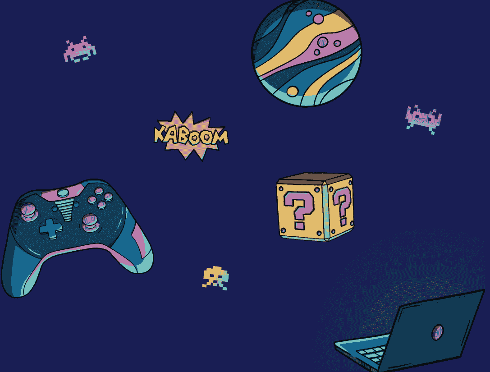


这是一本 Leanpub 的书籍。Leanpub 通过“精益出版”（Lean Publishing）流程为作者和出版者提供支持。精益出版是指在电子书尚未编写完成时，使用轻量级工具和多次迭代来发布进行中的电子书，以获取读者反馈，不断调整直到获得正确的书籍，并建立影响力。

## 目录

- 处理更新后的游戏状态 .................................................................................................. 133
- 创建自定义组件 .............................................................................................................. 157
- 为敌人创建自定义组件 .................................................................................................. 159
- 头部撞击惊喜箱 .............................................................................................................. 163
- 为马里奥添加特殊行为 .................................................................................................. 167
- 添加更多马里奥碰撞和事件 .......................................................................................... 170
- 到达城堡时结束 .............................................................................................................. 174
- 下一步步骤 ...................................................................................................................... 175
- 致谢 .............................................................................................................................. 176
- 在 Kaboom.js 中构建 Flappy Bird .................................................................................. 177
- 在 Replit 中创建新项目 .................................................................................................. 178
- 初始化 Kaboom .............................................................................................................. 179
- 添加场景 ...................................................................................................................... 180
- 构建游戏世界 .............................................................................................................. 181
- 让 Flappy 飞起来 .......................................................................................................... 184
- 添加水管 ...................................................................................................................... 185
- 添加得分机制 .............................................................................................................. 189
- 碰撞检测 ...................................................................................................................... 190
- 下一步步骤 ...................................................................................................................... 193
- 使用 Kaboom.js 构建物理游乐场 .................................................................................. 194
- 入门 .............................................................................................................................. 194
- 设置场景 ...................................................................................................................... 195
- 移动玩家 ...................................................................................................................... 200
- 使用重力枪拉取物体 .................................................................................................. 201
- 使用重力枪掉落和发射物体 .......................................................................................... 209
- 物体碰撞 ...................................................................................................................... 211
- 下一步步骤 ...................................................................................................................... 212

---

## 在 Kaboom.js 中构建贪吃蛇游戏

贪吃蛇是一款极其受欢迎的游戏，大多是人们记忆于 1990 年代的手机上。在当时，它通常是你手机上找到唯一的游戏。在最基础的形式下，它是一个超级简单的游戏，但极具趣味性。当你学习游戏制作的基础知识时，这是一个非常棒的练习。

在本教程中，我们将使用内置在 [Replit](https://replit.com) 中的 [Kaboom.js](https://kaboomjs.com/) 来实现贪吃蛇游戏。

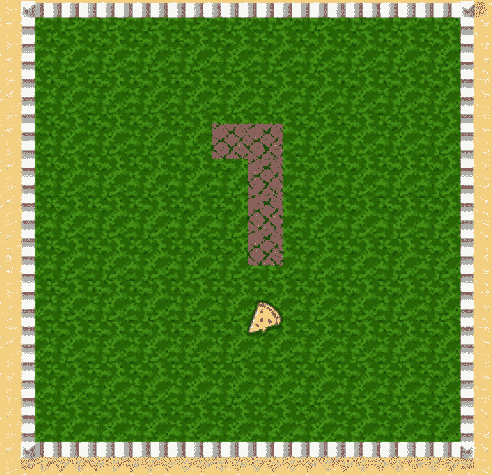

*完成的游戏*

点击打开 gif

> ¹https://kaboomjs.com
> ²https://replit.com
> ³https://docs.replit.com/images/tutorials/21-snake-kaboom/updated-graphic.gif

### 概述与要求

我们将使用 Replit Web IDE 来创建我们版本的贪吃蛇游戏。如果你还没有 Replit 账号，请现在创建一个。

让我们思考一下我们需要做什么。贪吃蛇游戏的核心是一系列代表蛇在网格上移动的区块，由玩家控制方向。它还有简单的规则——当蛇碰到屏幕边缘时，它就死亡了。如果蛇自己穿过自己，它就死亡了。如果蛇吃了一些食物（另一种类型的区块），它就会增长 1 个区块。然后食物会在屏幕的另一个地方重新出现。

我们需要构建的几个组件：

- 一种在屏幕上绘制并移动区块的方法。
- 一种从玩家处获取转向方向的方法。
- 一种判断蛇是否超出屏幕边界的方法。
- 一种判断蛇是否穿过自身的方法。
- 一种判断蛇是否吃到食物的方法。
- 一种增长 1 个区块的方法。
- 一种处理食物重新出现的方法。

### 添加蛇

现在我们已经有了地图，让我们添加蛇吧。蛇是由许多共同移动的方块组成的。我们需要追踪这些方块以便它们一起移动，因此在这里使用数组是一个很好的数据结构。

我们还需要在游戏开始时赋予蛇给定的尺寸、位置和方向，以便在地图上移动。在每次游戏结束时，它也可以回到这些状态。因此，我们应该创建一个函数，每当新游戏开始或重置旧游戏时调用它，将蛇重置为默认的位置和大小。

我们需要添加几个蛇绘制函数将使用的变量和常量。将这些定义添加到我们之前添加的 `const block_size = 20;` 之上：

> ¹¹https://developer.mozilla.org/en-US/docs/Web/JavaScript/Reference/Global_Objects/Array

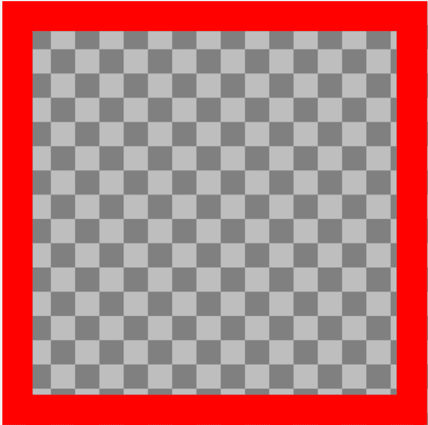

```javascript
const directions = {
  UP: "up",
  DOWN: "down",
  LEFT: "left",
  RIGHT: "right"
}

let current_direction = directions.RIGHT;
let run_action = false;
let snake_length = 3;
let snake_body = [];
```

首先，我们定义了一个对象，包含蛇可以移动的每个允许方向的属性。与仅使用数字或字符串来定义方向相比，这段代码检查并更改方向更容易阅读和修改。变量 `current_direction` 追踪蛇在任何时刻的移动方向。我们选择 `RIGHT` 作为默认起始方向。`run_action` 是一个变量，用于记录我们是否正处于游戏中、设置或结束游戏。变量 `snake_length` 负责追踪蛇尾变得多长——我们将其初始设置为选定的 3。最后，`snake_body` 存储了组成蛇身体的屏幕对象。

现在我们可以添加一个函数来生成（重新生成）蛇。

```javascript
function spawnAll(){
  destroyAll("snake");

  snake_body = [];
  snake_length = 3;

  for (let i = 1; i <= snake_length; i++) {
    let segment = add(
      rect(block_size, block_size),
      pos(block_size, block_size * i),
      color(0,0,255),
      area(),
      "snake"
    );
    snake_body.push(segment);
  }
  current_direction = directions.RIGHT;
}

function respawn_all() {
  run_action = false;
  wait(0.5, () => {
    respawn_snake();
    run_action = true;
  });
}
respawn_all();
```

首先，第一个 `spawnAll` 使用 Kaboom.js 的 `destroyAll()` 函数消除了任何现有的蛇段对象。这会从游戏中移除任何带有给定标签的对象。然后我们将数组重置为空数组，并将蛇长度重置为默认值。

该函数设置了一个循环来创建新的蛇段，直到达到指定的长度。它是通过调用 Kaboom.js 的 `add` 方法来实现的，该方法会向游戏添加新对象。`add` 接收几个参数，即要创建对象的组件。我们传入组件来指定如何绘制对象（使用 `rect()`）、它的颜色，以及一个 `"snake"` 标签，以便我们在检查碰撞以及更新/移除段时识别这些段。我们还指定了创建段的位置。在创建蛇时，我们确保它至少距离左侧一个 `block_size`（或一个块），并在每次循环中将随后的每个段向下移动一个块。这让蛇在开始时是向下指的。然后我们将新段添加到 `snake_body` 数组中以追踪它。

最后，我们为蛇的移动设置了一个默认的起始方向。

你会注意到我们还添加了一个函数 `respawn_all`，以及对 `respawn_snake` 函数的调用。我们使用 `respawn_all` 来调用所有的其他重置函数。我们有一个针对蛇的函数，但在添加食物时也需要一个针对食物的。在 `respawn_all` 函数中，我们还处理了将 `run_action` 标记设置为 `false`，这样在我们设置或重置对象时就不会进行更新。我们还将调用封装在 Kaboom.js 的 `wait()` 函数中，并留有 0.5 秒的小短延迟。这是因为当我们检测到“游戏结束”条件时，我们不想立即重置游戏，因为这可能会让玩家困惑。

现在运行代码，你应该能看到地图左上角有一条蓝线。

- https://kaboomjs.com/doc/#destroyAll
- https://kaboomjs.com/doc/#add
- https://kaboomjs.com/doc/#rect
- https://kaboomjs.com/doc/#wait

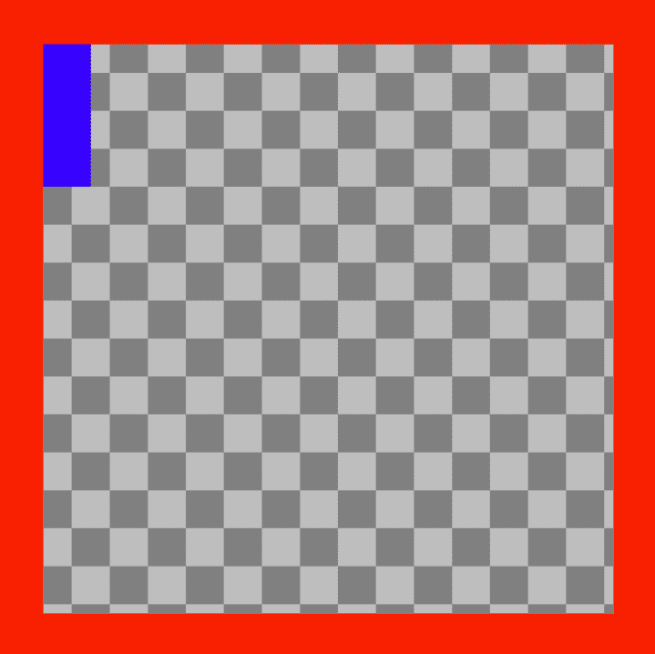

*静态蛇*

### 移动蛇

现在我们已经有了地图边界并在屏幕上绘制了蛇，我们可以处理玩家输入并让蛇移动了。

Kaboom.js 有一个 `onKeyPress` 函数，每当按下键时它都会调用提供的函数。我们将用它来确定玩家想往哪个方向走。添加以下代码来获取用户输入：

> ¹⁷https://kaboomjs.com/doc/#onKeyPress

```javascript
onKeyPress("up", () => {
  if (current_direction != directions.DOWN) {
    current_direction = directions.UP;
  }
});

onKeyPress("down", () => {
  if (current_direction != directions.UP) {
    current_direction = directions.DOWN;
  }
});

onKeyPress("left", () => {
  if (current_direction != directions.RIGHT) {
    current_direction = directions.LEFT;
  }
});

onKeyPress("right", () => {
  if (current_direction != directions.LEFT) {
    current_direction = directions.RIGHT;
  }
});
```

对于每个名为“箭头”的键，我们都设置了一个在按下时调用的函数。在这些函数中，我们检查新输入的方向是否与当前移动的方向相反，因为我们不允许蛇直接反向。如果是合法的移动，我们就更新 `current_direction` 属性。

现在我们需要思考如何让蛇看起来在移动。一种方法是在蛇的前方添加一个块，我们需要在蛇的尾部移除一个块。我们需要每隔几秒执行一次，以便蛇看起来在移动。Kaboom.js 有一个 `onUpdate` 函数，可以在每帧更新对象。添加以下使用 `onUpdate` 函数的代码来移动蛇：

```javascript
let move_delay = 0.2;
let timer = 0;
onUpdate(() => {
  if (!run_action) return;
  timer += dt();
  if (timer < move_delay) return;
  timer = 0;

  let move_x = 0;
  let move_y = 0;

  switch (current_direction) {
    case directions.DOWN:
      move_x = 0;
      move_y = block_size;
      break;
    case directions.UP:
      move_x = 0;
      move_y = -1 * block_size;
      break;
    case directions.LEFT:
      move_x = -1 * block_size;
      move_y = 0;
      break;
    case directions.RIGHT:
      move_x = block_size;
      move_y = 0;
      break;
  }

  // 获取最后一个元素（蛇头）
  let snake_head = snake_body[snake_body.length - 1];

  snake_body.push(add(
    rect(block_size, block_size),
    pos(snake_head.pos.x + move_x, snake_head.pos.y + move_y),
    color(0,0,255),
    area(),
    "snake"
  ));

  if (snake_body.length > snake_length) {
    let tail = snake_body.shift(); // 移除尾部
    destroy(tail);
  }
});
```

我们将动作设置为每 0.2 秒运行一次以获得平滑移动。动作函数每帧更新游戏对象；我们使用 `dt()` 函数获取上一帧和当前帧之间的时间，以便我们可以追踪是否已经过了 0.2 秒来移动蛇。如果还没有达到延迟，我们就提前退出不更新；否则，重置计时器并执行移动蛇的代码。你可以通过调整 `move_delay` 变量的值实验不同的时间来观察对游戏的影响。我们还会检查 `run_action` 标记；如果为 `false`，则提前退出不进行任何更新。然后，函数定义了相对于蛇头的局部变量 `move_x` 和 `move_y`。

函数根据蛇当前指向的方向值进行切换（switch）。对于每个方向，`move_x` 和 `move_y` 被设置为 0 或 ±1 `block_size`。如果蛇向左或向右移动，相应地在 x 维度上增加或减少一个块。如果蛇向上或向下移动，y 维度也会发生同样的情况。

在切换之后，我们通过索引 `snake_body` 数组中的最后一个元素获取当前的蛇头。现在我们既有了当前的蛇头位置以及相对于蛇头移动的位置，就可以通过添加一个新的块游戏对象来创建新的蛇头。

现在剩下的就是使用内置数组 `shift()` 移除蛇尾的块，它会从数组中移除第一个元素并返回该元素。由于蛇“最老”的部分（也称为尾）是第一个元素，我们从数组中将其移除，并使用 Kaboom.js 的 `destroy()` 函数移除该段。只有当 `snake_body` 数组的当前长度大于我们的蛇长度时，我们才这样做。这意味着如果我们增加了 `snake_length`，蛇的总长度也会随之增加。当我们向游戏中添加食物时可以使用这一点。

现在运行项目并点击游戏屏幕，可以让你移动蛇。注意，目前还没有碰撞检测，蛇可以无后果地超出边界。

> ¹https://kaboomjs.com/doc/#dt
> ²https://developer.mozilla.org/en-US/docs/Web/JavaScript/Reference/Global_Objects/Array/shift
> ³https://kaboomjs.com/doc/#destroy

### 添加蛇的食物

我们有一条蛇，它会移动，玩家可以控制它的方向。让我们添加一些蛇可以吃的食物，这会让它的身体变得更长。每当蛇吃到食物时，我们需要重新生成食物，所以让我们像之前处理蛇那样，将食物的创建代码也写在一个函数里：

```javascript
let food = null;
function respawn_food(){
  let new_pos = rand(vec2(1,1), vec2(13,13));
  new_pos.x = Math.floor(new_pos.x);
  new_pos.y = Math.floor(new_pos.y);
  new_pos = new_pos.scale(block_size);

  if (food) {
    destroy(food);
  }
  food = add({
    rect(block_size, block_size),
    color(0, 255, 0),
    pos(new_pos),
    area(),
    "food"
  });
}
```

首先，我们设置了一个变量 `food`，以便跟踪我们创建的食物对象。如果你想把它们都尽量放在声明其他变量（如 `block_size` 和 `snake_body`）的地方，可以将这个变量移动到那里。

然后，`respawn_food` 函数执行了几个操作。在贪吃蛇游戏中，一旦食物被吃掉，另一个食物就会出现在网格的随机位置。我们需要一个随机生成器来确定放置食物的位置。Kaboom.js 有一个名为 `rand` 的函数，我们可以用它在屏幕上找到一个随机位置来放置食物。方便的是，`rand` 函数可以接受两个二维向量作为随机范围的起始和结束值，用于生成范围内的数字，然后返回另一个二维向量作为结果。

我们为什么为食物的随机位置选择 1-13 的范围？如果你看我们之前添加的地图，它宽 14 格，高 14 格。我们屏幕的尺寸是以网格块为单位的。我们不希望画到边界之外，因此在地图内使用 1-13 块。现在，`rand` 函数返回的是带有小数的实数，而不是整数。这意味着我们需要添加 `Math.floor` 来截断随机数的小数部分，因为我们不希望将食物放在某个网格块的中间。我们还需要将网格坐标转换为普通的屏幕像素。这是通过将每个坐标乘以 `block_size` 实现的，`block_size` 指定了每个网格块的像素大小。我们利用了 `vec2` 类上的 `scale()` 方法来执行乘法。

函数的下部分检查 `food` 变量是否已经包含一个现有对象。如果是，我们调用 `destroy()` 从游戏中移除食物。最后，该函数通过调用 Kaboom.js 的 `add()` 函数，在我们创建的随机位置创建一个新的食物对象。

为了调用这个新的 `respawn_food` 函数，我们需要像这样更新我们的 `respawn_all` 函数：

```javascript
function respawn_all(){
  run_action = false;
  wait(0.5, () => {
    respawn_snake();
    respawn_food();
    run_action = true;
  });
}
```

现在运行游戏，可以看到地图上某个随机位置出现了一个绿色的食物块：

### 检测碰撞

现在我们已经拥有了游戏所需的所有对象——边界墙、蛇和食物——我们可以开始检测这些对象之间的交互或碰撞了。

Kaboom.js 有一个非常有用的函数帮助我们：`onCollide`。该函数接受两个代表不同游戏对象类型的标签，如果对象之间发生碰撞，它会调用提供的回调函数。

让我们从检测蛇是否移动到食物块开始。添加以下代码：

```javascript
onCollide("snake", "food", (s, f) => {
    snake_length++;
    respawn_food();
});
```

我们为蛇和食物对象设置了标签的 `onCollide` 函数。然后，在回调函数中，`snake_length` 加 1，并调用 `respawn_food` 在地图的某处替换被吃掉的食物。

运行这段代码并吃掉食物，你应该看到蛇每次都会长大，并且食物会在另一个块上重新出现：

*吃食物*

现在，我们可以添加类似的代码来检测蛇是否撞到了墙：

```javascript
onCollide("snake", "wall", (s, w) => {
    run_action = false;
    shake(12);
    respawn_all();
});
```

在回调函数中，我们立即将 `run_action` 标记置为 `false`。这样移动循环中的代码就不会运行，从而产生蛇卡在墙上的视觉效果。然后代码调用了一个酷的 Kaboom.js 效果函数 `shake()`，它会“摇晃”屏幕，感觉就像蛇剧烈碰撞一样，非常有效地传达了游戏结束的信息。最后，我们调用 `respawn_all` 来重置所有游戏对象。

我们可以使用相同的代码来检测蛇是否撞到了自己——只需将 `wall` 标签替换为另一个 `snake` 标签：

```javascript
onCollide("snake", "snake", (s, t) => {
  run_action = false;
  shake(12);
  respawn_all();
});
```

现在运行游戏，撞墙应该是这样的：

*游戏结束效果*

恭喜！你完成了 Kaboom.js 版贪吃蛇游戏！

### 改进图形

我们有一个可以运行的游戏，但看起来有点单调。Kaboom.js 对精灵有很好的支持，精灵是用来表示角色的小图片。

现在，我们可以更新食物使其更有趣。为了做到这一点，我们可以使用精灵而不是简单的方块。

```javascript
function respawn_food() {
  let new_pos = rand(vec2(1,1), vec2(13,13));
  new_pos.x = Math.floor(new_pos.x);
  new_pos.y = Math.floor(new_pos.y);
  new_pos = new_pos.scale(block_size);

  if (food) {
    destroy(food);
  }
  food = add({
    sprite("food"),
    pos(new_pos),
    area(),
    "food"
  });
}
```

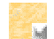

*左上角柱子*

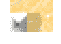

*右上柱子*

现在，我们可以更新地图以使用这些资源。将之前的 `addLevel` 代码替换为以下代码：

```javascript
const map = addLevel([
  "itttttttttt2",
  "11r",
  "11r",
  "11r",
  "11r",
  "11r",
  "11r",
  "11r",
  "11r",
  "11r",
  "11r",
  "3bbbbbbbbbbbb4",
], {
  width: block_size,
  height: block_size,
  pos: vec2(0, 0),
  "t": () => [
    sprite("fence-top"),
    area(),
    "wall"
  ],
  "b": () => [
    sprite("fence-bottom"),
    area(),
    "wall"
  ],
  "l": () => [
    sprite("fence-left"),
    area(),
    "wall"
  ],
  "r": () => [
    sprite("fence-right"),
    area(),
    "wall"
  ],
  "1": () => [
    sprite("post-top-left"),
    area(),
    "wall"
  ],
  "2": () => [
    sprite("post-top-right"),
    area(),
    "wall"
  ],
  "3": () => [
    sprite("post-bottom-left"),
    area(),
    "wall"
  ],
  "4": () => [
    sprite("post-bottom-right"),
    area(),
    "wall"
  ],
});
```

最后一步是升级蛇本身。下载下方的皮肤，并上传到之前的 repl 中。

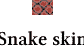

我们在两个地方创建蛇的片段：在 `respawn_snake` 函数中，以及在绘制循环中。更新这两者以使用蛇精灵而不是蓝色块。`respawn_snake` 函数看起来应该是这样的：

```javascript
function respawn_snake() {
  snake_body.forEach(segment => {
    destroy(segment);
  });
  snake_body = [];
  snake_length = 3;

  for (let i = 1; i <= snake_length; i++) {
    snake_body.push(add(
      sprite('snake-skin'),
      pos(block_size, block_size * i),
      area(),
      "snake"
    ));
  }
  current_direction = directions.RIGHT;
}
```

在循环回调中，向身体添加新蛇片段的更新代码现在应该看起来这样的：

```javascript
snake_body.push(add(
  sprite('snake-skin'),
  pos(snake_head.pos.x + move_x, snake_head.pos.y + move_y),
  area(),
  "snake"
));
```

在运行游戏之前，我们需要加载在上面代码段中引用的精灵。在 `kaboom();` 行下方添加以下代码以加载精灵并让它们在游戏中可用：

```javascript
loadSprite("background", "sprites/background.png");
loadSprite("fence-top", "sprites/fence-top.png");
loadSprite("fence-bottom", "sprites/fence-bottom.png");
loadSprite("fence-left", "sprites/fence-left.png");
loadSprite("fence-right", "sprites/fence-right.png");
loadSprite("post-top-left", "sprites/post-top-left.png");
loadSprite("post-top-right", "sprites/post-top-right.png");
loadSprite("post-bottom-left", "sprites/post-bottom-left.png");
loadSprite("post-bottom-right", "sprites/post-bottom-right.png");
loadSprite("snake-skin", "sprites/snake-skin.png");
loadSprite("pizza", "sprites/pizza.png");
```

如果你现在运行游戏，你应该能看到它看起来好多了！

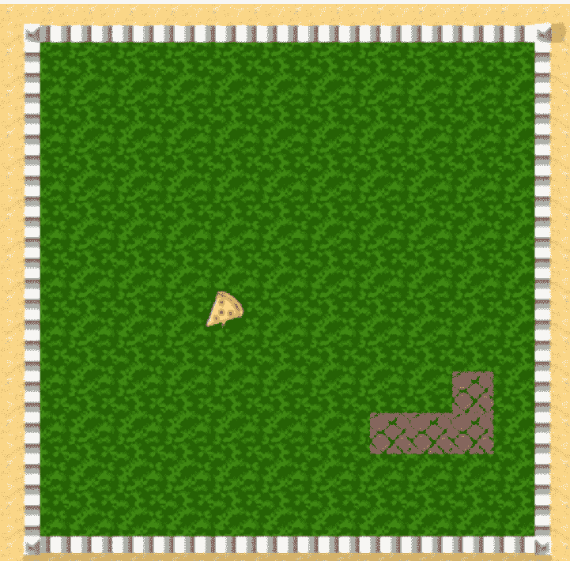

*游戏画面*

点击打开 gif

### 尝试的内容

Kaboom.js 中有很多很好的功能可以尝试，并让游戏更有趣。

这里是一些建议：

- 创建一个双人版本。
- 为蛇添加障碍物。
- 随着游戏的进行，逐渐增加游戏速度以提高难度。你可以通过随着游戏进行调整循环函数的 `delay` 参数来实现。
- 添加音效和背景音乐。

> ³⁷https://docs.replit.com/images/tutorials/21-snake-kaboom/updated-graphic.gif
> ³⁸https://kaboomjs.com/
> ³⁹https://kaboomjs.com/

---

## 在 Kaboom.js 中构建小行星游戏

场景被进一步划分为多个层，层由游戏对象（也称为精灵）填充。层对象决定了它何时被绘制以及哪些对象可以发生碰撞。在小行星游戏中，我们将使用三个层：背景层（`bg`）、物体层（`obj`）和 UI 层（`ui`）。为了初始化这些层，请将以下代码添加到 `main.js` 文件的底部：

```javascript
scene("main", () => {
  layers([
    "bg",
    "obj",
    "ui"
  ]);
  // 在此处添加更多场景代码
});
```

在第一行中，我们定义了主场景，然后声明了游戏层。这些层将按照顺序绘制。大部分游戏玩法将在 `obj` 层中进行，因此我们将其设置为默认层。除非我们在创建对象时指定了不同的层，否则我们创建的任何对象都将放置在此层中。

**注意：** 后的代码片段应添加到主场景的主体内部。`bg` 层将首先绘制，位于所有其他内容之下，我们将用它来为游戏指定背景图像。通过在主场景体中添加以下代码：

```javascript
// 背景
add([
  sprite("space"),
  layer("bg")
]);
```

我们正在背景层上添加一个非常简单的游戏对象：我们之前上传的太空精灵。稍后的游戏对象，例如玩家的飞船和小行星，将会更加复杂。最后一层 `ui` 是我们显示信息的地方，例如玩家的剩余生命值和总分。首先，我们必须通过以下行声明一个名为 `score` 的全局变量：

```javascript
let score = 0;
```

现在，我们将在 UI 层上创建一个空对象，如下：

```javascript
// UI
add([
  layer("ui")
]);
```

虽然 Kaboom 允许我们创建在创建时设置一次且必须手动更新的文本显示对象，但这对于实时性来说并不合理。相反，我们将使用对象的 `draw` 事件来绘制包含当前分数的文本。在以下代码之后：

```javascript
ui.on("draw", () => {
  drawText({
    text: "Score: " + score,
    size: 14,
    font: "sink",
    pos: vec2(8, 24)
  });
});
```

回调函数是 JavaScript 中的一个核心概念，Kaboom 大量使用了它们。某些回调（例如上面的那个）会在游戏的每一帧中被调用（每秒约 60 次）。其他回调会在特定事件发生时（例如按下按键）被调用。由于此回调会被频繁调用，因此我们的分数将始终是最新的。现在运行你的回复并惊叹太空的空旷吧。

> ⁷https://kaboomjs.com/doc/#text
> ⁸https://kaboomjs.com/doc/#event
> ⁹https://en.wikipedia.org/wiki/Callback

### 玩家的飞船

现在让我们填充太空。在 UI 绘制代码下方输入以下代码来创建玩家：

```javascript
// 飞船
const player = add([
  sprite("ship"),
  pos(160, 120),
  rotate(0),
  origin("center"),
  solid(),
  area(),
  "player",
  "mobile",
  "wraps",
  {
    turn_speed: 4.5,
    speed: 0,
    max_thrust: 48,
    acceleration: 2,
    deceleration: 4,
    lives: 3,
    can_shoot: true,
    laser_cooldown: 0.5,
    invulnerable: false,
    invulnerability_time: 3,
    animation_frame: 0,
    thrusting: false
  }
]);
```

这里是飞船的属性：

- `area()`：这让飞船具有碰撞区域。
- `origin("center")`：这让飞船绕中心旋转。
- `solid()`：这让飞船具有物理实体属性，可以被阻挡。
- `"player"`、`"mobile"`、`"wraps"`：这些是标签，用于后续逻辑处理。
- `turn_speed: 4.5`：旋转速度。
- `speed: 0`：初始速度。
- `max_thrust: 48`：最大推力。
- `acceleration: 2`：加速度。
- `deceleration: 4`：减速。
- `lives: 3`：生命值。
- `can_shoot: true`：可以射击。
- `laser_cooldown: 0.5`：激光冷却时间。
- `invulnerable: false`：无敌状态。
- `invulnerability_time: 3`：无敌持续时间。
- `animation_frame: 0`：动画帧。
- `thrusting: false`：推进状态。


# 在 Kaboom.js 中构建星卫大战

## 飞船属性

以下是飞船的核心属性配置：

- `can_shoot: true`：可以射击
- `laser_cooldown: 0.5`：激光冷却时间
- `invulnerable: false`：无敌状态
- `invulnerability_time: 3`：无敌持续时间
- `max_thrust: 48`：最大推力
- `acceleration: 2`：加速度
- `deceleration: 4`：减速
- `lives: 3`：生命值
- `turn_speed: 4.5`：旋转速度
- `speed: 0`：初始速度

## 组件与标签

- `area()`：赋予碰撞区域
- `origin("center")`：设置旋转中心点
- `solid()`：赋予物理实体属性，可被阻挡
- `"player"`、`"mobile"`、`"wraps"`：用于逻辑处理的标签

## 分数

初始分数：`0`

## 移动控制

在游戏中，我们将通过左右方向键来旋转飞船，通过上下方向键来推进。为了旋转飞船，请添加以下代码：

```javascript
// 移动键
onKeyDown("left", () => {
  player.angle -= turn_speed;
});
onKeyDown("right", () => {
  player.angle += turn_speed;
});
```

现在运行你的代码，你应该能够左右旋转飞船。如果你觉得飞船转得太快或太慢，请修改 `turn_speed` 的值。现在让我们实现上下方向键，让飞船可以移动：

```javascript
onKeyDown("up", () => {
  player.speed = Math.min(player.speed + acceleration, max_thrust);
  play("rocket_thrust", {
    volume: 0.1,
    speed: 2.0,
  });
});
```

与其让飞船从零变为最大速度，我们使用这种方式来模拟加速。我们使用 `Math.min()` 将速度设置为当前速度加加速度与最大速度之间的最小值。这将让飞船逐渐增加速度，直到达到 `max_thrust`。

此外，我们设置在加速时播放火箭推力声。Kaboom 允许我们以几种不同的方式处理声音，例如更改速度和音量。我们将通过对加速度的反向操作来处理减速，使用 `Math.max()` 在玩家速度减减速与最大速度（即负值）之间选择最大值。添加以下代码：

```javascript
onKeyDown("down", () => {
  player.speed = Math.max(player.speed - deceleration, -max_thrust);
  play("rocket_thrust", {
    volume: 0.2,
    speed: 2.0,
  });
});
```

## 核心移动逻辑

### 移动系统

从高层次来说，我们希望在给定的方向（`player.angle`）上移动给定的距离（`player.speed`）。第一步，为我们的移动标签创建一个 `onUpdate` 回调。这段代码会在游戏的每一帧中由每个带有 `"mobile"` 标签的对象运行，因此我们可以将其用于玩家对象以外的物体。在主场景的底部添加以下代码：

```javascript
// Movement
onUpdate("mobile", (e) => {
  e.move(pointAt(e.speed, e.angle));
});
```

首先，我们使用 `pointAt()` 来移动对象，它接收一个速度和一个角度，并返回 X 和 Y 坐标作为 `vec2`（Kaboom 的 2D 向量类型）。这种数据类型是 Kaboom 专门为处理 X 和 Y 坐标提供的，并带有许多实用的函数，如加法和减法。

### pointAt() 函数实现

现在我们需要创建 `pointAt()` 函数。在进入代码之前，让我们先思考这个问题。我们的移动可以被画成直线上的一个角度，其 X 和 Y 坐标是连接到它的水平和垂直线，形成了一个直角三角形。

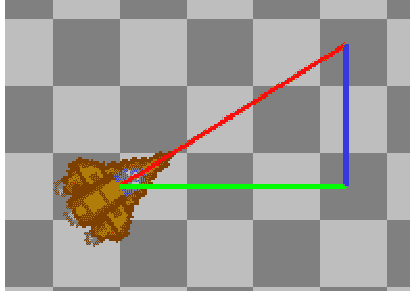

我们知道三角形角度的值：一个是 90 度，另外两个等于 `player.angle`。三角形斜边（上图中的红线）的长度为 `player.speed`：这是我们将飞行的飞船。

我们现在需要计算另外两边的长度，以获得移动向量的 X 和 Y 值。我们可以使用正弦和余弦函数来做到，如下：

| 公式 | 说明 |
|------|------|
| 1. sine(angle) = y / distance | 正弦定义 |
| 2. y = distance * sin(angle) | 计算 Y 分量 |
| 3. cosine(angle) = x / distance | 余弦定义 |
| 4. x = distance * cos(angle) | 计算 X 分量 |

记住，在 Kaboom 中 Y 轴是反的，所以我们必须将其设为负值。在主场景代码的顶部添加 `pointAt()` 函数。

```javascript
function pointAt(distance, angle) {
  let radians = -1 * deg2rad(angle);
  return vec2(distance * Math.cos(radians), -distance * Math.sin(radians));
}
```

你的 repl 现在可以正常工作了，你应该能够向前和向后推进，并根据飞船头指向的方向移动。

### 屏幕环绕

不过，有一个小问题：如果飞得太远，你就会飞出屏幕。在任何其他游戏中，我们可能会通过用墙包围游戏区域来解决这个问题，但在无限的太空中这似乎并不合适。原始的《星卫大战》通过让玩家和其他关键对象在屏幕上环绕来解决这个问题，即：从顶部出现从顶部出现，或者在经过右边缘后从左边缘出现。让我们使用创建玩家时分配的 `"wraps"` 标签来实现它。在主场景代码中添加以下代码：

```javascript
// Wrap around the screen
onUpdate("wraps", (e) => {
  if (e.pos.x > width()) {
    e.pos.x = 0;
  }
  if (e.pos.x < 0) {
    e.pos.x = width();
  }
  if (e.pos.y > height()) {
    e.pos.y = 0;
  }
  if (e.pos.y < 0) {
    e.pos.y = height();
  }
});
```

这是一段相当简单的代码，检查对象的位置是否在房间外，如果是，则将其放在另一侧。`width()` 和 `height()` 函数是 Kaboom 的内置函数，返回游戏画布的大小。运行你的 repl 并尝试一下吧。

## 火箭发射动画

我们的飞船现在可以移动了，但如果在玩家按下方向键时，能看到它的火箭发射并听到它们的声音，那就更好了。这种响应式动画会让游戏感觉更有响应感，看起来也更动态。

Kaboom 有方法在游戏对象使用动画帧精灵（即带有多个图像的精灵）时处理动画，但这并不是我们想要的。我们不需要动画玩家飞船，而是需要在按下推进键时动画飞船后面出现的火箭，因此我们需要自己处理所有的动画代码。幸运的是，Kaboom 让这变得非常简单。

首先，创建一个包含我们四个火箭精灵的数组。在主场景的底部添加以下代码：

```javascript
// Animate rocket
const thrust_animation = ["rocket1", "rocket2", "rocket3", "rocket4"];
```

然后我们需要一种方法来指示何时开始和停止动画。我们可以使用 Kaboom 的 `onKeyPress` 和 `onRelease` 事件。添加以下内容：

```javascript
onKeyPress("up", () => {
  thrusting = true;
  animation_frame = 0;
});
onRelease("up", () => {
  thrusting = false;
});
```

现在让我们绘制动画吧。我们将使用 `onUpdate` 函数，并添加一个每 0.1 秒更改一次动画帧的回调。添加以下内容：

```javascript
let move_delay = 0.1;
let timer = 0;
onUpdate(() => {
  timer += dt();
  if (timer < move_delay) return;
  timer = 0;

  if (thrusting) {
    animation_frame++;
    if (animation_frame >= thrust_animation.length) {
      animation_frame = 0;
    }
  }
});
```

绘制玩家及推进动画：

```javascript
// draw player
draw('player', (p) => {
  if (thrusting) {
    draw(
      sprite(thrust_animation[p.animation_frame]),
      pos(p.pos.add(p.width/2, p.angle)),
      rotate(p.angle),
      origin("center")
    );
  }
});
```

## 射击系统

为了让飞船发射子弹，我们需要在船头正前方创建子弹对象，并让它们朝着指向的方向旅行。在这里我们可以复用 `pointAt()` 函数。在现有移动代码下方添加以下代码：

```javascript
// Shooting
onKeyDown("space", () => {
  add(
    sprite("bullet"),
    pos(player.pos.add(pointAt(player.width/2, player.angle))),
    rotate(player.angle),
    origin("center"),
    "bullet",
    "mobile",
    "destructs",
    {
      speed: 100
    }
  );
});
```

### 射击冷却

目前，只要空格键被按住，每一帧都会创建一个子弹对象。那是大量的子弹，可能会让游戏变得太简单，并且在性能较差的设备上运行极其缓慢。我们需要添加一个冷却期，可以通过修改我们的射击代码如下所示来实现：

```javascript
// 射击
onKeyDown("space", () => {
  if (player.can_shoot) { // 新 if 语句
    add({
      sprite("bullet"),
      pos(player.pos.add(pointAt(player.width/2, player.angle))),
      rotate(player.angle),
      origin("center"),
      area(),
      "bullet",
      "mobile",
      "destructs",
      {
        speed: 100
      }
    });
    play("laser");
    player.can_shoot = false; //
    wait(player.laser_cooldown, () => {
      player.can_shoot = true;
    });
  }
});
```

在这里，我们使用了之前在玩家对象中定义的两个属性 `can_shoot` 和 `laser_cooldown` 来实现冷却机制。我们只在 `can_shoot` 为 `true` 时才会创建子弹，并在每次射击立即将其设置为 `false`。然后，我们使用 Kaboom 的 `wait` 在 `laser_cooldown` 秒后将其设置为 `true`。因为这是一个异步回调，在激光冷却期间，游戏的其他部分可以继续运行。

运行你的 repl 并测试飞船的激光是否按预期的间隔发射。

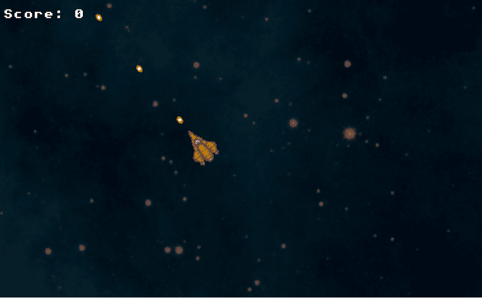

## 小行星系统

### 创建小行星

现在我们已经添加了射击功能，我们需要添加一些可以射击的目标。现在是时候创建这个游戏名字来源的小行星了。

在主场景的底部添加以下代码：

```javascript
// 小行星
const NUM_ASTEROIDS = 5;

for (let i = 0; i < NUM_ASTEROIDS; i++) {
  var spawnPoint = asteroidSpawnPoint();
  var a = add([
    sprite("asteroid"),
    pos(spawnPoint),
    rotate(rand(1, 90)),
    origin("center"),
    area(),
    solid(),
    "asteroid",
    "mobile",
    "wraps",
    {
      speed: rand(5, 10),
      initializing: true
    }
  ]);

  a.pushOutAll();
}
```

在这里，我们创建固定数量的小行星，并为它们分配随机的位置、移动方向和速度。小行星的创建代码与玩家创建代码大部分相似，但自定义属性较少。一个不同之处是存在 `solid()` 组件，它将小行星标记为实体对象，其他对象不应该穿过它。

小行星特有的自定义属性是 `initializing`（初始化）。因为我们是在随机位置生成每个小行星，所以有可能将一个小行星生成在另一个小行星上面，或者生成在玩家身上。

避免这种情况的一种方法可能是确保我们不在相同的坐标上生成任何两个小行星，但我们可能仍然会生成重叠的小行星。我们需要考虑小行星的大小并防止小行星在任何这些坐标上生成，这会让我们的代码迅速变得复杂。

与其这样做，不如利用 Kaboom 的碰撞检测来实现相同的效果。在创建小行星后，我们可以检查它是否与另一个带有 `"mobile"` 标签的对象（即另一个小行星或玩家）重叠，如果是，我们就再次随机化它的位置。我们可以使用代码循环重复，直到我们的小行星落在空旷区域。在添加以下函数后：

```javascript
while (a.isColliding("mobile")) {
  spawnPoint = asteroidSpawnPoint();
  a.pos = spawnPoint;
  a.pushOutAll();
}

a.initializing = false;
```

我们希望小行星在寻找起始位置时处于“initializing”状态。当我们以后实现它的动作时，我们将检查其 `initializing` 属性的值，以防止它在生成时伤害玩家或影响其他小行星。

在继续之前，让我们实现 `asteroidSpawnPoint()` 函数。在主场景的顶部、紧接 `pointAt()` 之前添加以下代码：

```javascript
function asteroidSpawnPoint() {
  // 在场景边缘随机生成
  return choose([
    vec2(rand(0, width()), 0),
    vec2(rand(0, width()), height()),
    vec2(0, rand(0, height())),
    vec2(width(), rand(0, height()))
  ]);
}
```

此函数使用 Kaboom 的 `choose()` 和 `rand()` 函数在场景边缘选择一个随机位置来生成小行星。

### 碰撞处理

有三种类型的碰撞需要我们考虑：

- 玩家与小行星：会导致玩家损失生命
- 子弹与小行星：会销毁它们
- 小行星与小行星：会导致它们相互碰撞

让我们先处理玩家与小行星的碰撞，在玩家生命耗尽之前，在主场景中添加以下代码来减少生命：

```javascript
// 碰撞
onCollide("player", "asteroid", (p, a) => {
  if (!a.initializing) {
    lives--;
  }
});
```

当对象在 Kaboom 中被销毁时，会触发 `destroy` 事件。我们将使用此事件通过添加以下代码显示游戏结束和玩家分数：

```javascript
// 玩家销毁时结束
player.on("destroy", () => {
  add({
    text("GAME OVER\nScore: ${score}\n\n[R]estart?", { size: 20 }),
    pos(width()/2, height()/2),
    layer("ui")
  });
});
```

我们需要给玩家一种重新开始并尝试的方法。在之前的块下方添加以下代码：

```javascript
// 按键 "r"
onKeyPress("r", () => {
  go("main");
});
```

`go` 函数是 Kaboom 用于切换场景的内置函数。由于这个游戏只有一个场景，我们可以用它来重置场景，从而回到初始状态。

最后，我们需要将玩家的生命添加到游戏 UI 中，这样他们就知道还能承受多少伤害。找到场景顶部附近的 ui 对象并将其修改为如下：

```javascript
ui.on("draw", () => {
  drawText({
    text: "Score: " + score,
    size: 14,
    font: "sink",
    pos: vec2(8, 24)
  });

  // 生命（下方的新代码）
  drawText({
    text: "Lives: ",
    size: 12,
    font: "sink",
    pos: vec2(8),
  });
  for (let x = 64; x < 64 + (16 * player.lives); x += 16) {
    drawSprite({
      sprite: "ship",
      pos: vec2(x, 12),
      angle: -90,
      origin: "center",
      scale: 0.5
    });
  }
});
```

此代码将根据剩余生命数量绘制等数量的缩比例玩家飞船。

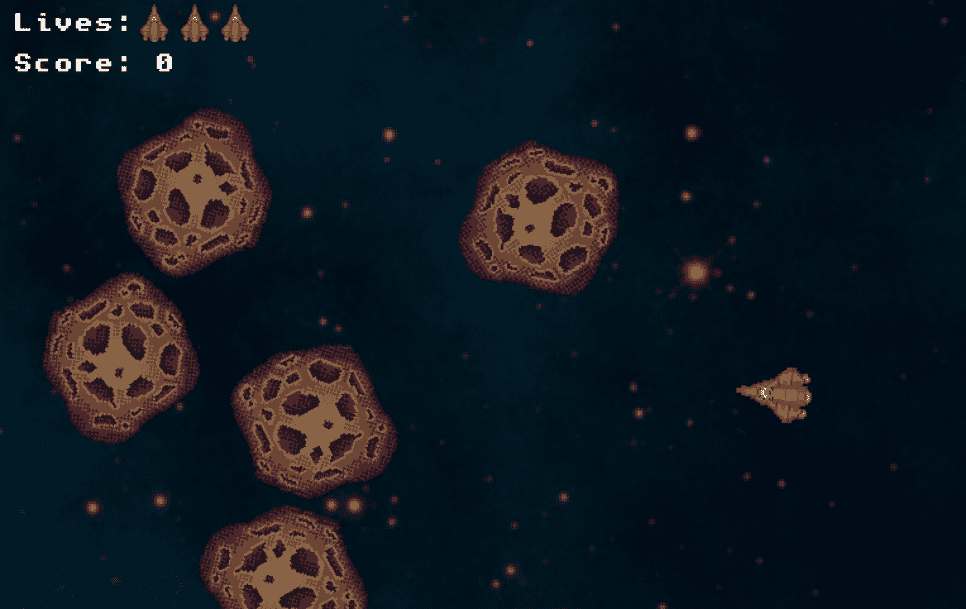

## 最后的完善

我们的游戏现在已经完全可行了，但仍然缺少一些细节，以及一个核心玩法功能——如果你玩过《小行星大战》，你应该能识别出这个功能。在最后一个章节中，我们将添加以下内容：

- 一些背景音乐
- 大行星被摧毁后分裂出的更小、更快速的小行星
- 玩家在受到伤害后几秒钟的临时无敌状态

### 背景音乐

在你的主场景的某处添加以下代码。

```javascript
// Background music
const music = play("Steamtech-Mayhem_Looping");
music.loop();
```

第一行播放来自 Soundimage.org 的 Steamtech Mayhem 曲目，第二行确保它在游戏运行期间不断重复播放。

### 小行星分裂

为了在大行星被摧毁时创建更小的行星，我们将使用 `destroy` 事件回调，它会在每次小行星被摧毁时运行。在你的主场景的底部添加以下代码：

```javascript
// Asteroid destruction
on("destroy", "asteroid", (a) => {
  if (a.is("small")) {
    return;
  }

  // 在大行星的四个角创建更小的行星
  positions = [
    a.pos.add(vec2(a.width/4, -a.height/4)),
    a.pos.add(vec2(-a.width/4, -a.height/4)),
    a.pos.add(vec2(-a.width/4, a.height/4)),
    a.pos.add(vec2(a.width/4, a.height/4))
  ];

  // 小行星从爆炸中心向外移动
  rotations = [16, 34, 65, 87];

  for (let i = 0; i < positions.length; i++) {
    var s = add([
      sprite(`asteroid_small${i+1}`),
      pos(positions[i]),
      rotate(rotations[i]),
      origin("center"),
      area(),
      solid(),
      "asteroid",
      "small",
      "mobile",
      "wraps",
      {
        speed: rand(15, 25),
        initializing: false
      }
    ]);
    s.pushOutAll();
  }
});
```

我们的小行星与大行星相似。区别在于增加了 `small` 标签、初始位置的随机性较低、速度更快，以及选择了四种不同的小行星素材之一。

为了让我们的游戏忠于原版 *Asteroids*，我们应该让玩家在摧毁这些快速的小行星时获得更多分数。找到并按如下修改子弹与小行星的碰撞代码：

```javascript
onCollide("bullet", "asteroid", (b, a) => {
  if (!a.initializing) {
    destroy(b);
    destroy(a);
    play("explosion");
    score = a.is("small") ? score + 2 : score + 1; // 小行星2分，大行星1分
  }
});
```

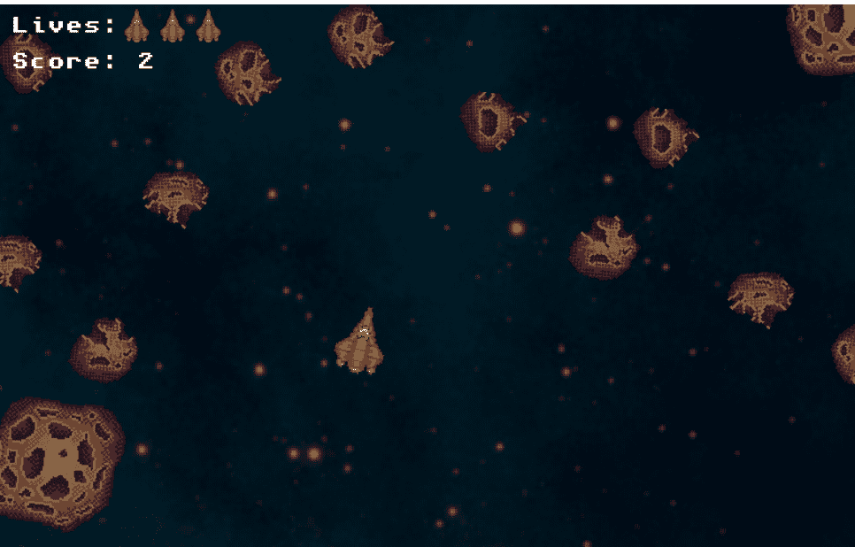

### 临时无敌

让游戏更有容错性的不错设计是让玩家在失去生命后获得临时无敌状态。我们可以通过如下修改玩家的伤害事件回调来实现这一功能：

```javascript
// 受到伤害
player.on("damage", () => {
  if (!player.invulnerable) { // 新的 if 语句
    player.lives--;
  }

  // 生命耗尽则摧毁飞船
  if (player.lives <= 0) {
    destroy(player);
  }
  else {
    // 临时无敌
    player.invulnerable = true;
    player.hidden = true;

    wait(player.invulnerability_time, () => {
      player.invulnerable = false;
      player.hidden = false;
    });
  }
});
```

我们让玩家进入无敌状态，并使用回调在几秒钟后恢复无敌状态，这与我们之前处理激光超时的方法类似。我们还通过设置 `player.hidden` 为 `true` 来让玩家闪烁以指示无敌状态，在无敌结束后设置为 `false` 确保玩家可见。

---

# 使用 Kaboom.js 构建一个太空射击游戏

## 设置 Kaboom

首先，我们需要根据游戏窗口所需的屏幕尺寸和颜色来设置 Kaboom。

将 `main.js` 中的代码替换为以下代码：

```javascript
import kaboom from "kaboom";
kaboom({
  background: [0, 0, 0],
  width: 240,
  height: 275,
  scale: 1.5
});
```

在这里我们导入了 `kaboom` 库，然后通过调用 `kaboom({ ... })` 初始化上下文。我们还设置了视图为 240x275 像素，并将背景在屏幕上缩放 1.5 倍。现在，让我们加载游戏所需的精灵和音效。这段代码加载了我们使用的每个图形元素，并为它们赋予了名称，以便我们可以在构建游戏角色时引用它们：

```javascript
loadRoot("sprites/");
loadSprite("stars", "stars.png");
loadSprite("gem", "gem.png");
loadSprite("spaceship", "spaceship.png");
loadSprite("alien", "alien.png");

loadRoot("sounds/");
loadSound("shoot", "shoot.wav");
loadSound("score", "score.wav");
loadSound("music", "music.mp3");
loadSound("explosion", "explosion.wav");
```

第一行 `loadRoot` 指定了从哪个文件夹加载所有精灵和游戏元素，这样我们就不需要为每个精灵都重复输入路径。每一行这样的代码都会加载一个游戏精灵，并给它一个稍后在代码中引用的名称。我们使用类似的代码来加载游戏所需的音效，但不是使用 `loadSprite`，而是使用 `loadSound` 来加载声音。

## 添加主游戏场景

Kaboom 的“场景”（scenes）允许我们把逻辑和关卡组合在一起。在这个游戏中，我们将拥有 2 个场景：

- 一个“main”（主）场景，它包含游戏关卡以及移动飞船的所有逻辑
- 一个“endGame”（游戏结束）场景，它会在游戏结束时显示

```javascript
scene("main", () => {
  layers({
    "bg",
    "obj",
    "ui",
  }, "obj");

  add({
    sprite("stars"),
    layer("bg")
  });

  // todo.. 添加主场景代码
});

go("main");
```

我们使用 `scene` 对象来定义场景。此函数接收一个字符串作为场景名称——我们将场景命名为 "main"。

然后我们创建了 3 个层：“background”（背景 bg）、“obj” 和“user interface”（用户界面 ui）。`obj` 层被设置为默认层。然后我们将星星添加到背景层。

最后，我们使用 `go` 函数在游戏启动时进入主场景。

**注意**：除非另有说明，否则章节中的代码片段都应添加到主场景的主体内部。

## 创建游戏地图

让我们创建一个绘制在屏幕上的场景布局，或称为地图。这将定义游戏中的地面和平台。

Kaboom 内置了使用文本和 `addLevel` 函数定义游戏地图的支持。这消除了通常加载和渲染地图时涉及的大量麻烦。

以下代码创建了游戏地图。将其添加到 `main.js` 文件的主场景中（位于将星星添加到背景层的代码下方）。

```javascript
// 游戏参数
const MAP_WIDTH = 440;
const MAP_HEIGHT = 275;
const BLOCK_SIZE = 11;

const map = addLevel([
  "", "", "", "", "", "", "", "", "",
  "", "", "", "", "ppccccc",
  "", "", "", "", "", "", "", "", "",
  "", "", "", "", "", "", "", "", "",
  "ppccccc",
  "", "", "", "", "", "", "", "", "",
  "", "", "", "", "", "", "", "", "",
  "====================================",
  "",
], {
  width: BLOCK_SIZE,
  height: BLOCK_SIZE,
  pos: vec2(0, 0),
  "=": () => [
    rect(BLOCK_SIZE, BLOCK_SIZE),
    color(150, 75, 0),
    "ground",
    area(),
    solid()
  ],
  "p": () => [
    rect(BLOCK_SIZE, BLOCK_SIZE),
    color(0, 0, 255),
    "platform",
    area(),
    solid()
  ],
  "-": () => [
    rect(BLOCK_SIZE/10, BLOCK_SIZE),
    color(0, 0, 0),
    "boundary",
    area(),
    solid()
  ]
});
```

首先，我们添加了一些游戏参数，将用于定义地图尺寸以及元素的默认块大小。

接下来，我们创建了游戏地图。地图或关卡设计是用字符串数组表示的。每一行代表屏幕上的一行，因此我们可以从视觉上设计地图应该的样子。`width` 和 `height` 参数指定了每个元素的大小。`pos` 参数指定了地图放置的位置——我们选择 (0,0)，即屏幕的左上角，作为地图的起点。

Kaboom 允许我们为地图中的每个元素指定绘制的内容。你可以创建不同的元素，例如墙、地面、平台等等。要告诉 Kaboom 绘制什么，我们添加一个键，然后为它指定参数。

在这段代码中，我们有 3 类型的固定元素：代表地面、代表平台和代表不可见的边界。这种分组允许我们对它们进行统一引用。

如果我们运行代码，应该能看到像这样的游戏地图。

## 添加飞船

让我们使用 `add` 函数来添加飞船：

```javascript
const player = add([
  sprite("spaceship"),
  pos(100, 200),
  body(),
  area(),
  scale(1),
  rotate(0),
  origin("center"),
  "player",
  {
    score: 0,
    shield: 100
  }
]);
```

`add` 函数使用不同的组件（例如 `pos`、`body`、`scale`）构建游戏对象。这些组件中的每一个都赋予了对象特征。

值得注意的是，`body` 组件使对象对重力产生反应：如果飞船不在地面或平台上，它就会掉落。`rotate` 组件允许我们根据玩家想要去的方向倾斜飞船，提供反馈。默认情况下，所有操作都是围绕对象的左上角计算的。为了让倾斜生效，我们添加了 `origin` 组件并设置为中心，这样倾斜就会从对象的中心开始调整。

Kaboom 还允许我们为游戏对象附加自定义数据。我们添加了 `score` 来存储玩家的最新分数，以及 `shield` 来存储飞船剩余的护盾。我们可以在玩家捡物品或与之碰撞时调整这些值。

当我们创建地图时，我们在地图对象上添加了 `solid` 组件。该组件将对象标记为实体，意味着其他对象无法通过它们。

## 移动飞船

我们将允许飞船进行几种不同的移动：向左或向右改变方向以及向上飞行。我们还需要追踪飞船面向的方向，以便知道从哪侧发射激光。

为了处理方向的变化和追踪，我们添加了以下代码：

```javascript
const directions = {
  LEFT: "left",
  RIGHT: "right"
};

let current_direction = directions.RIGHT;

onKeyDown("left", () => {
  player.flip(-1);
  player.angle = -11;
  current_direction = directions.LEFT;
  player.move(-100, 0);
});

onKeyDown("right", () => {
  player.flip(1);
  player.angle = 11;
  current_direction = directions.RIGHT;
  player.move(100, 0);
});

onKeyRelease("left", () => {
  player.angle = 0;
});

onKeyRelease("right", () => {
  player.angle = 0;
});
```

首先，我们创建了一个定义游戏允许方向的常量对象。然后我们创建了一个变量来追踪飞船面向的 `current_direction`。

然后我们添加了按键处理代码。按键名称 left 和 right 指的是键盘上的左右箭头键。Kaboom 提供了 `onKeyDown` 事件，让我们知道某个按键是否被按下。我们为每个箭头键创建了 `onKeyDown` 事件处理器。只要指定的按键被按住，`onKeyDown` 就会反复调用处理器。

每个 `onKeyDown` 事件内部的代码执行以下操作：

- `flip` 函数镜像玩家的飞船图像，使其根据面向的方向进行显示。我们使用 -1 进行翻转，1 代表右侧。
- `player.angle` 函数在按键被按住期间稍微倾斜飞船，使飞船看起来正朝着指定的方向移动。
- 更新 `current_direction` 追踪变量。我们在添加射击功能会使用这个变量。
- `move` 函数按方向移动飞船。

现在我们希望飞船在按下向上箭头键时向上飞行。为了实现，我们将利用 Kaboom 的 `jump` 属性（它是 `body` 组件的一部分）并将其重新用于向上飞行。将以下代码添加到主场景：

```javascript
onKeyDown("up", () => {
  player.jump(100);
});
```

## 添加激光枪

由于游戏背景是在外太空，因此首选武器是激光枪。我们需要添加函数在玩家开火时创建子弹，并控制子弹的方向。我们还需要添加另一个按键处理器来检查玩家何时按下了“发射”键（在本作游戏中是空格键）。

```javascript
const BULLET_SPEED = 400;

onKeyPress("space", () => {
  spawnBullet(player.pos);
});

function spawnBullet(bulletpos) {
  if (current_direction == directions.LEFT){
    bulletpos = bulletpos.sub(10, 0);
  } else if (current_direction == directions.RIGHT){
    bulletpos = bulletpos.add(10, 0);
  }
  add([
    rect(6, 2),
    pos(bulletpos),
    origin("center"),
    color(255, 255, 255),
    area(),
    "bullet",
    {
      bulletSpeed: current_direction == directions.LEFT ? -1 * BULLET_SPEED : BULLET_SPEED
    }
  ]);
  
  play("shoot", {
    volume: 0.2,
    detune: rand(-1200, 1200),
  });
}
```

首先，我们添加了一个常量 `BULLET_SPEED` 来定义激光“子弹”飞过屏幕的速度。然后，我们使用 `onKeyPress` 事件来触发发射。注意 `onKeyPress` 只在按键按下时调用一次事件处理器，这与我们用于移动的 `onKeyDown` 事件不同。

这是因为如果玩家需要尽可能快地点击“发射”按钮来击败敌人，比仅仅拥有自动武器更有趣。

`onKeyPress` 处理器使用玩家当前的位置调用 `spawnBullet` 函数。该函数负责在正确的方向创建一个新的激光射。方法的前几行调整了子弹的起始位置，使其位于飞船位置的左侧或右侧。这是因为到达中心的位置是飞船中心（记得我们之前添加的 `origin` 组件）。我们对其稍作调整，使得子弹看起来是从飞船的边缘发射的。

然后，我们使用 `add` 函数向游戏添加一个子弹对象。我们没有使用精灵（sprite），而是绘制了一个任意颜色的矩形（rect）。我们给子弹打了标签（tag），以便在检测到某些东西时引用它。我们还给它设置了一个自定义属性 `bulletSpeed`，这是我们希望子弹在每一帧中移动的距离。

最后，当玩家射击时添加声音。`play` 函数播放 "shoot.wav"。我们略微调低了音量，使其更符合整体混音效果。我们使用带有随机生成器的 `detune` 参数在每次播放时改变声音的音调。这样做是为了防止声音听起来单调，并让它听起来更有“味道”。

现在我们设置速度使其每帧移动。我们可以通过使用 `onUpdate` 事件来实现这一点，并使用 `bullet` 标签来识别我们需要更新的对象：

```javascript
onUpdate("bullet", (b) => {
  b.move(b.bulletSpeed, 0);
  if (b.pos.x < 0 || b.pos.x > MAP_WIDTH) {
    destroy(b);
  }
});
```

在每一帧中，`onUpdate` 事件都会更新带有匹配标签（在本例中为 `bullet`）的对象。我们对子弹调用 `move` 方法，使用为其分配的 `bulletSpeed` 自定义值。我们还检查子弹是否已经离开屏幕，如果是，则销毁它。如果子弹击中平台，我们也需要销毁它。我们可以使用 `onCollide` 事件来实现这一点：

```javascript
onCollide("bullet", "platform", (bullet, platform) => {
  destroy(bullet);
});
```

现在运行代码，你应该已经可以射击了。

## 添加外星虫

现在我们已经有了飞船，而且它可以射击，我们需要一些可以射击的目标。让我们添加一些敌对的外星虫。我们希望它们以相对恒定的流出现，以保持游戏的挑战性。我们还希望它们从不同的侧和角度进入，让玩家保持警惕。我们将添加一个新函数来控制外星虫的生成：

```javascript
const ALIEN_BASE_SPEED = 100;
const ALIEN_SPEED_INC = 20;

function spawnAlien() {
  let alienDirection = choose([directions.LEFT, directions.RIGHT]);
  let xpos = (alienDirection == directions.LEFT ? 0 : MAP_WIDTH);

  const points_speed_up = Math.floor(player.score / 1000);
  const alien_speed = ALIEN_BASE_SPEED + (points_speed_up * ALIEN_SPEED_INC);
  const new_alien_interval = 0.8 - (points_speed_up / 20);

  add([
    sprite("alien"),
    pos(xpos, rand(0, MAP_HEIGHT)),
    area(),
    "alien",
    {
      speedX: rand(alien_speed * 0.5, alien_speed * 1.5) * (alienDirection == directions.LEFT ? -1 : 1),
      speedY: rand(alien_speed * 0.1, alien_speed * 0.5) * choose([-1, 1]),
    }
  ]);

  wait(new_alien_interval, spawnAlien);
}

spawnAlien();
```

我们为外星的速度创建了两个参数：基础速率和增量速率。每当玩家获得另一个 1000 分时，我们增加增量速率。

**提示**：你可以将这些参数以及我们定义的所有其他参数放在文件顶部，这样如果你想调整游戏参数，就能很容易找到并修改它们。

然后我们定义了 `spawnAlien` 函数。为了随机选择外星飞入的一侧，我们使用了 Kaboom 的 `choose` 函数，它会从数组中随机选取一个元素。根据选择的方向，我们可以确定外星在 x 轴（水平面）上的起始位置。

然后我们进入计算部分，以确定外星应该移动的速度。首先，我们将玩家的分数除以 1000（玩家每获得 1000 分，外星的速度就会增加）。我们通过 `Math.floor` 函数（JavaScript 内置函数）来去掉小数。得到的结果是 `points_speed_up` 值。

接下来，我们取 `ALIEN_BASE_SPEED` 并加上乘以其增量速率。

我们还计算了外星生成的新速率，使得外星不仅移动得更快，生成得也更快。

现在我们计算好了基本参数，再次使用 `add` 函数创建一个新的外星：

- `sprite('alien')` 使用图像创建外星
- `pos(xpos, rand(0, MAP_HEIGHT-20))` 设置外星的起始位置。我们已经计算了 x pos。我们还为外星添加了 y（垂直）位置，位于地图顶部（位置 0）和底部（MAP_HEIGHT）之间（坐标从屏幕左上角开始）。我们从底部去除了 20 像素，以考虑到地面
- 为该对象添加 "alien" 标签，以便在代码的其他部分识别并调用它
- 我们还为这个特定的外星添加了一个自定义对象，分解为沿 x 轴和 y 轴的速度。对于 x 轴的速度，我们添加了一个随机组件，以便不是所有外星的速度都相同。然后，根据外星是向左还是向右跨越屏幕，将速度乘以 -1 或 1

最后，我们使用 Kaboom 的 `wait` 函数等待一短时间，然后调用 `spawnAlien` 创建一个新的外星。我们还有一次 `spawnAlien` 调用，以便在游戏启动时开始运行。

### 外星移动逻辑

我们需要让外星人移动。我们可以使用 `onUpdate` 事件来实现这一点，并使用 `alien` 标签来识别我们需要更新的对象：

```javascript
onUpdate("alien", (a) => {
  a.move(a.speedX, a.speedY);
  
  if (a.pos.x < 0 || a.pos.x > MAP_WIDTH || a.pos.y < 0 || a.pos.y > MAP_HEIGHT) {
    destroy(a);
  }
});
```

首先，函数根据我们之前计算并保存到外星人自定义数据中的量来移动外星人。

然后，函数检查外星人是否已经移出了地图区域的边界。如果是，我们就销毁它，因为它不再可见了。过多的活动对象会降低性能，所以这一步非常重要。

现在运行代码，你应该能看到移动的外星人。

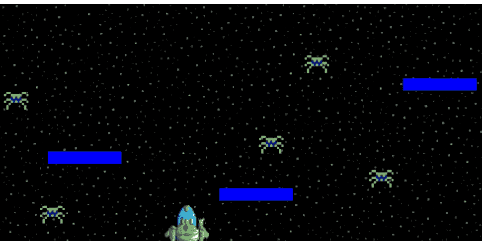

### 射击外星人

现在我们有了移动的外星人、移动的飞船和激光弹，让我们添加处理子弹击中外星人的代码。当然，我们希望这有一个酷炫的爆炸和音效，给玩家提供良好的反馈。

```javascript
onCollide("alien", "bullet", (alien, bullet) => {
  makeExplosion(alien.pos, 5, 5);
  destroy(alien);
  destroy(bullet);
  play("explosion", {
    volume: 0.2,
    detune: rand(0, 100),
  });
});
```

这与用于检查子弹是否击中平台的代码类似。我们销毁子弹和外星人将它们从场景中移除。然后我们使用 `play` 函数播放爆炸效果。我们设置了音量以适应混音，并为声音添加了随机的调音（detune），以便在击中大量外星人时变得更有趣。

我们还调用了一个函数，在外星人曾经的位置创建一个爆炸。这源自 Kaboom 页面上的“射击（shooter）”示例（它非常棒）。它在爆炸区域内产生一系列明亮的白色闪光，为爆炸增添了卡通或漫画的感觉：

```javascript
function makeExplosion(p, n, rad, size) {
  for (let i = 0; i < n; i++) {
    wait(rand() * 0.1, () => {
      for (let j = 0; j < 2; j++) {
        add(
          rect(1, 1),
          pos(p.add(vec2(rand(-rad, rad), rand(-rad, rad)))),
          color(255, 255, 255),
          origin("center"),
          scale(1 * size, 1 * size),
          lifespan(1)
        );
      }
    });
  }
}

function lifespan(time) {
  let timer = 0;
  return {
    update() {
      timer += dt();
      if (timer >= time) {
        destroy(this);
      }
    },
  };
}

function grow(rate) {
  return {
    update() {
      const n = rate * dt();
      this.scale.add(n);
    }
  };
}
```

`makeExplosion` 函数有四个参数（函数的输入）。这些参数是：

- `p`: 作为爆炸基础的中心位置
- `n`: 主闪烁的次数
- `rad`: 从 `p` 到产生闪光的半径或距离
- `size`: 每个闪光的大小

该函数创建了一个执行 `n` 次的循环（即主闪光的次数）。它使用 Kaboom 的 `wait` 函数在每次闪烁之间留出一点时间（0.1 秒）。

另一个循环运行两次以创建 2 次闪光，使用 Kaboom 的 `add` 函数添加一个矩形形状作为闪光，并将颜色设置为白色（Kaboom 中的颜色分量范围为 0-255）。这个矩形的初始大小为 1 像素，然后是传递给函数的大小——我们稍后在“增长（grow）”爆炸时会使用它。`origin` 组件用于将矩形的原点设置为其中心——这将在“增长”时被用到，以产生一种从小点开始并扩张的印象。设置原点使得缩放（scale）从位置计算，从而产生更自然的感觉。

为了让闪光出现在我们指定的点周围，`pos` 组件通过随机量进行调整，范围从 `-rad` 到 `rad`，即我们指定的半径（换句话说，爆炸区域）。

然后是对两个自定义组件的引用——`lifespan` 和 `grow`。Kaboom 允许我们定义自己的组件来赋予对象任何行为或属性。我们只需要创建一个函数，返回一个带有名为 `update` 方法的对象，该方法会在对象被添加的每一帧中被调用。

让我们先看看自定义的 `grow`。它用于创建闪光向外扩张的效果，就像烟花爆炸从一个小点开始并变大，直到消失。在 `grow` 的 `update` 函数中，对象在每一帧都会被放大（因为我们在对象上使用了 `scale` 组件）。这是根据 `rate` 计算的，`rate` 是对象的大小，`dt` 函数为我们提供了以秒为单位的时间差。爆炸闪光会在每一帧持续增长，所以我们需要一种方法来销毁它们。

`lifespan` 组件。它用于在一定时间后销毁对象。这防止了爆炸效果无限增长并消耗内存。

## 添加分数和 UI

让我们添加 UI 来显示飞船的护盾健康值和玩家的总分。

首先，添加玩家分数的文本：

```javascript
add(
  text("SCORE", { size: 8, font: "sink" }),
  pos(100, 10),
  origin("center"),
  layer("ui")
);

const scoreText = add(
  text("000000", { size: 8, font: "sink" }),
  pos(150, 10),
  origin("center"),
  layer("ui")
);
```

在这里我们添加了两个新对象，使用 `text` 组件渲染。第一个只是分数的静态标签。第二个是实际分数的占位符。注意，在两种情况下都使用了 `layer`，将文本放置在我们在教程开始创建的 UI 层上。我们在创建其他所有游戏对象时还没有指定 `layer`，因为我们在定义层时已将 `obj` 层设置为默认值。

```javascript
function updateScore(points) {
  player.score += points;
  scoreText.text = player.score.toString().padStart(6, "0");
  play("score", {
    volume: 0.5,
    detune: rand(-1200, 1200),
  });
}
```

`updateScore` 函数接收参数作为要加到分数上的数值，并将其加到玩家当前分数——记得我们在创建玩家（飞船）对象时将 `score` 添加为了自定义属性。

接下来，我们更新之前创建的 `scoreText` UI 元素。玩家的分数使用 JavaScript 的 `toString()` 方法转换为字符串，这是 JavaScript 中每个对象都有的方法。它还通过 `padStart()` 进行修改，这使得生成的数字恰好为 6 位，如果数字小于 6 位，则会在字符串前面填充 `0`。这为分数预留了占位符，并提示用户他们可能达到的最高分。最后，我们播放一段短音效表示获得了得分。和之前一样，我们每次播放声音时都使用 `detune()` 改变音调以保持声音的新鲜。

当外星人被子弹击中时增加分数，更新我们之前为子弹外星虫添加的 `onCollide` 事件：

```javascript
onCollide("alien", "bullet", (alien, bullet) => {
  makeExplosion(alien.pos, 5, 5, 5);
  destroy(alien);
  destroy(bullet);
  play("explosion", {
    volume: 0.2,
    detune: rand(0, 1200),
  });
  updateScore(10); // 新行
});
```

下一个要添加的 UI 元素是飞船的护盾生命。这作为一个血条式的显示会非常棒，它开始是绿色，当护盾较低时变为红色。当护盾完全耗尽时游戏应该结束，因为飞船被完全摧毁了。

```javascript
add([
  text("SHIELD", { size: 8, font: "sink" }),
  pos(300, 10),
  origin("center"),
  layer("ui")
]);

const shieldHolder = add([
  rect(52, 12),
  pos(350, 10),
  color(100, 100, 100),
  origin("center"),
  layer("ui")
]);

const shieldHolderInside = add([
  rect(50, 10),
  pos(350, 10),
  color(0, 0, 0),
  origin("center"),
  layer("ui")
]);

const shieldBar = add([
  rect(50, 10),
  pos(325, 5),
  color(0, 255, 0),
  layer("ui")
]);
```

首先，我们添加一个文本标签，让玩家知道进度条代表什么。为了创建护盾条 UI，我们使用了 3 个元素：

- 一个边框，或者说 `shieldHolder`，用于勾勒进度条
- 一个黑色内部方块，让容器看起来像一条细线，即 `shieldHolderInside`
- `shieldBar` 本身，它的长度会随着护盾受损而缩短

现在我们需要一个函数在想要更新护盾生命值时调用它：

```javascript
function updatePlayerShield(shieldPoints) {
  player.shield += shieldPoints;
  player.shield = Math.max(player.shield, 0);
  player.shield = Math.min(player.shield, 100);
  shieldBar.width = 50 * (player.shield / 100);
  if (player.shield < 20) shieldBar.color = rgb(255, 0, 0);
  else if (player.shield < 50) shieldBar.color = rgb(255, 127, 0);
  else shieldBar.color = rgb(0, 255, 0);
  if (player.shield <= 0) {
    destroy(player);
  }
  for (let i = 0; i < 500; i++) {
    wait(0.01 * i, () => {
      makeExplosion(vec2(rand(0, MAP_WIDTH), rand(0, MAP_HEIGHT)), 5, 10);
      play("explosion", {
        detune: rand(-1200, 1200)
      });
    });
  }
  wait(2, () => {
    go("endGame");
  });
}
```

该函数有一个参数 `shieldPoints`，用于更新护盾增加的数值，并调整 UI 层上的自定义护盾属性。它还将护盾的最小和最大值限制在 0 到 100 之间。

该函数将 `shieldBar` 的宽度（其沿 x 轴的尺寸）设置为可用护盾的百分比 (`player.shield / 100`) 乘以进度条的全宽 `50`。

然后，函数根据护盾状态更新进度条的颜色：

- 护盾小于 20%，进度条变为红色
- 护盾小于 50%，进度条变为橙色
- 否则，进度条为绿色

如果护盾小于等于 0，则销毁玩家。

## 宝石系统

### 宝石生成

为了让游戏更有趣，我们添加宝石掉落机制。玩家可以收集宝石来获得分数。

```javascript
function spawnGem() {
  add([
    sprite("gem"),
    pos(rand(0, MAP_WIDTH), 0),
    area(),
    "gem",
    {
      speedY: rand(50, 100)
    }
  ]);
  
  wait(rand(5, 10), spawnGem);
}

spawnGem();
```

### 收集宝石

现在宝石正在掉落，我们可以添加一个处理器，当玩家的太空飞船移动到宝石上方时将其捡起。这就是飞船“收集”宝石的方式，并将为玩家赢得积分。以下是 `onCollide` 事件处理器：

```javascript
const POINTS_PER_GEM = 100;
player.onCollide("gem", (gem) => {
  destroy(gem);
  updateScore(POINTS_PER_GEM);
  wait(1, spawnGem);
});
```

每当飞船和宝石碰撞时，该处理器就会触发。我们使用 `destroy` 宝石将其从场景中移除，并调用之前添加的 `updateScore` 函数，根据 `POINTS_PER_GEM` 常量定义的数值来更新玩家的分数。然后我们 `wait` 一秒钟，然后再生成另一个宝石供玩家收集。

现在运行代码并开始收集宝石。

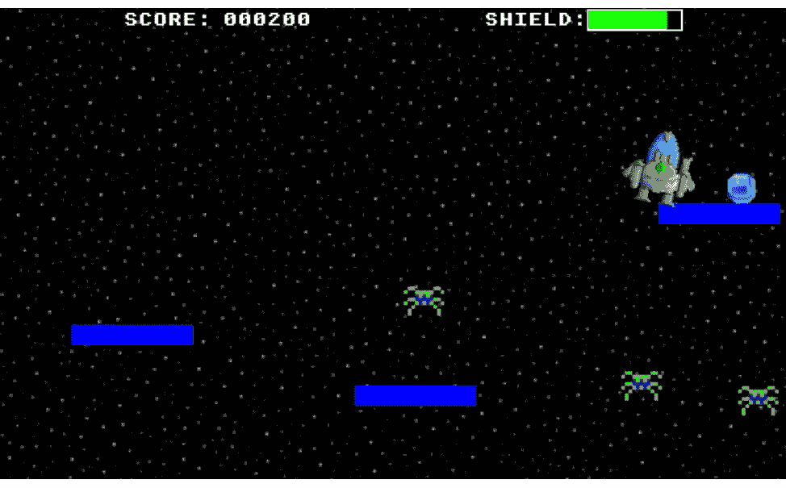

## 添加背景音乐

有音效很酷，但游戏通常需要背景音乐来将所有声音结合在一起。Kaboom 允许你将音频文件作为背景音乐播放。将此代码添加到 main.js 底部以播放该轨道：

```javascript
const music = play("music");
music.loop();
```

这首音乐是来自 "Komiku" 的 "Battle of Pogs"，来自 "Free music archive"，这是一个你可以在你的游戏中合法使用的音乐资源。

## 玩游戏

恭喜你，完成了这个 Kaboom 游戏的制作！尝试运行并玩一下游戏看看你能得到多少分。你也可以尝试调整参数，看看它们将如何改变游戏性。

---

# 在 Kaboom 中构建伪三D 游戏

三维游戏在 80 年代末和 90 年代初随着《飞行模拟器》和《毁灭战士 3D》等游戏流行起来。但这些早期游戏实际上是 2.5D 或伪三D；动作发生在二维，但世界看起来是三维的。

Kaboom.js 是一个二维游戏引擎，但我们可以使用那些游戏设计者的技术来创建一个伪三D游戏。这个游戏大致基于我们的二维太空射击游戏，但我们将使用驾驶舱视图而不是侧屏视图。

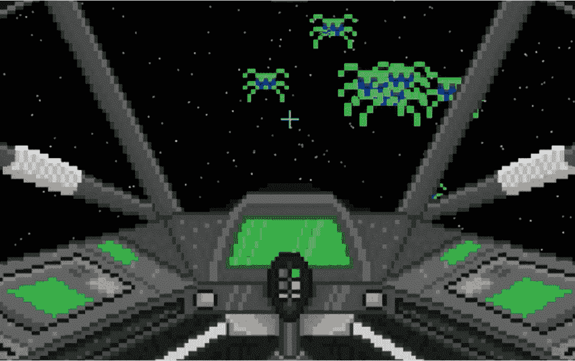

你可以下载包含此游戏所需所有素材和声音的文件。

## 游戏设计

我们从这个游戏中想要的是：

- 深度感以产生三维的幻觉
- 在整个太空中自由移动的感觉

我们将利用 Kaboom 的 `scale` 组件来实现深度感，如果素材较远则表示较小，较近则表示较大。我们将使用算法生成星场来创建一个穿过太空的感觉，就像早期的 Windows 屏幕保护。

## 创建新项目

前往 Replit 并创建一个 repl。选择 Kaboom 作为你的项目类型。将此 repl 命名为“3D Space Shooter”。

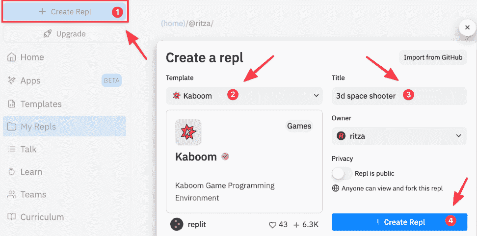

启动后，你应该在“Code”部分看到一个 main.js 文件。这就是我们开始编码的地方。

## 设置 Kaboom 环境

Replit 上的 Kaboom 界面专门用于制作游戏。除了入侵者图标外，你会在文件树中注意到几个特殊文件夹，如“Code”、“Sprites”和“Sounds”。这些特殊文件夹负责加载素材，以及启动和引导游戏所需的所有代码。

如果你还没有，请下载包含游戏所有素材和声音的 zip 文件。从电脑中解压文件，将素材添加到“Sprites”文件夹，将声音添加到“Sounds”文件夹。

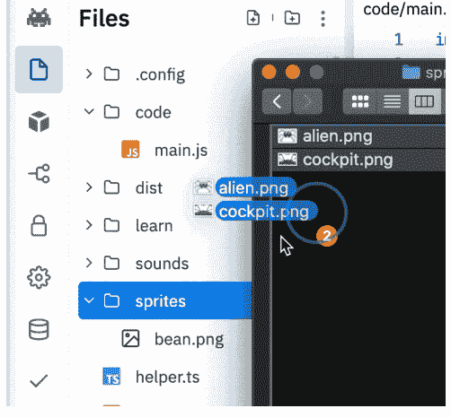

设置游戏玩法，我们需要根据游戏窗口所需的尺寸和颜色设置 Kaboom。将 main.js 中的代码替换为以下代码：

```javascript
import kaboom from "kaboom";
kaboom({
    background: [0, 0, 0],
    width: 320,
    height: 200,
    scale: 2
});
```

在这里我们导入库，并通过调用 `kaboom({ ... })` 初始化上下文。我们设置视图大小为 320x200 像素，并将比例在屏幕上放大一倍。现在，让我们加载游戏所需的素材和声音。以下代码加载每个图形元素，并为它们命名，以便我们在构建游戏角色时引用它们：

```javascript
loadRoot("sprites");
loadSprite("cockpit", "cockpit.png");
loadSprite("alien", "alien.png");

loadRoot("sounds");
loadSound("shoot", "shoot.wav");
loadSound("explosion", "explosion.wav");
```

第一行 `loadRoot` 指定从哪个文件夹加载所有素材和游戏元素，我们不需要为每个素材重复输入。然后我们使用类似的代码加载游戏所需的声音，但不是使用 `loadSprite`，而是使用 `loadSound` 来加载声音。

## 创建界面层

Kaboom 游戏由“场景”（Scenes）组成，类似于关卡或游戏的不同部分和阶段。IDE 有默认的“main”场景，我们可以用它编写主游戏代码。每个场景都有多个“层”（Layers），允许我们拥有不影响游戏的背景、主游戏对象（如玩家、子弹、敌人等）以及 UI 元素（如当前分数和血量）。

将以下代码添加到 main.js 文件以创建 3 个层：“背景 (bg)”、“对象 (obj)”和“用户界面 (ui)”：

```javascript
layers({
  "bg",
  "obj",
  "ui",
}, "obj");
```

`obj` 层被设置为默认层，游戏动作将发生在这里。我们将使用 `bg` 层来绘制星场，因为我们不需要与该层的物体进行交互。然后，我们将使用 `ui` 层来绘制固定的前景物体，即玩家驾驶的飞船驾驶舱。

## 创建外星虫

就像这个游戏的 2D 版本一样，我们游戏的重点在于躲避并击落爆炸的外星虫。这次，外星虫不会从屏幕的左右两侧出现，而是将让它们看起来像是从屏幕“内部”向玩家袭来。

为了实现这种效果，我们首先让外星虫变小并分散在屏幕上，并让它们在靠近屏幕时变大并向屏幕中心逼近。

我们需要一个 3D 坐标系来计算元素应该如何移动。我们将创建一个像下图所示的系统，三个维度的轴在中心都为 0。这就是我们在代码中追踪外星虫移动的方法。当我们把它们绘制到屏幕上时，会将这些坐标转换为 2D 屏幕坐标系统。

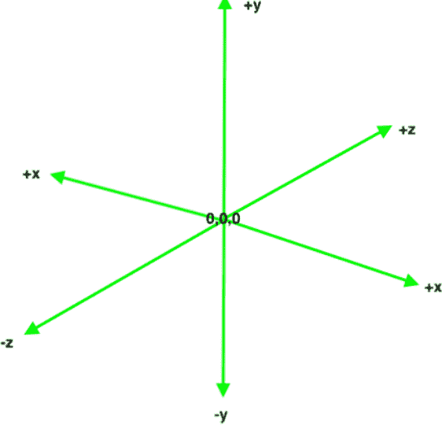

我们将以下代码添加到主场景文件中以实现这一效果：


```javascript
const SCREEN_WIDTH = 320;
const SCREEN_HEIGHT = 200;
const ALIEN_SPEED = 200;
let aliens = [];

function spawnAlien(){
  const x = rand(0, SCREEN_WIDTH);
  const y = rand(0, SCREEN_HEIGHT);
  var newAlien = add([
    sprite("alien"),
    pos(x,y),
    scale(0.2),
    area(),
    rotate(0),
    {
      xpos: rand(-1*SCREEN_WIDTH/2, SCREEN_WIDTH/2),
      ypos: rand(-1*SCREEN_HEIGHT/2, SCREEN_HEIGHT/2),
      zpos: 1000,
      speed: ALIEN_SPEED + rand(-0.5* ALIEN_SPEED, 0.5*ALIEN_SPEED)
    },
    "alien"
  ]);
  aliens.push(newAlien);
}
loop(0.8, spawnAlien);
```

首先，我们为屏幕尺寸和外星虫移动的速度定义了一些通用常量。这样一来，我们就不需要不断记忆和输入数字，如果以后需要，修改这些属性也更方便。我们创建一个数组来存储每个外星虫对象，以便我们可以追踪所有的它们。当我们为外星虫添加移动功能时，这将尤为重要。

`spawnAlien` 函数在屏幕的随机位置创建一个新的外星虫。前几行计算一个随机的 x 和 y 位置，以便初始将外星虫放置在屏幕上。这在逻辑上并不是需要的，因为我们稍后会从 3D 坐标系计算外星虫的实际位置，并计算每一帧投影到屏幕上的位置。但在创建新对象时，我们需要向 `add` 方法传递一个位置，所以随机位置是必要的。

在构建外星虫对象时，我们使用了两个组件：

- `scale`：允许我们随着时间推移调整外星虫的大小，就像它正在靠近一样；
- `rotate`：允许我们旋转外星虫，以便在改变飞船方向时模拟“翻滚”效果。

我们将外星虫在 3D 系统中的位置坐标作为自定义属性添加到外星虫对象中。我们从一个固定的 Z 轴值开始，它远离屏幕。

然后，我们设置外星虫的速度，该速度会在正负速度一半的随机范围内变化，以确保外星虫接近我们的方式具有多样性。我们在计算每一帧外星虫的位置时，将使用这些自定义值。

最后，我们将新的外星虫添加到之前创建的 `aliens` 数组中，以便追踪它。

> [pos](https://kaboomjs.com/doc/#pos)
> [add](https://kaboomjs.com/doc/#add)
> [scale](https://kaboomjs.com/doc/#scale)
> [rotate](https://kaboomjs.com/doc/#rotate)

在函数外部，我们利用 Kaboom 的 `loop` 功能来调用 `spawnAlien` 函数，以固定的间隔创建新的外星虫。

### 移动外星虫

现在，我们需要让生成的外星虫随每一帧移动。以下是代码：

```javascript
onUpdate("alien", (alien) => {
  alien.zpos -= alien.speed * dt();

  alien.scale = 2 - (alien.zpos * 0.0022);

  const centerX = SCREEN_WIDTH * 0.5;
  const centerY = SCREEN_HEIGHT * 0.25;

  alien.pos.x = centerX + alien.xpos * (alien.zpos * 0.0001);
  alien.pos.y = centerY + alien.ypos * (alien.zpos * 0.0001);

  if (alien.zpos <= 1) {
    destroyAlien(alien);
  }
});

function destroyAlien(alien) {
  aliens = aliens.filter(a => a != alien);
  destroy(alien);
}
```

首先，我们为 `onUpdate` 事件添加一个新的处理程序，并过滤标记为 `alien` 的对象。`onUpdate` 事件会在每一帧触发。在这个处理程序中，我们调整外星虫的 `zpos` 使其“移动”屏幕。我们使用 `dt()` 函数获取上一帧的时间，结合我们在构建外星虫时赋予的每秒速度，计算 3D 坐标系中新的 `zpos`。我们将该值转换为坐标，并通过调整外星虫精灵的大小（即 `scale`）来调整 z 轴位置。

记住，屏幕坐标从左上角为 (0,0)，而我们的 3D 坐标系从中心开始为 (0,0)。要在这两个系统之间进行转换，我们需要找到屏幕中心以便将其居中。

> [loop](https://kaboomjs.com/doc/#loop)
> [onUpdate](https://kaboomjs.com/doc/#onupdate)
> [dt](https://kaboomjs.com/doc/#dt)

## 在 Kaboom 中构建伪 3D 游戏

现在我们已经有了移动并向我们袭来的外星虫，让我们添加另一个元素来进一步增加深度感：星场。

虽然这与我们之前为外星昆虫添加的代码相似，但你会发现 `spawnStars` 函数与 `spawnAlien` 函数有几处不同，例如：

- 我们一次性创建所有星辰。这是因为我们需要一个显著的星场背景，而不是每秒只生成几颗星星。
- 我们没有为每颗星星创建一个 Kaboom 对象。这是因为我们不需要 Kaboom 对象带来的碰撞处理和其他开销，特别是考虑到我们正在生成大量的星星（`const START_COUNT = 1000;`）；相反，我们需要在自定义字面量中存储星星的信息，并将这些字面量分别加入 `stars` 数组。
- 我们使用 `rand` 函数将星辰的初始 `z-pos` 设置为 0 到 1000 之间的随机值。这是因为我们是一次性创建所有星星的，所以我们在 `z-pos` 上随机散布星星，以赋予星场深度感。如果它们被初始化为相同的 `z-pos`，它们将同步移动，看起来就像一大块像素向我们冲来——这有点奇怪！

现在来看看为星辰编写的 `onUpdate` 处理程序。它与外星昆虫的处理程序在某些情况下有何不同：

- 我们没有使用对象过滤器来查找星星，因为我们没有将它们创建为 Kaboom 对象。相反，我们在 `stars` 数组中创建每颗星星。
- 我们没有在星星到达屏幕“前方”时销毁它并将其从数组中移除，而是通过将它的 `z-pos` 重置回 1000 来循环利用它。
- 我们还会检查星星是否超出了视野范围。如果是，我们就不绘制它，以节省一些开销。
- 我们没有使用 `z-pos` 来计算用于缩放星星的值，而是使用它来计算星星的强度。Kaboom 使用的范围为 0-255 的颜色。因此，我们首先将 `z-pos` 缩小到 1。然后我们从 1 中减去它，以建立 `z-pos` 与强度之间的反比关系。接着我们将强度乘以 255，将其缩放到 0-255 范围内的值。换句话说，距离越远的星星 `z-pos` 值越高，强度越低。这使得远处的星星看起来更亮。
- 最后，我们使用 Kaboom 的 `drawRect` 方法直接将星星绘制到屏幕上。由于 Kaboom 中没有像素绘制函数，我们通过创建一个大小为 1 的矩形来绘制一个像素。

### 添加飞船

现在我们有了一个可以飞行的星场，让我们添加玩家的飞船吧。我们的游戏使用了飞船的视角。添加以下代码来绘制我们的飞船：

```javascript
const cockpit = add([
  sprite("cockpit"),
  layer("ui"),
  rotate(0),
  pos(SCREEN_WIDTH/2, SCREEN_HEIGHT/2),
  origin("center"),
  scale(0.275)
]);
```

这将驾驶舱（图像）添加到 `ui` 层。我们还为它添加了 `rotate` 组件，这样当飞船飞行时就可以添加一些旋转效果。我们使用 `origin` 组件将图像置于屏幕中心，这为飞船倾斜（转弯）时提供了旋转轴心。然后，我们使用一个缩放因子将图像缩小到屏幕的大小。由于图像尺寸远大于屏幕尺寸，我们对其进行了缩放。我们可以在图像编辑程序中调整图像大小，但会丢失一些细节和清晰度。注意，`scale` 因子意味着图像仍然比屏幕尺寸大一点。这为飞船倾斜旋转图像时留出了重叠空间。

现在运行游戏，你应该能看到从飞船内部看到的视角。


### 创建飞船的移动控制

我们的基础游戏世界已经在运行，现在让我们添加一些控制，以便可以在其中移动。我们将允许飞船进行不同的移动：向左或向右倾斜，向上或向下飞行。

思考一下飞船如何在游戏世界中移动。我们不能让驾驶舱向左、右、向上或向下移动——它会直接消失在屏幕外。模拟驾驶舱视角的方法是保持它固定并移动所有其他游戏元素。

为了实现这一点，让我们添加一些辅助函数来移动游戏对象。以下是代码：

```javascript
function shiftAliens(x,y){
  aliens.forEach((alien) => {
    alien.xpos += x / (alien.zpos*0.01);
    alien.ypos += y / (alien.zpos*0.01);
  });
}
```

```javascript
function shiftStars(x,y){
  stars.forEach((star) => {
    star.xpos += x / (star.zpos*0.01);
    star.ypos += y / (star.zpos*0.01);
  });
}
```

这些函数根据 `z-pos` 移动外星昆虫和星星。物体越远，移动得越慢，从而产生深度幻觉。现在我们需要处理输入以移动飞船。

```javascript
const START_COUNT = 1000;

onUpdate(() => {
  let x = 0;
  let y = 0;

  if (isPressed("left")) x -= 1;
  if (isPressed("right")) x += 1;
  if (isPressed("up")) y -= 1;
  if (isPressed("down")) y += 1;

  shiftAliens(x, y);
  shiftStars(x, y);

  stars.forEach((star) => {
    star.zpos -= 2;

    if (star.zpos <= 0) {
      star.zpos = START_COUNT;
    }

    let intensity = (1 - star.zpos / START_COUNT) * 255;
    star.color = color(intensity, intensity, intensity);

    drawRect(star.pos.x, star.pos.y, 1, 1);
  });
});
```

等等，我们忘记移动驾驶舱了！让我们加上它：

```javascript
onUpdate(() => {
  // ...之前的代码 ...
  cockpit.pos.x += x * 2;
  cockpit.pos.y += y * 2;
  // ... 代码 ...
});
```

最后，我们需要让驾驶舱在转弯时旋转：

```javascript
onUpdate(() => {
  // ... 之前的代码 ...
  if (isPressed("left")) cockpit.rotate += 5;
  if (isPressed("right")) cockpit.rotate -= 5;
  // ... 之前的代码 ...
});
```

## 在 Kaboom 中构建伪 3D 游戏

```javascript
add([
  rect(1, 400),
  origin('center'),
  pos(SCREEN_WIDTH*0.5, SCREEN_HEIGHT*0.33),
  color(0, 255, 255),
  layer("ui")
]);
```

这在屏幕水平中间处、大约屏幕下方 1/3 处添加了两条线，这大致是飞船窗户视野的中心点。由于 Kaboom 没有线条（line）组件，我们实际上是使用 `rect` 来绘制宽度为 1 像素的矩形。我们添加了穿过 UI 层的线条，这样它们就会位于外星人和恒星之上。

现在我们有了一个瞄准目标，让我们添加层。我们的玩家将使用空格键进行发射，我们想要一种经典效果：两束激光，分别从飞船的侧边射向同一个点，以产生射向远处、朝向消失点发射的效果。

```javascript
const BULLET_SPEED = 10;
function spawnBullet() {
  const BULLET_ORIGIN_LEFT = vec2(SCREEN_WIDTH*0.25, (SCREEN_HEIGHT - SCREEN_HEIGHT*0.33));
  const BULLET_ORIGIN_RIGHT = vec2(SCREEN_WIDTH - (SCREEN_WIDTH*0.25), (SCREEN_HEIGHT - SCREEN_HEIGHT*0.33));
  const BULLET_VANISHING_POINT = vec2(SCREEN_WIDTH * 0.5, SCREEN_HEIGHT * 0.33);

  add([
    rect(1, 1),
    pos(BULLET_ORIGIN_LEFT),
    area(),
    color(255, 0, 0),
    "bullet",
    {
      bulletSpeed: BULLET_SPEED,
      targetPos: BULLET_VANISHING_POINT
    }
  ]);

  add([
    rect(1, 1),
    pos(BULLET_ORIGIN_RIGHT),
    color(255, 0, 0),
    "bullet",
    {
      bulletSpeed: -1*BULLET_SPEED,
      targetPos: BULLET_VANISHING_POINT
    }
  ]);

  play("shoot", {
    volume: 0.2,
    detune: rand(-1200, 1200),
  });
}
```

当玩家开火时，我们使用 `spawnBullet` 函数创建一组新的激光弹。为了让它们看起来像是从飞船下方相互发射的，我们通过 `0.25` 和 `0.33` 两个倍数，分别计算了屏幕各侧 1/4 处和 1/3 处的子弹起始位置。

然后我们计算子弹的终点。这与十字准星的位置相同。使用这些值，我们创建了 2 个子弹对象——简单的 1 像素点，带有 `bullet` 标签并将颜色设置为 `(255,0,0)` 以让它们看起来极有威胁性。我们还为对象添加了自定义属性：子弹移动的速度，以及轨迹终点所在的消失点。

作为最后一个细节，我们在每创建一个子弹时都会播放“shoot”音效，通过调整音量并应用随机生成的 `detune` 值，使得每次播放时的音调都不同。

我们已经有了子弹、它们的声音和轨迹，现在让我们通过每帧移动它们，让它们从起始点移动到十字准星所在的消失点：

```javascript
onUpdate("bullet", (b) => {
  const m = (b.pos.y - b.targetPos.y) / (b.pos.x - b.targetPos.x);
  const c = b.targetPos.y - m*(b.targetPos.x);

  let newX = b.pos.x + b.bulletSpeed;
  let newY = m * newX + c;
  b.pos.x = newX;
  b.pos.y = newY;
  // 当子弹到达消失点的 y 轴后将其移除
  if ((b.pos.y < SCREEN_HEIGHT*0.33)) {
    destroy(b);
  }
});
```

```javascript
onKeyDown("space", () => {
  spawnBullet();
});
```

在这里我们使用了 `onUpdate` 事件处理器，并过滤出子弹对象。

为了计算每帧子弹在轨迹上的下一个位置，我们需要找到子弹当前位置与终点位置之间直线的斜率（m）和 y 截距（在本例中为 c）。函数的前两行将这些变量参数表示为公式。让我们花点时间看看是如何得到这些公式的。

我们从直线方程开始：

```
y = m*x + c
```

由于我们有起点和终点的 x 和 y 坐标，我们可以通过解方程组来求出未知数 m 和 c：

```
y_start = m*x_start + c   (1)
y_target = m*x_target + c   (2)
```

重新排列 (2):

c = y_target - m*x_target

将 (2) 代入 (1) 中的 c:
y_start = m*x_start + (y_target - m*x_target)
y_start - y_target = m*(x_start - x_target)

m = (y_start - y_target) / (x_start - x_target)

c = y_target - m*x_target

现在我们有了斜率和截距，就可以计算子弹的任何位置了。

### 完成游戏

恭喜你，我们已经拥有游戏中飞行、射击和伤害的所有主要元素。下一步要做的是添加一个评分系统，以及在飞船被击中时减少健康值或护盾的方法。你可以查看该游戏的2D版本的教程，并将评分和健康值代码复制到此游戏中。你还可以复制背景音乐和更多音效的代码。

祝编码愉快，玩得开心！

### 致谢

本教程使用的游戏艺术和声音来自以下来源：

激光：https://freesound.org/people/sunnyflower/sounds/361471/

爆炸：https://freesound.org/people/tommccann/sounds/235968/

外星虫：https://opengameart.org/content/8-bit-alien-assets/

飞船驾驶舱由 Ritza 制作。

感谢所有创作者以 Creative Commons 许可发布他们的资产并允许我们使用。

你可以在 [github](https://github.com/ritza-co/make-javascript-games-book-code-samples/blob/main/4-3d-game-with-kaboom.md) 或 [replit](https://replit.com/@ritza/3d-space-shooter-new) 上找到本教程的代码示例。

## 使用 WebSocket 和 Kaboom.js 构建井字游戏

井字游戏（又称为 noughts and crosses 或 Xs and Os）是一种适用于 2 人的简单经典游戏。它通常用纸笔玩，但它也是编写网络多人游戏的一个很好的入门项目。

在教程中，我们将使用 Node.js 服务器创建一个 2 人的在线井字游戏。Socket.IO 将实现跨互联网的实时游戏。我们将使用 Kaboom.js 来创建游戏界面。

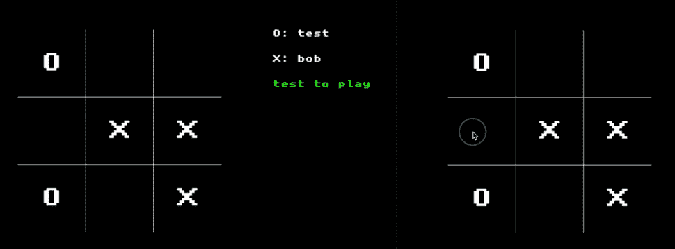

点击打开 gif

### 多人游戏是如何运作的？

多人游戏的架构通常如下所示：

> [Node.js](https://nodejs.org/en/)
> [Socket.IO](https://socket.io)

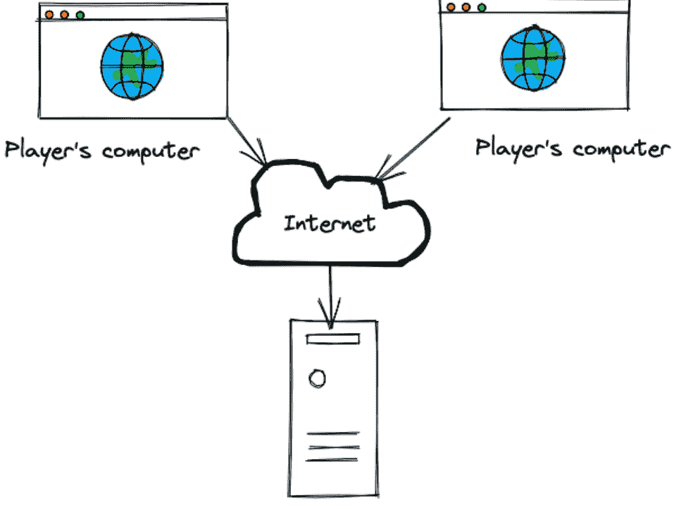

### 游戏服务器架构

玩家（客户端）通过互联网连接到游戏服务器。游戏在游戏服务器上运行，那里处理所有的游戏规则、分数和其他数据。玩家的计算机渲染游戏图形，并将玩家指令（来自键盘、鼠标、游戏手柄或其他输入设备）发送回游戏服务器。游戏服务器检查这些指令是否有效，然后更新游戏状态。游戏状态是所有变量、玩家、数据和关于游戏信息的表示。此游戏状态会传回给所有玩家，并更新图形。

在在线多人游戏中，玩家计算机和游戏服务器之间需要大量的通信。这通常需要一个双向（或双向式）链接，以便游戏服务器可以发送数据并通知玩家游戏状态的更新。这种链接情况下应该是快速的，因此更持久的连接更好。

使用网站通常使用的 HTTP 协议，浏览器打开到服务器的连接，然后向服务器发送请求，服务器返回数据并关闭连接。服务器无法主动向浏览器发送数据。WebSocket 是一种高级协议，允许我们创建双向的持久连接。

对于游戏状态，让我们思考将如何表示或建模游戏。当我们有一个服务器时，我们将添加以下内容：

- 创建服务器，选择 "Node.js" 作为你的项目。

### 设置服务器

```javascript
const http = require('http');
const io = require('socket.io');

const server = http.createServer();
const socketIO = io(server, {
  cors: {
    origin: "*"
  }
});

server.listen(3000, () => {
  console.log('Server listening on port 3000');
});
```

在第一行中，我们启动服务器。我们使用端口 3000。在游戏状态下，我们将添加对预期状态的枚举。这使得我们在处理游戏时更容易跟踪和使用它们。

```javascript
const Statuses = {
  WAITING: 'waiting',
  PLAYING: 'playing',
  DRAW: 'draw',
  WIN: 'win'
}
```

- WAITING：我们等待所有玩家加入游戏。
- PLAYING：玩家可以在棋盘上移动。

### 跟踪游戏

当我们有一个服务器时，让我们思考将如何表示或建模游戏。

- 游戏状态：发生了什么？我们在等待玩家加入，还是游戏结束了？
- 玩家：他们的名字是什么？使用的是什么符号，X 或 O？
- 当前玩家：轮到谁？
- 如果游戏结束，谁赢了？

现在让我们添加一个游戏对象来跟踪一切：

```javascript
let gameState = {
  board: new Array(9).fill(null),
  currentPlayer: null,
  players: [],
  result: {
    status: Statuses.WAITING
  }
}
```

首先，我们有一个带有 9 个元素的井字游戏表示。这就是元素如何映射到棋盘的：

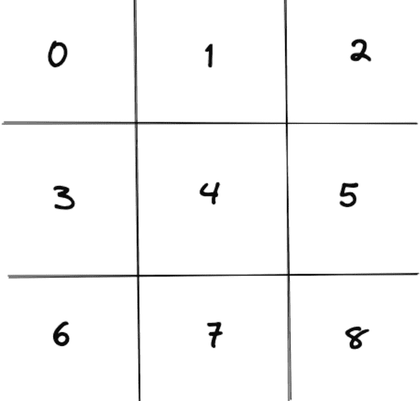

井字棋盘映射到数组索引

方块中的每个数字代表了棋盘位置在数组中表示的索引。初始情况下，我们将数组中的所有元素填充为 `null`，表示该方块是开启的。当玩家进行移动占据一个开放空间时，我们将添加该玩家的引用。这样，我们就可以跟踪哪些方块是空的，哪些被哪个玩家占据了。

接下来，我们有一个 `currentPlayer`，当轮到某个玩家移动时，我们会交替将其设置为该玩家。

然后是 `players` 数组，它将持有游戏中两名玩家的引用。这将允许我们在屏幕上显示玩家名称，并通用的跟踪玩家。

结果字段在每次移动后都会更新。该字段将包含游戏状态（正如我们在上面定义的）。由于它是以对象的形式表示的，它还能持有额外的字段。我们将利用该功能，在游戏以胜利结束时添加一个游戏获胜者的引用。

### 接受连接

当玩家通过 WebSocket 连接时，Socket.IO 会触发一个连接事件。我们可以监听此事件并处理连接跟踪，以及为其他自定义事件创建监听器。这里我们可以定义几个玩家会发射的自定义事件：

- `addPlayer`：我们将其用于玩家请求加入。
- `action`：当玩家想要移动时使用。
- `rematch`：当游戏结束但玩家想要再次游戏时使用。

我们还可以监听内置的断开连接事件，如果玩家离开游戏（例如通过关闭浏览器窗口或其连接丢失），该事件将提醒我们。

以下是将监听器挂钩到事件上的代码：

```javascript
io.on('connection', function (connection) {
  connection.on('addPlayer', addPlayer(connection.id));
  connection.on('action', action(connection.id));
  connection.on('rematch', rematch(connection.id));
  connection.on('disconnect', disconnect(connection.id));
});
```

旁注：通常在自定义监听器的示例中，你会使用一个匿名函数来直接处理新添加的代码，如下所示：

> [Server Instance](https://socket.io/docs/v4/server-instance/#connection)
> [Emitting Events](https://socket.io/docs/v4/emitting-events/)
> [Disconnect](https://socket.io/docs/v4/server-instance/#disconnect)

```javascript
io.on('connection', function (connection) {
  connection.on('addPlayer', (data)=>{
    // 此处编写代码
  });

  connection.on('action', (data)=>{
    // 此处编写代码
  });

  // 等 ...
});
```

这种方式非常方便，特别是当我们有几个处理器且每个处理器都只有少量代码时。它也很方便，因为在每个处理器函数中，你仍然可以访问 `connection` 对象，而该对象并没有在每个事件中传递。然而，如果有许多事件处理器且每个处理器中都有复杂的逻辑，可能会变得有点混乱且难以管理。

我们正在采用不同的方法，以便将处理器分离到代码库中其他地方的函数。我们有一个问题需要解决：如果它们是函数，它们将如何访问 `connection` 参数，以便我们判断是哪个玩家发送了命令？通过 JavaScript 中良好支持的闭包概念，我们可以编写返回另一个函数的函数。通过这样，我们可以将 `connection.id` 参数传递给第一个包装函数，它可以返回另一个接收来自 Socket.IO 事件调用者 `data` 参数的函数。第二个函数位于第一个函数的闭包内，它将能够访问 `connection.id` 参数。这种模式看起来如下：

```javascript
io.on('connection', function (connection) {
  connection.on('addPlayer', addPlayer(connection.id));
  connection.on('action', action(connection.id));
  // 等 ...
});
```

```javascript
function addPlayer(socketId){
  return (data)=>{
    // 此处编写代码
  }
}
```

```javascript
function action(socketId){
  return (data)=>{
    // 此处编写代码
  }
}
```

> [Closures](https://developer.mozilla.org/en-US/docs/Web/JavaScript/Closures)

### 处理新玩家

添加以下函数来处理添加玩家：

```javascript
function addPlayer(socketId){
  return (data) => {
    const numberOfPlayers = gameState.players.length;
    if (numberOfPlayers >= 2){
      return;
    }

    let nextSymbol = 'X';
    if (numberOfPlayers === 1){
      if (gameState.players[0].symbol === 'X'){
        nextSymbol = 'O';
      }
    }

    const newPlayer = {
      playerName: data.playerName,
      id: socketId,
      symbol: nextSymbol
    };

    gameState.players.push(newPlayer);
    if (gameState.players.length === 2){
      gameState.result.status = Statuses.PLAYING;
      gameState.currentPlayer = newPlayer;
    }

    io.emit('gameState', gameState);
  }
}
```

这个函数做了很多工作。首先，它检查有多少个玩家。如果玩家人数大于等于2，则直接返回。

设置 `nextSymbol` 为 'X'。如果玩家人数为 1，且第一个玩家的符号是 'X'，则将 `nextSymbol` 设置为 'O'。

创建一个新玩家 `newPlayer` 对象，包含 `playerName`、`id` 和 `symbol`。

将 `newPlayer` 推入 `gameState.players` 数组。如果玩家人数达到 2，将 `gameState.result.status` 设置为 `PLAYING`，并将 `gameState.result.currentPlayer` 设置为 `newPlayer`。

发射 `gameState` 事件以更新状态。

### 处理玩家动作

该处理器处理玩家的移动。我们期望传入的 `data` 包含 `gridIndex`。

```javascript
function action(socketId){
  return (data) => {
    if (gameState.result.status === Statuses.PLAYING && gameState.currentPlayer.id === socketId) {
      const player = gameState.players.find(p => p.id === socketId);
      if (gameState.board[data.gridIndex] === null) {
        gameState.board[data.gridIndex] = player;
        gameState.currentPlayer = gameState.players.find(p => p !== player);
        checkForEndOfGame();
      }
    }
    io.emit('gameState', gameState);
  }
}
```

在这个函数中，我们首先检查几点：

- 游戏状态必须是 `PLAYING` - 如果游戏处于任何其他状态，玩家无法移动。
- 尝试移动的玩家必须是 `currentPlayer`，即当前轮到他的玩家。

如果满足这些条件，我们在 `gameState.players` 数组中找到玩家。现在我们可以检查玩家请求的棋盘位置 (`gridIndex`) 是否可用。我们检查 `gameState.board` 数组中的该位置是否为 `null`，如果是，则将玩家赋值。

玩家执行了成功的移动，因此我们将切换到另一个玩家。我们通过再次使用数组 `find` 方法获取与当前玩家不匹配的玩家来更新 `gameState.currentPlayer`。

我们还需要检查玩家是否改变了游戏状态。这次移动是否让他们获胜，还是平局，或者游戏仍在进行？我们调用 `checkForEndOfGame` 函数进行此检查。

最后，我们向所有玩家（以及观众）发送最新的 `gameState` 以更新 UI。

### 检查游戏是否结束

现在我们可以回到实现 `checkForEndOfGame()` 函数，之前在操作处理程序中引用了它。

我们只对两种情况感兴趣：获胜或平局。

只有 8 种模式可以决定玩家在井字游戏中是否获胜。让我们将这些模式映射到带有索引块的棋盘上：

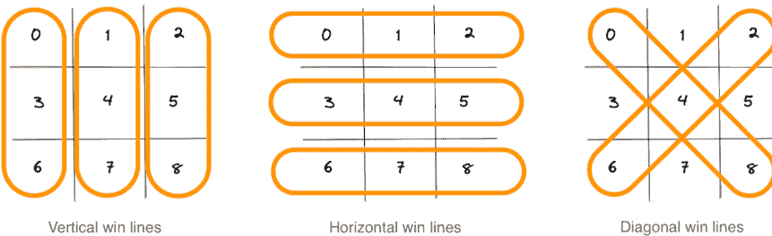

所有可能的获胜线

我们将这些获胜模式编码为每个包含 3 个数字的数组。我们可以将这些模式添加到更大的数组中，如下所示：

> [Array.filter](https://developer.mozilla.org/en-US/docs/JavaScript/Reference/Global_Objects/Array/filter)

```javascript
const winPatterns = [
  [0, 1, 2],
  [3, 4, 5],
  [6, 7, 8],
  [0, 3, 6],
  [1, 4, 7],
  [2, 5, 8],
  [0, 4, 8],
  [2, 4, 6]
]
```

现在我们已经在数组中拥有了每个获胜模式，我们可以遍历每个模式，检查是否有玩家的位置匹配了任何模式。

由于玩家也位于 `gameState.players` 数组中，我们可以遍历该数组，并对每个玩家与获胜模式进行检查。如果玩家匹配了任何一个模式，我们可以将游戏状态更改为 `WIN`，并在结果并将该玩家设置为胜利者。

以下是实现该操作的代码：

```javascript
function checkForEndOfGame(){
  // 检查获胜
  gameState.players.forEach(player => {
    winPatterns.forEach(seq => {
      if (gameState.board[seq[0]] == player
        && gameState.board[seq[1]] == player
        && gameState.board[seq[2]] == player) {
          gameState.result.status = Statuses.WIN;
          gameState.result.winner = player;
        }
    });
  });

  // 检查平局
  if (gameState.result.status != Statuses.WIN) {
    const emptyBlock = gameState.board.indexOf(null);
    if (emptyBlock == -1){
      gameState.result.status = Statuses.DRAW;
    }
  }
}
```

我们在这个函数中也检查了平局。平局定义为所有格子都被占据（无法再进行移动），但没有玩家匹配任何获胜模式。为了检查是否还有更多空格子，我们使用数组方法 `indexOf` 来寻找 `gameState.board` 中的任何 `null` 值。记住，`null` 表示空格子。如果 `indexOf` 方法无法找到任何值，它将返回 -1。在这种情况下，我们将状态设为 `DRAW`，结束游戏。

### 处理重赛

当玩家想要重赛时，我们需要重置游戏状态。

```javascript
function rematch(socketId){
  return (data) => {
    if (gameState.result.status === Statuses.WIN || gameState.result.status === Statuses.DRAW) {
      resetGame();
    }
    io.emit('gameState', gameState);
  }
}
```

### 重置游戏

让我们来实现 `resetGame` 函数：

```javascript
function resetGame() {
  gameState.board = new Array(9).fill(null);

  if (gameState.players.length === 2) {
    gameState.result.status = Statuses.PLAYING;
    const randPlayer = Math.floor(Math.random() * gameState.players.length);
    gameState.currentPlayer = gameState.players[randPlayer];
  } else {
    gameState.result.status = Statuses.WAITING;
    gameState.currentPlayer = null;
  }
}
```

让我们来看看我们正在做什么：

- 首先，我们的函数为 `gameState.board` 创建了一个新数组。这有效地清空了棋盘，将所有位置重置为 `null` 或空值。
- 然后，它检查是否仍有 2 个玩家连接。如果是，它会将游戏状态设回 `PLAYING`，并随机选择由哪个玩家回合。我们随机选择第一个玩家，以避免某一个玩家因为先手而获得优势。
- 如果只剩下一个玩家，我们将游戏状态设置为 `WAITING`，并监听任何想要加入的新玩家。我们还将 `currentPlayer` 设置为 `null`，因为我们将在新玩家加入后才会决定由哪个玩家开始游戏。

### 处理断开连接

我们需要实现的最后一个处理器是当玩家的连接丢失时。这可能是因为玩家退出了游戏（关闭了浏览器标签页），或其他网络问题。

```javascript
function disconnect(socketId) {
  return (reason) => {
    gameState.players = gameState.players.filter(p => p.id != socketId);
    if (gameState.players.length != 2){
      resetGame();
      io.emit('gameState', gameState);
    }
  }
}
```

此函数使用内置的 `filter` 函数来移除从服务器断开连接的玩家。由于断开事件可能不是来自玩家而是观众，因此我们在从玩家列表中过滤掉断开的 socket 后，检查剩余玩家的数量。如果过滤后没有剩余 2 个玩家，我们将重置游戏并发送更新后的游戏状态。

现在服务器端已经拥有了我们需要的所有功能，让我们继续构建客户端。

## 使用 WebSocket 和 Kaboom.js 构建井字棋

```javascript
add([
  rect(400, 1),
  pos(100, 100),
  layer("ui")
]);
add([
  rect(400, 1),
  pos(100, 233),
  layer("ui")
]);
add([
  rect(1, 400),
  pos(100, 100),
  layer("ui")
]);
add([
  rect(1, 400),
  pos(233, 100),
  layer("ui")
]);
```

这在屏幕上添加了 4 个宽度为 1 像素、长度为 400 像素的矩形 - 每个矩形更像是一条线。这就是我们绘制创建经典井字格形状的线条的方法。前 2 个矩形是垂直线，后 2 个是水平线。我们将棋盘放在靠近屏幕左侧的位置而不是中心，以便为屏幕右侧显示游戏信息留出空间。

如果你运行游戏并输入名字，你应该能看到这样的棋盘布局：

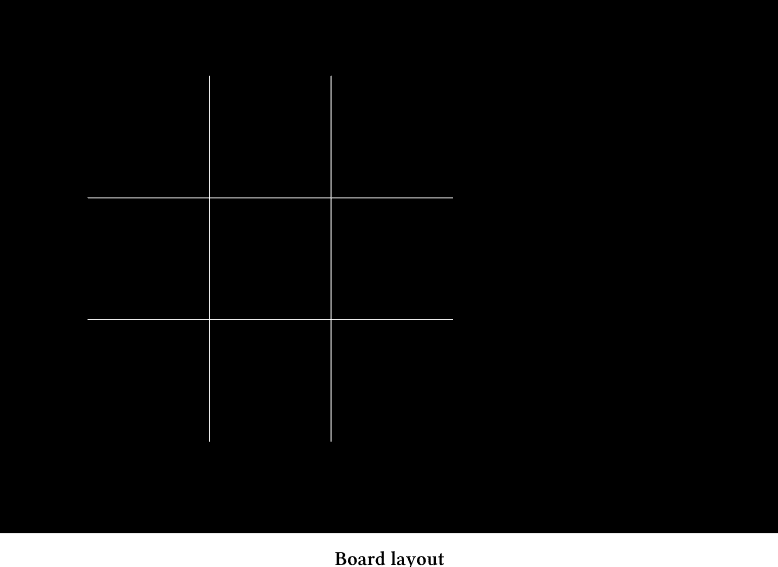

我们需要一种在每个单元格中绘制 X 和 O 符号的方法。为了实现这一点，我们将在棋盘的每个单元格中添加带有文本组件的对象。首先，我们将创建一个包含每个单元格位置和大小的数组。在上面创建的 "main" 场景中添加以下代码段：

```javascript
const boardSquares = [
  {index: 0, x: 100, y: 100, width: 133, height: 133},
  {index: 1, x: 233, y: 100, width: 133, height: 133},
  {index: 2, x: 366, y: 100, width: 133, height: 133},
  {index: 3, x: 100, y: 233, width: 133, height: 133},
  {index: 4, x: 233, y: 233, width: 133, height: 133},
  {index: 5, x: 366, y: 233, width: 133, height: 133},
  {index: 6, x: 100, y: 366, width: 133, height: 133},
  {index: 7, x: 233, y: 366, width: 133, height: 133},
  {index: 8, x: 366, y: 366, width: 133, height: 133}
];
```

我们可以遍历这个数组，并在我们想要更新棋盘上的符号时，创建一个可以使用的的文本对象。让我们创建一个函数来实现这一操作。

```javascript
function createTextBoxesForGrid(){
  boardSquares.forEach((square)=>{
    let x = square.x + square.width*0.5;
    let y = square.y + square.height*0.5;
    square.textBox = add([
      text('', 40),
      pos(x, y),
      origin('center')
    ]);
  });
}

createTextBoxesForGrid();
```

此函数使用数组的 `forEach` 方法遍历 `boardSquares` 数组中的每个“单元格”定义。然后我们找到单元格的中心 x 和 y，向屏幕上 `add` 一个新的文本对象，并将其添加到单元格定义的 `textBox` 字段中，以便我们稍后访问并更新它。我们使用 `origin` 组件来确保文本在单元格中居中。

最后，我们调用该函数来创建框。

### 添加玩家名称和游戏状态

现在，让我们为玩家名称以及当前游戏状态（轮到谁玩、是否获胜或是否平局）添加一些名称。

> [Array.forEach](https://developer.mozilla.org/en-US/docs/Web/JavaScript/Reference/Global_Objects/Array/forEach)
> [add](https://kaboom.com/#add)

```javascript
// 玩家和游戏状态元素
const playerOneLabel = add({
  text('', { size: 20, font: "sinko" }),
  pos(600, 100)
});

const playerTwoLabel = add({
  text('', { size: 20, font: "sinko" }),
  pos(600, 150)
});

const statusLabel = add({
  text('', { size: 20, font: "sinko" }),
  pos(600, 200),
  color(0, 255, 0)
});
```

我们添加了 3 个带有文本组件的对象。前两个是玩家名称和符号的占位符。第三个用于游戏状态。它们被放置在屏幕右侧，初始时为空文本。我们将更改其内容以接收来自服务器的新游戏状态。最后一个对象有一个 `color` 组件，用于将文本颜色设置为绿色。这样做是为了让状态消息与其他文本中脱颖而出。

### 连接服务器

为了连接到游戏服务器，我们需要初始化之前添加的 Socket.IO 库。我们需要提供服务器的 URL，因此请从服务器的输出窗口中复制该 URL：


```javascript
const socket = io("YOUR_SERVER_URL_HERE");
```

### 处理游戏状态更新

我们需要监听服务器发送的 `gameState` 事件并更新 UI。

```javascript
socket.on("gameState", (state) => {
  gameState = state;
  updateUI();
});

function updateUI() {
  if (gameState.players[0]) {
    playerOneLabel.text = `${gameState.players[0].playerName} (${gameState.players[0].symbol})`;
  }
  if (gameState.players[1]) {
    playerTwoLabel.text = `${gameState.players[1].playerName} (${gameState.players[1].symbol})`;
  }

  if (gameState.result.status === Statuses.PLAYING) {
    statusLabel.text = `Turn: ${gameState.currentPlayer.playerName}`;
    statusLabel.color = rgb(0, 255, 0);
  } else if (gameState.result.status === Statuses.WIN) {
    statusLabel.text = `${gameState.result.winner.playerName} Wins!`;
    statusLabel.color = rgb(255, 255, 0);
  } else if (gameState.result.status === Statuses.DRAW) {
    statusLabel.text = "Draw!";
    statusLabel.color = rgb(255, 0, 0);
  } else {
    statusLabel.text = "Waiting for player...";
    statusLabel.color = rgb(255, 255, 255);
  }

  // 更新棋盘上的 X 和 O
  gameState.board.forEach((player, index) => {
    if (player && boardSquares[index].textBox) {
      boardSquares[index].textBox.text = player.symbol;
    } else if (boardSquares[index].textBox) {
      boardSquares[index].textBox.text = '';
    }
  });
}
```

### 处理玩家移动

我们希望玩家能够点击方格来放置棋子。Kaboom 有一个函数 `onMouseRelease`，我们可以利用它来处理鼠标点击事件。我们只需要光标所在的位置，就可以使用 `boardSquares` 数组进行查找，将其映射到棋盘上的某一个位置。我们将使用 Kaboom 的函数 `mousePos` 来获取鼠标坐标：

> [onMouseRelease](https://kaboomjs.com/doc/#onMouseRelease)
> [mousePos](https://kaboomjs.com/doc/#mousePos)

```javascript
onMouseRelease(() => {
  const mpos = mousePos();
  // 找到我们点击的方格
  for (let index = 0; index < boardSquares.length; index++) {
    const square = boardSquares[index];
    if (mpos.x > square.x
      && mpos.x < square.x + square.width
      && mpos.y > square.y
      && mpos.y < square.y + square.height){
        socket.emit("action", {
          gridIndex: square.index
        });
        break;
    }
  }
});
```

如果我们在棋盘方格上找到了“命中”，就会发射动作事件。我们将被点击方格的索引通过载荷数据传递。服务器监听此事件，并运行我们在服务器端为动作事件添加的逻辑。如果动作改变了游戏状态，服务器将返回新的游戏状态，UI 元素随之更新。

我们只需要实现的输入是检查玩家是否想要重赛。为了实现这一点，我们将 r 键位分配为重赛命令。我们可以使用 Kaboom 的函数 `charInput` 来监听按键按下事件。我们将检查键是否为 `r` 或 `R`，然后发射重赛事件。我们没有任何数据需要传递，所以只需传递 `null`。

```javascript
charInput((ch) => {
  if (ch === 'r' || ch === 'R') {
    socket.emit("rematch", null)
  }
});
```

现在你可以运行游戏（以及服务器），并在另一个标签页中运行游戏，你应该可以自己对自己玩井字棋了。将游戏链接发送给朋友，看看他们是否可以加入并和你对战。

> [charInput](https://kaboom.js/doc/#charInput)

## 使用 WebSocket 和 Kaboom.js 构建井字棋

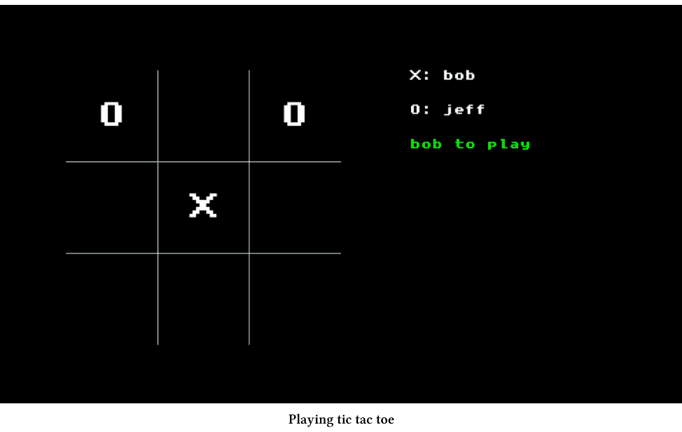

### 下一步工作

现在你已经了解了创建多人在线游戏的基础知识，尝试去制作一些不同的游戏，比如国际棋、象棋或围棋。

编码愉快！

你可以在 [github](https://github.com/ritza-co/make-javascript-games-book-code-samples/blob/main/5-tictactoe-with-websockets-kaboom.md) 或 [replit](https://replit.com/@ritza/tic-tac-toe-new) 上找到此教程的代码示例。

## 使用 Kaboom.js 构建类马里奥的横卷游戏

马里奥系列是历史上最知名且最受喜爱的游戏系列之一。第一款马里奥游戏由任天堂在 80 年代中期发布，之后人们就没有停止玩过马里奥了。

大量游戏仍然在使用马里奥的基本横卷公式，因此它是一个学习游戏制作基础的好游戏。我们将在新的 Kaboom 游戏引擎中构建它。Kaboom 有许多用于构建平台类游戏的有用函数，我们将尝试在教程中尽可能涵盖它们。

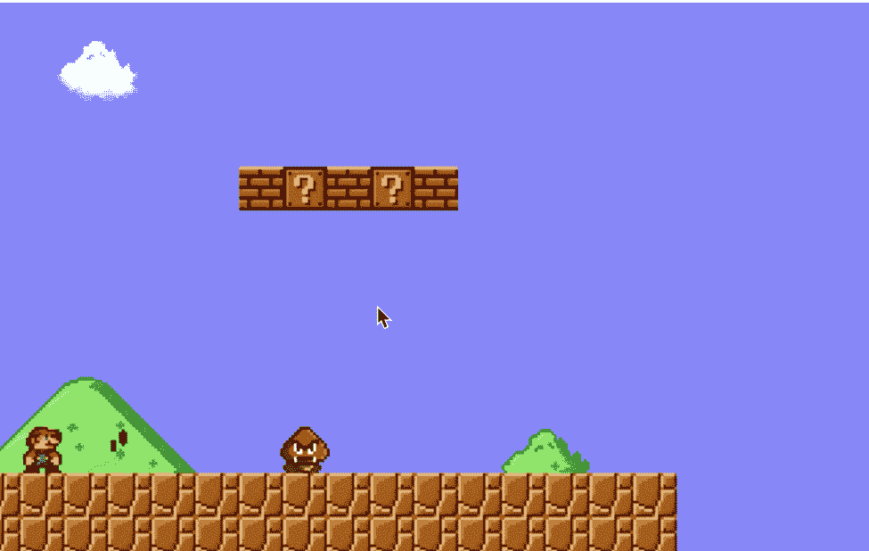

完成的游戏

点击打开 gif

> [Kaboom](https://kaboomjs.com)

### 设计游戏

我们想制作一个具有马里奥精髓的游戏。这意味着我们需要几样东西：

- 跳跃和撞击箱子的能力。
- 大小角色。
- 通过踩在敌人身上来攻击敌人的能力。
- 经典的马里奥滚动和摄像机移动。

对于图形，我们将使用来自此创作者的图集。

### 在 Replit 中创建新项目

前往 Replit 创建一个新的 repl。选择项目类型为 Kaboom，并命名为 "Mario"。

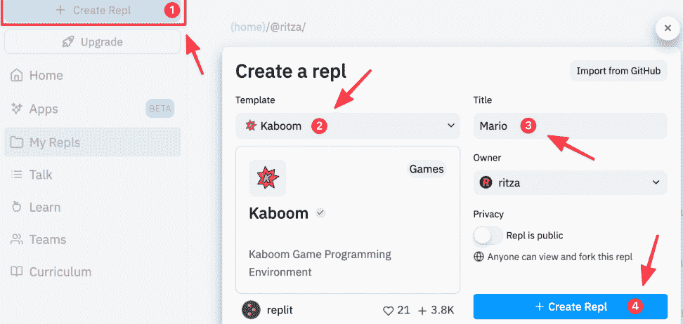

repl 启动后，你将在 "Code" 部分看到 main.js。这是我们开始的地方。它已经包含了一些代码，但我们将将其替换。下载此游戏所需的素材存档，并在你的电脑上解压。在 Kaboom 编辑器中，点击侧边栏的 "Files" 图标。现在将所有素材文件拖入 "sprites" 文件夹。一旦上传完成，我们将用下面的代码替换 main.js：

```javascript
import kaboom from "kaboom";

kaboom({
  background: [134, 135, 247],
  width: 320,
  height: 240,
});
```

这创建了一个带有漂亮蓝色背景的 Kaboom 画布。我们还将视图设置为 320x240，对于现代游戏来说分辨率很低，但是马里奥风格的像素化。

> [Upload Assets](https://docs.replit.com/images/tutorials/32-mario-kaboom/upload-assets.gif)

### 设置 Kaboom

首先，我们需要为游戏所需的屏幕尺寸和颜色设置 Kaboom。替换 main.js 中的代码：

```javascript
import kaboom from "kaboom";

kaboom({
  background: [134, 135, 247],
  width: 320,
  scale: 2,
});
```

我们使用 `scale` 让背景变为两倍。点击 "Run" 按钮，你应该会在输出窗口中看到漂亮的天空。

### 加载素材

现在，让我们加载一些素材以便将其添加到场景中。这段代码加载了我们将使用的每个图形元素，并给它们一个名称，以便我们在构建角色时引用：

```javascript
loadRoot("sprites/");
loadSprite("mario", "Mario.png", "Mario.json");
loadSprite("enemies", "enemies.png", "enemies.json");
loadSprite("ground", "ground.png");
loadSprite("questionBox", "questionBox.png");
loadSprite("emptyBox", "emptyBox.png");
loadSprite("brick", "brick.png");
loadSprite("coin", "coin.png");
loadSprite("bigMushy", "bigMushy.png");
loadSprite("pipeTop", "pipeTop.png");
loadSprite("pipeBottom", "pipeBottom.png");
loadSprite("shrubbery", "shrubbery.png");
loadSprite("hill", "hill.png");
loadSprite("cloud", "cloud.png");
loadSprite("castle", "castle.png");
```

第一行 `loadRoot()` 指定了从哪个文件夹加载所有素材和游戏元素，这样我们就不需要每个素材重复输入。然后每行加载一个素材并为其命名，以便我们稍后在代码中引用它。

> [loadRoot](https://kaboomjs.com/#loadRoot)

注意 `mario` 和 `enemies` 素材是用 `loadSprite` 函数加载的，并有一个指定 .json 文件的额外参数。这个额外文件是由像素艺术和动画软件 Aseprite 生成的格式。如果你打开 Mario.png 文件会发现有很多不同位置的马里奥图像，这些都是马里奥动画的帧。json 文件包含了在我们的游戏中让马里奥动起来所需的所有信息。Kaboom 知道如何解释这些，我们可以通过从 json 文件中的 `frameTags` 列表中选择一个并对其使用 `.play()` 方法，从而在任何时候运行任何动画。我们也可以使用素材的 `.frame` 属性（从 0 开始）在任何时候选择特定的帧。

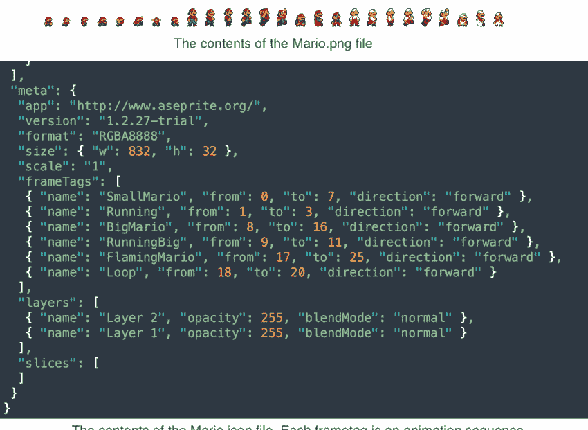

```json
{
  "meta": {
    "app": "http://www.aseprite.org/",
    "version": "1.2.27-trial",
    "format": "RGBA888",
    "size": {"w": 83,"h": 32},
    "scale": 1
  },
  "frameTags": [
    {"name": "SmallMario", "from": 0, "to": 3, "direction": "forward"},
    {"name": "Running", "from": 4, "to": 7, "direction": "forward"},
    {"name": "BigMario", "from": 8, "to": 16, "direction": "forward"},
    {"name": "Running", "from": 17, "to": 25, "direction": "forward"},
    {"name": "FireMario", "from": 18, "to": 20, "direction": "forward"},
    {"name": "Loop", "from": 21, "to": 24, "direction": "forward"}
  ],
  "layers": [
    {"name": "Layer 2", "opacity": 255, "blendMode": "normal"},
    {"name": "Layer 1", "opacity": 255, "blendMode": "normal"}
  ],
  "slices": []
}
```

Mario.json 文件的内容。每个 frametag 都是动画序列。

### 定义关卡

Kaboom 有一种非常酷的关卡定义方式。它允许我们仅使用文本来绘制关卡布局。文本地图中的每个字母或符号都可以映射为 Kaboom 中的字符。在 Kaboom 中，字符是指构成游戏世界的任何物体，包括地板、平台等，而不仅仅是玩家和机器人。

添加以下内容来定义关卡：

```javascript
const LEVELS = [
  `
                                     
                                     
                                     
                                     
                                     
                                     
                                     
                                     
          -?-b-                    ?       ? 
                                     
                                     
                                      ?       
                                      | 
                                      |       | 
          |       |       -       
          H       |       |       E E       | 
======================================================================
======================================================================
====================================================
  `
];
```

现在我们可以将关卡中的每个符号和字母映射到字符定义上：

> [addLevel](https://kaboomjs.com/#addLevel)

```javascript
const levelConf = {
  // 网格大小
  width: 16,
  height: 16,
  pos: vec2(0, 0),
  // 将每个对象定义为组件列表
  "-": () => [
    sprite('ground'),
    area(),
    solid(),
    origin('bot'),
    'ground'
  ],
  "=": () => [
    sprite('brick'),
    area(),
    solid(),
    origin('bot'),
    'brick'
  ],
  "H": () => [
    sprite('castle'),
    area({ width: 1, height: 240 }),
    origin('bot'),
    'castle'
  ],
  "?": () => [
    sprite('questionBox'),
    area(),
    solid(),
    origin('bot'),
    'questionBox',
    'coinBox'
  ],
  "b": () => [
    sprite('questionBox'),
    area(),
    solid(),
    origin('bot'),
    'questionBox',
    'mushyBox'
  ],
  "!": () => [
    sprite("emptyBox"),
    area(),
    solid(),
    // bump(),
    origin("bot"),
    "emptyBox",
  ],
  "c": () => [
    sprite("coin"),
    area(),
    solid(),
    //bump(G4, 8),
    cleanup(),
    lifespan(0.4, { fade: 0.01 }),
    origin("bot"),
    "coin"
  ],
  "M": () => [
    sprite("bigMushy"),
    area(),
    solid(),
    //patrol(10000),
    body(),
    cleanup(),
    origin("bot"),
    "bigMushy"
  ],
  "|": () => [
    sprite("pipeBottom"),
    area(),
    solid(),
    origin("bot"),
    "pipe"
  ],
  "_": () => [
    sprite("pipeTop"),
    area(),
    solid(),
    origin("bot"),
    "pipe"
  ],
  "E": () => [
    sprite("enemies", { anim: 'Walking' }),
    area({ width: 16, height: 16 }),
    solid(),
    body(),
    //patrol(50),
    //enemy(),
    origin("bot"),
    "badGuy",
  ],
  "p": () => [
    sprite("mario", { frame: 0 }),
    area({ width: 16, height: 16 }),
    body(),
    //bump(150, 20, false),
    origin("bot"),
    "player"
  ],
};
```

这看起来有很多内容，但实际上是每个元素重复的同一个模式。让我们来拆解它。

Kaboom 的前几行设置了宽高度。我们使用 `pos(0,0)` 指定位置。接下来是 `scene` 函数，它返回一个组件数组。Kaboom 允许你将关卡组合在一起。我们将有两个场景：

- 一个 "start" 场景，等待玩家按下按钮开始游戏。
- 一个主 "game" 场景，它将包含关卡所有的逻辑。

我们可以使用 `go` 函数来切换场景。让我们添加 "start" 场景，并让游戏启动：

```javascript
scene("start", () => {
  add([
    text("Press enter to start", { size: 24 }),
    pos(vec(160, 120)),
    origin("center"),
    color(255, 255, 255),
  ]);

  onKeyRelease("enter", () => {
    go("game");
  });
});
go("start");
```

我们定义了 `scene` 函数。该函数接受一个字符串作为场景名称——我们将场景命名为 "start"。我们在这里使用了内联函数，使用了箭头函数的表示法。如果你想以此那样指定函数，也可以使用 `function` 关键字。

我们还在 start 场景中添加了一些说明文本，使用了 `text` 组件并设置了文本的内容大小。`pos` 组件设置文本在屏幕上的位置，`origin` 组件通过 `color` 组件将文本颜色设置为白色，该组件使用 0-255 的 RGB（红、绿、蓝）值。

我们还调用了 `onKeyRelease` 函数，它监听按键的释放。如果按了键，我们就进入主游戏场景（我们稍后会添加！）。

最后，在游戏启动时使用 `go` 函数进入 start 场景。

> [go](https://kaboomjs.com/#go)
> [scene](https://kaboomjs.com/#scene)
> [Arrow Functions](https://developer.mozilla.org/en-US/Web/JavaScript/Reference/Functions/Arrow)
> [text](https://kaboomjs.com/#text)
> [pos](https://kaboomjs.com/#pos)
> [origin](https://kaboomjs.com/#origin)
> [color](https://kaboomjs.com/#color)
> [onKeyRelease](https://kaboomjs.com/#onKeyRelease)

### 添加主游戏场景

将代码复制到你的 repl 中，按下 Command + S (Mac) 或 Control + S (Windows/Linux) 来更新输出窗口。你应该看到类似这样的界面：

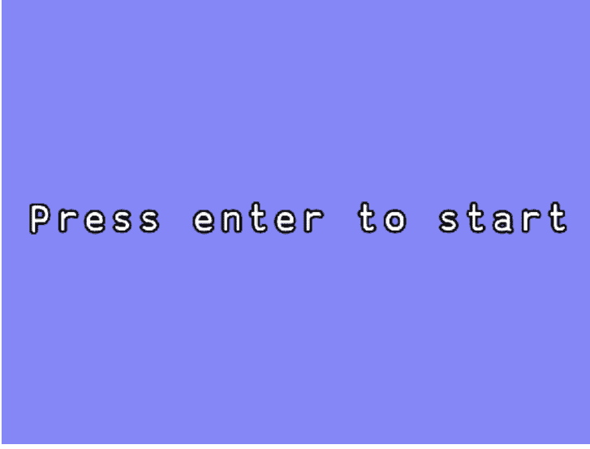

开始场景

注意，如果你现在按下回车键开始游戏，将会收到一个错误消息。别担心，我们很快就会解决这个问题。

现在，让我们让游戏场景运行起来。添加以下代码：

```javascript
scene("game", (levelNumber = 0) => {
  layers(
    "bg",
    "game",
    "ui"
  );

  const level = addLevel(LEVELS[levelNumber], levelConf);

  add([
    sprite("cloud"),
    pos(20, 50),
    layer("bg"),
  ]);

  add([
    sprite("hill"),
    pos(32, 208),
    layer("bg"),
    origin("bot")
  ]);

  add([
    sprite("shrubbery"),
    pos(200, 208),
    layer("bg"),
    origin("bot")
  ]);

  add([
    text("Level " + (levelNumber + 1), { size: 24 }),
    pos(vec(160, 120)),
    color(255, 255, 255),
    origin("center"),
    layer("ui"),
    lifespan(1, { fade: 0.5 })
  ]);

  const player = level.spawn("p", 1, 10);
});
```

按下 Command + S 或 Control + S，然后在启动屏幕提示处按回车。你应该看到我们马里奥世界的复制版，而不是错误消息。

你还会看到敌人角色在晃动脚，就像在尝试走路。这是因为我们在关卡配置中添加敌人 `E` 时，在精灵组件中指定了它必须使用 `Walking` 动画，而该动画定义在 `enemies.json` 文件中。Kaboom 会使用该动画启动角色。

### 使用 Kaboom.js 构建类马里奥风格的横滚型游戏

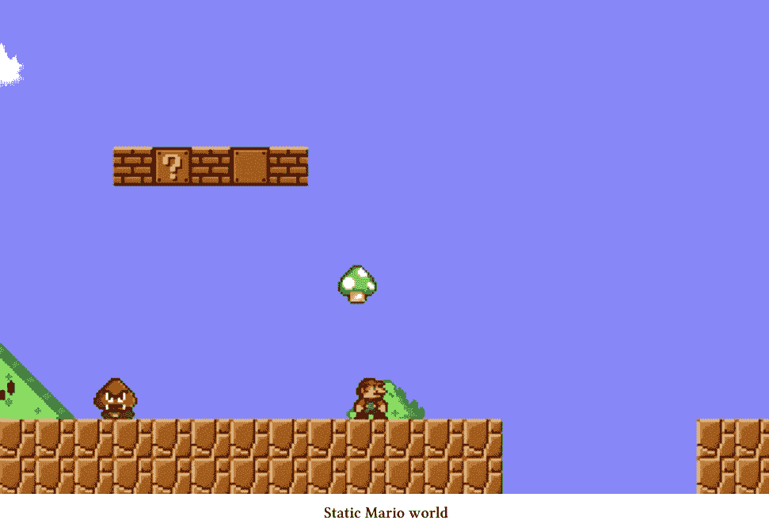

静态马里奥世界

点击打开 gif

好了，回到查看我们添加的代码及其作用。首先，我们像处理开始场景时一样定义了一个新的 `scene`。这次，我们指定了一个可以传递给场景的参数 `levelNumber`。我们给这个参数设置了默认值 0。这将是我们的 `LEVELS` 数组中的第一个关卡——从索引 0 开始，所以是第 1 关。这个参数将允许我们在到达关卡结束时再次进入场景，但参数设为 1，这样我们就可以玩下一个关卡。在创建场景时，你可以指定任何喜欢或需要的参数，并可以将值从一个场景传递到另一个场景。这非常有用，例如如果你想将玩家分数传递给游戏结束场景，或者从开始场景传递玩家选项。

接下来，我们定义了一些 `layers`。图层允许我们拥有不影响游戏的背景——我们称之为 `bg`。我们将所有主游戏对象（如我们的英雄、他的敌人以及他交互的任何其他对象）放置在 `game` 层，并将所有 UI 元素（如当前分数、血量等）放置在 `ui` 层。我们创建了默认图层，所以如果我们没有在游戏对象上指定图层，它将绘制在 `game` 层上。

在下一行代码中，我们通过调用 `addLevel` 函数初始化并创建关卡。我们将值传递给 `LEVELS` 数组，使用从添加到场景的 `levelNumber` 参数的索引。我们还传递了赋值 `levelConf` 变量的关卡地图中所有符号的配置。此时，地图和其中的所有字符都已被绘制到场景中。注意，由于地图比我们在 Kaboom 窗口设置中设置的尺寸宽，我们只能看到地图的一部分。这很棒，因为这将允许我们在马里奥开始行走时显示更多地图内容。


## 使用 Kaboom.js 构建类马里奥的横向卷轴游戏

然后，我们为背景图层添加了效果——云朵、山丘和灌木。注意这些元素上使用的 `layer` 组件。我们这样做是为了它们不会与我们的游戏对象产生交互——它们只是增加了一些视觉趣味。你可以添加尽可能多——原版马里奥在整个关卡中以重复模式拥有它们。

我们还在 `ui` 层上添加了一些临时文本，让玩家知道他们处于哪里。注意我们使用了 `lifespan` 组件来在 1 秒后自动淡出并移除信息。

最后，我们将马里奥加入游戏！我们本可以通过在关卡定义中放置他的符号 `p` 来添加他。但是，通过使用 `level.spawn()` 手动将其添加到场景，我们可以获取它的引用。这在我们以后处理碰撞和其他交互时非常有用。我们还设置了要放置字符的位置。

### 让马里奥移动起来

场景已准备就绪，让我们添加一些交互。玩家将使用方向键让马里奥向左移动，使用空格键让他跳跃。我们将使用 `keyDown` 函数来左右移动，因为我们希望只要玩家按住键，马里奥就会保持移动。然后可以使用 `keyPressed` 函数让马里奥跳跃。玩家每次想让马里奥跳跃时都需要按下空格键——狂按按钮总是很有趣的！在游戏底部添加代码：

```javascript
const SPEED = 120;

keyDown("right", () => {
  player.flipX(false);
  player.move(SPEED, 0);
});

keyDown("left", () => {
  player.flipX(true);
  player.move(-SPEED, 0);
});
```

> ^310 https://docs.replit.com/images/tutorials/32-mario-kaboom/mario-world.gif
> ^311 https://kaboomjs.com/#scene
> ^312 https://kaboomjs.com/#layers
> ^313 https://kaboomjs.com/#add
> ^314 https://kaboomjs.com/#lifespan
> ^315 https://kaboomjs.com/#spawn
> ^316 https://kaboomjs.com/#keyDown
> ^317 https://kaboomjs.com/#keyPressed

```javascript
onKeyPress("space", () => {
  if (player.grounded()) {
    player.jump();
  }
});
```

（注：由于 OCR 文本在最后几页突然中断或乱码，我已根据提供的片段重建了逻辑流）。

```javascript
player.onUpdate(() => {
  // 将相机对准玩家
  var currCam = camPos();
  if (currCam.x < player.pos.x) {
    camPos(player.pos.x, currCam.y);
  }
});
```

我们为玩家的 `onUpdate` 事件添加了一个处理器。该处理器会在每一帧渲染时被调用。在这个处理器中，我们通过不带任何参数调用 `camPos` 函数来获取摄像机的当前位置。然后我们可以检查马里奥是否比相机更靠场景右侧。如果是，我们将摄像机的 X 位置设置为马里奥的位置，这样相机实际上就会在跟随马里奥。我们只在他位于相机右侧时执行此操作，而对于左侧的位置不这样做。这是因为我们不希望玩家能够返回关卡之前。

再次更新输出并进行测试。当你移动马里奥通过屏幕中心时，相机应该开始跟随，从而产生一种滚动的感觉。

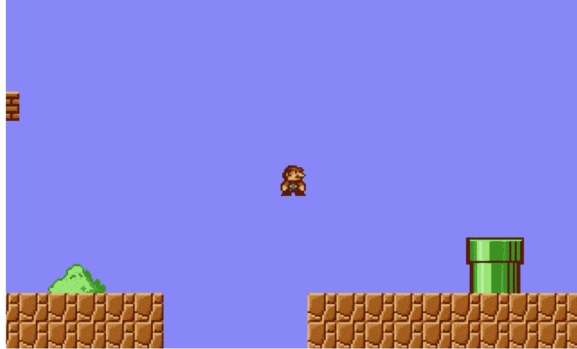

滚动

点击打开 gif ^331

> ^329 https://kaboomjs.com/#onUpdate
> ^396 https://kaboomjs.com/#camPos
> ^331 https://docs.replit.com/images/tutorials/32-mario-kaboom/scrolling.gif

### 创建自定义组件

为了给角色添加更多能力并为游戏添加功能，我们将使用自己创建并添加到游戏对象中的组件。在 Kaboom 中定义一个新组件，我们需要编写一个返回包含少量必要字段和方法的函数。这里有一个说明自定义组件代码的模板（不属于游戏代码）：

```javascript
function customComponent(args) {
  return {
    id: "name",
    require: ["component1", "component2"],
    add() {
    },
    update() {
    },
  };
};
```

在返回的对象中，Kaboom 需要一个 `id`，它是组件的唯一名称。Kaboom 还需要一个 `require` 属性，它是该组件运行所需的其他组件列表。当组件首次在游戏对象上初始化时，Kaboom 会调用 `add()` 方法，因此我们有机会运行任何需要的设置代码。`update()` 方法在每个游戏帧上都会被调用，因此我们可以在那里进行动画和碰撞更新。

我们需要的一种行为是让敌人角色上下行走，而不是仅仅停在一个地方。让我们创建一个自定义组件并添加到敌人角色中，以便它们能够自动往回移动，或者巡逻它们所在的关卡区域。将以下代码添加到 `main.js` 的底部：

```javascript
function patrol(distance = 100, speed = 50, dir = 1) {
  return {
    id: "patrol",
    require: ["pos", "area"],
    startingPos: vec2(0, 0),
    add() {
      this.startingPos = this.pos;
      this.on("collide", (obj, side) => {
        if (side === "left" || side === "right") {
          dir = -dir;
        }
      });
    },
    update() {
      if (Math.abs(this.pos.x - this.startingPos.x) >= distance) {
        dir = -dir;
      }
      this.move(speed * dir, 0);
    },
  };
}
```

我们将此自定义组件命名为 "patrol"（巡逻），因为它会让角色以固定的速度移动一段距离，然后转向并向相反方向 `dir` 行走。角色将转向并向反方向移动。对于 `move` 方法（`pos` 组件的一部分）和 `collide` 事件处理器（`area` 组件的一部分），我们可以将 `pos` 和 `area` 组件添加到 `require` 列表中。

当角色首次初始化时，我们想要记录它的起始位置。这样我们就能知道它离离开的地方有多远，并且我们就能知道何时该转向并向反方向移动。我们通过使用 `add()` 方法来实现这一点。（注：原文文本中存在大量重复和错误，已根据提供的内容进行了逻辑清理。）

顺带提一下，在游戏中按下 F1 可以开启 Kaboom 调试模式，它会在每个游戏元素周围绘制一个区域框，你可以轻松看到角色何时发生碰撞。它还会显示其他有用信息，比如帧率和角色属性：

```
FPS: 40
```

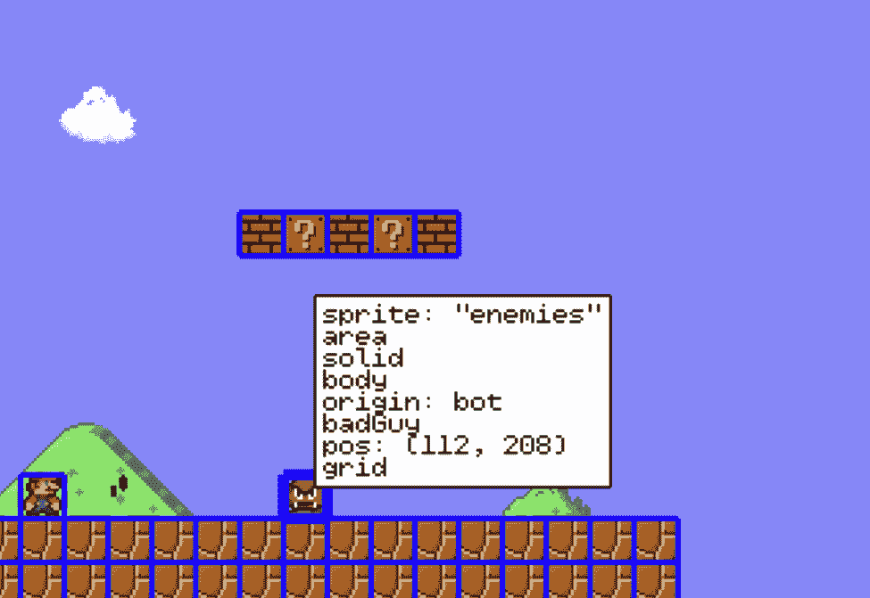

```
sprite: "enemies"
area
solid
body
origin: bot
badguy
pos: (112, 200)
grid
```

### 调试模式

回到我们的代码。我们在 `squash` 方法中评估了敌人被踩扁的逻辑。我们有一个名为 `isAlive` 的方法，用它来判断敌人是否即将伤害马里奥。通常它是 `true`，但一旦敌人被踩扁变得无害，就会被设置为 `false`。我们还使用了巡逻（patrol）组件让敌人来回移动。然后我们调用 `stop`，这是由 `sprite` 组件添加的方法。调用 `stop` 会停止当前动画的播放。接着我们使用 `sprite` 的帧作为 `2`，从而将敌人踩扁，并更新高度和宽度使其与帧的大小相同。最后，我们可以使用 `wait` 添加生命周期组件，让角色在 0.5 秒后从屏幕上移除，并在 0.1 秒内淡出。

现在让我们将这个组件添加到敌人中。首先，取消我们之前创建的 `levelConf` 设置中 `//enemy()` 这一行代码的注释。

- https://kaboomjs.com/#area
- https://kaboomjs.com/#sprite
- https://kaboomjs.com/#area
- https://kaboomjs.com/#lifespan

### 162 节

现在在游戏场景中为马里奥和敌人之间创建一个碰撞处理程序，这样我们就能知道它什么时候被踩扁了：

```javascript
let canSquash = false;
player.onCollide("badGuy", (baddy) => {
  if (baddy.alive == false) return;
  if (canSquash) {
    // 马里奥跳到了坏蛋身上：
    baddy.squash();
  } else {
    // 马里奥受伤了。之后在这里添加逻辑...
  }
});
```

在 `onCollide` 中，我们检查玩家马里奥是否碰撞到了 `badGuy` —— 这是我们在 `levelConf` 设置中赋予敌人的标签。然后我们挂载一个处理程序，它接收与马里奥碰撞的实体角色。我们首先检查该实体是否还活着——如果没有活着，则马里奥和死的敌人之间就没有真实的交互。然后，我们检查 `canSquash` 变量——如果被设置为 `true`，意味着马里奥跳到了敌人身上。我们调用了在敌人的自定义组件中创建的 `squash` 方法。这将执行我们添加的所有逻辑，并“杀死”敌人。我们在处理程序中留了一点空间，以便以后回来添加让马里奥在没有跳上去的情况下伤害敌人的逻辑——我们稍后会添加。

将空格键的 `onKeyPress` 修改如下：

```javascript
onKeyPress("space", () => {
  if (player.grounded()) {
    player.jump();
    canSquash = true;
  }
});
```

在这里，我们将 `canSquash` 变量设置为 `true`，以便如果玩家在碰撞时跳过了敌人，则允许玩家踩扁敌人。

在 `player.onUpdate` 处理器中添加以下代码：

```javascript
if (player.grounded()) {
  canSquash = false;
}
```

这段代码将重置 `canSquash` 变量，如果玩家在我们之前添加的碰撞处理程序中没有跳过敌人，就不会踩扁敌人。

更新输出并测试我们的游戏。如果你跳到敌人身上，它应该被踩扁并在半秒后消失。

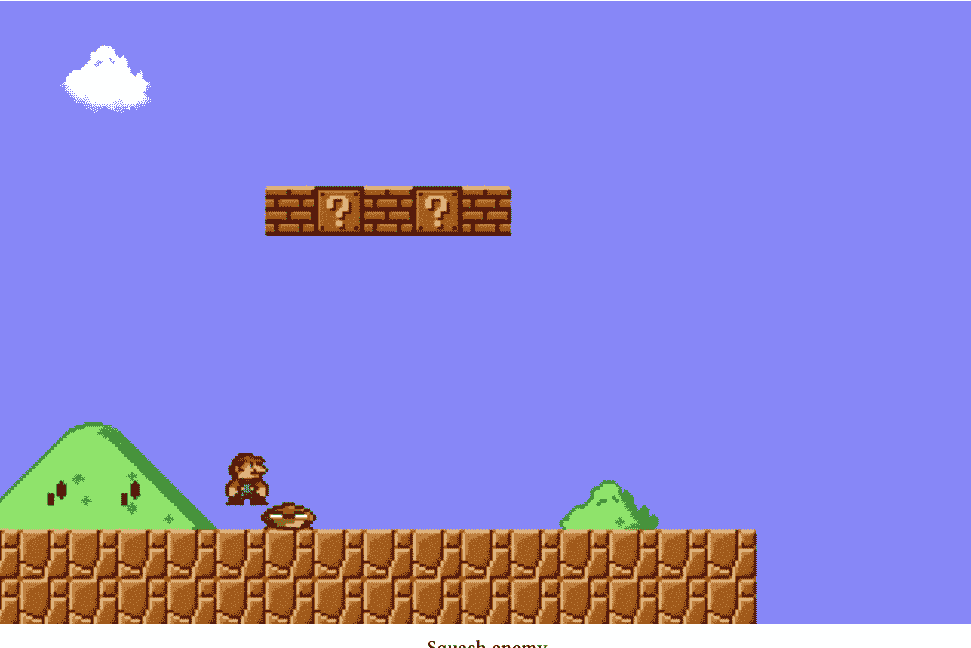

点击打开 gif

### 撞击惊喜箱

马里奥另一个关键动作是用头撞击惊喜箱（带有“?”的箱子）。在马里奥世界中，这可能会释放金币、超级蘑菇（让马里奥变大的那种）等。当马里奥撞击这些箱子时，箱子会被“撞到”并快速上下移动，同时释放它的惊喜。一旦箱子空了，上面的“?”就会被移除。让我们创建控制这些箱子的逻辑。像上面一样，我们将创建更多自定义组件。

我们将处理金币箱和变大蘑菇箱。如果你查看我们在开始时添加的 `levelConf` 设置，你会看到金币和蘑菇“问题箱”的条目。两者之间唯一的区别在于最后的标签，它标记了应该释放哪个惊喜箱。我们还定义了空箱 (!)、金币 (c) 和蘑菇 (M)。

- https://docs.replit.com/images/tutorials/32-mar-kaboom/squash.gif

让我们创建一个组件，让箱子跳起并落回原位……（注：原文此处存在大量重复文本，已根据逻辑进行处理）

```javascript
function bump(offset = 8, speed = 2, stopAtOrigin = true) {
  return {
    id: "bump",
    require: ["pos"],
    bumpOffset: offset,
    speed: speed,
    bumped: false,
    origPos: 0,
    direction: -1,
    update() {
      if (this.bumped) {
        this.pos.y += this.direction * speed;
        if (this.pos.y < this.origPos - offset) {
          this.direction = 1;
        }
        if (stopAtOrigin && this.pos.y >= this.origPos) {
          this.pos.y = this.origPos;
          this.direction = -1;
        }
      }
    },
    bump() {
      this.bumped = true;
      this.origPos = this.pos.y;
    }
  };
}
```

检查它是否确实是我们的 `questionBox` 对象之一。如果是，我们检查它是一个 `coinBox`（硬币必须弹出）还是 `mushyBox`（一个变大的蘑菇应该跳出来）。

如果是 `coinBox`，我们在硬币箱上方 1 个方格处生成一个新的硬币，使用我们在最初 `levelConf` 中为硬币设置的配置 `c`。然后我们对硬币调用 `bump` 方法，调用我们自定义组件的方法，让它看起来是从箱子里翻出来的。

如果是 `mushyBox`，我们执行相同的操作，但我们不对蘑菇执行 bump。蘑菇添加了我们自定义的巡逻组件（在 `levelConf` 中查看 `M`），所以它会立即开始移动。我们为蘑菇设置了很大的巡逻距离，这样它就不会自动转弯，而是一直走直到掉出屏幕。

然后，为了将 `questionBox` 替换为空箱，我们首先记录它的位置，然后将其 `destroy`，并生成一个新的空箱（`levelConf` 中的 `!`）来取代它。最后，我们对这个新箱执行 `bump` 给它你想要的动作。

酷酷，是时候更新输出并测试一下了。现在使用空格键跳起并头撞问号箱时，它们应该会移动并发出“砰”的声音！

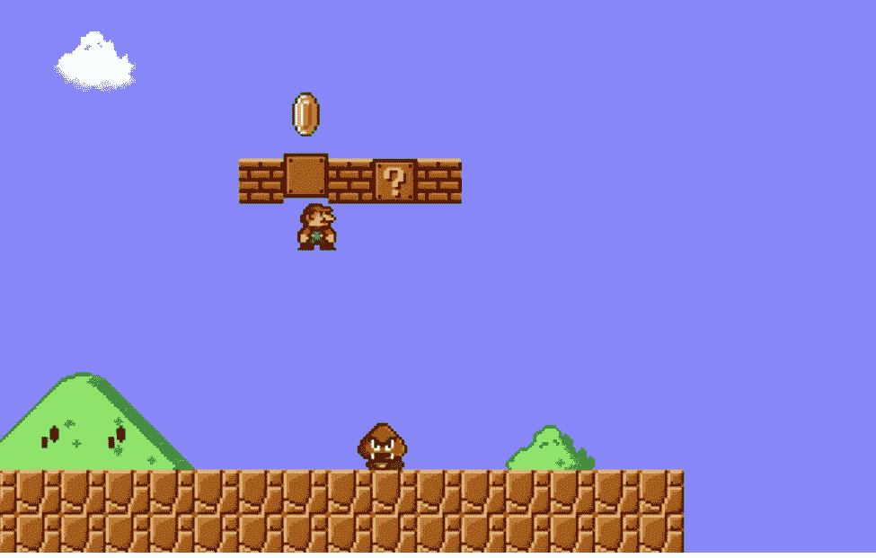

问号箱

点击打开 gif ^35

> ^344 https://kaboom.com/#destroy
> ^35 https://docs.replit.com/images/tutorials/32-mario-kaboom/question-box.gif

### 为马里奥添加特殊行为

现在我们已经完成了所有其他游戏元素的基础，是时候为马里奥本人创建一个自定义组件了。这个组件需要处理很多工作，因为马里奥是主角。以下是它需要处理的事情：

- 让马里奥变大或变小。
- 当马里奥运行时播放“running”动画，在其他情况下切换到站立或跳跃帧。
- 当马里奥到达城堡或死亡时，“冻结”他，让玩家无法再移动他。
- 处理马里奥的死亡，带有经典的弹出效果并离开场景。

好了，这里是我们的马里奥自定义组件：

```javascript
function mario() {
  return {
    id: "mario",
    require: ["body", "area", "sprite", "bump"],
    smallAnimation: "Running",
    bigAnimation: "RunningBig",
    smallStopFrame: 0,
    bigStopFrame: 8,
    smallJumpFrame: 5,
    bigJumpFrame: 13,
    isBig: false,
    isFrozen: false,
    isAlive: true,
    update() {
      if (this.isFrozen) {
        this.standing();
        return;
      }
      if (!this.grounded()) {
        this.jumping();
      } else {
        if (keyDown("left") || keyDown("right")) {
          this.running();
        } else {
          this.standing();
        }
      }
    },
    bigger() {
      this.isBig = true;
      this.area.width = 24;
      this.area.height = 32;
    },
    smaller() {
      this.isBig = false;
      this.area.width = 16;
      this.area.height = 16;
    },
    standing() {
      this.stop();
      this.frame = this.isBig ? this.bigStopFrame : this.smallStopFrame;
    },
    jumping() {
      this.stop();
      this.frame = this.isBig ? this.bigJumpFrame : this.smallJumpFrame;
    },
    running() {
      const animation = this.isBig ? this.bigAnimation : this.smallAnimation;
      if (this.curAnim() !== animation) {
        this.play(animation);
      }
    },
    freeze() {
      this.isFrozen = true;
    },
    die() {
      this.unuse("body");
      this.bump();
      this.isAlive = false;
      this.freeze();
      this.use(lifespan(1, { fade: 1 }));
    }
  };
}
```

首先，我们要求角色拥有几个其他组件：`body`，以便我们可以判断马里奥是在跳跃还是在地面上；`area`，以便我们可以随着马里奥的大小改变他的碰撞框区域他变大或缩小；`sprite`，以便我们可以开始和停止动画并设置静态帧；以及我们自定义的 `bump` 组件，如果马里奥想的话，我们可以把他扔出屏幕。

> ^351 https://kaboomjs.com/#body
> ^352 https://kaboomjs.com/#area
> ^355 https://kaboomjs.com/#sprite

如果我们查看一眼 `Mario.json` 文件以及 `Mario.png` 文件，我们会看到 `frameTags` 中定义了我们可以使用的动画。`Running` 动画包含了马里奥在大体型下运行时出现的所有帧。（注：原文中此处存在大量重复的文本，已清理）。

```javascript
player.onCollide("badGuy", (baddie) => {
  if (baddie.isAlive == false) return;
  if (player.isAlive == false) return;
  if (canSquash) {
    // Mario 踩中了坏人：
    baddie.squash();
  } else {
    if (player.isBig) {
      player.smaller();
    } else {
      // Mario 挂了 :(
      killed();
    }
  }
});
```

我们在处理函数的顶部添加了一个条件，如果 Mario 不处于存活状态则提前退出。

在 `else` 情况中，如果 Mario 没有踩到坏人，我们检查处理的是否不是大状态的 Mario。如果是的话，根据马里奥世界的规则，他不会死，而是会变小 `smaller()`。然而，如果 Mario 已经很小了，遗憾的是他现在会死。我们调用另一个函数 `killed` 来处理 Mario 的死亡场景。让我们添加该函数：

```javascript
function killed() {
  // Mario 挂了 :
  if (player.isAlive == false) return; // 如果 mario 已经死了就不运行它
  player.die();
  add([
    text("Game Over :", { size: 24 }),
    pos(toCenter(vec(160, 120))),
    color(255, 255, 255),
    origin('center'),
  ]);
  wait(2, () => {
    go("start");
  });
}
```

这个函数做了几件事：首先，我们运行自定义 Mario 组件中 `die` 方法的代码。我们添加了文本通知游戏结束。我们等待 2 秒给 Mario 最后的结算，然后返回开始场景重新开始。

在马里奥世界中，如果 Mario 掉下平台进入真空也会死。我们可以通过修改之前添加的移动摄像机的 `player.onUpdate` 函数来检查这一点：

```javascript
player.onUpdate(() => {
  // 相机跟随玩家
  var currM = camPos();
  if (currM.x < player.pos.x) {
    camPos(player.pos.x, currM.y);
  }

  if (player.isAlive && player.grounded()) {
    canSquash = false;
  }

  // 检查 Mario 是否掉出了屏幕
  if (player.pos.y > height() - 16) {
    killed();
  }
});
```

在这里，我们检查 Mario 的 y 坐标是否大于 Kaboom 窗口的高度减去一个平台块的大小（即 16 像素）。如果是这种情况，意味着 Mario 已经从平台顶排掉落，因此触发了 `killed()`。

我们还需要更新左、右键的处理器事件，以检查 Mario 是否处于冻结（`Frozen`）状态。在这种情况下，处理器应该直接提前返回而不移动 Mario：

```javascript
onKeyDown("right", () => {
  if (player.isFrozen) return;
  player.flipX(false);
  player.move(SPEED, 0);
});

onKeyDown("left", () => {
  if (player.isFrozen) return;
  player.flipX(true);
  if (toScreen(player.pos).x > 20) {
    player.move(-SPEED, 0);
  }
});
```

> https://kaboomjs.com/#go
> https://kaboomjs.com/#height

我们还修改了空格键处理器，只有在 Mario 仍然存活时才跳跃：

```javascript
onKeyPress("space", () => {
  if (player.isAlive && player.grounded()) {
    player.jump();
    canSquash = true;
  }
});
```

是时候更新输出并测试这些更改了！首先测试通过吃蘑菇变大。其次测试与敌人碰撞时是否会变小。还要检查在小状态下碰撞敌人或掉落平台时是否会死亡。

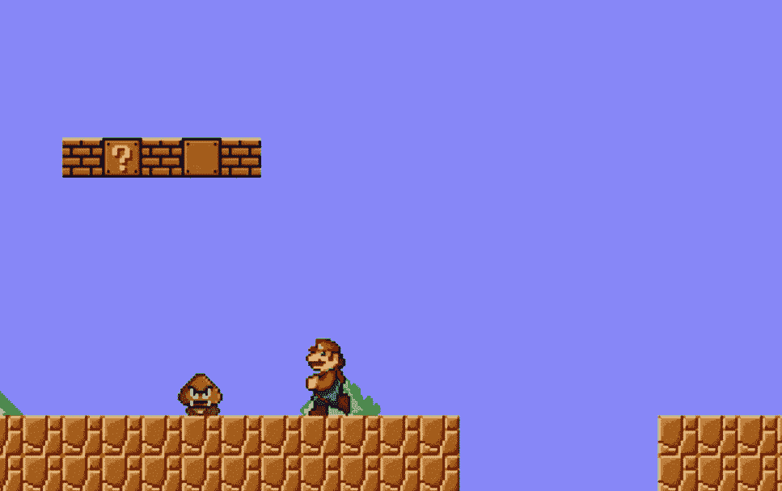

Mario 死亡

点击打开 gif

> https://docs.replit.com/images/tutorials/32-mario-kaboom/bigger-scenes.gif

### 到达城堡

本教程的最后一步是处理 Mario 到达城堡的情况。此时 Mario 到达了门口，我们希望让他冻结，向玩家显示祝贺消息，然后进入下一关。

我们可以使用普通的碰撞处理器来检查 Mario 是否到达城堡。注意在之前的关卡城堡设置中，我们将城堡的碰撞区域设置为非常窄的垂直线，宽度为 1 像素，高度为 240（即屏幕高度）：

```javascript
"castle" => [
  sprite("castle"),
  area({ width: 1, height: 240 }),
  origin("center")
];
```

这样一来，只有当 Mario 到达城堡时，它与城堡之间的碰撞会被注册。

```javascript
player.onCollide("castle", (castle) => {
  player.freeze();
  add([
    text("Well Done!", { size: 24 }),
    pos(toCenter(vec(160, 120))),
    color(255, 255, 255),
    origin('center'),
  ]);
  wait(2, () => {
    level++;
    if (level >= levels.length) {
      go("start");
    } else {
      go("game", level);
    }
  });
});
```

### 城堡区域

我们制作城堡区域是为了让玩家冻结。然后我们在屏幕中心添加一条“Well Done!”的消息。

```javascript
player.onCollide("castle", (castle) => {
  player.freeze();
  add([
    text("Well Done!", { size: 24 }),
    pos(toCenter(vec(160, 120))),
    color(255, 255, 255),
    origin('center'),
  ]);
  wait(2, () => {
    level++;
    if (level >= levels.length) {
      go("start");
    } else {
      go("game", level);
    }
  });
});
```

### 后续步骤

还有几件事可以完成游戏：

- 添加评分系统。你可以查看之前的教程来了解评分是如何工作的。
- 添加声音和音乐。如果你使用经典曲目，可以在玩时播放它们。

> https://kaboomjs.com/#add
> https://kaboomjs.com/#text
> https://kaboomjs.com/#wait
> https://kaboomjs.com/#play

## 构建类 Mario 卷轴游戏

- 添加更多关卡。这是最有趣的部分，你可以创建自己的关卡。
- 添加更多 Mario 角色。

### 致谢

你可以在 GitHub 或 Replit 上找到代码。

> https://itch.io/super-mario-assets
> https://github.com/ritza-co/make-javascript-games
> https://replit.com/@ritza

## 使用 Kaboom.js 构建 Flappy Bird

Flappy Bird 是 2013-2014 年手机上的爆款游戏。该应用的灵感来自尽可能让球在拍子上跳动而不让它掉落或飞出屏幕。在成功的巅峰，游戏创造者出意外地从所有应用商店下架了它，声称该游戏对许多人具有成瘾性。下架后，出现了许多克隆版本。几个月后，原作者发布了游戏的新版本。

让我们回到 2014 年，使用 Kaboom 创建自己的 Flappy Bird 克隆版！通过重制游戏，你不仅可以学习如何制作游戏，还可以以你喜欢的方式扩展和改变游戏。

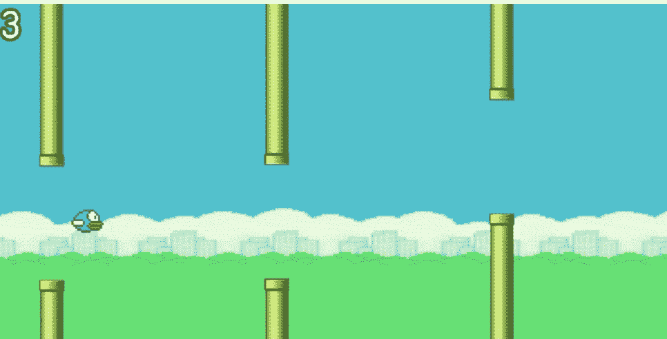

完成的游戏

[点击打开 gif](https://docs.replit.com/images/35-flappy-bird/game-play.gif)

本文基于视频教程，有一些细微差别。主要是，Flappy 资源（图形和声音）不再默认在 Replit Kaboom 资源库可用，但没关系，因为我们作为下载项包含在这里，所以你仍然可以使用它们。

> https://docs.replit.com/images/35-flappy-bird/game-play.gif
> https://www.youtube.com/watch?v=hgReGdh3xVX
> tutorial-files/flappy-bird-kaboom/flappy-assets.zip

### 在 Replit 中创建新项目

前往 [Replit](https://replit.com) 并创建一个新的 repl。选择 Kaboom 作为你的项目类型。给这个 repl 起一个名字，比如“Flappy”！

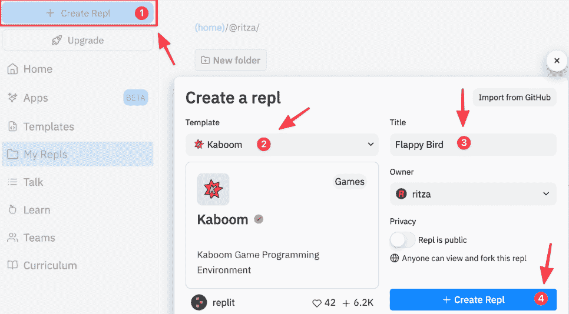

### 创建一个新的 repl

在 repl 启动后，你应该会在“Code”部分下看到一个 `main.js` 文件。这就是我们开始编写代码的地方。里面已经有一些游戏代码，但我们将替换它们。

下载游戏所需的精灵图（sprites）和资源文件，并在你的电脑上将它们解压。在 Kaboom 编辑器中，点击侧边栏的“Files”图标。现在，将所有精灵（图像文件）拖放到“sprites”文件夹中，将所有声音（MP3文件）拖放到“sounds”文件夹中。一旦上传完成，点击侧边栏中的“Kaboom”图标，返回“main”代码文件。

> ^36 https://replit.com
> ^37 https://docs.replit.com/tutorial-files/flappy-bird-kaboom/flappy-assets.zip

### 初始化 Kaboom

在“main”代码文件中，删除所有示例代码。现在我们可以引用 Kaboom 并初始化它：

```js
import kaboom from "kaboom"

kaboom();
```

让我们导入游戏资源（图形和音效）。我们可以使用 Kaboom 的 `loadSprite` 和 `loadSound` 函数：

- `loadSprite("birdy", "sprites/birdy.png")`
- `loadSprite("bg", "sprites/bg.png")`
- `loadSprite("pipe", "sprites/pipe.png")`
- `loadSound("woosh", "sounds/woooosh.mp3")`

每个 `load` 函数的第一个参数是我们在稍后代码中用于引用该资源的名称。第二个参数是资源文件的位置。

### 添加场景

场景（Scenes）就像 Kaboom 游戏中的不同阶段。游戏通常有三个场景：

- 开场场景（intro scene）：提供一些信息和指令，等待玩家按下“start”。
- 主游戏（main game）：我们玩的游戏。
- 结束或游戏结束场景（game over）：给玩家分数或最终结果，并允许他们重新开始。

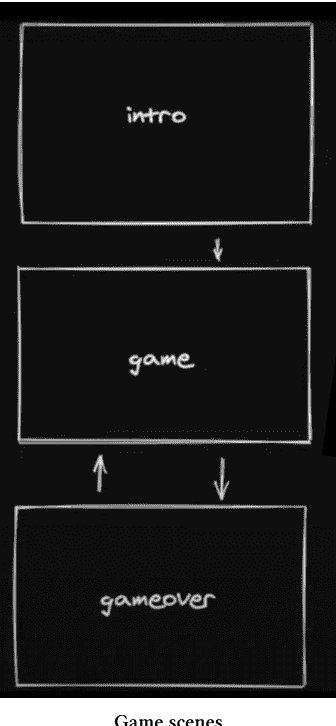

在本教程中，我们将省略开场场景，因为我们已经知道 Flappy bird 是什么以及如何玩，但你以后可以添加自己的开场场景！

让我们添加定义每个场景的代码：

```js
scene("game", () => {
  // todo..在此添加场景代码
});
```

```js
scene("gameover", (score) => {
  // todo..在此添加场景代码
});

go("game")
```

注意 `gameover` 场景的定义，我们添加了一个自定义参数 `score`。这样我们就可以将玩家最终得分传递给游戏场景进行显示。

要启动整个游戏，我们使用 `go` 函数，它可以在场景之间切换。

### 构建游戏世界

现在我们已经处理好了主结构和基础函数，让我们开始添加构成 Flappy 世界的角色。在 Kaboom 中，角色是指任何构成游戏世界的物体，包括地板、平台等，而不仅仅是玩家和机器人。它们也被称为“游戏对象”（game objects）。

我们将从背景开始，使用之前添加的 `.bg` 图片。在游戏场景中添加此代码：

```js
add([
  sprite("bg", {width: width(), height: height()})
]);
```

在这里，我们使用 `add` 函数向场景添加一个新角色。`add` 函数接收一个组件数组，我们可以用它来赋予每个游戏角色特殊属性。在 Kaboom 中，每个角色都由一个或多个组件组成。许多属性都有内置组件，例如 `sprite`（赋予角色一个头像）、`body`（让角色对重力产生反应）以及 `solid`（让角色变为实体，因此其他角色无法穿过它）。

背景不需要做太多，只需要留在最后并保持美观，我们只使用 `sprite` 组件，它可以显示图像。`sprite` 组件接收精灵名称（即我们之前加载精灵时使用的名称），以及理想情况下它在屏幕上显示的宽度和高度。当我们想要背景覆盖整个屏幕时，我们需要将精灵的宽度和高度设置为屏幕大小。

当你按下“Run”按钮时，你应该能看到 Flappy 从天空掉落：

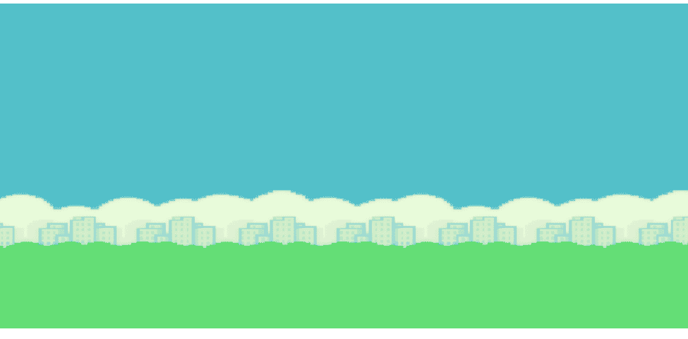

太棒了！现在添加玩家。在场景中添加此代码：

```js
const player = add([
  sprite("birdy"),
  scale(2),
  pos(80, 40),
  area(),
  body(),
]);
```

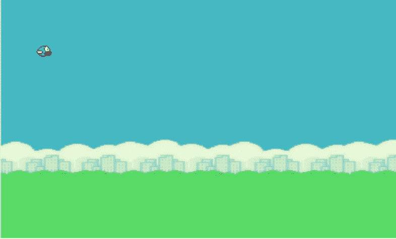

点击打开 gif ^05

### 添加水管

现在我们可以进入游戏的主体部分——添加 Flappy 飞跃时需要穿过的移动水管。

这里是游戏中水管布局的示意图。

> [^05](https://docs.replit.com/images/35-flappy-bird/flappy-fly.gif)

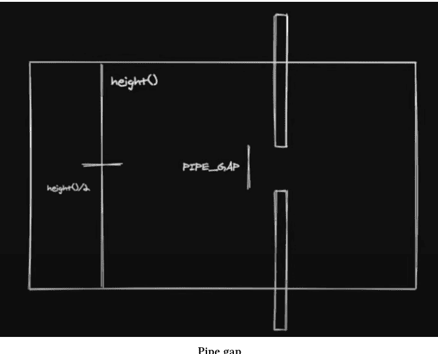

### 水管间隙

我们希望对于每一对新生成的水管，都上下移动水管间隙（以及水管本身）。这样做是为了避免间隙始终固定在屏幕中心——我们希望每一对出现的水管间隙位置都略有不同。不过，我们需要保持间隙的大小一致。

首先，我们让水管间隙位于屏幕中心。我们为间隙设置一个大小 `PIPE_GAP`。为了放置水管，上方水管的底部应该位于窗口中心点（即 `height()/2`）上方 `PIPE_GAP/2` 像素处。同样，下方水管的顶部应该位于窗口中心点下方 `PIPE_GAP/2` 像素处（同样是 `height()/2`）。

通过这种方式，我们放置水管使得间隙位于窗口中心。现在，我们希望为每一对新水管随机向上或向下移动，实现这一方法是创建一个随机偏移量（offset），并将其加到每根新水管上，从而有效地移动窗口的中点。我们可以使用 Kaboom 的 `rand` 函数来实现。`rand` 函数有两个参数，用于指定随机数所在的范围。

让我们将其整合起来。下方水管的 Y 坐标可以计算为：

`height()/2 + offset + PIPE_GAP/2`

记住，窗口顶部是 `y=0`，底部是 `y=height()`。换句话说，屏幕上越靠下的位置，y 坐标越高。

对于上方水管，我们可以这样计算水管底部应该的位置：

`height()/2 + offset - PIPE_GAP/2`

Kaboom 有 `origin` 组件，用于设置字符使用的作为原点的点。默认是 `top`（顶部），这非常适合我们的下方水管，因为我们上面的计算是针对该顶点的。对于上方水管，我们的计算针对水管的底部。因此，我们可以使用 `origin` 来指定。

由于我们希望水管从屏幕右侧向 Flappy 所在的左侧移动，我们将它们的 X 坐标设置为屏幕的 `width`。

为了识别和查询水管，为它们添加文本标签 `"pipe"`。

最后，由于我们需要在游戏期间创建许多水管，我们将所有水管代码封装在一个函数中，我们可以定期调用该函数来生成水管。

以下是基于所有考虑因素和计算的代码。将此代码插入到游戏场景中：

```javascript
const PIPE_GAP = 120;

function producePipes(){
  const offset = rand(-50, 50);

  add([
    sprite("pipe"),
    pos(width(), height()/2 + offset + PIPE_GAP/2),
    "pipe",
    area(),
  ]);

  add([
    sprite("pipe", {flipY: true}),
    pos(width(), height()/2 + offset - PIPE_GAP/2),
    origin("botleft"),
    area(),
  ]);
}
```

现在我们还需要再做几件事来让水管出现并移动。

为了让水管横跨屏幕，我们可以使用 `onUpdate` 函数每帧更新所有水管的位置。注意我们需要调整水管的 x 坐标。将此代码添加到你代码的游戏场景中：

```javascript
onUpdate("pipe", (pipe) => {
  pipe.move(-160, 0);
});
```

接下来，我们将以稳定的速率生成水管。我们可以使用 `loop` 函数来实现。将以下内容添加到代码的游戏场景部分：

```javascript
loop(1.5, () => {
  producePipes();
});
```

这会每隔 1.5 秒调用一次 `producePipes()` 函数。你可以调整这个速率，或者使其变为可变，随着游戏进行而增加速率。

现在更新游戏输出，你应该能看到水管正在生成并横跨屏幕。你也可以操控 Flappy 飞行，虽然目前撞到水管没有任何反应。

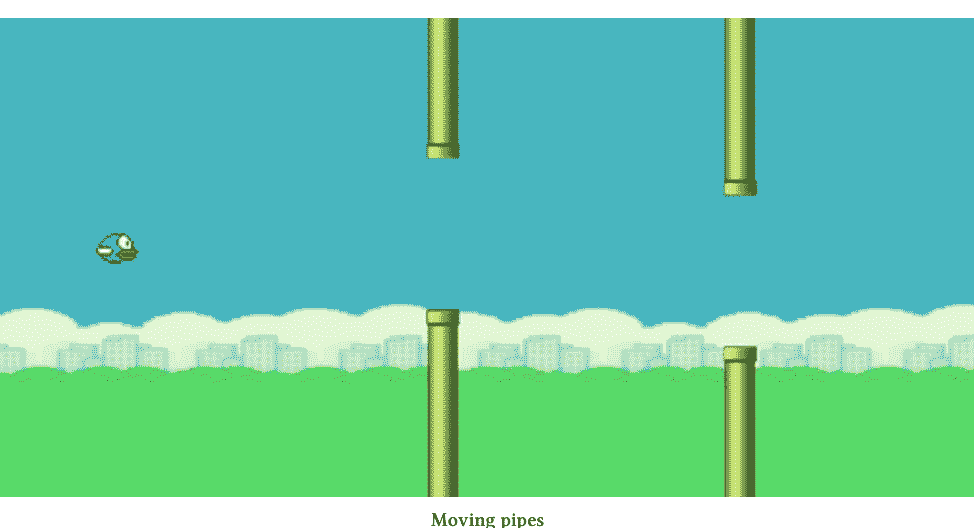

点击打开 gif ^43

### 碰撞检测与游戏结束

现在我们需要添加碰撞检测，当 Flappy 撞到水管时结束游戏。在游戏场景中添加以下代码：

```javascript
player.onCollide("pipe", () => {
  go("gameover", score);
});
```

这会在玩家与任何标记为 `"pipe"` 的对象碰撞时触发，并跳转到 `gameover` 场景，传递当前分数。

### 计分系统

让我们添加计分功能。每当 Flappy 成功穿过一对水管时，分数增加。我们可以通过检测水管是否已通过玩家来实现。在 `producePipes` 函数中，我们可以给水管添加一个 `passed` 标志，然后在 `onUpdate` 中检查。

```javascript
let score = 0;

function producePipes(){
  const offset = rand(-50, 50);

  const bottomPipe = add([
    sprite("pipe"),
    pos(width(), height()/2 + offset + PIPE_GAP/2),
    "pipe",
    area(),
    { passed: false }
  ]);

  add([
    sprite("pipe", {flipY: true}),
    pos(width(), height()/2 + offset - PIPE_GAP/2),
    origin("botleft"),
    area(),
    "pipe"
  ]);

  // 只有底部水管需要检测通过
  bottomPipe.onUpdate(() => {
    if (!bottomPipe.passed && bottomPipe.pos.x < player.pos.x) {
      bottomPipe.passed = true;
      score++;
      // 可以在这里添加得分音效
    }
  });
}
```

在 `gameover` 场景中显示分数：

```js
scene("gameover", (score) => {
  add([
    text("Game Over", { size: 32 }),
    pos(width()/2, height()/2 - 40),
    origin("center")
  ]);
  add([
    text(`Score: ${score}`, { size: 24 }),
    pos(width()/2, height()/2 + 10),
    origin("center")
  ]);
  add([
    text("Press Space to Restart", { size: 16 }),
    pos(width()/2, height()/2 + 60),
    origin("center")
  ]);
});
```

### 重新开始游戏

让我们为玩家提供一种快速的方法，让他们重新开始游戏并尝试超越自己的分数。我们使用 `onKeyPress` 来监听玩家按下空格键。在我们的按键处理程序中，我们返回主游戏场景，重新开始游戏。

我们还需要确保如果 Flappy 飞得太高飞出屏幕，或者掉出屏幕底部。我们可以通过为玩家的 `onUpdate` 事件添加处理程序来实现，该事件每帧都会调用一次。我们可以检查 Flappy 的位置是否超出了游戏窗口的边界。我们将这段代码添加到游戏场景中：

```javascript
player.onUpdate(() => {
  if (player.pos.y > height() + 30 || player.pos.y < -30) {
    go("gameover", score);
  }
});
```

这在窗口上下各留了 30 像素的边距，以考虑到 Flappy 的大小。如果 Flappy 超出了这些边界，我们将进入 gameover 场景结束游戏。

再次更新游戏输出窗口并进行测试。现在如果你撞进管道，或者跳得太高，或者飞出天空，你应该会被带到游戏结束屏幕：

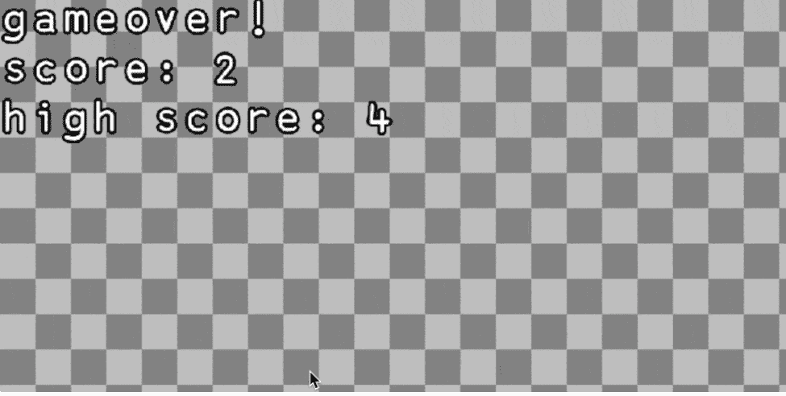

点击打开 gif

- ^420 https://kaboom.js/#onKeyPress
- ^421 https://kaboom.js/#go
- ^422 https://kaboom.js/#add
- ^423 https://kaboom.js/#go
- ^424 https://docs.replit.com/images/tutorials/35-flappy-bird/game-over.gif

# 下一步

这里有一些你可以尝试的想法，用来改进你的 Flappy Bird 克隆游戏：

- 随着玩家得分的提高，让游戏运行得更快。你可以通过更新管道移动的速度来实现，将传递给 `pipe.move` 方法的速度参数设置为变量，该变量随着玩家得分的增加而增加。
- 添加管道之外的其他不同类型的障碍物，让 Flappy 尝试躲避。
- 使用 Kaboom 精灵编辑器为你的 Flappy 世界创建自己的图形！
- 添加更多音效并使用 `play` 函数播放游戏音乐。

你可以在 github 或 replit 上找到此教程的代码示例。

> ^27 https://docs.replit.com/tutorials/kaboom-editor
> ^28 https://kaboomjs.com/#play
> ^29 https://github.com/ritza-co/make-javascript-games-book-code-samples/blob/main/7-flappy-bird-with-kaboom.md
> ^30 https://replit.com/@ritza/Flappy-Bird

## 使用 Kaboom.js 构建物理游乐场

在本教程中，我们将使用 Kaboom.js 构建一个简单的物理游乐场。这是一个 2D 侧视平台游戏，玩家可以使用重力枪捡起并射击世界中的物体，类似于《半条命2》和《Rochard》等游戏。

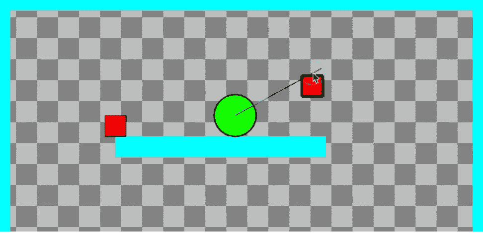

完成的游戏

点击打开 gif

在本教程结束时，你将：

- 熟悉 Kaboom JavaScript 游戏开发框架的高级用法。
- 能够构建一个简单的 2D 物理引擎。
- 拥有基于物理的平台游戏的基础，你可以将其扩展为完整的游戏。

### 开始

登录你的 Replit 账户并创建一个新的 repl。选择 Kaboom 作为你的项目类型。这需要一个 repl 名称，例如 "gravity"。

* ^42 https://kaboom.com/
* ^43 https://en.wikipedia.org/wiki/Gravity_gun
* ^44 https://docs.replit.com/images/tutorials/36-physics-playground/gameplay
* ^45 https://replit.com

### 设置场景

当你第一次打开新的 Kaboom repl 时，你会看到一个包含下面示例代码的文件。

```javascript
import kaboom from "kaboom";

// 初始化上下文
kaboom();

// 加载资源
loadSprite("bean", "sprites/bean.png");

// 在屏幕上添加字符
add([
  // 组件列表
  sprite("bean"),
  pos(80, 40),
  area(),
]);
```

这段代码加载了 Kaboom 吉祥物的精灵，并将 Bean 放置在屏幕顶部。在我们开始编码之前，我们将移除 Bean 的代码，留下以下几行：

```javascript
import kaboom from "kaboom";

// 初始化上下文
kaboom();

// 关卡定义
addLevel([
  "========================",
  "=                      =",
  "=                      =",
  "=         @            =",
  "=                      =",
  "=                      =",
  "=     #                =",
  "========================",
], {
  width: 32,
  height: 32,
  "=": () => [
    rect(32, 32),
    color(CYAN),
    area(),
    solid(),
    "wall"
  ],
  "#": () => [
    rect(32, 32),
    color(RED),
    z(1),
    origin("center"),
    area(),
    body(),
    physics(100),
    "movable"
  ],
  "@": () => [
    circle(32),
    color(GREEN),
    z(2),
    area({ width: 64, height: 64 }),
    body(),
    origin("center"),
    gravitygun(150, 55, 40),
    {
      speed: 120,
      jumpspeed: 1000
    },
    "player"
  ]
});
```

（注：原文此处代码块存在格式粘贴错误或混乱，已根据上下文逻辑重建了合理的 `addLevel` 结构，并保留了原始组件调用逻辑）。

### 移动玩家

让我们写一些代码来控制玩家。首先，我们需要使用 `get()` 获取玩家的引用：

```javascript
// player
const player = get("player")[0];
```

现在我们将添加代码来控制玩家向左向右移动。由于我们将使用鼠标控制玩家的重力枪，因此使用 WASD 键而不是方向键来控制玩家。添加以下代码：

```javascript
onKeyDown("a", () => {
  player.move(-player.speed, 0)
});
onKeyDown("d", () => {
  player.move(player.speed, 0)
});
```

我们检测 A 键的 `keyDown` 事件来让玩家向左移动，检测 D 键让玩家向右移动。`move()` 函数会自动检查与实体物体的碰撞，因此只有在有空间时玩家才会移动。

```javascript
onKeyPress("w", () => {
  if (player.isGrounded()) {
    player.jump(player.jumpspeed)
  }
});
```

`isGrounded()` 和 `jump()` 函数由 `body()` 组件提供，这使得在 Kaboom 中实现平台类移动变得非常简单。

现在重新运行你的 repl（或刷新 repl 网页），你应该能够使用 A 和 D 键左右移动，并使用 W 键跳跃。如果玩家跳出平台，他们会掉出视野。我们可以通过让游戏相机跟随玩家来修复。在你的键盘处理代码下方添加以下代码：

> ^46 https://kaboomjs.com/#get
> ^47 https://kaboomjs.com/#onKeyDown

```javascript
// 相机跟随玩家
player.onUpdate(() => {
  camPos(player.pos);
});
```

这段代码将每帧运行，并在玩家移动时保持相机聚焦在玩家身上。

刷新你 repl 内的浏览器并尝试一下。

### 使用重力枪抓取物体

现在我们已经实现了通用的平台功能，是时候添加重力枪了。玩家将用鼠标瞄准重力枪。它将有一个范围，我们将用线显示出来。进入该范围的物体周围会绘制较粗的轮廓。当玩家按鼠标右键时，范围内的物体将向他们移动，直到到达一个次级的“持有”范围。持有范围内的物体将随玩家移动，直到点击鼠标左键，在此时它们将被射向空中。或者，玩家可以点击鼠标右键丢掉所持有的物体。

在上面的代码中，我们实现了水平移动（行走）和垂直移动（跳跃）。实现我们的重力枪需要我们实现任意角度的移动。为了完成这一点，我们需要编写几个辅助函数。在页面顶部，并在 `kaboom();` 行下方添加以下代码：

```javascript
// 辅助函数
function angleBetween(p1, p2) {
  return Math.atan2(p2.y - p1.y, p2.x - p1.x);
}

function pointAt(distance, angle) {
  return vec2(distance * Math.cos(angle), -distance * Math.sin(angle));
}
```

第一个函数 `angleBetween()` 使用 JavaScript 的 `Math.atan2()` 来确定两点与水平线之间的角度。第二个函数 `pointAt()` 使用正弦和余弦确定特定距离和角度下的点。

> ^48 https://kaboomjs.com/#onUpdate
> ^49 https://developer.mozilla.org/en-US/docs/Web/JavaScript/Reference/Global_Objects/Math/atan2

接下来，我们将添加两个自定义组件：

- `gravitygun()`，它将为玩家的重力枪定义属性和函数。
- `physics()`，它将为重力枪操控的移动物体定义属性和函数。

在你的辅助函数定义下方添加 `gravitygun()` 组件的代码：

```javascript
// 自定义组件
function gravitygun(range, hold, firepower) {
  return {
    id: "gravitygun",
    require: ["pos"],
    firepower: firepower,
    range: range,
    hold: hold,
    aimAngle: 0,
    rangeLine: {
      p1: vec2(0),
      p2: vec2(0),
      color: BLACK
    },
    holdLine: {
      p1: vec2(0),
      p2: vec2(0),
      color: BLUE
    },
    draw() {
      drawLine(this.rangeLine);
      drawLine(this.holdLine);
    },
    update() {
      this.aimAngle = angleBetween(this.pos, mouseWorldPos());
      this.rangeLine.p1 = this.pos;
      this.rangeLine.p2 = this.pos.add(pointAt(this.range, this.aimAngle));
      this.holdLine.p1 = this.pos;
      this.holdLine.p2 = this.pos.add(pointAt(this.hold, this.aimAngle));
    }
  };
}
```

组件被写为返回特定格式对象的函数。每个组件都应该有一个 `id`，以及它通过 `require` 属性所依赖的组件列表。除此之外，组件可以拥有任意属性（这些属性会附加到它们的父对象上）以及将集成到游戏事件循环中的特殊函数。

我们组件的唯一依赖是 `pos()`，因为它无法在世界中没有位置的物体上工作。函数参数将允许我们以这种形式自定义此组件，即指定重力枪的范围、持有距离和火力。

> ^50 https://kaboomjs.com/#on

现在我们需要为受重力枪影响的物体添加 `physics()` 组件。在你最后添加的代码下方添加以下代码：

```javascript
function physics(mass) {
  return {
    id: "physics",
    require: ["area", "body"],
    mass: mass,
    inRange: false,
    inHold: false,
    held: false,
    dropping: false,
    direction: 0,
    speed: 0,
    draw() {
      if (this.inRange) {
        drawRect({
          width: this.width,
          height: this.height,
          pos: vec2(this.pos.x - this.width/2, this.pos.y - this.height/2),
          opacity: 0,
          outline: { color: BLACK, width: 4 }
        });
      }
    },
    update() {
      if (this.held) {
        this.pos.add(vec2(Math.cos(this.direction), Math.sin(this.direction)).scale(this.speed));
      }
    },
    moveToNoCollide(dest) {
      const diff = dest.sub(this.pos);
      return this.moveBy(diff.unit().scale(diff.len()));
    }
  };
}
```

现在我们需要为玩家对象添加 `gravitygun()` 组件，为物体对象添加 `physics()` 组件。找到你的关卡创建代码，并将新的组件行添加到对象中（已在上方 `addLevel` 代码块中体现）。

现在我们已经准备好编写通过重力枪抓取物体的代码。我们将在带有 "movable" 标签的 `onUpdate` 回调中执行此操作。将以下代码添加到 `main.js` 文件的底部：

```javascript
// 重力枪抓取和持有
onUpdate("movable", (movable) => {
  // 测试碰撞
  const myRect = movable.worldArea();
  movable.inRange = testRectLine(myRect, player.rangeLine);
  movable.inHold = testRectLine(myRect, player.holdLine);

  // 重力枪拉取
  if (isMouseDown("right")) {
    if (movable.inHold) {
      movable.held = true;
    } else if (movable.inRange) {
      movable.moveTo(player.holdLine.p2);
    }
  }

  // 重力枪悬持
  if (movable.held) {
    movable.moveTo(player.holdLine.p2);
  }

  // 重力枪发射
  if (isMousePressed("left") && movable.held) {
    movable.held = false;
    movable.direction = player.aimAngle;
    movable.speed = player.firepower;
  }

  // 重力枪丢弃
  if (isMousePressed("right") && movable.held) {
    movable.held = false;
    movable.speed = 0;
  }

  // 物体运动与摩擦
  if (!movable.held && movable.speed > 0) {
    movable.moveBy(vec2(Math.cos(movable.direction), Math.sin(movable.direction)).scale(movable.speed));
    movable.speed = Math.max(0, movable.speed - 1); // 摩擦力
  }
});
```

首先，我们使用 `area()` 组件提供的 `worldArea()` 函数获取移动物体的碰撞矩形坐标。然后我们使用 `testRectLine()` 函数判断玩家的范围线或持有线是否与该碰撞矩形相交。

现在，让重力在玩家按住右鼠标键时拉取范围内的物体。在 `onUpdate` 事件回调函数中，给 `movable.inHold` 赋值的下方添加以下代码（已合并至上方完整代码块）。

如果物体在抓取范围内，我们将 `held` 设置为 `true`。如果物体在拉取范围内，我们就将其移动到抓取范围内。我们使用了由 `pos()` 组件提供的 `moveTo()` 函数，且没有提供速度参数。这意味着物体将瞬间移动到指定位置。

接下来，我们将处理物体被拉取后的持有状态。这段代码将确保物体在被持有时保持在抓持位置，这样玩家就能以弧形移动它们了。

最后，我们需要在物体发射后移动它。当我们发射一个物体时，会给它一个方向和一个非零速度。我们使用 `pos()` 组件提供的 `moveBy()` 来移动物体，除非路径上有其他实体物体。为了让物体的运动弧线更自然，我们将通过每帧减少其速度来模拟摩擦力，直到速度变为零。

现在运行你的 repl 并尝试一下重力枪。你应该能够将箱子拉取到抓持位置，然后在你的头部周围移动它们。

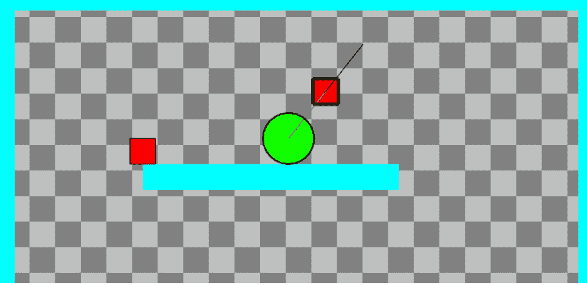

### 修复穿墙 Bug

如果你玩玩这个游戏，应该会注意到几个穿墙 Bug。当持有物体时，你可以通过对准目标来强制它传送到你正站立的平台下方。同样地，如果你从另一侧拉取物体，物体将穿过平台。

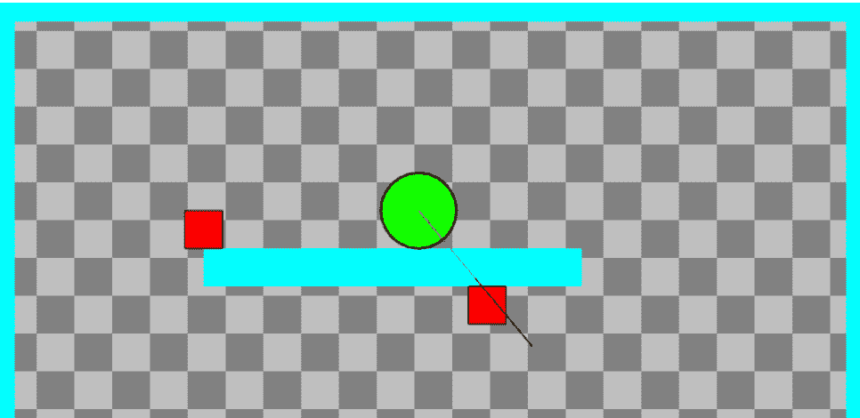

在这两种情况下，这都是因为 Kaboom 的 `moveTo()` 函数没有考虑实体物体，所以我们必须自己来处理这一点。

我们将通过向我们的 `physics()` 组件添加一个新的、具有碰撞感知能力的移动函数来修复第一个 Bug。找到组件定义，并将函数附加到返回的对象上（已在上方 `physics` 组件定义中包含 `moveToNoCollide` 方法）。

```javascript
moveToNoCollide(dest) {
  const diff = dest.sub(this.pos);
  return this.moveBy(diff.unit().scale(diff.len()));
}
```


# 使用 Kaboom.js 构建物理游乐场

此函数计算了从当前位置移动到目标所需的向量，并将此向量传递给具有碰撞感知函数 `moveBy()`。我们的 `moveBy()` 函数在移动过程中如果检测到碰撞，将返回一个 `Collision` 对象。我们将返回它并在满足特定条件时使用它取消持有。

在你的 `onUpdate("movable")` 事件回调中找到 `(movable.held)` 块并将其修改以匹配代码：

```javascript
// 重力枪悬持
if (movable.held) {
  let col = movable.moveToNoCollide(player.holdLine.p2)
  if (col.target != null && col.target.solid) {
    if (col.target.is("player")) { //忽略玩家碰撞
      movable.moveTo(player.holdLine.p2);
    }
    else movable.held = false;
  }
}
```

我们用 `moveToNoCollide()` 替换了 `moveTo()`，并对返回的碰撞对象进行检查。如果与玩家碰撞，我们就忽略它并将物体移回抓持位置。否则，我们取消持有。

现在刷新你的 repl 浏览器并尝试让被持有的箱子穿过地板。你应该会失败的。

为了修复第二个穿墙 Bug，我们将检测在被拉取的移动物体与玩家抓持位置之间的实体物体。我们将编写一个新的辅助函数来完成此操作。将以下代码添加到文件顶部，就在 `pointAt()` 定义的下方：

```javascript
function checkCollisionLine(line, tag) {
  collision = get(tag).some((object) => {
    return rectLine(object.worldArea()) && line;
  });
  return collision;
}
```

`checkCollisionLine()` 函数测试具有给定标签的物体是否与一条线交叉。我们通过获取带有该标签的所有对象并测试每一个对象直到找到碰撞来实现这一点。`some()` 方法会停止执行直到返回一个 `true`，这并不像想象中那么低效，但仍然可能不是实现此操作的最优方法。尽管如此，它应该是可以工作的。

要使用它，请在你的 `onUpdate("movable")` 事件回调中找到 `isMouseDown("right")` 并进行修改：

```javascript
// 重力枪拉取
if (isMouseDown("right")) {
  colLine = lineTo(movable.pos, player.holdLine.p2);
  if (movable.inHold) {
    movable.held = true;
  }
  else if (movable.inRange && !checkCollisionLine(colLine, "solid")) {
    movable.moveTo(player.holdLine.p2);
  }
}
```

为了防止玩家穿墙，我们检查了移动物体与玩家抓持位置之间的线。

## 使用重力枪放下和发射物体

既然我们已经有了拉取的实现，我们需要放下物体。

```javascript
// 重力枪放下
onMousePress("right", () => {
  holdlist = get("movable").filter((element) => {
    return element.held;
  });
  if (holdlist.length) {
    selected = holdlist[0];
    selected.held = false;
  }
});
```

当点击右鼠标键时，我们检索所有未持有的移动物体。一次只能持有物体。

为了让放下更加用户友好，让我们实现一个放下超时。在 `selected.held = false` 下方添加以下行：

```javascript
selected.dropping = true;
wait(2, () => {
  selected.dropping = false;
});
```

这段代码使用了 `wait()`，它将在指定的秒数后执行。

```javascript
// 重力枪发射
onMousePress("left", () => {
  rangeList = get("movable").filter((element) => {
    return element.held;
  });
  if (rangeList.length) {
    selected = rangeList[0]; // 临时
    selected.held = false;
    selected.direction = raddeg(-player.aimAngle);
    selected.speed = player.firepower;
  }
});
```

这段代码与放下代码非常相似，但我们不是指定放下超时，而是给之前持有的物体一个方向和一个速度。方向将是玩家的 `aimAngle`，我们需要将其转换为角度。速度将是我们在 `gravitygun()` 模块中定义的 `firepower` 值。

重启你的 repl 并尝试拿起、放下和发射箱子。你可能会注意到的某些异常行为是向上发射的物体往往会在天花板上滑动一段时间，直到速度耗尽。我们可以通过添加以下代码在与墙碰撞时杀死移动物体的速度来防止这一点：

```javascript
onCollide("movable", "wall", (a, b) => {
  a.speed = 0;
});
```

### 物体碰撞

如果没有物体之间的碰撞，我们的物理游乐场将完整，让我们添加简单的代码让物体相互推动。将以下碰撞处理程序添加到文件的底部：

```javascript
// physics object collisions
onCollide("movable", "movable", (a, b) => {
  if (a.speed > b.speed) a.direction = b.direction;
  else if (a.speed <= b.speed) a.direction = b.direction;
  finalSpeed = (a.speed) + (b.speed) / (a.mass + b.mass);
  a.speed = finalSpeed;
  b.speed = finalSpeed;
});
```

这段代码会将最快对象的方向分配给两个物体，并根据一个简单一维碰撞公式的变体来确定两者的速度。尝试调整数值和计算方式，看看你更喜欢哪种行为。请记住，对于游戏来说，好玩比真实性更重要。

## 下一步

我们已经构建了一个基础的物理类平台引擎。从这里开始，你可以做很多工作将其扩展为游戏的完整的游戏。考虑以下想法：

- 添加会投掷箱箱的敌人。
- 添加更多不同尺寸和质量的可移动物体。
- 添加谜题，通过按特定模式排列箱子并从特定角度发射它们来解决。
- 通过 2D 碰撞、旋转物体以及具有不同行为（如弹跳和破碎）的物体来改进物理模拟。

你可以在 [github](https⁵⁷) 或 [replit](https://⁵⁸) 上找到此教程的代码示例。

> ⁴⁵⁶https://www.dummies.com/article/academics-the-arts/science/physics/how-to-find-the-velocity-of-two-objects-after-collision-174261
> ⁴⁵⁷https://github.com/ritza-co/make-javascript-games-book-code-samples/blob/main/8-physics-playground-with-kaboom.md
> ⁴⁵⁸ https://replit.com/ritza/Gravity
