# 使用 HTML5、CSS3 和 Javascript 制作等轴视角社交实时游戏

任何熟悉 Zynga 的《农场物语》的人都理解实时社交游戏有多有趣和上瘾。这本实操指南将教你如何仅使用开源工具，从头开始设计并构建这类游戏之一。详细的示例和代码样本将帮助你学习如何渲染图形、使用精灵图制作动画、添加声音、验证分数以防止作弊等。

读完本书后，你将完成一个名为“游客度假村”（Tourist Resort）的项目，它结合了你学到的所有技术。你还将学习如何将游戏与 Facebook 集成。如果你熟悉 JavaScript、HTML5 和 CSS3，就可以开始了。

- 使用 HTML5 的 `canvas` 使用精灵图构建流畅的动画
- 创建等距网格模式以实现高性能图形
- 设计一个在移动设备和 PC 上运行同样良好的 GUI
- 使用 HTML5 的 `audio` 元素为游戏添加声音
- 使用 `WebWorkers` 实现游戏的路径查找功能
- 使用 PHP 和 MySQL 在服务器上构建客户端数据模型
- 使用动态 CSS3 对象让你的游戏活起来

Twitter: @oreillymedia
facebook.com/oreilly

作者：Mario Andrés Pagella
[LSI] [2011-09-02]
131492016

> *献给我的母亲。愿上帝保佑平安，直到我们再次相聚。*

## 前言

成瘾、沮丧。有趣、无聊。参与感、重复。休闲、高要求。

这些词可能是相互矛盾的，但它们表达了实时游戏玩家的情绪起伏。我记得花几个小时玩如 EA/Maxis 的《城市模拟》和《城市模拟2000》、Chris Sawyer 的《交通大亨》或 Bullfrog Productions 的《主题医院》，并纳闷为什么只有我的几个朋友（通常是极客）玩过这些游戏。

今天，我看到孩子、青少年、祖母和大学男学生坐在电脑前玩如 Zynga 的《农场物语》、《CityVille》，Playdom 的《社交城市》或 Playfish 的《帝国》，他们完全不知道这些游戏前身的存在——那是一个等距实时游戏的黄金时代。

发生了什么变化？

近期实时游戏的激增部分归功于 Zynga 在这一特定游戏类型中保留优点并剔除负面因素的卓越能力，部分归功于消费者兴趣的转变。他们将《城市模拟》中那种“没人搬进你的城市”的沮丧感，替换为添加朋友成为你的成长邻居。他们利用 Facebook 的社交功能改变了游戏的本质。通过让玩家不仅可以放置建筑，还能构建建筑并手动收集产生的积分，使无聊的部分变得更具互动性。一段时间后（通常是几周），当游戏开始显得重复时，他们会为你提供任务并让你与朋友互动。最后，你建造的建筑即使你不玩游戏也会一直存在并产生积分。（这一概念在行业中通常被称为*异步游戏或异步机制*。）

当你消除了沮丧、无聊和重复时，你就得到了一种有趣、有参与感且休闲（取决于你如何玩）的游戏类型，由于其社交相关的进度要求，这种游戏可以瞬间走红。难怪 Zynga 在写作时的估值达了 100 亿美元（超过了全球最大的“传统”游戏发行商之一电子艺公司 EA），或者 Playdom 被迪士尼以 7.6 亿美元收购。

为每个变量确定正确的数值

为你自己的游戏设计玩法公式是非常困难的，但当你成功处理好一切时，这种类型社交游戏的本质本身就能让它瞬间走红。

与传统的即时策略游戏相比，等轴即时策略游戏的界面非常简单：一个“活的”地图编辑器，你可以在其中一个瓦片矩阵上放置对象，我们将其称为“网格（the grid）”。根据对象的不同，我们将拥有建筑，其中一些建筑每隔 `T` 单位时间就会产生 `P` 分数。因此，即使在我们没有玩游戏时，建筑也会产生分数。

作为本书的最后一个项目，我们将开发一个名为“游客度假村（Tourist Resort）”的游戏，用户将在那里建造度假综合体，用树木装饰它，并放置各种商店。每家商店每隔 `T` 单位时间都会产生 `N` 利润；这些利润将允许他们购买更多建筑。

## HTML5 的兴起

在社交等轴游戏系统不断改进的同时，构建它们的技术也在发生变化。

多年来，开发可在浏览器中运行的丰富且高度交互的在线游戏的可用工具一直保持不变：虚拟现实建模语言 (VRML)、Java Applets、Macromedia Shockwave、Adobe Flash、Microsoft Silverlight、Unity3D 等，意味着需要使用第三方和专有解决方案，如果用户想使用这些应用程序，他们必须下载并安装浏览器插件。更糟糕的是，开发者必须支付非常昂贵的 IDE（集成开发环境）来开发它们。

HTML、CSS 和 JavaScript 等 Web 技术无法为用户提供与 Adobe Flash 等其他工具可以实现的同等质量体验。浏览器——特别是带有 JavaScript 的浏览器——运行缓慢；它们缺乏对原生视频、音频和本地存储的支持；某些浏览器（如 Internet Explorer）从未支持 PNG 图像的透明度，开发者甚至没有工具执行最基本的位块图像传输（bit-block image transfers）。它们对于最简单的游戏之外的内容尚未准备好。

幸运的是，随着时间的推移，大多数网页浏览器开始实现最新版本的 HTML 和 CSS 标准：HTML5 和 CSS3。同时，它们极大地提高了 JavaScript 应用程序的运行时性能。如今，现代浏览器的最新版本，如 Mozilla Firefox、Apple Safari、Google Chrome、Opera 和 Microsoft Internet Explorer 9，以及包含智能设备（如 iPhone、黑莓手机以及基于 WebOS 和 Android 的手机）中的浏览器，已经实现了开发全功能视频游戏所需的大多数技术。

## 你需要了解的

本书并没有提供 HTML5、CSS3 或 JavaScript 的权威指南。它假设你至少具备了如何操作所有这些语言的基础知识。相反，在本书的不同章节中，我们讨论了如何以最高效的方式应用这些技术，以便你能够开发并发布适用于任何支持 HTML5 浏览器的智能手机、平板电脑或 PC 上的游戏。

本书旨在面向尝试进行游戏开发的 Web 开发人员，或尝试将自己的知识应用到 Web 开发中的游戏开发人员。

我们开发等轴社交即时策略游戏的主要方法是针对“最小公约数”：移动设备。这种方法的理由是，如果它能在移动设备上以足够的速度运行，那么它在个人电脑等高端设备上也能良好运行。

## 代码示例

书中所有示例的所有代码和其他支持文件都可以在 `https://github.com/andrespagella/Making-Isometric-Real-time-Games` 获得。

## 开发和调试工具

如果你是一名经验丰富的开发者，几个关键工具会有帮助。虽然你可以使用简单的文本编辑器（如记事本或 TextEdit）和任何支持 HTML5 的网络浏览器来实现这些示例，但如果你打算进行任何严肃的工作，如果拥有语法高亮、JavaScript 控制台、JavaScript 调试器和 Web 检查器将会很好。我强烈建议使用支持（或可以扩展）JavaScript、HTML 和 CSS 的编辑器，如 Vim 或 Emacs。

JavaScript 控制台、JavaScript 调试器和 Web 检查器是用于定位和跟踪问题、程序等的工具。幸运的是，大多数现代浏览器都包含了这三者：

### Mozilla Firefox

在“工具（Tools）”内部，你会找到 JavaScript 控制台和检查（Inspect）；我建议安装 Firebug，这是一个用于高级 Web 开发的扩展，它包含 JavaScript 调试器以及 HTML、CSS 和 DOM 检查器，以及许多其他功能。

### Internet Explorer

按下 `F12` 打开开发人员工具。这包括一个 JavaScript 控制台，允许你在不同的“文档模式”下查看页面，查看你的网站如何处理使用 IE5、IE7 等访问者。

### Google Chrome

如果你访问“查看（View）”菜单（在 OSX）或点击通常位于地址栏旁边的小扳手图标，然后进入“开发者（Developer）”菜单，你将看到 JavaScript 工具和 JavaScript 控制台。它们都是大多数基于 Web 的浏览器包含的工具集。

### Safari

“偏好设置（Preferences）”的“高级（Advanced）”选项卡底部有一个“在菜单栏中显示开发菜单”的复选框。或者在 OS X 中，你可以通过打开终端窗口并输入 `defaults write com.apple.Safari IncludeDebugMenu 1` 来启用开发者菜单。另一种方法是编辑 `Preferences.plist` 文件，在 `<dict>` 和 `<plist>` XML 结束标签之前添加以下行：`<key>IncludeDebugMenu</key>`。在 OS X 中，`Preferences.plist` 文件通常位于以下目录之一，取决于操作系统的版本：

- `~/Library/Preferences/com.apple.Safari.plist`
- `~/Library/Safari/Preferences.plist`

在 Microsoft Windows 中，你可以编辑 Safari 快捷方式，在 `Safari.exe` 路径旁边添加 `/enableDebugMenu`。

### Opera

Opera 也包含一个名为 Dragonfly 的优秀调试程序和 Web 检查器。要了解更多信息，请参考 Opera Dragonfly 官网：`http://www.opera.com/dragonfly/`

游戏设计是游戏开发中最重要的方面之一（如果不是最重要的话）：没有人想玩无聊的游戏。在这类社交现实策略类游戏中，不仅通过提供良好的用户体验和玩法来吸引用户，还通过将游戏深度整合到用户的社交网络和体验中，是非常重要的。

不要忘记，这类游戏（乍看起来简单）的主要吸引力在于让用户与他们的朋友建立联系（“我的城市比你的大/漂亮”）。没有比比你朋友圈的推荐更好、更具说服力的广告了。

你还需要对如何与用户的社交连接保持谨慎和负责。被社交网络本身（例如 Facebook）封禁将是一场灾难，甚至在发生之前，应用程序也可能被垃圾邮件发送者阻止或标记。

游戏设计是一个比这里能涵盖的广泛得多的话题。关于游戏设计与 Web 应用融合的优秀书籍是 Gabe Zichermann 和 Christopher Cunningham 写的《Gamification by Design》（O'Reilly）。

本书使用了以下排版惯例：

- *斜体 (Italic)* 表示新术语、URL、电子邮件地址、文件名和扩展名。
- `等宽 (Constant width)` 用于程序列表，以及在段落中指代程序元素，如变量或函数名、数据库、数据类型、环境变量、语句和关键字。
- **等宽粗体 (Constant width bold)** 显示用户应逐字输入的命令或其他文本。
- *等宽斜体 (Constant width italic)* 显示应替换为用户提供的值或由上下文确定的值的文本。

![提示图标] 此图标表示提示、建议或普通注释。

![警告图标] 此图标表示警告或注意。

本书是为了帮助你完成工作。通常情况下，你可以在程序和文档中使用书中的代码。除非你复制了大部分代码，否则你不需要联系我们获取许可。例如，编写一个使用了书书中几块代码的程序不需要许可。销售或分发 O'Reilly 书籍的示例 CD 光盘需要许可。通过引用本书并引用示例代码来回答问题不需要许可。将书中大量的示例代码整合到你的产品文档中则需要许可。

我们感谢署名，但并不要求强制署名。署名通常包括标题、作者、出版商和 ISBN。例如：“Mario Andrés Pagella 著《Making Isometric Social Real-Time Games with HTML5, CSS3, and JavaScript》（O'Reilly 出版）。版权所有 2011 Mario Andrés Pagella, 978-1-449-30475-1。

如果您使用的任何代码示例超出了合理使用范围或上述许可的范围，请随时通过 `permissions@oreilly.com` 与我们联系。

Safari® Books Online 是一个按需数字图书馆，让您能够轻松搜索超过 7,500 本技术和创意类参考书籍及视频，快速找到您所需的答案。

订阅后，您可以在线阅读我们库中的任何页面并观看任何视频。在手机和移动设备上阅读书籍。在书印刷出版前访问新书，并独家访问开发中的手稿对其提供反馈。复制并粘贴代码示例、组织收藏内容、下载章节、书签关键部分、打印页面，并从我们的许多节省功能中获益。

我们为本书准备了一个网页，在其中列出了数据、示例和任何额外信息。您可以通过以下访问该页面：

如需对本书发表评论或提出技术问题，请发送邮件至：

`bookquestions@oreilly.com`

有关我们书籍、课程、会议和新闻的更多信息，请访问我们的网站 `http://www.oreilly.com`。

在 Facebook 上找到我们：`http://facebook.com/oreilly`

在 Twitter 上关注我们：`http://twitter.com/oreillymedia`

在 YouTube 上观看我们：`http://www.youtube.com/oreillymedia`

## 致谢

感谢我的未婚妻 Regina、我的父亲 Rubén、我的家人、我亲密的朋友和同事们。感谢 Minor Studios 的所有人，特别是 CEO Martín Repetto 和 Xavier Amado。我还想感谢我非常有帮助的编辑 Simon St.Laurent；感谢 Shelley Powers 极其见地的技术评审；以及 O'Reilly 的其他让这一切成为可能。

# 第 1 章 图形基础：Canvas 与精灵

HTML5 的 `canvas` 元素使得创建复杂的图形游戏变得简单得多，比依赖于通过文档对象模型（DOM）移动图像的旧方法提供了更大的活性和速度。Canvas 允许您使用 JavaScript 直接在屏幕区域上进行绘图，让您能够在 Web 环境下应用传统的游戏图形方法。尽管它是 HTML 宇宙中最近添加的内容，但在较新的桌面和移动浏览器中已得到广泛支持。

## 使用 canvas 对象工作

`canvas` 元素允许我们在屏幕上定义一个极快速的可绘制区域，可以使用 JavaScript 进行像素级的精确控制。然而，canvas 工作在立即模式下。与可缩放矢量图形（SVG，本书未涵盖）不同，我们对 HTML5 Canvas API 进行的调用会直接在 canvas 中绘制图形，一旦显示出来，就不会再对它们保留任何引用。如果我们想将图形向右移动 10 像素，我们需要清除显示并使用新坐标重新绘制。稍后，我们将讨论一种名为“自适应刷新”的技术，它可以避免仅仅为了修改 canvas 的一小部分就清空整个显示。

你可以将 canvas 看作一张纸；你现在有了许多蜡笔（以及其他工具），可以在上面画画。所以，例如如果你想画一条红线，就拿起红色蜡笔画出这条线。如果你想画一条绿线，就拿起绿色蜡笔。你的绘图“样式”也是同的。如果你想画一条从左上角到右下角的 45 度线，你既可以在不移动纸的情况下画，也可以将纸向右倾斜 45 度，然后从顶部到底画一条直线。（显然，第一种方法更有效。）

访问 HTML5 Canvas API 非常简单。首先，在您的页面中添加新的 HTML5 `canvas` 标签并为其分配一个 `id` 属性：

```html
<canvas id="game" width="100" height="100">
  您的浏览器不支持 canvas 标签。
</canvas>
```

`canvas` 标签内部的文本将显示不支持该对象的浏览器。稍后，您将学习如何使用名为 Modernizr 的 JavaScript 库更高效地发现并处理此类不兼容性。

您需要在 `canvas` 标签内部指定宽度和高度。尽管您可以使用 CSS 强制 canvas 达到特定的宽度和高度，但当您使用 JavaScript 引用对象时，它将返回默认尺寸（300x150 像素），完全覆盖您可能通过 CSS 分配的任何值。然而，您可以在 JavaScript 中动态地修改 HTML5 Canvas 对象的宽度和高度。

为了开始使用 HTML5 Canvas API，我们只需要通过其 `id` 属性值（myCanvas）引用 `canvas` 标签，这将允许我们获取 2D 绘图上下文的引用（“3D 上下文”是 WebGL，本书未涵盖）。

```javascript
window.onload = function () {
  var canvas = document.getElementById('game');
  var c = canvas.getContext('2d');
}
```

或者，您可以动态创建一个 HTML5 Canvas 对象：

```javascript
window.onload = function () {
  var canvas = document.createElement('canvas');
  var c = canvas.getContext('2d');
}
```

在上一个示例中，对 2D 绘图上下文的引用存储在变量 `c` 中（在许多其他示例中，此变量可能被命名为 `ctx`）。所有对 canvas API 的调用将通过此变量完成。作为一个初始示例，我们将处理用户在加载游戏时使用的第一件事：标题屏幕。稍后，我们将扩展它以支持图像和声音等资源的预加载。

我们的标题屏幕将显示在整个浏览器窗口，由一张显示游戏 Logo 以及下方文字“点击或触摸屏幕开始游戏”组成。当您点击窗口时，标题屏幕将平滑地变为白色。

为了开始这样做，我们需要添加支持游戏的基础 HTML 代码。在大多数情况下，页面看起来像一个传统的 HTML 页面：

```html
<!DOCTYPE html>
<html lang="en">
<head>
  <meta charset="UTF-8" />
  <title>Example 1 - Title Screen</title>
  <script>
    // JavaScript 代码在这里
  </script>
  <style type="text/css" media="screen">
    html { height: 100%; overflow: hidden }
    body {
      margin: 0px;
      padding: 0px;
      height: 100%;
    }
  </style>
</head>
<body>
  <canvas id="game" width="100" height="100">
    您的浏览器不支持 canvas 标签。
  </canvas>
</body>
</html>
```

上述代码中的小型 CSS 块允许我们强制页面达到窗口高度的百分比，并且 `overflow: hidden` 防止在超出屏幕区域时出现垂直或水平滚动条。

现在模板已完成，我们可以通过在页面的 `<script>` 标签中添加以下 JavaScript 代码开始使用 HTML5 Canvas API：

```javascript
window.onload = function () {
  var canvas = document.getElementById('game');

  // 强制 canvas 动态调整大小使其
  // 与浏览器窗口的宽度/高度一致
  canvas.width = document.body.clientWidth;
  canvas.height = document.body.clientHeight;

  var c = canvas.getContext('2d');

  // 用黑色背景填充屏幕
  c.fillStyle = '#000000';
  c.fillRect(0, 0, canvas.width, canvas.height);

  var phrase = "点击或触摸屏幕开始游戏";
  c.font = 'bold 16px Arial, sans-serif';
  c.fillStyle = '#FFFFFF';
  c.fillText(phrase, 10, 30);
}
```

让我们逐步分析这段代码。

当我们在 HTML 代码中添加 `canvas` 标签时，我们定义的 `height` 和 `width` 属性值为 100，这意味着画布的高度为 100 像素，宽度为 100 像素。然而，我们希望标题界面像浏览器窗口一样高且宽，因此我们需要使用 `document.body.clientWidth` 来指示宽度并使用 `document.body.clientHeight` 来指示高度，动态覆盖这两个值。

在获取 2D 上下文引用后，我们调用了一个名为 `fillStyle` 的 HTML5 Canvas API 属性。在本章的开头，我们将画布比作一张具有不同颜色的纸进行了对比；现在的情景也是类似的。`fillStyle` 的作用是将颜色设置为黑色，并从位置 (0,0) 开始到位置 (canvas.width, canvas.height) 结束，覆盖整个浏览器窗口。记得我们在上一步中为画布对象设置了新尺寸。

然后，它设置了我们将要使用的短语，选择了字体（在此情况下为 Arial，备用为 sans-serif，其工作方式与 CSS 完全相同）和大小，并再次更改了颜色，这次是白色。`fillText()` 调用将短语打印在位置 10, 30（从左侧开始 10 像素，从顶部开始 30 像素）。

图 1-1 显示了代码的结果。

HTML5 Canvas API 还包含一个非常有用的方法 `measureText(phrase)`，它返回参数 `phrase` 的文本宽度（像素）。我们还需要注意在设置字体大小之后测量文本，而不是之前。使用 `measureText()`，我们可以让文本在屏幕居中：

```javascript
var phrase = 'Click or tap the screen to start the game';
c.font = 'bold 16px Arial, sans-serif';
var mt = c.measureText(phrase);
var xcoord = (canvas.width / 2) - (mt.width / 2);
c.fillStyle = '#FFFFFF';
c.fillText(phrase, xcoord, 30);
```

所以我们已经绘制了画布，并将一个十六进制颜色值作为 `fillStyle` 属性的参数。canvas 还支持其他样式：

- 颜色可以使用 'red' 或 'black'
- 格式为 `rgb(Red, Green, Blue)` 的 RGB 值
- 格式为 `rgba(Red, Green, Blue, Alpha)` 的 RGBA 值，其中 Alpha 参数（透明度）从 0.0 到 1.0
- 格式为 `hsl(Percentage, Percentage, Percentage)` 的 HSL 值
- 格式为 `hsla(Percentage, Percentage, Percentage, Alpha)` 的 HSLA 值

如果纯色不能满足你的需求，canvas 还可以：

- 使用 `createLinearGradient()` 显示线性渐变
- 使用 `createRadialGradient()` 显示径向渐变
- 使用 `createPattern()` 显示图像/视频图案

为了创建一个显示黑色背景上漂亮蓝色渐变的示例，我们可以使用以下代码：

```javascript
var grd = c.createLinearGradient(0, 0, canvas.width, canvas.height);
grd.addColorStop(0, '#EeeCff');
grd.addColorStop(1, '#2bc8ff');
c.fillStyle = grd;
c.fillRect(0, 0, canvas.width, canvas.height);
```

在画布上显示图像就像使用 `drawImage()` 方法显示文本一样简单：

```javascript
var img = new Image();
img.src = 'image.png';
c.drawImage(img, 0, 0, img.width, img.height);
```

为了使用 `img.width` 和 `img.height` 属性，`img.onload` 事件必须完成。在最后的游戏实现中，我们将使用完整的资源加载器来处理这一点。资源加载器可以在代码仓库的 `game.js` 文件夹中找到（文件名为 `resourceLoader.js`）。

HTML5 Canvas API 的 `drawImage()` 方法有三种不同的实现。虽然我们将在接下来的章节中涵盖大部分内容，但此处可以找到解释每种实现的详细文档：`http://www.w3.org/TR/2dcontext/#dom-context-2d-drawimage`。

如果我们想让图像保持原始大小，只需要按照如下方式将其尺寸乘以 2：

```javascript
var img = new Image();
img.src = 'image.png';
c.drawImage(img, 0, 0, img.width * 2, img.height * 2);
```

在我们的情况下，我们将使用官方代码仓库 `img` 目录提供的文件，名为 `logo.png`。我们还将展示图像，使其填充浏览器窗口的 50%，同时保持其宽高比例，以便它可以在手机、平板电脑以及传统的桌面电脑上优雅地显示。

为了显示标题，创建一个函数 `showIntro()` 来显示蓝色渐变和文本：

```javascript
function showIntro() {
  var phrase = "Click or tap the screen to start the game";

  // 清除画布
  c.clearRect(0, 0, canvas.width, canvas.height);

  // 创建一个漂亮的蓝色渐变
  var grad = c.createLinearGradient(0, canvas.height, canvas.width, 0);
  grad.addColorStop(0, '#cce6ff');
  grad.addColorStop(1, '#52b2ff');

  c.fillStyle = grad;
  c.fillRect(0, 0, canvas.width, canvas.height);

  var logoImg = new Image();
  logoImg.src = '../img/logo.png';

  // 保存原始宽度值，以便稍后保持
  // 相同的宽高比例
  var originalWidth = logoImg.width;

  // 计算新的宽度和高度值
  logoImg.width = Math.round(50 * document.body.clientWidth / 100);
  logoImg.height = Math.round((logoImg.width * logoImg.height) / originalWidth);

  // 创建一个小型工具对象
  var logo = {
    img: logoImg,
    x: (canvas.width/2) - (logoImg.width/2),
    y: (canvas.height/2) - (logoImg.height/2)
  };
}
```

```javascript
function doResize() {
  canvas.width = document.body.clientWidth;
  canvas.height = document.body.clientHeight;
  switch (State.current) {
    case State.INTRO:
      showIntro();
      break;
  }
}

function fadeToWhite(alphaVal) {
  // ...
}
```

```html
<!DOCTYPE html>
<html lang="en">
<head>
  <meta charset="UTF-8" />
  <title>Example 1 - Title Screen</title>
  <script>
    // ... JavaScript 代码 ...
  </script>
  <style type="text/css" media="screen">
    html { height: 100%; overflow: hidden; }
    body {
      margin: 0px;
      padding: 0px;
      height: 100%;
    }
  </style>
</head>
<body>
  <canvas id="myCanvas" width="100" height="100">
    您的浏览器不支持 canvas 标签。
  </canvas>
</body>
</html>
```

尽管在这种情况下，正在执行的动画（淡入白色）并不复杂，但如果你在手机设备等移动端设备上运行更复杂的动画，你可能会注意到动画出现了细微的中断，这种现象被称为“掉帧”（frame skipping）。

### 创建平滑动画

在任何类型的游戏开发中，最大限度地利用资源都是关键的。无论 canvas 在屏幕上绘制元素的速度有多快，我们仍然需要每秒清除或重绘多次大面积区域；游戏在个人电脑上运行可能不会感到“卡顿”，但手机或平板电脑等移动设备可能难以跟上，这会完全破坏玩家的游戏体验。（在本章的后后部分，你将学习如何大幅提高性能。）

能够运行我们游戏的设备种类多样，这意味着如果我们需要展示一个简单的动画，某些设备可能以每秒 90 帧（FPS）的速度显示它们，而其他设备可能只能达到 15 FPS。

示例 1-2 显示了一个简单的测试，可以大致告诉我们设备的性能如何。

示例 1-2 使用 canvas 测试设备能力

```html
<!DOCTYPE html>
<html lang="en">
<head>
  <meta charset="UTF-8" />
  <title>Canvas 示例 2 (FPS 计数)</title>
  <script>
    window.onload = function () {
      var canvas = document.getElementById('myCanvas');
      var c = canvas.getContext('2d');

      var fpsArray = [];
      var fpsCount = 0;
      var stopAt = 10;
      var fps = 0;
      var startTime = 0;

      var date = new Date();
      startTime = Math.round(date.getTime() / 1000);

      c.font = '20px _sans';

      draw(startTime);

      function draw(timestamp) {
        var date = new Date();
        var ts = Math.round(date.getTime() / 1000);

        if (timestamp != ts) {
          fps = fpsCount;
          fpsCount = 0;
          fpsArray.push(fps);
        } else {
          fpsCount++;
        }

        c.fillStyle = '#000000';
        c.fillRect(0, 0, canvas.width, canvas.height);

        c.fillStyle = "#FFFFFF";
        c.fillText("TS: " + timestamp, 10, 20);
        c.fillText("FPS: " + fps, 10, 40);

        if (startTime <= (startTime + stopAt)) {
          setTimeout(function() {
            draw(ts);
          }, 1);
        } else {
          showResults(c, canvas);
        }
      }

      function showResults(c, canvas) {
        var mean = 0;
        var sum = 0;

        c.fillStyle = '#FFFFFF';
        c.fillRect(0, 0, canvas.width, canvas.height);

        // 对样本排序
        for (var i = 0; i < fpsArray.length; i++) {
          for (var j = fpsArray.length - 1; j > i; j--) {
            if (fpsArray[j - 1] > fpsArray[j]) {
              var temp = fpsArray[j - 1];
              fpsArray[j - 1] = fpsArray[j];
              fpsArray[j] = temp;
            }
          }
        }

        // 丢弃第一个值，它通常非常低
        fpsArray = fpsArray.slice(1, fpsArray.length);

        for (var i = 0; i < fpsArray.length; i++) {
          sum = sum + fpsArray[i];
        }

        mean = sum / fpsArray.length;

        c.fillStyle = '#000000';
        c.fillText("MIN: " + fpsArray[0], 10, 20);
        c.fillText("MAX: " + fpsArray[fpsArray.length - 1], 10, 40);
        c.fillText("MEAN: " + (Math.round(mean * 10) / 10), 10, 60);
      }
    };
  </script>
</head>
<body>
  <canvas id="myCanvas" width="160" height="70" style="border: 1px solid black;">
    您的浏览器不支持 canvas 标签。
  </canvas>
</body>
</html>
```

```html
<script charset="utf-8" src="sprite.js"></script>
<script>
var fpsCount = 0;
var fps = 0;
var startTime = 0;

var Timer = function() {
  this.date = new Date();
}

Timer.prototype.update = function() {
  var d = new Date();
  this.date = d;
}

Timer.prototype.getMilliseconds = function() {
  return this.date.getTime();
}

Timer.prototype.getSeconds = function() {
  return Math.round(this.date.getTime() / 1000);
}

window.onload = function() {
  var canvas = document.getElementById('canvas');
  var c = canvas.getContext('2d');

  // 初始化我们的精灵
  var spritesheet = '../sprite/sprite1.png';

  var gray = new Sprite(spritesheet, 60, 60, 0, 60, 5, 5000);
  var yellow = new Sprite(spritesheet, 60, 60, 0, 60, 5, 2500);
  var red = new Sprite(spritesheet, 60, 60, 0, 120, 5, 1666);
  var blue = new Sprite(spritesheet, 60, 60, 0, 180, 5, 1250);
  var green = new Sprite(spritesheet, 60, 60, 0, 240, 5, 1000);
}

var timer = new Timer();

c.font = '14px sans-serif';

var startTime = timer.getSeconds();
draw(startTime);

function draw(timeStamp) {
  timer.update();

  if (timeStamp != timer.getSeconds()) {
    fps = fpsCount;
    fpsCount = 0;
  } else {
    fpsCount++;
  }

  c.fillStyle = '#FFFFFF';
  c.fillRect(0, 0, canvas.width, canvas.height);

  c.fillStyle = '#000000';
  gray.setPos(40, 60);
  gray.animate(c, timer);
  gray.draw(c);

  yellow.setPos(80, 100);
  yellow.animate(c, timer);
  yellow.draw(c);

  red.setPos(120, 140);
  red.animate(c, timer);
  red.draw(c);

  blue.setPos(160, 180);
  blue.animate(c, timer);
  blue.draw(c);

  green.setPos(200, 220);
  green.animate(c, timer);
  green.draw(c);

  c.fillText("Elapsed Time: " + (timer.getSeconds() - startTime) + " Seconds", 10, 40);
  c.fillText("FPS: " + fps, 10, 40);

  setTimeout(function() {
    draw(timer.getSeconds());
  }, 1);
}
</script>
<head>
<body>
<canvas id="myCanvas" width="300" height="300" style="border:1px solid black;">
您的浏览器不支持 canvas 标签。
</canvas>
</body>
</html>
```

`sprite.js` 是我们在本及其他章节中使用的，它看起来如下：

```javascript
var Sprite = function(src, width, height, offsetX, offsetY, frames, duration) {
  this.spritesheet = null;
  this.offsetX = 0;
  this.offsetY = 0;
  this.width = width;
  this.height = height;
  this.frames = 1;
  this.currentFrame = 0;
  this.duration = 1;
  this.posX = 0;
  this.posY = 0;
  this.shown = true;
  this.zoomLevel = 1;

  this.setSpritesheet(src);
  this.setOffset(offsetX, offsetY);
  this.setFrames(frames);
  this.setDuration(duration);

  var d = new Date();
  if (this.duration > 0 && this.frames > 0) {
    this.time = d.getTime() + (this.duration / frames);
  } else {
    this.time = 0;
  }
}

Sprite.prototype.setSpritesheet = function(src) {
  if (src instanceof Image) {
    this.spritesheet = src;
  } else {
    this.spritesheet = new Image();
    this.spritesheet.src = src;
  }
}

Sprite.prototype.setPosition = function(x, y) {
  this.posX = x;
  this.posY = y;
}

Sprite.prototype.setOffset = function(x, y) {
  this.offsetX = x;
  this.offsetY = y;
}

Sprite.prototype.setFrames = function(count) {
  this.currentFrame = 0;
  this.frames = count;
}

Sprite.prototype.setDuration = function(duration) {
  this.duration = duration;
}

Sprite.prototype.animate = function(c, t) {
  if (t.getMilliseconds() > this.time) {
    this.nextFrame();
  }
  this.draw(c);
}

Sprite.prototype.nextFrame = function() {
  if (this.duration > 0) {
    var d = new Date();
    if (this.currentFrame == this.frames - 1) {
      this.currentFrame = 0;
    } else {
      this.currentFrame++;
    }
    this.time = d.getTime() + (this.duration / this.frames);
  }
}

Sprite.prototype.draw = function(c) {
  if (this.shown) {
    c.drawImage(
      this.spritesheet,
      this.offsetX,
      this.offsetY,
      this.width,
      this.height,
      this.posX,
      this.posY,
      this.width * this.zoomLevel,
      this.height * this.zoomLevel
    );
  }
}
```

你可以在仓库 `sprite-anim-alt.html` 中找到另一个示例。该示例的截图见图 1-4。

### 什么是像素（Pixel）？

HTML5 Canvas 的另一个强大功能是允许我们访问或设置图像的像素级信息，从而能够找到特定像素的 RGBA 值。实现的方法是使用 `context.getImageData()` 或 `context.putImageData()` 方法，它们接收以下参数：

`context.getImageData(x, y, width, height)`

`getImageData()` 返回一个名为 "ImageData" 的对象，包含以下字段：

- `width`（只读）：图像宽度（像素）
- `height`（只读）：图像的高度（像素）
- `data`（CanvasPixelArray）：包含图像内部所有的像素，每个像素由四个索引（R、G、B 和 A）组成。要访问第一个像素的蓝色值，调用 `ImageData.data[2]`。要访问第二个像素的红色值，调用 `ImageData.data[4]`，以此类推。

遍历整个画布的 ImageData 数组所有值的常用方法如下：

```javascript
var imgData = c.getImageData(0, 0, canvas.width, canvas.height);
var data = imgData.data; // 为性能考虑，将此值保存到新数组中

for (var i = 0, len = data.length; i < len; i += 4) {
  var red = data[i + 0];
  var green = data[i + 1];
  var blue = data[i + 2];
  var alpha = data[i + 3];
}
```

与其替换图像数据，不如将其插入画布中，你可以：

`context.putImageData(imgData, x, y);`

或者它的替代实现：

`context.putImageData(imgData, x, y, dx, dy, dw, dh);`

其中参数为：

- **imgData**: 一个 ImageData 对象（像素数组）
- **x**: 绘制 ImageData 的 X 轴起点（左上角）
- **y**: 绘制 ImageData 的 Y 轴起点（左上角）
- **[Optional] dx "Dirty X"**: 在画布中放置 ImageData 的水平位置
- **[Optional] dy "Dirty Y"**: 在画布中放置 ImageData 的垂直位置
- **[Optional] dw "Dirty Width"**: 允许你在绘制到画布上之前指定 ImageData 的宽度（例如，指定原始宽度的 /2 将图像水平方向缩小）
- **[Optional] dh "Dirty Height"**: 允许你在绘制到画布上之前指定 ImageData 的高度

关于这些以及其他像素操作函数的更多信息，请参阅相关的 W3C 工作草案章节：`http://www.w3.org/TR/2dcontext/pixel-manipulation`。

### 处理透明性

现在你已经知道如何获取画布中特定像素的颜色，包括它的 alpha 值（透明度），我们可以解决 Web 开发中一个非常常见的问题。以前这个问题可以通过使用非常复杂且低效的黑科技（使用 JavaScript 和 CSS 点击 PNG 图像、div 或另一个元素的透明区域）来解决。问题在于图像的某些区域是透明的，但它们仍然像实心矩形一样，因此点击透明区域返回的是原始图像的引用，而不是下方下一个对象的引用。

有了这些工具，有许多方法可以解决这个特定问题，但它们主要包括：

- 使用 DOM 函数确定元素的位置，并遍历元素，直到找到与“实心”像素的碰撞
- 跟踪放置对象的位置以及它们呈现的顺序，这是传统游戏开发中使用方法

第一种方法可以通过使用 `document.elementFromPoint()` DOM 函数来实现，确定点击了哪个元素。如果它是图像或带有背景的对象（实色或可能具有或没有父元素的图像），我们可以使用 `getImageData()` 来检测所选像素是否透明。如果是，我们可以选择该元素（如果不是，我们可以查找兄弟元素）。我们可以遍历 DOM 直到找到“实心”颜色并选择该元素而不是图像。然而，如果出现以下情况，这种方法可能会失效、不实用或低效：

- 元素具有大量的兄弟节点或父节点
- 我们正在遍历父元素的 z-index，并且“穿过”该元素应该选择它下方的元素（在这种情况下将是子节点）

第二种方法要求我们以与大多数 Web 开发人员习惯完全不同的方式进行：跟踪我们在屏幕上呈现的对象的坐标，并使用点击动作进行命中测试（hit test），查看鼠标的 X 和 Y 坐标是否在任何对象的区域内。这样做的方法是存储每个元素的位置 x、位置 y、宽度和高度，以及它们在屏幕上的呈现顺序。然后，有许多方法可以循环遍历所有元素以查看哪一个被点击了，这允许你创建矩形，稍后可以用这些矩形测试鼠标事件（如 `mousedown`、`mousemove`、`mouseup`、`click` 等）返回的 `clientX` 和 `clientY` 值是否在它们内部。图 1-5 显示了我们如何跟踪屏幕上呈现的所有对象。我们检查 MX 和 MY（鼠标 X 和鼠标 Y）代表点击坐标。然后我们可以检查鼠标坐标是否在其他对象的内部（在这种情况下，被点击的元素将是 #4）。

在我们的情况下，我们通过将 `document.elementFromPoint()` 与 `pointer-events: none` 结合来消除了后两个缺点。后者是一个 CSS 属性，允许浏览器知道鼠标不与单个元素交互，从而消除了遍历 DOM 或跟踪屏幕上每个对象的需要。

图 1-6 显示了我们的页面是如何组织的。在“笑脸”图像的透明区域进行的点击应该穿过图像，我们应该获得“奶酪”div 的引用，除非我们点击穿透了笑脸的透明区域和奶酪的洞，这应该返回 HTML 文档的引用。

要做到这一点，我们需要首先检测页面已加载完成：

```javascript
window.onload = function () {
  var MIN_ALPHA_THRESHOLD = 10;

  var canvas = document.getElementById('myCanvas');
  var c = canvas.getContext('2d');

  document.addEventListener('click', detectElement, false);
}
```

```javascript
function getElementPosition(obj) {
  var property = window.getComputedStyle(obj, null).getPropertyValue('background-position').split(' ');

  // 修改代码以查找其是否继承了父元素的属性
  // 将会非常低效。我们将假设
  // 如果元素具有 'auto'，则意味着 0

  var left = (property[0] != 'auto') ? parseInt(property[0], 10) : 0;
  var top = (property[1] != 'auto') ? parseInt(property[1], 10) : 0;

  return {
    x: left,
    y: top
  };
}
```

为了简单起见，我们假设所有的背景图像都没有在水平或垂直方向上进行渲染，并且我们将使用单个背景元素（CSS 支持多个背景）。然而，通过将所有背景加载到数组中，可以很容易地扩展该函数以支持多个背景。

尽管如此，我们的 `isPixelTransparent()` 函数看起来如下：

```javascript
function isPixelTransparent(src, x, y, oWidth, oHeight, offsetX, offsetY) {
  var img = new Image();
  img.src = src;

  // 如果没有向此函数传递参数，则使用“默认值”
  oWidth = (!oWidth) ? img.width : oWidth;
  oHeight = (!oHeight) ? img.height : oHeight;
  offsetX = (!offsetX) ? 0 : offsetX;
  offsetY = (!offsetY) ? 0 : offsetY;

  // 在再次绘制覆盖之前“重置”画布
  c.clearRect(0, 0, 1, 1);

  c.drawImage(img, offsetX - x, offsetY - y, img.width, img.height);

  var idata = c.getImageData(0, 0, 1, 1);
  var data = idata.data;
  var alpha = data[3];

  return (alpha < MIN_ALPHA_THRESHOLD);
}
```

最后，`isTransparent()` 函数负责获取位于 `document.elementFromPoint()` 返回的 X 和 Y 坐标元素，并在调用 `isPixelTransparent()` 之前确定如何解释它。

为了正确实现这一点，我们首先需要根据对象在屏幕上的位置计算点击的相对坐标：

```javascript
function isTransparent(obj, x, y) {
  var robj = obj;
  var rx = 0;
  var ry = 0;
  var offset = { x: 0, y: 0 };
  var padding = { x: 0, y: 0 };
  var margin = { x: 0, y: 0 };

  // 计算相对于父元素的 X（左）和 Y（顶）坐标，
  // 直到到达“顶部”
  if (robj.offsetParent) {
    rx = 0;
    ry = 0;
  }

  while(robj.offsetParent) {
    rx += robj.offsetLeft;
    ry += robj.offsetTop;
    robj = robj.offsetParent;
  }
}
```

除了对象与其父对象之间的 padding（内边距）或间隔外，它们还可能定义了 margin（外边距），因此我们需要考虑这种可能性。图 1-8 将向你展示特定场景的情况。

图 1-8. 点击一组容器

我们检测到 D 容器内部有一个点击事件，并且我们知道：

```javascript
document.addEventListener('click', detectElement, false);
```

返回相对于窗口边缘（容器 A）的坐标。如果我们想计算相对于 D 容器的 X 和 Y 坐标，我们需要遍历所有的 D 的父容器（C 和 B），直到到达顶部（A）。在这种情况下，结果将是：

```javascript
/* 伪代码 */
xCoord = Mouse.x - 12 (C) - 55 (B) - 10 (A)
yCoord = Mouse.y - 8 (C) - 10 (B) - 15 (A)
```

容器与其所有子元素之间的这种间隙可能是因为：

- 我们决定子元素应该使用 `position: absolute` 或 `position: relative` 进行定位，并设置了 top、left、right 或 bottom 值
- 容器具有 padding
- 子元素有 margin

依此类推。然而，这里有几个“陷阱”使得其中一些规则并不适用。例如，如果父元素定义了 padding 但其子元素使用的是 `position: absolute`，则它们不会受到其影响。

通常为了使用 CSS 属性，许多开发者会使用：

```javascript
document.getElementById('ObjectName').style.property
```

这种方法的问题在于，它没有考虑到内联定义的 CSS 属性。

# 示例 1-5. 创建简单的网格

```html
<!DOCTYPE html>
<html lang="en">
<head>
  <meta charset="UTF-8" />
  <title>示例 6 (生成 20 x 50 的网格)</title>
  <script>
    window.onload = function () {
      var tileMap = [];
      var grid = {
        width: 20,
        height: 50
      };

      function initializeGrid() {
        for (var i = 0; i < grid.width; i++) {
          tileMap[i] = [];
          for (var j = 0; j < grid.height; j++) {
            tileMap[i][j] = 0;
          }
        }
      }

      initializeGrid();
    };
  </script>
</head>
<body>
</body>
</html>
```

只要采用正确的方法，网格的大小几乎是无限的，并且不会对性能产生影响。我们可以转而处理 500x500 或 1,000x1,000 的分块，当我们接近分块的“开始”或“结束”时，可以使用内存分页程序来加载/保存分块，可以存储在计算机硬盘中——在我们的案例中是 WebStorage API——或者在在线数据库中。为了简单起见，在我们的游戏中我们将处理一个 250x250 的网格（62,500 个瓦片），并将内存分页函数的实现留给读者作为练习题。

目前，我们将专注于使用正方形显示我们的网格，稍后，我们将切换到等轴测视图。

假设我们有一个包含 6,250,000 个瓦片的巨大网格（2,500 行每 2,500 列），每个瓦片的宽度和高度均为 32 像素，且网格将显示在一个分辨率为 300x300 像素的容器中。多年来，面对类似的问题（每秒在屏幕上显示网格数次），我见过人们是这样做的：

```javascript
for (var row = 0; row < grid.length; row++) {
  for (var col = 0; col < grid[row].length; col++) {
    displayTile(row, col);
  }
}
```

这段代码遍历了网格上的每一个位置，并尝试显示瓦片，而不检查它是否在屏幕内。此外，每次迭代（行和列）都需要检查网格大小以及 `grid[row]` 数组的大小，因此效率极低。

另一些人则稍微慷慨一点点：

```javascript
for (var row = 0, rowspan = grid.length; row < rowspan; row++) {
  for (var col = 0, collength = grid[0].length; col < collength; col++) {
    if (tilesInsideScreen(row, col)) {
      displayTile(row, col);
    }
  }
}
```

这种方法相比上一个示例有了重大的性能提升。现在，网格数组的大小被存储在一个变量中（因此不需要在每次迭代中检查元素计数），并且只有在瓦片可以在屏幕上显示时才显示它。然而，主要问题仍然存在：它仍然必须进行 6,250,000 次迭代。你肯定在想是否有办法可以改进这个数字。幸运的是，对我们所有人来说，是有的。

技巧主要在于通过考虑作为 X/Y 偏移（滚动）、瓦片宽度/高度以及显示宽度/高度的变量，只遍历那些可以显示的元素：

```javascript
var startRow = Math.floor(scroll.x / tile.width);
var startCol = Math.floor(scroll.y / tile.height);
var rowCount = startRow + Math.floor(canvas.width / tile.width) + 1;
var colCount = startCol + Math.floor(canvas.height / tile.height) + 1;
```

然后你只需要在循环内部使用这些变量：

```javascript
for (var row = startRow; row < rowCount; row++) {
  for (var col = startCol; col < colCount; col++) {
    displayTile(row, col);
  }
}
```

示例 1-6 展示了如何使用这种方法创建网格，图 1-9 将其结果与其他方法进行了比较。

示例 1-6. 生成 2500x2500 的网格

```html
<!DOCTYPE html>
<html lang="en">
<head>
  <meta charset="UTF-8" />
  <title>示例 7 (生成 2500 × 2500 的网格)</title>
  <script>
    window.onload = function () {
      var tileMap = [];
      var tile = {
        width: 32,
        height: 32
      }
      var grid = {
        width: 2500,
        height: 2500
      }
      var Keys = {
        UP: 38,
        DOWN: 40,
        LEFT: 37,
        RIGHT: 39
      }
      var scroll = {
        x: 0,
        y: 0
      }
      var canvas = document.getElementById('myCanvas');
      var c = canvas.getContext('2d');
      window.addEventListener('keydown', handleKeyDown, false);
      initializeGrid();
      draw();

      function handleKeyDown(e) {
        switch (e.keyCode) {
          case Keys.UP:
            scroll.y -= ((scroll.y - tile.height) >= 0) ? tile.height : 0;
            break;
          case Keys.DOWN:
            scroll.y += tile.height;
            break;
          case Keys.LEFT:
            scroll.x -= ((scroll.x - tile.width) > 0) ? tile.width : 0;
            break;
          case Keys.RIGHT:
            scroll.x += tile.width;
            break;
        }
        document.getElementById('scrollx').innerHTML = scroll.x;
        document.getElementById('scrollY').innerHTML = scroll.y;
      }

      function initializeGrid() {
        for (var i = 0; i < grid.width; i++) {
          tileMap[i] = [];
          for (var j = 0; j < grid.height; j++) {
            if ((i % 2) == 0) {
              tileMap[i][j] = 0;
            } else {
              tileMap[i][j] = 1;
            }
          }
        }
      }

      function draw() {
        c.fillStyle = '#FFFFFF';
        c.fillRect(0, 0, canvas.width, canvas.height);
        c.fillStyle = '#000000';
        var startRow = Math.floor(scroll.x / tile.width);
        var startCol = Math.floor(scroll.y / tile.height);
        var rowCount = startRow + Math.floor(canvas.width / tile.width) + 1;
        var colCount = startCol + Math.floor(canvas.height / tile.height) + 1;
        for (var row = startRow; row < rowCount; row++) {
          for (var col = startCol; col < colCount; col++) {
            var tilePositionX = row * tile.width - scroll.x;
            var tilePositionY = col * tile.height - scroll.y;
            if (tilePositionX >= 0 && tilePositionX < canvas.width && tilePositionY >= 0 && tilePositionY < canvas.height) {
              if (tileMap[row][col] == 0) {
                c.strokeRect(tilePositionX, tilePositionY, tile.width, tile.height);
              } else {
                c.fillRect(tilePositionX, tilePositionY, tile.width, tile.height);
              }
            }
          }
        }
      }
    };
  </script>
</head>
<body>
  <canvas id="myCanvas" width="300" height="300"></canvas>
  使用 UP, DOWN, LEFT 和 RIGHT 键滚动
  滚动 X: <span id="scrollx">0</span>
  滚动 Y: <span id="scrollY">0</span>
</body>
</html>
```

将点击事件返回的像素坐标转换为方形网格中的矩阵坐标，可以通过以下公式轻松实现：

```javascript
var row = Math.floor(mousePositionX / tileWidth);
var column = Math.floor(mousePositionY / tileHeight);
```

如果我们需要考虑滚动坐标，只需要将它们加到鼠标位置即可：

```javascript
var row = Math.floor((mousePositionX + scrollPositionX) / tileWidth);
var column = Math.floor((mousePositionY + scrollPositionY) / tileHeight);
```

移除网格初始化代码后，引出了一个有趣的问题：我们如何跟踪那些修改过的元素？幸运的是，我们不需要从零开始数组索引，这意味着我们可以这样做：

```javascript
tileMap[2423] = [];
tileMap[2423][1803] = 4;
```

使用这种方法，我们只存储需要的元素。矩阵中其他未设置的位置将仅返回 `undefined` 或 `null`。示例 1-7（代码库中的 `ex8-grid-canvas.html`）展示了如何实现这一想法，结果如图 1-11 所示。

示例 1-7. 仅存储需要的元素

```html
<!DOCTYPE html>
<html lang="en">
<head>
  <meta charset="UTF-8" />
  <title>Example 8</title>
  <script>
    window.onload = function () {
      var tileMap = [];
      var tile = {
        width: 32,
        height: 32
      }
      var grid = {
        width: 2500,
        height: 2500
      }
      var Keys = {
        UP: 38,
        DOWN: 40,
        LEFT: 37,
        RIGHT: 39
      }
      var scroll = {
        x: 0,
        y: 0
      }
      var canvas = document.getElementById('myCanvas');
      var c = canvas.getContext('2d');
      canvas.addEventListener('click', handleClick, false);
      window.addEventListener('keydown', handleKeyDown, false);
      draw();

      function handleClick(e) {
        // 当检测到点击时，将鼠标
        // 坐标转换为像素坐标
        var row = Math.floor((e.clientX + scroll.x) / tile.width);
        var column = Math.floor((e.clientY + scroll.y) / tile.height);
        if (tileMap[row] == null) {
          tileMap[row] = [];
        }
        tileMap[row][column] = 1;
      }

      function handleKeyDown(e) {
        switch (e.keyCode) {
          case Keys.UP:
            scroll.y -= ((scroll.y - tile.height) >= 0) ? tile.height : 0;
            break;
          case Keys.DOWN:
            scroll.y += tile.height;
            break;
          case Keys.LEFT:
            scroll.x -= ((scroll.x - tile.width) >= 0) ? tile.width : 0;
            break;
          case Keys.RIGHT:
            scroll.x += tile.width;
            break;
        }
        document.getElementById('scrollx').innerHTML = scroll.x;
        document.getElementById('scrollY').innerHTML = scroll.y;
      }

      function draw() {
        c.fillStyle = '#FFFFFF';
        c.fillRect(0, 0, canvas.width, canvas.height);
        c.fillStyle = '#000000';
        var startRow = Math.floor(scroll.x / tile.width);
        var startCol = Math.floor(scroll.y / tile.height);
        var rowCount = startRow + Math.floor(canvas.width / tile.width) + 1;
        var colCount = startCol + Math.floor(canvas.height / tile.height) + 1;
        rowCount = ((startRow + rowCount) > grid.width) ? grid.width : rowCount;
        colCount = ((startCol + colCount) > grid.height) ? grid.height : colCount;
        for (var row = startRow; row < rowCount; row++) {
          for (var col = startCol; col < colCount; col++) {
            var tilePositionX = tile.width * row;
            var tilePositionY = tile.height * col;
            tilePositionX -= scroll.x;
            tilePositionY -= scroll.y;
            if (tileMap[row] != null && tileMap[row][col] != null) {
              c.fillStyle = '#C00000';
              c.fillRect(tilePositionX, tilePositionY, tile.width, tile.height);
              c.fillStyle = '#000000';
            } else {
              if ((row % 2) == 0 && (col % 2) == 0) {
                c.strokeRect(tilePositionX, tilePositionY, tile.width, tile.height);
              } else {
                c.fillRect(tilePositionX, tilePositionY, tile.width, tile.height);
              }
            }
          }
        }
        setTimeout(draw, 1);
      }
    };
  </script>
</head>
<body>
  <canvas id="myCanvas" width="300" height="300"></canvas>
  使用 UP, DOWN, LEFT 和 RIGHT 键进行滚动
  Scroll X: <span id="scrollx"></span>
  Scroll Y: <span id="scrollY"></span>
</body>
</html>
```

到目前为止，我们所做的优化已经极大提升了游戏的性能，但还有一件事我们需要处理。

`draw()` 循环——我们游戏的心脏和灵魂，允许我们在屏幕上显示元素——每秒会被调用多次。在即时策略游戏中，屏幕上的图形通常是静态的，因此这样做有点没必要；我们通过仅在需要时调用 `draw()` 而不是每秒调用多次来避免这一点。然而，也请记住，`draw()` 函数在发生细微变化后都会重新渲染整个网格，特别是当我们只需要动画少数对象而保持其他部分不变时。

为了简单起见，在书中我们只允许同时存在一个 ATR 坐标，但在专业的复杂的游戏中，`draw()` 函数可能会接受一个包含多个 ATR 坐标的数组，这允许它们通过单个调用刷新许多位置。例如：

```javascript
function draw(atrArray) {
  for (var i = 0, len = atrArray.length; i < len; i++) {
    if (insideScreen(atrArray[i])) {
      drawGraphic();
    }
  }
}
```

# 第 2 章 制作等轴测图

我们的游戏，以及其他如《西德·梅的文明》、暴雪的《暗黑破坏神》或 Zynga 的《农场物语》、《城市物语》和《咖啡世界》等，使用了一种特殊的等轴投影形式（称为双测投影），在这种投影中，瓦片（通常是菱形或六边形）以 2:1 的比例显示，高度为宽度的一半。


大多数游戏开发者选择使用这种特定的 2:1 比例显示瓦片，是因为栅格图形中存在一个独特的问题，如果我们了解电脑显示器的工作原理，就能理解这一点。显示器——无论是 CRT、TFT/LCD、LED 还是 OLED——都以与我们游戏中类似的网格方式显示像素，这使得我们能够绘制出完美的垂直或水平线。然而，如果我们需要显示一个非 0° 或 90° 角度的线，情况就会变得复杂。图 2-1 显示了产生的问题。

虽然 90°、45° 和 0° 的线具有规律模式，并且可以与平行线完美地“缝合”，但 30° 线并不如此；它包含了间隙。然而，如果我们使用 2:1 的比例，可以计算 1/2 的反正切（arctangent）得到 26.5650°，产生如图 2-2 所示的结果。

图 2-1. 按角度绘制的线条中的间隙

图 2-2. 26.565 处更整洁的结果

尽管到目前我们的网格仅适用于方形，但通过使用示例 2-1 中的代码，可以轻松地将方形纹理转换为等轴测纹理，产生如图 2-3 所示的结果。

示例 2-1. 将方形转换为等轴测网格

```html
<!DOCTYPE html>
<html lang="en">
<head>
  <meta charset="UTF-8" />
  <title>Example 10 - (将方形纹理转换为等轴测菱形)</title>
<script>
  window.onload = function () {
  var canvas = document.getElementById('myCanvas');
  var c = canvas.getContext('2d');

  var texture = new Image();
  texture.src = '../image/squareTexture.png';

  drawDiamond();

  function drawDiamond() {
    // 保存当前上下文
    c.save();

    // 缩比例至等轴测/双测 2:1 比例
    c.scale(1, 0.5);

    // 旋转上下文 45 度
    c.rotate(45 * Math.PI / 180);

    // 如果我们在 0, 0 处旋转图像，其半部分将
    // 显示在画布之外，所以进行补偿
    c.drawImage(texture,
      0,
      0,
      texture.width,
      texture.height,
      texture.width / 2,
      (texture.height / 2) * -1,
      texture.width,
      texture.height);

    // 恢复上下文
    c.restore();
  }
}
</script>
</head>
<body>
<canvas id="myCanvas" width="300" height="300"></canvas>
</body>
</html>
```

图 2-3. 示例 2-1 的输出

如果我们将 `drawDiamond()` 函数与我们在上一章中讨论过的 HTML5 Canvas `getData()` 和 `putImageData()` 函数结合，我们就可以存储转换的结果，稍后仅使用单个转换即可重复显示许多元素。

问题是使用 `putImageData()` 比调用 `drawImage()` 慢，因此更高效的方法（即使对我们的纹理师来说有一点小不便）是直接使用菱形图像。

如果你知道等轴测瓦片的工作原理，在等轴测网格内进行绘制和操作并不困难，如图 2-4 所示。

如你所见，等轴测瓦片仅仅是一个宽度是高度两倍的矩形。内部的菱形（通常只是图像或矢量表示）由以下坐标定义：

- 西 (West)
  - X: 0
  - Y: `tile.height/2`

- 东 (East)
  - X: `tile.width`
  - Y: `tile.height/2`

图 2-4. 用瓦片构建等轴测网格

- 北 (North)
  - X: `tile.width/2`
  - Y: 0

- 南 (South)
  - X: `tile.width/2`
  - Y: `tile.height/2`

这意味着如果我们想显示两个瓦片：

1. 我们首先需要为第一个瓦片定位。
2. 第二个瓦片的位置应该是第一个瓦片的宽度除以 2 加上第一个瓦片的高度除以 2。

此外，由于该过程的工作方式，我们需要记住瓦片的宽度必须是偶数（能被2 整除）；否则我们将无法以一致的方式形成网格。

示例 2-2 显示了如何显示基础等轴测网格。稍后，我们将修改为使用高性能方法。

示例 2-2. 一种简单但低效的显示等轴测网格的方法

```html
<!DOCTYPE html>
<html lang="en">
<head>
  <meta charset="UTF-8" />
  <title>Example 11 - 显示等轴测网格</title>
<script>
window.onload = function () {
    var canvas = document.getElementById('myCanvas');
    var c = canvas.getContext('2d');

    var tile = new Image();
    tile.src = "../img/tile.png";

    draw();

    function draw() {
        c.clearRect(0, 0, canvas.width, canvas.height);

        for (var col = 0; col < 10; col++) {
            for (var row = 0; row < 10; row++) {
                var tilePositionX = (row - col) * tile.width;

                // 网格水平居中
                tilePositionX += (canvas.width / 2) - (tile.width / 2);

                var tilePositionY = (row + col) * (tile.height / 2);

                c.drawImage(tile,
                    Math.round(tilePositionX),
                    Math.round(tilePositionY),
                    tile.width,
                    tile.height);
            }
        }
    }
}
</script>
</head>
<body>
<canvas id="myCanvas" width="300" height="300"></canvas>
</body>
</html>
```

将等轴测网格中的坐标转换为矩阵坐标比方形网格要复杂一点，特别是在我们处理无限网格时。为了简单起见，我们需要考虑到由于网格居中产生的偏移量。

```javascript
draw();

function handleMouseDown(e) {
  var gridOffsetY = grid.height;
  var gridOffsetX = grid.width;
  // Take into account the offset on the X axis
  // by centering the grid horizontally
  gridOffsetX += (canvas.width / 2) - (tile.width / 2);

  var col = (e.clientX - gridOffsetY) * 2;
  col = ((gridOffsetX + col) - e.clientX) / 2;

  var row = ((e.clientX + col) - tile.height) - gridOffset;

  row = Math.round(row / tile.height);
  col = Math.round(col / tile.height);

  // Check the boundaries!
  if (row >= 0 &&
      col >= 0 &&
      row < grid.width &&
      col < grid.height) {

    tileMap[row] = (tileMap[row] === undefined) ? [] : tileMap[row];
    tileMap[row][col] = 1;
    draw();
  }
}

function draw() {
  c.clearRect(0, 0, canvas.width, canvas.height);
  for (var col = 0; col < grid.height; col++) {
    for (var row = 0; row < grid.width; row++) {

      var tilePositionX = (row - col) * tile.height;
      // Center the grid horizontally
      tilePositionX += (canvas.width / 2) - (tile.width / 2);

      var tilePositionY = (row + col) * (tile.height / 2);

      if (tileMap[row] != null && tileMap[row][col] != null) {
        c.drawImage(dirt,
          Math.round(tilePositionX),
          Math.round(tilePositionY),
          tile.width, tile.height);
      } else {
        c.drawImage(tile, Math.round(tilePositionX), Math.round(tilePositionY),
          tile.width, tile.height);
      }
    }
  }
}
```

| 60376 |  screencapture | andres | 0.0 | 2 | 2.7 MB Intel (64 bit) |

| 58547 | Safari | andres | 0.0 | 11 | 207.0 MB Intel (64 bit) |

图 2-7. 使用新的瓦片显示方法；CPU 占用率为 0%

在代码仓库中有一个名为 `ex12-isogrid-click-alt.html` 的示例，它展示了如何执行矩阵旋转。

现在你已经知道如何在等轴测平面中将点击坐标转换为矩阵坐标，我们认为我们可能想要做的一件事是放置建筑，如图 2-8 所示的建筑。

与传统的瓦片不同，如图 2-8 和 2-9 所示的建筑纹理具有不同的高度，并且可能占用多个瓦片，这需要一种不同的方法来定位它们。

正如图 2-9 所示，为了正确显示，建筑应该从底部中心坐标开始定位，如下所示：

```javascript
for (var row = 0; row < 10; row++) {
    for (var col = 0; col < 10; col++) {
        // Center the grid horizontally
        var tilePositionX = (row - col) * tile.height;
        tilePositionX += (canvas.width / 2) - (tile.width / 2);

        var tilePositionY = (row + col) * (tile.height / 2);
        if (tileMap[row] != null && tileMap[col] != null) {
            tilePositionY = building.height - tile.height;
            tilePositionX = (building.width / 2) - (tile.width / 2);
            c.drawImage(building,
                Math.round(tilePositionX),
                Math.round(tilePositionY),
                building.width,
                building.height);
        } else {
            c.drawImage(tile, Math.round(tilePositionX), Math.round(tilePositionY),
                tile.width, tile.height);
        }
    }
}
```

图 2-9. 在瓦片的底部中心放置建筑

整个示例可以在代码仓库中找到，名为 `ex13-isogrid-buildings.html`。

到目前为止，我们只使用网格来存储某个东西是否应该显示：我们只在追踪哪些瓦片被占用了，而不是它们上面放置了什么。显然，如果我们想放置占用多个瓦片的建筑，例如电影院（2x2 瓦片）或酒店（2x2），我们的游戏将需要一个更复杂的对象结构。

我们将用来防止用户在建筑上堆叠建筑的方法是：检查用户点击某个特殊对象（称为 `BuildingPortion`）时所点击的值，这将为我们提供一组包含“真实”建筑对象的主瓦片的坐标集。图 2-10 显示了这一概念。

| 1 | 2 | 3 | 4 |
|---|---|---|---|
| n 1 | | objId: 2 x:-1 y:0 |
| 2 | | objId: 2 x:-1 y:0 |
| 3 | | objId: 2 x:-1 y:0 |
| 4 | | objId: 2 x:-1 y:0 |

图 2-10. 计算建筑位置

在图 2-10 中：

- 类型 A 的建筑（例如 objId 3 或 4）占用 2x2 瓦片
- 类型 B 的建筑占用 2x1 瓦片（objId 2）。
- 类型 C 的建筑占用 1x1 瓦片（objId 1）。

例如，查询网格中的位置 3,2 将表示如果我们向左和向下移动一个瓦片，我们将找到 objId 为 3 的建筑。在我们创建建筑时会自动位置。

示例 2-4 (`ex13-isogrid-buildings-alt.html`) 展示了如何实现这个想法，你可以在图 2-11 中看到结果。

图 2-4. 实现建筑位置追踪

```html
<!DOCTYPE html>
<html lang="en">
<head>
    <meta charset="UTF-8" />
    <title>Example 13 - (Placing buildings)</title>
<script>
    var Cinema = function(instanceId) {
        this.instanceId = instanceId;
        this.buildingType = "cinema";
        this.width = 2;
        this.height = 2;
        this.texture = new Image("cinema.png");
    }

    var BuildingPortion = function(buildingTypeId, x, y) {
        this.buildingTypeId = buildingTypeId;
        this.x = x;
        this.y = y;
        this.width = 2;
        this.height = 2;
        this.texture = new Image("tile.png");
    }

    var tileMap = [];
    var buildingCounter = 0;

    window.onload = function () {
        var canvas = document.getElementById('myCanvas');
        var c = canvas.getContext('2d');
        var tile = new Image("tile.png");
        var dirt = new Image("dirt.png");

        canvas.addEventListener('mousedown', handleMouseDown);

        draw();
    }
</script>
```

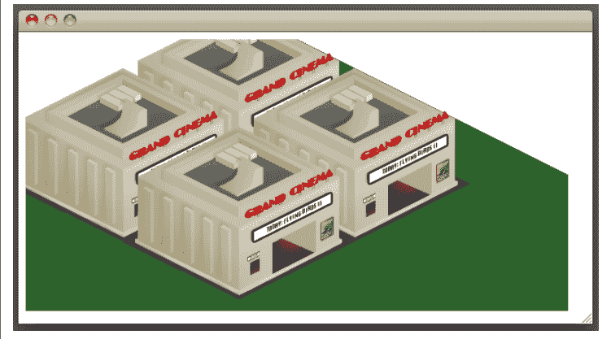

与之前章节中使用的矩形网格不同，在等轴测网格上仅显示我们所在的瓦片需要更多的工作和额外的迭代。图 2-12 显示，如果我们进行滚动并从 1 而不是 0 开始列的迭代，将有一整组瓦片将不会显示，因为它们依赖于列迭代和行的行的迭代。

解决此方案的简单简易方法是再次使用我们的点击例程，并以以下方式获取位于左上、右上、左下和右下角的瓦片：

```
var pos_TL = translatePixelsToMatrix(canvas, tile, 1, 1);
var pos_BL = translatePixelsToMatrix(canvas, tile, 1, canvas.height);
var pos_TR = translatePixelsToMatrix(canvas, tile, canvas.width, 1);
var pos_BR = translatePixelsToMatrix(canvas, tile, canvas.width, canvas.height);

var startRow = pos_TL.row;
var startCol = pos_TR.col;
var rowCount = pos_BR.row + 1;
var colCount = pos_BL.col + 1;

startRow = (startRow < 0) ? 0 : startRow;
startCol = (startCol < 0) ? 0 : startCol;

// 设置人工限制
Count = (rowCount > grid.width) ? grid.width : rowCount;
colCount = (colCount > grid.height) ? grid.height : colCount;
```

```
for (var row = 0; row < rowCount; row++)
```

图 2-12。即使瓦片 0,0 在此屏幕之外，我们仍然需要循环列 0（以及行 0）；否则，其他一些瓦片（应该打印的那些）将不会显示。

```
for (var row = startRow; row < rowCount; row++) {
for (var col = startCol; col < colCount; col++) {
  // ...
}
```

`translatePixelsToMatrix()` 函数如下：

```
function translatePixelsToMatrix(canvas, tile, x, y) {
var gridOffsetY = (grid.height * zoomHelper.level) + scrollPosition.y;
var gridOffsetX = (grid.width * zoomHelper.level);
```

```
// 默认情况下网格水平居中
gridOffsetX += ((canvas.width / 2) - ((tile.width / 2) * zoomHelper.level) + 
scrollPosition.x;
```

```
var col = (2 * (y - gridOffsetY) - x + gridOffsetX) / 2;
var row = x + col - gridOffsetX - tile.height;
```

```
col = Math.round(col / tile.height);
row = Math.round(row / tile.height);
```

```
return {
  row: row,
  col: col
}
```

我们将在后续章节以及最终游戏中使用这种改进方法。

# 第 3 章

界面考虑因素

构建一个外观精美的游戏不仅仅是在网格上布置建筑。一个可运行的游戏需要用户与游戏通信的方式，并且随着游戏向移动端演进，这种通信需求也发生了变化。用户对移动设备的期望通常不同于对桌面计算机的期望，而设备本身增加了新的复杂性。

## Web 游戏中的 GUI 设计与交互

图形用户界面（GUI）和人机交互（HCI）是应用开发极其关键领域，但有时会被开发者忽视。Apple、Google 和 Facebook 等公司和应用程序之所以成功，部分归功于它们卓越的设计可用性指南。它们要求在所有产品中保持一致性、简单、响应性和最小设计。当然，视频游戏（包括我们的）也不是这一规则的例外，但有一个需要记住的大陷阱：与其他类型的应用程序不同，我们的 GUI 必须在桌面和移动设备上都能舒适地使用。

了解这一点后，我们可以为设计它制定出一套简单的遵循建议：

- 我们不能依靠鼠标悬停来提供反馈或显示工具提示。触摸屏只有两种状态：要么你正在触摸屏幕，要么没有。
- 没有工具提示意味着图标和按钮必须清晰地传达它们将要做。
- 我们不能依靠右键点击，因为移动设备没有该功能。
- 在等轴测游戏中，以横屏模式展示游戏比以竖屏模式能更好地利用屏幕空间。
- 重要信息（如账户余额）最好显示在顶部，导航元素最好显示在左下角。（记住，世界上 90% 的人是右手子，他们可能会用左手拿设备，同时用他们灵活的一手——即右手来点击，如图 3-1 所示。）

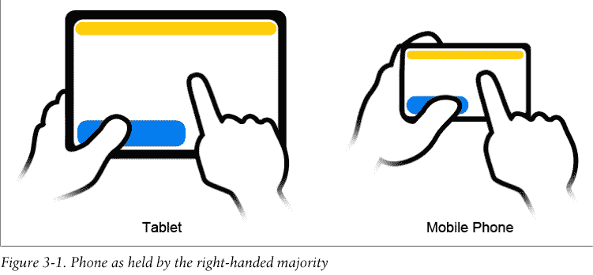

- 由于手机尺寸非常小，我们应该将界面杂乱减少到最低。
- 我们将假设使用 PC 鼠标向上/向下滚动等同于双指缩放（这几乎是现在的标准做法）。
- 我们还将避免展示浮动窗口，而是使用可滚动面板。这些面板将出现在屏幕右侧。

针对移动设备的一些 HCI 和用户体验（UE）指南包括：

- Apple 的 iOS 人机界面指南：http://developer.apple.com/library/ios#documentation/UserExperience/Conceptual/MobileHIG/Introduction/Introduction.html
- Google 的用户体验指南（针对 Android 设备）：http://developer.android.com/guide/practices/ui_guidelines/index.html

本质上，我们的应用 GUI 将看起来与图 3-2 相似。

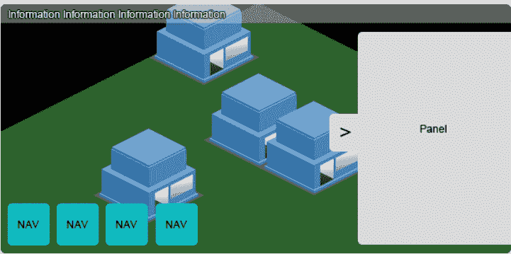

图 3-2. 界面的草图

每个导航按钮都将启用一个工具或执行特定操作。在我们的游戏中，我们将添加以下工具：

- 选择工具，用于选择单个建筑
- 移动按钮，用于切换滚动位置修改符，可以使用鼠标或在使用移动设备或平板电脑时用手指划过屏幕
- 放大和缩小按钮，允许我们放大网格和对象，当我们点击屏幕时（注：此处原文似乎是乱的）
- 旋转按钮，用于逆时针旋转
- 拆毁按钮，用于破坏特定的建筑

此外，我们将支持以下功能：

- 使用鼠标放大或缩小
- 使用键盘滚动网格或放大、缩小或旋转

### 实现 GUI

HTML 页的 HEAD 部分还将包含一些特殊标签。

由于我们将以不同于某些浏览器的方式处理缩放，我们需要完全禁用默认功能：

```html
<meta name="viewport" content="width=device-width, initial-scale=1, user-scalable=no" />
```

像 Apple iPhone、Apple iPad 和某些 Android 手机允许用户将我们的添加到主屏幕。我们可以通过以下标签更改应用程序的图标：

```
<link rel="apple-touch-icon" href="../img/tourist.png" />
<link rel="apple-touch-icon-precomposed" href="../img/tourist.png" />
```

如果用户将应用程序添加到主屏幕，有一种方法可以隐藏浏览器 Chrome（如地址栏等）：

```
<meta name="apple-mobile-web-app-capable" content="yes" />
```

最后，我们将添加 Google 框架以便在旧浏览器中显示我们的游戏：

```
<meta http-equiv="UA-Compatible" content="chrome=1" />
```

GUI 将位于 id 设置为 ui 的 div 中。我们可以监听发生在它或任何子元素上的事件：

```
var ui = document.getElementById('ui');

// 监听 GUI 事件
ui.addEventListener('mouseup', handler, false);
```

我们 GUI 的 HTML 代码看起来如下：

```html
<div id="ui">
  <div id="top">
    账户余额: <span id="balance">0</span><span> 金币
  </div>
  <div id="tools">
    <ul>
      <li id="select"></li>
      <li id="move"></li>
      <li id="zoom"></li>
      <li id="rotate"></li>
      <li id="demolish"></li>
    </ul>
  </div>
  <div id="panel-container" class="hidden">
    <a href="javascript:void(0)" id="panel-toggle">构建</a>
    <div id="panel">
      <h3>选择一个建筑：</h3>
      <ul>
        <li id="buildings">
          <li>
            <h2>建筑名称</h2>
            <p>
              描述
              <br />
              <span>$花费/</span>
            </p>
          </li>
        </li>
      </ul>
    </div>
  </div>
</div>
```

```html
<ul>
  <li>
    <h2>建筑名称</h2>
    <p>
      描述
      <br />
      <span>$Cost</span>
    </p>
  </li>
  <li>
    <h2>建筑名称</h2>
    <p>
      描述
      <br />
      <span>$Cost</span>
    </p>
  </li>
</ul>
```

点击处理函数将看起来像这样：

```javascript
var ui = document.getElementById('ui');

// Listen for GUI events
ui.addEventListener('mouseup', function(e) {
  switch(e.target.getAttribute('id')) {
    case 'panel-toggle':
      // ...
      break;
    case 'select':
      // ...
      break;
    case 'move':
      // ...
      break;
    case 'zoomIn':
      // ...
      break;
    case 'zoomOut':
      // ...
      break;
    case 'rotate':
      // ...
      break;
    case 'demolish':
      // ...
      break;
  }
}, false);
```

注意，面板之前显示的 HTML 代码和账户余额包含虚假值；不用担心，稍后在我们将客户端脚本与服务端脚本集成时，我们会用真实值填充它们。

移动设备会检测 click、mouseDown、mouseMove、mouseup 和 DOMMouseScroll 事件，根据硬件不同，这些事件会产生 250 到 600 毫秒的延迟。为了缓解这个问题，我们需要检测设备是否支持 touchstart、touchmove 和 touchend 等触摸事件，并通过 gesturestart 和 gestureend 检测手势。

我们可以使用 Modernizr 库来检测并管理点击和触摸事件。如果设备支持触摸事件，Modernizr 将返回 true，这意味着我们可以这样做：

```javascript
var pointer = {
  DOWN: 'mousedown',
  UP: 'mouseup',
  MOVE: 'mousemove'
};
```

```javascript
if (Modernizr.touch) {
  pointer.DOWN = 'touchstart',
  pointer.UP = 'touchend',
  pointer.MOVE = 'touchmove'
}
```

```javascript
window.addEventListener('resize', function() { doResize(canvas); }, false);
canvas.addEventListener(pointer.DOWN, handleMouseDown, false);
canvas.addEventListener(pointer.MOVE, handleDragDrag, false);
document.body.addEventListener(pointer.UP, handleMouseUp, false);
```

```javascript
if (Modernizr.touch) {
  // Detect gestures
  document.body.addEventListener('gestureend', handleGestureEnd, false);
}
```

```javascript
else {
  // Detect scrolling
  document.body.addEventListener('keydown', handleKeyDown, false);
  document.body.addEventListener('mousewheel', handleScroll, false);
  document.body.addEventListener('DOMMouseScroll', handleScroll, false);
}
```

既然我们的代码库变得越来越大且复杂，我们还将创建一个 `Game` 类来简化工作量；我们还将页面上的代码划分为多个脚本。

示例 3-1 中的完整代码已在官方代码仓库中以 `ex14-gui.html` 上线。参见图 3-3。你也可以在代码仓库中找到 `ex14-gui-sound.html`，它是带有背景音乐的相同示例。

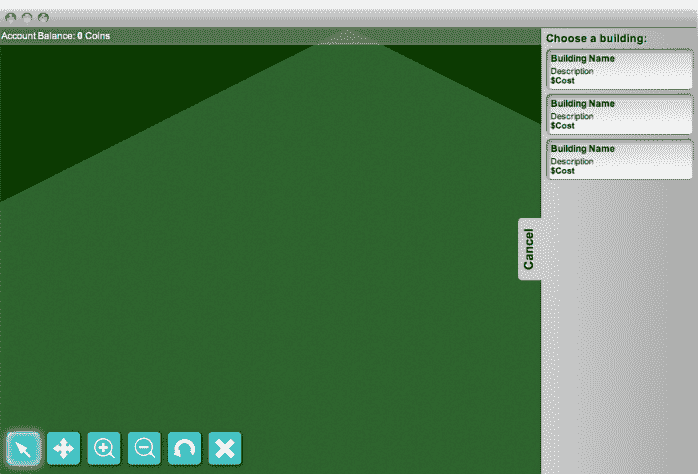

图 3-3 示例 3-1 截图

示例 3-1. GUI (HTML)

```html
<!DOCTYPE html>
<html lang="en">
<head>
  <meta charset="UTF-8" />
  <meta name="viewport" content="width=device-width, initial-scale=1, user-scalable=no, mobile-app-capable=yes" />
  <title>示例 14 - 图形界面</title>
  <link rel="stylesheet" href="../ui-style.css" />
  <script src="../utils/modernizr.min.js"></script>
  <script src="game14.js"></script>
```

实现 GUI | 69

```javascript
// Enums
var Tools = {
  current: 0, // Default tool
  SELECT: 0,
  MOVE: 1,
  ZOOM_IN: 2,
  ZOOM_OUT: 3,
  DEMOLISH: 4
};

var Keys = {
  UP: 37,
  DOWN: 38,
  RIGHT: 39,
  LEFT: 40,
  A: 65,
  S: 68,
  W: 87,
  D: 82,
  S: 83,
  X: 87,
  R: 88,
  Z: 90
};

window.onload = function () {
  var canvas = document.getElementById('gameCanvas');
  var game = document.getElementById('game');

  // Initialize the game object
  var g = new Game(canvas, game, 500, 500);

  var pointer = {
    DOWN: 'mousedown',
    UP: 'mouseup',
    MOVE: 'mousemove'
  };

  if (Modernizr.touch) {
    pointer.DOWN = 'touchstart';
    pointer.UP = 'touchend';
    pointer.MOVE = 'touchmove';
  }

  // Set up the listeners
  window.addEventListener('resize', function() {
    g.doResize(canvas);
  }, false);

  canvas.addEventListener(pointer.DOWN, function(e) {
    g.handleMouseDown(e);
  }, false);

  canvas.addEventListener(pointer.MOVE, function(e) {
    g.handleDragDrag();
  }, false);

  document.body.addEventListener(pointer.UP, function(e) {
    g.handleMouseUp(e);
  }, false);

  if (Modernizr.touch) {
    // Detect gestures
    document.body.addEventListener('gestureend', function(e) {
      g.handleGestureEnd(e);
    });
  } else {
    // Detect scrolling
    document.body.addEventListener('keydown', function(e) {
      g.handleKeyDown(e);
    }, false);
    document.body.addEventListener('mousewheel', function(e) {
      g.handleScroll(e);
    }, false);
    document.body.addEventListener('DOMMouseScroll', function(e) {
      g.handleScroll(e);
    }, false);
  }

  // Listen for GUI events
  var ui = document.getElementById('ui');
  ui.addEventListener(pointer.UP, function(e) {
    switch(e.target.getAttribute('id')) {
      case 'panel-toggle':
        var panelContainer = document.getElementById('panel-container');
        var classes = panelContainer.getAttribute('class');

        if (classes === null || classes.length > 0) {
          panelContainer.setAttribute('class', '');
          document.getElementById('panel-toggle').innerHTML = '取消';
        } else {
          panelContainer.setAttribute('class', 'hidden');
          document.getElementById('panel-toggle').innerHTML = '构建';
        }
        break;
      case 'select':
        selectTool(Tools.SELECT, document.getElementById('select'));
        break;
      case 'move':
        selectTool(Tools.MOVE, document.getElementById('move'));
        break;
      case 'zoomIn':
        selectTool(Tools.ZOOM_IN, document.getElementById('zoomIn'));
        break;
      case 'zoomOut':
        selectTool(Tools.ZOOM_OUT, document.getElementById('zoomOut'));
        break;
      case 'rotate':
        g.rotateGrid();
        g.draw();
        break;
      case 'demolish':
        selectTool(Tools.DEMOLISH, document.getElementById('demolish'));
        break;
      default:
        // 没有点击任何选项而是点击了
        // UI 的空白区域，回退到画布。
        var srcElement = canvas;
        e.target = canvas;
        e.element = canvas;

        g.handleMouseDown(e);
        break;
    }
  }, false);

  function selectTool(tool, elem) {
    // Remove the "active" class from any element inside div#tools
    for (var i = 0, x = elem.parentNode.childNodes.length; i < x; i++) {
      if (elem.parentNode.childNodes[i].tagName == "LI") {
        elem.parentNode.childNodes[i].className = null;
      }
    }
    // (Logic for adding active class would follow)
    switch(tool) {
      case Tools.SELECT:
        Tools.current = Tools.SELECT;
        break;
      case Tools.MOVE:
        Tools.current = Tools.MOVE;
        break;
      case Tools.ZOOM_IN:
        Tools.current = Tools.ZOOM_IN;
        break;
      case Tools.ZOOM_OUT:
        Tools.current = Tools.ZOOM_OUT;
        break;
      case Tools.DEMOLISH:
        Tools.current = Tools.DEMOLISH;
        break;
    }
  }
};
</script>
</head>
<body>
  <div id="game">
    <canvas id="gameCanvas" width="1" height="1"></canvas>
    <div id="ui">
      <div id="top">
        账户余额: <span id="balance">0</span> 金币
      </div>
      <div id="tools">
        <ul>
          <li id="select" class="active"></li>
          <li id="move"></li>
          <li id="zoomOut"></li>
          <li id="rotate"></li>
          <li id="demolish"></li>
        </ul>
      </div>
      <div id="panel-container" class="hidden">
        <a href="javascript:void(0)" id="panel-toggle">构建</a>
        <div id="panel">
          <h3>选择一个建筑：</h3>
          <ul id="buildings">
            <li>
              <h2>建筑名称</h2>
              <p>
                描述
                <br />
                <span>$Cost</span>
              </p>
            </li>
            <li>
              <h2>建筑名称</h2>
              <p>
                描述
                <br />
                <span>$Cost</span>
              </p>
            </li>
            <li>
              <h2>建筑名称</h2>
              <p>
                描述
                <br />
                <span>$Cost</span>
              </p>
            </li>
          </ul>
        </div>
      </div>
    </div>
  </div>
</body>
</html>
```

### 示例 3-2. 游戏函数 (JavaScript)

```javascript
// 用于示例14的 Game 类
function Game(canvas, game, gridSize, gridSizeH) {
  this.started = true;
  this.gameContainer = game;
  this.canvas = canvas;
```

```javascript
// 获取 2D 上下
this.c = canvas.getContext('2d');
```

```javascript
// 我们可以运行游戏吗？
var missingDeps = [];
var dependencies = [Modernizr.rgba,
  Modernizr.canvas,
  Modernizr.borderradius,
  Modernizr.boxshadow,
  Modernizr.cssgradients];
```

```javascript
for (var i = 0, dep = dependencies.length; i < dep; i++) {
  if (dependencies[i]) {
    missingDeps.push(dependencies[i]);
  }
}
```

```javascript
if (missingDeps.length != 0) {
  var msg = "此浏览器不支持运行游戏所需的某些 ";
  msg += "技术 ";
  alert(msg);
  this.started = false;
  return;
}
```

```javascript
// 瓦片纹理
this.tile = new Image();
this.tile.src = "../img/tile.png";
```

```javascript
// 网格尺寸
this.grid = {
  width: gridSize,
  height: gridSizeH
};
```

```javascript
// 瓦片地图矩阵
this.tileMap = [];
```

```javascript
// 拖拽辅助

this.dragHelper = {
  active: false,
  x: 0,
  y: 0
};
```

```javascript
// 缩放辅助，支持3个缩放级别
this.zoomHelper = {
  level: 1,
};
```

```javascript
NORMAL: 1,
FAR: 0.50,
CLOSE: 2
```

```javascript
// 滚动位置辅助，跟踪滚动状态
this.scrollPosition = { x: 0, y: 0 };

// 默认缩放级别
this.tile.width *= this.zoomHelper.level;
this.tile.height *= this.zoomHelper.level;

// 初始将起点水平和垂直居中
var nspy = (this.grid.height * this.zoomHelper.level) + this.scrollPosition.y;
var nsp = (this.grid.width * this.zoomHelper.level) + this.scrollPosition.x;
this.scrollPosition.y = nspy;
this.scrollPosition.x = nsp;

this.doResize();
this.draw();

Game.prototype.handleGestureEnd = function(e) {
  e.preventDefault();
  if (Math.floor(e.scale) == 0) {
    this.zoomIn();
  } else {
    this.zoomOut();
  }
};

Game.prototype.handleScroll = function(e) {
  e.preventDefault();
  var scrollValue = (e.wheelDelta == undefined) ? e.detail * -1 : e.wheelDelta;
  if (scrollValue >= 0) {
    this.zoomIn();
  } else {
    this.zoomOut();
  }
};

Game.prototype.handleKeyDown = function(e) {
  switch (e.keyCode) {
    case Keys.UP:
    case Keys.w:
      this.scrollPosition.y += 20;
      break;
    case Keys.DOWN:
    case Keys.s:
      this.scrollPosition.y -= 20;
      break;
  }
};
```

```javascript
case Keys.LEFT:
case Keys.A:
  this.scrollPosition.x += 20;
  break;
case Keys.RIGHT:
case Keys.D:
  this.scrollPosition.x -= 20;
  break;
case Keys.X:
  this.zoomIn();
  break;
case Keys.Z:
  this.zoomOut();
  break;
case Keys.R:
  this.rotateGrid();
  break;
```

```javascript
this.draw();
```

Game.prototype.handleDrag = function(e) {

  var x, y;

  e.preventDefault();

  if (Modernizr.touch) {

    x = e.touches[0].pageX;

    y = e.touches[0].pageY;

  } else {

    x = e.clientX;

    y = e.clientY;

  }

```

```javascript

switch (Tools.current) {

  case Tools.MOVE:

    if (this.dragHelper.active) {

      // 平滑滚动

      this.scrollPosition.x -= (this.dragHelper.x - x) / 18;

      this.scrollPosition.y -= (this.dragHelper.y - x) / 18;

    }

    this.draw();

    break;

}

```

Game.prototype.handleMouseUp = function(e) {
  e.preventDefault();
  switch (Tools.current) {
    case Tools.MOVE:
      this.dragHelper.active = false;
      break;
  }
};

Game.prototype.handleMouseDown = function(e) {
  var x, y;
  e.preventDefault();
  if (Modernizr.touch) {
    x = e.touches[0].pageX;
    y = e.touches[0].pageY;
  } else {
    x = e.clientX;
    y = e.clientY;
  }
  switch (Tools.current) {
    case Tools.BUILD:
      break;
    case Tools.MOVE:
      this.dragHelper.active = true;
      this.dragHelper.x = x;
      this.dragHelper.y = y;
      break;
    case Tools.ZOOM_IN:
      this.zoomIn();
      break;
    case Tools.ZOOM_OUT:
      this.zoomOut();
      break;
    case Tools.DEMOLISH:
      var pos = this.translatePixels(x, y);
      if (this.tileMap[pos.row] != null && this.tileMap[pos.row][pos.col] != null) {
        this.tileMap[pos.row][pos.col] = null;
      }
      break;
  }
};

Game.prototype.doResize = function() {
  this.canvas.width = document.body.clientWidth;
  this.canvas.height = document.body.clientHeight;
  this.draw();
};

Game.prototype.translatePixels = function(x, y) {
  var tileHeight = this.tile.height * this.zoomHelper.level;
  var tileWidth = this.tile.width * this.zoomHelper.level;
  var gridHeight = this.grid.height * this.zoomHelper.level;
  var gridWidth = this.grid.width * this.zoomHelper.level;
  var gridOffsetY = this.scrollPosition.y;
  var gridOffsetX = this.scrollPosition.x;
  var row = Math.round((y + gridOffsetY) / tileHeight);
  var col = Math.round((x + gridOffsetX) / tileWidth);
  return {
    row: row,
    col: col
  };
};

Game.prototype.draw = function(srcX, srcY, destX, destY) {
  this.c.clearRect(0, 0, this.canvas.width, this.canvas.height);
  this.c.fillStyle = '#003B00'; // 背景
  this.c.fillRect(0, 0, this.canvas.width, this.canvas.height);
  var posTL = this.translatePixels(0, 0);
  var posBL = this.translatePixels(0, this.canvas.height);
  var posTR = this.translatePixels(this.canvas.width, 0);
  var posBR = this.translatePixels(this.canvas.width, this.canvas.height);
  var startRow = posTL.row;
  var startCol = posTR.col;
  var rowCount = posBR.row + 1;
  var colCount = posBL.col + 1;
  startRow = (startRow < 0) ? 0 : startRow;
  startCol = (startCol < 0) ? 0 : startCol;
  rowCount = (rowCount > this.grid.width) ? this.grid.width : rowCount;
  colCount = (colCount > this.grid.height) ? this.grid.height : colCount;
  var tileHeight = this.tile.height * this.zoomHelper.level;
  var tileWidth = this.tile.width * this.zoomHelper.level;
  for (var row = startRow; row < rowCount; row++) {
    for (var col = startCol; col < colCount; col++) {
      var xpos = (row - col) * tileHeight + (this.grid.width * this.zoomHelper.level);
      xpos += ((this.canvas.width / 2) - ((tileWidth / 2) *
      this.zoomHelper.level + this.scrollPosition.x));
      var ypos = (row) * (tileHeight / 2) + (this.grid.height *
      this.zoomHelper.level + this.scrollPosition.y);
      if (this.tileMap[row] != null && this.tileMap[row][col] != null) {
        // 放置建筑
      } else {
        if (Math.round(xpos) + tileWidth <= srcX &&
            Math.round(ypos) + tileHeight >= srcY &&
            Math.round(xpos) <= destX &&
            this.c.drawImage(this.tile,
              Math.round(xpos),
              Math.round(ypos),
              tileWidth,
              tileHeight));
      }
    }
  }
};
```

```javascript
case this.zoomHelper.FAR:
  return;
}

// 居视图
this.scrollPosition.y -= (this.grid.height * this.zoomHelper.level) +
this.scrollPosition.y;
this.scrollPosition.x -= (this.grid.width * this.zoomHelper.level) +
this.scrollPosition.x;
}

Game.prototype.rotateGrid = function(mW, mH, sW, sH) {
  var m = [];

mW = (mW === undefined) ? this.grid.width : mW;
  mH = (mH === undefined) ? this.grid.height : mH;

  sW = (sW === undefined) ? 0 : sW;
  sH = (sH === undefined) ? 0 : sH;

  for (var i = sW; i < mW; i++) {
    for (var j = sH; j < mH; j++) {
      var row = (mW - j) - 1;

      if (this.tileMap[row] !== undefined && this.tileMap[row][i]) {
        m[i] = (m[i] === undefined) ? [] : m[i];
        m[i][j] = this.tileMap[row][i];
      }
    }
  }
  this.tileMap = m;
```

# 第 4 章

## HTML5 音频与处理优化

HTML5 为游戏设计师带来的远不止是 canvas 元素。对音频（以及视频）的原生支持是关键部分之一，它允许你在与图形相同的 JavaScript 环境中编写游戏。其他部分也改进了你的 JavaScript，无论是通过 Web Workers 分配任务，还是通过本地存储和会话存储让你了解玩家设备上的相关信息。

### 使用 Audio 元素添加音频

之前的 HTML 规范支持三种在页面中播放音频文件的方法。我们可以：

- 使用 `object` 或 `embed` 标签来嵌入文件或插件，例如 LiveAudio (Netscape Navigator) 或 ActiveMovie Control (Internet Explorer)。随着时间的推移，其他插件开始进入市场，例如 Macromedia Flash (Adobe Flash)、REAL Player 或 Apple 的 QuickTime 等。要嵌入 MIDI 或 WAV 文件，我们可以使用 `<embed src="music.mid" autostart="true" loops="true">` 或者嵌入专有的第三方插件（如 Macromedia Flash Player）并通过我们的 SWF 文件播放声音。
- 插入 Java Applet 并通过它播放声音。
- 在页面的 `body` 元素上添加 `bgsound` 属性（仅限 Internet Explorer）。

浏览器通常包含不同的插件集，这意味着我们的声音可能在一个浏览器中播放而在另一个浏览器中无法播放，即使它们都安装在同一台电脑上。

幸运的是，随着 HTML5 的出现，我们获得了通过使用 `<audio>` 和 `<video>` 标签原生播放音频视频文件的能力。

遗憾的是，之前 HTML 版本中的技术限制被 HTML5 中的法律限制所取代。音频（和视频）使用解码器（codecs）进行编码或解码，解码器是小型软件库，允许我们通过实现特定算法来编码/解码音频视频文件或流。某些算法针对速度进行了优化；另一些算法针对无损质量进行了优化；就像软件一样，其中一些是免费且开源的，而另一些则需要许可。

在“开源”解码器的情况下，像苹果和微软这样的公司担心他们可能侵犯了专利，这可能导致他们在诉讼中承担法律责任——这就是为什么他们不在自己的浏览器中支持它们。相反的情况是，像 Mozilla 基金或 Opera Software 这样的公司尚未为某些受许可的解码器做出必要的安排。

图 4-1 显示了每个浏览器支持哪些音频解码器。

| MP3 | WAV | OGG |
| :--- | :--- | :--- |
| Chrome | ✔ | × | ✔ |
| Explorer 9 | × | × | ✔ |
| Firefox | ✔ | ✔ | ✔ |
| Opera | × | ✔ | ✔ |
| Safari | ✔ | ✔ | × |

图 4-1. 对音频解码器的支持

希望，

```html
<audio controls>
  <source src="../sounds/song.mp3" type="audio/mpeg">
  <source src="../sounds/song.ogg" type="audio/ogg">
</audio>
```

与其定义单个 `src` 参数，HTML5 音频标签允许我们定义多个音频文件。如果由于原因无法播放 song.mp3，浏览器将尝试播放备选的 song.ogg。如果我们有更多源，它将尝试播放列表中的每一个源，直到它们都失败或其中一个成功工作。除了 `control` 属性外，HTML5 音频标签还支持其他可选属性：

- loop：允许加载 `src` 属性或 `source` 标签中指定的媒体文件。
- autoplay：一旦加载完成立即开始播放声音。
- preload：允许我们定义源预加载策略：
  - preload="none":不预加载文件，用户点击播放按钮时加载。
  - preload="metadata": 加载文件的元数据。
  - preload="auto":让浏览器处理文件的加载（通常意味着加载整个文件）

当然，我们也可以使用 JavaScript 创建并使用 HTML5音频对象，而不是在页面中包含音频元素。

### 示例 4-1. 使用 JavaScript 创建 HTML5 音

```html
<!DOCTYPE html>
<html lang="en">
<head>
  <meta charset="UTF-8">
  <title>Example 4-1 (HTML5 Audio)</title>
  <script>
    window.onload = function() {
      // 定义带有源的数组
      var sources = [
        "../sounds/song.mp3", "audio/mpeg",
        "../sounds/song.ogg", "audio/ogg"
      ];

      // 创建 HTML5 音
      var audio = document.createElement('audio');

      // 遍历源
      for (var i = 0; i < sources.length; i += 2) {
        // 创建源
        var src = document.createElement('source');
        // 添加 src 和类型
        src.setAttribute('src', sources[i]);
        src.setAttribute('type', sources[i+1]);
        // 将源附加到音频
        audio.appendChild(src);
      }

      // 尝试播放声音
      audio.play();
    }
  </script>
</head>
<body>
  HTML5 Audio
</body>
</html>
```

- 一个包含文件本身以及每个文件编码格式的数组
- 一个开始时间，以秒为单位
- 一个结束时间，以毫秒为单位
- 一个音量值
- 一个布尔值，表示你是否希望声音无限循环播放；在这种情况下，它将只在第一次播放时遵循开始时间，之后将不再遵循视为结束时间的值。

`play()` 方法将调用另一个方法 `getAudioAsset()`，该方法维护了一个可供重复使用的音频对象池，并跟踪最大同时播放的数量。如果池中没有可用对象，它将自动生成一个，除非池中的对象数量等于最大同时播放数，在这种情况下，它将返回 `null` 值且不播放任何声音。

一旦声音播放完成，我们需要通过调用 `freeAudioAsset()` 方法来“释放”音频对象，将其放回可用音频对象池。

整个工具类可以参考示例 4-2。

### 示例 4-2. SoundUtil

```javascript
// 池中允许的声音对象最大数量
var MAX_PLAYBACKS = 6;
var globalVolume = 0.6;

function SoundUtil(maxPlaybacks) {
    this.maxPlaybacks = maxPlaybacks;
    this.audioObjects = []; // 可重复使用的音频对象池
}

SoundUtil.prototype.play = function(file, startTime, duration, loop) {
    // 从池中获取一个音频对象
    var audioObject = this.getAudioAsset();
    var soObj = this;

    /**
     * 池中没有可用音频对象。什么都不做。
     * 注意：这是玩具风琴的方法；或者你也可以
     * 将对象添加到队列中以便稍后播放
     */
    if (audioObject != null) {
        audioObject.obj.loop = loop;
        audioObject.obj.volume = volume;
    }

    for (var i = 0; i < file.length; i++) {
        if (audioObject.obj.canPlayType(file[i][1]) === "maybe" ||
            audioObject.obj.canPlayType(file[i][1]) === "probably") {
            audioObject.obj.src = file[i][0];
            audioObject.obj.type = file[i][1];
            break;
        }
    }

    var playback = function() {
        // 移除事件监听器，否则它
        // 会反复调用
        audioObject.obj.removeEventListener('canplaythrough', playback, false);
        audioObject.obj.currentTime = startTime;
        audioObject.obj.play();

        // 如果对象在循环模式下播放，
        // 当它播放结束时，不需要监听
        if (!loop) {
            setTimeout(function() {
                audioObject.obj.pause();
                subObj.obj.freeAudioObject(audioObject);
            }, duration);
        }
    }

    audioObject.obj.addEventListener('canplaythrough', playback, false);
}

SoundUtil.prototype.getAudioObject = function() {
    if (this.audioObjects.length === 0) {
        var a = new Audio();
        var audioObject = {
            id: 0,
            obj: a,
            busy: true
        }
        this.audioObjects.push(audioObject);
        return audioObject;
    } else {
        for (var i = 0; i < this.audioObjects.length; i++) {
            if (!this.audioObjects[i].busy) {
                this.audioObjects[i].busy = true;
                return this.audioObjects[i];
            }
        }
    }

    // 没有空闲的音频对象。我们可以创建一个新的吗？
    if (this.audioObjects.length <= this.maxPlaybacks) {
        var a = new Audio();
        var audioObject = {
            id: this.audioObjects.length,
            obj: a,
            busy: true
        }
        this.audioObjects.push(audioObject);
        return audioObject;
    } else {
        return null;
    }
}

SoundUtil.prototype.freeAudioObject = function(audioObject) {
    for (var i = 0; i < this.audioObjects.length; i++) {
        if (this.audioObjects[i].id === audioObject.id) {
            this.audioObjects[i].currentTime = 0;
            this.audioObjects[i].busy = false;
        }
    }
}
```

为了演示如何使用 SoundUtil，我们将它与书中展示的第一个示例结合：示例 4-3，`ex16-soundUtil.html` 位于本书包含的代码仓库的示例文件夹中。

### 示例 4-3. 为我们的标题界面添加声音

```html
<!DOCTYPE html>
<html lang="en">
<head>
  <meta charset="UTF-8" />
  <title>带声音的示例16标题界面</title>
</head>

<!-- 我们将 soundutil 作为外部文件引入 -->
  <script src="soundutil.js" charset="utf-8"></script>
<script>

window.onload = function () {
  var su = null;
  var sources = [
    "../sounds/title.mp3", "audio/mp3",
    "../sounds/title.ogg", "audio/ogg"
  ];

  var canvas = document.getElementById('myCanvas');
  var c = canvas.getContext('2d');

  var State = {
    current: 0,
    INTRO: 0,
    LOADING: 1,
    LOADED: 2
  };

  window.addEventListener('click', handleClick, false);
  window.addEventListener('resize', doResize, false);

  doResize();
}
</script>

```javascript

// 检查当前浏览器是否支持播放 MP3 或 OGG 文件

if (soundIsSupported()) {

  // 播放标题界面音乐

  playTitleMusic();

}

function playTitleMusic() {

  if (su) {

    su.play(sources, 0, 16000, globalVolume, false);

  }

}

function soundIsSupported() {

  var a = new Audio();

  var failures = 0;

  for (var i = 0; i < sources.length; i++) {

    if (a.canPlayType(sources[i][1]) === "maybe" ||

        a.canPlayType(sources[i][1]) === "probably") {

      failures++;

    }

  }

  return failures === sources.length;

}

function handleClick() {

  if (State.current === State.INTRO) {

    State.current = State.LOADING;

  }

}

function doResize() {

  canvas.width = window.clientWidth;

  canvas.height = window.innerHeight;

}

function fadeToWhite(alphaVal) {

  if (State.current === State.LOADING) {

    setTimeout(function() {

      State.current = State.LOADED;

      showIntro();

    }, 30);

  }

}

function showIntro() {

  if (State.current === State.LOADED) {

    c.fillStyle = '#FFFFFF';

    c.globalAlpha = 1;

    c.fillRect(0, 0, canvas.width, canvas.height);

    var phrase = "Click or tap to start";

    c.fillStyle = '#000000';
```


`c.font = 'bold 16px Arial, sans-serif';`

`var textSize = c.measureText(phrase);`

`var xCoord = (canvas.width / 2) - (textSize.width / 2);`

`c.fillText(phrase, xCoord, (canvas.height / 2) + 50);`

解决——在 JavaScript 中，它们会产生一种名为“界面锁定”的效果，浏览器会冻结直到操作完成。

幸运的是，HTML5 规范提供了一个名为 Web Workers 的新 API。Web Workers（通常称为“workers”）允许我们在后台执行耗时且长时间运行的脚本，而不会影响浏览器的主用户界面。

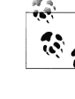

Workers 并不是能够魔法帮助我们解决那些占用 100% CPU 处理能力的的灵丹妙药。如果一个任务在使用传统方法时是处理器密集型的，那么在 workers 运行时它可能也是处理器密集型的，并最终影响用户体验。然而，如果一个任务消耗了 30% 的 CPU，workers 可以通过并行执行任务来帮助我们减少对用户界面的影响。

此外，还有一些局限性：

- 每个 worker 都运行在与其执行的页面完全独立的、线程安全的环境中（也称为沙箱），它们无法访问 DOM 和 window 对象。
- 尽管你可以从 worker 内部创建新的 workers（此功能在 Google Chrome 中不可用），但要小心，因为这种方法会导致非常难以调试的错误。

可以使用以下代码创建 worker：

```javascript
var worker = new Worker(PATH_TO_A_JS_SCRIPT);
```

其中 `PATH_TO_A_JS_SCRIPT` 可以是 `astar.js`。一旦创建了 worker，我们可以在任何时候通过调用 `worker.close()` 来终止执行。如果 worker 已关闭，我们需要执行新操作或创建一个新的 worker 对象。

与 Web Workers 之间的双向通信是通过使用 `worker.postMessage(object)` 方法发送消息，并在 `worker.onmessage` 事件上定义回调函数来实现的。此外，你可以定义一个 `onerror` 处理器来处理 worker 错误。

就像普通页面一样，Web Workers 允许我们通过 `importScripts()` 函数调用外部脚本。该函数接受零或多个参数（每个参数都是 JavaScript 文件）。

在代码仓库中可以找到名为 Web Workers 的 A* 算法示例实现，文件名 `ex17-grid-astar.html`。图 4-2 显示了 worker 的进度。代码见示例 17 以及一个用 JavaScript 开发的 A* 实现。

### 示例 13 - (在未设置索引的网格上运行 A*)

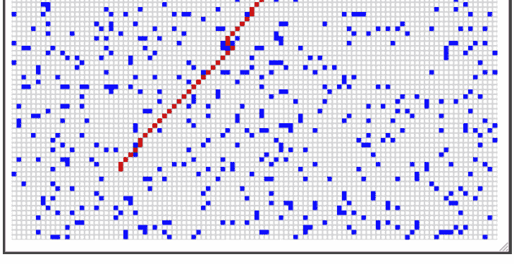

图 4-2. 示例 4-4 运行

示例 4-4. 路径查找 HTML

```html
<!DOCTYPE html>
<html lang="en">
<head>
<meta charset="UTF-8" />
<title>Example 17 - (在未设置索引的网格上运行 A* web workers)</title>
<script>
window.onload = function () {
  var tileMap = [];
  var path = {
    start: null,
    stop: null
  };
  var tile = {
    width: 6,
    height: 6
  };
  var grid = {
    width: 100,
    height: 100
  };
  var canvas = document.getElementById('myCanvas');
  canvas.addEventListener('click', handleClick, false);
}
var c = canvas.getContext('2d');
// Generate 1000 random elements
for (var i = 0; i < 1000; i++) {
  generateRandomElement();
}
// Draw the entire grid
draw();
function handleClick(e) {
  // When a click is detected, translate the mouse
  // coordinates to pixel coordinates
  var row = Math.floor(e.clientX - 10) / tile.width;
  var column = Math.floor(e.clientY - 10) / tile.height;
  if (tileMap[row] == null) {
    tileMap[row] = [];
  }
  if (tileMap[row][column] != 0 && tileMap[row][column] != 1) {
    tileMap[row][column] = 0;
  }
  if (path.start == null) {
    path.start = {x: row, y: column};
  } else {
    path.stop = {x: row, y: column};
  }
  callWorker(path, processWorkerResults);
  path.start = null;
  path.stop = null;
}
draw();
}
function callWorker(path, callback) {
  var w = new Worker('astar.js');
  w.postMessage({
    tileMap: tileMap,
    grid: {
      width: grid.width,
      height: grid.height
    },
    start: path.start,
    stop: path.stop
  });
  w.onmessage = callback;
}
function processWorkerResults(e) {
  if (e.data.length > 0) {
    for (var i = 0, len = e.data.length; i < len; i++) {
      if (tileMap.data[i].x === undefined) {
        tileMap[e.data[i].x] = [];
      }
      tileMap[e.data[i].x][e.data[i].y] = 0;
    }
  }
}
function getRandomElement() {
  var randRow = Math.floor(Math.random() * (grid.width + 1));
  var randCol = Math.floor(Math.random() * (grid.height + 1));
}
if (tileMap[randRow] == null) {
  tileMap[randRow] = [];
}
tileMap[randRow][randCol] = 1;
}
function draw(srcX, srcY, destX, destY) {
  srcX = (srcX === undefined) ? 0 : srcX;
  srcY = (srcY === undefined) ? 0 : srcY;
  destX = (destX === undefined) ? canvas.width : destX;
  destY = (destY === undefined) ? canvas.height : destY;
  c.fillStyle = '#FFFFFF';
  c.fillRect(srcX, srcY, destX, destY);
}
```
```

使用 Web Workers API 管理计算密集型任务 | 93


```javascript
// Not present in any of the lists, keep going.
var n = new Node(this.currentNode, {x: row, y: col});
n.G = this.currentNode.G + 1;
n.H = this.getDistance(this.currentNode, n);
n.F = n.G + n.H;
this.openList.add(n);
}
while (this.currentNode.parentNode !== null) {
  this.path.add(this.currentNode);
  this.currentNode = this.currentNode.parentNode;
}
return this.path.list;
}
naStar.prototype.checkDifference = function(src, dest) {
  return (src.x === dest.x && src.y === dest.y);
}
aStar.prototype.getDistance = function(src, dest) {
  return Math.abs(src.x - dest.x) + Math.abs(src.y - dest.y);
}
function Node(parentNode, src) {
  this.parentNode = parentNode;
  this.x = src.x;
  this.y = src.y;
  this.F = 0;
  this.G = 0;
  this.H = 0;
}
var nodeList = function(sorted, sortParam) {
  this.sort = (sorted === undefined) ? [] : sorted;
  this.sortParam = (sortParam === undefined) ? 'F' : sortParam;
  this.list = [];
  this.coordMatrix = [];
}
NodeList.prototype.add = function(element) {
  this.list.push(element);
  if (this.coordMatrix[element.x] === undefined) {
    this.coordMatrix[element.x] = [];
  }
  this.coordMatrix[element.x][element.y] = element;
  if (this.sort) {
    var sortBy = this.sort;
    this.list.sort(function(o1, o2) { return o1 - o2; });
  }
}
NodeList.prototype.remove = function(pos) {
  this.list.splice(pos, 1);
}
NodeList.prototype.get = function(pos) {
  return this.list[pos];
}
NodeList.prototype.size = function() {
  return this.list.length;
}
NodeList.prototype.isEmpty = function() {
  return (this.list.length == 0);
}
NodeList.prototype.getByCoord = function(x, y) {
  if (this.coordMatrix[x] === undefined) {
    return null;
  } else {
    var obj = this.coordMatrix[x][y];
    if (obj == undefined) {
      return null;
    } else {
      return obj;
    }
  }
}
NodeList.prototype.print = function() {
  for (var i = 0; i < this.list.length; i++) {
    console.log(this.list[i].x + ' ' + this.list[i].y);
  }
}
```
```

## 本地存储与会话存储

Web开发者必须处理的一个限制是数据太大或太重要；它被限制在 4K。如今，现代浏览器支持 Web Storage，这个工具可以帮助我们在用户的硬盘（HDD）上保存至少 5 MB 的数据。然而，当我们说“5 MB”时，实际数值可能多或少，取决于我们正在使用的浏览器——空间配额是在我们的设置面板中定义的。在某些情况下（如 Opera），Web Storage 功能可能会被禁用。如果超过了 5 MB，浏览器将抛出 `QUOTA_EXCEEDED_ERR`，因此将对 `localStorage` 或 `sessionStorage` 的调用封装在 `try-catch` 块中是非常重要的——就像我们应该的那样适当处理异常。

预期 Web Storage 的行为与 cookie 非常相似：

- 我们可以存储元素的最大数量——cookie 为 4K，Web Storage 为 5MB，但也可能比这小。
- 用户可以随时删除或手动创建并修改我们存储文件夹的内容。
- 浏览器也可以决定“过期”我们存储文件夹的内容。
- 配额是按域名提供的，并由所有子域名共享（例如，site1.example.com、site2.example.com 和 site3.example.com 共享同一个文件夹）。

然而，Web Storage 与 cookie 有以下不同点：

- 使用 Web Storage API 保存的数据只能由客户端查询，不能由服务器查询。
- 内容不会在每次请求中“往返”传输。
- 除了 `sessionStorage`（会话结束后会删除其内容）外，我们无法明确指定过期日期。
- 就像 cookie 一样，最好不要使用 Web Storage 来保存任何重要的内容。

除此之外，它是一个非常棒的工具，可以帮助我们完成以前无法做的事情，例如缓存对象以提高用户下次打开应用程序时的加载性能、保存我们正在编写的文档草稿，甚至将其作为虚拟内存容器。

一旦你理解了 Web Storage 的局限性和功能，其余部分就非常直观：

- 数据存储在键值对数组中，这些键值对被视为字符串并存储。
- `localStorage` 和 `sessionStorage` 的区别在于 `localStorage` 永久存储数据（直到用户或浏览器决定释放它），而 `sessionStorage` 则在会话期间存储（直到关闭标签页/窗口）。

Web Storage API 仅包含四个方法：

```javascript
localStorage.setItem(key, value)
```
添加项目

```javascript
localStorage.getItem(key)
```
查询现有项目

```javascript
localStorage.removeItem(key)
```
移除特定项目

```javascript
localStorage.clear()
```
完全删除 localStorage 文件夹的内容。

### 示例 4-6 如何使用 Web Storage

## 示例 4-6 使用 Web Storage

```html
<!DOCTYPE html>
<html lang="en">
<head>
<meta charset="UTF-8">
<title>Example 1 (localStorage)</title>
<script>
window.onload = function () {
  var binMatrix = null;
  var matrixSize = 25;
  // 这是我们要存储、加载或移除数据的键
  KEY_NAME = "matrix";
  var matrix = document.getElementById('matrix');
  var load = document.getElementById('load');
  var save = document.getElementById('save');
  var clear = document.getElementById('clear');
  binMatrix = initializeMatrix(matrixSize);
  printMatrix(binMatrix, matrix);
  // 处理按钮点击
  load.addEventListener('click', handleLoad);
  save.addEventListener('click', handleSave);
  clear.addEventListener('click', handleError);
}
function handleLoad() {
  var m = localStorage.getItem(KEY_NAME);
  try {
    // 如果还没有设置键，或者已经删除了，变量 m 将为空
    if (m == null) {
      alert("你还没有存储矩阵。");
    } else {
      // 否则，将内容解析回数组
      binMatrix = JSON.parse(m);
      // 清空原始矩阵
      matrix.innerHTML = null;
      // 重新打印
      printMatrix(binMatrix, matrix);
    }
  } catch(e) {
    alert("加载时出错：" + e);
  }
}
function handleSave() {
  try {
    // 读取 "matrix" div 内部复选框的值并相应地更新数组
    for (var i = 0; i < matrixSize; i++) {
      for (var j = 0; j < matrixSize; j++) {
        var pos = (i * matrixSize) + j;
        if (matrix.childNodes[pos].tagName == "INPUT") {
          binMatrix[i][j] = matrix.childNodes[pos].checked ? 1 : 0;
        }
      }
    }
    // 最后，将矩阵字符串化并保存
    localStorage.setItem(KEY_NAME, JSON.stringify(binMatrix));
  } catch (e) {
    alert("保存时出错：" + e);
  }
}
function handleError() {
  if (confirm("确定要清空矩阵吗？")) {
    try {
      localStorage.removeItem(KEY_NAME);
      // 清空原始矩阵
      matrix.innerHTML = null;
      binMatrix = null;
      // 生成矩阵
      binMatrix = initializeMatrix(matrixSize);
      // 重新打印
      printMatrix(binMatrix, matrix);
    } catch (e) {
      alert("移除时出错：" + e);
    }
  }
}
/**
 * 通用矩阵初始化程序
 */
function initializeMatrix(size) {
  var m = [];
  for (var i = 0; i < size; i++) {
    m[i] = [];
    for (var j = 0; j < size; j++) {
      m[i][j] = 0;
    }
  }
  return m;
}
/**
* 下一个函数获取矩阵并转换为复选框的长字符串
* 插入到 "matrix" <div> 中。
* 这被认为是一种良好实践，如果你确实需要的话，否则请使用字符串生成 HTML 
* 以避免为每个要添加的新元素创建一个新对象。
* 将所有字符串拼接并“一次性”插入对象中，
* 以防止不必要的、高性能的浏览器重流。
 */
function printMatrix(m, elem) {
  var str = "";
  for (var i = 0, r = m.length; i < r; i++) {
    for (var j = 0, r = m[i].length; j < r; j++) {
      str += '<input type="checkbox" class="' + i + '-' + j + '">';
      str += (m[i][j] == 1) ? ' checked' : '';
    }
  }
  str += '<div class="clb">' + str + '</div>';
  elem.innerHTML = str;
}
</script>
<style type="text/css" media="screen">
body {
  margin: 20px;
  padding: 0px;
}
#matrix input {
  float: left;
  padding: 0px;
  margin: 0px;
}
div.clb { clear: both; }
</style>
<body>
<input type="button" id="load" value="Load Matrix" />
<input type="button" id="save" value="Save Matrix" />
<input type="button" id="clear" value="Clear Matrix" />
<div id="matrix"></div>
</body>
</html>
```
```

本地存储与会话存储 | 103


```html
<div id="matrix"></div>
</body>
</html>
```
```

示例 4-6 的完整代码存储在代码仓库的示例文件夹中的 `ex18-localStorage.html` 中。

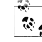

欲更多信息，请参考 HTML5 规范中的 Web Storage 部分（在编写本书时该规范仍处于草案阶段）：http://dev.w3.org/TR/html5/webstorage/

我们不会在游戏中使用 `localStorage`。然而，如果你正在处理非常庞大的元素网格，建议只处理包含我们所有对象的矩阵“部分”。通过对此处展示的代码进行微调，你可以在围绕网格滚动时从服务器下载额外的瓦片位置，并将结果存储在 `localStorage` 中，以便准备好将其与当前矩阵进行交换。

# 第 5 章

## 将游戏与人们连接

你已经构建了一个具有交互图形和音乐的迷人游戏。现在你只需要进行一些设置来吸引人们加入！这意味着要把逻辑放在服务器上，防止人们通过篡改你的逻辑来破坏规则（对他们有利），并将你的应用程序连接到一个有许多出人意料用户的地方——Facebook！

## 防作弊与服务器端操作

开发在线视频游戏的主要问题之一是防作弊。就像传统的 Web 开发一样，我们不能信任任何用户，保护我们的应用程序免受恶意用户的攻击并处理意外的输入或返回值，始终应该是我们的首要任务。

在在线游戏中，风险更大，特别是对于那些使用 JavaScript 和 HTML 等网络技术构建的游戏，在这些游戏中，人们可以篡改变量（甚至是 POST/GET 请求），甚至可以实时修改客户端的代码。遗憾的是，解决这个问题的方案因游戏而异，但几乎总是依赖于两个重要的（通常效率很的）方法，这些方法需要在游戏创建的开发阶段解决：

- 尽可能的减少客户端的欺诈风险
- 在服务器上验证一切

在我们的游戏以及大多数实时策略游戏中，这些是我们需要记住的一些事项：

- 每个用户都应该在数据库表中存储自己的账户余额（取决于你是否想跟踪个人交易），并更新余额。
- 我们需要在服务器上保留一个 Unix 时间值，并定期与客户端同步该值。

也许最重要且最可靠的防作弊方法是：我们需要设计游戏，以便能够在服务器上在不与客户端交互的情况下预测任何时刻的用户得分。我们该如何做到这一点？让我们考虑以下场景：

最初，用户拥有 2000 金币的余额，0 栋建筑，“创建时间”为 1293861600（这是 2011 年 1 月 1 日 00:00:00 的 Unix 时间戳），“最后更新”时间为 1293861600（与开始时间相同）。我们三种可以建造的结构：

- 冰淇淋店：花费 250 金币，每 30 分钟支付 5 金币。
- 酒店：花费 1000 金币，每小时支付 30 金币。
- 电影院：花费 500 金币，每 30 分钟支付 12 金币。

用户在 1293861660（2011 年 1 月 1 日 00:01:00）建造了一家冰淇淋店。他在 1294048400（2011 年 1 月 3 日 14:00:00）决定建造一家酒店。在 1294120800（2011 年 1 月 4 日 00:00:00），用户建造了一家电影院。在 1294639200（2011 年 1 月 10 日 00:00:00），他回到游戏并想查看账户余额。

处理这种情况情况的一种方法是跟踪用户购买的所有建筑，并在用户的账户中添加一个“最后更新”字段。然后，每当他想查看账户余额或执行买卖操作时，我们都会执行以下步骤：

1. 用当前时间戳更新用户的“最后更新”字段。
2. 遍历用户拥的所有建筑。
3. 计算当前时间与用户“最后更新”字段之间的时间差（秒）。
4. 将结果除以支付周期数，并对结果进行“向下取整（floor）”。
5. 将结果乘以每个周期给的金币数量。
6. 通过累加结果来更新账户余额。
7. 根据我们正在执行的操作（显示、建造或出售），要么显示账户余额，要么减去/增加建筑成本。
8. 如果我们正在出售建筑，则删除该关联。

如果我们把此方法应用于上述描述的示例场景，可以推导出以下结论：

- 在 1293861660，用户决定建造一家冰淇淋店。此时，他有 0 栋其他建筑，所以我们只需要更新他的账户余额和“最后更新”时间，并创建一个关联。该关联的“最后更新”时间将是 1293861660。
- 用户的账户余额现在为 1750 (2000 – 250)。
- 在 1294084800，他决定建造一家酒店。在我们重新计算他的账户余额之前，我们知道他购买了冰淇淋店，因此我们将用户的“最后更新”字段更新为 1294084800；为了知道冰淇淋店产生了多少收入，我们执行以下计算：

```
timeDiff = 1294084800 - 1293861660 = 223140 seconds
```

冰淇淋店每 30 分钟（1800 秒）产生 5 金币的利润，所以我们需要进行计算：

```
result = timeDiff / 1800 seconds = 123.96
```

或者在对结果向下取整时取 123：

```
result = result * 5 = 615 gold coins
```

我们最终更新账户余额为 1750 + 615 = 2365，并减去酒店成本（使用 1294084800 作为最后更新时间），用户的账户余额现在为 1365。

- 在 1294120800，他购买了一家电影院，我们执行相同的步骤：

```
timeDiff = 1294120800 - 1294084800 = 36000 seconds
```

酒店每小时（3600 秒）产生 30 金币的利润，所以我们需要进行计算：

```
result = timeDiff / 3600 seconds = 10
```

```
result = result * 30 = 300 gold coins
```

我们最终更新账户余额为 1365 + 300 = 1665，并减去电影院成本（使用 1294120800 作为最后更新时间），用户的账户余额现在为 1165。

- 最后，在 1294639200，他再次查看账户余额：

```
timeDiff = 1294639200 - 1294120800 = 518400 seconds
```

电影院每 30 分钟（1800 秒）产生 12 金币的利润，所以我们需要进行计算：

```
result = timeDiff / 1800 seconds = 288
```

```
result = result * 12 = 3456 gold coins
```

我们最终更新账户余额为 1165 + 3456 = 4621。

虽然防止用户修改我们游戏的客户端部分极其困难，甚至是不可能的，但使用之前解释的方法，我们完全防止恶意用户获得比其他玩家不公平的优势，因为他们所做的修改只会影响他们而不会影响服务器。可以添加到此功能中的另一个有用特性是 Zynga 在其某些游戏中使用的一种概念，即不是像这种情况下那样持续产生利润，而是用户必须“收集”由建筑产生的利润。例如，如果一栋建筑每 30 分钟产生 500 金币，而用户 3 天没有玩，那么当他收集时将获得 500 金币。要实现这种方法，我们需要检查时间差的结果是否大于建筑产生的利润；如果是，则将一个标记设为 true。然后用户需要手动“收集”金钱，并将标记重置为 false。

对于我们的游戏，我们将使用 MySQL 和 PHP 实现此数据模型以及控制其行为的软件：

- 你可以在你的系统上安装并配置 MySQL；请参阅 http://dev.mysql.com/usingmysql/get_started.html。
- 你可以在你的系统上安装并配置 PHP；请访问 http://us.php.net/manual/en/install.php。为了运行 PHP，你还需要安装 Web 服务器，如 Apache、Lighttpd 或 nginx。关于如何安装（并配置）每种服务器的说明可以在上述的 .php URL 中找到。

一旦你在电脑电脑上配置了 PHP 和 MySQL（包括设置 root 密码），你就可以通过打开新终端并执行以下命令来连接到服务器：

```
mysql -localhost -uroot -pYOURPASSWORD
```

如果你还没有为 root 用户配置密码，请尝试进入 mysql 提示符：

```
scarlet:~andres$ mysql -uroot -localhost
Welcome to the MySQL monitor. Commands end with ; \g.
Your connection id is 816
Server version: 5.14.5 MySQL Community Server (GPL)
```

输入 'help' 或 '\h' 获取帮助。输入 '\c' 清除当前输入语句。

```
mysql>
```

MySQL Server 的版本在你的系统上可能不同。

现在我们已经连接到数据库，让我们使用以下命令为我们的游戏创建数据库：

```
CREATE DATABASE mygame;
```

如果一切顺利，你应该看到如下输出：

```
mysql> CREATE DATABASE mygame;
Query OK, 1 row affected (0.00)
```

为了在 mygame 数据库中创建表，我们首先需要告诉 MySQL 选择其为活动数据库：

```
USE mygame;
```

如果没有发生其他错误，你应该看到以下返回值：

```
mysql USE mygame;
Database changed
```

在 GitHub 仓库的 server 文件夹（https://github.com/andrespagella/Making-isometric-Real-Time-Games/tree/master/server）中，你会找到两个 .sql 文件：model-empty.sql 和 model-filled.sql。将 model-filled.sql 下载到你的电脑，并返回 MySQL 提示符。使用文件的下载路径，执行以下命令：

```
source <PATH_TO_SQL_FILE>;
```

如果一切顺利，你应该看到如下输出：

```
mysql source /Users/andres/Desktop/model-filled.sql
Query OK, 0 rows affected (0.00 sec)
Query OK, 0 rows affected (0.00 sec)
Query OK, 4 rows affected (0.05 sec)
Query OK, 4 rows affected (0.05 sec)
Query OK, 0 rows affected (0.07 sec)
Query OK, 0 rows affected (0.00 sec)
Query OK, 0 rows affected (0.10 sec)
Query OK, 0 rows affected (0.09 sec)
mysql>
```

该 SQL 文件将生成三个数据库表：users、buildings 和 building_instances，并预先填充 buildings 表中填充四座建筑（我们将在最终游戏中使用它们）：一个冰淇淋淋店、一家酒店、一家电影院和一棵树。

为了在你的 PHP 脚本中使用 mygame 数据库，我们还需要生成一个 MySQL 用户，赋予该用户执行 SELECT、INSERT、UPDATE 和 DELETE 操作的权限。我们可以通过在 MySQL 提示符中执行以下语句来实现：

```
CREATE USER 'mygameuser'@'localhost' IDENTIFIED BY 'game123';
GRANT SELECT, INSERT, UPDATE, DELETE ON mygame.* TO 'mygameuser'@'localhost';
```

如既往，输出不应显示任何错误：

```
mysql> CREATE USER 'mygameuser'@'localhost' IDENTIFIED BY 'game123';
Query OK, 0 rows affected (0.09 sec)
mysql> GRANT SELECT, INSERT, UPDATE, DELETE ON mygame.* TO 'mygameuser'@'localhost';
Query OK, 0 rows affected (0.07 sec)
mysql>
```

有关如何使用 SQL 的更多信息，请参阅官方 MySQL 开发者门户：http://dev.mysql.com。

在 GitHub 仓库的 server 文件夹中，你还会找到以下文件和文件夹：

- config.php：定义数据库连接详情以及网格大小。
- classes/class.dbutil.php：一个简单的 MySQL 数据库实用类
- classes/class.users.php：处理与用户相关的操作
- classes/class.buildings.php：处理与建筑相关的操作
- classes/class.operations.php：负责实例化处理

```javascript
ResourceLoader.prototype.addResource = function(filePath, fileType, resourceType) {
  var res = {
    filePath: filePath,
    fileType: fileType,
    resourceType: resourceType
  };
  this.resources.push(res);
}
ResourceLoader.prototype.startPreloading = function() {
  for (var i = 0, len = this.resources.length; i < len; i++) {
    switch(this.resources[i].resourceType) {
      case ResourceType.IMAGE:
        var img = new Image();
        var rl = this;
        img.src = this.resources[i].filePath;
        img.addEventListener('load', function() { rl.onResourceLoaded(); }, false);
        break;
      case ResourceType.SOUND:
        var a = new Audio();
        // 只预加载我们可以播放的声音文件。
        if (a.canPlayType(this.resources[i].fileType) === "maybe" ||
            a.canPlayType(this.resources[i].fileType) === "probably") {
          a.src = this.resources[i].filePath;
          a.type = this.resources[i].fileType;
          var rl = this;
          a.addEventListener('canplaythrough', function() {
            a.removeEventListener('canplaythrough', arguments.callee, false);
            rl.onResourceLoaded();
          }, false);
        } else {
          // 无法播放声音。假设资源已加载。
          this.onResourceLoaded();
        }
        break;
    }
  }
}
ResourceLoader.prototype.onResourceLoaded = function() {
  this.resourcesLoaded++;
  if (this.onPartial != undefined) {
    this.onPartial();
  }
  if (this.resourcesLoaded == this.resources.length) {
    if (this.onComplete != undefined) {
      this.onComplete();
    }
  }
}
ResourceLoader.prototype.isComplete = function() {
  if (this.resources.length == this.resourcesLoaded) {
    return true;
  }
  return false;
}
```

我们可以按照以下方式使用 ResourceLoader 类：

```javascript
var rl = new ResourceLoader();
rl.addResource('image1.png', null, ResourceType.IMAGE);
rl.addResource('image2.jpg', null, ResourceType.IMAGE);
rl.addResource('image3.gif', null, ResourceType.IMAGE);
rl.addResource('sound.ogg', 'audio/ogg', ResourceType.SOUND);
rl.addResource('sound.mp3', 'audio/mp3', ResourceType.SOUND);
rl.startPreloading();
```

一旦调用 ResourceLoader 的 `startPreloading()` 方法，我们就可以访问两个非常重要的属性：

- ResourceLoaderInstance.resources.length: 返回已添加资源的数量。
- ResourceLoaderInstance.resources.resourcesLoaded: 跟踪到目前已预加载的资源数量。

通过组合变量，我们可以按照以下方式随时计算已加载的资源百分比：

```javascript
var percentLoaded = Math.floor((ResourceLoaderInstance.resources.resourcesLoaded * 100) / ResourceLoaderInstance.resources.length);
```

此外，ResourceLoader 类还允许我们定义两个回调函数：

- **onPartial**: 每当一个元素加载完成时调用。
- **onComplete**: 当所有资源都加载完毕时调用。

使用这些回调函数，可以显示加载过程当前状态的反馈，如图 5-2 所示。

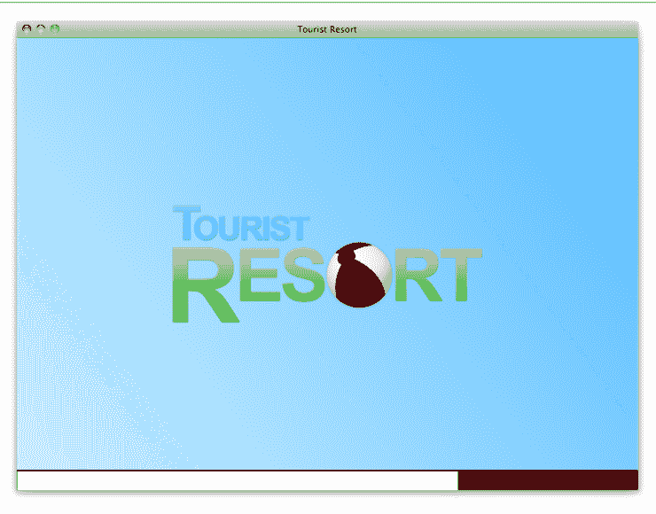

游戏将管理不同的游戏状态（GameState）；取决于当前的状态，将执行不同的流程。为了管理游戏状态之间的切换，我们将使用一个名为 `handleGameState()` 的函数，它会在文档加载完成时执行。该函数使用了之前显示的 Game 对象，并且如下：

```javascript
function handleGameState(nextState) {
  if (nextState != undefined) {
    GameState.current = nextState;
  }
}
switch(GameState.current) {
  case GameState.LOADING:
    // ...
    break;
  case GameState.LOADED:
    // ...
    break;
  case GameState.TITLESCREEN:
    // ...
    break;
  case GameState.PLAYING:
    // ...
    break;
  default:
    // ...
    break;
}
```

要更改当前游戏状态，我们只需要指定有效的 GameState 值。例如，我们可以轻松地添加一个 `GameState.PAUSED` 状态，当用户按下 esc 键时显示暂停屏幕，当再次按下时调用 `handleGameState(GameState.PLAYING)` 回到游戏。

在 `GameState.LOADING` 的情况下，我们将调用函数 `preloadResources()`，该函数会实例化一个 ResourceLoader 对象的副本，负责预加载我们游戏所需的所有内容（如图像或声音）。该函数如下：

```javascript
function preloadResources(canvas, callback) {
  var c = canvas.getContext('2d');
  var rl = new ResourceLoader(printProgressBar, callback);
  rl.addResource('..//title.png', null, ResourceType.IMAGE);
  rl.addResource('..//ui-icons.png', null, ResourceType.IMAGE);
  rl.addResource('..//sprites.png', null, ResourceType.IMAGE);
  rl.addResource('../sounds/title.ogg', 'audio/ogg', ResourceType.SOUND);
  rl.addResource('../sounds/title.mp3', 'audio/mp3', ResourceType.SOUND);
  rl.startProgressBar();
}
function printProgressBar() {
  var percent = Math.floor(rl.resourcesLoaded * 100) / rl.resources.length;
  var width = Math.floor(percent * (canvas.width - 1)) / 100;
  c.fillStyle = '#000000';
  c.fillRect(0, canvas.height - 30, canvas.width, canvas.height);
  c.fillStyle = '#FFFFFF';
  c.fillRect(1, canvas.height - 28, width, canvas.height - 6);
}
```

此函数还会打印图 5-2 所示的进度条。

你还会注意到我们没有加载 `cinema.png` 或 `tree.png`；我们加载的是一个名为 `sprites.png` 的文件。为了减少请请求数量，我们没有单独加载每个图像，而是将它们合并到一个文件中。

一旦请求完成，`handleGameState()` 将被调用，传入 `GameState.LOADED`。此时，`GameState.LOADED` 负责创建 `Game` 实例。

有些操作（如建造或拆毁）还需要在服务器上更新数据库字段。为了处理与服务器的通信，我们将使用 `comm.js` 中的函数：

```javascript
var SERVER_PATH_URL = "http://localhost:8080/";
function request(url, callback) {
  var req = false;
  if (window.XMLHttpRequest) {
    try {
      req = new XMLHttpRequest();
    } catch(e) {
      // 什么都不做。
    }
  }
  if (req) {
    req.open("GET", url, true);
    req.send(null);
    req.onreadystatechange = function() {
      switch (req.readyState) {
        case 2:
          if (req.status !== 200) {
            callback('ERROR');
            return;
          }
          break;
        case 4:
          callback(req.responseText);
          break;
      }
    }
  }
}
```

```javascript
} else {
  // 不支持 XMLHttpRequest
  callback('ERROR');
}
```

```javascript
// 购买
function purchase(buildingId, row, col, callback) {
  var url = SERVER_PATH_URL + 'purchase.php';
  url += "?buildingId=" + buildingId;
  url += "&x=" + row;
  url += "&y=" + col;
  request(url, callback);
}
```

```javascript
// 拆除
function demolish(row, col) {
  var url = "?file=demolish.php";
  url += "?x=" + row;
  url += "&y=" + col;
  request(url, callback);
}
```

```javascript
// 同步
function sync() {
  var url = SERVER_PATH_URL + 'sync.php';
  request(url, callback);
}
```

使用这些函数任何一个都非常简单。要在第 4 行、第 5 列购买一棵树（buildingId = 4），可以使用以下代码：

```javascript
purchase(0, 4, 5, function(resp) {
  if (resp.substr(0, 3) == 'OK') {
    var buildingInstance = resp.substr(3, resp.length);
    alert('建筑购买成功。实例 ID 为 ' + buildingInstanceId);
  } else {
    alert('尝试购买建筑时出错！');
  }
});
```

然而，在我们购买建筑之前，我们需要检查点击的网格或周围的网格是否已被另一个建筑或 BuildPortion 占用。为了控制这一点，我们需要使用 Game 对象的一个名为 `Game.checkTileIsBusy()` 的方法：

```javascript
Game.prototype.checkTileIsBusy = function(obj, row, col) {
  for (var i = (row + 1) - obj.tileWidth; i <= row; i++) {
    for (var j = (col + 1) - obj.tileHeight; j <= col; j++) {
      if (this.tileMap[i] != undefined && this.tileMap[i][j] != null) {
        return true;
      }
    }
  }
  return false;
};
```

现在我们已经有了所有必要的工具来妥善地处理我们的事件，我们只需要添加 `Game.prototype.handleMouse` 函数的最终实现：

```javascript
Game.prototype.handleMouseDown = function(e) {
  e.preventDefault();
}
switch (Tools.current) {
  case Tools.BUILD:
    if (this.buildHelper.current == null) {
      var pos = pos.translatePixelsToMatrix(e.clientX, e.clientY);
    }
    // 我们可以在网格上放置该元素吗？
    if (!this.checkTileIsBusy(this.buildHelper.current, pos.row, pos.col)) {
      var obj = this.buildHelper.current;
      var t = this;
      var processResponse = function(resp) {
        if (resp.substr(0, 2) == 'OK') {
          var buildingInstance = resp.substr(3, resp.length);
          for (var i = pos.row + 1; i < obj.tileWidth; i++) {
            for (var j = pos.col + 1; j < obj.tileHeight; j++) {
              t.tileMap[i][j] = (t.tileMap[i] == undefined) ? undefined : t.tileMap[i];
            }
          }
          t.tileMap[i][j] = (i === pos.row && j === pos.col) ? obj :
          new BuildingPortion(obj.buildingTypeId, i, j);
        } else {
          alert("尝试购买建筑时出错！");
        }
        t.draw();
      }
      purchase(obj.buildingTypeId, pos.row, pos.col, processResponse);
    } else {
      alert("在此位置无法购买建筑");
    }
    break;
  case Tools.MOVE:
    this.dragHelper.active = true;
    this.dragHelper.x = e.clientX;
    this.dragHelper.y = e.clientY;
    break;
  case Tools.ZOOM_IN:
    this.zoomIn();
    break;
  case Tools.ZOOM_OUT:
    this.zoomOut();
    break;
  case Tools.DEMOLISH:
    var pos = this.translatePixelsToMatrix(e.clientX, e.clientY);
    if (this.tileMap[pos.row] != undefined && this.tileMap[pos.row][pos.col] != undefined) {
      var obj = this.tileMap[pos.row][pos.col];
      // 不是建筑，而是建筑部分。获取建筑的引用。
      if (obj instanceof BuildingPortion) {
        pos.row += obj.x;
        pos.col += obj.y;
        obj = this.tileMap[pos.row][pos.col];
      }
      var t = this;
      var processResponse = function(resp) {
        if (resp.substr(0, 2) == "OK") {
          // 检查并销毁建筑部分。
          for (var i = (pos.row + 1) - obj.tileSize; i <= pos.row; i++) {
            for (var j = (pos.col + 1) - obj.tileHeight; j <= pos.col; j++) {
              t.tileMap[i][j] = null;
            }
          }
        } else {
          alert("尝试拆除建筑时出错");
        }
        t.draw();
      }
      demolish(pos.row, pos.col, processResponse);
    }
    break;
}
```

虽然我们现在可以购买或拆除建筑（在我们的数据库中添加或删除实例），但账户余额保持不变。为了保持更新，我们将实现一个名为 `refresh()` 的函数，它将每 5 秒调用一次，在服务器端更新账户余额，`sync.php` 也负责计算建筑产生的当前利润：

```javascript
function refresh() {
  var processResponse = function(resp) {
    if (resp.substr(0, 5) == 'ERROR') {
      alert('尝试同步时出错 ');
    } else {
      var balanceContainer = document.getElementById('balance');
      var currBalance = parseInt(balanceContainer.innerHTML);
      var balance = resp.substr(3, resp.length);
      balanceContainer.innerHTML = balance;
    }
  }
  sync(processResponse);
  setTimeout(refresh, 5000);
}
```

```css
@keyframes moveLeftFromRight {
  0% {
    transform: translateX(-5000px) translateY(50px);
  }
  50% {
    transform: translateX(0px) translateY(50px);
  }
  100% {
    transform: translateX(5000px) translateY(50px);
  }
}
```

```css
div.cloud {
  position: absolute;
  top: 0px;
  left: 0px;
  z-index: 500;
  background: transparent url(../spritesheet.png) no-repeat -10px -257px;
  width: 566px;
  height: 243px;
  pointer-events: none;
  -webkit-animation-timing-function: linear;
  -webkit-animation-name: moveLeftFromRight;
  -webkit-animation-duration: 2s;
  -webkit-animation-iteration-count: infinite;
  -webkit-animation-direction: alternate;
  -moz-animation-timing-function: linear;
  -moz-animation-name: moveLeftFromRight;
  -moz-animation-duration: 60s;
  -moz-animation-iteration-count: infinite;
  -moz-animation-direction: alternate;
  -ms-animation-timing-function: linear;
  -ms-animation-name: moveLeftFromRight;
  -ms-animation-duration: 60s;
  -ms-animation-iteration-count: infinite;
  -ms-animation-direction: alternate;
  -o-animation-timing-function: linear;
  -o-animation-name: moveLeftFromRight;
  -o-animation-duration: 60s;
  -o-animation-iteration-count: infinite;
  -o-animation-direction: alternate;
  animation-timing-function: linear;
  animation-name: moveLeftFromRight;
  animation-duration: 60s;
  animation-iteration-count: infinite;
  animation-direction: alternate;
}
```

这产生的结果类似于图 5-5。

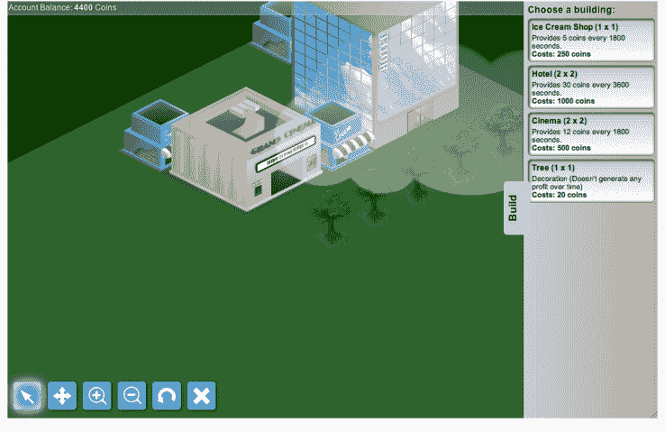

另一个能让场景更具可信度的效果是添加阴影。在二维平面上投影阴影有多种技术和算法；然而，大多数情况下，我们需要一个或多个光源，这也要求我们进行多次计算，特别是当我们有多个对象时（我们确实如此）。

由于场景中的对象在大部分时间里都是静态的，我们可以高效地采取以下任一：

- 为每个单独的建筑绘制阴影纹理
- 动态生成阴影

在这种情况下，我们将使用第二种方法，因为它让我们拥有定义伪光源或动态控制阴影强度的可能。这种方法包括绘制原始建筑的轮廓，同时对其进行倾斜和旋转并降低 alpha 值。例如，如果我们从东南方向的光线方向来绘制纹理，那么阴影应该投影到西北部。如果我们从西南方向的光源来绘制，阴影将投影到东北部，以此此类推。图 5-6 将让你更好地理解我们正在尝试做什么。

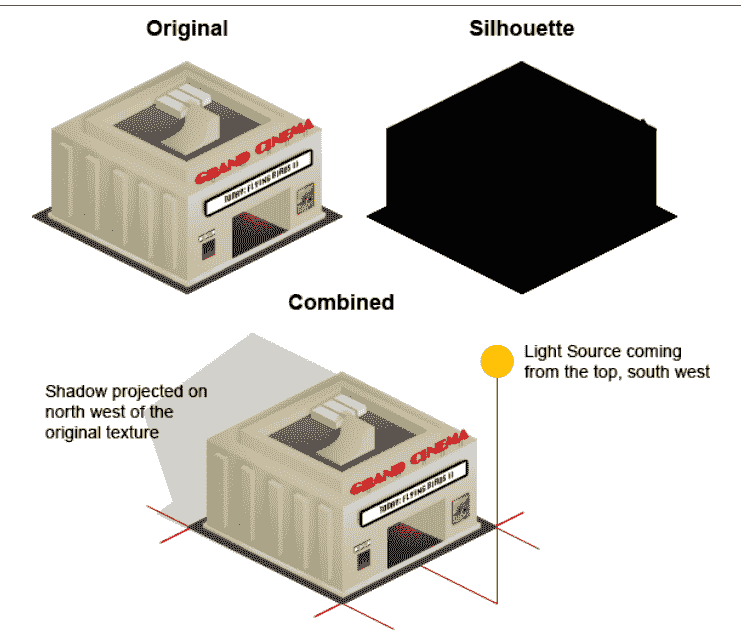

图 5-6. 为建筑添加轮廓

为了实现这种方法，我们将求助于之前见过的两个 HTML5 Canvas 函数：`getImageData()` 和 `putImageData()`，并将这些功能直接构建到 sprite 对象中。

首先，我们将修改 Sprite 类并添加一个空属性：

```javascript
this.shadow = null;
```

接下来，我们修改 `draw()` 方法，使其能够可选地接受一个 `drawShadow` 参数，这是一个布尔值，指示我们是否想要为正在绘制的 sprite 画阴影。一个子程序将检查 `this.shadow` 是否为 `null`，并执行所有必要的处理将图像转换为图像数组，以便稍后通过 `putImageData()` 使用。轮廓效果的结果将存储在我们的 `this.shadow` 属性中，这样下次需要使用它时，就不需要再次进行所有的图像预处理了。不过请注意，这种方法比使用预制图像（如我们的阴影）效率低，但它给了我们更大的控制力和灵活性：

```javascript
if (this.show) {
  if (drawShadow !== undefined && drawShadow) {
    if (this.shadow === null) { // 影子尚未创建
      var scnv = document.createElement("canvas");
      var sctx = scnv.getContext("2d");
      scnv.width = this.width;
      scnv.height = this.height;
      sctx.drawImage(this.spritesheet,
        this.offsetX,
        this.offsetY,
        this.width,
        this.height,
        0,
        0,
        this.width * this.zoomLevel,
        this.height * this.zoomLevel);
      var idata = sctx.getImageData(0, 0, scnv.width, scnv.height);
      for (var i = 0, len = idata.data.length; i < len; i += 4) {
        idata.data[i] = 0; // R
        idata.data[i + 1] = 0; // G
        idata.data[i + 2] = 0; // B
      }
      sctx.clearRect(0, 0, scnv.width, scnv.height);
      sctx.putImageData(idata, 0, 0);
      this.shadow = sctx;
    }
    c.save();
    c.globalAlpha = 0.3;
    var sw = this.width * this.zoomLevel;
    var sh = this.height * this.zoomLevel;
    c.drawImage(this.shadow.canvas, this.posX, this.posY - sh, sw, sh * 2);
    c.restore();
  }
  c.drawImage(this.spritesheet,
    this.offsetX,
    this.offsetY,
    this.width,
    this.height,
    this.posX,
    this.posY,
    this.width * this.zoomLevel,
    this.height * this.zoomLevel);
}
```

最终结果看起来如图 5-7。

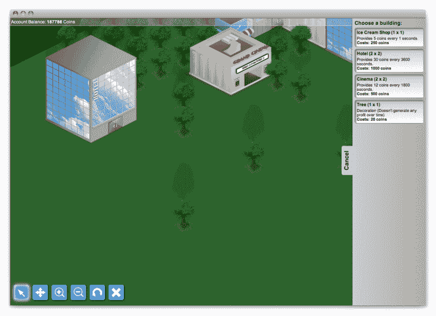

### 使用 Facebook 添加社交网络层

通过 Facebook 为我们的游戏添加社交层可以很容易地通过填写一些表单并实现几行代码完成。首先，我们需要访问 http://www.facebook.com/developers/ 并点击“Create App”（创建应用）按钮来创建一个应用程序，这将带你进入 Facebook 应用程序向导，允许我们将游戏与 Facebook 集成。

一旦你点击“Create App”按钮，你会看到类似图 5-8 所示的内容，要求你为应用命名。只需输入任何名称（这将用户在安装游戏时看到的应用程序标题），同意条款并点击“Create App”。我给我的应用命名为 Tourist Resort。这个名字不需要是唯一的，所以你也可以将你的游戏命名为 Tourist Resort。

### 创建应用程序

应用名称：
不能包含 Facebook 商标，或具有可能与 Facebook 构建的应用混淆的名称。

你同意 Facebook 条款吗？

条款
- 同意
- 不同意

创建应用

图 5-8. 在 Facebook 中创建应用

下一步如图 5-9 所示，是一个要求你输入文本的安全性检查。

### 安全检查

请输入下方的文本

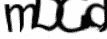

无法读取上方文本？

提交

当你点击“提交”时，根据你的账户信息或有效的信用卡，Facebook 可能会验证你的账户。一旦你完成了这些步骤，你将进入应用管理页面，可以在那里修改联系信息、应用名称、图标、语言等其他细节。

我们可以通过将应用展示在 Facebook 页面内将其接入 Facebook Connect。

# 使用 Facebook 添加社交网络层 | 131

为了向外部网站提供登录用户的身份信息，Facebook 使用了一种名为 canvas 的概念（与 HTML Canvas 无关），它只是一个 765 像素宽的 iframe，加载我们的网站，并传递多个参数允许我们启动位于服务器端或客户端（JavaScript）的 OAuth 2.0 认证方案。

本书侧重于实现服务器端。关于 Facebook 平台支持的认证方案的更多信息，请参阅 http://developers.facebook.com/docs/authentication/。

简而言之，当用户访问 http://apps.facebook.com/tourist-resort 时，Facebook 会自动调用我们的 Canvas URL，传递一些参数以帮助身份验证。

然后，我们只需要包含 Facebook API 文件，使用我们的 Application ID 和 Application Secret 创建一个新的 Facebook 对象实例，就可以获取用户的信息：

```php
<?php
require 'facebook/src/facebook.php';
$fb = new Facebook(array(
    'appid' => '<YOUR_APPLICATION_ID>',
    'secret' => '<YOUR_APPLICATION_SECRET>',
));
$user = $fb->getUser();
echo '<pre>';
print_r($user);
echo '</pre>';
?>
```

如果用户未登录 Facebook 或尚未授权您的应用程序，变量 $user 的输出将为零。检测这种情况情况的更可靠的方法是使用 example.php 中的方法，该示例包含在 Facebook PHP SDK 中：

```php
<?php
if ($user) {
  try {
    $user_profile = $fb->api('/me');
  } catch (FacebookApiException $e) {
    $user = null;
  }
}
?>
```

$fb->api('/me') 尝试通过查询该用户的 Facebook Graph API 来填充 $user_profile 变量（有关 Facebook Graph API 的更多信息，请参阅 http://developers.facebook.com/docs/reference/api/），并在发生异常时抛出异常。

为了让用户使用其 Facebook 凭据登录我们的应用程请添加以下行：

```php
<?php
$loginUrl = $fb->getLoginUrl();
?>
```

<a href="$loginUrl?">登录</a>

当用户点击登录时，Facebook 将显示图 5-12 所示的授权对话。

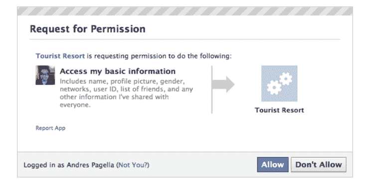

图 5-12。用户会授予权限吗？

一旦用户决定允许我们的应用程序访问其数据，页面将重新加载；此时，$user 变量将填充 Facebook 用户 ID，而 $user_profile 变量将填充对 Graph API 查询 /me 的响应，该响应以 JSON 对象的形式返回。

默认情况下，Facebook 会请求“基本信息”，包括用户的姓名、姓氏、Facebook 用户 ID、位置、兴趣、性别等。如果我们想请求额外的权限——例如，获取其电子邮箱地址和朋友信息，并能够在其活动流中发布消息——我们需要按照以下方式修改 $fb->getLoginUrl() 调用：

```php
<?php
$loginUrl = $fb->getLoginUrl(array(
    "scope" => "email,publish_stream,friends_about_me"
));
?>
```

> 权限列表可以在以下 URL 找到：http://developers.facebook.com/docs/authentication/permissions/。

在我们修改权限后，新的授权窗口将看起来如图 5-13 所示。

### 请求权限

Tourist Resort 正在请求执行以下操作：

- **访问我的基本信息**：包括姓名、个人资料、性别、网络、用户 ID、朋友列表以及我与所有人共享的其他信息。
- **向我发送电子邮件**：Tourist Resort 可以直接向 xtreme@gmail.com 发送电子邮件 - 更改
- **访问我的朋友信息**：Tourist Resort 可以向我的主页“关于我”详情页发布状态消息、笔记、照片和视频。


以 Andres Pagella 身份登录（不是您？）

图 5-13。用户会授予更多权限吗？

如果用户决定允许我们的游戏访问其数据，$user_profile 变量将包含一个 email 参数，我们可以利用该参数在自己的数据库中自动注册用户。

一旦获取了所有信息，我们可以简单地将 Facebook 用户 ID 与我们游戏中的用户 ID 进行一对一映射，以便当用户通过 Facebook 连接时自动为其登录。

欲了解更多信息，请参阅 Facebook 开发者网站：http://developers.facebook.com/docs/guides/canvas/

## 关于作者

Andrés Pagella 是一位优秀的软件开发人员，拥有 10 年以上的专业经验，居住在阿根廷的联邦首都区。他曾参与过阿根廷多个高流量网站的设计和实现。他目前担任 Minor Studios Argentina S.R.L. 的首席技术官，开发一种名为 Atmosbir 的社交游戏设计工具。
