# 制作大型多人在线游戏：适用于任何 Phaser JavaScript 游戏框架的开发指南

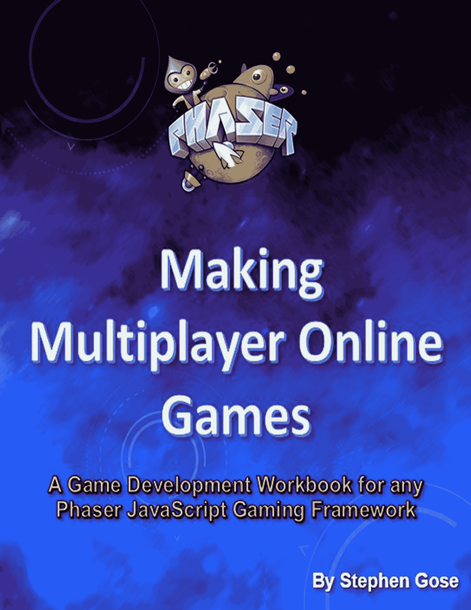


本书售价于 [`leanpub.com/rrgamingsystem`](http://leanpub.com/rrgamingsystem)

* * * * *

这是一本来自 [Leanpub](http://leanpub.com) 的书籍。Leanpub 通过精益出版（Lean Publishing）流程为作者和出版商赋能。[精益出版](http://leanpub.com/manifesto) 是使用轻量级工具和多次迭代来出版进行中的电子书，以获取读者反馈，不断调整直到你获得正确的书籍，并在成功后建立势头。

* * * * * *

献给我目前在 Early Career Academy (Tempe, AZ) 和 ITT Technical Institute (Tempe, AZ) 等地的学生

献给我位于 University of Advancing Technology (UAT), Tempe, AZ 的学生

# 书籍格式

**编辑注：“为什么要有独立的外部链接和文件？”，你这样问道。**

*   首先，万维网是一个动态的世界，每天都有新内容和新方法出现。1997 年，互联网信息量每 7 年翻一倍；到 2015 年，互联网信息量每 35 天就会翻一倍！曾经的“前沿”技术在几年甚至几个月内就会变得过时和废弃！（例如，2004 年最初提到的 `window.onload`，现在已被原作者撤回并废弃了！）

*   链接到外部概念的引用保留了本工作簿的完整性和“新鲜度”（从而保护了你对我研究的投入），避免了版权侵权，并允许被介绍和被引用的作者撤回或更新他们自己的建议（例如“使用 `window.onload`”的案例，特别是在 `Phaser v3.x.x` JavaScript 游戏框架频繁更新的情况下）。

*   总来说，本书的叙述向你展示了事物是如何运作的，而侧边注释、脚注和参考链接则深入探讨了事物为何会那样运作。它提供了来自其他知名游戏行业专家的宝贵信息。我的研究将当前的最佳建议置于本工作书中，并过滤掉了“杂质”。如果你遵循我所有的参考链接，你将拥有更丰富的知识储备，并对我的概念有更好的理解，因为我们将共享相同的知识基础。

*   它让我的书缩短了数百页并降低了我的出版成本，从而降低了你的购买价格。通过将相关的源代码分离到支持网站的“额外内容”区域，它让你能够专注于本书的内容讨论与源代码进行并排对比。这允许你在不受干扰的情况下阅读本工作簿——这与目前为止的许多技术书籍不同。现在，诚实地承认！你难道不讨厌阅读长达几里没有注释、没有文档的源代码，结果最终在几十页之后才读到解释你刚刚学过的所有内容的文本吗？或者有些作者将数页解释放在他们没有注释、没有文档的源代码之前。在我看来，这两种方法都不令人满意。我宁愿让文本解释和源代码并排显示。你不是吗？

*   此外，它允许我在无需重新出版的情况下更新我的外部在线源代码和补充内容。你购买的是我数月的研究、调查、综合以及基于这些调查的实验，这些内容通过书中的链接连接到其支持网站。我为你开辟了可以遵循的道路。这节省了你在查看我的原始研究和学习路径时自己尝试的时间。对于 `Phaser v3.x.x` 的快速发布趋势来说，这对我们双方都是巨大的收益。

# 谁应该使用本工作簿？

本工作簿既面向实践型学习者（学习初学者与专家之间的区别）——即那些喜欢“通过实验学习”的人；也面向 Web 应用开发领域具有经验的专家程序员，他们知道如何制作游戏并熟悉 JavaScript，但从未制作过在线多人游戏；当然，还包括那些希望通过自己的定制设计和努力完成一个成品 MMoG 的人。如果你对制作浏览器 MMoG 感兴趣，特别是针对移动市场，那么这本书连同它的 Phaser v2.x.x 或 III 伙伴卷是你的完美选择（书籍将列在下方的“参考部分”章节中）。考虑到这一点，在整个工作簿中，你将在 HTML5 和 JavaScript 中进行大量的写作、思考和编码。你可能更倾向于使用纸张（外部实体纸或电子纸）来组织你的开发思路和流程。

本工作簿是一份使用 `HTML5`、`CSS3` 和 `JavaScript` 技术进入 Game Design System™ 方法的教程指南，重点关注 Phaser III 或 v2.x.x（包括官方版和社区版）。我知道许多高级软件开发人员的工具箱已经有了这些技术；但我收到过几十封关于本书旧版本的邮件投诉，说它们“……对于刚开始建立游戏工作室的人来说太难了”。因此，如果你最初寻求的是学习上述提到的任何一种技术，那么我建议你快速访问 W3Schools 作为你的第一个免费起点。通过遵循他们的指令，你将在几小时内学会 `HTML`、`CSS` 和 `JavaScript` 的完整基础！……然后，回到本工作簿，学习如何将这些技术整合到你自己的游戏创作中。

# 你新获得的技能……

到本工作簿结束，你将把以下内容整合到你定制的游戏设计中：

*   Game Design System™：在其中创建 MMoG 游戏配方（Recipes）。

*   适配了网络消息系统。

*   导入了各种游戏资源和资产。

*   在不同阶段显示、动画并移动游戏角色。

*   在 `canvas` 标签内外显示抬头显示器 (HUD)。

*   使用了自定义网页字体。

*   结合了多个游戏输入。

*   在各种组件上实现了几个物理系统。

*   定义并包含了“游戏打击感”（game juice）。

*   使用 D.R.Y. 正确管理游戏阶段。

*   使用 SWPA、PWA 和 AMP 为各种移动设备优化了游戏。

*   在各种游戏场景中加入了音效 (sfx) 和主题音乐。

*   在多人环境中渲染了多个物理系统。

*   加入了图形特效 (gfx)（粒子系统、旋转、淡入、着色器等）。

# Game Design System™ 配方：

“游戏配方™”（需另购）基于 `Game Design System™ method` 和概念的特定游戏机制（可从 [Amazon.com](https://www.amazon.com/gp/search/ref=as_li_qf_sp_sr_tl?ie=UTF8&tag=pbmcube-20&keywords=stephen%20gose&index=aps&camp=1789&creative=9325&linkCode=ur2&linkId=35a07e5471ef728a49ce48b6009957ca) 获取），或通过 LeanPub.com 课程或 [Zenva Game Academy](https://academy.zenva.com/?a=47&campaign=PhaserGamePrototyping) 获取你的游戏开发认证：

*   终极游戏工作室入门套装集 [认证教程 (LeanPub.com)](https://leanpub.com/set/leanpub/ugsskitc) 或 [(Amazon.com)](https://amzn.to/2qQsq3z)

*   动作与街机（即将推出）

*   [冒险、迷宫与 RPG (Amazon.com)](https://amzn.to/2vXickO)

*   [消除方块 (Amazon.com)](https://amzn.to/2PniJUX)

*   四连线与跳跃（即将推出）

*   恋爱模拟与问答 — [认证教程 (LeanPub.com)](https://leanpub.com/c/mbg-dating) 或 [(Amazon.com)](https://amzn.to/2nP0fjF)

*   防御塔塔（即将推出）

*   装扮与时尚 — [认证教程 (LeanPub.com)](https://leanpub.com/c/mbg-dressup-p2) 或 [(Amazon.com)](https://amzn.to/2MDvEUi)

*   隐藏物品（即将推出）

*   “跳跃捕捉” — [认证教程 (LeanPub.com)](https://leanpub.com/c/mbg-peg-p2) 或 [(Amazon.com)](https://amzn.to/2vWuqdd)

*   麻将（即将推出）

*   [三消消 (Amazon.com)](https://amzn.to/2MmwTId)

*   [记忆对对（成对与序列） (Amazon.com)](https://amzn.to/2OK8JnI)

*   音乐与节奏（即将推出）

*   益智游戏（拼图与滑块） — [认证教程 (LeanPub.com)](https://leanpub.com/c/mbg-puzzle-p2) 或 [(Amazon.com)](https://amzn.to/2vV63Na)

*   角色扮演游戏 [认证教程 (LeanPub.com)](https://leanpub.com/c/mbg-rpg-p2) 或 [(Amazon.com)](https://amzn.to/2DC0OYn)

*   策略类（即将推出）

# 我们的参考文献

*   [Phaser III 游戏入门套装集](https://leanpub.com/p3gskc) 适用于 Phaser v3.16.x 框架的 16+ 经典游戏机制，采用 `Game Design System™` 方法论。

*   [Phaser III 游戏设计教程](https://leanpub.com/phaser3gamedesignworkbook) 更新版，专门针对 Phaser III 并遵循 `Game Design System™` 方法论。

*   [Phaser III 游戏原型](https://leanpub.com/phaser3gameprototyping) 是本书针对新 Phaser III API 的伴读。所有示例均已转换为 Phaser III 版本，并利用了所有新功能。

*   [Phaser 游戏设计教程](https://leanpub.com/phaserjsgamedesignworkbook) 为全新修订并扩展的第 4 版。[第 3 版仍可用](https://phaser.io/news/2016/11/phaser-game-design-workbook) 纸质版或 Kindle 版可在 [Amazon.com](https://www.amazon.com/Phaser-js-Game-Design-Workbook-development/dp/1520154550) 或 [LeanPub.com](https://leanpub.com/phaserjsgamedesignworkbook) 购买。

*   [Kiwi 游戏设计教程](https://leanpub.com/kiwigamedesignworkbook) Phaser III 的鼻祖著作。

*   [Phaser 游戏入门套装集](https://leanpub.com/pgskc) 适用于 Phaser III 框架的 16+ 经典游戏机制配方，采用 `Game Design System™` 方法论。

*   [Phaser 多人游戏系统](https://leanpub.com/rrgamingsystem) 适用于 HTML5、Phaser 以及其他热门移动游戏框架的大型多人在线游戏设计教程。

*   [Phaser 游戏原型](https://leanpub.com/LoRD) 新第 4 版。

*   [Olympic 游戏设计系统™](https://leanpub.com/gds) 与这些 Phaser 游戏设计教程类似，但使用了其他流行的 HTML5 和 Unity 游戏框架。

*   [多人游戏系统](https://leanpub.com/rrgamingsystem) 适用于 HTML5 和其他 JS 游戏引擎的大型多人在线游戏设计教程。

## 推特此书！

请帮我在 [Twitter!](http://twitter.com/pbmcube) 上上推荐这本书。

这本书的建议标签是 [#PBMCube](https://twitter.com/search?q=%23PBMCube)。

# 第一部分：概念与设计

回答这个初始问题将引导你之后的许多生产决策。所以，去拿些纸或打开一个文件，记录你对上述问题的答案。**写下你的答案。** 成为一个积极的参与者，学习最重要的概念——**“日志与记录”**。通过这样做，你正在建立一个自己的活动时间线（即：什么对你来说容易做，什么对你来说很困难，以及雇佣什么技能的人来填补额外人员的空缺）。这有助于确定将一款盈利的游戏推向 Web 分发渠道需要多少时间。当你的客户问你“我什么时候能看到成品？”时，你已经有了基于项目开发进度的实证证据，而不是某些许多企业落入陷阱的、那种“空中楼阁”式的、**不切实际的时间表**！

## 1.1 需要正式注册公司吗？

由于我的工作簿面向通用的互联网社区，许多读者可能不感兴趣、已经拥有，或者可能不具备美国业务身份的资格。剩余的话题作为可选附录提供，并完全涵盖了开发美国初创企业的话题。

为了专注于当前的任务（即使用 `Phaser` 创建游戏），我将直接引导你通过外部资源来回答这个问题。是的，你确实需要决定是现在启动正式业务、继续做一个充满好奇心的软件工程师，还是继续做一个简单的独立开发者爱好者。**上述提到的路线 具有配套的“游戏工作室启动包”支持——[(基础版)](https://leanpub.com/set/leanpub/gsskit) 或 [(终版)](https://leanpub.com/set/leanpub/ugsskitc)。**

对于美国公民，在满足有关企业产生现金和投入企业时间的几项政府规定之前，你将保持“爱好者”身份。在附录中，你将找到针对美国**及非美国公民**的“业务规划”资源。

**注意：** 在开始业务之前拥有一个完成的“游戏产品”是明智的；你不会希望背上“兜卖蓝天”的名声。

## 1.2 常用的营销常识

让我们来看一个假设的场景。假设……

下面的图表由全球第 7 大游戏分销商创建——显示了**在哪里销售你的“水水枪”**以及特定文化区域内某种游戏类型成功的可能。


### 全球游戏类型：了解你的目标受众

游戏分类是多样化的。“正如游戏发行商让‘游戏模式’的术语变得复杂一样，游戏类型也同样令人混乱。这种不一致性源于试图描述游戏机制、游戏交付以及与游戏主题相关的细节。”[**Phaser 游戏启动包集合**](https://leanpub.com/pgskc) 或来自 Amazon.com 的可用单章节。[**游戏类型**](https://en.wikipedia.org/wiki/List_of_video_game_genres)是具有**相似玩法特征**的特定游戏类别。记住，游戏玩法**就是**“游戏的规则”。因此，单人和多人模式并不是游戏类型。它们是决定游戏玩法“模式”的“交付”机制。

显而易见，在全球范围内，“动作游戏”类型是 MMoG 开发的可能选择，随后是地区对“射击”（在欧洲和美国）和“RPG”（在亚洲）类型的偏好。它**没有告诉我们**的是“投资回报率（ROI）”。[**Amir Rajan**](http://amirrajan.net/about/) 在他优秀的书中非常透明——那本关于他进展的开发日志[**《在 App Store 生存——如何成为独立游戏开发者》**](https://github.com/MakingBrowserGames/survivingtheappstore)，阅读这篇[来自 Gamasutra 的书评。**](https://www.gamasutra.com/blogs/RockyKev/20160802/278305/Surviving_the_App_Store_a_review_of_Amir_Rajans_book_for_indie_developers.php) Rajan 表示，

1. **练习：** 书评！阅读以下文章，然后写下你学到的观点。

    * 给人们一些他们在意的东西。给人们一种他们想要与他人分享的体验。[然后花时间让他们知道它。](http://www.gamasutra.com/blogs/SarahWoodrow/20140102/206583/7_truths_about_indie_game_development.php)

    * 观点：在[开始成为独立游戏开发者时][不该做什么](http://indiegames.com/2013/11/opinion_what_not_to_do_when_st.html)

2. **练习：** 研究 Big Fish 更新的[**2018 年视频游戏统计数据库**](https://www.bigfishgames.com/blog/stats/)

3. **练习：** Big Fish 是全球第 7 大游戏发行商。我有幸获得了银牌合作伙伴身份。Big Fish 在游戏开发方面有丰富的资源库。访问他们的[**游戏开发教育网站。**](https://www.bigfishgames.com/blog/category/game-development/)

### 构建桌面应用还是 Web 应用？（业务）

Wayward 是一款具有挑战性的回合制、俯视角荒野 Roguel 类游戏，使用 `Electron Framework` 开发。[**Wayward**](http://www.wayward.com/) 是我的最爱！Wayward 的多人模式支持 32 名玩家。多人模式在模拟的回合模式下工作（只要玩家进行操作就会按固定间隔进行），或者在实时模式下工作（无论玩家是否操作都按固定间隔进行）。在硬核模式（或开启永久死亡）下，死亡后你将以幽灵形式继续游戏，允许你观察但不能正常交互。多人模式还允许设置特殊的玩家玩家（PVP）标记，允许玩家互相伤害和杀死。多人选项可以通过默认按 `escape` 键进入暂停菜单并在多人菜单中设置。此外，模式和节拍（回合间隔）可以通过 `Modes` 菜单更改。[**“关于 Wayward 的更多信息。”**](http://www.wayward.com/#media)


### Wayward 游戏演示

### 寻找相似游戏（竞争对手）

### 关键功能（匹配竞争）

### 关键差异与独特功能（脱颖而出）

***真的？！你的营销常识去哪了***

### 理解游戏中的区块链商业模式

## 1.3 新狗旧招式？

为 Web 开发游戏被比作“带一只新狗并教它老招式”。简单来说，在过去雅达达/天堂时代有效的那些相同的[游戏机制](http://gamestudies.org/0802/articles/sicart)概念，在新的“虚拟化”HTML5 画布中仍然适用。人性是从那个时代到现在的一致方面。仅仅因为玩家现在玩的是桌面版《地下城与龙》，但现在使用相同的[游戏机制](https://en.wikipedia.org/wiki/Game_mechanics)，人性就不会改变。游戏的机制没有改变，***游戏的交付方式改变了***。

此外，在 Web 上经营业务要求你为客户提供至少与他们在面对面交流时所预期相同的的服务。事实上，由于与其他玩家之间没有直接接触；而且由于在线的即时性，*某些玩家会要求游戏服务的响应速度比你能够为其设备响应还要快。* 就像任何商业活动一样，通过你的游戏提供优质客户服务可以成为一个区分因素，增加你的客户群体以及他们对你的游戏和相关产品的忠诚度。

来自 Localytics 的惊人证据显示，“……[23% 的用户在使用一次后就放弃了 App](http://info.localytics.com/blog/23-of-users-abandon-an-app-after-one-use)”。 如果事实如此，那么现在的游戏开发者哪里做得错了呢？人类并没有改变；难道是目前的游戏开发出了问题吗？在 Localytics 的五年研究中，他们发现：

根据他们的研究，2016 年的最新统计数据有所改善，他们提供了如何将玩家留存率提高到 46% 的内部秘诀（即鼓励玩家使用移动游戏 11 次以上！）。他们建议：

怀疑吗？这里有一些关于 Localytics、其年度报告和人口抽样的背景信息。Localytics 是跨越 27 亿多个设备和 37,000 个移动及 Web 应用的领先移动参与平台。Localytics 每月处理 1200 亿数据点。对于这项分析，Localytics 测量了仅使用一次 App 的用户以及多次返回的用户比例。对于应用内消息分析，我们比较了使用应用内消息与未使用消息的用户返回或未返回 App 的百分比。研究的时间跨度为 2015 年 3 月 1 日至 2016 年 4 月 30 日。

## 1.4 生成游戏想法与机制

我假设，随着本工作手册的进行，你可能已经对计划构建的什么类型的游戏类型有了想法。如果没有，请审阅附录中“互联网资源”或“游戏设计参考”中的可用参考文献。为了专注于手头的工作（即使用 Phaser 创建一个 MMoG），我将直接向你介绍一些优秀的外部资源。我最喜欢的是[游戏开发工具与生成器](http://makingbrowsergames.com/gameDesigner/) 作为随机灵感的资源，以及位于附录中的其他资源——例如“[三百个原型](http://www.squidi.net/threep/index.php)”和“[三百种机制。](http://www.squidi.net/three/)”。*游戏开发工具与生成器*能够使用源代码骨架框架自动创建游戏设计文档 (GDD)。此外，你将在[网站的额外内容](http://makingbrowsergames.com/mmog/bonusContent/)中找到一个宝贵的资源，用于生成与人类情感以及所谓的“乐趣”相关的游戏机制。

此时需要提一点一点。你可以浏览网页并找到数百篇类似[如何制作你自己的视频游戏](https://www.wikihow.com/Make-Your-Own-Video-Game)的文章。这是一篇很好的文章，但不要被它欺骗；该文章仅适用于“爱好者和技术追求者”。如果你属于 [E] 轨道，你会后悔遵循他们的建议，以及花费所有时间创造某些东西后却发现*它“没有市场价值”*。他们的建议和开发路径是“由内而外”的。这和我几十年前犯的错误一样！让我引导你在接下来的“营销”章节中遵循正确的顺序——8 步部署法。

此外，你会在额外内容中找到一个标题为——[游戏流程图表](http://makingbrowsergames.com/mmog/bonusContent/GamePlayChart.pdf)的宝贵资源，用于生成直接与人类情感以及所谓的“乐趣”相关的游戏机制。¹ 你可能会发现由 David Sirlin 在 2009 年游戏开发者大会上发布的另一份文档对平衡多人游戏很有帮助；此文档位于额外内容中，名为[“GDC2009-sirlin-handout6.pdf”。](http://makingbrowsergames.com/mmog/bonusContent/GDC2009-sirlin-handout6.pdf)

*下载：* 从 [http://makingbrowsergames.com/mmog/bonusContent/GamePlayChart.pdf] 下载[游戏流程表](http://makingbrowsergames.com/mmog/bonusContent/GamePlayChart.pdf)

*下载：* 从 [http://makingbrowsergames.com/mmog/bonusContent/GDC2009-sirlin-handout6.pdf] 下载[GDC2009-sirlin-handout6.pdf]

## 1.5 版权与 EULA

我曾纠结是否要包含这一节。在我的观点中我是非常“右翼”，以至于对我来说很难理解[“左权”](http://makingbrowsergames.com/mmog/bonusContent/GamePlayChart.pdf)的垃圾（等待，检查原文中的链接：“copy-left”有时在原始上下文中指向 GamePlayChart.pdf，但在这里被视为文本）。*根据文本进行自我纠正：`["copy-left"]`。

*   你已经根据美国版权局以及一位律师关于游戏行业法律版权和终端用户许可协议的建议更新了你的记录。

*   关于我们应该创建的什么类型的大型多人在线游戏（又称 MMoG）的初步问题。

呼！……这仅仅是个开始！在第二章中，我们将开始对游戏的基础——网络进行严谨的工作。

## 1.7 章节脚注

1.  Jon Radoff 的书籍《Game On》第 5 章“游戏工程 (Fungineering)”，客户认为有趣的 42 件事，可在 [Amazon.com](http://amzn.to/2cd9xAo) 获取。

# 2 构建游戏工作室工作坊

本章侧重于组织项目的文件结构和设置你的工作站环境。这将使我们能够：

*   准备好生产所需的软件工具

*   维护良好的文件结构；

*   促进项目的创建以及

*   测试我们游戏的各个方面以及 Phaser 的安装情况。

Phaser 有三个版本的[应用程序接口 (API)：](https://medium.com/@perrysetgo/what-exactly-is-an-api-69f36968a41f) Phaser v2.6.2 (官方)、社区版 (v2.7+) 和 Phaser III（强烈建议使用 3.15 之后的任何版本）。由于 Phaser 享有——并且于——频繁更新软件，我正在使用最新的官方稳定版 v2.6.2（截至 2016 年 8 月）以及仅限 v3.16+。我建议你使用[此处下载的当前稳定版本](http://phaser.io/download/phaserce)。

## 2.1 工作站环境设置

让我们统计一下你目前手头有的。你是否有：

*   一个[符合 HTML5 标准](https://caniuse.com/#search=html5)的浏览器；如今大多数浏览器都是标准的。但你可以使用这个网站进行检查：[`caniuse.com/#search=ES6`](https://caniuse.com/#search=ES6)（注意：收藏此网站以后备用。）

*   一个独立的目录（文件夹），用于保存和查看每个游戏项目的开发文件。（参见下文的项目设置）

*   一个你喜欢的文本编辑器或集成开发环境 (`IDE`)。（参见下文的开发工具）

*   一个运行中的 Web 服务器？（即将介绍 . . ）

**在用 Phaser JavaScript 游戏框架开发游戏时，你需要一个运行中的 Web 服务器——以及可选的中间件。** 可选的是，如果你可以访问互联网，你可以选择在线进行所有的游戏开发。有了像 [CodeSandbox](https://codesandbox.io/) 这样的网站，你只需要开始编程，不需要做其他事情。**你不需要设置开发环境，不需要安装依赖项，甚至不需要工作站……只要用喜欢的浏览器访问互联网即可！** 在 CodeSandbox 开发初期，他们注意到我大学的其他学生正在使用 CodeSandbox 学习 React，他们认为这是一个非常棒的主意。在线应用开发是[云微服务，](https://www.bmc.com/blogs/new-multi-cloud-world-means/)中一个不断增长的领域，随着工作站所有新配置的需求，生成新代码变得越来越困难。CodeSandbox 通过作为云微服务为你完成大部分甚至全部这些配置，让这一切变得更容易。你应该随随地拥有你的游戏开发工作站，这样你可以随时随地工作。将开发环境移动到“云端”有助于这一点。CodeSandbox 使得在不离开浏览器的情况下从头到尾构建游戏应用成为可能。

**“为什么我需要 Web 服务器？我不能直接用浏览器打开 `html` 文件吗？”**

**回答：** 所有加载任何资源或文件的 JavaScript 游戏都需要从 Web 服务器启动——无论是在你工作站的本地启动，还是[从互联网远程启动。](http://gose-internet-services.net/data-centers/uk-data-center/)。这涉及到浏览器安全和[同源策略](https://developer.mozilla.org/en-US/docs/Web/Security/Same-origin_policy)——[禁止从不同“域名”](https://en.wikipedia.org/wiki/Domain_Master_Browser)加载文件，以及访问你本地存储文件的访问协议。当你从互联网请求任何内容时，你通常在使用“超文本传输协议”（`http://` 或 `https://`）。从 Web 服务器来说，安全策略确保你只访问被授权使用的文件。当你从本地操作系统打开任何 `HTML` 文件时，你的浏览器使用 `file://` 协议。（[在技术上与 `http://` 不同的协议](https://www.w3.org/Addressing/)），在你的浏览器内部会触发巨大的限制，原因有以下显而易见的理由。在 `file://` 协议下，不存在域名概念，也不存在“服务器级安全策略”，只有你计算机的“原始文件系统”和它的操作系统——被识别为 [localhost](https://en.wikipedia.org/wiki/Localhost)——使用本地 IP 地址（0.0.0.0 或 IPv6 ::1，或 IPv4 127.0.0.0/8 到 127.255.0.0/0）。只需将其指向你的[URI 路径和项目文件夹。](http://uri.thephpleague.com/4.0/components/overview/)

其次，Web 服务器会在开发期间妥妥地测试你的游戏。你有几种选择，你可能：

*   在你的工作站上安装 Web 服务器。有很多方法可以实现，如果你有之前的开发经验，可能有你自己的方法。我以及 Phaser.io 官网建议使用本地运行的 Web 服务器。我在 Windows 上使用 Apache Friends 的 XAMPP 作为首选 Web 服务器。你可以研究 Windows 系统的 WAMP http://www.wampserver.com/en/ 或 MAC 系统的 MAMP https://www.mamp.info/en/。XAMPP 是一个易安装的 Apache 分布版，包含 MariaDB、PHP 和 Perl。只需下载并启动安装程序。就是简单。我运行带有 MySQL 数据库扩展的 PHP。我将在本书的高级部分讨论如何配合 PHP 中间件使用 Phaser 游戏。

*   我发现的另一个简单解决方案是[Chrome Web 服务器](https://chrome.google.com/webstore/detail/web-server-for-chrome/ofhbbkphhbklhfoeikjpcbhemlocgigb)。一旦安装了这个应用程序，你就可以从 Chrome 直接启动任何网页。只需将其指向你的 URI 路径和项目文件夹。

*   许多 Web 开发者简单地从终端命令行部署 Python、PHP 5.4+ 或 Node Web 服务器。

*   如果你已经安装了这些中的任何一个，你只需要运行

*   如果你更喜欢 Node.js，那么使用[Node 包管理器 (NPM)](https://www.npmjs.com/)（你只需要安装一次 http-server 软件包），你可以执行

*   你可以[租赁 Web 服务器](http://gose-internet-services.net/wordpress-web-hosting/)，价格低至[$1.00](http://gose-internet-services.net/kvm-vps/) 或[每月 $2.92](http://gose-internet-services.net/hosting-plans/)，也可以选择全球[5 个不同数据中心](http://gose-internet-services.net/data-centers/)的[独享服务器](http://gose-internet-services.net/dedicated-servers/)。

或者……

*   某些文本编辑器和集成开发环境（`IDE`）已经包含了本地 Web 服务器。[`Brackets`](http://brackets.io/) 就是其中一个例子。

或者……

*   使用适用于 Phaser III 的 `Phaser Editor 2.x`。[在此处下载试用版](https://phasereditor2d.com/blog/2018/11/phaser-editor-v2-development-progress-report-4)。Emanuele Feronatro 写写过一篇[关于 Phaser Editor 1.x.x 的详细文章](http://www.emanueleferonato.com/2016/07/22/speed-up-phaser-game-development-with-phaser-editor/)；值得你花时间研究。如果你比起其他工具更喜欢它，那么你可以在 Phaser Editor v2 发布时[购买](https://phasereditor2d.com/blog/category/phaser-editor-v2)。

或者……

*   考虑使用[`Phaser III Sandbox`](http://labs.phaser.io/edit.html)。它允许你在浏览器中交互式地在线编写游戏，而无需下载或安装任何东西。它的编辑器可以直接访问 Phaser JavaScript 框架库，并建议代码片段以及许多 Sublime 和 `Brackets` 等编辑器中可用功能。完成后，你可以保存、导出或分享你的游戏。而且，更棒的是，这一切都是`免费`的。

或者……

*   你可以使用如 `CodePen.io` 之类的在线代码编辑器来运行我们将用到的所有 JavaScript。不需要在你的工作站上安装任何东西。另一方面，缺点是你将无法发布或分享你的游戏。你最终将不得不使用上述选项之一。

## 2.2 开发工具

### 文本编辑器

虽然[`Phaser.io 网站`](http://labs.phaser.io/) 有一个关于如何入门的章节。但我建议你使用[源代码编辑器](https://en.wikipedia.org/wiki/Source_code_editor) 或你选择的[`集成开发环境（`IDE`）`](https://en.wikipedia.org/wiki/Integrated_development_environment)编辑器来测试和开发你的游戏[(在此处查看示例)](https://en.wikipedia.org/wiki/Source_code_editor#Notable_examples)。我使用了几种：[`Jetbrain 的 WebStorm`](https://www.jetbrains.com/student/)、【适用于 Phaser III 的 Phaser Editor v2`](https://phasereditor2d.com/) 以及 [`NotePad++（免费）`](https://notepad-plus-plus.org/)；尽管如此，[`Brackets`](http://brackets.io/) 编辑器在我日常网站构建中位居次后。其他人都在做什么？超过三分之一的专业 Web 开发者[使用此 IDE。](https://www.jetbrains.com/research/devecosystem-2018/javascript/)另外四分之一的专业 Web 开发者使用[`Microsoft Visual Studio。`](https://code.visualstudio.com/) 内的[`Typescript`](https://www.jetbrains.com/research/devecosystem-2018/javascript/)。

不要使用任何 Microsoft Word 等文字处理应用程序；这不是针对微软的“仇恨声明”。文字处理程序会在源代码中添加不可见的格式，这将导致问题。如果你没有喜爱的文本编辑器，我根据你的情况提供一些建议：

*   你是学生或讲师吗？那么获取一份`免费`的 [PHPStorm](https://www.jetbrains.com/phpstorm/buy/)；

*   你是一个资金匮乏的游戏开发独立人士或爱好者吗？那么获取一份`免费`的 [`Notepad++`](https://notepad-plus-plus.org/)；这是我使用的编辑器，或者如果你倾向于使用 typescript 开发，可以使用 [Microsoft Visual Source Code](https://code.visualstudio.com/c?utm%5C_expid=101350005-27.GqBWbOBuSRqlazQC_nNSRg.2)。

*   你有钱花吗？那么从在线提供的成千上万个软件源代码编辑器中任选一个，然后把剩下的钱留给我做自己的开发（眨眨眼，我拙劣的幽默尝试？！）。严肃地说，把钱留给游戏资产。

### IntelXDK (已弃用)

[`IntelXDK`](https://software.intel.com/en-us/intel-xdk) 是一种全功能的集成开发环境，可以使用单个代码库轻松地模拟、测试、调整并将游戏项目部署到许多应用商店。它还提供了：

*   对 Construct2、Cocos2D、`Phaser.js`、`Pixi.js` 和 Easel 的游戏引擎支持。

当你创建一个项目模板（又称为蓝图或游戏启动包）时，其 `File Structure` 应该在你所有的产品中保持一致。为什么要这样做呢？[嗯，我会告诉你的……](https://www.youtube.com/watch?v=x2Y7_1dILlQ) 因为当你创建另一个新项目并对所有内容进行“重构”（即重命名代码块）以匹配新项目时，“查找并替换”一致的格式会变得更容易。

以下是我使用的结构，我并且认为在创建游戏时，这种结构最合理的（对我而言）。在所有项目中保持一致性，可以让其他成员在同时处理多个项目时，在切换项目之间更容易知道所有内容所在的位置。

```
 1     .URI/<PROJECT NAME>/ //游戏根目录  
 2     ├── favicon.ico      //游戏图标  
 3     ├── index.html       //游戏主入口  
 4     ├── license.txt      //在线商店中的游戏 EULA  
 5     ├── manifest.json    //游戏移动 App  
 6     ├── package.json     //用于渐进式 Web 应用 (PWA)  
 7     ├── purchaseOrd.pdf  //如何购买你的游戏  
 8     ├── ReadMe.md        //游戏信息与联系方式  
 9     │  
10     ├── assets/          //游戏专属 © 资源  
11     │   ├── audio/
12     │   ├── images/
13     │   └── spritesheets/
14     
15     ├── css/             //游戏内容样式
16     │   └── main.css
17     ├── fonts/           //游戏字体样式
18     │   └── fonts.css
19     │
20     └── js/              //游戏行为逻辑
21         ├── lib/         //游戏外部库
22         ├── plugins/     //游戏插件/增强功能
22         ├── prefabs/     //游戏预制件对象
24         ├── states/      //游戏阶段
25         └── utilities/   //游戏辅助工具类 
```

# 单人游戏项目文件结构

### 项目文件说明：

*   `index.html` — 游戏主容器文件，你的示例游戏应该从此页面内部查看。

*   `.htaccess` — 默认的 Web 服务器配置适用于 Apache。更多信息请参考 [Apache 服务器配置文档](https://github.com/h5bp/server-configs-apache/tree/master/doc)。如果你的站点托管在 Apache 以外的服务器上？你可能会在这里找到对应的[服务器配置项目列表](https://github.com/h5bp/server-configs/blob/master/README.md)

*   `apple-touch-icon-precomposed.png` — 如果你想为不同的分辨率使用不同的 Apple Touch Icons，请[参考此文档](https://github.com/h5bp/html5-boilerplate/blob/v4.3.0/doc/extend.md#apple-touch-icons)。

*   `crossdomain.xml` — 用于处理跨域请求的模板。[在此处更多关于 crossdomain.xml 的信息](https://github.com/h5bp/html5-boilerplate/blob/v4.3.0/doc/crossdomain.md)。**警告：** WebSockets 可以进行跨域通信，它遵循相同的跨源资源共享 [CORS 方法](http://en.wikipedia.org/wiki/Cross-origin_resource_sharing)，并且它们不受“同源策略 (SOP)”的限制，因为 JavaScript 传统上运行在浏览器内部。因此，WebSockets 同样面临跨域攻击的风险。我将不会对 WebSocket 安全进行详细描述，简单来说，这取决于服务器身份验证来验证客户端的来源以及防止 WebSocket 帧篡改。如果你想限制浏览器与同域服务器的通信，你将修改浏览器 `Content-Security-Policy` 头部中的策略策略。这将 websocket 锁定在你的源域名。自然地，你应该始终使用“wss://”（安全 WebSockets），以确保更高级别的加密水平。

*   `favicon.ico` — 参考 [Hans 方便的 HTML5 Boilerplate Favicon 和 Apple Touch Icon PSD 模板](https://drublic.de/archive/html5-boilerplate-favicons-psd-template/?file=blog/html5-boilerplate-favicons-psd-template/)。

*   `human.txt` — 编辑此文件以包含开发你网站/App 的团队以及支持它的技术。

*   `license.txt` — 描述你如何允许使用你的游戏。

*   `purchaseOrder.pdf` — 永远不知道消费者是如何获得你的游戏版本的；为他们提供一种保持诚实的手段。

*   `readme.txt` 或 `readme.md` 应该包含对客户友好的欢迎、项目介绍、安装说明、许可证信息和联系方式。

*   `robots.txt` — 编辑此文件以包含任何你需要向搜索引擎隐藏的页面。

*   `assets/` — 专门为此游戏的任何版权资产（购买或创建），或在 `index.html` 文件中引用的内容。所有内容都应该放在此文件夹中。

    *   `audio/` — 音频文件的存放。你可以简单地将此目录命名为“sounds”或“sound effects”(sfx)。你可以考虑建立两个子目录，用于游戏主题“music”，另一个用于“sound effects (sfx)”。记住，并非所有浏览器都支持所有的音频格式 (.wav, .ogg, mp3/4)。

*   创建了一个文件结构，使其成为持续项目的统一模板。

*   学习了在何处找到价值 1,000 美以上的游戏开发免费软件。

*   审查了将 HTML5 游戏迁移到各种移动平台的工具。

*   掌握了第一章中的营销信息知识。

*   拥有了第二章中的关游戏设计文档（GDD）和技术设计文档（TDD）。

*   为你的游戏主页准备了运行中的 Web 服务器和中间件。

# 3 网络基础

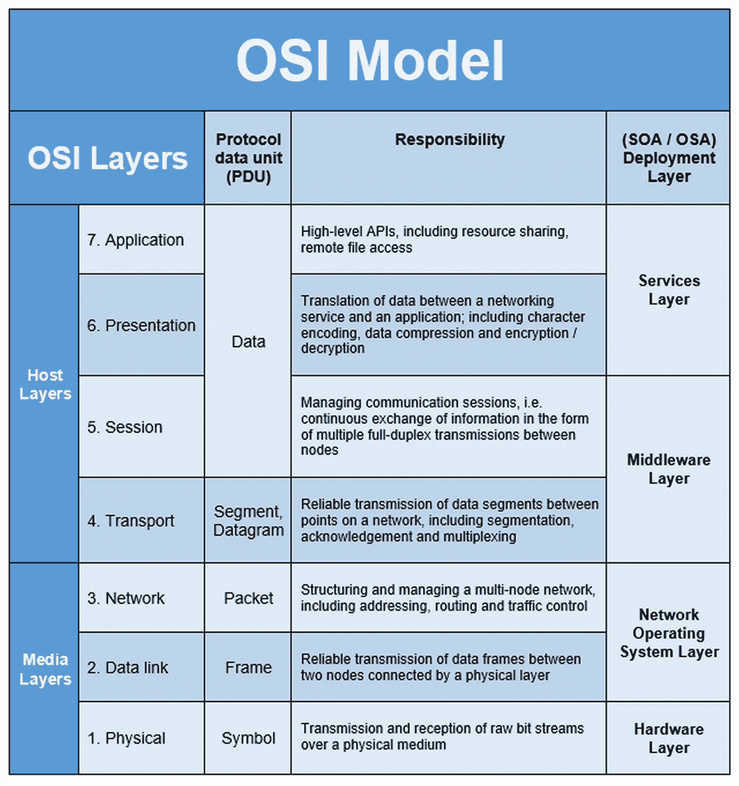

## 开放系统互连 (OSI) 层

我想向你们展示[一段时长 13 分钟的电影](https://www.youtube.com/watch?v=RhvKm0RdUY0&list=PLMEBhsFVAWsJVCcr1TFjFx117DZsVrHzw)，我在所有的“网络导论”课程中都会用到它。它真的非常有趣，并演示了常见`广域网`(WAN) 或`局域网`(LAN) 中发现并使用的所有基础设备。

你刚刚观看的电影是[开放系统互连模型](https://en.wikipedia.org/wiki/OSI_model)（又由国际标准组织 — ISO 编写的“OSI”）。

“OSI”是一种电信模型，它对软件责任进行了拆分和分配。《网络战士》这部电影是从被称为“传输”的第四层开始讲解的。第 5 层到第 7 层已经在互联网上的许多现有文章中解释过了，我们很快就会涵盖这些领域。

开放系统互连 (OSI) 模型是理解任何两个不同网络系统之间数据通信的参考工具。它将通信过程划分为这七层软件责任。人类在这一数据通信系统上的交互由第 8 层到第 10 层表示（上方未画出）。每一层都执行“特定职责”以支持其上层，并向下层提供["服务服务’（即，面向服务的架构 (SOA) 是一种组织软件的特定方法！它的思想是将各种功能拆分作为模块，并可能通过网络协议或套接字通信将其部署在不同的服务器上。）](https://www.ibm.com/developerworks/webservices/library/ws-migratesoa/)。最低的三个层侧重于通过 WAN 将流量传递到终端设备。七层中的前四层代表源设备和目标设备上的活动。

*   第 7 层是你的浏览器所在的客户端。客户端是连接到远程系统以获取数据的系统。它是玩家进入游戏世界的“窗口”（又名视图或界面）。在服务器端，游戏棋盘世界将表示为简单的“数据结构”；它是所有玩家了解彼此的中心点。我也在论坛中无数次看到人们询问如何在服务器上运行“Phaser canvas”。

*   第 6 层处理几项内容。首先是如何“呈现”格式化信息。玩家的语言是法语、俄语、日语吗？那么显示信息必须适应他们语言的这些符号。玩家是否被要求登录并呈现受`通用数据保护条例 (GDPR)`保护的敏感个人信息？([参见附录 — 安全](http://makingbrowsergames.com/book/Appendix-Security.pdf))）第 6 层执行所有的加密安全方法。

*   第 5 层负责每个游戏玩家与目标服务器之间的“消息对框”和“会话”。我们将完成的大部分工作属于这一领域[以 WebSockets 的形式](https://en.wikipedia.org/wiki/Network_socket]。这一层将接收来自下方第 4 层“TCP 端口”的数据。“socket”是由第 3 层网络协议地址和分配的第 4 层端口号创建的标识（又名绑定）。

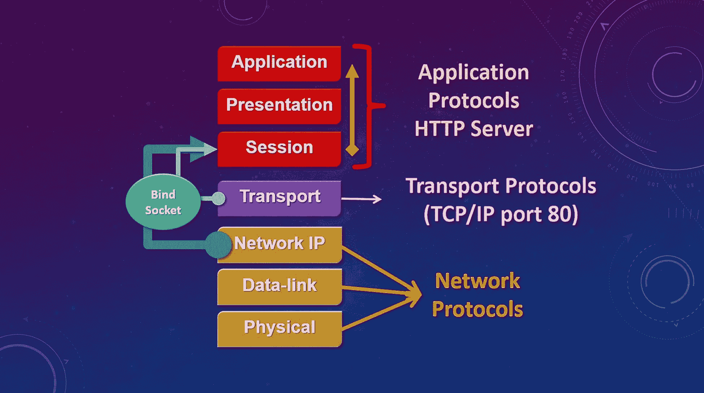

将 IP 地址和 Socket 绑定到会话对话

*   从第 4 层向下到“物理”层在《网络战士》电影中解释过。这只需要你 13 分钟的时间，非常有趣，并将节省你近 8 小时阅读[Ilya Grigorik 编写的 18 章书籍](https://hpbn.co/)的时间——他是 Google 的 Web 工程师，W3C 性能工作小组的联合主席。由你决定。第 4 层提供了几种协议“服务”，已知为用户数据 agram 协议 (UDP)、传输控制协议 (TCP)、[快速 UDP 互联网连接 (QUIC)](https://en.wikipedia.org/wiki/QUIC) 以及许多其他。

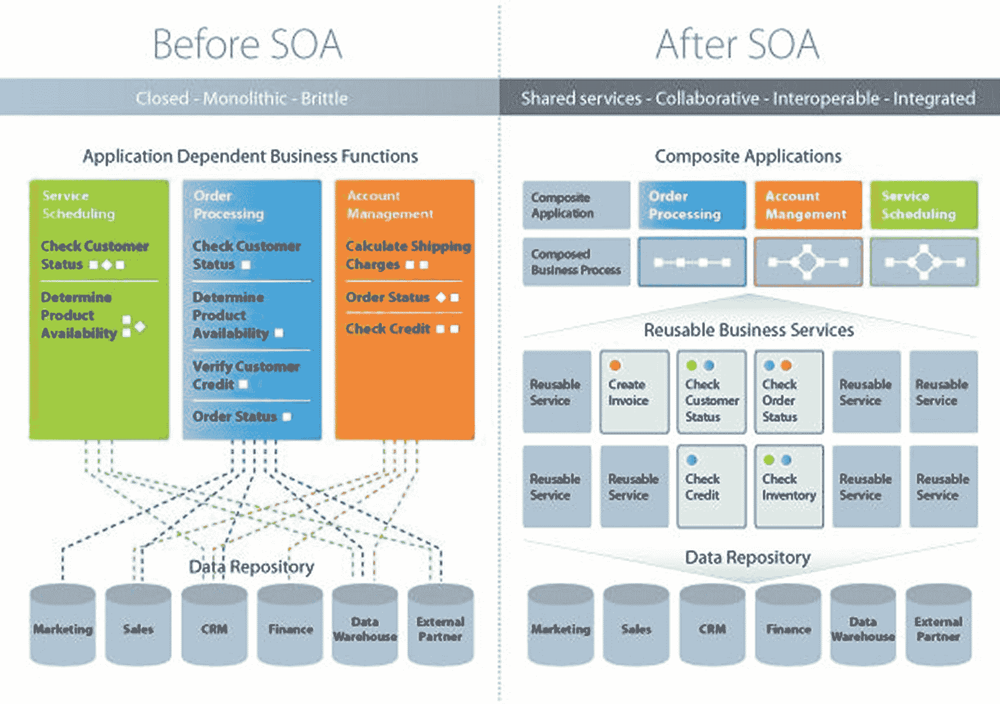

用于 MMoGs 的新云网络模型


网络如何影响 MMoG

**提示：** `127.0.0.1` 作为 IPv4，`::1` 作为 IPv6 或 `localhost` 都是默认指向你的本地工作站的 IP 地址。数据包路径永远不会到达网卡 (NIC)。在创建 web sockets 和多人游戏时，这是一个重要概念。

你可能考虑在线阅读[Ilya Grigorik 的书](https://hpbn.co/)；它是免费的。我会经常引用它。这本书为“全栈”开发者提供了需要了解的各种类型网络（WiFi, 3G/4G）、传输协议（UDP, TCP, SCTP 和 TLS）、应用协议（HTTP/1.1, HTTP/2）以及“第 7 层”内部的 WebSocket(http://websocket.org/)、WebRTC(https://webrtc.org/) 和更多应用程序编程接口 (APIs) 的实战概述。在我读过的许多关于多人游戏的文章中，他将实用的与[废话’](https://en.wikipedia.org/wiki/Cruft)分离开来。

## 3.1 网络基础

网上有许多关于通过个人解决方案创建多人游戏的文章。在我们创建一些游戏需求标准后，我们将审查许多解决方案。然后选择性地匹配符合我们游戏需求的服务器引擎。

我要说明显而易见的标准 1：“要制作多人游戏，我们必须连接到不在同一区域或同一台工作站的玩家。（废话！）我们可以通过让所有玩家都在同一个房间内并使用同一台计算机（又名热座(https://en.wikipedia.org/wiki/Hotseat_(multiplayer_mode))）来制作多人游戏，这在 80 年代是一种流行的多人游戏解决方案。）现在，人们只需带上自己的键盘并调整“蓝牙”来适应“微网络”。但这仍然是一台带有多个键盘输入的单机设备，而且不是我们要的。

## 3.2 深入探讨：在本地测试 MMoGs(https://en.wikipedia.org/wiki/Massively_multiplayer_online_game)？？

### 热座 MMoG 演示

-   [基础 MMO 基础](https://basic-mmo-phaser.herokuapp.com/) 由 Jerome Renaux 创建，托管在 Heroku 上，使用 `socket.io` 实现。说明：使用方向键移动。打开多个浏览器窗口（在本地浏览器上）以邀请更多玩家。你可以在 [GitHub](https://github.com/Jerenaux/basic-mmo-phaser) 上找到源代码并将其[重写为 ES6](https://github.com/TVScoundrel/mmo-phaser-es6)。阅读他的[开发教程](https://www.dynetisgames.com/2017/03/06/how-to-make-a-multiplayer-online-game-with-phaser-socket-io-and-node/)。

-   [DesignOnline](http://designonline.com/) 的 [井字游戏 (AJAX)](https://jadendreamer.wordpress.com/2012/04/26/tic-tac-toe-game-no-database/) 或 [井字游戏 (PHP)](https://jadendreamer.wordpress.com/2015/04/06/tic-tac-toe-game-instances-no-database/)。说明：使用鼠标选择“X”或“O”，然后提交你的游戏。打开多个浏览器窗口（在本地浏览器上）以邀请更多玩家。

## 3.3 网络关系

网络连接使用两种基本模型：“点对点” (`PP`）或“客户端/服务器” (`C/S`)。你可能想知道，`PP` 正在作为一种新的 `PeerConnection` 重新流行。组织使用的模型取决于网络用途以及用户对网络的需求。计算机和其他设备的整体物理部署被称为网络架构。这两种常见的网络模型的主要区别在于用户身份验证（登录）和访问特定资源的方式。

`Client`（客户端）是订阅服务器提供的服务的网络设备。以餐厅场景为例，顾客将使用服务员向厨房点菜。`Server`（服务器）是一台专用于处理特定特定任务或服务的高性能计算机——在我们的案例中是 MMoG。在点对点 (`PP`）网络中，`Peer`（节点）是一台普通计算机（又名工作站），它同时充当与其他计算机进行通信的 `Client` 和 `Server` 角色。`PP` 网络仅在小型网络（少于 10 台计算机）中有效。事实上，根据微软的说法，任何“点对点”工作组的最大限制都是 10。这就是为什么许多局域网 (`LAN`) 游戏限制最多 8 名玩家的原因。

我们不会为我们的游戏网络（超过 3 名玩家）考虑“点对点”关系模型，由于一个重要的计算公式：`n(n+1)/2`（参考 maths.surrey.ac.uk/hosted-sites/NbProof）。这意味着，我们向“点对点”网络中添加越多的工作站节点 (`n`)，需要的连接就越多。将 `n` 替换为 25（或许可能是 100？）名玩家，你会发现我们需要 325 条不同的连接路径——所有路径都在 `PP` 内部传输数据包。这会变得简单且难以负担。回到我们的食物例子，`PP` 类似于[家庭聚会烧烤](https://grouptravel.org/family-reunion/how-to-determine-the-size-and-time-of-year-for-family-reunion/)。桌上的每个人都接收并围着桌传递食物。如果有 10 人参加，每个人都可以快速准备好自己的那份。但如果家里有 250 人参加呢？以这种方式向他人传递食物是愚蠢的；解决方案是使用餐饮外送（翻译为客户端/服务器模型）或自助餐（翻译为自助网站）来提供食物。计算机受限于 65,536 个四层端口；而且，并非所有的四层端口都可以供我们的游戏服务器使用（减去 1,024 个专用端口）。

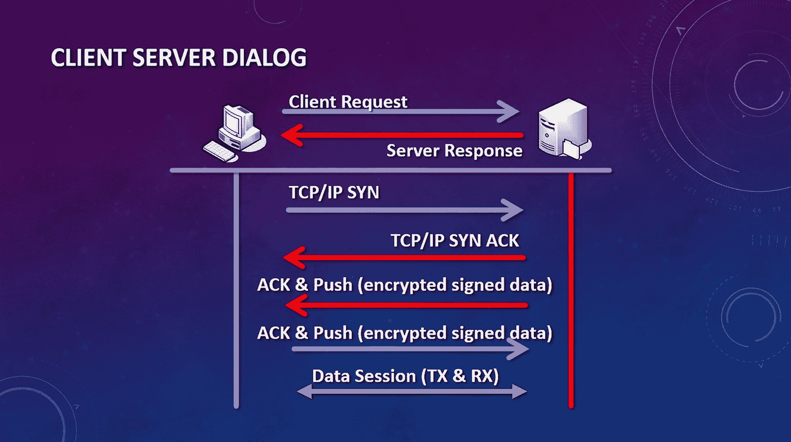

### 客户端到服务器关系的简单视图

| 客户端 | 网络 | 服务器 |

| --- | --- | --- |

| 收集输入 | 传递数据 -> | 处理输入 |

| 渲染视图 | <- 传递数据 | 移动物体 |

今天在互联网上玩的大多数“大型在线游戏” (`MMoG`) 仅仅是经过修改的“客户端/服务器网络”游戏。例如，像[半条命](https://stackoverflow.com/questions/918033/how-does-the-half-life-2-multiplayer-protocol-work) 及其所有“模组”（如：反恐精英、要垒垒垒版等），它们运行在经过修改的“客户端/服务器网络”上，以及基于 Quake3 引擎和[虚幻竞技场引擎](https://api.unrealengine.com/udk/Three/NetworkingOverview.html) 的游戏。在所有这些游戏中，都有一个单一的、中心化的权威服务器负责运行主游戏逻辑。在软件工程中，这被称为[中介模式](https://www.oreilly.com/library/view/learning-javascript-design/9781449334840/ch09s06.html)。这个中心“枢纽”连接着一个或多个“哑终端”客户端 (https://simplicable.com/new/dumb-client)——我并不是在贬义；这是数据通信中的一个术语。[DTE](https://www.wikipedia.org/wiki/Simplex_communication) 只是简单的屏幕。这无异于回到 [1960 年代的主机](https://en.wikipedia.org/wiki/Systems_Network)。

### 什么是权威服务器？

**答案：** 现在考虑一下人们所谓的“云端”（https://gose-internet.net/hosting-articles/what-does-cloud-represent/）。服务器处理玩家输入，移动物体，然后返回这些结果。客户端仅在本地渲染这些结果。这种[权威服务器](https://www.ibm.com/support/knowledgecenter/en/SSLTBW_2.3/com.ibm.zos.v2r3.halz002/dns_auth_servers)取代了点对点中的多多连接。游戏（薄客户端）（https://en.wikipedia.org/wiki/Thin_client）工作站仅将其输入发送到中心服务器，以收集、计算并报告作为结果应该发生的事件。服务器返回这些结果，客户端仅在本地渲染这些结果。这就是我们在数据通信中所谓的单工连接或半双工连接。

实际连接路径

上面的插图展示了两个远程玩家之间使用的实际通信（即“物理”）路径。如果我们正在构建一个“实时” `MMoG`，这条通信路径将带来若干问题：

*   延迟和滞后响应（又称“延迟”）。没有任何东西是瞬时完成的！）这是我们无法控制的最大问题。阅读更多关于[网络延迟](http://smutz.us/techtips/NetworkLatency.html)以及如何补偿其影响的内容。

*   发往或来自每个玩家的丢失数据包。（TCP/IP 损坏的数据包将不断重传，直到它们“完美”地到达。）

*   [网络拥堵](https://en.wikipedia.org/wiki/Network_congestion) —— 导致流量重路由到更长的通信路径。

*   由于广网（WAN）网络拥塞导致的数据包丢弃。

*   [抖动](https://howdoesinternetwork.com/2013/jitter) —— 由于其他用户共享相同通信路径的其它背景流量，导致随时间变化的延迟。[具有更高的区分化服务。](https://www.slashroot.in/understanding-differentiated-services-tos-field-internet-protocol-header)

网络带宽是基于合同协议的有限资源；这将在后面的章节中成为主要关注点。[服务水平协议](https://en.wikipedia.org/wiki/Service-level_agreement)。因此，服务器不应该为游戏面板（又称游戏世界）的每一个微小变化向每个游戏参与者发送新的更新数据包。相反，中央游戏服务器会在不同的间隔获取“当前游戏状态的快照”（远低于 60fps！），然后“广播”这些样本以同步每位游戏玩家的游戏。这与电缆公司向周边社区订阅者广播电影时使用的技术相同。这些网络数据包在玩家和服务器之间传输需要时间（即 ping 值时间的一半；](https://serverfault.com/questions/438475/data-obtained-from-ping-is-it-round-trip-or-one-way 查看网络工具附录）。这意味着客户端玩家的时间总是落后于服务器时间（即滞后）。此外，客户端的[传入消息包](https://github.com/cjus/umf) 在返回路径上会被进一步延迟，因此游戏服务器始终处于时间延迟的状态处理玩家的命令。此外，每个客户端工作站通往中央服务器的网络延迟是独特的，因为每个游戏参与者通过广网（WAN）上不同的数据连接以不同的数据速率到达服务器。由于该路径上的其他聚合流量和互联网服务提供商（ISP）的访问采样帧，这种延迟随时间动态变化。服务器与每个客户端之间通过 ISP 的这些时间差异导致了逻辑处理问题，随着 WAN 内部网络延迟的增加，这些问题变得更加糟糕。在快速动作游戏中（通常出现在“第一人称射击游戏”中），即使是几毫秒的轻微网络延迟也会导致“卡顿”（即断续、抖动）的游戏体验。这使得很难以每秒 60 帧（fps 或每动画帧约 16.67 毫秒）的速度针对其他玩家或与快速移动的障碍物交互。（记住第五章。）除了这些带宽限制、碎片、损坏和网络延迟，游戏也会由于网络拥堵和重路由而丢失。

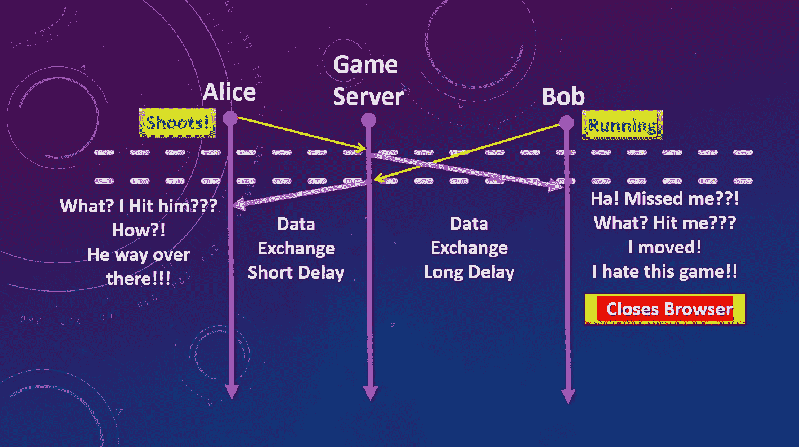

## 插值与外推作为预测和延迟补偿

许多游戏开发者尝试通过[统计预测 —— 插值或/或外推](https://sciencestruck.com/interpolation-vs-extrapolation) 来补偿这些棘手的网络问题。他们在“预测”中没有包含的是网络协议中已经存在的第 4 层通信管理。

### 什么是插值和外推？

**答案：** [Mario 的数学教程（电影 2:42)](https://www.youtube.com/watch?v=c4_MJg_c49k) [https://www.youtube.com/watch?v=c4_MJg_c49k]

## 3.5 网络传输协议概述

正如我们所见，网络协议通常分层开发，每层负责网络通信的一个不同方面。

### 协议定义

让我们使用[牛顿电信词典](https://amzn.to/2UCQAvg)，并避开我在许多教程和营销白皮书中看到的那些虚假描述。

协议套件 —— 例如基于互联网协议的传输控制协议（又称 TCP/IP）—— 是不同层级协议的垂直组合。[TCP/IP 通常被认为是一个 4 层系统](http://amzn.to/2gZcHZT) —— 如下表所示：

| # | 层名称 | 使用的数据协议 | 数据格式 | 设备 |

| --- | --- | --- | --- | --- |

| 5,6 & 7 | 应用层 | 游戏应用, [HTTP](https://en.wikipedia.org/wiki/HTTP/2), [SIP](https://en.wikipedia.org/wiki/Session_Initiation_Protocol) | [ASN.1](https://en.wikipedia.org/wiki/Abstract_Syntax_Notation_One),[ABNF](https://en.wikipedia.org/wiki/Augmented_Backus%E2%80%93Naur_form) | 内存 |

| 4 | 传输层 | [SCTP, TCP, UDP,](https://en.wikipedia.org/wiki/Transport_layer#Comparison_of_transport_layer_protocols) [QUIC](https://techcrunch.com/2015/04/18/google-wants-to-speed-up-the-web-with-its-protocol/) | 分段 | 端口 |

| 3 | 网络层 | IP, ICMP, IGMP | 数据包 | 路由器 |

| 2 | 数据链路层 | MAC | 帧 | 交换机 |

| 1 | 物理层 | 电压、射频、光纤 HDB3、DWDM | 线缆、连接器 |

注：第 1 层和第 2 层是“网络访问”层。[牛顿词典](https://amzn.to/2gZcHZT) 或参考此网络。](https://en.wikipedia.org/wiki/Internet_suite)

### 第 4 层 UDP 与 TCP

| UDP 与 TCP 比较： | UDP | TCP |

| --- | --- | --- |

| 拥塞避免：变量拥塞窗口、慢启动、超时 | 否 | 是 |

| ECN 支持 | 否 | 是 |

| 错误检测 | 可选 | 是 |

| 流控制 | 否 | 是 |

| IPv4 网络转换 (NAT) | 是 | 是 |

| 多路流 | 否 |否 |

| 头部大小 | 8 字节 | 20–60 字节 |

| 端口编号 | 是 | 是 |

| 可靠性：通过自动重复请求 (ARQ) 恢复 | 否 | 是 |

| 传输层数据实体 | 数据报 | 分段 |

| 虚拟电路：序列编号和重排序 | 否 | 是 |

**UDP 与 TCP 特性表：**

| 术语 | TCP | UDP |

| --- | --- | --- |

| 确认 | 确认分段 | 无确认 |

| 缩写 | 传输控制协议 | 用户数据报协议或 通用数据报协议 |

| 通用头部字段 | 源端口、目的端口、校验和 | 源端口、目的端口、校验和 |

| 连接 | TCP 是面向连接的协议 | UDP 是无连接协议 |

| 数据流控制 | TCP 执行流控制。TCP 需要三个数据包建立套接字连接才能发送任何用户数据。TCP 处理可靠性和拥塞控制。 | UDP 没有流控制选项 |

| 错误检查 | TCP 执行错误检查和错误恢复。错误的数据包将从源到目的重传。 | UDP 执行错误检查但直接丢弃错误的数据包。不尝试错误恢复。 |

| **功能** | 消息通过[互联网](https://www.diffen.com/difference/Internet_vs_World_Wide_Web)从一台计算机传输到另一台计算机。这是基于连接的。 | UDP 也是一种用于消息传输或传输的协议。这不是基于连接的，这意味着一个程序可以向另一个程序发送大量数据包，然后关系就结束了。 | |

| **握手** | SYN, SYN-ACK, ACK | 无握手（无连接协议） | |

| **头部大小** | TCP 头部大小为 20 字节 | UDP 头部大小为 8 字节。 | | |

| **数据包排序** | TCP 按照指定的顺序重排[数据](https://www.diffen.com/difference/Data_vs_Information)包。 | UDP 没有固有顺序，因为所有数据包之间都是相互独立的。如果需要排序，必须由应用层进行管理。 | |

| **可靠性** | 绝对保证传输的数据保持完整，并按照发送时的顺序到达。 | 不保证发送的消息或数据包一定能到达。 | |

| **传输速度** | TCP 的速度比 UDP 慢。 | UDP 更快，因为它不尝试进行错误恢复。它是一种“尽力而为”的协议。 | |

| **数据流** | 数据作为字节流读取；不传输指示消息（段）边界的区分指示。 | 数据包单独发送，仅在到达时检查完整性。数据包具有明确的边界并在接收时被遵守，这意味着接收端套字字的读取操作将产生原始发送的整个消息。 | |

| **用途** | TCP 适用于对可靠性要求高且传输时间不敏感的应用。 | UDP 适用于需要快速高效传输的应用，例如游戏。UDP 无状态 Nature 对于为大量客户端回答小型查询的服务器也有用。 | |

| **被其他协议使用** | HTTP, HTTPs, FTP, SMTP, Telnet | DNS, DHCP, TFTP, SNMP, RIP, VOIP。 | |

| **权重** | TCP 是重量级的。在发送任何用户数据之前，TCP 需要三个数据包来建立套接字连接。TCP 处理可靠性和拥控制。 | UDP 是轻量级的。没有消息排序，没有连接跟踪等。它是构建在 IP 之上的小型传输层协议。 | |

你可以将 `UDP`（用户数据报协议）想象为“瓶中信”。消息被发射到广大的互联网海洋中，希望它能到达目的地。

与 `UDP` 相，`TCP over IP` (TCP/IP) 是面向连接的，类似于电话。。用户拨打号码（例如一个 `IP`（网络协议）地址），并等待终端回答后再开始对话。`TCP/IP` 为此通信路径添加了其他便利服务。最重要的是数据恢复；如果某些内容丢失、损坏或顺序错乱，`TCP/IP` 会介入并请求重传，将完好的原始数据插入到正确的位置。

`TCP/IP` 提供的一个经常被遗忘的服务是`连接管理`。每次 TCP/IP 传输必须由目标设备确认，或 `ACK`。

源系统只会为这些确认等待有限的时间。这段时间间隔被称为`重传时间`（re-transmission time）。如果计时器在发送端收到终端的确认之前过期，`TCP` 假设 `IP` 数据包已丢失，并请求重传那个所谓的丢失包。每个数据包都包含序列号，每个确认也是如此。通过这种方式，发送者知道序列流中丢失了哪个数据包。

你猜对了！通信效率对 TCP 等待直到开始请求重传的时间非常敏感。TCP 将这段时间间隔称为`重传超时`（`RTO`）。你可以将 `RTO` 设置为静态值，或者*它通常是自适应的*。几乎所有的 `TCP/IP` 连接都使用自适应 `RTO`。要学习的点是，任何为了补偿网络延迟或延迟而生成的插值或外推都会导致夸大的响应。

简要让我们看看静态 `RTO` 如何影响局域网（LAN）中的通信效率。LAN 中的源系统和目标系统通常离得很近，带宽很高，数据包在它们之间传输的时间非常短。显然，当数据包在 LAN 中丢失时，通过非常小的 `RTO` 就能实现效率。然而，但对于一个玩家[遍布世界，](http://www.dictionary.com/browse/strewn)并跨越海洋的 MMO 游戏，使用标准电话线，那些玩家和游戏服务器一点也不近，带宽很小，数据包在它们之间传输的时间非常长。在这种情况下，较小的 `RTO` 成为通信效率的障碍。如果 `RTO` 太小，源设备可能会认为数据包丢失了；而实际上，游戏服务器收到了那个游戏回合数据包并对其进行了确认；然而，`ACK` 没有时间传回源端。

无法为每个应用程序设置 `RTO` 的值。如果 `TCP/IP` 能够预测响应时间并以自适应的方式设置 `RTO` 值，将容易得多。TCP 通过估计每个建立的套接字对的往返延迟来执行此任务。由于由于位于两个端点系统之间的网络不是静态的，数据包在任何两个系统之间传输的时间也不是静态的。因此，往返延迟被不断测量和调整以适应网络不断变化的状况。TCP 在发送数据包时启动计时器，并在最终收到确认时停止它——这一功能已嵌入协议中。没有理由在你的游戏引擎中浪费 CPU 来进行这些计算——这是我在最近的几个教程、书籍和文章中看到的。`TCP/IP` 然后将该值写入名为`往返时间`（`RTT`）的变量中。随着更多数据包的发送和接收，RTT 值不断更新（对于你的 MMO 应用），以适应两个通信端系统之间互联网不断变化的状况。

这种连接管理在接收设备付出了代价。终端持有所有进入的数据包并验证其完整性，并将它们重新排序为正确的顺序。如果终端发现数据包损坏或简单的数据包丢失，一切都会冻结（即`头部阻塞`），直到发送重传请求且新的闪亮数据包到达。不！你无法修复它；这是 TCP/IP 的运行方式。因此，Google 开发了一个解决此问题的想法——它被称为 `QUIC`。他们的目标是结合 UDP 和 TCP 的最佳特性，并加入一点安全盐进行调味。

QUIC 承诺 0 毫秒连接！

| 可靠性 | 可靠 | 不可靠 | 可配置 |

| :--- | :--- | :--- | :--- |

| 交付 | 有序 | 无序 | 可配置 |

| 传输 | 字节面向 | 消息面向 | 消息面向 |

| 流量控制 | 是 | 否 | 是 |

| 拥塞控制 | 是 | 否 | 是 |

### 过去我们……

在 Web 开发早期，客户端向服务器请求信息，服务器做出响应。每个请求和响应都是“独立的”网页，是“无状态的”，且位于两个不同的端口套接字——也称为“通信端点”：一个指向服务器的发送端口和一个来自服务器的接收端口。这意味着在持续期间，每个客户端都在服务器上占用一个专用的下行端口！

#### TCP、UDP 总结：

| 功能 | TCP 描述 | UDP 描述 |

| :--- | :--- | :--- |

| 连接 | 此过程用于初始化端口号和其他 TCP 头部字段。 | UDP 是无连接的 |

| 流量控制 | 此过程用于保护缓冲区和路由设备 | 这不是 UDP 的功能。 |

| 使用端口复用 | 接收主机根据端口号决定数据目标所在的正确应用程序。 | 与 TCP 相同 |

| 有序数据传输 | 这涉及连续的有序数据流。 | 不对接收到的数据进行重排序。 |

| 可靠传输 | 数据确认使用 TCP 头部中的序列号和确认字段。 | 这不是 UDP 的功能。 |

Web 开发者首先解决了“无状态、瞬态”的情况；他们希望通信事务能够保持“开启”且“持久化”。HTTP 持久连接（又名 HTTP keep-alive、HTTP 连接复用或流式传输）是一种应用于单个 TCP 连接的方法。该思想在应用时，会发送并接收多个 HTTP 请求/响应，而不是为每个单独的请求/响应对打开新连接的常规操作。这将一直持续，直到客户端或服务器认为对话结束，并其中一个关闭（或“挂断”）了连接。“直到 20 世纪 90 年代，超文本才变成了超媒体，重点强调嵌入图形和其他媒体文件。当 Web 页面从简单的文本变为带有数十甚至上百张嵌入图像的多媒体奇迹时，HTTP/1.0 的局限性变得变得显而易见。”在 HTTP 1.1 中，除非另有声明，所有连接都是持久的。

| 客户端 | 网络 | 服务器 |

| :--- | :--- | :--- |

| 收集输入 | 传递数据 -> | 处理输入 |

| 渲染视图 | <- 传递数据 | 移动对象 |

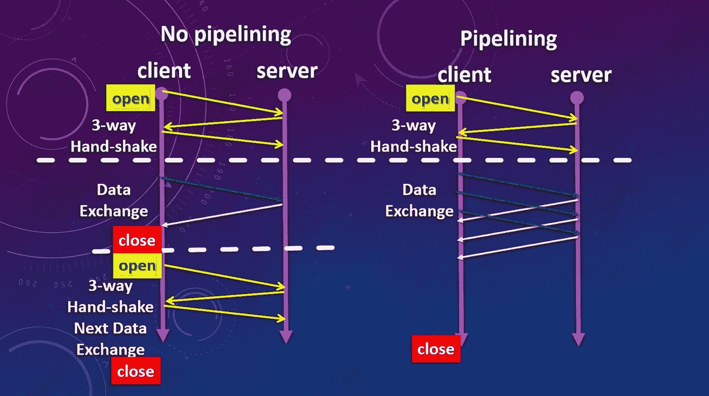

#### 新久连接

持久连接（又名管道或流式传输）不使用独立的心跳消息；它们允许在单个连接上进行“多个请求”。然而，它们有默认的连接超时；对于 Apache `httpd` 1.3 和 2.0，最短为 15 秒，而 Apache `httpd` 2.2 及以上版本仅为 5 秒。从这种短超时获得的优势是，可以快速交付网页的“多个组件部分”，而不会消耗过多资源来运行多个服务器进程或线程。

引入“TCP/IP 持久连接”通过减少许多冗余的客户端/服务器对话，极大地提高了 HTTP 协议的效率。

这种模型随着“异步 JavaScript 和 XML (AJAX)”的引入而发生了变化。简而言之，它是使用 `XMLHttpRequest` 对象与服务器端脚本通信。它可以发送并接收各种格式的信息，包括 `JSON`、`XML`、`HTML` 甚至文本文件。此时提供实时 Web 应用程序尝试主要围绕轮询和其他“服务器端推送技术”展开。[`RFC6202`](https://tools.ietf.org/html/rfc6202#page-4) 提到，“……HTTP 长轮询和 HTTP 流传输机制都扩展了 HTTP 的原始语义，HTTP 协议并非为双向通信而设计。”

#### 什么是长轮询？

回答：“浏览器向服务器发送请求，服务器在特定时间内保持请求开启状态。如果在此时间内收到了通知，则向客户端发送响应。如果在指定时间内没有收到通知，服务器将发送响应以终止已开启的连接。然而，重要的是，当你有‘高并发消息量’时，长轮询相比传统轮询并没有提供任何实质性的性能提升。事实上，情况可能更糟，因为长轮询可能会失控，进入不受限制的连续立即轮询循环。”

#### 什么是流式传输（streaming）或管道（pipeline）？

回答：“浏览器发送一个完整的请求，但服务器发送并维护一个开启的响应连接，该连接持续更新并无限开启（或明智地设置一段时间）。每当有消息准备好发送时，响应就会更新，但服务器永远不会通知客户端完成响应，从而保持连接开启以备未来的消息。然而，由于流式传输仍然封装在 HTTP 中，中间的防火墙和代理服务器可能会选择缓存这些响应，增加消息传递的延迟。因此，许多流式 `Comet solutions` 在检测到缓存代理服务器时会退回到长轮询。或者，可以使用 TLS/SSL 连接来防止响应被缓存；但在那种情况下，每个连接的建立和销毁会消耗可用服务器资源。”

#### 安全比较

| 特性 | 混淆 TCP (Obfuscated TCP) | SSL/TLS |

| :--- | :--- | :--- |

| 浏览器支持 | 可用补丁版本的 Firefox | 所有主流浏览器广泛支持 |

| 加密速度 | 非常快 | 较慢 |

| 网络延迟 | 每个连接零额外往返（尽管可能需要 DNS 查询） | 每个连接增加一或两次往返 |

| 公钥基础设施 | 不需要签名的公钥 | 需要购买签名的公钥证书 |

| 安全特性 | 无法抵抗某些中间人攻击 | 抵抗中间人攻击 |

| 服务器支持 | Light-httpd 和 Apache 需要补丁 | 主流服务器广泛支持 |

| TCP 端口 | 可以使用任何 TCP 端口 | 通常使用 443 |

#### 新行业秀

传输控制协议 (TCP) 和用户数据报协议 (UDP) 是长期用于数据通信和视频会议的协议。但这还不够，某些东西改变了这一切——“WebSocket！”在 2011 年，引入了一种新的 WebSocket 标准协议，并在 2014 年最终稳定。与以前的半双工 HTTP/AJAX 不同，WebSocket 在单个 TCP 连接上提供全双工通信。HTML5 WebSocket 不仅仅是对传统 HTTP 通信协议的又一次改进；它代表了指数级的进步，特别是对于实时、事件驱动的 Web 应用程序而言。


# WebSocket 服务器与普通 Web 服务器的主要区别

总结 WebSocket 服务器与普通 Web 服务器之间的主要区别在于：一旦你从 Web 服务器接收到信息，连接就会断开。看起来你似乎仍然连接到 Web 服务器，特别是对于一个正在渲染所有内容的“单页 Web 应用 (SWPA)”而言。然而，事实并非如此。当你打开一个 Web 页面时，Web 服务器向你发送该页面以及所有相关的图形、文本和其他媒体；然后你的浏览器会回传一条确认消息说“收到了！”，接着该连接请求就会关闭网络连接。相比之下，WebSocket 服务器的连接会保持活动并“开启”状态，直到你退出应用程序或触发断连接的事件（即“挂断”）。由于 WebSocket 连接保持开启，你可以实时双向流传输音频、视频、文本以及互联网上的任何可用媒体——这在传统的 Web 服务器上是不可能的，因为它的架构完全不同。

由于 WebSocket 是双向连接，因此在“服务器”和“客户端”之间没有技术上的区别；它们现在是点对点节点。“发送者”和“接收者”指的是游戏内容和消息。服务器需要承担一个新角色：连接多个“端用户客户端”的“对等节点”。服务器转变为类似于网络“路由器”的东西。因此，游戏逻辑不再完全位于服务器上，而是可以位于端用户浏览器中，作为一个“代理服务器”，允许其他远程端用户访问其本地游戏功能。这个概念是“分布式应用 (DApp)”的开端——客户端直接调用其他客户端参与者的游戏逻辑函数，而服务器则消失在“云服务”中。

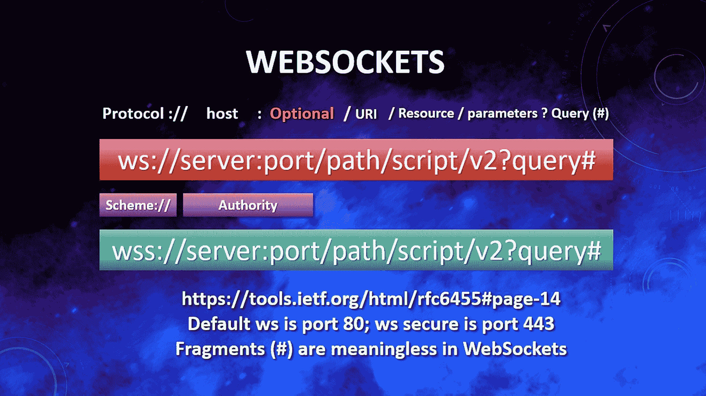

## 服务端目标

似乎每个人都在参与他们自己的 WebSocket“流行风味”——[在此处比较各种 WebSocket](https://en.wikipedia.org/wiki/Comparison_of_WebSocket_implementations)。要使用 WebSocket，你需要一个支持 WebSocket 协议的 HTML5 浏览器和一个支持该协议的服务器。你还需要一个传统的 Web 服务器（如 `Apache` 或 `IIS`）来提供你 MMoG 的动态内容。Web 服务器和套接字服务器应该是两个独立的实体，但处于同一个域名下。

通过 WebSocket 的会话工作方式与传统的 Web 服务器相同：一个 `cookie` 会在每个请求头中被设置并传输。这意味着你的网站和你的 WebSocket 服务器都必须访问该 `cookie`。

为了让会话数据在你的网站和你的 WebSocket 服务器之间共享，它们必须处于同一个域名下。你可以通过将它们托管在同一域名并使用不同端口来实现，例如 `mydomain.com:80`（用于网站）和 `mydomain.com:8080`（用于 WebSocket）。如果你选择将 WebSocket 服务器托管在子域名上（`websocket.mydomain.com:80`），请确保你的网站的 `php.ini` 文件配置如下所示：

```
session.cookie_domain = ".mydomain.com"
```

为了避免命名空间冲突，我建议你将子协议名称作为域名字符串的一部分。如果你正在构建一个专门使用私有格式的 MMoG 应用，那么你可以使用这个：`Sec-WebSocket-Protocol: mmog.pbmcube.net`。对于不同的版本，一种广泛使用的方法是添加一个“ / ”后跟版本号，例如 `mmog.pbmcube.net/v2.0`。注意，这不是强制要求的，它只是一个可选的约定，你可以使用任何喜欢的字符串。

HTML5 Web Sockets 在实时 Web 的扩展性方面迈出了巨大的一步。典型的 WebSocket 客户端是用户的浏览器，但该协议是平台无关的。HTML5 Web Sockets 可以减少 500:1 或（取决于 HTTP 头部的大小）甚至 1000:1 的无效 HTTP 头部流量，并将延迟降低 3:1。这不仅仅是渐进式的改进；这是一个革命性的飞跃——量子跨越！

大多数主流浏览器目前支持 WebSocket 协议。WebSockets 还需要位于服务器上的 Web 应用同样支持它。

| 客户端 | 网络 | 服务器 |
| --- | --- | --- |
| 收集输入 | <- 传递数据 -> | 处理输入 |
| 渲染视图 | | 移动物体 |

我的[第一个 MMoG——荣耀之传奇 (LoRD)](http://legends-of-renown-deeds.com) [`legends-of-renown-deeds.com`](http://legends-of-renown-deeds.com) 在该协议以该名称流行之前曾使用 `AJAX`。我正在将其升级为 WebSockets；本工作手册也是我在此过程中的自指南和开发研究。


### 套接字是如何工作的

**注意：** 套接字 API 位于应用层与传输层之间的通信模型中。套接字 API 不是 OSI 通信模型中的某层。套接字 API 允许应用程序与典型模型中的传输层或网络层进行交互。下图中的箭头显示了套接字的位置，以及套接字提供的通信层。”[IBM 套接字是如何工作的](http://www.ibm.com/support/knowledgecenter/ssw_ibm_i_71/rzab6/howdosockets.htm)

WebSocket 的实现是为 Web 浏览器和服务器设计的，但它可以被任何客户端或服务器应用程序使用。WebSocket 非常适用于大多数客户端到服务器的异步场景，例如聊天服务器是最突出的部署方式。事实上，截至 20190301，Snapchat 的整体策略是构建一个环绕聊天的“消磨时间圈”。由于消息传递是移动端的首要行为，Snap 使用聊天和多人游戏来留住用户使其不断回来，并在他们等待回复或需要闲聊之外的社交替代方案时，通过多人娱乐来分散他们的注意力。这使得 WebSockets 成为回合制大型在线游戏（MMoG）的理想候选者。WebSocket 协议独立于基于 TCP 的协议。它[根据 RFC6455 第 1.5 节和 1.7 节，“运行在 TCP/IP 之上”。](https://tools.ietf.org/html/rfc6455#section-1.5)。与 HTTP 的唯一关系是，WebSocket 的握手会被任何 HTTP 服务器解释为[升级请求（Upgrade request）。](https://en.wikipedia.org/wiki/HTTP/1.1_Upgrade_header) 如果服务器支持 WebSocket，它将通过 `HTTP/1.1 101 Switching Protocols` 响应进行响应。这指令客户端浏览器跨 `ESTABLISHED TCP CONNECTION` 保持打开连接，并开始通过（或不同的可选）端口使用该连接，就像在流式传输数据一样。WebSockets [取代了 AJAX 长轮询](https://tools.ietf.org/html/rfc6202#page-3) —— 我们之前看到过的方法，该方法通常被归咎于资源利用不当。这种新协议允许浏览器与其 Web 服务器之间进行更多交互，促进了与服务器之间的实时数据传输。这为游戏服务器提供了一种标准化方法，用于向连接的客户端传输未请求的信息；此外，还能维持该开启的全双工连接路径。通过这种方式，浏览器和游戏服务器之间发生了同时的双向对话。WebSocket 初始使用默认 HTTP 端口号 80；从中获得的益处让 MMoG 能够通过本会阻止任何“非 Web 端口”使用的防火墙过滤器。同样，双向浏览器-服务器通信取代了以前 `Comet` 等非标准（即权宜）技术。所有的 WebSocket 消息都由 socket 自动成帧。因此，一旦一端完成写入，消息在远程即可可用。WebSocket 会自动决定每个字节属于哪个消息。仅此一项使得与普通的常规 socket 相比，WebSocket 的编程要容易得多。

WebSockets 进一步实现了它们自己的命令（即 `Ping`）和响应（即 `Pong`）协议语义；这允许连接在没有待队传输的任务时（例如：没有发送任何数据）保持活跃。WebSocket 使用[根据 RFC6455 第 3 节的 ABNF 语法](https://tools.ietf.org/html/rfc6455#page-14)。这是你在处理 255 秒后超时的 TCP 连接时通常需要考虑的因素。另一个实用的安全功能是可以为 socket 使用 HTTP 身份验证语义，例如用于 `Basic Auth` 或 `Bearer Token Auth` 的 `Authorization` 标头。（[在 RFC6455 第 5.1 节中讨论](https://tools.ietf.org/html/rfc6455#page-27)）

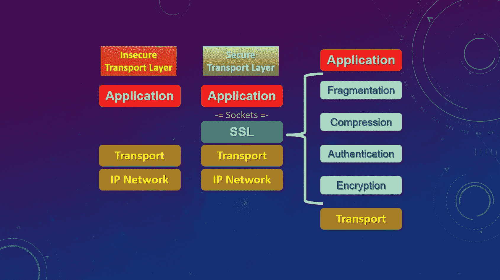

## 安全套接字

### 深度解析：WebSocket 帧

```
 1       0                   1                   2                   3
 2       0 1 2 3 4 5 6 7 8 9 0 1 2 3 4 5 6 7 8 9 0 1 2 3 4 5 6 7 8 9 0 1
 3      ┌─┬─┬─┬─┬───────┬─┬─────────────┬───────────────────────────────┐
 4      │F│R│R│R│ opcode│M│ Payload len │    Extended payload length    │
 5      │I│S│S│S│  (4)  │A│     (7)     │           (16/64)             │
 6      │N│V│V│V│       │S│             │   (if payload len==126/127)   │
 7      │ │1│2│3│       │K│             │                               │
 8      ├─┴─┴─┴─┴───────┴─┴─────────────┘  -   -   -  -  -   -   -   -  ┤
 9      │   Extended payload length continued, if payload len == 127    │
10      ├ -   -   -  -  -   -   -   -  -┌───────────────────────────────┤
11      │                               │ Masking-key, if MASK set to 1 │
12      ├───────────────────────────────┼───────────────────────────────┤
13      │ Masking-key (continued)       │          Payload Data         │
14      ├───────────────────────────────┘ -   -   -  -  -   -   -   -   ┤
15      │                   Payload Data continued  ...                 │
16      ├ -   -   -  -  -   -   -   -  -   -   -   -  -   -   -   -   -   ┤
17      │                   Payload Data continued  ...                 │
18      └────────────────────────────────┘
```

`fin` (1 位) 表示此帧是否为最后一个帧。大多数情况下，消息都合于一个帧。`rsv1`、`rsv2`、`rsv3`（各 1 位）必须为 0，除非协商了定义非零值的扩展。`opcode` (4 位) 表示该帧代表什么。目前使用的值如下：

- `0x00`：此帧接上上一个。
- `0x01`：此帧包含 utf-8 文本数据。
- `0x02`：此帧包含二进制数据。
- `0x08`：此帧终止连接。
- `0x09`：此帧是 ping。
- `0x0a`：此帧是 pong。（如你所见，有足够的未使用值；它们被预留以后使用）。

`mask` (1 位) 表示连接是否经过掩码。目前，从客户端到服务器的每条消息都必须经过掩码，如果未掩码，规范将终止连接。

`payload_len` (7 位)：有效负载的长度。WebSocket 帧的长度如下：0–125 表示负载长度。126 表示接下来的两个字节表示长度，127 表示接下来 8 个字节表示长度。因此，负载长度分为 7 位、16 位和 64 位。

`masking-key` (32 位)：所有从客户端到服务器的帧都由帧内的 32 位值进行掩码。

`payload`：最可能经过掩码的实际数据。其长度为 `payload_len` 的长度。

## 3.6 总结

到目前为止我们学到了：

*   数据如何在互联网设备之间流向。
*   数据如何在工作站内部从应用程序流向线缆。
*   上层关注软件。
*   底层关注硬件、网络连接。
*   发现了 2 本**免费**书籍！第一本由 Google 的 Web 性能工程师兼 W3C Web 性能工作小组联合主席编写，应该成为在线游戏性能的唯一权威来源。
*   网络内的设备创建了提供与提供的关系。
*   在线游戏使用改进的客户端/服务器关系。
*   权威的游戏服务器是游戏活动的核心。
*   MMoG（大型在线游戏）受到多种网络障碍的影响。
*   WebSockets 已经取代了以前的客户端/服务器模式。
*   在游戏项目启动时就应该考虑安全性。

任何在 2014 年之前编写的多人游戏文章、教程和源代码都不支持甚至未提及 WebSockets。

## 3.7 章节脚注

1. [JavaScript and HTML5 Now - 开放 Web 的新范式](https://www.oreilly.com/programming/free/javascript-html5-now.csp)，作者为 Kyle Simpson。O’Reilly 免费书籍 [`www.oreilly.com/programming/free/javascript-html5-now.csp`](https://www.oreilly.com/programming/free/javascript-html5-now.csp)
2. [“HTML5 WebSocket：Web 扩展性的量子飞跃”。](http://www.websocket.org/quantum.html) 检索于 2016 年 7 月 25 日。
3. [HTTP 瞬态与持久性连接以及管道化](http://www.tcpipguide.com/free/t_HTTPTransitoryandPersistentConnectionsandPipelinin.htm)
4. 使用 [`latsub.js`](https://github.com/circonus-labs/latsub) 测量 TCP 延迟

# 第二部分：MMoG 架构

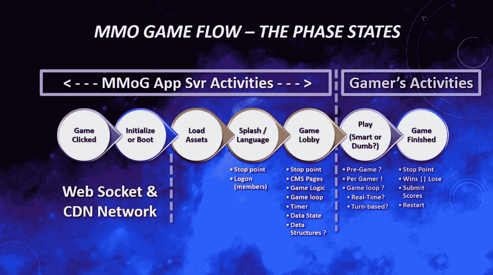

## 第二部分：MMoG 架构

# 4 MMoG 引擎分析

## 4.1 什么是游戏引擎？

从广义上讲，游戏引擎可以被定义为“中间件”。Jeff Ward 是这样描述它的。

## 4.2 “构建”还是不“构建”，这是一个问题！

我们很少有选择。我们可以：

*   编写自己的服务端 MMoG 应用，并管理 [`socket.io`](https://github.com/socket.io/socket.io) 连接。
*   使用 [`socket.io`](https://socket.io/) 库。

## 4.3 什么是进程间通信 (IPC)？

应该收集哪些游戏信息，跨越何种传输格式或架构？（例如，[XML-RPC](http://xmlrpc.scripting.com/), `SOAP`, [REST, GraphQL](https://medium.com/codingthesmartway-com-blog/rest-vs-graphql-418eac2e308) `JSON`, `BSON`, `SOAPjr`, [JSON-RPC](https://github.com/bigstepinc/jsonrpc-bidirectional), [`gRPC`](https://en.wikipedia.org/wiki/GRPC), [GraphQL](https://medium.com/codingthesmartway-com-blog/rest-vs-graphql-418eac2e308) 等），以及它们将存储在哪里（例如 [集中式的“ACID”或分布式的微服务“BASE”](https://www.dummies.com/programming/big-data/hadoop/acid-versus-base-data-stores/)）

## 4.4 我们的游戏交互有多复杂？

我们游戏的 (IPC) 是同步还是异步的？（例如，[MVC](https://www.tutorialspoint.com/mvc_framework/introduction), [MVP, MVVM](http://aviadez.blogspot.com/2007/07/mvp-triad-say-hello-to-mvpc.html)）通常使用 `Phaser` 的前端 JavaScript 开发者负责创建所有这些视觉元素。前端 JavaScript 开发者还负责将这些组件与后端连接。

## 4.5 我们将如何处理数据流？

我们的数据流是什么？（例如，[渐进式 Web 应用 (PWA)](https://developers.google.com/web/fundamentals/progressive_web_apps)）

## 4.6 我们的后端是什么？

我们的后端是什么？（例如，[Service workers](https://developer.mozilla.org/en-US/docs/Progressive_web_apps/Service_workers)）

- 客户端/服务器数据“封包”看起来是什么样的，格式是什么？（例如，[0MQ](http://zeromq.org/intro:start) [`AMF`](https://github.com/jamesward/JSAMF) [`AMQP`](https://www.amqp.org/) 或 Apache [`QPID`](https://qpid.apache.org/overview.html) [`MQTT`](http://mqtt.org/)（消息队列遥测传输；ISO 标准 [(ISO/IEC 20922)](http://www.iso.org/iso/catalogue_detail.htm?csnumber=69466) 和 [`HiveMQ`](https://www.hivemq.com/blog/mqtt-essentials-special-mqtt-over-websockets/), [`RabbitMQ`](https://www.rabbitmq.com/) [`STOMP`](http://jmesnil.net/stomp-websocket/doc/)（简单的、面向文本的消息协议），[`UMF`](https://github.com/cjus/umf/blob/master/umf.md) [`WAMP`](https://wamp-proto.org/) 以及 [`XMPP`](https://xmpp.org/)，根据 [`RFC7395`](https://tools.ietf.org/html/rfc7395) 和[此处的对比表。](https://wamp-proto.org/comparison.html)）仅仅因为我们有持续的数据流，并不意味着任何一方都懂如何读取数据流。它必须有一个结构化的格式——例如[Telnet 字节面向协议。](https://en.wikipedia.org/wiki/Telnet#History_and_standards)它是二进制的（安全性很高）还是文本的（任何人都可以读）？数据“大对象”、数据块或短小的“推特风格”消息（即短消息服务 (SMS)，其有效负载长度受信令协议限制限制为 140 字节（`(140 bytes * 8 bits) / byte = 1,120 bits`）。（你应该[已经研究过 UMF](https://github.com/cjus/umf/blob/master/umf.md)）

- 游戏玩家将拥有“点对点”连接（又名对等网络 P2P）、“星型”结构（又名客户端-服务器中心权威网络），还是使用“组播”？我们是在使用[“覆盖网络`](https://blog.scottlowe.org/2013/04/16/network-overlays-vs-network-virtualization/)还是将我们的需求外包给 [`IaaS, PaaS, SaaS`](https://www.juniper.net/documentation/en_US/release-independent/solutions/topics/concept/solution-iaas-understanding.html)？

- 我们会存储持久化游戏数据吗？它将位于何处？玩家的设备、我们的数据库，还是微服务。[`http://microservices.io/`](http://microservices.io/) 玩家可以返回游戏，并在他们离开游戏世界环境的时间或地点重新开始吗？

- 我们会向玩家推送“非主动更新”，还是服务器只对“事件”（如“回合结束”）做出“响应”？（你已经在前面的章节中学习过这些并写下了你的答案，对吧？）

- 服务器是在客户端同步所有玩家数据，还是维护一个单一的自存储（即[影子服务器 Ghosting server](https://crossbario.com/blog/Free-Your-Code-Backends-in-the-Browser/)）并简单告知游戏客户端增量（即变化）？

- 我们是否想要一个“聊天功能”让玩家互相交换消息和互相嘲讽？（将其添加到你可能在你的 MMoG 中想要的功能列表中）

## 4.7 XML 和 JSON 的用途

引用自“[RESTful API 教程 - JSON vs. XML](https://restfulapi.net/json-vs-xml/)”。

## 4.8 MMoG 引擎标准

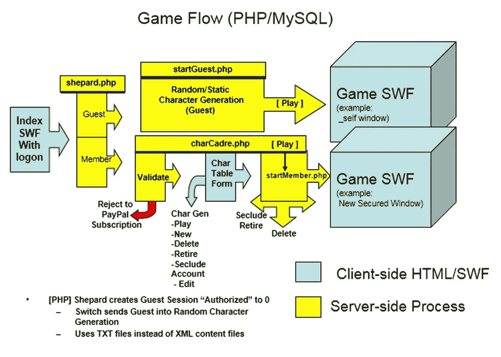

我旧风格的 MMoG 流程：使用 Flash 插件作为厚客户端的请求与响应 RPC

所以，让我们就我（我们）在新技术 MMoG 中寻找的“到底是什么”制定一些标准。

这里可能是我们可能会[分道扬镳。](https://en.wiktionary.org/wiki/part_ways)的地方。我正在开发并记录我的 MMoG 开发，并尽可能透明，以便你采纳或重新考虑我的流程用于你自己的游戏项目。

1.  它必须允许在客户端使用最新版本的 `Phaser` JavaScript 游戏框架（v2.6.2、CE 和/或 v3.）运行[Web 图形库 (WebGL)](https://en.wikipedia.org/wiki/WebGL)。提到这一点听起来很奇怪，因为服务端通常没有 GUI（嗯，也许有管理 GUI 访问，但即使如此，那也在管理员内部。管理员只是一个特殊的权限客户端）。这为什么会影响客户端浏览器？你说得对！如果在搜索过程中，我们发现那些 MMoG 服务端在规定我们的浏览器/客户端，

9.  它不仅必须提供本地工程测试实验室的能力，还要以与测试/开发环境类似的方式在实时生产服务器上运行。（WordPress，你听到了吗？!!) 我已经太多次读过关于 MMoG 引擎的文章，它们展示的是“跨同一主板从一个浏览器窗口到另一个浏览器窗口！”我的天呐！我还不如直接创建一个“热座制”多人游戏呢。这些只是“概念证明”——仅此而已——并且并不是可行的候选方案。在本地总线上传输数据包与跨广域网（WAN）传输数据包是不同等的。

现在有了这份列表，让我们开始搜索吧。

*   [MDN 游戏引擎与工具](https://developer.mozilla.org/en-US/docs/Games/Tools/Engines_and_tools)
*   [GitHub 游戏引擎展示](https://github.com/showcases/game-engines)
*   [维基百科：游戏引擎列表](https://en.wikipedia.org/wiki/List_of_game_engines)
*   附录参考。

### 这是我的列表和图表：（不按偏好顺序排序）

*   **Browser Quest (master): [`github.com/mozilla/BrowserQuest/tree/master/server`](https://github.com/mozilla/BrowserQuest/tree/master/server)** — 一个 HTML5/JavaScript 多人游戏实验。Dynetis Game 已将这项工作重构为 `Phaser` v2.6.2；你可以[在此处查看](https://phaserquest.herokuapp.com/) 并在此处阅读关于他的[开发过程](http://www.dynetisgames.com/2017/03/18/phaser-quest/)。他的游戏于 2017 年 3 月发布——在该本书第一版于 2017 年 2 月发布后的几周后。

*   **Total.js: [`www.totaljs.com/`](https://www.totaljs.com/) —** `Total.js framework` 是一个用 `pure JavaScript` 编写的 `Node.js` 服务端框架，类似于 PHP 的 `Laravel`、Python 的 `Django` 或 `ASP.NET MVC`。“它在项目生命周期内有效改进了最重要的方面。开发极快、维护成本极低、稳如磐石、性能惊人且易于扩展。”

*   **Torque 2D [`www.garagegames.com/products/torque-2d`](https://www.garagegames.com/products/torque-2d) —** `Torque 2D` 是一个极其强大、灵活且快速的开源引擎，专注于 2D 游戏开发。MIT 版本的 `Torque 2D` 现在已在 GitHub 上可用。`Torque 2D` 开发时考虑了 OS X、Windows 和 iOS 设备，在所有平台上的运行效果同样良好。与所有 Game Garage 的产品一样，`Torque 2D` 包含了引擎完整的 `C++` 源代码和许多示例玩具。它包含了对 `TorqueScript` 的访问，这是他们的脚本语言，允许开发者在 Windows 或 OS X 上编写相同的游戏逻辑，并在其他平台上运行！

*   **pomelo: [`pomelo.netease.com/`](http://pomelo.netease.com/) —** 一个用于 `Node.js` 的快速、可扩展的分布式游戏服务器框架。

*   **Eureca: [`eureca.io/`](http://eureca.io/) —** 一个 `Node.js` 双向远程过程调用 (`RPC`)，可以使用 `WebSocket`、`WebRTC` 或 `XHR` 回退作为传输层。

*   **Isogenic: [`www.isogenicengine.com/`](http://www.isogenicengine.com/) —** 完全用 `JavaScript` 编写的 HTML5 2D 和等轴测场景图游戏引擎。引用自其网站的话：“与其他简单地丢入 `Socket.IO` 或另一个网络库并称之为‘多人’的引擎不同，Isogenic 提供了任何 HTML 5 游戏引擎中可用的最先进的网络和实时多人功能。该系统基于实体流，并包含了强大的模拟选项和来自增量更新的客户端实体插值。……Isogenic 的代码库在浏览器和 `Node.js` 上运行相同的 `API`，并带有内置的多人服务器模块。你从客户端和服务端使用相同的语言编写相同的代码并调用相同的 `API`，使得 Isogenic 成为一个真正的端到端仅 JavaScript 引擎。”

*   **primus master: [`github.com/primus`](https://github.com/primus) —** “… 也称为实时框架的通用封装器。有很多可用的 `Node.js` 实时框架，而且它们对于如何实现实时性有不同的观点。`Primus` 提供了一个通用的低级接口，用于通过各种实时框架进行实时通信。”——摘录自他们的 github 仓库。

*   **lost colony (master): [Pro HTML5 Games by Aditya Ravi Shankar](http://amzn.to/2iNoJVX);** 关于 html5 多人游戏的极精彩章节。

*   **Socket.IO: [`socket.io/`](http://socket.io/) —** 是一个用 `JavaScript` 编写的客户端-服务器 PubSub 服务实现。“具有最快且最可靠的实时引擎”，引用自其网站。它是一个外部 `npm` 包，进一步扩展了 `node.js` 的功能。警告：来自 [Socket.IO:](https://socket.io/docs/server/) “…应该注意的是 socket 并不直接关系底层，它只是类名。”

*   **CouchFriends: [`github.com/Couchfriends`](https://github.com/Couchfriends) —** Couchfriends 允许游戏创建者通过 `WebSockets` 托管他们的（HTML5）游戏。完全免费。

*   **Arianne server: [`stendhalgame.org/wiki/Main_Page`](http://stendhalgame.org/wiki/Main_Page) —** 用 `Java` & `Python` 编写，但值得研究。Arianne 项目始于 1999 年，目前仍然活跃。目前他们正在基于互联网的冒险游戏开发 Marauro 框架。

*   **Astonia: [`astonia.com/`](http://astonia.com/) —** 初期非常成功的游戏。用 `C++` 编写，带有 `Visual Basic` 客户端。值得花时间下载。

![resources/makingbrowsergames_com---book---imagesConsocketSelection.jpg]

## 对可用技术的个人判断

因此，我将选择我的前 4 个候选者；你对你自己的评估和列表也这样做。反正你正在模仿我的步骤和决策；因此，我们可以让“服务端引擎”仍然为 `Phaser` 客户端执行相同的任务和服务。让我们深入研究一下我们可能的候选者。

## 4.9 服务端研究

在我们对已经取得的进展感到过度高兴之前，让我们看向未来并预想我们需要去的地方。我们将把 MMoG 部署在公共 Web 服务器上；它将有一个正常的[标准技术栈。](https://news.netcraft.com/archives/2016/12/21/december-2016-web-server-survey.html) 你可以找到许多使用 `Node.js` 的多人 HTML5 游戏的互联网文章。几乎每篇文章都要求你在本地安装 `Node.js` 并启动它的 `node http server`。这对于你的开发和测试服务器来说是极好的。但是，在你本地安装 `Node.js` 期间，停下来问自己这些简单的问题，当你最好笑着自言自语时：“它活了！”

你可以在远程公共服务器上执行你刚刚在本地工作站执行的所有任务吗？

你的托管“云”提供商会允许你对他们的服务器执行这些相同的任务吗？如果是的话，价格和限制条件又是怎样的？

# 回答：当然可以！

如果你拥有一个专用服务器或可能是半专用服务器，或者你购买了服务器管理服务（即数据中心、托管、或为你珍贵的“宠物服务器”提供看护），或者正在租用[“平台即服务 (PaaS)”](https://www.bmc.com/blogs/saas-vs-paas-vs-iaas-whats-the-difference-and-how-to-choose/)）。我们将在本章末尾介绍其他选项。

如果你正在考虑[云微服务，](http://gose-internet-services.net/hosting-articles/what-does-cloud-web-hosting-represent/)，则需要更深入的研究！我见过太多的大型多人在线游戏（MMoG）因为云微服务的服务条款而崩溃；如果当时……，所有这些本是可以避免的，而且许多奇妙的 MMoG 至今仍会存在。为了快速搜索，请列出你的专用和半专用服务器列表及价格，并与 [`cloud.google.com/pricing`](http://cloud.google.com/pricing) 进行比较。

我认为我们可能在[“本末倒置”](https://en.wikipedia.org/wiki/Cart_before_the_horse)。让你的测试/开发环境完全模拟你的实际生产环境，而不是强迫你的公共（马力驱动）服务器去匹配你的本地工作站（车），难道不是更有意义吗？让我们解决这个问题，让我们的本地测试/开发环境与生产服务器匹配。以下是一些原因。

因此，“食物链”开始消耗越来越多的依赖项。这不正是我们发誓不要遵循的道路吗？我们的公共服务器允许我们安装所有这些东西吗？

为什么 `Node.js` 需要 `Express` 和 `Socket.IO` 呢？因为 `Express` 仅仅是一个路由和中间件 Web 框架；仅此！`Express` 本身的功能非常少。`Express` 只是一系列中间件函数调用。我们可以用自己选择的任何口味的[“自制的](https://www.merriam-webster.com/dictionary/homespun)中间件来替换 `Express`。[这里是我们需要编写的函数](http://expressjs.com/en/resources/middleware.html)，可以完全替换 `Express`；或者，我们可以选择一个[流行的内容管理系统 (CMS)。](https://en.wikipedia.org/wiki/List_of_content_management_systems)

好了，那么 `Socket.IO` 呢？为什么 `Node.js` 要使用 `Socket.IO` 依赖？嗯，[扶好你们帽子](https://idioms.thefreedictionary.com/Hold+on+to+your+hat!)，牛仔们。我们要开始[一场疯狂的旅程了！](https://www.youtube.com/watch?v=EpgP2Gtx8QY) 百基百科提到：

不要现在关书放弃！在本章后面的的一些建议（服务器替代方案章节）你可能会觉得有用。不要匆忙完成这些练习；否则以后你将付出时间、金钱和资源的代价。记得本章开头的故事吗？

你现在有一份可能的 ISP 托管提供商列表；所以使用他们的“Web 栈”设置你的开发工作站；如果是 Linux 或 Unix Web 栈，根据你的公共部署使用：`XAMPP`、`WAMP`、`LAMP` 或微软的 `IIS`。我在我的本地工作站上使用了带有 [PHP7 中间件](https://philsturgeon.uk/php/2016/05/31/why-care-about-php-middleware/) 的 `XAMPP` —— 因为我的 ISP 支持 Apache Web 栈和 `PHP7`。加载和安装其中任何一个花费与通过 `npm` 安装 `Node.js` 相同的时间。你获得的优势是一个功能完备的服务器，而不是一个带有几十个依赖项的“Node.js 仿制品品”。

## 4.10 筛选我们的候选者

我选择了排名前四的候选者，并在“CouchFriends”和“Total.js”之间并列第四。`Socket.IO` (WebSockets) 获得第一；似乎还如此：

*   “Eureca” [`eureca.io/`](http://eureca.io/) 声称是“一个 nodejs 的透明双向 RPC。它支持的传输方式有：`engine.io`、`sockjs`、`WebRTC`、`Faye`、`raw websocket`”，如果选择它，将提供极大的活性。它是一个成熟且正在活跃开发的框架。他们有一个关于 `Phaser` 集成的教程，可以将其中一个 `Phaser` 游戏从单机模式转换为多人模式。太棒了！他们将代码很好地封装在自己的包含 10 个独立文件的命名空间中。学习起来并不难。他们使用 `TypeScript` 来编写 `JavaScript`。这也可以。11 个示例可以学习他们框架的各个方面。`EurecaServer.js` 为 75.3KB，`EurecaClient.js` 几乎相当。我猜选择各种传输方式的活性导致了过度膨胀。文档稀疏且简洁。

*   “CouchFriends” [`github.com/Couchfriends`](https://github.com/Couchfriends) 是 WebSocket 协议的直接封装。这很好。他们使用 `canvas`，可以轻松替换为我们的 `Phaser` 框架。他们将代码很好地封装在自己的命名空间中，重量为 17.5KB。他们“自食其肉”，令人鼓舞。他们进入市场大约 2 年。对于这本书（2018 年），CouchFriends 似乎已经[放弃](https://en.wikipedia.org/wiki/Dodo)了。感谢上天，我有一份 Github 副本。

*   “Total.js” [`www.totaljs.com/`](https://www.totaljs.com/) 是 `Node.js` 的无依赖封装。这是一个成熟且活跃开发的框架，拥有庞大的安装量和社区。他们有一个[示例项目。](https://github.com/totaljs/emptyproject) 太棒了！“阅读源代码”可能会消耗时间。他们使用 `canvas`，可以轻松替换为我们的 `Phaser` 框架。客户端直接使用 WebSocket 协议。服务端似乎遵循标准的内容管理系统 MVC。这个框架的缺点是体积；巨大！需要花时间学习。

*   Lost Colony 是 Aditya Shankar 的 [Pro HTML5 Games](http://amzn.to/2iNoJVX) 最后章节。如果你没有这本书，这个选项将毫无意义。然而，他的内容对我的 MMoG 开发提供了无法估量的帮助。

说什么？！哪个“套接字”似乎 `Socket.IO` 将根据访问我们 MMoG 的“谁以及什么版本的浏览器”来选择通信，仅在浏览器启用 JavaScript 时激活。我们需要为每种情况编写灵活的服务器代码。文章中有几个引起关注的话题：

1.  客户端浏览器必须启用 JavaScript。我们如何诱导客户激活 JavaScript，或者我们应该担心吗？[BuzzFeed](https://www.buzzfeed.com/) 最近透露，大约 1% 的 JavaScript 请求超时，相当于每月 1300 万次失败请求。(https://twitter.com/philhawksworth/status/990890920672456707) 我认为作者的文章可能帮助我们理解[在没有 JavaScript 的情况下使用网页。”](https://www.smashingmagazine.com/2018/05/using-the-web-with-javascript-turned-off/) 他引用了 [Blockmetry](https://blockmetry.com/blog/javascript-disabled) 的数据，英国 0.02% 的用户禁用 JavaScript；芬兰（1.3%）位禁用 JavaScript 的国家前 20 位。[点击此处查看更多](https://blockmetry.com/blog/javascript-disabled)

## 2 关于浏览器甚至可以使用 WebSocket 协议的提示

让我们现在来回答这个疑虑。在 `canIuse.com` ([`canIuse.com`](http://canIuse.com)) 查询“浏览器能力”，我发现报告显示，如今全球 92% 最新发布的[浏览器支持 WebSockets](http://caniuse.com/#search=sockets)。截至 2016 年 6 月，WebSocket 在所有设备上均可用——包括 `高于 9 版本` 的 IE —— `Opera Mini` 除外。真是松了一口气；但仍然存在关于“……在客户端浏览器上启用 JavaScript”的问题。

— 然而，我们应该担心 Opera Mini 无法工作吗？让我们研究一下。Opera Mini 是世界上最流行的网络浏览器之一，适用于几乎任何手机或平板电脑，市场份额约占所有此类浏览器的 7%。当用户使用“Opera Mini”浏览器浏览网页时，请求会被发送到[分组数据无线电服务 (GPRS)](https://en.wikipedia.org/wiki/General_Packet_Radio_Service) 的一个 [Opera 软件中国代理服务器](https://en.wikipedia.org/wiki/Opera_Software)；然后从那里获取网页，进行处理和压缩，最后发送回用户的移动手机。[该网站提供了我们进行评估所需的数据。](https://www.netmarketshare.com/browser-market-share.aspx?qprid=0&qpcustomd=1) 所以，如果我们的最终目标是发布一个移动端 MMoG 应用，那么在 Opera Mini 浏览器上实现 WebSocket 技术将是一个致命障碍！（（……加入到不断增加的问题列表中。）

## 3 Socket.IO 和 Node.js 之间是什么关系？

`Socket.IO` 并不是 WebSocket 协议，而是一个“构建在 WebSocket 之上并依赖于它”的抽象层 API。那么，`Socket.IO` 到底提供了什么？

— 回到 [David Walsh 的文章](https://davidwalsh.name/websocket)，他说：“如果有一个 API 既能提供 WebSocket 事件处理、回退传输和服务器端解决方案，且都包含在一个 API 中，那不是太棒了？幸运的是 Guillermo Rauch 创建了 `Socket.IO`。” 那么，这听起来很棒了。

— [Ivan Vanderbyl 提供了这一理性的反向警告](https://medium.com/@ivanderbyl/why-you-don-t-need-socket-io-6848f1c871cd#.oates1gsg)，“Socket.IO 异常流行，在 Github 上有超过 25,000 个星和 5,000 多个 fork…… 但这个项目感觉总是试图做得太多。它是一个聊天库吗？是一个状态服务吗？它是一个 Socket 吗？它是一把大锤吗？（我会把它命名为 `Sledgehammer.IO`）…… 如今，`Socket IO` 1.7.x 实际上是两个库：1) [Engine.io](https://github.com/socketio/engine.io) —— 它支持 WebSocket 的 抽象和连接管理。2) `Socket.IO` —— 据我所知，它处理重连、事件发射和消息命名空间（有点像聊天室）。当你真正需要或想要仅仅是一个 Socket 时，这这一切都是多余的。”

— Phil Leggetter 是 [Nexmo](https://www.nexmo.com/) 的开发主管，一位实时 Web 布道者、顾问以及《Real-time Web Apps: With HTML5 WebSocket, PHP, and jQuery》(http://amzn.to/2jAYnbH) 的作者他说，“Socket.IO 在让人们意识到实时 Web 技术方面做得非常出色。它是一个很棒的解决方案。但在选择实时 Web 解决方案时，它不应该是默认选择。相反，你应该考虑许多因素。然后，如果它提供了满足你需求的功能，就使用它。但还有许多其他出色的实时 Web 解决方案可能更适合你的应用程序。”

## 4 传输方法

`Socket.IO` 将根据“谁用什么版本的浏览器”进行订阅来选择其他传输方法。所以，我们是否需要编写额外的服务器端应急方案？Rauch 已经创建了我们需要的大部分内容。我在想我们是否可以“覆盖” `Socket.IO` 的决策选择过程？将其加入研究列表。

## 5 隐藏的带宽成本

使用 `Socket.IO` 时存在“隐藏的带宽成本”。[这篇文章](http://buildnewgames.com/optimizing-websockets-bandwidth/) 暴露了臃肿问题，并提供了若干如何优化以及在何放置 `Socket.IO` 或完全消除它的建议。

我以为作者说使用 `Socket.IO` “……让它变得极其简单……” 现在开始感觉更像是一个死路；谢天谢地我们还有其他候选者。

等等！那个“Node.js”的东西又出现了。我的另外三个 MMoG 候选者都声称它们也使用了 `Node.js`。为什么？我们需要 `Node.js` 吗？根据我们从上一章学到的，我们真的想回到“长轮询”、服务器端事件 (SSE) 和糟糕的资源管理吗？尽管 Mozilla 的声誉很可靠，但接下来的这篇文章的反驳引发了一些怀疑。

如果 `Socket.IO` 退回到 Adobe Flash sockets，那么显而易见的缺点就变成了 Flash 插件；并不是所有客户端都安装了它。

## 4.11 Node.js 对比 WebSockets

你读上一章了吗？`Node.js` 和 WebSockets 不是一回事；前者是运行在相同层的应用，而后者是一种准传输方法。

## 4.12 最终分析

`PHP` 是一种流行的服务器端中间件；虽然还有其他选择，但我将关注[我自己的 ISP 服务器](http://gose-internet-services.net/) 以及支持我 MMoG 原型的实现方案。所以，与其盲目听从我的建议，让我们回顾几个研究 C10k 问题的 Web 中间件框架。

在我的书[“Phaser Game Design Workbook — A Game development guide using Phaser JavaScript Game Framework”](https://leanpub.com/phaserjsgamedesignworkbook/)中，我提到关于后端服务的简短章节，并引用了一篇关于[游戏 Web 框架基准测试](https://juiceboxgaming.wordpress.com/2012/11/20/benchmarking-web-frameworks-for-games/)的外部文章。我鼓励你阅读他们的全文。这里是他们详尽测试的一个示例。

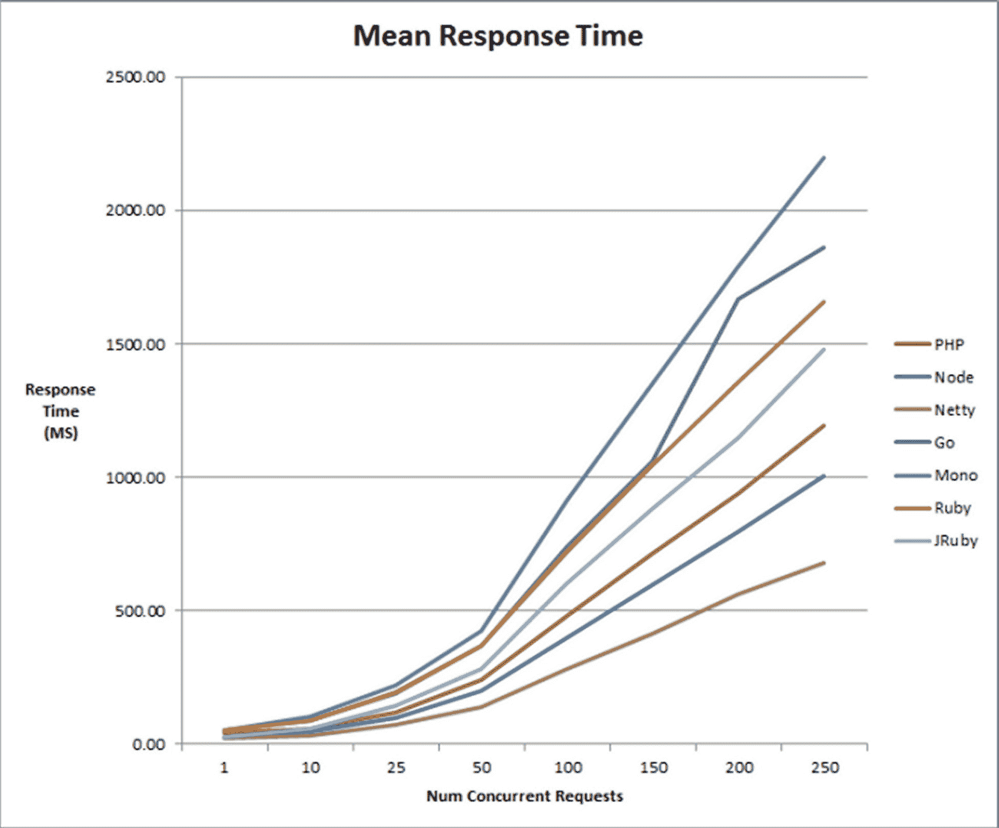

### 工作负载 1 – 平均响应时间（越小越好）

你还记得之前读到过吗，“**Socket.IO 并不是一个具有到其他实时协议回退选项的 WebSocket 库。**” `Socket.IO` 并不是一个具有到其他实时协议回退选项的 WebSocket 库。它是一个`在其他实时协议之上`的自定义实时传输协议实现。它的协议协商部分会导致`支持标准 WebSocket`的客户端无法连接 `Socket.IO` 服务器。而实现 `Socket.IO` 的客户端无法与非 `Socket.IO` 的 WebSocket 或长轮询（Long Polling）Com 服务器通信。因此，`Socket.IO` 要求客户端和服务端都使用 `Socket.IO` 库。”

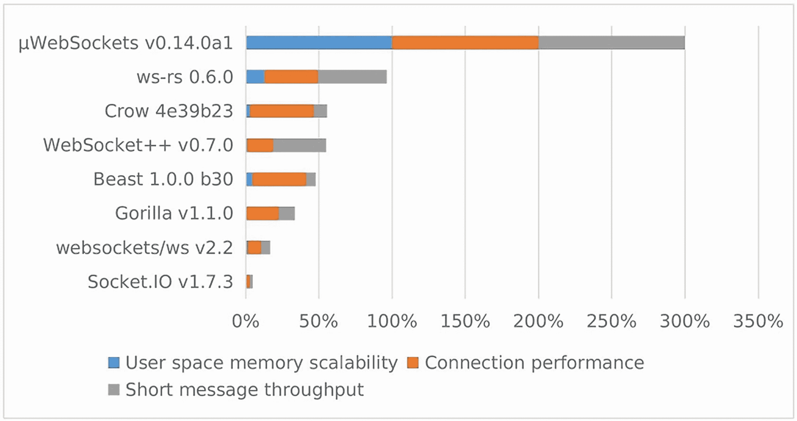

### Micro WebSockets 验证性能

让我关注 `PHP` 和 `Node.js` 之间的差异；差距小于 200 毫秒！他们的其他测试显示，当 `Node.js` 被“推”到第 80 分位数响应时间时，`Node.js` 在每秒约 200 次请求 (RPS) 时崩溃，与 `PHP` 相比，其性能迅速下降。

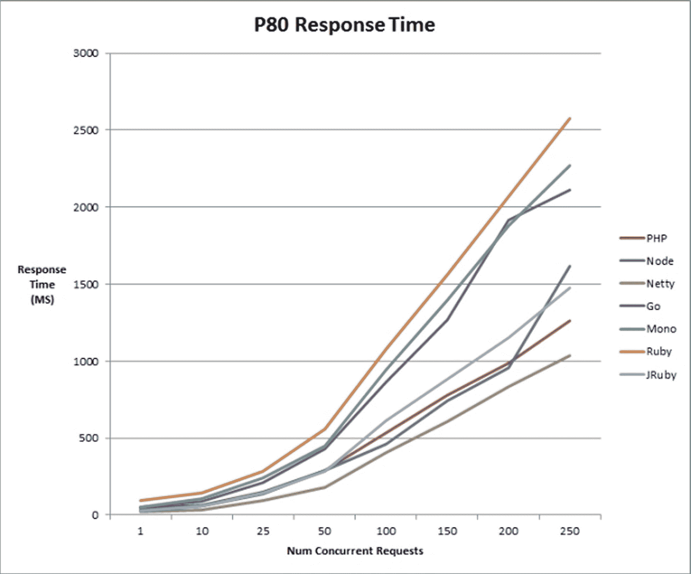

## 工作负载 1- 80 分位数响应时间（越小越好）

每秒请求数 (`rps`) 显示，在 10 到 25 并发 `rps` 之间，`Node.js` 仅略优 `PHP`；两者在超过 25 并发 `rps` 后都没有出性能提升。`Netty` 优于所有竞争对手。

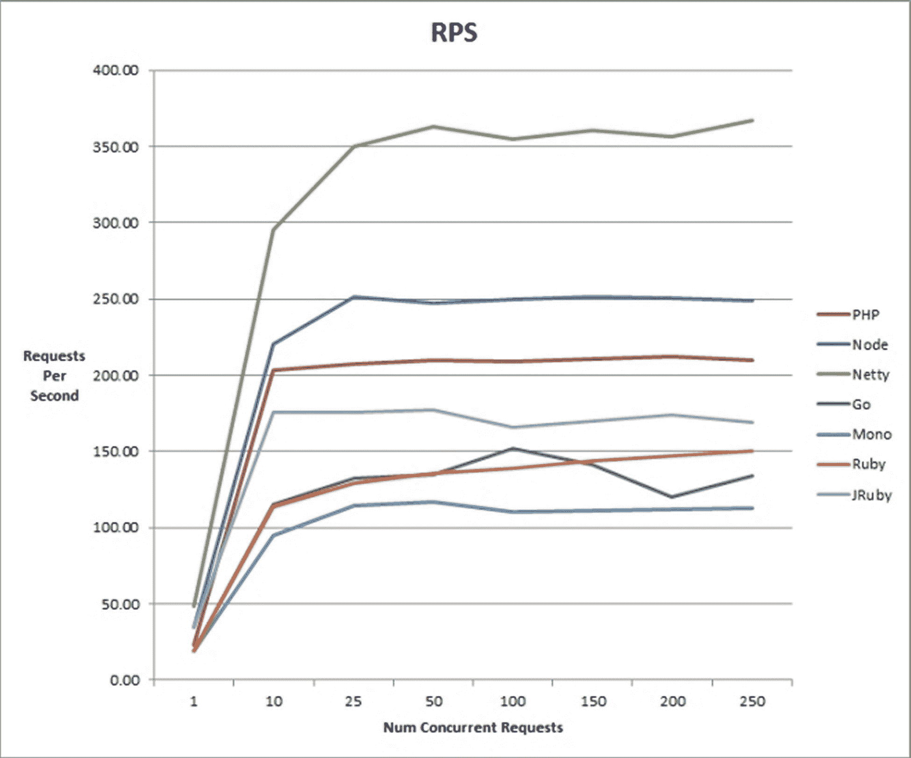

### Node.js 在 10 到 25 之间略优于 PHP

我鼓励你阅读他们的全文。事实上，我们的下一个练习是

**想要第二个意见吗？** 学习[这篇文章](https://thinkmobiles.com/blog/php-vs-nodejs/)，它得相同的结论——使用 `PHP` 而不是 `Node.js`！（（这篇文章还提供了其测试源代码供你查阅。）我引用他的结论：

“我计划在客户端使用 `Phaser v2` 或 `v3` JavaScript 游戏框架以及 `WebSockets`，并在服务端结合 `PHP Sockets` 和内容管理系统 (`CMS`)。`Node.js` 相比 `PHP` 展示出的微小优势在它处理 CPU 密集型和动态生成内容的能力面前逐渐消失了。对我来说，`PHP` 是明确的赢家。**如果你选择使用 `Socket.IO`，你必须在客户端和服务端都使用它——如果你的 ISP 允许在服务端使用的话。**”幸运的是，我的[`ISP 允许在服务端使用 Node.js`](http://gose-internet-services.net/hosting-plans/)，并且每个账户预配置了 1 个实例。

如果你选择在服务端使用 `Node.js` —— 并且你的 ISP 支持它 —— 你可以选择是完全部署 `Socket.IO` 还是使用其底层固定。如果你想要那些低层级抽象，请仅使用 `Engine.IO`。如果你想要 WebSocket 抽象，请继续使用 `Socket.IO`。

*   如果你正在构建一个缺乏 WebSocket 管理的库/框架，你会选择 `Engine.IO`。如果你**不需要 Socket.IO 提供的所有功能**，只需使用 `engine`。
*   如果你在 `Node.js` 之上构建应用程序，你会选择 `Socket.IO`。`Socket.IO` 拥有（`redis store`、`groups` 等等等），`Socket.IO` 是带有所有“花哨功能”的 `Engine.IO`。
*   `Socket.IO` 在连接丢失后会尝试重连一段时间长时间，而 `Engine.IO` 不会。
*   `Socket.IO` 支持“房间隔间（rooms compartments）”，而 `Engine.IO` 不支持。

## 4.13 无服务器替代方案

正如“无线互联网”在某处仍然有线连接一样，无服务器架构也有位于某处的服务器。“无服务器”的真正含义是，作为开发者，你不需要考虑维护那些服务器（即“平台即服务” (`PaaS`））以及它们的基础设施（即“基础设施即服务” (`IaaS`)).你只需要专注于你最擅长的事情并创建源代码即可！

在本章之前的某个练习中，我要求你研究用于专用/半专用/托管服务器的 ISP 托管。就价格而言，相当令人失望——不是吗？“托管选项”也意味着你的 IT 网络工程技能必须是“顶尖的”，因为你正在“在没有安全网的情况下飞行”。这里是其他替代传统专用/半专用服务器方法的现代“推荐解决方案”。你可以使用任一一种：

*   采用 [DevOps 方法](https://www.googleadservices.com/pagead/aclk?sa=L&ai=DChcSEwiNkN6E1J7bAhVWHYHYvlBokYABADGgJ5dw&ohost=www.google.com&cid=CAESEeD2RrPGdTi-bw35TwtyL9nq&sig=AOD64z4U7Y)

## 2. [流水线](https://devcenter.heroku.com/articles/pipelines)。流水线是一组共享相同代码库的 Heroku 应用。向流水线中添加应用允许你定义不同的阶段并在它们之间进行代码升级（即重用或 D.R.Y. — 不要重复自己）。流水线中的应用被分为“review（评审）”、“development（开发）”、“staging（预发布）”和“production（生产环境）”阶段，代表持续交付工作流中不同的部署步骤。这有多棒啊？是的，我也非常兴奋！

你可以通过 Node.js 依赖[使用这些指令](https://devcenter.heroku.com/categories/extending-heroku)以及他们称为 [elements（元素）](https://elements.heroku.com/) 的东西来进一步扩展他们的服务。这确实令人印象深刻。到目前为止一切听起来都很棒，对吧？很好，这里是[底线和定价](https://www.heroku.com/pricing)。有一个带有相当严苛限制的“免费（Free）”账户；但对于你单个项目的“概念验证”/测试/开发阶段来说非常完美。我建议阅读与每个账户级别相关的服务。对于“免费账户”，限制最严格的两个是：

1.  连接在空闲 30 分钟后关闭。当发现找不到那些讨厌的隐藏问题时，这可很扫兴。不！这不是“廉价发布应用到市场”的首选方案。
2.  每月限制进程数量。当你的“dyno 池”枯竭时，你必须将开发推到下个月。再次，这不是廉价发布应用的备选方案；如果服务器没有超时，你的游戏客户端可能在一个小时内消耗掉你所有的“dyno”！你的游戏直到下个月“dyno 池”刷新后才会出现。

*   迁移到“Hobby（爱好）账户”，每个 dyno 仅需 7 美元（美元）的少量（我在讽刺！）价格。

或者 [Google Firebase（2 分钟视频）](https://www.youtube.com/watch?v=O17OWyx08Cg&list=PLl-K7zZEsYLmOF_07IayrTntevxtbUxDL&index=1) 是一种平台即服务（PaaS，类似于 Heroku），并与 Google 的全球内容交付网络 (CDN)、AdWord 和 AdMob 集成！实现 Firebase 快速又简单，在许多方面与 Heroku 相似。通过将直观的 API 封装在单个 SDK 中，你可以专注于解决客户的问题，而不要浪费时间构建复杂的基础设施上。Google 成了你的 IT 支持团队。

*   Firebase 跨多个平台工作，并为 iOS、Android、JavaScript、Unity 和 C++ 提供封装在单个 SDK 中的 API 跨平台应用。它可以扩展到不同的平台，而无需修改你的基础设施需求。
*   [示例启动工具包](https://firebase.google.com/docs/samples/) 使 Google Firebase 成为极具吸引力的选择。在开始使用 Firebase 之前，你需要一个 JavaScript（web 或 Node.js）应用添加到 Firebase 中。如果你还没有应用，可以下载他们的[快速上手示例](https://firebase.google.com/docs/samples/) 之一。
*   在服务器端支持原生 Node.js，并具有管理权限！
*   在我看来，目前的定价选项似乎比 Heroku 的任何报价都更慷慨。
*   [部署选项](https://firebase.google.com/docs/) 限于 Android、iOS 和 Web。每个孤立部分都有自己的详细用户指南。
*   所有测试和开发都通过授权账户在线进行。
*   集成的 Google AdWords 和 AdMob 访问是一项诱人的功能。
*   如果你正在构建一个 Web 应用，且你的 Web 应用完全是静态内容，你可以使用 [Firebase Hosting](https://www.youtube.com/watch?v=jsRVHeQd5kU&list=PLl-K7zZEsYLmOF_07IayrTntevxtbUxDL&index=13) 轻松部署它。

或者

### 使用各种云微服务部署

这是一个一整本书的话题。但让我为你提供一些参考资料：

*   我在研究生和本科课程中使用的教材是 Arshdeep Bahga 和 Vijay Madisetti 编写的《云计算：实战方法》。
*   Apache Cloudstack (Java) [`en.wikipedia.org/wiki/Apache_CloudStack`](https://en.wikipedia.org/wiki/Apache_CloudStack)
*   Eucalyptus [`en.wikipedia.org/wiki/Eucalyptus_(software)`](https://en.wikipedia.org/wiki/Eucalyptus_(software))
*   Openstack [`en.wikipedia.org/wiki/OpenStack`](https://en.wikipedia.org/wiki/OpenStack)

你可以下载这些开源的“云服务”，但你仍然需要位于某处的“平台”——PaaS 和 IaaS。或者你可以采用一个同时提供两者以及“软件即服务 (SaaS)”的组织来构建和发布你的 MMoG。

### 构建一个垂直领域

构建你自己的[垂直业务 ISP 集成，](http://www.resellerspanel.com/reseller-hosting/?a=gose-internet-services)，就像我做的那样。

这意味着：我是自己的互联网服务提供商，提供 Heroku 所做的一切——在 IT 支持、托管、WebSockets 和 Node.js 方面。我的每个托管账户都有后台服务，并且[每月 2.95 美元的托管费用中包含单个 Node.js 实例。](http://gose-internet-services.net/hosting-plans/) 维护我服务器的 IT 人员知识极其丰富且高效。

1. Ward, J. (2008, 4 月 28). [什么是游戏引擎？](http://www.gamecareerguide.com/features/529/what_is_a_game_.php?print=1) 检索于 2017 年 1 月 30 日，自 [http://www.gamecareerguide.com/features/529/what_is_a_game_.php?print=1]

# 5 MMoG 应用架构

本章侧重于你的 MMoG 应用设计，包括[为你的 MMoG 选择“Web API”的方案](https://medium.com/platform-engineer/web-api-design-35df8167460) 以及整体 MMoG 软件架构。当我们开始为浏览器中的游戏编写源代码、处理各种服务器以及我们的 MMoG 应用（即游戏/业务逻辑）时，它提供了一个通用术语的基础。你从第一部分获得的信息，将在你跟随我的生产实践过程中，为你提供更深入的洞察：

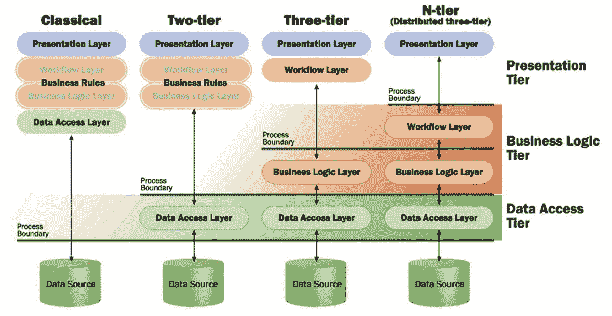

CDN/云中的 n 级 Web 应用。

*   客户端与服务器之间的通信，用于开发游戏协议或[采用现有的消息协议。](https://core.telegram.org/api)^(章节脚注 1)
*   [WebSocket 通信](https://en.m.wikipedia.org/wiki/WebSocket) — HTML5 规范中定义的双向、有状态、实时的客户端服务器通信技术。它在性能^(章节脚注 2）和简单性方面优于“Ajax”。
*   [事件驱动架构](https://en.wikipedia.org/wiki/Event-driven_architecture) — 是一种软件架构模式，促进事件的产生、检测、消费以及[对事件的反应。](https://en.wikipedia.org/wiki/Event_(computing))
*   OLOO 风格的 JavaScript 编程（不是 OOP；而是[对象与其他对象的链接”](https://davidwalsh.name/javascript-objects-deconstruction.))
*   针对“n 级”的 Web 应用开发。（如下所示）
*   声明式（Declarative）与命令式（Imperative）的区别，以及在何使用这些编码风格。
*   安全身份验证、授权和“令牌”（又名连接令牌）。
*   服务器架构考虑 — 参见附录内容中的 [MMoG-Deployment-Worksheet.pdf](http://makingbrowsergames.com/mmog/bonusContent/MMoG-Deployment-Worksheet.pdf)

## 5.1 单机游戏与多人游戏的比较

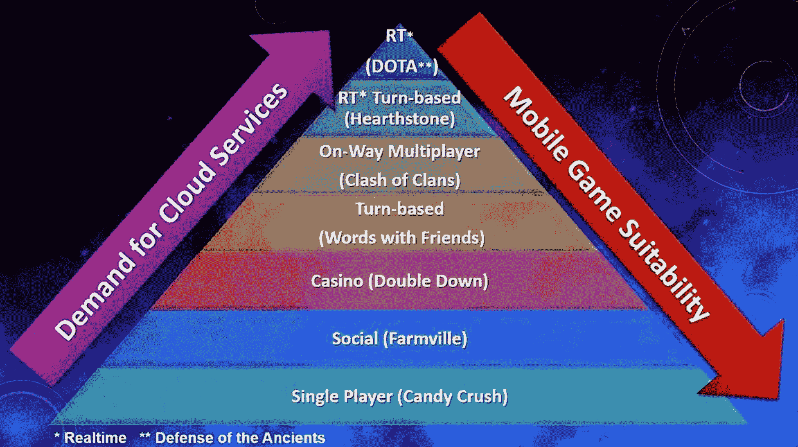

如前所述：单机游戏流程

显而易见，玩单机游戏意味着本地设备存储并处理一切；`Phaser` 更新、渲染并处理任何与当前游戏及其逻辑相关的事务。对于单机游戏，你通常需要：

*   图形（带动画的吗？）；
*   难度等级；
*   玩家的“头像”及其角色设计；
*   游戏机制（参考附录）；
*   引人入胜的故事和游戏设定；
*   玩家输入；
*   玩家反馈；
*   整体游戏流程；[在此处下载免费的游戏流程图](http://makingbrowsergames.com/mmog/bonusContent/_GameFlowChart.pdf)。

[http://makingbrowsergames.com/mmog/bonusContent/_GameFlowChart.pdf]

这 7 个阶段中的每一个——是的，比这更多——都是游戏过程的一个阶段，具有自己的内部处理状态 . . . `initiate`、`preload`、`create`、`update`、`render` 和垃圾回收。只有 `create` 和 `update` 是强制性的。`Phaser` 尝试以每秒 60 帧的速度循环 `update` 和 `render`。

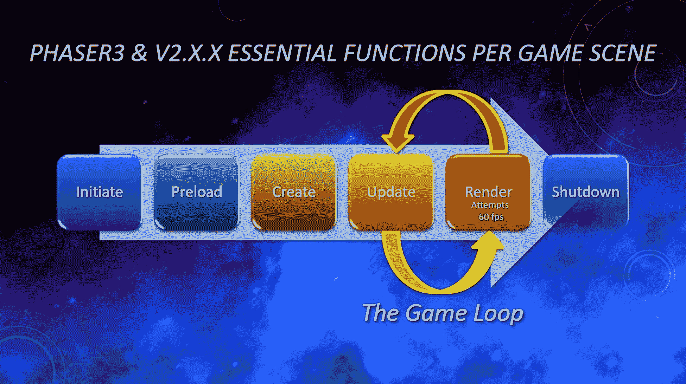

如前所述：单机游戏流程

查看下方“游戏循环”的细节。它类似于[孩子们跳跳绳](https://www.heartfoundation.org.au/images/made/images/uploads/jump-rope/kids_jumping_800_480_85_s_c1.jpg) —— 只这根绳是以每秒 60 帧（fps）的速度旋转！“游戏循环”在“更新”状态和“渲染”状态之间切换执行，将新信息置于本地显示上；它遵循标准的 IPO 模型（即输入、处理、输出）。以下是 `Phaser` 在每秒 60 帧期间做的所有事情。

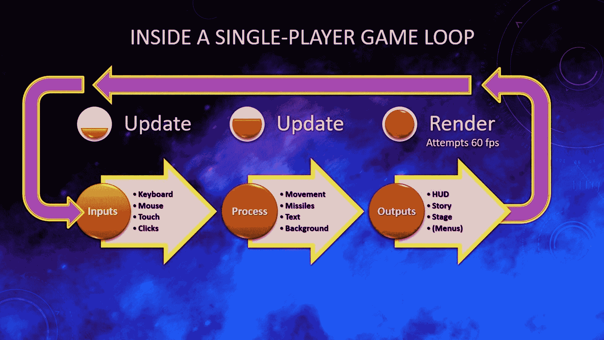

### 单机游戏循环内部通用细节

在我们编写 MMoG 时，正是这个“游戏循环”需要我们关注，并将将塑造我们关于如何使用服务器架构的决策——参考附录内容中的 [MMoG-Deployment-Worksheet.pdf](http://makingbrowsergames.com/mmog/bonusContent/MMoG-Deployment-Worksheet.pdf)。只有“处理阶段”——上面所示的中间部分将移动到我们的服务器，而本地的“输入”和本地“输出”阶段将留在本地显示器上——这是典型的配置。我们越好地描述并剖析游戏逻辑是什么以及它做什么，我们就越能理解本地设备将如何将该信息渲染到显示器上。我建议一种编写 MMoG 的新方法；我的建议是本地设备关注“如何做”（即“命令式编程”），而我们与服务器之间以游戏回合订单（GTO）形式存在的游戏“输入”数据关注“做什么”（即“声明式编程”）。

*   客户端浏览器上的命令式将根据服务器消息在渲染阶段处理所有的游戏移动和动画。服务器将处理来自所有游戏参与者的“输入”（即格式化为 JavaScript 对象表示（`JSON`）消息的游戏回合订单），并根据这些传入的游戏回合订单（GTO）消息调整游戏状态。（https://developer.mozilla.org/en-US/docs/Web/API/IndexedDB_API）
*   来自客户端的声明式消息是 `JSON` 格式的回合订单，描述玩家想做什么。`JSON` 通常用数据传输格式。服务器返回 `JSON` 格式的“游戏回合回复”（GTR），授权本地玩家在其显示器渲染其他玩家的位置和此回合的游戏状态。渲染游戏状态将始终是一个本地过程,[并在一些 web worker 的帮助](https://gamedevacademy.org/phaser-progressive-web-apps-tutorial/?a=47)下。

`Web Workers` 并不是 JavaScript 的一部分，它们是通过 JavaScript 访问的浏览器特性。[Web Workers](https://html.spec.whatwg.org/multipage/workers.html) 是浏览器内的线程，可用于执行 JavaScript 代码而不会阻塞游戏事件循环。`Web Workers` 允许游戏开发者将那些“耗时较长且 CPU 计算密集型的任务”——这是 `NodeJS` 的噩梦——放置在后台运行，而不会阻塞用户交互。这使得你的 MMoG 应用在客户端变得更加敏锐。此外，你不需要通过“玩弄 JavaScript 的 `setTimeout` 技巧”来黑客式地绕过游戏缓慢的事件循环。在[此在线演示中查看 Web Workers 如何提升性能。](http://afshinm.github.io/50k/)

MDN 对 Web Workers 有如下描述，[引用自](https://developer.mozilla.org/en-US/docs/Web/API/Web_Workers_API)“……可以使用 window 下可用的许多项目，包括 [WebSockets，](https://developer.mozilla.org/en-US/docs/Web/API/WebSockets_API) 以及像 `IndexedDB` 这样的数据存储机制……Workers 反而可以创建新的 workers，只要这些 workers 托管在与父页面相同的源中。此外，workers 可以使用 `XMLHttpRequest` 进行网络 I/O，但 `XMLHttpRequest` 的 `responseXML` 和 channel 属性始终返回 null。”

当你由于，[引用自](https://blog.baasil.io/socketcluster-design-patterns-for-chat-69e76a4b1966)“……倾向于在你的 `worker.js` 文件中使用变量来存储全局数据时，问题就出现了。这一个常见的例子是，你尝试拥有一个数组或哈希表（对象），其中包含系统中所有已连接用户的状态（跨越所有 worker 进程）。如果你只在 1 台服务器上运行 1 个 worker 进程，这是没问题的，但这种方法无法向此规模扩展—— 只要你为你的 [Socket Cluster (SC)](https://socketcluster.io/#!/) 实例添加第二个 worker 进程，你就会发现每个 worker 最终只持有完整用户列表的子集（在这种情况下是一半）（某些用户将连接到 worker 1，另一些用户将连接到 worker 2）。尝试在 workers 之间同步此列表，以便每个 worker 都能访问整个用户列表（在其自己的内存中），会破坏可扩展性，这是一个非常糟糕的主意（你最终只是在多个 workers 中复制了相同的工作负载）。”

### 深入探讨：Await 和 Promises


在 [`youtu.be/vn3tm0quoqE`](https://youtu.be/vn3tm0quoqE) 查看此视频

Await and Promises (视频 12:03)

## 5.2 MMoG 游戏之间有差异？

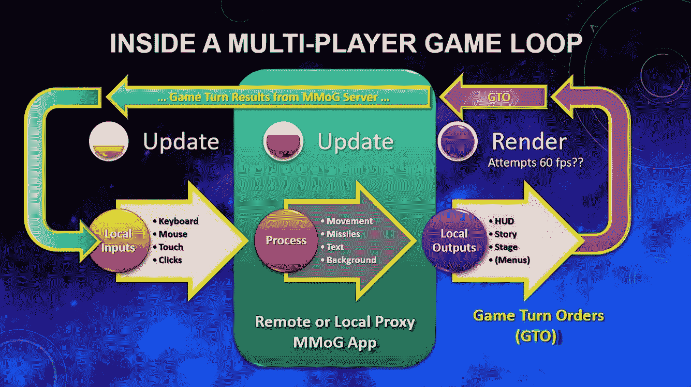

### 更新处理发生在服务器端

单机游戏与其“大 MMoG 兄弟”之间的关键区别在于，其共同游戏信息（即：输入处理、变量状态管理和游戏资产的渲染输出）以及游戏“进程”（即对我们游戏状态的更新）在所有玩家之间的分布——谁在何时做了什么，以及如何进行同步确认？我们很快就会学习这些不同的部署方案。假设你正在构建一个实时 MMoG，当你把所有的游戏“处理逻辑”——即来自“更新”阶段的核心部分——集中到远程服务器时，网络延迟（又称 lag 或 latency）成为我们最关注的问题。通过这样做，我们只是将网络延迟引入了我们典型的 60 fps 游戏循环中。对这种新引入的网络干扰的容忍度很大程度上取决于我们使用的游戏机制。例如，回合制游戏（具有固定时间间隔和游戏回合顺序（GTO）提交）对网络延迟、延迟、抖动或停滞的容忍度高于大多数“第一人称射击游戏 (FPS)”中常见的“反应型”游戏玩法。为了让这任何一种方法正常工作，两种方法都需要一个“中间人”——即[虚幻网络架构](https://api.unrealengine.com/udk/Three/NetworkingOverview.html#Minimizing%20Perceived%20Latency) 建议的中心权威服务器的“代理”，来处理所有参与者之间的所有网络流量。对于需要“可靠有序”通信通道（即 `TCP/IP`）的游戏来说，WebSockets 是一个明智的选择，但实时游戏需要更低的解决方案——可能是 `UDP/IP` 或基于 `WebRTC` 的 UDP 通道。而且大多数实时游戏更关乎接收最新的数据，而不是以正确的顺序获取所有的游戏数据。

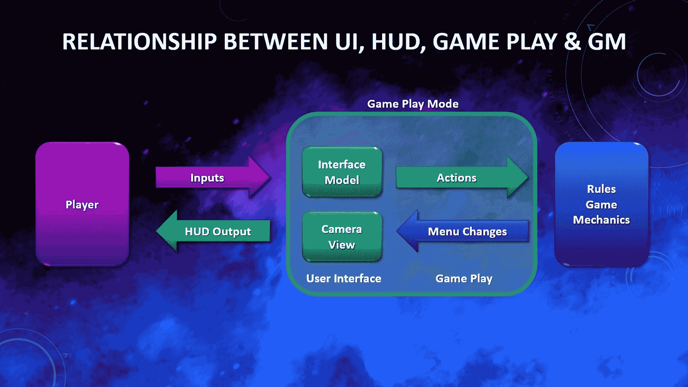

### 更新“处理”发生在代理端或服务器端

“绿色”部分将成为我们在客户端浏览器内的["代理服务器；（参见美国专利 #5,899,810）](https://docs.google.com/viewer?url=patentimages.storage.googleapis.com/pdfs/US5899810.pdf))；它履行了[消息中间件](https://en.wikipedia.org/wiki/Message_broker) 的角色。在[代理模式中，](https://en.wikipedia.org/wiki/Proxy_pattern) 一个对象充当另一个对象的接口。它与“外观（façade）”模式不同，后者你有多个方法。“代理服务器”位于客户端和服务器之间。

*   远程玩家缺席时“AI 机器人”的替代。
*   游戏循环保持本地，不会增加延迟。研究 [Torque Engine](https://en.wikipedia.org/wiki/Torque_(game_engine)) 游戏开发或 [虚幻网络架构](https://api.unrealengine.com/udk/Three/NetworkingOverview.html#Minimizing%20Perceived%20Latency)。
*   我们的任何单机游戏都[准备就绪](https://www.dictionary.com/browse/primed) 用于“多人”游戏。激活 websocket 只是让我们的“单机游戏”能够接收远程输入。
*   代理服务器以较低的 fps 更新游戏状态。这是许多行业专家的建议——例如：Rex van Spuy、Andrew Mulholland 和 Teijo Hakala、Todd Barron、Andre LaMothe,[虚幻网络玩家移动与预测](https://api.unrealengine.com/udk/Three/NetworkingOverview.html#Player%20Movement%20%20Prediction)，除了[你谦逊的作者。](https://www.linkedin.com/in/stephen-gose-phd-71ba853b/) 之外还有许多。

**我们为什么要插入这部分额外内容？这难道不会让速度变慢吗？**

**答案：**

*   是的，确实如此。它可能会稍微减慢游戏进程；但与提取游戏循环的进程并将其放在远程服务器上相比，这节省了大量时间。
*   因为 WebSockets 不会检查入站或出站流的游戏回合顺序内容；它只确保数据到达管道两端的终点。如果接收到的数据仅像 `Node.js` 中那样被回显或轻量处理，那么这不是问题。然而，正如我们在第一部分中发现的，`Node.js` 是高密集 CPU 计算的最差选择。
*   此外，我们仍然需要一些代码来编写和读取我们的游戏回合顺序到“声明式”代码。因此，格式化游戏回合顺序和响应是我们将在后续章节中开发的内容。你可能想生成一个草稿，或者开始思考你的 MMoG（大型多人游戏）将使用什么样的游戏回合顺序。作为指南，你可以访问第四部分以及[免费旅行游戏卷 I（价值 19 美元）](https://leanpub.com/tigs/c/f3d6wFdxNdHk) —— 包含了 3 个 Rulers of Renown™、Legends of Renown Deeds™ (LoRD) 和 War Lord Tourney™ 的游戏套件。
*   我们的 `proxy` 可以作为一个“应用防火墙”并过滤格式不正确的命令。我稍后会详细介绍游戏安全。
*   我们的 `proxy` 可以兼作单机游戏的 AI，或者在多人游戏中当对手突然退出时充当 AI。
*   我们的 `proxy` 可以以较低的 fps 运行。这是大多数 MMoG 在插值和外推中使用的解决方案。我们将在本书末尾学习这些。

### MMoG 管理的客户端 GTO 建议（按字母排序）：

*   `cancelGame` — 发起游戏请求的玩家撤回
*   `gtoCommand` — 系统消息“类型”属性为被请求的操作
*   `create_failed` — 系统消息反馈
*   `created` — 系统消息反馈
*   `dead` — 关于对手的系统消息通知
*   `endGame` — 系统消息通知
*   `error` — 关于 GTO 的系统消息反馈
*   `gameOver` — 将 `Phaser` 迁移到结束阶段
*   `initRound` — 重置新游戏变量的系统消息
*   `join_failed` — 系统消息通知
*   `joined` 成功进入现有游戏的系统消息
*   `latency` — 关于网络延迟和测试的系统消息
*   `pong` — 对服务器 ping 测试的系统消息响应
*   `rooms` — 关于可用游戏的系统数据
*   `tick` — 用于同步的系统时间戳数据

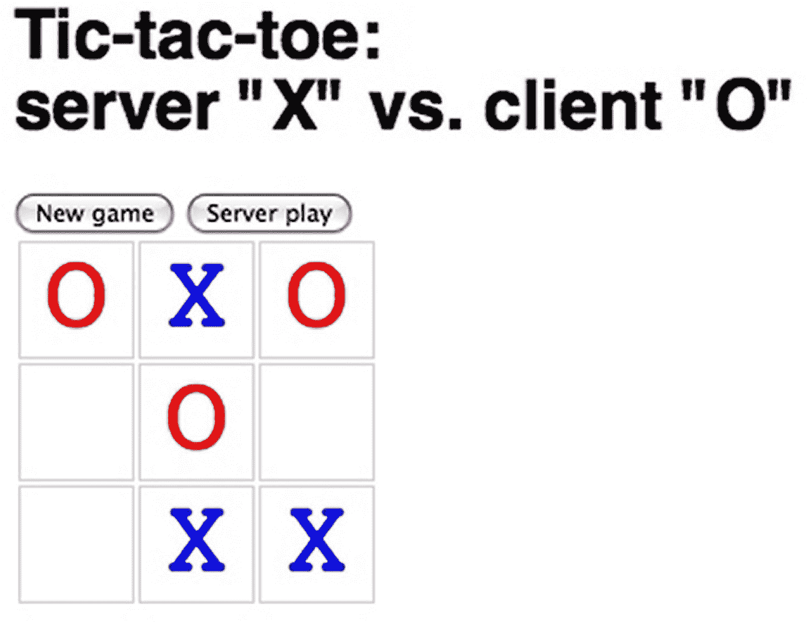

来自 JavaScript Patterns 第 8 章第 193 页的带填充 JSON

### 玩家交互

**摘要：** 玩家将他们的`游戏回合顺序 (GTOs)` 发送到服务器或本地代理服务器。服务器将测试 GTO 的来源（通过通过插入的游戏 ID、玩家 ID 和时间戳），授权该 GTO 对该特定玩家有效，处理并并将玩家的 GTO 集成到游戏的整体状态中，更新服务器的数据结构，最后，服务器将更新后的信息（即 `游戏回合结果 (GTR)`）广播给当前在游戏内活跃的任何用户。我们刚刚提到的内容更倾向于“回合制”游戏，而非“瞬时反应型”游戏设计。

我想我们刚刚为我们的 MMoG 服务器开发了一个[“待办事项”](https://www.urbandictionary.com/define.php?term=honey%20do%20list)！？并且间接地暗示了客户端浏览器将做什么。

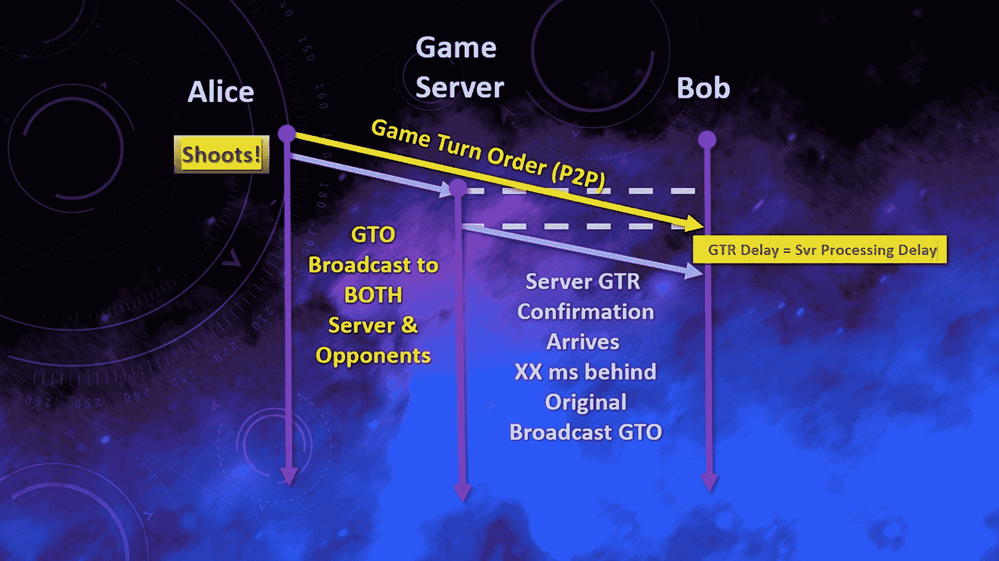

使用代理的可用叠加 - 混合网络连接

### 技术架构


来自 IBM 的 Hyun Sung Chu 在他关于[构建简单而强大的 MMO 游戏架构](https://www.ibm.com/developerworks/library/ar-powerup1/index.html) 的三部分文章中，推荐了四个主要组件。他的文章写于 2004 年（！）——几乎比 WebSockets 出现早了整十年。他的文章仍然是我们开启 MMoG 开发之旅的良好起点。然而，他遗漏了一些东西 —— 与我读过的每一个教程（截至 20190125）所遗漏的完全一样！以下是他的转述观点，结合了目前大多数 MMoG 教程中常见的典型信息：

1.  一个 **Web 应用服务器**，用于与游戏服务器和客户端集成。我们将使用 Web 服务器作为玩家的初始接触点和游戏入口。在这一初始接触阶段，我们将客户端迁移到 WebSockets。

2.  一个 **“游戏客户端”**，为进入的玩家执行代理 `WebSocket` 升级。我们在玩家浏览器中使用 `Phaser.JS` 的部署将充当“轻量级或重量级客户端”的职责；我们的游戏“Index 页面”将执行所有的代理请求并将其升级为 WebSocket。有一个关键决策需要考虑：我们希望何时在客户端侧激活 WebSocket？

3.  一个（或多个 **游戏服务器**，用于与每个连接的游戏客户端进行交互。我们将使用 WebSocket 传输进行双向交换。这是我们的 MMoG 驻留并执行所有“重型工作和 CPU 密集型处理”的地方。显然，服务器端应该已经存在，并准备好在这些请求到达时激活任何客户端。

4.  一个 **数据库服务器**，用于持久化和检索游戏状态信息以及根据新 GDPR 法律修改的客户数据。在我们的案例中，我们将讨论几种在 MMoG 应用控制下存储持久化游戏信息的现代方法。

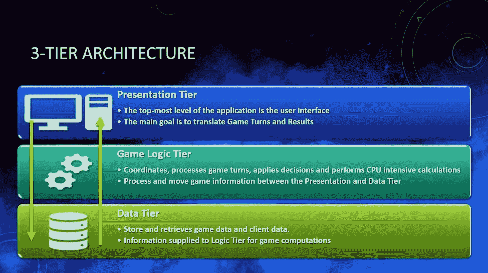

### 三层架构模型

**你看到了吗？** 它是标准的“三层架构”；它是旧的遗留（即 2014 年之前的）客户端/服务器模型。自 WebSockets 在 2014 年出现以来，情况发生了变化，以及 2016 年更新的云微服务（https://www.bmc.com/blogs/new-cloud-world-means！）如果你在游戏设计中加入区块链，游戏开发领域还有另一个新前沿](https://medium.com/loom-network/blockchain-games-the-biggest-trojan-horse-that-experts-won-t-see-coming-and-the-startling-1846eb412aba） —— 它消除了对应用商店的需求 —— 如此示例游戏所示。（https://github.com/PBMCube/blocktactoe）此外在内容分发网络 (CDN) 中添加分布式云微服务（点击下载)](https://microservices.io/i/MicroservicePatternLanguage.pdf)，一切都改变了 —— 如下所示。

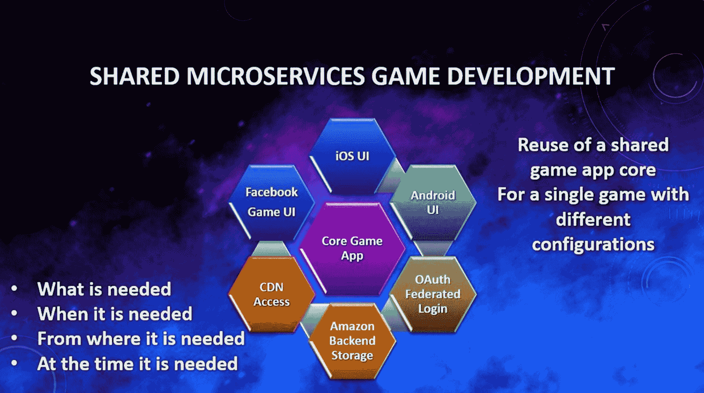

### 使用水平微服务的六边形架构

让我们将游戏划分为核心服务或 [`云端节点`](https://cloud.google.com/endpoints/docs/quickstart-endpoints)，并动态组合我们在需要的时间、需要的地方以及我们的玩家需要的地方提供的内容。这通过采用 [`Crossbar.io`](https://github.com/crossbario/crossbar) —— 一个用于分布式和微服务应用的开源网络平台来实现。它实现了开放 Web 消息协议 (WAMP)，功能丰富、可扩展、健壮且安全。

我在第 2 章中提到过，“面向服务的架构（SOA）是一种特定的软件组织方法！它的核心思想是将各种功能拆解为模块，并可能通过网络协议或 sockets 通信将它们部署在不同的服务器上。” 这一切都可以通过适当的 [`API 设计工具`](https://github.com/mulesoft/api-designer) 和 [`API 工作台`](http://apiworkbench.com/) 实现。创建 MMoG 的旧方法使用 `“单体模式”`，并带有典型的中心化权威服务器（即 `中介者模式`）；而 `“微服务架构”` 则不同，它赋予了我们使用其他水平和垂直在线服务的灵活性，例如使用 [`PlayFab.com（原 PopCap）`](https://api.playfab.com/)，它更多地扮演 `观察者模式` 的角色。总的来说，微服务架构确实有 [其问题](https://en.wikipedia.org/wiki/Microservices#A_comparison_of_platforms) —— `有患于未患`。 这样做是拥抱 [`DevOps 云端部署（阅读更多）`](https://martinfowler.com/articles/break-monolith-into-microservices.html) 的现代趋势。这些“代码块”可以位于虚拟化云中的不同服务器或域。

### 深度解析：以太坊去中心化（DApp）游戏

DApp 是运行在计算机对等 ([P2P 库](https://github.com/js-platform/p2p)) 网络而非单一中心化服务器上的游戏。它们是“区块链启用”的游戏设计，存在于互联网中，并且 `不被` 任何服务器控制。简单来说，“区块链启用”意味着一组带有时间戳的不可变系列数据记录，这些记录由一组不属于任何单一实体的相关计算机管理。每个数据块使用加密原理安全地连接在一起，形成一条链。

与传统的 HTML5 游戏应用相比，浏览器游戏通常使用 HTML、CSS 和 JavaScript 来渲染页面。它们还需要通过 API 从数据库中拉取内容。DApp 游戏在这方面是类似的；客户端使用完全相同的流程在浏览器中渲染。唯一的关键区别是，游戏不是通过 API 连接到数据库，而是通过 `智能合约` 连接区块链。另一个与传统浏览器游戏的区别是，DApp 的后端服务器代码逻辑运行在 P2P 网络中。

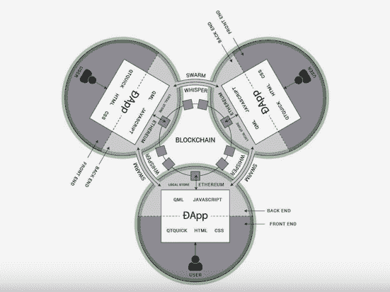

结合了智能合约以及 Swarm 和 Whisper 支柱的 DApp 插图。来源：Ethereum Stack exchange

幸运的是，[`Enjin Coin`](https://enjincoin.io/) 提供了使用区块链进行 [`DApp 游戏开发`](https://blog.enjincoin.io/development-updates/home) 的当前答案。什么是 ENJ？它是如何工作的？观看他们的：


在 [`www.youtube.com/watch?v=OCeg_i782f0`](https://www.youtube.com/watch?v=OCeg_i782f0) 查看此视频

**2 分钟视频**

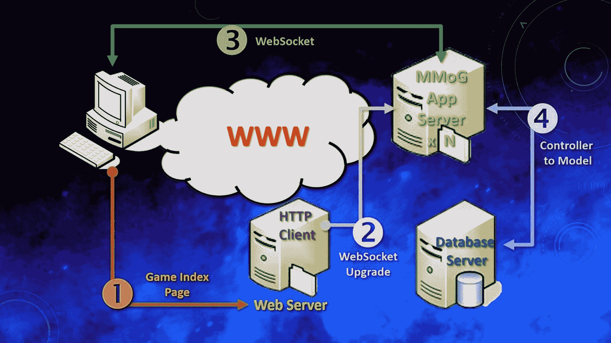

### Web-MVC - 新 MMoG 数据流

让我们回顾一下我们在第一部分中已经学到的。

1. 玩家通过“WWW”连接到我们的游戏网页。然后他们连接到我们的 HTTP 服务器并将连接升级为 WebSocket。我在“第 1 步”中没有展示的是内容分发网络 (CDN) 以及内部客户端代理服务器！游戏 `index.html` 页面来自距离玩家物理位置最近的 CDN 仓库——而不是直接来自我们的 `WWW` 服务器。

*   [`www.codeinwp.com/blog/maxcdn-vs-cloudflare-vs-cloudfront-vs-akamai-edge-vs-fastly/`](https://www.codeinwp.com/blog/maxcdn-vs-cloudflare-vs-cloudfront-vs-akamai-edge-vs-fastly/)

*   [`stratusly.com/companies/`](https://stratusly.com/companies/)

*   [`www.cdnoverview.com/#page-top`](https://www.cdnoverview.com/#page-top)

*   [`www.geckoandfly.com/10077/maxcdn-amazon-cloudfront-cloudflare-cachefly-and-edgecast-cdn-comparison/`](https://www.geckoandfly.com/10077/maxcdn-amazon-cloudfront-cloudflare-cachefly-and-edgecast-cdn-comparison/)

2. 你的游戏将从 CDN 加载 `任何版本的 Phaser 游戏框架`——来自“jsdelivrivr”或“Cloudflare”。我强烈建议你使用通用的部署版 Phaser 版本，而不是对它们进行编译。玩家很有可能已经从这些 CDN 之一中玩过 Phaser，并且之前下载的库仍留在他们的浏览器中；从而为你的 MMoG 增加了零额外加载时间。

3. 游戏存储和数据库服务器正在发生变化；游戏信息不再需要存储在中心存储中。新趋势建议使用不同的数据结构，[如 CouchDB](https://en.wikipedia.org/wiki/Apache_CouchDB)，或者在玩家的设备或其他地方本地存储 [`分片信息`](https://medium.com/ibm-watson-pouchdb-the-swiss-knife-of-databases)。使用区块链——例如 [`CryptoKitties 源码`](https://medium.com/loom-network/how-to-code-your-own-cryptitties-style-game-on-ethereum-7c8ac6a4) 或 `0xUniverse`](https://bit.ly/2RycFJt)——提供了存储在“云端”的选择。

4. MMoG 引擎在之前的第二部分进行了详细讨论。我们创建了候选的游戏引擎列表。现在，我们将在后续章节中开始源代码开发。

### MMoG 实时测试

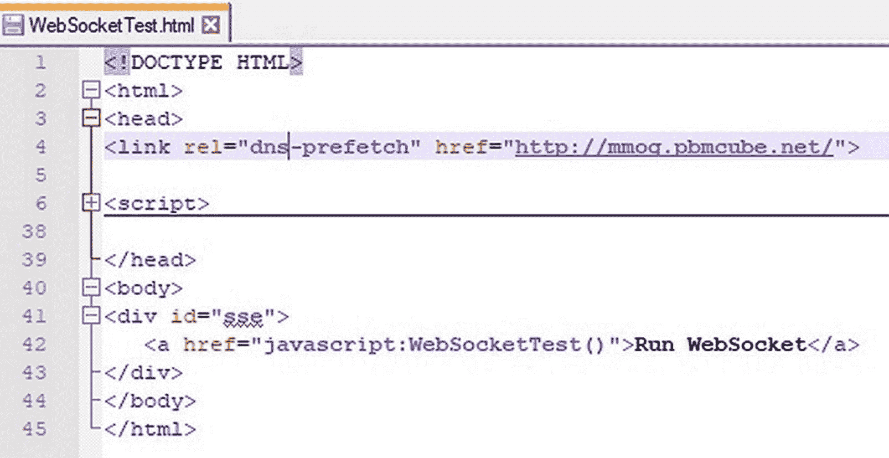

DNS 预取示例

让我们采取这些练习并开始测试我的 MMoG 在全球范围内的响应时间。你可以使用 `我的测试实验室 ([`mmog.pbmcube.net/index.php`](http://mmog.pbmcube.net/index.php))` 或来自 [`http://websocket.org/demos.html`](http://websocket.org/demos.html) 的通用演示测试，或者你也可以使用该页面上的“Echo 测试”——“[[`websocket.org/echo.html`](http://websocket.org/echo.html)]。”反馈对每个人都是不同的，取决于你所在的地区以及当前 WWW 的拥堵状况。我的初始测试（位于 [`mmog.pbmcube.net/index.php`](http://mmog.pbmcube.net/index.php) 距离 5267 英里外的美国亚利桑那州的伦敦）有 2ms 的延迟！我非常满意。

有趣的事实是，所有反馈都是在没有 `dns-prefetch` 的情况下完成的。HTMLGoodies 声称：“当浏览器遇到与当前位置域名不在相同的超链接时（注：听起来熟悉吗？没有吗？请重新阅读第 2 章‘深入探讨：在本地测试 MMoG’），它会首先检查缓存，在缺乏缓存副本的情况下，通过向 DNS 服务器发送请求将域名解析为关联的 IP 地址。这些请求在后台进行，以免阻塞页面的渲染。此外，由于这一切是与用户阅读页面的并行进行的，因此对 CPU 和网络资源的负载微乎其微。用户可以节省多少导航时间，范围从非缓存内容的平均节省约 200 毫秒，到最坏情况下 DNS 解析延迟导致的节省一到两秒不等。默认情况下，通过 HTTPS 加载的文档不会对嵌入链接主机名进行“预取”。你可以通过将浏览器首选项 `network.dns.disablePrefetchFromHTTPS` 设置为“false”来更改此设置。[在此处阅读他们的完整文章](https://www.htmlgoodies.com/beyond/webmaster/how-your-browser-speeds-up-cross-domain-loading-using-dns-prefetching.html)。

## 5.3 技术细节

在我们编写源代码之前，让我们先来看一些技术信息。在之前的插图“新的 MMoG 数据流”中，我假设 HTTP Web 服务器与游戏引擎服务器位于相同的域名和硬件上。在现实中，情况可能并非（即你如何部署你的 MMoG 系统）。你可能会选择分布在全球各处的分布式微服务。在这种情况下，你需要关于我们之前做的练习中 [来自 Patrick Sexton 的更多建议](https://varvy.com/rel/dns-prefetch.html) 关于 `dns-prefetch` 信息。

这里有一个在线工具，将演示通过中央权威服务器从一个玩家到另一个玩家的响应时间。这是一个模拟（即类似于大多数 MMoG 教程），并不反映真实的网络流量；然而，它是说明各种环境参数及其影响结果的卓越工具。

我们将从这个工具中获取实验结果，并将知识整合到后续章节的源代码中。

### 以不同的方式编写源代码：“如何 vs 什么！”

也许 MMoG 中发现的很多问题在于我们编写源代码的方式。Philip Roberts 在他的文章中可能对我们有一个建议。

那是我们正在寻找的秘诀！在本地，`Phaser Canvas` 将执行绘制（命令式；如何）和根据 MMoG 应用服务器指示执行渲染（声明式；什么）。发送游戏回合顺序（GTOs）将以声明式/什么格式（如 JSON 或 XML）编写，并发送 MMoG 应用服务器。MMoG 应用服务器将根据提交的游戏回合顺序数据，执行命令式/如何来应用游戏逻辑。总而言之，所有传输在 WebSocket 通道的两端都采用“声明式格式”（什么）。所有进入的声明式信息将把该“数据信息”转换为“命令式操作”（如何）。客户端将渲染当前的视觉显示，服务器将把新的游戏信息应用到其游戏逻辑和数据结构中。

### 构建顺序和方案

我建议你将游戏回合顺序（GTO）和游戏回合结果（GTR）视为通信中的“端点”——即你的协议和 API 规范。这暗示了编写我们 MMoG 源代码的顺序。

1. 起草一份客户端游戏回合顺序（GTO）列表，以及服务器端响应的预期的游戏回合结果（GTR）。

2. 然后确定你将如何对这些 GTO 和 GTR 的输出进行“序列化”。这些信息将使用什么格式化数据结构？你有几个选择（例如 XML、JSON、二进制等）。先从服务器端开始，以便客户端有东西可以通信。

3. 最后，编码你的“序列化器”这些将成为客户端和服务器之间的“合约”，规定了通道双方的预期。是的，这听起来像是整个过程中最困难的部分；但我在本章的后面会给你一个惊喜。

## 5.4 游戏回合的编码格式

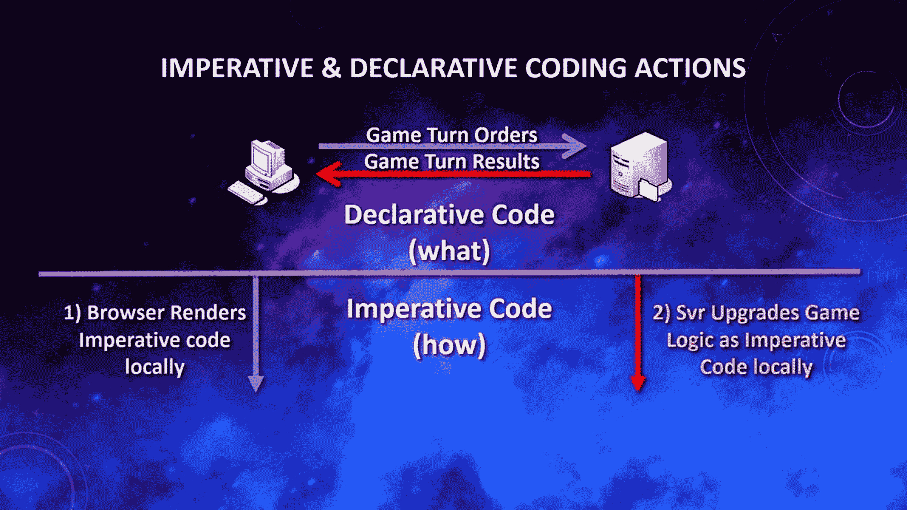

### 声明式代码与命令式代码

**摘要：** 任何“水平流量”（客户端与其服务器之间）都应该是“什么”和“声明式数据包”。所有的垂直过程都应该是“如何”和“命令式代码”。这自然地引导我们做出如何格式化我们的水平数据的决策。我们的“消息”应该采取什么形式？发送在客户端和服务器之间的数据并不是逐字交换的。实际上，这些 websocket 数据被格式化为帧——一组位位（又名“数据包”或“数据报”），具有特定的排列和设计。我们必须设计出这种有序的排列，以便对正在发生的事情产生意义。“消息类型”的专业术语是 [`操作码或 opcode`](https://en.wikipedia.org/wiki/Opcode)，在我们案例中，我们将消息标记为“客户端到服务器 (C2S)”和“服务器到客户端 (S2C)”。

我们不需要在数据包格式中重新发明“轮子”。我们可以从 [面向消息中间件 (MOM)](https://en.wikipedia.org/wiki/Message-oriented_middleware) 类别中选择已有的几种技术架构。但我们应该使用哪种“Web 服务”？Web 服务分为三个阵营：一组将其 API 作为 [远程过程调用 (RPC)](https://en.m.wikipedia.org/wiki/Remote_procedure_call) 暴露；查询语言（如 [JSON:API](https://jsonapi.org/) 或 [OData](https://www.progress.com/blogs/industry-debate-odata-vs-graphql)）；另一类作为“Web 服务”（[对象请求代理](http://zeromq.org/brokerless)）提供“文档资源”（即 REST）和 API 接口。

在第一部分第 3 章中，我们创建了一个需要解决问题的“购物清单”。你记得那些问题吗？

*   客户端/服务器数据“包”看起来是什么样的？使用什么格式？（例如 [0MQ](http://zeromq.org/intro:start)、[AMF](https://github.com/jamesward/JSAMF)、[AMQP](https://www.amqp.org/) 或 Apache [QPID](https://qpid.apache.org/overview.html)、[MQTT](http://mqtt.org/)（消息队列遥测；ISO 标准 [(ISO/IEC 20922)](http://www.iso.org/catalogue_detail.htm?csnumber=69466) [HiveMQ](https://www.hivemq.com/blog/mqtt-essentials-special-mqtt-over-websockets/)）、[RabbitMQ](https://www.rabbitmq.com/)、[STOMP](http://jmesnil.net/stomp-websocket/doc/)（简单的文本消息协议）、[UMF](https://github.com/cjus/umf/blob/master/umf.md)、[WAMP](https://wamp-proto.org/) 以及根据 [RFC7395](https://tools.ietf.org/html/rfc7395) 的 [XMPP](https://xmpp.org/) 以及 [对比表](https://wamp-proto.org/comparison.html)）仅仅因为我们有稳定的数据流，并不意味着任何一方都知道如何读取数据流。它必须有一个结构化的格式——例如 [Telnet 字节型协议](https://en.wikipedia.org/wiki/Telnet#History_and_standards)。它是二进制的（高度安全）还是文本的（任何人都可以阅读）？数据“块”、块或小型“推特风格”消息（即短信服务 SMS，其有效负载长度受信令协议限制为 140 字节 ((140 字节 * 8 位) / 字节 = 1120 位)。（你应该 [已经研究过 UMF](https://github.com/cjus/umf/blob/master/umf.md)））

请花时间关注并阅读每个格式链接。选择对你的开发有帮助的格式。我们接下来将回顾这些内容。**或者，**开始学习 [Message Pack 及其 JavaScript API](https://msgpack.org/) 用于客户端开发，以及使用 [DotCloud 的 ZeroRPC](https://github.com/0rpc/zerorpc-python) 进行 Python 服务端实现。ZeroRPC 是一种基于 `zeromq` (0MQ) 和 `message-pack` 的灵活 Python RPC 实现。

## MMoG App API - RPC 还是 MOM？

* [[XML-RPC（5 页介绍）](http://scripting.com/davenet/1998/07/14/xmlRpcForNewbies.html) 或 [JSON-RPC](https://en.wikipedia.org/wiki/JSON-RPC#Implementations) [(视频 2:04 点击此处)](https://www.jsonrpc.org/)] — “远程过程调用”在服务器上使用大量“函数”并返回信息。这保护了我们的 MMoG 创新，因为客户端永远无法看到我们的内部操作和游戏逻辑。RPC 调用是紧耦合的，要求玩家不仅要知道过程名称，通常还需要知道参数的顺序。RPC 的概念自半多年前我开始读高中起就存在于软件开发领域（是的，时间过得真快），但尽管如此，对于一个如此持久的技术，它并没有想象中那样广为人知。Google 的 [gRPC](https://grpc.io/docs/) 是一种 [更新的 RPC 版本](https://cloud.google.com/endpoints/docs/grpc/about-grpc)，使用了 [此处解释的 HTTP/2](https://container-solutions.com/introduction-to-grpc/)。请求来自客户端，服务器程序提供服务。与本地过程调用类似，RPC 是一种 **同步操作**，需要客户端（请求程序）挂起，直到从远程过程返回结果。显然，这不是一种用于“瞬时性”和“第一人称射击”（FPS）游戏的架构。尽管如此，使用共享相同域地址空间的轻量级进程或线程，允许多个 RPC 并行执行。（参见 Zenva 关于 [“Web Workers”](https://gamedevacademy.org/phaser-progressive-web-apps-tutorial/?a=47&campaign=MMoG) 的这篇免费教程）。安全威胁是黑客尝试破解发现我们的服务端 RPC 函数如何处理传入的数据。服务器代理可能有所帮助，但它仍然位于客户端，存在被篡改的风险。我们的服务端代码需要读取和写入序列化数据块。这些信息包可以格式化为 XML、JSON 或 [RTMP 或 RTMFP](https://en.m.wikipedia.org/wiki/Real-Time_Messaging_Protocol)。JavaScript 已经具备创建 JSON 块以进行 `JSON.stringify()` 写入和 `JSON.parse()` 读取的能力。因此，如果你选择 JSON，你的工作就完成了。如果你计划将你的游戏系统“开源”供他人使用，就像 [Life is Feudal: Your Own](https://lifeisfeudal.com/Life-is-Feudal-Your-Own-About) 所的那样 — **或者使用我从 [业务运营角度极力推荐的其他私有格式](https://www.open.edu/openlearn/nature-environment/the-environment/environmental-decision-making/operations-technology-and-stakeholder-value/content-section-2) — 你应该考虑使用加密的二进制格式。**

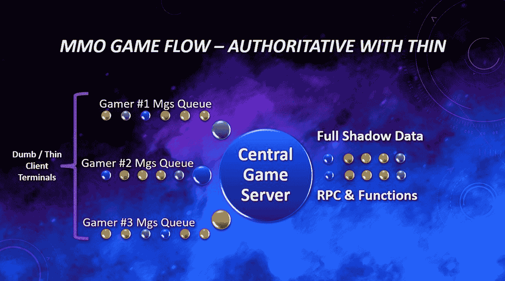

### 使用 Ghost Game Shadowing 的远程过程调用

* [SOAP](https://en.wikipedia.org/wiki/SOAP) 或 [SOAPjr](https://en.wikipedia.org/wiki/SOAPjr) — 以前称为“简单对象访问协议”，由 Dave Winer 在 1988 年设计，它是一种远程过程调用的规范，用于在 SOAP 封包内交换基于 XML 的消息。相比之下，XML-RPC 和 JSON-RPC 架构更简单。Google 在其规范中指出：“SOAP 是一种用于在去中心化、分布式环境中交换信息的轻量级协议。它是基于 XML 的协议，由三部分组成：一个定义描述消息内容及如何处理内容的框架的信封，一组用于表示应用程序定义数据类型实例的编码规则，以及一种表示远程过程调用和响应的约定。”SOAPjr 用 JSON 格式的信封替换了 XML。

* [Web 应用消息协议（WAMP — 不要与 Web 服务器混淆！）—](https://wamp-proto.org/) 在一个统一的协议中提供了两种应用消息模式：**RPC 和发布/订阅。** 你可以 [在此处对比这种健壮的协议](https://wamp-proto.org/comparison.html)。

* 表述状态转移 (REST) — 如 Roy Fielding 博士 [在他 2000 年的博士论文中所定义](https://www.ics.uci.edu/~fielding/pubs/dissertation/top.htm)，REST 还提供了极其难以置信的灵活性层。由于数据没有绑定到方法和资源，REST 能够处理多种类型的调用，返回不同的数据格式，并能够通过超媒体的正确实现发生结构性变化。REST 基本意味着每个 URL 都是某个“函数”的表示；它的重点是将 URL 作为返回“文档资源”或数据的接口。

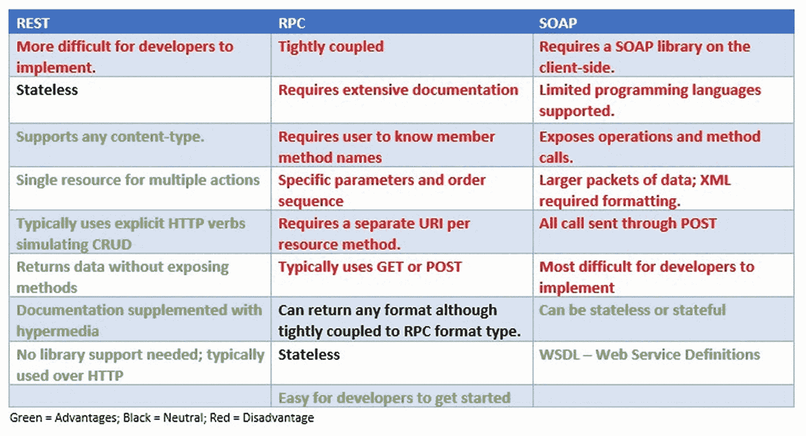

## 优点与缺点

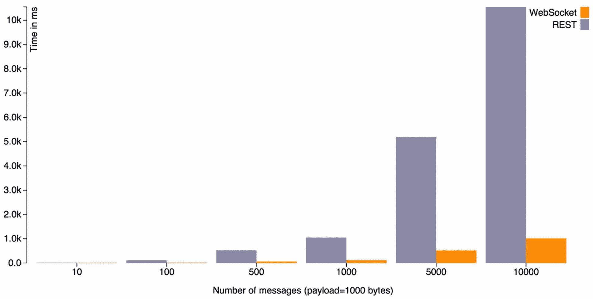

### 消息量与流量负载对比

**为什么 AJAX 没有在这些技术列表中？**

**答案：** 因为 [AJAX](https://en.wikipedia.org/wiki/Ajax_(programming)) 既不是协议也不是 API。它是浏览器中 JavaScript 使用 HTTP 请求来模拟前端（浏览器）和后端（服务器）之间 RPC 式通信的编程模式。**正如你在第一部分看到的，AJAX 已被 WebSocket 取代。** AJAX 作为一种编程实践，并不是完整的 RPC 系统。你仍然需要协商调用、结果和错误的格式化与序列化方式。参见上面的 JSON-RPC 和 XML-RPC。

即使你使用 AJAX 技术构建了某些 RPC 机制，这也是对点的 RPC：调用不在不同的服务器域或应用程序组件之间路由，而是严格从点（浏览器）传输到点（连接的服务器）。广播不是选项。

此外，AJAX 不提供发布/订阅——事实上，它没有解决如何从服务器主动推送任何类型的信息（然而，请查看应该避免的过时技术 Comet）。

由于 AJAX 使用纯 HTTP 封装任何类型的 RPC 类消息，它受到了 HTTP 的开销和局限性的影响。（例如，你不能进行超过 6-8 个并发 RPC，因为浏览器限制了单个目的地的 HTTP 连接数 [根据 CORS](https://techblog.constantcontact.com/software-development/using-cors-for-cross-domain-ajax-requests/)）。

* [REST 与 WebSocket 比较与基准](http://blog.arungupta.me/rest-vs-websocket-comparison-benchmarks/)

* [REST vs SOAP – 选择正确的 Web 服务](http://geeknizer.com/rest-vs-soap-using-http-choosing-the-right-webservice-protocol/#ixzz1PDKEB98H)

* [ROA vs. SoA, REST vs. SOAP](http://rest.elkstein.org/2008/02/roa-vs-soa-rest-vs-soap.html)

- **可以说 AJAX 是一种使用 REST 的特定方式吗？回答：** “AJAX 和 REST 确实是使用 HTTP 作为传输的两种方式。但你也可以将它们结合使用……AJAX 是一套（通常是）客户端 Web 开发技术，允许你的浏览器获取页面中动态变化的部分，而不是重新传输整个带有更新的静态完整页面；而 REST 是一种仅使用 HTTP 操作来发送和处理请求的架构风格。因此，你可以使用 AJAX 来发送 RESTful 请求。REST API 通常不使用 AJAX 实现，但可以通过 AJAX 客户端访问。……AJAX 和 REST 配合得很好；你不需要在两者之间二选一……”” [阅读带有对比的完整答案](https://softwareengineering.stackexchange.com/questions/325548/is-it-safe-to-say-that-ajax-is-a-particular-way-of-using-http)

- [在 JavaScript 中使用 REST](http://rest.elkstein.org/2008/02/using-rest-in-javascript.html)

- [在 PHP 中使用 REST](http://rest.elkstein.org/2008/02/using-rest-in-php.html)

- [XML-RPC vs. SOAP](http://weblog.masukomi.org/writings/xml-rpc_vs_soap.htm)

- [Web 服务与 PHP — SOAP vs. XML-RPC vs REST](http://roshanbh.com.np/2008/07/web-services-php-soap-vs-xml-rpc-vs-rest.html)

- [Message Pack](https://msgpack.org/) — 它是二进制 JSON；速度更快且体积更小。Message-Pack 是一种高效的二进制序列化格式。它允许像 JSON 一样在多种语言之间交换数据。但它更快、更小。小整数被编码为单个字节，典型的短字符串除了本身外只需要额外一个字节。

## 5.5 部署考量

由于我们不是第一批构建 MMOG（多人在线游戏）的人，让我们回顾一下 [行业巨头们在服务器和数据库方面的经验训](http://highscalability.com/blog/2007/11/13/flickr-architecture.html) 以及他们的教训。但首先，让我们看看这些原始想法源于何处……1994 年卡内基梅隆大学开发了一项关于未来软件架构的研究（下方有 42 页注释附加内容）。

[Onlive](https://en.wikipedia.org/wiki/OnLive) [(2009 — 2015；现已停止)](http://games.onlive.com/) 曾有一个创新的想法。他们没有使用“智能（厚客户端）”或“笨蛋（瘦客户端）”，而是简单地将游戏控制器直接扩展到中央服务器。他们的局限性在于“范围”——玩家的位置距离中央游戏服务器不能超过 1000 英里。Wikipedia 提到：“2015 年 4 月 2 日，索尼互动娱乐宣布收购了 OnLive 的专利，所有 OnLive 服务将于 2015 年 4 月 30 日停止。索尼运营 [PlayStation Now](https://en.wikipedia.org/wiki/PlayStation_Now)，这是一项使用 [Gaikai](https://en.wikipedia.org/wiki/Gaikai) 基础设施构建的类似服务，Gaikai 是 OnLive 的前竞争对手。”

**分析：** 根据 Rex van der Spuy 和 Gabriel Gambetta 的说法，这“……一种幼稚的实现……”导致了用户命令与屏幕变化之间存在延迟；例如，玩家按下右方向键，角色在半秒钟后才开始移动。**这是因为客户端输入必须先传输到服务器，然后服务器处理输入、计算新的游戏状态，最后将更新后的游戏状态再次返回给客户端。**简而言之，这种设计为游戏引入了额外的网络延迟。

## 5.6 持久化数据结构

保存游戏会话信息有两种方式：1) 使用数据库服务器或 2) 使用原生的“操作系统 (O/S)”文件。每者都有优缺点：

### 数据库与文件对比表

| 特性 | 数据库 | 原生操作系统文件 |

| :--- | :--- | :--- |

| **优点** | 你可以轻松地添加或修改新字段或现有字段。从外部更新游戏状态值要容易得多。你可以通过 `SQL` 查询立即且高效地检索游戏状态值。数据库服务器将使用嵌入的数据操作语言 (`DML`) 自动处理输入输出请求。易于更新和恢复游戏状态值。 | 使用原生操作系统输入输出访问极快。实现简单。不依赖于额外的外部库或资源。不依赖数据库服务（数据即服务或 `DaaS`）或可用性。 |

| **缺点** | 容易出错。例如，在没有适当 `where` 子句的情况下执行更新查询。这可能会产生灾难性的后果，特别是当你有旧的备份存档（或根本没有？！）。数据库可能比打开并写入原生文件系统慢——特别是当开启了表锁时（`MySQL` vs `InnoDB`）。如果同时有大量输入输出记录，在数据检索或插入期间可能会丢失几毫秒。需要额外的代码将数据格式化为从或从数据库格式。需要熟悉数据库存储、数据库服务器和 `SQL`。此外，你还需要一个控制器库来在你的 MMoG 之间建立接口。 | 数据库损坏是一个潜在风险。如果你从一开始就仔细设计了结构，那么添加新字段将很困难。例如使用 `XML`。无法跨文件进行全局查询；但你可以通过一个每天收集这些数据的“定时任务 (cron)”来绕过这个问题。 | |

# 资源

* 构建你自己的城市：一个开放式建筑游戏数据模型 — [`www.vertabelo.com/blog/technical-articles/build-your-own-city-an-open-ended-building-game-data-model`](http://www.vertabelo.com/blog/technical-articles/build-your-own-city-an-open-ended-building-game-data-model)

* [实时多人游戏数据库设计](https://gamedev.stackexchange.com/questions/142869/realtime-multiplayer-game-database-design)

* [游戏数据库的最佳数据库设计](https://www.experts-exchange.com/questions/27925497/Best-database-design-for-a-game-database.html)

* [冒险之之模拟器](http://www.maplesimulator.com/bannedstory/version)

* [BigWorld 技术](http://bigworldtech.com/technology/#bigworldserver); 查看他们的：

    * [开发者支持文档](https://developers.wargaming.net/documentation/guide/getting-started/) 和

    * 支持 [后端数据库方案](https://developers.wargaming.net/reference/all/wot/account/list/?application_id=demo&r_realm=ru)

    * [技术概述](https://wikivisually.com/wiki/BigWorld)

## 深入探索：向大师学习 — UnReal Engine

## 深入探索：向大师学习 — Unity 多人网络

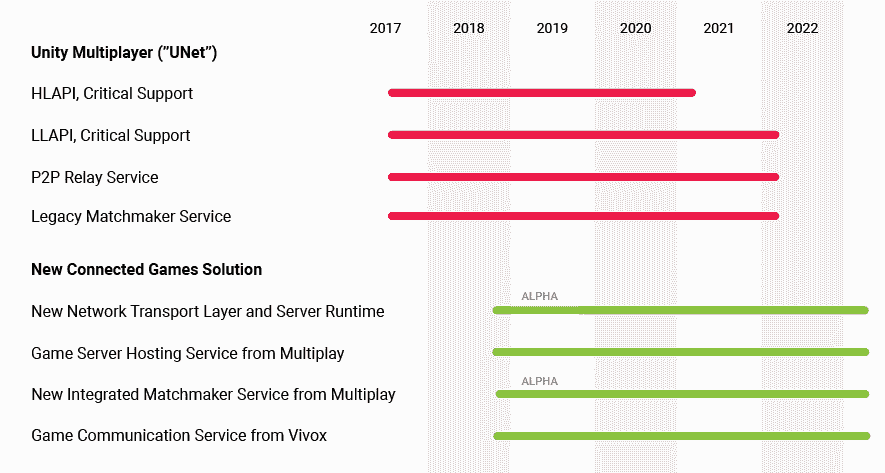

Unity 多人迁移路线图

[Unity Multiplayer](https://docs.unity3d.com/Manual/UNetLobby.html) 建议：在 [他们的博客中关注他们正在做的内容](https://unity.com/solutions/real-time-multiplayer)。

* [Unity 新网络库](https://unity.com/solutions/real-time-multiplayer/network-transport-layer) 利用其专为构建的网络库，并学习 Unity 如何提供多线程性能和游戏优化。这里有一个新发布的（2018 年 10 月 24 日）使用 Unity 更新后的多人网络库库构建的 Unity 第一人称多人射击游戏（MMoFPS）示例项目 — [`unity.com/fps-sample`](https://unity.com/fps-sample)

* [UnityWebRequest](https://docs.unity3d.com/Manual/UnityWebRequest.html) 是用于组合 HTTP 请求和处理 HTTP 响应的模块化系统，本质类似于 RPC。其主要目标是允许与浏览器后端进行交互。它还支持高需求功能，如分块 HTTP 请求、流式 POST/PUT 操作以及对 HTTP Header 和谓词的完全控制。

* `NetworkLobbyManager` 虚拟方法 [在服务器上调用](https://docs.unity3d.com/Manual/class-NetworkServer.html)

* `NetworkLobbyManager` 虚拟方法 [在客户端上调用](https://docs.unity3d.com/Manual/class-NetworkClient.html)

## 深入探索：向大师学习 — IBM 微服务

## 附加信息

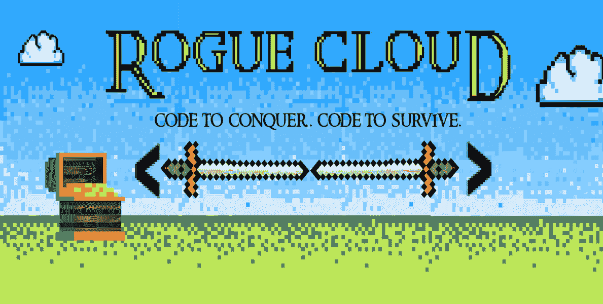

Rogue Cloud (流云)

## 深入探索：向大师学习 — Google GRITS

Google 不会被“超越”的！[GRITS 是一项跨部门合作](https://www.youtube.com/watch?v=Prkyd5n0P7k)，旨在为想要开始使用 Google 技术栈的 HTML5 游戏开发者提供一个模板代码库。其意图是创建一个非常小的多人游戏并发布，向大众提供所有源代码以作为模板。你可以在 [GitHub](https://github.com/MakingBrowserGames/gritsgame) 上查看它。

GRITS 是一款由 Google 工程师设计的俯视视角多人战斗游戏。它是 Google 尝试利用顶尖的 HTML5 技术（如 Canvas、WebSockets、Google App Engine 和 Google+ 集成）提供基于 HTML5 的游戏模型。GRITS 采用权威服务器网络关系。客户端向服务器请求特定操作；服务器将更新后的游戏状态推给所有活动参与者。客户端将此游戏状态视为实际游戏状态的确认并覆盖任何本地数据。

## 深入探索：向大师学习 — Rob Hawkes

Rob Hawkes 是 Pusher 的开发者关系负责人，Mozilla 前技术传播官，他开发了 [Rawkets](https://github.com/PBMCube/rawkets) — 一个实时多人游戏概念验证。该游戏探索了 HTML5 Canvas、WebGL 以及 WebSockets 的使用。Rawkets 让我想起了《宇宙战战士》（Asteroids）——一种经典的街机游戏。简单的线条船代表玩家。他们可以在场地上移动并向其他玩家射击。你可以在 GitHub 上查看 Rawkets 代码](https://github.com/PBMCube/rawkets)。Rawkets 使用 PHP 处理部分中间件代码。我们将讨论它的 [`main.js`](https://github.com/PBMCube/rawkets/blob/master/server/main.js)。

## 5.7 新花样

如果你研究任何 MMOG，你会发现那些作者是：

那种场景的问题是“医生室”。我们的 MMOG 架构应该遵循“剧院或购物场”。想象一下；购物场。有些 MMOG 遵循“带桌子的房间”，允许玩家坐在那里。然而，正如对任何赌场的访问将会所示，MMOG 不允许“闲逛者”徘徊；但是，如果他们遵循我的“剧院/购物场”，徘徊将不被禁止。

总结：多人游戏是一个共享的现实。玩家必须感觉并相信自己处于同一时间，并且对游戏环境拥有独特的视角。让我们研究如何实现这一点。

## 5.8 管理网络传输

让我们查看其他 MMO 如何处理网络延迟、卡顿和抖动，看看它们的解决方案。

### 跳绳！（固定时间间隔）

跳绳是 [孩子们最喜欢的活动](https://www.heartfoundation.org.au/images/made/images/uploads/jump-rope/kids_jumping_800_480_85_s_c1.jpg) 它教给了我们关于开发多人游戏的教训。每个人都必须在精确的时间跳跃——技术上称为“锁步同步”。将该想法应用于我们的游戏，每个玩家必须具有完全同步的输入和渲染，以便参与者看到相同的游戏现实。中央权威服务器做出所有决定并告诉每个客户端“渲染什么”（即声明式）。玩家的浏览器除了“如何渲染”（即命令式）当前游戏世界之外，对游戏逻辑没有任何贡献；他们的唯一贡献是收集玩家输入并将其发送到服务器。这是 MMO 开发中最简单的方法——也是最幼稚的解决方案。回到我们的例子中，如果有人绊倒并摔倒，他们的动作会影响所有人。

学到的教训是：

1. 所有游戏参与者的速度只能达到最慢玩家的速度。

2. 除了渲染精灵外，任何玩家的浏览器都不允许进行任何独立处理。这与你在之前的练习中读到的关于虚幻引擎（UnReal Engine）运行机制的信息形成鲜明对比。

3. 所有参与者之间的同步必须保持一致，否则某人的计时错误将影响所有人。

4. 这种方法不利于“瞬反应型”（twitch-action）MMO 游戏机制。

5. `TCP/IP` 延迟对我们的 `WebSockets` 和游戏处理的影响最大。

使用这种方法存在的问题：

1. 缺乏持久性。所有玩家必须在同一时间开始游戏。新玩家的加入或离开会给留在游戏会话中的所有人带来问题。

2. 缺乏玩家扩展性。由于这种步步同步机制（lock-step synchronization），服务器协调工作和网络引发错误的概率随着参与人数的增加而线性增长。

3. 缺乏帧率扩展性。所有玩家必须以相同的内部帧率处理游戏，这使得难以支持各种硬件速度。发送数据包的生成和接收到的数据包的处理只能按照客户端更新本地状态的频率进行。虽然理论上数据包可以比此更快地生成和发送，但如果每个数据包之间无法更新游戏状态，则只会导致发送冗余。因此，低帧率会导致游戏对更新的响应迟钝，并可能强制其跳过过时的数据。

4. 在 FPS 游戏中，玩家可以发送角色所在的位置或角色射中了谁。这种方案可能有效，并可能消除与延迟相关的除最顽固以外的问题。遗憾的是，它依赖于一个天真的假设，即玩家是诚实的且没有篡改游戏回合。

5. 受到游戏逻辑无法控制的网络延迟和波动的影响很大。幸运的是，使用 [`latsub.js`](https://github.com/circonus-labs/latsub) 等工具为我们提供往返时间，以便我们偏移服务器计时并调整游戏回合的提交。

**演示：** [在此处玩一个“步步同步”的 WebSocket 双人游戏](https://www.adityaravishankar.com/projects/games/tanks/)。 记录游戏的响应灵敏以及你的感受。

| 延迟 | 用户感知 |

| --- | --- |

| 0 * 100 ms | 瞬时 |

| 100 * 300 ms | 微小可感延迟 |

| 300 * 1000 ms | 设备在工作吗？ |

| 1,000+ ms | 注意力可能发生转移 |

| 10,000+ ms | 任务放弃！ |

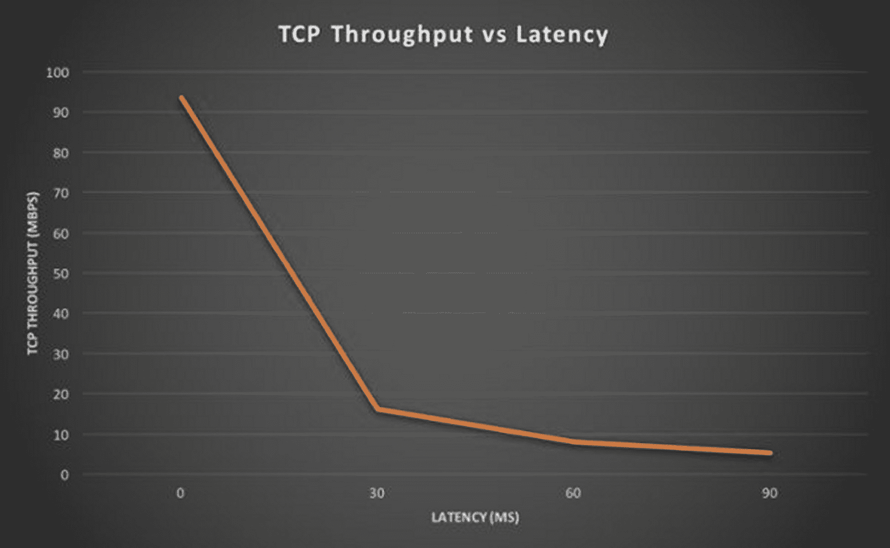

### 测量网络性能 – TCP 吞吐量与延迟

在丢包率为 2% 时，`TCP` 吞吐量比无丢包时低 6 到 25 倍。

| 往返延迟 | 无丢包时的 TCP 吞吐量 | 2% 丢包时的 TCP 吞吐量 |

| --- | --- | --- |

| 0 ms | 93.5 Mbps | 3.72 Mbps |

| 30 ms | 16.2 Mbps | 1.63 Mbps |

| 60 ms | 8.7 Mbps | 1.33 Mbps |

| 90 ms | 5.32 Mbps | 0.85 Mbps |

### Adobe RTMP 和 RTMFP

[RTMP (52 页规范)](http://www.images.adobe.com/www.adobe.com/content/dam/acom/en/devnet/rtmp/pdf/rtmp_specification_1.0.pdf) 是 Macromedia 为 Flash Player 开发的一种专有 `WebSocket` 解决方案（生命周期结束：20201231）；但它后来被开放，并现在作为 [RFC 7016](https://tools.ietf.org/html/rfc7016) 发布。Adobe 在 2005 年以 34 亿美元收购了 Macromedia 并为 RTMP 方案申请了专利。（http://www.therealtimeweb.com/index.cfm/2008/3/6/rtmp-patent）（参见美国专利号 [7246356](https://patents.google.com/patent/US7246356)）。Adobe 发布了一个“不完全的”RTMP 版本以供公众使用。[(在此处查看许可证)](https://www.adobe.com/devnet/rtmp.html) RTMP 的主要动机是作为播放 Flash 视频的协议（Flash player 已于 2020 年 12 月停止！），它也被用于某些其他应用程序。“RTMFP 是基于 UDP 而非 TCP 的 RTMP，取代了 RTMP 流。安全实时媒体流协议族由 Adobe Systems 开发，允许终端用户之间直接连接和通信（使用 [P2P 库](https://github.com/js-platform/p2p)）……与 RTMP 不同，RTMFP 还支持直接从一个 Adobe Flash Player 向另一个发送数据，而无需经过服务器。始终需要服务器连接来建立终端用户之间的初始连接，并用于提供服务器端数据执行或进入其他系统的网关。” [引用自维基百科](https://en.wikipedia.org/wiki/Real-Time_Protocol)

以下信息到目前为止一直是我行业的商业“秘密”。在 2013 年末这本书出版之前，你不会在任何地方找到过这些内容。游戏行业正犯着与远程教育社区相同的错误。如果你还记得，我在之前的“第 1 章：新狗不吃旧骨”中提到过，使用摄像头录制游戏回合是多么愚蠢的行为，而且远程教育专家几十年来一直使用相同的方法——录制课堂讲座进行视频播放。

大家错过的仅仅是，当前的 MMoG 试图模拟旧式的“面对面桌面桌游”——就像教育者试图模仿课堂讲座一样。**所有参与者必须在同一时间悬停在他们的虚拟“游戏桌”上方。** 困扰 MMoG 的许多戏剧性问题源于：1) 同步；2) 连接；3) 网络延迟；4) FPS 中谁在何时杀了谁（没而复始）——**所有这些问题都源于试图在线上代表“面对面桌面桌游”。** 老实说，你真的喜欢看那些视频录制的 PPT 幻灯片讲座，以及那个位于屏幕角落的愚蠢教授的“头头说话”吗？“这让你感觉像在教室里，不是吗”；我就是这么想的！（看来我又在讽刺了）在我看来，唯一的教育益处就是我去买啤酒（或两瓶）时“让那家伙停下一分钟”！[(bloke 的女性写法是什么？)](https://answers.yahoo.com/question/index?qid=20080329145929AANeCIc)

我将提供一种前所未有的解决方案，它将彻底改变你的 MMoG —— **使用 PBM³ 技术并消除“并发”——即处于同一时间、同一地！停止尝试模仿“面对面桌面桌游”，采用采用使用人工智能（AI）的真正“异步”游戏方法。**

“你现在在说什么<此处插入你最喜欢的贬义词>？！？！!!”（感觉我能 **跨越时空** 读懂你的心思真有点可怕，不是吗！是的，这和 **“可用性”** 也有关系！）还记得你读过的关于 [面向消息中间件 (MOM) 异步的内容吗？](https://en.wikipedia.org/wiki/Message-oriented_middleware#Asynchronicity)

我将给你几个切实的例子，然后我将解释你刚刚看到的。准备好了吗？

## 参与并观看：

### 练习 #1：观看其中一个视频 —

*   [完整看完这个视频](https://www.youtube.com/watch?v=JI16hwn3L9U) @ [`www.youtube.com/watch?v=JI16hwn3L9U`](https://www.youtube.com/watch?v=JI16hwn3L9U) 它只需要你 2:50 分的时间 **或者选择**

*   这个 3 分钟的 [极具趣味性](https://youtu.be/KqFKhgZto5I) @ [`youtu.be/KqFKhgZto5I`](https://youtu.be/KqFKhgZto5I)

**懂了吗？没懂？！好吧，** 这一个变得 **更明显……**

### 练习 #2：完整看完这两个视频的一个或两个；

*   2a) 女孩 — [Anne Reburn 正在创作音乐和视频](https://www.youtube.com/watch?v=JL2cMfITXLU)

*   2b) 男士 — [Dan Wright 正在创作音乐](https://youtu.be/p6627_5-FdY)

这就是你刚刚看到的。这在如今已经是一项如此平凡的任务，以至于人们不再考虑它了。在练习 #1 中，你听的是现场直播还是预录的节目？**“真的吗？是预录的；你为什么要问我这个？”**（还是有点可怕，[不是吗！](https://www.merriam-webster.com/dictionary/ain't)）**因为在 80 年代后期（30 年前了！？），那是我应用于 MMoG 以消除“可用性”的概念。** 你通过录制玩家的游戏回合动作，并将这些动作“……通过邮件、电子邮件或调制解调器”发送给远程玩家 **—— MOM。** 这就是我的 **PBM³** 口号的起源（通过邮件游戏、通过电子邮件游戏和通过调制解调器游戏”—— **PBMCube**）。我将在接下来的章节中向你展示代码。这在 80 年代到 2000 年代是革命性的，直到 **所有人** 开始使用 . . . 面向消息中间件 (MOM)。

在上面的 **练习 #2** 中，乐趣真正开始升温了！你至少看了其中一个视频？无论如何，我原谅你，并进入我的观点。利用录制节目的魔法，歌手们能够将不同的声部组合成四重唱。他们只是简单地录制了一个部分的演唱；然后在后的编辑过程中，将这些部分组合成单一表演。他们将“可用性”推向了同步的新维度。你看，时间——每一次录制——堆叠在录制第二、第三和第四声部的时间之上。可用性通过将时间堆叠在其他时间之上被消除了。**这是他们他们都没有使用的秘诀。**

![makinggames_Consolidated.jpg]

| 传统预测分析 | 人工智能 |

| :--- | :--- |

| 基于几十年的技术 | 是无可争议的未来技术 |

| 获取洞察的自动化工具 | 具有自主性，因为 AI 生成了 |

| 仅利用历史数据点进行学习 | 模拟创建所有未来的数据点 |

| 昂贵的遗留基础 | 行业变革的催化剂 |

| 昂贵的硬件、软件许可和/或咨询业务模式 | SaaS 交付——利用不断下降的成本和增加的容量 |

| 通常为执行特定任务创建——无法检查整个零售商“生态系统”的影响 | 查看促销与产品之间的关系以及对销售的净影响 |

| 受严格、静态模型的限制——查看数据子集 | 能够整体地检查大规模、快速变化的数据集。 |

| 可能利用机器学习，因为它根据新的有限数据集进行调整 | 无需人工干预即可自我调整和变化 |

正如我之前建议的那样，我们可以将网络关系 —— **P2P** 与“星型结构”（即集中式权威服务器）混合。在下面的插图中，你会看到所有的游戏回合指令 (GTO) 都在所有参与者之间以 P2P 网络关系的形式进行“广播或多播”。我们可以使用 [WebRTC API](https://developer.mozilla.org/en-US/docs/Web/API/WebRTC_API) 来构建 [简单的 `RTCDataChannel` 示例](https://developer.mozilla.org/en-US/docs/Web/API/WebRTC_API/Simple_RTCDataChannel_sample)。GTO 到达服务器并处理；然后将游戏回合结果 (GTR) 发送到每个目的地，作为游戏状态的确认。远程玩家直接接收原始 GTO，随后是服务器的确认。确认在 GTO 稍后到达——服务器处理新提交的 GTO 所花费的时间。此建议适用于“小型 MMoG”，并具有我在第一部分 3.3 节中提到的限制 —— `n(n+1)/2.`。让我们遵循微软学院对家庭组的建议，将 MMoG 的最大参与人数限制在 10 人以内。


# 可用性叠加 (Availability Overlays)

## 管理时间线模型 (Time-line Models)

我们研究了“跳绳——固定时间间隔”、[`Glenn Fiedler 选项`](https://gafferongames.com/post/what_every_programmer_needs_to_know_about_game_networking/) 并查看了一个展示其效率的 [双玩家演示](https://www.adityaravishankar.com/projects/games/tanks/)。这是考虑其他人在做什么的时间。

时间线模型并没有对游戏施加任何特定的架构。[Janus 工具包（36 页额外内容；2013 年左右的“pre-WebSockets”方案）](https://link.springer.com/content/pdf/10.1007%2Fs00530-012-0271-3.pdf) 允许各种叠加架构，包括点对点、客户端-服务器和混合模型，具体取决于每个时间线的订阅列表。

用于网络游戏中延迟补偿技术的时间线实现。根据需求在服务器和/或客户端上使用。

*   获取游戏状态快照

*   根据拍摄的快照对值进行插值和外推

用于网络游戏中延迟补偿技术的时间线实现 [在 GitHub 此处找到](https://github.com/gamestdio/timeline)。

## 5.11 太热、太冷、恰到好处！……在哪里以及是什么

现在真正的工作开始了！我们在玩家端是使用“厚客户端”还是“瘦客户端”？在玩家的客户端侧放置厚客户端有什么优缺点？使用瘦客户端又又如何呢？我们为什么要关心这些？因为客户端变得越“厚”，我们对服务器应用程序的要求就越“薄”，甚至变成一个 [“幽灵服务器”](https://crossbario.com/blog/Free-Your-Code-Backends-in-the-Browser/) —— 更多内容请见服务器章节。这就是为什么我建议在浏览器中使用“消息代理器”（服务器代理）。

### 部署选项

在编写我们的 MMoG 时，我们有几个选项需要考虑。答案将决定我们把什么代码放在哪里，以及玩家将如何输入并响应对手。以下是组合选项的矩阵：


### 作为 Web-MVC 的 MMoG 游戏

**玩家浏览器**

*   厚（智能型）游戏浏览器客户端。处理 `some` 游戏逻辑细节。`Phaser JS` 游戏框架提供了强大的功能，并可以在“回合制”游戏中在本地承担大部分服务器的处理任务。它需要“签到”以保持游戏同步。

*   瘦（哑/终端型）游戏浏览器客户端。仅作为“哑终端”处理玩家输入。游戏逻辑细节和计算都在服务器端完成。例如，Phaser 只负责处理本地动画，但化身移动必须经过游戏服务器应用程序的确认和授权。自然，这对于“实时模拟 (RTS)”来说是最糟糕的选择。

**游戏引擎**

*   权威服务器（集中式）

*   权威服务器（去中心化或分布在 CDN 中）

*   验证服务器（集中式或主从）

*   验证服务器（去中心化或分布在 CDN 中）

*   路由（透传或监控）服务器

在此处下载 `部署工作表`：[`makingbrowsergames.com/mmog/bonusContent/MMoG-Deployment-Worksheet.pdf`](http://makingbrowsergames.com/mmog/bonusContent/MMoG-Deployment-Worksheet.pdf)

## 5.12 章节总结

*   决定使用哪种 MMoG 的 ["Web API”](https://medium.com/platform-engineer/web-api-design-35df8167460)

*   对比了单机游戏架构与 MMoG。

*   比较了 2014 年之前的旧版网络游戏与当前的 WebSocket 和微服务。

*   回顾了 IBM 对 MMoG 架构系统的建议，并发现了缺失的组件。

*   学会了如何通过多个在线工具和测试网站测试我们的 MMoG。

*   收集了编写源代码将用到的关键统计数据。

*   学习了 `dns-prefetch` 的价值。

*   阐述了何时以及在什么情况下为 MMoG 使用 fetch。

*   回顾了几个成功的 MMoG，并剖析了它们的架构以及它们使用哪些工具作为中间件。

*   将我们的 MMoG 从旧版修改为分布式云微服务。

*   研究了 IBM 的 Rogue Cloud 游戏。

*   学习了用于 MMoG 部署的 `DevOps pipe-line`。

*   调查了 `Docker 容器` 和 `Kubernettes`。

*   将当前的 MMoG 与诊所和剧院购物中心进行了对比。

*   检查了多游戏对象（Multi-Game Objects）数据结构，以管理每个游戏中的多个游戏和玩家。

*   为当前项目开发转译了多游戏对象数据结构。

*   发现了远程教育与 MMoG 以及并发交付之间的相似性。

*   调查了“可用性 (Availability)”问题。

*   剖析了一个 30 年的工业秘密，并吸收了其概念用于当前的 MMoG 项目开发。

*   分析了 3 个不同的示例以解决“可用性”问题。

我们 —— 终于！ —— 准备好基于第一部分和第二部分收集并构建的坚实基础和知识，开始 [Game Recipe™](https://leanpub.com/phaser3gameprototyping) 中描述的“编码组件”步骤了。此外，结合你所有的阅读、研究和练习答案，你已经拥有了 Game Recipes™ 的文档。

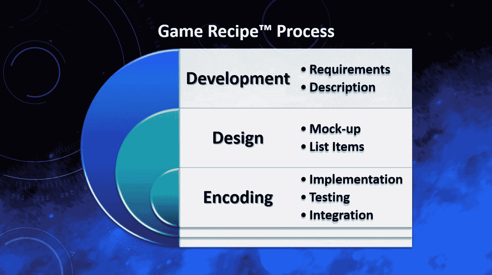

# Game Recipe™ 流程

## 6 客户端侧基础

凭借第一部分和第二部分的坚实基础，以及你对各种练习的研究和答案，我们 —— 终于！ —— 准备好开始源代码编写阶段了。我们将从客户端开始，跨越我们在第二部分讨论的 MMoG 架构进行迁移。在本章结束时，我们的目标是实现：

*   一个功能性的 `WebSocket` 通道（又称“电信通道”），从客户端代理开始到服务器 API，数据格式化为 `RPC` 或 `MOM`。它将成为我们的 MMoG 原型，并在后续章节中扩展为更具体的游戏消息。

*   一套指导方案，告诉我们如何在我们的 MMoG 系统中放置源代码。

要使用 `WebSockets`，你需要一个浏览器、一个 Web 服务器和一个支持相同 WebSocket 协议的套接字应用程序。（你在第一部分已经学过这一点，以及避免使用 `Socket.IO` 及其不兼容性的所有原因）。你最好的朋友将是 [“Can I Use website”](https://caniuse.com/#search=websocket)；它提供了关于 `WebSocket` 技术的最新信息、需要避开的浏览器、已知问题和资源。你在第二部分中收到了两个测试站点；现在是时候创建你自己的测试服务器了——这与 `Web Server` 不同。你需要在本地开发工作站上一个传统的 Web 服务器（如 `Apache` 或 `IIS`）来提供你游戏的动态内容。（你还记得第一部分提到过 `Node.js` 和 `Express` 只交付静态内容吗？对吧？）你在“奖励内容（Bonus Content）”中有一个“项目游戏启动器”，你需要将其复制到你工作站的 Web 服务器根目录中，并确保它在开发工作站的后台运行。你需要确保不要关闭命令提示符窗口！

[`makingbrowsergames.com/mmog/bonusContent/WebSockets.zip`](http://makingbrowsergames.com/mmog/bonusContent/WebSockets.zip) 或来自 [`kaazing.com/download/`](https://kaazing.com/download/) 的任何客户端 SDK


### 新 MMoG 信息流

客户端在处理游戏逻辑时有几个重要职责，以便与远程服务器（或本地代理服务器）良好协作并提供优质的游戏体验：

*   **渲染 (Rendering)** —— 客户端负责在玩家的显示器上渲染游戏，并可能负责非重要的物理模拟，例如布料模拟或粒子效果——此类特殊特效 (sfx) 不应该来自远程服务器，对吧？如果客户端动画与游戏性无关，但仅仅是为了让游戏“口感”更佳的“点缀或视觉点品”，那么它不应该在 `MMoG App server` 上执行。

*   **声音 (Sound)** —— 客户端负责在玩家的显示器上渲染游戏，并可能负责非重要的物理模拟，例如布料模拟或粒子效果——此类特殊特效 (sfx) 不应该来自远程服务器，对吧？如果客户端动画与游戏性无关，但仅仅是为了让游戏“口感”更佳的“点缀或视觉点品”，那么它不应该在 `MMoG App server` 上执行。

*   **输入 (Input)** —— 客户端负责在玩家的显示器上渲染游戏，并可能负责非重要的物理模拟，例如布料模拟或粒子效果——此类特殊特效 (sfx) 不应该来自远程服务器，对吧？如果客户端动画与游戏性无关，但仅仅是为了让游戏“口感”更佳的“点缀或视觉点品”，那么它不应该在 `MMoG App server` 上执行。

*   **用户偏好 (User Preferences)** —— 客户端负责在玩家的显示器上渲染游戏，并可能负责非重要的物理模拟，例如布料模拟或粒子效果——此类特殊特效 (sfx) 不应该来自远程服务器，对吧？如果客户端动画与游戏性无关，但仅仅是为了让游戏“口感”更佳的“点缀或视觉点品”，那么它不应该在 `MMoG App server` 上执行。

*   **预测 (Prediction)** —— 客户端负责在玩家的显示器上渲染游戏，并可能负责非重要的物理模拟，例如布料模拟或粒子效果——此类特殊特效 (sfx) 不应该来自远程服务器，对吧？如果客户端动画与游戏性无关，但仅仅是为了让游戏“口感”更佳的“点缀或视觉点品”，那么它不应该在 `MMoG App server` 上执行。

*   **插值 (Interpolation)** —— 客户端负责在玩家的显示器上渲染游戏，并可能负责非重要的物理模拟，例如布料模拟或粒子效果——此类特殊特效 (sfx) 不应该来自远程服务器，对吧？如果客户端动画与游戏性无关，但仅仅是为了让游戏“口感”更佳的“点缀或视觉点品”，那么它不应该在 `MMoG App server` 上执行。

#### 6.1 测试你的浏览器

截至 20190327，我们知道超过 95% 的浏览器都支持它。

```
// 确保浏览器支持 WebSocket
if (!window.WebSocket) {
    alert("您的浏览器不支持 WebSocket");
    return;
}
```

在在你下载的“项目游戏启动器”中，搜索“WebSocket”，并在 `WebSocketTest.html` 文件用你最喜欢的浏览器打开。点击“Run WebSocket”链接。测试完成。成功了吗？对吧？如果没有，请研究以下内容。

#### 6.2 WebSocket 协议握手

为了切换到“升级后的 WebSocket 连接”，玩家的浏览器应该发送“WebSocket 握手请求”，我们已经做到了。游戏测试服务器将返回“WebSocket 握手响应”，它也返回了；目前为止没有新情况。你也可以用你的活跃浏览器测试 `http://mmog.pbmcube.net/index.php` 或 `http://websocket.org/echo.html`。更多细节请参阅第 5 章：

*   `on('message', function(event))` 当 socket 接收到消息时触发。Event 拥有一个属性 `data`，它可以是一个 `String`（用于文本帧）或一个 `Buffer`（用于二进制帧）。默认数据格式为“blob”，这在发送和接收文件时特别有用。

*   `on('error', function(event))` 当由于由于对方发送的错误数据导致协议错误时触发。此事件纯粹是信息性的，你 `不需要不需要` 实现错误恢复，因为 WebSockets 是运行在 `TCP/IP` 之上的。“那么错误是如何渗透进来的呢？” 这是一个很好的问题；答案可以在 [`RFC 6455 第 5.1 节概述`](https://tools.ietf.org/html/rfc6455#page-27) 中找到，你可能已经在网络章节的练习中读过它（？）。

*   `on('close', function(event))` 当客户端或服务器关闭连接通道时触发。此事件有两个可选属性 —— `code` 和 `reason` —— 它们暴露了关闭连接的端点发送的状态码和消息。它还有三个你可以用于错误处理和恢复的属性：`wasClean`、`code` 和 `error`。

*   `send(message)` 接受 `String` 或 `Buffer`，并通过连接通道向另一个远程端点发送文本或二进制消息。

*   `ping(message, function())` 发送一个带有可选消息的“ping”帧，并在收到匹配的响应（又称“pong”）时触发回调函数。这通常用于根据网络延迟问题动态调整 MMoG。

*   `close(code, reason)` 关闭连接通道，发送给定的状态码和原因文本，这两者都是可选的。

*   `version` 是一个字符串，包含连接所使用的 WebSocket 协议版本号。

*   `protocol` 是一个字符串（可能为空），用于标识 socket 正在使用的子协议。我们将在接后的服务器章节中讨论各种“子协议”。

上面的插图演示了 WebSocket 通信通道两端客户端和远程 MMoG 服务器的职责。

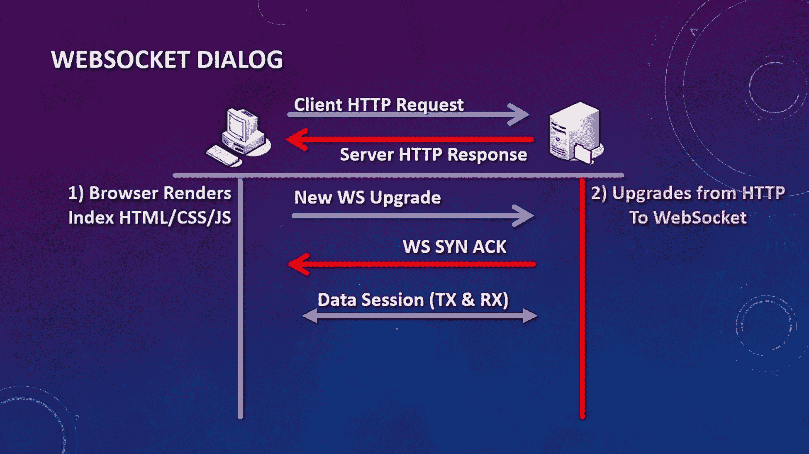

### WebSockets 升级对话框

| 属性 | 说明 |

| --- | --- |

| bufferedAmount | 返回调用 `send()` 方法时队列中的总字节数 |

| binaryType | 返回当触发 `onmessage` 事件时我们收到的二进制数据格式 |

| protocol | 返回服务器使用的协议 |

| readyState | 报告连接状态，可以取以下几个自言易懂的值之一： |

| | - `WebSocket.OPEN` |

| | - `WebSocket.CLOSED` |

| | - `WebSocket.CONNECTING` |

| | - `WebSocket.CLOSING` |

| url | 返回 WebSocket 的 URL |

游戏客户端的上述请求类似于 HTTP 请求，每行都以 `\r\n` 结束，并且最后必须有一个额外的空行。这是标准格式。握手类似于 HTTP 请求，因此游戏服务器可以处理标准的 HTTP 连接（80 端口），也可以处理通过同一个初始 80 端口（或 https 的 443 端口）的新的 WebSocket 连接。一旦新的 WebSocket 请求创建了该连接，客户端与游戏服务器之间的通信将切换到一个 `不符合以前 HTTP 协议的双向二进制协议`。WebSocket 连接成功后，游戏客户端和服务器可以以全双工模式发送 WebSocket `二进制数据或文本帧` —— 在同一时间向任何方向发送！这是一个点对点的连接，就像客户端和服务器是对等端一样。数据帧被最小化（由我们的 WebSocket 协议处理），仅包含两个字节。（复习第 3 章网络基础）不需要编写代码来封装这些帧，正如某些教程让我们相信的那样。然而，它是一个数据“流”；如果你的 MMoG 需要理解离散的组件，你可能喜欢在这些 WebSocket 帧内部使用消息格式。

WebSocket API 允许多种类型的数据（`UTF8` 文本、`binary` 和 `blob` 数据），与浏览器不同，服务器上的这些消息根据这些数据类型使用不同的属性存储。在文本帧的情况下，每个帧以 `0x00 字节` 开始，以 `0xFF 字节` 结束，中间包含 `UTF-8` 数据。（复习第 3 章网络基础第 62 页）这种二进制数据流对人类难以阅读，因为它是一个 `双向二进制协议`。WebSocket 文本帧使用 [`终止符`](https://www.ietf.org/proceedings/76/slides/hybi-1.pdf)，而二进制帧使用长度前缀。

```
1     HTTP/1.1 101 Switching Protocols  
2     Upgrade: websocket  
3     Connection: Upgrade  
4     Sec-WebSocket-Accept: cGxheWVyMzIxfGdhbWUxMjN8QUNL  
5     Sec-WebSocket-Protocol: mmog, soap, wamp, sip, amqp, mqtt, xmpp 
```

典型的服务器响应头如下所示：

除了 Upgrade 头之外，客户端还会发送一个包含 `Sec-WebSocket-Key` 的头部，其中包含 [`base64 编码的`](https://www.base64decode.net/) 随机字节，服务器用 `Sec-WebSocket-Accept` 头部中密钥的哈希值进行回复。这是为了防止缓存代理重新发送任何之前的 WebSocket 对话，（[参见脚注 1](https://tools.ietf.org/html/rfc6455#page-27)）且 `不提供任何身份验证、隐私或完整性。` 哈希函数将固定的字符串 `258EAFA-E914-47DA-95CA`（一个 GUID）附加到 `Sec-WebSocket-Key` 的值上，并使用 base64 编码结果。

```
1     HTTP/1.1 101 Switching Protocols  
2     Upgrade: websocket  
3     Connection: Upgrade  
4     Sec-WebSocket-Accept: cGxheWVyMzIxfGdhbWUxMjN8QUNL  
5     Sec-WebSocket-Protocol: mmog, soap, wamp, sip, amqp, mqtt, xmpp 
```


### 在开发者工具中观察头部交换

```
 1     请求头部 . .
2     GET ws://mmog.bmcube.net:30113/server.php HTTP/1.1  
3     Host: mmog.bmcube.net:30113  
4     Connection: Upgrade  
5     Upgrade: websocket  
6     Origin: http://mmog.bmcube.net  
7     Sec-WebSocket-Version: 13  
8     Sec-WebSocket-Key: zfG4XTS6NdIpCa+w==
9     Sec-WebSocket-Protocol: mmog, soap, wamp, sip, amqp, mqtt, xmpp  
10    Sec-WebSocket-Extensions: permessage-deflate; client_max_window_bits 
```

### 启动了以下

](https://youtu.be/5R1ugZ_jDI)

在此视频观看：[`youtu.be/5R1ugZ_jDI`](https://youtu.be/5R1ugZ_jDI)

### 使用 Wire-Shark 在 3 分钟内监控 WebSocket

使用 [`Wire-Shark`](https://wiki.wireshark.org/WebSocket) 帧。（参考网络附录了解如何获取 Wire-Shark。）注册的 IANA Sec-WebSocket-Protocol [`在此处引用`](http://www.iana.org/assignments/websocket/websocket.xml)。服务器不能发送多个 `Sec-WebSocket-Protocol` 头部。如果服务器不想使用任何子协议，它不应该发送任何 Sec-WebSocket-Protocol 头部。发送空头部是错误的。如果客户端没有得到它想要的子协议，它可能会关闭连接。

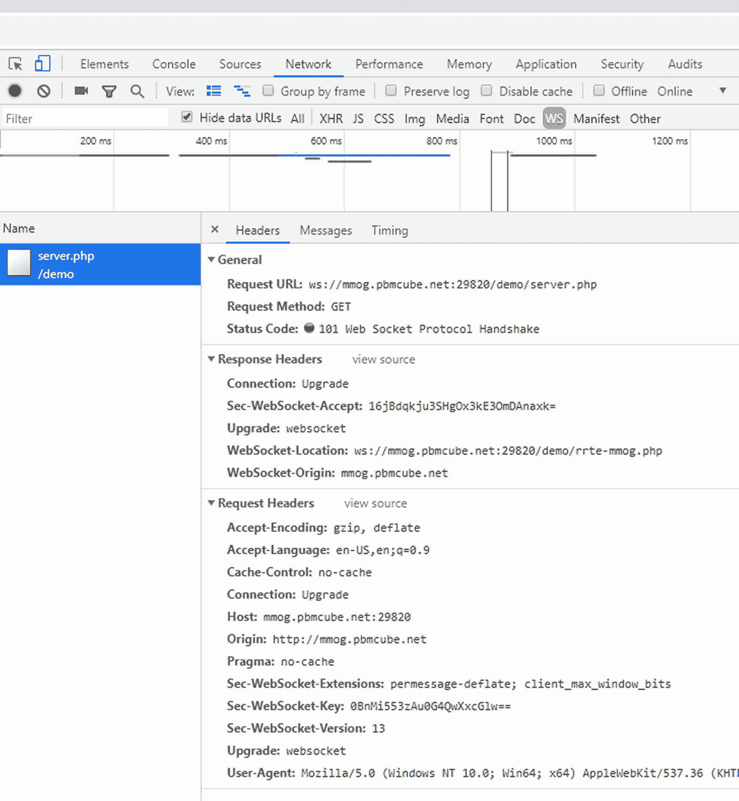

### 在开发者工具中观察 WS 消息内容交换

```
 1     响应头部 . . .
2     HTTP/1.1 101 Web Socket Protocol Handshake  
3     Upgrade: websocket  
4     Connection: Upgrade  
5     WebSocket-Origin: mmog.bmcube.net  
6     WebSocket-Location: ws://mmog.bmcube.net:30113/demo/rrte-mmog.php  
7     Sec-WebSocket-Accept: EZtDpyc+cXnbdzXW1QCmdm//Y= 
```

. . 并接收到以下

## 6.3 示例源代码：客户端 WebSocket

客户端非常简单；它仅仅是 `index` 页面的一段 JavaScript。一旦我们知道 MMoG 应用服务器正在运行 —— 即我们 WebSocket 通道的远程端 —— 你的玩家就可以通过你的 “Web 服务器” 连接到它，并 “订阅从你的 MMoG 应用服务器推送的游戏消息”。玩家将通过被称为 “WebSocket 握手” 的过程建立 WebSocket 连接。当玩家从 Web 服务器访问 “游戏的 `index page`” 以进入特定游戏时，此 “握手” 便开始了。随后，Web 服务器将在此请求中包含一个 `Upgrade header`（升级头），告诉 “MMoG 应用服务器” 玩家想要建立 WebSocket 连接。所有这些内容在第一部分已经涵盖过了，这仅仅是回顾。


## 总结我们的 4 步开发流程（第 5 章）

1. **第 1 步：** 在游戏的索引页面中，创建一个 JavaScript WebSocket 对象 —— 它是通往 MMoG 服务器 URL 的客户端通道。

2. **第 2 步：** 为以下事件生成代码 —— 将 `onopen`、`onclose` 和 `onerror` 作为 WebSocket 事件处理程序。构建 `onmessage` 事件处理器（客户端的主力军，并可能是代理服务器），用于处理、反序列化并读取所有来自 `MMoG 应用服务器` 的入站游戏回合响应（GTR）。

3. **第 3 步：** 使用 WebSocket `send()` 方法向 `MMoG 应用服务器` 发送游戏回合指令（GTO）“消息”。这是后续章节以及第四部分的主题，届时我们将创建游戏回合指令和服务器的游戏结果。

4. **第 4 步：** 使用 WebSocket `close()` 方法关闭到 `MMoG 应用服务器` 的客户端 WebSocket 连接，并过渡到新的游戏阶段。


在所有这些情况下，[WebSocket 连接关闭代码](https://html.spec.whatwg.org/multipage/infrastructure.html#concept-websocket-close-code) 都应该是 1006，符合 WebSocket 协议规范。[WSP](https://html.spec.whatwg.org/multipage/references.html#refsWSP)

### 第 1 步：游戏 `index` 页面

```
 1     <!doctype html>  
 2     <html lang="en">  
 3     <head>  
 4       <meta charset="utf-8">  
 5       <link rel="dns-prefetch" href="http://mmog.pbmcube.net/">  
 6       <title>WebSocket MMoG Client Example</title>  
 7       
 8       <!-- Typically Phaser Library is here with your gaming scripts -->  
 9       
10     </head>  
 11     <body>  
 12       <h1>MMoG Client-side via WebSockets</h1>  
 13       <p>打开 JavaScript 控制台查看运行情况！  
 14       注意，我们现在没有使用 Node.js 或 Socket.IO；我们只是  
 15       暂时使用你的原生浏览器。</p>  
 16       <form>  
 17         <label for="message">Send a Game Turn</label>  
 18         <input id="message" name="message" type="text">  
 19         <button id="send" name="send">Submit</button>  
 20       </form>  
 21       
 22     <!-- 秘诀在于这个外部文件  
 23         或直接插入脚本。 -->  
 24       <script src="ws_client.js"></script>  
 25     </body>  
 26     </html>
```

**带有 WebSocket 的典型 `index.html`**

此 `index.html` 文件（如所示）放置在 `WWW` 服务器上；它会被发送到玩家的浏览器。客户端浏览器运行创建 WebSocket 通道的 JavaScript。该文件可以在“项目游戏启动包”中找到，地址为：

* [`makingbrowsergames.com/mmog/bonusContent/WebSockets.zip`](http://makingbrowsergames.com/mmog/bonusContent/WebSockets.zip) 或

* 在你的附赠内容（Bonus Content）中下载 `index.php`，地址为 [`makingbrowsergames.com/mmog/bonusContent/mmog-server-side.zip`](http://makingbrowsergames.com/mmog/bonusContent/mmog-server-side.zip)

### 第 2 步：生成事件处理器

让我们关注闭合 `</body>` 标签之前的那段 JavaScript。初始化 WebSocket 就像下面几行 JQuery 代码一样简单。创建一个名为 `ws_client.js` 的外部文件，或直接将以下脚本插入 `index.html` 中——在你的附赠内容中搜索 `/WebSockets/` 目录，并在该目录下查找 [`ws_client.js (点击查看)`](http://makingbrowsergames.com/mmog/bonusContent/WebSockets/ws_client.js) 或 [在此处在线测试：](http://makingbrowsergames.com/mmog/bonusContent/WebSockets/WebSocketTest.html)

```javascript
 (function () {  
     // ---------------------------------
     // 你可以检查已队列但尚未传输到服务器的
     // 字节数，如果客户端应用程序向服务器
     // 传输了大量数据，这非常有用。  
     // ---------------------------------  
     var MAX_BUFFER = 8192;  
  
     // ---------------------------------  
     // 警告！永远（NEVER）使用 WEBSOCKET 12345！  
     // 端口 12345 是已知的病毒；  
     // 参考《Phaser 多人游戏系统》
     // 第 6.2 节 WebSocket 协议握手
     // ---------------------------------
     // 创建新 WebSocket (url, 可选的子协议)
     var ws = new WebSocket('ws://localhost:12345', 'echo-protocol');  
  
     //============================  
     // 步骤 2: 四种 WebSocket 协议消息
     //============================  
     // WebSocket 事件：  
     // 你只需为 WebSocket 对象添加回调函数，  
     // 或者可以在你的 WebSocket 对象上使用  
     // addEventListener() DOM 方法。在尝试发送
     // 任何消息之前，实现这些事件是非常重要的。  
     // ---------------------------------  
     // 步骤 #4: 关闭客户端通道  
     // FIN 完成并正在清理连接。  
     ws.onclose = function (event) {  
         console.log('Connection closed.');  
     }  
  
     // "close" addEventListner 示例
     // 设置套接连接关闭时的处理程序
     // websocket.addEventListener("close", function() { ...}  
  
     // 哎呀！发现了 TCP/IP 忽略的  
     // RTT 或 RTO 问题  
     // 更多潜在错误请参 RFC6455 第 5.1 节。
     ws.onerror = function (event) {  
         console.log('An error occurred. Sorry for that.');  
     }  
     // ---------------------------------  
  
     // 发往和来自的对话/对话消息
     // 我们将在后面的章节和第四部分讨论这个主题。  
     // 备用方法：  
     //     ws.onmessage = incomingMsg(event);  
     // "message" addEventListner 示例
     // 设置套接字接收消息时的处理程序
     // websocket.addEventListener("message", function() { ...}  
     ws.onmessage = function (event) {  
         console.log('Response from server: ' + event.data);  
     }  
  
     ws.onopen = function (event) {  
         console.log('Connection opened.');  
         // 尝试每秒发送一次？  
         setInterval( function() {  
             if (ws.bufferedAmount < MAX_BUFFER) {  
                 ws.send(checkTheStatusAndSendData());  
             }  
         }, 1000);  
     }  
  
     // 添加我们的自定义处理  
     // readyState 属性可能有四个值之一：  
     // - CONNECTING（连接尚未完全打开）  
     // - OPEN（连接已打开并准备好通信）  
     // - CLOSING（连接正在关闭过程中）  
     // - CLOSED（连接已关闭或无法打开）  
     // 了解当前状态对于排查
     // 你的应用程序非常有帮助。  
     ws.sendMessage = function (message) {  
         if(ws.readyState === ws.OPEN){  
             this.send(message);  
             console.log('Message sent: ' + message);  
         } else {  
             console.log('Connection failed.')  
         } 
     }  
  
     // 将创建的游戏回合顺序附加到消息帧
     document.getElementById('send').addEventListener('click',  
     function (event) {  
         event.preventDefault();  
         var message = document.getElementById('message').value;  
         ws.sendMessage(message);  
     });  

 })(); 
```

测试一个 WebSocket 脚本 (`ws_client.js`)

查看上面的示例代码。它包含了几个事件中的 WebSocket API —— `onclose`、`onerror`、`onmessage` 和 `onopen`。仅此而已！向服务器发送消息使用 `send()` 方法，从服务器断开连接使用 `close()` 方法。为什么大家都要把它变得这么复杂？而且！它在 95% 的浏览器中都是**原生**支持的！

本章节节自 [PhaserJS 游戏设计教程](https://leanpub.com/phaserjsgamedesignworkbook/read_sample)。它介绍了防止你的 MMoG 遭受盗版尝试的方法。

## MMoG 保护

你将花费许多小时来开发你的游戏；正如你在第一部分中学到的，版权只保护你想法的具体表达——而不保护想法本身！Yahoo 用户界面团队在下方的注释中提供了一个提示，标题为 [最小化与混淆](https://yuiblog.com/blog/2006/03/06/minification-v-obfuscation/)。（参见附录中的引用。）

尽管 Yahoo 的建议听起来有些无眉无力，但我提供了一个“鼓励盗版”的建议。听起来很奇怪吗？这将在服务器端的章节中介绍。

## 深度解析：WebSocket 安全

从安全的角度来看，在服务器端的连接握手过程中确认源 `Origin` 标头（与预期的源进行对比）是非常重要的，以避免“跨站 WebSocket 劫持”攻击。（参考第二部分的 Drown 攻击）。当连接使用 `Cookies` 或 `HTTP 认证` 进行验证时，就会发生这种情况。三分之一的 DNS 服务器容易受到 [`钓鱼攻击（观看这段 2 分钟的短视频）；`](https://youtu.be/1d1tUefYn4U)，不要让你的 MMoG 应用服务器成为类似攻击的受害者。更好的建议是使用令牌（或类似的保护机制）来验证 WebSocket 连接，特别是当通过 WebSocket 传输敏感数据时。

## 深度解析：“粘性负载均衡”

### <iframe> 的使用

使用 `<iframe>`（内联框架的缩写）的原因是“…终极模块化工具，允许你拆分内容、无缝地显示来自其他来源的内容，并更好地管理下载。它是任何网页设计师工具箱中的必备品。”（参见脚注 1）

开发者部署 `iframes`（而不是 AJAX）的其他可能原因可能是：

1.  `Iframes` 绕过了跨域源策略；而图像、脚本和样式则不会。这种技巧对于从其他域名相对安全地获取内容是有益的。结果是在不破坏他人页面内容和样式的情况下展示外国内容——这是 JSONP 能够做到的。

2.  `Iframes` 不受限于单一资源 MIME 类型。Google Gmail 是一个完美的例子，因为它是一组内联框架。

3.  糟糕的设计设计或诉诸简单的修复方法。

然而，`<iframe>` 的问题在于，每当你从浏览器中导航到 HTML5 游戏时，该游戏的 `<iframe>` 不会自动获得“焦点”。这意味着玩家在游戏接受任何键盘输入之前，必须点击游戏显示的 `<iframe>`。很烦人吗？确实是！

其他网页开发者指出了许多理由来进一步[避免使用 iframe](http://stackoverflow.com/questions/23178505/good-reasons-why-not-to-use-iframes-in-page-content)。但尽管他们叫得如此惊人，仍几个游戏分发渠道仍然坚持使用 `iframes`，通过游戏内容隔离来维护其网站的完整性。

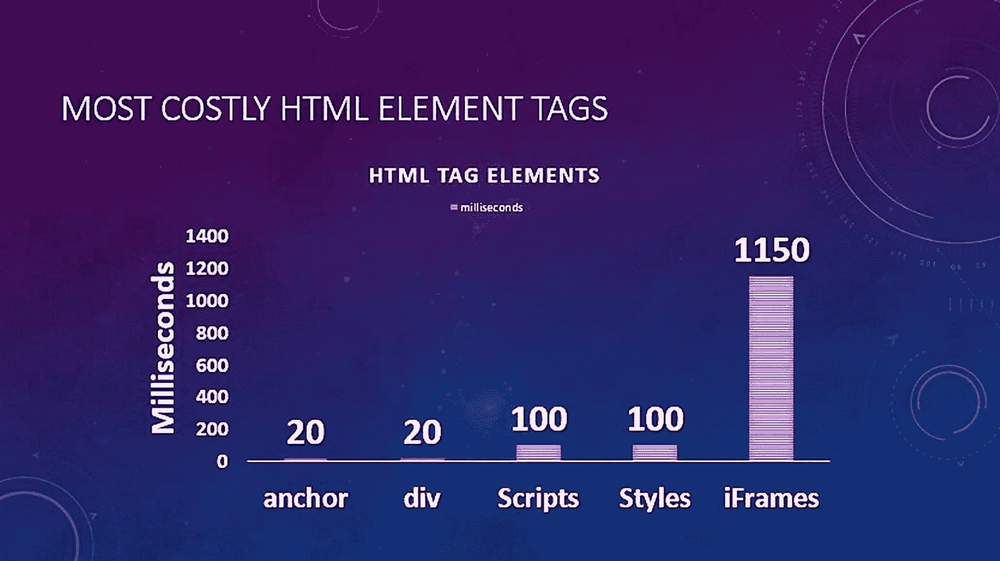

### 主要是昂贵的网页元素

```
1     <script>  
2         document.onload = function() {  
3         document.getElementById('frame').focus();  
4     };  
5     </script>    
6     <iframe id="frame" width="768" height="480" src="yourDomain.com"> 
```

## 6.5 最后一件事

我们已经准备好了客户端 WebSocket，但没有人来接收我们的游戏回合指令 (GTO)。这就像是“单手拍掌”。让我们完成下一章，这样我们就能用“双手”来制造一些声响了。

### 智能（厚）客户端 vs. 笨（瘦）客户端

| 类型 | 优点 | 缺点 |

| --- | --- | --- |

| 智能客户端 | 实时交互。最适合部署在广域网 (WAN)。部分或完整的游戏状态预测。在“当下”看到游戏。消息队列管理。可以进行客户端预测。高动画帧率。减少服务器处理所有游戏逻辑。 | 部分（或全部）游戏逻辑在内部。本地游戏状态与游戏服务器不匹配。插入了无效命令。（作弊）。服务器返回“过去时间”的状态。必须等待服务器命令的 ACK。按时间间隔向服务器输入。在与其他玩家的实时交互中难以进行死性推算。 |

| 笨客户端 | 最适合慢速回合制游戏。最适合部署在局域网 (LAN)。不太可能客户端预测。很少或没有动画。向服务器的输入是可预测的。 | 所有游戏逻辑都在外部。对网络延迟敏感。实时交互游戏的最差选择。游戏物理在服务器上。服务器必须执行所有游戏逻辑。 |

## 6.6 章节总结

对于这样一个短章节，我们取得了许多成就！以下是我们做的事情……

*   发现了如何以及在何处测试浏览器的 WebSocket 能力。

*   在没有 `Socket.IO`、`Node.js` 或 `Express.js` 的情况下创建了 WebSocket 通道。

*   创建了我们的 MMoG `index.html` 页面。

*   测试了浏览器与 WebSocket 协议的兼容性。

*   找到了两个 WebSocket 测试网站。

*   观察了我们的 WWW 连接升级到 WebSocket。

*   发现 WebSocket 协议进行了封装（即帧）。

*   回顾了 [PhaserJS 游戏设计教程](https://leanpub.com/phaserjsgamedesignworkbook/read_sample) 用于 MMoG。

*   一个指导我们如何在 MMoG 系统中放置源代码的模型。

*   草拟哪些代码函数位于何处。

为了使用 WebSockets，你已经测试了浏览器、测试了我们的 Web 服务器，并启动了 socket 应用服务器，它们在没有没有 `Socket.IO`、`Node.js` 或 `Express.js` 帮助的情况下都支持 RFC 6455 WebSocket 协议。在第二部分中你获得了几个测试站点；现在是时候创建自己的后端服务器和云端服务了。你已经从第一部分研究了这项初始投资涉及谁、在哪里以及成本需要多少。在上一章中，你已经针对我们提供的基于互联网的 socket 测试站点构建并测试了客户端。你需要在本地开发工作站上一个传统的 Web 服务器，类似于你打算作为主机提供者的任何 ISP（例如 `Apache` 或 `IIS`），用于提供你游戏的动态内容——需要我提醒你，你的本地开发工作站应该模拟你的公共 MMoG 服务器吗？你还记得在第一部分中 `Node.js` 和 `Express` 提供静态内容并针对 I/O 进行了优化吗？对吧？你已经下载并学习了[`Project-GameStarterKit`.](http://makingbrowsergames.com/mmog/bonusContent/WebSockets.zip) 对于这一章，你需要这些服务器端文件。

*   [`makingbrowsergames.com/mmog/bonusContent/mmog-server-side.zip`](http://makingbrowsergames.com/mmog/bonusContent/mmog-server-side.zip)

*   或者 [`makingbrowsergames.com/mmog/bonusContent/ws.zip`](http://makingbrowsergames.com/mmog/bonusContent/ws.zip) 附有简单的[安装指南](https://github.com/ghedipunk/PHP-Websockets/wiki/Getting-Started)

现在是时候构建你自己的 MMoG App 服务器来拦截上一章中的那些 WebSocket 请务了。你还记得在第一、第二部分中，你可以在服务器端使用几乎任何编程中间件语言编写 WebSockets。你需要你的服务器将读取并处理的游戏命令列表（即游戏回合顺序 (GTO)）。这里再次给出第 5 章的建议列表。你会发现这些建议都是（系统消息）——管理游戏会话的数据。我们需要用第四部分中找到的“游戏玩法”命令更新此列表。

用于 MMoG 管理客户端 GTO 建议（按字母顺序排列）来自第 5 章：回顾[你附赠内容中的这张图表](http://makingbrowsergames.com/mmog/bonusContent/MMoG-API.pdf)，关于客户端和服务器端的 REST API。

*   `cancelGame` — 发起游戏请请的玩家撤回了请求

*   `gtoCommand` — （系统消息）“type”属性为请求的操作

*   `create_failed` — （系统消息）反馈

*   `created` — （系统消息）反馈

*   `dead` — （系统消息）关于对手的通知

*   `endGame` — （系统消息）通知

*   `error` — （系统消息）关于 GTO 的反馈

*   `gameOver` — 将 Phaser 迁移到 gameOver 阶段

*   `initRound` — （系统消息）为新游戏重置变量

*   `join_failed` — （系统消息）通知

*   `joined` — （系统消息）成功进入现有游戏

*   `latency` — （系统消息）关于网络延迟的测试

*   `pong` — （系统消息）对服务器 ping 测试的响应

*   `rooms` — （系统）关于可用游戏的数据

*   `tick` — （系统）用于同步的时间戳数据

一旦这个 `MMoG App Server` 运行，我们的玩家就可以通过我们的 Web 服务器连接并订阅从此服务器推送的游戏消息。我们将从上一章的简单聊天消息服务器开始；因为在玩家之间发送 `chat messages` 与向我们的 `MMoG App server` 发送游戏命令没有区别。此外，构建 `chat server` 是玩家之间发送消息的另一个 MMoG 功能。


WebSocket 升级对话框

玩家将通过我们在之前的章节中学习并应用的“WebSocket 握手”过程建立 WebSocket 连接。这从玩家访问“index”页面请求进入 MMoG 服务器时开始。我们了解到在游戏的 `index.html` 文件中`Upgrade header` 是 `ws_client.js`。这些内容在之前的章节中已详�介绍，这应该是简单的回顾。

## 7.1 构建 Socket 服务器

使用 WebSocket 为服务器端游戏应用创建了一种全新的使用模式。你还记得 AJAX 和轮询已经过时，并被 WebSockets 取代了。虽然传统的 Web 服务器是围绕无状态的 HTTP/TCP 80 端口请求/响应设计的；它们完全无法处理游戏服务器所需的大量开放连接。保持大量此类持久连接同时打开——需要架构发生转变，以便能够以较低的 CPU 性能成本接收高并发的“输入/输出”（I/O）并发。此类架构通常围绕多线程或非阻塞 I/O（又名 Node.js）设计。`Node JS` 是此类任务的候选者，我们已经在第一部分和第二部分中学习了在何时、为什么以及如何恰当地使用它。


新的 MMoG 数据流

为 WebSocket 服务器编写源代码要稍微复杂一些。“为什么呢？”你问道。因为 WebSocket 协议不仅仅是简单的接字绑定，它实际上是一个需要持续运行的守护进程。使用 `PHP 7`，我无法将服务器作为普通的 `PHP` 页面运行——页面有 30 秒的超时。我需要从命令行运行我的 `PHP` MMoG 脚本。你的公共生产服务器有命令行 (CLI) 权限吗？对吧？

我们有类似的服务器端选择；我们可以将 MMoG APP 服务器作为`专用`、`托管 PaaS`、`厚`、`薄`以及`厚/无状态`服务器架构。哪种部署取决于我们对服务器和游戏逻辑的需求。维基百科提供了这些定义。

根据我们的游戏意图，服务器还承担这些额外责任。其中几个角色可以变成水平微服务。

*   `Authoritative` — 如果客户端预测错误，从服务器传输的信息将覆盖本地客户端信息。这确保了客户端本地数据不会与其他客户端的数据产生“偏差”。

*   `Collision & Physics` — 服务器执行碰撞检查和影响游戏对象的物理计算（如刚体动力学）。如果你打算以“无头”模式使用 Phaser，将分配此任务。然而，我强烈建议你重新考虑这种设计方法以及网络延迟、抖动和延迟对你游戏的影响。

*   `Datablocks` — JSON 数据块在任务或场景的启动阶段发送。服务器拥有客户端下载的所有 JSON 数据块。你可能想要考虑使用 `W3Schools AppML`。这意味着服务器只需要在需要时发送数据块，并可以为不同的关卡或任务发送新的数据块。

*   **Ghosting（幻影同步）** — 服务器跟踪游戏中的所有“活跃”对象，并通过“作用域（Scoping）”、“[路由 RPC（rRPC）](https://wamp-proto.org/intro.html#wamp)”或“感兴趣区域（AoI)”为每个每个对象创建“幻影”或将数据副本发送给客户端。[学习如何在 JavaScript 中设置和使用 AoI（下载源码）](http://docs2x.smartfoxserver.com/ExamplesJS/simple-mmo)。这意味着服务器拥有一个所有活跃游戏对象的主列表，并向客户端本地游戏发送每个对象的更新信息。或者，它也可以简单地变成一个“透传”服务器——类似于 Skype——正如[释放你的代码 - 在浏览器中使用后端](https://crossbario.com/blog/Free-Your-Code-Backends-in-the-Browser/) 中讨论的那样。

*   **消息路由 (Message Routing)** — 服务器可以在客户端之间发送消息，例如游戏聊天。更好的方法是提供当前游戏参与者列表并允玩家使用“点对点”消息传递。[RabbitMQ](https://www.rabbitmq.com/getstarted.html) 和 [ZeroMQ](https://blog.scottlogic.com/2015/03/20/ZeroMQ-Quick-Intro.html)（也写作 ØMQ, 0MQ 或 ZMQ）是为此目的部署最广泛的开源消息代理。在这些服务器端教程中[学习如何](https://www.rabbitmq.com/getstarted.html)使用 RabbitMQ。

*   **作用域 (Scoping)** — 作用域有助于区分每个客户端感知到的内容，这样我们的游戏引擎就不需要发送不必要的更新。游戏对象在游戏启动的第二阶段初始幻影同步到客户端，以节省带宽并最大限度地减少网络延迟。

*   **安全性 (Security)** — 服务器可以将行为异常的用户和作弊者踢出游戏，并配置为检测由恶劣客户端执行的“外挂”。

## 服务器需求考量

无论我们实现何种中间件语言，都应该考虑以下几个要求。

1.  我们的中间件必须能够对可用端口进行 `listen` 以接收的流量。通常，它将使用其自身的架构的标准 HTML 端口 80 和/或 443。对这些标准 Web 端口进行 `Listening`（即绑定）是为了避开我们在生产环境部署中可能遇到的代理和防火墙问题——这正是`大玩家们`的玩法！

2.  你不能同时在同一个 IP 地址的相同端口上运行 WebSocket 服务器和 `WWW` 服务器。你既可以在独立 IP（即服务器）的 80 或 443 标准端口上运行它，也可以在同一台机器的 1023 之上不同的未未使用端口上运行。我的意思是，你可能不被允许在共享托管账户上运行你的 WebSocket 服务器。我很幸运，我的[ISP 允许运行 WebSocket 服务器。](http://gose-internet-services.net/)。

3.  如果你选择将 WebSocket 服务器放置在非标端口，请双重检查你的防火墙不会阻止该流量。

4.  你必须有一种方法让你的中间件持久运行。

## 深度解析：测量网络延迟

```
 1     // 游戏时钟每 100 毫秒运行一个 tick
 2     var gameTimeout = 100;
 3     
 4     function measureLatencyStart(player) {
 5         var measurement = { start: Date.now() };
 6         player.rttLatency.push(measurement);
 7         var clientMessage = { type: "latency-ping" };
 8         player.connection.send(JSON.stringify(clientMessage));
 9     };
10     
11     function measureLatencyEnd(player) {
12         // 完成当前测量的计算
 13         var crntMeasuremnt = player.rttLatency[player.rttLatency.length - 1];
 14         crntMeasuremnt.end = Date.now();
 15         crntMeasuremnt.roundTrip = crntMeasuremnt.end - crntMeasuremnt.start;
 16         // 计算目前为止所有往返的平均往返时间
 17         var totalTime = 0;
 18         player.rttLatency.forEach(function (measurement) {
19         totalTime += measurement.roundTrip;
20     });
21     
22     player.averageRoundTrip = totalTime / player.rttLatency.length;
```

测量并补偿延迟

## 7.2 服务器页面


## 复习第 5 章 MMoG 架构

此包的内容安装在 `MMog App Server` 上——参见上方 #2 “WebSocket 升级”插图。当你学习此包时首先注意到的点是——随处没有 `NODE.js`！事实上，发现 `PHP` 作为中间件你不应该感到惊讶。我们在第一部分和第二部分中涵盖了这些内容。我们那时了解到 `PHP` 的性能优于 `Node.js`，并取代了 `Express.js` 辅助 `Node.js` 的支持中间件函数。

`PHP` Socket 源代码与 JavaScript 非常相似。

此包的内容安装在 `MMog App Server` 上——参见上方 #2 “WebSocket 升级”插图。当你学习此包时首先注意到的点是——随处没有 `NODE.js`！事实上，发现 `PHP` 作为中间件你不应该感到惊讶。我们在第一部分和第二部分中涵盖了这些内容。我们那时了解到 `PHP` 的性能优于 `Node.js`，并取代了 `Express.js` 辅助 `Node.js` 的支持中间件函数。

`PHP` Socket 源代码与 JavaScript 非常相似。

此包的内容安装在 `MMog App Server` 上——参见上方 #2 “WebSocket 升级”插图。当你学习此包时首先注意到的点是——随处没有 `NODE.js`！事实上，发现 `PHP` 作为中间件你不应该感到惊讶。我们在第一部分和第二部分中涵盖了这些内容。我们那时了解到 `PHP` 的性能优于 `Node.js`，并取代了 `Express.js` 辅助 `Node.js` 的支持中间件函数。

`PHP` Socket 源代码与 JavaScript 非常相似。

### 客户端

此包的内容安装在 `MMog App Server` 上——参见上方 #2 “WebSocket 升级”插图。当你学习此包时首先注意到的点是——随处没有 `NODE.js`！事实上，发现 `PHP` 作为中间件你不应该感到惊讶。我们在第一部分和第二部分中涵盖了这些内容。我们那时了解到 `PHP` 的性能优于 `Node.js`，并取代了 `Express.js` 辅助 `Node.js` 的支持中间件函数。

`PHP` Socket 源代码与 JavaScript 非常相似。

### 客户端代码

此包的内容安装在 `MMog App Server` 上——参见上方 #2 “WebSocket 升级”插图。当你学习此包时首先注意到的点是——随处没有 `NODE.js`！事实上，发现 `PHP` 作为中间件你不应该感到惊讶。我们在第一部分和第二部分中涵盖了这些内容。我们那时了解到 `PHP` 的性能优于 `Node.js`，并取代了 `Express.js` 辅助 `Node.js` 的支持中间件函数。

```javascript
var socket = new WebSocket("ws://localhost:8080");

socket.onopen = function(event) {
    console.log("Connected");
};

socket.onmessage = function(event) {
    console.log("来自服务器的消息: ", + event.data);
};

socket.onclose = function(event) {
    console.log("Disconnected");
};

socket.onerror = function(error) {
    console.log("Error: ", error);
};

socket.send("Hello Server!");
```

### 服务器代码

此包的内容安装在 `MMog App Server` 上——参见上方 #2 “WebSocket 升级”插图。当你学习此包时首先注意到的点是——随处没有 `NODE.js`！事实上，发现 `PHP` 作为中间件你不应该感到惊讶。我们在第一部分和第二部分中涵盖了这些内容。我们那时了解到 `PHP` 的性能优于 `Node.js`，并取代了 `Express.js` 辅助 `Node.js` 的支持中间件函数。

```php
<?php
$server = new Ratchet\Server\IoServer(
    new Ratchet\WebSocket\WsServer(
        new Ratchet\Http\HttpServer(
            new MyChatHandler()
        )
    ),
    8080
);
$server->run();
```

### 总结

此包的内容安装在 `MMog App Server` 上——参见上方 #2 “WebSocket 升级”插图。当你学习此包时首先注意到的点是——随处没有 `NODE.js`！事实上，发现 `PHP` 作为中间件你不应该感到惊讶。我们在第一部分和第二部分中涵盖了这些内容。我们那时了解到 `PHP` 的性能优于 `Node.js`，并取代了 `Express.js` 辅助 `Node.js` 的支持中间件函数。

# WebSocket 服务器

WebSocket 服务器的工作方式与 WebSocket 客户端类似。它响应事件并执行操作。无论你选择哪种中间件编程语言，每个 WebSocket 服务器都会执行特定的操作。它被初始化为一个 WebSocket URL 地址，处理 `OnOpen`、`OnClose` 和 `OnMessage` 事件，并向端客户端返回或推送消息。服务器端 MMoG App 在处理我们的游戏和/或客户端代理服务器时承担着几个重要责任，我们稍后将学习：

1. 打开服务器端 WebSocket。

2. 绑定到地址和端口。

3. 持续监听任何入站连接。首先，我们的 MMoG App 服务器必须持续监听传入的连接请求。这不会是一个典型的“PHP” 页面——或者无论你为服务器上的 `middleware engine` 选择了什么——因为这些页面在默认设置的 30 秒后会“超时”。它必须是一个后台 `daemon process`（守护进程）——一个响应服务请求的长运行后台进程。查阅第 4.8 节“无服务器替代方案”以及可能的 ISP 托管服务（IaaS, PaaS, [`Linux Containers`](http://gose-internet-services.net/openvz-vps-2/))）。

4. 处理、确认、关闭并更新退出或新加入当前游戏会话的连接。安全性可能是一个问题；因此我们应该测试请求的 `origins`。我们的 MMoG App 必须仅响应授权的 WebSocket 握手请求——特别是当你使用按需付费的服务时——查阅第 4.8 节“无服务器替代方案”……`每个 dyno 7 美元的 dyno 池`。

5. 读取入站的游戏回合顺序 (GTO)，从传入的 WebSocket 帧中提取 GTO 信息，跟踪客户端活动，记录当前游戏状态，访问持久数据库存储，插入新记录，更新现有记录 [`ACID 或 BASE`](https://www.dataversity.net/acid-vs-base-the-shifting-ph-of-database-transaction-processing/)，并向当前活跃参与者发送游戏回合结果 (GTR)。（参阅《Legends of Renown Deeds》的游戏规则以获取各种命令。）

6. 管理“Ping 和 Pong 包”并根据网络延迟调整计时。

7. ……并可能支持我们可能创建的任何子协议或扩展。

以下 [`mmog.pbmcube.net/index.php`](http://mmog.pbmcube.net/index.php) 的示例副本使用了最基本的 WebSocket 协议并提供简单的回显响应。虽然接下来的示例看起来很复杂，但你可以从这里下载更精简的版本：[`PHP WebSocket Server`](http://www.abrandao.com/lab/websocket/ws.zip)

要运行此类 PHP 页面，你需要访问服务器的命令行并使用此命令启动服务器：

从你的额外内容下载这个 4 页的文件：[`makingbrowsergames.com/mmog/bonusContent/_server.pdf`](http://makingbrowsergames.com/mmog/bonusContent/_server.pdf)

* 第 1 行：使用 `PHP7` 运行此文件。

* 第 2 行：启动 `PHP` 脚本标签。

* 第 3 到 5 行：为服务器端 WebSocket 连接提供配置信息。

* 第 8 行：创建一个具有这些属性的 WebSocket。

    * 地址族：`AF_INET`（这是 IP 地址版本 4）。

    * 类型：`SOCK_STREAM`（这意味着这是一个 TCP 协议连接）。如果使用 `SOCK_DGRAM`，则表示使用 UDP 协议。“连接”的概念适用于 `SOCK_STREAM`/TCP` 类型的套接字。连接意味着可靠的数据“流”，以便有多个这样的流，每个流都有自己的通信。将其想象成一根不受其他数据干扰的管道。其他如 `UDP`、`ICMP`、`ARP` 套接字没有“连接”的概念。这些是非基于连接的通信。这意味着你可以继续向任何人发送或接收数据包。

    * 协议：`0`（或用于 IP 协议的 `IPPROTO_IP`）。

* 第 11 行：设置 WebSocket 管理的选项。查阅 [`socket-set-option`](http://php.net/manual/en/function.socket-set-option.php)。

* 第 14 行：将 IP 绑定到 Socket。通过这种操作，我们确保此端口上的所有入站请求都由我们的 MMoG App 接收。显然你不能有两个套接字绑定到同一个端口。该规则有例外，但那是为了高级系统架构考虑。

* 第 17 行：在所选端口上开启持久监听。我们可以为函数 `socket_listen` 使用第二个参数 `backlog`。它控制当程序已经忙时保持“等待”状态的入站连接数。因此，如果我们指定 10，意味着如果有 10 个连接将排队等待。如果收到第 11 个连接请求，它将被拒绝。

* 第 20 行：构建客户端连接的简单列表（`Socket.IO` 在此时会添加 `namespaces` 且不保证顺序交付）。我们将使用其他数据结构组合，为每个活跃的游戏会话提供一个带有桌子或房间的大厅。

* 第 23 到 95 行：保持我们的 Socket 服务器存运行。如果此循环停止，我们的游戏 MMoG 就崩溃了。

* 第 98 行：关闭该玩家连接的套接字。

* 第 100 到 183 行：详细注释并描述每个块的作用。

* 第 180 行：你必须插入你的 `MMoG Server` 文件名。

## 7.3 Phaser 在哪里！？

WebSocket 服务器的工作方式与 WebSocket 客户端类似。它响应事件并执行操作。无论你选择哪种中间件编程语言，每个 WebSocket 服务器都会执行特定的操作。它被初始化为一个 WebSocket URL 地址，处理 `OnOpen`、`OnClose` 和 `OnMessage` 事件，并向端客户端返回或推送消息。服务器端 MMoG App 在处理我们的游戏和/或客户端代理服务器时承担着几个重要责任，我们稍后将学习：

1. 打开服务器端 WebSocket。

2. 绑定到地址和端口。

3. 持续监听任何入站连接。首先，我们的 MMoG App 服务器必须持续监听传入的连接请求。这不会是一个典型的“PHP” 页面——或者无论你为服务器上的 `middleware engine` 选择了什么——因为这些页面在默认设置的 30 秒后会“超时”。它必须是一个后台 `daemon process`（守护进程）——一个响应服务的长运行后台进程。查阅第 4.8 节“无服务器替代方案”以及可能的 ISP 托管服务（IaaS, PaaS, [`Linux Containers`](http://gose-internet-services.net/openvz-vps-2/))）。

4. 处理、确认、关闭并更新退出或新加入当前游戏会话的连接。安全性可能是一个问题；因此我们应该测试请求的 `origins`。我们的 MMoG App 必须仅响应授权的 WebSocket 握手请求——特别是当你使用按需付费的服务时——查阅第 4.8 节“无服务器替代方案”……`每个 dyno 7 美元的 dyno 池`。

5. 读取入站的游戏回合顺序 (GTO)，从传入的 WebSocket 帧中提取 GTO 信息，跟踪客户端活动，记录当前游戏状态，访问持久数据库存储，插入新记录，更新现有记录 [`ACID 或 BASE`](https://www.dataversity.net/acid-vs-base-the-shifting-ph-of-database-transaction-processing/)，并向当前活跃参与者发送游戏回合结果 (GTR)。（参阅《Legends of Renown Deeds》的游戏规则以获取各种命令。）

6. 管理“Ping 和 Pong 包”并根据网络延迟调整计时。

7. ……并可能支持我们可能创建的任何子协议或扩展。

以下 [`mmog.pbmcube.net/index.php`](http://mmog.pbmcube.net/index.php) 的示例副本使用了最基本的 WebSocket 协议并提供简单的回显响应。虽然接下来的示例看起来很复杂，但你可以从这里下载更精简的版本：[`PHP WebSocket Server`](http://www.abrandao.com/lab/websocket/ws.zip)

要运行此类 PHP 页面，你需要访问服务器的命令行并使用此命令启动服务器：

4. Phaser `v2.x.x` 和 `v3.x.x` 都支持 JSON —— 这是驱动任何 JSON-RPC 请求和响应所必需。因此，你可能会选择传输 JSON 游戏更新、数据、游戏阶段和配置。你获得的优势是双向传输以及服务器对新更新的推送。

5. 在使用 Phaser 时采用一种“非传统”的方法。让我们接下来探讨这个概念。

## 7.4 扩展我们的操作

这非常令人兴奋。你现在有了一个使用 WebSockets 的功能性聊天服务器。等一下！在你开始[搞聊天服务器](https://uk.answers.yahoo.com/question/index?qid=20070101055537AALMVHy&guccounter=1) 之前；请意识到聊天服务器是在服务器之间发送消息。它的操作类似于任何 MMoG（大型在线游戏）发送和接收 `Game Turn Orders`（GTO — 发往服务器的消息）并返回 `Game Turn Results`（GTR — 发往玩家的消息）——类似于发布和订阅——从每个玩家处接收信息并将这些更新广播给游戏中的所有人。

然而，在此时，它仍然只是一个“运行中的概念证明”。我们的 MMoG 还需要几个支持功能来管理 MMoG；例如：

1. 一个供玩家见面和结识的“大厅（lobby）”。（回顾第二部分：医生诊室还是购物商城？）查看第四部分中的各种示例。

2. 一个用于公布当前数的排行榜。

3. 通过[渐进式增强](https://en.wikipedia.org/wiki/Progressive_enhancement) 为“赞会员”、“游客”和[潜水者](https://en.wikipedia.org/wiki/Lurker) 分开不同的区域。

4. 玩家的匹配服务。

5. 头像创建/生成区域。

6. 以及如果你的游戏设计需要此类功能，还有一个用于最后时刻调整的赛前启动区域。

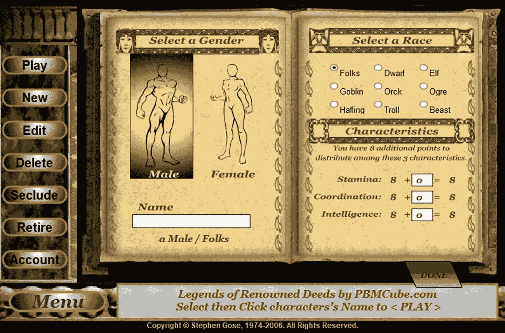

### 角色创建大厅

我确定你还有更多的想法。通过回顾这些 MMoG 特性，你注意到它们与“实际游戏玩法”（即 Phaser 游戏 `canvas` 所在的地方）无关。这些都只是围绕着“实际游戏玩法”的支持性游戏服务。我建议的是一个内容管理系统 (CMS)。

#### 深入探讨：CMS 游戏外壳

`game shell`（游戏外壳）仅仅是构建[渐进式 Web 应用 (PWA)](https://developers.google.com/web/progressive-web-apps/) 的简单方法，它可以可靠且立即加载游戏内容，类似于你在原生移动应用中看到的内容。

`game shell` 是显示游戏界面所需的最小 HTML、CSS 和 JS 技术。当它被缓存时，它可以确保玩家在返回游戏会话时获得即时、可靠良好的性能。网络提供最新或更新的游戏内容和资源。

对于游戏——“一种具有重量级 JavaScript 架构的单页应用程序”——使用 `game shell` 是[“首选方法”。](https://hbr.org/2016/06/the-go-to-market-approach-startups-need-to-adopt)。`game shell` 方案依赖于使用[service worker](https://developers.google.com/web/fundamentals/primers/service-worker/) 激进地缓存 `shell` 内容以使游戏运行。接下来，为每个游戏阶段（即 roses）加载动态游戏内容和资源。`game shell` 提供的秘诀是：让初始 HTML 到达用户设备并显示，而无需从网络获取任何内容！

换句话说，`game shell` 类似于你在构建原生移动应用时发布到任何“应用商店”的代码。`game shell` 是你的游戏用户界面 (`UI`) 的骨架（即裸机原型）以及从零开始启动游戏所需的所有原型组件……但它不包含游戏“数据逻辑”。

#### 深入探讨：何时使用游戏外壳模型

构建 PWA 并不意味着从零开始。如果你正在构建一个现代的单页应用，那么你可能已经在使用类似于 `game shell` 的东西了，无论你如何称呼它。细节可能会根据你正在使用的哪种游戏库或框架而略有不同，但该概念本身是与框架无关的！

`game shell` 架构对于任何导航相对固定但内部内容（即 `canvas`！）不断变化的游戏项目来说是最合理的。许多现代 JavaScript 游戏框架和库已经鼓励将你的游戏逻辑与其内容分离（即“关注点分离”），这使得 `game shell` 设计极具吸引力。对于某些类型的游戏——只有静态内容——你仍然遵循相同的想法，但游戏的 `canvas` 标签变成了游戏外壳的 100% —— 这是大多数发布的 `Phaser v2.x.x` 游戏和之前描述的单页游戏；它们使用单一的静态 `canvas` 标签，并在其中包含各种游戏“roses”（即菜单、部分、阶段、章节、阶段、状态、场景、屏幕、各种东西、[dumaflache](https://www.urbandictionary.com/define.php?term=dumaflache) 或 [“Ardvarks!”](https://en.wikipedia.org/wiki/Aardvark)）。

## 7.5 CMS — 服务器端框架

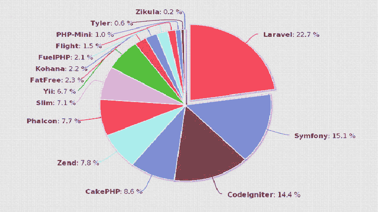

### PHP 开发框架

内容管理系统 (CMS) 是本节的主题。我们一直关注 Phaser 作为一个单页应用，但如果我们创建一个作为“游戏外壳”并在其中封装多个游戏的 MMoG 会怎样？我们该如何管理将玩家移交给子游戏，然后将他们返回游戏外壳画布？如果你熟悉公告板系统 (BBS) “门式游戏”，你很快就能明白我的方向。对于不熟悉的人，请包涵下面的解释。

几乎每个关于 Phaser 的书都介绍了如何创建一个“单页/网绚应用程序”（SPWA）——一种单玩家修改游戏状态的游戏。如果你正在构建一个“回合制”的多玩家游戏（如国际象棋或跳棋），那么你的工作就变成只需创建一个“SPWA”。单页应用程序更像应用程序，因为它们拒绝了内容管理系统可能会使用的在不同 URL 的不同页面之间移动的典型 Web 范式。

如果我们把该序列拆分为一个“树形层次结构”呢？这意味着`Main Menu`（主菜单）是一个完全`独立的画布页面或 HTML <div>`（树干），而它的各个游戏组件（玩家游戏或交互的树枝）则是独立的。这是 `Phaser3` 的一个特性，也是它从“状态（states）”到“场景（scenes）”的重构。如果你曾是 Flash 开发者，可以将新的 `Phaser3 Scenes` 想象成一个 `Flash MovieClip`。我们需要为这种游戏结构构建内容管理系统（`CMS`）。以这种方式构建游戏还允许我们轻松地将其转换为[`Android Intents`](https://acadgild.com/blog/intent-in-android-introduction)并进一步扩展到多人模式。

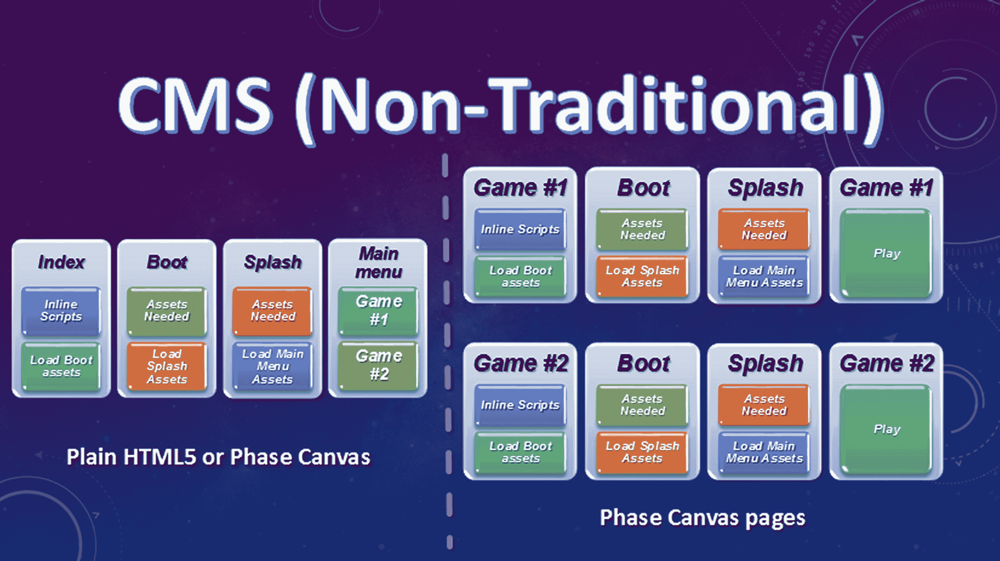

## 作为游戏的内容管理系统

每位玩家都将拥有他们正在玩的游戏 `Phaser` 画布页面。`MMoG` 服务器将提供一个`Game Lobby`（游戏大厅）作为玩家的“主菜单”，让他们选择想要进入的游戏——类似于“购物中心”风格而非“诊室”。记录上述`Single Game Flow`（单游戏流程）中使用了哪些 `JS` 模块，然后对比这些 `JS` 模块在 `MMoG` 环境中的位置。最大的影响在于玩家将使用`智能（厚 Phaser）`还是`笨（薄 Phaser）`客户端，以及服务器将使用什么角色来管理活跃的游戏。

### 索引页（非传统方法）

我更喜欢[`CodeIgniter`](https://www.codeigniter.com/) 作为我的 `CMS`，因为我可以创建我的 `MMoG` 应用以及周围的 `CMS` 内容——[在此比较 CodeIgniter 与 Joomla（以及其他 CMS）。](http://vschart.com/compare/codeigniter/vs/joomla)还有其他你可能喜欢的 `CMS`（例如，CodeIgniter 的名为`Express Engine,` 的免费开源 GUI 版本`，或者可能是`Pico, `Grav, [`GetSimple CMS`](https://en.wikipedia.org/wiki/GetSimple_CMS))），或者考虑离题到[`WordPress (ewe!!)](https://en.oxforddictionaries.com/explore/words-that-sound-like-the-thing-they-describe/)`及其流行的扩展和漏洞。[`（英语拟声词之旅游）`](https://englishlive.ef.com/blog/language-lab/whizz-bang-guide-onomatopoeia-use/)。请考虑 `Phaser` `canvas` 仅仅是一个网页或 HTML `<div>`，而 `CMS` 是一个允许访问并支持游戏服务的总大伞。你可以在[在此处查看我如何使用 CodeIgniter 的示例](http://renown-quests.com/) 或查看下方我目前的任何移动游戏网站——**注意：**`CodeIgniter` `2.x` 和 `3.x` 完全支持 `XML-RPC;`；[在此处查看它们的源代码和示例。](https://www.civil.iitb.ac.in/~t6vivin/user_guide/libraries/xmlrpc.html)

*   [`Blood Pit™`](http://www.adventurers-of-renown.com/quests/arbp.php) —— 为 `Adventurers of Renown™` 游戏系统设计的“游戏内模块”（`IGM`）任务。游戏规则书和许可证见第四部分。

*   [`Rogue Prince™`](http://www.adventurers-of-renown.com/quests/arrp.php) —— 进入 `Rulers of Renown™` 游戏系统的“游戏内模块”（`IGM`）和“网关模块”。

*   [`Ruins of Able-Wyvern™`](http://www.adventurers-of-renown.com/quests/arra.php) —— 为 `Adventurers of Renown™` 游戏系统设计的“游戏内模块”（`IGM`）。游戏规则书和许可证见第四部分。

*   [`Rulers of Renown: The Emancipation™`](http://www.adventurers-of-renown.com/quests/rrte.php) —— 进入 `Rulers of Renown™` 游戏系统的“网关模块”。

*   [`Soldiers Test™`](http://www.adventurers-of-renown.com/quests/arst.php) —— 为 `Adventurers of Renown™` 游戏系统设计的“游戏内模块”（`IGM`）。

*   [`Legends of Renown Deeds™`](https://legends-of-renown-deeds.com/) —— 为 `Adventurers of Renown™` 游戏系统扩展的活动。

注意，这些“索引”是 `.php` 中间页（替换了 `Express.js`），并从服务器端`动态执行`——**我们离多人构建已经太近了。你闻到了吗？？** 我通过使用 `CMS` 获得的优势是针对动态生成的正文内容使用通用模板，并带有标准的 `<header>` 和 `<footer>` 内容。我可以更进一步，通过`渐进式增强`，只需简单为“赞助会员”、“游客”和“潜水者”使用不同的 `<header>` 文件（见下文的“索引”）。


## 前端的通用头部和页脚

```
1     session_start();   //开始一个 php
2     class Areas extends CI_Controller {
3         public function __construct() {
4             parent::__construct();
5             $this->load->helper(array('html','form'));
6             $this->load->library('form_validation');
7             $this->load->library('session');
8             $this->load->library('user_agent');
9         }
10         public function index() {//创建索引  
11             $data['title'] = 'Blood Pit';  
12             $data['affiliate_name'] = AFFILIATE_NAME;  
13             $data['affiliate_code'] = AFFILIATE_CODE;  
14     
15             if($version === "rv15" && $this->agent->is_browser()){
16                 $this->load->view('templates/header', $data);
17                 $this->load->view('areas/index',data);
18                 $this->load->view('templates/footer',data);
19             }
20             // 单页应用 (SWPA)  
21             <div tag
22             if(($version === "rv15" ||  
23                 $version === "rv5") &&  
24                 $this->agent->is_mobile())  
25             {  
26                 $this->load->view('templates/header', $data);
27                 $this->load->view('areas/index',data);
28                 $this->load->view('templates/footer',data);
29             }
30      . . . 
```

## 7.6 CodeIgniter / Phaser 集成

我们使用的是 `CodeIgniter` 稳定版本 `3.10`（2019 年 1 月 16 日），因为 `CodeIgniter` `2.x` 分支已于 2015 年 10 月 31 日停止支持。[CodeIgniter 项目由 Yeoman 支持或者你可以采用更传统的方法](http://www.codeigniter.com/installation/index.html)。如果你是第一次接触 `CodeIgniter`，你可能想查看[`CodeIgniter` 的基本概念`](http://www.codeigniter.com/user_guide/overview/index.html)或快速创建一个[练习项目](https://www.codeigniter.com/tutorial/index.html)。

我们将通过简单下载 `3.1.10` 版本来搭建我们的 `CodeIgniter` **(CI)**。如果你愿意，可以使用 Yeoman 为你构建这个 **CI** 项目。我推荐以下：

*   [`RobonKey`](https://www.npmjs.com/package/generator-robonkey) 提供了多种版本的 `CMS`（[NodeJS Express](http://expressjs.com/)、WordPress、Drupal、`CodeIgniter` 或 `Laravel` 生成器）。

*   [`CI3 Fire Starter`](https://github.com/JasonBaier/ci3-fire-starter) —— 一个 CodeIgniter3 框架应用，包含了 jQuery 和 Twitter Bootstrap。它的设计目的是轻量级、极简且[不干扰](https://www.collinsdictionary.com/us/dictionary/english/unobtrusive)。此外，为了方便起见，它是为想要学习 `CodeIgniter` 框架的新手创建的，提供了一个简单易用的平台。当我看到优秀的作品时，我的大脑会“非常兴奋”。

我们的迁移计划是让 `CodeIgniter` 处理所有 Phaser 内容页面之间以及页面之间的导航（称为[路由](https://www.codeigniter.com/userguide3/general/routing.html)；该过程类似于[此处演示的 REST 或 RPC 过程](https://www.guru99.com/codeigniter-url-routing.html)。请参见第四部分获取逐步说明），同时让 Phaser 游戏框架（任何版本均可！）将其精力集中在作为“厚客户端”显示的单个画布上；此外，使用 Phaser 内部函数 `game.add.script`。为什么呢？因为交付给玩家的内容不会显示任何特定的状态变化；这些状态变化保留在服务器上，并隐藏在 `CodeIgniter` 内部。我们可以动态生成页面并选择发送哪些 Phaser 模块；而且通过 `game.add.script` 交付的 JavaScript 文件仅针对当前游戏会话的页面动态生成。简而言之，这大大提高了资产保护和整体游戏安全性。

```javascript
1     script(
2         key,            //此脚本文件的唯一名称。  
3         url,            //文件 URL。如果未定义或为空  
4                         //则 url 将被设置为 <key>.js，  
5                         // 即，如果 key 为 "alien"，那么   
6                         // URL 将为 "alien.js"。  
7         callback,       //脚本加载后调用  
8         callbackContext //加载器上下文  
9     ) 
```

使用 script 功能动态调整游戏玩法。

```php
175     /**  
176      * api_key  
177      *  
178      * @access  public  
179      * @author  Phil Sturgeon  
180      * @version 1.0  
181      */  
182     public function api_key($key, $name = FALSE) {  
183         $this->api_key  = $key;  
184         
185         if ($name !== FALSE) {  
186             $this->api_name = $name;  
187         }  
188     
189     } 
```

CodeIgniter REST Server API。

### 高分服务

在将游戏信息存储为[非侵入式切面关注](https://web.archive.org/web/20141220201722/http://html5hub.com/oop-is-not-your-hammer/)时，你可以将游戏分数和进度存储在玩家的设备上，或者存储在你的数据库服务器/服务上。以下是你的“高分”菜单需要的一些通用客户端脚本。

```javascript
 1     //创建一个用于存储高分的数据结构  
 2     var highScores = [];  
 3     //创建一个用于跟踪排名的数据结构  
 4     var hsPosition =[10,9,8,7,6,5,4,3,2,1];  
 5     //创建一个用于远程/本地存储的数据结构  
 6     var dbURL;  
 7   
 8     //创建一个高分函数  
 9     BasicGame.HighScores = function(){};  
10     BasicGame.HighScores.prototype = {  
11     preload: function(){},  
12     create: function(){  
13         //链接到你的存储  
14         //dbURL = new ("<你的数据库在哪里？");  
15   
16         for(var i = 1; 1< 11; i++){  
17         hsPosition = game.add.text(x,y + (i + 50),i+". "+ hsPosition[i]],  
18             {fonSize:"40ps"}.anchor.serTo(1,0);  
19         }  
20   
21         //通过 dbURL api 来拉取远程/本地数据记录  
22     }  
23     //CRUD  
24     updateHSPosition: function(){  
25         for(var i = 1; 1< 11; i++){  
26             hsPosition[i].text = hsPosition[i];  
27         }  
28     }  
29   
30     } 
```

[makingbrowsergames.com/mmog/bonusContent/back-endServices.zip](http://makingbrowsergames.com/mmog/bonusContent/back-endServices.zip)

### 会员登录

这是一个棘手的话题。某些分发渠道禁止此类，另一些仅在使用它们的软件开发工具包 (`SDK`) 时允许。如果你计划对成员进行验证，可能想要考虑[使用 CodeIgniter XML-RPC 进行双向验证和加密](https://www.exoiz.com/xmlrpc)。

新的 GDPR 规则现已生效（自 2018 年 5 月 25 日起），它们限制了许多做法。我强烈建议查看[安全附录，](http://makingbrowsergames.com/book/Appendix-Security.pdf) 中的内容以及现在“国际法”强制要求的项目。

## 7.7 后端管理

我们专注于前端用户体验，并避开了后端游戏管理。为什么呢？因为使用 `CodeIgniter` 已经有很多聪明的选项。

## 7.8 总结

这一章虽然最短，但工作量最大。让我总结一下：

*   使用 `Socket.IO`、`Express.js` 和 `Node.js` 构建了 Socket 服务器。

*   比较了各种功能。

*   学习了 WWW 与 MMoG 之间的交互。

*   发现大多数 Phaser 部署都是单页。

*   研究了 Phaser 框架的真实实现。

*   开发了各种使用 Phaser 方法。

*   回顾了非传统的 Phaser 部署。

*   学习了使用游戏服务扩展 MMoG。

*   讨论了 Phaser 是否支持各种游戏服务。

*   检查了 MMoG 使用内容的方法。

*   创建了高分服务。

*   发现了各种存储选项。

*   意识到了权限访问的法律要求。

## 7.9 参考文献

*   [免费在线课程：API101](http://www.tbcube.com/course-catalog/degree/ceu/apis101/)

*   [设计完美 API 指南](https://www.mulesoft.com/lp/ebook/api/restbook)

*   [免费书籍：PHP Right Way!](https://leanpub.com/phptherightway)

*   [Play Framework](https://en.wikipedia.org/wiki/Play_Framework) 和 [SDK](https://www.playframework.com/)

本章开始为我们的 `MMoG App Server` 填充各种游戏命令和支持服务。它将成为我们的 ["Web API”](https://developer.mozilla.org/en-US/docs/Learn/JavaScript/Client-side_web_APIs/Introduction) —— 我们 MMoG 的私有接口（除非我们想要租用、租赁或向公众开放）。如果这是你最终的开发路线图，你应该考虑使用 [OpenAPI（以前称为 Swagger 规范）](https://www.openapis.org/) 接口来驱动你的应用程序，这允许对它处理的子功能和数据进行特定访问。在第四部分中，我们将开始编写一个简单的 2 人游戏，然后将我们学到的知识扩展到“全功能版”的 MMoG。**在构建 Web API 时，文档说明至关重要。** 我建议快速查阅 [“API 设计的最佳实践”](https://swagger.io/resources/articles/best-practices-in-api-design/) 和 [RAML 网站。](https://raml.org/projects)。浏览一下他们的建议和工具；在我们构建 MMoG API 时将会有帮助。编码风格将采用 [“对象链接到其他对象 (OLOO)”](http://akonwi.io/blog/oloo)，以简化 MMoG 的构建并移除所有 [经典 OOP 的冗余内容”。](https://en.wikipedia.org/wiki/Cruft)编写一个 `MMoG` 已经足够困难；OLOO [去除了中间人](https://stackoverflow.com/questions/29788181/kyle-simpsons-oloo-pattern-vs-prototype-design-pattern) 并为我们提供了“更整洁的代码库”和更优化的构建。Kyle Simpson 在[这篇文章中阐述了我正在做的内容——JS 对象的“解构”构。](https://davidwalsh.name/javascript-objects-deconstruction)

在源代码中搜索 `TODO` 注释。这些地方是你必须为自己定制的 MMoG 项目进行考虑或修改的。我创建了一个“代码开关”（不知道该叫什么好！）以便在开发期间为我们提供帮助。当它被“开启”时，我们处于开发模式；当它被“关闭”时，我们处于实时生产模式。

MMoG App Engine Server 实际上是一个多个内部软件组件的广义术语。开发“实时多人网络游戏”的独特挑战在于术语的定义：“实时”、“多人”、“网络编程”。换句话说，如果仅删除这些短语中的某一个，就能显著降低我们在 MMoG 开发中面临的复杂度。对于一个设计为回合制的 MMoG（例如：象棋；见第四部分），或者在任何给定时间只有一个玩家活跃修改游戏会话数据的游戏（例如：扑克或数百个自称具有 MMoG 状态的游戏），**网络延迟并不是问题。** 实际上，创建此类游戏与简单创建一个 [渐进式 Web 应用 (PWA)。](https://developers.google.com/web/fundamentals/codelabs/your-first-pwapp/) 没有区别。（参见第四部分和 MDN 文章：[使用 Service Worker 让 PWA 离线工作](https://developer.mozilla.org/en-US/docs/Web/Progressive_web_apps/Offline_Service_workers))

## 8.1 构建 MMoG App APIs


这是我们多人游戏的核心。到为止，你应该已经清楚了客户端浏览器将收集和渲染“什么”，以及客户端“如何”封装输入并将 GTO 发送到其“本地代理服务器”或远程“中心化权威服务器”——简而言之，就是 [API 的基本部分](https://medium.com/@perrysetgo/what-exactly-is-an-api-69f36968a41f)。我们现在需要确定客户端和服务器端所有“什么”和“如何”的列表。回顾第 5.4 章“构建顺序与方案”以及第四部分的“演示教程”。可以使用一些工具，例如 [Swagger Editor](https://swagger.io/tools/swagger-editor/)、[Swagger Codegen](https://swagger.io/tools/swagger-codegen/) 或 [RAML 的 API Designer](https://github.com/mulesoft/api-designer)、[RAML 的 API Workbench](http://apiworkbench.com/) 以及[他们的教程](https://raml.org/developers/raml-100-tutorial)，它们将节省你的时间并**自动化你的 MMoG API 构建**过程。[Swagger Inspector](https://swagger.io/tools/swagger-inspector/) 是一个在线测试工具——类似于在[此处的额外内容](http://makingbrowsergames.com/mmog/bonusContent/CI-3.1.10-MMoG-REST/index.php/rest-server)中提供的——你可以用它更深入地排查你的 MMoG API。

*   **客户端**：为玩家提供完整功能的 API ——身份验证、账户和数据管理、库存、朋友、匹配、举报以及针对特定平台的功能。还记得你在第一部分第 3 章创建的列表吗？那个列表将会增长！但现在，我们先在客户端上进行几个测试项目。

*   **服务器**：提供功能允许外部（受控）服务器与用户及匹配进行交互。服务器不需要很复杂。我们必须决定遵循 REST 还是 RPC 格式——无论是 XML 还是 JSON。WebSockets 只提供通信通道。这些“水”如何通过“管道”流动取决于 REST 或 RPC 格式。

```
switch (command) {
    case "arg1":
        // logic
    case "arg2":
        // logic
}
```

*   Rawkets 示例：[`github.com/PBMCube/rawkets/main.js`](https://github.com/PBMCube/rawkets/main.js)

*   [HiveMQ](https://www.hivemq.com/blog/mqtt-essentials-over-websockets/) 示例：[构建自己的 JavaScript 应用](https://www.hivemq.com/blog/build-javascript-application/)

## 游戏命令

正如你在第一、二部分所看到的，玩家处于四种状态之一：登录、连接、游戏（活跃）和注销。玩家会将回合命令 (GTO) 发送到服务器进行处理。服务器返回游戏结果 (GTR)。服务器和客户端都有“消息打包”和“解包”函数。

### 创建 MMoG 原型——四步法

我建议将回合命令 (GTO) 和游戏结果 (GTR) 视为订阅玩家与 MMoG App 服务器之间通信路径——即 REST 或 RPC 协议和 API 规范——最终终点。这提示了编写 MMoG API 源代码的顺序。

1.  列出[客户端命令 (GTO)](https://developer.mozilla.org/en-US/docs/Learn/JavaScript/Client-side_web_APIs) 和预期的[服务器端响应游戏结果 (GTR)](https://developer.mozilla.org/en-US/docs/Learn/JavaScript/Client_side_web_APIs/Introduction)。这创建了客户端和服务器之间的“契约”。

2.  然后确定**你如何将输出序列化**为交付格式。该信息将使用什么格式的数据结构？你有多种选择（例如：二进制、CSV、JSON、文本、XML 等）。

3.  首先开始编码服务端，以便有东西可以响应传入的客户端消息。第二部分分析了各种 MMoG 引擎和架构。

4.  最后，编码你的“序列化器”；这些将成为客户端和服务器之间双方预期的契约。

### C2S 命令示例


客户端代理服务器

客户端到服务器的游戏回合顺序（C2S GTO）是根据 HUD、菜单、新重写的 Phaser III 输入管理器以及从从玩家输入中收集的其他接口生成的；这既适用于“实时”也适用于“回合制”游戏。我的 GTO 遵循英语语法语法：主语（谁）、谓语（执行什么动作）、直接宾语（作用于谁）、间接宾语（通过什么代理）、副词（动词动作是如何应用的）。我在 WebSocket 帧消息中格式化了这些 GTO 消息，并遵循以下建议（见下文 `Deeper Dive: JSON Microdata Format`）：

*   `gID`: — 自动生成 — 正在运行的游戏标识符。这是我为我的游戏产品分配的 [SKU](https://www.investopedia.com/terms/s/stock-keeping-unit-sku.asp)。

*   `sID`: — 自动生成 — 正在运行的游戏会话标识组。早些我提到过“商场或电影院”以及“游戏大厅桌”的示例。该字段标识此游戏会话中每个“大厅桌”（即参与玩家组）的唯一版本。

*   `pID`: — 自动生成 — 产生此命令的活跃玩家标识符。

*   `cID`: — 自动生成 — 产生此命令的活跃玩家角色标识符。大多数 MMoG 假设每个玩家有一个化身。我扩展了这个想法：玩家在我的单机游戏中可以使用单个化身，也可以使用化身团队；在我的 MMoG 中，玩家可以使用单个化身，也可以使用化身团队。

*   `dts`: — 自动生成 — 生成的日期时间戳。日期对于“邮寄游戏”（PBM，即邮政游戏）、“邮件游戏”（PBeM）以及扩展的调制解调器游戏（即在线游戏）至关重要。`dts` 由双方输入并经过审查以计算网络延迟。这对于“实时”游戏至关重要。对于“回合制”游戏，`dts` 仅对 PBM 和 PBeM 游戏关键。

*   `cmd`: — 从 HUD 输入动态收集 — 用于服务器端 `switch` 语句的游戏回合顺序命令（`cmd`）。此通用字段可以支持 MOM 或 RPC URL。

*   `obj`: — 从 HUD 输入动态收集 — 涉及可能接收命令影响的目标对象的游戏回合顺序命令。

*   `ido`: — 从 HUD 输入动态收集 — 根据需要涉及间接对象的游戏回合顺序命令。

### 深入探讨：JSON 元数据格式

选择 JSON 是我处理“声明式”游戏回合顺序（GTO）和游戏回合响应（GTR）的优选方法。为了让你的 MMoG App API 供其他开发者使用——即：租赁、租用、购买或订阅你的后端 CORS 服务器端事件（SSE），或作为“微服务”——你可能考虑已建立的 JSON 元数据格式标准。请检查 [`caniuse.com/#feat=eventsource`](https://caniuse.com/#feat=eventsource) 以获取当前的已知问题。给出一个建议：遵循木工的格言，“量量两次，切一一次”。如果你打算让别人使用你的 API，那么它应该是“稳如磐石”且不变化的——这就是“软件接口”存在的意义。研究一下频繁更改 API（例如每年一次）的人会发生什么；在所有情况下，客户消费者都会离开你的服务。

### 客户端代理服务器

这并不是一个新概念；[Garage Games](http://www.garagegames.com/products/torque-2d) 已经在其产品中使用代理服务器数十年。http://docs.garagegames.com/tgea/official/content/documentation/Engine%20Overview/Networking.html。现在区块链赋予了创建分布式游戏 App 的自由，像 [Enjin](https://enjincoin.io/) 这样的公司正在占领新的游戏前沿。我们将在第四部分学习如何包含代理服务器。

## 8.3 游戏回合响应

服务器到客户端的游戏回合结果（S2C GTR）简单来说，对于从游戏参与者收到的每一个命令，服务器都会生成一个数据包并返回它。这是广域网（WAN）中常见的“命令/响应”模式。服务器可以：

*   维护游戏状态的虚拟数据结构。

*   维护所有玩家位置的影子映射。

*   计算每个战斗回合的叙述细节（逐击或或按键记录）。

*   或者以上皆非！如果我们选择使用代理服务器，那么玩家的 GTO 将从每个客户端作为“点对点”网络进行广播。我们的服务器将简单地接受并记录每个人的信息，然后使用“服务器端事件（SSE）”广播全局 GTR 作为确认。这应该为每个构思的游戏量身定制。在目前，我们有几种设计方案。我们可以有：

1.  一个中心化的权威服务器，处理一切并返回 GTR。或者

2.  一个“影子服务器”，仅验证客户端代理服务器的逻辑和计算；然后通过“服务器端事件（SSE）”向所有参与者发送关于代理操作的确认。

此外，我们的 MMoG App 如何响应很大程度上取决于我们选择的服务器架构。我们使用的是远程过程调用（RPC）还是面向消息的件（MOM）？我们已经讨论过它们是什么。

### 深入探讨：实时 MMoG

*   [Server Sent Events 的 Javascript 演示](https://www.abrand.com/2019/04/server-sent-events/)

*   [使用服务器事件流更新](https://www.html5.com/en/eventsource/)

*   [在 iOS、Safari 和 Chrome 中进行 AJAX Push](http://blog.samull.com/2010/10/ajax-push-in-ios-safari-and-chrome.html)

*   [MDN Server-sent events](https://developer.mozilla.org/en-US/docs/Web/API/ServerSentEvents)

*   [MDN 使用 server-sent events](https://developer.mozilla.org/en-US/docs/Web/API/ServerSentEvents)

*   [HTML5 和 Server-Sent](http://dsheiko.com/weblog/html5-server-events)

*   [HTML — 标准 — 最后更新于 2019 年 5 月 7 日，9.2 Server-sent events](https://html.spec.whatwg.org/multipage/server-sent-events.html#server-sent-events)

### S2C GTR 示例

*   `gID`: — 自动生成 — 正在运行的游戏标识符。这是我为我的游戏产品分配的 [SKU](https://www.investopedia.com/terms/s/stock-keeping-unit-sku.asp)。

*   `ID`: — 自动生成 — 正在运行的游戏会话标识组。早些我提到过“商场或电影院”以及“游戏大厅桌”的示例。该字段标识此游戏会话中每个“大厅桌”（即参与玩家组）的唯一版本。是的，我曾在同一个“游戏房间”大厅里坐在“多张”桌旁。

*   `pID`: — 自动生成 — 产生此命令的活跃玩家标识符。是的，我曾登录多个账户，坐在游戏大厅桌旁自己玩自己。这是你在许多在本地工作站使用 Node.js 的 MMoG 教程中可以看到的内容。

*   `cID`: — 自动生成 — 产生此命令的活跃玩家角色标识符。大多数 MMoG 假设每个玩家有一个化身。我扩展了这个想法：玩家在我的单机游戏中可以使用单个化身，也可以使用化身团队；在我的 MMoG 中，玩家可以使用单个化身，也可以使用他们的化身团队。

* `sdts`: — 自动生成 — 服务器生成时间戳。时间对于“邮件玩游戏”（PBM，又称邮政游戏）、“邮件玩游戏”（PBeM）以及扩展的“调制解调器游戏”（即在线游戏）至关重要。来自客户端的 `dts` 和 `sdts` 是服务器端的时间戳，用于帮助计算 WebSocket 通道两端的网络延迟。通常情况下，玩家的浏览器将使用非对称[数字用户用户线 (aDSL)](https://computer.howstuffworks.com/dsl.htm)，这意味着上行带宽小于下载带宽。来自客户端和服务器的时间戳提供了足够的信息，用于调整 `aDSL` 引起的网络延迟。这对于“实时”游戏至关重要。对于“回合制”游戏，`dts` 只对 PBM 和 PBeM 游戏至关重要。

* `dts`: — 在客户端自动生成 — 生成的时间戳。此值会被复制并返回给玩家。服务器记录该值（在服务器端），用于对该玩家连接进行网络延迟调整。该值会被复制并返回到客户端，用于其 RTT（往返时间）计算。

* `gtr`: 这是 JSON 数据内容的结果。

[DSL 数字用户线快速指南](https://whatis.techtarget.com/reference/Fast-Guide-to-DSL-Digital-Subscriber-Line) https://whatis.techtarget.com/reference/Fast-Guide-to-DSL-Digital-Subscriber-Line

## 8.4 使用水平微服务

如果你遵循了“微服务架构模式”，我们可以轻松地包含来自其他在线组织的水平服务，例如[PlayFab JavaScript SDK（免费！）](https://api.playfab.com/sdks/javascript) 或任何[其他游戏后端微服务（并不那么免费？？！？）。](http://blog.soomla.com/2016/02/top-10-parse-alternatives-game-backend.html) PlayFab JavaScript SDK 提供了访问其 MMoG API 所需的所有内容，在我看来，它类似于旧的 [Stendhal 客户端](https://stendhalgame.org/wiki/Finding_your_way_around_the_Stendhal_Client_Code) 和 [Stendhal 服务器](https://stendhalgame.org/wiki/Finding_your_way_around_the_Stendhal_Server_Code) 代码。这包含了模型、方法、用于发送接收 Web 请求的 HTTP 封装以及 JSON 序列化。如果你选择了另一种格式，你将需要一些转换。

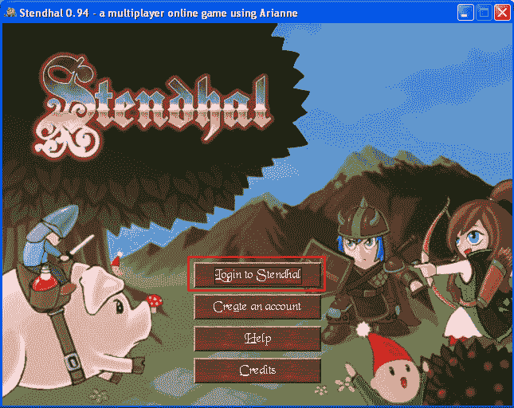

Arianne 项目始于 1999 年，并持续至今。

PlayFab 还提供了[教程，](https://api.playfab.com/docs/tutorials)指南,[专门针对 Phaser.IO（仅限 v2.x.x！）的插件](https://api.playfab.com/docs/tutorials/landing-players/phaser)、“食谱”](https://api.playfab.com/docs/tutorials/recipes-index) —— 关于如何使用他们的[构建块来构建流行的游戏机制和设计模式的示例](https://api.playfab.com/docs/tutorials/building-blocks)

**警告：** 在你注册 PlayFab 之前，请查看他们的“定价”。我建议的是从 Github 上学习他们的代码和支持服务。[`github.com/PlayFab`](https://github.com/PlayFab) 然后，当你的游戏每月超过 299 美元时，将所有的利润都交给 PlayFab。为了完全的诚实和透明，PlayFab 的 CEO 在这篇文章中清楚地解释了为什么你应该使用他们的[后端即服务 (BaaS)。](https://www.quora.com/Who-are-the-competitors-to-PlayFab-Inc-the-BaaS-for-games) 完这篇文章后，你会意识到你正在雇用 PlayFab 作为你的外包商，为你的[虚拟业务](https://en.wikipedia.org/wiki/Virtual_business) 以极大的折扣支持你的 BaaS。以下是你免费开发者账户所拥有的：

* 玩家配置：这是根据我们目前为止所学的内容轻松构建的。

* 内容管理：是的，他们的令人印象深刻；但并不比 [CI3 Fire Starter,](https://github.com/JasonBaier/ci3-fire-starter) [PICO,](http://picocms.org/) [GetSimple CMS,](http://get-simple.info/getsimple/?sa_shf=1) 或 [Grav.](https://getgrav.org/) 提供的内容管理系统 (CMS) 好。

* 游戏内商业：再次，这是一个与任何游戏核心机制无关。我们可以从任何地方采用任何人。事实上，我们可能会采取前三点并选择将其合并到 WordPress 中（？——开玩笑的）。

* 实时分析：Google Analytics 在某些配置下提供了相同的功能。

* 排行榜：这已经在书的附录内容中提供了。

* 收据验证：再次，这是由任何电子商务供应商提供的服务。

* 游戏内商业：这已经在下文中提供了：[`stendhalgame.org/wiki/Finding_your_way_around_the_Stendhal_Client_Code/`](https://stendhalgame.org/wiki/Finding_your_way_around_the_Stendhal_Client_Code/)

```
if (condVar > someVal) {console.log("xxx")}
```

## 3. Life is Feudal:

*   共享型 MMoG [`lifeisfeudal.com/Main-media/?`](https://lifeisfeudal.com/Main-media/?) 这些人是行业内首批利用这种商业模式的。太棒了！

*   相关信息：[`lifeisfeudal.com/game-info`](https://lifeisfeudal.com/game-info)

## 4. Hero Mages:

*   演示：[`www.heromages.com/index.html`](http://www.heromages.com/index.html)

### 从“硬路”中汲取的教训

这是我书中一个令人伤感的章节。这是一个天才想法和游戏的坟墓——截至 20190302，Github 上[`有 464 个`](https://github.com/search?q=multiplayer+game+socket.io) 项目项目遵循了（或仍在尝试遵循）`Node` / `Socket.IO` 的路径。他们选择了 [`PaaS 路径`](https://searchcloudcomputing.techtarget.com/definition/Platform-as-a-Service-PaaS)，并在创建 MMoG 的热忱中忽略了[`优缺点`](https://en.wikipedia.org/wiki/Platform_as_a_service#Advantages_and_disadvantages)，直到为时太晚才发现它们在部署和逻辑上的缺陷。这是我们做的[`基础性“服务器研究”`](https://www.bmc.com/blogs/saas-vs-paas-vs-iaas-whats-the-difference-and-how-to-choose/)之一——（？）我曾要求你们做的。还记得吗？——在第一部分第 3 章。如果他们理解了`第一部分第 1 章中给出的思想`，这一切本是可以避免的。

1. [`github.com/InsomniacSabbir/anagrammatix`](https://github.com/InsomniacSabbir/anagrammatix) 该仓库已不再维护，而且非常老了。

2.  我们已经从第 5 章学习过“Online”（2009-2015；现已停更）。

3.  [`Tap Tap Adventures (TTA；现已废弃):`](https://web.archive.org/web/20180321101609/http://taptapadventure.com/about.html) —— 剩余的 Github [`源代码在这里`](https://github.com/pbmcube/Tap-Tap-Adventure)

- Tap Tap Adventure (TTA) 是一个基于 Little Workshop 2012 年演示的大型多人在线开源项目——基于 HTML5 `WebSockets` 的[`BrowserQuest (BQ) 代码在此`](https://github.com/mozilla/BrowserQuest)。

- 来自 TTA 的 BrowserQuest (BQ) 评语（引用）“……预计它将保持`完全开源，`，允许其社区进行协作并帮助完善游戏。”

- [`TTA 是如何做的`](https://web.archive.org/web/20180118073832/http://taptapadventure.com/about.html)（引用）“……接下来的 GitHub wiki 将提供我在过去两年中收集的所有基本信息，用以帮助你改进、扩展，甚至创建你自己的 Tap Tap Adventure (TTA) 版本。首先，我们必须考虑此源码的复杂性，与其前身 BrowserQuest (BQ) 相比。很多事情已经发生了，`我们几乎通过使用更传统的面向对象编程范式 (OOP) 重写了后端，以便在编程时获得更大的灵活性。`（编辑：噢！应该有人告诉他们 JS 不是 OOP）我们还摆脱了 BQ 中明显的“硬编码”污点，尽管这在代码的某些部分仍然可见，但它必须完全转移到 `JSON` 并进行适当解析。

4. Phaser MMoRPG（未活跃）——一个使用 `Phaser` 框架构建的 2D 像素世界。GitHub [`源代码在这里`](https://github.com/PBMCube/phaser-mmorpg/tree/master/js)

5. `想要更多吗？！` 在 GitHub 上搜索 [`MMO (839 个 JavaScript 仓库)](https://github.com/search?l=JavaScript&o=asc&q=mmo&s=updated&type=Repositories) 或 [`MMOG (31 个 JavaScript 仓库`](https://github.com/search?l=JavaScript&o=asc&q=mmog&s=updated&type=Repositories)

## 8.6 章总结

多人游戏网络领域非常庞大，多年来跨越了各种游戏类型、软件架构，现在正进入使用 `Blockchain` 的全新“无服务器” DevOps 时代。

## 8.7 章参考文献

以下是我在为此本开发我们的 MMoG 应用时使用的部分资源列表。

*   [`免费在线课程：APIs 101`](http://www.tbcube.com/course-catalog/degree/ceu/apis101/)

*   [`完美 API 设计指南`](https://www.mulesoft.com/lp/ebook/api/restbook)

*   [`免费书籍：PHP The Right Way!`](https://leanpub.com/phptherightway)

*   [`Play Framework`](https://en.wikipedia.org/wiki/Play_Framework) 和 [`SDK`](https://en.wikipedia.org/wiki/Play_Framework)

此 `Bonus Content section` 包含了专有的游戏规则书系统以及作为你购买书籍一部分`externally`提供的 [EULA](http://shop.pbmcube.net/terms-of-use/) 源代码。请参阅[“此处的服务条款。”](http://shop.pbmcube.net/terms-of-service/) 你的[注册发票号码](http://stephen-gose.com/affiliates-program/signup/) 将成为你的许可号（License number）。你可以通过 [`stephen-gose.com/affiliates-program/`](http://stephen-gose.com/affiliates-program/) 上将你的书籍发票号码注册为你的许可号，以了解更多福利。

许多游戏开发人员会试图吓唬你——正如你在第 1 章中读到的，[“独立游戏！不要做多人游戏！”](https://www.gamesindustry.biz/articles/2014-05-02-indies-dont-make-multiplayer-games-dan-marshall)——或者说服你相信以下内容。

下面列出的四个 (4) 个**`external “Walk-through Tutorials”`** 按复杂程度排序——“1”是最容易的（基础技能），到“4”是最复杂的（需要跨多个 IT 技术领域的高级技能）。

[Blood Pit™](https://leanpub.com/c/bloodpit-wtts/c/9uLERavhWp7n) — **这个免费的 `external “Walk-Through Tutorial”`**（价值 $19.99）将指导你构建单机游戏基础。你必须在开始下一个免费的 [“Walk-Through Tutorial - Blood Pit II™”](https://leanpub.com/c/wtts-bloodpit2-mmog/c/IW4aa2KfLPo8)（价值 $49.99）之前完成该教程。这份[免费的游戏规则书](https://leanpub.com/tigs/c/f3d6wFdxNdHk)（价值 $19.35）将帮助你“解构”这些游戏机制。你刚刚**为你节省了 $89.33！** Blood Pit II™ 将指导你通过以下四个 (4) 个步骤，将现有的单机游戏版本转换为 2 人游戏版本。

1. 我们将学习**——“逐步分式”——如何将此单机游戏迁移到 2 人在线交付模式（不使用“面对面坐”模式）！** 

2. 我们将学习**如何使用动态的[client-side proxy servers](http://makingbrowsergames.com/mmog/bonusContent/MMoG-API.pdf)并将此游戏从其目前的单机模式（带有 AI 机器人）迁移到在线 2 人模式（不使用“面对面坐”模式）！**

3. 我们将学习**在游戏过程中包含[“异步可用性”](http://makingbrowsergames.com/mmog/bonusContent/MMoG-API.pdf)并将该游戏模式（及其 AI 机器人）迁移到一种使用邮政邮件或电子邮件游戏回合的在线“异步可用性”3 人模式！**

4. 这份“逐步分式”的外部教程将指导我们构建**一个完整的 [MMoG CMS，使用基于 WebSockets 的 MOM 构建](http://makingbrowsergames.com/mmog/#portfolio)，适用于 2 到 8 名参与者，包含会员系统、游戏大厅、玩家匹配服务以及其他基于云的“后端即服务”(BaaS)。**

# 附录

太棒了！你完成了这份工作簿并构建了你的游戏。还想要更多吗？花些时间回顾以下资源。

可用的额外内容包含 67 页的**外部下载内容**。

* [附录：构建 HTML5 网页（3 页）](http://makingbrowsergames.com/book/Appendix-buildHTML5webPage.pdf)

* [附录：分发渠道（2 页）](http://makingbrowsergames.com/book/Appendix-Channels.pdf)

* [附录：游戏设计考虑（1 页）](http://makingbrowsergames.com/book/Appendix-GD.pdf)

* [附录：游戏设计概述（3 页）](http://makingbrowsergames.com/book/Appendix-GameDesignOverview.pdf)

* [附录：游戏资源与参考文献（17 页)](http://makingbrowsergames.com/book/Appendix-Game.pdf)

* [附录：JS 编码风格（7 页）](http://makingbrowsergames.com/book/Appendix-CodingStyles.pdf)

* [附录：网络（9 页）](http://makingbrowsergames.com/book/Appendix-Networking.pdf)

* [附录：Phaser 3 资源（2 页）](http://makingbrowsergames.com/book/Appendix-Phaser3.pdf)

* [附录：项目管理分析（13 页）](http://makingbrowsergames.com/book/Appendix-PM.pdf)

* [附录：安全（5 页）](http://makingbrowsergames.com/book/Appendix-Security.pdf)

* [附录：美国创业公司（4 页）](http://makingbrowsergames.com/book/Appendix-USBusiness.pdf)

## **免费** Phaser III [游戏开发者课程](https://leanpub.com/c/p3c)

* [Game Developer’s Market](https://www.gamedevmarket.net/?ally=GVgAVsoJ) — GameDev Market (GDM) 是一家位于英国的社区驱动型市场，旨在连接独立游戏开发者与才华的资产创作者。这里有针对特定游戏引擎的资产商店、拥有海量质量不一资产的大型通用素材网站，以及提供精选小众资产的小型独立商店。

* [Creative Market](https://creativemarket.com/?u=PBMCube) — 全球设计市场。通过全球独立创作者提供的即用设计资产，让你的创意项目焕发生机。你可以在这里出售你的游戏资产。
