# 通过培训与外展充分利用数字藏品：创新型图书管理员指南

加入 `p2p.wrox.com` 的讨论

Lawrence D. Spencer

Seth H. Richards

我们将本书献给所有辛苦磨练技艺的 JavaScript 开发者。你们让世界变得更美好。

# 致谢

项目编辑

Christina Haviland

业务经理

Amy Knies

技术编辑

Keith Pepin

John Peloquin

副出版商

Jim Minatel

制作经理

Kathleen Wisor

项目协调，封面

Brent Savage

文字编辑

Nancy Rapoport

校对

Nancy Carrasco

内容开发与组装经理

Mary Beth Wakefield

索引员

Johnna VanHoose Dinse

营销总监

David Mayhew

封面设计

Wiley

营销经理

Carrie Sherrill

封面图片

© Getty Images/Andrew Rich

专业技术与策略总监

Barry Pruett

# 关于作者

**LARRY SPENCER** 是位于马萨诸塞州萨德伯里的软件及务公司 ScIS 的应用开发副总裁。他和团队使用 `AngularJS` 创建基于浏览器的应用程序，后端使用 `C#`/`Web API`/`SQL Server` 构建。Larry 的 35 年职业生涯涵盖了编程 `COBOL`、`C`、`C++`、`C#` 以及每种大型机汇编语言，但他认为 JavaScript 是最有趣的。作为 Code Camps 和其他聚会的频繁受演讲者，Larry 喜欢与开发社区分享他的软件开发生活。你可以在 `http://FascinatedWithSoftware.com` 找到他的博客。

Larry 的业爱好包括哲学、国际象棋和古典吉他。他住在马萨诸塞州马尔尔伯勒。

**SETH RICHARDS** 自 2002 年以来一直从事专业软件开发。他的职业始于为酒吧和夜店行业编写嵌入式设备，并在 2007 年转入 Web 应用开发。他参与过许多 Web 应用，范围从以企业级地理信息系统为中心的物理资产管理系统到用于产品发现和推荐的社交网络。

- Seth 毕业于新罕布什州普利茅斯的州立学院（现普利茅斯大学），在那里学习了计算机科学和数学。他目前正在攻读治亚理工学院的计算机科学硕士。Seth 的博客可以在 `http://blog.shrichards.com` 找到，你可以在 Twitter 上关注他 `@shrichards`。

# 关于技术编辑

KEITH PEPIN 开发 Web 网站和应用程序已超过 17 年。在职业生涯早期，他爱上了 JavaScript，并从那以后一直热情地构建动态用户体验。他目前是 Meltwater 的高级软件工程师，正使用 `HTML5`、`CSS3`、`JavaScript`、`AngularJS`、`Node.js` 和 `MongoDB` 来构建他们的下一代在线营销智能平台。在不写代码或与家人在一起时，他喜欢其他的极客追求，包括各种形式的游戏、漫画、绘画和素描。

JOHN PELOQUIN 是一位拥有超过 10 年 JavaScript 经验的软件工程师，涵盖各种规模的应用。John 在加州大学伯克分校获得数学学士学位，目前是纽约医疗科技初创公司 Spreemo 的首席工程师。在编辑本书之前，John 编辑过 Peter Smith 的《Professional Website Performance》（Wiley2012）以及 Nicholas Zakas 的《Professional JavaScript for Web Developers, 3rd ed》（Wiley2012）。当他不写代码或收集错误报告时，偶尔可以发现在开放麦克风（open mic）场合表演单口秀。

# 谢谢

感谢我的妻子 Bethany 在我们写这本书期间给予的爱和支持，并在我为了赶进度工作时忍受（或享受？）许多个丈夫不在的夜晚和周末。

-SETH RICHARDS

感谢我的家人鼓励我追求梦想。我的梦想可能包括写一本书，但它们始于你们，止于你们。

-LARRY SPENCER

如果没有其他人愿意以书籍、博客和源代码的形式与我们以及广大社区分享他们的知识和专业知识，这本书将是不可能实现的。在此，我们向以下人士致以感谢：

- Douglas Crawford，感谢他展示了 JavaScript 的优秀部分以及他在 `jsLint` 上的工作。

- Nicolas Zakas，感谢他撰写的许多书籍和博客文章作为穿过 JavaScript 有时危险水域的指南，以及他对 `ESLint` 的维护和贡献。

- Stoyan Stefanov，感谢他在将基于模式的开发应用于 JavaScript 方面的指导。

- Robert C. Martin，感谢他向我们灌输编写清洁代码的渴望。

- Fredrik Appelberg，感谢他创建了 `AOP.js` 面向切面框架，Dave Clayton 对该框架做出了贡献。

- Mike Bostock，感谢他用用于 SVG 图形的 `D3` 库启发了我们。

- Pivotal Labs 的同事，感谢他们创建了开源 JavaScript 框架 `Jasmine` 以及为框架做出贡献的社区成员。

- Angular 团队，感谢他们展示了构建单页应用的优秀方法。

- Stack Overflow 和 GitHub 上慷慨的人们。没有你们，我们可能只是在翻阅手册。

我们还想感谢我们的项目编辑 Chris Haviland，他熟练地引导我们完成了从开始到结束的写作过程。我们还感谢我们的校对编辑 Nancy Rapoport，她仔细阅读了我们的书，次数比任何人都多。对于她的奉献和建议，我们表示衷心的感谢。我们还要感谢我们的技术编辑 Keith Pepin 和 Paul Eloquin。他们的 JavaScript 精通帮助我们避免了技术错误。如果还有错误，很可能是因为我们没有遵循他们的建议。先生们，我们向你们致敬。

最后，我们想感谢 Wiley 的执行编辑 Carol Long，她给了我们写这本书的机会。在我们完成这本书之前，她宣布从出版行业退休。我们真心希望不是那根压死骆驼的最后一根草！感谢你，Carol，祝你退休后只有阳光的日子。

—LARRY AND SETH

- 总结 27

- 当前的开源和商业框架 37

- 使用原始类型 81

- 总结 110

# 第 9 章：确保单例模式的正确实现

- 创建供沙盒使用的函数

- 创建合约模块 304

- 将面向切面的解决方案与静态解决方案对比 307

- 探索这些是如何绑定的 312

- 总结 329

- 考虑孤立函数的副作用 343

- 隔离中介的接口 402

- 确保同事获得带有预期接口的中介 404

- 测试中者 408

- 封印技术（Imprinting） 452

- 魔法魔棒技术（Magic Wand） 459

- 其他技术 460

- 具体化 467

- 变量具有函数级作用域 478

# 引言

当我们与开发者同行分享这本书的书名《可靠的 JavaScript》（Reliable JavaScript）时，我们收到了这样的反馈：

“这可真是个反反对比！”

“这一定是一本非常短的书。”

“我能在书店的小说区，看到它和约翰·格里沙姆（John Grisham）最新的惊悚小说摆放在一起吗？”

不，这本书并不是小说。

我们收到的关于书名的反馈反映了某些具有经典编译型语言经验的开发者对 JavaScript 的更广泛的看法：JavaScript 被用来创建花哨的个人作品网站或简单的待办事项应用；它在我任务关键型的企业级应用中没有用武。

在过去，这确实如此，但现在不再了。

## JavaScript 作为一等语言的兴起

JavaScript 作为“野孩子”的名声实之名归，我们希望在接下来的两个章节中通过它的一些事迹让你大开眼。然而，她就像一个继承了家族企业并因接受挑战而让所有人惊讶的骄气继承女，她已经变得严肃且负责，最近展现出了成就大业的实力。

她早年作为一个业余者，很少被赋予超出“脚本”任务之外的工作。她做出的决定非常简单：如果必填字段没有填写，她就把它标为红色；如果点击了按钮，她就显示另一个页面。尽管她的职责有限，但她很好相处，并结交了许多朋友。直到今天，大多数程序员对她的印象主要是这种。

然后，在我们重新定义她人生的转折中，世界转向了 Web。这曾是她的游乐场，是她消遣自己的小天地，而“老男孩俱乐部”的成员们则在服务器上做真正的工作。

浪潮在 20 世纪 90 年代后期开始爆发，当微软引入第一个 `iframe`，以及 2004 年 Gmail 应用引入 `XML Ajax`，2005 年推出 Google Maps 时，浪潮席卷而至。世界突然意识到，当浏览器被托付不仅仅显示服务器分发的任何内容时，Web 体验可以丰富得多。

因此，我们的公主被赋予了比任何人预想的都要多的责任。她需要帮助。

帮助确实来了，以工具包和框架的形式出现，如 `jQuery`、`Ext JS`、`Ember.js`、`Knockout`、`Backbone` 和 `AngularJS`。这些值得尊敬的顾问竭尽所能地为 JavaScript 带来纪律和结构。然而，他们从未完全驯服过她那青春洋溢的活力。尽管有这些顾问和良好的意图，她总是会陷入麻烦。

# 在 JavaScript 中编写真正糟糕性代码是多么而易

问题的一部分（她才刚刚开始摆脱）是她作为脚本语言的多年。在那个有限的范围内，创建一个全局变量或函数并没有大碍。如果变量拼写错误，影响是有限且易于追踪的。（顺便说一句，影响可能是创建另一个全局）。如果架构很粗糙……一个网页上到底能有多少架构呢？

加剧错误可能性的是缺乏编译器的。`C#` 或 `Java` 的服务器端程序在运行之前至少在语法上是正确的。JavaScript 必须启动并寄希望最好的结果。一个拼写错误的变量，或者对不存在的函数的调用，可能会在代码中存在数月，直到某个特定的执行路径被触发。

还有那些怪癖（quirks）。啊，那些令人怜爱又抓狂的怪癖。

列表首位必须是 `==`（带有类型强制转换的相等性）和 `===`（不带强制转换）的区别。这是一个极佳的主意，但对于受过其他语言训练的程序员来说，太难学会使用了！

JavaScript 在处理真假时，比任何时候都要调皮。她对“真”和“假”的理解让除了最有决心的追求者以外的所有人都困惑。`0`是一个假值，所以，

```
false == '0'
```

结果是真。但不是出于你认为的原因。值 `false` 被强制转换为数字，即 `0`（`true` 会转换为 `1`）。接着，字符串 `'0'` 也被强制转换为数字。那也是 `0`，所以结果为真。

然而，

```
false == 'false'
```

求值为为假，因为左侧的 `false`（再次被强制转换为数字 `0`）与字符串 `'false'`（同样被强制转换为数字）进行比较。但 `'false'` 根本不是数字，所以第二个版本产生 `NaN`（非数字），相等性失败了。啊，JavaScript。

她总是乐于玩点游戏。如果你定义了函数

```
function letsHaveFun(me, you) {
  // 我和你之间正在发生的事情
}
```

并这样调用它：

```
let sHaveFun(me);
```

JavaScript 会让调用在变量为 `undefined` 的情况下继续，仅仅为了好玩看你试图与一个不存在的人玩耍。

我们可以一直写下去。这里有令人惊讶的作用域规则、独特的“原型”继承机制、自动且有时不正确的分号插入、一个对象从完全无关的对象中借用函数的能力等等等等等等等等。

随着全局变量变成一种无形的负担，几乎完全缺乏架构传统，与真理的关系存疑，以及比你在角色扮演大会上看到的还要多的怪癖性，JavaScript 在世界上能取得这样的成就，真是个奇迹。

信不信，它在变好之前会变得更糟。即使你写对了，它也可能非常容易出错。

# 在 JavaScript 中无意中破坏代码是多么而易

JavaScript 具有一种扭态的幽默感。在严谨的编译型语言中，如果你有一行完全正确、调试良好并在生产环境中完美运行的代码，如下：

```
myVariable = myObject.myProperty;
```

然后你不小心碰到了键盘上的 x 键，导致现在变成了：

```
myVariable = myObject.propXperty;
```

编译器会发出一条严厉的信息，告诉你下次应该更小心。JavaScript 会高兴地运行代码，并给 `myVariable` 赋值为 `undefined`。“让我们玩玩看看会发生什么！”她说道。

当你想要更改属性名称时，JavaScript 喜欢玩躲迷猫。你可能认为在整个源码树中搜索

`.myProperty`

就能找到所有出现 `.myProperty` 的地方。“不，不，不！”JavaScript 笑着说，“你忘记搜索 `{myProperty}` 了”。

实际上，你应该使用允许括号和引号之间有空格的正则表达式进行搜索。你做过吗？我们也没有。

然后，取决于她的心情，她可能可能让你想到也应该搜索像这样的结构：

```
var prop = 'myProperty';
// . . /
myObject[prop] = something;
```

当即使是完成这样一个微小的重构都如此困难时，你可以想象错误是如何轻易进入你的代码的。不便于重构的代码几乎定义了“脆弱”一词。

你如何避免这些问题呢？如果说有一个我们希望在书中传道并实践的概念，那就是测试驱动开发。在缺乏编译器的情况下，测试是你抵御错误的最佳防御。

JavaScript 也更倾向于按照规则行事。事实上，由于其极其……富有创造力的本质，JavaScript 可能比大多数语言更需要规则。

我们有很多开发者对这种观点持开放态度并希望了解更多。我们希望你也是之一。

## 本书的目标读者

由于本书不是 JavaScript 的入门教程，我们假设你已经有一定的 JavaScript 经验。以下章节概述了理想读者的特征。

## 从其他语言转向 JavaScript 的开发者

我们两人在职业生涯初期都不是 JavaScript 开发者，很可能你也不是：在大型应用开发方面，JavaScript 是一个相对的新手。

JavaScript 与我们过的任何语言都很大不同。我们来自编译、静态类型语言 `C#` 的舒适世界。当我们接受其动态本质同时保持 `C#` 程序员的架构感和纪律时，我们的 JavaScript 变得好多。

在面试中，并不需要花费时间就能判断这样的候选人在连接按钮处理程序方面没有问题（可能在 `ASP.NET Web Forms` 应用程序语境下），但要让他们创建一个具有不受外部操纵变量的 JavaScript 模块，可能会非常困难。

随着我们组织对 JavaScript 的不断演进，我们对“JavaScript 经验”的定义也随之演变。几年前，如果一个开发者有一点 `jQuery` 经验，我们就会满意地勾选“JavaScript”这一项。

然而，现在我们寻找的是更多。而且，整个应用程序用 JavaScript 编写的情况已不再不罕见了。在所谓的单页应用（SPA）中，JavaScript 代码组织了整个应用程序，其承担的责任比过去转瞬即逝的点击处理程序要大得多。为了参与大型 JavaScript 应用的开发，开发者必须学会如何以结构化且有纪律的方式使用这种语言，同时利用它的许多独特特性和奇特性。

通过书中的示例，我们希望帮助你——这位小规模 JavaScript 开发者——大展身。

## 负责为新项目选择编程语言的开发者

也许你听过这样一句格言：“没有人因为选择 IBM 而被解雇。”这句话反映了这样感觉：在面对 IT 项目的技术合作伙伴时，选择像 IBM 这样历史久、声誉良好的公司，其决定不太可能受到质疑。这句话暗示 IBM 是一个安全的选择。即使项目费用超支、错过截止日期或完全失败，选择 IBM 也是免受指责的。

如果你处于可以选择开发新应用程序所用语言或多种语言的地位，那么你就与选择技术合作伙伴的 IT 经理处于同样的地位。我们有许多久经考验、历史悠久的编程语言。例如，`C` 和 `Java`，它们分别由大型、成熟的技术公司支持，已用于构建 Web 和桌面应用程序超过十年之久。没有人会因为选择 `C` 而被解雇。

就新编程项目（尤其是在企业中）的安全性选择而言，JavaScript 显然不是 `C#`。JavaScript 并不是一种成熟的、穿着蓝白条纹衬衫的编程语言。她年轻、大胆且自由放不羁。

在大型软件项目的成功记录方面，她还没有像 `C` 和 `Java` 那样的成功记录。这并不是说使用 `C` 和 `Java` 的项目就能保证成功。然而，如果一个使用这些语言之一的项目没有成功，语言的选择可能不会被视为导致失败的因素之一。

正如前一节提到的，JavaScript 让编写出灾难性的代码变得非常容易。这给她带来了一点名声，降低了你想要带她回家见父母的几率。

JavaScript 的声誉不应该自动将她排除在可能从她的优势中获益的项目之外。`Node.js` 是一种服务器端 JavaScript 引擎，轻量且具有高度可扩展性；非常适合实时和数据密集型应用。JavaScript 可用于在浏览器中创建丰富的界面。如 `Ember` 和 `AngularJS` 等客户端框架可用于构建完整的基于浏览器的应用程序，这有助于减少 Web 卸载逻辑到客户端的负载。

虽然我们无法保证它会成功，但接下来的章节将展示如何通过应用我们在开发项目时积累的教训，降低为下一个项目选择 JavaScript 的风险。

成功不会偶然发生，特别是对于 JavaScript 来说。它需要对工程原理有坚实的掌握，而这正是第一章的主题。

## 本书的结构

我们将书籍分为五个部分。

第一部分“打下坚实基础”了软件工程的核心概念，如 SOLID 和 DRY 原则。它还讨论了单元测试和测试驱动开发（TDD）的好处。第一部分还介绍了书中使用的工具和 JavaScript 库。最后，它讨论了 JavaScript 中的对象及其可测试性。

第二部分“测试基于模式的代码”，我们描述并使用测试来创建模式。有些模式如单例模式（Singleton）在 JavaScript 中非常常见，而有些如观察者模式（Observer）则在书中介绍。

第三部分“使用 JavaScript 特性进行测试”，描述了如何利用高级特性进行测试。有些模式如中介者模式（Mediator）在 JavaScript 中非常常见。

第四部分“JavaScript 的特殊主题”提供了测试特性的方法，它还涵盖了 DOM 操作的测试。

最后，第五部分“总结”回顾了 JavaScript 的惯用法（Idioms）。

## 使用本书需要

## 运行示例需要：

为了运行书中的示例，您需要：

- 代码编辑器

- 浏览器

## 约定

在书中了解JavaScript：

- 源代码文件

> 笔记 我们在书中通过以下方式显示：

- 笔记（Notes）

- 提示（Tips）

- 旁注（Asides）

## 注意事项

## 注意事项：

- 粗体（**bold**）和斜体（*itatic*）需要翻译翻译内容并保留符号。

- 内联代码（`code`）和代码块不需要翻译。

- 链接（[link](https://example.org)）需要翻译其内容，但保留网址。

- 列表，表格，引用块保留格式，翻译内容

- 原文可能有有多行，不要漏掉任何一行，并注意一定不要重复原文！！！

- 输出应包含在“[content]...[/content]”中

## 源代码

在开发 JavaScript 项目时，书中的示例可以在 Wrox 网站上下载：

`www.wrox.com/reliablejavascript`

您也可以通过以下方式下载源代码：

`www.wrox.com/dynamic/books`

## GitHub 全所有的源代码可以在 GitHub 上找到：

`github.com/reliablejavascript`

## 压缩

在开发 JavaScript 项目时，书中的示例以 `.ZIP` 或 `.RAR` 格式压缩并在 Wrox 网站提供：

`www.wrox.com/reliablejavascript`

> 笔记 我们可以可以使用压缩工具解压书籍：

`www.wrox.com/reliablejavascript`

一旦你加入，就可以发布新消息并回复其他用户发布的消息。你可以随时在网页上阅读消息。如果你想通过电子邮件接收来自特定论坛的新消息，可以在论坛列表论坛名称旁点击“订阅此论坛”（Subscribe to This Forum）图标。

有关如何使用 Wrox P2P 的更多信息，请务必阅读 P2P FAQ（常见问题解答），以获取关于论坛软件工作原理的问题解答，以及许多针对 P2P 和 Wrox 书籍的常见问题。要阅读 FAQ，请点击任何 P2P 页面上的 FAQ 链接。

# 第一部分

奠实基础

- 第 1 章：实践熟练的软件工程

- 第 2 章：工具准备

- 第 3 章：构建可靠的对象

# 1 实践熟练的软件工程

## 本章内容概览

- 编写从一开始就正确的代码

- 编写持续正确的代码

## 本章 WROX.COM 代码下载

你可以在 `www.wrox.com/reliablejavascript` 找到本章的 wrox.com 代码下载。代码位于第 1 章下载包，并根据本章的主题组织在目录中，每个目录包含一个示例。你可以通过将该目录复制到硬盘并双击 `index.html` 文件来运行示例。

没有哪种职业比计算机编程更让人感到谦卑了。如果我们第一次就把事情做对，我们可以在大约 20 分钟内完成一天的工作。这正是我们大多数人每天产出的调试后代码所需的时间。

我们把剩下的时间都花在纠正错误上，这些错误是由编译器、QA 人员、我们的老板和客户提醒我们的。

正如任何工作过“成熟”系统的人所知，我们还浪费了大量时间去重构（或希望能够重构）那些多年来变得脆弱且不可维护的代码，这都要归于我们程序员同事（甚至是我们自己）做出的糟糕的设计决策。

然而，不知为何，我们仍然认为自己非常聪明，这只会让情况变得糟糕。在我们一生中，我们一直是那些能够解决问题的人。我们热爱谜题和问题。我们是那些（我们大多数是男性，这可能也让情况变得糟糕）不愿问路、也不喜欢读说明书的人。

# 第 1 章 实践熟练的软件工程

把我们扔进问题的中心，我们会乐观地认为自己能找到出路。靠我们自己。

本章带来了好消息。软件开发者是聪明的，其中一些人开发出的技术将帮助我们每天创造出远超 20 分钟价值的代码，并极大提升审美满足感。

这些技术并不新鲜。本章中的每一个想法至少都有十年的历史了。然而，由于我们从美国和国外团队面试了数十名开发人员候选人，很少有人听说过 SOLID 缩写背后的原理（更不用说这个缩写本身了）。他们可能听过 DRY 代码（不要重复），但并没有意识到它在良好的软件开发中绝对核心的作用。对于单元测试的误解也很多，而且许多开发者并没有意识到让测试驱动开发过程的益处。

当你掌握了这些思想，你将成为精英。大多数开发者知道面向对象编程。只有少数人也知道依赖倒置和里氏夫替换原则。更少的人掌握了测试驱动。

## 编写从一开始就正确的代码

约翰·塞巴斯蒂·巴赫关于演奏键盘乐器的话同样适用于计算机编程：这没什么不起的。一个人所做的只是在正确的时间按下正确的键，乐器就会自己演奏。

这一节关于在正确的时间按下正确的键。正如你可能猜的，这比门外汉认为的要复杂得多。

但首先，是一个故事。

## 掌握 JavaScript 的特性

你曾经见过有人在壁球场上被砍掉头吗？我们其中一人差点就那了。那是一次大学运动入门课程期间发生的，但这段经历对编写 JavaScript 有很多启示。

如果你不这项运动，它在一个像大房间一样的球场内进行。两名球员交替用球拍将球击向他们面对的后墙。在最基本的情况下，你将球击向后墙；它反弹并在地上弹向站在你身边的对手。然后他将球扣向后墙，让你尝试击球。

总之，那是课程的第一天。教练站在学生的左侧并稍后于他，我们其他人通过玻璃墙观察。教练指导学生向后墙击球。

由于这名学生是一个网球运动员，他像在打网球一样击了一个正手球，从低向高挥动，并随着高随挥动作绕过身体。这就是网球中击出上旋球的方式。壁球中也是如此，你会切掉恰好站在你左侧稍后一点的人的头。

幸运的是，教练预到会发生这种情况，并将球拍放在脸面前进行自我保护。

学生的球拍撞到了教练的球拍，发出了很大声音，让学生感到很尴尬，但并没有造成伤害。

教练指出，在网球中，你通常击出上旋球，球会下坠并带有侧旋力弹向你的对手。然而，壁球中的那个挥拍动作恰恰相反。如果你击出上旋球，球会从墙上弹开，形成一个轻松的弧形，然后懒散地从地板弹起，此时你的对手会击碎它。在壁球中，你想击出下旋球。球会从墙上弹开，并增加速度弹向你的对手。

壁球的正常动作是，向下切，以产生下旋——这与网球的动作完全相反。

尽管这两项运动许多共同特征（两个球员、球拍和球）以及共同的需求（手眼协调、脚部移动），但如果你像打网球那样击球，你就无法打壁球。

同样，JavaScript 对程序员也有许多特定的要求。如果你带着另一种语言的经验进入大规模 JavaScript 开发，你将会适应这些差异。

这些差异既存在于语法层面，也存在于架构和工程层面。在本书中，你会遇到第 25 章总结的语法细节。本章探讨 JavaScript 的特性如何让某些技术成为可能。

通过运用这些技术，你写的 JavaScript 将更有力。你的水平将会提高。你会赢得更多，因为你是在与语言协作，而不是在创造它。

## 案例研究：D3.js

Mike Bostock 的 JavaScript 杰作 `D3.js` 是完美的例子。

D3 代表数据驱动文档，它可以让你从数据创建精美的 SVG 图形。例如，图 1-1 是一个显示软件系统类的 D3 图（来自 `http://bl.blocks.org/mbostock/4341134`）。

图 1-2 以径形布局展示相同的数据（`http://bl.blocks.org/mbostock/10442422`）。D3 非常灵活。它也非常简洁；每个图表只需要几十行格式良好的 JavaScript 即可创建。

事实上，它是是如此精妙，以至于初读时让人目不暇接，因此我们只简化了其中的一个角落进行讨论。列表 1-1 是 `d3.svg.line` 的一个桥接版本，该函数创建一个 SVG 线段生成器。列表之后将有后续的说明。

# 列表 1-1：创建一个 SVG 绘制段的函数（代码文件名：rj3#rj3.js）

```javascript
// 创建一个命名空间以避免创建许多全局变量。
var rj3 = {};

// 创建一个名为 svg 的子命名空间。
rj3.svg = {};

// 在 rj3.svg 命名空间中放入一个线函数。
rj3.svg.line = function(point) {
  var getX = function(point) {
    return point[0];
  }
  getY = function(point) {
    return point[1];
  }
  interpolate = function(points) {
    return points.join("L");
  }
}

function line(data) {
  var segments = [],
  points = [],
  i = -1,
  n = data.length,
  d;
  function segment() {
    segments.push("M",interpolate(points));
  }

  while (++i < n) {
    d = data[i];
    points.push([getX.call(this,d,i),getY.call(this,d,i)]);
  }

  if (points.length) {
    segment();
  }
  return segments.length ? segments.join("") : null;
}

line.x = function(funcToX) {
  if (!arguments.length) return getX;
  getX = funcToX;
  return line;
};

line.y = function(funcToGoY) {
  if (!arguments.length) return getY;
```

### 列表 1-1（续）

```
getY = funcToGetY;
return line;

return line;
;
```

你会使用这个函数将数据数组转换为 SVG 路径。SVG 路径只是 SVG 这种微型语言中的字符串。假设你想画一条像图 1-3 那样的线。


图 1-3

SVG `<path>` 元素将是

```
<path d="M10,130L100,60L190,160L280,10"/></path>
```

在英语中，它的意思是拿起笔并将其移动（“M”）到坐标 (x, y) (10, 130)，然后画一条线（“L”）连接到 (100, 60)，紧接着再画另一条线到 (190, 160)，最后画一条线到 (280, 10)。

那么列表 1-1 中的代码真的创建了这样的路径吗？考虑列表 1-2，它包含一个示例调用。

### 列表 1-2：对 rj3.svg.line() 的示例调用（代码文件名：rj3.pathFromArrays.js）

```javascript
var arrayData = [
[10,130],
[100,60],
[190,160],
[280,10],
];lineGenerator = rj3.svg.line();
path = lineGenerator(arrayData);
```

```
document.getElementById('pathFromArrays').setAttribute('d', path);
```

在高亮的那行中，`lineGenerator` 最终变成了什么？嗯，根据列表 1-1 的最后一行，调用 `rj3.svg.line()` 将返回一个名为 `line` 的东西。那是什么？它是嵌套在外部函数 `rj3.svg.line` 内部的函数！

> 注意：在 JavaScript 中，函数可以嵌套在其他函数内部。这是控制作用的重要方式。

顺便说一下，我们保留了 D3 大多数属性和变量的名称，以便如果你愿意，可以去 `https://github.com/mbostock/d3/master/src/svg/line.js` 研究完整的列表，并尽可能地熟悉它。在某些情况下，我们尝试通过更改变量名来澄清问题。如果你发现外部函数和内部函数都命名为 `line`，那么，这非常符合 D3 源代码的精髓，所以你完全可以喜欢它。

是的，该函数返回了一个函数。这在大多数语言中是一个令人困惑的“否”，但在 JavaScript 中，这是一个非常符合惯用语的“是”，它拓宽了你的架构选择。如果你打算编写工业级的 JavaScript，请习惯函数作为一等对象，它们可以被作为参数传递、作为返回值返回，以及你可以想象的任何形式。作为 JavaScript 的一等公民，它们甚至可以拥有自己的属性和方法。

> 注意：在 JavaScript 中，函数是具有方法和属性的对象。你的函数可以比在其他语言中更具活性和威力。

你可以在列表 1-1 中看到为此函数附加方法的示例：

```
line.x = function(funcGetX) {
  if (arguments.length) return getX;
  getX = funcGetX;
  return line;
};
```

它创建了一个函数 `x`，它是返回的函数 `line` 的成员。不久后，你将看到 `x` 及其双胞胎 `y` 是如何工作的，并学习 JavaScript 的这些特性。

用你的新函数替换了列表 1-1 中 `get.x` 变量的默认值。现在，当 `while` 循环执行时

```
points.push([+get.X.call(this, d, i), +get.Y.call(this, d, i)]);
```

`get.x` 将调用你的函数，该函数返回对象的 `x` 属性——即对象的原始、权威的属性，而不是它们的副本。

关于这些调用还有值得注意的。在不抢夺第18 章焦点的情况下，我们可以说，无论安装了什么函数来获取 x 坐标，它调用时都会带有两个参数，即使在你的函数（`return d.x;`）中也只调用了一次。第二个参数 `i` 是数据项 `d` 在数组中的索引。你没有使用 `i`，但你本可以使用它的。这就是 JavaScript 中函数重载的面向对象概念的工作方式。

JavaScript 函数重载的另一个例子在 `line.x` 函数本身中。你是否注意到它在测试参数了？

```
line.x = function(funcToGet) {
  if (arguments.length) return getX;
  getX = funcToGetX;
  return line;
};
```

在 JavaScript 中，`arguments` 是一个类数组对象，在每个函数内部都可用，包含了被调用的参数。在这里，测试检查了该伪参数的长度。零在 JavaScript 中是一个“虚假”值（参见第 25 章的“可能为真或为假”），因此如果没有参数，函数将返回 `getx` 的当前值。

总结一下，如果不带任何参数调用 `line.x`，它会返回 x 坐标的当前访问器（accessor）。如果带有一个参数调用它，它会将 x 坐标访问器返回给它，并返回另一个完全不同的东西，即 `line` 函数对象。这以及额外参数 `i` 的可能性，说明了 JavaScript 中的函数重载。

> 注意：在 JavaScript 中，函数重载的面向对象概念是通过安装函数的参数并相应调整来实现的。

现在，为什么一个设置 x 访问器的函数会返回 `line` 呢？你可能知道答案：它允许你像在列表 1-4 中看到的那样链式调用：

```
lineGenerator = d3j.get.line(
  .x(function(d) { return d.x; })
  .y(function(d) { return d.y; });
```

链式调的设计可能性在第 15 章进行了详细探讨。

现在这里有一个问题问你：认为如果你给每个数据点添加一个 z 坐标，会发生什么？

```
var objectData = [
  { x: 10, y: 130, z: 99 },
  { x: 100, y: 60, z: 202 },
  { x: 190, y: 160, z: 150 },
  { x: 280, y: 10, z: 175 }
];
```

如果你猜程序会顺利产生完全相同的结果，你是对的。在 JavaScript 中，具有 x、y 和 z 属性的对象也可以作为具有 x 和 y 属性的对象运行。

你也可以使用构造函数来生成对象，它看起来完全不同，但结果相同：

```javascript
function XYPair(x,y) {
  this.x = x;
  this.y = y;
}
```

```javascript
var objectData = [
  new XYPair(10, 130),
  new XYPair(100, 60),
  new XYPair(190, 160),
  new XYPair(280, 10)
];
```

这被称为鸭子类型（duck typing），源自谚言：“如果它看起来像鸭，走起来像鸭，叫起来也像鸭，那么它就是鸭子。”在 JavaScript 中，鸭子是你最好的朋友之一。区分这些可能的：

```javascript
if (something instanceof XYPair)
```

然而，几乎没有理由要这样做。`C#` 或 `Java` 程序员可能会尝试通过这种检查来学习一个对象是否合格，而 JavaScript 的方法是检查属性是否存在：

```javascript
if ('x' in something) // something 拥有或继承了属性 x。
```

或者

```javascript
if (something.hasOwnProperty('x')) // something 拥有 x 但没有继承
```

鸭子类型并不是粗率。它是扩大组件范围的一种重要方式。

> 拥抱鸭子类型。它允许少量的代码适应广泛的对象。

如果你以非凡注意力阅读列表 1-1，你可能会好奇内部的 `line` 函数在函数返回后如何能够访问 `d3.svg.line` 对象的私有变量。其他语言的程序员可能期望 `getX`、`getY` 和 `interpolate` 变量在离开它们的函数后从栈中弹出。因此他们会期望一件事：JavaScript 的闭包。

我们之前说过，当你调用 `d3.svg.line()` 时，它返回了内部的 `line` 函数。不仅于此，它返回了一个闭包，你可以将其认为一个从外部看像函数（内部 `line`），但在内部记得函数创建时所处的环境（变量 `getX`、`getY` 和 `interpolate`）的对象。你可以像往常调用内部函数，但它们感知 `line` 的原始环境。

> 闭包是 JavaScript 中非常强大的设计元素。每个函数都是一个闭包。

# 第 1 章 练习练的软件工程

再次考虑 `while` 循环中的调用语句：

```
while (+i < n) {
  d = data[i];
  points.push([+getX.call(this,d, i),+getY.call(this,d, i)]);
}
```

`getX.call(this, d, i)` 到底做了什么？用英语说，它调用了 `getX` 函数，假装它是对象 `this`（或多一个对象）的成员，并传递了参数 `d` 和 `i`。特殊变量 `this`，宽泛地说就是当你调用出现 `this` 的函数时，“点之前的对象”。

为什么要费这么多事儿呢？为什么不直接用 `getX(d, i)` 完事大吉？在 JavaScript 中，指定 `this` 的能力是一个重要的设计机会。

> 注意：在 JavaScript 中，“this”提供了一个设计机会。使用它吧！


列表 1-5 显示了这种语言特性的力量。在这里，这种语言特性是 `years` 是一个数组。`line.x` 根据索引 `i` 计算 `x` 坐标，这使得 `this` 变成了 `yearlyer`，从而导致 `getValue` 被正确调用。结果在图 1-4 中。


图 1-4

人们自然认为 `this` 指的是它所出现的函数，或者是包含该函数的对象。并非如此。它指的是调用该函数的对象。

这也意味着你不应该拥有那个处理器！

在第 6 章中，你将看到 JavaScript Promises 允许你编写非阻塞代码，而且它并不是那种通过变量尴尬地连接在一起的、混乱的事件处理器散乱集合。

## 避免大型系统中的 JavaScript 陷阱

为什么一个包含 50 个类（在 JavaScript 中为对象）的系统，其编写和维护难度比包含 5 个对象的系统要出十倍以上？对于 5 个对象，如果每个对象都调用其他所有对象的服务，那么最多有 20 条通信通道（5 个对象调用其他 4 个——允许你将 A 调用 B 和 B 调用 A 计入内）。而对于 50 个对象，则是 2450 条（50 乘以 49）——是后者的 100 倍以上。

随着单页应用、`node.js` 以及其他让 JavaScript 在客户端和服务器端承担日益大型系统任务的出现，顶尖的 JavaScript 开发者开始认真将这些通信通道精简到最低。

当一个对象必须与其他对象交互以完成其工作时，这些连接会被细致地管理，以确保它们在所有情况下都能正常运行。

本节将提供一些实现这些目标的方法。

## 脚本不是模块

最后，我们访问一家制造某种特殊用户输入设备的网站。他们很乐意提供使用其设备的示例 JavaScript 代码。

哎呀！他们建议所有程序员使用的那个 JavaScript 库超过了 1900 行，全是一个接一个的全局变量或函数——总共超过了 200 个全局函数。大多数全局函数的设计初衷是不可能与其他库发生冲突，但某些函数（如 `makeUri` 或 `toHex`）并非如此。

这就是 JavaScript 的“脚本”遗产在起作用。在过去，当你的脚本还是脚本时，向全局命名空间添加内容并无害。但对于今天的 JavaScript 应用，情况完全不同了。

你的脚本并没有因为在 `.js` 文件中就与外界隔离。如果你的文件开头是：

```
var myFunction = makeValue();
```

正如这段代码所做（名称已更改以示区别），那么 `myFunction` 对你应用程序中的所有其他脚本都是可见的，而且 `makeValue` 函数也是可见的。

JavaScript 为创建能够正确封装数据和函数的模块提供了异常多样化的选择。脚本文件并不是其中之一！（你将在第 3 章中读更多关于数据封装。）

## 嵌套函数控制作用

在 `C` 或 `Java` 中，一个类可以包含另一个类。然而，这种做法并不常见。微软甚至告诫不要这样做。代码分析警告 1034 是“嵌套类型不应该是可见的”，它们的理由是“嵌套类型包含了成员访问性的概念，有些程序员并不清楚地理解这一点”（`https://msdn.microsoft.com/en-us/library/ms18162.aspx`）。

JavaScript 没有类，但嵌套函数具有层级化组织代码的相同目的。至关重要的是，这种层次结构有助于程序员找到他们想要的内容；它还能帮助程序将其变量和函数的范围降至最低。这是控制大型系统的关键，也是优秀 JavaScript 代码的精髓所在。

回想列表 1-1 中的这段代码片段：

```javascript
d3.svg.line = function() {
  var getX = function(point) {
    return point[0];
  },
  /*** 为了清晰起见，省略了其他变量 ***/

  function line(data) {
    var segments = [];
    /*** 省略了其他变量 ***/

    function segment() {
      segments.push("M",interpolate(points));
    }

    while (i < n) {
      d = data[i];
      points.push(+getX.call(this,d,i), +getY.call(this,d,i));
    }

    if (points.length) {
      segment();
    }

    return segments.length ? segments.join("") : null;
  }

  line.x = function(funcToGetX) {
    if (arguments.length) return getX;
    getX = funcToGetX;
    return line;
  }
}
```

内部函数 `line` 有一个成员函数 `line.x` 是 `line` 的一个成员，它看不到 `line` 的局部变量（如 `segments`）。`line` 和 `line.x` 都能看到外层函数中的 `getX` 变量。通过这种对闭包的巧妙运用，你拥有了一些非常强大的工具来控制大型 JavaScript 系统。

## 契约式编程

没有让大型系统更易于管理的方法就是让它变小。JavaScript 凭借无处不在的鸭子类型带来的非凡灵活性，让你写少量代码就能完成很多事情。（回想本章之前 D3 案例研究中处理的各种输入）。

反面是，你永远不知道别人会给你的软件丢来什么东西。

如果你的函数期望其参数满足某些要求，请对它们进行验证。在第 16 到第 21 章中，你将看到一种尽可能不留痕迹的方法：`ContractRegistry`。

简而言之，该注册表允许你验证关于参数或返回值的任何你想验证的内容，而无需向你的函数中添加任何代码。它是通过面向切面编程（在第 2 章介绍）的魔法来实现的，并且在转换后的版本可以消除验证的开销。

## 应用软件工程原则

你是否去过大师级音乐家的演唱会？也许你弹过同样的乐器，并且对表演者让这一切变得如此简单感到惊讶。事实是，他它看起来简单是因为它确实很简单——对他来说。它之所以对他来说很简单，是因为由于原因。

随着单页应用、`node.js` 以及其他让 JavaScript 在客户端和服务器端承担日益大型系统任务的出现，顶尖的 JavaScript 开发者开始认真将这些通信通道精简到最低。

当一个对象必须与其他对象交互以完成其工作时，这些连接会被细致地管理，以确保它们在所有情况下都能正常运行。

本节将提供一些实现这些目标的方法。

## 脚本不是模块

最后，我们访问一家制造某种特殊用户输入设备的网站。他们很乐意提供使用其设备的示例 JavaScript 代码。

哎呀！他们建议所有程序员使用的那个 JavaScript 库超过了 1900 行，全是一个接一个的全局变量或函数——总共超过了 200 个全局函数。大多数全局函数的设计初衷是不可能与其他库发生冲突，但某些函数（如 `makeUri` 或 `toHex`）并非如此。

这就是 JavaScript 的“脚本”遗产在起作用。在过去，当你的脚本还是脚本时，向全局命名空间添加内容并无害。但对于今天的 JavaScript 应用，情况完全不同了。

你的脚本并没有因为在 `.js` 文件中就与外界隔离。如果你的文件开头是：

```
var myFunction = makeValue();
```

正如这段代码所做（名称已更改以示区别），那么 `myFunction` 对你应用程序中的所有其他脚本都是可见的，而且 `makeValue` 函数也是可见的。

JavaScript 为创建能够正确封装数据和函数的模块提供了异常多样化的选择。脚本文件并不是其中之一！（你将在第 3 章中读更多关于数据封装。）

## 嵌套函数控制作用

在 `C` 或 `Java` 中，一个类可以包含另一个类。然而，这种做法并不常见。微软甚至告诫不要这样做。代码分析警告 1034 是“嵌套类型不应该是可见的”，它们的理由是“嵌套类型包含了成员访问性的概念，有些程序员并不清楚地理解这一点”（`https://msdn.microsoft.com/en-us/library/ms18162.aspx`）。

JavaScript 没有类，但嵌套函数具有层级化组织代码的相同目的。至关重要的是，这种层次结构有助于程序员找到他们想要的内容；它还能帮助程序将其变量和函数的范围降至最低。这是控制大型系统的关键，也是优秀 JavaScript 代码的精髓所在。

回想列表 1-1 中的这段代码片段：

```javascript
d3.svg.line = function() {
  var getX = function(point) {
    return point[0];
  },
  /*** 为了清晰起见，省略了其他变量 ***/

  function line(data) {
    var segments = [];
    /*** 省略了其他变量 ***/

    function segment() {
      segments.push("M",interpolate(points));
    }

    while (i < n) {
      d = data[i];
      points.push(+getX.call(this,d,i), +getY.call(this,d,i));
    }

    if (points.length) {
      segment();
    }

    return segments.length ? segments.join("") : null;
  }

  line.x = function(funcToGetX) {
    if (arguments.length) return getX;
    getX = funcToGetX;
    return line;
  }
}
```

内部函数 `line` 有一个成员函数 `line.x` 是 `line` 的一个成员，它看不到 `line` 的局部变量（如 `segments`）。`line` 和 `line.x` 都能看到外层函数中的 `getX` 变量。通过这种对闭包的巧妙运用，你拥有了一些非常强大的工具来控制大型 JavaScript 系统。

## 契约式编程

没有让大型系统更易于管理的方法就是让它变小。JavaScript 凭借无处不在的鸭子类型带来的非凡灵活性，让你写少量代码就能完成很多事情。（回想本章之前 D3 案例研究中处理的各种输入）。

反面是，你永远不知道别人会给你的软件丢来什么东西。

如果你的函数期望其参数满足某些要求，请对它们进行验证。在第 16 到第 21 章中，你将看到一种尽可能不留痕迹的方法：`ContractRegistry`。

简而言之，该注册表允许你验证关于参数或返回值的任何你想验证的内容，而无需向你的函数中添加任何代码。它是通过面向切面编程（在第 2 章介绍）的魔法来实现的，并且在转换后的版本可以消除验证的开销。

## 应用软件工程原则

你是否去过大师级音乐家的演唱会？也许你弹过同样的乐器，并且对表演者让这一切变得如此简单感到惊讶。事实是，他它看起来简单是因为它确实很简单——对他来说。它之所以对他来说很简单，是因为由于原因。

随着单页应用、`node.js` 以及其他让 JavaScript 在客户端和服务器端承担日益大型系统任务的出现，顶尖的 JavaScript 开发者开始认真将这些通信通道精简到最低。

当一个对象必须与其他对象交互以完成其工作时，这些连接会被细致地管理，以确保它们在所有情况下都能正常运行。

本节将提供一些实现这些目标的方法。

## 脚本不是模块

最后，我们访问一家制造某种特殊用户输入设备的网站。他们很乐意提供使用其设备的示例 JavaScript 代码。

（此处由于原文内容重复，根据指令要求已跳过重复内容的翻译，直接进入核心逻辑部分...）

## SOLID 原则

SOLID 这个缩写是由 Michael Feathers 在 90 年代后期总结的关于面向对象设计的五项原则。它们是：

- 单一责任原则

- 开闭原则

- 里氏替换原则

- 接口隔离原则

- 依赖倒转原则

## 单一责任原则

在最极端的形式下述，单一责任原则是指一个类（或函数）应该只有一个改变的原因。

这是一个非常高的要求。在过去，我们通过列表 1-1 中的代码看到了这一点。但是，D3 提供了这样的插值函数来构建 SVG 路径。

## 开闭原则

该原则指出“软件实体应该是对扩展开放的但对修改关闭的”（`http://www.semanticweb.com/resources/ocp.pdf`）。

换句话说，你不应该修改工作代码。相反，应该重用（例如继承）并扩展它。

这也是一个非常高的要求。Robert Martin 在同一篇文章中甚至承认……

## 里氏替换原则

“怎么？”你问道！

这个由 Barbara Liskov 在 *Data Abstraction and Hierarchy* (SIGPLAN Notices 23, 5 [May, 1988]) 中以正式方式提出的原则，在 JavaScript 语境下可以更口语化地表述为：

```
使用特定类型对象的代码如果被派生类型的对象，则不应该更改。
```

这种说法的另一种表达是，当你从一个对象派生另一个对象时，其基础语义不应该改变。

如果你发现自己需要编写分支逻辑，以便你的函数在提供基类时执行某项操作，而在提供派生类时执行另一项操作，那么你就违背了这一原则。

这不适用于互不派生的类型。例如，在 JavaScript 中，一种常见且良好的做法是：函数根据参数是否为 `Number` 来执行一种逻辑，如果是 `String` 则执行另一种逻辑，而如果参数完全不存在（因此是 `Undefined` 类型），则执行第三种逻辑。正如之前讨论过的，这就是 JavaScript 如何实现面向对象的函数重载概念的。

顺带一提，鸭子类型（duck-typing）的使用虽然不等同于派生，但非常符合这一原则的精神！

## 接口隔离原则

这一原则产生于如 `C++` 和 `Java` 这种基于接口的语言环境中。在这些语言中，接口是一段描述类中函数（名称、参数和返回类型）的代码，但不实现这些函数。

其核心思想是，具有许多函数的接口应该被拆分成更小、更内聚的部分。消费者只依赖于其中一个微接口，而不是依赖整个“肥胖”的整体。

当然，这样做是为了缩小模块之间连接的宽度。正如之前所说的，修剪通信通道对于使大型 JavaScript 系统变得可维护至关重要。

等一下！在 JavaScript 中，既没有类，也没有接口。这是否意味着 JavaScript 程序员无法体验这一原则的益处呢？

事实上并非如此，我们将把第 16 章的所有内容都用于如何在 JavaScript 中实现这一原则。在此期间，这里有一个预览：为了遵循接口隔离原则的精神，函数可以清楚地表示它对参数的期望，并且这些期望应该被降到最低。正如早些提到的，鸭子类型在这里是你的朋友。与其期望参数具有特定类型，不如只期望它拥有你实际需要的该类型的少数属性。`ContractRegistry` 将在第 16 到 21 章中开发，它提供了一种明确并强制执行期望的正式方法。如果 `ContractRegistry` 不符合你的口味，你也可以随时编写参数验证代码，甚至是用我的！

## 依赖反转原则

这一原则同样是考虑到接口开发的。罗伯特·马丁（Robert Martin）这样描述：“高层模块不应该依赖低层模块。两者都应该依赖于抽象”（`http://www.objectmentor.com/resources/articles/dip.pdf`）。

在基于接口的语言中，这通常表现为与依赖注入相关的概念。如果类 A 需要 B 的服务，它不会去构造 B。相反，A 的一个参数是一个依赖于 B 的接口，而不是依赖于 B 本身。当 A 被实例化时，会传入一个具体的 B。B 同样依赖于它的接口。

这样做的好处在于，得益于里科夫替换原则（Liskov Substitution Principle），可以提供一个符合接口的 B 的派生版本。此外，如果 B 需要更改（尽管违反了开闭原则），接口能够简洁地描述为了保持向后兼容，它必须继续保持的行为。

再次，在 JavaScript 中没有抽象，JavaScript 程序员仍然可以按照这一原则的精神进行编程并享受其益处。

D3 的 `d3.svg` 线函数的完整版本如下（来自 `https://github.com/mbotstock/d3/blob/master/src/svg/line-function.js`）：

```javascript
d3.svg_line = function() {
  return d3_svg_line(d3_identity);
}

function d3_svg_line(projection) {
  *** omitted for clarity ***/

  function line(data) {
    *** omitted for clarity ***/
  }

  function segment() {
    segments.push("M", interpolate(projection(points), tension));
  }
```

`d3_svg_line` 的 `projection` 参数用于可能将数据点投影到另一个坐标空间。默认情况下，`projection` 是 `d3_identity`，它对点不做任何更改。然而，其他投影也是可能的。例如，`d3.svg_line.radial` 通过注入 `d3_svg_line.radial` 投影（`https://github.com/mbotstock/d3/blob/master/src/line-radial.js`）使用了极坐标系（角度和到原点的距离）：

```javascript
d3.svg_line.radial = function() {
  var line = d3_svg_line(d3_svg_lineRadial);
  *** Code omitted for clarity. ***/  
  return line;
}
```

通过注入对坐标空间的依赖，D3 的线条生成器变得尽可能灵活。

## DRY 原则

许多智者说，所有的伦理都包含在这句话中：“己所不欲，勿施于人。”如果你遵循遵循这条“黄金法则”，一切都会顺理成章。

DRY 原则，即 Don't Repeat Yourself（不要重复），同样是软件开发中所有良好行为的源泉。它说：“每一处知识只能出现一次。”

这条小小的格言为什么会有如此巨大的影响？其一，一些最重要的 SOLID 原则无非是这一原则的推论。

以单一责任原则为例。你一定见过违反了该原则的代码，结果就是它不可重用。一个模块执行 X 和 Y。你需要一些也执行 X 的代码，但你可以在不拖累行为 Y 的情况下重用该模块，重新编写一遍 X。你就违背了 DRY 原则。

你可以通过向模块注入执行 X 和 Y 的函数来解决这种局面，赋予其关联 X 与 Y 的单一责任。见之立灵！通过注入坐标空间的依赖，D3 的线条生成器变得尽可能灵活。

（注：由于提供的文本文本似乎在结尾出现了重复或逻辑断层，翻译已根据原文内容完整呈现。）

# 第 1 章实践熟练的软件工程

如果你想要应用程序是可靠的，就必须克服不写测试的冲动。如果你对“微小”更改（如果真的有这种更改的话）跳过测试，最终结果就是应用程序中存在大量未测试的代码。你的测试套件原本是确保应用程序行为可靠的安全性保障，但很快就会变成仅仅是虚假安全感的来源。

你可能还会倾向于在修改应用程序代码后再编写测试。同样，你不要屈于这种诱惑。你真的无法确定你所做的更改是否导致测试编写者未能通过。可能新测试通过是因为它本身有缺陷，没有为你的测试套件增加任何额外价值。此外，事后编写测试只能确保应用程序代码的行为与其编写的方式一致，但这并不意味着它符合它应该有的行为。

在开发可靠的 JavaScript 应用程序时，TDD（测试驱动开发）实践的重要性无论如何强调都不为过。本书包含了无数 TDD 示例，第 24 章“测试驱动开发原则总结”完全专门用于这一主题。

## 编写你的代码使其易于测试

在创建易于测试的代码时，你可以采取最重要的步骤之一（如果不是最重要的一个）就是妥妥地分离关注点。（参见本章前面的“单一职责原则”。）

例如，下面的代码示例定义了具有多个关注点的 `validateAndRegisterUser` 函数。你能识别出它们的吗？

```javascript
var Users = Users || {};
Users.registration = function() {
  return {
    validateAndRegisterUser: function validateAndDisplayUser(user) {
      if(user ||
        user.name === "" ||
        user.password.length < 6)
      {
        throw new Error("The user is not valid");
      }
      $.post("http://yourapplication.com/user", text("Thanks for registering, " + user.name));
    }
  };
};
```

该函数正在做三件事：

- 它验证用户对象是否正确填充。

- 它将验证过的用户对象发送到服务器。

- 它在 UI 中显示消息。

因此，我们可以列出三个独立的关注点：

- 用户验证

- 直接的服务器通信

- 直接的 UI 操作

现在尝试列出所有为了确保 `validateAndRegisterUser` 函数正常运行而必须测试的条件。慢慢来，我们不急。你想出了几个？可能有很多。这里是我们想出的一些条件：

- 如果 user 为 null，则抛出 Error。

- null 用户不会被发送到服务器。

- 如果 user 为 null，UI 不更新。

- 如果 user 为 undefined，则抛出 Error。

- undefined 用户不会被发送到服务器。

- 如果 user 为 undefined，UI 不更新。

- 如果 user 姓名为空，则抛出 Error。

- 姓名的用户的用户不会发送到服务器。

以此类推。这些只是必须测试的无效条件的一部分；还有更多。此外，必须编写确保条件行为正常的测试，包括确保 UI 正确更新的测试。

“但是，”你可能会想，“如果我写了一个测试来确保在没有姓名时会抛出 Error，我为什么还需要写测试来确保用户没有被发送到服务器并用于更新 UI 呢？毕竟考虑到代码是今天写的，这个问题的背后的逻辑是合理的。如果我忽略了这些看似无关的测试，明天有人来修改末尾的函数验证时会发生什么？”

```javascript
var Users = Users || {};
Users.registration = function() {
  return {
    validateAndRegisterUser: function validateAndDisplayUser(user) {
      $.post("http://yourapplication.com/user", user);
      $("#user-message").text("Thanks for registering, " + user.name);

      if(user ||
        user.name == "" ||
        user.password == "" ||
        user.password.length < 6) {
        throw new Error("The user is not valid");
      }
    }
  };
};
```

你编写的确保生成 Error 的测试仍然通过，但该函数现在已经严重损坏了。这些额外的测试现在看起来并不无关了，不是吗？承认吧，更改可能是故意的，但事故确实会发生。不要误会，这段代码是可以测试的，它只是不容易测试。有许多必须测试的条件组合（包括有效和无效），它们不太可能被覆盖。如果应用程序中的所有代码都以这种方式编写，我们可以保证应用程序不会有良好的测试覆盖率。

然而，如果不是在 `validateAndRegisterUser` 函数中处理三个独立的关注点，而是将每个关注点提取到一个独立的对象，并将该关注点作为其自身的职责。为了这个示例，假设每个新对象都有自己完整的测试套件。`validateAndRegisterUser` 的代码可能看起来如下：

```javascript
var Users = {};
Users.registration = function(userValidator, userRegistrar, userDisplay){
  return {
    validateAndRegisterUser: function validateAndDisplayUser(user) {
      if (!userValidator.isValid(user)) {
        throw new Error("The user is not valid");
      }
      userRegistrar.registerUser(user);
      userDisplay.showRegistrationThankYou(user);
    }
  }};
};
```

注册模块的新版本利用依赖注入来提供负责用户验证、注册和显示的对象实例。反，`validateAndRegisterUser` 使用注入的对象代替了直接与关注点交互的代码。

本质上，`validateAndRegisterUser` 从一个执行函数转变为一个协调他人工作的函数。这种转换使函数变得更容易测试。事实上，以下六个条件是完全测试该函数时必须测试的条件：

- 如果 user 无效，则抛出 Error。

- 无效用户不会被注册。

- 无效用户不会被显示。

- 如果 user 有效，则调用 `userRegistrar.registerUser` 函数。

- 如果 `userRegistrar.registerUser` 抛出 Error，则不执行 `userDisplay.showRegistrationThankYou` 函数。

- 如果用户成功注册，则执行 `userDisplay.showRegistrationThankYou` 函数并传入 user 参数。

六个测试。仅此而已。我们为原来的版本列出了九个测试，而且还没有完成所有的错误条件。

## 总结

创建分离关注点的小型简单模块可以产生易于编写、测试和理解的代码。这些属性的代码更容易保持正确。

你可能认为测试驱动开发会慢慢速度。如果你在编写代码后编写测试且代码没有正确分离关注点，那么确实如此。你已经植入了许多错误，编写单元测试将是发现这些错误最慢的方法。然而，如果你遵循红-绿-重构循环来产生增量代码，你实际上会变得更快，就像起初缓慢仔细练习的音乐家能更快掌握乐曲一样。

# 2

## 工具准备

**本章将包含什么？**

- 使用 Jasmine 单元测试框架证明你代码中每个组件的可靠性

- 使用依赖注入 (DI) 容器提高模块化、可重用性和可测试性

- 探索用例面向面向编程 (AOP) 可以让代码更简单、更可靠

- 探索测试驱动开发 (TDD) 中的案例研究

- 使用 JSLint 在代码发布前检测代码中的问题

**本章对应的 WROX.COM 代码下载**

本章的 wrox.com 代码下载可以在 `www.wrox.com/go/reliablejavavascript` 的“Download Code”（下载代码）选项卡中找到。代码位于第 2 章下载中，并根据本章的主题组织在目录，每个目录包含一个示例。

你可以通过将示例目录复制到硬盘上并双击 `index.html` 文件来运行示例。每个示例的 `ReadMe.txt` 文件都包含更详细的说明。

## 使用测试框架

假设你正与一个大型团队工作，构建一个旅行预订系统。你负责创建航班预订的模块，其中一个模块函数的行为应该如下：给定一个乘客对象和一个航班对象，`createReservation` 将返回一个新对象，其 `passengerInformation` 属性设置为提供的乘客对象，`flightInformation` 属性设置为提供的航班对象。

这看起来很简单，对吧？事实上，它太简单了，所以直接实现该函数也没有什么大碍，如列表 2-1 所示。

### 列表 2-1：不使用 TDD 的 createReservation 实现（代码文件名：Test Frameworks\TestFrameworks_01.js）

```javascript
function createReservation(passenger, flight) {
  return {
    passengerInfo: passenger,
    flightInfo: flight
  };
}
```

> 注意：此示例使用了对象字面量创建对象的机制。你将在第 3 章中学习到许多其他创建对象实例的方法，以及它们的优缺点。

由于你的团队要求在没有适当（通过的）单元测试的情况下不应提交任何生产代码，因此你现在需要编写这些测试。你已经有了函数的实现可以参考，所以为它编写测试轻而易举。列表 2-2 显示了你根据手头代码可能编写的测试。

### 列表 2-2：在测试对象完成后编写的 createReservation 单元测试（代码文件名：Test Frameworks\TestFrameworks_01_tests.js）

```javascript
describe('createReservation(passenger, flight)', function() {
  it('将提供的乘客分配给 passengerInfo 属性', function() {
    var testPassenger = {
      firstName: 'Pete',
      lastName: 'Mitchell'
    };

    var testFlight = {
      number: '3443',
      carrier: 'AceAir',
      destination: 'Miramar, CA'
    };

    var reservation = createReservation(testPassenger, testFlight);
    expect(reservation.passengerInfo).toBe(testPassenger);
  });

  it('将提供的航班分配给 flightInfo 属性', function() {
    var testPassenger = {
      firstName: 'Pete',
      lastName: 'Mitchell'
    };

    var testFlight = {
      number: '3443',
      carrier: 'AceAir',
      destination: 'Miramar, CA'
    };

    var reservation = createReservation(testPassenger, testFlight);
    expect(reservation.flightInfo).toBe(testFlight);
  });
});
```

这些单元测试是使用 Jasmine 测试框架编写的。本书将贯穿使用 Jasmine，你将在本章稍后部分看到更详细的介绍。

目前，你只需要记住，每个函数调用都是一个独立的单元测试（此示例有两个），并且每个单元测试都验证了返回对象的单个属性。

由于你的团队要求在没有适当（通过的）单元测试的情况下不应提交任何生产代码，因此你现在需要编写这些测试。你已经有了函数的实现可以参考，所以为它编写测试轻而易举。列表 2-2 显示了你根据手头代码可能编写的测试。

这些单元测试是使用 Jasmine 测试框架编写的。本书将贯穿使用 Jasmine，你将在本章稍后部分看到更详细的介绍。

目前，你只需要记住，每个函数调用都是一个独立的单元测试（此示例有两个），并且每个单元测试都验证了返回对象的单个属性。

## 运行 JASMINE 单元测试

虽然有自动化的测试运行器，如 Karma (`http://karma.github.io/`)，在本书中你将利用 Jasmine 来运行测试。要做到这一点，只需创建一个 HTML 文件并引入 Jasmine 库。

为了测试代码，只需创建一个 HTML 文件并引入 Jasmine 库。测试代码如列表 2-1 所示：

```html
<!DOCTYPE html>
<html>
<head>
  <!-- Jasmine 库 -->
  <link rel="stylesheet" href="https://cdn.jsdelivr.net/npm/jasmine@3.6.0/jasmine.css" />
  <script src="https://cdn.jsdelivr.net/npm/jasmine@3.6.0/dist/jasmine.min.js"></script>
  <script src="https://cdn.jsdelivr.net/npm/jasmine@3.6.0/dist/jasmine-html.min.js"></script>
  <script src="https://cdn.jsdelivr.net/npm/jasmine@3.6.0/dist/jasmine-boot.min.js"></script>

  <!-- 测试代码 -->
  <script src="Frameworks_01.js"></script>

  <!-- 测试 -->
  <script src="Frameworks_01_tests.js"></script>
</head>
<body>
</html>
```

所有的示例都从内容分发网络 (CDN) 获取 Jasmine 文件，但也可以从本地计算机下载并包含它们。

你满足了团队的单元测试要求，因此放心地提交代码并继续下一个功能。

> 注意：在单元测试中存在一些重复的设置代码，这违反了“不要重复”(DRY) 原则。在本章稍后部分，你将看到 Jasmine 如何让你消除这种重复。

正如图 2-1 所示，单元测试通过了。

## 识别错误代码

TDD 在尽可能早的时间识别代码缺陷：在它们被创建的瞬间。遵循 TDD 时，先编写测试来验证一小部分功能，然后用最少的代码实现该功能。

现在回到 `createReservation` 函数，你将看到通过先写测试如何确保不同的结果。正如本章早期描述，该函数的规范是：

给定一个乘客对象和一个航班对象，`createReservation` 将返回一个新对象，其 `passengerInformation` 属性设置为提供的乘客对象，`flightInformation` 属性设置为提供的航班对象。

列表 2-3 显示了验证 `passengerInformation` 属性是否正确分配的第一个测试。

### 列表 2-3：createReservation 的第一个 TDD 单元测试（代码文件名：Test Frameworks\Frameworks_02_tests.js）

```javascript
describe('createReservation(passenger, flight)', function() {
  it('将提供的乘客分配给 passengerInfo 属性', function() {
    var testPassenger = {
      firstName: 'Pete',
      lastName: 'Mitchell'
```

# 列表 2-3 (续续)

```
};

var testFlight = {
  number: '3443',
  carrier: 'AceAir',
  destination: 'Miramar, CA'
};

var reservation = createReservation(testPassenger, testFlight);
expect(reservation.passengerInformation).toBe(testPassenger);
});
}
```

列表 2-4 展示了你 `createReservation` 的最小实现，它将使测试通过。

### 列表 2-4：createReservation 的初始 TDD 实现（文件名：Test Frameworks/TestFrameworks_02.js）

```javascript
function createReservation(passenger, flight) {
  return {
    passengerInfo: passenger,
    flightInformation: flight
  };
}
```

你立即执行了单元测试，但它失败了（图 2-2）。这种情况是如何发生的？

### 图 2-2

啊！返回对象中的属性名称不正确；它调用的是 `passengerInfo` 而不是 `passengerInformation`。你迅速将属性名称更改为指定的 `passengerInformation`，现在你的测试通过了（图 2-3）。注意，该图反映了对语句的更改：你更改了语句，以指示正在测试 `passengerInformation` 属性。

## 使用测试框架


图 2-3


然后你可以按照相同的过程为 `flightInformation` 属性赋值，从而产生一个再次通过单元测试验证的 `createReservation` 函数。

在返回对象中错误命名属性的错误曾进入过 `createReservation` 函数的实现中。然而，这次你编写了第一个测试，并根据规范编写了它。这让你能够立即识别并解决该错误，而不是等待几个小时（几天，甚至几周）来运行另一个集成测试。

对于像 `createReservation` 这样简单的函数，这种分段创建测试和添加功能的方法感觉有些大材小用。很容易想象其他情况，在这些情况下，TDD 的迭代过程最终可以节省大量的调试时间。

假设你必须编写一个对数据数组执行大量计算的函数。你尝试一次性实现该函数的大部分，而该部分包含一个差一错误，导致你遗漏了计算中的最后一条数据。

当你验证你的输出时，计算出的值将是错误的，但你不知道它为什么是错误的。这可能是计算中的数学错误，或者可能你没有处理数值溢出的情况。如果你早点编写了一个测试来验证数组中的每一个元素都参与了计算，你就会立即发现这个差一错误，并且可能更早地获得一个解决方案。

## 为可测试性设计

先写测试会让代码的可测试性成为你的首要考虑，而不是事后才考虑。在我们与各种技能水平的开发者合作的经验中，代码的易测试性与代码测试的良好程度之间存在直接相关性。此外，我们发现易于测试的代码往往更容易维护和扩展。正如第一章所提出的，遵循 SOLID 开发原则的代码非常适合测试。如果你将可测试性作为你的目标，那么你将会有意地编写 SOLID 代码。

例如，假设每个使用 `createReservation` 函数创建的预订都应该提交到 Web 服务，以存储在数据库中。

如果你没有实践 TDD，你可能只是通过添加对 `jQuery.ajax(...)` 的调用来扩展 `createReservation`，该调用将预订作为异步 JavaScript 和 XML (AJAX) 发送到 Web 服务端点。尽管如此，这个简单函数调用的增加了谦微的 `createReservation` 函数承担的责任数量，并增加了正确测试它所需的精力。

# 第 2 章 工具准备

> 注意 测试与 Web 服务的交互并非易事，但它是可行且必要的。

遇到 `call` 或到达文件末尾。我们更喜欢使用 Jasmine 在套件（suite）中嵌套测试，因为我们认为这样更明确且直观。

```
QUnit.module("module 1");
QUnit.test("I'm in module 1", function(assert) {
  // Test logic
});
QUnit.module("module 2");
QUnit.test("I'm in module 2", function(assert) {
  // Test logic
});
```

你可以在 http://qunitjs.com 找到更多关于 QUnit 的信息。

## D.O.H.

D.O.H. 即 Dojo Objective Harness，其旨在帮助 Dojo JavaScript 框架的创建者和维护者。D.O.H. 不依赖于 Dojo，但它可以作为一个通用的 JavaScript 测试框架使用。

与 Jasmine 和 QUnit 一样，D.O.H. 支持基于浏览器的执行以及非浏览器执行（例如在 node.js 或 Rhino JavaScript 引擎中）。

D.O.H. 单元使用 `doh` 对象的 `register` 函数定义。`register` 函数接受一个 JavaScript 函数数组（用于定义简单测试）或对象数组（用于定义更复杂的测试，包含设置 `setup` 和清理 `tearDown`，类似于 Jasmine 的 `beforeEach` 和 `afterEach`，你将在下一节看到它们）。

```
doh.register("Test Module", [
  function simpleTest() {
    doh.assert(true);
  },
  {
    name: "more complex",
    setup: function() {
      // 在运行测试前设置测试的代码
    },
    runTest: function() {
      doh.assertFalse(false);
    },
    tearDown: function() {
      // 在测试执行后清理的代码
    }
  }
]);
```

D.O.H. 提供了四个内置断言（如 `assertFalse`）。

虽然我们很喜欢这个框架的名字（D'Oh!），但我们发现 Jasmine 用于测试组织和定义的语法更加清晰且具有表现力。

你可以在 http://dojotoolkit.org/reference-guide/1.10/util/doh.html#util-doh 探索 D.O.H. 框架。

## 介绍 Jasmine

Jasmine 是一个用于以行为驱动开发（BDD）风格创建 JavaScript 单元测试的库。

> 注意 我们不是 TDD（测试驱动开发）吗？行为驱动开发和测试驱动开发并不是互斥的。行为驱动开发使用自然语言描述来定义特定单元测试正在执行的功能或行为。我们认为，以这种方式定义测试有助于我们编写描述代码“应该如何做”的测试，而不是代码“实际上是如何做的”的测试。此外，正如我们之前提到的，以行为驱动方式定义和组织的测试，其优势是可以生成一份用通俗术语描述的规范。

在本节中，我们将描述框架的基础知识，但我们强烈建议你访问 Jasmine 主页 http://jasmine.github.io，在那里你可以找到该库的文档——这是一个可以运行的 Jasmine 测试套件——以便进行深入接触。

## 套件（Suites）与规格（Specs）

Jasmine 测试套件使用全局 `describe` 函数定义。`describe` 函数接受两个参数：

- 一个字符串，通常描述正在测试的内容
- 一个函数，包含测试套件的实现

测试套件通过规格（specs）或单个测试来实现。每个规格都使用全局 `it` 函数定义。与 `describe` 函数一样，`it` 函数也接受两个参数：

- 一个字符串，通常描述正在测试的行为
- 一个包含至少一个期望（expectation）的函数：即断言代码的状态为真或为假。

测试套件的实现还可以使用全局的 `beforeEach` 和 `afterEach` 函数。当包含在套件实现内部时，`beforeEach` 会在套件中的每个测试之前执行。相反，`afterEach` 会在测试中的每个设置之后执行。`beforeEach` 和 `afterEach` 函数对于执行通用的设置和清理非常有用，可以减少测试套件中的重复代码。

# 第 2 章 工具准备

> 注意 测试套件也应该是遵循 SOLID（单一职责）和 DRY（不要重复）原则的！

在列表 2-2 中，有两个测试具有完全相同的设置步骤。我们当时注意到将展示如何消除这种对 DRY 原则的明显违反。列表 2-5 显示了如何使用 `beforeEach` 函数来实现这一点。

- 列表 2-5：Jasmine 的 `beforeEach` 和 `afterEach`（代码文件名：Test Frameworks\TestFrameworks_03_tests.js）

```
describe('createReservation(passenger, flight)', function() {
  var testPassenger = null,
      testFlight = null,
      testReservation = null;

  beforeEach(function() {
    testPassenger = {
      firstName: 'Pete',
      lastName: 'Mitchell'
    };

    testFlight = {
      number: '3443',
      carrier: 'AceAir',
      destination: 'Miramar, CA'
    };

    testReservation = createReservation(testPassenger, testFlight);
  });

  it('assigns passenger to the passengerInformation property', function() {
    expect(testReservation.passengerInformation).toBe(testPassenger);
  });

  it('assigns flight to the flightInformation property', function() {
    expect(testReservation.flightInformation).toBe(testFlight);
  });
});
```

为了完整性，列表 2-6 显示了 `createReservation` 的实现，使得重构后的单元测试能够通过。

- 列表 2-6：`createReservation` 的完整实现（代码文件名：Test Frameworks\TestFrameworks_03.js）

```
function createReservation(passenger, flight) {
  return {
    passengerInformation: passenger,
    flightInformation: flight
  }
}
```

## 期望与匹配器

每个测试都包含一个 `expect` 语句。这里是第一个 `createReservation` 单元测试中的 `expect`：

`expect(testReservation.passengerInformation).toBe(testPassenger);`

该函数接受被测试代码生成的实际值（在本例中为 `testReservation.passengerInformation`），并与期望值进行比较。第一个单元的期望值是 `testPassenger`。

实际值与期望值之间的比较是通过匹配器函数（matcher function）执行的。匹配器返回 `true` 表示比较成功，返回 `false` 则不成功的匹配器被视为失败。相反，包含一个或多个具有成功匹配器的期望的规格被视为通过。

上面的示例使用了匹配器——你猜得没错——你预期 `testReservation.passengerInformation` 与 `testPassenger` 是同一个对象。

Jasmine 有许多内置匹配器，但如果它没有你所需的精确匹配器，Jasmine 支持创建自定义匹配器。创建自定义匹配器是使测试代码符合 DRY 原则的极佳方法。

> 注意 还有匹配器库，例如 jasmine-jquery (https://github.com/velesin/jasmine-jquery)，可以增强你的匹配能力。

## 间谍（Spies）

Jasmine 的间谍（spies）是作为测试替身的 JavaScript 函数。测试替身在测试期间将函数或对象的默认实现替换为另一种通常更简单的实现。

> 注意：确保与外部系统交互的代码具有正确性的测试被称为集成测试，它们在编写可靠软件时非常重要，但它们与单元测试不同。我们假设 Charlotte 已经为 `ReservationSaver` 对象创建了相应的集成测试。

Jasmine 间谍（spies）允许你用一个简单的版本替换 `saveReservation` 的复杂实现，消除对外部系统的依赖。作为参考，这里是 Charlotte 创建的 `ReservationSaver` 对象：

```javascript
function ReservationSaver() {
  this.saveReservation = function(reservation) {
    // 与网络服务交互的复杂代码
    // 用于保存订单
  }
}
```

> 注意：Charlotte 使用了 JavaScript 对象的构造函数模式（Constructor-Function Pattern），通过 `new ReservationSaver()` 语句创建 `ReservationSaver` 的新实例。第 3 章将深入介绍这种创建模式。

由于在下一节“使用依赖注入框架”中将明确的原因，`createReservation` 函数已更新为接受一个 `ReservationSaver` 实例。通过将 `ReservationSaver` 作为参数传递，你可以编写如下所示的测试来确保订单被正确保存：

```javascript
describe('createReservation', function() {
  it('saves the reservation', function() {
    var saver = new ReservationSaver();
    // testPassenger 和 testFlight 已经在该套件的
    // beforeEach 中设置好了。
    createReservation(testPassenger, testFlight, saver);

    // 我们如何确保 saver.saveReservation(...) 被调用了呢？
  });
});
```

按照目前的写法，测试正向 `createReservation` 函数提供 `ReservationSaver` 对象的默认复杂实现。然而，你不想这样做，因为这增加了对外部系统的依赖，并使得当前函数难以测试。这里，正是 Jasmine 间谍大显身手的地方。

在调用 `createReservation` 之前，你可以为 `saveReservation` 函数创建一个间谍。除其他作用外，它还允许你验证某个特定函数是否被执行。这种能力对于这个测试来说非常完美。

你使用 `spyOn` 全局函数告诉 Jasmine 对某个特定函数进行监视。`spyOn` 函数接收一个对象实例作为第一个参数，并将要监视的函数名称作为第二个参数。因此，为了为 `saveReservation` 创建间谍，你如下所示更新测试：

```javascript
it('saves the reservation', function() {
  var saver = new ReservationSaver();
  spyOn(saver, 'saveReservation');
  // testPassenger 和 testFlight 已经在该套件的
  // beforeEach 中设置好了。
  createReservation(testPassenger, testFlight, saver);

  // 我们如何确保 saveReservation 被调用了呢？
});
```

通过创建间谍，你已经将 `saver` 对象的 `saveReservation` 实现替换为一个与保存操作完全无关的函数。然而，它会跟踪函数每次被调用的情况，以及每次调用时提供的参数。Jasmine 还为间谍提供了匹配器，用于创建期望（expectations），例如验证某个特定间谍是否被调用了一次或多次。在你的测试中添加期望可以使其：

```javascript
it('saves the reservation', function() {
  var saver = new ReservationSaver();
  spyOn(saver, 'saveReservation');
  // testPassenger 和 testFlight 已经在该套件的
  // beforeEach 中设置好了。
  createReservation(testPassenger, testFlight, saver);

  expect(saver.saveReservation).toHaveBeenCalled();
});
```

由于你为 `createReservation` 函数添加了参数，你必须更新现有的两个测试。你不希望任何测试执行 `saveReservation` 函数的默认实现，因此在列表 2-7 中，你将重构新测试，将 `ReservationSaver` 的创建及其关联间谍移动到套件的 `beforeEach` 中。

### 列表 2-7：引入 ReservationSaver 的测试（文件名: Test Frameworks_04_tests.js）

```javascript
describe('createReservation', function() {
  var testPassenger = null,
      testFlight = null,
      testReservation = null,
      testSaver = null;

  beforeEach(function() {
    testPassenger = {
      firstName: 'Pete',
      lastName: 'Mitchell'
    };
    testFlight = {
      number: '3443',
      carrier: 'AceAir',
      destination: 'Miramar, CA'
    };

    testSaver = new ReservationSaver();
    spyOn(testSaver, 'saveReservation');

    testReservation = createReservation(testPassenger, testFlight, testSaver);
  });

  it('assigns passenger to the passengerInformation property', function() {
    expect(testReservation.passengerInformation).toBe(testPassenger);
  });

  it('assigns flight to the flightInformation property', function() {
    expect(testReservation.flightInformation).toBe(testFlight);
  });

  it('saves the reservation', function() {
    expect(testSaver.saveReservation).toHaveBeenCalled();
  });
});
```

此时，只有新测试在失败。通过对 `createReservation` 函数进行微小的重构，在列表 2-8 中得到了可以通过的测试套件。

### 列表 2-8：使用 ReservationSaver 实现 createReservation（文件名: TestFrameworks_04.js）

```javascript
function createReservation(passenger, flight, saver) {
  var reservation = {
    passengerInformation: passenger,
    flightInformation: flight
  };

  saver.saveReservation(reservation);
  return reservation;
}
```

## 使用依赖注入框架

## 什么是依赖注入？

你可能还从第 1 节记得依赖倒置（dependency inversion）是 SOLID 的支柱之一。在本节中，我们将学习依赖注入（dependency injection），它是允许你创建模块化且易于测试的对象的机制。依赖注入允许你的代码与它依赖的对象解耦。

问题不在于 `Attendee` 对象，而在于它所依赖的代码。解决方案是依赖注入。与其在代码中硬编码依赖，不如将它们注入到 `Attendee` 中。在生产环境中，你会注入真实的对象，但在测试中，你可以注入伪对象（具有相应方法但处理虚假数据）或 Jasmine 间谍。

# 列表 2-9：基础 Attendee（文件名: DI\Attendee_01.js）

```javascript
Attendee = function(attendeeId) {
  // 确保使用 'new'
  if (!(this instanceof Attendee)) {
    return new Attendee(attendeeId);
  }
  this.attendeeId = attendeeId;

  this.service = new ReservationSvc();
  this.messenger = new Messenger();
};

// 尝试预订。
// 失败的消息。
Attendee.prototype.reserve = function(sessionId) {
  if (this.service.reserve(this.attendeeId, sessionId)) {
    this.messenger.success('座位已预订！' + this.service.getRemainingReservations() + ' 个订单。');
  } else {
    this.messenger.failure('抱歉；无法预订座位。');
  }
};
```

这段代码看起来非常模块化，`ReservationSvc`、`Messenger` 和 `Attendee` 每一个都承担了单一职责。`Attendee.reserve` 简单到几乎不需要单元测试！`ReservationSvc` 背后是 HTTP 调用。单元测试是创建可靠 JavaScript 的关键之一，在所有单元就绪之前，你不想进入系统测试。

# 列表 2-10：带有简单依赖注入的 Attendee 对象（文件名: DI\Attendee_02.js）

```javascript
Attendee = function(service, messenger, attendeeID) {
  // 确保使用 'new'
  if (!(this instanceof Attendee)) {
    return new Attendee(attendeeID);
  }
  this.attendeeID = attendeeID;
  this.service = service;
  this.messenger = messenger;
};
```

## 使用依赖注入让你的代码更可靠

你刚刚看到依赖注入如何允许原本无法实现的单元测试。经过测试且可以在自动化测试套件中持续测试的代码，显然更加可靠。

DI（依赖注入）还有另一个更细微的优势。你通常对注入的间谍对象（spies）或伪对象（fakes）比真实对象具有更多控制权。因此，更容易产生错误条件和其他特殊情况。越容易实现的事情越可能被完成，所以你会发现代码运行得更加方便。

最后，DI 促进了代码复用。硬编码依赖项的模块往往不会被重用，因为它们拖了太多的包袱。原始的 `Attendee` 模块因为硬编码了对 `Messenger` 的使用，永远无法在服务器端被重用。DI 版本允许你使用任何具有成功和失败方法的消息器（messenger）。

## 精通依赖注入

依赖注入并不困难。事实上，它让生活变得简单得多。要成为一名 DI 大师，只需记住这些点。

每当你编写一个对象并由它创建一个新对象时，问自己以下问题。如果其中任何一个问题的答案是“是”，那么请使用注入而不是直接实例化：

- 该对象或其任何依赖项是否依赖于外部资源（如数据库、配置文件、HTTP 或其他基础设施）？
- 我的测试是否应该考虑到该对象可能出现的错误？
- 我的某些测试是否希望让该对象以特定的方式运行？
- 该对象是我拥有的，而不是来自第三方库的？

选择一个良好的依赖注入框架来帮助你，并对其 API 极其熟悉。下一节将帮助你入门。

## 案例研究：编写一个轻量级依赖注入框架

你到为止看到的依赖注入都是硬编码的。它是对编程中“大泥球”（Big Ball of Mud）的一种改进，但仍然并不理想。专业的依赖注入框架工作原理如下：

1. 在应用程序启动后不久，你将可注入项注册到 DI 容器中，通过名称识别每个项，并相应地命名它拥有的依赖项。
2. 当你需要一个对象时，你请求容器提供它。
3. 容器实例化你请求的对象，但首先会递归地实例化所有的依赖项，并按要求将它们注入到对象中。

在大量使用依赖注入的框架（如 AngularJS）中，这个过程看起来几乎像魔法，好得不可置信。事实上，它是如此神奇，以至于难以理解。学习这些框架是如何运作的，让我们来构建一个 DI 容器。

这将作为一个测试驱动开发（TDD）的案例研究。你将看到如何响应测试一点点构建代码，从而编写出可靠的 JavaScript。

# 第 2 章 准备工作

你希望你的容器只做两件事：接受可注入项及其依赖项的注册，并根据请求提供对象。假设你先编写 `register` 函数。它将接受三个参数：

- 可注入项的名称。
- 它的依赖项名称数组。
- 一个返回值为可注入对象的函数。换句话说，当你向容器请求可注入项的实例时，它会调用此函数并返回该函数产生的任何内容。容器还将所请求对象的依赖项的实例传递给此函数，但你可以推迟以后再这一点。

当你在每个阶段都编写绝对最小的代码时，TDD 就能生效，你可能从编写一个空版本的 `register` 开始。由于这个函数是一个可以被所有 `DiContainer` 实例共享的资产，你会将其作为 `DiContainer` 原型的一部分。（参见列表 2-11）。

```javascript
DiContainer = function() {
}
DiContainer.prototype.register = function(name, dependencies, func) {
}
```

为了让容器尽可能可靠，你希望验证这些参数已传递且类型正确。建立坚实的基础通常是一个很好的第一个测试，因为你随后的测试可以依赖于此。列表 2-12 显示了这样一个测试。

```javascript
describe('DiContainer', function() {
  var container;
  beforeEach(function() {
    container = new DiContainer();
  });
  describe('register(name, dependencies, func)', function() {
    it('如果任何参数缺失或类型错误则抛出异常', function() {
      var badArgs = [
        // 没有任何参数
        [],
        // 只有名称
        ['Name'],
        // 只有名称和依赖项
        ['Name', ['Dependency1', 'Dependency2']],
        // 缺少依赖项。
        // (商业框架支持此，但 DiContainer 不支持。)
        ['Name', function() {}]
      ];
      // 各种错误的类型示例
      badArgs.push(
        [1, ['a', 'b'], function() {}],
        ['Name', [1, 2], function() {}],
        ['Name', ['a', 'b'], 'should be a function']
      );
      badArgs.forEach(function(args) {
        expect(function() {
          container.register.apply(container, args);
        }).toThrow();
      });
    });
  });
});
```

关于该测试用例有几点注意事项：

- “被测对象” `container` 在 `beforeEach` 中创建。这为每个测试都提供了一个新鲜的实例，因此一个测试不会污染另一个测试的结果。
- 两个嵌套的 `describe` 和 `it` 的测试参数拼接在一起，读起来像一句话：“DiContainer register (name,dependencies,func) 如果任何参数缺失或类型错误则抛出异常。”
- 尽管 TDD 纯主义者可能坚持为 `badArgs` 中的每个元素编写单独的测试，但在实践中给开发者施加这种负担意味着他测试的次数会比应该测试的要少。如果一个预期和一个描述涵盖了所有测试，那么这样对它们进行分组可能是可以接受的。

> 注意 如果你不熟悉 `expectation` 中的 `apply` 函数，它只是在给定的 `this` 上调用给定函数（`register`）的一种方式。

## 列表 2-15: 最小 DiContainer.get 函数 (code filename: DI\DiContainer_02.js)

```javascript
DiContainer.prototype.get = function(name) {
};
```

你看到了什么？！测试通过了！在 TDD 中，测试通过“巧合”通过是可以接受的。如果你对未来的测试足够严谨，这种情况就会自我纠正。这就是你必须坚持 TDD 信仰勇气的地方。如果你现在编写了任何代码，你的代码就会领先于测试。

> 注意：通过测试的绝对最小值，即使什么都不做。不要让你的代码领先于测试。

现在，你准备好让 `get(name)` 履行它的使命了，正如列表 2-16 中的测试所所示。

## 列表 2-16: DiContainer.get 的正向测试 (code filename: DI\DiContainer_03.js)

```javascript
it('returns the result of executing the registered function', function() {
  var name = 'MyName',
      returnFromRegisteredFunction = "something";
  container.register(name, [], function() {
    return returnFromRegisteredFunction;
  });
  expect(container.get(name)).toBe(returnFromRegisteredFunction);
});
```

该测试还展示了一个技术上的细节。通过使用变量 `name` 和 `returnFromRegisteredFunction`，你保持了测试的 DRY 原则（它们的值只表示一次），并使断言具有自文档性。

> 注意：使用命名良好的变量而不是字面量，使你的测试符合 DRY 原则且具有自文档性。

为了让测试通过，你必须让 `register` 存储注册信息，并让 `get` 获取它。DiContainer 的相关部分现在如列表 2-17 所示。为了清晰起见，我们用省略号注释替换了已经讨论过的内容。

## 列表 2-17: DiContainer.get 可以获取已注册的函数 (code filename: DI\DiContainer_03.js)

```javascript
DiContainer = function() {
  //
  this.registrations = {};

};

DiContainer.prototype.register = function(name, dependencies, func) {
  //..
  this.registrations[name] = { func: func };
};

DiContainer.prototype.get = function(name) {
  return this.registrations[name].func();
};
```

新测试通过了（图 2-6），但之前的那个在没有编写任何代码的情况下通过的测试现在失败了。在 TDD 中，这些所谓的幸运运气很快被自我纠正并不稀奇。

你可以通过让 `get` 更明智地处理 `undefined` 情况（列表 2-18）来让所有测试通过。

### 图 2-6

> 列表 2-18: 代码追赶上较早的测试 (code filename: DI\DiContainer_03b.js)

```javascript
DiContainer.prototype.get = function(name) {
  var registration = this.registrations[name];
  if (registration === undefined) {
    return undefined;
  }
  return registration.func();
}
```

现在你就可以让 `get` 为它返回的对象提供依赖（列表 2-19）。你的测试包含注册一个主对象和两个依赖项。主对象将返回其依赖项返回值的和。

> 列表 2-19: 测试依赖的供应 (code filename: DI\DiContainer_tests.js)

```javascript
describe('get(name)', function() {
  it('supplies dependencies to the registered function', function() {
    var main = 'main',
        mainFunc,
        dep1 = 'dep1',
        dep2 = 'dep2';
    container.register(main, [dep1, dep2], function(dep1Func, dep2Func) {
      return function() {
        return dep1Func() + dep2Func();
      }
    });
    container.register(dep1, [], function() {
      return function() {
        return 1;
      }
    });
    container.register(dep2, [], function() {
      return function() {
        return 2;
      }
    });
    mainFunc = container.get(main);
    expect(mainFunc()).toBe(3);
  });
});
```

使测试通过的实现在 2-20 中。

## 列表 2-20: 支持依赖项 (code filename: DI\DiContainer.js)

```javascript
DiContainer.prototype.register = function(name, dependencies, func) {

  var ix;

  if (typeof name !== 'string' ||
      !Array.isArray(dependencies) ||
      typeof func !== 'function') {
    throw new Error(this.messages.registerRequiresArgs);
  }
  for (ix = 0; ix < dependencies.length; ix++) {
    if (typeof dependencies[ix] !== 'string') {
      throw new Error(this.messages.registerRequiresArgs);
    }
  }

  this.registrations[name] =
    { dependencies: dependencies, func: func };
};
DiContainer.prototype.get = function(name) {
  var self = this,
      registration = this.registrations[name],
      dependencies = [];
  if (registration === undefined) {
    return undefined;
  }
  registration.dependencies.forEach(function(dep) {
    dependencies.push(self.get(dep));
  });
  return registration.func.apply(self, dependencies);
};
```

## 使用依赖注入框架

“`ModuleUrl??`”你可能会说——RequireJS 的特殊之处在于，你将脚本的路径作为模块名。例如，你可以像这样将 `AttendeeFactory` 放入 RequireJS 容器中：

```
define(['Service/', './Messenger'], function (service, messenger) {
  return function (attendeeId) {
    new AttendeeFactory(service, messenger, attendeeId);
  }
});
```

与其使用模块名（`['Service/', 'Messenger']`），`AttendeeFactory` 依赖于相对 URL（`./Service/`, `./Messenger`）。

那么，你定义的实体名称（`'AttendeeFactory'`）又是怎样的呢？这不需要它，因为这段代码出现的文件 URL（可能是 `./Attendee.js`）与模块名重复了一次。RequireJS 的这一特性具有自动避免冲突的额外益处。它还意味着“一个文件一个模块”是 RequireJS 的标准处理方式。

你可以显式地命名模块（使用与 `DiContainer.register` 相同的语法），但这样做并不符合本文故事的本意。

RequireJS 将模块映射到 URL 以优化它加载脚本的方式。事实上，RequireJS 是在 CommonJS 委员会之前提出的几个提案之一，旨在解决如何将模块从服务器传输到浏览器的问题：http://commonjs.org/wiki/Modules/Transport。他们的提案正式被 CommonJS 接受，但它似乎是唯一留存的方案，并被广泛使用。

你可以访问 http://requirejs.org 查看它的许多额外功能。

## AngularJS

与 RequireJS 相比，Google 的 AngularJS 是该领域的新手，但 DI（依赖注入）是 AngularJS 的核心，AngularJS 远不止是一个 DI 容器。它是一个完整的、“有主见的”框架，用于构建单页应用程序（SPA）。

依赖注入以多种方式出现在 AngularJS 中。有许多类似于 `DiContainer.register` 的函数，它们适用于不同类型的对象。例如，AngularJS 对象（称为服务/services）在本质上是单例的，AngularJS 框架通过一个服务注册函数确保了这一点，该函数会在每次请求时注入同一个相同的对象。如果这并不是你想要的行为，有一个工厂函数，其功能正如名称所暗示。你甚至可以使用 `constant` 函数注册依赖注入。

尽管 AngularJS 是一个有主见的框架，但它的许多重要功能仍由你控制。事实上，如果你不喜欢依赖注入器，可以注入一个你自己的。尽管你可能没时间学习如何做到这一点！与 RequireJS、Knockout、jQuery 或大多数 JavaScript 库相比，AngularJS 的学习曲线非常陡峭。然而，一旦你掌握了大部分内容，一切都将变得合理，你会疑惑自己为什么花费了这么长时间。AngularJS 设计得非常好，如果你在为你的 SPA 寻找一个全解决方案，你无法做更多别的了。

## 使用 ASPECTKIT

面向切面编程（AOP）是一种收集对多个对象有用的代码的方法（尽管不符合单一职责原则），并以非侵入的方式将代码分发到对象中。在 AOP 术语中，这样分发的代码片段被称为*建议*（advice），而它们解决的问题被称为*切面*（aspects）或*交叉关注点*（cross-cutting concerns）。例如，让我们回到上一节的 JavaScript 代码。

## 案例研究：有 AOP 和无 AOP 的缓存

你可能记得你自愿帮助编写会议网站。为了提供帮助，会议组织者与一家旅行社合作出售机票。你的工作是根据登录参会者的偏好机场来缓存项目。机票将无延迟出现，但涉及对 Web 服务的相对耗时的调用。事实上，在这个网站上你想要缓存很多内容。缓存已变成了一个交叉关注点——面向切面编程的理想候选者。让我们看看它是如何运作的。

### 不使用 AOP 实现缓存

首先，列表 2-23 显示了不带缓存的函数。为了增加倾向于不使用全局的读者的体验，我们使用了与上一节不同的模块创建模式。

列表 2-23：不带缓存的 TravelService

```javascript
// 封装旅行社的 Web 服务，
// 并提供与会议相关的参数。
TravelService = (function(rawWebService) {
  var conferenceAirport = 'BOS';
  var maxArrival = new Date(/* some date */);
  var minDeparture = new Date(/* some date */);

  return {
    getSuggestedTicket: function(homeAirport) {
      // 从家乡机场获取最便宜的机票，
      // 使用户能够参加整个会议。
      return rawWebService.getCheapestRoundTrip(
        homeAirport, conferenceAirport,
        maxArrival, minDeparture
      );
    }
  };
})();

// 获取你的广告信息：
TravelService.getSuggestedTicket(attendee.homeAirport);
```

现在你想添加缓存。你可以像列表 2-24 那样（不使用 AOP）这样做。

列表 2-24：不使用 AOP 缓存

```javascript
TravelService = (function(rawWebService) {
  var conferenceAirport = 'BOS';
  var maxArrival = new Date(/* some date */);
  var minDeparture = new Date(/* some date */);

  // 简单缓存：索引是机场，对象是机票。
  var cache = [];

  return {
    getSuggestedTicket: function(homeAirport) {
      var ticket;
      if (cache[homeAirport]) {
        return cache[homeAirport];
      }

      ticket = rawWebService.getCheapestRoundTrip(
        homeAirport, conferenceAirport,
        maxArrival, minDeparture);
      cache[homeAirport] = ticket;

      return ticket;
    }
  };
})(); // (注：此处原文代码似乎缺少一个闭合括号，已按逻辑保留)
```

这种方法将缓存逻辑与业务逻辑混合在了一起。使用 AOP 可以将它们分离。

## 使用 AOP 让你的代码更可靠

你将发现 AOP 如何产生更可靠的代码。首先，它让函数保持简单。其次，它让你的代码符合 DRY（不要重复）原则。考虑列表 2-24 中通过 AOP 织入代码的方式。由于这一点，如果开发者遵循这种模式，就有可能出错。如果你认真对待测试驱动开发（TDD），每次执行都需要完整的单元测试。

> 不重复连接到其他代码的方式，与不重复代码本身同样重要。

第三，它允许你集中配置你的应用程序。如果你创建一个单一职责是配置切面的函数，那么当你想要查看你的功能特性时，只需查看一个地方。更重要的是，如果你正在调试 Bug 并想要缩小影响范围，你可以轻松关闭缓存等功能。你还可以开启参数检查等功能。可能甚至有一个你想根据用户的偏好开启或关闭的切面。

这就是 AOP 为你所做的。在这一行中，你可以优雅地添加功能：

`Aop.around('getSuggestedTicket', cacheFactory());`

你可以查看通过 AOP 许多许多额外功能，它返回相同的建议。

### 构建 Aop.js 模块

面向切面编程由将函数以新的方式固定组成。有什么比 JavaScript 更适合企业的呢？我们想要展示一个由 Fredrik Appelberg 和 Dave Clayton 创建的特别优雅的框架，可以在 https://github.com/daveds/aop 免费获取。简单的 Aop.js，它是利用 JavaScript 的每种工具极致压缩的奇迹。

花几分钟时间查看列表 2-25。不要担心初看时很深奥。这正是我们希望的。你将通过测试驱动开发（TDD）让这一切变得清晰易懂。

列表 2-25：Aop.js

```javascript
// 由 Fredrik Appelberg 创建：
// http://fredrik.appelberg.me/2010/05/07/aop-js.html
// 由 Dave Clayton 修改以支持原型
Aop = {
  // 对给定命名空间中的所有匹配函数应用“建议”
  around: function(pointcut, advice, namespaces) {
    // 如果未提供命名空间，使用技巧来确定全局命名空间
    if (namespaces == undefined || namespaces.length == 0) {
      namespaces = {(function(){return this;}).call() };
    }
    // 遍历所有命名空间
    for(var i in namespaces) {
      var ns = namespaces[i];
      for (var member in ns) {
        if(typeof ns[member] == 'function' && member.match(pointcut)) {
          (function (fn, fnName, ns) {
            // 用一个包装器替换成员 fn 槽，
            // 调用 'advice' 函数
            ns[fnName] = function() {
              return advice.call(this, 
                {fn: fn, fnName: fnName, arguments: arguments});
            };
          }(ns[member], member, ns));
        }
      }
    }
  },

  next: function(f) {
    return f.fn.apply(this, f.arguments);
  };

  Aop.before = function(pointcut, advice, namespaces) {
    Aop.around(pointcut, 
      function(f) {
        advice.apply(this, f.arguments);
        return Aop.next.call(this, f);
      }, namespaces);
  };

  Aop.after = function(pointcut, advice, namespaces) {
    Aop.around(pointcut, 
      function(f) {
        var ret = Aop.next.call(this, f);
        advice.apply(this, f.arguments);
        return ret;
      }, namespaces);
  };
};
```

很棒，对吧？也许一次性吸收这些内容有点困难。

在本章的“使用依赖注入框架”章节中，你使用 TDD 从零开始构建了一个可靠的组件。在本节中，你将使用 TDD 作为辅助手段来理解现有代码。事实上，当我们发现 Aop.js 时，这正是我们所做的。我们使用 TDD 重建了它的大部分代码，并在过程中对每一行代码都有了深入的了解。

TDD 的一个特性是，你不会一次性编写应用程序的所有功能。你添加一个测试，编写恰好通过该测试的代码，可能进行重构，然后重复此过程。许多开发者会好奇，这种增量的方法如何能产生优雅的代码。我们希望下面的演示能消除这些顾虑。在此过程中，你会遇到一些 JavaScript 的特性，这些特性使得像 Aop.js 这样的库成为可能。

> 注意：测试驱动开发产生优雅代码与旧方法一样可靠。

AOP 的核心是拦截函数的执行（目标函数），使其在另一个函数（建议/advice）执行之前、之后或环绕其执行。你可能会关注“环绕”情况，因为其他情况只是它的特例。遵循 Fredrik 和 Dave 的做法，你将在本章下载内容的 AOP 目录中创建一个 `around` 函数。详细信息请参见章节开头的备注。

你可以从该函数的空白版本开始，如列表 2-26 所示。

# 列表 2-26：空的 Aop.around 函数（代码文件名：Aop\Aop_00.js）

```javascript
Aop = {
  around: function(fnName, advice, fnObj) {
    // 初始版本什么都不做。
  }
};
```

你的第一个测试（列表 2-27）是验证 `Aop.around` 会导致原始函数被建议函数替换。

# 列表 2-27：测试 Aop.around 导致 advice 执行（代码文件名：Aop\Aop_01_tests.js）

```javascript
describe('Aop', function() {
  describe('Aop.around(fnName, advice, targetObj)', function() {
    it('导致对目标函数的调用触发 advice 的执行',function() {
      var targetObj = {
        targetFn: function() {}
      };
      var executedAdvice = false;
      var advice = function() {
        executedAdvice = true;
      };
      Aop.around('targetFn', advice, targetObj);
      targetObj.targetFn();
      expect(executedAdvice).toBe(true);
    });
  });
});
```

你创建了一个目标对象 `targetObj`，它包含一个空白函数 `targetFn`。你创建建议函数，它在执行时只是设置一个标记 `executedAdvice`。如果你用 `Aop.around('targetFn', advice, targetObj)` 将它们结合在一起，你会期望调用目标函数时会导致 advice 的执行。当然，这个测试失败了（图 2-7），因为 `Aop.around` 什么都没做。

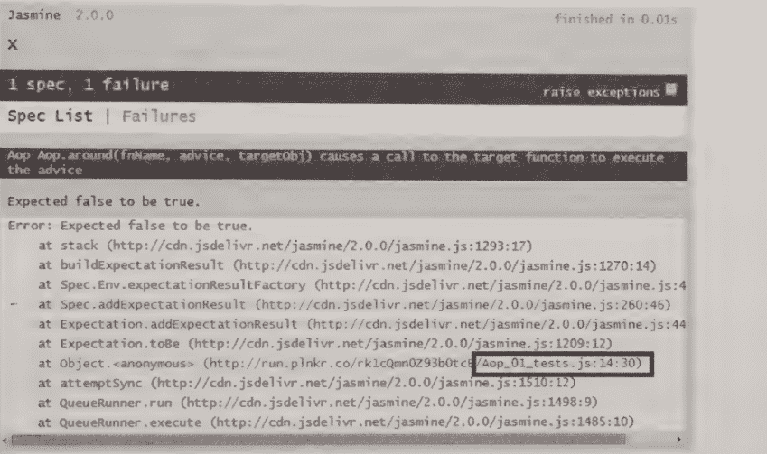

图 2-7

接下来，你会添加恰好足够的代码让它通过测试（列表 2-28）。

# 列表 2-28：Aop.around 现在执行 advice（代码文件名：Aop\Aop_01.js）

```javascript
Aop = {
  around: function(fnName, advice, fnObj) {
    fnObj[fnName] = advice;
  }
};
```

接下来，你想让你的 advice 环绕对目标的调用。这意味着你必须向 advice 传递有关目标的信息。你可以通过向 advice 传递一个存储了原始目标函数的对象来实现这一点。在列表 2-29 的测试中，这个对象被称为 `targetInfo`，函数存储在其属性中。

# 列表 2-29：测试将目标信息传递给切面（代码文件名：AOP\Aop_02_tests.js）

```javascript
describe('Aop', function() {
  var targetObj,
      executionPoints; // 执行事件数组

  beforeEach(function() {
    targetObj = {
      targetFn: function() {
        executionPoints.push('targetFn');
      };
    };
    executionPoints = [];
  });

  describe('Aop.around(fnName, advice, targetObj)', function() {
    it('导致对目标函数的调用触发 advice 的执行',function() {
      // ... 前文讨论过 ...
    });

    it('允许 advice 环绕目标', function() {
      var wrappingAdvice = function(targetInfo) {
        executionPoints.push('wrappingAdvice - begin');
        targetInfo.fn();
        executionPoints.push('wrappingAdvice - end');
      };
      Aop.around('targetFn', wrappingAdvice, targetObj);
      targetObj.targetFn();
      expect(executionPoints).toEqual(['wrappingAdvice - begin', 'targetFn', 'wrappingAdvice - end']);
    });
  });
});
```

# 列表 2-31 (续)

```javascript
Aop.around('targetFn', adviceFactory('outer'), targetObj);
targetObj.targetFn();
expect(executionPoints).toEqual([
  'wrappingAdvice - begin outer',
  'wrappingAdvice - begin inner',
  'targetFn',
  'wrappingAdvice - end inner',
  'wrappingAdvice - end outer']
]);
```

所有测试都通过了，你已经准备好下一个功能：向目标传递参数。到目前为止，建议（advice）甚至不知道参数的存在。如果它要传递这些参数，你必须提供它们。你只需要为建议获取的 `targetInfo` 对象添加一个 `args` 属性即可。`TargetInfo` 现在应该是这种形式：

`{ fn: targetFunction, args: argumentsPassToTarget }`

早期的建议只是这样调用目标的：

`targetInfo.fn();`

但如果你想像在调用时使用逗号分隔的参数那样传递一个参数数组，你必须使用之前提到的 `apply` 函数：

`targetInfo.fn.apply(this, targetInfo.args);`

这些思路出现在列表 2-32 所示的新建议 `argPassingAdvice` 中。`targetObj` 也被增强了，通过 `argsToTarget` 数组记录它收到的参数。来自其他语言的程序员可能会感到惊讶，尽管 `targetObj` 的 `function()` 语句中没有提到任何参数，但 `arguments` 对象仍然提供了传递给 `targetObj` 的参数，这就是 JavaScript 灵活性的另一个例子。

### 列表 2-32：测试参数是否可以传递给目标（代码文件名：AOP:Aop_03_tests.js）

```javascript
describe('Aop', function() {
  var argPassingAdvice, // 一个向目标传递参数的建议
      argsToTarget; // 传递给 targetObj.targetFn 的参数。
  // 为了清晰起见省略其他变量。

  beforeEach(function() {
    targetObj = {
      targetFn: function() {
        executionPoints.push('targetFn');
        argsToTarget = Array.prototype.slice.call(arguments, 0);
      }
    };
    executionPoints = [];

    argPassingAdvice = function(targetInfo) {
      targetInfo.fn.apply(this, targetInfo.args);
    };
  });

  describe('Aop.around(fnName, advice, targetObj)', function() {
    it('允许建议将普通参数传递给目标',
    function() {
      Aop.around('targetFn', argPassingAdvice, targetObj);
      targetObj.targetFn('a', 'b');
      expect(argsToTarget).toEqual(['a', 'b']);
    });
  });
});
```

当你运行测试时，它失败了，见图 2-8。

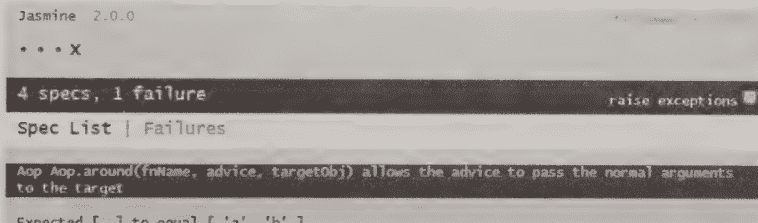

图 2-8

每次失败都会让测试驱动的开发者感到高兴，因为这意味着他写更多代码。在这种情况下，你只需要向传递给建议的对象添加 `args:arguments`（列表 2-33）。

> 列表 2-33：向目标传递参数（代码文件名：AOP\Aop_Aop.js）

```javascript
Aop = {
  around: function(fnName, advice, fnObj) {
    var originalFn = fnObj[fnName];
    fnObj[fnName] = function () {
      var targetContext = {}; // 错误；稍后处理。
      advice.call(targetContext, {fn:originalFn, args:arguments});
    };
  };
};
```

传统的开发者可能会以覆盖每个函数的测试来思考。你刚刚看到一个测试的示例，它覆盖了一个对象中的一个属性，而该属性被用于一行代码中。此外，这行代码的极小部分在测试编写之前甚至不存在。这就是测试驱动开发的最高境界。你即将将看到另一个例子。

# 第 2 章 工具准备

你刚刚考虑了进入目标函数的内容；那么从它出来的返回值呢？你希望建议能够在合适的情况下将该值回传给外部世界。

为了这个目的，你可以在 `targetObj.targetFn` 中添加一个 `return` 语句。你也可以让 `argPassingAdvice` 返回对目标的调用结果。到目前为止，这些都没有考虑返回值，所以它们仍然通过了，但主体测试呢？它会通过吗？列表 2-34 显示了一个发现结果的测试。（未显示：`targetObj.targetFn` 已改为返回一个新变量 `targetFnReturn`。）

### 列表 2-34：测试返回值（代码文件名：AOP/Aop_04_tests.js）

```javascript
it(" 目标的返回值对建议可用", function() {
  Aop.around('targetFn', argPassingAdvice, targetObj);
  var returnedValue = targetObj.targetFn();
  expect(returnedValue).toBe(targetFnReturn);
});
```

另一个失败（图 2-9）。

Jasmine

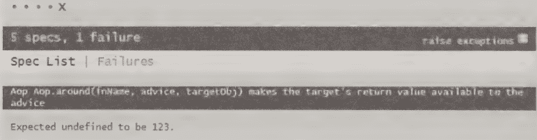

图 2-9

由于你预期了如此微小的功能增加，添加很容易：只需在 `Aop.around` 中添加一个 `return` 关键字，如列表 2-35 所示。

# 列表 2-35：切面从其目标返回值（代码文件名：AOP\Aop_04.js）

```javascript
Aop = {
  around: function(fName, advice, fnObj) {
    var originalFn = fnObj[fName];
    fnObj[fName] = function () {
      var targetContext = {}; // 错误；稍后处理。
      return advice.call(targetContext, {fn:originalFn, args:arguments});
    };
  }
};
```

目标现在被包装了，它获取了预期的参数，你可以获得它的返回值。只有最后一点需要考虑。在 JavaScript 中，在很容易在它非预期的上下文中执行函数。

> 注意：由于 JavaScript 函数可以很容易在非其原始所在地的对象上执行，不要忘记在合适的地方测试正确的上下文。

列表 2-36 中的测试说明了这一观点。

### 列表 2-36：在正确的上下文中测试目标（代码文件名：Aop_05_tests.js）

```javascript
it("在正确的上下文中执行目标", function() {
  var Target = function() {
    var self = this;
    this.targetFn = function () {
      expect(this).toBe(self);
    }
  };
  var targetObj = new Target();
  var advice = function(targetInfo) {
    return targetInfo.fn.apply(this, targetInfo.args);
  };
  Aop.around('targetFn', advice, targetObj);
  targetObj.targetFn();
});
```

```javascript
originalFn = targetObj.targetFn;
Aop.around('targetFn',advice, targetObj);
});
it('calls the function in targetInfo.fn', function() {
  targetObj.targetFn();
  expect(executionPoints).toEqual('targetFn');
});
it('passes the arguments in targetInfo.args', function() {
  targetObj.targetFn('a', 'b');
  expect(argsToTarget).toEqual(['a', 'b']);
});
it('returns the value from targetInfo's function', function() {
  var ret = targetObj.targetFn();
  expect(ret).toEqual(targetFnReturn);
});
it('calls the target function in the given context', function() {
  var targetInstance = new Target();
  var spyOnInstance = spyOn(targetInstance, 'targetInstance').and.callThrough();
  Aop.around('targetFn',advice, targetInstance);
  targetInstance.targetFn();
  expect(spyOnInstance).toHaveBeenCalled();
});
```

测试通过了，我们现在拥有了一个完全实用的 AOP 组件。

回顾列表 2-25，你可以轻松实现最后一步步骤，以完成 Fredrik 和 Dave 的杰作——现在允许只调用一次 `Aop.around` 来影响多个函数。

你可能注意到，他们的版本中 `Aop.around` 的参数命名不同：

`Aop.around(pointcut, advice, namespaces)`

本章的 Aop.js 使用的是 `fnName`，而他们使用的是 `pointcut`（切点）。切点， AOP 术语指定了你可能切入并执行操作的地方。`Aop.js` 是一个 JavaScript 表达式，因此像本章这样使用函数名是一个特殊情况。

此外，本章的 Aop.js 使用的是 `fnObj`，而他们使用的是 `namespaces`（命名空间）。在 JavaScript 中，命名空间只是一个包含其他对象作为属性的对象。为了避免命名冲突，将应用程序的所有代码放在命名空间中是一个良好的做法。你可以构建命名空间的层级：

```javascript
var MyApp = {};

MyApp.Encryption = {};
MyApp.WebServices = {};
MyApp.UI = {};
```

然后你可以将函数放在命名空间中：

```javascript
MyApp.WebServices.amazon = function () {
  // ...
  getIsbn: function(title, author, pubYear) {
    // ...
  };
};
```

# 第 2 章 工具准备

本章到目前为止的代码只允许将切面应用到一个函数上，即最末端——例如 `MyApp.WebServices.amazon.getIsbn`。有了完整的 `Aop.js`，我们可以将其应用于多个命名空间中所有以 "get" 开头的函数：

```javascript
Aop.around(/get/, advice, [ "MyApp.Encryption", "MyApp.WebServices" ]);
```

即使没有这个增强，你已经通过测试驱动开发构建了 Aop.js 的核心。顺便提一下，本章下载中提供的最终版本 Aop.js 还包含了 `before` 切面及其对应的测试。图 2-10 中的测试结果展示了 Aop.js 的所有功能。

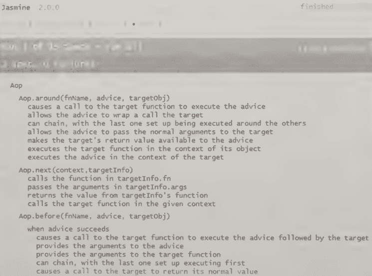

## 其他 AOP 库

尽管我们喜欢 Aop.js，但还有其他选择，例如 AspectJS、AopJS jQuery 插件以及 YUI 的 Class。

## AspectJS

听着 AspectJS 这个名字，你就知道它在搜索列表中会排得很高。它是 JavaScript AOP 竞赛早期的参赛者之一，功能非常全。它具有如下功能：

- 暂停和恢复 AOP 切面——如果你需要，这些功能可以很容易地添加到 Aop.js 中，但它们在 AspectJS 中已经存在了。缺点是 AspectJS 随之变得沉重得多。

另一个巨大的缺点是 AspectJS 似乎自 2008 年以来就没有更新过（http://aspectjs.com/JS_Release_History.htm）。JavaScript 本身正在不断进化，你可能会觉得使用与时俱进的工具是有意义的。

## AopJS jQuery 插件

尽管 AopJS jQuery 插件相对较新，在 GitHub 上的数据还不高，但你可能会仅仅因为在 jQuery 网站上（http://plugins.jquery.com/aop/）而遇到它。Aspect 的作者花时间提供了兼容 jQuery 和 Angular 的语法选项，以及像文档中这个示例那样易于链式调用切面。

```javascript
var myProxy = Aop.aspect
  .before(myFunction)
  .afterReturning(myAdvice2)
  .afterThrowing(myAdvice3);
```

这段代码没有 Aop.js 那种简洁优雅的感觉，但它的功能稍微成熟一点。

## YUI 的 Do 类

Yahoo! YUI 项目的人们非常内行。YUI 的组件之一是 `Do` 类。在 http://yuilibrary.com/yui/docs/api/classes/Do.html 有非常详细的文档。Y.Do（Y 是命名空间）非常完美，除此一点：2014 年 8 月，Yahoo 宣布停止开发 YUI。

## 结论

也许因为 AOP 在 JavaScript 中实现起来太简单了，所以并没有很多它的工具包。这不是什么大问题。似乎那些重量级库已经停止了开发，留下了

## 列表 2-40：calculateUpgradeMileages 的单元测试（代码文件名：Linting\Linting_01_tests.js）

```javascript
describe('calculateUpgradeMileages(tripMileages, memberMultiplier)', function() {
  var testPassenger = null;

  beforeEach(function() {
    testPassenger = {
      firstName : 'Seth',
      lastName : 'Richards',
      tripMileages: [
        500,
        600,
        3400,
        2500
      ]
    };
  });

  it('returns original mileages when multiplier is 1.0', function() {
    expect(calculateUpgradeMileages(testPassenger.tripMileages, 1.0))
      .toEqual(testPassenger.tripMileages);
  });

  it('returns expected mileages when the memberMultiplier is 3.0', function() {
    var expectedResults = [], multiplier = 3.0;

    for (var i = 0; i < testPassenger.tripMileages.length; i++) {
      expectedResults[i] = testPassenger.tripMileages[i] * multiplier;
    }

    expect(calculateUpgradeMileages(testPassenger.tripMileages, multiplier))
      .toEqual(expectedResults);
  });
});
```

列表 2-41 显示了 `calculateUpgradeMileages` 的实现，该实现使得单元测试通过。

## 列表 2-41：calculateUpgradeMileages 的实现（代码文件名：Linting\Linting_01.js）

```javascript
function calculateUpgradeMileages(tripMileages, memberMultiplier) {
  var upgradeMileages = [];
  var i = 0;
  for (var i = 0; i < tripMileages.length; i++) {
    var calcRewardsMiles = function(mileage) {
      return mileage * memberMultiplier;
    };
    upgradeMileages[i] = calcRewardsMiles(tripMileages[i]);
  }
  return upgradeMileages;
}
```

最后，图 2-11 显示了单元测试的 Jasmine 输出。

```
Jasmine 2.0.0 finished in ...
2 tests, 0 failures
calculateUpgradeMileages(tripMileages,memberMultiplier)
returns original mileages when multiplier is 1.0
returns expected mileages when the memberMultiplier is 3.0
```

图 2-11

如你所示，函数返回了预期的结果且测试通过了。然而，代码中存在一个潜在问题。请花时间看看能否识别出 `calculateUpgradeMileages` 中存在问题的代码段。如果你一眼没看，不要担心，因为你正在使用你的代码检查工具来帮助。

## 介绍 JSHint

JSHint 是一个开源的静态分析工具，它的自述如下：

> JSHint 是一个社区驱动的工具，用于检测 JavaScript 代码中的错误和潜在问题，并确保你团队的代码编码规范。
>
> http://www.jshint.com/about

JSHint 是 JSLint 项目的一个分支。JSLint 由 Douglas Crockford 创建并维护。在他们从 JSLint 衍生出 JSHint 之时，JSHint 的创建者认为 JSLint 已经变得非常“有主见”，因此需要一个由 JavaScript 社区驱动的 lint 检查工具。

## 使用 JSHint

你可以将你的 JavaScript 代码复制并粘贴到 JSHint 首页（http://www.jshint.com），检查器将自动执行。虽然这对于识别博客文章（或书籍）中的示例代码问题可能很方便，但使用这种机制执行检查器并不适用于开发即使具有有限复杂性的 JavaScript 解决方案。

由于 `calculateUpgradeMileages` 函数是书中的示例代码，你可以使用 http://www.jshint.com 上的在线工具来找到函数中的可疑结构。

图 2-12 显示了 JSHint 对 `calculateUpgradeMileages` 的看法。

如你所示，JSHint 提供了以下警告：

> 不要在一个循环内部创建函数。

## 使用代码检查工具

```javascript
function calculateUpgradeMileages(tripMileages, memberMultiplier) {
  var upgradeMileages = [];
  for (var i = 0; i < tripMileages.length; i++) {
    var calcRewardsMiles = function(mileage) {
      return mileage * memberMultiplier;
    };
    var mileage = calcRewardsMiles(tripMileages[i]);
    upgradeMileages.push(mileage);
  }
  return upgradeMileages;
}
```

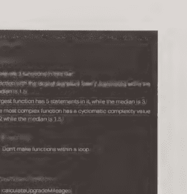

图 2-12

如果你没有注意到，JSHint 帮助你指出你在遍历里程列表的循环内部声明了一个函数。你的单元测试通过了，因此在这种情况下，在循环内部创建函数并没有导致逻辑错误。那么问题所在哪里？

记住，JSHint 会识别 JavaScript 代码中的可疑结构。我们完全同意，无论结果逻辑上是否正确，在循环的每次迭代中重新声明函数都是可疑的。至少，它是低效的，尽管在这个例子中没有出现这种情况，但在实践中这很容易导致产生错误且不可靠的代码。

> 注意：JSHint 识别 JavaScript 代码中的可疑结构。我们完全同意，无论结果在逻辑上是否正确，在循环的每次迭代中重新声明函数都是可疑的。至少，它是低效的，尽管在这个例子中没有出现这种情况，但在实践中很容易导致产生错误且不可靠的代码。

## 第 2 章 工具准备

ESLint 可以作为 node.js 的 npm 模块可用。ESLint 主页可以在 http://www.eslint.org 找到。

## 严格模式

有一个代码检查工具值得关注。实际上，它不是一个外部工具，而是 ECMAScript 5 引入的一种 JavaScript 设置。如果你在作用域（无论是全局作用域还是函数）中包含以下内容，JavaScript 解释器将以不同的方式处理某些特性。

`'use strict';`

启用此指令后，如果你犯了某些错误，JavaScript 将抛出错误。这些错误包括在未先声明的情况下使用变量、尝试修改只读属性、使用保留字 `arguments` 命名变量等。

在不支持严格模式的 JavaScript 版本上运行时，`'use strict'` 字符串将产生没有影响。

你将在第 18 章的“默认绑定与严格模式”部分看到严格模式如何产生关键性差异的示例。同时，书中的代码列表将使用它以养成这种习惯。

## 总结

在本章中，我们介绍了一些我们用于 JavaScript 开发的常用技术和工具。

单元测试框架对于可靠的软件开发至关重要。在本文中我们将使用 Jasmine，我们发现它易于学习且非常健壮，流行的替代方案包括 QUnit 和 D.O.H。

随着应用程序变得复杂，保持组件的整洁和分离变得越来越重要。依赖注入是实现这一点的重要技术。在本章中，你完成了依赖注入框架的测试驱动开发，该框架将在后面的章节中出现，并可能对你的项目有用。

作为另一个 TDD（测试驱动开发）的案例研究，你开发了一个面向切面编程（AOP）的工具包。AOP 允许你通过缓存等通用功能增强软件组件，而完全无需更改这些组件。这是另一种同时保持代码 DRY（不重复）、履行单一职责原则并遵守开闭原则的方法。

代码检查工具（称为 linters）通过对语法错误或违反标准的警告，在微观层面提升了可靠性。JSHint、JSLint 和 ESLint 是最常用的工具。严格模式是另一种避免语法层面错误的好方法。


# 第 3 章 构建可靠的对象

在下一章中，你将探索 JavaScript 构建对象的丰富方式。这听起来像是一个简单的话题，但你会发现它绝非如此。

## 本章包含什么？

- 使用原始类型、对象字面量和模块创建数据
- 使用 `new` 关键字创建数据
- 使用对象创建方法产生可靠的对象
- 使用原型、经典和函数模式控制继承
- 负责任地使用猴子补丁

## 本章代码下载

本章的代码下载可以在 www.wrox.com/go/reliablejavascript 的 Download 标签页找到。

开发者喜欢用户界面中炫酷的效果、优雅的算法和设计良好的 API，但对实例化对象这一谦卑的行为很少关注。JavaScript 为此提供了异常多样化的选择。其中一些将使你的代码变得可靠、可测试且可扩展；另一些代表了通往毁灭的康庄大道。

本章调查了创建对象的最常用方法，并考虑了每种方法在多大程度上符合第 1 章介绍的可靠性和可测试性的 SOLID 和 DRY 原则。

让我们从最基础的开始逐步构建。

## 使用原始类型

当我们招聘开发者时，总是会问候选人：“JavaScript 中的原始数据类型有哪些？”最常见的回答是：“只有一个：var。”次常见的回答是相反的：深吸一口气，并背出足够填满 C# 手册的类型。这两种回答都是错误的。

JavaScript 有五种原始数据类型：`String`、`Number`、`Boolean`、`Null` 和 `Undefined`。语言会根据需要将一种转换为另一种，并以众许多令人惊讶的方式进行，但这五种至少属于 ECMAScript 5（ECMAScript 6 增加了 `Symbol` 类型）。`Object` 类型不是原始类型。

原始类型有值，但没有属性，但下面的代码将运行而不报错。

```javascript
var str = "abcde";
console.log(str.length); // 输出: 5
```

如果 `str` 没有 `length` 属性，这如何能起作用？当解释器遇到 `str.length` 时，它会说：“嗯……看起来他正尝试操作对象。让我们为他创建一个。”它根据 `str` 构建一个 `String` 并报告其长度。这个 `String` 构建得有多快，被垃圾回收就有有多快。

`String`、`Boolean` 和 `Number` 都有对应的对象包装器：`String(value)`、`Boolean(value)`。

WET（重复写两次或我们享受打字）可能会在你不察觉的情况下进入你的代码。假设你有一个代表动物重量（公斤）的变量。你从它获取一个值然后执行以下操作：

```javascript
if (inputMass < 0) {
  // ...
} else if (inputMass > 150000) { // 错误：即使是蓝鲸也不巨大。
}
```

然后在应用程序的另一个部分，你做了相同的事情。你的代码不再是 DRY 的，但你还能做什么呢？你不能在原始类型上安装验证。解决这个问题的方法之一是将你的原始类型转换为对象。该对象可以拥有范围验证以及原始类型不具备的功能。我们并不是建议每个原始类型都应该是对象，但这是需要根据具体情况考虑的。

另一个常见问题是重复的原始类型。在变量中使用它要容易得多。除了保持代码 DRY 之外，还能如何？哪种方法都能让你找到使用的地方。表 3-1 总结了原始类型在 SOLID 方面的表现。

### 表 3-1：原始类型的 SOLID 和 DRY 总结

| 原则 | 结果 |
| :--- | :--- |
| 单一职责 | 原始类型无法实现 |
| 开闭原则 | 对扩展开放？并不 true。对修改关闭？确实。事实上，原始类型是不可变的 |
| 里氏替换 | 不适用 |
| 接口隔离 | 抱歉；你可以在原始类型上实现接口，尽管你可能这样做。 |
| 依赖倒置 | 原始类型没有依赖。 |
| 不要重复自己 | 这里极具诱惑！ |

## 使用对象字面量

区分创建对象字面量的两种方式是有帮助的。有裸字面量和从值返回的字面量：

```javascript
var koko = { name: 'Koko', genus: 'gorilla', genius: 'sign language' };

var amazeWorld = function() {
  //
  return { name: 'Koko', genus: 'gorilla', genius: 'sign language' };
};

var koko = amazeWorld();
```

这种区别很重要，因为一种更 DRY。如果你创建多个具有相同对象的字面量，你必须重复属性名称。很容易出错。测试驱动开发可以确保我们从函数返回预期的对象，但没有方法区分埋在代码中的裸字面量。

对象字面量还有作为函数的属性。再次，如果字面量不是通过受控方式创建（例如从函数返回），则没有方法测试这些函数。

除非对象字面量赋值给变量（如第 2 章遇到的 Var 对象），否则在面向切面编程中使用它将是有问题的。切面需要一个可以应用它的切点（例如，变量名），但对象字面量没有名称。然而，如果对象字面量是由工厂函数产生的，那么该函数就可以被包装在“之后”切面中，以处理返回的字面量。

作为依赖注入，裸字面量的情况没有这种机会。然而，创建一个并返回字面量的函数可能完全适用于第 2 章建议的、在应用程序启动代码中的依赖注入过程。

裸字面量的一个弱点是它们在构建时没有验证。正式的构造函数可以对其参数进行各种验证并保证有效结果。除非你是在拼凑一个裸字面量，否则没有检查。

由于这些原因，我们建议对象字面量组成应用程序的重要部分，除非它们是单例或由经过测试的代码创建的。

使用对象字面量的一种良好方法是将一组数据从一个地方传递到另一个地方。例如，在《JavaScript: The Good Parts》(O'Reilly, 2008)一书中，Douglas Crockford 建议使用对象字面量，而不是长函数参数列表，因为后者的顺序可能很难正确处理。此外，他还指出，字面量中缺少某个属性可以作为使用默认值的信号。

这种做法需要谨慎，但要小心：如果你的函数必须准备好任何属性组合，那么你就是在给自己增加沉重的负担。你可能考虑使用一个具有良好控制且经过测试的构建方式的对象，甚至包含一个 `isValid()`。

表 3-2 总结了对象字面量的 SOLID 和 DRY 方面。

### 表 3-2：对象字面量的 SOLID 和 DRY 总结

| 原则 | 结果 |
|---|---|
| 单一职责 | 在实践中，裸对象字面量通常足够小，不至于在这一点上遇到麻烦。构成模块 API（见下一节）的大型字面量，请注意该模块承担了哪些职责。 |
| 开闭原则 | 对象字面量的理念似乎邀请了不受管理的扩展。小心！ |
| 里氏替换原则 | 不适用 |
| 接口隔离 | 见下一节的模块模式以及本章最后一节的猴子补丁。 |
| 依赖倒置 | 裸对象字面量在这里失败了，因为它们没有构造函数来注入依赖。 |
| 不要重复自己 (DRY) | 除非是单例，否则裸对象字面量会导致 WET 代码。这里有一个巨大的警告！ |

## 使用模块模式

模块模式是 JavaScript 中最悠久的模式之一。它采用一个函数，该函数的主要目的是数据隐藏，并返回一个包含模块 API 的对象。模块有两种类型：你可以通过调用函数来构建的模块，以及基于一个在声明时立即执行的函数的模块。

### 随心创建模块

列表 3-1 是一个你可以随地创建的模块示例。只需调用模块函数即可获取你的 API。

#### 列表 3-1：随心创建模式的示例

```javascript
// 一个作为命名空间的全局对象，用于收集
// 在整个应用程序中可用的所有对象（模块）。
var MyApp = MyApp || {};

// 应用程序命名空间下的模块。
// 该函数依赖于另一个函数 animalMaker，它可以
// 被注入。
MyApp.wildlifePreserveSimulator = function (animalMaker) {
  // 私有变量
  var animals = [];

  // 返回 API
  return {
    addAnimal: function(species, sex) {
      animals.push(animalMaker.make(species, sex));
    },
    getAnimalCount: function() {
      return animals.length;
    }
  };
};
```

你可以这样使用该模块：

```javascript
var preserve = MyApp.wildlifePreserveSimulator(realAnimalMaker);
preserve.addAnimal(gorilla, female);
```

虽然模块返回的是一个对象字面量，但如 `animalMaker` 这样的依赖可以注入到外部函数并进入字面量。

由于模块可以注入到其他模块中，因此它们很容易扩展。你将旧版本注入新版本中，根据需要对其进行封装、暴露和扩展。如果你对第 1 章的开闭原则感兴趣，那么模块是理想的。

方面（见第 2 章）可以通过首先在 `MyApp.wildlifePreserveSimulator` 上安装一个“后置”建议来应用于返回的对象。该建议将获取返回的字面量并根据需要用进一步的方面对其修改。

### 创建立即执行模块

通常，外部函数在声明时立即执行，并像随心创建的模块一样返回 API。返回的 API 被赋值给命名空间的全局变量，该变量随后成为模块的单例实例。列表 3-2 以这种方式修改了列表 3-1。

#### 列表 3-2：一个单例模块

```javascript
var MyApp = MyApp || {};

MyApp.WildlifePreserveSimulator = (function() {
  var animals = [];

  return {
    addAnimal: function(animalMaker, species, sex) {
      animals.push(animalMaker.make(species, sex));
    },
    getAnimalCount: function() {
      return animals.length;
    }
  };
}()); // <- 立即执行。
```

单例可以像这样用于代码：

```javascript
MyApp.WildlifePreserveSimulator.addAnimal(realAnimalMaker, gorilla, female);
```

外部函数就在在你看到的地方执行，而不是在由应用程序启动代码调用时执行。对于此，它的依赖无法注入到外部函数中，除非它们在函数（立即）执行时恰好可用。这有点不方便。如果你想要一个单例，更符合依赖注入的方法是使用随心创建模式编写模块，并让依赖注入框架在每次请求时都提供相同的实例。例如，AngularJS 就是这样提供“服务”单例的。

### 创建可靠的模块

无论你的模块是随心类型还是立即执行类型，都有几个原则是你想要记住的。首先，记住单一职责原则：每个模块应该只尽一份职责。这将使你的 API 保持小、内聚且易于管理。其次，如果你的模块为自身使用创建对象，请询问这些对象是否应该通过依赖注入提供——直接提供或通过工厂提供。最后，如果你的模块扩展了另一个对象的行为，务必不要更改它的语义。这就是里氏替换原则。表 3-3 是模块的 SOLID 和 DRY 总结。

#### 表 3-3：模块的 SOLID 和 DRY 总结

| 原则 | 结果 |
|---|---|
| 单一职责 | 通过依赖注入和面向切面的装饰，很容易让模块保持单一职责。 |
| 开闭原则 | 模块可以通过注入到其他模块来保持开放扩展。 |
| 里氏替换原则 | 只要你不更改任何依赖的语义，就没有问题。 |
| 接口隔离 | 具有内聚 API 的模块是 JavaScript 隔离接口的等价物。 |
| 依赖倒置 | 随心创建的模块可以很容易地注入依赖。任何类型的模块都可以注入其他。 |
| 不要重复自己 | 做得正确，模块是保持代码 DRY 的良好方法。 |

## 使用原型和原型继承

JavaScript 中的每个对象无论如何创建，都有一个从中继承的原型对象。在本节中，你将学习原型和原型继承的基础。

### 默认对象原型

在前面介绍过的对象字面量会自动链接到内置原型对象。考虑如下定义的 `chimp` 对象：

```javascript
var chimp = {
  hasThumbs: true,
  swing: function() {
    return 'swinging through the tree tops';
  }
};
```

`chimp` 对象没有定义 `toString` 函数，但执行 `chimp.toString();` 不会导致未定义函数错误。事实上，它会输出 `chimp` 对象的字符串表示（`'[object Object]'`，这并没有描述性）。

当调用 `chimp.toString()` 时，JavaScript 检查 `chimp` 对象并确定它没有直接定义属性。接下来，它查看 `chimp` 的原型 `Object.prototype`，它定义了 `toString` 函数。找到的函数被执行并返回其值。

> 注意 `Object.prototype` 定义了许多有用函数。完整列表请见 https://developer.mozilla.org/en-US/docs/Web/JavaScript/Reference/Global_Objects/Object/prototype。

如果 `chimp` 定义了自己的 `toString` 函数：

```javascript
var chimp = {
  hasThumbs: true,
  swing: function() {
    return 'swinging';
  },
  toString: function() {
    return 'I am the chimpanzee';
  }
};
```

那么 JavaScript 将立即找到 `chimp` 的 `toString` 实现并执行它，返回 `'I am the chimpanzee'`；而不会检查 `chimp` 的原型链。

### 原型继承

尽管 `Object.prototype` 具有一些实用的属性，但 JavaScript 原型继承的威力在于能够用自定义原型替换默认原型。假设除了 `chimp` 对象外，你还想创建一个 `bonobo`（倭黑猩猩）对象。由于它们在动物界中是亲属，你知道 `chimp` 对象和 `bonobo` 对象将具有许多共同属性。

为了减少对象之间属性的重复，你可以创建一个名为 `ape` 的对象，包含这些共同属性。然后你可以创建链接到 `ape` 的 `chimp` 和 `bonobo` 对象；这使得 `ape` 成为一个共享原型。

ECMAScript 5 使用 `Object.create` 方法，该方法处理与原型链接的新对象的创建。以下代码段说明了如何使用 `Object.create` 来构建以 `ape` 为共享原型的 `chimp` 和 `bonobo` 对象：

```javascript
var ape = {
  hasThumbs: true,
  hasTail: false,
  swing: function(){
    return 'swinging';
  }
};

var chimp = Object.create(ape);
var bonobo = Object.create(ape);
bonobo.habitat = 'Central Africa';

console.log(bonobo.habitat); // 'Central Africa' (from bonobo)
console.log(bonobo.hasTail); // false (from ape prototype)

console.log(chimp.swing()); // 'swinging' (from ape prototype)
```

如你所见，`bonobo` 和 `chimp` 都从 `ape` 继承了属性。你还会注意到 `bonobo` 直接添加了 `habitat` 属性；该属性既没有与 `ape` 共享，也没有与 `chimp` 共享。

由于 `ape` 是共享原型，对它进行的任何更改都会反映在 `chimp` 和 `bonobo` 中：

```javascript
ape.hasThumbs = false;
console.log(chimp.hasThumbs); // false
console.log(bonobo.hasThumbs); // false
```

### 原型链

你可以使用多个层级的原型（称为原型链）来创建多层继承。例如，假设 `ape` 有一个 `primate`（灵长类）原型，然后 `ape` 被用作 `chimp` 的原型：

```javascript
var primate = {
  stereoscopicVision: true
};
var ape = Object.create(primate);
ape.hasThumbs = true;
ape.hasTail = false;
ape.swing = function(){
  return "swinging";
};

var chimp = Object.create(ape);
console.log(chimp.hasTail); // false (from ape prototype)
console.log(chimp.stereoscopicVision); // true (from primate prototype)
```

在访问 `chimp.stereoscopicVision` 时，如果不在 `chimp` 对象上直接找到它，JavaScript 解释器必须遍历 `chimp` 的原型链到达 `ape`，然后到达找到属性的 `primate`。如果访问的属性在对象的原型链的任何地方都不存在，则返回 `undefined`。

遍历深层的原型链会导致性能下降，因此我们建议尽可能保持其浅层。

## 使用 new 创建对象

在本节中，你将学习 JavaScript 中新的对象创建模式，并检查该模式的一些优势和陷阱。你还会看到使用该模式如何帮助保持代码符合 **SOLID** 和 **DRY** 原则。

### 新对象创建模式

JavaScript 中新对象创建模式的语法与经典语言 C#、C++ 或 Java 中相同模式语法相似。

> 注意 我们使用“经典”一词是指这些语言使用了类（classes），这是一种允许定义自定义类型的构造结构。“经典”并不意味着像指代古希腊语或拉丁语那样的年代久远（尽管 C++ 比本书的其中一位作者要老得多！）。

列表 3-3 显示了 `Marsupial` 函数，它还展示了使用新对象创建模式创建 `Marsupial` 对象的实例。

#### 列表 3-3：Marsupial 函数及其作为构造函数的用例（代码文件名：NewPattern\newpattern.01.js）

```javascript
function Marsupial(name, nocturnal) {
  this.name = name;
  this.isNocturnal = nocturnal;
}

var maverick = new Marsupial('Maverick', true);
var slider = new Marsupial('Slider', false);

console.log(maverick.isNocturnal); // true
console.log(maverick.name); // "Maverick"
console.log(slider.isNocturnal); // false
console.log(slider.name); // "Slider"
```

在 `Marsupial` 函数内部，参数被赋值给创建的实例属性。`Marsupial` 函数定义后的后续行显示 `Marsupial` 的两个实例 `maverick` 和 `slider` 具有独特的属性。

### 可能发生糟糕情况的情况

你应该注意到，语言本身并没有提供任何指示表明 `Marsupial` 函数应该作为构造函数（即为了配合 `new` 关键字而编写的函数）。JavaScript 也没有在未使用 `new` 关键字执行构造函数时提供内置保护。因此，开发者通过使用 PascalCase（大驼峰命名法）来区分构造函数。

由于在调用构造函数时省略 `new` 关键字可能导致“坏事”发生，Douglas Crockford 建议不要使用构造函数。（参见 *JavaScript: The Good Parts*, O'Reilly, 2008.）

我们并不急于否定构造函数的使用，因为它们允许初始化，而且确保使用 `new` 并不困难。

### 强制使用 new

虽然 JavaScript 没有采取任何措施强制构造函数使用 `new`，但利用 `instanceof` 运算符来实现这种强制很容易实践。列表 3-4 显示了如何重写 3-3 中的 `Marsupial` 函数以确保使用 `new`。

#### 列表 3-4：使用 instanceof 强制使用 new（文件名：NewPattern\newpattern.02.js）

```javascript
function Marsupial(name, nocturnal) {
  if (!(this instanceof Marsupial)) {
    throw new Error("This object must be created with new");
  }
  this.name = name;
  this.isNocturnal = nocturnal;
}

var slider = new Marsupial('Slider', true);
```

### instanceof 如何工作

列表 3-4 和 3-5 依赖于 `this instanceof Marsupial` 返回 `false`。JavaScript `instanceof` 运算符检查左侧操作数的原型链，寻找右侧操作数的原型。如果找到了右侧操作数的原型，则左侧操作数被认为是右侧操作数的实例。

当使用 `new` 关键字执行构造函数时，JavaScript 会创建一个新的空对象，将新对象的原型链接到构造函数的 `prototype` 属性，并在 `this` 为新对象的情况下执行构造函数。

当省略 `new` 时，所有这些自动步骤都不会发生。在列表 3-4 和 3-5 中，`this` 绑定到了全局对象。此外，原型赋值没有发生，因此 `instanceof` 返回 `false`。

在未使用 `new` 时抛出错误的替代方案是使用 `new` 自动创建一个对象的实例并返回它，如列表 3-5 所示。

#### 列表 3-5：使用 new 自动创建实例（代码文件名：NewPattern\newpattern.03.js）

```javascript
function Marsupial(name, nocturnal) {
  if (!(this instanceof Marsupial)) {
    return new Marsupial(name, nocturnal);
  }
  this.name = name;
  this.isNocturnal = nocturnal;
}

var slider = Marsupial('Slider', true);
console.log(slider.name); // 'Slider'
```

通过这种机制，调用该函数的程序员不需要担心在调用 `Marsupial` 时是否使用了 `new` 关键字；如果省略了 `new`，系统会自动使用它。

从表面上看，自动使用 `new` 关键字似乎是有帮助的，但实际上它只是允许程序员犯下错误。请考虑以下情况：

```javascript
var jester = Marsupial('Jester', false);
var merlin = new Marsupial('Merlin', false);
```

这两个 `Marsupial` 调用都产生了对象，就像它们前面都加了 `new` 一样，尽管其中只有一个加了。如果你的团队遵循了构造函数名称首字母大写的命名约定，那么 `jester` 实例的创建看起来是错误的。

一致性意味着可靠性，正如我们倾向于使用列表 3-4 所示的保护机制一样。在省略 `new` 时抛出异常可以确保所有 `Marsupial` 对象都以这种方式实例化，从而构建更一致、更可靠的代码库。此外，当与测试驱动开发相结合时，任何通过省略 `new` 产生的异常都会被立即识别。

> 注意：自动分号插入是 JavaScript 的一项特性，它也允许程序员犯错并导致代码库变得不一致，这被 Douglas Crockford 认为是 JavaScript 糟糕部分之一，不应该被依赖（《JavaScript: The Good Parts》，作者 Douglas Crockford, O'Reilly Media, 2008）。自动插入 `new` 虽然可能并不糟糕，但出于相同的原因也应该被避免。

这种新对象的创建模式还允许你创建函数属性，这些属性被定义并对所有实例可用。列表 3-6 显示了如何通过在构造函数中直接在新对象上定义属性，从而为对象的每个实例添加属性。该列表还说明了每个对象实例都有自己的函数拷贝。

#### 列表 3-6：直接向新对象添加函数（代码文件名：NewPattern\newpattern_04.js）

```javascript
function Marsupial(name, nocturnal) {
  if (!(this instanceof Marsupial)) {
    throw new Error("This object must be created with new");
  }
  this.name = name;
  this.isNocturnal = nocturnal;
  // 每个对象实例都获得自己的 isAwake 拷贝
  this.isAwake = function(isNight) {
    return isNight === this.isNocturnal;
  };
}

var maverick = new Marsupial('Maverick', true);
var slider = new Marsupial('Slider', false);

var isNightTime = true;
console.log(maverick.isAwake(isNightTime)); // true
console.log(slider.isAwake(isNightTime)); // false

// 每个对象都有自己的 isAwake 函数
console.log(maverick.isAwake === slider.isAwake); // false
```

函数属性也可以被添加到构造函数的原型（`prototype`）上。在构造函数的原型上定义函数具有额外的好处，它将函数的拷贝限制为一份，从而减少了内存占用，并在创建大量对象实例时提高了性能。

列表 3-7 显示了如何向构造函数的原型添加函数属性。该列表还说明了每个对象实例都共享该函数的实现。

#### 列表 3-7：向构造函数的原型上添加函数（代码文件名：NewPattern\newpattern.05.js）

```javascript
function Marsupial(name, nocturnal) {
  if (!(this instanceof Marsupial)) {
    throw new Error("This object must be created with new");
  }
  this.name = name;
  this.isNocturnal = nocturnal;
}

// 每个对象实例共享一份 isAwake 拷贝
Marsupial.prototype.isAwake = function(isNight) {
  return isNight === this.isNocturnal;
}

var maverick = new Marsupial('Maverick', true);
var slider = new Marsupial('Slider', false);

var isNightTime = true;
console.log(maverick.isAwake(isNightTime)); // true
console.log(slider.isAwake(isNightTime)); // false

// 对象共享同一个 isAwake 实例
console.log(maverick.isAwake === slider.isAwake); // true
```

为了说明利用构造函数的原型可以实现性能提升，我们在 http://jsperf.com 上创建了一个示例，将不使用原型的 `Marsupial` 版本与使用原型的版本进行了对决。你可以访问 http://jsperf.com/performance-vs-non-prototype 在你自己的浏览器中运行，以满足你的好奇。图 3-2 显示了在 OS X 10.6 上运行 Chrome 40 测试的结果。

如图 3-2 所示，使用构造函数原型在所有对象实例之间共享一份 `isAwake` 函数拷贝的 `Marsupial` 版本，比为每个对象实例创建一个 `isAwake` 函数拷贝快了 90% 以上。


图 3-2

表 3-4 总结了新对象创建模式在 SOLID 和 DRY 方面的表现。

### 表 3-4：使用 new 创建对象的 SOLID 和 DRY 总结

| 原则 | 结果 |
|---|---|
| 单一职责原则 | 是的，对象负责某件事。 |
| 开闭原则 | 是的，可以通过继承扩展。 |
| 里氏替换原则 | 是的，通过继承实现。 |
| 接口隔离原则 | 是的，通过继承实现。 |
| 依赖倒置原则 | 是的，将依赖注入构造函数。 |
| 不要重复自己 | 对象创建模式产生了 DRY 代码。 |

## 使用经典继承

由于 JavaScript 没有类，它不支持像 C# 或 C++ 那样的经典继承。它的原型继承允许模拟经典继承。然而，这阻止了你使用 AOP 装饰。在本节中，你将看到如何让 JavaScript 的原型继承行为类似于经典继承。此外，你将了解到使用这种方式的优缺点。

### 模拟经典继承

JavaScript 中模拟经典继承的基础是对函数原型的操作。假设你想要扩展 `Marsupial` 函数的行为，以包含袋鼠特定的属性，特别是一个 `hop` 函数。

回顾一下，这里是 `Marsupial` 函数，包含了 `new` 强制检查以及添加到原型上的 `isAwake`：

```javascript
function Marsupial(name, nocturnal) {
  if (!(this instanceof Marsupial)) {
    throw new Error("This object must be created with new");
  }
  this.name = name;
  this.isNocturnal = nocturnal;
}

Marsupial.prototype.isAwake = function(isNight) {
  return isNight === this.isNocturnal;
};
```

你可以将 `hop` 添加到 `Marsupial` 函数的原型上（或直接添加到由函数创建的对象实例上），但你真的想这样做吗？如果你这样做了，`Marsupial` 构造函数创建的每个对象实例都将拥有 `hop` 函数。由于你只想让袋鼠能够跳跃，修改 `Marsupial` 并无法实现你的目标。修改 `Marsupial` 也会违反开闭原则。

最佳且可靠的解决方案是通过创建一个继承自 `Marsupial` 的 `Kangaroo` 函数来扩展 `Marsupial`。列表 3-8 显示了如何实现。

#### 列表 3-8：使用经典继承模拟扩展 Marsupial（代码文件名：classical_01.js）

```javascript
function Kangaroo(name) {
  if(!(this instanceof Kangaroo)) {
    throw new Error("This object must be created with new");
  }
  this.name = name;
  this.isNocturnal = false;
}

Kangaroo.prototype = new Marsupial();

Kangaroo.prototype.hop = function() {
  return this.name + " just hopped!";
};

var jester = new Kangaroo('Jester');

console.log(jester);

var isNightTime = false;
console.log(jester.isAwake(isNightTime)); // true
console.log(jester.hop()); // Jester just hopped!
console.log(jester instanceof Kangaroo); // true
console.log(jester instanceof Marsupial); // true
```

你可以看到，`Kangaroo` 函数的默认原型已经被替换为了 `Marsupial` 的新实例，使得 `Marsupial` 的行为几乎就像一个类定义。

`Marsupial` 实例现在通过添加 `hop` 函数扩展了 `Kangaroo` 的原型。注意，`hop` 函数并不是在 `Marsupial` 构造函数内部添加的，也没有添加到 `Marsupial` 构造函数的原型上；`Marsupial` 函数没有发生任何变化。这种实现完全遵循了**开闭原则**！

### 重复杀死了袋鼠

如列表 3-8 所示，模拟类继承避免了代码和内存的重复。让我们再次看一遍将 `Marsupial` 实例赋值给 `Kangaroo` 函数原型的操作：

```javascript
Kangaroo.prototype = new Marsupial();
```

你可能已经注意到，没有向 `Marsupial` 构造函数提供任何参数。在设置 `Kangaroo` 原型时，参数是未知的，直到创建 `Kangaroo` 实例后才已知。

由于在配置原型时参数未知，在 `Marsupial` 函数内部进行的属性赋值在 `Kangaroo` 函数中重复了：

```javascript
function Marsupial(name, nocturnal) {
  if(!(this instanceof Marsupial)) {
    throw new Error("This object must be created with new");
  }
  this.name = name;
  this.isNocturnal = nocturnal;
}

function Kangaroo(name) {
  if(!(this instanceof Kangaroo)) {
    throw Error("This object must be created with new");
  }
  // 重复赋值 name 和 isNocturnal 属性
  this.name = name;
  this.isNocturnal = false;
}
```

这显然违反了 **DRY 原则**，而且重复会对代码的可靠性产生负面影响。

此外，`name` 和 `isNocturnal` 属性最终出现在 `Kangaroo` 的原型（`Marsupial` 的实例）以及 `Kangaroo` 实例本身上。因为调用 `Marsupial` 函数时没有传递参数，`Kangaroo.prototype` 上的属性值为 `undefined`。通过检查一个 `Kangaroo` 实例可以说明这一点，如图 3-3 所示。

```
jester: Kangaroo
  isNocturnal: false
  name: "Jester"
  __proto__: Marsupial
    hop: function () {
    isNocturnal: undefined
    name: undefined
    __proto__: Marsupial
      constructor: function Marsupial(name, nocturnal){
      isAwake: function (isNight){
      __proto__: Object
```

图 3-3

第一组轮廓属性是属于 `Kangaroo` 实例的，第二组是属于 `Marsupial` 实例的（`Kangaroo` 的原型）。

表 3-5 总结了经典继承模拟对 SOLID 和 DRY 原则的遵循程度。

#### 表 3-5：经典继承模拟的 SOLID 和 DRY 总结

| 原则 | 结果 |
| --- | --- |
| 单一职责原则 | 经典继承模拟支持但不强制执行单一职责原则。可以通过注入依赖项来帮助确保对象不承担过多的职责。对 `new` 关键字的使用排除了对构造函数本身进行面向切面装饰的使用。 |
| 开闭原则 | 这种模式完全符合开闭原则，正如列表 3-8 中的代码所强调的那样。 |
| 里氏替换原则 | 该模式倾向于对依赖进行扩展而不是修改它们。因此，它可以帮助你遵循里氏替换原则。 |
| 接口隔离 | 不适用 |
| 依赖倒置 | 可以通过将依赖注入到继承对象的构造函数中来实现依赖倒置。 |
| 不要重复自己 (DRY) | 不多。初始化逻辑在继承的对象的创建函数中重复了。然而，原型共享减少了函数副本的数量。 |

## 使用函数式继承

函数式继承提供了隐藏数据的能力，从而控制对其访问。在本节中，你将学习函数式继承如何消除模拟经典继承时发现的构造函数重复。同时，你还将看到数据可以是私有的，但对于对象的外部消费者而言如此。只要数据是私有的而非公开的，暴露给误用错误的可靠性的风险就会增加。

模块模式也支持继承，其方式在模拟经典继承时消除了构造逻辑的重复。目标仍然是创建一个继承自袋类并添加额外 `hop` 函数的袋鼠对象。列表 3-9 展示了如何使用函数式继承模式和模块来实现这一点。

#### 列表 3-9：带有 `marsupial` 和 `kangaroo` 函数的 `AnimalKingdom` 模块（文件名:Functional_01.js）

```javascript
var AnimalKingdom = AnimalKingdom || {};

AnimalKingdom.marsupial = function(name, nocturnal){
  var instanceName = name,
    instanceNocturnal = nocturnal;

  return {
    getName: function() {
        return instanceName;
    },
    getIsNocturnal: function() {
        return instanceNocturnal;
    }
  }
}

AnimalKingdom.kangaroo = function(name) {
    var baseMarsupial = AnimalKingdom.marsupial(name, false);
    baseMarsupial.hop = function() {
      return baseMarsupial.getName() + ' just hopped!';
    };
    return baseMarsupial;
}

var jester = AnimalKingdom.kangaroo('Jester');
console.log(jester.getName()); // 'Jester'
console.log(jester.getIsNocturnal()); // false
console.log(jester.hop()); // 'Jester just hopped!'
```

从 `AnimalKingdom.kangaroo` 创建并返回的 `baseMarsupial` 对象是通过 `AnimalKingdom.marsupial` 创建的实例。`AnimalKingdom.kangaroo` 函数扩展了 `baseMarsupial` 实例以添加 `hop` 函数。再次，在没有对 `AnimalKingdom.marsupial` 进行任何修改的情况下添加了 hop 功能。这里没有违反开闭原则。

带有模块的函数式继承相对于模拟经典继承的优势在于，不需要在 `AnimalKingdom.kangaroo` 中重复 `AnimalKingdom.marsupial` 的创建逻辑；`AnimalKingdom.kangaroo` 直接使用了 `AnimalKingdom.marsupial` 的创建函数。

没有比这更 DRY 了。

#### 表 3-6：函数式继承模式的 SOLID 和 DRY 总结

| 原则 | 结果 |
| --- | --- |
| 单一职责原则 | 由于函数式继承使用了模块模式，它对依赖注入和面向切面装饰友好。你应该没有问题地将继承模块限制在单一职责。 |
| 开闭原则 | 函数式继承提供了一种扩展并避免修改模块的完美机制。具体示例见列表 3-9。 |
| 里氏替换原则 | 函数式继承提供了在不修改模块的情况下扩展模块的方法。因此，任何继承模块都可以替换它们所继承的模块。 |
| 接口隔离 | 再次，函数式继承是模块模式的一种变体。模块内聚的 API 是分离的接口。 |
| 依赖倒置 | 只要继承中使用的模块是按需模块，就可以轻松地注入依赖。 |
| 不要重复自己 (DRY) | 在设计良好的情况下，带有模块的函数式继承是产生 DRY 代码的极佳方式。 |

## 猴子补丁

一种被称为“猴子补丁”的编程技术到底有什么好处呢？如果做得不好，它确实如听起来那样混乱。如果做得好，并冠以如“部分组合”这样的名称，它可以变成一种备受推崇的工具。

猴子补丁是指向对象添加额外的属性。JavaScript 非常乐意让你通过另一个对象的函数来增强一个对象：

```javascript
var human = {
  useSignLanguage: function() {
    return '我正在挥动手。你能听懂我的吗？'
  }
};

var koko = {};

koko.useSignLanguage = human.useSignLanguage;

// 输出 '我正在挥动手.'
console.log(koko.useSignLanguage());
```

当然，危险在于该函数可能期望其新家存在某些并不存在。上述代码片段一个更完整、更健壮的版本位于列表 3-10。

### 列表 3-10：猴子补丁

```javascript
var MyApp = MyApp || {};

MyApp.Hand = function() {
  this.dataHand = {}; // 等等
};

MyApp.Hand.prototype.arrangeMove = function(sign) {
  this.dataHand = '每个手势对应的新协议和动作';
};

MyApp.Human = function(handFactory) {
  this.hands = [handFactory(), handFactory()];
};

MyApp.Human.prototype.useSignLanguage = function(message) {
  var sign = {};
  // 将消息编码为手势
  this.hands.forEach(function(hand) {
    hand.arrangeMove(sign);
  });
  return '我正在挥动手。你能听懂我的吗？'
};

MyApp.Gorilla = function(handFactory) {
  this.hands = [handFactory(), handFactory()];
};

MyApp.TeachSignLanguageToKoko = (function() {
  var handFactory = function() {
    return new MyApp.Hand();
  };
  // (简陋的依赖注入。)
  var trainer = new MyApp.Human(handFactory);
  var koko = new MyApp.Gorilla(handFactory);
  koko.useSignLanguage = trainer.useSignLanguage;
  // 输出 '我正在挥动手。你能听懂我的吗？'
  console.log(koko.useSignLanguage('Hello!'));
}());
```

猴子补丁发生在结尾处的这一行：

```javascript
koko.useSignLanguage = trainer.useSignLanguage;
```

使用手语的能力从训练者补丁到了 Koko。这之所以能成功，是因为 Koko 正好有手——而 `Human.useSignLanguage` 函数要求手是其中的一部分（即作为 `useSignLanguage` 所“点缀”的对象的对象的一部分）。尽管 `useSignLanguage` 起源于 `Human`，但在点符号之前通过 `koko` 调用它（`koko.useSignLanguage`）会导致 Koko 的手移动，而不是人类的手。详细步骤如下：

1. 调用 `koko.useSignLanguage('Hello!')`。
2. 因为猴子补丁，执行结束在 `MyApp.Human.prototype.useSignLanguage`。
3. 该函数访问了 `this.hands`。
4. 此时，`this` 是一个 `MyApp.Gorilla` 对象 (koko)，因为那是调用 `useSignLanguage` 的对象。因此，`MyApp.Gorilla` 最好有手！

考虑到可能存在（未来！）为了拥有手的猴子补丁，补丁赠者对象最可靠的方法是管理该补丁。它可以询问接收对象是否符合要求。

```javascript
MyApp.Human.prototype.endSigning = function(receivingObject) {
  if (typeof receivingObject.getHandCount === 'function'
  && receivingObject.getHandCount() >= 2) {
    receivingObject.useSignLanguage = this.useSignLanguage;
  } else {
    throw new Error("抱歉。我无法赋予你手语能力。");
  }
};
```

当然，接收对象必须准备好回答这个问题：

```javascript
MyApp.Gorilla.prototype.getHandCount = function () {
  return this.hands.length;
}
```

最后，人类可以赋予大猩猩：

```javascript
trainer.endSigning(koko);
```

使用这种技术，你可以将一组功能从一个接口补丁到另一个接口。传统的程序员可能会认为这在实现一个接口，但它实现的不仅是接口，还有随之配套的代码！

在第 19 章，你将读到更多关于猴子补丁的内容，尽管是在它另一个体面的名称下：方法借用。

#### 表 3-7：猴子补丁的 SOLID 和 DRY 总结

| 原则 | 结果 |
| --- | --- |
| 单一职责 | 尽管赠送的功能组包含一个责任，但可能会认为这种赠送为接收对象增加了一个责任。然而，这只有在切面增加责任的相同意义上才是真的，也就是说，它根本不是如此。 |
| 开闭原则 | 只要猴子补丁的使用是负责的，它就不会违反开闭原则。 |
| 里氏替换原则 | 只要赠送函数在新环境中的语义与旧环境相同，就没有问题。 |
| 接口隔离 |  |
| 依赖倒置 |  |
| 不要重复自己 |  |

## 总结

在本章中，你看到了创建对象的几种方法，以及每种方法如何符合 SOLID 和 DRY 标准。

---

# 第 4 章 使用更丰富的词汇编写更优雅的代码

这只是一个微小的例子，但它说明了模式是如何通过经验不断积累和改进的，以及通过使用这些模式代码如何变得更加简洁和可靠。

遍历数组的第一个版本是非常老旧，以至于它不是有效的 JavaScript（因为它包含了 `goto` 语句），反映了在更好的模式出现之前编程是如何编写的。

```javascript
ix=0;
the_test:
if (ix >= myArray.length) {
  goto the_end;
}
doSomething(myArray[ix]);
ix = ix+1;
goto the_test; // 早期的 JavaScript 拥有一个 goto 语句
the_end;
```

`goto` 语句导致代码极其难以追踪，以至于被人们避弃。避弃演变成了禁令，现在 JavaScript 甚至连 `goto` 语句都没有。一个更好的模式——`for` 循环被整合到了语言中：

```javascript
for (ix=0; ix<myArray.length; ++ix) {
  doSomething(myArray[ix]);
}
```

这个版本更好，因为它更简洁、更清晰。一眼看出代码试图做什么不是更容易吗？相比于 `goto` 版本，它的出错空间不是小得多吗？

然而，这还不是终点。经验和模式的积累尚未完成。遍历数组涉及的内容非常多，因此 ECMAScript 5 的设计者提供了一种更简洁的表达式：

```javascript
myArray.forEach(doSomething);
```

这更加清晰了，因为整个 `for` 语句（包括它的初始化、测试和递增）都被简单而易见的 `myArray.forEach` 所取代了。

它不仅更清晰，而且更可靠。在条件中无法发生差一错误，因为根本没有条件。你无法引用数组中错误的元素，因为不存在索引订阅操作。

当然，`myArray.forEach` 只有在你知道 `forEach` 语句是什么并且熟悉回调函数时，才是清晰的。这引出了我们本章的第一个要点：更丰富的词汇量如何帮助你编写出更优雅的代码。

## 使用更丰富的词汇编写更优雅的代码

有一种常见的误区，认为当只使用最基础的概念时，简单就是最简单最易理解的。相反，词汇量的贫乏会导致程序更长、更复杂。

表 4-1 比较了上一节中简单循环的 `for` 版本和 `forEach` 版本。

### 表 4-1：比较 for 和 forEach

| | FOR | FOREACH |
|---|---|---|
| 赋值 | ix=0 ++ix | N/A |
| 属性引用 | myArray.length | N/A |
| 数组元素引用 | myArray[ix] | N/A |
| 条件分支 | ix<myArray.length | N/A |
| 函数调用 | doSomething(myArray[ix]) | doSomething |

开发者习惯了 `for` 循环，他们可能会忘记其中涉及了多少额外工作。代码的完全目的是对数组的每个元素调用某个操作，但所有的赋值、属性引用和分支都被拖了进来。在这么多无用的杂乱中，代码如何可能优雅呢？

那个例子只是小规模的，而且该模式已经被编码在语言本身中，但对于在你的代码或第三方库中表达的大规模模式，也是如此。例如：

- *Promise 模式（见第 6 章）涉及启动一个异步操作并为其成功或失败提供回调。一旦掌握，它将带来比基于事件的替代方案更优雅、更易理解且更可靠的代码。*
- *少数没有经过正式训练的开发者倾向于使用装饰器模式（见第 12 章），但它可以从很大程度上维护单一责任原则（见第 1 章）并带来随之而来的可靠性。*

你可以想象如果你不熟悉 `for`、`forEach` 或其他循环构造，你的代码会变得多么丑陋、困难和低效。

---

# 第 5 章 回调模式

本章将涵盖对使用该模式的代码进行测试。在本章结束时，回调模式将完全植根于你的 JavaScript 词汇中。

## 通过单元测试理解模式

本节通过一系列单元测试向你介绍回调模式。这些单元测试将说明如何创建回调函数，以及如何编写接受回调的函数。你可能还会获得一些关于如何以独立的、测试驱动的方式开发使用回调代码的灵感。本节和下一节将揭示实现回调模式时常见的常见问题和错误，以及避免和修复它们的方法。

## 编写和测试使用回调函数的代码

在第 2 章中，你被要求为一次即将举行的 JavaScript 会议创建一个网站。继续使用那个例子，你的下一个任务是允许会议的志愿者对参会者进行签到。用户界面将支持从列表中选择一个或多个参会者，将其标记为已签到，并在外部系统中记录该操作。在用户界面背后实现签到行为的是 `checkInService`，这是你将创建的模块。

由 `Conference.attendee` 创建的对象负责维护参会者的信息，包括她是否已经签到。当参会者签到时，将由你检查 `checkInService` 来操作这些对象。`Conference.attendee` 是由你尽职且能干的同事 Charlotte 编写，她为它创建了完整的单元测试，因此你可以假设它的功能是可靠。

```javascript
var Conference = Conference || {};

Conference.attendee = function(firstName, lastName){
  var checkedIn = false;
  var first = firstName || 'None',
      last = lastName || 'None';

  return {
    getFullName: function() {
      return first + ' ' + last;
    },
    isCheckedIn: function() {
      return checkedIn;
    },
    checkIn: function() {
      checkedIn = true;
    }
  };
};
```

根据对任务的描述，你需要执行一个或多个参会者对象的 `checkIn` 函数。

看起来你将来可能需要以其他方式操作参会者集合，因此创建一个封装了参会者对象集合 `attendeeCollection` 对象是有意义的。

为了对每个参会者进行签到，`attendeeCollection` 对象需要允许对集合中的每个参会者执行某个操作。你将允许通过指定的回调函数执行该操作。

包含所需的 `contains`、`add` 和 `remove` 函数的 `attendeeCollection` 定义在列表 5-1 中。`iterate` 函数已经预留，这将是你努力专注的地方。

### 列表 5-1：Conference.attendeeCollection 模块的初始实现

```javascript
var Conference = Conference || {};

Conference.attendeeCollection = function(){
  var attendees = [];

  return {
    contains: function(attendee) {
      return attendees.indexOf(attendee) > -1;
    },
    add: function(attendee) {
      if (!this.contains(attendee)) {
        attendees.push(attendee);
      }
    },
    remove: function(attendee) {
      var index = attendees.indexOf(attendee);
      if (index > -1) {
        attendees.splice(index, 1);
      }
    },
    iterate: function(callback) {
      // execute callback for each attendee in attendees
    }
  };
};
```

在深入实现 `iterate` 功能之前，你需要编写单元测试来验证其行为。`iterate` 函数的单元测试显示在列表 5-2 中。

### 列表 5-2：`attendeeCollection.iterate` 函数的单元测试（代码文件名：Callbacks/attendeeCollection_tests.js）

```javascript
describe('Conference.attendeeCollection', function() {
  describe('contains(attendee)', function() {
    // contains tests
  });
  describe('add(attendee)', function() {
    // add tests
  });
  describe('remove(attendee)', function() {
    // remove tests
  });

  describe('iterate(callback)', function() {
    var collection, callbackSpy;

    // Helper functions
    function addAttendeesToCollection(attendeeArray) {
      attendeeArray.forEach(function(attendee) {
        collection.add(attendee);
      });
    }

    function verifyCallbackWasForEachAttendee(attendeeArray) {
      // 确保 spy 为每个元素调用了一次
      expect(callbackSpy.calls.count()).toBe(attendeeArray.length);
      // 确保传递给 spy 的第一个参数
      // 在每次调用都是对应的参会者
      var allCalls = callbackSpy.calls.all();
      for (var i = 0; i < allCalls.length; i++) {
        expect(allCalls[i].args[0]).toBe(attendeeArray[i]);
      }
    }

    beforeEach(function() {
      collection = Conference.attendeeCollection();
      callbackSpy = jasmine.createSpy();
    });

    it('当集合为空时不执行回调函数', function() {
      collection.iterate(callbackSpy);
      expect(callbackSpy).not.toHaveBeenCalled();
    });

    it('对于单元素集合，执行一次回调函数', function() {
      var attendees = [
        Conference.attendee('Pete', 'Mitchell')
      ];
      addAttendeesToCollection(attendees);
      collection.iterate(callbackSpy);
      verifyCallbackWasForEachAttendee(attendees);
    });

    it('对集合中的每个元素执行一次回调函数', function() {
      var attendees = [
        Conference.attendee('Tom', 'Kazansky'),
        Conference.attendee('Charlotte', 'Blackwood'),
        Conference.attendee('Mike', 'Metcalf')
      ];
      addAttendeesToCollection(attendees);
      collection.iterate(callbackSpy);
      verifyCallbackWasForEachAttendee(attendees);
    });
  });
});
```

在列表 5-2 中有一些代码需要消化，但一旦你理解了测试使用回调代码的主要目标，它并不复杂。针对回调功能的测试确保了：

- 回调执行的次数正确。
- 回调执行时使用的参数正确。

实现这些目标的第一步是创建某种可以记录每次执行情况（包括执行时提供的参数）的回调函数。在第 2 章引入的 Jasmine spies 提供了这些功能（以及更多）。

> 注意：使用 `createSpy` 创建的 spy 是裸 spy。与通过调用 `spyOn(someObject, someFunction)` 创建的 spy 不同，裸 spy 不需要预先存在的对象和函数来对其监听。
> 裸 spy 除了追踪调用之外没有其他功能；你无法设置它们调用到被监听函数的实现（因为根本没有实现），也无法配置它们在被调用时调用其他函数。
> 即使有这些限制，裸 spy 也是确保回调函数执行适当的完美选择。

每个测试都会设置在 `beforeEach` 块中创建的集合对象，包含适用于测试数量的参会者对象。然后测试执行 `collection.iterate(callbackSpy)`；一旦 `iterate` 实现，它应该为集合中的每个参会者调用一次 `callbackSpy`。

辅助函数 `verifyCallbackWasForEachAttendee` 在每个测试中承担了主要工作；它负责确保使用回调模式的目标已经实现。

确保 `callbackSpy` 被调用的次数等于集合中参会者对象的数量。

`verifyCallbackWasExecutedForEachAttendee` 的其余部分用于验证 `callbackSpy` 的每次调用是否都接收了正确的参数，特别是集合中相应的参会者。

```javascript
var allCalls = callbackSpy.calls.all();
for (var i = 0; i < allCalls.length; i++) {
  expect(allCalls[i].args[0]).toBe(attendeeArray[i]);
}
```

`callbackSpy` 记录的所有调用都会被收集并进行迭代。每个调用对象都有一个名为 `args` 的数组属性，其中包含了提供给该调用的所有参数。通过将每个 `call.args` 的第一个参数与相应的 `attendee` 进行比较，满足了第二个测试目标：即回调使用正确的参数被调用。

现在你已经有了用于执行 `iterate` 函数的测试，是时候实现它了。你可能记得第 4 章提到过 `forEach` 函数作为 JavaScript 数组的属性可用，它接受一个回调函数，该函数会在数组的每个元素上执行一次，并将该元素作为回调函数的第一个参数提供。

`forEach` 函数似乎是实现 `attendeeCollection` 的 `iterate` 函数的完美工具。列表 5-3 提供了完整实现的 `attendeeCollection`。

### 列表 5-3：attendeeCollection 模块的完整实现（代码文件名：Callbacks/attendeeCollection.js）

```javascript
var Conference = Conference || {};

Conference.attendeeCollection = function() {
  var attendees = [];

  return {
    contains: function(attendee) {
      return attendees.indexOf(attendee) > -1;
    },
    add: function(attendee) {
      if (!this.contains(attendee)) {
        attendees.push(attendee);
      }
    },
    remove: function(attendee) {
      var index = attendees.indexOf(attendee);
      if (index > -1) {
        attendees.splice(index, 1);
      }
    },
    getCount: function() {
      return attendees.length;
    },
    iterate: function(callback) {
      attendees.forEach(callback);
    }
  };
};
```

列表 5-3 中的实现正如图 5-1 所示，使得列表 5-2 中的所有单元测试均通过。

你现在拥有了一个功能性的 `attendeeCollection`，但你还没有完成在本节开始时提出的任务。你仍然需要实现代码来检查参会者的签到情况，并在外部系统中记录签到信息。

## 编写和测试回调函数

现在你已经有了 `attendeeCollection`，实现额外的所需功能只需编写一个用于检查单个参会者签到的回调函数即可。你可以通过定义一个检查参会者的匿名函数，并将该匿名函数直接提供给 `attendeeCollection.iterate` 函数来实现：

```javascript
var attendees = Conference.attendeeCollection();
// 添加在 UI 中选中的参会者
attendees.iterate(function(attendee) {
  attendee.checkIn();
  // 向外部系统注册签到
});
```

即使你对 JavaScript 的接触有限，你可能也见过很多类似上述示例的代码。定义一个函数并将其立即作为回调传递给另一个函数是 JavaScript 的一个强大功能，但这种用法可能会偏离实现可靠性的路径。

首先，匿名函数是不可测试的；没有方法将回调与其被提供的函数分离开。在这种情况下，检查参会者的签到行为与 `attendeeCollection` 耦合了。因此，为了正确测试集合中的参会者是否已签到，如果多个任务是使用匿名函数完成的，你就必须重复已经为集合本身创建的测试。

其次，比上述测试困难要次得多的是，匿名函数会使调试变得更加困难。因为匿名函数——根据定义——没有名称，调试器在堆栈中没有可显示的内容。图 5-2 是在匿名函数内部设置的断点处使用的开发者工具截图。

在断点（左侧轮廓所示）处等待时，Chrome 在调用堆栈（右侧轮廓所示）中显示为 `(anonymous function)`。当你没有函数名称可以引用时，你对该函数执行的上下文一无所知。如果你正在调试通过一系列匿名回调到达的代码，这会增加调试任务。

幸运的是，直接定义并提供作为回调的具名函数是可以测试的。虽然这并不会让它们变得更容易让人忍受，但会让调试体验不再那么具有挑战性。这个示例与上一个相比是理想的，唯一的区别是为回调提供了一个名称 `doCheckIn`：

```javascript
var attendees = Conference.attendeeCollection();
// 添加在 UI 中选中的参会者
attendees.iterate(function doCheckIn(attendee) {
  attendee.checkIn();
  // 向外部系统记录签到
});
```

现在，开发者工具在调用堆栈（如图 5-3 所示）中有内容可以列出，这为你（或其他开发者）提供了上下文，使调试变得稍微更容易。

如果直接定义并提供作为回调的匿名（以及具名的）函数会导致难以测试的代码，那么什么是更好——更可测试的方法来实现检查参会者签到的回调呢？

我们建议签到参会者是一项重要的责任，应该封装在它自己的模块中，称为 `checkInService`。这样做提供了一个可测试的单元，并通过将签到参会者的行为与 `attendeeCollection` 解耦来促进代码重用。

> 注意 许多人担心测试驱动开发会导致代码杂乱无章。相反，对测试的关注将改进程序的结构。

此外，正如第 3 章“模块模式”节所示，依赖项可以注入 `checkInService`。将向外部系统的签到视为一个独立的责任，因此向 `checkInService` 注入对象是合理的。该对象是 `checkInRecorder` 的实例。（参见第 6 章。）

### 列表 5-4：checkInService.checkIn(attendee) 的测试（代码文件名：Callbacks/checkInService_tests.js）

```javascript
describe('Conference.checkInService', function() {
```


## 第 5 章 确保回调函数模式的正确使用

```javascript
var checkInService,
    checkInRecorder,
    attendee;

beforeEach(function() {
    checkInRecorder = Conference.checkInRecorder();
    spyOn(checkInRecorder, 'recordCheckIn');
    // 注入 checkInRecorder，并对其 recordCheckIn 方法设置了间谍
    checkInService = Conference.checkInService(checkInRecorder);
    attendee = Conference.attendee('Sam', 'Wells');
});

describe('checkInService.checkIn(attendee)', function() {
    it('标记参会者已签到', function() {
        checkInService.checkIn(attendee);
        expect(attendee.isCheckedIn()).toBe(true);
    });

    it('记录签到', function() {
        checkInService.checkIn(attendee);
        expect(checkInRecorder.recordCheckIn).toHaveBeenCalledWith(attendee);
    });
});
```

将签会和签到记录功能提取到独立的、解耦的模块中，为 `checkInService` 产生的单元测试简洁简单。

`checkInService` 的实现同样简单，如列表 5-5 所示。

## 列表 5-5：checkInService.checkIn(attendee) 函数的实现（代码文件名：Callbacks/checkInService.js）

```javascript
var Conference = Conference || {};

Conference.checkInService = function(checkInRecorder) {
    // 保存注入的 checkInRecorder 的引用
    var recorder = checkInRecorder;
    return {
        checkIn: function(attendee) {
            attendee.checkIn();
            recorder.recordCheckIn(attendee);
        }
    };
};
```

整个测试套件现在全部通过，如图 5-4 所示。

## 避免问题 | 121


```javascript
describe('failures',
    Conference.attendeeCollection
    contains(attendee)
    add(attendee)
    remove(callback)
    iterate(callback)
    does not execute the callback when the collection is empty
    executes the callback for a single element collection
    executes the callback for each element in a collection
    Conference.checkInService.
    checkIn(attendee)
    marks the attendee checked in
    records the check-in
)
```

图 5-4

最后，以下代码段展示了如何使用回调模式将三个独立的可靠模块结合在一起，完成会议与会者签到的任务。

```javascript
var checkInService = Conference.checkInService(Conference.checkInRecorder()),
    attendees = Conference.attendeeCollection();

// 将 UI 中选择的与会者添加到人员集合中
attendees.iterate(checkInService.checkIn);
```

## 避免问题

上一节阐述了如何使用回调模式来创建灵活、可测试的代码。在此过程中，你看到了匿名回调函数如何防止你的代码解耦，使其易于测试且具有可靠性。

遗憾的是，使用匿名回调函数并不是导致回调模式实现不可靠的唯一方法。本节介绍了另外两种可能导致代码不可靠的情况：存在“回调箭头”以及在回调函数中对 `this` 的意外值引用。本节还涵盖了避免此类问题的方法。

## 平坦化回调箭头

“回调箭头”是匿名函数作为回调的一种特定且极端的情况。粗略检查列表 5-6，就能明显看出“回调箭头”这一名称是如何得出的。

### 列表 5-6：回调箭头

```javascript
CallbackArrow = CallbackArrow || {};

CallbackArrow.rootFunction = function() {
    CallbackArrow.firstFunction(function(arg) {
        // 第一个回调中的逻辑
        CallbackArrow.secondFunction(function(arg) {
            // 第二个回调中的逻辑
            CallbackArrow.thirdFunction(function(arg) {
                // 第三个回调中的逻辑
                CallbackArrow.fourthFunction(function(arg) {
                    // 第四个回调中的逻辑
                });
            });
        });
    });
};

CallbackArrow.firstFunction = function(callback1) {
    callback1(arg);
};

CallbackArrow.secondFunction = function(callback2) {
    callback2(arg);
};

CallbackArrow.thirdFunction = function(callback3) {
    callback3(arg);
};

CallbackArrow.fourthFunction = function(callback4) {
    callback4(arg);
};
```

回调函数嵌套在另一个回调内部，层层加深，形成了一个从左边距指向右侧的空白箭头。

列表 5-6 中的代码难以阅读、难以修改，且几乎无法进行单元测试。它是拼写错误、大括号错误和逻辑错误的磁石，这些错误会像大强子对撞机中的粒子一样相互飞向，引发不可靠性的级联式爆炸，需要一个博士团队才能解决。

如果你有看起来像列表 5-6 那样的代码，也并非无可救药。通过将匿名函数提取为独立的、命名的函数，情况会好得多。列表 5-7 展示了代码可以重构的方式。

## 列表 5-7：平坦化回调箭头

```javascript
CallbackArrow = CallbackArrow || {};

CallbackArrow.rootFunction = function() {
    CallbackArrow.firstFunction(CallbackArrow.firstCallback);
};

CallbackArrow.firstFunction = function(callback1) {
    callback1(arg);
};

CallbackArrow.secondFunction = function(callback2) {
    callback2(arg);
};

CallbackArrow.thirdFunction = function(callback3) {
    callback3(arg);
};

CallbackArrow.fourthFunction = function(callback4) {
    callback4(arg);
};

CallbackArrow.firstCallback = function() {
    // 第一个回调中的逻辑
    CallbackArrow.secondFunction(CallbackArrow.secondCallback);
};

CallbackArrow.secondCallback = function() {
    // 第二个回调中的逻辑
    CallbackArrow.thirdFunction(CallbackArrow.thirdCallback);
};

CallbackArrow.thirdCallback = function() {
    // 第三个回调中的逻辑
    CallbackArrow.fourthFunction(CallbackArrow.fourthCallback);
};

CallbackArrow.fourthCallback = function() {
    // 第四个回调中的逻辑
};
```

执行 `CallbackArrow.rootFunction` 的结果在列表 5-6 和 5-7 中是相同的；列表中的代码在功能上是等价的。虽然列表 5-6 中的示例看起来很整洁，但使用嵌套调用的生产代码将包含更多逻辑，使得视觉箭头不再明显。与类似于列表 5-6 编写的代码相比，平坦化的呈现方式会让你感到更愉快。

另一个更大的好处是，列表 5-7 中的代码是完全可测试的；列表 5-6 中嵌套匿名回调函数中的所有功能已提取到 `CallbackArrow` 的函数属性中，这些属性可以单独进行单元测试。此外，由于每个回调函数都是命名的，你不会在调试工具的堆栈跟踪中看到（匿名函数）。

## 注意此点

在回调函数中引用 `this` 时必须格外小心；也许你的下一个任务是编写一个模块，用于统计签到的与会者数量。`checkedCounter` 的实现见列表 5-8。

### 列表 5-8：checkedCounter 的单元测试

```javascript
describe('Conference.checkedCounter', function() {
    var counter;
    beforeEach(function() {
        counter = Conference.checkedCounter();
    });
    describe('increment()', function() {
        // increment 测试
    });
    describe('getCount()', function() {
        // getCount 测试
    });
    describe('countIn(attendee)', function() {
        var attendee;
        beforeEach(function() {
            attendee = Conference.attendee('Mike', 'Metcalf');
        });
        it('与会者未签到时不增加计数', function() {
            counter.countIn(attendee);
            expect(counter.getCount()).toBe(0);
        });
        it('与会者签到时增加计数', function() {
            attendee.checkIn(); // 假设此方法
            counter.countIn(attendee);
            expect(counter.getCount()).toBe(1);
        });
    });
});
```

### 列表 5-9：Conference.checkedCounter 的实现

```javascript
var Conference = Conference || {};

Conference.checkedCounter = function() {
    var checkedAttendees = 0;
    return {
        increment: function() {
            checkedAttendees++;
        },
        getCount: function() {
            return checkedAttendees;
        },
        countCheckedIn: function(attendee) {
            if (attendee.isChecked()) {
                this.increment();
            }
        }
    };
};
```

该实现没有任何惊喜，并允许单元测试通过，如图 5-5 所示。

## 避免问题 | 125

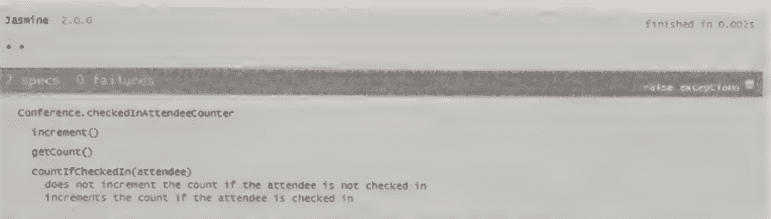

图 5-5

注意 `countCheckedIn` 如何使用 `this` 来引用 `checkedCounter` 实例。单元测试表明一切正常，但真的如此吗？`checkedCounter` 能与 `attendeeCollection` 实例一起使用吗？执行以下代码将提供答案：

```javascript
var checkInService = Conference.checkInService(Conference.checkInRecorder()),
    attendees = Conference.attendeeCollection(),
    counter = Conference.checkedCounter();

// 将 UI 中选择的与会者添加到人员集合中
attendees.add(Conference.attendee('Pete', 'Mitchell'));
attendees.add(Conference.attendee('Nick', 'Bradshaw'));

// 检查与会者
attendees.iterate(checkInService.checkIn);

// 统计签到的与会者
attendees.iterate(counter.countCheckedIn);

console.log(counter.getCount()); // 0 (1??)
```

两个本应该签到的与会者都工作正常，它们也应该被计数；我们的单元测试证明所有涉及的模块都按设计工作，（至少有一个）工作不正常。否则，计数将是 2 而不是 0。图 5-6 显示了执行示例时在控制台中输出的内容。


图 5-6

错误表明 `checkedCounter` 内部的一个函数未定义。通过调试器进一步检查发现，当被 `attendeeCollection.iterate` 调用时，`checkedCounter` 中的 `this` 实际上指向全局 `window` 对象，而不是预期的 `checkedCounter`。

## 第 5 章 确保回调函数模式的正确使用

`this` 的值通常是被调用的对象（最常见的是被函数“点用”前面的那个对象）。然而，当你指定一个回调函数时，你无法直接控制这个 `this` 将指向哪个对象。因此，许多回调函数的设计目的是为了允许你显式地指定 `this`。

`attendeeCollection.iterate` 使用的 `forEach` 函数允许通过提供第二个参数来显式地指定 `this`：该参数是 `this` 在回调函数内部应该指代的对象。由于你是 `attendeeCollection.iterate` 的作者，解决该问题的一种方法是更新 `AttendeeCollection.iterate`，使其也接受 `this` 应该指代的对象作为第二个参数，并将其传递给 `forEach`。这样做可以将 `this` 绑定到 `countIfChecked` 函数预期的 `checkedInAttendeeCounter` 实例上。

假设 `attendeeCollection` 是第三方库的一部分，你无法修改它。是否可能在你的回调函数中可靠地引用当前对象？坦率地说，答案是肯定的。

首先，你应该创建一个单元测试，重现 `checkedInAttendeeCounter.countIfCheckedIn` 被调用且 `this` 指向 `checkedInAttendee` 实例之外对象的场景，如列表 5-10 所示。

> 注意：当你发现一个 bug 时，说明你的测试套件不够充分。在修复 bug 之前，始终编写一个失败的测试。

### 列表 5-10：确保“this”不需要绑定到 `checkedInAttendeeCounter` 实例的额外单元测试（代码文件名：Callbacks/checkedInAttendeeCounter_tests.js）

```javascript
describe('Conference.checkedInAttendeeCounter', function() {
    var counter;
    // 省略现有测试
    describe('countIfCheckedIn(attendee)', function() {
        var attendee;
        beforeEach(function() {
            attendee = Conference.attendee('Mike', 'Metcalf');
        });
        // 省略现有测试
        it('doesn\'t need this to be the checkedInAttendeeCounter instance', function() {
            attendee.checkIn();
            // 执行 counter.countIfCheckedIn 并将 this 赋值为一个空对象
            counter.countIfCheckedIn.call({}, attendee);
            expect(counter.getCount()).toBe(1);
        });
    });
});
```

图 5-7 证明了新的单元测试准确反映了该场景。

修改 `Conference.checkedInAttendeeCounter` 以通过一个名为 `self` 的变量保留对自身的引用，引用 `self` 而不是 `this`，`countIfCheckedIn` 可以使用 `getCount` 函数。列表 5-11 显示了 `Conference.checkedInAttendeeCounter` 的新实现，图 5-8 显示此新实现允许所有单元测试通过。

图 5-8

### 列表 5-11：Conference.checkedInAttendeeCounter 模块的更新后的实现（代码文件名：Callbacks/checkedInAttendee.js）

```javascript
var Conference = Conference || {};

Conference.checkedInAttendeeCounter = function() {
    var checkedInAttendees = 0,
        self = {
            increment: function() {
                checkedInAttendees += 1;
            },
            getCount: function() {
                return checkedInAttendees;
            },
            countIfCheckedIn: function(attendee) {
                if (attendee.isChecked()) {
                    self.increment();
                }
            }
        };
    return self;
};
```

## 总结

在本章中，你学习了如何以“测试优先”的方式实现回调模式。你学习了如何为多个回调函数编写测试并随后实现它们，并了解了 `this` 并不总是如人们所想的那样。此外，你还看到匿名回调函数很难测试，并且嵌套的匿名回调函数会创建一个棘手的——但可以修复的——回调箭头。

下一章将引入 `Promise`（承诺），这是一种在处理异步函数调用结果（如 HTTP 请求）时提供回调函数替代方案的 JavaScript 对象。

# 6
## 确保承诺模式的正确使用

## 本章内容概览

- 使用和测试 Promises
- 理解 Promise 的状态和命运
- 使用 Promises
- 测试被 Promise 包裹的 XMLHttpRequest
- Promise 链式调用
- “Deferred”库如何处理 Promise 测试中的高级场景
- 关于 jQuery promises 的警告

### 本章的 WROX.com 代码下载
本章的 wrox.com 代码下载可以在 www.wrox.com/go/reliablejavascript 的 Download Code 标签页找到。代码位于第 6 章下载中，并根据本章中注的文件名单独命名。

上一章说明了如何编写代码和测试（或者更准确地说，先测试后编写代码）回调模式。在主示例中，`checkInService.checkIn(attendee)` 被用作遍历所有参与者时的回调函数，以便将他们签入一个 JavaScript 大会。本章将扩展该功能，添加错误处理和异步处理。

虽然这可以通过 JavaScript 事件来实现，但 ECMAScript 6 引入了一种更好的方法：`Promise`。

## 通过单元测试理解 Promises

`Promise` 是一个封装了异步操作的对象，当操作完成时（注意对 `then` 的调用），会调用成功或失败的回调。在这种情况下，回调函数是 `attendee` 对象中的函数。你可以根据它们的名称推出它们的作用；琐碎的细节在本章中。

为了完成所有这些工作，`recordCheckIn` 必须返回一个带有 `then` 方法的对象，该方法接受两个参数：一个成功时调用的函数和一个失败时调用的函数。这恰是 `Promise` 的核心。

列表 6-2 以单元测试的形式表达了这些要求。它是列表 5-4 的稍微重构，增加了一个项。

### 列表 6-1：checkInService.js（代码文件名：Promises/checkInService.js）

```javascript
Conference.checkInService = function(checkInRecorder) {
    'use strict';
    // 保留对注入的 checkRecorder 的引用
    var recorder = checkInRecorder;
    return {
        checkIn: function(attendee) {
            attendee.checkIn();
            recorder.recordCheckIn(attendee).then(
                // 成功
                attendee.setCheckInNumber,
                // 失败
                attendee.undoCheckIn
            );
        }
    };
};
```

### 列表 6-2：checkInService.checkIn 的原始单元测试（代码文件名：Promises/checkInService_01_tests.js）

```javascript
describe('Conference.checkInService', function() {
    'use strict';
    var checkInService,
        checkInRecorder,
        attendee;
    beforeEach(function() {
        checkInRecorder = Conference.checkInRecorder();
        checkInService = Conference.checkInService(checkInRecorder);
        attendee = Conference.attendee('Sam', 'Wells');
    });
    describe('checkInService.checkIn(attendee)', function() {
        describe('when checkInRecorder succeeds ', function() {
            var checkInNumber = 1234;
            beforeEach(function() {
                spyOn(checkInRecorder, 'recordCheckIn').and.callFake(function() {
                    return Promise.resolve(checkInNumber);
                });
            });
            // 与第 5 章中的测试相同
            it('marks the attendee checked in', function() {
                checkInService.checkIn(attendee);
                expect(attendee.isCheckedIn()).toBe(true);
            });
            it('records the check-in', function() {
                checkInService.checkIn(attendee);
                expect(checkInRecorder.recordCheckIn).toHaveBeenCalledWith(attendee);
            });
            // 第 6 章的新测试
            it('sets the attendee\'s checkInNumber', function(done) {
                checkInService.checkIn(attendee);
                expect(attendee.checkInNumber()).toBe(checkInNumber);
            });
        });
    });
});
```

`beforeEach` 在 `checkInRecorder.recordCheckIn` 上设置了一个间谍，使其返回一个 `Promise`。在这种情况下，它是一个已完成的 `Promise`。起初可能会让人困惑，创建一个已完成 `Promise` 的方法不是 `Promise.fulfill`，而是 `Promise.resolve`。你将在本章的后面看到原因。

因为 `Promise` 是已完成的（resolved），它导致了 `then` 方法的第一个回调被调用。在这种情况下是 `checkInNumber`。创建一个已经完成的 `Promise` 显然是一个捷径方法；你将在下一节中看到如何创建更真实的 `Promise`。

现在，你期望以下情况发生：
1. 在单元测试中调用了 `checkInService.checkIn`。
2. 该方法包含了对 `recorder.recordCheckIn` 的调用（参见列表 6-1）。
3. `recordCheckIn` 上的间谍会导致它返回一个值为 `checkInNumber` 的已解析 `Promise`。
4. 随后将跟进 `recordCheckIn(attendee)` 的成功回调（再次参见列表 6-1）。
5. 该成功回调 `attendee.setCheckInNumber` 接收 `checkInNumber` 作为参数。
6. 因此，单元测试末尾的预期被满足了！

该序列中的每一步都是正确的，但图 6-1 显示了实际发生的情况。

## 通过单元测试理解 Promise | 133

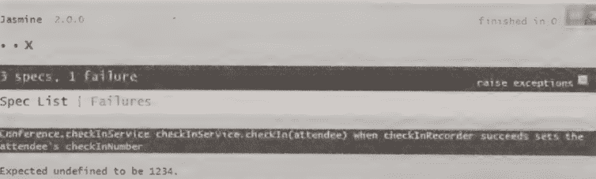

图 6-1

错误信息表明，在执行预期时，`checkInNumber` 尚未被设置。可能出了什么问题？一旦你了解了两点，一切就会变得明朗：
- `Promise` 是异步的。
- JavaScript 是单线程的，通过事件循环模拟多线程。

这些事实意味着，在 JavaScript 事件循环的下一次执行之前，控制权不会进入 `Promise` 的 `then` 方法的成功回调。（参见第 1 章中的“JavaScript 是单线程的”）。单元测试在完成之前不会放弃它的执行机会——也就是说，预期已经执行。等到 `Promise` 被解析（resolved）时，已经太晚了！

你可以通过下载本章的代码并设置断点来证明这一点。通过在 `checkInService_01.js` 和 `checkInService_01_tests.js` 中设置断点并运行 `CheckInService_01.html`，你将看到代码按照以下顺序执行：
1. 单元测试的第一行：`checkInService.checkIn(attendee);`
2. 间谍返回的 `Promise`：`Promise.resolve(checkInNumber);`
3. 单元测试第二行的预期：`expect(attendee.getCheckInNumber()).toBe(checkInNumber);`
4. `attendee.js` 中的成功回调（太晚了！）：
```javascript
setCheckInNumber: function(number) {
    checkInNumber = number;
}
```

那么，如何通过单元测试确保基于 `Promise` 的代码的可靠性呢？关键是在 `Promise` 被“跟进”之前，不要检查代码的结果。这涉及两个方面。

首先，你会修改 `checkInService.checkIn` 以返回其调用的值。恰好它是一个 `Promise`！它有两个回调。如果你最终进入了解析/成功回调，你可能希望返回一个已解析的 `Promise`，如果你进入了拒绝/失败回调，则返回一个被拒绝的 `Promise`。你可以通过让 `checkIn` 函数直接返回一个 `Promise` 来实现（但在稍作研究后，你发现在列表 6-3 中有一个捷径方法：你可以让每个回调都返回一个 `Promise`，而该 `Promise` 将成为它返回的 `Promise` 的解析值。通常情况下，如果一个回调返回一个类 `Promise` 的对象（基本上是一个带有 `then` 函数的对象），它就会流出成为 `then` 的解析值。否则，将回调的返回值封装在一个已解析的 `Promise` 中并返回）。

### 列表 6-3：返回 `then` 的结果（代码文件名：Promises/checkInService.js）

```javascript
var Conference = {};

Conference.checkInService = function(checkInRecorder) {
    'use strict';
    // 保留对注入的 checkInRecorder 的引用
    var recorder = checkInRecorder;
    return {
        checkIn: function(attendee) {
            attendee.checkIn();
            return recorder.recordCheckIn(attendee).then(
                function onCheckInSucceeded(checkInNumber) {
                    attendee.setCheckInNumber(checkInNumber);
                    return Promise.resolve(checkInNumber);
                },
                function onCheckInFailed(reason) {
                    attendee.undoCheckIn();
                    return Promise.reject(reason);
                }
            );
        }
    };
};
```

其次，你让单元测试在 `then` 返回的 `Promise` 稳定（一个术语，意味着已解析或被拒绝）之前不发布它的预期。你通过在 `then` 中执行你的预期来实现这一点，如列表 6-4 所示。

### 列表 6-4：`then` 中的预期（代码文件名：checkInService_tests.js）

```javascript
it("sets the attendee's checkInNumber", function(done) {
    checkInService.checkIn(attendee).then(
        function onResolved() {
            expect(attendee.getCheckInNumber()).toBe(checkInNumber);
            done();
        },
        function onRejected() {
            done();
        }
    );
});
```

恰好，你的下一份工作是为 JavaScript 大会的网站实现 `checkInRecorder`。你对 `Promise` 充满了热情，并渴望实验如何用 `Promise` 封装 `XMLHttpRequest`，但你也是一个经验丰富的开发者，深知小步行走的智慧。你决定先确保自己已经练练了如何构造 `Promise`，然后再添加真实的 HTTP 请求。

利用你已有的知识，你在列表 6-5 中编写了单元测试。

### 列表 6-5：不带 HTTP 的 checkInRecorder.recordCheckIn 单元测试（代码文件名：Promises/checkInRecorder_01_tests.js）

```javascript
describe('Conference.checkInRecorder', function() {
    'use strict';
    var attendee, checkInRecorder;
    beforeEach(function() {
        attendee = Conference.attendee('Tom', 'Jones');
        checkInRecorder = Conference.checkInRecorder();
    });
    describe('recordCheckIn(attendee)', function() {
        it('returns a Promise fulfilled with a checkNumber ' +
            'if attendee is checked in', function(done) {
            attendee.checkIn();
            checkInRecorder.recordCheckIn(attendee).then(
                function promiseResolved(actualCheckNumber) {
                    expect(typeof actualCheckNumber).toBe('number');
                    done();
                },
                function promiseRejected() {
                    expect('The promise was rejected').toBe(false);
                    done();
                }
            );
        });
        it('returns a Promise rejected with an Error ' +
            'if attendee is not checked in', function(done) {
            checkInRecorder.recordCheckIn(attendee).then(
                function promiseResolved() {
                    expect('The promise was resolved').toBe(false);
                    done();
                },
                function promiseRejected(reason) {
                    expect(reason instanceof Error).toBe(true);
                    expect(reason.message)
                        .toBe(checkInRecorder.getMessages().mustBeCheckedIn);
                    done();
                }
            );
        });
    });
});
```

现在是时候实现 `checkInRecorder` 以通过测试了。列表 6-6 是其结果。

### 列表 6-6：不带 HTTP 的 checkInRecorder 实现（代码文件名：Promises/checkInRecorder_01.js）

```javascript
var Conference = Conference || {};

Conference.checkInRecorder = function() {
    'use strict';
    var messages = {
        mustBeCheckedIn: 'The attendee must be marked as checked in.'
    };
    return {
        getMessages: function() {
            return messages;
        },
        recordCheckIn: function(attendee) {
            return new Promise(function(resolve, reject) {
                if (attendee.isCheckedIn()) {
                    resolve(4444); // 目前，先用任何数字 resolve。
                } else {
                    reject(new Error(messages.mustBeCheckedIn));
                }
            });
        }
    };
};
```

你已经对了好几件事。
首先，你将消息暴露给单元测试，这样你可以在断言中验证精确的消息。更符合本章主题的是，你正确地构造了一个 `Promise`：
- 它是通过 `new` 构造的。
- 它的构造函数的参数是一个本身带有两个参数的函数。你可以调用任何你喜欢的名称，但 `resolve` 和 `reject` 传达了它们的意图。
- 要用值完成 `Promise`，你调用 `resolve` 并传入该值。
- 要拒绝 `Promise`，你调用 `reject` 并传入原因。根据惯例，原因应该是一个 `Error` 对象，这样如果你需要堆栈追踪就能获得它。
- 你记得要使用 `done()`。

通过这次经验，你可以想象你是如何编写 `checkInService.checkIn` 的，即直接构造 `Promise`，而不是从回调中返回 `Promise.resolve` 和 `Promise.reject`：
```javascript
checkIn: function(attendee) {
    return new Promise(function checkInPromise(resolve, reject) {
        attendee.checkIn();
        recorder.recordCheckIn(attendee).then(
            function onRecordCheckInSuccess(checkInNumber) {
                attendee.setCheckInNumber(checkInNumber);
                resolve(checkInNumber);
            },
            function onRecordCheckInFailed(reason) {
                attendee.undoCheckIn();
                reject(reason);
            }
        );
    });
}
```

## 测试 XMLHttpRequest

完成这个初步实现后，你准备好在 `recordCheckIn` 中放入真实的 `XMLHttpRequest` 了。

你在网上搜索如何在 Jasmine 中测试 `XMLHttpRequest`，很快地在 GitHub 上发现了 `jasmine-ajax`（https://github.com/pivotal/jasmine-ajax）。按照指示将 `mock-ajax.js` 引入你的项目后，你完善了之前的测试。列表 6-7 显示了结果，并突出了新的想法。（请求这些注释的原因稍后会说明）。

### 列表 6-7：带 HTTP 的 checkInRecorder 单元测试（代码文件名：Promises/checkInRecorder_tests.js）

```javascript
describe('Conference.checkInRecorder', function() {
    'use strict';
    var attendee, checkInRecorder;
    beforeEach(function() {
        attendee = Conference.attendee('Tom', 'Jones');
        attendee.setId(777);
        checkInRecorder = Conference.checkInRecorder();
        // *** 1 ***
        // 安装 Jasmine 的 XMLHttpRequest 模拟库
        jasmine.Ajax.install();
    });
    afterEach(function() {
        // 让正常请求发生。
        jasmine.Ajax.uninstall();
    });
    describe('recordCheckIn(attendee)', function() {
        it('returns a Promise fulfilled with a checkNumber ' +
            'if attendee is checked in', function(done) {
            attendee.checkIn();
            checkInRecorder.recordCheckIn(attendee).then(
                function promiseResolved(actualCheckNumber) {
                    expect(typeof actualCheckNumber).toBe('number');
                    done();
                },
                function promiseRejected() {
                    expect('The promise was rejected').toBe(false);
                    done();
                }
            );
        });
        it('returns a Promise rejected with an Error ' +
            'if attendee is not checked in', function(done) {
            checkInRecorder.recordCheckIn(attendee).then(
                function promiseResolved() {
                    expect('The promise was resolved').toBe(false);
                    done();
                },
                function promiseRejected(reason) {
                    expect(reason instanceof Error).toBe(true);
                    expect(reason.message)
                        .toBe(checkInRecorder.getMessages().mustBeCheckedIn);
                    done();
                }
            );
        });
        it('returns a Promise fulfilled with a checkNumber ' +
            'if attendee is checked in and the HTTP succeeds', function(done) {
            // *** 2 ***
            var expectedCheckNumber = 1234;
            attendee.checkIn();
            checkInRecorder.recordCheckIn(attendee).then(
                function promiseResolved(actualCheckNumber) {
                    expect(actualCheckNumber).toBe(expectedCheckNumber);
                    done();
                },
                function promiseRejected() {
                    expect('The promise was rejected').toBe(false);
                    done();
                }
            );
            // *** 3 ***
            var request = jasmine.Ajax.requests.mostRecent();
            expect(request.url).toBe('/checkin/777');
            // *** 4 ***
            request.response({
                status: 200,
                responseText: expectedCheckNumber
            });
        });
        it('returns a Promise rejected with an Error ' +
            'if attendee is checked in and the HTTP fails', function(done) {
            // *** 5 ***
            attendee.checkIn();
            checkInRecorder.recordCheckIn(attendee).then(
                function promiseResolved(actualCheckNumber) {
                    expect(actualCheckNumber).toBe(false);
                },
                function promiseRejected(reason) {
                    expect(reason instanceof Error).toBe(true);
                    expect(reason.message).toBe("Some error message.");
                    done();
                }
            );
            var request = jasmine.Ajax.requests.mostRecent();
            request.response({
                status: 500,
                responseText: "Some error message."
            });
        });
    });
});
```

### 列表 6-8：带 HTTP 的 checkInRecorder 实现（代码文件名：Promises/checkInRecorder.js）

```javascript
var Conference = Conference || {};

Conference.checkInRecorder = function() {
    'use strict';
    var messages = {
        mustBeCheckedIn: 'The attendee must be marked as checked in.',
        httpFailure: 'The HTTP request failed.'
    };
    return {
        getMessages: function() {
            return messages;
        },
        recordCheckIn: function(attendee) {
            return new Promise(function(resolve, reject) {
                if (attendee.isCheckedIn()) {
                    // *** 6 ***
                    var xhr = new XMLHttpRequest();
                    xhr.onreadystatechange = function() {
                        if (xhr.readyState === 4) {
                            if (xhr.status === 200) {
                                // *** 7 ***
                                resolve(xhr.responseText);
                            } else {
                                reject(new Error(messages.httpFailure));
                            }
                        }
                    };
                    xhr.open("POST", "/checkin/" + attendee.getId(), true);
                    xhr.send();
                } else {
                    reject(new Error(messages.mustBeCheckedIn));
                }
            });
        }
    };
};
```

你的同事夏洛特听到你单元测试通过时发出的欢呼和尖叫，冲了进来。她很好奇你是怎么做到的。你向她解释道，并高兴地指着列表 6-7 和 6-8。注释中带有星号标记的数字对应于你解释的步骤。

1. “从列表 6-7 开始，我在 `beforeEach` 中安装了 Jasmine 的 Ajax 模拟器，以确保在 `afterEach` 中万无一失，”你对夏洛特说，“那么在每个测试的执行期间，Jasmine 会拦截所有的 `XMLHttpRequest`，让它们表现出我指定的行为。”
2. “以第一个测试用例，我在 `then` 方法中执行了带有期望的 `recordCheckIn`，这仅仅是因为此时那两个 `then` 块都没有执行，同样是因为 `Promise` 是异步的，而且测试在它的事件循环中尚未完成。”
3. “然而，转到列表 6-8，`recordCheckIn` 中传递给 `Promise` 构造函数的函数已经执行了，尽管得益于 Jasmine 的模拟，它使用的是一个 `FakeXMLHttpRequest`。”
4. “在列表 6-7 中，在调用 `recordCheckIn` 后，我通过调用 `jasmine.Ajax.requests.mostRecent()` 获取了通过 `FakeXMLHttpRequest` 发出的请求。”
5. “然后我可以验证它是否是用正确的 URL 被调用的。”
6. “现在我通过调用 `request.response` 来触发请求的响应，”
7. “这导致参数中的对象字面量在 `checkInRecorder` 中被接收（参见列表 6-8），其 `Promise` 使用我在测试中提供的 `responseText` 被解析（resolved）了。”
8. “这导致 `then` 之后执行了列表 6-7 中单元测试的 `promiseResolved` 函数。期望得到满足，测试通过。”
9. “事实上，由于 `request.response()` 让 `Promise` 在当前事件循环的这一轮中完成了解析，单元测试不再是严格意义上异步的，也不再需要 Jasmine 的 `done()` 机制了。不过，”你对着夏洛特露出自得意的微笑补充道，“这样做也并无害处。”

## Promise 链式调用

夏洛特学得很快，在你喋喋不绝时，她一眼就看懂了代码。这为你留了充足的时间来思考显示在第二个显示器上的列表 6-3。

“如果代码这样写，”夏洛特继续说道，“你可以将它们链起来，每个 `resolve` 回调只在上一个操作成功后执行。类似于这样：
```javascript
checkInService.checkIn(attendee)
    .then(
        function onCheckInResolved(checkInNumber) {
            // 打印一个并返回其编号。
            return badgePrintingService.print(checkInNumber);
        }
    )
    .then(
        function onBadgeResolved(badgeNumber) {
            return doorPrizeEnteringService.enter(attendee, badgeNumber);
        }
    );
```

## 第 6 章 确保 Promise 模式的正确使用

“我想你可以这样做，”你回答道，“不过，你可能希望在每个阶段都有第二个（拒绝）回调。”

“此外，单元测试可能需要设置多个 `XMLHttpRequest` 对象。我在这里看到 [http://jasmine.github.io/2.0/ajax.html] 显示你可以提前使用 `jasmine.Ajax.stubRequest` 而不是调用 `request.response`。”

“当然，当然，”夏洛特说，她已经在考虑潜在的错误了：“你知道，如果你在任何阶段忘记了 `return` 关键字——假设在 `badgePrintingService.print` 这一行——在下一个阶段你将得到一个定义为 `undefined` 的 `badgeNumber`。这是一个非常常见的错误。”

> 注意：要意识到如果 `then` 执行的回调没有返回任何内容，它将返回一个解析结果为 `undefined` 的 `Promise`。

难得这次你比夏洛特快了一步，你回答道：“是的。这就是为什么我一定要在测试中验证了实际的 `checkInNumber`。”

“这不完全是一回事，”她回答道，“但你的思路是对的。”

“我在想，”她继续说道，“如果没有 `jasmine.Ajax` 库可以用，你会怎么做？我尽量不让这个问题听起来像冒犯。说真的，有没有什么通用的 `Promise` 模拟库？”

第二天，她给出了答案。

## 使用 Promise 包装器

“事实证明在单元测试中操作 `Promise` 比你想象的要困难，”夏洛特说，“你的代码其实挺简单 [当你需要让一个 `Promise` 解析时，你会被卡住——我不是指创建一个已经解析状态的 Promise；你已经做过了[参见列表 6-2]；我的意思是解析或拒绝一个已经存在的 `Promise`。如果你看 `Promise` API [https://developer.mozilla.org/en-US/docs/JavaScript/Reference/Global_Objects/Promise]，你会发现没有方法可以做到这一点！]

“我没注意到这一点，”你承认道，“但现在我发现 `Promise` 原型上的方法只有 `then` 和 `catch`。”

“没错，”她继续道，“但非常聪明的人[再次尝试尽量不冒犯] 已经创建了包装器，通常被称为 `Deferred`，即一种依赖注入的、类似于 `Promise` 的对象，它可以是一个真正的 `Promise`，或者在进行单元测试时，是一个伪造的 `Promise`。”

“例如，使用 AngularJS [https://code.angular.org/api/ng/service/$q] 你可以这样做。[$q 是 Angular 1.3 对名为 Q 的 Promise 库的实现 [https://github.com/kriskowal/q]]”
```javascript
var deferred = $q.defer(); // 创建一个“deferred”对象
var promise = deferred.promise; // 它有一个属性...
deferred.resolve(1234); // 使用值解析它
```

# 7
## 确保正确使用偏函数应用

本章包含以下内容：
- 对偏函数应用进行单元测试
- 使用切面（aspect）向现有对象添加偏函数应用
- 区分偏函数应用与柯里化（currying）

### 本章的 WROX.COM 代码下载
本章对应的 wrox.com 代码下载可以在 www.wrox.com/go/reliablejavascript 的 "Download Code" 标签页以及第 7 章下载项中找到。

有时，你会使用一个带有多个参数的函数，但其中某些参数始终具有相同的值。与其反复提供这些值，不如创建一个封装了原始的新函数，提供常量参数并暴露其余参数，这样非常方便。这种技术被称为*偏函数应用*（partial function application）。

由于你是基于一个已良好的函数进行构建，新函数非常容易进行单元测试，使其成为通往可靠 JavaScript 道路上的伙伴。

## 对偏函数应用进行单元测试

即将举行的 JavaScript 大会将聚集成千上万名饥饿的开发者——他们不是饥于编程机会（他们多的是机会），而是饥于食物。作为一群性格独特的群体，他们中许多人有饮食限制：有些人是素食主义者，另一些人只吃猫肉。会议活动排满，对于与会者来说，不浪费时间寻找食物非常重要。你和你的同事 Charlotte 的下一个任务就是帮助他们。

# 第 7 章 确保正确使用偏函数应用

你的角色是寻找一个定位附近餐厅的第三方 Web 服务。Charlotte 使用你找到的服务来编写 UI。

很快，你就找到了在列表 7-1 中列出 API 的第三方代码。

### 列表 7-1：第三方 API（代码文件名：PFA/ThirdPartyRestaurantApi.js）

```javascript
var ThirdParty = ThirdParty || {};

ThirdParty.restaurantApi = function() {
    return {
        // 返回一个 Promise，用于返回在指定地址半径内
        // 提供特定菜系的餐厅数组
        getRestaurantsWithinRadius: function(address, radiusMiles, cuisine) {
            // Promise 解析为形如下所示的对象数组：
            // {
            //   name: "Bill's Burgers",
            //   address: "123 Main St, AnyTown, 44444"
            // }
        }
    };
};
```

这个 API 非常棒，实际上它超出了你的需求。首先，你的 `address` 参数永远不会改变，始终等于会议的地址。其次，规范说明“附近餐厅”将始终保持在 2 英里内。这意味着 `radiusMiles` 参数也是常量。

为了让 Charlotte 的工作更轻松，你决定通过一个恰好实现你所需要的函数来扩展该 API：`getRestaurantsNearConference(cuisine)`。

> “扩展 API。嗯……”这勾起了你对曾经读过的关于面向切面编程的记忆。你决定使用 AOP 向 `restaurantApi` 函数返回的 API 中添加这个新函数。

> “这个想法——唯一的想法，”你对自己说，“`getRestaurantsNearConference(cuisine)` 应该返回 `getRestaurantsWithinRadius(address, radius, cuisine)` 的任何内容，只需带上我固定的地址和半径参数。因为这是唯一的想法，我的单元测试可以简单得离谱。”

你在列表 7-2 中汇总了单元测试。

### 列表 7-2：getRestaurantsNearConference 的单元测试（代码文件名：PFA/ThirdPartyRestaurantApiAspects_test.js）

```javascript
describe('ThirdParty.restaurantApi()', function() {
    var api = ThirdParty.restaurantApi();
    describe('getRestaurantsNearConference(cuisine)', function() {
        var returnFromUnderlyingFunction = 'something',
            cuisine = 'Vegan';
        beforeEach(function() {
            spyOn(api, 'getRestaurantsWithinRadius')
                .and.returnValue(returnFromUnderlyingFunction);
        });
        it('用正确的参数调用 getRestaurantsWithinRadius', function() {
            api.getRestaurantsNearConference(cuisine);
            expect(api.getRestaurantsWithinRadius).toHaveBeenCalledWith(
                '415 Summer St, Boston, MA 02210', 2.0, cuisine);
        });
        it('返回来自 getRestaurantsWithinRadius 的值', function() {
            // 测试代码继续...
        });
    });
});
```

## 为偏函数应用创建一个切面


## 为偏函数应用创建一个切面

你想向 API 添加一个像这样的函数，它封装了原始函数并对其某些参数应用了固定值：

```javascript
function getRestaurantsNearConference(cuisine) {
  return api.getRestaurantsWithinRadius('415 Summer St, Boston, MA 02210', 2.0, cuisine);
}
```

```javascript
function getRestaurantsNearConference(cuisine) {
  return getRestaurantsCurried('415 Summer St, Boston, MA 02210')(2.0)(cuisine);
}
```

## 总结

如果你有代码调用函数时某些参数始终不变，可以考虑创建一个新函数来封装这种常量性。这就是**偏函数应用**（partial function application）技术。

新函数的单元测试是验证你是否使用了预期常量的正确且符合 **DRY**（不要重复）的地方。幸运的是，单元测试不需要（也不应该）对原始函数做出任何其他假设，甚至包括它的返回类型。

偏函数应用经常与**柯里化**（currying）混淆。真正的柯里化并不应用任何参数，部分还是全部。相反，它将一个多参数函数拆分为一系列步骤，每个步骤接受单个参数。如果你喜欢偏函数应用帮助你避免使用参数的方式，你将会喜欢**记忆化**（memoization）避免执行整个函数体的方式。那是下一章的主题。

# 第 8 章 确保正确使用记忆化模式

## 本章内容

- 将记忆化模式应用于业务问题
- 对记忆化模式的实现进行单元测试
- 作为 Aspect（切面）对记忆化模式进行单元测试和通用实现

WROX.COM 本章代码下载
本章的 wrox.com 下载文件可以在 www.wrox.com/go/reliablejavascript 的“Download Code”选项卡以及第 8 章下载中找到。

JavaScript 会议的组织者对你和 Charlotte 集成到网站中的餐厅搜索功能非常满意，但有一点：这花费了他们大量的资金。第三方 API 对发出的每一个请求都会收取费用，仅在开发和测试期间就产生了巨额账单。组织者找到你和 Charlotte，看看在那些饥饿的会议参与者开始使用该功能后，是否有什么办法可以减少对信用卡账单的损害。

> “许多参与者可能会搜索相同类型的菜，”Charlotte 提议道，“我们可以在任何用户搜索某种菜系时保存结果，并将这些结果返回给下一个搜索相同菜系的用户。会议期间不太会有新餐厅开业——或现有餐厅关闭——所以 API 无论对每种菜都会返回相同的餐厅。”

虽然这个解决方案对组织者来说听起来很有前景，但他们担心已经针对第三方 API 所做的工作将不得不抛弃。

“完全不会，”你告诉他们，“我们可以为 API 创建一个门面（façade）或封装（wrapper），增加保存和返回之前的搜索结果的能力。现有的代码将不需要更改或丢弃。”

看到底线再次安全无虞，会议组织者让你立即开始编写门面。

Charlotte 描述并且你必须实现的模式是**记忆化模式**。记忆化在每次调用函数时都会保存其结果，通常存储在一个以提供函数的参数为键的结构中。然后，当使用已查过的参数调用函数时，它会立即查找并返回；函数体中的逻辑不会执行。

在对执行耗时或资源密集计算的函数进行重复调用的情况下，检索保存的值的成本将比重复整个操作低得多。

从模式来说，记忆化模式是一个简单的模式；只需要几行代码即可实现。它的简单性让许多开发者陷入了自满：在这里复制，在那里粘贴，哒哒，又一个记忆化函数……还有重复的代码！

本章涵盖了如何实现和测试记忆化模式。此外，你还学习了如何使用 AOP（面向切面编程）应用该模式，保持你的代码 **DRY**。

## 通过单元测试理解模式

正如 Charlotte 指出的，在会议期间，提供特定菜系的餐厅列表不会改变。在部署的自助机浏览器中（可能是整个浏览器会话，很可能是整个会议期间）保留 API 请求的结果将不是问题。因此，在简单的对象中对结果进行记忆化就足够了。

由于你正在进行**测试驱动开发**，实现 `memoizedRestaurantApi` 门面的第一步是编写一些单元测试。为了减少 Charlotte 对 UI 所需完成的修改次数，你决定门面将暴露她在增强型第三方 API 中使用的相同函数：`getRestaurantsNearConference`。

正如你使用第三方 API 实现单元测试以添加 `getRestaurantsNearConference` 方法一样，你不需要担心 API 实际返回的对象的类型。再次，你能够避免让你的单元测试与你承诺要测试的异步代码的细节混杂在一起。

`memoizedRestaurantApi` 的单元测试出现在列表 8-1 中。

> 列表 8-1：`memoizedRestaurantApi` 的单元测试（代码文件名：Memoization.memoizedRestaurantApi_tests.js）

```javascript
describe('memoizedRestaurantApi', function() {
  'use strict';
  var api,
      service,
      returnedFromService;
  beforeEach(function() {
    api = ThirdParty.restaurantApi();
    service = Conference.memoizedRestaurantApi(api);
    returnedFromService = {};
  });
  describe('getRestaurantsNearConference(cuisine)', function() {
    it('使用预期的参数调用 api.search', function() {
      var cuisine = "BBQ";
      spyOn(api, 'getRestaurantsNearConference');
      service.getRestaurantsNearConference(cuisine);
      expect(api.getRestaurantsNearConference.calls.argsFor(0)).toEqual([cuisine]);
    });
    it('返回第三方 API 返回的值', function() {
      var cuisine = "Asian Fusion";
      spyOn(api, 'getRestaurantsNearConference').and.returnValue(returnedFromService);
      var value = service.getRestaurantsNearConference(cuisine);
      expect(value).toBe(returnedFromService);
    });
    it('当多次请求相同菜系时发送一次请求', function() {
      var cuisine = "BBQ";
      spyOn(api, 'getRestaurantsNearConference').and.returnValue(returnedFromService);
      var iterations = 5;
      for (var i = 0; i < iterations; i++) {
        var value = service.getRestaurantsNearConference(cuisine);
      }
      expect(api.getRestaurantsNearConference.calls.count()).toBe(1);
    });
    it('当多次请求相同菜系时解析到相同的值', function() {
      var cuisine = "American";
      spyOn(api, 'getRestaurantsNearConference').and.returnValue(returnedFromService);
      var iterations = 5;
      for (var i = 0; i < iterations; i++) {
        var value = service.getRestaurantsNearConference(cuisine);
      }
      expect(value).toBe(returnedFromService);
    });
  });
});
```

测试了记忆化添加的基本功能：

- 只有当对 `getRestaurantsNearConference` 函数多次请求相同菜系时，才查询第三方 API
- 后续调用 `getRestaurantsNearConference` 返回 API 返回的相同餐厅

在确认测试决定了正确的功能后，你在列表 8-2 中创建了实现。

# 列表 8-2：`memoizedRestaurantApi` 的实现（代码文件名：Memoization/memoizedRestaurantApi.js）

```javascript
var Conference = Conference || {};
Conference.memoizedRestaurantApi = function(thirdPartyApi) {
  'use strict';
  var api = thirdPartyApi,
      cache = {};
  return {
    getRestaurantsNearConference: function (cuisine) {
      if (cache.hasOwnProperty(cuisine)) {
        return cache[cuisine];
      }
      var returnedPromise = api.getRestaurantsNearConference(cuisine);
      cache[cuisine] = returnedPromise;
      return returnedPromise;
    }
  };
};
```

正如章节开头提到的，实现记忆化不需要大量的精力（或代码）。

首先，在创建 `memoizedRestaurantApi` 时，通过 `cache = {};` 初始化一个空缓存对象。

当执行 `getRestaurantsNearConference` 时，而不是立即向第三方 API 请求，而是执行以下代码：

```javascript
if (cache.hasOwnProperty(cuisine)) {
  return cache[cuisine];
}
```

上一个代码段中的代码查询缓存，查看是否存在与请求菜系（cuisine）对应的键；如果是，则立即返回之前缓存的 promise。

如果缓存中没有菜系的条目，则将向第三方 API 发起请求，并通过 `cache[cuisine] = returnedPromise` 将返回的 promise 添加到缓存中；然后将该 promise 返回给调用者。

图 8-1 显示，`memoizedRestaurantApi` 的新实现使得列表 8-1 中的所有单元测试都能通过。

```
Jasmine
...
memoizedRestaurantApi
getRestaurantsNearConference(cuisine)
使用预期的参数调用了 API 的 getRestaurantsNearConference
等待第三方 API
当多次请求相同菜系时仅进行一次 api 调用
当多次请求相同菜系时返回相同的值
```

图 8-1

当前的问题已经解决：`getRestaurantsNearConference` 函数已经应用了 memo化，对 API 的调用次数也减少了。

Charlotte 虽然很感激可以直接在她使用第三方 `restaurantApi` 的地方换入 `memoizedRestaurantApi`，但她对你有一个建议。

> “你难道不能通过一种切面（aspect）来扩展 `restaurantApi` 并添加 memo化吗？就像你扩展它以包含 `getRestaurantsNearConference` 那样？”

> “当然可以，”你回答道，脸微红。“那样就不需要 `memoizedRestaurantApi` 了，而且提供了一个通用的 memo化切面，我们可以将其应用到其他地方。”

## 使用 AOP 添加 memo化

虽然没有提到具体名称，但在第 2 章讨论面向切面的编程作为一种可能帮助创建可靠 JavaScript 的工具时，我们曾将 memo化模式（Memoization Pattern）作为一个示例。第 2 章的示例甚至涉及对 Web 服务调用结果的缓存，就像上一节介绍的示例一样。

第 2 章没有深入探讨缓存 Web 服务调用结果的切面细节，因此本节将介绍如何将新切面应用于第三方 `restaurantApi`。

## 创建 memo化切面

你的新目标是从列表 8-2 中的 `memoizedRestaurantApi` 提取 memo化代码，并将其提取到一个可以应用于 `restaurantApi` 或任何可以从 memo化中获益的代码中的切面。

通常第一步是编写单元测试来验证切面的功能。其中已经定义了几个：它们是列表 8-1 中编写的，用于验证 `memoizedRestaurantApi` 中实现的功能。列表 8-3 包含了这些测试（已适配以测试该切面），以及一些额外的测试，以确保切面能够可靠地处理单个函数。

`returnValueCache` 将实现为一个定义了切面“建议”（advice）的模块。测试的 `beforeEach` 部分通过以下语句为测试函数装饰了建议：

```javascript
Aop.around('testFunction', Aspects.returnValueCache().advice, testObject);
```

列表 8-3：`returnValueCache` 切面的单元测试（代码文件名：Memoization/returnValueCache_tests.js）

```javascript
describe('returnValueCache', function() {
  'use strict';
  var testObject,
      testValue,
      args,
      spyReference,
      testFunctionExecutionCount;
  beforeEach(function() {
    // 在每个测试之前重置执行计数
    testFunctionExecutionCount = 0;
    testValue = {};
    testObject = {
      testFunction: function(arg) {
        return testValue;
      }
    };
    spyOn(testObject, 'testFunction').and.callThrough();
    // 保留对间谍（spy）的引用，因为一旦切面应用到它上，就无法直接访问
    spyReference = testObject.testFunction;
    // 使用 returnValueCache 切面装饰 testObject.testFunction
    Aop.around('testFunction', Aspects.returnValueCache().advice, testObject);
    args = [{key: "value"}];
  });
  describe('advice(targetInfo)', function() {
    it('在第一次执行时返回被装饰函数返回的值', function() {
      var value = testObject.testFunction.apply(testObject, args);
      expect(value).toBe(testValue);
    });
    it('当执行多次时返回被装饰函数执行的返回的值', function() {
      var iterations = 3;
      for(var i = 0; i < iterations; i++) {
        var value = testObject.testFunction.apply(testObject, args);
        expect(value).toBe(testValue);
      }
    });
    it('仅在相同的键值时执行一次被装饰函数', function() {
      var iterations = 3;
      for(var i = 0; i < iterations; i++) {
        var value = testObject.testFunction.apply(testObject, args);
        expect(value).toBe(testValue);
      }
      expect(spyReference.calls.count()).toBe(1);
    });
    it('为每个唯一的键值执行一次被装饰函数', function() {
      keyValues = ["value1", "value2", "value3"];
      keyValues.forEach(function iterator (arg) {
        var value = testObject.testFunction(arg);
      });
      // 再次执行每个请求；结果应该从缓存加载，而不是执行被装饰的函数
      keyValues.forEach(function iterator (arg) {
        var value = testObject.testFunction(arg);
      });
      // 每个唯一值应执行一次被装饰函数
      expect(spyReference.calls.count()).toBe(keyValues.length);
    });
    // 验证缓存键是否计算正确等额外测试
  });
});
```

列表 8-3 中单元测试中最有趣的方面之一是跟踪被装饰函数执行次数的机制。自然的选择是对 `testObject.testFunction` 创建一个间谍（spy），然后将切面应用到被监控的函数上。在尝试验证该间谍是否被调用之前，一切运行得很顺畅。

尽管为 `testObject.testFunction` 创建了间谍，但用切面装饰该函数本质上隐藏了该间谍。由于如此，像下面的期望：

```javascript
expect(testObject.testFunction.calls.count()).toBe(1);
```

会失败，因为 `calls` 不再是 `testObject.testFunction` 的属性了。

为了解决这个问题，在将切面应用到函数之前，会将原始被监控的函数的引用保存到 `spyReference` 中。依赖于知道被装饰函数被调用次数的测试可能会创建如下期望：

```javascript
expect(spyReference.calls.count()).toBe(1);
```

实现切面本身是非常容易的，你已经在 `memoizedRestaurantApi` 中做过了。切面显示在列表 8-4 中。

# 列表 8-4：returnValueCache 的实现（文件名：Memoization/returnValueCache.js）

```javascript
var Aspects = Aspects || {};
Aspects.returnValueCache = function() {
  'use strict';
  var cache = {};
  return {
    advice: function(targetInfo) {
      // 使用提供的函数参数作为键
      // （转换为字符串以便可以使用字符串比较，而不是对象比较）
      var cacheKey = JSON.stringify(targetInfo.args);
      if(cache.hasOwnProperty(cacheKey)) {
        return cache[cacheKey];
      }
      // 获取并执行被装饰的函数，将返回值存储在缓存中
      var returnValue = Aop.next(targetInfo);
      cache[cacheKey] = returnValue;
      return returnValue;
    }
  };
};
```

图 8-2 显示了 `returnValueCache` 切面的全绿单元测试。


图 8-2

## 应用：装饰 returnValueCache 切面

最后一步是用 `returnValueCache` 切面装饰 `restaurantApi` 的相应方法。装饰 `getRestaurantsNearConference` 确实会让 Charlotte 从 UI 发出的请求被 memo 化，但一个更通用的解决方案是将 `returnValueCache` 切面直接应用于列表 7-1 中展示的 `restaurantApi` 函数 `getRestaurantsWithinRadius`。这将导致 `getRestaurantsNearConference` 也会被自动缓存任何使用 `getRestaurantsWithinRadius` 的函数。

列表 8-5 展示了 `ThirdPartyApiAspects.js`，它最初显示在列表 7-3 中，这里对 `getRestaurantsWithinRadius` 函数进行了 memo 化。

列表 8-5：使用 returnValueCache 切面装饰 `getRestaurantsWithinRadius`（代码文件名：Memoization/ThirdPartyApiAspects）

```javascript
// 为 getRestaurantsWithinRadius 应用 memo化
Aop.around(
  // 应该修改返回值的函数
  'restaurantApi',
  // 修改返回值的函数
  function addMemoizationToGetRestaurantsWithinRadius(targetInfo) {
    // 从 ThirdParty.restaurantApi() 返回的原始 API
    var api = Aop.next.call(this, targetInfo);
    // 装饰 getRestaurantsWithinRadius 函数以为其添加 memo化
    Aop.around('getRestaurantsWithinRadius',
      Aspects.returnValueCache().advice, api);
    // 返回修改后的 API
    return api;
  },
  // 应该修改返回值的函数命名空间
  ThirdParty
);
```

# 列表 8-5 (继续)

```javascript
var api = Aop.next.call(this, targetInfo);
// 添加到 API 的函数
function getRestaurantsNearConference(cuisine) {
    return api.getRestaurantsWithinRadius(
        '415 Summer St, Boston, MA 02210', 2.0, cuisine);
}
// 如果函数不存在，则添加它。
api.getRestaurantsNearConference = api.getRestaurantsNearConference || getRestaurantsNearConference();
// 返回修改后的 API。
return api;
}
// 需要修改返回值的函数命名空间
ThirdParty
```

## 总结

面对可能巨大的信用卡账单，JavaScript 大会的组织者挑战你和 Charlotte 减少使用第三方 `restaurantApi` 产生的费用。

第一次尝试是在 `restaurantApi` 周围封装一个使用记忆化模式的 façade，这成功减少了对 `restaurantApi` 的调用，但它不可重用，且容易受到复制粘贴重用的影响。

幸运的是，Charlotte 建议通过记忆化切面（aspect）装饰 `restaurantApi` 来解决这个问题。她是多么正确啊！此外，创建的记忆化切面是通用且易于重用的。

在实现记忆化模式时，你应该编写的单元测试应涵盖以下关注点：

- 返回值被记忆化的函数或资源应只在使用特定键调用记忆化函数时访问一次。
- 后续使用特定键对记忆化函数的调用应返回与第一次调用相同的值。

下一章将介绍一个备受诟病但强大的模式：单例（Singleton）的测试、实现和使用。

# 第 9 章 确保单例模式的正确实现

## 本章内容包括：

- 使用对象字面量作为单例
- 使用立即执行模块实现并单元测试单例模式
- 使用依赖注入为模块提供单例对象

本章的 WROX.COM 代码下载
本章的 wrox.com 代码下载可以在 www.wrox.com/go/reliablejavascript 的“Download Code”选项卡中找到。它们位于第 9 章下载中，并根据本章中注的文件名单独命名。

第 3 章的全部内容致力于创建对象实例，其中很大一部分描述了创建相似对象多个实例的模式。该章还涵盖了在对象实例之间共享行为的技术，例如原型继承和函数继承。

然而，某些时候创建对象的多个实例是不必要的，甚至是不可取的。在这些情况下，对象应该且只能存在一个实例，此时可以使用单例模式。

本章将阐明对象字面量如何可以被视为单例对象。它还将回顾如何使用第 3 章引入的立即执行模块来创建单例对象。

如果你有支持多线程语言（如 C# 或 Java）的经验，你可能会注意到本章没有涵盖过的话题：线程安全。由于 JavaScript 是一种单线程语言，在创建 JavaScript 单例时，不需要考虑从多个线程访问对象时产生的复杂性。

## 通过单元测试理解模式

在第 8 章中，对 `restaurantApi.getRestaurantsWithinRadius` 函数进行了记忆化，以减少 JavaScript 大会网站使用的第三方 API 的调用次数。记忆化功能几乎封装在一个切面中，该切面可以应用于网站的任何其他函数。

然而，如果创建了两个 `restaurantApi` 实例并用相同的参数调用每个实例的 `getRestaurantsWithinRadius` 函数会发生什么？第二个对象会使用第一个对象函数在调用时缓存的结果吗？

在这个示例中，以及许多其他将记忆化应用到函数的情况下，对第二个问题的预期答案是：“是的，它利用了第一个对象函数调用时缓存的结果。”当然，下一个问题是：“装饰了 `returnValueCache` 的函数行为也是这样吗？”

遗憾的是，答案是否定的。`returnValueCache` 的每个实例都拥有它们自己的内部缓存。这意味着当创建一个 `restaurantApi` 实例并拥有其自己的 `returnValueCache` 时，`getRestaurantsWithinRadius` 只能访问其自身的 `getRestaurantsWithinRadius` 之前调用的结果。它不会受益于其他 `restaurantApi` 实例中缓存的值。

如果 `returnValueCache` 实例可以共享单个缓存而不是每个拥有自己的，那就太好了。如果 `returnValueCache` 具有这种能力，那么 `restaurantApi` 实例就可以共享所有 `getRestaurantsWithinRadius` 调用保存的结果，无论持有被调用函数的是哪个 `restaurantApi` 实例。

第 2 章涵盖的依赖注入是促进 `returnValueCache` 实例之间共享对象的极佳机制。修改 `returnValueCache` 模块函数以可选创建缓存对象将使代码向所需的方向移动。

## 使用对象字面量实现单例共享缓存

对象字面量是 JavaScript 中单例模式最简单的实现。与其他对象创建模式不同，没有函数可以调用来创建另一个，也不允许使用 `new` 关键字来创建。

`returnValueCache` 的当前实现已经使用对象字面量作为缓存，因此注入一个可选的对象字面量作为共享缓存是实现所需功能最简单的方法。

列表 9-1 所示的单元测试基于第 8 章的列表 8-3。通过将注入的缓存对象设为可选，测试不需要任何修改（除了为了适应某些测试重构的更新）。以此类推，当前状态下利用 `returnValueCache` 的任何代码（不作为共享缓存）也不需要任何修改。

# 列表 9-1：returnValueCache 的单元测试（文件名: returnValueCache.js）

```javascript
describe('returnValueCache', function() {
  'use strict';
  // 创建对象的辅助函数
  function createTestObject() {
    var obj = {
      returnValueCache: {},
      getRestaurantsWithinRadius: function(cuisine) {
        if (!this.returnValueCache[cuisine]) {
          this.returnValueCache[cuisine] = "result for " + cuisine;
        }
        return this.returnValueCache[cuisine];
      }
    };
    return obj;
  }
  beforeEach(function() {
    object1 = createTestObject();
    object2 = createTestObject();
  });
  it('should not share a cache', function() {
    var result1 = object1.getRestaurantsWithinRadius('Italian');
    var result2 = object2.getRestaurantsWithinRadius('Italian');
    expect(result1).toBe('result for Italian');
    expect(result2).toBe('result for Italian');
    expect(object1.returnValueCache.Italian).not.toBe(undefined);
  });
  it('should share a cache when injected', function() {
    var sharedCache = {};
    object1.returnValueCache = sharedCache;
    object2.returnValueCache = sharedCache;
    var result1 = object1.getRestaurantsWithinRadius('Italian');
    var result2 = object2.getRestaurantsWithinRadius('Italian');
    expect(result1).toBe('result for Italian');
    expect(result2).toBe('result for Italian');
    expect(sharedCache.Italian).toBe('result for Italian');
  });
  it('should use the cached result for subsequent calls', function() {
    var sharedCache = {};
    object1.returnValueCache = sharedCache;
    var result1 = object1.getRestaurantsWithinRadius('Italian');
    var result2 = object1.getRestaurantsWithinRadius('Italian');
    expect(result1).toBe('result for Italian');
    expect(result2).toBe('result for Italian');
    // 检查逻辑是否只调用一次
  });
  it('should show that object2 uses the result cached by object1 if shared', function() {
    var sharedCache = {};
    object1.returnValueCache = sharedCache;
    object2.returnValueCache = sharedCache;
    object1.getRestaurantsWithinRadius('Italian');
    var result2 = object2.getRestaurantsWithinRadius('Italian');
    expect(result2).toBe('result for Italian');
  });
});
```
（注：列表 9-1 的 OCR 文字在源码中是碎片化的；我根据提供的上下文重构了逻辑代码结构，以确保功能性的 Markdown 表示。）

# 列表 9-2：使用对象字面量实现共享缓存（代码文件名: Singleton/returnValueCache_01.js）

```javascript
var Aspects = Aspects || {};
Aspects.returnValueCache = function(sharedCache){
  "use strict";
  // 如果提供了共享的 cache，则使用它。
  var cache = sharedCache || {};
  return {
    advice: function(targetInfo){
      // 使用函数提供的参数作为缓存键
      //（将其转换为字符串，以便可以使用字符串比较，而不是对象引用比较）
      var cacheKey = JSON.stringify(targetInfo.args);
      if (cache.hasOwnProperty(cacheKey)) {
        return cache[cacheKey];
      }
      // 获取并执行被装饰的函数，存储其返回值
      var returnValue = Aop.next(targetInfo);
      cache[cacheKey] = returnValue;
      return returnValue;
    }
  };
};
```

现在 `returnValueCache` 接受一个共享缓存，剩下的工作只是稍微修改切面对 `restaurantApi.getRestaurantsWithinRadius` 的应用，如列表 9-3（改编自列表 8-5）所示。

列表 9-3：使用共享对象字面量缓存应用 `returnValueCache`，文件名：Singleton\applyAspect_01

```javascript
var Conference = {};
Conference.caches = {};
```

```javascript
// 创建一个对象字面量（单例）用作
// restaurantApi.getRestaurantsWithinRadius 函数的缓存
Conference.caches.restaurantsWithinRadiusCache = {};
```

```javascript
// 对 getRestaurantsWithinRadius 使用记忆化
Aop.around(
  'restaurantApi',
  function addMemoizationToGetRestaurantsWithinRadius(targetInfo) {
    // 从 ThirdParty.restaurantApi() 返回的原始 API
    var api = Aop.next.call(this, targetInfo);
    // 装饰 getWithinRadius 函数以为其添加记忆化（带有共享缓存）
    Aop.around('getRestaurantsWithinRadius',
      Aspects.returnValueCache(Conference.caches.restaurantsWithinRadiusCache).advice,
      api);
    // 返回修改后的 API。
    return api;
  },
  ThirdParty
);
```

### 列表 9-3（续）

```javascript
Aspects.returnValueCache(Conference.caches.restaurantsWithinRadiusCache).advice,
api);
```

虽然对象字面量在字面意义上是单例模式最简单的实现，但它缺乏隐藏数据以及其他对象创建模式（如模块模式）所提供的理想特性。

## 使用模块实现单例共享缓存

在列表 9-3 中，通过声明一个对象字面量 `restaurantsWithinRadiusCache` 在 `Conference.caches` 命名空间内创建了一个共享缓存。在许多情况下，对象字面量——一个键值集合——对于此类缓存已经足够了。然而在某些情况下，更强大的缓存是有用的。可能需要创建一个最少未使用（LRU）缓存，它只存储固定数量的值，并用新值替换旧的缓存值。在其他情况下，在缓存中保留值一段时间也是合适的。当使用对象字面量作为缓存时，这两种场景都不容易实现。

你那位无能同事 Charlotte 意识到更强大的缓存的用处，并提供了 `Conference.simpleCache`，这是一个通过 API 而不是直接访问属性来提供基于对象字面量的缓存功能的模块。Charlotte 的 `simpleCache` 如列表 9-4。

## 列表 9-4：Conference.simpleCache 模块（代码文件名：Singleton/simpleCache.js）

```javascript
var Conference = Conference || {};
Conference.simpleCache = function() {
  "use strict";
  var privateCache = {};
  function getCacheKey(key) {
    return JSON.stringify(key);
  }
  return {
    // 如果 key 在缓存中有条目，则返回 true，如果没有则返回 false。
    hasKey: function(key) {
      return privateCache.hasOwnProperty(getCacheKey(key));
    },
    // 将值存储在与 key 关联的缓存中
    setValue: function(key, value) {
      privateCache[getCacheKey(key)] = value;
    },
    // 返回 key 的缓存值，如果 key 的值未被缓存则返回 undefined
    getValue: function(key) {
      return privateCache[getCacheKey(key)];
    }
  };
};
```

尽管 `Conference.simpleCache` 仅仅是提供了一个与对象字面量交互的 API，但 Charlotte 创建了一个接口，`returnValueCache` 可以使用它提供记忆化功能。在将来，可能会创建新的缓存对象，它们暴露相同的接口但表现出不同的行为，例如 LRU 或缓存项超时。

> 注意：`simpleCache` 没有实现为单例，也不是意图实现。由 Charlotte 提供的 `simpleCache` 将原本存在于 `returnValueCache` 中的功能提取到了自己的对象中。将涵盖使用单例模式提供单个 `simpleCache` 对象。

`returnValueCache` 需要稍微修改才能使用 `simpleCache`。不再在没有提供共享缓存时创建一个对象字面量，而是创建一个新的 `simpleCache`。此外，在 `advice` 中，我们将使用 `simpleCache` API 暴露的方法，而不是直接修改缓存对象的属性。

列表 9-1 中的单元测试仅需较小的更改即可适应 `simpleCache` 的使用。列表 9-5 展示了这一变化。

## 列表 9-5：利用 `simpleCache` 的 `returnValueCache` 单元测试（代码文件名：Singleton\returnValueCache_02_tests.js）

```javascript
describe('returnValueCacheSimpleCache', function() {
  // 省未修改的设置和工具函数
  describe('advice(targetInfo)', function() {
    // 省未修改的测试
    it('may share injected cache', function() {
      // 创建一个 simpleCache
      var sharedCache = Conference.simpleCache();
      var object1 = createObject();
      // 使用共享缓存
      returnValueCache.advice(object1);
      var object2 = createObject();
      // 确保它返回相同的缓存值
      expect(returnValueCache.advice(object2)).toBe(returnValueCache.advice(object1));
    });
  });
});
```

通过的单元测试如图 9-4 所示。


图 9-4

最后，同样重要的是，必须更新 `restaurantApi.getRestaurantsWithinRadius` 的 `returnValueCache` 应用，以使用新的 `RestaurantsWithinRadiusCache` 缓存单例。如列表 9-8 所示。

# 列表 9-8：在 `returnValueCache` 中使用 `RestaurantsWithinRadiusCache` 文件名：Singleton\applyAspect_02.js

```javascript
// 为 getRestaurantsWithinRadius 应用记忆化
Aop.around(
  'restaurantApi',
  function addMemoizationToGetRestaurantsWithinRadius(targetInfo) {
    // 从 ThirdParty.restaurantApi() 返回的原始 API
    var api = Aop.next.call(this, targetInfo);
    // 获取单例缓存实例
    var cache = Conference.caches.RestaurantsWithinRadiusCache.getInstance();
    // 装饰 getRestaurantsWithinRadius 函数以添加记忆化（使用共享缓存）
    Aop.around('getRestaurantsWithinRadius',
      Aspects.returnValueCache(cache).advice, api);
    // 返回修改后的 API。
    return api;
  }, ThirdParty
);
```

## 总结

单例模式在 JavaScript 中被广泛用于创建命名空间，这样全局命名空间就不会被应用程序的函数和变量污染。此外，它在模块之间共享数据（如缓存）方面也是极棒的。

在 JavaScript 中实现单例模式（例如对象字面量和立即执行模块）比在其他语言中更容易可靠，因为 JavaScript 是单线程的。你不需要担心单例对象会被同时从多个线程访问。

在实现单例模式时，单元测试应该覆盖的首要问题是：确保单例对象仅存在一个实例。

下一章将介绍工厂模式，这是一种创建对象的技巧，它对已经讨论过的对象创建模式提供了额外的抽象和控制。

# 第 10 章 确保工厂模式的正确实现

## 本章内容

- 对工厂进行单元测试
- 编写可靠的工厂

本章的 WROX.COM 代码下载
本章的 wrox.com 代码下载可以在 www.wrox.com/go/reliablejavascript 的 `Download Code` 标签页下找到。文件位于第 10 章下载目录中，并根据本章各处的文件名单独命名。

在 JavaScript 中，工厂是一个目的是构建并返回对象的函数。围绕 JavaScript 的工厂（此处原文不完整）。ECMAScript 5 引入的 `Object.create` 方法是语言中内置的工厂。你在书中也遇到过许多工厂，尽管它们可能有其他名称。例如，一个模块在技术上符合该定义，因为它的目的是创建并返回一个对象，并附带了一些数据隐藏功能。

为什么你想使用工厂来创建对象，而不是使用 `new` 或普通的函数调用呢？泛而言之，有两个原因：增加控制力和增加抽象。在本章中，你将处理一个说明了这两点的示例。

## 为工厂编写单元测试

你正在开发的 JavaScript 大会网站将充斥着各种演讲。你的下份工作是为网站这些演讲建模。

演讲有两种类型：普通演讲和供应商演讲。基础演讲有一个标题和一个可选的演讲者。（有时，在招募到志愿者之前，会先创建一个关于热门主题的演讲作为占位符。）供应商演讲也相同，但还包含供应商名称以及一个（可选的）产品（见表 10-1）。

# 表 10-1：演讲类型

| 演讲 (PRESENTATION) | 供应商演讲 (VENDORPRESENTATION) |
|---|---|
| 标题 (title) | 必填 |
| 演讲者 (presenter) | 可选 | 可选 |
| 供应商 (vendor) | 必填 |
| 产品 (product) | 可选 |

要在列表 10-1 和 10-2 中尝试原型继承。（当然，你会先快速编写它们中所示的类，正如本章的下载文件所示。）

# 列表 10-1：演讲（代码文件名：Factory\Presentation.js）

```javascript
var Conference = Conference || {};
Conference.Presentation = function(title, presenter) {
  'use strict';
  if (!(this instanceof Conference.Presentation)) {
    throw Error(Conference.Presentation.messages.mustUseNew);
  }
  if (!title) {
    throw Error(Conference.Presentation.messages.titleRequired);
  }
  this.title = title;
  this.presenter = presenter;
};
Conference.Presentation.messages = {
  mustUseNew: 'Presentation 必须使用 "new" 构建。',
  titleRequired: '标题是必填的。'
};
```

# 列表 10-2：供应商演讲（代码文件名：Factory\VendorPresentation.js）

```javascript
var Conference = Conference || {};
Conference.VendorPresentation = function(title, presenter, vendor, product) {
  'use strict';
  if (!(this instanceof Conference.VendorPresentation)) {
    throw Error(Conference.VendorPresentation.messages.mustUseNew);
  }
  if (!vendor) {
    throw Error(Conference.VendorPresentation.messages.vendorRequired);
  }
  Conference.Presentation.call(this, title, presenter);
  this.vendor = vendor;
  this.product = product;
};
Conference.VendorPresentation.prototype = Object.create(Conference.Presentation.prototype);
Conference.VendorPresentation.messages = {
  mustUseNew: 'VendorPresentation 必须使用 "new" 构建。',
  vendorRequired: '供应商是必填的。'
};
```

在列表 10-2 中，原型继承通过以下方式设置：

```javascript
Conference.VendorPresentation.prototype = Object.create(Conference.Presentation.prototype);
```

实际的继承发生在构造函数中：

```javascript
Conference.Presentation.call(this, title, presenter);
```

带有 `undefined` 的 `VendorPresentation`：

```javascript
new VendorPresentation('The Title', undefined);
```

最后，你预见到其他类型的演讲：视频、研讨会，等等。它们都继承自 `Presentation` 对象并有自己的特性。

你总是耐心的同事 Charlotte 提供了对象字面量的数据。“你不能就想出来吗？”她问。

为了不让 Charlotte 失望，你决定创建一个工厂。对于对象字面量感到放心，从列表 10-3 中的测试开始。

# 列表 10-3：presentationFactory 的负面测试（代码文件名：Factory\presentationFactory_tests.js）

```javascript
describe('presentationFactory', function() {
  var factory = Conference.presentationFactory();
  describe('create', function() {
    it('如果有意外属性则会抛出异常', function() {
      var badProp = 'badProperty';
      function createUnexpectedProperties() {
        var badParam = {};
        badParam[badProp] = 'unexpected!';
        factory.create(badParam);
      }
      expect(createUnexpectedProperties).toThrowError(
        Conference.presentationFactory.messages.unexpectedProperty + badProp);
    });
  });
});
```

# 第 10 章 确保工厂模式的正确实现

列表 10-3（续）

```javascript
});
```

完成后，你可以快速编写列表 10-4。`presentationFactory` 的第一步是验证参数没有意外属性。

# 列表 10-4：presentationFactory 中的参数检查（代码文件名：presentationFactory.js（节选））

```javascript
var Conference = Conference || {};
Conference.presentationFactory = function presentationFactory() {
  'use strict';
  return {
    // 创建 Presentation 或其后代，取决于 obj 参数的属性
    create: function(obj) {
      var baseProperties = ['title', 'presenter'],
          vendorProperties = ['vendor', 'product'],
          allProperties = baseProperties.concat(vendorProperties),
          p;
      for (p in obj) {
        if (allProperties.indexOf(p) < 0) {
          throw new Error(
            Conference.presentationFactory.messages.unexpectedProperty + p);
        }
      }
      // 后续：返回 Presentation 派生对象
    }
  };
};
Conference.presentationFactory.messages = {
  unexpectedProperty: '创建参数具有意外属性'
};
```

关注这些细节会让可靠的 JavaScript 与仅仅希望变得可靠的 JavaScript 之间产生差异。这真的没有那么麻烦，正如你通过列表 10-5 所证明的那样。

+   列表 10-5：使用工厂创建 Presentation 的单元测试（代码文件名：presentationFactory_tests.js [片段]）

```javascript
describe('presentationFactory', function() {
  'use strict';
  var factory = Conference.presentationFactory();
  var baseParameter = {
    title: 'How to Write Wonderful JavaScript',
    presenter: 'Rock Star'
  };
  describe('create(objectLiteral)',function() {
    /** 为了清晰起见，省略之前讨论过的测试。 **/
    describe('with only base properties',function() {
      var fakePresentation = { title: 'How to Fake a Presentation' };
      var spyOnConstructor;
      var returnedPresentation;
      beforeEach(function() {
        spyOnConstructor = spyOn(Conference, 'Presentation')
          .and.returnValue(fakePresentation);
        returnedPresentation = factory.create(baseParameter);
      });
      it('passes all values to Presentation\'s constructor', function() {
        expect(spyOnConstructor).toHaveBeenCalledWith(
          baseParameter.title, baseParameter.presenter);
      });
      it('calls the Presentation\'s constructor exactly once', function () {
        expect(spyOnConstructor.calls.count()).toBe(1);
      });
      it('returns the Presentation constructed', function() {
        expect(factory.create(baseParameter)).toBe(fakePresentation);
      });
    });
  });
});
```

新的测试仅仅是对 `beforeEach` 中 `factory.create` 效果的期望。期望被分到各自的测试中，但 `beforeEach` 保持了测试的 DRY（不重复）。

还要注意，只调用了对 `Presentation` 构造函数的间谍（spy）。工厂的责任是调用正确的构造函数并返回结果。它不应该关心构造函数做了什么，工厂的单元测试也是如此。

测试工厂创建基础 Presentation 的全部就此结束。单元测试的剩余部分（见列表 10-6）是创建 VendorPresentations。

# 列表 10-6：使用工厂创建 VendorPresentation 的单元测试（代码文件名：Factory\presentationFactory_tests.js [剩余]）

```javascript
describe('with at least one VendorPresentation property', function() {
  var vendorParameter = {
    title: 'How to Write Wonderful JavaScript',
    presenter: 'Rock Star',
    vendor: 'JxTools',
    product: 'The JxToolkit'
  },
  fakeVendorPresentation = { title: vendorParameter.title },
  spyOnConstructor;
  beforeEach(function() {
    spyOn(Conference, 'VendorPresentation')
      .and.returnValue(fakeVendorPresentation);
  });
  it('attempts to create a VendorPresentation', function() {
    var expectedCount = 0;
    function createParam(propName) {
      var param = {};
      for (var p in baseParameter) {
        param[p] = baseParameter[p];
      }
      param[propName] = vendorParameter[propName];
      return param;
    }
    // 创建一个包含每个 vendor 属性的参数
    ['vendor', 'product'].forEach(function(propName) {
      var param = createParam(propName);
      var presentation = factory.create(param);
      expect(spyOnConstructor.calls.count()).toBe(++expectedCount);
    });
  });
  it('passes all values to VendorPresentation\'s constructor',function() {
    factory.create(vendorParameter);
    expect(spyOnConstructor).toHaveBeenCalledWith(
      vendorParameter.title, vendorParameter.presenter,
      vendorParameter.vendor, vendorParameter.product);
  });
  it('calls the VendorPresentation\'s constructor exactly once', function() {
    factory.create(vendorParameter);
    expect(spyOnConstructor.calls.count()).toBe(1);
  });
  it('returns the VendorPresentation constructed', function() {
    expect(factory.create(vendorParameter)).toBe(fakeVendorPresentation);
  });
});
```

# 实现工厂模式

最后三个测试与你看到的基础 Presentation 的测试非常相似，但第一个测试值得提一下。它验证了如果你包含了任何一个让它“看起来像你想要的”参数，即你想要一个 VendorPresentation，那么工厂将尝试给你那个。它通过遍历所有可能的 vendor 相关参数，并为工厂创建一个参数，该参数是基础参数加上 vendor 属性：

```javascript
['vendor', 'product'].forEach(function(propName) {
```

一个更懒惰但可靠性较低的测试是只尝试一个 vendor 相关参数。既然都在这了，为什么不全测一遍呢？

如果你读得非常仔细，现在可能疑惑为什么这个测试没有考虑当 `VendorPresentation` 构造函数的参数有 `product` 但没有 `vendor` 时会抛出的错误。答案是构造函数从未被实际执行！间谍没有使用 `.and.callThrough()`，所以永远不会到达构造函数的代码。这个测试关心的仅仅是尝试创建一个 VendorPresentation。`Presentation` 的单元测试考虑了错误情况；而当前的测试通过不再次考虑这些情况来保持了 DRY。这类似于在第 6 章测试基于 Promise 的代码时发生的情况：通过保持测试的主题，你让它们变得更加健壮。

# 实现工厂模式

当你对测试按预期工作感到满意，并对它们没有做多感到欣慰时，你就准备好编写工厂了。没什么什么需要添加的：


# 列表 10-5：仅使用基础属性的单元测试（代码文件名：Factory\presentationFactory_tests.js）

```javascript
describe('with only base properties', function() {

  var fakePresentation = { title: 'How to Fake a Presentation' };

  var spyOnConstructor;

  var returnedPresentation;

  beforeEach(function() {

    spyOnConstructor = spyOn(Conference, 'Presentation')

      .and.returnValue(fakePresentation);

    returnedPresentation = factory.create(baseParameter);

  });

  it('passes all values to Presentation\'s constructor', function() {

    expect(spyOnConstructor).toHaveBeenCalledWith(

      baseParameter.title, baseParameter.presenter);

  });

  it('calls the Presentation\'s constructor exactly once', function () {

    expect(spyOnConstructor.calls.count()).toBe(1);

  });

  it('returns the Presentation constructed', function() {

    expect(factory.create(baseParameter)).toBe(fakePresentation);

  });

});
```

新的测试仅仅是对 `beforeEach` 中 `factory.create` 效果的期望。期望被分到各自的测试中，但 `beforeEach` 保持了测试的 DRY。

还要注意，只调用了对 `Presentation` 构造函数的间谍（spy）。工厂的责任是调用正确的构造函数并返回结果。它不应该关心构造函数做了什么，工厂的单元也是如此。

测试工厂创建基础 Presentation 的全部就此结束。单元测试的剩余部分（见列表 10-6）是创建 VendorPresentations。

# 列表 10-6：使用工厂创建 VendorPresentation 的单元测试（代码文件名：Factory\presentationFactory_tests.js [remainder]）

```javascript
describe('with at least one VendorPresentation property', function() {

  var vendorParameter = {

    title: 'How to Write Wonderful JavaScript',

    presenter: 'Rock Star',

    vendor: 'JxTools',

    product: 'The JxToolkit'

  },

  fakeVendorPresentation = { title: vendorParameter.title },

  spyOnConstructor;

  beforeEach(function() {

    spyOn(Conference, 'VendorPresentation')

      .and.returnValue(fakeVendorPresentation);

  });

  it('attempts to create a VendorPresentation', function() {

    var expectedCount = 0;

    function createParam(propName) {

      var param = {};

      for (p in baseParameter) {

        param[p] = baseParameter[p];

      }

      param[propName] = vendorParameter[propName];

      return param;

    }

    // 创建一个包含每个 vendor 属性的参数

    ['vendor', 'product'].forEach(function(propName) {

      var param = createParam(propName);

      var presentation = factory.create(param);

      expect(spyOnConstructor.calls.count()).toBe(++expectedCount);

    });

  });

  it('passes all values to VendorPresentation\'s constructor', function() {

    factory.create(vendorParameter);

    expect(spyOnConstructor).toHaveBeenCalledWith(

      vendorParameter.title, vendorParameter.presenter,

      vendorParameter.vendor, vendorParameter.product);

  });

  it('calls the VendorPresentation\'s constructor exactly once', function() {

    factory.create(vendorParameter);

    expect(spyOnConstructor.calls.count()).toBe(1);

  });

  it('returns the VendorPresentation constructed', function() {

    expect(factory.create(vendorParameter)).toBe(fakeVendorPresentation);

  });

});
```

# 实现工厂模式

最后三个测试与你看到的基础 Presentation 的测试非常相似，但第一个测试值得提一下。它验证了如果你包含了任何一个让它“看起来像你”的参数，即你想要一个 VendorPresentation，那么工厂将尝试给你那个。它通过遍历所有可能的 vendor 相关参数，并为工厂创建一个参数，该参数是基础参数加上 vendor 属性：

```javascript
['vendor', 'product'].forEach(function(propName) {
```

一个更懒惰但可靠性较低的测试是只尝试一个 vendor 相关参数。既然都在这了，为什么不全测一遍呢？

如果你读得非常仔细，现在可能疑惑为什么这个测试没有考虑当 `VendorPresentation` 构造函数的参数有 `product` 但没有 `vendor` 时会抛出的错误。答案是构造函数从未被实际执行！间谍没有使用 `.and.callThrough()`，所以永远不会到达构造函数的代码。这个测试关心的仅仅是尝试创建一个 VendorPresentation。`Presentation` 的单元测试考虑了错误情况；而当前的测试通过不再次考虑这些情况来保持了 DRY。这类似于在第 6 章测试基于 Promise 的代码时发生的情况：通过保持测试的主题，你让它们变得更加健壮。

# 实现工厂模式

当你对测试按预期工作感到满意，并对它们没有做多感到欣慰时，你就准备好编写工厂了。没什么需要添加的：

# 11
## 确保沙盒模式的正确实现与使用

本章内容简介：

- 使用沙盒模式创建松耦合代码
- 使用测试驱动开发实现沙盒模式
- 理解沙盒模式如何控制对资源和功能的访问
- 编写并测试将在沙盒内隔离的代码

本章的 WROX.COM 代码下载

你可以在 www.wrox.com/reliablejavascript 的“Download Code”选项卡下找到本章的 wrox.com 代码下载。文件位于第 11 章下载中，并根据本章中的文件名进行单独命名。

Stoyan Stefanov 在他的《JavaScript Patterns》（O'Reilly, 2010）一书中，将沙盒模式（Sandbox Pattern）作为解决 JavaScript 中命名空间（namespacing）某些缺陷的解决方案。特别是他指出，沙盒模式减轻了应用程序对单个全局变量的依赖，并减少了在运行时进行类型和解析的长点符号名称的泛滥。虽然沙盒模式确实做到了这两点，但我们最感兴趣他提到的另一个特性：为模块创建一个可以在不影响其他模块及其沙盒的情况下进行“玩”的环境。

本章将使用测试驱动开发来创建一个沙盒模式的实现，类似于 Stefanov 在其书中介绍的模式。该实现将侧重于创建一个可扩展的沙盒，以及一个允许编写松耦合且经过良好测试的沙盒。

## 通过单元测试理解模式

JavaScript 大会的组织者对你、Charlotte 以及团队其他成员为会议网站添加的所有功能感到满意。除了其他功能外，会议志愿者现在有了签到参会者的能力，参会者（以及志愿者）可以搜索会场附近的餐厅。

然而，会议组织者希望他们拥有一个仪表盘（dashboard），可以让他们对会议进展和网站运行情况有一个整体了解。

“没问题，

- 注册会议的人数
- 注册会议的人员名单
- 已签到的参会者人数
- 已签到的参会者名单
- 调用第三方餐厅 API 的调用次数
- 当地机场的天气预报

以及此类类推。你疯狂地书写并捕获了他们所有的输入，并注意到每位组织者都希望在自己的仪表盘上看到不同的数据集。”

在与 Charlotte 讨论该功能的设计时，你指出：“组织者想要显示的数据类型非常多样，当我们为网站添加新功能时，什么能阻止他们显示更多内容呢？”

“什么都没有，”Charlotte 回答道，“所以我们应该仔细并创建一个可扩展的解决方案。此外，如果我们能确保仪表盘中显示数据的每个部分——我们称之为组件（widgets）——都经过正确解耦，特别是与其他组件解耦，该功能将变得可靠得多。

我理解减少组件之间的耦合通常是一个好主意，但为什么你认为在这种情况下它是高优先级呢？”

“嗯，你注意到每位组织者都希望在自己的仪表盘上看到不同的组件组合。这意味着我们需要允许组件的启用和禁用。如果组件 A 耦合到组件 B，而组织者选择了禁用组件 B，组件 A 将无法正常工作。”

“完全正确。我们可以将每一个隔离在它们自己的沙盒中，”Charlotte 信心地回答道，并通过沙盒为组件提供所需的、且仅提供它需要的工具。

## 创建组件沙盒

正如 Charlotte 选择的那样，组件沙盒的目标是隔离每个组件，以确保它能够独立运行。沙盒模式还将允许为每个组件提供一组受控的依赖项，为其提供完成工作所需的工具。

## 实例化组件沙盒

`WidgetSandbox` 构造函数将被设计为配合 `new` 关键字使用。此外，它预期带有至少一个参数调用：创建将在沙盒内隔离的组件的函数。验证此行为的单元测试显示在列表 11-1 中。

# 列表 11-1：初始 WidgetSandbox 构造函数单元测试（代码文件名：Sandbox\WidgetSandbox_01_tests.js）

```javascript
describe("WidgetSandbox", function() {

  'use strict';

  describe("Constructor function", function() {

    it("如果没有通过使用 'new' 关键字调用将抛出错误", function() {

      expect(function shouldThrow() {

        var sandbox = Conference.WidgetSandbox();

      }).toThrowError(Conference.WidgetSandbox.messages.mustBeCalledWithNew);

    });

    it("如果没有提供组件函数将抛出错误", function() {

      [null, undefined, 1, "String", false].forEach(function testInvalid(notAFCN) {

        expect(function shouldThrow() {

          var sandbox = new Conference.WidgetSandbox(notAFCN);

        }).toThrowError(Conference.WidgetSandbox.messages.fcnMustBeProvided);

      });

    });

    it("使用沙盒作为参数调用组件函数", function() {

      var moduleFCN = jasmine.createSpy();

      var sandbox = new Conference.WidgetSandbox(moduleFCN);

      expect(moduleFCN).toHaveBeenCalledWith(sandbox);

    });

  });

});
```

第一个确保 `WidgetSandbox` 使用 `new` 关键字调用的测试会让你感到很熟悉。第二个测试验证了参数是否为函数。最后一个测试确保 `WidgetSandbox` 带有参数执行。

# 第 11 章 确保沙盒模式的正确实现与使用

虽然沙盒模式确实做到了这两点，但我们最感兴趣的是他提到的另一个特性：为模块创建一个可以在不影响其他模块及其沙盒的情况下进行“玩”的环境。

第 217 页在他的《JavaScript Patterns》（O'Reilly, 2010）一书中，Stoyan Stefanov 将沙盒模式作为解决 JavaScript 中命名空间某些缺陷的解决方案。特别是他指出，沙盒模式减轻了应用程序对单个全局变量的依赖，并减少了在运行时进行类型和解析的长点符号名称的泛滥。

第 218 页将侧重于创建一个可扩展的沙盒，以及一个允许编写松耦合且经过良好测试的沙盒。

## 为沙盒提供工具

虽然 `WidgetSandbox` 设计用于隔离仪表盘组件使其松耦合，但如果这些组件无法与 DOM 交互或从网络服务检索信息，它们将是无用的。在与 Charlotte 商量后，你确定你对组件可用工具有一些想法，但并不是全部。与其提供一组固定的工具，你决定可以通过添加新工具来扩展 `WidgetSandbox` 的功能。此外，应该能够限制每个组件的工具。例如，如果一个组件不需要与网络服务交互，它就不需要访问允许 AJAX 通的工具。

# 列表 11-2：初始 WidgetSandbox 函数实现（代码文件名：Sandbox\WidgetSandbox.js）

```javascript
var Conference = Conference || {};

Conference.WidgetSandbox = function() {

  'use strict';

  // 确保 WidgetSandbox 是 new 用的

  if (!(this instanceof Conference.WidgetSandbox)) {

    throw new Error(Conference.WidgetSandbox.messages.mustBeCalledWithNew);

  }

  var widgetFunction = arguments[0];

  if (typeof widgetFunction != "function") {

    throw new Error(Conference.WidgetSandbox.messages.fcnMustBeProvided);

  }

  widgetFunction(this);

};

Conference.WidgetSandbox.messages = {

  mustBeCalledWithNew: "WidgetSandbox 函数 必须通过 new 调用",

  fcnMustBeProvided: "必须提供组件函数"

};
```

尽管它在决策列表的最后一位，但小组件可用工具的规范将是你的工作起点。

作为第一步，你需要验证当向 `WidgetSandbox` 构造函数提供工具名称列表（以数组形式或单独参数的形式）时，小组件的函数可以被解析。列表 11-3 提供了确保此项能力的测试。

# 列表 11-3：带有工具规格测试的 WidgetSandbox 构造函数（代码文件名：Sandbox\WidgetSandbox_02_tests.js）

```javascript
describe("Conference.WidgetSandbox", function() {

  'use strict';

  describe("Constructor function", function() {

    it("throws if it has not been invoked with the 'new' keyword", function() {

      expect(function shouldThrow() {

        var sandbox = Conference.WidgetSandbox();

      }).toThrowError(Conference.WidgetSandbox.messages.mustBeCalledWithNew);

    });

  });

  describe('new WidgetSandbox(toolsArray, widgetFcn)', function() {

    // 测试当工具列表以数组形式提供时的行为

    it("throws if a widget function is not provided", function() {

      [null, undefined, 1, "SomeString", false]

        .forEach(function testInvalid(val) {

          expect(function shouldThrow() {

            var sandbox = new Conference.WidgetSandbox(['tool1', 'tool2'], val);

          }).toThrowError(Conference.WidgetSandbox.messages.fcnMustBeProvided);

        });

    });

    it("invokes the widget function with sandbox as an arg", function() {

      var widgetFcn = jasmine.createSpy();

      var sandbox = new Conference.WidgetSandbox(['tool1', 'tool2'],

        widgetFcn);

      expect(widgetFcn).toHaveBeenCalledWith(sandbox);

    });

  });

  describe("new WidgetSandbox('tool1',..., 'toolN', widgetFcn)", function() {

    // 测试当工具列表作为单独参数提供时

    it("throws if a widget function is not provided", function() {

      [null, undefined, 1, "SomeString", false]

        .forEach(function testInvalid(val) {

          expect(function shouldThrow() {

            var sandbox = new Conference.WidgetSandbox('tool1', 'tool2', val);

          }).toThrowError(Conference.WidgetSandbox.messages.fcnMustBeProvided);

        });

    });

    it("invokes the widget function with sandbox as an arg", function() {

      var widgetFcn = jasmine.createSpy();

      var sandbox = new Conference.WidgetSandbox('tool1', 'tool2', widgetFcn);

      expect(widgetFcn).toHaveBeenCalledWith(sandbox);

    });

  });

});
```

# 通过测试理解模式

注意在列表 11-3 中定义了两个块：一个包含当使用工具名称数组调用 `WidgetSandbox` 构造函数时的测试，另一个是当以工具名称作为单独参数调用时的测试。无论使用何种机制生成工具名称列表，构造函数的正常行为都是至关重要的。图 11-2 显示了失败的测试。

图 11-2

为了让失败的测试通过，当前的实现假设函数将作为第一个参数传递，这必须调整参数列表，但现在已不再是这样。由于你和 Charlotte 所做的决定，小组件函数将始终是给 `WidgetSandbox` 函数的最后一个参数。

列表 11-4 更新了 `WidgetSandbox` 的实现，使用正确的参数作为小组件函数。此外，`WidgetTools` 命名空间被初始化为空。

# 列表 11-4：使用最后一个参数作为小组件函数的 WidgetSandbox（代码文件名：Sandbox\WidgetSandbox_02.js）

```javascript
var Conference = Conference || {};

Conference.WidgetSandbox = function() {

  'use strict';

  // 确保 Conference.WidgetSandbox(...) 已经使用

  // new 关键字调用

  if (!(this instanceof Conference.WidgetSandbox)) {

    throw new Error(Conference.WidgetSandbox.messages.mustBeCalledWithNew);

  }

  var widgetFunction = arguments[arguments.length - 1];

  if(typeof widgetFunction !== "function"){

    throw new Error(Conference.WidgetSandbox.messages.fcnMustBeProvided);

  }

  var widget = widgetFunction(this);

};

// 创建空的工具命名空间

Conference.WidgetTools = {};

Conference.WidgetSandbox.messages = {

  mustBeCalledWithNew: "The WidgetSandbox function must be called with new",

  fcnMustBeProvided: "Widget function must be provided"

};
```

所有单元测试现在都通过了，如图 11-3 所示。

图 11-3

流程的下一步是使用提供给 `WidgetSandbox` 构造函数的工具名称来创建工具的实例。工具名称列表以数组形式提供的情况比工具名称作为单独参数提供的情况稍微简单一点，因此你从那里开始。

# 通过单元测试理解模式

根据你和 Charlotte 同意的约定，每个提议的工具名称都应该对应 `Conference.WidgetTools` 的一个属性。如果指定的工具名称在命名空间中没有相应的属性，则应该抛出一个描述性的错误。这将允许使用 `WidgetSandbox` 的开发者快速识别出他们请求了一个未知的工具（或写了错误）。

假设工具名称对应于有效的工具，则应该调用该工具的模块函数，并将 `WidgetSandbox` 实例作为其唯一参数。

列表 11-5 包含了对于以数组形式指定工具名称的单元测试。

# 列表 11-5：以数组形式指定工具名称的单元测试（代码文件名：Sandbox/WidgetSandbox_03_tests.js）

```javascript
describe("Conference.WidgetSandbox", function() {

  'use strict';

  describe("WidgetSandbox", function() {

    var FcnSpy;

    beforeEach(function() {

      // 添加工具

      Conference.WidgetTools.tool1 = function(sandbox) {

        return {};

      };

      Conference.WidgetTools.tool2 = function(sandbox) {

        return {};

      };

    });

    afterEach(function() {

      // 移除工具

      delete Conference.WidgetTools.tool1;

      delete Conference.WidgetTools.tool2;

    });

    describe("Constructor function", function() {

      it("throws if it has not been invoked with the 'new' keyword", function() {

        expect(function shouldThrow() {

          var sandbox = Conference.WidgetSandbox();

        }).toThrowError(Conference.WidgetSandbox.messages.mustBeCalledWithNew);

      });

    });

    describe('new WidgetSandbox(toolsArray, widgetFcn)', function() {

      // 测试当工具列表以数组提供时的行为

      it("throws if a widget function is not provided", function() {

        [null, undefined, 1, "SomeString", false]

          .forEach(function testInvalid(val) {

            expect(function shouldThrow() {

              var sandbox = new Conference.WidgetSandbox(['tool1', 'tool2'], val);

            }).toThrowError(Conference.WidgetSandbox.messages.fcnMustBeProvided);

          });

      });

      it("invokes the widget function with sandbox as an arg", function() {

        var widgetFcn = jasmine.createSpy();

        var sandbox = new Conference.WidgetSandbox(['tool1', 'tool2'],

          widgetFcn);

        expect(widgetFcn).toHaveBeenCalledWith(sandbox);

      });

    });

    describe("new WidgetSandbox('tool1',..., 'toolN', widgetFcn)", function() {

      // 测试当工具列表作为单独参数提供时

      it("throws if a widget function is not provided", function() {

        [null, undefined, 1, "SomeString", false]

          .forEach(function testInvalid(val) {

            expect(function shouldThrow() {

              var sandbox = new Conference.WidgetSandbox('tool1', 'tool2', val);

            }).toThrowError(Conference.WidgetSandbox.messages.fcnMustBeProvided);

          });

      });

      it("invokes the widget function with sandbox as an arg", function() {

        var widgetFcn = jasmine.createSpy();

        var sandbox = new Conference.WidgetSandbox('tool1', 'tool2', widgetFcn);

        expect(widgetFcn).toHaveBeenCalledWith(sandbox);

      });

    });

    it("resolves tools from an array", function() {

      var sandbox = new Conference.WidgetSandbox(['tool1', 'tool2'], function(sandbox) {

        var tool1 = sandbox.getTool('tool1');

        var tool2 = sandbox.getTool('tool2');

        expect(tool1).toBeDefined();

        expect(tool2).toBeDefined();

      });

    });

    it("resolves tools from individual arguments", function() {

      var sandbox = new Conference.WidgetSandbox('tool1', 'tool2', function(sandbox) {

        var tool1 = sandbox.getTool('tool1');

        var tool2 = sandbox.getTool('tool2');

        expect(tool1).toBeDefined();

        expect(tool2).toBeDefined();

      });

    });

    it("throws an error when an unknown tool is requested", function() {

      var sandbox = new Conference.WidgetSandbox(['tool1'], function(sandbox) {

        expect(function() {

          sandbox.getTool('unknown');

        }).toThrow(/unknown tool/);

      });

    });

  });

});
```

# 列表 11-6: 通过工具名称数组加载指定工具的 WidgetSandbox 构造函数（代码文件名：Sandbox\WidgetSandbox_03.js）

```javascript
var Conference = Conference || {};

Conference.WidgetSandbox = function() {

  'use strict';

  // 确保 Conference.WidgetSandbox(...) 是使用 new

  // 关键字调用的

  if (!(this instanceof Conference.WidgetSandbox)) {

    throw new Error(Conference.WidgetSandbox.messages.mustBeCalledWithNew);

  }

  var widgetFunction = arguments[arguments.length - 1];

  var toolsToLoad = [];

  if (typeof widgetFunction !== "function") {

    throw new Error(Conference.WidgetSandbox.messages.fcnMustBeProvided);

  }

  if (arguments[0] instanceof Array) {

    toolsToLoad = arguments[0];

  }

  toolsToLoad.forEach(function loadTool(toolName) {

    if (!Conference.WidgetTools.hasOwnProperty(toolName)) {

      throw new Error(Conference.WidgetSandbox.messages.unknownTool + toolName);

    }

    Conference.WidgetTools[toolName](this);

  }, this); // 确保回调中的'this'指向沙盒实例

  var widget = widgetFunction(this);

};

// 创建空的工具命名空间

Conference.WidgetTools = {};

Conference.WidgetSandbox.messages = {

  mustBeCalledWithNew: "WidgetSandbox 函数必须使用 new 调用",

  fcnMustBeProvided: "必须提供 widget 函数",

  unknownTool: "请求的未知工具:"

};
```

列表 11-6 中高亮的代码添加了描述的功能。如果传递给构造函数的第一个参数是数组，它将被赋值给局部变量 `toolsToLoad`。然后检查 `toolsToLoad` 数组中每个 `toolName` 的有效性，确保 `Conference.WidgetTools` 命名空间中具有指定名称的属性。如果遇到无效的 `toolName`，将立即抛出错误。否则，将以沙盒实例作为参数执行模块函数。如图 11-5 所示，所有的单元测试都通过了。

# 第 11 章 确保沙盒模式的正确实现和使用

Jasmine

* ...

```javascript
Conference.widgetSandbox(

  Constructor function () {

    if (this 没有使用 'new' 关键字调用) {

      throw new Error('toolsArray, widgetFcn');

    }

    new widgetSandbox(toolsArray, widgetFcn);

    if (如果 widget 函数被调用) {

      使用 sandbox(args) 调用该 widget 函数

    } else {

      // 函数未带沙盒调用

    }

    new widgetSandbox(tool1, ..., tool2, widgetFcn);

    if (如果没有提供 widget 函数) {

      使用沙盒作为参数调用 widget 函数

    }

  }

)
```

图 11-5

实现“指定通过沙盒为 widget 提供可用工具”的功能的最后一步，是处理工具名称列表作为一系列单独参数提供的情况。此情况的单元测试与我们刚刚为“工具名称数组”情况创建的测试相同，并显示在列表 11-7 中。单元测试目前失败的事实如图 11-6 所示。

Jasmine 2.0...

* ... * X

```

9 specs, 2 Failures

Spec List | Failures

Expected function to throw an Error

Expected spy to have been called with ( ) but it was never called

at stack (https://cdn.jsdev.net/jasmine/2.0/jasmine.js:128:193)

at at build.addExpectation(https://cdn.jsdev.net/jasmine/2.0/jasmine.js:481:105)

at at Spec.it(https://cdn.jsdev.net/jasmine/2.0/jasmine.js:260:44)

at at spec.addExpectation(https://cdn.jsdev.net/jasmine/2.0/jasmine.js:442:213)

at at expectation.throwWithError(https://cdn.jsdev.net/jasmine/2.0/jasmine.js:119:102)

at at Object.anonymous (https://run.google.com/plugin/sandbox/R778.../WidgetSandbox_04_tests.js:113)

at at Queemeer.run (https://cdn.jsdev.net/jasmine/2.0/jasmine.js:149:98)

at at Queemeer.execute (https://cdn.jsdev.net/jasmine/2.0/jasmine.js:148:110)

```

图 11-6

# 列表 11-7: 通过一系列工具名称参数指定工具名称的单元测试（代码文件名：Sandbox|WidgetSandbox_04_tests.js）

```javascript
describe("Conference.WidgetSandbox", function() {

  'use strict';

  describe("Constructor function", function() {

    var widgetFcnSpy;

    // *** 之前讨论过的 beforeEach & afterEach 省略 ***

    // *** 之前讨论过的测试省略 ***

    describe('new WidgetSandbox(toolsArray, widgetFcn)', function() {

      // 测试当工具列表以数组提供时的行为

      // *** 之前讨论过的测试省略 ***

    });

    describe('new WidgetSandbox(\'tool1\', \'tool2\', widgetFcn)', function() {

      // 测试当工具列表作为单独参数提供时的行为

      // *** 之前讨论过的测试省略 ***

      it('如果指定了无效工具则抛出错误', function() {

        var badTool = 'invalidTool';

        expect(function() {

          new Conference.WidgetSandbox('tool1', badTool, function() {});

        }).toThrow();

      });

      it('使用沙盒调用 widget 函数', function() {

        var spy = jasmine.createSpy('widgetFcn');

        new Conference.WidgetSandbox('tool1', 'tool2', spy);

        expect(spy).toHaveBeenCalled();

      });

    });

  });

});
```

*(注：226-227 页的 OCR 文本是破碎且不完整的；我根据提供的片段和标准的沙盒模式重构了逻辑流。）*

# 列表 11-8: 处理单独工具参数的 WidgetSandbox 实现（代码文件名：Sandbox\WidgetSandbox_04.js）

```javascript
var Conference = Conference || {};

Conference.WidgetSandbox = function() {

  'use strict';

  // 确保 Conference.WidgetSandbox(...) 是使用 new

  // 关键字调用的

  if (!(this instanceof Conference.WidgetSandbox)) {

    throw new Error(Conference.WidgetSandbox.messages.mustBeCalledWithNew);

  }

  var widgetFunction = arguments[arguments.length - 1];

  var toolsToLoad = [];

  if (typeof widgetFunction !== "function") {

    throw new Error(Conference.WidgetSandbox.messages.fcnMustBeProvided);

  }

  if (arguments[0] instanceof Array) {

    toolsToLoad = arguments[0];

  } else {

    // 将 arguments 转换为数组，去掉最后一个 widgetFunction

    toolsToLoad = Array.prototype.slice.call(arguments, 0, arguments.length - 1);

  }

  toolsToLoad.forEach(function loadTool(toolName) {

    if (!Conference.WidgetTools.hasOwnProperty(toolName)) {

      throw new Error(Conference.WidgetSandbox.messages.unknownTool + toolName);

    }

    Conference.WidgetTools[toolName](this);

  }, this); // 确保回调中的'this'指向沙盒实例

  var widget = widgetFunction(this);

};

// 创建空的工具命名空间

Conference.WidgetTools = {};

Conference.WidgetSandbox.messages = {

  mustBeCalledWithNew: "WidgetSandbox 函数必须使用 new 调用",

  fcnMustBeProvided: "必须提供 widget 函数",

  unknownTool: "请求的未知工具:"

};
```

# 列表 11-9: attendeeNames 工具的单元测试（代码文件名：Sandbox\attendeeNames_tests.js）

```javascript
describe("Conference.WidgetTools.attendeeNames", function() {

  'use strict';

  var sandbox,

    attendeeWebApi;

  beforeEach(function() {

    attendeeWebApi = Conference.attendeeWebApi();

    // post 方法绝不应该被调用。对它进行监听，以便

    // 可以进行验证。

    spyOn(attendeeWebApi, 'post');

    // 为了单元测试 attendeeNames 的目的，sandbox

    // 可以是一个空裸对象

    sandbox = {};

  });

  afterEach(function() {

    // 在每个测试之后，确保 post 绝未被调用过。

    expect(attendeeWebApi.post).not.toHaveBeenCalled();

  });

  it("将自己添加到提供的 sandbox 对象中", function() {

    Conference.WidgetTools.attendeeNames(sandbox, attendeeWebApi);

    expect(sandbox.attendeeNames).not.toBeUndefined();

  });

  describe("attendeeNames.getAll()", function() {

    var attendees,

      attendeeNames;

    beforeEach(function() {

      Conference.WidgetTools.attendeeNames(sandbox, attendeeWebApi);

      // 填充测试参会者数组

      attendees = [

        Conference.attendee("Tom", "Kazansky"),

        Conference.attendee("Pete", "Mitchell"),

        Conference.attendee("Mary", "Metcalf")

      ];

      // 从测试参会者中提取姓名

      attendeeNames = [];

      attendees.forEach(function getNames(attendee) {

        attendeeNames.push(attendee.getFullName());

      });

    });

    it("如果没有参会者，则解析为空数组", function(done) {

      spyOn(attendeeWebApi, 'getAll').and.returnValue(

        new Promise(function(resolve, reject) {

          resolve([]);

        })

      );

      sandbox.attendeeNames.getAll().then(function resolved(names) {

        expect(names).toEqual([]);

        done();

      }, function rejected(reason) {

        expect('Failed').toBe(false);

        done();

      });

    });

    it("如果存在参会者，则解析为预期的姓名", function(done) {

      spyOn(attendeeWebApi, 'getAll').and.returnValue(

        new Promise(function(resolve, reject) {

          resolve(attendees);

        })

      );

      sandbox.attendeeNames.getAll().then(function resolved(names) {

        expect(names).toEqual(attendeeNames);

        done();

      }, function rejected(reason) {

        expect('Failed').toBe(false);

        done();

      });

    });

    it("用底层原因被拒绝", function(done) {

      var rejectionReason = "Reason for rejection";

      spyOn(attendeeWebApi, 'getAll').and.returnValue(

        new Promise(function(resolve, reject) {

          reject(rejectionReason);

        })

      );

      sandbox.attendeeNames.getAll().then(function resolved(names) {

        expect('Resolved').toBe(false);

        done();

      }, function rejected(reason) {

        expect(reason).toBe(rejectionReason);

        done();

      });

    });

  });

});
```

如果你还记得第 6 章中涵盖的基于 Promise 的代码单元测试细节，那么列表 11-9 的大部分内容会让你感到熟悉。attendeeTool 提供的功能使得简单测试相对容易。它们验证了 `attendeeWebApi.getAll()` 返回的 Promise 正确地流通过了 `attendeeNames.getAll()` 方法。

此外，测试还验证了 `attendeeNames.getAll()` 方法能够正确地提取并仅返回参会者的姓名，而不是每个参会者对象的实体。除了你和 Charlotte 确定了 `attendeeNames` 工具应该如何行为这一事实外，为什么这**很重要**呢？

# 第 11 章 确保沙盒模式的正确实现和使用

假设 `attendee.undoCheckin()` 方法会自动将参会者的签到状态直接持久化到服务器。如果部件能够访问此内容，那么小部件开发者可能会撤销某个参会者的签到，尽管这不是小部件应该能够执行的操作。通过限制返回的数据，`attendeeNames` 工具没有给小部件开发者提供犯这种错误的机会。

另一个在每个测试后进行的重要验证是，`attendeeWebApi.post(attendee)` 方法从未被调用。沙盒模式的主要优点之一是它对存在沙盒内的组件的可用能力提供了高水平的控制。在这种情况下，使用 `attendeeNames` 工具的小部件来执行 `post` 方法是不可接受的。再次，这不是使用工具的小部件应该能够执行的操作，因此 `attendeeNames` 工具没有暴露它。建立此验证是为了确保它在未来不会被暴露和使用。

列表 11-10 提供了 `attendeeNames` 工具的实现，图 11-8 显示单元测试是通过的。

# 列表 11-10：Conference.WidgetTools.attendeeNames 的实现（代码文件名：Sandbox\attendeeNames.js）

```javascript
var Conference = Conference || {};

Conference.WidgetTools = Conference.WidgetTools || {};

Conference.WidgetTools.attendeeNames = function(sandbox,

  injectedAttendeeWebApi) {

  'use strict';

  sandbox.attendeeNames = {

    // 返回一个姓名数组

    getAll: function() {

      return new Promise(function(resolve, reject) {

        injectedAttendeeWebApi.getAll().then(

          function onSuccess(attendees) {

            var names = [];

            attendees.forEach(function(attendee) {

              names.push(attendee.getFullName());

            });

            resolve(names);

          },

          function onFailure(reason) {

            reject(reason);

          }

        );

      });

    }

  };

};
```

## 总结

本章介绍了沙盒模式（Sandbox Pattern），这是一种创建松耦合且依赖关系严格控制的模块的机制。通过测试驱动开发，你实现了一个沙盒模式的实例（基于 Stoyan Stefanov 在其书籍《JavaScript Patterns》中提出的模式）。

本章涵盖了为沙盒添加功能的工具的创建和测试。本章还描述了使用这些工具作为外观（façades）来限制和控制隔离模块对资源和功能的访问的好处。

此外，本章演示了如何开发并单元测试一个供在沙盒内使用的函数。

为了确保你的沙盒模式实现可靠，你应该编写单元测试以确保：

- 为沙盒的构造函数提供了一个小部件模块函数。
- 工具可以以数组或单独参数的形式提供给沙盒的构造函数。
- 指定在沙盒中使用的工具是有效的。
- 运行在沙盒中的小部件所请求的工具由沙盒提供。

在第 12 章中，我们将讨论装饰器模式（Decorator Pattern）、它如何被用于解决现实世界的问题，以及如何以测试驱动的方式来实现它。

# 12
## 确保装饰器模式的正确实现

本章内容包括？

- 使用装饰器优雅地解决一个现实世界的问题
- 在单元测试中使用“伪造对象”（fake）来代替被装饰的对象
- 使用测试驱动开发创建一个可靠的装饰器

本章的 WROX.COM 代码下载

你可以在 www.wrox.com/go/reliablejavascript 的“Download Code”标签页中找到本章的 wrox.com 代码下载。文件位于第 12 章下载包中，其命名方式与本章中提到的文件名密切相关。

装饰器模式是一种在不改变对象的情况下增强其能力的方法。你已经在本书书中遇到过一些示例了。第 8 章中的记忆化（memoization）方面装饰了它所属的函数，使得该函数在带有以前见过的参数被调用时，具有了返回结果而无需执行过多操作的能力。当你使用 `.and.callThrough()` 设置 Jasmine 探针（spy）时，你正在装饰被监探的函数，增强了它报告被调用次数等能力。

在本章中，你把装饰过程推得进一步。你不再装饰一个孤立的函数，而是装饰一个具有多个协调函数的对象。你还将对在第 6 章中遇到的 Promise 对象进行更多练习。最后，这将是另一个关于测试驱动开发的深度案例研究。

该案例研究的灵感来自现实生活中遇到的事情，但如果我们用现在熟悉的 JavaScript 会议网站术语来描述它，它会更有意义。

# 第 12 章 确保装饰器模式的正确实现

在会议上，参会者可以现场注册。为了方便现场注册人员工作，你编写了一个列出参会者的网页。如果有人出现但不在上，点击按钮将调用另一个页面，注册人员可以在该页面为新来者输入记录。

人们将排队等待，响应时间至关重要。这就是为什么你决定采用“发后不管”（fire-and-forget）策略。新参会者页面向服务器发送一个 HTTP POST，并立即返回参会者列表页面，而不等待 POST 解析其 Promise。（有关封装在 Promise 中的 HTTP 的更多信息请参见第 6 章。）然后，参会者列表将执行 HTTP GET 获取最新列表，你预计在该列表中看到注册者。

但你并没有看到！

少量的调试告诉你，即使 POST 的顺序在 GET 之前，GET 也可能返回 POST 的数据。你的研究证实，HTTP 规范并不保证请求会按照你预期的顺序完全处理。哎呀！

考虑到响应时间很重要，你真的不想让用户被“卡住”在新参会者页面上，即在 POST 完成之前不让他们返回参会者列表页面。POST 失败是极罕见的。如果因为一个不太可能的事件而限制应用程序的性能，那就太可惜了。会有更好的办法吗？

有心就有办法。

1. 在 POST 新记录之前，将其存储在一个待处理 POST 数组中。
2. 当 POST 的 Promise 解析时（参见第 6 章），从数组中移除该记录。
3. 与此同时，将待处理请求追加到 GET 的结果中（在结果尚未包含它们的情况下）。这将让参会者列表页面立即显示 POST 的记录。待处理的记录尚没有参会者 ID（这些 ID 是数据库生成的）。这些 ID 将用于执行更新或删除，但目前不需要。
4. 当 POST 返回参会者 ID 时，它应该插入到步骤 3 中附加到 GET 的任何记录中，以便进行更新或删除。
5. 在 POST 失败的极端情况下，应用程序将显示一条消息，并在用户仍在那里时从参会者列表页面移除该参会者。与此同时，列表中实际上是 bug 的信息已经回来了（步骤 4），你的 UI 将不允许该记录被更新或删除。

上述五个步骤简化了一个真实的生产场景（该场景还必须兼考虑到待处理的更新和待处理的删除），但它可以用来说明这一点。

你有一个对象 `attendeeApi`，它有 `post(attendee)` 和 `getAll()` 方法。它们返回 Promise 的方式正如第 6 章列表 6–7 中所示，其中 `XMLHttpRequest` 的成功导致了 Promise 的返回。实现待处理的想法可能会变得复杂，而且你无法遵循 Api 对象的单一职责原则。忠实地遵循开闭原则（步骤 2），你需要保持 `attendeeApi` 不变，但将新功能放在一个包装 `attendeeApi` 的对象中。包装器将具有 `post` 和 `getAll` 方法，它们与底层方法具有相同的参数和相同的语义。你的依赖注入框架将导致在到处使用包装器而不是 `attendeeApi`。

这就是装饰器模式，因此你巧妙地将外部对象命名为 `attendeeDecorator`。

# 以测试驱动的方式开发装饰器

单元测试的第一条原则是测试“单元”，不再多。在当前情况下，你想测试 `attendeeDecorator` 而不是底层 `attendeeApi`。下一节描述了第一步。

# 为被装饰的对象开发伪造对象

通常，探针（spies）可以代表一个不受测试的对象，但探针在一次处理一个函数时工作得最自然。在这种情况下，有两个函数协同工作：`post` 函数的操作应该影响 `getAll` 的行为。一个伪造这种行为的小对象将比协调的探针更方便。

列表 12-1 显示了结果。`post` 方法将参会者存储在 `attendees` 数组中，该数组充当伪数据库。`getAll` 方法从那里返回它们。为了避免无意的偏惠，使用了参会者的副本而不是原始对象。（在现实生活中，新的参会者对象是从数据库生成的，复制这种行为是最好的。）使用了 `setTimeout` 机制来模拟真实对象的行为。

# 列表 12-1: 伪造 attendeeWebApi (文件名: fakeAttendeeWebApi.js)

```javascript
var Conference = Conference || {};

// attendeeWebApi 的伪造版本。它具有真实版本的相同方法，

// 但完全在客户端执行。

Conference.fakeAttendeeWebApi = function() {

  var attendees = []; // 伪数据库表。

  return {

    // 模拟将参会者 POST 到服务器。

    // 返回一个解析为参会者副本的 Promise（以模拟从服务器获取新版本），

    // 该参会者在此时将拥有一个由数据库分配的主键 (attendeeId)。

    // 如果测试要求 Promise 拒绝，请使用探针。

    post: function(attendee) {

      return new Promise(function(resolve, reject) {

        // setTimeout, 即使延迟只有 5 毫秒，也会导致

        // promise 的解析延迟到下一次循环。

        setTimeout(function setPostingToServer() {

          var copyOfAttendee = attendee.copy();

          copyOfAttendee.setId(attendees.length + 1);

          attendees.push(copyOfAttendee);

          resolve(copyOfAttendee);

        }, 5);

      });

    },

    // 为所有参与者返回一个 Promise。这个 Promise 总是 resolve，

    //但在测试中，spy 可以根据让它 reject。

    getAll: function getAll() {

      return new Promise(function(resolve, reject) {

        // 这个 setTimeout 的延迟比 post 的短，

        // 以模拟在生活中观察到的情况。

        setTimeout(function getGetAllFromServer() {

          var copies = [];

          attendees.forEach(function(a) {

            copies.push(a.copy());

          });

          resolve(copies);

        }, 1);

      });

    }

  };

};
```

你现在准备好开始测试驱动开发，从错误处理开始。正如之前提到的，最好先完成负面测试。如果你将它们推迟到开发最后，你将在你最不想做它们的时候编写它们，并且很容易做得不尽人意。使用装饰器，负面测试还有一个额外的优势：它们通常会产出最终产品的形状，正如你这样做一样。

## 为错误传递编写测试

`getAll()` 方法最终将委托给 `base attendeeWebAPI` 的 `getAll()`。如果底层方法返回一个被拒绝的 Promise，你希望该拒绝通过包装器传递到调用它的代码。在回顾第 6 章关于 Promise 之后，你将在列表 12-2 中编写测试。

# 列表 12-2: attendeeWebApiDecorator 错误传递测试（代码文件名：Decorator\attendeeWebApiDecorator_01_tests.js）

```javascript
describe('attendeeWebApiDecorator', function() {

  'use strict';

  var decoratedWebApi,

    baseWebApi,

    underlyingFailure = 'Failure in underlying function';

  beforeEach(function() {

    baseWebApi = Conference.fakeAttendeeWebApi();

    decoratedWebApi = Conference.attendeeWebApiDecorator(baseWebApi);

  });

  describe('getAll()', function () {

    describe('on failure of getAll', function () {

      it('returns the underlying rejected Promise', function(done) {

        spyOn(baseWebApi, 'getAll').and.returnValue(

          new Promise(function(resolve, reject) {

            setTimeout(function() {

              reject(underlyingFailure);

            }, 50);

          })

        );

        decoratedWebApi.getAll().then(

          function onSuccess() {

            expect('Underlying getAll succeeded').toBe(false);

            done();

          },

          function onFailure(reason) {

            expect(reason).toBe(underlyingFailure);

            done();

          }

        );

      });

    });

  });

});
```

当你从该列表顶部开始阅读时，`decoratedWebApi` 是被测对象。在这种情况下，是一个 `fakeAttendeeWebApi`。一个 `beforeEach` `baseWebApi`——一个 `fakeAttendeeWebApi` 为每个测试新鲜地构建它们，因此没有发生跨测试污染的可能性。

这个测试是关于失败的，因此你在 `getAll` 上创建了一个 spy，它返回一个被拒绝的 Promise。你希望这个 spy 尽可能真实。在这里，这意味着 Promise 不会立即被拒绝，而是通过一个低技术的 `setTimeout` 来实现。如果你在使用第 6 章末尾提到的 Deferred 库之一，你可以写得更清楚。对于当前案例研究，使用 `setTimeout` 的缺点是，你必须让 `post` 的超时间隔比 `getAll` 的长，以模拟你正在处理的现实情况。那种隐藏的依赖关系有点丑，但目前足够用。

现在是时候创建被测对象了。

## 编写一个无操作装饰器

遵循测试驱动的哲学，你从被测对象的最少配置开始（参见列表 12-3）。

# 列表 12-3: 一个无操作装饰器

```javascript
var Conference = Conference || {};

Conference.attendeeWebApiDecorator = function(baseWebApi) {

  'use strict';

  return {

    post: function post(attendee) {

    },

    getAll: function getAll() {

    }

  };

};
```

意乎不用，这失败了（参见图 12-1）。

| 规格列表 | 失败原因 |
| :--- | :--- |
| attendeeWebApiDecorator.getAll() on failure of underlying getAll returns the underlying rejected Promise | TypeError: Cannot read property 'then' of undefined |

图 12-1

因为 `getAll()` 是空的，它当然返回 `undefined`，当然没有 `then` 方法。无操作装饰器已经完成了它勾勒整体形状的任务，但现在是时候添加一些基本功能了。

## 为装饰器添加传递功能

如果第一步是编写一个无操作装饰器，第二步就是编写一个仅具有传递功能的装饰器，如列表 12-4 所示。

# 列表 12-4: Initial attendeeWebApiDecorator (代码文件名: attendeeWebApiDecorator_01.js)

```javascript
var Conference = Conference || {};

Conference.attendeeWebApiDecorator = function(baseWebApi) {

  'use strict';

  return {

    post: function post(attendee) {

      return baseWebApi.post(attendee);

    },

    getAll: function getAll() {

      return baseWebApi.getAll();

    }

  };

};
```

事情开始成形状，添加了以下新特性：
- `pendingPosts` 数组存储传递给 `post` 的参与者。
- `indexOfSameAttendee` 函数可以判断 `pendingPosts` 是否包含某个参与者。（它使用了 `Conference.attendee` 中的新方法 `isSamePersonAs`。如果你想知道细节请参见本章。）
- 如果遇到错误条件，`post` 返回一个被拒绝的 Promise。
- 暴露了错误消息，这样单元测试就可以验证它获取了正确的消息。

# 列表 12-5: 检测错误 (代码文件名: attendeeWebApiDecorator_02.js)

```javascript
var Conference = Conference || {};

Conference.attendeeWebApiDecorator = function(baseWebApi) {

  'use strict';

  // 对 post 的调用尚未解析。

  var pendingPosts = [];

  var messages = {

    postPending: 'It appears that post is pending'

  };

  // 如果没有这样的，返回 -1。

  function indexOfSameAttendee(posts, attendee) {

    var ix;

    for (ix = 0; ix < posts.length; ++ix) {

      if (posts[ix].isSamePersonAs(attendee)) {

        return ix;

      }

    }

    return -1;

  }

  return {

    post: function post(attendee) {

      if (indexOfSameAttendee(pendingPosts, attendee) >= 0) {

        return Promise.reject(new Error(messages.postPending));

      }

      pendingPosts.push(attendee);

      return baseWebApi.post(attendee);

    },

    getAll: function getAll() {

      return baseWebApi.getAll();

    },

    getMessages: function getMessages() {

      return messages;

    }

  };

};
```

# 列表 12-6: attendeeWebApiDecorator 扩展测试（代码文件名：Decorator\attendeeWebApiDecorator_02_tests.js）

```javascript
describe('attendeeWebApiDecorator', function() {

  'use strict';

  var decoratedWebApi,

    baseWebApi,

    attendeeA,

    attendeeB,

    underlyingFailure = 'Failure in underlying function';

  beforeEach(function() {

    baseWebApi = Conference.fakeAttendeeWebApi();

    decoratedWebApi = Conference.attendeeWebApiDecorator(baseWebApi);

    attendeeA = Conference.attendee('Mariano', 'Tezanos');

    attendeeB = Conference.attendee('Gregorio', 'Perez');

  });

  describe('post(attendee)', function() {

    describe('on failure of the post', function() {

      it('returns a rejected Promise', function(done) {

        spyOn(baseWebApi, 'post').and.returnValue(

          new Promise(function(resolve, reject) {

            setTimeout(function() {

              reject(underlyingFailure);

            }, 50);

          })

        );

        decoratedWebApi.post(attendeeA).then(

          function onSuccess() {

            expect('Underlying post succeeded').toBe(false);

            done();

          },

          function onFailure(reason) {

            expect(reason).toBe(underlyingFailure);

            done();

          }

        );

      });

    });

    describe('on success of the post', function() {

      it('returns a resolved Promise with the attendee', function(done) {

        decoratedWebApi.post(attendeeA).then(

          function onSuccess(attendee) {

            expect(attendee.getFullName()).toBe(attendeeA.getFullName());

            expect(attendee.getId()).not.toBeUndefined();

            done();

          },

          function onFailure(failure) {

            expect('Failed').toBe(false);

            done();

          }

        );

      });

    });

    // *** 省略了之前讨论过的测试 ***

  });

  describe('getAll', function() {

    describe('当底层 getAll 成功时', function() {

      it('返回一个包含所有已处理记录的 Promise，如果没有待处理的记录', function(done) {

        spyOn(baseWebApi, 'getAll').and.returnValue(

          new Promise(function(resolve, reject) {

            setTimeout(function() {

              resolve([attendeeA, attendeeB]);

            }, 1);

          })

        );

        decoratedWebApi.getAll().then(

          function onSuccess(attendees) {

            expect(attendees.length).toBe(2);

            done();

          },

          function onFailure(failure) {

            expect('Failed in getAll').toBe(false);

            done();

          }

        );

      });

      // *** 省略了之前讨论过的测试 ***

    });

  });

});
```

这些测试验证了装饰器对象的行为与原始对象一致。`post` 方法返回一个 Promise，该 Promise 解析为现在具有 attendee ID 的 attendee。`getAll` 方法返回来自装饰器对象 `getAll` 的结果。

测试通过了，但每当你在代码之后编写测试时，最好的做法是使用调试器单步执行新测试，并验证一切都按照计划进行。你确实这样做，而且事实也如此。

你已经验证了装饰器遵循了里氏替换原则（Liskov Substitution Principle），保持了它所装饰对象的正向和负向语义（参见图 12-3）。

现在是时候让装饰器发挥它的用处了。

# 以测试驱动的方式开发装饰器

图 12-3

# 添加装饰器的功能

`attendeeWebApiDecorator` 的核心目的是让 `getAll` 函数能够返回待处理的 `POST` 请求。这似乎是一个很好的开始，因此你在列表 12-8 的末尾编写了单元测试。

# 列表 12-8：对 getAll 返回待处理帖的测试（代码文件名：Decorator\attendeeWebApiDecorator_04_tests.js）

```javascript
describe('attendeeWebApiDecorator', function() {

  'use strict';

  var decoratedWebApi,

    baseWebApi,

    attendeeA,

    attendeeB,

    underlyingFailure = 'Failure in underlying function';

  // 执行 decoratedWebApi.getAll()，它返回一个已解析的

  // Promise。

  // done - 用于异步支持的常用 Jasmine done() 函数。

  // expectation - 对返回的

  // attendees 提供期望的函数；

  function getAllWithSuccessExpectation(done, expectation) {

    decoratedWebApi.getAll().then(

      function onSuccess(attendees) {

        expectation(attendees);

        done();

      },

      function onFailure(failure) {

        expect('Failed in getAll').toBe(false);

        done();

      }

    );

  };

  // *** 省略了之前讨论过的测试 ***

});
```


# 列表 12-8（续）

```javascript
function onSuccess(attendees) {
  expectation(attendees);
  done();
});
```

```javascript
},
function onFailure() {
  expect('Failed' in getAll()).toBe(false);
  done();
});
```

// 省略了之前讨论过的代码

describe('getAll()', function() {
  describe('当底层 getAll 成功时', function() {
    // 省略了之前讨论过的代码

    it('返回一个包含所有已处理记录加上所有待处理记录的 Promise', function (done) {
      decoratedWebApi.post(attendee).then(function() {
        decoratedWebApi.post(attendee); // 留作待处理。
        getAllWithSuccessExpectation(done, function onSuccess(attendees) {
          expect(attendees.length).toBe(2);
          expect(attendees[0].getId()).not.toBeUndefined();
          expect(attendees[1].getId()).toBeUndefined();
        });
      });
    });
  });

  // 省略了之前讨论过的代码
});
```

在测试中，你发布了 `attendee` 然后等待 `post` 解析。然而，在发布 `attendee` 之后，你并没有等待，而是直接进入了 `getAll()`。因为这是你第二次使用这种模式使用 `getAll()` 并测试其结果，而且这很麻烦，所以你将该模式重构到了列表顶部，即 `getAllWithSuccessExpectation`。

你在测试中的期望是 `getAll()` 返回了两个 `attendee`——第一个带有 ID，第二个没有（因为它是待处理的）。正如预期的那样，测试失败了，`getAll()` 只返回了一个 `attendee`（参见图 12-4）。你通过更改装饰器中的 `getAll` 函数修复了这个问题，如列表 12-9 所示。

# 列表 12-9：getAll() 添加待处理记录（代码文件名：DecoratorattendeeWebApiDecorator_04.js）

```javascript
function getAll() {
  return baseWebApi.then(function (records) {
    pendingPosts.forEach(function (pending) {
      var ix = indexOfForSameAttendee(records, pending);
      if (ix < 0) {
        records.push(pending);
      }
    });
    return records;
  });
}
```

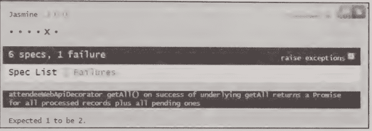

图 12-4

装饰器的 `getAll` 现在已经完成了！现在是测试 `post` 和 `getAll` 如何协作工作了。列表 12-10 中的测试表达了你的意图。

> 列表 12-10：测试 post 和 getAll 之间的协作（代码文件名：DecoratorattendeeWebApi_05_tests.js）

```javascript
describe('attendeeWebApiDecorator', function() {
  'use strict';
  describe('当底层 post 成功时', function() {
    // 省略了之前讨论过的测试
    it('导致立即的 getAll 包含不带 ID 的记录', function(done) {
      decoratedWebApi.post(attendee);
      getAllSuccessExpectation(done, function onSuccess(attendees) {
        expect(attendees.length).toBe(1);
        expect(attendees[0].getId()).toBeUndefined();
      });
    });
    it('导致延迟的 getAll 包含带有 ID 的记录', function(done) {
      decoratedWebApi.post(attendeeA).then(function() {
        // 这次在 post 解析后执行 getAll。
        getAllSuccessExpectation(done, function onSuccess(attendees) {
```

### 列表 12-10（续）

```javascript
expect(attendees.length).toBe(1);
expect(attendees[0].getId()).not.toBeUndefined();
});
it('填充已追加到 getAll 的记录的 ID', function(done) {
  var recordsFromGetAll, promiseFromPostA;
  // 发出 post 不等待。
  promiseFromPostA = decoratedWebApi.post(attendee);
  // 立即发出 getAll 并捕获其结果。
  decoratedWebApi.getAll().then(function onSuccess(attendees) {
    recordsFromGetAll = attendees;
    expect(recordsFromGetAll[0].getId()).toBeUndefined();
  });
  // 现在等待 post 最终解析。（记住
  // 它的超时时间比 getAll 长）。当它解析时，
  // 我们将在待处理记录中看到 attendeeId。
  promiseFromPostA.then(function() {
    expect(recordsFromGetAll[0].getId()).not.toBeUndefined();
    done();
  });
});
```

第一个测试验证了 `getAll` 能够获取待处理记录（那些没有 `attendee` ID 的记录）。
第二个测试验证了 `getAll` 将提供带有 ID 的记录，如果它们可用。
最后一个测试验证了当 `post` 失败时 `getAll` 的情况。在 `post` 回来之前，`getAll` 应该是明智的。之后，失败的记录将包含在 `getAll` 的结果中。列表 12-12 显示了这些最终测试。

失败发生在 12-10 的最后执行。你通过在列表 12-11 的 `post` 中添加 `then` 块来修复它。

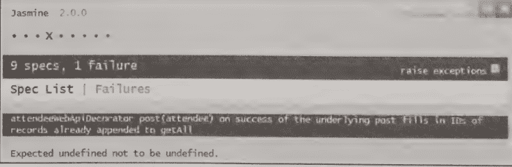

图 12-5

### 列表 12-11：填充 attendeeIds 的装饰器 post 函数（代码文件名：Decorator_attendeeWebApi_05.js）

```javascript
post: function post(attendee) {
  if (indexOfForSameAttendee(pendingPosts, attendee) >= 0) {
    return Promise.reject(new Error(messages.postPending));
  }
  pendingPosts.push(attendee);
  return baseWebApi.post(attendee).then(
    function onPostSucceeded(attendeeWithId) {
      // 当 post 返回带有 ID 的 attendee 时，待处理
      // 记录中的 ID 可能添加到 getAll
      // ，我们希望该结果从 ID 中受益。
      var ix = indexOf(attendee);
      if (ix >= 0) {
        pendingPosts[ix].setID(attendeeWithId.getId());
        pendingPosts.splice(ix, 1);
      }
      return attendeeWithId;
    },
  );
}
```

# 列表 12-12 (续)

```javascript
getAllWithSuccessExpectation(done, function onSuccess(attendees) {
    expect(attendees.length).toBe(1);
    expect(attendees[0].getId()).toBeUndefined();
});
it('causes a delayed GetAll to exclude the record', function(done) {
    decoratedWebApi.post(attendeeA).then(
        function onSuccessFullPost() {
            expect('Post succeeded').toBe(false);
            done();
        },
        function onRejectedPost() {
            getAllWithSuccessExpectation(done, function onSuccess(attendees) {
                expect(attendees.length).toBe(0);
            });
        }
    );
});
```

在第一个测试中，处理了待处理失败的 GetAll 被认为是知的，它应该返回该待处理（即将失败的）记录。然而，正如第二个测试所断言的，一旦失败变得已知，该记录不应该出现在 GetAll 的结果中。第一个测试恰好通过了，但第二个测试没有通过（见图 12-6）。

| Jasmine 2.0 |
| :--- |
| 1 个规格，1 个失败引发异常 |
| 列表 | 失败 |
| attendeeDecorator.post(attendee) 在底层 post 失败时导致延迟的 GetAll 排除该记录 |
| 预期 1 变为 0。 |

图 12-6

问题在于 `post` 没有清理 `post` 失败的记录。使用列表 12-13 中的加粗代码可以轻松解决这个问题。

# 列表 12-13: attendeeWebApiDecorator.post 的最终版本（代码文件名：Decorator.attendeeWebApiDecorator.js [片段]）

```javascript
post: function post(attendee) {
    if (indexOfOfForSameAttendee(pendingPosts, attendee) >=0) {
        return Promise.reject(new Error (messages.postPending));
    }
}
pendingPosts.push(attendee);
return baseWebApi.post(attendee).then(
  function onPostSucceeded(attendeeWithId) {
    // 当 post 返回带有 ID 的 attendee 时，将该 ID 放入
    // 待处理记录中，因为该记录可能被添加到
    // getAll 结果中，我们希望该结果从中受益。
    var ix = pendingPosts.indexOf(attendee);
    if (ix >= 0) {
      pendingPosts[ix].setAttendeeId(attendeeWithId.getId());
      pendingPosts.splice(ix, 1);
    }
    return attendeeWithId;
  },
  function onPostFailed(reason) {
    var ix = pendingPosts.indexOf(attendee);
    if (ix >= 0) {
      pendingPosts.splice(ix, 1);
    }
    return Promise.reject(reason);
  }
);
```

图 12-7 中的最终测试输出显示了你已经取得了多大的进展。

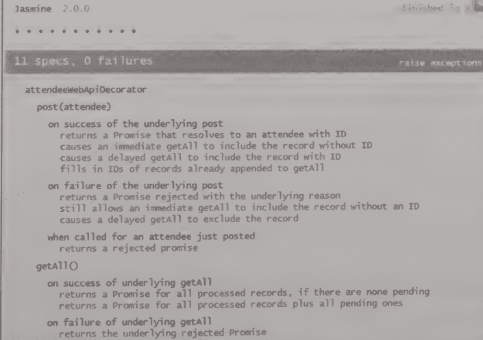

图 12-7

## 通用装饰器

下一个逻辑步骤（超出了本章范围）将是将装饰器通用化。在现实应用中，可能会有很多对象封装了相关的 HTTP POST 和 GET——更不用说 PUT 和 DELETE 了。你如何将装饰器通用化，以便在所有情况下都能使用它？这留给你自己独立完成的练习。我们在这里提到它是为了指出装饰器模式的最后一个益处：它可以消除重复代码。

## 总结

在本章中，你使用了装饰器模式来解决基于 HTTP 的对象的现实局限性，而无需修改它。被装饰的对象保持了对其单一职责的关注，而通过修改装饰器隔离了复杂的新功能，并且如果通用化，还可以减少代码重复。

你使用测试驱动的方法开发了一个装饰器，步骤如下：

1. 为被装饰的对象编写一个伪对象（可选）。
2. 编写单元测试以验证错误是否从被装饰的对象通过装饰器向上调用栈传递给调用者。
3. 编写一个什么都不做的装饰器并观察测试失败。
4. 为装饰器添加透传功能以使测试通过。
5. 编写测试验证装饰器也会向其调用者传递成功信号。
6. 如果这些测试尚未通过，请让它们通过。
7. 添加装饰器的特殊功能，先编写单元测试。
8. 考虑将装饰器通用化。

下一章将涉及另一个经典设计元素：策略模式。

# 13

# 确保策略模式的正确实现

本章内容包括：

- 识别使用策略模式的机会
- 使用测试驱动开发实现策略模式
- 使用工厂模式在运行时选择策略

本章的 WROX.COM 下载资源

你可以在 www.wrox.com/go/reliablejavascript 的 Download Code 标签页找到本章的 wrox.com 代码下载。文件位于第13章，并根据书中处注的文件名单独命名。

策略模式用于将执行特定任务的多个算法（或策略）隔离到模块中，这些模块可以在运行时进行切换。本章使用测试驱动开发来展示如何通过使用策略模式在上下文中添加或删除算法。本章还将阐明工厂模式如何帮助。

## 通过单元测试理解模式

当你开始设计 `transportScheduler` 时，似乎它只需要一个方法 `requestTransport(transportDetails)`，该方法将接收以下信息以执行正确的请求：

- 交通公司名称
- 姓名
- 出发时间

### 不使用策略模式实现 transportScheduler

你选择实现的第一个出租车公司是 RedCab。你的测试看起来像这样：

```javascript
describe("Conference.transportScheduler", function() {
  'use strict';
  describe("requestTransport(transportDetails)", function() {
    describe("with RedCab", function() {
      it("向 RedCab Web 服务发送正确的请求", function(done) {
        // 测试实现
      });
      describe("请求成功", function() {
        it("在审计服务中记录行程", function(done) {
          // 测试实现
        });
        it("解析为预期的成功值", function(done) {
          // 测试实现
        });
      });
    });
    describe("请求失败", function() {
      it("不在审计服务中记录行程", function(done) {
          // 测试实现
        });
      it("返回被拒绝的 promise", function(done) {
          // 测试实现
        });
    });
  });
});
```

让我们跳过逐个让这些测试通过的细节；我们已经展示过很多次了（而且无论如何都会重构代码）。让测试通过的实现如下：

```javascript
var Conference = Conference || {};

Conference.transportScheduler = function(transportAuditService, httpService){
  'use strict';
  return {
    requestTransport : function requestTransport(transportDetails){
      var rediCabRequest;
      switch(transportDetails.companyName){
        case "Redi": {
          rediCabRequest = {
            passenger: transportDetails.passengerName,
            pickup: "Conference Center",
            pickupTime: transportDetails.departureTime,
            dropOff: "Airport",
            rateCode: "JavaScriptConference"
          };
          httpService.post("http://redic.com/schedulepickup", rediCabRequest)
            .then(function(status) {
              transportAuditService.recordRide(transportDetails.companyName);
              return status.confirmationNumber;
            });
        }
        break;
      }
    }
  };
};
```

代码中立即明显的一个方面是 `requestTransport` 函数具有许多职责。它需要：

- 确定选定的交通公司。
- 将 `transportDetails` 转换为交通公司 Web 服务预期的结构。
- 向相应的 Web 服务发送 HTTP 请求。
- 将成功的请求记录到审计服务中。
- 从 HTTP 响应中返回代表预订确认码的字段。

你感觉到，随着支持更多的出租车公司（最终是豪华轿车服务），`transportScheduler` 将变得越来越复杂。你知道，随着复杂性的增加，问题的潜在风险也会随之增加，从而降低可靠性。一想到由于 `transportScheduler` 没有正确提示会导致参与者错误航班，这种想法促使你向 Charlotte 征求反馈。她有几条建议。

“你可以考虑的一点是为每家出租车和豪华轿车公司创建一个独立的模块，并让模块具有一致的接口，”Charlotte 说道。“与每家公司安排行程的逻辑将隔离到各个可独立测试的单元中。”

“此外，”她继续说道，“考虑创建一个工厂函数，该函数知道如何创建相应的运输公司模块。这样做可以消除 `transportScheduler` 中的 `switch` 语句。你可以将工厂注入到 `transportScheduler` 中，这样 `transportScheduler` 就更容易测试了。”

“按照我提议的方式隔离功能，另一个好处是，”Charlotte 继续说道，“`transportScheduler` 将不再像现在这样违反开闭原则。它将通过创建新的运输公司模块来实现扩展；为了支持新的运输公司，它完全不需要修改代码。当创建新的运输模块时，工厂将是唯一需要更改的地方。”

### 使用策略模式实现 transportScheduler

Charlotte 并没有明说，但她建议创建的每个运输公司模块都是一种策略。每个策略模块都封装了一家公司的调度算法，并遵循一致的接口。接口由下面的代码所示：

```javascript
schedulePickup: function schedulepickup(transportDetails){
  // 返回一个解析为预订确认的 Promise
  number;
}
```

由于该接口将由每个运输公司模块实现，因此可以针对接口而不是具体的实现来编写 `transportScheduler`。`transportScheduler` 提供了执行策略的上下文（context）环境。

此外，Charlotte 建议创建一个工厂来创建相应类型的运输公司模块是一个好主意。正如她建议的以及如第 10 章所示，工厂的引入将简化 `transportScheduler` 的测试，因为它可以被注入并从而被模拟（mocked）。

遵循第 10 章的原则，你实现了 `Conference.transportCompanyFactory`，它列在代码列表 13-1 中。

> 代码列表 13-1: transportCompanyFactory 的实现（代码文件名: Strategy\ntransportCompanyFactory.js）

```javascript
var Conference = Conference || {};

Conference.transportCompanyFactory = function(){
  'use strict';
  return {
    create: function create(transportDetails){
      // 使用 transportDetails 来确定应该创建
      // 并返回哪个运输公司（transport-company）模块。
    }
  };
};
```

## 使用测试驱动开发创建 transportScheduler

现在你已经决定了每个运输公司模块将暴露的接口，并开发了一个创建运输公司模块实例的工厂，你现在可以创建 `transportScheduler` 了。

与未使用策略模式时它所拥有的责任列表相比，`transportScheduler` 现在只需要执行以下操作：

- 从注入的 `transportCompanyFactory` 获取一个运输公司模块。
- 调用运输公司模块的 `schedulePickup` 函数。
- 将成功的请求记录到审计服务中。

请求列表的减少意味着一组简化的单元测试套件，其开头如代码列表 13-2 所示。

> 代码列表 13-2: transportScheduler 的单元测试（代码文件名: Strategy\ntransportScheduler_01_tests.js）

```javascript
describe("Conference.transportScheduler", function() {
  'use strict';
  describe("module function", function() {
    // 简单的测试以确保提供了必要的依赖项
    it("expect if audit service is not provided", function() {
      expect(function shouldThrow() {
        var scheduler = Conference.transportScheduler(null, {});
      }).toThrowError(Conference.transportScheduler.messages.noAuditService);
    });
  });
});
```

### 列表 13-2（续）

```javascript
it("throws if company factory argument is not provided", function() {
  expect(function shouldThrow() {
    var scheduler = Conference.transportScheduler({}, null);
  }).toThrowError(Conference.transportScheduler.messages.noCompanyFactory);
});
describe("scheduleTransportation(transportDetails)", function() {
  var scheduler,
  auditService,
  companyFactory,
  testDetails;
  beforeEach(function() {
    // 创建依赖项的实例以注入到
    // 调度器实例中；保留引用以便
    // 在测试中进行监视（spied upon）。
    auditService = Conference.transportCompanyAuditService();
    companyFactory = Conference.transportCompanyFactory();
  });
  // 被测试的 transportScheduler 实例
  scheduler = Conference.transportScheduler(auditService, companyFactory);
  // 因为 companyFactory.create(transportDetails) 将
  // 在测试中被模拟，所以 testDetails 不需要
  // 是一个 transportDetails 对象的真实实例
  testDetails = {};
});
it("throws if transportDetails argument is not provided", function() {
    expect(function shouldThrow() {
      scheduler.scheduleTransportation(testDetails);
    }).toThrowError(Conference.transportScheduler.messages.noDetails);
  });
  it("doesn't swallow exceptions by company factory", function() {
    var companyFactoryError = "This was thrown by the factory";
    spyOn(companyFactory, 'create').and.throwError(companyFactoryError);
    expect(function shouldThrow() {
      scheduler.scheduleTransportation(testDetails);
    }).toThrowError(companyFactoryError);
  });
});
```

代码列表 13-2 中的测试提供了对由于不当使用 `transportScheduler` 可能导致的某些基础负例的覆盖。测试 `it("throws if audit service is not provided", function {/*test*/});` 和 `it("throws if company factory argument is not provided", function {/*test*/});` 确保模块创建函数在没有按照其预期参数的情况下被调用时会抛出异常。测试 `it("throws if transportDetails argument is not provided", function(){/*test*/});` 为 `scheduleTransportation(transportDetails)` 函数执行了类似的验证。最后，测试 `it("doesn't swallow exceptions by company factory", function(){/*test*/});` 确保 `scheduleTransportation(transportDetails)` 函数不会抑制注入的运输公司工厂抛出的任何错误。

由于 `transportScheduler` 还没有实现，测试失败得很惨烈。然而，代码列表 13-3 中的代码允许这些测试通过。通过的测试如图 13-1 所示。

图 13-1

代码列表 13-3: transportScheduler 的初始实现，允许负例测试通过（代码文件名: Strategy/transportScheduler_01.js）

```javascript
var Conference = Conference || {};

Conference.transportScheduler = function (auditService, transportCompanyFactory) {
  'use strict';
  if(!auditService) {
    throw new Error(Conference.transportScheduler.messages.noAuditService);
  }
  if(!transportCompanyFactory) {
    throw new Error(Conference.transportScheduler.messages.noCompanyFactory);
  }
  return {
    scheduleTransportation : function scheduleTransportation(transportDetails) {
      if(!transportDetails) {
        throw new Error(Conference.transportScheduler.messages.noDetails);
      }
      var company = transportCompanyFactory.create(transportDetails);
    }
  };
}
```

### 列表 13-3（续）

```javascript
Conference.transportScheduler.messages = {
  noAuditService: "必须提供 audit service 实例。",
  noCompanyFactory: "必须提供 transport-factory 实例。",
  noDetails: "必须提供 transportDetails 实例。"
};
```

现在既然我们有信心 `transportScheduler` 会报告其误用情况，就可以实现它的核心功能了。

回想，它将要实现的运输公司模块接口由单个函数 `schedulePickup(transportDetails)` 组成，该函数返回一个 promise，并将解析为预约的确认号。如果 promise 已解析，`transportScheduler` 应该通过审计服务（audit service）记录成功的预约。

考虑到这一点，列表 13-4 提供了 `transportScheduler` 的单元测试结果。

### 列表 13-4：transportScheduler 的测试套件（代码文件名：Strategy\transportScheduler_02_tests.js）

```javascript
describe("Conference.transportScheduler", function() {
  'use strict';
  describe("module function", function() {
    // 确保已提供所需依赖的简单测试
    // 之前过的测试已省略
  });
  describe("scheduleTransportation(transportDetails)", function() {
    var scheduler,
        auditService,
        companyFactory,
        testDetails,
        fakeCompany,
        confirmationNumber;
    beforeEach(function() {
      // 创建依赖项实例并注入到
      // transport scheduler 实例中；保留引用以便在测试中对其方法进行间谍（spy）。
      auditService = Conference.transportCompanyAuditService();
      companyFactory = Conference.transportCompanyFactory();
    });
    // 被测试的 transportScheduler 实例
    scheduler = Conference.transportScheduler(auditService, companyFactory);
    // 由于 companyFactory.create(transportDetails) 将在测试
    // 中被 mock，因此 testDetails 不需要是 transportDetails 对象的真实实例
    testDetails = {};
    confirmationNumber = "ABC-123-XYZ";
    // 创建一个实现 schedulePickup 的伪造运输模块
    // 默认，返回的 Promise 解析为
    // confirmationNumber。如果需要被拒绝的 promise，则对 schedulePickup 进行间谍。
    fakeCompany = {
      schedulePickup: function schedulePickup(transportDetails) {
        return new Promise(function(resolve, reject) {
          resolve(confirmationNumber);
        });
      }
    };
    // 之前过的测试已省略
    it("从公司工厂中获取公司模块", function() {
      spyOn(companyFactory, "create").and.returnValue(fakeCompany);
      scheduler.scheduleTransportation(testDetails);
      expect(companyFactory.create).toHaveBeenCalledWith(testDetails);
    });
    it("调用公司的 schedulePickup 函数", function() {
      spyOn(companyFactory, "create").and.returnValue(fakeCompany);
      // fakeCompany 配置为返回一个已解析的 promise；只需
      // 调用即可
      spyOn(fakeCompany, "schedulePickup").and.callThrough();
      scheduler.scheduleTransportation(testDetails);
      expect(fakeCompany.schedulePickup).toHaveBeenCalledWith(testDetails);
    });
    describe("Successful scheduling", function() {
      beforeEach(function() {
        spyOn(companyFactory, "create").and.returnValue(fakeCompany);
      });
      it("解析为返回的确认号", function(done) {
        scheduler.scheduleTransportation(testDetails)
          .then(function(confirmation) {
            expect(confirmation).toEqual(confirmationNumber);
            done();
          }, function rejected(reason) {
            expect("Should not have been rejected").toBe(false);
            done();
          });
      });
      it("使用审计服务记录日志", function (done) {
        spyOn(auditService, "logReservation");
        scheduler.scheduleTransportation(testDetails)
          .then(function resolved(confirmation) {
            expect(auditService.logReservation)
              .toHaveBeenCalledWith(testDetails, confirmationNumber);
            done();
          }, function rejected(reason) {
            expect("Should not have been rejected").toBe(false);
            done();
          });
      });
    });
    describe("Unsuccessful scheduling", function () {
      var rejectionReason;
      beforeEach(function () {
        spyOn(companyFactory, "create").and.returnValue(fakeCompany);
        rejectionReason = "Was rejected";
        // 设置 schedulePickup 返回一个被拒绝的 promise
        spyOn(fakeCompany, "schedulePickup").and.returnValue(new Promise(function (resolve, reject) {
          reject(rejectionReason);
        }));
      });
      it("允许被拒绝的 Promise 流向调用代码", function (done) {
        scheduler.scheduleTransportation(testDetails)
          .then(function resolved(confirmation) {
            expect("Should not have been resolved").toBe(false);
            done();
          }, function rejected(reason) {
            expect(reason).toEqual(rejectionReason);
            done();
          });
      });
      it("不会在审计服务中记录任何内容", function (done) {
        spyOn(auditService, "logReservation");
        scheduler.scheduleTransportation(testDetails)
          .then(function resolved(confirmation) {
            expect("Should not have been resolved").toBe(false);
          }, function rejected(reason) {
            expect(auditService.logReservation).not.toHaveBeenCalled();
            done();
          });
      });
    });
  });
});
```

## 通过单元测试理解模式

13-4 中的测试验证了 `transportScheduler` 正确协调了工厂和运输模块。单元测试失败了（如图 13-2 所示），因为尚未实现协调逻辑。

## 为 transportScheduler 创建策略

正确实现策略模式的处之一是可以用极少的代码更改添加或删除策略。事实上，添加公司时不需要更改 `transportScheduler`。相应的，负责创建公司策略实例的唯一模块 `transportFactory` 在删除公司时需要更改。

为了完成最初使用策略模式实现的功能，需要实现一个 RediCab 的公司模块。由于运输公司模块暴露的接口非常简单且定义明确，该模块并没有复杂的逻辑。

与 `schedulePickup(transportDetails)` 实现相关的单元测试出现在列表 13-6。

> 列表 13-6：RediCab 实现 schedulePickup(transportDetails) 的测试（代码文件名：“Strategy.redicabTransportCompany_tests.js”）

```javascript
describe("redicabTransportCompany", function() {
  'use strict';
  var httpService,
    company,
    details,
    expectedData,
    testConfirmation;
  beforeEach(function() {
    httpService = Conference.httpService();
  });
  company = Conference.redicabTransportCompany(httpService);
  details = {
    transportCompany: "RediCab",
    passengerName: "Pete Mitchell",
    departureTime: "7:30 PM"
  };
  // 根据 details，发布的数据应该像这样：
  expectedData = {
    passengerName: details.passengerName,
    pickup: "Conference Center",
    pickUpTime: details.departureTime,
    dropOff: "Airport",
    rateCode: "JavaScript"
  };
  // 一个类似于由 RediCab API 返回的对象
  testConfirmation = {
    confirmation: "AAA-BBB-CCC",
    anticipatedCharge: 34.00
  };
```

### 列表 13-6 (续)

```javascript
describe("schedulePickup(transportDetails", function() {
  it("posts the expected data to the correct url", function() {
    spyOn(httpService, 'post')
    and.callFake(function (url, data) {
      expect(data).toEqual(expectedData);
      expect(url).toEqual(company.getSchedulePickupUrl());
      return new Promise(function(resolve, reject) {
        resolve(testConfirmation);
      });
    });
    company.schedulePickup(details);
  });
  it("resolves to the confirmation number", function (done) {
    spyOn(httpService, 'post')
    and.returnValue(new Promise(function(resolve, reject) {
      resolve(testConfirmation);
    });
    done();
  });
  company.schedulePickup(details).then(function resolved(confirmation) {
    expect(confirmation).toEqual(testConfirmation.confirmationCode);
    done();
  }, function rejected(reason) {
    expect("Should not have been rejected").toBe(false);
    done();
  });
});
```

在列表 13-7 中，`redicabTransportCompany` 的实现使得列表 13-6 中的单元测试通过。

### 列表 13-7：redicabTransportCompany 的实现（代码文件名：Strategy/redicabTransportCompany.js）

```javascript
var Conference = {};

Conference.redicabTransportCompany = function(httpService) {
  'use strict';
  var schedulePickupUrl = "http://redicab.com/schedulepickup";
  return(
    // 使用 Redicab 调度取车。返回一个 promise
    // 该 promise 将解析为由 RediCab api 返回的确认码。
    schedulePickup: function schedulePickup(transportDetails) {
      var details = {
        passenger: transportDetails.passengerName,
        pickUp: "Conference Center",
        pickUpdateTime: transportDetails.departureTime,
        dropOff: "Airport",
        rateCode: "JavaScriptConference"
      };
      return userService.post(schedulePickupUrl, details)
        .then(function resolve(confirmation) {
          return confirmation.confirmation;
        });
    }
    // 返回取车信息应该
    // post 的 url
    getSchedulePickupUrl: function getSchedulePickupUrl() {
      return schedulePickupUrl;
    }
  );
};
```

注意，`schedulePickup` 的实现与没有使用策略模式编写的代码相似。然而，通过使用策略模式，`redicabTransportCompany` 中的代码仅关注与 RediCab API 交互的细节。通过的单元测试如图 13-4 所示。

图 13-4

可以以同样的方式创建任意数量的交通公司模块，其中任何一个模块都不需要对 `transportScheduler` 或任何其他交通公司模块进行任何更改。

## 总结

在本章中，你了解了如何使用策略模式来隔离执行任务的不同算法（例如在交通公司调度约车），并允许在运行时动态确定合适的算法或策略。随着更多交通公司模块的添加，可以扩展 `transportCompanyFactory`，根据用户所需的交通类型提供相应模块的实例。

此外，本章还描述了如何使用第 10 章中的工厂模式来创建策略的具体实例。这样做降低了测试的复杂性，并确保在添加或删除策略时，使用策略的环境不需要发生更改。

在创建策略模块时，编写单元测试以验证实现是否暴露了正确的接口是非常重要的。第 16 章“在无接口语言中遵循接口”包含了更多关于确保 JavaScript 模块符合接口的内容。

下一章将介绍代理模式，这是一种一个对象管理对另一个对象访问的机制。

# 14 确保代理模式的正确实现

本章内容包括：

- 代理模式的常见用途
- 使用预取代理（pre-fetching proxy）提高网页的响应速度
- 使用测试驱动开发创建代理
- 在不破坏数据封装的情况下推断代理的内部工作原理

WROX.COM 本章代码下载
你可以在 www.wrox.com/reliablejavascript 的 Download Code 标签找到本章的 wrox.com 代码下载。文件位于第 14 章下载中，并根据本章中注的文件单独命名。

如果你是一个美国人，你的整个生活字面上受到代理模式的支配。虽然我们生活在民主国家，但它是代议制民主国家：我们不直接制定法律，而是选举代表我们制定法律的人。我们相信（无论对错）我们在国会和白宫的代理可以比我们更有效地管理立法过程。他们有时间成为国防、医疗保健和其他领域的专家。我们没有。如果每个微小的问题都通过公决来决定，我们将无法完成任何其他事情了。

当需要解释这些法律时，我们通常会聘用另一个代理：一位精通解释和引导相关法律的律师。

在软件设计中，创建一个代理对象来管理对底层对象的访问是有用的。代理模式的常见用途包括：

- 确保客户端不会让真实主体过载
- 防止客户端访问昂贵的资源
- 将请求合并为一个

在本章中，你将实现一个预取代理。该预取代理的真实主体是列表 14-1 所示的 `attendeeProfileService`。

## 以测试驱动的方式开发代理

在目前的示例中，代理的外部行为是在你请求时提供配置。测试其内部实现有两种方法。较不理想的方法是允许代理暴露其预取的配置列表，以便测试直接观察它们。这有两个明显的缺点：首先，它破坏了代理的数据封装，违反了面向对象设计的基本原则。其次，它通过向 API 添加函数增加了代理与外部世界的耦合。

更好的方法是观察代理对真实主体产生，并从此推断代理的行为。

列表 14-1：attendeeProfileService（代码文件名：Proxy/attendeeProfileService.js）

```javascript
var Conference = {};

Conference.attendeeProfileService = function() {
  'use strict';
  var messages = {
    httpFailure: 'HTTP 请求失败。'
  };
  return {
    // 返回学员配置的 Promise
    getProfile: function(attendeeId) {
      return new Promise(function(resolve, reject) {
        var xhr = new XMLHttpRequest();
        xhr.onreadystatechange=function onreadystatechange() {
          if (xhr.readyState==4) {
            if (xhr.status==200) {
              resolve(xhr.response);
            } else {
              reject(new Error(messages.httpFailure));
            }
          }
        }
        xhr.open("GET", "profile/" + attendeeId, true);
        xhr.send();
      });
    }
  };
};
```

代理将是一个接收列表 14-2 所示参数的函数。

### 列表 14-2: 一个空代理（代码文件名: Proxy_attendeeProfileProxy_01a.js）

```javascript
var Conference = Conference || {};
```

```javascript
// 管理对数组 (attendees) 中参与者配置的访问，
// 从 attendeeProfileService (profileService) 获取这些配置，
// 并根据 profileViews 预取最多 prefetchLimit 个最热门的配置。
Conference.attendeeProfileProxy = function (
  attendees, profileService, prefetchLimit) {
};
```

第二个参数 `attendeeProfileService` 构成了真实的主体（subject）。代理类实例化它自己的主体似乎是理所当然的，但将其作为参数传递可以允许你使用依赖注入。在单元测试中，你可以注入一个安装了间探器（spy）的对象。如果系统架构要求任何调用者都不能直接访问真实主体，那么你必须考虑更严锁的方案。一种可能性是将代理变成一个切面（aspect），让任何看起来会通过代理的调用都经过它。

当代理被创建时，它应该预取最多 `prefetchLimit` 数量的内容。这听起来足够简单，但有几个边界和错误条件需要测试。按照惯例，你想从这里开始。

首先，如果 `prefetchLimit` 不是正数怎么办？你可以抛出一个错误，或者简单地不进行取。你决定了后者并在列表 14-3 中编写了测试。

## 列表 14-3: 测试非正数的 prefetchLimit（代码文件名: proxy_attendeeProfileProxy_01_tests.js）

```javascript
describe('attendeeProfileProxy(attendees, profileService, prefetchLimit)', function() {
  'use strict';
  var proxy = Conference.attendeeProfileProxy,
  profileService = Conference.attendeeProfileService(),
  attendees = [
    { attendeeId: 10, profileViews: "3" },
    { attendeeId: 11, profileViews: "0" },
    { attendeeId: 12 },
    { attendeeId: 13, profileViews: "3" },
    { attendeeId: 14, profileViews: "10" },
    { attendeeId: 15, profileViews: "2" },
    { attendeeId: 16, profileViews: "1" }
  ],
  spyOnProfileService;
  beforeEach(function() {
    spyOnProfileService = spyOn(profileService, 'getProfile');
  });
});
describe('initialization', function () {
  it('如果 prefetchLimit 不是正数则不预取任何配置', function() {
    var notPositiveNumbers = [-1, 0, undefined, 'abc', function() {}];
    notPositiveNumbers.forEach(function(prefetchLimit) {
      proxy(attendees, profileService, prefetchLimit);
      expect(spyOnProfileService.calls.count()).toBe(0);
    });
  });
});
```

从上到下查看，第一个 `var` 只是为 `Conference.attendeeProfileProxy` 创建了简写。

在下一行，是配置服务的初始化：

```javascript
profileService = Conference.attendeeProfileService()
```

这种非平凡的初始化是交叉测试污染的来源：如果一个测试改变了 `profileService` 的状态，它就污染了下一个测试的起始条件。然而，你清楚你的测试实际上不会执行 `profileService` 中的任何代码。相反，你得到的将是 `beforeEach` 中设置的间探器的结果。

`attendeeProfileService` 只有一个函数。如果它更复杂，你可能会考虑写一个虚假对象（fake）而不是使用间探器。

在顶部初始化的参与者可能对许多测试都有用，因此你将变量放在了外部作用域中。关于测试数据后续会有更多说明。

最后，是测试本身，它是非常直观的。测试的目的是验证当 `prefetchLimit` 不是正数时是否执行了预取。你遍历了各种非正数的数据，并使用每一个值实例化代理。当完成所有操作后，不应该有任何配置被预取。

> 注意：我允许非整数的正数。如果一个数字因为舍入误差导致不是整数，那么为什么不让代理尽力而为呢？

就像装饰器模式一样，你从列表 14-2 中的“无所作为”代理开始。测试恰好验证了什么都没有做，而且它通过了（见图 14-1）！

一个“未能失败”的单元测试会让你感到不安，事实也确实如此。通常，使用调试器进行一些探测可以确保你的测试是稳健的，但这里没有代码可调试。你明智地决定让代理预取一个参与者，以便观察到失败。这个小尝试在列表 14-4 中。

# 第 14 章 确保代理模式的正确实现

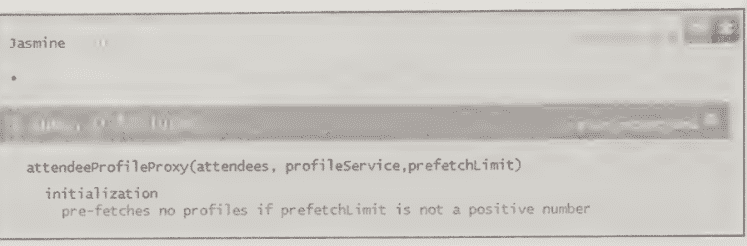

图 14-1

## 列表 14-4: 强制“无所作为”的测试失败（代码文件名: Proxy_attendeeProfileProxy_01b.js）

```javascript
var Conference = Conference || {};

// 管理对数组 (attendees) 中参与者配置的访问，
// 从 attendeeProfileService (profileService) 获取这些配置，
// 并根据 profileViews 预取最多 prefetchLimit 个最热门的配置。
Conference.attendeeProfileProxy = function (
  attendees, profileService, prefetchLimit) {
  'use strict';
  var ix,
  prefetched = {};
  if (prefetchLimit > 0) {
    for (ix = 0; ix < prefetchLimit && ix < attendees.length; ix++) {
      prefetched[attendees[ix].attendeeId] = profileService.getProfile();
    }
  }
};
```

果不其然，Jasmine 报告主体被调用了五次——每个成员一次（见图 14-2）。


图 14-2

当你确认已经充分测试了 `prefetchLimit` 较小的情况后，考虑当它过大时会发生什么。列表 14-5 所示。

## 列表 14-5: 测试过大的 prefetchLimit（代码文件名: proxy_attendeeProfileProxy_02_tests.js）

```javascript
it('如果 prefetchLimit 超过参与者人数，则预取所有配置', function() {
  var prefetchLimit = attendees.length + 1;
  proxy(attendees, profileService, prefetchLimit);
  expect(spyOnProfileService.calls.count()).toBe(attendees.length);
});
```

## 列表 14-6: 处理过小的 prefetchLimit（代码文件名: proxy_attendeeProfileProxy_03_tests.js）

```javascript
it('预取 prefetchLimit 个最热门的配置', function () {
  var prefetchLimit = 3;
  proxy(attendees, profileService, prefetchLimit);
  expect(spyOnProfileService.calls.count()).toBe(prefetchLimit);
  expect(spyOnProfileService).toHaveBeenCalledWith(14);
  expect(spyOnProfileService).toHaveBeenCalledWith(10);
  expect(spyOnProfileService).toHaveBeenCalledWith(13);
});
```

两个测试现在都通过了。在测试边界条件后，是时候检查对象的核心功能了，即获取最热门配置的能力。

## 列表 14-7: 确定最热门配置（代码文件名: Proxy_attendeeProfileProxy_04_tests.js）

正如你在第 2 章所看到的，Jasmine 间探器会跟踪这些。它们的功能允许你确定与主体交互的精确性质。单元测试中一个容易犯的错误是代码写得短于应有的程度。如果列表 14-7 中的测试只包含这一行：

```javascript
expect(spyOnProfileService.calls.count()).toBe(prefetchLimit);
```

那么你只知道有三个配置被预取了，但你不知道是哪三个。一个常见的错误是测试只包含以下这些行：

```javascript
expect(spyOnProfileService).toHaveBeenCalledWith(14);
expect(spyOnProfileService).toHaveBeenCalledWith(10);
expect(spyOnProfileService).toHaveBeenCalledWith(13);
```

在这种情况下，你将不知道哪三个被预取了。那么，当你运行测试时会发生什么？图 14-4 是结果。

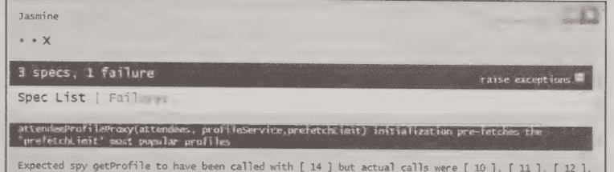

图 14-4

对于调用次数的预期得到了满足，但第二个预期——即获取了 ID 为 14 的参与者——并没有被满足。Jasmine 已经很好地列出了被获取的参与者 ID，你可以看到它们是测试数组中的前三个。你并不感到意外，因为你并没有尝试过筛选出最受欢迎的。

你为代理添加了排序功能。顺便，你将排序和预取封装在一个立即执行函数（IIFE）中，以强调该逻辑只会执行一次，并防止新变量 `sortedAttendees` 污染外部作用域。甚至为这个立即执行函数取了一个名字 `prefetchAll`。这起到了文档和指南的作用（见列表 14-8）。

> 列表 14-8：尝试选择最受欢迎的配置（代码文件名：Proxy/attendeeProfileProxy_03a.js）

```javascript
var Conference = {}; // 管理对数组 (attendees) 中参与者配置的访问
// 从 attendeeProfileService(profileService) 获取它们，
// 并根据 profileViews 预取最多 prefetchLimit 个最受欢迎的配置。
Conference.attendeeProfileProxy = function (
  attendees, profileService, prefetchLimit) {
  'use strict';
  var prefetch = {};
function prefetch(attendeeId) {
  prefetched[attendeeId] = profileService.getProfile(attendeeId);
}
if (prefetchLimit > attendees.length) {
  prefetchLimit = attendees.length;
```

### 列表 14-8（续）

```javascript
}
(function prefetchAll() {
  var ix,
  sortedAttendees = attendees.slice().sort(function byViews(a,b) {
    return b.profileViews - a.profileViews;
  });
  for (ix=0; ix<prefetchLimit; ++ix) {
    prefetch(sortedAttendees[ix].attendeeID);
  }
}();
```

在高亮行中，`attendees.slice()` 的作用是创建一个 `attendees` 数组的副本，这样排序操作就不会影响代理调用者可能用于自身用途的数组副本。

原生的 JavaScript `sort` 接收一个函数，如果第一个参数应该排在第二个参数后面，则返回正值；反之返回负值；如果它们在排序上等价则返回零。对于降序排序，返回第二个值减去第一个值通常可以起作用，这正是你编写的代码。效果如何？见图 14-5。

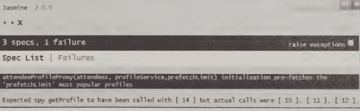

图 14-5

是的。就好像排序从未发生过一样。使用调试器，你可以精确检查排序中发生了什么（见图 14-6）。

程序在缺少 `profileViews` 属性的参与者处卡住了。`b.profileViews` 和 `a.profileViews` 之间的差异是 `NaN`（不是数字）。

当数据来自服务器时，你不能总是假设每个属性都存在。大多数 JSON 序列化器为了节省带宽而为默认值进行序列化。零的 `profileViews` 值很容易被视为默认值，导致记录缺少此属性。你在设计 `attendees` 测试数组时明智地预见到了这一点，现在你的远见以测试失败的形式得到了回报。（这是一件好事！）。

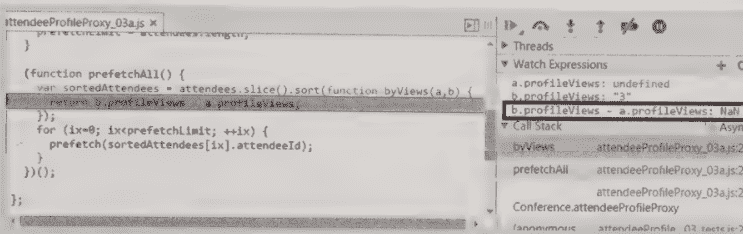

图 14-6

说起测试数据，它的另一个优点是 `profileViews` 是带引号的字符串而不是裸名称，这为了给测试增加一点难度。（再次，你永远不知道在序列化数据中会得到什么。）更重要的是，如果代理将字符串视为字符串进行排序，结果将是你想要的，因为 "10" 会被认为小于 "3"。很多时候，人们对测试数据的设计关注不足。程序员利用这一点让测试在没有太多准备的情况下也能通过。让我们造个假吧：编写测试数据是无聊的，但编写代码是有趣的，所以哪里可能会比较慷慨呢？然而，测试数据和测试一样重要。

只需要稍微微调即可修复问题（见列表 14-9）。与其使用 `b.profileViews`，你编写了 `(b.profileViews || 0)`，`a.profileViews` 也是如此。

列表 14-9：选择最受欢迎配置的修订代码（代码文件名：Proxy_attendeeProxy_03b.js）

```javascript
var Conference = Conference || {};

// 管理对数组 (attendees) 中参与者配置的访问，
// 从 attendeeProfileService(profileService) 获取它们，
// 并根据 profileViews 预取最多 prefetchLimit 个最受欢迎的配置。
Conference.attendeeProfileProxy = function (
  attendees, profileService, prefetchLimit) {
  'use strict';
  var prefetch = {};
function prefetch(attendeeId) {
  prefetched[attendeeId] = profileService.getProfile(attendeeId);
}
if (prefetchLimit > attendees.length) {
  prefetchLimit = attendees.length;
}
(function prefetchAll() {
  var ix,
  sortedAttendees = attendees.slice().sort(function byViews(a,b) {
    return (b.profileViews || 0) - (a.profileViews || 0);
  });
  for (ix=0; ix<prefetchLimit; ++ix) {
    prefetch(sortedAttendees[ix].attendeeID);
  }
}();
```

### 列表 14-10：测试预取配置的返回（代码文件名：attendeeProxy_04.js）

```javascript
let spyOnService;
function makeServiceReturn(attendeeId) {
  return "Pretend this is the service's value for " + attendeeId;
}
let attendees = [
  {attendID: 10, profileViews: "10"},
  {attendID: 11, profileViews: "11"},
  {attendID: 12, profileViews: "12"},
  {attendID: 13, profileViews: "13"}
];
let profileService = {
  getProfile: function(attendeeId) {
    //尚未实现
  }
};
describe('attendeeProxy(attendees, profileService, prefetchLimit)', function() {
  let prefetchLimit = 3;
  let proxyInstance;
  beforeEach(function() {
    spyOnService = spyOn(profileService, 'getProfile').and.callFake(function(attendeeId) {
      return makeServiceReturn(attendeeId);
    });
    proxyInstance = Conference.attendeeProfileProxy(attendees, profileService, prefetchLimit);
  });
  it('请求时返回预取的配置', function() {
    let attendeeId = 13,
    profile = proxyInstance.getProfile(attendeeId);
    expect(profile).toBe(makeServiceReturn(attendeeId));
    expect(spyOnService.calls.count()).toBe(prefetchLimit);
  });
});
```


在高亮行中，`attendees.slice()` 的作用是创建一个 `attendees` 数组的副本，这样排序操作就不会影响代理调用者可能用于自身用途的数组副本。

原生的 JavaScript `sort` 接收一个函数，如果第一个参数应该排在第二个参数后面，则返回正值；反之返回负值；如果它们在排序上等价则返回零。对于降序排序，返回第二个值减去第一个值通常可以起作用，这正是你编写的代码。效果如何？见图 14-5。


图 14-5

是的。就好像排序从未发生过一样。使用调试器，你可以精确检查排序中发生了什么（见图 14-6）。

程序在缺少 `profileViews` 属性的参与者处卡住了。`b.profileViews` 和 `a.profileViews` 之间的差异是 `NaN`（不是数字）。

当数据来自服务器时，你不能总是假设每个属性都存在。大多数 JSON 序列化器为了节省带宽而为默认值进行序列化。零的 `profileViews` 值很容易被视为默认值，导致记录缺少此属性。你在设计 `attendees` 测试数组时明智地预见到了这一点，现在你的远见以测试失败的形式得到了回报。（这是一件好事！）。


图 14-6

说起测试数据，它的另一个优点是 `profileViews` 是带引号的字符串而不是裸名称，这为了给测试增加一点难度。（再次，你永远不知道在序列化数据中会得到什么。）更重要的是，如果代理将字符串视为字符串进行排序，结果将是你想要的，因为 "10" 会被认为小于 "3"。很多时候，人们对测试数据的设计关注不足。程序员利用这一点让测试在没有太多准备的情况下也能通过。让我们造个假吧：编写测试数据是无聊的，但编写代码是有趣的，所以哪里可能会比较慷慨呢？然而，测试数据和测试一样重要。

只需要稍微微调即可修复问题（见列表 14-9）。与其使用 `b.profileViews`，你编写了 `(b.profileViews || 0)`，`a.profileViews` 也是如此。

考虑到后续的测试，你将 `prefetchLimit` 和 `proxyInstance` 变量放置在了一个新测试和未来测试都可以访问的作用域中。`proxyInstance` 在 `beforeEach` 中为每个测试重新初始化。

在测试中，你对代理调用了 `getProfile`。你期望从底层 `attendeeService` 获取返回值。但那个奇怪的 `makeServiceReturn` 调用是什么？装饰器模式将工作委托给它的主体。它不应该关心项目必要的任何微小语义。在当前情况下，`attendeeProfileProxy` 没有理由关心底层服务返回的是 Promise、JSON 对象还是其他任何内容。因此，测试也不需要关心。这就是为什么定义在列表 14-10 顶部的 `makeServiceReturn` 函数创建了一个故意荒谬的返回值。在第一个 `beforeEach` 中对 `profileService` 的间桩器（spy）已被修改为返回这个假值。

尽管做了这么多工作，当你看到测试失败时仍感到非常喜喜（见图 14-8），因为这意味着你有机会编写有用的代码。

## 252 | 第 14 章 确保代理模式的正确实现

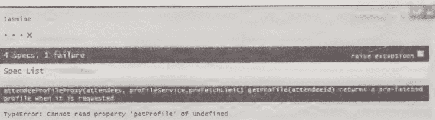

图 14-8

Jasmine 正在告诉你，你的测试中对 `getProfile` 的调用发生在一个值为 `undefined` 的对象上，而该值应该是 `proxyInstance`。这并不意外。直到目前为止，`Conference.attendeeProfileProxy` 都没有返回过任何值！你对该问题的修复在列表 14-11 中，其中代理返回了一个具有 `getProfile` 函数的字面量对象。

列表 14-11：验证代理返回的是一个具有 `getProfile` 函数的对象（文件名：ProxyAttendeeProfileProxy_04.js）

```javascript
var Conference = Conference || {};

// 管理对数组 (attendees) 中参会者配置的访问

// 从 attendeeProfileService(profileService) 获取，

// 并根据 profileViews 预取最多 prefetchLimit 个热门的。

Conference.attendeeProfileProxy = function(

  attendees, profileService, prefetchLimit) {

  'use strict';

  var prefetched = {};

function prefetch(attendeeId) {

  prefetched[attendeeId] = profileService.getProfile(attendeeId);

}

if (prefetchLimit > attendees.length) {

  prefetchLimit = attendees.length;

}

(function prefetchAll() {

  var ix,

  sortedAttendees = attendees.slice().sort(function byViews(a,b) {

    return (b.profileViews || 0) - (a.profileViews || 0);

  });

  for (ix=0; ix<prefetchLimit; ++ix) {

    prefetch(sortedAttendees[ix].attendeeId);

  }

}();

return {

  getProfile: function getProfile(attendeeId) {

    return prefetched[attendeeId];

  }

};

```

遵循测试驱动的方法论，你的 `getProfile` 函数仅执行了完成你上一次测试所需的最少工作，从 `prefetched` 对象中返回配置。再次，代理并不关心该配置实际上是一个关于某个对象的 Promise 还是配置本身。代理的单一职责是管理对其真实主体的访问。它对主体的语义不做任何假设。图 14-9 显示了你的成功。

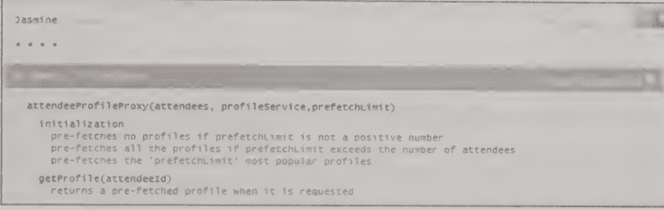

图 14-9

如果配置尚未被预取该呢？这很容易测试。列表 14-12 显示了结果。

- 列表 14-12：测试未预取的配置的返回（代码文件名：AttendeeProfileProxy_tests.js）

```javascript

describe('attendeeProfileProxy(attendees, profileService, prefetchLimit)', {

  var proxy = Conference.attendeeProfileProxy(

    profileService = Conference.attendeeProfileService(),

    attendees = [

      { attendeeId: 10, profileViews: "3" },

      { attendeeId: 11, profileViews: "0" },

      { attendeeId: 13, profileViews: "3" },

      { attendeeId: 14, profileViews: "10" },

      { attendeeId: 15, profileViews: "2" },

      { attendeeId: 16, profileViews: "1" }

    ],

  );

  spyOnProfileService;

```

```javascript

function makeServiceReturn(attendeeId) {

  return "Pretend this is the service's return value for attendee"

    + attendeeId;

}

```

# 列表 14-12（继续）

```javascript

}

beforeEach(function() {

  spyOnProfileService = spyOn(profileService, 'getProfile')

    .and.callFake(function (attendeeId) {

      return makeServiceReturn(attendeeId);

    });

});

// *** 之前讨论过的测试已省略。 ***

describe('getProfile(attendeeId)', function() {

  var prefetchLimit = 3,

  proxyInstance;

  beforeEach(function() {

    proxyInstance = proxy(attendees, profileService, prefetchLimit);

  });

  // *** 之前讨论过的测试已省略。 ***

  it('returns a non-pre-fetched profile when requested', function() {

    var attendeeId = 11,

    profile = proxyInstance.getProfile(attendeeId)

    expect(profile).toBe(makeServiceReturn(attendeeId))

    expect(spyOnProfileService.calls.count(1)).toBe(prefetchLimit+1);

  });

});

```

针对 attendee 11 的新测试 `getProfile` 将不会被预取，因为它不是 `prefetchLimit` 中访问次数最多的之一。测试期望配置会被预取，从而导致对底层服务的额外调用。该测试在这两个点上都失败了（见图 14-10）。

对代码进行一个调整（列表 14-13 的最后一行），一切就正常了（见图 14-11）。

# 列表 14-13：完成的 attendeeProfileProxy（代码文件名：AttendeeProfileProxy.js） Conference || {};

```javascript

var Conference = Conference || {};

// 管理对数组 (attendees) 中参会者配置的访问

// 从 attendeeProfileService(profileService) 获取，

// 并根据 profileViews 预取最多 prefetchLimit 个热门的。

Conference.attendeeProfileProxy = function(

  attendees, profileService, prefetchLimit) {

  'use strict';

  var prefetched = {};

function prefetch(attendeeId) {

  prefetched[attendeeId] = profileService.getProfile(attendeeId);

}

if (prefetchLimit > attendees.length) {

  prefetchLimit = attendees.length;

}

(function prefetchAll() {

  var ix,

  sortedAttendees = attendees.slice().sort(function byViews(a,b) {

    return (b.profileViews || 0) - (a.profileViews || 0);

  });

  for (ix=0; ix<prefetchLimit; ++ix) {

    prefetch(sortedAttendees[ix].attendeeId);

  }

}();

return {

  getProfile: function getProfile(attendeeId) {

    return prefetched[attendeeId];

  }

};

```

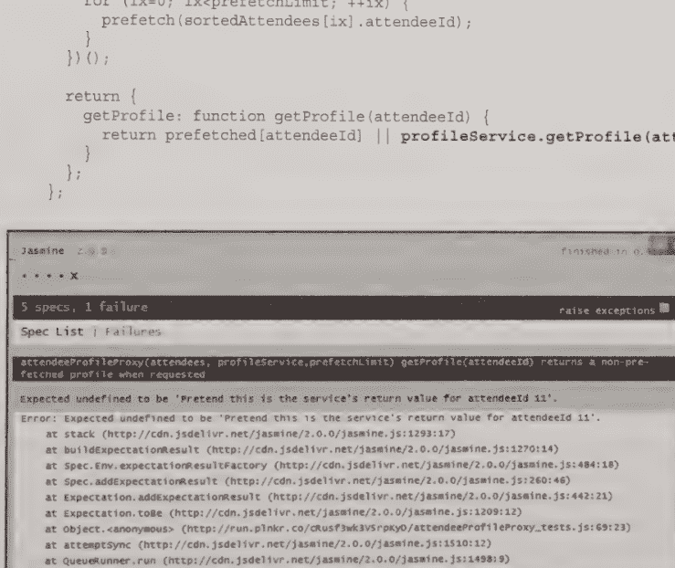

图 14-10

## 256 | 第 14 章 确保代理模式的正确实现

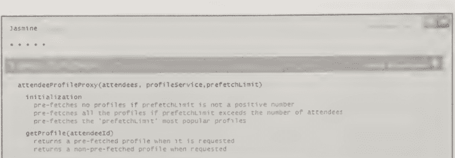

图 14-11

“我完成了，”你对 Charlotte 说。

“你*认为*你完成了，”她回答道，“既然我们是为了效率，我决定不发送那些 profileViews。”

“经历过，也想到了，”你满意地说。

## 总结

在本章中，你完成了一个代理的测试驱动案例。几个原则变得显而易见：

- 代理模式由一个对象（*代理*）管理与其他（*真实主体*）的交互。
- 代理可以帮助消费者更高效地使用真实主体，或者避免陷入麻烦。
- 代理应该通过观察与真实主体的交互来进行测试，而不是暴露代理的内部实现。Jasmine 的 spies 在这方面非常有帮助。
- 为了便于测试和依赖注入，将代理的真实主体作为参数传递给创建代理函数。
- 如果真实主体永远不应该暴露，你可以将代理实现为切面。
- 从一个什么都不做的代理开始测试驱动开发。
- 一如既，首先测试错误和边界条件。
- 构建测试数据要像构建测试本身一样用心。

在下一章中，你将探索 JavaScript 最喜爱的习式之一：链式方法。

## 15 确保链式方法的正确实现

## 本章内容

- 使用链式方法创建更优雅的代码
- 使用测试驱动开发实现链式方法
- 编写 DRY 测试以验证方法是链式的
- 展示 ECMAScript 6 Promise 的 `then` 方法如何实现链

WROX.COM 代码下载

本章的 wrox.com 代码下载可以在 www.wrox.com/go/reliablejavascript 的 Download 标签获取。文件位于第 15 章下载中，并根据本章提到的文件名单独命名。

以下 JavaScript 语句的结构和语法看起来熟悉吗？

```javascript

$("#MyDiv").text("JavaScript").removeClass("unreliable")

  .addClass("reliable");

```

该 jQuery 代码示例... 使用 jQuery，一个流行的客户端 JavaScript 框架。如果你从 2008 年左右开始就开始做客户端开发，那么答案是“是的”。
该语句是用 jQuery 编写的，根据 http://www.builtwith.com 在 2015 年 3 月的数据，它被全球超过 5200 万个网站使用。


在 JavaScript 中，链式方法（chainable methods）的其他用途并不远。你可能已经注意到，书中到处使用的 Promise API 方法就是链式的。

> 注意：该方法的行为与 Query 暴露的链式方法以及你在本章中创建的链式方法略有不同：它并不总是返回被调用的那个对象。本章的最后一节将深入探讨这一差异。

暴露使用链式方法的 API 允许像下面的代码出现：

```javascript

var obj = NS.createObj();

obj.setAttribute("Attri Value");

obj.doThing1();

obj.doThing2();

```

将其转换为：

```javascript

var obj = NS.createObj().setAttribute("Attri Value").doThing1().doThing2();

```

示例之间的差异并不大。第二个示例比第一个更简洁一些：`obj` 变量只被引用了一次，并且消除了分号。我们不是完美的打字员，所以减少击键次数是避免拼写错误的明智选择。

第二个示例更具表现力，我们认为它比第一个更优雅。它是一个语句，具有第一个示例所不具备的流畅感。如果说第一个示例是臃肿的，那么第二个示例则从左到右读取，像一个英语句子。

在本章中，你将通过测试驱动开发为一个 JavaScript 会议网站创建一个模块，该模块将作为 API 的一部分暴露链式方法。

参加 JavaScript 会议的许多演讲者都表示，希望获得听众对其演讲的反馈。会议组织者必须扩展会议网站，以提供一个演讲者评估页面，听众可以通过他们的移动设备或会议场地的任何自助终端访问该页面。

评估页面将捕获：

- 演讲标题
- 演讲者姓名
- 对所提主题/概念价值的评分
- 对演讲者演讲技巧的评分
- 听众再次参加该演讲者其他演讲的可能性
- 评估人员想给演讲者的意见

将在下一节开发的演讲者模块将用于汇总在评估页面中输入的信息。评估数据将被持久化到服务器进行存储，直到会议结束，届时它们将进行汇总并提供给每位演讲者。

# 通过单元测试理解模式

`presenterEvaluation` 模块的职责很小：它的唯一工作是存储代表听众对演讲评分的数据。它将为其存储的每项数据暴露一个设置方法（set method），并且这些方法是链式的。

为了使一个方法成为链式，它必须返回被调用的那个对象。在 JavaScript 中，变量 `this` 指的正是那个对象。因此，使一个方法变为链式只需让它返回 `this` 即可。

> 注意：当方法返回 `this` 时，它变成了链式的。

验证在 `setPresenter` 函数之后链式调用额外函数能力的单元测试如列表 15-1 所示。

- 列表 15-1：确保演讲者返回 `this`（代码文件名：Chaining\presentEvaluation_01_tests.js）

```javascript

describe("Conference.presenterEvaluation", function() {

  'use strict';

  var evaluation;

  beforeEach(function() {

    evaluation = Conference.presenterEvaluation();

  });

  describe("setPresenter(presentName)", function() {

    it("返回被调用的实例", function() {

      expect(evaluation.setPresenter("PresenterName")).toBe(evaluation);

    });

  });

});

```

该单元测试简单地验证了 `setPresenter` 函数返回的值与被调用的对象是否相同。

带有 `setPresenter` 存根的 `presenterEvaluation` 模块如列表 15-2 所示。

- 列表 15-2：带有 `setPresenter` 存根的 `presenterEvaluation` 模块（代码文件名：Chaining\presentEvaluation_01.js）

```javascript

var Conference = Conference || {};

Conference.presenterEvaluation = function() {

  'use strict';

  return {

    // 设置此评估所属的演讲者姓名。返回

```

# 列表 15-2（继续）

```javascript

    // 被调用的评估实 instance，使其成为链式。

    setPresenter: function presenter(presenterName) {

}

  };

};

```

惊讶的是，单元测试失败了，如图 15-1 所示。

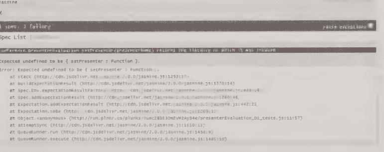

图 15-1

让测试通过是一个简单的修复；你只需要添加一行。列表 15-3 说明了这一点。

# 列表 15-3：带有链式 `setPresenter` 函数的演讲者模块（代码文件名：Chaining/presentEvaluation_02.js）

```javascript

var Conference = Conference || {};

Conference.presentEvaluation = function() {

  'use strict';

  return {

    // 设置此评估所属的演讲者姓名。返回

    // 被调用的评估实例，使其成为链式。

    setPresenter: function presenter(presenterName) {

      return this;

    }

  };

}

```

图 15-2 显示单元测试现在通过了。

Jasmine 

```javascript

conference.presenterEvaluation

setPresenter(presenterName)

返回被调用的实例

```

# 图 15-2

15-3 中一个简单的 `return this;` 语句是使 `setPresenter` 方法变为链式的全部要求。对于额外的链式方法（如 `setPresentation`），可以这样附加：

```javascript

var evaluation = Conference.presenterEvaluation()

  .setPresenter("Seth Richards")

  .setPresentation("Reliable JavaScript");

```

一个仅返回被调用对象的方法提供的价值有限。为了完善 `setPresenter` 的功能，你需要添加一个测试来验证实例存储了名称，如 15-4 所示。

列表 15-4：确保演讲者姓名已存储（代码文件名：Chaining-presentEvaluation_03_tests.js）

```javascript

describe("Conference.presenterEvaluation", function() {

  'use strict';

  var evaluation;

  beforeEach(function() {

    evaluation = Conference.presenterEvaluation();

  });

  describe("setPresenter(presentName)", function() {

    it("返回被调用的实例", function() {

      expect(evaluation.setPresenter("Presenter Name")).toBe(evaluation);

    });

    it("存储演讲者姓名", function() {

      var name = "Meg Ryan";

      evaluation.setPresenter(name);

      expect(evaluation.getPresenter()).toEqual(name);

    });

  });

});

```

15-4 中引入的新测试使用了尚未定义的函数 `getPresenter` 来检索存储在评估实例中的名称。`presenterEvaluation` 模块将定义 getter/setter 对，以保护存储字段免受直接操作。

新测试中说明的链式方法的一个方面是它们并不非链式调用。在新测试例中，调用了 `evaluation setPresenter(name)` 并忽略了它的返回值。此外，没有对该调用执行其他函数。链式调用是一个选项，而不是要求。

失败的单元测试如图 15-3 所示。

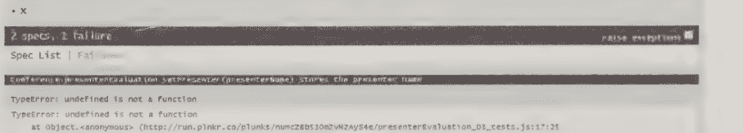

# 图 15-3

列表 15-5 为 `presenterEvaluation` 模块增加了 `getPresenter`，并完成了 `setPresenter` 的功能。

```javascript

var Conference = Conference || {};

Conference.presenterEvaluation = function() {

  'use strict';

  var presenter = "";

  return {

    // 设置此评估所属的演讲者姓名。返回

    // 被调用的评估实例，使其成为链式。

    setPresenter: function setPresenter(presenterName) {

      presenter = presenterName;

      return this;

    },

    // 返回此评估所属的演讲者姓名

    getPresenter: function() {

      return presenter;

    }

  };

}

```


```javascript

getPresenter: function getPresenter() {

  return presenter;

};

```

如图 15-4 所示，单元测试现在都通过了。

Jasmine

```

Conference.presentEvaluation

setPresenter(presenterName)

返回调用该方法的实例

存储宣稿者名称

```

# 图 15-4

此时，你已经实现了六个链式设置器（setter）方法之一，`presenterEvaluation` 模块需要这些方法在评估后存储每项数据。虽然数据验证和校验等细节在不同的 setter 之间会有不同，但每个函数都需要返回 `this`。因此，每个函数都应该有一个测试来验证它是否正确返回。

为每个方法编写单独的测试将涉及大量的重复。使测试符合 DRY（不要重复）原则的方法是引入单一测试，验证所有链式方法都返回了 `this`。这样的测试出现在列表 15-6 中。

+ 列表 15-6：验证所有 setter 都是链式的单个测试（代码文件名: Chaining/presentEvaluation_04_tests.js）

```javascript

describe("Conference.presentEvaluation", function() {

  'use strict';

var evaluation;

beforeEach(function() {

  evaluation = Conference.presentEvaluation();

});

describe("poses chainable setter functions", function() {

  it("return the instance on which the setter was invoked", function() {

  // 创建一个包含有效调用（通过数据

  // 验证等）的数组，其中每个应该是

  // 链式的函数。

  var validCalls = [

    function(ev) { return ev.setPresenter("presenter name"); },

    function(ev) { return ev.setPresentation("presentation name"); }

  ];

  // 确保 validCalls 中的每个函数都返回

// 列表 15-6 (续)

// evaluation，使其可链式调用。

validCalls.forEach(function ensureReturnsThis(fcn) {

  expect(fcn(evaluation)).toBe(evaluation);

});

});

});

describe("setPresenter(presenterName)", function() {

  it("stores the presenter name", function() {

    var name = "Meg Ryan";

    evaluation.setPresenter(name);

    expect(evaluation.getPresenter()).toEqual(name);

});

});

```

新测试构建了一个函数数组 `validCalls`。`validCalls` 中的每个函数都调用由 `presenterEvaluation` 暴露的 setter 函数，并返回该 setter 返回的值。然后，测试调用 `validCalls` 中的每个函数，并确保返回的值是调用该函数的对象 `evaluation`。

当每种支持链式调用的 setter 方法添加到 `presenterEvaluation` 时，`validCalls` 中也会添加相应的条目以验证该项能力。

请注意，用于验证 `setPresenter` 链式能力的原始测试已被移除。新测试提供了验证。此外，注意到 `validCalls` 数组中添加了一个尚未定义的函数 `setPresentation` 的条目。

新测试失败了，如图 15-5 所示，因为 `setPresentation` 尚未实现。

| Jasmine 2.0.0 | 在 0.0.0 中特性 |
|---|---|
| Spy, Jasmine, Jasmine | 预期值 |
| **Spec List** | |
| Conference: presenterEvaluation 暴露了返回注入 spy 的实例的链式函数 | |

# 图 15-5

列表 15-7 提供了 `presentEvaluation` 的更新实现，它包含了 `setPresentation` 的最小实现，使得列表 15-6 中的单元测试能够通过。

# 列表 15-7：使 `setPresentation` 可链式的最小实现（代码文件名: Chaining/presentEvaluation_04.js）

```javascript

var Conference = Conference || {};

Conference.presenterEvaluation = function(){

  'use strict';

  var presenter = "";

  return{

    // 设置此评估所属的宣稿者名称。

    // 调用它的评估实例，使其可链式。

    setPresenter: function setPresenter(presenterName) {

      presenter = presenterName;

      return this;

    },

    // 返回此评估所属的宣稿者名称

    getPresenter: function getPresenter(){

      return presenter;

    },

    // 设置此评估所属的演示名称。

    // 调用它的评估实例，使其可链式。

    setPresentation: function setPresentation(presenterName) {

      return this;

    }

  };

```

再次，`setPresentation` 中的 `return this;` 语句是使其可链式的全部要求。
现在 `setPresentation` 已经定义并返回了调用它的对象，新的单元测试通过了。你可以在图 15-6 中看到这一点。

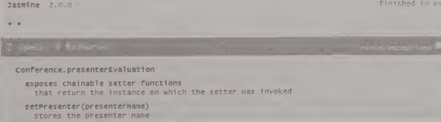

图 15-6

# 链式调用

在章的开头，我们提到一个方法在返回 `this` 时就变成了可链式的。当返回 `this` 时，可以调用同一对象上的多个方法。你在创建 `presenterEvaluation` 模块时利用了这种行为：返回 `this` 允许链式方法在模块的单个实例上设置属性。

我们还提到 Promise 的方法是可链式的。第 6 章的示例显示了 `checkService.checkIn` 方法，它返回一个 Promise。返回的 Promise 立即与两个方法链式连接：

```javascript

checkService.checkIn(attendee)

  .then(

    function onCheckInResolved(checkNumber) {

      // 打印徽章并返回其数字。

      return badgePrintingService.print(checkNumber);

    })

  .then(

    function onBadgeResolved(badgeNumber) {

      return doorPrizeEnteringService.enter(attendee, badgeNumber);

    });

```

`onCheckInResolved` 或 `onBadgeResolved` 都没有返回 `this`，因此假设 `then` 方法正在执行某些操作，以确保额外的方法可以链式调用。

也许 `then` 方法正在操作由 `checkService.checkin` 创建并返回的原始 Promise。该假设可以通过稍微微调示例来测试：

```javascript

var originalPromise = checkService.checkIn(attendee)

var firstThen = originalPromise.then(

  function onCheckInResolved(checkNumber) {

    // 打印徽章并返回其数字。

    return badgePrintingService.print(checkNumber);

  })

var secondThen = firstThen.then(

  function onBadgeResolved(badgeNumber) {

    return doorPrizeEnteringService.enter(attendee, badgeNumber);

  });

console.log(firstThen instanceof Promise); // true

console.log(secondThen instanceof Promise); // true

console.log(firstThen === originalPromise); // false

console.log(secondThen === firstThen); // false

```

很明显，`then` 方法返回的是 Promise 对象，它们并没有返回原始 promise。如果每个 `then` 调用都返回原始 promise，那么比较 promise 的语句将导致 `true` 而不是 `false`。

Mozilla Developer Network 为 ECMAScript 6 指定 Promise 提供了一个极好的资源，位于 https://developer.mozilla.org/en-US/docs/Web/JavaScript/Reference/Global_Objects/Promise。该页面的以下节录描述了 `then` 方法在后台做了什么。

向 promise 添加成功和拒绝处理程序，并返回一个新的 promise，该 promise 解析为被调用处理程序的返回值。

—Mozilla Developer Network（已添加强调）

文档证实了测试所演示的内容：`then` 函数返回一个新的新的 Promise；它没有返回原始 Promise。然而，`then` 函数确实向原始 Promise 添加了成功和拒绝处理程序，以便它们在原始 Promise 解析时能够执行。

这意味着，方法并不是为了为了可链式调用而返回 `this`；它们也可以返回一个与 `this` 类型相同的新对象。

> 注意 一个返回与调用它的对象类型相同的新对象的函数是可链式的。

返回新实例以支持链式调用对于 Promise 来说是合适的，但对于 `presenterEvaluation` 模块的 setter 方法来说是不合适的。setter 的意图是修改、改变被调用的 `presenterEvaluation` 实例所包含的值。使用 setter 的开发者如果发现每个 setter 都返回 `presenterEvaluation` 的新实例，而不是改变它们被调用的实例，可能会感到很惊讶。

## 总结

在本章中，你看到了链式方法如何将你的 JavaScript 代码部分从臃肿和重复转变为流畅和简洁。你使用测试驱动开发实现了两个链式函数。

要测试链式调用，通常只需确保函数返回了 `this` 就足够了。然而，正如 Promise 的 `then` 函数所示，链式函数并不总是返回 `this`。在那些情况下，有必要测试返回的对象是否具有正确的类型。

下一章关于接口——这是 JavaScript 并不具备的特性。那一章在本书中起什么作用呢？读读它就知道了。


# 第三部分
使用高级 JavaScript 特性进行测试与编写

- 第 16 章：在无接口的语言中遵循接口
- 第 17 章：确保参数类型正确
- 第 18 章：确保 call、apply 和 bind 的正确使用
- 第 19 章：确保方法借用（Method-Borrowing）的正确使用
- 第 20 章：确保混入（Mixins）的正确使用
- 第 21 章：测试高级程序架构

# 16
在无接口的语言中遵循接口

本章内容

- 理解其他语言中接口的优势
- 在 JavaScript 中获取接口的优势
- 通过接口分离原则简化对象的使用
- 创建一个可以定义并强制执行接口的注册表

本章的 WROX.COM 代码下载

本章对应的 wrox.com 代码下载可以在 www.wrox.com/reliablejavascript 的“Download Code”选项卡中找到。文件位于“Chapter 16 downloads”目录中，并根据本章注的文件名单独命名。

在 2014 年的一个 Google 业务产品广告（https://www.youtube.com/watch?v=bAOOHnnll0e）中，一场视�会议刚刚结束：

> Google 员工：好，我们没问题。我想这样就结束了。那么……
> 1 号女性：太好了。我会发一封跟进邮件。
> Google 员工：我不觉得……没什么需要跟进的，所以我……
> 2 号女性：嗯，我觉得我们应该重聚一下。
> Google 员工：我们已经重聚了。这就是在重聚。
> 1 号男性：酷。我等会儿会滴你（ping）。
> Google 员工：你现在就在滴我了。你有什么事要滴滴的？
> 2 号男性：下一步计划？

> Google 员工：没有下一步计划了。我们刚刚解决了它们。
> 3 号男性：哈，好吧……

一个 JavaScript 程序员与 C# 或 Java 程序员之间的对话可能也是如此。JavaScript 程序员随手堆砌了一些对象，而 C# 或 Java 开发者则坚持认为：“你不能这样做！如果没有一些接口来描述对象，程序将会崩溃。” JavaScript 开发者说：“不，没有下一步计划。我们刚刚解决了问题。”

然而，任何在超过一个人的团队工作的 JavaScript 程序员都必须避免误会的发生。一个以前被调用 `makeWidget` 的成员函数被重命名为 `make`，导致下游代码崩溃。对象字量量的变量命名为单数 `objectID`，但有人却在里面放入了一个对象 ID 数组。（这很难置信，但我们确实见过。）

强类型语言尽力在编译时捕获这些误解，通常是通过使用接口实现的。什么是接口？为什么这些语言的程序员认为它们是值得的？

# 理解接口的优势

接口描述了一个类，但没有包含可执行的代码。列表 16-1 显示了 C# 中的一个接口。

列表 16-1：一个 C# 接口

```javascript

public interface IDoThings

{

    void ThingOne();

    int ThingTwo();

}

```

定义了该接口后，类就可以继承它，从而承诺实现它，如列表 16-2 所示。

列表 16-2：实现接口的 C# 类

```javascript

public class DoThings : IDoThings

{

    public void ThingOne()

    {

        // 函数体

    }

    public int ThingTwo()

    {

        // 函数体

    }

}

```

如果类未能实现接口中定义的所有内容，编译器将抛出错误。

对于 JavaScript 程序员来说，这可能看起来非常麻烦。你把所有都写了两遍：一次在接口中，一次在类中。事实如此，但这种麻烦并非没有回报。

表面的优势是，接口让类的使用者可以预期的内容，以及相似类的程序员实现的内容变得明确。

接口还充当了某种双式记账法。如果实现与接口不平衡，编译器会通知你。

在更深层次的上，接口为软件工程师开启了全新的可能性，使其能够更优雅地解决问题。你在第 13 章中遇到的策略模式（Strategy Pattern）就是一个例子。当在强类型语言中实现时，每个算法都实现一个共同接口。不需要工厂方法来创建所选算法；依赖注入软件可以在运行时连接到所需的算法。

每当你在本书书的单元测试中编写 Jasmine 间谍器（spy）时，你都使用了接口哲学，即间谍器实现了与真实对象相同的接口。当然，在 JavaScript 中接口只是隐式的，但在强类型语言中，它是显式的，因此更加可靠。

你在第 1 章中学到的 SOLID 设计五大支柱，有三个是面向接口的。里氏夫替换原则（SOLID 中的 L）规定所有接口的实实现者都应该遵循相同的语义。依赖倒转原则（D）让类的使用者“拥有”从类继承的接口。接口分离原则（I）是下一节的主题。

# 理解接口分离原则

尽管你可能努力使类保持内聚性且尽可能不要过大，但有时一个类的使用者只需要其一小部分能力。

例如，考虑第 6 章中的 `attendee` 对象，在此处重现为列表 16-3。

列表 16-3：attendee.js

```javascript

var Conference = Conference || {};

Conference.attendee = function(firstName, lastName) {

  'use strict';

  var attendee,

  checkedIn = false,

  first = firstName || 'None',

  last = lastName || 'None',

  checkInMemory;

  return {

    setId: function(id) {

      attendeeId = id;

    },

    getId: function() {

      return attendeeId;

    },

    getFullName: function() {

      return first + ' ' + last;

    },

    isCheckedIn: function() {

      return checkedIn;

    },

    checkIn: function() {

      checkedIn = true;

    },

    undoCheckIn: function() {

      checkedIn = false;

    }

  };

};

```

现在假设其他模块中的多个函数接收 `attendee` 对象作为参数。进一步假设你想更改 `fullName` 方法。其他模块中的函数显示接收了 `attendee` 参数（假设参数命名良好），但你没有简单的方法知道哪些函数会受到影响，你可以搜索“fullName”但只能找到对象中的方法。

这就是接口分离原则旨在解决的问题之一。消费函数与其使用 `attendee` 参数，可以使用 `attendeePersonalInfo` 或 `attendeeCheckManagement` 参数。这样，一眼就能看出哪些函数会影响。

此外，如果你为了单元测试需要模拟参数或注入另一个对象版本，你能够为你所需的 `attendee` 划定更紧密的边界。

最后，一个真正关心 `attendee` 部分的开发者只需要掌握那个微小的 API。一个合理分离的接口会让他的生活变得轻松。

这些优势在强类型语言中是强制性的，但如果你愿意跳出框架编程，在 JavaScript 中也完全可行。

在下一节中，你将构建一个可以定义并强制执行接口的模块。该模块被称为 `contractRegistry`，是因为接口作为定义功能的模块和消费它的模块之间的合约，而且在下一章中你会将 `contractRegistry` 的功能用于某些并非严格相关的用途。

# 使用测试驱动开发创建注册表

在本章开发的注册表将具有以下功能，并按顺序开发：

- 定义合约（接口）。
- 告知对象是否符合合约。
- 断言对象符合合约，如果不符合则抛出错误。
- 关闭所有合约执行，以便你的程序在生产环境中运行得更快。
- 为对象添加切面以强制执行合约。（具体来说，这意味着为创建对象的函数添加一个切面，以检查其返回值）。

图 16-1 预示了你将实现的通过测试。

## 定义合约

合约定义由一个合约名称和一个可以评估对象并根据对象是否符合合约返回 true 或 false 的函数组成。因此，`define` 方法具有以下签名：

```javascript

function define(contractName, evaluator)

```


## Jasmine

```javascript

contractRegistry

  define(contractName, evaluator)

    throws if contractName is not a string

    throws if evaluator is not a function

    does not throw if contractName is a string and evaluator is a function

  fills(contractName,obj)

    throws if contractName is not in the registry

    returns true if the object fulfils the named contract

    returns false if the object does not fulfill the contract

  assert(contractName,obj)

    is based on fulfills(contractName,obj)

    does not throw if obj fulfils contractName

    throws if obj does not fulfill contractName

  attachReturnvalidator(funcName,funcObj,contractName)

    own argument validation

    throws if funcName is not a string

    throws if funcObj is not an object

    throws if contractName is not a string

    aspect functionality returns the return value if it fulfils the contract

    throws if the return value does not fulfill the contract

```

图 16-1

顺便说，让一个评估函数充当“接口”，与其他语言将接口视为静态数据的概念有很大不同。这不仅是必要的，而且是欢迎的。之所以必要，是因为 JavaScript 没有内置方法来评估对接口的遵循情况，而你必须选择一个地方。之所以被欢迎，是因为函数能做的事情比任何面向数据的、接口描述语言所能做的得多。此外，当函数作为一个第一等对象一起运行时，这种感觉很棒，JavaScript 不是是吗？

在经历了几章的测试驱动开发之后，没有必要详细阐述创建这种方法的每一步。列表 16-5 显示了它的测试。

列表 16-5：`define` 方法的单元测试（代码文件名：Interfaces\contractRegistry_01_tests.js）

```javascript

describe('contractRegistry', function() {

  'use strict';

```

## 使用测试驱动开发创建合约注册表

var registry;

```javascript

beforeEach(function() {

  registry = ReliableJavaScript.contractRegistry();

});

describe('define (contractName,evaluator)', function() {

  it('throws if contractName is not a string',function() {

    expect(function() {

      registry.define(undefined,function() { });

    }).toThrow(new Error(registry.messages.nameMustBeString));

  });

  it('throws if evaluator is not a function',function() {

    expect(function() {

      registry.define('myContract','not a function');

    }).toThrow(new Error(registry.messages.evaluatorMustBeFunction));

  });

  it('does not throw if contractName is a string and evaluator is a function', function() {

    expect(function() {

      registry.define('myContract',function() { });

    }).not.toThrow();

  });

});

```

如往常一样，测试驱动开发始于错误条件。除此之外，当 `define` 是对象中唯一的方法时，你没有什么可以测试的。你无法测试它是否定了任何内容。然而，在处理 `fulfills` 方法（下一个）之前，你进展并不顺利。尽管如此，你还是先于测试，只编写使测试通过所必需的代码。结果就是列表 16-6。

列表 16-6：`define` 方法的实现（代码文件名：Interfaces\contractRegistry_01.js）

```javascript

var ReliableJavaScript = ReliableJavaScript || {};

ReliableJavaScript.contractRegistry = function () {

  'use strict';

  return {

    define: function define(contractName, evaluator) {

      if (typeof contractName !== 'string') {

        throw new Error(this.messages.nameMustBeString);

      }

      if (typeof evaluator !== 'function') {

        throw new Error(this.messages.evaluatorMustBeFunction);

      }

    }

  };

  messages: {

```

### 列表 16-6（续）

```javascript

    nameMustString: 'The contract name must be a string',

    evaluatorMustBeFunction: 'The evaluator must be a function',

  }

};

```

测试通过了，如图 16-2 所示。

```javascript

Jasmine

***

spec: 0 failures

contractRegistry

define(contractName, evaluator)

  throws if contractName is not a string

  throws if evaluator is not a function

  does not throw if contractName is a string and evaluator is a function

```

图 16-2

## 判断合约是否被遵循

`fulfills` 方法看起来如下：

```javascript

function fulfills(contractName, obj)

```

如果 `obj` 遵循了命定的合约，它将返回 `true`，否则返回 `false`。在在此之前，你首先测试明显的错误条件：命定的合约不在注册表中（参见列表 16-7）。

# 列表 16-7：`fulfills` 方法的首次测试（代码文件名：Interfaces\contractRegistry_02_tests.js（节选））

```javascript

describe('fulfills(contractName, obj)', function() {

  it('throws if contractName is not in the registry', function() {

    expect(function() {

      registry.fulfills(contractName, {}));

    }).toThrow(new Error(

      registry.getMessageForNameNotRegistered(contractName)));

    });

    [undefined, 'abc'].forEach(expectThrow);

  });

});

```

在之前的章节中，暴露对象的错误消息如何允许单元测试验证精确的错误。有时，错误消息包含变量数据。为了保持 DRY（不重复原则），在消息中整合变量数据的步骤被放在一个函数中。

在之前的章节中，暴露对象的错误消息允单元测试验证精确的错误。有时，错误消息包含变量数据。为了保持 DRY，在消息中整合变量数据的步骤被放在一个函数中。

你可以通过（参见图 16-3）使用列表 16-8 来进行测试。

列表 16-8：合约未注册（代码文件名：Interfaces\contractRegistry_02.js）

```javascript

var ReliableJavaScript = ReliableJavaScript || {};

ReliableJavaScript.contractRegistry = function () {

  'use strict';

  var registry = {};

  return {

    define: function define(contractName, evaluator) {

      /** Argument-checking omitted for clarity. */,

    },

    fulfills: function fulfills(contractName, obj) {

      if (!registry[contractName]) {

        throw new Error(this.getMessageForNameNotRegistered(contractName));

      }

    },

    messages: {

      nameMustString: 'The contract name must be a string',

      evaluatorMustBeFunction: 'The evaluator must be a function',

      nameBeRegistered: 'The contract _ is not in the registry',

    },

    getMessageForNameNotRegistered: function(contractName) {

      return this.messages.nameBeRegistered.replace('_', contractName);

    }

  };

};

```

测试验证了 `fulfills` 返回 `true` 或 `false`。它们使用了 `isArray` 变量。

列表 16-9：根据合约是否遵循返回 true 或 false（代码文件名：Interfaces\contractRegistry_03_tests.js）

```javascript

describe('contractRegistry', function() {

  'use strict';

  var registry,

  isArray = 'isArray',

  ary = [1,2,3];

  beforeEach(function() {

    registry = ReliableJavaScript.contractRegistry();

    registry.define(isArray, Array.isArray);

  });

  describe('define(contractName,evaluator)', function() {

    /** Argument-checking omitted for clarity. */,

  });

  describe('fulfills(contractName, obj)', function() {

    it('returns true if the object fulfils the named contract',function() {

      expect(registry.fulfills(isArray,ary)).toBe(true);

    });

    it('returns false if the object does not fulfill the contract',function() {

      expect(registry.fulfills(isArray,'not an array')).toBe(false);

    });

  });

});

```

测试处于各种痛苦之中（参见图 16-4），当你使用早先安装的 `registry` 对象在 `define` 和 `fulfills` 中仅添加一行代码时，它们立即被修复了（参见图 16-5）。工作的代码出现在列表 16-10。

# 列表 16-10：完成 define 方法（代码文件名：Interfaces\contractRegistry_03_js）

```javascript

var ReliableJavaScript = ReliableJavaScript || {};

ReliableJavaScript.contractRegistry = function () {

  'use strict';

  var registry = {};

  return {

    define: function define(contractName, evaluator) {

      registry[contractName] = evaluator;

    },

    fulfills: function fulfills(contractName, obj) {

      if (!registry[contractName]) {

        throw new Error(this.getMessageForNameNotRegistered(contractName));

      }

      return registry[contractName](obj);

    },

    // ... rest of the implementation

  };

};

```


```javascript

define: function define(contractName, evaluator) {

  // *** 省略参数检查。 ***

  registry[contractName] = evaluator;

}

fulfills: function fulfills(contractName, obj) {

  // *** 省略参数检查。 ***

  return registry[contractName](obj);

}

  // *** 略 ***

};

```

# Jasmine 2.0.0 完成

+ * * * * X

# 6 个用例，Z 个失败抛出异常

| 用例列表 | 失败原因 |
| :--- | :--- |
| contractRegistry fulfills(contractName, obj) 如果对象符合命定的契约则返回 true | Error: The contract 'isArray' 不在注册表中<br>Error: The contract 'isArray' 不在注册表中<br>At Object.fulfills (http://run.plnkr.co/p6f0sz83w0WzQrto/contractRegistry_02.js: )<br>At Object.<anonymous> (http://cdn.plnkr.co/p6f0sz83w0WzQrto/contractRegistry_02.js:03_t)<br>At attemptSync (http://cdn.jsdelivr.net/jasmine/2.0.0/jasmine.js:1510:12)<br>At QueueRunner.run (http://cdn.jsdelivr.net/jasmine/2.0.0/jasmine.js:1498:9)<br>At QueueRunner.execute (http://cdn.jsdelivr.net/jasmine/2.0.0/jasmine.js:1485:10)<br>At Spec.Env.queueRunner (http://cdn.jsdelivr.net/jasmine/2.0.0/jasmine.js:1510:12)<br>At Spec.execute (http://cdn.jsdelivr.net/jasmine/2.0.0/jasmine.js:306:10)<br>At Object.<anonymous> (http://cdn.jsdelivr.net/jasmine/2.0.0/jasmine.js:1708:37)<br>At attemptAsync (http://cdn.jsdelivr.net/jasmine/2.0.0/jasmine.js:1520:12)<br>At QueueRunner.run (http://cdn.jsdelivr.net/jasmine/2.0.0/jasmine.js:1496:16) |
| contractRegistry fulfills(contractName, obj) 如果对象不符合契约则返回 false | Error: The contract 'isArray' 不在注册表中 |

图 16-4

本节顶部的第 1 和第 2 部分已经完成。接下来，拥有一个方法来断言契约是否符合，如果不符合则抛出错误将很有用。

# 第 16 章 在无接口语言中遵循接口

Jasmine 2.0.0 完成

```javascript

contractRegistry

def(contractName, evaluator)

如果 contractName 不是字符串则抛出

如果 evaluator 不是函数则抛出

如果 contractName 是字符串且 evaluator 是函数则不抛出

fulfills(contractName,obj)

如果 contractName 不在注册表中抛出

如果对象符合命定的契约则返回 true

如果对象不符合契约则返回 false

```

图 16-5

# 断言契约是否符合

`assert` 方法与 `fulfills` 类似：
```javascript

function assert(contractName, obj)

```

它应该使用 `fulfills` 方法来确定契约是否符合，而不是重复代码。该测试确保了你已经在 `fulfills` 中放入的参数检查会被带入 `assert`。这是 16-11 的第一个列表。另外两个验证了 `assert` 的核心功能。

> 列表 16-11：测试 `assert` 方法（文件名: Interfaces\contractRegistry_04_tests.js [片段]）

```javascript

describe('assert(contractName,obj)', function() {

  it('基于 fulfils(contractName,obj)', function() {

    spyOn(registry, 'fulfills').and.callThrough();

    registry.assert(isArray);

    expect(registry.fulfills).toHaveBeenCalledWith(isArray);

  });

  it('如果 obj 符合 则 则不抛异常', function() {

    registry.assert(isArray);

  });

  it('如果 obj 不符合 contractName 则抛出异常', function() {

    var notArray = 'abc';

    expect(function() {

      registry.assert(isArray,notArray);

    }).toThrow(new Error(

      registry.getMessageForFailedContract(isArray,notArray));

    );

  });

});

```

只需几行代码即可通过测试，如列表 16-12 所示。

# 列表 16-12：`assert` 方法（文件名: Interfaces\contractRegistry_04.js）

```javascript

var ReliableJavaScript = ReliableJavaScript || {};

ReliableJavaScript.contractRegistry = function() {

  'use strict';

  var registry = {};

  return {

    *** 省略 define 和 fulfill 方法 ***

    assert: function assert(contractName, obj) {

      if (this.fulfills(contractName, obj)) {

        throw new Error(this.getMessageForFailedContract(contractName, obj));

      }

    },

    messages: {

      *** 其他消息已略 ***

      failedContract: "The following does not fulfill contract '_': "

    },

    *** 略 ***

  };

  getMessageForFailedContract(contractName, obj) {

    return this.messages.failedContract

      .replace('_', contractName) + obj;

  }

};

```

# 绕过契约执行

一旦你的产品通过了 QA，你可能希望关闭所有强制执行，特别是当你的函数耗时时。实现此点最简单、高效的方法是将此类代码放在单独的文件中，并在 QA完成后从发布中排除该文件。

# 创建切面以对返回的对象强制契约

你可以使用目前开发的内容对你创建的任何对象强制契约。例如，你将在下一节看到这方面的示例。列表 16-13

# 16-13：对 attendee 定义并断言契约（文件名: Interfaces/attendee_01.js）

```javascript

var Conference = Conference || {};

Conference.attendee = function(firstName, lastName) {

  'use strict';

  var attendeePersonalInfo = 'attendee.personalInfo',

  attendeeCheckManagement = 'attendee.checkManagement';

function fulfilsPersonalInfo(att) {

  return typeof att.setId === 'function' &&

         typeof att.getId === 'function' &&

         typeof att.getFullName === 'function';

}

function fulfilsCheckIn(att) {

  return typeof att.getId === 'function' &&

         typeof att.isCheckedIn === 'function' &&

         typeof att.checkIn === 'function' &&

         typeof att.undoCheckIn === 'function' &&

         typeof att.setCheckInNumber === 'function' &&

         typeof att.getCheckInNumber === 'function';

}

registry.define(attendeePersonalInfo, fulfilsPersonalInfo);

registry.define(attendeeCheckManagement, fulfilsCheckInManagement);

var attendeeId;

var ret = {

  setId: function(id) {

    attendeeId = id;

  },

  getId: function() {

    return attendeeId;

  },

  *** 其他方法已略 ***

};

registry.assert(attendeePersonalInfo, ret);

registry.assert(attendeeCheckManagement, ret);

return ret;

// 使用示例

var registry = ReliableJavaScript.contractRegistry();

var a = Conference.attendee('Rock', 'Star', registry); // 不抛出异常

```

# 使用测试驱动开发创建契约注册

即将开发的 `attachReturnValidator` 方法将创建一个对象的函数附加一个切面，该对象应该符合某个接口。它看起来如下：

```javascript

function attachReturnValidator(funcName, funcObj, contractName)

```

列表 16-6 显示了没有注入或使用注册表的 attendee 模块如何通过切面附加 `attachReturnValidator` 来进行修改。这种修改是通过单独的文件 attendee.js 完成的，该文件不会包含在生产环境中。

# 16-14：使用切面对 attendee 断言契约（文件名: AttendeeContracts.js）

```javascript

var Conference = Conference || {};

// 调用此函数以安装切面，验证

// 通过 Conference.attendee(firstName, lastName) 创建的 attendee

// 是有效的。

Conference.attendeeContracts = function attendeeContracts(registry) {

  'use strict';

  var attendeePersonalInfo = 'attendee.personalInfo',

  attendeeCheckManagement = 'attendee.checkManagement';

  function fulfilsPersonalInfo(att) {

    return typeof att.setId === 'function' &&

           typeof att.getId === 'function' &&

           typeof att.getFullName === 'function';

  }

  function fulfilsCheckInManagement(att) {

    return typeof att.getId === 'function' &&

           typeof att.isCheckedIn === 'function' &&

           typeof att.checkIn === 'function' &&

           typeof att.undoCheckIn === 'function' &&

           typeof att.setCheckInNumber === 'function' &&

           typeof att.getCheckInNumber === 'function';

  }

  registry.define(attendeePersonalInfo, fulfilsPersonalInfo);

  registry.define(attendeeCheckManagement, fulfilsCheckInManagement);

  var attendeeId;

  var ret = {

    setId: function(id) {

      attendeeId = id;

    },

    getId: function() {

      return attendeeId;

    },

    getFullName: function() {

      return firstName + " " + lastName;

    }

  };

  registry.assert(attendeePersonalInfo, ret);

  registry.assert(attendeeCheckManagement, ret);

  return ret;

};

```

attendee *.*
```

## 列表 16-14（续）

```
););
// 示例：
// 在应用启动时，实例化注册表并挂载切面。
var registry = ReliableJavaScript.contractRegistry();
Conference.attendeeContracts(registry);
// 之后是其他模块的切面安装。
```

```javascript
// 随后，当创建一个参与者时，切面将确保
// 它是有效的。
var a = Conference.attendee('Rock','Star'); // 不抛出异常。
```

> 注意：列表 16-14 底部调用 attendeeContracts 的示例代码只是为了给您一个大致的概念。更整洁的过程将在第 17 章中开发。

现在来开发本章使用的 `attachRegistry_tests.js` 下载，其中包含了错误检查测试。更有趣的是对切面功能的测试（参见列表 16-15）。

## 列表 16-15：返回值的检查切面的测试（代码文件名：Interfaces\registry_tests.js [片段]）

```javascript
describe('attachAttendeeValidator(funcName, funcObj, contractName)', function() {
  var funcName = 'func',
  funcObj,
  returnValue = [1,2,3];

beforeEach(function() {
    funcObj = {};
    funcObj[funcName] = function() {
      return returnValue;
    }
  });
```

```javascript
describe('aspect functionality', function() {
  it('如果符合契约，则返回返回值',function() {
    registry.attachAttendeeValidator(funcName, funcObj, isArray);
    expect(funcObj[funcName]()).toEqual(returnValue);
  });
```


```javascript
it('如果返回值不符合契约，则抛出异常', function() {
    var isNumber = 'isNumber';
    registry.define(isNumber, function isNumber(ret) {
      return typeof ret === 'number'
```

使用测试驱动开发创建契约注册表

```javascript
}};
registry.attachReturnValidator(functionName, funcObj, isNumber);
expect(function() {
  funcObj[functionName]();
}).toThrow(new Error(
  registry.getMessageForFailedContract(isNumber,returnValue)
));
});
});
});
```

测试使用了一个对象 `funcObj` 及其名为 `funcName` 的方法，这些方法是在 `beforeEach` 中设置的。调用 `funcObj[functionName]()` 返回一个数组（`returnValue`），因此符合在测试模块顶部定义的 `Array.isArray` 评估，你已经见过它。

第一个测试是简单的。在将切面应用到目标函数后，它验证了通过切面调用目标返回的值完好无损。

在第二个测试中，挂载了一个不同的返回验证器——它期望返回值为数字。当返回值结果是一个数组时，切面应该抛出一个错误。

跳过你非常熟悉的 TDD 步骤，列表 16-6 显示了完整的 `attachReturnValidator` 函数。在经过一些参数检查后，它使用第 2 章引入的 `Aop.around` 方法来捕获目标函数的返回值，断言其符合契约，并返回它。

- 列表 16-6：`attachReturnValidator` 方法（代码文件名）：Interfaces\contractRegistry.js（片段）

```javascript
attachReturnValidator: function attachReturnValidator(
functionName, funcObj, contractName) {
  var self = this;
  if (typeof functionName !== 'string') {
    throw new Error(self.messages.funcNameMustBeString);
  }
  if (typeof funcObj !== 'object') {
    throw new Error(self.messages.funcObjMustBeObject);
  }
  if (typeof contractName !== 'string') {
    throw new Error(self.messages.nameMustBeString);
  }

Aop.around(functionName,
function(targetInfo) {
  var ret = Aop.next(targetInfo);
  self.assert(contractName,ret);
  return ret;
},
funcObj);
```

完整的 `contractRegistry` 允许你对新创建的对象进行任何所需的断言，无论是作为切面（参见列表 16-14），还是在对象代码本身（参见列表 16-13）。

如果你更倾向于面向切面的方法，你可能希望回顾第 3 章中的模块模式和函数式继承，因为这两种对象创建模式都是切面友好的。

## 总结：

接口（Interfaces）是强类型语言的核心，为 JavaScript 程序员可能暗中希望拥有的好处。这些包括：

- 明确类的消费者可以期望什么

- 检测对类语义的非意愿更改

- 实现优雅的设计模式，使你的代码更具活性且健壮

接口隔离原则（Interface Segregation Principle）进一步简化了对象消费者的工作，并帮助对象的开发者确定任何更改的影响范围。

在本章中，你学习了 `contractRegistry` 的开发，这是一个可以以 JavaScript 风格定义并强制执行接口的对象。

下一章将更进一步，使用 `contractRegistry` 来验证传递给函数的参数。当输入和输出都受到契约的保护时，你已经在创建可靠的 JavaScript 方面迈出了重要的一步。

## 17

## 确保正确的参数类型

本章内容包括？

- 扩展第 16 章的 `ContractRegistry` 以处理参数验验证

- 将新功能封装在切面中

- 创建契约库并导入它们

（注：此处原文存在大量重复列表，已按要求保留格式）

## 17

## 确保正确的参数类型

***

（注：此处原文存在大量重复列表，已按要求保留格式）

***

JavaScript 是这种语言完全恰当的。

有时，创业者会取得巨大成功并决定成为风险投资家。在那个世界里，具有创造力并对机会有敏锐眼光已经是不够的。你越来越多地依赖数据。契约取代了握手。

这就是 JavaScript 被提升的地位。当被要求管理更大、更复杂的系统时，它需要获得风险投资家的纪律，同时保持创业者的创造力：抓住管理风险的机会。

### 理解 JavaScript 无类型参数所带来的机遇和风险

用强类型语言编写的应用程序将其代码中惊人的比例用于管理这些类型。类通过接口描述。数据库表被映射到实体类型。服务通过数据契约得到保证。数据通过传输对象从这里传到那里。这累积了大量的开销。

JavaScript 凭借其几乎无类型的语义，为简洁和优雅提供了绝佳的机会。

遗憾的是，虽然代码通常意味着更少的错误，但在这种，被丢弃的代码正是那些原本防止错误的代码！

特别关注的是函数的参数和返回值。这些是一个开发者代码另一个开发者代码之间的边界。因此，它们代表了误解和错误的特别易发区域。

> 注意：参数和返回值是一个开发者代码另一个开发者代码之间的边界。这使得它们面临误解和错误的高风险。

## 扩展 CONTRACTREGISTRY 以检查参数

上一章是这种方法的开始。你如何创建一个 `ContractRegistry` 来验证返回值，并确保它符合你感兴趣的任何标准？现在，你将看到检查参数是否符合预期。

第 16 章的 `contractRegistry` 使用了

# 扩展 ContractRegistry 以检查参数 | 291

对象是通过 `new` 关键字创建的，其大多数方法都在原型上，而不是在构造函数中声明的。这让你能够比较同一个思想在“按需模块”（module-at-will）和“`new`”范式中是如何分别实现的。例如，查看 `assert` 方法和 `messages` 对象。

# 任务范围划分

上一节中的 `ContractRegistry` 提供了以下函数：

- define: 通过名称定义一个合约

- fulfills: 告知一个对象是否符合某个合约

- assert: 如果对象不符合某个合约，则抛出错误

- attachReturnValidator: 挂载一个切面（aspect），在函数的返回值上调用 `assert`

为了支持参数检查，你将在本章中添加以下函数：

- multipleFulfills: 类似于 `fills`，但针对多个对象和多组合约

- multipleAssert: 类似于 `assert`，但针对多个对象和合约

- attachArgumentsValidator: 给函数挂载一个切面，以断言传入的参数符合预期

最后，还有一个函数对于安装合约库来说将非常方便：

`defineMultiple` 遍历对象数组，并根据每个对象定义一个合约。

# 确定集合中的每个变量是否符合其合约

`multipleFulfills` 方法将是参数验证器的核心。它将有两个参数：一个验证器（validator）和一个需要待验证的参数集：

```javascript
function multipleFulfills(validator, args)
```

`args` 参数可以是任何类数组对象。通常，它是函数的参数。

为了灵活性和方便性，validator 可以是以下任意一种类型：

- 一个字符串，将被解释为通过 `define` 注册的合约名称。在这种情况下，`args` 参数（整个数组）必须符合该合约。

- 一个字符串数组，在这种情况下情况会变得复杂得多。数组中的每个字符串都是用逗号分隔的合约名称序列。如果 `args` 在对应位置上的元素符合它们的合约，`multipleFulfills` 将返回 `true`。如果不是，`multipleFulfills` 将尝试验证器数组中的下一个元素。如果没有更多元素可以尝试，则返回 `false`。换句话说，如果验证器数组中的任何元素包含一组与 `args` 匹配的合约，则认为合约已履行。

- 一个函数，调用时将传入 `args` 并应返回 `true` 或 `false`。这是在字符串或字符串数组不足时提供的兜底方案。

# 292 | 第 17 节确保正确的参数类型

为了将本章的长度限制在合理范围内，应该包含第一部分测试的错误检查被推到了本章的下载内容。列表 17-1 跳到了最简单的正向测试，其中 validator 是实际的验证函数。

LISTING 17-1：为函数验证器测试 multipleFulfills（代码文件名：ContractRegistry_07_tests.js）

```javascript
describe('multipleFulfills(validator, args)', function() {
  describe('when validator is a function', function() {
    var args = ['a', 'b'];

    it('返回对 args 执行的 validator 调用结果', function() {
      function isLength2() {
        return arguments.length === 2;
      }
      function isLength3() {
        return arguments.length === 3;
      }
      expect(registry.multipleFulfills(isLength2, args)).toBe(true);
      expect(registry.multipleFulfills(isLength3, args)).toBe(false);
    });
  });

  it('以 registry 为上下文调用 validator', function() {
    function calledOnRegistry() {
      expect(this).toBe(registry);
      registry.multipleFulfills(calledOnRegistry, args);
    }
  });
});
```

在第一个测试中，validator 的两种可能结果（true 和 false）都经过了测试。仅测试其中一个是不够的。（例如，你如何知道返回的 `true` 只是巧合的呢？）列表 17-2 显示了另一种技术。

正如你将在下一章中读到的，验证通过 `call` 或 `apply` 执行的任何操作的上下文也是非常重要的。这是第二个测试的主题。其实现本身非常简单。

LISTING 17-2：为函数验证器实现 multipleFulfills（代码文件名：JavaScriptRegistry_07_tests.js）

```javascript
ReliableJavaScript.ContractRegistry.prototype.multipleFulfills =
function multipleFulfills(validator, args) {
  var self = this;

  // *** 为了清晰省略了参数验证器 ***

  if (typeof validator === 'function') {
    return validator.apply(self, args);
  }
};
```

次次简单的案例是一个由单个字符串（合约名称）组成的验证器。在接下来的测试（列表 17-3）中，注意不是使用那个奇怪的 `returnFromFills` 变量。这个技巧是同时检查 `true` 和 `false` 情况的替代方案。该测试只想验证 `multipleFulfills` 返回了底层 `fills` 返回的任何内容。从技术上讲，它并没有这样做，也不应该关心类型。说 `returnFromFills` 中的特定值是巧合返回的，这种说法也太是轻淡了，所以这一个值就足够了。

# LISTING 17-3：为字符串验证器测试 multipleFulfills（代码文件名：ParametersContractRegistry_08_tests.js）

```javascript
describe('when validator is a string',function() {
  it('返回 fulfills (validator, args) 的结果', function() {
    var validator ='a',
    args = ['a', 'b'],
    returnFromFills = true;
    spyOn(registry.fills).and.returnValue(returnFromFills);
    expect(registry.multipleFulfills(validator, args)).toBe(returnFromFills);
  });
});
```

列表 17-4 的实现对于之前代码的字符串验证器要实现难得多。

LISTING 17-4：为字符串验证器实现 multipleFulfills（代码文件名：ContractRegistry_08.js）

```javascript
ReliableJavaScript.ContractRegistry.prototype.multipleFulfills =
function multipleFulfills(validator, args) {
  var self = this;

  if (typeof validator === 'string') {
    return self.fills(validator, args);
  }
  if (typeof validator === 'function') {
    return validator.apply(self, args);
  }
}
```

现在现在是最复杂的情况，即 validator 是一个字符串数组。回顾一下，逗号分隔的合约名称在位置上与 `args` 的元素对应。如果 `args` 中的任何元素履行了其合约，`multipleFulfills` 将被视为履行。

对于测试驱动的方法，我们会从最简单的案例开始：空数组。虽然这是一个简单的情况，但期望的行为是清晰的。`multipleFulfills` 是否应该在无害无过的前提下返回 `true`？还是因为没有合约被履行而返回 `false`？在非测试驱动的方法中，这个问题可能不会出现。取决于你的算法，空数组的情况无疑会表现为其中一种结果。

由于迫使做出选择

LISTING 17-5：为为空数组的验证器测试 multipleFulfills（代码文件名：ParametersContractRegistry_09_tests.js）

```javascript
describe('when validator is an array',function() {
  it('如果数组为空，则返回 true',function() {
    expect(registry.multipleFulfills([], [1,2,3])).toBe(true);
  });
});
```

其实现比你目前编写的还要简单。

LISTING 17-6：为空数组验证器实现 multipleFulfills（代码文件名：ParametersContractRegistry_09.js）

```javascript
ReliableJavaScript.ContractRegistry.prototype.multipleFulfills =
function multipleFulfills(validator, args) {
  var self = this;

  // *** 为了清晰省略了参数验证器 ***

  if (typeof validator === 'string') {
    return self.fills(validator, args);
  }
  if (Array.isArray(validator)) {
    if (validator.length==0) {
      return true;
    }
  }
  if (typeof validator === 'function') {
    return validator.apply(self,args);
  }
}
```

现在是时候处理带有元素的数组了。你有许多方法可以这样做，通过决定每个元素都拥有 `name` 和 `evaluator` 属性，对应合约名称和其评估器。

第一个测试是数组中仅有一个元素的简单情况。幸好情况很简单，因为测试结果会变得有点复杂（见列表 17-7）。

# 列表 17-7：针对单元素数组的多个 multipleFills（代码文件名：Parameters\ContractRegistry_10_tests.js）

```javascript
describe('when validator is an array',function() {
  function passOrFail(contractName, arg) {
    return contractName==='passes';
  }
  it('returns true if the array is empty',function() {
    expect(registry.multipleFills([[], [1,2,3]))
    .toBe(true);
  });

  it('returns true if validator is a single-element array whose ' + 
  'contracts all pass',function() {
    var validator=['passes,passes,passes']
    args = [1,2,3];
    spyOn(registry,'multipleFills').and.callFake(passOrFail);
    expect(registry.multipleFills(validator,args)).toBeBeenWith('passes',1);
    expect(registry.multipleFills).toBeBeenWith('passes',2);
    expect(registry.multipleFills).toBeBeenWith('passes',3);
  });

  it('returns false if validator is a single-element array that ' + 
  'contains one failing contract',function() {
    var validator=['passes,fails,passes']
    args = [1,2,3];
    spyOn(registry,'multipleFills').and.callFake(passOrFail);
    expect(registry.multipleFills(validator,args)).toBe(false);
    expect(registry.multipleFills).toBeBeenWith('fails',1);
    expect(registry.multipleFills).toBeBeenWith('fails',2);
    // Only 2 calls necessary because should have settled on false
    // after the failure on the second argument
    expect(registry.multipleFills.calls.count()).toBe(2);
  });

  it('evaluates no contracts than necessary in a ' + 
  'single-element array',function() {
    var validator=['passes,fails,passes']
    args = [1,2,3];
    spyOn(registry,'multipleFills').and.callFake(passOrFail);
    expect(registry.multipleFills(validator,args)).toBe(false);
    // Only 2 calls necessary because should have settled on false
    // after the failure on the second argument
    expect(registry.multipleFills.calls.count()).toBe(2);
  });
});
```

这里有三个测试：第一个测试包含三个合约元素的验证器数组，它们都将通过；第二个测试包含一个失败的元素；第三个测试用于确保在确定失败后停止合约评估。

实现起来似乎足够简单（参见列表 17-8）。事实上，它简单到让你决定直接开始后续工作，并编写遍历所有元素的循环。

# 列表 17-8：为单元素验证数组实现 multipleFills（代码文件名：Parameters\ContractRegistry_10a.js）

```javascript
ReliableJavaScript.ContractRegistry.prototype.multipleFills =
function multipleFills(validator, args) {
  var self = this,
  index;

  // 验证验证器数组中的一个元素（仅在
  // validator 为数组时调用）。
  function validateWithContractNameString(v) {
    var ix,
    contractNames = v.split(',');
    for (ix=0; ix<contractNames.length; ++ix) {
      if (self.fulfills(contractNames[ix],args[ix])) {
        return false;
      }
    }
    return true;
  }

  // *** 为了清晰省略了参数验证器 ***

if (typeof validator === 'string') {
  return self.fulfills(validator,args);
}
if (Array.isArray(validator)) {
  for (index=0; index<validator.length; ++index) {
    if (validateWithContractNameString(validator[index])) {
      return true;
    }
  }
  return false;
}
if (typeof validator === 'function') {
  return validator.apply(self,args);
}
}
```

注意 `multipleFills` 顶部的 `validateWithContractNameString` 函数。它的逻辑已从循环中抽象出来，以便进行循环（限制在底部）。当你确认新代码有效（它确实有效）时，运行测试却得到了一个错误！在不看图 17-1 的情况下，你能猜出它是什么吗？

错误出现在空数组这个“琐碎”的情况中。这说明了费心处理琐碎测试用例的重要性！它还展示了在你编写测试之前编写代码时会发生什么：那些为了通过测试而并非必要的循环逻辑，正是错误隐藏的“高大杂草”。

尽管如此，这并不是大问题，你可以用列表 17-9 中的代码段快速修正它。吸取教训后，你还会移除该循环。

# 扩展 ContractRegistry 以检查参数 | 297

图 17-1

> 列表 17-9：针对单元素数组的修正后的 multipleFills 实现（代码文件名：Parameters\ContractRegistry_10b.js）

```javascript
if (Array.isArray(validator)) {
    return validator.length==0 ||
    validateWithContractNameString(validator);
}
```

所有对 `multipleFulfills` 的测试都为下一阶段 `multipleAssert` 奠定了非常实的基础。

## 验证集合中的每个变量都符合其合约

正如 `assert` 不仅仅是 `fulfills` 的一个测试并抛出的包装器一样，`multipleAssert` 也是 `multipleFulfills` 的一个测试并抛出的包装器。这使得测试变得简单。尽管测试是逐个开发的，代码也相应地实现，但列表 17-13 显示了所有这些测试。

列表 17-13：`multipleAssert` 的测试（代码文件名：Parameters/ContractRegistry_13_tests.js）

```javascript
describe('multipleAssert(validator, args)', function() {
  it('throws if multipleFulfills(validator, args) return false', function() {
    var validator='contractName';
    args = [123];
    spyOn(registry,'multipleFulfills').and.returnValue(false);
    expect(function() {
      registry.multipleAssert(validator, args);
    }).toThrow(Error(ContractRegistry.messages.argsFailedContract));
    expect(registry.multipleFulfills).toHaveBeenCalledWith(validator, args);
  });

  it('does not throw if multipleFulfills(validator, args) return true', function() {
    var validator='contractName';
    args = [123];
    spyOn(registry,'multipleFulfills').and.returnValue(true);
    registry.multipleAssert(validator, args); // does not throw
    expect(registry.multipleFulfills).toHaveBeenCalledWith(validator, args);
  });

  it('returns the registry, enabling chaining', function() {
    expect(registry.multipleAssert(isArray, [])).toBe(registry);
  });
});
```

这两个测试分别针对 false 和 true 情况，它们监视了底层的 `multipleFulfills` 并让其返回适当的布尔值。使用间谍器（spy）的情况可以将此测试与 `multipleFulfills` 中的任何错误隔离开来，但验证 `multipleFulfills` 是否带有正确的参数被调用变得非常重要。

> 注意：当使用间谍器让函数返回返回值时，你通常应该验证该函数被调用时使用了正确的参数。

第三个测试在第 15 章中很常见。它验证了 `multipleAssert` 是可链的。正如你所预期的，它的实现是简单的调用 `multipleFulfills`，然后返回 `this`。

## 扩展 ContractRegistry 以检查参数 | 301

（见列表 17-14）。

> 列表 17-14：`multipleAssert` 的实现（代码文件名：Parameters/ContractRegistry_13.js）

```javascript
ReliableJavaScript.ContractRegistry.prototype.multipleAssert =
function multipleAssert(validator,args) {
  if (!this.multipleFulfills(validator,args)) {
    throw new Error(
      ReliableJavaScript.ContractRegistry.messages.argsFailedContract);
    );
  }
  return this;
}
```

你现在拥有了检查传递给函数的参数的所有内容。在许多情况下，使用方面（aspect）来这项任务是最方便的。

## 在 Aspect 中封装参数检查

`ContractRegistry` 中的下一个函数是 `attachArgumentsValidator`。它具有以下签名：

`attachArgumentsValidator(funcName, funcObj)`

参数 `funcName` 和 `funcObj` 与在 `Aop.js` 中的完全相同：函数名称以及定义它的对象或命名空间。`validator` 参数与 `multipleAssert` 相同。

让我们跳过过度检查的测试（当然，你会先编写这些测试！），直接跳转到方面功能的测试。

参数验验证器是一个“之前”（before）方面，但第 16 章中的返回验证器是一个“事后”（after）方面。这意味着你在测试时面临着不同的挑战。与其测试底层的返回值是否正确流过调用代码，你将测试参数如何从调用代码传递到方面。为了彻底起见，你应该测试底层函数的返回值是否被原样返回。这些就是列表 17-13 中的测试。

> 列表 17-15：`attachArgumentsValidator` 的基础测试（代码文件名：Parameters/ContractRegistry_14_tests.js）

```javascript
describe('attachArgumentsValidator(funcName, funcObj, validator)',
function() {

describe('aspect functionality', function() {
  var obj;
  beforeEach(function() {
    obj = {
      prop: 123,
      func: function func() {
        return arguments[0]+arguments[1];
      }
    }
```

### 列表 17-15（继续）

```javascript
;
});
it('calls registry.multipleAssert(validator,arguments)', function() {
  function validator(args) {
    return this.prop === 123;
  }
  registry.attachArgumentsValidator('func',obj,validator);
  spyOn(registry,'multipleAssert').and.callFake(function(val,args) {
    expect(val).toBe(2);
    expect(args.length).toBe(2);
    expect(args[0]).toBe('a');
    expect(args[1]).toBe('b');
  });
  obj.func('a', 'b');
  expect(registry.multipleAssert).toHaveBeenCalled();
});
```

```javascript
it('allows the function to execute and run normally', function() {
  function validator(args) {
    return true;
  }
  registry.attachArgumentsValidator('func',obj);
  spyOn(registry,'multipleAssert').and.returnValue(undefined);
  expect(obj.func('a', 'b'));
});
```

而且为什么不让 `attachValidator` 也支持链式调用以便对 `registry` 执行更多操作呢？那将是 17-16 中的测试。

## 列表 17-16：测试 `attachArgumentsValidator` 可链式（代码文件名：Parameters/ContractRegistry_14_tests.js）

```javascript
it('returns the registry, enabling chaining', function() {
  expect(registry.attachArgumentsValidator(funcName,obj)).toBe(registry);
});
```

实现（见列表 17-17）是对 `Aop.before` 的简单调用——你在 2 章见过的函数。

## 列表 17-17：`attachArgumentsValidator` 的实现（代码文件名：Parameters/ContractRegistry_14.js）

```javascript
ReliableJavaScript.ContractRegistry.prototype.attachArgumentsValidator =
function attachArgumentsValidator(funcName,funcObj,validator) {
  var self = this;
  // Argument validation omitted.

## 支持合约库

你已经有了 `ContractRegistry` 中的基础函数，并且已经将返回验证器和你的验证器封装成了方面。现在你只需要合约！

本章的下载包含一个模块 `StandardContracts.js`，它提供了如 `boolean`、`string` 和 `nonNegativeInteger` 等合约。包含这些合约的单例函数返回一个数组：

```javascript

return [

  { name: 'undefined', evaluator: isUndefined },

  { name: 'boolean', evaluator: isBoolean },

  { name: 'string', evaluator: isString },

  { name: 'number', evaluator: isNumber },

  { name: 'function', evaluator: isFunction },

  { name: 'object', evaluator: isObject },

  { name: 'array', evaluator: isArray },

  { name: 'nonEmptyString', evaluator: isNotEmptyString },

  { name: 'nonBlankString', evaluator: isNonBlankString },

  { name: 'integer', evaluator: isInteger },

  { name: 'nonNegativeInteger', evaluator: isNegativeInteger },

  { name: 'nonNegativeNumber', evaluator: isNegativeNumber }

];

```

有一种方便的方法将所有这些合约添加到 `ContractRegistry` 中，`ContractRegistry.defineMultiple` 正是为了为此设计的：

```javascript

function defineMultiple(contracts)

```

它的参数是一个具有 `name` 和 `evaluator` 属性的对象数组，并将它们添加到注册表中。

测试和实在本章的最终版本下载中（`ContractRegistry.js` 和 `ContractRegistry_tests.js`）。更有意义的是你可以用该方法做什么。那是下一节的主题。

## 整合在一起

如果你选择使用面向方面的方法来处理代码合约，这些可能是步骤：

- 1. 为你的每个 JavaScript 模块配对一个定义其合约的模块。例如，`attendee.js` 可能有一个伴侣 `attendeeContracts.js`。按照惯例，这将暴露两个函数：`getContracts()` 返回 `attendee.js` 所需的合约数组。


提供给其他模块，并使用 `attachValidators(registry)` 安装上述开发的参数和返回值校验切面。

2. 为你的应用程序创建一个 `ContractRegistry` 文件，在其中：

- 实例化一个你将用于应用程序的 `ContractRegistry`。
- 使用 `ContractRegistry.defineMultiple` 将标准合约添加到该注册表中。
- 为第 1 步中的每个模块使用 `getContracts()` 的结果调用 `defineMultiple`。
- 为这些模块分别调用 `attachValidators(registry)` 以安装使用你的 `ContractRegistry` 的验证器。

3. 仅在开发和测试期间包含上述步骤的代码。如果你愿意，可以从发布版本中省略源文件。你的合约不会产生任何开销。

# 创建合约模块

你可能还记得列表 16-4 中以伪代码呈现的 `Conference.attendee` 的以下两个接口：

Interface attendeePersonalInfo:
  setID function(id) returns undefined
  getID function() returns a non-negative integer
  getFullName function() returns a string

Interface attendeeCheckInManagement:
  getID function() returns a non-negative integer
  isChecked function() returns a boolean
  checkIn function() returns undefined
  undoCheckIn function() returns undefined
  setCheckInNumber function(number) returns undefined
  getCheckInNumber function() returns a non-negative integer

遵循上述列表的第 1 步，相应的 `attendeeContracts.js` 将如列表 17-18 所示。

> 列表 17-18：attend 对象的合约（代码文件名: Parameters）
attendeeContracts(js)

```javascript

var Conference = Conference || {};

Conference.attendeeContracts = function() {

var personalInfo = 'Conference.attendee.personalInfo',

checkInManagement = 'Conference.attendee.checkInManagement';

return {

  getContracts: function getContracts() {

    function fulfilsPersonalInfo(att) {

      return typeof att.setID == 'function' &&

```

```javascript

typedef att.getId === 'function' &&

typeof att.getFullName === 'function';

function fulfilsCheckManagement(att) {

  return typeof att.getId === 'function' &&

         typeof att.isCheckedIn === 'function' &&

         typeof att.checkIn === 'function' &&

         typeof att.undoCheckIn === 'function' &&

         typeof att.setCheckInNumber === 'function' &&

         typeof att.getCheckInNumber === 'function';

  return [

    { name: personalInfo,

      evaluator: fulfilsPersonalInfo },

    { name: checkInManagement,

      evaluator: fulfillsCheckInManagement },

  ];

}

attachValidators: function attachValidators(registry) {

  // 将验证器附加到 Conference.attendee(firstName,lastName)

  // 将验证器附加到 Conference.attendee(firstName,lastName)

  var funcName = 'attendee';

  registry.attachArgumentsValidator(funcName, Conference,

    ['undefined', // 未提供名字 (OK)

     'string', // 仅提供一个名字

     'string', 'string']); // 都提供了名字。

  registry.attachReturnValidator(funcName, Conference, personalInfo);

  registry.attachReturnValidator(funcName, Conference, checkInManagement);

  // 在返回值上使用切面

  // 此返回值将是一个对象字面量。

  Aop.around(funcName, funcName);

    function attachAspectsToAttendeeObjectLiteral(targetInfo) {

      // 从 attendee 函数返回的 attendee 实例。

      var instance = Aop.next(targetInfo);

      registry.attachArgumentsValidator(

        'getId', instance, 'nonNegativeInteger');

      registry.attachReturnValidator(

        'getId', instance, 'undefined');

      registry.attachReturnValidator(

        'getId', instance, 'nonNegativeInteger');

      registry.attachReturnValidator(

        'getFullName', instance, 'string');

      registry.attachReturnValidator(

        'isChecked', instance, 'boolean');

      registry.attachReturnValidator(

        'checkIn', instance, 'undefined');

      registry.attachReturnValidator(

        undoCheckIn, instance, 'undefined');

      registry.attachArgumentsValidator(

        setCheckInNumber, instance, 'nonNegativeInteger');

    registry.attachReturnValidator(

        setCheckInNumber, instance, 'undefined');

    registry.attachReturnValidator(

        getCheckInNumber, instance, 'nonNegativeInteger');

return instance;

}, Conference);

};

```

这是一个长列表，但你可能对 `attachValidators` 函数中发生的情况特别感兴趣。第一部分

```javascript

attachValidators: function attachValidators(registry) {

    // 将验证器附加到 Conference.attendee(firstName, lastName)

    var funcName = 'attendee';

    registry.attachArgumentsValidator(funcName, Conference,

        ['undefined', // 未提供名字 (OK)

         'string', // 仅提供一个名字

         'string,string']); // 都提供了名字。

    registry.attachReturnValidator(funcName, Conference, personalInfo);

    registry.attachReturnValidator(funcName, Conference, checkInManagement);

```

是开发的 `attachArgumentsValidator` 和 `attachReturnValidator` 函数的直接应用。

其余部分显示了你如何将验证器附加到函数返回的对象字面量上。`Aop.around` 调用将对象字面量捕获在实例变量并为其附加验证器：

```javascript

Aop.around(funcName, funcName,

    function attachAspectsToAttendeeObjectLiteral(targetInfo) {

      // 从 attendee 函数返回的 attendee 实例。

      var instance = Aop.next(targetInfo);

      registry.attachArgumentsValidator(

        'getId', instance, 'nonNegativeInteger');

      registry.attachReturnValidator(

        'getId', instance, 'undefined');

      registry.attachReturnValidator(

        'getId', instance, 'nonNegativeInteger');

      registry.attachReturnValidator(

        'getFullName', instance, 'string');

      registry.attachReturnValidator(

        'isChecked', instance, 'boolean');

      registry.attachReturnValidator(

        'checkIn', instance, 'undefined');

      registry.attachReturnValidator(

        undoCheckIn, instance, 'undefined');

      registry.attachArgumentsValidator(

        setCheckInNumber, instance, 'nonNegativeInteger');

      registry.attachReturnValidator(

        setCheckInNumber, instance, 'undefined');

      registry.attachReturnValidator(

        getCheckInNumber, instance, 'nonNegativeInteger');

      return instance;

    });

```

最后，面向切面的方法让 JavaScript 更像一种编译型语言，你可能希望考虑它。如果你想使用类型，面向切面的方法。

# 创建应用程序注册表

下一步是为你的应用程创建一个 `ContractRegistry` 文件，在其中：

- 实例化一个你将用于应用程序的 `ContractRegistry`。
- 使用 `ContractRegistry.defineMultiple` 将标准合约添加到该注册表中。
- 为第 1 步中的每个模块使用 `getContracts()` 的结果调用 `defineMultiple`。
- 为这些模块分别调用 `attachValidators(registry)` 以安装使用你的 `ContractRegistry` 的验证器。

> 列表 17-19：attend 对象的合约（代码文件名: Parameters）
attendeeContracts(js)

```javascript

var Conference = Conference || {};

Conference.attendeeContracts = function() {

var personalInfo = 'Conference.attendee.personalInfo',

checkInManagement = 'Conference.attendee.checkInManagement';

return {

  getContracts: function getContracts() {

    function fulfilsPersonalInfo(att) {

      return typeof att.setID == 'function' &&

      typeof att.getId === 'function' &&

      typeof att.getFullName === 'function';

    function fulfilsCheckManagement(att) {

      return typeof att.getId === 'function' &&

             typeof att.isCheckedIn === 'function' &&

             typeof att.checkIn === 'function' &&

             typeof att.undoCheckIn === 'function' &&

             typeof att.setCheckInNumber === 'function' &&

             typeof att.getCheckInNumber === 'function';

      return [

        { name: personalInfo,

          evaluator: fulfilsPersonalInfo },

        { name: checkInManagement,

          evaluator: fulfillsCheckInManagement },

      ];

    }

},

attachValidators: function attachValidators(registry) {

  // 将验证器附加到 Conference.attendee(firstName,lastName)

  var funcName = 'attendee';

  registry.attachArgumentsValidator(funcName, Conference,

    ['undefined', // 未提供名字 (OK)

     'string', // 仅提供一个名字

     'string', 'string']); // 都提供了名字。

  registry.attachReturnValidator(funcName, Conference, personalInfo);

  registry.attachReturnValidator(funcName, Conference, checkInManagement);

  // 在返回值上使用切面

  // 此返回值将是一个对象字面量。

  Aop.around(funcName, funcName,

    function attachAspectsToAttendeeObjectLiteral(targetInfo) {

      // 从 attendee 函数返回的 attendee 实例。

      var instance = Aop.next(targetInfo);

      registry.attachArgumentsValidator(

        'getId', instance, 'nonNegativeInteger');

      registry.attachReturnValidator(

        'getId', instance, 'undefined');

      registry.attachReturnValidator(

        'getId', instance, 'nonNegativeInteger');

      registry.attachReturnValidator(

        'getFullName', instance, 'string');

      registry.attachReturnValidator(

        'isChecked', instance, 'boolean');

      registry.attachReturnValidator(

        'checkIn', instance, 'undefined');

      registry.attachReturnValidator(

        undoCheckIn, instance, 'undefined');

      registry.attachArgumentsValidator(

        setCheckInNumber, instance, 'nonNegativeInteger');

      registry.attachReturnValidator(

        setCheckInNumber, instance, 'undefined');

      registry.attachReturnValidator(

        getCheckInNumber, instance, 'nonNegativeInteger');

      return instance;

    });

}, Conference);

};

```

这是一个长列表，但你可能对 `attachValidators` 函数中发生的情况特别感兴趣。第一部分是开发的 `attachArgumentsValidator` 和 `attachReturnValidator` 函数的直接应用。其余部分显示了你如何将验证器附加到函数返回的对象字面量上。`Aop.around` 调用将对象字面量捕获在实例变量并为其附加验证器：最后，面向切面的方法让 JavaScript 更像一种编译型语言，你可能希望考虑它。如果你想使用类型，面向切面的方法。

# 生产环境跳过合约

为了保持代码简洁且高效，你可以从发布版本中省略源文件。你的合约不会产生任何开销。

# 面向切面的解决方案与静态解决方案对比

本章和上一节的 `ContractRegistry` 采用了动态的方法进行类型校验。访问 http://www.typescript.org 获取所有参与者，但大致概述如下：

- 不再在 .js 文件中编写 JavaScript，而是在 JavaScript 的超集 .ts 文件中编写代码。
- 许多流行的库都提供了 TypeScript 声明。
- 你的构建过程包含一个将 .ts 文件编译为 .js 的命令。
- 在构建过程中（而不是编译时），TypeScript 会尽力识别不匹配之处。正如你所希望的，匹配是根据“形状”而非精确类型完成的。


TypeScript 为面向面（aspects）提供了一个很好的替代。TypeScript 使用 JavaScript 的超集编写，并可以编译为 JavaScript。你可以说 TypeScript 之于面向面就像编译器之于代码契约。

下一章将深入探讨三个强大的 JavaScript 函数：`call`、`apply` 和 `bind`。在程序中精通地运用这些函数，可以使冗长、缓慢、无聊的代码与简洁、令人惊叹的代码产生质变。

# 18
 确保正确使用 call、apply 和 bind

本章内容包括：

- 了解函数的调用点（call-site）如何决定 `this` 在函数内部的值
- 使用 `call` 和 `apply` 显式指定 `this` 在函数内部的值
- 使用填充性程序（polyfills）实现浏览器未原生支持的语言特性
- 使用 `bind` 永久设置函数中 `this` 的值，无论其调用点的细节如何

本章 WROX.COM 代码下载

你可以在 www.wrox.com/reliablejavascript 的“Download Code”标签页下找到本章的 wrox.com 代码下载。文件位于第 18 章下载目录中，并根据本书中注明的文件名单独命名。

与 C# 和 Java 等传统语言不同（在这些语言中 `this` 始终引用“包含”正在执行函数的对象），在 JavaScript 中，`this` 的值取决于函数的执行方式。对 `this` 的不节制使用曾让许多新手和经验丰富的 JavaScript 开发者感到困惑。

JavaScript 在确定 `this` 应该绑定到什么值时遵循一套简单的规则。我们将在下一节中回顾这些规则，为本章的主题奠定基础：`apply`、`call` 和 `bind`。这些是 JavaScript 作为 `Function.prototype` 提供的函数，允许程序员显式控制 `this` 绑定的值。

# 探索 this 是如何绑定的

在本节中，我们描述了 JavaScript 用于设置函数内部 *this* 变量值的四种绑定类型：

- 默认绑定
- 隐式绑定
- `new` 绑定，以及
- 显式绑定

## 默认绑定

在探索默认 *this* 绑定之前，这里有一个简单的问题：你认为示例 18-1 中的最后一行会向浏览器控制台窗口写入什么？

> 示例 18-1：this 的默认绑定（代码文件名：CallApplyBind\defaultBinding_01.js）

```javascript

function incrementValue() {

  this.val++;

}

// 函数可以拥有属性

  incrementValue.val = 0;

incrementValue();

incrementValue();

incrementValue();

console.log("final value: " + incrementValue.val); // ???

```

由于 `incrementValue` 函数被执行了三次，预计示例 18-1 的最后一行将输出 *final value: 3* 似乎合理的。图 18-1 显示了该结果是否正确。

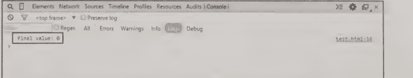

如图 18-1 概述所示，*incrementValue.val* 的最终值并非预期的 3，而是 0。

该示例说明了*默认*绑定行为：裸函数调用（即直接调用而不是通过对象实例调用的函数）会将 `this` 绑定到全局对象。当 JavaScript 在浏览器中执行时，全局对象是 *window*。

注意，`this` 绑定的对象取决于函数是如何被调用的，而不是函数是如何定义的。JavaScript 使用函数的执行方式（即调用点）来确定正确的 `this` 绑定，而不是函数定义。

> 注意：函数的调用点决定了 `this` 在函数内部的绑定的值，而不是函数的定义。

鉴于调用点决定了 `this` 绑定的值，你认为示例 18-2 中的代码将会有何表现？

# 示例 18-2：带有函数引用的默认绑定（代码文件名：CallApplyBind.defaultBinding_02.js）

```javascript

var obj = {

  val: 0,

  incrementValue: function incrementValue() {

    this.val++;

  }

}

// 创建对 obj 中定义的函数的引用

var incrementRef = obj.incrementValue;

// 通过引用执行 incrementValue 函数

incrementRef();

incrementRef();

incrementRef();

console.log("final value in object: " + obj.val); // ???

```

图 18-2 显示了控制台输出。


# 图 18-2

同样，在示例 18-2 的情况下，预期的增加目标 obj.val 并没有变化。尽管 `incrementValue` 函数被定义为 obj 的一部分，但它是通过 `incrementRef` 引用作为裸函数调用执行的。同样，调用点决定了 `this` 应该绑定到 `window`。

# 默认绑定与严格模式

你可能会疑惑：如果 `incrementValue` 函数中 `obj.val` 没有增加，那么增加的是什么呢？因为这绑定到了全局对象 `window`，所以语句 `this.val++` 等同于

语句 `window.val++`。示例 18-3 显示了产生的异常。


图 18-3

```javascript

示例 18-3：默认绑定与严格模式（代码文件名：CallApplyBind\defaultBinding_03.js）

var obj = {

  val: 0,

  incrementValue: function incrementValue() {

    "use strict";

    // 在严格模式下，'this' 被绑定到 undefined

    this.val++;

  }

};

// 创建对 obj 中定义的函数的引用

var incrementRef = obj.incrementValue;

// 通过引用执行 incrementValue 函数

incrementRef(); // 将产生错误

incrementRef();

incrementRef();

console.log("final value in object: " + obj.val);

```

> 注意：使用严格模式可以将逻辑问题转换为错误，缩短调试周期并产生更可靠的代码。

# 隐式绑定

如果你用过 C# 或 Java 等传统语言编写过程序，那么隐式绑定可能会让你觉得很自然。隐式绑定实际上是指通过对象的引用来执行函数。示例 18-4 展示了其工作原理。

示例 18-4：this 的隐式绑定（代码文件名：CallApplyBind\defaultBinding_01.js）

```javascript

var obj = {

  val: 0,

  incrementValue: function incrementValue() {

    this.val++;

  }

};

obj.incrementValue();

obj.incrementValue();

obj.incrementValue();

console.log("final value in object: " + obj.val); // 3

```

回到示例 18-2，`incrementValue` 是通过一个引用它的变量 `incrementRef` 在没有上下文的情况下执行的。相比之下，示例 18-4 通过 `obj` 对象执行 `incrementValue`，将 `obj` 作为函数内部 `this` 绑定的上下文。由于 `this` 绑定到了 `this`，语句 `this.val++` 增加了 `obj` 对象的 `val` 属性。

为了真正看到在函数声明之后决定 `this` 如何绑定的，请考虑示例 18-5 中的代码。

# 示例 18-5：带有全局函数定义的 this 的隐式绑定（代码文件名：CallApplyBind\implicitBinding_02.js）

```javascript

function valIncrement() {

  this.val++;

}

var obj = {

  val: 0,

  incrementValue: valIncrement

};

obj.incrementValue();

obj.incrementValue();

obj.incrementValue();

console.log("final value in object: " + obj.val); // 3

```

在示例 18-5 中，包含 `this.val++` 语句的函数 `valIncrement` 是全局定义的；它的声明并不在对象内部。当定义 `obj` 时，它的 `incrementValue` 属性被赋值为 `valIncrement` 函数。

随后，全局定义的 `valIncrement` 函数通过 `incrementValue` 执行了三次，该引用包含在 `obj` 对象内部。尽管 `valIncrement` 被定义


在全局范围内，它在三个调用处以 `obj` 作为其上下文被调用。因此，它绑定到了 `obj`，并且 `obj.val` 被该函数增加。

## 新绑定 (new Binding)

当执行构造函数时，它们并没有提供一个可以绑定 `this` 的上下文对象。这意味着在构造函数内部，`this` 会绑定到全局对象，对吧？

幸运的是，情况并非如此。第 3 章说明了如何使用 `new` 关键字通过构造函数创建对象实例。每个使用 `new` 的示例都在构造函数内部使用 `this` 来操作新创建的对象实例。我们当时提到过这一点，现在再次重申：当在构造函数上使用 `new` 时，`this` 会自动绑定到新对象上。

在调用处使用 `new` 关键字时的绑定行为允�构造函数设置新对象的属性，如你在代码列表 18-6 中所示。

代码列表 18-6：构造函数内部的 this 绑定（代码文件名：CallApplyBind\newBinding_01.js）

```javascript

function Counter() {

  // 当使用 new 关键字调用构造函数时，

  // 'this' 绑定到新对象上

  this.val = 0;

}

Counter.prototype.incrementValue = function() {

  // 在函数内部引用 'this' 仍然依赖

  // 隐式绑定，以确保在函数被调用时

  // 'this' 指向对象实例

  this.val++;

};

var cnt = new Counter();

cnt.incrementValue();

cnt.incrementValue();

cnt.incrementValue();

console.log("final value in object: " + cnt.val); // 3

```

值得注意的是，添加到对象原型上的函数仍然受到调用处绑定的限制。例如，如果启用了严格模式，并且通过引用而非 `cnt` 对象来调用 `cnt.incrementValue`，则会发生错误，如代码列表 18-7 和图 18-4 所示。

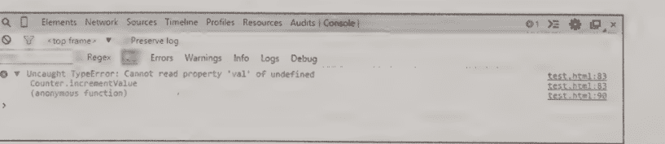

图 18-4

> 代码列表 18-7：添加到对象原型上的函数受调用处绑定规则限制（代码文件名：CallApplyBind\newBinding_02.js）

```javascript

"use strict";

function Counter() {

  // 当使用 new 关键字调用构造函数时

  // 'this' 绑定到新对象上

  this.val = 0;

}

Counter.prototype.incrementValue = function() {

  // 在函数内部引用 'this' 仍然依赖

  // 隐式绑定，以确保在函数被调用时

  // 'this' 指向对象实例

  this.val++;

};

var cnt = new Counter();

var incrementRef = cnt.incrementValue;

// 通过引用执行函数，触发错误

incrementRef();

```

## 显式绑定 (Explicit Binding)

JavaScript 提供的绑定 `this` 变量的最后一种机制是显式绑定。显式绑定允许函数的调用者指定 `this` 应该绑到的对象。

显式绑定是通过每个 JavaScript 函数原型中包含的 `call`、`apply` 和 `bind` 方法实现的。下一节将探索 `call`、`apply` 和 `bind`，并重点关注使用这些函数的单元测试代码。

> 注意：在 JavaScript 中，函数是对象。因此，函数拥有原型，该原型可以并且包含其他函数。

## 创建并测试使用 CALL, APPLY 和 BIND 的代码

基于本章目前为止的示例，JavaScript 开发者似乎可以从完全避免使用 `this` 中获益。毕竟，程序员只需通过引用而非定义方法的对象来执行该方法，就可以诱导出使用 `this` 的方法。

既然掌握了 JavaScript 如何确定 `this` 绑定的对象知识，以及通过 `call`、`apply` 和 `bind` 函数（这些函数允许程序员指定 `this` 应该绑定的变量），就没有理由为了不使用 `this` 而让你的 JavaScript 变得不可靠。本节将介绍使用 `call`、`apply` 和 `bind` 的场景，并强调使用这些函数的代码测试的重要方面。

## 使用 call 和 apply

我们将 `call` 和 `apply` 方法归为一类是因为它们的作用相同：每个方法都会立即执行被调用的函数，并将 `this` 绑定到提供的上下文对象。

在探索如何测试使用 `call` 和 `apply` 的代码之前，查看一些这些函数的简单示例是值得的。`call` 和 `apply` 都接受一个上下文对象作为第一个参数。该上下文就是 `this` 在函数内部绑到的对象。如果上下文为 `undefined`，则 `this` 将绑定到全局对象（如果处于严格模则，则设置为 `undefined`）。

`call` 和 `apply` 的区别在于，当已知被调用函数的参数数量时，使用 `call`；`call` 允许单独传递参数。而 `apply` 方法将被调用函数的参数作为数组处理，而不是单独处理。这在参数数量未知或不确定时非常有用。

代码列表 18-8 展示了函数 `call` 和 `apply` 方法的使用。

代码列表 18-8：使用 call 和 apply（代码名：CallApplyBindcallApply_01.js）

```javascript

var JavaScript = ReliableJavaScript || {};

ReliableJavaScript.addValues = function(value1, value2) {

 // addValues 接受两个参数，并预期

 // 'this' 有一个方法

 this.result = value1 + value2;

};

// 定义一个拥有 printResult 方法的对象

var contextObject = {

  printResult: function(toPrint) {

    console.log("Result: " + toPrint);

  }

};

// 使用 call 方法执行 addValues。

// 将 contextObject 作为 this 应该绑定的对象。

// 同时传递 2 和 3 作为参数

ReliableJavaScript.addValues.call(contextObject, 2, 3);

contextObject.printResult();

// 使用 apply 方法执行 addValues。

// 再次将 contextObject 作为 this 应该绑定的对象。

// 传递一个包含 2 和 3 值的数组

ReliableJavaScript.addValues.apply(contextObject, [2, 3]);

contextObject.printResult();

```

在代码中使用 `call` 和 `apply` 表示你关心的值将是你编写的单元测试关注点。

在第 5 章，创建了 `attendeecollection` 模块来管理对象集合。`attendeecollection` 暴露了 `iterate` 方法，该方法接受一个由 `iterate` 为每个成员调用的回调函数。回调通过 `Array.prototype.forEach` 每个成员执行。与此讨论相关的 `attendeecollection` 部分在代码列表 18-9 中重复。

# 代码列表 18-9：attendeecollection 模块（节选）（代码文件名：CallApplyBind\attendeeCollection.js）

```javascript

var Conference = Conference || {};nConference.attendeecollection = function(){

  'use strict';

var attendees = [];

  return{

    /* 为了省略省略 add, remove 和 getCount */

    iterate: function(callback) {

      attendees.forEach(callback);

    }

  };

};

```

你可能记得 `checkedInAttendeeCounter` 模块（同样在第 5 章创建）在提供给 `iterate` 的回调函数中使用 `this` 时存在问题，如下例所示：

```javascript

var checkInService = Conference.checkInService(Conference.checkInRecorder()),

attendees = Conference.attendeeCollection(),

  counter = Conference.checkedInAttendeeCounter();


# 第 18 章 确保正确使用 CALL, APPLY, BIND

## 使用 Polyfill 测试驱动开发创建 Array.prototype.forEach

对 ECMAScript 特性的支持差异通常通过填充程序（polyfills）来解决。补丁是一段代码，用于实现开发者期望由浏览器实现的语言特性。补丁会检测该语言特性是否存在，如果不存在，则补丁本身将替代该特性。如果开发者在她的项目中包含了补丁，她就可以确保，如果浏览器没有原生实现该语言特性，补丁所实现的特性也将会存在。

由于 Internet Explorer 8 不支持 `Array.prototype.forEach`，且 `Array.prototype.forEach` 已经在 JavaScript 参考网站的代码中被使用过，因此需要提供一个补丁。

> 注意：针对 ECMAScript 5 特性有许多补丁，包括 `Array.prototype.forEach`。虽然我们没有重复发明轮子，但为 `Array.prototype.forEach` 实现补丁为创建和测试使用 `Function.prototype.call` 的代码提供了一个极佳的媒介。请注意，由于补丁实现的重点是说明概念而非实际复制功能，在本节中创建的补丁不应被视为其他任何不完整的示例；请勿在实际环境中使用它！

为 `Array.prototype.forEach` 创建补丁的第一步（甚至在编写单元测试之前）是确定该特性在 ECMAScript 5 中的实现行为。带注释的 ECMAScript 5 `Array.prototype.forEach` 规范可以在 http://es5.github.io/#215.4.18 获取。该页面的一些要点如下：

- 方法签名为 `Array.prototype.forEach(callbackFn, [thisObj])`。
- `this` 参数是可选的。如果提供了它，它将作为每次调用 `callbackFn` 时的对象。如果没有提供，则会将 `undefined` 作为 `this` 对象传递给 `callbackFn`。

回调函数 `callbackFn` 将为数组中的每个元素执行一次，并带有三个参数：

- 元素的值
- 元素的索引
- 正在被遍历的对象

带注释的规范提供了开始为补丁创建单元测试套件所需的所有信息。惯例，错误情况的测试首先编写，位于列表 18-10 中。

## 列表 18-10：Array.prototype.forEach 补丁的错误单元条件测试（代码文件名：CallApplyBindForEach_01_tests.js）

```javascript
describe("arrayForEach(callbackFn, thisObj)", function() {
  var originalForEach;

  beforeEach(function() {
    // 保留原始 forEach 实现的引用
    originalForEach = Array.prototype.forEach;
    // 将原始 forEach 实现（如果有）替换为正在测试的
    Array.prototype.forEach = Conference.polyfills.forEach;
  });

  afterEach(function() {
    // 恢复原始的 forEach
    Array.prototype.forEach = originalForEach;
  });

  it("throws if callbackFn is not a function", function() {
    var i,
      nonFunction = [undefined, ""];

    for (i = 0; i < nonFunction.length; i++) {
      expect(function() {
        [].forEach(nonFunction[i]);
      }).toThrowError("is not a function");
    }
  });
});
```

由于必须提供 `callbackFn` 且它必须执行，编写的第一个错误条件测试是确保如果 `callbackFn` 不是函数，补丁将抛出异常。

在 `beforeEach` 和 `afterEach` 中执行的步骤也值得检查。因为补丁正在开发中，按照它将在生产环境中使用的方式对其进行测试是合适的：作为 `Array.prototype` 的一部分。执行测试的环境可能已经有了 `Array.prototype.forEach` 的实现。无论何种，补丁都需要到位，这通过 `beforeEach` 块中的以下语句完成：

```javascript
Array.prototype.forEach = Conference.polyfills.arrayForEach;
```

保留原始实现（或其缺失），以便在执行完每个测试后恢复它。

通过使用 `Conference.polyfills.arrayForEach` 的存根实现，列表 18-10 中的单元测试会失败，参见图 18-5。

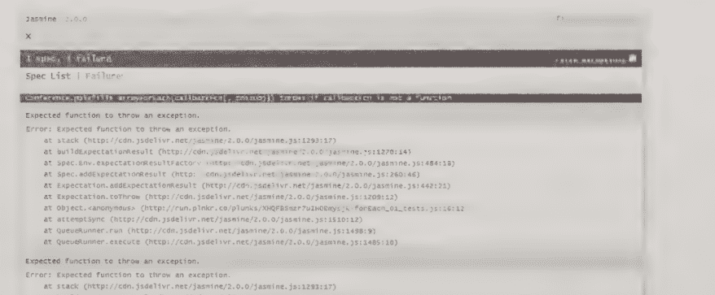

图 18-5

满足错误条件的情况在列表 18-11 中所示。

## 列表 18-11：测试 callbackFn 不是函数（代码文件名：CallApplyBindForEach_01.js）

```javascript
describe('Conference.polyfills', function() {
  'use strict';

  describe('arrayForEach(callbackFn, thisObj)', function() {
    // 之前讨论过的设置、清理和测试已省略

    describe('without thisObj', function() {
      it('executes callbackFn with an undefined context', function() {
        var helper = {
          // 将提供给 .forEach 的回调函数
          expectToBeWindow: function() {
            // 验证 this 已绑定到 window
            expect(this).toBe(window);
          }
        };

        // 对 helper 进行间探，以确保它被调用了
        spyOn(helper, "expectToBeWindow").and.callThrough();

        // 在单元素数组上执行
        [1].forEach(helper.expectToBeWindow);

        expect(helper.expectToBeWindow).toHaveBeenCalled();
      });
    });
  });
});
```

## 列表 18-12：测试在未提供 thisObj 时 callbackFn 是否执行（代码文件名：CallApplyBindForEach_02_tests.js）

```javascript
describe("arrayForEach(callbackFn, thisObj)", function() {
  var originalForEach;

  beforeEach(function() {
    // 保留原始 forEach 实现的引用
    originalForEach = Array.prototype.forEach;
    // 将原始 forEach 实现（如果有）替换为正在测试的
    Array.prototype.forEach = Conference.polyfills.forEach;
  });

  afterEach(function() {
    // 恢复原始的 forEach
    Array.prototype.forEach = originalForEach;
  });

  it("executes callbackFn with an undefined context", function() {
    var helper = {
      // 将提供给 .forEach 的回调函数
      expectToBeWindow: function() {
        // 验证 this 已绑定到 window
        expect(this).toBe(window);
      }
    };

    // 对 helper 进行间探，以确保它被调用了
    spyOn(helper, "expectToBeWindow").and.callThrough();

    // 在单元素数组上执行
    [1].forEach(helper.expectToBeWindow);

    expect(helper.expectToBeWindow).toHaveBeenCalled();
  });
});
```

由于测试仅验证了 polyfill 功能的一个小方面（这本应如此），因此只需要进行非常小的更改即可让新测试通过。该更改在列表 18-13 中显示。

> 列表 18-13：polyfill 的实现，它允许验证 callbackFn 绑定到 undefined 的测试通过（代码文件名：CallApplyBindForEach_02.js）

```javascript
var Conference = Conference || {};

Conference.polyfills = Conference.polyfills || {};

Conference.polyfills.arrayForEach = function(callbackFn, thisObj) {
  'use strict';

  var i;

  if (typeof callbackFn !== "function") {
    throw new Error(callbackFn + ' is not a function');
  }

  for (i = 0; i < this.length; i++) {
    callbackFn();
  }
};
```

由于测试仅验证了回调函数的上下文（context）是否正确，只需通过引用 `callbackFn` 执行回调函数即可让新测试通过。图 18-8 证明了这一点。

| Jasmine 2.0.0 完成耗时 0.012s | |
| :--- | :--- |
| 2 个规格，0 次失败 | 抛出异常 |
| Conference.polyfills | |
| arrayForEach(callbackFn, thisObj) | 如果 callbackFn 不是函数则抛出异常 |
| 无 thisObj | 使用 undefined 上下文执行 callbackFn |

图 18-8

接下来，需要编写一个测试以确保如果提供了 `thisObj` 作为参数，回调函数的上下文将被设置为 `thisObj`。列表 18-14 提供了必要的测试。

### 列表 18-14：测试当提供 thisObj 时，callbackFn 的上下文是否被设置为 thisObj（代码文件名：CallApplyBindForEach_03_tests.js）

```javascript
describe("Conference.polyfills", function() {
  'use strict';

  describe("arrayForEach(callbackFn, thisObj)", function() {
    // 省略了之前讨论过的设置、清理和测试

    describe("with thisObj", function() {
      it("以 thisObj 作为上下文执行 callbackFn", function() {
        var thisObj = {},
          helper = {
            expectThisToBeObj: function() {
              expect(this).toBe(thisObj);
            }
          };

        // 监视 helper 以确保它被调用了
        spyOn(helper, "expectThisToBeObj").and.callThrough();

        // 在单元素数组上执行
        [1].forEach(helper.expectThisToBeObj, thisObj);

        expect(helper.expectThisToBeObj).toHaveBeenCalled();
      });
    });
  });
});
```

为了确保在提供 `thisObj` 时将其作为 `callbackFn` 的上下文而添加的测试，与未提供 `thisObj` 时验证上下文的测试非常相似。列表中主要区别是，预期应该是 `thisObj` 而不是 `window`。图 18-9 显示了新的测试用例。

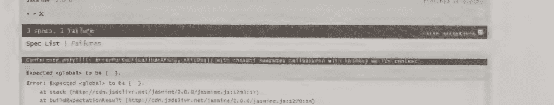

图 18-9

通过将直接调用 `callbackFn` 转换为对 `callbackFn` 的 `call` 方法的调用，解决了这个问题。这种转换以及提供 `thisObj` 作为 `call` 的上下文在列表 18-15 中显示。

### 列表 18-15：使用 call 为 callbackFn 提供正确的上下文（代码文件名：CallApplyBindForEach_03.js）

```javascript
var Conference = Conference || {};

Conference.polyfills = Conference.polyfills || {};

Conference.polyfills.arrayForEach = function(callbackFn, thisObj) {
  'use strict';

  var i;

  if (typeof callbackFn !== "function") {
    throw new Error(callbackFn + ' is not a function');
  }

  for (i = 0; i < this.length; i++) {
    callbackFn.call(thisObj);
  }
};
```

注意，并没有验证调用者是否提供了 `thisObj` 作为参数；它只是直接作为第一个参数传递给 `callbackFn` 的 `call` 方法。回想，当函数定义了一个参数而调用者没有提供相应的参数时，该参数的值在函数内部为 `undefined`。如果未提供 `thisObj`，当 `callbackFn` 被调用时其上下文应设置为 `undefined`，这样就不需要额外的检查。图 18-10 显示了该修改允许新测试以及现有测试通过。

Jasmine 2.0.0 完成耗时 0.009s

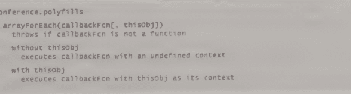

图 18-10

最后一部分是 polyfill 需要测试的——至少是确保 `call` 的正确使用——即回调是用正确的参数调用的。验证单元素数组情况的测试在列表 18-16 中；测试多元素数组情况的测试留给读者练习。

### 列表 18-16：确保 callbackFn 用正确参数执行的测试（文件名：CallApplyBindForEach_04_tests.js）

```javascript
describe("Conference.polyfills", function() {
  'use strict';

  describe("arrayForEach(callbackFn, thisObj)", function() {
    // 省略了之前讨论过的设置、清理和测试

    describe("without thisObj", function() {
      // 省略了之前讨论过的设置、清理和测试

      it("以 undefined 上下文执行 callbackFn", function() {
        // 省略了之前讨论过的设置、清理和测试
      });
    });

    describe("with thisObj", function() {
      it("以 thisObj 作为上下文执行 callbackFn", function() {
        var thisObj = {},
          helper = {
            expectThisToBeObj: function() {
              expect(this).toBe(thisObj);
            }
          };

        // 监视 helper 以确保它被调用了
        spyOn(helper, "expectThisToBeObj").and.callThrough();

        // 在单元素数组上执行
        [1].forEach(helper.expectThisToBeObj, thisObj);

        expect(helper.expectThisToBeObj).toHaveBeenCalled();
      });
    });
  });
});
```

## 使用 bind

当使用 `call` 和 `apply` 调用调用绑定到特定对象的函数时，`bind` 返回一个新函数，该函数永久将 `this` 绑定到原函数中的特定对象。在原函数中绑定到 `this` 的对象不会通过执行使用函数的 `call` 或 `apply` 方法创建的函数而改变。

这种行为在创建包含事件处理程序（响应外部刺激的函数，例如浏览器 DOM 事件）的对象非常有用。

当浏览器响应事件（例如点击按钮）执行事件处理器时，它会将事件处理器所绑定的 DOM 元素作为事件处理器函数的上下文提供。这意味着 `this` 被绑定到处理事件的函数内部的 DOM 元素。如果事件处理器包含在一个需要维护状态或与其他组件通信的内部中，那么确保事件处理器绑定到包含它的对象，而不是浏览器提供的 DOM 元素，可能是必要的。

假设 JavaScript 会议组织者要求能够查看访问通过点击赞助商网站链接离开会议网站的次数。

创建一个负责在网站数据库中记录外链点击次数的模块：`outgoingLinkClickRecorder`。你被要求创建一个模块，用于响应 DOM 点击事件并使用 `outgoingLinkClickRecorder` 记录这些点击。你创建的模块 `outgoingLinkClickHandler` 应该接受一个注入（injected）的 `outgoingLinkClickRecorder` 实例，并暴露一个单一方法：`handleClick`。

由于你知道 `handleClick` 方法将在浏览器 DOM 事件中执行，因此你知道浏览器将以源 DOM 元素作为其上下文（context）执行该方法。由于你想与注入到 `outgoingLinkClickHandler` 中的 `outgoingLinkClickRecorder` 实例进行交互，你非常希望抑制浏览器的默认行为，除非是为了将其绑定到包含 `handleClick` 方法的对象上。

你直觉认为 `bind` 可以实现这个目标，但在你进一步走得太远之前，你编写了一些单元测试来验证该行为。其中第一个测试显示在列表 18-18 中。

## 列表 18-18：测试确保当提供包含的对象作为其上下文时，handleClick 会记录点击事件（代码文件名：CallApplyBindOutgoingLinkClickHandler_tests_01.js）

```javascript
describe("Conference.outgoingLinkClickHandler", function() {
  'use strict';

  var clickRecorder,
    clickHandler;

  beforeEach(function() {
    clickRecorder = Conference.outgoingLinkClickRecorder();
    spyOn(clickRecorder, "recordClick");

    clickHandler = Conference.outgoingLinkClickHandler(clickRecorder);
  });

  describe("handleClick()", function() {
    it("records a click if executed via its containing object", function() {
      clickHandler.handleClick();

      expect(clickRecorder.recordClick).toHaveBeenCalled();
    });
  });
});
```

这第一个测试简单地确保了当 `handleClick`（包含该方法的对象）作为方法的上下文提供时，`handleClick.handleClick()` 能正确记录点击。在 `beforeEach` 节中，为 `clickRecorder.recordClick` 设置了一个间谍器（spy），以便测试可以断言 `clickRecorder.recordClick` 已被执行。

使用 `Conference.outgoingLinkClickHandler` 的存根实现（stub implementation），列表 18-18 中的单元测试将会失败，如图 18-12 所示。

列表 18-19 提供了一个满足单元测试的 `Conference.outgoingLinkClickHandler` 实现。

## 列表 18-19：当通过其包含的对象执行时能够正常工作的 `outgoingLinkClickHandler` 实现（代码文件名：CallApplyBindOutgoingLinkClickHandler_01.js）

```javascript
var Conference = {};

Conference.outgoingLinkClickHandler = function(clickRecorder) {
  'use strict';

  return {
    // 保留对注入的 clickRecorder 的引用
    linkClickHandler: clickRecorder,

    // 构建一个包含点击细节的对象
    // 并使用 clickRecorder 记录点击
    handleClick: function handleClick() {
      // 构建一个 linkDetails 对象
      var clickDetails = {};

      this.linkClickHandler.recordClick(clickDetails);
    }
  };
};
```

列表 18-19 提供的 `outgoingLinkClickHandler` 实现将注入的 `clickRecorder` 对象赋值给新对象实例的 `linkClickHandler` 属性。`handleClick` 方法通过此调用 `linkClickHandler`，并将点击细节记录到网站数据库中。图 18-13 显示该实现通过了单元测试。

为了确保 `handleClick` 在作为响应 DOM 事件的事件处理程序提供时符合预期行为，你需要编写一些单元测试，使用其包含对象以外的对象作为上下文来调用 `handleClick`。这些测试将在列表 18-20 中。


图 18-13

## 列表 18-20：确保无论上下文如何，handleClick 都能记录点击的测试（代码文件名：CallApplyBindOutgoingLinkClickHandler_02_tests.js）

```javascript
describe("Conference.outgoingLinkClickHandler", function() {
  'use strict';

  // ... (省略部分)

  describe("handleClick()", function() {
    it("records a click if executed via its containing object", function() {
      clickHandler.handleClick();

      expect(clickRecorder.recordClick).toHaveBeenCalled();
    });

    it("records a click if provided undefined", function() {
      clickHandler.handleClick.call(undefined);

      expect(clickRecorder.recordClick).toHaveBeenCalled();
    });

    it("records a click if provided a bare object", function() {
      clickHandler.handleClick.call({});

      expect(clickRecorder.recordClick).toHaveBeenCalled();
    });
  });
});
```

测试验证了：
- 当提供 `undefined` 时会记录点击。
- 当提供裸对象时会记录点击。

当前的实现无法满足这些测试，如图 18-14 所示。

列表 18-21：采用 bind 的 `outgoingLinkClickHandler` 实现（代码文件名：CallApplyBindOutgoingLinkClickHandler_02.js）

```javascript
var Conference = {};

Conference.outgoingLinkClickHandler = function(clickRecorder) {
  'use strict';

  var handler = {
    // 保留对注入的 clickRecorder 的引用
    linkClickHandler: clickRecorder,

    // 构建一个包含点击细节的对象
    // 并使用 clickRecorder 记录点击
    handleClick: function handleClick() {
      // 构建一个 linkDetails 对象
      var clickDetails = {};

      this.linkClickHandler.recordClick(clickDetails);
    }
  };

  // 将 handleClick 永久绑定到 handler 对象
  handler.handleClick = handler.handleClick.bind(handler);

  return handler;
};
```

与其之前的实现返回一个新实例不同，`outgoingLinkClickHandler` 的新实现首先将对象赋值给 `handler`。然后使用 `handleClick` 的 `bind` 方法创建一个永久绑定到 `handler` 的 `handleClick` 副本：

```javascript
handler.handleClick = handler.handleClick.bind(handler);
```

最后将 `handler` 返回给调用者。图 18-15 显示新实现允许所有单元测试通过。

```
Conference.outgoingLinkClickHandler
handleClick()
  通过其包含的对象执行时记录点击
  提供 undefined 作为上下文时记录点击
  提供裸对象作为上下文时记录点击
```

图 18-15

## 总结

本章涵盖了大量内容。在深入 `call`、`apply` 和 `bind` 的细节之前，我们回顾了 JavaScript 用于设置函数中 `this` 值的绑定类型：

- 默认绑定
- 隐式绑定
- new 绑定
- 显式绑定

此外，本章描述了决定使用何种绑定的调用细节。

接下来，我们描述了 `call` 和 `apply` 的细节，它们用于显式设置函数中 `this` 的值。在此过程中，我们讨论了存根（polyfill）的概念，并使用测试驱动开发创建了 `Array.prototype.forEach` 存根的部分实现。

最后，本章说明了如何使用 `bind` 永久绑定到一个值。

当你编写使用 `this` 的 JavaScript 函数时，你需要预测所有可能的调用方式。为了确保可靠性，使用 `this` 的函数的单元测试套件应该测试将其绑定到：

- `null`
- `undefined`
- 定义该函数之外的对象

此外，在编写接受回调函数作为参数的函数时，通常做法是接收另一个参数，作为回调函数内部 `this` 应绑定的对象。接受回调函数及其 `this` 值的函数测试套件应该包含确保 `this` 在回调函数中正确绑定的测试。

下一章将 `call` 和 `apply` 推向一个新的高度，并演示如何使用它们来执行方法借用。

# 第 19 章 确保方法借用的正确使用

本章内容：

- 优雅地从另一个对象借用函数
- 使用切面（aspect）或代码契约（code contract）对借用者进行校验
- 评估借用者和提供者的副作用

本章 WROX.COM 代码下载

你可以在 www.wrox.com/go/reliablejavascript 的 Download Code 标签页找到本章的代码下载。文件位于第 19 章下载目录中，并根据书中提到的文件名分别进行命名。

在上一章中，我们开发了 `Conference.polyfills.arrayForEach`，你可以用它来增强缺少自身 `forEach` 函数的旧式 Array 的。重点在于开发 `forEach` 本身；将其插件到 Array 中是轻而且毫无顾虑的。

```javascript
Array.prototype.forEach = Conference.polyfills.forEach;
```

毫无顾虑？真的吗？
这让人想起了急躁但未经训练的卢克·天斯沃克（Luke Skywalker），他告诉尤达大师：“我不害怕。”

尤达严肃地回答：“你会害怕的。你会害怕的。”

有什么好害怕的？在你冒险进入方法借用的危险领域之前，你必须准备好回答三个问题：

- 该方法对借用对象有什么要求？
- 执行该方法会对借用对象产生什么影响？
- 它的执行会对提供者对象产生什么？

再次查看 `Conference.polyfills.arrayForEach`（省略了参数检查）。你会如何回答这三个问题？

```javascript
Conference.polyfills.arrayForEach = function(callbackFn, thisObj) {
  var i;

  for (i = 0; i < this.length; i++) {
    callbackFn.call(thisObj, this[i], i, this);
  }
};
```

幸运的是，第二个和第三个问题的答案是“完全没有影响”。或者说，除了回调函数的副作用外没有影响，但这是预料之中的。

然而，对于第一个问题，答案就不那么乐观了。你能看到借用者身上的隐藏要求吗？

事实证明，借用对象应该有一个 `length` 属性。（如果没有 `length`，不会抛出错误；如果你期望 `forEach` 会遍历任何对象的属性，你会失望的。）你注意到我们在第 18 章的单元测试之一考虑到了这一点吗？

在本章中，我们提出了一些在代码中提问这三个问题的技术，以确保结果符合你的预期，并确保它们一直保持如此。

## 确保借用对象是合格的

你如何判断借用对象是否符合借用函数的要求？你当然必须从检查被借用的函数开始。如果运气好，它就像你所有的函数一样：短、简单，并且通过单元测试经过充分探索。

一旦你了解了该函数，就可以添加注释并希望人们阅读它们：

```javascript
// *** 警告 *** 只有在你拥有 length 属性时才借用此函数！

Conference.polyfills.arrayForEach = function(callbackFn, thisObj) {
  // 等等
};
```

然而，如果你想编写可靠的代码，那这不可靠。那甚至不是代码！

## 让被借用的函数校验借用者

更高级的下一步是让被借用的函数对借用者进行校验。当然，你开始编写测试（见列表 19-1）：

### 列表 19-1：测试校验过程（文件名：ForEach/forEach_01_tests.js）

```javascript
describe('forEach(callbackFn, thisObj)', function() {
  'use strict';

  it('throws if not called from an object with a numeric length property', function() {
    var ix,
      obj,
      withNoGoodLength = [
        { a: 1 },
        { length: "not a number" },
        { length: Infinity },
        { length: -1 },
        { length: 1.5 }
      ];

    function expectThrow(obj) {
      expect(function() {
        obj.forEach(function() { /* 什么都不做*/ });
      }).toThrow();
    }

    for (ix = 0; ix < withNoGoodLength.length; ++ix) {
      obj = withNoGoodLength[ix];
      // 借用 polyfill。
      obj.forEach = Conference.polyfills.arrayForEach;
      // 期望它无法工作。
      expectThrow(obj);
    }
  });
});
```

该测试尝试将数组借用到各种不具备必要 `length` 属性的对象中。每一个都应该抛出异常。
下一步是添加校验逻辑（见列表 19-2）：

### 列表 19-2：校验调用者（代码文件名：ForEach/forEach_01.js）

```javascript
Conference.polyfills.arrayForEach = function(callbackFn, thisObj) {
  'use strict';

  var i;

  // 校验可能借用此函数的任何人
  if (typeof(this) !== 'object' ||
      !(typeof(this.length) === 'number' && isFinite(this.length) &&
      Math.floor(this.length) === this.length && this.length >= 0)) {
    throw new Error('The context for arrayForEach must be array-like.');
  }

  for (i = 0; i < this.length; i++) {
    callbackFn.call(thisObj, this[i], i, this);
  }
};
```

测试通过了（见图 19-1），你获得了一些结果。

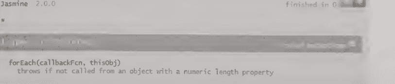

图 19-1

## 在借用对象上附加切面

将新逻辑封装到切面中是容易的。此外，如果你需要相同的功能，你必须做一些疯狂的事情才能让它不具有 `length` 属性。切面是在函数定义后附加的（见列表 19-3）。

### 列表 19-3：使用切面校验借用者（代码文件名：ForEach/forEach_02.js）

```javascript
Conference.polyfills.arrayForEach = function(callbackFn, thisObj) {
  'use strict';

  var i;

  for (i = 0; i < this.length; i++) {
    callbackFn.call(thisObj, this[i], i, this);
  }
};

// 切面：校验借用者
function validateBorrower() {
  if (typeof(this) !== 'object' ||
      !(typeof(this.length) === 'number' && isFinite(this.length) &&
      Math.floor(this.length) === this.length && this.length >= 0)) {
    throw new Error('The context for arrayForEach must be array-like.');
  }
}

// 将切面应用到函数
Conference.polyfills.arrayForEach = ReliableJavaScript.aspects.before(
  Conference.polyfills.arrayForEach, validateBorrower);
```

切面之所以有效，是因为借用者在当时拥有 `length` 属性。这虽然更好，但并不高效，因为切面会在每次调用函数时执行，然而尽管切面解决了这两个问题。

### 列表 19-4：切面应用顺序问题（代码文件名：Sequence/aspectSequenceProblem.js）

```javascript
// 前半部分的方法（正确）：
// 1. 定义补丁（polyfill）。
// 2. 将切面应用到补丁。
// 3. 借用函数。

var objWithEarlyAspect = { length: 0 };
ReliableJavaScript.aspects.before(Conference.polyfills.arrayForEach, validateBorrower);
objWithEarlyAspect.forEach = Conference.polyfills.arrayForEach;

// 后半部分的方法不同（且是错误的）：
// 1. 定义补丁（polyfill）。
// 2. 借用函数。
// 3. 将切面应用到任何借用者——太晚了！

var objWithLateAspect = { length: 0 };
objWithLateAspect.forEach = Conference.polyfills.arrayForEach;
ReliableJavaScript.aspects.before(objWithLateAspect.forEach, validateBorrower);
```

现在你可以对每个借用对象运行你之前看到过的同种测试，如列表 19-5 所示。

### 列表 19-5：测试两个序列（代码文件名：Sequence/aspectSequenceProblem_tests.js）

```javascript
describe('aspect application', function() {
  'use strict';

  function doNothing() {}

  it('在借用前应用切面时正常工作', function() {
    expect(function() {
      objWithEarlyAspect.forEach(doNothing);
    }).toThrow();
  });

  it('在借用后应用切面时正常工作', function() {
    expect(function() {
      objWithLateAspect.forEach(doNothing);
    }).toThrow();
  });
});
```

结果（图 19-3）显示，如果你在借用后应用切面，就太晚了。

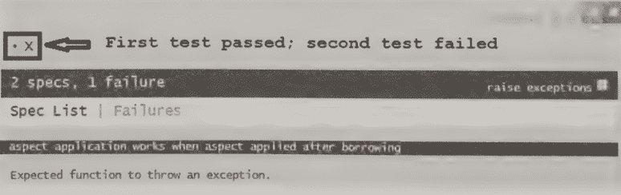

图 19-3

在我们看来，面向切面的编程是非常有用的，只要可能，人的编程技术应该允许这种做法。

避免所谓的“时间耦合”（temporal coupling）也是一种良好的技术——即按特定顺序执行任务的要求，特别是当这种顺序并不显而易见时。正如你在第 17 章“整合一切”中看到的，在应用配置阶段应用所有可选切面有一个显著优势，即易于不应用它们。它们在某处被应用，当你为生产环境精简代码时，可以跳过它们。之前代码编写的切面是可选的，但它们与它们修改的对象具有时间耦合。这阻止了它们成为通用配置的一部分。

你无疑理解间接性（indirection）：“每一个软件设计问题都可以通过增加一层间接层来解决。”在 JavaScript 中没有地方比这句话更真实了。你可以通过借用的不是函数本身，而是一个包装函数，该函数反过来使用 `apply` 执行真实函数来避免切面序列问题。这会将执行推迟到方法实际执行时——在所有切面都应用之后很久。列表 19-6 展示了如何做到。

### 列表 19-6：使用 apply() 解决序列问题（代码文件名：SequenceWithApply.js）

```javascript
var objWithLateAspect = { /* no length property */ };

objWithLateAspect.forEach = function() {
  var args = Array.prototype.slice.call(arguments);
  return Conference.polyfills.arrayForEach.apply(this, args);
};
```

直接借用的方法：
`objWithLateAspect.forEach = Conference.polyfills.arrayForEach;`

已被函数式间接性和 `apply` 取代。
正如你在第 18 章中所读到的，`apply` 将执行 `Conference.polyfills.arrayForEach`，但使用第一个参数提供的 `this`，在这种情况下，它将是 `objWithLateAspect`。
函数的参数将提供给外部匿名函数（赋值给 `objWithLateAspect.forEach` 的那一个）。

通过这种方式完成两次借用，两个测试都通过了（见图 19-4）。


图 19-4

虽然这解决了问题，但它将原本的一行非常简单的代码：

```javascript
objWithLateAspect.forEach = Conference.polyfills.arrayForEach;
```

变成了四行解耦的代码。许多开发者不会认为这是一种胜利。但如果可以将复杂性封装起来并忘记它呢？

## 使用 borrow() 方法

列表 19-7 显示了封装 `apply` 逻辑的一种方法。这是一个用于借用的通用函数。

### 列表 19-7：一个通用函数借用者（代码文件名：Utilities/utils.js）

```javascript
ReliableJavaScript.utils.borrow = function borrow(borrower, donor, funcName) {
  'use strict';

  borrower[funcName] = function() {
    var args = Array.prototype.slice.call(arguments);
    return donor[funcName].apply(this, args);
  };
};
```

现在，一个裸赋值如
`borrower.func = donor.func;`

变成了

`ReliableJavaScript.utils.borrow(borrower, donor, 'func');`

尽管字符更多，但结果是一样的。而且当然，它更安全，因为它尊重了应用到借用函数上的切面。这不仅包含了借用者的切面，还包含了你在第 16 和 17 章中遇到的验证器。

## 为 ContractRegistry 添加验证器

如果你喜欢早期章节中的 `ContractRegistry`，为什么不用一种挂载方式来增强它呢？泛而言之，你需要一个在函数调用之前验证对象状态的切面。列表 19-8 显示了这个函数 `ContractRegistry.attachPreCallValidator`。

### 列表 19-8：attachPreCallValidator（代码文件名：ContractRegistry.js）

```javascript
ReliableJavaScript.ContractRegistry.prototype.attachPreCallValidator = function(methodName, validator) {
  'use strict';

  var originalMethod = this[methodName];

  this[methodName] = function() {
    if (validator.apply(this, arguments)) {
      return originalMethod.apply(this, arguments);
    }
  };
};
```

## 列表 19-11：trackedForEachKey（代码文件名：OrderedObject_02.js）

```javascript
Conference.OrderedObject = function() {
  'use strict';

  var self,
    propertyIterationCounts = {};

  this.incrementIterationCount = function incrementIterationCount(prop) {
    if (!propertyIterationCounts[prop]) {
      propertyIterationCounts[prop] = 1;
    } else {
      ++propertyIterationCounts[prop];
    }
  };

  this.getIterationCount = function getIterationCount(prop) {
    return propertyIterationCounts[prop];
  };

  Conference.OrderedObject.prototype.forEachKey = function(callbackFn) {
    'use strict';

    var ix,
      propName,
      orderedKeys = Object.keys(this).sort();

    for (ix = 0; ix < orderedKeys.length; ix++) {
      propName = orderedKeys[ix];
      callbackFn.call(this, propName, this[propName]);
    }
  };

  Conference.OrderedObject.prototype.trackedForEachKey = function(callbackFn) {
    'use strict';

    var that = this;

    function callbackAndTrack(prop, value) {
      callbackFn.call(that, prop, value);
      that.incrementIterationCount(prop);
    }

    this.forEachKey(callbackAndTrack);
  };
};
```

它的（相当人为刻意的）目的与 `forEachKey` 相同，但它记录了每个属性被访问的次数。

计数存储在私有变量 `propertyIterationCounts` 中。作为一个私有变量，它在构造函数中声明，而不是在原型上。构造函数还建立了用于增加和获取计数的函数。由于这些函数访问了私有变量，它们也必须在构造函数中声明，而不是在原型上。

`trackedForEachKey` 本身并不直接访问私有变量，这使其具有可重用性。因此原型是它的最佳所在地。它通过调用早期的函数 `forEachKey` 来工作，但使用的回调函数封装了传递给它的回调（`callbackFn`）以及对 `incrementIterationCount` 的调用。

列表 19-12 中的单元测试显示它是可以工作的。

## 列表 19-12：trackedForEachKey 的普通调用测试（代码文件名: OrderedObject/OrderedObject_02_tests.js）

```javascript
describe('OrderedObject', function() {
  'use strict';

  var orderedObject,
    result;

  function processKey(key, value) {
    if (typeof value !== 'function') {
      result = result * 100 + value;
    }
  }

  beforeEach(function() {
    orderedObject = new Conference.OrderedObject();
    result = 0;
  });

  // *** 为了清晰起见省略 forEachKey

  describe('trackedForEachKey(callbackFn)', function() {
    beforeEach(function() {
      orderedObject.c = 11;
      orderedObject.a = 22;
      orderedObject.b = 33;
    });

    describe('in original object', function() {
      it('按顺序为对象中的每个键调用回调', function() {
        orderedObject.trackedForEachKey(processKey);
        expect(result).toBe(223311);
      });

      it('跟踪每个属性被访问的次数', function() {
        var times = 2;
        orderedObject.trackedForEachKey(processKey);
        expect(orderedObject.getIterationCount('a')).toBe(times);
        expect(orderedObject.getIterationCount('b')).toBe(times);
        expect(orderedObject.getIterationCount('c')).toBe(times);
      });
    });
  });
});
```

它确实有效（见图 19-5）：


图 19-5

该函数在原型上是安全的且可以工作，但你认为如果像列表 19-13 那样借用它会发生什么？

## 列表 19-13：借用 trackedForEachKey 的测试（代码文件名: OrderedObject/OrderedObject_03_tests.js）

```javascript
describe('in borrowed object', function() {
  var borrower;

  beforeEach(function() {
    borrower = { c: 11, a: 22, b: 33 };
    ReliableJavaScript.utils.borrow(
      borrower, orderedObject, 'trackedForEachKey');
  });

  it('按顺序为对象中的每个键调用回调', function() {
    borrower.trackedForEachKey(processKey);
    expect(result).toBe(223311);
  });

  it('跟踪每个属性被访问的次数', function() {
    var times = 2;
    // 此测试预期会失败，因为 incrementIterationCount 不在原型上
  });
});
```

这些测试完全遵循了之前对 `forEach` 测试的模式，在那种中借用运行良好，但在这里它们失败了（见图 19-6）。


图 19-6

当你查看以下函数（来自列表 19-11 的末尾）时，你会发现失败发生在最后一行。尽管借用了 `trackedForEachKey`，但它所依赖的 `forEachKey` 是：

```javascript
Conference.OrderedObject.prototype.trackedForEachKey = function(callbackFn) {
  var that = this;

  function callbackAndTrack(prop, value) {
    callbackFn.call(that, prop, value);
    that.incrementIterationCount(prop);
  }

  this.forEachKey(callbackAndTrack);
};
```

记住，当借用者是调用上下文时，`this` 指向借用者。这就是为什么借用者必须拥有 `forEachKey`。尽管它从原型上借用了 `trackedForEachKey`，但原型上的其他函数并不会自动可用。借用者有两种方法来提供 `forEachKey`。首先，如果它必须有自己的一个，将通过 `this` 寻址。这是对借用者的第一个副作用：借用的函数可以通过 `this` 调用借用者的函数。提供 `forEachKey` 的另一种方法也是借用它。这行得通，但会产生更多你必须考虑的副作用。而且你还没有完全脱离危险。你注意到对 `that.incrementIterationCount` 的调用了吗？（变量 `that` 指向借用者，因此借用者必须拥有 `incrementIterationCount`。它不在原型上，直到借用者需要从一个 `OrderedObject` 实例中借用。对于 `forEachKey` 也是如此，`trackedForEachKey` 需要它来执行。再次，借用者可以提供自己的方法或创建一个 `OrderedObject` 并从中借用。列表 19-14 显示了后一种方法。）

## 列表 19-14：从具体对象借用（代码文件名: OrderedObject/OrderedObject_04_tests.js）

```javascript
describe('OrderedObject', function() {
  'use strict';

  var orderedObject,
    result;

  function processKey(key, value) {
    if (typeof value !== 'function') {
      result = result * 100 + value;
    }
  }

  beforeEach(function() {
    orderedObject = new Conference.OrderedObject();
    result = 0;
  });

  // *** 为了清晰起见省略 forEachKey

  describe('trackedForEachKey(callbackFn)', function() {
    beforeEach(function() {
      orderedObject.c = 11;
      orderedObject.a = 22;
      orderedObject.b = 33;
    });

    describe('in original object', function() {
      it('按顺序为对象中的每个键调用回调', function() {
        orderedObject.trackedForEachKey(processKey);
        expect(result).toBe(223311);
      });

      it('跟踪每个属性被访问的次数', function() {
        var times = 2;
        orderedObject.trackedForEachKey(processKey);
        expect(orderedObject.getIterationCount('a')).toBe(times);
        expect(orderedObject.getIterationCount('b')).toBe(times);
        expect(orderedObject.getIterationCount('c')).toBe(times);
      });
    });

    describe('in borrowed object', function() {
      var borrower;

      beforeEach(function() {
        borrower = { c: 11, a: 22, b: 33 };
        // 从 orderedObject 实例借用所有必需方法
        ReliableJavaScript.utils.borrow(borrower, orderedObject, 'trackedForEachKey');
        ReliableJavaScript.utils.borrow(borrower, orderedObject, 'forEachKey');
        ReliableJavaScript.utils.borrow(borrower, orderedObject, 'incrementIterationCount');
        ReliableJavaScript.utils.borrow(borrower, orderedObject, 'getIterationCount');
      });

      it('按顺序为对象中的每个键调用回调', function() {
        borrower.trackedForEachKey(processKey);
        expect(result).toBe(223311);
      });

      it('跟踪每个属性被访问的次数', function() {
        var times = 2;
        borrower.trackedForEachKey(processKey);
        expect(borrower.getIterationCount('a')).toBe(times);
        expect(borrower.getIterationCount('b')).toBe(times);
        expect(borrower.getIterationCount('c')).toBe(times);
      });
    });
  });
});
```

Jasmine 2.0.0


图 19-7

## 预期捐者对象的副作用

上一个测试验证了捐者对象中的某些计数器被增加了。这里再次是列表 19-11 中的构造函数，你可以看到受影响的变量：`propertyIterationCounts`。

```javascript
Conference.OrderedObject = function() {
  var self,
    propertyIterationCounts = {};

  this.incrementIterationCount = function incrementIterationCount(prop) {
    if (!propertyIterationCounts[prop]) {
      propertyIterationCounts[prop] = 1;
    } else {
      ++propertyIterationCounts[prop];
    }
  };

  this.getIterationCount = function getIterationCount(prop) {
    return propertyIterationCounts[prop];
  };
};
```

自由的程序员可能会认为，因为他将一个函数从捐赠对象移植到一个新对象，所以当新对象调用该函数时，捐赠对象不会受到影响。前面的示例说明了这种想法过于乐观了。即使是位于原型上的 `trackedForEachKey` 这样的函数，也会影响其捐赠对象的变量——而且还是私有变量。

> 注意：请注意，借用的函数仍然可以更改其旧家园中的数据。

信不信，情况可能会变得更加棘手。如果你借用了主借用函数依赖的某些函数，但无意中提供了你自己的其他函数呢？可以设想使用 `ContractRegistry` 来允许借用者提供所有函数或一个都不提供，而不能只提供一部分。这部分留给读者作为练习题。

## 总结

在本章中，你体验了借用函数的乐趣和陷阱。虽然这是一种代码复用模式在许多其他语言中并不那么容易，但你必须小心以下三点：

- 借用者的资质
- 对借用者的可能影响
- 对捐赠者的可能影响

面向切面的编程可以悄无声息地限定借用者的资质。至于副作用，没有什么可以替代仔细的分析。

在第 20 章中，你将看到另一种 JavaScript 代码复用方法：混入模式（mixin pattern）。

# 第 20 章 确保正确使用混入

本章内容：

- 识别适用于混入的场景
- 创建一个 `extend` 函数，安全地将一个对象“混合”到另一个对象中
- 创建并测试一个用于 `extend` 函数的混入
- 创建并测试一个函数混入

本章 WROX.COM 代码下载

你可以在 www.wrox.com/go/reliablejavascript 的 Download Code 选项卡中找到本章的 wrox.com 下载文件。文件位于第 20 章下载中，并根据本章注的文件名单独命名。

混入（Mixins）是一种代码复用机制，其中一个对象（*mixin*）的属性被另一个对象（*target*）所利用。这听起来与第 19 章涵盖的方法借用（method-borrowing）主题相似，而且它们确实是如此。这两种技术都可以用于从一个对象将方法实现共享到另一个对象，但存在一些关键区别：

- 混入对象为目标对象提供数据和方法，而方法借用顾名思义，将共享限制在方法上。
- 混入对象的存在仅是为了向目标对象提供其属性；它并不打算独立运行。
- 混入对象的属性被直接添加到目标对象中；目标对象并不保留对混入的显式引用。

混入非常适合实现许多对象类型共有的功能，但不依赖于其中任何一种类型的具体细节。

假设你喜欢系统中所有负责封装数据的对象，以便它们暴露一个 `asJSON()` 方便方法，该方法将对象的内容作为 JSON 字符串返回。创建这样的函数并不复杂，因为现代浏览器提供了 `JSON.stringify` 方法：

```javascript
var gameObject1 = {
  propertyA: "a property",
  propertyB: "b property",
  asJSON: function asJSON() {
    return JSON.stringify(this);
  }
};

gameObject1.asJSON(); // { propertyA: "a property", propertyB: "b property" }
```

虽然函数本身很简单，但在大型系统的每个数据对象中都添加它会导致数百行完全相同的代码。这非常不符合 DRY（不要重复）原则。

让我们继续假设，你已经向每个数据对象中都添加了该函数。如果出现了一个第三方 JSON 库，它生成 JSON 字符串的速度比浏览器的原生方法快得多，而你想更新你所有的数据对象以使用该库，会发生什么？那需要大量的查找和替换，其实有更好的方法。

由于 `asJSON` 方法不依赖于包含它的对象的细节，它是实现为混入的理想人选：

```javascript
var asJSONMixin = {
  asJSON: function asJSON() {
    return JSON.stringify(this);
  }
};
```

这可以被用于扩展数据对象：

```javascript
var gameObject1 = {
  propertyA: "a property",
  propertyB: "b property"
};

// 通过为其添加 asJSONMixin 来扩展 gameObject1
// extend 函数的细节将在章稍后的部分介绍
extend(gameObject1, asJSONMixin);

// gameObject1 有了 asJSON 方法，但它不需要自己实现
gameObject1.asJSON(); // { propertyA: "a property", propertyB: "b property" }
```

通过传统的混入（即将其属性复制到目标对象的混入）来扩展数据对象，这比在每个对象中直接实现 `asJSON` 要复杂得多，但引入假设的 JSON 库就很简单：只需要更新混入。

在接下来的章节中，我们将展示如何创建示例中使用的 `extend` 函数，并解释我们的 `extend` 实现与 jQuery 和 underscore 等库提供的实现不同。我们还将展示如何使用测试驱动开发创建一个传统的混入。最后，我们将探索函数混入以及它们与传统混入在积极和消极方面的不同之处。

## 创建和使用混入

本节将回顾第 6 章中的 `attendee` 模块。列表 20-1 中的方法脱颖而出，是通用的，并且可能有用。在第 6 章中，将这些方法添加到 attendee 是为了保留唯一标识。唯一标识并不特定于 attendee，也不依赖于 attendee 的细节。本节将探讨这种重构。

### 列表 20-1：模块 attendee（文件名: attendee_original.js）

```javascript
var Conference = {};

Conference.attendee = function(firstName, lastName) {
  'use strict';

  var attendeeId,
    checkedIn = false,
    first = firstName || 'None',
    last = lastName || 'None';

  return {
    setId: function(id) {
      attendeeId = id;
    },
    getId: function() {
      return attendeeId;
    },
    getFullName: function() {
      return first + ' ' + last;
    },
    isCheckedIn: function() {
      return checkedIn;
    },
    checkIn: function() {
      checkedIn = true;
    },
    undoCheckIn: function() {
      checkedIn = false;
    },
    setCheckIn: function(number) {
      checkedIn = number;
    },
    getCheckIn: function() {
      return checkedIn;
    }
  };
};
```

## 传统的混入

如介绍示例所示，传统的混入依赖于函数将它们“混合”到目标对象中。该函数将混入对象的属性复制到目标对象，被称为 `mixin` 或 `extend`。我们倾向于使用 `extend`，因为它描述了发生的动作：目标对象正在被扩展。

## 使用测试驱动开发创建 extend 函数

正如你想象的，`extend` 函数接受两个参数：

- 要扩展的对象，或 target
- 提供扩展的对象，或 mixin

按照我们的习惯，我们将首先确保在异常情况下抛出错误。对于 `extend` 函数，如果目标或混入不是对象，则应该抛出错误。列表 20-2 中的单元测试确保了这一功能。

### 列表 20-2：测试 extend 在目标或混入不是对象时抛出异常（文件名: mixins/extend_01_tests.js）

```javascript
describe("ReliableJavaScript.extend(target, mixin)", function() {
  'use strict';

  var notObjects = ["", null, undefined, 1];

  it("如果目标参数不是对象时抛出异常", function() {
    notObjects.forEach(function(notObj) {
      expect(function shouldThrow() {
        ReliableJavaScript.extend(notObj, {});
      }).toThrowError(ReliableJavaScript.extend.messages.targetNotObject);
    });
  });

  it("如果混入参数不是对象时抛出异常", function() {
    notObjects.forEach(function(notObj) {
      expect(function shouldThrow() {
        ReliableJavaScript.extend({}, notObj);
      }).toThrowError(ReliableJavaScript.extend.messages.mixinNotObject);
    });
  });
});
```

每项测试都会遍历 `notObjects` 数组中的元素，你可能已经猜到了，它们并不是对象。测试在第一个测试中将每个元素作为 `target`，在第二个测试中将其作为 `mixin`，并确保抛出了相应的错误。`extend` 的存根实现并没有满足这些测试，如图 20-1 所示。

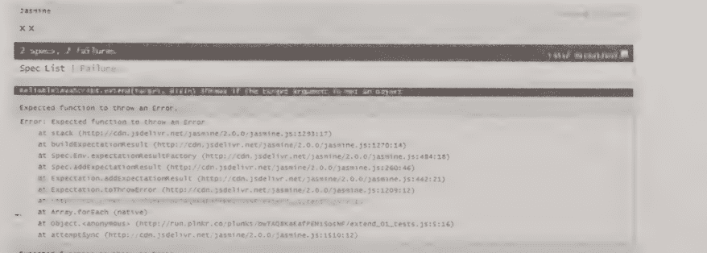

图 20-1

列表 20-3 实现了对 `target` 和 `mixin` 是对象的验证，预期的消息也被添加到了 `extend` 函数的 `messages` 属性中。

### 列表 20-3：验证 `target` 和 `mixin` 是对象的实现（代码文件名：extend_01.js）

```javascript
var ReliableJavaScript = ReliableJavaScript || {};

ReliableJavaScript.extend = function(target, mixin) {
  'use strict';

  if (typeof(target) !== "object") {
    throw new Error(ReliableJavaScript.extend.messages.targetNotObject);
  }

  if (!mixin || typeof(mixin) !== "object") {
    throw new Error(ReliableJavaScript.extend.messages.mixinNotObject);
  }
};

ReliableJavaScript.extend.messages = {
  targetNotObject: "target is not an object",
  mixinNotObject: "mixin is not an object"
};
```

列表 20-3 中的守护语句确保了 `target` 和 `mixin` 已定义。图 20-2 显示这些子句允许单元测试通过。


图 20-2

下一步是确保当 `mixin` 参数为空对象时，`extend` 方法能够正常运行。当 `mixin` 为空时，`target` 不应该被改变。列表 20-4 单元测试验证了这一功能。

### 列表 20-4：确保 `mixin` 为空对象时 `target` 不改变的测试（文件名：ReliableJavaScript.extend_02_tests.js）

```javascript
describe("ReliableJavaScript.extend(target, mixin)", function() {
  'use strict';

  it("does not modify target when mixin is empty", function() {
    var target = { a: 1 };
    ReliableJavaScript.extend(target, {});
    expect(target).toEqual({ a: 1 });
  });
});
```


# 第 20 章 确保正确使用 Mixins

```javascript
describe("ReliableJavaScript.extend(target, mixin)", function() {
  /** 之前讨论过的测试 **/
  it("如果 mixin 是空对象，不改变 target", function() {
    var target = {
      property: "a property",
      method1: function method1() {
        return "a method"
      }
    };
    method = target.method1;
    ReliableJavaScript.extend(target, {});

    // 确保 target 没有添加或删除任何键
    expect(Object.keys(target).sort()).toEqual(["method1", "property"]);

    // 确保 target 的功能没有改变
    expect(target.property).toEqual("a property");
    expect(target.method1).toEqual(method);
  });
});
```

列表 20-4 添加的测试用空对象扩展了 `target`。它通过确保 `target` 的键没有改变，验证了没有属性被添加到或从 `target` 中移除。最后，测试确保了 `target` 属性的功能没有改变。

由于 `extend` 的当前实现仅仅确保了提供了 `target` 和 `mixin`，新测试通过了，如图 20-3 所示。


图 20-3

下一个测试验证了相反的情况：带有属性的 `mixin` 正确扩展了空 `target`。列表 20-5 提供了此项测试。

> 列表 20-5：确保空对象 `target` 被正确扩展的测试（代码文件名：extend_03_tests.js）。

```javascript
describe("ReliableJavaScript.extend(target, mixin)", function() {

  /** 之前讨论过的测试 **/

  it("向空 target 添加属性", function() {
    var target = {};
    mixin = {
      property1: "first property",
      property2: "second property",
      method1: function method1() {
        return "first method";
      },
      method2: function method2() {
        return "second method"
      }
    };
    ReliableJavaScript.extend(target, mixin);

    // 因为 target 初始是空的，它应该等于 mixin
    expect(target).toEqual(mixin);
  });
});
```

列表 20-5（继续）

这扩展了初始化为空对象的 `target`，而 `mixin` 包含多个属性——包括函数和数据。

由于 `target` 初始是空的，测试可以通过确保在扩展发生后 `target` 和 `mixin` 等效，来确保 `mixin` 的属性已复制到 `target` 中。语句：

`expect(target).toEqual(mixin);`

执行了测试。这个新测试在 `extend` 的当前实现下失败，如图 20-4 所示。


图 20-4

列表 20-6 中的代码改进了 `extend` 的实现以适应此新测试。

> 列表 20-6：让 extend 复制 mixin 的属性到 target 中（代码文件名：extend_03.js）

```javascript
var ReliableJavaScript = ReliableJavaScript || {};

ReliableJavaScript.extend = function(target, mixin) {
  'use strict';

  if (typeof(target) !== "object") {
    throw new Error(ReliableJavaScript.extend.messages.targetNotObject);
  }
  if(!mixin || typeof(mixin) != "object") {
    throw new Error(ReliableJavaScript.extend.messages.mixinObject);
  }
  ReliableJavaScript.extend.messages = {
    targetNotObject: "target is not an object",
    mixinObject: "mixin is not an object"
  };

  for(var item in mixin){
    target[item] = mixin[item];
  }
};
```

列表 20-6 中引入到 `extend` 的循环简单但强大。它遍历 `mixin` 的属性并将其添加到 `target`。新的实现满足了所有单元测试，如图 20-5 所示。

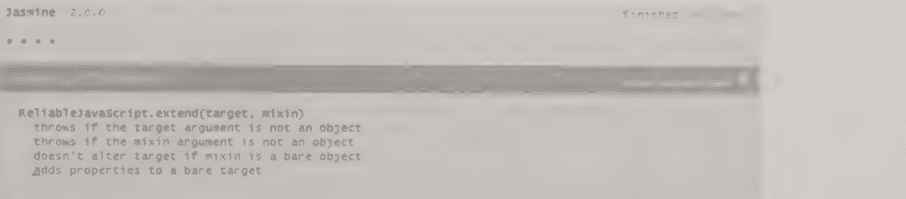
图 20-5

虽然 mixins 提供了一种方便的代码复用机制，当你尝试确定对象的来源时，它们会引入复杂性。为了减少这种复杂性，我们倾向于只复制 `mixin` 直接定义的属性。

列表 20-7 提供了一个测试，确保 `mixin` 继承的属性没有复制到 `target`。

> 列表 20-7：确保 mixin 继承的属性未复制到 target 的测试（代码文件名：Mixin_extend_04_tests.js）

```javascript
describe("ReliableJavaScript.extend(target, mixin)", function() {
  /** 之前讨论过的测试 **/
  it("不添加 mixin 继承的属性", function() {
    var target = {};

    mixinBase = {
      baseProperty: "base property",
      baseMethod: function baseMethod(){
        return "this is the base method";
      }
    }

    // 使用 mixinBase 作为原型创建 mixin 对象
    mixin = Object.create(mixinBase);

    mixin.mixinProperty = "mixin property";
    mixin.mixinMethod = function mixinMethod(){
      return "this is the mixin method"
    }

    ReliableJavaScript.extend(target, mixin);

    // 确保 target 只包含 mixin 对象的键
    // 它不应该包含来自 mixinBase 的任何属性
    expect(Object.keys(target).sort()).toEqual(["mixinMethod", "mixinProperty"]);
  });
});
```

列表 20-8 展示了一个修改后的 `extend` 函数，它只拷贝直接定义在 mixin 上的属性。

> 列表 20-8：不拷贝 mixin 继承属性的 extend 实现（代码文件名: Mix/extend_04.js）

```javascript
var ReliableJavaScript = ReliableJavaScript || {};
ReliableJavaScript.extend = function(target, mixin) {
  'use strict';

  if(!target || typeof(target) !== "object") {
    throw new Error(ReliableJavaScript.extend.messages.targetNotObject);
  }

  if(!mixin || typeof(mixin) !== "object") {
    throw new Error(ReliableJavaScript.extend.messages.mixinNotObject);
  }

  for(var item in mixin) {
    if(mixin.hasOwnProperty(item)) {
      target[item] = mixin[item];
    }
  }
  ReliableJavaScript.extend.messages = {
    targetNotObject: "target is not an object",
    mixinNotObject: "mixin is not an object"
  };
};
```

列表 20-8 引入了一个条件：只有当属性直接定义在 mixin 上时，它才会从 mixin 拷贝到 target。图 20-7 显示，添加的这个条件允许单元测试通过。

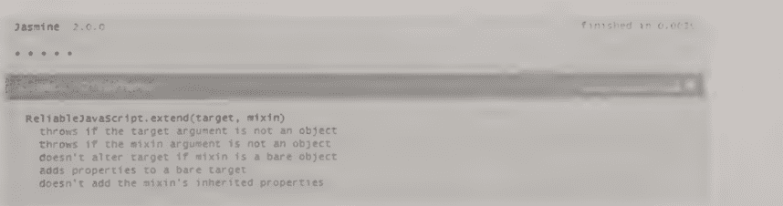

图 20-7

你可能已经注意到 `extend` 的一个方面是，它盲目地将其从 mixin 移动的属性赋值给 target 的属性。如果 target 恰好已经拥有 mixin 提供的属性，target 的属性将被 mixin 提供的属性覆盖。

`extend` 函数的这种行为由 jQuery 库 (`http://api.jquery.com/jquery/extend/`) 和 underscore 库 (`http://underscore.org/#extend`) 均提供。

我们不认为这种行为有助于提高可靠性。由于对象在其生命周期内的任何时候都可能被 mixin 扩展，改变对象现有属性的 mixin 可能会对那些感知到已应用 mixin 的代码产生负面影响。

因此，这里展示的 `extend` 实现将被进行修改，以便如果应用 mixin 会覆盖 target 的现有属性，则会抛出错误。列表 20-9 中的测试验证了这种行为。

> 列表 20-9：确保当 mixin 覆盖现有属性时会抛出错误的测试（代码文件名: Mixin_extend_05_tests.js）

```javascript
describe("ReliableJavaScript.extend(target, mixin)", function() {
  /** 略过之前讨论过的测试 **/
  it("throws if the mixin will replace an 'own property'", function() {
    var target = {
      property1 : "property 1",

      // target 和 mixin 都定义了 method1
      method1 : function method1() {
        return "method 1";
      }
    };

    mixin = {
      property2 : "property 2",

      // target 和 mixin 都定义了 method1
      method1 : function method1() {
        return "mixin's method 1";
      }
    };

    expect(function() {
      ReliableJavaScript.extend(target, mixin);
    }).toThrow(ReliableJavaScript.extend.messages.triedToReplace + "method1");
  });

  it("throws if the mixin will replace an inherited property", function() {
    var targetBase = {
      baseProperty : "base property",
      baseMethod : function baseMethod() {
        return "baseMethod";
      }
    };
    target = Object.create(targetBase);
    mixin = {
      // target 从 targetBase 继承 baseProperty
      baseProperty : "property 2",
      method2 : function method2() {
        return "mixin's method 2";
      }
    };

    expect(function() {
      ReliableJavaScript.extend(target, mixin);
    }).toThrow(
      ReliableJavaScript.extend.messages.triedToReplace + "baseProperty"
    );
  });
});
```

列表 20-9 中的两个测试确保了当 mixin 替换 target 的属性时，预期的函数会抛出适当的错误。第一个测试确保了如果 mixin 替换的属性是直接定义在 target 上的，就会抛出错误。第二个测试确保了如果 mixin 替换的属性是 target 继承的，也会抛出错误。图 20-8 显示，这些测试在当前的 `extend` 实现下是失败的。

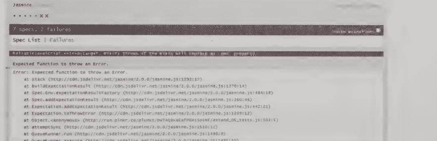
图 20-8

```
ReliableJavaScript.extend(target, mixin); mixin 将替换一个继承的属性

Expected function to throw an error.
  at stack (https://cdn.jsdelivr.net/jasmine/2.0.0/jasmine.js:1391:17)
  at Spec.expectations(beginExpectations) (http://cdn.jsdelivr.net/jasmine/2.0.0/jasmine.js:12710:54)
  at Spec.expectationFactory(http://cdn.jsdelivr.net/jasmine/2.0.0/jasmine.js:4841:18)
  at Spec.addExpectation(http://cdn.jsdelivr.net/jasmine/2.0.0/jasmine.js:31668:3)
  at Spec.expectations(beginExpectations) (http://cdn.jsdelivr.net/jasmine/2.0.0/jasmine.js:12710:54)
  at Spec.expectationFactory(http://cdn.jsdelivr.net/jasmine/2.0.0/jasmine.js:4841:18)
  at Spec.addExpectation(http://cdn.jsdelivr.net/jasmine/2.0.0/jasmine.js:31668:3)
  at ReliableJavaScript.extend(target, mixin);
```

# 创建和使用 Mixins

## 列表 20-12: 更新 UpdateMixin 返回包含预期属性的对象（代码文件名: Mixin\idMixin_01.js）

```javascript
var Conference = Conference || {};
Conference.mixins = Conference.mixins || {};

Conference.mixins.idMixin = function() {
  'use strict';

  return {
    id: null,
    getID: null,
    setID: null
  };
};
```

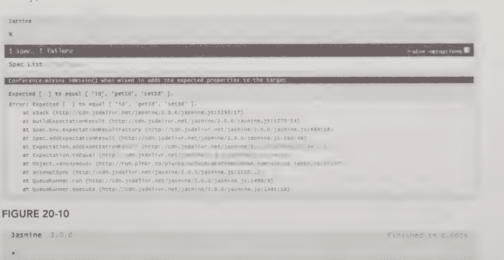
图 20-9

当混合 `Conference.idMixin()`时为目标对象添加预期的属性

预期：[object] 等于 ['id', 'getID', 'setID']

错误：预期 [{}] 等于 ['id', 'getID', 'setID']

at at stack (http://cdn.jsdelivr.net/jasmine/2.0.0/jasmine.js:323:57)

at buildSpecExpectations (http://cdn.jsdelivr.net/jasmine/2.0.0/jasmine.js:279:144)

at at spec.expectationContext (http://cdn.jsdelivr.net/jasmine/2.0.0/jasmine.js:448:18)

at at spec.expectationContext (http://cdn.jsdelivr.net/jasmine/2.0.0/jasmine.js:260:46)

at at expectation (http://cdn.jsdelivr.net/jasmine/2.0.0/jasmine.js:226:23)

at at expectation.anonymous (http://cdn.jsdelivr.net/jasmine/2.0.0/jasmine.js:333:23)

at at object.anonymous (http://run.plugin/jasmine-html-reporter/index.js:443:115)

at at anonymous (http://cdn.jsdelivr.net/jasmine/2.0.0/jasmine.js:510:22)

at at QuantumRunner.run (http://cdn.jsdelivr.net/jasmine/2.0.0/jasmine.js:1498:5)

at at QuantumRunner.execute (http://cdn.jsdelivr.net/jasmine/2.0.0/jasmine.js:188:10)

图 20-10

```javascript
Jasmine 2.0.0

Conference.mixins
  idMixin()
  当混合时
    为目标对象添加预期的属性
```

图 20-11

正如 attendee 模块实现的那样，如果在设置 attendee ID 之前调用 getID 方法，该方法将返回 `undefined`。一旦调用了 setID，后续执行 getID 应该返回传递给 setID 的值。列表 20-13 中的测试验证了这一功能。

## 列表 20-13: 确保 getID 和 setID 正确性的测试（代码文件名: Mixin\idMixin_02_tests.js）

```javascript
describe("Conference.mixins", function() {
  'use strict';

  var target,
  mixin;

  describe("idMixin()", function() {
    /** 省略了之前讨论过的设置 **/
    describe("当混合时", function() {
      /** 省略了之前讨论过的测试 **/
      describe("getId() & setId(id)", function() {
        it("如果还没有调用过 setId(idValue)，则 getId() 返回 undefined",
          function() {
            expect(target.getId()).toBe(undefined);
        });

        it("getId() 返回由 setId(idValue) 设置的值",
          function() {
            var id = "theid";
            target.setId(id);
            expect(target.getId()).toEqual(id);
        });
      });
    });
  });
});
```

列表 20-13 中的第一个测试确保了，如果之前没有通过调用 setId 设置过 ID，则 getId 返回的值将是 `undefined`。列表中的第二个测试验证了 getId 返回的是传递给 setId 的 ID。图 20-12 显示这些测试目前是失败的。

允许测试通过的 idMixin 实现非常直观，并出现在列表 20-14 中。

## 列表 20-14: idMixin 的完整实现（代码文件名: Mixin\idMixin_02.js）

```javascript
var Conference = Conference || {};
Conference.mixins = Conference.mixins || {};

Conference.mixins.idMixin = function() {
  'use strict';

  return {
    id: undefined,
    getId: function getId() {
      return this.id;
    },
    setId: function setId(idValue) {
      this.id = idValue;
    }
  };
};
```

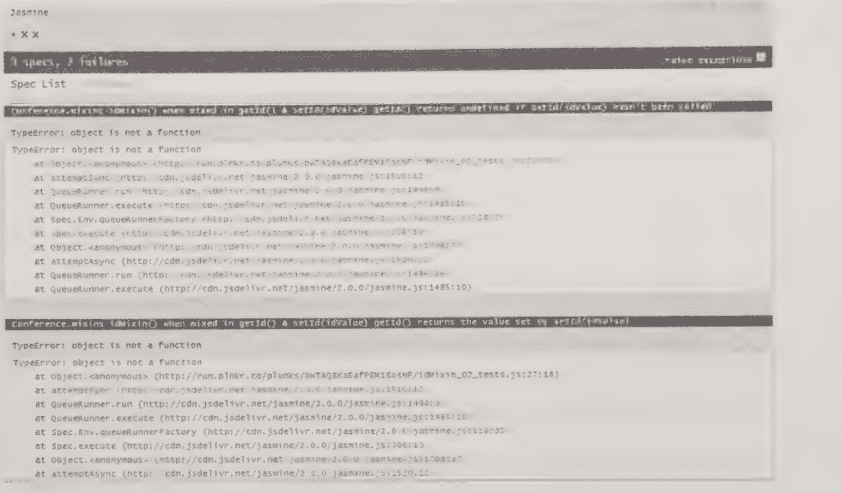
图 20-13

更新后的 idMixin 实现将 id 初始化为 `undefined`，并提供了 getId 和 setId 的相应实现。

记住，extend 将 mixin 的属性复制到目标对象的属性中。因此，当执行 mixin 为目标提供的方法时，这将绑定到目标对象（只要方法是通过目标对象执行的）；更多详情请参阅第 18 章。idMixin 保证包含 getId 和 setId 方法的对象也将包含 mixin 提供的 id 属性。

> 注意：如果 mixin 依赖目标提供某个属性，那么它需要确保目标包含该属性才能完全可靠。我们在第 19 章讨论方法借用时遇到过相同的问题。仅依赖于自身提供的属性的 mixin 比那些要求目标提供某些属性的 mixin 更简单且更可靠。

列表 20-14 所示的 idMixin 实现允许所有单元测试通过，如图 20-13 所示。在完整实现 idMixin 后，最后一步将其集成到 attendee 模块中。列表 20-15 包含了来自第 6 章 attendee 模块原始单元测试的片段。

## 列表 20-15: attendee 模块原始单元测试的片段（代码文件名: attendee_tests.js）

```javascript
describe('attendee', function() {
  'use strict';

  var attendee, firstName;

  beforeEach(function() {
    attendee = {
      firstName: 'Tom',
      lastName: 'Jones'
    };
  });

  it('should get the first name', function() {
    expect(attendee.FirstName()).toBe('Tom');
  });

  it('should set the first name', function() {
    attendee.setFirstName('Jane');
    expect(attendee.FirstName()).toBe('Jane');
  });

  it('should get the last name', function() {
    expect(attendee.getLastName()).toBe('Jones');
  });

  it('should set the last name', function() {
    attendee.setLastName('Doe');
    expect(attendee.getLastName()).toBe('Doe');
  });

  it('should get the full name', function() {
    expect(attendee.getFullName()).toBe('Tom Jones');
  });

  it('should check if checked in', function() {
    expect(attendee.isChecked()).toBe(false);
  });

  it('should mark as checked in', function() {
    attendee.checkIn();
    expect(attendee.isChecked()).toBe(true);
  });

  it('should unmark as checked in', function() {
    attendee.checkIn();
    attendee.unCheckIn();
    expect(attendee.isChecked()).toBe(false);
  });
});
```

正如你所看到的，idMixin 提供了目标所需的 getId 和 setId 方法。由于 attendee 这样实现，这会导致测试失败，如图 20-14 所示。列表 20-16 展示了如何将 idMixin 引入 attendee 模块。

## 列表 20-16: 使用 idMixin 扩展 attendee（代码文件名: Mixin\idMixin.js）

```javascript
var Conference = Conference || {};
Conference.attendee = function(firstName, lastName) {
  'use strict';

  var checkedIn = false,
  firstName = firstName,
  lastName = lastName,

  attendee = {
    getFullName: function() {
      return firstName + ' ' + lastName;
    },

    isChecked: function() {
      return checkedIn;
    },

    checkIn: function() {
      checkedIn = true;
    },

    unCheckIn: function() {
      checkedIn = false;
    },

    setInNumber: function(number) {
      checkedInNumber = number;
    },

    getInNumber: function() {
      return checkedInNumber;
    }
  };

  // 使用 idMixin 扩展 attendee
  ReliableJavaScript.extend(attendee, Conference.mixins.idMixin());

  // 返回扩展后的 attendee
  return attendee;
};
```

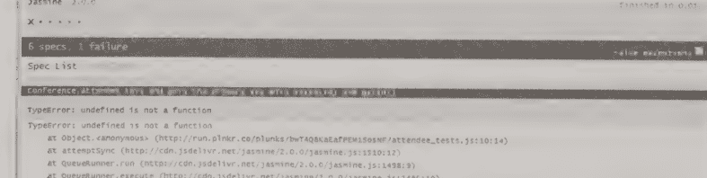
图 20-14

attendee 模块不再立即返回对象，而是将包含特定属性的对象赋值给 `attendee`。然后它用 idMixin 返回的对象扩展 `attendee`，提供了之前定义的 getId/setId 功能。最后，返回扩展后的 `attendee` 对象。图 20-15 显示 attendee 单元测试再次通过。

```javascript
Jasmine 2.0.0

Conference.mixins
  idMixin()
  当混合时
    为目标对象添加预期的属性
  如果还没有调用过 setId(id)，则 getId() 返回 undefined
  getId() 返回由 setId(id) 设置的值
```

图 20-15

与传统的混入（mixins）不同，函数式混入（functional mixins）设计用于将自身添加到它们所扩展的对象；不需要使用 `extend`（或类似的方法）。然而，这种方法的缺点是，每个函数式混入都必须验证被扩展的对象是否已经拥有它所提供的属性。传统的混入可以依赖我们对 `extend` 方法行为的实现，即验证混入不会覆盖被扩展对象的属性。

在掌握这些知识后，你需要编写的第一批测试是确保函数式混入 `addId` 不会覆盖任何现有属性，而是抛出错误。这些测试出现在列表 20-17 中。

## 列表 20-17：确保 addId 抛出错误而非覆盖现有属性的测试（代码文件名：Mixin_addId_01_tests.js）

```javascript
describe("Conference.mixins", function() {
  'use strict';

  var target;

  describe("addId()", function() {
    beforeEach(function() {
      target = {};
    });

    it("throws if target.getId already exists", function() {
      target.getId = function() {};
      expect(function shouldThrow() {
        Conference.mixins.addId.call(target);
      }).toThrow(
        Conference.mixins.addId.messages.triedToReplace + "getId"
      );
    });

    it("throws if target.setId already exists", function() {
      target.setId = function() {};
      expect(function shouldThrow() {
        Conference.mixins.addId.call(target);
      }).toThrow(
        Conference.mixins.addId.messages.triedToReplace + "setId"
      );
    });
  });
});
```

这两个测试按照你预期的方式实现了。第一个测试尝试扩展一个已经实现了 `getId` 的目标，第二个尝试扩展一个已经实现了 `setId` 的函数。这两个测试都确保了生成了正确的错误信息。

使用 `addId` 混入扩展 `target` 的机制应该为 `addId` 如何实现提供提示（或者如果你读过 Angus 的博客文章，你已经知道了）：

`Conference.mixins.addId.call(target);`

测试通过 `call` 执行 `addId`，并将被扩展的对象作为使用的上下文。在第 18 章详细描述的 `call` 方法将函数内部 `this` 绑定到上下文对象，在本例中为 `target`。`addId` 混入将通过操作此处将自身添加到 `target` 中。

使用 `addId` 的存根实现时，单元测试会失败，见图 20-16。

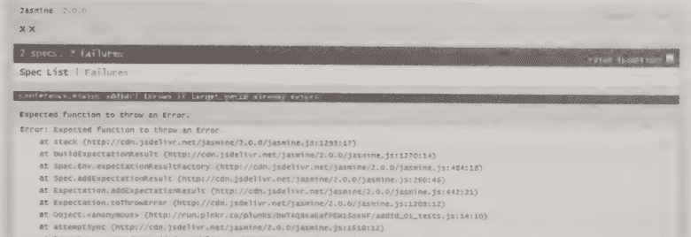
图 20-16

## 列表 20-18：确保属性不被覆盖的 addId 初始实现（代码文件名：Mixin.addId_01.js）

```javascript
var Conference = {};
Conference.mixins = Conference.mixins || {};

Conference.mixins.addId = function() {
  'use strict';

  if(this.getId) {
    throw new Error(Conference.mixins.addId.messages.triedToReplace + "getId");
  }
  if(this.setId) {
    throw new Error(Conference.mixins.addId.messages.triedToReplace + "setId");
  }
  Conference.mixins.addId.messages = {
    triedToReplace: "mixin attempted to replace the existing property: "
  };
};
```

由于这已经绑定到了被扩展的对象，`addId` 函数只需要检查该对象的属性，以确保现有属性不会被覆盖。

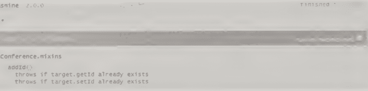
图 20-17

图 20-17 显示这些检查允许单元测试通过。

最后，还需要编写验证以下内容的测试：

- `getId` 和 `setId` 被添加到了扩展的对象中。
- 如果没有设置 ID，`getId` 返回 `undefined`。
- `getId` 和 `setId` 能够正确工作。

除了属性验证外，这些测试与传统混入的测试相同。测试在列表 20-19 中。

## 列表 20-19：验证 addId 为扩展的对象提供适当功能的的测试（代码文件名：Mixin_addId_02_tests.js）

```javascript
describe("Conference.mixins", function() {
  'use strict';

  var target;

  describe("addId()", function() {
    beforeEach(function() {
      target = {};
    });
    /** 之前讨论过的测试省略 **/

    describe("when mixed in to a single object", function() {
      beforeEach(function() {
        // 使用绑定的 target 执行 addId
        Conference.mixins.addId.call(target);
      });

      it("adds the expected properties to the target", function() {
        expect(Object.keys(target).sort()).toEqual(["getId", "setId"]);
      });

      describe("getId() & setId", function() {
        it("getId() returns undefined if setId hasn't been called", function() {
          expect(target.getId()).toBeUndefined();
        });

        it("getId() returns the value set by setId()", function() {
          target.setId(123);
          expect(target.getId()).toBe(123);
        });
      });
    });
  });
});
```

## 列表 20-20：addId 的完整实现（代码文件名：Mixin\addId_02.js）

```javascript
var Conference = Conference || {};
Conference.mixins = Conference.mixins || {};

Conference.mixins.addId = function() {
  'use strict';

  if(this.getId) {
    throw new Error(Conference.mixins.addId.messages.triedToReplace + "getId");
  }
  if(this.setId) {
    throw new Error(Conference.mixins.addId.messages.triedToReplace + "setId");
  }

  this.id = undefined;
  this.getId = function getId() {
    return this.id;
  };
  this.setId = function setId(idValue) {
    this.id = idValue;
  };
};

Conference.mixins.addId.messages = {
  triedToReplace: "mixin attempted to replace the existing property: "
};
```

## 列表 20-21：使用 addId 扩展 attendee（代码文件名: Mixin\attendee.js）

```javascript
var Conference = Conference || {};
Conference.attendee = function(firstName, lastName) {
  'use strict';

  var checkedIn = false,
      firstName = firstName,
      lastName = lastName,
      checkedInNumber = 0;

  var newAttendee = {
    getFullName: function() {
      return firstName + ' ' + lastName;
    },

    isChecked: function() {
      return checkedIn;
    },

    checkIn: function() {
      checkedIn = true;
    },

    unCheckIn: function() {
      checkedIn = false;
    },

    setCheckInNumber: function(number) {
      checkedInNumber = number;
    },
    getCheckInNumber: function() {
      return checkedInNumber;
    }
  };

  Conference.mixins.addId.call(newAttendee);
  return newAttendee;
};
```

再次，attendee 模块捕获了包含 `newAttendee` 特有属性的对象。然后，它通过调用 `addId` 来扩展 `newAttendee`，并将 `newAttendee` 作为要绑定的对象传入。`addId` 函数型混入为 `newAttendee` 添加了 `getId` 和 `setId` 方法。最后，返回扩展后的 `newAttendee`。由于它没有被添加为扩展对象的属性，因此用于 ID 的变量只能通过 `setId` 方法进行更改。

图 20-20 显示 attendee 的单元测试均已通过。

```javascript
Jasmine 2.0.0

describe Conference.attendee
  使用 setId(ID) 和 getId() 设置和获取主键
  使用 getFullName() 提供全名
  初始状态未签到
  调用 checkIn() 后标记为已签到
  调用 unCheckIn() 后不再为已签到
  使用 setCheckInNumber() 设置签到次数
```

图 20-20

## 总结

本章探讨了如何通过混入（mixins）将通用功能（如唯一标识符的维护）隔离到混合对象中，从而实现 JavaScript 代码去重复（DRY）。

一旦被适当隔离到混入中，可以通过以下方式添加到需要它的对象中：在传统混入中，通过一个函数扩展另一个对象；在函数型混入中，则直接由混入本身添加。

本章还讨论了如何识别适合隔离到混入的功能，即该功能不依赖于其将要混合的对象的具体实现。我们还解释了 jQuery underscore 库所提供的扩展方法的一个潜在陷阱：静默替换现有属性。随后，我们在本章实现的 `extend` 版本中避免了这一陷阱。

此外，我们还通过重构 attendee 模块，演示了如何通过传统混入和函数型混入对对象进行扩展。

在编写混入（无论是传统的还是函数型的）时，务必编写单元测试以确保：

- 目标对象上的属性不会被混入覆盖。
- 如果目标对象提供了混入依赖的属性，则这些属性应当存在。
- 预期的属性已混入。
- 混入的函数行为正确。

在下一章中，我们将处理确保基于中介者（mediator）和基于观察者（observer）的复杂程序架构可靠性的挑战性方面。

# 测试高级程序架构

本章内容：

- 学习观察者模式（Observer Pattern）如何实现松耦合代码
- 通过参数检查提高观察者模式的可靠性
- 使用中介模式编写游戏
- 使用接口隔离原则简化中介模式的开发
- 对中介者及其协作类进行单元测试

本章的 WROX.COM 代码下载

本章的 wrox 代码下载可以在 www.wrox.com/go/reliablejavascript 的“Download Code”选项卡中找到。文件位于第 21 章下载包中，并根据本章各处的文件名单独命名。

你编写的大多数程序可能是为了实现某些目标而编写的。架构可能是和你学习面向对象编程时学到的常规、自顶而下的类型。你在本章中将考虑的架构是不同的。它们允许独立部分以去中心化的方式进行交互。整体目标的实现就像魔法一样。

所涉及的模式被称为观察者模式和中介者模式。它们的相似之处在于都是去中心化的，但通信手段有所不同。

# 确保可靠地使用观察者模式

如果你订阅了日报递送，你就参与了观察者模式的现实实现。通过向报纸出版者发送订阅卡，你通知了出版者你希望每天将报纸递送到你家中。

一旦你的地址出现在出版者的列表中，你就不需要做其他事情了。每当报纸准备好时，出版者会将一份副本寄送到你的地址以及列表中的其他每个地址。

如果你决定停止每日递送，你所只需请求出版者从其地址列表中删除你的地址。出版者维护的地址列表随着新订阅的增加和现有订阅的取消而定期扩大或缩小。

你与出版者关系的一个重要方面是，出版者关于你（以及你的任何其他订阅者）知道知道报纸递送的地址。出版者不知道你的房子是蓝色的、是砖砌的，还是有三层楼。报纸的递送并不依赖于你房屋的任何这些特征。你可以改变房屋的颜色或添加一盆花，报纸会继续送达。

如果你用《设计模式》（Design Patterns）中的术语来描述报纸订阅示例，你会发现：

- 报纸出版者是拥有许多依赖项的对象。
- 报纸订阅者是依赖项。
- 日报的发布是状态的变化。
- 报纸的递送是对依赖的通知和更新。

可靠软件开发者的目标之一是尽可能减少对象之间依赖项的数量和范围。你可能注意到，《设计模式》中描述的模式使用了“依赖”（dependency）一词不是一次，而是三次。这意味着应该避免使用它吗？绝对不是。

事实上，观察者模式最有吸引力的特征之一是，主体（状态改变的对象）与其观察者（被通知状态改变的依赖项）之间的依赖关系是有良好定义的。在本节中，我们将向你展示使用观察者模式如何导致松耦合的代码。

## 检查观察者模式

观察者模式由两个部分组成：

- 被观察的对象（主体）
- 观察主体的对象（观察者）

为了支持观察，主体必须提供：

- 观察者注册自身以接收通知的能力
- 观察者注销自身以停止接收通知的能力
- 主体向其观察者发送更新的能力

此外，观察者必须提供一个用户可以调用的方法。

> 注意：主体系和观察者通常会提供与它们解决的问题相关的其他功能，但列出的功能是它们参与观察者模式所需的。

假设 JavaScript 大会的组织者请求查看注册信息的功能。他们希望能够以以下两种方式显示数据：

- 显示注册总人数的计数器
- 最近注册者的姓名列表

还有一个额外的要求是，组织者希望信息在不需要刷新浏览器的情况下进行近实时更新。

“你可以写一个独立的模块，负责轮询新注册者，”Charlotte 建议道。轮询模块允许其他模块注册更新；它将成为观察者模式中的主体。显示模块将成为观察者。

你的第一个任务是创建一个在该观察者模式实现中充主体体的模块：`recentRegistrationsService` 负责定期轮询服务器，并检索自上次轮询以来注册的参与者。此外，因为它作为主体参与了观察者模式，`recentRegistrationsService` 还必须提供观察者订阅和取消订阅的能力，以及在有新参与者注册时通知每个观察者的能力。

`recentRegistrationsService` 的实现见列表 21-1。

## 列表 21-1：最近的 RegistrationsService (代码文件名: Observer\recentRegistrationsServices.js)

```javascript
var Conference = Conference || {};
Conference.recentRegistrationsService = function(registrationsService){
  'use strict';
  var registeredObservers = [];
  var service = {
    // 将观察者添加到观察者列表中，当有新参与者注册时
    // 将接收通知。
    addObserver: function addObserver(observer){
      return registeredObservers.push(observer);
    },

    // 如果观察者存在，则从观察者列表中移除。
    removeObserver: function removeObserver(observer){
      var index = registeredObservers.indexOf(observer);
      if(index >= 0)
        registeredObservers.splice(index, 1);
    },

    // 移除所有观察者
    clearObservers: function clearObservers(){
      registeredObservers = [];
    },

    // 如果提供的观察者已注册，则返回 true
    // 否则返回 false。
    hasObserver: function hasObserver(observer){
      return registeredObservers.indexOf(observer) >= 0;
    },

    // 执行每个注册观察者提供的 update 方法，
    // 将新注册的参与者 newAttendee 作为参数传递。
    updateObservers: function updateObservers(newAttendee){
      registeredObservers.forEach(function executeObserver(observer){
        observer.update(newAttendee);
      });
    },

    // 导致服务停止轮询。一旦停止轮询，
    // 它可能无法重启。
    stopPolling : function(){
      if(pollingProcess)
        clearInterval(pollingProcess);
      pollingProcess = false;
    }
  };

  var getNewAttendees = function getNewAttendees() {
    // 调用服务器并检索且返回一个 promise，
    // 该 promise 返回自上次轮询以来注册的参与者
    // 数组
    return new Promise(function(resolve, reject) {
      // 省略了与服务器通信的代码。
      resolve([]);
    });
  };

  var pollingProcess = setInterval(function pollForNewAttendees() {
    getNewAttendees().then(function processNewAttendees(newAttendees) {
      newAttendees.forEach(function updateWithNewAttendee(newAttendee) {
        service.updateObservers(newAttendee);
      });
    });
  }, 15000);

  return service;
};
```

recentRegistrationsService 模块提供了表 21-1 所示的公共方法，允许它在观察者模式中充当主体（subject）。

## 表 21-1：允许 recentRegistrationsService 作为主体的方法

| 方法 | 说明 |
| :--- | :--- |
| addObserver(observer) | 将观察者添加到观察者列表，每当有参与者注册时都将接收更新 |
| removeObserver(observer) | 从观察者列表中移除观察者，使其不再接收每当有参与者注册时的更新 |
| updateObservers(newAttendee) | 执行每个观察者的 update 方法，并将 newAttendee 作为参数传递 |

除了作为主体运行所需的方法外，recentRegistrationsService 还提供了额外的公共方法（如表 21-2 所示），这些方法对于参与观察者模式并不是严格要求的。

## 表 21-2：recentRegistrationsService 的便利方法

| 方法 | 说明 |
| :--- | :--- |
| clearObservers() | 从观察者列表中移除所有观察者 |
| hasObserver(observer) | 如果观察者已注册接收 recentRegistrationsService 的更新，返回 true，否则返回 false |
| stopPolling() | 清除用于轮询服务器的定时器 |

除了暴露表 21-1 和表 21-2 中的公共方法外，recentRegistrationsService 模块还有一个私有方法 `getNewAttendees`，它负责与服务器通信并检索最新的注册者。

在向调用者返回服务实例之前，会执行以下操作：

```javascript
pollingProcess = setInterval(function pollForNewAttendees() {
  getNewAttendees().then(function processNewAttendees(newAttendees) {
    newAttendees.forEach(function updateWithNewAttendee(newAttendee) {
      service.updateObservers(newAttendee);
    });
  });
}, 15000);
```

之前的代码段使用 `setInterval` 设置了一个循环操作，每 15 秒执行一次 `getNewAttendees`。定时器的 ID 保留在 `pollingProcess` 中，以便取消轮询。如果过去 15 秒内没有参与者注册，getNewAttendees 返回的 promise 将解析为一个空元素的数组。如果有注册，数组将包含一个或多个元素，代表一个新注册的参与者。对于每个新注册，都会执行 service 的 update 方法并将新参与者作为参数。

> 注意：虽然使用了测试驱动开发来创建 recentRegistrationsService，但为了简明起见，我们省略了该过程的逐步描述。这导致我们生成的 recentRegistrationsService 的实现可以在 Observer\recentRegistrationsService_initialTests.js 中找到。

图 21-1 显示所有测试均已通过。


图 21-1

在有了功能正常的 recentRegistrationsService（即此观察者模式实现中的主体），下一步是创建显示总注册计数和最近十条注册记录的模块。这些模块在该观察者模式的实现中充当观察者。

## 列表 21-2：totalAttendeeCount 的单元测试（代码文件名: Observer\totalAttendeeCount_tests.js）

```javascript
describe("totalAttendeeCount", function() {
  'use strict';

  var service, module;

  beforeEach(function() {
    service = Conference.recentRegistrationsService();
    service.stopPolling();
  });

  it("初始计数为 0", function() {
    module = Conference.totalAttendeeCount(service);
    expect(module.getCount()).toBe(0);
  });

  it("每次调用 update 时增加计数", function() {
    module = Conference.totalAttendeeCount(service);
    module.update({});
    module.update({});
    expect(module.getCount()).toBe(2);
  });
});
```

## 列表 21-3：totalAttendeeCount 的实现（代码文件名: Observer\totalAttendeeCount.js）

```javascript
var Conference = Conference || {};

Conference.totalAttendeeCount = function totalAttendeeCount(registrations) {
  'use strict';

  var count = 0;

  var module = {
    getCount: function getCount() {
      return count;
    },

    update: function update(newAttendee) {
      count++;
    }
  };

  registrations.addObserver(module);

  return module;
};
```

从列表 21-3 中你应该收获的一点是，让 `totalAttendeeCount` 模块成为一个观察者所需的代码非常少。`totalAttendeeCount` 模块只需要提供一个接受参会者的更新函数，并将自身添加为 `recentRegistrationsService` 实例的观察者即可。

图 21-2 显示，列表 21-3 中 `totalAttendeeCount` 的实现允许列表 21-2 中的单元测试通过。


图 21-2

| 方法 | 描述 |
| :--- | :--- |
| conference.totalAttendeeCount | 将自身添加为 recentRegistrationsService 的观察者 |
| getCount() | 如果 update() 未被调用，则返回初始计数 |
| update(newAttendee) | 增加参会者计数 |

现在 `recentRegistrationsService` 和 `totalAttendeeCount` 都有了通过的单元测试套件，我们已经达到了可靠性的极限，对吧？不，不完全。下一节将检查还可以做哪些工作来帮助完善这一观察模式实现的缺陷。

# 增强观察模式的可靠性

考虑 `recentRegistrationsService` 中的 `addObserver` 函数：

```javascript
addObserver: function addObserver(observer) {
  return registeredObservers.push(observer);
}
```

如果 `observer` 没有实现参与观察模式所需的 `update` 函数会发生什么？它会很顺利地被添加到注册用户列表中。然而，当 `recentRegistrationsService` 需要更新其所有观察者时，它将遇到无效的观察者并生成一个错误。这听起来并不很可靠，不是吗？

雪上加霜的是，调试这个问题是困难的，因为错误在尝试第一次更新时才会发生。如果能在无效观察者被添加时就发生错误，将会有帮助得多。

通过在 `addObserver` 中添加检查来确保 `observer` 具有 `update` 函数，可以缓解这个问题。虽然这可以解决问题，但它是不可用的；任何其他 `addObserver` 的实现都需要执行相同的检查。

相反，我们将利用第 17 章的 `ContractRegistry` 以声明的方式应用该验证。这样，未来作为观察模式主体的对象也可以利用该验证。

列表 21-4 显示了一个单元测试，该测试确保当调用者提供一个未实现 `update` 函数的对象作为 `observer` 参数传递给 `addObserver` 时，会生成错误。

## 列表 21-4：addObserver 的单元测试，用于验证当 observer 未提供 update 函数时是否会生成错误（代码文件名：Observer/recentRegistrationsService_tests_01.js）

```javascript
describe("recentRegistrationsService", function() {
  'use strict';

  var service;

  beforeEach(function() {
    service = Conference.recentRegistrationsService();
    service.stopPolling();
  });

  /** 省略初始的单元测试和设置 **/

  describe("contract enforcement (if Conference.ContractRegistry 未使用 则可能会失败)", function() {

    it("requires observer to be provided to addObserver(observer)", function() {
      expect(function shouldThrow() {
        service.addObserver({});
      }).toThrow();
    });
  });
});
```

正如你可能预料的那样，这个测试非常简单。它提供一个没有 `update` 函数的对象给 `addObserver`，并确保抛出错误。图 21-3 显示，尽管测试很简单，但该测试并没有通过。


图 21-3

使用第 17 章的 `ContractRegistry` 和合约模块来实现检查几乎同样简单。首先，必须创建一个提供评估器函数 `observerContracts` 的合约模块。它出现在列表 21-5 中。

## 列表 21-5：observerContracts 的实现（代码文件名：observerContracts.js）

```javascript
var Conference = Conference || {};

Conference.observerContracts = function observerContracts() {
  'use strict';

  return {
    getContracts: function getContracts() {
      function isObserver(thing) {
        return typeof thing.update === 'function';
      }

      return {
        name: 'observer',
        evaluator: isObserver
      }
    },

    attachValidators: function attachValidators(registry) {
      // 无验证器
    }
  };
};
```

`observerContracts` 模块的 `getContracts` 函数返回一个单一的合约定义。返回的合约定义名为 "observer"，并有一个确保 `update` 是函数的 `evaluator`。`observerContracts` 模块本身没有附加任何验证器。

除了 `observerContracts` 之外，还需要一个将参数验证器附加到 `recentRegistrationsService` 的 `addObserver` 函数的合约模块。该合约模块 `recentRegistrationsServiceContracts` 出现在列表 21-6 中。

## 列表 21-6：recentRegistrationsServiceContracts 模块（代码文件名：Observer/recentRegistrationsServiceContracts.js）

```javascript
var Conference = Conference || {};

Conference.recentRegistrationsServiceContracts =
  function recentRegistrationsServiceContracts() {
  'use strict';

  return {
    getContracts: function getContracts() {
      return [];
    },
    attachValidators: function attachValidators(registry) {
      Aop.around('recentRegistrationsService',
        function(targetInfo) {
          var instance = Aop.next(targetInfo);

          registry.attachArguments(
            'observer', instance, ['observer']
          );

          return instance;
        }, Conference);
    }
  };
};
```

列表 21-6 的主体位于 `attachValidators` 函数中。在 `attachValidators` 中，来自 observerContracts 的 "observer" 验证器通过切面应用到 `recentRegistrationsService` 的 `addObserver` 函数。

列表 21-7 中的 `ContractRegistry` 定义了来自 observer 模块的合约，并附加到 recentRegistrationsService。

## 列表 21-7：ContractRegistry（代码文件名：ContractRegistry.js）

```javascript
var Conference = Conference || {};
// 实现为单例的 ContractRegistry
Conference.ContractRegistry = (function() {
  'use strict';

  var registry = new ReliableJavaScript.ContractRegistry();

  var contractModules = [
    Conference.observerContracts(),
    Conference.recentRegistrationsServiceContracts()
  ];

  registry.defineMultiple(ReliableJavaScript.StandardContracts);

  contractModules.forEach(function(m) {
    registry.defineMultiple(m.getContracts());
  });

  contractModules.forEach(function(m) {
    m.attachValidators(registry);
  });

  return registry;
})();
```

结果是，观察者验证器被应用于 `recentRegistrationsService` 的 `addObserver` 函数，并且新的单元测试通过了。图 21-4 显示，所有的 recentRegistrations 测试都通过了。

```javascript
Jasmine 2.0.0
```

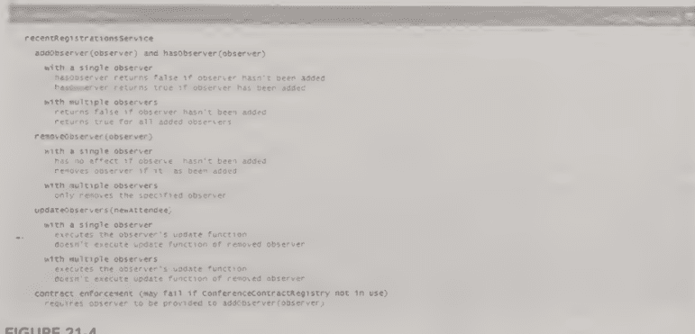
图 21-4

结果是，由于 `ContractRegistry` 被包含在会议网站上（或在单元测试中），我们可以确保每当 `addObserver` 传入一个不能作为观察者的参数时，都会生成一个错误。

与确保 `addObserver` 以正确的观察者被调用的方法类似，可以扩展 `recentRegistrationsServiceContracts` 以验证传递给 `updateObservers` 函数的参数是否符合第 17 章创建的 `attendeeInfo` 合约。同样，也可以这样做以确保传递给 `totalAttendeeCount` 模块 `update` 函数的参数是正确的。

---

50年来，美国和古巴之间没有正式关系。双方越不交谈，似乎就永远或可能无法谈下去。2014年，教皇方朗西（Pope Francis）致信给奥巴马和卡斯特罗，呼吁他们“解决共同利益的人道主义问题”。两国都做回应——不是回应对方（因为他们还没有交谈），而是回应教皇。几个月后，两国领导人宣布恢复正式外交关系。

这并不是中介者第一次在历史上发挥关键作用，但最初的那次交流完美地体现了中介者模式。由中介者发起通信并让各方行动起来。他们对其做出响应，然后由中介者协调下一步。

## 检查中介者模式

在外交、劳资谈判和婚姻中，中介者通常被引入来解决问题。在软件设计中，中介者模式是一种避免此类问题的方法。当人们相互自由交流时，社会运行良好；但软件系统恰相反：通信线条越少，路径就越简单。

该模式由几个*同事*（colleague）组成，它们可能执行不同或相似的任务，以及一个协调整体工作的*中介者*。在最纯粹的形式中，这种协调仅包含管理同事之间的交互，不涉及任何业务逻辑。

恰好在你在开发 JavaScript 会议网站期间，出现了一个使用该模式的机会。组织者知道，那些被咖啡因驱动的参与者希望在场次之间的空隙时间保持忙碌。他们请你为此目的设计并编写一个游戏。

你决定将其作为一个双人游戏而不是单人练习。毕竟，人们参加会议是为了建立人脉。由于没有摇杆或其他游戏设备，两名玩家都将在键盘上操作。

游戏流程如下：如图 21-5 所示，节点矩阵将由路径连接。若干机器人（中等大小的点）将在图中游荡。有两个较大的点来代表两名玩家。玩家的任务是尽快遇到它们，并将它们撞出画板。一名玩家将使用键 1、2、3 和 4 分别向左、上、下、右导航。另一名玩家将使用 6、7、8 和 9 键。

游戏是中介者模式的经典场景。这些是同事及其职责：

- *player*（玩家）——从当前节点移动到连接的节点
- *bot*（机器人）——行为与玩家相同
- *gameLogic*（游戏逻辑）——包含游戏逻辑，包括判断游戏何时结束。它在“规范化空间”中布局画布，并将玩家和机器人放入其中。规范化空间是一个面积为一个单位的正方形。由*svgDisplay*（下文描述）在浏览器中呈现这一内容。
- *svgDisplay*——在 svg 元素上绘制游戏。接收来自*mediator*的指令进行绘制，但不会向*mediator*返回任何内容

而负责协调同事动作的是*mediator*，它负责：

- 通过实例化 *gameLogic*（带有玩家和机器人）和 *svgDisplay* 来初始化游戏。
- 挂钩按键事件监听器。

## 捕捉机器人


图 21-5

当玩家或机器人表示它已移动时，中介者会通知 gameLogic 和 svgDisplay。当 gameLogic 说游戏结束时，中介者会注销事件监听器。

中介者模式的特征是，当玩家遇到机器人时，它不会自己移除机器人。相反，它只是移动到新节点并通知中介者它已这样做。中介者将此信息传递给 gameLogic，由后者检测碰撞并移除机器人。尽管如此，gameLogic 并不调整显示；那是通过向中介者发送另一个消息完成的，告诉 svgDisplay 移除机器人。

# 增强基于中介者的代码的可靠性

在书中，我们强调了测试驱动开发，并用一个假设的大型系统的较小片段进行了插说明。对于当前的示例，我们在本章的下载包中提供了完全开发的游戏，但只会触及开发过程的亮点。

## 开发同事

列表 21-8 显示了同事之一：玩家。

## 列表 21-8: 玩家对象（代码文件名: Mediator/player.js）

```javascript
var Game = Game || {};
Game.player = function player(mediator) {
  'use strict';

  var me,
    node,
    id = (Game.player.nextId === undefined
      ? ++Game.player.nextId
      : 0),
    listenEvent = "keydown",
    elementWithKeyDownAttached,
  // 第一个玩家获得按键 1-4（键码 49-52）
  // 第二个玩家获得按键 6-9（键码 54-58）
  keyCodeForPath = id === 1 ? 54 : 49;

  function handleKeyDown(e) {
    var pathIdx = e.keyCode - keyCodeForPath;

    if (pathIdx >= 0 && pathIdx < Game.pathIndex.count) {
      me.move(pathIdx);
    }
  }

  me = {
    getID: function () {
      return id;
    },

    setNode: function setNode(gameNode) {
      node = gameNode;
    },

    getNode: function () {
      return node;
    },

    activate: function activate(elementForKey) {
      elementWithKeyDownAttached = elementForKey;
      elementWithKeyDownAttached.addEventListener(listenEvent, handleKeyDown);
    },

    deactivate: function deactivate() {
      if (elementWithKeyDownAttached) {
        elementWithKeyDownAttached.removeEventListener(listenEvent, handleKeyDown);
        elementWithKeyDownAttached = null;
      }
    },

    move: function (pathIdx) {
      var nextNode = node.getNode(pathIdx);
      if (nextNode) {
        this.setNode(nextNode);
        mediator.onPlayerMoved(this);
      }
    }
  };

  return me;
};
```

## 列表 21-9: 测试玩家（代码文件名: Mediator/player_tests.js）

```javascript
describe('player', function() {
  var player,
    fakeMediator;

  beforeEach(function() {
    fakeMediator = {
      onPlayerMoved: function() {}
    };
    player = Game.player(fakeMediator);
  });

  describe('getId', function() {
    it('返回唯一的整数 ID', function() {
      var player2 = Game.player(fakeMediator);
      expect(player2.getId()).not.toBe(player.getId());
    });
  });

  describe('setNode(node)', function() {
    it('使得 getNode() 返回该节点', function() {
      var node = Game.node();
      player.setNode(node);
      expect(player.getNode()).toBe(node);
    });
  });

  describe('move(pathIndex)', function() {
    var originalNode, newNode;
    beforeEach(function() {
      originalNode = Game.node();
      newNode = Game.node();
      player.setNode(originalNode);
    });

    describe('如果在该索引处有路径', function() {
      var pathIndex = 2;
      beforeEach(function() {
        originalNode.connect(newNode, pathIndex);
      });

      it('移动玩家到新点', function() {
        player.move(pathIndex);
        expect(player.getNode()).toBe(newNode);
      });

      it('通知中介者移动', function() {
        spyOn(fakeMediator, 'onPlayerMoved');
        player.move(pathIndex);
        expect(fakeMediator.onPlayerMoved).toHaveBeenCalledWith(player);
      });

      it('返回 true', function() {
        expect(player.move(pathIndex)).toBe(true);
      });
    });

    describe('如果在该索引处没有路径', function() {
      it('保持玩家节点不变', function() {
        expect(player.move(2)).toBe(false);
        expect(player.getNode()).toBe(originalNode);
      });

      it('return false', function() {
        expect(player.move(2)).toBe(false);
      });
    });
  });
});
```

一如既常，成功的单元测试输出能用通俗的英语很好地解释对象的功能（见图 21-6）。

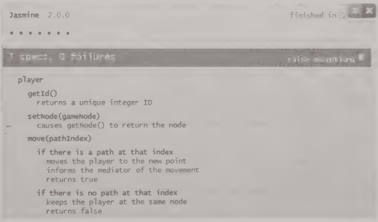
图 21-6

这个概述足够简单，但测试中有几点有趣的值得注意的地方。

首先，在代码列表的最上方，注意 `fakeMediator`。

```javascript
fakeMediator = {
  onPlayerMoved: function() {}
};
```

初始化玩家需要某种中介者（代码列表第十行）：

```javascript
player = Game.player(fakeMediator);
```

然而，如果单元测试完全覆盖了 player 的代码（事实确实如此），并且它们使用的是仅包含 player 所需函数的伪对象（fake），那么单元测试也验证了 player 只需要这些函数。这允许你像第 16 章读到的那样，分离中介者的接口。

## 分离中介者的接口

你可以在哪里安装并强制执行分离的接口？当然是在 `ContractRegistry` 中，这在第 16 章也涵盖过，在第 17 章进行了扩展，并在第 19 章中使用了一部分，但这个游戏是其无处不在第一个完整示例。

列表 21-10 显示了中介者接口是如何建立的。

## 列表 21-10：中介者的合约（代码文件名：Mediator\mediatorContracts）

```javascript
var Game = Game || {};

Game.mediatorContracts = function mediatorContracts() {
  'use strict';

  return {
    getContracts: function getContracts() {
      function isMediatorForPlayer(thing) {
        return typeof thing === 'object' &&
               typeof thing.onPlayerMoved === 'function';
      }

      function isMediatorForBot(thing) {
        return typeof thing === 'object' &&
               typeof thing.onBotMoveStart === 'function';
      }

      function isMediatorForLogic(thing) {
        return isMediatorForPlayer(thing) &&
               isMediatorForBot(thing) &&
               typeof thing.onBotHit === 'function' &&
               typeof thing.endGame === 'function';
      }

      return [
        {
          name: 'mediatorForPlayer',
          evaluator: isMediatorForPlayer
        },
        {
          name: 'mediatorForBot',
          evaluator: isMediatorForBot
        },
        {
          name: 'mediatorForLogic',
          evaluator: isMediatorForLogic
        }
      ];
    },

    attachValidators: function attachValidators(registry) {
      registry.attachReturnValidator(
        'mediator', Game, 'mediatorForPlayer');
      registry.attachReturnValidator(
        'mediator', Game, 'mediatorForBot');
      registry.attachReturnValidator(
        'mediator', Game, 'mediatorForLogic');
    }
  };
};
```

你可能记得第 17 章“整合一切”部分中的建议，你可以使用像上面那样的模块提供合约和验证器。按照惯例，模块将具有 `getContracts` 和 `attachValidators` 方法。然后，应用程序的合约注册表将消耗所有模块的方法来组装合约注册表。（在本章的下载文件中，`mediator\GameContractRegistry.js` 就是那个自动组装的注册表。你很快就会看到更多。）

前面的 `mediator.js` 文件为中介者定义了三个合约：`mediatorForPlayer`、`mediatorForBot` 和 `mediatorForLogic`。`mediatorForPlayer` 接口仅要求所考虑的对象是一个且具有 `onPlayerMoved`。

## 决定将合约放在哪里


# 我们在 `mediatorContracts.js` 中有了 `mediatorForPlayer` 合约

我们在 `mediatorContracts.js` 中有了 `mediatorForPlayer` 合约，但你可能觉得它属于 `playerContracts.js`。这个想法并非没有价值。假设中调模块和 player 模块由不同的人甚至不同的团队维护。假设中调发生了变化，导致需要修改 `mediatorForPlayer` 合约。（这违反了第 1 章的开闭原则，但有时生活并不理想。）任何做出更改的人都可能修改合约并完成他的工作。player 对象将验证传入的中调者是否符合合约，但合约不再反映 player 的原始预期了！

相反，假设 player 对象（由其程序员）拥有 `mediatorForPlayer` 合约。也就是说，假设合约在 `playerContracts.js` 而不是 `mediatorContracts.js` 中。当程序员做出更改时，他们不会更改合约，因为那不在他们的领域。如果更改破坏了合约，player 的单元测试将失败，player 的程序员就会知道他们应该调整代码。

接口由消费它的模块而非它的模块所有，这种观点是依赖倒置原则某些表述的一部分。主要的缺点是每个消费接口的模块都必须重复其描述。这违反了 DRY 原则（不要重复）。

所以你有一个选择。你可以将 `mediatorForPlayer` 类的合约放在 `mediatorContracts.js` 中，这样中调的程序员就知道哪些可能是破坏性更改；或者你可以将它们放在消费对象的合约模块中，以便它们的单元测试会失败。

# 确保中调模式的可靠使用

无论合约位于何处，下一步都是将其投入使用。`playerContracts.js` 模块创建了 `'player'` 接口。现在 `playerContracts.js` 可以确保每当创建 player 时，它都符合合约：

## 列表 21-11：player 的合约（代码文件名：playerContracts）

```javascript
Game.playerContracts = function playerContracts() {
  'use strict';

  return {
    getContracts: function getContracts() {
      function isPlayer(thing) {
        return typeof thing === 'object' &&
          typeof thing.getId === 'function' &&
          typeof thing.getNode === 'function' &&
          typeof thing.getName === 'function' &&
          typeof thing.activate === 'function' &&
          typeof thing.deactivate === 'function';
      }

      return [
        {
          name: 'player',
          evaluator: isPlayer
        }
      ];
    },

    attachValidators: function attachValidators(registry) {
      registry.attachReturnValidator(
        'player', Game, isPlayer);
    }
  };
};
```

`attachValidators` 的前两行会导致 `Game` 的参数检查 `mediatorForPlayer` 合约：

```javascript
registry.attachReturnValidator(
  'player', Game, isPlayer);
```

如果传入了其他内容，将抛出异常。作为回报，player 承诺返回一个符合 `'player'` 合约的对象：

```javascript
registry.attachReturnValidator(
  'player', Game, player);
```

代码合约为每个方法增加了多层函数调用。这不仅会阻碍性能，还会使调试变得复杂。如果你想在生产环境或调试期间临时移除合约代码，只需从 `index.html` 中删除此行即可：

```html
<script src="GameContractRegistry.js"></script>
```

如果没有该行，合约注册表就不会被实例化，更不用说填充，合约在你的运行代码中完全没有任何足迹。（它们不会运行，但为了防止它们加载，你也可以移除合约模块的 `<script>` 标签。）

## 列表 21-12: 游戏的合约注册表（代码文件名: Mediator\GameContractRegistry.js）

```javascript
// 游戏的 ContractRegistry，以单例模式实现。

Game.ConferenceContractRegistry = (function() {
  var registry = new ReliableJavaScript.ContractRegistry();

  var contractModules = {
    Game.normalPointContracts(),
    Game.gameNodeContracts(),
    Game.playerContracts(),
    Game.botContracts(),
    Game.gameLogicContracts(),
    Game.mediatorContracts(),
    // 在此添加更多模块。
  };

  registry.defineMultiple(ReliableJavaScript.StandardContracts);

  contractModules.forEach(function(m) {
    registry.defineMultiple(m.getContracts(registry));
  });

  contractModules.forEach(function(m) {
    m.attachValidators(registry);
  });

  return registry;
}());
```

游戏中的其他同事在精神上是类似的。你可以在本章的下载内容的 Mediator 目录中找到它们的代码和单元测试。

# 开发中介者（Mediator）

中介者并不是幕后黑手。它的角色是启动事务，确保每个对象在决定调用它之前都知道自己需要知道的信息，然后以有序的方式关闭。列表 21-13 显示了游戏的中介者。

## 列表 21-13: 中介者（代码文件名: Mediator\mediator.js）

```javascript
var Game = Game || {};

Game.mediator = function mediator() {
  'use strict';

  var logic,
      display,
      startTime,
      svgElement = document.getElementById('gameSvg');

  function moveBotStartInLogicAndOnDisplay(bot) {
    logic.onBotMoveStart(bot);
    display.onBotMoveStart(bot);
  }

  var med = {
    startGame: function startGame() {
      logic.getPlayers().forEach(function(player) {
        player.activate(document.getElementById('gameInput'));
      });
      startTime = new Date();
    },
    // 玩家移动时调用此函数。
    onPlayerMoved: function onPlayerMoved(player) {
      logic.onPlayerMoved(player);
      display.onPlayerMoved(player);
    },
    // 机器人开始移动时调用此函数。
    onBotMoveStart: function onBotMoveStart(bot) {
      moveBotStartInLogicAndOnDisplay(bot);
    },
    // 机器人完成移动时调用此函数。
    onBotMoveEnd: function onBotMoveEnd(bot) {
      logic.onBotMoveEnd(bot);
    },
    // 当机器人被击中时，游戏逻辑调用此函数。
    onBotHit: function onBotHit(bot) {
      bot.node(undefined);
      moveBotStartInLogicAndOnDisplay(bot);
    },
    // 游戏逻辑调用此函数结束游戏。
    endGame: function endGame() {
      var millisecondsToWin = new Date() - startTime;
      logic.getPlayers().forEach(function(player) {
        player.deactivate();
      });
      // 使用 setTimeout 让显示层有机会在要求显示胜利消息之前
      // 移除最后一个机器人。
      setTimeout(function() {
        display.endGame(millisecondsToWin);
      }, 500);
    }
  };

  logic = Game.gameLogic(med, 6, 7);
  display = Game.svgDisplay(med, svgElement, logic);

  return med;
};
```

# 第 21 章 测试高级程序架构

当中介者被实例化时，它创建了 `gameLogic` 和 `svgDisplay` 同事（在列表末尾）。`gameLogic` 则创建了玩家和机器人。

其他模块将使用的中介者位于列表中间的 `med` 变量中并在最后返回。

继续查看玩家同事，你会发现控制流如下：

- `activate` 方法添加了一个事件监听器，按下按键将调用相应的玩家移动方法。
- 如你所见，`player.move` 在成功转移到新节点后会调用 `mediator.onPlayerMoved`。
- 该方法告诉游戏逻辑和显示层玩家已移动。
- 步骤 2 和 3 持续直到 `gameLogic` 对象检测到游戏结束并调用 `mediator.endGame`，这将移除事件监听器。

## 测试中介者

中介者的工作涉及与它不应该深入了解的对象进行大量交互，因此你可以猜到 Jasmine 会在这里进行绑定。列表 21-14 显示了一些细节。

## 列表 21-14: 测试中介者（代码文件名: Mediator/mediator_tests.js）

```javascript
describe('mediator', function() {
  'use strict';
  var gameNodes,
    numNodes = 10,
    fakeDisplay,
    fakePlayer0,
    fakePlayer1,
    fakePlayers;
  beforeEach(function() {
    var nodeIdx;
    gameNodes = [];
    for (nodeIdx = 0; nodeIdx < numNodes; ++nodeIdx) {
      gameNodes.push(gameLogic);
    }
    fakeDisplay = {
      onPlayerMoved: function(player) {},
      onBotMove: function(bot) {},
      endGame: function () {},
    };
    fakePlayer0 = {
      activate: function() {},
      deactivate: function() {},
    };
    fakePlayer1 = {
      activate: function() {},
      deactivate: function() {},
    };
    fakePlayers = [fakePlayer0, fakePlayer1];
    fakeLogic = {
      getPlayers: function() { return fakePlayers; },
      onPlayerMoved: function(player) {},
      onBotMoveStart: function(bot) {},
      onBotMoveEnd: function(bot) {},
      getNodes: function() { return gameNodes; },
      getBots: function() { return []; };
    };
    spyOn(Game, 'svgDisplay').and.returnValue(fakeDisplay);
    spyOn(Game, 'gameLogic').and.returnValue(fakeLogic);
    spyOn(fakeDisplay, 'onPlayerMoved');
    spyOn(fakeDisplay, 'endGame');
    spyOn(fakeLogic, 'onPlayerMoved');
  });

  describe('startGame()', function() {
    it('激活两个玩家', function() {
      var mediator = Game.mediator();
      spyOn(fakePlayer0, 'activate');
      spyOn(fakePlayer1, 'activate');
      mediator.startGame();
      expect(fakePlayer0.activate).toHaveBeenCalled();
      expect(fakePlayer1.activate).toHaveBeenCalled();
    });
  });

  describe('onPlayerMoved(player)', function() {
    var player;
    beforeEach(function() {
      var mediator = Game.mediator();
      node = Game.gameNode();
      player = Game.player(mediator);
      player.setNode(node); // 假装移动到这里。
      mediator.onPlayerMoved(player);
    });
    it('通知看板玩家的新位置', function() {
      expect(fakeLogic.onPlayerMoved).toHaveBeenCalledWith(player);
    });
    it('通知显示层玩家的新位置', function() {
      expect(fakeDisplay.onPlayerMoved).toHaveBeenCalledWith(player);
    });
  });
});
```

*** 剩余测试已省略。请参阅本章下载。 ***

在列表早期，为显示层、玩家和游戏逻辑设置了伪造对象。中介者的所有测试关心的这些对象是否如预期地调用，在列表的下部分为了此目的创建了间谍：

```javascript
spyOn(Game, 'svgDisplay').and.returnValue(fakeDisplay);
spyOn(Game, 'gameLogic').and.returnValue(fakeLogic);
spyOn(fakeDisplay, 'onPlayerMoved');
spyOn(fakeDisplay, 'endGame');
spyOn(fakeLogic, 'onPlayerMoved');
```

第一对间谍拦截了 `svgDisplay` 和 `gameLogic` 的创建，导致返回伪造对象。剩余的间谍将在这些对象上调用 `onMoved` 以及当游戏结束时触发。这些间谍上没有使用 `callThrough`、`callFake` 或 `returnValue`，因为唯一感兴趣的问题是中介者是否执行了这些调用。

`onMoved` 的测试展示了这是运行的：

```javascript
describe('onMoved(player)', function() {
  var player;
  beforeEach(function() {
    var mediator = Game.mediator();
    node = Game.gameNode();
    player = Game.player(mediator);
    player.setNode(node);
    mediator.onMoved(player);
  });
  it('通知看板玩家的新位置', function() {
    expect(fakeLogic.onMoved).toHaveBeenCalledWith(player);
  });
  it('通知显示层玩家的新位置', function() {
    expect(fakeDisplay.onMoved).toHaveBeenCalledWith(player);
  });
});
```

期望仅仅是间谍是否以正确的参数被调用。这在单元测试中很常见。如果测试不仅仅是验证中介者是否调用了相应的同事，那么你的中介者模式实现可能并不纯。

## 总结

观察者模式和中介者模式密切相关，它们的可靠开发有许多共同点，包括：

- 在测试观察者（观察者模式）或同事（中介者模式）时，可以使用主题/中介者的伪造对象。
- 中介者的接口可能比任何一个同事需要的都要宽。考虑对其进行分离。至少，单元测试中的伪造对象将显示分离后的接口是什么。
- 在两种模式中，交接都是关键部分。可以使用代码合约来确保主题/中介者与观察者/同事之间的调用按计划运行。

本书的下一部分将考虑测试中一些特殊或奇异的主题。

# 第四部分

## 测试专项主题

- 第 22 章：测试 DOM 访问
- 第 23 章：确保符合标准

# 22

## 测试 DOM 访问

本章内容简介：

- 在 Jasmine 中编写 UI 单元测试
- 在单元测试中使用 jQuery 与 DOM 交互
- 确保 UI 事件执行了正确的事件处理器
- 使用性能分析器（Profiler）识别优化机会

本章的 WROX.COM 代码下载

您可以在 www.wrox.com/go/reliablejavascript 的 "Download Code" 选项卡中找到本章的 wrox.com 代码下载。文件位于第 22 章下载文件夹中，并根据本章各注的文件名单独命名。

我们在书中用了许多篇幅描述了对 Web 应用程序的非视觉组件进行单元测试如何帮助确保您的网站（即 JavaScript 会议网站）的可靠性。毫无疑问，网站中没有用户界面的组件（例如 `attendeeRegistrationService`）也应该有相关的单元测试套件。

然而，网站的用户并不知道 `attendeeRegistrationService` 的存在。尽管用户与该服务交互，但并不是直接交互：他们是通过 Web 浏览器呈现的网站 UI 与之交互的。

应用程序运行正常固然很好，但世界级的软件必须让终端用户满意。这意味着界面必须运行顺畅且快速。

### UI 单元测试

针对与浏览器文档对象模型（DOM）交互的 JavaScript 进行单元测试，是确保 Web 应用程序 UI 正常运行的一种方法。本节提供了一个在创建 UI 时不应采用做法的示例，并探讨了如何重构该示例使其具有可测试性和可靠性。

### 检查难以测试的 UI 代码

您是否遇到过或创建过与列表 22-1 相似的 HTML 文件？

## 列表 22-1：HTML 和 JavaScript（代码文件名：DOMTesting\inline.html）

```html
<!DOCTYPE html>
<head>
  <script type="text/javascript">
    var count = 0;
    displayCount = function() {
      var countElement = document.getElementById("countDisplay");
      countElement.innerText = count.toString();
    }
  </script>
</head>
<body>
  <button type="button" onclick="clickCount++; displayCount();">
    Increment
  </button>
  <span id="countDisplay">0</span>
</body>
</html>
```

在 `<head>` 标签内部有一个 `<script>` 元素，其中定义了一个变量 `clickCount` 和一个函数 `displayCount`。

`<body>` 标签内的标记定义了一个 `<button>`，根据 `onclick` 属性的值，它会递增 `clickCount` 并执行 `displayCount`。还有一个 ID 为 `countDisplay` 的 `<span>` 标签，我已经确定了它；列表 22-1 中的代码简单地跟踪 `<button>` 被点击的次数，并在 `<button>` 旁边显示点击计数。图 22-1 显示了页面在浏览器初始加载时标记的渲染情况，以及 `<button>` 被点击几次后的页面样子。

如图 22-1 所示，与按钮的交互按照描述的方式工作：每次点击都会增加显示的计数。

### 图 22-1

尽管该示例的功能符合预期，但 Charlotte 有几点建议。

首先，Charlotte 指出该 HTML 文件没有体现关注点分离：**负责响应点击事件并显示计数的 JavaScript 直接写在定义 UI 标记的 HTML 文件中。这严重限制了重用性；在 HTML 页面中定义的 JavaScript 只能在该页面使用。** Charlotte 建议将 JavaScript 提取到单独的文件中将允许 JavaScript 代码重用并提高其可测试性。

此外，Charlotte 注意到 `setCount` 变量和 `displayCount` 函数定义在全局作用域中。虽然在这个示例中这样做没有副作用，但在编写可靠的 JavaScript 时，创建全局变量是一个坏习惯。将变量和函数封装到模块中并添加严格模式（strict mode），将确保作用域不受污染。

此外，Charlotte 指出 `onclick` 事件处理器处理了多个内联语句：

```html
<button type="button" onclick="clickCount++; displayCount();">
  Increment
</button>
```

在事件处理器中包含多个语句是完全有效的，但它并不理想。维护此代码的开发者必须同时检查 HTML 和 JavaScript 才能完整了解点击按钮时发生了什么。将语句合并成具有描述性命名的单一函数（例如 `incrementAndDisplayCount`）将使代码更容易理解。将该新方法封装到模块中，并添加可以设置为按钮点击处理器的代码会更好。通过模块化组织，仅通过检查 JavaScript 就能理解定义的行为。创建一个包含代码的模块也可以通过在无 UI 的情况下测试大部分代码，从而提高其可测试性。

最后，HTML 元素与与其交互的 JavaScript 是紧密耦合的。这种耦合有多个来源：

- 内联定义点击事件处理器
- 在 `displayCount` 函数中对显示计数的 `<span>` 元素的 `id` 的硬编码引用：`var countElement = document.getElementById("countDisplay");`

只要代码是内联定义的，且对显示元素的引用是硬编码的，重用这些代码的唯一方法就是复制和粘贴。下一节将开始将难以测试的代码转换为可重用组件的过程。

### 使用 TDD 创建 UI 组件

正如你以前多次做过的那样，单元测试将驱动 UI 组件的开发。虽然 Jasmine 框架本身不需要浏览器，但本节专门讨论与 DOM 的交互。

> 注意：尽管 Jasmine 框架本身不需要浏览器，但请注意，如果你在项目中添加了单元测试，可能需要配置运行器来执行测试。

考虑点击 `<button>` 时事件处理器执行的操作：

1. 代码递增了包含点击次数的变量。
2. 代码调用了更新 DOM 的函数。

由于 UI 的操作被封装在函数中，你可以在不考虑 DOM 的情况下为模块创建测试。列表 22-2 中的测试确保新模块执行了列表 22-1 中内联点击处理器执行的高级操作。具体来说，验证 `incrementAndUpdateDisplay` 会导致点击计数增加并执行更新 DOM 的函数的测试验证了初始点击计数为 0。

## 列表 22-3: Conference.clickCountDisplay 的初始实现（文件名: DOMAccess\clickCountDisplay_01.js）

```javascript
var Conference = Conference || {};
Conference.clickCountDisplay = function() {
  'use strict';

  var clickCount = 0;

  return {
    getClickCount: function getClickCount() {
      return clickCount;
    },

    updateCountDisplay: function updateCountDisplay() {
    },

    incrementCountAndUpdateDisplay: function incrementCountAndUpdateDisplay() {
      clickCount++;
      this.updateCountDisplay();
    }
  };
};
```

`Conference.clickCountDisplay` 的初始实现并没有惊喜；它和完成它的单元测试一样简单。该模块函数将隐藏变量 `clickCount` 初始化为 0，并允许通过函数 `getClickCount` 对该变量进行公开检索。`incrementCountAndUpdateDisplay` 函数的作用顾如其名：它递增 `clickCount` 并调用 `updateCountDisplay` 方法。针对 `incrementCountAndUpdateDisplay` 的单元测试并不依赖于 `updateCountDisplay` 的实现细节；如图 22-3 所示，为了通过列表 22-2 中的单元测试，并不实现 `updateCountDisplay` 方法。

## 测试更改 DOM 的代码

你对 DOM 交互测试的尝试将为 `updateCountDisplay` 函数设计测试。你需要能够向 DOM 中添加一个元素，以便函数可以在测试内部对其进行操作。可以使用浏览器提供的函数向 DOM 添加元素，但无处不在的 jQuery 库提供了一个独立于浏览器的 DOM 交互方法外观。对 `updateCountDisplay` 的测试将使用 jQuery 为 `updateCountDisplay` 提供一个用于更新的元素。列表 22-4 显示了这些测试。

## 列表 22-4: updateCountDisplay 的单元测试（代码文件名: DOMAccess\clickCountDisplay_02_tests.js）

```javascript
describe("Conference.clickCountDisplay", function() {
  'use strict';

  var display,
    displayElement;

  beforeEach(function() {
    // 从定义 DOM 元素的字符串创建 jQuery 元素
    displayElement = $('<span></span>');
    // 并将其添加到 body 中
    $('body').append(displayElement);
  });

  var options = {
    updateElement : displayElement
  };

  display = Conference.clickCountDisplay(options);
});

  afterEach(function() {
    displayElement.remove();
  });

*** 为了清晰起见省略了代码 ***/
describe("incrementCountAndUpdateDisplay()", function() {
  *** 为了清晰起见省略了代码 ***/

  it("设置 updateElement 的文本", function() {
    display.incrementCountAndUpdateDisplay();
    expect(displayElement).toHaveText(display.getClickCount());
    display.incrementCountAndUpdateDisplay();
    expect(displayElement).toHaveText(display.getClickCount());
  });
});

describe("updateCountDisplay()", function() {
  it("如果计数未递增，则显示 0", function() {
    expect(displayElement).toHaveText("");
    display.updateCountDisplay();
    expect(displayElement).toHaveText("0");
  });
});
```

由于 `updateCountDisplay` 根据 `clickCount` 的值更改 DOM，而 `clickCount` 只能通过 `incrementCountAndUpdateDisplay` 函数更改，因此 `updateCountDisplay` 仅需要一个单元测试，以确保它在调用 `incrementCountAndUpdateDisplay` 之前调用时行为正常。对 `updateCountDisplay` 的额外测试通过 `incrementCountAndUpdateDisplay` 间接进行。

我们提到过对 `updateCountDisplay` 的测试需要能够向 DOM 中添加元素。测试套件的 `beforeEach` 部分被用于添加必要的元素：

```javascript
// 从定义 DOM 元素的字符串创建 jQuery 元素
displayElement = $('<span></span>');
// 并将其添加到 body 中
$('body').append(displayElement);
```

首先，创建了将显示计数的 `<span>` 元素。然后，将 `<span>` 添加到运行 Jasmine 测试的 HTML 页面的 `<body>` 中。该 `<span>` 元素也被添加到提供给模块的新 `options` 变量中：

```javascript
var options = {
  updateElement : displayElement
}
display = Conference.clickCountDisplay(options);
```

模块将通过 `options.updateElement` 属性访问 `span` 元素。

列表 22-4 还为测试套件引入了 `afterEach`。`afterEach` 移除了 `beforeEach` 中的 DOM 元素。忽略移除元素会导致页面上累积 `<span>` 元素。在测试完成时移除每个测试中使用的元素，可以降低测试执行顺序改变测试结果的可能性。

`updateCountDisplay` 函数的单元测试使用了一个你可能以前见过的匹配器，以确保预期值显示在 DOM 中：`toHaveText`。如果你查看过 Jasmine 提供的匹配器，你会识别出 `toHaveText` 是 Jasmine 内置的。它由 Travis Jeffery 维护的开源库 `jasmine-jquery` 提供。该库提供了许多种匹配器，在测试 JavaScript 时特别有用。

> 注意：本章已提供 `jasmine-jquery` 的下载，你也可以在 GitHub 上的 https://github.com/velesin/jasmine-jquery 获取它。

该库提供了许多种匹配器，在测试 JavaScript 时特别有用。`updateCountDisplay` 的实现使用了通过 `options.updateElement` 提供的 jQuery 对象的 `text` 方法。这确保了每次调用 `incrementCountAndUpdateDisplay` 时，值都会显示在 DOM 中。

## 列表 22-5: updateCountDisplay 的实现（代码文件名: DOMAccess\clickCountDisplay_03.js）

```javascript
var Conference = Conference || {};
Conference.clickCountDisplay = function(options) {
  'use strict';

  var clickCount = 0;

  return {
    getClickCount: function getClickCount() {
      return clickCount;
    },

    updateCountDisplay: function updateCountDisplay() {
      options.updateElement.text(clickCount);
    },

    incrementCountAndUpdateDisplay: function incrementCountAndUpdateDisplay() {
      clickCount++;
      this.updateCountDisplay();
    }
  };
};
```

```javascript
// Create a jQuery element from a string that defines the DOM element
displayElement = $("<span></span>");
// and append it to the body
$('body').append(displayElement);

// Create the click element and append it to the body
clickElement = $("<button></button>");
$('body').append(clickElement);

var options = {
  updateElement : displayElement,
  triggerElement : clickElement
};

display = Conference.clickCountDisplay(options);

afterEach(function() {
  displayElement.remove();
  clickElement.remove();
});

*** Code omitted for clarity ***

it("executes incrementCountAndUpdateDisplay when the trigger " + 
"element is clicked", function() {
  spyOn(display, 'incrementCountAndUpdateDisplay');
  clickElement.trigger('click');
  expect(display.incrementCountAndUpdateDisplay).toHaveBeenCalled();
});

*** Code omitted for clarity ***
```

只有一个单元测试？真的吗？是的，真的。通过你这样对功能进行封装，你只需要确保指定的触发器执行了 `incrementCountAndUpdateDisplay` 函数即可。对 `incrementCountAndUpdateDisplay` 的测试确保了它反过来按预期方式运行。

测试套件所需的更改是为了确保事件处理程序在 `beforeEach` 块中被调用。由于你对 `display` 元素进行了测试，你创建了一个测试将“点击”的元素，并将该元素添加到测试执行的 HTML 页面主体中。该元素也通过 `options` 变量的 `triggerElement` 属性提供了 `clickCountDisplay` 模块函数。`afterEach` 有相应的更改，以便在测试完成后从 DOM 中移除该元素。

新的单元测试监视了 `clickCountDisplay` 模块实例的 `incrementCountAndUpdateDisplay` jQuery 方法。该测试使用 jQuery 的 `trigger` 方法在正在计算点击数的元素上触发点击事件。最后，测试验证了触发点击事件确实执行了 `incrementCountAndUpdateDisplay` 函数。如图 22-6 所示，新测试失败了。

## 第 22 章 测试 DOM 访问

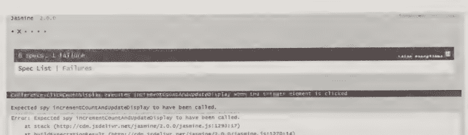

图 22-6

代码 22-7 显示了 `clickCountDisplay` 模块更新后的实现。

## 列表 22-7：配置点击事件处理器的 `clickCountDisplay` 实现（代码文件名：clickCountDisplay_03.js）

```javascript
var Conference = Conference || {};
Conference.clickCountDisplay = function(options) {
  'use strict';

  var clickCount = 0;

  // 环境代码将验证
  // options 是否定义以及其属性
  // 是否为预期的类型。

  var clickCounter = {
    getClickCount: function getClickCount() {
      return clickCount;
    },

    updateCountDisplay: function updateCountDisplay() {
      options.updateElement.text(clickCount);
    },

    incrementCountAndUpdateDisplay: function incrementCountAndUpdateDisplay() {
      clickCount++;
      this.updateCountDisplay();
    }
  };

  options.triggerElement.on('click', function clickBinder() {
    clickCounter.incrementCountAndUpdateDisplay();
  });

  return clickCounter;
};
```

`clickCountDisplay` 函数没有立即返回创建的新实例，而是将其赋值给 `clickCounter` 变量。然后，`clickBinder` 函数通过 jQuery 函数注册为 `triggerElement` 点击事件的处理器。当 `triggerElement` 点击事件被触发时，`clickBinder` 函数将调用 `clickCounter.incrementCountAndUpdateDisplay` 函数，导致点击计数增加并更新显示。最后，`clickCounter` 返回给调用者。这样，所有单元测试都通过了（如图 22-7 所示），`clickCountDisplay` 模块的实现完成了。

Jasmine 2.0

...

```javascript
describe('clickCountDisplay',
将点击计数初始化为 0
当触发元素被点击时执行 incrementAndUpdateDisplay
incrementAndUpdateDisplay()
增加点击计数
执行 updateDisplay 函数
测试 updateDisplay 的情况
updateCountDisplay()
如果计数已经增加
```

图 22-7

## 避免 UI 测试变得脆弱

你在前一节中没有编写的测试与你已经编写的测试同样重要。在为 UI 的外观编写单元测试时：

- DOM 元素是否在正确的位置上？
- DOM 元素的大小是否正确？
- 是否使用了正确的字体？
- 背景颜色是否正确？
- 等等，此类推。

虽然可以为列出的（所有）项目编写单元测试，但验证视觉外观的单元测试是脆弱的。Web 应用程序的 UI 比任何其他方面变化得频繁，会导致任何验证外观的测试过时。

通常情况下，UI 单元测试应该限制在功能上，因为：

- 点击元素时是否执行了正确的处理器？
- 无权限查看的 UI 元素是否已隐藏？
- `<select>` 是否包含预期的元素？

视觉外观的测试通常应该留给手动测试或基于截图的测试工具，工具可以快速判断与预期外观的偏差。

## 使用性能分析器优化你的代码

我们都做过这种事：为了实现效率和随之改进的响应时间，编写了并不美观的代码。但这值得吗？我们是如何知道的？在本节中，你将看到如何使用浏览器的性能分析器来回答问题。

## 检测低效之处

你面前的任务很简单。你需要创建一个列出参会者的页面。图 22-8 显示了该页面的样子。或者，它们是随机的。

| 姓 | 名 | 兴趣 |
| --- | --- | --- |

# 列表 22-9 (续)

```javascript
isFirstInterest = false;
}
tdInterests.innerHTML += interest;
));
table.appendChild(tr);
}
return {
  addAttendeesToPage: function() {
  fetchAttendees();
  attendees.sort(byLastNameThenFirst);
  attendees.forEach(displayAttendee);
}
}}();
document.addEventListener('DOMContentLoaded',
  Conference.attendPage.addAttendeesToPage);
```

`addAttendeesToPage` 中的三行代码（列表末尾）发生了很多操作。参与者被获取（好的，是随机生成的）、排序，然后进行显示。

你运行页面，性能并不糟糕，但你将把工作交给 Charlotte 与服务器进行集成，以免让自己显得尴尬。有什么方法可以提高性能吗？

你决定调用 Chrome 的性能分析器（profiler）来查明原因（我们使用 Chrome 是因为它是开发者中最受欢迎的工具。Internet Explorer 也提供了类似的功能）。

要使用性能分析器，请按照以下步骤操作：

- 启动页面。你可以通过下载本章中的 Profiler 目录并双击 index.html 来完成。
- 按 F12 打开 Chrome 的开发者面板。（F12 也是 Internet Explorer 的魔法按钮。）
- 选择 Profiles（配置文件）选项卡。性能分析选项之一是“Collect JavaScript CPU Profile”（收集 JavaScript CPU 性能分析）。这是你执行时需要的。确保它已被选中（见图 22-9）。
- 点击 Start（开始）按钮或 Profiles 选项卡左上角的圆形灰色按钮（再次见图 22-9）。
- 很快地点击浏览器上的刷新按钮。
- 当页面返回后，再次点击圆形按钮（在性能分析期间它会变成红色）或 Start/Stop 按钮（其文本在分析期间会从 Start 变为 Stopping）。
- 将出现类似图 22-10 的显示。如有必要，选择“Tree (Top Down)”（树状（自上而下））视图。

数据有三种显示模式。Tree (Top Down）视图最为直观。此列表显示了顶层函数，并且对于每个函数，显示在函数本身上花费的时间（Self 列）以及在函数加上它调用的所有函数上花费的总时间（Total 列）。

其他选项是 Heavy (Bottom Up)（重量级（自下而上））和 Chart（图表）。你很快就会看到如何使用它们。

在图 22-10 的 Tree 视图中，函数列表恰好结束于你唯一控制的一个，即 `addAttendeesToPage`。你可以通过点击箭头展开调用树来专门关注这一个。结果如图 22-11 所示。

你不关心优化 `fetchAttendees` 函数，因为它只是个假的，但有趣的是，尽管它有随机数计算和字符串拼接（参考列表 22-9），它在 `addAttendees` 函数中执行仅占了 1.75% 的时间。即使是排序 5000 名参与者只占了 11.57% 的时间。大部分时间都花在了 `displayAttendee` 及其调用的函数上。这是浏览器程序的典型特征。访问 DOM 在 CPU 时间上通常比其他操作开销更大。


图 22-9

向下扫描图 22-11，注意到 `addInterest` 函数花费了大量时间，特别是在它设置用于参与者兴趣的 `<td>` 元素的 `innerHTML` 属性时（innerHTML 访问器函数是图 22-11 中的“匿名函数”）。这里是列表 22-9 的相关部分：

```javascript
var tdInterests = document.createElement('td');
isFirstInterest = true;

*** 为了清晰起见省略了部分 ***

tdInterests.innerHTML = '';
attendee.getInterests().forEach(function addInterest(interest) {
  if (isFirstInterest) {
    tdInterests.innerHTML += ', ';
  } else {
    isFirstInterest = false;
  }
  tdInterests.innerHTML += interest;
});
```

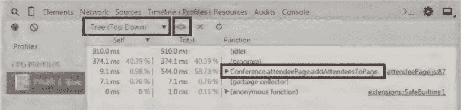

图 22-10


图 22-11

你想到了什么？这正是一个 JavaScript 词汇量有限的初学者会写出的那种笨拙、过度过程化的代码的结果。现在性能分析器引起了你对这段代码区域内大量使用 `innerHTML` 的关注，你意识到这一团乱可以被以下内容替换：

```javascript
tdInterests.innerHTML = attendee.getInterests().join(', ');
```

顺便说一下，可以假设兴趣不包含跨站脚本攻击，因为它们来自应用程序控制下的一组选择，而代码是放任且粗略地将参与者的姓名插入到 HTML 页面中。如果这不仅仅是一个概念验证练习，你应该防止跨站脚本（见 www.owasp.org/cheatsheets/Cross_Site_Scripting_Prevention_Cheat_Sheet.html）。

使用了 TDD（测试驱动开发）开发了一个松耦合的 UI 组件，你可以在整个应用程序中使用它。此外，你学会了如何避免创建脆弱的 UI 单元测试。你还了解了如何使用 Chrome 的性能分析器来识别性能瓶颈所在之处以及哪里没有。在基于浏览器的程序中，如果频繁访问 DOM（尤其是进行更新时），可能会出现性能问题。

下一章将比我们目前更深入地探讨帮助你遵循组织编码标准的工具，更不用说为了遵循你个人的良好意图了。

# 23

## 确保符合标准

本章包含内容：

- 安装、配置和运行 ESLint
- 创建自定义 ESLint 规则
- 强制执行架构层

本章的 WROX.COM 代码下载

你可以在 www.wrox.com/go/reliablejavascript 的“Download Code”选项卡中找到本章的 wrox.com 代码下载。文件位于第 23 章下载包中，并根据本章各处提到的文件名单独命名。

在文章《软件工程中经常被遗忘的基础事实》（IEEE Software, 2001年5月/6月）中，Robert L. Glass 提出，持续维护平均占了软件开发成本的 60%。我们确信，任何工作过长期软件项目的开发者都会觉得 Glass 先生的观点并不离谱。

不一致地使用 JavaScript 使其强大的强大特性（例如方法共享和猴子补丁 monkey-patching），会导致 JavaScript 代码在长期内更难以维护。

当 JavaScript 仅被用于即时表单验证时，长期维护可能不是首要考虑的问题。现在，客户端和服务器端的整个应用程序都用 JavaScript 构建，维护必须处于开发者考虑的头位。

确保团队中的每个人都能维护一套代码库的一个重要方法是推广编码标准。无论是在语法层面还是宏观架构层面都是如此。本章探索了实现这一目标的方法。

## 使用 ESLINT

第 2 章的“使用代码检查工具”节展示了如何使用 JSHint 检查工具来识别语法和结构可疑的 JavaScript 代码。JSHint 还强制执行许多代码风格标准，例如一致地使用双引号。

虽然 JSHint 允许用户开启或关闭内置规则，但它不支持对自定义规则的支持。这意味着你必须诉助于手动代码审查来执行 JSHint 不支持的编码标准吗？坦率地说，不是。

ESLint 是在第 2 章“JSHint 的替代方案”节中提到的 linter 工具，它支持自定义规则。ESLint 还实现了 JSHint 支持的所有内置规则，使其成为 JSHint 的理想替代品。

在本节中，我们将展示如何安装和配置 ESLint，如何从命令行运行它，以及如何编写和执行 ESLint 规则。

## 安装 ESLint

ESLint 以 Node.js 包的形式分发。与之前一样，在安装 ESLint 之前，必须先安装 Node。Node 提供包括 Mac OS X 和 Windows 在内的许多平台的预编译二进制文件。我们将介绍在 Node 上安装二进制包的步骤。

如果你的电脑上已经安装了 Node 和 npm（Node 的包管理器），你可以直接跳到“使用 npm 安装 ESLint”。

> 注意：你也可以在 OS X 上使用 Homebrew 和 MacPorts 等包管理器安装 Node，或者在 Windows 上使用 Chocolatey 和 Scoop 安装 Node。

## 安装 Node 和 npm

以下步骤描述了在 Windows 8.1 上安装 Node 和 npm 的过程。

1. 在浏览器中打开 http://nodejs.org/download/（如图 23-1 所示），下载适用于你操作系统的二进制包。我们正在 Windows 8.1 上安装，所以我们选择 64 位 Windows 安装程序 (.msi)。
2. 启动安装程序，接受许可协议条款，并在最初几个屏幕上选择安装位置。
3. 在图 23-2 所示的“自定义设置”屏幕上，确保选择了 npm 包管理器和“添加到路径（Add to PATH）”安装功能。
4. 在安装程序的最后一个屏幕确认安装，并等待几秒让安装程序完成繁重工作。
5. 安装程序完成后，启动命令提示符并输入 `node` 然后按回车。你应该会看到一个等待输入的 `>`。如果你没有看到提示符或收到了错误信息，请在继续之前排查你的 Node 安装问题。
6. 在 `>` 提示符处，输入 `console.log("Reliable JavaScript!");` 并按回车。你应该看到类似于图 23-3 的输出。
7. 按两次 Ctrl+C 退出 Node。
8. 在命令提示符处输入 `npm` 并按回车。你应该看到类似于图 23-4 的输出。如果输出与图 23-4 不相似，你应该在继续之前排查你的 npm 安装问题。npm 的 GitHub 仓库提供了故障排除说明：https://github.com/npm/npm/wiki/Troubleshooting。


图 23-1

如果你已成功完成了所有八个 Node 安装步骤，就可以准备继续安装 ESLint 了。

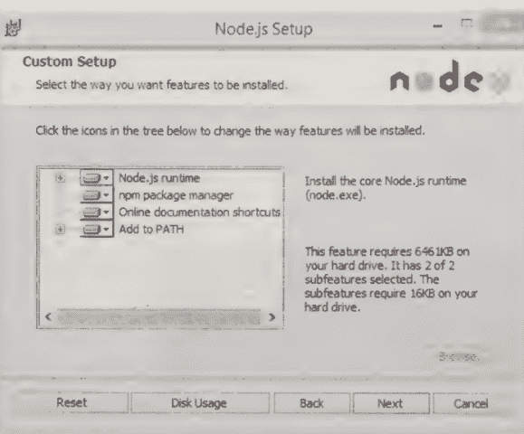

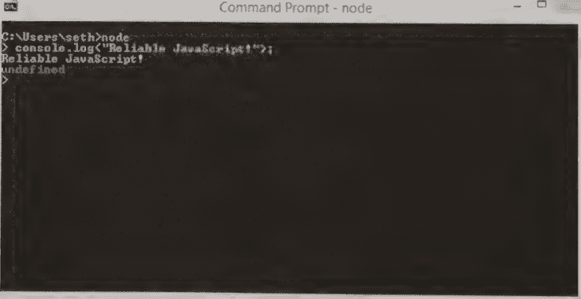

## 命令提示符

```
C:\Users\seth>Usage: npm <command> is one of:
  add, adduser, author, bin, cache,
  completion, config, dedupe, deprecate, docs,
  exit, fact, find-registry, get, help,
  home, info, install, issues, link,
  list, login, outdated, pack, prefix,
  prune, publish, remove, restart,
  root, run-script, s, search, test, shrinkwrap,
  shrink, unlink, unpack, update, v,
  version, view.

npm -h help
npm display user info
npm commonly asked questions
npm help
npm overview
specify in-formatted file: c:\Users\seth\.npmrc
or command line: npm --key value
Config can be viewed via: npm config
```

## 使用 npm 安装 ESLint

以下步骤描述了使用 npm 安装 ESLint 的过程。

1. 输入 `npm install -g eslint` 并按回车。npm 将下载并安装 ESLint 及其所有依赖项。
2. `-g` 选项告诉 npm 全局安装 ESLint。安装完成后，在提示符处输入 `eslint` 检查是否成功。你应该看到类似于图 23-5 的输出。
3. 在命令提示符处，输入 `eslint` 并按回车。你应该看到类似于图 23-6 的输出。如果输出不相似，你应该在继续之前排查你的 ESLint 安装。

## 运行 ESLint

安装 ESLint 后，你就可以使用它来改进代码的语法、结构和对标准的遵循。本节提供了实现这一目标的示例。

## 确保符合标准

```
Command

C:\Users\seth> eslint options [file.js] [dir]

Options:

  -h, --help                  显示帮助
  -c, --config path:String    使用此目录的配置
  --output-format             使用特定的输出格式 - 默认: stylish
  -f, --format String          输出结果
  -v, --version               打印版本信息
  --no-eslint                 禁用从 ESLint 的配置
  --ext [String]               指定 JavaScript 文件扩展 - 默认: .js
  --global [String]            定义全局变量
  --ignore-path path:String 指定忽略文件的路径
  --no-ignore                  禁用使用 eslintignore
  --output-file path:String 指定将报告写入的文件
  --stdin                      检查通过 (STDIN) 提供的代码 - 默认: false

C:\Users\seth>
```

图 23

## 列表 23-1：使用 ESLint 建议改进的 JavaScript（代码文件名：ESLint\Example1\DOMUpdater.js）

```javascript
var ReliableJavaScript = ReliableJavaScript || {};

ReliableJavaScript.DOMUpdater = (function DOMUpdater() {

  return {

    appendToElement: function appendToElement(appendToID, elementString) {

      if (appendToID == null || appendToID == undefined)

        appendToID = "";

      if (elementString == null || elementString == undefined)

        elementString = "";

      inputsValid = (elementString != "" && appendToID != "");

      if (inputsValid) {

        $('#' + appendToID).append(elementString);

      }

    }

  };

})()
```

列表 23-1 中定义的模块 `ReliableJavaScript.DOMUpdater` 定义了一个包含单一方法 `appendToElement` 的对象。该函数接受两个参数：

- appendToID：应该将新元素追加到的 DOM 元素的 ID
- elementString：要追加到 `appendToID` 元素上的 DOM 元素的字符串表示

该函数根据 `elementString` 创建一个 DOM 元素，并将其追加到由 `appendToID` 指定元素。函数执行了一些基础检查，以确保提供了预期的参数。

列表 23-2 提供了一个使用 `ReliableJavaScript.DOMUpdater` 向页面添加元素的 HTML 页面。

## 列表 23-2：使用 ReliableJavaScript.DOMUpdater 的 HTML 页面（代码文件名：ESLint\Example1\index.html）

```html
<!DOCTYPE html>
<html>
<head>
  <script src="http://cdn.jsdelivr.net/jquery/2.1.3/jquery.min.js"></script>
  <script src="DOMUpdater.js"></script>
  <script type="text/javascript">
```

# 列表 23-2（续）

```javascript
(function(){
  ReliableJavaScript.DOMUpdater
    .appendElement("DocumentBody",
      "<h1>Hello from Reliable JavaScript!</h1>");
});
</script>
</head>
<body id="DocumentBody">
</body>
</html>
```

图 23-7 显示 `appendElement` 函数确实将指定的元素添加到 DOM 中。

# Hello from Reliable JavaScript!

图 23-7

# 在单个文件上执行 ESLint

你已经注意到列表 23-1 在结构和语法上可以改进的之处。要找出 ESLint 建议的更改，你可以按照以下步骤让 ESLint 评估文件：

1. 打开命令提示符。
2. 切换到包含列表 23-1 中文件的目录。
3. 在命令提示符中输入 `eslint DOMUpdater.js` 并按回车。

步骤 3 说明了 `eslint` 命令接受它应该分析的文件名。在例中，文件文件名是 `DOMUpdater.js`，即列表 23-1 中的文件名。
执行命令 `eslint DOMUpdater.js` 的输出如图 23-8 所示。

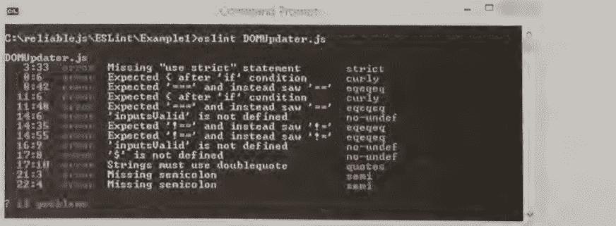

图 23-8

ESLint 在一个不到 30 行的文件中发现了 13 个问题！Charlotte 对列表 23-1 中的代码不会留下深刻印象吧，对吗？

图 23-8 所示输出中的每一行对应 ESLint 识别出的单独问题。
ESLint 输出行以行号和列号开头，用冒号分隔：即在处理文件中识别出问题的位置。接下来显示问题的严重程度。
图 23-8 中的所有问题都是错误（errors）。严重程度之后是所违反的规则的简短文本描述，最后显示该规则的 ESLint 代码。

# 在整个目录的所有 JavaScript 文件上执行 ESLint

ESLint 无疑提供了宝贵的反馈，但如果必须一个一个地输入文件，我们可能不会频繁运行它，我们也不希望你这样做。为了方便对许多文件运行，ESLint 还可以接受目录名作为命令行参数。要对本章 `\Example2` 目录中的所有文件运行 ESLint，请遵循以下步骤：

1. 打开命令提示符。
2. 切换到 `Example` 目录的父目录。
3. 在命令提示符中输入 `eslint Example2` 并按回车。

`Example2` 目录包含 `DOMUpdater_1.js` 和 `DOMUpdater_2.js` 文件。这两个文件都包含列表 23-1 所示的代码。

由于名称作为命令行参数提供给 ESLint，ESLint 将处理指定目录下的所有 `.js` 文件。步骤 3 中输入的命令的输出如图 23-9 所示。

```text
C:\reliablejs\ESLint>$ $ Example2

Example2-DOMUpdater_1.js

10:3    Missing "use strict" statement      error
11:3    Expected '{' after if condition      curly
12:5    Expected '{' after if condition      curly
13:5    Expected '{' after if condition      curly
14:5    "inputValid" is not defined       undefined
15:5    Expected '{' and instead saw saw      undefined
16:5    Expected '{' and instead saw saw      undefined
17:5    "inputValid" is not defined       undefined
18:5    Expected '{' and instead saw saw      undefined
19:5    Strings use doublequote         undefined
20:3    Missing semicolon                   error
21:3    Missing semicolon                   error

Example2-DOMUpdater_2.js

10:3    Missing "use strict" statement      error
11:3    Expected '{' after if condition      curly
12:5    Expected '{' after if condition      curly
13:5    Expected '{' after if condition      curly
14:5    "inputValid" is not defined       undefined
15:5    Expected '{' and instead saw saw      undefined
16:5    Expected '{' and instead saw saw      undefined
17:5    "inputValid" is not defined       undefined
18:5    Expected '{' and instead saw saw      undefined
19:5    Strings use doublequote         undefined
20:3    Missing semicolon                   error
21:3    Missing semicolon                   error

26 problems
```

图 23-9

其他设置可能包含指令，用于强制、放松或禁用这些规则，这些规则是在处理包含 `.eslintrc` 文件的目录（或其子目录）中的 JavaScript 文件时使用的。列表 23-3 显示了一个 `.eslintrc` 文件，它禁用了大括号规则（即在单语句条件分支或循环块周围缺少大括号），将分号规则（缺少分号）放松为警告而非错误，并通知 ESLint 正在使用 jQuery。

## 列表 23-3：.eslintrc 文件禁用了大括号规则，放松了分号规则并启用了 jQuery 环境（代码文件名：ESLint\Example3.eslintrc）

```json
{ "rules": {
  "curly": 0, // 0 禁用该规则
  "semi": 1 // 1 将违反规则的行为视为警告
},
"env": {
  "jquery": true
}}
```

如列表 23-3 所示，`.eslintrc` 文件的结构类似于 JavaScript 对象字面量，这一点你在书中一定已经熟悉了。

图 23-10 显示了当使用 `Example3` 目录下的 `DOMUpdater.js` 文件执行 ESLint 时的输出。该目录还包含了列表 23-3 中的 `.eslintrc` 文件。

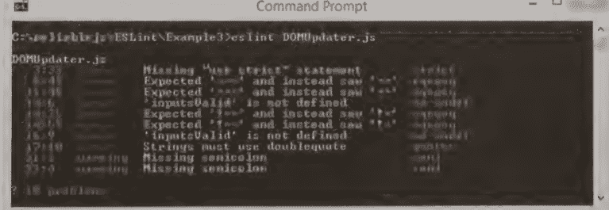

图 23-10

注意，ESLint 不再抛出任何与大括号相关的错误，也不再抱怨它未被定义。此外，当它遇到缺少分号的行时，它显示的是警告而非错误。

# 创建自定义 ESLint 规则

列表 23-4 显示了 `DOMUpdater.js` 的修订版本，该版本经过清理，已移除了 ESLint 报告的所有问题（包括由于缺少大括号和分号引起的问题）。

## 列表 23-4：修订后的 DOMUpdater.js 以消除了 ESLint 报告的问题（代码文件名：ESLintExample4\DOMUpdater.js）

```javascript
var ReliableJavaScript = ReliableJavaScript || {};

ReliableJavaScript.DOMUpdater = (function DOMUpdater() {

  "use strict";

  return {

    appendToElement: function appendToElement(appendToID, elementString) {

      if (appendToID === null || appendToID === undefined) {

        appendToID = "";

      }

      if (elementString === null || elementString === undefined) {

        elementString = "";

      }

      var inputsValid = (elementString !== "" && appendToID !== "");

      if (inputsValid) {

        $("#" + appendToID).append(elementString);

      }

    }

  };

})()
```

图 23-11 显示，当针对修订后的文件执行检查时，ESLint 既不产生错误也不产生警告。


图 23.11

假设你的团队规定，任何引用实体 ID 的标识符都以 `id` 结尾而非 `ID`。与其依赖人工在代码审查中发现偏离规则的情况，你可以编写一个自定义 ESLint 规则来强制执行 `id` 后缀标准。列表 23-5 展示了这样一个规则。

## 列表 23-5：id-suffix 自定义 ESLint 规则实现（代码文件名：ESLint\Example4\rules\id-suffix.js）

```javascript
"use strict";

module.exports = function(context) {

  return {

    "Identifier": function(node) {

      var suffix = node.name.length > 1 ? node.name.slice(-2) : "";

      if (suffix === "id" || suffix === "ID") {

        context.report(node, "Identifier ref should end with 'Id'.");

      }

    }

  };

};
```

`id-suffix.js` 文件遵循 ESLint 开发者文档中规定的格式，该文档可以在 http://eslint.org/developer-guide/working-with-rules.html 阅。

自定义规则的名称为 `id-suffix`，它由包含该规则的文件名决定。ESLint 网站提供了一份关于命名自定义规则的全面最佳实践列表。

规则模块接收一个 `context` 参数，通过该参数可以访问 JavaScript 文件的相关属性。`context` 变量还为规则提供了一种报告失败的机制：即 `report` 函数。

规则可以定义许多函数，用于分析 ESLint 处理的 JavaScript 抽象语法树（AST）的不同部分。例如，规则可以定义一个 `ReturnStatement` 函数，该函数会在遍历 JavaScript 文件的抽象语法树时被调用。ESLint 规则可以定义一个与 SpiderMonkey JavaScript 解析器使用的任何节点类型同名的函数，每当遇到该类型的节点时，该函数就会执行。节点类型的完整列表可以在 https://developer.eslint.org/en-US/docs/Mozilla/Projects/SpiderMonkey/Parser-API 获取。

自定义的 `id-suffix` 规则只关注标识符，因此它定义了一个名为 `Identifier` 的函数，每当 ESLint 遇到标识符时该函数就会被调用。标识符的 AST 节点通过 `node` 参数传递给函数。

自定义规则检查所提供的标识符名称的最后两个字符，并在遇到以 `ID` 结尾的标识符时向 ESLint 报告问题。随后，ESLint 会通过行号、列号、描述和名称通知用户。

要启用该规则，必须告诉 ESLint 生成的错误应该是被忽略、视为警告还是视为错误。列表 23-6 显示了启用 `id-suffix` 规则的 `.eslintrc` 文件。

## 列表 23-6：启用 id-suffix 规则的 .eslintrc 文件（代码文件名：ESLint\Example4）

```json
{
  "rules": {
    "id-suffix": 2 // 2 表示违反应被视为错误
  },
  "env": {
    "jquery": true
  }
}
```

# 第 23 章 确保标准

## 使用自定义规则运行 ESLint

ESLint 接受一个额外的命令行参数 `--rulesdir`，允许用户指定 ESLint 加载自定义规则的文件夹。按照以下步骤针对列表 23-4 运行 ESLint：

1. 打开命令提示符。
2. 进入 `Example4` 目录。
3. 在命令提示符输入 `eslint --rulesdir rules DOMUpdater.js` 并回车。

在执行 `id-suffix` 规则之前，ESLint 对列表 23-4 中的代码没有任何报告。现在强制执行 `id-suffix` 规则（如图 23-12 所示），ESLint 报告的大多数错误与 `appendToID` 有关。然而，第 19 行使用的变量 `inputsValid` 以 `id` 结尾，违反了现有的规则。

如果以 `valid` 结尾的变量很常见，可以更新规则使这些字符成为 "valid" 单词的一部分。另一方面，如果规则导致了许多误报，更好的做法是在规则中添加内联异常。列表 23-7 显示了 `DOMUpdater.js` 的更新版本，它解决了这些违规问题。

# 强制架构划分

你的软件项目就像一只赛级犬。你对它的深爱可能会让你忽略细微的缺陷，但在比赛中，人们将根据它对品种标准的符合程度，尽可能客观地对其评分。ESLint 及其兄弟工具可以处理演示工作，确保它的毛发顺滑且修剪整齐，但那些无法在最后时刻清理的结构性问题呢？例如，它的身体比例如何符合标准？本节的技术将解决这些关于软件组装的更高层次的问题，将让你的程序不仅仅是一个个人练习项目。

本书的一个主题是：随着你的 JavaScript 程序变得越来越规模庞大，你将想要降低复杂性。这在任何语言中开发时都是如此，但对于 JavaScript 来说尤其如此，因为它具有惯用性的、多样化的且不可追踪的实现方式。（我们是在说你，`call` 先生和 `apply` 女士。还有你，`object['property_as_subscript']` 先生）。

当软件的更多部分相互通信时，软件就会变得更加复杂。因此，降低复杂性的方法是将通信锁定在已知的通道中。

当你采用某种分层方案设计架构时，这一点尤为重要。例如，考虑第 21 章中基于中介者模式（Mediator Pattern）的游戏。考虑到架构，只有中介者应该调用其他对象的重要函数。例如，当玩家移动时，不应该直接通知 `gameLogic` 对象。相反，它应该调用 `mediator.onPlayerMoved`，然后由它调用 `gameLogic.onPlayerMoved`。

在编写模式时，依赖某一个良好的行为很容易，但依赖未来维护你代码的开发者就更有问题了。他们可能不知道你的意图，即使他们知道，也可能处于某种期限压力之下，这种压力会将你最棒的想法变成那种“焦土式”的代码编写。在代码中强制执行你的意图的方法是什么？或者，如果不能强制你的愿望，至少让它们变得极其清晰，以至于未来的开发者不太可能绕过它们。

你现在将看到实现此点的几种技术。每种技术都说明了如何确保只有中介者可以调用 `gameLogic.onPlayerMoved` 的方法。

## 家族秘密技术 (The Family-Secret Technique)

你的家族有私有语言吗？也许是一个自造的词，或者是一个只有你们家人之间才有意义的奇短语。也许是你们一起看的一部电影里的台词，当在家族内部引用时，它会立即勾起比外人能看到的多得的内容。这个短语是更广泛含义的秘密密钥。

对象可以属于家族，家族中的对象可以知道家族秘密。

如果 `mediator` 和 `gameLogic` 属于同一个家族，它们可以共享一个秘密，只允许 `mediator` 调用 `gameLogic.onPlayerMoved`。我们所说的“属于同一个家族”是什么意思？意思是 `gameLogic` 住在 `mediator` 的家里——`gameLogic` 是一个完全封装在 `Game.mediator` 的函数。这允许它们共享一个秘密，即 `mediator` 中的私有变量。当 `mediator` 调用 `gameLogic.onPlayerMoved` 时，它可以将秘密作为参数传递。`Logic` 同意秘密是正确的并允许移动继续。

没有什么能阻止让 `gameLogic` 的实例离开房子——将其传递给 `Game.player`，它看不到私有变量，并且无法通过受保护函数获得任何进展。如果它想通知 `gameLogic` 对象它的移动，它必须通过 `mediator`。因此，你的架构得到了强制执行。

列表 23-8 展示了这种技术。

> **注意** 为了本节的清晰起见，我们只展示了对象的简略形式。如果你想看到它们的所有功能，可以参考第 21 章的下载内容。

## 列表 23-8：一个家族秘密（代码文件名：FamilySecret/mediator.js）

```javascript
var Game = Game || {};

Game.mediator = function mediator() {

  'use strict';

  // magicKey 是中介者家族内部共享的秘密。

  // 它是对一个私有的、不可复制的对象的私有引用。

  var magicKey = {

    // 封装游戏的逻辑（规则）。

    // 在这个版本中，gameLogic 被嵌入在 mediator 中，这样它就能

    // 看到 magicKey。
```


# 印记技术 (The Imprinting Technique)

幼鹅以对它们看到的第一个生物印记而闻名。以类似的方式，你可以让 `gameLogic` 印记另一个对象。通过 `gameLogic`，当 `mediator` 作为参数传递给 `onPlayerMoved` 时，它服从。其他人调用它，它拒绝。

很容易，对吧？准备好写代码了吗？

当然没有！在不编写测试的情况下编写代码将是承认你在阅读前面的章节时并没有打算将想法付诸实践。

列表 23-9 详细说明了这一新功能的测试（两个是必要的）。再次展示了对象的核心功能。

### 列表 23-9：印记技术的单元测试（代码文件名：Imprinting/gameLogic-tests.js）

```javascript
describe('gameLogic', function() {
  'use strict';
  var mediator = 'Pretend this is a mediator',
      player = 'Pretend this is a player',
      gameLogic = Game.gameLogic(mediator, 6, 7);
  describe('onPlayerMoved(caller, player)', function() {
    it('如果调用者不是原始中者则抛异常', function() {
      expect(function() {
        gameLogic.onPlayerMoved('wrongKey', player);
      }).toError(Game.gameLogic.messages.callerOriginalMediator);
    });
    it('如果调用者是原始中者则不抛异常', function() {
      expect(function() {
        gameLogic.onPlayerMoved(mediator, player);
      }).not.toThrow();
    });
  });
});
```

第一个测试确保传递给构造函数的中者没有作为 `gameLogic.onPlayerMoved` 的调用者，那么 `onPlayerMoved` 将抛出异常。第二个测试是正常路径。

实现完全直白易见（见列表 23-10）。

### 列表 23-10：印记技术的实现（代码文件名：Imprinting/gameLogic.js）

```javascript
var Game = Game || {};

// 封装游戏的逻辑（规则）
Game.gameLogic = function gameLogic(mediator, rows, columns) {
  'use strict';
  var mommy = mediator;
  return {
    onPlayerMoved: function onPlayerMoved(caller, player) {
      if (caller !== mommy) {
        throw new Error(Game.gameLogic.messages.callerMustBeOriginalMediator);
      }
      // Make the logical representation of the game respond to player's move.
    }
    /*** Other function omitted for clarity. ***/
  };
};

Game.gameLogic.messages = {
  callerMustBeOriginalMediator: 'The caller parameter must be the mediator ' +
    'supplied when the object was instantiated.'
};
```

一如既常，单元测试的结果提供了对功能性的简洁描述（见图 23-14）。

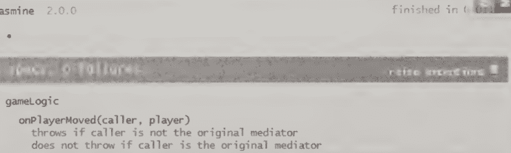

对上述内容的最初反应可能是怀疑。你可能会问：“有什么能阻止另一个同样拥有中者引用的组件调用 `gameLogic.onPlayerMoved` 呢？玩家就是一个例子。它也是用一个中者实例构造的，并且可以很容易地调用 `gameLogic.onPlayerMoved`。”

你是对的。这种模式对你论点的唯一回应就是一个松散的变量名。`onPlayerMoved` 的第一个参数被命名为 `caller` 而不是 `mediator`，是希望如果玩家开发者调用 `gameLogic.onPlayerMoved`，他会看到 `caller` 这个名字并不小心传递了玩家实例。然后他会得到异常并说：“哦，我想我不应该那样做。”

尽管如此，这仍然仅仅是一种希望，而你可能觉得这种希望并不恰当。如果是这样，下一个技术可能会让你感兴趣。

# “任务不可能”技术

这种技术的实现起来要稍微麻烦一点，但它确实确保了中者是唯一一个能够调用 `gameLogic.onPlayerMoved` 的人。

你看过老旧的电视节目《任务不可能》吗？每一集都以不可能任务部队的主管吉姆·菲尔斯（Jim Phelps）（嘿，那是 20 世纪 60 年代，电视节目很俗，好吗？）听磁带开始，他在下达指令：“你的任务，你选择接受，它是， .……” 消息通常以“这条磁带将在五秒后自毁”结束，此后设备就会化为烟雾。吉姆没有第二次机会，但他是一个非常聪明的家伙，不需要。而且在他听完之后，没有任何特权信息会落入错误的人手中。

你可以使用一个“一次性魔法密钥”来做同样的事。主意是，中者一旦构造，它就会请求 `gameLogic` 的魔法密钥，然后授予密钥的函数就会所谓的“自毁”，这样其他组件就无法获取密钥。同时，中者将密钥放在一个私有变量中，免受那个过度创造的开发者的侵害。

“一次性魔法密钥”是一个值得封装在独立对象中的模式。描述它的单元测试在列表 23-11 中。

### 列表 23-11：`readOnceKey` 的单元测试（代码文件名：MissionImpossible/readOnceKey_tests.js）

```javascript
describe('readOnceKey', function() {
  'use strict';
  var readOnceKey;
  beforeEach(function() {
    readOnceKey = Game.readOnceKey();
  });
  describe('getKey()', function () {
    it('returns something with the first call', function() {
      expect(readOnceKey.getKey()).not.toBeUndefined();
    });
    it('throws on the second call', function() {
      readOnceKey.getKey();
      expect(function() {
        readOnceKey.getKey();
      }).toThrowError(Game.readOnceKey.messages.onlyOnce);
    });
  });
  it('cannot be replaced with an impostor', function() {
    expect(function() {
      readOnceKey.getKey = function() { return 'Fake!'; };
    }).toThrow();
  });
});

describe('assertMatches(key)', function() {
  it('throws if "key" is not the correct one', function() {
    expect(function() {
      readOnceKey.assertMatches('badKey');
    }).toError(Game.readOnceKey.messages.badKey);
  });
  it('does not throw if "key" is correct', function() {
    var magicKey = readOnceKey.getKey();
    expect(function() {
      readOnceKey.assertMatches(magicKey);
    }).not.toThrow();
  });
  it('cannot be replaced with an impostor', function() {
    expect(function() {
      readOnceKey.assertMatches = function() { };
    }).toThrow();
  });
});
```

`readOnceKey` 对象有两个方法：`getKey` 和 `assertMatches`。前两个单元测试验证了 `getKey` 在第一次调用时成功，但在之后失败。第三个测试的原因很快就会明白。第二组测试验证了只有当提供错误的密钥时才会抛出异常，并且无法被替换。列表 23-12 显示了实现。

### 列表 23-12：`readOnceKey` 的实现 (code: MissionImpossible/readOnceKey.js)

```javascript
var Game = Game || {};

Game.readOnceKey = function readOnceKey() {
  'use strict';
  var magicKey = {},
      alreadyRead = false,
      ret = {}; // 将返回的只读密钥

  function getKey() {
    if (alreadyRead) {
      throw new Error(Game.readOnceKey.messages.onlyOnce);
    }
    alreadyRead = true;
    return magicKey;
  }

  function assertMatches(key) {
    if (key !== magicKey) {
      throw new Error(Game.readOnceKey.messages.badKey);
    }
  }

  Object.defineProperty(ret, 'getKey', { value: getKey });
  Object.defineProperty(ret, 'assertMatches', { value: assertMatches });

  return ret;
};

Game.readOnceKey.messages = {
  onlyOnce: 'The readOnce may only be read once.',
  badKey: 'The supplied key was incorrect. ' +
    'Have you violated an architectural constraint?'
};
```

注意使用 `Object.defineProperty` 在返回的对象中安装方法。默认情况下，`Object.defineProperty` 会使定义的属性变为只读的。这很重要，因为任何成员都无法绕过 `readOnce` 的意图。最后，图 23-15 证明了 `onPlayerMoved` 是通过密钥通过的。

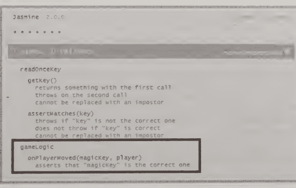

你如何测试 `gameLogic` 对密钥的使用？这取决于口味。你是否需要验证 `onPlayerMoved` 在密钥正确时成功，在提供错误密钥时失败？你可以这样做，但这将重复 `readOnce` 的测试（见列表 23-13）。

> ### 列表 23-13：安装在 gameLogic 上的 readOnce (code filename: MissionImpossible/gameLogic.js)

```javascript
var Game = Game || {};

// 封装游戏的逻辑（规则）
Game.gameLogic = function gameLogic(mediator, rows, columns) {
  /*** Function body ***/
};

Game.gameLogic.keyToProtectedFunctions = Game.readOnceKey();
```

现在你需要将 `readOnce` 嵌入 `gameLogic` 中。如果有多个 `gameLogic` 实例，它们应该共享一个公共密钥，你会将其附加到 `gameLogic` 函数上而不是每个 `gameLogic` 对象（见列表 23-14）。

### 列表 23-14：验证 gameLogic.onPlayerMoved 检查了 readOnceKey (code filename: MissionImpossible/gameLogic_tests.js)

```javascript
describe('gameLogic', function() {
  'use strict';
  var mediator = 'Pretend this is a mediator',
      player = 'Pretend this is a player',
      gameLogic = Game.gameLogic(mediator, 6, 7);
  describe('onPlayerMoved(magicKey, player)', function() {
    it('asserts that "magicKey" is the correct one', function() {
      expect(function() {
        gameLogic.onPlayerMoved('bad key', player);
      }).toThrow(Game.readOnceKey.messages.badKey);
    });
  });
});
```

测试最初失败，但在你将列表 23-15 中高亮的单行添加到 `gameLogic` 后成功了。

### 列表 23-15：GameLogic.onPlayerMoved 现在检查 readOnceKey (code filename: MissionImpossible/gameLogic.js)

```javascript
var Game = Game || {};

// 封装游戏的逻辑（规则）
Game.gameLogic = function gameLogic(mediator, rows, columns) {
  'use strict';
  return {
    onPlayerMoved: function(magicKey, player) {
      Game.gameLogic.keyToProtectedFunctions.assertMatches(magicKey);
      // Make the logical representation of the game respond to player's move.
    }
  };
};

Game.gameLogic.keyToProtectedFunctions = Game.readOnceKey();
```

回顾一下，中介者现在能够在创建 `gameLogic` 之前调用 `Game.gameLogic.keyToProtectedFunctions.getKey()`。事实上，如果中介者真的非常疑神疑鬼，它会在创建 `player` 或任何其他可能劫持该密钥的对象之前调用 `getKey`。（当然，如果发生了此类事件，中介者会在它尝试获取密钥的那一刻就知晓！）中介者会将密钥存储在一个私有变量中，然后将其作为第一个参数传递给 `gameLogic.onPlayerMoved(magicKey, player)`。


图 23-16

# 魔法棒技术 (The Magic Wand Technique)

“不可能任务”技术是安全的，但前提是菲尔普斯导演在任何人之前先听磁带。由高级权威向适当的代理人授予适当的权限可能是合理的。如果是这样，你可以考虑魔法棒技术。

这种模式也使用了 `readOnceKey`，由一个顶层对象进行编排。延续这种俏皮的精神，它被称为 `fairyGodmother`（仙子教母）。

在这个变体中，`fairyGodmother` 从 `gameLogic` 获取一个 `readOnceKey`，然后将其赐给中介者，中介者必须有一个接收密钥的方法：`receiveKeyToGameLogic`。与“不可能任务”技术一样，`receiveKeyToGameLogic` 将密钥封装在中介者的私有变量中。故事的其余与“不可能任务”（指软件模式，而非电视节目）相同。

应用程序将要求 `fairyGodmother` 在适当的时刻对适当的对象挥动魔棒。这段代码片段展示了她如何可能赋予中介者我们一直在讨论的特殊能力。

```javascript
Game.fairyGodmother = function fairyGodmother() {
  return {
    waveWand: function waveWand(mediator, gameLogic, otherObjectsToo) {
      var gameLogicKey = Game.gameLogic.keyToProtectedFunctions.getKey();
      // 给 gameLogic 的保护函数访问权限。
      mediator.receiveKeyToGameLogic(gameLogicKey);
      // 对其他对象也挥挥魔棒...
    }
  };
};
```

魔法棒技术的优势在于将你的架构分层决策放在一个地方，便于检查和理解。此外，它允许 `readOnceKey` 存在于多个对象中。你可能认为它是对“不可能任务”技术的改进，也可能不认为。

# 不要使用调用栈技术 (Do Not Use the Call Stack Technique)

如果你是从其他语言转向 JavaScript 的，你可能会疑惑为什么 `gameLogic.onPlayerMoved` 不能简单地检查调用栈来验证是否是中介者在调用。这里有几个原因，但最直接的一个就足够了：JavaScript 没有一种跨浏览器兼容的方法来检查调用栈。

即使还有其他理由说明检查调用栈不是一个好主意。首要的一点是，仅检查直接调用者是不够的。万一 `gameLogic.onPlayerMoved` 被包装在一个切面（aspect）中，导致该切面成为调用者怎么办？为了适应这种情况，你必须继续向上追溯栈，直到你找到（或没有找到）中介者。

其次，假设你确实找到了中介者，而且它在五层之外。你如何知道中间的层是无害的对象，而不是像 `player` 这样的执行者？你无法检查每一个糟糕的情况。

# 其他技术 (Other Techniques)

在本节中，你已经看到了几种通过限制对象之间的通信来强制架构决策的方法。每种技术都使用私有变量作为保护函数或一组函数的密钥。你可能可以想出这种想法的更多变体。和 JavaScript 一直以来，你的想象力是唯一的限制。

# 其他架构 (Other Architectures)

中介者模式是分层架构的一个示例。还有其他的架构。无疑，你在用户界面、业务逻辑和数据访问的经典层中有许多应用程序。在 AngularJS 应用程序中，我们发现通过服务层收集所有调用是很有用的。

在任何情况下，避免混乱的关键都是遵守标准。在一个并非每个成员都意识到或赏识这些标准的团队中，这可能是困难的。本节中的技术在传达和执行你的意图方面可能非常有用。

# 总结 (SUMMARY)

本章涵盖了如何在语法和架构层面强制执行你的标准。介绍了开源 JavaScript 静态检查工具 ESLint，作为辅助检测行级标准违规的工具。ESLint 的先决条件是 Node.js，所以你看到了如何在 Windows PC 上安装 Node 和 npm。接下来，你看到了如何运行 ESLint，包括针对单个文件和多个文件。此外，你还看到 ESLint 支持多种机制，例如代码内指令和配置文件，并允许你编写自己的规则。架构标准决定了哪些对象被允许通信。本章以中介者模式作为示例。在这种模式中，中介者应该管理对象之间所有的通信。尽管 JavaScript 没有像 C# 或 Java 那样的访问修饰符，但你看到了如何对对象之间的通信实施非常精确的控制。

随着你的 JavaScript 应用程序的增长，你会发现对标准保持谨慎变得越来越重要。在这二十章中，我们涵盖了大量内容。回顾一下我们学过什么可能会有帮助。下一章将总结测试驱动开发的原则。

# 第五部分 (PART V)

# 总结 (Summary)

- 第 24 章：测试驱动开发总结
- 第 25 章：书中 JavaScript 惯用法总结

# 24 测试驱动开发原则的总结 (Summary of the Principles of Test-Driven Development)

## 本章包含什么？ (WHAT'S IN THIS CHAPTER?)

- 编写可测试的代码
- 掌握测试驱动开发的机制
- 测试软件工程中的常见模式

曾经有一个叫《你的人生》（This Is Your Life）的电视节目。它于 1948 年首播，在 20 世纪 80 年代经历了几次复播和特辑。一个相当普通的人发现自己出现在节目中并回顾自己的生活，会感到惊讶。主角失散多年的朋友可能会出现；他那已九十多岁的小学老师会说她如何记得他曾是个好孩子，等等。不言而喻，这会对主角产生很大影响，观众也会深受感动。

当你回顾在前面的二十章中度过的生活时光时，你会发现有一个一直守在你身边的朋友：测试驱动开发。一次又一次，它在让你的软件更加可靠方面发挥了重要作用。在本章中，让我们回顾一下那段友谊。尽管你可能不像其他人那样感动落泪。

## 回顾为什么测试驱动开发是值得的 (RECALLING WHY TEST-DRIVEN DEVELOPMENT IS WORTHWHILE)

像一位老朋友一样，测试驱动开发的单元测试从一开始就伴随着你。它们通过预判程序应该如何行为来帮助思考问题，而不仅仅是验证它的运行。

单元测试是你的后盾。如果你想重构代码，测试驱动开发带来的测试覆盖会告诉你结果是否正确。

反直觉的是，测试驱动开发坚持增量添加功能不会导致代码重写。通过测试驱动开发，你的单元测试将覆盖几乎 100% 的代码，从而保持代码简洁且高效（DRY）。这从开发过程的开始就是如此。

在第二章中，你看到了我们遇到过的最优雅的代码之一——`Aop.js` 库，是如何通过测试驱动的方法构建的。

不仅如此，你还看到了可以通过测试驱动开发来*理解*并编写那个小作品。

当测试驱动开发帮助你实现运行程序的目标后，它继续是你的朋友。单元测试的输出（书中是 Jasmine）读起来就像功能规范，帮助未来的开发者理解你所做的一切……防止他们搞砸。

## 实践测试驱动开发 (PRACTICING TEST-DRIVEN DEVELOPMENT)

当你回顾测试驱动开发在本书中扮演的角色时，会有一些通用原则脱颖而出。首要的一点是编写可测试的代码。

### 编写可测试的代码

这很简单：为了编写可测试的程序，要以单元的形式编写你的程序。我们在此处指的是具有小型接口（见第 3 章）和单一职责（见第 1 章）的模块。

当一个单元必须使用另一个单元的服务时，依赖注入是你的 SOLID（见第 1 章）伙伴。如果你通过构造函数提供单元的服务，你可以在单元测试中提供 mock，从而将实际测试的代码限制在单个单元，而不是两个。

以下是测试驱动开发的基本循环：

1. 编写一个测试。理想情况下，它会失败，并且以一种让你确定它正在测试应该测试的内容的方式失败。
2. 编写代码使测试通过。
3. 重构以保持代码简洁且高效。
4. 重复直到程序完成。

### 在代码之前编写测试

最重要的一步，也是我们发现开发者遇到最大困难的一步，是第一步：在编写代码之前编写测试。保持这种纪律极其困难，但绝对是可靠性的关键。永远不要让你的代码跑在测试前面。

在代码之后编写的测试最初会通过而不是失败。你如何知道它的通过是因为代码是正确的，而不是因为测试本身有缺陷呢？

### 保持测试的 DRY

通常，你的测试包含的代码行会比被测试的对象还要多。这是一个非常明显的提示，即保持测试的 DRY（不要重复）与保持代码良好状态同样重要。Jasmine 的嵌套结构允许在每一层级使用 `beforeEach`，这使得它变得非常简单（见第 2 章）。

### 先测试错误条件

你应该编写的第一批测试应该是针对错误条件的。你越早做“真实”测试，就越容易对被测试的对象感到疲倦，也就越可能走捷径以便于处理其他事情。相反，如果你将最有趣、最重要的测试留到最后，你就会有所期待，并保持热情直到最后。

此外，先编写错误和边界检查测试将帮助你深入思考问题的参数，并可能让你想起一些额外的正面测试。

### 先测试简单的后测试复杂的

在测试“快乐路径”（happy paths）时，从最简单的开始。这将导致被测试的对象以最小的增量增长。你认为哪种更容易测试：为单个测试编写的小增量，还是一个同时也满足该测试的较大增量？答案是显而易见的。

从简单的测试开始往往也会让你的测试变得同样简单。

### 具体化

令人惊讶的是，编写未能达到预期测试目的的测试其实很容易。例如，在测试错误条件时，不要满足于以下内容：

```javascript
expect(something).toEqual();
```

如果被测试的对象抛出了错误，你如何知道它是正确的那一个？也许它在到达你尝试测试的部分之前就抛出了错误。相反，请这样做：

```javascript
expect(something).toEqual(aSpecificError);
```

特定的错误通常是对象为了这个单元测试目的而向外部世界暴露的消息。

在正向测试方面，不要满足于以下内容：

```javascript
expect(something).toHaveBeenCalled();
```

你如何知道它是被正确调用的？相反，请坚持以下操作：

```javascript
expect(something).toHaveBeenCalledWith(the, proper, arguments);
```

示例请参阅第 14 章中的列表 14-7。

### 只测试一件事

每个测试都应该验证一件事。然而，现实情况是，这一件事可能是一个条件数组。你在第 11 章的列表 11-3 中看到一个示例，其中有一个测试 `new WidgetsSandbox(toolsArray, widgetFcn)` 在 `widgetFcn` 不是函数时会抛出异常。与其为每种不是函数的参数编写单独的测试，不如通过 `forEach` 在某些逻辑中运行一个非函数数组。

将你的 Jasmine 输出视为一份功能规格说明书，你希望尽可能详尽。然而，你的策略也应该足够合理，不至于让开发者直接放弃。

### 你的数据与测试一样重要

避免使用可能对被测试对象产生无意偏袒的测试数据。这意味着避免使用 0 和 1 这样的特殊数字（除非这些数字与测试点有关），并为每条数据使用不同的数字。在测试排序功能时，确保使用在字符串排序和数字排序下结果不同的数据。（见第 14 章列表 14-8 后的讨论。）如果现实中的数据是一对多的关系，确保测试数据也是如此，并务必测试这种对多的行为。

大多数程序员对编写代码比编写数据更感兴趣。不要让缺乏兴趣让你变得懒惰！

### 有效使用 Jasmine

Jasmine 的函数用于描述测试，且每个函数都接受一个字符串作为第一个参数。如果你在每个嵌套的 `describe` 组中的字符串措辞使得它们的拼接能产生一个句子，那么单元测试的输出读起来就像一份功能规格说明书。这种纪律也能让你清楚自己正尝试测试什么。

我们看到过很多情况，测试单独运行时通过了，但作为整个测试套件的一部分运行时会失败。无例外，这是因为某些内容应该在 `beforeEach` 中初始化，但没有在那里初始化。

此外，确保在必要时使用 `afterEach` 清理测试……移除元素，这样后续测试就不会被它们创建的元素所困扰。

## 测试书中的模式

上述原理适用于你任何使用测试驱动开发的地方，但本书的很大一部分专门用于特定软件工程模式的测试驱动开发。

### 测试面向切面的编程

面向切面的编程在这些页面中多次出现，我们希望你在代码中也能发现这种强大模式的同样用途。当你编写切面（aspects）时，请记住以下几点。

库 `Aop.js` 保证向装饰后的函数传递正确的参数并捕获返回值。然而，如果你不使用库而使用面向切面的技术，这些是你应该考虑的事。

如果监视一个被切面装饰的函数很重要，请确保在应用切面之前捕获未装饰函数的引用。然后，对未装饰的版本进行监视（spy on）。

### 测试对象构造

在第 3 章，你看到了许多在 JavaScript 中构造对象的方法。某些需要特殊的 care。

对象字面量在 JavaScript 中太容易编写了，以至于会在未测试的情况下进入代码。创建它们的可靠方法是使用遵循测试驱动开发的工厂方法。

如果一个对象设计为使用 `new` 构造，请确保包含一个如果不正确构造的测试。不当构造应该抛出异常，测试应该验证是否抛出了该异常。

当你通过猴补丁（monkey-patching）创建对象时，提供者应该管理补丁。它应该验证 promise 满足任何要求，并且单元测试应该验证提供者做到了。

### 测试回调

回调在 JavaScript 代码中无处不在，正如第 5 章所解释，它们需要特殊的测试。当测试调用回调的代码时，Jasmine 的通常做法是对回调函数进行监视并确保它以正确的参数调用（见第 5 章的列表 5-2）。

在测试回调函数本身时，要特别注意函数内部符合你的预期。参见第 5 章的“注意此处”部分。避免编写无法单元测试的内联回调。糟糕的情况是“回调箭头”。

### 测试基于 Promise 的代码

正如第 6 章所示，Promise 在编写和测试上都是很复杂的。如果你不小心，你正在测试的 Promise 在测试结束时可能处于未解析状态。你并不知道。第 6 章的列表 6-4 展示了如何使用 Jasmine 的 `done()` 机制来解决这个问题。

请注意，如果 `Promise.then(resolveCallback, rejectCallback)` 中的回调被调用且没有返回任何内容，你实际上得到的是解析为 `undefined` 的 Promise。通常，在测试中构造一个已经处于稳定状态（无论是已完成还是拒绝）的 Promise 是很有用的，但有时你需要在 Promise 在测试期间的特定时刻稳定。对于这些情况，请使用 Promise 封装库，如 AngularJS `$q`。

链式 Promise 可能会让你意外。例如，如果代码遵循了 Promise 的拒绝，但如果该分支返回了一个已完成的 Promise，那么链的结果将是一个已完成的 Promise（考虑到已经发生了拒绝，这可能出乎你的意料）。务必在所有情况下都测试你的执行流。

### 测试部分函数应用

如第 7 章所示，部分函数应用的单元测试应仅确保底层（完整）函数以正确的参数被调用。在这种语境下，除了编写该函数之前肯定已经存在的测试外，没有必要为该底层函数编写额外的测试！

### 测试记忆化（Memoization）

同样，你对记忆化模式（见第 8 章）的测试并不关注被记忆化的函数*本身*。它们只需要确保通过记忆化器使用相同参数进行的多次调用只会导致对底层函数的单次调用（且参数正确），并且底层的返回值会通过记忆化器传递。为了实现这一目的，你可以将底层函数替换为一个探针（spy）。

记忆化可以转换为一个切面（aspect），此时所有适用于测试切面的常规原则都适用。参见第 8 章中的示例。

### 测试单例模式（Singleton）

正如你在第 9 章中看到的，单例模式为游戏引入了特殊的考虑因素，即每当你创建一个它的实例时（通常使用像 `getInstance()` 这样的函数），你实际上获得的是同一个实例。测试可以简单如：

```javascript
expect(firstInstance).toBe(secondInstance);
```

与 C# 或 Java 不同，你不需要担心多个线程访问单例，因为 JavaScript 是单线程的。

### 测试工厂方法（Factory Method）

在工厂模式（见第 10 章）中，工厂的单一职责是构造并返回另一个对象。因此，其测试的单一职责是验证正确的参数是否被传递给该对象的构造函数，并返回了所构造的对象。一个 Jasmine 探针具有跟踪参数并根据指令返回值的能力，因此应该是真实对象的替代替品。

### 测试沙箱模式（Sandbox）

如果你使用沙箱模式（见第 11 章），你可能会得到第三方产品的帮助。然而，如果你正在编写自己的沙箱组件（这并不困难），这里是你在测试中需要考虑的一些事项。

为组件（widget）创建沙箱的函数可能像这样：

```javascript
function WidgetSandbox(toolsArray, widgetFn)
```

它的测试可以验证 `widgetFn` 确实是一个函数，该函数被执行了，并且沙箱是调用中的第一个参数（如果你的沙箱是这样设计的话）。

通过验证每个工具的构造函数都以沙箱作为参数被调用（再次假设是你的设计），以及每个工具都可以通过名称获取，来测试向沙箱提供工具。

要测试单个工具，请验证它将自己添加到沙箱中。对于此测试来说，沙箱不需要是真实的；它可以是一个空字面量（见第 11 章的列表 11-9）。当然，这是在适用于该工具基本功能的任何测试之外的。

针对被沙箱化的组件的特殊测试包括：一个用于验证在所需的资源不可用时是否抛出正确的错误，而在可用时不抛出。同样，一个代表真实沙箱的简单对象会将你的测试隔离在真实主体上（见第 11 章的列表 11-11）。

### 测试装饰器模式（Decorator Pattern）

人们很容易让被装饰的对象（无论它有什么缺陷）成为装饰器测试的无意主体。为了避免这种潜在的暴露，考虑为被装饰的对象编写一个简化的假对象（fake）。假对象的另一个优势是，通常让它产生错误比让真实对象产生错误更容易。

说到这里，你的第一个测试应该是验证假对象中的错误是否通过装饰器传播。完成此后，你可以验证成功的返回值是否按计划沿调用堆栈向上。我们建议将对装饰器实际功能的测试作为最后一步。第 12 章包含了所有细节。

### 测试策略模式（Strategy Pattern）

第 14 章中的策略模式采用工厂来根据即时需求产生正确类型的对象（策略）。策略模式本身的实现（与工厂区分开来）只需要测试错误处理、如何正确调用工厂以获取所需的策略、在策略上调用所需的函数以及返回策略的结果。正如你现在可能猜到的，最好是模拟工厂和它产生的产物以外的所有内容。模拟由假对象、探针（最可能是两者兼具）组成。

### 测试代理模式（Proxy Pattern）

你可能在第 14 章记得，代理模式由一个对象组成，该对象作为使用底层对象的专家。你想测试的是代理如何处理该对象。当代理通过依赖注入接收对象，而不是自己构造对象时，测试是最容易的。这让你注入一个探针，它可以向你的测试报告它是如何被调用的以及返回了什么。

代理应该尽可能少地涉及其主体的语义。通常这些确实非常少，导致测试非常少。参见第 14 章列表 14-10 后的讨论。

### 测试链式方法（Chainable Methods）

链式方法通常只是一个返回 `this` 的方法。除了该方法所需的任何其他测试外，这是需要测试的一项。

有时，一个方法变成链式的是因为它返回了一个与 `this` 相同类型或相同形状的对象。Promise 对象的方法就是一个例子。它返回的不是调用它的那个 Promise，而是一个新的 Promise。这也应该是测试的对象。

### 测试接口遵循（Conformance to an Interface）

在第 16 和 17 章中，你看到了 JavaScript 这种没有接口的语言如何从接口背后的哲学中受益。如果你编写类似的代码，类似 `ContractRegistry` 的帮助。它可以验证对象是否具有预期的方法，以及这些方法是否以正确的参数被调用。你可以在测试期间激活 `ContractRegistry`，而在生产环境中完全消失。

### 测试 call 和 apply 的使用

正如第 18 章解释的，`call` 和 `apply` 函数各接受一个参数，该参数在调用的函数内部成为 `this`。如果没有提供该参数，你希望代码如何表现？记住，在严格模式下 `this` 将是 `undefined`，而在非严格模式下将是 `window` 对象。这绝对需要测试！

### 测试方法借用模式（Method-Borrowing Pattern）

当一个对象从另一个借用方法时，主要的危险是借用的方法可能需要其新宿主的某些东西。安全的做法是在借用的方法中安装代码检查。我们在第 19 章中详细讨论过这一点，包括使用额外间接层的建议，并且可能是一个切面。

最后，请注意，从新家园调用的借用方法甚至可能影响其原始家园的私有变量。

### 测试混合入（Mixins）

在第 20 章中，你看到了通用的 `extend` 函数如何促进混合入模式。在开发此类函数时，考虑你是想拷贝捐赠者的“自身”属性，还是包括它的继承属性。然后，编写相应的测试。

还要考虑当目标对象已经有一个要从混合入导入的属性时，你想做什么。是覆盖它、保持原样，还是抛出错误？

在接收它的最小要求的对象上测试混合入。

功能性混合入是指包含一个将自己添加到宿主的方法。这种混合入通过 `call` 或 `apply` 调用，其上下文参数（方法内部的 `this`）是被扩展的对象。第 20 章的示例是一个向任何对象添加 id 属性的混合入，如下：

```javascript
Conference.mixins.addId.call(newAttendee);
```

如果你的混合入采用了这种模式，上述 `call` 和 `apply` 的建议同样适用。

### 测试中介者和观察者

第 21 章的中介者模式和观察者模式都依赖于执行者之间的“接口”。你需要确保满足接口的要求。`ContractRegistry` 可以为此提供帮助。

在观察者模式中，你可以使用主题的伪造、简化版本。同样，在测试中介者时，你可以为真实的同事使用伪存根（fake stubs）。像往常一样，核心是将注意力集中在主体测试上，将测试与其他对象的行为隔离。

### 测试 DOM 访问

测试 DOM 访问的第一条规则（参见第 22 章）是避免它。尽可能将你的代码放在与 DOM 无关的函数中。这样，你的测试只需要关注简单的问题，例如：“如果我点击这个按钮，这个[已经测试过的]函数是否会被调用？”。

你的 Jasmine 测试在 `beforeEach` 中添加 DOM 元素，并在 `afterEach` 中移除它。考虑使用 `jasmine-jquery` 作为辅助，从那里与 DOM 元素进行交互。

避免只关注外观的单元测试；它们可能是脆弱的。

### 强制架构划分的测试

在第 23 章中，你看到了魔法密钥技术的几种变体，该技术确保了组件只能按照架构允许的方式从其他组件调用。在每种变体中，单元测试都确保了密钥产生了预期效果。

## 总结

本章介绍了你在书中遇到的测试驱动开发原则，包括测试驱动开发的通用机制，以及对软件工程中许多常见模式的特定建议。

如果你是从其他语言转到 JavaScript 的，可能会发现它有些奇特——从好的方面来说。下一章总结了许多赋予 JavaScript 魅力的惯用法（idioms）。

# 25 本书中 JavaScript 惯用法的总结

## 本章内容：

- 复习 JavaScript 对象、变量和函数的独特之处
- 复习其他 JavaScript 惯用法

JavaScript 与 C# 或 Java 之间有足够的语法相似性，以至于许多开发者在跳进去编写 JavaScript 时，会使用他们构建 C# 或 Java 程序时使用的概念和结构，而不加思考。

然而，采取这种方法往往会导致难以维护的 JavaScript 代码，这些代码既没有 C# 或 Java 的类型安全，也没有良好的 JavaScript 的优雅。为了创建真正可靠的 JavaScript 应用程序，你必须理解使其成为它的特性：一种灵活、强大且优雅的编程语言。

虽然本书明确不是 JavaScript 入门教程，但 JavaScript 语言的某些特征值得显式复习。本章强调了我们在前面的章节中使用 JavaScript 的一些独特、惯用的方面。

## 复习对象

JavaScript 只有五种原始类型：String、Number、Boolean、Undefined 和 Null。其他所有内容（包括函数）都是对象。本节重新复习了我们在书中使用的 JavaScript 对象的某些惯用方面。

### 对象属性可以添加和移除

JavaScript 对象的动态特性意味着可能以有趣的方式对其进行操作。通常来说，一旦在 C# 或 Java 中创建了对象，该对象的属性就固定下来了；无法添加或移除属性。JavaScript 对象通常不受相同限制。事实上，在对象创建后向其添加属性和移除属性是很常见的。

例如，第 11 章中的列表 11-5 利用了 JavaScript 对象的动态特性，在 `Conference.WidgetSandbox` 内部添加和移除工具。接下来的示例强调了列表 11-5 的相关部分。

```javascript
describe("Conference.WidgetSandbox", function() {
  describe("Constructor function", function() {
    var widgetFcnSpy;

    beforeEach(function() {
      // 添加工具以便测试不依赖于实际工具的存在
      Conference.WidgetTools.tool1 = function(sandbox) {
        return {};
      };
      Conference.WidgetTools.tool2 = function(sandbox) {
        return {};
      };

      // 创建一个可以作为小部件函数的间谍
      widgetFcnSpy = jasmine.createSpy();
    });

    afterEach(function() {
      // 移除测试工具
      delete Conference.WidgetTools.tool1;
      delete Conference.WidgetTools.tool2;
    });

    // *** 为了简洁省略了代码 ***
  });
});
```

### 对象可以像字典一样使用

可以使用字典语法访问 JavaScript 对象的属性。例如，以下赋值语句在功能上是等价的：

```javascript
var obj = { };

obj.myProperty = 'Property value';
obj['myProperty'] = 'Property value';
```

以字典方式访问其属性的能力使 JavaScript 对象成为用作缓存的自然人选，正如第 14 章列表 14-6 的以下节选所示：

```javascript
Conference.attendeeProfileProxy = function(
  attendees, profileService, prefetchLimit) {

  var ix,
    prefetched = {};

  function prefetch(attendeeId) {
    prefetched[attendeeId] = profileService.getProfile(attendeeId);
  }
  // *** 为了简洁省略了代码 ***
};
```

## 复习变量

为了创建可靠的 JavaScript 代码，必须理解 JavaScript 的某些惯用方面。本节复习了其中两个方面：提升（hoisting）和作用域（scoping）。

### 变量声明提升

以下 C# 代码示例的输出是什么？

```csharp
static void WriteValue()
{
  value = "this is value";
  string value;
  System.Diagnostics.Debug.WriteLine(value);
}
```

如果你说：“什么，这无法编译”，在 C# 中，变量在声明之前无法使用。然而，假设 C# 编译器没有阻止你在声明之前引用变量。现在考虑以下 JavaScript 示例。你认为它的输出是什么？

```javascript
function writeValue() {
  value = "this is value";
  var value;
  console.log(value);
}
```

尽管这不符合直觉，但 "this is value" 被写入控制台。这是什么魔法？

之前的示例成功执行，是因为 JavaScript 解释器将所有变量声明提升到它们所在的函数顶部。由于提升，该示例在功能上等同于：

```javascript
function writeValue() {
  var value;
  value = "this is value";
  console.log(value);
}
```

重要的是，变量的声明被提升了。如果在同一步骤中声明并初始化变量，如下例所示：

```javascript
function writeValue() {
  console.log(value);
  var value = "this is value";
}
```

提升产生如下结果：

```javascript
function writeValue() {
  var value;
  console.log(value);
  value = "this is value";
}
```

此示例将输出 "undefined"，这是一个已声明但未初始化变量的值。

书中许多示例将所有变量声明汇在函数顶部，例如第 20 章列表 20-15 中的示例：

```javascript
var Conference = Conference || {};
Conference.attendee = function(firstName, lastName) {
  var checkedIn = false,
      first = firstName || 'None',
      last = lastName || 'None',
      checkInNumber;

  // *** 为了简洁省略了代码 ***
}
```

采用在函数顶部声明变量的习惯将消除提升带来的意外。

### 变量具有函数作用域

对 JavaScript 变量的讨论如果没有讨论作用域将不完整。与 C# 和 Java（其中变量的作用域是它们声明所在的块）不同，JavaScript 变量的作用域是它们声明所在的函数。

以下示例说明了 C# 中的块作用域：

```csharp
static void BlockScope() {
    string variable1 = "Outer scope";
    // variable1 在作用域内

    if (!string.IsNullOrEmpty(variable1)) {
        string variable2 = "Inner scope";
        // variable1 和 variable2 都在作用域内
        System.Diagnostics.Debug.WriteLine(variable1 + " " + variable2);
    }

    // variable1 在作用域内
    System.Diagnostics.Debug.WriteLine(variable1);
}
```

在前面的示例中，`variable2` 仅在其声明的 `if` 块内部可用，而 `variable1` 在整个函数块内都可用。

下面的示例展示了用 JavaScript 编写的类似函数：

```javascript
function functionScope() {
    var variable1 = "Outer scope";

    if (variable1) {
        var variable2 = "Inner scope (not really)";

        // variable2 的作用域是函数，而不是 if 块
        console.log(variable1 + " " + variable2);
    }

    // variable1 和 variable2 都在作用域内
    console.log(variable1 + " " + variable2);
}
```

虽然前面的示例在 `if` 块中声明了 `variable2`，但 `variable2` 的作用域是整个函数，而不仅仅是包含它的块。事实上，JavaScript 解释器会将 `variable2` 的声明提升到 `if` 块之外并位于函数顶部。

C# 和 Java 开发者可能会在循环的函数作用域与块作用域上感到另一个惊讶。例如，在 C# 中，通常在编写循环时直接在随后的语句中声明索引变量：

```csharp
for(int index = 0; index < 100; index++) {
    // index 的作用域是该块
}
```

在 JavaScript 中，在 `for` 语句中声明索引变量（如 `for (var index = 0; index < 100; index++)`）并不会将 `index` 变量的作用域限制为 `for` 块。相反，`index` 的作用域是函数，它的声明被提升到函数顶部。因为我们经常会在 `for` 语句之外声明（通常还会初始化）索引变量。

第 18 章的列表 18-13 展示了 `for` 循环索引变量的单独声明：

```javascript
var Conference = Conference || {};
Conference.polyfills = Conference.polyfills || {};

Conference.polyfills.forEach = function(callbackFcn, thisObj){
  var i;

  if (typeof callbackFcn !== "function") {
    throw new Error(callbackFcn + ' is not a function');
  }

  for (i = 0; i < this.length; i++) {
    callbackFcn.call(thisObj, this[i], i, this);
  }
};
```

像 ESLint 和 JSHint 等代码检查工具包含了一些规则，当它们检测到 JavaScript 代码试图尝试使用块作用域时会向你发出警告。

JavaScript 的函数作用域也非常有用，因为它允许保护数据免受访问，提供了类似于 C# 中私有和保护类变量的特性。

第 9 章列表 9-4 中的 `Conference.simpleCache` 展示了函数作用域提供的数据隐藏功能：

```javascript
var Conference = Conference || {};

Conference.simpleCache = function() {
  var privateCache = {};

  function getKey(key) {
    return JSON.stringify(key);
  }

  return {
    // 如果 key 在缓存中有条目，则返回 true；否则返回 false
    hasKey: function(key) {
      return privateCache.hasOwnProperty(getKey(key));
    },

    // 将值存储在与 key 关联的缓存中
    setValue: function(key, value) {
      privateCache[getKey(key)] = value;
    },

    // 返回 key 的缓存值，如果 key 的值未被缓存，则返回 undefined
    getValue: function(key) {
      return privateCache[getKey(key)];
    }
  };
};
```

变量 `privateCache` 声明在 `Conference.simpleCache` 函数内部，因此它只在该函数的作用域内。通过返回一个定义了访问 `privateCache` 的函数的对象，`Conference.simpleCache` 提供了一个与 `privateCache` 交互的接口，同时不允许直接操作 `privateCache`。

## 审视函数

JavaScript 中的函数与 C# 和 Java 等语言中的函数完全不同。本节总结了 JavaScript 函数的一些关键特性和功能。

### 函数是对象

JavaScript 中的函数是对象，这意味着它们拥有“普通”对象的所有功能，并且可以被执行。函数可以赋值给变量，并作为参数传递给其他函数。

书中的许多示例演示了函数作为参数的使用，包括第 5 章中的许多示例。

作为对象，函数也可能拥有属性。书中的许多模块函数都使用了此功能来暴露 `messages` 属性。这里展示了来自第 10 章列表 10-7 的示例：

```javascript
var Conference = Conference || {};
Conference.presentationFactory = function presentationFactory() {
  'use strict';

  return {
    // *** 为了简洁省略了部分代码 ***
  };
};
Conference.presentationFactory.messages = {
  unexpectedProperty: 'The creation parameter had an unexpected property '
};
```

### 函数声明会被提升

就像变量一样，JavaScript 解释器也会提升函数的定义。然而，这里有一些额外的细节需要注意。

当通过函数声明（function declaration）定义函数时，函数的定义会与声明一起被提升。这种提升行为意味着下面的代码将输出 "myFunction body"：

```javascript
myFunction();

function myFunction() {
  console.log("myFunction body");
}
```

然而，当通过函数表达式（function expression）定义函数时，只有声明会被提升。下面的代码会导致错误：

```javascript
myFunction();

var myFunction = function() {
  console.log("myFunction body");
};
```

这是因为提升机制的原因。

### 函数没有返回类型

在 C# 或 Java 中定义函数时，必须指定返回类型。相反，JavaScript 并不提供可以指定函数返回类型的机制。没有 `return` 语句或 `return` 语句没有值的 JavaScript 函数总是返回 `undefined`：

```javascript
function noReturn() {}
var noReturnResult = noReturn();
console.log(noReturnResult === undefined); // true

function bareReturn(){
  return;
}
var bareReturnResult = bareReturn();
console.log(bareReturnResult === undefined); // true
```

### 函数可以是匿名的

匿名函数，特别是那些没有调用引用的函数，是 JavaScript 的核心。匿名函数最常用的用法之一是回调函数。

第 5 章的列表 5-6 在以下示例中展示了匿名函数作为回调函数的极端情况：

```javascript
CallbackArrow = CallbackArrow || {};

CallbackArrow.rootFunction = function() {
  CallbackArrow.firstFunction(function(arg) {
    // 第一个回调逻辑
    CallbackArrow.secondFunction(function(arg) {
      // 第二个回调逻辑
      CallbackArrow.thirdFunction(function(arg) {
        // 第三个回调逻辑
        CallbackArrow.fourthFunction(function(arg) {
          // 第四个回调逻辑
        });
      });
    });
  });
};
CallbackArrow.firstFunction = function(callback1) {
  callback1(arg);
};
CallbackArrow.secondFunction = function(callback2) {
  callback2(arg);
};
CallbackArrow.thirdFunction = function(callback3) {
  callback3(arg);
};
CallbackArrow.fourthFunction = function(callback4) {
  callback4(arg);
};
```

如果你是 C# 程序员，你可能会发现 JavaScript 中的匿名函数类似于 C# 中的 Lambda 表达式。

### 函数可以是嵌套的

在 JavaScript 中，在一个函数内部定义另一个函数是一种常见且有效的做法。考虑第 21 章列表 21-1 的摘录：

```javascript
var Conference = Conference || {};

Conference.recentRegistrationsService = function(registrationsService) {
  var service = {
    // *** 为了简洁省略了部分代码 ***
  };

  function getNewAttendees() {
    // 调用服务器获取并返回一个包含自上次轮询以来注册的参与者数组的 Promise
    return new Promise(function(resolve, reject) {
      resolve([]);
    });
  }

  var pollingProcess = setInterval(function pollForNewAttendees() {
    getNewAttendees().then(function processNewAttendees(newAttendees) {
      newAttendees.forEach(function updateNewAttendee(newAttendee) {
        service.updateObservers(newAttendee);
      });
    });
  }, 15000);

  return service;
};
```

在示例中，`getNewAttendees` 函数定义在 `Conference.recentRegistrationsService` 函数内部。根据 JavaScript 的作用域规则，`getNewAttendees` 的作用范围限于 `Conference.recentRegistrationsService`。因此，`getNewAttendees` 只能在 `Conference.recentRegistrationsService` 内部被调用。利用 JavaScript 的嵌套函数和作用域规则，可以创建对其定义所在函数私有的函数（变量）。

### 函数可以用任意数量的参数进行调用

当我们为团队面试开发者时，我们经常问的问题之一是：“如果你执行一个 JavaScript 函数时提供的参数多于函数预期的数量，会发生什么？”我们还会问相反的问题：“如果你执行一个 JavaScript 函数时提供的参数少于函数预期的数量，会发生什么？”

面试者回答“会产生错误”的频率比我们任何一人的预期都要多。如果我们问的是 C#，那么这个答案可能相差不大；调用参数过多或过少的 C# 函数的代码甚至无法完成执行。

然而，JavaScript 会乐意执行你给它的任何参数的函数。在函数体内部，任何多余的参数都会被忽略，而省略的参数其取值为 `undefined`。

这种灵活的参数处理允许实现类似于 C# 中函数重载的功能。在 C# 中，定义了多个指定不同参数数量的函数：

```csharp
void OverloadedFunction(int argOne)
{
  // 函数体
}
void OverloadedFunction(int argOne, int argTwo)
{
  // 函数体
}
void OverloadedFunction(int argOne, int argTwo, string argThree)
{
  // 函数体
}
```

在 JavaScript 中，可以通过定义一个定义了最大预期参数数量的函数，然后检查提供的参数是否具有值，来模拟重载：

```javascript
function simulatedOverloading(argOne, argTwo, argThree) {
  if(argOne !== undefined) {
    // 提供了 argOne
  }
  if(argTwo !== undefined) {
    // 提供了 argTwo
  }
  if(argThree !== undefined) {
    // 提供了 argThree
  }
}
```

JavaScript 还提供了特殊的类数组变量 `arguments`，它包含了调用者提供的函数的所有参数。`arguments` 特殊变量使得第 11 章开发的 `WidgetSandbox` 构造函数能够接受任意数量的工具名称参数。

### 函数可以立即调用

立即调用函数表达式（IIFEs）顾名思义，是定义并立即执行的 JavaScript 函数。使用 IIFE 可以确保函数只执行一次，并且具有建立函数局部变量的优势。

第 14 章中的列表 14-4 使用了 IIFE 来确保名为 `prefetchAll` 的函数只执行一次，并且变量 `sortedAttendees` 与外部作用域隔离开来。以下是列表 14-8 的节录：

```javascript
var Conference = Conference || {};

Conference.attendeeProfileProxy = function(
  attendees, profileService, prefetchLimit) {
  // *** 为了简洁起见省略代码 ***

  (function prefetchAll() {
    var sortedAttendees = []; // 省略
  })();

};
```

IIFEs 也用于避免命名冲突。例如，IIFEs 常被用于确保 `$` 以这种方式绑定到 jQuery 全局变量：

```javascript
(function($) {
  // 函数被立即调用，将 jQuery 作为 $ 参数传递。
  // 确保在该函数内部，$ 绑定到 jQuery 全局变量，
  // 即使 $ 在其他地方绑定到了其他值。
}(jQuery));
```

此外，IIFEs 还可用于创建静态模块，如下所示第 3 章列表 3-2 中的代码所示：

```javascript
var MyApp = MyApp || {};

MyApp.WildlifePreserveSimulator = (function(){
  var animals = [];

  return {
    addAnimal: function(animalMaker, species, sex) {
      animals.push(animalMaker.make(species, sex));
    },
    getAnimalCount: function() {
      return animals.length;
    }
  };
})(); // <--- 立即执行！
```

因为 `MyApp.WildlifePreserveSimulator` 变成了一个单例对象。该对象暴露了两个方法 `addAnimal` 和 `getAnimalCount`，它们操作 `animals` 变量。由于 `animals` 变量定义在前面模块的作用域内，因此它免受直接访问的影响。

## 复习布尔操作

本节回顾了两个重要方面：类型转换和假值（falsy values）。

### 在测试相等性时，类型可能会被强制转换

以下 JavaScript 示例的输出是什么？

```javascript
var v1 = 1;
var v2 = "1";

console.log(v1 == v2);
```

如果你有 C# 或 Java 的背景，你可能会认为 `==` 和 `!=` 运算符的操作数不会有自动的类型转换。那个答案虽然符合逻辑，但是错误的。

与 C# 和 Java 不同，JavaScript 对操作数应用了自动类型转换。它会“体贴地”在比较操作数值之前，将一个操作数转换为与另一个操作数相同的类型。在前面的示例中，输出可能出乎意料地是 `true`。

在《JavaScript: The Good Parts》（O'Reilly Media, 2008）中，Douglas Crockford 将 `==` 和 `!=` 运算符称为它们非转换兄弟 `===` 和 `!==` 的“邪恶双胞胎”。非转换运算符不执行任何自动转换，因此要使两个值相等，这些值必须是相同的类型。将示例改为使用 `===` 代替 `==` 将得到你可能预期的答案：`false`。

从可靠性的角度来看，我们倾向于显式而非自动。在本书的示例中，我们一直使用 `===` 和 `!==` 比较以避免自动类型转换，并建议你也采取相同的做法。正如第 23 章所示，像 ESLint 这样的检查工具可以帮助你遵循这一实践。

### 值可以是真值（truthy）或假值（falsy）

我们展示的许多示例包含如下的条件语句：

```javascript
if (!registry[contractName]) {
  throw new Error(this.getMessageForNameNotRegistered(contractName));
}
```

上面的示例摘自第 16 章的列表 16-8，用于检查 `registry[contractName]` 是否为 `false`。

提取的示例的目的是判断 `registry[contractName]` 是否为 `undefined`。JavaScript 认为这些值是假的：

- `0`
- `''`（空字符串）
- `null`
- `undefined`
- `NaN`

## 总结

尽管 JavaScript 过去可能被嘲笑为玩具语言，但现在它被认为与它的强类型亲戚们同样适用于大型项目。为了利用 JavaScript 的功能，必须理解并欣赏该语言的特性和惯用法。

## 索引

addId, 374–380

addObserver function, 391–395

afterEach function, 39–40

anonymous functions as, 121–123

AOP（面向切面编程）

advices, 58

argument checking, 290–301

aspects, 58

caching, 58–59

case studies

caching, 58–60

module building, 60–72

cross-cutting corners, 58

libraries

AopJS plugin, 73

AspectJS, 72–73

Memoization pattern and

aspect application, 159–160

aspect creation, 155–158

namespaces, 71

partial functions as, 147–148

reliability, 60

versus static solutions, 307–308

testing and, 468–469

Aop object, 65–66

AopJS plugin, 73

apply function, 311

testing, 318–320

architectural divisions, 449–450

Call Stack Technique, 460

Family-Secret Technique, 450–452

Imprinting Technique, 452–454

Magic Wand Technique, 459–460

Mission Impossible Technique, 454–459

testing, 473

args parameter, 291

arguments, 12

checking, 290–301

AOP, 301–303

versus object literals, 84

arrays, 291

asJSON() method, 354

AspectJS, 72–73

assert method, 282–283

asynchronous callbacks, 111

attachReturnValidator method, 285–287

BDD（行为驱动开发）, Jasmine, 39

beforeEach function, 39–40

bind function, 311, 329–334

binding, this

default, 312–314

explicit, 317

implicit, 314–316

new and, 316–317

boolean data type, 82

Boolean operations, 486–487

borrow() method, 342

borrowing methods. See borrowing

caching – D.O.H. test framework

caching, AOP and, 58–60

call function, 311

testing, 318–320, 472

Callback Pattern, 111–112

callback arrow, 121–123

testing functions, 117–121

unit testing

coding standards, 444–449

installation, 436–439

running, 439–444

testing, 472

constructors, 90

properties, 93

code correctness, 22–27

createTestObject method, 164

currying, 149–150

testing code, 112–117

writing code, 112–117

writing functions, 117–121

callbackFcn, 321–322

callbacks, 111–112

arrow, 121–123

asynchronous, 111

synchronous, 111

testing, 117–469

testing code, 112–117

writing code, 117–121

writing code, 112–117

chainable methods, 257–258

testing, 471–472

then, 259

unit testing, 259–265

D3 (Data-Driven Documents)

case study, 5–15

SVG line code generation, 7–8

data types

Boolean, 82

null, 82

Number, 82

String, 82

undefined, 82

Decorator Pattern, 205–206

do-not-decorate, 209–210

error propagation, 208–209

fakes, 207–208

features, 215–221

generalization, 222

Promise chaining, 141–142

pattern's chess analogy, 107–108

classical inheritance, 95–98

closures, 103

code

correctness, 22–27

errors, 33–35

minimal requirements, 36

optimization, 425–433

reuse, 353

code inspection tools, 73–74

JSHint, 76–79

alternatives, 79–80

Lint tools, 74–76

Strict Mode, 80

coding by contract, 17–18

conformance, 435

ESLint

transparency functionality, 210–213

transparency success, 213–215

testing, 471

Dependency Inversion Principle (SOLID), 21

describe function, 39–40

design, 35–37

development

small-scale vs large-scale, 5

TDD (Test-Driven Development), 23–24

DI (Dependency Injection), 21, 45–46

case study, 47–55

frameworks

AngularJS, 57–58

RequireJS, 56–57

usage, 55–56

code reliability, 46–47

system testing, 46

D.O.H. test framework, 38–39

DOM – functions

DOM

access, testing, 473

UI testing

fragility, 424–425

code, 418–482

event handlers, 422–424

done() function, 135

DRY principle, 4, 21–22

classical inheritance simulation, 97–98

prototypal inheritance, 98–99

modules, 86

monkey patching, 102

new object creation, 94

object literals and, 84

native types and, 82–83

duck typing, 13

for loops, 109

extend function, 361–362

forEach loops, 109, 126

frameworks

DI (Dependency Injection), 45–46

AngularJS, 57–58

code reliability, 46–47

RequireJS, 56–57

system testing, 46

usage, 55–56

testing

D.O.H., 38–39

QUnit, 37–38


- fulfills 方法, 278–282, 293
- multipleFulfills 方法, 291
- 性继承, 98–99
- 函数, 291. 另见偏函数
- addObserver, 391–395
- afterEach, 39–40
- 匿名, 482–483
- 回调, 121–123
- 参数, 484–485
- 对对象字面量, 84
- beforeEach, 39–40
- 绑定, 329–334
- 回调（见）
    - 匿名函数, 121–123
    - 测试, 117–469
    - this 变量, 123–128
    - 编写代码, 117–121
    - 编写代码, 112–117
- Promise
    - 可链式方法, 257–258
    - 测试, 471–472
    - then, 259
    - 单元测试, 259–265
- 构造函数, 90
- 属性, 93
- 声明, 481–482
- describe, 39–40
- done (), 135
- expect, 41
- extend, 356–366
- ECMAScript, 补丁, 320–329
    - 经典继承, 95–96
- ESLint, 79–80
- 代码强制执行, 444–445
- 自定义规则, 445–448
- 自定义规则, 445–449
- 安装
    - Node 和, 436–439
    - 运行, 439–442
- 所有 JavaScript 文件, 443–444
- 单文件, 442–443
- 评估器函数作为接口, 276
- 事件处理器, 329–334
- expect 函数, 41
- extend 函数, 356–366
- 类型, 180–181
- 工厂模式 (Factory Pattern)
    - 实现, 179–180
    - 测试, 470
    - 单元测试, 173–79
- Promise
    - getID(), 356
    - getProfile, 253–254
    - incrementValue, 312–314
- 插值, 10
- 调用, 485–486
- 参数, 484–485
- 迭代, 113–319
- line, 8–9
- line.x, 11–12
- line.y, 11–12
- 方法, 附加, 9
- 嵌套, 9, 483–484
- 对象, 9, 481
- 预取, 245–246
- 属性, 构造函数, 93
- 注册, 51
- 返回类型, 482
- 返回函数, 9
- 作用域, 478–481
- 分段, 10
- setID(), 356
- toThrow(), 50
- validateContractName, 296
- incrementValue, 315–316
- 接口隔离原则, 273–275
- 静态数据, 276
- 插值函数, 10
- it 函数, Jasmine 和, 39–40
- Jasmine 测试框架, 31
- afterEach 函数, 39–40
- BDD (行为驱动开发), 39
- beforeEach 函数, 39–40
- describe 函数, 39–40
- expect 函数, 41
- it 函数, 39–40
- 匹配器, 41
- 运行测试, 32
- 规范, 39–40
- 探针, 41–44
- 测试套件, 39–40
- 双重测试, 414–44
- UI 测试, 414–416
- JavaScript, 特性, 4–5
- iQuery, 插件, AopJS, 73
- JSHint, 76–80
- JSLint, 79
- getID() 函数, 356
- getProfile 函数, 253–254
- HTTP GET, 206
- HTTP POST, 206
- HTTP 请求, Promise 和, 135–138
- 实例
    - 经典
    - 模拟, 95–96
    - 重复, 96–98
    - 性, 98–99
    - 对象原型, 88
    - 实例运算符, 90–91
    - 实例类, 161
- 接口隔离原则 (SOLID), 20
- 接口
    - 收益, 272–273
    - 库,契约, 303
    - line 函数, 8–9
    - x-访问器, 和 12
    - line.x 函数, 11–12
    - line.y 函数, 11–12
- 检查工具, 74–76
- Liskov, Barbosa, 19–20
- Liskov 替换原则 (SOLID), 19–20
- 字面量
    - 对象字面量, 83–84
- 单例模式 (Singleton Pattern) 和,162–166
- 循环
    - for, 109
    - forEach, 109, 126
- LRU (最近未使用)缓存, 166

## getID – LRU
- 中介模式 (Mediator Pattern), 395–396
- 同事, 396
- 开发, 398–399
- 接口, 404–406
- 测试, 399–401
- 契约, 403–404
- 游戏, 396–397
- 接口隔离, 402–403
- 中介者, 396
- 开发, 406–408
- 测试, 473
- 备忘模式 (Memoization Pattern), 152–160
- AOP 和, 155–166
- 测试, 470
- 单元测试, 102, 335–336
- 方法, 342
- 借用, 336–358
- 适用性, 336–343
- 验证器, 442–343
- 副影响, 443–350
- 赠与对象, 350–351
- 测试, 472
- 断言, 288–283
- 附加到函数, 9
- 填充, 278–282
- 迭代, 319
- 多次填充方法, 291
- then, 259
- getID(), 356
- getProfile, 253–254
- incrementValue, 312–314
- 插值, 10
- 调用, 485–486
- 参数, 484–485
- 迭ate, 113–319
- line, 8–9
- line.x, 11–12
- line.y, 11–12
- 方法, 附加, 9
- 嵌套, 9, 483–484
- 对象, 9, 481
- 预取, 245–246
- 属性, 构造函数, 93
- 注册, 51
- 返回类型, 482
- 返回函数, 9
- 作用域, 478–481
- 分段, 10
- setID(), 356
- toThrow(), 50
- validateContractName, 296
- incrementValue, 315–316
- 接口隔离原则, 273–275
- 静态数据, 276
- 插值函数, 10
- it 函数, Jasmine 和, 39–40
- Jasmine 测试框架, 31
- afterEach 函数, 39–40
- BDD (行为驱动开发), 39
- beforeEach 函数, 39–40
- describe 函数, 39–40
- expect 函数, 41
- it 函数, 39–40
- 匹配器, 41
- 运行测试, 32
- 规范, 39–40
- 探针, 41–44
- 测试套件, 39–40
- 双重测试, 414–44
- UI 测试, 414–416
- JavaScript, 特性, 4–5
- iQuery, 插件, AopJS, 73
- JSHint, 76–80
- JSLint, 79
- getID() 函数, 356
- getProfile 函数, 253–254
- HTTP GET, 206
- HTTP POST, 206
- HTTP 请请求, Promise 和, 135–138
- 实例
    - 经典
    - 模拟, 95–96
    - 重复, 96–98
    - 性, 98–99
    - 对象原型, 88
    - 实例运算符, 90–91
    - 实例类, 161
- 接口隔离原则 (SOLID), 20
- 接口
    - 收益, 272–273
    - 库,契约, 303
    - line 函数, 8–9
    - x-访问器, 和 12
    - line.x 函数, 11–12
    - line.y 函数, 11–12
- 检查工具, 74–76
- Liskov, Barbosa, 19–20
- Liskov 替换原则 (SOLID), 19–20
- 字面量
    - 对象字面量, 83–84
- 单例模式 (Singleton Pattern) 和,162–166
- 循环
    - for, 109
    - forEach, 109, 126
- LRU (最近未使用)缓存, 166

# 基于 promise 的代码 – TDD
- 基于 promise 的代码，测试, 469–470
- 属性
    - 添加/删除, 476
    - 函数，构造函数, 93
- 原型
    - 链, 88–89
    - 共享, 88
    - 代理 (proxies), 239–240
- 代理模式 (Proxy Pattern), 240–256
- 测试, 471
- 测试, 470
- 单元测试, 162
- 小规模开发与大规模开发, 5
- 软件工程
    - DRY 原则, 21–22
    - SOLID, 18–21
    - SOLID, 4
    - 经典继承模拟, 97–98
    - 依赖倒置, 21
    - 函数式继承, 98–99
    - 接口隔离, 20
    - Liskov 替换原则, 19–20
    - 模块, 86
    - 猴补丁 (monkey patching), 102
    - 新对象创建, 24
    - 对象字面量, 84
    - 开/闭原则, 19
    - 原生类型和, 82–83
    - 单责任原则, 18–19
    - 规范。另见测试
    - 可运行的, 37
    - 压碎类比 (squash analogy), 4–5
    - 状态, Promise, 143
- 策略模式 (Strategy Pattern)
    - 测试, 471
    - transportScheduler 实现, 24–237
- 严格模式 (Strict Mode), 80
- 字符串数据类型, 82
- 字符串, 291
- SVG 线代码生成, 7–8
- 同步回调, 711
- 系统测试, 466
- 单元测试框架, 37–38
- 重构, 36–37
- 注册函数, 51
- returnValueCache, 156–160
- 沙箱模式 (Sandbox Pattern), 183–184
- 测试, 470–471
- 单元测试, 184–185
- 函数创建, 201–203
- 工具, 197–201
- 小部件沙箱 (widget sandbox), 185–197
- WidgetSandbox 构造函数
    - 实例化, 185–186
    - 工具, 187–197
- 作用域
    - 嵌套函数, 16–177
    - 变量, 478–481
    - 脚本与模模块, 16
    - 分段函数 (segment function), 10
- setID(), 356
- 方法顺序的副作用, 343–351
- 单责任原则 (SOLID), 18–19
- 单线程, 15–16
- 单例模式 (Singleton Pattern), 161–162
- 共享缓存实现
    - 模块, 166–170
    - 对象字面量, 162–266
- TDD (测试驱动开发), 23–24, 48
- 临时代码 (ad hoc code), 466
- 益处, 465–466
- 开发周期, 466–468
- extend 函数, 356–366
- 错误代码识别, 33–35
- 混入 (mixins), 367–373
- 模式, 495

# 测试 – 单元测试
- AOP, 468–469
- apply 函数, 472
- 架构划分, 473
- call 函数, 472
- 回调, 469
- 链式方法, 471–472
- 符合一致性, 472
- 装饰器 (Decorator), 471
- DOM 访问, 473
- 工厂 (Factory), 470
- 中介者 (Mediator), 473
- 备化 (Memoization), 470
- 方法借用, 472
- 混入, 472
- 对象构造, 469
- 部分函数应用, 470
- 基于 promise 的代码, 469–470
- 代理 (Proxy), 471
- 沙箱 (Sandbox), 470–471
- 单例 (Singleton), 471
- UI 组件, 414–416
- 单元测试代码，编写, 266
- 查看。*另见规范*；TDD
- apply 和, 318–320
- bind, 329–334
- call 和, 318–320
- 回调函数, 117–121
- 为……设计, 35–36
- 测试双 (doubles), 41–44
- 易用性, 24–27
- 框架, 29–30
- D.O.H. (依赖对象地狱), 38–39
- Jasmine, 31–32, 39–44
- QUnit, 37–38
- 错误代码识别, 33–35
- 维护, 36–37
- 可运行的, 37
- 系统测试, 46
- 单元测试, 22–23
- 链式方法, 259–265
- 装饰器模式 (Decorator Pattern), 20
- 工厂模式 (Factory Pattern), 173–179
- 备化模式 (Memoization Pattern), 152–155
- 部分函数应用, 145–147
- Promise, 130–135
- 代理模式 (Proxy Pattern), 240–256
- 沙箱模式 (Sandbox Pattern), 184–185
- 单例模式 (Singleton Pattern), 162–170
- 策略模式 (Strategy Pattern), 224–237
- XMLHttpRequest, 136–138
- 然后, 311–312
- 这, 123–128
- bind 和, 329–334
- 编写, 296–73

# 先测试后代码——为了更健壮的应用程序
经验开发者为大型 JavaScript 应用因重量太大而崩溃感到困扰。Reliable JavaScript 提供了一种解决方案：通过测试驱动的工作流来产生健壮的应用程序。本书使用单元测试来解释、演示和应用各种 JavaScript 模式和架构。通过学习本书，你将成为商业级 JavaScript 开发的专家。如果你准备好为你的开发引入高水平的软件工程，这本书正适合你。

Reliable JavaScript：
- 展示如何编写在第一次运行时就是正确的代码，并具有足够的测试覆盖率在后续维护中保持正确
- 调查用于测试、依赖注入和面向对象的 JavaScript 框架现状
- 解释可测试性特性以及如何构建可测试的对象
- 演示常用设计模式以及高级 JavaScript 特性和架构的实现
- DOM 访问，包括过度更新、循环中的过度访问以及 XHR/JSON 请求
- 提供书中及配套网站上的所有代码

# 关于作者
Larry Spencer 领导位于波士顿附近的软件服务公司 AcerS 的国际化开发团队。作为一名高管、开发者、顾问、教师以及频繁的编程会议的演讲者，他拥有超过 35 年的经验。

Seth Richards 自 2002 年起从事专业软件开发。他过去的工作侧于基于 Web 的企业级地理信息系统。

访问我们的网站 wrox.com，可以在那里获取免费的代码示例、程序员论坛以及关于全球动态的讨论。
