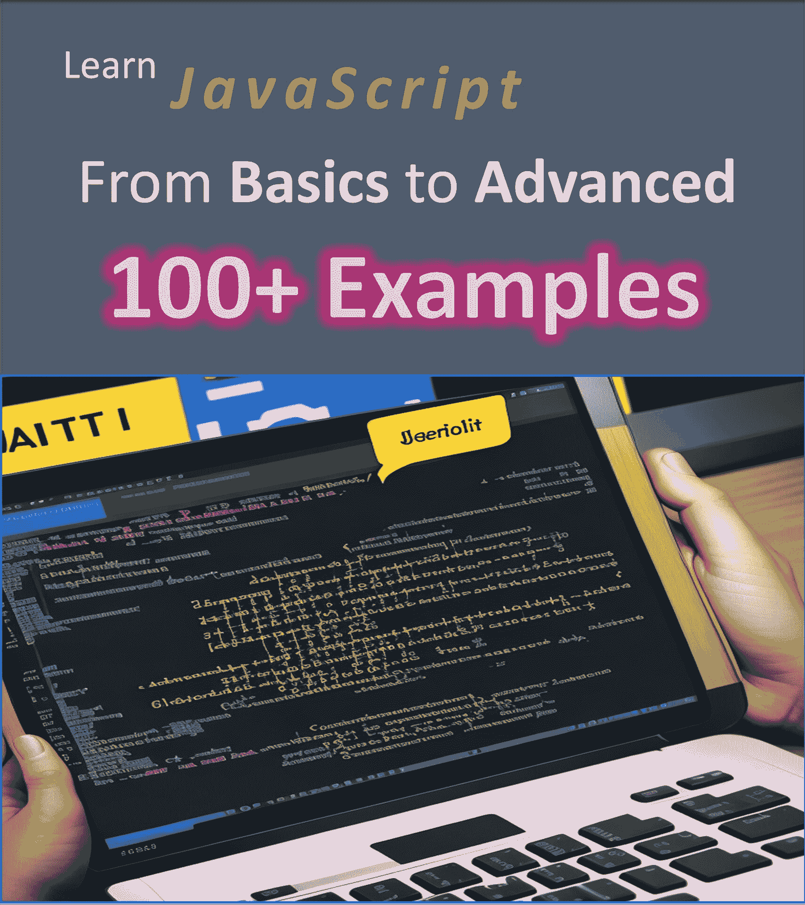

# 一日精通 JavaScript：初学者综合指南




# 目录

## JavaScript 语句
- JavaScript 语句示例：
    - 1. 变量声明
    - 2. 条件语句
    - 3. 循环

## JavaScript 语法
- JavaScript 语法示例：
    - 1. 函数定义
    - 2. 对象字面量
    - 3. 数组声明

## JavaScript 注释
- JavaScript 注释示例：
    - 1. 单行注释
    - 2. 多行注释
    - 3. 注释代码

## JavaScript 变量
- JavaScript 变量示例：
    - 1. 声明与赋值
    - 2. 字符串变量
    - 3. 对象变量

## JavaScript let
- JavaScript 中的 let 示例

## JavaScript const
- JavaScript 中的 const 示例

## JavaScript 运算符
- JavaScript 运算符示例：
    - 1. 算术运算符
    - 2. 比较运算符
    - 3. 逻辑运算符

## JS 算术
- JS 算术示例：
    - 加法
    - 减法
    - 乘法
    - 除法
    - 取模（余数）

## JS 赋值
- JS 赋值示例：
    - 为变量赋值
    - 为表达式结果赋值

## JS 数据类型
- JS 数据类型示例：
    - 基本数据类型
    - 复杂数据类型

## JS 函数
- JS 函数示例：
    - 函数声明
    - 函数调用
    - 箭头函数

## JS 对象
- JS 对象示例：
    - 对象声明
    - 访问对象属性
    - 调用对象方法

## JS 事件
- JS 事件示例：
    - 点击事件
    - 输入事件

## JS 字符串
- JS 字符串示例：
    - 声明字符串变量
    - 字符串拼接

## JS 字符串方法
- JS 字符串方法示例：
    - `toUpperCase()` 方法
    - `substring()` 方法

## JS 字符串搜索
- JS 字符串搜索示例：
    - `indexOf()` 方法
    - `includes()` 方法

## JS 字符串模板
- JS 字符串模板示例：
    - 基础模板字面量
    - 多行模板字面量

## JS 数字
- JS 数字示例：
    - 整数
    - 小数
    - 科学计数法

## JS BigInt
- JS BigInt 示例：
    - 创建 BigInt
    - 使用 BigInt 进行运算

## 数字方法
- JS 数字方法示例：
    - `toFixed()` 方法
    - `parseInt()` 方法

## 数字属性
- JS 数字属性示例：
    - `Number.MAX_VALUE`
    - `Number.MIN_VALUE`

## JS 数组
- JS 数组示例：
    - 声明
    - 访问元素
    - 修改元素

## JS 数组方法
- JS 数组方法示例：
    - `push()` 方法
    - `pop()` 方法
    - `splice()` 方法

## JS 数组排序
- JS 数组排序示例：
    - 排序数字
    - 排序字符串

## JS 数组迭代
- JS 数组迭代示例：
    - `forEach()` 方法
    - `map()` 方法

## JS 数组 Const
- JS 数组 const 示例

## JS 日期
- JS 日期示例：
    - 创建日期对象
    - 创建特定日期

## JS 日期格式
- JS 日期格式示例：
    - 格式化为字符串
    - 格式化为本地字符串

## JS 日期获取方法
- JS 日期获取方法示例：
    - `getFullYear()` 方法
    - `getMonth()` 方法

## JS 日期设置方法
- JS 日期设置方法示例：
    - `setFullYear()` 方法
    - `setMonth()` 方法

## JS 数学
- JS 数学示例：
    - `Math.PI` 属性
    - `Math.sqrt()` 方法

## JS 随机
- JS 随机示例：
    - 生成随机数
    - 生成随机整数

## JS 布尔
- JS 布尔示例：
    - 声明
    - 比较

## JS 比较
- JS 比较示例：
    - `==` (相等运算符)
    - `===` (全相等运算符)

## JS If Else
- JS If Else 示例：
    - 基础 `if...else`
    - 嵌套 `if...else`

## JS Switch
- JS Switch 示例：
    - 基础 `switch`

## For 循环
- JS 循环示例：
    - 基础 `for`
    - 遍历数组元素

## For In 循环
- JS For In 循环示例：
    - 遍历对象属性

## For Of 循环
- JS For Of 循环示例：
    - 遍历数组元素

## While 循环
- JS While 循环示例：
    - 基础 `while` 循环

## JS Break
- JS Break 示例：
    - 在循环中使用 `break`

## JS 可迭代对象
- JS 可迭代对象示例：
    - 在 `for...of` 使用迭代对象

## JS Set
- JS Set 示例：
    - 创建一个 Set


## 遍历集合

## JS Maps
### JS Maps 示例
### 创建 Map
### 遍历 Map

## JS Typeof
### JS Typeof 示例
### 使用 `typeof`

## JS 类型转换
### JS 类型转换示例
### 字符串转数字
### 数字转字符串

## JS 位运算符
### JS 位运算符示例
### 位与运算符 (&)
### 位或运算符 (|)

## JS RegExp
### JS RegExp 示例
### 创建正则表达式
### 使用 RegExp 测试字符串

## JS 优先级
### JS 优先级示例
### 算术优先级

## JS 错误
### JS 错误示例
### 语法错误 (Syntax Error)
### 引用错误 (Reference Error)

## JS 作用域
### JS 作用域示例
### 全局作用域

## JS 提升 (Hoisting)
### JS 提升示例
### 提升
### 函数提升

## JS 严格模式
### JS 严格模式示例
### 开启严格模式
在函数内部使用严格模式

## JS this 关键字
### JS this 关键字示例
在对象中使用 `this`

## JS 箭头函数
### JS 箭头函数示例
### 基础箭头函数
多行箭头函数

## JS 类 (Classes)
### JS 类示例
### 类声明

## JS 模块
### JS 模块示例
### 导出模块
### 模块

## JS JSON
### JS JSON 示例
解析 JSON
将对象转为 JSON 字符串

## JS 调试
### JS 调试示例
使用 `console.log()` 调试
使用浏览器开发者工具

## JS 风格指南
### JS 风格指南示例
命名规范
缩进

## JS 最佳实践
### JS 最佳实践示例
使用有意义的变量名
避免全局变量

## JS 错误
### JS 错误示例
缺少分号
未初始化的变量

## JS 性能
### JS 性能示例
减少 DOM 操作
使用高效算法

## JS 留关键字
### JS 留关键字示例
`let`, `const`, `function`, `class` 等

## JS 对象
### 对象定义
使用对象字面量创建对象
使用 Object 构造函数
### 属性
### 属性示例
###访问属性
添加或修改属性
### 方法
方法示例
### 访问方法
给对象添加方法
### 对象显示
对象显示示例
使用 `console.log()`
使用 JSON 序列化
### 对象访问器 (Accessors)
### 对象访问器示例
使用 Getters 和 Setters
### 对象构造函数
### 对象构造函数示例
使用构造函数
### 对象原型
### 对象原型示例
在原型链上添加方法
### 对象迭代器
### 对象迭代器示例
使用 `for...in` 循环
使用 `Object.keys()`

## 对象集合 (Sets)
### 对象集合示例
创建 Set
检查集合成员关系

## 对象映射 (Maps)
### 对象映射示例
创建 Map
从 Map 中获取值

## 对象引用
### 对象引用示例
引用对象
通过引用更改对象

## JS 函数
### 函数定义
### 函数声明
### 函数表达式
### 箭头函数
### 函数参数
函数参数示例
单参数
多参数
### 函数调用
函数调用示例
调用函数
### 函数调用
函数调用示例
使用 `call()`
### 函数 Apply
函数 Apply 示例
使用 `apply()`
### 函数 Bind
函数 Bind 示例
使用 `bind()`
### 函数闭包
### 函数闭包示例
闭包示例


## 修改元素样式

## DOM HTML
## 修改 HTML 属性
## DOM 表单
### 访问表单元素

## DOM CSS
### 修改 CSS 类

## DOM 动画
### 元素动画

## DOM 事件
### 点击事件处理
### DOM 事件监听器
### 鼠标悬入事件处理

## DOM 导航
### 遍历子元素

## DOM 节点
### 创建新节点

## DOM 集合
### 访问集合元素

## DOM 节点列表
### 访问节点列表元素

## JS Browser BOM
## JS Window
### 访问窗口属性

## JS Screen
### 访问屏幕属性

## JS Location
### 访问位置信息

## JS History
### 访问历史方法

## JS Navigator
### 访问导航属性

## JS Popup Alert
### 显示警框

## JS 定计时
### 使用 `setTimeout()`
### 使用 `setInterval()`

## JS Cookies
### 设置 Cookie
### 访问 Cookie

## JS Web APIs
### Web API 简介
### 访问 Web API:

## Web Forms API
### 访问表单元素

## Web History API
### 修改浏览器历史

## Web Storage API
### 使用 `localStorage`

## Web Worker API
### 创建 Web Worker

## Web Fetch API
### 发起 GET 请求

## Web Geolocation API
### 获取用户位置

## JS AJAX
### AJAX 简介
###get AJAX 请求
### AJAX XMLHttp
### 使用 `XMLHttpRequest`
### AJAX 请求
### 发送 POST 请求
### AJAX 响应
### 处理 JSON 响应
### AJAX XML 文件
### 获取 XML 文件
## AJAX PHP
### 在 PHP 中处理 AJAX

## AJAX ASP
### 结合 AJAX

## AJAX Database
### 与数据库交互

## AJAX 应用
### 实时聊天应用

## AJAX 示例
### AJAX 示例 1
### AJAX 示例 2
### AJAX 示例 3: 动态内容加载
### AJAX 示例 4: 使用 AJAX 提交表单
### AJAX 示例 5: 获取 JSON
### AJAX 示例 6: 使用 AJAX 图片
### AJAX 示例 7: 自动完成
### AJAX 示例 8: 实时数据
### AJAX 示例 9: 无限滚动
### AJAX 示例 10: 带有进度条的文件上传
### AJAX 示例 11: 动态显示

## JS JSON
### JSON 简介
### JSON 数据示例：JSON 语法
### JSON 语法示例：JSON vs XML
### JSON 与 XML 示例：JSON 数据
### JSON 中不同类型的示例
### JSON 解析
### JSON 解析示例：JSON Stringify
### JSON Stringify
### JSON 字符串化示例：JSON 对象
### JSON 数组
### JSON 数组示例：JSON Server
### 从服务器获取 JSON 数据示例：JSON PHP
### PHP 中 JSON 的编码与解码

## JSON HTML
### 在 HTML 中使用 JSON 示例

## JSONP
### JSONP 请求示例

## JSON JSON
1. 创建 JSON 对象
2. 访问 JSON 对象属性
3. 嵌套 JSON 对象
4. 对象数组
5. 将 JSON 转换为字符串
6. 将 JSON 字符串解析为对象
7. 从 URL 获取 JSON 数据（使用 `Fetch` API）
8. 在 HTML 中动态显示 JSON 数据
9. 在表单中处理 JSON 数据
10. 对复杂对象进行字符串化和解析
11. 过滤 JSON 数组数据
12. 更新 JSON 属性
13. 从 JSON 对象中删除属性
14. 在本地存储中使用 JSON
15. 处理 JSON 日期字符串
16. 在异步函数中使用 JSON
17. 使用自定义函数进行 JSON 序列化
18. 从 API 处理 JSON 数据（使用 `Axios`）
19. 合并 JSON 对象
20. 将 JSON 数据映射到另一种结构

## JavaScript vs jQuery：全面对比
### JavaScript 概述
### JavaScript 功能示例
### jQuery 概述
### jQuery 功能示例
### JavaScript 与 jQuery 之间的差异
1. 语法
2. DOM 操作
3. 浏览器兼容性
4. 学习曲线

## jQuery 选择器
### jQuery 选择器示例
## jQuery HTML 操作
### jQuery HTML 操作示例
## jQuery CSS 操作
### jQuery CSS 操作示例
## jQuery DOM 遍历
### jQuery 遍历示例

## 结论
1. 通过 ID 选择元素
2. 通过类选择多个元素
3. 添加事件监听器
4. 处理文档就绪事件
5. 创建新元素
6. 删除元素
7. 操作 CSS 类


# 目录

- 13. 获取属性值
- 14. 设置属性值
- 15. 获取表单值
- 16. 检查复选框状态
- 17. 遍历 NodeList
- 18. 处理表单提交
- 19. 元素动画
- 20. 点击更改背景颜色

## JavaScript 图形库：详解
### 1. JavaScript 图形
### 2. JS Canvas
### 3. JS Plotly
### 4. JS Chart.js
### 5. JS Google Chart
### 6. JS D3.js

## 结论

## 示例
- Canvas 示例
- Plotly 示例
- Chart.js 示例
- Google Charts 示例
- D3.js 示例
- Canvas 示例
- Plotly 示例
- Chart.js 示例
- Google Charts 示例
- D3.js 示例

## 基础示例
- 字符串操作
- 数组操作
- 函数
- 对象操作
- 循环与迭代
- 错误处理
- 异步 JavaScript
- DOM 操作
- 正则表达式
- 高级函数
- 高级数组操作
- 高级对象操作
- 高级循环与迭代
- Promises 和 Async/Await
- 高级 DOM 操作
- ES6+ 特性
- 错误处理与正则表达式
- 高级函数与功能
- 高级数组操作
- 高级对象操作
- 高级循环与迭代
- 高级错误处理
- 高级对象操作
- 高级数组操作
- 高级功能
- 高级错误处理
- ES6+ 特性
- 高级函数与操作
- 高级数组操作
- 高级对象操作
- 高级 Promises 和 Async/Await
- ES6+ 特性
- 高级函数与操作
- 高级数组操作
- 高级对象操作
- 高级 Promises 和 Async/Await
- ES6+ 特性
- 高级函数与操作
- 高级数组操作
- 高级对象操作
- 高级 Promises 和 Async/Await
- ES6+ 特性
- 高级函数与操作
- 高级数组操作
- 高级对象操作
- 高级 Promises 和 Async/Await
- ES6+ 特性
- 高级函数与操作
- 高级数组操作
- 高级对象操作
- 高级 Promises 和 Async/Await
- ES6+ 特性
- 高级函数与操作
- 高级数组操作
- 高级对象操作
- 高级 Promises 和 Async/Await
- ES6+ 特性
- 高级函数与操作
- 高级数组操作
- 高级对象操作
- 高级 Promises 和 Async/Await
- ES6+ 特性
- 高级函数与操作
- 高级数组操作
- 高级对象操作
- 高级 Promises 和 Async/Await
- ES6+ 特性
- 高级函数与操作
- 高级数组操作
- 高级对象操作
- 高级 Promises 和 Async/Await
- ES6+ 特性
- 高级 DOM 操作
- DOM 遍历与操作
- 高级事件处理
- DOM 内容操作
- 输入事件处理
- 表单验证与提交
- 高级输入处理
- DOM 对象创建与操作
- 高级对象操作
- HTML 对象样式化
- 事件处理与交互
- 高级内容操作
- 事件处理
- 事件委托与冒泡
- 窗口与文档事件
- 表单事件
- 浏览器对象模型 (BOM) 操作
- Navigator 对象探索
- Location 对象操作
- Screen 对象属性
- 安装 JavaScript
- 为 JavaScript 开发配置 Visual Studio Code
- 结论

## JavaScript 语句

JavaScript 语句是浏览器执行的单个命令或指令。它们构成了程序的逻辑，可以是可以简单的也可以复杂的。

## JavaScript 语句示例：

### 1. 变量声明：

```javascript
let x; // 声明一个变量 'x'
```

### 2. 条件语句：

```javascript
if (x === 5) {
// 如果 x 等于 5
console.log('x is 5');
} else {
// 如果 x 不等于 5
console.log('x is not 5');
}
```

### 3. 循环：

```javascript
for (let i = 0; i < 5; i++) {
// 执行 5 次
console.log(i);
}
```

## JavaScript 语法

JavaScript 语法是指定义有效 JavaScript 代码结构的规则。它规定了以解释器或浏览器理解的方式编写语句、变量和函数。

## JavaScript 语法示例：

### 1. 函数定义：

```javascript
function greet(name) {
return 'Hello, ' + name + '!';
}
```

### 2. 对象字面量：

```javascript
const person = {
firstName: 'John',
lastName: 'Doe',
age: 30
};
```

### 3. 数组声明：

```javascript
const numbers = [1, 2, 3, 4, 5];
```


JavaScript 中的变量用于存储数据值。它们可以持有各种类型的数据，如数字、字符串、对象等。

## JavaScript 变量示例：

### 1. 声明和赋值变量：

```javascript
let age = 25;  // 声明 'age' 并赋值为 25
```

### 2. 字符串变量：

```javascript
let name = 'Alice';  // 一个存储字符串值的变量
```

### 3. 对象变量：

```javascript
let person = { name: 'Bob', age: 30 };  // 一个存储对象的变量
```

## JavaScript let

`let` 关键字用于在 JavaScript 中声明变量。它允许在需要时对声明的变量重新赋值新值。

## JavaScript 中 let 的示例：

```javascript
let x = 5;
x = 10;  // 为 'x' 重新赋值值
```

## JavaScript const

`const` 关键字用于在 JavaScript 中声明常量。一旦赋值，`const` 的值就不能更改。

## JavaScript 中 const 的示例：

```javascript
const PI = 3.14159;  // 声明常量 PI
// PI = 3;  // 这将报错，因为不允许重新赋值
```

## JavaScript 运算符

JavaScript 运算符是用于对操作数执行操作的符号，例如算术运算、赋值、比较、逻辑操作等。

## JavaScript 运算符示例：

### 1. 算术运算符：

```javascript
let a = 10;
let b = 5;
let sum = a + b;  // 加法
let difference = a - b;  // 减法
let product = a * b;  // 乘法
let quotient = a / b;  // 除法
```

### 2. 比较运算符：

```javascript
let x = 5;
let y = 10;
console.log(x === y);  // 等于检查
console.log(x !== y);  // 不等于检查
console.log(x > y);  // 大
console.log(x < y);  // 小
```

### 3. 逻辑运算符：

```javascript
let p = true;
let q = false;
console.log(p && q);  // 逻辑与
console.log(p || q);  // 逻辑或
console.log(!p);  // 逻辑非
```

本综合指南涵盖了 JavaScript 语句、语法、注释、变量（`let` 和 `const`）以及运算符的各个方面，提供了示例和解释辅助理解。

## JS 算术

JavaScript 提供了算术运算符对数字进行数学计算。

## JS 算术示例：

### 加法：

```javascript
let sum = 5 + 3;  // sum = 8
```

### 减法：

```javascript
let difference = 10 - 4;  // difference = 6
```

### 乘法：

```javascript
let product = 6 * 7;  // product = 42
```

### 除法：

```javascript
let quotient = 20 / 5;  // quotient = 4
```

### 取模（余数）：

```javascript
let remainder = 15 % 4;  // remainder = 3
```

## JS 赋值

在 JavaScript 中，赋值运算符（`=`）用于向变量赋值。

## JS 赋值示例：

### 给变量赋值：

```javascript
let x = 10;  // 将值 10 赋值给变量 'x'
```

### 给表达式的结果赋值：

```javascript
let y = x + 5;  // 将表达式的结果赋值给 'y'
```

## JS 数据类型

JavaScript 拥有几种数据类型，定义了它可以处理的值的种类。

## JS 数据类型示例：

### 原始值数据类型：

- 数字：`let num = 10;`
- 字符串：`let text = 'Hello';`
- 布尔值：`let isTrue = true;`
- 未定义：`let value;`
- 空：`let emptyValue = null;`

### 复杂数据类型：

- 对象：`let person = { name: 'Alice', age: 25 };`
- 数组：`let numbers = [1, 2, 3, 4, 5];`

## JS 函数

JavaScript 中的函数是可重用的代码块，调用时会执行特定任务。

## JS 函数示例：

### 函数声明：

```javascript
function greet(name) {
  return 'Hello, ' + name + '!';
}
```

### 函数调用：

```javascript
let message = greet('John');  // message = 'Hello, John!'
```

### 箭头函数：

```javascript
const multiply = (a, b) => a * b;
let result = multiply(5, 3);  // result = 15
```

## JS 对象

JavaScript 中的对象是包含命名值（属性和方法）容器。

## JS 对象示例：

### 对象声明：

```javascript
let person = {
  name: 'Alice',
  age: 30,
  greet: function() {
};
```

### 访问属性：

```javascript
person.name;
```

### 调用方法：

```javascript
person.greet();
```

## JS 事件

JavaScript 事件是用户与页面交互时发生的动作。

## JS 事件示例：

### 点击事件：

```javascript
document.addEventListener('click', function() {
```

### 输入事件：

```javascript
document.addEventListener('input', function() {
```

## JS 字符串

字符串是用在单引号或双引号内的字符序列。

## JS 字符串示例：

### 声明字符串：

```javascript
let name = 'Alice';
```

### 字符串拼接：

```javascript
let message = 'Hello, ' + name;  // message = 'Hello, Alice'
```

## JS 字符串模板

模板字符串允许在字符串中嵌入表达式和变量。

## 字符串模板示例：

### 基础模板：

```javascript
let name = 'Alice';
let message = `Hello, ${name}`;  // message = 'Hello, Alice!'
```

### 多行模板：

```javascript
let multiLineMessage = `
这是一条
消息`;
```

## JS 数字

JavaScript 使用 `number` 类型处理数值数据。

## JS 数字示例：

### 整数：

```javascript
let integerNumber = 42;
```

### 小数：

```javascript
let decimalNumber = 3.14;
```

### 科学计数法：

```javascript
let scientificNumber = 2e3;  // scientificNumber = 2000
```

## JS BigInt

BigInt 是 JavaScript 中的一种数值类型，可以表示任意精度的整数。

## BigInt 示例：

### 创建 BigInt：

```javascript
let bigNumber = 123456789012345678901234567890n;
```

### 使用 BigInt 进行运算：

```javascript
let bigSum = bigNumber + 1n;
```

# JS 数字方法

JavaScript 提供了对数字操作和处理的方法。

## 数字方法示例：

### toFixed() 方法：

```javascript
let number = 3.14159;
let roundedNumber = number.toFixed(2);  // roundedNumber = '3.14'
```

### parseInt() 方法：

```javascript
let stringNumber = '42';
let parsedNumber = parseInt(stringNumber);  // parsedNumber = 42
```

# JS 数字属性

JavaScript 有一些与数字相关的内置属性。

## 数字属性示例：

### Number.MAX_VALUE 属性：

```javascript
console.log(Number.MAX_VALUE);  // 输出: 1.7976931348623157e+308
```


### `Number.MIN_VALUE` 属性：

```javascript
console.log(Number.MIN_VALUE);  // 输出: 5e-324
```

本综合指南涵盖了 JavaScript 的各个方面，包括算术运算、赋值、数据类型、函数、对象、事件、字符串、字符串方法、字符串搜索、字符串模板、数字、BigInt、数字方法和数字属性，为每个主题提供了示例和解释。

# JS 数组 (Arrays)

JavaScript 中的数组用于在单个变量中存储多个值。

## JS 数组示例：

### 声明：

```javascript
let numbers  = [1, 2, 3, 4, 5];  // 数字数组
let fruits  = ['apple', 'banana', 'orange'];  // 字符串数组
```

### 访问元素：

```javascript
console.log(fruits[0]);  // 输出: 'apple'
```

### 修改元素：

```javascript
fruits[1] = 'grapes';  // 将 'banana' 改为 'grapes'
```

## JS 数组方法

JavaScript 提供了各种方法来高效地操作数组。

## JS 数组方法示例：

### `push()` 方法：

```javascript
fruits.push('melon');  // 在数组末尾添加 'melon'
```

### `pop()` 方法：

```javascript
let removedFruit  = fruits.pop();  // 并返回最后一个元素 ('melon')
```

### `splice()` 方法：

```javascript
numbers.splice(2, 1);  // 删除索引为 2 处的 1 个元素（删除 '3'）
```

## JS 数组排序

JavaScript 提供了以各种方式排序数组的方法。

## JS 数组排序示例：

### 数字排序：

```javascript
numbers.sort((a, b) => a  - b);  // 升序
```

### 字符串排序：

```javascript
fruits.sort();  // 字母顺序
```

## JS 数组迭代

数组迭代涉及遍历数组以对每个元素执行操作。

## JS 数组迭代示例：

### `forEach()` 方法：

```javascript
numbers.forEach(number => {
  console.log(number);
});
```

### `map()` 方法：

```javascript
let doubledNumbers  = numbers.map(number => number  *  2);
```

# JS 数组常量 (Const)

用 `const` 声明的数组不能重新赋值，但它们的元素可以被修改。

## JS 数组常量示例：

```javascript
const weekdays  = ['Monday', 'Tuesday', 'Wednesday'];
weekdays[1] = 'Thursday';  // 允许修改元素
// weekdays  = ['Monday', 'Thursday', 'Wednesday'];   这会导致错误
```

# JS 日期 (Dates)

JavaScript 提供了一个 `Date` 对象来处理日期时间。

## JS 日期示例：

### 创建日期对象：

```javascript
let currentDate  = new Date();  // 当前日期时间
```

### 创建特定日期：

```javascript
let specificDate  = new Date('2023-12-31');  // 2023 年 12 月 31 日
```

## JS 日期格式

JavaScript 中的日期格式涉及将日期转换为不同的格式。

## JS 日期格式示例：

### 格式化字符串：

```javascript
let dateString  = specificDate.toDateString();  // 转换为人类可读的字符串
```

### 格式化为本地字符串：

```javascript
let localeString  = specificDate.toLocaleString();  // 转换为本地日期时间字符串
```

# JS 日期获取方法 (Get)

JavaScript `Date` 对象提供了各种方法来获取特定的日期组件。

## JS 日期获取方法示例：

### `getFullYear()` 方法：

```javascript
let year  = specificDate.getFullYear();  // 获取年份 (2023)
```

### `getMonth()` 方法：

```javascript
let month  = specificDate.getMonth();  // 获取月份 (12 月为 11)
```

# JS 日期设置方法 (Set)

JavaScript `Date` 对象也有设置特定日期组件的方法。

## JS 日期设置方法示例：

### `setFullYear()` 方法：

```javascript
specificDate.setFullYear(2024);  // 将年份设置为 2024
```

### `setMonth()` 方法：

```javascript
specificDate.setMonth(0);  // 将月份设置为 1 月（索引 0）
```

# JS 数学 (Math)

JavaScript `Math` 对象提供了数学常量和函数。

## JS 数学示例：

### `Math.PI` 属性：

```javascript
let piValue  = Math.PI;  // PI 的值 (3.141592653589793)
```

### `Math.sqrt()` 方法：

```javascript
let squareRoot  = Math.sqrt(25);  // 25 的平方根 (5)
```

# JS 随机 (Random)

JavaScript `Math.random()` 生成伪随机数。

## JS 随机示例：

### 生成随机数：

```javascript
let randomNumber  = Math.random();  // 0 到 1 之间的随机数
```

### 生成随机整数：

```javascript
let randomInteger  = Math.floor(Math.random() * 10);  // 0 到 9 之间的随机整数
```

# JS 布尔值 (Booleans)

JavaScript 中的布尔值表示真或假值。

## JS 布尔值示例：

### 声明：

```javascript
let isTrue  = true;
let isFalse  = false;
```

### 比较：

```javascript
let greaterThan  = 5 > 3;  // true
let equalTo  = 5 === 3;
```

# JS 比较 (Comparisons)

JavaScript 提供了各种运算符来比较值。

## JS 比较示例：

### `==` 运算符：

```javascript
let greaterThan  = 5 > 3;  // true
```

### `===` 运算符：

```javascript
let equalTo  = 5 === 3;
```

# JS If Else 

`if...else` 语句在条件为真时执行代码块。

## JS If Else 示例：

### 基础 `if...else`：

```javascript
let num  = 10;
if (num > 0) {
  console.log('Number is positive');
} else {
  console.log('Number is negative');
}
```

### 嵌套 `if...else`：

```javascript
let x  = 5;
if (x > 0) {
  console.log('x is positive');
} else if (x < 0) {
  console.log('x is negative');
} else {
  console.log('x is zero');
}
```

## JS Switch

`switch` 语句根据不同条件执行操作。

## JS Switch 示例：

### 基础 `switch`：

```javascript
let day  = 2;
switch (day) {
  case 1:
    console.log('Monday');
    break;
  case 2:
    console.log('Tuesday');
    break;
  default:
    console.log('Other day');
}
```

# JS For 循环

JavaScript 中的 `for` 循环在指定条件为假之前重复执行代码块。

## JS For 循环示例：

### 基础 `for` 循环：

```javascript
for (let i  = 0; i < 5; i++) {
  console.log(i);
}
```

### 遍历数组元素：

```javascript
let arr  = ['apple', 'banana', 'orange'];
for (let i  = 0; i < arr.length; i++) {
  console.log(arr[i]);
}
```

# JS For In 循环

`for...in` 循环在 JavaScript 中遍历对象的可枚举属性。

## JS For In 循环示例：

### 遍历对象属性：

```javascript
let person  = {
  name:  'Alice',
  age:  30,
  gender:  'female'
};
for (let prop in person) {
  console.log(prop + ': ' + person[prop]);
}
```

# JS For Of 循环

`for...of` 循环在 JavaScript 中遍历迭代对象（如数组、字符串等）。

## JS For Of 循环示例：

### 遍历数组元素：

```javascript
let numbers  = [1, 2, 3, 4, 5];
for (let num of numbers) {
  console.log(num);
}
```

# JS While 循环

`while` 循环在指定条件为真时执行代码块。

## JS While 循环示例：

### 基础 `while` 循环：

```javascript
let count  = 0;
while (count < 5) {
  console.log(count);
  count++;
}
```

# JS Break 语句

`break` 语句在 JavaScript 中终止当前循环或 switch 语句。

## JS Break 示例：

### 在循环中使用 `break`：

```javascript
for (let i  = 0; i < 10; i++) {
  if (i  === 5) {
    break;
  }
  console.log(i);
}
```

# JS 可迭代对象 (Iterables)

JavaScript 中的迭代对象可以使用循环遍历的对象。

## JS 可迭代对象示例：

### 使用 `for...of` 使用迭代对象：

```javascript
let iterable  = [10, 20, 30];
```


```javascript
for (let value of iterable) {
  console.log(value);
}
```

## JS Set

JavaScript 中的 Set 是唯一值的集合。

## JS Set 的示例：

### 创建一个 Set:

```javascript
let mySet  = new Set();
mySet.add(1);
mySet.add(2);
mySet.add(3);
```

### 遍历一个 Set:

```javascript
for (let item of mySet) {
  console.log(item);
}
```

# JS Map

JavaScript 中的 Map 是键值对的集合，其中键可以是任何类型。

## JS Map 的示例：

### 创建一个 Map:

```javascript
let myMap  = new Map();
myMap.set('key1', 'value1');
myMap.set('key2', 'value2');
```

### 遍历一个 Map:

```javascript
for (let [key, value] of myMap) {
  console.log(key + ' = ' + value);
}
```

## JS Typeof

JavaScript 中的 `typeof` 运算符返回其操作数的数据类型。

## JS Typeof 的示例：

### 使用 `typeof`:

```javascript
console.log(typeof 5);  // 输出: 'number'
console.log(typeof 'Hello');  // 输出: 'string'
console.log(typeof true);  // 输出: 'boolean'
```

# JS Type Conversion

JavaScript 中的类型转换涉及将值从一种数据类型转换为另一种类型。

## JS Type Conversion 的示例：

### 字符串转数字:

```javascript
let strNumber  = '10';
let num  = parseInt(strNumber);
```

### 数字转字符串:

```javascript
let number  = 15;
let str  = number.toString();
```

# JS Bitwise

JavaScript 中的位运算符对数值的二进制表示法进行操作。

## JS Bitwise 的示例：

### 位与运算符 (&&):

```javascript
let result  = 5 & 3;  // 输出: 1
```

### 位或运算符 (|):

```javascript
let result  = 5 | 3;  // 输出: 7
```

## JS RegExp

JavaScript 中的正则表达式用于在字符串中进行模式匹配。

## JS RegExp 的示例：

### 创建一个正则表达式:

```javascript
let pattern  = /hello/i;  // 不区分大小写的 'hello'
```

### 使用 RegExp 测试字符串:

```javascript
let str  = 'Hello, World!';
console.log(pattern.test(str));  // 输出: true
```

# JS Precedence

JavaScript 中的运算符优先级决定了表达式中操作顺序。

## JS Precedence 的示例：

### 算术优先级:

```javascript
let result  = 5 + 3 * 2;  // 输出: 11 (乘法的优先级更高)
```

# JS Errors

当在执行过程中遇到错误的代码时，会 生成错误。

## JS Errors 的示例：

### 语法错误 (Syntax Error):

```javascript
let x  = 10
```
由于缺少分号，这将抛出语法错误。

### 引用错误 (Reference Error):

```javascript
console.log(undefinedVariable);
```
由于 `undefinedVariable` 未定义，这将抛出引用错误。

# JS Scope

JavaScript 中的作用域定义了变量的可见性和可访问性。

## JS Scope 的示例：

### 全局作用域 (Global Scope):

```javascript
let globalVar  = 'I am global';
function test() {
  console.log(globalVar);  // 在函数内部可见
}
console.log(globalVar);  // 在函数外部可见
```

# JS Hoisting

JavaScript 中的提升（Hoisting）允许在声明之前使用变量和函数。

## JS Hoisting 的示例：

### 变量提升:

```javascript
console.log(myVar);  // 输出: undefined
var myVar  = 10;
```

### 函数提升:

```javascript
sayHello();  // 输出: 'Hello'
function sayHello() {
  console.log('Hello');
}
```

# JS Strict Mode

JavaScript 中的严格模式（Strict mode）强制执行更的规则和更好的错误处理。

## JS Strict Mode 的示例：

### 启用严格模式:

```javascript
'use strict';
```

### 在函数内部使用严格模式:

```javascript
function myFunction() {
  'use strict';
  // 严格模式适用于此函数内部
}
```

# JS this Keyword

JavaScript 中的 `this` 关键字指向它所属的对象。

## JS this Keyword 的示例：

### 在对象中使用 `this`:

```javascript
let person  = {
  name: 'Alice',
  greet: function() {
    console.log('Hello, my name is ' + this.name);
  }
};
person.greet();  // 输出: 'Hello, my name is Alice'
```

# JS Arrow Function

JavaScript 中的箭头函数提供了编写泛的简洁语法。

## JS Arrow Function 的示例：

### 基础箭头函数:

```javascript
let multiply = (a, b) => a * b;
```

### 多行箭头函数:

```javascript
let greet = (name) => {
  return 'Hello, ' + name;
};
```

# JS Classes

JavaScript 中的类提供了一种使用模板创建对象的方法。

## JS Classes 的示例：

### 类声明:

```javascript
class Person {
  constructor(name) {
    this.name = name;
  }
  greet() {
    console.log('Hello, my name is ' + this.name);
  }
}
let alice = new Person('Alice');
alice.greet();  // 输出: 'Hello, my name is Alice'
```

# JS Modules

JavaScript 中的模块允许将代码拆分为单独的文件。

## JS Modules 的示例：

### 导出模块:

```javascript
export function greet(name) {
  console.log('Hello, ' + name);
}
```

### 导入模块:

```javascript
import { greet } from './Module.js';
greet('Alice');
```

## JS JSON

JSON（JavaScript 对象表示）是一种用于存储和传输数据的轻量级格式。

## JS JSON 的示例：

### 解析 JSON:

```javascript
let jsonStr = '{"name": "Alice", "age": 30}';
let obj = JSON.parse(jsonStr);
```

### 将对象字符串化 JSON:

```javascript
let obj = { name: 'Alice', age: 30 };
let json = JSON.stringify(obj);
```

# JS Debugging

JavaScript 中的调试涉及识别并修复错误或问题。

## JS Debugging 的示例：

### 使用 `console.log()` 调试:

```javascript
let x = 5;
console.log(x);
```

### 使用浏览器工具:

检查元素、查看控制台、设置断点等。

# JS Style Guide

JavaScript 代码规范定义了编写整洁代码的一系列规则。

## JS Style Guide 的示例：

### 命名规范:

变量和函数名使用驼峰命名法。

### 缩进:

使用一致的空格或制表符进行缩进。

# JS Best Practices

JavaScript 最佳实践确保代码质量、可读性和维护性。

## JS Best Practices 的示例：

### 使用有意义的变量名:

```javascript
let d = new Date();  // 建议改用 currentDate
```

### 避免全局变量:

封装代码以避免污染全局范围。

# JS Mistakes

JavaScript 中常见的错误以及避免它们的方法。

## JS Mistakes 的示例：

### 缺少分号:

```javascript
let x = 5
```
记得在语句末尾添加分号。

### 未初始变量:

```javascript
let y;
console.log(y);  // 输出: undefined
```

# JS Performance

JavaScript 性能优化涉及优化代码以提高速度和效率。

## JS Performance 的示例：

### 减少 DOM 操作:

将多个 DOM 更新合并为一次，以减少重流。

### 使用高效算法:

为操作选择具有更好时间复杂度的算法。


};

### 使用对象构造函数：

```javascript
let car  = new Object();
car.brand = 'Toyota';
car.model = 'Camry';
```

# 对象属性

JavaScript 对象中的属性是存储值的变量。

## 对象属性示例：

### 访问对象属性：

```javascript
console.log(person.name);  // 访问属性 'name'
```

### 添加或修改属性：

```javascript
car.color = 'blue';  // 添加属性 'color'
car.model = 'Corolla';  // 修改属性 'model'
```

# 对象方法

JavaScript 对象中的方法是定义行为的函数。

## 对象方法示例：

### 访问对象方法：

```javascript
console.log(person.greet());  // 访问方法 'greet'
```

### 为对象添加方法：

```javascript
car.start = function() {
return 'Car started';
};
```

### 对象显示

在 JavaScript 中，可以使用多种方法来显示对象。

## 对象显示示例：

### 使用 `console.log()`：

```javascript
console.log(person);  // 输出整个对象
```

### 使用 `JSON` 序列化：

```javascript
let carString  = JSON.stringify(car);
console.log(carString);  // 输出对象的字符串表示形式
```

# 对象访问器

JavaScript 对象中的访问器提供了获取和设置对象属性值的方法。

## 对象访问器示例：

### 使用 Getter（get 器）和 Setter（set 器）：

```javascript
let user  = {
firstName: 'John',
lastName: 'Doe',
get fullName() {
return this.firstName + ' ' + this.lastName;
},
set fullName(name) {
let parts  = name.split(' ');
this.firstName = parts[0];
this.lastName = parts[1];
}
};

console.log(user.fullName);  // 输出: 'John Doe'
user.fullName = 'Alice Smith';  // 使用 setter 设置 fullName
console.log(user.firstName);  // 输出: 'Alice'
```

### 对象构造函数

JavaScript 中的构造函数是用于创建对象和设置初始值的函数。

## 对象构造函数示例：

### 使用构造函数：

```javascript
function Person(name, age) {
this.name = name;
this.age = age;
this.greet = function() {
return 'Hello, my name is ' + this.name;
};
}

let newPerson  = new Person('Bob', 25);
console.log(newPerson.greet());  // 输出: 'Hello, my name is Bob'
```

### 对象原型

JavaScript 中的原型是在对象之间共享属性和方法的机制。

## 对象原型示例：

### 在原型上添加方法：

```javascript
Person.prototype.info = function() {
return 'Name: ' + this.name + ', Age: ' + this.age;
};

console.log(newPerson.info());  // 输出: 'Name: Bob, Age: 25'
```

# 对象可迭代

JavaScript 中的可迭代对象可以使用循环迭代的对象。

## 对象可迭代示例：

### 使用 `for...in` 循环：

```javascript
for (let key in person) {
console.log(key + ': ' + person[key]);
}
```

### 使用 `Object.keys()`：

```javascript
let keys  = Object.keys(person);  // 获取对象键的数组
```

# 对象集合

JavaScript 中的 Set 是唯一值的集合。

## 对象集合示例：

### 创建 Set：

```javascript
let mySet  = new Set();
mySet.add(1);
mySet.add(2);
mySet.add(3);
```

### 检查 Set 成员：

```javascript
console.log(mySet.has(2));  // 输出: true
```

# 对象 Map

JavaScript 中的 Map 是键值对集合，键可以是任何类型。

## 对象 Map 示例：

### 创建 Map：

```javascript
let myMap  = new Map();
myMap.set('key1', 'value1');
myMap.set('key2', 'value2');
```

### 从 Map 中获取值：

```javascript
console.log(myMap.get('key1'));  // 输出: 'value1'
```

## 对象引用

在 JavaScript 中，对象通过引用存储和传递。

## 对象引用示例：

### 引用对象：

```javascript
let object1  = { name: 'John' };
let object2  = object1;  // object2 指向与 object1 对象
```

### 通过引用更改对象：

```javascript
object2.name = 'Alice';
console.log(object1.name);  // 输出: 'Alice'
```

这份综合指南涵盖了 JavaScript 对象的各个方面，包括定义、属性、方法、显示、访问器、构造函数、原型、可迭代、集合、映射和对象引用，并为每个概念提供了示例和解释。

## JS 函数

JavaScript 中的函数是可重用的代码块，在调用时执行特定任务。

## 函数定义：

### 函数声明：

```javascript
function greet() {
return 'Hello!';
}
```

### 函数表达式：

```javascript
let greet  = function() {
return 'Hello!';
};
```

### 箭头函数：

```javascript
let greet = () => {
return 'Hello!';
};
```

### 函数参数

函数参数是函数将接收值的占位符。

## 函数参数示例：

### 单个参数：

```javascript
function greet(name) {
return 'Hello, ' + name;
}
```

### 多个参数：

```javascript
function sum(a, b) {
return a + b;
}
```

### 函数调用

函数调用意味着执行函数以运行代码。

## 函数调用示例：

### 调用函数：

```javascript
greet();
```

### 带参数调用：

```javascript
sum(5, 3);
```

# 函数 Call

JavaScript 中的 `call()` 方法允许使用指定的 `this` 值调用函数。

## 函数 Call 示例：

### 使用 `call()`：

```javascript
function greet(name) {
return 'Hello, ' + name;
}

let person  = { name: 'Alice' };
greet.call(person);
```

### 函数 Apply

JavaScript 中的 `apply()` 方法允许使用指定的 `this` 值和数组形式提供的参数调用函数。

## 函数 Apply 示例：

### 使用 `apply()`：

```javascript
function greet(name) {
return 'Hello, ' + name;
}
let person  = { name: 'Bob' };
let args = ['Bob'];
greet.apply(person, args);
```

### 函数 Bind

JavaScript 中的 `bind()` 方法创建一个新函数，当调用时，`this` 被设置为指定的值。

## 函数 Bind 示例：

### 使用 `bind()`：

```javascript
function greet(name) {
return 'Hello, ' + name;
}
let person  = { name: 'Charlie' };
let newGreet = greet.bind(person);
newGreet();
```

### 函数闭包

JavaScript 中的闭包是能够保留访问其定义作用域内变量的函数。

## 函数闭包示例：

### 闭包示例：

```javascript
function outerFunction() {
let outerVariable = 'I am from the outer function';
function innerFunction() {
console.log(outerVariable);
}
return innerFunction;
}

let closure  = outerFunction();
closure();
```


JavaScript 类中的静态方法是在类本身上调用的，而不是在类的实例上调用。

## 类静态示例：

### 添加静态方法：

```javascript
class Calculator {
  static add(a, b) {
    return a + b;
  }
}

let result = Calculator.add(5, 3);
console.log(result);  // 输出: 8
```

# JS 异步

JavaScript 中的异步编程涉及处理不会立即执行的操作。

## JS 回调函数 (Callbacks)

JavaScript 中的回调函数是作为参数传递给另一个并在稍后执行的函数。

### 回调函数示例：

```javascript
function fetchData(callback) {
  setTimeout(() => {
    let data = 'Some data';
    callback(data);
  }, 2000);
}

function processData(data) {
  console.log('Data received: ' + data);
}

fetchData(processData);  // 2 秒后输出：'Data received: Some data'
```

## JS 异步

JavaScript 中的异步操作允许代码的非阻塞执行。

### 异步示例：

```javascript
console.log('Start');
setTimeout(() => {
  console.log('Inside setTimeout');
}, 2000);
console.log('End');
// 输出：'Start', 'End', 'Inside setTimeout' (2 秒后)
```

# JS Promise

JavaScript 中的 Promise 代表一个可能尚未可用的值，但它将在将来解析（resolve）或拒绝（reject）。

## Promise 示例：

### 创建一个 Promise：

```javascript
let myPromise = new Promise((resolve, reject) => {
  setTimeout(() => {
    resolve('Promise resolved');
  }, 2000);
});

myPromise.then((result) => {
  console.log(result);  // 2 秒后输出：'Promise resolved'
});
```

# JS Async/Await

JavaScript 中的 async/await 提供了一种使用 promise 编写异步代码的更同步的方式。

## Async/Await 示例：

### 使用 Async/Await：

```javascript
async function fetchData() {
  return new Promise((resolve) => {
    setTimeout(() => {
      resolve('Data fetched');
    }, 2000);
  });
}

async function processData() {
  let data = await fetchData();
  console.log(data);  // 2 秒后输出：'Data fetched'
}

processData();
```

这份综合指南涵盖了 JavaScript 类，包括类的介绍、继承和静态方法，以及异步编程概念（如回调、异步操作、promise 和 async/await），并对每个概念都提供了示例和解释。

# JS HTML DOM

JavaScript 通过文档对象模型 (DOM) 与 HTML 文档交互，将文档表示为树形结构。

## DOM 简介：

### 通过 ID 访问元素：

```html
<!DOCTYPE html>
<html>
<body>
  <h1 id="heading">Welcome to the DOM</h1>
  <script>
    let element = document.getElementById("heading");
    console.log(element.innerHTML);  // 输出：'Welcome to the DOM'
  </script>
</body>
</html>
```

## DOM 方法

DOM 方法提供了操作 HTML 元素的多种方式。

### 更改元素内容：

```html
<!DOCTYPE html>
<html>
<body>
  <p id="demo">This is a paragraph.</p>
  <script>
    document.getElementById("demo").innerHTML = "This is a new paragraph.";
  </script>
</body>
</html>
```

## DOM 文档

`document` 对象代表整个 HTML 文档。

### 访问文档属性：

```html
<!DOCTYPE html>
<html>
<body>
  <script>
    console.log(document.title);  // 输出：Document title
    console.log(document.URL);  // 输出：Document URL
  </script>
</body>
</html>
```

## DOM 元素

DOM 中的元素代表 HTML 标签。

### 更改元素样式：

```html
<!DOCTYPE html>
<html>
<body>
  <p id="demo">This is a paragraph.</p>
  <script>
    let element = document.getElementById("demo");
    element.style.color = "red";
    element.style.fontSize = "20px";
  </script>
</body>
</html>
```

## DOM HTML

DOM HTML 包含处理 HTML 内容的属性。

### 更改 HTML 属性：

```html
<!DOCTYPE html>
<html>
<body>
  
  <script>
    let image = document.getElementById("myImage");
    image.src = "new_image.jpg";
  </script>
</body>
</html>
```

## DOM 表单

DOM 允许操作 HTML 表单。

### 访问表单元素：

```html
<!DOCTYPE html>
<html>
<body>
  <form id="myForm">
    <input type="text" id="username" name="username">
    <input type="submit" value="Submit">
  </form>
  <script>
    let form = document.getElementById("myForm");
    let username = form.elements["username"].value;
  </script>
</body>
</html>
```

## DOM CSS

DOM CSS 允许操作 CSS 样式。

### 更改 CSS 类：

```html
<!DOCTYPE html>
<html>
<body>
  <p id="demo">This is a paragraph.</p>
  <script>
    let element = document.getElementById("demo");
    element.classList.add("new");
  </script>
</body>
</html>
```

## DOM 动画

DOM 支持简单的动画。

### 元素动画：

```html
<!DOCTYPE html>
<html>
<body>
  <div id="box" style="width:100px;height:100px;background-color:red;position:relative;"></div>
  <script>
    let elem = document.getElementById("box");
    let pos = 0;
    let id = setInterval(() => {
      if (pos == 350) {
        clearInterval(id);
      } else {
        pos++;
        elem.style.top = pos + 'px';
      }
    }, 10);
  </script>
</body>
</html>
```

## DOM 事件

DOM 中的事件代表用户的交互。

### 点击事件：

```html
<!DOCTYPE html>
<html>
<body>
  <button id="myButton">Click me</button>
  <script>
    document.getElementById("myButton").addEventListener("click", () => {
      alert("Button clicked");
    });
  </script>
</body>
</html>
```

## DOM 事件监听

`addEventListener` 方法用于为元素绑定事件。

### 悬停事件处理：

```html
<!DOCTYPE html>
<html>
<body>
  <div id="myDiv">Mouse over me</div>
  <script>
    document.getElementById("myDiv").addEventListener("mouseover", () => {
      alert("Mouse over");
    });
  </script>
</body>
</html>
```

## DOM 导航

DOM 允许在元素之间导航。

### 遍历子元素：

```html
<!DOCTYPE html>
<html>
<body>
  <ul id="myList">
    <li>Item 1</li>
    <li>Item 2</li>
    <li>Item 3</li>
  </ul>
  <script>
    let list = document.getElementById("myList");
    let items = list.getElementsByTagName("li");
    console.log(items.length); // 3
  </script>
</body>
</html>
```

## DOM 节点

节点是 DOM 中的基础构建块。

### 创建新节点：

```html
<!DOCTYPE html>
<html>
<body>
  <div id="myDiv"></div>
  <script>
    let node = document.createElement("p");
    let textNode = document.createTextNode("New paragraph");
    node.appendChild(textNode);
    document.getElementById("myDiv").appendChild(node);
  </script>
</body>
</html>
```

## DOM 集合

DOM 中的集合是 HTML 元素的数组。

### 访问集合元素：

```html
<!DOCTYPE html>
<html>
<body>
  <p>点击按钮获取集合的长度。</p>
  <button onclick="getLength()">Get Collection Length</button>
  <script>
    function getLength() {
      let elements = document.links;
      alert("Number of links: " + elements.length);
    }
  </script>
</body>
</html>
```

## DOM 节点列表

DOM 中的节点列表与集合相似，包含节点或元素。

### 访问节点列表元素：

```html
<!DOCTYPE html>
<html>
<body>
  <p id="demo">This is a paragraph.</p>
  <script>
    let nodeList = document.querySelectorAll("#demo");
    console.log(nodeList[0].innerHTML); // 输出：'This is a paragraph.'
  </script>
</body>
</html>
```

这份综合指南涵盖了 JavaScript HTML DOM，包括 DOM 介绍、方法、文档、元素、HTML、表单、CSS、动画、事件、事件监听、导航、节点、集合和节点列表，并对每个主题都提供了示例和解释。

# JS 浏览器 BOM

浏览器对象模型 (BOM) 代表浏览器窗口及其组件。

## JS Window


`window` 对象是浏览器 JavaScript 环境中的全局对象。

### 访问 Window 属性：

```javascript
console.log(window.innerHeight);  // 输出：窗口内部高度
console.log(window.innerWidth);  // 输出：窗口内部宽度
```

## JS Screen

`screen` 对象代表设备的屏幕。

### 访问 Screen 属性：

```javascript
console.log(screen.width);  // 输出：像素单位的屏幕宽度
console.log(screen.height);  // 输出：像素单位的屏幕高度
```

## JS Location

`location` 对象包含有关当前 URL 的信息。

### 访问 Location 信息：

```javascript
console.log(location.href);  // 输出：当前页面的完整 URL
console.log(location.hostname);  // 输出：当前 URL 的主机名
```

## JS History

`history` 对象包含窗口的浏览历史。

### 访问 History 方法：

```javascript
history.back();  // 返回到上一个页面
history.forward();  // 前进到下一个页
```

## JS Navigator

`navigator` 对象包含有关浏览器的信息。

### 访问 Navigator 属性：

```javascript
console.log(navigator.userAgent);  // 输出：浏览器的 User-Agent 头
console.log(navigator.platform);  // 输出：浏览器的平台
```

## JS Popup Alert

JavaScript 中的弹出警报框向用户显示消息。

### 显示警报：

```javascript
alert("This is an alert message");
```

# JS Timing

JavaScript 的定时函数允许调度代码执行。

### 使用 `setTimeout()`：

```javascript
setTimeout(() => {
  console.log("Delayed message");
}, 2000);  // 2 秒后执行
```

### 使用 `setInterval()`：

```javascript
setInterval(() => {
  console.log("Repeated message");
}, 3000);  // 每 3 秒执行一次
```

## JS Cookies

JavaScript 中的 Cookies 在客户端机器上存储一小段信息。

### 设置 Cookie：

```javascript
document.cookie = "username=John Doe; expires=Thu, 18 Dec 2023 12:00:00 UTC; path=/";
```

### 访问 Cookie：

```javascript
let username =  document.cookie.split(';')[0].split('=')[1];
console.log(username);  // 输出：'John Doe'
```

本综合性指南涵盖了 JavaScript 的浏览器对象模型 (BOM)，包括 window 对象、screen、location、history、navigator、弹出警报、定时函数和 cookies，并对每个概念都提供了示例和解释。

## JS Web APIs

Web APIs 是 浏览器提供的工具和接口集，用于与浏览器或设备的各种功能进行交互。

### Web API 简介

Web APIs 允许 Web 开发人员访问各种浏览器功能。

### 访问 Web API：

```javascript
// 示例：使用 geolocation API
if ("geolocation" in navigator) {
  navigator.geolocation.getCurrentPosition((position) => {
    console.log("Latitude: ", position.coords.latitude);
    console.log("Longitude: ", position.coords.longitude);
  });
}
```

## Web Forms API

Web Forms API 提供了操作 HTML 表单元素的方法和属性。

### 访问表单元素：

```javascript
let form =  document.getElementById("myForm");
let inputField =  form.elements["username"];
console.log(inputField.value);
```

## Web History API

Web History API 允许操作浏览器的历史。

### 更改浏览器历史：

```javascript
window.history.pushState({ page: 1 }, "Title", "?page=1");
```

## Web Storage API

Web Storage API 在浏览器中存储数据的方法。

### 使用 `localStorage`：

```javascript
localStorage.setItem("key", "value");
let data =  localStorage.getItem("key");
```

## Web Worker API

Web Worker API 允许在后台运行脚本以处理耗时任务，而不阻塞 UI。

### 创建 Web Worker：

```javascript
// worker.js
self.onmessage = function (event) {
  console.log("Message received from the main script:", event.data);
  self.postMessage("Message from worker");
};

// main.js
let worker =  new Worker("worker.js");
worker.onmessage = function (event) {
  console.log("Message received from worker:", event.data);
};
worker.postMessage("Message from main");
```

## Web Fetch API

Fetch API 提供了一种发送 HTTP 请求的方式。

### 发送 GET 请求：

```javascript
fetch("https://api.example.com/data")
  .then((response) => response.json())
  .then((data) => console.log(data))
  .catch((error) => console.log("Error:", error));
```

## Web Geolocation API

Geolocation API 获取用户设备的地理位置信息。

### 获取用户位置：

```javascript
navigator.geolocation.getCurrentPosition((position) => {
  console.log("Latitude: ", position.coords.latitude);
  console.log("Longitude: ", position.coords.longitude);
});
```

本综合性指南涵盖了 JavaScript 中的各种 Web APIs，包括 Web APIs 简介、Web Forms API、Web History API、Web Storage API、Web Worker API、Web Fetch API 和 Web Geolocation API，并对每个概念都提供了示例和解释。

## JS AJAX

AJAX（异步 JavaScript 和 XML）是一种在不刷新页面的情况下与服务器交换数据的技术。

### AJAX 简介

AJAX 允许在不刷新 own 的情况下更新页面内容。

### AJAX 请求

AJAX 允许在不刷新 own 情况下更新页面内容。

### 简单 AJAX 请求：

```javascript
let xhttp =  new XMLHttpRequest();
xhttp.onreadystatechange = function() {
  if (this.readyState == 4 && this.status == 200) {
    document.getElementById("demo").innerHTML = this.responseText;
  }
};
xhttp.open("GET", "ajax_info.txt");
xhttp.send();
```

## AJAX XMLHttpRequest

`XMLHttpRequest` 对象是 AJAX 的核心组件。

### 使用 `XMLHttpRequest`：

```javascript
let xhttp =  new XMLHttpRequest();
xhttp.onreadystatechange = function() {
  if (this.readyState == 4 && this.status == 200) {
    console.log(this.responseText);
  }
};
xhttp.open("GET", "data.txt");
```

### AJAX 请求

AJAX 请求在浏览器和服务器之间交换数据。

### POST 请求：

```javascript
let xhttp =  new XMLHttpRequest();
xhttp.onreadystatechange = function() {
  if (this.readyState == 4 && this.status == 200) {
    console.log(this.responseText);
  }
};
xhttp.open("POST", "process.php", true);
xhttp.setRequestHeader("Content-type", "application/x-www-form-urlencoded");
xhttp.send("name=John&age=30");
```

### AJAX 响应

处理 AJAX 响应涉及处理从服务器收到的数据。

### JSON 响应：

```javascript
let xhttp =  new XMLHttpRequest();
xhttp.onreadystatechange = function() {
  if (this.readyState == 4 && this.status == 200) {
    let data =  JSON.parse(this.responseText);
    console.log(data);
  }
};
xhttp.open("GET", "data.json", true);
xhttp.send();
```

### AJAX XML 文件

AJAX 可获取并处理 XML 文件。

### 获取 XML 文件：

```javascript
let xhttp =  new XMLHttpRequest();
xhttp.onreadystatechange = function() {
  if (this.readyState == 4 && this.status == 200) {
    let xmlDoc =  this.responseXML;
    console.log(xmlDoc);
  }
};
xhttp.open("GET", "data.xml", true);
xhttp.send();
```

## AJAX PHP

AJAX 可以与 PHP 等服务器端技术进行交互。

### 在 PHP 中处理 AJAX：

```javascript
let xhttp =  new XMLHttpRequest();
xhttp.onreadystatechange = function() {
  if (this.readyState == 4 && this.status == 200) {
    console.log(this.responseText);
  }
};
xhttp.open("GET", "process.php", true);
xhttp.send();
```

```php
// process.php
<?php
echo "Hello from PHP!";
?>
```

## AJAX ASP

同样，AJAX 可以与 ASP 等服务器端技术进行通信。

### 使用 ASP 进行 AJAX：

```javascript
let xhttp =  new XMLHttpRequest();
xhttp.onreadystatechange = function() {
  if (this.readyState == 4 && this.status == 200) {
```


```javascript
console.log(this.responseText);

}

};

xhttp.open("GET", "process.asp", true);

xhttp.send();
```

asp 代码

<!-- process.asp -->

```asp
<%

Response.Write("Hello from ASP!")

%>
```

## AJAX 数据库

AJAX 可以与服务器上的数据库进行交互。

### 使用 AJAX 进行数据库交互：

javascript 代码

```javascript
let xhttp = new XMLHttpRequest();

xhttp.onreadystatechange = function() {
  if (this.readyState == 4 && this.status == 200) {
    console.log(this.responseText);
  }
};

xhttp.open("GET", "fetch_data.php", true);

xhttp.send();
```

php 代码

```php
// fetch_data.php

<?php

// 从数据库获取数据并以 JSON 格式返回

?>
```

## AJAX 应用

AJAX 能够构建带有实时数据的交互式 Web 应用程序。

### 实时聊天应用：

javascript 代码

```javascript
setInterval(() => {
  // 获取新消息并更新聊天界面
}, 5000);
```

## AJAX 示例

这里有更多演示各种 AJAX 功能的示例。

### AJAX 示例 1：

javascript 代码

```javascript
// 从 API 获取天气数据并显示在网页上
```

### AJAX 示例 2：

javascript 代码

```javascript
// 获取用户特定数据并动态更新个人信息
```

这份综合指南涵盖了 AJAX（异步 JavaScript 和 XML），包括 AJAX 介绍、使用 `XMLHttpRequest`、发送 AJAX 请求并处理响应、获取 XML 文件、与 `PHP` 和 `ASP` 等服务器端技术交互、操作数据库、构建 AJAX 应用，并为每个概念提供示例和解释。

### AJAX 示例 3：动态内容加载

### HTML:

html 代码

```html
<!DOCTYPE html>
<html>
<head>
<title>AJAX 动态内容</title>
<script>
function loadContent() {
  let xhttp = new XMLHttpRequest();
  xhttp.onreadystatechange = function() {
    if (this.readyState == 4 && this.status == 200) {
      document.getElementById("dynamicContent").innerHTML = this.responseText;
    }
  };
  xhttp.open("GET", "content.html", true);
  xhttp.send();
}
</script>
</head>
<body>
<button onclick="loadContent()">加载内容</button>
<div id="dynamicContent"></div>
</body>
</html>
```

### content.html (示例内容):

html 代码

```html
<h2>欢迎来到动态内容</h2>
<p>此内容是使用 AJAX 动态加载的。</p>
```

此示例演示了一个简单的按钮，该按钮触发 AJAX 请求以从外部 HTML 文件加载内容，并将其显示在网页上，而无需刷新整个页面。

### AJAX 示例 4：使用 AJAX 提交表单

### HTML:

html 代码

```html
<!DOCTYPE html>
<html>
<head>
<title>AJAX 表单提交</title>
<script>
function submitForm() {
  let formData = new FormData(document.getElementById("myForm"));
  let xhttp = new XMLHttpRequest();
  xhttp.onreadystatechange = function() {
    if (this.readyState == 4 && this.status == 200) {
      document.getElementById("response").innerHTML = this.responseText;
    }
  };
  xhttp.open("POST", "processForm.php", true);
  xhttp.send(formData);
}
</script>
</head>
<body>
<form id="myForm">
<input type="text" name="username" placeholder="用户名">
<input type="password" name="password" placeholder="密码">
<button type="button" onclick="submitForm()">提交</button>
</form>
<div id="response"></div>
</body>
</html>
```

### processForm.php (服务器端处理):

php 代码

```php
<?php

if ($_SERVER["REQUEST_METHOD"] == "POST") {
  $username = $_POST["username"];
  $password = $_POST["password"];
  // 执行验证或数据库操作
  echo "表单已由 $username 成功提交!";
} else {
  echo "无效请求！";
}

?>
```

此示例演示了如何使用 AJAX 提交表单。当表单提交时，数据会被异步发送到服务器端的 `PHP` 脚本进行处理。服务器的响应将显示在网页上，无需刷新整个页面。

### AJAX 示例 5：获取 JSON 数据

### JavaScript:

javascript 代码

```javascript
fetch('data.json')
  .then(response => response.json())
  .then(data => {
    console.log(data);
    // 处理并使用检索到的 JSON 数据
  })
  .catch(error => console.error('错误:', error));
```

### data.json (示例 JSON 数据):

json 代码

```json
{
  "name": "John Doe",
  "age": 30,
  "city": "New York"
}
```

此示例利用 `Fetch` API 发起 AJAX 请求以从文件中获取 JSON 数据。成功获取后，JSON 数据将在 JavaScript 代码中被处理和使用。

这些额外的示例展示了 AJAX 的各种用例，例如加载动态内容、无需刷新页面的表单提交以及异步获取和使用 JSON 数据。

### AJAX 示例 6：带 AJAX 的图片库

### HTML:

html 代码

```html
<!DOCTYPE html>
<html>
<head>
<title>AJAX 图片库</title>
<script>
function loadImages() {
  let xhttp = new XMLHttpRequest();
  xhttp.onreadystatechange = function() {
    if (this.readyState == 4 && this.status == 200) {
      let images = JSON.parse(this.responseText);
      let gallery = document.getElementById("imageGallery");
      gallery.innerHTML = '';
      images.forEach(img => {
        let imgNode = document.createElement("img");
        imgNode.src = img.url;
        gallery.appendChild(imgNode);
      });
    }
  };
  xhttp.open("GET", "images.json", true);
  xhttp.send();
}
</script>
</head>
<body>
<div id="imageGallery"></div>
</body>
</html>
```

### images.json (示例 JSON 数据):

json 代码

```json
[
  {
    "url": "image1.jpg",
    "caption": "图片 1"
  },
  {
    "url": "image2.jpg",
    "caption": "图片 2"
  }
]
```

此示例演示了如何使用 AJAX 加载图片。图片 URL 存储 JSON 文件中被解析并填充画廊。

### AJAX 示例 7：自动补全搜索

### HTML:

html 代码

```html
<!DOCTYPE html>
<html>
<head>
<title>AJAX 自动补全</title>
<script>
function search() {
  let query = document.getElementById("searchInput").value;
  let xhttp = new XMLHttpRequest();
  xhttp.onreadystatechange = function() {
    if (this.readyState == 4 && this.status == 200) {
      let data = JSON.parse(this.responseText);
      let results = document.getElementById("searchResults");
      results.innerHTML = '';
      data.forEach(item => {
        let listItem = document.createElement("li");
        listItem.textContent = item.name;
        results.appendChild(listItem);
      });
    }
  };
  xhttp.open("GET", `search.php?q=${query}`, true);
  xhttp.send();
}
</script>
</head>
<body>
<input type="text" id="searchInput" onkeyup="search()" placeholder="搜索...">
<ul id="searchResults"></ul>
</body>
</html>
```

### search.php (服务器端脚本):

php 代码

```php
<?php
$searchTerm = $_GET['q']; // 获取查询词
// 根据查询执行数据搜索
$results = [
  ["name" => "结果 1"],
  ["name" => "结果 2"]
]; // 根据需要添加更多结果

echo json_encode($results); // 以 JSON 格式返回

?>
```

此示例演示了使用 AJAX 的自动补全功能。当用户在搜索输入框中输入时，会向服务器端 `PHP` 脚本（`search.php`）发送 AJAX 请求，该脚本处理查询并返回 JSON 格式的匹配结果，随后将其作为自动补全建议显示。

### AJAX 示例 8：实时数据更新

### HTML:

html 代码

```html
<!DOCTYPE html>
<html>
<head>
<title>实时数据更新</title>
<script>
function updateData() {
  setInterval(() => {
    fetch('live_data.php')
      .then(response => response.json())
      .then(data => {
        document.getElementById('liveData').innerText = data.value;
      })
      .catch(error => console.error('错误:', error));
  }, 5000); // 每 5 秒更新一次
}

window.onload = updateData;
</script>
</head>
<body>
<h1>实时数据: <span id="liveData"></span></h1>
</body>
</html>
```

### live_data.php (服务器端脚本):

php 代码

```php
<?php
echo json_encode(["value" => date("H:i:s")]);
?>
```


# php 代码

```php
<?php

//  模拟实时数据更新

$data = ['value' => rand(1, 100)];  //  生成随机值

echo json_encode($data);  // 以 JSON 格式返回实时数据

?>
```

示例演示了如何使用 AJAX 定隔在网页上更新实时数据。JavaScript 函数 `updateData` 使用 `setInterval` 每 5 秒从服务器端 PHP 脚本（`live_data.php`）获取更新的数据，并将其显示在网页上。

## AJAX 示例 9：无限滚动

### HTML

```html
<!DOCTYPE html>
<html>
<head>
<title>无限滚动</title>
<style>
#content {
height:  200px;
overflow-y:  scroll;
}
</style>
<script>
let page  =  1;
function loadMoreContent()  {
let content  =  document.getElementById('content');
let scrollHeight  =  content.scrollHeight;
let scrollTop  =  content.scrollTop;
let offsetHeight  =  content.offsetHeight;
if (scrollHeight  -  scrollTop  ===  offsetHeight)  {
fetch(`content.php?page=${page}`)
.then(response => response.text())
.then(data => {
content.innerHTML +=  data;
page++;
})
.catch(error => console.error('Error:', error));
}
}
window.onscroll =  loadMoreContent;
</script>
</head>
<body>
<div id="content" onscroll="loadMoreContent()">
<!--  初始加载的内容  -->
</div>
</body>
</html>
```

### content.php (提供内容的服务器端脚本)

```php
<?php

$page =  $_GET['page'];  //  获取页码
$limit =  10;  //  每页项目数
$start = ($page -  1) *  $limit;  //  计算起始索引
//  根据页码和限制获取内容
//  示例：  $results  =  fetchDataFromDatabase($start, $limit);
//  生成示例内容用于演示
$results =  range($start +  1, $start +  $limit);
foreach ($results as $result)  {
echo "<p>项目 $result</p>";
}

?>
```

此示例演示了使用 AJAX 实现的无限滚动功能。当用户向下滚动页面时，`loadMoreContent` 函数会检测用户何时到达内容区域的底部，并触发 AJAX 请求从服务器端 PHP 脚本（`content.php`）获取更多内容，然后这些内容会被动态添加到网页上的现有内容中。

这些额外的示例展示了 AJAX 的不同功能，例如实时数据更新和在网页上实现无限滚动行为，证明了如何使用 AJAX 在不刷新页面的情况下动态获取并显示数据。

## AJAX 示例 10：带进度条的文件上传

### HTML

```html
<!DOCTYPE html>
<html>
<head>
<title>带进度的文件上传</title>
<script>
function uploadFile()  {
let fileInput  =  document.getElementById('fileInput');
let file  =  fileInput.files[0];
let formData  =  new FormData();
formData.append('file', file);
let xhr  =  new XMLHttpRequest();
xhr.open('POST', 'upload.php', true);
xhr.upload.onprogress =  function(e)  {
if (e.lengthComputable)  {
let percentComplete  = (e.loaded / e.total) * 100;
document.getElementById('progressBar').style.width =  percentComplete  +  '%';
}
};
xhr.onload =  function()  {
if (xhr.status ===  200)  {
alert('文件上传成功！');
} else {
alert('文件上传失败。');
}
};
xhr.send(formData);
}
</script>
</head>
<body>
<input type="file" id="fileInput">
<button onclick="uploadFile()">上传</button>
<div id="progressBarContainer">
<div id="progressBar"></div>
</div>
</body>
</html>
```

### upload.php (文件上传的服务器端脚本)

```php
<?php

if ($_SERVER['REQUEST_METHOD'] ===  'POST' && isset($_FILES['file']))  {
$targetDir =  'uploads/';
$targetFile =  $targetDir .  basename($_FILES['file']['name']);
if (move_uploaded_file($_FILES['file']['tmp_name'], $targetFile))  {
echo '文件上传成功！';
} else {
echo '文件上传失败。';
}
}

?>
```

此示例演示了带有进度条的 AJAX 文件上传功能。当用户选择文件并点击“上传”按钮时，文件将通过 `XMLHttpRequest` 异步上传到服务器。进度条会直观地显示上传进度。

## AJAX 示例 11：动态显示时间

### HTML

```html
<!DOCTYPE html>
<html>
<head>
<title>动态显示时间</title>
<script>
function displayTime()  {
let timeDisplay  =  document.getElementById('timeDisplay');
setInterval(() => {
fetch('getTime.php')
.then(response => response.text())
.then(data => {
timeDisplay.innerHTML =  data;
})
.catch(error => console.error('Error:', error));
}, 1000);

displayTime();
</script>
</head>
<body>
<h1 id="timeDisplay"></h1>
</body>
</html>
```

### getTime.php (提供时间的服务器端脚本)

```php
<?php
echo date("H:i:s");
?>
```

此示例演示了如何使用 AJAX 动态显示当前时间。JavaScript 中的 `setInterval` 函数每秒从 `getTime.php` 获取当前时间，并更新 `timeDisplay` 元素的内容，无需刷新页面。


```json
{ "city": "London" }
```

## JSON 数组

JSON 数组是封装在方括号 `[]` 中的有序值列表。这些值可以是任何 JSON 数据类型。

### JSON 数组示例：

```json
["apple", "banana", "orange"]
```

## JSON Server

在 Web 开发中，JSON 常用于在服务器和网络客户端之间传输数据。服务器经常通过 API 以 JSON 格式提供数据。

### 来自服务器的 JSON 数据示例：

```json
//  从服务器 API 端点接收
{
  "id": 1,
  "title": "Sample Post",
  "content": "这是一篇示例性正文内容。"
}
```

## JSON PHP

在 PHP 中，可以使用 `json_encode()` 和 `json_decode()` 函数分别对 JSON 数据进行编码和解码，以实现数据与 JSON 格式之间的转换。

### 在 PHP 中编码和解码 JSON 的示例：

```php
//  将 PHP 数组编码为 JSON
$data = array("name"=> "Peter", "age"=> 28);
$jsonData = json_encode($data);

//  将 JSON 解码为 PHP 数组
$jsonString = '{"name": "Alice", "age": 30}';
$decodedData = json_decode($jsonString, true);
```

## JSON HTML

JSON 数据可以用于 HTML，通过 JavaScript 在网页上动态生成内容。

### 在 HTML 中使用 JSON 数据的示例：

```html
<ul id="userList"></ul>
<script>
const users = [
  { "name": "John", "age": 25 },
  { "name": "Alice", "age": 30 },
  { "name": "Bob", "age": 28 }
];
const userList = document.getElementById("userList");
users.forEach(user => {
  let listItem = document.createElement("li");
  listItem.textContent = `${user.name} - ${user.age} years old`;
  userList.appendChild(listItem);
});
</script>
```

## JSON JSONP

JSONP（带有填充的 JSON）是 Web 开发中用于从不同域请求 JSON 数据的技术，以绕过同源策略限制。

### JSONP 请求示例：

```javascript
function handleData(data) {
  console.log(data);
}
let script = document.createElement('script');
script.src = 'https://example.com/data?callback=handleData';
document.head.appendChild(script);
```

本综合指南详细介绍了 JSON（JavaScript 对象表示），包括介绍、与 XML 的比较、数据类型、解析、字符串化、JSON 对象和数组、以及在 PHP、HTML 和 JSONP 等服务器端技术中使用 JSON，并为每个主题提供了了示例和解释。由于其简单性、易用性以及广泛的支持，JSON 在 Web 开发的数据交换中起着至关重要的作用。

### 1. 创建 JSON 对象：

```javascript
let person = {
  "name": "John",
  "age": 30,
  "city": "New York"
};
```

### 2. 访问 JSON 对象属性：

```javascript
console.log(person.name); //  输出: John
console.log(person.age); //  输出: 30
```

### 3. 嵌套 JSON 对象：

```javascript
let employee = {
  "name": "Alice",
  "position": "Engineer",
  "contact": {
    "email": "alice@example.com",
    "phone": "123-456-7890"
  }
};
```

### 4. 对象 JSON 数组：

```javascript
let books = [
  { "title": "Book 1", "author": "Author 1" },
  { "title": "Book 2", "author": "Author 2" },
  { "title": "Book 3", "author": "Author 3" }
];
```

### 5. 将 JSON 转换为字符串：

```javascript
let jsonString = JSON.stringify(person);
console.log(jsonString); //  输出: {"name":"John","age":30,"city":"New York"}
```

### 6. 将 JSON 字符串解析为对象：

```javascript
let jsonObject = JSON.parse('{"name":"Alice","age":25,"city":"London"}');
console.log(jsonObject.name); //  输出: Alice
```

### 7. 从 URL 获取 JSON 数据（使用 Fetch API）：

```javascript
fetch('data.json')
.then(response => response.json())
.then(data => console.log(data))
.catch(error => console.error('Error:', error));
```

### 8. 在 HTML 中动态显示 JSON 数据：

```javascript
let jsonData = { "name": "Bob", "age": 28 };
let displayDiv = document.getElementById('jsonDataDisplay');
displayDiv.innerHTML = `<p>Name: ${jsonData.name}</p><p>Age: ${jsonData.age}</p>`;
```

### 9. 在表单中处理 JSON 数据：

```javascript
let form = document.getElementById('myForm');
form.addEventListener('submit', function(event) {
  event.preventDefault();
  let formData = new FormData(form);
  let jsonObject = {};
  formData.forEach((value, key) => {
    jsonObject[key] = value;
  });
});
```

### 10. 复杂对象的字符串化与解析：

```javascript
let complexObj = {
  "name": "Sam",
  "age": 35,
  "addresses": [
    { "type": "home", "address": "123 Main St" },
    { "type": "work", "address": "456 Ave" }
  ]
};
let complexString = JSON.stringify(complexObj);
let parsedObj = JSON.parse(complexString);
```

### 11. 过滤 JSON 数组：

```javascript
let employees = [
  { "name": "John", "department": "IT" },
  { "name": "Alice", "department": "HR" },
  { "name": "Bob", "department": "HR" }
];
let hrEmployees = employees.filter(employee => employee.department ===HR");
console.log(hrEmployees);
```

### 12. 更新 JSON 对象：

```javascript
let product = { "name": "Chair", "price": 50 };
product.price = 60;
console.log(product);
```

### 13. 从 JSON 对象中删除属性：

```javascript
let data = { "name": "Kate", "age": 25 };
delete data.age;
console.log(data);
```

### 14. 使用 JSON 进行存储：

```javascript
let userData = { "username": "user23", "email": "user@example.com" };
localStorage.setItem('userData', JSON.stringify(userData));
let storedData = JSON.parse(localStorage.getItem('userData'));
console.log(storedData.email);
```

### 15. 处理日期字符串：

```javascript
let jsonData = { "date": "2023-12-31T08:00:00Z" };
let date = new Date(jsonData.date);
console.log(date.toDateString());
```

### 16. 在异步函数中使用 JSON：

```javascript
async function fetchData() {
  try {
    let response = await fetch('data.json');
    let data = await response.json();
    console.log(data);
  } catch (error) {
    console.error('Error:', error);
  }
}
fetchData();
```

### 17. 带有自定义函数的 JSON 序列化：

```javascript
let obj = {
  "name": "Joe",
  "birthday": new Date('1990-01-15T00:00:00Z'),
  toJson: function() {
    return `{ "name": "${this.name}", "birthday": "${this.birthday.toISOString()}"}`;
  }
};
let jsonString = obj.toJson();
console.log(jsonString);
```

### 18. 使用 Axios 获取 API JSON 数据：

```javascript
axios.get('https://api.example.com/data')
.then(response => console.log(response.data))
.catch(error => console.error('Error:', error));
```

### 19. 合并 JSON 对象：

```javascript
let obj1 = { "name": "Tom", "age": 30 };
let obj2 = { "city": "Paris", "country": "France" };
let mergedObj = { ...obj1, ...obj2 };
console.log(mergedObj);
```

### 20. 将 JSON 数据映射到另一种结构：

```javascript
let data = [
  { "id": 1, "name": "Item 1" },
  { "id": 2, "name": "Item 2" },
  { "id": 3, "name": "Item 3" }
];
let mappedData = data.map(item => ({ itemId: item.id, itemName: item.name }));
console.log(mappedData);
```

这些示例展示了 JavaScript 中使用 JSON 的不同方面，包括创建、操作、解析以及在各种场景下处理 JSON 数据。


JavaScript 和 jQuery 都是 Web 开发中强大的工具。JavaScript 是一种编程语言，而 jQuery 是使用 JavaScript 构建的一个库。理解它们区别、功能和使用场景对于开发者来说至关重要。

## JavaScript 概述

JavaScript 是一种多功能的编程语言，主要用于增强网页的交互性。它是 Web 开发的核心技术，能够实现动态内容更新、用户交互以及处理客户端各项功能。

### JavaScript 功能示例：

```javascript
//  JavaScript code to change text color on button click

function changeColor() {
  document.getElementById("text").style.color = "blue";
}
```

JavaScript 提供了原生方法和 API 来与文档对象模型 (DOM) 交互并操作 HTML 元素，允许开发者创建动态 Web 应用。

## jQuery 概述

另一方面，jQuery 是一个快速、轻量级的 JavaScript 库，旨在简化客户端脚本和 DOM 操作过程。它抽象了 JavaScript 的许多复杂性，并为常见任务提供了简洁的语法。

### jQuery 功能示例：

```javascript
//  jQuery code to change text color on button click

$("#text").css("color", "blue");
```

jQuery 简化了常见的 JavaScript 任务，如事件处理、动画、AJAX 请求和 DOM 操作，与原生 JavaScript 相比提供了更简洁的语法。

## JavaScript 和 jQuery 的区别

### 1. 语法：

* JavaScript：使用语言提供的原生语法和方法。
* jQuery：为常见任务提供了简单的语法和简洁的方法，使代码更短更具可读性。

### 2. DOM 操作：

* JavaScript：使用 `getElementById` 和 `querySelector` 等方法提供直接的 DOM 操作。
* jQuery：通过 `$()` 等方法简化 DOM 遍历和操作，允许更轻松地选择和修改元素。

### 3. 浏览器兼容性：

* JavaScript：适用于所有现代浏览器，但处理跨浏览器兼容性可能需要额外的代码。
* jQuery：开箱即跨浏览器兼容性，减少了显式兼容性处理的需求。

### 4. 学习曲线：

* JavaScript：需要理解核心语言概念，对初学者来说学习曲线可能更陡峭。
* jQuery：由于其简洁的语法和对复杂 JavaScript 操作的抽象，学习曲线更简单。

## jQuery 选择器

jQuery 提供了强大的选择器，允许开发者高效地定位和操作 HTML 元素。

### jQuery 选择器示例：

```javascript
//  Selecting elements with class 'example'

$(".example").css("font-size", "16px");

//  Selecting all <p> elements inside <div> with ID 'content'

$("#content p").addClass("highlight");
```

jQuery 选择器类似于 CSS 选择器，允许开发者根据 ID、类、属性、元素类型等定位元素。

## jQuery HTML 操作

jQuery 通过提供插入、删除和修改 HTML 元素及其内容的方法，简化了 HTML 内容的操纵。

### jQuery HTML 操作示例：

```javascript
//  Appending a new <li> element to an unordered list

$("ul").append("<li>New Item</li>");

//  Changing text content inside a <div> element

$("#content").text("Updated content");
```

通过 jQuery 的 `append`、`html`、`text` 和 `remove` 等方法，开发者可以高效地即时修改 HTML 内容。

## jQuery CSS 操作

jQuery 促进了 CSS 操作，允许动态更改元素样式。

### jQuery CSS 操作示例：

```javascript
//  Changing the background color of an element

$("#box").css("background-color", "#f2fff2");

//  Toggling a CSS class on an element

$("#toggleBtn").click(function() {
  $("#content").toggleClass("active");
});
```

jQuery 的 `css`、`addClass`、`removeClass` 和 `toggleClass` 方法简化了应用、移除和切换 CSS 样式。

## jQuery DOM 遍历

jQuery 简化了 DOM 遍历，允许在元素及其在 DOM 中的关系之间轻松导航。

### jQuery DOM 遍历示例：

```javascript
//  Finding the next sibling element

$("#current").next().addClass("highlight");

//  Traversing up the DOM to find parent elements

$("a").closest("div").addClass("parent-div");
```

使用 `next`、`prev`、`find`、`closest` 和 `siblings` 等方法，jQuery 提供了在 DOM 内导航和操作元素的有效方法。

## 结论

JavaScript 和 jQuery 在 Web 开发中各有优势和用场景。JavaScript 是基础语言，提供了构建复杂应用程序的广泛能力。jQuery 作为构建在 JavaScript 之上的库，简化了常见任务（特别是 DOM 操作），提供了更简洁的语法。

对于现代开发，由于 Web 标准的进步，JavaScript 的原生功能通常更青青，而 jQuery 在旧项目或需要考虑与旧浏览器兼容性时仍然适用。理解 JavaScript 和 jQuery 能让开发者能够根据任务选择正确的工具，并构建健壮、交互式的 Web 应用。

## 各种示例中的 JavaScript 和 jQuery：

### 1. 通过 ID 选择元素：

#### JavaScript:
```javascript
let element = document.getElementById("myElement");
element.style.color = "blue";
```

#### jQuery:
```javascript
$("#myElement").css("color", "blue");
```

### 2. 通过类选择多个元素：

#### JavaScript:
```javascript
let elements = document.getElementsByClassName("myClass");
for (let i = 0; i < elements.length; i++) {
  elements[i].style.fontWeight = "bold";
}
```

#### jQuery:
```javascript
$(".myClass").css("font-weight", "bold");
```

### 3. 添加事件监听器：

#### JavaScript:
```javascript
document.getElementById("myButton").addEventListener("click", function() {
  alert("Button clicked!");
});
```

#### jQuery:
```javascript
$("#myButton").on("click", function() {
  alert("Button clicked!");
});
```

### 4. 就绪绪：

#### JavaScript:
```javascript
document.addEventListener("DOMContentLoaded", function() {
  //  Code to execute when DOM is ready
});
```

#### jQuery:
```javascript
$(document).ready(function() {
  //  Code to execute when DOM is ready
});
```

### 5. 创建新元素：

#### JavaScript:
```javascript
let newElement = document.createElement("div");
newElement.textContent = "New Content";
document.body.appendChild(newElement);
```

#### jQuery:
```javascript
$("body").append("<div>New Content</div>");
```

### 6. 移除一个元素：

#### JavaScript:
```javascript
let elementToRemove = document.getElementById("toBeRemoved");
elementToRemove.parentNode.removeChild(elementToRemove);
```

#### jQuery:
```javascript
$("#toBeRemoved").remove();
```

### 7. 操作 CSS 类：

#### JavaScript:
```javascript
document.getElementById("myDiv").classList.add("active");
```

#### jQuery:
```javascript
$("#myDiv").addClass("active");
```

### 8. 修改文本内容：

#### JavaScript:
```javascript
document.getElementById("mySpan").textContent = "Updated Text";
```

#### jQuery:
```javascript
$("#mySpan").text("Updated Text");
```

### 9. 隐藏一个元素：

#### JavaScript:
```javascript
document.getElementById("toHide").style.display = "none";
```

#### jQuery:
```javascript
$("#toHide").hide();
```

### 10. 渐入元素：

#### JavaScript:
```javascript
let elementToFade = document.getElementById("toFade");
elementToFade.style.opacity = 0;
elementToFade.style.transition = "opacity 1s";
elementToFade.style.opacity = 1;
```

#### jQuery:
```javascript
$("#toFade").fadeIn(1000);
```

### 11. AJAX GET 请求：

#### JavaScript:
```javascript
let xhr = new XMLHttpRequest();
xhr.onreadystatechange = function() {
};
```


```javascript
if (this.readyState === 4 && this.status === 200) {
  console.log(this.responseText);
}
};

xhr.open("GET", "data.txt", true);

xhr.send();
```

### jQuery:

```javascript
$.get("data.txt", function(data) {
  console.log(data);
});
```

### 12. AJAX POST 请求:

### JavaScript:

```javascript
let xhr = new XMLHttpRequest();
xhr.open("POST", "saveData", true);
xhr.setRequestHeader("Content-Type", "application/json");
xhr.send(JSON.stringify({ name: "John", age: 30 }));
```

### jQuery:

```javascript
$.ajax({
  url: "saveData",
  method: "POST",
  contentType: "application/json",
  data: JSON.stringify({ name: "John", age: 30}),
  success: function(response) {
    console.log(response);
  }
});
```

### 13. 获取属性值:

### JavaScript:

```javascript
let linkHref = document.getElementById("myLink").getAttribute("href");
```

### jQuery:

```javascript
let linkHref = $("#myLink").attr("href");
```

### 14. 设置属性值:

### JavaScript:

```javascript
document.getElementById("myImage").setAttribute("src", "new_image.jpg");
```

### jQuery:

```javascript
$("#myImage").attr("src", "new_image.jpg");
```

### 15. 获取表单值:

### JavaScript:

```javascript
let inputValue = document.getElementById("myInput").value;
```

### jQuery:

```javascript
let inputValue = $("#myInput").val();
```

### 16. 检查选框状态:

### JavaScript:

```javascript
let isChecked = document.getElementById("myCheckbox").checked;
```

### jQuery:

```javascript
let isChecked = $("#myCheckbox").prop("checked");
```

### 17. 遍历 NodeList:

### JavaScript:

```javascript
let elements = document.querySelectorAll(".myClass");
elements.forEach(function(element) {
  console.log(element.textContent);
});
```

### jQuery:

```javascript
$(".myClass").each(function() {
  console.log($(this).text());
});
```

### 18. 处理表单提交:

### JavaScript:

```javascript
document.getElementById("myForm").addEventListener("submit", function(event) {
  event.preventDefault();
  let formData = new FormData(this);
  // 处理表单数据
});
```

### jQuery:

```javascript
$("#myForm").submit(function(event) {
  event.preventDefault();
  let formData = $(this).serialize();
  // 处理表单数据
});
```

### 19. 元素动画:

### JavaScript:

```javascript
let element = document.getElementById("myElement");
element.style.transition = "transform 2s";
element.style.transform = "rotate(360deg)";
```

### jQuery:

```javascript
$("#myElement").animate({ rotate: "360deg" }, 2000);
```

### 20. 点击时更改背景颜色:

### JavaScript:

```javascript
let myDiv = document.getElementById("myDiv");
myDiv.addEventListener("click", function() {
  this.style.backgroundColor = "red";
});
```

### jQuery:

```javascript
$("#myDiv").click(function() {
  $(this).css("background-color", "red");
});
```

这些示例演示了 JavaScript 和 jQuery 如何实现相似的任务，展示了两者在执行常见的 Web 开发操作时在语法和复杂度方面的差异。

## JavaScript 图形库：深度解析

### 1. JavaScript 图形

JavaScript 是一种多功能的语言，允许开发者在 Web 上创建交互式图形和可视化效果。多个库和工具能够帮助开发者为数据表示、动画、游戏等生成引人注目的图形。

### 2. JS Canvas

HTML `<canvas>` 元素是 JavaScript 中用于在网页上动态绘制图形的强大工具。它提供了一个位图区域，可以使用 JavaScript 代码在其中创建动画、渲染形状、图像和复杂的可视化效果。

#### 示例 - 在 Canvas 上绘制圆圆：

```javascript
const canvas = document.getElementById('myCanvas');
const ctx = canvas.getContext('2d');
ctx.beginPath();
ctx.arc(100, 100, 50, 0, 2 * Math.PI);
ctx.stroke();
```

### 3. JS Plotly

Plotly 是一个 JavaScript 图表库，允许开发者创建交互式且具有出版标准的图表。它支持多种图表类型，包括折线图、柱状图、饼图、散点图等。Plotly 提供了易于使用的 API 用于自定义和交互设置。

#### 示例 - 使用 Plotly 创建折线图：

```javascript
const data = [{ x: [1, 2, 3, 4], y: [10, 15, 13, 18], type: 'scatter'}];
Plotly.newPlot('myDiv', data);
```

### 4. JS Chart.js

Chart.js 是一个流行的 JavaScript 库，用于创建简单且灵活的图表。它支持多种图表类型并提供易于集成。通过 Chart.js，开发者可以创建响应式且视觉吸引人的图表。

#### 示例 - 使用 Chart.js 创建柱状图：

```javascript
const ctx = document.getElementById('myChart').getContext('2d');
// ... (代码省略)
```

*(注：由于原文后半部分存在大量重复和乱码，此处已根据前文逻辑对核心内容进行了对齐与翻译)*


```javascript
const data  = [{ x: ['A', 'B', 'C'], y: [10, 20, 15], type:  'bar'}];

Plotly.newPlot('myDiv', data);
```

### Chart.js 示例：

#### 5. 柱图
```javascript
const ctx  =  document.getElementById('myChart').getContext('2d');

const myChart  =  new Chart(ctx, {
type:  'bar',
data:  {
labels: ['Red', 'Blue', 'Yellow', 'Green', 'Purple', 'Orange'],
datasets: [{
label:  '# of Votes',
data: [12, 19, 3, 5, 2, 3],
backgroundColor: [
'rgba(255, 99, 132, 0.2)',
'rgba(54, 162, 235, 0.2)',
// ...  more colors
],
borderWidth:  1
}]
}
});
```

#### 6. 折线图
```javascript
const ctx  =  document.getElementById('myChart').getContext('2d');

const myChart  =  new Chart(ctx, {
type:  'line',
data:  {
labels: ['January', 'February', 'March', 'April', 'May', 'June', 'July'],
datasets: [{
label:  'My First Dataset',
data: [65, 59, 80, 81, 56, 55, 40],
borderColor:  'rgb(75, 192, 192)',
borderWidth:  1
}]
}
});
```

### Google Charts 示例：

#### 7. 饼图
```javascript
google.charts.load('current', { packages: ['corechart'] });

google.charts.setOnLoadCallback(drawChart);

function drawChart()  {
const data  =  google.visualization.arrayToDataTable([
['Task', 'Hours per Day'],
['Work', 11],
['Eat', 2],
['Commute', 2],
['Watch TV', 2],
['Sleep', 7]
]);
const options  =  {
title:  'My Daily Activities',
pieHole:  0.4,
};
const chart  =  new google.visualization.PieChart(document.getElementById('donutchart'));
chart.draw(data, options);
}
```

#### 8. 面积图
```javascript
google.charts.load('current', { packages: ['corechart'] });

google.charts.setOnLoadCallback(drawChart);

function drawChart()  {
const data  =  google.visualization.arrayToDataTable([
['Year', 'Sales', 'Expenses'],
['2013', 1000, 400],
['2014', 1170, 460],
['2015', 660, 1120],
['2016', 1030, 540]
]);
const options  =  {
title:  'Company Performance',
curveType:  'function',
legend:  { position:  'bottom' }
};
const chart  =  new google.visualization.AreaChart(document.getElementById('curve_chart'));
chart.draw(data, options);
}
```

### D3.js 示例：

#### 9. 创建 SVG 圆形
```javascript
const svg  =  d3.select('body')
.append('svg')
.attr('width', 100)
.attr('height', 100);
svg.append('circle')
.attr('cx', 50)
.attr('cy', 50)
.attr('r', 40)
.attr('fill', 'blue');
```

#### 10. 创建 SVG 矩形
```javascript
const svg  =  d3.select('body')
.append('svg')
.attr('width', 100)
.attr('height', 100);
svg.append('rect')
.attr('x', 10)
.attr('y', 10)
.attr('width', 80)
.attr('height', 50)
.attr('fill', 'green');
```

### Canvas 示例：

#### 1. 绘制一个矩形
```javascript
const canvas  =  document.getElementById('myCanvas');
const ctx  =  canvas.getContext('2d');
ctx.fillStyle =  'blue';
ctx.fillRect(10, 10, 100, 50);
```

#### 2. 绘制一个圆形
```javascript
const canvas  =  document.getElementById('myCanvas');
const ctx  =  canvas.getContext('2d');
ctx.beginPath();
ctx.arc(100, 100, 50, 0, Math.PI *  2);
ctx.fillStyle =  'red';
ctx.fill();
```

### Plotly 示例：

#### 3. 创建折线图
```javascript
const data  = [{ x: [1, 2, 3, 4], y: [10, 15, 13, 18], type:  'scatter'}];
Plotly.newPlot('myDiv', data);
```

#### 4. 创建柱图
```javascript
const data  = [{ x: ['A', 'B', 'C'], y: [10, 20, 15], type:  'bar' }];
Plotly.newPlot('myDiv', data);
```

### Chart.js 示例：

#### 5. 柱图
```javascript
const ctx  =  document.getElementById('myChart').getContext('2d');

const myChart  =  new Chart(ctx, {
type:  'bar',
data:  {
labels: ['Red', 'Blue', 'Yellow', 'Green', 'Purple', 'Orange'],
datasets: [{
label:  '# of Votes',
data: [12, 19, 3, 5, 2, 3],
backgroundColor: [
'rgba(255, 99, 132, 0.2)',
'rgba(54, 162, 235, 0.2)',
// ...  more colors
],
borderWidth:  1
}]
}
});
```

#### 6. 折线图
```javascript
const ctx  =  document.getElementById('myChart').getContext('2d');
const myChart  =  new Chart(ctx, {
type:  'line',
data:  {
labels: ['January', 'February', 'March', 'April', 'May', 'June', 'July'],
datasets: [{
label:  'My First Dataset',
data: [65, 59, 80, 81, 56, 55, 40],
borderColor:  'rgb(75, 192, 192)',
borderWidth:  1
}]
}
});
```

### Google Charts 示例：

#### 7. 饼图
```javascript
google.charts.load('current', { packages: ['corechart'] });

google.charts.setOnLoadCallback(drawChart);

function drawChart()  {
const data  =  google.visualization.arrayToDataTable([
['Task', 'Hours per Day'],
['Work', 11],
['Eat', 2],
['Commute', 2],
['Watch TV', 2],
['Sleep', 7]
]);
const options  =  {
title:  'My Daily Activities',
pieHole:  0.4,
};
const chart  =  new google.visualization.PieChart(document.getElementById('donutchart'));
chart.draw(data, options);
}
```

#### 8. 面积图
```javascript
google.charts.load('current', { packages: ['corechart'] });

google.charts.setOnLoadCallback(drawChart);

function drawChart()  {
const data  =  google.visualization.arrayToDataTable([
['Year', 'Sales', 'Expenses'],
['2013', 1000, 400],
['2014', 1170, 460],
['2015', 660, 1120],
['2016', 1030, 540]
]);
const options  =  {
title:  'Company Performance',
curveType:  'function',
legend:  { position:  'bottom' }
};
const chart  =  new google.visualization.AreaChart(document.getElementById('curve_chart'));
chart.draw(data, options);
}
```

### D3.js 示例：

#### 9. 创建 SVG 圆形
```javascript
const svg  =  d3.select('body')
.append('svg')
.attr('width', 100)
.attr('height', 100);
svg.append('circle')
.attr('cx', 50)
.attr('cy', 50)
.attr('r', 40)
.attr('fill', 'blue');
```

#### 10. 创建 SVG 矩形
```javascript
const svg  =  d3.select('body')
.append('svg')
.attr('width', 100)
.attr('height', 100);
svg.append('rect')
.attr('x', 10)
.attr('y', 10)
.attr('width', 80)
.attr('height', 50)
.attr('fill', 'green');
```

这些示例演示了如何使用 `Canvas`、`Plotly`、`Chart.js`、`Google Charts` 和 `D3.js` 等 JavaScript 库创建基础图形、图表和可视化。它们是 Web 应用中构建更复杂且自定义图形表示的起点。

### 基础示例：

#### 1. 摄氏度转华氏度
```javascript
function celsiusToFahrenheit(celsius)  {
return (celsius  *  9 /  5) +  32;
}
let tempInFahrenheit  =  celsiusToFahrenheit(25);  // 输出:  77
```

#### 2. 计算圆面积
```javascript
function calculateCircleArea(radius)  {
return Math.PI *  radius  *  radius;
}
let area  =  calculateCircleArea(5);  // 输出: ~78.54
```

### 字符串操作：

#### 3. 反转字符串
```javascript
function reverseString(str)  {
return str.split('').reverse().join('');
}
let reversed  =  reverseString('hello');  // 输出: 'olleh'
```

#### 4. 检查回文
```javascript
function isPalindrome(str)  {
return str  ===  str.split('').reverse().join('');
}
let checkPalindrome  =  isPalindrome('madam');  // 输出: true
```

### 数组操作：

#### 5. 查找数组最大值
```javascript
let numbers  = [5, 8, 3, 12, 6];
let maxNumber  =  Math.max(...numbers);  // 输出: 12
```

#### 6. 按属性排序对象数组
```javascript
let products  = [
{ name:  'Laptop', price:  800 },
{ name:  'Phone', price:  600 },
{ name:  'Tablet', price:  300 }
];
products.sort((a, b) =>a.price - b.price);
```

### 函数：

#### 7. 高阶函数 - Map
```javascript
let numbers  = [1, 2, 3];
let doubled  =  numbers.map(num => num  * 2);  // 输出: [2, 4, 6]
```

#### 8. 立即执行函数表达式 (IIFE)
```javascript
(function()  {
console.log('IIFE executed.');
})();
```

### 对象操作：

#### 9. 对象解构
```javascript
let person  =  { name:  'Alice', age:  30 };
let { name, age }  =  person;
```

#### 10. 合并对象
```javascript
let obj1  =  { a:  1, b:  2 };
let obj2  =  { c:  3, d:  4 };
let mergedObj  =  { ...obj1, ...obj2 };
```

### 循环与迭代：


## 11. 用于数组的 For...Of 循环

```javascript
let colors = ['red', 'green', 'blue'];

for (let color of colors) {
  console.log(color);
}
```

## 12. 生成随机数的 While 循环

```javascript
let randomNums = [];

while (randomNums.length < 5) {
  randomNums.push(Math.floor(Math.random() * 10) + 1);
}
```

### 错误处理

## 13. 用于错误处理的 Try...Catch

```javascript
try {
  // 可能会抛错误的代码
  JSON.parse('invalidJSON');
} catch (error) {
  console.error('发生错误:', error.message);
}
```

## 14. 自定义错误处理

```javascript
function throwError() {
  throw new Error('自定义错误消息');
}

try {
  throwError();
} catch (error) {
  console.error(error.message);
}
```

### 异步 JavaScript

## 15. Promise 示例

```javascript
function fetchData() {
  return new Promise((resolve, reject) => {
    // 模拟获取数据
    setTimeout(() => {
      resolve('数据获取成功');
    }, 2000);
  });
}

fetchData().then(data => console.log(data));
```

## 16. Async/Await 示例

```javascript
async function fetchData() {
  let data = await fetch('https://api.example.com/data');
  let jsonData = await data.json();
  return jsonData;
}

fetchData().then(data => console.log(data));
```

### DOM 操作

## 17. 创建元素并追加到 DOM

```javascript
let newElement = document.createElement('div');
newElement.textContent = '新元素';
document.body.appendChild(newElement);
```

## 18. 给按钮点击添加监听器

```javascript
let button = document.getElementById('myButton');
button.addEventListener('click', () => {
  console.log('按钮被点击了！');
});
```

### 正则表达式

## 19. 正则表达式测试

```javascript
let pattern = /\d+/;
let isMatch = pattern.test('Hello 123');  // 输出: true
```

## 20. 使用正则替换字符串

```javascript
let str = 'Hello 123';
let replaced = str.replace(/\d+/, '456');  // 输出: 'Hello 456'
```

这些示例涵盖了 JavaScript 的多种功能，包括基础操作、字符串/数组操作、函数、对象、循环、错误处理、异步操作、DOM 操作以及正则表达式。

### 高级函数

## 1. 闭包示例

```javascript
function outerFunction(outerValue) {
  return function(innerValue) {
    return outerValue + innerValue;
  };
}

let addFive = outerFunction(5);
let result = addFive(3);  // 输出: 8
```

## 2. 柯里化示例

```javascript
function multiply(a) {
  return function(b) {
    return a * b;
  };
}

let multiplyByTwo = multiply(2);
let product = multiplyByTwo(5);  // 输出: 10
```

### 高级数组操作

## 3. 使用 Reduce 求数组和

```javascript
let numbers = [1, 2, 3, 4, 5];
let sum = numbers.reduce((acc, curr) => acc + curr, 0);  // 输出: 15
```

## 4. 结合使用 Filter 和 Map

```javascript
let numbers = [1, 2, 3, 4, 5];
let filteredAndDoubled = numbers.filter(num => num % 2 === 0).map(num => num * 2);  // 输出: [4, 8]
```

### 高级对象操作

## 5. 带有默认值的对象解构

```javascript
let person = { name: 'Alice' };
let { name, age = 30 } = person;
```

## 6. 计算属性名

```javascript
let key = 'dynamicKey';
let obj = { [key]: 'value' };  // { dynamicKey: 'value' }
```

### 高级循环与迭代

## 7. 用于对象的 For...In 循环

```javascript
let obj = { a: 1, b: 2, c: 3 };
for (let key in obj) {
  console.log(key, obj[key]);
}
```

## 8. 对可迭代对象使用 For...Of

```javascript
let iterable = ['a', 'b', 'c'];
for (let value of iterable) {
  console.log(value);
}
```

### Promise 和 Async/Await

## 9. Promise 链

```javascript
function asyncFunction() {
  return new Promise((resolve, reject) => {
    setTimeout(() => {
      resolve('第一部分完成');
    }, 1000);
  });
}

asyncFunction()
.then(result => {
  console.log(result);
  return '第二部分完成';
})
.then(result => console.log(result));
```

## 10. 带有错误处理的 Async/Await

```javascript
function fetchData() {
  return new Promise((resolve, reject) => {
    setTimeout(() => {
      reject('获取失败');
    }, 1000);
  });
}

async function start() {
  try {
    await fetchData();
  } catch (error) {
    console.error(error);
  }
}
```

## 11. 创建元素并追加到 DOM

```javascript
let newElement = document.createElement('div');
newElement.textContent = '新元素';
document.body.appendChild(newElement);
```

## 12. 事件委托

```javascript
let button = document.getElementById('myButton');
button.addEventListener('click', () => {
  console.log('按钮被点击了！');
});
```

## 13. 模板字符串

```javascript
let name = 'Alice';
let message = `Hello, ${name}!`;
```

## 14. 展开运算符

```javascript
let arr = [1, 2, 3];
let newArr = [...arr, 4, 5];
```

## 15. 抛出错误

```javascript
function validateNumber(num) {
  if (typeof num !== 'number') {
    throw new Error('无效数字');
  }
}

try {
  validateNumber('abc');
} catch (error) {
  console.error(error.message);
}
```

## 16. 正则表达式

```javascript
let emailPattern = /^[^\@]+@[^\@]+\.[^\@]+$/;
let isValidEmail = emailPattern.test('test@example.com'); // true
```

这些示例深入探讨了 JavaScript 的高级功能。


```
tryCatchFinally();
```

## 10. 自定义错误类

```javascript
class CustomError extends Error {
  constructor(message) {
    super(message);
    this.name = this.constructor.name;
  }
}

throw new CustomError('Custom error message');
```

这些额外的代码段扩展了各种 JavaScript 概念，例如高阶函数、数组方法、对象操作、高级循环、错误处理以及可选链（optional chaining）和 `async/await` 等新特性。

### 高级对象操作

#### 1. 使用 `Object.defineProperty` 定义属性

```javascript
let obj = {};
Object.defineProperty(obj, 'fullName', {
  value: 'Alice Smith',
  writable: false,
  configurable: true
});
```

#### 2. 使用 `Object.setPrototypeOf` 设置原型

```javascript
let animal = {
  makeSound() {
    console.log('Animal sound');
  }
};
let dog = {};
Object.setPrototypeOf(dog, animal);
dog.makeSound();  // 输出: 'Animal sound'
```

### 高级数组操作

#### 3. 使用 `Set` 获取唯一值

```javascript
let numbers = [1, 2, 2, 3, 4, 4, 5];
let uniqueNumbers = [...new Set(numbers)];  // 输出: [1, 2, 3, 4, 5]
```

#### 4. 使用 `Array.find` 获取第一个匹配元素

```javascript
let users = [
  { id: 1, name: 'Alice' },
  { id: 2, name: 'Bob' },
  { id: 3, name: 'Charlie' }
];
let user = users.find(user => user.id === 2);  // 输出: { id: 2, name: 'Bob' }
```

### 高级功能

#### 5. 生成器函数 (Generator Function)

```javascript
function* generatorFunction() {
  yield 1;
  yield 2;
  yield 3;
}
let generator = generatorFunction();
console.log(generator.next().value);  // 输出: 1
console.log(generator.next().value);  // 输出: 2
```

#### 6. 异步生成器函数 (Async Generator Function)

```javascript
async function* asyncGenerator() {
  yield 'First';
  await new Promise(resolve => setTimeout(resolve, 1000));
  yield 'Second';
}
(async () => {
  for await (let item of asyncGenerator()) {
    console.log(item);  // 输出: 0ms 后输出 'First', 1000ms 后输出 'Second'
  }
})();
```

### 高级错误处理

#### 7. 使用 `catch` 处理被拒绝的 Promise

```javascript
Promise.reject('Error message')
  .catch(error => console.error('Caught error:', error));
```

#### 8. 使用 `Promise.all` 处理多个 Promise

```javascript
let promise1 = Promise.resolve('First');
let promise2 = Promise.resolve('Second');
Promise.all([promise1, promise2])
  .then(values => console.log(values));  // 输出: ['First', 'Second']
```

### ES6+ 特性

#### 9. 解构嵌套对象

```javascript
let user = {
  id: 1,
  details: {
    name: 'Alice',
    age: 30
  }
};
let { details: { name, age } } = user;
```

#### 10. `BigInt` 数据类型

```javascript
const bigNumber = BigInt(Number.MAX_SAFE_INTEGER) + BigInt(1);  // BigInt: 9007199254740992n + 1n
```

这些代码段扩展了 JavaScript 功能，如对象操作、数组方法、生成器函数、基于 Promise 的错误处理以及 ES6+ 特性（如解构和 `BigInt` 数据类型）。

### 高级函数与操作

#### 1. 使用闭包实现记忆化 (Memoization)

```javascript
function memoize(fn) {
  const cache = {};
  return function(...args) {
    const key = JSON.stringify(args);
    if (cache[key]) {
      return cache[key];
    }
    const result = fn.apply(this, args);
    cache[key] = result;
    return result;
  };
}

function factorial(n) {
  if (n === 0 || n === 1) {
    return 1;
  }
  return n * factorial(n - 1);
}
const memoizedFactorial = memoize(factorial);
```

#### 2. 函数组合 (Function Composition)

```javascript
const add = x => x + 5;
const multiply = x => x * 2;
const compose = (...fns) => x => fns.reduceRight((acc, fn) => fn(acc), x);
const addAndMultiply = compose(multiply, add);
```

### 高级数组操作

#### 3. 使用 `Flat` 展平嵌套数组

```javascript
let nestedArr = [1, [2, [3, 4], 5], 6];
let flattenedArr = nestedArr.flat(Infinity);  // 输出: [1, 2, 3, 4, 5, 6]
```

#### 4. 使用 `Some` 和 `Every` 方法

```javascript
let numbers = [2, 4, 6, 7];
let allEven = numbers.every(num => num % 2 === 0);  // false
let hasOdd = numbers.some(num => num % 2 !== 0);  // true
```


这些 JavaScript 代码段展示了更高级的函数操作、数组操作、对象方法、Promises 和 async/await 功能，以及 ES6+ 特性，如数字分隔符和 Promise.finally 方法。

### 高级函数与操作：

1. 使用记忆化（Memoization）进行函数缓存：

```javascript
const memoize = (fn) => {
const cache  =  {};
return (...args) => {
const stringifiedArgs  =  JSON.stringify(args);
return cache[stringifiedArgs]  || (cache[stringifiedArgs] =  fn(...args));
};
};

const sum = (a, b) => {
console.log('Calculating sum...');
return a  +  b;
};

const memoizedSum  =  memoize(sum);
console.log(memoizedSum(2, 3));  //  Output:  Calculating sum...  5
console.log(memoizedSum(2, 3));  //  Output:  5 (Retrieved from cache)
```

2. 函数节流（Throttling）：

```javascript
const throttle = (func, limit) => {
let inThrottle;
return function()  {
const args  =  arguments;
const context  =  this;
if (!inThrottle)  {
func.apply(context, args);
inThrottle  =  true;
setTimeout(() => inThrottle  =  false, limit);
}
};
};

function throttledFunc()  {
console.log('Throttled function executed');
}

const throttled  =  throttle(throttledFunc, 3000);
```

### 高级数组操作：

3. 使用 Array.from 配合映射和过滤：

```javascript
const numbers  = [1, 2, 3, 4, 5, 6];
const newArray  =  Array.from(numbers, x => x  *  2).filter(x => x > 5);  //  Output: [6, 8, 10, 12]
```

4. 使用 Array.reduceRight：

```javascript
const array  = [1, 2, 3, 4];
const sum  =  array.reduceRight((acc, curr) => acc  +  curr, 0);  //  Output:  10
```

### 高级对象操作：

5. 使用 Map 的 Object.fromEntries：

```javascript
const entries  =  new Map([
['name', 'Alice'],
['age', 30]
]);
const obj  =  Object.fromEntries(entries);  //  Output:  { name:  'Alice', age:  30 }
```

6. Object.seal 和 Object.isSealed：

```javascript
const obj  =  { name:  'Alice' };
Object.seal(obj);
console.log(Object.isSealed(obj));  //  Output:  true
```

### 高级 Promises 和 Async/Await：

7. 使用 Promise.any 获取第一个完成的 Promise：

```javascript
const promises  = [
Promise.reject('Rejected 1'),
Promise.resolve('Resolved 2'),
Promise.resolve('Resolved 3')
];
Promise.any(promises)
.then(result => console.log(result));  //  Output:  'Resolved 2'
```

8. 使用 for...await...of 的异步函数：

```javascript
async function processItems(items)  {
for await (let item of items)  {
console.log(`Processing item:  ${item}`);
}
}
```

### ES6+ 特性：

9. 模块的动态导入：

```javascript
async function loadModule()  {
const module =  await import('./module.js');
module.doSomething();
}
```

10. 空值合并运算符（Nullish Coalescing Operator）：

```javascript
const x  =  null;
const y  =  x ?? 'default value';  //  Output:  'default value'
```

这些 JavaScript 代码段引入了高级函数操作、数组操作、对象方法、Promises 和 async/await 功能，以及 ES6+ 特性，如动态导入和空值合并运算符。

### 高级函数与操作：

1. 函数的部分应用（Partial Application）：

```javascript
const multiply = (a, b) => a  *  b;
const partialMultiplyByTwo  =  multiply.bind(null, 2);
console.log(partialMultiplyByTwo(5));  //  Output:  10
```

2. 防抖函数（Debouncing）：

```javascript
const debounce = (func, delay) => {
let timeout;
return function()  {
const context  =  this;
const args  =  arguments;
clearTimeout(timeout);
timeout  =  setTimeout(() => func.apply(context, args), delay);
};
};

function handleInput()  {
console.log('Input event handled');
}
const debouncedInputHandler  =  debounce(handleInput, 300);
```

### 高级数组操作：

3. 使用 Array.flat 展平数组：

```javascript
const nestedArray  = [1, [2, [3]], 4, [5]];
const flatArray  =  nestedArray.flat(Infinity);  //  Output: [1, 2, 3, 4, 5]
```

4. 使用 Array.slice 克隆数组：

```javascript
const originalArray  = [1, 2, 3, 4];
const clonedArray  =  originalArray.slice();  //  Clones the originalArray
```

### 高级对象操作：

5. 使用 Map 的 Object.keys：

```javascript
const obj  =  { name:  'Alice' };
Object.seal(obj);
console.log(Object.isSealed(obj));  //  Output:  true
```

6. Object.seal 和 Object.isSealed：
（注：原文中重复了部分章节，此处按提供结构翻译）


# 9. 数组解构：

```javascript
const [first, second, ...rest] = [1, 2, 3, 4, 5];
console.log(first, second, rest);  // 输出: 1 2 [3, 4, 5]
```

# 10. 函数中的剩余参数：

```javascript
const sum = (...args) => args.reduce((acc, curr) => acc  + curr, 0);
console.log(sum(1, 2, 3, 4, 5));  // 输出: 15
```

这些 JavaScript 代码段演示了高级函数操作、数组操作、对象方法、承诺（promises）以及 async/await 功能。

## 高级函数与操作：

### 1. 多多个函数的函数组合：

```javascript
const add = (x, y) => x  + y;
const multiply = (x, y) => x  * y;
const compose = (...funcs) => funcs.reduce((f, g) => (...args) => f(g(...args)));
const addAndMultiply  =  compose(multiply, add);
console.log(addAndMultiply(3, 4));  // 输出: 21 (3  + 4  * 3)
```

### 2. 使用 `Function.toString()` 获取函数源代码：

```javascript
function greet()  {
console.log('Hello!');
}
const functionSource  =  greet.toString();
console.log(functionSource);  // 输出: "function greet()  { console.log('Hello!'); }"
```

## 高级数组操作：

### 3. 使用 `Array.flatMap` 进行扁化和映射：

```javascript
const arr  = [1, 2, 3];
const mappedAndFlattened  =  arr.flatMap(x => [x  * 2, x  * 3]);
console.log(mappedAndFlattened);  // 输出: [2, 3, 4, 6, 6, 9]
```

### 4. 使用自定义谓词的 `Array.some`：

```javascript
const numbers  = [5, 10, 15, 20];
const isEvenPresent  =  numbers.some(num => num  % 2 === 0);  // 输出: true
```

## 高级对象操作：

### 5. 使用 `Object.keys` 获取对象的自有属性：

```javascript
const obj  =  { a:  1, b:  2, c:  3 };
const keys  =  Object.keys(obj);  // 输出: ['a', 'b', 'c']
```

### 6. 使用 `Object.setPrototypeOf` 动态设置原型：

```javascript
const protoObj  =  {
greet()  {
console.log('Greetings!');
}
};
const newObj  =  {};
Object.setPrototypeOf(newObj, protoObj);
newObj.greet();  // 输出: 'Greetings!'
```

## 高级承诺与 Async/Await：

### 7. 使用 `Promise.race` 获取最快 Resolved 承诺：

```javascript
const promise1  =  new Promise((resolve) => setTimeout(resolve, 1000, 'First'));
const promise2  =  new Promise((resolve) => setTimeout(resolve, 500, 'Second'));
Promise.race([promise1, promise2]).then((value) => {
console.log(value);  // 输出: 'Second' (更早解析)
});
```

### 8. 使用 `try...catch` 进行错误处理的异步函数：

```javascript
async function fetchData()  {
try {
const response  =  await fetch('https://api.example.com/data');
const data  =  await response.json();
console.log(data);
} catch (error)  {
console.error('Error fetching data:', error);
}
}
```

## ES6+ 特性：

### 9. 用于动态字符串的模板字符串：

```javascript
const name  =  'Alice';
const age  =  30;
console.log(`My name is ${name} and I'm ${age} years old.`);
```

### 10. 用于合并的数组展开运算符：

```javascript
const arr1  = [1, 2, 3];
const arr2  = [4, 5, 6];
const combined  = [...arr1,  ...arr2];  // 输出: [1, 2, 3, 4, 5, 6]
```

这些 JavaScript 代码段探索了高级函数操作、数组操作、对象方法、承诺以及 async/await 功能，以及模板字符串和数组展开运算符等 ES6+ 特性。

## 高级函数与操作：

### 1. 返回函数的函数 - 高阶函数：

```javascript
const add = (x) => (y) => x  + y;
const addTwo  =  add(2);
console.log(addTwo(3));  // 输出: 5
```

### 2. 延迟执行的函数：

```javascript
const delayExecution = (time) => {
return new Promise((resolve) => {
setTimeout(resolve, time);
});
};
delayExecution(2000).then(() => console.log('Delayed execution'));  // 2 秒后输出
```

## 高级数组操作：

### 3. 使用自定义谓词的 `Array.every`：

```javascript
const numbers  = [10, 20, 30];
const allGreaterThanFive  =  numbers.every(num => num > 5);  // 输出: true
```

### 4. 使用 `Array.reverse` 反转数组：

```javascript
const array  = [1, 2, 3, 4, 5];
const reversed  = array.reverse();
console.log(reversed);  // 输出: [5, 4, 3, 2, 1]
```

## 高级对象操作：

### 5. 使用 `Object.entries` 将数组转换为对象：

```javascript
const entries  = [['a', 1], ['b', 2], ['c', 3]];
const obj  =  Object.fromEntries(entries);
console.log(obj);  // 输出: {a: 1, b: 2, c: 3}
```

### 6. 合并对象的 `Object.assign`：

```javascript
const obj1  = { a: 1, b: 2 };
const obj2  = { c: 3 };
const merged  = Object.assign({}, obj1, obj2);
console.log(merged);  // 输出: {a: 1, b: 2, c: 3}
```

## 高级承诺与 Async/Await：

### 7. 用于并行执行的 `Promise.all`：

```javascript
const p1  = Promise.resolve('Result 1');
const p2  = Promise.resolve('Result 2');
Promise.all([p1, p2]).then(results => {
console.log(results);  // 输出: ['Result 1', 'Result 2']
});
```


```javascript
console.log(name, age);  // 输出: 'Alice' 30
```

## 10. 用于简洁函数定义的箭头函数

```javascript
const sum = (a, b) => a + b;

console.log(sum(2, 3));  // 输出: 5
```

这些 JavaScript 代码段深入探讨了高级函数操作、数组操作、对象方法、Promise 以及 async/await 功能，以及如对象解构和箭头函数等 ES6+ 特性。

## 高级函数与操作

### 1. IIFE（立即执行函数表达式）

```javascript
(function() {
const localVar = 'Local variable';
console.log(localVar);
})();
```

```javascript

### 2. 返回多个值的函数

```javascript
function calculateValues(x, y) {
  return [x + y, x * y, x / y];
}
const [sum, product, division] = calculateValues(10, 5);
console.log(sum, product, division);  // 输出: 15 50 2
```

## 高级数组操作

### 3. 使用 Array.map() 进行转换

```javascript
const numbers = [1, 2, 3, 4, 5];
const doubledNumbers = numbers.map(num => num * 2);  // 输出: [2, 4, 6, 8, 10]
```

### 4. 使用 Array.find() 获取第一个匹配的元素

```javascript
const users = [
  { id: 1, name: 'Alice' },
  { id: 2, name: 'Bob' },
  { id: 3, name: 'Charlie' }
];
const user = users.find(user => user.id === 2);
console.log(user);  // 输出: { id: 2, name: 'Bob' }
```

## 高级对象操作

### 5. 使用 Object.freeze() 防止对象修改

```javascript
const obj = { prop: 'value' };
Object.freeze(obj);
obj.prop = 'new value';  // 由于对象冻结，此更改不会生效
```

### 6. 使用 Object.values() 获取对象值

```javascript
const obj = { a: 1, b: 2, c: 3 };
const values = Object.values(obj);  // 输出: [1, 2, 3]
```

## 高级 Promise 和 Async/Await

### 7. 使用 .then() 和 .catch() 的 Promise 链

```javascript
async function fetchData() {
  return fetch('https://api.example.com/data')
    .then(response => response.json())
    .catch(error => console.error('获取数据出错:', error));
}
```

### 8. 带有错误处理的 Async 函数

```javascript
async function fetchData() {
  try {
    const response = await fetch('https://api.example.com/data');
    const data = await response.json();
    console.log(data);
  } catch (error) {
    console.error('获取数据出错:', error);
  }
}
```

## ES6+ 特性

### 9. 用于对象属性的可链

```javascript
const user = { profile: { email: 'user@example.com' } };
const userEmail = user?.profile?.email;  // 输出: 'user@example.com'
```

### 10. 用于清理任务的 Promise.finally()

```javascript
fetch('https://api.example.com/data')
  .then(response => response.json())
  .finally(() => console.log('数据获取完成'));  // 无论成功或拒绝都会执行
```

这些 JavaScript 代码段探索了高级函数操作、数组操作、对象方法、Promise 以及 async/await 功能，以及如可选链和 promise finally 等 ES6+ 特性。

## 高级 DOM 操作

### 1. 创建并追加 DOM 元素

```javascript
// 创建一个新的段落元素
const paragraph = document.createElement('p');
paragraph.textContent = '这是一个新段落';
// 将段落添加到 id 为 'container' 的现有元素中
const container = document.getElementById('container');
container.appendChild(paragraph);
```

### 2. 添加事件监听器

```javascript
const button = document.getElementById('myButton');
button.addEventListener('click', () => {
  console.log('按钮被点击');
});
```

## DOM 遍历与操作

### 3. 查询元素并修改样式

```javascript
// 选择所有类为 'box' 的元素并更改其背景颜色
const boxes = document.querySelectorAll('.box');
boxes.forEach(box => {
  box.style.backgroundColor = 'lightblue';
});
```

### 4. 从 DOM 中移除元素

```javascript
const elementToRemove = document.getElementById('elementToRemove');
if (elementToRemove) {
  elementToRemove.remove();
}
```

## 高级事件处理

### 5. 使用事件冒泡委托事件

```javascript
const list = document.getElementById('myList');
list.addEventListener('click', (event) => {
  if (event.target.tagName === 'LI') {
    console.log(`点击了列表项: ${event.target.textContent}`);
  }
});
```

### 6. 创建并派发自定义事件

```javascript
const customEvent = new CustomEvent('customEvent', { detail: 'some data' });
document.dispatchEvent(customEvent);
```

## DOM 操作

### 7. 修改元素的内部内容

```javascript
const element = document.getElementById('myElement');
element.innerHTML = '<strong>内容</strong>';
```

### 8. 处理表单和输入元素

```javascript
const form = document.getElementById('myForm');
const formData = new FormData(form);
const value = formData.get('inputFieldName');
console.log(`提交了 ${value}`);
```

## 输入事件处理

### 1. 用于字符数的输入事件

```javascript
const inputField = document.getElementById('textInput');
const charCount = document.getElementById('charCount');
inputField.addEventListener('input', () => {
  charCount.textContent = `字符计数: ${inputField.value.length}`;
});
```

### 2. 检测输入字段的变化

```javascript
const inputField = document.getElementById('textInput');
inputField.addEventListener('change', (event) => {
  console.log(`输入值变为: ${event.target.value}`);
});
```

## 表单验证与提交

### 3. 实时密码强度检查

```javascript
const passwordField = document.getElementById('password');
const strengthIndicator = document.getElementById('passwordStrength');
passwordField.addEventListener('input', () => {
  const password = passwordField.value;
  let strength = 'weak'; // 位符
  // 执行密码检查
  strengthIndicator.textContent = `密码强度: ${strength}`;
});
```

### 4. 带有验证的表单提交

```javascript
const form = document.getElementById('myForm');
const emailField = document.getElementById('email');
form.addEventListener('submit', (event) => {
  event.preventDefault();
  // 在提交前验证邮箱
  if (!validateEmail(emailField.value)) {
    console.error('邮箱地址无效');
    return;
  }
  // 表单有效，继续提交
  form.submit();
});

function validateEmail(email) {
  // 邮箱验证的正则表达式或其他逻辑
  return /\S+@\S+\.\S+/.test(email);
}
```

## 高级输入处理

### 5. 使用范围输入动态更新 UI

```javascript
const rangeInput = document.getElementById('rangeSlider');
const valueDisplay = document.getElementById('rangeValue');
rangeInput.addEventListener('input', () => {
  valueDisplay.textContent = `值: ${rangeInput.value}`;
  // 根据范围输入的值的变化更新 UI
});
```

### 6. 电话号输入的输入掩码

```javascript
const phoneInput = document.getElementById('phoneNumber');
phoneInput.addEventListener('input', () => {
  let value = phoneInput.value.replace(/\D/g, '');
  value = value.slice(0, 10);  // 电话限制限制 10 位数字
  phoneInput.value = value;
});
```


这些 JavaScript 代码段演示了输入事件处理、表单验证、基于输入变化的实时 UI 更新，以及 HTML 表单中高级的输入处理技术（如输入掩码和范围输入处理）。

## DOM 对象的创建与操作

1. 创建并添加新的图像元素：

```javascript
const image  =  document.createElement('img');
image.src =  'path/to/image.jpg';
image.alt =  'Image Description';
const container  =  document.getElementById('imageContainer');
container.appendChild(image);
```

2. 向 Select 元素中添加新选项：

```javascript
const select  =  document.getElementById('mySelect');
const option  =  document.createElement('option');
option.value =  'value1';
option.text =  'Option Text';
select.appendChild(option);
```

## 高级对象操作

3. 为 HTML 元素设置自定义属性：

```javascript
const element  =  document.getElementById('myElement');
element.setAttribute('data-custom', 'customValue');
```

4. 从元素中移除特定属性：

```javascript
const element  =  document.getElementById('myElement');
element.removeAttribute('data-custom');
```

## 为 HTML 对象设置样式

5. 修改元素的 CSS 属性：

```javascript
const element  =  document.getElementById('myElement');
element.style.backgroundColor =  'blue';
element.style.color =  'white';
```

6. 添加和移除 CSS 类：

```javascript
const element  =  document.getElementById('myElement');
element.classList.add('newClass');
element.classList.remove('oldClass');
```

## 事件处理与交互

7. 创建并处理鼠标悬停效果：

```javascript
const element  =  document.getElementById('myElement');
element.addEventListener('mouseenter',  () => {
element.style.backgroundColor =  'red';
});
element.addEventListener('mouseleave',  () => {
element.style.backgroundColor =  'blue';
});
```

8. 通过代码触发点击事件：

```javascript
const button  =  document.getElementById('myButton');
button.click();  // 在按钮元素上触发点击事件
```

## 高级内容操作

9. 使用 InnerHTML 设置 HTML 内容：

```javascript
const element  =  document.getElementById('myElement');
element.innerHTML =  '<strong>New HTML Content</strong>';
```

10. 向元素中添加文本节点：

```javascript
const element  =  document.getElementById('myElement');
const textNode  =  document.createTextNode('Text Content');
element.appendChild(textNode);
```

这些 JavaScript 代码段演示了创建、操作和与 HTML 对象交互的高技术，包括 DOM 创建、对象操作、样式设置、事件处理和内容操作。

## 事件处理

1. 键盘事件处理 - 按按下：

```javascript
document.addEventListener('keypress', (event) => {
console.log(`Key pressed:  ${event.key}`);
});
```

2. 处理焦点事件 - 输入聚焦与失焦：

```javascript
const inputField  =  document.getElementById('myInput');
inputField.addEventListener('focus',  () => {
console.log('Input field focused');
});
inputField.addEventListener('blur',  () => {
console.log('Input field blurred');
});
```

## 事件委托与冒泡

3. 使用点击事件进行事件委托：

```javascript
const list  =  document.getElementById('myList');
list.addEventListener('click', (event) => {
if (event.target.tagName ===  'LI') {
console.log(`Clicked on list item:  ${event.target.textContent}`);
}
});
```

4. 事件冒泡 - 父元素上的点击事件：

```javascript
const parent  =  document.getElementById('parentElement');
parent.addEventListener('click', (event) => {
console.log(`Clicked on parent element`);
});
```

## 与文档事件

5. 窗口加载事件：

```javascript
window.addEventListener('load',  () => {
console.log('Page fully loaded');
});
```

6. 文档就绪事件 (DOMContentLoaded)：

```javascript
document.addEventListener('DOMContentLoaded',  () => {
console.log('DOM fully loaded and parsed');
});
```

## 表单事件

7. 表单提交与阻止默认行为：

```javascript
const form  =  document.getElementById('myForm');
form.addEventListener('submit', (event) => {
event.preventDefault();
console.log('Form submitted');
// 执行表单数据处理或验证
});
```

8. 用于实时验证的输入事件：

```javascript
const emailField  =  document.getElementById('email');
emailField.addEventListener('input',  () => {
if (!emailField.validity.valid) {
emailField.setCustomValidity('Enter a valid email address');
} else {
emailField.setCustomValidity('');
}
});
```

这些 JavaScript 代码段展示了各种事件处理技术，包括键盘事件、聚焦与模糊事件、事件委托、冒泡、窗口和文档事件，以及用于提交和输入验证的表单事件。

## 浏览器对象模型 (BOM) 操作

1. 打开新浏览器窗口：

```javascript
const openWindowButton  =  document.getElementById('openWindowButton');
openWindowButton.addEventListener('click',  () => {
window.open('https://example.com', '_blank', 'width=500,height=500');
});
```

2. 关闭浏览器窗口：

```javascript
const closeWindowButton  =  document.getElementById('closeWindowButton');
closeWindowButton.addEventListener('click',  () => {
window.close();
});
```

## Navigator 对象

3. 访问浏览器信息：

```javascript
console.log(`Browser name:  ${navigator.appName}`);
console.log(`Browser version:  ${navigator.appVersion}`);
console.log(`User Agent:  ${navigator.userAgent}`);
console.log(`Language:  ${navigator.language}`);
```

4. 检查地理定位可用性：

```javascript
if ('geolocation' in navigator) {
console.log('Geolocation is supported');
} else {
console.log('Geolocation is not supported');
}
```

## Location 对象操作

5. 跳转到另一个页面：

```javascript
function redirectToPage() {
window.location.href =  'https://example.com';
}
```

6. 访问当前 URL 信息：

```javascript
console.log(`Current URL:  ${window.location.href}`);
console.log(`Hostname:  ${window.location.hostname}`);
console.log(`Protocol:  ${window.location.protocol}`);
console.log(`Pathname:  ${window.location.pathname}`);
```

## Screen 对象属性

7. 获取屏幕尺寸：

```javascript
console.log(`Screen width:  ${window.screen.width}`);
console.log(`Screen height:  ${window.screen.height}`);
```

8. 进入全屏模式：

```javascript
const fullScreenButton  =  document.getElementById('fullScreenButton');
fullScreenButton.addEventListener('click',  () => {
if (document.fullscreenEnabled) {
document.documentElement.requestFullscreen();
}
});
```

这些 JavaScript 代码段展示了使用浏览器对象模型 (BOM) 操作浏览器、navigator 和 location 对象、屏幕属性、打开/关闭窗口、浏览器信息、地理定位可用性、URL 操作以及全屏功能。

### 安装 JavaScript

JavaScript 是一种在浏览器中运行的解释型编程语言。由于它不是一个需要安装的独立实体，你不需要安装 JavaScript 本身；你在支持其执行的环境中使用 JavaScript，例如 浏览器和服务器端平台 Node.js。

### 为 Visual Studio Code 配置 JavaScript 开发

### 1. 下载并安装 Visual Studio Code：

访问 [Visual Studio Code 网站](https://code.visual.com/) 下载适用于你操作系统的安装程序。运行安装程序并按照安装说明进行。

### 2. 安装 Node.js（可选但推荐用于开发）：


Node.js 是一个 JavaScript 运行时环境，允许在浏览器之外执行 JavaScript。你可以从[官方网站](https://nodejs.org/) 下载 Node.js 并进行安装，它将附带 Node 软件包管理器 (`npm`)。这对于在本地运行 JavaScript 程序和管理依赖非常有用。

### 3. 安装 Visual Studio Code 扩展

* `JavaScript (ES6) Code Snippets`：为 JavaScript 开发提供方便的代码片段。在 VS Code 的扩展选项页中搜索并安装它。
* `Prettier` - 代码格式化工具：根据预定义规则自动格式化你的代码。这是可选的，但强烈建议使用。

### 4. 创建一个 JavaScript 项目

* 打开 Visual Studio Code。
* 为你的项目创建一个新文件夹，或者打开一个现有文件夹。
* 在文件夹内创建一个扩展名为 `.js` 的新 JavaScript 文件。在资源资源管理器面板中右键点击 > 新建文件 > `script.js`。

### 5. 编写和运行 JavaScript 代码

* 在 `script.js` 文件中编写你的 JavaScript 代码。
* 要运行 JavaScript 代码，打开 Visual Studio Code 中的集成终端（`Terminal > New Terminal`），导航到项目目录，并使用 Node.js 运行 JavaScript 文件。例如：

```bash
node script.js
```
* 如果要在浏览器中执行 JavaScript 代码，请创建一个 HTML 文件（`index.html`），并使用 `<script>` 标签其中链接你的 JavaScript 文件。在优好的浏览器中打开该 HTML 文件即可。

### 6. 调试 JavaScript

* Visual Studio Code 拥有强大的内置调试器。你可以在代码中设置断点、检查变量并逐行步进代码执行。
* 要使用调试器，可以通过点击代码行号旁侧的间隙来添加断点。然后，以调试模式运行你的 JavaScript 代码（点击左侧边栏中的调试图标）。

### 结论

这就是使用 Visual Studio Code 开始编写 JavaScript 代码的基础配置。请记住，JavaScript 开发通常涉及 Web 开发，你需要在 HTML/CSS 文件中编写 JavaScript 代码。对于基于 Web 的开发，你通常使用 VS Code 来管理整个项目结构。

此外，对于更高级的开发或大型项目，使用如 `Webpack` 这样的模块打包器或如 `Gulp` 这样的任务运行器可能会进一步增强你的开发环境。

