# 快速掌握现代 JavaScript：最完整的初学者指南：深度解析奇特性（即使你是编程新手，这本书也将引导你一步步攻克 JavaScript！）

## 关于作者

### 序言

我写这本书的原因是每个前端 Web 开发者都需要了解 JavaScript 语言和 JavaScript API。这本书适合所有热爱学习 JavaScript 的人。即使你已经是一名 Web 开发者，这本书也会帮助你精通这种奇妙 Web 语言。

书中将包含长而详细的章节，充满了理论和示例，帮助你理解新概念。我的目标是为你深入介绍目前最重要的客户端和服务器端 API。

如果你正在寻找额外的参考资料，我可以向你保证，你可以在网上找到很多材料，正如在我上一本书中一样，我总是推荐 MDN 网站。你也可以发现有许多网站提供最新的参考资料。

你也可以访问 MDN 网站：

<https://developer.mozilla.org/en-US/>

我很想听到你的反馈。如果你需要，请通过我的社交媒体联系我。

我的社交媒体账号：

- Twitter: <https://twitter.com/Rick2970207>
- LinkedIn: <https://www.linkedin.com/in/rick-sekuloski>
- Facebook: <https://www.facebook.com/theodore>
- YouTube: <https://www.youtube.com/channel/UIM-k0u>

这本书适合所有热爱学习 JavaScript 的人。即使你已经是一名 Web 开发者，这本书也会帮助你精通这种奇妙 Web 语言。

### 如何从这本书中获得最大收益？

为了充分利用这本书，如果你使用电脑，需要以下工具：

- 任意的文本编辑器，在这里将使用 Visual Studio Code (`VsCode`)。
- 一个最新的浏览器，如 Google Chrome、Firefox、Edge 或 Safari。

### 下载示例代码文件

你可以通过我的 GitHub 页面下载全部代码：

<https://github.com/RickSekuloski/javascript-book>

在那里你可以找到书中使用的所有材料（代码示例和练习）。一旦文件下载到你的电脑，你需要将其解压。请不要在压缩文件夹内打开或运行代码。确保你将文件夹提取到你的目标位置，例如桌面。你可以使用以下程序解压：

- Windows 使用 `WinRAR`/`7-Zip`
- Mac 使用 `Zip`/`UnZip`
- Linux 使用 `7-Zip`/`PeaZip`

### 获取你所需的图片

一旦下载的文件解压，你可以在 `colour-images` 文件夹中找到书中使用的所有图片。如果你在电子阅读器上阅读，某些图片可能会由于压缩和缩放而模糊。

## 第 1 章 - JavaScript 与编程入门

如果你写过简单的计算机程序，这一章将非常简单。什么是计算机程序？计算机程序是一组告诉计算机应该做什么的指令。但计算机是如何理解我们的指令的？计算机只理解一种语言，这种语言非常简单，由 0 和 1 组成，看起来像这个示例：

`0010 1000 0101 1100 1001 1110 0100 0110`

但你不需要担心；我们的课程中不需要这些。请记住，这只是对 JavaScript 和通用编程的介绍。

### 汇编语言“低级”语言

使用 1 和 0 来编写计算机程序是非常困难且具有挑战性的，如果你想编写更大、更复杂的程序，这会变成一项几乎不可能完成的任务。编程世界的下一个重大事件是**汇编语言**的引入。这些语言为每条指令使用了特定的符号表示，但它们仍然是“**低级**”语言。

### “高级别”语言

人们对更强大、更有能力的语言的需求一直存在；因此，开发了更复杂、高级的编程语言。其中一种语言就是 **FORTRAN**。在当时，**FORTRAN** 由 **IBM** 开发，在程序员中非常流行。但对于开发者来说，它仍然不是一种容易学习的语言。这些语言比它们的前身更强大，程序员需要直接将每条指令写入机器中。在随后的几年和几十年里，开发了许多语言，但有一种语言取得了特别成功。这种语言的名字是 **C**。用 **C** 语言编写的程序比 **FORTRAN** 更容易理解，并且可以在 **Unix** 和 **Linux** 操作系统中执行。

遗憾的是，所有这些语言都是过去开发的，即使是今天开发的语言，也无法理解和使用像英语这样的自然语言。

### 计算机是如何理解代码的？

当我们写一段代码时，计算机或机器并不理解它的含义。那么，计算机是如何理解我们编写的代码的呢？有一个特殊的程序叫做**翻译器（translator）**，这个程序会读取代码将其转换为计算机可以理解的一组指令。正因为如此，我们可以翻译计算机程序并在不同的机器上执行同一个程序，这不很棒吗？在多台计算机上在很少或没有更改的情况下运行同一个程序是非常强大的。在汇编语言中，这是可能的。因此，这些**翻译器程序**被称为**编译器（compilers）**。

编译器的工作就是获取名为**源码（source）**的原始代码或程序，然后将其转换为**可执行程序（executable program）**。可执行程序在需要运行时运行或执行。今天，编程语言使用的是**解释器（interpreters）**而不是编译器。这种方法背后的思想是**解释器**读取程序的小部分并立即执行，因此没有等待/浪费时间。能够做到此点的语言被称为脚本语言，就像我们将在书中介绍的那种一样。

### 理解 JavaScript

为什么我们需要 **JavaScript**，为什么 **JavaScript** 如此流行？众所周知，**JavaScript** 是自开发以来最流行的编程语言之一。大多数网站都使用 **JavaScript**。在 **Node.js** 开发之后，**JavaScript** 的流行程度进一步飙升。**Node.js** 让在网络浏览器之外使用 **JavaScript** 成为可能，这在过去是不可能的。过去，JavaScript 主要是一门**客户端**语言，或者简单地说，它运行在你的计算机的浏览器中。正如我提到的，**Node.js** 让在服务器上执行 JavaScript 成为可能。

如果你以前学过任何编程语言，你就会知道 JavaScript 是一种高级的、解释型的、面向对象的编程语言。请不要像许多学生那样将 JavaScript 与 **Java** 编程语言混淆。它们是完全不同的。

### JavaScript 的一点历史

Brendan Eich 在 1995 年开发了 JavaScript。众所周知，在 **Node.js** 开发之后，JavaScript 的流行程度进一步飙升。**Node.js** 让在网络浏览器之外使用 JavaScript 成为可能，这在过去是不可能的。20 世纪 90 年代中期，**Netscape**（现为 **Mozilla**）和微软正处于浏览器战争之中。1995 年 9 月，Netscape 程序员 Brendan 在 10 天内开发了一种被称为名为 **Mocha** 的新脚本语言。这种语言随后更名为 **LiveScript**，最后变成了我们今天所熟知的非常流行的名称：**JavaScript**。

JavaScript 变得非常流行，它的快速增长意味着……（注：此处原文似乎不完整，已按提供内容翻译）。

允许 JavaScript 捕捉用户输入，例如点击按钮或用户在搜索栏中输入内容时的按键事件。

今天，Node 同样提供了 JavaScript 程序来在网络上发送和接收数据，以及读取和读写（操作）文件。我认为这是一个重要且充分的介绍了，所以现在我们可以关注 JavaScript 的核心函数了。

## 第 2 章 – 如何运行 JavaScript

我强烈建议通过检查下载的文件以及我为这本书编写的示例代码来学习 JavaScript。目前，我们正处于第 2 章，从现在开始，你需要查看与我们所在章节同名的文件夹。不要害怕编辑或修改现有代码，这只会对你有帮助并让你更有信心。如果你编写的代码导致了错误，不要担心，你仍然可以重新下载文件并开始。

正如你现在所知的，JavaScript 设计初衷是在浏览器内部执行的。为了这一点，我们需要一个现有的 HTML 文件，可以在其中嵌入 JavaScript 代码。我正在使用 **VsCode** 代码编辑器，但任何代码编辑器都可以。你可以访问以下链接下载 VsCode 编辑器：

<https://code.visualstudio.com/download>

请确保你选择了适用于你操作系统的版本——安装过程非常简单，你不会遇到任何问题。如果你是在电子阅读器上阅读此内容，请坐好享受，因为我将提供足够的截图和代码示例来让你理解我想要实现的内容。

所以，如果你打开下载的文件并进入名为 `chapter2` 的文件夹，你会在里面看到一个名为 `lecture1.html` 的 **HTML** 文件。你可以双击这个文件，它将/应该在你的默认浏览器中打开——结果如下：

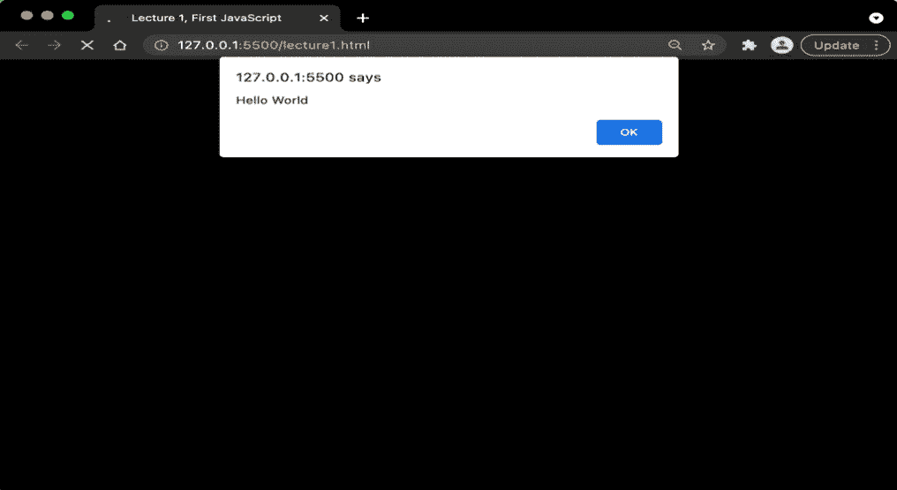

如果你想查看结构、**HTML** 标记和 **JavaScript** 代码，请将文件加载到你的代码编辑器中——文件看起来是这样的：

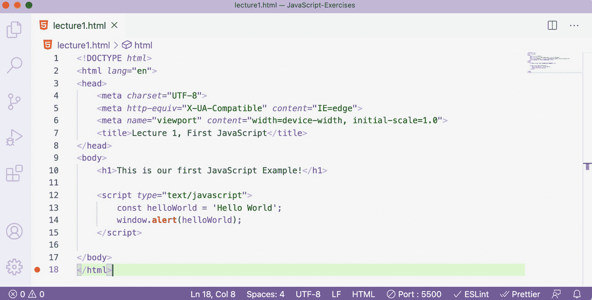

正如你从上面的示例所示，我使用了 `window.alert` 方法来显示我存储在 `helloWorld` 变量中的任何内容。现阶段不要担心方法和变量，对你来说重要的是理解我们如何运行 JavaScript 代码。

我们不需要一个“`lecture1.html`”这样的文件来编写和执行 JavaScript 代码。我们可以直接使用浏览器来运行代码。打开 JavaScript 控制台或开发者工具。对于不同的浏览器，开发者工具的显示方式不同。以下是在两个最常用的浏览器——**Google** 和 **Mozilla** 中打开控制台的步骤。

#### Google Chrome 开发者工具：

- 导航到任何所需的页面——如 `google.com`
- Mac 用户按下 `CMD + OPT + J` —— 这应该打开一个窗口
- Windows 用户 `CTRL + SHIFT + J` —— 这应该打开一个窗口
- `F12` 有时有效，有时无效。

在测试完上述某些步骤后，你应该看到开发者工具窗口，它位于下方或右侧。你可以增加该窗口的高度和宽度，因为默认情况下它非常小。请花时间调整到一个适合你自己的控制台尺寸。如果你喜欢，可以将控制台分离为一个独立的窗口。最后，在开发者工具窗口中，请点击 console（控制台）标签：“*你可能会在控制台中看到一些警告和错误，但你不必担心它们，因为它们不是来自你的代码。*”

#### Mozilla Firefox 开发者工具：

- 导航到任何所需的页面——如 `google.com`
- Mac 用户按下 `CMD + OPT + J`
- Windows 用户 `CTRL + SHIFT + J` 或 `CTRL + ALT + I`
- `F12` 有时有效

其余步骤与 Google 浏览器相同。最后剩下的步骤是输入我们的 JavaScript 代码——参见下图

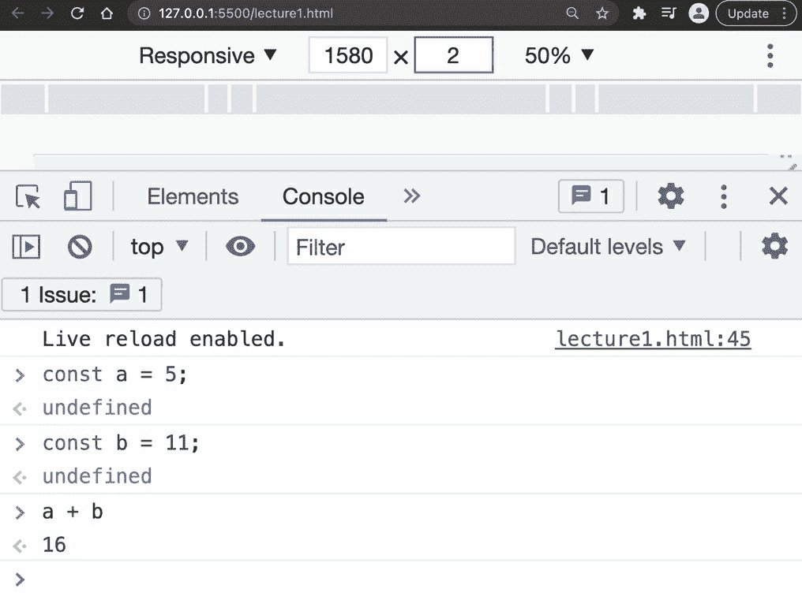

太棒了！现在你知道如何查看和编辑你的代码了，而且我为你提供了两个选项。第一种是使用代码编辑器，你可以在那里编写和编辑代码。对于这种方法，你需要一个 HTML 文件在浏览器中加载以查看结果。第二种方法是使用浏览器控制台，你可以在那里编写并查看代码的输出。还有另一种编写/执行 JavaScript 代码的方法。这种方法更高级。比较有经验的开发者更喜欢这种方法。通过这种方法，你需要使用终端和 **Node.js**。因此，你需要在你的计算机上下载并安装 Node.js。你可以从这个网站下载 Node：

<https://nodejs.org/en/>

一旦 Node 在你的系统上安装并运行，你就可以打开终端窗口并输入 `node`。这将启动名为 **REPL** 的循环，即 JavaScript“读取-评估-打印循环”。你可以在这里看到我与 Node 的交互：

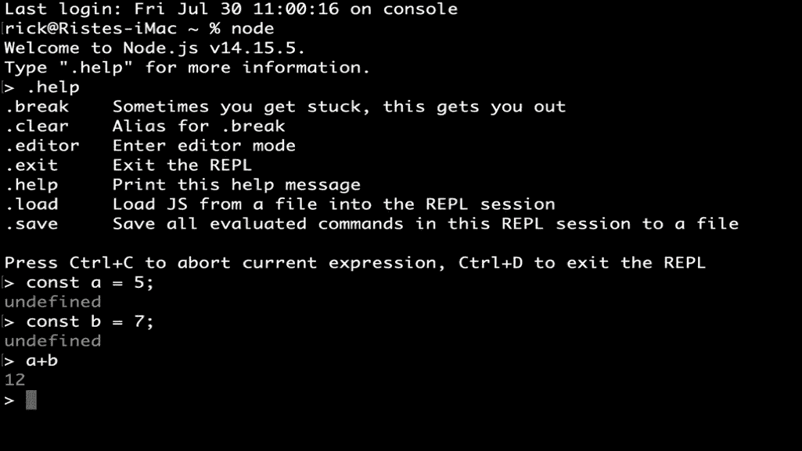

个人而言，我喜欢使用代码编辑器（编写和编辑代码）并在浏览器中加载相同的文件来查看输出。不要误会我，Node 非常棒且高效，但当我们开始处理更大块的代码时，这种单行的交互环境将不再适合我们。这这就是为什么我为你准备了这些文件。如果你不想使用编辑器或 Node 终端，可以复制这些文件的内容并在浏览器控制台中运行。此外，**VsCode** 编辑器的另一个很棒的功能是它支持安装扩展。例如，“Live Server”扩展将帮助你自动加载 HTML 和 JavaScript 文件。一旦你做了更改，它就会监听这些更改并刷新页面以更新输出。你可以点击以下链接阅读更多关于此扩展的信息：

<https://marketplace.visualstudio.com/items?itemName=ritwickdey.LiveServer>

在写这本书时，该扩展的下载量已超过 1300 万。再次，“live server”允许你执行你的文件、监听代码更改并重新加载浏览器。你可以检查我安装的所有扩展——它们在截图的左侧：

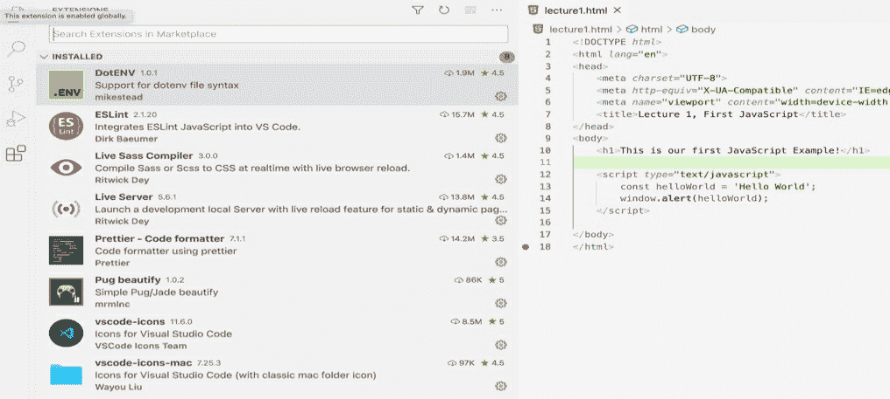

如果你想用 Node 处理较长的代码块，你需要将代码保存为文件。文件名可以是任何名称，例如 `lecture1.js`。请注意，所有的 JavaScript 文件都有 `.js` 扩展名——每当你看到这个扩展时，意味着这是一个 JavaScript 文件。

所以让我们看看如何使用 Node.js 运行 JavaScript 代码，因为这对大多数学生来说比较困难。我会演示一次，书中我会使用前两种方法，它们更容易。为了测试这一点，在你的代码编辑器中创建一个文件并命名为 `lecture1.js`。在该文件中添加以下代码行，或者直接从 `chapter2` 文件夹复制 `lecture1.js` 代码。

JavaScript 代码：

```javascript
const x = 5;
```

接下来，你需要保存此文件，通常在桌面上。否则，如果你将其保存在某个文件夹，你需要在终端中提供该目录的实际路径。最后，你需要用 Node 运行此文件，但在此之前，我需要告诉你如何终止会话。要终止当前的 node 会话，你需要按下：

- `CTRL + C` 取消表达式
- `CTRL + D` 退出 **REPL**

所以，如果你运行了某些 node 进程，请终止它。一旦你终止了进程，就可以重新开始。我已将文件放在桌面上，我需要更改当前目录。所以，在终端中，我将使用命令 `cd`，意思是“更改目录”，然后输入 desktop。

这些是步骤：

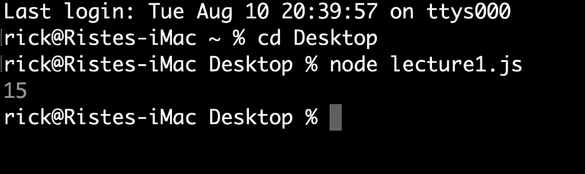

正如你所见，我们得到了 15 的结果，但我是如何打印这一个的？在文件中，我们有一个名为 `console.log` 的命令，它创建了在终端中显示的输出。

如果你觉得这种方法高级且难以使用，请使用编辑器或浏览器控制台。好的，这就是我们使用 Node 运行多行代码的方法。我希望你这样做的方式是通过编辑器和浏览器来查看输出。这仅仅是我的建议；你可以选择任何适合你的方法。

好了，现在让我们尝试更传统、更简单的方法。为了做到，我们需要一个 **HTML** 文件，并在文件中放入一个指向外部 JavaScript 文件的链接。请注意，HTML 文件具有 `.html` 扩展名：

这是 HTML 标记（与 `first.html` 文件中的标记相同）：

```html
<!DOCTYPE html>
<html lang="en">
<head>
<meta charset="UTF-8">
<meta http-equiv="X-UA-Compatible" content="IE=edge">
<meta name="viewport" content="width=device-width, initial-scale=1.0">
<title>Lecture 1, First JavaScript</title>
</head>
<body>
<h1>First Lecture! </h1>
<h2>我们在这里正在使用 script 标签链接 lecture1.js 文件！</h2>
<script src="lecture1.js"></script>
</body>
</html>
```

如你上面的代码所示，外部 JavaScript 文件在 body 标签关闭之前被链接。

现在，如果你还没有下载 *live server 扩展*，不要担心；你仍然可以将文件加载到网络浏览器中。找到实际文件所在（名称为 `first.html`）并双击它。最终，你可以使用 `file://` 和 URL 将加载到网络浏览器中，就像我下面这个一样：

`file://Users/rick/Desktop/ebook/JavaScript-Exercises/first.html`。

结果应该像这样：

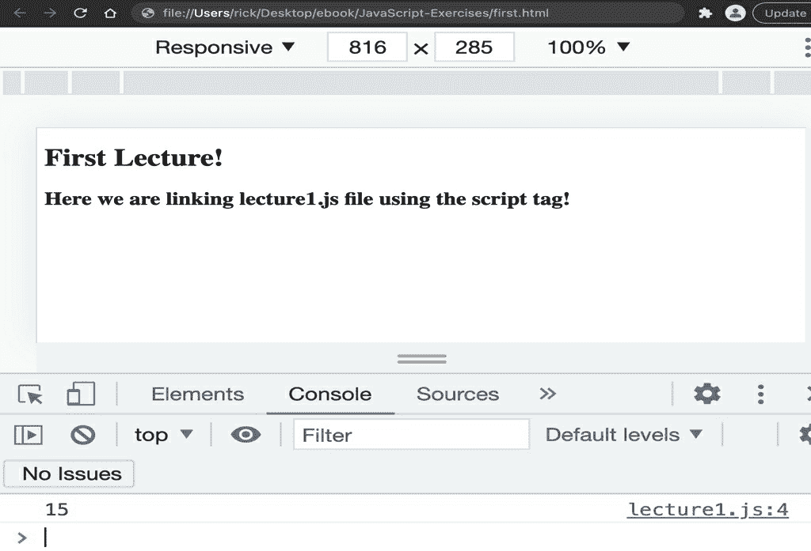

接下来是打开浏览器开发者工具，如你所见，我已经打开了它们，并且可以看到输出是 15。使用快捷键打开开发者工具。我们是如何得到结果的？嗯，HTML 文件只包含 HTML 标签，但它也包含了对外部 JavaScript 文件的引用或链接：

`<script src="lecture1.js"></script>`

这个链接连接了 HTML 文件和 JavaScript 文件。这就是你了解如何链接两个文件所需的全部知识。

## 第 3 章 – 词法语法与规则

词法规则定义了编程语言的结构。这些规则的存在是为了帮助和指导我们如何在 JavaScript 中编写程序。本章的文件位于 `chapter3` 文件夹中。如果你可以操作电脑，请打开并查看它们。

### 注释

在 JavaScript 中，有两种类型的注释。一种是单行注释，我们使用 `//` 编写注释。`//` 之后的文本被视为注释并被 JavaScript 编译器忽略。另一种类型的注释是多行注释。打开名为 `comments.js` 的文件，你将在那里看到以下代码：

```javascript
// JavaScript 中的注释
// 单行注释
/**
 * 多行注释
 * 多行注释也可以用作单行注释使用。
 */
```

多行注释也可以被用于编写单行文本。但为什么我们需要注释呢？嗯，注释是为了我们编写代码的自己，也是为了将来以后阅读我们程序的其他程序员，这样他们就能理解我们做了什么或我们背后的逻辑。注释非常有用，可以说你应该在程序中尽可能多使用它们。

### 字面量 (Literals)

在我们开始解释什么是原始和非原始数据类型之前，我需要解释字面量。字面量是在程序中使用的数据值。每个字面量都属于一个特定的数据类型，我们将在后续章节中更深入地解释数据类型。

这是一个字面量的示例：

```javascript
// 字面量
2 // 数字字面量
2.5 // 数字二点五，一个有效的数字字面量
"Hi there!" // 双引号中的字符串
'Hi' // 单引号中的字符串
"" // 空字符串
true // 不是字符串的布尔
false // 另一个不是字符串的布尔
null // 特殊值
undefined // 另一个特殊值
Symbol // 新原始类型
```

如果你打开 `chapter3` 文件夹内的 `literals.js` 文件，可以找到相同的代码。

### 标识符 (Identifiers)

我们在 JavaScript 中使用标识符来为变量、属性、对象、类和函数命名；请在此阶段不要担心这些术语，因为当我们以后涵盖更多内容时将会进行解释。如果我们想拥有合法的标识符，需要遵循特定的规则。

规则：

- JavaScript 标识符必须以字母、下划线 `_` 或美元符号 `$` 开头
- 第一个字符不能是数字或数字位
- 第一个字符之后的后续字符可以是字母、数字、下划线或美元符号，以及它们的任何组合。

标识符也可以是单个字母，如 `a` 和 `b`，但我总是建议使用更具描述性和有意义的名字。

### 保留关键字 (Reserved Keywords)

在 JavaScript 语言中，我们有保留关键字，不能使用它们来命名变量、函数、对象或类。这是来自课程 `reserved-keywords.js` 的截图。你可以在书的最后找到相同的列表：

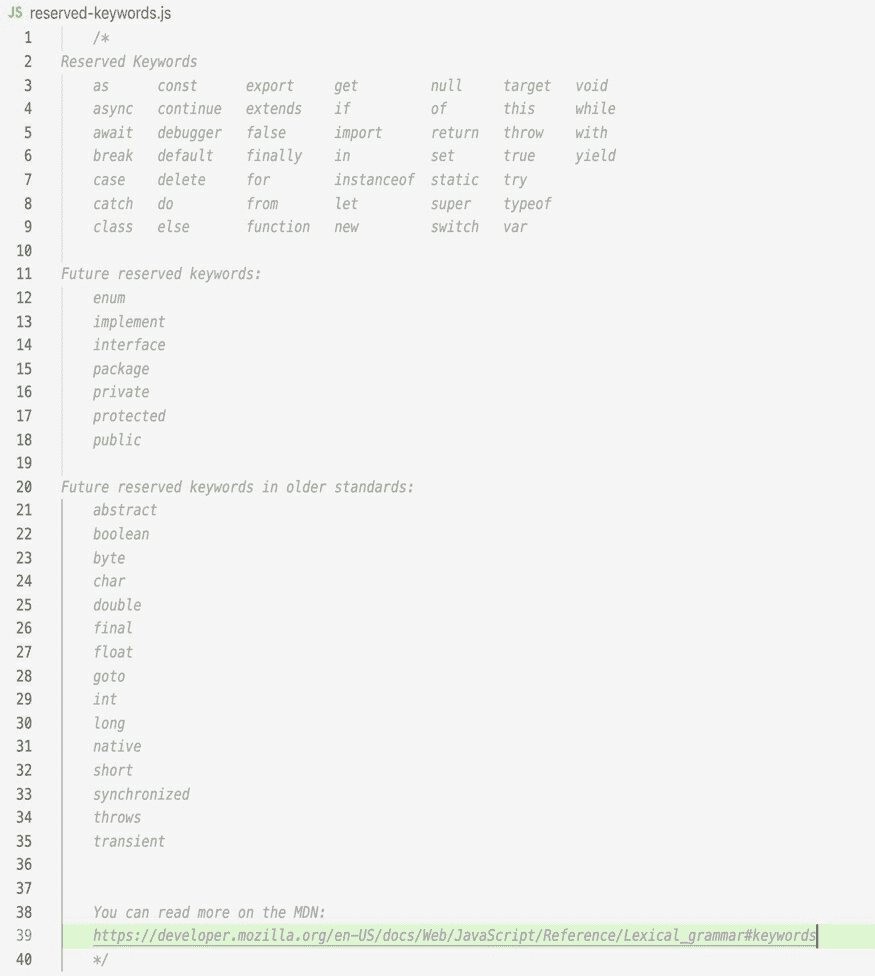

### 语句 (Statements)

在 JavaScript 中我们有语句。这里有一个包含三个语句的示例：

```javascript
let firstName = 'Rick ';
let lastName = 'Sekulos';
alert(firstName + lastName);
```

不要担心示例中使用的变量名和方法。这里我有三个语句。那么，什么是 JavaScript 语句？语句告诉计算机执行某事。第一个是给变量 `firstName` 赋值。第二个是赋值语句。最后一个是输出第一个和最后一个变量内容的输出语句。你可以在 `statements` 课程中找到相同的代码。

有些程序员尽可能省略分号，但我只能建议使用分号，因为这会让你的代码更具可读性和组织性。另一个重要的规则是只要用分号分隔，我们可以在同一行分组两个语句。

```javascript
// 分组语句
let number1 = 4; let number2 = 5;
```

语句之间的空格会被忽略。还有语句块。当我们开始处理更复杂的语句如 `if-else` 子句时会学习更多。另一个有趣的事实是 JavaScript 将换行解释为分号。例如，如果下一个字符不能被解释为上一个语句的延续，那么 JavaScript 就会添加一个分号：

```javascript
let priceInDollars
priceInDollars = 59.4
console.log(priceInDollars);
```

### 大小写敏感

你需要知道 JavaScript 标识符是对大小写敏感的。这意味着如果我们仅用单个字母如 `x` 来命名变量，我们可以在程序中使用 `x`。像 `x` 和大写字母 `X` 是两个不同的变量名。为什么？因为 JavaScript 是一种大小写敏感的语言。

## 第 4 章 – 类型、值和变量

在本章中，我们将仔细观察语言的一些核心细节。本章的所有文件都位于 `chapter4` 文件夹中。

### 原始类型和对象类型

JavaScript 类型可以属于两个类别：

- **原始类型 (Primitive types)**
- **对象类型 (Object types)**

JavaScript 原始类型可以是：

- 字符串 (Strings)
- 数字 (Numbers)
- 布尔值 (Boolean values，用于真或假值的布尔)
- Bigint
- Undefined 和 null 被视为特殊值
- 符号

任何不是原始值的值都被认为是一个对象。对象与原始值的不同之处在于，每个对象可以有多个属性。每个属性都有一个名称和一个值。该值可以是原始值之一，甚至是另一个对象。

JavaScript 特殊对象的一个例子是数组。我们将在本书的后后部分介绍数组。

原始类型和非原始类型之间的一个根本区别是，原始值是不可变的，而非原始类型的值在创建后是可变的。原始类型通过值存储，而非原始类型（对象）通过引用存储。我们将来会对此进行更多讨论。

### 变量与赋值

JavaScript 中最重要且最基础的概念之一是变量声明和值赋值。到目前为止，我们知道可以用字面量来表示值，但我们从未解释过变量的概念。在之前提供的示例中，我们一直使用了变量，但没有对它们进行过更多介绍。简而言之，变量是一个为了让我们能够存储值的容器。例如，我们想为某个产品设置一个价格，假设价格为 9.99，我们希望将其存储并保存在内存的某处，以便稍后在程序中使用该价格。变量有名称，且这些名称必须遵循我们解释过的标识符相同规则。变量是容器，我们可以在其中存储任何内容，而不只是文本和数字。我们可以使用变量来存储更复杂的数据，你稍后会看到我们如何实现这一点。在每个程序内部，我们可以根据需要拥有任意数量的变量。最重要的一部分是在使用变量之前对其进行声明。

### 声明变量

我已经告诉过你，在命名变量时需要遵循相同的规则，但我还没有告诉过你我们用于生成更复杂的变量名的约定。当我说“更复杂”时，我的意思是指由多个单词组成的变量名。对于单个单词，没有问题。你可以随心所欲地命名，但对于两个单词组成的变量名，我们可以使用一种被称为**驼峰命名法 (camel case)** 的约定。这意味着单词应该直接连接，中间不留任何空格，并且第一个单词用大写字母开头。例如，我想有一个用于存储不同名称列表的变量名。所以我有两个单词，但我想要有一个单单词变量名，就像在这个示例中一样：

```javascript
// 驼峰命名法：用户名
let userNames;
```

这是开发者之间首选的约定。也有其他约定，但我们在整个书中将坚持使用这一种。

变量还有数据类型，该数据类型取决于其当前值。在大多数编程语言中，数据类型是强固定的，声明后无法更改，但在 JavaScript 中，情况并非如此；我们可以将变量设置为我们想要的任何类型。

让我们创建两个变量，暂时不要担心 `let` 关键字：

```javascript
// 声明变量
let myName;
let myAge;
```

这里有两个名为 `myName` 和 `myAge` 的变量。你可以像这样在你的浏览器控制台中输入这两行代码：

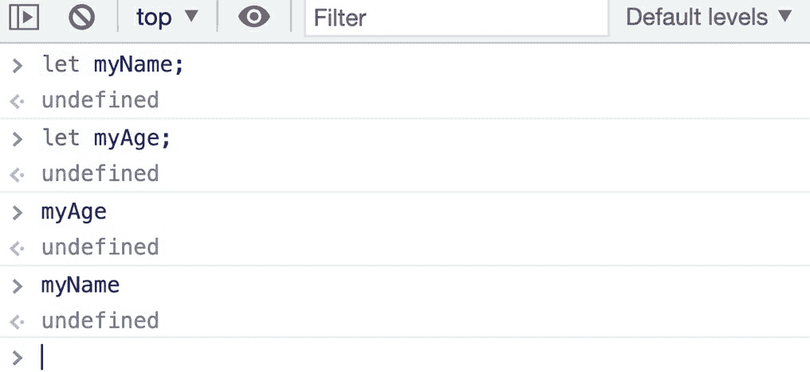

你注意到我使用了分号（;）来标记指令的结束吗，试着养成这个习惯。我还尝试通过在控制台中输入 `myAge` 和 `myName` 来测试这些变量是否有值，但我得到的是 `undefined`。它们目前没有在其中存储任何值；它们现在仅仅是空的容器，坐在内存的某处等待我们给它们赋值或对其进行初始化。**undefined** 意味着不存在值，但如果你尝试输入一个像 `myLastName` 这样的变量名，你会得到错误信息，因为这个变量甚至没有被创建/声明，而我们正在尝试调用它。

### 初始化变量

在使用变量之前对其进行初始化是非常重要的部分。一旦我们声明了变量，我们就可以对其进行赋值。使用赋值号 `=` 来提供值。

```javascript
// 初始化变量
myName = 'Andy';
myAge = 33;
```

在控制台中看到这个结果：


### Var, Let 和 Const

如果你注意到我们在声明变量时使用了 **let** 关键字，那么这个关键字意味着什么呢？在 ES6 之前，我们使用 **var** 关键字来声明变量，并且没有其他方法。在 ES2015 或 ES6 中，我们有了新的方式，使用 **let** 和 **const** 关键字。作用域（scope）定义了变量及其在何处可以被访问。在 JavaScript 中，有两种作用域：

- 全局作用域
- 函数作用域

为了理解这一点，我给你展示一个例子：


我知道这在阶段听起来很多，但请不要担心函数。关注函数内部的变量：

```javascript
function getDate() {
    let todayDate = new Date();
}
```

作用域定义了变量及其在何处可以被访问。在 ES6 之前的版本允许使用 `var` 来声明变量，并且没有其他方法。使用 `var` 声明的变量作用域是函数体，如示例所示，但我们也可以在函数体之外或全局空间声明 `var`。当我们在函数体外部声明变量时，该变量属于全局作用域。全局作用域变量是全局对象的一部分，我们可以通过 `globalThis` 关键字访问该对象：

```javascript
var a = 5; // 这个变量在函数外部，属于全局作用域
globalThis.a = 5; // 如果我们使用 globalThis.a 可以获得相同的结果
```

你应该知道使用 **var** 关键字声明的变量无法被 `delete` 运算符删除。另一个重要的点是，你可以多次使用 var 声明同一个变量，因此重新声明和重新初始化对于 var 来说不是问题，但如果使用 `let` 和 `const` 就会出现问题。

### 变量提升 (Hoisting)

变量声明在任何代码执行之前就会处理；这是有趣的，这意味着如果我们有十行代码，在第 8 行声明了一个名为 `name` 的变量，那么它等同于我们在顶部写了同一行声明代码。这里有一个有趣的场景，我想让你看看：

```javascript
console.log(name);
// ... 其他代码 ...
let name = 'calister';
```

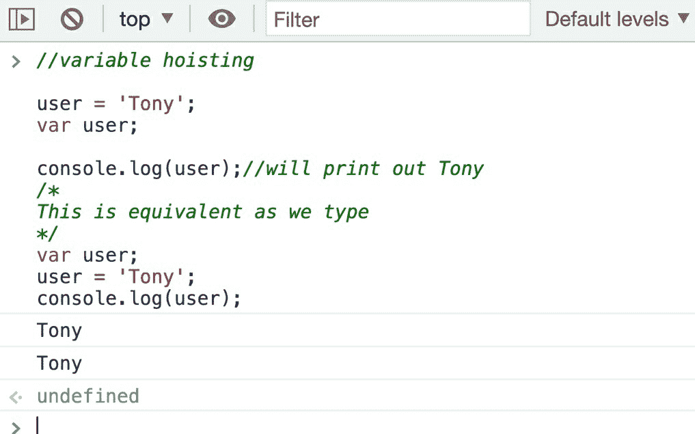

在这里我做了两件事，但让我来解释一下 JavaScript 的这种奇怪行为。由于“**变量提升**（hoisting）”，似乎我们可以在创建同一个变量之前就对其进行初始化。在上面的示例中，我们首先将 `user` 变量设置为值‘Tony’，之后我们使用 `var` 关键字声明了该变量。变量声明似乎被移动到了函数或全局作用域的顶部，这是因为了“**变量提升**”才可能的。

尝试在你的浏览器控制台中运行上面的代码并查看结果。你不应该遇到任何错误。一个非常好的习惯是在作用域的顶部声明变量：无论是函数作用域还是全局作用域。在上面的示例中，我做的第二件事是两次声明了同一个名为 `user` 的变量。这使用 **var** 是可以的，但使用“**let**”和“**const**”则不行，我们也会为此提供相关示例。

### Let

一种更现代的变量声明方式是使用“**let**”关键字。与 **var** 关键字不同，**let** 允许声明块作用域的变量。因此，我们可以像这样使用 `let` 关键字声明变量：

```javascript
// let variable declaration
let actorName = 'Tom';
let actorLastName = 'Cruise';
```

在声明变量名时，如果可能，建议为其赋值。在某些情况下我们不需要这样做，我们也会涵盖这些情况。与 **var** 一样，`let` 关键字允许我们在不提供初始值的情况下声明变量，如果我们尝试访问该变量，将得到 **undefined**。使用“**let**”和“**const**”关键字声明的变量是块级作用域的。这意味着它们在定义的块内部是可见且可访问的。虽然我们可以在全局作用域中外部声明它们，但与 **var** 关键字不同，`let` 不会在 `window` 全局对象上创建属性。那么，**var** 和 **let** 变量之间的区别是什么呢？它们看起来几乎完全一样，对吧？

让我们来看下面的代码，希望这有助于你理解为什么 **let** 变量是块作用域的。函数是解释 let 变量块作用域的的一个很好的例子：

首先是一个使用 **var** 关键字的示例：

```javascript
// let vs var variable declaration
function first() {
  var x = 1; // 声明并初始化变量 x 为 1
  {
    var x = 2; // 同一个变量，我们只是给 x 赋了新值！
    console.log(x); // 现在 x 是：2
  }
  console.log(x); // 我们打印赋值给 X 的最后一个值，结果是：2
}
```

现在是一个使用 **let** 关键字的示例：

```javascript
function second() {
  let x = 1; // 声明并初始化变量 x 为 1
  {
    let x = 3; // 这是一个不同的变量，这是因为块作用域，上面的 x 和这个变量 x 不是同一个，因为块作用域
    console.log(x); // 它将打印在花括号内部声明的 x 的值：是 3
  }
  console.log(x); // 这里我们访问了顶部声明的 X 变量。我们无法访问在第二个块内部定义的 X 变量，这就是为什么输出是 1
}
```

所以，如果你阅读注释，上面的代码就解释了一切。使用 `var` 关键字会忽略块作用域，改变值会影响同名的其他变量。使用 `let` 关键字时，在块内部创建的变量被视为具有新值的不同变量。块变量与块外的变量是不同的。因此，我们得到了两个不同的结果。

另一个有趣的特性是我们不能重新声明同一个变量，因为会抛出语法错误。

关于 **let** 需要重要了解的是，除非它们被完全初始化，否则我们无法读取或写入 **let** 变量；如果在声明期间没有指定值，那么变量将像 `var` 一样被赋予 `undefined` 值。因此，如果我们尝试访问它，将抛出 **ReferenceError**。

### Const

如果你需要声明一个**常量**变量，可以使用 **const 关键字** 代替 **let** 或 **var**。在使用此 **const** 关键字时要小心，因为你必须在声明时初始化常量。查看以下示例：


你可能的问题是如何在 `let` 和 `const` 之间选择？这很容易找到，你只需要在浏览器控制台中输入 `Number.MIN_INTEGER` 就会得到 `-9007199254740991`，等同于 -2^53 + 1。如果你想知道最大安全值，需要输入 `Number.MAX_SAFE_INTEGER` 就会得到 `9007199254740991`，等同于 2^53 - 1。如果你使用比这些更大的数字，将会丢失精度，所以请小心。

#### 数字字面量

JavaScript 的主要类型是 **Number**。数字可以高达 ±1.7976931348623157×10³³⁰⁸，最小到 ±5×10⁻³²⁴。所有数字都是双精度浮点数。减号用于表示负数。整数的算术运算非常准确，但你应该意识到存在安全整数范围。这很容易找到，你只需要在浏览器控制台中输入 `Number.MIN_INTEGER` 就会得到 `-9007199254740991`，等同于 -2^53 + 1。如果你想知道最大安全值，需要输入 `Number.MAX_SAFE_INTEGER` 就会得到 `9007199254740991`，等同于 2^53 - 1。如果你使用比这些更大的数字，将会丢失精度，所以请小心。

#### 字符串字面量

字符串无非引号包裹的文本序列。引号可以是单引号或双引号，但记住我们需要在每个文本的开头和结尾相同的引号。示例：

- `"Hello World"`
- `'Hello World'`
- `` `Hello World` ``

字符串有一个问题。如果我们想在字符串内部使用引号怎么办？为了这样做，我们需要使用反斜杠对其进行转义。你注意到最后一个示例了吗？它有点不同，对吧？让我们在下面的“什么是模板字面量”章节中更多地讨论这个问题。

#### 模板字面量

自 ES6 以来，我们可以使用反引号界定字符串。最后一个示例符合 ES6 模板字面量。在本书中，我将单引号或反引号作为分隔符。过去，字符串字面量写在单行。如果我们想使用多个字符串，应该使用 `+` 运算符连接字符串。这是一个示例：

```javascript
'This is single line string ' + ', and is concatenated with plus operator';
```

输出：

`'这是一个单行字符串，并用加号连接 operator';`

从 ES6 开始，我们可以使用反引号（backtick），它是一种**模板字符串**，并支持多行字符串和字符串插值。由于我们使用了 `` ` `` 反引号，我们可以在内部自由地包含单引号或双引号，而不会产生任何问题。

在 ES6 之前，我们使用反斜符 `\'` 进行转义，它表示单撇或单引号。我们稍后会看到一个示例。

查看此示例（你可以在 `lecture2.js` 中找到相同的代码，将其复制并运行到控制台中）：

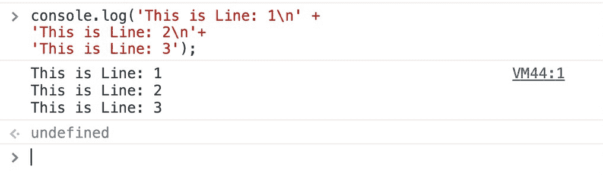

你有没有注意到我使用了 `\n` 换行转义字符，以便我将第二行推到下方？在过去，每当我们需要将字符串移动到下一行时，我们都会使用换行符。另一方面，使用 ES6 反引号（`` ` ``）实现这一点非常简单。

查看使用反引号的相同字符串代码：

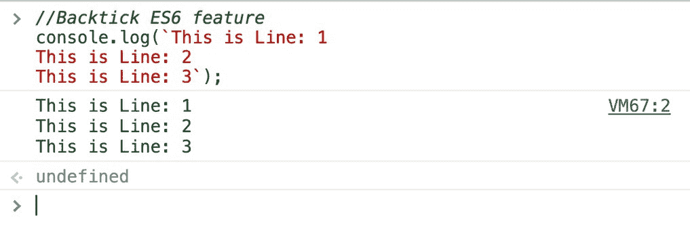

使用反引号，我们可以轻松将字符串扩展为多行。

另一个很棒的功能是，我们可以在反引号字符串内部使用多个单引号或双引号，而无需使用转义字符。

查看以下示例。第一行是输入，第二行是输出（你可以在浏览器控制台中尝试此操作）：

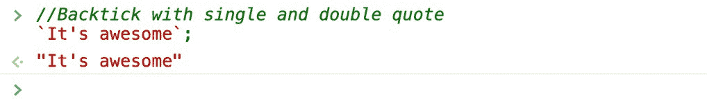

在 ES6 之前，我们需要对字符串内部的单引号或双引号进行转义。

查看以下示例：

```javascript
// 在单引号前使用反斜杠字符以忽略它
'It\'s awesome';
// "It’s awesome"

// 在双引号前使用反斜杠字符以忽略它
"It\'s a \"double\" quote example";
// “It’s a “double” quote example”
```

因此，通过模板字面量，我们可以安全在模板字面量中使用单撇和“引号”。

#### 单字符转义序列

在字符串中使用一些**保留**的单字符转义序列。请看下表：

| 转义序列 | 名称 | Unicode | 值 |
| :--- | :--- | :--- | :--- |
| `\b` | 退格 | U+0008 | |
| `\f` | 分页 | U+000C | |
| `\n` | 换行符 | U+000A | |
| `\v` | 垂直制表符 | U+0009 | |
| `\r` | 回车 | U+000D | |
| `\t` | 水平制表符 | U+0009 | |
| `\0` | 空字符 | U+0000 | NULL |
| `\'` | 单引号 | U+0027 | |
| `\"` | 双引号 | U+0022 | |
| `\\` | 反斜杠 | U+005C | |

从表中可以看出，反斜杠字符 `\` 在 JavaScript 字符串中有特殊含义。之前提到的另一个例子是如果我们使用 `\\'` 转义，这意味着输出中将打印一个单引号，即反斜杠 `\` 被忽略。同样，与其他 JavaScript 转义序列一样，我们需要对 Unicode 字符进行转义。因此，如果我们想在字符串内部使用 Unicode 字符，可以复制粘贴它们，但要确保你使用的是适当的编码。JavaScript 源文件可以是任何类型的编码；JavaScript 将代码转换为 UTF-16，JavaScript 中的所有字符串都将是 UTF-16 编码。

可以使用这种格式 `\XXXX` 在任何字符串内部添加 Unicode 序列。

我们为什么在这里讨论 Unicode 字符呢？因为我们可以在字符串中使用 emoji，而且我们都知道 emoji 有多有趣且具有互动性。emoji 是 Unicode 字符，它们是星际平面（astral planes）的一部分，这意味着在字符串中需要两个字符的组合来表示它们。

查看以下示例，我在其中复制了一个 emoji，并使用了两个 Unicode 字符的组合：

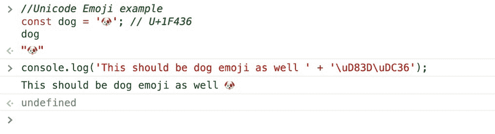

#### 算术运算符

与数学一样，我们可以在 JavaScript 中进行简单的数学运算。JavaScript 使用常用的运算符：

- 加法 (`+`)
- 减法 (`-`)
- 乘法 (`*`)
- 除法 (`/`)
- `++` 递增（加1）
- `--` 递减（减1）

请注意，当我们对两个整数进行除法运算时，例如 `(5 / 2)`，结果将是一个浮点。

在 `lecture3.js` 文件中，你将找到下面相同的代码，你可以将其复制并直接粘贴到控制台中：

```javascript
// + 运算符
let a = 5;
let b = 2;
let c = a + b;
console.log(c);

// - 运算符
let m = 5;
let n = 2;
let d = m - n;
console.log(d);

// * 乘法
let k = 5;
let j = 2;
let h = k * j;
console.log(h);

// / 除法
let l = 5;
let s = 2;
let q = l / s;
console.log(q);

// % 模运算
let g = 5;
let w = 2;
let r = g % w;
console.log(r);

// ++ 递增
let x = 4;
x++; // x 增加 1 变为 5
console.log(x);

// -- 递减
let y = 4;
y--; // y 减少 1 变为 3
console.log(y);

// ** 幂运算
console.log(3 ** 4); // 输出为 81
```

最后，我们讨论 `++` 和 `--`。

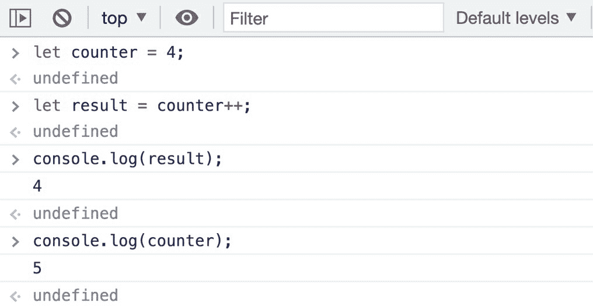

这里与之前的示例相反，我们使用 `++` 运算符不是作为后缀而是作为前缀。让我们查看以下示例：

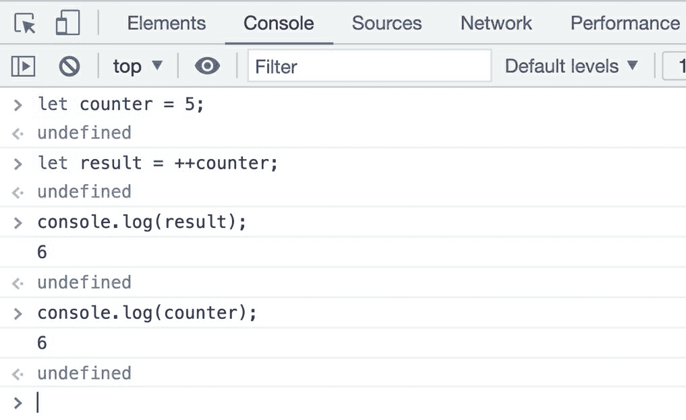

在这里它先改变或增加 `counter` 的值，然后设置 `counter` 的结果。这就是为什么两个 log 产生相同的结果。

#### 字符串拼接 +

我之前提到过，如果我们想将两个或多个字符串合并为一个，我们就使用拼接。加法运算符 `+` 用于执行字符串拼接。该运算符将两个字符串连接在一起。这就是为什么在展示它们如何工作之前，我必须先解释运算符。查看以下示例：

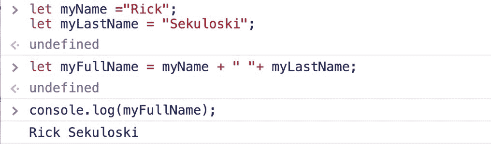

你可以注意到我在上面的示例中也使用了 `" "`。这意味着将姓和名与一个空字符串进行拼接，结果如下：Rick Sekuloski。否则，两个字符串之间将没有空格。另一种方法是在 `myName` 的结尾包含该空格，它看起来像这样：`let myName = "Rick ";`。

#### 布尔值

等等，我忘记了使用布尔值。这里最重要的一点是任何 JavaScript 值都可以转换为布尔值。

这些值被视为假布尔：

- **Null**
- **0**
- **-0**
- **NaN**
- **"" – 空字符串**
- **Undefined**

我们拥有的其他值，包括对象和数组，都被转换为布尔真值。

### 空与未定义

我们已经提到，当我们声明一个变量但不为其赋值时，该变量的值默认为 **undefined**（未定义）。**null**（空）表示变量值的缺失。**null** 是一个特殊的值，用于字符串、数字和对象中的“无值”。请注意，**undefined** 不是一个保留关键字，但 **null** 是。建议不要将变量或常量命名为 **undefined**。**null** 和 **undefined** 都被转换为布尔值，并且它们都用于表示某个值的缺失。在我的经验中，很少需要给变量赋值 **null** 或 **undefined**，但如果需要的话可以使用。

### 比较运算符和逻辑运算符

在 JavaScript 中，我们有比较运算符和逻辑运算符。这些运算符用于测试 **true**（真）或 **false**（假）值。我们使用比较运算符确定值之间的相等性或差异。假设我们有一个变量 `a` 的值，如下表所示：

`let a = 5;`

| 运算符 | 描述 | 示例 | 结果 |
| :--- | :--- | :--- | :--- |
| `==` | 等于 | `a == 6` | false |
| `!=` | 不等于 | `a != 6` | true |
| `>` | 大于 | `a > 4` | true |
| `<` | 小于 | `a < 4` | false |
| `>=` | 大于等于 | `a >= 5` | true |
| `<=` | 小于等于 | `a <= 4` | false |

逻辑运算符用于检查值之间的逻辑。让我们通过下表检查运算符：

`let x = 5;`
`let y = 4;`

| 运算符 | 描述 | 示例 | 结果 |
| :--- | :--- | :--- | :--- |
| `&&` | 与 | `(x < 6 && y > 1) / (x < 6 && y > 1)` | true / false |
| `||` | 或 | `(x > 4 || y < 5) / (x > 4 || y > 5)` | true / true / false |
| `!` | 非 | `!(x == y) / !(x > y)` | true / false |

从上面的表，“`&&`”意味着“与”。因此，如果两个操作数都为真，则返回 true；如果只有一个操作数为假，则返回 false。另一方面，“`||`”运算符在当两个操作数都为假时返回 false，否则返回 true。最后一个逻辑运算符是“`!`”，它反转条件的值。例如，如果条件返回 true，那么“`!`”运算符将将其变为 false。

### 对象

如果你学习过其他编程语言，你就会拥有对象的知识。尽管如此，JavaScript 中的对象是不同的，它们与数组一起是最基础的数据类型之一。在 JavaScript 中，每个对象都由 `name:value` 对组成。对象是非原始数据类型，如果你记得我们在之前的章节中提到过它们：**数字、字符串、布尔、undefined 和 null 值**。其他所有内容都被视为对象。

这是一个简单对象的示例：

```javascript
let user = {
  userName: 'Rick',
  age: 33
};
```

在上面的示例中，我们在变量 `user` 中存储了一个具有两个属性的对象。这就是我们使用对象字面量创建 JavaScript 对象。对象以大括号开始，如果你仔细检查示例，JavaScript 中的对象与其他编程语言的对象不同。我们在 JavaScript 中还有类和方法，但现在讨论它们还太早了。让我们关注对象为什么很重要，以及我们如何使用对象并访问它们的属性。在上面的对象中，我们有 `name:value` 属性。例如，我们有 age 代表名称，age 的值为 33。但我们如何访问该对象的属性呢？嗯，我们可以使用点符号访问对象属性，如下例：

```javascript
// Objects
let user = {
  userName: 'Rick',
  age: 33
};

// 我们可以使用点符号获取对象属性
let userName = user.userName; // 也可以将这些属性存储在变量中
let userAge = user.age;

// 打印对象的属性和值
console.log(userName);
console.log(userAge);
```

你可以在名为 `objects.js` 的文件中找到相同的示例。复制代码并可以在浏览器中运行它。这是我在浏览器控制台中看到的样子：


不仅可以访问属性，还可以现有对象添加新属性，使对象更具动态性。例如，让我们添加一个新值为 developer 的新属性 `occupation`。第一次，让我们使用布尔值并添加另一个名为 `isWorking` 值为 true 的属性。在你的浏览器控制台中测试以下代码：

```javascript
user.occupation = 'Developer';
user.isWorking = true;
// 打印整个对象
console.log(user);
```

这是添加新属性后的样子：


到目前为止，我们学习了如何创建对象。我们还学习了如何访问对象。我们还学习了如何通过现有属性来修改对象的值。例如，我们将 age 修改为 30。

```javascript
// 修改 age
user.age = 30;
```

让我们看看如果我们更改了 age 属性：


对象的另一个强大功能可以使用 `delete` 关键字移除属性：

```javascript
delete user.occupation;
```

需要注意的是，当对象存储在常量中时，我们可以修改并添加新属性，但我们不能为常量变量重新赋值。查看以下示例：

```javascript
const rick = {name :'Rick'};
rick = {name: 'Chris Mcdald'}; // 会抛出 Uncaught TypeError: Assignment to constant variable.
```


### 使用 new 关键字创建对象

另一种使用 `new` 关键字创建对象的方法。这种方法需要更多的写法，但最终结果是相同的。查看以下示例：


对象的字面量声明这种方法在开发者中更常用。我们也可以拥有空对象、没有属性的 `name:value` 或键值对的对象，这是可以接受的编码规范。

```javascript
// 空对象
let studentObj = {};
```

从上面的示例中，你需要理解 `studentObj` 或我们创建的任何变量包含的是对象的引用，而不是对象的精确副本。因此，`studentObj` 是一个指向存储在内存某处的对象的变量名。让我们通过这个示例进行测试：


这里我们有两个变量指向内存中存储的同一个对象，并且只持有引用。因此，更改第二个对象的汽车模型也会影响第一个对象。无论我们使用哪个对象，我们仍然在更改内存中存储的对象的值，并且两个对象都拥有该对象的引用。这就是为什么模型的值被改变了。

```javascript
// 简写版本
let car = {
  name: 'Tesla',
  model: 4,
  color: 'white',
  fuelType: fuelType
}
```

我更倾向于使用第二种简写；这方便得多，不是吗？

创建新对象的另一种方法，但我们需要学习原型才能深入这一部分。

### 对象原型

为了理解这部分，你还需要理解继承是如何工作的。

想象一下：每个被创建的对象都属于某个对象。简而言之，我们创建的每个对象都继承自父对象，即原型。

我们已经学习了创建对象的两种方法，并且在这两种方法中，它们都继承自 `prototype`。现在的问题是，我们如何访问 `prototype` 呢？请注意，我们创建的每个对象都会继承其父对象的属性，但如果父对象 `Object.prototype` 中没有某个属性，那么该对象就不会有这个属性。

在 JavaScript 中，我们还拥有一种叫做**原型链**的东西。例如，让我们假设我们想使用 `new` 关键字创建一个新数组。我们创建的数组对象继承自其父对象即 `Array.prototype`，而 `Array.prototype` 又继承自之前提到的父对象即 `Object.prototype`。

### 使用 Object.create() 创建对象

`Object.create()` 方法使用其第一个参数作为新创建对象的原型。这可能让人感到困惑，但请看下面的示例：

```javascript
// 创建一个 isHuman 为 false 的对象
const person = {
  isHuman: false,
  myDetails: function() {
    // 打印详情
    console.log(`全名是 ${this.name} ${this.lastName}.`);
  }
};

// 使用 Object.create 创建一个名为 rick 的
const rick = Object.create(person);
rick.name = 'Rick'; // "name" 是设置在 "rick" 上的属性
rick.lastName = 'Scott'; // "lastName" 是设置在 "rick" 上的属性
rick.isHuman = true; // "isHuman" 是设置在 "rick" 上的属性，覆盖了 "person" 对象中的属性

// 记得继承吗？
rick.myDetails();

// 预期输出: "全名是 Rick Scott."
```

你可以看到，`rick` 对象是使用 `person` 对象作为第一个参数创建的。

继承是这样工作的：父对象可以将属性传递给子对象，而子对象可以添加额外的属性，这就是我们在这里做的（`rick` 对象）。另一方面，父对象 `person` 并没有这些属性。

简单来说，子对象可以访问父对象的所有属性和函数，加上它自己的，它还可以修改父属性，例如将 isHuman 设置为 true。现在让我们看看最终输出：


你也可以创建一个不继承任何东西的新对象，因为我们仍然想使用 `Object.prototype` 提供的基本方法。我们可以这样做：

```javascript
// 创建不继承原型的新对象
const obj2 = Object.create(null);
```

我们可以像使用对象字面量一样创建一个空对象：

```javascript
// 使用对象字面量创建空对象
const obj3 = {};

// 使用 Object.create 创建空对象，与上面相同
const obj4 = Object.create(Object.prototype);
```

我认为，目前关于对象的讨论已经足够了。在接下来的章节中讨论类时，继承将会更加清晰。

### 按值传递的原始类型

现在是解释按值传递的原始类型与按引用传递的对象的区别了。

我们已经看到了按引用传递对象的示例，现在来看原始数据类型。

所以，当我们把原始类型赋值给变量时，该变量包含实际的原始值，而不是内存的引用。对象只是内存的引用。

通过这个很棒的示例来解释（你可以在 `value.js` 文件中找到）：

```javascript
let a = 5;
let b = 'name';
let c = null;
c = a;
a = 10;
console.log('a 的值:', a); // 输出: 10
console.log('c 的值:', c); // 输出: 5
```

如果你在浏览器中运行这段代码，你会发现最后 `a` 的值与 `c` 的值不同。

当我们把 `a` 赋值给变量 `c` 时，我们把 `a` 中的所有内容复制到了变量 `c` 中。之后，我们将 a 的值改为 10，这不会影响变量 `c`，因为它们之间没有像对象那样的引用关系。

### 数组

我考虑过先介绍对象还是数组；然后，我决定选择对象，因为数组也是对象。

数组和对象都是 JavaScript 中的基础核心概念。

JavaScript 中的数组是第二重要的数据类型。

数组简单来说就是一个对象。如你所见，现在一切变得合理了。

我们使用数组是为了在单个变量或常量内部存储多个值。数组是一个对象，其属性名是数字字符串，如 `'0'`、`'1'`、`'2'`、`'3'`、`'4'` 等。记住，属性名是字符串，而不是数字。有人会问既然可以使用数字，为什么要用字符串？原因很简单；对象内部的属性名不能是数字类型。因此，我们必须使用字符串。所以，数组是一个有序的值集合，每个值被称为元素或项目。

### 数组字面量

让我们使用数组字面量声明数组：

```javascript
const myArray = [1,2,3,4,5,6];
const namesArray = ['Tom','Andy','Jason','Chris','Loki','Luk'];
const mixedArray = [1,true,'Andy',{x:1,y:2}];
```

在上面的示例中，我们声明并初始化了三个数组。每个数组的元素必须包含在方括号内。方括号非常重要，就像对象的大括号一样。JavaScript 数组是从零开始索引的。第一个元素从位置 0 开始，至于我们为什么要从零开始，你很快就会发现。正如你所见，数组的元素可以属于任何数据类型；在最后一个 `mixedArray` 示例中这一点更为明显。数组元素可以是数字、字符串、布尔值、对象、函数或其他数组。

JavaScript 数组是动态的，就像对象一样，我们可以添加和删除元素。JavaScript 数组可以访问 `length` 属性，通过这个属性，我们可以以数字的形式获取数组的实际长度。查看以下示例，我们打印了数组的长度：

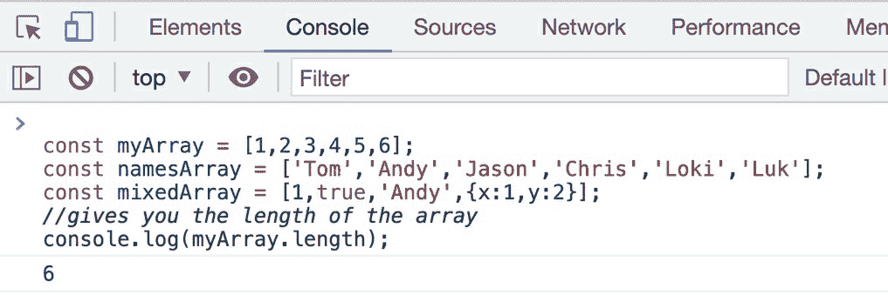

当我们创建一个新数组时（如上面的示例所示），我们需要知道它具有一些继承自 `Array.prototype` 的属性。这允许我们使用一些数组方法，或者说我们可以开箱即用，而不需要思考太多。

和对象一样，我们可以这样创建一个空数组：

```javascript
// 使用数组字面量创建空数组
let emptyArray = [];
```

我们也可以在数组中使用尾逗号而不会产生任何问题。查看这个示例：

```javascript
// 尾逗号
let trailingComma = [1,3,5,];
console.log(trailingComma.length); // 输出 3
```

但如果我们有多个逗号且中间没有赋值值，就会发生有趣的事情。查看这个示例：

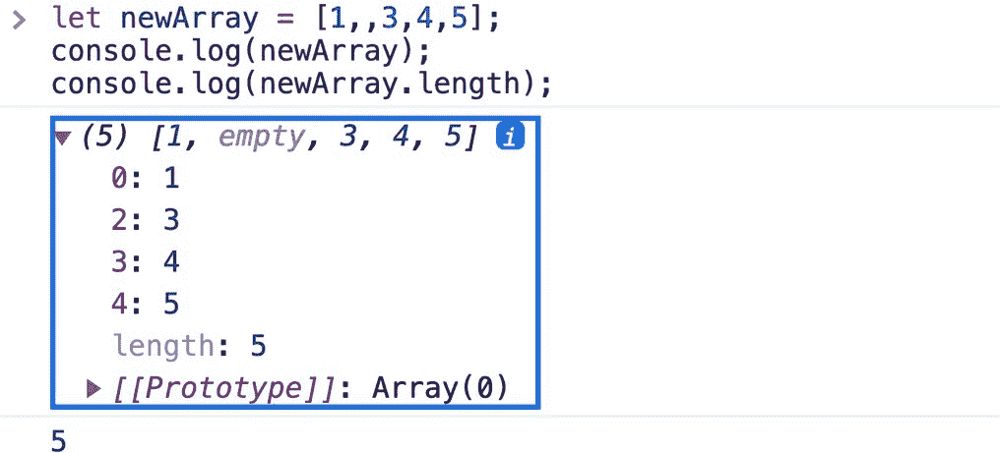

从示例中我们可以看到所有元素都有自己从位置零开始的索引。在位置 0，我们有一个值 1。在位置 1，我们没有值，以此类推。当我们打印数组时，由于没有值，我们有一个“**empty**”槽位，但有趣的是它给出的长度是 5，包含了空槽位，这很有趣，所以在使用逗号并想要查找长度时要小心。

### 使用 new Array () 创建数组

创建数组的另一种方法是使用 `new` 关键字。这将使用 Array 构造函数，我们可以通过三种不同的方式调用或执行这个构造函数。我们还没有讨论过构造函数，但请专注于学习更多关于数组的知识。之后你会学习构造函数、类、实例化以及这些术语，因为它们是更高级的概念。

但在下面的示例中，使用 new 关键字创建数组的一切都将一目了然。

```javascript
// 空数组
let array1 = new Array(); // 未传递任何参数的构造函数
console.log(array1.length); // 0

// 单参数构造函数
let array2 = new Array('Tom'); // 调用了一个名为 Tom 的参数的构造函数
console.log(array2.length); // 1

// 多参数构造函数
let array3 = new Array('Tom','Jerry'); // 传递了多个参数的构造函数
console.log(array3.length); // 2
```

### 展开运算符

自 **ES2015** 或 **ES6**，我们可以使用“**展开运算符**”来创建一个新数组，甚至可以将数组复制到另一个数组。展开运算符的语法是三个点 `...`，我知道它看起来很奇特。

在我让你更加困惑之前，先查看这个示例：

```javascript
const firstArray = [1,2,3,4,5];
console.log('The elements from the first array '+ firstArray);
console.log('The length of the first is: '+ firstArray.length);

// 使用展开运算符创建新数组
const secondArray = [...firstArray];
console.log('The elements of the second array' + secondArray);
console.log('The length of second array is: '+ secondArray.length);
```

在这个示例中，我做了两件事。首先，我们将第一个数组中的所有元素展开到第二个数组中，因此我们创建了一个新数组。你在这里需要学习的第二个重要点是，我们从第一个数组创建了一个实际副本，因为我们将第一个数组中的项展开到了第二个数组中。如果我们向第二个数组中添加更多元素，这不会影响第一个数组。

查看下方示例的输出：

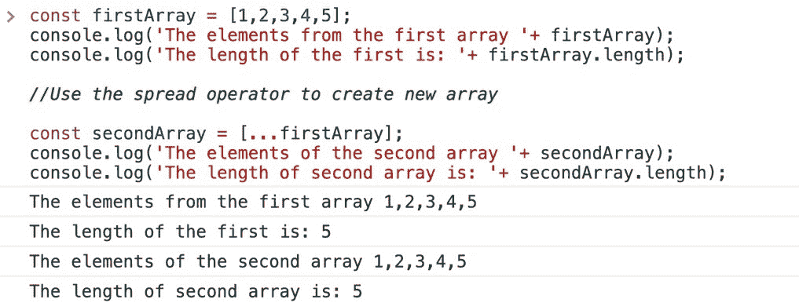

### 访问数组元素

要访问数组中的元素，你需要使用索引。记得我告诉过你我们将涵盖数组索引，现在是解释为什么数组是从零开始的完美时机。所以，数组元素始终从零位置/索引开始，对吧？让我们使用数组字面量创建一个包含五个汽车名称的数组：

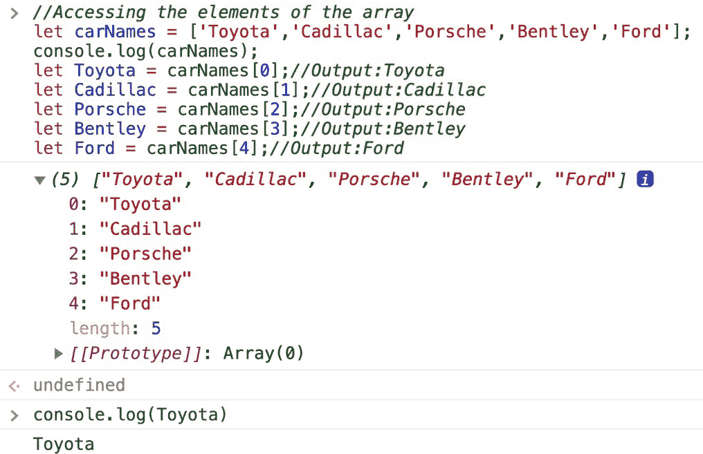

要访问数组的最后一个名称，你需要使用数组名称。然后在方括号中，你需要提供索引。所以 `carNames[4]` 将打印出‘Ford’。当你尝试访问数组中不存在的元素时，你认为会发生什么？这可能是因为你可以在索引上犯一个简单的错误。我知道这个数组的长度是 5，大多数学生会尝试访问最后一个第五个元素，但这个元素并不在那里，因为没有索引 5；只有长度是 5。

### Symbol

```javascript
// 我们可以使用 toString 方法将符号转换为字符串
let convertSym = mySymbol.toString();
alert(convertSym);
```

如果你现在在浏览器中测试此代码，它将按照预期工作。

简而言之，Symbol 是一个值得关注的原始类型，它是在 ES6 中引入的。

## 总结

恭喜你！在本章中，我们涵盖了 JavaScript 语言的许多基础知识。我们学习了原始和非原始数据类型。这一章对你来说至关重要，因为如果不了解对象和数组，你无法理解后续章节中更高级的概念。

## 第 5 章：语句 (Statements)

在本章中，我们将学习控制结构以及为什么它们在 JavaScript 以及任何高级编程语言中都如此重要。在第 2 章中，我们简要提到了语句，但在这里我们将更多地讨论它们。在 JavaScript 中，语句通过分号 `;` 结束或彼此隔开。请注意，在 JavaScript 中，我们也有表达式（expressions）。但是表达式和语句之间有什么区别呢？嗯，表达式总是与值相关。例如，简单的加法 `5 + 5` 是一个表达式，因为它产生了值 `10`。另一方面，语句是指当我们想要将结果存储在变量中并在结尾加上分号时。

示例：

`let result = 5 + 5;`

这里我们对一个名为“result”的变量进行了声明和初始化。这是一个语句的示例，因为我们在单行中完成了变量的声明和初始化。

因此，JavaScript 代码是一系列连续的语句，等待程序执行。JavaScript 中的语句是按顺序逐个执行的，但如果我们想改变执行顺序呢？如果我们想让某个代码块优于其他代码块执行，可以使用像条件判断、循环和跳转语句之类的控制结构。我将在本章中向你介绍所有的结构，本章的代码示例位于 `chapter5` 文件夹中。

### 基础表达式语句 (Basic Expression Statements)

表达式语句是最简单的语句形式，但它们有自己的副作用（side effects）。语句执行一个操作，我们可以通过在表达式后添加分号将任何表达式转换为语句。从上一个例子来看，`5 + 5` 是一个表达式，因为它产生了值 `10`，但如果我们在结尾加上分号，它就变成了一个语句，因为我们是在计算 `5+5`。我们也可以像上一个例子一样将其存储在变量中。

另一个示例：

`const message = 'Welcome back ' + username;`

这是一个赋值语句的示例，因为我们使用了 `=` 运算符给一个名为 `message` 的变量赋值。但我们之前提到的副作用呢？副作用是我们正在改变变量 `message` 的值。那么我们如何识别表达式呢？在 JavaScript 中，表达式被用在期望值的地方，我们可以在期望值的地方放置一段代码来测试这一点。如果没有抛出任何错误，我们就知道它是表达式。

我知道区分表达式和语句是棘手的，但随着时间的推移和一些练习，你将学会识别它们的区别。让我再给你举一个例子。我们使用很多次的 `console.log()` 方法会向控制台打印一个值并返回 `undefined`。现在我们可以测试将预期的值替换为测试代码。如果放置在方法内部的代码是一个表达式，它将向控制台打印一个值。否则，它将抛出错误。所以，让我们把字符串字面量 `Hi There` 加入 `console.log()` 方法中。

就像这样：

`console.log('Hi There');`

如果你仔细观察，你会发现 `console.log()` 方法和 `Hi There` 都是表达式。字符串字面量将解析为 `string` 类型的值，因此是一个字符串表达式，而 `console.log()` 方法是在屏幕上打印内容并返回一个 `undefined` 值。因此，像 `console.log()` 方法这样具有副作用的表达式被称为表达式语句。

具有副作用的表达式另一个示例是函数调用，但我们将在更高级的章节学习它们。

### 条件语句或分支 (Conditional Statements or Branches)

顾名思义，条件语句需要一个条件才能工作。根据条件，我们可以跳过或执行一组语句。这些语句也被称为*分支*（branches）。在 JavaScript 中，我们有 `if/else` 和 `switch` 分支语句。

if/else 语法示例：

```javascript
if (expression)
  statement
```

条件必须放在括号内。请注意，条件将产生 `true` 或 `false` 值。请看以下示例：

```javascript
let number1 = 1;
let number5 = 5;
if(number1 <= number5){
  console.log('The condition is true');
  let result = number1 + number5;
  console.log(result);
}
```

我们通过编写 `if` 关键字开始 `if` 语句，然后在括号内有一个条件，比较 `number1` 是否小于等于 `number5`。在我们的示例中，这个条件于 `true`，因为 1 确实小于 5。所以，如果条件为 `true`，我们就执行 `if` 块内部的语句。否则，我们就跳过所有这些语句。因为条件为 `true`，所以 `if` 语句下面的所有语句都将被执行。在大括号之间，我们可以有一个或多个语句。如果我们只有一个语句，甚至可以省略大括号，但如果有多个语句，我们就需要使用它们。多个语句被称为**语句块**（statement block）。

### If-else 语句

如果你想在给定条件为真时执行一组语句，在条件为假时执行另一组语句怎么办？嗯，如果我们想这样做，还有另一种语句叫做 `if/else`。

**语法：**

```javascript
if (condition) {
  statement block 1
} else {
  statement block 2
}
```

示例：

```javascript
number1 = 10;
// else condition statements will be executed
if(number1 <= number5){
  console.log('The condition is true');
  let result = number1 + number5;
  console.log(result);
} else {
  console.log('The condition is false');
  let result = number5 - number1;
  console.log(result);
}
```

如果我们看语法，如果条件求值为 `true`，则 block 1 内部的语句将被执行，而 block 2 只有在条件为假时才会被评估。在这种情况下，条件为假，所以 `if` 块内部的语句永远不会被执行，但 `else` 块中的语句将被执行，因为这是 `if/else` 的规则。

### Else if 语句

但如果我们想执行多段代码中的一段会怎样？嗯，我们实现这一点的一种方法是使用 `else if` 语句。如果你理解了之前的概念，这个语句非常容易理解，唯一的区别在于我们有超过两个选择。

查看以下代码：

```javascript
// else-if
age = 18;
if(age <= 14){
  console.log('You are in the children group');
} else if( age >= 15 && age <= 24){
  console.log('You are in youth group');
} else if( age >= 25 && age <= 64){
  console.log('You are in Adults group');
} else {
  console.log('You are in Senior group');
}
```

根据年龄，我们可以看到自己属于哪个年龄组。例如，如果我们在浏览器控制台中运行相同的代码，我们将得到我们处于青少年组，因为 `else if` 条件求值为 `true`，其余的条件也被求值为 `false`。最后，你可以看到我们有一个普通的 `else` 子句，当之前的每个条件都为假时，它会被触发。如果你想测试这个，我建议针对不同的年龄运行相同的代码，看看哪个条件会求值为 `true` 以及哪些语句会被打印出来。

这里有一个只有一个语句的示例，此时大括号是不必要的。

```javascript
let isNumber = true;
if(isNumber)
  console.log('Inside the if clause!');
else {
  console.log('Inside the else clause.');
}
```

### 条件运算符（三元运算符）

在这里我们将讨论一个稍微高级一点的话题，你可能需要一些时间才能习惯这个运算符。**三元**运算符就像是 **if 语句**的简写版本。这个条件（三元）运算符是 JavaScript 中唯一一个接受三个操作数的运算符。

在让你感到困惑之前，这里是该运算符的语法：

`condition ? expressionIfTrue : expressionIfFalse`

**第一个操作数是条件**，一个值被用作条件的表达式，而 `?` 之后的第二个操作数是**真值表达式**；但这意味着什么呢？如果条件求值为真（true）或真值（truthy），则接下来将评估该表达式。最后一个操作数是 `:` 之后的**假值表达式**。如果条件为假（false），则执行此表达式。

让我们来看这个例子：

```javascript
// Conditional (ternary) operator
let age = 26;
let whichBeverage = (age >= 21) ? "Beer" : "Juice";
console.log(whichBeverage); // "Beer"
```

在这种情况下，我仅将运算符返回的任何保存在名为 `whichBeverage` 的变量中，然后使用 `console.log` 方法打印结果。显然，因为年龄为 26，条件 `(age >= 21)` 为真，因此评估了第一个表达式。这就是为什么我们在 `whichBeverage` 变量中存储了 `Beer`。

### switch 语句

到目前为止，我们已经涵盖了 `if`、`if-else` 和 `else-if` 语句，使程序能够根据给定条件或多个条件（如 `else-if` 语句所示）执行不同的语句块。然而，JavaScript 还有一种非常流行的语句，被称为 `switch` 语句。switch 语句的解释起来比较复杂，但通过示例，它变得非常简单。switch 语句与 `Java`、`C`、`C++` 等许多编程语言中的 `switch` 语句相同。如果你熟悉 `switch`，可以跳过这部分。基本上，当我们有大量情况需要检查时，我们使用 switch 语句。该语句的语法如下：

```javascript
let x = 6;
switch(x) {
  case 1: // if x === 1
    // 执行 case #1 的语句
    break; // 停止
  case 2: // if x === 2
    // 执行 case #2 的语句
    break; // 停止
  case 3: // if x === 3
    // 执行 case #3 的语句
    break; // 停止
  case 4: // if x === 4
    // 执行 case #4 的语句
    break; // 停止
  case 5: // if x === 5
    // 执行 case #5 的语句
    break; // 停止
  case 6: // if x === 6
    // 执行 case #6 的语句
    break; // 停止
  case 7: // if x === 7
    // 执行 case #7 的语句
    break; // 停止
  case 8: // if x === 8
    // 执行 case #8 的语句
    break; // 停止
  case 9: // if x === 9
    // 执行 case #9 的语句
    break; // 停止
  case 10: // if x === 10
    // 执行 case #10 的语句
    break; // 停止
  default:
    // 执行语句
    break;
}
```

从上面的示例中，可以看到 switch 正在将一个表达式与许多可能的值进行比较。我们可以使用多个 `if/else` 语句实现相同的结果，但会导致过多的代码重复。我们使用关键字 `switch` 开始 switch 语句。**switch 关键字** 之后是一个表达式和花括号内的代码块。在内部我们有一系列 **case 子句**。**switch** 语句内部的每个子句都有**关键字 case**，后面跟着一个表达式和冒号 (`:`)。

但 switch 语句是如何工作的呢？例如，我们正尝试找到变量 `x` 中存储的是哪个数字，在我们的例子中，是数字 6。然后 switch 语句等于表达式的值，它尝试找到与表达式中的值匹配的 **case 标签**。但 **case 标签** 是什么？在我们的示例中，我们正在寻找一个特定的数字，对吧？这就是为什么 case 标签包含了数字；`case 1:`、`case 2:` 等。但如果变量 `x` 的值为 11 会发生什么；我们没有匹配表达式的 case 标签，对吧？当 **switch** 语句无法找到与表达式值匹配的 case 时，它将执行 **default** 语句。这就是为什么我们需要在 switch 语句的最后加上 **default**；可以将其等同于 `if/else` 语句中的 `else` 子句。

如果你注意到了，我们在每个子句的末尾都有一个 `break`。这会导致 JavaScript 解释器跳出 switch 语句并继续执行 switch 语句外的语句。因此，每个子句结尾的 `break` 语句将确保在匹配 case 标签时进入 switch 语句，并继续执行后续代码。如果你忘记放置 break，那么 switch 将不会停止执行，并将贯穿（fall through）到下一个。

让我们用真实的代码修改之前的示例并在浏览器中运行。


```javascript
let x = 6;
switch(x) {
  case 1: // if x === 1
    // 执行 case #1 的语句
    console.log('We have found the number ' + x);
    break; // 停止
  case 2: // if x === 2
    // 执行 case #2 的语句
    console.log('We have found the number ' + x);
    break; // 停止
  case 3: // if x === 3
    // 执行 case #3 的语句
    console.log('We have found the number ' + x);
    break; // 停止
  case 4: // if x === 4
    // 执行 case #4 的语句
    console.log('We have found the number ' + x);
    break; // 停止
  case 5: // if x === 5
    // 执行 case #5 的语句
    console.log('We have found the number ' + x);
    break; // 停止
  case 6: // if x === 6
    // 执行 case #6 的语句
    console.log('We have found the number ' + x);
    break; // 停止
  case 7: // if x === 7
    // 执行 case #7 的语句
    console.log('We have found the number ' + x);
    break; // 停止
  case 8: // if x === 8
    // 执行 case #8 的语句
    console.log('We have found the number ' + x);
    break; // 停止
  case 9: // if x === 9
    // 执行 case #9 的语句
    console.log('We have found the number ' + x);
    break; // 停止
  case 10: // if x === 10
    // 执行 case #10 的语句
    console.log('We have found the number ' + x);
    break; // 停止
  default:
    // 执行语句
    console.log('The number is not in the range between 1 - 10 and the number is: ' + x);
    break;
}
console.log(`This is printed after the break statement terminated the switch statement`);
```

//Output

```
We have found the number 6
This is printed after the break statement terminated the switch statement
```

从上面的示例可以看出，正在执行 `case 6`。在遇到 `break` 语句后，`switch` 语句终止，并执行 `switch` 语句之外的代码。在这个示例中没有大量的代码，但简单的 `console.log` 将证明 `switch` 语句按预期工作。作为练习，尝试将 `x` 初始化为不在 1 到 10 范围内的值或数字，并观察输出。

## 总结

恭喜！这是一个非常重要的章节，希望你对条件语句以及何时使用它们有了更多的了解。这些语句都是重要的，并且可以在不同的场景下使用。下一个章节将简单很多短，但我保证它会有趣且重要，所以让我们开始吧。

## 第 6 章：更多关于运算符

在本章中，我们将讨论更多关于运算符。到为止，我们已经讨论了算术运算符、字符串运算符、比较运算符和逻辑运算符，但还有更多内容。这一章虽然短，但非常重要。

### 字符串中的数字

我知道这个标题有点让人困惑，但在 JavaScript 中，我们提供的多数输入都是以**字符串**的形式存在的。那么，什么是**字符串**呢？**字符串**是存储在单引号或双引号内的系列字符，引号是非常重要的。因为 JavaScript 中的大多数输入都是字符串形式，所以对于数字时使用 `'15'` 而不是数字 `15` 是非常常见的。但当我们在算术表达式中使用字符串时，JavaScript 会执行非常有趣的操作。JavaScript 将进行自动转换以完成某些计算。请查看下面的示例，如果可能的话，你可以在网页浏览器中运行相同的代码：

```javascript
//字符串中的数字
let age = '25';
let year = 2022;
let yearBorn = year - age;
console.log(yearBorn); //输出: 1997
```

从示例中，我们可以看到 JavaScript 将字符串 `'25'` 转换为数字 `25` 并执行了计算。但为什么会发生这种情况？因为减号 `-` 符号代表算术运算，如果同一个表达式中同时存在数字和字符串，字符串将被转换为数字。

但如果我们使用**加号**而不是**减号**呢？还记得我们已经讨论过字符串拼接（我们需要加号来执行字符串拼接），所以让我们重温一下这部分内容：

```javascript
//字符串拼接
const message1 = 'Hello';
const message2 = 'Word';
let result = message1 + ' ' + message2;
console.log(result);
```

输出将是 `'Hello World'`。这就是我们拼接两个字符串的方法。但当一个操作数是字符串，另一个操作数是数字时，会发生什么？让我们重用之前的示例，计算我们的出生年份。

```javascript
//字符串中的数字
let age = '25';
let year = 2022;
let yearBorn = year + age;
console.log(yearBorn); //输出: 202225
```

由于加号代表字符串拼接，数字被转换为字符串，所以我们现在有两个字符串相加，输出是：`202225`。

在 JavaScript 中，我们可以非常容易将字符串转换为数字，反之亦然。例如，我们知道程序期望输入是字符串，但我们需要它是数字，可以使用一个名为 `Number` 的函数将其转换为数字。通过这个函数，我们改变了值的数据类型，这被称为**强制类型转换**（casting）。

让我们使用 `Number` 函数将年龄字符串变量转换为数字。

```javascript
//使用 Number 函数将字符串转换为数字
let age = '25';
let convertAge = Number(age);
let year = 2022;
let yearBorn = year - convertAge;
console.log(yearBorn); //结果为 1997
```

如果你想将字符串转换为数字，可以使用另外两个函数：

- `parseFloat`
- `parseInt`

```javascript
//使用 parseFloat 将字符串转换为数字
let number1 = '3.3';
let number1Converted = parseFloat(number1);
console.log(number1Converted);
```

输出是浮点数 `3.3`。

让我们测试另一种方法，它将返回整数：

```javascript
//使用 parseInt 将字符串转换为数字
let number2 = '3.3';
let number2Converted = parseInt(number2);
console.log(number2Converted);
```

这里的输出将只有数字 `3`。

还有一种方法我想和你分享，以防我以后没有涵盖。这种方法是将数字转换为字符串。这里有一个示例：

```javascript
//将数字转换为字符串
let stringNumber = 3;
let stringNumberConverted = stringNumber.toString();
// 输出: ‘3’
```

在我们继续研究新功能之前，让我们总结一下。如果我们有一个 `a + b` 的表达式，并且如果两个操作数都是数字，那么输出将是一个数字。如果一个操作数是数字类型，另一个是字符串类型，那么输出将是字符串。有一些我们应该知道的规则，我希望你查看下面的转换表：

### 转换为数字和字符串

| 值 | 转换为数字 | 转换为字符串 |
| :--- | :--- | :--- |
| 数字（例如: `x = 11`） | 数字本身 `Number(x)` 输出: `11` | `x.toString();` 输出: `'11'` |
| 空字符串（例如: `a = ''`） | `0` `Number(a)` 输出: `0` | 自身 `a.toString();` `''` |
| 随机字符串（例如: `b = ‘Hello’`） | `NaN` `Number(b)` 输出: `NaN` | 自身 `b.toString();` 输出: `'Hello'` |
| 布尔值: `false`（例如: `c = false`） | `0` `Number(c)` 输出: `0` | 字符串 `'false'` `c.toString();` 输出: `'false'` |
| 布尔值: `true`（例如: `d = true`） | `1` `Number(d)` 输出: `1` | 字符串 `'true'` `d.toString();` 输出: `'true'` |
| `null`（例如: `e = null`） | `0` `Number(e)` 输出: `0` | 自身 `e.toString();` `'null'` |
| `undefined`（例如: `f = undefined`） | `NaN` `Number(f)` 输出: `NaN` | 自身 `f.toString();` `'undefined'` |
| 数组（例如: `[3]`） | `3` `Number([3])` 输出: `3` | 自身 `[3].toString();` 输出: `'3'` |

在 JavaScript 中，我们可以非常容易地将字符串转换为数字。

### 赋值运算符

到为止，我们已经使用了这个运算符。它将右侧的值赋值。请查看下面的示例：

```javascript
let result = 4 + 6;
```

输出将是 `10`。这就是我们进行赋值的方法。

### 运算符优先级

到为止，我们使用了带有一个或两个操作数的表达式。但在现实中，我们可以有多个操作数和运算符，因此我们需要小心，因为我们要预测正确的计算，必须知道计算的顺序。运算符优先级将解决这个问题，意味着 JavaScript 将按照定义的顺序评估表达式。

#### 优先级表

| 运算符 | 操作 | 优先级 | 评估顺序 |
| :--- | :--- | :--- | :--- |
| `++` | 递增 | 第一 | 从右到左 |
| `--` | 递减 | 第一 | 从右到左 |
| `-` | 否定 | 第一 | 从右到左 |
| `!` | 非 | 第一 | 从右到左 |
| `*, /, %` | 乘法、除法、取模 | 第二 | 从左到右 |
| `+, -` | 加法、减法 | 第三 | 从左到右 |
| `+` | 字符串拼接 | 第三 | 从左到右 |
| `<, <=` | 小于、小于或等于 | 第四 | 从左到右 |
| `>, >=` | 大于、大于等于 | 第四 | 从左到右 |
| `==` | 等于 | 第五 | 从左到右 |
| `!=` | 不等于 | 第五 | 从左到右 |
| `===` | 严格相等 | 第五 | 从左到右 |
| `!==` | 严格不等于 | 第五 | 从左到右 |
| `&&` | 与 | 第六 | 从左到右 |
| `||` | 或 | 第六 | 从左到右 |
| `?:` | 三元运算符 | 第七 | 从右到左 |
| `=` | 赋值 | 第八 | 从右到左 |
| `+=, -=` | 算术赋值 | 第八 | 从右到左 |

这简而言之，这就是 JavaScript 在评估表达式时使用的优先级表。从表中可以看出，除法、乘法和取模具有相同的优先级，JavaScript 以何种顺序评估它们并不重要。加法和减法也是如此。让我们做下面的示例，这样你就能理解这个表是如何工作的：

`5 + 2 * 3`

如果你忽略表格并开始从左到右评估表达式，我们将先计算 `5 + 2`，得到结果 `7`，然后将此结果乘以 `3`。结果将是 `21`。

然而，这不对。正确的方法是检查乘法或加法的哪个优先级更高。从上表可以看出，乘法的顺序高于加法的顺序（而加法排在第三）。因此，我们首先评估 `2 * 3`，其结果等于 `6`，然后我们加上数字 `5`。这是评估该表达式的正确方式：

但由于某些原因，如果我们想要这个结果，也可以让上面的表达式计算结果为 `21`。在 JavaScript 中我们如何实现这一点呢？这被称为改变运算符优先级的顺序，如果我们在表达式中使用括号，就可以做到。请看同样的例子，但加上括号，这将带给我们一个不同的结果：

`(5 + 2) * 3 = 7 * 3 = 21`

很酷吧？所以，在我们的案例中，括号内的任何内容（两个数字的相加）都会首先执行，然后执行乘法。正如从示例所示，括号的优先级高于表中其余的运算符。

因此，改变计算顺序是可能的。

## 总结

恭喜！我们已经涵盖了到为止最短的章节之一，我希望你学到了许多关于运算符的新知识。这些小细节超级重要，因为它们填补了我们对 JavaScript 的空白和疑问。在不跳跃和使用未解释特性的情况下，是不可能涵盖一切的。我相信我们需要包含这些短章节，因为这些小细节将帮助你理解后续章节中复杂的知识。下一章节将是 JavaScript 编程语言中最基础的章节之一，将涵盖循环。

## 第 7 章：循环

循环在大多数编程语言中都是相同的，包括 Java、C、C++ 或 C#。如果你已经学过它们了，这一节对你来说将很简单，但我希望你保持专注。

### While 循环

当条件满足（或为真）时，**while 循环**会重复执行一个或多个语句。这是 **while 语句**或 **while 循环语法**：

```javascript
while(condition) {
  // 要执行的代码块
}
```

示例：

```javascript
// While loop
let i = 0;
while (i < 10) {
  i++;
  console.log(i);
}
```

在这个示例中，大括号中的代码将不断循环，直到条件为真。但我们通过在每个循环结束时增加变量 `i` 来控制这个条件，因此代码将重复执行，直到 `i` 变成 `11`。然后条件将变为假，循环将停止。你应该知道，如果条件为假，大括号中的代码将永远不会执行。接下来的示例将记录从 1 到 10 的数字：

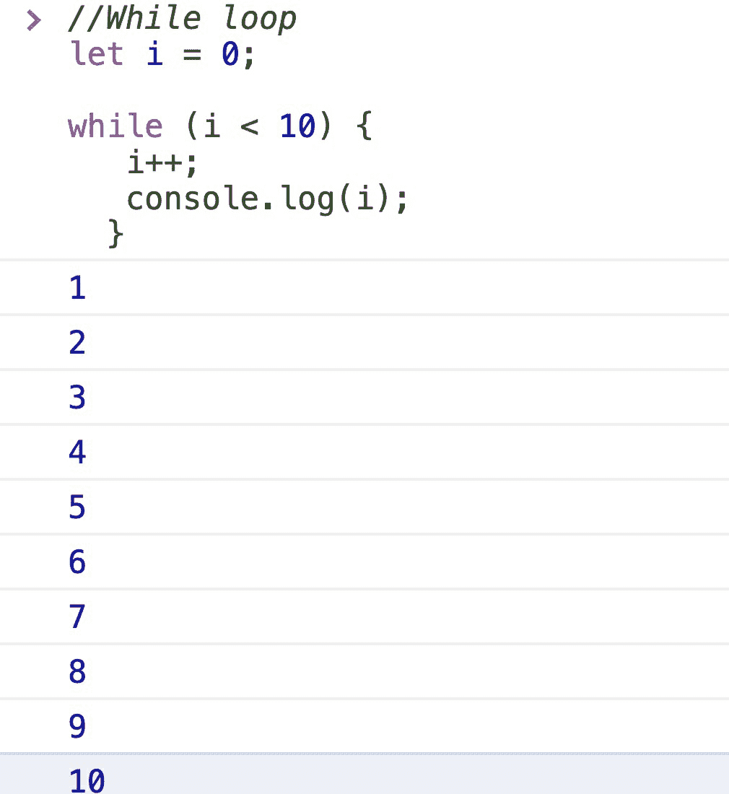

让我写下 while 循环是如何工作的步骤。在开始时，我们在 while 循环之外声明并初始化变量 `i` 为 `0`。接下来，while 循环开始。在条件（括号内）中，我们比较声明的变量 `i` 是否小于 `10`；这是正确的，所以条件被求值为真，然后我们进入条件的主体，在主体中我们正在增加变量 `i` 的值，在下一行中，我们使用 `console.log()` 方法打印 `i` 的值。由于某些原因，如果你需要输出从零开始，可以在增加 `i` 的值之前使用 `console.log()` 方法。交换这两行并在你的浏览器控制台中运行它们：

```javascript
while (i < 10) {
  console.log(i);
  i++;
}
```

回到原来的 while 循环。增加后 `i` 的值现在是 `1`，我们回到 while 条件检查 `i` 的新值 `1 < 10` 再次为真。在我们的情况下，`1` 小于 `10`，我们再次进入 while 循环的主体执行相同的两行代码。首先我们增加变量，然后打印新值，结果为 `2`。当 `i` 变成 `10` 时条件变为假。因此 `10 < 10` 为假，条件内部的代码将不会执行。

但如果我们希望无论指定的条件如何都至少执行一次代码，那么可以使用另一种循环，被称为 **do/while 循环**。

### Do While 循环

如果条件为假，while 循环不会执行其代码，但在某些情况下我们需要代码至少执行一次，这就是 **do/while 循环**。

**Do While 语法：**

```javascript
do {
  // 代码
} while (condition);
```

示例：

```javascript
let i = 11;
do {
  console.log('Value of i:', i);
} while (i < 10);
```

### For 循环

编程语言中最常用的之一是 **for 循环**。它用于遍历一组。

**For 循环语法：**

```javascript
for (初始化; 条件; 增量) {
  // 代码块
}
```

示例：

```javascript
for (let i = 1; i < 10; i++) {
  console.log(i);
}
```

让我再给你另一个遍历数组的示例：

```javascript
let numbersArray = [1, 2, 3, 4, 5, 6, 7, 8, 9, 10];
for (let i = 0; i < numbersArray.length; i++) {
  console.log(numbersArray[i]);
}
```

总结来说，`for` 循环有三个独立部分（初始化、测试和递增），它们在在末尾都用分号隔开。

初始化表达式在循环开始之前执行一次，我们通常在这里进行变量的**声明**和**初始化**。中间部分是**条件测试**，它在每次迭代之前执行。如果测试结果为真，则执行 `for` 循环体内部的语句。最后，执行递增部分。请注意，我们可以使用 `++` 和 `--` 这两个运算符中的任何一个。

务必仔细设置条件，否则可能会导致无限循环，这意味着同一段代码将反复执行。这会导致你的电脑崩溃，或者让你的浏览器变得非常缓慢且无响应。

要在 `for` 循环中创建无限循环，你需要一个无论如何始终为真的条件。这等同于 `for` 循环中的 `while`。以下是一个无限 `while` 循环的示例（**请勿尝试，因为这会导致你的设备崩溃**）：

```javascript
while (true) {
  // 你的代码
}
```

查看以下 `for` 循环语法：

```javascript
for ( ; ; ) {}
```

在 `for` 循环中，如果我们需要，可以省略部分或全部部分。在这种情况下，我们可以省略三个表达式，但两个分号仍然是必须。这也是无限循环的一个示例，因为测试表达式不存在且被视为真，所以 `for` 循环将无限重复。

下面的示例使用了省略了初始化部分的 `for` 循环：

```javascript
let j = 1;
for (; j < 10; j += 2) {
  console.log(j);
}
```

输出将是 `1, 3, 5, 7, 9`。`j += 2` 是什么意思？我已经给过你输出结果，所以这是一个非常基础的计算。它是**赋值运算符**之一。它获取 `j` 的值，将其加 `2`，然后将 `(j + 2)` 的结果存回变量 `j` 中。这就是为什么我们从 `1` 开始。然后我们得到了 `3`、`5` 等等。

如果我们省略了第二个语句或条件部分，会发生什么？这会成为问题吗？答案是不会，这里有一个示例：

```javascript
//不带条件测试语句的示例
for (let j = 1;; j += 2) {
  console.log(j);
  if (j > 10) {
    break; // 你需要使用 break 语句来终止循环。
  }
}
```

在这里我们省略了**测试语句**（**条件测试**），但在 `for` 循环体内，我们仍然需要进行某种**测试**，这可以通过我们已经学过的 `if` 语句来实现。如果你注意到了，我们在条件为真时使用 `break` 语句来终止循环。

### for/of 循环

在 ES6 中，我们有一种新的循环语句称为 **for/of**。**for/of** 循环与 **for** 循环不同，因为它遍历的是可迭代对象的元素。我将在后面的章节中提供关于可迭代对象的更多细节，但这里是被认为是可迭代的：

- Maps
- Strings（字符串）
- Sets
- Arrays（数组）

再次，我可以用数字数组轻松解释这个循环，我获取数组的所有项并计算总和：

```javascript
//for/of 循环
let numbersArray = [1,2,3,4,5,6,7,8,9,10];
let total = 0;
for(let element of numbersArray ) {
  total += element;
}
console.log(total); // => 55
```

在上面的示例中，我们使用 **for/of** 循环遍历 `numbersArray` 数组的所有元素。在每次循环中，我们将结果加到 `total` 变量上。

让我们再次过一遍 for/of 循环的语法。我们使用 `for` 关键字开始 for/of 循环；在括号内部，我们首先声明一个变量。有趣的是，这个变量也可以在循环外声明。在变量之后，是 `of` 关键字和求值为可迭代对象的表达式（在我们的例子中是 `numbersArray`）。在循环体内，我们有一个简单的数学计算，它将加上每次迭代中访问的数组元素的值。`for/of` 循环体可以包含一个或多个语句，和大多数循环一样，我们用大括号来标记主体。如果只有一行，我们可以省略大括号。让我们再次过一遍循环。循环从索引 `0` 开始访问 `numbersArray` 内部的所有元素，直到数组长度 `- 1`。名为 `element` 的变量在每次循环迭代中被创建并初始化。它初始化为当前元素的值。例如，在第一次循环迭代中，它将等于：

`let element = 1;`

在第二次迭代中，它等于：

`let element = 2;`

这与我们在标准 `for` 循环中使用的变量 `i` 完全不同。请注意，我们可以在这里使用 `const` 代替 `let`，因为我们没有在循环体内的任何地方改变变量的值。

所以，这就是 **for/of** 循环；它的语法更简单，如果我们想遍历一个可迭代对象而无需思考设置条件和递增变量值，它非常方便。与经典的旧 `for` 循环相比，这是一种改进，但旧的 `for` 循环仍然有它的过人之处。例如，如果我们只想遍历数组的一部分呢？我们用 **for/of** 能做到吗？答案是不行；我们需要使用旧的 `for` 循环来遍历数组的局部。

这里是另一个示例，我们使用 **for/of** 打印数组的每个元素：

```javascript
let stringsArray = ['Hi ', ' There ', ' Are ', ' You ', '?'];
let wholeSentence = '';
for(let element of stringsArray) {
  wholeSentence += element;
}
console.log(wholeSentence); // Hi There Are You?
```

你可以使用 `for/of` 循环遍历对象。

#### for/of – 带有 Unicode 的字符串

还记得我们在前面的章节中讨论过的 Unicode 码点吗？当时我们解释了两个 UTF-16 字符的组合构造了一个 emoji 表情符号。我们可以对字符串使用 **for/of** 循环，然后它会访问每个 Unicode 码点，这正是我们想要的行为。

让我们检查这个示例：

```javascript
//for/of 配合使用 Unicode 字符
let message = 'I 🚀 JavaScript';
for (let m of message) {
  console.log(m);
}
```

你可以运行相同的代码并在浏览器控制台中查看输出结果。（**你可以在第 7 章的 `forOf.js` 文件中找到相同的代码**）

### for/in 循环

**for/in** 语句遍历对象的属性。这个循环并不是 JavaScript 的新特性，因为它从 JavaScript 诞生初就是其所在的一部分。

语法：

```javascript
for (variable in object) {
  statement
}
```

让我们快速过一遍语法：
- **variable**: 在每次迭代中，都会将不同的属性名称赋值给该变量。
- **Object**: 要遍历其属性的对象。

有趣的是，大括号内部的代码块将为每个属性执行一次。JavaScript 解释器会为我们提供的对象的每个属性执行循环体。

让我们来看下面这个示例：

```javascript
let objPerson = { firstName: 'Denzel', lastName:'Washington', age: 67 }
for (const key in objPerson) {
  console.log(`Key: ${key}, value: ${objPerson[key]}`);
}
```

输出：
Key: firstName, value: Denzel
Key: lastName, value: Washington
Key: age, value: 67

这里我们有一个 **for/in** 循环，它遍历我们提供的对象的属性名。变量名可以是任何名称，而不一定像我们的示例中那样是 `key`；因此，变量在每次迭代之前会被求值，并将属性名赋值给它。

与 `for/in` 语句相关的还有更复杂的方面，但目前这已经足够了。

一个重要点是，这个循环不会遍历对象中所有的所有的属性。例如，它不会列出作为符号（symbols）的属性名。

### for/in 循环对数组吗？

这是一个很难解释的部分，但让我们来看几个例子，你就会理解什么时候使用 **for/in** 遍历数组元素是安全的。我真实的回答是，“在数组上使用 `for/in` 语句是可以的”。是的，使用 **for/in** 循环遍历数组是完全没问题的，特别是当元素的顺序及其索引并不重要时。

让我们来看这个示例：

```javascript
const itemsArray = [1, 2, 3, 4];
let totalSum = 0;
//我们在这里可以使用 for in 来循环遍历元素
for(const item in itemsArray) {
  totalSum += itemsArray[item];
}
console.log(totalSum);
```

输出将是 `10`，并且工作方式完全符合我们的预期。那么，问题出在哪里呢？在 JavaScript 中，我们还可以使用 `Array.prototype` 或 `Object.prototype` 为数组添加可枚举的属性。这稍微高级一点，我只需添加这些信息以消除一些疑惑。原型（prototype）是所有 JavaScript 对象可用的全局构造函数，允许你向数组添加新的属性和方法。

所以，让我们想象一下有人可能会像这样为我们的数组添加属性：

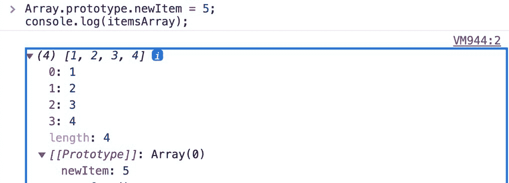

现在，如果我们展开原型部分，可以看到我们刚刚添加的新项在那儿，它的值是 `5`。所以，我们可以写另一个 **for/in** 循环，看看结果是否会包含我们或其他人添加的最后一个项：

```javascript
//现在 for in 将无法正常工作了
let totalSum1 = 0;
for(let element in itemsArray) {
  totalSum1 += itemsArray[element];
}
console.log(totalSum1);
```

输出是 **15**，是的，现在新项的值被包含在最终结果中了。这意味着 **for/in** 循环将遍历所有数组元素加上继承自原型链的元素。

另一个例子是 **for/in** 循环失败的情况。我们先用基础的 `for` 循环进行测试。查看代码：

```javascript
//另一个示例
var emptyArray = [];
// 将第四个元素设置为 3，其他三个元素为 `undefined`
emptyArray[3] = 3;
//使用基础 for 循环来遍历数组元素
for (let i = 0; i < emptyArray.length; i++) {
  console.log(emptyArray[i]);
}
```

输出是：
Undefined
Undefined
Undefined
3

让我们使用 **for/in** 循环测试相同的示例：

```javascript
//for in 将忽略 undefined
for (const item in emptyArray) {
  console.log(emptyArray[item]);
}
```

**for/in** 循环将忽略 `undefined` 数组元素，并只打印出 `3`，这并不是我们需要的预期行为。因为我们可能还需要其他元素，或者至少想知道它们发生了什么。

现在你知道什么时候该避免使用它了。

### 标签语句

你可以使用标签（label）语句来命名我们的循环。我们只需要选择一个有意义的名字，在这个例子中，我决定使用 `even`；你可以在从这个例子中看到原因：

```javascript
even:
for(item of numbersArray){
  if(item % 2 == 1) continue even;
  console.log(item);
  //this will print: 2, 4, 6, 8, 10
}
```

这个语法非常简单，对吧？在循环之前，我们只需要写标签的名字，但必须记住加上冒号并继续后面的循环语法。在循环体内部，我们有一个 `continue` 语句和标签名称。我们可以使用任何 `break` 或 `continue` 语句重新引用这个循环。

这些标签的力量在嵌套循环中体现得最为明显。我之所以为你提供以下示例，是因为我想让你们也学习一下嵌套的 **for** 循环。当年我开始我的 C++ 编程之旅时，理解这一点对我来说是一件大事。

嵌套循环是指当我们有一个在第一层循环内部运行的第二层循环时。这可能会让人困惑，所以让我们进入正题。我们可以有多个级别的嵌套，但解释起来会更加困难，所以这里有两个层嵌套的示例：

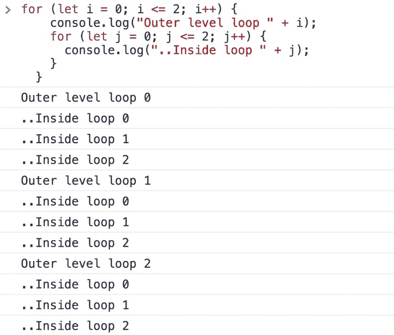

如从上面的输出样本所示，第二层 for 循环会在每个第一层循环执行一次。我们甚至可以在 **while** 循环中进行嵌套，但 **for 循环** 更加常见。`i` 和 `j` 变量是数学中常用的**矩阵元素**的指示器。例如，假设我们有一个想要遍历的二维数组。我们在这里有点偏离了主题，但我需要你先理解这一点，因为在示例之后我需要解释标签。

这里是二维数组的示例：

```javascript
let myArray = [
  [1, 2],
  [3, 4],
  [5, 6],
];
//using nested loops to print out the elements of the two-dimensional array
for (let i = 0; i < myArray.length; i++) {
  for (let j = 0; j < myArray[i].length; j++) {
    console.log(myArray[i][j]);
  }
}
```

完美！现在你知道如何使用嵌套循环并从二维数组中获取所有项目了。让我们回到如何在嵌套循环中使用标签的话题。请阅读以下示例：

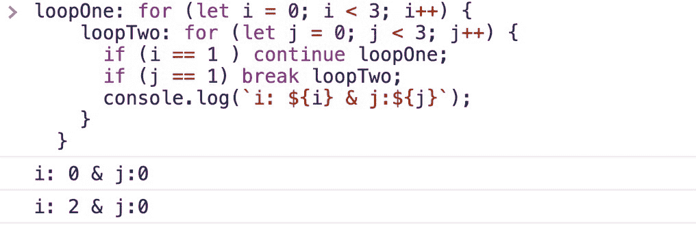

我考虑过不在这里包含输出，但我认为你有 own 知道结果。因此，每个循环将运行三次（三次迭代）。当 `i` 为 `1` 时，由于 `continue` 语句，第一个（外层）循环将被跳过。因此，外层循环的值只能是 `0` 或 `2`。当变量 `j` 的值为 `1` 时，我们的嵌套循环将停止。因此，由于 `break` 语句，它的值将始终为零。它永远不会再次进入循环。因此，输出是 `i: 0 & j: 0` 以及 `i: 2 & j: 0`。

就是这样，现在你知道如何将 `break` 和 `continue` 语句与标签一起使用了。我想提一下，我在我的代码中很少使用标签，因为它们并不十分常见，但了解它们是非常好的。

## 总结

恭喜你！这是一个非常重要的章节，我希望我的示例帮助你学习了循环是如何工作的。循环是 JavaScript 以及任何编程语言的基础部分；因此，请确保你理解它们的工作原理，因为你将经常使用它们。

## 第 8 章：函数

JavaScript 中另一个根本上重要的特性是函数。在本章中，你将掌握函数，我将帮助你学习如何编写、调用和执行函数。我们还将涵盖异常，以及如何抛出和捕获它们。

函数不仅在 JavaScript 中，在许多编程语言中都是基础构建块。如果你熟悉函数，这一章对你来说将很简单，但我建议你保持专注和集中；你不需要害怕学习新概念。

函数是编写一次的子程序，它们可以被调用或执行多次。这里有一个我想让你在浏览器控制台中测试的函数：

```javascript
document.write('Welcome');
```

这是一个函数，其目的仅仅是生成输出。大多数函数都提供并返回一个值。你看到浏览器上写着 `Welcome` 这个文本了吗？`document.write()` 方法将写入该文本。

### 返回语句

没有返回的函数：

```javascript
function noReturnValue() {
  console.log('No return statement');
}
let storage = noReturnValue();
console.log(storage);
```

在这种情况下，如果我们打印 `storage` 变量，我们将得到 **undefined** 值。你需要理解的是，当我们声明一个函数名称时，该名称变成一个变量，我们在其中存储函数返回的任何内容。

### 函数表达式 (Function Expression)

在 JavaScript 中，有另一种创建函数的语法，这被称为**函数表达式**。

函数表达式的语法（匿名）：

```javascript
let variableName = function (x, y) {
  statements... return (x+y)
};
```

这是一个示例：

```javascript
let greeting = function(name, lastName) {
  return `Nice to see you again ${name} ${lastName}`;
}
```

从我提供的示例和语法中，我们可以看到，函数表达式允许我们创建一个没有函数名的匿名函数。这与第一个函数声明示例相比是主要的区别。函数表达式被存储在变量中，并可以使用该变量名进行调用/调用。我们之所以称之为匿名函数，是因为它没有名称，所以变量名可以访问此函数，但 JavaScript 允许使用名称。查看以下语法：

函数表达式的语法（命名）：

```javascript
let variableName = function functionName(x, y) {
  statements... return (x+y);
};
```

建议在使用函数表达式时使用 `const` 代替 `let`，这样你就不会意外覆盖函数，因为我们无法修改声明为 `const` 的内容。记得这个吗？关于函数表达式的另一个重要规则是，我们不能在创建之前使用它们，这意味着 JavaScript 中的函数表达式不是被提升（hoisted）的。什么是提升？

嗯，JavaScript 中的提升意味着变量和函数声明会在代码执行之前移动到它们作用域的顶部。使用普通的**函数声明**时，即使指定其声明的代码尚未被处理或评估，函数对象也会被创建。这就是为什么我们可以在编写定义语句的代码被求值之前调用这些普通函数。函数表达式的情况稍有不同，它们不存在，我们不能在声明它们的表达式被求值之前调用它们。函数表达式被赋值给变量，因此我们可以引用该函数。简而言之，定义为表达式的函数在定义之前不能被调用，这非常符合逻辑。

### 调用函数表达式 (Invoke Function Expression)

让我们使用它的变量名 `greeting` 调用我们创建的函数：

```javascript
let greeting = function(name, lastName) {
  return `Nice to see you again ${name} ${lastName}`;
}
// 调用函数表达式
let theMessage = greeting('Luke', "Perry");
console.log(theMessage);
```

该函数的输出是：`Nice to see you again Luke Perry`！现在你知道在 JavaScript 中调用函数表达式有多简单了。在 JavaScript 中，重要的是函数体内部的代码在函数被调用之前是不会执行的。因此，可以用不同的方式调用 JavaScript 函数：

- 将作为方法调用函数
- 将作为函数调用函数（我们上面已经尝试过这种方法了）
- 将作为构造函数调用函数
- 使用 `call()` 和 `apply()` 方法调用函数

### 作为方法调用函数 (Invoking a function as a method)

我们可以将函数定义为对象方法，这应该非常简单，因为我们已经涵盖了 JavaScript 对象。为了理解，我们可以创建一个名为 `personDetails` 的对象。这个对象非常直观，我们应该包含一个人可能拥有的最常见的属性，比如人的名和姓，但我们也可以包含一个会向我们返回全名的方法。

这就是我提到的对象：

```javascript
const personDetails = {
  firstName: "Tom",
  lastName: "Hardy",
  fullName: function () {
    return this.firstName + " " + this.lastName;
  }
}
personDetails.fullName(); // 输出: "Tom Hardy"
```

在对象内部，我们有一个名为 `fullName` 的方法，但这个方法是一个函数。你可以看到这里我使用了两个术语，**函数**和**方法**，但它们看起来一样，对吧？在我进一步解释这个示例之前，我希望你理解 **JavaScript** 中方法和函数的主要区别。

### 函数 (Function)

我们已经知道 JavaScript 函数是为了执行特定任务的代码块。要定义函数，我们必须使用 `function` 关键字以及可选参数。参数封装在圆括号中，我们可以有零或多个参数。函数体是存放语句块的地方。我们也可以在函数中编写单行代码。当我们调用该函数或执行函数调用时，函数就会执行。参数是在函数被调用/执行时传递给函数的值。这是我们目前学到的函数的主要要点。

### 那么，什么是方法？(What are methods, then?)

在 JavaScript 中，方法是对象的属性，其中包含一个函数定义。换句话说，方法是存储在对象属性中的函数。我们如何访问方法？最常用的方法之一是使用对象名和点符号语法调用方法。我们将在操作中看到，但让我再多解释一点关于方法。现在你知道方法和函数的区别了。在 `personDetails` 对象内部，我们有一个名为 `fullName` 的方法。这个方法的所有者是名为 `personDetails` 的对象，方法在该处声明。在方法内部，我们使用了 `this` 关键字，它指向“拥有”该代码的对象，这里的所有者是 `personDetails`。再次，`this` 指向包含对象。对我来说，花了很长时间才理解为什么对象中有 `this` 关键字。最后，让我们调用该方法，我们使用点符号语法。

```javascript
personDetails.fullName(); // 输出: "Tom Hardy"
```

在某些情况下，你会看到方法调用可以使用括号而不是点符号语法完成。`myObject['fullName']()`。我倾向于使用点符号语法而不是这些括号，因为它们让我想起数组声明。

### 使用构造函数调用函数 (Invoking a Function with a Function Constructor)

如果 `new` 关键字位于函数调用之前，那么这被称为构造函数调用。我们在学习类（classes）时会学习构造函数。

示例：

```javascript
// 这是一个函数构造：
function printDetails(x, y) {
  this.firstName = x;
  this.lastName = y;
}
// 这创建一个新对象
const morganObject = new printDetails("Morgan", "Freeman");
// 这返回 "Morgan"
morganObject.firstName;
// 这返回 "Freeman"
morganObject.lastName;
```

这看起来我们正在使用 `new` 关键字创建一个新函数，但我们并没有，因为 JavaScript 函数是对象。我们正在创建一个新对象。构造函数调用创建一个新的空对象，我们创建的对象将继承其构造函数的属性和方法。

### Call 和 Apply 方法 (Call and Apply method)

如果我们使用 `call()` 和 `apply()` 方法，我们就是间接的调用函数。通过这两个方法，我们可以显式地指定 `this` 值以及调用所需的参数。这两个方法都是每个函数对象都拥有的内置方法。两个方法都接受两个参数，第一个参数是我们想要设置为 `this` 的对象。第二个参数是这两个方法之间差异之处。所以，第二个参数指的是我们传递给函数的参数。

调用。`call()` 方法将接受参数列表作为第二个参数，而 `apply()` 方法将接受参数数组作为第二个参数。

这里有一个示例，你将从中学习这两种方法的区别：

```javascript
// 使用 call 和 apply 方法作为间接调用
const computerParts = {
  name: 'Computer Parts',
  description: '组装一台游戏电脑需要什么？'
}
const mobilePhone = {
  name: 'Mobile Phone',
  description: '制造智能手机需要什么？'
}
function assemble() {
  console.log(arguments);
  console.log("'this' is:", this);
}
assemble.call(computerParts, 'Motherboard', 'CPU', 'RAM', 'Storage', 'Power Supply PSU', 'System Cooling', 'operating system (OS)', 'Gaming Peripherals', 'PC Case');
assemble.apply(mobilePhone, ['Display', 'Battery', 'SoC', 'Memory/Storage', 'Microphone', 'Speaker', 'Operation System', 'Cameras']);
```

输出结果：

```text
// output:
// [Arguments]
// 0: "Motherboard"
// 1: "CPU"
// 2: "RAM"
// 3: "Storage"
// 4: "Power Supply PSU"
// 5: "System Cooling"
// 6: "Operating system (OS)"
// 7: "Gaming Peripherals"
// 8: "PC Case"
// 'this' is: {name: 'Computer Parts', description: '组装一台游戏电脑需要什么？'}

// output:
// [Arguments]
// 0: "Display"
// 1: "Battery"
// 2: "SoC"
// 3: "Memory/Storage"
// 4: "Microphone"
// 5: "Speaker"
// 6: "Operating System"
// 7: "Cameras"
// 'this' is: {name: 'Mobile Phone', description: '制造智能手机需要什么？'}
```

上面的示例不言自明，非常易理解。如你所见，`this` 关键字被设置为我们传递给函数的对象。现在你已经知道了，当我们想要在函数调用时明确设置 `this` 的值时，`call()` 和 `apply()` 方法都是非常有用的。

### 箭头函数

在本章的开始，我提到过声明函数有不同的方式，其中一种是使用 `function` 关键字，另一种是使用**箭头运算符** `=>`。这是 ES6 的特性，意味着函数声明的简写语法。使用箭头函数既有优点也有一些缺点。箭头函数表达式是传统函数表达式的替代方案。

这个示例将帮助你进一步了解箭头函数：

```javascript
// 传统函数
function addFun(a) {
  return a + 100;
}
// 箭头函数
let addFun = a => a + 100;
```

箭头函数要简洁、简短得多，但让我们来看它的语法。我们在箭头运算符的左侧提供参数变量，在运算符的右侧返回函数值。如果像上面示例中那样只有一个参数 `a`，我们不需要像在传统函数声明 `(a)` 那样将参数括在括号中。我们知道传统函数可以没有参数/参数，对吧？我们可以用箭头函数做同样的事情，但我们需要像这个示例中这样使用空括号：

```javascript
// 无参数的箭头函数
let noParams = () => 'No Parameter function';
```

那么我们如何调用箭头函数呢？嗯，我们可以直接使用该函数的名称。

先调用 `addFun`：
```javascript
let addFun = a => a + 100;
// 调用箭头函数
let result = addFun(10);
console.log(result);
```

我们将函数的返回值存储在一个名为 `result` 的变量中，并控制台打印输出。

无参数函数的调用方式如下：
```javascript
let storeResult = noParams();
console.log(storeResult)
```

让我解释一下，当函数体内只有一行代码时，我们不需要指定 `return` 关键字。查看这个没有 `return` 关键字的示例：
`a + 100;`

在这种情况下，我们不需要写 `return` 关键字。但即使包含了 `return` 关键字，同一个函数仍然是一个有效的箭头函数：

```javascript
let addFun = a => {
  return a + 100;
};
```

如果函数体需要多行代码，那么我们需要使用大括号加上 `return`，因为函数体需要多行代码。

### 默认函数参数

在函数声明中提供默认参数非常简单。

语法如下：

`function fnName(param1 = defaultValue1, ..., paramN = defaultValueN) { ... }`

请看以下示例：

```javascript
function multiplyFn(a, b = 1) {
  return a * b;
}
let result1 = multiplyFn(5, 2);
console.log(result1); // 输出: 10
let result2 = multiplyFn(5);
console.log(result2); // 输出: 5
```

默认函数参数允许我们在传递了**无值**或 `undefined` 值时，用默认值初始化参数。因此，在第二次函数调用（`multiplyFn(5)`）中，我们只传递了一个参数，这就是为什么函数看起来像这样：

`function multiplyFn(5, b = 1)`

这就是我们提供默认函数参数的方式，请注意我们也可以对第一个参数这样做。

### 闭包

JavaScript 中的闭包并不那么直观；因此，许多人苦于理解它们；说实话，当我开始学习这门语言时也是其中之一。我将尽可能简单地使用非常简单的代码示例来解释什么是闭包。

请看以下示例：

```javascript
// JavaScript 闭包
function outerFun() {
  let x = 10;
  function innerFun() {
    let y = 20;
    console.log(x + y);
  }
  return innerFun;
}
```

从这个示例中你可以看到有两个函数，它们被称为嵌套函数。第一个函数被称为 `outerFun`，我们在其中声明了一个变量 `x` 并将其初始化为 `10`。这个函数返回了内部函数的结果。

在外部函数内部，我们有一个名为 `innerFun` 的内部函数，它又声明并初始化了另一个变量 `y` 为 `20`。在这里，我们返回了两个变量的相加结果 `x + y`；注意 `x` 是定义在 `innerFun` 函数体之外的。

请不要忘记变量 `x` 的作用域局限于 `outerFun`，而变量 `y` 的作用域也局限于 `innerFun` 函数。

现在考虑这段代码：

```javascript
let firstOuter = outerFun(); // 第一次调用
let secondOuter = outerFun(); // 第二次调用
console.log(firstOuter);
```

我们从 `console.log` 得到了以下输出：

```text
ƒ innerFun() {
  let y = 20;
  console.log(x+y);
}
```

这里发生了什么？让我们一步步来理解这部分。当 JavaScript 编译器到达这一行时：

`let firstOuter = outerFun(); // 第一次调用`

我们进入了 `outerFun` 的函数体，第一行是声明并初始化变量 `x` 值为 `10`，但下一行是函数声明的地方。声明了函数 `innerFun`，到此为止。在此阶段我们没有其他要执行的内容。最后一行是返回 `innerFun`，编译器寻找一个名为 `innerFun` 的变量，但在函数体内并没有这个名字的变量。这就是为什么我们的输出是整个函数体：

```javascript
ƒ innerFun() {
  let y = 20;
  console.log(x+y);
}
```

最后一步是函数执行完毕，`outerFun` 作用域内声明的所有变量都不再存在了。现在你知道了在这个函数内部声明的任何内容在函数执行期间都是存在的。简而言之，变量 `x` 只存在于 `outerFun` 中，当函数执行结束时，该变量就不存在了。

如果我们再次执行同一个函数并打印结果，会发生什么：

`console.log(secondOuter);`

同样会发生相同的过程，函数被调用，变量 `x` 被创建并初始化，当函数返回时，`outerFun` 中声明的所有变量的生命周期就结束了。

让我们再次查看这段代码：

```javascript
let firstOuter = outerFun(); // 第一次调用
let secondOuter = outerFun(); // 第二次调用
```

`firstOuter` 和 `secondOuter` 都包含同一个函数，因为 `outerFun` 在执行期间返回了一个函数；因此，这两个变量都是函数。我们可以使用 `typeof` 运算符确认这些变量是函数。

### 异常处理

在 JavaScript 中，我们使用 `try`、`catch` 和 `finally` 语句来处理异常。

语法：

```javascript
try {
  // 尝试执行的代码块
} catch (e) {
  // 处理错误的代码块
} finally {
  // 无论 try/catch 结果如何都会执行的代码块
}
```

你需要理解，我们想要进行异常测试的代码位于 `try` 块中。因此，如果 `try` 块内部的代码抛出异常，程序将跳过其余代码并进入 `catch` 子句。`catch` 子句中的语句只有在 `try` 块抛出异常时才会执行。另一方面，`finally` 块中的语句即使 `try` 块没有抛出异常，也始终执行。需要注意的是，`catch` 和 `finally` 块是可选的，但每个 `try` 块必须至少带有这两个块中的一个。如你所示，每个 `try`、`catch` 和 `finally` 块都有大括号，这是必须的。无论块内部有多少条语句，我们都需要它们。在三个块中，只有 `catch` 块不同，因为它包含位于圆括号中的标识符。当 `try` 块抛出异常时，错误值将被赋值给此参数 `(e)`。在我们的案例中标识符是 `e`，或者如果我们愿意，它也可以是 `error`，因此此参数仅在该 `catch` 块内可见。

在这个示例中，我们在全局作用范围内声明并初始化了分子和分母变量。这意味着即使我们有一个函数，在 `try` 块内部可以使用它。在 `try` 块内部，有趣的部分是我打印变量 `x` 的值，但变量 `x` 在任何地方都没有定义，程序将抛出错误。在这种情况下，`catch` 块中的标识符被称为 `error`，无论错误值是多少，都可以使用该标识符进行访问和打印。错误在 `catch` 块中捕获。你可以添加自定义消息，打印实际错误以查看问题是一个好主意。在我们的示例中，错误是 `Reference Error`，因为变量 `x` 未声明。`finally` 块无论如何都会执行，在其中我们简单的 `console.log`。

在实际实践中，更多使用的是 `try/catch` 语句，很少配合 `finally` 子句使用。`finally` 子句通常在我们想要代码结束后进行清理时使用，因为我们知道 `try` 和 `catch` 块如何，该子句始终会被执行。

自 ES10 或 ES2019 以来，我们可以省略 `catch` 子句的括号和标识符，现在可以使用裸的 `catch` 关键字。

```javascript
try {
  // 尝试执行的代码块
} catch {
  // 处理错误的代码块
}
```

### 抛出异常

当函数无法产生有效结果时，我们可以使用 `throw` 语句来抛出异常。因此，抛出错误比向客户端返回 `NaN` 或 `undefined` 要好。

语法：

`throw expression;`

如你所示，我们需要使用 `throw` 语句，异常的值可以是任何内容，但最主要用于抛出一个错误对象。该错误对象具有 `name` 和 `message` 属性。`name` 属性会告诉我们错误信息，而 `message` 属性是指定字符串格式消息的地方。

请阅读以下示例：

```javascript
// throw 语句
function getMonthName(monthIndex) {
  let monthsArray = ['January', 'February', 'March', 'April',
    'May', 'June', 'July',
    'August', 'September', 'October', 'November', 'December'];
  if (monthsArray[monthIndex] !== undefined) {
    return monthsArray[monthIndex];
  } else {
    throw new Error('Wrong Month Number');
  }
}
try {
  // 尝试执行的语句
  let currentMonth = 14; // 14 将进入 else 语句并 throw new Error
  currentMonth - 1; // 我们减少月份以反映正确的索引
  let monthName = getMonthName(currentMonth);
  console.log(monthName);
} catch (e) {
  monthName = 'unknown';
  console.log(e);
}
```

在这个示例中，`catch` 块中的标识符被称为 `error`，无论错误值是多少，都可以使用该标识符进行访问和打印。错误在 `catch` 块中捕获。你可以添加自定义消息，打印实际错误以查看问题是一个好主意。在我们的示例中，错误是 `Reference Error`，因为变量 `x` 未声明。`finally` 块无论如何都会执行，在其中我们简单的 `console.log`。

### 对象方法的语法糖

你可以看到我之前一直使用点符号法来添加奖金。`bonuses` 是一个在对象体内部声明的方法。记得我们之前讨论过的 `this` 关键字吗？我们通过以下方式调用了函数：

`andy.bonuses(700);`

所以，`this` 指向点操作符左侧的对象。因此，`this` 指向 `andy` 对象。如果我们想让对象内部的方法看起来类似于其他编程语言的语法，那么我们可以省略两个点：

1. 冒号
2. `function` 关键字

```javascript
let andy = {
  name: 'Andy Smith',
  occupation: 'developer',
  salary: 8000,
  age: 33,
  bonuses(extraBonuses) {
    // 这被称为语法糖
    this.salary += extraBonuses;
  }
}
```

记住，这种声明方法的方式并没有改变任何东西，但被称为**语法糖（syntactic sugar）**。我已经提到过，`this` 关键字的引用在普通函数中有效，但在箭头函数无效；因此，请注意，你不能在箭头函数中使用 `this` 关键字。

### 原型与构造函数 (Prototypes and Constructors)

到目前，我们已经学习了关于 JavaScript 对象的一些知识。让我们回顾一下你目前对对象的了解。JavaScript 对象以键值对的形式拥有属性，在大多数文献中，它们被称为键对（key-value pairs）。我们可以使用对象**字面量（literals）**来声明新对象，如下：

```javascript
let domainExtension = {
  "commercial": ".com",
  "network": ".net",
  "organization": ".org",
  "government": ".gov"
};
```

这个示例声明了一个字面量对象，并将属性列为（键值）对。因此，我们拥有一个具有四个属性及其初始值的对象。属性都是 JavaScript 的原始类型，但赋值的值可以是任何数据类型，包括其他对象、函数等。我们还可以在对象中定义函数，这些函数被称为该对象的方法（methods）。

创建对象的另一种方法是使用 `new` 关键字或直接使用空括号 `{ }`：

```javascript
var domainExtension = new Object();
var domainExtension = {}; // 如果使用 { }，我们也可以创建一个空对象
```

当我们使用 `new` 关键字或空括号 `{ }` 时，会创建一个新的空 Object。如果我们想添加数据，可以通过提供键和值对来实现。我们已经使用了点属性表示法来分配、访问和删除 Object 的值。

```javascript
domainExtension.commercial = ".com";
domainExtension.network = ".net";
domainExtension.organization = ".org";
domainExtension.government = ".gov";
```

我们可以使用点符号或像下面示例中的方括号来访问对象属性（记得我不喜欢使用方括号）：

```javascript
console.log(domainExtension['commercial']); // 输出 .com
console.log(domainExtension.commercial); // 输出: .com
```

最后，如果我们使用 `delete` 语句以及紧跟想要删除的属性名，就可以删除对象属性，如下例：

```javascript
delete domainExtension.commercial; // 通过 'commercial' 键删除值
```

现在是学习原型（prototypes）和构造函数了。

当我们使用像下面这样的语法创建新对象时：

```javascript
var domainExtension = new Object();
```

我实际上从未解释过 `new Object()` 语句的作用。这个 `Object()` 是一个函数吗？因为结尾的括号 `()` 让它看起来像是在调用一个函数。答案是 `Object()` 是一个特殊的函数，被称为**构造函数（constructor）**。每当我们使用 `new` 关键字时，就会调用一个函数创建一个新对象。我已经在使用 `new` 关键字时提到过，我们会创建一个空对象。

JavaScript 中的构造函数等于许多不同编程语言中的类。在 JavaScript 中，它们通常被称为**构造函数（constructor functions）**或直接称为**构造函数（constructors）**。

让我们看看如何创建构造函数：

```javascript
function Person(firstName, lastName, age, position, country) {
  this.firstName = firstName;
  this.lastName = lastName;
  this.age = age;
  this.position = position;
  this.country = country;
}
```

如你所示，这个函数名字叫做 `Person`。按照惯例，构造函数的名称以大写字母开头。此外，我们将一组属性值作为参数传递给该函数。记住，我们之前使用过 `this` 关键字，它指向包含该语句的函数/对象。到目前为止，构造函数除了名称以大写字母开头外，没有特别特殊之处。这不是强制性的，但使用这种流行的惯例是好的，这样其他开发者就会知道我们正尝试创建一个构造函数。

我们如何定义方法呢？这里有一个例子：

```javascript
function Person(firstName, lastName, age, position, country) {
  this.firstName = firstName;
  this.lastName = lastName;
  this.age = age;
  this.position = position;
  this.country = country;
  this.printDetails = function() {
    console.log(`Hi! My details are:
Name: ${this.firstName},
Name: ${this.lastName},
Name: ${this.age},
Name: ${this.position},
Name: ${this.country}`);
  };
}
const tom = new Person('Tom', 'Cruise', 50, 'Actor', 'USA');
tom.printDetails();
```

这段代码的输出是：
Hi! My details are:
Name: Tom,
Name: Cruise,
Name: 50,
Name: Actor,
Name: USA

在这个示例中，`printDetails` 属性被赋值为一个函数而不是初始值。我们使用了名为 `tom` 的对象，并且当使用 `new` 关键字调用对象时，`this` 关键字将对应于特定的对象。这样定义方法并不是好主意。例如，假设我们要创建五个不同的 `Person` 实例，对于每个对象，我们都会分配一个新的 `printDetails` 函数。这将导致我们拥有五个 `Person` 对象，每个对象都具有功能相同的 `printDetails` 方法。代码重复不仅在 JavaScript 中，在任何编程语言中都不是好事，但幸运的是有一种更简洁的方法。这种解决方案是只创建并定义一次 `printDetails`，每个 `Person` 对象都使用该引用来访问它。为了实现这一点，我们需要使用称为函数的**原型（prototype）**。请看现在的代码：

```javascript
// 函数原型属性
function Person(firstName, lastName, age, position, country) {
  this.firstName = firstName;
  this.lastName = lastName;
  this.age = age;
  this.position = position;
  this.country = country;
}
Person.prototype.printDetails = function() {
  console.log(`Hi! My details are:
Name: ${this.firstName},
Name: ${this.lastName},
Name: ${this.age},
Name: ${this.position},
Name: ${this.country}`);
};
const hardy = new Person('Tom', 'Hardy', 46, 'Actor', 'England');
hardy.printDetails();
```


这段代码的输出是：
Hi! My details are:
Name: Tom,
Name: Hardy,
Name: 46,
Name: Actor,
Name: England

现在时间到了我可以解释更多关于**原型（prototypes）**的内容了，坦率地说，这起初对我来说这很困难。大多数 JavaScript 对象都有与它们关联的第二个对象。这个对象被称为**原型（prototype）**。因此，我们创建的对象将从**原型**中继承属性。

当我们使用对象字面量创建对象时，你应该理解为我们可以将原型属性（prototype property）引用为 `Object.prototype`。另一方面，当我们使用 `new` 关键字创建对象时，构造函数的值将用作它们的原型。

当创建一个 `Person` 实例时，我们实例化的对象将继承定义在 `Person.prototype` 上的任何属性或方法。但是原型是从哪里继承属性的呢？原型可能有它自己的原型，这形成了一个链，一直持续到遇到空原型（null prototype）为止。这意味着对象的原型指向另一个对象，它从该对象继承属性。你需要理解，几乎所有对象都有原型。尽管如此，`Object.prototype` 是一个没有原型的对象，这意味着它不会从任何地方继承任何属性。

非常重要的一点是，在 ES-2015 之前，原型属性无法像现在这样容易地访问。而现在，现有的原型是可以被修改和检索的。

正如我们所看到的，原型非常重要。它们最小化了我们需要编写的代码，同时也避免了代码重复。因此，它们让我们的程序不那么杂乱。假设我们有多个所有 `person` 对象通用的方法。如果没有原型，我们需要在每个对象的每个构造函数中定义这些方法。这是完全没必要的，因为我们正在创建相同方法的多个副本。这些副本随后存储在内存的某处，意味着我们还浪费了宝贵的内存。

这里有一个例子可以帮助你理解原型链。例如，当我们想要使用 `new Date()` 语法创建一个新的日期对象时，我们正在创建的对象将同时继承自 `Object.prototype` 和 `Date.prototype`，因为 `Date.prototype` 也会从 `Object.prototype` 继承属性，而我们知道 `Object.prototype` 不从任何地方继承，所以那里就是我们停止的地方。这被称为原型链。

既然我们对构造函数和原型有了更多的了解，你将更容易理解下方的图了，该图说明了我们之前涵盖的例子：

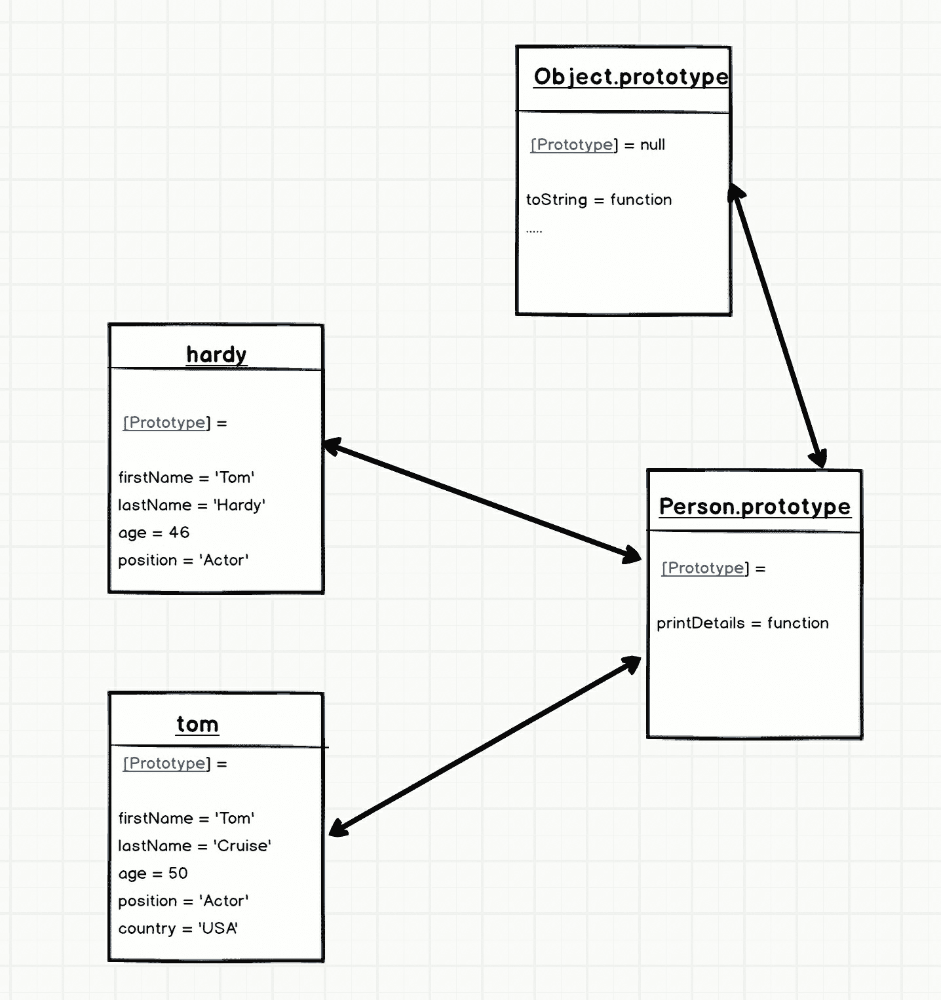

### Classes

2015 年时，JavaScript 引入了一种名为 **class（类）**的新结构。请注意，类自早期以来一直是 JavaScript 的一部分，但它们直到 ES6 终于有了自己的官方语法。如果你阅读 MDN 网站或其他在线资源，类无非是原型之上的语法**糖（sugar）**。JavaScript 的类无非一组构造函数和原型方法的组合。JavaScript 中的类是一组从原型对象继承属性的集合。好了，让我们使用通用的类语法来重写之前的例子：

// JavaScript 中的类

```javascript
class Person {
  constructor(firstName, lastName, age, position, country) {
    this.firstName = firstName;
    this.lastName = lastName;
    this.age = age;
    this.position = position;
    this.country = country;
  }

  printDetails() {
    console.log(`Hi! My details are:
    Name: ${this.firstName},
    Name: ${this.lastName},
    Name: ${this.age},
    Name: ${this.position},
    Name: ${this.country}
    `);
  }
}
```

基本上，这并不是新奇，而且这个例子的功能与我们使用构造函数语法时做的例子完全相同。在幕后，编译器看到了一个 `class` 声明。然后它声明了一个构造函数 `Person`。在类中，我们有一个 `constructor()`，这个 `this` 关键字声明了 `Person` 构造函数的体。我们在类中拥有的方法 `printDetails` 再次被添加到 `Person.prototype`。因此，我们没有改变任何东西。正如我之前提到的，JavaScript 的类无非是构造函数和原型对象的语法糖。这就是为什么我想让你在开始处理类之前先学习构造函数和原型，因为现在你知道后台到底发生了什么了。

要说明的一个重要点是，我们如何从类中实例化对象。到目前，你应该知道我们在上一节中是如何做的。答案是，我们以与构造函数完全相同的方式实例化对象，那就是使用 `new` 操作符。这里有一个例子：

```javascript
const samuel = new Person('Samuel', 'L Jackson', 59, 'Actor', 'America');
samuel.printDetails();
```

记住，自从 **ES6** 以来，建议使用类语法而不是基于原型的 JavaScript 类。使用类非常简单。我们只需要记住使用 `class` 关键字后跟类名，类名应该以大字母开头。类有它的主体，用大括号标记。在类内部，我们有一个 `constructor` 关键字。

### Inheritance

任何 OOP（面向对象编程）语言中最热门的话题之一就是继承（inheritance）。要讨论继承，我们需要一个父类，并且希望该类的子类可以获得父类提供的所有属性，但子类也可以添加自己的属性。这就像现实生活，我们所有人都有父母，自从你出生起，你就从父母那里继承了某些东西，对吧，也许是你的眼睛颜色、头发或肤色等。但你是一个独特的个体，意味着更多的特征。

假设我们有一个名为 **Animal（动物）** 的类。在类构造函数内部，我们将设置并初始化动物的两个属性（名称和速度）。我们有两个“通用”的方法，每种动物都可以做。这里是 `Animal` 类示例：

// JavaScript 继承

```javascript
class Animal {
  constructor(name) {
    this.speed = 0;
    this.name = name;
  }

  startRunning(speed) {
    this.speed = speed;
    return `The ${this.name} runs with speed of ${this.speed}km per hour.`;
  }

  stopRunning() {
    this.speed = 0;
    console.log(`The ${this.name} stopped running and now sits still.`);
  }
}

let animal = new Animal("Animal");
```

在声明了基础 `Animal` 类之后，我们可以创建另一个类，例如，**Dog（狗）**。狗也是动物，它们应该基于 `Animal` 类，这意味着它们可以访问通用的动物方法和属性，但也可以做其他动物不能做的事情。为了从父类继承属性，语法是：`class Child extends Parent`。这里 `extends` 关键字非常重要，现在我们可以创建一个继承或扩展 `Animal` 类的 `Dog` 类：

```javascript
class Dog extends Animal {
  bark() {
    return `The ${this.name} barks!`;
  }
}

let dog = new Dog("Dog");
console.log(dog.startRunning(10)); // The Dog runs with speed of 10km per hour.
```

```javascript
console.log(dog.bark());  // The Dog barks!
```

从这个示例可以看出，我们从 Dog 类实例化的对象可以同时访问 Dog 方法和 Animal 方法，例如 `startRunning` 和 `stopRunning`。

在底层，`extends` 关键字是通过原型起工作的，因此它设置了 `Dog.prototype.[[Prototype]]` 相当于 `Animal.prototype`。因此，如果对象请求一个在 `Dog.prototype` 中找不到的方法，它将开始从 `Animal.prototype` 开始在原型链中查找。

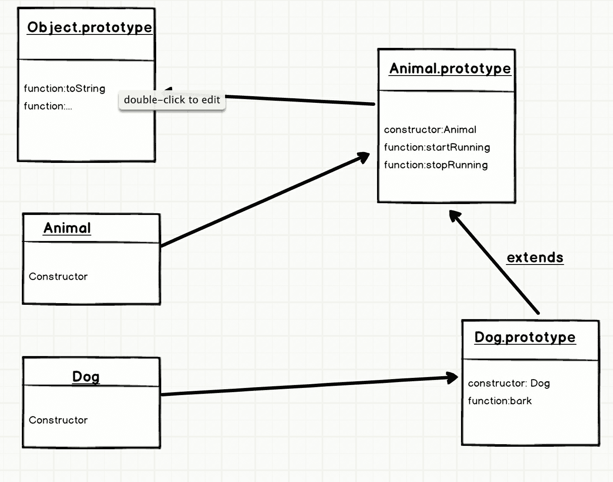

通过上面的图，你应该能理解 JavaScript 继承在后台是如何工作的。如果你还记得之前讨论过的原型链，这就是它的一个经典例子，你应该能够开始将所有这些点联系起来。在某些文献中，`Animal` 类被称为超类，而继承自超类的类被称为子类。

### Setter（设置器）和 Getter（访问器）

Setter（设置器）和 Getter（访问器）是非常容易理解的方法。当我们使用 getter 方法时，请记住它们总是会向我们返回某些值。getter 方法不接收参数，并使用 `get` 关键字声明。

查看以下示例：

```javascript
class Person {
  constructor(firstName, lastName) {
    this.firstName = firstName;
    this.lastName = lastName;
  }

  get fullName() {
    return `${this.firstName}, ${this.lastName}`;
  }
}

const actor = new Person('Tom', 'Hiddleston');
const actorName = actor.fullName;
console.log(actorName); // Tom, Hiddleston
```

因此，像我们示例中的 `fullName` 这样的 getter 方法不接收参数，并且我们可以像访问属性值一样调用该方法：`actor.fullName`。

另一方面，setter（设置器）用于为属性设置或分配值。我们还需要将该属性的新值作为参数传递。查看以下示例：

```javascript
class Person {
  constructor(firstName, lastName) {
    this.firstName = firstName;
    this.lastName = lastName;
  }

  get fullName() {
    return `${this.firstName} & ${this.lastName}`;
  }

  set fullName(name) {
    const parts = name.split(',');
    this.firstName = parts[0];
    this.lastName = parts[1];
  }
}

const haroldKumar = new Person();
haroldKumar.fullName = 'Harold,Kumar';
console.log(haroldKumar);
haroldKumar.fullName;
```

如你所见，setter 和 getter 方法非常简单，一个是设置值，另一个是获取/返回值。你需要记住，getter/setter 的存在是为了将访问器属性定义为方法，而不是简单的数据属性。setter 方法由 `set` 关键字定义，后面紧跟一个与属性同名的函数，该函数接收属性的新值作为参数。getter 则由 `get` 关键字定义，后面紧跟一个与属性同名的函数。getter 不接受任何参数，但它们会返回属性的值。

我们也可以在对象上使用 setter 和 getter。查看此示例：

```javascript
// 对象的 setters 和 getters
const testObj = {
  name: 'Andy',
  get userName() {
    return this.name;
  },
  set userName(newValue) {
    this.name = newValue;
  }
};

console.log(testObj.userName);
testObj.userName = 'Rick';
console.log(testObj.userName);
```

此示例展示了一个用于定义名为 `userName` 的访问器属性的 getter 和 setter。

### 静态属性和方法 (Static properties and methods)

在 JavaScript 中，我们也可以将方法赋值给类函数，而不是它的原型。这些方法被称为静态方法。要声明静态方法，我们需要使用 `static` 关键字。静态方法用于实现属于类而不属于实例的功能。静态方法是在 ES6 中引入的。

查看以下示例：

```javascript
class User {
  constructor(name) {
    this.name = name;
  }

  static method() {
    console.log(this.name);
  }
}
```

如你所见，静态方法属于类本身，而不是它创建的实例。

## 公有和私有字段 (Public and Private Fields)

在 JavaScript 中，我们也可以直接在类体中定义属性。这些被称为公有字段（public fields）。

```javascript
class Person {
  firstName;
  lastName;

  constructor(firstName, lastName) {
    this.firstName = firstName;
    this.lastName = lastName;
  }
}
```

然而，如果我们需要私有字段，必须在字段名之前使用 `#`。字段名前的 `#` 前缀意味着一点：这是一个私有字段声明，该字段可以在类内部及其方法/构造函数内部访问，但在类外部无法访问。当我们有一个私有属性时，我们不希望该字段被任何人操纵/更改。查看以下示例：

```javascript
// 私有字段
class Person {
  #privateID;

  constructor(firstName, lastName, dob, country) {
    this.firstName = firstName;
    this.lastName = lastName;
    this.dob = dob;
    this.country = country;
    this.#privateID = 41920437939848;
    // delete this.#privateID; // 语法错误
  }
}

const tonyStark = new Person('Tony', 'Stark', '1970', 'USA');
// console.log(tonyStark.#privateID); // 语法错误
```

上面的示例已经解释了一切。我们还可以在类中拥有私有方法。私有实例方法可以在类实例上可用，但其访问权限限制与私有实例字段类似。请查看此示例：

```javascript
// private methods
class Person {
  #privateMethod() {
    return 'This information is private!!';
  }

  getPrivateMessage() {
    return this.#privateMethod();
  }
}

const newUser = new Person();
console.log(newUser.getPrivateMessage());
// This information is private!!
```

现在你知道如何创建私有字段/属性以及声明和使用私有方法了。

### 重写方法

在这一部分，我将使用在继承部分用过的同一个类示例。以下是完整的代码：

```javascript
// JavaScript Inheritance
class Animal {
  constructor(name) {
    this.speed = 0;
    this.name = name;
  }

  startRunning(speed) {
    this.speed = speed;
    return `The ${this.name} runs with speed of ${this.speed}km per hour.`;
  }

  stopRunning() {
    this.speed = 0;
    console.log(`The ${this.name} stopped running and now sits still.`);
  }
}

let animal = new Animal("Animal");

// let us create Dog class that will inherit from the Animal
class Dog extends Animal {
  bark() {
    return `The ${this.name} barks!`;
  }
}

let dog = new Dog("Dog");
console.log(dog.startRunning(10)); // The Dog runs with speed of 10km per hour.
console.log(dog.bark()); // The Dog barks!
```

现在我们可以继续并重写一个方法。记得继承部分，当 dog 实例找不到 dog 类方法时，它们将开始在超类或父类中查找该特定方法。在我们的案例中，这个类就是 Animal 类。

所以，如果我们在 Dog 类中添加另一个与 animal 类中同名的方法，这个过程就称为**方法重写（method overriding）**。为什么呢？这个名字自言自明，意味着我们在父类和子类中拥有同名的方法。例如，让我们在 Dog 类中创建一个名为 `stopRunning()` 的新方法，这个方法与我们在 Animal 类中已有的方法同名。因此，我们执行了方法重写。

查看代码：

```javascript
class Dog extends Animal {
  stopRunning() { // 此方法将由 Dog 类的实例使用
  }

  bark() {
    return `The ${this.name} barks!`;
  }
}
```

当我们在 Dog 类中声明了新方法时，所有属于 dog 类的实例都能够使用/访问此方法，而不是在父类 Animal 中查找。当我们进行方法重写时，我们并不想替换父类中的整个方法。相反，我们更希望子类 Dog 中的方法能够扩展继承自 Animal 类的方法功能。

现在有人可能会问这个问题：“我们需要再次写一遍已经在父类方法中写过的相同代码吗？”这个问题非常合理，重要的是记住，这个问题的答案是使用关键字 `super`。在 JavaScript 中，我们有另一个新关键字 `super`，用来完成所有这些手动工作，这意味着我们不需要再次编写相同的代码并进行重复劳动。

在跳转到下一个示例之前，请阅读这些：

- `super(...)`，我们可以用它来调用父类构造函数（我们需要在子类构造函数内部使用这个关键字）
- `super.method(...)`，我们可以用它来调用在父类中声明的方法。

好了，让我们尝试在方法中使用 `super` 关键字。以下是代码：

```javascript
class Dog extends Animal {
  stopRunning() { // 此方法将由 Dog 类的实例使用
    super.stopRunning();
    console.log('The dog is licking its paws');
  }

  bark() {
    return `The ${this.name} barks!`;
  }
}
```

从上面的代码中，你可以注意到我们使用 `super.stopRunning()` 调用了父类方法，之后我们添加了额外的代码来表示对 Dog 类的意图。所以这就像是从 Animal 的 `stopRunning()` 方法中复制内容，并将其放在同名的 Dog 方法中。`super` 关键字现在让我们的代码变得整洁得多。

让我们在控制台中测试一下：

```javascript
console.log(dog.stopRunning());
```

输出：
The Dog runs at a speed of 10km per hour.
The Dog barks!
The Dog stopped running and now sits still.
The dog is licking its paws.

现在你知道如何在子类中重写方法了。

### `this` 引用

我们已经讨论过 **`this`** 引用，但我想指出一个有趣的场景，其中 **`this`** 关键字可能会引起麻烦。第一个问题是我们在实例化类时忘记包含 **`new`** 关键字。查看以下代码：

`let dog = Dog("Dog","Labrador");` // 缺少 new 关键字！

如果我们使用 ES6 类语法，这是非法的，它将向你抛出 TypeError：

`Uncaught TypeError: Class constructor Dog cannot be invoked without 'new'`

但如果你在没有使用 new 关键字的情况下调用构造函数，那么 **`this`** 关键字将被设置为 **undefined**。这个关键字很难理解，我将通过几个例子来使其变得易于理解。

JavaScript 的 **`this`** 关键字的行为与其他编程语言不同，即使对于资深的 Web 开发人员来说，`this` 关键字在刚开始时也并不容易掌握。`this` 关键字可以在两个不同的上下文中使用：**全局**和**函数**。到目前为止，我们知道 `this` 引用当前调用函数或类的对象。

我将给你展示一个名为 **incrementObj** 的简单对象。请查看以下代码：

// This keyword in JavaScript
```javascript
const incrementObj = {
  counter: 0,
  increment: function () {
    return ++this.counter;
  }
};
```

在 **incrementObj** 内部，我们有一个函数会递增初始设置为零的 counter 属性。在函数内部，我们使用了 `this` 关键字，在这里 `this` 关键字的目的是引用 **incrementObj**。

让我们调用该对象函数：

// call the increment fn
`incrementObj.increment(); // 1`

increment 函数是该对象的属性，并被称为方法。从输出中我们可以看出，`this` 引用了 **incrementObj** 对象。

## **`this` 关键字 – 全局上下文**

在全局上下文中，`this` 引用全局对象，即浏览器上的 **`window`** 对象。在 **Node.js** 中，window 对象被称为 **global**（全局）对象。由于 JavaScript 在 ES2020 中对不同环境有不同的全局对象名称，JavaScript 引入了可以在所有环境中可用的 **globalThis** 对象。

如果我们想检查一下，只需要在浏览器控制台中输入以下代码即可：

// window object
`console.log(this === window); // true`

如你所见，上面的输出是 true，即使我们输入以下两行代码，也会得到相同的 window 对象：

`console.log(window);`
`console.log(this);`

如果我们愿意，也可以给全局对象分配一个属性：
`this.color = 'Orangered';`
`console.log(window.color); // 'Orangered'`

在进一步解释函数上下文中的 `this` 关键字之前，我想讨论另一个名为 **严格模式**（strict mode）的 JavaScript 特性。

## **严格模式**

在 JavaScript 中，我们有一种叫做严格模式，它是在 ECMAScript 5 中引入的。这种模式是开启受限版本 JavaScript 的方式，目的是指示代码应该在严格模式下执行。通过这种严格模式，我们可以轻松发现隐藏的 bug 并轻松调试代码。例如，在这种模式下，我们不能使用未声明的变量。如你所见，JavaScript 有一些不寻常的特性允许我们在某些情况下避免错误或 bug。通过这种模式，我们可以控制这种行为，我们应该始终使用严格模式。

好了，要在 JavaScript 中启用此模式，我们只需要在文件顶部写下这一单行代码：
`'use strict';`

单引号或双引号都可以无问题使用。如果我们想在 **Node.js 环境**中使用此模式，我们需要在终端中输入：
`node --use-strict`

使用严格模式的好处：
1. 严格模式将确保我们编写的是“安全”且无 bug 的代码
2. 严格模式将通过抛出新错误解决错误
3. 严格模式的执行速度比非严格代码快
4. 严格模式将防止错误
5. 严格模式禁用了不寻常的 JavaScript 特性

值得注意的是，如果 `'use strict'` 放在文件的第一行或在单个函数内部使用严格模式，严格模式可以应用于整个脚本/代码。

让我们在浏览器控制台中编写以下代码：

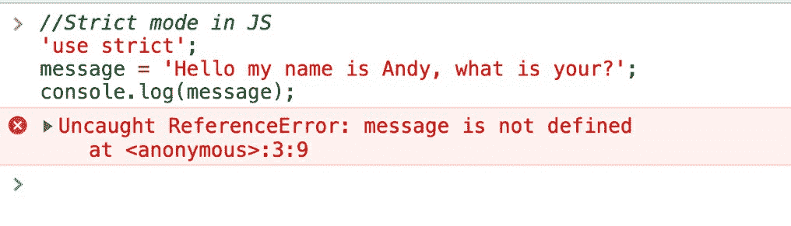

如上面的示例所示，我们不能使用 **message** 变量，因为它在使用之前没有被声明/定义。让我们移除 `'use-strict'` 行并运行相同的代码：


我们已经涵盖了 **ES6** 中引入的**箭头函数**。这个新概念处理 **`this`** 关键字的方式与我们在 ES5 函数声明中的 `this` 关键字不同。在箭头函数中，`this` 是通过**词法作用域（lexically）**设置的。这意味着箭头函数将从定义它的外部函数继承 **`this`** 关键字，而不是从它被使用的地方继承。简而言之，箭头函数不会创建自己的执行上下文，而在没有这个上下文的情况下，可能会导致问题。在大多数情况下，箭头函数的工作方式与函数表达式相似，唯一的区别是它们无法访问自己的 `this` 关键字。箭头函数也没有它自己的 `this` 或 `super`。因此，在某些场景下，我们不应该使用箭头函数。让我们通过几个例子来观察箭头函数是如何运作的，并检查 `this` 关键字到底发生了什么。

请阅读以下示例：

```javascript
const greeting = () => {
  return this;
}

console.log(greeting()); // window or global object
```

在这种情况下，如果我们使用 **Node.js**，我们将得到一个代表窗口对象或全局对象的输出。所以在这里，箭头函数的工作方式与函数表达式相同。

接下来的示例非常关键，因为它向你展示箭头函数不能作为构造函数：

```javascript
// arrow function cannot be used as constructors
const Person = (name, age, country) => {
  this.name = name;
  this.age = age;
  this.country = country;
  this.printDetails = function () {
    return `My name is ${this.name}, and I'm ${this.age} years old. I live in ${this.country}`;
  }
}

const tom = new Person("Tom", 54, "USA"); // Person is not a constructor
```

这将抛出一个错误，说明 **Person** 不是一个构造函数。这引导我们进入下一个场景，在那个场景中使用箭头函数不是一个好主意。基本上，你不应该将箭头函数作为对象的方法。查看以下示例：

```javascript
var simpleObj = { // does not create a new scope
  a: 10,
  b: () => console.log(this.a, this),
  c: function() {
    console.log(this.a, this);
  }
}

simpleObj.b(); // prints undefined, Window {...} (or the global object)
simpleObj.c(); // prints 10, Object {...}
```

正如我之前解释过的，箭头函数不适合作为对象的方法。在这个示例中，我们有一个对象，我们将其中一个属性 **`b`** 设置为箭头函数，但它会返回我们一个 undefined 值，因为箭头函数无法访问自己的 `this` 关键字。如果我们使用严格模式，它绝对无法工作，因为词法 `this` 规则优先级高于严格模式的 `this` 规则。

总结一下，如果我们在对象的方法（即属于对象的函数）内部有 `this` 关键字，那么 `this` 将指向该对象（箭头函数除外）。好了，你认为如果我们在对象方法内部还有另一个内部函数，会发生什么呢？请查看这段代码，并看看你是否能预测最终结果：

```javascript
// this keyword when we have function inside our object method
let dog = {
  dogName: 'Oscar',
  activities: ['eating dog biscuits!', 'chasing cats!', 'sleeping!', 'barking all night!'],
  showActivities: function() {
    this.activities.forEach(function(activity) {
      console.log(this.dogName + " is " + activity);
    });
  }
};

dog.showActivities();
```

这里我们有一个 dog 对象，内部包含两个属性：一个名字和一个日常狗活动的数组。我们有一个名为 **showActivities** 的函数，在这个函数内部，我们正在使用 **forEach** 来遍历名为 activities 的数组中的项。所以，我们有一个内部函数，需要循环遍历狗活动数组。如果你回去再次阅读关于 **forEach** 循环，你会发现我们使用了箭头函数来循环给定的数组。但由于在这里我们想要使用 `this` 关键字，我们可以使用回调函数来实现。以下是它的语法：

`array.forEach(callback [, thisArgument])`

forEach() 的第一个参数是回调函数，它将为给定数组的每个项被调用。第二个参数是可选的，代表在回调函数中设置的 `this` 的值。请看这段来自给定示例的代码：

`this.activities.forEach(function(activity)`

这与我们写的一样的：

`activities.activities.forEach(function(activity)`

因此 `this.activities.forEach(function(activity))` 会为 activities 数组中的每个项执行函数 `(activity)`。这样来说，我们需要执行四次单独的函数调用，因为在狗活动数组中有四个字符串元素：

- `function ('eating dog biscuits!')`
- `function ('chasing cats!')`
- `function ('sleeping!')`
- `function ('barking all night!')`

这太棒了，因为你现在学习了如何使用带回调函数的 `forEach` 循环，但你猜到输出结果了吗？如果我们现在浏览器的控制台中运行相同的代码，将会得到以下结果：

```text
/*
Output:
undefined is eating dog biscuits!
undefined is chasing cats!
undefined is sleeping!
undefined is barking all night!
*/
```

我们的输出中有一个 undefined 值，这可能不是你预期的输出，因为我们已经学到，如果避免使用箭头函数，那么使用 `this` 关键字是安全的。在这种情况下，`this` 关键字超出了作用范围，现在属于窗口对象，但大问题仍然是，这是如何发生的？答案是在 ES5 中，`this` 指向函数的父级，在这种情况下，因为超出了作用范围，它属于全局对象。通常，当 `this` 在对象的方法内部时，方法的所有者就是该对象；因此，`this` 属于该对象。

我知道这很令人困惑，但我提供了正确的示例来向你展示它是如何运作的。尽管如此，由于我们谈到了箭头函数，我将解释新的语法如何处理这个问题，坦白说，这很容易理解。查看使用 ES6 语法的相同示例：

```javascript
let dog = {
  dogName: 'Oscar',
  activities: ['eating dog biscuits!', 'chasing cats!', 'sleeping!', 'barking all night!'],
  showActivities: function() {
    this.activities.forEach((activity) => {
      console.log(this.dogName + " is " + activity);
    });
  }
};

dog.showActivities();
```

输出是：

```text
/*
Output:
Oscar is eating dog biscuits!
Oscar is chasing cats!
Oscar is sleeping!
Oscar is barking all night!
*/
```

### 总结

恭喜你！这是到目前为止的章节之一，但你必须承认它包含了许多关于面向对象编程（OOP）的有用且有趣的信息。如果你读到了这一节，我感到非常高兴；如果你对某些新概念有疑问，请记住这是完全正常的，你随时可以回去重新复习本章中的示例和理论。我们已经涵盖了 OOP 的核心特性，并讨论了 `this` 关键字的重要性。因此，你应该为自己感到自豪。

## 第 10 章：我们错过了什么？

这是一个较短的章节，如果你还记得，我之前包含过一个类似的章节。我创建这类章节的初衷是因为你现在知道要更深一层，去学习新的、有趣的且更高级的概念。有些概念并没有那么具有挑战性，但我故意没有把它们包含进来，因为现在我认为你能够更好地理解这些新概念了。正如我提到的，这一章的内容会很小，但这并不意味着这里的信息不重要；相反，这些章节将非常关键，我希望你仔细阅读并尽可能地理解它们。

请不要感到困惑，因为这些小节之间没有关联，因为它们是我们之前没有涵盖的片段。让我们来看一些中级水平 JavaScript 概念。

### 数组的解构赋值

在 ES6 中，我们有了一种名为解构赋值（destructuring assignment）的新语法。这种语法是一种 JavaScript 表达式，它让我们提供了使用存储在数组或对象中的值并将这些值解包到变量中的选项。请查看以下示例：

```javascript
// Destructuring Assignment
let [valueA, valueB] = [10, 20];
console.log(valueA); // Output: 10
console.log(valueB); // Output: 20

let [valueC, valueD, ...restValues] = [10, 20, 30, 40, 50, 60, 70];
console.log(valueC); // Output: 10
console.log(valueD); // Output: 20
console.log(restValues); // Output: Array [30,40,50,60,70]
```

如果我们看实际代码的第一行（不是注释行），我们可以看到在解构赋值中，等号左侧的值是变量名，而右侧是一个值数组。等号的右侧也可以是一个值。这里是第一行：

```javascript
let [valueA, valueB] = [10, 20];
```

这也可以用我们已经熟悉的语法写成：

```javascript
let valueA = 10;
let valueB = 20;
```

当我们进行解构赋值时，右侧的值被获取/解构并存储在左侧的变量中。总结来说，左侧是应该与右侧值匹配的变量名。如果右侧的值更多而左侧的变量名较少，会发生什么？那么未匹配的元素将被忽略。

查看以下代码：

```javascript
// unmatched items are ignored
let [one, two, three] = [1, 2, 3, 4];
console.log(one); // 1
console.log(two); // 2
console.log(three); // 3
```

如果我们在右侧提供的数组包含的元素少于左侧的变量，会发生什么？在这种情况下，未匹配的变量被设置为 `undefined` 值。

```javascript
// more variables, less array elements and unmatched variables are set to undefined
let [first, second, third, forth, fifth] = [1, 2, 3, 4];
console.log(first); // 1
console.log(second); // 2
console.log(third); // 3
console.log(forth); // 4
console.log(fifth); // undefined
```

解构赋值也可以用于嵌套数组。查看以下示例：

```javascript
// nested arrays destructuring
let [f, [e, d]] = [1, [2, 3]];
console.log(f); // 1
console.log(e); // 2
console.log(d); // 3
```

记住，我们已经讨论过使用三个点语法 `(...)` 的展开运算符，如果你不记得了，请再次复习该部分。我提到这一点是因为我想在接下来的示例中使用此运算符。查看示例：

```javascript
// rest operator
let [one, ...rest] = [1, 2, 3, 4, 5];
console.log(one); // 1
console.log(rest); // an array of 4 items [2,3,4,5]
```

从上面的示例中，我们可以看到名为 `one` 的第一个变量将持有数组的第一个值，即 1。但是，如果我们需要像在这个示例中那样将剩余的值存储在一个单个变量中，你可以使用三个点符号 `...` 将剩余值存储到 `rest` 变量中。现在我们有一个包含 4 个元素的数组存储在名为 `rest` 的变量中。

### 对象的解构赋值

解构赋值的威力在于，右侧可以是可迭代对象而不是数组。查看以下代码：

```javascript
let personObj = {
  firstName: 'Shia',
  lastName: 'abe',
  age: 38
};

let {firstName, lastName, age} = personObj;
console.log(firstName);
console.log(lastName);
console.log(age);
```

解构也适用于嵌套对象。查看以下示例：

```javascript
// nested objects
let newObj = {
  occupation: 'Developer',
  works: {
    company: 'Google',
    city: 'where'
  }
};

let {occupation, works} = newObj;
console.log(occupation);
console.log(works);

let {company, city} = works;
console.log(company);
console.log(city);
```

如果对象缺失且我们尝试访问它，你认为会发生什么？在这种情况下我们将得到 `undefined` 而不是报错。查看以下示例：

```javascript
// missing object
let newObj = {
  occupation: 'Developer',
  works: {
    company: 'Google',
    city: 'where'
  }
};

let {occupation, works} = newObj;
console.log(occupation);
console.log(works);

let {company, city} = works;
console.log(company);
console.log(city);
```

### 什么是 JSON？

JSON 代表 JavaScript Object Notation（JavaScript 对象表示）。当我们想要在应用程序之间存储或传输数据时，使用 JSON。由于各种原因，JSON 现在是 XML 更流行的替代方案，但 XML 仍然在使用。

### 为什么我们需要结合 JavaScript 一起学习 JSON？

嗯，JSON 是一种与 JavaScript 对象表示几乎完全相同的字符串格式。在 JavaScript 中，一切都是对象，因此我们非常依赖对象，我们需要 JSON 是因为我们可以轻松地将 JSON 数据转换为原生 JavaScript 对象。由于 JSON 格式仅为文本但编写语法与 JavaScript 对象相似，开发者可以将这种格式转换为字节流。这种转换过程被称为序列化。

JSON 语法基于两个数据结构：对象或数组。在涉及 JSON 中的对象时，我们需要注意以下语法规则：

- 对象是键/值对的集合
- 与 JavaScript 相同，JSON 对象以大括号 `{}` 开始并结束
- 对象中的键（name）是用双引号分隔的字符串
- 后面跟着一个冒号 `:`
- 然后提供值
- 用逗号分隔每个键/值对
- 没有末尾逗号或被跳过的元素

听起来很困惑，对吧？嗯，如果你在没有示例的情况下这样读，那么是的，它可能会让人困惑，所以这里有一个为你准备的示例，它应该能消除你所有的疑问：

// JSON 对象声明
`studentJSON = '{"firstName":"Danial", "lastName":"Craig", "age":50, "jamesBond":false}';`

丹尼尔·克雷格（Daniel Craig）未来将不再出演詹姆斯·邦德系列电影，所以我将最后一个属性设置为 false。

从这个示例中，我们可以看到 **JSON** 数据是使用键/值对编写的，与我们 JavaScript 对象的键/值对相同。**JSON** 名称需要双引号，而 JavaScript 名称不一定遵循这条规则。对象用大括号括起来，且一个 **JSON** 对象可以有多个键/值对，但逗号始终分隔它们。需要提到的是，**JSON** 数据可以包含以下值列表：

- 数字
- 双引号括的字符串
- Null
- 布尔值；true 或 false
- 浮点数
- 对象字面量
- 数组字面量

如果你访问 **www.json.org** 网站可以阅读更多内容。现在你知道 JSON 语法与我们熟悉的 JavaScript 对象几乎相同了。现在让我们来看 **JSON** 数组声明的示例：

// JSON 数组声明
`countriesJSON = '["Australia", "USA", "Macedonia", "Germany", "Holland", "Belgium", "Brazil", "Cameroon", "Canada", "Chile", "Denmark"]';`

上面的示例表明 **JSON** 也可以支持数组格式。我们为对象列出的大多数规则对于数组来说都是相同的，但有一个显著的改变，即我们需要使用方括号 `[]`。

在对象中，我们使用大括号 `{}`，在 JavaScript 对象中也是如此。**JSON** 中的数组与我们已经过的数组几乎相同。区别在于数组值以及它们的类型。例如，**JSON** 格式中的数组必须是以下类型：

- 字符串
- 数字
- 对象
- 数组
- 布尔值
- Null

在 JavaScript 中，数组值可以是上述列出的所有值，加上任何有效的 JavaScript 表达式，包括函数、日期和 undefined 值。JavaScript 使用以下两个函数支持 **JSON 序列化**和**反序列化**：
`JSON.parse()`
`JSON.stringify()`

当我们处理 **JSON** 字符串时，这两个方法非常有用。parse 方法 `JSON.parse()` 将接收 **JSON** 字符串并将其转换为 JavaScript 对象。另一个方法 `JSON.stringify()` 将 JavaScript 对象转回 JSON 字符串。这些是每个开发者都必须知道的非常重要的方法。这里有一些你可以尝试在浏览器控制台中运行的示例：

// JSON 方法 parse 和 stringify
```javascript
const personObj = {
  name: 'Daniel',
  age: 54,
  favoriteDrink: 'Martini',
  favouriteMovie: 'James Bond',
  married: true
};

// 使用 stringify 创建 JSON 字符串格式
const personObjJSON = JSON.stringify(personObj);
console.log('JSON String');
console.log(personObjJSON);

// 将 personObjJSON 转回 JavaScript 对象
const personObj1 = JSON.parse(personObjJSON);
console.log('Again the same JavaScript Object');
console.log(personObj1);
```

这是输出结果：

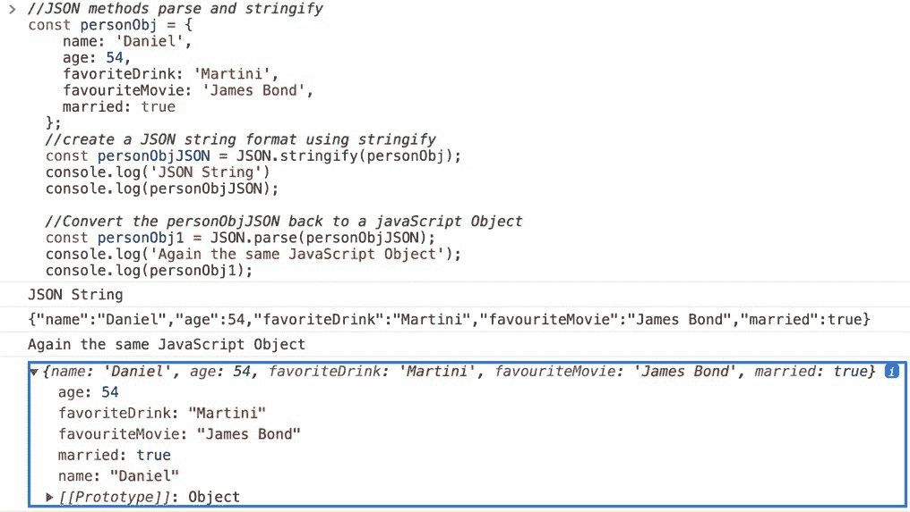

如你所见，**JSON.stringify** 方法会将 JavaScript 对象转换为 **JSON** 格式字符串，而 **JSON.parse** 将 **JSON** 字符串解析为 JavaScript 对象。这些方法，正如我提到的，非常流行，并在通过 **HTTP** 协议与服务器进行通信时使用。

## 类型转换

JavaScript 是一种在数据类型方面非常灵活的语言。例如，某些**真值（truthy）**值会被转换为**布尔值** true，而另一些**假值（falsy）**会被转换为 false。JavaScript 一直在转换。例如，如果 JavaScript 需要一个字符串，它会将我们提供的值转换为字符串。

一些示例：
`console.log(10 + ' years');` // 数字 10 将转换为字符串；输出：10 years
`console.log('5' * '5');` // 我们有两个字符串将转换为数字；输出：25
`let x = 1 - "a";`
`console.log(x);` // 字符串 a 无法转换为数字；输出：NaN - 不是数字

原始类型到原始类型的转换是容易理解的，这就是为什么我创建一个表格来总结：

| 转换 | 示例 | 结果 |
| :--- | :--- | :--- |
| 数字转字符串 | `10 + ' years'` | "10 years" |
| 字符串转数字 | `'5' * '5'` | 25 |
| 字符串转数字 | `1 - "a"` | NaN |

**真值（truthy）**和**假值（falsy）**可能会让即使是最资深的开发者也感到困惑。如果你是从其他编程语言过来的，这可能是一个更有挑战性的话题。尽管如此，在处理**真值**和**假值**时，总有解决方法可以避免这些错误。

最好的方法是使用严格相等运算符而不是双等运算符。在进行比较时，请使用 `===` 或 `!==` 严格不等运算符。

// 替代自
`if (a == b)` // ...

// 请使用
`if (a === b)`

第二个方案是避免直接比较。查看以下示例：

// 替代自
`if (a == false)`

// 请使用
`if (!a)`

最后，你可以使用 Boolean 构造函数将任何值转换为真正的布尔值，或者我们可以使用双重否定运算符 `!!`，通过执行这些步骤，我们可以确保假值仅由以下项生成：
- false
- 0
- ""
- null
- undefined
- NaN

// 替代自
`if (a === x)`

// 请使用
`if (Boolean(a) === Boolean(x))`

// 或者
`if (!!a === !!x)`

## 第 11 章：高级数组

到目前为止，我们已经学习了很多关于数组的知识，但有很多可以学的。本章将探讨一些高级的主题，我希望现在是你掌握它们的完美时机。让我们逐一介绍。

### 使用 includes() 查找数组元素

`includes` 方法将确定给定数组是否包含某个值/元素。它将返回一个 true 或 false 值。

查看以下示例：

```javascript
const numbersArray = [1, 2, 3, 4, 5, 6, 7, 8, 9, 10];
console.log(numbersArray.includes(6)); // 输出: true

const myPets = ['cat', 'dog', 'snake','koala', 'kangaroo'];
console.log(myPets.includes('koala')); // 输出: true
console.log(myPets.includes('ke')); // 输出: false
```

**includes()** 方法的语法如下：
`includes(element)`
`includes(element, fromIndex)`

该方法的参数是 `element`，代表我们正尝试查找的值；第二个参数是 `fromIndex`，它是可选的。`fromIndex` 代表我们想要开始搜索的数组位置。

```javascript
console.log(numbersArray.includes(5, 3)); // true
```

这个示例显示我们正尝试从数组中查找值 5，我们说我们需要从索引 3 开始查找，在 numbers 数组的这个位置，我们有一个值 4，所以我们从正要查找的值的之前开始查找。这就是为什么输出将为 true。在接下来的图片中，你可以看到索引 3 处有值 4，基本上，我们告诉函数从给定的索引之后开始查找值五。

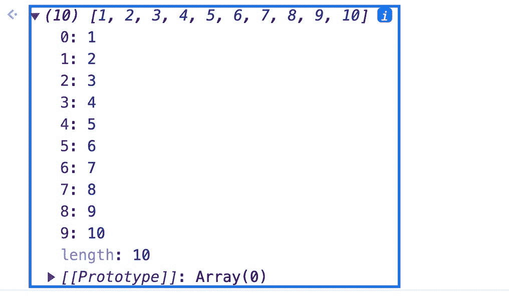

你认为如果在数组中查找元素，但提供的索引在我们要查找的值之后，会发生什么？这将返回 false，因为我们将在从该元素之后开始搜索：

```javascript
console.log(numbersArray.includes(5, 5)); // false
```

这意味着我们告诉该方法在索引 5 之后查找值 5。从上面的图片可以看出，在索引 5 处我们有一个值 6，我们永远找不到值 5，因为我们没有从正确的索引开始。

### indexOf 和 lastIndexOf 方法

我们可以在数组上使用的另外两个方法是 **indexOf()** 和 **lastIndexOf()**。`indexOf()` 方法在数组中搜索指定的项目并返回其所在的位置。

**indexOf()** 方法的语法：
`array.indexOf(item, start)`

```javascript
const names = ["Andy", "Margaret", "Theodore", "Tom"];
names.indexOf("Theodore") // 返回 2
```

但如果你想从后部往前搜索，可以使用 **lastIndexOf()** 方法。该方法将返回我们尝试查找的指定元素的最后一个位置。如果找不到该项目，它将返回 -1，意味着未找到该项目。但如果我们尝试查找在同一个数组中出现多次的值会发生什么呢？它将返回该元素最后出现的位置。

语法：
`array.lastIndexOf(item, start)`

```javascript
const names1 = ["Andy", "Margaret", "Theodore", "Tom", "Jason", "Chris"];
names1.lastIndexOf("Margaret") // 返回 1 (注：原文返回 6 似有误，实际索引为 1)
names1.indexOf("Theodore") // 返回 2
```

### 遍历数组

我们在讨论对象时已经讨论过 **for**、**for/in** 和 **for/of**。现在让我们关注一些更高级的方法，比如 map。

### Map 方法

`map` 方法会创建一个新数组，因为它会对数组的每个元素调用一次函数，对每个元素执行操作，并将这些活动的结果存储在一个新数组中。最重要的是，map 函数不会对空数组调用，并且不会改变原始数组。Map 方法将创建一个与父数组长度相同的新数组。Map 现在被所有现代浏览器完全支持，并包含在 `Array.prototype.map()` 属性中。

语法：
`array.map(callback function(currentValue, index, array), thisValue)`

**map()** 方法的语法非常直观。map 方法接受一个带有最多三个参数的回调函数：currentValue、index 和整个原始数组。回调函数是必须的，它将为数组的每个元素运行。该函数可以接受最多三个参数。第一个参数是当前元素的值，也是必填的。其他参数是可选的。**index** 代表当前元素的索引（“数组始终是基于零索引的”），最后一个参数 **array** 参数是当前元素所属的数组对象。

查看以下示例：

```javascript
// JavaScript 中的 Map 方法
const numbers = [ -2, 1, 2, 3, 4, 5, 6];
const numbersMap = numbers.map(addTwo)

function addTwo(num) {
  return num + 2;
}

// numbersMap 输出: [0, 3, 4, 5, 6, 7, 8]
```

### findIndex

`findIndex()` 方法将返回数组中第一个满足提供的测试函数的元素索引。如果没有元素满足测试，它将返回 -1。

**findIndex** 方法的语法：
`array.findIndex(callback function(currentValue, index, array), thisValue)`

```javascript
const names = ["Andy", "Margaret", "Theodore", "Tom"];
names.findIndex(function(name) {
  return name === "Theodore";
}); // 返回 2
```

`findIndex()` 方法类似于 `indexOf()` 方法，但它不是传递一个项目，而是传递一个函数。当你想要根据复杂条件查找元素时，这种方法特别有用。

```javascript
const numbers = [5, 12, 8, 130, 44];
const index = numbers.findIndex(function(element) {
  return element > 10;
}); // 返回 1
```

### lastIndex

`lastIndex()` 方法的工作方式与 `findIndex()` 类似，但它返回数组中满足测试函数的*最后一个*元素的索引。

```javascript
const numbers = [5, 12, 8, 130, 44];
const index = numbers.lastIndex(function(element) {
  return element > 10;
}); // 返回 3
```

### filter

`filter()` 方法创建一个包含所有通过提供函数测试的新数组。

**filter()** 方法的语法：
`array.filter(callback function(currentValue, index, array), thisValue)`

```javascript
const numbers = [5, 12, 8, 130, 44];
const filtered = numbers.filter(function(element) {
  return element > 10;
}); // 返回 [12, 130, 44]
```

### reduce

`reduce()` 方法在数组的每个元素上执行用户提供的回调函数，产生一个单一的输出值。

**reduce()** 方法的语法：
`array.reduce(callback(accumulator, currentValue, index, array), initialValue)`

```javascript
const numbers = [1, 2, 3, 4, 5];
const sum = numbers.reduce(function(accumulator, currentValue) {
  return accumulator + currentValue;
}, 0);
// 返回 15
```

**map(callbackFn)**
**map(callbackFn, thisArg)**

如果我们使用了第一种语法，那么可以这样重写相同的示例：

```javascript
const numbersMap = numbers.map(function addTwo(element){
  return element + 2;
})
```

我更倾向于使用第二种语法，但这并不是问题，因为它可以正常工作并产生相同的结果。

回到之前的示例，基本上在每次函数调用中，我们把 `numbers` 数组中元素的值增加了 2，因此 `map` 方法创建了一个新的 **numbersMap** 数组，看起来如下：

输出: [0, 3, 4, 5, 6, 7, 8]

我想再提供一个更现代的示例，它将包含 `map` 方法和作为回调的箭头函数。同样，这不会改变太大，因为 `map()` 方法将**创建一个新的数组**，其中填充了调用我们在 `map` 方法中声明的函数后的结果。该函数将在调用数组的每个元素上被调用。

以下是语法：

// 箭头函数
`map((element) => { ... })`
`map((element, index) => { ... })`
`map((element, index, array) => { ... })`

查看以下带有箭头函数的示例：

// 示例
```javascript
const numbersArray = [1, 3, 6, 9, 12, 15];
// 将函数传递给 map
const numbersArrayMap = numbersArray.map((element) => element * 3);
console.log(numbersArrayMap);
```
// 预期输出: Array [3, 9, 18, 27, 36, 45]

就是这样。如你所见，这个 `map` 方法是一种迭代方法，类似于 `forEach()` 方法，唯一的区别就是它会生成一个新数组。新数组的长度与我们提供的父数组相同。

### JavaScript 中的 Array reduce 方法

Array 对象的 **reduce** 是一种迭代方法，与我们讨论过的其他迭代方法相似，即 **map()** 和 **forEach()**。和 map 方法一样，它将帮助我们遍历数据集/数组中的所有元素，并对每个元素执行操作。

最重要的是记住，**reduce** 有两个非常强大的特性：
- 它将**始终返回一个单一值**。
- 你可以**选择返回的数据类型**。

让我们探索 `reduce` 方法的这些特性。请看基本的 **reduce()** 语法：

`Array.reduce(reducer function(accumulator, currentValue, index, array), initialValue)`

Array reduce 基础示例：

```javascript
const salesFigures = [1, 3, 11, 145, 9, 199, 44, 33, 22, 48, 17, 90];
const sum = salesFigures.reduce(function (accumulator, monthlySales) {
  return accumulator + monthlySales;
}, 0);
console.log('Total sales for the entire year is: $', sum);
```
输出: 全年销售额为：$622

这个示例使用 `reduce` 方法求和 **salesFigures** 数组的内容。**salesFigures** 是一个包含一年内发生的所有销售额的数组。`reduce` 方法的力量在这个示例中得到了体现，一个包含 12 个销售项的大数组可以被归约为单个值——即这些销售额的总和。如果我们看 `reduce` 方法的语法，它看起来有点复杂，但其实很直观。也许理解 **reduce()** 最简单的方法是将其思考为一个返回数组中所有元素之和的方法。

`reduce` 方法由两部分组成：
- reducer 函数 – 它可以接受最多四个参数，我们必须包含前两个，后两个是可选的
- 一个初始值

对于数组中的每个项，都会执行一次 reducer 函数。从函数中返回的值被存储在 **accumulator**（累加器）参数中，这是我们在函数中定义的第一个参数。这个参数非常重要，因为它用于计算 `reduce` 方法的返回值。该值在每次迭代中都会更新。

如果我们查看示例并与语法对比，你会发现我省略了一些部分。例如，`reduce` 函数是**匿名的**，意味着它没有名称，这是完全合法的。**accumulator** 是 **reducer function** 中的第一个参数。它不是可选的，在大多数情况下，我们使用名为 `acc` 的缩写，但我使用了 `accumulator` 而不是 `acc` 以避免混淆。**monthlySales** 代表每次迭代的 **currentValue**，或者说这是语法中声明的第二个参数。

| 迭代 | accumulator | monthlySales (currentValue) | 返回值 |
| :--- | :--- | :--- | :--- |
| 第一次 | 0 | 1 | 1 |
| 第二次 | 1 | 3 | 4 |
| 第三次 | 4 | 11 | 15 |
| 第四次 | 15 | 145 | 160 |
| 第五次 | 160 | 9 | 169 |
| 第六次 | 169 | 199 | 368 |
| 第七次 | 368 | 44 | 412 |
| 第八次 | 412 | 33 | 445 |
| 第九次 | 445 | 22 | 467 |
| 第十次 | 467 | 48 | 515 |
| 第十一次 | 515 | 17 | 532 |
| 第十二次 | 532 | 90 | 622 |

我希望我提供的步骤表格能帮助理解在每次迭代期间发生了什么，以及在初始值设置为零后累加器值是如何变化的。当没有剩余项可以迭代时，总和将被赋值为 accumulator 的最终值 **622**。

### 稀疏数组 (Sparse Arrays)

稀疏数组是指缺少一个或多个元素的数组，或者是元素不连续的数组，意味着它们并不总是从位置零 (0) 开始。

你可以说稀疏数组是在序列中存在空洞或间隙的数组。

因此，一个稀疏数组的示例如下：

```javascript
const yearlySales = [ , 5, , 12];
console.log(yearlySales.length); // 预期输出: 4
```

但如果我们想添加更多销售数据呢，比如在数组长度之外的位置。这样，我们就增加了数组的长度。

```javascript
yearlySales[11] = 17;
console.log(yearlySales);
```

如果在控制台中运行上述代码会发生什么？嗯，我们将得到 7 个空洞或空槽，之后我们在特定索引处插入一个键值。在我们的例子中，值是 17。请看截图：

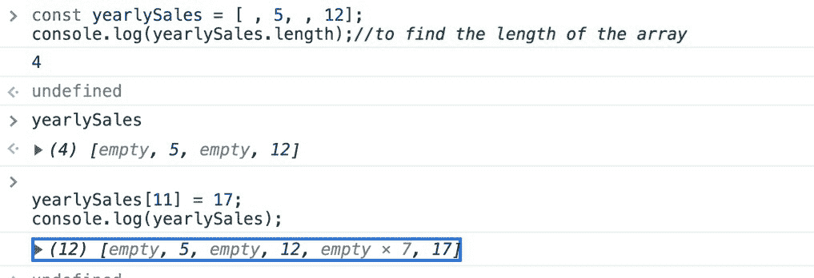

之前数组的长度从 4 跳跃到了 12。我们还可以进一步增加数组的长度，如果需要，可以制造更多的空洞。请看：

```javascript
// 将长度增加到 14
yearlySales.length = 14;
```

我们还可以使用 `delete` 操作符删除元素：

```javascript
// 我们可以删除一个元素
delete yearlySales[0]; // 返回 true
```

你可能会意外创建一个稀疏数组。例如，你误打了两个逗号并意外输入了一个空洞。

示例：
```javascript
const newArray = [1,2,3,4,,5,6];
// 输出：
// (7) [1, 2, 3, 4, empty, 5, 6]
```

问题是，为什么 JavaScript 中的数组可以是稀疏的呢？答案很简单，这与对象有关。例如，在底层，JavaScript 中的一切皆是对象，包括数组，数组的键是数字，而值是元素。

你可以在浏览器中输入以下内容来检查数组是否为对象：

```javascript
typeof yearlySales
// 'object'
```

或者如果我们提供一个空数组也可以测试这个：

```javascript
typeof []
// 'object'
```

另一个重要的点是，当我们使用 **forEach** 循环遍历稀疏数组时，缺失的元素不会被调用，这很棒。简而言之，当我们使用 **forEach** 时，传递给 **forEach** 的 **callback** 函数会跳过空洞。如果我们使用 `map` 函数并想返回一个新数组会发生什么？新数组包含空洞吗？答案是 `map` 函数会跳过空洞，就像 `forEach` 一样，但它会在新数组中始终返回空洞。

看下面的示例：
```javascript
const array1 = [ 1, , 2 ];
const array1Map = array1.map(item => item);
console.log(array1Map) // 输出: (3) [1, empty, 2]
```

我们仍然可以通过 **filter** 方法将这个稀疏数组清理为没有空洞的普通稠密数组。`filter` 方法的结果是每个 **callback** 函数返回 **truthy**（真值）的元素。空洞是一个 **falsy**（假值）值，不会被考虑也不会包含在新数组中。

示例：
```javascript
const array2 = [ 1, , 2 ];
const array2Filtered = array2.filter(item => item);
console.log(array2Filtered) // 输出: (2) [1, 2]
```

**filter**、**flat** 和 **flatMap** 方法都会跳过缺失元素并返回一个不是稀疏的数组。

### flat & flatMap

既然我提到了 **flatMap** 方法，我想包含一个示例来消除任何混淆。

**flatMap()** 方法与 `map` 方法一样，返回一个与父数组长度相同的新数组。这个新数组通过对数组的每个元素应用给定的回调函数形成。那么，它与 `map` 方法相比有什么不同呢？嗯，**flatMap** 会将结果扁平化一层。如果我们先执行 `map()` 方法，然后使用深度为 1 的 `flat()` 方法，可以实现相同的效果。语法与 `map` 方法相同，如果你感兴趣可以在 MDN 网站上阅读更多。

假设我们有一个嵌套数组，或者简而言之，这是一个数组中的数组。如果我们想创建一个像习惯的那样的一维扁平数组，可以使用 `flat` 方法来解决问题。

请看下面的示例：

```javascript
// 使用 flat 方法排序嵌套数组
const users = [
  ['Andy', 0],
  ['Tom', 1],
  ['Carol', 2],
  ['Jason', 3]
];

const flattenUsers = users.flat();
console.log(flattenUsers); // 预期输出: (8) ['Andy', 0, 'Tom', 1, 'Carol', 2, 'Jason', 3]
```

哇，这正如我们想象的一样，但我们可以在普通数组上使用简洁的 **flatMap** 方法来实现相同的结果。在我把你弄混之前先看这个：

```javascript
// 普通数组上得到相同的结果
const users1 = ['Andy', 'Tom', 'Carol', 'Jason'];
const flattenUsers1 = users1.flatMap((element, index) => [element, index]);
console.log(flattenUsers1); // 预期输出: (8) ['Andy', 0, 'Tom', 1, 'Carol', 2, 'Jason', 3]
```

### Map 数据结构

如从上面的示例所示，map 的键不会被转换为字符串；如果我们处理的是对象，键就会被转换为字符串。对于 map 来说，键可以是任何类型。另一个需要记住的重要点是，map 有它自己的方法，如 `map.set` 和 `map.get`，我们应该始终尝试使用这些方法来设置或获取元素。因为键可以是任何数据类型，因此我们可以使用对象作为键。请看这个示例：

```javascript
// Map can also use objects as keys.
let tom = { firstName: 'Tom', lastName: 'Cruise' };
// 对于每个演员，让我们存储他们获得了多少个奥斯卡奖
let oscars = new Map();
// tom 是 map 的键
oscars.set(tom, 8);
console.log(oscars.get(tom)); // 8
```

我们可以像处理对象和数组一样构建一个空 map：

```javascript
const newMap = new Map(); // empty map
```

每当我们使用 `new` 关键字时，构造函数就会被调用。让我们创建一个新 map 并添加三个条目，然后测试剩余的方法：

```javascript
// construct an empty map
const newMap = new Map(); // empty map
newMap.set('first', 1);
newMap.set(2, 'second');
newMap.set(true, 'third');
```
输出: Map(3) {'first' => 1, 2 => 'second', true => 'third'}

要删除像布尔键那样的条目，我们需要调用 delete 方法：

```javascript
// delete the last key
newMap.delete(true); // returns true
```

现在，如果我们打印 map：
Map(2) {'first' => 1, 2 => 'second'}

让我们测试一下删除的键是否仍在 map 中：

```javascript
if(newMap.has(true)) {
    console.log('Something must be wrong, the key is not deleted!')
} else {
    console.log(`未找到该键。这意味着没有这样的键，或者它已经被删除了`);
}
```

这将打印第二行内容，因为 `newMap.has(true)` 将返回 `false`，并且将执行 `else` 语句。记住，如果我们尝试查找一个不存在的键，**map.has** 方法将返回 false，如果键在 map 中，则返回 true。

如你所见，map 由键/值对组成，这意味着它是可迭代的，我们可以使用 for/of 循环或 **forEach** 来访问所有的条目/元素。

使用 **for/of** 的示例：

```javascript
// 使用 for/of 遍历 map
for(const [key,value] of newMap) {
    console.log(`键是: ${key}, 值是: ${value}`);
}
```

使用 **forEach** 的示例：

```javascript
// 使用 forEach 遍历 map
newMap.forEach((value, key) => {
    console.log(`键是: ${key}, 值是: ${value}.`);
})
```

### 更进阶的 Map 迭代

我们知道可以使用 for 循环遍历 map，但还有其他三个方法值得提到：

- `map.keys()` – 返回所有键
- `map.values()` – 返回所有值
- `map.entries()` – 返回所有条目 [key, value]

让我们通过这 3 个示例来涵盖所有内容：

```javascript
// advanced iteration
let actors = new Map([
    ['Tom Cruise', 7],
    ['Morgan Freeman', 10],
    ['Tom Hanks', 13],
    ['Tom Hardy', 3],
    ['Cillian Murphy', 2],
    ['Angelina Jolie', 6],
]);

// 1) map.keys() 遍历键 (actor)
for (let actor of actors.keys()) {
    console.log(actor);
}
```


# JavaScript Map 遍历示例

输出：
*Tom Cruise*
*Morgan Freeman*
*Tom Hanks*
*Tom Hardy*
*Cillian Murphy*
*Angelina Jolie*

```javascript
// 2) map.values() 遍历值 (oscars won)
for (let oscars of actors.values()) {
    console.log(oscars);
}
```

输出：
*7*
*10*
*13*
*3*
*2*
*6*

```javascript
// 3) map.entries() 遍历 [key, value] 条目
for (let entry of actors.entries()) {
    console.log(entry);
}
```

输出：
*(2) ['Tom Cruise', 7]*
*(2) ['Morgan Freeman', 10]*
*(2) ['Tom Hanks', 13]*
*(2) ['Tom Hardy', 3]*
*(2) ['Cillian Murphy', 2]*
*(2) ['Angelina Jolie', 6]*

到此为止，我们涵盖了所有。

# DOM 简介

元素有一个类似这样的起始标签：`<html>` 和对应的结束标签 `</html>`。在 `<html>` 元素内部，我们有 `<body>` 元素，我们在其中定义其他标签。大多数元素都有对应的结束标签，这两个标签之间的唯一区别是结束标签有一个‘/’正斜杠。你应该知道的另一个重要点是，所有这些 HTML 元素都是 DOM 树的`节点`。

## DOM 中三种不同的节点类型

- **元素（Element）** – 元素节点也称为 DOM 对象。这些节点可以包含文本和属性数据。例如：`p`、`h1` 是元素节点。
- **属性（Attribute）** – 属性位于元素节点内部，并添加额外信息。例如：在 `p` 元素内部，我们可以有一个类 `<p class='bigText'>`。
- **文本（Text）** – 文本节点是元素内部的内容。

这里有一个元素、属性和文本节点的完整示例：

`<p id="todayDate"> Keep Learning! </p>`

在这里，`<p>` 是元素节点，`id` 是属性，文本节点是该元素的内容，即‘Keep Learning!’。你可以访问此链接了解更多关于 DOM 的信息：

https://developer.mozilla.org/en-US/docs/Web/API/Document_Object_Model

## 为什么 JavaScript 需要 DOM？

JavaScript 程序需要 DOM 来执行某些或所有操作：

- 在 DOM 中添加新节点
- 在 DOM 中添加新元素
- 添加或修改样式 (CSS)
- 为 DOM 元素添加新属性，或删除和修改旧属性
- 为 DOM 元素创建并添加事件
- 从 DOM 树中删除元素

## 文档对象的方法

如果我们想执行上述列出的某些操作，可以使用一些方法来访问/更改文档内容。文档对象最重要的方法包括：

1. `document.write()`
2. `getElementById()`
3. `getElementsByName()` - 已废弃（注：此处标记为 deprecated，但在某些标准实现中仍被广泛使用）
4. `getElementsByTagName()`
5. `getElementsByClassName()`

让我们通过一些现实生活中的示例开始解释每个方法。第一个方法叫做 `document.write()`，当我们需要直接向 HTML 文档写入文本时使用它。如果我们在 HTML 文档完全加载后使用此方法，请小心，它将删除现有的 HTML 并用文本替换。此方法主要用于测试。

示例：
`document.write('Hello');`

这将向现有文档写入‘Hello’。

第二个方法非常常见，当我们想要从 DOM 中通过特定的 ID 获取元素时，可以使用它。如果存在该 ID 的元素，`getElementById()` 方法将从 DOM 中返回该元素；如果不存在，它将返回 `null`。在这个示例中，我需要使用带有特定元素 ID 的 HTML 标记，然后使用 JavaScript 代码来选择该元素：

1) HTML 标记 -
`<p id='first'>This paragraph is for getElementById().</p>`

2) `getElementById()` –
```javascript
const firstParagraph = document.getElementById('first');
console.log(firstParagraph);
```

3) 输出：
`<p id='first'>This paragraph is for getElementById().</p>`

正如你在 `getElementById()` 方法中看到的，我们传递了一个参数：HTML 元素的 `id` 属性。这并不是可选的。我们必须提供元素的正确 ID 属性。记住，元素 ID 在 HTML 文档中应该是唯一的。尽管如此，如果由于某种原因，我们有另一个具有相同 id 的元素，那么 `getElementById()` 方法将返回在 HTML DOM 中找到的第一个元素。

我们可以用来定位 HTML 元素的第三种方法是 `getElementsByName()`。此方法将获取所有具有给定 `name` 属性的元素。`getElementsByName()` 将返回文档中所有元素的集合。请查看以下示例：

HTML5 标记：
```html
<form action="#">
  First Name: <input name="fname" type="text" value="Tom">
  Last Name: <input name="fname" type="text" value="Jones">
</form>
```

在这个示例中，我们有两个具有名为 `name` 属性的输入字段。这两个输入字段的该属性具有相同的值，‘fname’。如果我们使用 `getElementsByName()` 方法并将 `name` 属性作为单个参数传递，我们将得到一个`节点`集合。

```javascript
const allNames = document.getElementsByName('fname');
```

输出：
`NodeList(2) [input, input]`

`HTMLCollection` 对象表示节点的集合，如果使用索引数字，我们就可以单独访问这些节点。这是一种特殊的对象类型，与数组非常相似但并不是数组，它有自己的方法和属性。你可以使用的一个属性是‘length’来确定集合中有多少元素。该集合的索引方式与数组相同，从 0 开始。

```javascript
console.log(allNames[0]);
console.log(allNames[1]);
```

## 修改元素内容

如果我们想修改元素的内容或文本。我们需要执行以下步骤：

- `document.getElementsByClassName('header')` – 选择所有的 div
- `allDivs[0]` – 选择第一个 div 标签
- `innerHTML` – 用于传递新文本

以下是完整的代码：

```javascript
const allDivs = document.getElementsByClassName('header');
allDivs[0].innerHTML = 'First Div tag with different text';
```

这将更改第一个 div 标签的内容。

下一个选择器是我经常使用的选择器之一。`querySelector()` 方法将返回文档中第一个匹配 CSS 选择器/多个选择器的元素。该方法可以接受单个参数，例如元素的 ID 或元素的类名属性。例如，如果我们想返回文档中类名为‘myclass’的第一个元素，我们需要使用这种语法：

```javascript
const thisDiv = document.querySelector('.myclass');
```

如果我们想传递一个 ID 作为参数来选择 HTML DOM 元素，我们使用这种语法：

```javascript
const thisDiv1 = document.querySelector('#myclass');
console.log(thisDiv1);
```

作为参数，我们可以创建一个更复杂的选择器，但这超出了本书的范围。请在此处阅读更多关于构建更复杂选择器的内容：https://developer.mozilla.org/en-US/docs/Web/API/Document/querySelector

这里是更多实用的方法，但请注意还有很多：

- `createElement(tag)` – 这将创建一个带有指定标签类型的新元素
- `innerHTML` - 给元素提供内容，我们之前使用过它
- `appendChild` – 将元素附加到文档中
- `createAttribute(attribute)` – 为现有元素添加如 `class` 或 `ID` 之类的属性
- `setAttributeNode` – 为元素设置属性
- `value` – 为属性添加值，例如 `class='myCustomClass'`

请查看以下示例，我将在示例中使用上述列出的所有方法：

```javascript
// create new element
const newDiv = document.createElement('div');

// add content to the element
newDiv.innerHTML = 'This is new div with class and id myCustomClass';

// create attribute class
var attr = document.createAttribute("class");
attr.value = 'myCustomClass';

var attr1 = document.createAttribute("id");
attr1.value = 'myCustomClass';

newDiv.setAttributeNode(attr);
newDiv.setAttributeNode(attr1);

// append the newly created element with its content and attributes to the body of the document
document.body.appendChild(newDiv);
```

这段代码将创建此 HTML5 元素：

```html
<div class="myCustomClass" id="myCustomClass">
    This is new div with class and id myCustomClass
</div>
```

记住，向 DOM 添加元素不会更新实际的物理文件。这只是动态地添加到你在网页浏览器上看到的文档中。希望现在你已经看到将 DOM 方法与 JavaScript 结合的威力。今天我们看到的大部分内容都是动态加载或基于某些事件的。

# BOM – 浏览器对象模型

浏览器对象模型（Browser Object Model，简称 BOM）指的是窗口以及浏览器暴露的所有对象。你应该知道，现代网络浏览器已经实现了相同的 BOM 方法和属性以保持一致性。在编写本书时，BOM 还没有官方标准。你找不到任何严格的规则或定义。让我们谈谈这个名为 `window` 的核心全局对象以及它是从哪里来的。这个 `window` 对象是由浏览器自动创建的。所有现代浏览器都支持 `Window` 对象。所有的全局 JavaScript 对象、方法/函数和变量都是 `window` 对象的成员。甚至 HTML DOM 也是 `window` 对象的一个属性。

请查看此示例：

```javascript
window.document.getElementById("header"); // 这等于：
document.getElementById("header");
```

`window` 对象有几个方法和属性。有两个重要的 `window` 属性，它们是当前浏览器的宽度和高度。这两个属性都以像素为单位返回尺寸：

```javascript
let widthInPx = window.innerWidth;
let heightInPx = window.innerHeight;
```

有一些 `window` 方法例如：

- `window.open()` – 这将打开新窗口
- `window.close()` – 这将关闭当前窗口
- `window.moveTo()` – 这将移动当前窗口
- `window.resizeTo()` – 这将调整当前窗口

还有几个，但对于它们，我想包含示例，你可以在浏览器中尝试所有这些示例并比较结果。我想讨论的第一个方法是 `alert()` 方法。我们过去用过这个方法，它会显示一个包含消息和一个 OK 按钮的警报框，你可以继续操作。`alert` 方法将接受一个参数，该参数将是要显示的消息。示例：

```javascript
alert("Welcome");
```

我想讨论的第二个方法是 `confirm()` 方法。这个方法与 `alert` 方法相同，它会显示一个包含 OK 和 Cancel 按钮的警报框。唯一的区别是它会返回值；如果用户点击 OK，方法返回 `true`，如果用户点击 Cancel，它返回 `false`。示例：

```javascript
let result = confirm("Are you 18?");
if(result) {
    alert("yes");
} else {
    alert("no");
}
```

下一个方法是 `prompt()`，这个方法允许用户在弹出窗口中输入值。当用户点击 OK 时，方法将返回该值；如果用户点击 Cancel，它返回 `null`。示例：

```javascript
let old = prompt("How old are you?");
alert("I am " + old);
```

后续方法是 `setTimeout()`。该方法在指定时间后执行操作（1000ms 等于 1 秒）。示例：

```javascript
setTimeout(function() {
    alert("This alert box will be visible after 2 second");
}, 2000);
```

## 总结

恭喜！这一章虽然短，但它让你意识到 JavaScript 对我们的元素可以做什么，以及它是如何与 DOM 交互的。在 DOM 和 BOM 的帮助下，我们可以将网站从静态转变为更动态。

# 第 13 章 – JavaScript 事件

我已经提到过，所有的网页都是静态的，内容是硬编码的。HTML 提供了骨架，CSS 用于装饰这些页面。请不要误会。这些页面仍然很漂亮且充满信息，但再次是静态且无味的。如果用户在阅读这些页面时点击按钮或链接，他将被重定向到新页面或互联网的某个地方。这对开发者来说是一个问题，他们一直在尝试解决这个问题。当我们观察今天的网页时，可以看到它们非常有交互性和动态，这意味着当我们点击按钮时会发生某些事情，这被称为 JavaScript 事件。

每个用户操作现在都被认为一个事件。例如，当我们在某些网页的搜索框上开始输入时，这被认为是一个事件，当我们想要注册新用户时，我们需要填写所有的个人数据并最终提交表单。简单来说，HTML 事件是发生在 HTML 元素上的事情。

## 常见 HTML 事件

在我们处理 HTML 事件之前，它们需要先由网页中的 HTML 代码/标签来触发。我们如何知道事件何时被触发的呢？HTML 元素可以在 HTML 标签内部指定属性。

一个例子是 `onload` 事件。`onload` 是一个属性，在案例中，它被放在 `<body>` 标签内，用于指定在页面加载完成后执行的操作。

这是一个非常基础的示例，我在其中包含了 HTML 标记以及内联的 JavaScript 代码：

```html
<!DOCTYPE html>
<html lang="en">
<head>
    <meta charset="UTF-8">
    <meta http-equiv="X-UA-Compatible" content="IE=edge">
    <meta name="viewport" content="width=device-width, initial-scale=1.0">
    <title>Document</title>
</head>
<body onload="triggerThis()">
    <h1>JavaScript Events</h1>
    <script>
        alert('Web Page is Loaded');
    </script>
</body>
</html>
```

如果你愿意，可以从名为 `chapter13` 的文件夹中找到相同的代码，并在其中打开 `index.html` 文件。在这个示例中，我在 HTML 代码中闭合 body 标签 `</body>` 之前使用了一个 `<script>` 标签，因为那里是你想要包含内联 JavaScript 代码的地方。当我们直接在 HTML 文件中编写 JavaScript 代码时，这被称为内联（inlining）。这在过去非常流行，但现在没那么流行了，因为大家都使用模块和外部文件，就像我们在之前的示例中所做的那样。同样，外部 JavaScript 文件必须具有 `.js` 扩展名，并且你需要在 HTML 文件中再次包含这些文件的路径。

在你的 HTML 文件中使用外部 JavaScript 文件的语法如下：

```html
<script src="./name-of-the-script-goes-here.js"></script>
```

不推荐使用内联 JavaScript 代码，但这样对我来说更容易解释这些示例。

下面是一个包含全局事件属性的表格，这些属性可以添加到 HTML 元素中，以便后续定义事件动作。

### Window 事件属性

这里是一些针对窗口对象触发的事件列表，它们同样适用于 `<body>` 标签：

| 属性 | 值 | 描述 |
| :--- | :--- | :--- |
| `onafterprint` | script | 文档打印后运行脚本 |
| `onbeforeprint` | script | 文档打印前运行脚本 |
| `onload` | script | 在页面加载完成后发生 |
| `onmessage` | script | 当消息触发时运行脚本 |
| `onresize` | script | 当浏览器窗口大小发生变化时发生 |
| `onunload` | script | 在页面卸载或浏览器窗口关闭时发生一次 |
| `onerror` | script | 仅在发生错误时运行脚本 |

你可以通过访问 MDN 页面阅读更多信息：
https://developer.mozilla.org/en-US/docs/Web/API/WindowEventHandlers

### HTML 表单事件

这些是由 HTML 表单内部的动作触发的某些事件。这些属性可以应用于几乎所有的 HTML 元素，但如果它们被用于表单元素，则被认为是最合适的：

| 属性 | 值 | 描述 |
| :--- | :--- | :--- |
| `onblur` | script | 当元素失去焦点时发生 |
| `onchange` | script | 当元素的值改变时发生 |
| `oncontextmenu` | script | 当触发右键菜单时运行脚本 |
| `onfocus` | script | 当元素获得焦点时运行脚本 |
| `onsubmit` | script | 在表单提交时发生 |
| `oninput` | script | 当元素获取用户输入时运行脚本 |
| `onreset` | script | 当表单重置时运行脚本 |

### 键盘事件

| 属性 | 值 | 描述 |
| :--- | :--- | :--- |
| `onkeydown` | script | 按下键时运行脚本 |
| `onkeypress` | script | 按下并释放按键时运行脚本 |
| `onkeyup` | script | 释放按键时运行脚本 |

### 鼠标事件

以下是一些鼠标事件：

| 属性 | 值 | 描述 |
| :--- | :--- | :--- |
| `onclick` | script | 当在元素上点击鼠标时触发脚本 |
| `ondblclick` | script | 当在元素上双击鼠标时触发脚本 |
| `onmouseover` | script | 当鼠标指针移动到元素上方时触发脚本 |
| `onmousedown` | script | 当在元素上按下鼠标键时触发脚本 |
| `onmousemove` | script | 当鼠标指针在元素上方移动时触发脚本 |
| `onmouseout` | script | 当鼠标指针移出元素时触发脚本 |
| `onmouseup` | script | 当在元素上释放鼠标键时触发脚本 |

## 处理事件

当事件发生时，我们需要处理它们。我们可以通过将代码直接放在 HTML 属性中，或者通过使用 `<script>` 标签来实现。让我们先看整个示例：

```html
<!DOCTYPE html>
<html lang="en">
<head>
    <meta charset="UTF-8">
    <meta http-equiv="X-UA-Compatible" content="IE=edge">
    <meta name="viewport" content="width=device-width, initial-scale=1.0">
    <title>Event Handler</title>
</head>
<body>
    <p id="today">Today Date Goes Here: </p>
    <script>
        // JavaScript 代码写在这里
    </script>
</body>
</html>
```

JavaScript 有一个内置的 `Date` 对象可以保存日期和时间。要创建一个 `Date` 对象的实例，我们需要使用 `new` 关键字，就像这样：`let date = new Date();`。

要获取当前年份，可以使用 `Date` 对象的 `getFullYear()` 方法。该方法将返回 `Date` 构造函数中指定的当前年份。同样，也有获取当前日期和当前月份的方法。请看这两行代码：

```javascript
const today = date.getDate();
const currentMonth = date.getMonth() + 1;
```

我们需要将当前月份加 1，因为 `getMonth` 方法返回的是从零(0)到 11 的值，其中 0 代表 1 月，11 代表 12 月。最后，我们需要将所有内容拼接成一个格式良好的字符串，并显示在这个 p 标签中：`<p id="today"></p>`。我们将所有内容存储在 `myDate` 变量中：

```javascript
const myDate = today + '/' + currentMonth + '/' + currentYear;
```

如果你想让它符合美国习惯，可以更改顺序并这样做：

```javascript
const myDate = currentMonth + '/' + today + '/' + currentYear;
```

最后，如果我们针对 id 为 `today` 的 HTML `<p>` 标签，就可以显示它：

```javascript
document.getElementById('today').innerHTML = myDate;
```

让我们再次总结一下。为了从 HTML DOM 中选择元素，我们需要使用这些选择器之一。`getElementById()` 方法是一个非常棒的选择器，它将返回带有 ID 属性的元素。在这里，我们针对的是 HTML `<p>` 标签中定义的 `today` id。最后，`innerHTML` 属性设置了 HTML 内容。因此，带有指定 id 的 p 标签将包含来自我们 JavaScript 代码的新内容。

### JavaScript 事件监听器

在上面的示例中只有一个问题。该问题在于我们在 HTML 标签内部使用了诸如 `onload` 这样的属性，这并不总是理想的。更简洁的方法是将 HTML、CSS 和 JavaScript 代码分离到不同的文件中，并像我们目前所做的那样简单地将它们链接在一起。这是可能的，因为我们可以在 JavaScript 代码中定义事件监听器，它们的工作是监听特定事件或文档的变化。这样做可以消除直接在 HTML 标签元素中添加属性的需要。我不想让你们感到更加困惑，所以让我们先做一个示例，直接将此 `onclick` 属性添加到 HTML5 按钮元素中，之后我们可以重新做同样的示例。不过，这次我们将使用事件监听器，这是现在的常用做法。

这里是完整的代码（这是我们正试图避免的）：

```html
<!DOCTYPE html>
<html lang="en">
<head>
<meta charset="UTF-8">
<meta http-equiv="X-UA-Compatible" content="IE=edge">
<meta name="viewport" content="width=device-width, initial-scale=1.0">
<title>Onclick Event Example</title>
</head>
<body>
<h1>Onclick Event Example 1</h1>
<br>
<p>通过 onclick 事件，我们可以在点击 HTML5 时触发一个函数。 </p>
<p>例如，如果我们点击下方的按钮，我们将触发一个函数，该函数将在 id 为="output" 的 p 元素中输出 "New Text!!!"。</p>
<br>
<p>要实现此功能，我们需要为 HTML5 元素 'button' 添加 onclick 属性</p>
<button onclick="changeText()">Click me</button>
<br>
<p id="output">This text will be replaced</p>
<script>
function changeText() {
document.getElementById("output").innerHTML = "New Text!!!";
}
</script>
</body>
</html>
```

如果我们在浏览器中打开同一个文件 `lecture3.html`，你应该能看到此输出：

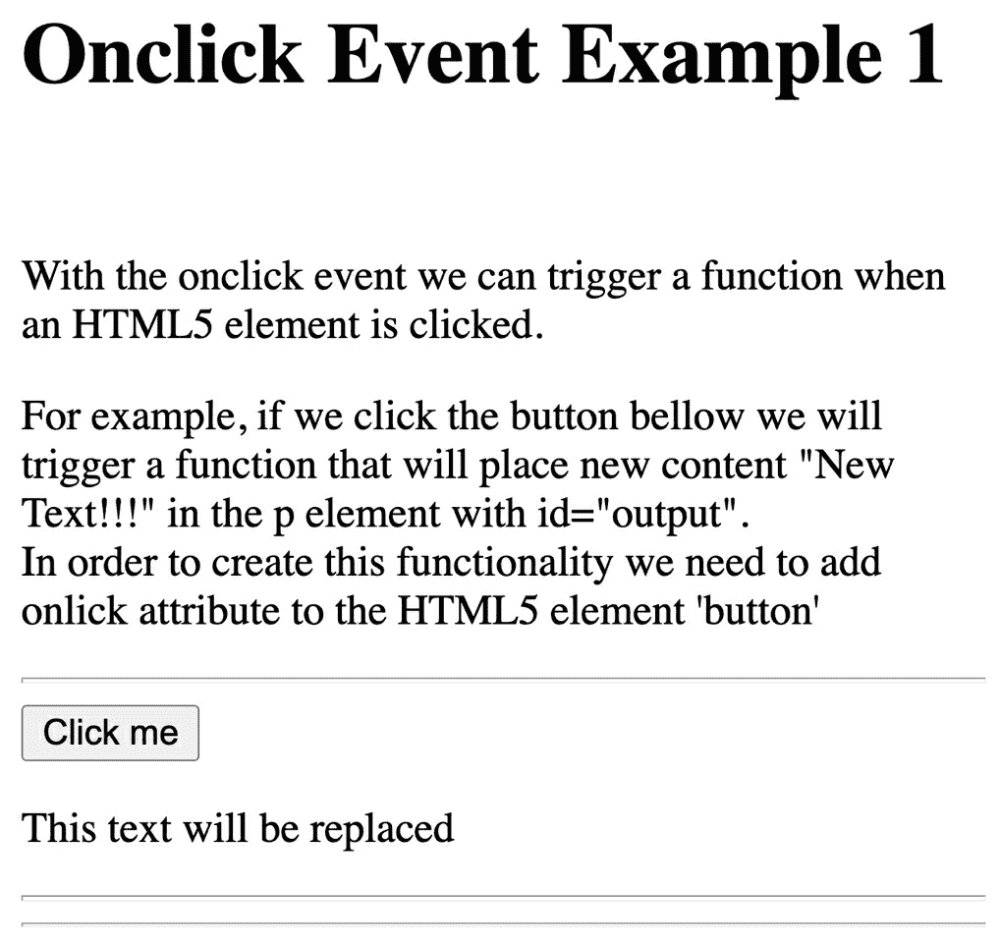

如果我们点击按钮，它将调用我们在脚本中的函数，该函数的名称为 `changeText`。这里是点击 `Click Me` 之后的输出：

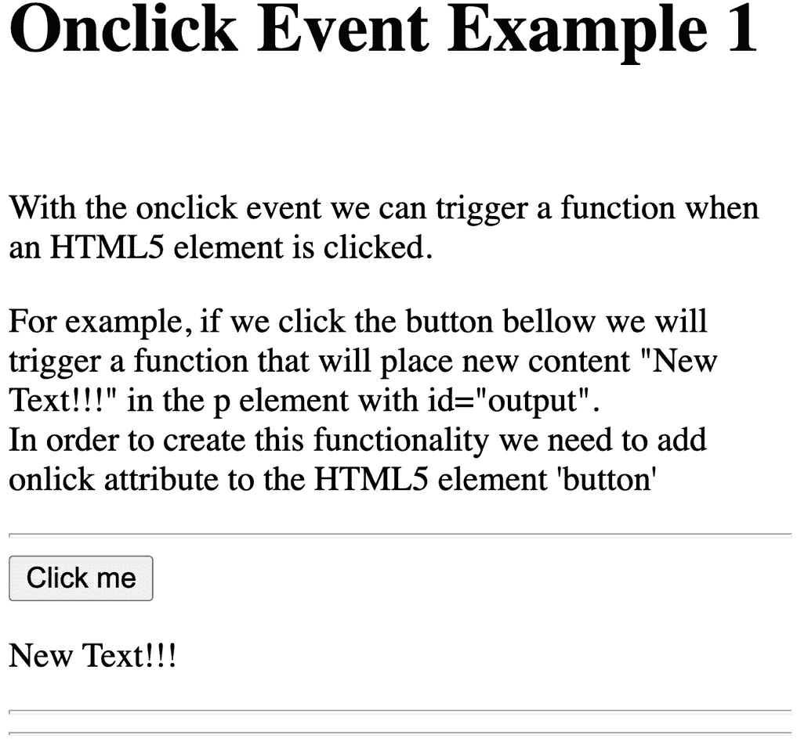

最后，段落中的文本现在被替换为来自 JavaScript 函数的新文本。

让我们再次做一次这个示例，但这次使用事件监听器。为了向你们展示事件监听器是如何工作的，我们需要修改 `lecture3.html` 文件。此示例的新代码在 `lecture4.html` 文件中。这里是完整的新代码，请将其与之前的代码进行对比，以便你看到我在哪里做了修改：

```html
<!DOCTYPE html>
<html lang="en">
<head>
<meta charset="UTF-8">
<meta http-equiv="X-UA-Compatible" content="IE=edge">
<meta name="viewport" content="width=device-width, initial-scale=1.0">
<title>Onclick Event Example</title>
</head>
<body>
<h1>Click Event Listeners: 2</h1>
<br>
<p>此示例基于 lecture3.html，在那个文件中我们使用了 onclick 属性。在这个示例中，我们将使用 addEventListener 将 id 为="output" 的 p 元素的文本替换为 'New Text!!!'</p>
<ul>
<li>1) 我们需要从按钮上删除 onclick 属性和函数</li>
<li>2) 我们需要给按钮添加任何 id，以便我们就可以可以放置事件监听器。</li>
</ul>
<button id='clickBtn'>Click me</button>
<br>
<p id="output">This text will be replaced</p>
<script>
document.getElementById("clickBtn").addEventListener('click', () => {
document.getElementById("output").innerHTML = "New Text!!!";
});
</script>
</body>
</html>
```

点击按钮后的输出如下：

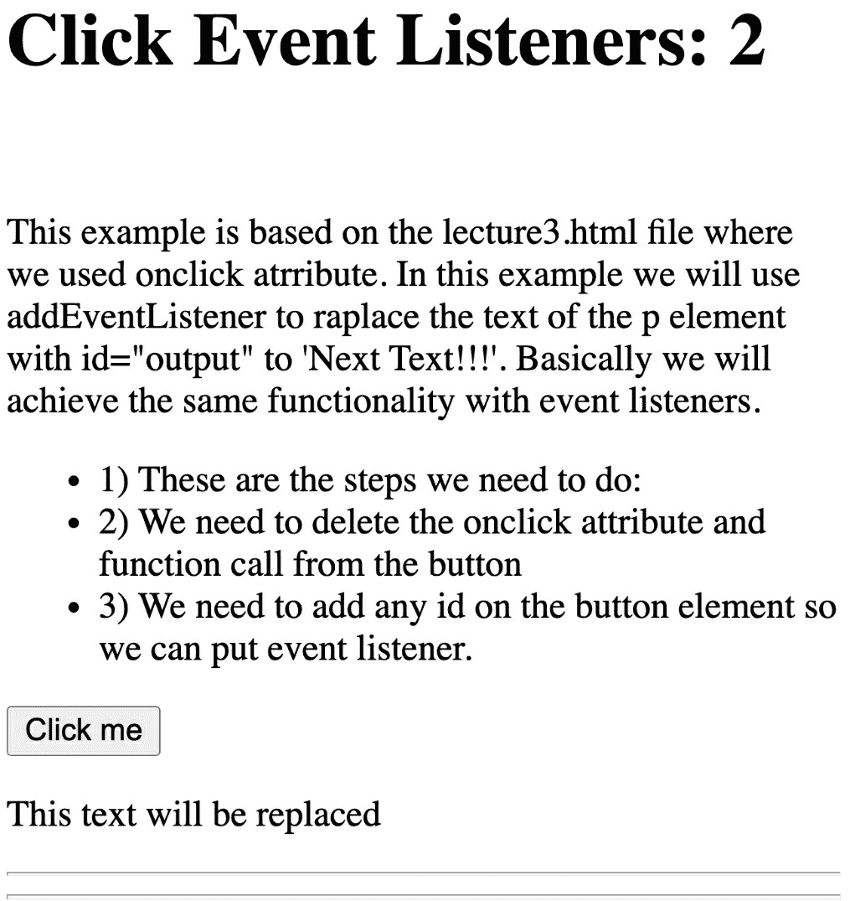

这意味着我们的事件监听器函数正在工作，现在它变成了两行代码：`document.getElementById("clickBtn").addEventListener('click', () => { document.getElementById("output").innerHTML = "New Text!!!"; });`。`addEventListener` 的第一个参数是指定我们正在监听的事件名称的地方，在我们的情况下，这是一个点击事件。当用户点击按钮时，会触发此事件。为了处理此事件，我们需要监听该点击触发器，但我们该如何做呢？嗯，为了处理此事件，我们需要在按钮内部放置某种标识符或 ID，如果你仔细查看上面的 HTML 标记，你会发现我们有一个名为 `clickBtn` 的 id。`addEventListener` 的第二个参数是箭头函数，到目前它应该已经知道它应该如何工作了。代码的其他部分很简单，我们过去已经学过类似的。

## 错误处理

我希望你们还记得错误部分，因为我们已经讨论过一些错误处理机制，如 `try`、`catch` 和 `finally`。与其他编程语言类似，JavaScript 为我们提供了一个良好的错误处理系统，其中错误通常被称为异常。正如我们已经讨论过的，最好的方法是不使用内联 JavaScript，而是创建一个单独的 JS 文件来处理错误。因此我创建了两个单独的文件：一个用于 HTML 标记，另一个用于 JavaScript 代码。如果你在家里尝试，请确保在 HTML 文件中链接了 JavaScript 文件。让我们看看我创建的两个文件：

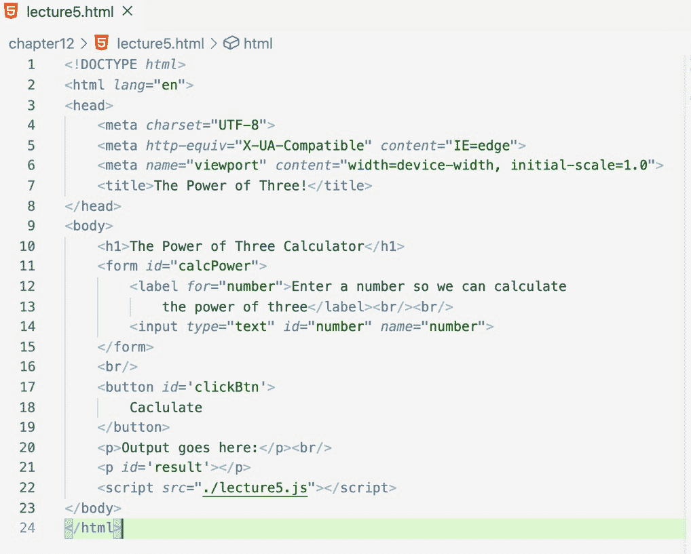

JavaScript 文件的链接是如下行：`<script src="./lecture5.js"></script>`

两个文件（HTML 和 JavaScript）都在同一个目录或文件夹中，在我的情况下，这是 `chapter13` 文件夹，因此我可以使用正斜杠为文件 `lecture5.js` 提供简单路径：`./`。点斜杠 `./` 意味着在相同或当前目录下查找 JavaScript 文件，如果我们在斜杠之前使用双点，例如这样：`../` —— 则意味着返回上一级目录并在那里查找 `lecture5.js` 文件。简而言之，这将帮助你在使用不同目录时链接你的文件。

这里是 JavaScript 文件中的内容：

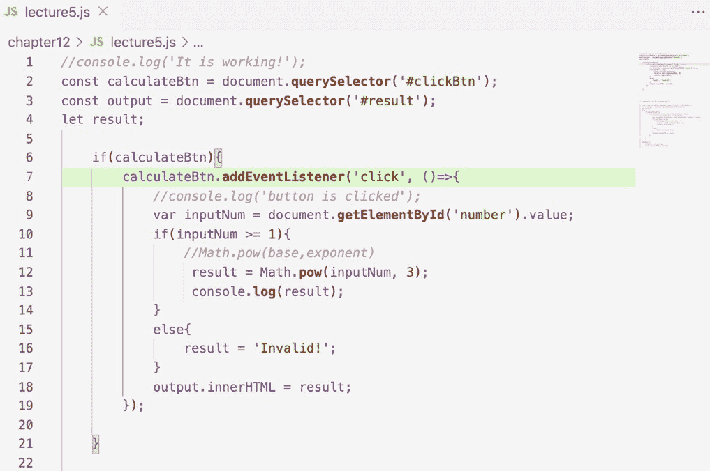

如果我们在浏览器中打开 `lecture5.html` 文件，那么我们应该看到这个：

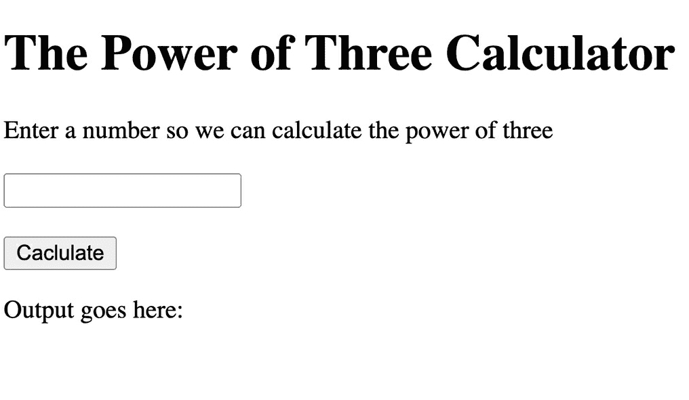

好的，让我们先解释一下 HTML5 标记并检查那里有什么元素；对于这个示例，你可以向上滚动查看标记。在 HTML5 中，我们有一个包含标签和文本类型输入的表单。文本类型允许我们编写单行文本输入。标签将描述我们应该在输入中写什么，并且在视觉上与其对应的文本输入关联。它在程序上也与输入字段关联。例如，通过点击标签，浏览器会将焦点传递到关联的输入并将标签与输入字段链接。我们需要在标签内部包含 `for` 属性。因此，标签中的 `for='number'` 将链接到具有相同名称输入字段。在我们的情况下，我们只有一个标签和一个输入字段，但请想象一个具有多个标签和输入字段的注册表。这就是为什么将正确的标签与正确的输入字段链接是如此重要。输入文本字段有一个名为 `number` 的 ID 或标识符。在输入字段下方，我们有另一个重要的 HTML5 元素按钮，我们有一个名为 `clickBtn` 的 id。最后，我们有一个段落，我们在其中打印来自 JavaScript 文件的新文本。该段落也有它自己的标识符或 ID 为 `result`，以便轻松定位我们想要放置输出的地方。最后一部分是将 HTML5 与 JavaScript 文件链接。

JavaScript 代码是我们更感兴趣的部分，在这里使用了另一个非常重要的 DOM 选择器，允许我从 HTML 代码中选择按钮。`querySelector()` 方法将返回文档中匹配指定 CSS 选择器的第一个元素。我希望你们现在已经知道 HTML 标记中需要具有唯一的 ID，这意味着文档中的每个 ID 都不应该重复，位于同一文档的任何地方。

遗憾的是，情况并非总是如此，但我们应该始终努力，使我们的 HTML5 文档尽可能简洁。ID 的唯一性将确保我们每次使用 DOM 选择器时都能选择正确的 HTML 元素。现在，我们选择了按钮，并将 `querySelector` 的查询结果存储在一个名为 `calculateBtn` 的变量中。查看上面的 JavaScript 代码，因为我使用了相同的逻辑来选择 `<p>` 标签以打印结果。

下一行代码非常重要：
`if(calculateBtn)`

这个 `if` 语句意味着如果按钮被点击，那么变量 `calculateBtn` 将返回 `true`。因此，`if` 条件将为真，我们可以运行 `if` 语句体内部的语句。请注意我在示例中是如何编写 `eventListener` 的，并将其与上一个示例进行比较。你必须承认，现在看起来更短且更整洁得多，因为我们可以使用变量 `calculateBtn` 来添加事件监听器。这就是为什么在顶部进行查询选择并将结果存储在变量中总是好习惯。让我们假设用户打开了浏览器并输入了数字 5。我们需要从输入框中获取此值，以便进行计算：

`<input type="text" id="number" name="number">`

```javascript
let inputNum = document.getElementById('number').value;
```

这就是我们如何使用 `getElementById` 选择器从输入框获取值。

然后，通过另一个 `if` 条件，我们检查用户输入的数字是否大于 1。如果是，我们可以使用 `Math.pow()` 函数来返回底的幂次方。该函数的语法如下：
`Math.pow(base, exponent)`

如果用户没有输入大于 1 的数字，或者根本没有输入数字而只是一些文本，那么我们的 `else` 语句将被执行，我们将结果设置为无效（invalid）。

无论结果如何，`result` 变量将始终有一个；它要么是一个数字，要么是无效的结果。

让我们在浏览器中运行它，检查它是否正常工作：

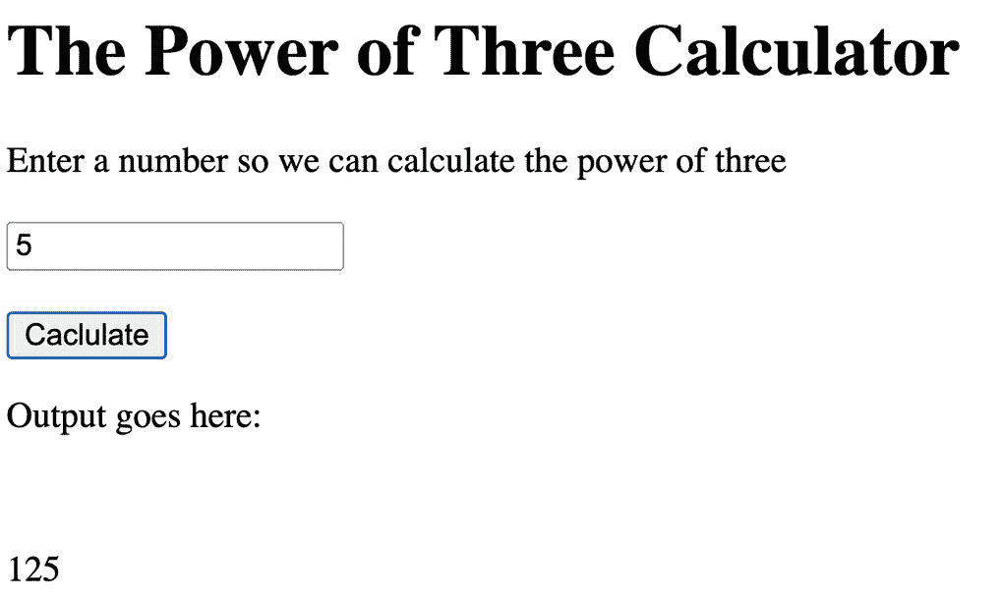

如你所见，如果用户输入大于 1 的真实数字，一切运行正常。让我们看看如果用户输入“Hello”会发生什么：

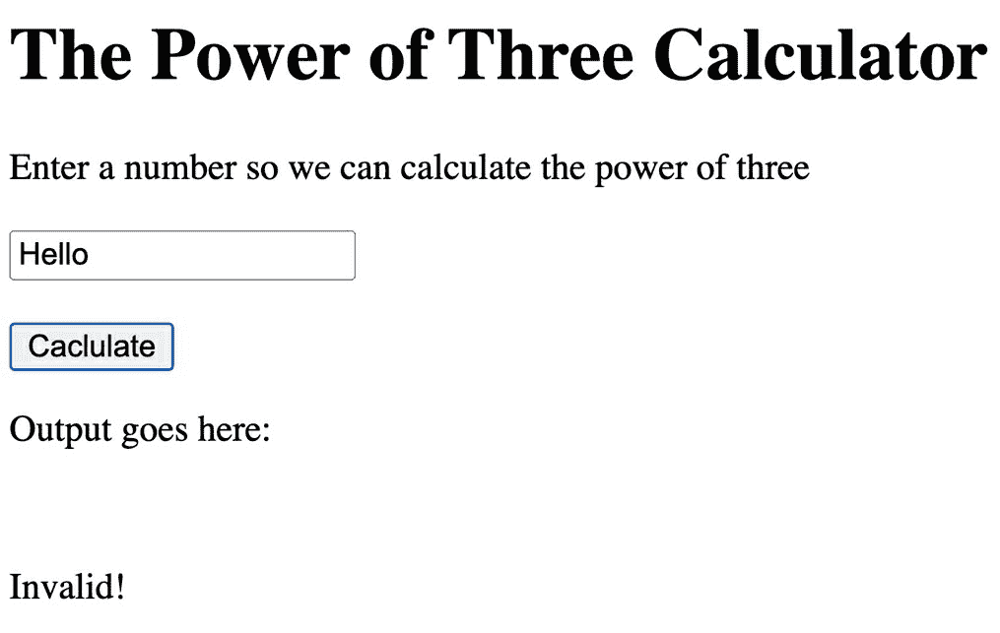

输出是无效的，这正是我们预期的。最后，我们现在可以讨论如果代码中出现错误会发生什么。例如，假设在编写代码期间，你将 `calculateBtn` 误写成了 `calculateBtm`。尝试在你的代码中进行此更改，让我们重新运行相同的代码。如果我们输入数字 4 并点击计算按钮，什么都不会发生，但如果我们打开控制台窗口，我们将看到一个未捕获的 `ReferenceError`：

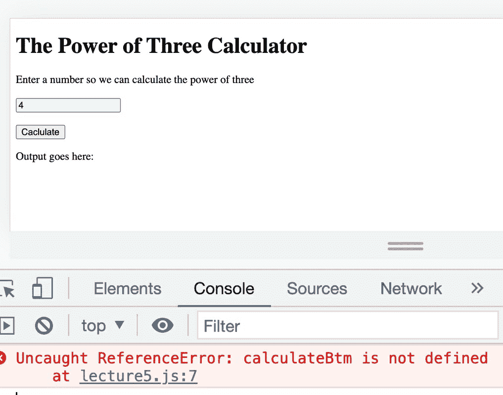

这不太好，因为浏览器没有向我们显示任何错误，对吧？作为程序员，我们应该修复这个问题，因为这条信息不是终端用户可以理解的，也不知道在哪里可以找到它。问题是这条信息来自哪里，以及我们如何消除它。事实证明 JavaScript 检测到了一些问题，并创建了一个包含信息的错误对象，可以帮助我们开发者理解并纠正问题。如果我们想修复它，可以使用著名的 `try` 和 `catch` 块来获取这些错误。正如你所知的，在 `catch` 子句中，我们可以打印整个错误。每个错误都有两个属性：错误名称和消息。

让我们在代码中添加 `try` 和 `catch`，但保留相同的拼写错误 `calculateBtm`，并再次检查输出：

```javascript
//console.log('It is working!');

const calculateBtm = document.querySelector('#clickBtn');
const output = document.querySelector('#result');
let result;

try {
  if(calculateBtn){
    calculateBtn1.addEventListener('click', () => {
      //console.log('button is clicked');
      var inputNum = document.getElementById('number').value;
      if(inputNum >= 1){
        //Math.pow(base,exponent)
        result = Math.pow(inputNum, 3);
        console.log(result);
      } else {
        result = 'Invalid!';
      }
      output.innerHTML = result;
    });
  }
} catch(err) {
  result = err.message;
  output.innerHTML = result;
}
```

输出：
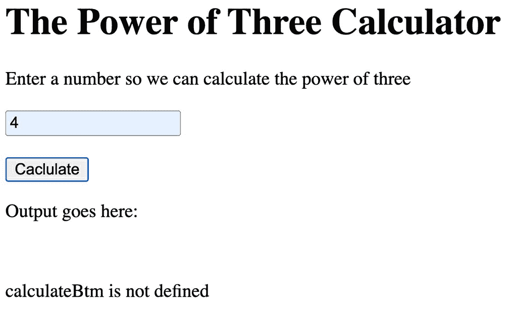

如你所见，如果用户输入大于 1 的真实数字，一切运行正常。让我们看看如果用户输入“Hello”会发生什么：

（注：以下文本似乎是重复或过渡到总结部分，遵循提供的 OCR 输出逻辑流。）

## 总结

恭喜！在本节中，我们学习了关于……[文本根据 OCR 提供的总结继续]

---

## CSS 重置示例

```css
/* 从 <q> 中移除可能的引号 (") & <blockquote> */
blockquote:before, blockquote:after, q:before, q:after {
    content: "";
}
blockquote, q {
    quotes: "" "";
}
```

以下是 JavaScript 文件的内容（我们将在此文件中为 H1 和 `<p>` 标签添加 CSS 样式）：

```javascript
// 修改 h1 文本颜色
const h1 = document.querySelector('.heading');

// 为文本添加新颜色
h1.style.color = "#FF5733";

// 将 h1 居中
h1.style.textAlign = "center";

// 给 h1 添加内边距
h1.style.padding = "3rem";

// 修改段落
paragraph = document.querySelector("p");

// 背景颜色并添加
paragraph.style.backgroundColor = "LightCoral";

// 一些内边距
paragraph.style.padding = "3rem";

// 修改文本颜色
paragraph.style.color = "white";
```

如果我们在浏览器中打开该文件，我们应该看到此输出：

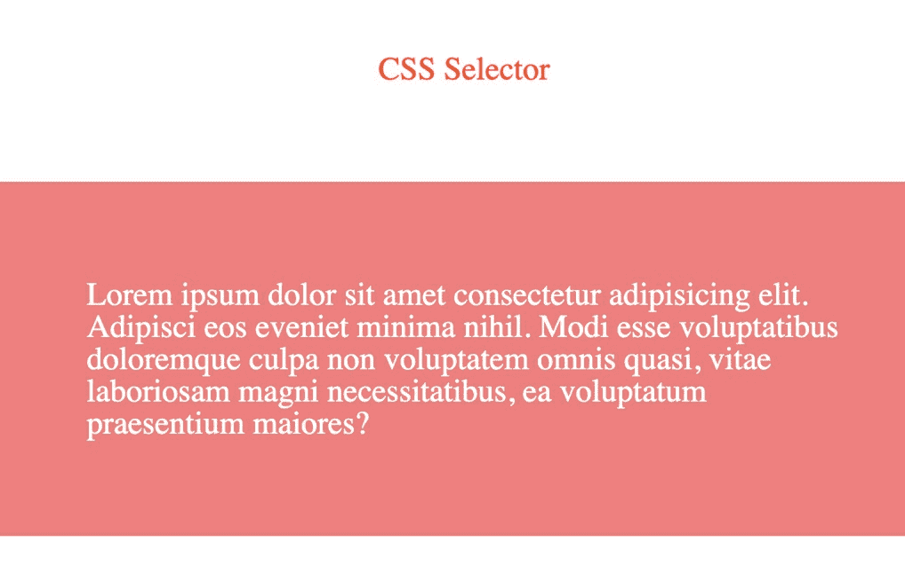

如你所见，我们对两个 HTML 元素都应用了新的 CSS 样式。我想包含的另一个选择器是：`querySelectorAll()` 选择器。此方法将返回文档中所有匹配指定 CSS 选择器的元素。许多元素可以具有相同的 CSS 类名，因为它们在整个文档中共享相同的样式。更重要的是，此方法返回的是 `NodeList` 对象，而不是 HTML 集合。如果你想学习更多知识，可以在 MDN 网站上阅读更多关于 `querySelectorAll()` 方法的详细信息。

# XML

在讨论 JSON 期间，我们简要提到了可扩展标记语言（Extensible Markup Language）或 XML。XML 和 HTML 非常相似，唯一的区别在于：XML 的语法比 HTML 更严格。XML 在 90 年代后期非常流行，它是互联网上传输数据的主流技术。现在，你应该能理解为什么我在 JSON 部分提到 XML 了，因为它们都被用于在网络上传输数据。如今，JSON 更加常见，因为它的语法非常接近 JavaScript 对象表示法。另一方面，XML 与 HTML 相似。由于其语法冗长，XML 存在许多问题。XML 主要用于需要将数据结构化的地方，例如 RSS 馈送。另一方面，JSON 更加简单，且 JSON 的格式方式使其更具人类可读性。我们不应忘记，JSON 是一种独立于 JavaScript 的语言。

# AJAX 示例

HTTP 状态码为 200 OK，则意味着请求已成功。最后，我们告诉服务器我们想要如何处理响应，在这种情况下，我们想要使用 `innerHTML` 方法将从 `info.txt` 文件中获取的新内容来替换段落内容。

在 `info.txt` 文件中，我们有一行文本：

**‘这段文字来自一个名为 info.txt 的 txt 文件！’**

现在让我们在浏览器中打开 `lecture2.html`，并测试点击按钮后会发生什么。

这是点击 `Change Text` 按钮之前的截图：

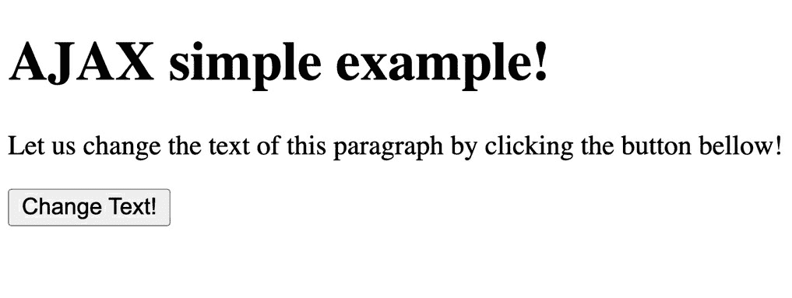

现在让我们测试点击按钮后会发生什么：

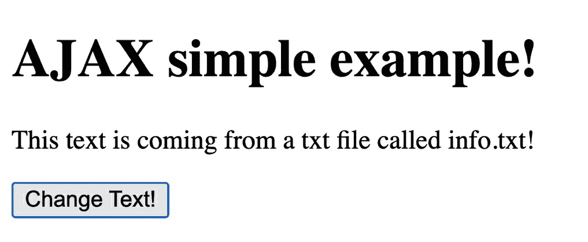

太棒了，看起来一切运行正常。

## 总结

恭喜你！这是我们一起学习的最后一个章节，我希望你意识到，当我们将 JavaScript 语言与正确的技术相结合时，它是多强大的。我们已经涵盖了许多语言概念，从基础的 JavaScript 数据类型，到学习更复杂的特性，如对象、数组、循环和迭代、类、继承、事件，以及更高级的主题如事件监听器、DOM 等以及 AJAX。所以，JavaScript 到底并不那么糟糕，但这种语言对我们许多人来说可能令人生畏。这本书非常易于理解，提供了简单循序渐进的说明。

JavaScript 作为一种语言对初学者并不友好，但我创建了这份指南，将帮助你完成整个过程，轻松地掌握每个部分。我计划写另一本专注于更高级的主题的书，以开发新技能，确保你有足够的知识来申请任何 JavaScript 工作。这就是为什么我希望你查看我的社交媒体账户并订阅其中一些，这样你就永远不会错过我关于新书发布或限时折扣的更新，从而帮你节省一些钱并获得新的终身技能。

祝你好运，希望以后某个时候再次见到你。

## 关于作者

**Rick Sekuloski** 自 2010 年起担任一名网页设计师/开发者。他目前正在 Udemy 等多个平台上为他的学生创建课程和内容。他是一个从事前端和后端项目的全栈开发人员。在从事网页开发工作之前，他移民到澳大利亚追求他的专业 IT 职业。他毕业于联邦大学（Federation University），获得软件 Web 开发学位。工作之余，他喜欢与家人共度时光，尤其是他的新生儿子。

## 附录 A：保留字

JavaScript 保留关键字列表。这些词不应作为标识符，因为它们在 JavaScript 中有特殊含义。

### ECMAScript 2015 的保留关键字

- `break`
- `case`
- `catch`
- `class`
- `const`
- `continue`
- `debugger`
- `default`
- `delete`
- `do`
- `else`
- `export`
- `extends`
- `finally`
- `for`
- `function`
- `if`
- `import`
- `in`
- `instanceof`
- `new`
- `return`
- `super`
- `switch`
- `this`
- `throw`
- `try`
- `typeof`
- `var`
- `void`
- `while`
- `with`
- `yield`

### 未来的保留关键字

- `enum`
- `implements`
- `interface`
- `let`
- `package`
- `private`
- `protected`
- `public`
- `static`
- `yield`
- `await`

### 旧标准中的保留关键字

- `abstract`
- `boolean`
- `byte`
- `char`
- `double`
- `final`
- `float`
- `goto`
- `int`
- `long`
- `native`
- `short`
- `synchronized`
- `throws`
- `transient`
- `volatile`
- `null`
- `true`
- `false`

## 附录 C：练习及了解更多 JavaScript、HTML 和 PHP

如果你想学习更多关于 JavaScript 或其他 Web 开发语言，请查看我的课程，我向你保证你将在真实案例中获得丰富的经验。

你可以在 Udemy 上找到我的课程：

https://www.udemy.com/user/riste3/


## 附录 B：资源

**MDN Web Docs. (2021).** *JavaScript:* https://developer.mozilla.org/en-US/docs/Web/JavaScript
