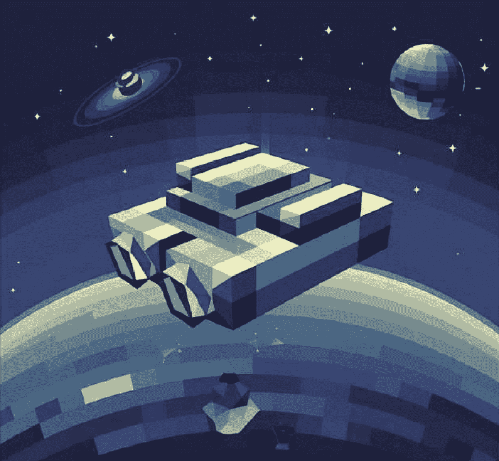

# JavaScript 3D 游戏开发高级指南





# 引言

3D 游戏开发已成为编程领域中最令人兴奋和动态的领域之一，为创造吸引用户的沉浸式交互世界提供了可能。随着技术的进步，游戏开发者现在可以使用各种工具和库，无需精通复杂的语言或系统即可简化 3D 游戏的创建。在这个领域中，JavaScript 是最出色的语言之一，由于其多功能性和易用性（特别是对于 Web 应用程序），它的受欢迎程度日益增加。在引言中，我们将探索 3D 游戏开发的世界、为什么 JavaScript 是构建这些游戏的价值选择，以及如何搭建必要的开发环境。此外，我们还将深入让使用 JavaScript 进行 3D 游戏开发既离手又强大的核心工具：Three.js、Babylon.js 和 WebGL。

## 3D 游戏开发概述

3D 游戏开发是在三维空间中创建视频游戏的过程，其中物体具有深度、高度和宽度。与受限于平面的 2D 游戏不同，3D 游戏提供了更具浸感的体验，允许玩家在模拟现实物理和视角的复杂环境中导航。这种额外的维度提供了更深真实感和交互感，使 3D 游戏更有吸引力，而且在开发上往往更有挑战性。

开发 3D 游戏涉及一系列元素，包括：

- **3D 建模：** 使用 Blender 或 Maya 等专用软件创建资产，如角色、环境物体。
- **渲染：** 将 3D 模型转换为可以在屏幕上显示的 2D 图像，这一过程由图形引擎和库驱动。
- **物理模拟：** 确保游戏世界中的物体以真实的方式运行，受重力、碰撞和惯性等法则支配。
- **光照与着色：** 添加光照效果以创建深度和真实感，包括阴影、反射和表面纹理。
- **用户交互：** 处理玩家输入（如键盘、鼠标或游戏控制器命令），以导航 3D 世界并操作物体。
- **游戏逻辑与 AI：** 编写控制游戏的规则，包括玩家移动、与非玩家角色 (NPC) 的交互以及胜负条件。

虽然由于涉及元素的复杂性，3D 游戏开发可能看起来令人望而却畏，但 Three.js 和 Babylon.js 等库和框架的出现显著降低了入门门槛。这些工具让开发者能够更轻松、高效地创建 3D 游戏，即使他们在 3D 图形编程方面的经验有限。

# 为什么为 3D 游戏选择 JavaScript？

JavaScript 是一种非常受欢迎的语言，主要因其在 Web 开发中的应用闻名。然而，它的灵活性、性能改进以及强大框架的兴起已将其应用扩展到更复杂的领域，包括 3D 游戏开发。以下是 JavaScript 成为 3D 游戏开发价值选择的一些原因：

- 1. **Web 集成**：JavaScript 原生在浏览器中运行，这意味着开发者可以创建可以通过 Web 轻松访问的 3D 游戏，无需用户下载和安装额外软件。这使得 JavaScript 成为创建轻量、平台无关且触及广泛观众的理想语言。
- 2. **易于学习**：JavaScript 以易于学习和快速原型能力而闻名。与 C++ 等需要深层理解内存管理和底层编程的语言不同，JavaScript 抽象了许多此类复杂性，允许开发者专注于游戏设计和机制。
- 3. **巨大的生态系统**：JavaScript 丰富的库和框架生态系统意味着开发者可以利用从 3D 渲染（Three.js, Babylon.js）到物理模拟（Cannon.js, Ammo.js）、人工智能（Brain.js）等各个领域的预构建解决方案。这加速了开发，并允许创作者专注于构建独特的游戏功能，而无需发明轮子。
- 4. **跨平台兼容性**：JavaScript 的跨平台特性确保游戏可以在各种设备上运行，包括桌面式电脑、笔记本电脑、智能手机和平板电脑。在玩家期望跨设备无缝体验的游戏市场中，这是一个巨大的优势。
- 5. **WebGL 支持**：JavaScript 与 WebGL（Web 图形库）的集成在浏览器中直接提供硬件加速的 3D 渲染。这使得开发者能够创建视觉上惊艳的游戏，在性能和图形质量上可以与桌面应用程序相媲。
- 6. **实时更新**：JavaScript 的异步性质和实时能力使其成为需要动态更新游戏的理想选择，例如多人游戏或具有实时数据馈的游戏。JavaScript 的事件驱动架构允许开发者高效地处理多个输入输出，而不影响性能。

# 设置你的开发环境

在深入学习 JavaScript 3D 游戏开发之前，搭建合适的开发环境至关重要。该过程涉及安装必要的工具、库和集成开发环境 (IDE) 以简化工作流。

- 1. 选择 IDE：集成开发环境 (IDE) 是编写、测试和调试代码的关键工具。JavaScript 开发的流行选择包括：
- **Visual Studio Code**：一个受欢迎、免费且开源的 IDE，对 JavaScript 及其库提供了良好的支持。它包含了 IntelliSense、调试工具和广泛的插件支持。
- **Sublime Text**：一种轻量级、快速的编辑器，支持多种编程语言，包括 JavaScript。
- **WebStorm**：一种强大的 JavaScript IDE，提供智能代码辅助、错误检测以及对 Three.js 和 Babylon.js 等现代框架的支持。
- 1. 安装 Node.js**：Node.js 是设置 JavaScript 开发环境必不可少的，因为它允许你通过 npm（包管理器）安装和管理包。这在


使用如 Three.js 和 Babylon.js 等库。你可以从官方网站 (https://nodejs.org/) 下载并安装 Node.js，它会自动包含 npm。

- 2. 安装本地 Web 服务器：由于大多数 3D 库依赖于 WebGL 并需要 HTTP 服务器来提供文件，因此建议设置本地 Web 服务器。通过 Node.js 可以轻松实现这一点。或者，也可以通过 npm 全局安装 `live-server` 或 `http-server` 等轻量级服务器，并在项目文件夹中运行。

- 3. 安装库：环境搭建完成后，你可以安装开发阶段所需的 3D 库：

  - Three.js：可以在项目目录中运行 `npm install three` 来通过 npm 安装它。

  - Babylon.js：同样地，通过运行 `npm install babylon.js` 来安装 Babylon.js。这两个库也可以通过 HTML 中的 `<script>` 标签包含以进行快速测试，但 npm 提供了更好的依赖关系管理和版本控制。

- 1. 设置版本控制系统：使用 Git 进行版本控制可以让你跟踪更改、与他人协作，并回滚到游戏的之前的版本。GitHub 或 GitLab 是托管仓库以及进行开源或团队项目协作的优秀平台。

## 理解核心工具：Three.js, Babylon.js 和 WebGL

几个关键工具驱动着 JavaScript 3D 游戏开发的世界。每种工具都有独特的特性和优势，因此了解哪个工具适合你的项目需求至关重要。

### Three.js

Three.js 是一个轻量级的高级 JavaScript 库，简化了使用 WebGL 在浏览器中渲染 3D 图形的过程。它对 WebGL 的复杂抽象允许开发者用极少的代码创建复杂的 3D 场景。主要特性包括：

- 支持各种几何形状和材质。
- 光照和渲染系统。
- 动画支持和场景管理。
- 用于 3D 导航的内置相机和控制。
- 从 OBJ、FBX 和 GLTF 等格式轻松导入 3D 模型。

1. Three.js 因为其详尽的文档和活跃的社区，深受初学者和中级开发者喜爱。

### Babylon.js

Babylon.js 是另一个用于 3D 游戏开发的强大 JavaScript 框架，旨在创建高性能的游戏应用程序。Babylon.js 专注于在不牺牲性能的情况下保持易用性，并与 WebGL 深度集成以提供惊叹的 3D 视觉效果。特性包括：

- 强大的物理引擎。
- 集成的动画系统。
- 实时阴影生成和渲染优化。
- 支持 VR/AR 开发。
- 丰富的材质系统，包括着色器和后处理效果。

1. Babylon.js 是追求高端、视觉丰富的 3D 游戏的开发者的极选择，具有粒子系统和高级材质等特性。

### WebGL

WebGL 是实现在浏览器中进行 3D 渲染的基础。它是一种低级图形 API，允许开发者直接与 GPU 通信，为 3D 对象提供硬件加速渲染。虽然 WebGL 提供了极大的活性和威力，但它要求对 3D 图形编程有深入理解，使其直接操作更具挑战。Three.js 和 Babylon.js 等库抽象了 WebGL 的复杂性，让开发者无需从头编写 WebGL 代码即可轻松地创建游戏。

得益于易用性、丰富的生态系统以及与网络技术的兼容性，JavaScript 已成为 3D 游戏开发的强大语言。凭借 Three.js、Babylon.js 和 WebGL 等工具，开发者可以创建在浏览器中运行的惊艳、交互式的 3D 游戏，轻松触达全球观众。正确设置开发环境是精通 3D 游戏开发的第一步，理解核心工具将使你能够在虚拟世界中实现你的愿景。无论你是有抱的游戏开发者还是经验丰富的程序员，JavaScript 都为构建下一代 3D 游戏提供了一个极具吸引力的平台。

# 第一章：3D 图形简介

3D 图形是游戏开发中最迷人的领域之一。艺术家、开发者和工程师在这里协作，创造捕捉玩家想象力的沉浸式环境。在本章中，我们将介绍 3D 图形的一些基本概念，帮助你理解数字对象如何在游戏中被创建、操纵和渲染。我们将从探索 3D 渲染开始，讨论坐标系统的基础以及对象在虚拟空间中的定位。我们还将深入探讨关键的几何结构，包括顶点、边和面，它们构成了所有 3D 模型的基石。最后，我们将查看游戏引擎如何处理 3D 渲染、物理以及让 3D 游戏生生的其他元素。

## 什么是 3D 渲染？

3D 渲染的核心是将 3D 模型转换为 2D 图像的过程。这些图像随后显示在屏幕上，创造出深度和三维空间的幻觉。简单来说，渲染就是取一个 3D 场景并将其转换为玩家可以查看的内容。

这个过程涉及模拟光线如何与物体相互作用，计算相机的位置和透视，最后逐像素地生成图像。

## 渲染流水线

现代 3D 图形的渲染涉及一系列步骤，通常被称为渲染流水线（rendering pipeline）。该流水线是一系列将原始 3D 数据转换为屏幕上可见的 2D 图像的流程。流水线通常包括以下阶段：

- 1. 顶点处理（Vertex Processing）：在这一阶段，顶点（3D 空间中的点）的位置根据相机的透视图转换为屏幕坐标。在此阶段，还会进行光照计算。

- 2. 裁剪（Clipping）：在此阶段，相机视野之外的对象将从渲染过程中移除，以节省计算资源。这一步通过只渲染玩家实际看到的内容来优化性能。

- 3. 栅格化（Rasterization）：一旦准备好 3D 场景，它就会通过栅格化过程转换为一系列像素。这一步将对象的数学表示转换为基于像素的图像。

- 4. 碎片元处理（Fragment Processing）：在此阶段，根据物体的材质属性、光照条件、阴影、反射和其他效果确定每个像素的颜色。

- 5. 输出合并（Output Merging）：汇总最终图像，合并之前阶段计算的颜色、纹理和效果，创建最终的渲染帧。

渲染是一个计算密集型过程，因此性能优化至关重要，尤其是在视频游戏等实时应用中。游戏引擎通常实现诸如剔除（culling，移除相机不可见的对象）和细节层次（LOD，调整远端对象的复杂度）等技术，以便在渲染复杂场景时保持高帧率。

## 3D 坐标系基础

为了渲染 3D 对象，理解坐标系概念至关重要。3D 坐标系提供了一种描述物体在三维空间中位置的方法。3D 图形中使用常用的常用的系统是笛卡尔坐标系，它由三个轴定义：

- X 轴：代表水平方向（左-右）。
- Y 轴：代表垂直方向（上-下）。
- Z 轴：代表深度（前-后）。

这三个轴交于一个称为原点 (0, 0, 0) 的点，作为 3D 空间中所有位置的参考点。

## 右手系 vs 左手坐标系

3D 引擎可以使用右手坐标系或左手坐标系，这定义了 Z 轴的正方向。

- 在右手坐标系中，如果你用右手的指环绕 Y 轴，大拇指指向正 Y 的方向，那么你的手指将指向正 Z 的方向。这意味着正 Z 值代表向场景内部的深度。

- 在左手坐标系中，正 Z 的方向指向相机。这是 DirectX 等引擎使用的系统，而 OpenGL 和 Three.js 使用的是右手系。


在导入模型和操作对象时，了解你的游戏引擎使用的坐标系非常重要，因为它会影响对象在 3D 空间中的定位和查看方式。

## 世界空间、局部空间和相机空间

在处理 3D 模型时，理解渲染中使用的不同类型空间非常有帮助：

- 1. **世界空间 (World Space)**：这是全局坐标系，定义了对象相对于世界原点在整个场景的位置。游戏中的每个对象都位于这个世界空间内。
- 2. **局部空间 (Local Space)**：每个 3D 对象都有自己的局部坐标系。该系统定义了对象顶点和部分相对于对象原点的位置，这可能与世界原点不同。例如，角色的手臂相对于角色身体移动，而不是相对于整个游戏世界。
- 3. **相机空间 (Camera Space)**：此空间相对于相机，这意味着所有对象的位置根据它们与相机视点的关系来确定。对象在 Z 空间中离相机越近，在屏幕上显示越大。

理解这些空间可以帮助开发者控制 3D 游戏中对象的移动和变换，确保它们在与玩家、相机以及场景中其他元素交互时表现正常。

## 理解顶点、边和面

所有 3D 对象，从简单的立方体到复杂的角色模型，都是由基础几何组件组成的：顶点、边和面。

### 顶点 (Vertices)

顶点是 3D 空间中的一点，由其坐标 (X, Y, Z) 定义。顶点是 3D 模型最基本的单元，作为线的端点多边形的角。在复杂的模型中，顶点还带有颜色、纹理坐标和法向量（定义表面朝向）等信息。

### 边 (Edges)

边是连接两个顶点的直线。边通过形成多边形的轮廓来定义 3D 对象的形状，多边形是模型的构建块。虽然大多数游戏中并不直接渲染，但它们对于定义 3D 对象的结构至关重要。

### 面 (Faces)

面是由边围成的平面。在 3D 建模中，面通常是多边形，游戏中最常用的多边形类型是三角形。三角形三角形是因为是最简单的多边形，且始终位于 3D 空间中，使其更容易处理和渲染。更复杂的形状可以通过组合多个三角形来近似，从而营造平滑曲线和细节表面的幻觉。

当多个三角形连接在一起时，它们形成一个网格 (mesh)，网格是顶点、边和面的集合，共同定义 3D 对象的形状。网格顶点越多，细节越丰富，但也增加了渲染的计算成本。

## 游戏引擎如何处理 3D

游戏引擎是现代 3D 游戏开发的支柱。它们提供了管理渲染、物理、输入处理和其他与游戏相关的任务所需的工具、库和框架。游戏引擎抽象了 3D 渲染涉及的许多复杂性，让开发者能够专注于设计和构建游戏，而无需担心低级图形程序编写。

## 使用游戏引擎进行渲染

大多数游戏引擎（如 Unity、Unreal Engine 和 Three.js）通过硬件（GPU）和软件（引擎的渲染管线）相结合来处理渲染。正如我们之前讨论的，渲染是将 3D 模型转换为可以在屏幕上显示的 2D 图像的复杂过程。游戏引擎通过实现技术优化这一过程，例如视锥剔除（移除相机视野之外的对象）和背面剔除（不渲染玩家可见的多边形背面）。

## 光照与着色

渲染最重要的方面之一是光线如何与场景中的对象相互作用。游戏引擎通过各种光照模型处理这一点，这些模型模拟了光在现实世界中的行为。着色是计算光如何影响表面外观的过程，它在让对象看起来真实方面起着至关重要的作用。

- 平直着色 (Flat shading)：对象的每个面赋予单一颜色，使对象看起来有棱角且分面。
- 平滑着色 (Smooth shading)：颜色在面上进行插值处理，使对象看起来平滑且圆润。
- 冯石着色 (Phong shading)：一种更高级的技术，按像素计算光照，从而产生真实的光照和反射效果。

游戏引擎还支持高级的光照技术，例如全局光照 (global illumination)，它模拟了光线从表面反弹，并在整个场景中创建真实的光照效果。

## 物理模拟

游戏引擎还管理**物理模拟 (physics simulation)**，确保对象在游戏世界中的行为符合逻辑。这包括模拟重力、碰撞以及影响对象移动和交互的其他力。许多引擎内置了物理引擎（如 Unity 的 PhysX 或 Babylon.js 的 Cannon.js），它们会自动处理这些计算。

物理引擎使用数学模型来近似现实世界对象的行为。例如，它们可能会模拟球撞击地面时如何反弹，或者汽车在急转时如何打滑。物理引擎还处理**碰撞检测 (collision detection)**，确保对象不会互相穿过，并确保射击或跳跃等交互是真实的。

# 第 2 章：开始使用 Three.js

Three.js 是 JavaScript 中创建 3D 图形最流行的库之一。它在 WebGL 之上提供了一个易用的接口，WebGL 是内置在现代浏览器中的低级图形 API。通过使用 Three.js，你可以创建复杂的 3D 场景，而无需处理 WebGL 的复杂性，使其成为所有技能水平开发者的极佳工具。在本章中，我们将引导你完成 Three.js 的设置、创建第一个 3D 场景，并理解如何管理渲染循环。在本章结束时，你将拥有一个运行的 3D 环境，并在屏幕上渲染出的一个基础立方体。

## 安装和设置 Three.js

在开始创建 3D 场景之前，我们需要在开发环境中设置 Three.js。有几种方法可以将 Three.js 引入到你的项目中，取决于你倾向于使用 CDN（内容分发网络）、直接下载库，还是通过 npm（Node 包管理器）安装。

### 方法 1：使用 CDN

开始使用 Three.js 的简单方法是从 CDN 引入它。CDN 在远程服务器上托管库文件，你可以直接在 HTML 文件中引用它们。这种方法不需要安装，非常适合初。

```html
<!DOCTYPE html>
<html lang="en">
<head>
    <meta charset="UTF-8">
    <meta name="viewport" content="width=device-width, initial-scale=1.0">
    <title>Three.js Setup</title>
    <script src="https://cdnjs.cloudflare.com/ajax/libs/three.js/r135/three.min.js"></script>
</head>
<body>
    <script>
        // 你的 Three.js 代码将写在这里
    </script>
</body>
</html>
```

只需将上述代码复制并粘贴到 HTML 文件中，就可以开始了。你现在可以在 <script> 标签内编写 Three.js 代码。

### 方法 2：通过 npm 安装

如果你正在使用 Webpack 或 Parcel 等构建工具，可以通过 npm 安装 Three.js。这种方法对于更复杂的项目是首选，因为它允许更好的依赖管理和模块化代码。首先，使用 npm 初始化项目：

```bash
npm init -y
```

然后，安装 Three.js：

```bash
npm install three
```

安装完成后，你可以在 JavaScript 文件中导入 Three.js：

```javascript
import * as THREE from 'three';
```

现在设置好了 Three.js，我们就可以开始创建第一个 3D 场景了。


# 基础场景创建

每个 Three.js 应用都从一个场景（scene）、相机（camera）和一个渲染器（renderer）开始。这些是构成任何 3D 环境基础的核心组件。让我们来拆解它们：

- **场景 (Scene)**：这是你所有 3D 对象、光照和相机所在的地方。你可以把它想象成你的游戏或应用程序运行的虚拟世界。
- **相机 (Camera)**：相机定义了场景中哪些部分是用户可见的。有不同类型的相机，但目前我们将使用最常见的一种：*PerspectiveCamera*（透视相机）。
- **渲染器 (Renderer)**：渲染器负责获取场景和相机，并将它们渲染成可以在屏幕上显示的 2D 图像。

## 创建场景、相机和渲染器

让我们从创建一个基础的 Three.js 设置开始，其中包含一个场景、相机和一个渲染器。我们还会设置场景的背景颜色，使其在视觉上更具特色。

```javascript
// 导入 Three.js（如果你使用 CDN，请跳过此行）
import * as THREE from 'three';

// 创建场景
const scene = new THREE.Scene();
scene.background = new THREE.Color(0x87CEEB); // 设置背景颜色（浅蓝色天空）
```

```javascript
// 创建相机
const camera = new THREE.PerspectiveCamera(
  75, // 视野角度（度）
  window.innerWidth / window.innerHeight, // 宽高比
  0.1, // 近裁剪平面
  1000 // 裁剪平面
);

// 将相机向后移动，以便我们可以看到物体
camera.position.z = 5;

// 创建渲染器并将其附加到文档中
const renderer = new THREE.WebGLRenderer();
renderer.setSize(window.innerWidth, window.innerHeight); // 设置渲染器大小为全窗口尺寸
document.body.appendChild(renderer.domElement); // 将渲染器添加到 HTML 文档
```

在上面的代码中：

- 我们创建了一个场景，并使用 `scene.background = new THREE.Color(0x87CEEB)` 将其背景颜色设置为浅蓝色。
- 相机使用 `PerspectiveCamera` 构造函数创建。相机的视野（FOV）为 75 度，我们根据窗口的和高度设置了宽高比。近裁剪面和远裁剪面定义了物体可见的距离范围。

渲染器负责显示场景。我们将渲染器的大小设置为与窗口的宽度和高度一致，然后将其附加到 HTML 文档中。

此时，你应该会有一个浅蓝色背景的空白画布。接下来，我们将在场景中添加一个简单的 3D 对象。

# 在场景中添加立方体

现在我们已经有了场景、相机和渲染器，是时候添加一个基础的 3D 对象——立方体了。在 Three.js 中，对象是通过几何体（geometries）和材质（materials）创建的。

- 几何体（Geometries）定义了物体的形状（例如立方体、球体、平面）。
- 材质（Materials）定义了物体表面的外观（例如：颜色、纹理、反射率）。

让我们使用 `BoxGeometry` 类创建一个立方体，并给它一个简单的材质。

```javascript
// 创建一个立方体几何体（宽、高、深）
const geometry = new THREE.BoxGeometry(1, 1, 1);
// 创建材质
const material = new THREE.MeshBasicMaterial({ color: 0x00ff00 });
// 创建网格体对象
const cube = new THREE.Mesh(geometry, material);
// 将立方体添加到场景
scene.add(cube);
```

在上面的代码中：

- 我们通过 `BoxGeometry` 创建了一个立方体几何体。
- 我们通过 `MeshBasicMaterial` 创建了一个简单的材质。
- 我们通过 `Mesh` 将几何体和材质结合成网格体对象。
- 最后通过 `scene.add(cube)` 将立方体添加到场景。

## 渲染循环

为了让场景显示并更新，我们需要一个渲染循环。这个循环会在每一帧中不断渲染场景，从而实现动画。

```javascript
function animate() {
  // 请求下一帧渲染
  requestAnimationFrame(animate);

  // 让立方体旋转以产生动画效果
  cube.rotation.x += 0.01;
  cube.rotation.y += 0.01;

  // 渲染场景
  renderer.render(scene, camera);
}

// 动画
animate();
```

在 `animate` 函数中：

- `requestAnimationFrame(animate)` 告诉浏览器在下次重绘前调用该函数，从而形成平滑的循环。
- 我们更新了 `cube.rotation.x` 和 `cube.rotation.y` 来让立方体旋转。
- `renderer.render(scene, camera)` 根据相机的视角将场景绘制到画布。

## 处理窗口缩放

当用户调整窗口大小时，我们需要更新相机的宽高比和渲染器的大小以保持显示正常。

```javascript
window.addEventListener('resize', () => {
  // 更新相机宽高比
  camera.aspect = window.innerWidth / window.innerHeight;
  // 更新投影矩阵
  camera.updateProjectionMatrix();
  // 更新渲染器尺寸
  renderer.setSize(window.innerWidth, window.innerHeight);
});
```

这个监听器确保了当窗口缩放时，3D 场景不会发生拉伸变形。


[第 30 页]

在这里，我们创建一个半径为 1、宽度和高度方向分为 32 段的球体。分段越多，球体看起来越平滑。材质设置为红色，并将球体添加到场景中。

## 其他基础几何体

Three.js 提供了许多其他内置几何体，用于创建不同的形状：

- CylinderGeometry：用于创建圆柱体或锥体。
- PlaneGeometry：用于地板或墙面等平面表面。
- TorusGeometry：用于创建甜甜圈形状（适用于环或轮胎）。
- IcosahedronGeometry：用于创建更复杂的多面体形状。

例如，创建一个圆环体（甜甜圈形状）：

```javascript
Copy code
const torusGeometry = new THREE.TorusGeometry(1, 0.4, 16, 100); // 半径、管半径、径向分段、管状分段
const torusMaterial = new THREE.MeshBasicMaterial({ color: 0x0000ff });
const torusMesh = new THREE.Mesh(torusGeometry, torusMaterial);
scene.add(torusMesh);
```

## 应用材质：MeshBasicMaterial, MeshPhongMaterial

在 Three.js 中，材质控制着 3D 对象的外观。它们定义了几何体表面的样式，包括其颜色、反射率以及与光的交互。提供了不同类型的材质，每种都有独特的属性。

### MeshBasicMaterial

MeshBasicMaterial 是最基础的材质。它为对象定义纯色或纹理，该对象不会与场景中的光照交互。这种材质对于不需要光照效果的简单对象非常理想。

```javascript
Copy code
const basicMaterial = new THREE.MeshBasicMaterial({ color: 0x00ff00 });
const cube = new THREE.Mesh(new THREE.BoxGeometry(1, 1, 1), basicMaterial);
scene.add(cube);
```

MeshBasicMaterial 非常适合不需要响应光源的对象，例如用户界面元素或背景。

### MeshPhongMaterial

对于对光有反应的更真实的材质，可以使用 MeshPhongMaterial。这种材质支持高光（光斑）并根据场景中的光照进行阴影处理，赋予对象更具立体感。

```javascript
Copy code
```

[第 32 页]
```javascript
const phongMaterial = new THREE.MeshPhongMaterial({
  color: 0x2194ce, // 颜色
  specular: 0x111111, // 高光部分的颜色
  shininess: 30, // 光泽效果强度
});

const sphere = new THREE.Mesh(new THREE.SphereGeometry(1, 32, 32), phongMaterial);
scene.add(sphere);
```

在这个示例中，我们创建了一个使用 MeshPhongMaterial 的球体。材质的 specular 属性定义了高光部分的颜色，而 shininess 属性控制了材质看起来的光泽程度。使用 MeshPhongMaterial 的对象会以真实的方式反射光，使其适用于金属或光面表面。

## 使用纹理和 UV 映射

纹理是用于应用到 3D 对象表面的图像，以提供更多细节，例如木纹、金属纹或草地。在 Three.js 中应用纹理非常简单，它涉及使用 TextureLoader 类加载图像，然后将其分配给材质。

给立方体应用纹理

```javascript
Copy code
const textureLoader = new THREE.TextureLoader();
const texture = textureLoader.load('path/to/texture.jpg');
```

[第 33 页]
```javascript
const texturedMaterial = THREE.MeshBasicMaterial({ map: texture });
const texturedCube = new THREE.Mesh(new THREE.BoxGeometry(1, 1, 1), texturedMaterial);
scene.add(texturedCube);
```

当我们使用 TextureLoader 从文件加载图像并将其分配给 MeshBasicMaterial 的 map 属性时，纹理会被应用到立方体的表面，使其具有更详细的外。

### UV 映射

当将纹理应用到 3D 对象时，纹理必须正确地映射到对象的表面。这个过程被称为 UV 映射。“U”和“V”指的是 2D 纹理图像的轴，而“X”、“Y”和“Z”是 3D 几何体的轴。

Three.js 会自动处理大多数内置几何体的 UV 映射，但如果你创建了自定义几何体或复杂形状，可能需要手动定义纹理如何映射到表面。你可以通过操作几何体的 uv 属性来修改 UV 映射，尽管对于初来说，内置的 UV 映射通常足够了。

## 控制场景中的光和影

光照是 3D 游戏开发的重要部分，因为它为你的场景增加了深度和真实感。在 Three.js 中，可以向场景添加不同类型的光，对象可以投射和接收阴影以增强真实感。

### Three.js 中的光类型

Three.js 提供了几种类型的光，用于照亮你的场景：

[第 34 页]

1. 环境光（Ambient Light）：提供全局的、无方向的光，等等影响所有对象。它适用于为场景添加基础亮度。

```javascript
const ambientLight = new THREE.AmbientLight(0xffffff, 0.5); // 颜色，强度
scene.add(ambientLight);
```

1. 方向光（Directional Light）：像阳光一样，向特定方向投射光。它可以投射影子，是室外环境的理想选择。

```javascript
const directionalLight = new THREE.DirectionalLight(0xffffff, 1);
directionalLight.position.set(5, 10, 7.5);
scene.add(directionalLight);
```

1. 点光（Point Light）：单点发射光，向所有方向辐射，类似于灯泡。

```javascript
const pointLight = new THREE.PointLight(0xffffff, 1, 100); // 颜色，强度，距离
```

[第 35 页]
```javascript
pointLight.position.set(5, 5, 5);
scene.add(pointLight);
```

- 1. 聚光灯（SpotLight）：以锥形发射光，类似于手电筒或聚光灯。

```javascript
Copy code
const spotlight = new THREE.SpotLight(0xffffff);
spotlight.position.set(10, 20, 10);
scene.add(spotlight);
```

### 开启阴影

为了增加场景的真实感，你可以在 Three.js 中开启阴影。阴影默认未开启，因此你需要在光源以及投影和接收投影的对象上激活它们。

- 1. 在渲染器上开启阴影：

```javascript
Copy code
renderer.shadowMap.enabled = true;
```

- 1. 在光源上开启阴影：

[第 36 页]
```javascript
Copy code
const light = new THREE.DirectionalLight(0xffffff, 1);
light.castShadow = true;
scene.add(light);
```

- 1. 在对象上开启阴影：

```javascript
Copy code
const cube = new THREE.Mesh(geometry, material);
cube.castShadow = true;
cube.receiveShadow = true;
scene.add(cube);
```

阴影为 3D 场景增加了大量的真实感，特别是在光照变化的游戏中。虽然我们涵盖了几何体和材质的基础知识，但还有其他的考虑和技术可以进一步增强你的 3D 场景。本节将深入探讨高级几何体。

## 高级几何体

除了 Three.js 提供的基础几何体外，你还可以使用自定义几何体或通过修改现有几何体来创建更复杂的形状。

## 自定义几何体

你可以使用 BufferGeometry 定义自定义几何体，它提供了更大的灵活性效率。该类允许你定义自己的顶点、法和 UV，这对于复杂的模型或对性能要求关键的情况非常有用。

```javascript
Copy code
const vertices = new Float32Array([
  // X, Y, Z 
  -1, -1, 0,
  1, -1, 0,
  0, 1, 0,
]);

const customGeometry = new THREE.BufferGeometry();
customGeometry.setAttribute('position', new THREE.BufferAttribute(vertices, 3));
const customMaterial = new THREE.MeshBasicMaterial({ color: 0xffff00 });
const customMesh = new THREE.Mesh(customGeometry, customMaterial);
scene.add(customMesh);
```

在这个示例中，我们使用 BufferGeometry 创建了一个简单的三角形。你可以为更复杂的模型添加更多颜色、法和 UV 。

## 几何体修改器

Three.js 还提供了如 SphereGeometry 或 CylinderBufferGeometry 等修改器，可以通过调整半径、高度和分段等参数创建基础几何体的变体。你可以组合这些形状来创建独特的对象，例如使用 Group 类将多个几何体组合在一起。

```javascript
Copy code
const group = new THREE.Group();
const cylinder = new THREE.Mesh(new THREE.CylinderGeometry(0.5, 0.5, 2, 32), new THREE.MeshPhongMaterial({ color: 0x888888 }));
const box = new THREE.Mesh(new THREE.BoxGeometry(1, 1, 1), new THREE.MeshPhongMaterial({ color: 0x00ff00 }));
box.position.y = 1; // 将盒子提升到圆柱上方
group.add(cylinder);
group.add(box);
scene.add(group);
```

## 增强的材质选项

除了 MeshBasicMaterial 和 MeshPhongMaterial 之外，Three.js 还提供了其他提供高级功能的材质。

MeshStandardMaterial


MeshStandardMaterial 是一种基于物理的材质，能够更准确地模拟材料的真实世界属性。它需要光源，并且能很好地实现真实的渲染。

```javascript
const standardMaterial = new THREE.MeshStandardMaterial({
  color: 0x00ff,
  roughness: 0.5, // 控制表面的粗糙或光滑
  metalness: 0.5, // 控制表面的金属属性
});
const standardCube = new THREE.Mesh(new THREE.BoxGeometry(1, 1, 1), standardMaterial);
scene.add(standardCube);
```

### MeshPhysicalMaterial

为了获得更强的真实感，MeshPhysicalMaterial 在 MeshStandardMaterial 的基础上增加了额外的属性，如清漆（clear coat）和透射（transmission），用于模拟透明或光亮的表面。

```javascript
const physicalMaterial = new THREE.MeshPhysicalMaterial({
  color: 0x2194ce,
  clearcoat: 1.0, // 表面的光泽程度
  clearcoatRoughness: 0.1, // 清漆的粗糙度
});
```

```javascript
const physicalSphere = new THREE.Mesh(THREE.SphereGeometry(1, 32, 32), physicalMaterial);
scene.add(physicalSphere);
```

## 贴图映射技术

除了基础的贴图应用，理解不同的映射技术可以增强贴图与模型之间的交互方式。

### 法线映射 (Normal Mapping)

法线映射在不增加额外几何形状的情况下模拟表面小细节的外观。通过使用法线贴，你可以在平面上创建深度和细节的幻觉。

```javascript
const textureLoader = new THREE.TextureLoader();
const normalMap = textureLoader.load('path/to/normalMap.jpg');
const normalMaterial = new THREE.MeshStandardMaterial({
  map: texture,
  normalMap: normalMap,
});
```

const normalMappedCube = new THREE.Mesh(new THREE.BoxGeometry(1, 1, 1), normalMaterial);
scene.add(normalMappedCube);

### 凸贴映射 (Bump Mapping)

凸贴映射与法线映射类似，但细节较少。它使用灰度图像来影响材质的表面法线。

```javascript
const bumpMap = textureLoader.load('path/to/bumpMap.jpg');
const bumpMaterial = new THREE.MeshStandardMaterial({
  map: texture,
  bumpMap: bumpMap,
  bumpScale: 0.1, // 凸起效果的比例
});
const bumpMappedSphere = new THREE.Mesh(THREE.SphereGeometry(1, 32, 32), bumpMaterial);
scene.add(bumpMappedSphere);
```

# 优化 3D 

随着场景变得越来越复杂，性能可能会成为问题，特别是对于基于 Web 的应用程序。以下是一些优化技术：

- 减少多边形数量

使用更简单的几何形状可以显著提高性能。考虑减少远处对象的多边形数量，或使用 LOD（细节层次）技术，即在远处使用更简单的模型。

- 贴图图集 (Texture Atlases)

不要使用多个小贴图，而是创建一个贴图集——一张包含多个较小图像的图像。这减少了渲染循环中的贴图切换次数，从而提高了性能。

- 实例化 (Instancing)

如果你的场景中有许多相同的对象（如树或岩石），请使用实例化。Three.js 通过 InstancedMesh 类提供实例化支持，允许你以更低的开销渲染多个相同几何体的副本。

```javascript
const count = 100; // 实例数量
const instancedMesh = new THREE.InstancedMesh(boxGeometry, boxMaterial, count);

for (let i = 0; i < count; i++) {
  const matrix = new THREE.Matrix4();
  matrix.setTranslation(Math.random() * 10, 0, Math.random() * 10); // 随机位置
  instancedMesh.setMatrixAt(i, matrix);
}

scene.add(instancedMesh);
```

在本章中，我们探索了 Three.js 中几何形状和材质的复杂性，专注于如何创建各种形状、应用材质以及使用贴图和光照增强你的 3D 场景。理解这些概念对于构建引人注目且视觉良好的 3D 游戏至关重要。在旅途中，继续尝试不同的几何形状、材质和优化技术，以找到你独特的艺术风格和游戏开发方法。

在下一章中，我们将讨论动画技术以让你的 3D 模型动起来，包括关键帧动画、骨骼动画以及如何在 Three.js 中与动画库配合。这些知识将允许你在游戏中创建更具动态和交互性的体验。

# 第 4 章：相机、灯光与动作

在 3D 游戏开发世界中，视觉体验不仅通过模型和贴图构建，还通过相机和灯光的精心安排。在本章中，我们将探索如何有效利用相机和灯光来增强 3D 环境的氛围和感知。通过掌握这些元素，你将获得创建吸引玩家沉浸式体验的能力。我们将涵盖以下主题：

- 1. 相机类型：透视 vs 正交
- 2. 配置和移动相机
- 3. 添加灯光：平行光、点光、环境光和聚光灯
- 4. 创建动态阴影和反射

相机类型：透视 vs 正交

在 Three.js 中，你可以选择不同类型的相机来控制场景的视图。两种主要类型是透视相机和正交相机。

## 透视相机 (Perspective Camera)

透视相机模拟人类眼感知世界的方式。离相机的物体看起来更大，而远处的物体看起来更小，从而产生深度感。这是通过决定视角的视场（FOV）参数实现的。

### 创建透视相机

在 Three.js 中创建透视相机，可以使用 `THREE.PerspectiveCamera` 类。这里是如何设置它的示例：

```javascript
const fieldOfView = 75; // 度
const aspectRatio = window.innerWidth / window.innerHeight; // 宽高比
const nearClippingPlane = 0.1; // 近裁剪平面
const farClippingPlane = 1000; // 远裁剪平面

const camera = new THREE.PerspectiveCamera(fieldOfView, aspectRatio, nearClippingPlane, farClippingPlane);
camera.position.set(0, 1, 5); // 设置相机的初始位置
```

`fieldOfView` 参数以度为单位，典型值为 75 度。`aspectRatio` 根据窗口宽度和高度计算，以确保渲染场景的宽高比与视口匹配。`nearClippingPlane` 和 `farClippingPlane` 定义了从相机渲染物体的距离。

## 正交相机 (Orthographic Camera)

正交相机提供了一种不同的视觉视角，物体的大小与其与相机的远近保持不变。这意味着平行线保持平行，使其适用于 2D 游戏或某些深度感知不是优先事项的 3D 应用。

创建正交相机

在 Three.js 中创建正交相机，使用 `THREE.OrthographicCamera` 类。以下是设置它的方法：

```javascript
frustumSize = 10; // 视锥体大小
const orthographicCamera = new THREE.OrthographicCamera(
  frustumSize / -2, // 左
  frustumSize / 2, // 右
  frustumSize / 2, // 上
  frustumSize / -2, // 下
  nearClippingPlane,
  farClippingPlane
);
```

```javascript
orthographicCamera.position.set(0, 5, 10); // 设置相机位置
orthographicCamera.lookAt(0, 0, 0); // 看向场景中心
```

在这个示例中，`frustumSize` 决定了可见区域的大小。正交相机的参数定义了视锥体的左、右、上、下边界，以及近远裁剪平面。

## 选择透视还是正交相机

在选择透视还是正交相机时，请考虑你项目的视觉风格和游戏机制。透视相机适用于需要深度感知的 3D 环境，而正交相机适用于 2D 或等轴测游戏。

## 配置和移动相机

一旦你确定了相机的类型，下一步就是配置它并实现移动。在大多数游戏中，相机应该跟随玩家或动态适应环境。

### 配置相机

你可以配置相机的各种属性，如其位置、旋转和视场，以创建理想的视觉效果。为了允许平滑的过渡和相机控制，你还可以使用如 dat.GUI 等库来创建实时修改相机属性的用户界面。

配置相机的示例


以下是配置透相机的方法：

```javascript
function configureCamera() {
  camera.position.set(0, 1, 5); // 设置初始位置
  camera.lookAt(0, 0, 0); // 指向场景中心
}

// 调用函数配置相机
configureCamera();
```

### 移动相机

在 3D 环境中有多种种移动相机的方法：

- 1. **静态相机**：相机固定在特定位置。这种方法常见于平台游戏或益谜游戏，这些游戏中动作发生在定义的区域内。

- 2. **跟随相机**：相机追踪玩家或物体在场景中的移动。这通常用于第三人称和第一人称游戏。

- 3. **自由格式相机**：相机可以在场景中自由移动，提供更动态的视角。这种相机可以使用鼠标移动或键盘输入进行控制。

### 跟随相机示例

这是一个追踪移动对象的跟随相机简单实现：

```javascript
function updateCameraPosition(targetObject) {
  camera.position.x = targetObject.position.x;
  camera.position.y = targetObject.position.y + 1; // 位于物体略上方
  camera.position.z = targetObject.position.z + 5; // 位于物体后
  camera.lookAt(targetObject.position); // 指向物体
}

// 在动画循环中
function animate() {
  requestAnimationFrame(animate);
  updateCameraPosition(player); // 假设 'player' 是你的目标对象
  renderer.render(scene, camera);
}
```

在此示例中，相机的位置每帧根据目标物体的位置更新，以确保平的跟随效果。

## 添加光源：平行光、点光源、环境光和聚光灯

光照在 3D 环境中至关重要，因为它影响场景的氛围和可见性。在 Three.js 中，你可以添加各种类型的灯来创建真实或风格化的效果。

### 平行光

平行光模拟阳光或其他远光源。它们投射平行的光线，是户外场景的理想选择。创建一个平行光：

```javascript
const directionalLight = new THREE.DirectionalLight(0xffffff, 1); // 颜色和强度
directionalLight.position.set(5, 10, 7); // 设置灯的位置
scene.add(directionalLight);
```

你也可以调整 `castShadow` 属性来创建阴影：

```javascript
directionalLight.castShadow = true;
```

### 点光源

点光源从单点向所有方向发射光，类似于灯泡。它们可以创建局部照明效果，适用于室内场景。

```javascript
const pointLight = new THREE.PointLight(0xffffff, 1, 100); // 颜色、强度和距离
pointLight.position.set(0, 10, 0); // 设置灯的位置
scene.add(pointLight);
```

### 环境光

环境光为场景提供基础照明，没有特定方向。它有助于防止生硬的阴影，并创建一个更均匀的环境。

```javascript
const ambientLight = new THREE.AmbientLight(0x404040); // 软白色
scene.add(ambientLight);
```

### 聚光灯

聚光灯向特定方向投影光线，形成光锥。它们用于模拟大灯或剧院照明等效果。

```javascript
const spotLight = new THREE.SpotLight(0xffffff);
spotLight.position.set(0, 10, 0);
spotLight.angle = Math.PI / 6; // 锥角
spotLight.penumbra = 0.1; // 边缘的软度
scene.add(spotLight);
```

## 组合光源

在许多情况下，多种的组合可以创建更具沉浸感的氛围。你可能使用环境光作为基础照明，平行光创建阴影，使用点光源创建高光或效果。

## 光源辅助工具

Three.js 提供了可视化场景中光源的辅助工具，这在开发过程中是非常无价的。

```javascript
const directionalLightHelper = new THREE.DirectionalLightHelper(directionalLight, 5);
scene.add(directionalLightHelper);
```

这将显示平行光方向和强度的视觉表示。

## 创建动态阴影和反射

阴影和反射为 3D 环境增加了深度和真实感。在 Three.js 中，创建动态阴影和反射需要对光源、材质和渲染器进行仔细配置。

### 创建阴影

要在 Three.js 中启用阴影，你需要同时配置光源以及将投射和接收阴影的物体。

### 在光源上启用阴影

首先，为光源启用阴影：

```javascript
directionalLight.castShadow = true; // 用于平行光
```

### 在物体上启用阴影

接下来，设置物体投射和接收阴影：

```javascript
const boxGeometry = new THREE.BoxGeometry(1, 1, 1);
const boxMaterial = new THREE.MeshStandardMaterial({ color: 0x00ff00 });

const box = new THREE.Mesh(boxGeometry, boxMaterial);
box.castShadow = true; // 投射阴影
box.receivesShadow = true; // 接收阴影
scene.add(box);
```

### 配置阴影属性

可以在光源上配置阴影属性以获得更好的视觉效果：

```javascript
directionalLight.shadow.mapSize.width = 1024; // 阴影大小
directionalLight.shadow.mapSize.height = 1024;
directionalLight.shadow.camera.near = 0.5; // 阴影的近裁剪平面
directionalLight.shadow.camera.far = 50; // 阴影的远裁剪平面
```

## 创建反射

创建真实的反射可以增强场景的视觉保真度。Three.js 提供了几种反射技术，包括立方贴图和反射材质。

- 使用立方贴图进行反射

立方贴图用于模拟水或光滑物体等反射表面。创建一个立方贴图，你需要六张代表每个方向环境的图像。

```javascript
const cubeTextureLoader = new THREE.CubeTextureLoader();
const texture = cubeTextureLoader.load(
  '/path/to/posx.jpg', '/path/to/posy.jpg',
  '/path/to/posz.jpg', '/path/to/negx.jpg',
  '/path/to/negy.jpg', '/path/to/negz.jpg'
);
scene.background = texture; // 将背景设置为立方贴图

### 反射材质

你也可以使用带有环境贴图的反射材质，如 `THREE.MeshStandardMaterial` 或 `THREE.PhongMaterial` 来创建反射。

```javascript
const reflectiveMaterial = new THREE.MeshStandardMaterial({
  color: 0xffffff,
  envMap: texture, // 环境贴图
  metalness: 1, // 调整金属外观
  roughness: 0.1 // 调整光滑表面
});

const reflectiveBox = new THREE.Mesh(boxGeometry, reflectiveMaterial);
scene.add(reflectiveBox);
```


```javascript
let mouse = new THREE.Vector2();
let raycaster = new THREE.Raycaster();

function onMouseMove(event) {
  // Convert the mouse position to normalized device coordinates
  mouse.x = (event.clientX / window.innerWidth) * 2 - 1;
  mouse.y = -(event.clientY / window.innerHeight) * 2 + 1;
}

window.addEventListener('mousemove', onMouseMove, false);
```

在获取鼠标位置后，你可以使用 Raycaster 来检测哪些对象被鼠标射线交叉。这对于实现可点击对象至关重要。

- 键盘控制

为了捕获键盘输入，你可以监听 keydown 和 keyup 事件。这允许你根据特定的按键按下执行操作。

```javascript
let keys = {};
```

function keyDown(event) {
  keys[event.code] = true; // 标记按键已按下
}

function onKeyUp(event) {
  keys[event.code] = false; // 标记按键已释放
}

window.addEventListener('keydown', keyDown, false);
window.addEventListener('keyup', onKeyUp, false);

在你的动画循环中，你可以检查按键状态来执行如移动对象或触发动画等操作。

```javascript
function animate() {
  requestAnimationFrame(animate);

// 根据键盘输入移动对象
if (keys['ArrowUp']) {
  object.position.z -= 0.1; // 向前移动
}
if (keys['ArrowDown']) {
  object.position.z += 0.1; // 向后移动

renderer.render(scene, camera);
}
animate();
```

## 添加可点击对象

设置好输入处理后，下一步是创建可点击对象。这增加了一个交互层，允许玩家与你的游戏世界进行有意义的互动。

### 创建可点击对象

要创建可点击对象，你可以使用之前讨论过的 Raycaster。当用户点击画布时，你可以检查点击是否交叉了场景场景中的任何对象。

```javascript
function onClick(event) {
  // 使用点击位置更新鼠标变量
  mouse.x = (event.clientX / window.innerWidth) * 2 - 1;
  mouse.y = -(event.clientY / window.innerHeight) * 2 + 1;

  // 计算交叉拾取射线的对象
  raycaster.setFromCamera(mouse, camera);
  const intersects = raycaster.intersectObjects(scene.children);

if (intersects.length > 0) {
  const clickedObject = intersects[0].object;
  // 对被点击的对象执行操作
  clickedObject.material.color.set(0xff0000); // 示例：更改颜色
}
}

window.addEventListener('click', onClick, false);
```

这段代码设置了一个点击事件监听器，用于检测了哪个对象并执行操作——在本例中是更改对象的颜色。你可以扩展此功能以触发动画、显示消息或与其他游戏元素进行交互。

## 创建基础动画

在你的 3D 场景中为对象动画可以增加生命力和活力，增强用户的参与感。在本节中，我们将介绍如何使用 Three.js 创建基础动画。

### 简单变换

你可以通过随时间修改对象的属性（如位置、旋转和缩放）来制作动画。这里有一个让立方体持续旋转的动画示例：

```javascript
function animate() {
  requestAnimationFrame(animate);

// 旋转立方体
cube.rotation.x += 0.01;
cube.rotation.y += 0.01;

renderer.render(scene, camera);
}
animate();
```

这创建了一个立方体绕其轴旋转的简单动画。你可以通过改变旋转速度或应用缓动函数来实现更平滑的过渡来增强动画。

### 补间库 (Tweening Libraries)

对于更复杂的动画，考虑使用 GSAP (GreenSock Animation Platform) 等补间库。这些库提供了强大的工具，用于带有缓动、延迟等效果的属性动画。要使用 GSAP，你首先需要通过 npm 安装它或在 HTML 中引入它：

```html
<script src="https://cdnjs.cloudflare.com/ajax/libs/gsap/3.6.0/gsap.min.js"></script>
```

然后你可以像这样创建动画：

```javascript
gsap.to(cube.rotation, {
  duration: 2,
  x: Math.PI * 2, // 旋转 360 度
  onComplete: () => {
    // 动画完成时执行的操作
    console.log('Rotation complete!');
  }
});
```

GSAP 简化了创建流畅且视觉吸引力动画的过程，使其成为开发者之间的流行选择。

## 物理入门：基础碰撞检测

物理是交互式 3D 游戏不可或缺的。理解如何实现基础碰撞检测可以增强游戏性并让互动感觉更加真实。

### 基础碰撞检测

在 Three.js 中，你可以使用边界框（bounding boxes）或球体（spheres）执行简单的碰撞检测。场景中的每个对象都有一个边界框，可以用于检查与其他对象的交叉。

```javascript
// 检查两个对象之间的碰撞
function checkCollision(objectA, objectB) {
  objectA.geometry.computeBoundingBox();
  objectB.geometry.computeBoundingBox();

  const boxA = objectA.geometry.boundingBox.clone();
  const boxB = objectB.geometry.boundingBox.clone();

  boxA.applyMatrix4(objectA.matrixWorld);
  boxB.applyMatrix4(objectB.matrixWorld);

  return boxA.intersectsBox(boxB);
}

// 使用示例
if (checkCollision(cube, otherObject)) {
  console.log('Collision detected!');
}
```

## 物理引擎

对于更复杂的交互，考虑使用 Cannon.js 或 Ammo.js 等物理引擎。这些库提供了刚体动力学、重力和碰撞响应等功能。

1. 安装 Cannon.js：通过 npm 添加 Cannon.js 或将其包含在 HTML 中。

```html
<script src="https://cdn.rawgit.com/schteppe/cannon.js/master/build/cannon.min.js"></script>```

1. 创建世界：设置物理世界并添加约束。

```javascript
const world = new CANNON.World();
world.gravity.set(0, -9.82, 0); // 设置重力

// 创建框
const boxShape = new CANNON.Box(new CANNON.Vec3(1, 1, 1));
const boxBody = new CANNON.Body({
  mass: 1,
});

boxBody.addShape(boxShape);
world.addBody(boxBody);
```

1. 模拟步骤：在你的动画循环中，模拟物理世界以更新物体的位置。

```javascript
function animate() {
  requestAnimationFrame(animate);
  world.step(1 / 60); // 模拟世界
  // 根据物理物体更新 Three.js 网格
  cube.position.copy(boxBody.position);

  cube.quaternion.copy(boxBody.quaternion);
  renderer.render(scene, camera);
}
animate();
```

集成物理引擎允许你创建更复杂的交互，如弹跳、滚动和滑动。

在本章中，我们涵盖了在 Three.js 游戏中构建交互元素的要素。通过处理鼠标和键盘输入、添加可点击对象、创建基础动画以及引入物理概念，你可以增强游戏的互动性和参与度。

当你继续开发 3D 项目时，尝试这些技术来创建更具沉浸感的体验。在下一章中，我们将探索高级动画技术，如骨骼动画和变形目标，进一步提升你的游戏开发水平。

# 第六章：使用3D 模型

在 3D 开发中，环境的视觉丰富性很大程度上取决于你引入的模型。本章将探讨如何使用 Three.js 将 3D 模型导入你的游戏、为这些模型制作动画并对其进行性能优化。在本章结束时，你将能够使用精美的 3D 资产来增强你的游戏。

## 将 3D 模型导入游戏

在游戏中使用 3D 模型之前，你需要了解各种可用格式以及如何有效地将其加载到 Three.js。

格式：OBJ, FBX, GLTF

- OBJ：OBJ 格式是 3D 模型最老、最简单的格式之一。它支持几何结构和 UV 映射，但不包含动画或复杂的材质。OBJ 文件适用于静态模型，但在高级功能方面较为有限。


FBX: FBX (Filmbox) 格式在行业中被广泛使用，因为它能够存储复杂的模型、动画和骨骼信息。它在游戏开发者和动画工作室中特别受欢迎。FBX 文件可能很大，并且可能需要额外的工具进行转换，但它们提供了极大的灵活性。

GLTF: GLTF (GL Transmission Format) 正在成为网页传输 3D 模型的标准。它支持动画、材质和纹理等高级功能，同时针对高效加载进行了优化。由于其体积小且易于使用，GLTF 通常被称为“3D 领域的 JPEG”。

### 在 Three.js 中加载模型

Three.js 为这些每格式都提供了加载器（loaders），使得模型整合到你的游戏中变得简单。下面，我们将介绍如何使用 Three.js 加载器加载模型。

### 加载 OBJ 模型

要加载 OBJ 模型，你需要 `OBJLoader` 类。请确保在项目中包含了加载器脚本。

```html
Copy code
<script src="https://threejs.org/examples/js/loaders/OBJLoader.js"></script>
```

这里有一个加载 OBJ 模型的示例：

```javascript
Copy code
const loader = new THREE.OBJLoader();
loader.load('path/to/model.obj', (object) => {
  scene.add(object);
});
```

### 加载 FBX 模型

要加载 FBX 模型，你需要 `FBXLoader` 类：

```html
Copy code
<script src="https://threejs.org/examples/js/loaders/FBXLoader.js"></script>
```

加载 FBX 模型的方法如下：

```javascript
Copy code
const fbxLoader = new THREE.FBXLoader();
fbxLoader.load('path/to/model.fbx', (object) => {
  scene.add(object);
});
```

### 加载 GLTF 模型

加载 GLTF 模型通过 `GLTFLoader` 完成。请确保包含以下脚本脚本：

```html
Copy code
<script src="https://threejs.org/examples/js/loaders/GLTFLoader.js"></script>
```

以下是加载 GLTF 模型的方法：

```javascript
Copy code
const gltfLoader = new THREE.GLTFLoader();
gltfLoader.load('path/to/model.gltf', (gltf) => {
  scene.add(gltf.scene);
});
```

这些加载器每一个都提供一个回调函数，允许你在模型加载后对其进行操作，例如将其添加到场景中或设置其位置和旋转。

## 模型动画

许多 3D 模型带有内置动画，尤其是 FBX 或 GLTF 格式的模型。在本节中，我们将讨论如何在 Three.js 中制作模型动画。

### 使用动画混合器 (Animation Mixers)

Three.js 提供了一个 `AnimationMixer` 类，用于帮助管理和播放动画。以下是其使用方法：

- 1. 加载模型：加载包含动画的模型，例如 GLTF 或 FBX 文件。
2. 创建动画混合器：为加载的模型实例化 `AnimationMixer`。
3. 播放动画：使用混合器播放所需的动画。

这里有一个如何为 GLTF 模型制作动画的示例：

```javascript
let mixer;

gltLoader.load('path/to/animated-model.gltf', (gltf) => {
  const model = glltf.scene;
  mixer = new THREE.AnimationMixer(model);

  // 获取动画剪辑并将它们添加到混合器
gltf.animations.forEach((clip) => {
    mixer.clipAction(clip).play();
  });

  scene.add(model);
});
```

```javascript
// 在动画循环中更新混合器
function animate() {
  requestAnimationFrame(animate);
  if (mixer) mixer.update(0.01); // 为动画更新混合器
  renderer.render(scene, camera);
}
animate();
```

这段代码演示了如何加载带动画的 GLTF 模型并使用 `AnimationMixer` 播放其动画。你可以这种方法管理多个动画并无缝地混合它们。

## 优化模型性能

在开发游戏时，性能至关重要，特别是在 3D 环境中，复杂模型可能会影响帧率。以下是几种优化模型以提高性能的策略：

- 1. 减少多面数

高面数模型会显著影响性能。目标是在不损害视觉效果的情况下通过减少多面数来简化模型。使用 Blender 或 Maya 等工具在保持整体形状的同时对模型进行减面处理。

- 2. 使用细节层次 (LOD)

实现细节层次 (LOD) 允许你根据相机距离加载不同版本的模型。当玩家靠近时使用高细节模型，当他们较远时使用低细节模型。Three.js 提供了一个内置的 `THREE.LOD` 类来高效地管理此项。

```javascript
Copy code
const lod = new THREE.LOD();
lod.addLevel(highDetailModel, 0);
lod.addLevel(mediumDetailModel, 50);
lod.addLevel(lowDetailModel, 100);
scene.add(lod);
```

### 3. 纹理优化

纹理也会影响性能，尤其是高分辨率图像。通过以下方式优化纹理：

- 降低分辨率：尽可能缩小纹理分辨率。
- 压缩纹理：对于图像使用 JPEG 格式，对于带透明度的图像使用 PNG 格式。
此外，考虑使用压缩纹理格式（如 KTX）以在移动设备上获得更好的性能。

### 4. 几何体的批量与合并

批量或合并几何体可以减少绘制调用（draw calls），提高性能。你可以将具有相同材质的多个网格合并为单个几何体。

```javascript
Copy code
const combinedGeometry = THREE.BufferGeometryUtils.mergeBufferGeometries([mesh1.geometry, mesh2.geometry], false);
const combinedMesh = new THREE.Mesh(combinedGeometry, material);
scene.add(combinedMesh);
```

### 5. 剔除不可见对象

剔除（Culling）是一种不渲染相机之外对象的的技术。Three.js 会自动执行视体剔除（frustum culling），但你也可以实现遮挡剔除以避免渲染隐藏在其他物体后面的对象。

在本章中，我们探索了如何在 Three.js 中处理 3D 模型，了了格式的导入过程、模型动画技术以及确保流畅性能的优化策略。通过有效地整合3D 模型，你可以增强游戏的视觉吸引力并为玩家提供丰富的沉浸式体验。

当你继续 3D 游戏开发之旅时，尝试各种模型和动画技术将进一步扩展你的创造力和技能树。在下一章中，我们将深入探讨更高级的主题，例如实现粒子系统和特效，以提升你游戏的美感和交互性。

# 第 7 章：环境创建

创建吸引人的 3D 环境是游戏开发的一个基础方面。环境不仅为游戏提供背景，还会影响玩家的体验和沉浸感。在本章中，我们将探索创建多样化 3D 地形的技术，利用程序化生成并结合各种环境效果，如天空盒和水面。以下是我们将会涵盖的内容：

- 1. 创建 3D 地形
2. 使用高度图生成程序化地形
3. 添加天空盒和环境
4. 创建水和其他特效

创建 3D 地形

创建真实的 3D 地形涉及几何体、纹理和材质的使用以模拟自然景观。无论是设计山脉、山谷还是平原，目标都是创建一个增强游戏性并吸引玩家进入的环境。

## 基础地形创建

在 Three.js 中创建地形简单的形式是使用几何体。例如，你可以使用平面几何体并操作其顶点来创建山丘和山谷。

示例：创建一个简单的地形

```javascript
Copy code
const terrainWidth = 100;
const terrainHeight = 100;
const segments = 100;
```

const terrainGeometry = new THREE.PlaneGeometry(terrainWidth, terrainHeight, segments, segments);
const terrainMaterial = new THREE.MeshStandardMaterial({ color: 0x228b22 });

在这个示例中，创建了一个定义了宽度和高度的平面几何。段数决定了地形的分辨率。`rotation.x` 设置为 `-Math.PI / 2` 以将平面平放在地面上。


### 操作地形顶点

为了创建山丘和山谷，你可以修改平面几何体的顶点。这涉及遍历几何体的顶点并应用高度函数。

示例：为地形操作顶点

```javascript
const noise = new SimplexNoise(); // 假设你已经有了一个噪声库
for (let i = 0; i < terrainGeometry.attributes.position.count; i++) {
  const vertex = terrainGeometry.attributes.position;
  const x = vertex.getX(i);
  const z = vertex.getZ(i);
  const height = noise.noise2D(x / 10, z / 10) * 5; // 使用噪声调整高度
  vertex.setY(i, height); // 设置新高度
}
terrainGeometry.computeVertexNormals(); // 更新法线用于光照
terrainGeometry.attributes.position.needsUpdate = true; // 通知 Three.js 更新几何体
```

在这个示例中，我们利用了如 SimplexNoise 这样的噪声库来生成更自然、更具有机感的。高度根据噪声函数进行调整，使山丘和山谷看起来更加真实。

### 为地形贴纹

在塑造地形后，应用纹理是实现真实效果至关重要。你可以为草地、土壤、岩石和雪使用不同的纹理来创建多样的景观。

示例：应用纹理

要应用纹理，请创建一个 THREE.TextureLoader 实例并加载你所需的纹理：

```javascript
const textureLoader = new THREE.TextureLoader();
const grassTexture = textureLoader.load('path/to/grass.jpg');
grassTexture.wrapS = grassTexture.wrapT = THREE.RepeatWrapping; // 重复纹理
grassTexture.set(10, 10); // 在地形上重复纹理

terrainMaterial.map = grassTexture; // 将纹理分配给材质
terrainMaterial.needsUpdate = true; // 通知 Three.js 更新材质
```

通过使用 `RepeatWrapping`，纹理将在地形表面重复，使其外观更加自然。

## 使用高度图生成程序化地形

程序化地形生成允许开发者通过算法创建复杂的景观，提供了灵活性和多变性。高度图是一种灰度度图像，其中每个像素的亮度代表海拔，可用于创建复杂的地形。

### 理解高度图

高度图使用像素值来确定地形在不同点的高度。白色像素对应高海拔，而黑色像素代表低海拔。

从高度图创建地形

要使用高度图创建地形，你可以加载图像作为纹理并提取像素数据以调整地形网格的顶点。

```javascript
const heightMapTexture = textureLoader.load('path/to/heightmap.png', (texture) => {
  const canvas = document.createElement('canvas');
  const context = canvas.getContext('2d');
  canvas.width = texture.image.width;
  canvas.height = texture.image.height;
  context.drawImage(texture.image, 0, 0);

  const imageData = context.getImageData(0, 0, canvas.width, canvas.height);
  const data = imageData.data;

  for (let i = 0; i < terrainGeometry.attributes.position.count; i++) {
    const vertex = terrainGeometry.attributes.position;
    const x = Math.floor(vertex.getX(i) + terrainWidth / 2);
    const z = Math.floor(vertex.getZ(i) + terrainHeight / 2);

    // 确保 x 和 z 在边界内
    if (x >= 0 && x < canvas.width && z >= 0 && z < canvas.height) {
      const pixelIndex = (z * canvas.width + x) * 4; // 4 代表 RGBA
      const height = data[pixelIndex] / 255; // 归一化高度 (0-1)
      vertex.setY(i, height * 10); // 缩放高度
    }
  }
  terrainGeometry.attributes.position.needsUpdate = true; // 通知 Three.js 更新几何体
  terrainGeometry.computeVertexNormals(); // 更新法线用于光照
});
```

在这个示例中，我们加载了高度图纹理，提取了像素数据并使用它来调整地形的顶点。高度经过归一化以创建一个视觉视觉景观。

### 优化程序化地形

程序化地形生成可能会消耗资源。以下是一些优化性能的技术：

- 1. 细节层次 (LOD)：根据相机距离对地形使用不同的分辨率。远的地形可以使用低分辨率的网格以减少渲染的多边形数量。
- 2. 分块 (Chunking)：将地形划分为块，根据玩家的位置加载和卸载，从而减少 GPU 的负载。
- 3. 顶点压缩：在不需要高精度时，使用较低精度的顶点位置，以减少发送到 GPU 的数据量。

## 添加天空盒和环境

天空盒（Skyboxes）创造了远远景观和天空的幻象，丰富了游戏的视觉体验。天空盒通常由一个贴有侧纹理的立方体组成。

### 创建天空盒

在 Three.js 中创建天空盒，你可以使用 THREE.BoxGeometry 并对每个面应用纹理。示例：创建一个简单的天空盒

```javascript
const skyboxGeometry = new THREE.BoxGeometry(1000, 1000, 1000);
const skyboxMaterials = [
  new THREE.MeshBasicMaterial({ map: textureLoader.load('path/to/px.jpg'), side: THREE.BackSide }),
  new THREE.MeshBasicMaterial({ map: textureLoader.load('path/to/nx.jpg'), side: THREE.BackSide }),
  new THREE.MeshBasicMaterial({ map: textureLoader.load('path/to/py.jpg'), side: THREE.BackSide }),
  new THREE.MeshBasicMaterial({ map: textureLoader.load('path/to/ny.jpg'), side: THREE.BackSide }),
  new THREE.MeshBasicMaterial({ map: textureLoader.load('path/to/pz.jpg'), side: THREE.BackSide }),
  new THREE.MeshBasicMaterial({ map: textureLoader.load('path/to/nz.jpg'), side: THREE.BackSide })
];
const skybox = new THREE.Mesh(skyboxGeometry, skyboxMaterials);
scene.add(skybox);
```

在这个示例中，我们通过将纹理映射到内部创建天空盒。使用 `BackSide` 确保玩家仿佛被天空包裹。

### 使用天空盒创建动态环境

你可以通过根据时间或天气条件变化的动态天空盒来增强游戏的沉浸感。这可以通过更换天空盒的纹理或调整天空盒颜色来实现。

## 添加环境效果

除了天空盒，你还可以使用雾雾、大气散射和体积云进一步增强你的环境。这些元素可以帮助创建更有沉浸感的体验。

### 示例：添加雾

要在场景中添加雾，你可以设置场景的 `fog` 属性：

```javascript
scene.fog = new THREE.Fog2(0xaaaaaa, 0.1); // 颜色和密度
```

这个示例创建一个指数雾效果，可以为你的场景营造深度氛围。

## 创建水和其他特效

水是许多游戏中的关键元素，提供了真实的交互。在 Three.js 中，你可以创建反射环境并模拟波浪的水面。

### 创建基础水面

使用来自 `three/examples/jsm/` 目录的 `THREE.Water` 类，你可以创建真实的水面。

使用 Three.js 创建水的示例

```javascript
import { Water } from 'three/examples/jsm/objects/Water.js';
```

```javascript
const waterGeometry = new THREE.PlaneGeometry(100, 100);
const water = new Water(water);

const waterMaterial = new Water(waterGeometry, {
  color: 0x001e0f,
  scale: 4,
  flowDirection: new THREE.Vector2(1, 1),
  textureWidth: 1024,
  textureHeight: 1024,
});

const waterMesh = new THREE.Mesh(waterGeometry, waterMaterial);
waterMesh.rotation.x = -Math.PI / 2; // 旋转水使其平卧
scene.add(waterMesh);
```

在这个示例中，我们使用 `THREE.Water` 创建水面，它允许真实的波浪模拟和反射。水的颜色、比例、流动方向和纹理分辨率可以调整以达到理想效果。

### 添加反射和折射

水视觉吸引力的特征之一是反射和折射环境的能力。你可以通过将相机和其他场景参数传递给水材质来实现这种效果。


```javascript
waterMaterial.reflectivity = 0.5; // 调整所需的反射强度
waterMaterial.refractionRatio = 0.9; // 控制折射强度
```

`reflectivity` 属性决定了水面反射了多少环境光，而 `refractionRatio` 则影响光线穿过水面时的弯曲程度。

## 特殊特效：粒子与体积雾

除了水之外，你还可以使用粒子系统和体积雾来增强环境，以模拟雨、雪和灰尘等各种效果。

示例：添加雨的粒子系统

```javascript
Copy code
const particleCount = 1000;
const particles = new THREE.BufferGeometry();
const positions = new Float32Array(particleCount * 3);
```

```javascript
for (let i = 0; i < particleCount; i++) {
  positions[i * 3] = Math.random() * terrainWidth - terrainWidth / 2; // X
  positions[i * 3 + 1] = Math.random() * terrainHeight + 50; // Y (从地形上方开始)
```

```javascript
positions[i * 3 + 2] = Math.random() * terrainHeight - terrainHeight / 2; // Z
}
particles.setAttribute('position', new THREE.BufferAttribute(positions, 3));
const particleMaterial = new THREE.PointsMaterial({ color: 0x88888 });
const particleSystem = new THREE.Points(particles, particleMaterial);
scene.add(particleSystem);
```

此示例通过在地形上方生成粒子的随机位置创建了一个简单的雨效果。`PointsMaterial` 为它们提供了基础的外观，但你可以通过添加纹理或调整不透明度进一步增强它。

### 体积雾示例

为了模拟体积雾，你可以创建一个平面几何体并使用着色器材质，该材质根据距离相机的远来计算雾密度。

```javascript
Copy code
const fogGeometry = new THREE.PlaneGeometry(1000, 1000);
const fogMaterial = new THREE.ShaderMaterial({
uniforms: {
  fogDensity: { value: 0.05 },
  cameraPosition: { value: camera.position },
},
```

```javascript
vertexShader: `varying vec3 vWorldPosition;
void main() {
  vec4 worldPosition = modelMatrix * vec4(position, 1.0);
  vWorldPosition = worldPosition.xyz;
  gl_Position = projectionMatrix * viewMatrix * worldPosition;
}`
```

```javascript
fragmentShader: `uniform float fogDensity;
varying vec3 vWorldPosition;
void main() {
  float distance = length(vWorldPosition);
  float fogFactor = exp(-distance * fogDensity);
  gl_FragColor = vec4(1.0, 1.0, 1.0, 1.0) * fogFactor;
}
```

```javascript
));
const fogMesh = new THREE.Mesh(fogGeometry, fogMaterial);
fogMesh.position.set(0, 0, 0); // 按需要放置雾网格
scene.add(fogMesh);
```

在这个示例中，我们创建了一个根据距离相机的远逐渐淡出的雾网格。这模拟了深度感并增强了场景的氛围。

在本章中，我们涵盖了创建沉浸式 3D 环境的各种技术。我们从使用几何体和纹理创建基础地形开始，转向使用高度图进行程序化地形生成。然后，我们探索了天空盒和动态环境的添加，增强了游戏的视觉吸引力。

最后，我们讨论了创建逼真的水效果以及添加粒子系统和体积雾等特殊特效。通过掌握这些技术，你可以创建出丰富且吸引人的世界，将玩家带入你的 3D 游戏并提升整体游戏体验。

随着我们进入后续，我们将更深入地研究游戏机制、交互性以及进一步的增强，以使你的 3D 游戏更加动态和吸引人。

# 第 8 章：构建游戏机制

构建一个成功的游戏不仅仅是惊人的图形效果和迷人的环境；它还需要一个坚实的游戏机制基础，以吸引玩家并提供无缝的游体验。本章侧重于关键的游戏机制，包括管理游戏状态、实现玩家移动和控制、碰撞检测与响应，以及健康系统、得分和目标的整合。在本章结束时，你将拥有创建一个为玩家提供沉浸式体验的功能游戏的工具。

## 游戏状态：启动、运行和暂停游戏

游戏状态定义了游戏的各个阶段以及玩家与其交互的方式。通常，一个游戏至少会有三个主要状态：启动、运行和暂停。

### 1. 理解游戏状态

- 启动状态（Starting State）：这是游戏初始化。在此状态下，你通常会显示主菜单或加载界面，并设置游戏环境、资源和变量。
- 运行状态（Running State）：在此状态下，游戏正在活跃运行，处理如玩家移动、物理和游戏规则等机制。它包含了大部分游戏过程，玩家将与游戏世界交互。
- 暂停状态（Paused State）：这允许玩家休息而不丢失进度。在此状态下，游戏通常会停止处理输入和更新，但会保留当前的游戏状态。

### 2. 实现游戏状态

为了在 Three.js 中管理这些状态，我们可以创建一个对象来保存当前状态，并使用它来控制游戏流程。

示例：管理游戏状态

```javascript
Copy code
const gamestates = {
  STARTING: 'starting',
  RUNNING: 'running',
  PAUSED: 'paused'
};

let currentState = gamestates.STARTING;

function updateGame() {
  if (currentState === gamestates.RUNNING) {
    // 更新游戏逻辑
  }
}

function startGame() {
  currentState = gamestates.STARTING;
  // 初始化游戏
}

function pauseGame() {
  currentState = gamestates.PAUSED;
  // 暂停游戏
}

function resumeGame() {
  currentState = gamestates.RUNNING;
  // 恢复游戏
}
```

### 3. 状态切换

状态之间的切换可以通过用户输入或特定事件触发。例如，按下“开始”从启动状态切换到运行状态，而按下“Esc”可能会暂停游戏。

示例：处理状态切换

```javascript
document.addEventListener('keydown', (event) => {
  if (event.key === 'Enter' && currentState === gamestates.STARTING) {
    startGame();
  }
  if (event.key === 'Escape' && currentState === gamestates.RUNNING) {
    pauseGame();
  }
  if (event.key === 'Escape' && currentState === gamestates.PAUSED) {
    resumeGame();
  }
});
```

 实现玩家移动与控制

玩家移动是游戏机制中最关键的方面之一。它为交互和游戏玩法提供了基础。

### 1. 设置玩家控制

我们可以使用键盘输入或鼠标移动来实现玩家控制。对于此示例，我们将关注简单玩家对象的键盘控制。

示例：基础玩家移动

```javascript
Copy code
const player = new THREE.Mesh(new THREE.BoxGeometry(1, 1, 1), new THREE.MeshBasicMaterial({ color: 0x00ff00 }));
scene.add(player);

let movesSpeed = 0.1;

function handlePlayerMovement() {
  document.addEventListener('keydown', (event) => {
    switch (event.key) {
      case 'ArrowUp':
        player.position.z -= movesSpeed; //向前移动
        break;
      case 'ArrowDown':
        player.position.z += movesSpeed; // 向后移动
        break;
      case 'ArrowLeft':
        player.position.x -= movesSpeed; // 向左移动
        break;
      case 'ArrowRight':
        player.position.x += movesSpeed; // 向右移动
        break;
    }
  });
}
```

### 2. 高级玩家控制

为了创建更有沉浸感的体验，考虑实现冲刺、跳跃和相机跟随等功能。

示例：添加冲刺和跳跃机制

```javascript
Copy code
let isJumping = false;
document.addEventListener('keydown', (event) => {
  if (event.key === 'Shift') {
    movesSpeed *= 2; // 冲刺
  }
});
```


}
if (event.key === 'Space' && !isJumping) {
  isJumping = true;
  player.position.y += 2; // 跳跃效果
  setTimeout(() => {
    player.position.y -= 2; // 回到原始位置
    isJumping = false;
  }, 500); // 跳跃时长
}

document.addEventListener('keyup', (event) => {
  if (event.key === 'Shift') {
    movespeed /= 2; // 停止冲刺
  }
});
```

在这个增强示例中，按住 Shift 键会将玩家的移动速度提高，而按下空格键允许玩家跳跃。

## 3. 相机控制

为了获得沉浸式的体验，你可能希望让相机跟随玩家。

### 示例：相机跟随

```javascript
function updateCamera() {
  camera.position.x = player.position.x;
  camera.position.z = player.position.z + 5; // 让相机保持在玩家身后
  camera.lookAt(player.position);
}
```

`updateCamera` 函数根据玩家的位置对相机进行定位，提供第三人视角。

## 碰撞检测与响应

碰撞检测在大多数游戏中都是至关重要的，因为它有助于确定两个物体何时发生相互作用。在 3D 游戏中，这通常涉及检查玩家的包围盒（bounding box）是否与游戏世界中的其他对象相交。

### 1. 理解包围盒

Three.js 提供了使用包围盒或边界球进行碰撞检测的内置方法。包围盒封装了一个对象，允许进行简单的碰撞检查。

### 示例：检查碰撞

```javascript
const playerBox = new THREE.Box3().setFromObject(player);
const enemyBox = new THREE.Box3().setFromObject(enemy);

if (playerBox.intersectsBox(enemyBox)) {
  // 处理碰撞（例如减少血量）
}
```

在这个示例中，我们为玩家和敌人对象创建了包围盒并检查它们的交情况。如果它们相交，我们可以实现一种响应，例如减少玩家的健康值。

### 2. 实现碰撞响应

检测到碰撞后，你需要定义游戏将如何响应。这可以从减少健康值到触发动画或音效不等。

### 示例：碰撞时减少血量

```javascript
let playerHealth = 100;

if (playerBox.intersectsBox(enemyBox)) {
playerHealth -= 10; // 减少健康值
console.log(`Player health: ${playerHealth}`);

}
```

在这种情况下，如果发生碰撞，我们将玩家的健康值减少 10，并记录当前健康值。

### 3. 更高级的碰撞技术

对于更复杂的游戏，可以考虑实现如 Cannon.js 或 Ammo.js 这样的物理引擎，它们提供了健壮的碰撞检测和响应系统。

## 添加健康量、得分和游戏目标

一个引人的游戏需要一个系统来跟踪玩家的健康、得分和目标，在游戏过程中提供动力和反馈。

### 1. 健康量系统

实现健康量系统允许玩家了解自己的状态，并为游戏增加紧张感。

### 示例：健康量显示

```javascript
const healthDisplay = document.getElementById('healthDisplay');

function updateHealthDisplay() {
  healthDisplay.innerText = `Health: ${playerHealth}`;
}
```

此示例更新用户界面中的健康显示以显示当前健康值。

### 2. 得分系统

得分系统鼓励玩家实现目标并与他人竞争。你可以根据各种操作（如击败敌人或收集物品）来跟踪得分。

### 示例：基础得分系统

```javascript
let score = 0;

function addScore(points) {
  score += points;
  console.log(`Score: ${score}`);
}
```

每当玩家完成目标（例如收集物品或击败敌人）时，你可以调用 `addScore` 来更新他们的得分。

### 3. 游戏目标

设置清晰的目标可以引导玩家完成游戏。这些可以包括任务，例如收集特定数量的物品、到达特定位置或击败 Boss。

### 示例：定义游戏目标

```javascript
const objectives = [
  { description: '收集 10 个硬币', completed: false, goal: 10, current: 0 },
];

function updateObjectives(itemCollected) {
  if (itemCollected) {
    objectives[0].current += 1;
    if (objectives[0].current >= objectives[0].goal) {
      objectives[0].completed = true;
      console.log('目标完成!');
    }
  }
}
```

在这个示例中，我们定义了一个收集硬币的目标。`updateObjectives` 函数检查玩家是否收集了硬币，并相应地更新目标状态。

在本章中，我们探索了游戏机制的核心组件，包括管理游戏状态、实现玩家移动与控制以及处理碰撞检测与响应。我们还讨论了整合健康量、得分和目标，以创建一个引人入胜的游戏体验。

在构建游戏时，请记住机制应该是直观且响应灵敏的，以保持玩家的参与。接下来的章节将深入探讨创建更高级的游戏系统，包括敌人 AI 和关卡进度，以进一步提升你的 3D 游戏开发技能。

# 第 9 章：为你的游戏添加物理效果

将物理引入 3D 游戏可以增强真实性和参与感，为玩家提供更具沉浸感的体验。物理引擎模拟现实世界的物理现象，如重力、碰撞和移动，允许游戏环境中产生动态交互。本章将向你介绍物理引擎，特别是 Cannon.js 和 Ammo.js，并引导你实现刚体、力、重力、碰撞检测以及基于物理的交互。

## 物理引擎简介：Cannon.js 和 Ammo.js

### 1. 什么是物理引擎？

物理引擎是模拟现实世界物理（如重力、碰撞和移动）的框架，允许游戏环境产生动态交互。

## 2. 选择物理引擎

在使用 JavaScript 进行 3D 游戏开发时，流行的物理引擎有 Cannon.js 和 Ammo.js。选择取决于你的游戏需求。

- Cannon.js：一个轻量且易于使用的物理引擎，适用于 2D 和 3D 游戏，提供了简单的 API。
- Ammo.js：Bullet 物理引擎的移植，功能丰富，可以处理复杂的模拟。

## 3. 设置物理引擎

要在游戏中使用 Cannon.js 或 Ammo.js，你需要引入相应的库。以下是两个引擎的步骤：

### 设置 Cannon.js

### 1. 安装

你可以通过 npm 安装 Cannon.js，或将其直接引入 HTML。

```html
<script src="https://cdnjs.cloudflare.com/ajax/libs/cannon-es/0.19.0/cannon-es.min.js"></script>
```

### 2. 初始化

创建一个物理世界。

```javascript
const world = new CANNON.World();
world.gravity.set(0, -9.82, 0); // Y轴的重力
```

### 设置 Ammo.js

### 1. 安装

与 Cannon.js 类似，你可以通过 npm 安装或将其直接引入 HTML。

```html
<script src="https://cdn.rawgit.com/kripken/ammo.js/master/builds/ammo.js"></script>
```

### 2. 初始化

创建一个 Ammo 物理世界。

```javascript
Ammo().then((Ammo) => {
  const collisionConfiguration = new Ammo.btDefaultCollisionConfiguration();
  const dispatcher = new Ammo.btCollisionDispatcher(collisionConfiguration);
  const broadphase = new Ammo.btDbvBroadphase();
  const solver = new Ammo.btSequentialImpulseConstraintSolver();
  const physicsWorld = new Ammo.btDiscretizedDynamicsWorld(dispatcher, broadphase, solver, collisionConfiguration);

  physicsWorld.setGravity(new Ammo.btVector3(0, -9.82, 0));
});
```

## 刚体与力

### 1. 理解刚体

在物理引擎中，刚体是在受到力作用时不会变形的物体。刚体可以移动、旋转并与其他刚体发生碰撞，允许你的游戏产生真实的交互。

### 2. 在 Cannon.js 中创建刚体

在 Cannon.js 中创建刚体，你需要定义它的形状、质量和位置。以下是如何创建一个简单的箱体并将其添加到物理世界的示例。

### 示例：创建一个箱体刚体

```javascript
const boxShape = new CANNON.Box(new CANNON.Vec3(1, 1, 1)); // 尺寸为2x2x2的箱体形状
const boxBody = new CANNON.Body({
```


```javascript
mass: 1, // Mass of the box

position: new CANNON.Vec3(0, 5, 0), // Initial position
});

// 将盒子形状添加到刚体
boxBody.addShape(boxShape);

// 将刚体添加到物理世界
world.addBody(boxBody);
```

### 3. 给刚体施加力

你可以对刚体施加作用力和冲量（impulses）来模拟运动。力是持续施加的，而冲量是瞬时的。

示例：施加力

```javascript
const force = new CANNON.Vec3(0, 10, 0); // 指向上的力向量
boxBody.applyForce(force, boxBody.position); // 在盒子的中心施加力
```

## 重力与碰撞检测

### 1. 实现重力

重力是物理模拟的一个基本方面。它会影响物理世界中的所有刚体。在 Cannon.js 和 Ammo.js 中，你都可以为世界设置重力向量，它会自动影响所有物体。

示例：在 Cannon.js 中设置重力

如前所示，你在初始化世界时设置重力：

```javascript
world.gravity.set(0, -9.82, 0); // Y轴方向的重力
```

### 2. 碰撞检测

碰撞检测识别两个物体何时相交的过程。Cannon.js 和 Ammo.js 都在内部处理碰撞检测，但你可以订阅碰撞事件来实现自定义行为。

示例：在 Cannon.js 中进行碰撞检测

你可以使用 `postStep` 事件在物理模拟步骤之后检查碰撞：

```javascript
world.addEventListener('postStep', () => {
  // 检查碰撞
  world.bodies.forEach((body) => {
    if (body.position.y < 0) {
      // 处理物体掉落地面的的情况
      world.remove(body); // 从世界中移除刚体
    }
  });
});
```

## 处理碰撞

为了有效地处理碰撞，你可以实现碰撞回调。在 Cannon.js 中，你可以使用 `collide` 事件来响应特定的交互。

示例：在 Cannon.js 中处理碰撞

```javascript
world.addEventListener('collide', (event) => {
  const { bodyA, bodyB } = event;
  if (bodyA === boxBody || bodyB === boxBody) {
    console.log('检测到与盒子的碰撞！');
  }
});
```

## 创建物理交互

### 1. 设计交互元素

添加基于物理的交互允许玩家更有意义地与游戏世界互动。这可能包括推动物体、从表面反弹或根据碰撞触发事件。

### 2. 创建交互物体

你可以创建响应玩家输入或环境因素的交互式物体。

示例：推盒子

你可以通过在玩家与物体交互时施加力来模拟推盒子的动作。

```javascript
document.addEventListener('keydown', (event) => {
  if (event.key == 'P') {
    // 施力推盒子
    boxbody.applyForce(new CANNON.Vec3(5, 0, 0), boxbody.position);
  }
});
```

### 3. 模拟弹跳物体

物理引擎可以通过调整刚体的恢复性（restitution）属性来模拟弹跳，该属性决定了物体在与另一个物体碰撞时的弹跳程度。

示例：弹性盒子

```javascript
Body.material = new CANNON.Material();
boxBody.restitution = 0.8; // 设置高恢复性以便弹跳
```

### 4. 根据碰撞触发事件

你可以创建响应特定碰撞的游戏机制，例如激活陷阱。

```javascript
world.addEventListener('collide', (event) => {
  const { bodyA, bodyB } = event;
  if (bodyA === boxBody || bodyB === boxBody) {
    // 在此处触发事件逻辑
  }
});
```


# 示例：创建一个简单的行走循环

- 1. 设置关键帧：为行走循环的接触（contact）、下降（down）、经过（passing）和上升（up）位置创建关键帧。
- 2. 添加中间帧：插入中间帧以使动画变得平平滑。
- 3. 回放与精调：播放动画以检查流畅性，并根据需要进行调整。

# 5. 导出角色动画

一旦完成动画，将其导出为与你的游戏引擎兼容的格式（例如 GLTF、FBX）。确保在导出时包含骨骼绑定（rig）和动画数据。

# 添加非玩家角色 (NPCs)

## 1. 定义 NPC 角色

NPC 在游戏中可以承担各种角色，从任务发布者到敌人或盟友。在游戏世界中定义你的 NPC 的用途，以确保它们能对游戏体验做出实质性的贡献。

## 2. NPC 建模

NPC 的建模过程与玩家角色相似。然而，NPC 可能不需要像玩家角色那样精细，特别是当它们出现在背景中时。

## 3. 骨骼绑定与动画

遵循与玩家角色相同的骨骼绑定和动画技术，但考虑为不同的 NPC 行为创建多种动画（例如：空闲、行走、跑步、交互）。

# 4. 将 NPC 添加到你的游戏中

要将 NPC 添加到游戏中，你需要将它们的模型和动画导入你的游戏引擎（例如 Three.js、Unity）。在游戏世界中安置 NPC，确保它们能有效地与环境和玩家进行交互。

# NPC 基础 AI：移动、路径规划与行为树

## 1. NPC AI 简介

NPC AI 决定非玩家角色如何与游戏世界及玩家交互。基础 AI 可以增强沉浸感并创造吸引人的游戏体验。

## 2. 移动与导航

### 基本移动

为 NPC 实现基础移动行为，如行走、跑步和空闲。可以通过基于 NPC 状态的动画混合来实现。

路径规划对于 NPC 导航复杂环境至关重要。常用算法包括：

- A* 算法：一种广泛使用的路径规划算法，用于寻找网格上两点之间的最短路径。
- NavMesh（导航网格）：一种预定义的网格，勾勒出游戏世界可通行的区域。NPC 可以高效地导航这些区域。

### 示例：实现基础路径规划

- 1. **定义通行区域**：创建一个代表可通行地形的网格或 NavMesh。
- 2. **路径规划算法**：实现 A* 算法或使用现有库计算路径。
- 3. **移动**：使用插值法沿计算出的路径移动 NPC 以实现流畅移动。

## 3. 行为树

行为树是一种组织 NPC 动作和决策的分层结构。它们允许复杂的行为的同时保持易于管理。

### 行为树的基本结构

- **根节点 (Root Node)**：树的起点，用于启动行为检查。
- **选择节点 (Selector Node)**：按顺序尝试子节点，当一个子节点成功时成功。
- **序列节点 (Sequence Node)**：按顺序执行子节点，只有当所有子节点都成功时才成功。
- **叶子节点 (Leaf Nodes)**：NPC 可以执行或检查的动作或条件。

### 示例：创建一个简单的行为树

- 1. **定义动作**：为 NPC 创建动作，如巡逻（Patrol）、追逐（Chase）和空闲（Idle）。
- 2. **结构**：将这些动作组织在树结构中，根据玩家的距离来决定行为。
- 3. **执行**：实现一个每帧更新行为树的系统，以评估并执行相应的动作。

# 对话与交互系统

## 1. 对话系统的重要性

对话系统促进了玩家与 NPC 之间的通信，增强了叙事和游戏性。它们的范围从简单的文本提示到复杂的分支对话。

## 2. 设计对话系统

### 基础对话结构

- 1. 对话树：创建一个勾勒对话流程的树形结构。每个节点代表一个对话选项或陈述。
- 2. 玩家选择：允许玩家选择回答，这可能导致不同的对话分支。
- 3. 触发事件：对话可以触发游戏中的特定事件，例如任务或 NPC 反应。

### 示例：实现一个简单的对话系统

- 1. 定义对话：创建一个包含对话节点和选项的 JSON 或 XML 文件。

```json
{
  "dialogue": [
    {
      "id": 1,
      "text": "你好，冒险者！今天我能为你做些什么？",
      "responses": [
        { "text": "我正在找一个任务。", "next": 2 },
        { "text": "我只是路过。", "next": 3 }
      ]
    },
    {
      "id": 2,
      "text": "我有一个任务交给你！击败哥布林王。",
      "responses": []
    },
    {
      "id": 3,
      "text": "一路顺风！",
      "responses": []
    }
  ]
}
```

- 1. **显示对话**：创建一个函数向玩家显示对话和选项。
- 2. **处理玩家选择**：实现逻辑来管理玩家选择并根据响应导航对话树。

## 3. 交互系统

交互系统定义了玩家如何与 NPC 及环境交互。这包括拾取物品、开始任务或发起对话。

### 示例：实现交互系统

- 1. **检测距离**：使用射线检测（raycasting）或碰撞检测检查玩家是否足够近以与 NPC 交互。
- 2. **显示交互提示**：当玩家在范围内时显示提示（例如，“按 E 说话”）。
- 3. **触发交互**：当玩家进行交互时触发。


**内置函数：** GLSL 提供了许多用于数学运算、纹理采样和其他工具的内置函数，让开发者能够轻松创建特效。

**精度限定符：** GLSL 允许开发者为变量指定精度，这会影响性能和渲染质量。常见的限定符包括 highp、mediump 和 lowp。

# 简单的顶点着色器与片元着色器示例

渲染彩色三角形的基础顶点着色器和片元着色器示例。

顶点着色器：

```glsl
#version 300 es
layout(location = 0) in vec4 position;
layout(location = 1) in vec3 color;
out vec3 fragColor;

void main() {
    gl_Position = position; // 变换顶点
    fragColor = color; // 将颜色传递给片元着色器
}
```

## 片元着色器：

```glsl
#version 300 es
precision medium float;
in vec3 fragColor;
out vec4 outColor;

void main() {
    outColor = vec4(fragColor, 1.0); // 设置像素颜色
}
```

在此示例中，顶点着色器接收位置和颜色属性，变换位置，并将颜色传递给片元着色器，后者输出最终的像素颜色。

## 在 Three.js 中创建自定义着色器

Three.js 通过提供创建和管理自定义着色器的内置功能，简化了着色器的使用流程。以下是在 Three.js 中创建和使用自定义着色器的逐步指南。

### 步骤 1：设置场景

在创建自定义着色器之前，请确保已设置好了一个包含相机、渲染器和光源的基础 Three.js 场景。

```javascript
//  Three.js 场景设置
const scene = new THREE.Scene();

const camera = new THREE.PerspectiveCamera(75, window.innerWidth / window.innerHeight, 0.1, 1000);
const renderer = new THREE.WebGLRenderer();

renderer.setSize(window.innerWidth, window.innerHeight);
document.body.appendChild(renderer.domElement);

// 添加光源
const light = new THREE.PointLight(0xffffff);
light.position.set(10, 10, 10);
scene.add(light);
```

### 步骤 2：创建自定义着色器

要创建一个自定义着色器材质，需要定义顶点和片元着色器代码。你可以使用 `THREE.ShaderMaterial` 类来组合这些着色器并将它们应用于你的网格。

```javascript
const vertexShader = `
varying vec3 vColor;
void main() {
    vColor = vec3(1.0, 0.5, 0.0); // 设置常量颜色
    gl_Position = projectionMatrix * modelViewMatrix * vec4(position, 1.0);
}
`;

const fragmentShader = `
    varying vec3 vColor;
    void main() {
        gl_FragColor = vec4(vColor, 1.0); // 使用插值颜色
    }
`;

const shaderMaterial = new THREE.ShaderMaterial({
    vertexShader,
    fragmentShader,
});
```

### 步骤 3：创建并添加网格

现在，创建一个几何体并将自定义着色器材质应用于它。在这个示例中，我们将创建一个简单的立方体。

```javascript
const geometry = new THREE.BoxGeometry();
const cube = new THREE.Mesh(geometry, shaderMaterial);
scene.add(cube);
```

### 步骤 4：渲染场景

最后，创建一个渲染循环来持续渲染场景并制作立方体。

```javascript
function animate() {
  requestAnimationFrame(animate);
  cube.rotation.x += 0.01; // 旋转立方体
  cube.rotation.y += 0.01;
  renderer.render(scene, camera);
}
animate();
```

这段代码将创建一个利用你的自定义着色器的旋转立方体，并使用指定的颜色进行渲染。

## 后处理特效：光晕、运动模糊和景深

后处理特效是应用于最终渲染图像以增强视觉效果的技术。Three.js 提供了使用 `EffectComposer` 类实现后处理特效的简单方法。

### 设置后处理

- 1. 安装必要的库：确保你已安装了 Three.js 后处理库。如果尚未安装，可以将其包含在你的项目中。
- 2. 创建特效合成器（Effect Composer）：

```javascript
const composer = new THREE.EffectComposer(renderer);
composer.addPass(new THREE.RenderPass(scene, camera));
```

### 光晕特效（Bloom）

光晕特效模拟了强光渗透到周围区域的效果，营造出柔和的光。

- 1. 添加光晕通道：

```javascript
const bloomPass = new THREE.UnrealBloomPass(new THREE.Vector2(window.innerWidth, window.innerHeight), 1.5, 0.4, 0.85);
composer.addPass(bloomPass);
```

### 1. 渲染合成器：

将动画循环中的渲染调用替换为合成器的 `render` 方法：

```javascript
function animate() {
  requestAnimationFrame(animate);
  composer.render(); // 使用合成器渲染
}
animate();
```

### 运动模糊特效

运动模糊模拟了运动物体模糊效果，增强了快速移动时的真实感。

- 1. 添加运动模糊通道：

```javascript
const motionBlurPass = new THREE.MotionBlurPass();
composer.addPass(motionBlurPass);
```

### 景深特效

景深创建了一种聚焦效果，使场景中不在焦点的部分模糊。

- 1. 添加景深通道：

```javascript
const dofPass = new THREE.BokehPass(scene, camera, {
focus: 1.0,
aperture: 0.025,
maxDepth: 2.0,
minDepth: 0.0,
});
composer.addPass(dofPass);
```

### 最终渲染调用

确保在动画循环中调用合成器的 `render` 方法以应用所有后处理特效：

```javascript
function animate() {
  requestAnimationFrame(animate);
  composer.render();
}
animate();
```

## 实现粒子系统

粒子系统对于创建烟雾、火焰和爆炸等特效至关重要。Three.js 提供了一种实现粒子系统的简单方法。

### 步骤 1：设置粒子系统

- 1. 创建几何体：使用 `BufferGeometry` 创建几何体。

```javascript
const particleCount = 1000;
const particles = new THREE.BufferGeometry();
const positions = new Float32Array(particleCount * 3);

for (let i = 0; i < particleCount; i++) {
    positions[i * 3] = (Math.random() - 0.5) * 10; // x
    positions[i * 3 + 1] = (Math.random() - 0.5) * 10; // y
    positions[i * 3 + 2] = (Math.random() - 0.5) * 10; // z
}

particles.setAttribute('position', new THREE.BufferAttribute(positions, 3));
```

### 步骤 2：创建粒子材质

接下来，使用 `PointsMaterial` 为粒子创建材质。

```javascript
const particleMaterial = new THREE.PointsMaterial({ color: 0xffffff, size: 0.1 });
```

### 步骤 3：创建粒子系统

将几何体和材质组合成 `Points` 对象。

```javascript
const particleSystem = new THREE.Points(particles, particleMaterial);
scene.add(particleSystem);
```

### 步骤 4：粒子粒子

最后，在动画循环中更新粒子的位置以创建动态效果。

```javascript
function animateParticles() {
    const positions = particleSystem.geometry.attributes.position.array;

    for (let i = 0; i < particleCount; i++) {
        positions[i * 3 + 1] -= 0.01; // 粒子向下移动
        if (positions[i * 3 + 1] < -5) {
            positions[i * 3 + 1] = 5; // 重置粒子位置
        }
    }

    particleSystem.geometry.attributes.position.needsUpdate = true; // 更新几何体
}

function animate() {
    requestAnimationFrame(animate);
    animateParticles(); // 更新粒子位置
    composer.render(); // 使用后处理渲染场景
}
animate();
```


# 第 12 章：处理声音与音乐

声音和音乐在增强游戏沉浸体验方面起着至关重要的作用。它们可以渲染氛围、标记重要事件，并为玩家提供反馈。在本章中，我们将探索如何使用 JavaScript 将声音和音乐融入你的 3D 游戏，重点关注添加背景音乐和音效、利用 Web Audio API、基于事件触发声音以及实现 3D 定位音频。在本章结束时，你将牢掌握如何通过声音增强你的游戏，为玩家创造更具吸引力的体验。

## 添加背景音乐和音效

### 背景音乐

背景音乐有助于营造游戏的氛围。它可以唤起情感、营造紧张气氛或提供冒险感。以下是在你的 Three.js 游戏中添加背景音乐的方法：

- 1. 准备音频文件：确保你的音乐是 MP3 或 OGG 等适用于 Web 的格式。为了获得跨浏览器的最佳兼容性，请考虑提供多种格式。

- 2. 使用 AudioLoader：Three.js 了一个了一个 AudioLoader，可以方便地加载和播放音频文件。以下是实现方法：

```javascript
const listener = new THREE.AudioListener();
camera.add(listener); // 将监听器附加到相机
const backgroundMusic = new THREE.Audio(listener);
const audioLoader = new THREE.AudioLoader();
audioLoader.load('path/to/your/music.mp3', (buffer) => {
  backgroundMusic.setBuffer(buffer);
  backgroundMusic.setLoop(true); // 循环音乐
  backgroundMusic.setVolume(0.5); // 设置音量 (0.0 到 1.0)
  backgroundMusic.play(); // 开始播放音乐
});
```

### 音效

音效在游戏过程中为玩家提供即时反馈，增强体验。与背景音乐，你可以使用 AudioLoader 来加载音效。

- 1. 加载并播放音效：

```javascript
const soundEffect = new THREE.Audio(listener);
audioLoader.load('path/to/your/soundeffect.mp3', (buffer) => {
  soundEffect.setBuffer(buffer);
  soundEffect.setVolume(1.0); // 设置音效音量
});

// 触发音效的函数
function playSoundEffect() {
  soundEffect.play();
}
```

- 1. 触发音效：你可以根据游戏中的特定事件（如玩家操作或与对象的交互）调用 `playSoundEffect()` 函数。

## 使用 Web Audio API

虽然 Three.js 简化了音频管理，但你可能希望利用 Web Audio API 的完整功能来实现更更高级的音频控制。该 API 为声音处理、播放和操作提供了健壮的功能。

### 设置 Web Audio API

要开始使用 Web Audio API，你需要创建一个音频上下文：

```javascript
const audioContext = new (window.AudioContext || window.webkitAudioContext)();
```

### 加载音频文件

与其使用 `THREE.AudioLoader`，你可以使用 Web Audio API 手动加载音频文件。方法如下：

```javascript
function loadAudio(url) {
  return fetch(url)
    .then(response => response.arrayBuffer())
    .then(data => audioContext.decodeAudioData(data));
}
loadAudio('path/to/your/music.mp3').then((buffer) => {
  const source = audioContext.createBufferSource();
  source.buffer = buffer;
  source.loop = true; // 循环音频
  source.connect(audioContext.destination);
  source.start(0); // 开始播放音频
});
```

### 高级音频功能

Web Audio API 提供了高级功能，例如：

- 增益节点 (Gain Nodes)：控制音频的音量。
```javascript
const gainNode = audioContext.createGain();
gainNode.gain.setValueAtTime(0.5, audioContext.currentTime); // 设置音量
source.connect(gainNode);
gainNode.connect(audioContext.destination);
```

- 扩散器节点 (Panner Nodes)：创建 3D 音效，允许音频来自场景中的不同位置。
```javascript
const panner = audioContext.createPanner();
panner.setPosition(0, 0, 0); // 设置声音位置
source.connect(panner);
panner.connect(audioContext.destination);
```

## 基于事件触发声音

响应游戏中的事件触发声音可以显著提高玩家的参与度。本节将介绍如何根据各种事件（如玩家操作、碰撞或与对象的交互）触发声音。

### 示例：在用户输入时播放声音

考虑一种场景，你希望在玩家点击按钮时播放一个音效。以下是实现方法：

- 1. 添加事件监听器：

```javascript
const button = document.getElementById('play-sound-button');
button.addEventListener('click', () => {
  playSoundEffect();
});
```

### 示例：在对象交互时播放声音

在游戏中，你可能希望在玩家与对象交互时触发声音。例如，当玩家收集一个物品时，你可以播放一个声音。

- 1. 碰撞检测：实现一个检测与对象碰撞的方法。
```javascript
function checkCollision(player, item) {
  if (player.position.distanceTo(item.position) < 1.0) { // 检查距离足够
    playSoundEffect(); // 收集时播放声音
  }
}
```

### 示例：游戏事件的音效

你还可以根据游戏状态触发声音，例如开始或结束游戏。

- 1. 状态管理：
```javascript
let isRunning = false;
function startGame() {
  isRunning = true;
  backgroundMusic.play(); // 游戏开始时播放音乐
}

function endGame() {
  isRunning = false;
  backgroundMusic.stop(); // 游戏结束时停止音乐
}
```

## 实现 3D 定位音频

3D 定位音频通过让声音似乎来自场景中的特定位置来增强游戏的真实感。这种效果通过模拟声音传播以及它与环境的交互来实现。

### 设置 3D 定位音频

- 1. 创建音频监听器：监听器代表玩家在场景中的耳朵。
```javascript
const listener = new THREE.AudioListener();
camera.add(listener); // 将监听器附加到相机
```

- 2. 创建定位音频源：该音频源代表来自场景中特定位置的声音。
```javascript
const positionalSound = new THREE.PositionalAudio(listener);
const audioLoader = new THREE.AudioLoader();

audioLoader.load('path/to/your/music.mp3', (buffer) => {
  positionalSound.setBuffer(buffer);
  positionalSound.setRefDistance(20); // 声音处于最大音量的时的距离
  positionalSound.setLoop(true);
});
```

### 为对象添加定位音频

你可以将定位音频源附加到场景中的任何对象。例如，如果你有一个移动的敌人，你可以给这个敌人添加声音。

```javascript
const enemy = new THREE.Mesh(geometry, material);
enemy.add(positionalSound); // 将定位音频附加到敌人
scene.add(enemy);

// 开始播放
positionalSound.play();
```

### 调整定位音频属性

你可以微调定位音频的各种属性以达到预期效果：

- 参考距离 (Reference Distance)：控制感知为全音量时的距离。
```javascript
positionalSound.setRefDistance(10);
```

- 最大距离 (Max Distance)：声音可以被听到的最大距离。
```javascript
positionalSound.setMaxDistance(50);
```

- 衰减因子 (Roll-off Factor)：决定当监听器离开源时声音衰减的速度。
```javascript
positionalSound.setRolloffFactor(2);
```

### 在场景中模拟 3D 音

为了观察 3D 定位音频如何工作，考虑一种场景：玩家在一个充满了各种物体发出的声音的空间移动。当玩家靠近这些物体时，声音应该变得更大，而当玩家远离时，声音会变小。

- 1. 更新音频位置：在你的动画循环中，你可能需要根据游戏状态更新音频源的位置。
```javascript
function animate() {
  requestAnimationFrame(animate);

  // 根据物体移动更新定位声音
  positionalSound.position.copy(enemy.position);

  composer.render(); // 渲染场景
}
```


```
}
animate();
```

## 游戏中音频处理的最佳实践

使用高质量音频文件

始终使用高质量的音频文件以确保为玩家提供最佳的音频体验。糟糕的音频质量会损害即使是视觉上最惊艳的游戏。

优化音频加载

加载大型音频文件会减慢游戏的初始加载时间。考虑使用预加载、懒性加载或压缩音频文件等技术来提高性能。

控制音量与平衡

为玩家提供独立调整音乐和音效音量的选项。这允许玩家根据自己的喜好自定义音频体验。

保持音频反馈清晰

确保音效为玩家提供清晰的反馈。声音应该是清晰的，并且容易与游戏中的特定动作或事件相关起来。

## 在多个设备上进行测试

音频在不同的设备和浏览器上的表现可能不同。务必在多个平台上测试你的游戏，以确保一致的音频性能。

在本章中，我们探索了声音和音乐在增强3D 游戏沉浸式体验的关键作用。通过添加背景音乐和音效、利用 Web Audio API 以及实现 3D 定位音频，你可以创建一个吸引玩家的丰富听觉环境。

在你继续开发 3D 游戏时，记住声音不仅仅是事后补救；它是一个可以显著影响整体体验的重要组成部分。通过应用本章涵盖的概念和技术，你现在已经了为你的游戏创建引人入胜且沉浸式的音频体验的能力，丰富游戏性并给玩家留下深刻印象。

# 第 13 章：优化游戏性能

性能优化是游戏开发的一个至关重要的方面，特别是在3D 游戏开发中，那里资源有限且对性能要求很高。在本章中，我们将探索使用 JavaScript 和 Three.js 优化 3D 游戏的各种技术和策略。我们将涵盖减少模型复杂度和绘制调用（draw calls）、实现细节水平（LOD）技术、优化纹理和材质，以及理解内存管理和垃圾回收。在本章结束时，你将在性能优化方面拥有坚实的基础，帮助你的游戏在各种设备上流畅运行。

## 减少模型复杂度和绘制调用

### 理解模型复杂度

模型复杂度指的是构成3D 模型的顶点、边和面的数量。复杂度越高会导致计算需求增加，从而减慢渲染性能。以下是减少模型复杂度的一些策略：

1. 简化几何结构：在不需要高细节的地方使用低多边形模型。这可以显著减少 GPU 的负载。例如，考虑对远处物体使用箱体模型而不是详细的网格。

2. 合并几何体：如果你的场景包含许多小物体，考虑将它们合并为单个几何体。这减少了绘制调用的次数，因为 GPU 可以一次性渲染它们。

```javascript
Copy code
const mergedGeometry = THREE.BufferGeometryUtils.mergeBufferGeometries([geometry1, geometry2]);
const mesh = new THREE.Mesh(mergedGeometry, material);
scene.add(mesh);
```

1. 使用实例化：对于重复的对象（如森林中的树或景观中的岩石），使用实例化。实例化网格（Instanced meshes）允许你高效地渲染相同几何体的多个副本。

```javascript
Copy code
const instancedMesh = new THREE.InstancedMesh(geometry, material, count);
for (let i = 0; i < count; i++) {
  const matrix = new THREE.Matrix4();
  matrix.setPosition(Math.random() * 10, 0, Math.random() * 10);
  instancedMesh.setMatrixAt(i, matrix);
}
```

```
}
scene.add(instancedMesh);
```

## 减少绘制调用

绘制调用发生在 GPU 被指示渲染一个对象时。每个绘制调用都有开销，因此减少绘制调用的次数可以大大提高性能。这里是一些技巧：

- 1. **批量绘制调用**：将相似的对象组合在一起可以减少绘制调用的次数。例如，你可以将所有共享材质的对象批量处理。

- 2. **使用纹理集**：将多个纹理合并到单个纹理集集中。这允许你将图集的不同部分映射到不同的对象，最大限度地减少材质切换的次数。

```javascript
Copy code
const textureAtlas = new THREE.TextureLoader().load('path/to/atlas.png');
const material = new THREE.MeshBasicMaterial({ map: textureAtlas });
```

- 1. **使用视体裁剪**：实现视体裁剪以避免渲染相机不可见的物体。Three.js 会对网格对象自动此操作，但要确保你的模型正确设置了边界框。

## 细节水平 (LOD) 技术

细节水平（LOD）是一种渲染优化技术，它根据物体与相机的距离使用不同层级的细节来提高性能。物体距离相机越远，渲染它所需的细节就越少。

## 实现 LOD

- 1. 创建多个 LOD 模型：以不同分辨率（高、中、低）准备你的模型的几个版本。

- 2. 使用 THREE.LOD 类：

```javascript
Copy code
const lod = new THREE.LOD();

const highResMesh = new THREE.Mesh(highResGeometry, material);
const mediumResMesh = new THREE.Mesh(mediumResGeometry, material);
const lowResMesh = new THREE.Mesh(lowResGeometry, material);

lod.addLevel(highResMesh, 0); // 近距离添加高分辨率
lod.addLevel(mediumResMesh, 50); // 中等距离添加中等分辨率
lod.addLevel(lowResMesh, 100); // 远距离添加低分辨率
```

1. 自动 LOD 切换：Three.js 根据距离自动切换 LOD 级别。这有助于确保只渲染必要的细节。

## LOD 的优势

使用 LOD 可以显著提高性能，特别是在包含许多物体的场景中。通过对远处物体显示低细节模型，你减少了处理的顶点数量，从而实现了更流畅的渲染和更高的帧率。

## 优化纹理和材质

纹理和材质是游戏视觉质量的基础，但也可能成为性能瓶颈。优化这些元素对于确保游戏高效运行至关重要。

### 纹理优化技术

- 1. 纹理尺寸：减小纹理的尺寸。高分辨率纹理消耗更多内存。一种常见的做法是对游戏对象使用 512x512 或 1024x1024 的纹理。

- 2. 使用压缩纹理：利用 DDS、PVR 或 ASTC 等纹理压缩格式。压缩纹理可以显著减少内存占用并加快加载速度。

3. 地图生成：为你的纹理使用地图（mipmap）。地图是纹理的预计算缩小版本，可以提高渲染性能并减少在远处查看纹理时的伪影。

```javascript
Copy code
const textureLoader = new THREE.TextureLoader();
const texture = textureLoader.load('path/to/texture.jpg', (texture) => {
  texture.generateMipmaps = true; // 启用地图
  texture.minFilter = THREE.LinearMipMapLinearFilter; // 设置地图过滤
});
```

1. 纹理集：如前，将多个纹理合并到单个图集中可以减少渲染期间所需的纹理绑定次数，提高性能。

### 材质优化技术

- 1. 使用更少的材质类型：限制场景中材质的数量。每个材质都需要自己的着色器，这会增加开销。通过对多个对象使用少量材质，可以减少对性能的影响。

- 2. 优化着色器复杂度：着色器的复杂度会显著影响性能。在着色器中避免不必要的计算，并对不需要特效的对象使用更简单的着色器。


3. 避免透明性：透明材质会增加渲染和排序的复杂性。尽可能使用不透明材质，并考虑使用透明测试（alpha testing）代替混合模式（blending）。

4. 为非交互对象使用基础材质：对于不需要复杂交互或着色的对象（如背景元素），请使用更简单的材质，如 `MeshBasicMaterial`。

# 内存管理与垃圾回收

高效的内存管理对于保持游戏的最优性能至关重要。糟糕的内存管理会导致性能下降、崩溃以及糟糕的用户体验。

## 理解内存管理

- 1. 内存分配：当你在游戏中创建对象时，它们会消耗内存。监控你的应用程序占用的内存量，并尽可能减少内存占用。

- 2. 垃圾回收：JavaScript 使用自动垃圾回收来释放不再需要的内存。然而，你可以通过将不再使用的对象引用置为 `null` 来帮助垃圾器。

```javascript
function removeObject(object) {
  scene.remove(object); // 从场景中移除
  object.geometry.dispose(); // 释放几何体
  object.material.dispose(); // 释放材质
  object = null; // 置空引用
}
```

## 内存管理策略

- 1. **对象池**：与其反复创建和销毁对象（这开销很大），不如实现一个对象池系统。创建一个可复用对象的池，并根据需要启用或禁用。

```javascript
const pool = [];
function getObjectFromPool() {
  if (pool.length > 0) {
    return pool.pop(); // 从池中复用一个对象
  }
  return THREE.Mesh(geometry, material); // 如果池为空，则创建新对象
}

function addObjectToPool(object) {
  pool.push(object); // 将对象返回池供复用
}
```

- 1. 监控内存使用：使用浏览器开发者工具监控内存使用并检测内存泄漏。寻找那些在应该被垃圾回收后仍留在内存中的对象。

- 2. 释放未使用的资源：当对象不再被需要时，释放其资源（几何体、材质、纹理）以释放内存。

- 3. 限制事件监听器：移除不再使用的对象的监听器。事件监听器可能会创建阻止垃圾回收的引用。

```javascript
object.removeEventListener('click', onClick);
```

- 1. 管理动画帧：如果你在使用动画循环，请确保在这些循环中清除不再需要的对象的引用。例如，当关联对象从场景中移除时，取消任何正在进行的动画。

优化游戏性能是 3D 游戏开发的关键方面。在本章中，我们涵盖了减少模型复杂性和调用（draw calls）、实现细节水平（LOD）技术、优化纹理和材质以及有效管理内存的基础技术。通过应用这些策略，你可以增强游戏的性能，确保游戏运行流畅并为玩家提供迷人的体验。

当你继续你的 3D 游戏开发之旅时，请记住优化是一个持续的过程。定期评估你的游戏性能并寻找新的改进机会。通过对优化的仔细关注，你可以创建一个视觉震撼且高性能的、玩家喜爱的游戏。

# 第 14 章：多人游戏开发

在当今的游戏领域，多人体验通常是成功的决定性特征。无论玩家是组队挑战挑战还是争夺霸主，创建一个稳健的多人环境都能显著增强用户的参与度和乐趣。在本章中，我们将深入探究使用 JavaScript 和 Three.js 进行多人游戏开发的关键方面。我们将介绍 WebSockets、在客户端之间同步游戏状态的技术、管理延迟和延迟补偿的方法，以及构建简单多人游戏的分步指南。

## WebSockets 简介

### 理解 WebSockets

WebSockets 在单个长连接上提供了一个全双工通信通道。与传统的 HTTP 请求不同（HTTP 是无状态的且每个请求都需要建立新连接），WebSockets 实现了实时通信，使其成为多人游戏的理想选择。通过 WebSockets，服务器和客户端可以独立且立即地互相发送消息，从而提供响应迅速的游戏体验。

# 在多人游戏中使用 WebSockets 的优势

- 1. **实时通信**：WebSockets 实现了近实时的数据传输，这对于维护游戏状态和确保玩家之间无缝交互至关重要。
- 2. **减少开销**：通过维护单一打开连接，WebSockets 减少了与建立多个连接相关的开销，使其数据传输更高效。
- 3. **双向通信**：服务器和客户端都可以互相发送消息而无需等待请求，促进了动态的游戏交互。

## 设置 WebSocket 服务器

要在你的多人游戏中实现 WebSockets，你需要一个服务器来处理连接。以下是使用 Node.js 和 `ws` 库设置简单 WebSocket 服务器的示例。

- 1. 安装 `ws` 库：

```bash
npm install ws
```

- 1. 创建 WebSocket 服务器：

```javascript
const WebSocket = require('ws');

const server = new WebSocket.Server({ port: 8080 });

server.on('connection', (socket) => {
  console.log('新客户端连接');

  socket.on('message', (message) => {
    console.log(`收到消息: ${message}`);
    // 将消息广播给所有连接的客户端
    server.clients.forEach((client) => {
      if (client !== socket && client.readyState === WebSocket.OPEN) {
        client.send(message);
      }
    });
  });

  socket.on('close', () => {
    console.log('客户端断开');
  });
});

console.log('WebSocket 服务器运行在 ws://localhost:8080');
```

通过这个服务器，客户端可以连接、发送消息并接收其他客户端的消息，形成多人交互的基础。

## 在客户端之间同步游戏状态

## 游戏状态同步的重要性

在多人游戏中，保持所有客户端的游戏状态同步至关重要。这包括玩家位置、得分、游戏事件以及任何相关数据。同步确保所有玩家看到相同的游戏世界并获得一致的交互。

## 同步游戏状态的策略

- 1. **状态更新**：从服务器向所有连接的客户端定期发送状态更新。可以在固定间隔进行或由特定的游戏事件触发。

```javascript
function broadcastGameState(objects) {
  const gameState = { players, objects }; // 准备游戏状态数据
  server.clients.forEach((client) => {
    if (client.readyState === WebSocket.OPEN) {
      client.send(JSON.stringify(gameState));
    }
  });
}

setInterval(broadcastGameState, 100); // 每 100 毫秒广播一次游戏状态
```

- 2. 基于事件的同步：与其持续发送整个游戏状态，不如考虑在发生特定事件（例如玩家移动、物体交互）时发送更新。

```javascript
socket.on('playerMove', (data) => {
  // 在服务器上更新玩家位置
  updatePlayerPosition(data.playerId, data.position);
  // 向其他客户端广播玩家移动事件
  broadcastEvent('playerMoved', data);
});
```

- 3. 客户端预测：为了增强响应能力，请实现客户端预测。当玩家采取操作（例如移动）时，客户端可以立即更新其游戏状态，同时将操作发送到服务器。这减少了感知延迟。

```javascript
function movePlayer(playerId, newPosition) {
```


```javascript
// Update local player position
players[playerId].position = newPosition;
// Send move event to the server
socket.send(JSON.stringify({ type: 'playermove', playerId, position: newPosition }));
```

插值与外推（Interpolation and Extrapolation）：为了平滑其他的移动，使用插值（针对已经在运动的玩家）和外推（针对状态尚未更新的玩家）。

- **插值 (Interpolation)**：将本地玩家逐渐移动到远程玩家最后已知的位置。
- **外推 (Extrapolation)**：根据远程玩家最后的速度预测其所在的位置。

## 处理延迟与延迟补偿

## 理解延迟

延迟是指玩家操作与收到服务器响应之间的延迟。在多人游戏中，高延迟会导致糟糕的游戏体验，使操作感觉不灵敏且脱节。

## 处理延迟的技术

1. **延迟补偿技术**：为了确保公平的体验，实现延迟补偿技术，例如在处理玩家操作时回溯服务器上的游戏状态。这允许服务器模拟操作发起时的游戏状态。

```javascript
function handlePlayerAction(action) {
  const currentTime = getCurrentTime();
  const playerTime = action.timestamp; // 操作被发送的时间

  // 回溯游戏状态到操作的时间
  const stateAtActionTime = getGameStateAtTime(playerTime);
  processAction(stateAtActionTime, action);
}
```

1. **客户端延迟补偿**：在客户端实现一种“幻影”机制来显示玩家过去的的操作。这有助于视觉化玩家实际位置与在服务器上显示位置之间的对比。
2. **可调插值**：根据玩家到服务器的 ping 值调整插值延迟。延迟低的玩家可以获得更实时的反馈，而延迟高的玩家可以看到更平滑的过渡。
3. **服务端预测**：除了客户端预测外，你还可以实现服务端预测来修正客户端状态之间的差异。服务器可以根据玩家最后已的速度和操作调整位置。

## 测量延迟

为了有效管理延迟，监控客户端与服务器之间的往返时间（RTT）。这些信息可以用于调整渲染和输入响应。

```javascript
const ping = setInterval(() => {
  const startTime = Date.now();
  socket.send(JSON.stringify({ type: 'ping' }));
  socket.onmessage = (message) => {
    const latency = Date.now() - startTime;
    console.log(`Ping: ${latency} ms`);
  };
}, 1000);
```

## 构建一个简单的多人游戏

## 游戏概念

在示例中，我们将创建一个简单的多人游戏，玩家可以在 2D 空间中移动并相互交互。玩家将用彩色的圆圈表示，他们能够使用键盘移动。

## 设置游戏

### 1. 创建游戏客户端：

```html
<html>
<head>
  <title>多人游戏</title>
  <style>
    canvas { border: 1px solid black; }
  </style>
</head>
<body>
  <canvas id="gameCanvas" width="800" height="600"></canvas>
  <script src="https://threejs.org/build/three.min.js"></script>
  <script>
    const canvas = document.getElementById('gameCanvas');
    const ctx = canvas.getContext('2d');
    const socket = new WebSocket('ws://localhost:8080');

    const players = {};
    socket.onmessage = (event) => {
      const data = JSON.parse(event.data);
      if (data.type === 'playerMoved') {
        players[data.playerId] = data.position; // 更新玩家位置
      }
    };

    function render() {
      ctx.clearRect(0, 0, canvas.width, canvas.height);
      for (const playerId in players) {
        const { x, y } = players[playerId];
        ctx.beginPath();
        ctx.arc(x, y, 10, 0, Math.PI * 2);
        ctx.fillStyle = 'blue'; // 玩家颜色
        ctx.fill();
      }
      requestAnimationFrame(render);
    }
    render();

    document.addEventListener('keydown', (event) => {
      const playerId = 'yourPlayerId'; // 唯一的玩家 ID
      let newPosition;
      switch (event.key) {
        case 'ArrowUp':
          newPosition = { x: players[playerId].x, y: players[playerId].y - 5 };
          break;
        case 'ArrowDown':
          newPosition = { x: players[playerId].x, y: players[playerId].y + 5 };
          break;
        case 'ArrowLeft':
          newPosition = { x: players[playerId].x - 5, y: players[playerId].y };
          break;
        case 'ArrowRight':
          newPosition = { x: players[playerId].x + 5, y: players[playerId].y };
          break;
        default:
          return;
      }
      players[playerId] = newPosition;
      socket.send(JSON.stringify({ type: 'playerMove', playerId, position: newPosition }));
    });
  </script>
</body>
</html>
```

## 服务端逻辑

在之前建立的 WebSocket 服务器中，包含处理玩家移动并将其广播给其他客户端的逻辑。以下是更新服务器的方法：

1. 添加玩家管理：

```javascript
const players = {};
server.on('connection', (socket) => {
  const playerId = generateUniqueId();
  players[playerId] = { x: 0, y: 0 }; // 初始位置

  socket.on('message', (message) => {
    const data = JSON.parse(message);
    if (data.type === 'playerMove') {
      players[data.playerId] = data.position; // 更新玩家位置
      broadcastEvent('playerMoved', { playerId: data.playerId, position: data.position });
    }
  });

  function broadcastEvent(type, data) {
    const event = JSON.stringify({ type, ...data });
    server.clients.forEach((client) => {
      if (client.readyState === WebSocket.OPEN) {
        client.send(event);
      }
    });
  }
});
```

## 测试游戏

1. 使用 Node.js 运行 WebSocket 服务器。
2. 打开多个浏览器标签页模拟不同的玩家。
3. 使用方向键在画布上移动你的玩家。

通过此设置，你应该有一个基础的多人游戏，玩家可以在其中移动并实时看到对方的移动。

## 增强

为了增强这个基础多人游戏，可以考虑实现以下功能：

- 玩家颜色：为每个玩家分配不同的颜色以便于识别。
- 游戏大厅：实现一个大厅系统，让玩家在游戏开始前加入。
- 游戏事件：添加游戏事件，例如收集物品或达成目标。
- 聊天系统：实现一个聊天系统以促进玩家之间的沟通。
- 移动端兼容：确保游戏具有响应式并在移动设备上运行良好。


你可以在代码各处插入 `console.log()` 语句，以检查执行流以及不同时间点的变量值。

```javascript
console.log('Player position:', player.position);
```

此行代码会记录玩家的位置，允许你验证坐标在游戏过程中是否被正确更新。

### 错误日志
JavaScript 错误会自动记录在控制台中。你可以查看错误消息和堆栈跟踪，以精确定导致问题的代码行。

## 2. 浏览器开发者工具

所有现代网络浏览器都配备了开发者工具，它们提供了一系列丰富的调试功能。

### 检查元素
开发者工具中的 `Elements` 标签页允许你检查游戏的 HTML 结构，包括 `canvas`。这对于验证 DOM 是否被正确渲染特别有用。

### 网络监控
`Network` 标签页有助于跟踪游戏发出的所有网络请求，例如加载资源或 WebSocket 连接。你可以查看每个请求的状态并检查任何错误。

### JavaScript 调试器

`Sources` 标签页提供了一个内置的 JavaScript 调试器，允许你设置断点、单步执行并在运行时检查变量值。

- **设置断点**：点击 `Sources` 标签页中的行号来设置断点。当代码执行到达该行时，它将暂停，允许你检查应用程序的当前状态。
- **单步执行代码**：使用 Step Over（跳过）、Step Into（单入）和 Step Out（跳出）选项逐行导航代码，或跳转到函数调用。

## 3. Three.js Inspector

Three.js Inspector 是一个调试 Three.js 应用的实用工具。它允许你实时可视化你的 3D 场景、检查对象并修改它们的属性。

- **查看场景图**：检查提供了场景图的可视化表示，允许你查看场景中的所有对象、它们的层次结构和属性。
- **修改对象属性**：你可以实时更改对象的属性（如位置、旋转和材质），并立即看到结果。

## 4. WebSocket 连接中的错误处理

开发多人游戏时，处理 WebSocket 错误至关重要。使用 `onerror` 事件处理器来捕获并记录与 WebSocket 连接相关的错误。

```javascript
socket.onerror = (event) => {
  console.error('WebSocket error:', event);
};
```

这将帮助你诊断与网络连接或服务器错误相关的问题。

## 性能分析

性能分析对于确保你的游戏运行流畅至关重要，特别是在渲染复杂的 3D 场景或处理多个玩家交互时。以下是性能分析的工具和技术。

### 1. Chrome Performance 标签页

Chrome 开发者工具中的 `Performance` 标签页允许你记录应用程序的性能并分析各种指标。

- **记录性能**：点击 Record 按钮，在游戏中执行操作，然后停止记录。这将提供 CPU 使用率、每帧数 (FPS) 和渲染时间的详细分解。
- **分析时间轴**：时间轴显示了在渲染、脚本和绘制上花费的时间。寻找渲染阶段的长条，因为它们指示了需要优化的瓶颈。

## 2. FPS 计数器

在游戏中集成简单的 FPS 计数器可以帮助你实时监控性能。这是一个使用 Three.js 的基本示例：

```javascript
let fps = 0;
const clock = new THREE.Clock();

function render() {
  fps++;
  const delta = clock.getDelta();

  // 更新你的游戏状态并渲染场景
  requestAnimationFrame(render);

  // 显示 FPS 计数器
  if (delta >= 1) {
    console.log(`FPS: ${fps}`);
    fps = 0; // 重置 FPS 计数器
```

## 3. 识别性能瓶颈

1. **分析渲染调用**：检查每帧进行了多少绘制调用（draw calls）。过多的绘制调用会降低性能。合并几何形状或使用纹理集以减少绘制调用。
2. **减少多面体数量**：高多面体数量会减慢渲染。使用细节层次 (LOD) 技术为远处物体加载低多面模型。
3. **优化纹理**：较大的纹理尺寸会影响性能。尽可能使用压缩纹理，并确保其大小与其使用场景匹配。

## 4. 内存分析

内存泄漏会显著影响游戏性能。使用 Chrome 开发者工具中的 `Memory` 标签页来跟踪内存占用。

- **堆快照 (Heap Snapshot)**：拍摄堆快照以识别随时间变化的内存使用。比较快照以检测内存泄漏。
- **垃圾回收**：监控垃圾回收发生的频率，并确保你正确释放了游戏中不再需要的对象。

## 游戏逻辑与物理测试

测试你的游戏逻辑和物理对于对于确保流畅的游戏体验至关重要。以下是有效测试游戏的策略。

## 1. 单元测试

单元测试涉及测试游戏中的单个函数或组件的正确性。使用 Jest 或 Mocha 等测试框架，你可以编写测试来验证你的函数行为符合预期。使用 Jest 进行简单单元测试的示例：

```javascript
// player.js
export function movePlayer(player, direction) {
  switch (direction) {
    case 'up':
      player.y += 1;
      break;
    case 'down':
      player.y -= 1;
      break;
    case 'left':
      player.x -= 1;
      break;
    case 'right':
      player.x += 1;
      break;
  }
}
```

```javascript
// player.test.js
import { movePlayer } from './player';

test('moves up', () => {
  const player = { x: 0, y: 0 };
  movePlayer(player, 'up');
  expect(player.y).toBe(1);
});
```

### 2. 集成测试
集成测试专注于游戏不同组件之间如何协同工作。例如，你可能希望确保玩家移动正确更新了状态，并且碰撞按预期被检测到。

### 3. 物理测试

测试你的物理引擎涉及验证游戏中的物理交互是否符合预期。

1. **碰撞检测**：测试应该发生碰撞的各种场景。确保对象发生碰撞并做出相应响应。
2. **重力和作用力**：模拟各种力，并检查对象在受到重力或其他力作用时是否按预期掉落或移动。
3. **负载下的性能**：在有多个对象和玩家同时交互的情况下测试游戏，确保物理引擎能够处理负载而不产生性能下降。

## 跨浏览器测试与兼容性

由于玩家通过不同的浏览器和设备访问游戏，确保跨浏览器兼容性至关重要。以下是跨浏览器测试的策略。

### 1. 浏览器兼容性测试

- **在多个浏览器测试**：定期在不同的浏览器（Chrome, Firefox, Safari, Edge）中测试你的游戏，以确保行为一致。每个浏览器渲染和执行 JavaScript 的方式可能不同。
- **响应式设计**：确保你的游戏是响应式的，并在各种屏幕尺寸和设备上看起来良好。使用 CSS 媒体查询和灵活布局来实现。

### 2. 使用浏览器测试工具

多种工具可以帮助跨浏览器测试：

1. **BrowserStack**：一个云端平台，允许你在各种浏览器和设备上测试应用程序。
2. **CrossBrowserTesting**：与 BrowserStack 类似，它提供了广泛的浏览器和设备组合进行测试。
3. **Selenium**：一个开源测试框架，允许对跨浏览 Web 应用进行自动化测试。

### 3. 填充 (Polyfills) 和垫 (Shims)

为了确保与旧浏览器的兼容性，你可能需要对原生不支持的功能使用 polyfill 或 shim。core-js 等库可以帮助为新的 JavaScript 功能添加支持。

```javascript
import 'core-js/features/promise'; // Promise 的填充
```


```javascript
alert('Your browser does not support WebGL. Please update or switch to a modern browser.');
}
```

调试和测试是游戏开发中的关键环节，能够显著影响玩家体验。通过利用各种调试工具、性能分析技术、测试游戏逻辑和物理效果，并确保跨浏览器兼容性，你可以创建一个更健壮、更有趣的游戏。在你完善你的多人 3D 游戏时，请考虑彻底的测试和调试实践的重要性，以交付一个完善的最终产品。

# 第 16 章：部署你的游戏

部署你的 3D 游戏是让项目运行起来的关键步骤，让玩家能够体验你的心血。本章将引导你完成为 Web 端打包游戏的过程，探索托管选项，使用 Git 实现版本控制，并利用持续集成和部署 (CI/CD) 来简化你的工作流。

# 为 Web 端打包游戏

打包游戏涉及准备所有必要的文件和资源，以便能够高效地提供给用户。以下是有效执行的方法。

## 1. 文件结构

良好的文件结构是简化部署并确保游戏运行流畅的关键。一个典型的结构可能如下：

```bash
/my-game
|-- /assets
|  -- /models
|  -- /textures
|  -- /sounds
|-- /src
|  -- index.html
|  -- main.js
|  -- styles.css
|
-- /dist
```

- **assets/**: 包含所有游戏资源，如 3D 模型、纹理和声音文件。
- **src/**: 存放源代码，包括 HTML、CSS 和 JavaScript 文件。
- **dist/**: 你输出打包后的游戏文件的目录，通常针对生产环境进行了优化。

## 2. 打包你的代码

为了为部署做准备，你通常需要对 JavaScript 代码和其他资源进行打包。Webpack、Parcel 或 Rollup 等工具可以帮助完成这一过程。

### 设置 Webpack

1. 安装 Webpack：

```bash
npm install --save-dev webpack webpack-cli
```

2. 在项目根目录下创建一个 `webpack.config.js` 文件：

```javascript
const path = require('path');

module.exports = {
  entry: './src/main.js',
  output: {
    filename: 'bundle.js',
    path: path.resolve(__dirname, 'dist')
  },
  module: {
    rules: [
    {
      test: /\.js$/,
      exclude: /node_modules/,
      use: {
        loader: 'babel-loader',
        options: {
          presets: ['@babel/preset-env']
        }
      }
    }
  ],
  mode: 'production'
};
```

## 1. 打包你的代码：运行以下命令来打包你的代码：

```bash
npx webpack
```

运行此命令后，你会在 `dist/` 目录下找到一个 `bundle.js` 文件，准备就绪即可部署。

## 3. 压缩与优化

压缩可以减小 JavaScript、CSS 和 HTML 文件的体积，这对于加快加载速度至关重要。许多打包工具在生产模式下会自动对你的代码进行压缩。

- CSS 压缩：使用 `cssnano` 等工具，或在 Webpack 中通过 `mini-css-extract-plugin` 集成 CSS 压缩。
- 图像优化：在部署之前使用 `ImageOptim` 或 `TinyPNG` 等工具压缩图像资源。

## 4. 创建 index.html 文件

你的 `index.html` 文件将作为游戏的入口。确保它链接了打包后的 JavaScript 文件，并包含了必要的 meta 标签以获得更好的性能和兼容性。

```html
<!DOCTYPE html>
<html lang="en">
<head>
  <meta charset="UTF-8">
  <meta name="viewport" content="width=device-width, initial-scale=1.0">
  <title>My 3D Game</title>
  <link rel="stylesheet" href="styles.css">
</head>
<body>
  <div id="game-container"></div>
  <script src="bundle.js"></script>
</body>
</html>
```

# 托管选项：自托管 vs. 游戏托管平台

一旦游戏完成打包，就是时候决定在哪里托管它了。这里有两个主要选项：自托管和使用游戏托管平台。

## 1. 自托管

自托管涉及建立自己的服务器来提供游戏服务。这让你拥有了完全的控制权，但需要技术知识和维护。

### 自托管的步骤

1. 选择 Web 服务器：流行的选项包括 Apache、Nginx 或 Node.js。
2. 设置你的服务器：遵循你所选 Web 服务器的特定说明。例如，对于 Nginx，你需要配置 `nginx.conf` 文件指向你的 `dist` 目录。
3. 上传文件：使用 FTP、SFTP 或 SSH 将文件上传到服务器。
4. 域名：购买域名并将其指向你服务器的 IP 地址。
5. SSL 证书：考虑获取 SSL 证书以实现安全连接 (HTTPS)。像 Let's Encrypt 等服务提供免费的 SSL 证书。

## 2. 游戏托管平台

游戏托管平台专门用于托管游戏，并通常提供额外的功能，如数据分析、多人支持和更简单的部署选项。

### 流行的游戏托管平台

- Itch.io：一个流行的独立游戏平台。
- GitHub Pages：非常适合托管 Web 游戏。
- Netlify：为静态网站提供便捷的部署。
- Vercel：为现代 Web 应用提供高性能托管。

### 成本考量

- 自托管：需要服务器和维护的费用。
- 游戏托管平台：通常提供免费层级，但高级功能可能收费。

# 使用 Git 进行版本控制

版本控制对于追踪更改至关重要。

## 1. 设置 Git

1. 初始化仓库：

```bash
git init
```

2. 创建 .gitignore 文件：该文件指定了 Git 应该忽略的文件和目录。常见的有：
```
node_modules/
dist/
*.log
```

3. 提交更改：使用描述性信息提交你的更改。

```bash
git add .
git commit -m "Initial commit"
```

## 2. 分支策略

使用分支可以在不影响主库的情况下处理功能或修复。

- 创建分支：
```bash
git checkout -b feature-branch
```
- 合并更改：当功能完成并测试后，将其合并回主分支：
```bash
git checkout main
git merge feature-branch
```

## 3. 与他人协作

Git 允许多个开发者协作同一个项目。GitHub、GitLab、Bitbucket 等平台提供了协作仓库。

- Pull Requests：在合并更改前使用合并请求进行代码审查。有助于。
- 冲突解决：当多个开发者修改同一行代码时，准备好解决冲突。Git 提供了管理这些问题的工具。

# 持续集成与部署

持续集成 (CI) 和持续部署 (CD) 是简化游戏测试和部署过程的做法。

## 1. 设置 CI/CD

1. 选择 CI/CD 工具：流行的选项包括 GitHub Actions、Travis CI、CircleCI 和 Jenkins。
2. 创建配置文件：例如，使用 GitHub Actions 时创建一个 `.github/workflows/main.yml` 文件：

```yaml
name: CI/CD

on:
  push:
    branches:
    - main
```

```yaml
jobs:
  build:
    runs-on: ubuntu-latest
    steps:
      - name: Checkout code
        uses: actions/checkout@v2
      - name: Set up Node.js
        uses: actions/setup-node@v2
          with:
            node-version: '14'
      - name: Install dependencies
        run: npm install
      - name: Build the game
        run: npm run build
      - name: Deploy to GitHub Pages
        run: npm run deploy
```

## 2. 自动化测试

将自动化测试集成到你的 CI/CD 流线中以确保代码质量。可以使用 Jest 或 Mocha 编写单元测试和集成测试。

## 3. 部署自动化

配置你的 CI/CD 流线，每当……时自动将你的游戏部署到你的托管平台。

更改已推送到主分支。这可以为你节省时间并减少人为错误的风险。

## 4. 监控与反馈

部署后，监控你的游戏性能并收集用户反馈。像 Google Analytics这样的工具可以帮助跟踪用户行为和性能指标，为未来的更新和改进提供指导。

部署你的3D 游戏是一个令人兴奋的阶段，涉及游戏打包、选择合适的托管选项、使用 Git 实现版本控制以及利用持续集成和部署。通过遵循部署的最佳实践，你可以确保顺利发布，并为玩家提供愉快的游戏体验。随着你不断完善和扩展游戏，部署策略对于维护和改进你的项目将无价之。祝部署顺利！

## 第17 章：游戏变现

在竞争激烈的游戏开发世界中，创建一个出色的游戏只是开始。一旦你构建了3D 游戏，下一个关键步骤就是思考如何有效地对其变现。本章将探索各种变现策略，包括游戏内广告和购买、付费游戏模式、订阅和捐赠，以及营销推广你的游戏以接触更广泛的受众。

### 添加游戏内广告和购买

游戏内广告和购买可以提供稳定的收入流，特别是对于免费游戏。这些方法允许玩家在无需预付成本的情况下享受你的游戏，同时让你有机会通过广告和微交易获利。

#### 1. 游戏内广告

游戏内广告涉及在游戏过程中或游戏菜单上显示广告。这是不直接向玩家收费的情况下实现变现的有效方法。

#### 游戏内广告类型

- 横幅广告 (Banner Ads)：这些是出现在屏幕顶部或底部的静态或动画广告。它们的侵入性较小，对于引导流量到广告商网站非常有效。
- 插屏广告 (Interstitial Ads)：出现在游戏自然转折点（如关卡切换时）的全屏广告可能非常有吸引力。然而，如果使用不当，它们也会破坏游戏体验。
- 激励视频广告 (Rewarded Ads)：玩家观看视频广告以换取游戏内奖励，例如额外的生命或专属物品。这种广告通常会带来更高的互动率和正向的玩家反馈。
- 原生广告 (Native Ads)：这些广告与游戏环境无缝融合，不会破坏游戏体验。例如，游戏可以包含一个玩家可以使用的品牌车辆或物品。

### 实现游戏内广告

要实现游戏内广告，你可以使用 AdMob、Unity Ads 或 Playwire 等广告网络。以下是通用流程：

- 1. 选择广告网络：根据你的目标受众和游戏类型选择网络。研究他们的 SDK 和集成过程。
- 2. 集成 SDK：按照广告网络提供的文档将其 SDK 集成到你的游戏中。这通常涉及安装 SDK、初始化它以及添加代码在适当的时间显示广告。
- 3. 测试广告：在发布游戏之前，测试广告以确保它们显示正确且不会对用户体验产生负面影响。
- 4. 监控性能：一旦游戏上线，定期检查广告网络提供的广告性能指标。根据玩家参与度和收入数据调整你的策略。

## 2. 游戏内购买

游戏内购买（也称为微交易）允许玩家在游戏中购买虚拟物品或货币。这可以在增强他们体验的同时为你提供收入。

#### 游戏内购买类型

- 外观物品 (Cosmetic Items)：这些物品不影响游戏性，但允许玩家自定义他们的化身、武器或环境。示例包括皮肤、服装和表情。
- 增强道具和加速 (Power-Ups and Boosts)：玩家可以购买增强游戏体验的物品，例如额外的生命、能量加速或临时无敌。这些物品可以让游戏更有趣、更有吸引力。
- 游戏货币 (Game Currency)：玩家可以购买虚拟货币来购买游戏物品。这种方法允许可扩展的定价模型，因为你可以在不同的价格点提供各种货币包。
- 扩展包 (Expansion Packs)：较大的内容更新，如新关卡、角色或故事，可以作为扩展包出售。这可以让玩家在更长时间内保持活跃。

### 实现游戏内购买

- 1. 选择支付提供商：研究并选择适合你游戏平台的支付提供商，例如 Stripe、PayPal 或应用商店的支付系统（如 Google Play 或 Apple App Store）。
- 2. 设置游戏内商店：为玩家创建一个易于使用的界面来浏览和购买物品。确保商店与游戏的审美保持一致并且易于导航。
- 3. 管理交易：实现服务器端逻辑以安全地处理交易。确保玩家及时收到购买的物品。
- 4. 分析销售数据：监控游戏内购买数据以了解玩家的消费行为。利用这些信息来优化你的产品和营销策略。

### 实现付费游戏模式

付费游戏模式要求玩家预先购买游戏，为你提供时收入。虽然这种模式可能有效，但也需要仔细的规划和执行。

### 1. 为你的游戏定价

确定游戏的合适价格至关重要。考虑以下因素：

- **市场研究**：分析同类型的类似游戏，看看它们是如何定价的。这可以帮助你在市场上处于具有竞争力的定位。
- **游戏质量**：确保你的游戏提供了与其价格相符的高质量体验。如果玩家感知到游戏的价值，他们更有可能付费。
- 目标受众**：了解你目标受众的支付意愿。年轻观众或休闲玩家可能更倾向于较低的价格，而忠实玩家可能愿意为丰富的体验支付更多。

### 2. 提供折扣和促销

折扣和促销可以推动初始销售并提高知名度。考虑：

- 发布折扣：在发布期间提供限时折扣。
- 季节性促销：参加季节性促销（如 Steam 夏季促销）以增加可见性。
- 捆绑销售：考虑将你的游戏与其他内容捆绑以提供价值并吸引更多买家。

### 3. 预售和抢先体验

提供预售或抢先体验的游戏可以产生兴趣和收入。

- 预售：允许玩家在游戏发布前购买。这可以帮助衡量兴趣并资助开发。
- 抢先体验：以测试状态发布你的游戏，允许玩家在你继续开发时购买并游。

## 订阅与捐赠

除了传统的变现方法，考虑将订阅模式和捐赠作为替代收入来源。

### 1. 订阅模式

订阅模式涉及玩家支付定期费用以访问你的游戏或内容。这种模式对于经常更新或增加内容的游戏特别有效。

#### 订阅类型

- 月订阅：玩家支付固定月费以访问游戏。这对于有持续更新的游戏非常好。
- 季通行证 (Season Passes)：提供一次性购买，可在特定时间内访问专属内容，如新关卡、角色或活动。
- 免费免费模式：玩家可以免费访问基础游戏，但必须订阅才能解锁额外内容或功能。

### 实现订阅

- 1. 选择订阅平台：考虑 Patreon、Ko-fi 或你的支付提供商提供的订阅选项。
- 2. 创建分订阅计划：提供具有不同福利的订阅等级以吸引更广泛的受众。
- 3. 提供专属内容：定期为订阅者发布专属内容以保持参与度并证明订阅成本的价值。
- 4. 与订阅者互动：通过论坛、社交媒体或 Discord 频道围绕你的游戏建立社区。与订阅者互动以培养忠诚度并鼓励留存。

## 捐赠

捐赠可以提供一种补充收入流，特别是对于独立开发者而言。你可以设置


通过 PayPal 或 Buy me a Coffee 等平台提供的捐赠选项。

### 鼓励捐赠的策略

- **透明度**：让玩家了解他们的捐将如何支持未来的开发和改进。
- **激励**：为捐赠提供激励，例如专属游戏内物品或在游戏制作名单中获得认可。
- **互动**：与你的社区互动，并向他们更新你的游戏进展。与玩家建立良好的关系可以鼓励他们提供资金支持。

## 营销与推广你的游戏

要成功实现游戏变现，有效的营销和推广至关重要。吸引玩家并围绕游戏建立社区可以显著提升你的收入潜力。

## 1. 建立品牌

为你的游戏创建一个强大的品牌身份可以帮助你在激烈的市场中脱颖而出。考虑以下因素：

- **Logo 和视觉效果**：设计一个令人记忆的 Logo 和一致的视觉风格，反映你游戏的主题和基调。
- **独特销售主张 (USP)**：确定你的游戏与其他游戏相比独特之处。在营销材料中突出这些特性。
- **网站**：为你的游戏创建一个专业的网站。包含有关游戏的信息、预告片、截图以及下载或购买的链接。

## 2. 制定营销计划

一个周密的营销计划可以指导你的推广工作并使范围最大化。营销计划的关键组成部分

- **目标受众**：根据人口统计数据、兴趣和游戏偏好定义你的目标受众。
- **营销渠道**：识别触达受众的最有效渠道，例如社交媒体、游戏论坛和网红。
- **内容策略**：开发一套包含博客文章、预告片、截图和幕后视频在内的内容策略，以吸引你的观众。
- **预算**：为营销活动分配预算，包括付费广告、网红合作和促销活动。

## 3. 利用社交媒体

社交媒体平台可以是推广你的游戏和与观众互动的强大工具。有效的社交媒体策略

- **定期更新**：分享关于你游戏开发进展的定期更新，包括新功能、游戏机制和幕后内容。
- **与观众互动**：回复评论、消息和提及。围绕你的游戏建立社区可以培养出忠实的粉丝。
- **用户生成内容 (UGC)**：鼓励玩家分享与你的游戏相关的体验和内容。转发用户生成的内容可以促进社区互动。

## 4. 与网红合作

网红营销可以帮助你接触更广泛的受众并建立信誉。

与网红合作的步骤

1. **识别相关网红**：研究并识别游戏社区中与你的目标受众相符的网红。
2. **建立联系**：使用个性化的消息联系网红，介绍你的游戏并提议合作。
3. **提供权限**：为网红提供游戏访问权限，以便进行评测、游戏视频或直播。这种曝光可以吸引新玩家并产生兴趣。
4. **监控结果**：跟踪网红活动的效果以评估其有效性。根据参与率和转化率调整你的策略。

## 5. 利用游戏社区

与游戏社区互动可以显著增强你游戏的可见度和信誉。

有效的社区互动

- **游戏论坛**：参与与你的游戏流派相关的论坛和讨论。分享见解、回答问题，并在不过度推销的情况下推广你的游戏。
- **Beta 测试**：让社区成员参与 Beta 测试。这不仅能产生兴趣，还为改进提供宝贵的反馈。
- **活动与竞赛**：在你的游戏社区中组织活动、比赛或挑战，以增强互动感和兴奋感。

## 结论

游戏变现需要一种结合了有效变现方法和强有力营销工作的策略方法。通过理解你的目标受众并实施正确的策略，你可以在为玩家提供愉快体验的同时，使游戏的收入潜力化。无论是通过游戏内广告、付费模式、订阅还是社区互动，成功的变现都是为了为你和你的玩家创造价值。

## 第 18 章：3D 游戏开发案例研究

理解 3D 游戏开发的理论方面至关重要，但看到这些概念付诸实践可以提供无贵的见解。在本章中，我们将探索三个详细的案例研究，突出不同类型的 3D 游戏：一个简单的第一人称射击游戏 (FPS)、一个谜题冒险游戏和一个多人赛车游戏。每个案例研究将深入探讨游戏的设计、开发过程、面临的挑战以及实施的解决方案。通过研究这些示例，职业游戏开发者可以更深入地理解 3D 游戏开发的细节，并为自己的项目学习实践策略。

## 案例研究 1：构建简单的第一人称射击游戏

### 概述

第一人称射击类型是视频游戏历史上最流行、最持久的类型之一。在这个案例研究中，我们将查看一个名为“Pixel Warfare”的简单 FPS 的开发，它旨在为玩家和开发者提供一个易于入门的切点。

### 游戏概念

“Pixel Warfare” 是一款复古风格的 FPS，允许玩家在像素化的环境中进行快速的多人战斗。游戏具有基础机制，如射击、跳跃和捡拾强化。

### 开发过程

1. **选择正确的工具**：开发团队决定使用 Three.js 进行渲染，使用 Babylon.js 进行物理计算。这些库提供了必要的工具，可以创建一个具有视觉吸引力且物理稳健的游戏，而不需要深入的 WebGL 知识。
2. **设置项目**：团队从创建项目结构开始，包括资源、脚本和样式的目录。他们建立了本地服务器，以便于测试和调试。
3. **创建游戏环境**：开发者使用几何形状设计了一个简单的场馆。他们创建了墙、平台、障碍物来增强游戏性。该环境使用像素艺术进行纹理处理，以保持复古审美。
4. **实现玩家控制**：团队使用 JavaScript 编写了基本的玩家控制。这包括移动（WASD 键）、跳跃（空格键）和射击（鼠标点击）。他们确保控制的灵敏性以提供流畅的游戏体验。
5. **添加敌人**：实现了基础 AI，创建了在环境中巡逻并在发现玩家时攻击的敌人角色。AI 行为简单但有效，增加了额外的挑战。
6. **游戏机制**：实现了核心游戏机制，包括健康系统、武器捡拾、得分跟踪。团队专注于平衡游戏，以确保其趣味性且不至于令人沮丧。
7. **测试与反馈**：在初始开发阶段之后，团队进行了游戏测试以收集反馈。他们观察玩家与游戏的互动，并记录了改进领域。这种反馈循环对于完善游戏机制和体验至关重要。

## 面临的挑战

- **物理与碰撞**：主要挑战之一是实现玩家、子弹和环境之间准确的碰撞检测。团队利用 Babylon.js 的物理引擎有效地处理碰撞。
- **多人网络**：实现多人模式是一个重大挑战。团队选择使用 WebSockets 进行实时通信。他们开发了一个简单的服务器，处理玩家连接并同步客户端的游戏状态。

## 实施的解决方案

- **物理调优**：为了解决碰撞检测问题，团队花费时间微调物理属性，如摩擦力和恢复系数。他们还实现了一个考虑了不同对象类型的细粒度碰撞检测系统。
- **网络优化**：为了减少延迟并确保游戏流畅，团队对玩家移动实施了客户端预测。这种技术允许玩家立即看到自己的移动，同时服务器会协调最终位置。


# 结果

“Pixel Warfare”成功发布并获得了玩家的积极反馈。游戏的复古美学、简单的机制和引人入目的多人体验吸引了忠实的玩家群体。团队在物理、网络以及游戏开发中玩家反馈的重要性方面汲取了宝贵的教训。

## 案例研究 2：创建一款解谜冒险游戏

### 概述

解谜冒险游戏将叙事与具有挑战性的玩法相结合，为玩家提供沉浸式体验。在这个案例研究中，我们将探索“Mystic Quest”的开发，这是一个为所有年龄段玩家设计的 3D 解谜冒险游戏。

### 游戏概念

“Mystic Quest”带领玩家进入一个充满谜题、挑战和丰富叙事的神秘世界。玩家扮演一名年轻冒险家，必须通过解决谜题来通关并揭开这片魔法土地的秘密。

### 开发流程

1. 游戏设计文档：开发团队从一份全面的游戏设计文档（GDD）开始，概述了游戏的机制、故事、角色和关卡。该文档在整个开发过程中作为路线图。

2. 选择技术栈：团队选择 Three.js 进行 3D 渲染，并使用 A-Frame 框架以便于集成 3D 模型和场景管理。他们利用 Tiled 进行关卡设计，允许他们创建复杂且引人入胜的谜题。

3. 创建游戏世界：团队设计了多种环境，包括森林、洞穴和城堡。每个环境中都布置了交互式物体，如开关、杠杆和门，玩家可以通过操作它们来解决谜题。

4. 实现谜题机制：游戏的核心围绕各种谜题机制展开，例如组合锁、环境谜题和基于逻辑的挑战。团队专注于创建直观的机制，以鼓励玩家进行批判性思考。

5. 叙事与角色：游戏具有丰富的叙事和令人难忘的角色。团队编写了对话，并实现了一个分支对话系统，允许玩家做出影响故事结果的选择。

6. 用户界面设计：简洁直观的用户界面对于引导玩家进行游戏至关重要。团队创建了库存系统来管理在整个冒险过程中收集的物品，并实施了提示功能以帮助可能遇到困难的玩家。

7. 玩测试与迭代：团队进行了多轮玩测试，以评估谜题的难度、节奏和用户体验。从测试者处收集反馈，以微调谜题并增强整体游戏体验。

## 面临的挑战

**谜题设计**：巨大的挑战之一是设计既具有挑战性又能解决的谜题。团队必须在复杂性和易用性之间取得平衡，以确保玩家保持兴趣。

**性能优化**：随着游戏世界的扩大，出现了性能问题，特别是在渲染大型环境时。团队需要优化模型和纹理，以在各种设备上保持流畅的性能。

## 实施的解决方案

**迭代谜题设计**：为了应对谜题设计挑战，团队采用了迭代方法。他们为每个谜题创建了原型并进行了大量测试，确保玩家觉得它们有趣而不会感到压力。

**细节层次 (LOD) 技术**：为了优化性能，团队实施了 LOD 技术，根据摄像距离减少 3D 模型的复杂度。这种方法确保了只渲染必要的细节，在不牺牲视觉质量的情况下增强了性能。

## 结果

“Mystic Quest”凭借其迷人的故事、吸引人的谜题和沉浸式的世界赢得了好评。团队成功创建了一个吸引广泛观众的游戏，展示了 3D 解谜冒险游戏的潜力。开发过程强调了玩家反馈、谜题迭代和性能优化的重要性。

## 案例研究 3：开发多人赛车游戏

### 概述

赛车游戏提供快速的动作和竞争，成为玩家的热门选择。在这个案例研究中，我们将检查“Speed Racers”的开发，这是一个旨在提供刺激在线赛车体验的多人赛车游戏。

### 游戏概念

“Speed Racers”具有设置在活力环境中的色彩丰富且动态的赛道。玩家从各种车辆中选择，每辆车辆都有独特的特性，并在实时比赛中与他人竞争。

### 开发流程

1. 初概念与设计：开发团队概述了游戏的概念，侧重于趣味性和竞争性的赛车。他们建立了核心玩法机制，包括漂移、加速和赛道捷径。

2. 选择技术栈：团队选择 Three.js 进行 3D 渲染，并使用自定义的 Node.js 服务器处理多人功能。使用 WebSockets 的决定实现了玩家与服务器之间的实时通信。

3. 赛道设计：团队设计了各种赛道，每个赛道都有独特的主题和挑战。他们结合 Blender 和 Tiled 来创建赛道布局和资产，确保各部分之间的平滑过渡。

4. 车辆物理：实现真实的车辆物理对于吸引胜的赛车体验至关重要。团队使用 Cannon.js 物理引擎来模拟车辆移动，包括加速、刹车和碰撞。

5. 多人功能：团队专注于创建无缝的多人体验。他们实施了玩家匹配、赛车大厅和实时更新，以确保游戏状态的平滑同步。

6. 用户界面设计：设计了一个用户友好的界面，允许玩家选择车辆、查看赛车结果并跟踪进度。UI 与赛车机制整合，提供圈速和位置的实时更新。

7. 测试与平衡：进行了广泛的测试以平衡车辆性能和赛道设计。团队组织了多人玩测试，以评估游戏动态、确保公平性并完善玩法机制。

## 面临的挑战

- **网络延迟**：巨大的挑战之一是管理多人赛车中的网络延迟。玩家的动作需要实时同步，以确保公平且愉快的体验。
- **车辆平衡**：确保所有车辆都具有独特特性而不会过于强大是一项挑战。团队必须在速度、操控和加速之间取得平衡，以创造引人入胜的赛车体验。

## 实施的解决方案

- **客户端预测**：为了解决网络延迟，团队对玩家移动实施了客户端预测。这允许玩家立即看到自己的动作，同时由服务器协调最终位置。
- **玩测试**：为了平衡车辆性能，团队进行了广泛的玩测试，收集关于车辆特性的反馈。他们反复调整参数，直到达到满意的平衡。


# 第 19 章：扩展你的技能

随着你在 3D 游戏开发之旅中不断进步，提升技能和拓宽视野的愿是自然而然的。游戏领域不断演变，新的工具、技术和技巧定期涌现。在本章中，我们将探索用于进一步学习的各种资源，深入提供 JavaScript 集成的备选游戏引擎，讨论参与社区的重要性，并概述进一步发展 3D 游戏开发职业的潜在后续。

## 进一步学习的资源

### 在线课程与教程

扩展技能的最佳方法之一是通过在线课程和教程。各种平台为 3D 游戏开发提供了结构化的学习路径，涵盖了从基础到高级技巧的所有内容。以下是一些著名的平台：

- **Udemy:** Udemy 提供了针对不同技能水平的广泛课程。寻找关注 Three.js、Babylon.js、WebGL 和游戏设计原则的课程。这些课程通常包含实操项目，让你能够应用所学到的知识。

- **Coursera:** Coursera 与知名大学合作，提供关于游戏设计和开发的全面课程。其中许多课程提供证书，可以为你的简历增添价值。

- **Pluralsight:** Pluralsight 以其专注于科技的课程而闻名，提供对 JavaScript、游戏引擎和 3D 图学的深度培训。这些课程通常由行业专家授课，提供直接应用于现实项目的见解。

- **YouTube:** YouTube 举办了大量涵盖 3D 游戏开发特定方面的教程和讲座。像“The Coding Train”、“Three.js Fundamentals”和“Brackays”（针对 Unity）等频道提供了高质量的免费内容，可以补充你的学习。

### 书籍与文档

书籍仍然是加深对 3D 游戏开发理解的重要资源。以下是一些推荐书目：

- **Jos Dirksen 编写的《Learning Three.js: The JavaScript 3D Library for WebGL》**：这本书提供了一种学习 Three.js 的实操方法，涵盖了从基本概念到高级技巧的所有内容。

- **Robert Nystrom 编写的《Game Programming Patterns》**：这本书探索了游戏开发中常见的编程模式，提供了关于架构和设计的见解，可以提高你的代码质量。

- **Tomas Akenine-Möller 等人编写的《Real-Time Rendering》**：这是一本关于渲染技术的全面指南，适用于对理解 3D 图学背后理论感兴趣的开发者。

- **文档与 API 参考**：熟悉你所使用的库和引擎的官方文档。Three.js 文档是一份无价之宝，提供了各种功能的示例和解释。同样，探索 Babylon.js 和 WebGL 文档可以获得更深见解。

## 在线社区与论坛

与在线社区互动可以提供支持、灵感以及向他人学习的机会。以下是你可以与同行建立联系的热门平台：

- **Stack Overflow**: 这个问答网站是故障排除和寻求建议的极佳资源。你可以提出与特定编码问题的问题或搜索已有的答案。

- **Reddit**: 像 r/gamedev 和 r/3Dmodeling 等子板块是充满活力的社区，开发者在那里分享经验、展示项目并讨论行业趋势。参与这些讨论可以提供新的视角和见解。

- **Discord 服务器**: 许多游戏开发社区都有 Discord 服务器，成员可以在那里聊天、分享资源并协作项目。寻找专注于 3D 游戏开发、JavaScript 或特定引擎（如 Three.js 或 Babylon.js）的服务器。

- **GitHub**: 在 GitHub 上探索与游戏开发相关的开源项目。为这些项目做出贡献可以在增强你技能的同时，允许你与其他开发者协作。

## 探索其他游戏引擎：集成 JavaScript 的 Unity 和 Unreal

虽然本书主要侧重于使用 Three.js 和 Babylon.js 通过 JavaScript 进行 3D 游戏开发，但还有其他强大的游戏引擎值得探索。Unity 和 Unreal Engine 是行业中最广泛使用的两个引擎，它们都以各种形式提供 JavaScript 集成。

### Unity

Unity 是一款多功能的游戏引擎，广泛用于 2D 和 3D 游戏开发。虽然 C# 是 Unity 的主要编程语言，但你可以针对特定任务集成 JavaScript (UnityScript)，尽管 Unity 已经弃用了它。然而，学习 Unity 是很有价值的，因为它允许开发者创建具有广泛社区支持和资源的跨平台游戏。

Unity 的核心特性：

- **资源商店 (Asset Store)**：Unity 的资产资源商店提供了大量的资产、工具和插件集合，可以加速你的开发过程。你可以找到从 3D 模型到预制游戏机制的任何内容。

- **视觉脚本 (Visual Scripting)**：Unity 包含一个名为 Bolt 的视觉脚本工具，允许开发者在不编写代码的情况下创建游戏机制。这一功能对于可能不精通编程的艺术家和设计师非常有益。

- **多平台支持**：Unity 允许开发者将游戏部署到各种平台，包括 PC、游戏机、移动设备和网页浏览器。

- **强大的社区和资源**：Unity 拥有庞大活跃的社区，让你轻松找到教程、论坛和文档来协助你的开发之旅。

### Unreal Engine

Unreal Engine 以其高品质画质而闻名，通常用于 AAA 级游戏开发。与 Unity 类似，Unreal 主要使用 C++，但它提供了一个名为 Blueprints（蓝图）的视觉脚本系统，允许开发者在没有大量编程知识的情况下创建游戏元素。

Unreal Engine 的核心特性：

- **高品质画质**：Unreal Engine 擅长制作惊人的视觉效果，使其成为追求游戏中实现真实画面的开发者的热门选择。

- **蓝图视觉脚本 (Blueprint Visual Scripting)**：蓝图允许开发者视觉化地设计游戏逻辑，让非程序员也能做出贡献。

- **市场 (Marketplace)**：Unreal Engine 市场提供了各种资产和插件来增强你的开发过程。

- **跨平台开发**：Unreal Engine 支持广泛平台，允许开发者触及多样化的受众。

在 Unity 和 Unreal 中集成 JavaScript

虽然 Unity 和 Unreal Engine 分别主要使用 C# 和 C++，但通过各种方法仍然可以 JavaScript：

- **Unity**：尽管 UnityScript 已被弃用，但你可以通过 Unity 的 JavaScript APIs 在 WebGL 构建中运行 JavaScript。这允许你在保持 C# 核心游戏逻辑的同时与网页元素进行交互。

- **Unreal Engine**：你可以通过插件或使用 Node.js 进行服务器端应用在 Unreal Engine 中使用 JavaScript。这种集成允许动态内容交付并增强你的游戏功能。

## 加入 3D 游戏开发社区

加入游戏开发社区可以显著丰富你的学习体验，并为协作和人脉开启大门。以下是与社区互动的方式：

参加游戏开发活动

参加游戏开发会议、研讨会和聚会可以提供价值的人脉机会和对行业趋势的见解。一些热门活动包括：

- **游戏开发者大会 (GDC)**：GDC 是最大的游戏开发者集会之一，特色是演讲、小组讨论和人脉机会。

- **PAX（多个地点）**：PAX 活动提供了结识同行、测试游戏以及参加游戏开发各种话题趋势的机会。

- **本地聚会 (Meetups)**：许多城市都有本地游戏开发聚会，开发者可以在那里分享作品、进行协作并相互学习。

# 为开源项目贡献

为开源项目做出贡献是与他人协作增强技能的绝佳方法。许多游戏开发库和工具都是开源的，你可以在如下平台上找到仓库：


GitHub.

## 参加游戏马拉松 (Game Jams)

游戏马拉松是开发者聚集在一起在短时间内创建游戏的活动，通常为 48 到 72 小时。参加游戏马拉松可以帮助你磨练技能、与其他合作并建立作品集。一些流行的游戏马拉松平台包括：

- **全球游戏马拉松 (Global Game Jam)**：这是一项全球性活动，鼓励开发者根据共同主题创建游戏。
- **Ludum Dare**：一个运行了十多年的在线游戏马拉松，为开发者提供了展示创意的平台。

##  3D 游戏开发之旅的后续步骤

当你继续提升 3D 游戏开发技能时，请考虑以下步骤来增强你的知识和经验：

### 创建个人项目

开始构建你的项目以应用你所学的知识。创建小型游戏或原型，整合 3D 游戏开发的各种元素，如机制、图形和音效。这些项目可以成为你作品集中的宝贵补充，并向潜在雇主展示你的能力。

### 与他人合作

寻找与同行开发者、艺术家和设计师合作的机会。在项目中组队可以提供多样化的视角和技能，丰富你的开发经验。在在线社区、游戏马拉松或本地聚会寻找合作机会。

### 探索高级主题

当你对基础知识更加熟悉后，可以考虑探索游戏开发中的高级主题。一些值得探索的领域包括：

- 程序化生成 (Procedural Generation)：学习如何通过算法创建内容，允许你的游戏具有动态且独特的体验。
- 人工智能 (Artificial Intelligence)：研究用于创建智能 NPC 行为和路径寻找系统的 AI 技术。
- 增强现实与虚拟现实：研究如何使用 AR 和 VR 技术开发沉浸式体验。

### 关注行业趋势

游戏开发行业不断演变，因此跟上最新趋势、工具和技术至关重要。关注行业博客、播客和新闻媒体以保持你的知识与时同步。

### 考虑正式教育

如果你认真对待游戏开发职业，可以考虑追求游戏设计、计算机科学或相关领域的正式教育。许多大学和学院提供专业化课程，可以为你提供坚实的基础和行业内宝贵的人脉。

### 构建作品集

当你完成项目并获得经验时，创建一个展示你作品的作品集。包含截图、游戏演示视频以及每个项目的描述。一个组织良好的作品集在申请工作或自由职业机会时可以是一个强大的工具。

扩展 3D 游戏开发技能是一段充满成长和探索机会的持续之旅。通过利用在线资源、参与社区活动、探索替代游戏引擎以及追求个人项目，你可以提升技能，并为在这个激动领域获得成功的职业生涯做好准备。记住，学习是一个持续的过程，你承担的每一个项目都会让你向掌握 3D 游戏开发艺术迈进一步。拥抱挑战，保持好奇，让你的创意引导你走这段兴奋的旅程。

## 第 20 章：最终项目：构建完整的 3D 游戏

在本章中，我们将利用在整本书中学到的技能和技术，开启一段构建完整 3D 游戏的精彩之旅。最终项目将汇总你所学的所有概念，提供 3D 游戏开发过程的全面概述。我们将从定义游戏创意开始，然后设置项目结构、开发核心机制、添加音效和特效，最后对游戏进行测试和润色。在本章结束，你将拥有一个可以与他人分享的功能性 3D 游戏。

### 定义游戏创意

任何游戏开发过程的第一步都是定义你的游戏创意。这涉及对游戏核心机制、主题和目标的概念化。对于这个最终项目，我们将创建一个名为“太空探险者”（Space Explorer）的简单 3D 平台游戏。

### 游戏概念

在“太空探险者”中，玩家将控制一艘小型飞船穿过太空中一系列日益困难的障碍和挑战。主要目标是收集太空晶体，同时避开行星和其他危险。游戏将包含以下关键元素：

- 玩家角色：由玩家控制的飞船。
- 障碍：玩家必须避开的小行星和其他危险。
- 可收集物：玩家收集以获得分的太空晶体。
- 关：具有增加难度和不同布局的多个关卡。
- 评分系统：收集每个晶体奖励积分。

## 游戏机制

为了创造引入胜的体验，我们将结合多种游戏机制，包括：

- 玩家移动：玩家将使用键盘输入控制飞船移动。
- 碰撞检测：游戏将检测玩家飞船与障碍之间的碰撞，导致游戏结束。
- 评分系统：玩家为收集的每个晶体获得积分，鼓励探索。
- 关进度：游戏将由多个关卡组成，每个关卡都有独特的布局和挑战。

### 视觉风格

“太空探险者”的视觉风格将具有简单而色彩丰富的审美，带有星空背景、鲜艳的障碍和发光的待收集物。设计目标是实现吸引广泛观众的卡通风格。

## 设置项目结构

一旦定义了游戏创意，下一步是设置项目结构。组织良好的项目将简化开发过程，并更容易管理资产和代码。

### 创建项目目录

1. 项目根文件夹：在你的计算机上创建一个名为 `SpaceExplorer` 的新文件夹。这将作为你项目的根目录。
2. 子文件夹：在 `SpaceExplorer` 文件夹内部创建以下子文件夹：
   - src：用于所有源代码文件 (JavaScript)
   - assets：用于所有游戏资产，包括模型、纹理和声音。

## 基础 HTML 结构

在根目录下创建 `index.html` 文件并设置基础结构：

```html
<!DOCTYPE html>
<html lang="en">
<head>
  <meta charset="UTF-8">
  <meta name="viewport" content="width=device-width, initial-scale=1.0">
  <title>Space Explorer</title>
  <link rel="stylesheet" href="css/styles.css">
  <script src="https://cdnjs.cloudflare.com/ajax/libs/three.js/r128/three.min.js"></script>
  <script src="src/main.js" defer></script>
</head>
<body>
  <h1>Welcome to Space Explorer!</h1>
  <div id="game-container"></div>
</body>
</html>
```

## 设置 CSS

在 `css` 文件夹中创建 `styles.css` 文件为你的游戏设置样式：

```css
body {
  margin: 0;
  display: flex;
  flex-direction: column;
  align-items: center;
  background-color: #000;
  color: #fff;
}

#game-container {
  width: 100vw;
  height: 100vh;
  overflow: hidden;
}
```

## 开发核心游戏机制

项目结构完成后，我们现在可以专注于开发核心机制。这涉及设置 Three.js 场景、添加玩家飞船、实现移动并处理碰撞。

### 创建游戏场景

打开 `src` 文件夹中的 `main.js` 文件，开始设置 Three.js 场景、相机和渲染器：

```javascript
// src/main.js

// 导入必要的模块
// 创建场景
const scene = new THREE.Scene();
const camera = new THREE.PerspectiveCamera(75, window.innerWidth / window.innerHeight, 0.1, 1000);
const renderer = new THREE.WebGLRenderer({ antialias: true });
renderer.setSize(window.innerWidth, window.innerHeight);
document.getElementById('game-container').appendChild(renderer.domElement);

// 设置相机位置
camera.position.z = 5;

// 创建基础动画循环
const animate = function () {
  requestAnimationFrame(animate);
  renderer.render(scene, camera);
};

// 启动动画
animate();
```

### 添加玩家飞船

接下来，让我们向场景中添加玩家飞船。我们将创建一个简单的几何体来表示飞船。


```javascript
// Create the spaceship
const spaceshipGeometry = new THREE.ConeGeometry(0.5, 1, 8);
const spaceshipMaterial = new THREE.MeshBasicMaterial({ color: 0xff0000 });
const spaceship = new THREE.Mesh(spaceshipGeometry, spaceshipMaterial);
scene.add(spaceship);
```

# 实现玩家移动

为了控制飞船，我们将使用键盘输入。添加按键按下事件监听来让飞船向左向右移动。

```javascript
let moveSpeed = 0.1;
let spaceshipDirection = 0;
document.addEventListener('keydown', (event) => {
  if (event.code === 'ArrowLeft') {
    spaceshipDirection = -1;
  } else if (event.code === 'ArrowRight') {
    spaceshipDirection = 1;
  }
});
document.addEventListener('keyup', (event) => {
  if (event.code === 'ArrowLeft' || event.code === 'ArrowRight') {
    spaceshipDirection = 0;
  }
});
```

```javascript
// 在动画循环中更新飞船位置
const animate = function () {
  requestAnimationFrame(animate);
  spaceship.rotation.y += spaceshipDirection * moveSpeed;
  renderer.render(scene, camera);
}

animate();
```

# 添加障碍物

接下来，让我们添加玩家需要躲避的障碍物。我们将创建几个简单的几何体作为小行星石。

```javascript
function createAsteroid() {
  const asteroidGeometry = new THREE.SphereGeometry(0.5, 8, 8);
  const asteroidMaterial = new THREE.MeshBasicMaterial({ color: 0x808080 });
  const asteroid = new THREE.Mesh(asteroidGeometry, asteroidMaterial);

  asteroid.position.x = (Math.random() - 0.5) * 10;
  asteroid.position.y = (Math.random() - 0.5) * 10;
  asteroid.position.z = Math.random() * -20 - 5;

  scene.add(asteroid);
}

// 创建多个小行星石
for (let i = 0; i < 10; i++) {
  createAsteroid();
}
```

# 碰撞检测

为了确保玩家在撞到障碍物时会游戏结束，我们需要实现碰撞检测。这可以通过检查飞船与每个小行星石之间的距离来实现。

```javascript
function checkCollisions() {
  scene.children.forEach((child) => {
    if (child !== spaceship && child.type === 'Mesh') {
      const distance = spaceship.position.distanceTo(child.position);
      if (distance < 1) {
        // 处理碰撞（例如：重置游戏，显示游戏结束）
        console.log('Collision detected!');

        // 你可能在这里停止游戏或重置位置
      }
    }
  });
}
```

# 更新动画循环

最后，更新动画循环以包含碰撞检查：

```javascript
const animate = function () {
  requestAnimationFrame(animate);
  spaceship.rotation.y += spaceshipDirection * movepeed;
  checkCollisions();

  renderer.render(scene, camera);
};

animate();
```

# 添加声音、特效和润色

核心游戏机制到位后，是时候使用音效、视觉效果和其他润色来增强游戏了。这些元素将显著提升玩家体验。

# 添加音效

使用 Web Audio API，我们可以为收集水晶和检测碰撞添加音效。

### 加载声音文件

首先，在 assets 目录下创建一个名为 `sounds` 的文件夹，并添加你的声音文件（例如 collect.mp3，collision.mp3）。接下来，在 `main.js` 中实现声音加载：

```javascript
// 加载声音文件
const audioLoader = new THREE.AudioLoader();
const collectSound = new THREE.Audio(new THREE.AudioListener());
const collisionSound = new THREE.Audio(new THREE.AudioListener());

audioLoader.load('assets/sounds/collect.mp3', (buffer) => {
  collectSound.setBuffer(buffer);
  collectSound.setVolume(0.5);
});

audioLoader.load('assets/sounds/collision.mp3', (buffer) => {
  collisionsSound.setBuffer(buffer);
  collisionsSound.setVolume(0.5);
});
```

# 播放音效

接下来在游戏合适的事件中触发音效，例如收集水晶或与障碍物碰撞。

```javascript
function collectCrystal() {
  collectSound.play();
  // 收集水晶的额外逻辑（例如：更新分数）
}

function checkCollisions() {
  scene.children.forEach((child) => {
    if (child !== spaceship && child.type === 'Mesh') {
      const distance = spaceship.position.distanceTo(child.position);
      if (distance < 1) {
        collisionsSound.play();
        // 处理碰撞（例如：重置游戏，显示游戏结束）
        console.log('Collision detected!');
      }
    }
  });
}
```

# 添加视觉特效

除了声音，视觉特效还可以增强游戏的氛围。考虑为收集物品或碰撞添加粒子特效。

# 实现粒子特效

使用 Three.js 创建一个简单的粒子系统。你可以使用精灵片或基于几何的方法在收集物品时创建视觉效果。

```javascript
function createParticleEffect(position) {
  const particles = new THREE.Geometry();

  for (let i = 0; i < 100; i++) {
    const vertex = new THREE.Vector3();
    vertex.x = position.x + (Math.random() - 0.5);
    vertex.y = position.y + (Math.random() - 0.5);
    vertex.z = position.z + (Math.random() - 0.5);
    particles.vertices.push(vertex);
  }

  const particleMaterial = new THREE.PointsMaterial({ color: 0xff0000, size: 0.1 });
  const particleSystem = new THREE.Points(particles, particleMaterial);
  scene.add(particleSystem);

  // 添加逻辑在一段时间后移除粒子特效
}
```

# 游戏润色

最后，花时间润色游戏。这包括精炼用户界面 (UI)、添加主菜单以及提供清晰的游戏说明。考虑添加分数显示，显示玩家的当前分数和他们收集了多少水晶。

```javascript
// 添加分数显示的示例
let score = 0;

function updateScoreDisplay() {
  const scoreElement = document.createElement('div');
  scoreElement.style.position = 'absolute';
  scoreElement.style.color = '#fff';
  scoreElement.style.top = '10px';
  scoreElement.style.left = '10px';
  scoreElement.innerText = `Score: ${score}`;
  document.body.appendChild(scoreElement);
}

function collectCrystal() {
  collectSound.play();
  score++;
  updateScoreDisplay();
}
```

# 测试与最后调整

在实现音效和视觉润色后，最后一步是彻底测试游戏。

# 玩测试

多次玩你的游戏以识别任何问题、Bug 或改进之处。让朋友或开发者玩玩游戏并提供反馈。考虑以下方面：

- 难度：游戏太简单还是太难？
- 控制：控制反应灵敏且直观吗？
- 趣味性：游戏好玩吗？

# 修复

- 碰撞检测问题。
- 渲染过多物体时的性能问题。
- 声音未按预期播放。

# 最后调整

根据反馈和测试结果进行最终调整。这可能涉及调整游戏机制、优化用户界面或增强视觉效果。确保你的游戏已经润色并准备好供他人享受。

恭喜你！你成功构建了一个名为“太空探险者”（Space Explorer）的完整 3D 游戏。这个项目涵盖了 3D 游戏开发的本质方面，从构思游戏创意到实现机制、音效和视觉润色。记住，游戏开发是一个迭代过程，始终有改进和扩展的空间。以这个项目为基础，探索更复杂的想法，加入更多功能，并继续你的 3D 游戏开发旅程。拥抱创意，不断学习，为全球的玩家创造新的体验吧！


从物理引擎、角色动画、声音设计到多人功能等特性，每个章节都以前一个章节的基础上构建，提供了连贯的学习体验。

# 游戏开发的构建区块

我们从探索游戏开发的核心构建区块开始了旅程。在前面的章节中，我们讨论了设置 Three.js 库、创建 3D 场景，并理解相机、灯光和几何体等基础组件。你学习了如何在虚拟空间中操纵对象，这为你提供了创建引人入胜的环境的工具。这些课程至关重要，因为它们构成了任何成功游戏的骨干。

# 理解游戏引擎的作用

我们探索的一个重要方面是理解像 Three.js 这样的游戏引擎是如何工作的。我们深入研究了使用框架进行游戏开发的优势，这允许快速的原型设计和实验。随着我们剖析 Three.js 的组件，渲染、动画和材质的概念变得习成自然。这些基础知识是无价的，因为它让你能够构建出不仅视觉上吸引人，而且性能良好的游戏。

# 扩展你的技能树

随着课程的进展，我们将注意力转向了更复杂的话，如物理集成、角色设计和 AI 实现。这些章节挑战你对游戏机制和玩家交互进行批判性思考。通过引入 Cannon.js 和 Ammo.js 等物理引擎，你学习了如何在你的游戏世界中模拟真实的移动和交互。这些知识对于创建能引起玩家共鸣的沉浸式体验至关重要。

# 创建迷人的角色和 NPC

设计并制作玩家角色动画，以及实现非玩家角色（NPC），增加了你游戏开发技能的深度。理解基本的 AI 原理、移动模式和行为树使你能够创建更具动态感和互动性的世界。通过对话和任务系统构建有意义的交互的能力增强了玩家的参与感，让你的游戏更有趣且可重复性。

# 视觉和听觉元素的重要性

游戏开发的一个重要方面是营造吸引玩家的氛围。通过对材质和着色器的探索，你学习了如何增强游戏的视觉质量。通过理解光照、阴影和纹理的原理，你可以创建出的视觉效果来提升玩家体验。

同样，声音设计和音乐的整合在营造沉浸式环境方面起着至关的作用。关于声音和音乐的章节强调了听觉反馈在游戏中的性。从背景音乐到事件触发的音效，音频元素可以显著影响玩家的情绪和反应，让你的游戏世界感觉更加真实和投入。

# 性能优化与调试

正如任何资深开发者所知，创建一个游戏只是战斗的一半。优化性能对于确保流畅愉快的游戏体验至关重要。在专门用于性能优化的章节中，你探索了各种减少模型复杂度、实现细节层次（LOD）策略以及有效管理内存的技巧。这些技能对于确保你的游戏在各种设备和平台上流畅运行至关重要。

此外，我们深入研究了调试和测试，强调了在开发过程早期识别和解决问题的重要性。讨论的工具和方法让你能够精炼代码，确保你的游戏既有功能性又有趣。

# 参与多人开发

随着游戏的演进，对多人体验的期望也随之提高。专门多人游戏开发的章节向你介绍了像 WebSockets 和游戏状态同步等概念。理解如何处理延迟和延迟补偿使你具备创建实时多人体验的技能，让玩家保持参与和连接。

# 最终项目：知识的综合

你学习旅程的终点是最终项目，在那里那里构建了一个名为“太空探险家”的完整 3D 游戏。这种实践经验综合了你 throughout整本书中学学的所有概念。通过定义游戏想法、开发核心机制、添加声音和效果并打磨你的游戏，你展示了你实际应用知识的能力。这个项目不仅是你技能的证明，也是未来项目的基础。

# 展望未来：游戏开发的未来

当你合上这本书并反思你通过 JavaScript 进行 3D 游戏开发的历程时，向前看并考虑你面前的广阔机会至关重要。游戏行业不断演进，受到技术进步、玩家偏好变化和新创意可能性的驱动。

# 持续学习与适应

在这个动态领域中脱颖而出的关键是保持好奇心并致力于持续学习。你在书中掌握的概念仅仅是一个开始。随着新工具、新框架和技术的出现，保持更新将使你能够推向创造力的边界。

### 探索新的游戏引擎

虽然你已经精通了 Three.js，但请考虑探索其他游戏引擎，如 Unity 和 Unreal Engine。每个引擎都有其优处，学习使用不同的工具会拓宽你的技能，并为创造力开辟新途径。例如，Unity 为 2D 和 3D 游戏开发提供了丰富的生态系统，而 Unreal Engine 提供了先进的渲染能力并在行业中被广泛使用。

### 加入游戏开发社区

参与游戏开发社区是分享知识、反馈和保持灵感的一种无价方式。参与在线论坛、参加本地聚会或加入社交媒体上的游戏开发小组。与同类开发者的协作和建立人脉可以带来令人兴奋的机会和创意伙伴关系。此外，考虑参加游戏马拉松（Game Jams），在其中你可以挑战自己在有限的时间内创建一个游戏，从而促进创新和技能发展。

# 扩展你的游戏开发技能

除了技术技能，考虑探索游戏设计、叙故事和用户体验等方面。理解如何创建引人入胜的叙述和有趣的游戏循环将增强你创作难忘体验的能力。此外，深入研究营销和变现等主题将帮助你应对游戏开发的业务端，确保你的作品到达更广泛的受众。

# 创造的快乐

游戏开发最终是关于创造和表达的。你在书中获得的技能使你能够将想法变为现实，分享故事并创造引起玩家共鸣的体验。拥抱你的创造力，尝试不同的类型、机制和视觉风格。游戏开发的魅力在于其创新的潜力以及将玩家带入新世界的能力。

# 结语

当你结束《通过 JavaScript 精通 3D 游戏开发》这段旅程时，请花时间庆祝你的成就。你已经在游戏开发方面建立了坚实的基础，具备了创建迷人沉浸式 3D 体验的知识和工具。记住，游戏开发者的道路是一场不断的冒险，充满了挑战和胜利。拥抱每一次经历，从错误中学习，永远不要停止推创造力的边界。

最后，我鼓励你带着热情和决心投入到下一个项目中。无论你选择创建一个小型独立游戏还是开启更具雄心的的事业，请相信你的技能和所学的知识。游戏世界等待着你独特的声音和愿景。祝你游戏开发愉快！
