# Ajax、JavaScript 和 PHP 一通精通指南


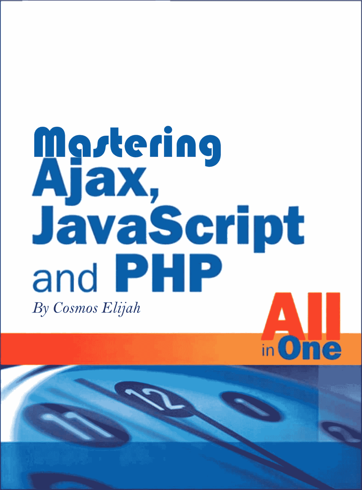


# 目录

序言

## 第一部分：Web 基础复习 | 7

### 第 1 章：Web 的原理 | 9
- 互联网简史 - 9
- 万维网 - 10
- 引入 `HTTP` - 14
- `HTTP` 请求与响应 - 15
- HTML 表单 - 17
- 总结 - 20

### 使用 `HTML` 和 `CSS` 编写和样式化页面 | 21
- 引入 `HTML` - 21
- `HTML` 元素 - 23
- 更多 `HTML` - 27
- 一些 `HTML` 标签 - 29
- 添加自定义样式 - 30
- 定义规则 - 31
- 添加一点 `class` - 31
- 应用样式 - 33
- 使用样式格式化文本 - 35
- 添加分割线 - 39
- 总结 - 40

### Ajax 的结构 | 41


## Ajax 的需求 41

## 介绍 Ajax 43

## Ajax 的组成部分 45

## 整合 47

## 总结 49

## 第二部分：使用 JavaScript 引入 Web 脚本 51

## 第 4 章：在 JavaScript 中创建简单的脚本 53

### 脚本工具 53
### 使用 JavaScript 显示时间 54
### 开始脚本 55
### 添加 JavaScript 语句 55
### 创建输出 56
### 将脚本添加到网页 57
### 测试脚本 58
### JavaScript 语法规则 65
### 使用注释 66
### JavaScript 最佳实践 67
### 总结 69

## 第 5 章：使用文档对象模型 (DOM) 71

### 理解对象 71
### 理解文档对象模型 (DOM) 72
### 处理网页文档 74
### 访问浏览器历史 77
### 使用 location 对象 78
### 总结 80

### 变量、字符串和数组 82
### 变量 85
### 表达式和运算符 87
### JavaScript 中的数据类型 89
### 处理字符串 92
### 使用数值数组 94
### 使用字符串数组 96
### 排序数值数组 98
### 总结 101

## 第 7 章：使用函数和对象 103

### 使用函数 103
### 介绍对象 108
### 使用对象简化脚本 109
### 扩展内置对象 112
### 总结 115

## 第 8 章：通过条件和循环控制流程 117

### if 语句 118
### 使用简写条件表达式 121
### 使用 if 和 else 测试多个条件 122
### 使用 switch 处理多个条件 124
### 使用 for 循环 125
### 使用 while 循环 128
### 使用 do…while 循环 128
### 处理循环 129


## 遍历对象属性 131

## 总结 134

## 第 9 章：使用内置函数和库 135

### 使用 `Math` 对象 135

### 使用 `Math` 函数 137

### 使用 `with` 关键字 139

### 处理日期 140

### 使用第三方库 143

### 其他库 144

### 总结 145

## 第三部分：引入 Ajax 147

## 第 10 章：Ajax 的核心——`XMLHTTPRequest` 对象 149

### 介绍 `XMLHTTPRequest` 149

### 创建 `XMLHTTPRequest` 对象 150

### 总结 156

## 第 11 章：与服务器通信 157

### 发送服务器请求 157

### 监控服务器状态 162

### 回调函数 163

### 总结 166

## 第 12 章：使用返回的数据 167

### `responseText` 属性 167

### 解析 `responseText` 170

### 提供用户反馈 172

### 总结 174

## 第 13 章：我们的第一个 Ajax 175

### 构建 Ajax 应用 175

### HTML 文档 176

### 添加 JavaScript 177

### 整合一切 180

## 第四部分：使用 PHP 进行服务器端脚本编程 185

## 第 14 章：了解 PHP 187

### PHP 基础 187

### PHP 脚本 190

### 总结 194

## 第 15 章：变量 195

### 理解变量 195

### 数据类型 197

### 处理数字 198

### 数字数据类型 200

### 数学函数 200

### 处理字符串 202

### 字符串格式 203

### 字符串函数 205

### 处理数组 206

### 数组函数 208

### 日期格式 209

### 处理时间戳 210

### 总结 213

## 第 16 章：流程控制 215

### 条件语句 215

### 循环 220


## 总结 222

## 第 17 章：函数 223

### 使用函数 223
### 参数与返回值 225
### 使用库文件 229
### 总结 229

## 第 18 章：使用类 231

## 面对象 PHP 231
### 什么是类？232
### 创建和使用对象 233
### 总结 236

## 第五部分：更复杂的 Ajax 技术 237

## 第 19 章：作为文本返回数据 239

## 从 `responseText` 属性获取更多内容 239
### 总结 245

# 第 20 章：AHAH——异步 HTML 和 HTTP 247

## 引入 AHAH 247
### 为 AHAH 创建一个小型库 248
### 使用 `myAHAHlib.js` 250
### 总结 255

## 第 21 章：作为 XML 返回数据 257

### 在 Ajax 中添加“x” 257
### `responseXML` 属性 258
### RSS 阅读器 262

# 第 22 章：Web 服务、REST 和 SOAP 271

### Web 服务简介 271
### 表述性状态转移 (REST) 272
### 实践中使用 REST 274
### 使用 SOAP 的 Web 服务 278
### SOAP 协议 279
### 使用 Ajax 和 SOAP 282
### 复习 SOAP 和 REST 283
### 总结 284

## 第 23 章：用于 Ajax 的 JavaScript 库 285

### Ajax 库 285
### 复习 `myAHAHlib.js` 286
### 实现我们的库 287
### 使用该库 290

## 第 24 章：Ajax 陷阱 295

### 常见错误 295
### 按钮 296
### 书签与链接 297
### 优雅地实现 Ajax 297
### 处理搜索引擎 298
### 指出活动元素 299
### 不要在不合适的地方使用 Ajax 299
### 安全性 300
### 跨平台测试代码 300
### Ajax 治愈糟糕的设计 301
### 一些编程陷阱 301
### 总结 302


## 第六部分：Ajax 工具与资源 (303)

## 第 25 章：prototype.js 工具包 (305)
- 介绍 `prototype.js` ... 305
- 封装 `XMLHTTPRequest`——Ajax 对象 ... 308
- 示例项目——股票阅读器 ... 311
- 总结 ... 313

## 第 26 章：使用 Rico (315)
- 介绍 `Rico` ... 315
- `Rico` 的其他界面工具 ... 320
- 总结 ... 324

## 第 27 章：使用 Script.aculo.us (325)
- 下载库 ... 325
- 引入文件 ... 326
- 使用特效 ... 326
- 构建脚本 ... 327
- 总结 ... 329

## 第 28 章：使用 XOAD (331)
- 介绍 `XOAD` ... 331
- `XOAD` HTML ... 334
- 使用 `XOAD` 进行高级编程 ... 337
- 总结 ... 338

## 附录：JavaScript、PHP 和 Ajax 网站 (339)
- `JavaScript` 网站 ... 339
- `PHP` 网站 ... 340
- Web 开发网站 ... 340
- `Ajax` 网站 ... 341

## 术语表 (343)

### 引言
在过去的十年里，万维网的范围已从一个相对简单的信息库增长为许多人寻求娱乐、教育、新闻或商业资源时的首选之地。网站本身不再局限于包含文本和可能的简单图像的几个静态页面；现在可用的工具允许开发具有高度交互性和吸引力的页面，涉及动画、视觉效果、上下文敏感内容、嵌入式生产力工具等。

制作此类页面的可用技术列表非常广泛。然而，基于开源许可的技术已并保持着极高受欢迎，这是因为它们通常准入门槛低（通常为零），并且通过互联网及其他地方提供了海量的用户贡献脚本、教程以及针对这些工具和应用程序的其他资源。在本书书中，我们详细介绍了如何使用服务器端和客户端编码技术编写流动的、交互式的网站，以及如何结合这些技术使用 `Ajax` 产生流畅的、类于桌面应用程序的用户体验。

本书中使用的编程语言包括无处不在的 `JavaScript`（用于客户端编程）和极其流行的开源 `PHP` 语言（用于服务器端脚本，并在大多数 Web 托管软件包中可用）。我们详细描述了 `Ajax` 编程的基础知识，还介绍了几个高级开源框架的使用，这些框架包含了预先编写的代码，用于快速构建尖端的交互式站点。

### 什么是 Ajax？
`Ajax` 代表异步 JavaScript 和 XML（Asynchronous JavaScript And XML）。严格来说，`Ajax` 本身并不是一种技术，它以一种独特的方式将常用的编程技术混合在一起，使 Web 开发人员能够构建出比我们习惯的界面更具吸引力的 Internet 应用程序。

在使用流行的桌面应用程序时，我们期望工作结果能够立即可用，无需费力，也不需要等待程序重绘整个屏幕。例如，在使用如 `Excel` 的电子表格时，我们期望在一个单元格中做的更改能够立即传播到相邻单元格，同时我们还可以继续打字、滚动页面或使用鼠标。

遗憾的是，这种交互对于 Web 应用程序用户来说很少可用。更常见的体验是向表单字段输入数据，点击按钮或超链接，然后坐等页面缓慢重新加载以显示请求结果。此外，我们经常发现重新加载的页面的大部分元素与前一个页面完全相同，因此被不必要地重新加载了；背景图像、Logo 和菜单是频繁的罪魁祸首。`Ajax` 为我们承诺了一个解决这一问题的方案。通过在用户浏览器和 Web 服务器之间充当一个额外层，`Ajax` 在后台处理服务器通信，提交服务器请求并处理返回的数据。结果随后可以无缝地集成到正在查看的页面中，而无需刷新该页面或加载新页面。

在 `Ajax` 应用程序中，此类服务器请求并不与用户操作（如点击按钮或链接）同步。一个编写良好的 `Ajax` 应用程序可能已经向服务器请求并收到了用户所需的数据——也许在用户甚至不知道自己想要这些数据之前。这就是 `Ajax` 缩写中“异步”部分的含义。

`Ajax` 应用程序中发生在用户浏览器“内部”的部分（如发送服务器查询和处理返回的数据）是用 `JavaScript` 编写的，而 `XML` 成为一种日益流行的编码和传输格式化信息的手段，`Ajax` 利用它高效地在服务器和客户端之间传输数据。


本书主要面向希望为自己的 Web 应用程序用户构建更佳界面的 Web 开发者，以及希望将桌面应用程序迁移到互联网的程序员。

# 设置你的工作空间

虽然你可以使用简单的文本编辑器来编写书中的代码，但要运行示例程序，你需要一台运行着现代浏览器（如 Internet Explorer 或 Firefox）的电脑（安装有 Windows、Mac 或 Linux 操作系统）。

你可以从 [`www.microsoft.com/`](http://www.microsoft.com/) 下载 Microsoft Windows Explorer，并从 [`www.mozilla.com/.`](http://www.mozilla.com/) 下载最新版本的 Firefox。

你还需要将文件加载到 Web 服务器上——如果你已经有一个支持 `PHP` 的 Web 主机，可以使用那里的网络空间。或者，附带的 CD 包含了你搭建自己的私用 Web 服务器所需的所有内容，它可以运行在你自己的 PC 上或网络中的其他电脑上。

 # 简介

### CD 中包含的内容

附带的 CD 包含了你从书中获得最佳体验所需的一切。你将在 CD 中找到：

- `XAMPP`：一个完整的开源编译包，你可以用它在电脑上轻松安装 `Apache` Web 服务器、`PHP` 语言和 `MySQL` 数据库管理器。提供了 Linux、Mac 和 Windows 环境的版本。
- `jEdit`：一个基于 Java 的程序员编辑器，非常适合创建或修改代码。CD 包含了适用于 Java、Mac 或 Windows 的文件。
- 一系列用于开发复杂 Web 应用程序的开源框架。书末展示了基于其中一些框架的编程示例。

# 第一部分：Web 基础回顾


| 第 1 章 | Web 的原理 | 9 |
| 第 2 章 | 使用 HTML 和 CSS 编写和样式页面 | 21 |
| 第 3 章 | Ajax 应用程序结构 | 41 |

# 第 1 章：Web 的原理


## 你在本章将学习到：

- 互联网简史
- 万维网 (World Wide Web)
- 简介 HTTP
- HTTP 请求与响应
- HTML 表单

书中有很多内容要介绍，让我们开始吧。我们将在本章回顾万维网以及它从何而来。随后，我们将查看使其运行的一些组件，特别是用于请求和交付页面的 `HTTP` 协议。

### 互联网简史

20 世纪 50 年代末，美国政府成立研究计划署 (`ARPA`)。这很大程度上是对俄罗斯成功发射卫星对美国顶尖科学界的回应。20 世纪 60 年代，该机构创建一个名为 `ARPAnet` 的去中心化计算机网络。该网络最初连接了位于加州大学洛杉矶矶分校、斯坦福研究所、加州大学圣塔芭拉分校和犹他大学的四台电脑，并在 70 年代初增加了更多节点。该网络最初是使用当时新的数据包交换技术设计的，旨在作为一个即使某些节点被核攻击摧毁也能保持运行的通信系统。电子邮件在 1972 年实现，紧接着是用于登录远程电脑的 `telnet` 协议和文件传输协议 (`FTP`)，实现了计算机之间的文件传输。该网络在随后的几年里通过对其协议和工具的许多改进得到了进一步增强。然而，直到 1989 年，蒂姆·伯纳斯·李 (Tim Berners-Lee) 和他在欧洲物理实验室 `CERN` (Conseil pour la Recherche) 的同事们提出了超文本链接文档的概念，现在熟悉的万维网才开始成形。1993 年出现了第一个图形化浏览器 `Mosaic`，它是著名的 `Netscape Navigator` 的先驱。超文本页面和超链接的使用定义了我们今天认为是标准的页面界面模型。

### 万维网

万维网使用客户端/服务器原理运行。当你向浏览器输入 Web 页面的 `URL`（Web 地址）并点击“转到”时，你请求浏览器向拥有该地址的特定电脑发送 `HTTP` 请求。在收到请求后，该电脑向你“提供”浏览器可以解释并显示的所需的页面。图 1.1 展示了这种关系。当然，服务器和客户端电脑位于世界的任何地方。

图 1.1
Web 服务器与客户端（浏览器）如何交互。

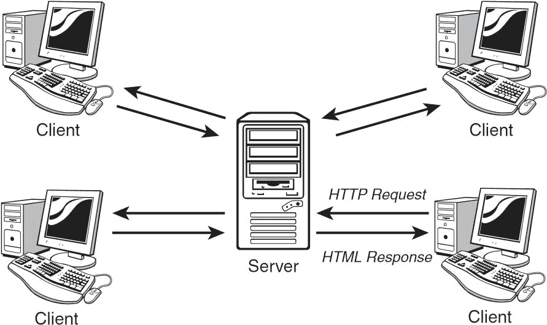稍后我们将讨论 `HTTP` 请求的细节。现在，只需说明你的 `HTTP` 请求包含了若干信息，以便你的页面被正确识别并提供给你，包括：

- 存储页面的域名（例如，`mydomain.com`）
- 页面名称（这是服务器文件系统中的文件名——例如，`mypage.html`）
- 你想随请求发送的任何参数的名称和值

### 什么是网页？

任何具有万维网使用经验的人都会熟悉“网页”这个术语。网站传统的用户界面涉及访问者在系列连接的页面之间导航，每个页面包含文本、图像等，就像杂志页面一样。通常来说，每个网页实际上是服务器上的一个独立文件。构成网站的各个页面由一个称为 Web 服务器的程序管理。

## Web 服务器

  Web 服务器是一个解释 `HTTP` 请求并浏览器可以理解的形式交付适当网页的程序。有很多示例可用，大多数运行在 UNIX/Linux 操作系统或某些版本的 Microsoft Windows 下。

| “Web 服务器”一词在日常口语中常指代 Web 服务器程序（如 `Apache`）以及运行它的电脑。 | 也许最著名的服务器应用程序是来自 Apache 基金会 [(http://www.apache.org),](http://www.apache.org) 的 Apache Web 服务器，这是一个用于服务全球数百万网站的开源项目（见图 1.2）。另一个例子是微软的 `IIS` (Internet Information Services)，通常用于运行 Microsoft Windows 操作系统的宿主机。并不是所有基于 Windows 的 Web 主机都使用 `IIS`。Windows 还有其他各种 Web 服务器，包括流行的 Apache Web 服务器的版本。 | 注意！由路 |

图 1.2
在 Internet Explorer 中显示的 Apache 基金会主页 [`www.`](http://www.apache.org/) [apache.org/](http://www.apache.org/)。

## 服务端编程

 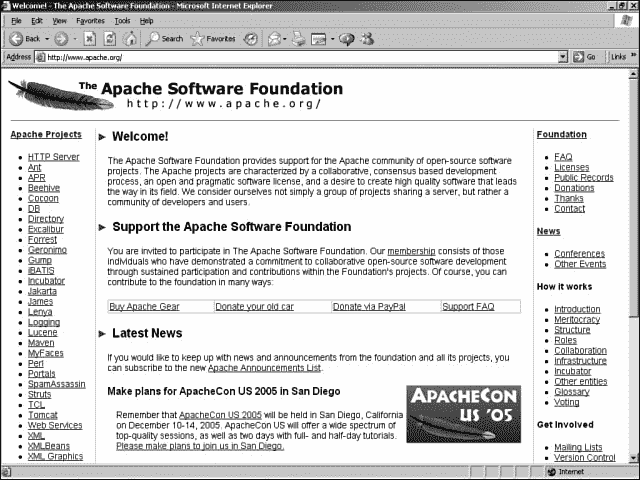 服务端程序、脚本或语言是指运行在服务器电脑上的程序。服务端编程有许多语言和工具可用，包括 `PHP`、`Java` 和 `ASP`（后者仅在运行 Microsoft Windows 操作系统的服务器上可用）。复杂的服务器设置通常还包含可供服务端脚本访问的数据库信息。

本书中的服务端编程是使用流行的 `PHP` 脚本语言进行的，它灵活、易于使用，并且可以在几乎所有的服务器上运行。

然而，Ajax 无论配合任何服务端脚本语言都能同样良好地工作。


此类脚本的目的是多方面的。但总的来说，它们都旨在设计为在向你返回网页之前对其进行预处理。这意味着页面的部分或全部内容将经过修改，以适应你请求的上下文——例如，显示往特定目的地在特定日期的火车时刻，或者只显示目录中符合你陈述的爱好和兴趣的产品。

通过这种方式，服务器端脚本允许网页提供丰富且多样化的内容，而这些内容是仅使用静态页面（即内容固定的页面）的设计范围无法实现的。


万维网

## 网络浏览器

### 网络浏览器的定义
网络浏览器是安装在网络冲浪者计算机上的一个程序，用于解释和显示网页。第一个图形化浏览器 `Mosaic` 最终发展变为由 Netscape 的著名系列浏览器。

| 我们所说的图形化浏览器是指不仅能显示 HTML 文档的文本元素，还能显示图像和颜色的浏览器。通常，此类浏览器具有使用鼠标或类似指向设备的点击式界面。也存在基于文本的网络浏览器，其中最为为人的是 [Lynx](http://lynx.browser.org/)，它在终端、终端模拟器以及如 DOS 等带有命令行界面的操作系统等基于字符的显示器显示 HTML 页面。Netscape 系列浏览器曾是最成功的可用产品，后来微软的 Internet Explorer 也加入了其中，并随后主导了市场。然而，近期的竞争努力引入了大量的竞争性浏览器产品，包括 `Opera`、`Safari`、`Konqueror`，尤其是 Mozilla 的 `Firefox`，这是一种开源网络浏览器，最近获得了狂热追随者（见图 1.3）。许多计算机操作系统都提供各种浏览器，包括 Microsoft Windows 的各个版本、UNIX/Linux 和 Macintosh，以及从移动电话到 PDA（个人数字助理）再到口袋电脑的其他计算设备。 | 顺便说 |

图 1.3
来自 Mozilla.org 的 Firefox 浏览器正在浏览

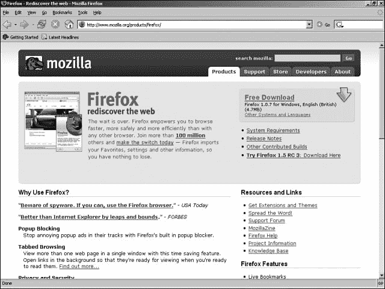Firefox 项目主页。

## 客户端编程

我们已经讨论了服务器脚本如何通过提供包含丰富多化内容的页面（这些内容在服务器端创建并在发送给你之前插入页面中）来改进你的网页体验。

另一方面，客户端编程不是发生在服务器上，而是在用户接收页面后直接发生在浏览器内部。此类脚本允许你执行许多与接收到的页面数据相关的任务，包括执行计算、更改显示颜色和样式、检查用户输入的有效性等等。

几乎所有浏览器都支持某种版本的名为 `JavaScript` 的客户端脚本语言，它是 `Ajax` 的不可或缺的一部分，也是我们在这书中将用于客户端编程的语言。

## DNS—域名系统服务

每台连接到互联网的计算机都被分配了一个唯一的数字地址（称为 `IP 地址`）。然而，当你想要在浏览器中查看特定网站时，你通常不想输入一串数字——你想要使用该网站的域名。毕竟，记住 [`www.somedomain.com`](http://www.somedomain.com) 比记住类似 `198.105.232.4` 的内容要容易得多。

当你通过域名请求网页时，你的互联网服务提供商会将该域名提交给 `DNS` 服务器，服务器会尝试查找与名称相关的数据库条目并获取相应的 `IP 地址`。如果成功，你就会连接到该站点；否则，你会收到一个错误。

互联网上的许多 `DNS` 服务器连接成一个网络，该网络随着变化不断更新自身。当网站的 `DNS` 信息发生变化时，修订后的地址信息会传播到整个互联网的 `DNS` 服务器中，通常在约 24 小时内完成。

## 介绍 HTTP

万维网上的通信使用了多种协议，其中最重要的可能是 `HTTP`，该协议也是 `Ajax` 应用的基础。

当你通过在 Web 浏览器中输入其地址来请求网页时，该请求是使用 `HTTP` 发送的。浏览器是一个 `HTTP` 客户端，而网页服务器（意不意外地）是一个 `HTTP` 服务器。


HTTP 请求与响应

本质上，`HTTP` 定义了一组关于消息和其他数据在服务器和浏览器之间如何格式化和交换的规则。

| 关于 HTTP 的详细说明，Sams Publishing 提供了 Chris Shiflett 编写的《HTTP 开发者手册》。HTTP 请求与响应。`HTTP` 协议可以被比作基于一系列问答的对话，我们分别将其称为 `HTTP` 请求和 `HTTP` 响应。。`HTTP` 请求和 `HTTP` 响应的内容易于阅读和理解，其语法接近纯英语。本节将检查这些请求和响应的结构，以及它们可能包含的一些数据示例。HTTP 请求。在与目标服务器建立连接后，`HTTP` 客户端以以下格式传输请求：
  1. 一行起始行。
  2. 可选的若干行头部行。
  3. 一个空行。
  4. 可选的消息体
起始行通常被分为三部分：方法名称、所需服务器资源的 `path`，以及正在使用的 `HTTP` 版本。典型的起始行可能如下：`GET /sams/testpage.html HTTP/1.0` 在这一行中我们告诉服务器我们要发送一个 `GET` 类型的 `HTTP` 请求（将在下一节详细介绍），我们使用 `HTTP` 版本 `1.0`，我们请求的服务器资源是 `/sams/testpage.html`。在本例中服务器资源在本地，所以我们使用了相对路径。它可能在其他服务器上，在这种情况下服务器资源将包含完整的 URL。 | 你知道吗？| 顺便说 |


头部行用于发送请求信息或关于消息体的信息。每行发送一个参数值对，参数和值用冒号分隔。这里有一个例子：`User-Agent: [发送请求的程序名称]`

例如，Internet Explorer 5.5 提供的类似于：

`User-agent: Mozilla/4.0 (compatible; MSIE 5.5; Windows NT 5.0)`

另一个常见的请求头部示例是 `Accept:` 头部，它说明了从服务器接受哪些类型的信息：

`Accept: text/plain, text/html`

通过发布上述示例中的头部，请求正在通知服务器它可以接受纯文本或 HTML 响应（也就是说，它无法处理例如音频或视频文件）。

`HTTP` 请求方法包括 `POST`、`GET`、`PUT`、`DELETE` 和 `HEAD`。对于本书而言，最有趣的是 `GET` 和 `POST` 请求。`PUT`、`DELETE` 和 `HEAD` 请求在此不介绍。

### HTTP 请求
### HTTP 与响应
在响应此类请求时，服务器通常发布一个 `HTTP` 响应，其第一行通常被称为状态行。在该行中，服务器回显 `HTTP` 版本并给出响应状态码（一个三位整数）和一个被称为原因短的短消息。这里有一个 `HTTP` 响应示例：

```
HTTP/1.0 200 OK
```


响应状态码和原因短（reason phrase）本质上是同一消息的机器和人类可读版本，尽管原因短在不同服务器之间可能会略有不同。表 1.1 列出了一些常见状态码和原因短的示例。状态码的第一位通常提供了关于消息性质的某些线索：

- `1`—信息
- `2`—成功
- `3`—重定向
- `4`—客户端错误
- `5`—服务器错误

### HTML 表单

#### 表 1.1 一些常见的 HTTP 响应状态码

| 状态码 | 解释 |
| :--- | :--- |
| 200 - OK | 请求成功。 |
| 204 - No Content | 文档不包含数据。 |
| 301 - Moved Permanently | 资源已永久移动到不同的 URI。 |
| 401 - Not Authorized | 请求需要用户认证。 |
| 403 - Forbidden | 服务器拒绝执行请求。 |
| 404 - Not Found | 服务器上不存在请求的资源。 |
| 408 - Request Timeout | 客户端未在服务器允许的时间内发送请求。 |
| 500 - Server Error | 由于脚本故障、服务器配置错误或类似原因。 |

#### 你知道吗？

| 状态码的详细列表由世界维网联盟（W3C）维护，可以在 [`www.w3.org/Protocols/rfc2616/rfc2616-sec10.html`](http://www.w3.org/Protocols/rfc2616/rfc2616-sec10.html) 获取 |

响应可能还包含多个头部行，每行都包含一个头部和值对，类似于 HTTP 请求中的头部值对，但通常包含关于服务器和/或返回资源的信息：

`Server: Apache/1.3.22`
`Last-Modified: Fri, 24 Dec 1999 13:33:59 GMT`

#### HTML 表单

网页中通常包含供你输入信息的字段。示例包括选择框、复选框以及你可以输入信息的字段。表 1.2 列出了一些流行的 HTML 表单标签。

#### 表 1.2 一些常见的 HTML 表单标签

| 标签 | 说明 |
| :--- | :--- |
| `<form>...</form>` | 整个表单的容器 |
| `<input />` | 数据输入元素；包括文本、密码、复选框和单选按钮字段，以及提交和重置按钮 |
| `<select>...</select>` | 下拉选择框 |
| `<option>...</option>` | 选择框内的选项 |
| `<textarea>...</textarea>` | 多行的文本输入字段 |

在完成表单后，你通常会被邀请使用带有适当标签的按钮或其他页面元素来提交表单。

此时，HTML 表单会根据用户输入的数据构建并发送 HTTP 请求。表单可以使用 `GET` 或 `POST` 请求类型，这由 `<form>` 标签的 `method` 属性指定。

### GET 和 POST 请求

偶尔你可能会听到有人说，`GET` 和 `POST` 请求的区别在于 `GET` 请求仅用于 `GETting`（即获取）数据，而 `POST` 请求有许多用途，例如上传数据、发送邮件等。

虽然这个经验法则可能有些合理之处，但从构建方式的角度考虑这两种 HTTP 请求之间的差异是很有启发意义的。

`GET` 请求将它发送的消息编码为查询字符串，该字符串被附加到服务器资源的 URL 之后。相反，`POST` 请求将其消息发送在请求的消息体（message body）中。此时实际发生的情况是，输入的数据被编码，并通过 HTTP 请求发送到表单 `action` 属性中声明的 URL，提交的数据将在那里将以某种方式进行处理。

HTTP 请求是 `GET` 类型还是 `POST` 类型，以及表单发送到的 URL，都是在表单的 HTML 标记中确定的。让我们来看典型表单的 HTML 代码：

```html
<form action="http://www.sometargetdomain.com/somepage.htm" method="post">
Your Surname: <input type="text" size="50" name="surname" />
<br />
<input type="submit" value="Send" />
</form>
```

这段代码段嵌入网页中时，会生成图 1.4 所示的简单表单。

让我们逐行查看代码。首先，我们使用 `<form>` 标签开始表单，在这个示例中，我们为该标签提供了两个属性。`action` 属性决定了提交的表单将发送到的 URL。这可能是同一服务器上的另一个页面（由相对路径描述），也可能是远程域名，如图 1.4 中表单背后的代码所示。

接下来我们找到 `method` 属性，它决定了我们希望使用 `GET` 还是 `POST` 请求提交数据。

#### HTML 表单

#### 图 1.4
一个简单的 HTML 表单。

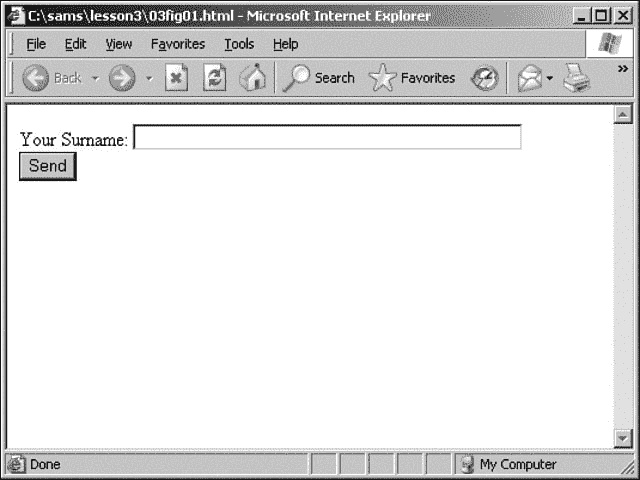现在假设我们通过在 `surname` 字段中输入值 `Ballard` 完成了表单。当点击 Send 按钮提交表单时，我们带到 `http://www.sometargetdomain.com/somepage.htm`。

HTML 表单会根据用户输入的数据构建并发送 HTTP 请求。表单可以使用 `GET` 或 `POST` 请求类型，这由 `<form>` 标签的 `method` 属性指定。

#### HTML 表单
通过在许多情况下，你可以使用 `POST` 或 `GET` 方法提交表单，并获得本质相同的结果。然而，当你学习如何构建 Ajax 程序的服务器调用时，这种区别就变得重要了。

所有 Ajax 应用程序的核心 `XMLHTTPRequest` 对象使用 HTTP 向服务器发送请求并接收响应。这些 HTTP 请求的内容与提交 HTML 表单时生成的请求本质上是相同的。

#### 总结
本章回顾了世界维网的历史和架构，并涵盖了使用 HTTP 协议进行服务器请求和响应的基础知识。


特别是，我们讨论了 `GET` 和 `POST` 请求是如何构建的，以及它们如何在 HTML 表单中使用的。此外，我们还看到可能会从服务器接收到的这些请求的响应示例。

# 第 2 章

## 使用 HTML 和 CSS 编写和样式页面


### 本章你将学到：

* 介绍 HTML
* HTML 页面的元素
* 更高级的 HTML 页面
* 一些实用的 HTML 标签
* 添加你自己的样式
* 定义规则
* 添加一点 `class`
* 应用样式
* 使用样式对文本进行格式化
* 添加线条

在本章中，我们将介绍 HTML，这是万维网上几乎每个页面背后的标记语言。良好的 HTML 知识为后续章节中讨论的 Ajax 应用提供了良好的基础。

## 介绍 HTML

在本书书中试图详尽地介绍 HTML（超文本标记语言）——或者说，Ajax 的任何其他组件技术都是不恰当的。相反，我们将回顾基本原理并提供一些代码示例来解释它们，特别关注当我们开始开发 Ajax 应用时会相关的主题。

### 什么是 HTML？

万维网由数百万个单独页面组成，而这些页面通常用超文本标记语言编写，通为人知的称为 HTML。

这个名字透露了许多关于 HTML 本质的信息。我们使用它来标记文本文档，以便网络浏览器知道如何显示它们，并定义内部的超文本链接以提供页面内或页面之间的导航。

任何（像我一样）能记得旧的非 WYSIWYG（所见即所得）文字处理程序的人都会对文本标记已经熟悉。这些旧应用程序中的大多数要求在你想显示为（例如）**粗体**、*斜体*或下划线文本的文本段开头和结束处放置特殊字符。

### 编写 HTML 需要哪些工具？

由于 HTML 标记中使用的元素仅采用普通的键盘字符，因此你实际上只需要一个好的文本编辑器来构建 HTML 页面。有很多编辑器可供选择，大多数操作系统都至少安装了其中一个程序。如果你使用的是某个版本的 Windows，例如内置的 `Notepad`（记事本）应用程序就可以正常工作。

| 光盘上的你可能知道 | 虽然 `Notepad` 是一个非常实用的文本编辑器，但有很多所谓的程序员编辑器可供选择，提供了许多实用的额外功能，如行号和语法高亮。其中许多采用开源许可协议，并且可以免费下载和使用。考虑使用此类编辑器是非常值得的，特别是对于较大或更复杂的编程任务。使用文字处理软件可能会导致问题，因为不希望的标记以及此类程序经常嵌入输出代码中的其他符号会产生干扰。如果你选择使用文字处理程序，请确保它能够将文件保存为纯 ASCII 文本。随书附带的光盘包含了流行且强大的 `jEdit` 程序- |


```html
<! DOCTYPE HTML PUBLIC "-//W3C//DTD HTML 4.01 Transitional//EN"
"http://www.w3.org/TR/html4/loose.dtd">
<html>
<head>
<title>A Simple HTML Document</title>
```

### HTML 页面的元素

**列表 2.1 继续**


```html
</head>
<body>
<h1>My HTML Page</h1>
欢迎来到我第一个用 HTML 写的页面。<br /> 这只是一个带有 HTML 标记的文本文档，用于在 <b>粗体 (bold) </b> 中显示一些单词，并在 <i>斜体 (italics) </i> 中显示另另一些单词。
<br />
</body>
</html>
```


现在将文档保存到计算机的某处，将其命名为 `testpage.html`。

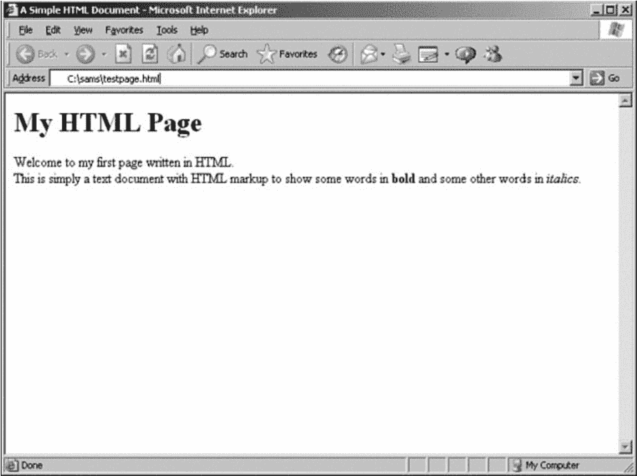如果你现在将该页面加载到你喜欢的浏览器中（如 `Internet Explorer` 或 `Firefox`），你应该能看到类似图 2.1 所示的窗口。

**图 2.1**
在 Internet Explorer 中显示的我们的测试文档。

### HTML 页面的元素

让我们更详细地查看列表 2.1。

页面上的第一个元素被称为 `DOCTYPE` 元素。它的目的是通知浏览器文档中所使用的 HTML “变体”。本书中使用的 `DOCTYPE` 元素指的是 HTML 4.0 Transitional，这是一个相当宽容的 HTML 规范版本，它允许在使用最新的 HTML 4.0 规范的同时，允许使用一些早期的标记样式和结构。

`DOCTYPE` 元素必须始终出现在 HTML 文档的开头。

接下来，注意文档的其余部分被页面开头的 `<html>` 元素和结尾的 `</html>` 元素包围。这些标签通知浏览器之间的内容应该被解释并显示为 HTML 文档。

注意 尽管许多现代浏览器在没有这些标签的情况下也能正确显示 HTML，但省略它们是不良做法。即使页面在你的电脑上显示正常，你也不知道访问者在使用什么操作系统和浏览器——这些外部标签内的文档被进一步分为两个部分。第一部分包含在 `<head>` 和 `</head>` 之间，第二部分包含在 `<body>` 和 `</body>` 之间。基本上，文档的头部用于存储不在浏览器窗口中显示的信息，而文档的身体部分包含要解释和显示的内容。

#### 文档的 <head>

从列表 2.1 我们可以看到，我们简单文档头部只有一行——包含在 `<title>` 和 `</title>` 标签中的 `A Simple HTML Document`。

记住，头部包含不在浏览器窗口中显示的信息。因此，这并不是页面文本顶部显示的标题，你可以再次查看图 2.1 来确认这一点。文档标题也不是文档的文件，在本例中是 testpage.html。

事实上，文档标题履行着许多功能，其中：

* 搜索引擎经常使用页面标题（以及其他因素）来帮助它们判断页面关于什么。
* 当你书签页面时，默认通常以文档标题保存。
* 大多数浏览器在最小化时，会在图标或任务栏按钮上显示当前文档的标题。

因此，为你创建的页面选择一个有意义且具描述性的标题是非常重要的。文档头部还使用了许多其他类型的元素，包括 `link`、`meta` 和 `script` 元素。虽然我们在这里没有对它们进行介绍，但它们会在书中出现时对其进行描述。

#### <body>

再次参考列表 2.1，我们可以清楚地看到文档身体部分的内容是由我们想在页面上显示的文本以及帮助我们定义这些文本外观的标签组成的。

例如，为了定义某些单词应以粗体形式显示，我们将这些单词包含在 `<b>` 和 `</b>` 标签中。同样，为了将某些单词转换为*斜体*，我们可以使用 `<i>` 和 `</i>` 标签。


标题 `My HTML Page` 被封装在 `<h1>` 和 `</h1>` 标签之间。这些标签表示我们意图将包含的文本作为标题。HTML 允许六级标题，从 `h1`（最显著）到 `h6`。你可以使用任何中间值 `h2`、`h3`、`h4` 和 `h5` 来显示具有不同层级子标题的页面，例如对应于章节、节和段落标题。显示在页头标签内的任何内容都会独占一行显示。

到为止讨论的所有标签都是容器——也就是说，它们由起始标签和结束标签组成，你可以在它们之间放置想要让这些标签作用的文本。然而，某些元素不是容器而是可以单独使用。列表 2.1 显示了其中一个元素：`<br />` 标签，它表示换行。另一个例子是 `<hr />`（水平线）。

| 如果你想在 HTML 页面的正文部分编写内容，但不希望它被浏览器解释并因此显示在屏幕上，你可以这样做 | 你知道吗？ |

通过将其作为注释。HTML 注释以字符字符串 `<!-` 开始，以字符串 `-->` 结束，如下例所示：


<!-- 这仅仅是一个注释，不会在浏览器中显示 -->

### 为 HTML 元素添加属性

有时需要指定标记标签的的确切行为。在这些情况下，你可以添加（通常在起始标签内）参数和值对（称为属性），以更改元素的行为：

```html
< body bgcolor="#cccccc” >
… 页面内容在此处 …
< /body >
```

在这个例中，`<body>` 标签的行为通过通过调整其 `BGCOLOR`（背景颜色）属性为浅灰色被修改了。图 2.2 显示了如果将此设置应用于我们的文件 `testpage.html` 会产生的效果：

图 2.2

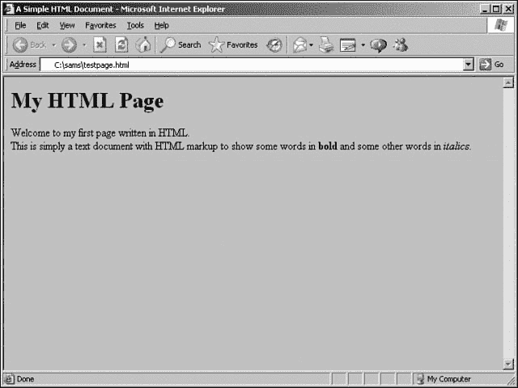我们的身体颜色改为灰色的测试页面。

| 你知道吗？ | HTML 中的颜色值使用十六进制系统编码。每个颜色值由三个分量值组成，分别对应红、绿、蓝。每个颜色值的范围可以从十六进制 `00` 到十六进制 `ff`（十进制表示法中的 0 到 255）。三个十六进制数字连接成一个带有哈希字符 (#) 前缀的字符串。因此，颜色值 `#000000` 对应黑色，`#ffffff` 对应纯白色。可以通过 `` 标签在页面中插入图像。在这种情况下，我们使用 `src` 属性将图像源文件指定为参数。通过这种方式更改图像显示的其他方面包括图像的边界、宽度和高度：
```html
< img src=”myimagefile.jpg” border=”2” width=”250” height=”175” />
```
边界宽度、图像宽度和图像高度是像素（屏幕上单个图像元素形成的“点”）。图像的另一个很有用的属性是 `alt`，它是替代文本（alternative text）的缩写。它指定图像的简短描述，提供给那些浏览器无法或配置为不显示图像的用户。替代文本对于让视觉障碍和其他残障的人士能够访问你的网站也很重要：


```html

```

### 更高级的 HTML 页面

#### 表格

通常你想以表格格式显示信息，HTML 有一组专门为此目的设计的元素：

```html
< table >
<tr><th>Column Header 1</th><th>Column Header 2</th></tr>
<tr><td>Data Cell 1</td><td>Data Cell 2</td></tr>
<tr><td>Data Cell 3</td><td>Data Cell 4</td></tr>
</table >
```

`<table>` 和 `</table>` 标签包含其他标签的嵌套层级，包括 `<tr>` 和 `</tr>`（定义单个表格行）；`<th>` 和 `</th>`（指示表格表头的单元格）；以及 `<td>` 和 `</td>`（包含单个表格数据单元格）。

请图 2.3 查看表格在浏览器窗口中显示时的示例。

#### 超链接

超文本链接（超链接）是 HTML 操作的基础。通过点击超链接，你可以导航到一个新位置，无论是当前页面的另一个点，还是完全另一个网站上另一个页面的某一点。

链接包含在 `<a>` 或锚点标签中，这是一种容器标签，封装了将成为链接的内容。链接的目标作为参数 `href` 传递给此标签：

```html
Here is <a href=”newpage.html”>my hyperlink</a>
```

点击前面示例中的单词 `my hyperlink` 会导致浏览器请求 `newpage.html` 页面。

| 超链接可以包含图像或代替文本。看这个例子：< a href=”newpage.html”></a > | 你知道吗？ |

在这里，用户可以点击图像 `picfile.gif` 导航过去。

更高级的 HTML 页面（注：输入文本包含了重复/混乱的段落。我将按照要求格式化特定的文本）。


| `th` | 表头单元格 |
| `td` | 表体单元格 |
| `ul` | 无序列表 |
| `ol` | 有序（编号）列表 |
| `li` | 无序或有序列表中的列表项 |

# 你知道吗？

| 世界维网联盟（W3C）负责管理 HTML、HTTP、XML 以及许多其他网络技术的定义。其网站为 [`www.w3.org/`](http://www.w3.org/)。 |

## 添加你自己的样式


正如你已经学到的，HTML 是被作为一种标记语言编写的，用于定义文档的结构（段落、标题、表格等）。尽管它从未被打算成为一种桌面出版工具，但它确实包含了一些基本的格式属性，例如 `font-size`、`align` 以及前的 `bgcolor`。1996 年，W3C 首次建议使用级联样式表（CSS）的概念来格式化 HTML 文档。该建议在 1998 年中期进行了更新，使 Web 开发人员能够将文档的结构和格式分离开。

CSS 建议描述了以下三种类型的样式表：

1. **嵌入式 (Embedded)**：样式属性包含在 HTML 文档顶部的（`<style>` 标签内）。分配给特定标签的样式适用于此类文档中的所有该标签。在本书中，你经常看到嵌入式样式表。
2. **内联式 (Inline)**：样式属性贯穿整个 HTML 页面。每个 HTML 标签在页面中出现时都会接收其特有的样式属性。
3. **链接式 (Linked)**：样式属性存储在单独的文件。该文件可以使用放在 `<head>` 标签内的 `<link>` 标签链接到任何 HTML 文档。

在接下来的章节中，你将学习如何构建这些样式表以及如何将它们应用到你的文档中。

 添加一点 class

| 即使没有样式表提供的所有格式优势，Web 开发人员也可以欣喜地知道，使用样式表无疑是他们遇到过的最大的省时间工具。 | 你知道吗？ |

因为你可以将样式表应用到任意数量的 HTML 文档中，更改只需要几分钟而不是几天。

在样式表出现之前，如果你想更改网站中特定标签的显示，你必须打开每个文档，找到你想要更改的标签，进行更改，保存文档，然后继续处理下一个文档。有了样式表，你可以在单个样式表文档中更改标签，并让更改立即生效于所有链接到它的页面。

## 定义规则

样式表规则由选择器（接收样式的 HTML 标签）和声明（样式表属性及其值）组成。在接下来的示例中，选择器是 `body` 标签，声明由样式属性（`background`）及其值（`black`）组成。此示例将整个文档的背景颜色设置为黑色。

```css
body {background:black}
```

你可以看到，在样式表中，HTML 标签没有像在 HTML 文档中那样被括号包围，而声明被大括号包围。声明可以包含多个属性。接下来的示例还将将此页文本颜色设置为白色。注意这两个属性之间用分号隔开。

```css
body {background:black; color:white}
```

如果你想对多个 HTML 标签应用相同的规则，你可以将这些规则组合在一起，如下例所示：

```css
body, td, h1 { background:black; color:white }
```

## 添加一点 class

正如俗话所说，规则是用来打破的。如果你不想让文档中的每一个 `h1` 标题在黑色背景上都是白色怎么办？也许你希望每隔一个 `h1` 标题在白色背景上是黄色的。让我向你介绍 `class` 属性。你可以将此属性应用到几乎每个 HTML 标签，它几乎就像创建你自己的标签一样。

图 2.4 显示了一个相当标准的 HTML 页面，它在页面顶部使用青色表格来存放导航链接，并在文档各处使用黄色表格放置其他表格内容。你可以在图 2.5 中看到该页面的 HTML 文档。

**图 2.4**
一个不同格式化两个表格的 HTML 页面。

**图 2.5**
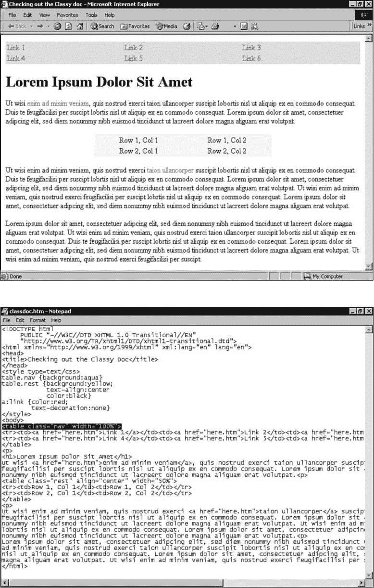 图 2.4 中页面的 HTML 文档。注意每个 `<table>` 标签中的 `class` 属性。

## 应用样式

仔细观察图 2.5 中的样式属性。该文档在 `<style>` 标签内定义了两个 `table` 样式。HTML 标签名 `table` 后面跟着一个点（`.）和 `class` 名称（`nav` 和 `rest`）。

```css
table.nav {background:aqua} table.rest {background:yellow; text-align:center; color:black}
```

当文档正文中引用表格时，你必须应用 `class` 属性告诉浏览器应该应用哪些样式属性。此示例中每个表格的 HTML 标记出现在以下 HTML 代码中。

你可以看到，`class` 名称出现在引号内，就像其他 HTML 属性一样（以及如此处所示的 `width` 属性一样）。

```html
<table class="nav" width="100%">
<table class="rest" width=50%>
```

### 应用样式（详细方法）

在继续之前，我们将快速介绍如何应用样式属性。记住，你有三种方法来添加样式表：嵌入式、链接式和内联式。

#### 嵌入式样式
 所有样式都定义在文档顶部的 `<head>` 标签内，因为它们包含了整个文档的信息。这里定义的样式仅适用于它们所在的文档。如果你计划在另一个文档中使用这些样式，也需要添加它们。

```html
<head>
<style type="text/css">
table.nav {background:aqua}
table.rest {background:yellow; text-align:center; color:black}
</style>
</head>
```

#### 链接式样式
链接样式表将所有样式属性存储在单独的文件。然后将该文件链接到你想显示这些样式属性的每个 HTML 文档。

```html
<head>
<link rel="stylesheet" href="mystyles.css" type="text/css">
</head>
```

通过这种方法，我创建名为 `mystyles.css` 的单独文件（级联样式表），其中包含了所有的样式属性。你可以看到这里出现了相同的 `type="text/css"` 属性。以下是 `mystyles.css` 文件的全部内容。

```css
table.nav {background:aqua}
table.rest {background:yellow; text-align:center; color:black}
```

#### 内联样式
使用内联样式时，在输入 标签时添加样式属性。这意味着如果我想让文档中所有的 `h1` 标签显示相同的样式，我就必须在所有的 `h1` 标签中输入这些样式。看接下来的示例。我仍然使用与之前示例中相同的样式属性，但现在你就可以看到如何使用内联样式创建这两个表格。

```html
<table style="background:aqua" width="100%">
<table style="background:yellow; text-align:center; color:black" width="100%">
```

## 级联优先级


Web 浏览器优先考虑距离标签最近的样式。因此，内联样式（作为标签内部的属性出现）是最重要的。嵌入式样式（出现在 HTML 文件的顶部）次之，而链接样式（完全出现在另一个文件中）最后应用。


# 使用样式格式文本格式化

假设你已经为 `<h1>` 标签创建了一个嵌入式样式，但想更改文档中某一次 `<h1>` 标签的样式。你可以为该新新的 `<h1>` 标签创建一个内联样式。浏览器会识别到这一点，并更改该标签的样式以反映内联样式。

样式表的优先级本应是认为嵌入式样式比链接样式表更重要。但在实际操作中，你会发现 Internet Explorer 和 Netscape（网景）都将链接样式视为比嵌入式样式更重要（但它们确实认为内联样式比其他两种样式都重要）。你会发现，如果你使用链接样式或嵌入式样式，而不是同时使用两者，那么效果会更好。

文本是任何 Web 页面最重要的元素。没有文本，页面上没有任何内容可以帮助人们决定是否值得回来。HTML 页面上的文本由 `<body>`、`<p>`、`<td>`、`<tr>`、`<th>`、`<h1>``-`<h6>` 以及 `<li>` 等标签结构化。。你可以使用表 2.2 所示的样式属性为这些每个标签添加你自己的样式偏好。

在下面的示例中，我们添加了一些嵌入式样式元素，为基础 HTML 页面的正文设置字体、字体大小和字体颜色。在图 2.6 中，你可以看到这些样式如何改变浏览器中文档的外观。

```html
<!DOCTYPE html PUBLIC "-//W3C//DTD XHTML 1.0 Transitional//EN" "http://www.w3.org/TR/xhtml1/DTD/xhtml1-transitional.dtd">
<html xmlns="http://www.w3.org/1999/xhtml" xml:lang="en" lang="en">
<head>
<title>My First Web Page</title>
<style type="text/css">
body {font-family:"Arial"; font-size:"12pt"; color:red}
</style>
</head>
<body>
<p>This is my <b><i>first</i></b> Web page.</p>
</body>
</html>
```

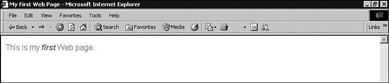
图 2.6

浏览器将样式属性应用于 `<body>` 标签内的文本上。表 2.2 列出了你可以用于格式化文本的许多样式属性。

### 表 2.2 文本样式属性

| 属性 | 使用描述和值 |
| :--- | :--- |
| background | 设置文本的背景颜色。 |
| color | 设置文本的颜色。 |
| font-family | 设置文本字体。 |
| font-size | 可以是磅、另一个标签大小的百分比，或 `xx-small` 到 `xx-large`。 |
| font-style | normal（默认）或 `italic`（斜体）。 |
| font-weight | 从 extra-light 到 `extra-bold`（特粗）。 |
| text-align | left（左）、`right`（右）、`center`（中）或 `justify`（两对齐）。 |
| text-indent | 可以是固定长度或百分比。 |
| text-decoration | underline（下划线）、`overline`（上划线）、`strikethrough`（删除线）和 `none`（无）。 |

微软在其排版网站上维护了一份关于样式表的简短教程（http://www.microsoft.com/typography/default.mspx）。该教程教授 Web 页面作者样式表如何增强他们的文档。其中一个示例的 `<style>` 标签如下代码所示。这令人印象深刻，是因为文档中定义了许多不同的样式和类。你可以看到，限制仅是你自己的想象。你可以在图 2.7 中看到此样式代码创建的页面。

```css
<style type="text/css">
body {background: coral}
.copy {color: Black; font-size: 11px; line-height: 14px; font-family: Verdana, Arial, Helvetica, sans-serif}
a:link {text-decoration: none; font-size: 20px; color: black; font-family: Impact, Arial Black, Arial, Helvetica, sans-serif}
.star {color: white; font-size: 350px; font-family: Arial, Arial, helvetica, sans-serif}
.subhead {color: black; font-size: 28px; margin-top: 12px; margin-left: 20px; line-height: 32px; font-family: Impact, Arial Black, Arial, Helvetica, sans-serif}
.what {color: black; font-size: 22px; margin-left: 20px; font-weight: bold; font-style: italic; font-family: Times New Roman, times, serif}
.quott {color: black; font-size: 120px; line-height: 120px; margin-top: -24px; margin-left: -4px; font-family: Arial, Arial, Helvetica, sans-serif}
a:link {text-decoration: none; font-size: 20px; color: black; font-family: Impact, Arial Black, Arial, Helvetica, sans-serif}
</style>
```


在发布页面之前，别忘记测试你的页面。并不是所有的颜色都能协调在一起。如果你指定了黑色背景颜色和黑色文字颜色，那你就完蛋了！因为没有人能看清你的文字。

## 添加分割线

水平线（horizontal line），或者在 HTML 中被称为水平规则（horizontal rule），是最易于使用的标签之一。你可以在文档的任何地方插入 `<hr />` 标签，以插入一条跨越可用空间的水平线。请查看下面的 HTML 示例。它展示了三个 `<hr>` 标签：两个用于文本之间的分隔符，另一个用于表格单元格内部。图 2.8 显示了它们在浏览器中的显示效果。

```html
<! DOCTYPE html
PUBLIC “-//W3C//DTD XHTML 1.0 Transitional//EN”
“http://www.w3.org/TR/xhtml1/DTD/xhtml1-transitional.dtd”>
< html xmlns=”http://www.w3.org/1999/xhtml” xml:lang=”en” lang=”en”>
< head >
< title>Horizontal Lines</title > < style type=”text/css” > td {text-align=center}
< /style >
< /head >
< body >
< p>This is a horizontal line.</p >
< hr / >
< p>This is another horizontal line.</p >
< hr / >
< table width=”50%” rules=cols >
< tr >
< td>This is also a<hr />horizontal line.</td >
< td>There is <br />no line on this<br />side of the table.</td>
< /tr >
< /table >
< /body >
< /html >
```

图 2.8  `<hr />` 标签插入了一条横跨可用水平区域的水平线。

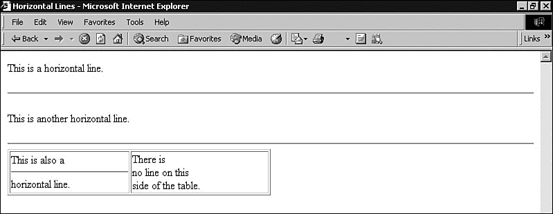

## 边距样式

样式表带给了你另一个重要优势：你可以指定几乎任何 HTML 元素的边距。边距可以使用 `pt`、`in`、`cm` 或 `px` 单位来定义。

```css
body {margin-left: 100px; margin-right: 100px; margin-top: 50px}
```

你可以单独设置 `margin-left`、`margin-right` 和 `margin-top` 属性，也可以将它们合并为一个名为 `margin` 的属性，将尺寸应用到 `top`、`right` 和 `left` 边距。

```css
body {margin: 100px 100px 50px}
```

## 总结

本章讨论了使用超文本标记语言（HTML）进行网页布局的基础知识，包括 HTML 文档结构、HTML 页面元素示例以及使用元素属性和级联样式表进行页面样式。

## 第 3 章：Ajax 程序的构造


### 你在本章将学到：

- Ajax 的必要性
- 介绍 Ajax
- Ajax 的组成部分
- 将它们整合在一起

在本章中，你将学习 Ajax 的各个构建模块以及它们如何组合形成 Ajax 应用程序的架构。后续章节将更详细地检查这些组件，最后将它们组成一个运行的 Ajax 应用程序。

## Ajax 的必要性

在本书的后续部分，我们将详细讨论每个核心组件。在讨论各个组件之前，让我们详细地看看我们对 Ajax 应用程序的期望。

### 传统与 Ajax 客户端-服务器交互

第 1 章讨论了网站用户界面的传统基于页面的模型。当你与此类网站交互时，包含文本、图像、数据输入表单等的单个页面会逐一个地显示。在导航到下一个页面之前，必须单独处理每一个页面。

例如，你可以完成表单的数据输入字段，根据需要反复编辑和重新编辑你的条目，并知道在表单最终提交之前，数据不会被发送到服务器。

图 3.1 解释了这种交互。

图 3.1
传统的客户端-服务器交互。

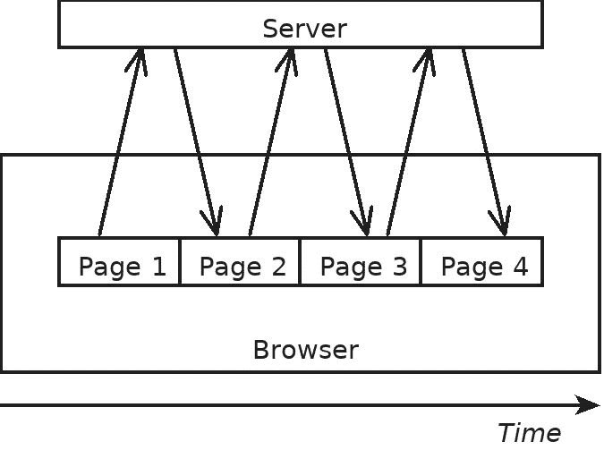在你提交表单或点击导航链接后，你必须等待浏览器屏幕刷新，以显示由服务器交付的新或修订后的页面。

随着你作为互联网用户经验的增长，使用这种界面几乎变成了一种本能。你学会了一些帮助你避开麻烦的经验法则，例如“不要再次点击提交按钮”以及“提交表单后不要点击后退按钮”。

遗憾的是，使用这种模型构建的界面有几个缺点。首先，在加载每个新页面或修订页面时存在显著的延迟。这中断了我们作为用户所感知的应用程序“流”。

此外，每当都必须加载整个页面，即使其大部分内容都与上一个页面相同。网站上许多页面共有的项目（如页眉、页脚和导航部分）占了页面所包含数据的相当大比例。

图 3.2 展示了一个网站在提交表单前后显示页面的情况，显示了重新加载了多少相同内容，以及显示内容实际上变化有多小。

这种不必要的数据下载浪费了带宽，并加剧了加载每个新页面的延迟。

所谓的带宽（Bandwidth）是指通信信道携带信息的容量。在互联网上，带宽通常以 `bps`（每秒比特）或更高的倍数如 `Mbps`（每秒百万比特）来衡量。

### 介绍 Ajax

图 3.2
许多页面被不必要的重新加载。

### 丰富的用户体验

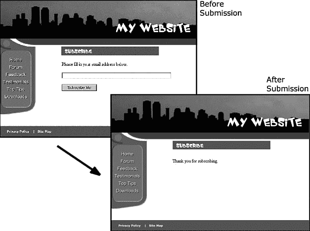上述问题的共同结果是，与大多数桌面应用程序相比，提供的用户体验要差得多。

在桌面上，你期望程序的显示内容保持可见，并在后台进行计算处理时，界面元素对命令做出响应。例如，当我使用文字处理器编写本章时，我可以将文档保存到磁盘、上下滚动，以及更改字体和大小，而不需要每次都等待整个显示刷新。

Ajax 允许你在 Web 应用程序中添加这种桌面应用程序常见的功能，通常被称为丰富的用户体验。

### 介绍 Ajax

为了改进用户体验，你需要在传统的基于页的设计中添加一些额外功能。你希望用户的页面具有交互性，对用户的操作做出响应并在不中断页面加载或刷新新的情况下进行更新。

为了实现这一点，Ajax 在网页页和服务器之间建立了一个额外的处理层。

这一层通常被称为 Ajax 引擎或 Ajax 框架，它拦截用户的请求并在后台安静、干扰且异步地处理服务器通信。这意味着服务器请求和响应不再需要与特定的用户动作一致，而可以在用户和应用程序正确运行所需的任何时间发生。浏览器不会冻结等待服务器完成上一个请求，而是让用户继续在当前页面上滚动、点击和打字。

根据从收到的修订信息更新页面元素也由 Ajax 负责，在页面继续使用时动态进行。

图 3.3 代表了这些交互是如何发生的。

图 3.3
Ajax 客户端-服务器交互。

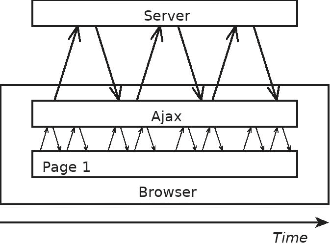真实的 Ajax 应用程序——Google Suggest

为了查看 Ajax 运行的示例，让我们来看看 Google Suggest。该应用程序扩展了熟悉的 Google 搜索引擎界面，根据用户目前输入的内容为用户提供合适的搜索词建议。


当用户每按下一个键时，应用程序的 Ajax 层都会向 Google 服务器查询相似的搜索短语，并在下拉框中显示返回的数据。每个建议的短语旁边都列出了使用该短语进行搜索时预期的结果数量。在任何时候，用户都可以选择这些建议中的一个，而不是继续输入，并让 Google 处理所选的搜索。

由于每次按键时都会查询服务器，因此此下拉列表会随着用户的输入而动态更新——无需等待页面刷新或类似的中断。

图 3.4 显示了程序的实际运行情况。你可以通过点击 Google 首页上的 [`www.google.com/webhp?complete=1&hl=en.`](http://www.google.com/webhp?complete=1&hl=en) 链接来亲自尝试。

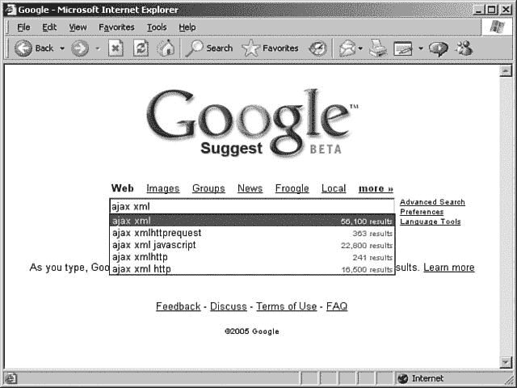Ajax 的组成部分

图 3.4

Ajax 应用程序的一个示例——Google Suggest。

| 接下来，让我们识别此类 Ajax 应用程序的各个组件，并看看它们是如何协同工作的。 | | |

| Google 还提供了其他支持 Ajax 的应用程序供你尝试，包括 gmailweb 邮件服务和 Google Maps 街道地图程序。详情请参阅 [`www.google.com/`](http://www.google.com/) Google 网站的 ByTheWay 部分。 |

# Ajax 的组成部分

现在，让我们逐个检查 Ajax 应用程序的组件。

## `XMLHTTPRequest` 对象

当你点击超链接或提交 HTML 表单时，你会向服务器发送一个 HTTP 请求，服务器通过向你提供新页面或修订页面来响应。然而，为了让你的 Web 应用程序异步工作，你必须有一种方法向服务器发送 HTTP 请求，而无需关联显示新页面的请求。

你可以通过 `XMLHTTPRequest` 对象来实现这一点。此 JavaScript 对象能够与服务器建立连接并发布 HTTP 请求，而不需要关联的页面加载。

在接后的章节中，你将学习什么是对象，查看如何创建该对象的实例，并查看包含在网页中的 JavaScript 程序如何使用该对象的属性和方法来与服务器建立异步通信。

作为一种安全措施，`XMLHTTPRequest` 对象通常只能调用与调用页面相同域内的 URL，而不能直接调用远程服务器。

第 5 章“处理文档对象模型”将介绍对象的通用概念，该主题将在第 7 章“使用函数和对象”中进行扩展。

第 10 章“Ajax 的核心——`XMLHTPPRequest` 对象”将讨论如何创建 `XMLHTTPRequest` 实例，并回顾该对象的属性和方法。

## 与服务器通信

在传统的网页样式中，当你通过超链接或表单提交发布服务器请求时，服务器接受该请求，执行任何所需的服务器端处理，随后向你提供一个与你所执行内容对应的新页面。

在此处理进行期间，用户界面实际上是冻结的。当服务器完成任务时，浏览器中的出现会让你清楚地意识到这一点。然而，通过异步请求，此类通信在后台进行，并且并不一定与页面刷新同步。

在此处理进行期间，用户界面实际上是冻结的。当服务器完成任务时，浏览器中的出现会让你清楚地意识到这一点。然而，通过异步请求，此类通信在后台进行，并且并不一定与页面刷新同步。

## 服务器端发生了什么？

就服务器端而言，Ajax 应用程序可能会调用各种其他资源。整合在一起

在没有服务器端脚本的情况下构建简单的 Ajax 应用程序是可能的，只需让 `XMLHTTPRequest` 对象调用静态资源即可。在本书中我们将使用 PHP 作为服务器端，但如果你更擅长 ASP、JSP 或其他语言，请尽管使用它们。

## 处理服务器响应

一旦收到异步请求已成功完成，你就可以利用服务器返回的信息。Ajax 允许以多种格式返回这些信息，包括 ASCII 文本和 XML 数据。根据应用程序的性质，你可以在 `XMLHTTPRequest` 对象中对这些信息进行翻译、显示或其他处理。

## 其他管理任务

Ajax 应用程序还需要执行许多其他职责。示例包括：检测错误状况并对其进行恰当处理，以及让用户了解 Ajax 请求的状态。

## 整合在一起

假设你想设计一个新的 Ajax 应用程序，或者更新旧的 Web 应用程序以包含 Ajax 技术。你该如何做呢？

首先，你需要决定哪些页面事件和用户操作将负责触发异步 HTTP 请求的发送。例如，你可能决定鼠标光标移动到图像上的动作将导致向服务器发送请求，以检索有关该图片主题的更多信息，或者点击按钮将生成一个服务器请求，以获取填充表单字段的信息。

可以使用 JavaScript 通过事件处理器来执行此类发生情况的指令。具体如何做的细节将在后续章节详细介绍。在你的 Ajax 应用程序中，此类方法将负责通过 `XMLHTTPRequest` 发起异步 HTTP 请求。

发出请求后，你需要编写程序来监控该请求的进度，直到你收到服务器通知请求已成功完成。


虽然要全面理解 Ajax，了解每个单独组件所扮演的角色至关重要，但幸运的是，你不需要为每个新应用程序都重写所有代码。你的 Ajax 代码可以存储作为一个可重用的常用 Ajax 例程库，准备在任何需要的地方重用。此外，还有许多商业和开源框架供你在此项目中使用它们来完成“繁重的工作”。

我们将在书的后半部分分别介绍这两种技术，届时我们将为 Ajax 编写自己的 JavaScript 库，并还会考虑几个比较流行的开源库。

## 总结

本章讨论了传统 Web 界面的局限性，确定了我们想要克服的具体问题。我们还介绍了 Ajax 应用程序的各种构建模块，并讨论了它们是如何协同工作的。

在接下来的章节中，我们将更详细地研究这些组件，最终使用它们构建一个完整的 Ajax 应用程序。

到此，本书的第一部分“Web 基础复习”结束。在第二部分，我们将开始探索使用 JavaScript 进行客户端编程。

本页故意留白。

## 第二部分

### 使用 JavaScript 引入 Web 脚本

| 第 4 章 | 在 JavaScript 中创建简单脚本 | 53 |
| 第 5 章 | 使用文档对象模型 (DOM) | 71 |
| 第 6 章 | 使用变量、字符串和数组 | 81 |
| 第 7 章 | 使用函数和对象 | 103 |
| 第 8 章 | 使用条件和循环控制流程 | 117 |
| 第 9 章 | 使用内置函数和库 | 135 |

本页故意留白。

## 第 4 章

### 在 JavaScript 中创建简单脚本


#### 你将在本章学到：

* 脚本编写工具
* 使用 JavaScript 显示时间
* 开始编写脚本
* 添加 JavaScript 语句
* 创建输出
* 将脚本添加到网页中
* 测试脚本
* JavaScript 语法规则
* 使用注释
* JavaScript 最佳实践

正如书中前面已经讨论过的那样，`JavaScript` 是一种用于网页的客户端脚本语言。你可以直接在 HTML 文档中包含 `JavaScript` 命令，脚本会在浏览器中查看页面时执行脚本。

在本章中，你将创建一个简单的脚本，编辑它并使用网络浏览器对其进行测试。在此，你将学习创建和使用脚本涉及的基础任务。

#### 脚本编写工具

与许多编程语言不同，你不需要任何特殊软件来创建 `JavaScript` 脚本。事实上，你可能已经拥有所需的一切。

 文本编辑器

你处理 `JavaScript` 时需要的第一个工具是文本编辑器。`JavaScript` 脚本存储在简单的文本文件中，通常作为 HTML 文档的一部分。任何可以存储 ASCII 文本文件的编辑器都可以使用。我们在第 2 章“使用 HTML 和 CSS 编写和样式页面”中对程序员编辑器的讨论，与我们在这里进行的 `JavaScript` 工作同样相关（事实上，对于我们在书中稍后在 `PHP` 中执行的代码也是如此）。

| 光盘中的内容 | 随书的 `CD` 包含了 `jEdit` 程序员编辑器的版本，适用于 Java、Macintosh 和 Windows 平台。该编辑器对于编写你的 `JavaScript` 程序完全没。 |
| 顺便说一下 | 浏览器：使用 `JavaScript` 你还需要另外两个东西：一个网络浏览器和一台运行它的计算机。我建议你使用最新版本的 `Mozilla Firefox` 或 `Microsoft Internet Explorer`。访问 `Mozilla` (`http://www.mozilla.com`) 或 `Microsoft` (`http://www.microsoft.com`) 网站下载副本。至少，你应该拥有 `Firefox 1.0`、`Netscape 7.0` 或 `Internet Explorer 6.0` 或更高版本。你可以根据喜好选择任何浏览器浏览，但在开发 `JavaScript` 时，你应该拥有多个浏览器——至少是 `Firefox` 和 `Internet Explorer`。这将允许你在用户在你的网站上常用的浏览器中测试脚本。如果你计划在互联网上提供你的脚本，你还需要一个 Web 服务器或访问权限。不过，你可以直接从计算机硬盘上使用书中的大部分 `JavaScript` 示例。 |

#### 使用 JavaScript 显示时间

`JavaScript` 的一个常见且简单的用途是显示日期和时间。因为 `JavaScript` 运行在浏览器上，它显示的时间将是用户当前时区的时间。但你也可以使用 `JavaScript` 计算“通用”（UTC）时间。`UTC` 代表通用时间（协调世界），是基于旧的 `GMT`（格林尼治标准时间）标准的原子时间标准。这是位于  子午线的时间，穿过英国伦敦的格林尼治。

 添加 JavaScript 语句

作为 `JavaScript` 的基础介绍，现在将从下一节开始，创建一个简单的脚本，在网页中显示当前时间和以及 UTC 时间。

##### 开始编写脚本

你的脚本像大多数 `JavaScript` 程序一样，从 HTML `<script>` 标签开始。你使用 `<script>` 和 `</script>` 标签将脚本封装在 HTML 文档中。

记住只在起始和结束的 `<script>` 标签之间包含有效的 `JavaScript` 语句。如果浏览器在 `<script>` 标签内发现任何非有效 `JavaScript` 的语句，它将显示 `JavaScript` 错误消息。

要开始创建脚本，打开你喜欢的文本编辑器并输入所示的起始和结束 `<script>` 标签。

```html
<script LANGUAGE="JavaScript" type="text/javascript"></script>
```

由于此脚本没有使用 `JavaScript 1.1` 或之后的任何新功能，你不需要在 `<script>` 标签中指定版本号。此脚本应该适用于追溯到 `Netscape 2.0` 或 `Internet Explorer 3.0` 的所有浏览器。

##### 添加 JavaScript 语句

你的脚本现在需要确定本地时间和 UTC 时间，然后在浏览器中显示。幸运的是，所有困难的部分（例如日期格式之间的转换）都内置在 JavaScript 解释器中。

##### 将数据存储在变量中

脚本脚本将使用一个变量来存储当前日期。你将在第 6 章“使用变量、字符串和数组”中学习更多关于变量的知识。变量是一个可以存储值的容器——数字、文本，在本例中是日期。

开始编写脚本，在第一个 `<script>` 标签之后添加以下行。确保使用相同的大小写组合，因为 JavaScript 命令和变量名对大小写敏感。

```javascript
now = new Date();
```

 该语句创建一个名为 `now` 的变量并将当前日期时间存储其中。该语句以及你将在脚本中使用的其他语句使用了 JavaScript 内置的 `Date` 对象，它让你方便地处理日期和时间。你将在第 9 章“使用内置函数和库”中学习更多关于日期的知识。


注意上一个语句末尾的分号。这告诉浏览器它已经到达了一个语句的结束。分号是可选的，但使用它们可以帮你避免一些常见的错误。为了清晰起见，我们将在整本书中使用它们。

## 计算结果

在内部，JavaScript 将日期存储为自 1970 年 1 月 1 日以来的毫秒数。幸运的是，JavaScript 包含了许多函数，可以各种方式转换日期和时间，因此你不需要自己研究如何将毫秒转换为天、日期和时间。

要继续你的脚本，请在 `</script>` 标签之前添加以下两个语句：

```javascript
localtime = now.toString();
utctime = now.toGMTString();
```

这些语句创建了两个变量：`localtime` 包含易读格式的当前时间和日期，`utctime` 包含 UTC。`localtime` 和 `utctime` 变量存储一段文本，例如 `January 1,2001 12:00 PM`。在编程中，这段文本被称为 `string`。你将在第 6 章学习更多关于字符串的知识。


## 创建输出

你现在有两个变量——`localtime` 和 `utctime`——它们包含了我们脚本的结果。当然，除非我们可以看到它们，否则这些变量没有任何用。JavaScript 包含了多种显示信息的方法，最简单的一种是 `document.write` 语句。

`document.write` 语句显示文本字符串、数字或任何内容。由于你的 JavaScript 程序将在网页中使用，输出将作为页面的一部分显示。要显示结果，请在 `</script>` 标签之前添加这些语句：

```javascript
document.write("Local time:" + localtime + "<br>");
document.write("UTC time:" + utctime);
```

## 将脚本添加到网页

这些语句告诉浏览器向包含脚本的网页添加一些文本——输出将包括 `localtime` 和 `utctime` 变量。注意引号内的 HTML 标签，如 `<b>`——由于 JavaScript 的输出出现在网页中，需要使用 HTML 进行格式化。<br>` 标签确保两个时间分行显示。

注意前面的语句中文本和变量之间的加号 (`+`)。。在这种情况下，它告诉浏览器将值合并为一个文本字符串。如果你在两个数字之间使用加号，它们会被相加。

你现在应该有一个完整的脚本，它可以计算并显示结果。你的列表应该与列表 4.1 一致。

### 列表 4.1 完整的日期时间脚本


```html
<script language="JavaScript" type="text/javascript">
  now = new Date();
  localtime = now.toString();
  utctime = now.toGMTString();
  document.write("Local time:" + localtime + "<br>");
  document.write("UTC time:" + utctime);
</script>
```


要使用你的脚本，你需要将其添加到 HTML 文档。基本形式，HTML 文档应该包含开始和结束的 `<html>` 标签、`<head>` 标签和 `<body>` 标签。

如果你将这些标签以及描述性标题添加到包含脚本的文档中，你应该得到类似列表 4.2 的效果。

### 列表 4.2 HTML 文档中的日期时间脚本


```html
<html>
<head>
  <title>Displaying Times and Dates</title>
</head>
<body>
  <h1>Current Date and Time</h1>
  <p>
    <script language="JavaScript" type="text/javascript">
      now = new Date();
      localtime = now.toString();
      utctime = now.toGMTString();
      document.write("Local time:" + localtime + "<br>");
      document.write("UTC time:" + utctime);
    </script>
  </p>
</body>
</html>
```

#### 列表 4.2 续


现在你有了一个完整的 HTML 文档，请使用 `.htm` 或 `.html` 扩展名保存它。

记事本和其他 Windows 文本编辑器可能会尝试为你的脚本添加 `.txt` 扩展名。请确保保存的文件具有正确的扩展名。

## 测试脚本

要测试你的脚本，你只需要在浏览器中加载你创建的 HTML 文档。启动 Netscape 或 Internet Explorer，并在“文件”菜单中选择“打开”。点击“选择文件”或“浏览”按钮，然后找到你的 HTML 文件。选择后，点击“打开”按钮查看页面。

如果你正确输入了脚本，你的浏览器应该显示脚本的结果，如图 4.1 所示。（当然）。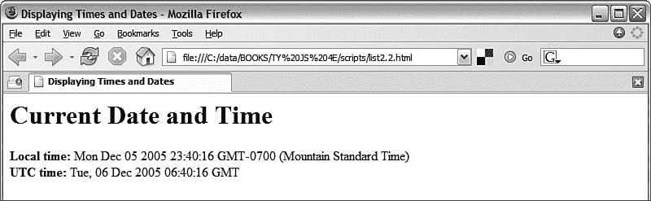 关于 Internet Explorer 6.0 及以上版本的说明：根据你的安全设置，脚本可能不会执行，浏览器顶部的黄色条可能会显示警告。在这种情况下，点击黄色条并选择“允许阻塞的内容”以允许脚本。（出现这种情况是因为默认安全设置允许在线文档中使用 JavaScript，但不允许本地文件。）

图 4.1

## 修改脚本

虽然当前的脚本确实显示了时间，但它的显示效果没有你墙上的时钟好看。为了解决这个问题，你可以使用一些 JavaScript 特性和少量 HTML 来显示时钟。

要显示大时钟，我们需要在单独变量中存储小时、分钟和秒。再次，JavaScript 具有内置函数可以完成大部分工作：

```javascript
hours = now.getHours();
mins = now.getMinutes();
secs = now.getSeconds();
```

在小时、分钟和秒存储在单独变量后，你可以创建 `document.write` 语句来显示它们：

```javascript
document.write("<h1>");
document.write(hours + ":" + mins + secs);
document.write("</h1>");
```

第一个语句显示一个 HTML `<h1>` 标签以便大字体显示时钟。第二个语句显示 `hours`、`mins` 和 `secs` 变量，并用冒号分隔，第三个语句添加结束标签 `</h1>`。

你可以将之前的语句添加到原始日期时间脚本中以添加大时钟显示。列表 4.3 显示了脚本的完整版本。

### 列表 4.3 带大时钟显示的日期时间脚本


```html
<html>
<head>
  <title>Displaying Times and Dates</title>
</head>
<body>
  <h1>Current Date and Time</h1>
  <p>
    <script language="JavaScript">
      now = new Date();
      localtime = now.toString();
      utctime = now.toGMTString();
      document.write("Local time:" + localtime + "<br>");
      document.write("UTC time:" + utctime);
      hours = now.getHours();
      mins = now.getMinutes();
      secs = now.getSeconds();
      document.write("<h1>");
      document.write(hours + ":" + mins + ":" + secs);
      document.write("</h1>");
    </script>
  </p>
</body>
</html>
```

现在你已经修改了脚本，保存 HTML 文件 并在浏览器中打开修改后的文件。如果你让浏览器一直运行，只需使用“刷新”按钮即可加载新版本的脚本。尝试一下，并验证窗口上半部分和新的大时钟显示的是相同的时间。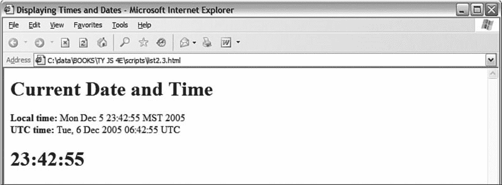

图 4.2

Internet Explorer 显示了修改后的日期时间脚本。


当此脚本生成的格式并不完美时：午后的时间使用的是 Way 24 小时制，且没有前导零，因此 12:04 会显示为 12:4。

请参见第 9 章获取解决这些问题的方案。

## 处理 JavaScript 错误

随着你开发复杂的 JavaScript 应用程序，你会不可避免地遇到错误。JavaScript 错误通常是由 JavaScript 语句拼写错误引起的。

要查看 JavaScript 错误消息的示例，请修改你在上一节中添加的语句。我们将使用一个常见的错误：漏掉其中一个括号。将列表 4.3 中的最后一个 `document.write` 语句更改为 `document.write(“</h1>”)`。

再次保存你的 HTML 文档并将文档加载到浏览器。

取决于你所使用的浏览器版本，会发生两种情况之一：

要么显示错误消息，要么脚本直接无法执行。

如果显示了错误消息，通过添加缺失的括号，你就完成修复问题的一半工作。如果没有显示错误，你应该配置浏览器以显示错误消息，以便你诊断未来的问题：

1. 在 Netscape 或 Firefox 中，在浏览器的地址栏中输入 `javascript:` 以显示 JavaScript 控制台。在 Firefox 中，你也可以从菜单中选择`工具，JavaScript 控制台`。控制台如图 4.3 所示，显示了你在示例中创建的错误消息。
2. 在 Internet Explorer 中，选择`工具，Internet 选项`。在“高级”页上，取消勾选`禁用脚本调试`框，并勾选`对每个脚本错误显示通知`框。（如果禁用了此项，状态栏中的黄色图标仍会通知你错误。）

| 注意 JavaScript 控制台底部的字段。这允许你输入 JavaScript 语句，该语句将立即执行。这是测试 JavaScript 特性的方便方法。 | By theWay |

图 4.3 Firefox 的 JavaScript 控制台显示了错误消息。

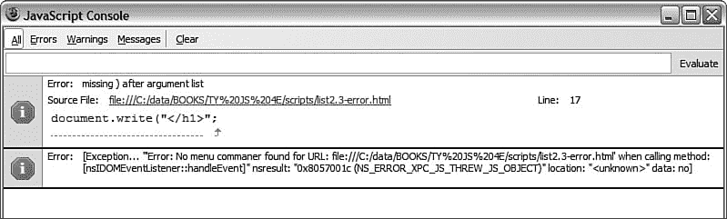在这种情况下我们得到的错误是 `missing ) after argument list` ( Firefox) 或 `Expected ‘)’` ( Internet Explorer)，事实证明这正是问题所在。但请注意，错误消息并不总是这么具有启发性。

虽然 Internet Explorer 为每个错误显示错误对话框，但 Firefox 的 JavaScript 控制台会显示单一错误列表并允许你测试命令。出于这个原因，你可能会发现安装 Firefox 来调试和测试 JavaScript 是很有用的，即使 Internet Explorer 是你的主浏览器。

## 语句

语句是 JavaScript 程序的 Basic 单元。语句是执行单个操作的代码段。例如，考虑以下三条语句，每条语句都返回当前时间的一部分：

```
hours = now.getHours(); mins = now.getMinutes(); secs = now.getSeconds();
```

虽然语句通常是单行 JavaScript，但这不是一条规则——你可以将一个语句跨越到多行，或者在单行中包含多个语句。

分号标记语句的结束。如果你在语句之后新起的一行，你也可以省略分号。如果你将多个语句合并为一行，则必须使用分号将它们分隔。

## 使用函数组合任务

在目前为止你检查的基础脚本中，你已经看到了一些带有括号部分的 JavaScript 语句，如下所示：

```
document.write(“Testing.”);
```

这是一个函数的示例。函数提供了一种处理任务的简单方法，例如向网页添加输出内容。JavaScript 包含了大量的内置函数，你将在整本书中学习它们。像前一个示例那样使用函数的语句被称为函数调用。

函数接收参数（括号内的表达式）来告诉它们要做什么。此外，函数可以向等待的变量返回一个值。例如，接下来的函数调用提示用户提供响应并将其存储在 `text` 变量中：

```
text = prompt(“Enter some text.”)
```

你也可以创建自己的函数。这这样做有两个主要原因：第一，你可以将脚本的逻辑部分分开，使其更容易理解。第二，也是更重要的，你可以多次使用该函数或带有不同的数据使用它，以避免重复脚本语句。

你将在 Way 第 7 章“使用函数和对象”中学习如何定义、调用并从你自己的函数返回值。

变量

变量是容器，可以存储数字、文本字符串或另一个值。。例如，以下语句创建了一个名为 `fred` 的变量并给它赋值为 27：`var fred = 27;`。

JavaScript 变量可以包含数字、文本字符串和其他值。你将在第 6 章“使用变量、字符串和数组”中学习更多关于它们的知识。

## 条件

虽然事件处理程序会在事情发生时通知你的脚本，但你可能想自己检查某些条件。例如，用户输入了有效的电子邮件地址吗？

JavaScript 支持条件语句，让你能够回答这类问题。一个典型的条件使用 `if` 语句，如下例：

```
if (count==1) alert(“The countdown has reached 1.”);
```

这会将变量 `count` 与常量 `1` 进行比较，如果它们相同，则向用户显示警告消息。你将在大多数脚本中使用这样的条件语句。

| 你将在第 8 章“用条件和循环控制流程”中学习更多关于条件的知识。循环以及 JavaScript 的另一个有用功能是创建循环，即重复特定次数的语句组。例如，这些语句显示 10 次警报：
```
for (i=1; i<=10; i++) {Alert(“Yes, it’s another alert!”);}
```
for 语句是 JavaScript 用于循环的语句之一。这是计算机应该擅长的事情：执行重复任务。你将在许多脚本中使用循环，比这有用得多。循环将在第 8 章详细介绍。 | By theWayBy the |


每个事件处理程序都与特定的浏览器对象关联，你可以在定义该对象的标签中指定事件处理程序。例如，图像和文本链接都有一个 `onMouseOver` 事件，当鼠标指针移动到对象上方时，该事件就会发生。这是一个带有事件处理程序的典型 HTML 图像标签：

```
< img src=”button.gif” onMouseOver=”highlight();” >
```

你将事件处理程序作为 HTML 标签的属性指定，并在引号内包含处理事件的 JavaScript 语句。这是使用函数的理想用处，因为函数名简短且明了，并且可以引用系列语句。

请参阅本章末尾的“亲手试试”（Try It Yourself）部分，查看 HTML 文档中事件处理程序的完整示例。

## 哪个脚本先运行？

你实际上可以在 Web 文档包含多个脚本：一组或多个 `<script>` 标签、外部 JavaScript 文件以及任意数量的事件处理程序。有了所有这些脚本，你可能会好奇浏览器知道先执行哪一个。幸运的是，这是以逻辑方式完成的：

- HTML 文档 `<head>` 部分内的 `<script>` 标签组首先被处理，无论它们包含嵌入代码还是引用 JavaScript 文件。由于这些脚本无法在网页中创建输出，因此它们是定义以后使用的函数的好地方。

- HTML 文档 `<body>` 部分内的 `<script>` 标签组在 `<head>` 部分的标签之后执行，此时网页正在加载和显示。如果 `<body>` 中有多个脚本，它们将按顺序执行。

- 事件处理程序在它们关联的事件发生时执行。例如，`onLoad` 事件处理程序在网页正体加载时执行。由于 `<head>` 部分在任何事件发生之前加载，因此你可以在那里定义函数并在事件处理程序中使用它们。

## JavaScript 语法规则

JavaScript 是一种简单的语言，但你确实需要小心地使用它的语法——即定义你如何使用该语言的规则。本书的其余部分涵盖了 JavaScript 语法的许多方面，但你应该理解一些基本规则以避免错误。

### 大写敏感性

JavaScript 中的几乎所有内容都是大小写敏感的：不能交替使用小写字母和大写字母。以下是一些通用规则：

- JavaScript 关键字（如 `for` 和 `if`）始终是小写的。

- 内置对象（如 `Math` 和 `Date`）首字母大写。

- DOM 对象名称通常是小写的，但它们的方法通常是大写字母和小写字母的组合。通常第一个单词外，所有单词都使用大写字母，例如 `toLowerCase` 和 `getElementById`。

在有疑问时，请遵循本书或其他 JavaScript 参考资料中使用的精确大小写。如果你使用了错误的大小写，浏览器通常会显示错误信息。

### 变量、对象和函数名

当你定义自己的变量、对象或函数时，可以选择它们的名称。名称可以包含大写字母、小写字母、数字和下划线（`_`）字符。名称必须以字母或下划线开头。

你可以选择在变量名中使用大写或小写字母，但记住 JavaScript 是大小写敏感的：`score`、`Score` 和 `SCORE` 被认为是三个不同的变量。确保在每次引用变量时使用相同的名称。

### 保留字

关于变量名的另一个规则是——它们不能是保留字。这些包括构成 JavaScript 语言的单词（如 `if` 和 `for`）、DOM 对象名称（如 `window` 和 `document`）以及内置对象名称（如 `Math` 和 `Date`）。

### 空格

空白区域（程序员称为空白字符）会被 JavaScript 忽略。你可以在行中包含空格、制表符或空行，而不会引起错误。

空白区域通常会让脚本更具可读性。

### 使用注释

JavaScript 注释允许你在脚本中包含文档。如果其他人尝试理解该脚本，或者即使是你离开一段时间后再次尝试理解它，这非常有用。要在 JavaScript 程序中包含注释，请以两个斜杠开头行，如下例所示：

```
//this is a comment.
```

你也可以在行的中间用两个斜杠开始注释，这对于记录脚本很有用。在这种情况下，斜杠之后行上的所有内容都被视为注释并被浏览器忽略。例如，`a = a + 1; // add one to the value of a`

JavaScript 还支持 C 风格注释，以 `/*` 开始并以 `*/` 结束。这些注释可以跨越多行，如下示例所示：

```
/*This script includes a variety of features, including this comment. */
```

由于注释内的 JavaScript 语句会被忽略，因此 C 风格注释经常用于注释掉代码段。如果你有几行 JavaScript 代码想在调试脚本时临时移除，可以在该段的开头添加 `/*` 并在结尾添加 `*/`。

由于这些注释是 JavaScript 语法的一部分，因此它们只在 `<script>` 标签内部或外部 JavaScript 文件中有效。

## JavaScript 最佳实践

你现在应该熟悉编写有效 JavaScript 的基本规则了。除了遵循规则，遵循最佳实践也是一个好主意。以下实践可能不是强制的，但如果你遵循它们，将为你和他人省去很多麻烦。

- 大量使用注释——这些让你的代码更容易被他人理解，也让你在以后编辑它们时更容易理解。它们对于标记脚本的主要划分也很有用。

- 在每个语句末尾使用分号，并且每行仅使用一个语句——这会让你的脚本更易调试。

- 尽可能使用独立的 JavaScript 文件——这可以将 JavaScript 与 HTML 分离并便于调试，并鼓励你编写可复用的模块化脚本。

- 避免特定浏览器——随着你深入了解 JavaScript，你会学习一些只在一个浏览器中运行的功能。除非绝对必要，否则避免使用它们，并在多个浏览器中测试你的代码。

- 保持 JavaScript 可选性——不要使用 JavaScript 来执行网站上的核心功能（例如主导航链接）。尽可能让没有 JavaScript 的用户也能够使用你的网站，尽管可能没有那么漂亮或方便。这种策略被称为渐进增强（progressive enhancement）。

## 亲手试试

### 使用事件处理程序

在本章最后，这里有一个事件处理程序的简单示例。它将演示你如何设置事件（你将在书中中使用它）以及 JavaScript 在没有 `<script>` 标签的情况下工作。列表 4.6 显示了一个包含简单事件处理器的 HTML 文档。

#### 列表 4.6 带有简单事件处理器的 HTML 文档

```

< html >
< head >
< title>Event Handler Example</title >
</ /head >
< body >
< h1>Event Handler Example</h 1> < p >
▼
< /p >
< /body >
< /html >
```

#### 列表 4.6 继续

```

< a href=”http://www.jsworkshop.com/” onClick=”alert(‘Aha! An Event!’);”>Click this link</a> to test an event handler.
< /p >
```


▲ 在下一章中，你将使用与此类似的其他事件处理器。


# 总结

在本章中，你编写了一个简单的 JavaScript 程序并使用浏览器对其进行了测试。你学习了处理 JavaScript 所需的工具——基本上就是一个编辑器和一个浏览器。你还学习了如何修改和测试脚本，以及当 JavaScript 程序遇到错误时会发生什么，并学习了如何在单独的 JavaScript 文件中使用脚本。

在编写此脚本的过程中，你使用了一些 JavaScript 的基础特性：变量、`document.write` 语句以及处理日期和时间的函数。

你还接触了 JavaScript 编程和语法的几个组件：函数、对象、事件处理器、条件和循环。你学习了如何使用 JavaScript 注释来让你的脚本更易于读，并查看了一个事件处理器的简单示例。

在下一章中，你将学习文档对象模型（DOM），并学习如何使用 DOM 中的对象来操作网页以及与用户交互。

本页特意留空。

# 第 5 章

## 操作文档对象模型 (DOM)[](Images/image05124.jpeg)


### 本章你将学习：

- 理解对象
- 理解文档对象模型 (DOM)
- 操作网页文档
- 访问浏览器历史
- 操作 `location` 对象

在本章中，你将接触到使用 JavaScript 时最重要的工具之一：文档对象模型（DOM），它允许你的脚本操纵网页、窗口和文档。

没有 DOM，JavaScript 仅仅是另一种脚本语言——有了 DOM，它就变成了一个制作动态页面的强大工具。本章将首先讨论对象，然后介绍 DOM 的概念以及你将最常用的某些对象。

## 理解对象

JavaScript 支持对象。像一样，对象可以存储数据——但它们可以同时存储两个或更多部分的数据。

存储在对象中的数据项被称为对象的**属性**（properties）。例如，你可以使用对象存储人的信息，比如地址录中的信息。每个人的对象的属性可能包括姓名、地址和电话。

JavaScript 使用点 `.` 来分隔对象名和属性名。例如，对于一个名为 Bob 的人对象，属性可能包括 `Bob.address` 和 `Bob.phone`。

对象还可以包含**方法**（methods）。这些处理对象数据的函数。例如，我们用于地址录的人对象可能包含一个 `display()` 方法来显示人的信息。在 JavaScript 术语中，`Bob.display()` 将显示 Bob 的详情。

 我们在前章中讨论的 `document.write` 函数实际上是 `document` 对象的 `write` 方法。你将在本章了解更多关于此对象的知识。

如果这听起来很困惑，不要担心——你将在本书的后面更详细地探索对象。现在你只需要知道基础。JavaScript 支持三种对象：

- **内置对象 (Built-in objects)** 是内置在 JavaScript 语言中的。你已经遇到过其中一个，`Date`。其他内置对象包括 `Array` 和 `String`（你将在第 6 章“使用变量、字符串和数组”中探索它们），以及在第 9 章“使用内置函数和库”中解释的 `Math`。
- **DOM（文档对象模型）对象**代表浏览器和当前 HTML 文档的各种组件。例如你在本章稍之前使用的 `alert()` 函数实际上是 `window` 对象的方法。你将在本章过程中更详细地探索这些内容。
- **自定义对象 (Custom objects)** 是你自己创建的对象。你将在第 7 章“使用函数和对象”中学习使用自定义对象。

## 理解文档对象模型 (DOM)

JavaScript 相比基础 HTML 的一个优势是脚本可以操纵网页文档及其内容。你的脚本可以在浏览器中加载新页面，操作浏览器窗口和文档的部分，打开新窗口，甚至动态地修改页面内的文本。

为了操作浏览器和文档，JavaScript 使用了一种父对象和子对象的层级结构，称为文档对象模型 (DOM)。这些对象被组织成树形结构，代表了网页文档的所有内容和组件。

 理解文档对象模型 (DOM)

| DOM 并不是 JavaScript 语言的一部分——而是内置在浏览器中的 API（应用程序编程接口）。虽然 DOM 经常配合 JavaScript 使用，但也可以由其他语言（如 VBScript 和 Java）使用。DOM 中的对象具有属性（描述网页或文档的变量）以及方法（允许你操作网页部分的函数）。当你引用一个对象时，你使用父对象名，后跟子对象名或多个对象名，并用点分隔。例如， JavaScript 存储用于表示文档中图像的对象作为 `document` 对象的子。以下引用 `image9` 对象，它是 `document` 对象的子，同时也是 `window` 对象的子：`window.document.image9`。`window` 对象是我们在本章中将查看的所有对象的父对象。图 5.1 显示了 DOM 对象层级结构的这部分及其各种对象。 | 顺便说 |

| 图 5.1

 DOM 层级结构。 | 此图仅包含了本章涵盖的基础浏览器对象。这些实际上是 DOM 的一部分，但对所有对象的讨论超出了本书的范围。 |

| window(frames[], self, top) |

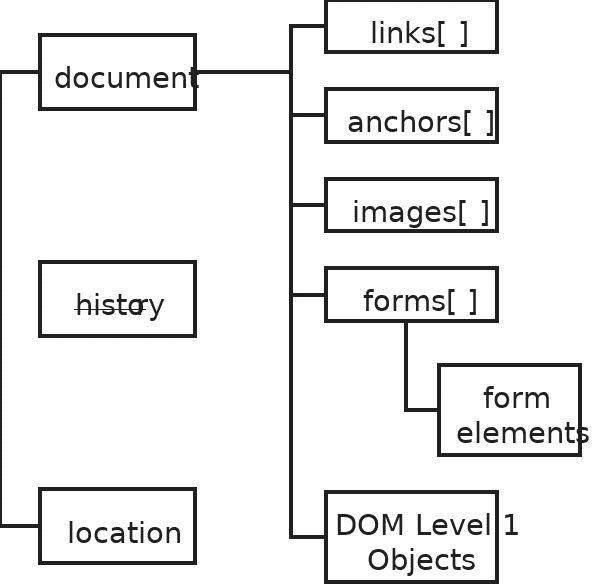 |

### DOM 的历史

从 Netscape 2.0 引入 JavaScript 1.0 开始，浏览器包含了代表网页文档和其他浏览器功能的对象。

然而，当时从未有一个真正的标准。虽然 Netscape 和 Internet Explorer 包含了许多相同的对象，但无法保证相同的对象在两个浏览器中的工作方式相同，更说在其他浏览器中了。

坏消息是浏览器之间仍然存在差异——但好消息是，自从 Netscape 3.0 和 Internet Explorer 4.0 发布以来，所有基础对象（本章涵盖的对象）在两个浏览器中的支持方式都非常相似。随着更近期浏览器的发布，支持更先进的 DOM。

### DOM 级别

W3C（世界网联盟）制定了 DOM 1 建议。这是一个定义了不仅是基础对象，还涵盖 HTML 文档所有部分的整个对象的标准。级别 2 DOM 标准已经发布，级别 3 正在开发中。

Netscape 4 和 Internet Explorer 4 支持自己的 DOM，允许对文档进行更多控制，但并未标准化。幸运的是，从 Internet Explorer 5 和 Netscape 6 开始，它们都支持 W3C DOM，因此你可以用简单的符合标准的代码支持两个浏览器。今天所有的浏览器都支持 W3C DOM。

在本章描述的基础对象层级结构被非称为 DOM 0，这些对象包含在 DOM 1 标准中。

### 操作网页文档

`document` 对象代表一个网页文档或页面。网页文档显示在浏览器窗口中，因此当你得知 `document` 对象是 `window` 对象的子时，不应该意外。


由于 `window` 对象始终代表当前窗口（包含脚本的窗口），你可以使用 `window.document` 来引用当前文档。你也可以简单地引用 `document`，它会自动指向当前窗口。


顺带一下：
你已经使用过 `document.write` 方法在 Web 文档显示文本。之前章节中的示例只使用了单个窗口和文档，因此没有必要使用 `window.document.write`——但这种较长的语法同样同样有效。

## 处理 Web 文档

如果正在使用多个窗口或框架（frames），则可能存在多个 `window` 对象，每个对象都有它自己的 `document` 对象。要使用这些文档对象之一，你需要使用窗口的名称和文档的名称。

在接下来的章节中，你将查看 `document` 对象的某些属性和方法，这些属性对你的脚本编写将非常有用。

### 获取有关文档的信息

`document` 对象的几个属性包含了关于当前文档的一般信息：

- `document.URL` 指定文档的 URL。这是一个简单的文本字段。你无法更改此属性。如果你需要将用户引导到不同的位置，请使用本章稍后介绍的 `window.location` 对象。
- `document.title` 列出当前页面的标题，由 HTML `<title>` 标签定义。
- `document.referrer` 是用户访问当前页面之前所在的页面 URL——通常是带有当前页面链接的页面。
- `document.lastModified` 是文档最后修改的日期。该日期随页面从服务器发送。
- `document.bgColor` 和 `document.fgColor` 是文档的背景色和前景（文本）颜色，对应于 `<body>`标签的 `BGCOLOR` 和 `TEXT` 属性。
- `document.linkColor`、`document.alinkColor` 和 `document.vlinkColor` 是文档内链接的颜色。这些对应于 <body>标签的 `LINK`、`ALINK` 和 `VLINK` 属性。
- `document.cookie` 允许你为文档读取或设置 cookie。

作为文档属性的一个示例，列表 5.1 显示了一个简单的 HTML 文档，它使用 JavaScript 显示其最后修改日期。

#### 列表 5.1 显示最后修改日期


```html
<html><head><title>Test Document</title></head>
<body>
<p>此页面最后修改日期为：<script language="JavaScript" type="text/javascript">document.write(document.lastModified);</script></p>
</body></</html>
```

这可以告诉用户页面最后一次更改的时间。如果你使用 JavaScript，就不必在每次修改页面时都记得更新日期。（你也可以使用脚本始终打印当前日期而不是最后修改日期，但那样是在作弊。）

| 顺带一下 | 注意！ |
|---|---|
你可能会发现 `document.lastModified` 属性在你的 Web 页面上不起作用，或者返回错误的值。日期是从 Web 服务器接收的，某些服务器并不会正确维护修改日期。 |

## 在文档中写入文本

最简单的 `document` 对象方法也是你最经常使用的方法。事实上，你已经使用过其中一个。`document.write` 方法将文本作为文档窗口中 HTML 页面的一部分打印出来。当你需要在网页中包含输出时，就会使用此语句。

另一种语句 `document.writeln` 也会打印文本，但它在末尾还包含一个换行符（`\n`）。当你希望文本是行末最后一个内容时，这非常方便。

请记住，换行符在浏览器中会被显示为空格，`<pre>` 容器除外。如果你想要实际的换行，需要使用 `<br>` 标签。


你只能在 Web 页面的主体内使用这些方法，因此它们会在页面加载时执行。你不能使用这些方法向已经加载的页面添加内容，而无需重新加载它。然而，正如下一节所解释，你可以为文档编写新内容。

`document.write` 方法可以在 HTML 文档主体内的 `<script>` 标签内使用。你也可以在函数中使用它，只要你在文档主体内包含对该函数的调用。

## 使用链接和锚点

`document` 对象的另一个子是 `link` 对象。实际上，一个文档中可以有多个 `link` 对象。每个对象都包含指向另一个位置或锚点的链接信息。


### 访问浏览器历史

锚点是 HTML 文档中可以直接跳转的命名位置。你使用如下标签定义它们：`<a name="part2">`。然后你可以链接到它们：`<a href="#part2">`。

你可以通过 `links` 数组访问 `link` 对象。该数组的每个成员都是当前页面中的 `link` 对象之一。数组的属性 `document.links.length` 表明页面中链接的数量。

每个 `link` 对象（或 `links` 数组的成员）都有一个定义 URL 的属性列表。`href` 属性包含整个 URL，其他属性定义了它的部分。这些属性与稍后介绍的 `location` 对象属性相同。

通过指定链接编号和属性名称引用链接。例如，以下语句将第一个链接的完整 URL 赋值给 `link1`：`link1 = links[0].href;`

`anchor` 对象也是 `document` 的子。每个锚点对象代表文档中的一个点。就像链接一样，你可以通过 `anchors` 数组访问锚点。`document.anchors.length` 属性给出 `anchors` 数组中的元素数量。

`history` 对象是 `window` 对象的另一个子（属性）。该对象持有当前 URL 之前之后的 URL 信息，并包含了跳转到上一个下一个位置的方法。

`history` 对象有一个你可以访问的属性：`history.length` 跟踪历史列表的长度——即用户访问过的不同位置的数量。

`history` 对象拥有 `current`、`previous` 和 `next` 属性，存储历史列表中的 URL。然而，出于安全和隐私考虑，这些对象在现在的浏览器中通常是不可访问。

| 顺带一下 | 你知道吗？ |
|---|---|
`history` 对象有三个方法可以用于遍历历史列表：

- `history.go()` 打开历史列表。使用此方法时，在括号中指定一个正或负数。例如，`history.go(-2)` 等同于点击两次后退。
- `history.back()` 加载历史列表中的上一个 URL——等同于点击后退。
- `history.forward()` 加载历史列表中的下一个 URL（如果可用）。这等同于点击前进。

你将在本章末尾的尝试练习中使用这些方法。

## 处理 location 对象

`window` 对象的第三个子是 `location` 对象。该对象存储窗口中存储的 URL 信息。例如，以下语句将 URL 加载到当前窗口：

`window.location.href="http://www.starlingtech.com";`

语句中的 `href` 属性包含了窗口当前位置的完整 URL。你也可以通过 `location` 对象的各种属性访问 URL 的部分。为了解释这些属性，考虑以下 URL：

[`www.jswshop.com:80/test.cgi?lines=1#anchor`](http://www.jswshop.com:80/test.cgi?lines=1#anchor)

以下属性代表 URL 的部分：


- `location.protocol` 是 URL 的协议部分（示例中为 `http:`）。
- `location.hostname` 是 URL 的主机名（示例中为 [www.jsworkshop.com](http://www.jsworkshop.com)）。
- `location.port` 是 URL 的端口号（示例中为 80）。
- `location.pathname` 是 URL 的文件名部分（示例中为 `test.cgi`）。
- `location.search` 是 URL 的查询部分，如果有的话（示例中为 `lines=1`）。查询主要用于 `CGI` 脚本。
- `location.hash` 是 URL 中使用的锚点名称，如果有的话（示例中为 `#anchor`）。


# 章节：使用 `location` 对象

在本章之前介绍的 `location` 对象也包含了此属性列表，用于访问 URL 的部分内容。

| |  (ByTheWay) |
| :--- | :--- |
| 尽管 `location.href` 属性通常包含与本章之前描述的 `document.URL` 属性相同的 URL，但你无法更改 `document.URL` 属性。请始终使用 `location.href` 来加载新页面。`location` 对象有两个方法：`location.reload()` 重新加载当前文档。这与浏览器工具栏上的“刷新”按钮相同。如果你可选地包含 `true` 参数，它将忽略浏览器缓存，无论文档是否更改都强制刷新。`location.replace()` 将当前位置替换为新位置。这类似于手动设置 `location` 对象的属性。区别在于 `replace` 方法不会影响浏览器历史。换句话说，无法使用“后”按钮返回上一个位置。这对于启动页或不需要返回的临时页面非常有用。 |

## 尝试一下：创建返回和前进按钮

你可以使用 `history` 对象的 `back` 和 `forward` 方法为 Web 文档添加你自己的后退和前进按钮。当然，浏览器已经有了后退和前进按钮，但有时包含具有相同目的的自定义链接也是很有用的。你现在将创建一个显示后退和前进按钮的脚本，并使用这些方法导航浏览器。以下是创建后退按钮的代码：

```html
<input type="button" onClick="history.back();" value="-- Back">
```

`<input>` 标签定义了一个标记为“Back”的按钮。`onClick` 事件处理程序使用 `history.back()` 方法返回历史中的上一页。前进按钮的代码类似：

```html
<input type="button" onClick="history.forward();" value="Forward -->">
```

处理好这些后，你只需要构建 HTML 文档的其余部分。列表 5.2 显示了完整的 HTML 文档，图 5.2 显示了浏览器对该文档的显示。在将此文档加载到浏览器后，访问其他 URL 并确保后退和前进按钮正常工作。

列表 5.2 一个使用 JavaScript 包含后退和前进按钮的 页面


```html
<html>
<head>
    <title>Back and Forward Buttons</title>
</head>
<body>
    <h1>Back and Forward Buttons</h1>
    <p>此页面允许你返回或前进到历史列表中的页面。这些按钮应该等同于浏览器工具栏中的后退和前进箭头按钮。</p>
    <p>
        <input type="button" onClick="history.back();" value="-- Back">
        <input type="button" onClick="history.forward();" value="Forward -->">
    </p>
</body>
</html>
```
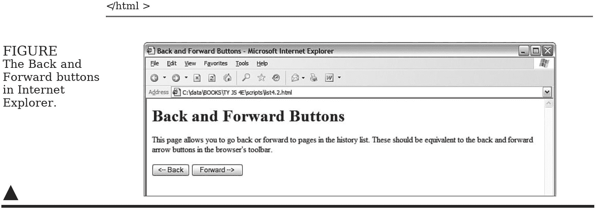

### 总结
在本章中，你学习了文档对象模型（DOM），即 JavaScript Web 页面对象的层级结构。你学习了如何使用 `document` 对象来处理文档，并使用了 `history` 和 `location` 对象来控制浏览器中显示的当前 URL。

你现在应该对 DOM 及其某些对象有了基本的了解——你将在整本书中学习更多的对象。

# 第 6 章：使用变量、字符串和数组


## 你将在本章中学到：
- 使用变量
- 理解表达式和运算符
- JavaScript 中的数据类型
- 数据类型之间的转换
- 使用 `String` 对象
- 处理子字符串
- 使用数字数组
- 使用字符串数组
- 排序数字数组

现在你已经学习了 JavaScript 和 DOM 的基础知识，是时候深入研究 JavaScript 语言的更多细节了。在本章中，你将学习三种在 JavaScript 中存储数据的工具：存储数字或文本的**变量**；用于处理文本的特殊变量**字符串**；以及可以通过数字引用的多个变量的**数组**。

### 使用变量

除非你跳过了本书的最后几章，否则你已经使用了一些变量。你可能也可以在没有任何帮助的情况下学会使用更多几个变量。尽管如此，变量的某些方面你还没有学过。我们现在来看一些细节。

#### 选择变量名

变量是用于存储数据的命名容器（例如，数字、文本字符串）。正如你从书中之前学到的，每个变量都有一个名称。由于你还没有学过，这里有一些关于变量的细节。在选择变量名时，必须遵循一些特定规则：

- 变量名可以包含字母，包括大写和小写。还可以包含数字 0-9 和下划线 `_` 字符。
- 变量名不能包含空格或任何标点符号。
- 变量名的第一个字符必须是字母或下划线。
- 变量名是区分大小写的——`totalnum`、`Total` 和 `TOTAL` 是不同的变量名。
- 变量名的长度没有官方限制，但必须位于单行内。

根据这些规则，以下是有效变量名的示例：`total_number_of_fish`、`LastInvoiceNumber`、`temp1`。


你可以选择使用易读的名字或完全晦涩的名字。给自己帮忙：尽可能使用友好的名称。


局部变量属于特定的函数。你在函数内部使用 `var` 关键字声明的任何变量都是局部变量。此外，函数参数列表中的变量始终是局部变量。

要在函数内部创建局部变量，你必须使用 `var` 关键字。这会强制 JavaScript 创建一个局部变量，即使存在同名的全局变量也是如此。

你现在应该理解局部变量和全局变量之间的区别。如果你仍然有些困惑，不要担心——只要你每次都使用 `var` 关键字，你通常会得到正确类型的变量。

## 给变量赋值

你可以使用等号给变量赋值。例如，此语句将值 `40` 赋值给变量 `lines`：

```
lines = 40;
```

你可以在等号右侧使用任何表达式，包括其他变量。

你早早已经用过这种语法来给变量加 1：`lines = lines + 1;`。

由于变量的递增或递减非常常见，JavaScript 为这种语法提供了两种类型的语法的简写形式。第一种是 `+=` 运算符，它允许你创建上述示例的更短版本：`lines += 1;`。同样，你可以使用 `-=` 运算符从变量中减去一个数字：

```
lines -= 1;
```

如果你仍然觉得那样输入太麻烦了，JavaScript 还包含了递增和递减运算符 `++` 和 `--`。此语句将 `lines` 的值加 1：

```
lines++;
```
同样，此语句从 `lines` 的值中减 1：

```
lines--;
```

你可以交替在变量名之前使用 `++` 或 `--` 运算符，例如 `++lines`。然而，它们并不是完全相同的。区别在于递增或递减发生的时机：

* 如果运算符在变量名之后，递增或递减发生在当前表达式求值之后。
* 如果运算符在变量名之前，递增或递减发生在当前表达式求值之前。

这种差异只有当你会在表达式中使用变量并在同一语句中对其递增或递减时才会成为问题。例如，假设你已经给 `lines` 变量赋值了值 `40`。以下两个语句的效果不同：


```
alert(lines++); alert(++lines);
```

第一条语句显示一个值为 `40` 的警框，然后将 `lines` 增加到 `41`。第二条语句先将 `lines` 增加到 `41`，然后显示一个值为 `41` 的警框。

这些运算符完全是为了你的方便。如果你认为坚持使用 `lines = lines + 1` 对你来说更有意义，那就这样做吧——你的脚本不会受到任何影响。

#理解表达式和运算符

表达式是变量和值的组合，JavaScript 解释器可以将其求值为一个单一值。用于组合这些值的字符（如 `+` 和 `/`）被称为运算符。

| 除了变量和常量值外，你还可以在表达式中使用返回结果的函数调用。 | 你知道吗？ |

## 使用 JavaScript 运算符

你已经用过了一些运算符，例如 `+` 号（加法）以及递增和递减运算符。表 6.1 列出了你可以在 JavaScript 表达式中使用一些最重要的运算符。

### 表 6.1 常见的 JavaScript 运算符


* `+` 拼接（组合）字符串 `message=”this is” + “ a test”;`
* `+` 加法 `result = 5 + 7;`
* `-` 减法 `score = score - 1;`
* `*` 乘法 `total = quantity * price;`
* `/` 除法 `average = sum / 4;`
* `%` 取模（余数） `remainder = sum % 4;`
* `++` 递增 `tries++;`
* `--` 递减 `total--;`


除了这些，还有许多用于条件语句的运算符——你将在“使用条件和循环控制流”中学习它们。

## 运算符优先级

当你在表达式中使用多个运算符时，JavaScript 使用运算符优先级规则来决定如何计算值。表 6.1 按优先级从低到高列出了运算符，优先级最高的运算符最求值。例如，考虑此语句：`result = 4 + 5 * 3;`。

如果你尝试计算这个结果，有两种方法。你可以先相乘 `5 * 3` 然后加 `4`（结果：19），或者先相加 `4 + 5` 再乘以 `3`（结果：27）。JavaScript 通过遵循优先级规则来解决这个困境：因为乘法的优先级高于加法，它先相乘 `5 * 3` 然后加 `4`，产生结果 `19`。

| 顺便说一下，你知道吗？ 如果你熟悉任何其他编程语言，你会发现 JavaScript 中的运算符和优先级在大部分情况下与 C、C++ 和 Java 中的工作方式相同。有时运算符优先级并不会产生你想要的结果。例如，考虑此语句：`result = a + b + c + d / 4;`。这是试图通过将四个数字全部相加然后除以 4 来计算平均值。然而，由于除法的优先级高于加法，它会先将 `d` 除以 `4`，导致结果错误。你可以通过括号来控制优先级。这里是计算平均值的语句：(a + b + c + d) / 4;括号确保了变量先相加，然后和除以四。如果你不确定优先级，可以使用括号让结果符合预期并使脚本更具可读性。 | 数据类型

在某些语言中，你必须指定变量存储的数据类型：例如，数字或字符串。在 JavaScript 中，大多数情况下不需要指定数据类型。然而，你应该了解 JavaScript 可以处理的数据类型。

数据类型

这些是基础 JavaScript 数据类型：

* 数字，例如 `3`、`25` 或 `1.4121`。JavaScript 支持整数和浮点数。
* 布尔值，或逻辑值。它们有两个值：`true` 或 `false`。这些用于指示条件是否为真。 | 你将在第 8 章学习更多关于布尔值以及在 JavaScript 中使用条件的内容。
* 字符串，例如“我是 doughnut”。它们由多个字符组成。（严格来说，这些是 `String` 对象，你将在本章稍后的部分学习它们）。
* 空值，由关键字 `null` 表示。这是未定义变量的值。例如，如果变量 `fig` 之前未被使用或定义，语句 `document.write(fig)` 将产生这个值（以及一条错误消息）。尽管 JavaScript 会跟踪每个变量当前存储的数据类型，但它并没有阻止你中途更改类型。例如，假设你通过赋值声明了一个变量：`total = 31;`此语句声明了一个名为 `total` 的变量并赋值赋值为 `31`。这是一个数字变量。现在假设你了 `total` 的值：`total = “albatross`;这将字符串值赋值给 `total`，替换了数字。JavaScript 在执行此语句时不会显示错误；它是完全有效的，尽管可能不是一个很有用的 total。虽然 JavaScript 的这个功能既方便又强大，但也可能很容易出错。例如，如果以后将 `total` 变量用于数学计算，结果将是无效的——但 JavaScript 并不会警告你犯了这种错误。

数据类型转换（注：提供的文本在“数据类型转换”处突然中断了）


# 转换

只要可能，JavaScript 都会为你处理数据类型之间的转换。例如，你已经用过类似这样的语句：

```javascript
document.write(“The total is “ + total);
```

这条语句会打印出类似“The total is 40”这样的消息。由于 `document.write` 函数处理的是字符串，JavaScript 解释器会在执行该函数之前，将表达式中的任何非字符串类型（在本例中为 `total` 的值）自动转换为字符串。

这对于浮点数和布尔值同样有效。然而，在某些情况下它将不起作用。例如，如果 `total` 的值为 40，下述语句可以正常工作：

```javascript
average = total / 3;
```

但是，`total` 变量也可能包含字符串；在这种情况下，前面的语句将导致错误。

在某些情况下，你可能会得到一个包含数字的字符串，并需要将其转换为普通的数值变量。JavaScript 提供了两个用于此目的函数：

- `parseInt()`——将字符串转换为整数。
- `parseFloat()`——将字符串转换为浮点数。

这两个函数都会从字符串的开头读取数字并返回数值版本。例如，这些语句将字符串“30 angry polar bears”转换为一个数字：

```javascript
stringvar = “30 angry polar bears”;
numvar = parseInt(stringvar);
```

执行这些语句后，`numvar` 变量包含数字 30。字符串中的非数字部分会被忽略。这些函数会在字符串开头寻找适当类型的数字。如果没有找到有效数字，函数将返回特殊值 `NaN`，意思是“不是数字”（not a number）。

# 使用字符串对象

在本书的前几章中，你已经使用过几个字符串了。字符串存储了一组文本字符，其命名方式与其他变量类似。举一个简单易懂的例子，下述语句将字符串“This is a test”（这是一个测试）赋值给名为 `test` 的字符串变量：

```javascript
test = “This is a test”;
```

## 创建字符串对象

JavaScript 将字符串存储为 `String` 对象。你通常不需要担心这一点，但它将解释一些处理字符串的技巧，这些技巧使用了 `String` 对象的方法（内置函数）。

创建新的 `String` 对象有两种方法。第一种是你已经用过的方法，而第二种使用了面向对象的语法。以下两条语句了相同的字符串：

```javascript
test = “This is a test”;
test = new String(“This is a test”);
```

第二条语句使用了 `new` 关键字，你用它创建对象。这告诉浏览器创建一个包含文本“This is a test”的新 `String` 对象，并将其赋值给变量 `test`。虽然你可以使用面向对象的语法创建字符串，但标准的 JavaScript 语法更简单，且这两种方法创建的字符串没有区别。

## 赋值

你可以像给任何其他变量一样给字符串赋值。前一节中的两个示例都为字符串分配了初始值。你也可以在字符串创建后对其赋值。例如，下述语句用新字符串替换 `test` 变量的内容：

```javascript
test = “This is only a test.”;
```

你还可以使用连接运算符（`+`）来合并两个字符串的值。列表 6.1 显示了为字符串赋值和合并字符串值的简单示例。

### 列表 6.1 给字符串赋值并合并它们

```html
<<html>
<head>
<title>String Test</title>
</head>
<body>
  <h1>String Test</h1>
  <script language="JavaScript" type="text/javascript">
    test1 = “This is a test. “;
    test2 = “This is only a test.”;
    both = test1 + test2;
    alert(both);
  </script>
</body>
</html>
```

该脚本为两个字符串变量 `test1` 和 `test2` 赋值，然后显示包含它们合并值的警告框。如果你在浏览器中加载此 HTML 文档，你的输出应该类似于图 6.1。

字符串示例脚本的输出。

除了使用 `+` 运算符连接两个字符串外，你还可以使用 `+=` 运算符向字符串添加文本。例如，这条语句向字符串 `sentence` 的当前内容添加一个句号：

```javascript
sentence += “.”;
```

## 使用字符串对象

加号（`+`）在 JavaScript 中也用于数字相加。浏览器根据你配合 `+` 使用的数据类型来判断使用加法还是连接。如果你在数字和字符串之间使用它，数字将转换为字符串并进行连接。

### 计算字符串的长度

有时你可能会发现知道字符串变量包含多少个字符是有用的。你可以通过 `String` 对象的 `length` 属性来实现，该属性适用于任何字符串。要使用该属性，输入字符串名称后跟 `.length`。例如：

```javascript
test = “This is a test.”
document.write(test.length);
```

第一条语句将字符串“This is a test.”赋值给 `test` 变量。第二条语句显示字符串的长度——15 个字符。`length` 属性是只读的，因此你不能给它赋值。

### 转换字符串的大小

`String` 对象的两个方法允许将字符串的内容转换为全大写或全小写：

- `toUpperCase()`——将字符串所有字符转换为大写。
- `toLowerCase()`——将字符串所有字符转换为小写。

例如，下述语句以小写显示 `test` 变量的值：

```javascript
document.write(test.toLowerCase());
```

假设该变量包含“This Is A Test”，结果将是 this is a test。注意，该语句并没有改变 `test` 变量的值。如果你想更改字符串的值，可以使用如下语句：

```javascript
test = test.toLowerCase();
```

之前介绍的 `length` 属性与这些方法的语法相似。区别在于方法始终使用括号，而属性则不然。

# 处理子字符串

到目前为止，你处理的是整个字符串。JavaScript 还允许你处理子字符串，即字符串的一部分。你可以使用 `substring` 方法检索字符串的一部分，或者使用 `charAt` 方法获取单个字符。

## 使用字符串的一部分

`substring` 方法返回由原始字符串中两个索引值之间的部分组成的字符串，你必须在括号中指定这些索引。例如，下述语句显示 `text` 字符串的第四到第六个字符：

```javascript
document.write(text.substring(3,6));
```

此时，你可能在想 `3` 和 `6` 是从哪里来的。关于索引参数，你需要理解三点：

1. 索引从字符串第一个字符开始为 0，所以第四个字符实际上是索引 `3`。
2. 第二个索引是不包含在内的。第二个索引为 `6` 表示包含到索引 `5`（第六个字符）。


# 使用子字符串

你可以以任何顺序指定两个索引。较小的那个将会被假设为第一个索引。在上一个示例中，`(6,3)` 会产生相同的结果。当然，很少有理由使用反向顺序。

作为另一个例子，假设你定义了一个名为 `alpha` 的字符串来存储字母表：

```
alpha = “ABCDEFGHIJKLMNOPQRSTUVWXYZ”;
```

以下是使用该字符串的 `substring()` 方法的示例：

- `alpha.substring(0,4)` 返回 `ABCD`。
- `alpha.substring(10,12)` 返回 `KL`。
- `alpha.substring(12,10)` 也返回 `KL`。因为 `10` 较小，它被用作第一个索引。
- `alpha.substring(6,7)` 返回 `G`。
- `alpha.substring(24,26)` 返回 `YZ`。
- `alpha.substring(0,26)` 返回整个字母表。
- `alpha.substring(6,6)` 返回 `null` 值，即空字符串。当两个索引值相等时，情况始终如此。

## 获取单个字符

`charAt` 方法是从字符串中获取单个字符的简单方法。你在括号中指定字符的索引或位置。第一个字符的索引从 0 开始。以下是使用 `alpha` 字符串的几个示例：

- `alpha.charAt(0)` 返回 `A`。
- `alpha.charAt(12)` 返回 `M`。
- `alpha.charAt(25)` 返回 `Z`。
- `alpha.charAt(27)` 返回空字符串，因为该位置没有字符。

## 查找子字符串

子字符串的另一个用途是在另一个字符串中查找字符串。一种一种的方法是使用 `indexOf` 方法。要使用此方法，在你想要搜索的字符串后添加 `indexOf`，并在括号中指定要查找的字符串。此示例在 `test` 字符串中搜索“this”：


```
loc = test.indexOf(“this”);
```

| By theWay | 与大多数 JavaScript 方法和属性名一样，`indexOf` 是区分大小敏感的。在脚本中使用它时，请确保输入与此处显示的完全一致。`loc` 变量中返回的值是字符串的索引，与 `substring` 方法中的第一个索引类似。字符串的第一个字符是 `0`。你可以指定一个可选的第二个参数来指示开始搜索的索引。例如，此语句在 `temp` 字符串中搜索单词 `fish`，从第 20 个字符开始：`location = temp.indexOf(“fish”,19);`第二个参数的一个用途是搜索字符串的多次出现。找到第一次出现后，从 `location` 开始搜索第二个，依此类推。第二个方法 `lastIndexOf()` 的工作方式相同，但它查找字符串的最后一次出现。它从最后一个字符开始反向搜索。例如，此语句查找 `names` 字符串中 `Fred` 的最后一次出现：与 `indexOf()` 一样，你可以指定一个位置作为第二个参数。在这种情况下，字符串将从该位置反向搜索。

## 使用数字数组

数组是数据项的组，你可以将其视为一个单元。例如，你可能使用名为 `scores` 的数组来存储多个分数。数组可以包含字符串、数字、对象或其他类型的数据。数组中的每个项目被称为数组的元素。

### 创建数字数组

与大多数其他 JavaScript 类型不同，你通常在使用数组之前需要声明它。以下示例创建了一个具有四个元素的数组：`scores = new Array(4);`。要给数组赋值，你使用索引。索引从 `0` 开始，所以此示例中的数组元素标记为 `0` 到 `3`。这些语句为数组元素赋值：

```
scores[0] = 39; scores[1] = 40; scores[2] = 100; scores[3] = 49;
```

你还可以同时声明数组并指定元素的值。此语句在单行内创建相同的 `scores` 数组：

在 JavaScript 1.2 及更高版本中，你还可以使用简写语法声明数组并指定其内容。以下语句是创建 `scores` 数组的另一种方法：

```
scores = [39,40,100,49];
```

| Did youKnow? | 使用 `new` 关键字声明数组时要使用括号，如 `a=new Array(3,4,5)`，在不使用 `new` 声明数组时使用括号，如 `a=[3,4,5]`。否则，你会遇到 JavaScript 错误。

## 理解数组长度

像字符串一样，数组有一个 `length` 属性。它告诉你数组中元素的数量。如果你在创建数组时指定了长度，该值将成为 `length` 属性的值。例如，这些语句将打印数字 `30`：

```
scores = new Array(30); document.write(scores.length);
```

你可以不指定特定长度来声明数组，稍后更改长度。例如，这些语句创建一个新数组并赋值：

```
test = new Array(); test[0]=1; test[5]=6
```

你可以使用与赋值时相同的表示符号读取数组的内容。例如，以下语句将显示 `scores` 数组前三个元素的值：

```
scoredisp = “Scores: “ + scores[0] + “,” + scores[1] + “,” + scores[2]; document.write(scoredisp);
```
数组的长度为 6

到为止，你使用的是数字数组。JavaScript 还允许你使用字符串数组，即字符串的数组。这是一个强大的功能，允许你同时处理大量的字符串。

### 创建字符串数组

你以与数字数组相同的方式声明字符串数组：

```
names = new Array(30);
```

然后你可以为元素赋值字符串值：

```
names[0] = “Henry J. Tillman”; names[1] = “Sherlock Holmes”;
```

### 使用字符串数组

与数字数组一样，在创建时也可以指定字符串数组的内容。以下任一语句都会创建与前面的示例相同的字符串数组：

```
names = new Array(“Henry J. Tillman”, “Sherlock Holmes”);
names = [“Henry J. Tillman”, “Sherlock Holmes”];
```

你可以在任何使用字符串的地方使用字符串数组元素。你甚至可以使用之前介绍的字符串方法。例如，以下语句打印 `names` 数组第一个元素的前五个字符：

```
document.write(names[0].substring(0,5));
```

### 分割字符串

JavaScript 包含一个名为 `split` 的字符串方法，它可以将字符串拆分成各个部分。要使用此方法，请指定要拆分的字符串和用于划分部分的字符：

```
test = “John Q. Public”; parts = test.split(“ “);
```

在此示例中，字符串 `test` 包含 `John Q. Public` 名字。第二个语句中的 `split` 方法在每个空格处分割 `name` 字符串，得到三个字符串。这些字符串存储在名为 `parts` 的字符串数组中。执行示例语句后，`parts` 的元素包含：

- `parts[0]` = “John”
- `parts[1]` = “Q.”
- `parts[2]` = “Public”

JavaScript 还包含一个数组方法 `join`，它执行相反的功能。此语句将 `parts` 数组重新组合成一个字符串：

```
fullname = parts.join(“ “);
```


括号中的值指定了用于分隔数组部分的字符。在这种情况下，使用了空格，结果生成的字符串为 `John Q. Public`。如果你不指定字符，则将使用逗号。

## 排序字符串数组

JavaScript 还包含一个用于数组的 `sort` 方法，该方法会返回一个按字母顺序排序的数组。例如，以下语句初始化了一个包含四个名字的数组并对其进行排序：

```javascript
names[0] = “Public, John Q.”; names[1] = “Tillman, Henry J.”; names[2] = “Bush, George W.”; names[3] = “Mouse, Mickey”; sortednames = names.sort();
```

最后一条语句对 `names` 数组进行排序并将结果存储在一个新数组 `sortednames` 中。

## 排序数字数组

由于 `sort` 方法按字母顺序排序，因此它对数字数组不起作用——至少不像你预期的那样工作。例如，如果一个数组包含数字 4、10、30 和 200，它会将它们排序为 10, 200, 30, 4——完全不正确。坦率地说，有一个解决方案：你可以在 `sort` 方法的参数中指定一个函数，该函数将用于比较数字。以下代码正确地排序了一个数字数组：

```javascript
function numcompare(a,b) { return a-b; }
nums = new Array(30, 10, 200, 4); sortednums = nums.sort(numcompare);
```

这个示例定义了一个简单的函数 `numcompare`，它相减两个数字。当你在 `sort` 方法中指定了这个函数后，数组将将按照正确的数字顺序排序：4, 10, 30, 200。

因为 JavaScript 期望比较函数在 `a` 位于 `b` 之前时返回负数，如果它们相同则返回 0，如果 `a` 位于 `b` 之后则返回正数。这就是为什么该函数只需要 `a-b` 即可对数值进行数值排序。

## 排序和显示名字

为了获得更多处理 JavaScript 字符串和数组功能的经验，你可以创建一个脚本，允许用户输入名字列表，并以排序的形式显示该列表。

由于这是一个较大的脚本，你将按照第 4 章“创建简单的 JavaScript 脚本”中的描述，创建单独 HTML 和 JavaScript 文件。首先，`sort.html` 文件将包含脚本运行所需的 HTML 结构和表单字段。列表 6.2 显示了 HTML 文档。

### 列表 6.2 排序示例的 HTML 文档

```html
<html
<head>
<title>Array Sorting Example</title>
<script type="text/javascript" language="javascript" src="sort.js"></script>
</head>
<body>
<h1>Sorting String Arrays</h1>
<p>在下方的字段中输入两个或多个名字，排序后的名字列表将出现在文本区域中。</p>
<form name="theform">
Name:
<input type="text" name="newname" size="20">
<input type="button" name="addname" value="Add" onclick="SortNames();">
<br>
<h2>Sorted Names</h2>
<textarea cols="60" rows="10" name="sorted"> The sorted names will appear here.</textarea>
</form>
</body>
</html>
```

由于脚本将位于单独文档中，因此该文档头部的 `<script>` 标签使用 `src` 属性包含名为 `sort.js` 的 JavaScript 文件。你接下来将创建此文件。

此文档定义了一个名为 `theform` 的表单、名为 `newname` 的文本字段、一个 `addname` 按钮和一个名为 `sorted` 的文本区域。你的脚本将使用这些表单字段作为用户界面。列表 6.2 显示了 HTML 文档，列表 6.3 显示了它包含的 JavaScript 源文件。

### 列表 6.3 排序示例的 JavaScript 文件

```javascript
var numnames=0;
var names = new Array();
function SortNames() {
    // 从文本字段获取名字
    thename=document.theform.newname.value;
    // 将名字添加到数组
    names[numnames]=thename;
    // 计数器加增
    numnames++;
    // 排序数组
    names.sort();
    document.theform.sorted.value=names.join("\n");
}
```

脚本开始使用 `var` 关键字定义两个变量：`numnames` 将是一个计数器，每添加一个名字时都会递增，而 `names` 数组将存储这些名字。

你在文本字段中输入名字并点击按钮时，`onclick` 事件处理程序会调用 `SortNames` 函数。该函数将文本字段的值存储在变量 `thename` 中，然后使用 `numnames` 作为索引将名字添加到 `names` 数组中。然后递增 `numnames` 为下一个名字做准备。

脚本的最后部分对名字进行排序并显示。首先，使用 `sort()` 方法对名字进行排序。

## 总结

在本章中，你专注于变量，并学习了如何命名它们、如何声明它们以及局部变量与全局变量之间的区别。你还探索了 JavaScript 支持的数据类型，并查看了让你能够对它们执行操作的功能，例如转换字符串和数组。

在下一章中，你将通过学习两个额外的功能来继续你的学习。

# 第 7 章：函数和对象

## 本章将学到

*   使用函数
*   对象简介
*   使用对象简化脚本
*   扩展内置对象


在大括号之间，该特定函数包含一行。它使用了内置的 `alert` 函数，该函数会显示一条提示消息。消息将包含文本“Greetings（你好）”。

需要注意的是，函数名是区分大小写的。如果你定义了一个大写字母大函数，例如 `Greet`，在调用该函数时务必使用相同的名称。

现在，来看看这些括号。当前的 `Greet` 函数总是执行相同的操作：每次你使用它时，它都会显示相同的消息。虽然这避免了一些输入工作，但并没有提供多少优势。

为了让你的函数更具活性，你可以添加参数，也称为参数（arguments）。这些是函数在每次被调用时接收的变量。例如，你可以添加一个名为 `who` 的参数，告诉函数要问候的人的名字。这里是修改后的 `Greet` 函数：

```javascript
function Greet(who) { alert(“Greetings, “ + who);
```


当然，要使用此函数，你应该将其包含在 HTML 文档中。按照传统，函数定义的最佳位置是文档的 `<head>` 部分。因为 `<head>` 部分中的语句会被首先执行，这确保了函数在被使用之前已经定义。

列表 7.1 显示了嵌入在 HTML 文档头部部分的 `Greet` 函数。

## 使用函数

列表 7.1 HTML 文档中的 `Greet` 函数


```html
<html>
<head>
<title>Functions</title>
<script language=”JavaScript” type=”text/javascript” >
function Greet(who) { alert(“Greetings, “ + who);
}
</script>
</head>
<body>
这里是页面的主体。
</body>
</html>
```


### 调用函数

你现在已经定义了一个函数并将其放置在 HTML 文档中。然而，如果你在浏览器中加载列表 7.1，你会发现它完全没有做任何事情。这是因为函数已经定义了——准备好被使用了——但我们还没有使用它。

使用函数被称为调用函数（calling the function）。要调用函数，请在脚本中使用函数名作为一条语句。你需要包含括号以及函数参数的值。例如，这里有一条调用 `Greet` 函数的语句：

```javascript
Greet(“Fred”);
```

 这告诉 JavaScript 解释器将控制转移到 `Greet` 函数中的第一条语句。还将参数“Fred”传递给函数。该值将赋值给函数内部的 `who` 变量。函数可以有多个参数。要定义一个具有多个参数的函数，请为每个参数列出一个变量名，并用逗号分隔。要调用函数，请用逗号指定每个参数的值。

列表 7.2 显示了一个完整的 HTML 文档，其中包含了函数定义以及页面主体中一个实际调用函数的第二个脚本。为了演示函数的用处，我们将调用它两次来问候两个不同的人。

列表 7.2 完整的函数示例


```html
<html>
<head>
<title>Functions</title>
<script language=”JavaScript” type=”text/javascript” >
function Greet(who) {
###### 列表 7.2 继续

alert(“Greetings, “ + who);
}
</script>
</head>
<body>
<h1>Function Example</h1>
<p>准备好被问候两次。</p>
<script language=”JavaScript” type=”text/javascript” >
Greet(“Fred”);
Greet(“Ethel”);
</script>
</body>
</html>
```

 此列表在页面主体中包含了第二组 `<script>` 标签。第二个脚本包含了对 `Greet` 函数的两次调用，每个调用都有不同的名称。

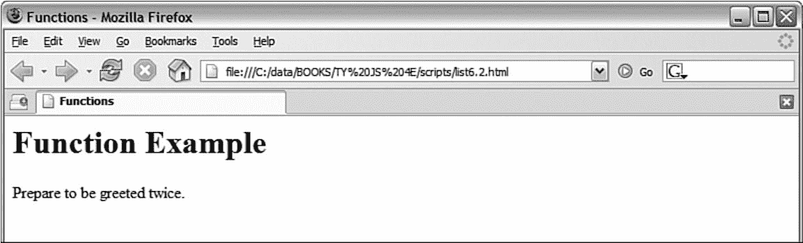 现在你已经有一个可以实际执行操作的脚本，尝试将其加载到浏览器中。你应该看到类似于图 7.1 的内容，显示在 Firefox 中运行的 Greeting 脚本。

图 7.1

 Greeting 示例的输出。

注意，在点击第一个提示框上的 OK 按钮之前，第二个提示消息不会显示。这是因为在显示提示框时，JavaScript 的处理会停止。

### 返回值

你刚刚创建的函数向用户显示消息，但函数也可以向调用它们的脚本返回一个值。这允许你使用函数来计算值。例如，你可以创建一个计算四个数字平均值的函数。

你的函数应该以 `function` 关键字、函数名以及它接受的参数开头。我们将使用变量名 `a`、`b`、`c` 和 `d` 作为计算平均值的四个数字。这是函数的第一行：

```javascript
function Average(a,b,c,d) {
```

 使用函数 我在函数的第一行也包含了左括号 ({)。这是一种常见的风格，但你也可以将括号放在下一行或单独一行。接下来，函数需要计算四个参数的平均值。为了将此结果返回给调用它的脚本，你需要使用 `return` 关键字。这是函数的最后部分：

```javascript
return result;
}
```

列表 7.3 显示了 HTML 文档中完整的 `Average` 函数。该 HTML 文档在 `<body>` 部分还包含了一个小型脚本，该脚本调用 `Average` 函数并显示结果。

```html
<<html>
<head>
<title>Function Example</title>
<script language=”JavaScript” type=”text/javascript” >
function Average(a,b,c,d) {
result = (a + b + c + d) / 4;
return result;
}
</script>
</head>
<body>
<p>以下是函数调用的结果。</p>
<script language=”JavaScript” type=”text/javascript” >
score = Average(3,4,5,6);
document.write(“平均值为：” + score);
</script>
</body>
</</html>
```

## 介绍对象

在上一章中，你学习了如何使用变量表示 JavaScript 中的不同类型的数据。JavaScript 还支持对象，一种更复杂的变量类型，可以存储多个数据项和函数。

虽然变量一次只能有一个值，但对象可以包含多个值，以及处理这些值的函数。这允许你将相关的数据项和处理它们的函数组合到对象中。

在本章中，你将学习如何定义和使用你自己的对象。你已经处理过了一些对象，包括：

- DOM 对象——允许你的脚本与网页交互。你在第 5 章“处理文档对象模型 (DOM)”中学习了这些内容。
- 内置对象——包括字符串和数组，你已经在第 6 章“使用变量、字符串和数组”中学习了它们。


处理所有类型的对象（DOM 对象、内置对象和自定义对象）的语法是相同的，因此，即使你最终没有创建自己的对象，也应该对 JavaScript 的对象术语和语法有良好的理解。

## 创建对象

在上一节中创建数组时，你使用了以下 JavaScript 语句：`scores = new Array(4);`

`new` 关键字告诉 JavaScript 解释器使用一个函数（在这种情况下是内置的 `Array` 函数）来创建一个对象。你将在本章的后些部分为自定义对象创建一个函数。

## 对象的属性和值

每个对象都拥有一个或多个属性——本质上是存储在对象中的变量。例如，在第 5 章中，你学习了 `location.href` 属性可以提供当前文档的 URL。`href` 属性是 DOM 中 `location` 对象的属性之一。

你还使用过 `String` 对象的 `length` 属性，如下一节中的示例所示：

```
test = “This is a test.”; document.write(test.length);
```

就像变量一样，每个对象属性都有值。要读取属性的值，你只需要在任何表达式中包含对象名和属性名，并用点隔开，如之前的 `test.length`。你可以使用 `=` 运算符更改属性的值，就像操作变量一样。接下来的示例通过更改 `location.href` 属性将浏览器引导到新的 URL：

```
location.href=”http://www.jsworkshop.com/”;
```

| 对象也可以是另一个对象的属性。这被称为子对象。 | ByTheWay |
|---|---|

## 理解方法

除了属性之外，每个对象都可以有一个或多个方法。这些是与对象数据工作的函数。例如，下面的 JavaScript 语句会重新加载当前文档，正如你在第 5 章中所学的那样：

```javascript
location.reload();
```

当你使用 `reload()` 时，你正在使用 `location` 对象的一个方法。像普通函数一样，方法可以在括号中接受参数，并返回值。

## 使用对象简化脚本

虽然 JavaScript 的变量和数组是存储数据的多功能方式，但有时你需要一个更复杂的结构。例如，假设你正在编写一个脚本来处理名片数据库，该数据库包含各种人的姓名、地址和电话号码。

如果你使用普通变量，你将为数据库中的每一个人准备几个独立的变量：一个姓名变量、一个地址变量等。这会非常困惑。

数组会稍微改善情况。你可以有一个 `names` 数组、一个 `addresses` 数组和一个电话号码数组。数据库中的每个人在每个数组中都将有一个条目。这会更方便，但仍然不完美。

通过对象，你可以让存储数据库的变量像名片一样符合逻辑。每个人都由一个 `Card` 对象表示，该对象具有姓名、地址和电话号码的属性。你甚至可以给对象添加方法来显示或处理这些信息。

在接下来的章节中，你将使用 JavaScript 实际创建 `Card` 对象及其属性和方法。在本章的后些部分，你将在脚本中使用 `Card` 对象来显示数据库中几位成员的信息。

## 定义对象

创建对象的第一步是为它及其属性命名。我们已经决定将对象命名为 `Card` 对象。每个对象将具有以下属性：

* `.name`
* `.address`
* `.workphone`
* `.homephone`

在 JavaScript 程序中使用此对象的第一步是创建一个函数来创建新的 `Card` 对象。这个函数被称为对象的“构造函数”。以下是 `Card` 对象的构造函数：

```javascript
function Card(name,address,work,home) { this.name = name; this.address = address; this.workphone = work; this.homephone = home;
}
```

构造函数是一个简单的函数，它接受参数来初始化新对象并将它们分配给相应的属性。该函数接受从调用它的语句传递的几个参数，然后将它们赋值为对象的属性。因为函数被命名为 `Card`，所以该对象就是 `Card` 对象。

注意 `this` 关键字。每当你创建一个对象定义时，都会使用它。使用 `this` 来引用当前对象——即正在被函数创建的那个。

## 定义对象方法

接下来，你将创建一个方法来处理 `Card` 对象。由于所有的 `Card` 对象都具有相同的属性，如果有一个可以以整洁格式打印属性的函数可能会很有用。让我们把这个函数命名为 `PrintCard`。

你的 `PrintCard` 函数将作为 `Card` 对象的方法使用，因此你不需要请求参数。相反，你可以再次使用 `this` 关键字来引用当前对象的属性。以下是 `PrintCard()` 函数的定义：

```javascript
function PrintCard() { line1 = “Name: “ + this.name + “<br>\n”; line2 = “Address: “ + this.address + “<br>\n”; line3 = “Work Phone: “ + this.workphone + “<br>\n”; line4 = “Home Phone: “ + this.homephone + “<hr>\n”; document.write(line1, line2, line3, line4);
}
```

这个函数只需读取当前对象（`this`）的属性，并带有标题打印每一个，跳到新行。你现在做的是让 `PrintCard` 成为 `Card` 对象的一部分。这里是修改后的函数：

```javascript
function Card(name,address,work,home) { this.name = name; this.address = address; this.workphone = work; this.homephone = home;
this.PrintCard = PrintCard;
```

添加的语句看起来就像另一个属性定义，但它引用的是函数定义。方法本质上是定义函数而非简单值。

| 上一个示例使用了如 `workphone` 等小写名称作为属性，并使用大写名称 (`PrintCard`) 作为方法。 | DidKnow? |
|---|---|
| 属性任何名称，但这是明确 `PrintCard` 是方法而非普通属性的一种方法。 | |

## 创建对象实例

现在让我们使用你刚刚创建的对象定义和方法。要使用对象定义，你需要创建一个对象。这是通过 `new` 关键字完成的。你已经用过这个关键字创建 `Date` 和 `Array` 对象。

接下来的语句创建一个名为 `tom` 的新 `Card` 对象：

```javascript
tom = new Card(“Tom Jones”, “123 Elm Street”, “555-1234”, “555-9876”);
```

可以看出，创建对象很容易。你只需要调用 `Card()` 函数（对象定义）并按照定义的顺序提供所需的属性。

在执行此语句后，将创建一个新对象来存储 Tom 的信息。这被称为 `Card` 对象的实例。就像程序中可以有多个字符串变量一样，你定义的对象也可以有多个实例。

与其使用 `new` 关键字为卡片指定所有信息，不如可以在事实后赋值。例如，接下来的脚本创建一个名为 `holmes` 的空 `Card` 对象，然后为其分配属性：

```javascript
holmes = new Card(); holmes.name = “Sherlock Holmes”; holmes.address = “221B Baker Street”; holmes.workphone = “555-2345”; holmes.homephone = “555-3456”;
```

当你使用上述方法之一创建了 `Card` 对象的实例后，可以使用 `PrintCard()` 方法来显示其信息。例如，此语句显示了 `tom` 卡片的属性：

```javascript
tom.PrintCard();
```


# 扩展内置对象

JavaScript 包含一项功能，允许你扩展内置对象的定义。例如，如果你认为 `String` 对象并不完全符合你的需求，你可以扩展它，添加新的属性或方法。如果你正在编写一个使用许多字符串的大脚本，这可能会非常有用。

你可以通过使用 `prototype` 关键字向现有对象添加属性和方法。（原型是对象定义或构造函数的另一个名称。）`prototype` 关键字允许你在构造函数之外更改对象的定义。

举个例子，让我们为 `String` 对象定义中添加一个方法。你将创建一个名为 `heading` 的方法，该方法会将字符串转换为 HTML 标题（HTML heading）。下述述的语句定义了一个名为 `title` 的字符串：

```
title = “Fred’s Home Page”;
```

该语句将把 `title` 字符串的内容作为 HTML 1 级标题输出：`document.write(title.heading(1));`。

## 扩展内置对象

列表 7.4 为 `String` 对象定义添加了一个 `heading` 方法，该方法将字符串显示为标题，然后使用该方法显示了三个标题。

### 列表 7.4 为 String 对象添加方法


```html
<html>
<head><title>Test of heading method</title></head>
<<body>
<script LANGUAGE=”JavaScript” type=”text/javascript">
function addhead (level) {
    html = “H” + level;
    text = this.toString();
    start = “<” + html + “>”;
    stop = “</” + html + “>”;
    return start + text + stop;
}

String.prototype.heading = addhead;
document.write (“This is a heading 1”.heading(1)); 
document.write (“This is a heading 2”.heading(2)); 
document.write (“This is a heading 3”.heading(3));
</script>
</body>
</</html>
```


首先，你定义了 `addhead()` 函数，它将作为新的字符串方法。它接受一个数字来指定标题级别。`start` 和 `stop` 变量用于存储 HTML 的“开始标题”和“结束标题”标签，例如 `<h1>` 和 `</h1>`。

在定义函数之后，使用 `prototype` 关键字将其添加为 `String` 对象的方法。然后你可以在任何 `String` 对象或（实际上是任何 JavaScript 字符串上使用此方法。最后三个语句演示了这一点，它们将带引号的文本字符串显示为 1、2 和 3 级标题。

| 亲自试一试 | ▼ |

---

## 在对象中存储数据

现在你已经创建了一个用于存储名片的新对象，以及一个用于打印它们的方法。作为对象、属性、函数和方法的最后一个演示，你现在将在网页中使用此对象来显示几张卡片的数据。

你的脚本需要包含 `PrintCard` 的函数定义，以及 `Card` 对象的函数定义。然后你创建三张卡片并在文档主体中打印它们。我们将为此示例使用独立的 HTML 和 JavaScript 文件。列表 7.5 显示了完整的脚本。

### 列表 7.5 使用 Card 对象的示例脚本

```javascript
// 定义函数
function PrintCard() {
    line1 = “<b>Name: </b>” + this.name + “<br>\n”;
    line2 = “<b>Address: </b>” + this.address + “<br>\n”;
    line3 = “<b>Work Phone: </b>” + this.workphone + “<br>\n”;
    line4 = “<b>Home Phone: </b>” + this.homephone + “<hr>\n”;
    document.write(line1, line2, line3, line4);
}

function Card(name,address,work,home) {
    this.name = name;
    this.address = address;
    this.workphone = work;
    this.homephone = home;
    this.PrintCard = PrintCard;
}

// 创建对象
sue = new Card(“Sue Suthers”, “123 Elm Street”, “555-1234”, “555-9876”);
phred = new Card(“Phred Madsen”, “233 Oak Lane”, “555-2222”, “555-4444”);
henry = new Card(“Henry Tillman”, “233 Walnut Circle”, “555-1299”, “555-1344”);

// 并打印它们
sue.PrintCard();
phred.PrintCard();
henry.PrintCard();
```


注意，`PrintCard()` 函数经过了微调，以使加体标题看起来更良好。要使用此脚本，请将其保存为 `cardtest.js`。接下来，你需要在简单的 HTML 文档中包含该脚本。列表 7.6 显示了此示例的 HTML 文档。

### 列表 7.6 Card 对象示例的 HTML 文件


```html
<html>
<head>
<title>JavaScript Business Cards</title>
</head>
<body>
<h1>JavaScript Business Card Test</h1>
<p>Script begins here.</p><hr>
<script language=”JavaScript” type=”text/javascript”
</script>
<p>End of script.</p>
</body>
</html>
```

要使用此脚本，请将其保存为 `cardtest.js`。接下来，你需要在简单的 HTML 文档中包含该脚本。


如果你使用像前面示例那样的 `if`语句，可以使用单个语句作为操作部分。你也可以通过将多个语句封装在大括号 (``{}`) 中来使用多个语句作为操作，如下：

```
if (a == 1) { window.alert(“Found a 1!”); a = 0; }
```

这段语句块再次检查变量 `a`。如果发现其值为 `1`，它会显示一条消息并将 `a` 设回 `0`。

## 条件运算符

`if` 语句的动作部分可以包含你已经学习的任何 JavaScript 语句（实际上任何其他语句也可），但语句的条件部分使用其特有的语法。这被称为条件表达式。

条件表达式通常包含两个要比较的值（在前面的示例中，这两个值是 `a` 和 `1`）。这些值可以是变量、常量，甚至是它们本身的表达式。


### `if` 语句

条件表达式的任何侧都可以是变量、常量或表达式。你可以比较一个变量和一个值，也可以比较两个变量。（你可以比较两个常量，但通常没有必要。）在两个要比较的值之间是一个条件运算符。该运算符告诉 JavaScript 如何比较这两个值。例如，`==` 运算符被用于测试两个值是否相等。有多种条件运算符可用：

- `==`—等于。
- `!=`—不等于。
- `<`—小于。
- `>`—大于。
- `>=`—大于或等于。
- `<=`—小于或等于。

请务必不要将等号运算符 (`==`) 与赋值运算符 (`=`) 混淆，尽管它们都可能被读作“等于”。记住，在给变量赋值时使用 `=`，在比较值时使用 `==`。 混淆这二者是 JavaScript 编程中最常见的错误之一。


## 使用逻辑运算符组合条件

通常，你可能想要检查变量是否符合多个可能的值，或者同时检查多个变量。JavaScript 包含了逻辑运算符（也称为布尔运算符）用于此目的。例如，以下两个语句检查不同的条件并使用相同的操作：

```javascript
if (phone == "") window.alert(“error!”);
if (email == "") window.alert(“error!”);
```

使用逻辑运算符，你可以将它们合并为单个语句：

```javascript
if (phone == "" || email == "") window.alert(“Something’s Missing!”);
```

该语句使用逻辑“或”运算符 (`||`) 来组合条件。翻译成英文，它的意思是：“如果电话号码为空或电子邮件地址为空，则显示错误消息。”

另一个逻辑运算符是“与”运算符，`&&`。考虑这条语句：

```javascript
if (phone == "" && email == "") window.alert(“Both are Missing!”);
```

 该语句使用了 `&&` (与) 而不是 `||` (或)，因此只有当电子邮件地址和电话号码变量都为空时，才会显示错误消息。（在特定情况下，“或”是更好的选择。）

**你你知道吗？** 如果 JavaScript 解释器在到达末尾之前发现了条件表达式的答案，它将不再评估剩余的条件。例如，如果由 `&&` 运算符分隔的两个条件中的第一个为假，则第二个将不会被评估。你可以利用这一点来提高脚本运行速度。

第三个逻辑运算符是感叹号 (`!`)，表示“非”。它可以用于反转表达式——换句话说，一个真的表达式将变成假，一个假的表达式将变成真。例如，这里有一个使用“非”运算符的语句：

```javascript
if (!($phone == "")) alert(“phone is OK”);
```

在该语句中，`!` (非) 运算符反转了条件，因此只有当电话号码变量为空时才会执行 `if` 语句的操作。额外的括号是必要的，因为所有的 JavaScript 条件都必须放在括号中。

你也可以使用 `!=` (不等于) 运算符来简化这条语句：

```javascript
if ($phone != "") alert(“phone is OK”);
```

与之前的语句一样，如果电话号码字段为空，它会提示你。逻辑运算符是强大的，但你很容易用它们无意创建一个不可能的条件。例如，条件 `(a < 10 && a > 20)` 乍看起来是正确的。

 然而，如果你大声读出来，你得到的是“如果 `a` 小于 10 且 `a` 大于 20”——这在我们的宇宙中是不可能的。在这种情况下，应该使用“或” (`||`)。

## `else` 关键字

`if` 语句的一个额外功能是 `else` 关键字。就像它的英文对应词一样，`else` 告诉 JavaScript 解释器如果条件不成立时该做什么。

以下是 `else` 关键字作用的简单示例：

```javascript
if (a == 1) { alert(“Found a 1!”); a = 0; } else { alert(“Incorrect value: “ + a); }
```

这是之前示例的修改版本。如果满足条件，它会显示消息并重置变量 `a`。如果不满足条件（如果 `a` 不是 `1`），则会显示不同的消息。

 和 `if` 语句一样，`else` 后面可以跟一个操作语句，也可以跟一组大括号。

## 使用简写条件表达式

除了 `if` 语句外，JavaScript 还提供了一种简写的条件表达式，你可以用它做快速决策。这使用了其他语言（如 C）中常见的特殊语法。条件表达式的形式如下：

```javascript
variable = (condition) ? (true action) : (false action);
```

这会将两个值之一赋值给 `variable`：如果条件为真则赋值一个，如果为假则赋值另一个。这里是条件表达式的一个示例：

```javascript
value = (a == 1) ? 1 : 0;
```

这条语句看起来可能很奇怪，但它等同于以下 `if` 语句：

```javascript
if (a == 1) value = 1;
else value = 0;
```

换句话说，问号 (`?`) 后的值在条件为真时使用，冒号 (`:`) 后的值在条件为假时使用。冒号代表语句的 `else` 部分，就像 `if` 语句的 `else` 部分一样，它是可选的。

这些简写表达式可以用任何 JavaScript 期望值的地方。它们为对值做出简单决策提供了方便的方法。作为示例，这里有一种显示变量的语法正确消息以便方法：

```javascript
document.write(“Found “ + counter + ((counter == 1) ? “ word.” : “ words.”));
```

如果 `counter` 变量值为 `1`，这将打印 `Found 1 word`；如果其值为 `2` 或更大，则打印 `Found 2 words`。这是条件表达式最常见的用法之一。

### 使用 `if` 和 `else` 测试多个条件

现在你可以使用 `if` 和 `else` 创建一个示例脚本。在之前的章节中，你创建了一个显示当前日期和时间的简单脚本。这个示例将使用条件来显示取决于时间的问候语：“早上好”、“下午好”、“晚上好”或“日好”。为了实现这一点，你可以使用多个 `if` 语句组合：

```javascript
if (hours < 10) document.write(“Good morning.”); else if (hours >= 14 && hours <= 17) document.write(“Good afternoon.”); else if (hours >= 17) document.write(“Good evening.”); else document.write(“Good day.”);
```


第二个语句检查时间是否介在下午 2:00 到下午 5:00 之间，如果是，则显示“下午好”。该语句使用 `else if` 来标示该条件只有在前一个条件失败时才会进行测试——如果是早晨，就没有必要检查是否是下午了。同样，第三条语句检查下午 5:00 之后的时间，并显示“晚上好”。

最后一条语句使用简单的 `else`，这意味着如果之前的没有任何条件都不匹配，则将执行该语句。这涵盖了上午 10:00 到下午 2:00 之间的时间（其他语句忽略了这部分），并显示“日好”。

# 使用 `if` 和 `else` 测试多个条件

## HTML 文件

为了在浏览器中尝试此示例，你需要一个 HTML 文件。我们将把 JavaScript 代码分开存放，因此列表 8.1 是完整的 HTML 文件。将其保存为 `timegreet.html`，但在你按照下一节准备好 JavaScript 文件之前，不要将其加载到浏览器中。

### 列表 8.1 用于时间和和问候示例的 HTML 文件


```html
<html
<head>
<title>if statement example</title>
</head>
<body>
<h1>Current Date and Time</h1>
<p>
<script language="JavaScript" type="text/javascript" src="timegreet.js">
</script>
</p>
</body>
</html>
```


## JavaScript 文件

列表 8.2 显示了时间问候示例的完整 JavaScript 文件。它使用内置的 `Date` 对象函数来查找当前日期并将其存储在 `hours`、`mins` 和 `secs` 变量中。接下来，`document.write` 语句显示当前时间，之前介绍的 `if` 和 `else` 语句则显示相应的问候语。

### 列表 8.2 显示当前时间和问候的脚本


```javascript
// 获取当前日期
var now = new Date();

// 分拆为时、分、秒
hours = now.getHours();
mins = now.getMinutes();
secs = now.getSeconds();

// 显示时间
document.write("<h2>");
document.write(hours + ":" + mins + ":" + secs);
document.write("</h2>");

// 显示问候
document.write("<p>");
if (hours < 10) {
    document.write("Good morning.");
} else if (hours >= 14 && hours <= 17) {
    document.write("Good afternoon.");
} else if (hours > 17) {
    document.write("Good evening.");
} else {
    document.write("Good day.");
}
document.write("</p>");
```


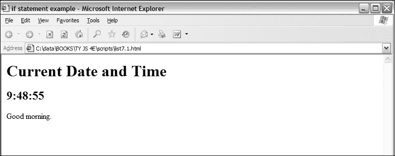

要尝试此示例，请将此文件保存为 `timegreet.js`（或从本书网站下载），然后将 `timegreet.html` 文件加载到你的浏览器中。图 8.1 显示了该脚本的结果。

### 图 8.1
Internet Explorer 所示的时间问候示例的输出。

## 使用 `switch` 使用多个条件

在在上一个示例中，你连续使用了几个 `if` 语句来测试不同的条件。这里是这种技术的另一个示例：

```javascript
if (button=="next") window.location="next.html";
else if (button=="previous") window.location="prev.html";
else if (button=="home") window.location="home.html";
else if (button=="back") window.location="menu.html";
```

虽然这是一种紧凑的方法，但如果每个 `if` 语句都有自己的自己的包含多个语句的代码块，这种方法可能会变得杂乱。作为替代方案，JavaScript 包含了 `switch` 语句，它允许将对同一个变量或表达式的多次测试组合到单个语句块中。以下显示了转换为使用 `switch` 的相同示例：

```javascript
switch(button) {
    case "next":
        window.location="next.html";
        break;
    case "previous":
        window.location="prev.html";
        break;
    case "home":
        window.location="home.html";
        break;
    case "back":
        window.location="menu.html";
        break;
    default:
        window.alert("Wrong button.");
}
```

## 使用 `for` 循环

`switch` 语句有几个组件：

1. 初始 `switch` 语句。该语句在括号中包含要测试的值（在本例中为 `button`）。
2. 大括号 `{` 和 `}` 括围 `switch` 语句的内容，类似于函数或 `if` 语句。
3. 一个或多个 `case` 语句。这些语句中的每个都指定了一个与 `switch` 语句中指定的值进行比较的值。如果值匹配，则执行 `case` 语句之后的语句。否则，则尝试下一个 `case`。
4. `break` 语句用于结束每个 `case`。它会跳到 `switch` 的末尾。如果不包含 `break`，无论是否匹配，多个 `case` 中的语句都可能被执行。
5. 可选的，可以包含 `default` 情况，其后可以跟一个或多个语句。

| `switch` 结构中的 |每个 `case` 语句后可以使用一个或多个语句。你没有需要将它们括在花括号中。如果没有任何的匹配。(Images/image05208.jpeg) |

### `for` 循环

`for` 关键字是创建循环的工具。`for` 循环通常使用计数器（或索引）来跟踪循环执行了多少次。 `for` 语句如下：

`for (initialization; condition; increment)`

`for` 有三个参数，用分号分隔：

* 第一个参数（`var = 1`）指定变量并为其分配初始值。被称为初始化表达式。
* 第二个参数（`var < 10`）是保持运行的条件。被称为条件。
* 第三个参数（`var++`）每次迭代给 `var` 的值加 1。被称为增量表达式，因为它通常增加计数器。

在指定三个参数后，使用左大括号 `{` 块的开始。右大括号 `}` 用于块的结束。花括号之间的语句在循环每次迭代时都会执行。

```javascript
for(i=0; i<10; i++) {
    document.write("This is line " + i + "<br>");
}
```

这些语句定义了一个使用 `i` 的循环，将其初始化为零，只要 `i` 的值小于 10 就循环。由于这是在循环结束时，输出将列出零到九。

当循环在花括号内只包含一个语句时（如本示例所示），如果你愿意可以省略花括号。一种良好的习惯是无论循环包含一个还是多个语句，都使用花括号。这使得以后向循环添加语句而不会引起语法错误。此示例中的循环包含一个会被重复执行的 `document.write` 语句。为了看到此循环的作用，你可以将它添加到 HTML 文档的 `<script>` 部分，如列表 8.3 所示。

### 列表 8.3 使用 `for` 关键字的循环


```html
<html>
<head>
<title>Using a for Loop</title>
</head>
<body>
<h1>"for" Loop Example</h1>
<p>以下是 for 循环的输出：</p>
<script language="JavaScript" type="text/javascript">
    for (i=1;i<10;i++) {
        document.write("This is line " + i + "<br>");
    }
</script>
</body>
</html>
```


此示例在每次迭代期间显示带有循环计数器的消息。列表 8.3 的输出如图 8.2 所示。

请注意，循环只执行了九次。这是因为条件是 `i<10`。当计数器（`i`）增加到 `10` 时，该表达式不再为真。如果你需要循环计数到 `10`，可以更改条件；使用 `i<=10` 或 `i<11` 均可正常工作。

| 你可能会注意到变量名 `i` 经常被用作循环计数器。这源于一种名为 Forth 的古语言的编程传统。你不需要遵循这一传统，但使用一个一致的变量作为计数器是一个好主意。（要了解更多关于 Forth 的信息，请访问 Forth InterestGroup 的网站 [www.forth.org](http://www.forth.org)。） | 顺便说 |

图 8.2

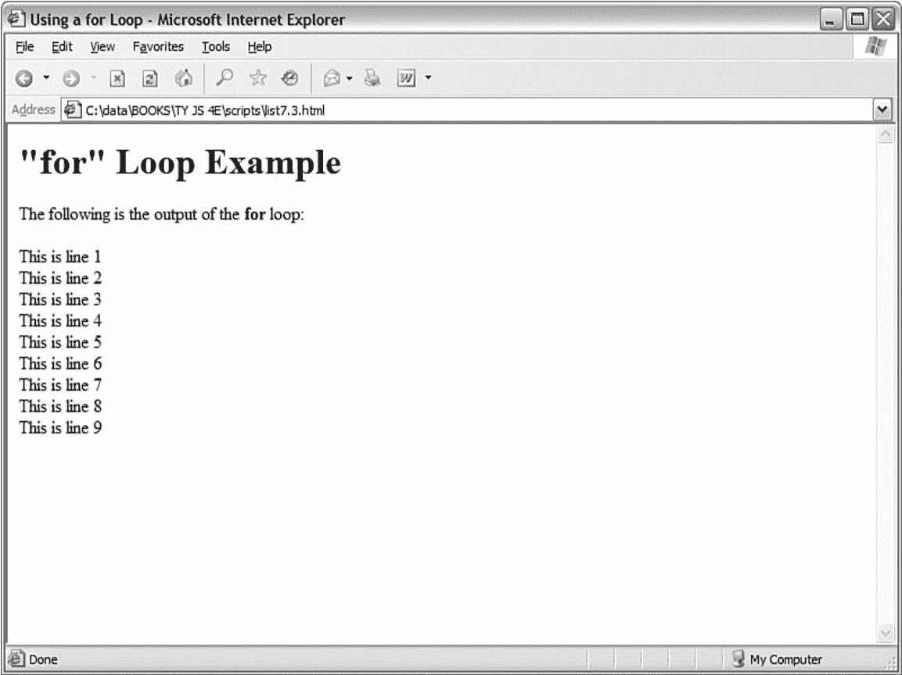`for` 循环示例的结果。

JavaScript 中 `for` 循环的结构基于 Java，而 Java 又基于 C。尽管它传统上用于从一个数字计数到另一个数字，但你几乎可以使用任何语句进行初始化、条件和递增。然而，通常有更好的方法使用 `while` 关键字来执行其他类型的循环，这将在下一节中描述。

### 使用 `while` 循环

JavaScript 中另一种循环的关键字是 `while`。与 `for` 循环不同，`while` 循环并不一定使用变量来计数。相反，只要条件为真，它们就会一直执行。事实上，如果条件初始为假，则语句将完全不会执行。

`while` 语句将条件包含在括号中，后面跟着一个用大括号括起来语句块，就像 `for` 循环一样。这里是一个简单的 `while` 循环：

```
while (total < 10) { n++; total += values[n]; }
```

此循环使用计数器 `n` 来遍历 `values` 数组。然而，它并不是在达到某个特定计数时停止，而是在值的总和达到 `10` 时停止。你可能注意到，你可以使用 `for` 循环完成相同的事情：

```
for (n=0;total < 10; n++) { total += values[n]; }
```

事实上，`for` 循环无非是一种特殊的 `while` 循环，它为你处理了初始化和递增。你通常可以使用 `while` 用于任何循环。然而，最好选择一种对任务最有意义的、或者输入量最少的循环类型。

### 使用 `do…while` 循环

JavaScript 1.2 引入了第三种循环：`do…while` 循环。这种类型的循环与普通的 `while` 循环相似，但不同在于：条件是在循环结束时测试的，而不是在开始。这里是一个典型的 `do…while` 循环：

```
do { n++; total += values[n];
} while (total < 10);
```

处理循环

### 处理循环

正如你可能已经注意到的，这基本上是上一个 `while` 示例的倒置版本。有一个区别：使用 `do` 循环，条件是在循环结束时测试的。这意味着循环中的语句将至少执行一次，即使条件从未为真。

| 就像 `for` 和 `while` 循环一样，`do` 循环可以包含不带大括号的单个语句，也可以包含封装在大括号内的多个语句。 | 虽然你可以使用简单的 `for` 和 `while` 循环处理简单任务，但在使用更复杂的循环时，你应该考虑一些因素。在接几节中，我们将无限循环以及 `break` 和 `continue` 语句，它们让你对循环有更多的控制。 |

#### 创建无限循环

`for` 和 `while` 循环提供了对循环的相当大的控制。在某些情况下，如果不小心，可能会导致问题。例如，查看以下循环代码：

```
while (i < 10) { n++; values[n] = 0;}
```

这个示例有一个错误。`while` 循环的条件引用了变量 `i`，但该变量在循环过程中实际上并没有变化。这创建了一个无限循环。循环将继续执行，直到用户停止它，或者它产生某种错误。无限循环并不总是由用户停止，除非退出浏览器——而且某些循环甚至可以阻止浏览器退出或导致崩溃。

显然，无限循环是应该避免的。它们也可能很难发现，因为 JavaScript 不会给你真正告诉你存在无限循环的错误。因此，每当你编写脚本并创建一个循环时，都应该仔细确保有一个出路。取决于使用的浏览器版本，无限循环甚至可能让浏览器停止响应用户。请确保你为无限循环提供了逃生路径，并在测试之前保存你的脚本，以防万一。 | 顺便说顺便说 |

 ，你可能想要故意创建一个无限循环。这可能包括你希望程序执行到用户停止它为止的情况，或者你正通过 `break` 语句提供逃生路径，这将在下一节中介绍。这里是创建无限循环的一种简单方法：

```
while (true) {
```
由于 `true` 是条件，这个循环将始终发现为真。

#### 退出循环

有一种方法退出循环。你可以使用 `break` 语句在循环期间立即退出，并继续执行循环后的第一个语句。这里是使用 `break` 的示例：

```
while (true) { n++; if (values[n] == 1) break; }
```
无论是否无限，这种方法都是有效的。

#### 继续循环

还有一种语句可以帮助你控制语句的执行。`continue` 语句跳过循环的剩余部分，与 `break` 不同，它会继续循环的下次迭代。这里有一个简单的示例：

```
for (i=1; i<21; i++) { if (score[i]==0) continue;
document.write("Student number ",i, " Score: ", score[i]);
}
```
此脚本使用 `for` 循环打印存储在 `score` 数组中的 20 个学生的分数。`if` 语句用于检查分数为 0 的情况。该脚本假设 0 分意味着学生没有参加考试，因此它继续循环而不打印该分数。

### 遍历对象属性

#### 遍历对象属性

JavaScript 提供了第三种循环。`for…in` 循环不像普通的 `for` 或 `while` 循环那样灵活。相反，它是专门为对对象的每个属性执行操作而设计的。

例如，`navigator` 对象包含了描述用户浏览器的属性。你可以使用 `for…in` 显示该对象的属性：

```
for (i in navigator) { document.write("property: " + i); document.write(" value: " + navigator[i] + "<br>"); }
```

和普通的 `for` 循环一样，这种类型的循环使用一个索引变量（`i`）。在循环的每次迭代中，该变量被设置为对象的下一个属性。当你需要检查或修改对象的每个属性时，这非常方便。

| 尝试一下 | ▼ |

##### 处理数组与循环

为了应用你所循环的知识，现在将创建一个使用循环处理数组的脚本。在学习此脚本的过程中，尝试想象如果没有 JavaScript 的循环功能，将会有多困难。


这个简单的脚本会提示用户输入一系列名称。在输入所有名称后，它将以编号列表的形式显示这些列表。要启动该脚本，请初始化一些变量：

```javascript
names = new Array(); i = 0;
```

`names` 数组将存储用户输入的名称。你不知道会输入多少个名称，因此不需要为数组指定维度。`i` 变量将在循环中用作计数器。

接下来，使用 `prompt` 语句提示用户输入一系列名称。使用循环对每个名称重复提示。你希望用户至少输入一个名称，因此 `do` 循环是理想的的：

```javascript
do { next = prompt(“Enter the Next Name”, “”); if (next > “ “) names[i] = next; i = i + 1; }
while (next > “ “);
```


### 你知道吗？
如果你对让脚本尽可能简短感兴趣，请记住你可以使用自增运算符（`++`）将 `i = i + 1` 语句与前一个语句结合：`names[i++]=1`。

这个循环提示一个名为 `next` 的字符串。如果输入了名称且不为空，它将被存储为 `names` 数组中的下一个项目。然后 `i` 计数器加 1。循环将重复，直到用户不再输入名称或在提示对话框中点击“取消”。

接下来，你的脚本可以显示输入的名称数量：`document.write(“<h2>” + (names.length) + “ names entered.</h2>”);`

该语句显示了 `names` 数组的 `length` 属性，并将其放在 2 级标题标签中以强调。

接下来，脚本应该按照输入的顺序显示所有名称。由于名称存储在数组中，`for…in` 循环是一个很好的选择：

```javascript
document.write(“<ol>”); for (i in names) { document.write(“<li>” + names[i] + “<br>”); }
document.write(“</ol>”);
```

这里你有一个 `for…in` 循环，它遍历 `names` 数组，依次将计数器 `i` 赋值给每个索引。然后脚本使用 `<<li>` 标签将名称作为有序列表中的项打印出来。在循环之前和之后，脚本会打印起始和结束的 `<ol>` 标签。

你现在拥有了运行该脚本所需的所有内容。列表 8.4 显示了此示例的 HTML 文件，列表 8.5 显示了 JavaScript 文件。

#### 列表 8.4A 提示名称并显示名称的脚本 (HTML)


```html
<html>
<head>
  <title>Loops Example</title>
</head>
<body>
  <h1>Loop Example</h1>
  <p>Enter a series of names. I will then display them in a nifty numbered list.</p>
  <script language="JavaScript" type="text/javascript" src="loops.js">
    
  </script>
</body>
</html>
```

#### 遍历对象属性

##### 列表 8.5 提示名称并显示名称的脚本 (JavaScript)


```javascript
// create the array names
names = new Array(); i = 0;

// loop and prompt for names
do {
  next = window.prompt(“Enter the Next Name”, “”);
  if (next > “ “) names[i] = next;
  i = i + 1;
} while (next > “ “);

document.write(“<h2>” + (names.length) + “ names entered.</h2>”);

// display all of the names
document.write(“<ol>”);
for (i in names) {
  document.write(“<li>” + names[i] + “<br>”);
}
document.write(“</ol>”);
```


要尝试此示例，请将 JavaScript 文件保存为 `loops.js`，然后将 HTML 文档加载到浏览器中。每次会被提示输入一个名称。输入几个名称，然后点击“取消”表示你已完成。图 8.3 显示了浏览器中最终结果应该是这样的


### 在本章中将学习：
- `Math` 对象
- `Math` 函数
- `keyword`
- `dates`
- 第三方库

在本章中，你将学习 `Math` 对象的基础。你还会查看第三方库，允许你用简单的脚本创建复杂的效果。

#### 使用 Math 对象
`Math` 对象是一个内置对象，包含了数学常量。你不需要创建 `Math`；它会自动存在。

#### 四舍五入和截断
`Math` 对象三个常用的方法允许你向上向下：
- `Math.ceil()` 将数字向上取整到整数。
- `Math.floor()` 将数字向下取整到整数。
- `Math.round()` 将数字四舍五入到整数。

所有这些方法都将要处理的数字作为单个参数。你可能会注意到缺少了：小数。幸运的是，你可以轻松模拟。这是一个保留两位小数的简单函数：

```javascript
function round(num) {
  return Math.round(num * 100) / 100;
}
```

该函数将值乘以 100 以移动小数点，然后将其四舍五入为整数。最后，除以 100 以恢复小数点。

#### 生成随机数
`Math` 对象最常用的方法之一是 `Math.random()` 方法，它可以生成随机数。该方法不需要任何参数。它返回的是 0 到 1 之间的随机数。

你通常需要 1 到某个值之间的随机数。你可以通过通用函数来实现。以下是一个生成 1 到指定参数之间随机数的函数：

```javascript
function rand(num) {
  return Math.floor(Math.random() * num) + 1;
}
```

该函数将随机数乘以 `num` 参数中的值，然后通过 `Math.floor()` 方法将其转换为 1 到该数之间的整数。

#### Math 函数
`Math` 对象包含了许多你在此之前见过的函数。例如，`Math.sin()` 和 `Math.cos()` 计算正弦和余弦。`Math` 对象还包含了各种数学常量的属性，例如 `Math.PI`。


作为 `Math` 对象方法的一个示例，你可以创建一个脚本来测试 JavaScript 的随机数函数。为了实现这一点，你将生成 5000 个随机数并计算它们的平均值。

| 与其手动输入，你可以在本书的网站上下载并尝试本章的示例。 | 你知道吗？ |

如果你跳过了第 8 章“使用条件和循环控制流程”，并且正准备拿出计算器，别担心——你将使用一个循环来生成随机数。你会对 JavaScript 执行此操作的速度之快感到惊讶。

要开始你的脚本，你将初始化一个名为 `total` 的变量。该变量将存储所有随机值的累加和，因此将其初始化为 `0` 是非常重要的：`total = 0;`

接下来，开始一个执行 5,000 次的循环。使用 `for` 循环，因为你希望它执行固定次数：`for (i=1; i<=5000; i++) {`

在循环内部，你需要创建一个随机数并将其值加到 `total` 中。以下是执行这些操作并继续循环下一次迭代的语句：

```
num = Math.random(); total += num;
```

}

根据你计算机的速度，生成这 5,000 个随机数可能需要几秒钟。为了确保程序正在运行，脚本将在每生成 1000 个数字后显示一条状态消息：

```
if (i % 1000 == 0) document.write(“Generated “ + i + “ numbers...<br>”);
```

上述代码中的 `%` 符号是取模运算符，它返回一个数除以另一个数后的余数。在这里，它用于寻找 1000 的倍数。

脚本的最后部分将通过将 `total` 除以 `5,000` 来计算平均值。你的脚本还可以使用你在本章之前学过的技巧将平均值保留三位小数：

```
average = total / 5000; average = Math.round(average * 1000) / 1000;
document.write(“<H2>Average of 5000 numbers: “ + average + “</H2>”);
```

要测试此脚本并查看这些数字到底有多随机，可以将完整脚本与 HTML 文档和 `<script>` 标签结合。列表 9.1 显示了完整的随机数测试脚本。

### 列表 9.1A 测试 JavaScript 随机数函数的脚本


```html
<html>
<head>
<title>Math Example</title>
</head>
<body>
<h1>Math Example</h1>
<p>JavaScript 的随机数到底有多随机？让我们生成 5000 个来看看结果吧。</p>
<script language="JavaScript" type="text/javascript">
total = 0; 
for (i=1; i<=5000; i++) { 
    num = Math.random(); 
    total += num; 
    if (i % 1000 == 0) document.write(“Generated “ + i + “ numbers...<br>”); 
}
#### 使用 `with` 关键字

#### 列表 9.1 继续


```javascript
average = total / 5000; 
average = Math.round(average * 1000) / 1000; 
document.write(“<H2>Average of 5000 numbers: “ + average + “</H2>”);
</script>
</body>
</html>
```


要测试脚本，请将 HTML 文档加载到浏览器中。经过短暂延迟后，你应该看到结果。如果结果接近 `.5`，说明数字是相当随机的。我的结果是 `.502`，如图 9.1 所示。

| 你在这里使用的平均值被称为算术平均数。这种平均方法并不是测试随机性的完美方法。实际上，它测试的是数字在 `.5` 之上和之后的分布。例如，如果数字结果是 2,500 个 `.4` 和 2,500 个 `.6`，平均值将是完美的 `.5`——但它们并不是很随机的数字。（幸运的是，JavaScript 的随机数没有这个问题。） | 顺便说 |

图 9.1 运行中的随机数测试脚本。

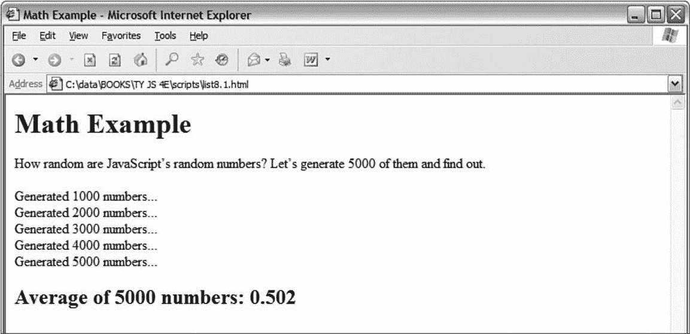使用 `with` 关键字

`with` 关键字是你之前从未见过的。你可以使用它来让 JavaScript 编程变得更简单——或者至少让输入更简单。

`with` 关键字指定一个对象，后面跟着一个用大括号括起来语句块。对于块中的每条语句，如果你在没有指定对象的情况下提到任何属性，都被认为是该对象的属性。

作为一个示例，假设你有一个名为 `lastname` 的字符串。你可以使用 `with` 对它进行字符串操作，而无需每次都指定字符串的名字：

```javascript
with (lastname) { 
    window.alert(“length of last name: “ + length); 
    capname = toUpperCase();
}
```

在这个示例中，`with` 关键字允许你省略对象名。

### 使用 `with` 关键字

`with` 关键字是你之前从未见过的。你可以使用它来让 JavaScript 编程变得更简单——或者至少让输入更简单。

`with` 关键字指定一个对象，后面跟着一个用大括号括起来语句块。对于块中的每条语句，如果你在没有指定对象的情况下提到任何属性，都被认为是该对象的属性。

作为一个示例，假设你有一个名为 `lastname` 的字符串。你可以使用 `with` 对它进行字符串操作，而无需每次都指定字符串的名字：

```javascript
with (lastname) { 
    window.alert(“length of last name: “ + length); 
    capname = toUpperCase();
}
```

在这个示例中，`with` 关键字允许你省略对象名。

### 处理日期

`Date` 对象允许你处理日期和时间。`Date` 对象允许你处理日期和时间。`Date` 对象允许你处理日期和时间。`Date` 对象允许你处理日期和时间。`Date` 对象允许你处理日期和时间。`Date` 对象允许你处理日期和时间。`Date` 对象允许你处理日期和时间。`Date` 对象允许你处理日期和时间。`Date` 对象允许你处理日期和时间。`Date` 对象允许你处理日期和时间。`Date` 对象允许你处理日期和时间。

创建一个一个 `Date` 对象允许你处理日期和时间。`Date` 对象允许你处理日期和时间。`Date` 对象允许你处理日期和时间。你可以使用 `new` 关键字创建一个 `Date` 对象。你可以以各种格式创建 `Date` 对象。你也可以在创建时可选指定日期。

```javascript
birthday = new Date();
birthday = new Date(“June 20, 2003”);
birthday = new Date(6, 20, 2003, 8, 0);
```

设置 `Date` 值

各种 `set` 方法允许你设置 `Date` 对象的组件：

- `setDate()` 设置日期。
- `setMonth()` 设置月份。JavaScript 月份为 0 到 11，从一月开始。
- `setFullYear()` 设置年份。
- `setTime()` 通过指定自 1970 年 1 月 1 日起的毫秒设置时间（和日期）。
- `setHours()`、`setMinutes()` 和 `setSeconds()` 设置时间。

例如，以下语句将名为 `holiday` 的 `Date` 对象年份设置为 2003：

```javascript
holiday.setFullYear(2003);
```

### 读取 `Date` 值

你可以使用 `get` 方法从 `Date` 对象中获取值。这是获取这些值的唯一方法，因为它们不是作为属性提供的。以下是用于日期的 `get` 方法：

- `getDate()` 获取日期。
- `getMonth()` 获取月份。
- `getFullYear()` 获取年份。
- `getTime()` 获取自 1970 年 1 月 1 日起的毫秒数的时间（和日期）。
- `getHours()`、`getMinutes()`、`getSeconds()` 和 `getMilliseconds()` 获取时间的各个部分。

### 处理时区

最后，有几个函数可以帮助你的 `Date` 对象处理本地时间值和时区：

- `getTimeZoneOffset()` 给你本地时区相对于 UTC（协调世界时，基于旧格林尼治时间标准）的偏移量。在这种情况下，本地指的是浏览器的位置。


`toUTCString()` 将 `date` 对象的时间值转换为文本，使用 UTC（协调世界时）。该方法在 JavaScript 1.2 中引入，用于取代 `toGMTString` 方法，后者仍然可用，但应避免使用。

`toLocalString()` 将 `date` 对象的时间值转换为文本，使用本地本地时间。

除了这些基础函数外，JavaScript 1.2 及更高版本还包含了之前描述的几个函数的 UTC 版本。这些版本与普通命令相同，但操作的是 UTC 而非本地时间：

`getUTCDate()` 获取 UTC 时间的月份中的几。

`getUTCDay()` 获取 UTC 时间的星期几。

`getUTCFullYear()` 获取 UTC 时间的四位年份。

`getUTCMonth()` 返回 UTC 时间的月份。

`getUTCHours()`、`getUTCMinutes()`、`getUTCSeconds()` 和 `getUTCMilliseconds()` 返回 UTC 时间的各个组成部分。

`setUTCDate()`、`setUTCFullYear()`、`setUTCMonth()`、`setUTCHours()`、`setUTCMinutes()`、`setUTCSeconds()` 和 `setUTCMilliseconds()` 设置 UTC 时间。

## 使用第三方库

### 转换日期格式

`Date` 对象的两个特殊方法允许你在不同日期格式之间进行转换。你不需要在自己创建的 `Date` 对象上使用这些方法，而是对内置的 `Date` 对象本身使用它们。这些方法包括：

`Date.parse()` 将日期字符串（例如 `June 20, 1996`）转换为 `Date` 对象（自 1970 年 1 月 1 日以来的毫秒数）。

`Date.UTC()` 则执行相反的操作。它将 `Date` 对象的值（毫秒数）转换为 UTC（GMT）时间。

### 使用第三方库

当你使用 JavaScript 内置的 `Math` 和 `Date` 函数时，JavaScript 承担了大部分工作——你不需要思考如何在不同格式之间转换日期或如何计算余弦值。JavaScript 并不包含第三方库，但它们具有类似的作用——让你能够仅用少量的代码就能完成复杂的任务。

使用这些库之一通常只需要将一个或多个文件复制到你的网站，并在文档中包含 `<script>` 标签来加载该库。接下来的章节将讨论几个流行的 JavaScript 库。书的最后将提供更详细的描述，包括如何将这些库用于 Ajax 应用。

### Prototype

Prototype 由 Sam Stephenson 创建，是一个 JavaScript 库，它简化了诸如操作 DOM 对象、处理表单数据以及远程脚本（AJAX）等任务。通过在文档中包含单个 `prototype.js` 文件，你就可以可以使用许多对基础 JavaScript 的改进。

在页面中添加 Prototype 只需要一个文件 `prototype.js` 和一个 `<script>` 标签：

```html
<script type="text/javascript" src="prototype.js"></script>
```

请参第 25 章了解关于 Prototype 的讨论。

### Script.aculo.us

页面动画等任务的代码可能非常复杂，但你也可以使用预构建的库在页面中包含效果。这让你仅需几行代码就能使用令人印象深刻的效果。

由 Thomas Fuchs 的 `Script.aculo.us` 就是这样的库之一。它包含了用于简化拖放任务的函数，例如重新排列项目列表。它还包含许多组合效果（Combination Effects），允许你在页面中使用高亮和动画过渡。例如，页面的新部分可以短暂地高亮黄色以吸引用户的注意力，或者页面的部分可以淡出或滑出屏幕。

在包含适当的文件后，使用效果变得像使用 JavaScript 的任何内置方法一样简单。例如，以下语句使用 `Script.aculo.us` 使 `id` 值为 `test` 的页面元素淡出：

```javascript
obj = document.getElementById("test"); new Effect.Fade(obj);
```

`Script.aculo.us` 构建在上一节描述的 Prototype 框架之上，并包含了 Prototype 的所有函数，因此你也可以通过使用 `$` 函数进一步简化：

```javascript
new Effect.Fade($("test"));
```

请参阅第 27 章获取更多关于使用 `Script.aculo.us` 库的信息。

### 其他库

世界上还有许多 JavaScript 库，随着 JavaScript 作为应用程序语言受到越来越多的重视，更多的库正在不断出现。以下是一些你可能想要探索的库：

- `Dojo` (http://www.dojotoolkit.org/) 是一个开源工具包，它增强了 JavaScript 的功能，以简化应用程序和用户界面的构建。它提供了从额外的字符串和数学函数到动画和 Ajax 的各种功能。
- `Yahoo! UI Library` (http://developer.yahoo.net/yui/) 由 Yahoo! 开发，并根据开源许可向所有人开放。它包含了动画、DOM 功能、事件管理以及易用的用户界面元素（如日历和滑动条）的功能。

## 总结

| `Prototype`、`Script.aculo.us`、`Dojo` 和 `MochiKit` 是随附书籍的 CD 提供的框架选择。 |

- `MochiKit` (http://mochikit.com/) 是一个轻量级库，添加了处理 DOM、CSS 颜色、字符串格式化和 Ajax 的功能。它还支持一个用于调试的良好日志机制。


# 注意了！你知道吗？你知道吗？

某些浏览器可能需要注意安全设置，以允许 `XMLHTTPRequest` 对象正确运行。详情请参阅您的浏览器文档。`XMLHTTPRequest` 对象的目的是允许 JavaScript 制定 HTTP 请求并将其提交到服务器。传统的 Web 应用程序通常以同步方式发起此类请求，并结合用户发起的事件（如点击链接或提交表单），从而向浏览器提供新页面或更新后的页面。

然而，使用 `XMLHTTPRequest`，你可以让你的页面在后台异步地进行此类调用，允许你在无需受到浏览器刷新和加载新页面或修订页面的干扰的情况下，继续使用该页面。这种能力是所有 Ajax 应用的基础，使得 `XMLHTTPRequest` 对象成为 Ajax 编程的关键。

尽管该对象的名称以 XML 开头，但实际上，从服务器可以返回任何类型的文档；ASCII 文本、HTML 和 XML 都是热门的选择，我们将在本书中遇到所有这些内容。

## 创建 XMLHTTPRequest 对象

在创建 `XMLHTTPRequest` 实例之前，你无法使用它。在 JavaScript 中创建一个对象的实例通常只需要调用一个名为对象构造函数的方法。但在 `XMLHTTPRequest` 的情况下，你必须稍微更改此例程，以适应不同浏览器的特殊性，如下一节所示。

### 不同浏览器的不同规则

微软首次引入了 `XMLHTTPRequest` 对象，并在 Internet Explorer 5 中将其实现为 ActiveX 对象。ActiveX 是微软的一项专用技术，用于将活动对象引入网页中。在所有可用的浏览器中，它目前仅在 |

微软的 Internet Explorer 中支持（注：此处原文似乎不完整）。Internet Explorer 使用其内置的 XML 解析器 MSXML 来创建 `XMLHTTPRequest` 对象。

大多数其他浏览器开发者现在已在他们的产品中包含了相应的对象，但它是作为浏览器 JavaScript 解释器的原生对象实现的。

由于你无法预知用户将使用哪种浏览器、版本或操作系统，你的代码必须动态调整其行为，以确保对象实例能够成功创建。

对于大多数支持 `XMLHTTPRequest` 作为原生对象的浏览器（Mozilla、Opera 以及其他），创建此对象的实例是非常简单的。

以下行创建了一个名为 `request` 的 `XMLHTTPRequest` 对象：

```javascript
var request = new XMLHTTPRequest();
```

在这里，我们声明了一个变量 `request`，并赋值为语句 `new XMLHTTPRequest()` 返回的值，该语句正在调用 `XMLHTTPRequest` 对象的构造器方法。

为了在 Microsoft Internet Explorer 中实现等的效果，你需要创建一个 ActiveX 对象。示例如下：

```javascript
var request = new ActiveXObject(“Microsoft.XMLHTTP”);
```

再次，这会将名称 `request` 赋值给新对象。

为了让事情稍微复杂一点，某些版本的 Internet Explorer 安装了不同版本的 MSXML（微软 XML 解析器）；在这些情况下，你需要使用以下指令：

```javascript
var request = new ActiveXObject(“Msxml2.XMLHTTP”);
```

## 适用于所有浏览器的解决方案

因此，你需要创建一个脚本，无论你使用哪种浏览器，它都能正确创建 `XMLHTTPRequest` 对象的实例（前提是该浏览器支持 `XMLHTTPRequest`）。

解决此问题的良好方法是让脚本依次尝试创建对象实例的各种方法，直到某种方法成功为止。请看列表 10.1，其中使用了这种策略。

### 列表 10.1 使用对象检测实现跨浏览器解决方案


```javascript
function getXMLHTTPRequest() {
    var request = false; 
    try {
        ###### 列表 10.1 继续
        
        request = new XMLHttpRequest(); /* 例如 Firefox */
    } catch(err1) { 
        try { 
            request = new ActiveXObject(“Msxml2.XMLHTTP”);
            /* 某些版本的 IE */
        } catch(err2) { 
            try { 
                request = new ActiveXObject(“Microsoft.XMLHTTP”); /* 某些版本的 IE */
            } catch(err3) { 
                request = false;
            }
        }
    } 
    return request;
}
```


列表 10.1 使用 JavaScript 语句 `try` 和 `catch`。`try` 语句允许我们尝试运行一段代码。如果运行没有错误，则一切正常；但如果发生错误，我们可以使用 `catch` 语句在错误消息发送给用户之前进行干预，并确定程序随后应对错误采取的操作。

## 通过 方式

| 注意语法：`catch(identifier)`。这里的 `identifier` 是在捕获到错误时创建的对象。它包含了有关错误的信息；例如，如果你想向用户提示 JavaScript 运行时错误的性质，可以使用如下代码结构：`catch(err) { alert(err.description);`，以打开一个包含错误详情的对话框。 |

另一种同样有效的技术是通过测试浏览器中定义了哪些对象来检测正在使用哪种浏览器。列表 10.2 显示了这种技术。

### 列表 10.2 使用浏览器检测实现跨浏览器解决方案


```javascript
function getXMLHTTPRequest() {
    var request = false; 
    if (window.XMLHttpRequest) {
        request = new XMLHttpRequest();
    }
    } else {
        if (window.ActiveXObject) {
            try {
                request = new ActiveXObject(“Msxml2.XMLHTTP”);
            } catch(err1) {
                try {
                    request = new ActiveXObject(“Microsoft.XMLHTTP”);
                } catch(err2) {
                    request = false;
                }
            }
        }
    }
    return request;
}
```


在示例中，我们使用测试 `if (window.XMLHttpRequest) { … }` 来判断 `XMLHTTPRequest` 是否为原生对象；如果是，我们使用构造方法 `request = new XMLHttpRequest()` 创建实例；否则，按照第一个示例创建 ActiveX 对象。

无论你使用何种方法来创建 `XMLHTTPRequest` 实例，你都可以这样调用此函数：

```javascript
var myRequest = getXMLHTTPRequest();
```

## 方式

| JavaScript 还提供了一个 `navigator` 对象，它包含了有关查看页面的浏览器信息。另一种用于分支代码的方法是使用该对象的 `appName` 属性来查找浏览器名称：`var myBrowser = navigator.appName;` 这对于 IE 会返回“Microsoft Internet Explorer”。

## 方法和属性

现在我们已经创建了 `XMLHTTPRequest` 实例，让我们看看对象的一些属性和方法，列于 10.1。(Images/image05249.jpeg)

### 表格 10.1 XMLHTTPRequest 对象和方法

| 属性 | 描述 |
| :--- | :--- |
| `onreadystatechange` | 当对象的 `readyState` 属性更改时决定调用哪个事件处理程序 |
| `readyState` | 报告请求状态的整数：0 = 未初始化 1 = 加载 2 = 交互 3 = 完成 4 |
| `responseText` | 以文本字符串形式由服务器的数据 |
| `responseXML` | 以文档对象表示的服务器数据 |
| `status` | 服务器返回的 HTTP 状态码 |
| `statusText` | 服务器返回的 HTTP 原因短 |
| **方法** | |
| `abort()` | 停止当前请求 |
| `getAllResponseHeaders()` | 返回所有头部字符串 |
| `getResponseHeader(x)` | 返回头部 `x` 的值的字符串 |
| `open(‘method’,’URL’,’a’)` | 指定 HTTP 方法（例如 `GET` 或 `POST`）、目标 URL 以及请求是否应异步处理（如果是，`a=’true’——这是默认值；如果否，`a=’false’`。） |


| `send(content)` | 发送请求，可选包含 `POST` 数据 |
| `setRequestHeader('x', 'y')` | 设置参数和值值对 `x=y` 并将其分配给随请求一起发送的标头  |

在接下来的几个章节中，我们将检查如何使用这些方法和属性来创建构成 Ajax 应用程序基石的函数。

现在，让我们先检查这些方法中的几个。

## `open()` 方法

`open()` 方法准备 `XMLHTTPRequest` 对象以与服务器进行通信。你需要向该方法提供至少两个强制性参数：

1. 首先，指定你意图使用的 HTTP 方法，通常为 `GET` 或 `POST`。
2. 其次，将请求的目标 URL 作为第二个参数包含在内。如果是发送 `GET` 请求，则需要对该 URL 中的任何参数及其值进行适当的编码，并将其作为 URL 的一部分。

出于安全考虑，`XMLHTTPRequest` 对象仅允许与其所在域内的 URL 进行通信。尝试连接远程域名将导致“权限被拒绝”错误消息。

| 一个常见的错误是在从 [www.mydomain.com.](http://www.mydomain.com) 发出的调用将你的域名引用为 `mydomain.com`。JavaScript 解释器会将两者视为不同的，且不允许连接。可选地，你可以为发送请求包含第三个参数，这是一个布尔值，用于声明请求是否以异步模式发送。如果设置为 `false`，则请求将不会以异步模式发送，页面将实际上锁定直到请求完成。如果省略该参数，将假设默认值为 `true`，然后请求将以异步方式发送。布尔数据类型只有两个可能的值：1（或 `true`）和 0（或 `false`）。 | 注意！通过由  所示 方式 |

## `send()` 方法

使用 `open()` 方法准备好 `XMLHTTPRequest` 后，你可以使用 `send()` 方法发送请求。`send()` 函数接受一个参数。

如果你的请求是 `GET` 请求，请求信息将编码到目标 URL 中，然后你可以简单地使用参数 `null` 调用 `send()` 方法：

```javascript
objectname.send(null);
```

然而，如果你正在进行 `POST` 请求，则请求的内容（经过适当编码）将作为参数传递。

```javascript
objectname.setRequestHeader('Content-Type', 'application/x-www-form-urlencoded');
objectname.send(var1=value1&var2=value2);
```

在这种情况下，我们使用 `setRequestHeader` 方法来指示我们包含什么类型的内容。

## 总结

本章介绍了 `XMLHTTPRequest` 对象，它是任何 Ajax 应用程序的驱动力，并说明了如何为 Internet Explorer 以及其他非微软浏览器创建此类对象的实例。我们还简要检查了该对象的一些属性和方法。

后续章节将展示如何使用更多的对象的方法和属性。

# 第 11 章：与服务器对话 


### 你在本章中学到的：

* 发送服务器请求
* 监控服务器状态
* 回调函数

在本章中，你将学习如何使用 `XMLHTTPRequest` 对象的属性和方法，允许对象向服务器发送请求并从服务器接收数据。

### 发送服务器请求

第 10 章“`XMLHTPPRequest` 对象”详细讨论了 JavaScript `XMLHTTPRequest` 对象以及如何在各种不同的浏览器中创建它的实例。

现在我们已经有了 `XMLHTTPRequest` 对象，让我们考虑如何创建和发送服务器请求，以及我们可能期望从服务器接收回什么消息。

我们将直接进入正题，首先使用你在第 10 章中学到的知识编写一些代码，以创建一个名为 `myRequest` 的 `XMLHTTPRequest` 对象。然后，我们将编写一个名为 `callAjax()` 的 JavaScript 函数，使用该对象向服务器发送异步请求。之后，我们将逐行分解代码，以查看它在做什么。

列表 11.1 显示了我们使用此对象准备并发送 Ajax 请求的原型函数。

**列表 11.1 发送服务器请求 **

```javascript
function getXMLHTTPRequest() {
  var req = false;
  try {
    req = new XMLHttpRequest(); /* 例如，Firefox */
  } catch(err1) {
    try {
      req = new ActiveXObject("Msxml2.XMLHTTP");
      /* 某些版本的 IE */
    } catch(err2) {
      try {
        req = new ActiveXObject("Microsoft.XMLHTTP"); /* 某些版本的 IE */
      } catch(err3) {
        req = false;
      }
    }
  }
  return req;
}

var myRequest = getXMLHTTPRequest();

function callAjax() {
  // 声明一个变量存储某些信息
  // 传递给服务器
  var lastname = 'Smith';
  // 构建我们想要调用的服务器脚本的 URL
  var url = "myserverscript.php?surname=" + lastname;
  // 请求我们的 XMLHTTPRequest 对象打开服务器连接
  myRequest.open("GET", url, true);
  // 当响应到达时准备一个 responseAjax() 函数
  myRequest.onreadystatechange = responseAjax;
  // 最后发送请求
  myRequest.send(null);
}
```
 你还记得第 4 章“在 JavaScript 中创建简单脚本”中学过的吗？以 `//` 开头的行被 JavaScript 视为注释。你可以使用这些行来记录你的代码或添加其他备注，你的 JavaScript 解释器在执行代码时将忽略它们。

### 发送服务器请求

首先，我们需要创建一个 `XMLHTTPRequest` 实例并将其命名为 `myRequest`。你可能在第 10 章中识别出它的代码。

接下来查看 `callAjax()` 函数。

第一行简单地声明了一个变量并分配一个值：

```javascript
var lastname = 'Smith';
```

这是我们的函数意图发送到服务器的数据，作为服务器脚本所需的 `surname` 变量的值。在现实中，此类数据的值通常通过处理页面事件（如点击或键盘输入）动态获取，但现在这将作为一个简单的示例。

我们意图进行的请求是 `GET` 请求，因此我们必须构造一个带有我们参数和值对的目标 URL；下一行执行此操作：

```javascript
var url = "myserverscript.php?surname=" + lastname;
```

我们在第 10 章简要处理过 `open()` 方法。我们在下一行中使用它来准备我们的服务器请求：

```javascript
myRequest.open("GET", url, true);
```

此行指定我们正在准备一个 `GET` 请求，并向其传递带有附加请求内容的目标 URL。

第三个参数 `true` 表示我们希望以异步方式处理请求。在这种情况下，可以省略它，因为在这种情况下假设默认值为 `true`。然而，为了清晰，包含它也没有害。

接下来，我们需要告诉我们的 `XMLHTTPRequest` 对象 `myRequest` 如何处理它从服务器接收的“进度报告”。`XMLHTTPRequest` 对象有一个属性 `onreadystatechange`，它包含了当服务器状态更改时应该调用哪个 JavaScript 函数的信息，在下一行

```javascript
myRequest.onreadystatechange = responseAjax;
```

我们分配 `responseAjax()` 函数执行此工作。我们将在本章晚些时候编写这个函数。


这似乎更多是 IE 的问题，而不是非微软浏览器的。。只有 `GET` 请求会受到影响；`POST` 请求不会被缓存。

虽然这在页面加载时间方面有时是有优势的，但在编写 Ajax 应用程序时会带来困难。Ajax 的核心在于与服务器通信，而不是从缓存中重新加载信息；因此，当你向服务器发送异步请求时，每次都必须生成一个新的 HTTP 请求。

可以向服务器端例程返回的数据中添加 HTTP 头部，以告诉浏览器不要缓存特定页面。示例包括：

`Pragma: no-cache` 和 `Cache-Control: must-revalidate` 等及其它。

遗憾的是，这些策略的有效性差异很大。不同的浏览器有不同的缓存处理策略并支持不同的标头声明，这使得确保页面不被缓存变得非常困难。

解决此问题的常用技巧包括向请求数据中添加一个带有随机且无意义的值的参数。对于 `GET` 请求，这需要在 URL 的末尾添加额外的参数值对（parameter value pair）。

如果 URL 中的随机部分每次都不同，这实际上“欺骗”了浏览器，使其认为它正向一个以前未访问过的地址发送异步请求。这导致每次都发送一个新的 HTTP 请求。

让我们来看看如何实现这一目标。正如你在第 9 章中学到的，在 JavaScript 中，你可以使用原生 `Math()` 对象的 `Math.random()` 方法生成随机数。列表 11.2 包含了对 `callAjax()` 函数的几修改。

### 发送服务器请求

列表 11.2 处理浏览器缓存


```javascript
function getXMLHTTPRequest() {
  var req = false;
  try {
    req = new XMLHttpRequest(); /* e.g. Firefox */
  } catch(err1) {
    try {
      req = new ActiveXObject(“Msxml2.XMLHTTP”); /* 某些版本的 IE */
    } catch(err2) {
      try {
        req = new ActiveXObject(“Microsoft.XMLHTTP”); /* 某些版本的 IE */
      } catch(err3) {
        req = false;
      }
    }
  }
  return req;
}

var myRequest = getXMLHTTPRequest();

function callAjax() {
  // 定义一个变量来存储某些信息
  // 传递给服务器
  var lastname = ‘Smith’;
  // 构建我们想要调用的服务器脚本的 URL
  var url = “myserverscript.php?surname=” + lastname;
  // 生成一个随机数
  var myRandom=parseInt(Math.random()*99999999);
  // 请求我们的 XMLHTTPRequest 对象打开
  // 服务器连接
  myRequest.open(“GET”, url + “&rand=” + myRandom, true);
  // 准备一个函数 responseAjax() 在
  // 响应到达时运行
  myRequest.onreadystatechange = responseAjax;
  // 最后发送请求
  myRequest.send(null);
}
```


从列表 11.2 中可以看出，脚本现在将为我们的 Ajax 请求生成一个如下所示的目标 URL：`myserverscript.php?surname=Smith&rand=XXXX`

 其中 `XXXX` 将是一个随机数，从而防止页面从缓存返回，并强制向服务器发送新的 HTTP 请求。

| 顺便问一下你知道吗？ | 一些程序员倾向于添加当前时间戳而不是随机数。这是一个从当前日期和时间衍生出的字符串，在书的其他地方已详细讨论。在接下来的示例中，使用了原生 `Date()` 对象的 JavaScript `Date()` 和 `getTime()` 方法：`myRand= new Date().getTime();` |

### 监控服务器状态

`XMLHTTPRequest` 对象包含了某些机制，使我们能够随时了解 Ajax 请求的进度，并确定服务器返回的信息何时可以在我们的应用程序中使用。现在，让我们看看相关的属性。

#### readyState 属性

`XMLHTTPRequest` 对象的 `readyState` 属性向你提供服务器关于你发出的请求当前状态的信息。该属性由 `onreadystatechange` 属性监控，`readyState` 值的变化会导致 `onreadystatechange` 变为 `true`，从而执行相应的函数（在我们的示例中为 `responseAjax()`）。

在服务器请求完成后调用的函数通常称为回调函数（callback function）。

| `readyState` 可以取以下值： | 
0 = 未初始化 (uninitialized)
1 = 加载中 (loading)
2 = 已加载 (loaded)
3 = 交互中 (interactive)
4 = 已完成 (completed) |

#### 回调函数

当首次发出服务器请求时，`readyState` 的值设置为零，意味着未初始化。

随着服务器请求的进行，数据开始由服务器加载到 `XMLHTTPRequest` 对象中，`readyState` 属性的值随之变化，移动到 1 然后是 2。

对象 `readyState` 值为 3（交互中），表示该对象已经有了足够的进展，可以对其进行某些交互，尽管该过程尚未完全完成。

 当服务器请求完全完成且对象可以用于进一步处理时，`readyState` 的值最终变为 4。| 并不是所有可能的值对任何给定对象都有意义。 顺便问一下你知道吗？在大多数情况下，你应该寻找 `readyState` 属性的值达到 4，此时你就可以确定服务器已完成任务且 `XMLHTTPRequest` 对象可以使用。 |

#### 服务器状态码

除了 `readyState` 属性之外，你还有另一种方法来检查异步请求的执行：HTTP 状态码。HTTP 响应在第 1 章中讨论过。如果你参考表 1，你会发现状态码 200 对应于服务器的 OK 信息。我们在进一步开发回调函数时将看到如何测试。

让我们看看回调函数 `responseAjax()`。首先，注意此函数每当 `onreadystatechange` 属性的值变化时都会被调用。通常，当此函数被调用时，由于 `readyState` 的值尚未达到 4，因此我们知道服务器请求尚未完成处理。我们可以简单地使用 JavaScript `if` 语句来实现：

```javascript
function responseAjax() {
  // 我们只对 readyState 为 4 感感兴趣
  // 即“已完成”如果(myRequest.readyState == 4) {
    // ... 逻辑代码 ...
  }
}
```

在检查服务器请求已完成的同时，我们还想检查 HTTP 响应状态码，以确保它等于 200，这表示我们的异步 HTTP 请求成功了响应。快速回顾表 10.1，我们可以看到我们的 `XMLHTTPRequest` 对象 `myRequest` 有两个报告 HTTP 状态响应的属性。这些是包含状态响应码的 `myRequest.status` 以及包含原因短语的 `myRequest.statusText`。

我们可以通过进一步的循环来使用这些属性：

```javascript
function responseAjax() {
  // 我们只对 readyState 为 4 感兴趣
  // 即“已加载”如果(myRequest.readyState == 4) {
    // 如果服务器 HTTP 响应是“OK”如果(myRequest.status == 200) {
      // ... 逻辑代码 ...
    } else {
      // 为任何其他 HTTP 响应发出错误消息 alert("发生错误：” ➥+ myRequest.statusText);
    }
  }
}
```


这段代码在我们的 `if` 语句中引入了一个 `else` 子句。任何除 200 以外的服务器状态响应都会执行此 `else` 子句的内容，打开一个包含服务器返回的原因短语文本的警告对话框。

## 回调函数

### 使用回调函数

那么，我们如何从 HTML 页面调用 `callAjax()` 回调函数呢？让我们来看一个示例。这是一个 HTML 页面中简化表单的代码：

```html
< form name=’form1’ >
Name: <input type=’text’ name=’myname’><br>
Tel: <input type=’text’ name=’telno’><br>
< input type=’submit’ >
< /form >
```

我们将使用表单中文本输入字段的 `onBlur` 事件处理器来启动该函数：

```html
< form name=’form1’ >
Name: <input type=’text’ name=’myname’
➥onBlur='callAjax()’><br>
Tel: <input type=’text’ name=’telno’><br>
< input type=’submit’ >
< /form >
```

当用户离开所在字段时，`onBlur` 事件处理器会被激活。在这种情况下，当用户离开字段时，`callAjax()` 将执行，创建一个 `XMLHTTPRequest` 实例，并向 `myserverscript.php?surname=Smith` 发起异步服务器请求。

这听起来没什么用。但是，如果我们现在对 `callAjax()` 的代码进行细微修改呢？

```javascript
function callAjax() {
// 声明一个变量来存放一些 // 传递给服务器的信息 var lastname = document.form1.myname.value; …..
}
```

现在我们可以看到，当用户离开表单字段 `myname` 时，她在字段中输入的值将通过我们的异步请求传递到服务器。这种调用可以可以检查数据库以验证指定的人员是否存在，如果存在，则返回信息以填充表单上的其他字段。

对于用户来说，结果是她在提交（甚至未完成）表单之前，看到剩余字段神奇地被填充了数据。

我们如何使用返回的数据来来实现这种结果，将在第 12 章“使用返回的数据”中进行讨论。

## 总结

本章探讨了我们的 `XMLHTTPRequest` 对象与服务器通信的方法，包括发送异步请求、监控服务器状态以及执行回调函数。

在第 12 章，你将看到 Ajax 应用如何处理服务器请求返回的数据。

## 第 12 章：使用返回的数据


### 你将在本章中学习到：

- `responseText` 和 `responseXML` 属性
- 解析 `responseXML`
- 提供用户反馈

在本章中，你将学习如何处理服务器响应 Ajax 请求时返回的信息。

### `responseText` 和 `responseXML` 属性

第 11 章“与服务器对话”讨论了允许你发送和监控异步服务器请求的服务器通信。Ajax 拼图的最后一块是服务器响应请求返回的信息。

本章讨论了这些信息可能以何种形式存在，以及你如何处理它们并在应用程序中使用它们。我们将使用 `XMLHTTPRequest` 对象的两个属性，即 `responseText` 和 `responseXML`。

表 10.1 列出了 `XMLHTTPRequest` 对象的几个我们尚未描述的属性。其中就 `responseText` 和 `responseXML` 属性。

第 10 章讨论了我们如何使用 `XMLHTTPRequest` 对象的 `readyState` 属性来确定 `XMLHTTPRequest` 用的当前状态。当我们的服务器请求完成时（通过我们的 `XMLHTTPRequest` 对象 `myRequest` 的条件 `myRequest.readyState == 4` 检测到），两个属性 `responseText` 和 `responseXML` 将分别包含服务器返回数据的文本和 XML 表示形式。

在本章中，你将看到如何访问这两个属性中包含的信息，并将每个属性应用于 Ajax 应用。

### `responseText` 属性

`responseText` 属性尝试将服务器返回的信息表示为文本字符串。

**你知道吗？** 如果 `XMLHTTPRequest` 调用因错误而失败或尚未发送，`responseText` 的值将为 `null`。如果你需要提醒自己关于 `null` 值，请翻回第 6 章“使用变量、字符串和数组”。

再次查看回调函数的原型：


```javascript
function responseAjax() {
// 我们只对 readyState 为 4 感，即“已加载”
if(myRequest.readyState == 4) {
// 如果服务器 HTTP 响应为“OK”
if(myRequest.status == 200) {
… 程序执行语句 … 
} else {
// 为任何其他 HTTP 响应发布错误消息警报(“发生错误: “ + myRequest.statusText); }
}
}
```

让我们像列表 12.1 所示，在 `if` 语句中成功执行的分支上添加一条程序语句。

**列表 12.1 显示 `responseText` 的值**


```javascript
function responseAjax() {
// 我们只对 readyState 为 4 感，即“已完成”
if(myRequest.readyState == 4) {
// 如果服务器 HTTP 响应为“OK”
if(myRequest.status == 200) {
alert("服务器返回: “
+ myRequest.responseText);
} else {
// 为任何其他 HTTP 响应发布错误消息警报
alert("发生错误: “
+ myRequest.statusText);
}
}
}
```


### `responseText` 和 `responseXML` 属性

`responseText` 属性尝试将服务器返回的信息表示为文本字符串。

在这个简单的示例中，`alert(“服务器返回: “ + myRequest.responseText);` 获取服务器返回的文本，并在显示对话对话框之前附加“服务器返回: ”。让我们来看使用简单 PHP 文件的示例：

```php
< ?php echo “Hello caller!”
```

我们将在第四部分详细查看 PHP。现在你只需要知道 PHP 的 `echo()` 命令要求服务器输出括号内的任何内容。成功的 `XMLHTTPRequest` 调用将导致 `responseText` 属性包含 `Hello caller!`，导致回调函数产生图 12.1 所示的对话框。

**顺便说：** `responseText` 属性是只读的，因此在将值复制到另一个变量之前，对其进行处理是没有意义的。

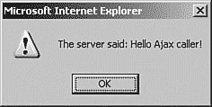 因为 `responseText` 包含简单的字符串，我们可以使用任何的 JavaScript 方法，某些方法已经在第 6 章介绍过。表 12.1 包含了可用的方法。

表 12.1 一些 JavaScript 方法

| 方法 | 说明 |
| :--- | :--- |
| `charAt(number)` | 选择字符串中指定位置的单个字符 |
| `indexOf(substring)` | 查找子字符串开始的位置 |
| `lastIndexOf(substring)` | 查找子字符串在字符串中最后出现的位置 |
| `substring(start,end)` | 获取字符串的指定部分 |
| `toLowerCase()` | 将字符串转换为小写 |
| `toUpperCase()` | 将字符串转换为大写 |

我们将在第 19 章“作为文本返回数据”中查看如何在实际情况中使用 `responseText`。

### `responseXML` 属性

现在，假设我们在上一个示例中使用的服务器 PHP 脚本改为列表 12.2 所示。再次，我们不必太担心 PHP 命令的细节，因为我们将在书的第四部分详细查看 PHP。

**列表 12.2 返回 XML 的服务器端脚本**


```php
< ?php header(Content-Type: text/xml’); echo “<?xml version=\”1.0\” ?><greeting>
➥Hello Ajax caller!</greeting>”;

?>
```


还记得在第 1 章中读过的 HTTP 头部吗？在 `<?php` 和 `?>` 边界符内部的第一行使用了 PHP 的 `header` 指令向返回的数据中添加了 HTTP 头部。返回的头部是参数和值对 `Content-Type: text/xml`，

这告诉我们的 `XMLHTTPRequest` 对象，期望从服务器接收后续数据将格式化为 XML。

下一行是另一个 PHP `echo` 语句，它输出了这个简单但完整的 XML 文档：

```xml
<?xml version="1.0" ?>
<greeting>
Hello Ajax caller!

</greeting>
```

当服务器调用完成时，我们现在发现此 XML 文档已加载到我们 `XMLHTTPRequest` 对象的 `responseXML` 属性中。

你你知道吗？需要注意的是，`responseXML` 属性并不包含一个形成 XML 文档文本表示的字符串（像 `responseText` 属性的情况那样）；相反，XML 文档的整个数据和层级结构被存储为一个 DOM 兼容的对象。

我们现在可以通过 JavaScript 的 DOM 方法和属性访问 XML 文档的内容。

## 解析 `responseXML`

### `getElementsByTagName()` 方法

这个实用的方法允许你构建一个包含所有具有特定标签名元素的 JavaScript 数组。然后你可以使用普通的 JavaScript 语句访问该数组的元素。这里有一个示例：

```javascript
var myElements = object.getElementsByTagName('greeting');
```

这一行创建了数组 `myElements` 并其中填充了所有标签名为 `greeting` 的元素。与任何其他数组一样，你可以通过 `length` 属性来获取数组的长度（即具有声明标签名的元素数量）：`myElements.length`

如果你愿意，可以单独访问某个特定元素；第一个出现的标签名为 `greeting` 的元素可以通过 `myElements[0]` 访问，第二个（如果有的话）可以通过 `myElements[1]` 访问，依此类推：

```javascript
var theElement = myElements[0];
```

| 你也可以直接访问这些单独的数组元素： | 你你知道吗？ |
| :--- | :--- |
| `var theElement = object.getElementsByTagName('greeting')[0];` |

### 解析 `responseXML`

列表 12.3 提供了一个关于我们如何使用 `getElementsByTagName` 在 alert 对话框中返回问候文本的示例。

列表 12.3 使用 `getElementsByTagName()` 解析 `responseXML`


```javascript
function responseAjax() {
    // 我们只对 readyState 为 4 感感兴趣，即“completed”（完成）
    if(myRequest.readyState == 4) {
        // 如果服务器 HTTP 响应为“OK”
        if(myRequest.status == 200) {
            var greetNode = http.responseXML.getElementsByTagName("greeting")[0];
            var greetText = greetNode.childNodes[0].nodeValue;
            alert("Greeting text: " + greetText); 
        } else {
            // 对任何其他 HTTP 响应发布错误消息
            alert("An error has occurred: " + myRequest.statusText);
        }
    }
}
```

在对 `readyState` 和 `status` 属性的值进行常规检查后，代码使用 `getElementsByTagName()` 方法从 `responseXML` 中定位所需的元素，然后使用 `childNodes[0].nodeValue` 从该元素提取文本内容，最后在 JavaScript alert 对话框中显示返回的文本。

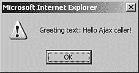图 12.2 显示了 alert 对话框，显示了从 XML 文档 `<greeting>` 元素恢复的文本字符串。

图 12.2 显示返回的问候。

## 提供用户反馈

在具有传统界面的网页中，用户很清楚服务器何时正在处理请求；在准备和提供新页面期间，界面实际上是不可用的。

Ajax 应用程序中的情况略有不同。因为在异步 HTTP 请求期间界面仍然可用，用户可能并不会意识到预期从服务器获取新信息。幸运的是，有一些简单的方法可以警告服务器请求正在进行。

回想一下，每当 `readyState` 的值改变时，我们的回调函数会被调用，但我们真正感兴趣的是 `myRequest.readyState == 4` 条件，这表示服务器请求已完成。

让我们再次参考列表 12.3。对于 4 以外的所有 `readyState` 值，函数将直接终止且什么都不做。我们可以利用 `readyState` 值的这些变化向用户指示服务器请求正在进行但尚未完成。考虑以下代码：

```javascript
function responseAjax() {
    if(myRequest.readyState == 4) {
        if(myRequest.status == 200) {
            // ... [成功 – 处理服务器响应] ...
        } else {
            // ... [失败 – 报告 HTTP 错误] ...
        }
    } else {
        // 如果 readyState 已改变
        // 但 readyState <> 4
        // ... [在此处执行操作以提供用户反馈] ...
    }
}
```

提供用户反馈

实现此点的常用方法是修改页面元素的内容以显示一些引人注目的内容，例如在处理期间显示闪烁或动画图形，完成后将其移除。

### `getElementById()` 方法

JavaScript 的 `getElementById()` 方法允许你通过 ID 定位单个元素。你可以在用户反馈程序中使用该方法临时更改页面元素的内容，以提供请求正在视觉提示。

| 页面中具有 `id` 值的元素每个预期具有唯一的 `id` 值。 | 你你知道吗？ |
| :--- | :--- |
| 与 `class` 属性相比，后者可以应用于任意数量的元素，通常用于设置一组对象的显示特性。 |

假设我们有一个，例如动画图形文件 `anim.gif`，我们在等待服务器信息时显示它。我们希望在 `<div>` 元素内部显示此图形。我们从这个空的 `<div>` 元素开始：

```html
<div id="waiting"></div>
```

现在考虑回调函数的代码：

```javascript
function responseAjax() { 
    if(myRequest.readyState == 4) {
        if(myRequest.status == 200) {
            document.getElementById('waiting').innerHTML = '';
        } else {
            // ...
        }
    } else {
        // 如果 readyState 已改变
        // 但 readyState <> 4
        document.getElementById('waiting').innerHTML = '';
    }
}
```

每次 `readyState` 改变，回调函数都会检查 `readyState == 4` 条件。每当该条件不满足时，`else` 条件就会确保 `id=waiting` 的页面元素包含一个源自动画 GIF 的图像。一旦 `readyState == 4` 条件满足，我们因此知道服务器请求已结束，该行再次擦除动画。

**总结**

我们还介绍了另一个 JavaScript DOM 方法 `getElementsByTagName()`。

在下一章中（第三部分的最后章节），我们将使用这些知识以及从早期章节获取的知识，构建一个完整且运行的 Ajax 应用程序。


# 构建 Ajax 应用程序

之前的章节已经介绍了设计和编写完整的 Ajax 应用程序所涉及的所有技术。在本章中，我们将构建这样一个这样一个应用程序。

我们的第一个应用程序在功能上非常简单，仅仅是返回并显示从服务器内部时钟读取的时间；尽管如此，它将包含任何 Ajax 应用程序所需的所有基本步骤：

- 构成应用程序基础的 HTML 文档
- 用于创建 `XMLHTTPRequest` 对象实例并构建和发送异步服务器调用的 JavaScript 例程
- 一个简单的服务器端例程（使用 `PHP` 编写），用于配置和返回所需信息
- 一个用于处理返回数据并在应用程序中使用它的回调函数

让我们开始吧，从构成我们应用程序基础的 HTML 文件开始。

## HTML 文档

列表 13.1 显示了我们 HTML 页面的代码。

列表 13.1 我们的 Ajax 应用程序的 HTML 页面

```html
<! DOCTYPE HTML PUBLIC “-//W3C//DTD HTML 4.01
➥Transitional//EN”
“http://www.w3.org/TR/html4/loose.dtd”>
< html >
<head >
<title>Ajax Demonstration</title >
<style > .displaybox { width:150px; background-color:#ffffff; border:2px solid #000000; padding:10px; font:24px normal verdana, helvetica, arial, sans-serif; }
</style >
</head >
<body style=”background-color:#cccccc;
➥text-align:center”>
<h1>Ajax Demonstration</h1>
<h2>Getting the server time without page refresh</h2>
<form >
<input type=”button” value=”Get Server Time” / >
</form >
<div id=”showtime” class=”displaybox”></div >
</body>
< /html >
```


这是一个简单的 HTML 布局，只有标题、副标题、按钮和 `<div>` 元素，以及一些样式定义。(Images/image05284.jpeg)

**你知道吗？** 在 HTML 中，`<<div>> ... </div>` 元素代表分区（division），可以用于许多页面元素分组在一起并在块中进行操作。

图 13.1 显示了 HTML 页面的样子。

图 13.1 列表 13.1 的 HTML 文件。

## 添加 JavaScript

或者，我们也可以在外部 JavaScript 文件（例如 `ajax.js`）中添加例程，并在文档的 `<head>` 部分使用类似 `<script language=”JavaScript” type=”text/javascript” ➥src=”ajax.js”></script>` 的语句从我们的文档中调用该文件。(Images/image05285.jpeg)

我们现在可以将 JavaScript 例程添加到 HTML 页面中。我们将通过将它们添加到页面 `<head>` 部分的 `<script> ... </script>` 容器内来实现。

##  **你知道吗？**

### XMLHTTPRequest 对象

首先，让我们添加用于创建 `XMLHTTPRequest` 对象的函数：

```javascript
function getHTTPRequest() {
  try {
    req = new XMLHttpRequest();
  } catch(err1) {
    try {
      req = new ActiveXObject("Msxml2.XMLHTTP");
    } catch (err2) {
      try {
        req = new ActiveXObject("Microsoft.XMLHTTP");
      } catch (err3) {
        req = false;
      }
    }
  }
  return req;
}
```

现在创建我们的 `XMLHTTPRequest` 对象是一件简单的事情，这一次我们将它命名为：`var http = getHTTPRequest()`

### 服务器请求

现在我们需要一个函数来构建我们的服务器请求、定义一个回调函数并将请求发送到服务器。这个函数将从 HTML 页面中的事件处理程序中调用：

```javascript
function getServerTime() {
  var myurl = ‘telltime.php’;
  myRand = parseInt(Math.random()*999999999999); // 在 URL 中添加随机数以避免缓存问题
  modurl = myurl++myRand;
  http.open(“GET”, modurl, true); // 设置回调函数
  http.onreadystatechange = useHttpResponse;
  http.send(null);
}
```

我们再次向 URL 添加了带有随机值的参数以避免缓存问题。我们的回调函数命名为 `useHttpResponse`，并在每次检测到 `http` 的 `readyState` 属性值变化时被调用。

### PHP 服务器端脚本

在解释回调函数的操作之前，我们需要引用列表 13.2 显示的简单 PHP 例程 `telltime.php` 的代码

列表 13.2 telltime.php

```php
<?php
header('Content-Type: text/xml');
echo "<?xml version='1.0'?><clock><timenow".date('H:i:s')."</timenow></clock>";
?>
```

这个短程序使用 `PHP` 的 `date()` 函数报告服务器时间。(Images/image05288.jpeg)(Images/image05289.jpeg) 你理解 `PHP` 并不是至关重要的。


```html
<style>
.displaybox { width:150px; background-color:#ffffff; border:2px solid #000000; padding:10px; font:24px normal verdana, helvetica, arial, sans-serif; }
</style>
```

# 整合一切

### 列表 13.3 续


```javascript
<script language="JavaScript" type="text/javascript">
function getXMLHTTPRequest() {
  try {
    req = new XMLHttpRequest();
  } catch(err1) {
    try {
      req = new ActiveXObject("Msxml2.XMLHTTP");
    } catch (err2) {
      try {
        req = new ActiveXObject("Microsoft.XMLHTTP");
      } catch (err3) {
        req = false;
      }
    }
  }
  return req;
}
var http = getXMLHTTPRequest();

function getServerTime() {
  var myurl = 'telltimeXML.php';
  myRand = parseInt(Math.random()*9999999999999999);
  var modurl = myurl+"?rand="+myRand;
  http.open("GET", modurl, true);
  http.onreadystatechange = useHttpResponse;
  http.send(null);
}

function useHttpResponse() {
  if (http.readyState == 4) {
    if(http.status == 200) {
      var timeValue = http.responseXML.getElementsByTagName("timenow")[0];
      document.getElementById('showtime').innerHTML = timeValue.childNodes[0].nodeValue;
    }
  } else {
    document.getElementById('showtime').innerHTML = '';
  }
}
</script>
```

```html
<body style="background-color:#cccccc" onLoad="getServerTime()">
  <center>
    <h1>Ajax Demonstration</h1>
    <h2>在不刷新页面的获取服务器时间</h2>
    <form>
      <input type="button" value="Get Server Time" onClick="getServerTime()">
    </form>
    <!-- LISTING 13.3Continued -->
    
    <div id="showtime" class="displaybox"></div>
  </center>
</body>
```
```


将页面加载到浏览器中后，我们可以看到服务器时间显示在 `div` 容器中，这表明当页面加载时，`body` 的 `onLoad` 事件处理器已触发。

## 用户反馈

请注意，我们通过此行代码提供了用户反馈：
`document.getElementById('showtime').innerHTML = '';` 
它在 `readyState` 每次变化时都会执行，直到满足 `readyState == 4` 条件。

如果你有一个快速的服务器和良好的互联网连接，可能很难看到这种用户反馈的生效，因为时间显示几乎是瞬间更新的。为了演示动画 GIF 图片的操作，我们可以通过 PHP 的 `sleep()` 命令减慢服务器脚本，以模拟更复杂的脚本和/或较差的连接：

```php
<?php
header('Content-Type: text/xml');
sleep(3);
echo "<?xml version=\"1.0\" ?><clock1><timenow>".date('H:i:s')."</timenow></clock1>";
?>
```

`sleep(x);` 行强制服务器暂停程序执行 `x` 秒。此行会在时间显示元素中加载一个带有旋转图案的动画 GIF，表示服务器请求正在进行，如图 13.2 所示。这种技术在第 12 章中详细描述过。

## 你知道吗？


### 整合一切

图 13.2：动画图片提供了用户反馈。

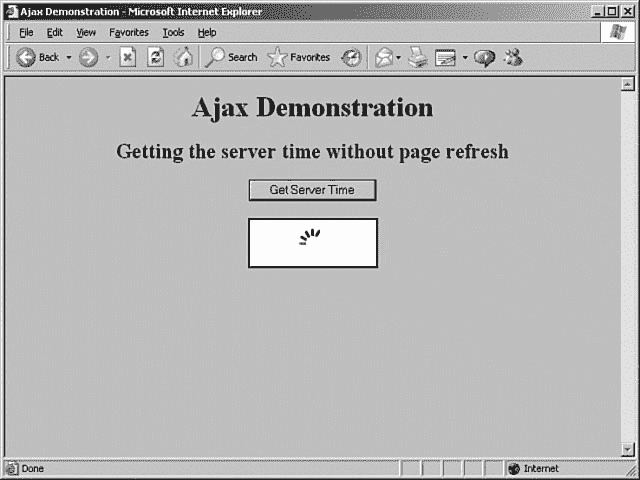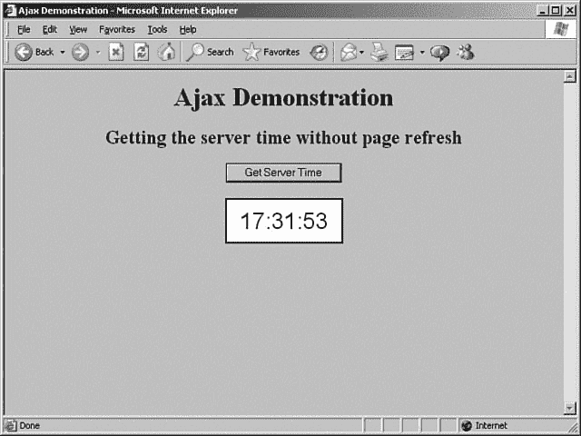

现在，每当我们点击“Get Server Time”按钮时，时间显示就会更新。图 13.3 显示了完成后的应用程序。

图 13.3：我们完成 Ajax 应用。

## 总结

在本章中，我们构建了一个简单而完整的 Ajax 应用，它实现了以下功能：
- 创建 `XMLHTTPRequest` 对象的实例
- 响应 HTML 页面内置的 JavaScript 事件处理器
- 构建并发送异步服务器请求
- 使用 JavaScript DOM 方法解析从服务器接收的 XML
- 提供请求正在进行的用户反馈
- 使用接收到的数据更新显示页面

这标志着本书第三部分“简介 Ajax”的结束。书中后面还有更多 Ajax 内容，但首先我们将在第四部分“使用 PHP 进行服务器端脚本”中详细介绍 PHP。

## 第四部分：使用 PHP 进行服务器端脚本


| 章节 | 标题 | 页码 |
| :--- | :--- | :--- |
| 第 14 章 | 了解 PHP | 187 |
| 第 15 章 | 变量 | 195 |
| 第 16 章 | 流程控制 | 215 |
| 第 17 章 | 函数 | 223 |
| 第 18 章 | 使用类 | 231 |

本页特意留

### 第 14 章 了解 PHP


### 你在本章将学到：
- PHP 基础
- 你的第一个脚本


PHP 的之处之处在于它完全不于于浏览器；无论你使用哪种浏览器，你的脚本运行方式都是相同的。在编写服务器端代码时，你不需要担心 JavaScript 是否启用，也不需要担心与旧浏览器的兼容性，只要它们能够显示你的脚本生成或嵌入其中的 HTML 即可。

!(Images/image05302.jpeg)

# PHP 基础

随书附的光盘包含了强大且方便的 XAMPP 软件包。如果你想为自己的 PHP 实验创建一个自己的服务器环境，而不是使用托管 Web 空间，可以使用此软件包在你的个人 PC 或网络上的另一台 PC 上安装 Apache Web 服务器，并完整配置好 PHP 解释器和其他工具。

## PHP 标签

考虑以下这段由 PHP 驱动的网页的片段，它显示当前日期：

`Today is <?php echo date('j F Y’);?>`

`<?php` 标签告诉 PHP 之后的所有内容都是程序代码而不是 HTML，直到结束标签 `?>`。在这个示例中，`echo` 命令告诉 PHP 将下一个项目显示在屏幕上；随后的 `date` 命令生成当前日期的格式化版本，包含日、月、年。

分号字符用于表示 PHP 命令的结束。在之前的示例中，只有一个命令，实际上并不需要分号，但始终包含它是一个良好的习惯，用以表明命令已完成。

在本书中，PHP 代码出现在看起来像 `<?php ... ?>` 的标签内部。也可以使用其他的标签样式，因此你可能会遇到其他人的 PHP 代码，它们以看起来像 `<?`（短标签）、`<%`（ASP 标签样式）或 `< SCRIPT LANGUAGE=”php”>`（脚本标签）的标签开头。

在可以使用的不同标签样式中，只有完整的 `<?php` 标签和脚本标签是始终可用的。其他的标签通过使用 PHP 配置设置来开启或关闭。始终使用 `<?php` 标签样式是一个良好的习惯，这样你的代码将能够 运行在任何安装了 PHP 的系统上，而不需要额外的配置。

> **顺便说一下，光盘上的你才知道吗？**  
> 如果你想尝试用 `<?` 作为快捷方式，请记住，每当你将代码移动到另一个 Web 服务器时，你需要确保它能理解这种标签样式。

任何未包含在 PHP 标签中的内容都会直接传递给浏览器，与其在脚本中显示的样式完全一致。因此，在之前的示例中，当页面显示时，文本 `Today is` 出现在生成的日期之前。

# 你的第一个 PHP 脚本

在继续之前，你需要确保在阅读本书中的示例时，你可以创建并运行 PHP 脚本。这可以在你自己的机器上进行，你可以在随书的光盘上找到安装 PHP 环境以及 XAMPP 软件的说明。此外，许多 Web 托管公司在他们的软件包中都包含了 PHP，你可能已经拥有了合适的 Web 空间访问权限。

继续，创建一个名为 `time.php` 的新文件，其中包含列表 14.1，并放置在启用了 PHP 的 Web 服务器可以访问的位置。这是之前显示的日期示例的略微变。

### 列表 14.1 显示系统日期和时间


 时间是

```
<?php echo date('H:i:s');?>
```

日期是


```
<?php echo date('j F Y');?>
```


当你在 Web 浏览器中输入该文件的 URL 时，你应该看到根据 Web 服务器系统时钟显示的当前日期和时间。

> **注意！你才知道吗？**  
> 如果你从本地 PC 运行 PHP，脚本中的 PHP 代码只有在通过启用了 PHP 模块的 Web 服务器进行访问时才会执行。如果你直接在 Web 浏览器中打开本地脚本——例如，通过双击或将文件拖入浏览器——它将仅被视为 HTML。

如果你在 Windows 中使用默认的 Apache 安装，你将在 `C:\Program Files\Apache Group\Apache\htdocs` 文件夹中创建 `time.php`，正确的 URL 为 `http://localhost/time.php`。如果你从随书的光盘上加载了 XAMPP 软件，请参考 XAMPP 文档找到你的 Web 文件夹位置。


如果你完全按照所示输入了列表 14.1，你可能会注意到实际输出的格式可以稍微好一点——时间和单词“and”之间没有空格。脚本中任何只包含 PHP 标签内代码的行都不会在生成的 HTML 中占据一行输出。

| 关于如何使用 PHP 日期格式的完整细节可以在 [`es2.php.net/date`](http://es2.php.net/date) 处找到 | **你才知道吗？**

如果你在 Web 浏览器中使用“查看源代码”选项，你可以看到脚本生成的确切输出，它看起来应该类似于以下：

`The time is 15:33:09 and the date is 13 October 2004`

如果你在 `?>` 之后插入一个空格字符，该行现在包含非 PHP 元素，输出的间距就是正确的。

## echo 命令

虽然 PHP 非常适合在网页中嵌入小型元素，但实际上，整个页面都可以由 PHP 指令生成输出。`echo` 命令用于发送输出。列表 14.1 使用 `echo` 向浏览器显示 `date` 命令返回的当前日期的格式化版本。

### 列表 14.2 使用 echo 输出到浏览器


```
<?php echo "The time is "; date('H:i:s'); echo " and the date is "; date('j F Y'); ?>
```


你想输出的非动态文本包含在引号中。双引号（如列表 14.2 所示）或单引号（用于撇号的字符）都可以用于包含字符串，尽管你在第 15 章“变量”中会看到这样式之间的重要区别。以下语句都是有效的：

`echo "The time is ";`
`echo 'The time is ';`

注意这些语句使用了空格字符以确保 `date` 的输出与周围文本隔开。事实上，列表 14.2 的输出与 14.1 有所不同，但在 Web 浏览器中，你需要查看源代码来查看差异。列表 14.2 的原始输出如下：

`The time is 15:59:50 and the date is 13 October 2004`

这次生成的源代码中没有换行符。在 Web 浏览器中输出看起来与 14.1 相同，因为在 HTML 中，所有空白（包括回车符和多个空格或制表符）在渲染的网页中都只显示为一个空格。

 PHP 代码块内部的换行符不会形成输出的一部分。换行符可以以可读的方式格式化代码，但多个短命令可以出现在同一行代码上，或者一个长命令可以跨越几行——这就是为什么你使用分号来表示命令的结束。

列表 14.3 与列表 14.2 相同，只是格式使得该脚本几乎不可读。

### 列表 14.3 一个格式糟糕的显示日期和时间的脚本


```
<?php
echo "The time is ";
date('H:i:s');
echo " and the date is ";
date(
'j F Y'
);
?>
```


如果你想向 Web 浏览器发送显式的换行符，你可以使用字符序列 `\n`。有许多这样的字符序列具有特殊含义。详情请参阅 PHP 文档。


# 注释

确保你的代码保持可读性的另一种方法是在代码中添加注释。注释是可以出现在脚本中任何位置的自由文本，并且完全会被 PHP 忽略。PHP 支持的不同注释样式如表 4.1 所示。

### 表 14.1 PHP 中的注释样式

| 注释 | 说明 |
| :--- | :--- |
| `//` 或 `#` | 单行注释。当前行末尾的所有内容都会被忽略。 |
| `/* ... */` | 单行或多行注释。`/*` 和 `*/` 之间的所有内容都会被忽略。 |

示例 14.4 生成的格式化日期和时间与示例 14.1、14.2 和 14.3 相同，但它包含了大量的注释。由于 PHP 会直接忽略这些注释，因此生成的输出仅包含日期和时间。

请参阅第 4 章“在 JavaScript 中创建简单脚本”，查看 JavaScript 是如何处理注释的。非常相似，不是吗？JavaScript 不支持以 `#` 分隔的单行注释，但在其他方面，JavaScript 和 PHP 的注释用法是相同的。

### 示例 14.4 在脚本中使用注释


```php
<?php

/* time.php

此脚本在网络浏览器中打印当前日期和时间
*/

echo “The time is “;
echo date('H:i:s');  // 小、分、秒
echo “ and the date is “;
echo date('j F Y');  // 日期、月份、年份 ?>
```


示例 14.4 包含一个头注释块，其中包含文件名和简要描述，以及用于显示每个 `date` 命令将产生内容的内联注释。

| ▼ | 动手试试 |
| :--- | :--- |
| | 使用 PHP 的日期和时间函数。回到第 12 章和第 13 章中使用的简单 PHP 脚本，并通过本章来查看它们工作原理的细节。然后尝试更改返回数据的日期和时间格式，看看你的简单 Ajax 应用将得到什么结果。使用本章解释的注释语法样式为你的 PHP 代码添加一些注释，以解释你所做的更改。 |
| ▲ | |

## 总结

在本章中，你学习了 PHP 如何在 Web 环境中工作，并看到了简单 PHP 脚本的样式。在下一章中，你将学习如何使用变量。

# 第 15 章


## 变量


### 本章学习内容：

1.  `理解变量`
2.  `数据类型`
3.  `处理数字`
    *   `数值数据类型`
    *   `数值函数`
4.  `处理字符串`
    *   `格式化字符串`
    *   `字符串函数`
5.  `处理数组`
    *   `数组函数`
6.  `日期格式`
7.  `处理时间戳`

在本章中，你将学习如何在 PHP 中为变量赋值并在一些简单的表达式中使用它们。我们还将讨论 PHP 的数据格式，并简要查看时间和日期的操作。

### 理解变量

在 PHP 中，变量名始终以美元符号 `$` 开头。例如，你可以有一个名为 `$number` 的变量，其值为 `5`；或者有一个名为 `$name` 的变量，其值为 `Chris`。以下 PHP 代码声明了具有这些名称和值的变量：

```php
$number = 5;
$name = “Chris”;
```

**你知道吗？留心！** 与某些编程语言不同，PHP 中的变量在使用之前不需要声明。你可以在任何时候为你想要开始使用的新变量名赋值。

在整个 PHP 语言中，变量可以代替固定值。下面的示例使用 `echo` 显示存储在变量中的值，就像你显示一段固定文本一样：

```php
$name = “Chris”;
echo “Hello, “;
echo $name;
```

生成的输出是 `Hello, Chris`。

#### 变量命名

变量名只能包含字母、数字和下划线字符，且每个名称必须以字母或下划线开头。PHP 中的变量名对大小写敏感。例如，`$name` 和 `$Name` 是不同的变量，它们可以在同一个脚本中存储不同的值。

使用下划线字符是为由两个多个单词组成的变量命名的方便方法。例如，`$first_name` 和 `$date_of_birth`  使用下划线更具可读性。

另一种组合单词的流行约定是将每个单词的首字母大写——例如 `$FirstName` 和 `$DateOfBirth`。如果你喜欢这种风格，可以尽管在脚本中使用它，但请记住大小写是重要的。

#### 表达式

当进行变量赋值时，给出的值不必非是一个固定值。它可以是一个表达式——使用运算符组合两个或多个值以产生结果。下面的示例工作原理应该是显而易见的，但下面的文本将其拆分解为各个组件：

```php
$sum = 16 + 30;
echo $sum;
```

### 数据类型

为了证明变量可以代替固定值，你可以执行以下操作，对两个变量进行加法运算：

```php
$a = 16;
$b = 30;
$sum = $a + $b;
echo $sum;
```

输出是 `46`。你已经看到文本字符串需要包含在引号中。

每个持有值的变量都有一个数据类型，定义了它的值类型。PHP 的基本数据类型如表 15.1 所示。

### 表 15.1 数据类型

| 数据类型 |  |
| :--- | :--- |
| `Boolean` | 布尔值；可以是 `TRUE` 或 `FALSE`。 |
| `Integer` | 整数值；可以是正整数或负整数。 |
| `Double (or float)` | 浮点数值；可以是任何小数。 |
| `String` | 字符串值；可以包含任意数量的 ASCII 字符。 |

为变量赋值时，变量的数据类型也会被设置。PHP 根据你赋值的值自动确定数据类型。如果你想检查 PHP 认为某个值是什么数据类型，可以使用 `gettype` 函数。

运行以下代码显示小数类型为 double：

```php
$value = 7.2;
echo gettype($value);
```

`gettype` 的互补函数是 `settype`，它允许你覆盖变量的数据类型。如果存储的值不适合存储在新类型中，将被修改为接近的值。


取模是通过使用百分号（`%`）完成的。此示例显示了 3——21 除以 6 的余数：

```php
echo 21 % 6;
```

取模运算符可以使用 `$number % 2` 来测试一个数字是奇数还是偶数。对于所有偶数，结果均为 `0`；对于所有奇数均为 `1`（因为任何奇数除以 2 的余数都是 1）。**你知道吗？**

## 递增递减

在 PHP 中，你可以使用双加号（`++`）或双减号（`--`）符号对数字进行递增或减。以下语句都会给 `$number` 加 1：

```php
$number++;
++ $number;
```

运算符可以放在变量的任意，其位置决定了递增发生的时间。

此语句在显示结果之前从 `$countdown` 中减去 1：

```php
echo --$countdown;
```

然而，以下语句在递减 `$countdown` 之前显示其当前值：

```php
echo $countdown--;
```

递增和递减运算符通常用于循环，我们将在下一章中讨论循环。

## 复合运算符

当你想要对现有变量应用算术运算时，复合运算符提供了一种方便的快捷方法。以下示例使用复合加运算符向 `$count` 的当前值加 6：

```php
$count += 6;
```

此操作的效果是取 `$count` 的初始值，加上 6，然后将其赋值回 `$count`。事实上，该操作等同于执行以下操作：

```php
$count = $count + 6;
```

所有的基本算术运算符都有对应的复合运算符，如表 15.2 所示。

### 表 15.2 复合运算符

| 运算符 | 等于 |
| :--- | :--- |
| `$a += $b` | `$a = $a + $b;` |
| `$a -= $b` | `$a = $a - $b;` |
| `$a *= $b` | `$a = $a * $b;` |
| `$a /= $b` | `$a = $a / $b;` |
| `$a %= $b` | `$a = $a % $b;` |

## 数值数据类型

你已经看到 PHP 会为每个值分配数据类型，数值数据类型包括整数（integer）和用于整数的浮点数（double）。

要检查一个值是否属于其中一种类型，你使用 `is_float` 和 `is_int` 函数。同样，要在一次操作中检查任意数值数据类型，可以使用 `is_numeric`。

**你知道吗？** 如果你想在条件中检查值和数据类型是否相同，使用三等比较运算符（`===`）。

## 数值函数

让我们看看 PHP 中可用的一些数值函数。

### 数字舍入

有三种不同的 PHP 函数可以将小数舍入为整数。

你分别使用 `ceil` 或 `floor` 将数字向上或向下舍入到最近的整数。例如，`ceil(1.3)` 返回 `2`，而 `floor(6.8)` 返回 `6`。

要将值舍入到最近的整数，使用 `round`。小于 `.5` 的小数部分将向下舍入，而 `.5` 或更高的将向上舍入。例如，`round(1.3)` 返回 `1`，而 `round(1.5)` 返回 `2`。

`round` 函数还可以接受一个可选的精度参数。以下示例显示了舍入到两位小数的值：

```php
$score = 0.535; echo round($score, 2);
```

显示的值为 `0.54`；第三位小数为 5 导致最后一位被向上舍入。

### 随机数

你使用 `rand` 使用你系统内置的随机数生成器生成随机整数。`rand` 函数可选地接受两个参数，指定从中选取随机数的数字范围。

以下语句在 1 到 10 之间选取一个随机数并显示它：

```php
echo rand(1, 10);
```

你可以将此命令放在脚本中并运行几次，看看每次运行时数字都会变化。

实际上并没有所谓的计算机生成的随机数。事实上，数字实际上是从一个非常长的序列中选取的，该序列的属性与真随机数相似。为了确保你总是从该序列的不同位置开始，必须通过调用 `srand` 函数为随机数生成器种子；不需要任何参数。

### 数学函数

PHP 包含了许多数学函数，包括三角函数、对数和数基转换。由于你很少会在 Web 环境中使用这些函数，因此本书未涵盖这些函数。

要了解执行特定数学目的的函数，请参阅在线手册 [www.php.net/manual/en/ref.math.php](http://www.php.net/manual/en/ref/math.php)。

## 字符串操作

字符串是一个被视为单个实体的字符集合。在 PHP 中，字符串被包含在引号中，你可以通过赋值包含在单引号或双引号中的字符串来声明字符串类型变量。

以下示例是相同的；它们都创建了一个名为 `$phrase` 的变量，包含所示的短语：

```php
$phrase = “The sky is falling";
$phrase = 'The sky is falling';
```

### 使用斜杠转义字符

双引号可以使用在单字符串内，反之亦然。例如，这些赋值都是有效的：

```php
$phrase = “It’s time to party”;
```

然而，如果你在字符串中使用相同的字符，必须使用斜杠对其进行转义。以下示例演示了这一点：

```php
$phrase = 'It\'s time to party';
```

在之前的示例中，如果不使用斜杠，PHP 将无法匹配。

### 拼接

你已经看到如何使用点作为运算符连接字符串。该运算符的复合版本 `.=` 可将字符串追加到现有变量。

以下示例构建了一个字符串并显示它：

```php
$phrase = “I want “
$phrase .= “to teach “
$phrase .= “the world “
$phrase .= “to sing”; echo $phrase;
```

结果符合预期。注意 `teach` 和 `world` 之后的空格。

## 字符串格式化

### 比较字符串

你可以简单地使用标准运算符比较字符串值。

要检查两个字符串是否相等，使用双等号（`==`）：

```php
if ($password == “letmein”)
echo “You have a guessable password”;
```

### 格式化字符串

PHP 提供了一种创建的方法字符串` 和 `sprintf` 和 `格式化字符串。如果你在 C 中用过这个函数，你会发现它们非常熟悉，尽管 PHP 中的语法略有不同。

#### 使用 printf

你使用 `printf` 输出格式化字符串。在最简单的情况下，`printf` 接受一个字符串参数并行为与 `echo` 相同：

```php
printf(“Hello, world”);
```

然而，`printf` 的威力在于它可以将值替换到字符串的占位符。占位符由百分号（`%`）标识，后面跟着格式规范字符。

以下示例使用简单的格式规范 `%f` 来表示浮点数。

```php
$price = 5.99;
printf(“The price is %f”, $price);
```

`printf` 的第二个参数替换 `%f`，因此产生输出：

The price is 5.99

`printf` 语句中替换参数的数量实际上没有限制，只要显示的字符串中有相应数量的占位符。以下示例通过添加一个字符串项目演示了这一点：

```php
$item = “The Origin of Species”;
$price = 5.99;
printf(“The price of %s is %f”, $item, $price);
```

表 15.3 显示了在 PHP 中使用 `printf` 函数时可以用于指示不同类型值的格式化字符。


| 符号 | 说明 |
| :--- | :--- |
| b | 二进制（基 2）数字 |
| c | 数值等于参数数值的 ASCII 字符 |
| d | 带符号号的十进制（基 10）整数 |
| e | 以科学计数法显示的数字（例如，2.6e+3） |
| u | 无符号十进制整数 |
| f | 浮点数 |
| o | 八进制（基 8）数字 |
| s | 字符串 |
| x | 使用小写字母的十六进制（基 16）数字 |
| X | 使用大写字母的十六进制（基 16）数字 |

精度说明符用于 `floating-point number`，以指定显示的小数位数。最常见的用法是用于货币值，确保即使在整数金额的情况下，后两位分数字也会显示。

精度值跟在可选的宽度指定符之后，通过点号后跟的小数位数来指示。以下示例使用 `%.2f` 在不使用宽度指定符的情况下显示货币值：

```php
$price = 6;
printf("The price is %.2f", $price);
```

价格的格式化输出如下：


价格为 6.00

你知道吗？对于浮点数，宽度指定符仅表示小数点前数字的宽度。例如，`%6.2f` 实际长度为九个字符，包含小数点和两位小数。

### 使用 sprintf

`sprintf` 函数用于将格式化后的字符串赋值给变量。语法与 `printf` 相同，但格式化后的值不是输出结果，而是作为字符串由函数返回。

#### 字符串函数

例如，要将格式化后的价格值赋值给新变量，你可以这样做：

```php
$new_price = sprintf("%.2f", $price);
```

所有适用于 `printf` 的格式说明符规则也适用于 `sprintf`。

#### 其他字符串函数

让我们看看 PHP 中可用的其他字符串函数。字符串函数的完整列表可以在在线手册中找到：`www.php.net/manual/en/ref.strings.php`。

##### 大写转换

你可以分别使用 `strtoupper` 或 `strtolower` 将字符串的大小写切换为全大写或全小写。

以下示例演示了这种操作对混合大小字符串的影响：

```php
$phrase = "I love PHP"; 
echo strtoupper($phrase) . "<br>"; 
echo strtolower($phrase) . "<br>";
```

显示的结果如下：

I LOVE PHP  
i love php  

##### 拆分字符串

`substr` 函数允许你通过指定字符串内的起始位置和长度参数来提取子字符串。以下示例展示了其实用法：

```php
$phrase = "I love PHP"; 
echo substr($phrase, 3, 5);
```

此次 `substr` 调用返回 `$phrase` 从位置 3 开始、长度为 5 个字符的部分。注意，位置值从零开始而不是一，因此实际显示的子字符串是 `ove P`。

如果省略了长度参数，返回的值是从给定位置到字符串末尾的子字符串。以下语句为 `$phrase` 产生 `love PHP`：

```php
echo substr($phrase, 2);
```

如果你需要知道字符串有多长，使用 `strlen` 函数：

```php
echo strlen($phrase);
```

要查找字符或字符串在另一个字符串中的位置，可以使用 `strpos`。第一个参数通常被称为 `haystack`（干草堆），第二个被称为 `needle`（针），以指示它们的关系。

以下示例显示了电子邮件地址中 `@` 字符的位置：

```php
$email = "chris@lightwood.net"; 
echo strpos($email, "@");
```

记住，字符串中的字符位置从左到右编号，从零开始计数，因此上面的表达式将输出 `5`。

`strstr` 函数从字符或字符串出现的位置提取到字符串末尾，提取字符串的一个部分。这是一个方便函数，可以节省你组合使用 `strpos` 和 `substr` 的麻烦。

以下两个语句是等效的：

```php
$domain = strstr($email, "@");
$domain = strstr($email, strpos($email, "@"));
```

### 数组操作

数组是一种可以存储和索引一组值的变量类型。当你想要存储的数据具有共同点或在逻辑上分组成一组时，数组非常有用。

#### 创建和访问数组

以下 PHP 语句声明了一个名为 `$temps` 的数组，并为其分配了 12 个代表从一月到十二月温度的值：

```php
$temps = array(38, 40, 49, 60, 70, 79, 84, 83, 76, 65, 54, 42);
```

创建的数组 `$temps` 包含 12 个值，使用从 `0` 到 `11` 的数字键值索引。要引用数组中的索引值，可以在变量名后加上索引键。例如，要显示三月份的温度，可以使用以下代码：

```php
echo $temps[2];
```


#### 遍历数组

你可以使用循环遍历数组中的每个元素。通过使用 `while` 循环，可以找到所有的键和值：

```php
while (list($key, $value) = each($temps)) {
    echo "Key $key has value $value<br>";
}
```

对于数组中的每个元素，索引键将存储在 `$key` 中，值存储在 `$value` 中。PHP 还提供了另一种遍历数组的方法，使用 `foreach` 结构。使用 `while` 还是 `foreach` 取决于喜好；你应该使用你认为更易读的。

```php
foreach($temps as $key => $value) {
    // ...
}
```

#### 关联数组

本章之前的数组示例使用了数字键。关联数组允许你使用文本键，以便索引更具描述性。

要使用关联键为数组赋值并引用该值，你只需使用引号括起来键名，如下例所示：

```php
$temps["jan"] = 38;
echo $temps["jan"];
```

要以这种方式定义完整的月份温度数组，你可以像以前一样使用 `array` 函数，但也要指示键值。使用 `=>` 符号来显示键与值之间的关系：

```php
$temps = array("jan" => 38, "feb" => 40, "mar" => 49,
"apr" => 60, "may" => 70, "jun" => 79,
"jul" => 84, "aug" => 83, "sep" => 76,
"oct" => 65, "nov" => 54, "dec" => 42);
```

关联数组中的元素按照它们定义的顺序存储，在循环遍历此数组时将按照定义顺序找到元素。你可以对数组调用 `print_r` 来验证这一点。输出的前几行如下：

```
Array (
    [jan] => 38
    [feb] => 40
```


`[ mar]` => 49 ...

# 数组函数

你已经见过了 `array` 函数，它用于从值列表生成数组。现在，让我们看看 PHP 提供的其他用于处理数组的函数。

PHP 中的数组函数远比本书能涵盖的要多。如果你需要执行某些尚未学过的复杂数组操作，请参考在线文档：[www.php.net/ref.array.](http://www.php.net/ref.array)

# 日期格式

## 探究数组内部

`count` 函数返回数组中元素的个数。它接受一个数组作为参数。例如，以下语句显示 `$temps` 数组中有 12 个值：

```
echo count($temps);
```

若要检查数组中是否存在某个值，而又不想编写循环来搜索每一个值，你可以使用 `in_array` 或 `array_search`。第一个参数是要待查找的值，第二个参数是你要在其其中查找的数组：

```php
if (in_array(“PHP”, $languages)) {
    ...
}
```

这两个函数之间的区别在于返回值。如果值存在于数组中，`array_search` 返回相应的键，而 `in_array` 只返回一个布尔结果。

 令人困惑的是，`in_array` 和 `array_search` 中 针（needle）和干草（haystack）参数的顺序与字符串函数（如 `strpos` 和 `strstr`）正好相反。

# 日期格式

PHP 没有原生的日期类型，因此要在脚本中存储日期值，你必须首先决定存储这些值的最佳方法。

## 自定义日期格式

虽然你经常看到结构化格式编写的日期，例如 `05/03/1974` 或 `2001-12-31`，但这些并不是处理日期值的理想格式。然而，后者比前者更合适，因为其组件的顺序是从最重要的（年）到最不重要的（日），因此可以使用通常的 PHP 运算符对值进行比较。

作为字符串，`2002-01-01` 大于 `2001-12-31`，但由于数字的比较效率比字符串高，这可以更写地写为简单的 `20020201`，格式为 `YYYYMMDD`。这种格式可以扩展到包含时间部分——同样是最重要的元素在前——例如 `YYYYMMDDHHMMSS`。

然而，使用这种格式进行日期算术运算几乎是不可能的。虽然你可以例如对 `20040501` 加 1，并找到该月的下一一天，但简单地给 `20030531` 加 1 将导致一个 5 月 32 日的荒谬日期。

## UNIX 时间戳格式

UNIX 时间戳格式是日期和时间的整数表示。它是一个自 1970 年 1 月 1 日午夜以来的秒数，在第 9 章中简要讨论过。

现在，我们有一个 10 位的日期时间戳。要找到当前的时间戳，你使用 `time` 函数：

```php
echo time();
```

UN 时间戳格式非常有用，因为它非常容易进行计算，因为你知道该值始终代表秒数。例如，你只需要给时间戳值加上 `3,600` 即可增加一小时，或者加上 `86,400` 即可增加一天——因为一小时有 3,600 秒，一天有 86,400 秒。

然而，一个缺点是 UNIX 时间戳格式无法处理 1970 年之前的日期。虽然某些系统可能可以使用负时间戳值从纪元（Epoch）开始倒数，但这种行为并不可靠。

时间戳非常适合表示当代的日期值，但它们可能并不适用于处理出生日期或具有历史意义的日期。在决定时间戳是否为正确格式时，你应该考虑你将处理的是什么值。

# 使用时间戳

在某些使用你自己的日期格式是有益的，但在大多数情况下，时间戳是最佳选择。让我们看看 PHP 如何与时间戳日期格式交互。

## 格式化日期

在第 14 章“了解 PHP”中，你使用了 `date` 函数，通过传递格式字符串作为参数来显示当前日期，如下例：

```php
echo date(“j F Y H:i:s”);
```

## 使用时间戳

显示的日期看起来像这样：
`12 November 2004 10:23:55`

`date` 函数的可选第二个参数是你想要显示的日期的时间戳值。例如，要显示时间戳首次需要 10 位数字的日期，你可以使用以下代码：

```php
echo date(“j F Y H:I:s”, 1000000000);
```

`date` 函数的格式代码列表表 15.4 所示。

### 表 15.4 `date` 格式代码

| 代码 | 描述 |
| :--- | :--- |
| a | 小写的 am 或 pm |
| A | 大写的 AM 或 PM |
| d | 月份中的两位数，01 – 31 |
| D | 星期几的缩写 |
| F | 月份的全称 |
| g | 12 小时制的小时（1-12） |
| G | 24 小时制的小时（0-23） |
| h | 12 小时制的小时（01-12） |
| I | 24 小时制的小时（00-23） |
| j | 月份中的几天（1-31） |
| l | 星期几的全称 |
| m | 月份的数字（01-12） |
| M | 月份的缩写 |
| n | 月的数字（1-12） |
| s | 秒 |
| S | 秒的带格后缀 |
| w | 星期几（0-6） |
| W | 周数 |
| y | 两位年份 |
| Y | 四位年份 |
| z | 一年中的第几天（0-365） |

### 创建时间戳

不要担心，你需要从 1970 年 1 月 1 日开始计算时间戳。`mktime` 函数根据给定的日期时间值返回时间戳。参数顺序为时、分、秒、月、日、年。以下示例将 `$timestamp` 分配为 12 月 25 日 8 点的时间戳：

```php
$timestamp = mktime(8, 0, 0, 12, 25, 2001);
```

该函数返回相对于系统所在时区的时间戳。例如，在 Web 服务器上运行时，`mktime` 返回的时间戳会比纽约机器高 3,600。

`mktime` 函数对提供的错误的参数（例如不存在的日期）是宽容的。例如，如果你尝试为非闰年计算 2 月 29 日的时间戳，返回的值实际上是 3 月 1 日，以下语句证实了这一点：

```php
echo date(“d/m/Y”, mktime(12, 0, 0, 2, 29, 2003));
```

你可以利用这种行为来进行日期时间算术。考虑以下示例，它计算了 2001 年 12 月 30 日正午后 37 小时的日期时间：

```php
$time = mktime(12 + 37, 0, 0, 12, 30, 2001);
echo date(“d/m/Y H:i:s”, $time);
```

通过简单地给 `mktime` 的其中一个参数加上常量，你可以偏移返回的时间戳值。示例中返回的值正确调整了日、月、年和小时的值，并考虑了 12 月的天数以及 12 月是最后一个月份。

# 总结

## 将其他日期格式转换为时间戳

如果你以 `DD-MM-YYYY` 等格式存储日期，通过在连字符周围分割字符串将其转换为时间戳是一个相当简单的过程。`explode` 函数接受分隔符参数和一个字符串，并返回一个包含由指定分隔符分割的字符串每个部分的数组。

以下示例将此格式的日期拆分为各个组件，并根据这些值构建时间戳：

```php
$date = “03-05-1974”;
$parts = explode("/", $date);
```


```php
$timestamp = mktime(12, 0, 0, $parts[1], $parts[0], $parts[2]);
```

对于许多日期格式，有一种更简单的方法来创建时间戳——使用 `strtotime` 函数。以下示例都从字符串日期值显示相同的有效时间戳：

```php
$timestamp = strtotime(“3 May 04”);
$timestamp = strtotime(“3rd May 2004”);
$timestamp = strtotime(“May 3, 2004”);
$timestamp = strtotime(“3-may-04”);
$timestamp = strtotime(“2004-05-03”);
$timestamp = strtotime(“05/03/2004”);
```

注意，在最后一个示例中，给出的日期格式是 `MM/DD/YYYY`，而不是 `DD/MM/YYYY`。你可以在 [www.gnu.org/software/tar/manual/html_chapter/tar_7.html](http://www.gnu.org/software/tar/manual/html_chapter/tar_7.html) 找到 `strtotime` 接受的所有格式完整列表。

## 总结

在本章中，你学习了 PHP 中的变量以及可以存储在变量中的数据格式，以及如何在 PHP 中存储和处理日期与时间值。在下一章中，你将学习 PHP 中的类，并发现发现如何使用你下载的第三方库类。

本页故意留白。

# 第 16 章


## 流程控制


### 你将在本章中学到的内容：

* 条件语句
* 循环

在本章中，你将学习允许你控制 PHP 脚本执行流的条件结构和循环结构。

在本章中，我们将查看两种类型的流程控制：条件语句，它告诉你的脚本仅在满足某些标准时才执行部分代码；以及循环，它指示一个需要重复若干次的代码块。

## 条件语句

PHP 中的条件语句以关键字 `if` 开始，后面紧跟括号内的条件。以下示例检查变量 `$number` 的值是否小于 10，如果是，只有在这种情况下，`echo` 语句才会显示其消息：

```php
$number = 5; if ($number < 10) {
    echo “$number is less than ten”;
}
```

如果 `<` 符号左侧的值小于右侧的值，则条件 `$number < 10` 满足。如果此条件成立，则将执行后续大括号中的代码；否则，脚本将跳转到闭合括号后的下一个语句。

| 顺便你知道吗？ | 你知道吗？ |
| :--- | :--- |
| 每个条件表达式都会求得一个布尔值，`if` 语句仅作用于 `TRUE` 或 `FALSE` 值，以决定是否应该执行下一个代码块。在 PHP 中任何零值都被视为 `FALSE`，任何非零值都被视为 `TRUE`。目前，上一个示例将为 `TRUE`，因为 5 小于 10，所以大括号中的语句被执行并显示相应的输出。现在，如果你将 `$number` 的初始值改为 10 或更高并重新运行脚本，条件将失败，不会产生任何输出。 | PHP 中的大括号用于将代码块组合在一起。在条件语句中，它们包围了当之前的条件为真时要执行的代码部分。在编写 PHP 脚本时，你会遇到三种括号。每种类型最常用的术语是圆括号 `()`、大括号 `{}` 和方括号 `[]`。在 `if` 语句后不需要大括号。如果省略了它们，则当条件为真时将执行后续的单个语句。无论条件状态如何，任何后续语句都会被执行。尽管代码的缩进对 PHP 没有影响，但习惯上会使用几个空格字符对大括号内的代码块进行缩进，以便视觉上将该块与其他语句隔离开。 |


即使你只想让一个条件或循环适用于一条语句，使用大括号来保持清晰也是很有用的。当你嵌套多个结构时，为了保持可读性尤为重要。

### 条件运算符

PHP 允许你执行许多不同的比较，以检查两个值之间的相等性或相对大小。PHP 的条件运算符如表 16.1 所示。

#### 表 16.1 PHP 中的条件运算符

| 运算符 | 描述 |
| :--- | :--- |
| `==` | 等于 |
| `===` | 恒等（相等且数据类型相同） |
| `!=` | 不等于 |
| `!==` | 不恒等 |
| `<` | 小于 |
| `<=` | 小于等于 |
| `>` | 大于 |
| `>=` | 大于等于 |

##  注意！

### 逻辑运算符

> **在比较相等性时，请小心使用双等号符号 (`==`)。单等号 `=` 始终是一个赋值运算符，且除非赋值的值为零，否则你的条件将始终返回真——记住 `TRUE` 是任何非零值。在比较两个值时，始终使用 `==`。** 你可以组合多个表达式来检查两个或更多标准。例如，以下语句检查 `$number` 是否在 5 到 10 之间：

```php
$number = 8;
if ($number >= 5 and $number <= 10) {
    echo “$number is between five and ten”;
}
```

`and` 关键字是一个逻辑运算符，表示只有当两者为真时整体条件才成立。表 16.2 显示了逻辑运算符。

#### 表 16.2 PHP 中的逻辑运算符

| 运算符 | 名称 | 描述 |
| :--- | :--- | :--- |
| `! a` | 非 | 如果 `a` 为假 |
| `&& b` | 与 | 如果 `a` 和 `b` 都为真 |
| `a || b` | 或 | 如果 `a` 或 `b` 为真 |
| `a and b` | 与 | 如果 `a` 和 `b` 都为真 |
| `a xor b` | 异或 | 如果 `a` 或 `b` 为真但不同不同 |
| `a or b` | 或 | 如果 `a` 或 `b` 为真 |

你可能注意到逻辑 OR 有两种方式。`and` 和 `&&` 的区别在于评估表达式时的优先级。表 16.2 列出了优先级最高的运算符。以下条件看起来相同但有细微差异：

`a or b and c` `a || b and c`

在前一个条件中，`and` 具有优先级并首先评估。如果 `a` 为真或 `b` 和 `c` 都为真，则条件为真。

在后一个条件中，`||` 具有优先级，因此 `c` 必须为真，且 `a` 或 `b` 为真。

### 多条件分支

通过对 `if` 语句使用 `else` 子句，你可以在不满足条件时指定替代操作。以下示例测试 `$number` 的值并显示它是大于还是小于 10：

```php
$number = 16; if ($number < 10) {
    echo “$number is less than ten”;
} else {
    echo “$number is more than ten”;
}
```

`else` 子句为条件语句提供了选择机制。要为条件语句添加更多分支，可以使用 `elseif` 关键字添加一个仅在语句中之前的条件失败时才检查的后续条件。

#### 条件语句

以下示例使用 `date` 函数查找当天的时间——`date("H")` 给出一个 0 到 23 之间的数字，代表时钟上的小时——并显示适当的问候语：

```php
$hour = date(“H”); if ($hour < 12) {
    echo “Good morning”;
} elseif ($hour < 17) {
    echo “Good afternoon”;
} else {
    echo “Good evening”;
}
```

如果服务器时间在午夜到上午 11:59 之间，此代码显示 `Good morning`；从中午到下午 4:59 之间显示 `Good afternoon`；下午 5 点以后显示 `Good evening`。


请注意，`elseif` 条件只检查 `$hour` 是否小于 17（下午 5 点）。它不需要检查该值是否在 12 到 17 之间，因为初始的 `if` 条件确保了如果 `$hour` 小于 12，PHP 就不会执行到 `elseif` 部分。


如果所有其他条件都失败，将执行 `else` 子句中的代码。对于 `$hour` 值为 17 或更高的情况，`if` 或 `elseif` 条件都不将为真。

| 在 PHP 中，你也可以将 `elseif` 写成两个单词：`else if`。PHP 解释这种变体的方式略有不同，但其行为完全相同。 | ByTheWay |

## switch 语句

`if` 语句可以包含任意数量的 `elseif` 子句，但包含许多此类子句通常会创建冗余的代码，而有其他替代方案。`switch` 是一种条件语句，可以用更紧凑的格式包含多个分支。

以下示例使用 `switch` 语句将 `$name` 与两个列表进行对比，检查它是否属于朋友：

```
switch ($name) {
  case “Damon”:
  case “Shelley”:
    echo “Welcome, $name, you are my friend”; break;
  case “Adolf”:
  case “Saddam”:
    echo “You are no friend of mine, $name”;
    break;
  default:
    echo “I do not know who you are, $name”;
}
```


每个 `case` 语句定义了一个值，匹配该值将执行下一块 PHP 代码。如果你将你的名字赋值给 `$name` 并运行此脚本，如果你的名字是 Damon 或 Shelley，你会被作为朋友欢迎；如果你的名字是 Adolf 或 Saddam，它会告诉你你不是朋友。如果你有任何其他名字，脚本会告诉你它不知道你是谁。

在与其相关的 PHP 代码之前，可以有任意数量的 `case` 语句。如果 `switch` 语句测试的值（在本例中为 `$name`）匹配其中任何一个，将执行随后的任何 PHP 代码，直到遇到 `break` 命令。

| 注意！ByTheWay | `break` 语句在 `switch` 语句中非常重要。当匹配到 `case` 语句时，将执行随后的任何 PHP 代码——即使有另一个检查不同值的 `case` 语句。这种行为有时有用，但大多数情况下并不是你想要的——所以记住在每个 `case` 之后放置一个 `break`。`$name` 的任何其他值将导致执行 `default` 代码块。与 `else` 子句一样，`default` 是可选的，在没有其他合适选项时提供要采取的操作。 |

## 循环

PHP 提供了类型的循环结构，它们的作用都是相同的——按照次数重复执行一段代码，但实现方式略有不同。

### while 循环

`while` 关键字在括号中接收一个条件，随后的代码块会在该条件为真时重复执行。如果条件初始为假，则代码块将完全不重复。重复的代码必须执行某些影响条件的操作，使得循环条件最终不再满足；否则，循环 |

将永远循环。

以下示例使用 `while` 循环显示从 1 到 10 的平方数：

```
$count = 1; while ($count <= 10) {
  $square = $count * $count; print “$count squared is $square <br>”;
  $count++;
}
```

计数变量 `$count` 初始化为 1。`while` 循环计算该数的平方并显示它，然后将 `$count` 的值加 1。`++` 运算符在其先前的变量值上加 1。

只要条件 `$count <= 10` 为真，循环就会重复，因此会依次显示前 10 个数字及其平方，然后循环结束。

### do 循环

`do` 循环与 `while` 循环非常相似，区别在于条件位于重复代码块之后。由于这种差异，循环代码始终至少执行一次——即使条件初始为假。

以下 `do` 循环等同于之前的示例，显示从 1 到 10 的数字及其平方：

```
$count = 1; do {
  $square = $count * $count; print “$count squared is $square <br>”;
  $count++;
} while ($count <= 10);
```

### for 循环

`for` 循环提供了一种创建循环的紧凑方式。以下示例执行与前两个示例相同的循环：

```
for ($count = 1; $count <= 10; $count++) {
  $square = $count * $count; print “$count squared is $square <br>”;
}
```

如所示，使用 `for` 允许你使用少得多的代码来实现与 `while` 和 `do` 相同的功能。

`for` 语句有三个部分，用分号隔开：

1. 第一部分是一个表达式，在循环开始时评估一次。在前面的示例中，你初始化了 `$count` 的值。
2. 第二部分是条件。只要条件为真，循环就会继续重复。与 `while` 循环一样，如果条件初始为假，代码块将不执行。
3. 第三部分是一个在每次循环结束时评估的表达式。在前面的示例中，`count` 被增加。

## 嵌套条件和循环

到目前，你只看到了条件和循环的简单示例。然而，你可以嵌套这些构造以创建一些复杂的规则。代码逻辑越复杂，通过缩进代码就变得越重要。

## 跳出循环

你已经学习了在 `switch` 语句中使用 `break`。你也可以在循环中使用 `break` 让 PHP 立即退出循环并继续执行脚本其余部分。

`continue` 关键字用于结束当前的循环循环。然而，与 `break` 不同，脚本会回到循环顶部直到循环条件失败。

## 总结

在本章中，你学习了如何通过条件语句和循环来改变脚本的流程。在下一章中，你将看到如何创建可复用的函数。

# 第 17 章 函数


## 本章将学习：

- 使用函数
- 参数和返回值
- 使用库文件

在本章中你将学习如何将经常使用的代码段转换为可复用的函数。

## 使用函数

函数用于将可能由许多行代码组成的任务变为可以通过指令调用的例程。

PHP 包含许多执行各种任务的函数。有些是 PHP 语言内置的；另一些更专门，只有在安装 PHP 时激活了某些扩展时可用。

| 要快速调出任何函数的 PHP 手册，请使用此快捷方式：[www.php.net/function_name.](http://www.php.net/function_name) |

在线 PHP 手册 ([www.php.net)](http://www.php.net) 是一个非常有价值的参考。除了语言中所有函数的文档外，手册页面还有用户提交的提示和示例，如果你愿意，甚至可以提交自己的注释。

## 你知道

### 吗？

你已经使用过 `date` 函数生成一个包含格式化当前日期的字符串。让我们仔细查看第 14 章“了解 PHP”中的示例是如何工作的。该示例看起来如下：

```
echo date(‘j F Y’);
```

在线手册给出的 date 原型如下：

```
string date (string format [, int timestamp])
```


这意味着 `date` 接收一个名为 `format` 的字符串参数，以及一个可选的整数 `timestamp`。它返回一个字符串值。此示例将 `j F Y` 作为格式参数传递给函数，但省略了 `timestamp`。`echo` 命令显示返回的字符串。

| 你知道吗？ | 每个函数都有一个原型，定义了该函数接收多少个参数、参数的数据类型以及返回什么值。可选参数显示在方括号中 ([[]])。 |

## 定义函数
除了内置函数外，PHP 还允许你定义自己的函数。使用自定义函数有很多优点。不仅在当同一段代码需要执行多次时你编写的代码更少，而且自定义函数还让你的脚本变得更易于维护。如果你想更改任务的执行方式，只需要在程序代码中更新一次即可（即在函数定义处），而不需要在脚本中出现的每个地方进行修复。将任务分组为函数是代码模块化的第一步——这对于随着脚本规模的增大和复杂性的增加而保持脚本的可维护性尤为重要。

以下是一个简单的示例，展示了如何在 PHP 中定义和使用函数：

```php
function add_tax($amount) {
    $total = $amount * 1.09;
    return $total;
}
```


```php
$price = 16.00; echo "Price before tax: $price <br>"; echo "Price after tax: "; echo add_tax($price);
```

### 参数与返回值
`function` 关键字定义了一个名为 `add_tax` 的函数，它将执行后续的代码块。构成函数的代码始终包含在大括号中。在函数名后的括号中放入 `$amount` 规定 `add_tax` 接收一个参数，该参数将存储函数内部名为 `$amount` 的变量中。

函数代码的第一行是一个简单的计算，将 `$amount` 乘以 `1.09`（这等同于在该值增加 9%），并将结果赋值给 `$total`。`return` 关键字后面跟着当从脚本内部调用该函数时要返回的值。

运行此示例将产生以下输出：
```
Price before tax: 16
Price after tax: 17.44
```
这是一个你可能在网页的许多地方使用的函数示例；例如，在一个列出在线商店所有可用产品的页面上，你会为显示的每个项目调用一次此函数以显示税后价格。如果税率发生变化，你只需要更改 `add_tax` 中的公式，即可更改页面上显示的所有价格。

每个函数调用都由函数名后跟括号中的参数列表组成。如果有多个参数，列表项之间用逗号分隔。某些函数不需要任何参数，但仍然需要一对括号——即使其中不包含任何参数。

内置函数 `phpinfo` 生成一个包含大量 PHP 模块信息的网页。此函数不需要任何参数，因此可以从如下简单的脚本中调用它：

```php
<?php phpinfo();?>
```

如果你创建了这个脚本并将网络浏览器指向它，你将看到一个包含系统信息和配置设置的网页。

### 返回成功或失败
由于 `phpinfo` 生成了自己的输出，因此你不需要在它前面加上 `echo`，但由于相同的原因，你不能将它生成的网页赋值给变量。事实上，`phpinfo` 的返回值是整数值 `1`。

| 你知道吗？ | 通常没有显式返回值的函数通常使用返回代码来指示其操作是否成功完成。零值（FALSE）表示失败，非零值（TRUE）表示成功。 |

以下示例使用 `mail` 函数尝试从 PHP 脚本发送电子邮件。`mail` 的前三个参数指定了收件者的电子邮件地址、邮件主题和邮件正文。`mail` 的返回值用于 `if` 条件中，以检查函数是否执行成功：

```php
if (mail("chris@lightwood.net", "Hello", "This is a test email")) {
    echo "Email was sent successfully";
} else {
    echo "Email could not be sent";
}
```
如果运行此脚本的 Web 服务器没有正确配置以发送电子邮件，或者在尝试发送时发生了其他错误，`mail` 将返回零，表示无法发送电子邮件。非零值表示消息已移交给你的邮件服务器进行发送。虽然你并不总是需要测试每个函数的返回值，但你应该意识到 PHP 中的每个函数都确确会返回某些值。


### 默认参数值
`mail` 函数是一个接收多个参数的函数示例；收件者、主题和邮件正文都是必填的。`mail` 的原型还规定该函数可以接受一个可选的第四参数，该参数可以包含额外的邮件头。

调用 `mail` 时如果参数过少会导致警告。例如，包含以下内容的脚本：

```php
mail("chris@lightwood.net", "Hello");
```
将产生类似下面的警告：
```
Warning: mail() expects at least 3 parameters, 2 given in /home/chris
```

然而，以下两个 `mail` 调用都是有效的：
```php
mail("chris@lightwood.net", "Hello", "This is a test email");
mail("chris@lightwood.net", "Hello", "Cc: editorpublishing.com");
```

要在函数中使用多个参数，只需在函数定义中使用逗号分隔的变量名列表。要使这些参数之一变为可选，你可以在参数列表中为其分配一个默认值。

以下示例是 `add_tax` 的变体，它接收两个参数——金额和税率。`$rate` 有默认值 `10`，因此它是一个可选参数：

```php
function add_tax_rate($amount, $rate=10) {
    $total = $amount * (1 + ($rate / 100));
    return $total;
}
```
使用此函数，以下两个调用都是有效的：
第一个示例使用默认税率 10%，而第二个示例指定了使用 9%——这与原始 `add_tax` 函数的行为相同。

```php
add_tax_rate(16);
add_tax_rate(16, 9);
```


| 函数的所有可选参数必须出现在参数列表的末尾，必需参数在前。否则 PHP 将不知道你传递了哪些参数。 |

## 变量作用域
值作为参数传递给函数是因为变量作用域——决定脚本哪些部分可以访问哪些变量的规则。基本规则是脚本主体定义的任何变量无法在函数内部使用。同样，函数内部使用的任何变量无法被主脚本看到。

 函数内部使用的变量被称为局部变量，或其作用域是该函数的。不是局部的变量被称为全局变量。局部和全局变量可以有相同的名称并包含不同的值，但最好尽量这样做以使你的脚本更易读。

调用时，`add_tax` 计算 `$total`，这就是返回的值。然而，即使在 `add_tax` 被调用之后，局部变量 `$total` 在函数外部也是未定义的。

以下代码尝试从函数内部显示全局变量的值：

```php
function display_value() {
    echo $value;
}

$value = 125;
display_value();
```


如果你运行此脚本，你会发现没有产生输出，因为 `$value` 在局部作用域内没有声明。

要在函数内部访问全局变量，你必须在函数代码顶部使用 `global` 关键字。这样做会覆盖该变量的作用范围，使其能够在函数内部进行被读取和修改。以下代码展示了一个示例：

```php
function change_value() {
  global $value;
  echo “Before: $value <br>";
  $value = $value * 2;
}

$value = 100; display_value(); echo “After: $value <br>";
```

现在可以在函数内部访问 `$value` 的值，产生的输出如下：

Before: 100  
After: 200


## 总结

## 使用库文件

当你创建了一个具有实际功能的函数后，你可能想在其他脚本中再次使用它。与其将函数定义复制到每个需要使用它的脚本中，你可以使用库文件，这样你的函数只需要在一个地方进行存储和维护。

在继续操作之前，你应该创建一个名为 `tax.php` 的库文件，其中包含了 `add_tax` 和 `add_tax_rate` 函数，但不包含其他 PHP 代码。

| 库文件需要将它的 PHP 代码封装在 `<?php` 标签内，就像普通脚本一样；否则，当它们被包含在脚本中，内容将作为 HTML 显示。 |

### 包含库文件

要将外部库文件引入另一个脚本中，你使用 `include` 关键字。以下代码引入了 `tax.php`，以便在该脚本中调用 `add_tax`：

```php
include “tax.php”;
$price = 95;
echo “Price before tax: $price <br>";
echo “Price after tax: ";
echo add_tax($price);
```

如果你想确保一个库文件只被加载一次，可以使用 `include_once` 关键字。如果脚本尝试第二次定义相同的函数，将导致错误。使用 `include_once` 有助于避免这种情况，特别是当从其他库文件中包含文件时。拥有一个包含几个其他文件（每个文件包含几个函数）的库文件通常比拥有一个巨大的库文件更有用。

`require` 和 `require_once` 指令的工作方式与 `include` 和 `include_once` 类似，但行为上略有不同。

| 注意！你知道吗？ |


`include` 会产生一个警告，但脚本会尽可能继续运行。`require` 语句的失败会导致脚本立即退出。

## 总结

在本章中，你学习了如何使用函数使你的代码模块化。在下一章中，你将学习在 PHP 中处理类的方法。

本页特意留空。

## 第 18 章


## 使用类


### 你将在本章学到：

- 面向对象的 PHP
- 什么是类？
- 创建和使用

在本章中，你将学习面向对象 PHP 的基础知识。你将看到如何定义类，以及如何从第三方类访问方法和属性。

### 面向对象的 PHP

如果你愿意，PHP 可以以面向对象（OO）的方式编写。在 PHP5 中，该语言的面向对象功能得到了大幅增强。

如果你熟悉其他面向对象的语言（如 `C++` 或 `Java`），你可能更喜欢用面向对象的方法来编写 PHP；而如果你习惯于其他过程化语言，你可能根本不想使用对象。毕竟，解决同一个问题有很多方法。

如果你对编程以及 PHP 来说都是新手，你可能对这哪种方式都没有强烈的倾向。事实是，如果你完全没有编程经验，面向对象的概念确实比具有过程化语言背景的人更容易理解，但尽管如此，面向对象的方法并不是在书中一个简短的章节中就能教完的！

本章的目标是介绍如何在 PHP 中创建和引用类，这样如果你倾向于使用对象，就可以开始使用面向对象的方法开发脚本了。最重要的是，你将能够学习并使用从如 [www.phpclasses.org](http://www.phpclasses.org) 等资源提供的许多免费可用的 PHP 第三方类库。

### 什么是类？

类是定义对象的模板结构。它可以包含函数（也称为类方法）和变量（也称为类属性或成员）。

每个类都由一组 PHP 语句组成，定义了如何执行一个或一组你想要重复执行的任务。类可以包含私有方法（这些方法仅在内部用于执行类的功能）和公共方法（你可以用它们与类进行交互）。

一个良好的类会隐藏其内部工作机制，并只包含为了为其功能提供简单接口而所需的公共方法。如果你将复杂的程序块封装成一个类，那么任何使用该类的脚本都不需要具体担心特定操作是如何执行的。所只需要知道类的公共方法即可。

因为有许多免费可用的 PHP 第三方类，在很多情况下，你不需要浪费时间在 PHP 中实现一个已经免费提供的功能。

### 何时使用类

起初，可能看起来使用类比使用已经模块化的函数没有真正的优势。面向对象并不是一种更好的方法；它是一种不同的思考方式。

面向对象编程的优势之一是可以允许你的代码扩展到大型项目。在面向对象编程中，一个类可以继承另一个类并对其进行扩展；这意味着开发的功能可以被重用并适应特定的情况。这是面向对象的一个关键特性。

当你完成这本书后，如果你对面向对象编程感兴趣，可以看看 Anthony Sintes 写的《Sams Teach Yourself Object-Oriented Programming in 21 Days》。

### 类看起来是什么样的

类是各种函数和变量的组合——这就是它在 PHP 中的样子。它包含在一对括号 `{}` 中的类定义与函数定义非常相似；它以 `class` 关键字和标识符开头，后面跟着类定义。


### 创建对象

以下是一个简单的类示例，展示了类的样子。这个示例包含一个属性 `myValue` 和一个方法 `myMethod()`：

```php
class myClass {
  var $myValue;

  function myMethod() {
    return 0;
  }
}
```

如果你已经熟悉面向对象编程并想开始学习对象 PHP，可以参考 [www.php.net/manual/en/](http://www.php.net/manual/en/) [language.oop5.php](http://www.php.net/manual/en/language.oop5.php) 的在线文档。

要从类创建对象的实例，你在 PHP 中使用 `new` 关键字，如下所示：

```php
$myObject = new myClass;
```

| 你可以简单地通过该类创建新的实例，在同一个脚本中多次使用同一个类。 |

在这个示例中，`myClass` 是一个必须在脚本中（通常在包含文件中）定义的类名，而 `$myObject` 变成了一个 `myClass` 对象。

### 顺便说

### 

### 方法和属性

`myClass` 中定义的方法和属性可以被 `$myObject` 引用。

以下是通用示例：

```php
$myObject->myValue = “555-1234”;

$myObject->myMethod();
```


箭头符号 (`->`) ——由一个连字符和一个大于号组成——表示给定对象的方法或属性。为了在类定义内部引用当前对象，你使用特殊名称 `$this`。

接下来的示例定义了 `myClass`，其中包含一个引用对象某个属性的方法：

```php
class myClass {
  var $myValue = “Jelly”;

  function myMethod() {
    echo “myValue is “ . $this->myValue . “<br>”;
  }
}

$myObject = new myClass;
$myObject->myMethod();
$myObject->myValue = “Custard”;
$myObject->myMethod();
```

此示例对 `myMethod` 进行了两次独立调用。第一次调用显示了 `myValue` 的默认值；类内部的赋值为属性指定了默认值。第二次调用发生在该属性被赋予新值之后。该类使用 `$this` 来引用自己的属性，并且并不关心（甚至不知道）在脚本中它的名称是 `$myObject`。

如果类包含一个名为构造函数的特殊方法，则在创建对象时可以在括号中提供参数，这些值稍后会被传递给构造函数。这通常用于初始化每个对象实例的一组属性，其形式类似于：

```php
$myObject = new myClass($var1, $var2);
```

## 使用第三方类

学习如何使用类的最佳方法是直接使用它。让我们来看看由 Manuel Lemos 编写的一个流行的第三方类，它提供了一种验证电子邮件地址的全面验证方法。你可以从 [www.phpclasses](http://www.phpclasses.org/browse/file/28.html) [es.org/browse/file/28.html](http://www.phpclasses.org/browse/file/28.html) 下载该类，并将文件保存到本地作为 `email_validation.php`。

Manuel 的类不仅通过检查格式是否正确来验证电子邮件地址，还通过域名查找来确保其可以被投递。它甚至会连接到远程邮件服务器以确保给定的邮箱确实存在。

由于你在基于 Windows 的 Web 服务器上遵循此示例，你需要下载一个额外的文件 `getmxrr.php`，以为 PHP 添加一个合适的域名查找函数。你可以从 [www.phpclasses.org/browse/file/](http://www.phpclasses.org/browse/file/2080.html) [2080.html.](http://www.phpclasses.org/browse/file/2080.html) 下载此文件。

`email_validation.php` 脚本定义了一个名为 `email_validation_class` 的类，因此你首先需要创建一个名为 `$validator` 的验证器新实例，如下：

`$validator = new email_validation_class;`

创建与使用对象 235

你可以为新类设置多个属性。某些属性是类正常工作所需的，另一些允许你更改默认行为。

每个对象实例都需要你设置包含真实电子邮件邮箱部分和域名部分的属性，该地址将在检查邮箱时提供给远程邮件服务器。这些属性没有默认值；它们必须始终如下进行设置：

```php
$validator->localuser = “chris”;
$validator->localhost = “lightwood.net”;
```

可选的 `timeout` 属性定义了连接到远程邮件服务器时放弃之前等待的秒数。设置 `debug` 属性会导致与远程服务器通信的文本显示在屏幕上。不过，除非你对发生的情况感兴趣，否则你不需要这样做。以下语句定义了 10 秒的超时并开启调试输出：

```php
$validator->timeout = 10;
$validator->debug = TRUE;
```

验证器对象的可调属性完整列表见表 18.1。

### 表 18.1 `email_validation_class` 对象的属性

| 属性 | 说明 |
| :--- | :--- |
| `timeout` | 表示连接到目标邮件服务器时超时前的秒数 |
| `data_timeout` | 表示与邮件服务器交换数据时超时前的秒数；如果为 0，则取 `timeout` 的值 |
| `localuser` | 表示发送用户电子邮件地址中的用户部分 |
| `localhost` | 表示发送用户电子邮件地址中的域名部分 |
| `debug` | 表示是否输出与邮件服务器通信的文本 |
| `html_debug` | 表示调试输出是否应格式化为 HTML 页面 |

`email_validation_class` 中的方法大部分是私有的；你 1 不能直接调用它们，但内部代码是由一组函数组成的。如果你检查 `email_validation.php`，你将看到函数定义，包括 `Tokenize`、`GetLine` 和 `VerifyResultLines`，但这些在对象外部都是没用的。

验证器对象中唯一的公共方法名为 `ValidateEmailBox`，当被调用时，它会启动字符串参数的电子邮件地址验证。下面的示例显示了如何调用 `ValidateEmailBox`：

```php
$email = “chris@datasnake.co.uk”; 
if ($validator->ValidateEmailBox($email)) {
  echo “$email is a valid address`;
} else {
  echo “$email could not be validated`;
}```

`ValidateEmailBox` 的返回值表示验证是否成功。如果你开启了调试，你还会看到类似下面的输出（除了脚本之外）：

```text
Resolving host name “mail.datasnake.co.uk”...
Connecting to host address “217.158.68.125”...
Connected.
220 mail.datasnake.co.uk ESMTP
HELO lightwood.net
250 mail.datasnake.co.uk MAIL FROM: <chris@lightwood.net>
250 RCPT TO: <chris@datasnake.co.uk>
250 ok
DATA
```

在这里我们结束了书的第四部分，在该部分中详细讨论了 PHP。接下来，在第五部分“高级 Ajax”中，我们将返回 Ajax 并探索更复杂的用法。

## 第五部分：高级 Ajax

| 章 | 标题 |
| :--- | :--- |
| 第 19 章 | 返回文本数据 | 239 |
| 第 20 章 | AHA——异步 HTML 和 HTTP | 247 |
| 第 21 章 | 返回 XML 数据 | 257 |
| 第 22 章 | Web 服务与 REST 和 SOAP 协议 | 271 |
| 第 23 章 | 用于 Ajax 的 JavaScript 库 | 285 |
| 第 24 章 | Ajax 陷阱 | 295 |

### 第 19 章：返回文本数据


#### 你在本章将学习到：
- 深入使用 `responseText` 属性：在本章中，你将学习更多使用 `responseText` 属性为 Ajax 应用添加的功能。

#### 深入使用 `responseText` 属性
第三部分“Ajax 简介”讨论了使 Ajax 工作各个组件。在第五部分“高级 Ajax”中，每一章都探讨了你如何扩展现有知识以开发更复杂的应用程序。

在本章中，我们将更仔细地查看 `XMLHTTPRequest` 对象的 `responseText` 属性，并看看如何为应用程序添加额外功能。


`text` 这个术语可能有点误导性。`responseText` 属性包含一个字符串，你可以通过简单的赋值语句将其值赋给 JavaScript 变量：`var mytext = http.responseText;`

并没有规定规定此类字符串中包含的值必须是可读的文本；事实上，只要字符串中只包含 JavaScript 在字符串变量中接受的字符，该值就可以包含完全的乱码。

这一事实使得你在使用该属性传输各种类型的信息时，具有了一程度的灵活性。

## 在页面元素中直接使用返回的文本

最简单的示例可能是考虑使用 `responseText` 中持有的值来更新页面元素的文本部分，例如一个 `<div>` 容器。在这种情况下，你只需要获取返回的字符串并将其应用到相应的页面元素即可。

这是一个简单的示例。以下是一个 HTML 页面的 HTML 代码，它是一个 Ajax 应用程序的基础：

```html
<<html>
<head>
<title>My Ajax Application</title>
</head>
<body>
Here is the text returned by the server:<br />
<div id=”myPageElement"></</div>
</body>
</html>
```

显然，这是一个简单的页面，在目前的状态下，它只会输出“Here is the text returned by the server:”这一行，而无其他。

现在假设我们在页面中添加必要的 JavaScript 例程，以生成 `XMLHTTPRequest` 对象的实例（在本例中称为 `http`），并响应页面 `<body>` 元素的 `onLoad()` 事件处理程序向服务器发送请求。列表 19.1 显示了修改后的页面源代码。

## 从 `responseText` 属性获取更多内容

### 列表 19.1A 使用 `responseText` 属性的基础 Ajax 应用程序


```html
<html>
<head>
<title>My Ajax Application</title>
<script Language="JavaScript">
function getXMLHTTPRequest() {
  try {
    req = new XMLHttpRequest();
  } catch(err1) {
    try {
      req = new ActiveXObject(“Msxml2.XMLHTTP”);
    } catch (err2) {
      try {
        req = new ActiveXObject(“Microsoft.XMLHTTP”);
      } catch (err3) {
        req = false;
      }
    }
  }
  return req;
}
var http = getXMLHTTPRequest();

function getServerText() {
  var myurl = ‘textserver.php’;
  myRand = parseInt(Math.random()*999999999999999);
  var modurl = myurl+”?rand=”+myRand;
  http.open(“GET”, modurl, true);
  http.onreadystatechange = useHttpResponse;
  http.send(null);
}

function useHttpResponse() {
  if (http.readyState == 4) {
    if(http.status == 200) {
      var mytext = http.responseText;
      document.getElementById(‘myPageElement’).innerHTML = mytext;
    }
  } else {
    document.getElementById(‘myPageElement’).innerHTML = "";
  }
}
</script>
</head>
<body onLoad="getServerText()">
Here is the text returned by the server:<br>
<div id=”myPageElement"></</div>
</body>
</html>
```


这段代码的大部分，可能也是全部，在之前的章节中已经熟悉。我们在这里感兴趣的部分是回调函数 `useHttpResponse()`，它包含了这些行：

```javascript
var mytext = http.responseText;
document.getElementById(‘myPageElement’).innerHTML = mytext;
```

在这里，我们仅仅是将从 `responseText` 中接收到的值赋值为所选 `<div>` 容器的内容。

使用简单的服务器端脚本运行前面的代码

```php
<?php echo “This is the text from the server”; ?>
```
会产生图 19.1 的屏幕显示。

**图 19.1**
通过 `responseText` 在页面元素中显示文本。

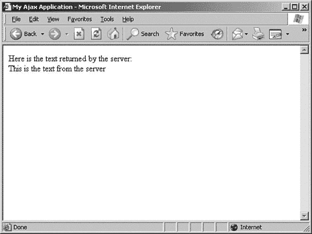

## 在 `responseText` 中包含 HTML

现在让我们修改上一个示例的代码。

正如你从之前的章节中所了解的，HTML 标记完全由使用文本字符编写的标签组成。如果 `responseText` 属性中包含的值用于修改发送服务器请求的页面的显示，那么没有什么能阻止我们的服务器脚本在返回的信息中包含 HTML 标记。

### 从 `responseText` 属性获取更多内容

假设我们再次使用列表 19.1 的代码，但使用修改后的服务器脚本：

```php
<?php
echo “<h3>Returning Formatted Text</<h3>>”;
echo “<hr />”;
echo “We can use HTML to <stroong>format</strong> text before we return it!”;
?>
```

图 19.2 显示了结果的浏览器显示。

**图 19.2**
在服务器端进行 HTML 格式化的显示。

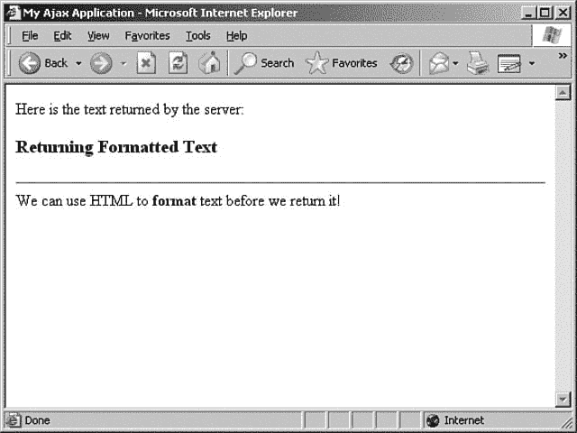

作为一个稍微复杂一点的示例，考虑服务器脚本生成更复杂的输出。我们希望应用程序获取此服务器输出并将其显示为表格内容。

这次我们将使用服务器端 PHP 脚本来生成一些表格信息：

```php
<?php
$days = array(‘Monday’,’Tuesday’,’Wednesday’,’Thursday’,’Friday’,’Saturday’,’Sunday’);
echo “<table border=’2>”;
echo “<tr><th>Day Number</th><th>Day Name</th></tr>”;
for($i=0;$i<sizeof($days);$i++) {
  echo “<tr><td>$i</td><td>$days[$i]</td></tr>”;
}
echo “</table>”;
?>
```

再次使用 `XMLHTTPRequest` 的 `responseText` 属性，我们获得了如图 19.3 所示。

**图 19.3**
包含 HTML。

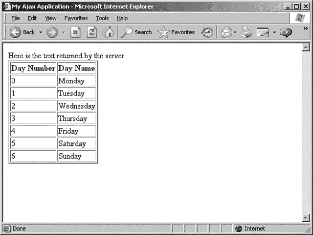

## 更复杂的格式化数据

到目前，我们演示了将数据直接应用于元素的方法。到目前为止一切良好。但是，如果你愿意在 JavaScript 中做一些工作来处理数据，你可以获得更多。

只要服务器返回 `responseText`，你就可以使用任何设计的数据格式。考虑以下脚本：

```php
<?php
$days = array(‘Monday’,’Tuesday’,’Wednesday’,’Thursday’,’Friday’,’Saturday’,’Sunday’);
$numdays = sizeof($days);
for($i=0;$i<($numdays - 1);$i++) {
  echo “$days[$i]||”;
}
echo $days[$numdays-1];
?>
```

`responseText` 属性中的字符串现在包含了星期几，由管道字符 `|` 分隔。如果我们将此字符串复制到 JavaScript 变量 `mystring` 中，`var mystring = http.responseText;`，我们会发现变量 `mystring` 包含

Monday|Tuesday|Wednesday|Thursday|Friday|Saturday|Sunday

现在我们可以使用 JavaScript 的 `split()` 方法方便地将字符串分成数组：

```javascript
var results = http.responseText.split("|");
```

JavaScript `split()` 方法切割字符串，它在找到作为参数给定的字符处进行切割。该字符不需要是管道；流行的替代方案是逗号或斜杠。我们现在有一个包含数据的 JavaScript 数组 `results`：`results[0] = ‘Monday’，`results[1] = ‘Tuesday’等……

与其仅仅显示接收到的数据，我们现在可以用任何方式在 JavaScript 例程中使用它。对于复杂的数据格式，XML 可能是接收和处理数据的更好方法。

### 总结

只需少量努力，`XMLHTTPRequest` 对象的 `responseText` 属性就可以不仅仅是向网页返回一些文本。对于所有非复杂的数据格式，处理 `responseText` 可能比处理 XML 的额外复杂性更为简单。

**你知道吗？**
`responseText` 属性包含一个字符串，你可以通过简单的赋值语句将其值赋给 JavaScript 变量：`var mytext = http.responseText;`

AHAH——异步 HTML 和 HTTP


# 本章你将学习到：

1. 介绍 AHAH
2. 为 AHAH 创建一个小型类库
3. 使用 `myAHAHlib.js`

在本章中，你将学习如何使用 `AHAH`（异步 HTML 和 HTTP）在不使用 XML 的情况下构建 Ajax 风格的应用程序。

## 介绍 AHAH

你在第 19 章“将数据作为文本”中看到，在完全不使用 XML 的情况下，Ajax 应用程序可以实现多大的功能。从简单的更新页面文本到处理复杂的数据结构，许多任务都可以仅使用 `XMLHTTPRequest` 对象 `responseText` 属性返回的文本字符串来完成。

在完全不使用 XML 的情况下构建完整且实用的应用程序是可能的。事实上，`AHAH`（异步 HTML 和 HTTP）这一术语正是为此类应用程序提出的。

本章在第 19 章的基础上进一步进了一步，更详细地探讨了 `AHAH` 可以在何时以及如何应用。

| 补充 (ByTheWay) |
| :--- |
| 这种技术是 Ajax 的一种子集，有各种缩写。这些包括 `AHAH`（异步 HTML 和 HTTP）、`JAH`（仅异步 HTML）和 `HAJ`（HTML 和 JavaScript）。在本书中我们将其称为 `AHAH`。 |
| **为什么使用 AHAH 而不是 Ajax？** 毫无疑问，XML 是一项具有多样且强大功能的重要技术。对于具有复杂数据结构的复杂 Ajax 应用程序，它可能是最佳——甚至是唯一的选择。然而，使用 XML 有时会增加应用程序设计的复杂度，包括：<br>- 为 XML 数据设计自定义架构所需的工作。<br>- 使用 JavaScript 的 DOM 方法时存在跨浏览器兼容性问题。<br>- 由于必须进行处理器密集型的 XML 解析，性能可能会受到影响。使用 `AHAH` 可以帮助你避免这些头恼，同时还提供了一些额外的优势：<br>- 易于重构某些现有的网页。<br>- HTML 比 XML 更容易查找故障。<br>- 使用 CSS 对返回的信息进行样式设计，而无需使用 XSLT。`XSLT` 是一种转换语言，用于将 XML 文档转换为其他格式——例如，转换为适用于浏览器显示的 HTML。 |

 在后续章节中，我们将 `AHAH` 脚本封装成一个整洁的外部 JavaScript 文件，可以在从应用程序中调用它。

## 为 AHAH 创建一个小型类库

在过去几章中研究的 Ajax 应用程序虽然完整且功能完备，但在页面中嵌入了大量的 JavaScript 代码。正如你所看到的，每个应用程序往往包含相似的函数：

### 为 AHAH 创建小型类库

* 一个创建 `XMLHTTPRequest` 对象实例、配置它并发送它的方法

* 一个用于处理 `responseText` 属性中包含的返回文本的回调函数

你可以将这些函数抽象为简单的 JavaScript 函数调用，特别是当你只想用从服务器返回的新值来更新单个页面元素时。

## 介绍 myAHAHlib.js

考虑列表 20.1；这些代码的大部分你将能够立即认出来。

### 列表 20.1 myAHAHlib.js


```javascript
function callAHAH(url, pageElement, callMessage) {
  document.getElementById(pageElement).innerHTML = callMessage;
  try {
    req = new XMLHttpRequest(); /* e.g. Firefox */
  } catch(e) {
    try {
      req = new ActiveXObject("Msxml2.XMLHTTP"); /* 某些版本的 IE */
    } catch (e) {
      try {
        req = new ActiveXObject("Microsoft.XMLHTTP"); /* 某些版本的 IE */
      } catch (E) {
        req = false;
      }
    }
  }
  req.onreadystatechange = function() {
    responseAHAH(pageElement);
  };
  req.open("GET", url, true);
  req.send(null);
}

function responseAHAH(pageElement) {
  var output = '';
  if(req.readyState == 4) {
    if(req.status == 200) {
      output = req.responseText;
      document.getElementById(pageElement).innerHTML = output;
    }
  }
}
```


`callAHAH()` 函数封装了创建 `XMLHTTPRequest` 对象实例、声明回调函数以及发送请求的任务。注意，我们没有简单地声明 `req.onreadystatechange = responseAHAH;`，而是使用了 JavaScript 结构：

```javascript
req.onreadystatechange = function() {responseAHAH(pageElement);};
```

这种类型的声明允许我们向声明的函数传递参数，在此情况下，它用于标识要更新的页面元素。

`callAHAH()` 还接受一个额外的参数 `callMessage`。该参数包含一个字符串，定义了我们在等待服务器请求结果时应该在目标元素中显示的内容。这为用户提供了某种程度的反馈，表明页面上正在发生事情。在实践中，这可能是一行文本，例如：

`‘正在更新页面；请稍候 …..’`

然而，你仍然可以选择向此字符串中嵌入一些 HTML 代码。在 `` 元素中使用动态 GIF 图片是警告用户进程正在运行的有效方法。

回调函数 `responseAHAH()` 执行特定的任务：将 `responseText` 属性中返回的字符串应用到所选页面元素 `pageElement` 的 `innerHTML` 属性：

```javascript
output = req.responseText;
document.getElementById(pageElement).innerHTML = output;
```

这段代码已被封装进一个名为 `myAHAHlib.js` 的文件中，你可以从页面中调用它。下一节将展示它的一些示例。

## 使用 myAHAHlib.js

在第二部分中，我们遇到了 JavaScript 函数位于外部文件的概念。我们正是将通过这种形式的语句来使用新文件 `myAHAHlib.js`：

```html
<script src="myAHAHlib.js"></script>
```

以下是此类 HTML 页面的骨架代码：

```html
<html>
<head>
<title>另一个 Ajax 应用程序</title>
<script src="myAHAHlib.js"></script>
</head>
<body>
  <form>
    <input type="button" onclick="callAHAH('serverscript.php?parameter=x', 'displaydiv', '正在更新页面；请稍候 …..')"> 这是服务器响应将被:<br>
    <div id="displaydiv"></div>
  </form>
</body>
</html>
```

在这个简单的 HTML 页面中，使用按钮元素来创建事件，从而调用 `callAHAH()` 方法。该方法将字符串 `正在更新页面；请稍候 …..` 具有 `id=displaydiv` 的 `<div>` 元素，并向 URL `serverscript.php?parameter=x` 发送异步服务器调用。

当 `responseAHAH()` 检测到服务器完成响应时，将使用存储在 `responseText` 中的值更新 `<div>` 内容；`<div>` 现在显示服务器返回的任何文本。

## 在项目中应用 myAHAHlib.js

我们可以通过另一个简单的 Ajax 应用程序来演示这些技术。这次，我们将编写一个脚本从用户输入的 URL 获取 `keywords` 元标签信息。

| 元标签 | 补充 (ByTheWay) |
| :--- | :--- |
| 元标签是 HTML 页面 `<head>` 部分的可选 HTML 容器元素。它们包含了有关网页的数据，对于搜索引擎和索引决定如何对页面内容进行分类有用。如果存在 `keywords` 元标签，通常包含一个与站点内容相关的词的逗号分隔列表。`keywords` 元标签的示例可能如下：<br`<meta name="keywords" content="programming, design, development, Ajax, JavaScript, XMLHTTPRequest, script">` |


列表 20.2 显示了 HTML 代码。

### 列表 20.2 getkeywords.html

```html
<html>
<head>
<title>“关键词”元标签抓取器</title>
<script src="myAHAHlib.js"></script>
</head>

```


```html
< /SCRIPT >
< /head >
< body >
<script type="text/javascript" src="ahahLib.js"></script>
<form >
  <table>
    <tr>
      <td>URL: http://</</td>
      <td>
        <input type="text" id="myurl" name="myurl" size =30>
        <input type="button" onclick ="callAHAH('keywords.php?url='+document.getElementById('myurl').value,'displaydiv','Please wait; loading content …')" value="Fetch"> >
      </td>
    </tr>
    <tr>
      <td colspan="2" height="50" id="displaydiv"></td>
    </tr>
  </table>
</form>
</body >
< /html >
```


最后，考虑服务器端脚本：

```php
<?php
$tags = @get_meta_tags('http://'.$url); $result = $tags['keywords']; if(strlen($result) > 0)
{ echo $result;

} else { echo "No keywords metatag is available";
}
?>
```

我们将所选的 URL 作为参数传递给 PHP 方法 `get_meta_tags()`：

```php
$tags = @get_meta_tags('http://'.$url);
```

### 使用 `myAHAHlib.js`

此方法专门设计用于以关联数组的形式解析 HTML 页面中的元标签（metatag）信息。在该脚本中，数组被命名为 `$tags$，我们可以通过检查数组项 `$tags['keywords']` 来恢复 `'keywords'` 元标签；然后，我们可以通过使用 PHP 的 `strlen()` 方法测量返回字符串的长度，来检查是否存在 `'keywords'` 元标签。

在 PHP 方法之前放置 `@` 字符会告诉 PHP 解释器，如果该方法在执行期间遇到问题，请不要输出错误消息。在本例中，我们需要它，是因为并不是所有的网页都包含 `'keywords'` 元标签；在标签不存在的情况下，我们更希望方法返回一个空字符串，以便我们添加自己的错误处理逻辑。当文件 `getkeywords.html` 首次加载到浏览器时，我们将看到如图 20.1 所示的显示内容。

| 你知道吗？ |

 图 20.1
首次加载应用后的浏览器显示。

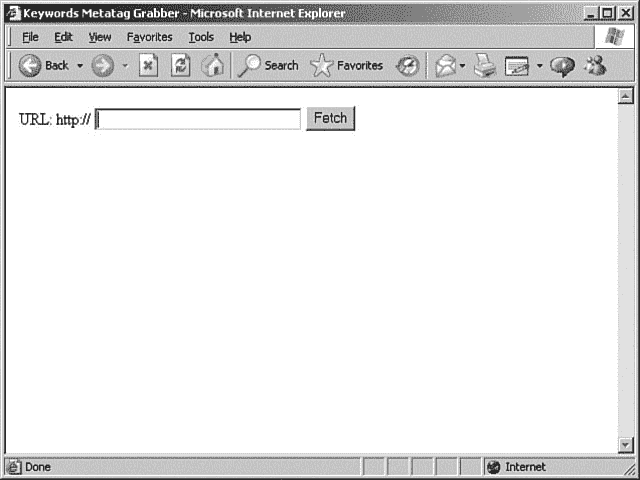 在这里我们被输入一个 URL。当我们点击 Fetch 按钮时，`callAHAH()` 被执行，并将我们选择的 URL 作为参数发送到服务器端脚本。同时，“Please wait; loading content …”消息被放置在 `<div>` 容器中。虽然可能只可见一秒钟，但我们现在有了如图 20.2 所示的显示。

图 20.2
等待服务器响应。

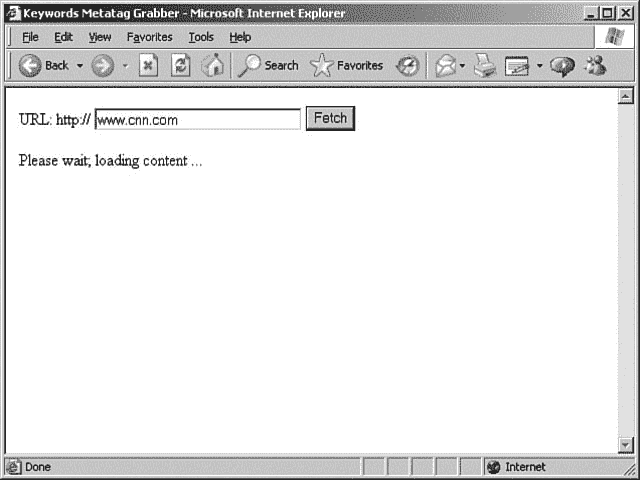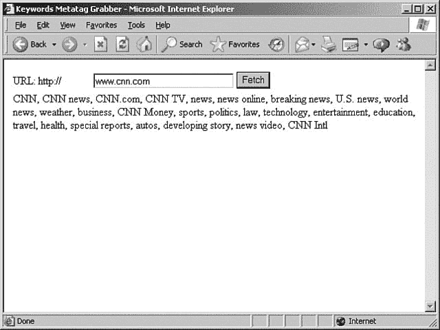(Images/image05378.jpeg) 最后，当服务器调用完成后，`responseText` 属性的内容被加载到 `<div>` 容器中，产生图 20.3 所示的显示。

图 20.3
成功返回了关键词。

我们尚未考虑的一个选项是在 `responseText` 中传回 JavaScript 代码。因为 JavaScript 源代码（与 HTML 页面中的其他所有内容一样）是由纯文本编写的语句组成的，因此你可以从服务器通过 `responseText` 属性返回 JavaScript 源码。然后你可以使用 JavaScript 的 `eval()` 方法执行这些 JavaScript 代码：`eval(object.responseText);`。考虑当你的服务器脚本返回字符串：“alert('Hello World!);”的情况。在这种情况下，`eval()` 方法将该内容作为 JavaScript 语句执行，创建一个带有 OK 按钮的显示“Hello World!”的对话框。

### 总结

## 你知道吗？

| 亲自尝试一下 | ▼ |
| :--- | :--- |
| 扩展库 | 在目前，`myAHAHlib.js` 是 AHAH 的简单实现。根据其使用方式，它有许多改进和扩展的方法。我们不会在本章中涵盖这些内容，而是将它们留给你自己实验。这里有一些可以帮助你开始的建议：目前仅支持 `GET` 请求。如何修改函数以也允许 `POST` 请求呢？在第 13 章“我们的第一个 Ajax 应用”中讨论的大部分用户反馈尚未在 `responseAHAH()` 中实现。是否可以修改 `callAHAH()` 以接受一个页面元素数组进行更新，并在（在合适的服务器端脚本帮助下）一次性处理它们？ | ▲ |

**总结**

希望在本章和第 19 章的过程中，你已经清楚地了解到，Ajax 可以在完全不使用任何 XML 的情况下实现很多功能。

通过仔细地结合 JavaScript 客户端编码和你所选语言的服务器端脚本，你可以创建高复杂性的数据方案。

在更简单的应用程序中，如果你只是想更新页面元素的文本，`XMLHTTPRequest` 对象的功能可以被抽象为 JavaScript 函数库，并通过简单的方法从 HTML 页面进行调用。

然而，对于某些任务，你需要利用 XML 的力量。我们将在第 21 章“作为 XML 返回数据”中查看这一点。

### 第 21 章 作为 XML 返回数据


**本章将学习：**

- 将“x”引入 Ajax
- `responseXML` 属性
- 项目——RSS 阅读器

#### 将“x”引入 Ajax

在本章中，你将学习通过 `responseXML` 属性使用从服务器返回的 XML。第 19 章“返回文本”和第 20 章“AHAH——异步 HTML 和 HTTP”已经详细讨论了 `responseText` 中包含的内容。

#### 更多 JavaScript DOM 方法

你在之前的章节中遇到过一些 JavaScript DOM 方法，例如 `getElementById` 和 `getElementsByTagName`。在这些情况下，我们主要关注读取节点的值，以便将这些值写入 HTML 页面元素中。


本章将介绍可用于实际创建元素从而改变页面结构的 DOM 方法。

文档对象模型（DOM）可以被看作是树形的节点结构。除了读取与这些节点关联的值外，你还可以创建和修改节点本身，从而更改文档的结构和内容。

## `responseXML` 

要在页面上添加新元素，你首先需要创建元素，然后将它们附加到 DOM 树的相应位置。让我们来看使用以下 HTML 文档的简单示例：

```html
<html>
<head>
<title>Test Document</title>
</head>
<body>
We want to place some text here:<br />
<div id="displaydiv"></div>
</body>
</html>
```

在这个示例中，我们想在文档正文的 `<div>` 容器中添加文本“Hello World!”。我们将 JavaScript 例程放入一个函数中，并从 `body` 的 `onLoad()` 事件处理程序中调用它。

首先，我们将使用 JavaScript DOM 方法 `createTextNode()` 来创建一个文本节点：

```javascript
var textnode = createTextNode('Hello World!');
```

现在，我们需要将 `textnode` 附加到文档 DOM 树的相应位置。

你之前在第 5 章“处理文档对象模型”中学习过子节点；希望你还记得，如果文档中的节点包含其他文档元素，则称该节点拥有孩子。JavaScript 有一个 `appendChild()` 方法，它允许我们通过将新文本节点变为现有文档节点的子节点，从而将其附加到 DOM 树上。

在这种情况下，我们希望文本位于具有 `id="displaydiv"` 的 `<div>` 容器内部：

```javascript
var textnode = document.createTextNode('Hello World!'); document.getElementById('displaydiv').appendChild(textnode);
```

| 将这种基于 DOM 的向页面写入内容的方法与第 13 章项目中使用的 `innerHTML` 方法进行对比。 | ByTheWay

在我们把这段 JavaScript 代码封装成函数并添加 `onLoad()` 事件处理程序来执行之后，让我们来看页面的完整源代码：

```html
<html>
<head>
<title>Test Document</title>
<script Language="JavaScript">
function hello()
{ var textnode = document.createTextNode('Hello World!'); document.getElementById('displaydiv').appendChild(textnode);
}
</script>
</head>
<body onLoad="hello()">
We want to place some text here:<br />
<div id="displaydiv"></div>
</body>
</html>
```

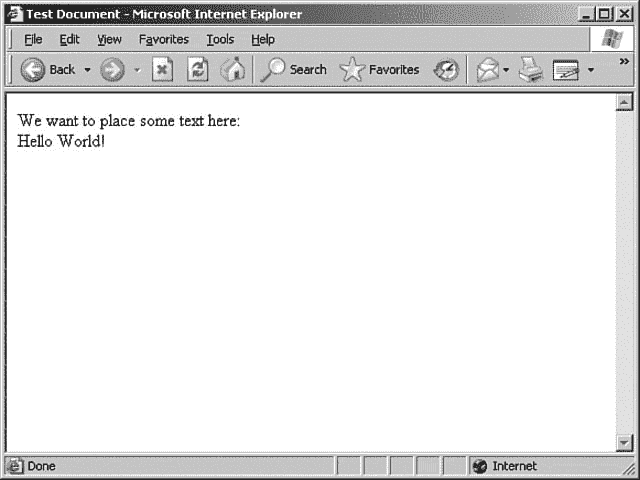图 21.1 显示了加载此页面后的浏览器显示。

FIGURE 21.1

DOM 显示

“Hello World!”

By the Way 如果在浏览器中显示此文档的源代码，你不会在 `<div>` 容器内看到“Hello World!”文本。浏览器构建 HTML 文档的 DOM 表示，然后使用该模型来显示页面。你的代码所做的是针对 DOM 的，而不是针对文档本身。

当你想要创建文本节点以外的其他页面元素时，可以使用 `createElement()` 方法，它的工作方式与 `createTextNode()` 非常相似。事实上，我们可以在添加“Hello World!”文本节点之前，使用 `createElement()` 来创建 `<div>` 容器本身：`var newdiv = document.createElement("div");`

## `responseXML` 

通常情况下，你只需要将所需的页面元素类型作为参数传递给 `createElement()`，即可生成所需类型的元素。

## DOM 方法概述

本书并不仅仅关于 JavaScript DOM 技术，因此我们不会在这里复制一份所有可用方法和属性的全面指南。

然而，表 21.1 列出了一些更有实用的方法。

## 你知道吗？

| 如果你需要关于 JavaScript DOM 方法和属性的更全面的说明，Andrew Watt 在他优秀的著作《Sams Teach Yourself XML in 10 Minutes》（Sams Publishing, ISBN 0672324717）中提供了一个非常有用的列表。 |

表 21.1 一些 JavaScript 属性和方法


### 节点属性

| :--- | :--- |
| `childNodes` | 子节点数组 |
| `firstChild` | 第一个子节点 |
| `lastChild` | 最后一个子节点 |
| `nodeName` | 节点名称 |
| `nodeType` | 节点类型 |
| `nodeValue` | 节点包含的值 |
| `nextSibling` | 共享相同父节点的下一个节点 |
| `previousSibling` | 共享相同父节点的上一个节点 |
| `parentNode` | 此节点的父节点 |

### 节点方法

| :--- | :--- |
| `appendChild` | 添加新子节点 |
| `hasChildNodes` | 如果此节点有子节点则为真 |
| `removeChild` | 删除子节点 |
| `createAttribute` | 为元素创建新属性 |
| `createElement` | 创建新文档元素 |
| `createTextNode` | 创建文本项 |
| `getElementsByTagName` | 创建一个标签名数组 |
| `getElementsById` | 通过 ID 查找元素 |


## 项目——一个 RSS 标题阅读器

现在让我们利用学习的 XML 数据来处理一个新项目。最流行的是 RSS 馈，它源自广播公司、报出版商以及各种主题的专业网站。以下是 XML 部分：

<rss version="0.91">
<channel>
<title>myRSSfeed.com</title>
<link>http://www.</link>
<description>My RSS feed</description>
<language>en-us</language>
<item>
<title>New Store Opens</title>
<link>http://www.</link> <description>一家新的音乐店今天在运河路开。。名为 Ajax Records 的店满足各种口味。</description>
</item>
<item>
<title>Bad Weather Affects Transport</title>
<link>http://www.</link> <description>由于突发大雪，火车和汽车受到严重影响。警方建议非必要不要出门。</description>
</item>
<item>
<title>Date Announced for Mayoral Election</title>
<link>http://www.</link> <description>9 月 4 日已宣布为市选举日期。请关注当地新闻了解更多详情。</description>
</item>
</channel>
</rss>

从第一行 `<rss version="0.91">` 可以看到我们正在处理版本 0.91。RSS 版本之间的差异很大，但对于我们的示例，我们只关心新闻项目的 `<title>`、`<link>` 和 `<description>` 元素，它们在不同版本之间基本保持不变。

### 应用程序的 HTML 页面

我们的页面需要一个输入字段，供我们输入所需的 RSS 馈 URL，以及一个指令应用程序收集数据的按钮。我们还有一个 `<div>` 容器用于显示解析后的数据：

```html
<html>
<head>
<title>An Ajax RSS Reader</title>
</head>
<body>
<h3>An Ajax RSS Reader</h3>
<form name="form1">
URL of RSS feed: <input type="text" name="feed" size="50" value="http://"><input type="button" value="Get Feed">
<br /><br />
<div id="news"><h4>Feed Titles</h4></div>
</form>
</body>
</html>
```

如果我们将此代码保存为 rss.htm 文件并在浏览器中加载它，我们将会看到类似于图 21.2 所示的内容。

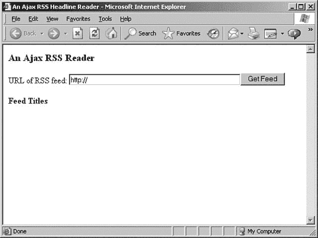

FIGURE 21.2

显示 RSS 标题阅读器的基础 HTML 文档。


对于读者来说，大部分代码现在已经熟悉了：创建 `XMLHTTPRequest` 对象的实例、构建并发送服务器请求，以及检查该请求何时完成，这些操作与之前的示例非常相似。

然而，这一次，我们不再使用 `responseText`，而是通过 `responseXML` 属性接收 XML 格式的数据。我们将使用这些数据来修改 HTML 页面的 DOM，在页面的 `< div >` 容器内列表列表中显示新闻条目的标题和描述。每个标题和描述将包含在自己的段落（paragraph）元素中（我们也为此构造了这些元素），并通过样式表进行样式处理，以我们想要的方式显示。

## 完整代码

让我们直接查看列表 21.1 所示的代码。

### 列表 21.1 Ajax RSS 标题阅读器


```html
<html>
<head>
<title>一个 Ajax RSS 标题阅读器</title>
</head>
<style>
.title { 
    font: 16px bold helvetica, arial, sans-serif; 
    padding: 0px 30px 0px 30px; 
    text-decoration:underline;
} 
.descrip {
    font: 14px normal helvetica, arial, sans-serif; 
    text-decoration:italic; 
    padding: 0px 30px 0px 30px; 
    background-color:#cccccc;
} 
.link {
    font: 9px bold helvetica, arial, sans-serif; 
    padding: 0px 30px 0px 30px;
}
.displaybox { 
    border: 1px solid black; 
    padding: 0px 50px 0px 50px;
}
</style>
<script language="JavaScript" type="text/javascript">
function getXMLHTTPRequest() { 
    try {
        req = new XMLHttpRequest(); /* e.g. Firefox */
    } catch(e) { 
        try {
            req = new ActiveXObject("Msxml2.XMLHTTP"); /* some versions IE */
        } catch (e) { 
            try {
                ###### 列表 21.1 继续
                
                req = new ActiveXObject("Microsoft.XMLHTTP"); /* some versions IE */
            } catch (E) { 
                req = false;
            }
        } 
    } 
    return req; 
}
var http = getXMLHTTPRequest();

function getRSS() {
    var myurl = 'rssproxy.php?feed='; 
    var myfeed = document.form1.feed.value;
    myRand = parseInt(Math.random()*999999999999999);
    // 缓存粉器 
    var modurl = myurl+escape(myfeed)+"&rand="+myRand; 
    http.open("GET", modurl, true); 
    http.onreadystatechange = useHttpResponse; 
    http.send(null);
}

function useHttpResponse() { 
    if (http.readyState == 4) {
        if(http.status == 200) {
            // 首先移除子节点 // 目前在 DOM 中
            while (document.getElementById('news').hasChildNodes()) {
                document.getElementById('news').removeChild(document.getElementById('news').firstChild);
            }
            var titleNodes = http.responseXML.getElementsByTagName("title"); 
            var descriptionNodes = http.responseXML.getElementsByTagName("description"); 
            var linkNodes = http.responseXML.getElementsByTagName("link"); 
            for(var i =1;i<titleNodes.length;i++) {
                var newtext = document.createTextNode(titleNodes[i].childNodes[0].nodeValue); 
                var newpara = document.createElement('p'); 
                var para = document.getElementById('news').appendChild(newpara); 
                newpara.appendChild(newtext); 
                newpara.className = "title";

                var newtext2 = document.createTextNode(descriptionNodes[i].childNodes[0].nodeValue); 
                var newpara2 = document.createElement('p'); 
                ###### 列表 21.1 继续
                var para2 = document.getElementById('news').appendChild(newpara2); 
                newpara2.appendChild(newtext2); 
                newpara2.className = "descrip"; 
                
                var newtext3 = document.createTextNode(linkNodes [i].childNodes[0].nodeValue); 
                var newpara3 = document.createElement('p'); 
                var para3 = document.getElementById('news').appendChild(newpara3); 
                newpara3.appendChild(newtext3); 
                newpara3.className = "link";
            }
        }
    }
}
</script>
<body>
<center>
<h3>一个 Ajax RSS 阅读器</h3>
<form name="form1">
    RSS 馈的 URL: <input type="text" name="feed" size="50" value="http://">
    <input type="button" onClick="getRSS()" value="获取订阅"><br><br>
    <div id="news" class="displaybox">
        <h4>标题</h4>
    </div>
</form>
</center>
</body>
</html>
```

大部分我们关注 `useHttpResponse()` 函数的工作

## 回调函数

除了 `useHttpResponse()` 函数的常规职责检查 `readyState` 和 `status` 属性外，该函数还承担了以下任务：

- 移除现有元素。
- 解析 XML 以提取标题、链接和描述。
- 构建 DOM 元素持有这些结果。
- 为这些元素应用 CSS。

为了移除现有元素，我们使用 `hasChildNodes()` 方法直到为空：

```javascript
while (document.getElementById('news').hasChildNodes()) {
    document.getElementById('news').removeChild(document.getElementById('news').firstChild);
}
```

通过 `responseXML` 构建 `titleNodes` 数组：

```javascript
var titleNodes = http.responseXML.getElementsByTagName("title");
```

然后我们可以遍历这些项目：

```javascript
for(var i =1;i<titleNodes.length;i++) {
    // 处理指令 ...
}
```

对于每个标题，我们需要使用 `nodeValue` 属性提取文本：

```javascript
var newtext = document.createTextNode(titleNodes[i].childNodes[0].nodeValue);
```

我们可以创建一个段落元素，并将其作为 `<div>` 元素的子节点追加：

```javascript
var newpara = document.createElement('p');
var para = document.getElementById('news').appendChild(newpara);
newpara.appendChild(newtext);
```

最后，使用 `className` 属性定义段落的显示方式：

```javascript
newpara.className = "title";
```

## 服务器端代码

由于 `XMLHTTPRequest` 对象内置的安全限制，我们无法直接调用 RSS 馈；我们必须使用在自己的服务器上有 URL 的脚本，并让该脚本收集 XML 文件并通过 `XMLHTTPRequest` 的 `responseXML` 属性将其传递给我们。

在这种情况下，我们并不要求服务器端脚本 `rssproxy.php` 修改 XML 文件，只需将其返回给我们。我们说该脚本充当代理，因为它代表 Ajax 检索远程资源。

列表 21.2 显示了 PHP 脚本的代码。

### 列表 21.2 RSS 标题阅读器的服务器脚本

```php
<?php
$mysession = curl_init($_GET['feed']); 
curl_setopt($mysession, CURLOPT_HEADER, false); 
curl_setopt($mysession, CURLOPT_RETURNTRANSFER, true);
$out = curl_exec($mysession); 
header("Content-Type: text/xml"); 
echo $out; 
curl_close($mysession);
?>
```


该脚本使用了 cURL PHP 库，这是一组为了使 Internet 文件传输编程更简单的例程程序。在这里对 cURL 进行详细描述是不恰当的；只需说明这个短脚本首先通过 Ajax 应用程序发送的 `feed` 变量，获取所需 RSS 馈的 URL。调用 `curl_setopt()` 函数的两行代码分别声明：我们不希望随远程文件发送头部信息，但我们想要文件内容。随后，`curl_exec()` 函数执行数据传输。

之后，只需使用熟悉的 PHP `header()` 命令添加适当的头部，并将数据返回给我们的 Ajax 应用程序。

若要了解有关使用 PHP 使用 cURL 的完整说明，请参阅 PHP 网站 [`uk2.php.net/curl`](http://uk2.php.net/curl) 和/或 cURL 网站 [`curl.haxx.se/`](http://curl.haxx.se/)。

## 总结

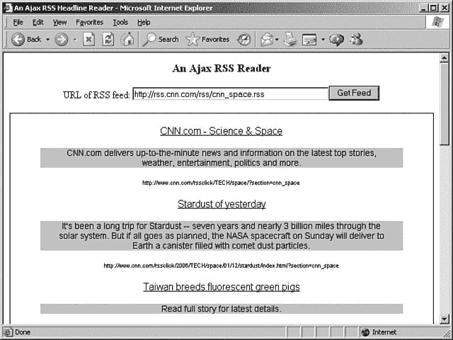图 21.3 显示了 RSS 阅读器的工作情况，在此例中，它显示了来自 CNN 新闻源的内容。

**图 21.3**

运行中的 Ajax RSS 阅读器。

## 总结

JavaScript DOM 方法在与 `XMLHTTPRequest` 对象和 XML 数据配合使用时，提供了一种强大的手段，用于传输、组织以及显示或或其他处理具有复杂结构的数据。

在本章中，你看到了如何通过添加、删除和操作 DOM 元素，根据从 `XMLHTTPRequest` 对象的 `responseXML` 属性接收到的 XML 数据来重构应用程序的 DOM。

本页特留白

# 第 22 章：Web 服务与 REST 和 SOAP 协议


### 你在本章中将学习：

- Web 服务简介
- REST——表征状态转移
- 实践中的 REST 应用
- 使用 SOAP 的 Web 服务
- SOAP 协议
- 使用 Ajax 和 SOAP
- 复习 SOAP 和 REST

在本章中，你将学习 Web 服务的基础，以及如何使用 REST（表征状态转移）和 SOAP（简单对象访问协议）协议来实现它们。

## Web 服务简介

到目前为止，你已经看到了几个示例应用程序，我们在这些程序中调用服务器端脚本来执行任务。在每种情况下，我们都设计了数据结构来传输信息，并编写了处理进出服务器数据传输的例程。

但是，假设你想让你的服务器端程序更加通用。也许你可以想象，几个不同的 Web 应用程序可能会为了自己的目的与此类脚本交互。除了浏览器直接请求页面外，其他应用程序（例如通过 `XMLHTTPRequest` 调用运行的 Ajax 应用程序）也可能发出数据请求，并期望接收到它们可以理解和处理的数据。

在这种情况下，为你的程序提供的接口实现某种形式的标准化将是有益的。这一原则构成了所谓“Web 服务”的基础。

例如，假设我们的服务器应用程序响应一个包含地理信息的请求，生成 XML 格式的天气预报数据。

这种服务的性质使其具有广泛的适用性；此类应用程序可能有许多种“客户端”，从展示当地地区天气预报的简单网页，到需要数据进行更苛刻用途的复杂航空或旅行规划应用程序。

这种类型的服务只是 Web 服务能够做的一个微小例子。互联网上有成千上万个 Web 服务在运行，提供了一系列惊人的功能，包括用户身份验证、支付处理、内容分发、消息传递以及许多其他功能。

通常，Web 服务提供了一个应用程序编程接口（API），允许客户端应用程序构建指向服务的接口。虽然可以使用任何 Internet 协议来创建 Web 服务，但 XML 和 HTTP 是热门选择。

已经出现了许多协议和技术可以帮助你创建和利用 Web 服务。本章将介绍其中可能最简单的一种，称为 REST（表征状态转移），以及另一个协议，这次称为 SOAP（简单对象访问协议）。每个章节特别强调了它们在 Ajax 应用程序中可能如何有用。

## REST—表征状态转移

REST 围绕着通用网络设计的两个主要原则：

- 资源由 URL 表征——资源可以被视为一个“名词”，指代我们在 Web 服务 API 中想要处理的某些实体；这可能是一个文档、一个人、一次会议、一个位置等。REST 应用中的每个资源都有唯一的 URL。
- 操作通过标准的 HTTP 方法执行——使用 `GET`、`POST`、`PUT` 和 `DELETE` 等 HTTP 方法来对资源执行操作。

通过通过这种方式，我们可以将此类操作视为作用于资源上的“动词”。

### REST—表征状态转移

#### 一个假设的 REST 示例

为了理解我们可能以及以及应用这些思想，让我们来看一个假设的示例。

假设我们有一个 Web 服务，允许作者提交、编辑和阅读文章。将所谓的 RESTful 原则应用于此应用程序的设计中，会发生以下情况：

- 每篇提交的文章都有一个唯一的 URL，例如：[`somedomain.com/articles/173`](http://somedomain.com/articles/173)

我们只需要每个文章的 URL 是唯一的；例如，[`somedomain.com/articles/list.php?id=173`](http://somedomain.com/articles/list.php?id=173) 也满足这一要求。

| 虽然 REST 要求 URL 是唯一的，但并不意味着每个资源都有对应的物理页面。在许多情况下，资源是由 Web 服务在请求时生成的——例如通过引用数据库。。为了获取阅读或编辑的文章，我们的客户端应用程序只需对文章 URL 使用 HTTP `GET` 请求。。为了上传新文章，将使用 `POST` 请求，包含文章信息。服务器将返回新上传文章的 URL。。为了上传已编辑的文章，将使用 `PUT` 请求，包含修改的内容。。HTTP `DELETE` 将被用于删除特定文章。通过这种方式，Web 服务正在使用任何用过万维 Web 的人熟悉的接口。我们不需要为发送或检索信息设计 API 方法库；它们已经以标准 HTTP 方法的形式存在了。万维 Web 本身就是一个 REST 应用。 | 你知道吗？通过 |

### 方式

#### 使用 GET 查询信息

在 RESTful 应用中使用 HTTP `GET` 请求的一个重要问题是，它永远不应该改变服务器状态。换句话说：我们只使用 `GET` 请求从服务器获取信息，而绝不添加或更改已存在的信息。

POST、`PUT` 和 `DELETE` 调用都可能以某种方式更改服务器状态。

#### 无状态操作

RESTful 应用中的所有服务器交换应该是无状态的。我们所说的无状态是指，调用本身必须包含服务器执行所需任务的所有信息，而不是依赖于当前存在服务器上的某些状态或上下文。例如，我们不能要求服务器引用之前请求中发送的信息。

## 在实践中使用 REST

让我们扩展一下之前提到的关于我们文章 服务的示例。

读取可用文章列表


可用文章列表是一个资源。由于该网络服务符合 REST 原则，我们期望该服务提供一个允许我们访问该资源的 URL，例如：

`http://somedomain.com/articles/list.php`

由于我们是在查询信息而非尝试更改信息，因此我们只需要对上述 URL 使用 HTTP `GET` 请求即可。服务器可能会返回如下 XML：

```xml
<articles>
  <article>
    <id>173</id>
    <title>New Concepts in Ajax</title>
    <author>P.D. Johnstone</author>
  </article>
  <article>
    <id>218</id>
    <title>More Ajax Ideas</title>
    <author>S.N. Braithwaite</author>
  </article>
  <article>
    Using REST in Practice
    <id>365</id>
    <title>Pushing the Ajax Envelope</title>
    <author>Z.R. Lawson</author>
  </article>
</articles>
```

### 获取特定文章

由于这是另一个获取信息的请求，我们再次需要提交一个 HTTP `GET` 请求。我们的网络服务可能允许我们向 `http://somedomain.com/articles/list.php?id=218` 发起请求，并返回：

```xml
<article>
  <id>218</id>
  <title>More Ajax Ideas</title>
  <author>S.N. Braithwaite</author>
</article>
```

### 上传新文章

在这种情况下，我们需要发布一个 `POST` 请求而非 `GET` 请求。在类似于之前描述的假设性情况下，服务器可能会为新文章分配 `id` 值，而留给我们我们为 `title` 和 `author` 元素编码参数和值对：

```javascript
var articleTitle = ‘Another Angle on Ajax’; var articleAuthor = ‘K.B. Schmidt’; var url = `/articles/upload.php`;
var poststring = "title="+encodeURI(articleTitle) ➥+ "&author="+encodeURI(articleAuthor); http.onreadystatechange = callbackFunction(); http.open(`POST`, url, true); http.setRequestHeader(“Content-type”, ➥”application/x-www-form-urlencoded”);
http.setRequestHeader(“Content-length”, poststring.length); http.send(poststring);
```

### 现实世界的 REST——Amazon REST API

领先的在线书店 Amazon.com 提供了一系列 REST 网络服务，帮助开发者将 Amazon 的浏览和购物功能集成到他们的 Web 应用中。

| 你知道吗？ | Amazon.com 经常将 REST 协议称为 XML-over-HTTP 或 XML/HTTP。 | 通过通过创建一个包含所需搜索参数（如出版社、排序顺序、作者等）的参数/值对的 URL，然后向该 URL 提交 `GET` 请求，可以引导 Amazon 网络服务返回包含产品详情的 XML 文档。然后我们可以解析该 XML 来创建 DOM 对象，以便在网页中显示，或根据应用程序的要求提供进一步处理的数据。Amazon 要求您获取开发者令牌以为其网络服务开发客户端应用程序。在向 Amazon 网络服务构建 REST 请求时，您需要此令牌。您还可以获取 Amazon Associates ID，以便通过在您的网站上推广 Amazon 服务来盈利。详情请见 `http://www.amazon.com`。 |

让我们通过开发一个返回书籍列表的 REST 请求来实践这一点。可以进行多种类型的搜索，但在本例中，我们请求一份由 Sams 出版的书籍列表。

我们从基础 URL 开始构建 `GET` 请求：`$url = ‘http://xml.amazon.com/onca/xml3’`

我们需要添加若干参数/值对来完成请求：

```javascript
$assoc_id = “XXXXXXXXXX”;  // 您的 Amazon Associates ID
$dev_token = “ZZZZZZZZZZ”;  // 您的开发者令牌
$manuf = “Sams”;
$url = “http://xml.amazon.com/onca/xml3”;
$url .= “?t=”.$assoc_id;
$url .= “&dev-t=”.$dev_token; $url .= “&ManufacturerSearch=”.$ manuf;
$url .= “&mode=books”;
$url .= “&sort=+salesrank”;
$url .= “&offer=All”;
$url .=”&type=lite”;
$url .= “&page=1”;
$url .= “&f=xml”;
```

提交此 URL 后，我们收到包含所有匹配书籍详情的 XML 文件。我不会在这里重现整个文件（有超过 5,000 个标题！），但列表 22.1 显示了 XML 文件的摘，包括列表中的第一本书。

### 在实践中使用 REST

列表 22.1 Amazon 网络服务返回的 XML 示例

```xml
<?xml version=”1.0” encoding=”UTF-8” ?>
<ProductInfo xmlns:xsi=”http://www.w3.org/2001/XMLSchema-instance” xsi:noNamespaceSchemaLocation>
```

显然，我们现在可以按照任何想要的方式处理此 XML 文档。例如，第 21 章“作为 XML 返回数据”讨论了如何使用 JavaScript DOM 方法从 XML 文档中选择信息，并将其置于文档 DOM 的页面元素中。

### REST 和 Ajax

你已经知道 `HTTPRequest` 对象具有允许直接处理 HTTP 请求类型和 URL 的方法。

因此，访问 RESTful 网络服务被极大简化了。因为你知道 API 暴露的每个资源都有唯一的 URL，并且服务提供的方法是标准 HTTP 方法，构建所需的 `HTTPRequest` 调用就成了一件简单的事。

### 使用 SOAP 的 Web 服务

在上一节中，我们讨论了网络服务，并特别看到了如何使用 REST（表现层状态转移）协议来为此类服务提供一致的应用程序接口（API）。

REST 是一个设计用于操作资源导型服务的良好示例，这类服务提供了一种简单的资源定位机制以及一组可以操作该资源的基本方法。在资源导型服务中，这些方法通常围绕创建、检索、修改和删除信息展开。


在某些情况下，我们对 Web 服务可以执行的操作比对它能控制的资源更感兴趣。我们也许可以将此类服务称为“面向操作的”。在这些情况下，资源本身可能具有某些性，但关键问题涉及服务所执行活动的细节。

用于设计面向操作的 Web 服务最流行、最广泛使用的协议可能是 `SOAP`，即简单对象访问协议（Simple Object Access Protocol）。


# SOAP 协议

“简单对象访问协议”（Simple Object Access Protocol）在 SOAP 规范的后续版本中已被删除，因为人们认为项目方向已经发生变化，该名称不再适用。该协议继续被称为 `SOAP`。SOAP 协议的背景
`SOAP` 起于 20 世纪 90 年代后期，当时 `XML` 还是一项新兴的 Web 技术，并于 2000 年提交给 W3C。`SOAP` 与另一个基于 XML 的 Web 服务协议 `XML-RPC` 共同成长。`SOAP` 的设计初衷上是以标准化的方式将远程过程调用（在远程机器上运行程序的请求）封装在 `XML` 包装器。许多企业对 `SOAP` 的早期开发做出了贡献，包括 `IBM`、`Microsoft` 和 `Userland`。`SOAP` 的开发交给了 W3C 的 XML 协议工作组。你可以从 W3C 网站获取 `SOAP` 规范的最新信息，地址为 [`www.w3.org/2000/xp/Group/`](http://www.w3.org/2000/xp/Group/)。 | 顺你知道吗？ |

## SOAP 协议结构


`SOAP` 是一种基于 `XML` 的消息协议。一个 `SOAP` 请求是一个包含以下主要部分的 `XML` 文档：

* 一个 `envelope`（封封），将文档定义为 `SOAP` 请求
* 一个 `body`（主体）元素，包含调用和预期响应的信息
* 可选的 `header`（头部）和 `fault`（故障）元素，用于携带补充信息

让我们来看一个 `SOAP` 请求的骨架：

```xml
<?xml version=”1.0"?>
<SOAP-ENV:Envelope xmlns:SOAP-ENV=”http://schemas.xmlsoap.org/soap/envelope/" SOAP-ENV:encodingStyle=➥”http://schemas.xmlsoap.org/soap/encoding/”>
<SOAP-ENV:Header>
... various commands . . .
</SOAP-ENV:Header>
<SOAP-ENV:Body>
... various commands . . .
<SOAP-ENV:Fault>
... various commands . . .
</SOAP-ENV:Fault>
</SOAP-ENV:Body>
</SOAP-ENV:Envelope>
```

注意，`SOAP` 请求是一个 `XML` 文件，其根元素是 `Envelope` 元素。

`Envelope` 的第一行是：

```xml
<SOAP-ENV:Envelope xmlns:SOAP-EN=➥”http://schemas.xmlsoap.org/soap/envelope/">
```


`SOAP-ENV:encodingStyle=➥”http://schemas.xmlsoap.org/soap/encoding/”`

这一行声明了 `xmlns:soap` 命名空间，其值必须始终为 `xmlns:soap=”http://schemas.xmlsoap.org/soap/envelope/"`。

**你知道吗？**
`namespace`（命名空间）是一个用于唯一标识一组 `XML` 元素或属性的标识符，为它们的命名提供了方法，使得其他架构中的名称不会与它们冲突。

`encodingStyle` 属性包含定义消息中所用数据类型的信息。

接下来出现的是 `Header` 元素，它是可选的，但如果存在，它必须是消息中的第一个元素。`Header` 元素中定义的属性定义了接收应用程序如何处理该消息。

`SOAP` 消息的 `body` 元素包含了发送给最终接收者的消息。

序列化的方法参数包含在 `SOAP` 请求的体 元素中。调用的 `XML` 元素必须紧跟在 SOAP 主体的起始 `XML` 标签之后，并且其名称必须与被调用的远程方法相同。

主体还可能包含一个 `Fault` 元素（但不过于一个）。该元素在 `SOAP` 规范中定义，旨在携带可能发生的任何错误信息。如果它存在，它必须是主体元素的子元素。`Fault` 元素具有各种子元素，包括 `faultcode`、`faultstring` 和 `detail`，它们包含了故障状况的具体细节。

## SOAP 请求的代码示例

让我们看看一个典型的 `SOAP` 请求可能是什么样的：

```xml
<?xml version=”1.0"?>
<SOAP-ENV:Envelope xmlns:SOAP-ENV=”http://schemas.xmlsoap.org/soap/envelope/" SOAP-ENV:encodingStyle=”http://schemas.xmlsoap.org/soap/encoding/”>
<SOAP-ENV:Body>
<m:GetInvoiceTotal xmlns:m=”http://www.somedomain.com/invoices">
<m:Invoice>77293</m:Invoice>
</m:GetInvoiceTotal>
</SOAP-ENV:Body>
</SOAP-ENV:Envelope>
```

在前面的示例中，`m:GetInvoiceTotal` 和 `m:Invoice` 元素是特定于特定应用程序的，不属于协议的一部分。

来自 Web 服务的 `SOAP` 响应可能如下：

```xml
<?xml version=”1.0"?>
<SOAP-ENV:Envelope xmlns:SOAP-ENV=”http://schemas.xmlsoap.org/soap/envelope/" SOAP-ENV:encodingStyle=”http://schemas.xmlsoap.org/soap/encoding/”>
<SOAP-ENV:Body>
<m:GetInvoiceTotal xmlns:m=”http://www.somedomain.com/invoices">
<m:Invoice>77293</m:Invoice>
</m:GetInvoiceTotal>
</SOAP-ENV:Body>
</SOAP-ENV:Envelope>
```

通过 `Ajax` 使用 `SOAP` 需要执行以下几个步骤：

1. 创建 `SOAP` 封封。
2. 将特定的信息序列化为 `XML`。
3. 创建包含序列化代码的 SOAP 主。
4. 通过 `HTTPRequest` 对象发送 `SOAP` 消息。

### 代码示例

```javascript
var invoiceno = ‘77293’;
http.onreadystatechange=function() {
  if (http.readyState==4) {
    if(http.status==200) {
      alert('服务器说：’+ http.responseText)
    }
  }
}
http.open(“POST”, “http://somedomain.com/invoices”,true);
http.setRequestHeader(“Content-Type”, “text/xml”); var mySOAP = ‘<?xml version=”1.0”?>’
+ `<SOAP-ENV:Envelope xmlns:SOAP-ENV=➥”http://schemas.xmlsoap.org/soap/envelope/"’ + ‘ SOAP-ENV:encodingStyle=➥”http://schemas.xmlsoap.org/soap/encoding/”’
+ `<SOAP-ENV:Body>`
+ `<m:GetInvoiceTotal xmlns:m=➥”http://www.somedomain.com/invoices">`
+ `<m:Invoice>`+invoiceno+`</m:Invoice></m:GetInvoiceTotal>`
+ `</SOAP-ENV:Body>`
+ `</SOAP-ENV:Envelope>`;
http.send(mySOAP);
```

在这里，我们在 JavaScript 变量中构建了整个 `SOAP` 封封，然后将其传递给 `HTTPRequest` 对象的 `send()` 方法。

## 通过 HTTP 发送 SOAP 请求

`SOAP` 消息可以通过 HTTP `GET` 或 `POST` 传输。如果通过 HTTP `POST` 发送，则 SOAP 消息至少需要设置一个 HTTP 头部；这定义 `Content-Type`。

在成功的 SOAP 交换后，你将收到带有适当 HTTP 头部的 SOAP 响应：

```http
HTTP/1.1 200 OK
Content-Type: text/xml
```

## 回顾 SOAP 和 REST

在本章中，我们查看了使用 Web 服务的 REST 和 SOAP 方法。


尽管存在其他的 Web 服务协议，但在过去的几年里，开发者之间一直在就 REST 与 SOAP 的优劣展开激烈争论。

我不打算在这本书中加入这场争论。相反，让我们总结一下这两种方法的相似之处与不同之处：

- `REST` 利用了标准的 HTTP 方法 `PUT`、`GET`、`POST` 和 `DELETE` 来创建具有相当功能的远程过程调用。使用 `REST` 协议的 Web 服务实现似乎特别适用于基于资源的服务，在这种情况下，最方法通常涉及创建、编辑、检索和删除信息。缺点是，`REST` 需要更多关于 HTTP 协议的知识。
- `SOAP` 协议增加了大量的复杂性，它需要对远程调用进行序列化，然后构造一个 SOAP 信封（envelope）来包含它。由于在解析数据之前需要从其 SOAP 信封中“解包”返回的数据，因此产生了额外的工作。这些额外的步骤也会对性能产生影响，对于类似的任务，`SOAP` 的运行速度通常比 `REST` 慢一点。不过，`SOAP` 在更完整地将远程过程调用与其传输方式分离，并添加了许多额外功能和特性，例如 `Fault` 元素以及通过命名空间进行类型检查。

## 总结

在本章中，我们考虑了使用 `REST` 和 `SOAP` 协议的 Web 服务。

任何风格的 Web 服务都可以通过 `XMLHTTPRequest` 请求使用，尽管它们在涉及的代码复杂性上有所不同。

## 第 23 章

### 用于 Ajax 的 JavaScript 

你将在本章中学习到：

- 一个 Ajax 库
- 复习 `myAHAHlib.js`
- 实现我们的库
- 使用该库

在本章中，你将学习如何将目前为止学习的一些技术封装成一个小型的 JavaScript 库，你可以在自己的应用程序中调用它。

### 一个 Ajax 库

通过目前为止章节和代码示例，我们已经开发了许多实现 Ajax 应用各个部分的 JavaScript 代码技术。这些方法包括：

- 一种生成 `XMLHTTPRequest` 对象实例的方法，它适用于目前流行的各种浏览器
- 通过 `XMLHTTPRequest` 对象构建和发送 `GET` 和 `POST` 请求的例程
- 避免 `GET` 请求产生意外缓存的技术
- 一种回调函数样式，在执行你的意图之前检查 `XMLHTTPRequest` 调用是否正确完成
- 提供用户反馈的方法
- 处理 `responseText` 返回的文本数据的技术
- 处理 `responseXML` 返回的 XML 信息的技术

此外，你在第 20 节“AHAH——异步 HTML 和 HTTP”中看到，这些方法中的某些是如何被抽象成一个小型的 JavaScript “库”（在那种情况下，仅包含两个函数）。本章扩展了这一想法，构建了一个功能更全的库，允许通过极少少的额外代码将 Ajax 功能简单地添加到 HTML 页面中。由于需要，我们的 Ajax 库将不会像书中后面描述的开源项目那样复杂或全面；然而，它将足够用于构建功能性的 Ajax 应用。

### 复习 `myAHAHlib.js`

列表 23.1 显示了 `myAHAHlib.js` 的代码，复刻自第 20 节。

**列表 23.1 `myAHAHlib.js`**


```
function callAHAH(url, pageElement, callMessage) { 
    document.getElementById(pageElement).innerHTML = callMessage; 
    try { 
        req = new XMLHttpRequest(); /* e.g. Firefox */
    } catch(e) { 
        try { 
            req = new ActiveXObject(“Msxml2.XMLHTTP”); /* some versions IE */
        } catch (e) { 
            try { 
                req = new ActiveXObject(“Microsoft.XMLHTTP”); /* some versions IE */
            } catch (E) { 
                req = false;
            }
        }
    }
    req.onreadystatechange = function() {
        responseAHAH(pageElement);
    }; 
    req.open("GET",url,true); 
    req.send(null);
}

function responseAHAH(pageElement) { 
    var output = ''; 
    if(req.readyState == 4) { 
        if(req.status == 200) { 
            output = req.responseText; 
            document.getElementById(pageElement).innerHTML = output;
        }
    }
}
```


### 实现我们的库

让我们考虑一下如何扩展此库的功能：

- 目前仅支持 HTTP `GET` 请求。如果能够至少支持 HTTP `POST` 请求将会很有用，特别是如果你打算使用 `REST` 协议构建应用程序时（如第 22 节所述）。
- 库目前只处理通过 `responseText` 返回的文本信息，没有处理 `responseXML` 的方法。

确定了需要做什么之后，我们现在将组合一个功能更强大的 Ajax 库。

#### 创建 XMLHTTPRequest 实例

让我们首先关注创建 `XMLHTTPRequest` 对象实例的例程。

目前，此函数与构建和发送 HTTP `GET` 请求的例程紧密耦合。让我们解耦负责创建 `XMLHTTPRequest` 实例的部分并将其放入一个独立的函数中：

```
function createREQ() { 
    try {
        req = new XMLHttpRequest(); /* e.g. Firefox */
    } catch(e) { 
        try { 
            req = new ActiveXObject(“Msxml2.XMLHTTP”); /* some versions IE */
        } catch (e) { 
            try { 
                req = new ActiveXObject(“Microsoft.XMLHTTP”); /* some versions IE */
            } catch (E) { 
                req = false;
            }
        }
    } 
    return req;
}
```

我们现在可以通过调用以下函数来创建 `XMLHTTPRequest` 实例：

```
function requestGET(url, query, req) { 
    var myRand=parseInt(Math.random()*999999); 
    req.open("GET",url+'&rand='+myRand,true); 
    req.send(null); }
```

对于此请求，我们必须作为参数传递要发送的 URL。

接下来是 `POST` 请求：

```
function requestPOST(url, query, req) { 
    req.open("POST", url,true); 
    req.setRequestHeader('Content-Type', 'application/x-www-form-urlencoded'); 
    req.send(query); }
```

#### 回调函数

我们如何处理回调函数？我们将添加一个函数：

```
function doCallback(callback,item) { eval(callback + '(item)'); }
```

该函数使用 JavaScript 的 `eval()` 函数执行另一个作为参数传递的函数，同时向该函数传递它自己的参数 `item`。

让我们看看这些函数从事件处理程序调用时是如何交互的：

```
function doAjax(url,query,callback,reqtype,getxml) { 
    // 创建 XMLHTTPRequest 对象实例
    var myreq = createREQ(); 
    myreq.onreadystatechange = function() { 
        if(myreq.readyState == 4) { 
            if(myreq.status == 200) { 
                var item = myreq.responseText; 
                if(getxml==1) { item = myreq.responseXML; }
                doCallback(callback, item); 
            }
        } 
    }; 
    if(reqtype=='post') { 
        requestPOST(url,query,myreq); 
    } else { 
        requestGET(url,query,myreq); 
    } 
}
```

我们的 `doAjax` 函数现在接受五个参数：

- `url`—Ajax 调用的目标 URL
- `query`—编码后的查询字符串
- `callback`—回调函数的标识
- `reqtype`—`post` 或 `get`
- `getxml`—1 获取 XML 数据，0 获取文本

列表 23.2 显示了完整的 JavaScript 源代码。

**列表 23.2 Ajax 库 `myAJAXlib.js`**


```javascript
  } catch (err1) {
    try {
      req = new ActiveXObject("Msxml2.XMLHTTP");
      /* some versions IE */
    } catch (err2) {
      try {
        req = new ActiveXObject("Microsoft.XMLHTTP");
        /* some versions IE */
      } catch (err3) {
        req = false;
      }
    }
  }
}
return req;

function requestGET(url, query, req) {
  myRand = parseInt(Math.random() * 99999999);
  req.open("GET", url + '?' + query + '&rand=' + myRand, true);
  req.send(null);
}

function requestPOST(url, query, req) {
  req.open("POST", url, true);
```

### 代码列表 23.2 续


```javascript
req.setRequestHeader('Content-Type', 'application/x-www-form-urlencoded');
req.send(query);
```

function doCallback(callback, item) {
  eval(callback + '(item)');
}

function doAjax(url, query, callback, reqtype, getxml) {
  // 创建 XMLHTTPRequest 实例实例
  var myreq = createREQ();

  myreq.onreadystatechange = function() {
    if (myreq.readyState == 4) {
      if (myreq.status == 200) {
        var item = myreq.responseText;
        if (getxml == 1) {
          item = myreq.responseXML;
        }
        doCallback(callback, item);
      }
    }
  }
  if (reqtype == 'post') {
    requestPOST(url, query, myreq);
  } else {
    requestGET(url, query, myreq);
  }
}
```


# 使用库

为了演示该库的使用，我们将从另一个简单的 HTML 页面开始，其代码所示：

```html
<html>
<head>
</head>
<body>
<form name="form1">
<input type="button" value="test">
</form>
</body>
</html>
```

这个简单的页面仅显示一个标记为“Test”的按钮。表单上的所有功能都将使用我们新的 Ajax 库在 JavaScript 中创建。

# 使用库

对应用程序进行“Ajax 化”所需的步骤是：

1. 在页面的 `<head>` 区域引入 Ajax 库 `myAJAXlib.js`。
2. 编写一个回调函数来处理返回的信息。
3. 在页面上添加事件处理器以调用服务器请求。

我们将首先演示一个 `GET` 请求，并使用 `responseText` 属性中返回的信息。这与我们在第 20 章处理 AHAH 时遇到的情况类似。

引入 Ajax 库是非常直接的：

```html
<head>
<script Language="JavaScript" src="myAJAXlib.js"></script>
</head>
```

接下来，我们需要定义回调函数来处理存储在 `responseText` 属性中的值。对于这些示例，我们将简单地在警告框中显示返回的文本：

```html
<head>
<script Language="JavaScript" src="myAJAXlib.js"></script>
<script Language="JavaScript"> function cback(text) { alert(text); }
</script>
</head>
```

最后，我们需要为我们的按钮添加一个事件处理器调用：

`onClick="doAjax('libtest.php','param=hello', 'cback','get','0')"`

我们的服务器端脚本 `libtest.php` 简单地回显了作为第二个参数发送的参数：

```php
<?php
echo "Parameter value was ".$param; 
?>
```

同时，函数调用的其余参数声明了回调函数名为 `cback`，我们想要发送一个 HTTP `GET` 请求，并且我们期望返回的数据在 `responseText` 中。列表 23.3 显示了我们修改后的 HTML 页面的完整代码。

# 代码列表 23.3 重写为调用 myAJAXlib.js 的 HTML 页面


```html
<html>
<head>
<script Language="JavaScript" src="myAJAXlib.js">
</script>
<script Language="JavaScript"> function cback(text) { alert(text); }
</script>
</head>
<body>
<form name="form1">
<input type="button" value="test" onClick="doAjax('libtest.php','param=hello', 'cback','get','0')">
</form>
</body>
</html>
```


图 23.1 显示了运行程序的结果。

### 图 23.1
执行 HTTP `GET` 请求后返回的文本。

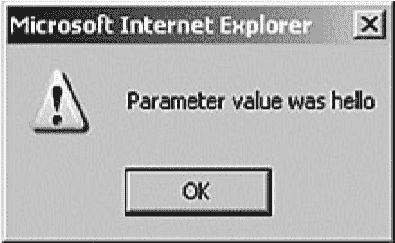 要使用相同的库来获取 XML 数据，我们将再次使用第 13 章“我们的第一个 Ajax 应用程序”中的服务器端脚本，你可能记得该脚本会在小型 XML 文档中交付当前的服务器时间：

```php
<?php
header('Content-Type: text/xml');
echo "<?xml version=\"1.0\" ?><clock1><timenow>".date('H:i:s').</timenow></clock1>";
?>
```

我们的回调函数必须修改，因为现在我们需要解析 XML：

```javascript
<script>
function cback(text) {
  var servertime = text.getElementsByTagName("timenow")[0].nodeValue;
  alert("Server time "+servertime);
}
</script>
```

我们唯一需要更改的是 `doAjax` 调用：

```html
onClick="doAjax('libtest.php','param=hello', 'cback','get','0')"
```

我们的服务器端脚本 `libtest.php` 简单地回显了作为第二个参数发送的参数。


# JavaScript 语言本身是否内置了等同返回按钮的功能？


## 你知道吗？语句

`onClick = “history.back()"` 和 `onClick = “history.go(-1)”` 都模拟了点击一次返回按钮的操作。

正如你所学的，Ajax 在很大程度上打破了“网络信息是按页面大小分块传递”的观念；在 Ajax 应用中，你可能反复更改页面内容，而无需考虑加载整个新页面来刷新浏览器显示。

## 那么返回按钮该怎么办？

这个问题最近在开发人员中引起了相当大的争议。似乎存在两种主要的观点：

1. 创建一种通过程序化记录状态的方法，并在按下返回按钮时使用它来重新创建之前的状态。
2. 说服用户返回按钮不再是必须的。

人工重新以前的状态确实是可能的，但这会为 Ajax 代码增加巨大的复杂性，因此这在某种程度上是那些勇敢的程序员的领域！

尽管后一种选择听起来有点像是在逃避问题，但它可能确实有一些价值。如果你使用 Ajax 来创建类似桌面的用户界面，值得注意的是，桌面应用程序通常没有——也不需要——返回按钮，因为独立“页面”的概念从未进入用户的脑海！

## 如何让 Ajax 优雅降级

### 书签与链接

这个问题与返回按钮问题并非无关。

当你书签一个页面时，你是在尝试保存某些内容的快捷方式。在基于页面的比喻中，这是合理的；虽然页面可以包含某种程度的动态内容，但随后能够找到页面本身通常能让我们接近看到上次访问时看到的内容。

然而，Ajax 整个应用程序可以使用相同的页面地址，并根据用户的操作从服务器返回大量的动态内容。

当你想要书签特定的信息屏幕并/或将该链接传给朋友或同事时，会发生什么？仅仅使用当前页面的 URL 可能无法产生你所需的结果。

虽然很难完全消除这个问题，但通过为应用程序的特殊选择状态提供永久链接，可能在某种程度上缓解它。

 通知用户某些事情正在发生

这是另一个与界面风格从独立页面转变为其他风格相关的问题。已经熟悉浏览网页的用户可能已经习惯了程序活动与新页面或修订页面的加载同步。

因此，许多 Ajax 应用都会提供某些一致的视觉线索，表明活动正在进行；也许一个静态图形图像可能会被动画版本取代，光标样式可能会改变，或者出现弹出消息。这些技术中的一些已经在本书的章节中提到过。

### 浏览器兼容性

本书中的章节涵盖了使用各种现代浏览器开发 Ajax 应用的内容。尽管如此，用户仍然可能让你感到意外，尝试使用一个过旧到无法支持必要技术的浏览器来运行你的应用程序。或者，访问者的浏览器可能禁用了 JavaScript 和/或 ActiveX（出于安全或其他原因）。

如果 Ajax 应用在这些条件下崩溃，那将很遗憾。

至少，应该将明显的错误（例如无法创建 `XMLHTTPRequest` 对象的实例）报告给用户。如果 Ajax 应用如此复杂，以无法自动回滚到非 Ajax 运行模式，也许用户至少可以被重定向到应用程序的非 Ajax 版本。

## 你知道吗？

| 你可以通过在 HTML 页面中使用 `<noscript> ...</noscript>` 标签来检测 JavaScript 是否不可用。这些标签之间的语句仅在 JavaScript ****不可用**时才会评估： |
```html
<noscript>
此浏览器不支持 JavaScript。<br />请点击 <a href=”otherplace.htm”>此处</a>以获取纯 HTML 版本的页面。
</noscript>
```

## 处理搜索引擎爬虫

搜索引擎通过各种手段收集网站信息，其中一个重要手段是使用称为“爬虫”的自动化程序。

爬虫正如其名，通过读取网页和遵循链接来“爬取网络”，构建一个包含内容以及关于特定网站的其他相关信息的数据库。这个数据库被称为索引，搜索引擎的访问者使用他们的关键词和短语对其进行查询，并返回相关页面建议供他们访问。

这会为高度动态的网站带来问题，因为这些网站依赖用户交互（而不是被动冲浪）来触发服务器按需交付的新内容的加载。访问的爬虫可能无法访问通过动态手段加载的内容，因此永远对其进行索引。

使用 Ajax 可能会进一步加剧这个问题，因为它倾向于在更少的页面中交付更多内容。

确保爬虫可以在网站的某处索引所有相关内容的静态版本似乎是明智的。因为爬虫会遵循嵌入在页面中的链接，因此提供一个超链接站点地图在这方面是一个有用的补充。

## 不要在不合适的地方使用 Ajax

### 指出活动页面元素

如果没有仔细的设计，用户可能无法清楚页面上的哪些项目是可以点击的或通过其他方式交互以触发某些操作。

值得尝试在整个应用程序中使用一致的样式来显示哪些页面元素会导致服务器请求或其他某些动态活动。这在某种程度上类似于 HTML 页面中超链接的样式，通常与普通文本不同，以便用户清楚地知道它们执行了额外的功能。

在付出更多代码努力的代价下，可以在提示（ToolTip）风格的弹出窗口中加入有关活动元素的说明和信息。当然，当点击活动链接会对应用程序状态产生重大影响时，这尤为重要。图 24.1 显示了此类弹出信息框的示例。

图 24.1
弹出信息帮助用户理解界面。

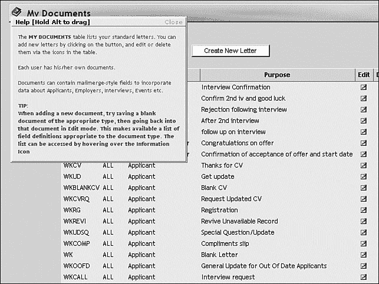

尽管 Ajax 对于改进 Web 界面无疑具有吸引力，但你需要接受，在许多情况下，使用 Ajax 会损害用户体验而不是增强它。

这尤为如此，特别是当基于页面的界面比喻对于网站的内容和风格来说是完全足够的，甚至具有更高的相关性时。主题方便划分为章节风格页面的文本网站，从智能设计的超链接中获得的益处往往与它们从添加 Ajax 功能中获得的益处一样。

特别是小型网站，可能难以从 Ajax 界面中获得足够的益处，以平衡额外代码和增加复杂性带来的相关成本。

### 安全

Ajax 本身似乎没有带来任何设计 Web 应用时已经存在的安全问题。但值得注意的是，Ajax 增强型应用程序往往比以前包含更多的客户端代码。


由于客户端代码的内容可以被应用程序的任何用户查看，因此确保不要在代码中泄露敏感信息至关重要。在这种背景下，敏感信息不仅限于用户名和密码等内容（尽管它们确实是敏感的），还包括业务逻辑。让服务器端脚本负责处理数据库连接等问题。在将数据应用到任何重要处理之前，先在服务器上对数据进行验证。

# 跨平台测试代码

从本书的内容可以明显看出，各种浏览器在 JavaScript 的实现上表现不相同。微软浏览器与非微软浏览器在生成 `XMLHTTPRequest` 对象实例方面的主要差异是一个基础性的例子，但也存在许多细微差异。

特别是 DOM，其处理方式非常不同，不仅在不同浏览器之间如此，甚至在同一浏览器的不同版本之间也是如此。CSS 的实现是另一个细微差异仍然泛滥的领域。

尽管在各种浏览器上测试新应用程序一直以来都是重要的，但在面对 Ajax 应用带来的额外复杂性时，这可能比以往任何时候都更加重要。

希望浏览器将继续变得更加符合标准，但在那之前，请在尽可能不同的平台和使用尽可能不同的浏览器来测试应用程序。

# 编程陷阱

## Ajax 无法治愈糟糕的设计

世界上所有的动态交互都无法修正一个设计上有根本缺陷的 Web 应用。

良好 Web 设计的所有原则仍然适用于 Ajax 应用：

1. 为多个浏览器编写代码并验证你的代码。
2. 对你的代码进行良好的注释和文档说明，以便日后进行调试。
3. 尽可能使用较小的图形，以便它们能够快速加载。
4. 确保你选择的颜色、背景、字体大小和样式不会让页面难以阅读。

W3C 在 [`validator.w3.org/`](http://validator.w3.org/) 提供了一个免费的在线验证器。你是否

### 知道吗？

## 一些编程陷阱

这些问题中的一些已经在不同的章节中有所提及，但将它们在这里归类是值得的。这些可能是 Ajax 开发者在某个时候会遇到的最常见的编程问题！

### 浏览器对 `GET` 请求的缓存

向同一个 URL 发送重复的 `GET` 请求通常会导致响应不是来自服务器，而是来自浏览器缓存。在使用 Internet Explorer 时，这个问题显得尤为显著。

尽管在理论上可以使用适当的 HTTP Header 来解决这个问题，但在实践中，缓存可能是顽固的。

规避这个问题的有效方法是向发送请求的 URL 添加一个随机元素；浏览器会将此解释为对不同页面的请求，并返回服务器页面而不是缓存版本。

在文中，我们通过添加随机数实现了这一点。许多人青睐的另一种方法是添加一个基于时间的数字，这每次都会不同：

```
var url = “serverscript.php”+”?rand=”+new Date().getTime();
```

### 权限拒绝错误

接收“Permission Denied”（拒绝访问）错误通常意味着你触碰了防止 `XMLHTTPRequest` 对象发起跨域请求的安全措施。

必须调用与调用脚本位于同一域的服务器程序。

注意 确保域名的写法方式完全相同。`Somedomain.com` Out!可能会被解释为与 `[www.somedomain.com,](http://www.somedomain.com)` 不同的域，权限将被拒绝。

转义内容

在构建 `GET` 或 `POST` 请求的查询时，记住转义可能包含空格或其他非文本字符的变量。在以下代码中，值 `idValue` 是从表单的文本输入字段收集的，因此我们对其进行转义以确保编码正确：

```
http.open(“GET”, url + escape(idValue) + “&rand=” + myRandom, true);
```

# 总结

Ajax 无疑具有极大改进 Web 接口的潜力。然而，从传统的基于的接口到高度动态应用的范式转变为开发者留出了一些可能掉进去的“坑”。在这一章中，我们尝试收集了一些广为人知的坑。

这些问题中的一些已经在本书的其他章节中遇到过，而另一些可能等到你开始开发真实世界的应用程序时才会显现。

本章结束了第五部分“更复杂的 Ajax 技术”。如果你一直读到这里，你现在已经很好地掌握了 `XMLHTTPRequest` 对象、JavaScript、XML 和文档对象模型（DOM）的基础知识，并能够从原理开始创建实用的 Ajax 应用。

幸运的是，你并不总是需要从原理开始工作。互联网上的许多开源和商业项目提供了各种 Ajax 框架、工具和资源。

本书的第六部分“Ajax 工具和资源”通过查看这些资源及其功能，结束了我们的 Ajax 开发之旅。

# 第六部分

Ajax 工具和资源

| 第 25 章 | `prototype.js` 工具包 | 305 |
| :--- | :--- | :--- |
| 第 26 章 | 使用 Rico | 315 |
| 第 27 章 | 使用 Script.aculo.us | 325 |
| 第 28 章 | 使用 XOAD | 331 |
| 附录 | JavaScript, PHP 和 Ajax 网站 | 339 |
| 术表 | | 343 |

此页特留空

# 第 25 章

prototype.js 工具包


### 本章将：

1. 介绍 `prototype.js`
2. 封装 `XMLHTTPRequest`——Ajax 对象
3. 示例项目——股票价格读取

在本章中，你将学习 prototype.js 库以及它如何减少构建能力应用的工作。

## 介绍 prototype.js

第六部分“Ajax 工具和资源”查看了用于 Ajax 开发的一些代码库和框架。

prototype.js 库的最新版本可以从 [`www.prototypejs.org/`](http://www.prototypejs.org/) 下载。

Sam Stephenson 的 prototype.js 是一个流行的 JavaScript 库，包含了适用于开发跨浏览器 JavaScript 程序的函数数组，并对 Ajax 有特定的支持。你将看到如何利用该库对 DOM 操作、HTML 表单和 XMLHTTPRequest 对象的强大支持来简化 JavaScript 代码。

### 光盘

注意 编写时 prototype.js 版本为 1.6.0。如果你下载了不同的版本，请检查文档查看你的版本与此处的版本之间是否存在差异。

将库包含在 Web 应用程序非常简单，只需在 HTML 文档的 `< head >` 部分包含以下行：

```
< script src=”prototype.js” Language=”JavaScript” type=”text/javascript/></script>
```


`$()` 本质上是 `getElementById()` DOM 方法的快捷方式。通常，要返回特定元素的值，你会使用诸如 `var mydata = document.getElementById(‘someElementID’);` 这样的表达式。

`$()` 函数通过返回作为参数传递给它的 ID 元素值来简化此任务：`var mydata = $(‘someElementID’);`。

此外，`$()`（与 `getElementById()` 不同）可以接受多个元素 ID 作为参数，并返回关联元素值的数组。考虑这行代码：

```
mydataArray = $(‘id1’,’id2’,’id3’);
```

在这个示例中：
- `mydataArray[0]` 包含 ID 为 `id1` 的元素值。
- `mydataArray[1]` 包含 ID 为 `id2` 的元素值。
- `mydataArray[2]` 包含 ID 为 `id3` 的元素值。

# 介绍 prototype.js

## $F() 函数

`$F()` 函数在将输入元素或其 ID 作为参数传递给它时，返回表单输入字段的值。查看下面的 HTML 代码段：

```html
<input type=”text” id=”input1” name=”input1” >
<select id=”input2” name=”input2” >
<option value=”0”>Option A</option >
<option value=”1”>Option B</option >
<option value=”2”>Option C</option >
</select >
```

在这里，我们可以使用 `$F(‘input1’)` 来返回文本框中的值，使用 `$F(‘input2’)` 来返回选择框中当前选中选项的值。`$F()` 函数在复选框和文本区域输入元素上同样有效，使得无论输入元素类型如何，都能轻松返回元素值。

## Form 对象

prototype.js 定义了一个 `Form` 对象，它具有几个实用的方法来简化 HTML 表单操作。

你可以通过调用 `getElements()` 方法返回表单输入字段的数组：

```
inputs = Form.getElements(‘thisform’);
```

`serialize()` 方法允许将输入名称和值格式化为兼容 URL 的列表：

```
inputlist = Form.serialize(‘thisform’);
```

使用上述代码行，变量 `inputlist` 现在将包含一个序列化的参数和值对字符串：`field1=value1&field2=value2&field3=value3…`。

`Form.disable(‘thisform’)` 和 `Form.enable(‘thisform’)` 的作用完全如其名。

## Try.these() 函数

之前的章节讨论了如何使用异常来捕获运行时错误并干净地处理它们。`Try.these()` 函数提供了一种方便的方法来封装这些方法，以便在 JavaScript 实现细节不同的情况下提供跨浏览器解决方案：

```
return Try.these(function1(),function2(),function3(), …);
```

这些函数按顺序处理，当错误条件导致抛出异常时，操作将移动到下一个函数。当任何函数成功完成时，操作停止，此时函数返回 `true`。

将此函数应用于创建 `XMLHTTPRequest` 实例，可以显示出结果代码的简单性：

```javascript
return Try.these( function() {return new ActiveXObject(‘Msxml2.XMLHTTP’)}, function() {return new ActiveXObject(‘Microsoft.XMLHTTP’)}, function() {return new XMLHttpRequest()} )
```

 你可能想将此代码段与列表 10.1 进行比较，以查看代码复杂度降低了多少，读性提高了多少。

# 封装 XMLHTTPRequest—Ajax 对象

prototype.js 定义了一个 `Ajax` 对象，旨在用于构建 Ajax 应用时简化你的 JavaScript 代码开发。该对象包含许多类，封装了你发送服务器请求、监控其进度以及处理返回数据的代码。

### Ajax.Request

`Ajax.Request` 处理创建 `XMLHTTPRequest` 对象实例和发送正确格式化请求的细节。调用它非常简单：

```javascript
var myAjax = new Ajax.Request( url, {method: ‘post’, ➥parameters: mydata, onComplete: responsefunction} );
```

 在此调用中，`url` 定义了要调用服务器资源的位置，`method` 可以 `post` 或 `get`，`mydata` 是包含请求参数的序列化字符串，`responsefunction` 是处理服务器响应的回调函数名称。

第二个参数使用通常称为 JSON（JavaScript 对象表示）的记法构建。该参数由一系列参数:值对构建，整体包含在大括号内。参数值本身可以是 JSON 对象、数组或简单值。

JSON 因其易于构建、易于解析和语言无关性而作为数据交换协议而非常流行。你可以在 [`www.json.org.`](http://www.json.org) 了解更多信息。

`onComplete` 参数是对应 `XMLHTTPRequestreadyState` 属性可能值的几个选项之一，在这种情况下，`readyState` 值为 4（完成）。你也可以通过使用相关的参数 `onLoading`、`onLoaded` 或 `onInteractive` 来指定回调函数在之前的阶段 `Loading`、`Loaded` 或 `Interactive` 中执行。还有其他几个可选参数，包括 `asynchronous:false`，指示应同步进行服务器调用。`asynchronous` 的默认值为 `true`。

### Ajax.Updater

在需要返回数据更新页面元素的情况下，`Ajax.Updater` 类可以简化这项任务。你只需要指定要更新的元素：

```
var myAjax = new Ajax.Updater(elementID, url);
```

调用与 `Ajax.Request` 类似，但第一个参数是目标元素的 ID。以下是 `Updater` 的代码示例：

```html
<script >
function updateDIV(mydiv)
{ var url = ‘http://example.com/serverscript.php’;
var params = ‘param1=value1&param2=value2’;
var myAjax = new Ajax.Updater
( mydiv, url,
{ method: ‘get’ }
)
}
</script>

<input type=”button” value=”Go” onclick=”updateDIV(targetDiv)” >
<div id=”targetDiv”</div>
```

再次，在调用时可以使用额外的选项。注意的是列表中增加了 `evalscripts:true`。加上此选项，服务器返回的 JavaScript 代码将被执行。

### Ajax.PeriodicalUpdater

`Ajax.PeriodicalUpdater` 类用于重复创建 `Ajax.Updater` 实例。通过这种方式，你可以在特定的时间间隔后更新页面元素。这对于股票市场行情或 RSS 阅读器等应用程序非常有用，因为它确保访问者始终查看最新的信息。

`Ajax.PeriodicalUpdater` 为 `Ajax.Updater` 增加了两个参数：
- `frequency`: 连续更新之间的延迟（秒）。默认值为两秒。
- `decay`: 如果服务器返回未更改的数据，则后续延迟增加的倍数。默认值为 1，使延迟保持不变。

这是一个调用 `Ajax.PeriodicalUpdater` 的示例：

```javascript
var myAjax = new Ajax.PeriodicalUpdater(elementID, url, { frequency: 3.0, decay: 2.0});
```

在这里我们选择将初始延迟设置为 3 秒，并在每次服务器返回未更改的数据时让此延迟翻倍。

# 示例项目—股票价格读取器

让我们使用 prototype.js 库构建一个简单的读取器，定期显示服务器返回的最新值。在这个示例中，我们将使用一个简单的服务器端脚本 `rand.php` 来模拟变化的股票价格：

```php
<?php srand ((double) microtime( )*1000000); $price = 50 + rand(0,5000)/100; echo “price"; ?>
```


此脚本首先通过调用 `srand()` 函数并传递一个基于当前时间的参数，来初始化 PHP 的随机数程序。然后使用 `rand(0,5000)` 函数生成一个随机数，并对其进行算术处理，以产生 50.00 到 100.00 之间的虚假“股票价格”。

现在让我们构建一个简单的 HTML 页面来显示当前股价。该页面是我们的 Ajax 应用程序的基础：

```html
<! DOYPE HTML PUBLIC “-//W3C//DTD HTML 4.01 Transitional//EN” “http://www.w3.org/TR/html4/loose.dtd”>
<html
<head>
<script src=”prototype.js” Language=”JavaScript” type=”text/javascript"></script>
<title>Stock Reader powered by Prototype.js</title>
</head>
<body>
<h2>Stock Reader</h2>
<h4>Powered by Prototype.js</h4>
<p>Current Stock Price:</p> <div id=”price"></div>
</body>
</html>
```

注意注意，我们在文档的头部中通过 `<script>` 标签包含了 prototype.js 库。我们还定义了一个 `id` 设置为“price”的 `<<div>>`，它将用于显示当前股价。

我们现在需要实现 `Ajax.PeriodicalUpdater` 类，将其附加到文档 body 元素的 `onLoad` 事件处理器上。列表 25.1 显示了完整的脚本。

### 列表 25.1：使用 prototype.js 的 Ajax 股票阅读器


```html
<! DOCTYPE HTML PUBLIC “-//W3C//DTD HTML 4.01 Transitional//EN” “http://www.w3.org/TR/html4/loose.dtd”>
<html
<head>
<script src=”prototype.js” Language=”JavaScript” type=”text/javascript"></script>
<script>
function checkprice()
{
var myAjax = new Ajax.PeriodicalUpdater(‘price’,’rand.php’, {method: ‘post’, frequency: 3.0, decay: 1});
}
</script>
<title>Stock Reader powered by Prototype.js</title>
</head>
<body onLoad=”checkprice()">
<h2>Stock Reader</h2>
<h4>Powered by Prototype.js</h4>
<p>Current Stock Price:</p> <div id=”price"></div>
</body>
</html>
```


看通过使用 prototype.js，应用程序的代码变得多么简单。实现该应用程序只需要定义一个单行函数 `checkprice()` 来实例化我们的重复性 Ajax 调用，并在 body 元素的 `onLoad` 事件处理器中调用该函数。

从传递给 `Ajax.PeriodicalUpdater` 的参数中，你可以看到指定了 3 秒的重复间隔。该周期不会随后的调用而改变，因为 `decay` 值已设置为 1。

图 25.1 显示了应用程序的运行情况。当然，从图中无法看到股价每 3 秒自动更新一次以显示新值。

## 总结

#### 图 25.1：Ajax 股票阅读器。

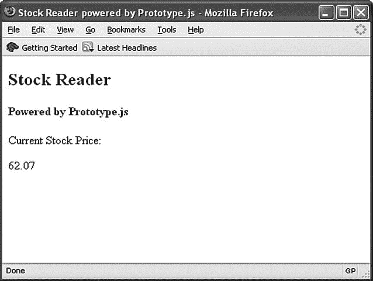

这个简单的示例远未展现 prototype.js 库的力量和多功能性。相反，它的目的是通过提供访问这一伟大资源的简易入口，让你开始自己的实验。

| 自己尝试一下 | ▼ |
| :--- | :--- |
| 使用 prototype.js：复习书中前面的一些示例 JavaScript 和 Ajax 应用程序，看看哪些可以使用 prototype.js 工具箱中的工具更简单或更有效地进行重写。 | ▲ |

### 总结（续）

在本书的第 VI 部分的第一章中，我们讨论了强大且优雅的 prototype.js JavaScript 库的使用。该库提供的函数极大简化了开发 Ajax 应用程序时的一些一些棘手编程任务。该库对 `XMLHTTPRequest` 对象提供了良好的支持，并为 DOM 处理、HTML 表单以及许多其他与 Ajax 开发相关的技巧提供了节省快捷方法。

*本页特留空*

# 第 26 章


## 使用 Rico


### 你在本章将学习到：
- 介绍 Rico
- Rico 的其他界面工具

在本章中，你将学习使用 Rico，这是一个强大的 Ajax 和用户界面开发框架。

### 介绍 Rico

在第 25 章“prototype.js 工具箱”中，我们查看了 prototype.js，这是一个强大且实用的 JavaScript 库，简化了 Ajax 开发者面临的许多编程任务。

| 你可以在随书附带的光盘中的 Frameworks 文件夹中找到 Rico。 |

在本章中，我们将查看使用 Rico，这是一个采用 prototype.js 库的复杂 Ajax 框架。

#### 在光盘上


Rico 是一个开源库，扩展了 prototype.js 的功能，提供了丰富的界面开发工具。除了目前为止讨论的 Ajax 开发技术外，Rico 还提供了一系列工具，如拖放、电影效果等。你知道 Rico 是西班牙语中“丰富的”的意思吗？这对于一个为丰富界面设计的工具箱来说非常恰当。


## 在应用程序中使用 Rico

要使用 Rico 构建丰富的界面，你需要在页面的 `<head>` 部分包含 Rico 和 prototype.js 库。

```html
<script src="scripts/prototype.js"></script>
<script src="scripts/rico.js"></script>
```

### Rico 的 AjaxEngine

引入 rico.js 会创建一个名为 `ajaxEngine` 的实例供你使用。`AjaxEngine` 是 Rico 为你的网页添加 Ajax 能力的机制。`AjaxEngine` 需要三个步骤来更新元素：

1. **注册请求处理器**：注册请求处理器会将唯一名称与通过 Ajax 用的 URL 关联。
2. **注册响应处理器**：Rico 可以处理返回的 HTML 数据和 JavaScript 代码。前者，响应处理器标识要更新的页面元素；后者，由一个 JavaScript 对象处理服务器响应。
3. **从页面通过事件处理器进行 Ajax 调用**。

我们首先通过调用 `ajaxEngine` 的 `registerRequest()` 方法来注册请求处理器：

```javascript
ajaxEngine.registerRequest('getData', 'rand.php');
```

我们现在已将名称 `getData` 与服务器程序关联。

如何注册响应处理器取决于我们处理的是哪种类型的响应。对于 `element` 类型的响应，你可以直接调用 `ajaxEngine.registerAjax('showdata')`。

#### 响应示例


此类响应有一个根元素 `<ajax-response>`。示例中包含的 `<response>` 元素具有属性：

```html
<ajax-response>
  <response type="element" id="showdata">
    <div class="datadisplay">
      The <b>cat</b> sat on the <b>mat</b>.
    </div>
  </response>
</ajax-response>
```

属性 `type` 和 `id` 分别表示响应包含 HTML，并且该 HTML 用于更新 id 为 showdata 的页面元素。Rico 能够从一次请求更新多个页面元素。

Rico 返回的另一种响应形式是 JavaScript 对象。这是一个：

```html
<ajax-response>
  <response type="object" id="myHandler">
    <sentence>The cat sat on the mat.</sentence>
  </response>
</ajax-response>
```

这里类型被设置为 `object`，表示内容将由 JavaScript 对象处理，该对象的标识包含在 `id` 值中（此处为 `myHandler`）。响应的内容始终传递给该对象的 `ajaxUpdate` 方法。


在响应包含 JavaScript 对象的情况下，您需要执行 `ajaxEngine.registerAjaxObject('myHandler', new myHandler())`。

相比之下，`element` 类型的响应仅用于更新 HTML 页面元素，而 `object` 类型的响应可以拥有处理器，以它们任何想要的方式处理响应。这使得 Rico 应用可以构建从简单到复杂的各种类型。

## 简单示例

我们可以通过使用列表 26.1 中的简单脚本看到 Rico 的运行。该应用程序通过对 Rico 的 `ajaxEngine` 对象的单一调用更新了两个 HTML 元素。应用程序的脚本位于列表 26.1 中。

### 列表 26.1 一个简单的 Rico 应用


```html
<!DOCTYPE HTML PUBLIC "-//W3C//DTD HTML 4.01
➥ // Transitional//EN"
➥"http://www.w3.org/TR/html4/loose.dtd">
<<html>
<head>
<title>Testing OpenRico</title>
<script src="prototype.js"></script>
<script src="rico.js"></script>
<script type="text/javascript">
function callRICO() {
    ajaxEngine.registerRequest('myRequest', 'ricotest.php');
    ajaxEngine.registerAjaxElement('display');
    ajaxEngine.registerAjaxElement('heading');
}
</script>
</head>
<body onload="callRICO();">
<div id="heading"><h3>Demonstrating Rico</h3></div>
<input type="button" value="Get Server Data"
➥ onclick="ajaxEngine.sendRequest('myRequest');"/>
<div id="display"><p>This text should be replaced with
➥server data ...</p></div>
</body>
</html>
```


你从代码中可以看到，单一函数 `callRICO()` 被用于注册单个请求处理器 `myRequest` 和两个响应处理器。响应处理器被用于更新两个 `<div>` 容器；其中一个包含页面的标题，另一个包含一条短文本消息。在发起 Rico 请求时，两者的内容都会被更新，使页面拥有新标题，并且现在显示某些服务器信息而不是之前的文本消息。图 26.1 显示了操作前后的截图。

服务器例程是一个简单的 PHP 脚本，输出所需的 XML 数据。该脚本使用了 PHP 的全局变量 `$_SERVER['SERVER_SIGNATURE']`。注意，脚本构建并返回了两个独立的 `<response>` 元素，每个元素负责更新 HTML 页面中的特定元素。

## 介绍 Rico

### 图 26.1
使用 Rico 更新多个页面元素。

列表 26.2 显示了服务器脚本。

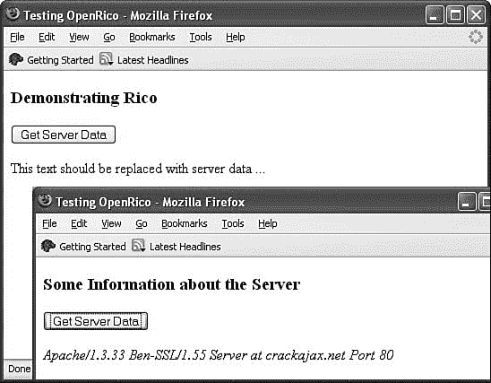 列表 26.2 生成 <ajax-response> 的服务器脚本


```php
<?php
header("Content-Type:text/xml");
header("Cache-Control:no-cache");
header("Pragma:no-cache");

echo "<ajax-response><response type=\"element\"
➥id=\"display\"><p>"
➥.$_SERVER['SERVER_SIGNATURE']
➥."</p></response>
< response type=\"element\" id=\"heading\">

| 第 11 章，“与服务器对话”讨论了由于浏览器缓存可能出现的问题。在那个章节中，我们使用了一种变通方法，即在要调用的服务器资源 URL 中添加一个随机值的参数。此脚本示例使用了另一种技术，包括头部命令 `header("Cache-Control:no-cache"); header("Pragma:no-cache");`，指示浏览器不要缓存此页面，而是每次都从服务器获取新副本。 |

➥< h3>Some Information about the Server</h 3>

➥< /response></ajax-response>";
?>
```


## 你知道吗？


 注意！PHP 的全局数组变量 `$_SERVER` 是在 PHP 4.1.0 中引入的。如果你安装了旧版本的 PHP，则需要使用全局变量 `$HTTP_SERVER_VARS`。

## Rico 的其他界面工具

Rico 的能力不仅限于辅助 Ajax 应用的开发。现在让我们看看使用 Rico 工具包可以在用户界面中添加的其他功能。尽管这些技术本身并不使用 Ajax，但只需一点想象就能意识到它们与 Rico 的 Ajax 工具结合时可能实现什么。

### 拖放

桌面应用程序及其运行的操作系统都广泛使用拖放来简化用户界面。实现拖放所需的 JavaScript 技术可能很难精通，尤其是由于会产生许多跨浏览器问题。

然而，使用 Rico 进行拖放是简单的。

在你的应用程序中包含 `rico.js` 文件会自动创建一个名为 `dndMgr` 的对象，它是 Rico 的拖放管理器（Drag and Drop Manager）。使用 `dndMgr` 对象就像使用 `AjaxEngine`；但这次，我们需要注册的不是 Ajax 请求和响应，而是可拖拽项目和落点区域（可以接收拖拽项目的页面元素）。

使用 Rico 进行拖放是简单的。

在你的应用程序中包含 `rico.js` 文件会自动创建一个名为 `dndMgr` 的对象，它是 Rico 的拖放管理器。使用 `dndMgr` 对象就像使用 `AjaxEngine`；但这次，我们需要注册的不是 Ajax 请求和响应，而是可拖拽项目和落点区域（可以接收项目的页面元素）。

### 列表 26.3 使用 Rico 的简单拖放


```html
<!DOCTYPE HTML PUBLIC "-//W3C//DTD HTML 4.01
➥ // Transitional//EN"
➥"http://www.w3.org/TR/html4/loose.dtd">
<html>
<head>
<title>Testing OpenRico</title>
<script src="prototype.js"></script>
<script src="rico.js"></script>
<style>
body { font:10px arial, helvetica, verdana; background-color:#dddd; }
div.simpleDropPanel { width:260px; padding:5px; border:1px solid #33333; }
div.box { width:200px; cursor:hand; background-color:#ffffff; filter:opacity(60); border:1px solid #33333; }
</style>
</head>
<body>
<table width="550">
<tr>
<td>
<h3>Drag and Drop</h3>
<p>用通常的方式使用左鼠标按钮将项目拖入目标字段。注意在拖拽过程中可用目标字段的变化。</p>
<p>刷新页面重新开始。</p>
<div class="box" id="draggable1">This is a piece of draggable data</div>
<div class="box" id="draggable2">This is another</div>
<div class="box" id="draggable3">And this is a third</div>
<table>
<tr>
<td>
<div id="droponme" class="simpleDropPanel">
<b>Drop Zone 1</b><br />A simple text area
</div>
</td>
<td>
<b>Drop Zone 2</b><br /> A form text entry field.
<form><textarea name="dropzone" id="droponme2" rows="6" cols="30"></textarea></form>
</td>
</tr>
</table>
</td>
</tr>
</table>
<script>
dndMgr.registerDraggable(new Rico.Draggable('foo','draggable1'));
dndMgr.registerDraggable(new Rico.Draggable('foo','draggable2'));
dndMgr.registerDraggable(new Rico.Draggable('foo','draggable3'));
dndMgr.registerDropZone(new Rico.DropZone('droponme'));
dndMgr.registerDropZone(new Rico.DropZone('droponme2'));
</script>
</body>
</html>
```


### 图 26.2
简单的拖放应用。

Rico 的其他界面工具

两个 JavaScript 库 rico.js 和 prototype.js 包含文档的 <head> 中，以及各种页面元素的样式定义。


请注意，有两个特殊的页面元素，一个 `<<div>` 容器和一个 `<textarea>` 输入字段，它们被赋予了 `dropzone1` 和 `dropzone2` 的 ID。在列表的后面，这两个元素通过以下代码行被定义为我们拖放操作的放置区域：

```
dndMgr.registerDropZone( new Rico.Dropzone(‘droponme’) ); dndMgr.registerDropZone( new Rico.Dropzone(‘droponme2’) );
```

你还会看到页面中定义了三个小的 `<div>` 容器，并赋予了 `draggable1`、`draggable2` 和 `draggable3` 的 ID。正如你所猜的那样，它们将成为可拖拽的页面元素，并通过以下代码行进行定义：

```
dndMgr.registerDraggable( new Rico.Draggable(‘foo’,
➥’draggable1’) ); dndMgr.registerDraggable( new Rico.Draggable(‘foo’,
➥’draggable2’) ); dndMgr.registerDraggable( new Rico.Draggable(‘foo’, ➥’draggable3’) );
```

这就是全部了！Rico 处理了所有的细节，甚至在拖拽物体时更改可用放置区域的外观，如图 26.3 所示。

图 26.3
拖拽操作期间高亮的的放置区域。

当在可用的放置区域上方释放时，可拖拽项目将与放置区域元素的 HTML 代码内联对齐，如图 26.4 所示。

图 26.4
完成拖放后。

# 电影级效果

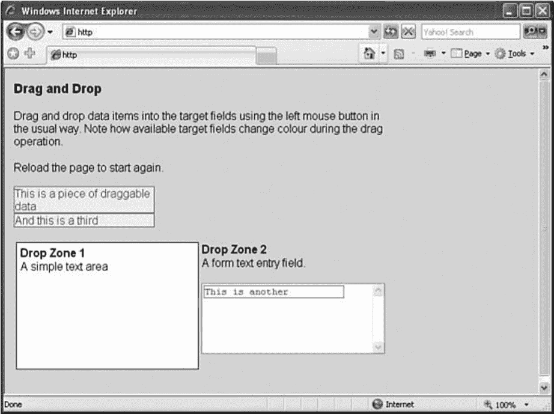除了 Ajax 和拖放工具外，Rico 还提供了一系列统称为电影效果（cinematic effects）的用户界面组件。

通过 `Rico`，这些电影效果是 `prototype.js` 中 `Effect` 类的扩展。

# 方式

这些效果包括页面元素的动画（改变它们的大小和/或形状）、淡入效果（改变页面元素的透明度）、为对象应用圆角以及操作对象的颜色。

与之前讨论的界面技术结合使用，这些效果可以帮助你构建更加复杂、引人注目且用户友好的界面，这些界面更像是桌面应用程序而非网页页。

# 总结

在第 25 章研究了 `prototype.js` 库之后，本章转向了 Rico 的实验。Rico 是一个基于 `prototype.js` 的开源框架，它提供了一种简单的方法将 Ajax 以及拖放和其他视觉效果集成到用户界面设计中。

在第 27 章中，我们将要查看另一个基于 `prototype.js` 的工具包，即 `Script.aculo.us`。

# 第 27 章：使用 Script.aculo.us


你将在本章学习：
- 下载库
- 引入文件
- 使用效果
- 构建脚本

我们已经在之前的章节中看到了了 `prototype.js` 库有多强大，并且我们已经使用了基于 `prototype.js` 构建的 `Rico` 库，用极少的代码创建了一些视觉效果。

在本章中，你将学习使用 `Script.aculo.us` 的基础知识，这是一个强大的 Ajax 和用户界面开发框架，同样基于 `prototype.js`。

| 此示例是使用 `Script.aculo.us` 库的 1.5.1 版本创建的。它可以在后续版本上运行，但库自编写以来可能已经发生了变化。如果你遇到问题，可能需要使用这个特定版本。 |

为了看到使用起来简单，你现在将创建一个包含 `Script.aculo.us` 库的示例脚本，并使用事件处理器来演示几种可用效果。

## 注意！

### 下载库

要使用该库，你需要获取它并将所需的文件复制到你存储脚本的相同文件夹中。

第 27 章：使用 Script.aculo.us

| 顺便说一下，在光盘上 | 你可以在随书附的光盘上找到 `Script.aculo.us` 的副本。或者，你也可以从 `Script.aculo.us` 网站 [`script.aculo.us/downloads.`](http://script.aculo.us/downloads) 下载库的最新版本。下载以 Zip 文件格式提供。在 Zip 包内部你会找到一个名为 `scriptaculous-js-x.x.x` 的文件夹。你需要该文件夹下目录中的以下文件：来自 `lib` 文件夹的 `prototype.js`（Prototype 库）。来自 `src` 文件夹的 `effects.js`（效果函数）。将这两个文件都复制到计算机上的文件夹中，并确保在该文件夹中创建你的演示脚本。`Script.aculo.us` 的下载包含许多其他文件，如果你打算使用它的所有功能，可以包含整个库。对于此示例，你只需要 |
| 此处的两个文件。 |

### 引入文件

要将库添加到你的 HTML 文档中，只需使用 `<script>` 引入你从下载复制的两个 JavaScript 文件：

```html
<script type="text/javascript" src="prototype.js"></script>
<script type="text/javascript" src="effects.js"></script>
```

如果你将这些语句放在文档的 `<head>` 部分，该库将在面的任何地方可用。

### 使用效果

在你引入了库之后，你只需要一点 JavaScript 来触发效果。我们将使用一个具有 `id` 为 `test` 的 `<div>` 标签来演示效果。例如，这段代码定义了淡出：

```html
<input type="button" value="Fade Out" onclick="new Effect.Fade('test'))">
```

使用内置 `Prototype` 的 `$` 函数获取对象，然后将其传递给内置 `Script.aculo.us` 的 `Effect.Fade` 函数。

这将演示六种效果：`Fade`、`Appear`、`SlideUp`、`SlideDown`、`Highlight` 和 `Shake`。库中还有 16 多种效果，以及拖放和其他功能。详情请参见 [`script.aculo.us`](http://script.aculo.us)。

### 构建脚本

在你引入了库之后，你可以将它们与事件处理器以及一些示例文本结合，创建一个 `Script.aculo.us` 的演示。

此示例的完整 HTML 文档位于列表 27.1。

列表 27.1 完整效果


```html
<html>
<head>
<title>测试 script.aculo.us 效果</title>
<script type="text/javascript" src="prototype.js"></script>
<script type="text/javascript" src="effects.js"></script>
</head>
<body>
<h1>测试 script.aculo.us 效果</h1>
<form name="form1">
<input type="button" value="Fade Out" onclick="new Effect.Fade('test'))">
<input type="button" value="Fade In" onclick="new Effect.Appear('test'))">
<input type="button" value="Slide Up" onclick="new Effect.SlideUp('test'))">
<input type="button" value="Slide Down" onclick="new Effect.SlideDown('test'))">
<input type="button" value="Highlight" onclick="new Effect.Highlight('test'))">
<input type="button" value="Shake" onclick="new Effect.Shake('test'))">
</form>
<div id="test" style="background-color:#CCC; margin:20px; padding:10px;">
<h2>测试效果</h2>
<hr>
<p>文档的这一部分在一个 id 为 test 的 &lt;div&gt; 元素内。上方按钮上的事件处理器将此对象发送给 script.aculo.us 库以执行效果。点击按钮查看效果。</p>
</div>
</body>
</html>
```


本文档以两个 `<script>` 标签开头，用于包含库文件。效果通过为六个按钮中的每一个定义的事件处理器触发。末尾的 `<div>` 部分定义了用于演示效果的 `test` 元素。

要尝试此示例，请确保 `prototype.js` 和 `effects.js` 文件（来自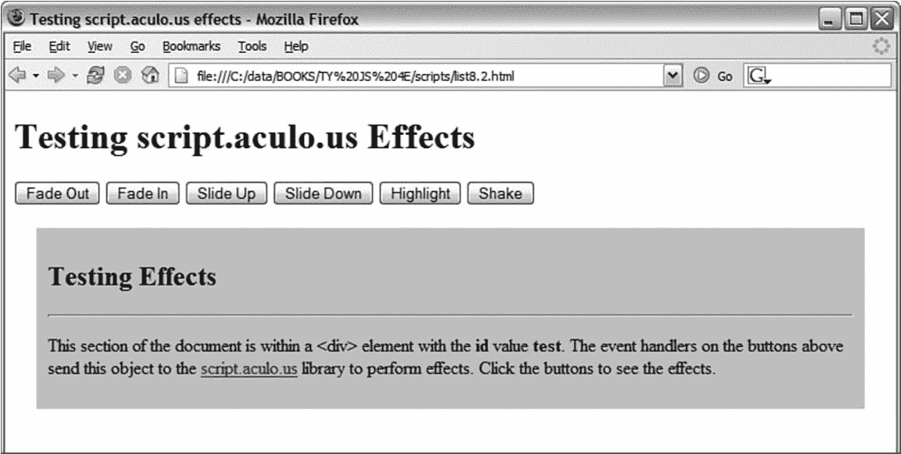`Script.aculo.us`）与你的脚本存储在同一个文件夹中，然后将其加载到浏览器中。显示效果应该像图 27.1 所示，可以使用页面顶部的六个按钮来触发效果。

### 图 27.1
Firefox 显示的库效果示例。

| ▼ | 亲自尝试 |
|  | 探索 Script.aculo.us。探索 Script.aculo.us 框架提供的功能，并将其采用的方法与第 26 节讨论的 Rico 库的方法进行比较。请自由尝试该库提供的其他功能，并看看 |
| ▲ | 你可以实现什么。 |

总结 329

### 总结
Script.aculo.us 是另一个基于 `prototype.js` 库的强大且易用的工具包。只需几行代码，你就可以为页面元素添加令人惊叹的效果。

本章仅仅触及了 Script.aculo.us 所能实现的冰角。阅读包文档并实验该库，看看你如何用最少的额外编程构建强大且令人印象深刻的交互页面。

本页特留白。

# 第 28 章 
## 使用 XOAD


#### 你在本章中将学习：
- 介绍 XOAD
- XOAD HTML
- 使用 XOAD 进行高级编程

在本章中，你将学习 XOAD，这是一个由 Stanimir Angeloff 编写的、支持 Ajax 的服务端框架。

### 介绍 XOAD
到目前为止，在书的这一部分，我们查看了 `prototype.js`、`script.aculo.us` 和 `Rico` 库，以及它们如何帮助你开发 Ajax 应用。这些用 JavaScript 编写的客户端库不同，XOAD 是一个用 `PHP` 编写的服务器端 Ajax 工具包。

| XOAD 是 XMLHTTP 面向对象应用开发的的缩写。 |

本章讨论了 XOAD 背后的一些概念及其使用的基础。

### 你知道吗？
到目前为止，我们所有的工作都集中在使用 JavaScript 处理 Ajax 应用中的服务器请求和返回数据。XOAD 是一个用 `PHP` 编写的基于服务器的解决方案，它采用了稍微不同的方法。

XOAD 应用通过将函数的序列化版本作为 JavaScript 对象传递，为客户端 JavaScript 解释器提供服务器端的 `PHP` 函数。

| 顺便说。CD 上。注意！ | 在底层，XOAD 采用 `JSON`（JavaScript 对象表示法）进行通信。`JSON` 在第 25 节“prototype.js 工具包”中介绍。下载并安装最新版本的 XOAD 包含在附 CD 中。要确保你拥有最新版本，请参阅以下下载说明。XOAD 由许多 `PHP` 及其辅助脚本组成，可以从 `http://sourceforge.net/projects/xoad/` 下载压缩包。要成功安装 XOAD，你需要访问支持 `PHP` 和（为了使用 XOAD 的更高级功能）`MySQL` 数据库的 Web 服务器的 FTP 权限。可以在下载的材料中找到安装说明，`http://forums.xoad.org/` 有一个公共论坛。 |

#### 一个简单的 XOAD 页面
让我们来看一个简单的 XOAD 页面示例。假设你有一个要在 XOAD 应用中使用的 `PHP` 类。该类存储在 `PHP` 文件 `myClass.class.php` 中：

```php
<?php 
class myClass { 
    function stLength($mystring) { 
        return strlen($mystring);
    } 
    function xoadGetMeta() {
        XOAD_Client::mapMethods($this, array('stLength'));
        XOAD_Client::publicMethods($this, array('stLength'));
    }
}
?>
```

这个简单的类只有一个函数 `stLength()`，它仅仅返回字符串变量的长度。我们还以函数 `xoadGetMeta()` 的形式向类添加了一些元数据。这些信息告诉 XOAD 类中的哪些方法可以导出到主应用程序。在这种情况下，只有一个，即 `stLength()`。在类中包含元数据并不是绝对必要的，但建议这样做。如果没有元数据，所有方法将是公开的，且方法名将被 转换为小写。

介绍 XOAD
现在你需要开始构建主应用程序脚本 `xoad.php`。

| 之前的章节开发的 Ajax 应用是扩展名为 `.htm` 或 `.html` 的 HTML 文件。由于我们的 XOAD 应用包含 `PHP` 代码，它 | 你知道吗？ | 必须具有适当的文件扩展名。大多数 Web 服务器和 `PHP` 实现都会接受 `.php` 扩展名，某些允许其他扩展名如 `.php4` 或 `.phtml`。 |

列表 28.1 显示了 XOAD 应用。这是一个相当意义的程序，它只是返回字符串“My XOAD Application”的长度。尽管如此，它演示了将服务端 `PHP` 类作为 JavaScript 对象提供的概念。

列表 28.1 一个简单的 XOAD 应用


```php
<?php
require_once('myClass.class.php');
require_once('xoad.php');

XOAD_Server::allowClasses('myClass');

if (XOAD_Server::runServer()) {
    exit;
}

?>
<?php XOAD_Utilities::header('.'); ?>
<script>
var myobj = XOAD_Client::register(new myClass());
var mystring = 'My XOAD Application';
myobj.onLengthError = function(error) {
    alert(error.message);
    return true;
}
myobj.stLength(mystring, function(result) {
    document.write('String: ' + mystring + '<br />Length: ' + result);
});
</script>
```


将前面的文档加载到浏览器中，页面简单显示：
String: My XOAD Application
Length: 19

我不会详细介绍 `PHP` 代码是如何工作的；我们在其他地方讨论过 PHP 语言。然而，理解支撑代码的概念是非常重要的，让我们逐步分析 28.1 并尝试理解发生了什么：

```php
<?php
require_once('myClass.class.php');
require_once('xoad.php');

XOAD_Server::allowClasses('myClass');

if (XOAD_Server::runServer()) {
    exit;
}

?>
<?php XOAD_Utilities::header('.'); ?>
<script>
var myobj = XOAD_Client::register(new myClass());
var mystring = 'My XOAD Application';
myobj.onLengthError = function(error) {
    alert(error.message);
    return true;
}
myobj.stLength(mystring, function(result) {
    document.write('String: ' + mystring + '<br />Length: ' + result);
});
</script>
```

### XOAD HTML
XOAD HTML 是一个扩展，允许使用 XOAD Easy 更新 HTML 页面元素。以下示例展示了 `XOAD_HTML::getElementByID()` 和 `XOAD_HTML::getElementsByTagName()` 方法的使用，这些方法与其对应的 JavaScript DOM 方法的功能完全相同。


# XOAD_HTML::getElementById()

你会发现列表 28.2 中的代码布局在结构上与之前讨论过的基础 XOAD 程序相似。

在例示例中，我们没有包含外部类文件，而是在应用程序内部定义了一个类 `Updater`。该类包含一个单一函数 `change()`。

该函数的第一行使用 `XOAD_HTML::getElementById()` 来识别 ID 为 `display` 的页面元素。随后的程序行将对该页面元素的文本和背景颜色进行更改。

函数 `change()`作为 JavaScript 对象 `myobj` 的方法被提供，然后可以像调用任何其他 JavaScript 方法一样调用它：

```html
<a href=”#server” onclick=”myobj.change(); return false;”>Change It!</a>
```

图 28.1 显示了程序的运行情况。

图 28.1

## 使用 `XOAD_HTML:`

`:getElementById()`.

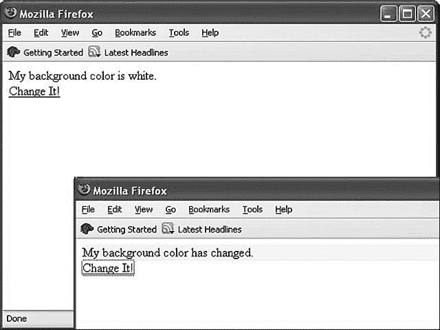
列表 28.2 使用 `XOAD_HTML::getElementById` 的示例


```php
<?php
class Updater
{
    function change()
    {
        $mytext =& XOAD_HTML::getElementById(‘display’);
        $mytext->style[‘backgroundColor’] = ‘yellow’;
        $mytext->innerHTML = ‘My background
LISTING 28.2Continued
color has changed.’;
    }
}
define(‘XOAD_AUTOHANDLE’, true);
require_once(‘xoad.php’);
?>

<?= XOAD_Utilities::header(‘.’) ?>
<div id=”display”>My background color is white.</div


<script type=”text/javascript"> var myobj = <?= XOAD_Client::register(new Updater()) ?>;
</script>

<a href=”#server” onclick=”myobj.change(); return false;”>Change It!</a>
```

## XOAD_HTML::getElementsByTagName()


`XOAD_HTML::getElementsByTagName()` 方法与其 JavaScript 等效方法一样，返回具有特定类型元素的数组。列表 28.3 标识所有类型为 `<div>` 的页面元素并更改其某些样式属性。

列表 28.3 更改给定类型的所有页面元素


```php
<?php
class Updater
{
    function change() {
        $mydivs =& XOAD_HTML::getElementsByTagName(‘div’);
        $mydivs->style[‘height’] = ‘60’;
        $mydivs->style[‘width’] = ‘350’;
        $mydivs->style[‘backgroundColor’] = ‘lightgreen’;
        $mydivs->innerHTML = ‘Size and color changed by XOAD’;
    }
}
define(‘XOAD_AUTOHANDLE’, true);
require_once(‘xoad.php’);
?>

<?= XOAD_Utilities::header(‘.’) ?>
<script type=”text/javascript">
var myobj = <?= XOAD_Client::register(new Updater()) ?>;
</script>
<style>
div { border:1px solid black; height:80; width:150 }
</style>
<div>Div 1</div>
```
使用 XOAD 进行高级编程

### 列表 28.3 继续


## 使用 XOAD_HTML 选择多个页面元素

```html
<br />
<div>Div 2</div>
<br />
<div>Div 3</div>
<a href=”#server” onclick=”myobj.change(); return false;”>Update All Divs</a>
```


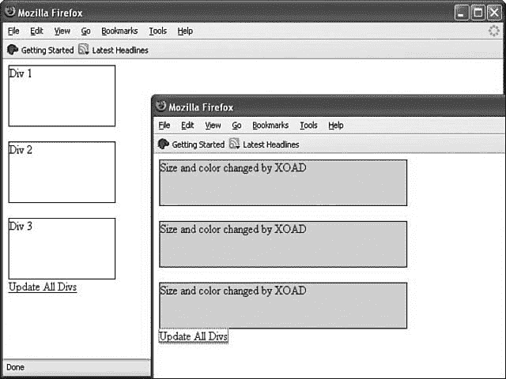

页面中的三个 `<div>` 元素通过 `XOAD_HTML::getElementsByTagName()` 被识别，它们的样式和大小被更改。

图 28.2 显示了程序的运行情况。

图 28.2

使用 `XOAD_HTML` 选择多个页面元素。

| `XOAD_HTML` 有许多其他功能。`XOAD_HTML` 中所有可用函数的详情请见 XOAD 下载包。 | 你知道吗？ |

## 使用 XOAD 进行高级编程

XOAD 拥有许多本章讨论之外的一系列高级功能。如果你想探索使用 XOAD 的可能极限，这里是目前支持的技术的概述。

### XOAD 事件

XOAD 框架还支持事件。在某个客户端计算机上触发的 XOAD 事件可以存储在服务器上，随后被其他客户端检测到，从而构建用户可以交互的复杂应用程序。例如，此类应用程序可能包括、小组软件或类似的协作工具。

### 使用 XOAD 进行缓存处理

XOAD 允许使用 `XOAD_Cache` 类在服务器上进行缓存。缓存结果可以显著提高性能，特别是当服务器端程序耗时时（例如对大型数据集进行排序或对大型数据库表执行查询）。

### XOAD 控件

你可以使用 `XOAD_Controls` 类在 XOAD 中定义自定义客户端控件。

## 你知道吗？

在编写时，XOAD 的当前版本为 0.6.0。如果你下载的版本不同，请参阅文档。

总结

本章探讨了大量关于 XOAD 的内容，你对它有了良好的理解。

## 附录

### JavaScript 网站

以下网站将帮助你学习更多 JavaScript：

- `JavaScript Workshop` 是由作者 Michael Moncur 写的博客。
- `DOM Task Force` 是 Web Standards 项目的一部分，致力于更好地使用标准，并有一有一个关于 JavaScript 的启发性博客。
- `Mozilla Project` 的 JavaScript 部分提供了最新更新信息以及文档。

### PHP 网站

以下网站对 PHP 非常有价值：

- `PHP` 官网提供下载、文档、常见问题解答等，包括用户提交的代码。
- `PHPBuilder` 是对 PHP 感兴趣的人的聚集点，包含了代码库、社区页面、PHP 新闻等。
- `Planet PHP` 维护了许多与 PHP 相关的博客。在这里你可以找到 PHP 领域影响力人士的新闻、观点和意见。

### Web 开发网站

以下网站拥有网络技术的动态和信息，包括 JavaScript、XML 和 DOM 以及基础 HTML：

- `W3C`（世界网联盟）是 HTML 和 CSS 标准信息的权威来源。
- `WebReference.com` 拥有从 Java 到插件的各种网络技术信息和文章。
- `Digital Web Magazine` 定期发布从 JavaScript、网页设计到网络运行的所有在线文章。

### Ajax 网站

一些用于 Ajax 编程的实用网站：

- `Ajax Matters` 包含了关于 Ajax 各方面的广泛深度文章。
- `Ajaxian` 是一个备受推崇且巨大的资源，涵盖了 Ajax 编程的各个方面的新闻、播客、文章等。


[`ajaxian.com/`](http://ajaxian.com/)

Crack Ajax 包含了教程、代码片段、演示以及完整运行的项目，并 true 面向 Ajax 程序员的论坛。[`www.crackajax.net.`](http://www.crackajax.net)

# 术语表

以下是贯穿本书的一些与 Web 开发相关的术语。虽然大部分术语在书中已给出解释，但本节可以在阅读本书时或阅读其他关于 JavaScript、PHP 或 Ajax 的信息时作为实用的快速参考。

**ActiveXA** 由微软开发的一种技术，允许创建组件，主要用于 Windows 计算机。ActiveX 组件（或控件）可以嵌入网页中。

**AHAH（异步 HTML 和 HTTP）**
Ajax 的简化子集，用于在不刷新页的情况下更新网页上的文本。

**Ajax（异步 JavaScript 和 XML）** 一种技术的组合，允许 JavaScript 向服务器发送请求、接收响应并在不加载新页的情况下更新页面的部分。

**algorithm (算法)** 用于解决问题的过程、方法或例程。

**anchor (锚点)** 在 HTML 中，文档内的一个命名位置，使用 `<a>` 标签指定。锚点也可以充当链接。

**applet (小程序)** 一种设计用于嵌入网页的 Java 程序。

**argument (参数)** 函数被调用时传递给函数的参数。参数在函数调用的括号内指定。

**array (数组)** 一组可以通过相同的名称和数字（称为索引）引用的变量。

**attribute (属性)** 可以在 HTML 标签内定义的属性值。属性指定了由标签定义的元素的样式、对齐和其他方面。

**assignment (赋值)** 将变量设置为特定值的行为。

**Boolean (布尔型)** 一种可以只能存储两个值：`true`（真）和 `false`（假）的变量类型。

**browser sensing (浏览器检测)** 一种脚本技术，用于检测客户端正在使用的特定浏览器，以便为多个浏览器提供兼容性。

**cache (缓存)** 浏览器用于存储访问过的页面的内部内存，使其在下次请求时加载更快。

**Cascading Style Sheets (CSS，层叠样式表)**
W3C 为 HTML 文档应用样式的标准。CSS 可以控制字体、颜色、边距、边框和定位。

**class (类)** 面向对象语言中的一种结构，允许创建对象。

**comment (注释)** 程序员写在代码段中的笔记，用于说明代码如何运行并使日后更容易维护。执行代码时，注释会被忽略。

**Common Gateway Interface (CGI，通用网关接口)** 运行服务器端程序的标准化方法，无论使用何种语言编写。

**concatenate (连接)** 将两个字符串合并为一个单一较长字符串的行为。

**conditional (条件语句)** 一种在当特定条件为真时执行操作的语句，通常使用 `if` 语句。

**constructor (构造函数)** 用于创建和初始化新对象的类方法。

**debug (调试)** 在程序或脚本中寻找错误（或漏洞 `bugs`）的行为。

**declaration (声明)** 变量名称和类型的语句。

**decrement (递减)** 将变量的值减 1。在 JavaScript 和 PHP 中，可以使用递减运算符 `--` 完成。

**deprecated (已弃用)** W3C 用于不再推荐使用的 HTML 标签或其他项的术语，未来可能不再支持。例如，`<font>` 标签在 HTML 4.0 中已被弃用，因为样式表可以提供相同的功能。

**Domain Name Service (DNS，域名系统)** 用于在互联网上将域名与 IP 地址关联的系统。

**Document Type Declaration (DTD，文档类型定义)** 在 HTML 文档开头编写的声明，说明该文档遵循哪种 HTML 版本。

**Document Object Model (DOM，文档对象模型)** JavaScript 可用来引用浏览器窗口和 HTML 文档部分的对象的集合。W3C（万维网联盟）DOM 是最新浏览器支持的标准化版本，允许访问网页中的每一个对象。

**Dynamic HTML (DHTML，动态 HTML)** HTML、JavaScript、CSS 和 DOM 的结合，允许创建动态网页。DHTML 既不是 W3C 标准，也不是 HTML 的版本。

**element (元素)** 数组中的单个成员，通过索引引用。在 DOM 中，元素是由 HTML 标签定义的单个节点。

**error handling (错误处理)** 使用编码技术来使脚本能够优雅地处理可能出现的任何错误情况。

**event (事件)** 一种条件，通常是用户操作的结果，可以被脚本检测到。

**event handler (事件处理程序)** 当事件发生时将执行的 JavaScript 语句或函数。

**expression (表达式)** 变量、常量和运算符的组合，可以求值为单个值。

**feature sensing (特性检测)** 一种脚本技术，在使用某特性（如 DOM 方法）之前检测其是否被支持，以避免浏览器不兼容。

**Firefox (火狐)** Mozilla 流行的符合标准的 浏览器。

**float (浮点数)** 带有浮点的小数。

**form (表单)** 一种允许网站用户向服务器发送信息的 HTML 结构。

**formatting (格式化)** 使用缩进、换行和空白使代码更易阅读和理解。

**function (函数)** 一组可以通过函数名和参数引用的语句。

**global variable (全局变量)** 在 页面中所有代码均可用的变量。它在任何函数之外声明（首次使用）。

**Greasemonkey (油猴)** Firefox 浏览器的扩展程序，允许用户脚本修改网页的外观和行为。

**Hypertext Markup Language (HTML，超文本标记语言)** 网络文档使用的语言。JavaScript 语句不是 HTML，但可以包含在 HTML 文档中并在访问者的浏览器中执行。PHP 代码块也可以嵌入 HTML 中。

**Hypertext Transfer Protocol (HTTP，超文本传输协议)** 服务器和浏览器之间通信的标准。

**increment (递增)** 将变量的值增加 1。在 JavaScript 和 PHP 中，可以使用递增运算符 `++` 完成。

**integer (整数)** 正整数或负整数。

**Internet Explorer (IE)** 微软的浏览器，适用于 Windows 和 Mac 等平台。

**interpreter (解释器)** 解释代码语句并对其操作的程序。JavaScript 解释器嵌入访问者的浏览器中。PHP 解释器安装在服务器上。

**Java** 由 Sun Microsystems 开发的面向对象的语言。Java 小程序可以嵌入网页中。JavaScript 语法相似，但并非 Java。

**JavaScript** 一种用于网络文档的脚本语言，松基于 Java 的语法，由 Netscape 开发。JavaScript 现在被大多数主流浏览器支持。

**layer (层)** 网页的一个区域，可以定位并按定义方式覆盖其他部分。层也被称为可定位元素。

**node (节点)** 在 DOM 中，网络文档内的单个容器或元素。每个 HTML 标签都定义了一个节点。

**null (空)** 计算机语言中表示值不存在的标识符；例如表示函数没有返回数据。

**object (对象)** 一种变量类型，可以存储多个值（称为属性）和函数（称为方法）。

**operator (运算符)** 用于表达式中划分变量或常数的字符。

**parameter (参数)** 函数被调用时发送给函数的变量，称为参数。

**PHP** 一种非常流行且开源的服务器端脚本语言。

**progressive enhancement (渐进增强)**


# 构建一个可在所有浏览器上运行的基础页面的方法，然后添加脚本等功能，这些功能可以在较新的浏览器上运行且不会影响页面的基础功能。

## 术语定义

- `property`：作为对象一部分存储的变量。每个对象可以任意数量的属性。

- `readyState`：`XMLHTTPRequest`对象的属性，包含有关 Ajax 请求进度的信息。

- `Really Simple Syndication (RSS)`：一组用于通过 XML 发布频繁更新的信息的格式。

- `Representational State Transfer (REST)`：一种流行的 Web 服务协议。

- `responseText`：`XMLHTTPRequest`对象的属性，包含服务器返回的字符串格式数据。

- `responseXML`：`XMLHTTPRequest`对象的属性，包含服务器返回的 XML 数据。

- `rule`：CSS 规则，样式块中的单个元素，用于指定 HTML 标签、类或标识符的样式。

- `scope`：程序中声明变量并对其保持可访问的部分。

- `selector`：在 CSS 规则中，规则的第一部分，用于指定该规则将影响的 HTML 标签、类或标识符。

- `Simple Object Access Protocol (SOAP)`：一种用于提供和消费 Web 服务的流行协议。

- `stateless protocol`：一种在连续请求之间不保留信息的通信协议。HTTP 就是这样一种协议。

- `statement`：脚本或程序的单行代码。

- `string`：可以存储在变量中的一组文本字符。

- `stylesheet`：包含 CSS 样式信息的文档。

- `syntax`：定义编程语言的语法。

- `table`：用于在页面上显示表格数据的 HTML 元素。

- `tag`：在 HTML 中，Web 文档中的单个元素。HTML 标签包含在角括号内，如 `<body>` 和 `<p>`。

- `text node`：在 DOM 中，存储文本值而非 HTML 元素的节点。包含文本的节点（如段落）拥有一个文本节点作为子节点。

- `unobtrusive scripting`：一组非侵入式脚本技术，通过分离内容、演示和行为，使 JavaScript 易于访问并避免浏览器问题。

- `variable`：一个通过名称引用的容器，可以存储数字、字符串或对象。

- `VBScript`：由微软开发的脚本语言，语法基于 Visual Basic。VBScript 仅受微软 Internet Explorer 支持。

- `Web 2.0`：一个用于描述使用 Ajax 和类似技术增强用户体验的网站的流行术语。

- `World Wide Web Consortium (W3C)`：一个开发和维护 HTML、CSS 以及其他关键 Web 技术标准的国际组织。

- `XHTML (Extensible Hypertext Markup Language)`：由 W3C 开发的 HTML 新版本。XHTML 与 HTML 相似，但符合 XML 规范。

- `XML (Extensible Markup Language)`：由 W3C（万维网联盟）开发的一种通用语言，允许使用 DTD（文档类型定义）来指定标签和属性，从而创建标准化的 HTML 类语言。

- `XMLHTTPRequest`：用于进行 Ajax 的内置 JavaScript 对象。

