# 精通 HTML 4：完全更新的 HTML 资源，包含 CSS 和 JavaScript 新信息；配套网站包含 HTML 代码以及图形工具和 HTML 编写软件的链接

# 读者的好评

## 精通 HTML 4

**这绝对就是你需要的书！！** 如果你无法从书中找到想要的内容，或者无法通过这本书学好 HTML，那就没希望了。这是我见过的最全面的 HTML 书！非常值得花钱和时间阅读！

Martha Rich，阿肯色州

**精彩、详尽、易于阅读！** 我曾翻阅并深入研读过许多 HTML 书，但只有这一本能抓住你的大脑，活跃你的神经元，并植入你打造顶尖网站所需的干货。作者提供了一种易于阅读的格式，示例和细节量恰到好处，不会让你产生更多疑问，或让你面对太多晦奥的技巧。

Sabna Hanley，北卡罗来纳州

## 精通 FrontPage 98

**我拥有的 9 本 FrontPage 98 书中最好的。Sybex 再次做到了！** 我已经看了 10 年的计算机书籍，Sybex 一直是一个优秀的出版社——出版了卓越的书。在读了这本书的 3/4 后，我知道出版社和作者对他们的产品感到自豪。这是一本棒书！

Mike Perry，新泽西州

**这是精通 FrontPage 98 的权威之书！** 在决定购买这本之前，我快速翻阅了其他 4 本。其他每一本书看起来像是软件附带的薄弱文档的放大版。这本书提供了管理网站所需的相邻主题见解。FrontPage 用户的必读之作。

Richard Hartsell，犹他州

## 精通 CoreDraw 8

**我是一名计算机图形教师（大学级），“Mastering”系列书籍一直在我给学生的极力推荐名单上。** 至于 Rick Altman，过去四个版本我一直在使用他的 Core 系列书籍。这是一本参考书，而且非常完整完备。它是为那些需要理解某种效果或功能并返回工作的艺术家准备的。它具有可读性。学生可以学习章节，甚至整本书，他们肯定不会感到无聊。喜欢从头到尾读完 Altman 的书。

Christine C. Frey，马里兰州

# 软件支持

(510) 523-2233

献给彼此、Ashleigh 和 Alex。

# 致谢

我们要感谢许多帮助完成这本书的同仁。首先，非常感谢编辑 Pat Coleman，她再次将她卓越的才华和经验应用于此书中。

此外，还要非常感谢策划与开发编辑 Cheryl Applewood，感谢她在整个过程中为我们提供的帮助。

我们还要感谢 Wanda Jane Phillips，她编写了原始的 JavaScript 和样式表章节，并为 JavaScript 章节提供了内容。首先，感谢那些促成本书的“幕后”同事们。此外，非常感谢项目编辑 Rebecca Rider，以及技术编辑 Piroz Mohseni，他们让这本书尽可能地及时和准确。最后，感谢项目组长 Lisa Reardon；电子出版专家 Kris Warrenburg；校对 Catherine Morris 和 Theresa Mori；以及索引员 Matthew Spence，他们让这本书变得易用且易读。

最后，但同样重要的是，感谢 Melissa、Molly 和 Heather，没有你们，我们永远无法完成任务。

# 引言

## 本书中包含什么？

本书包含七部分，加上“大师参考”。以下是你可以期待的内容。

## 第一部分：入门

在这一部分，你将学习 HTML 代码，开发你的第一个 HTML 页面——包括所有常见的页面元素，甚至一些相对高级的功能，如链接、花哨格式和样式——并学习如何发布你的页面让所有人看到。

## 第二部分：提升你的技能

在这一部分，你将转向一些更有趣且令人深刻的 HTML 效果，例如包含图像、表格、表单和框架。这些效果可以轻松丰富你的页面，并赋予它们“与科技同步”的外观和感受。

## 第三部分：超越纯 HTML

在这一部分，你将学习如何包含多媒体效果和 JavaScript。当这些技术被正确使用时，它们为你的 HTML 页面注入强大的力量活力。

## 第四部分：开发网站

在这一部分，你将学习开发功能性网站的奥秘，你的访问者会反复访问。在这里，你将学习 HTML 文档开发过程，以及开发特定类型网站（公共网站、个人网站和内网网站）的提示和技巧。这些章节将向你如何根据用途和查看者来开发和设计你的页面和网站。

## 第五部分：将 HTML 应用于高级应用

在这一部分，你将学习一些复杂的 HTML 应用。首先，你将看到基于 HTML 的帮助系统包含的内容，以及实现自己的系统的起点。然后，你将发现直接从数据库发布 HTML 如何减轻你的工作量并帮助你保持网站更新。之后，一个关于可搜索 HTML 的章节将为你提供所需的工具，让人们轻松有效地搜索你的网站。最后，你将看到如何将已经学过的样式表和 JavaScript 的知识应用于制作自己的动态 HTML (DHTML) 页面。

## 第六部分：理解 XML：下一代

在这一部分，你将深入研究 XML，看看这项技术如何克服 HTML 的许多局限性。首先，你将学习 XML 的用途和文档结构。然后，你将学习 DTD（XML 文档的规则）、如何创建自己的 XML 文档，以及如何将 XML 文档连接到样式表以便发布它们。最后，你将学习 XHTML，它是为了符合 XML 标准而编写的 HTML 新形态。它是 HTML 的下一代，绝对值得一看。

## 第七部分：使用开发工具

在这一部分，你将简要访问瞬息万变的 HTML 开发工具世界。你将看到高级制作工具为你提供的某些功能，并探索验证服务和文档转换工具如何帮助文档开发和维护。

## 大师参考

“大师参考”包含六部分：

- **HTML**：HTML 标签和属性的完整列表，显示它们属于哪个 HTML 标准（HTML 4、3.2 等），并给出应用它们的示例。
- **样式表**：样式表标签和属性的完整列表以及应用它们的示例。
- **JavaScript**：JavaScript 对象、属性、方法和函数的完整列表以及如何使用它们的示例。
- **特殊字符**：特殊字符列表，例如版权符号和带变音符号的字符，以及如何在文档中包含它们的说明。
- **浏览器安全颜色**：颜色描述列表以及在文档中包含这些颜色的相应 RGB 数字。
- **XML 规范**：官方 XML 标准的副本，供你在开发自己的 XML 文档时参考。这是 XML 开发的规则书。

## 本书约定

在本书中，我们采用了几种约定，旨在帮助你更容易找到和使用信息。

### 文本约定

以下文本约定将帮助你轻松识别新词，向你如何跟随示例，并帮助你使用菜单命令。

新词第一次出现时，将以*斜体*显示，并后跟一个简短的定义或示例。

HTML 代码示例以特殊字体显示，通常出现在行内或单独成行。如果示例要求你在每一步中输入新代码，则你输入的新代码将以**加粗**显示，如下所示：

- 上一个步骤的一行代码
- 上一个步骤的另一行代码
- **在当前步骤中插入的新行代码**

最后，使用菜单命令的指令如下所示：

1. **选择文件** > **另存为** 打开“另存为”对话框，然后选择“选项”。

这一序列意味着你应该进入“文件”菜单，然后从下拉列表中选择“另存为”。将出现“另存为”对话框，从中选择“选项”。

### 图标约定

以下图标表示有用的注释、提示和警告。

> **提示**：提示包含节省时间的信息，帮助 HTML 制作更简单快捷。

> **注释**：注释提供信息。

> **警告**：警告突出潜在问题。

# 第 1 章 理解 HTML

HTML 文档只是文本文件，包含了代码和内容。

```html
// RayComm 为美国各地的各种客户提供技术传播
// 和技术服务。
// 从基础信息到产品文档（任何内容），
// 从计算机硬件或软件到高速互联网搜索
// 高级。互联网搜索咨询，我们可以提供帮助。

/*
 * 对于短期或长期项目，请联系 <a HREF="contact.html">联系我们</a>
 * 了解有关 <a HREF="consulting.html">咨询服务</a>、可用性
 * 和费率的详情。
 */

<TABLE BORDER="0" CELLSPACING="0">
  <TR>
    <TD COLOR="#F0F0F0"><a HREF="RayComm_on_computing.html">Computing on Computing,</a>
    由 Gary 和 Eric 编写的连载专栏。感兴趣，请联系我们，
    并点击此处查看我们的 <a HREF="RayComm_on_computing.html">专栏</a>。</td>
  </TR>
</TABLE>
```

获取更多信息：

- 了解有关我们的 <a HREF="consulting.html">咨询服务</a>信息。
- 查看我们编写的 <a HREF="RayComm.html">书籍</a>列表，或
- 访问 <a HREF="RayComm.html">联系我们</a>获取更多关于我们如何帮助帮助的信息。

RayComm 提供技术传播、咨询服务以及技术写作，包括说明书、常见问题解答，以及所有你想要了解但被问及关于“Testbill”的知识。

你的课程是一个单一的读者。我发现，有时找一个真实的人一起阅读并向他/她写字会很有帮助。

- John Stevenson/Testbill


## 图 1.2

浏览器解释代码以决定如何显示 HTML 文档。

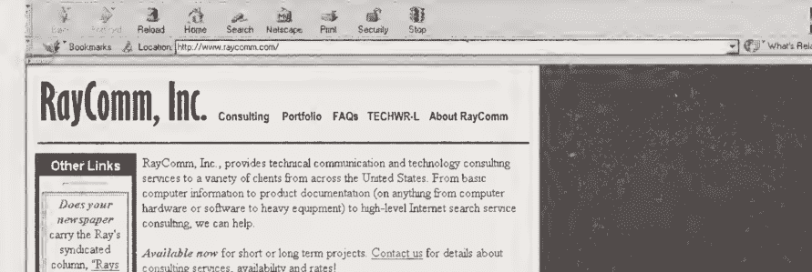

# RayComm, Inc. 咨询服务

| 其他链接 | RayComm, Inc. 为美国各地的各种客户提供技术传播和咨询服务。从基础信息到产品文档（任何内容），从计算机硬件或软件到高速互联网搜索服务，我们都能提供帮助。 |
| :--- | :--- |
| | 提供短期或长期项目。请联系我们获取咨询服务和费率的详情！ |
| | 这里有关于“Computing on Computing”的更多信息，这是 Gary 和 Eric 编写的连载专栏。感兴趣，请联系我们，并点击此处查看我们的专栏。 |
| | 了解我们的咨询服务 |
| | 查看我们编写的一些书籍，或来自 UNIX |
| | 技术手册 |
| | 联系我们获取更多关于我们如何帮助您的信息 |
| | RayComm 维护该手册的技术传播和支持，包括说明书、常见问题解答，以及所有你想要了解但被问及关于“Testbill”的知识。 |


# 理解标签

HTML 标签实际上有两个用途。首先，它们识别逻辑部分——即文档中的结构组件，例如标题（如 `<H1>`）、有序列表（`<OL>`）和段落（即 `<P>`）。所以，例如，如果你想在文档中包含一个标题、一个段落和一个列表，你可以输入文本并对其应用适当的标签（所示）。

其次，HTML 文档中的标签还引用其他元素——这意味着标签可以包含指向其他图像文件、媒体应用程序、Applet 等指针和链接。例如，如果你想在文档中包含你公司产品的图片，而不是粘贴到文字处理文档中，你可以包含一个指向文件名的标签：

```html

```

在这个示例中，`` 标签指向浏览器应该显示的文件（logo.gif）。因此，浏览器再次依赖 HTML 文档中包含的信息来告知显示什么以及如何显示。

# 理解组件

如你从这些示例所示，HTML 标签非常直观。虽然标签有时很晦涩，但你通常可以根据名称判断出标签的功能。让我们来看标签组件，这应该帮助你学习并将标签应用到你的 HTML 文档中。

首先，所有标签都由包含角括号（`<`）内的元素组成。某些标签看起来像这样：

- `<H2>`（用于二级标题）
- `<BODY>`（用于文档正文）
- `<B>`（用于加粗）

你将在第 2 章学习更多关于这些标签及其用途。

其次，大多数标签是成对的，带有一个起始标签（例如 `<H1>`）和一个结束标签（`</H1>`）。它们看起来很像；结束标签还包含一个正斜杠（`/`）。要对你文档中的信息应用标签，请将起始标签放在信息之前，将结束标签放在信息之后，如下所示：

```html
<H1>应用于此处的信息</H1>
```

同时输入起始和结束标签，这样你就不会忘记结束标签了。如果你不小心忘记了，大多数成对标签将一直运行，直到浏览器找到匹配的结束标签。

较少见的情况下，你会使用不成对的标签，它们不包含结束标签。我们将在整书中指出这些标签，并向你展示如何恰当地使用它们。

要对一段信息应用多个标签，你需要嵌套标签。**嵌套** 意味着将一组标签放置在另一组标签内部。例如，为了对标题应用斜体，你可以嵌套标签，如下：

```html
<H1><I>应用于此处的信息</I></H1>
```

```html
<I><H1>应用于此处的信息</H1></I>
```

当你嵌套标签时，第一个标签也是最后一个标签，第二个标签也是倒数第二个标签，依此类推。

## 正确地输入标签

在输入标签时，要特别注意不要包含额外的空格。如果你这样做，浏览器可能无法识别该标签并无法正确显示信息。或者，浏览器可能会直接显示标签本身。

例如，标题看起来应该像这样：

```html
<TITLE>格式正确的标题</TITLE>
```

不要在标签内部包含空格，如下所示：

```html
< TITLE >格式不规范的标题 </TITLE >
```

## 提高可读性

如果你遵循一些规范，你会发现阅读和使用标签变得更容易。特别是，我们建议使用大写字母输入标签，并使用硬换行来创建短行。这些规范不会影响浏览器显示代码——它们只是让你更容易阅读。

以下两个示例展示了使用大写和硬换行如何提高可读性。

```html
<!doctype html PUBLIC "-//w3c//DTD HTML 4.0//en"><html><head><title>Mastering HTML Document Title</title></head><body>Mastering HTML Body</body></html>
```

或

```html
<!DOCTYPE HTML PUBLIC "-//W3C//DTD HTML 4.0//EN">
<HTML>
<HEAD>
<TITLE>Mastering HTML Document Title</TITLE>
</HEAD>
<BODY>
Mastering HTML Document Body
</BODY>
</HTML>
```

没问题，对吧？

# 理解属性

某些标签与属性结合使用，属性提供了有关元素的额外信息，例如元素应该如何对齐、应该访问哪些文件或元素的颜色。例如，属性可能会指示标题应该在浏览器窗口中居中显示、浏览器应该从网络加载图像文件，或者页面背景应该显示天蓝色。

所以，假设你想在浏览器窗口中居中显示标题。你从标题和标签开始，如下：

```html
<H1>这是一个标题</H1>
```

然后在起始标签中添加 `ALIGN=` 属性，如下：

```html
<H1 ALIGN="center">这是一个居中的标题</H1>
```

你可以通过在属性之间使用空格，在一个标签中包含多个属性，如下所示：

```html
<H1 ALIGN='center' SIZE='*2' COLOR='#FF0000'>A wildly formatted heading here</H1>
```

> **注释**：在 HTML 标签中，属性可以在元素后的任何顺序排列，但元素必须始终在前面。

## 你用 HTML 可以做什么？

你可能对 HTML 最熟悉，因为它用于创建网页；然而，HTML 已经扩展到许多其他用途：

- *开发内网或外网站点*：HTML 通常用于开发内网和外网站点，这些是公司范围内的网站，公司内部的人员从一个或多个位置访问。
- *开发帮助文件*：HTML 也用于开发在线帮助文件，允许开发者大量生产在任何平台上可访问的文档。
- *开发网络应用程序*：HTML 特别适用于创建应用程序，例如通过网页提供的训练课程、交互聊天或数据库。
- *开发自助服务机应用*：最后，HTML 还可以用于创建自助服务机应用——那些带有整洁触摸屏功能的独立式计算机。

## 你需要哪些工具？

对于你的第一个文档，你只需要两个基本工具：

- *一个 HTML 编辑器*，用于创建和保存你的 HTML 文档
- *一个 浏览器*，用于查看和测试你的 HTML 文档

### HTML 编辑器

通常，HTML 编辑器分为两类：

- 基于文本或代码的编辑器，它们允许你在创建文档时看到 HTML 代码
- WYSIWYG（所见即所得）编辑器，它们显示代码的结果，类似于你在格式化文档时它在浏览器中显示的样子。

尽管有几十种出色的 WYSIWYG 编辑器可用，但你应该学会使用标准的文本编辑器来编写 HTML 代码。文本编辑器迫使你手动编写 HTML，这意味着是由你而不是软件来输入标签和属性。手动编码有助于你学习 HTML 标签和结构，并让你看到自己在哪里犯了错误。此外，通过手动编码，你可以轻松地在文档中包含最新的 HTML 增强功能。Windows 所有版本的 `Notepad`、Unix 的 `pico`，以及 Macintosh 上的 `TextEdit` 或 `SimpleText` 都是不错的选择。

> **提示**：学习手动编码对于使用最新、最强大的 HTML 效果至关重要——无论是当前的 HTML 4 还是未来的版本。大多数新的 HTML 版本不会立即被 WYSIWYG 编辑器支持，因此你需要在文档中手动编码这些标签和属性。

> **警告**：使用 Word、WordPerfect 甚至 WordPad 等文字处理程序创建 HTML 文档通常会引入额外的格式和字符，这会导致问题。HTML 需要没有任何格式的纯文本，因此要么费力将所有文档保存为纯文本，要么直接使用文本编辑器。

简单的 WYSIWYG 编辑器，如 `Netscape Composer` 和 `Microsoft Page`（包含在 Internet Explorer 4 和 5 中），适用于快速生成 HTML 文档。这些编辑器可以提供页面布局、设计和颜色的接近近似，但适用于查看功能的总体安排。然而，它们对作者（你）对文档最终外观的控制不如基于代码的编辑器。

在你开发了几个 HTML 文档并理解了基本的 HTML 原理后，你可以选择同时使用 WYSIWYG 编辑器和基于代码的编辑器。例如，你可以使用 WYSIWYG 编辑器为文档良好开头，然后使用基于代码的 HTML 编辑器对其进行润色（或修复）。不过，目前，我们建议你使用标准的文本编辑器手动编码 HTML。

### Web 浏览器

如果你浏览过网页，你就使用过 浏览器来查看 HTML 文档。最常见的浏览器是 `Netscape Navigator` 和 `Microsoft Internet Explorer`，尽管几乎所有计算机平台和在线服务都有各种浏览器可用。

然而，你的文档何时出现会因浏览器和计算机而异。例如，今天使用的大多数浏览器都是图形化浏览器：它们可以显示文本以外的元素。纯文本浏览器只能显示——你猜得没错——只有文本。你的 HTML 文档在这些不同类型的浏览器中的显示方式显著不同，如图 1.3 和 1.4 所示。

## 图 1.3

在 Netscape Navigator 中显示的 HTML 文档

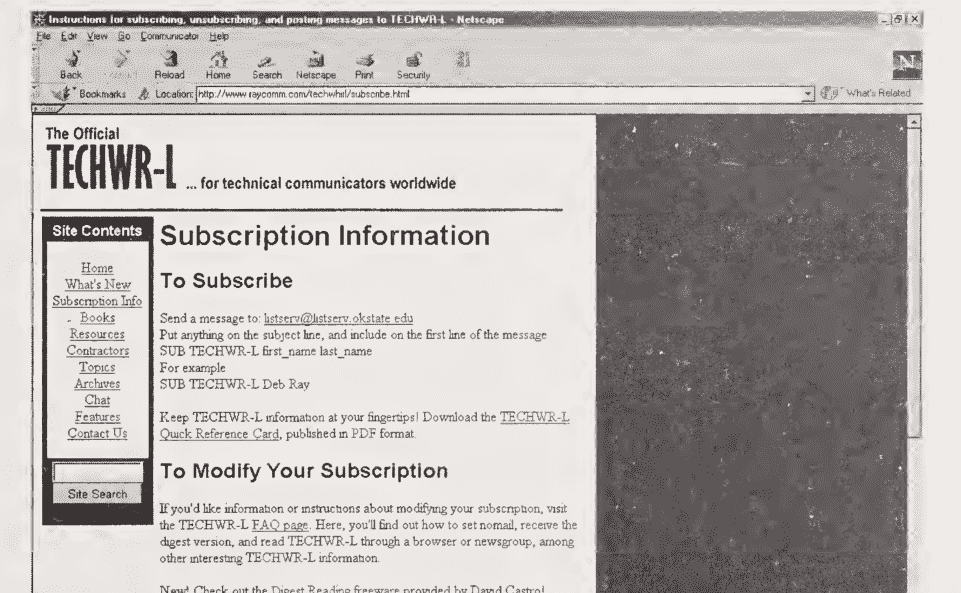

## 图 1.4

在纯文本浏览器中显示的 HTML 文档

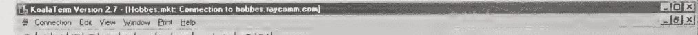

# 监控 Netscape 和微软网站

你可以在新标签和属性出现时就使用它们吗？在大多数情况下，是可以的。当许多流行的标签和属性成为标准的一部分时，它们已经得到了浏览器的支持。然而，某些标签和属性（包括随 HTML 4 引入的一些标签）在规范发布时并没有获得广泛或稳定的浏览器支持，直到今天，它们的支持范围仍未达到其他标签的广度。我们会在书中引导你，并展示它们与之前的 HTML 版本有何不同。

每当 Netscape 和微软发布新版本的浏览器时，请留意新的 HTML 扩展，这些是特定浏览器的标签和属性。这些扩展中有些很有用，有些则用用，而且任何引入 HTML 的非标准标签都会给 Web 开发人员和访问者带来麻烦。幸运的是，每个新版本引入的扩展似乎在不断减少，但你仍然应该注意每次发布添加了哪些内容。

如果你在 HTML 文档中使用扩展，请记住它们不是标准 HTML。这意味着该扩展是特定浏览器（例如 Netscape）的，很可能在其他浏览器（例如 Internet Explorer 或 Opera 或其他）中无法工作。由于这个原因，我们通常建议你不要使用扩展，而是仅使用 HTML 标签和属性，以便你所有的访问者都能访问你提供的信息。

> **提示**：在本书期间，大约 50% 的网络用户使用 Netscape Navigator，约 40% 使用 Internet Explorer，其余 10% 使用各种其他浏览器。现实中，80% 到 90% 的所有 Web 用户可以访问大多数包含最新 HTML 标签和近期增强内容的网站。

你可以在此处找到 Netscape 的扩展：

`develop.netscape.com/index.html`

你可以在此处找到微软的扩展：

`www.microsoft.com/windows/ie/`

# 监控其他网站

尽管确定性信息来自 W3C、微软和 Netscape 网站，但你也可以参考其他可靠资源。表 1.1 为你提供了一些定期检查的网站列表。

## 表 1.1：提供最新 HTML 信息的网站

| 机构 | URL |
| :--- | :--- |
| Web Design Group | `www.htmlhelp.com/` |
| Web Developer's Virtual Library | `www.stars.com/` |
| HTML Writer's Guild | `www.hwg.org/` |
| CNet's Builder | `www.builder.com/` |

# 从此何去

本章简要概述了 HTML——它是什么、有什么用途以及它是如何产生的。尽管你还还没有进行任何 HTML 编码，但你应该已经为开始学习它打下了良好的基础。

从这里开始，你有几种选择：

- *如果你是 HTML 初学者，请转到第 2 章创建你的第一个 HTML 文档，基于你在这里学到的信息。*
- *如果你是 HTML 中级用户，你可以转到第 3 章（处理 HTML 文档的链接），或者从第二部分选择主题。*
- *如果你是高级用户，你可以浏览索引或目录并选择你感兴趣的主题。*

# 第 2 章 创建你的第一个 HTML 文档

## 特色

- 创建、保存和查看 HTML 文档
- 包含结构标签
- 应用常用标签和属性
- 包含更精美的格式

如果你已经准备好创建你的第一个 HTML 文档，那么你找对章节了！在这里，我们将帮助你开始一个新的 HTML 文档并使用适当的文件格式保存它，展示如何添加结构标签（有助于浏览器识别你的 HTML 文档），并展示如何应用一些常用的格式标签。

如果你是 HTML 新手（或者手写生疏了！），你可能想复习第 1 章中的标签和属性信息。在开始本章之前，你将熟悉标签和属性，以及如何将它们应用于你包含的内容中。

在本章中，我们提供了大量的图表和代码示例来帮助你，并展示结果。如果你愿意，可以替换文本和图像，也可以复制章节中的示例。无论你使用什么具体内容，逐步说明都有效。完成本章后，你将开发出你的第一个 HTML 文档，包含文本、标题、水平规则，甚至还有章节级别的格式。

> **提示**：我们建议你通过在本章及其他章节中的示例来练习 HTML。

## 创建、保存和查看 HTML 文档

具体如何开始一个新的 HTML 文档取决于你使用的操作系统和编辑器。但通常，你会发现开始一个新的 HTML 文档与创建其他文档类似。在 Windows 或 MacOS 上，你将选择“文件 > 新建”。或者，如果你使用 Unix，将输入 `vi`、`pico` 或 `emacs` 并使用相应的命令。你通过将它保存为相应的格式来使其成为正式的 HTML 文档，这将在讨论。

在开始手写 HTML 之前，请注意你应该频繁保存并查看你的工作，以便看到进度。通过这样做，你可以确保内容显示符合你的预期，并在几行新代码内发现错误。例如，我们通常会添加几行新代码，保存 HTML 文档，然后查看它……再添加几行代码，保存文档，然后查看它……具体保存的频率取决于你的喜好。

标签在“幕后”发挥作用，它们本质上是告诉浏览器应该包含哪些元素以及如何显示它们。虽然这些标签不会产生你在网页或帮助文件中看到的那些华丽效果，但它们对于告诉浏览器如何解释文档至关重要。

> **注释**：绝大多数浏览器（包括 Netscape Navigator 和 Microsoft Internet Explorer）都能正确显示不包含结构标签的文档。然而，无法保证未来的版本会继续这样做，也无法保证你的结果将保持一致。我们强烈建议使用结构标签。

所有的 HTML 文档都应该包含五个结构标签，并按照示例代码所示进行嵌套和排序：

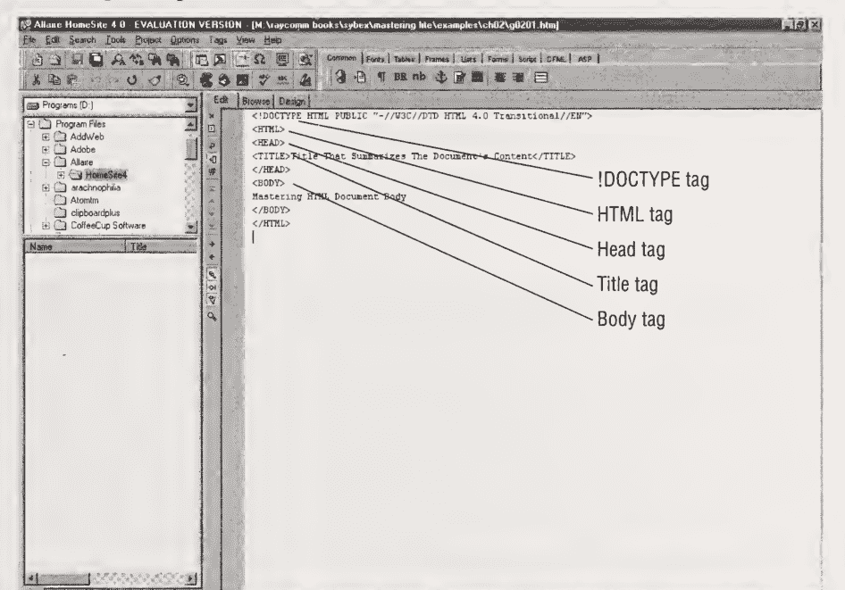

> **提示**：通过在主文档中保存结构标签，可以在创建未来的 HTML 文档时节省时间。这样，你就可以在其他 HTML 文档中轻松复用它们，而不是反复不断地重新输入。

### `<!DOCTYPE ...>` 标签

`<!DOCTYPE...>` 标签告诉浏览器（以及验证服务）文档遵循的 HTML 版本。HTML 3.2 和 4 规范要求这种非成对标签，因此，你应该在所有文档中使用它。将其输入文档的顶部，如下所示：

```html
<!DOCTYPE HTML PUBLIC "-//W3C//DTD HTML 3.2 Final//EN">
```

或者，如下所示：

```html
<!DOCTYPE HTML PUBLIC "-//W3C//DTD HTML 4.0 Transitional//EN">
```

`<!DOCTYPE>` 标签的关键部分是 DTD（文档类型定义），它告诉浏览器文档符合特定的 HTML 版本——第一个示例符合 HTML 3.2，第二个符合 HTML 4 Transitional（最灵活）规范。DTD 指定了发布规范的机构（在这些情况下为 W3C）以及规范的准确版本。

随着新 HTML 标准的演进，你可以预计此标签会发生以指示新版本。在大约一年的时间里，`<!DOCTYPE>` 可能会像这样：

```html
<!DOCTYPE HTML PUBLIC "-//W3C//DTD HTML 5.23 Final//EN">
```

即使在新标准出现后，你不需要修改现有文档中的 `<!DOCTYPE>` 标签。如果你的文档符合 HTML 3.2 标准，它将一直符合该标准，无论是否有更新的 HTML 版本。

### 我应该使用哪种 HTML 4 DTD？

HTML 4 规范有三种类型：严格、过渡（宽松）和框架集。严格版禁止除“纯”HTML 之外的所有内容，除非你正在编写不使用格式标签并依赖样式表来美化的 HTML 文档，否则你不太会使用它。要指示你的文档符合严格规范，请使用：

```html
<!DOCTYPE HTML PUBLIC "-//W3C//DTD HTML 4.0//EN">
```

过渡版最灵活，可以容纳已弃用但仍然有效的标签和属性，包括几乎所有的格式标签。要指示你的文档符合过渡规范，请使用：

```html
<!DOCTYPE HTML PUBLIC "-//W3C//DTD HTML 4.0 Transitional//EN">
```

框架集规范与过渡规范相似，但还支持使用框架所需的标签。

要指示你的文档符合框架集规范，请使用：

```html
<!DOCTYPE HTML PUBLIC "-//W3C//DTD HTML 4.0 Frameset//EN">
```

### `<HTML>` 标签

`<HTML>` 标签将文档标识为 HTML 文档。从技术上讲，该标签在 `<!DOCTYPE>` 之后是多余的，但对于不支持 `<!DOCTYPE...>` 标签的旧浏览器来说，它是必要的。它对于阅读 HTML 代码的人也有帮助。要使用 `<HTML>` 标签，请将其输入文档中 `<!DOCTYPE...>` 标签的下方，如下所示：

```html
<!DOCTYPE HTML PUBLIC "-//W3C//DTD HTML 4.0 Transitional//EN">
<HTML>
</HTML>
```

### `<HEAD>` 标签

`<HEAD>` 标签包含有关文档的信息，包括标题、使用的脚本、样式定义和文档描述。并不是所有浏览器都要求此标签，但大多数浏览器期望在 `<HEAD>` 标签内找到关于文档的任何额外信息。此外 `<HEAD>` 标签还可以包含面向搜索引擎和索引程序的标签。要添加 `<HEAD>` 标签，请将其输入 `<HTML>` 标签之间，如下所示：

```html
<!DOCTYPE HTML PUBLIC "-//W3C//DTD HTML 4.0 Transitional//EN">
<HTML>
<HEAD>
</HEAD>
</HTML>
```

> **提示**：不要将此文档头标签（它是一个结构标签）与在文档正文中创建标题文本的标题标签（如 `<H1>`）混淆。我们将在本章稍后的“标题”部分讨论标题标签。

### `<TITLE>` 标签

`<TITLE>` 标签是 HTML 3.2 和 4 规范要求的，它包含文档标题。标题不会出现在浏览器窗口中，但在浏览器的标题栏中可见。在起始和结束标签之间，请包含一个简要总结你文档内容的标题。要使用 `<TITLE>` 标签，请将其输入起始和结束的 `<HEAD>` 标签之间，如下所示：

```html
<!DOCTYPE HTML PUBLIC "-//W3C//DTD HTML 4.0 Transitional//EN">
<HTML>
<HEAD>
<TITLE>
总结你文档内容的标题
</TITLE>
</HEAD>
```

### `<BODY>` 标签

`<BODY>` 标签包含文档的实际内容。要添加 `<BODY>` 标签，请将其输入在结束的 `</HEAD>` 标签之后和结束的 `</HTML>` 标签之前，如下所示：

```html
<!DOCTYPE HTML PUBLIC "-//W3C//DTD HTML 4.0 Transitional//EN">
<HTML>
<HEAD>
<TITLE>总结你文档内容的标题</TITLE>
</HEAD>
<BODY>
文档内容放在这里
</BODY>
</HTML>
```

## 应用常用标签和属性

### 创建段落

段落是 HTML 文档中最常见的文本块。要使用段落标签，请将它们输入在你想要格式化为段落的周围，如下：

```html
<P>
这里是一个整个段落。
</P>
```

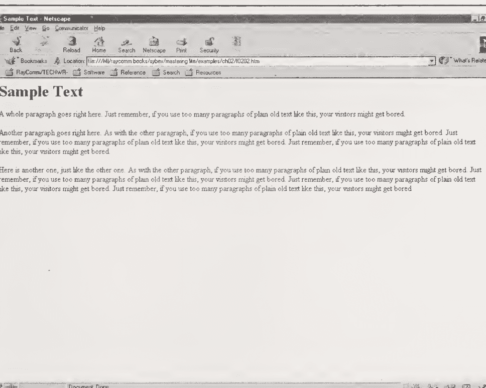

#### 示例文本

另一个段落在这里。请记住，如果你使用了像这样的许多纯文本段落，访问者可能会感到无聊。

另一个段落在这里。与其他段落一样，如果你使用了像这样的许多纯文本段落，访问者可能会感到无聊。请记住，如果你使用了像这样的许多纯文本段落，访问者可能会感到无聊。请记住，如果你使用了像这样的许多纯文本段落，访问者可能会感到无聊。

这里是另一个，就像上一个一样。与其他段落一样，如果你使用了像这样的许多纯文本段落，访问者可能会感到无聊。请记住，如果你使用了像这样的许多纯文本段落，访问者可能会感到无聊。请记住，如果你使用了像这样的许多纯文本段落，访问者可能会感到无聊。

你也可以使用其他段落格式来代替 `<P>` 标签以实现某种不同的段落格式，如表 2.1 所示。

对齐属性通常与这些段落格式标签一起使用，包括 `ALIGN=LEFT`、`ALIGN=CENTER` 和 `ALIGN=RIGHT`。要应用这些属性，请将它们包含在任何起始标签中，如下：

```html
<P ALIGN=CENTER>
这里是信息的段落。
</P>
```

## 表 2.1：其他段落格式化标签

| 段落格式 | 效果 |
| :--- | :--- |
| `<ADDRESS>` | 用于地址和联系信息。通常以斜体显示。 |
| `<BLOCKQUOTE>` | 用于格式化引用。通常在两侧都缩进，且行间距比普通段落小。 |
| `<PRE>` | 用于格式化程序代码或类似信息。通常以等宽字体显示，单词和行之间留有足够的空间。 |

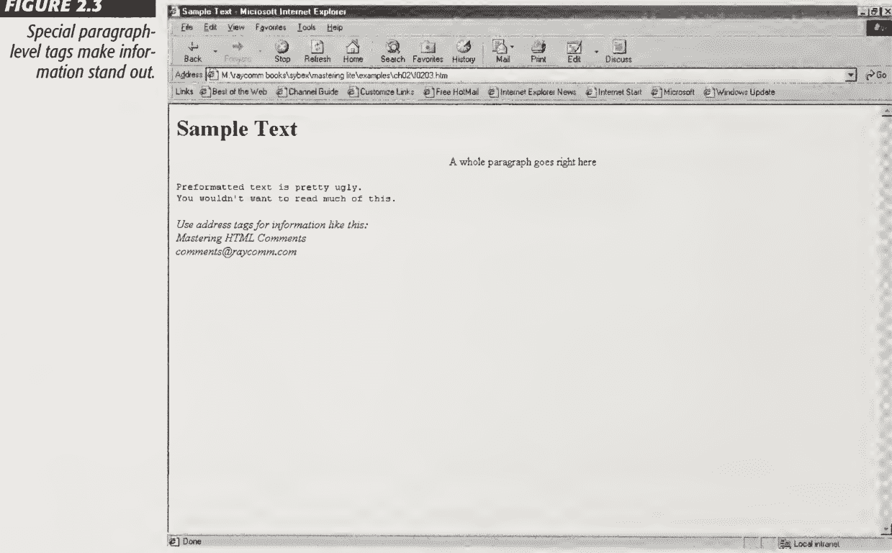

#### 示例文本

预格式化文本非常丑。

你不想读太多这类内容。

对于此类信息使用地址标签：

精通 HTML 注释

comments@rayjam.com

这里是一个整个段落。

## 创建标题

标题划分大段文本区域，宣布接下去的话题，并根据逻辑层次结构安排信息。HTML 提供了六级标题；`<H1>` 是最大的标题，`<H6>` 是最小的：

```html
<H1> ... </H1>
<H2> ... </H2>
<H3> ... </H3>
<H4> ... </H4>
<H5> ... </H5>
<H6> ... </H6>
```

> **提示**：对于大多数文档，将自己限制在两个或三个标题级别。超过三个标题级别后，许多访问者开始失去你的层次结构。如果你发现自己使用了多个标题级别，请考虑重新组织你的文档——过多的标题级别通常意味着更严重的组织问题。

要使用标题标签，请将它们输入在标题文本之前，如下：

```html
<!DOCTYPE HTML PUBLIC "-//W3C//DTD HTML 4.0 Transitional//EN">
<HTML>
<HEAD>
<TITLE>示例标题</TITLE>
</HEAD>
<BODY>
<H1>一级标题</H1>
<H2>二级标题</H2>
<H3>三级标题</H3>
</BODY>
</HTML>
```

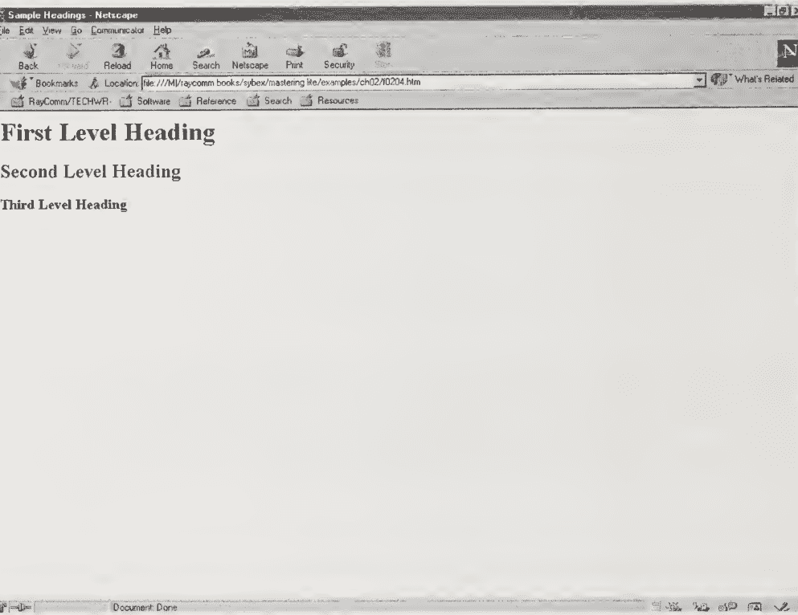

默认情况下，所有浏览器都将标题左对齐。然而，大多数浏览器都支持对齐属性，这也让你能让标题右对齐和居中。表 2.2 显示了对齐属性。

## 表 2.2：对齐属性

| 标题属性 | 效果 |
| :--- | :--- |
| `ALIGN=LEFT` | 将标题左对齐。 |
| `ALIGN=CENTER` | 将标题居中。 |
| `ALIGN=RIGHT` | 将标题右对齐。 |

要使用对齐属性，请将它们包含在标题标签中，如下：

```html
<H1 ALIGN=LEFT>左对齐标题</H1>
<H1 ALIGN=CENTER>居中标题</H1>
<H1 ALIGN=RIGHT>右对齐标题</H1>
```

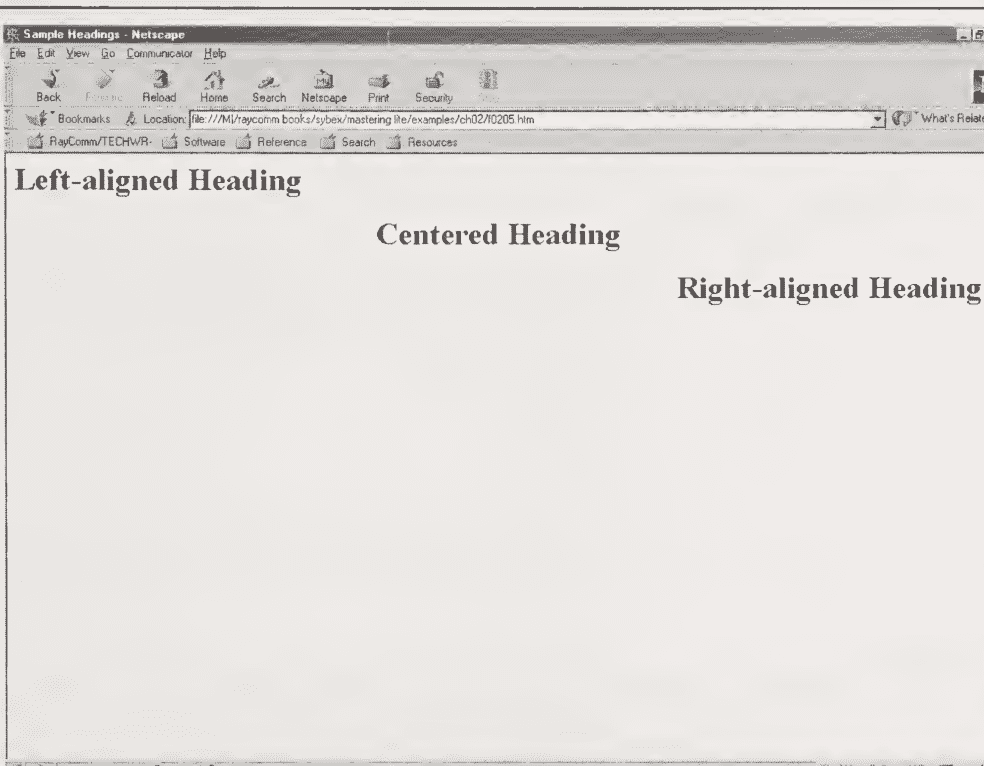

## 创建列表

列表让信息在页面上易于发现，并吸引人们对重要点的关注。HTML 支持三种类型的列表：无序列表、有序列表和定义列表。

### 无序列表

无序列表使用项目符号。要创建无序列表，请使用 `<UL>` 标签包围列表项，每个列表项使用 `<LI>` 标签：

```html
<UL>
<LI>项目 1
<LI>项目 2
<LI>项目 3
</UL>
```

### 有序列表

有序列表使用数字或字母编号。要创建有序列表，请使用 `<OL>` 标签包围列表项，每个列表项使用 `<LI>` 标签：

```html
<OL>
<LI>第一项
<LI>第二项
<LI>第三项
</OL>
```

### 定义列表

定义列表用于术语和定义的配对。要创建定义列表，请使用 `<DL>` 标签，其中 `<DT>` 表示术语，`<DD>` 表示定义：

```html
<DL>
<DT>术语 1
<DD>定义 1
<DT>术语 2
<DD>定义 2
</DL>
```

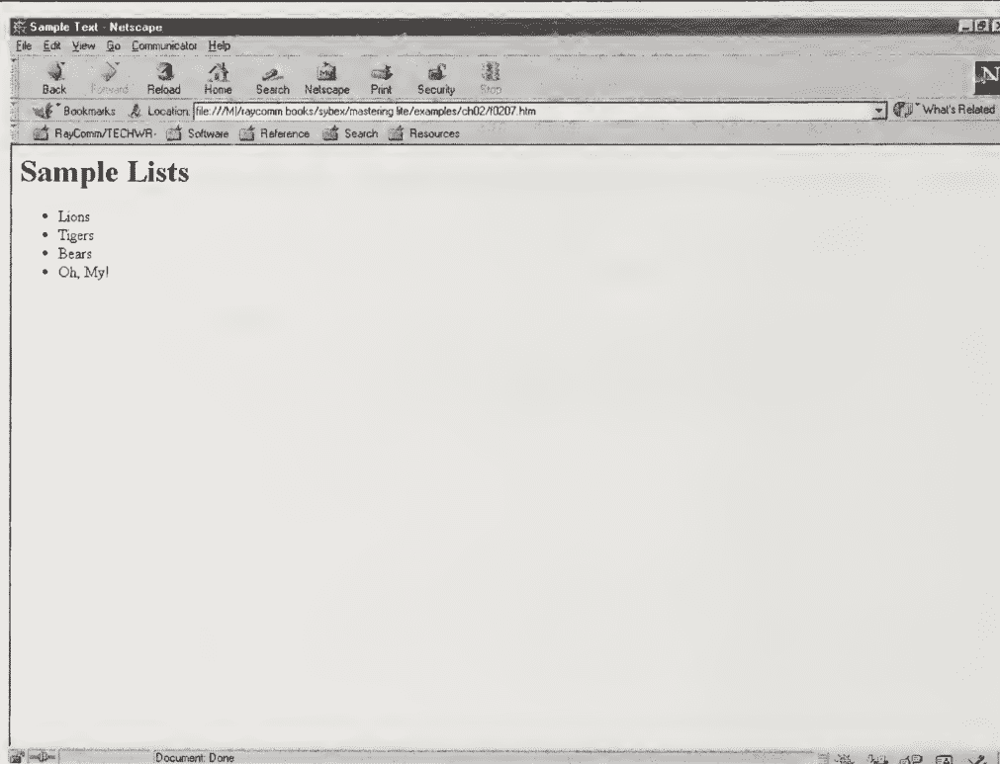

## 图 2.8

有序列表提供顺序性信息。

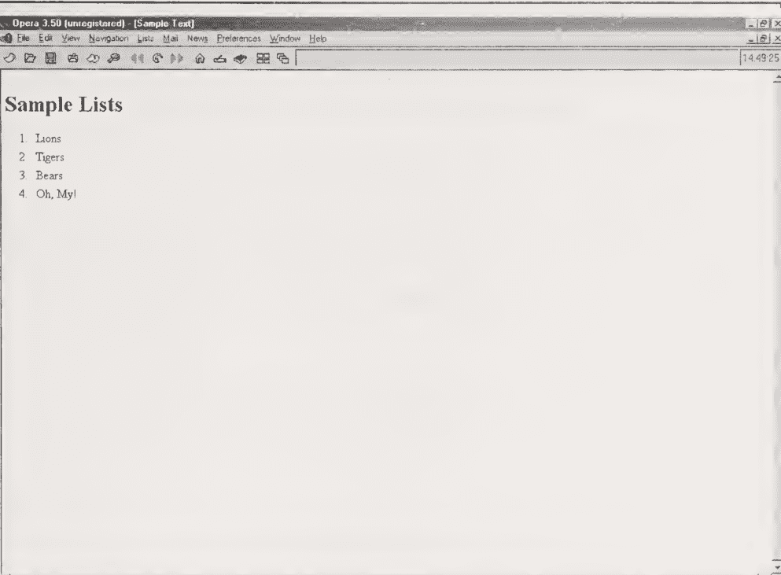

### 设置列表外观

默认情况下，有序列表使用阿拉伯数字，无序列表使用小的圆点符号。你可以使用表 2.4 中列出的属性来更改这些外观。

## 表 2.4：列表属性

| 列表标签 | 效果 |
| :--- | :--- |
| `TYPE=A` | 指定列表开始的数字（或字母）：A, a, I, i 或 1（默认）。 |
| `TYPE=a` | |
| `TYPE=I` | |
| `TYPE=i` | |
| `TYPE=1` | |

对于有序列表：

| 列表标签 | 效果 |
| :--- | :--- |
| `TYPE=DISC` | 指定项目符号形状。 |
| `TYPE=SQUARE` | |
| `TYPE=CIRCLE` | |

对于无序列表：

要使用这些属性中的任何一个，请将其包含在初始 `<OL>` 或 `<UL>` 标签或 `<LI>` 标签中，如下：

```html
<OL TYPE=A>
<LI>用字母列出顺序列表。
<LI>文档的某些（不流行的）编号方案也是如此。
</OL>
```

或者，如下所示：

```html
<UL TYPE=SQUARE>
<LI>对非顺序项目使用项目符号。
<LI>对顺序项目使用数字。
</UL>
```

或者，这样：

```html
<UL>
<LI TYPE=CIRCLE> 对非顺序项目使用项目符号。
<LI TYPE=SQUARE> 使用不同的项目符号以增加视觉趣味。
</UL>
```

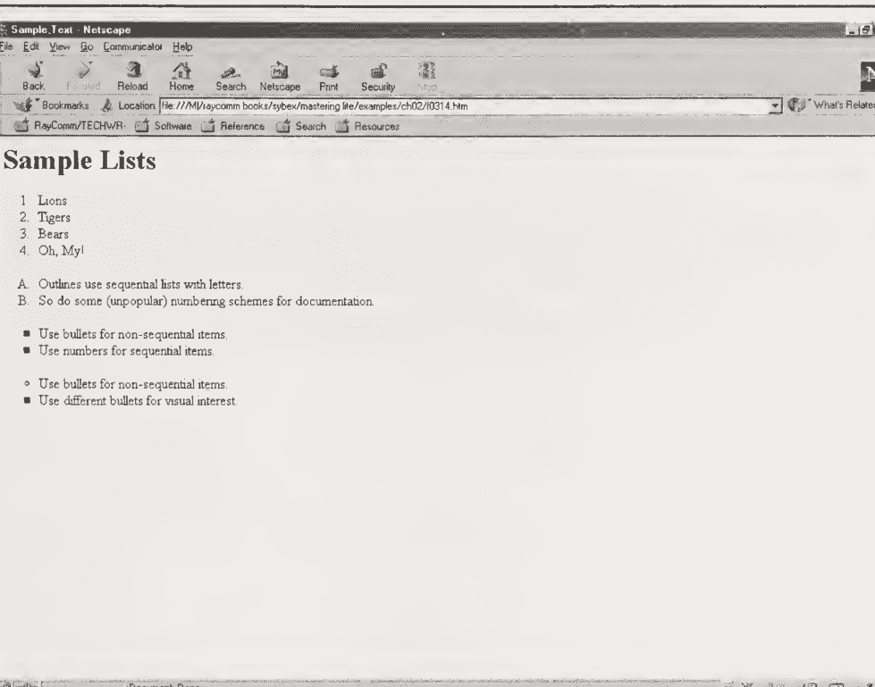

> **提示** 你可以在初始的 `<OL>` 或 `<UL>` 标签中添加 `COMPACT` 属性，告诉浏览器以尽可能紧凑的方式显示列表。通常，此设置区别不大，因为大多数浏览器默认就是这样渲染列表的。

> **注释** 无序列表的 `TYPE` 属性目前被许多（但并非所有）浏览器支持，尽管预计支持将继续增长。

### 有序列表的更多选项

有序列表具有额外的属性，你可以使用它们来指定列表中的第一个数字，并创建层级信息。

首先，你可以从非 1（或 A, a, I 或 i）的数值开始有序列表。只需在初始的 `<OL>` 标签中包含 `START=` 属性，例如 `<OL START=51>`。或者，你甚至可以通过 `<LI>` 标签中的 `VALUE=` 属性来更改列表中的特定数字，例如 `<LI VALUE=7>`。要使用这些属性，请将它们包含在 `<OL>` 标签中，如下：

```html
<OL START=51>
<LI>这是第 51 项。
<LI>这是第 52 项。
<LI TYPE=i VALUE=7>此项被重新编号为第七项，小写罗马数字，仅仅因为我们可以这样做。
</OL>
```


其次，你可以使用嵌套有序列表和不同的 `TYPE=` 属性来创建大纲。编号会越过每个层级，无需手动用 `VALUE=` 属性重新编号。结果见图 2.11。

```html
<OL TYPE=I>
<LI>顶级项目
<LI>另一个顶级项目
<OL TYPE=A>
  <LI>一个二级项目
  <LI>另一个二级项目
  <OL TYPE=1>
    <LI>一个三级项目
    <LI>另一个三级项目
  </OL>
</OL>
</OL>
```

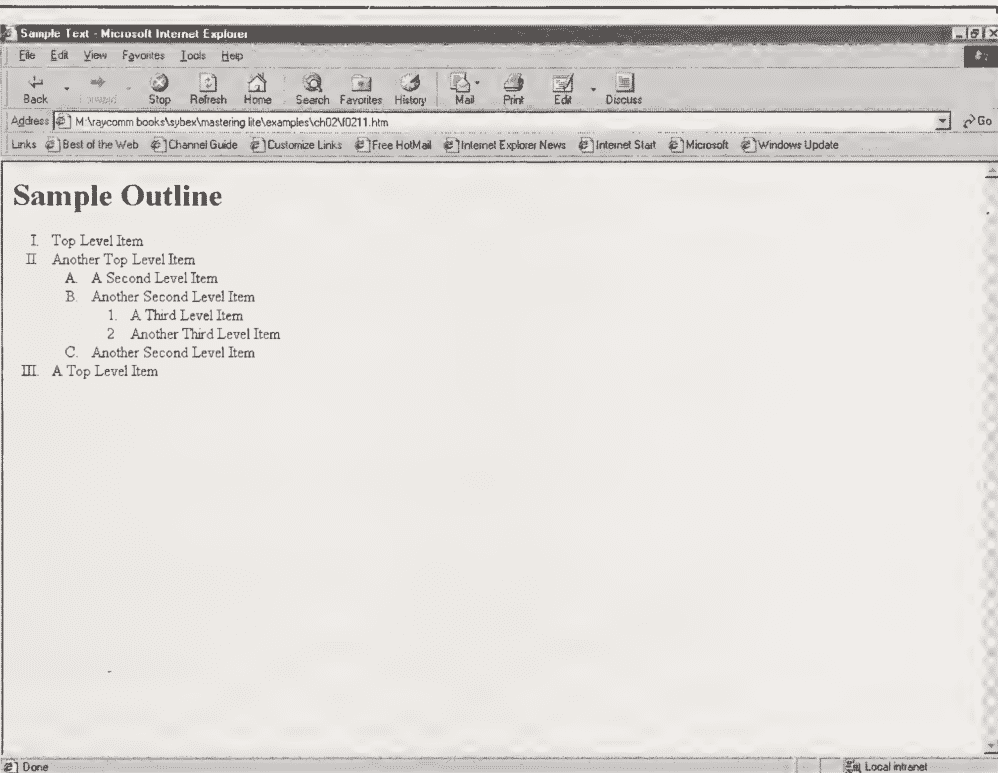

## HTML 4 选择

HTML 4 规范强烈建议使用样式表来满足你的格式需求。尽管规范仍然支持许多单独的格式标签，但它正转向样式表作为 HTML 文档中包含格式的推荐方式。通过样式表，你可以应用以下效果：

- 字符级格式，如删除线和下划线
- 段落级格式，如缩进和页边距
- 其他格式，如背景颜色和图像

请参考第 4 章和主参考以获取样式表信息。

## 插入水平规则

水平规则用于分隔长文本段、指示信息变化或帮助改进文档设计的线条。要使用水平规则，请在想要显示规则的地方包含 `<HR>` 标签，例如：

```html
<P>长段文本通常可以通过标题和（可选的）水平规则拆分成不同的部分。</P>
<HR>
<H3>标题也会分割文本</H3>
<P>新的一段长文本可以继续在这里。</P>
```

默认情况下，水平规则显示为阴影效果，宽度为浏览器窗口宽度，高度为几像素。你可以通过包含相应的属性来更改规则的阴影、宽度、高度和对齐方式。表 2.7 显示了水平规则属性。

> **注释**：像素是你屏幕上的小点，它们共同组成图像。Pixel 实际上是 Picture Element（图像元素）的缩写。如果你的显示器为 800 × 600，那么水平方向有 800 个像素，垂直方向有 600 个像素。

## 表 2.7：水平规则属性

| 属性 | 效果 |
| :--- | :--- |
| `SIZE=n` | 指定规则高度，以像素为单位。 |
| `WIDTH=n` | 指定规则宽度（长度）；以像素为单位。 |
| `WIDTH="n%"` | 指定规则宽度（长度）；按文档宽度的百分比。 |
| `ALIGN=LEFT` | 指定左对齐。 |
| `ALIGN=CENTER` | 指定居中对齐。 |
| `ALIGN=RIGHT` | 指定右对齐。 |
| `NOSHADE` | 指定规则无阴影。 |

要使用这些任何属性，请将它们包含在 `<HR>` 标签中，例如：

```html
<HR WIDTH="80%" SIZE=8>
<HR WIDTH="50%" ALIGN=RIGHT>
<HR WIDTH=400 NOSHADE ALIGN=CENTER WIDTH=200>
```

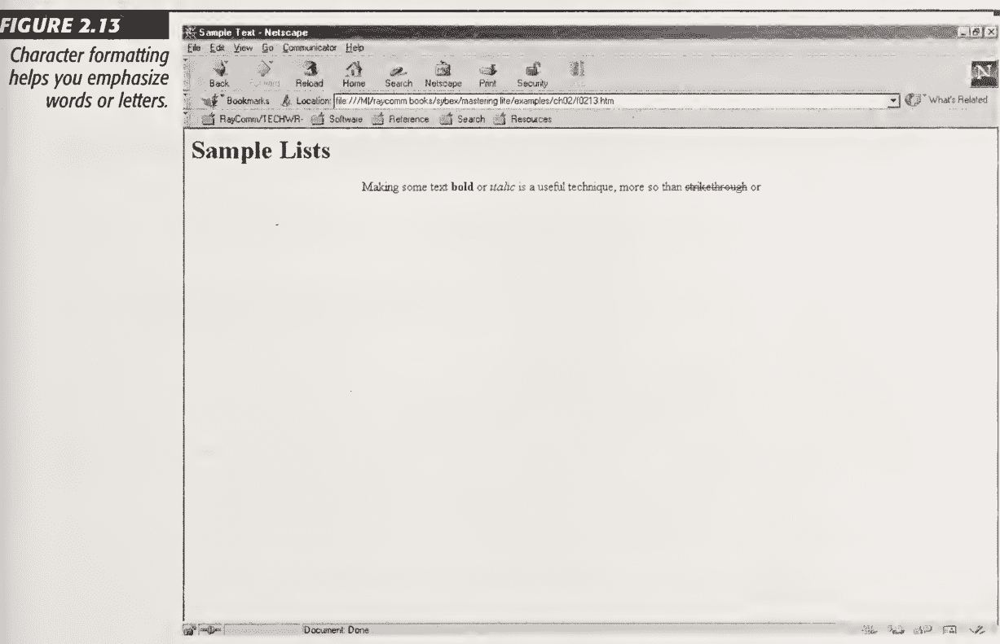

### 水平规则的趣味

- 加粗且无阴影。
- 居中且纤细。
- 右对齐、中等尺寸且有阴影。
- 居中、纤细且无阴影。

## 指定换行

有时你需要在特定位置换行，但不想开始新段落（带有额外的间距）。例如，你可能不希望诗歌文本贯穿整个文档；你可能希望将它们拆分成更短的行。你可以通过在想要换行的地方插入 `<BR>` 标签来轻松中断段落行，例如：

```html
<P>
曾经有一个 HTML 作者，<BR>
试图让段落变得更宽。<BR>
他惊讶地发现<BR>
所有的标签都在嘲笑<BR>
他试图将文本移到外部的尝试。<BR>仁慈的匿名</P>
```

## 引入更高级格式

现在你已经牢牢掌握了基础 HTML 格式选项的使用，可以深入研究一些更高级的格式效果。在接下来的章节中，我们将向你如何添加颜色以及指定字体和大小。尽管大多数现代浏览器都支持这些效果，但并非所有浏览器都支持；你的高级效果可能无法覆盖所有访问者。此外，HTML 4 规范弃用了其中许多效果，转而采用样式表。如果你的查看者使用支持样式表的浏览器，你可能考虑使用样式表而不是这里提到的标签和属性。

## 添加颜色

为文档增色最简单的方法之一是背景或文本添加颜色。你可以让它变得生动。

> **提示**：我们建议一次性设置所有 Web 页面颜色——这样你可以看到背景、文本和链接颜色是如何作为一个整体呈现的。

要更改文本和链接颜色，请遵循以下步骤：

1. 在 `<BODY>` 标签内，添加 `TEXT=` 属性来设置文档内的颜色。此示例将文本设置为黑色。

> **注释**：在设置文本颜色时，对于文本而言，使用“安全”颜色没有背景那么重要。在像此类文本较小的区域，抖动现象并不明显。

```html
<BODY TEXT="#000000">
```

2. 添加 `LINK=` 属性来设置链接颜色。此示例使用蓝色 (#0000FF) 作为链接。

```html
<BODY TEXT="#000000" LINK="#0000FF">
```

3. 添加 `VLINK=` 属性来设置已访问链接的颜色。如果你将 `VLINK=` 设置为相同的链接，即使访问者点击了它们，链接颜色也不会改变。这可能会引起困惑，但也可以看起来像是一直有新内容可用。此示例将已访问链接设置为另一种蓝色。

```html
<BODY TEXT="#000000" LINK="#0000FF" VLINK="#000099">
```

4. 设置 `ALINK=` 或活动链接颜色。这是访问者点击链接时显示的颜色，取决于访问者的设置，在 Internet Explorer 4 中不一定可见。此示例将 `ALINK=` 设置为红色。

```html
<BODY TEXT="#000000" LINK="#0000FF" VLINK="#000099" ALINK="#FF0000">
```

> **提示**：通过指定字体并增大字体大小，以提高深色背景和浅色文本的可读性。

## 指定字体和字号大小

如果你的访问者将使用较新的浏览器，你可以使用 `<FONT>` 标签为你的文档指定字体特性，包括颜色、大小和字体族。表 2.10 描述了你将用于设置字体特性的标签和属性。

## 表 2.10：字体特性

| 标签/属性 | 描述 |
| :--- | :--- |
| `<FONT>` | 设置文本的字体特性。 |
| `SIZE="..."` | 在 1 到 7 的刻度上指定相对字体大小。三 (3) 是默认或标准大小。你也可以通过使用 `+` 或 `-`、`+2` 指定相对大小。 |
| `COLOR="..."` | 使用 #RGB 数字或颜色名称指定字体颜色。此颜色仅适用于 `<FONT>` 标签围绕的文本。 |
| `FACE="..."` | 以可能字体列表的形式指定字体类型，按优先级排序，用逗号隔开——例如，“Verdana, Arial, Helvetica”。 |
| `<BASEFONT>` | 设置文档的文本特性。 |

在决定使用哪种字体时，请记住，字体必须在访问者的计算机上可用，才能查看你指定的字体。例如，如果你指定 Technical 为要使用的字体，而你的访问者没有 Technical，他们的计算机将替换一种字体，这可能不是你认为可以接受的字体。作为解决此问题的部分方法，你可以按优先级列出多个字体；机器将显示第一个可用的字体。如 "Comic Sans MS, Technical, Tekton, Times, Arial" 将在可用时显示 Comic Sans MS，然后尝试 Technical、Tekton 等。

那么，你应该选择哪些字体呢？表 2.11 列出了在 PC、Mac 和 Unix 平台上常用的字体。

## 表 2.11：PC、MAC、UNIX 上常用的字体

| Windows | Macintosh | Unix |
| :--- | :--- | :--- |
| Arial | Helvetica | Helvetica |
| Times New Roman | Times | Times |
| Courier New | Courier | Courier |

> **提示**：你可以查看微软选择的字体，你可以轻松下载它们（访问 `www.microsoft.com`）。这些字体非常酷，适用于那些专门将字体下载到计算机的访问者，或正在使用 Internet Explorer 4 或更高版本、或正在使用 Windows 98 的访问者。

要指定字体特性，请遵循以下步骤。你可以设置此示例中某些或全部特性。

1. 识别要用 `<FONT>` 标签格式化的文本。

```html
<FONT>Look at this!</FONT>
```

2. 使用 `FACE=` 属性选择特定字体。请参考表 2.11 的常用字体列表。

```html
<FONT FACE="Verdana, New Roman, Times">Look at this!</FONT>
```

3. 使用 `SIZE=` 属性更改字体大小。你在相对刻度上设置文本大小——从 1 到 7，默认大小为 3。你可以使用 1 到 7 的数字绝对地设置大小，或者使用 `+` 或 `-` 相对地设置大小以更改大小。几乎所有新浏览器（以及所有符合 HTML 3.2 和 4 的浏览器）都支持使用 `SIZE=` 设置字体大小。设置字体大小的唯一缺点是，你的大小更改可能已经增加了（或减少了）默认字体大小，因此你的更改效果可能比你预期的更大。

```html
<FONT FACE="Verdana, New Roman, Times" SIZE="+2">Look at this!</FONT>
```

4. 添加 `COLOR` 属性来设置颜色，使用颜色名称或 #RRGGBB 值。

```html
<FONT FACE="Technical, Times New Roman" SIZE="+2" COLOR="#FF0000">Look at this!</FONT>
```

# 第 3 章 链接你的文档

## URL 结构详解

URL（读作 U-R-ell）代表统一资源定位符，它是 Web 上或更准确地说，是互联网上文档的地址。虽然 URL 看起来可能复杂且很长，但它通常由四个基本部分组成——协议、主机名、文件夹名和文件名，每个部分都有特定的功能。

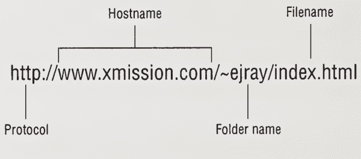

### 协议

协议规定了传输信息时使用的计算机语言。具体来说，协议告诉浏览器信息位于何处（例如，在 Web 服务器、FTP [文件传输协议] 服务器、本地硬盘等上），并告诉浏览器在文档检索过程中应该期待什么内容（例如，是否需要登录、服务器将提供哪些关于文档的信息等）。

你在链接中使用的协议取决于目标文件所在的位置。你在链接中使用的常用协议之一是 HTTP，即超文本传输协议，它表示信息位于万维网的某处。同样，如果你链接到本地计算机上特定位置的 HTML 文档，你将使用 `file:///` 作为协议指示器，指定浏览器应该在其本地计算机上查找文件。或者，如果你想链接到位于 FTP 服务器上的信息，将使用 `ftp://` 作为协议指示器。

## 表 3.1：常用协议

| 协议指示器 | 用途 |
| :--- | :--- |
| `http://` | 用于 Web 上的文档，包括 HTML 文档和相关文件。 |
| `file://` | 用于本地硬盘上的文档。第三个斜杠替换了主机名，因此你只需输入文件夹和文件名即可。 |
| `ftp://` | 用于 FTP 服务器上的文档。 |
| `gopher://` | 用于 Gopher 服务器上的文档。 |
| `telnet://` | 用于打开到特定主机的 Telnet 连接。适用于连接到图书馆目录。然而，此协议指示器是有风险的，因为你不知道访问者端是否安装或配置了 Telnet。 |
| `wais://` | 连接到 WAIS（广域信息）数据库。使用它是因为表单和 CGI 脚本提供了更好的搜索处理方式，而且很少有访问者安装并正确配置了 WAIS 客户端。 |
| `mailto:` | 打开邮件消息窗口，访问者可以在其中向指定地址发送电子邮件。大多数浏览器都支持 mailto，尽管它不是一个标准协议或官方接受的协议。此指示器不包含 `//`。 |
| `news:` | 连接到新闻组或组中的特定文章。这是有保证的，因为你不知道访问者可能访问哪些新闻组。此外，在使用 `news:` 协议之前，请考虑文章会定期过期并从服务器上消失。此指示器不包含 `//`。 |

### 主机名

主机名是存放 HTML 文档和相关文件的服务器名称。每个服务器都有特定的地址，存储在服务器上的所有文档共享同一个主机名。例如，如果你的互联网服务提供商的服务器名称是 xmission，那么你的主机名可能是 `www.xmission.com`。

### 文件夹名

文件夹名是 URL 中的下一部分信息，指明文件所在的文件夹。你可以将文件夹看作是你创建的 HTML 文档的容器。就像你可能使用牛皮文件夹整理文件柜中的纸质文档一样，你也使用文件夹来包含 HTML 和相关文档。

> **提示**：文件夹和目录这两个术语可以互换。在桌面计算机的语境中，文件夹更常用；在较旧版本的 Windows 和 Unix 中，目录更常见。

### 文件名

文件名是特定 HTML 文档的名称，由两部分信息组成：

- 名称，用于标识要显示的文件
- 文件扩展名，用于指定文件类型——HTML 文档、图像、文本文件等

如果你正在创建指向互联网上其他文档和其他位置的链接，你可能会使用范围广泛的文件名。有些文件名是简短且晦懂的——如 `frontmeter.htm`、`newwhmp.htm`——这是由于开发者使用了 Windows 3.x，或者（可能性小得多）由于服务器使用了 Windows 3.x。然而，如果服务器和开发者都使用 Windows 95、98 或 NT、Macintosh、Unix 或它们的组合，你可能还会看到较长的文件名。

你在 HTML 文档中包含链接时，你可能完全不包含文件名。例如，如果你指向一个网站，你可能会包含 `http://www.yahoo.com/` 这样的 URL，它只包含协议和主机名。特定的文件名（在这种情况下还有文件夹）是不必须的，因为它们是默认设置的。访问者点击该链接，Yahoo 服务器将根据特定的服务器设置默认显示首页。

> **提示**：在你的链接中使用 URL 时，请按照提供给你的方式准确输入。

## URL 的类型

URL 取决于你链接文档位置而异。例如，如果文件在万维网上，URL 会更长并包含更多信息。如果文件在你的本地计算机或服务器上，URL 会更短且包含的信息较少。基本上，URL 分为两类：

- 绝对路径
- 相对路径

绝对 URL 包含识别互联网上文件所需的所有信息。相对 URL 指向相同文件夹或服务器上的文件。换句话说，链接的文件是相对于源文档的。图 3.2 显示了绝对和相对 URL。

## 图 3.2 相对 URL 只指向源文档附近的文档，而绝对 URL 指向 Web 上的文档。

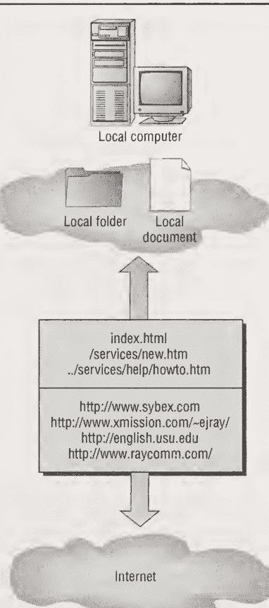

### 绝对 URL

你可以认为绝对 URL 类似于美国地址，它包含了街道地址、公寓号（如适用）、城市、州和邮政编码。所有这些信息对于信件送达你的家都是必不可少的，如果缺少任何信息（如街道或公寓号），信件可能会送晚、送到别人的家或根本无法送达。

同样，绝对 URL 包含协议、主机名、文件夹名和文件名，这些对于链接网站都是至关重要的。以下是一些绝对 URL 示例：

```text
http://www.xmission.com/services/index.html
http://www.altavista.com/
ftp://ray.com/download/readme.txt
```

### 相对 URL

相对 URL 通常只包含文件夹名和，甚至只有文件名。当你指向与源文件相同文件夹或服务器上的文件时，可以使用这些部分 URL。在这种情况下，浏览器不需要服务器名或协议指示器，因为它假设文件位于文件夹或服务器上。

使用相对 URL 类似于指示某人去“邻居”处获取信息。在这种情况下，“邻居”是相对于你所在位置的；只有当你从拥有正确信息的地方发起请求时，它是准确且完整的。

你可以使用相对 URL 相对于源文档（称为文档相对 URL）或相对于源文档所在的服务器（称为服务器相对 URL）来引用文档。图 3.3 显示了相对文件夹和文件之间的关系。

## 图 3.3

当从其他附近的文档链接时，你可以使用相对 URL 指明这些位置中的每一个。

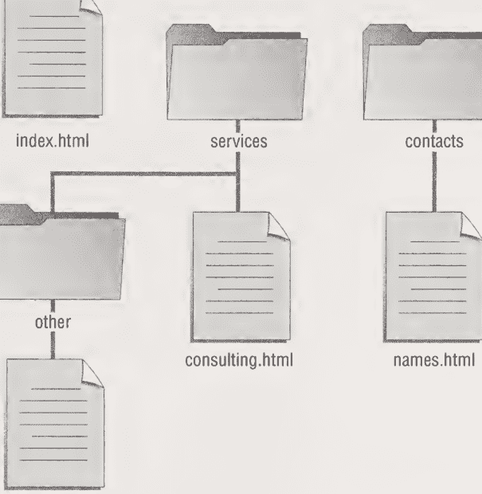

### 文档相对 URL

当你开发或测试一组 HTML 文档时，通常会使用文档相对 URL。在我们为本书开发示例时，我们使用了文档相对 URL 并所有文件放在同一个文件夹中。事实上，在大多数情况下，我们只包含了文件名。例如，当从我们的 `index.html` 文档进行链接时，我们使用这些文档相对 URL：

```text
services/consulting.html
services/other/tips.html
```

注意 URL 仅包含文件夹名称和文件名。协议和主机名是不必要的，因为这两个文档都相对于原始 `index.html` 文档。然而，在这两个文档之间进行链接时，必须包含文件夹名称，因为这些文档位于不同的文件夹中。在这种情况下，从 `consulting.html` 链接到 `other.html` 时，你需要通过指定文件夹名称使两个文件相互相对，如下：

```text
other/tips.html
```

如果你熟悉 Unix 和 DOS 使用 `..` 返回层级结构中上目录的约定，你可以利用它链接到其他文件夹中的文档。例如，从 `consulting.html` 链接到 `names.html`（见图 3.3），你可以使用如下链接：

```html
<A HREF="../contacts/names.html">link text</A>
```

该地址表示向上移动一级（`..` 部分），进入 `contacts` 文件夹，然后进入 `names.html` 文档。同样，`tips.html` 中到 `names.html` 文件的链接如下：

```html
<A HREF="../contacts/names.html">link text</A>
```

位于服务器层级深处的嵌套文件夹，或者可能作为一个单元使用和移动的文件夹组可以从这些链接中获益。这些相对 URL 可以包含单元内的所有文档（例如，绘图内的所有内容），然后你可以将该单元移动到其他服务器，甚至到特定服务器层级内的其他位置。文档之间的所有链接将继续有效。

### 服务器相对 URL

服务器相对 URL 是相对于服务器根目录的——即相对于 URL 中的主机部分。图 3.4 说明了文档和文件夹与服务器之间的关系。

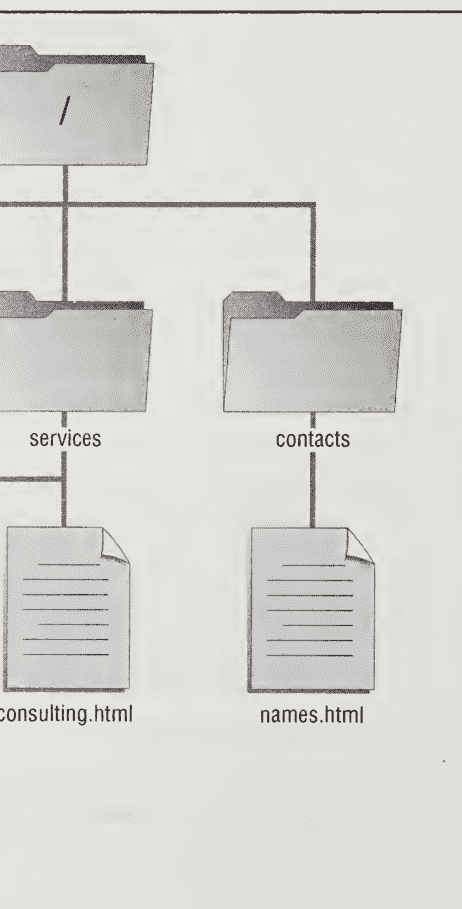

服务器相对 URL 在文件名开头有一个正斜杠 (`/`)，这表示你从当前服务器顶部（服务器根目录）开始解析文档路径，而不是从当前文档的位置。例如，从我们网站的任何地方，我们都可以服务器相对 URL 来显示我们的主页，带有指向 `/index.html` 的链接，这将在服务器顶端正下方显示 `index.html` 文件。一些服务器相对 URL 包括：

- `/index.html`
- `/contacts/names.html`

同样，你可以使用服务器相对 URL 链接到文件夹和文件名。从 `tips.html` 文档，你可以通过像上一个例子类似的 URL 链接到 `contacts` 文件夹内的 `names.html` 文档。

当你链接到服务器上的特定位置（如联系信息），且该位置可能不会改变并且与当前文档没有明显的相对关系时，服务器相对 URL 是很有用的。例如，如果你正在编写的文档在服务器上没有特定的位置，但仍然链接到特定页面（如主页），你可能会使用服务器相对 URL。如果你不使用相对 URL，你将必须将服务器名称编码到 URL 中，然后如果你必须更改服务器或将文档移动到不同的服务器，链接将失效。

> **提示**：尽可能使用相对 URL，因为相对 URL 允许你在移动文档时不会破坏许多链接。如果你使用绝对 URL 链接所有文档，每当你移动文档或将其移动到不同的服务器时，都会破坏所有链接。

## 提高生产力

### 设置文档的基础位置

很多时候，你会开发 HTML 文档并将它们放在一个文件夹中，稍后将某些文档移动到另一个文件夹。此时，相对于文档的链接将损坏。与其更改所有的相对 URL，你不如使用 `<HEAD>` 标签中的 `BASE HREF` 属性来指定 URL 是相对于什么的。

例如，假设你想将一个名为 `www.raycomm.com/test/long.html` 的文档从 "test" 文件夹移到服务器根目录。与其编辑所有链接，你只需要在 `<HEAD>` 标签内添加 `<BASE HREF="http://www.raycomm.com/test/long.htm">`，如下：

```html
<HEAD>
<TITLE>Document Title</TITLE>
<BASE HREF="http://www.raycomm.com/test/long.htm">
</HEAD>
```

在 `<HEAD>` 标签中包含 `BASE HREF=` 会重置文档中的所有相对链接，使所有相对 URL 能够正确指向 `test` 文件夹中文档的实际位置。如果没有 `BASE HREF=` 标签，来自 `long.html` 文档的所有相对 URL 将指向服务器根目录内（不存在的）文档。

## 构建链接锚点

链接锚点是把 Web 连接在一起的胶水。幸运的是，它们很容易构建——只需要单个标签和对 URL 的仔细使用。在本节中，我们将如何链接到相同文件夹、不同文件夹以及不同服务器上的文档。

### 链接到同一文件夹中的文档

基本链接将一个文档连接到同一文件夹中的另一个文件。图 3.5 显示了同一文件夹内的两个文档。

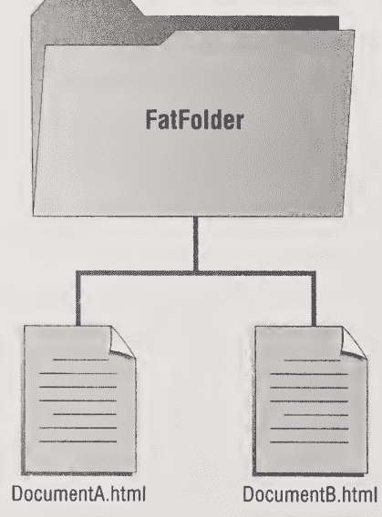

就是这些了。当你用浏览器查看文档时，内容不会有变化，但你已经提供了必要的工具，可以直接链接到文档的某个子章节，正如下一节所描述。

### 链接到名称锚点

在创建了名称锚点后，你就可以链接到它。继续我们的示例，Proposals（提议）部分位于一个名为 `services.html` 的文档中，该文件位于 `www.xmission.com` 服务器上的 `information` 文件夹下。

指向该文档的链接如下：

```html
<A HREF="http://www.xmission.com/information/services.html">Link</A>
```

使用绝对 URL 链接到 Proposals 部分的格式如下：

```html
<A HREF="http://www.xmission.com/information/services.html#proposals">Link</A>
```

注意目标链接中添加的 `#proposals`，这是告诉浏览器链接到该标题的关键。你在目标链接中包含多少信息取决于链接文档的位置，如表 3.2 所示。

> **提示**：你无法链接到不存在的 `NAME=` 锚点，也无法将它们添加到 Web 上的其他文档。为了确保访问者可以链接到文档内的特定位置，请在可能被访问的地方包含 `NAME=` 锚点。

## 表 3.2：不同文档位置的 URL

| 来源 | 链接格式 |
| :--- | :--- |
| 同一文档内 | `<A HREF="#proposals">` |
| 同一文件夹，不同文档 | `<A HREF="services.html#proposals">` |
| 同一服务器（不同文件夹和文档，服务器相对 URL） | `<A HREF="/information/services.html#proposals">` |
| 不同的服务器 | `<A HREF="http://www.xmission.com/information/services.html#proposals">Link</A>` |

### 插入电子邮件链接

最后，你可以使用的另一种实用链接是电子邮件链接，它可以让访问者从 Web 页面跳转到他们电子邮件程序中已填写好收件人的空白邮件。通过在 Web 页面中包含电子邮件链接，例如你可以让访问者轻松地联系你。

要创建电子邮件链接，只需添加一个带有 `mailto:` 协议标识符和电子邮件地址的锚点链接。例如，你可以包含以下链接来向本书的作者发送反馈：

```html
<A HREF="mailto:info@raycomm.com">Send Feedback</A>
```

> **提示**：正如我们在表 3.1 中提到的，`mailto:` 并不是 HTML 标准，但被广泛使用和认可。

## HTML 4 的机会

HTML 4 规范允许你添加链接描述，当访问者将鼠标悬停在链接上时，描述会出现在屏幕上，如下所示：

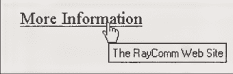

要为你的链接添加弹出描述，只需在锚点标签中包含 `TITLE=` 属性，如下所示：

```html
<A HREF="http://www.raycomm.com" TITLE="The RayComm Web Site">More Information</A>
```

# 接下来去哪里

在本章中，你学习了 URL 的各种类型以及如何使用它们来构建链接。你还学习了如何用名称锚点标记文档内的位置并链接到这些位置。掌握了这些信息后，你现在准备好应对几乎任何 HTML 任务了。

- 下一第 4 章，你将学习开发样式表——这是为 HTML 文档添加格式最新、最全面的方法。
- 查看第 5 章获取有关在 Web 服务器上发布 HTML 文档的信息。
- 查看第二部分（从第 6 章开始）获取有关添加图像、表格、表单和框架的信息。
- 访问第四部分获取关于开发连贯网站的实用技巧和建议，以及开发公共、个人和内网网站的建议。

# 第 4 章 使用样式表

## 特色

- 理解样式表
- 将样式表应用到 HTML 文档
- 开发样式表
- 设置字体和文本属性
- 设置框属性
- 设置颜色和背景属性
- 设置分类属性
- 设置音频属性
- 设置打印属性
- 设置位置属性

样式表——正式称为层叠样式表 1 级（或 CSS1）——可能是以一致方式格式化 HTML 文档的最佳方法之一。W3C 于 1996 年 12 月采用了 CSS，样式表实现了呈现与内容的分离，将 HTML 归于功能导向。CSS2 于 1999 年 5 月被采用，提供了更多控制，并增加了屏幕阅读器的音频样式表支持。

样式表会长期存在吗？事实上，HTML 4 规范弃用了许多格式化标签和属性（例如 `<FONT>` 和 `ALIGN=`），转而采用样式表。

在本章中，你将看到样式表如何增强 HTML 的有效性以及你如何从中受益。你将学习如何将样式表应用到你的 HTML 文档以及如何开发样式表。

## 实现样式表

在阅读本章的后续内容时，请记住 HTML 文档和关联的样式表是协作工作的。HTML 文档承载内容，而样式表承载格式信息。正如你所看到的，开发样式表分两个部分：

- 你将样式表连接（或关联）到 HTML 文档。
- 然后开发实际的样式表，包含所有的格式选项。

### 将样式表与 HTML 文档关联

你可以通过四种方式将样式表与 HTML 文档关联：

- 你可以在起始和结束 `<HEAD>` 标签之间将样式表嵌入 HTML 文档中。
- 你可以将样式表存储在单独的文档中，并通过链接或导入将其与 HTML 文档关联。
- 你可以对 HTML 文档指定的部分应用样式定义。
- 你可以使用内联样式定义。

### 将样式表嵌入 HTML 文档

嵌入样式表是这四种方法中最简单的，意味着在 `<HEAD>` 标签之间插入 `<STYLE>` 标签以及样式信息。图 4.1 显示了如何操作。

嵌入样式表便于维护或更新样式，因为你不需要处理两个或多个文档（样式表文档和 HTML 文档），你只需要打开 HTML 文档并调整样式表代码。如果你处理的是经常更新的文档，可能可能想使用其他方法。如果你在每个文档中嵌入样式表，你将必须在每个文档中进行调整。

要在 HTML 文档中嵌入样式表，请在 `<HEAD>` 标签之间应用表 4.1 所示的标签和属性。

## 图 4.1

插入样式表的 HTML 文档

```html
<!DOCTYPE html PUBLIC "-//W3C//DTD HTML 4.0//EN">
<html>
<head>
<title>Out Outfitters</title>
<style>
body {
  font-family: 'Comic Sans', 'Times New Roman', Arial, Helvetica, sans-serif;
  font-style: italic;
  font-size: x-large;
  font-weight: bold;
}
h1, h2, h3, h4, h5, h6 {
  color: red;
}
</style>
</head>
<body>
<p>欢迎来到我们重新设计的网站，这里有<b>样式</b>（它们看起来很酷）以及重新设计的图形。请点击<a href="tour.html">导览</a>，它现在可以自动更新，还可以查看我们的新页面。</p>
<p>此外，我们收到了一些偶尔访问者的良好赞誉。您的网站始终提供及时的信息。请继续保持。</p>
<ul>
<li><a href="index.html">首页</a></li>
<li><a href="news.html">露营新闻</a></li>
</ul>
</body>
</html>
```

## 表 4.1：STYLE 标签和属性

| 标签/属性 | 描述 |
| :--- | :--- |
| `<STYLE>` | 指定 HTML 文档中的样式表区域。在此部分内，你可以定义或导入格式设置。 |
| `<!-- ... -->` | 注释，用于向不支持样式的浏览器隐藏内容。 |
| `TYPE="text/css"` | 指定样式表的类型。在编写时，有效选项包括 `text/css`（用于层叠样式表，这是标准并在本章中将介绍）和 `text/javascript`（用于 JavaScript 样式表）。 |

### 嵌入样式表

要在现有文档中嵌入一个简易的样式表（例如为段落上色），请遵循以下步骤：

1. 从一个功能性的头部开始。

```html
<!DOCTYPE html PUBLIC "-//W3C//DTD HTML 4.0//EN">
<html>
<head>
<title>Out Outfitters</title>
</head>
```

> **注释**：在实践中，样式定义也可以在文档主体内生效，但规范要求样式定义块必须放在 `<HEAD>` 标签之间。

2. 添加起始和结束的 `<STYLE>` 标签。

```html
<!DOCTYPE html PUBLIC "-//W3C//DTD HTML 4.0//EN">
<html>
<head>
<title>Out Outfitters</title>
<style>
</style>
</head>
```

3. 添加注释 (`<!-- ... -->`) 以向不支持样式的浏览器隐藏内容。

```html
<!DOCTYPE html PUBLIC "-//W3C//DTD HTML 4.0//EN">
<html>
<head>
<title>Out Outfitters</title>
<style>
<!-- ... -->
</style>
</head>
```

不支持样式表的浏览器会忽略这些标签，但会显示它们之间的文本。

4. 在 `<STYLE>` 标签内添加样式定义。在这个（极简）示例中，我们指定文本颜色为红色。

```html
<!DOCTYPE html PUBLIC "-//W3C//DTD HTML 4.0//EN">
<html>
<head>
<title>Out Outfitters</title>
<style>
p {color: red}
</style>
</head>
```

搞定！要测试你嵌入的样式表，只需在 Internet Explorer 或 Netscape Navigator 中打开 HTML 文档。

### 独立存储样式表

单独的样式表仅仅是一个文本文件，仅包含样式定义。当你处理多个 HTML 文档时，请随时开发单独的样式表，特别是当它们共享格式时。在这种情况下，你开发单个样式表并将其应用到所有 HTML 文档，如图 4.2 所示。这样你只需更改样式表即可更改所有文档的格式。

> **提示**：即使你只有几个 HTML 文档，也要考虑开发独立的样式表。你永远不知道网站最终会包含多少 HTML 文档。

开发样式表后，使用以下方法之一将其与 HTML 文档关联：

- 导入
- 链接

这两种方法均适用于 Internet Explorer。

## 图 4.2

当你开发独立的样式表时，可以轻松地为多个 HTML 文档应用样式。


# 开发多个具有特定功能的样式表

导入方法非常方便。例如，如图 4.3 所示，你可以开发一个应用公司样式的页面、一个应用部门样式的页面以及另一个指定特定格式的页面。与其遍历大型样式表，不如处理多个较小的表。

> **注意**：导入样式表在 Internet Explorer 中运行，但在 Netscape Navigator 中无效。

## 图 4.3

导入可以让你轻松维护详细的样式表。

## 表 4.2：导入样式表的标签和属性

| 标签/属性 | 描述 |
| :--- | :--- |
| `<STYLE>` | 指定 HTML 文档中的样式表区域。在此部分内，你可以定义或导入格式设置。 |
| `<!-- ... -->` | 注释，用于向不支持样式的浏览器隐藏内容。 |
| `TYPE="text/css"` | 指定样式表的类型。在编写时，有效选项包括 `text/css`（用于级联样式表，这是标准并在本章中将介绍）和 `text/js`（用于 JavaScript 样式表）。 |
| `@import url(...)` | 导入样式表。用法为 `url(http://mystyles.com/new.css)`。 |

## 图 4.4

链接允许你针对特定用途应用样式表。

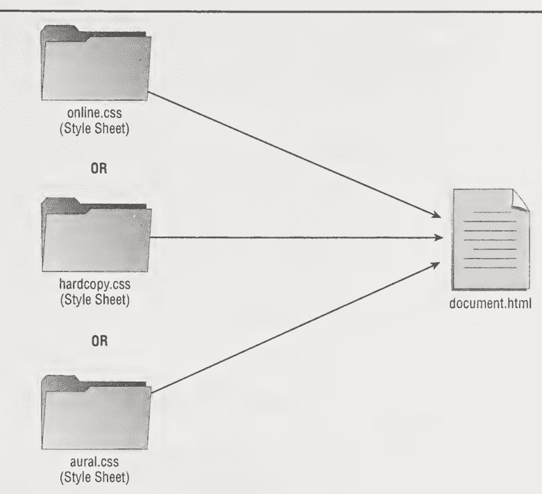

## 表 4.3：用于链接样式表的标签和属性

| 标签/属性 | 描述 |
|---|---|
| `<LINK>` | 引用样式表。 |
| `REL="StyleSheet"` | 指定所引用的文件为样式表。你也可以使用 `Alternate Style Sheet` 来引用可选的样式表。 |
| `TYPE="text/css"` | 指定样式表的类型。在编写时，有效选项包括用于层叠样式表的 `text/css`（标准格式，并在本章中介绍）以及用于 JavaScript 样式表的 `text/js`。 |
| `HREF="URL"` | 将样式表源文件标识为标准 URL。 |
| `TITLE=""` | 为样式表命名。未命名的样式表始终会被应用。命名的样式表将默认应用或作为选项提供，取决于所使用的 `REL` 属性。 |

# 第 4 章 • 使用样式表

要将样式表链接到 HTML 文档，请遵循以下步骤：

1. 从一个完整的 HTML `<HEAD>` 区域开始，如下代码所示：

```html
<!DOCTYPE HTML PUBLIC "//W3C//DTD HTML 4.0 Transitional//EN">
<HTML>
<HEAD>
<TITLE>ASR Outfitters</TITLE>
</HEAD>
</HTML>
```

2. 添加 `<LINK>` 标签。

```html
<!DOCTYPE HTML PUBLIC "//W3C//DTD HTML 4.0 Transitional//EN">
<HTML>
<HEAD>
<TITLE>ASR Outfitters</TITLE>
<LINK>
</HEAD>
</HTML>
```

3. 定义样式表的 `Stylesheet` 和 `text/css` 的 `REL` 和 `TYPE` 值，以链接标准样式表。

```html
<LINK REL="Stylesheet" TYPE="text/css">
```

4. 使用 `HREF` 属性指定样式表的地址。指定相对 URL（如示例代码所示）或绝对 URL。

```html
<LINK REL="Stylesheet" HREF="blue.css" TYPE="text/css">
```

搞定！要将你的 HTML 文档链接到多个样式表，只需包含 `<LINK>` 标签，并配齐你链接的每个样式表即可。例如，你可能将 HTML 文档链接到一个包含基础定义的通用样式表，然后将其链接到包含适用于特定文档类型（如说明书、营销材料等）定义的更具针对性的样式表。如果你链接了多个样式表，并且在多个表文件中定义了相同的元素，则后来的链接将覆盖之前的链接。

HTML 规范指出，你还可以使用 `REL="Alternate Style Sheet"` 属性将 HTML 文档链接到可选的样式表，以便访问者可以选择要使用的样式。理论上，你可以提供可选的样式表，让访问者选择通过调制解调器连接时的低带宽样式，或通过高速连接查看高带宽样式。或者，你也可以为高分辨率和高色深显示器提供选择，并为低色深的标准显示器提供替代方案。但在编写本文时，Internet Explorer 和 Netscape Navigator 都不支持可选的样式表。

## 将样式表应用到文档部分

到目前为止，你已经看到如何将样式表应用到整个 HTML 文档。你还可以将样式表中包含的样式应用到 HTML 文档的特定部分，如图 4.5 所示。这被称为应用样式类，类是在你的样式表中定义的。例如，你可能在样式表中指定段落的第一行缩进。你可能会发现，项目列表后的段落不应该缩进，因为它们延续了上方段落的信息。为了解决这个问题，你可以手动对段落进行格式化，这对于一次性的情况可能是合适的。然而，更好的解决方案是在你的样式定义中设置一个新的段落标签类，例如 `continue`。每当段落的第一行不应该缩进时，你就可以使用这个新的段落类。表 4.4 描述了你用于应用类时使用的标签和属性。

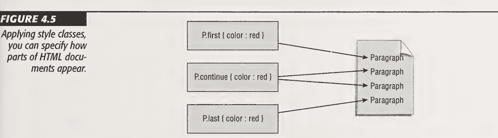

## 表 4.4：用于应用类的标签和属性

| 标签/属性 | 描述 |
| --- | --- |
| `<SPAN>` | 持有样式属性，并将其应用于起始标签和结束标签之间的 HTML 代码。用这些标签包裹字母和单词。 |
| `<DIV>` | 持有样式属性，并将其应用于起始标签和结束标签之间的 HTML 代码。用这些标签包裹段落或其他块级元素。 |
| `CLASS=".*.."` | 引用样式类以应用于 HTML 文档的指定部分。 |
| `ID="unique"` | 指定与特定样式定义相关的唯一名称。你可以在样式表中仅使用一次。 |

你可以将类应用到现有的 HTML 标签，也可以使用 `<DIV>` 和 `<SPAN>` 标签来指定该类应用到其他元素——例如未通过 HTML 标签单独指定的特定字母或单词。

## 将类应用到 HTML 标签

你将类应用到现有的 HTML 标签（例如 `<P>`、`<H1>`、`<UL>` 等），以为一组项目指定格式。若要在 HTML 文档内应用类，请遵循以下步骤：

1. 从 HTML 文档中一个现有的段落开始。

```html
<P>Many people buy ASR products despite the higher cost.</P>
```

2. 在起始的 `<P>` 标签上添加 `CLASS=` 属性，如下所示：

```html
<P CLASS="continue">Many people buy ASR products despite the higher cost.</P>
```

搞定！

## 表 4.5：HTML 样式表的标签与属性

| 标签/属性 | 描述 |
|---|---|
| 任意 HTML 标签 | 所有 HTML 标签（包括 `<BODY>`）都可以支持样式定义。用于内联样式定义，这些定义可以作为属性提供给 HTML 标签。在引号内提供样式定义，并在引号内的 `STYLE='...'` 属性内提供引号内的元素。 |

## 图 4.6

你在 HTML 代码中应用内联定义。

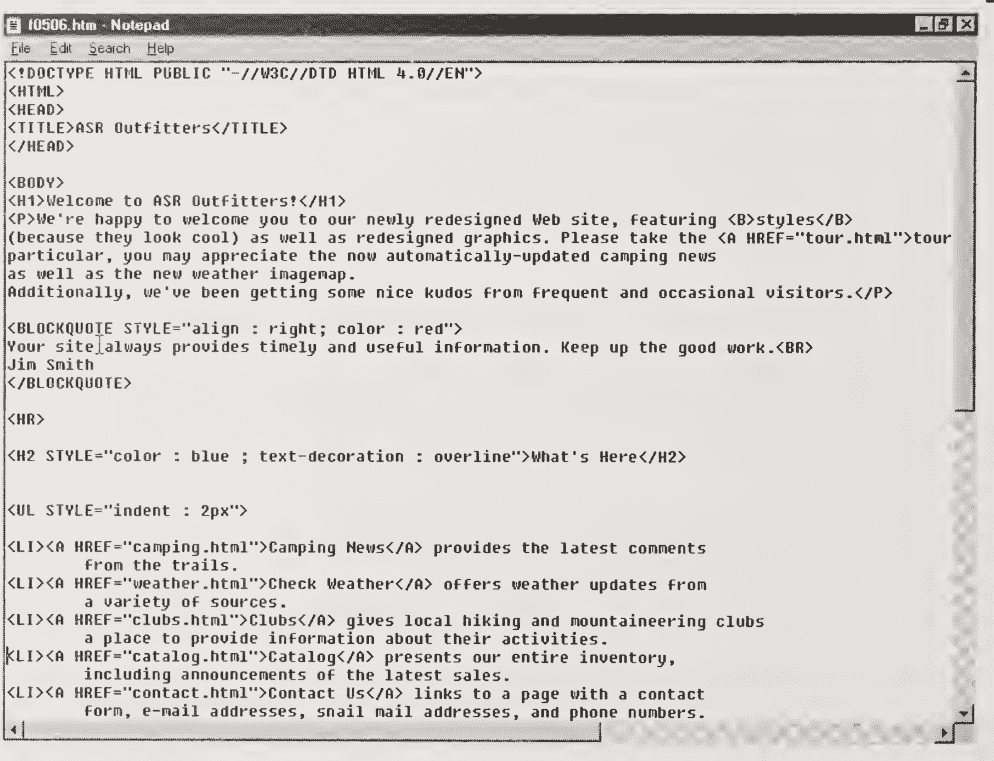

```html
<!DOCTYPE html PUBLIC "//W3C//DTD HTML 4.0//EN">
<html>
<head>
<title>ASR Outfitters</title>
</head>
<body>
<h1>欢迎来到 ASR Outfitters!</h1>
<p>我们非常欢迎您来到我们重新设计的网站，这里包含了一些**样式**（因为它们作为重新设计的图形看起来效果很好。请参阅 <a href="tour.html">特别之旅</a>，您还将喜欢我们自动更新的新以及新的功能地图）。</p>
<p>此外，我们从经常和偶尔访问的游客那里获得了一些不错的赞誉。</p>
<blockquote style="align: right; color: red">
您的网站总是提供及时且有用的信息。继续努力。<br>
Jim Smith
</blockquote>
<h2 style="color: blue; text-decoration: underline">有什么更新？</h2>
<p><a href="camping.html">营地新闻</a>提供了来自小道的最新评论。
<a href="weather.html">查看天气</a>由我们提供天气更新。
<a href="clubs.html">俱乐部</a>提供了当地的徒步和登山俱乐部，提供有关其活动的信息。
<a href="catalog.html">目录</a>展示了我们的库存，包括最新销售的公告。
<a href="contact.html">联系我们</a>链接到包含联系表单、电子邮件地址的页面。请书写邮件地址和电话号码。</p>
</body>
</html>
```

要向现有的 HTML 标签添加样式定义，请遵循以下步骤：

1. 从一个现有的 HTML 标签开始。

```html
<p>尽管成本较高，但许多人购买 ASR 产品。</p>
```

2. 添加 `STYLE=` 属性。

```html
<P STYLE="*">尽管成本较高，但许多人购买 ASR 产品。</P>
```

3. 添加样式定义，并用分号分隔。在属性内部用单引号替换双引号；否则，你将提前结束该属性。

```html
<P STYLE="color: blue; font-family: 'Times New Roman', Arial;">尽管成本较高，但许多人购买 ASR 产品。</P>
```

## 开发样式表

在之前的章节中，你学习了如何将样式表与 HTML 文档相关联。你现在的目标是开发样式表——也就是说，指定你想要包含的样式定义。样式定义指定了格式特征。你可以从八类样式属性的任意组合中进行选择。

- **字体**：字体属性指定字符层级（内联）格式，例如字体族。
- **文本**：文本属性指定文本的显示特征，例如对齐方式或字间距。
- **框**：框属性指定段落（或块级）层面的文本段的特征。
- **颜色和背景**：颜色和背景属性指定段落（或块级）层面的颜色或背景图像。
- **分类**：分类属性指定列表和元素（如 `P` 或 `H1`）作为内联或块级元素的显示特征。
- **听觉样式表**：听觉样式表属性控制 HTML 文档的听觉呈现。（仅限 CSS2）。
- **打印样式表**：打印样式表属性增加了专门控制 HTML 文档打印输出的功能（仅限 CSS2）。
- **定位**：定位属性增加了精确控制元素在显示器上位置的功能（仅限 CSS2）。

在开发样式表时，简单性是关键。你可以很容易沉浸各种格式选项中，但请保持简单。浏览一下《参考指南》中的样式表章节，以了解海量的选项。而且，正如你猜的那样，即使只使用其中一些选项也会迅速变得复杂。

# 第 4 章 • 使用样式表

在我们深入开发样式表之前，让我们看一些样式代码：

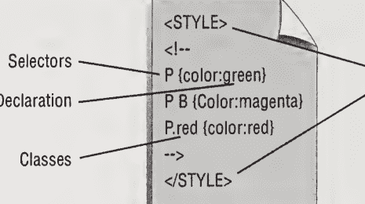

以下是每个部分的作用：

- **样式块**包含样式标签和注释标签，加上样式定义（或规则）。
- **选择器**是 HTML 元素。在这个例子中，`P`（如段落标签）是一个选择器。
- **声明**是 HTML 元素的属性，例如颜色、背景、对齐和字体。在这个例子中，`color:red` 是声明。样式块被包含在括号 `{}` 中。
- **类**指定了与 HTML 元素特定发生关联的额外样式定义。例如，标记为 `<P CLASS=red>` 的段落将使用此类。
- 每个样式定义都可以定义与特定的 HTML 标签、特定的 `CLASS` 或特定的 `ID` 相关的格式。与 HTML 标签相关的格式会出现在文档中，无需你执行任何特殊操作。类或 ID 的样式定义还要求你在格式出现之前在相应的 HTML 文档部分添加 `CLASS=` 或 `ID=` 属性，然后格式才能在 HTML 文档中显示。

要添加这些元素，请遵循以下步骤：

1. 确保样式块已就位，如下：

```html
<STYLE>
<!--
-->
</STYLE>
```

2. 在括号内添加声明。

```html
<STYLE>
<!--
P { }
-->
</STYLE>
```

3. 像这样添加选择器。

```html
<STYLE>
<!--
P { }
-->
</STYLE>
```

4. 在括号内添加样式定义。

```html
<STYLE>
<!--
P { color: aqua }
-->
</STYLE>
```

## 提高效率

### 样式表提示

在编写样式表时，如果你遵循这些指南，将变得更容易：

- 为了包含多个选择器，将它们分行，如下：

```html
<STYLE>
<!--
P { color: red }
H1 { color: blue }
BLOCKQUOTE { color: green }
-->
</STYLE>
```

- 为单个选择器提供多个声明，用分号隔开。例如，为 `P` 定义红色黄色背景，请使用以下代码：

```html
<STYLE>
<!--
P { color: red; background: yellow }
-->
</STYLE>
```

### 合并多个特性

通过字体属性，你可以使用简写将多个特性合并为一行。例如，你可以将标题缩减为：

```css
H1, H2, H3, H4, H5, H6 { font: Arial, Helvetica, 'sans-serif' italic x-large bolder }
```

使用这种简短定义有一些缺点。首先，对于刚学习样式表的人来说，减少的代码更难解释。此外，浏览器对简短版本的支持较差，游客可能无法查看效果。

## 指定尺寸

在指定元素的位置时，你可能还想指定它们的大小。例如，在指定段落的第一行时，可以使用表 4.6 中的单位。你的测量可能像这样：

```css
P { text-indent: 2px }
```

或者像：

```css
P { text-indent: 1em }
```

## 表 4.6：样式表中的单位

| 单位 | 定义 | 描述 |
|---|---|---|
| `em` | Em宽 | 字体中大写字母 M 的宽度。 |
| `ex` | X高 | 字体中小写字母 x 的高度。 |
| `in` | 英寸 | |
| `cm` | 厘米 | |
| `mm` | 毫米 | |
| `px` | 像素 | 独立的屏幕点为一个像素。 |
| `pt` | 磅 | 等于 1/72 英寸的排版单位。 |
| `pc` | 份 | 等于 1/6 英寸的排版单位。 |

## 在样式规则中指定颜色

使用样式表，你可以通过标准的 HTML 方式（作为 `#rrggbb` 值和颜色名称）指定颜色，以及其他两种方法，这些方法使用稍不同的方法来指定红、绿、蓝的比例。以下四行显示了如何用每种方法指定红色。

```css
P { color : #FF0000 }
P { color : red }
P { color : rgb(255,0,0) }
P { color : rgb(100%,0%,0%) }
```

> **提示**：尽管这些方法都同样容易使用，我们建议使用 `#rrggbb` 选项，因为它可能与 HTML 颜色语句更熟悉。

在接下来的章节中，我们将向你展示如何开发嵌入样式表。在完成嵌入样式表后，你可以将其移动到单独文档中或将其导入或链接。如果你正在跟随示例操作，请准备好具有完整结构标签的 HTML 文档。

## 列表 4.1

```html
<!DOCTYPE HTML PUBLIC "//W3C//DTD HTML 4.0 Transitional//EN">
<HTML>
<HEAD>
<TITLE>ASR Outfitters</TITLE>
</HEAD>
```

# 第 4 章 • 使用样式表

```html
<BODY>
<H1>欢迎来到 ASR Outfitters!</H1>
<P>我们很高兴欢迎来到我们重新设计的网站，这里有了 <B>样式</B>（因为它们看起来很酷）以及重新设计的图形。如果您有一段时间没来了，请花时间 <A HREF="tour.html">浏览我们的网站之旅</A>。特别是，您可能会喜欢新的自动更新的营地新闻以及新的天气图像映射。
此外，我们还收到了来自常客和偶尔访问者的许多好赞誉。</P>
<BLOCKQUOTE>
你们的网站总是提供及时实用的信息。请继续努力。<BR>
Jim Smith
</BLOCKQUOTE>
<HR>
<H2>这里有什么</H2>
<UL>
<LI><A HREF="camping.html">营地新闻</A>提供了来自小径的最新评论。
<LI><A HREF="weather.html">查看天气</A>提供各种来源的天气更新。
<LI><A HREF="clubs.html">俱乐部</A>为当地徒步和登山俱乐部提供发布活动信息的地方。
<LI><A HREF="catalog.html">目录</A>展示了我们的全部库存，包括最新的销售公告。
<LI><A HREF="contact.html">联系我们</A>链接到包含联系表单、电子邮箱地址、邮寄地址和电话号码的页面。
如果那里没有，你就找不到我们了。
</UL>
<H2>我们是做什么</H2>
<P>除了提供最新的营地和户外活动新闻外，我们还通过邮购以及我们在落基山脉的实体店，在全国范围内提供登山和徒步设备。</P>
请花几分钟查看我们的 <A HREF="catalog.html">在线产品</A>。</p>
</BODY>
</HTML>
```

## 其他问题

- 如您所知，您的 URL 在最近的*徒步新闻*中被打印错误了。请告诉您的徒步朋友，正确的 URL 是 `http://www.asoutfitters.com/`。
- 为了获得 1000 美元的奖金，请提供上周末在熊湖地区纵火的人姓名。
- 拨打 `888-555-1212`。
- 在录音中留下姓名。
- 提供联系信息，以便我们向您发放奖金。

## 您想看什么？

如果您对网站或其他我们可以提供的提供的信息有任何建议或意见，我们非常想获知。请向 `asoutfitters@raycomm.com` 向我们发送电子邮件。当然，您也可以通过以下传统方式与我们联系：

<ADDRESS>
ASR Outfitters<br>
4700 N. Center<br>
South Logan, UT 87654<br>
801-555-3422
</ADDRESS>

除了标准的 HTML/浏览器默认设置外，没有任何样式或格式，此文档看起来就像图 4.7 所示。

## 图 4.7

一个没有任何特殊格式或样式表的 HTML 文档

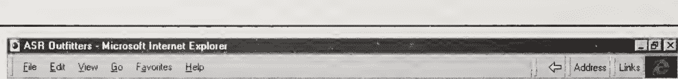

# 欢迎来到 ASR Outfitters!

我们很高兴欢迎来到我们重新设计的网站，这里有了样式（因为它们看起来太酷了！）以及重新设计的图形。如果您有一段时间没来了，请浏览我们的网站之旅。特别是，您可能会喜欢我们自动更新的营地新闻以及新的天气图像映射。此外，我们还收到了来自常客和偶尔访问者的许多好赞誉。

> 你们的网站总是提供及时实用的信息。请继续努力。
>
> Jim Smith

## 这里有什么

- 营地新闻提供了来自小径的最新评论。
- 查看天气提供各种来源天气更新。
- 俱乐部为当地徒步和登山俱乐部提供发布活动信息的地方。
- 目录展示了我们的全部库存，包括最新的销售公告。
- 联系我们链接到包含联系表单、电子邮箱地址、邮寄地址和电话号码的页面。如果那里没有，你就找不到我们了。

## 我们是做什么

在提供最新的营地和户外活动新闻的同时，我们还通过邮购以及我们在落基山脉的实体店，在全国范围内提供登山和徒步设备。请花几分钟查看我们的在线产品。

要向文档中添加样式块，请遵循以下步骤：

1. 在文档中添加一组开启和关闭的 `<STYLE>` 标签，如下代码所示：

```html
<!DOCTYPE HTML PUBLIC "-//W3C//DTD HTML 4.0//EN">
<HTML>
<HEAD>
<TITLE>ASR Outfitters</TITLE>
<STYLE>
</HEAD>
```

2. 在 `<STYLE>` 标签内添加开启和关闭的注释 (`<!-- -->`)，此处所示：

```html
<STYLE>
<!-- -->
</STYLE>
```

在 `<STYLE>` 和注释标签到位后，定义样式表。将定义样式考虑为每个元素应该什么样子的规则。例如，指定您希望所有蓝色文本、项目符号、所有标题居中等。接下来，指定样式属性，如字体、文本、框、背景。以下章节之间不是相互堆叠的；相反，它们展示了如何根据单独设置每个属性。

## 设置字体

设置字体属性。

| 属性 | 值 |
| :--- | :--- |
| `font-family` | Times Roman, Arial, sans-serif, 等宽 |
| `font-style` | Normal, 斜体, 倾斜 |
| `font-variant` | Normal, 大写字母 |
| `font-weight` | Normal, 粗体, 较细 |
| `font-size` | 特小, 小号, 中等, 大号, 特大号 |
| `font` | 任意 |

要设置字体族，使用样式表。

1. 在样式块中添加 `BODY` 选择器，如下所示：

```html
<STYLE>
BODY
</STYLE>
```

2. 添加括号。

```html
<STYLE>
BODY { }
</STYLE>
```

3. 添加属性。

```html
<STYLE>
BODY { font-family; }
</STYLE>
```

4. 添加冒号将属性与值分隔。

```html
<STYLE>
BODY { font-family: }
</STYLE>
```

5. 添加值 `"Comic Sans"`。

```html
<STYLE>
BODY { font-family: "Comic Sans"; }
</STYLE>
```

6. 添加其他值，如您选择的，用逗号分隔。如果字体名称包含空格，将其放在引号中。否则，引号是可选的。以衬线或无衬线字体结束您的列表。

```html
<STYLE>
BODY { font-family: "Comic Sans", "Technical", "Times Roman", serif }
</STYLE>
```

## 实现样式表

这是结果页面，带有用于文档正文的新字体。

```
ASR Outfitters - Netscape Help
Edit View Communicator Help
Bookmarks Location //php/aycom/subtex/Mastering HTML/CD/ch5/ig02.htm
```

### 设置链接特性

您使用三个特殊的样式类（以及字体样式规则）来控制文档中链接的颜色：

- `A:link`
- `A:active`
- `A:visited`

继续

# 第 4 章 • 使用样式表

继续

在你的样式表定义中使用这些规则来指定适用于链接、活动链接和已访问链接的规则。例如，要将未设置的链接设置为蓝色、活动链接设置为红色、已访问链接设置为洋红色，你的样式块看起来如下：

```css
<STYLE>
<!--
A:link { color : blue }
A:active { color : red }
A:visited { color : magenta }
-->
</STYLE>
```

你还可以在文档中定义额外的文本样式。例如，要将所有标题设置为 Arial *斜体*，请遵循以下步骤：

1. 将所有标题以逗号分隔的列表添加到现有的样式块中，作为选择器。逗号分隔的列表指定该样式规则分别适用于每个选择器。

```css
<STYLE>
<!--
BODY { font-family : "Comic Sans MS", Technical, "Times New Roman", serif }
H1, H2, H3, H4, H5, H6
-->
</STYLE>
```

2. 添加括号。

```css
<STYLE>
<!--
BODY { font-family : "Comic Sans MS", Technical, "Times New Roman", serif }
H1, H2, H3, H4, H5, H6 { }
-->
</STYLE>
```

3. 添加 `font-family` 属性，将 Arial 作为第一选择，Helvetica 作为第二选择，sans-serif 作为第三个选择。

```css
<STYLE>
<!--
BODY { font-family : "Comic Sans MS", Technical, "Times New Roman", serif }
H1, H2, H3, H4, H5, H6 { font-family : Arial, Helvetica, "sans-serif" }
-->
</STYLE>
```

4. 在 `font-family` 值之后添加一个分号并换行，这样你就可以方便地输入（并阅读）字体样式规则。

```css
<STYLE>
<!--
BODY { font-family : "Comic Sans MS", Technical, "Times New Roman", serif }
H1, H2, H3, H4, H5, H6 { font-family : Arial, Helvetica, "sans-serif" }
-->
</STYLE>
```

5. 添加 `font-style` 属性、冒号和 *斜体* 值。

```css
<STYLE>
<!--
BODY { font-family : "Comic Sans MS", Technical, "Times New Roman", serif }
H1, H2, H3, H4, H5, H6 { font-family : Arial, Helvetica, "sans-serif"; font-style : italic }
-->
</STYLE>
```

6. 如果你想定义其他方面（例如字体大小或粗细），请继续添加由分号分隔的字体属性。以下代码行显示将标题设为比通常更大、更粗的字体。你将在图 4.8 中看到结果。

```css
<STYLE>
<!--
BODY { font-family : "Comic Sans MS", Technical, "Times New Roman", serif }
H1, H2, H3, H4, H5, H6 {
font-family : Arial, Helvetica, "sans-serif";
font-style : italic;
font-size : x-large;
font-weight : bolder;
}
-->
</STYLE>
```

## 图 4.8

标题的字体族、样式、大小和粗细设置

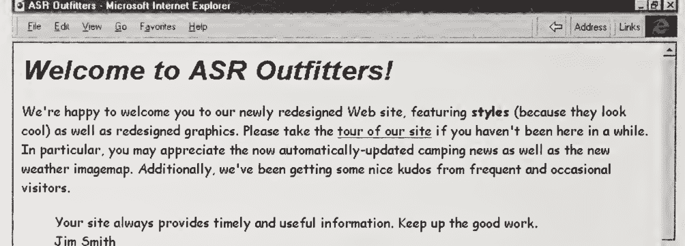

## 这里有什么

- 露营新闻提供了来自步道的最新评论。
- 检查天气提供来自各种来源天气更新。
- 俱乐部为当地徒步和登山俱乐部提供了提供活动信息的地方。
- 目录展示了我们的全部库存，包括最新销售公告。
- 联系我们链接到包含联系表单、电子邮件地址、邮寄地址和电话号码的页面。如果这里没有，你就找不到我们了。


## 设置文本属性

文本属性指定文本块（而不是单个字符）的特性。表 4.7 显示了一些常用的文本属性。

| 属性 | 值 |
| --- | --- |
| `word-spacing` | 测量 |
| `letter-spacing` | 测量 |
| `text-decoration` | none, underline, overline, line-through, blink |
| `vertical-align` | baseline, sub, top, middle |
| `text-transform` | none, capitalize, lowercase |
| `text-indent` | 测量值或 % |
| `text-align` | left, right, center, justify |

你可以以相同的方式将这些属性应用于选择器。要缩进段落并设置特殊的非缩进类，请遵循以下步骤：

1. 在样式块中添加选择器。

```css
<STYLE>
<!--
P
-->
</STYLE>
```

2. 添加括号。

```css
<STYLE>
<!--
P { }
-->
</STYLE>
```

3. 添加 `text-indent` 属性，值为窗口宽度的 5%，以缩进所有普通段落。

```css
<STYLE>
<!--
P { text-indent: 5% }
-->
</STYLE>
```

4. 在样式块的新行添加 `P.noindent` 选择器。使用标准选择在样式表中创建一个新类。

```css
<STYLE>
<!--
P.noindent
-->
</STYLE>
```

5. 添加括号和 `text-indent` 属性，值为 0%，以指定不缩进。

```css
<STYLE>
<!--
P { text-indent: 5% }
P.noindent { text-indent: 0% }
-->
</STYLE>
```

6. 要指定哪些文本不缩进，请添加带有 `class="noindent"` 属性的新 `P` 标签，如下：

```html
<p class="noindent">欢迎来到我们重新设计的网站，拥有样式（因为它们看起来很酷）以及重新设计的图形。如果你很久没来这里，请参观我们的网站。特别是你可能会喜欢更新的露营新闻和天气。</p>
```

图 4.9 显示了结果。HTML 文档中标记为 `P` 的文本都缩进了窗口宽度的 5%，而通过属性设置的特殊格式不缩进。

## 图 4.9

设置属性允许你自定义文档——由于样式类的，第二个段落没有缩进，而第一个缩进了。

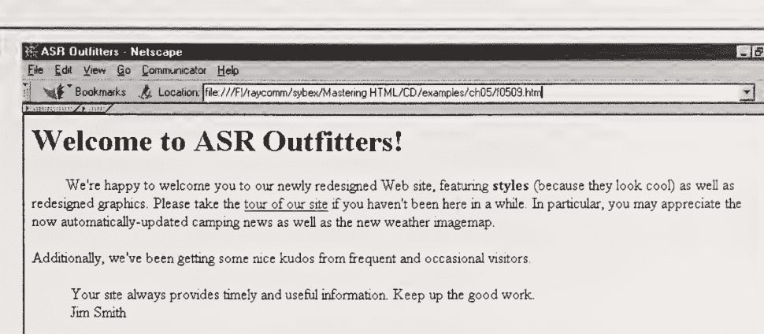

欢迎来到我们重新设计的网站，拥有样式（因为它们看起来很酷）以及重新设计的图形。如果你很久没来这里，请参观我们的网站。特别是你可能会喜欢我们更新的露营新闻和天气。

此外，我们受到了来自经常和偶尔访问游客的好赞誉。

> 你的网站总是提供及时实用的信息。继续努力。
>
> Jim Smith

## 这里有什么

- 露营新闻提供了来自步道的最新评论。
- 检查天气提供来自各种来源天气更新。
- 俱乐部为当地徒步和登山俱乐部提供了提供活动信息的地方。
- 目录展示了我们的库存，包括最新销售公告。
- 联系我们链接到包含联系表单、电子邮件地址、邮寄地址和电话号码的页面。如果你找不到我们，你可以找到。

## 我们做什么

为了添加最新的露营和户外活动新闻，我们还需要维护和更新。


## 指定通用样式类

你可以在没有选择器的情况下指定类，如下所示块所示：

```css
<STYLE>
<!--
.red { color : red }
-->
</STYLE>
```

你可以在文档的任何 HTML 标签上使用通用类，例如示例中的 `red`。如果你指定了一个带有类的元素（例如 `P.red`），则你只能在 `P` 标签上使用该类。

你还可以使用文本属性对标题应用特殊格式。要将所有标题格式化为有一条线、居中并且字母之间有额外间距，请遵循以下步骤：

1. 将你想要格式化的标题选择器列表作为基础样式表。例如，列出 `H1, H2, H3` 将这些格式应用于标题 1 到 3。

```css
<STYLE>
<!--
H1, H2, H3
-->
</STYLE>
```

2. 在选择器后添加括号。

```css
<STYLE>
<!--
H1, H2, H3 { }
-->
</STYLE>
```

3. 添加 `text-decoration` 属性，并将 `underline` 作为值，以便在每个标题上方放置一条线。

```css
<STYLE>
<!--
H1, H2, H3 { text-decoration : underline }
-->
</STYLE>
```

4. 添加分号（用于分隔规则）和 `text-align` 属性，值为 `center`。

```css
<STYLE>
<!--
H1, H2, H3 { text-decoration : underline ; text-align : center }
-->
</STYLE>
```

5. 最后，添加另一个分隔分号和 `letter-spacing` 属性，值为 `5px`（5像素）。

```css
<STYLE>
<!--
H1, H2, H3 { text-decoration : underline ; text-align : center ; letter-spacing : 5px }
-->
</STYLE>
```

示例页面看起来像这样：

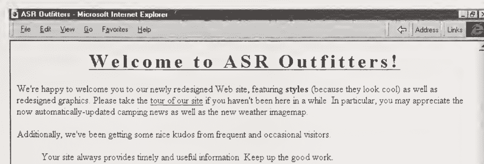

## 这里有什么

- 露营新闻提供来自步道的最新评论。
- 检查天气提供各种来源天气更新。
- 俱乐部为当地徒步和登山俱乐部提供了一个发布活动信息的地方。
- 目录展示我们的全部库存，包括最新销售公告。
- 联系我们带您进入包含联系表单、电子邮件地址和电话号码的页面。如果在这里找不到，你就找不到我们了。

## 我们做什么

除了提供最新的露营和户外活动新闻外，我们还提供登山和徒步信息。

## 指定样式 ID

你可以为一次性使用指定 ID——例如，如果你正在开发一个动态 HTML 文档。在 ID 选择器开头使用 `#`，并在随后的样式块中使用：

```css
<STYLE>
<!--
#firstusered { color : red }
-->
</STYLE>
```

你可以使用 ID，如示例中的 `firstusered`，配合任何单个 `ID=` 属性，注意控制你的文档的显示。如果你指定了一个具有特定 ID 的元素（例如 `<P ID=firstusered>`），你可以在文档中仅使用该 ID 一次。

## 设置框属性

你使用框属性来创建各种类型的框设计——这是标准 HTML 中不具备的功能。你可以对文本进行框处理（例如警告或联系信息）以引起注意，如图 4.10 所示。你可以调整边距来控制文本与边界的距离，还可以移除边框以创建浮动文本。表 4.9 列出了一些常用的框属性。

## 图 4.10

浮动框对于引起注意或使页面设计更有趣很有帮助。

| ASR Outfitters - Microsoft Internet Explorer |
| :--- |
| 文件 编辑 查看 收藏 帮助 | 地址 链接 |

# 欢迎来到 ASR Outfitters！

我们非常欢迎你来到我们新设计的网站，这里有全新的样式（因为它们看起来很酷）以及重新设计的图形。如果你一段时间没来这里了，请看看我们网站的外观。特别是，你可能会喜欢自动更新的露营新闻和新的天气快照。

此外，我们收到了一些来自常客和偶尔访问者的赞誉。

> 你们网站提供了及时且实用的信息。继续努力。Jen Smith

## 这里有什么

- 露营新闻提供来自步道的最新评论。
- 检查天气提供各种来源天气更新。
- 俱乐部为当地徒步和登山俱乐部提供了一个发布活动信息的地方。
- 目录展示我们的库存，包括最新销售公告。
- 联系我们带你进入联系表单、电子邮件地址、邮寄地址和电话号码。如果在这里，你可以找到我们。

## 我们做什么

除了最新的露营和户外活动新闻外，我们还提供登山和徒步信息。


> **提示**：在编写时，Internet Explorer 和 Netscape Navigator 对框属性的支持方式不同——特别是周围文本与框之间的关系，以及文本周围框的大小非常不一致。

## 表 4.9：框属性

| 属性 | 值 |
|---|---|
| `margin-top` | 测量值、父元素的百分比 |
| `margin-right` | 测量值、父元素的百分比 |
| `margin-bottom` | 测量值、父元素的百分比 |
| `margin-left` | 测量值、父元素的百分比 |
| `margin` | 测量值、父元素的百分比 |
| `border-width` | 测量值、粗、中等、细 |
| `border-color` | `#rrggbb` |
| `border-style` | 无、点状、虚线、实线、双线、凹槽、凸脊、内、外 |
| `border` | 上述属性的任意或全部 |
| `width` | 测量值或 % |
| `height` | 测量值或 % |
| `float` | 右、左、无 |
| `clear` | 右、左、无、都 |

要创建一个框，请对 HTML 文档中的现有文本应用这些框级特性，例如段落、块引用或标题。以下步骤显示了如何使用现有的块引用创建一个框。此框将靠右边距浮动，具有 2 像素的边框，且仅占窗口宽度的 50%。

1. 在样式块内，添加 `BLOCKQUOTE` 选择器。

```css
<STYLE>
<!--
BLOCKQUOTE
-->
</STYLE>
```

2. 添加括号。

```css
<STYLE>
<!--
BLOCKQUOTE { }
-->
</STYLE>
```

3. 添加 `WIDTH` 属性，值为 50%。

```css
<STYLE>
<!--
BLOCKQUOTE { width : 50% }
-->
</STYLE>
```

4. 添加分号作为分隔符以及 `FLOAT` 属性，其值为右。

```css
<STYLE>
<!--
BLOCKQUOTE { width : 50% ; float : right }
-->
</STYLE>
```

5. 添加另一个分号作为分隔符以及 `BORDER` 属性。在本例中，我们提供了一个 2 像素的边框。

```css
<STYLE>
<!--
BLOCKQUOTE { width : 50% ; float : right ; border : 2px solid black; }
-->
</STYLE>
```

## 图 4.11

浮动框对于引起注意或使页面设计更有趣很有帮助。

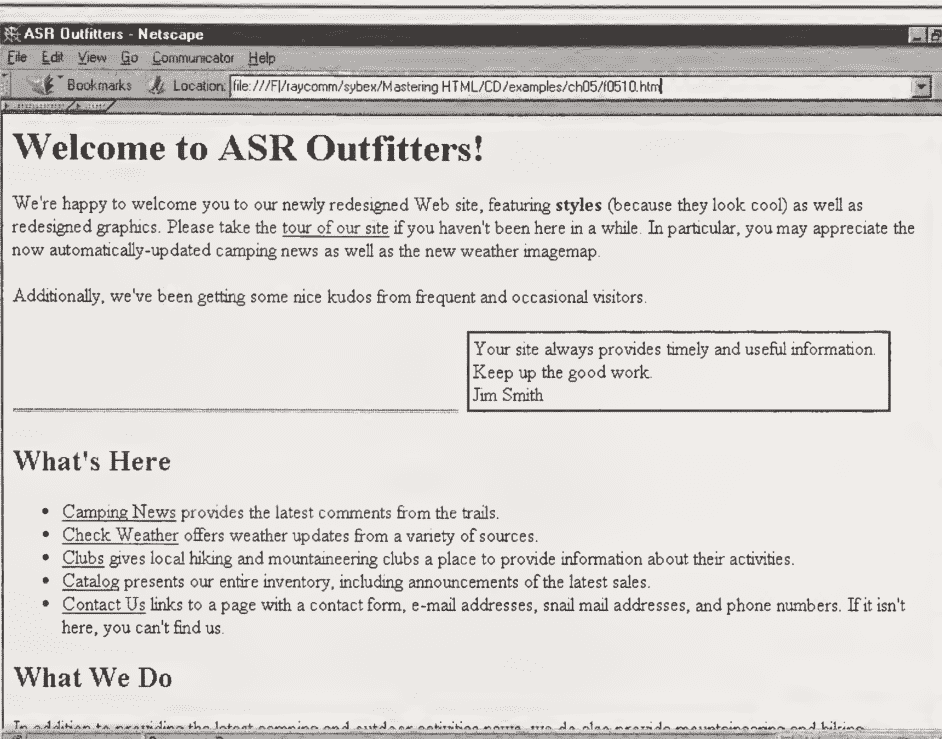

## 设置颜色和背景

你使用颜色和背景属性来指定元素的颜色和背景图像。表 4.10 列出了一些常用的颜色和背景属性。

| 属性 | 值 |
|---|---|
| `color` | 颜色值 |
| `background-color` | 颜色值 |
| `background-image` | `url(...)` |
| `background-repeat` | repeat, repeat-x, repeat-y, no-repeat |
| `background-attachment` | scroll, fixed |
| `background-position` | 测量值或 % |
| `background` | 上述属性的简写 |

## 设置分类属性

你使用分类属性将特定元素从行内元素（如 `I` 或 `B`）更改为前后带有换行符的块级元素（如 `P` 和 `H1`），并控制列表的显示。表 4.11 列出了一些分类属性及其值。

| 属性 | 值 |
| --- | --- |
| `display` | inline, block, list-item |
| `line-height` | 测量单位或 % |
| `list-style-type` | disc, circle, square, decimal, lower-roman, upper-roman, lower-alpha, upper-alpha, none |
| `list-style-image` | `url(http://someour1.com/image.gif)` |

要指定正方形符号的无序列表，请按照以下步骤操作：

1. 在样式块中，添加一个 `UL` 选择器，紧接着在同一行添加一个 `LI` 选择器。通过组合这些选择，样式规则将仅应用于 `<UL>` 内部的 `<LI>`。为 `<LI>` 设置规则会影响所有编号列表和符号列表。

```css
<STYLE>
<!--
UL LI
-->
</STYLE>
```

2. 添加大括号。

```css
<STYLE>
<!--
UL LI { }
-->
</STYLE>
```

3. 添加一个值为 `square` 的 `list-style-type` 属性。

```css
<STYLE>
<!--
UL LI { list-style-type : square }
-->
</STYLE>
```

你还可以使用 `list-style-image : url(figure.gif)` 来设置特定的图像作为项目符号，如下所示：

```css
<STYLE>
<!--
UL LI { list-style-image : url(figure.gif) }
-->
</STYLE>
```

通过更改 `display` 属性，你可以将列表从习惯的垂直列表更改为行内列表，其中每个项目出现在文本行内。使用以下样式规则。

```css
<STYLE>
<!--
UL LI { display : inline }
-->
</STYLE>
```

## 设置听觉样式表属性

样式表功能最近添加的内容之一是听觉属性，它允许为将读出的文档（而非屏幕显示的文档）设置属性。视障访问者可以使用这些属性，或者你可以将其作为视觉演示的补充，或者在无法阅读的情况下使用（例如在开车时）。听觉样式表属性允许你指定文档可以被读出、指定声音特征以及指定其他听觉选项。

表 4.12 列出了听觉样式表属性及其值。访问《参考手册》第 2 部分获取更多属性和值。

## 表 4.12：听觉样式表属性

| 属性 | 值 |
| --- | --- |
| `volume` | value, percentage, silent, x-soft, soft, medium, loud, x-loud |
| `pause` | value, percentage |
| `speech-rate` | value, extra slow, slow, medium, fast, extra fast, faster, slower |
| `pitch-range` | value |

> **注意**：听觉样式表是 CSS2 规范的一部分，仅在符合 CSS2 标准的浏览器中可用。

要指定以大音量和快速速度读出文档（为了提高效率），请按照以下步骤操作：

1. 在一个新的样式块中，提供一个 `BODY` 选择器，使你的设置应用于整个文档。

```css
<STYLE>
<!--
BODY
-->
</STYLE>
```

2. 添加大括号。

```css
<STYLE>
<!--
BODY { }
-->
</STYLE>
```

3. 添加一个值为 `loud` 的 `volume` 属性。

```css
<STYLE>
<!--
BODY { volume: loud; }
-->
</STYLE>
```

4. 添加一个值为 `fast` 的 `speech-rate` 属性。

```css
<STYLE>
<!--
BODY { volume: loud; speech-rate: fast; }
-->
</STYLE>
```

## 设置打印媒体属性

打印媒体属性可以帮助你适应打印你的文档而非在线阅读的访问者。这些 CSS2 属性允许你设置页面框的值，你可以将其理解为打印内容的区域。例如，在纸质打印中，你的页面框可能是 8.5 × 11 英寸的纸；页面框包含了内容、页距和边缘。表 4.13 列出了一些常见的打印媒体属性及其值。《参考手册》第 2 部分提供了更多信息。

| 属性 | 值 |
| --- | --- |
| `size` | value, automatic, portrait, landscape |
| `marks` | crop marks, cross marks |
| `margin` | length, percentage, automatic |
| `page-break-before` | automatic, always, avoid, left, right |
| `page-break-after` | automatic, always, avoid, left, right |
| `page-break-inside` | automatic, always, avoid, left, right |
| `orphans` | value |
| `widows` | value |

> **提示**：就像样式表一样，打印媒体属性是 CSS2 规范的一部分，仅在符合 CSS2 标准的浏览器中可用。

要指定打印文档在所有 `H1` 元素之前分页，请按照以下步骤操作：

1. 在样式块中，提供一个 `H1` 选择器，将你的设置应用于整个文档中的所有一级标题。

```css
<STYLE>
<!--
H1
-->
</STYLE>
```

2. 添加大括号。

```css
<STYLE>
<!--
H1 { }
-->
</STYLE>
```

3. 添加一个值为 `always` 的 `page-break-before` 属性。

```css
<STYLE>
<!--
H1 { page-break-before: always; }
-->
</STYLE>
```

## 使用定位

通过定位，你可以在样式规则中添加属性来控制元素。例如，你可以相对于其他元素指定位置。表 4.14 列出了一些定位属性及其值。

| 属性 | 值 |
| --- | --- |
| `position` | static, absolute, relative, fixed |
| `top`, `bottom`, `left`, `right` | 测量单位或 % |
| `overflow` | visible, scroll, hidden, auto |
| `z-index` | 整数 |

> **提示**：定位属性是 CSS2 规范的一部分，仅在符合 CSS2 标准的浏览器中可用。

要指定元素相对于其页面进行定位，请按照以下步骤操作：

1. 在一个新的样式块中，提供一个 `DIV` 选择器。

```css
<STYLE>
<!--
DIV
-->
</STYLE>
```

2. 添加大括号。

```css
<STYLE>
<!--
DIV { }
-->
</STYLE>
```

3. 添加一个值为 `relative` 的 `position` 属性。

```css
<STYLE>
<!--
DIV { position: relative; }
-->
</STYLE>
```

4. 添加一个值为 `20px` 的 `top` 属性。

```css
<STYLE>
<!--
DIV { position: relative; top: 20px; }
-->
</STYLE>
```

# 第 5 章 • 发布你的 HTML 文档

## 寻找 Web 托管服务

另一个选项——虽然不是 ISP（互联网服务提供商），但类似的——是 Web 托管服务。Web 托管服务不提供拨号上网接入，而仅仅提供一个你可以用来发布网站的“家”。

通常情况下，你会结合 ISP 使用 Web 托管服务，从而将最优惠的托管方案与拨号接入相结合。虽然一家公司可能满足你的所有需求，但单独购买这些服务是很有用的。要获取相当全面的 Web 托管服务列表，请查看：

`www.yahoo.com/Business_and_Economy/Companies/Internet_Services/Web_Services/Hosting/`

ISP 通常提供一系列服务，你需要对它们进行一些研究，同时还要了解启动费用和月费。尽管如此，ISP 通常提供个人账户或商业账户。

## 关于 ISP 个人账户

通常情况下，ISP 为个人订阅者（相对于商业订阅者）提供互联网访问、电子邮件访问，以及 Web 服务器上较小的存储空间。许多 ISP 还提供其他服务，例如通过电子邮件向你发送测试结果。具体取决于你打算如何处理你的 HTML 页面。例如，如果你计划创建并发布简单的 HTML 文档，你可能只需要少量的 Web 空间。另一方面，如果你计划创建一个巨大的网站或加载了多媒体和可下载文件的网站，你可能需要额外的 Web 空间。或者，如果你计划包含表单或使用服务器特定的功能，你可能需要某些服务器权限或服务器上提供的特定程序。因此，在选择 ISP 账户时，首先弄清楚你想做什么，然后找到能满足你需求的 ISP。

> **提示**：一旦你找到一个看起来符合你需求的 ISP，先从签署一份短期合同开始——比如不超过六个月——直到你确定该服务令人满意。

# 第 5 章 • 发布你的 HTML 文档

除了了解 ISP 提供的通用服务外，根据你的需求，你可能还想问以下问题：

- 它是什么种服务器？服务器运行在什么平台上？如果你知道服务器和平台，你可以在 Web 上找到相关文档，这些文档应该告诉你你可以轻松添加哪些脚本。例如，如果 Apache 服务器运行在 Sun Sparstation 上（一种常见的 ISP 场景），你可以要求你的服务器管理员安装特定的 Perl 脚本。然而，如果你处于一个基于 Windows NT 的 Netscape 服务器的局域网中，并且听说 Macintosh 上的 WebStar 有某种酷的增强功能，你可以省去尴尬，直接不要要求。

- 我可以限制对页面的访问吗？在服务器上测试页面时，你不希望整个世界都看到它们——为整个网站设置密码限制访问对这大有帮助。此外，如果你有一些页面只想让少数人访问（或除少数人以外的所有人），你需要能够设置密码，且理想情况下最好要简便且不浪费时间。

> **警告**：在互联网上发布页面时要小心。如果你没有提供页面的链接或发布页面的 URL，人们仍然可能发现它。此外，搜索引擎也可以索引页面，使页面变得可用。

- 我可以安装并运行自己的脚本吗？如果可以，你将比其他情况下拥有更多的灵活性和能力。如果你受限于 ISP 已经安装供你使用的程序，你可能可以使用某些特殊功能（如聊天室），但可能无法获得你真正想要的灵活性。

- 你们维护访问日志吗？我该如何发现我的网站每天有多少次访问？如果你正在销售服务、推广你的公司或进行任何其他涉及大量人员看到你的信息的活动，你需要确保访问被记录，并且你需要学习如何获取这些日志。

> **提示**：询问你的服务器管理员可以使用哪些工具来查看和排序服务器访问日志——“原始”（未处理的）日志是一团乱麻，但有很多整洁的程序可以将日志解析为有用的内容。虽然你的服务器管理员可能安装了这些程序，但访问说明可能并未公开。

- 如果服务器在下午 2 点没有响应，我该打谁？凌晨 2 点呢？
- 你们会备份吗，还是我需要亲自备份自己的网站？在什么情况下你会恢复备份文件——仅在服务器崩溃时，还是在我误删文件时恢复？

> **提示**：如果你正在考虑 ISP 商业账户或在互联网上发布，也可以问这些问题。

## 关于 ISP 商业账户

如果你正在经营业务（或准备经营），请考虑商业账户。商业账户虽然比个人账户贵，但通常包含 Web 空间、更好的服务器访问权限和保证运行时间。

获取虚拟域名简单的方法是让你的 ISP 为你设置。在 InterNIC（主域名注册服务）注册域名，你可能需要支付 50 到 100 美元左右。不过，如果你对 ISP 做一些功课，你可以自己设置虚拟域名并节省一些费用。访问 `rs.internic.net/`，点击“Registration Services”链接，并按照屏幕指令操作。

## 虚拟域名

作为信息提供者，你并不限于使用服务器名称作为你的主机名部分。相反，你可以使用虚拟域名，这让你拥有了自己的主机名，但你的文件仍然存储在主机计算机上。虚拟域名是小型公司组织看起来比实际更大的非常流行方式。

例如，如果你将文件放在一个名为 `xmission.com` 的服务器上，你的 Web 地址可能看起来如下：

`http://www.xmission.com/~accountname/filename.html`

在这种情况下，地址包含协议指示符、服务器上的特殊文件夹（由波浪号 `~` 表示）、账户名称和文件名。

虚拟域名更改了地址以消除特殊文件夹，并替换为新的主机（域名）名。例如，使用虚拟域名的 Web 地址（实际上是我们的）可能像这样：

`http://www.raycomm.com/index.html`

这个示例包含了协议指示符、域名（`www.raycomm.com`）和文件名（`index.html`）。

最后，使用域名有助于建立你的身份。每个域名都是唯一的，可以包含公司名称或其他名称。例如，你的公司名是 RayComm, Inc., 但我们可能可以将域名扩展为 `raycommunications.com`（或类似的名称）。

但有一个陷阱。如果你不注册你的域名，别人就会注册。如果你有一个运营公司名称，请立即获取一个域名，如果你在近期内可能不会使用它。大多数流行的名字都已经被占用了。例如，我们最初想要用 `ray.com`。由于它已经被雷神技术公司占用，我们最终选择了 `raycomm.com`。

如果你有一家小企业且尚未注册公司，或者正在考虑注册，可以考虑先获取域名，然后以该名称进行公司注册。这似乎有点倒宾为置，但域名必须是唯一的，而且对好名字的竞争非常激烈。在你获得域名后，请办理该名称的业务经营注册。

在写作时，一家名为 Network Solutions, Inc.（或 InterNIC）的公司控制着 `.com`、`.org` 和 `.net` 名的注册。

注册域名请遵循以下流程：

1. 访问 `rs.internic.net/` 并选择注册服务。
2. 从菜单中选择“Whose”，在查询中输入你预期的域名并按回车。例如，你可能会输入 `breakfastbuffetarget.com` 或 `eatmoofgreatburggers.com`。
   如果你足够好，你会看到“无匹配”的情况，这意味着你的域名是可用的。如果你运气没那么好，你会看到你输入的名称的持有者的 InterNIC 记录。如果你愿意，可以联系他们看看他们是否想将其出售或交给你，但直接寻找另一个名字可能更有成功率。
3. 要么注册该名称，要么要求你的互联网服务提供商为你注册。大多数 ISP 如果会托管你的网站，就会免费为你注册域名，或者会收取一小额费用（100 美元或更少）的服务费外加托管费。如果你的 ISP 尝试收取的远高于 100 美元的费用，你可能考虑自己动手或寻找另一个 ISP。
   如果你真的想自己动手，InterNIC 网站上提供了所有的信息和说明，尽管你需要从你的 ISP 那里获得一些信息和配合以正确填写所有表格。

## 通过公司服务器发布

你可能发布 HTML 文档的另一个地方是公司服务器——极有可能是你的工作场所。如果你在大型公司或教育机构工作，或者你与处理系统管理任务的组织或团体一起工作，那么在访问 Web 服务器时，你可能不需要做什么。所有必要的环节——访问、管理、安全——可能已经到位，你只需接入并开始使用服务器即可。这种情况可能是理想的，也可能是最糟糕的，取决于实际运行 Web 服务器的团队。

你在公司层面拥有的访问和控制权因公司而异。在理想情况下，其他人负责运行服务器，但在合理范围内允许你做任何你想做的事。你可以设置和运行服务器端程序，并且基本上可以完成为内网提供信息而所需的任何工作。在另一个极端，你必须遵守严格的流程向内网提交信息，然后对这些信息的放置位置或链接方式只有有限的控制权。

很有可能，你的公司处于两者之间的中间水平，拥有一套访问公司内网的既定程序，但在执行你需要的事情方面有一定的自由度。如果没有，或者提供内容的过程受到严格控制，你可能想尝试运行你自己的服务器。无论如何，你都需要找到如何联系服务器管理员，获取紧急联系电话，了解公司内网政策，并从那里开始。

# 第 5 章 • 发布你的 HTML 文档

## 通过你自己的服务器发布

最后，你可能选择在自己的服务器上发布 HTML 文档。如果你拥有技术专长和现有的基础设施，运行自己的服务器将为你提供最大的灵活性和最好的资源范围。运行自己的服务器的一个好原因是它是开发和测试页面的更真实的环境。例如，如果你在链接中使用服务器相对 URL，那么当你从服务器加载文件时它们将能够正常工作，但如果你在本地加载相同的文件，则无法正常工作。（有关链接和服务器相对 URL 的更多信息，请参见第 3 章。）

> **提示**：如果你有一台相对较新（或至少不是古董）的台式机，完全可以将其作为 Web 服务器。一台带有 16MB 内存的 486 计算机可以运行测试目的的 Windows 或 Windows NT（如果你至少有 32MB 内存）服务器（只要它没有同时尝试做很多其他事情）。它还可以运行相当快速且精简的 Linux（免费 Unix）Web 服务器。

### 本地测试服务器的绝佳示例

你在书中看到的任何 URL 为 `hobbes.raycomm.com/` 的图表，都是在运行在我们本地网络上的服务器上开发的，该网络与互联网隔离。运行在 hobbes 上的服务器软件（在不同时期）包括 Netscape FastTrack Server、Windows NT 内置的 Internet 信息服务器（IIS）、OmniHTTP、微软的个人 Web 服务器，以及在不同操作系统下的 Linux 版 Apache。hobbes 服务器是一台配备了 32MB 内存的 Pentium 100 计算机。性能不是很好，但对于测试目的来说绰有余。测试期间，客户端和服务器软件都在本地机器上。

虽然我们可以将所有文件加载到我们真实的网站上，但这会在我们的 URL 下向互联网发布大量尚处于深度开发阶段的垃圾内容。通过本地测试，我们将那些尚未正常工作的内容留在了自己内部。

虽然我们可以直接从硬盘打开所有文件，但那将无法测试服务器端程序和服务器相对 URL，或者无法带给我们在真实服务器上工作的感觉。

考虑到安装服务器只需要 10 分钟，如果是在现有网络中（通过软件包安装），运行服务器是值得的。

如果你打算运行自己的服务器，可能需要考虑备份问题，你将负责备份。如果服务器的硬盘突然停止工作，你将能够恢复所有内容并使其恢复正常运行。

## 了解更多关于运行自己的服务器的信息

安装、配置和运行服务器超出了本书的范围；然而，如果你想了解更多信息，可以访问以下 Web 网站获取更多信息：

- `www.microsoft.com/`
- `http://www.omnicron.ab.ca/httpd/`
- `some.ch.man.ac.uk/pages/httpd4Mac/home.html`
- `www.apache.org`
- `serverwatch.internet.com/webservers.html`

## 发布流程

在开始之前，你需要准备好以下信息：

- **HTTP 服务器的地址**（例如，`www.raycomm.com`, `hobbes.raycomm.com`）。根据你的情况，你可能需要知道访问文件时的文件夹名称。例如，访问你站点的文件需要该 URL：`www.xm.com/~ejray/`。
- **FTP 服务器的地址（如需要）**（例如，`ftp://ftp.xmillion.com/`）。取决于你将文件传输到服务器的方式，可能需要使用 FTP（文件传输协议）。当然，也可能（特别是在公司或教育环境中）你只需将文件复制到网络驱动器上的特定文件夹即可完成操作。
- **密码和访问限制** 你可能（几乎肯定）需要一个用户名和密码来向服务器上传文件。

## 表 5.2：使用 FTP 前所需的信息

| 信息 | 示例 | 你的信息 |
| --- | --- | --- |
| FTP 服务器地址 | `ftp.mission.com` | |
| 用户名 | `foobar` | |
| 密码 | `*****` | 不要写下来！ |
| 服务器上使用的文件夹 | `public_html` | |

准备好这些信息后，你就可以准备好将文件上传到服务器了，这基本上意味着只需将 HTML 文档的副本放在服务器上。将文档上传到服务器的过程对于大多数服务器和安装环境都是不同的。它可能简单如将文件复制到文件夹（在公司内网中），也可能像完成多个在线页面表单并将文件复制到文件夹那样特殊（在“迪尔伯特式”公司的内网中——我们就有此类案例）。它也可以是一个涉及 FTP 程序的简单过程（内网和 ISP 上的常用流程）。

将文件上传到服务器的最简单方法是使用微软 Web 发布向导之类的程序，或者使用 Netscape Communicator 以及许多高级 HTML 编辑器内置的一键发布工具。如果所有文件都属于同一个文件夹，并且你不介意在文件上传时让程序（特别是 Communicator）“调整”链接，那么这些一键工具就能很好工作。

然而，你可能更喜欢使用 FTP 程序或浏览器来上传文档，如下文所述。

## 使用 FTP 上传

FTP 是用于传输文件的互联网标准工具。无论你选择哪种 FTP 程序，你可能都会遇到表 5.3 中列出的命令。正如你在接下来两个部分中看到的，当你使用文本 FTP 程序或图形化 FTP 程序进行上传时，可以使用这些命令。

## 表 5.3：用于传输文件的 FTP 命令

| 命令 | 描述 |
| --- | --- |
| `ftp` | 启动 FTP 应用程序。 |
| `open <host>` | 打开到指定 FTP 服务器名称的 FTP 连接。 |
| `close` | 在不退出 FTP 应用程序的情况下关闭 FTP 连接。 |
| `quit` | 关闭 FTP 连接和应用程序。 |
| `put` | 将文件上传到服务器计算机。 |
| `get` | 从服务器计算机下载文件。 |
| `ascii` | 将文件类型设置为 ASCII，用于上传 HTML 或文本文档。 |
| `binary` | 将文件类型设置为二进制，用于上传图像、类文件和其他二进制文档。 |
| `cd` | 更改服务器上的目录。在 `cd` 后跟接文件夹名称以进入该文件夹，在 `cd` 后跟接 `..` 以退出文件夹。 |
| `pwd` | 打印工作目录，告诉你当前处于哪个文件夹中。 |
| `mput` | 上传多个文件（支持通配符）。 |

## 使用基于文本的 FTP 程序上传文件

在开始之前，你需要表 5.2 中指定的信息，并且需要准备好你的 HTML 文档和相关文件。按照以下步骤操作：

1. 在提示符处（DOS 提示符或 Unix Shell），切换到包含你想要上传的文件文件夹。例如，如果你处于 `c:` 提示符下，且文件在 `TestWeb` 子文件夹中，输入 `cd testweb`。
2. 输入 `ftp` 启动 FTP 应用程序。
3. 在 `ftp>` 提示符处，输入 `open` 和 FTP 服务器的地址，例如：`open ftp.xmission.com`。
4. 提示时，输入你的用户名然后是密码。记住用户名和密码是区分大小写的。
5. 切换到你想存储文件的文件夹。如果你正在向 ISP 上传文件，你的文件夹名称可能是 `public_html` 或 `www` 类似的内容。输入 `cd public_html`。
6. 要上传 HTML 文档，首先将文件类型设置为 ASCII。输入 `ascii`。
7. 现在，使用 `put` 命令上传文档。例如：`put filename.htm`。
8. 如果你有多个文件需要上传，使用 `mput` 命令和通配符。例如，上传所有以 `htm` 结尾的文件：`mput *.htm`。
9. 要上传二进制文件，首先将文件类型设置为二进制。输入 `binary`。
10. 现在，使用 `put` 命令上传文档。例如：`put image.gif`。
11. 如果你有多个文件需要上传，使用 `mput` 命令和通配符。例如，上传所有以 `gif` 结尾的文件：`mput *.gif`。
12. 完成后，输入 `quit`。

现在，打开你的浏览器并尝试访问刚刚上传的文件。如果发现图片损坏，很可能是你在上传前没有指定二进制。再次尝试，并指定二进制。如果你使用了 WYSIWYG 编辑器且链接无法使用，请检查 HTML 代码以验证文件是否被更改。Netscape Composer 和 Gold（Composer 的前身）有时会更改链接导致失效。

## 使用图形 FTP 程序上传文件

如果你有图形化 FTP 程序（如 Windows 上的 WS-FTP）或 Fetch（来自 `fetch.chatroom.com`），操作可能会更容易。具体步骤取决于软件，但通常类似于以下。在开始之前，准备好为文本 FTP 程序收集的信息。

使用以下步骤通过 WS-FTP 上传文件：

1. 启动应用程序，通常通过双击图标。
2. 在 Session Properties 会话属性中填写必要的空字段。
   - **Host Name/Address**：输入服务器的地址。
   - **Host Type**：选择 Automatic 或你知道的具体类型。通常 Automatic 即可。
   - **User ID**：输入系统管理员或 ISP 提供的 ID。
   - **Password**：输入系统管理员或 ISP 提供的密码。
   - 除非系统管理员给了你其他信息，否则请留空。

> **提示**：用户名和密码区分大小写——如果你将大写替换为小写反将无效。

3. 点击 OK。当你的 FTP 客户端连接服务器时，你会看到连接信息。
4. 在窗口左侧选择相应的本地文件夹，在右侧选择相应的远程文件夹。你可以通过双击或选择文件夹并点击 Chdir 来选择文件夹。
5. 当两侧都打开了正确的文件夹后，勾选 Auto 框以指定计算机如何交换文件。Automatic 通常可以。HTML 文件作为 ASCII（因为它们是纯文本），而图像传输为二进制（因为它们是二进制文件，而不是文本文件）。如果你尝试自动传输但上传的文件无法正常工作，请手动将图形传输设置为二进制，将 HTML 和其他文本文档设置为 ASCII。

> **提示**：如果你无法在记事本、Simple Text 或 vi 中打开并读取文件，那么它就不是文本文件。你必须将所有处理过的文档、表格和多媒体文件作为二进制文件传输。

6. 选择要传输的文件，然后点击箭头（从你的本地设备指向服务器驱动器）或“复制”按钮。

就是这样。现在，测试你所有上传的文件。

## 使用 HTTP 上传

某些自动发布工具提供了通过 HTTP 而不是 FTP 上传的选项。然而，由于安全考虑以及这项技术相对较新，只有少数 ISP 支持 HTTP 上传。

主要的区别在于，使用 HTTP 时，你只需要提供文件存放的 Web 地址，而不是 FTP 服务器地址。

对于你这个 Web 开发人员来说，只要文件传输正确，这两种方法没有真正的区别。

## 使用其他工具上传

除了使用 FTP 程序上传文档外，你还可以通过浏览器或专门的工具（如微软的 Web 发布向导）进行上传。

如果你使用较新版本的 Navigator 浏览器，可以在“位置”行输入 `ftp://yourid@yourftpserver.com/` 来上传文件。系统会提示你输入密码。这种方法的唯一缺点是你必须熟悉服务器上文件的结构。例如，在我们 ISP 处，我们需要浏览以下文件夹才能进入上传文件到我们网站的文件夹：

```
ftp://ejray@ftp.xmission.com/home/users/e/ejray/public_html
```

（我们也可以直接在位置窗口中输入整行代码。）浏览到正确的文件夹后，选择“文件 > 上传文件”来选择要上传的文件（一次只能上传一个文件）。

> **提示**：如果你通过浏览器上传，请花一点时间将该文件的长 URL 位置书签，这样你就不需要再次浏览了。

如果你对自己的 FTP 熟练程度有些怀疑，微软 Web 发布向导非常适合上传文件，但如果你需要频繁上传，你会很快发现它带来的干扰多于帮助。

## 接下来该去哪里

所以，以上就是全部！你只需要将文档副本从你的计算机传输到服务器，就可以使用 ISP、公司网络或你自己的服务器发布你的文档。通过这样做，你可以让你所在公司内部或全球 Web 上的其他人访问你的文档。

从这里开始，你有很多选择。以下是一些建议：

- 转到第 6 章学习如何包含图像——并且要明智地这样做。
- 访问第 7 章学习如何开发和包含表格。
- 查看第 8 章，学习如何包含表单（记住，你需要让服务器为你处理表单！）。
- 查看第 9 章，学习如何使用框架。
- 访问第 14 章获取更多关于公共、个人和内网网站的信息。


# 第二部分：提升你的技能

学习：

- 整合图像和图像映射
- 开发表格
- 处理表单
- 创建和使用框架

# 第 6 章 • 包含图像

特色：

- 选择合适的文件大小、物理尺寸和图像格式
- 在 HTML 文档中添加图像
- 包含备用文本
- 指定图像的高度和宽度
- 图像对齐
- 指定边框
- 使用图像作为链接
- 创建图像映射
- 使用图像作为背景


我们迈向 HTML 专家的下一步是包含图像，这可以为你的 Web 页面增添活力、帮助提供信息，或仅仅是增加一抹色彩。包含图像的关键在于明智地这样做——即选择有目的的图形，使用合适的格式，并采用适当的图形。通过花时间明智地使用图像，你可以最大限度地发挥它们对访问者的效果。

在本章中，我们将向你展示如何选择合适的图像、选择文件格式、为不同目的使用图像以及开发图像映射（那些带有多个链接的可点击图像）。现在，让我们来看吧。

## 开发图像

尽管图像为你的 Web 页面增了活力，但如果处理不当，它们可能会变成负担。例如，图像的加载可能需要“永远”那么久，成为你访问者的障碍。同样，图像可能会不必要地占用空间（或内存），可能遮盖重要内容。因此，使用图像的目标是通过考虑三个要点来正确地开发它们：

- 文件大小
- 物理尺寸
- 文件类型

## 确定文件大小

将图像想象成三维的，具有高度和宽度。例如，图像的大小等于它的高度 × 宽度。因此，通过以下方法让你的图像尽可能高效：

- 减少颜色数量。例如，你可以将色彩深度降低到 256。
- 缩小物理尺寸。例如，你可以将图像从 600x400 缩小到 300x200。生成的较小图像占用的空间更少。（你将在下一节中找到图像缩放的指南。）
- 使用可以压缩文件的格式。（你将在“图像格式”章节中找到更多关于合适图像格式的知识。）

## 处理物理尺寸

图像的物理尺寸是其高度和宽度，不仅影响它的显示方式，还影响加载速度。图像应该有多大？嗯，这取决于情况。许多网站使用微小的图像作为按钮和图标，这可以有效地为 Web 页面增加颜色或维度。其他网站使用较大的图形作为 Logo 或按钮栏，这同样有效。图像没有“正确”的尺寸；相反，关键是要考虑以下因素：

- 图像的用途
- 整体页面设计
- 访问者的计算机技能

### 考虑图像用途

每当你向页面添加图像时，你都需要一个充分的理由来这样做——为了说明某个观点、展示某人或地点、概述一个过程，或者仅仅为一份单调的文档增加一些色彩和趣味。确保每张图像都能增强其内容、设计和性能。

在确定图像尺寸时，要考虑它的重要性。例如，如果你的访问者需要图像来理解一个概念，那么图像应该大一些。相反，仅仅增加一抹色彩的图像可能应该小一点。如果你不确定图像有多重要，请倾向于较小。记住，图像会增加加载时间，并影响访问者访问页面的体验。

### 考虑页面设计

图像是视觉上“重量级”的对象——即，比其他页面元素更快地吸引注意力。过大的图像会压页面内容并遮盖信息。在确定图像尺寸时，特别要考虑图像相对于其他页面元素如何显示。这里有一些你可以问自己的问题：

- 页面会包含多个图形？
- 页面会加入边框和阴影吗，这些比文本更有重量？
- 页面将包含大量的文本还是只有几个单词？文本可以用体积来弥补其视觉重量的缺失。大量的文本比少量文本能更有效地平衡图形。

### 考虑访问者的计算机设置

访问者的计算机设置也会影响图像在屏幕上的显示方式。在 640 × 480 像素的分辨率下，一张 600 × 400 像素的图像几乎会占据整个屏幕。但在设置为 1280 × 1040 的电脑上，该图像占据的空间将要少得多。一个通用的经验法则是将图像尺寸限制在 600 × 400 像素以内。这种尺寸的图像可以完全适应那些最低（不幸的是，非常常见）640 × 480 像素分辨率的 Windows 电脑的浏览器窗口内。当然，如果你能让图像更小，将有助于加快加载速度。

> **提示**：为了充分传达内容，很少图像需要大于 600 × 400。通常 300 × 200 像素范围的内容是照片的理想尺寸，而按钮通常为 50 × 50 像素或更小。

## 理解图像格式

在制作图像时，你还应该考虑格式选项。基本上，你可以根据需求使用 GIF、JPG 或 PNG 格式。

## 理解 GIF

最常见的图像格式是 GIF（读音类似 jiffy），它是 Graphics Interchange Format（图形交换格式）的缩写，由 CompuServe 开发，以供在线使用。如果你在图像编辑软件的“保存选项”中浏览，你会发现 GIF 文件格式有两个版本：87a 和 89a。你应该选择 89a 版本，它包含了以下特性。

- **GIF 支持透明度**。透明度将图像的背景颜色设为浏览器的背景颜色，从而使图像看起来好像没有背景。例如，ASR Outfitters 的标志就是一个透明图像——角区域显示为不同的颜色并被设置为透明。图 6.1 显示了该图像在图像编辑程序（Paint Shop Pro）中的显示；即使你设置了背景为透明，你仍然能看到它。图 6.2 显示了该图像在浏览器（Internet Explorer）中的显示。

### 图 6.1

在图像编辑程序中查看时，透明背景仍然可见。

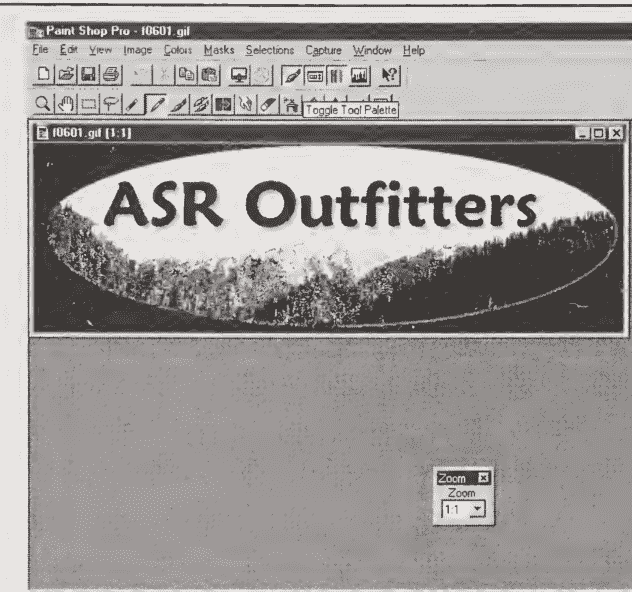

### 图 6.2

在浏览器中查看时，透明背景不可见。

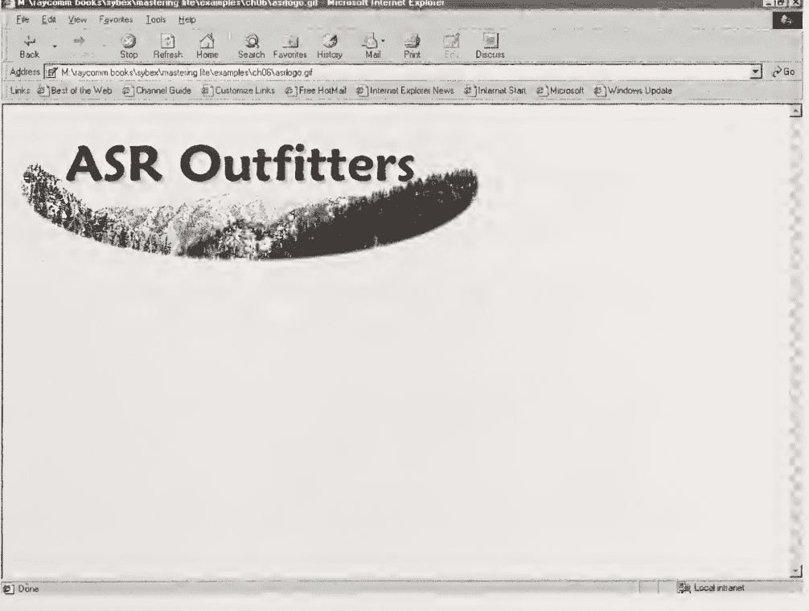

## 关于这些图像

首先，图 6.1 和图 6.2 显示的图像宽度约为 600 像素，在常用分辨率的浏览器中查看时几乎让人大所观观。

其次，图像背景是纯白色，椭圆内的可见区域几乎是白色但并非完全白色。我们必须更改背景颜色，以便在打印页面上实现透明效果。当你创建透明图像时，可能会发现将透明颜色设置为不寻常的颜色是有用的，这样一眼就能看出哪些部分应该是透明的。

- **GIF 支持动画**。一些图像编辑程序和专业程序可以将多个 GIF 合并为一个文件，然后轮流显示每个图像或面板。这种效果非常像卡通翻页书——你翻动页码，看到运动的幻象。

并不是所有浏览器都显示动画 GIF，尽管大多数浏览器都支持它们。使用动画 GIF 是一种在不借助 Java applet 或更复杂的插件的情况下提供动画的简单方法。你将在第 11 章找到更多关于动画 GIF 的信息。

> **提示**：动画 GIF 比非动画 GIF 大得多，每个动画面板都相当于一张额外的图像。

- **GIF 支持渐进式渲染**。渐进式渲染也被交叉存储，指的是图像在屏幕上出现的方式。浏览器按照从网络接收或从磁盘加载的方式逐行显示非交叉存储图像。在所有内容加载完成之前，看不到完整的图像。浏览器分批显示交叉存储图像，填充每八行一次，直到显示整个图像。

交叉存储的效果因浏览器而异。某些浏览器将下载的图像显示为缓慢聚焦。另一些浏览器则显示它为像波斯百叶窗一样缓慢打开，直到显示整个图像。无论何种方式，交叉存储图像都在非交叉图像之后出现在屏幕上，并允许那些熟悉该图像的访问者在整个图像出现之前获取大致内容。

- **GIF 支持无损压缩**。无损压缩是在不丢失图像细节的情况下保存文件的高效方法。当保存 GIF 时，它们会被压缩以占用更少的磁盘空间，并缩短下载时间。通过无损压缩，压缩算法会注意到大面积的单色区域，它不是记录每个单独像素的颜色，而是指示颜色和重复次数。图像本身没有发生变化，只是保存得更高效。因为 GIF 压缩是无损的，所以 GIF 图像最适合线条画、图标和绘画。

> **注意**：GIF 有一个缺点——它们只能包含 256 种颜色，这对于真实的照片质量是不够的。虽然对于许多用途 256 种颜色足够了，但对于需要更高质量的图像，你可能想要使用 JPG 文件格式。

## 理解 JPG/JPEG

JPG 的读音是 Joint Photographic Experts Group（联合摄影专家小组）的缩写。这种格式（通常写为 JPEG）是 Web 上第二流行的格式。


# 图像格式与 HTML 图像处理

## 提示

尽管 JPG 支持渐进式渲染，但大多数常用浏览器并不利用这一特性。

JPG 的主要优点是它支持数百万颜色，从而提供更真实的还原。此外，由于 JPG 使用更有效但有损的压缩，它们更小且下载更快。有损压缩丢弃部分图像以减小文件大小。JPG 对于照片比线条画更好。

在图像编辑程序中设置 JPG 选项有助于尺寸和质量。如果图像仅用于 Web——不用于印刷出版——100 DPI 绰绰有余。根据图像、应用程序和最终目的，你通常可以增加压缩而不丢失细节。

## 理解 PNG

PNG 读音 *ping*，代表 Portable Network Graphics（端口网络图形）。这种新图像格式被大多数版本的浏览器支持（Internet Explorer 4 或更高版本以及 Netscape Navigator 4.0 或更高版本）；然而，PNG 了 GIF 的大多数优点，包括透明度和交叉存储，外支持数百万色彩和紧密的无损压缩。

## 哪种图像格式适合你？

选择哪种图像格式取决于你想包含的特性。表 6.1 比较了三种图形格式的特性。

### 表 6.1：GIF、JPG 和 PNG 的特性

| 特性 | GIF | JPG | PNG |
| --- | --- | --- | --- |
| 透明度 | 是 | 否 | 是 |
| 交叉存储/渐进渲染 | 是 | 是 | 是 |
| 百万色彩 | 否 | 是 | 是 |
| 无损压缩 | 是 | 否 | 是 |
| 适合线条画 | 是 | 否 | 是 |
| 适合照片 | 否 | 是 | 是 |
| 大多数浏览器接受 | 是 | 是 | 否 |

正如你看到的，GIF 和 JPG 具有互补的优缺点。然而，随着更多浏览器支持 PNG，可能会成为首选。

## 添加图像

在本节中，我们将为 ASR Outfitters 创建一些 Web 页面，这是一个登山和远足用品公司，是休闲零售商 REI 的虚拟微缩版本。在这个过程中，你将学习如何在 HTML 文档中包含图像。虽然这看起来像是本末倒置，但了解如何包含图像会让开发它们变得更容易。

表 6.2 显示了在 Web 页面中插入图像的主要图像标签和属性。

### 表 6.2：图像标签与属性

| 标签 | 用途 |
| --- | --- |
| `` | 在 HTML 文档中标记图像 |
| `ALT="..."` | 当图像未显示时指定的备用文本 |
| `SRC="..."` | 指向要包含的图像文件 (URL) |
| `HEIGHT=n` | 指定图像的最终高度（单位：像素） |
| `WIDTH=n` | 指定图像的最终宽度（单位：像素） |
| `BORDER=n` | 指定图像周围边框的宽度（单位：像素） |
| `ALIGN="..."` | 指定图像对齐方式，如顶部、居中、底部、左对齐或右齐 |

### 添加图像

添加图像与添加你已经使用的标签和属性类似。你使用 `` 标签来指定图像，并加上 `SRC=` 属性来指定文件名或 URL。例如，如果你包含的是一个与文档位于同一文件夹中的图像，你的代码可能如下：

```html

```

或者，如果你包含的是位于 Web 上的图像，则会包含一个绝对 URL，如下：

```html

```

在 `SRC` 属性中使用的 URL 称为远程引用。远程引用标志和图像具有某些优点，也有显著的缺点。一个优点是，远程引用可以确保你始终使用的是最新的标志。例如，如果 ASR Outfitters 聘请了一家图形设计公司更改其公司形象，使用主站远程引用的加盟商网站将在主站发生变化后立即反映这些变化。此外，远程引用减轻了你服务器的负担，并减少了你必须管理和处理的文件数量。

缺点是，你无法控制的变化很容易破坏你网站上的链接。如果 ASR 网站管理员将图像从 `GIFs` 子目录移动到 `images` 子目录，加盟商的网站将无法工作，因为 `SRC=` 属性指向的子目录已不再包含这些图像文件。从访问者的角度来看，加盟商只是有了一个不属于自己的网站——访问者实际上并不知道或不在意原因是什么。

此外，如果你远程链接到图像，网络故障或服务器问题也可能导致图像无法显示。如果你自己网站的流量很大且使用了远程图像，另一个网站可能会被需求淹没，而且不知道为什么。总的来说，你可能将图像复制到本地文件夹，或至少到你服务器上的另一个文件夹更好，而不是依赖远程服务器。


## 版权法也适用于图像

链接远程图像时要小心，因为你可能在使用受版权保护的内容。例如，如果 Bad Karma Hiking Equipment 认为 ASR Outfitters 的图像很酷，并在未经许可的情况下通过远程链接将这些酷的图像整合到网站设计中，他们就侵犯了 ASR Outfitters 的版权。这同样适用于背景图像（后文介绍）以及文档中的任何内容。要将图像添加到文档中，从一个基础 HTML 文档开始，包含以下标签：

```html
<!DOCTYPE HTML PUBLIC "-//W3C//DTD HTML 4.0//EN">
<HTML>
<HEAD>
<TITLE>ASR Outfitters</TITLE>
</HEAD>
<BODY>
<H1 ALIGN=CENTER>ASR Outfitters</H1>
<P>We provide mountaineering and hiking equipment nationwide via mail order as well as our stores in the Rocky Mountains.</P>
<HR WIDTH=70% SIZE=8>
<P>Please select from the following links:</P>
<UL>
<LI><A HREF="camping.html">Camping News</A>
<LI><A HREF="catalog.html">Catalog</A>
<LI><A HREF="clubs.html">Clubs</A>
<LI><A HREF="contact.html">Contact Us</A>
<LI><A HREF="weather.html">Check Weather</A>
</UL>
<HR WIDTH=70% SIZE=8>
<CENTER>
<ADDRESS ALIGN=CENTER>ASR Outfitters<BR>
<A HREF="mailto:info@asoutfitters.com">info@asoutfitters.com</A><BR>
4700 N.Center<BR>
South Logan, UT 87654<BR>
801-555-3422<BR>
</ADDRESS>
</CENTER>
</BODY>
</HTML>
```

### 向此基础文档添加图像，请遵循以下步骤：

1. 在你想让图像出现的地方插入 `` 标签。

```html
<H1 ALIGN=CENTER>ASR Outfitters</H1>

<P>We provide mountaineering and hiking equipment nationwide by mail order as well as our stores in the Rocky Mountains.</P>
```

2. 添加指向图像的 `SRC="..."` 属性。在本例中，文件名是 `aslogo.gif`，它与文档在同一个文件夹中；这就足够了。

```html

```

3. 在这种情况下，`` 标签后添加换行符 `<BR>`，以便后续文本从下一行开始（而不是在空格处）。

```html
<BR>
```

4. 因为图像与一级标题的内容重复，考虑移除一级标题。

5. 一级标题是居中的，所以考虑在它周围添加一个 `<CENTER>` 标签。

```html
<CENTER><BR></CENTER>
```

> **注意** `` 标签支持值为 TOP、MIDDLE、BOTTOM、LEFT 和 RIGHT 的 `ALIGN=` 属性，但不支持水平居中。如果你想使用水平居中，请使用 `<CENTER>` 标签。更多信息请参见本章节后文的“对齐图像”部分。

你可以查看图 6.3 所示 ASR Web 页面中的结果图像。

### 图 6.3

ASR Web页面中的图像

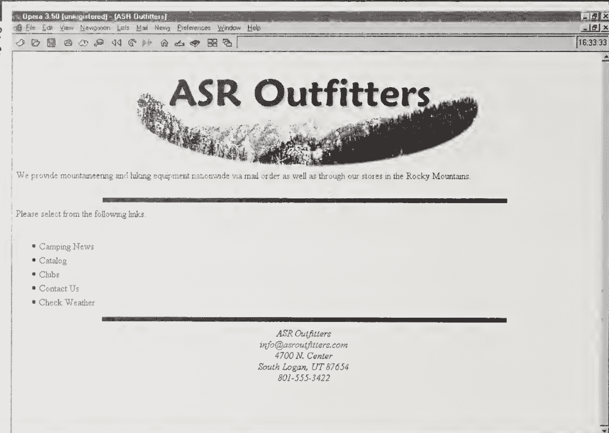

我们通过邮购以及我们在落基山的商店提供登山和远足装备。请从以下链接中选择：

- Camping News
- Catalog
- Clubs
- Contact Us
- Check Weather

ASR Outfitters

info@asoutfitters.com

4700 N.Center

South Logan, UT 87654

801-555-3422

## 包含备用文本

备用文本描述你插入的图像。你出于以下原因包含备用文本：

- 你的部分访问者可能在使用纯文本浏览器。
- 访问者可能关闭了图像以使文件加载更快。
- 有时浏览器无法正确显示图像。
- 有时由于链接未正常工作，图像无法显示。
- 有时浏览器在图像加载时显示备用文本。

备用文本应该清晰简洁。为你的访问者提供足够的信息，让他们可以在不查看的情况下理解图像。例如，标志的备用文本可以简单为公司名称和“标志”字。即使是“ASR 照片”或“ASR 内容”这样的文本也有帮助。如果他们只看到“图像”一词（假设省略了 `ALT` 属性），他们必须加载图像看到内容。

为图像添加备用文本，只需这样给 `` 添加 `ALT=` 属性：

```html

```

结果备用文本如图 6.4 所示。

### 图 6.4

备用文本提供了关于图像的信息。

| ASR Outfitters - Microsoft Explorer |
| --- |
| 文件 编辑 查看 转 帮助 |
| [上页] [前进] 首页 搜索 收藏 | 邮件 | 编辑 | 转 |
| 地址: http://mycomputer.net/home/index.v0024.html |
| 上页 | 频道指南 自定义链接 免费热点 互联网新闻 启动互联网 Windows 更新 |
> 我们通过邮购以及我们在落基山的商店提供远足装备。请从以下链接中选择：
- Camping News
- Clubs
- Contact Us
- Check Weather

ASR Outfitters

info@asoutfitters.com

4700 N.Center

South Logan, UT 87654

801-555-3422

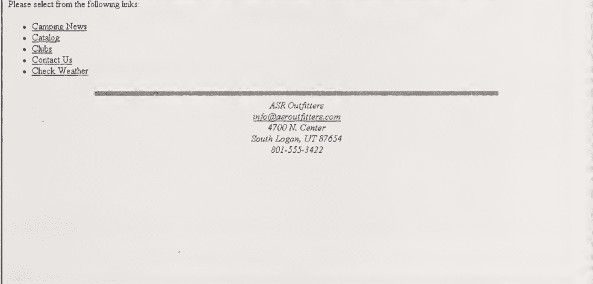

## 使用 Netscape 加感知加载时间

Netscape 特有的标签 `LOWSRC` 与 `SRC=` 属性配合工作；它告诉浏览器先加载图像的小尺寸版本，然后加载完整图像。

思路是使用一个较小的（文件大小上）图像作为 `LOWSRC` 图像。例如，使用一个尽可能压缩但保留原始尺寸的 JPG 图像。这种图像出现很快，如果访问者在页面上停留足够的时间，完整图像就会加载。该属性虽然不通用，但在不支持它的浏览器中不会产生不利影响——它们只会忽略它。

## 指定高度和宽度

通过指定图像的高度和宽度可以加快图像的加载速度。当浏览器加载页面时，它记录高度和宽度属性，并为图像留出空间。接下来，它布局剩余文本，然后回来填充图像。如果不包含这些属性，浏览器必须加载足够的图像以获取尺寸才能布局其他文本，从而减慢页面元素的显示。

要指定图像的高度和宽度，请在 `` 标签中添加 `HEIGHT=` 和 `WIDTH=` 属性：

```html

```

# 精通工作效率

## 使用透明 GIF 技巧进行格式设置

你可以使用透明图像在文档中强制产生间距。假设你想在两个段落之间留出空白。由于你不能像文字处理程序那样插入回车，你必须通过其他方式留出空白——在这种情况下，插入透明 GIF 效果非常好。透明 GIF 还可以确保文本距离左边距保持特定的距离。

要使用透明 GIF 在文档中添加间距，只需在你的图像编辑软件中创建一个 1 × 1 像素的透明 GIF，然后将该 GIF 插入到你的 HTML 文档中。

空格必须是 1 像素宽或 1 像素高吗？不一定。你可以在文档中插入这个极小的（因此下载非常快）图像，并使用 `HEIGHT=` 和 `WIDTH=` 属性指定它在 浏览器中显示的尺寸。例如，你的代码可能如下：

```html

```

这个示例产生了一个高 10 像素、宽 1 像素的空白——这是确保段落间间距的理想选择！或者，将高度设为 1，宽度设为 10 来缩进文本。

我们向你介绍这个选项是因为许多人都在使用它，如果你有非常具体的格式需求，它是可以的。但请记住，这并不是标准做法，我们不推荐这样做。HTML 并不声称提供精确的布局控制，尝试实现这种控制可能会让你感到沮丧。

如果你确实需要精确控制格式，并且你的访问者使用的是较新的浏览器，最好的办法是使用样式表（Style Sheets），这是页面开发的日益流行的方法（参见第 4 章）。

## 图像对齐

HTML 提供了几种图像对齐选项：

- 三种垂直选项相对于文本行对齐图像。
- 两个选项将图像对齐到窗口的左侧或右侧（带有相应的文本环绕）。

`` 标签内的对齐选项会覆盖 HTML 文档中的其他对齐设置（例如包裹 `` 标签的 `<CENTER>` 标签）。

默认情况下，图像左对齐，同一行会出现单行伴随文本；然而，长文本会换到下一行。为了确保伴随文本出现在图像旁边，请在 `` 标签中使用 `ALIGN='LEFT'`，如下：

```html

```

文本出现在左对齐图像的右侧，如图 6.5 所示。

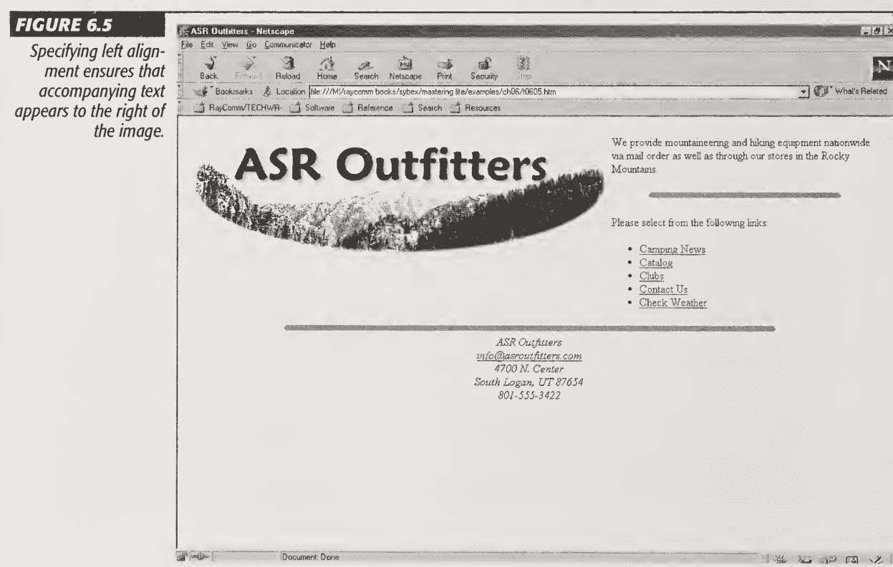

我们通过邮购以及我们在落基山脉的商店提供登山和远足装备

- 请从以下选项中选择：
- 校园新闻
- 目录
- 俱乐部
- 联系我们
- 检查天气

通过结合图像对齐和文本对齐，你可以创建吸引人的效果。例如，将图像设为 `ALIGN="RIGHT"`，然后将伴随文本也设置为 `ALIGN="RIGHT"`，这将强制文本紧贴图像且左侧边缘不对齐，如图 6.6 所示。

### 图 6.6

为图像和文本指定对齐方式可以产生视觉效果。

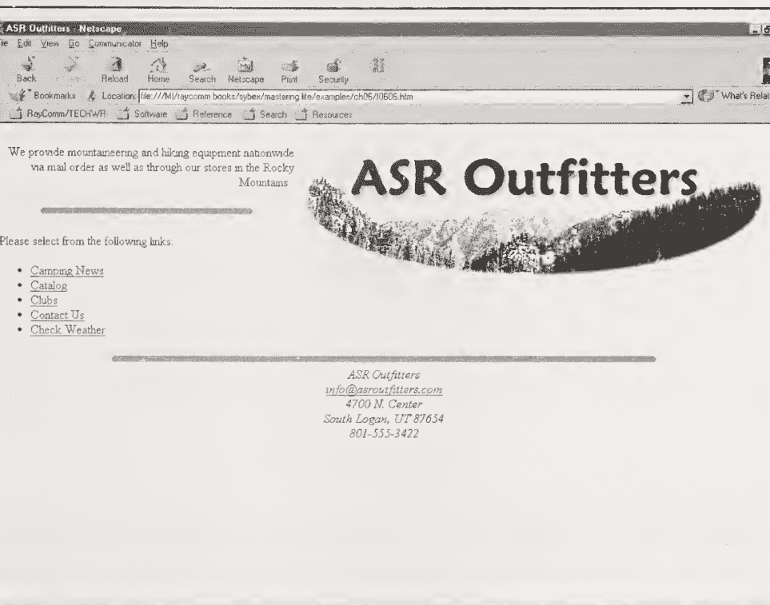

剩余的对齐选项——TOP、MIDDLE 和 BOTTOM——在小图像语境下提供了更多功能。你使用它们在文本内部对齐图像。例如，`ALIGN="TOP"` 将图像的顶部与周围文本的顶部对齐，图像的其余部分悬挂在文本行下方。使用 `ALIGN="MIDDLE"` 将图像的中间放在周围文本的基线上。同样，使用 `ALIGN="BOTTOM"` 将图像的底部与文本放在同一行，图像的其余部分则比周围文本高出得多。这些选项的效果如图 6.7 所示。

### 图 6.7

顶部、中间和底部对齐使图像相对于周围文本的浮动方式有所不同。

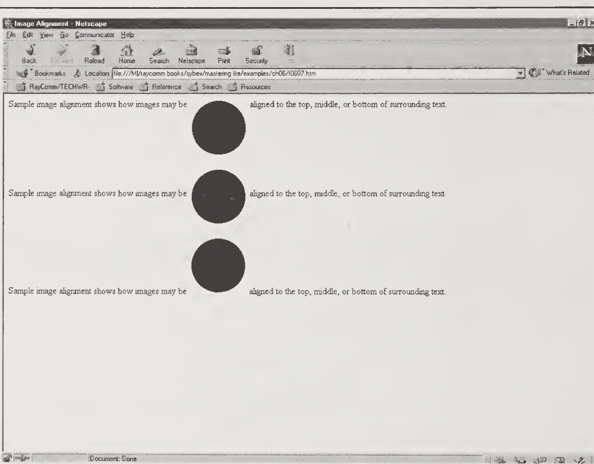

图像对齐示例显示了图像如何对齐到周围文本的顶部、中部或底部。

## HTML 4 的机会

虽然任何这些图像格式化标签在兼容 HTML 3.2 或 4 的浏览器中看起来都良好，但你可能考虑使用样式表来实现你的格式需求——包括图像格式化。

HTML 4 规范弃用了格式化标签（包括对齐选项），转而采用样式表。有关开发样式表的信息请参见第 4 章，查看 Master 参考获取全面的样式表选项列表。

## 控制边框

你通过 `BORDER` 属性控制图像周围的边框。在大多数浏览器中，默认情况下，边框仅对用链接的图像可见。要关闭边框，请在标签中添加 `BORDER="0"`，如下：

```html

```

边框看起来如图 6.8 所示。

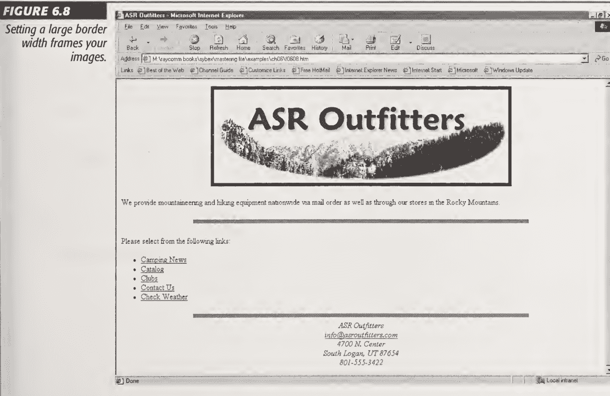

## 选择合适的颜色

当你创建图像——或为表格背景选择颜色时，你希望选择大多数浏览器都能显示的颜色。如果你选择了一种系统中不可用的颜色，浏览器将对其进行抖动（dither）。照片或小图像中的抖动很难察觉，但在面积色彩中会导致斑点。

现在，考虑到大多数访问者——大多数用户使用的计算机显示 256 种颜色。Macintosh、Unix 和 Windows 各使用一套不同的系统颜色，剩下 216 种颜色供通用。然而，如果你选择这 216 种颜色之一，可以确定它们在所有平台上看起来都很不错。这些剩余的 216 种颜色在光谱上分布均匀，提供了广泛的选择范围。

在计算机中，颜色以红绿蓝（RGB）的比例表示，并由 RGB 数字指定。这些 RGB 数字组合产生所有可用颜色。

要指定颜色，你提供数值来表示红、绿、蓝的比例。在图像编辑软件中，你可以提供进制数值。但当你为某些图像编辑软件和网页内部指定颜色时，使用十六进制数。

这些数字是什么？它们是每种颜色的进制值 0、51、102、153、204、255。也就是说，一种良好的（首选）颜色红、绿、蓝值可能是 51、51、51。在十六进制中，这些良好值为 00、33、66、99、CC、FF；因此相应的示例颜色将是 #333333。这些良好值从何来？

表 6.3 列出了使用十六进制的首选（良好）RGB 值；表 6.4 列出了十进制数值。要创建一个安全的（无抖动）颜色，请从每列中选择一个值。例如，从第一列选择 66，从第二列选择 33，从第三列选择 00，以创建 RGB 颜色 663300。

### 表 6.3：十六进制下的首选 RGB 值

| 红色 | 绿色 | 蓝色 |
| :--- | :--- | :--- |
| 00 | 00 | 00 |
| 33 | 33 | 33 |
| 66 | 66 | 66 |
| 99 | 99 | 99 |
| CC | CC | CC |
| FF | FF | FF |

### 表 6.4：十进制下的首选 RGB 值

| 红色 | 绿色 | 蓝色 |
| :--- | :--- | :--- |
| 0 | 0 | 0 |
| 51 | 51 | 51 |
| 102 | 102 | 102 |
| 153 | 153 | 153 |
| 204 | 204 | 204 |
| 255 | 255 | 255 |

通常情况下，接近这些颜色的颜色也不会产生抖动，但关于“多接近”才算足够并没有硬性规定。例如，我们尝试了 000001，发现它在我们的计算机上没有肉眼可见的抖动……至少这次没有。

> **提示** 访问第 13 章获取有关使用颜色帮助创建连贯网站的信息。此外，你还可以在《大师参考指南》的第 5 部分找到完整的浏览器安全颜色列表。

## 使用图像作为链接

将图像作为链接对你和访问者都具有两个不同的优势。首先，图片确实可以胜过千言。通常，包含一个图像链接可以替代几个单词或几行文本，为页面的其他元素留出价值的空间。

其次，你还可以使用缩略图，即链接到较大图像的较小图像。通过这种方式，你可以让访问者了解图片的大致，并决定是否要加载更大的版本。（你将在后续章节“创建缩略图”中找到有关缩略图的详情）

## 创建图像链接

要将图像添加链接，首先要添加图像标签。在这个示例中，我们正在为 ASR Outfitters 添加一个精美的按钮，以替换更平淡的“露营新闻”（Camping News）列表项。图像名称为 `camping.gif`，它应该链接的文件是 `camping.html`。

> **注意** 当你使用图像作为链接时，替代文本（alternative text）至关重要。如果点击图像是访问者连接另一个页面的唯一方式，那么当图像未显示时，替代文本就是他们的线索（由于技术困难、因为他们关闭了图像、因为他们使用的是纯文本浏览器、因为他们为视障人士使用了屏幕阅读程序等等）。

以下是添加图像链接的步骤：

1. 向文档中添加图像标签和 `SRC=` 属性。

```html

```

2. 使用 `ALT=` 属性包含替代文本。

```html

```

3. 添加想要包含的其余属性，如 `HEIGHT=` 和 `WIDTH=` 属性。如果你使用 `BORDER=0` 并完全关闭边框，请确保图像在视觉上被识别为链接，否则你的访问者可能不知道它是链接，除非他们悬停在上面并看到手型光标。

```html

```

4. 在图像前后添加链接锚点标签 `<A>`。

```html
<A></A>
```

5. 为起始锚点标签添加 `HREF=` 属性以指定文件名。

```html
<A HREF="camping.html"></A>
```

现在你有一个指向 `camping.html` 文件的图像。在添加了几张图像并将它们全部放在 `<CENTER>` 中之后，ASR Outfitters 类似于图 6.9。

### 图 6.9

图像链接可以使页面变得非常漂亮（但加载速度变慢）。

| ASR Outfitters - Microsoft Internet Explorer |
| :--- |
| 文件 编辑 视图 帮助 |
| 后退 前进 刷新 转 地址 首页 状态 打印 编辑 完成 |
| 添加收藏夹 网页链接 解释 互联网 开始 Windows 更新 |
我们通过订单以及我们在落洛基山脉的商店提供登山和徒步设备。

## 创建缩略图

正如我们之前提到的，缩略图是图像的较小版本，但它也是较大版本的链接。缩略图还可以链接到 Applet 或其他下载耗时或无法随处访问的内容。例如，ASR Outfitters 包含一张启发其标志的原始照片的缩略图。此缩略图链接到原始照片（一张较大的图像）。

要添加缩略图，首先要准备两张图像——缩略图和较大版本。从全尺寸版本开始（从你的私人收藏或任何或其他来源扫描）。然后使用你的图像编辑软件将图像调整大小或重采样为小小的尺寸——在保留图像大致内容的情况下尽可能小。将第二张图像保存为不同的名称。然后按照以下步骤操作：

1. 像包含任何其他图像一样，将缩略图包含在文档中。例如，代码可能如下：

```html

```

2. 添加指向较大版本的链接。

```html
<A HREF="photo.jpg"></A>
```

## 创建图像地图

### 提示

如果你的访问者可能使用特别旧的浏览器，请考虑同时使用客户端和服务端的图像地图。如果浏览器支持客户端图像地图，它们将使用它；如果它们不识别客户端图像地图，则将回退到服务端图像地图。这种方法的唯一缺点是你必须做双倍的工作。

## 制作合适的图像地图

构建不当或选择粗率的图像地图可能比完全没有图像地图还要糟糕得多。图像固有的缺点（例如，下载时间以及对纯文本浏览器的不可访问性）在图像地图上体现得淋漓尽致。在确定图像地图是否符合你的需求时，请问自己以下问题：

**图像地图是否链接到稳定的导航结构？** 如果链接将发生变化，或者整个网站的导航结构尚未完全确定，那么还没有使用图像地图的时机。修改图像地图是可能的，但通常情况下，重新制作一个图像地图来更新比修改它要容易。

**图像是定稿吗？** 如果图像还没有通过所有级别的审核并且尚未发布，你还没有准备好制作图像地图。改变是细微的，因为稍微裁剪图像或将图像缩放几个百分点就可能完全破坏你的地图。

**图像的功能是否适用于图像地图？** 首页上华丽的图像是图像地图的理想选择，特别是当设计反映了企业形象时。在某些情况下，复杂的设计必须是单张图像——浏览器无法总是准确地将单个图像组合成设计师预期的布局。隐藏在内网站点中或具有技术和实用重点的页面不太可能从图像地图中获益。

**图像内容是否适用于图像地图？** 人为或无意使用图像地图可能会对原本良好的网页造成真正的缺憾。点击图像中的某些特定位置真的是访问者链接到所需信息的最佳方式吗？对于一个针对外行人士的汽车维修和诊断网站，一张汽车图片以及点击异响似乎发源位置的说明是完全合适的。然而，对于一个针对经验丰富的机械师的网站，零件列表（引擎盖、后备箱、仪表盘、轮胎）会快得多且更合适。

**功能或内容是否值得使用图像地图？** 如果两者都值得，那太棒了。如果其中一个值得，你可能可以进行图像地图。然而，如果页面上的链接不需要花哨，且内容没有通过图像地图得到实质性的澄清，请完全省略图像地图。

**图像地图可以完全重用吗？** 如果你计划在多个页面上使用图像地图（将使用完全相同的图像和代码），它的价值就会增加。在这种情况下，它比一次性使用更值得下载时间。

如果你对这些问题中的一个或多个问题回答了“否”，请考虑使用传统的单个图像或导航辅助。例如，如果你可以轻松地将内容或图像分成多个较小的图像而没有出现重大问题，请考虑这样做。记住，图像地图的开发非常耗时，并且可能并非对所有访问者可用，因此在开发之前，请确保图像地图符合你的需求。

## 选择图像

当你选择一个合适的图像作为图像地图时，请遵循与选择其他图像相同的准则：

- 确保图像支持内容。
- 确保物理尺寸尽可能小，但足够大传达内容。
- 确保文件大小尽可能小。

例如，如果你正在为外行人士创建一个自动维修图像地图，请使用简单的绘图或示意图。然而，另一个极端是 ASR Outfitters 的图像地图，它主要是一个视觉吸引点，仅具有次要的功能。本章前面提到的图 6.10 所示的图像地图是局部天气页面的一部分。访问者可以点击某个区域获取该地区的天气。

## 设置备用导航

除非你确定所有的访问者都使用图形化浏览器并选择查看图像，否则你必须提供备用导航选项。那些由于某种原因看不到图像的人将无法通过你的图像链接到信息，请提供文本的替代方案。一个简单的解决方案是创建一个链接列表。例如，本章前面图 6.10 所示图像的备用导航可能像下面的代码：

```html
<BR>
<A HREF="uvi.html">UV Index</A> |
<A HREF="valley.html">UV Index</A> |
<A HREF="midpeaks.html">Mid-Peaks</A> |
<A HREF="highpeaks.html">High Peaks</A>
```

在此代码中，垂直线分隔了链接。

> **提示** 在开发之前创建备用导航可以让你记住图 6.10 所示的链接。

## 创建客户端图像地图

创建客户端图像地图涉及三个步骤：

- 定义图像区域
- 创建图像地图
- 激活图像

## 定义图像区域

所有图像地图简单来说都是三种形状的组合：

- 圆
- 矩形
- 多边形（圆以外的任何形状）

图 6.11 显示了 ASR Outfitters 地图。UV 链接是一个圆，山谷温度是一个矩形，而中等海拔链接是三角形。

> **提示** 如果你将开发多个图像地图，我们建议安装并使用图像映射软件。然而，如果你只做几个，手动创建它们几乎一样简单。

### 图 6.11

此图像地图包含一个圆、一个矩形和两个多边形。

### 定义圆形

要定义圆形，请遵循以下步骤：

1. 确定中心和半径。使用指针工具指向圆心，并在绘图程序的状态栏中记录坐标。例如，在 Paint Shop Pro 中，指针工具看起来像放大镜，x,y 坐标位于底部。x 是距离边缘的像素数，y 是距离顶部的像素数。
2. 将光标水平移动到圆形边缘，记录坐标。
3. 从第二个 x 坐标减去第一个 x 坐标以得到圆的半径。
4. 记录这些坐标。

### 定义矩形

要定义矩形，请遵循以下步骤：

1. 确定左上角和右下角。将鼠标指向矩形的左上角并记录坐标；然后指向右下角并记录坐标。
2. 记录这些坐标。

### 定义多边形

要定义多边形，请遵循以下步骤：

1. 识别形状的每个点，按顺序绕移动。你可以从轮周的任何一点开始，按顺时针或逆时针方向移动，只要不跳过点即可。例如，在 ASR Outfitters 地图中，中等海拔区域可以用三个点定义——形成一个直角三角形，长边位于中等海拔和高海拔地区之间。高海拔地区可能包含跨山顶的几个点，也可能简单只是另一个三角形。
2. 记录这些坐标。

## 创建图像地图

当你创建一个图像地图时，你会包含一些标签和属性，它们告诉浏览器当访问者点击定义的地图区域时应该如何操作。你可以将这些信息包含在包含图像地图的 HTML 文档中，也可以将其包含在单独的文档中。第一种更为常见，但如果你将在多个文档中（作为导航辅助）使用该地图，请考虑将其存储在单独的文件中并在每个文档中引用它。

你可以将地图定义块放置在 HTML 文档 `body` 任何位置，但如果将其紧跟在起始 `<BODY>` 标签之后或紧跟在结束 `</BODY>` 标签之前，会更便于更新和维护。表 6.5 解释了图像地图标签和属性。

### 表 6.5：图像地图标签与属性

| 标签/属性 | 用途 |
| --- | --- |
| `USEMAP="..."` | 命名要使用的客户端地图定义名称。`` 标签的属性。 |
| `ISMAP` | 指定图像使用服务器端图像地图。`` 标签的属性。 |
| `<MAP> NAME="..."` | 标记 HTML 文档中的地图定义块。为地图定义块提供一个名称。 |
| `<AREA> SHAPE=""` | 定义地图内的区域。将区域形状识别为 RECT（矩形）、CIRCLE（圆形）或 POLY（多边形）。 |
| `HREF="..."` | 指定区域的目标。点击区域链接将跳转到此 URL。 |
| `NOHREF` | 指定点击此区域将不链接到任何地方。 |
| `COORDS="..."` | 识别区域形状。 |
| `ALT="..."` | 提供描述每个链接的替代文本（或弹出文本）。 |

要包含客户端图像地图，请遵循以下步骤（在例例中我们将使用 ASA Outfitters）：

1. 在你的 HTML 文档中，添加起始和结束的 `<MAP>` 标签。
2. 使用 `NAME=` 属性为地图提供一个清晰且具描述性的名称。这通常与 `<A>` 标签的内部锚点排序属性相似。它提供了一个可以链接到同一文档或从其他文档链接的锚点。

```html
<MAP NAME="weather_zones">
```

3. 为其中一个形状添加一个 `<AREA>` 标签。

```html
<MAP NAME="weather_zones">
<AREA>
```

4. 为 `<AREA>` 标签添加 `SHAPE=` 属性。CIRCLE 代表 ASR 示例地图中的 UVI 区域。

```html
<AREA SHAPE=CIRCLE>
```

5. 添加 `COORDS` 属性，带有圆心的 x,y 坐标以及圆的半径。

```html
<AREA SHAPE=CIRCLE COORDS=82,43,30>
```

6. 添加指向目标文件的 `HREF=` 属性。在客户端图像地图中可以使用相对 URL 或绝对 URL，但对于其他情况，使用相对 URL 是一个好主意。在这种情况下，区域链接到相同文件夹中名为 `uvi.html` 的文件。

```html
<AREA SHAPE=CIRCLE COORDS=82,43,30 HREF="uvi.html">
```

7. 添加 `ALT=` 属性来描述链接，用于弹出窗口。

```html
<AREA SHAPE=CIRCLE COORDS=82,43,30 HREF="uvi.html" ALT="UV Index">
```

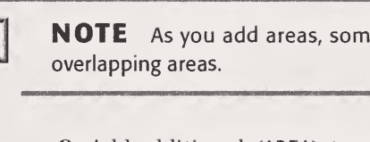

> **注意** 当你添加区域时，某些区域可能会与其他区域重叠。首先定义的区域会覆盖重叠区域。

8. 逐个添加额外的 `<AREA>` 标签。在例例中，下一个 `<AREA>` 标签用于 Valley 区域，因此它是 RECT（或 RECTANGLE）。链接到 `valley.html` 只需要左侧和右侧的坐标。

```html
<AREA SHAPE=CIRCLE COORDS=82,43,30 HREF="uvi.html" ALT="UV Index">
<AREA SHAPE=RECT COORDS=1,209,516,320 HREF="valley.html" ALT="Valley Weather">
```

9. 对于 Mid-Peaks 区域，一个三角形即可定义该区域；因此形状是具有三对坐标的 POLYGON（多边形）。它链接到 `midpeaks.html`。

```html
<AREA SHAPE=CIRCLE COORDS=82,43,30 HREF="uvi.html" ALT="UV Index">
<AREA SHAPE=RECT COORDS=1,209,516,320 HREF="valley.html" ALT="Valley Weather">
<AREA SHAPE=POLY COORDS=199,207,513,205,514,71 HREF="midpeaks.html" ALT="Mid-Peaks">
```

10. High Peaks 可以通过一个包含四个角的图形轻松定义——呈菱形，如下例所示。

```html
<AREA SHAPE=CIRCLE COORDS=82,43,30 HREF="uvi.html" ALT="UV Index">
<AREA SHAPE=RECT COORDS=1,209,516,320 HREF="valley.html" ALT="Valley Weather">
<AREA SHAPE=POLY COORDS=199,207,513,205,514,71 HREF="midpeaks.html" ALT="Mid-Peaks">
<AREA SHAPE=POLY COORDS=63,123,251,98,365,134,198,204,731,121 HREF="highpeaks.html" ALT="High Peaks">
```

请参考图 6.1 以回顾其外观。

11. 为剩余区域设置 `HREF` 属性。你可以设置剩余区域，使得访问者点击时不会发生任何事情。

```html
<AREA SHAPE=default NOHREF>
```

就是这些。最终的地图看起来如下：

```html
<MAP NAME="weather_zones">
<AREA SHAPE=CIRCLE COORDS=82,43,30 HREF="uvi.html" ALT="UV Index">
<AREA SHAPE=RECT COORDS=1,209,516,320 HREF="valley.html" ALT="Valley Weather">
<AREA SHAPE=POLY COORDS=199,207,513,205,514,71 HREF="midpeaks.html" ALT="Mid-Peaks">
<AREA SHAPE=POLY COORDS=63,123,251,98,365,134,198,204,731,121 HREF="highpeaks.html" ALT="High Peaks">
</MAP>
```

## 激活地图

在激活地图之前，你必须将地图放在文档中。ASR 示例显示如下：

```html
<CENTER>

</CENTER>
```

为了将图像链接到地图定义，简单地使用 `USEMAP` 属性。在客户端图像地图中可以使用相对 URL 或绝对 URL，但对于其他情况，使用相对 URL 是一个好主意。在这种情况下，区域链接到相同文件夹中名为 `uvi.html` 的文件。

```html
<AREA SHAPE=CIRCLE COORDS=82,43,30 HREF="uvi.html" ALT="UV Index">
```

> **提示** `USEMAP` 属性值需要一个井号 (#) 以指示链接到某个文档。

如果你想将图像地图链接到另一个文档：

```html

```

### 图 6.12

ASR Outfitters 图像地图


# 服务器端图像地图

制作服务器端地图的过程与制作客户端地图几乎完全相同。唯一的区别在于地图格式。

在实践中，只有两种主要的服务器端地图格式：NCSA（国家超级计算中心）和 CERN（欧洲核研究组织）。它们的功能非常相似，但每种格式都略有不同。

> **注意** 询问服务器管理员你需要使用哪种图像地图格式。

此外，将客户端图像地图转换为服务器端地图的唯一问题是你必须更明确 URL。例如，ASR 示例中的内容最初位于一个文件夹中。为了正确设置服务器端地图，我们需要确定完整路径。由于 NCSA 图像地图的限制，地图应包含在子目录，而不是服务器根目录。ASR 将图像地图文档、地图文件和关联文件放在 `www.asroufitters.com` 的 `weather` 子目录下。因此，主文件的完整 URL 为：`http://www.asroufitters.com/weather/asweather-map.html`

> **注意** 必须使用服务器相对 URL 或绝对 URL 以确保一切正常工作。有关 URL 的更多信息请参阅第 3 章。

## 创建 NCSA 图像地图

通常情况下，NCSA 图像地图格式为：

```
method coordinates
```

示例客户端图像地图的代码如下：

```html
<MAP NAME="weather_zones">
<AREA SHAPE=CIRCLE COORDS=82,43,30 HREF="uvi.html" ALT="UV Index">
<AREA SHAPE=RECT COORDS=1,209,516,320 HREF="valley.html" ALT="Valley Weather">
<AREA SHAPE=POLY COORDS=199,207,513,205,514,71 HREF="midpeaks.html" ALT="Mid-Peaks">
<AREA SHAPE=POLY COORDS=63,123,251,98,365,134,198,204,731,121 HREF="highpeaks.html" ALT="High Peaks">
<AREA SHAPE=default NOHREF>
</MAP>
```

使用如下 NCSA 服务器端地图文件：

```
default /weather/asweather-map.html
circle /weather/uvi.html 82,43,30
rect /weather/valley.midpeaks 1,209,207,516,320
poly /weather/midpeaks.html 199,207,513,205,514,71
poly /weather/highpeaks.html 63,123,251,98,365,134,198,204,73,121
```

默认项显式地链接回包含地图的文件：因此，点击侧边区域将不会链接到其他页面。其余的行包含形状、URL 和坐标，与客户端地图定义文件一样，但使用的格式略有不同。

- **注意** NCSA 服务器端格式还支持一种“点”（point "shape"）形状（除了圆形、矩形和多边形外），它使用单对坐标。点击“附近”区域将把访问者带到该 URL。如果你提供了多个点，服务器将选择距离你点击位置最近的一个。由于其他图像映射格式不支持点，我们建议仅使用现有的形状。

在你创建此地图后，使用地图扩展名保存它。ASR 将该文件放在与其它文件相同的文件夹中——即 `/weather/` 文件夹中，就在服务器根目录下方。

## 激活 NCSA 风格服务器端图像映射

如果你将图像看作是一个链接（尽管增加了一个复杂级别），那么激活服务器端图像映射就会有意义得多。请按照以下步骤操作：

1. 从文档中的地图开始（如果你选择，则是客户端地图）。

```html

```

2. 在 `` 标签中添加 `ISMAP` 属性，如下：

```html

```

3. 为图像添加链接。

```html
<A>

</A>
```

4. 添加由网络管理员指定的 `HREF` 属性。很有可能，它看起来像这样：

```html
<A HREF="http://www.asroutfitters.com/cgi-bin/imagememap/weather/weather-imap.map">

</A>
```

如果客户端识别客户端图像，它将忽略服务器端地图。如果客户端无法识别客户端地图，它将使用服务器端地图。

> **提示** 当你完成地图创建后，请确保在上传其他文件时同时上传地图文件。这很容易被忘记。

## 实现 CERN 风格图像映射

CERN 风格的地图比 NCSA 风格的地图少得多。同样，基本信息包含在内，但经过了略微的重排。原始的客户端地图格式为：

```html
<MAP NAME="weather_zones">
<AREA SHAPE=CIRCLE COORDS="82,43,30" HREF="uvi.html" ALT="UV Index">
<AREA SHAPE=RECT COORDS="1,209,516,320" HREF="valley.html" ALT="Valley Weather">
<AREA SHAPE=POLY COORDS="199,207,513,205,514,718" HREF="midpeaks.html">
<AREA SHAPE=POLY COORDS="63,123,251,98,365,134,198,204,73,121" HREF="highpeaks.html" ALT="High Peaks Weather">
<AREA SHAPE=DEFAULT NOHREF>
</MAP>
```

转换后，你将得到一个 CERN 地图文件：

```
default/asweather-imap.html
circle (82,43) 30 /weather/uvi.html
rect (1,209) (516,320) /weather/valley.html
poly (199,207) (513,205) (514,718) /weather/midpeaks.html
poly (63,123) (251,98) (365,134) (198,204) (73,121) /weather/highpeaks.html
```

主要的区别是坐标对被括在括号中，位于 URL 之前，且矩形可以使用任何两个坐标，而不是左上角和右下角。URL 可以是绝对的或服务器相关的。

> **提示** 存在其他类型的服务器，管理员的配置方式不同。提前询问如何实现服务器端地图将减少挫败感。

# 使用背景图

大多数浏览器都支持背景图，即文档文本背后的图案或图像。作为规则，背景图会填满空间，这意味着它们是平铺的。平铺背景有两个优势：首先，你可以创建一个无缝的背景，如图 6.13 所示；其次，通过平铺你可以创建视觉有趣的背景。例如，使用 1280 像素宽的 800 像素高图像可以确保背景不平铺。

> **提示** 你可以使用样式表为单个元素包含背景图，而不是整个页面。

要指定背景图，在你的 `<BODY>` 标签中添加 `BACKGROUND` 属性。

```html
<BODY BACKGROUND="asback.jpg">
```

当你开发背景图，你会发现创建一个无缝图像是困难的。虽然像 Paint Shop Pro 这样的程序提供了创建无缝图像的选项，但你仍然看到模糊的图案。

如果你有一个想要作为页面水印的背景图，并且你的访问者将 Internet Explorer，请添加 `BGPROPERTIES=FIXED` 属性。这防止图像平铺。`<BODY>` 的完整代码为：

```html
<BODY BACKGROUND="asfull.jpg" BGPROPERTIES=FIXED>
```

这将产生 6.16 所示的效果。

### 图 6.16

固定背景作为水印。

| ASR 选项 - Microsoft Internet Explorer |
| :--- |
| File Edit View Favorites Go Help Mail Point Edit Docs |
| Action "My sources" type="toolbar" toolbarurl="http://www.example.com" | | | | | |
| Links Tool of the Web Search Guide | Custom Links | Free Homepage | Internet Explorer News | Internet Start | Microsoft | Go |
| | | | | | | | |
| **欢迎来到 ASR Outfitters!** |
| 我们非常欢迎来到我们重新设计的网站，它具有更易导航的功能，而且渲染效果很酷。如果你以前没来过，请到处看看。 |
| 在最新的露营和户外活动中，我们通过电子邮件以及我们在洛基山山的商店提供维护和徒步设备更新。请花几分钟查看我们的优惠。 |
| 如果你对网站或我们提供的其他信息有建议或意见，请告诉我们。通过 asroutfitters.com 向我们发送电子邮件。当然，你也可以通过以下地址邮寄联系我们： |
| R Outfitters |
| 4700 Center |
| South Dallas, TX 87654 |
| 801-555-9423 |

### 表 6.6：背景属性

| 标签 | 用途 |
| :--- | :--- |
| `BACKGROUND="..."` | 使用 URL 识别文档的背景。 |
| `BGPROPERTIES=FIXED` | 设置不平铺的背景。 |
| ... | 用于 Internet Explorer 使用。 |

# 接下来去向哪里

在本章中，你学习了如何选择合适的图片、将它们包含在 HTML 文档中，并对其进行格式设置以按照你想要的方式显示。你还学习了两种图像映射类型：客户端和服务器端，它们为你提供了从单张图像提供多个链接的实用方法。

从这里开始，你可以进入几个章节中的一个，但这里有一些建议：

- 查看第 2 章获取更多格式化信息。
- 查看第 4 章和主参考以获取有关样式表（Style Sheets）的信息。
- 查看第 7 章了解如何在表格中包含图片。

# 第 7 章 开发表格

## 特点

- 创建基础表格 186
- 添加和删除行与列 190
- 跨行跨列 195
- 添加标题 201
- 表格格式化 203
- 使用 HTML 4 表格功能 221


本章介绍了 HTML 表格，它们是由行和列组成的网格。这些行和列创建了单个单元格，单元格可以包含文本或图像。表格有两个功能：第一，它们有助于以可读的格式呈现复杂数据。传统上，当信息比段落形式更能有效地通过视觉方式呈现时（如图 7.1 所示），你会使用表格。

其次，你可以使用表格将复杂的的设计元素整合到网页中。例如，HTML 不支持列、侧边标题、列宽或精确相邻的文本和图形。通过表格，你可以创建所有这些及更多内容——而无需担心这可能如何影响访问者的计算机或浏览器设置。图 7.2 显示了使用表格进行格式化的示例——在这种情况下，我们使用表格创建了侧边标题（sideheads），即出现在段落侧面而非上方的标题。

> **提示** 你可以使用框架（frames）来实现某些设计效果。更多信息，请访问第 9 章，特别是侧边栏，“表格或框架哪个更符合你的设计需求？”

> **提示** 如果你的访问者并不都使用支持 HTML 标签的浏览器，那么使用表格进行格式化是一个很好的选择；然而，正如你在本章的许多地方看到的，HTML 4 规范已弃用这种技术，转而采用样式表。在第 4 章中了解如何开发样式表，并在主参考中查找完整的样式表参考。

并不是所有浏览器都支持表格，但大多数版本的 Netscape Navigator、Explorer 以及所有其他浏览器都支持。此外，所有浏览器都支持表格的所有表格功能。例如，Netscape 支持表格，但不支持扩展功能，如本章后文“使用 HTML 4 功能”章节中的表格页脚（table footers）。表格 7.1 列出了支持表格及扩展表格功能的浏览器。

### 图 7.1

在基础层，表格呈现某些信息时比纯文本更有效。

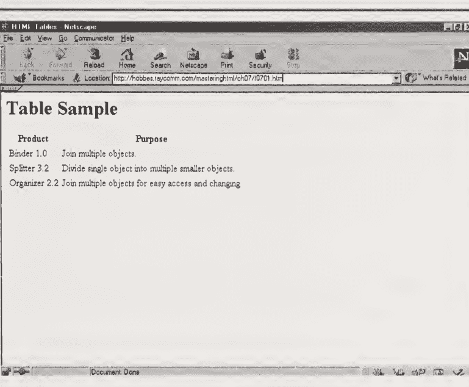

### 图 7.2

表格可以帮助你设计出有趣的页面设计，例如此处所示的侧边标题。

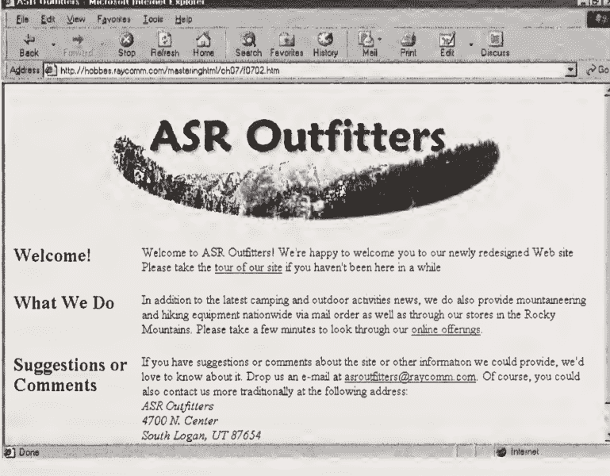

## 创建基础表格

创建表格是一个两步过程：

1. 创建表格结构——即输入 `<TABLE>` 标签，指定行和列，并指定列标题。
2. 在表格单元格中输入数据。

通过创建表格结构然后输入数据，你可以避免布局错误。最常见的情况是，Web 作者忘记了 `</TABLE>` 标签或遗漏了整个成对标签。这些错误会导致表格看起来很奇怪或者根本没有表格。在开始添加文本之前确保表格结构就位可以帮助你解决问题。表格 7.2 描述了基础标签。

> **提示** 表格标签很快就会变得复杂！确保根据需要打开和关闭标签，不要遗漏标签。调试表格中的问题可能是枯燥且令人沮丧的。

### 表格 7.2：基础表格标签

| 标签 | 用途 |
| --- | --- |
| `<TABLE>` | 在 HTML 文档中标记表格。 |
| `<TR>` | 标记表格中的行。结束标签是可选的。 |
| `<TD>` | 标记行内的单元格（表格数据）。结束标签是可选的。 |
| `<TH>` | 标记行内的标题单元格。结束标签是可选的。 |

> **提示** 尽管结束标签 `</TR>`、`</TD>` 和 `</TH>` 是可选的，但包含它们可以帮助你看出一个标签何时结束另一个何时开始。此外，包含这些结束标签可能会增加与旧表格浏览器的兼容性。

以下步骤显示了如何构建表格并向其中输入信息。以下示例表格代表了公司网站上的产品摘要：

| 产品 | 目的 |
| --- | --- |
| Binder 1.0 | 连接多个对象 |
| Splatter 3.2 | 将单个对象拆分为多个对象 |
| Organizer 2.2 | 连接多个对象以便于访问和更改 |

在在 HTML 文档中包含表格之前，请确保你的访问者使用支持表格的浏览器。如果他们不支持，表格将无法正常显示，甚至根本不显示。

> **提示** 本章 throughout 标记了通常不支持的表格功能。

### 创建基础表格

创建表格是一个两步过程：

1. 创建表格结构——即输入 `<TABLE>` 标签，指定行和列，并指定列标题。
2. 在表格单元格中输入数据。

通过创建表格结构然后输入数据，你可以避免布局错误。最常见的情况是，Web 作者忘记了 `</TABLE>` 标签或遗漏了整个成对标签。这些错误会导致表格看起来很奇怪或者根本没有表格。在开始添加文本之前确保表格结构就位可以帮助你解决问题。表格 7.2 描述了基础标签。

> **提示** 表格标签很快就会变得复杂！确保根据需要打开和关闭标签，不要遗漏标签。调试表格中的问题可能是枯燥且令人沮丧的。

### 表格 7.2：基础表格标签

| 标签 | 用途 |
| --- | --- |
| `<TABLE>` | 在 HTML 文档中标记表格。 |
| `<TR>` | 标记表格中的行。结束标签是可选的。 |
| `<TD>` | 标记行内的单元格（表格数据）。结束标签是可选的。 |
| `<TH>` | 标记行内的标题单元格。结束标签是可选的。 |

> **提示** 尽管结束标签 `</TR>`、`</TD>` 和 `</TH>` 是可选的，但包含它们可以帮助你看出一个标签何时结束另一个何时开始。此外，包含这些结束标签可能会增加与旧表格浏览器的兼容性。

以下步骤显示了如何构建表格并向其中输入信息。以下示例表格代表了公司网站上的产品摘要：

| 产品 | 目的 |
| --- | --- |
| Binder 1.0 | 连接多个对象 |
| Splatter 3.2 | 将单个对象拆分为多个对象 |
| Organizer 2.2 | 连接多个对象以便于访问和更改 |

1. 从一个包含适当标签和任何额外信息的函数 HTML 文档开始。
2. 在你想让表格出现的地方添加 `<TABLE>` 标签。

```html
<TABLE>
```

3. 在上方标记的行之间添加 `<TR>` 标签。示例表格包含了四个 `<TR>` 标签。

```html
<TABLE>
<TR>
</TR>
```

4. 在你想包含标题的地方添加 `<TH>` 标签。示例表格包含了两个 `<TH>` 标签。

```html
<TABLE>
<TR>
<TH>
<TH>
</TR>
```

5. 添加 `<TD>` 标签来创建单元格。示例表格包含了六个数据单元格。

```html
<TABLE>
<TR>
<TH>
<TH>
</TR>
<TR>
<TD>
<TD>
</TR>
```

6. 为每个单元格添加内容。在 `<TH>` 标签之间放置标题信息，在 `<TD>` 标签之间输入数据。

```html
<TABLE>
<TR>
<TH>Product</TH>
<TH>Purpose</TH>
</TR>
<TR>
<TD>Binder 1.0</TD>
<TD>Join multiple objects.</TD>
</TR>
<TR>
<TD>Splatter 3.2</TD>
<TD>Divide single object into multiple objects.</TD>
</TR>
<TR>
<TD>Organizer 2.2</TD>
<TD>Join multiple objects for easy access and changing.</TD>
</TR>
</TABLE>
```

> **提示** 如果你选择省略结束标签，将内容放在起始标签之后、下一个标签之前。（浏览器会将下一个 `<TH>`、`<TD>`、`<TR>` 或结束标签 `</TABLE>` 解释为隐含关闭当前标签。）

图 7.3 显示了结果。注意内容存在，但表格没有包含任何格式或边框。

### 图 7.3

基础表格包含内容，但它不包含格式或边框。

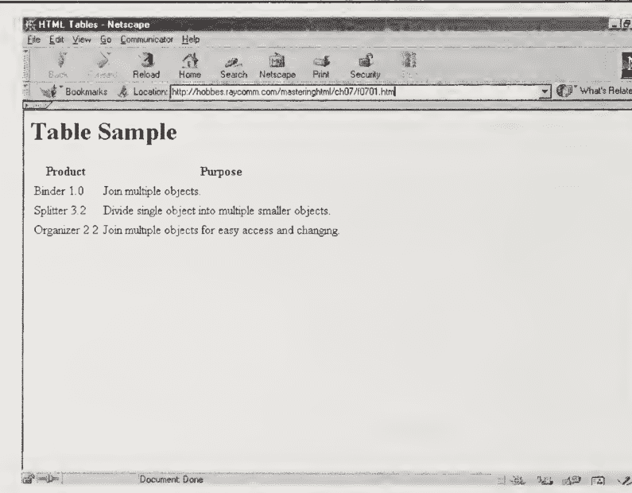

## 添加或删除行与列

在创建表格后，你可以根据信息的变化轻松地添加或删除。以下章节显示了如何添加和删除行与列。示例结果比上一个示例多出一列和一行：

| 产品 | 目的 | 行业标准术 |
| --- | --- | --- |
| Binder 1.0 | 连接多个对象。 | 订书机 |
| Organizer 2.2 | 连接多个对象以便于访问和更改 | 活页 |
| Combiner 0.9 | 在边缘连接对象 | 胶带 |
| Splatter 3.2 | 将单个对象拆分为多个对象。 | 剪刀 |

### 添加行

要在表格中添加行，请在你想让新行出现的地方插入额外的 `<TR>` 和 `<TD>` 标签。例如，你可以这样在表格底部添加新行：

```html
<TABLE>
<TR>
<TH>Product</TH>
<TH>Purpose</TH>
</TR>
<TR>
<TD>Binder 1.0</TD>
<TD>Join multiple objects.</TD>
</TR>
<TR>
<TD>Splitter 3.2</TD>
<TD>Divide single object into multiple smaller objects.</TD>
</TR>
<TR>
<TD>Organizer 2.2</TD>
<TD>Join multiple objects for easy access and changing.</TD>
</TR>
<TR>
<TD>Combiner 0.9</TD>
<TD>Join multiple objects at the edges.</TD>
</TR>
</TABLE>
```

示例表格如图 7.4 所示。

### 图 7.4

示例表格现在有四行。

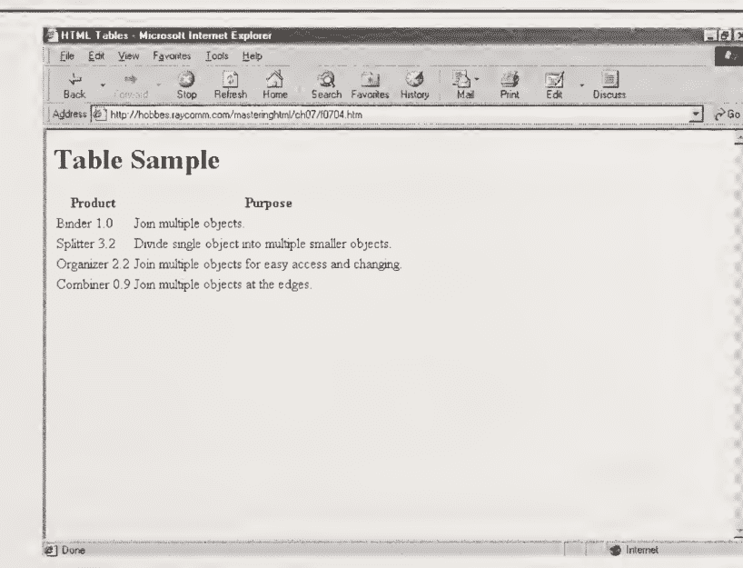

### 表格示例

| 产品 | 用途 |
| --- | --- |
| Binder 1.0 | 合并多个对象 |
| Splitter 3.2 | 将单个对象拆分为多个较小的对象 |
| Organizer 2.2 | 合并多个对象以便于访问和更改 |
| Combiner 0.9 | 在边缘合并多个对象 |

### 添加列

添加列比添加行稍微困难一些，因为你必须为每一行添加一个单元格。然而，过程是相同的——在你想让新列出现的地方插入标签，无论是在现有列的左侧、右侧还是它们之间。

例如，你可以通过在顶行添加 `<TH>` 标签，并在其他每行中添加 `<TD>` 标签，在示例表格的右侧端添加一个新列。示例代码如下：

```html
<TABLE>
<TR>
<TH>Product</TH>
<TH>Purpose</TH>
<TH>Industry standard term</TH>
</TR>
<TR>
<TD>Binder 1.0</TD>
<TD>Join multiple objects.</TD>
<TD>Stapler</TD>
</TR>
<TR>
<TD>Organizer 2.2</TD>
<TD>Join multiple objects for easy access and changing.</TD>
<TD>Ring binder</TD>
</TR>
<TR>
<TD>Combiner 0.9</TD>
<TD>Join multiple objects at the edges.</TD>
<TD>Tape</TD>
</TR>
<TR>
<TD>Splitter 3.2</TD>
<TD>Divide single object into multiple smaller objects.</TD>
<TD>Scissors</TD>
</TR>
</TABLE>
```

生成的表格如图 7.5 所示。

### 图 7.5

添加列允许你提供额外信息。

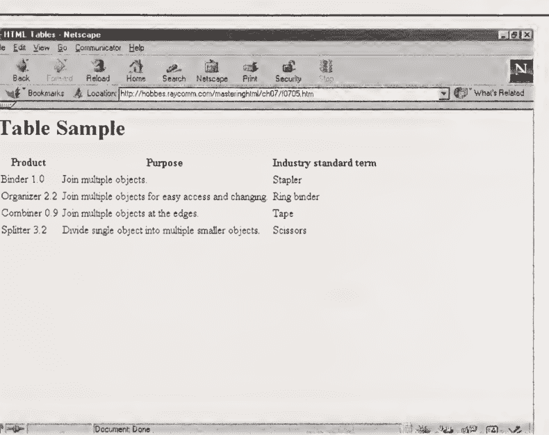

### 删除行和列

删除行和列比添加它们更容易。但是，你必须小心，删除所有与行或列相关的所有标签。

- 删除行时，务必删除包裹它的 `<TD>` 和 `<TR>` 标签。
- 删除列时，务必删除每行的 `<TH>` 标签以及 `<TD>` 标签。

例如，要删除示例表格中的最后一行，你需要删除以下代码中带删除线的标签：

```html
<TABLE>
<TR>
<TH>Product</TH>
<TH>Purpose</TH>
<TH>Industry standard term</TH>
</TR>
<TR>
<TD>Binder 1.0</TD>
<TD>Join multiple objects.</TD>
<TD>Stapler</TD>
</TR>
<TR>
<TD>Organizer 2.2</TD>
<TD>Join multiple objects for easy access and changing.</TD>
<TD>Ring binder</TD>
</TR>
<TR>
<TD>Combiner 0.9</TD>
<TD>Join multiple objects at the edges.</TD>
<TD>Tape</TD>
</TR>
<TR>
<TD>Splitter 3.2</TD>
<TD>Divide single object into multiple smaller objects.</TD>
<TD>Scissors</TD>
</TR>
</TABLE>
```

要删除示例表格中的最后一列，从每个表格行中删除最后一个标签，如下：

```html
<TABLE>
<TR>
<TH>Product</TH>
<TH>Purpose</TH>
<TH>Industry standard term</TH>
</TR>
<TR>
<TD>Binder 1.0</TD>
<TD>Join multiple objects.</TD>
<TD>Stapler</TD>
</TR>
<TR>
<TD>Organizer 2.2</TD>
<TD>Join multiple objects for easy access and changing.</TD>
<TD>Ring binder</TD>
</TR>
</TABLE>
```

## 跨行和跨列

跨越是指一个单元格跨越多行或多列。图 7.6 显示了一个示例表格，其中标记为 Merchandise 和 Descriptive Information 的单元格跨越了两列，表示它们适用于多个列。

### 图 7.6

该示例表格的 Joining Tools 单元格跨越了三行。

| Merchandise | Descriptive Information | Industry standard term |
| --- | --- | --- |
| Joining Tools | Binder 1.0 | Join multiple objects. | Stapler. |
| | Organizer 2.2 | Join multiple objects for easy access and changing. | Ring binder. |
| | Combiner 0.9 | Join multiple objects at the edges. | Tape. |
| Dividing Tools | Splitter 3.2 | Divide single object into smaller objects. | Scissors. |

要指定列和行跨，请使用表 7.3 中的属性。

### 表 7.3: ROW AND COLUMN SPAN ATTRIBUTES

| Attribute | Use |
| --- | --- |
| `ROWSPAN=n` | 用于 `<TH>` 或 `<TD>` 标签中，表示跨越多少行。例如，`ROWSPAN=3` 跨行。 |
| `COLSPAN=n` | 用于 `<TH>` 或 `<TD>` 标签中，表示跨越多少列。例如，`COLSPAN=3` 跨列。 |

### 跨行

你可以使用 `<TH>` 或 `<TD>` 标签来跨行，取决于你是跨越表头还是数据单元。以下示例显示了如何让一个单元格跨越三行。请从以下代码开始，该代码包含了上一节中的跨行部分：

```html
<TABLE>
<TR>
<TH>Product</TH>
<TH>Purpose</TH>
<TH>Industry standard term</TH>
</TR>
<TR>
<TD>Binder 1.0</TD>
<TD>Join multiple objects.</TD>
<TD>Stapler</TD>
</TR>
<TR>
<TD>Organizer 2.2</TD>
<TD>Join multiple objects for easy access and changing.</TD>
<TD>Ring binder</TD>
</TR>
<TR>
<TD>Combiner 0.9</TD>
<TD>Join multiple objects at the edges.</TD>
<TD>Tape</TD>
</TR>
<TR>
<TD>Splitter 3.2</TD>
<TD>Divide single object into smaller objects.</TD>
<TD>Scissors</TD>
</TR>
</TABLE>
```

1. 如本章节之前的图 7.6 所示，为工具类别添加新列。在左上单元格中带有 `<TH>` 标签放置 **Type**。在第二个单元格（带有 `<TD>` 标签）中放置 **Joining Tools**，它将最终跨越三行。在第五行带有 `<TD>` 标签中放置 **Dividing Tools**。

```html
<TABLE>
<TR>
<TH>Type</TH>
<TH>Product</TH>
<TH>Purpose</TH>
<TH>Industry standard term</TH>
</TR>
<TR>
<TD>Joining Tools</TD>
<TD>Binder 1.0</TD>
<TD>Join multiple objects.</TD>
<TD>Stapler</TD>
</TR>
<TR>
<TD>Organizer 2.2</TD>
<TD>Join multiple objects for easy access and changing.</TD>
<TD>Ring binder</TD>
</TR>
<TR>
<TD>Combiner 0.9</TD>
<TD>Join multiple objects at the edges.</TD>
<TD>Tape</TD>
</TR>
<TR>
<TD>Dividing Tools</TD>
<TD>Splitter 3.2</TD>
<TD>Divide single object into smaller objects.</TD>
<TD>Scissors</TD>
</TR>
</TABLE>
```

> **注意** 现在有三行的单元格数量过多。如果你在浏览器中显示该表格，你会发现单元格未对齐。

2. 在你想跨越的单元格的 `<TH>` 或 `<TD>` 标签上添加 `ROWSPAN=` 属性。在示例表格中，在 Joining Tools `<TD>` 标签上添加 `ROWSPAN=3` 属性（它应该影响第 2 到第 4 行），如下：

```html
<TD ROWSPAN=3>Joining Tools</TD>
```

生成的跨行表格如图 7.7 所示。

### 图 7.7

使用跨行创建更有有趣的表格布局。

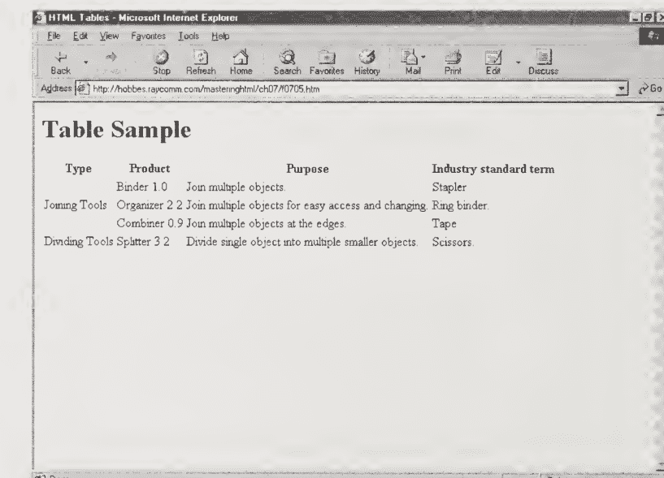

| 类型 | 产品 | 用途 | 行业标准术 |
| --- | --- | --- | --- |
| | Binder 1.0 | 合并多个对象。 | Stapler |
| Joining Tools | Organizer 2.2 | 合并多个对象以便于访问和更改。 | Ring binder |
| | Combiner 0.9 | 在边缘合并多个对象。 | Tape |
| Dividing Tools | Splitter 3.2 | 将单个对象拆分为多个较小的对象。 | Scissors |

### 跨列

你可以使用 `<TH>` 或 `<TD>` 标签来跨列，取决于你是跨越表头还是表格单元格。以下示例显示了如何添加两个跨越两列的单元格。从以下代码开始，它包含了上一节中的跨行：

```html
<TABLE>
```

### 跨行与跨列

| 类型 | 产品 | 目的 | 行业标准术 |
| :--- | :--- | :--- | :--- |
| 连接工具 | Binder 1.0 | 合并多个对象。 | 钉器。 |
| | Organizer 2.2 | 合并多个对象以便访问和更改。 | 活页夹。 |
| | Combiner 0.9 | 在边缘合并多个对象。 | 胶带。 |
| 分割工具 | Splitter 3.2 | 将单个对象分为多个较小的对象。 | 剪刀。 |

1. 为新行添加 `<TR>` 标签。
2. 添加你想要跨越的 `<TH>` 或 `<TD>` 单元格。在示例表中，添加两个 `<TH>`——一个包含“Merchandise”（商品），另一个包含短“Descriptive Information”（描述信息）。

```html
<TR>
<TH>Merchandise</TH>
<TH>Descriptive Information</TH>
</TR>
<TR>
<TH>Type</TH>
<TH>Product</TH>
<TH>Purpose</TH>
<TH>Industry standard term</TH>
</TR>
```

3. 在影响你想跨越的单元格的 `<TH>` 或 `<TD>` 标签上添加 `COLSPAN` 属性。在示例表中，为 `<TH>` 标签添加 `COLSPAN=2`，因为每个单元格都应该跨越两列。

```html
<TR>
<TH COLSPAN=2>Merchandise</TH>
<TH COLSPAN=2>Descriptive Information</TH>
</TR>
```

生成的包含行跨和列跨越的表格应该像图 7.8 所示。

### 图 7.8

跨行和跨列有助于提供复杂的信息。

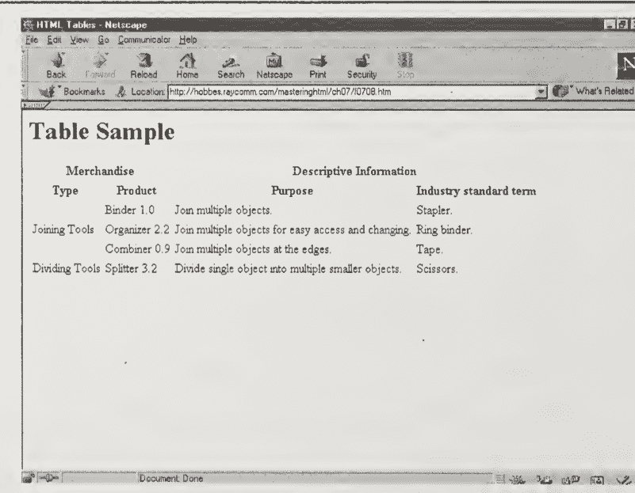

## 设计工作坊

你可以在一个 `<TH>` 或 `<TD>` 标签中包含 `ROWSPAN=` 和 `COLSPAN=` 属性。例如，一个大型或复杂的表格可能有两个标题行和两列描述性信息，如下所示：

| | Top Heading | | |
| --- | --- | --- | --- |
| | Heading | Content |
| Top Category | Category | Content |

表格中的第一个单元格跨越了两列 (`COLSPAN=2`) 以覆盖两个类别列。它同时跨越了两行 (`ROWSPAN=2`) 以覆盖两个标题行。该表格的这个区域不一定非有内容填充，因此你可能会使用 Logo 或某种图形来引人注地填充空间。

## 添加标题

标题（Caption）是通常出现在表格上方的解释性或描述性文本。你使用标题有两个目的：

- 总结表格内容
- 提供关于表格内容的一目了然的信息

尽管 HTML 允许你将标题放在表格上方或下方，但请将标题放在表格上方以确保访问者能看到它。如果表格超过一个全屏，访问者可能不会向下滚动阅读标题。

要为表格添加标题，请使用表 7.4 提供的标签和属性。

### 表格 7.4：标题标签与属性

| 标签/属性 | 用途 |
| --- | --- |
| `<CAPTION>` | 在表格内使用，用于识别表格标题的文本。 |
| `ALIGN="..."` | 将标题放在表格的顶部、底部、左侧或右侧。 |

为示例表添加标题，请遵循以下步骤：

1. 在起始和结束 `<TABLE>` 标签之间添加 `<CAPTION>` 标签。在示例表中，将 `<CAPTION>` 标签放在起始 `<TABLE>` 标签下方。

```html
<TABLE>
<CAPTION>
</CAPTION>
```

2. 添加标题文本，如下：

```html
<CAPTION>
Office Product Merchandise and Category Information
</CAPTION>
```

3. 使用 `ALIGN=TOP` 或 `ALIGN=BOTTOM` 属性指定标题应该出现在表格上方还是下方，如下：

```html
<CAPTION ALIGN=TOP>
Office Product Merchandise and Category Information
</CAPTION>
```

4. 可选地，为标题添加字符级格式标签。如果不加粗体或斜体，标题往往会被埋没在表格中。

```html
<CAPTION ALIGN=TOP><B>Office Product Merchandise and Category Information</B></CAPTION>
```

生成的标题如 7.9 所示。

> **注意** 参见第 2 章复习字符级格式。

> **提示** 记住 `ALIGN=` 属性控制标题出现的位置。在 `<TABLE>` 标签内插入 `ALIGN=` 属性对标题出现的位置没有影响。

### 图 7.9

表格标题提供了表格内容的一目了然的总结。

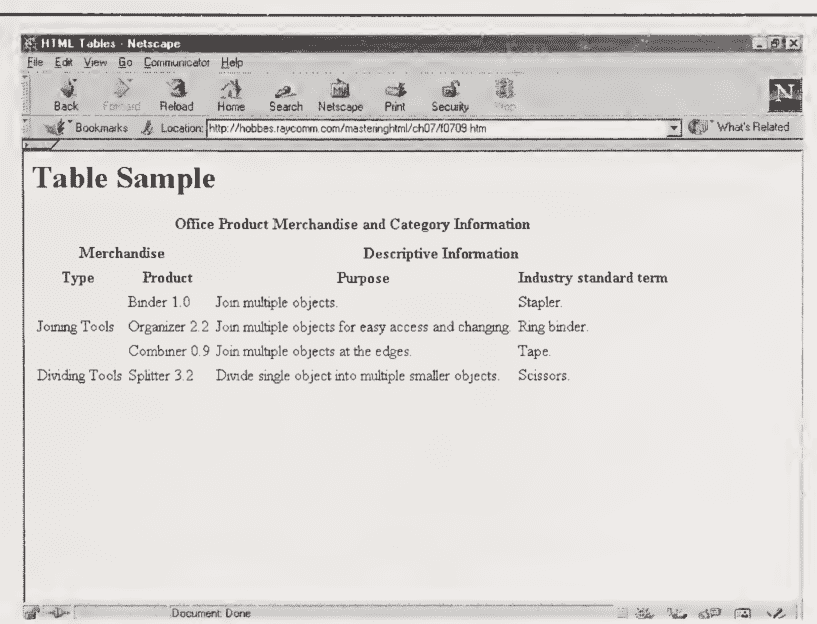

## 表格格式化

一旦设置了表格，你可以添加许多格式选项来改进其整体外观。特别是，你可以：

- 添加边框
- 背景颜色
- 调整单元格间距和内边距
- 调整单元格对齐
- 指定尺寸

## HTML 4 机会

正如你将在章接下来的章节中看到的，你可以为表格添加很多格式——边框、颜色、对齐等。请记住，这些选项许多并不是标准 HTML，并不是所有的浏览器都支持它们。此外，HTML 4 鼓励你使用样式表（Style Sheets）来应用格式。

如果你确定你的访问者使用的是支持 HTML 4 标签的浏览器，请考虑使用样式表来格式化你的表格。HTML 4 规范支持的样式表是未来在整个 HTML 文档中应用样式的趋势！参见第 4 章和主参考以学习使用样式表。

## 添加和格式化边框

边框是封闭表格并清晰区分行、列和单元格的线条。默认情况下，大多数浏览器显示没有边框的表格；然而，带有边框的表格更易读且更有吸引力。例如，本章目前为止所示的示例没有边框，且难以阅读——很难看出一个单元格在哪里结束，另一个从哪里开始。没有边框，单元格就会混在一起，列和行也会变得模糊。图 7.10 显示了本章早些图 7.9 中的表格在 Netscape Navigator 中带有边框的样子。

### 图 7.10

边框通常能提高表格的可读性和外观。

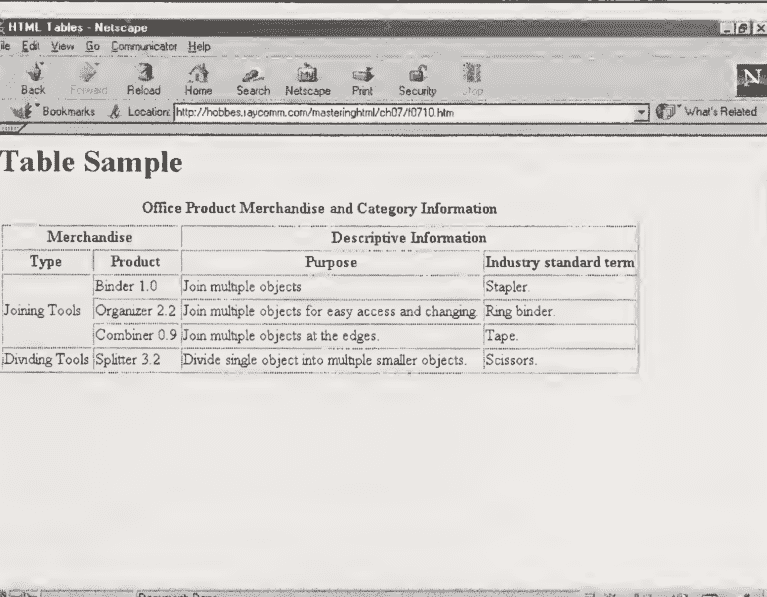

### 表格示例

| 商家 | 产品 | 目的 | 行业标准术 |
| :--- | :--- | :--- | :--- |
| Joint Tool | Binder 1.0 | 合并多个对象。 | 钉器。 |
| | Organizer 2.2 | 合并多个对象以便访问和更改。 | 活页夹。 |
| | Combiner 2 | 在边缘合并多个对象。 | 级。 |
| 分割工具 | Splitter 3.2 | 将单个对象分为多个较小的对象。 | 剪刀。 |

## 创建表格边框

你使用属性和以像素为单位的数字来指定边框，告诉浏览器边框的宽度。如图 7.10 所示，大多数浏览器将边框显示为 3D 效果。表 7.5 列出了新版本的 Netscape Navigator 和 Internet Explorer 支持的边框属性。

### 表 7.5：BORDER 属性

| 属性 | 用途 |
| --- | --- |
| `BORDER=n` | 指定表格宽度，以像素为单位。数字越大，边框越宽。`BORDER=0` 删除边框（通常也是默认设置）。 |
| `BORDER="#rrggbb"` | 使用 #rrggbb 数字或名称指定表格边框颜色；由新版本的 Netscape Navigator 和 Internet Explorer 支持。 |

要创建表格边框并指定其颜色，请遵循以下步骤：

1. 在起始表格标签上添加 `BORDER=` 属性。

```html
<TABLE BORDER=2>
```

2. 使用 `BORDER=` 属性以及 RGB 数字或接受的颜色名称指定边框颜色。指定边框颜色并非必须——由于 `BORDER=2` 属性，边框会变宽，颜色只是你选择时添加的另一种格式特征。

```html
<TABLE BORDER=2 BORDER="#FF0000">
```

图 7.11 显示了在表格标签中使用 `BORDER=2` 的结果。

### 图 7.11

单元格周围添加 2 像素边框

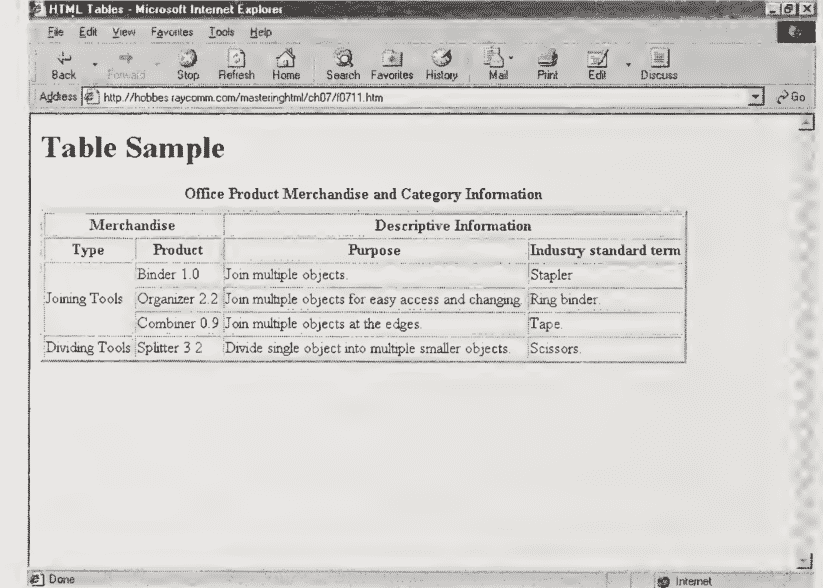

> 参见第 6 章获取更多关于 RGB 数字的信息。

## 指定无边框

尽管大多数浏览器默认显示无边框的表格，但你可以指定边框以确保不显示边框。例如，如果你将表格用于列、侧边标题或文本与图形的高级格式化，你希望确保表格在没有边框的情况下出现。图 7.12 显示了使用无边框表格进行高级格式化的示例。

### 图 7.12


# RayComm, Inc. 依赖表格来格式化两列布局

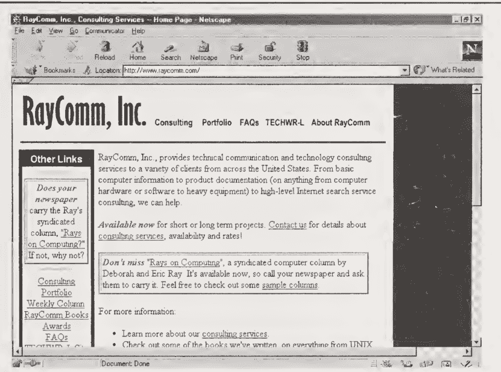

浏览器窗口左侧的按钮位于一个单元格中，而右侧的图形和内容位于另一个单元格中。要不显示表格边框，请将 `BORDER` 属性设置为零（0），如下所示：

```html
<TABLE BORDER=0>
```

## 使用 Internet Explorer 专用的边框属性

微软在 Internet Explorer 中实现了两个额外的标签来控制边框颜色。在许多浏览器中，表格以 3-D 效果呈现——即底部和右侧颜色较深，顶部和左侧颜色较浅，如下所示：

| 表格示例 |
| --- |
| 办公产品商品和分类信息 |
| 商品 | 描述信息 |
| 类型 | 产品 | 目的 | 行业标准术语 |
| --- | --- | --- | --- |
| | 构建器 1.0 | 合并多个对象 | 订钉器 |
| 连接工具 | 组织器 2.2 | 合并多个对象以便于访问和更改 | 活页 |
| | 组合器 0.9 | 在边缘合并多个对象 | 胶带 |
| 分割工具 | 分隔器 3.2 | 将单个对象分为多个较小的对象 | 剪刀 |

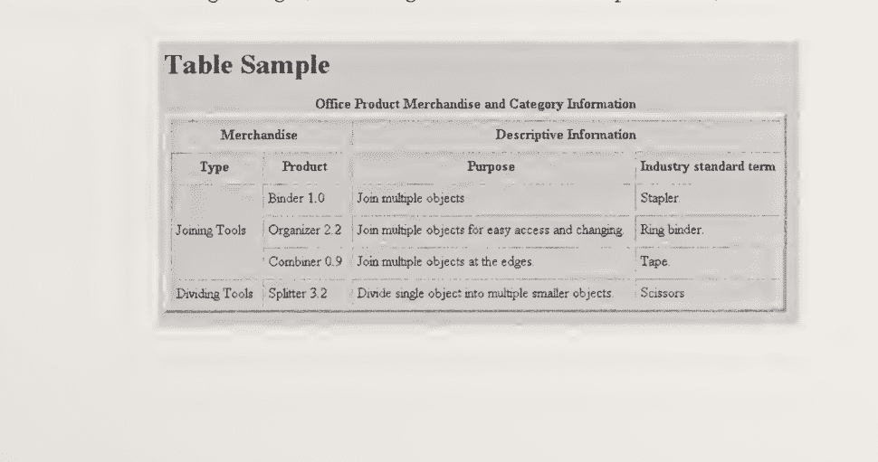

## 第 7 章 · 开发表格

Internet Explorer 识别设置 3-D 效果深色和浅色的属性。表格 7.6 列出了这些属性。

| 表格 7.6：INTERNET EXPLORER 边框属性 |
| --- |
| 属性 | 用途 |
| `BORDERCOLORLIGHT="#rrggbb"` | 为表格 3-D 效果指定浅边框颜色。 |
| `BORDERCOLORDARK="#rrggbb"` | 为表格 3-D 效果指定深边框颜色。 |

要应用这些属性，请将它们插入初始的 `<TABLE>` 标签中，就像插入标准边框属性一样，如下所示：

```html
<TABLE BORDERCOLORLIGHT="CCCCCC">
```

或

```html
<TABLE BORDERCOLORDARK="33FF33">
```

> **提示** 如果你有特定的边框颜色需求，并且知道访问者将使用 Internet Explorer，你可以通过将相同的属性应用到单个表格单元格来进一步自定义边框颜色。

## 设置表格背景选项

除了指定边框颜色外，您还可以指定表格背景显示为特定的颜色或图像。使用背景颜色或图像可以增强表格的外观，使表格更有趣，为公司 Logo 提供空间，并有助于文本与图像颜色的对比。

> **提示** HTML 4 规范弃用了表格背景选项，转而采用样式表。尽管这些背景选项在 Netscape Navigator 和 Internet Explorer 中仍然有效，但考虑使用样式表设置表格背景颜色。

## 设置背景颜色

只有新版本的 Netscape Navigator 和 Internet Explorer 支持表格背景颜色。然而，您可以为 Netscape Navigator 和 Internet Explorer 用户提供表格背景颜色和图像，而不会对使用其他浏览器的用户产生不利影响。例如，图 7.13 显示了一个在 Netscape Navigator 中查看使用背景色的表格。如果您在旧浏览器中显示此表格，背景颜色将与浏览器的背景相同。

**图 7.13**

在支持背景色的浏览器中查看时，颜色背景可以增强表格外观。

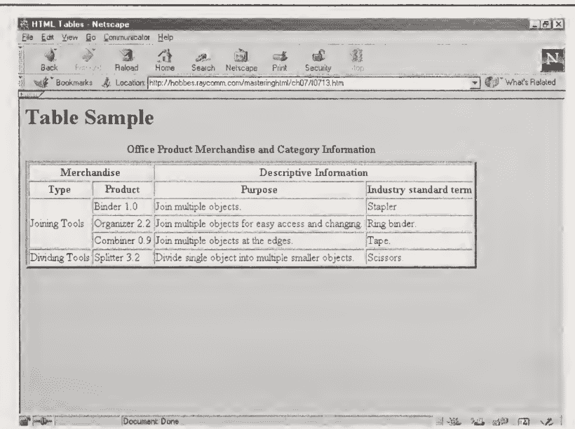

## 表格示例

| 类型 | 产品 | 目的 | 行业标准术语 |
| --- | --- | --- | --- |
| 活页 1.0 | 合并多个对象 | 订钉器 |
| 连接工具 | 连接器 2.2 | 合并多个对象以便于访问和更改 | 活页 |
| 组合器 0.9 | 在边缘合并多个对象 | 胶带 |
| 分割工具 | 分隔器 3.2 | 将单个对象分为多个对象 | 剪刀 |

为了使背景颜色有效，必须与文本颜色有足够的对比；否则，文本将变得无法阅读，在此所示：

## 表格示例


## 第 7 章 · 开发表格

为了确保您的表格背景颜色有效，请遵循这些指南：

- 如果文本颜色为深色，请选择浅背景色；如果文本颜色为浅色，请选择深背景色。
- 选择符合审美且适合文档目的的颜色；如果您的主题节奏快，请选择亮色；如果主题节奏较慢，请选择淡色调。
- 在几个不同的浏览器中查看您的 HTML 文档。
- 从 216 种无抖色中选择。

> **提示** 正如我们在第 6 章中提到的，无抖色在浏览器中会出现斑驳或斑点。更多信息请参阅第 6 章。

表格背景颜色属性为 `BGCOLOR="#rrggbb"`，它用于起始的 `<TABLE>` 标签。

要通过表格背景使用颜色，请在以下代码中添加 `BGCOLOR=`，后跟 RGB 数字或颜色名称：

```html
<TABLE BGCOLOR="#FFFFFF">
```

**图 7.14**

背景


## 设置表格背景

只有新版本的 Netscape Navigator 和 Internet Explorer 支持表格背景颜色。然而，您可以为 Netscape Navigator 和 Internet Explorer 用户提供表格背景颜色和图像，而不会对使用浏览器的用户产生不利影响。例如，图 7.13 显示了一个在 Netscape Navigator 中查看使用背景色的表格。如果您在旧浏览器中显示此表格，背景颜色将与浏览器的背景相同。

> **提示** 为了适应不支持背景的浏览器，请使用背景颜色。

图像是平铺的——即它们会重复直到填充空间。并不是所有浏览器都以相同的方式平铺。例如，图 7.15 和 7.16 显示了 Netscape Navigator 和 Internet Explorer 如何显示。

**图 7.15**

在 Netscape Navigator 中查看背景


## 第 7 章 · 开发表格

**图 7.16**

在 Internet Explorer 中查看背景


平铺从每个单元格的左上角开始。在图 7.15 中，效果非常不同。在 7.16 中，图像被放大并平铺整个表格。

> **注意** 为了确保图像在表格单元格中显示且仅显示一次，请在单元格中包含 `` 标签，而不是作为背景。

此外，如图 7.15 和 7.16 所示，如果使用了过多的形状、图案或颜色，表格背景很容易覆盖表格内容。

为了确保您选择合适的背景图像，请遵循这些指南：

- 选择细小的、不影响信息的背景图像。
- 选择简单的背景图像——形状、图案或颜色较少的。
- 选择增强文档目的背景图像。
- 在尽可能多的浏览器中查看您的 HTML 文档。

要指示表格的背景，您使用背景图像属性 `BACKGROUND="..."`。

Internet Explorer 3 及更高版本以及 Netscape Navigator 4 都支持在单元格以及整个表格使用这些标签。将属性添加到 `<TD>` 标签中，就像将其添加到 `<TABLE>` 标签中一样。

要使用表格背景图像，请在 `BACKGROUND=` 后添加 URL，如下所示：

```html
<TABLE BACKGROUND="coolimage.gif">
```

**图 7.17** 显示了一个有效的背景图像。

**图 7.17**

有效的背景图像增强了表格内容


## 设置单元格对齐

单元格对齐是指单元格内容的水平或垂直对齐。大多数浏览器具有以下默认单元格对齐设置：

- 表头在单元格中居中对齐（水平）并居中对齐（垂直）。
- 内容在单元格中左对齐（水平）并居中对齐（垂直）。

然而，使用表 7.7 中描述的属性，你可以更改单元格默认水平和垂直对齐。

## 表 7.7：对齐属性

| 属性 | 用途 |
| --- | --- |
| `ALIGN=n` | 指定单元格内容的水平对齐方式为 `LEFT`（左对）、`CENTER`（居中）或 `RIGHT`（右对）。 |
| `VALIGN=n` | 指定单元格内容的垂直对齐方式为 `TOP`（顶部）、`MIDDLE`（中间）或 `BOTTOM`（底部）。 |

要使用这些对齐属性，请将它们包含在任何 `<tr>`、`<td>` 或 `<th>` 标签中，如下：

```html
<tr ALIGN=RIGHT>
```

或

```html
<td VALIGN=TOP>
```

或

```html
<th ALIGN=CENTER VALIGN=MIDDLE>
```

> **提示** 通过在 `<tr>` 标签中设置整行的对齐方式，可以减少一些输入工作。如果你在 `<tr>` 标签中设置了对齐方式，可以在 `<td>` 或 `<th>` 标签中以单个单元格为单位进行覆盖。

## 指定单元格大小

大多数浏览器会将单元格调整为容纳内容所需的大小，并且在表格宽度达到浏览器窗口设置允许的限制后才会将文本换行。然而，你可以指定单元格大小，以防止文本换行或使内容更易读。

> 指定所有单元格宽度可以缩短感知时间，因为它允许某些浏览器按照表格传输的顺序进行布局，而不是等待整个表格下载完成。表格下载的时间仍然相同；但它看起来加载更快，而不是一次性加载大块内容。

你可以通过两种方式指定单元格大小：

- 作为表格宽度的百分比
- 作为以像素为单位的特定尺寸

大多数浏览器都支持对齐属性；它们的显示方式取决于表格大小和其他设置。例如，占据表格宽度 50% 的单元格大小将根据屏幕分辨率和浏览器窗口的大小变得更宽或更窄。同样，如果你将单元格宽度设置为 100 像素，它将恰好是浏览器支持的大小，无论这对整个页面布局产生什么影响。

> 如果你能够避免在表格中设置特定的单元格宽度，请这样做。你设置的表格格式越严苛，浏览器重新调整表格以适应布局的余地就越小，结果也越不可预测。

在 `<th>` 或 `<td>` 标签中使用表 7.8 中的属性，来控制表格宽度和文本换行。

| 属性 | 用途 |
| --- | --- |
| `WIDTH="n"` | 指定单元格的宽度，单位可以是像素或表格宽度的百分比。 |
| `NOWRAP` | 禁止单元格内的文本换行，要求所有文本在同一行。 |

## 第 7 章 · 表格

### 指定单元格宽度

要指定单元格宽度，只需在 `<td>` 或 `<th>` 标签中添加 `WIDTH="n"` 属性。例如，你可以指定表头单元格（因此其下方的单元格）占据表格宽度的 15%，如下：

```html
<tr>
  <th>Type</th>
  <th>Product</th>
  <th>Purpose</th>
  <th width="15%">Standard term</th>
</tr>
```

如果你在图 7.18 所示的描述性信息单元格中设置 `WIDTH`，这些属性将按比例影响各个列。例如，如果你在描述性信息单元格中使用 `WIDTH="50%"`，浏览器将尝试使从 Purpose 和 Standard term 开始的列总计约为 50%。

```html
<tr>
  <th colspan="2">Merchandise</th>
  <th colspan="2" width="50%">Descriptive Information</th>
</tr>
```

**图 7.19** 显示了生成的表格。


## 表格示例

| 办公产品商品及分类信息 | | |
| --- | --- | --- |
| 商品 | 描述性信息 | |
| 类型 | 用途 | 标准术语 |
| | 1.0 合并多个对象 | 订书机 |
| 连接工具 | 2.2 合并多个对象以便于访问和更改 | 风芯环装订器 |
| | 2.5 在边缘处合并多个对象 | 标签 |
| 分割工具 | 3.2 将单个对象拆分为多个更小的对象 | 拉伸器 |

## 图 7.19

结合单元格大小和列跨度（span）属性来定制你的表格。


### 指定不换行

如果你重置了某些单元格的宽度，你可能希望确保内容不会换到多行。像示例所示添加 `NOWRAP` 属性，以鼓励浏览器不要换行。

```html
<th colspan="2" width="30%" NOWRAP>Descriptive Information</th>
```

> **注意** HTML 4 废弃了 `NOWRAP` 属性。你猜对了——如果你的访问者浏览器识别样式表，请使用它们来格式化表格。

要为单元格设置最小尺寸（小于该尺寸将无法显示），请使用 1像素 x 1 像素的透明 GIF 图片，并将 `HEIGHT` 和 `WIDTH` 属性设置为所需的尺寸。（关于使用透明 GIF 设置尺寸的更多信息，请参见第 6 章。）

## 添加单元格间距和内边距

单元格间距（spacing）和内边距（padding）指的是单元格周围的空白。特别来说，间距指的是单元格之间的空间，而内边距指的是单元格内容周围的空间。例如，图 7.20 中的表格更容易阅读。

表 7.9 描述了间距和内边距。

| 表 7.9：间距和内边距属性 |
| --- |
| 属性 | 用途 |
| `SPACING=n` | 以像素为单位指定单元格之间的空间。 |
| `PADDING=n` | 以像素为单位指定单元格内容周围的空间。 |

> **提示** 通过在 `<tr>` 标签中设置整行的间距，可以减少一些输入工作。如果你在 `<tr>` 标签中设置了它，可以在 `<td>` 或 `<th>` 标签中以单个单元格为单位进行覆盖。

要添加间距和内边距，请将它们包含在任何 `<tr>`、`<td>` 或 `<th>` 标签中，如下：

```html
<tr spacing="5">
```

或

```html
<td padding="10">
```

或

```html
<th spacing="5" padding="10">
```

间距和内边距属性有助于你的表格看起来更专业，并防止不使用间距和内边距而产生不可预测的结果。

## 图 7.21

文本换行有时会导致异常效果。


## 使用 HTML 4 表格特性

HTML 4 表格特性让你对表格的格式化具有额外的控制力。你不需要对整个表格进行格式化，而是可以对特定的表格部分进行格式化，例如表头、正文、页脚和列组。

在编写时，只有 Internet Explorer 支持这些标签；但是，由于它们是当前规范的一部分，其他浏览器最终可能会支持它们。

你可以使用 HTML 4 表格对表格部分进行单独格式化——以章节的形式而不是单个单元格。例如，你可以执行以下操作：

- 将表格的相似区域分组并在区域周围添加边框。
- 为表头添加线条或文本格式设置。
- 包含表格页脚，如果表格在列底部有总计，这将非常有用。
- 将这些额外标签作为样式表的钩子，以实现更复杂的格式化。所有的样式标签都可以与这些标签配合使用。

## 第 7 章 · 开发表格

> **提示** 关于样式表的更多信息请参见第 4 章。

例如，图 7.22 使用 HTML 4 表格标签和属性对主列（商品和描述信息）分组，并包含双行表头。

HTML 4 表格与标准标签结合工作——即使用标准标签开发表格，然后添加版本 4 的标签和属性。结果是，使用最新浏览器的访问者可以看到 HTML 4 的效果，而其他浏览器的用户仍然可以查看基础表格。

要应用 HTML 4 表格标签和属性，请遵循以下通用步骤，这些将在接下来两个章节中详细说明：

1. 识别表格部分。
2. 对表格部分应用规则。


## 识别表格部分

使用 HTML 4 表格的第一步是通过分组相似的表格部分来识别表格部分，并将每个部分识别为表格表头、正文、页脚或列的一部分。表格 7.11 描述了高级表格标签。

## 表格 7.11：高级表格标签

| 标签 | 用途 |
| --- | --- |
| `<THEAD>` | 标记表格的表头区域。 |
| `<TBODY>` | 标记表格的正文区域。 |
| `<TFOOT>` | 标记表格的页脚区域。 |
| `<COLGROUP>` | 识别表格内的列组。 |

## 识别行组

行组包括表头、正文和页脚等——包含表格行的表格部分。要识别行组，从开始标签开始，并在周围包含 HTML 4 表格标签。查看以下代码，它将开始标签嵌套在表格表头标签 `<THEAD> ... </THEAD>` 之中：

```html
<THEAD>
<TR>
  <TH COLSPAN=2>Merchandise</TH>
  <TH COLSPAN=2>Descriptive Information</TH>
</TR>
<TR>
  <TH>Type</TH>
  <TH>Product</TH>
  <TH>Purpose</TH>
  <TH>Industry standard term</TH>
</TR>
</THEAD>
```

你也可以使用 `<tbody>` 标签识别表格正文部分，如下：

```html
<tbody>
<TR>
  <TD ROWSPAN=3>Joining Tools</TD>
  <TD>Binder 1.0</TD>
  <TD>Join multiple objects.</TD>
  <TD>Stapler.</TD>
</TR>
<TR>
  <TD>Organizer 2.2</TD>
  <TD>Join multiple objects for easy access and changing.</TD>
</TR>
</tbody>
```


## 第 7 章 · 开发表格

```html
<TD>Ring binder.</TD>
<TR>
<TD>Combiner 0.9</TD>
<TD>Join multiple objects at the edges.</TD>
<TD>Tape.</TD>
<TR>
<TD>Dividing Tools</TD>
<TD>Splitter 2.2</TD>
<TD>Divide multiple objects.</TD>
<TD>Scissors.</TD>
</TR>
<TD>
</</tbody>>
```

最后，你可以使用 `<tfoot>` 标签识别表格页脚。`<tfoot>` 标签必须跟在 `<tbody>` 之后。

```html
<tfoot>
<TR>
<TD>Tool</TD>
<TD>All</TD>
<TD>Office</TD>
</TR>
</tfoot>
```

此时，表格看起来与标准表格没有区别。

## 识别列组

除了识别表头、正文和页脚外，你还可以识别列组。`<colgroup>` 标签配合 `<tbody>` 使用，位于表格开头。例如，在图 7.22 中，如下：

```html
<colgroup>
<caption>
```

> **提示** 由于表格一旦整个下载到浏览器就会布局（而不是像普通文本逐行加载），使用多个较小的表格将提高感知下载时间。

## 设计工作坊：创建报纸标题

这是一个实用的格式化技巧。使用表格设置一个带有若干列文本的标题——就像报纸一样：

| For Sale: 1993 Jeep Wrangler, black, 4 door Like new. Never totaled. Call 555-ALSHEW for details | For Sale: Baby furniture Used for one slightly most. No marks made. Wash and dry, about months. Possibly less | For Sale: Old car. Many new parts. Needs many more. Sell for payoff. Will deliver to your truck accessible locations |
| --- | --- | --- |
| For Free: Old, imported cat. Free redeeming quality. Loves hunting. Promotes frequent breeding. Great conversation piece. | For Sale: New kayak, barely used. Consider trade for multiple baby toys. | |

此外，作为加速感知下载绘制时间的步骤，你可以指定表格的列数。这对表格的视觉外观没有影响，但允许浏览器更快地布局表格。在 `<table>` 标签上添加 `cols` 属性，如下：

```html
<table cols="4">
```

生成的表格看起来就像 Internet Explorer 中所示。

## 图 7.23

你使用高级表格在表格设计和规则上进行创作。


# 第 7 章 · 开发表格

## 延续

产生此效果的 HTML 代码如下。

```html
<!DOCTYPE HTML PUBLIC "//W3C//DTD HTML 3.2//EN">
<HTML>
<HEAD><TITLE>报纸分</TITLE></HEAD>
<BODY BGCOLOR="#FFFFFF" TEXT="000000" LINK="0000FF" VLINK="800080" ALINK="#FF0000">
<TABLE CELLPADDING=3 CELLSPACING=3 BORDER="80%">
<TR VALIGN="MIDDLE" ALIGN="CENTER" COLSPAN=3><H1>高级分类广告</H1>
<TR VALIGN="TOP" WIDTH="120"><B>出售：</B> 1993款吉普牧马人 Wrangler，黑色，深色，4升发动机。从未发生过全损。致电 555-LIKENEW 了解详情。<P>
<HR WIDTH="80%">
<B>出售：</B> 卫生状况受损的猫。最近免费领养。能让人经常洗手。极佳的话题谈。

<TD VALIGN="TOP" WIDTH="120"><B>租借：</B> 婴儿家具。使用了一年。轻微唾水渍渍。没有可见的干香蕉痕迹。租期，约8个月。可能更短。<P>
<HR WIDTH="80%">
<B>出售：</B> 新皮划艇，几乎未使用。考虑以多个婴儿玩具换物。<P>
<HR WIDTH="80%">
<TD VALIGN="TOP" WIDTH="120"><B>出售：</B> 老车。有很多新零件。还需要更多。按回本价出售。可送货（送至卡车可到达的地点）。<P>
<HR WIDTH="80%">
<CENTER><H2>在此投放您的广告！</H2></CENTER>
发送邮件获取信息和报价。
<A HREF="mailto:Notascam@bigbucks.com*">Notascam@<BR>bigbucks.com</A></CENTER>
</TABLE>
```

你可以自由使用此示例并根据自己的需求对其进行调整。它包含了本章讨论的许多标签和概念。

## 后续

本章向你展示了如何使用 HTML 4 标签和属性开发并格式化标准的 HTML 表格。学会开发表格，你可以有效地展示复杂数据并创建有趣的页面布局。从这里开始，请查看以下章节：

- 查看第 2 章了解通用格式化和设计主题。
- 查看第 4 章和参考手册获取有关创建和应用样式表的完整信息。
- 查看第 6 章了解如何包含图像并明智使用颜色。
- 查看第 9 章了解如何创建 HTML 框架。
- 查看参考手册获取更多表格选项。

# 第 8 章

# 开发 HTML 表单

内容包括：

- 确定表单内容 232
- 启动表单 238
- 添加提交和重置按钮 240
- 包含复选框、单选按钮和其他输入字段 246
- 使用文本区域和选择字段 258
- 处理表单 264


# 当你提交信用卡信息来购买物品、使用 AltaVista 或 HotBot 搜索网络、参与网络聊天室，或从下拉菜单中选择某项时，你正在使用表单。在纯 HTML 的范围内——与 JavaScript、Java Applet 和其他嵌入程序等扩展不同——表单是网页和网站之间双向通信的唯一方法。

可能因为名称的原因，HTML 开发者认为表单仅用于收集数据页面。实际上，你可以使用表单从访问者那里获取任何类型的信息，而不会让他们产生“填写表单”的感觉——这可能（且通常是）仅仅是一个待填写的空白字段和一个提交按钮。

在本章中，我们将学习如何使用标准标签和属性来开发表单，几乎所有的浏览器都支持这些内容。我们将逐步为 ASR Outfitters 开发表单。

- 查看参考手册获取表单标签和属性的完整列表。

你可以使用任何 HTML 开发工具（单独或结合使用）来创建表单。例如，如果你计划开发很多表单，可能考虑使用 WYSIWYG 编辑器来创建基础表单。这些编辑器产生的结果并不理想，但它们有助于确保你不会遗漏任何标签或必要的属性。然后你可以根据需要手动修改格式。然而，如果你只做一两个表单，手动创建或借助基于代码的编辑器就绰绰有余，而且可能比学习如何有效地使用 WYSIWYG 编辑器更容易。

# 确定表单内容

开发表单的第一步是确定要包含哪些信息以及如何展示它们，即将其拆分为易于管理的片段。你需要确保访问者能够轻松地提供你想要的信息，这意味着你的表单既要具有功能性，又要视觉吸引力。

# 信息问题

在决定包含哪些信息以及如何拆分时，考虑你创建表单的目的。你可能从回答这些问题开始：

- 我们需要什么信息？
- 我们如何使用这些信息？
- 我们将如何请求这些信息？
- 我们将如何展示它们？
- 我们将如何处理数据？
- 我们将如何存储数据？
- 我们将如何显示数据？
- 我们将如何安全数据？
- 我们将如何保护数据？
- 我们将如何维护数据？
- 我们将如何更新数据？
- 我们将如何删除数据？
- 我们将如何存档数据？

（注：原文文本在后期存在大量重复和 OCR 错误，已根据逻辑流进行了清理和去重。）

# 让表单变得简单

如果你曾经填写过长长的表单，你就知道它是多么枯燥。税务表单就是一个“如何不正确做法”的反面。尽管具体要求很大取决于你将收集的信息，但有些原则是恒久不变的：

- 尽可能提供一个列表，让访问者从中选择一个或多个项目。列表易于使用，而且产生的信息也易于处理。
- 如果无法提供列表，请要求访问者仅填写少量的文本。同样，这花费的时间极少，并且能为你提供相当易于处理的数据。
- 如果绝对必要，再要求访问者填写大区域的文本。但请记住，这对于访问者和你来说来说都耗费大量时间。此外，许多访问者可能会忽略要求他们输入大量信息的请求。

> **提示** 有关如何创建列表和待填区域的更多信息，请参阅本章后面的“创建表单”部分。

# 提供激励

为访问者提供激励以让他们填写并提交表单。给他们一些奖励，即使价值微不足道。研究表明，在邮件中附带一分钱或一张邮票可以显著提高回复率。考虑提供免费产品的抽奖机会、通过电子邮件发送的技巧提示列表，或者服务折扣。

ASR Outfitters 本可以提供从免费托布包到电子邮件远步技巧集，或是下次购买的折扣等任何物品，但他们选择在下次访问商店时提供一本小优惠券手册。

# 设计问题

可能因为需要处理所有技术问题，Web 作者往往会忽略设计问题。然而，设计良好的表单可以帮助并鼓励访问者提供你想要的信息。

什么是良好的设计？视觉上具有吸引力、图形上有所帮助，并且与网站的其他部分保持一致。内网网站上的表单如果是白色背景、图形极少且由保守的主管管理，可能会采用简单的垂直设计，这样做也并无妨。然而，一个视觉有趣或图形化丰富的网站则需要一个与整体主题相符的表单。

虽然表单的视觉吸引力不应掩盖页面的其他部分，但你会明智地使用颜色、对齐、小图像和字体特征。以下是一些指南：

- 使用标题来宣布每一组新信息。这有助于访问者轻松地通过表单。
- 确保在视觉上区分分组。这会让表单更容易阅读。你可能使用水平分割线或 HTML 4 中的 `<fieldset>` 标签来做到这一点。
- 使用示例来引导读者关注重要信息。你可能记得第 2 章提到你应该节制地使用示例；只强调几个单词以便它们在页面上脱颖而出。
- 指定访问者如何移动表单。不要让你的访问者水平滚动以获取信息。考虑制作一个窄而长的表单，而不是宽而短的表单，以适应显示器分辨率较低的用户。如果你的调查是多列的，请让不同的类别在视觉上显而易见。
- 使用箭头帮助访问者按顺序浏览页面。
- 确保哪些复选框和字段与相关的描述信息清晰对应。例如，如果你有一长排复选框和标签，要判断复选框对应右侧的文本还是左侧的文本会相当混乱。使用换行和间距来清晰区分。
- 指定哪些字段是可选的（以及必填的）。某些浏览器和处理程序可以拒绝填写错误或不完全的表单。
- 使用背景图像。带有纹理的表单看起来不那么像表单，而且更友好。但请确保图像不会掩盖内容，并且文本与图像有足够的对比度。
- 使所有文本输入字段的宽度和高度相同，如果你有一列垂直的姓名和地址信息，将它们放在左侧——这样所有文本将垂直对齐，看起来会好得多。如果文本标签在左侧，字段将无法垂直对齐，因此看起来会更随机且不那么专业。


# 创建表单

表单有两个基本部分：

- 你能看到的部分（访问者填写的区域）
- 你看不见的部分（指定服务器如何处理信息的区域）

在本节中，我们将向你展示如何创建可见的部分。我们将在本节后的“处理表单”部分向你展示如何创建另一部分。

# 理解组件

表单由几种类型的组件（也称为控件）组成，它们是你可以用来收集数据的字段：

- 提交和重置按钮将表单信息发送到服务器进行处理，并将表单恢复到原始设置。
- 文本字段是输入简短文本的区域。将这些用于几个单词的回答，例如姓名、搜索词或地址。
- 选择列表是访问者可以从中选择一个或多个项目的列表。使用它们来展示长但有限的选择列表。例如，从此列表中选择你所在的州，或从 17 个选项中选择一个。
- 复选框允许访问者从列表中选择无、一个或多个项目。使用它们来获取多个答案。例如，ASR Outfitters 使用复选框获取有关其客户活动的信息。
- 单选按钮让访问者选择一项。
- 文本区域是用于长文本的区域。

**图 8.2** 显示了一个包含这些组件的示例表单。


# 精通生产力

## 哪些组件最好？

在决定使用哪种组件时，考虑你想要收集的信息。例如，首先考虑是否可以使用复选框和单选按钮来收集。这些通常对访问者来说最容易使用，因为只需要点击鼠标。然后，寻找可以使用选择列表的地方，它们也很容易使用。最后，只有当访问者需要用自己的话回答时，才包含文本区域。

通常情况下，单选按钮、复选框和选择列表都是比文本区域更好的输入选择。如果你能提供选项并让访问者从中选择，就尽管这样做。

## 信息请求

感谢您关注接收 ASR Outfitters 的电子邮件信息。我们向您保证，不会以任何形式转售或分发这些地址。我们仅将这些信息用于为您提供更好的服务。

ASR Outfitters

info@asroutfitters.com

4700 N. Center

South Logan, UT 87654

801-555-3422

# 第 8 章 · 开发 HTML 表单

## 图 8.3

Asher Outfitters 表单页面（不含表单）

要在页面中添加表单，请按照以下步骤操作：

1. 在您想要表单的地方添加 `<FORM>` 标签。

```html
<FORM>
</FORM>
```

> **提示** 您可以通过将表单正确嵌套在表单内的其他对象中来避免表单问题。请注意将表单放在段落、列表和其他结构元素之外。例如，您不想将表格放在表单内部并在表单结束后关闭它。此外，请务必仔细测试您的表单。

2. 通过添加 `<INPUT>` 标签、`TYPE=` 属性和 `VALUE=` 属性来创建提交按钮。虽然提交按钮传统上位于表单底部，即 `</FORM>` 标签的正上方，但它也可以位于表单的任何位置。您可以将提交按钮上的文本设置为您想要的任何内容——只需用您的文本替换 `VALUE=` 属性中的文本即可：

```html
<FORM>
<INPUT TYPE="SUBMIT" VALUE="Submit">
</FORM>
```

3. 通过添加 `<INPUT>` 标签、`TYPE=` 属性和 `VALUE=` 属性来创建重置按钮。同样，尽管重置按钮传统上与提交按钮一起位于表单底部（紧跟在 `</FORM>` 之后），但它也可以位于表单的任何位置。重置按钮可以根据 `VALUE=` 属性在其表面显示任何文本。以下示例中显示的文本为“Start Over”（重新开始）。

```html
<FORM>
<INPUT TYPE="SUBMIT" VALUE="Submit">
<INPUT TYPE="RESET" VALUE="Start Over">
</FORM>
```

**图 8.4** 显示了完成后的表单中按钮的外观。

## 图 8.4

表单中添加了提交和重置（重新开始）按钮。

# 第 8 章 · 开发 HTML 表单

> **注意** 您无法直接控制按钮——文本的长度决定了按钮的长度。

如果表单的外观对您非常重要，请考虑使用图形提交按钮。但是，请确保您的访问者使用的是可以处理这些按钮的浏览器。

使用图像作为提交按钮在所有浏览器中都可能导致意外或不受欢迎的结果。例如，它们会导致旧版本的 Netscape Navigator 崩溃。考虑使用浏览器检测脚本来提高使用图像提交按钮的成功率。（有关包含图像的信息请参见第 6 章）

如果您想为提交按钮使用图像，请用以下代码替换提交按钮（用您自己的图像替换 `submitbutton.gif`）：

```html
<INPUT TYPE="IMAGE" NAME="POINT" SRC="submitbutton.gif" BORDER="0">
```

`TYPE="IMAGE"` 属性指定使用图像进行提交。`NAME="POINT"` 属性指定了图像返回到服务器的 x,y 坐标。

**图 8.5** 显示了图形按钮。

## 图 8.5

图形按钮可以使您的表单更有趣。

# 创建表单

## 通用输入字段

文本是表单内的一个空白区域，通常用于：

| 名字 |
| :--- |
| 姓 |
| 电子邮件地址 |
| 地址 |
| 城市 州 |
| 国家 |

## INPUT 标签与属性

| 标签/属性 | 用途 |
| :--- | :--- |
| `<INPUT>` | `TEXT`, `PASSWORD`, `CHECKBOX`, `RADIO`, `FILE`, `HIDDEN`, `IMAGE`, `SUBMIT` |
| `TYPE` | 指定输入的类型。 |
| `NAME` | 为表单内容标记。 |
| `VALUE` | 设置默认值或按钮文本。 |
| `SIZE` | 指定字段的大小。 |
| `MAXLENGTH` | 限制字符数量。 |
| `SELECTED` | 表示默认选择项。 |

## 第 8 章 编写 HTML 表单

**图 8.6** 显示了表单语境中生成的文本字段。使用相同的方法添加其他文本字段。

## 图 8.6

访问者可以在文本字段中输入信息。


## 提高工作效率

### 包含多个文本字段的指南

原则上，如果字段能够对齐，表单会更具吸引力。如果它们几乎对齐但并非完全对齐，表单看起来就会很杂乱，就像未对齐的纸质表单看起来很糟糕。在表单中包含多个文本字段时，请遵循以下指南：

- 将字段放在页面的左边距处，随后是描述性文本。如果你将描述性文本（如“名”或“姓”）放在字段的左侧，字段将无法垂直对齐。或者，将你的字段和描述性文本放在表格中，通过行和列来确保对齐。在适当的情况下，将文本字段设置为相同的大小。当然，你不会将输入官方州缩写的字段设置为 30 个字符，但没有理由让名、姓和公司名称长度都不相同。

## 提高工作效率（续）

- 在添加描述性标签时，记住在适当的位置添加换行符 `<BR>` 或 `<P>`。没有任何表单标签会强制换行，因此你的表单内容将全部挤在单行中。在很多情况下，这样做是可以的，但也可能显得有些奇怪。
- 此外，在 `input` 标签中添加 `VALUE=` 属性，以给字段“填充”一个值，或者放置你想要的内容示例。例如，你可以在用于姓名的输入字段中添加 `VALUE="First Name Here"`，让你的访问者知道要输入什么。

如果你正在进行调查，填充字段的价值尚存疑。如果你的访问者能猜出字段里应该填什么，你可能存在设计上的问题。如果你包含了一些文本，你的访问者可能不会完成该字段（并提交你的样本），或者无意中留在字段中的样本文本，从而损坏你的数据。

填充字段的最佳——可能是唯一的时机，是表单上没有空间放置描述性标签时。

### 单选按钮

单选按钮是输入字段的一种，允许访问者从列表中选择一个选项。之所以称为单选按钮，是因为你只能选择其中一个，就像你在汽车收音机上一次只能选择一个按钮（一个电台）一样。在浏览器中查看时，单选按钮通常是小圆圈，如下：

- 我偏于（选择一个）：
- 经典摇滚。
- 软摇滚。
- 老歌。
- 古典音乐。

在 ASR Outfitters 问卷中，我们想知道访问者是否倾向于在线购买；选项范围从从不在线购买到定期在线购买不等。每个选项都是互斥的——选择其中一个就会排除其余。单选按钮是我们的显而易见的备选。


## 第 8 章 · 编写 HTML 表单

要在表单中添加单选按钮，请遵循以下步骤：

1. 在按钮应该出现的地方添加任何引导按钮的介绍性文本。同时也根据需要添加描述性文本和格式命令。ASR Outfitters 示例的文本如下：

```
<P>
请选择最合适的陈述。
<BR>我经常在线购买物品。
<BR>我偶尔在线购买物品。
<BR>我没有在线购买过任何东西，但我会考虑
<BR>我更倾向于在实体店购物。
```

2. 在第一个单选按钮所在添加 `<INPUT>` 标签。

```
<BR><INPUT TYPE="RADIO">经常在线购买物品。
```

3. 添加 `TYPE="RADIO"` 属性。

```
<BR><INPUT TYPE="RADIO">经常在线购买物品。
```

4. 添加 `NAME=` 属性。该名称适用于按钮组，但不适用于此项目，因此请确保 `NAME` 属性足够通用，适用于集合中的所有项目。

```
<BR><INPUT TYPE="RADIO" NAME="buying">经常在线购买物品。
```

5. 添加 `VALUE=` 属性。在文本区域中，值是访问者输入的内容；但是你必须为单选按钮（和复选框）提供值。选择高度描述性的单词值（例如 "regular" 而不是 "of course"）。

```
<BR><INPUT TYPE="RADIO" NAME="buying" VALUE="regular">经常在线购买物品。
```

6. 在其中一个项目上添加 `CHECKED` 属性以指示默认值。记住，只有一个单选按钮被选中，因此只有一个按钮可以具有 `CHECKED` 属性。

```
<BR><INPUT TYPE="RADIO" NAME="buying" VALUE="regular" CHECKED>经常在线购买物品。
```

通常，将最可能的选择设置为默认选项，以方便访问者工作，并尽量减少未勾选和验证输入内容的影响。虽然添加 `CHECKED` 属性是可选的，但它确保了列表记录了响应。

7. 添加剩余的单选按钮。集合中的所有单选按钮使用 `NAME` 属性。浏览器使用单选按钮上的 `NAME` 属性来指定哪些按钮是相关的，从而指定哪些是被选中或未选中的。页面内不同的单选按钮组使用不同的 `NAME` 属性。

ASR Outfitters 完成的单选按钮组如下：

```
<P>
请选择最合适的陈述。

<BR><INPUT TYPE="RADIO" NAME="buying" VALUE="regular">经常在线购买物品。

<BR><INPUT TYPE="RADIO" NAME="buying" VALUE="sometimes">偶尔在线购买物品。

<BR><INPUT TYPE="RADIO" NAME="buying" VALUE="maybe">我没有在线购买过任何东西，但我会考虑。

<BR><INPUT TYPE="RADIO" NAME="buying" VALUE="never">我更倾向于在实体店购物。
```

## 第 8 章 · 开发 HTML 表单

### 复选框

复选框允许访问者从列表中选择无、一个或多个项目。与单选按钮不同，复选框不是互斥的。在浏览器中查看时，复选框通常是小方框，如下：

- 我对这些感兴趣（请选择所有适用项）：
- 徒步
- 山地自行车
- 露营
- 攀岩
- 越野四驱
- 越野滑雪

在 ASR Outfitters 表单中，我们想知道访问者对哪些户外活动感兴趣。访问者可以选择任意数量的项目。复选框是显而易见的选择。

要在表单中添加复选框，请遵循以下步骤：

1. 添加介绍性文本。

```
<P>我对这些感兴趣（请选择所有适用项）：
```

2. 添加第一个复选框的 `<INPUT>` 标签。

```
<BR><INPUT TYPE="CHECKBOX">徒步
```

3. 添加 `TYPE="CHECKBOX"` 属性。

```
<BR><INPUT TYPE="CHECKBOX">徒步
```

4. 添加 `NAME=` 属性。与单选按钮不同，每个复选框都需要一个唯一的 `NAME` 属性。

```
<BR><INPUT TYPE="CHECKBOX" NAME="hiking">徒步
```

5. 添加 `VALUE=` 属性。为每个复选框提供描述性的值。

```
<BR><INPUT TYPE="CHECKBOX" NAME="hiking" VALUE="hiking">徒步
```

6. 可选：添加 `CHECKED` 属性以指示默认选中项。

```
<BR><INPUT TYPE="CHECKBOX" NAME="hiking" VALUE="hiking" CHECKED>徒步
```

7. 对剩下的每个复选框重复此过程，记住为每个框使用不同的 `NAME=` 属性（与单选按钮不同）。

在 ASR Outfitters 表单中，最终代码如下：

```
<P>我对这些感兴趣（请选择所有适用项）：
<BR><INPUT TYPE="CHECKBOX" NAME="hiking" VALUE="hiking">徒步
<BR><INPUT TYPE="CHECKBOX" NAME="mbiking" VALUE="mbiking">山地自行车
<BR><INPUT TYPE="CHECKBOX" NAME="camping" VALUE="camping">露营
<BR><INPUT TYPE="CHECKBOX" NAME="rock" VALUE="rock">攀岩
<BR><INPUT TYPE="CHECKBOX" NAME="4wd" VALUE="4wd">越野四驱
<BR><INPUT TYPE="CHECKBOX" NAME="ccskying" VALUE="ccskying">越野滑雪
```

在浏览器中查看时，复选框如**图 8.8** 所示。


# 密码字段

密码字段与文本字段类似，不同之处在于字段内容在屏幕上不可见。当字段内容是机密时，密码字段是合适的——例如密码，但在某些情况下也适用于安全识别码或母姓。例如，如果从公共场所访问网站并需要机密信息，访问者会很感谢你使用了密码字段。当然，由于访问者无法看到他们输入的文本，错误率和数据问题会大幅增加。

要建立密码字段，请遵循以下步骤：

1. 添加 `<INPUT>` 字段。
2. 设置 `TYPE="password"` 属性。

```html
<INPUT TYPE="password">
```

3. 添加 `NAME="pass"` 属性。

```html
<INPUT TYPE="password" NAME="newpass">
```

4. 使用 `SIZE=` 属性指定输入文本的可见大小，并在适当的情况下指定最大长度。

```html
<INPUT TYPE="password" NAME="newpass" SIZE="10" MAXLENGTH="10">
```

在浏览器中查看，输入的每个字符都显示为星号：


# 隐藏字段

隐藏字段——显然——对你的访问者不可见。然而，它们会被接收表单输入的程序识别，并可以提供有用信息。ASR Outfitters 使用 `cgiemail` 程序处理表单；它接受一个隐藏字段，用于引用客户完成并提交表单后显示的页面，如**图 8.9** 所示。

> **注意** `cgiemail` 程序是一种用于 Unix Web 服务器并通过电子邮件返回表单结果的软件，在本章的最后一节“一种解决方案：使用 cgiemail 进行处理”中进行了详细讨论。

如果你需要隐藏字段，要求这些字段的程序通常会包含针对精确值的特定文档。ASR Outfitters 的 `cgiemail` 程序使用了如下隐藏字段：

```html
<INPUT TYPE="hidden" NAME="success" VALUE="http://www.xmission.com/~ejray/asr/asmaildone.html">
```

# 图 8.9

隐藏字段可以告诉服务器向访问者发送一个引用页面。


# 感谢！

您的信息已发送到 ASR Outfitters 现在将处理您的特殊销售和其他查询。我们感谢您的支持。如果您有任何问题，请通过 info@asroutfitters.com 联系我们。

`TYPE="HIDDEN"` 属性防止其被显示，而 `NAME=` 和 `VALUE=` 提供了 `cgiemail` 期望的信息。隐藏字段可以放在表单的任何位置，但最好将它们放在顶部，紧跟在 `<FORM>` 标签之后，这样在编辑表单时，它们就不会被错放或意外删除。

# 文件字段

HTML 还支持一种特殊的输入字段，即文件字段，允许访问者上传文件。例如，如果你想让访问者提交信息——比如图片、扫描文档、电子表格或 Word 处理文档——他们可以使用此直接上传文件，而无需经历 FTP 或通过电子邮件发送文件的麻烦。

此功能必须在 Web 浏览器和 Web 服务器中同时实现，因为上传和处理已上传的文件涉及额外的处理。在验证处理表单的服务器支持上传后，你可以通过以下步骤实现此功能：

1. 在 HTML 文档中添加适当的引导文字。

   请将我拍摄的照片发布在您的画廊中！

2. 添加 `<INPUT>` 字段。

   请将我拍摄的照片发布在您的画廊中！

   `<INPUT>`

3. 添加 `TYPE="FILE"` 属性。

   请将我拍摄的照片发布在您的画廊中！

   `<INPUT TYPE="FILE">`

4. 添加适当的 `NAME=` 属性来标记字段。

   请将我拍摄的照片发布在您的画廊中！

   `<INPUT TYPE="FILE" NAME="filenew">`

5. 使用 `SIZE=` 属性指定输入文本的可见大小，并在适当的情况下指定最大长度。

   请将我拍摄的照片发布在您的画廊中！

   `<INPUT TYPE="FILE" NAME="filenew" SIZE="10" MAXLENGTH="10">`

（注：原始文本中存在大量重复的 OCR 错误和干扰信息，已根据文档逻辑进行了清理处理，仅保留核心技术说明内容。）

## 表格 8.4：选择标签和属性

| 标签/属性 | 用途 |
| --- | --- |
| `<SELECT>` | 在表单中设置一个区域，用于选择字段，它可以显示为下拉列表或较大的选择字段。 |
| `NAME="..."` | 为输入字段建立标签。`NAME=` 属性用于表单处理。 |
| `SIZE="n"` | 设置选择字段的可见大小。默认值 (1) 创建下拉列表。如果你希望显示更多选项，可以更改默认值（更改为 2 或更高）。 |
| `MULTIPLE` | 将选择字段设置为可接受多个选择。将此属性与 `SIZE=` 属性配合使用，将其设置为与最大并发选择数量相同的数字。 |
| `<OPTION>` | 标记包含在选择字段中的项目。你包含的每个项目都有一个 `<OPTION>` 标签。结束标签是可选的。 |
| `VALUE="..."` | 提供与 `NAME=` 属性关联的内容。 |
| `SELECTED` | 允许你指定默认选择，该选项会在表单加载或重置时出现。 |

当你需要列出许多项目或确保访问者不会出现拼写或输入错误时，请使用选择字段。要在表单中包含选择字段，请遵循以下步骤：

1. 输入选择字段的引导文本。

   我从这个网站了解到这里：`<BR>`

2. 添加起始和结束的 `<SELECT>` 标签。

   我从这个网站了解到这里：`<BR>`

   `<SELECT>`

   `</SELECT>`

3. 输入 `NAME=` 属性来给选择字段标记。

   `<SELECT NAME="referral">`

   `</SELECT>`

4. 添加你的访问者应该看到的选项。由于选择字段会处理换行符和其他格式，请不要包含任何换行符标签。

   我从这个网站了解到这里：`<BR>`

   `<SELECT NAME="referral">`

   平面广告

   到店访问

   朋友推荐

   互联网来源

   其他

   `</SELECT>`

5. 为每个可能的选择添加 `<OPTION>` 标签。结束的 `</OPTION>` 标签是可选的。

```html
<SELECT NAME="referral">
<OPTION>Print Ads
<OPTION>In-Store Visit
<OPTION>Friend's Recommendation
<OPTION>Sources on the Internet
<OPTION>Other
</SELECT>
```

6. 为每个 option 标签提供 `VALUE=` 属性。这些值是在提交表单时你会看到的内容，请尽可能使其逻辑且具有描述性。

了解此网站：`<BR>`

```html
<SELECT NAME="referral">
<OPTION VALUE="print">Print Ads
<OPTION VALUE="visit">In-Store Visit
<OPTION VALUE="rec">Friend's Recommendation
<OPTION VALUE="internet">Sources on the Internet
<OPTION VALUE="other">Other
</SELECT>
```

7. 可选：在起始 `<SELECT>` 标签中包含 `MULTIPLE` 属性，让访问者从列表中选择多个项目。

了解此网站：`<BR>`

```html
<SELECT NAME="referral" MULTIPLE>
<OPTION VALUE="print">Print Ads
<OPTION VALUE="visit">In-Store Visit
<OPTION VALUE="rec">Friend's Recommendation
<OPTION VALUE="internet">Sources on the Internet
<OPTION VALUE="other">other
</SELECT>
```

> **提示** 如果选择包含 `MULTIPLE`，访问者可以选择一个或所有选项；你无法将选择限制为例如四个项目中的两个。

8. 可选：在 option 标签上添加 `SELECTED` 属性以指定默认选择。如果你使用 `MULTIPLE` 属性，可以提供多个默认设置。

我从这个网站了解到这里：`<BR>`

```html
<SELECT NAME="referral" MULTIPLE>
<OPTION VALUE="print" SELECTED>Print Ads
<OPTION VALUE="visit">In-Store Visit
<OPTION VALUE="rec">Friend's Recommendation
<OPTION VALUE="internet">Sources on the Internet
<OPTION VALUE="other">other
</SELECT>
```

完成此操作后，选择字段就完成了。浏览器将以这种方式显示选择字段，如**图 8.12** 所示。

## 图 8.12 选择字段允许你以紧凑格式提供许多选项。

## 第 8 章：HTML 表单

## 进阶技巧

## 第 8 章：HTML 表单

## 提高工作效率

## 设计长选择字段

在开发长选择字段（包含许多项目）时，请确保其尽可能易用。这里是一些指南：

- 确保选择字段显示在屏幕内；不要让访问者滚动查看整个字段。
- 在起始 `<SELECT>` 标签中添加 `SIZE=` 属性，将下拉列表扩展为：

```html
<SELECT NAME="referral" MULTIPLE">
```

列表可以具有垂直滚动条（如果需要），以便访问所有项目（选择框是水平固定的）。

> **注意** 你可以使用 JavaScript 验证输入。例如，你可以确保填写了字段。

## 处理表单

通常，在访问者点击提交按钮后，信息将发送到服务器。在本节中，我们将查看选项：

- 通过电子邮件发送信息。
- 将数据写入数据库。
- 将信息发布到 Web 页面。

由于你的 ISP 特定设置可能很大，我们提供了通用信息，你可以在管理员的帮助下将其应用于特定情况。然而，本章的最后一部分提供了一个设置电子邮件返回的具体示例。

## 表格 8.5：`<FORM>` 标签的属性

| 属性 | 用途 |
| --- | --- |
| `ACTION="..."` | 指示处理数据的程序。 |
| `METHOD="..."` | 告诉浏览器如何发送数据（`GET` 或 `POST`）。 |

## 关于 使用表单数据

获得良好的响应率是调查者面临的最大挑战。使用 HTML 表单收集信息让你处于类似的角色，但增加的复杂性是访问者必须找到你的网站才能完成。然而，一旦获得了数据，你需要明智地使用它们。这里是一些指南：

- 仔细考虑来源，不要对数据进行过度解读。很容易假设可用信息代表了整个群体。
- 花时间仔细分析你的数据，确定它们告诉了你什么以及没有告诉你什么。

# 续接

ASR 在线调查的结果仅反映了那小部分使用互联网、访问了网站并花时间填写调查的客户的偏好和意见。即使 95% 的完成调查的人员表示对更多攀岩装备有兴趣，这可能也不会反映 ASR 整体客户群的兴趣。

# 通过电子邮件处理表单

让服务器通过电子邮件将表单结果发送给你并不总是理想的（尽管有时可以），但它通常总是方便的，而且廉价的。使用电子邮件接收表单结果仅仅是将访问者提交的信息通过电子消息发送到你（或你指定的某人）那里。此时，你就拥有了这些信息，并可以将其（手动地）输入数据库、发送回复（手动地），或对数据进行任何你想做的操作。

如果你正在收集相对少数人员的开放式意见，那么使用程序生成电子邮件结果是一个合理的长期解决方案。也就是说，通过这种解决方案，你（或任何收到邮件的人）可以轻松地处理表单响应的量。如果你不知道预期的回复量级如何，电子邮件也是一个很好的解决方案。如果结果证明在管理范围内，请继续；如果量很大，请考虑其他解决方案，例如数据库。

# 数据库处理

将受访者提交的信息写入数据库是解决潜在巨大数据管理问题的良好方案。例如，如果你正在收集有关当前或潜在客户或用户的信息，你可能希望快速提取这些列表并发送信件、电子邮件，或向潜在的网站广告商提供客户的人口统计信息。为了实现这一点，你需要数据库。

尽管将表单数据放入数据库的细节取决于服务器和软件，但我们可以得出一些通用的结论。如果你在一家拥有本地 Web 服务器的大型公司工作，你在将表单结果直接放入数据库或依靠电子邮件自动回复等任务时遇到的问题会较少。如果你代表一家小公司并依赖互联网服务供应商进行 Web 托管，你可能会面临更多挑战。

如果你的 Web 服务器与你工作的平台相同——也就是说，如果你是 Windows 用户，而你的 Web 服务器是 Windows NT Web 服务器——直接将表单馈入数据库是可以管理的。然而，如果你的 Web 服务器例如在 Unix 平台上，而你通常在 Macintosh 上工作，那么在将信息从表单获取到易用的数据库时，你可能会面临一些额外的挑战。

# 发布到网页

取决于你收集的信息，如果你想将响应发布到网页或讨论组。例如，如果 ASR Outfitters 设置了一个表单来收集招聘条件信息，自然输出可能是一个网页。一个名为 Ceilidh（读作 *kay-lee*）的程序为在线讨论或教学应用提供了良好的环境，如**图 8.13** 所示。

| 美国大学英语系讨论站 |
| --- |
| 标题: | 回: David Halley 论文的稍微增强版本 |
| 你的姓名 | Deborah Bay |
| 不要忘记确保……的重要性 | |
| 在 5 月 3 日，星期五，Chris Oberberry（英语系，Dehunter）写道： | |
| `<CENTER><FONT SIZE="12" COLOR='#F1F1F1'>你需要什么样的感受</FONT></CENTER>` | |
| `<FONT SIZE="1">此帖子由一位年轻女性发布，关于论坛讨论组的问题，识别了希望进入技术传播领域的技术作家以及希望晋升的非技术作家所面临的问题。` | |
| 提交类型: 正则表达式 | |
| 电子邮件可能会绕过消息验证，但包含 HTML 标签。 | |
| 清除提交 | |

# 其他选项

如果你发现系统上的可用选项不能满足你的需求，请查看 Matt 的脚本存档（位于 www.worldwidemart.com/scripts/）或 Selena Sol 的公有领域 CGI 脚本（位于 www.extropia.com）。

这些脚本为你或你的服务器管理员提供了一个有效处理表单的起点。特别是，来自 Selena 存档的表单处理脚本提供了从数据库日志到引导受众验证其输入数据准确性等所有功能。

请记住，如果你选择自己安装和设置这些脚本，服务器端脚本的安装和调试比安装新的 Windows 程序要复杂得多且耗时更长。并不是说新手无法完成并成功执行，但请留出一些时间。

如果你选择从网上下载并使用脚本，请务必从可靠的来源获取它们，并由你或你的服务器管理员扫描脚本以检查可能的安全漏洞。表单处理程序可能需要一些特殊步骤，以确保恶意访问者不会利用表单导致服务器崩溃或更糟。如果不采取措施，表单可能会将命令传递给服务器，服务器随后执行这些命令，可能导致灾难性的结果。

# 一种解决方案：处理 cgiemail

由于你很可能会（至少最初）选择让表单结果通过电子邮件发送给你，我们将引导你完成一个表单到电子邮件的程序。`cgiemail` 程序由 MIT 免费制作并发布，但它适用于 Unix 服务器。

查看：

```
web.mit.edu/wwdev/cgiemail/index.html
```

获取有关 `cgiemail` 的最新消息。该程序在互联网上也常见。

使用 `cgiemail` 的通用流程如下：

- 从一个完整的表单开始——在本章中开发的那个。没有功能性的表单，你就无法通过电子邮件接收结果。
- 添加从你的服务器获取的 `ACTION` 和 `METHOD` 属性。（有关 `ACTION` 和 `METHOD` 属性的更多信息，请参阅本章早前的“处理表单”部分）。
- 开发电子邮件模板。该模板包含了字段名称和基本的电子邮件地址信息。
- 开发访问者在完成表单后看到的响应页面。

现在，让我们看看 ASR Outfitters 如何使用 `cgiemail`。

### 1. 表单

使用 `cgiemail` 时不需要对表单进行任何特殊处理。你可以选择某些字段必须填写，但这并非必不可少。例如，由于 ASR Outfitters 的目的是收集电子邮件地址，ASR 会怎么做才能让电子邮件地址成为必填项。

解决方案是什么？将字段名称从 `emailaddr` 重命名为 `required-emailaddr`。该程序将检查表单，如果该字段不完整则拒绝。表单中该行的实际代码如下：

```html
<BR><INPUT TYPE="TEXT" NAME="required-emailaddr" SIZE="30">电子邮件地址
```

可选地，为每个必须填写的字段名称添加 `required-`。

### 2. ACTION 和 METHOD 属性

服务器管理员为 ASR Outfitters 提供了如下所示的 `ACTION` 和 `METHOD` 属性：

```html
<FORM METHOD="POST" ACTION="http://www.xmission.com/cgi-bin/cgiemail/ejray/ejray-mail.txt">
```

`ACTION` 行引用的文件是电子邮件消息的目标。在这种情况下，`ACTION` 行中的 `http://www.xmission.com/cgi-bin/cgiemail` 部分指向程序本身，随后的路径 (`/ejray/ejray-mail.txt`) 是该文件的服务器相对路径。

## 3. 模板

纯文本模板包含了电子邮件消息所需的基础元素、用于表单字段值的方括号标记字段，以及为了便于阅读而所需的任何换行或间距。

通常情况下，你在设置模板时可以保持灵活性，但必须按照此处所示精确设置电子邮件标头。不要使用行首空格，但要像所示那样大写首字母并使用冒号。冒号后的部分是发件人（`From`）电子邮件地址、你的电子邮件地址（分别位于 `To:` 行和错误接收地址 `Errors-To:` 行）以及你选择的任何主题（`Subject`）。

- `From: [emailaddr]`
- `To: ASR Webmaster <webmaster@asroutfitters.com>`
- `Subject: Web 表单提交`
- `Errors-To: ASR Webmaster <webmaster@asroutfitters.com>`

你可以按照自己的意愿格式化模板的其他部分——只要符合纯文本文件的限制。如果你想在字段中包含来自表单的信息，可以使用字段名（即 `NAME=` 属性的内容）。生成的电子邮件将包含该字段的值（对于复选框和单选按钮，则包含你指定的 `VALUE=` 属性）。

在设置模板时可以尽可能使用换行符，并输入描述性的值。当你埋头于表单设计时，表单生成的电子邮件可能很有意义，但之后它很可能会变得晦涩得令你无法理解。

以下是 `ejray-asr-mail.txt` 文件的完整内容。

- `From: [emailaddr]`
- `To: ASR Webmaster <webmaster@asroutfitters.com>`
- `Subject: Web 表单提交`
- `Errors-To: ASR Webmaster <webmaster@asroutfitters.com>`

信息请求 Web 表单的结果：

```
[firstname] [lastname]
[emailaddr]
[address]
[city], [state] [zip]
[country]
```

在线购买：

`[buying]`

## 第 8 章 · 开发 HTML 表单

感兴趣的：

`[hiking]`

`[mbiking]`

`[camping]`

`[rock]`

`[4wd]`

`[ccskiing]`

推荐来源：

`[referral]`

意见：

`[comments]`

`cgiemail` 程序使用来自表单的值来完成此模板，生成如下所示电子邮件消息：

```
Return-path: <www@krunkl.xmission.com>
Envelope-to: asoutfitters@raycomm.com
Delivery-date: Sat, 24 May 1997 10:03:55 -0600
Date: Sat, 24 May 1997 10:03:51 -0600 (MDT)
X-Template: /home/users/ejray/public_html/asr/ejray-asr-mail.txt
From: mjones@raycomm.com
To: ASR Webmaster <asoutfitters@raycomm.com>
Subject: Web Form Submission
Errors-To: ASR Webmaster <asoutfitters@raycomm.com>
```

信息请求 Web 表单的结果：

Molly Jones

jones@raycomm.com

402 E 4th

South Logan, UT 84341

USA

在线购买：

might

感兴趣的：

hiking

camping

rock

推荐来源：

rec

意见：

我还想了解关于户外装备的信息。

谢谢！

## 4. 成功页面

最后剩下的步骤是设置一个成功页面，这是一个返回给访客的文档，指示表单已接收。虽然成功页面是可选的，但我们建议你使用。在表单代码中，“成功”是一个隐藏的 `<INPUT>` 字段，如下所示：

```html
<INPUT TYPE="hidden" NAME="success" VALUE="http://www.xmission.com/~ejray/asr/asmaildone.html">
```

成功页面可以包含你选择的任何内容。如果你需要，可以将成功页面指向你的主页或网站上的任何其他页面。另一方面，许多 HTML 开发者将成功页面作为感谢访客花时间填写表单的地方，并提供提问或发表意见的机会。

> **警告** 返回表单的一种非标准方法是在 `ACTION=` 行中使用 `mailto:` URL。这种“黑客”方法在 Netscape 中有效，而且并非对所有版本都有效。除非你能严密控制访客使用的浏览器，否则更好的解决方案是基于服务器的电子邮件程序。

## 接下来该怎么做

在本章中，你学习了如何确定表单中包含哪些信息，以及如何使用各种组件来开发它们。此外，你学习了处理表单并获取返回数据的不同方法。

现在做什么？以下是包含相关主题的章节列表：

- 有更多关于 WYSIWYG 编辑器的信息，请看第 1 章。
- 有更多关于使用 JavaScript 帮助表单的信息，请看第 10 章。
- 有更多关于规划 HTML 文档的信息，请查看第 12 章。

## 第 9 章

## 创建框架

内容亮点：

- 理解框架 276
- 决定使用框架 278
- 创建框架 282
- 启用有效的导航 307
- 创建内联框架 315


框架将浏览器窗口分为几个独立的区域，每个区域都可以包含一个单独的 HTML 文档。

框架将浏览器窗口划分为几个独立的部分，每个部分都可以包含一个单独的 HTML 文档。划分窗口可以极大提高网站的外观和可用性。例如，因为框架的存在，访客可以轻松找到他们想要的内容。

然而，框架可能会导致导航困难。例如，如果链接出现在不同的框架中，你会感到困惑。

在本章中，我们将讨论框架原理、创建框架站点，并查看在使用框架时出现的问题。我们将使用一些新术语：

- 框架页面/站点：使用框架的。
- 非框架页面/站点：不使用框架。
- 非框架浏览器：不支持框架的浏览器。
- 父文档：包含框架的文档。

## 理解框架

框架站点使用 HTML 文档的组合。通常，框架将窗口划分为几个，一部分包含内容，其他部分包含导航。

框架的外观取决于你如何设计。例如，**图 9.1** 中的框架是垂直框架，这意味着边界是垂直的。你也可以像 **图 9.2** 所示创建水平框架。

> **提示** 由于窗口空间有限，使用三个以上的框架很少是一个明智的选择。

### 图 9.1

框架通常包含主要内容或辅助内容（如导航）。


### 图 9.2

这种水平框架将窗口分为顶部和底部部分。


## 决定使用框架

框架网站的决定将产生长远影响，特别是在开发工作方面。（如果你创建一个完整的框架站点，可能还需要创建一个完整的非框架站点以适应使用非框架浏览器的访客。）

在决定使用框架时，你将考虑这样做的优缺点。

## 使用框架的一些优点

框架是 HTML 4 标准并被主流浏览器支持，为用户和开发者提供了许多优点。

- 框架在互联网上被广泛使用，被视为技术先进网站的标志。
- 框架可以实现为兼容不支持显示框架的旧浏览器，如果你愿意投入时间和精力，就可以有效地服务你网站的所有访客。
- 框架减少了下载时间。访客只需要下载内容页面，而不是静态元素（如 Logo 和导航菜单）。
- 框架提高了网站的可用性。当内容在单独框架中变化时，导航依然可见。

## 关于链接到外部网站的注意事项

遗憾的是，框架引入了法律问题的风险。例如，一个标准的框架网站可能会在顶部使用横幅框架，左侧使用导航框架，右侧使用内容框架。访问者点击左侧框架中的链接，右侧框架的内容会刷新，而顶部（横幅）和左侧（导航）框架保持不变，如下所示。


只要所有链接都指向网站内部的 HTML 文档，这种布局就能良好工作。然而，当链接指向网站外部文档时，问题就出现了。例如，一家公司使用了这种框架布局，并包含了一个指向 CNN 网页的链接。访问者可以点击左侧框架中的“新闻”链接，而由 CNN 生成但未标记为 CNN 的新闻就会显示在右侧框架中。这些“借用”的内容似乎属于该公司。

同样，在下一页的屏幕中，ASR Outfitters 使用了 RayComm, Inc. 的框架。如你所见，完全无法看出下方框架中的内容不属于 ASR Outfitters 的其他人。


当你包含指向另一个站点 HTML 文档的链接时，你需要明确标识这些信息属于外部来源，或者更好的是使用非框架页面。

## 使用框架的一些缺点

尽管有许多优点，但由于早期的实现问题和设计缺陷，使用框架还存在许多缺点。在框架引入后的最初几个月里，它的可用性记录并不一致。某些浏览器中的“后退”按钮会返回到上一个非框架页面，即使访问者已经在框架网站内浏览了多个页面。

## 决定使用框架

这种无法向后移动已访问页的能力令人们感到沮丧，导致许多访问者完全拒绝框架网站。随着越来越多的人使用较新的浏览器，这个问题发生的频率降低了，但你仍应通过提供一个高可见的链接（可能位于网站顶部）来照顾所有访问者，该链接将引导访问者进入相应的非框架网站。或者，让访问者先进入非框架网站，然后如果他们需要，允许他们选择框架网站。

框架导航对许多人来说是一个谜团，而且由于许多框架网站的链接似乎在不同的框架或窗口中随机出现，这个谜团变得更加复杂。你需要确保你的访问者可以轻松找到他们想要的内容。

框架网站占据的空间可能比实际显示的更多。例如，ASR Outfitters 网站是专为 800 x 600 或更高分辨率设计的，在**图 9.1** 的适当分辨率下看起来良好。当以 640 x 480 的分辨率查看该网站时（如**图 9.3** 所示），外观会变差。不仅图形显示不正常，滚动条还遮挡了更多的页面。

## 图 9.3

浏览器中较低的分辨率会对框架网站造成破坏。


框架是 HTML 4 标准，大多数较新的浏览器（包括 Netscape Navigator 和 Internet Explorer 的最后几个版本）都支持框架。由于框架技术——与 HTML 其他部分一样——不断改进和演进，规范及其实现都可能发生某种变化。

## 创建框架

创建框架所需的步骤相对少：

1. 创建一个 frameset（框架集或布局）文档，确定框架的位置和特征。

> **注意** frameset 规定了框架的布局，包括框架的位置和特征。frameset 作为框架信息的容器。

2. 指定框架及其内容。
3. 格式化框架。
4. 为在非框架浏览器中查看时提供框架的准备。

**表 9.1：FRAMESET 标签和属性** 列出了创建框架时使用的框架标签和属性。

| 标签/属性 | 用途 |
| --- | --- |
| `<FRAMESET>` | 在 HTML 文档中建立框架集。 |
| `ROWS="n1, n2,..."` | 以像素、百分比或使用 `*` 作为剩余空间的比例来设置行（水平框架）的大小。 |
| `COLS="n1, n2,..."` | 以像素、百分比或使用 `*` 作为剩余空间的比例来设置列（垂直框架）的大小。 |
| `<FRAME>` | 标识框架的特征和初始内容。 |
| `SRC="URL"` | 使用标准 URL 标识框架内容的源。 |
| `NAME="..."` | 为框架标记，以便从其他框架或窗口对其进行定位或引用。 |
| `<NOFRAMES>` | 设置 HTML 文档的一个部分，对非框架浏览器可见（框架浏览器不可见）。 |

## 确定框架大小

在你决定如何为你的网站设置框架时，请记住尺寸和缩放。

## 确定尺寸

框架显示的大小取决于访问者显示器的分辨率以及浏览器窗口显示的大小。如果一个网站是为高分辨率显示器设计的，除非它有几个框架，否则在低分辨率显示器上将不可读。

例如，第一列设置为宽度 200 像素，用于你的 Logo 和导航按钮；另一列填充剩余空间。在高分辨率下，你拥有一个具有吸引力的页面。在 800 × 600 分辨率下，你的 Logo 将占据窗口宽度的 25%，在 1024 × 768 分辨率下占据 20%，这并没有问题。在 640 × 480 分辨率下，Logo 将占据窗口宽度的 30%，但仍需要水平滚动。你可以通过将列都设置为 25% 来改进此页面，但 Logo 仍需要水平滚动。

真正的解决方案是减小尺寸，特别是当你在高分辨率下进行大量开发时。在较低的分辨率下进行测试，并提供访问者可以点击的全屏视图。

## 缩放

缩放是指不同的分辨率和浏览器窗口的大小如何影响框架的。默认情况下，框架是可以调整的，并根据需要自动出现滚动条。

取决于布局，如果框架仅包含图像（图像地图或普通图像），将其设置为固定大小并禁用滚动条可能更有效。

通常情况下，框架越少越好。仅仅两个框架是好的并不意味着四个也一样好。此外，超过两个框架会导致框架太小，以至于使用高分辨率显示器的观众也必须水平和垂直滚动才能阅读内容。**图 9.4** 显示了一个框架过多的页面。


## 图 9.4

当你使用太多框架时，你的 Web 页面会变得混乱、困惑，且难以阅读。


## 创建框架集

frameset 是各个框架及其内容的容器，在其中你指定通用框架布局——无论是垂直（使用列）还是水平（行）。基础 frameset 类似于标准的 HTML 文档，但通常缺少 `<body>` 标签。

以下示例设置了一个具有两列的基础 frameset。在开始之前，准备几个具有不同背景色的简单 HTML 文档，以便你可以实验和查看不同的框架组合。本节的其他示例将进一步开发此示例文档。遵循以下步骤：

1. 从基础 HTML 文档开始，包括 `<HTML>`、`<HEAD>` 和 `<TITLE>` 标签以及你选择的 `<META>` 标签。你的代码应该如下：

```html
<HTML>
<HEAD>
<TITLE>框架集示例</TITLE>
</HEAD>
</HTML>
```

2. 添加 `<FRAMESET>` 标签来建立框架集：

```html
<HTML>
<HEAD>
<TITLE>框架集示例</TITLE>
</HEAD>
<FRAMESET>
</FRAMESET>
</HTML>
```

3. 添加 `COLS=` 或 `ROWS=` 属性，取决于你需要垂直还是水平的帧。使用 `COLS=` 属性并配合 `50%` 和 `*` 的值，可以获得两列，其中一个占 50%，另一个填充剩余空间：

```html
<FRAMESET COLS="50%, *">
</FRAMESET>
```

我们也可以使用 `50%`，因为我们知道还剩下多少空间，但使用 `*` 是一个更好的长远选择，因为我们可以在不更改现有值的情况下添加列。如果你更改了第一个 `50%` 值，不需要进行任何其他更改。如果你指定了所有值，那么当你想要添加列时，就必须更改所有值。

> **注意** 如果你现在查看文档，你将什么也看不见，因为你还没有指定任何内容。内容会在添加帧后出现。

在框架集内部，你可以指定行或列，但不能两者兼顾。要将浏览器窗口划分为列并将每列子划分为行，你需要嵌套 `<FRAMESET>` 标签，如下所示。

```html
<FRAMESET COLS="200, 50%, *">
<FRAMESET ROWS="100, *">
</FRAMESET>
</FRAMESET>
```

# 帧的大小是如何计算的？

当你在框架集中指定帧大小时，浏览器必须同时考虑你的指定和浏览器的大小。浏览器计算实际尺寸如下：

- 如果在框架集中指定了百分比，浏览器将应用百分比，表示整个浏览器窗口的百分比。
- 如果在框架集中指定了像素值，浏览器将使用像素值，指定精确尺寸。
- 浏览器使用通配符 (`*`) 来填充剩余空间。

通常，你可以使用 `*` 来设置比例列或行。例如，下面的框架集在 `COLS=` 之后有三个值；因此，空间被分为三部分。要按比例（均匀）分配这些空间，请如所示使用 `*`：

```html
<FRAMESET COLS="*, *">
```

要让中间的帧是其他帧的两倍，在 `*` 后面添加一个 `2`，如下所示：

```html
<FRAMESET COLS="*,2*, *">
```

中间的帧占据一半的空间，另外两列各占四分之一。如果你在第三个空间添加 `2`，那么第一列占据五分之一，而剩余的五之二各占一部分（在下一页的顶部）。

```html
<FRAMESET COLS="*,2*, *">
```

## 续

正如我们之前提到的，你可以用百分比、像素以及剩余空间的比例来指定帧的宽度。你还可以组合这些指定。例如，一个框架集可能需要一个 100 像素的区域，另一个占窗口的 50% 的区域，另一个占据剩余空间的两部分，以及最后一个占据剩余空间的一部分的区域。代码（包括帧标签）如下：

```html
<FRAMESET COLS="100, 50%, *">
<FRAME NAME="second" SRC="z-maroon.html">
<FRAME NAME="first" SRC="z-yellow.html">
<FRAME NAME="second" SRC="z-blue.html">
<FRAME NAME="fourth" SRC="z-green.html">
</FRAMESET>
```

此代码将产生所示的帧：

# 添加帧

向现有的框架集文档添加帧是简单的。你为框架集文档中的每一列或每行添加一个 frame 标签，为每个帧指定内容，并为每个帧命名。

在接下来的示例中，我们将添加垂直帧。添加水平帧的过程相同，除了 `<FRAMESET>` 标签中的 `ROWS=` 或 `COLS=` 属性。

# 第 9 章 创建帧

我们将从上一节创建的现有框架集文档开始，然后添加两个帧标签以及每个帧的内容。起始文档如下：


```html
<!DOCTYPE HTML PUBLIC "-//W3C//DTD HTML 4.0 Frameset//EN">
<HTML>
<HEAD>
<TITLE>框架集示例</TITLE>
</HEAD>
<FRAMESET COLS="50%, *">
</FRAMESET>
</HTML>
```

现在，按照以下步骤操作：

1. 在 `<FRAMESET>` 内部添加一个 `<FRAME>` 标签

```html
<FRAMESET COLS="50%, *">
<FRAME>
</FRAMESET>
```

2. 添加 `NAME=` 属性来标记帧。因为浏览器从左到右、从上到下填充帧，所以这个帧名用于左侧帧。第二个帧名用于右侧帧。

```html
<FRAMESET COLS="50%, *">
<FRAME NAME="first">
</FRAMESET>
```

3. 添加 `SRC=` 属性来指定填充帧的 HTML 文档。填充此帧的是 `z-yellow.html`。

```html
<FRAMESET COLS="50%, *">
<FRAME NAME="first" SRC="z-yellow.html">
</FRAMESET>
```

> 注意 URL 取决于文件所在。如果你在使用与框架集文档在同一文件夹或相邻文件夹中的文件，你可以使用相对 URL，正如我们在这里做的那样。如果文件位于其他地方，你将需要相应调整 URL。

4. 添加第二个帧标签，带有第二个名称和源 `z-blue.html`。

```html
<FRAMESET COLS="50%, *">
<FRAME NAME="first" SRC="z-yellow.html">
<FRAME NAME="second" SRC="z-blue.html">
</FRAMESET>
```

这一步完成了框架集文档。包含黄色和蓝色文档的帧看起来如图 9.5 所示。

## 图 9.5

两个帧，每个都有一个独立的文档

## 黄色

提示 当你测试文档时，你可能会发现重新加载带框文档看起来有点随机——有时整个内容重新加载，而另一些时候只有特定的帧重新加载。控制浏览器如何加载的最简单方法是确保是你想要重新加载的项目。要重新加载单个帧，请点击帧内部。要重新加载整个框架集，请点击地址栏或行。

要添加另一列，修改你的框架集以留出空间然后添加另一个帧。当前的框架集如下：

```html
<FRAMESET COLS="50%, *">
```

`50%` 表示第一列占据窗口的 50%。`*` 表示第二个填充剩余空间。要添加额外的列，请遵循以下步骤：

1. 为额外的列指定空间。例如，如果你在 `50%` 之后添加一个 `200` 像素的列，`<FRAMESET>` 标签如下：
```html
<FRAMESET COLS="50%, 200, *">
```

2. 添加另一个 `<FRAME>` 标签。如果你在现有标签之前添加帧标签，新帧将出现在左侧，另外两个出现在中间和右侧。如果你在两个现有标签之后添加帧，新帧将出现在右侧。帧列从左到右填充。如果你在开头添加新帧标签，代码如下：
```html
<FRAME NAME="third" SRC="z-maroon.html">
<FRAME NAME="first" SRC="z-yellow.html">
<FRAME NAME="second" SRC="z-blue.html">
```

带框页面看起来如图 9.6 所示。

## 图 9.6

多个垂直帧看起来有点杂乱

> 注意 你可以遵循这些步骤添加水平帧。

## 组合水平和垂直框架集

虽然你的很多框架需求可能只需要水平或垂直帧，但你可以轻松地嵌套框架集，在单个文档中组合水平和垂直帧。框架标签中的每个帧区域都可以包含一个 `<FRAME>` 标签（如前面的示例所示），或者另一个 `<FRAMESET>` 标签。

> 提示 这些示例中的源文档是虚拟文档，包含不同的背景颜色以便更容易区分不同的帧。

在下一个示例中，我们将设置一个简单的双列框架集，并将每列划分为两行。遵循以下步骤：

1. 从一个空白的 HTML 文档开始，类似于：
```html
<!DOCTYPE HTML PUBLIC "-//W3C//DTD HTML 4.0 Frameset//EN">
<html>
<head>
<title>Frameset Samples</title>
</head>
```

2. 通过添加 `COLS=` 属性创建两列。在本例中，一列占据窗口的 30%，另一列占据剩余空间。
```html
<HTML>
<HEAD>
  <TITLE>Frameset Samples</TITLE>
</HEAD>
<FRAMESET COLS="30%, *">
</FRAMESET>
</HTML>
```

3. 添加第二个 `frameset` 标签对以创建两行，如下代码所示。在第一个 `frameset` 标签对中，你可以放置两个 `frame`、两个 `frameset`，或者一个 `frame` 和一个 `frameset`（如示例所示）：
```html
<FRAMESET COLS="30%, *">
  <FRAMESET ROWS="50%, 50%">
  </FRAMESET>
</FRAMESET>
```

4. 添加三个必要的 `<FRAME>` 标签以便查看你的文档。第二个 `frameset` 需要两个 `<FRAME>` 标签，而主要的 `<FRAMESET>` 只需要一个（因为第二个 `frameset` 占据了两个可用列中的一个）。请确保在 `<FRAME>` 标签中同时包含 `NAME=` 和 `SRC` 属性。你的代码看起来如下：
```html
<FRAMESET COLS="30%, *">
  <FRAMESET ROWS="50%, 50%">
    <FRAME NAME="topleft" SRC="z-maroon.html">
    <FRAME NAME="lowerleft" SRC="z-blue.html">
  </FRAMESET>
  <FRAME NAME="right" SRC="z-white.html">
</FRAMESET>
```

你的框架看起来应该像图 9.7 所示。

## 图 9.7

水平和垂直框架的组合通常是有效的。


若要在右侧设置第二对框架，请将最后一个 `<FRAME>` 标签替换为额外的 `<FRAMESET>` 标签对，并使用两个 `<FRAME>` 来填充它。最终代码如下：

```html
<FRAMESET COLS="30%, *">
  <FRAMESET ROWS="50%, *">
    <FRAME NAME="topleft" SRC="z-maroon.html">
    <FRAME NAME="lowerleft" SRC="z-blue.html">
  </FRAMESET>
  <FRAMESET ROWS="100%, *">
    <FRAME NAME="topright" SRC="z-yellow.html">
    <FRAME NAME="lowerright" SRC="z-white.html">
  </FRAMESET>
</FRAMESET>
```

当你在浏览器中查看此代码的结果时，你将看到如图 9.8 所示的框架。

## 图 9.8

创建四个框架很容易，但视觉上显得有点多。


> 提示 如果你的文档没有出现在浏览器中，请双倍检查框架数量是否正确，以及打开的每个 `<FRAME>` 标签是否有对应的结束标签。漏掉 `</FRAMESET>` 结束标签通常是罪魁祸首，特别是当你嵌套了多个 `frameset` 时。

## 框架格式化

格式化框架涉及更改其边框并调整边距。你使用表 9.2 所示的属性来实现。这些标签通常适用于 `<FRAMESET>` 标签（以及该框架集内的所有 `<FRAME>` 标签），或适用于单个 `<FRAME>` 标签，尽管 HTML 4 规范仅支持在单个 `<FRAME>` 标签上使用这些属性。

### 表 9.2：框架格式化属性

| 属性 | 用途 |
| :--- | :--- |
| `FRAMEBORDER=n` | 设置或移除框架周围的边框（根据 HTML 4 标准和微软用法）。为了在所有浏览器中获得一致的结果，请配合 `BORDER=` 属性使用。 |
| `BORDER=n` | 设置或移除框架周围的边框（根据 Netscape 用法）。为了在所有浏览器中获得一致的结果，请配合 `FRAMEBORDER=` 属性使用。 |
| `NORESIZE` | 禁止用户调整框架大小。在没有此属性的情况下，用户可以点击并拖动鼠标移动框架边框。 |
| `SCROLLING="..."` | 禁止滚动条、需要滚动条或允许浏览器在需要时提供滚动条（默认）。可能的值有 `YES`、`NO` 和 `AUTO`。 |
| `MARGINHEIGHT=n` | 设置框架内容上方和下方边距的像素数。 |
| `MARGINWIDTH=n` | 设置框架左侧和右侧边距的像素数。 |
| `BORDERCOLOR="..."` | 设置框架边框的颜色为 `#rrggbb` 值或颜色名称。 |

> 注意 这些选项适用于实际框架，而不是框架的内容。记住，框架内容只是标准的 HTML 文档，并会进行相应的格式化。

## 移除边框

默认情况下，所有框架都有边框。然而，你可以移除它们以给你的页面提供更简洁的外观。要移除框架的边框，请按照以下步骤操作：

1. 从一个功能正常的 frameset 文档开始，如下。

```html
<HTML>
<HEAD>
<TITLE>Frameset Samples</TITLE>
</HEAD>
<FRAMESET COLS="30%, *">
<FRAME NAME="topleft" SRC="z-maroon.html">
<FRAME NAME="lowerleft" SRC="z-blue.html">
</FRAMESET>
<FRAMESET ROWS="100%, *">
<FRAME NAME="topright" SRC="z-yellow.html">
<FRAME NAME="lowerright" SRC="z-white.html">
</FRAMESET>
</HTML>
```

2. 要移除你框架的所有边框，请在 `<FRAME>` 标签中添加 `FRAMEBORDER=0` 和 `BORDER=0`。

```html
<FRAMESET COLS="30%, *">
<FRAME NAME="topleft" SRC="z-maroon.html" FRAMEBORDER=0>
<FRAME NAME="lowerleft" SRC="z-blue.html" FRAMEBORDER=0>
</FRAMESET>
<FRAMESET ROWS="100%, *">
<FRAME NAME="topright" SRC="z-yellow.html" BORDER=0>
<FRAME NAME="lowerright" SRC="z-white.html" BORDER=0>
</FRAMESET>
```

这些属性产生了如图 9.9 所示的文档。

## 图 9.9

没有边框的框架看起来好看得多。


> 注意 由于微软和 Netscape 支持冲突的属性，必须同时使用 `BORDER` 和 `FRAMEBORDER` 属性来关闭边框。如果你的用户仅使用 Netscape，请使用 `BORDER`。如果你的用户使用 Internet Explorer，请使用 `FRAMEBORDER`。

如果你移除或设置了单个框架的边框，请记住边框必须设置为 0 才能完全移除。如果一个框架没有边框而相邻的框架有边框，你将看到边框。

## 指定边框宽度

由于 HTML 4 规范、Internet Explorer 和 Netscape 支持的属性，添加特定尺寸的边框变得有点复杂。要开启边框，Internet Explorer 使用 `FRAMEBORDER=1`，Netscape 使用 `BORDER=1`。要设置边框宽度，请增加 `BORDER` 的值。

> 提示 HTML 4 规范不支持 `BORDER=` 属性。

例如，要使用默认值开启边框，请使用：

```html
<FRAMESET COLS="30%" BORDER=1 FRAMEBORDER=1>
```

要将边框设置为 20 像素（过宽，但如果你按照示例操作则很容易），请使用：

```html
<FRAMESET COLS="30%" BORDER=20 FRAMEBORDER=1>
```

结果屏幕如图 9.10 所示。

> 注意 Internet Explorer 支持 `FRAMESPACING=n` 属性，它可以增加框架之间的空间（边框宽度）。然而，由于 Netscape 不支持此属性且该属性未包含 HTML 4 规范中，我们不建议使用它。

## 图 9.10

20 像素的宽度过大，但它让边框的变化变得明显。


## 指定边框颜色

彩色边框可以增强框架文档色彩方案。然而，只有最新版本的 Netscape Navigator 和 Internet Explorer 支持它们，并且它们不是 HTML 4 规范的一部分。

要为框架边框上色，在如下示例中向 `<FRAMESET>` 或 `<FRAME>` 标签添加 `BORDERCOLOR` 属性。

```html
<FRAMESET COLS="30%, *" BORDER=20 FRAMEBORDER=1 BORDERCOLOR="#008000">
```

上色时，为单个框架添加颜色以获得更一致的结果。虽然你经常可以为 `<FRAMESET>` 标签添加颜色，但并非所有浏览器都一致支持这种用法。

## 控制框架

根据你的布局，你可能希望对框架的外观进行额外的控制。特别是你可以：

- 防止用户调整框架大小
- 决定框架页面是否出现滚动条
- 设置框架边距

控制这些方面将帮助你的网站具有可预测性，从而对你的用户更加实用。

## 控制框架大小

如果你有已知尺寸的内容，你可能想为框架建立固定大小并选择不让用户调整它。例如，如果一个框架包含用于全站导航的图像映射，你会将框架设置为图像映射。如果图像宽度为 390 像素，高度为 90 像素，你可能使用以下代码将框架设置为 400 × 100 像素：

```html
<FRAMESET COLS="400, *">
<FRAMESET ROWS="100, *">
```

你知道第一个框架的大小；它将宽 400 像素，高 100 像素。页面上的所有其他框架将根据浏览器窗口的大小调整。如果浏览器窗口设置为 800 × 600，第二列（变量列）将约为 400 像素宽。然而，如果浏览器窗口为 1024 × 768，变量列将约为 600 像素宽。

你也可以将框架设置为 `NORESIZE` 以防止用户调整大小。虽然 Web 用户并不知道可以通过点击并拖动边框来调整框架，但有些人确实这样做并重新排列边框。然而，如果用户为了避免滚动而调整 frameset，你可能只需在 `<FRAME>` 标签中添加 `NORESIZE` 属性，如下：

```html
<FRAME NAME='menu' SRC='imagem.html' NORESIZE>
```

> 注意 将一个框架设置为 `NORESIZE` 也会阻止其他框架调整大小。例如，如果图 9.10 中的红色框架被设置为 `NORESIZE`，用户将无法水平调整黄色框架或垂直调整蓝色框架。

## 控制滚动条

虽然滚动条对于允许访问者查看框架中的所有内容至关重要，但它们也可能是多余的且在视觉上分散注意力。例如，取决于边界在图像周围插入的边距，滚动条可能会在某些平台的某些浏览器中出现，而在另一些平台上不出现。如果整个图像地图都能适应框架，则不需要滚动，而且滚动条遮挡的图像地图部分将比通过边距丢失的要多。因此，你可能将此框架设置为 `SCROLLING=NO` 以禁止滚动条，如下：

```html
<FRAME NAME="menu" SRC="imagemap.html" SCROLLING="NO" NORESIZE>
```

如果你想禁止 frameset 内所有框架的滚动，也可以在 `<FRAMESET>` 标签中放入 `SCROLLING=NO`。请记住，如果你在一个包含内容超过窗口大小的框架中关闭滚动条，访问者将无办法查看该页面。

> 提示：如果框架内仅包含已知大小的图像或对象，请设置 `SCROLLING=NO`。由于浏览器设置、可用字体和显示器分辨率各不相同，你无法预测哪些文本可能或可能不适应框架。

相反，在某些情况下你也可能设置 `SCROLLING=YES`。例如，如果你有一个内容页，其中包含了导航框架中的大部分链接，你可能将滚动设置为 `YES`，以便框架始终有一个滚动条。如果你有较短的文档，滚动条将不起作用，但它会一致地出现并让你的网站看起来更专业一点。（默认情况下），如果你将滚动设置为 `AUTO`，某些页面可能有滚动条，而某些页面可能没有，这会让访问者分心。

作为一条原则，请将格式标签应用于 `<FRAMESET>` 标签，但将控制功能应用于 `<FRAME>` 标签。这些标签在每个位置都起作用，但你通常希望格式应用于页面中的所有框架，而控制标签将特定于单个框架。

## 设置框架边距

边距是框架边缘与 HTML 文档的可可见内容之间的空间。调整框架边距会影响框架文档本身，并防止文档看起来彼此接触；换句话说，调整框架边距为你的文档留出了一点“呼吸空间”。


要设置框架边距，请将 `MARGINHEIGHT=`（用于垂直边距）和 `MARGINWIDTH=`（用于水平边距）属性添加到 `<FRAME>` 标签中如下代码所示：

```html
<FRAME NAME="top" SRC="z-maroon.html" MARGINWIDTH="100" MARGINHEIGHT="100">
```

此代码将文档从顶部和左边距移动 100 像素，如图 9.11 所示。

## 图 9.11

文档的边距略有不同，但明显有所不同。


## 适应非框架的浏览器

正如我们之前提到的，并不是所有的浏览器都支持框架。如果你的框架网站的访问者使用非框架浏览器，他或她会看到什么？什么都没有。由于这不是你最希望看到的情况，你需要考虑使用非框架浏览器的访问者。这可能意味着提供文本来复制框架文档中的信息。

如果你正在开发一个框架式的内网网站，并且你的公司已经标准为仅使用最新版本的 Internet Explorer，那么你真的不需要担心这个问题。但如果你正在开发一个通用的 Web 网站，你必须仔细考虑如何向使用非框架浏览器的访问者提供信息。这里是一些准则：

- 提供一定数量的非框架信息。即使你决定不适应非框架浏览器，也要显示一条礼貌性消息，说明（可能）你的网站需要最新的图形化浏览器，并且无法通过其他浏览器访问。
- 使用浏览器检测脚本，自动将非框架浏览器重定向到标准页面。此选项比上一个准则多花一点精力；然而，它让浏览器去工作，而不是让访问者工作。
- 在 `<NOFRAMES>` 部分内包含备用文本。如果你细致地这样做，你的访问者可能甚至不知道你的网站还有其他内容。此选项会大幅增加你的工作量。你必须维护两份完整的文档——框架内的内容和 `<NOFRAMES>` 部分内的内容。
- 使用框架创建你的主页，但提供指向非框架版本的链接。访问者就有了使用框架的选项，但他们并没有被强制使用。此选项也会让你的工作量翻倍。
- 在不使用框架的情况下开发主页，然后提供指向框架版本的链接。再次，这是一个双倍工作量的选项。

## 精通生产力

### 维护框架和非框架文档的技巧

减轻工作量的一种方法是大量使用服务器端包含（server-side includes），这样你的内容和演示基本上是分开的。你在框架页面中包含内容。在非框架页面中，你包含内容并在另一个文档中有导航链接。查看你的服务器文档以获取有关使用服务器功能的更多信息。

另一种替代方案是在文档中包含导航链接，然后使用 JavaScript 对框架浏览器隐藏这些链接。这不是一个优雅的解决方案，但它有效。几乎所有支持 JavaScript 的浏览器也支持框架，反之亦然。

曾经几何，框架（不是假设的）看起来如图 9.12 所示。


## 表格还是框架更好？

你如何决定使用哪种？表格的优点包括：

- 表格被更广泛认可。
- 表格创建的困难较少。
- 表格是标准 HTML。

框架的优点包括：

- 框架更容易更新和维护。
- 框架页面往往下载得更快。
- 框架对于复杂的布局更灵活。
- 框架提供一些实用的功能。
- 框架是标准 HTML。

关于表格的更多信息，请参见第 7 章。

## 提供非框架内容

为了适应使用非框架浏览器的访问者，请使用 `<NOFRAMES>` 标签。从现有的 frameset 文档开始：

```html
<!DOCTYPE HTML PUBLIC "-//W3C//DTD HTML 4.0 Frameset//EN">
<HTML>
<HEAD>
<TITLE>Frameset Samples</TITLE>
</HEAD>
<FRAMESET COLS="30%, *">
  <FRAMESET ROWS="50%, 50%">
    <FRAME NAME="topleft" SRC="z-maroon.html">
    <FRAME NAME="lowerleft" SRC="z-blue.html">
  </FRAMESET>
  <FRAMESET ROWS="100%, *">
    <FRAME NAME="topright" SRC="z-yellow.html">
    <FRAME NAME="lowerright" SRC="z-white.html">
  </FRAMESET>
</FRAMESET>
</HTML>
```

现在，按照以下步骤操作：

1. 在文档的某处添加 `<NOFRAMES>` 标签对。为了开发方便，最佳选择是位于文档开头（在第一个 `<FRAMESET>` 标签之前）或末尾（在关闭的 `</HTML>` 标签之前）。
2. 在 `<NOFRAMES>` 标签内添加任何适当的内容。正如之前提到的，你采取的方法会有不同。对于标准使用最新版本 Internet Explorer 的内网网站，你可能会选择如下内容：

```html
<NOFRAMES>
<H1 ALIGN=CENTER>内网访问问题</H1>
WAMMI, Inc. 标准化了最新版本的 Internet Explorer。你似乎正在使用旧版本或完全不同的浏览器。请咨询你的网络管理员或联系帮助台以获取正确的浏览器。有了最新的浏览器，你将能够访问公司内网。
</NOFRAMES>
```

当在非框架浏览器中查看时，此页面看起来如图 9.13 所示。

> 提示：某些非框架浏览器仅支持有限的格式化标签。如果你想在非框架格式化上搞花哨，请记住这一点。

## 图 9.13

`<NOFRAMES>` 内容仅在无法容纳框架的浏览器中可见，此处所示。


## 启用有效的导航

在设计中使用框架并帮助你的访问者有效地导航你的网站，需要适度的程度和简单性。接下来的章节将解释各种导航类型，并向你展示如何实现导航。

## 选择导航类型

你可以设计框架，让访问者通过两种方式进行导航：

- 访问者可以在其中一个框架中点击，并在另一个框架中查看结果文档（如图 9.14 所示）。
- 访问者可以在一个框架中点击，并在同一个框架中查看结果文档。

## 图 9.14

导航链接可以引导至一个位于同一框架内或另一个框架中的文档。


当你使用第一个选项时，导航工具始终在其中一个框架中可见，而内容在另一个框架中出现并变化。在图 9.14 中，点击左侧的链接会更改右侧框架中的内容。

当你使用第二个选项时，点击链接会更改包含链接的框架的内容。例如，在图 9.14 中，点击左侧框架中的链接会更改该框架的内容。

当内容在逻辑上交叉引用到站的其他文档时，通常应使用第二个选项。然而，所有框架都可以包含链接，无论是导航链接还是交叉引用。

## 实现导航

链接到特定框架只需要一个新属性 `TARGET=`。当在锚点标签（`<a>`）中使用时，此属性会将链接的内容引导到不同的框架。

图 9.14 的 `frameset` 文档如下：

```html
<!DOCTYPE HTML PUBLIC "-//W3C//DTD HTML 4.0 Frameset//EN">
<HTML>
<HEAD>
<TITLE>ASR Outfitters Framed Site</TITLE>
</HEAD>
<FRAMESET COLS="230, *">
<FRAME NAME="left" SRC="leftftocl.html">
<FRAME NAME="main" SRC="content.html">
<NOFRAMES>
如果你能看到这个，说明你的浏览器无法显示框架。
</NOFRAMES>
</FRAMESET>
</HTML>
```

第一个（左侧）`<FRAME>` 标签带有 `NAME="left"` 属性，另一个框架具有 `NAME="main"` 属性。这些属性允许对框架进行特定的寻址。

左侧框架的基础代码如下：

```html
<!DOCTYPE HTML PUBLIC "-//W3C//DTD HTML 4.0 Transitional//EN">
<HTML>
<HEAD>
<TITLE>ASR Outfitters</TITLE>
</HEAD>
<BODY BACKGROUND="#ffffff" TEXT="#000000" LINK="#0000ff" VLINK="#000080" ALINK="#ff0000">

<UL>
<LI><A HREF="camping.html">露营新闻</A></LI>
<LI><A HREF="weather.html">检查天气</A></LI>
<LI><A HREF="clubs.html">俱乐部</A></LI>
<LI><A HREF="catalog.html">目录</A></LI>
<LI><A HREF="contact.html">联系我们</A></LI>
</UL>
</BODY>
</HTML>
```

按照目前文档的情况，在左侧框架中点击链接（例如，“露营新闻”）将在左侧（相同）框架中显示新文档。默认情况下，链接落在同一个框架中。如果你想让链接的文档出现在右侧框架中，请遵循以下步骤：

1. 在锚点标签上添加 `TARGET=` 属性。
2. 添加你想要链接的框架名称。初始框架的名称为 "main"，所以你使用这个名称。

```html
<LI><A HREF="camping.html" TARGET="main">露营新闻</A>
```

```html
<a href="camping.html" TARGET="main">露营新闻</a>
```

当你点击“露营新闻”链接时，文件将出现在右侧框架中，如图 9.15 所示。

当然，在这种特定情况下，此文档中的每个链接都应该在主框架中打开。为了节省时间并减少错误可能性，你可以向 `<BASE>` 标签添加 `TARGET="main"` 属性，并强制它影响整个文档。

`<BASE>` 标签放在文档的头部（head）中，为整个文档设置规则。要将左侧框架中的文档所有链接设置到主框架，请像下面的示例所示，在文档头部添加该标签和属性：

```html
<!DOCTYPE HTML PUBLIC "-//W3C//DTD HTML 4.0 Frameset//EN">
<HTML>
<HEAD>
<TITLE>ASR Outfitters</TITLE>
<BASE TARGET="main">
</HEAD>
```

定义了基础目标后，文档中对 `TARGET=` 属性的需求将只是链接到其他位置。接下来的部分将讨论特殊的目标位置和名称。

## 图 9.15

`TARGET=` 属性控制哪个框架接收链接的内容。链接被引导到了“main”框架。


## TARGET 属性的优先级

如果 `TARGET` 属性出现在超过一个处——或者完全没有出现——其优先级如下：

- 没有 `target` 属性意味着链接将在同一框架中显示。
- `<BASE>` 标签中的 `target` 属性适用于文档中的所有链接。
- 锚点标签（anchor tag）中的 `target` 属性会覆盖 `<BASE>` 标签。

## 创建内联框架

内联框架通常称为浮动框架（floating frames），它们像图像出现在文档一样作为 HTML 文档的一部分。它们允许你将 HTML 文档插入到另一个文档的区域。从这个意义上说，内联框架将传统文档与框架结合在了一起。在编写时，只有 Internet Explorer 支持内联框架，尽管它们是 HTML 4 规范的一部分。图 9.17 显示了来自 Outfitters 页面的内联框架示例。你用于内联框架的基本标签是框架标签和图像标签的组合，如表 9.4 所示。

## 表 9.4：内联标签与属性

| 标签/属性 | 说明 |
| :--- | :--- |
| `<iframe SRC="URL" NAME="...">` | 识别框架特征和初始内容。识别框架内容的源为标准 URL。对框架进行标记，以便从其他框架或窗口对其进行定位或引用。 |
| `FRAMEBORDER=n` | 设置或移除框架周围的边框。 |
| `SCROLLING="..."` | 禁止滚动条或使用默认设置。可能值为 `YES`、`NO` 或 `AUTO`。 |
| `MARGINHEIGHT=n` | 设置框架上下边距的像素数。 |
| `MARGINWIDTH=n` | 设置框架左右边距的像素数。 |
| `HEIGHT=n` | 指定内联框架的高度（单位为像素）。 |
| `WIDTH=n` | 指定内联框架的宽度（单位为像素）。 |
| `ALIGN="..."` | 指定对齐方式为 `LEFT`（左对齐）、`MIDDLE`（居中对齐）、`TOP`（顶部对齐）或 `BOTTOM`（底部对齐）。 |

要向文档中添加内联框架，请从此功能性 HTML 文档开始：

```html
<!DOCTYPE HTML PUBLIC "-//W3C//DTD HTML 4.0//EN">
<html>
<head>
<title>Floating Frame Samples</title>
</head>
<body BGCOLOR="#FFFF0FF" TEXT="#000000" LINK="#0000FF" VLINK="#800080" ALINK="#FF0000">
<h1>Floating Frames</h1>
带有浮动框架的文档看起来非常酷炫，但仅在 Internet Explorer 中是如此。
</body>
</html>
```

现在，请遵循以下步骤：

1. 添加一对 `<iframe>` 标签。
```html
<html>
<head>
<title>Floating Frame Samples</title>
</head>
<body BACKGROUND="#FFFFFF" TEXT="000000" VLINK="#800080" ALINK="#FF0000">
<h1>Floating Frames</h1>
<iframe></iframe>
</body>
</html>
```

2. 为 `<iframe>` 标签添加 `NAME` 属性。与传统框架一样，`NAME` 属性对框架进行标记，以便链接对其进行定位。
```html
<iframe NAME="float1"></iframe>
```

3. 添加 `SRC` 属性以指定填充框架的 HTML 文档。技术上讲，图像也可以填充框架，但这将违背使用浮动框架放置 HTML 文档的初衷。
```html
<iframe SRC="z-maroon.html" NAME="float1"></iframe>
```

4. 包含 `HEIGHT` 和 `WIDTH` 属性以指定浮动框架的尺寸（像素）。这些值与图像的 `HEIGHT` 和 `WIDTH` 属性类似，但在 `<iframe>` 标签中是必须的。
```html
<iframe SRC="z-maroon.html" NAME="float1" HEIGHT="200" WIDTH="300"></iframe>
```

5. 提供备用文本以适应使用非 Internet Explorer 浏览器的访问。这与图像的 `ALT` 文本类似，不同之处在于在这里不使用备用文本的属性。
```html
<iframe SRC="z-maroon.html" NAME="float1" HEIGHT="200" WIDTH="300">
<!-- 如果支持，此处填写备用文本 -->
</iframe>
```

6. 可选，添加对齐属性。通常，你会使用 `LEFT` 或 `RIGHT`，但任何你可以用于图像的对齐属性也适用于浮动框架。
```html
<iframe SRC="z-maroon.html" NAME="float1" HEIGHT="200" WIDTH="300" ALIGN="RIGHT">
Netscape Navigator 用户可以看到此消息。
</iframe>
```

## 图 9.18

浮动框架在视觉上很有趣，并使页面更有吸引力。


## 浮动框架

内联框架通常称为浮动框架，它们像图像出现在文档一样作为 HTML 文档的一部分。它们允许你将 HTML 文档插入到另一个文档的区域。从这个意义上说，内联框架将传统文档与框架结合在了一起。在编写时，只有 Internet Explorer 支持内联框架，尽管它们是 HTML 4 规范的一部分。图 9.17 显示了来自 Outfitters 页面的内联框架示例。

## 浮动框架

带有浮动框架的文档看起来非常酷炫，但仅在 Internet Explorer 中是如此。

```html
<a href="z-maroon.html" target="float1">点击进入新品</a>
```

## 后续

在本章中，你学习了框架——它们的用途、缺点以及如何包含它们。以下是你可能发现有用的信息列表：

- 关于计算机和浏览器设置的信息，请参第 1 章。
- 如果你想跟上标准，也请参考第 1 章。
- 关于 URL 的更多信息，请参第 3 章。
- 要了解更多关于图像和图像映射的信息，请参第 6 章。
- 欲阅读更多关于表格的内容，请参第 7 章。

---

在本章中，我们将介绍 JavaScript 是什么以及如何使用它，并通过一些示例向你展示如何在 HTML 文档中引入 JavaScript 脚本。我们将从简单的脚本开始并在此基础上构建。我们将关注 JavaScript 的基本能力（JavaScript 1.1 以及 1.2 和 1.3 的部分内容），这是高功能性与广泛浏览器支持之间的一个很好的折中方案。

> **注意** 《Master's Reference》第 3 部分包含了一个关于 JavaScript 的全面指南，你可以用它来扩展本章的基础知识。

## 什么是 JavaScript？

JavaScript 是由 Netscape 创建的一种脚本语言，它与 Sun 的 Java 语言有些相似。大多数流行的浏览器（包括 Netscape Navigator 2 及更高版本，以及 Internet Explorer 3 及更高版本）都支持 JavaScript。微软的 JScript 和国际标准 ECMAScript 非常相似——就本章的内容而言，我们将它们统称为 JavaScript。

> **注意** 微软还支持 VBScript，这是一种竞争性的脚本方法。对于大多数用途，我们建议使用 JavaScript（或微软的等效语言 JScript），因为 JavaScript 的支持要广泛得多。

> **提示** 你可以在 Web 上找到许多可供公开使用的脚本。作为开始，访问 `www.javascriptsource.com`。你也可以在 `www.yahoo.com` 搜索 JavaScript，或者访问 `www.gamelan.com` 的 Gamelan 网站。

JavaScript 功能强大，足以非常有用，尽管它不是一种用来使用的完整编程语言。此外，JavaScript 使用起来相对简单且有趣；JavaScript 比“真正的”编程语言更简单、更高级（因此复杂性较低）。许多语句——即 JavaScript 脚本的句子——在结构和术语上都非常自然。

要使用 JavaScript，你需要熟悉以下概念：

- **对象 (`Object`)** 对象是一个实体——表单上的复选框、表单本身、图像、文档、链接，甚至是浏览器窗口。某些对象是内置在 JavaScript 中的，它们并不一定构属于你的 Web 页面。例如，`Date` 对象提供了广泛的日期信息。你可以将对象看作 JavaScript 语言中的名词。
- **属性 (`Property`)** 属性描述一个对象。属性可以是对象内部从颜色到单选按钮等项目数量的任何内容。当访问者选择表单中的某项时，他们改变了表单的属性。你可以将属性看作 JavaScript 语言中的形容词。
- **方法 (`Method`)** 方法是一条指令。每个对象可用的方法描述了你可以对它做什么。例如，使用某种方法，你可以将对象中的文本转换为全大写或全小写。每个对象都有一组方法，且每个方法至少属于一个对象。你可以将方法看作 JavaScript 语言中的动词。
- **语句 (`Statement`)** 语句是 JavaScript 语言的句子。语句结合了对象、属性和方法（名词、形容词和动词）。
- **函数 (`Function`)** 函数是执行操作的语句集合。函数包含一个或多个语句，因此可以被视为 JavaScript 语言的段落。
- **事件 (`Event`)** 当页面上发生某些事情时，就会触发事件，例如提交表单或将鼠标指针移动到对象上。
- **事件处理器 (`Event Handler`)** 事件处理器等待某事的发生——例如鼠标移动到链接上——并根据该事件启动脚本。例如，`onMouseOver` 事件处理器会在访问者将鼠标指针移动到对象上时执行某个操作。你可以将事件处理器看作是在提问或引导故事的进展。

在我们开始之前，让我们来看一些 JavaScript 代码。一旦你识别了这些部分，JavaScript 就像 HTML 代码一样易读：

```html
<!DOCTYPE HTML PUBLIC "-//W3C//DTD HTML 4.0//EN">
<HTML>
<HEAD>
<TITLE>The Basic Page</TITLE>
</HEAD>
<BODY>
<h1>Welcome!</h1>
<a href="http://www.raycom.com/" 
onmouseover="window.status='Check us out!'; return false" 
onmouseout="window.status=''; return true">
Visit the Raycom, Inc. site.</a>
</BODY>
</HTML>
```

> **提示** 本章讨论的 JavaScript 仅指客户端 JavaScript。这意味着访问者的浏览器执行工作，服务器不参与其中。虽然存在服务器端 JavaScript，但它不在本书的范围内。

# 向你的文档中添加 JavaScript

你可以通过三种方式向页面添加 JavaScript：

- 将 JavaScript 嵌入页面中。
- 将 JavaScript 放在文档头部（head）。
- 链接到存储在另一个文件中的 JavaScript。

> **提示** 放置 JavaScript 的选项与第 4 章讨论的放置 Sheets 的选项非常相似。

### 表 10.1: JAVASCRIPT 标签与属性

| 标签/属性 | 说明 |
| :--- | :--- |
| `<SCRIPT>` | 标识文档中的脚本部分。 |
| `LANGUAGE="JavaScript"` | 指定脚本语言。该属性已废弃，但经常被使用。 |
| `TYPE="text/javascript"` | 提供 MIME 类型。 |
| `SRC=""` | 可选地指定外部脚本的位置。 |
| `<NOSCRIPT>` | 为不支持脚本的浏览器提供内容。 |
| `<!-- -->` | 注释标签向不支持脚本的浏览器隐藏脚本内容。 |

## 嵌入 JavaScript

如果你正在添加一个相当短的 JavaScript 脚本，最好的办法是将其嵌入 HTML 中。

```javascript
<SCRIPT TYPE="text/javascript">
<!--
document.write("Today's date is: " + Date());
//-->
</SCRIPT>
```

你并不局限于单条 JavaScript 语句，可以通过页面源代码嵌入多条语句。这些额外的语句在文档中显示有关访问者浏览器的信息：

```html
<!DOCTYPE HTML PUBLIC "-//W3C//DTD HTML 4.0 Transitional//EN">
<HTML>
<HEAD>
<TITLE>The Date Page</TITLE>
</HEAD>
<body>
<h1>Welcome!</h1>
<P>
<SCRIPT TYPE="text/javascript">
<!--
document.write("Today's date is: " + Date());
//-->
</SCRIPT>
</P>
```

```html
<SCRIPT TYPE="text/javascript">
<!--
document.write("You appear to be using " + navigator.appName + " version " + navigator.appVersion + ".")
//-->
</SCRIPT>
```

在该脚本中，JavaScript 也是按照其在 HTML 源码中的顺序逐行解释的。在新的语句中，文本字符串（如 "You appear to be using" 和 " version,"）与 `navigator` 对象的属性——即浏览器的特性相结合，以显示所示行。请参阅《主参考》（Master’s Reference）第 3 部分，获取对象（包括 `navigator` 对象）及其属性的完整介绍。此示例生成的页面如所示：

# Welcome!

Today's date is Fri Jan 29 06:39:47 (GMT-0700) (Mountain Standard Time) 1999

嵌入是向你的页面添加 JavaScript 的极佳方法。你可以单独使用这种技术，也可以将其与其他技术结合。

> 提示 如果你选择嵌入 JavaScript，你需要为不支持它的旧版浏览器提供支持。请参见本章节后面的“为旧浏览器提供支持”部分。

## 在 `<HEAD>` 中添加 JavaScript

如果你在文档中反复使用 JavaScript，可以考虑将其放在文档的 `<HEAD>` 标签中。将单独的语句收集在一个地方可以创建一个函数；在 `<HEAD>` 标签中创建函数既方便又便于调试。

在接下来的示例中，我们将为你展示如何将前一个示例中的 JavaScript 语句从文档主体移动到文档头部（head）。

以下是起始代码：

```html
<!DOCTYPE HTML PUBLIC "-//W3C//DTD HTML 4.0 Transitional//EN">
<HTML>
<HEAD>
<TITLE>The Date Page</TITLE>
</HEAD>
<body>
<h1>Welcome!</h1>
<p>
<script type="text/javascript">
<!--
document.write("Today's date is: " + Date());
// -->
</script>
</p>
<p>
<script type="text/javascript">
<!--
document.write("You appear to be using " + navigator.appName + " version " + navigator.appVersion + ".");
// -->
</script>
</p>
</body>
</HTML>
```

此 HTML 文档包含两个 JavaScript 部分。一个显示当前的日期和时间，另一个显示访问者浏览器的名称和版本号。你将命令包含文档的 `<HEAD>` 标签中，然后从文档主体运行该函数。步骤如下：

1. 在文档的 `<HEAD>` 中添加 `<SCRIPT>` 标签，如下：
```html
<HEAD>
<TITLE>The Date Page</TITLE>
<SCRIPT>
</SCRIPT>
</HEAD>
```

2. 添加 `TYPE` 属性以指定脚本为 JavaScript：
```html
<HEAD>
<TITLE>The Date Page</TITLE>
<SCRIPT TYPE="text/javascript">
</SCRIPT>
</HEAD>
```

3. 添加注释标签（`<!-- -->`）以向其他浏览器隐藏脚本。不要忘记 `// -->`
```html
<HEAD>
<TITLE>The Date Page</TITLE>
<SCRIPT TYPE="text/javascript">
<!--
// -->
</SCRIPT>
</HEAD>
```

记住，我们正将脚本放在文档头部，因此它不会在浏览器窗口中显示任何内容。你必须在文档主体内放置指令来对脚本进行任何操作。

4. 要将显示日期的 JavaScript 语句转换为函数，请命名并将其放在括号（`{ }`）中。在本示例中，名称为 `printDate`。添加函数名 (`printDate`) 和 `{}`。
```javascript
<SCRIPT TYPE="text/javascript">
<!--
function printDate() {}
// -- -->
</SCRIPT>
```

5. 在括号内添加 JavaScript 语句。使用你在文档主体中使用过的内容，即 `document.write("Today's date is: " + Date());`
```javascript
<SCRIPT TYPE="text/javascript">
<!--
  function printDate() { document.write("Today's date is: " + Date()); }
  -->
</SCRIPT>
```

6. 要从文档主体调用（激活或运行）该函数，在 `<BODY>` 标签内添加你的 `<SCRIPT>` 标签，如下：
```html
<BODY>
<h1>Welcome!</h1>
<P>
<SCRIPT TYPE="text/javascript">
// -->
</SCRIPT>
</BODY>
```

7. 在文档主体中添加 `printDate()` 指令以执行脚本操作：
```html
<body>
<h1>Welcome!</h1>
<p>
<script type="text/javascript">
printDate();
// -->
</script>
</p>
</body>
</HTML>
```

这样，访问者要么看到它，要么看不到，但他们不会看到一个带有无法实现承诺的引导言。在支持 JavaScript 的浏览器中，你将获得相同的效果，而在不支持 JavaScript 的浏览器中则什么也得不到。

## 图 10.2

常见的 JavaScript 事件处理器之一是 `onMouseOver`。


> 注意：JavaScript 提供了多种事件处理器，可以响应访问者的操作。在本章中，我们只讨论了其中几个，但《大师参考手册》（Master's Reference）解释了所有的事件处理器。

## 使用 `onMouseOver` 和 `onMouseOut` 事件

你通常会在锚点标签 (`<a>`) 中使用 `onmouseover` 事件来提供有关链接的额外信息。那么，`onmouseout` 事件通常会撤销 `onmouseover` 事件的操作。

通过使用这些事件处理器，你可以实现定时状态栏、切换图像和提醒访问者等。我们将在接下来几个章节中向你展示如何实现。首先，让我们看看如何添加 `onmouseover` 和 `onMouseOut` 事件处理器。

> 提示：遗憾的是，Internet Explorer 3 或更早版本以及 Netscape Navigator 2 或更早版本无法识别 `onMouseOut` 事件。如果你的访问者使用这些浏览器，请考虑使用下文描述的单独函数来清除状态栏。

现在让我们添加 `onMouseOver` 和 `onMouseOut` 事件处理器，在状态栏中显示新消息，然后将其移除。这对于在状态栏中显示比浏览器自动显示的 URL 更具描述性的信息非常有用。以下是具体步骤：

1. 从一个包含链接的 HTML 文档开始，如下：
```html
<!DOCTYPE HTML PUBLIC "-//W3C//DTD HTML 4.0 Transitional//EN">
<HTML>
<HEAD>
<TITLE>Status Bar</TITLE>
</HEAD>
<BODY>
<h1>Welcome!</h1>
<A HREF="http://www.raycomm.com/">
Visit the RayComm, Inc., site.</A>
<P>
</BODY>
</HTML>
```

2. 向 `<A>` 标签添加 `onMouseOver` 事件处理器：
```html
<A HREF="http://www.raycomm.com/" onMouseOver=" ">
Visit the RayComm, Inc., site.</A>
```

3. 向事件处理器中添加 `window.status`。`window.status` 属性会出现在状态栏中。
```html
<A HREF="http://www.raycomm.com/" onMouseOver="window.status= ">
Visit the RayComm, Inc., site.</A>
```

4. 添加将显示在状态栏中的文本，并用单引号（`''`）括起来。你使用单引号是因为 `window.status` 语句本身是用双引号括的，你必须在它们之间嵌套不同的引号。
```html
<A HREF="http://www.raycomm.com/" onMouseOver="window.status='Check us out!' ">
Visit the RayComm, Inc., site.</A>
```

5. 添加分号（表示语句结束），并在末尾返回 `true`（紧邻闭合引号之前）。这本质上是告诉 JavaScript 解释器函数已完成并执行它。
```html
<A HREF="http://www.raycomm.com/" onMouseOver="window.status='Check us out!'; return true">
Visit the RayComm, Inc., site.</A>
```

访问 RayComm, Inc. 网站，如下所示，当你将光标移动到链接上后，浏览器状态栏中会出现 "Check us out!" 语句。该状态一直留在状态栏中，这并不是你想要的。

为了在光标移过链接后恢复状态栏，只需添加 `onMouseOut` 事件处理器，如下：
```html
<A HREF="http://www.raycomm.com/"
onMouseOver="window.status='Check us out!'; return true"
onMouseOut="window.status=''; return true">
Visit the RayComm, Inc., site.</A>
```

## 使用定时状态栏文本事件

JavaScript 包含一个定时器方法，允许你设置定时事件。例如，你可以将其结合 `onmouseover` 事件处理器使用，以便在状态栏中显示状态栏文本一段时间，然后清除它。虽然定时器比 `onmouseover` 事件处理器要稍微复杂一点，但它更具通用性。它能确保即使在旧浏览器中，状态栏文本也不会留在状态栏中。比起 `onmouseout` 事件处理器，更多的浏览器能理解定时器方法。

通常情况下，清除状态栏文本的函数应该做两件事：

- 将状态栏文本设置为特定的字符串。
- 等待指定的时间，然后再次清除状态栏。

由于此函数比在 `onmouseover` 事件上重置状态栏稍微复杂一些，我们在文档头部创建脚本，如前文所示。操作方法如下：

1. 在 HTML 文档中，在文档头部添加 `<SCRIPT>`：
```html
<!DOCTYPE HTML PUBLIC "-//W3C//DTD HTML 4.0 Transitional//EN">
<HTML>
<HEAD>
<TITLE>Status Bar</TITLE>
<SCRIPT TYPE="text/javascript">
```

```html
</SCRIPT>
</HEAD>
<BODY>
<h1>Welcome!</h1>
<A HREF="http://www.raycomm.com/">
Visit the RayComm, Inc., site.</A>
<P>
</BODY>
</HTML>
```

2. 将函数命名为 `SalesPitch` 并添加必要的括号：
```html
<SCRIPT>
function SalesPitch() {
</SCRIPT>
```

3. 添加 `window.status` 语句来设置状态栏。`return true` 并不是严格需要的，但它也不会产生任何副作用，并且以后可能有用。
```html
<SCRIPT>
function SalesPitch() {
    window.status="Check us out!"; return true;
}
</SCRIPT>
```

4. 添加新方法 `setTimeout`。在括号内，第一个参数将窗口状态设置为 `null`（`''`），第二个参数指定等待 3000 毫秒（3 秒）。`return true` 是为了告诉 JavaScript 解释器它已完成。
```html
<SCRIPT>
function SalesPitch() {
    window.status="Check us out!";
    setTimeout("window.status=''",3000); return true;
}
</SCRIPT>
```

就搞定了！有了文档头部的这个 `SalesPitch` 脚本，你只需要通过带有 `onmouseover` 语句的链接调用该脚本，所示：`<A HREF="http://www.raycomm.com/" onMouseOver="SalesPitch(); return true">`。末尾的 `return true` 仅用于告诉 JavaScript 解释器语句已完成，解释器应该处理它。在这个示例中，`window.status` 会在状态栏中显示 3 秒后清除。

> 注意：JavaScript 提供了多种事件处理器，可以响应访问者的操作。在本章中，我们只讨论了其中几个，但《大师参考手册》解释了所有的事件处理器。

## 为页面加载增加一点兴奋感

正如事件可以响应访问者的操作，事件也可以在页面加载或卸载时发生。然而，某些耗时的操作（如播放声音）或侵入性操作（通过显示欢迎警告）会令访问者感到反感。我们建议在 `onload` 或 `onunload` 事件中执行操作。

参见第 11 章更多关于声音的信息。

## 切换图像

你可以使用 `onMouseOver` 和 `onMouseOut` 事件处理器在光标移动到图像上时更改图像。

> 警告：遗憾的是，这种技术仅适用于 Netscape Navigator 3 或更高版本以及 Internet Explorer 4 或更高版本。旧浏览器不将图像视为对象。

要在光标移过图像时更改图像，你需要一个锚点标签 (`<A HREF...>`) 和两个版本的图像——一个是标准演示，另一个是高亮演示。当页面加载时，显示标准图像。然后，当鼠标移过图像时，高亮图像会替换标准图像。在概念上，这个过程与前面的示例中更改状态栏文本相同；然而，你切换的是图像。

要设置切换图像，你首先需要一对大小完全相同但视觉上不同的图像。

接下来，你需要在文档中使用带有图像的链接。图像标签必须包含一个 JavaScript 可以识别并引用的 `NAME` 属性。我们将使用以下示例文档：

```html
<!DOCTYPE HTML PUBLIC "-//W3C//DTD HTML 4.0 Transitional//EN">
<HTML>
<HEAD>
<TITLE>Image Swap</TITLE>
</HEAD>
<BODY BGCOLOR="#FFFFFF" TEXT="000000" LINK="#0000FF" VLINK="#800080" ALINK="#FF0000">
<CENTER>
<A HREF="http://www.raycomm.com/"></A>
</CENTER>
</BODY>
</HTML>
```

两张清晰标记的图像 `image1.gif` 和 `image2.gif` 可在图像标签内进行切换。为了识别图像，你通过名称 (`catbtn`) 和 `src` 引用它，`src` 是 `catbtn` 图像对象的属性。

## 添加处理器

要更改图片（但不恢复原），你可以使用如下所示的语句：

```javascript
onMouseOver="catbtn.src='image2.gif'; return true"
```


# 第 10 章 · 添加 JavaScript

## 使用 `onMouseOver` 和 `onMouseOut` 事件处理器

在 `` 的上下文中，`onmouseover` 语句看起来如下：

```html
<A href="http://www.raycom.com/" onMouseOver="catbtn.src='image2.gif'; return true">

</A>
```

`catbtn` 将 `catbtn` 对象的 `src` 属性改为 `image2.gif`；如果它之前被设置为 `image1.gif`。

同样，为了在光标移开时更改图片，你使用相反图片设置的 `onMouseOut` 语句，如下：

```html
<A href="http://www.raycom.com/" onMouseOver="catbtn.src='image2.gif'; return true" onMouseOut="catbtn.src='image1.gif';">

</A>
```

对于一组图片，请在函数中使用一系列 `if` 语句来执行更改。使用 `if` 语句可以让你的 HTML 代码更易读，并使脚本层更易修改。你可以使用像这样的函数轻松地添加更多语句，在不同的上下文中轮换图片：

```javascript
function switcher(place) {
  if (place==1) document.catbtn.src='image2.gif';
  if (place==2) document.catbtn.src='image1.gif';
}
```

这些语句检查 `place` 的值并相应地更改图片。你在文档的 `body` 中通过代码调用此函数，如下所示。不是将整个函数放在 `<A>` 标签中，而是将 `switcher()` 放在属性值中。

```html
<A href="http://www.raycom.com/" ALIGN="50" WIDTH="50" HEIGHT="10" BORDER="0">

</A>
```

如果你的访问者使用的是最新版本的 Netscape 或 Internet Explorer，并且你想执行更多操作——例如更改导航器和更改状态栏——你可以使用 `switch` 语句，如下：

```javascript
function switcher(place) {
  switch (place) {
    case 1: 
      document.catbtn.src='image2.gif';
      window.status="Second Image";
      break;
    case 2: 
      document.catbtn.src="image.gif";
      window.status="First Image";
      break;
  }
}
```

使用这种技术，你可以列出所有选项。与上面的 `if` 语句不同，`switch` 语句列出了每个选项以及要采取的操作。在 `switch` 语句中，每个选项都是一个 `case`。

在这个示例中，第一行调用了函数并包含了变量 `place` 的数字。你将其放在 `switch` 语句中，该语句有两个 `case`。如果 `place` 等于 1，`catbtn`（`catbtn.src`）的源被设为 `image2.gif`。因此，`case 1` 为名为 `catbtn` 的图片设置源，就像处理 `if` 语句一样插入一个 HTML 标签：

```html
<A HREF="http://www.raycom.com/">

</A>
```

你可能已经注意到，从 `if` 语句 `switcher` 函数切换到 `case` 语句 `switcher` 函数不需要对你的 HTML 代码进行任何更改。当你将 JavaScript 函数放置在文档的 `head` 中，你可以在不编辑代码中所有标签的情况下进行更改。

## 使用 `onClick` 和 `onChange` 事件处理器

除了 `onMouseOver` 和 `onMouseOut` 事件处理器，你可以使用 `onClick` 和 `onChange` 事件处理器，它们在访问者点击对象或按钮以更改表单字段时激活。包含这些事件处理器与使用 `onMouseOver` 和 `onMouseOut` 事件处理器类似。你可以使用 `onChange` 或 `onClick` 处理器或其他内容在表单中设置链接目标。

## 使用 `onClick` 通知访问者

`onClick` 事件的一个方便功能是警报框（见图 10.3），这是一个包含消息和 OK 按钮的小型对话框。例如，警报可以是关于该对象的扩展说明，如“访问此页面获取更多关于今年计划的动态！”

### 图 10.3
警报框是给访问者提供信息的方便方式。

在最简单的情况下，你可以将事件处理器（启动过程）与警报结合使用，如下：

```html

```

访问者会看到随附的对话框并必须点击 OK 才能继续。然而，警报可能会非常干扰人，所以请将其与按钮或其他操作结合使用，以便访问者能够做出意识的选择。例如，如图 10.3 所示，你可以将警报与表单验证信息结合，并为基础弹出警报。

## 在表单中设置链接目标

JavaScript 最常用的用途之一是在表单中设置链接目标。你可以使用事件处理器将访问者引导至特定页面。例如，如下所示，你可以使用 `onClick` 事件根据他们的选择打开页面。

```html
<SELECT NAME="Activity" onchange="this.selectedIndex">
<option>Hiking</option>
<option>Camping</option>
<option>Mountain</option>
<option>Sailing</option>
<option>Winter</option>
</SELECT>
```

## 使用 `onSubmit` 验证表单输入

`onSubmit` 事件处理器最常用的用途之一是验证输入。你可以验证访问者是否填写了必填字段、是否需要选择，或者是否填写了合适的字段组合。假设你有一个访问者购买产品的表单——例如 T 恤。你可以使用 JavaScript 验证访问者是否包含了邮寄地址、提供了信用卡号并指定了颜色。如果缺少访问者的任何输入，你将无法完成订单。

要检查你的表单，请在 `<FORM>` 标签中使用 `onSubmit="checkout(this.form)"`。脚本会检查你表单中的每个字段，查看是否有任何字段完全为空；如果有任何字段是空的，它将弹出一个带有以下文本的警框：

> 抱歉，你遗漏了一个必填字段。请重试。

然后脚本将退出。

如果某些字段需要填写而另一些不需要，或者你需要检查特定值，你可以这样做。例如，为了确保第一个名字（称为 `firstname`）已填写且长度不是太短（少于两个字符），请向脚本中添加以下 `if` 语句：

```javascript
if (document.survey.firstname.length <= 2){
  alert('Please enter your first name.')
  return false;
}
```

完整的脚本看起来如下：

```javascript
<script language="JavaScript">
function checkout() {
  for (x=0; x<document.survey.elements.length; x++) {
    if (document.survey.elements[x].value == "") {
      alert('Sorry, you forgot one of the required fields. Please try again.')
      break;
    }
  }
  return false;
}

if (document.survey.firstname.length <= 2){
  alert('Please enter your full first name.')
  return false;
}
</script>
```

你可以以同样的方式继续添加其他条件。

较复杂的验证问题之一涉及电子邮件地址。虽然有更复杂的脚本可用，但你可能会发现，基础检查以确保地址包含某些内容、一个 `@` 符号以及其他内容就足够了：

```javascript
<script language="JavaScript">
function checkout() {
  for(x=0; x<document.survey.elements.length; x++) {
    if (document.survey.elements[x].value == '') {
      alert('Sorry, you forgot one of the required fields. Please try again.');
      break;
    }
  }
  return false;
}

if (document.survey.firstname.value.length <= 2) {
  alert('Please enter your full name.')
  return false;
}

if (document.survey.emailaddr.value.indexOf('@') == -1) {
  alert('Please correct your email address. It should look like you@domain.com')
  return false;
}
</script>
```

此添加验证了地址是否包含一个 `@` 并且在它之后有内容。如果你需要更全面的验证，请查看以下 Netscape 网站上的脚本：
`develop.netscape.com/library/examples/javascript/formval/overview.html`

## 使用 Cookies 跟踪访问者

Cookies 是小对象，你可以用它们来存储有关你网站访问者的信息，并通过 JavaScript 访问它们。你可以将 Cookies 视为识别你的计算机与服务器计算机的高科技标签。例如，如果你访问了 amazon.com 网站并在那里购买了一本书，amazon.com 服务器就会在你的计算机上放置一个 cookie。然后，当你下次访问该网站时，服务器会在你的计算机上寻找该 cookie，以便识别出你。随后，你电脑上的 cookie 将与存储在服务器上的信息进行匹配，例如你提供的信息，可能还有你购买的书籍。在这种情况下，Cookies 可以帮助随后的访问变得更容易，因为访问者不需要重新输入信息。


虽然对访问者的安全风险微乎其微，但许多人（可以理解地）对于信息被存储并被其他计算机读取有些敏感。出于这个原因，浏览器现在为访问者提供了对 cookie 处理方式的某种控制权。早期版本的 Netscape Navigator 接受所有的 cookies。现在，大多数浏览器在 cookie 创建时都会识别它，并为访问者提供接受或拒绝单个 cookie 的选项。

无论何种方式，cookie 信息都不是公共财产；你的 cookie 信息仅供你使用，而不是公开广播。这就像在健身房里有一个储物柜。你的储物柜可能在一个有其他人储物柜的房间里，但只有你有钥匙。此外，当服务器在你的计算机上寻找 cookie 时，它只能看到并读取它放置的 cookie，而不是其他的 cookie、文件或信息。

Cookies 不是通往访问者计算机的通道，而是标识你和访问者在共同冒险中所处位置的书签。创建 cookie 实际上是一项合作活动：访问者回答页面上的提示，而你将信息保存到 cookie 中。

如果你想跟踪你网站的访问者，你可以使用两种类型的 cookies：

- 会话 cookie（Session cookies）：仅持续到访问者关闭浏览器
- 持久性 cookie（Persistent cookies）：持续到你设置的过期日期

### 会话 Cookie

假设你想保留有关访问者浏览会话的信息，例如浏览过的页面或购买的产品。你可以使用会话 cookie 来实现此目的。JavaScript 脚本不仅记录访问者的会话信息，而且会在到达和离开你的网站时向访问者发送消息。

> **注意** 此示例展示了 cookies 的某些功能和威力。它可能让许多访问者反感。即使他们知道 cookies 可以被设置和使用，他们也不希望被频繁提醒。

---

# 第 11 章 · 包含多媒体

## 目录

- 决定是否包含多媒体
- 使用动态 GIF
- 添加声音
- 添加视频
- 包含 Java Applet
- 使用 HTML 4 添加多媒体

近年来，Web 浏览者见证了页面从纯文本逐渐转变为会跳动、摇晃、歌唱和旋转的页面。特别是公共网站的开发者，正利用华丽和趣味的效果努力吸引访问者，并让他们流连忘返。然而，华丽的元素并不总是能吸引人。有些访问者认为它们会分心，导致他们不再浏览网站，也不再回来。关键在于明智地使用这些亮点，并仔细权衡其利与弊。

在本章中，我们将向你展示如何包含特殊特效——动态 GIF、视频、应用程序和 ActiveX 控件——这些统称为多媒体。（我们将多媒体定义为除了基础 HTML 代码和静态图像之外，你可以包含在 Web 页面中的任何内容。）我们将介绍各种元素的优缺点，并在本章中讨论如果你选择包含它们，该如何有效地包含它们。

在本章的第一部分，我们将展示如何包含一些符合 HTML 标准的元素以及一些不符合标准的元素。这两种类型都兼容市场上大多数较新的浏览器。在章节的末尾，我们将展示如何按照 HTML 4 规范包含多媒体。在编写时，这些标签和属性尚未被广泛支持，但你会发现包含它们是非常高效的。

> **注意** 包含这些特效的原则适用于你可能发现的其他元素。例如，如果你公司的工程师想将他们的 AutoCAD 文件发布到公司内网，你可以遵循本章中“使用 HTML 4 添加多媒体”节概述的原则，将它们包含在 Web 页面中。

## 决定包含多媒体

图像、声音和视频可以让你的页面活跃起来。坦率地说，多媒体可以给 Web 页面带来“技术领先时代”的外观和感受。然而，在奔去收集多媒体元素之前，请注意。多媒体对访问者和开发者都带来了若干挑战。

### 访问者的挑战

当访问者坐着等待（而且！）特效下载时，多媒体会让你的页面陷入虚拟停滞。虽然某些多媒体特效（如动态 GIF 图像）可能小到 2KB，但其他特效（如视频）可以轻松增长到 5MB 或更多。

此外，某些多媒体特效——例如大多数视频、Shockwave 动画、VRML（虚拟现实标记语言）演示和某些声音文件——需要插件（访问者用于查看其浏览器不支持的特效的程序）。例如，如果你包含了一个 MPEG 电影文件，访问者需要插件来查看特效。

> **注意** Shockwave 动画是一种特殊的动画，它使用了由 Macromedia 开发的技术。虚拟现实标记语言提供了模拟的 3-D Web 浏览体验。

真正令人沮丧的是，访问者必须为每种多媒体特效以及每个提供该特效的公司下载并安装单独的插件。例如，如果你在 Web 页面中包含了一个 Envoy 文档、一个 IconAuthor 多媒体演示和 Corel MX 图形（我们希望你不会这样做），访问者将为了看到你包含的多媒体，就必须下载并安装三个插件。访问者会花时间做这些吗？不会。

使用 Internet Explorer 3 或更高版本的访问者情况会稍微好一点，因为 Internet Explorer 在访问者批准安装后会自动扫描插件。尽管如此，访问者仍然需要等待、等待、再等待才能查看特效，点击以查看特效，然后（在一个非常生动的例子中）：

1. 被告知他们没有正确的插件。
2. 被带回 Netscape Web 页面去获取它。
3. 必须点击下载插件。
4. 必须填写带有个人信息的表单（姓名、地址、业务类型）。
5. 提交表单。
6. 被带回原始站点（不同的页面）。
7. 选择下载插件。
8. 指定保存位置。
9. 等待下载（比 Internet Explorer 长得多）。
10. 浏览到本地硬盘上已下载的文件。
11. 双击安装程序以运行它。
12. 接受许可协议。
13. 确认安装位置。
14. 等待安装完成。
15. 退出 Netscape Navigator。
16. 重启 Netscape Navigator。
17. 浏览回原始站点。
18. 查看特效（终于）。

在十八个步骤和许多分钟之后，你才看到了多媒体特效。顺便说一下，这并不划算。

### 开发者的挑战

除了这些对 Web 页面中随意使用多媒体的严厉指控外，情况变得更糟了。对于你这个开发者来说，获取相关且好用的媒体对象通常是困难的。你的首选是自己创建它们，这需要原材料（如照片、声音和视频），通常还需要你购买并学习的特殊软件。即使你熟悉这些软件，开发有效的多媒体可能特别耗时。

你也可以浏览 Web 获取多媒体元素。虽然有大量的元素可用，但它们可能并不合适。你的目标是在包含每个多媒体元素之前，仔细考虑其优缺点。从问这些问题开始：

- 该多媒体元素是否提供了我无法通过其他方式提供的内容？
- 该多媒体元素是否清晰地增强或补充了内容？
- 我的访问者是否有支持这些元素的浏览器？
- 我的访问者是否有快速的互联网连接？
- 我的访问者是否有时间和兴趣下载或安装它们？
- 我是否有资源开发多媒体？

如果你对这些问题的某些或全部回答为是，并选择包含多媒体，本章的其余部分适用于你。

> **注意** 在本章中，我们指出可以在 Web 上找到多媒体元素。然而，请记住你找到的大部分都不是免费使用的。在你获取某个文件并使用它之前，请确保它被标记为“公共使用”。如果不是，你可以假设你不能使用。

### 考虑多媒体可用性

在致力于多媒体增强页面之前——即使是在页面上使用单个动态 GIF——也要仔细考虑包含多媒体会对你的网站可用性产生什么影响。《Web Site Usability: A Designer's Guide》由 Spoon 等著，由 User Interface Engineering (www.uie.com) 出版，提供了关于多媒体可用性的一些发现。这些作者得出结论，“动画让用户变得更加困难……”并通过观察研究支持了这一发现，网站访问者倾向于滚动页面将动画移出视线，失败时，他们用手遮住特效。

尽管有些网站比其他网站更有问题，而且其他研究表明广告比静态图像更有效，但你的网站可能无法从这些特效中受益。

## 使用动态 GIF

最容易包含的多媒体元素可能是动态 GIF，它基本上包含了一堆堆叠的图像以产生运动的错觉。动态 GIF 类似于你小时候的小卡通书。当你快速翻页这些页面时，卡通似乎在移动。当然，运动的错觉只不过是每一幅卡通画略有不同。

动态 GIF 的用途变化很大，从闪烁的商业信息到复杂的微电影，再到看起来增长或移动的气泡或箭头。常见的用途是吸引访问者注意特定元素，如图 11.1 所示。

如果你有兴趣开发自己的动态 GIF，我们推荐软件——例如 Windows 上的 JASC Animation Shop（与 PaintShop Pro 5 捆绑）或用于 Mac 的 GIFBuilder。这些软件包提供了将单个图像组合成动态 GIF 的工具。你可以使用任何可以创建 GIF 图像的软件来开发单个图像，浏览 Web 查看哪些可用资源，访问 `www.yahoo.com` 或 `www.altavista.com` 以及……

我们非常欢迎你来到我们重新设计的网站，该网站包含多媒体功能。如果你一段时间没来过了，请游览一下我们的网站。特别是，你可能会喜欢现在自动更新的营地新闻以及新的天气图像映射。

此外，我们收到来自经常和偶尔访问访问者的赞誉。

> 你们的网站总是提供及时且实用的信息。请继续努力。
> 
> Jim Smith

### 这里有什么

- 新动态！营地新闻展示了来自徒步径的最新评论。
- 查看天气提供来自各种来源的天气更新。
- 俱乐部为当地的徒步和登山俱乐部提供了一个发布活动信息的地方。
- 目录展示了我们的全部库存，包括最新销售的公告。
- 联系我们链接到包含联系表单、电子邮件地址、邮寄地址和电话号码的页面。如果在这里找不到我们，你就找不到我们了。

### 我们做什么

除了提供最新的营地和户外活动新闻外，我们还提供登山和……

## 添加声音

添加音频可以产生一些有趣的效果，但如果你在浏览时……

> **注意** Web 上的许多（可能绝大多数）音频文件并非公共领域资源，这意味着你可以借用它们进行实验和学习，但不能将其作为你自己的作品发布。

当你找到一个音频文件时，使用表 11.2 中的 HTML 标签和属性将该文件添加到你的文档中。

### 表 11.2：多媒体文件标签和属性

| 标签/属性 | 说明 |
| :--- | :--- |
| `<EMBED>` | 在文档中插入一个嵌入对象。 |
| `ALIGN="{LEFT, RIGHT, CENTER, ABSBOTTOM, ABSMIDDLE, BOTTOM, TEXTTOP}"` | 指定嵌入对象相对于文档边界和周围内容的位置方式。 |
| `HEIGHT="n"` | 指定嵌入对象的垂直尺寸。 |
| `HIDDEN` | 表示嵌入对象不可见。 |
| `NAME="..."` | 为对象指定一个名称，其他对象可以通过该名称引用它。 |
| `OPTIONAL PARAM="..."` | 指定额外的参数。例如，AVI 电影接受 `AUTOSTART` 属性。 |
| `SRC="URL"` | 指定包含要嵌入的对象文件的相对路径或绝对位置。 |
| `WIDTH="n"` | 指定嵌入对象的水平尺寸。 |
| `AUTOSTART="..."` | 指定在访问 Web 页面或点击按钮时是否打开声音。值可以是 `TRUE`（自动开始）或 `FALSE`（访问者必须进行操作）。 |
| `HIDDEN="..."` | 指定音频控制框在 Web 页面中是否可见。值 `TRUE` 和 `FALSE` 指定控制框是否可见。 |

### 表 11.2：多媒体文件标签和属性（续）

| 标签/属性 | 说明 |
| :--- | :--- |
| `<BGSOUND>` | 在文档中嵌入背景音频文件。对于打算使用 Internet Explorer 的访问者，请在文档的 `<HEAD>` 部分中使用。 |
| `LOOP=(n, INFINITE)*` | 指定背景音频文件重复的次数。默认值为 `INFINITE`（无限）。 |
| `SRC="URL"` | 指定音频文件的绝对或相对位置。 |

要以最简单、最符合用户习惯的方式包含音频文件，请为它们建立链接。例如，正如你在本章前面的图 11.2 中看到的，ASR Outfitters 在其一个页面上添加了鸟叫音频文件。你添加音频文件链接的方法与添加图像链接的方法相同。代码如下：

> 点击指向黄羽林赛莺鹹的 `<a href="WEIRDBIRD.AIF">链接</a>`，并在小径上留意。

如果你选择此选项，访问者可以选择是否听这段声音，该声音在大多数浏览器中都可以访问。

如果你选择在访问者查看页面的一秒起就让他们听到声音，你需要两个标签——一个用于 Internet Explorer，另一个用于 Netscape Navigator。

**对于 Internet Explorer，请按照以下步骤操作：**

1. 从一个至少包含结构标签的 HTML 文档开始。

```html
<!DOCTYPE HTML PUBLIC "//W3C//DTD HTML 4.0//EN">
<html>
<HEAD>
<TITLE>ASR Outfitters</TITLE>
</HEAD>
<body>
```

2. 添加 `<BGSOUND>` 标签。

```html
<TITLE>ASR Outfitters</TITLE>
<BGSOUND>
</HEAD>
<body>
```

3. 添加 `SRC=` 属性和文件名。

```html
<TITLE>ASR Outfitters</TITLE>
<BGSOUND SRC="wierbrd.aif">
</HEAD>
<BODY>
```

4. 添加 `LOOP=` 属性以指定声音播放的次数。

```html
<BGSOUND SRC="wierbrd.aif" LOOP=1>
```

**对于 Netscape Navigator，请按照以下步骤操作：**

1. 从一个至少包含结构标签的 HTML 文档开始。

```html
<!DOCTYPE HTML PUBLIC "//W3C//DTD HTML 4.0//EN">
<HTML>
<HEAD>
<TITLE>ASR Outfitters</TITLE>
</HEAD>
<body>
```

2. 添加 `<EMBED>` 标签。

```html
<body>
<EMBED>
```

3. 添加 `SRC=` 属性和文件名。

```html
<body>
<EMBED SRC="wierbrd.aif">
```

4. 添加 `AUTOSTART="TRUE"` 属性以指定在访问页面时启动声音。

```html
<body>
<EMBED SRC="wierbrd.aif" AUTOSTART="TRUE">
```

5. 添加 `HIDDEN` 属性以隐藏控制框。

```html
<body>
<EMBED SRC="wierbrd.aif" AUTOSTART="TRUE" HIDDEN>
```

页面上不会显示任何内容，但访问者在打开页面时就会听到 `wierbrd.aif` 声音。

最后，你可以在 Web 页面上提供一个小控件，以便访问者播放文件。这样做需要将 `AUTOSTART` 设置为 `FALSE`，并指定控件的尺寸，如下：

```html
<EMBED SRC="wierbrd.aif" AUTOSTART="FALSE" HEIGHT="60" WIDTH="140">
```

> **欲了解更多信息，请参见本章末尾的“使用 HTML4 添加多媒体”。**

## 添加视频

你会发现视频在适当的情况下是最实用的多媒体元素。通过一段快速的视频，你可以向访问者展示一个概念或过程，而不是通过长段落或步骤来描述。

然而，当你浏览 Web 时，发现视频很少。尽管有潜力，Web 视频在大多数情况下几乎无法使用。唯一的例外是内联网上的培训；大多数内联网都有高速连接。视频文件非常大。一个短小的低质量视频通常有 2MB，在拨号连接上需要下载几分钟。

此外，访问者必须拥有正确的插件。而且为了看几秒钟而下载插件和巨大的文件并不是一个吸引人的选择。

### 视频格式

你可以创建自己的视频文件，也可以在 Web 上找到它们。寻找以下格式的文件：

- **AVI (Audio Video Interleave)**：这种格式最初是 Windows 标准，现在已更广泛可用。如果你的访问者几乎只使用 Windows，那么这是一个很好的选择。
- **MPEG (Motion Picture Experts Group)**：这种格式支持最广泛，在大多数平台上都有播放器。由于其压缩率高且易用，MPEG 是最佳的通用选择。
- **QuickTime**：这种格式是 Macintosh 标准，现在也适用于 Windows。如果你使用它，它能提供良好的画质。

## 包含 Java Applet

此外，Java applet（小应用程序）可以在 Web 上组织和分类主题。例如，AltaVista 搜索公共服务使用 applet 来运行“筛选”（Refine）功能，这允许访问者做出选择并在屏幕上移动类别（见图 11.6）。

### 图 11.4
此应用程序让你玩井井棋游戏。


### 图 11.5
此应用程序在页面顶部横向显示欢迎消息。


### 图 11.6
AltaVista 使用 applet 运行此交互式功能。


> AltaVista 和 AltaVista 标志是 AltaVista 公司的商标或注册商标。经许可使用。

Java applet 的类扩展名为 `.class`。在某些情况下，你只需要 applet 的名称即可使用它，例如 `Tac.class`。对于更复杂的 applet，你还必须提供参数。在本节中，我们将向你展示如何将这些参数发送到 applet，但你必须从 applet 自带的文档中获取包含在参数中的精确信息。

Java 开发人员包（JDK）可在 `www.sunsoft.com` 获取，包含了开发 applet 的工具。除非你是一个程序员或者有空闲，否则使用预包的 applet 或动态开发 applet 的工具会更好。（在 `www.shareware.com` 等软件存档中搜索 applet，或访问 `gamelan.com` 来寻找这些工具。）

Applet 文件像视频文件一样体积很大，需要几分钟才能下载。但好的一面是，使用大多数版本 Netscape Navigator 或 Internet Explorer 的访问者无需额外软件即可使用 applet。

表 11.3 列出并描述了用于在 Web 页面中包含 applet 的标签和属性。

### 表 11.3：APPLET 标签和属性

| 标签/属性 | 描述 |
| :--- | :--- |
| `<APPLET>` | 将 Java applet 嵌入 HTML 文档中。你可以在 `<APPLET>` 标签之间交替使用文本。支持 Java 的浏览器会忽略 `<APPLET>` 标签之间的所有信息。 |
| `ALIGN={LEFT, CENTER, RIGHT}` | 指定显示的 applet 的水平对齐方式。 |
| `ALT="..."` | 必要时，显示 applet 的文本描述。 |
| `CODE="..."` | 指定服务器提供的 Java 字节文件的相对或绝对位置。 |
| `CODEBASE="..."` | 指定 Web 服务器上所有必要的类文件的文件夹位置。 |
| `HEIGHT="n"` | 指定文档中 applet 对象的高度（像素）。 |
| `HSPACE="n"` | 指定文档中 applet 左右两侧的空白区域（像素）。 |
| `NAME="..."` | 为 applet 分配一个名称，以便其他 applet 可以在文档中识别它。 |
| `TITLE="..."` | 指定分配给标签的标题。 |
| `VSPACE="n"` | 指定 applet 上下方的垂直空间（像素）。 |
| `WIDTH="n"` | 指定文档中 applet 的宽度（像素）。 |
| `<PARAM>` | 指定传递给嵌入对象的参数。 |
| `NAME="..."` | 指示传递给嵌入对象的参数的名称。 |
| `VALUE="..."` | 指定与传递给嵌入对象的参数关联的值。 |

如果你发现了一个 applet 并想将其包含在你的 Web 页面中，请遵循以下步骤。在这个示例中，我们将向你展示如何添加 TicTacToe applet。

1. 从一个 HTML 文档开始。
2. 添加一些介绍文字，可能还有几条水平线，将 applet 与其他元素隔离开。
   `TicTacToe Game`
   `<HR>`
3. 添加 `<APPLET>` 标签。
   `TicTacToe Game`
   `<HR>`
   `<APPLET></APPLET>`
   `<HR>`
4. 添加 `CODE` 属性以及 applet 文件名（顺便说，它是区分大小写的）。
   `TicTacToe Game`
   `<HR>`
   `<APPLET CODE="TicTacToe.class"></APPLET>`
   `<HR>`
5. 添加 `WIDTH=` 和 `HEIGHT=` 属性来指定 applet 的尺寸。
   `TicTacToe Game`
   `<HR>`
   `<APPLET CODE="TicTacToe.class" WIDTH="n" HEIGHT="n"></APPLET>`
   `<HR>`

## 使用 HTML 4 添加多媒体

到目前为止在本章中你展示了如何使用 HTML 3.2 兼容标签和一些 HTML 扩展来包含多媒体。现在我们来看看 HTML 4 如何处理多媒体，你会发现它是不一样的（也更简单）。

为 Web 开发多媒体元素的未来是明确的：不再需要使用多个标签，你只需要包含 `<OBJECT>` 标签，并从支持该标签的属性中选择（见表 11.4）。在这方面，HTML 4 适用于任何类型的多媒体元素。

> **注意** `<OBJECT>` 标签的支持还有些不稳定，但随着每个新浏览器的发布正在改进。

### 表 11.4：OBJECT 标签与属性

| 标签/属性 | 描述 |
| :--- | :--- |
| `OBJECT` | 将软件对象嵌入到文档中。 |
| `ALIGN=(LEFT, CENTER, RIGHT, TEXTTOP, MIDDLE, TEXTBOTTOM, BASELINE)` | 指定嵌入对象相对于浏览器窗口边缘和/或浏览器窗口内其他元素的对齐方式。 |
| `BORDER=` | 指定嵌入对象周围边框的宽度（像素）。`BORDER=0` 表示无边框。 |
| `CODEBASE` | 指定浏览器查找数据和其他实现文件时所依据的基础目录的绝对路径或相对路径。 |
| `CODETYPE` | 指定嵌入对象代码的 MIME 类型。 |
| `CLASS` | 指定哪个类适用于该元素。 |
| `CLASSID` | 指定对象资源（如 Java applet）的位置。对于 Java applet 使用 `CLASSID="java:appletname.class"`。 |
| `DATA` | 指定嵌入对象数据的绝对路径或相对路径。 |
| `DATAFLD` | 从一组表格数据块中选择一列。 |
| `DATASRC` | 指定要绑定到文档中的表格数据的位置。 |
| `HEIGHT` | 指定嵌入对象的垂直尺寸（像素）。 |
| `HSPACE` | 指定嵌入对象左右边距的大小（像素）。 |
| `ID` | 指定与嵌入对象关联的标识符。 |
| `NAME` | 指定嵌入对象的名称。 |
| `STANDBY` | 指定对象在加载时浏览器显示的消息。 |
| `TITLE` | 指定分配给标签的标题。 |
| `TYPE` | 指定嵌入对象的 MIME 类型。 |
| `VSPACE` | 指定嵌入对象顶部和底部边距的大小（像素）。 |
| `WIDTH` | 指定嵌入对象的水平尺寸（像素）。 |

当对象需要更多信息时（例如，Java applet 需要运行设置），您使用 `<PARAM>` 标签将数据传递给对象。表 11.5 列出并描述了 `<PARAM>` 标签及其属性。

### 表 11.5：参数标签与属性

| 标签/属性 | 描述 |
| :--- | :--- |
| `<PARAM>` | 指定传递给嵌入对象的参数。使用 `<OBJECT>` 或 `<APPLET>` 标签。 |
| `NAME="..."` | 指定传递给嵌入对象的参数名称。 |
| `TYPE="..."` | 指定在指定 URL 找到的数据 MIME 类型。 |
| `VALUE="..."` | 指定与传递给嵌入对象的参数关联的值。 |
| `VALUETYPE={REF, OBJECT, DATA}` | 指定传递给嵌入对象的类型。 |

当您为符合 HTML 4 标准的浏览器开发时，可以使用 `<OBJECT>` 标签包含几乎任何类型的对象。让我们从上一个示例中的 Java TicTacToe applet 开始。

**要使用 `<OBJECT>` 标签添加 applet，请遵循以下步骤：**

1. 从一个基础 HTML 文档开始，如下所示：

```html
<!DOCTYPE HTML PUBLIC "-//W3C//DTD HTML 4.0//EN">
<HTML>
<HEAD>
<TITLE>TicTacToe</TITLE>
</HEAD>
<BODY BGCOLOR="#FFFFFF" TEXT="#000000" LINK="#0000FF" VLINK="#800080" ALINK="#FF0000">
<h1>TicTacToe Applet</h1>
</body>
</html>
```


# 添加 Java Applet

- **2. 添加 `<OBJECT>` 标签。**
```html
<h1>TicTacoe Applet</h1>
<OBJECT>
</OBJECT>
```

- **3. 在 `<OBJECT>` 标签之间添加备用文本。**
```html
<h1>TicTacoe Applet</h1>
<OBJECT>
如果您的浏览器支持 Java 和对象，您现在就可以玩 TicTacToe 了。
</OBJECT>
```

- **4. 添加 `CLASSID=` 属性以指定 Java 类文件（程序文件）的名称。使用 `CLASSID=` 来引入程序，如 applet 或 ActiveX 控件。**
```html
<h1>TicTacoe Applet</h1>
<OBJECT classid="java:TicTacoe.class">
如果您的浏览器支持 Java 和对象，您现在就可以玩 TicTacToe 了。
</OBJECT>
```

- **5. 添加 `WIDTH=` 和 `HEIGHT=` 属性。一个 120 × 120 像素的正方形就足够。**
```html
<h1>TicTacoe Applet</h1>
<OBJECT classid="java:TicTacoe.class" WIDTH=120 HEIGHT=120>
如果您的浏览器支持 Java 和对象，您现在就可以玩 TicTacToe 了。
</OBJECT>
```

保存并测试您的文档。在符合 HTML 4 标准的浏览器中，您将看到所示的 TicTacToe 游戏。不支持 `<OBJECT>` 标签或不支持 Java 的浏览器用户将看到类似的内容：如果您的浏览器支持 Java 和对象，您现在就可以玩 TicTacToe 了。

## 包含多媒体

添加视频和声音的过程类似。唯一的区别是您使用 `DATA` 属性而不是 `CLASSID` 属性。此外，您还添加了 `TYPE` 属性来使用对象的 MIME 类型。（当添加任何类型的 applet 时，您不需要 `TYPE`；）

---

## 第 12 章：理解 HTML 文档生命周期

这些阶段中包含了几个较小的流程，如图 12.1 所示。在学习本章时，你可能会发现经常查阅此图表会有帮助。

### 图 12.1
HTML 文档开发流程


## 规划文档

在最初的设计中，HTML 侧重于让信息易于获取。由此产生的万维网和企业内部网主要用于向需要它的人们提供信息。在这种情况下，HTML 编写是以访问者为中心————也就是说，作者侧重于确定他们的观众想要什么，并提供这些信息。

然而，随着 HTML 和其他 Web 技术的普及，它们演变成了全球数百万公司、组织和个人的营销工具。许多网站的目的不再是严格地提供信息，而是为了告诉访问者公司希望他们知道的内容，说服他们购买产品或服务，并让他们流连忘返。因此，HTML 开发已经转变为同时以访问者为中心和以作者为中心。现在，你不仅需要考虑访问者想知道什么，还需要考虑你的组织想提供什么信息。

因此，如果你开始制作 HTML，你需要进行一些规划。特别是，你需要确定你的访问者想要什么信息，以及你的组织想要提供什么信息。你的目标是将这些“需求”协调成一个兼顾你的访问者和组织的单一列表。

### 访问者想要什么？

当你访问一个 Web 网站时，你通常去那里是有原因的。尽管你在浏览时经常偶然发现感兴趣的网站，但在开始时，你通常心中会有特定的目标。

因此，当你开始规划阶段时，你想要思考一下访问者期望在你的网站上看到什么。一个很好的开始点是与你的客户（如果你在开发内部网，则是与同事）交流。例如，他们可能想了解关于你、你的公司或你的产品和服务的通用信息。他们可能想要特定的信息，如联系人、故障排除建议、安全信息、价格、时间表、订单等。

在 WAMI 公司，一项调查显示访问者对了解有哪些可用型号、其成本以及它们的可靠性和安全记录感兴趣。他们还希望能够索取目录并找到当地的经销商。他们的需求列表如下：

- 可用型号
- 成本
- 安全记录
- 可靠性记录
- 联系信息
- 索取目录
- 经销商列表

### 你想提供什么？

理想情况下，你的 Web 网站应该提供你的访问者想要的所有信息；然而，他们想要的并不一定是你能够提供或想要提供的。例如，你可能不想公开某个产品不稳定的维修历史——或者至少，你可能想淡化它。如果你在为企业内部网（例如，研发部门）开发页面，你就不会发布该部门拥有的关于即将开展的项目、近期成功与失败以及计划改进的所有信息。

弄清楚你想包含什么内容的一个绝佳方法是看一看你手头已有的材料。例如，营销材料通常包含适用于 Web 网站的关于公司、产品和服务的信息。如果你在为内部网开发页面，营销材料通常可以提供一个切入点。

如果你无法获取相关资料，请问自己以下问题：
- 你的访问者想要什么信息？
- 你的组织想要提供什么信息？
- 你的网站应该包含哪些信息？
- 哪些信息是必须公开的？
- 哪些信息是应该公开的？
- 哪些信息是应该隐藏的？
- 哪些信息是应该避免提供的？
- 哪些信息是应该详细说明的？
- 哪些信息是应该强调的？
- 哪些信息是应该放在显眼位置的？
- 哪些信息是应该放在页脚的？
- 哪些信息是应该通过链接提供的？
- 哪些信息是应该可以被搜索的？
- 哪些信息是应该可以下载的？
- 哪些信息是应该可以打印的？
- 哪些信息是应该可以分享的？
- 哪些信息是应该互动的？
- 哪些信息是可能需要翻译的？
- 哪些信息是可能过更新的？
- 哪些信息是可能被删除的？
- 哪些信息是需要更新的？
- 哪些信息是需要定期检查的？
- 哪些信息是需要根据反馈调整的？
- 哪些信息是需要根据技术变化调整的？
- 哪些信息是需要考虑竞争的？
- 哪些信息是需要根据用户行为调整的？
- 哪些信息是需要根据法律法规调整的？
- 哪些信息是需要根据品牌活动调整的？
- 哪些信息是需要根据季节性调整的？
- 哪些信息是需要根据市场趋势调整的？
- 哪些信息是需要根据用户反馈调整的？
- 哪些信息是需要根据数据分析调整的？
- 哪些信息是需要根据业务目标调整的？
- 哪些信息是需要根据用户旅程调整的？
- 哪些信息是需要根据用户转化率调整的？
- 哪些信息是需要根据品牌一致性调整的？
- 哪些信息是需要根据用户体验调整的？
- 哪些信息是需要根据 SEO 需求调整的？
- 哪些信息是需要根据移动端适配调整的？
- 哪些信息是需要根据无障碍需求调整的？
- 哪些信息是需要根据隐私保护需求调整的？
- 哪些信息是需要根据安全政策调整的？
- 哪些信息是需要根据法律合规性调整的？
- 哪些信息是需要根据行业标准调整的？
- 哪些信息是必要的？

如果他们仅仅是给你发送一份出版物（例如年度报告）并期望你自行弄出哪些变化，那么就需要进行相应的规划。规划好如何处理内容的修订和更新将为你以后节省时间（并避免烦恼）。

## 规划网站维护

无论是由你还是其他人来维护你开发的网站，你都需要仔细记录开发过程，并包含以下信息：

- 网站的目的和目标
- 你确定内容的流程
- 谁来提供内容

记录开发过程将帮助维护网站的人员（或在你离开后接替你工作的人）保持所有内容的更新。

## 组织你的文档

在决定了要在网站中包含哪些信息后，你需要确定将如何安排单个 HTML 文档。花时间仔细组织信息，通常是你的网站拥有频繁的访客，还是门可无人的关键所在。你多久会回到一个组织不良好的网站？如果你不能轻松、快速地找到所需内容，你没有理由去那里，对于你网站的访问者也是如此。

你可以根据需要使用以下一种或所有类型的组织方式：

- 层级结构
- 线性结构
- 网状结构

### 层级结构组织

当你以层级结构组织信息时，你首先呈现一组同等重要的主题，然后是另一组同等重要的主题，以此类推。如果你曾经创建或使用过组织图，你就对这种技术很熟悉。层级结构从高层官员开始，然后显示他们工作的经理、为这些经理工作的员工，以此类推。

文档大纲是层级结构组织的另一个例子。多个主点之后是子要点，子要点之后是更多的子要点。在组织图和文档大纲中，使用层级结构组织都允许你提供多个层级的结构化信息。

你也可以对网站采取此。你可以提供几个主点，并在每个点下包含子要点。例如，MAMMI 网站使用层级结构组织根据主要主题对主页面进行结构划分，如图 12.2 所示。

#### 图 12.2
层级组织容纳了几个主主题和子主题。


> **注意：** 如果你选择层级结构组织，请记住保持简单。你网站的访客会挖掘两到三层的信息，但在此之后他们可能会放弃。

### 线性结构组织

当你以线性结构组织信息时，你对其施加了特定的顺序。指令和程序是这种组织类型的示例。如果你曾经用过 Microsoft Windows 类型的向导（Wizard），你就见过线性组织的实际运行。你启动向导，然后以线性的方式从一个屏幕移动到下一个屏幕，直到完成。有必要时，你可以后退一或两步，但如果你没有完成所有步骤，就会终止该程序。

在使用线性组织的网站上，访客可以在页面序列中向前向后移动，但不能跳转到其他页面。因为这偶尔会让想要访问其他页面的访客感到沮丧，因此你只需要在需要时才使用线性组织。例如，在我们的 MAMMI 网站上，我们使用线性组织引导访客索取简册，如图 12.3 所示。

#### 图 12.3
当你希望访客按特定顺序执行操作时，线性组织效果良好。


在使用线性组织时，请记住以下几点指南：

- 当你网站的访客正在处理按线性方式组织的页面时，他们无法漫游到其他页面。因此，请确保线性过程对于当前任务是至关重要的。
- 保持线性序列尽可能短，以便访客专注于该过程并成功完成。

### 网状结构组织

网状组织是一种相当新的组织类型，它随着在线技术的发展而演变，为访客提供了访问网站内资源的多种、非组织的路径。访客可以从一个 Web 页面链接到同一网站或其他网站的许多其他页面。你经常听到关于网用户迷失方向的故事——他们不知道自己在哪里，也不知道去过哪里。网状组织往往是罪魁祸首。

然而，有效的网状组织示例是一个交叉引用的在线索引。MAMMI 网站提供了可用模型的索引，并将每个模型与其特定特征和其他模型进行了交叉引用。图 12.4 显示了这是如何运作的。

#### 图 12.4
当你想要交叉引用信息时，网状组织是一种很好的技术。


在使用网状组织时，请记住以下几点指南：

- 在每个页面上提供帮助访客定位的信息。例如，在每个页面上包含恒定页脚或公司标志（保持较小）。
- 在所有页面上提供指向主页的链接。如果你这样做，访客可以轻松地返回熟悉的页面。

## 精通生产力

### 故事板：一种本质工具

故事板是将信息拆分成离散的块然后重新组装的过程。这是一种借自电影行业的技术，它是你在开始编码之前确定网站外观的极佳方法。以下是其中一种方法（如你制作故事板所示）：

1. 将每个主题写在单独的卡片上。
2. 根据需要移动卡片。
3. 将相关信息分组。
4. 继续移动卡片，直到你满意。你的文档应该遵循上述讨论的某种组织方法之一。

### 创建文档

在你充分规划了网站、决定了包含哪些信息以及如何组织它们之后，就可以准备好创建文档了。你已经经过了许多细节，选择软件、添加链接和图像、包括如视频、声音、框架和 JavaScript 在内的高级效果。

### 创建主文档

主文档包含必要的结构标签，以及你想要使用的通用文档格式。当你创建主文档时，即使在添加内容之前，你也建立好了网站的外观。包含你想在每个页面上显示的元素，例如：

- 背景
- 重复图像
- 公司标志
- 图标
- 页脚信息

如果你将这些元素放在主文档中，你只需要开发它们一次，而不是每次开始新文档时都开发一遍。

在你创建主文档后，要对其进行测试（如“发布前测试文档”节所述），以确保它符合你的预期、易用且易读，并且没有错误。尽早发现并解决问题将节省你大量时间。

## 选择图像

在开发页面之前，确定哪些图像（图形）或插图可用。包含的内容有助于你确定页面布局，并避免以后重新安排页面。

### 先创建重要页面

网站从本质上说总是处于“建设中”。你会发现自己不断地更新内容、添加新页面或删除页面。如果你先创建几个最重要的页面，对其进行测试并发布，你就可以消除完善许多页面的繁琐任务。在你创建了初始页面后，可以根据需要添加和修改页面。

设置可能会改变文档的外观。你可以尝试在带有低分辨率显示器的电脑上使用 Internet Explorer 查看文档，然后在另一台高分辨率显示器的电脑上使用 Netscape 浏览器查看来检查这一点。

请记住，网页与贵公司使用的营销材料类似。正如编辑会仔细检查公司宣传册的布局、设计、组织和准确性一样，你也要仔细检查你的网页。

## 发布前测试文档

### 准备测试

在开始测试之前，请手动过期所有链接。大多数浏览器默认会记住你访问过的约 30 天的链接，并用不同的颜色将访问过的链接与未访问的链接区分来。你可以轻松看到你访问过哪些网站，如果你更倾向于回圈式地浏览，这非常方便。通过在测试页面之前过期链接，你可以看到链接颜色（普通链接、活动链接和已访问链接的颜色）是否显示符合预期，并且你可以判断出在测试过程中哪些链接是你还没有点击过的。

过期链接的具体方法因浏览器而异。以下步骤提供了通用流程：

1. 寻找允许你更改浏览器设置的菜单选项。例如，在 Navigator 浏览器中，选择 `Edit` ➤ `Preferences`。在 Internet Explorer 中，选择 `View` ➤ `Internet Options`。
2. 在弹出的对话框中，寻找允许更改文档“历史记录”的选项。
3. 点击 `Clear History`（清除历史）按钮过期链接。
4. 完成后点击 `OK`。

### 测试整体外观

链接过期后，在浏览器中打开页面，并问自己以下问题：

- 布局和设计是否具有美感？页面元素是否按计划对齐？
- 所有内容是否可见？所有文本吗？所有图像吗？
- 所有颜色是否显示正常？是否存在任何奇怪的图案或颜色？
- 所有页面是否都包含导航工具？
- 所有框架、applet 和其他对象是否都按计划显示？

在你回答完这些问题并对结果满意后，更改显示窗口的大小再次测试整体外观。例如，缩小你的显示窗口。你会发现某些元素可能没有显示在屏幕上，或没有按预期对齐。进行任何必要的调整。图 12.5 显示了一个缩放效果不佳的页面。

#### 图 12.5
缩小窗口大小会破坏网页的外观。


> **提示：** 为了在 Windows 中快速方便地评估不同的页面大小，可以使用带有 640 x 480 (VGA)、800 x 600 (SVGA) 和 1024 x 768（高分辨率）矩形的壁纸。然后，假设你的显示器设置为至少 1024 x 768，只需调整浏览器窗口使其与其中一个矩形完全重叠。
> **提示：** Windows 95 和 98、Macintosh 和 Unix 用户可以使用所有内置的操作功能来重置显示特性。如果你是 Windows 95 用户，前往 www.microsoft.com 下载 Microsoft Power Toys，并使用 Quick Res 快速方便地更改显示设置。这在 Windows 98 中内置。

现在，更改色深看看你的页面发生了什么变化。（色深是显示的颜色数量）。在所有浏览器中，分别以百万色、256 色和 16 色查看你的页面。检查降低色深时背景颜色和图像颜色发生了什么。是的，这确实非常麻烦——但通过一些练习，你将学会 HTML 效果在不同分辨率下的呈现方式，并据此改进你的页面。

### 测试可用性

可用性是指访问你网站的人多易于找到并使用信息。信息可能在那里，但访问者是能找到它、等待下载，还是通过层层链接才能找到？在测试可用性时，请考虑以下因素：

- 页面下载需要多久？记住，你是在本地电脑上测试页面；因此，当访问者通过拨号上网连接访问时，预计页面下载速度会慢得多。使用 Sausage Software 的 Bandwidth Buster 等工具可以帮助你感受页面通过互联网连接下载可能需要多久。当然，你应该实际使用拨号连接测试页面。
- 增强带来的收益是否大于额外的下载时间？例如，你添加的图像或 JavaScript 是否值得花费下载时间？
- 寻找导航工具是否容易？它们是可见的，还是你需要滚动才能找到它们？它们在页面之间是否一致？
- 所有链接是否都可用——包括指向网站内部信息和网站外部信息的链接？各种工具、Web 工具和可下载程序都可以帮助你自动检查链接。此外，许多 HTML 编辑器也提供这些功能。在你喜爱的搜索服务上搜索“链接验证”以获取特定信息。
- 链接层级对于提供的信息来说是否合适？例如，位于三级链接的信息是否清晰地属于第一、二级链接的信息？另外，如果你提供了许多层级，这些信息是否足够重要，让你的访问者花时间浏览其他链接？

### 试点测试

当你对文档进行试点测试时，请让真人查看它们并识别问题和改进之处。试点测试的两种主要方法是情境调查和出声读法，两者通常结合使用。当你使用情境调查时，在访问者自己的环境中观察他们。开始的最好方法之一就是仅仅拿着笔记本，安静地观察访问者的行为。注意他们所做的一切，包括他们参考了哪些信息、最常用哪些链接，以及访问页面的顺序。记录下他们何时参考你的网站、他们何时看起来迷路了，以及他们何时走走廊询问别人。这种方法非常耗时，但可能是一次大开眼界的体验，特别是当你关于访问者的大部分信息基于推测而非观察时。当你使用出声读法时，让访问者在导航你的网站时描述他们正在做什么以及为什么要这样做。遵循这个流程：

1. 列出五个或更少你希望访问者在网站找到的项目。
2. 将列表交给访问者，并让他们找到每一个项目。
3. 要求访问者在整个测试过程中坚持说话，说出脑海中浮出的任何想法。

如果可能，录下整个过程。很有可能，你将得到一份相当零散但信息丰富的转录。例如：“看看，我应该找到关于这个特定型号的安全信息。嗯。没有安全项。也许在 Reliability 菜单下。不，没看到。搜索。没有搜索结果。一定在 Reliability 下。啊，找到了，躲在 Protection 下。我第一次看到 Protection 时，还以为那和油漆有关。”

### 测试可读性

可读性是指访问者多易于阅读信息——文本和图像。由于许多可读性问题——字体、字号、强调和颜色共同构成了文档的整体外观，你可能已经解决了其中的一些问题。然而，你需要从访问者的角度重新审视这些问题。

为了测试可读性，在你的网站上搜索特定的信息。观察哪些信息吸引了你的注意力——通常图像和标题最突出。确保重要信息能够充分突出，并且你能够轻松阅读所有文本、标题、图说明、地址等。


#### 在线阅读

从本质上说，在计算机屏幕上阅读比在打印页面上阅读要困难得多。障碍包括显示器的尺寸、屏幕反光以及在不同页面之间导航的困难。此外，计算机屏幕的分辨率比打印页面粗（每线性英寸 72 到 100 点，而激光打印或纸上油墨排版为 600 到 2650 点）。因此，访问者会感到疲劳，阅读速度变慢，并经常跳过信息。

作为 HTML 作者，你可以通过一些设计技术来提高可读性：

- 使用标题和子标题来划分长文本段，并告知读者页面上有哪些信息。
- 使用项目符号和编号列表，让读者一目了然获取信息。
- 使用短段落鼓励阅读。
- 使用对比度足够的文本和背景颜色。
- 使用图像来解释复杂的概念，而不是用文字描述概念。

在更改显示窗口大小或降低色彩深度设置后，务必测试可读性。通常，减小窗口大小或色彩深度会使页面变得难以阅读。例如，一个左侧有精美菜单、顶部有横幅、右侧为黑色文字的网站在 1024 × 768 分辨率下看起来很好。但在较低的分辨率下，如图 12.6 所示，黑色文字会没入深色背景，无法阅读。

##### 图 12.6
减小窗口尺寸会阻碍可读性。


### 准确性测试

最后，确保你网站上的信息是准确的。注意细节。特别是，一个充满拼写错误的网站信誉几乎为零。你的准确性检查清单还需要确保：

- 内容正确且是最新的。
- 标题总结了随后的内容。
- 对图或插图的引用是正确的。
- 最后修改日期信息是最新的。最后修改日期正如其名，它告诉访问者信息有多新，并帮助他们决定信息是否可用。

## 验证服务有帮助吗？

验证服务可以通过互联网或本地计算机上的程序访问，它们帮助确保你使用了标准 HTML 或 HTML 变体（例如用于 Netscape Communicator 的 HTML 或 Microsoft Internet Explorer 的 HTML）。例如，你可能需要检查是否正确使用了 HTML 4，或者你是否真的为所有浏览器的访问者提供了 HTML 2 代码。虽然验证服务不是解决 HTML 编码问题的万能药，但它们有助于确保代码在很大程度上准确且符合标准。你可以在 `validator.w3.org` 找到关于验证服务的更多信息。

## 第 2 阶段：发布文档

发布意味着将 HTML 文档放在 Web 服务器上并告诉人们去哪里查找。本节信息专门适用于在互联网或局域网上发布你的文档。

你用于发布文档的确切过程取决于你的情况。某些大型组织有定义良好的发布程序；在这种情况下，你可能只需要填写 HTML 表单并将文件保存到指定的文件夹中。如果你的组织没有相关程序，或者你正在互联网上发布，你就需要上传文件（这意味着将文件从你的计算机复制到服务器）。

在上传文件之前，你需要从系统管理员或互联网服务提供商（ISP）处获取以下信息：

- Web 服务器的地址（例如 `www.raycom.com`, `hobbes.raycom.com`）。
- 如果需要，FTP 服务器的地址（例如 `ftp://ftp.xmission.com/`）。否则，你需要一个可以发送文件的地址，或者你将在局域网（LAN）上放置文件的位置。
- 密码和任何访问限制。

顺便一下，你可能还会询问以下问题：

- 它是哪种服务器（Apache, NCSA, WebStar, Netscape 等等）？
- 我可以限制页面的访问吗？
- 我可以安装脚本吗？
- 默认大小是多少？
- 它有多少次访问量（hits）？


## 第 3 阶段：测试已发布的文档

在本章稍早时候，我们讨论了在本地计算机上进行测试。现在是时候在现实世界中测试它们了。特别是要查看页面在各种屏幕尺寸和色彩深度下的显示。

当你测试时，想要执行以下操作：

- 使用连接类型检查页面加载速度。
- 使用不同的计算机、操作系统测试你的页面。
- 记得调整窗口大小并更改色彩深度。

## 第 4 阶段：维护文档

维护 HTML 文档是更新修订现有页面、添加新页面以及删除过时页面的过程。如果你希望访问者经常返回你的网站，定期维护 HTML 文档至关重要。

HTML 文档包含两种类型：

- 静态
- 动态

静态信息保持不变。公司标志、大多数菜单甚至产品描述都是静态信息的示例。另一方面，动态信息必须定期更改或更新。价格、日程、特定的实时信息和产品列表都是动态信息的示例。图 12.7 显示了一个包含两种类型的网页。

### 图 12.7
静态信息保持不变；动态信息会变化。


### 制定计划

在 HTML 文档规划阶段，你可能采取了一些措施使维护更容易。特别是，你可能与内容提供者进行了更新安排。或者，你可能开发了一些文档以便在内容变化时专注于页面。如果你采取了任何一种措施，就占了先机。

如果你没有对维护进行充分计划——例如，如果你不知道会有多少内容，或者从你的提供者那里获取更新信息有多困难——你仍然可以将维护变成一个相当简单的过程。首先，制定一个维护计划。设定每天、每隔几天或每几周（取决于动态信息变化的频率）的时间来更新你的文档。

你可能会进行重大的更改，但你需要确定如何最有效地进行添加和更改。在这些情况下，手动编码信息可能不是最有效的方法；转换软件（它可以替你完成大部分编码工作）可能是更好的主意。无论哪种情况，都要确定你将更改多少内容，并决定处理这些内容的最佳方式。

### 保持更新

当你会在 HTML 文档中添加、删除和更新信息时，需要定期执行以下操作：

- 检查无法使用或指向过时信息的链接（也称为“链接腐化”）。随着你从网站中添加或删除信息，你会发现某些页面突然没有了指向它们的链接，而其他现有的链接可能会跳转到任何地方。请手动浏览所有链接，并利用网络上的链接检查程序。
- 确保旧页面在新版本的浏览器中仍然显示良好。通常，浏览器软件的更改会影响某些元素（如表格和表单）的显示方式。
- 检查旧页面中是否有对过时信息的引用。例如，你可能需要更新对过去总统选举、体育记录，甚至产品、价格和时间表的现在时描述。

## 接下来该哪里

本章概述了 HTML 文档的生命周期。特别是，它涵盖了规划和组织问题，以及关于创建、发布、宣传和维护 HTML 文档的问题。如果你理解了这些规划问题，你就能开发 HTML 文档并将它们用于各种应用，包括网页和网站、内网站点、帮助文件和自助终端。

从这里开始，你可以根据你的 HTML 熟练程度以及正在开发的特定应用参考以下章节：

- 第 13 章提供了关于开发连贯网站的通用技巧和建议。
- 第 14 章提供了关于开发公共、个人和内网网站的技巧和建议。

---

# 第 13 章：实现连贯的网站

## 内容特色

| 主题 | 页码 |
| :--- | :--- |
| 包含主题性的元素 | 414 |
| 使你的网站具有导航性 | 421 |
| 平衡视觉效果与可用性 | 426 |


当你或你的公司为书面信函准备材料时，通常会选择纸张类型和颜色，上面印上 Logo，然后用配套的信封（可能还有配套的名片）寄出。结果是，你改进了每个组件的整体外观，你的信息（以及你的公司形象）显得完整且专业。

作为 Web 开发人员，你的挑战是为你的网站做同样的事情。在本章中，我们将向你展示如何使用 HTML 文档开发一个连贯、易用的网站。特别是，我们将讨论主题性元素（在页面间一致出现的条项）和导航菜单如何增强你的网站并提高其可用性。此外，我们还将向你展示如何平衡视觉效果与功能性，这对于创建一个视觉上有趣又易用的网站至关重要。这比看起来要难，但我们将为你提供大量的示例和插图。

## 包含主题性元素

主题性元素是帮助将多个页面整合成一个整体的 Web 组件。你的访问者可能没有注意到你使用了主题性元素，但如果你没有使用，或者在不同页面之间使用不一致，他们一定会注意到。从这个意义上说，主题性元素建立了访问者（通常是无意识的）预期。如果你的访问者浏览了几个包含 Logo 的页面，他们将开始在每个页相同的位置看到相同的 Logo。他们可能没有在意识上注意到它的存在，但如果它缺失了或位于不同的位置，他们一定会注意到，就像你永远不会注意街角那辆坏掉的汽车——直到它消失了。

如果使用得当，主题性元素会让你的网站看起来完整且专业，它们还能帮助访问者在页面间跳转时知道他们自己正处于你的网站中。访问者一次只能查看一个页面，因此请确保每个页面都明显属于网站的其他部分，而不是网站之外。

接下来的章节描述了你可以用于统一网站页面的主题性元素。你可能已经包含了其中一些元素，例如背景和颜色，但此外我们还将查看如何将 Logo、图标和按钮作为主题性元素。

### 添加背景

使用一致的背景（颜色或图像）是统一 Web 页面最简单、最有效的方法之一，就像在多页书面信函中使用相同颜色和风格的纸张可以将材料识别为单一包裹一样。为每个 Web 页面使用不同的背景可能会导致一些意外的结果。访问者可能会认为他们某种方式链接到了你网站之外，或者他们对设计差异的关注超过了你的内容。

你是否收到过这样的业务信函：第一页是厚实的、奶油色的、亚麻纹理的抬头纸，而第二页是廉价的 20 页复印纸？为 Web 页面使用不同的背景会产生类似的效果——访问者会注意到。

使用纯色还是图像取决于你想要实现的效果。背景颜色不那么明显，可以有效地标记页面属于特定网站。看看图 13.1 和图 13.2，它们显示了背景颜色是如何创建的。

#### 图 13.1
颜色是简单的背景，但它们可以在你的页面之间创造差异。

```html
NETSCAPE NAVIGATOR
使用 URL
为了识别位置
为了理解在电子页面世界中如何保持页面的独立，你应该识别其 URL。每个页面都有唯一的 URL。
不仅每个页面都有唯一的 URL，每个图像和框架也是。通过提供其 URL，你可以访问页面、图像甚至框架。
输入 URL
URL 用于识别和定位计算机网络中的项目。事实上，URL 提供了位置信息并在位置字段中显示 URL。大多数情况下你不需要知道 URL，只需要突出链接的地址。当你点击该链接、点击工具栏按钮或选择菜单时，Navigator 会向你显示它。但有时你只有一个链接和 URL 的文本（可能来自线程或新闻文章）。
通过输入页面的 URL，Navigator 可以带你进入指定的页面，就像点击了链接一样。

- 在位置字段中输入 URL。或者，你可以从文件菜单中选择打开，并在生成的对话框中查看 URL（在 Mac OS 上，选择右键菜单打开，然后在 Navigator 或 Composer 中选择位置）。
```

#### 图 13.2
图像创建的背景在视觉上更复杂，但它们可以补充而不是淹没元素。


我们通过邮件以及我们在洛基山山的商店范围内提供登山和远足装备。

- 请从以下链接中选择：
* 露营新闻
* 目录
* 俱乐部
* 联系我们
* 检查天气

ASR Outfitters
Info@outfitters.com
4700 N. Center

图 13.1 中的纯色充分对比了页面元素并有助于统一其他页面元素，而不会引起对其本身的关注。然而，图 13.2 中的纹理背景并没有统一页面元素，而是成为了页面中视觉上有趣的部分。虽然图像背景本身并不具有淹没性，但它确实让阅读变得困难。
一些网站通过结合颜色和图像，即使用大部分纯色但添加一个微小的重复图形，如图 13.3 所示的 Logo。
使用较小的 Logo——在图 13.3 中看起来更像水印——图像会融入背景中。这是一种在不显著增加下载时间或占用宝贵页面空间的情况下包含 Logo 的好方法。

#### 图 13.3
你可以将颜色和图像（或文本）结合创建一个微妙的背景。


我们通过邮购向范围内提供登山和远足设备，同时在落基山脉设有实体商店。

请从以下链接中选择：

- 露营新闻
- 目录
- 俱乐部
- 联系我们
- 查看天气

ASR Outfitters
info@asroutfitters.com

无论你选择颜色背景还是图像背景，请遵循这些指南：

- 确保背景与文本之间有足够的对比度。记住，由于显示器尺寸、质量、分辨率、光线和屏幕反射，在线阅读本身是非常困难的。如果你使用深色文本，请使用浅色背景；如果你使用浅色文本，请使用深色背景。如果你怀疑背景对比度不够，那么它就是不足。
- 确保背景是补充而非抢夺图像等元素。例如，如果你包含了图像，请确保背景不会掩盖它们。很多时候，在同样杂乱或色彩鲜艳的图像下方放置杂乱或鲜艳的背景会让在线阅读变得更加困难。
- 确保背景与网页内容的风格和色调相匹配。纯黑色背景会给人留下印象，但并不一定能让访问者感到放松平静。例如，对于 ASR Outfitters 的页面，这不是一个好的选择，因为它非常显眼。
- 确保前景文本足够大且粗，以便在背景上易读。使用 `<FONT>` 标签——或者最好使用样式表来增大字体，并可选地设置字体帮助访问者轻松阅读文本。略微增大字号可以克服纹理或图案背景带来的视觉干扰。（你将在第 2 章中找到更多关于更改字体和字体大小的信息。）
- 确保选择非抖动颜色（在 Web 浏览器中显示实色且非散点的颜色）。因为背景跨越整个浏览器窗口，你选择的颜色对背景与页面元素的融合有很大影响。例如，如果你使用抖动色作为背景，产生的斑点可能比页面内容更明显。最好的办法是选择主参考手册列出的 216 种安全色之一。

> **提示** 你将在第 2 章找到如何包含背景颜色的信息，在第 6 章找到如何添加背景图像的信息。

### 选择颜色

在如今的网上，颜色无处不在——你可以在文本、链接、图像、按钮、图标以及还有背景中看到它们。关键是使用颜色来增强你的网页并在各个页面之间识别主题。

在开发配色方案时，考虑你想要着色的哪些元素——文本（普通文本以及链接、活动链接、已访问链接）、徽标、按钮、项目符号、背景等。对于较小的颜色区域——文本或链接——你可以选择想象的任何颜色。对于较大的颜色区域，如窗格或背景，请坚持主参考手册列出的 216 种安全色之一。目标是为每个元素选择颜色并保持一致使用。

从 Netscape Composer 到 Microsoft FrontPage，大多数 Web 开发软件都带有预设的配色方案。如果你不擅长配色——如果你在穿衣服时伴侣偶尔嘲笑你的颜色选择——考虑使用这些预匹配的颜色。因为颜色是页面中主要的视觉元素，糟糕的颜色选择对所有访问者来说都是显而易见的。

你选择的颜色应该与网站内容匹配。例如，如果你正在为一家高科技公司开发营销网站，你可能会选择小面积的亮色、快节奏颜色（红色、亮绿色或黄色），以对应网站吸引和留住访问者的目的。如果你正在开发一个网站，你可能会选择柔和的颜色，如米色、蓝色或深绿色，因为网站的目的是告知访问者，而不是炫耀。

如果你选择了特别鲜艳的颜色，请在小区域使用它们。正如老广告词所说的，一点点就够了！例如，一小块红色可以吸引并留住页面访问者。大面积的红色——如背景——可能会将他们吓跑，或至少让他们不愿逗留。

### 包含徽标

如果你正在开发一个公司网站，考虑在每个页面上使用徽标。通过这样做，你不仅建立了一个主题，还在整个网站中明确地为读者提供你的公司或组织名称。徽标通常包含多个主题元素：徽标本身、它的颜色以及字母的字体和强调。看看图 13.4，它显示了用于 ASR Outfitters 页面上的示例徽标。

徽标有助于设定页面元素。例如，字体出现在页面的其他地方，颜色在整个页面保持一致，作为徽标基础的图像传达了适当的印象。

## 使你的网站具有导航性

导航菜单是帮助访问者在你的网站中移动的工具。无论你的网站大小如何，导航菜单都是必不可少的。如果你的网站只有一个页面，你可能不需要导航菜单，但大多数网站都有多个页面，因此需要导航菜单。

导航菜单主要有两种类型：

- 文本导航
- 图形导航

### 文本导航

文本导航是一组链接到网站其他信息的文本链接。最常见的是，文本导航以垂直或水平列表的形式出现，如图 13.5 所示。

#### 图 13.5
文本导航通常包含最丰富的信息。


相比之下，文本导航也比图形导航更可靠，因为链接是 HTML 文档的一部分，而不是引用的元素（例如导航按钮）。

最后，文本链接的下载速度比图形导航快得多。链接作为页面的一部分进行下载和加载，没有与图像相关的延迟。

如果你正在考虑使用文本导航，请遵循以下指南：

- 如果你的文本菜单以垂直列表的形式出现，请将最重要或最频繁的链接放在顶部。
- 使文本具有信息量。与其将链接命名为“更多信息”、“联系信息”和“相关信息”，不如添加具体的摘要。例如，将这些链接命名为“产品规格”、“联系我们！”和“其他运动装供应商”。无论你做什么，不要使用诸如“点击此处”之类的指令，这种指令既不提供信息又浪费了宝贵的空间。此外，像“信息”这样的词几乎不起任何作用，只会占用空间。毕竟，链接的另一端除了信息还能是什么？
- 在每个页面上提供相同的菜单——至少是类似的菜单。当你的访问者在页面之间跳转时，他们会熟悉菜单的布局和位置，并实际上（无意识地）开始期望在某个位置包含某些信息。
- 对每个页面的菜单进行自定义，将当前页面列出来，但不以链接形式显示。这有助于访问者实际上“看到”自己在网站中的位置；同时也保持了位置的一致性。

### 图形导航

图形导航是一组链接到网站其他信息的图像。最常见的是，图形导航以带有文本的图像的形式出现，如图 13.6 所示。图形导航也可以是代表链接按钮的图片（称为图标）。

#### 图 13.6
这些导航按钮同时包含文本和图像。


图形导航的明显优势在于视觉上比文本导航更有趣。例如，因为按钮和图标可以包含颜色或图案，并且可以是你想象的任何形状，所以它们是非常优秀的主题元素。

然而，尽管图形导航可能色彩丰富且有趣，但它也有一些缺点。主要是，它的下载时间比文本导航长——有时要长得多。下载时间取决于文件大小和访问者的连接速度，以及其他你无法控制的变量。

> **提示** 第 6 章提供了有关调整图像大小和使图像能够快速下载的信息。

图形导航往往也比文本导航包含的信息更少。例如，如果你在使用这些按钮，可能会受到按钮尺寸的限制。取决于按钮的大小和访问者电脑的分辨率，文本可能难以阅读。

如果你想使用图形导航，请考虑这些指南：

- 确保按钮文字易于阅读。有时，当用作按钮的图像被缩小以适应导航菜单时，文本会变得小到无法阅读，或者字母会挤在一起。你最好的办法是尝试几种尺寸，以感受哪种尺寸最有效。
- 确保导航菜单与页面的其他元素良好集成。图像（包括图形导航）是视觉上很重的页面元素，通常会让其他元素变得不明显。
- 在创建菜单之前先做好计划。图形导航的开发时间比文本导航长，而且一旦就绪，修改就会困难得多。即使所有页面尚未就绪（或尚未完全规划），至少也要为导航菜单创建一个占位符，这样你在开发新内容时就不需要反复修改菜单。
- 在每个页面上提供相同的菜单——或尽可能相同的菜单。与文本导航一样，访问者在页面之间跳转，并期望在每个面的相同位置看到相同的菜单选项。此外，只开发一个可以在页面间重复使用的菜单可以节省时间；你创建一次并在每个页面上重复使用。

> 与其创建多个导航按钮，你可以创建一个包含多个链接的图像。这种带有多个链接的单个图像被称为图像映射。更多信息请参见第 6 章。

### 放置导航菜单

在确定使用哪种导航菜单后，决定放置菜单的位置。无论你使用文本导航还是图形导航，请确保将菜单放在访问者最可能找到的地方。因为导航菜单通常占用大量的页面空间，在选择位置时有以下考虑因素：

#### 页面顶部
将菜单放置在顶部特别有用，因为访问者可以很容易找到。这也是最常见的位置，有助于访问者浏览内容。

#### 页面中间
位于中间的菜单对于长页面效果良好，因为访问者不需要一直滚动到顶部或底部。但如果它中断了内容，效果可能会较差。

#### 页面底部
将菜单放在底部可以不那么侵入性，但对于那些不滚动到页面底部的访问者来说，可能更难找到。

#### 多位置
如果你使用多个位置，可以将菜单同时放在顶部和底部。这对于长页面非常有效，但要确保设计保持一致。

### 备选菜单位置

如果你使用框架网站，导航菜单是与其他页面元素分离的。在视觉上将菜单与其他元素分离可以增强你的网站。许多网站将导航菜单显示在窗口的左侧，但底部可能更有效，如下所示：


## 平衡视觉效果与易用性

开发网站最重要的原则之一是平衡闪耀的元素（令人眼前一新的）与易用性（让你的网站易于使用）。每个网页浏览者——包括那些浏览你网站的人——都经历过这种体验。在某种意义上，炫目的已让网页冲浪变成了网页等待。

关键在于平衡你包含的闪耀元素数量和类型与易用性（你可能在第 12 章记得这指的是访问者如何轻松获取你整个网站的信息）。我们——绝对——闪耀元素有助于吸引客户并让他们专注于每一个字。但如果你包含了太多减慢加载时间的元素，访问者会感到沮丧，离开你的网站，并可能不再回来。

那些闪烁的网站以及快速下载并供你的大多数访问者快速使用的易用性增强。在平衡这些时，你会发现：闪耀元素（令人眼前一新的）与易用性（让你的网站易于使用）。

如何平衡视觉效果与易用性？考虑哪些效果能带来视觉冲击，将这些效果与下载时间进行权衡，并考虑这些效果在不同浏览器中的可用性。我们无法告诉每个效果下载需要多久——因为存在太多变量，例如文件大小、访问者互联网连接的类型和种类，以及访问者的浏览器能力和计算机资源。表 13.1 总结了你可以添加的华丽效果、它们对下载时间的影响以及在浏览器中的可用性。

### 表 13.1：网页增强功能摘要

| 增强功能 | 说明 | 可用性 |
| :--- | :--- | :--- |
| 图像 | 这些是网页中最常见的增强功能，因为它们添加了色彩和视觉效果，而且非常容易获取或创建。正因如此，它们可能是全球范围内等待的主要魁祸首，因为图像文件可能会增长到巨大的体积。不过，你可以修改图像和图像文件，使其下载所需时间最短。第 7 章将向你展示方法。 | 所有图形浏览器。 |
| 框架 | 这些在最初可能会稍微减慢速度，但如果使用得当，可以显著提高整体性能，因为每个新页面只需要下载新信息，而标志和其他元素将留在相邻的框架中。 | 适用于大多数版本的 Netscape Navigator 和 Internet Explorer。 |
| Java applet | 这些会显著减慢页面速度，特别是对于 Netscape Navigator 用户。它们可以增加功能——无论是从视觉趣味角度还是通过嵌入网页的功能性程序角度来看——但代价很高。 | 适用于大多数版本的 Internet Explorer、Netscape Navigator 以及其他几种浏览器。 |
| JavaScript | 它对页面的影响很小，但可以添加吸引人的视觉效果和华丽装饰。然而，许多 JavaScript 效果由于过度使用而变得完全非常俗气。 | 适用于大多数版本的 Internet Explorer 和 Netscape Navigator。某些效果的可用性较低。 |
| ActiveX 控件 | 像 Java applet 一样会减慢页面速度，但提供了有用的功能。 | 适用于较新版本的 Internet Explorer 以及带有适当插件的 Netscape Navigator。 |
| 多媒体 | 声音、视频、虚拟现实世界以及所有其他真实的华丽效果会让页面几乎停滞。如果你正在添加重要信息，或者你将华丽效果隔离开，使得只有真正需要的人才能看到，那是没问题的，但要极加小心。 | 适用于具有适当插件或控制器的较新浏览器。 |
| 层叠样式表 (CSS) | 它们提供了强大的格式化能力和大量的灵活性，但并非处处可用。然而，支持它们的浏览器变得越来越常见，使得 CSS 格式对于许多用途成为可能。 | Netscape Navigator 4 以及 Internet Explorer 3 及更高版本。具体功能差异很大。 |

注意，这些某些效果要求访问者在计算机上安装插件。插件在第 11 章讨论过，是一种在通常不支持该效果的浏览器中查看效果的额外程序。例如，如果你决定包含 Shockwave 动画，访问者需要适当的插件才能查看。如果他们没有插件又想查看动画，就被迫从互联网下载插件，这会为他们使用的每个浏览器都消耗时间。

这很麻烦吗？是的，毫无疑问。除非插件提供的信息是必不可少的，否则你的大多数访问者不会花时间下载和安装插件只为了查看你的网站。当然，如果你的信息非常重要，并且可以在没有插件的情况下传达，请使用一种完全方便的方法。此外，你可以完全确定，访问者不会在 Netscape Navigator 中打开一个页面，然后在 Internet Explorer 中重新打开同一个页面，只为了查看酷炫的效果。

> **警告：** 仅仅因为你可以提供某种效果，并不意味着你应该这样做。如果该效果无法帮助传达信息、提升访问者的整体体验或有助于你的公众形象，请不要将其包含在内。

## 从这里开始

在本章中，你学习了如何使用带有主题的元素和导航菜单来增强你网站的易用性，并学习了平衡视觉效果与易用性如何让网站对访问者更有吸引力。从这里开始，你还有几个章节可以参考，它们将丰富本文讨论的话题：

- 第 12 章对网站易用性进行了深入讨论。你可能也可以查看此章获取关于在网页中提供适当信息的讨论。
- 第 6 章向你展示如何在网页中包含图像，并提供了更多关于选择颜色的信息。
- 第 7 章讨论了使用框架的优缺点，并向你展示如何实现一个框架网站。
- 第 14 章为开发特定类型的网站——公共、个人或内网——提供了提示和建议。
- 《大师参考指南》第 5 部分提供了一份网站可使用的 216 种安全色的列表。

---

# 第 14 章：网站技巧：公共、个人与内网

## 本章特色

| 主题 | 页码 |
| :--- | :--- |
| 开发公共网站 | 432 |
| 开发个人网站 | 446 |
| 开发内网网站 | 456 |

通过这本书，我们讨论了如何通过添加标签和属性来创建各种页面效果。在本章中，我们将更进一步，讨论与你正在开发的网站类型相关的特定问题。广义上，我们可以将网站分为三类：

- 公共
- 个人
- 内网

## 开发公共网站

公共网站可以涵盖任何主题，描述个人、产品或服务，并发布在互联网上。例如，如图 14.1 所示，最古老且最好的目录之一的 Yahoo! 按主题对网站分类。（访问 Yahoo! 请前往 `www.yahoo.com`）

### 公开你的网站

你的主要选择是通过向目录和索引提交信息来公开。目录是一个分类列表。索引（也称为搜索服务）使用遍历互联网的计算机程序记录每个页面。网站信息包括标题、描述和修改日期，然后被馈到任何人都可以搜索的大型数据库中。AltaVista（`www.altavista.com`）如图 14.2 所示，是一个著名的搜索服务——AltaVista 授权目录使用，而 Yahoo! 为其网站授权搜索技术。

### 自己提交文档

你可以通过访问目录和索引网站并填写在线表单来轻松提交 HTML 文档。例如，要将你的地址提交给 Lycos，请遵循以下步骤：

1. 访问 Lycos：`www.lycos.com`
2. 将你的网站提交给 Lycos。
3. 填写在线表单，如图 14.3 所示。
4. 点击发送。

图 14.1：Yahoo! 首页层级化组织信息。
图 14.2：AltaVista 首页提供了许多选项。
图 14.3：用于向 Lycos 提交信息的表单。

其他服务可能使用不同的程序，但基本流程是相同的。当你的网站列在这些服务中时，潜在访问者就能找到你。图 14.4 显示了开放目录的示例页面，它是 Yahoo! 的对手，其中包含了网站地址列表以及关于你在每个网站可以找到内容的描述。

#### 图 14.4
大多数目录和搜索引擎以简短描述的形式显示搜索结果。


### 艺术与技术写作组件

- CORBeOM 为指定的企业网站提供服务，为专业人士提供良好的资源：就业机会等。
- Stratton Publishing Services - 一家基于 RTP 的技术写作公司，提供了不同的技术写作方法，提供技术写作项目的编辑、培训（涵盖 FrameMaker 和 Word）以及技术写作文案服务。拥有专业设计的网站（图形和内容较简洁），配有在线读者和来自该领域专家的引言！
- 技术站点 - New World Development 为营销领域的工程师提供文档，以及在线且美化的技术文档。
- ResourceCom - 你的文档通信服务，由 Deborah Ray 和 Eric Ray 组成的“硬件+写作”团队提供多项服务——针对“新手”——这对在技术写作领域非常活跃，为全球客户提供各种专业服务。
- Modern Technical Writing - 位于新泽西的 Media Connection 为大型公司提供技术写作服务和合同员工，承担文档编制和咨询任务。提供一系列文档服务，包括设定文档顺序。

### 艺术与技术写作资源

- TECHWRW-L 官方首页：技术写作的官方网站包含许多实用的链接、教育资源以及面向技术写作专业人士的“课程搜索”。
- 来自 The Realm 的网站可以帮助你提高技能、建立职业生涯、访问工具和技术写作信息。寻找教程、分享故事等。来自 The Mising Company。
- CORBeOM 写作课程 - 一份对糟糕技术写作的费心汇编。
- 技术写作书籍和参考资料 - 由 John Smith 维护的技术写作书籍、杂志、文章和互联网资源的详尽书目（印刷版超过 125 页）。他还为技术写作人员提供了链接。

你的访问者根据这些描述决定访问哪些网站，因此你需要让描述具有信息量。遗憾的是，并非所有服务都从同一地方获取描述。大多数目录使用你提交网站时所提供的信息。

### 在目录中提供吸引人的描述

大多数目录服务要求——或至少请求——在提交过程中提供你网站的简短描述。图 14.4 显示了一个带有描述空白区域的示例页面。

#### 图 14.5
Yahoo 是几个要求你提供描述的服务之一。


**站点信息：**

- 保持站点内容简练
- 商业网站的标题使用官方业务名称。
- 不要使用全大写。
- 不要包含营销口号或最高级词（例如，“互联网上最好的网站”或“我们是头号经销商”）。

**URL: http**
- 不确定这是什么？它是你以“http” 开头的网站地址
- 请提供条目 URL 并双击检查以确保其正确

**描述：**

- 编写简短、易读的短语或句子——不超过 25 个单词
- 在描述中避免重复网站标题或类别名称。
- 不要使用全大写字母。
- 请将每个单词的首字母大写。
- 不允许使用 HTML 标签。
- 请勿使用营销口号，如“我们是第一”或“互联网上最好的网站！”

Yahoo 保留编辑建议描述的权利。

为了吸引人们访问你的网站，请包含描述并使其具有吸引力且准确。即使在这个简短的空间里，你也可以总结你的网站，并引导潜在访问者点击你的网站链接。以下是一些建议：

- 包含关键词。与其说“使用此网站获取税收信息”，不如包含具体的单词和短语，例如“寻找小企业税收技巧、税表和纳税指南”。
- 以动词开头你的描述，描述访问者将如何使用这些信息。例如，用“寻找”、“创建”或“开发”等词开始你的描述。
- 仅包含主要类别。不要在晦涩或巨大的话题上浪费。
- 宣布免费资源。很多时候，潜在访问者正在寻找他们可以下载和使用的图像、声音或其他信息。如果你有任何免费资源给他们，让他们知道！
- 宣布你包含了更新、前沿或实时的信息。许多潜在访问者正在寻找某个主题的最新信息，并会跳过仅包含旧的网站。

### 帮助搜索服务找到你的网站

通常，搜索服务将文档正文的前几个字作为站点描述，无论这些字是标题、段落甚至是 JavaScript 代码。例如，图 14.6 所示的结果列出了站点地址和各种描述。

#### 图 14.6
如 AltaVista 等搜索视图显示的从 HTML 文档主体中提取的描述。


AltaVista 和 AltaVista 标志是 AltaVista 公司的商标或服务标记。

你会发现这些描述差异很大；有些只有杂乱的信息。另一些则似乎总结了文档内容，这正是潜在访问者认为最有用的部分。

### 使用 `<META>` 标签

你可以通过在 HTML 文档的 `<HEAD>` 部分添加 `<META>` 标签来帮助搜索服务更好地索引你的页面。

1. 在 `<HEAD>` 和 `</HEAD>` 标签之间添加 `<META>` 标签。
```html
<HEAD>
<META>
</HEAD>
```

2. 为标签添加 `NAME="keywords"` 属性。
```html
<META NAME="keywords" "...">
```

3. 为标签添加 `CONTENT="..."` 属性，并将 `"..."` 填充为某人可能使用的所有术语列表。术语之间不要包含标点符号。
```html
<META NAME="keywords" CONTENT="climbing biking camping tent sleeping backpack dried food affordable">
```

4. 保存并关闭你的文档。

## 进阶工作效率

### 从搜索引擎中隐藏页面和文件夹

如果你创建了一个网站，你可能希望机器人或爬虫能够找到你的网站，并将你的页面整合到像 AltaVista 和 Lycos 等全网索引中。你可能在服务器上也有某些想要排除的特定页面或文件夹。例如，曾几何时 `www.raycom.com/` 服务器有一个名为 `/temp` 的文件夹，里面装满了测试文档和各种杂物。由于该文件夹为了测试目的需要保留在服务器上，我们决定将其从所有搜索引擎和索引中排除，这样访问者就无法访问。

幸运的是，你可以通过一种被称为“机器人排除标准”的协议，防止自动化访问者访问指定的页面和文件夹。只需在 Web 服务器的根目录下创建一个名为 `robots.txt` 的纯文本文件即可。在文件中，使用以下格式指定要排除哪些机器人以及将它们排除在哪些之外。（所有以 `#` 开头的行都是给你阅读的注释——机器人会忽略它们）

要防止机器人访问你的整个网站，请在服务器根目录使用包含以下内容的 `robots.txt` 文件：

```text
User-Agent: *
# * 指定所有代理或机器人
Disallow: /
# / 表示服务器根目录下的所有文档。
```

要防止所有机器人进入 `/temp` 文件夹，请使用包含以下内容的 `robots.txt` 文件：

```text
User-Agent: *
# * 指定所有代理或机器人
Disallow: /temp
# / 表示应该排除服务器根目录下直接下方的所有以 /temp 开头的文件夹，包括 temp 和 temporary
```

### 使用服务提交页面

现上有几十种网站提交服务，可以让你从手动提交网站中解脱。有些是免费的，另一些则收费。大多数免费服务会将你的网站提交到 20 到 50 个网站，其中包括大多数热门网站，如 AltaVista、Yahoo!、Infoseek 和 Lycos。支付费用后，他们会将你的网站提交到更多的网站——多达数百个。

花费时间让你的网站付费提交到几十个网站值吗？绝对值。查看 `www.submit-it.com/` 即可看到其中一个示例。

花费费用让你的网站付费提交到数百个目录和搜索引擎值吗？可能值，但可能不值。首先，大多数服务提交的 20 到 50 个目录和搜索引擎包含了你的访问者可能会使用的那些。其次，如果你的网站目标性非常精准，以至于在主要的目录和索引服务中无法充分列出，你可能可以通过其他渠道更有效地进行营销。例如，你可能考虑向 listervs、新闻组或电子杂志提供信息，在这些你可以针对特定的市场。或者，你可以向针对特定市场的时事通讯、杂志或期刊提交关于你网站的新闻稿。

### 其他宣传方法

由于每天出现在互联网上的新网站惊人，仅仅将你的网站添加到现有的搜索引擎和目录中，并不一定会导致流量洪峰。

考虑以下某些宣传你新网站的方法：

- 在你的电子邮件签名中包含简短公告和 URL。
- 写一篇关于你网站的文章并提交到你所在领域的时事通讯或期刊。
- 发送电子邮件向你领域的人宣布你的网站。

### 让访问者想要浏览你的网站

将你的公共 Web 网站想象成一家零售店。顾客浏览的时间越长，他们买东西的机会就越大，即使他们进入商店时并没有打算购买任何东西。出于类似的原因，你希望访问者在你的网站上久留。长时间访问可能意味着访问者将收集更多信息，注意到更多产品和服务，对你的组织有更好的了解，并购买更多商品（如果你提供了该选项）。如果你的公共网站作为一个清晰的信息发布中心——主要提供 Web 链接——你将在网站上花费时间并使用你提供的信息。

你可以使用几种技术让访问者在你的网站停留更久。你会发现可以根据网站的目的轻松组合这些技术。

- 减少访问者等待下载页面的时间，并确保你的网站加载快速。请查看第 13 章有关如何平衡花哨元素与可用性的信息。
- 使用信息丰富的链接。如果你必须猜测链接的终点，访问者不会在你的网站上花费太多时间。
- 提供指向真实信息的链接。访问者很容易对链接到“此页面正在建设中”的页面感到厌倦。至少提供一个他们可以预计信息何时提供的日期——然后做到这一点。
- 让最有用的信息和链接易于获取。如果你知道网站包含访问者经常访问的信息，请让这些信息易于获取。

### 让访问者想要回来

在访问者浏览完你的网站后，让他们想要回来。这里有一些可以尝试的建议：

- 定期提供新信息。访问者不会回到一个提供相同信息的网站。
- 提供易于获取的信息。许多访问者将 Web 作为中心资源。
- 更新现有信息，特别是产品和服务，以反映你已进行更新。
- 包含相关的链接。例如，我们通常访问最新进展。
- 包含快信息。
- 提供服务以明确当前的可用性。
- 让访问者注册电子邮件通知。
- 提供信息的摘要。

> **当你更改或更新时通知访问者**
> Net Minder 是一项监控 Web 页面、感知其变化并向任何请求的人发送通知的服务。

例如，通过向你的页面添加少量 HTML 代码，ASR Outfitters 可以提供一个小表单，如下。

#### 露营新闻

由 ASR Outfitters 和 USU Outline Club 赞助

- 10 月 9 日：山区状况良好。公园内的所有站点都开放且干燥，上个月的人群已经大幅减少 Jan Singer。
- 10 月 6 日：岩果洞被一棵倒树部分遮挡，但爬或绕过这对大多数徒步者来说没有真正的挑战。雪开始在 2500 米处出现，你那里那么高 Joe Smith。
- 10 月 1 日：留意 Woods Mill 湖附近的鹿。它们似乎比今年更早冻，尽管正常地点有足够的食物 Joe Santos。

访问者可以输入他们的电子邮件地址，点击“点击此处注册”按钮，并在页面更改时接收电子邮件。

你可以在 HTML 文档中使用以下代码示例来包含微表单：

```html
<!-- Begin Mind It Box -->
<form method=POST action="http://minder.netmind.com/mindit.html">
<table border=0 cellpadding=5 cellspacing=0 bgcolor=#005599>
<td align="center" colspan="2">
<font face="arial,helvetica size=-1" color=#ffffff>
<b>当此页面更改时接收电子邮件</b>
</font>
</td>
</table>
</form>
<!-- End Mind It Box -->
```

```html
<input type="text" name="EMAIL" size=20>
<input type="image" src="http://www.netmind.com/html/mindit.gif" border="0" width="76" height="28">
```


<center>

**点击此处**

· **由 Netmind 提供支持**

</center>

或者，访问 `www.netmind.com` 获取最新且最强大的代码。

## 维护公共网站

当你运行公共网站时，可能会有源源不断的访问者。你会建立访问者的预期：“如果我需要了解这个那个信息，我只需要去这个网站就行。”当你更新网站时，问题就会随之而来——你的更新应该消除停机时间，并为访问者提供不中断的服务。你希望消除即使是最短的停机时间——例如由上传文件或遇到连接问题导致的停机。如果你的网站偶尔或不可预测地因维护关闭，访问者将不再将其视为信息资源。如果你遵循以下建议，就可以避免这些问题：

- 保留你网站的备份！确保你的 ISP（互联网服务提供商）和服务器管理员也这样做。
- 测试备份，并确认你可以在合理的时间内恢复文件。如果你将网站托管在 ISP 处，请确保你理解它们在什么情况下愿意恢复备份。
- 提供冗余网络连接（建议较大的网站使用），以确保在网络连接断开时，访问者仍能访问你的网站。
- 了解你的 ISP 在遇到技术困难（如硬盘崩溃、系统问题、停电、网络中断、黑客攻击等）时会采取什么行动。虽然你——作为内容提供者——可能不需要处理这些问题，但你必须负责确保网站在所有突发情况下都能得到充分覆盖。
- 使用尽可能与你的真实服务器相同的测试环境，即具有相同的软件、相同的物理平台和相同的配置。在测试环境中查看你的网站，可以让你对上传到服务器后的效果有一个良好的了解。更多信息请参阅第 5 章。

## 在你的网站上投放广告

开发公共网站后，考虑在你的页面上出售广告空间。你可能会考虑页面的某些边角来推广产品或为其他的互补网站。如果你的情况很典型，你可能不会发大财（即使是一小财）；即使是像 Yahoo！这样的高流量网站也不会产生回报。无论是直接销售广告还是与互广告交换服务合作，你都能获得一些收益。

如果你确定要自己动手销售广告，你将需要使用特殊的、可能是自定义的软件来跟踪点击量。作为一个起点，可以查看 Selena Sol 的公有脚本存档 (`www.extropria.com`) 和 Matt 的脚本存档 (`www.widemandart.com/scripts`)。两者都有自定义应用程序帮助管理广告和跟踪点击量。

总体而言，更好的选择是参与链接交换服务，例如互联网链接交换（可以在 `www.linkexchange.com` 找到）。这种和其他链接交换通过在你的网站上放置广告来为你的广告找到去处。在你访问链接交换并注册后，你会收到一些 HTML 代码放入页面中——它会自动显示广告。然后你提交一个广告横幅的 GIF 图像。服务会统计你展示广告的数量，这本质上就是你网站的点击量。你的网站每两次点击，你的广告就会出现在其他地方。

> 注意：如果你代表一家正转向在线销售的公司或组织，请与你的 ISP 合作确保交易安全，防止访问者窃取信用卡号。查看你喜爱的搜索引擎并搜索电子商务以获取最新的服务和软件。

## 开发个人网站

个人网站是一种针对个人的特殊类型公共网站。虽然你可以使用个人网站来发布关于自己的通用信息（如爱好和兴趣），但你也可以用它营销自己的技能或发布你研究开发的信息——接下来的章节将向你介绍方法。

## 营销你的技能

你可以通过网络简历、介绍信或个人简介，利用个人网站来营销你的技能。通常情况下，你营销技能是为了找工作（或更好的工作），尽管你也可以借此获得合同工，或让公司知道你的存在并处于可用状态。

## 表 14.2：基于技能的简历

| | |
|---|---|
| 目的 | 提供有关你已培养的技能或已完成的课程的信息。 |
| 优势 | 让你能够淡化多份工作、未完成的学位，或者在没有获得充分报酬或头衔的情况下学习工作的职位。 |
| 重点分类 | 技能目标、技能、教育、活动、推荐人 |

正如我们提到的，你可能会结合这两种类型简历的特点。例如，你可能在知名公司工作过，并担任过头衔显赫的职位，但你又想强调自己的特定技能。在这种情况下，你主要使用基于技能的简历，但可以添加一个列出之前雇主的就业历史页面。或者，你可能想展示你稳定的就业历史和通过每次职位变动获得的晋升。在这种情况下，你希望主要使用功能型简历，但包含一个技能页面。

简历的组织是棘手的，因为它必须兼顾非线性阅读（访问者自选选择主题）和线性阅读（访问者从顶部开始按顺序阅读）。许多典型的网站希望你的页面看起来华丽并能快速提供信息。在这种情况下，请提供多个较短的文档，并在它们之间建立链接。通过这样做，你提供了下载快速且信息易于查找的页面。

> **提示** 请参考第 13 章获取有关平衡华丽元素与快速加载时间的更多信息。

然而，其他访问者可能想打印你的文档，而你可能会花费大量时间从网站上打印多个页面。出于这个原因，请提供一份访问者可以线性阅读并轻松打印的完整简历。

本质上，你开发了两个完整的简历包——一个分成碎片，另一个合并成一个文档。通过这种方式，你适应了几乎任何访问者（想象潜在的雇主！）。这些人可以根据需要轻松地查看信息或打印信息。

为了满足这两种结构需求，请做两件事。首先，如图 14.8 所示，将每个简历分类放在单独的 HTML 文件中。

## 图 14.8

将每个简历分类放在自己的文档中。


为什么要这样做？你可能还记得第 1 章中提到的，在线阅读给访问者带来了困难。例如，访问者面临着计算机分辨率、小显示器和屏幕眩光等障碍，这些都让在线阅读变得困难。结果是访问者（更具体地说是他们的眼睛）很快疲劳，他们倾向于略过信息而不是彻底阅读。通过使用如图 14.8 所示的多个较短文档，你增加了访问者花时间浏览的机会。这些较短的文档更具吸引力，因为页面看起来并不那么难以阅读，而且非常短的 HTML 文档几乎瞬间出现在屏幕上，等待时间极短。此外，访问者可以选择他们想要的信息以及访问顺序。结果是访问者会在你的网站上花费更多时间浏览，并且本质上——花更多时间考虑你作为一个可能的申请人。

接下来，提供一个指向包含完整简历包的单个 HTML 文档的链接。如图 14.9 所示，你可以轻松从首页包含一个链接，让访问者查看一个较长的单一文档（而不是多个较短的文档）。

> **警告** 克制在简历中使用所有最华丽格式选项的诱惑。你的简历确实应该看起来很好，但要保持简洁。

## 图 14.9

提供指向单个文档的链接。


## 开发简历首页

许多网站希望你的页面看起来华丽并能快速提供信息。在这种情况下，请提供多个较短的文档，并在它们之间建立链接。通过这样做，你提供了下载快速且信息易于查找的页面。

## Jane Doe

2222 W. 3rd Ave.
Helix, IN 45773
(555) 222-1111
jane.doe@email.com

## 目标

## 经验

## 技能与活动

## 教育

## 推荐人

## 查看单个文件

## 第 14 章 · 网站技巧：公共、个人和内部网

## 开发个人网站

- 将信函内容限制在三到四段之间——长度要足以突出重点，但不要长到让访问者感到无聊。
- 提供你的联系方式。

## 将网页简历整合到现有的个人网站中

如果你正在作为个人网站的一部分开发网页简历，请考虑个人网站本身也变成了简历的一部分。在这种情况下，潜在的雇主可能会访问你的个人页面以及与简历相关的页面。

正因如此，我们建议你采取一些预防措施：

- 让个人页面尽可能专业化。
- 将任何可能的文件存储在没有链接的子文件夹中。例如，我们可能会使用 `www.xml.com/~ejray/ourstuff/`（但我们并没有这样做）。仅将完整的 URL 发送给那些希望他们看到的朋友和家人。
- 使用 `robots.txt` 文件来防止爬虫和机器人访问你的个人主页，正如在本章前面的“公开你的网站”部分中所讨论的那样。
- 考虑对你的个人页面进行密码保护。从教会活动到狩猎，甚至是可能被认为趣味低俗的内容都可能冒犯某些潜在的雇主。

## 以其他格式发布你的简历

另一种选择是在你的简历中（可能在首页）提供一个链接，指向你以其他格式保存的简历。通过使用 RTF（富文本格式）和 Adobe Acrobat 格式，你克服了网页固有的某些困难——其中最大的一点是你对 HTML 文档的某些没有控制权——只需像链接其他文件一样链接到它们即可。RTF 或 Acrobat 文档不会自动在访问者的浏览器中以 HTML 文档的形式出现，而是下载到访问者的计算机上并保存到硬盘中，或者在适当的查看程序中加载（RTF 文件使用文字处理器，如果有 Acrobat Reader 则用于 Acrobat 文件）。

最简单且最便宜的选项是提供一个指向保存为 RTF 文件的简历的链接。RTF 是一种相当标准的文字处理格式，在这种背景下，它让你的访问者可以在他们喜欢的文字处理器中查看你的简历。RTF 文档中的大部分格式都能保持完好，你可以从大多数文字处理程序的“另存为”菜单创建它们。

然而，使用 RTF 文档也有一些缺点：

- 访问者必须额外多一个步骤来下载文件并在文字处理器中打开它。
- 下载过程中可能会出现转换问题。
- 访问者可以轻松修改 RTF 文件。

一个更好但更贵的选项是提供一个指向 Acrobat 版本简历的链接。Acrobat 格式（也称为 PDF 格式，因为文件使用 `.pdf` 后缀）是一种旨在促进文档共享和远程打印的技术——它保持所有字体和格式完好，并使文档无法更改。这就像是将你简历的传真副本放在网络上——访问者看到的是你创建的文档，并且包含了你指定的布局和格式。

使用 Acrobat 文件也有一些缺点。你作为简历提供者，必须购买 Acrobat 或通过你的公司获取。Acrobat 文件很大，意味着下载需要一段时间。此外，访问者必须拥有 Acrobat Reader 或在查看你的简历之前下载并安装一个。

> 提示 访问 `www.adobe.com` 了解更多关于 Acrobat 的信息和购买信息。

## 自出版信息（发布）

你可能还会开发一个个人网站，用来自出版你研究或开发的信息。例如，你可能会发布家谱信息、你即将出版的小说、短篇、课程项目、研究论文、推荐或建议。无论主题是什么，你都可以轻松且廉价地在 Web 上进行自出版，这是自出版变得如此流行的主要原因。

在自出版之前，请考虑一些负面影响。首先，大多数读者对自出版信息的质量和可靠性表示怀疑，你的信息可能被认为不可信。要向访问者保证你所提供的信息是可靠的、经过研究、评审的，或者与支持你观点的其他来源进行了交叉比对。例如，包含参考文献、引用作品列表或你咨询过的专家列表。此外，考虑提供指向 Web 上其他支持你观点的信息的链接。

其次，Web 冲浪者，无论他们是否意识到，都倾向于获取自出版的信息并将其视为自己的。大多数人并没有意识到他们正在“偷取”你的信息；缺乏官方（且高度可见的）版权或所有权声明的自出版信息看起来就像是供公众使用的。为了确保你的信息仍然属于你，请务必始终提供版权声明，或说明该信息仅供参考，但不能被获取并纳入他人的作品中。

最后，如果你发布了已经在其他地方发表的信息——如杂志、报纸等——请确保你没有无意中抄袭。例如，如果你是《呆伯》（Dilbert）的粉丝，并想在 Web 上放你最喜欢的 10 幅《呆伯》漫画，请记住其他人拥有这些漫画的版权。虽然大多数在 Web 上发布内容（或在互联网新闻组或其他论坛上发布信息）的人并没有律师在监视版权侵权行为，但拿走别人的东西仍然是不对的。

> 提示 如果你发布关于人的信息，请确保他们希望关于自己的信息被发布。

## 你的网站是否有信息被盗取了？

如果你在 Web 上发布内容并想找出访问者是否获取了信息并将其视为自己的，你可以做到的。只需访问 AltaVista、HotBot 或另一个全文搜索引擎，并执行以下操作：

- 搜索你文档中出现的关键词。
- 搜索独特的短语。
- 搜索你在页面中发现的输入或拼写错误。

# 第 14 章 · 网站技巧：公共、个人和内部网

当访问者访问自出版文档时，他们的意图通常是获取信息以便从中学习或应用。他们可能会从头到尾阅读这些内容。

由于这些原因，考虑将信息视为一个长页面，而不是带有链接的短文档。一个长文档更容易阅读和打印。

此外，由于这些文档通常不止一两个屏幕，请在整个文档中提供导航菜单，如图 14.1 所示。将菜单放在文档的顶部和底部。

## 图 14.1


随着公司地理范围的扩张，它们面临着如何快速且廉价地提供公司信息的挑战——这通过传统的通信手段（如邮寄、备忘录、传真或公告板）是无法实现的。然而，通过使用内网，公司可以让所有员工（无论地理位置如何）都能立即获取信息，并显著减少对其他形式通信的需求。

虽然通常由个人或小组开发和维护公共站点，但员工经常为内网贡献内容。例如，信息服务部门可能会实际运行内网，或者组织中每个部门的一或多名员工可能负责提供和更新与该部门相关的页面。

结果可能是产生杂乱无章的信息，这些信息通常无法整合成一个连贯的信息资源。作为信息协调员——无论你是公司老板、信息服务部门负责人，还是开发和维护公司公共站点的人员——你的目标是确保内网是一个有价值、易用的信息资源。

在接下来的章节中，我们将介绍如何协调贡献者的内容，建议一些你用来发布内网新内容或更新内容信息的方法，并介绍内网讨论组。这些章节中的“你”是指内网的内容协调员，而“访问者”是指使用内网的组织员工或成员。

## 确定内网内容

内网提供了大量的、公司特定的信息，帮助员工完成工作、自动化流程，并提供更新或新闻。如果你的内网是公司环境的一部分，你可能会在那里找到公司政策手册、培训计划、安全指南、疏散计划等内容。

你还可以使用内网发布产品或服务描述。例如，当你内网上放置有关你产品和服务的标准格式（标准化）信息时，访问者可以轻松获取并将其用于营销材料、文档或任何地方。

你可能还会发布与员工工作不相关、但员工会感兴趣的信息：

- 食堂菜单
- 公司简报
- 新合同公告
- 年度预算
- 公司和退休基金股票报价

如果你的内网连接到互联网，你还可以包含指向行业新闻或姊妹公司网站的链接。

你的下一步是与员工讨论他们提供、分发和更新给公司内部其他小组的信息，以及他们需要且（可能无法）从其他部门获得的信息。请询问以下内容：

- 表单
- 报告
- 预算
- 计划
- 指南
- 流程
- 政策
- 遗留文档

你可能可以使用现有的材料（如人力资源手册、营销手册、公司白皮书等）获取部分信息。

## 满足访问者需求

内网站点的访问者通常只考虑一点：他们正在寻找工作所需的信息。例如，他们可能使用这些信息来编写报告、开发营销材料、规划日程等。出于这些原因，请务必确保你提供的信息是准确且及时的。

访问者还希望你提供易于获取的信息——即他们每天都能一致找到的信息。作为一个起点，开发整体的站点结构，并考虑到你将提供的所有类别的信息。确保为增长留出空间——添加新类别并扩展类别。例如，在开发导航菜单时，包含最终将需要的所有信息类别。如果你最终包含了一些没有内容的链接，请提供一条关于“信息即将发布”的声明，或者更好，指定一个你提供该信息的日期。你还可以包括可以在期间解答问题的人员联系方式。

最后，访问者并不期望内网站点是华丽的。毕竟，他们访问站点是因为需要信息，而不是因为他们期望被惊艳。规划一个视觉上吸引人的站点设计，但不要在声音、颜色和其他特效上过头。考虑包含你公司的标志并使用其配色方案，但除此之外，要考虑功能性，而不是花哨。

## 帮助他人贡献

正如你在前面的章节中看到的，内网通常不是一个人的工作。虽然你可能负责开发站点，但其他人实际上会提供并更新内容。而且并不是所有的贡献者都具有相同的 HTML 熟练程度；一些是初学者，另一些是专家。在一致性和创造力之间取得平衡将具有挑战性。这里有一些可能有帮助的想法。

### 提供模板和示例

如果你保持一致的视觉效果，你的内网看起来会比实际更成熟、更精美。指望信息提供者像你一样关注外观的一致性可能是不切实际的，所以要让他们工作得轻松一些：提供模板。

这些模板包含了所有的结构标签并设置了通用的文档格式。你可以为部门主页、联系信息、当前项目或你部门常用的任何其他页面提供模板。你可能还会提供公司特定图形和符号的引用。通过使用包含这些项目的模板，贡献者可以将代码复制并粘贴到他们的文档中，并填充特定内容。图 14.12 和 14.13 显示了示例模板和生成的文档格式。

> 提示：你可以为文字处理软件（如 Microsoft Word 或 WordPerfect）提供模板。贡献者可以在他们选择的文字处理器中开发内容，并轻松保存为 HTML。

如果你的公司已统一使用 Netscape Navigator 或 Internet Explorer 4，请考虑为贡献者提供样式表（Style Sheets）。通过提供样式表，你帮助贡献者专注于内容，并确保整个站点具有更一致的外观。（有关更多信息请参阅第 4 章。）

图 14.12：此模板可以节省精力和物力。

图 14.13：在浏览器中查看的同一模板，在为部门使用进行定制之前的状态。

### 提供对图像的访问

引用图像文件的替代方案是将它们存储在贡献者可以访问的文件夹中。最简单的方法是将它们放在服务器根目录下的文件夹中（例如 `/graphics`），并提供可以复制粘贴的文本，如下：

```

```

进一步进入复制粘贴大师，你还可以使用服务器端包含功能自动包含文档头和页脚的复制粘贴代码段：

```
<!--#include virtual="/includes/header.htm"-->
```

你提供头部，包括文档顶部的任何内容，如公司标志、版权、机密信息以及公司要求的任何其他内容。include 将文档中的该行，当它出现在网页上时，所有的头部信息将出现在包含标签的位置。检查 Web 服务器文档获取有关使用服务器端包含的更多信息。

### 发布指令和指南

发布（当然是在内网上）关于在内网上提供信息的指令和指南：

- 发布信息的文档
- 可接受的 HTML 版本（HTML 4、所有 Internet Explorer 扩展、帧等）
- 组织和结构化信息的格式
- 工具（在哪里获取）
- 使用工具的文档
- HTML 资源（本书，对吧？）
- 可接受的增强效果

此外，规定贡献者在每个页面上包含他们的联系方式，这样内容问题就会去问他们，而不是你。明确说明“联系网站管理员链接仅供遇到技术困难的访问者使用。贡献者需要为访问者提供一种联系他们的方式——包括工作期间和下班后。

## 提供转换服务

提供将文档转换为内网页面的服务。大多数部门都有可以轻松转换为 HTML 的信息页面。
如果你提供这项服务，可能会被海量待转换的文档所淹没。我们强烈建议提供一次性的转换服务，以帮助部门将材料发布到内网，而不是承担持续文档转换的责任；应该花时间彻底培训贡献者，让部门能够自力维护。

## 需要时提醒贡献者

大多数内容提供者在日常工作之余才会向内网提供信息。你可以通过频繁访问他们负责的部分并发送电子邮件提醒来帮助管理他们在内网的板块。提醒中可以包含访问者查看信息的频率、哪些信息未被访问等（这些信息可以从访问日志中获取或由管理员获取）。如果访问者不访问某些页面，请帮助找出原因。是信息过时了、难以找到，还是不需要？有了这些信息，你可以帮助剔除未被使用的信息，并为更多内容留出空间。


## 自动化流程

如果你有编程资源，可以考虑自动化本章讨论的某些流程。例如，你可以：

- 生成“更新内容”列表
- 提醒内容提供者某些页面已有一段时间未更新
- 汇总并总结访问日志、页面更改和新板块，以便向管理层报告
- 检查传入文档是否符合公司风格、使用正确的 HTML 版本以及链接是否有效

更多信息，请咨询你的系统管理员或内部程序员。

## 发布新信息或更新信息

访问者非常重视新信息，因此在网站更新时请务必通知他们，并保持一致。即使访问者并不立即需要这些信息，让他们意识到信息已可用也可以在以后节省他们的时间。以下是一些实现方法：

- 开发一个“更新内容”模板，部门可以使用它展示新或更新的信息。
- 创建“新”和“更新”图标，贡献者可以将其包含在页面中。
- 定期向员工发送电子邮件（例如每周），告诉他们新和更新的内容。
- 定期向经理发送有关新和更新信息的电子邮件，并要求他们将信息传达给员工。

## 设置讨论论坛

在实时讨论论坛中，访问者可以使用内网作为通信媒介进行互动，不受时区或日程限制。例如，访问者可以在方便时从办公室里举行非正式会议、讨论项目，甚至对文档草稿获取反馈。

你可以根据实施的软件从几个论坛选项中进行选择。例如，你可以使用 Matt's Script Archive 或 Selena's Public Domain Script Archive，并根据这些脚本调整讨论论坛。

如果你选择更高级的软件包，例如 Ceilidh（发音为 kayak，可用于 `www.tikoi.com`），访问者可以发布 HTML 文档并请求其他人直接在上面进行编辑和评论。结果是，访问者可以面对大群体并获得即时反馈。访问者可以监控与其项目相关的进展或新闻讨论。通过内网进行在线会议，公司正向更现代、更开放的通信方式转变。进行中的讨论如图 14.14 所示。

图 14.15 显示了回复高度虚构的 Baumgartner 个人资料帖表单。

> 提示：在使用脚本和服务器端程序（如 Matt's Script Archive 或 Selena's Public Domain Script Archive）时，你可能需要系统管理员协助你实现和调试它们。如果可用，文档将包含在脚本中或嵌入在代码中。

## 第 14 章 · 网站技巧：公共、个人与内网

## 图 14.14

Ceilidh 中正在进行的讨论


## 消息中心

- 6月26日 嗨，自我介绍一下我是 Eric Ray (2)
- 6月6日 回: 请审阅并评论- Baumgartner 提议 Eric Ray (3)
- 周日6日 回: 请审阅并评论- Baumartner 提议 Deb Ray (9)
  - 周日6日 回-2 请审阅并评论- Baumartner 提议 Eric Ray (0)

此论坛由 Ceilidh 驱动
（注：已启用 HTML4 标签 (engage)）
Copyright© 1995-97 Liklik Software. 版权所有

## 图 14.15

回复正在进行的讨论
简单且快速

## 消息中心

| 标题 |
| --- |
| 回2: 请审阅并评论--Baumartner 提议 |

| 您的姓名 | 过期： | | |
| --- | --- | --- | --- |
| Eric Ray | C 1周 | C 1个月 | C 3个月 |

> 来自6月6日，Deb Ray 写道：
> 7月6日，Eric Ray 写道：
> 我们正不惜一切代价满足他们想要的一切。
> 我们不再需要这个了。
> 这是一份非常有力的提议——支持充分。八点建议在引言中考虑更多细节，以真正了解他们。例如，
> 什么样的细节？能更具体吗？如果不能给他们某些成本，就那样做，他们不需要我们了。
> 一个简短的成本分析明细，以便他们一眼看到。

| 提交类型: | |
| --- | --- |
| 常规 | 快速 |

Copyright 1995-97 Liklik Software, `http://www.tikoi.com`. 版权所有。

## 往何处

掌握了本章的信息，你可能会将其应用于公共、个人或内网网站：

- 更多信息请参见第 2 章和第 4 章
- 更多信息请参见第 5 章
- 更多信息请参见第 12 章
- 更多信息请参见第 13 章

## 第五部分

## 将 HTML 应用于

## 第 15 章

## 使用 HTML 开发帮助文件

特色：

- 理解帮助文件 470
- 查看 HTML 472
- 回顾帮助技术 473
- 探索一些帮助制作工具 476
- 使用 HTML 解决真实的帮助问题 477


## 图 15.1


此 Netscape 帮助屏幕提供了基本信息和指向相关信息的链接。

- 目录
- 索引
- 查找
- 查看网页
- 使用组件栏进行搜索和查找
- 链接和 URL
- 导航窗口
- 书签和历史记录
- 菜单项
- 互联网页面
- 偏好设置面板
- 特定于平台的提示和内置功能
- 网络安全
- 基础知识

## 使用 URL

### 识别页面位置

为了理解在电子页面世界中如何保持页面的独特，你应该识别它的 URL，即统一资源定位符（Uniform Resource Locator）。每个页面都有唯一的 URL。

不仅每个页面都有唯一的 URL，页面上的每个图像和帧也是如此。你可以通过提供其 URL 来访问页面、图像或单个帧。

URL 是用于计算机网络中某项进行标识和寻址的文本。简而言之，URL 提供位置信息，Navigator 在位置字段中显示 URL。通常情况下，你不需要知道页面的 URL，因为位置信息作为高亮链接的一部分包含了；当你点击工具栏按钮或选择菜单项时，Navigator 已经知道该 URL。但有时你可能需要手动输入并粘贴 URL 文本（来自朋友或导航）。

### 输入 URL

- 在位置字段中输入 URL
- 或者，你也可以从“文件”菜单中选择“打开页面”，并在对话框中输入 URL。（在 Mac OS 上，选择向右的菜单项“打开”，然后选择“Navigator 中的位置”或“计算机中的位置”来输入 URL。）

通过输入页面的 URL，Navigator 可以带你进入指定的页面，就像你点击了链接一样。


你可以将帮助文件结构化为一个带有目标链接的长文档，这可能比管理和链接多个文件更容易。不过，效果是一样的。用户可以直接链接到帮助信息，而无需使用多个页面。

此外，许多类型的帮助文件——包括 WinHelp、微软的 HTML 和 Sun 的 JavaScript——允许你（开发者）提供用户之后很少阅读的信息。或者，你可以使用文本编辑器轻松更改 HTML 文档。

## 第 15 章 · 使用 HTML 开发帮助文件

> 注意 如果你想将文档发布到网上，但不需要让用户访问上下文相关的帮助，你可以简单创建一个 HTML 文档——正如书中许多其他章节讨论过的——并将其提供给用户。

## 开发帮助文件

开发特定平台的帮助文件需要独立的帮助文件系统、不同的软件以及针对每个平台不同的展示方法。基本上，你必须为支持的每个平台从头开发帮助包，这既耗时又费力。

但是

- **速度**：特定平台的帮助通常能充分利用系统能力且运行快速。查看软件通常也加载和运行很快——不像臃肿的 Web 浏览器。
- **熟悉度**：大多数系统上的特定平台帮助看起来与系统中所有其他帮助文件和应用程序一样。因此，大多数用户在点击“帮助”时通常知道会看到什么。
- **稳定性**：特定平台的帮助通常很健壮，运行通常不会出现故障或崩溃。这在一定是因为帮助文件工具的开发周期比 Web 浏览器慢得多。
- **一致性**：Windows 帮助似乎无处不在，运行在全球约 8000 万计算机上。大多数 Windows 用户对该界面熟悉且相当习惯。（Macintosh 和 Unix 帮助相对少见，许多 Unix 帮助的变体对用户也不特别友好。）

你会发现所有这些优势都集中在用户身上。没有一个提到开发特定平台的帮助文件是容易或快速的。这个过程涉及时间、专业软件和资金——并且必须为每个支持的平台重复。

如果你正在为单一平台开发帮助，特定平台的帮助可能是你的最佳选择——你开发一套帮助文件，并让用户获得速度和熟悉度的好处。但是，如果你为多个平台开发帮助文件，你可能会发现 HTML 帮助是更好的选择。

虽然 HTML 帮助没有为用户提供特定平台帮助的速度或熟悉度，但由于以下原因，它简化了编写过程：

- 你可以使用带有目标链接的单个文档，这可能比管理和链接多个文件更容易。不过，效果是一样的。用户可以直接链接到帮助信息，而无需使用多个页面。
- 此外，许多类型的帮助文件——包括 WinHelp、微软的 HTML 和 Sun 的 JavaScript——允许你（开发者）提供用户之后很少阅读的信息。或者，你可以使用文本编辑器轻松更改 HTML 文档。

## HTML 帮助

- 你可以使用带有目标链接的单个文档，这可能比管理和链接多个文件更容易。不过，效果是一样的。用户可以直接链接到帮助信息，而无需使用多个页面。
- 此外，许多类型的帮助文件——包括 WinHelp、微软的 HTML 和 Sun 的 JavaScript——允许你（开发者）提供用户之后很少阅读的信息。或者，你可以使用文本编辑器轻松更改 HTML 文档。

## 理解帮助技术

虽然 HTML 帮助没有为用户提供特定平台帮助的速度或熟悉度，但由于以下原因，它简化了编写过程：

- 你可以使用带有目标链接的单个文档，这可能比管理和链接多个文件更容易。不过，效果是一样的。用户可以直接链接到帮助信息，而无需使用多个页面。
- 此外，许多类型的帮助文件——包括 WinHelp、微软的 HTML 和 Sun 的 JavaScript——允许你（开发者）提供用户之后很少阅读的信息。或者，你可以使用文本编辑器轻松更改 HTML 文档。

## HTML 帮助

虽然 HTML 帮助没有为用户提供特定平台帮助的速度或熟悉度，但由于以下原因，它简化了编写过程：

- 你可以使用带有目标链接的单个文档，这可能比管理和链接多个文件更容易。不过，效果是一样的。用户可以直接链接到帮助信息，而无需使用多个页面。
- 此外，许多类型的帮助文件——包括 WinHelp、微软的 HTML 和 Sun 的 JavaScript——允许你（开发者）提供用户之后很少阅读的信息。或者，你可以使用文本编辑器轻松更改 HTML 文档。

## 微软帮助

虽然 HTML 帮助没有为用户提供特定平台帮助的速度或熟悉度，但由于以下原因，它简化了编写过程：

- 你可以使用带有目标链接的单个文档，这可能比管理和链接多个文件更容易。不过，效果是一样的。用户可以直接链接到帮助信息，而无需使用多个页面。
- 此外，许多类型的帮助文件——包括 WinHelp、微软的 HTML 和 Sun 的 JavaScript——允许你（开发者）提供用户之后很少阅读的信息。或者，你可以使用文本编辑器轻松更改 HTML 文档。

## Netscape 帮助

虽然 HTML 帮助没有为用户提供特定平台帮助的速度或熟悉度，但由于以下原因，它简化了编写过程：

- 你可以使用带有目标链接的单个文档，这可能比管理和链接多个文件更容易。不过，效果是一样的。用户可以直接链接到帮助信息，而无需使用多个页面。
- 此外，许多类型的帮助文件——包括 WinHelp、微软的 HTML 和 Sun 的 JavaScript——允许你（开发者）提供用户之后很少阅读的信息。或者，你可以使用文本编辑器轻松更改 HTML 文档。

## Sun 帮助

虽然 HTML 帮助没有为用户提供特定平台帮助的速度或熟悉度，但由于以下原因，它简化了编写过程：

- 你可以使用带有带有目标链接的单个文档，这可能比管理和链接多个文件更容易。不过，效果是一样的。用户可以直接链接到帮助信息，而无需使用多个页面。
- 此外，许多类型的帮助文件——包括 WinHelp、微软的 HTML 和 Sun 的 JavaScript——允许你（开发者）提供用户之后很少阅读的信息。或者，你可以使用文本编辑器轻松更改 HTML 文档。

## Sun 的 JavaHelp

Sun 的 JavaHelp 是一种新的跨平台解决方案，承诺具有微软 HTMLHelp 的功能和 Netscape NetHelp 的跨平台灵活性。此外，它提供了上下文相关性、索引和搜索功能。以及你可以将单独的文件编译成单个文件，这使得帮助文件的分发更加容易。

你可以在此处找到 JavaHelp：

`http://java.sun.com/products/javahelp/index.html`

JavaHelp 包含了你链接到软件时所需的所有工具，以及大量的示例。图 15.4 显示了 JavaHelp 的示例。注意，该界面明显比 NetHelp 复杂得多，其功能与专有的 HTML Help 解决方案几乎相同。

# 图 15.4

JavaHelp 提供了一个功能完备、既跨平台又多功能的系统。


# 创建帮助文件的制作工具

你可以使用制作工具（通常配合 Microsoft Word 等应用程序使用）来创建帮助文件，或将现有的帮助文件转换为 HTML。这些工具中的大多数最初是为了帮助创建 Windows 帮助文件 (WinHelp)。

有些工具要求你在开发实际 HTML 帮助文件之前，首先创建一个传统的 WinHelp 文件（或至少创建一个可以编译为 WinHelp 文件的 RTF 文档）。

随着基于 HTML 的帮助市场日益成熟，更多的工具将允许接受 HTML 文档（来自你喜欢的任何 HTML 开发软件），或允许你使用内置编辑器。如果你正在寻找制作工具，可能会考虑下面列出的工具。它们的工作方式略有不同，而且还有许多其他工具，对于特定需求也有用。

- **Doc-to-Help** 由 WexTech, Inc. 开发，Doc-to-Help 允许你创建一个 Word 文档，你可以将其打印为手册，或自动转换为 WinHelp 文件或 HTML Help（微软版本）文件。如需了解更多信息，请访问 `www.wextech.com`。

- **RoboHelp** 基于 Microsoft Word，RoboHelp 采取了更关注在线的方法。虽然你不能将 RoboHelp 文件用于打印的手册，但 RoboHelp 让创建 WinHelp 然后生成 HTML 帮助变得非常简单。在创建初始 WinHelp 文件后，你可以以 HTML 或 NetHelp 格式重新编译文件。如需了解更多信息，请访问 `www.blue-sky.com`。

- **ForeHelp** 这是一个独立的帮助制作系统，ForeHelp 让你从头开始轻松生成 WinHelp 或 HTML Help（NetHelp 或 HTML Help 变）。额外的组件允许你将 WinHelp 转换为 HTML 并反之。访问 `www.ff.com` 获取更多信息。

- **HelpBreeze** 同样基于 Microsoft Word，HelpBreeze 允许你创建 WinHelp 以及纯 HTML 文档和 HTML Help（微软变）。如需更多信息，请访问 `www.solutions.com`。

# 现实问题与解决方案：使用纯 HTML 创建帮助文件

以下是 Red Rock Software, Inc. 如何使用纯 HTML 开发基于 HTML 的帮助文件的。我们将查看该公司的帮助文件需求，讨论他们为什么选择基于 HTML 的帮助，并展示他们实际上是如何实现该项目的。

续

# 第 15 章 · 使用 HTML 开发帮助文件（续）

Red Rock Software 开发了一个名为 Traqtix 的在线时间跟踪程序 (`www.traqtix.com`) (traqtix.com)。他们需要为程序的所有用户提供在线文档和帮助，包括通过 Web 浏览器访问程序的用户。以下是他们面临的一些挑战：

- 帮助需要任何人都能访问，且不能要求额外的下载或特定的软件。这一障碍排除了微软的 HTMLHelp。
- Sun 的 JavaHelp 尚未准备好发布，因此 Netscape 的 NetHelp 是唯一可基于 HTML 的帮助解决方案。
- Netscape 的解决方案已被标记为不太可能进一步开发，且提供的功能很少是 Red Rock 开发人员特别需要的。

因此，由于现有的帮助没有一个满足他们的需求，Red Rock 决定使用纯 HTML 开发帮助文件，他们通过自己的解决方案实现了这一点：在程序内部创建指向单个帮助文件的链接。在这种情况下，由于用户将通过 Web 访问（而不是安装在硬盘上），压缩文件并不构成为问题。唯一的真实损失是缺乏搜索和索引功能，这些功能可以通过 JavaScript 或如 HTML Indexer 之类的程序单独添加。下面是一个示例。


### 输入信息
要更新你的个人信息，请点击任何 TRAqtix 页面顶部链接中的“User Info（用户信息）”。此数组中的大多数字段都是自言自懂的——联系信息。只需在每个字段中填写信息，然后：

- 点击 Update（更新）以更改 TRAqtix 数据库
- 点击 Reset Form（重置表单）以在你进行任何更改之前，恢复页面出现时显示的密码

如果你选择更改密码，你必须输入两次——一次输入新密码，再次输入确认新密码。这确保了你不会输错密码导致无法登录。

> 注意：如果你忘记了密码，在经理或管理员为你重置密码之前，你将无法使用在线版 TRAqtix。但是，如果你使用独立的 TRAqtix Timer，将能够跟踪你的小时数

# 从此处向何处去

在本章中，我们调查了各种基于 HTML 的帮助技术。特别是，我们向你展示了微软、Netscape 和 Sun 是如何实现这项技术的，并简要向你介绍了一些。尽管这些技术尚未成熟或未被广泛使用，但你可以预期它们将会进化。

从这里，我们建议以下章节：

- 查看第 10 章了解 JavaScript。
- 查看第 16 章了解从数据库生成。
- 查看第 17 章了解如何创建可。
- 阅读第 25 章关于。

# 第 16 章 从数据库生成 HTML

本章特色：

- 使用数据库增强你的网站 482
- 确定你的数据库需求 484
- 选择数据库软件 486
- 生成静态和动态 HTML 487
- 维护数据库文档 492

数据库简单来说就是一组为了方便你访问和使用的排列信息。电话目录、目录和邮件列表都是你可能过的数据库示例。

在某种程度上，万维网就是一个数据库——世界上最大的。它是任何连接互联网的人都可以访问和使用的信息集合。Yahoo! 网站（位于 `www.yahoo.com`）是另一个关于网站信息的数据库，包含描述和 URL。

作为 HTML 专家（如果你读到这里就是了），你可能需要将数据库信息移动到可以发布在 HTML 文档中的格式。在本章中，我们将向你展示如何将数据库转换为 HTML 文档，查看一系列工具，并引导你完成通用的流程。

对于一家生产螺母和螺钉的公司来说，从数据库生成 HTML 是很好的解决方案；然而，数据库在所有情况下都不是理想选择，特别是建立和维护数据库的成本超过了其带来的收益。例如，如果你的公司只生产一或两种产品，你可能同样容易——也许更容易——通过简单创建几个 HTML 文档来开发在线目录。

## 探索你的选项

如何从数据库生成 HTML 取决于你的特定需求和资源，这些需求随公司规模和数据库大小而异。我们将简要查看适用于大型公司和小型公司的选项。然而，大多数情况介于两者之间，我们将重点关注这种场景。基本原则适用于任何情况。

> 如果你是一个非常有动力或技术练的 Web 开发者，或者是一个具备这种干劲的人，那么从 SQL 数据库生成 HTML 是解决此问题的极佳技术方案，在合理的成本下，它在大多数平台和大多数服务器上都是一个可行且灵活的解决方案。具体细节请参如 `http://wdvl.internet.com/` 等网站上的 Web Developer's Virtual Library 教程。

## 大型公司场景

如果你在一家已经建立了全公司数据库解决方案的大型机构工作，你可能正在使用 Oracle、Sybase 或 Informix 软件。你还拥有编程资源，或者可以访问高端（且相当昂贵）的软件，如 Cold Fusion 或 Live Wire，它们可以从你的数据库自动生成 HTML 文档。

如果你有编程资源并能够创建自定义数据库解决方案，那是你最复杂且灵活的选项。无论资源如何，你的目标都是开发一个适用于 Web 发布的数据库，并且你需要一个快捷的解决方案将数据推向 Web。本文讨论的大多数解决方案都适用于你。

## 小型公司场景

相反，如果你在一家使用 ISP 的服务器空间的小型公司工作，你可能会受限于 ISP 的工具，并且可能无法从你的实际数据库（即你每天在办公室使用的数据库）直接链接到 Web。

如果你必须为访问者提供实时数据库——以便他们能够运行查询甚至可能实时更改数据——你将不得不使用一种通用解决方案：Perl 脚本。虽然开发 Perl 脚本的过程超出了本章的范畴，但 Selena Sol 的 Script Library 和 Matt 的 Script Archive（均在网上和附带光盘上提供）提供了易于自定义的 Perl 脚本，这是一个极好的开始。如果你选择使用 Perl 脚本，这是一个很好的起点。

如果你可以接受一个快捷的解决方案，请继续阅读。这种折中方案——将在下一节讨论——允许你使用大多数桌面数据库应用程序提供的工具，将数据库的不同“视图”保存为 HTML，然后只需从你网站的其他部分链接到这些页面即可。

## 中间场景

在这种情况下，你使用价格适中且易于获取的工具从数据库生成 HTML，这些工具为你提供了广泛的能力。我们假设你可以访问 Windows (95/98 或 NT) Web 服务器，可以访问数据（无论是来自高端数据库还是桌面数据库），并且需要将信息发布到互联网（或内网）。

## 决定使用数据库

如果你还没有建立数据库——因此不知道从数据库生成信息是否能最好满足你的需求——这里有几个问题需要思考：

- 你是否拥有多样化和/或大量的信息？
- 数据是否频繁变化，或需要定期更新或维护？
- 你的数据是否适合数据库格式，例如会议室日程或地址簿？
- 你是否真的拥有技术和财务资源来创建一个数据库？

如果你对这四个问题的前三个回答了“是”，那么你可能确实需要数据库。如果你对第四个问题回答了“否”，请在投入之前重新评估你的需求——这不是一个一天就能完成的项目。

ASR Outfitters 决定在其网站部分使用数据库，因为其产品种类多样且可用性不断变化。ASR Outfitters 的开发人员不想在每次价格、产品或可用性变化时都编辑每个产品页面，而是希望更新主数据库，然后快速方便地通过 Web 发布信息。

在考虑数据库时，请记住，它可能包含传统意义上的数据（如本章示例所示），也可能包含文本或其他内容。互联网上大多数流量网站将文章存储在数据库中，并直接从数据库提供 HTML 页面，以简化网站维护。

## 精通生产力

### 决定哪些信息应该放在 Web 上

在这个过程的某个阶段，你需要决定在数据库中发布哪些信息。你可能想发布所有信息——这也是一种选择。如果不是，这里有一些考虑因素：

- 访问者认为哪些信息最有用？ASR Outfitters 希望访问者看到所有可用的产品信息，因此他们全部发布。
- 哪些信息不需要？除了内部文档、定价和营销信息（这些都存储在不同的数据库中），ASR 决定发布几乎所有的产品信息是合适的。
- 哪些信息是你无法向公众提供的？由于其数据库与机密信息分开，ASR 无需应对这个问题。管理层选择不提供晦涩的缩写和简称。这并不是出于安全考虑，而是为了减少访问者的困惑。

你现在不需要回答这些问题，但在处理剩余章节时请记住它们。

## 选择软件

你需要选择与你的预算、平台和数据库大小相匹配的软件。虽然我们无法确切地告诉你需要什么（变量太多了），但我们可以告诉你你有哪些选项。以下是一些数据库选择：

- Microsoft FoxPro
- Microsoft Access
- Lotus Approach
- 大多数其他 Macintosh 或 Windows 数据库应用程序

这些应用程序都可以轻松保存 HTML 文档，并且大多数可以通过服务器交换数据，使其成为你创建的任何数据库的合理候选方案。你会发现这些软件包非常灵活且易于使用。你只需点击几次即可将数据库信息提供为 HTML。

> **提示** 在接下来的章节中，我们将展示 ASR Outfitters 如何开发静态和实时数据库视图，并向你展示如何从每种类型中生成 HTML。

## 从数据库生成静态 HTML

如果你决定创建一个静态数据库视图，那么从其生成 HTML 将轻而易举。具体实现方法取决于你正在使用的软件，但总体过程如图 16.1 所示。

## 图 16.1
从静态数据库视图生成 HTML 是从 HTML 文档获取数据。

### 将 HTML 应用于高级应用程序

以下是 ASR 从其静态数据库生成 HTML 所遵循的步骤：

1. 设置模板文档，包含 ASR Outfitters 的页眉和页脚信息，以及特殊的注释标签，以便 Access 知道信息的位置。
2. 在 Access 中设置访问者将看到的报告（数据视图）。
3. 将报告保存为 HTML（选择 文件 ➤ 存为 HTML）并选择：
   - 目标位置和文件名

### HTML 模板
在过程结束时，ASR Outfitters 得到了类似于图 16.2 的内容。

## 图 16.2
ASR Outfitters 发布静态数据库视图是因为其方便简单。

我们通过邮购以及我们在落基山山的商店提供全国范围监控和远足装备。

## ASR Outfitters

| 类型 | 名称 | 描述 | 颜色 | 尺寸 | 单价 |
|---|---|---|---|---|---|
| | 高帮鞋 | | 防水 | 米色 | | $99.99 |
| | 低帮鞋 | | | | | $89.75 |
| 服装 | 棉衬衫 | | | 红色 | XS-XL | $129.00 |
| | | 无衬 | 灰色 | | $67.50 |
| | 毛衣 | 中性羊毛 | | XS-XL | $233.00 |
| 滑冰 | | | | 红色 | M-L | $59.99 |
| | 滑雪板 | | 奶油色 | | $137.25 |

ASR Outfitters
info@asroutfitters.com
4700 N. Center
South Logan, IT 87654
801-555-3422

## 从实时数据库生成 HTML

如果你决定创建一个实时数据库视图，你会发现这个过程要复杂一些，但完全可行。你不能像静态数据库那样直接从数据库发布数据，而是必须提供让服务器（你发布 Web 页面的服务器）与数据库软件通信的方法，如图 16.3 所示。

## 图 16.3
实时数据库需要服务器与数据库软件之间的通信。

允许这种通信的软件与服务器位于同一个计算机系统中，它将 Web 服务器连接到数据源。以下是一些候选项：

**ColdFusion** (`www.allaire.com`) 灵活、强大且易于使用。它允许你连接到各种 Microsoft 和 Oracle 数据库，并支持几乎任何 Windows Web 服务器。

**结合 Access 的 Microsoft Internet Information Server 或 Personal Web Server** (`www.microsoft.com`) 允许你将数据库视图保存为 Active Server Pages，Microsoft Web 服务器可以连接到实际的数据库文件。

**Microsoft BackOffice** (`backoffice.microsoft.com/`) 数据库产品相比我们提到的其他解决方案需要更多的开发工作。然而，如果你使用 Microsoft 数据库产品，BackOffice 可以让你从数据库中生成 HTML。

**Macromedia Backstage** (`www.macromedia.com/`) 支持 Oracle、Sybase、Informix 和 Microsoft 数据库包，以及桌面数据库。尽管它适用于许多 Windows Web 服务器，但它附带了 O'Reilly and Associates 提供的 Website 服务器，这是一个功能齐全的 Web 服务器。

## 第 17 章
让你的网站具备可搜索性

内容亮点：

- 选择如何让访问者导航你的网站 ... 496
- 探索全站搜索引擎的可能性 ... 511
- 审查搜索引擎产品 ... 511
- 在你的网站上实现一个功能完备的搜索引擎 ... 517

当你的 网站变得可搜索时，你为访问者提供了更大的灵活性：他们可以立即跳转到他们想要的信息，而必必遵循你预设的路径。在本章中，我们将介绍你可以用来为网站添加搜索功能的技巧和工具。

首先，我们将讨论让网站具备可搜索性的优缺点（因为这种做法并不适用于所有网站），然后我们将介绍目前有哪些可用的搜索工具（即搜索引擎）以及如何使用它们。尽管这些信息中的某些涉及了一些高级概念，但如果你读过第 5 章（关于理解和使用 Web 服务器的内容），并且熟练掌握了 HTML 编码中的相关问题，那么你的理解能力将没有问题。

## 选择让访问者搜索你的网站

作为 Web 开发者，你所做的最重要的决策之一就是向访问者提供导航选择。有些网站经过精心规划，引导访问者完成从 A 点到 B 点的每一步。其他网站使用常用的导航快捷方式，如页眉、页脚或框架，允许访问者到达特定点。还有一些网站使用数据库搜索，当然，有些网站结合了上述任何或全部的方法。

除了这些方法外，你还有一个更通用的工具来帮助访问者在你的网站中穿行：搜索引擎。搜索引擎访问者用来在你的任何或所有 Web 页面中查找单词或短语的工具。

> 注意：如果你在互联网上花费过时间，那么你已经用过搜索引擎了。例如，你可能尝试过 AltaVista (`www.altavista.com`) 或 Excite (`www.excite.com`)，它们提供了搜索互联网的便捷方法。你只需要输入搜索查询；搜索引擎就会运行一两秒钟，然后提供一份与你的查询匹配的结果文档列表。

当然，和其他任何事情一样，在你的网站上添加搜索引擎既有好处也有劣势。让我们先来看优点。

## 添加搜索引擎的优点

搜索引擎帮助访问者快速判断你的网站是否包含他们想要的信息，并帮助他们检索信息。如果访问者输入“hiking”一词，并立即收到 ASR Outfitters 网站上包含该词的每一个页面列表，他们获取所需信息的速度将比点击一页又一页的菜单快得多。

搜索引擎还帮助访问者从网站的一部分导航到部分，这通常是困难的。访问者往往必须找到返回网站首页的方法并重新开始。有了搜索引擎，他们可以搜索他们想要的内容并立即收到该内容的链接。

此外，搜索引擎帮助访问者以统一的方式查看你网站的各个板块。在许多网站中，各个板块之间并没有许多共同点。尽管所有板块的信息可能都有用，但从一个板块移动到另一个板块可能是困难的，访问者可能不知道另一个板块的存在。搜索引擎帮助访问者获取这些信息。

## 搜索引擎的劣势

尽管搜索引擎非常有用，但也有一些正理由不让你的网站具备可搜索性。首先，添加搜索引擎会消耗大量的资源（时间和金钱）。而且，一旦你的网站变得可搜索，你就必须保持其内容更新。在让你的网站变得可搜索之前，请务必确定你有资源来维护它。一个返回过时信息或失效链接的搜索引擎是让访问者离开你网站的保证。

如果你的网站包含敏感文档，隐私也可能是一个问题。在处理搜索引擎时，不存在所谓的“通过隐蔽实现安全”。确保你只索引那些希望被搜索的页面，或者更好一点，不要在你的网站上添加搜索引擎。（参见侧边栏“关于索引的几点”，获取其工作原理的信息。）

另一个担忧是网站的连贯性。如果你网站有一个你想让访问者遍历的预设路径，添加搜索引擎可能会违背预设路径的目的。在规划过程中，请考虑你正在构建的网站类型，以及搜索引擎是否符合该方案。

## 关于索引的几点

`index`（索引）、`indexing`（索引）和 `indexer`（索引器）这些术在本章中经常出现，它们在电子背景下的用法与传统用法相似。书的索引是单词或短语的字母顺序列表，以及它们出现的页码。索引的目的是帮助读者快速找到特定信息。

在搜索引擎的语境下，索引是搜索引擎已索引的所有面的数据库。当用户执行搜索查询时，搜索引擎搜索其索引以找到与查询匹配的页面。这个过程比搜索引擎实时搜索网站的每一个页面要快得多。

此外，搜索引擎帮助访问者以统一的方式查看你网站的各个板块。在许多网站中，各个板块之间并没有许多共同点。尽管所有板块的信息可能都有用，但从一个板块移动到另一个板块可能是困难的，访问者可能不知道另一个板块的存在。搜索引擎帮助访问者获取这些信息。

## 使用低技术替代方案

如果你认为搜索引擎可能不适合你，但你仍然想添加一些功能，你可以考虑以下某些方案：

## 采用“一切都是链接”的方法

在采用这种方法的网站上，每个页面都会链接到网站内（或站外）的所有其他页面，对应访问者可能与此类链接关联的任何单词。你会识别这些网站，因为网站中的许多或大多数单词都指向某些内容。它的工作原理如下：如果你有以下文本：

 Quick brown fox jumps over the lazy dog.

你可能会有以下链接：

- The 指向该词的字典定义。
- Quick 指向列出陆地动物速度的页面。
- Brown 指向讨论哺乳动物毛发色素的页面。
- Fox 指向描述该动物的页面。

以此类推。你明白意思了。

## 采用“导游”的方法

这种方法基本上是一系列页面，按照特定的顺序引导访问者遍历网站。这对于具有逻辑流或你想引导访问者完成特定流程的网站非常有用。例如，一个在线教程可能会使用导游模式。

## 使用层级菜单

在 Web 出现之前，另一种信息分发方法流行起来：Gopher。Gopher 是一种主要基于文本的系列菜单（类似于图 17.2 所示），由指向文件或其他菜单（可能在同一服务器上或其他上）的链接组成。

尽管 Wide Web 夺走了 Gopher 的光芒，但 Gopher 站点仍然存在，你可以使用任何主流 Web 浏览器查看它们。许多早期 Web 网站看起来就像 Gopher 站点。当然，文档更具吸引力，因为 HTML 可以做到纯文本永远无法做到的，但界面仍然是层级菜单——尽管是用 HTML 构建的——位于你的网站中。访问者熟悉菜单结构并知道如何使用它们。

## 图 17.2
一个 Gopher 菜单站点


## 使用书后索引

对于许多在书中查找信息的人来说，传统的书后索引是一项无价之宝。你可以通过手动（尽管有些费力）或自动提供网站索引，为你的 Web 站点创建一个类似的工具。虽然网站索引可能需要繁琐的维护，但它们具有帮助访问者快速地查找和使用你网站上信息的潜力。

图 17.3 显示了由 HTML Indexer 生成的索引，这是一个帮助你自动生成网站索引的工具。你可以在 `www.html-indexer.com` 更多关于该工具的信息。

## 第 17 章 · 让你的网站可搜索

## 图 17.3


HTML Indexer 是生成网站索引的实用工具。

## 使用 JavaScript 脚本

JavaScript 最有应用程序之一是让访问者搜索你的站点。它的运行非常简单，不需要完整的搜索引擎。与网站索引一样，JavaScript 搜索应用可能需要大量的维护，但它也能帮助访问者快速找到信息。你可以在 `javascript.internet.com` 以及 Web 上的其他 JavaScript 库中找到可以复制、粘贴并添加到你的站点中的 JavaScript 脚本。

## 添加站点地图

即使你一辈子都住在同一个社区，你可能仍然需要一张地图在城市的其他地方穿行。当你第一次访问一个城市时，你绝对需要一张地图来指引方向。

访问 Web 上的站点也是如此。当你访问过一个站点几次后，你通常知道在哪里可以找到你想要的内容，但在第一次访问时（特别是当你通过链接到达时），你可能完全不知道自己落在了哪里，或者站点上还有什么内容。

解决这个问题的方案是站点地图（site map），这是一个包含站点结构概述的页面。它可以采取传统地图、树形图或某些页面及其位置列表的形式存在。通过站点地图，访问者可以判断站点的广度和深度，确定确定自己在站点中的位置，并弄清楚如何进入另一个章节。

最简单的站点地图是站点所有文件的目录列表。这个方案并不一定理想（或引人注目），但它是有效的。另一方面，站点地图可以是完全图形化的，让访问者对站点内容产生直观的视觉感受。可以使用 Java 或类似技术创建一个动画的、交互式的站点地图。

> **注意** 图形站点地图通常比文本站点地图更难创建和维护。

图 17.4 显示了另一种解决方案，由分析站点目录结构的程序自动生成的站点地图。Yahoo!（可以在 `www.yahoo.com` 找到）也是这种站点地图的例子；该站点是整个万维网。图 17.4 所示的地图是用列表 17.1 中的程序（一个 Perl 脚本）生成的。

**提示** 你可以在附带 CD 中找到此示例以及本章的其他程序列表。在这种情况下，要直接使用该程序，只需将其复制到你的 Web 站点即可。在使用其他示例之前，你可能需要对其进行修改。

## 图 17.4
使用 Perl 脚本生成的站点地图


## 列表 17.1
## 使用 Perl 脚本生成站点地图

```perl
#!/usr/bin/perl -w ## 在此处输入你的 Perl 路径。

# dir-it.pl

# Copyright 1997, Robert Niles - rniles@selah.net

#

# 只要所有版权信息保持完整，

# 就允许按需使用。

#

print "Content-type: text/html\n\n";

# 根据你的需要编辑 html_top 和 html_bottom 部分

# 这是要检查并列出的顶层目录路径。

$top_dir = ".";

## 切换目录到当前目录

chdir($top_dir);

## 初始化计数器

$count=1;

## 运行 html_top 函数，为 HTML 

## 打印自定义页眉。

&html_top;

## 开始打印站点列表。从这里到

## 下一个 HTML 行之间的内容是纯 HTML 代码，可以对其进行编辑。

print <<HTML;

<CENTER>

<TABLE WIDTH=480 border=0>

HTML

## 运行 mainlist 函数，打印站点

## 列表的主体

&mainlist;

## 再次开始打印 HTML。

print <<HTML;

</TABLE>

</center>

HTML

## 运行 html_bottom 函数，向 HTML 打印页脚。

&html_bottom;

sub mainlist {
    opendir(DIR, ".");
    while (my $file = readdir(DIR)) {
        if ($file ne "." && $file ne "..") {
            print "<TR><TD><a href=\"$file\">$file</a></TD>";
        }
    }
}
```

续接

在初始 `print <<HTML` 行之间的所有内容都是简单的 HTML 文本。你可以根据意愿编辑这些文本。注意那些以 `$` 字符开头的单词，这些通常是程序插入特殊值的地方。例如，在 `print 'My name is $Sname';` 这一行中，`$Sname` 条目在最终输出中可能会被替换为一个名称。如果你正在更改脚本的 HTML 部分，只有在你确定这是你想要的操作的情况下，才编辑或删除这些条目。

列表 17.1 中的脚本最初来自 CGI Collection，这是一个包含了大量涵盖 CGI 程序员经常遇到的许多任务的 CGI 脚本的集合。Web 上有许多此类集合，包括 Selena 集合和 Matt's Script Archive，它们都包含在随附 CD 中。

你可以无需修改即可直接使用此脚本。只需将其复制到你的网站中，命名为 `s.cgi` 并放在你希望放置站点地图的目录下。如果你将文件命名为 `index.cgi`，站点地图将成为该目录的默认页面。如果你在网站的每个目录下都放置一个 `index.cgi` 脚本副本，你将拥有一个具有多个页面的按目录划分的站点地图。

- 提示 根据你所使用的 Web 服务器的策略、流程和系统配置，你可能需要咨询系统管理员或获取某些特殊说明来使用此脚本。

当然，使用此脚本只是实现站点地图的一种方法。许多商业 Web 服务器（如 Netscape 的 Suite Post）都包含了允许你轻松生成图形站点地图的工具。此外，NetObject 的 Fusion、Microsoft 的 FrontPage 以及 O'Reilly and Associates 的 Website Web 服务器也包含了站点地图程序。这些程序不会为公众生成站点地图 HTML 页面，而是为你自己生成站点地图。通过这些工具，你可以添加、修改页面并在网站的分层结构中移动它们（以及许多其他操作）。

## 允许访问者在站内搜索

如果你已经检查了所有选项并决定为你的网站添加搜索引擎是值得的，那么下一步就是决定如何让访问者在站内进行搜索。在索引你的第一个页面之前，请回答以下章节中的两个问题。

## 你的网站有多少部分会被索引？

如果你绝对确定想让每个人都能找到你网站上的每一个单词，那么这个问题的答案很简单：索引整个网站。
然而，对于大多数人来说，存在灰色地带，这个问题需要大量的思考。以下是你的网站中可能不应该被索引的部分：

- 仅为了帮助你维护网站的页面
- 任何受密码保护的页面（或在仅能从密码保护区域访问的独立搜索引擎上索引它们）

> 注意 你希望将受密码保护的信息对公众隐藏。。此外，你也不希望让访问者链接到他们随后被禁止访问的区块，从而骚扰他们。

在将你的搜索引擎上线之前，请检查你网站上的每个页面（如果网站很大，则检查每个章节），并决定你是否允许它在搜索引擎中显示。如果其他人对你网站的内容有共同利益，请确保在上线搜索引擎之前你们已达成共识。不要因为一个页面是公开可用的就认为它应该出现在搜索引擎上。

## 谁可以访问你的搜索引擎？

与第一个问题一样，如果你希望你的网站对所有访问者开放，这个答案很简单：所有人。然而，你可能希望将搜索引擎的访问限制在一个特定小组内，或者将特定小组排除在外。
实现此点的简单方法是将 CGI 程序放置在你网站的受密码保护的区域。对于大多数搜索引擎，你可以为网站的不同部分创建单独的索引。通过这种方式，你可以按章节限制访问。

正如我们之前提到的，请确保无法从 Web 网站的公开区域检索到受密码保护页面的引用。你的访问者不会喜欢看到一个指向他们无法访问的页面的链接。

一旦你选定了要索引的网站部分并决定了谁有权访问索引，请列出你将索引的所有目录。几乎所有的搜索引擎都是按目录索引的。如果你有一个目录，其中某些文件需要被索引而另一些不需，你可能需要将该目录拆分为两个目录，其中一个是可以搜索的。一旦你拥有了服务器上所有目录和文件的列表，就可以选择你需要的目录。

- 提示 如果你的 Web 服务器运行在 Unix 机器上，从你的网站目录运行 `ls -1R` 命令以生成站内所有文件的列表（不包括目录中的页面）。在 Windows 机器上，在 DOS 提示符处使用 `dir /s`。在 Macintosh 机器上，使用系统工具查看目录树。

## 寻找和实现搜索引擎

选择合适的搜索引擎取决于你的设备和资源。Unix 服务器的搜索引擎选择与 Windows 或 Macintosh 系统的选择不同。然而，它们的一个共同点是对性能的需求。通常情况下，搜索引擎是资源密集型的。需要大量的磁盘空间（通常在几十 GB 范围内）来存储站点索引，需要配备大量 RAM 的快速 CPU 来运行搜索前端。在大多数情况下，是可以权衡的，你可以用中等硬件运行功能性的搜索引擎。尽管如此，如果你想要像 AltaVista 那样的性能（它索引了整个 Web 的大部分，但搜索似乎是瞬间完成的），你必须为 AltaVista 硬件买单，那是昂贵的。

## Unix 解决方案

如果你正在运行 Unix 服务器，你有许多选择。与 Windows 不同，许多 Unix 解决方案基于 Perl。其中一些是创建搜索强大且实用的选项。然而，其中一些非常复杂，即使是经验丰富的程序员可能需要几周才能掌握。

## Glimpse

亚利桑那大学创建了 Glimpse 作为一种文本搜索机制。Glimpse 包含简单易用的文本索引器和搜索程序。此外，一个名为 WebGlimpse 的衍生项目使整个网站变得可搜索。

提示 在 `glimpse.cs.arizona.edu/` 查找 Glimpse。

## ht://Dig

圣地亚州立大学创建了 ht://Dig 来索引其（当时很小的）校园网站。ht://Dig 为小型网站和内部网设计，速度快且易于使用。它不限于单个服务器，可以索引来自几个相关服务器的页面。它包含了大型搜索引擎中未发现的功能，例如模糊搜索（使用发音或同义词搜索单词）。

提示 你可以在 `htdig.sdsu.edu/` 找到这个搜索引擎。

## Htgrep

对于资源极低（至少从资源角度来看）的搜索，Htgrep 是不错的选择。Oscar Niemasz 写了 Htgrep 作为 Web 搜索的简单 Perl 解决方案。Htgrep 不进行任何索引。相反，它获取访问者的查询并逐个搜索网站上的文件。对于小型网站，这是有效的，而且它是所有搜索引擎中最简单的。然而，对于任何相当规模的网站，这种方法太慢了。

提示 在 `iamwww.unibe.ch/~scg/Doc/htgrep.html` 查找 Htgrep。

## Isite

Isite 是网络信息发现与检索中心（CNIDR）开发的搜索引擎。这是一个完整但复杂的系统，即使是经验丰富的程序员可能需要几周才能掌握。然而，有一些免费的衍生版本，如 Isite。

提示 在 `vinca.cnidr.org/software/Isite.html` 查找 Isite。

## WAIS

在许多方面，WAIS（广域信息搜索）是目前搜索引擎（如下文的 SWISH、Glimpse 等）的鼻祖。官方 WAIS 是一个商业产品，在过去的几年里经过了几个所有者，但有两个免费的衍生版本，如 freeWAIS 和 free-WAIS-sf。所有版本的 WAIS 都非常健壮，包含了许多类型的搜索。然而，取决于你使用的版本，创建搜索界面可能从相当困难到完全不可能。

提示 你可以在 `www.wais.com/` 找到 WAIS。

## Simple Search

Simple Search 是 Matt's Script Archive 提供的一个 Perl 脚本。它实现简单，是低流量网站的理想解决方案。要查看示例，请访问 `widewmart.com`。

- 提示 在 `widewmart.com` 查找 Simple Search。

## SWISH

SWISH 是由俄亥俄州立大学开发的强大搜索引擎。它非常快且易于使用，并包含了其他搜索引擎中没有的功能。然而，它是一个商业产品，并非免费使用。

提示 在 `www.swish.com/` 查找 SWISH。

## 第 17 章 · 让你的网站可搜索

## SWISH

SWISH 是一种组合索引/搜索解决方案，你也可以将其用作 WAIS 索引器的仅搜索前端。SWISH 是由 EIT 的 Kevin Hughes 开发的一类类 WAIS 的索引程序，它具有该系统的许多功能。SWISH 的优势在于索引文件小（通常仅占你正在索引的总文件的 1% 到 5%）且响应速度快。

> 提示：你可以在 `www.eit.com/software/swish/swish.html` 找到 SWISH。

## Windows 解决方案

在 Microsoft Windows 世界中，你为网站使用的搜索引擎类型在很大程度上取决于你运行的 Web 服务器。Windows 上的第三方搜索引擎前端较少，Web 索引器更是稀少。幸运的是，所有主要的 Windows 商业 Web 服务器都自带了允许你对站点进行索引并使其可搜索的工具。

> 提示：如果你在运行 Web 服务器的机器上安装了 Perl，还可以使用上述基于 Perl 的 Unix 解决方案，例如 Simple Search。

## WebSite

由 O'Reilly and Associates 开发的 WebSite 是 Windows 上最高且功能最丰富的 Web 服务器之一。WebSite 包含了几个额外的程序来帮助你管理网站。其中之一是 WebIndex，一个功能完备的文本索引和搜索应用程序。WebIndex 拥有简单易用的界面，通过你可以浏览网站上的文件并将其添加到索引文件列表中。从那里开始，程序将为你完成所有工作，包括在所有页面上添加搜索框。当然，如果你愿意，也可以手动添加、更改或删除任何搜索框。

> 提示：你可以在 `http://website.oreilly.com/` 找到 WebSite。

## Microsoft Index Server

Index Server 是一种搜索应用程序，包含在 Windows NT Server 4 的 Internet Information Server 份中。它可以搜索和索引 ASCII 文本文件、HTML 文件以及由 Microsoft Office 和 BackOffice 系列产品创建的文档。它还可以搜索文档属性和 HTML 标签。它要求 Internet Information Server 或 Peer Web Server 持续运行。然而，一旦设置完成，所有的索引更新、优化甚至崩溃恢复都是自动的。

> 提示：你可以在 `www.microsoft.com/ntserver/search` 找到更多关于 Index Server 的信息。

## 搜索解决方案建议

一旦你研究了所有的搜索引擎选项，就必须选择最适合你网站的。在此过程中，你可能需要考虑以下因素：

- 你的网站的大小
- 访问者的数量
- 你的技术支持资源

## 如果你有一个中等规模的 Unix 站点

也许互联网上最常见的网站类型是中等规模，由基于 Unix（通常是 Linux 或 FreeBSD 等免费 Unix）并运行 Apache Web 服务器的驱动。由于免费 Unix 衍生版的强大和亲和力，以及永久互联网连接成本的降低，几乎任何人都可以建立 Web 服务器。有时这比大多数想象的要简单。

为这样的站点创建搜索引擎通常涉及一些编程，但结果是有效的。在这种情况下，像 Glimpse 这样的免费索引系统通常是一个很好的选择。然后你可以使用 WebGlimpse 或 SWISH 作为搜索前端，但在大多数情况下，如果你有编程方面的帮助，最好的办法是创建一个允许自定义搜索的自搜索前端。我们稍后将讨论一个简单示例。

## 搜索示例：中等规模的 Unix 解决方案

H-Net, Humanities (`www.h-net.msu.edu/`) 是构成 Web 大部分的中等规模 Unix 系统的典型示例。它的主搜索页面（位于 `www.h-net.msu.edu/cgi-bin/search`）包含许多选项：

访问者可以搜索站点的一个或多个板块或整个站点。此外，单个页面包含搜索表单，允许搜索自动限制在当前站点。该站搜索能力由 Glimpse 索引和一个松散基于 WAIS 的自定义前端（用 Perl 编写！）驱动。

## 如果你有一个 Windows 站点

Web 的下一个大组成部分是使用 Windows 的企业站点。大多数访问者可以搜索站点的一个或多个板块或整个站点。此外，单个页面包含搜索表单，允许搜索自动限制在当前站点。该站搜索能力由 Glimpse 索引和一个松散基于 WAIS 的自定义前端（用 Perl 编写！）驱动。

为这样的站点创建搜索引擎通常涉及一些编程，但结果是有效的。在这种情况下，像 Glimpse 这样的免费索引系统通常是一个很好的选择。然后你可以使用 WebGlimpse 或 SWISH 作为搜索前端，但在大多数情况下，如果你有编程方面的帮助，最好的办法是创建一个允许自定义搜索的自搜索前端。我们稍后将讨论一个简单示例。

## 利用搜索引擎的工作

除了我们目前讨论的方法外，还有另一种让你的站点被索引的方法：利用现有搜索引擎的工作。大多数人使用搜索引擎来浏览 Web。如果你的站点被搜索引擎索引，那么它更有可能被发现。

最流行的搜索引擎是 AltaVista、Yahoo! 和 Lycos。这些服务各有一自己的索引 Web 的方法。有些使用爬虫（即从一个页面跳转到另一个页面的自动化程序），而另一些则使用目录。为了确保你的站点被索引，你应该向这些服务每一个提交你的 URL。这是免费的且花费极少的时间，但非常有效。

## 搜索示例：复杂的解决方案

H-Net, Humanities (`www.h-net.msu.edu/`) 是构成 Web 大部分的中等规模 Unix 系统的典型示例。它的主搜索页面（位于 `www.h-net.msu.edu/cgi-bin/search`）包含许多选项：

访问者可以搜索站点的一个或多个板块或整个站点。此外，单个页面包含搜索表单，允许搜索自动限制在当前站点。该站搜索能力由 Glimpse 索引和一个松散基于 WAIS 的自定义前端（用 Perl 编写！）驱动。

## 搜索你自己的站点

```perl
$i = 1;

while ($addon = $output->param("addon$i")) {

  $sq .= "$addon";

  $i++;

}

print "Location: http://www.altavista.com/cgi-bin/query?pg=q&q=$sq\n\n";
```


**注意** 只要安装了 Perl，此脚本就可以在你的 Web 服务器上无需任何修改地运行。此外，此脚本使用了 `CGI.pm` Perl 模块，它提供了易于使用的 CGI 相关的函数。该模块不是 Perl 的标准部分，但可以从通用 Perl 存档网络 (CPAN) www.perl.com/CPAN/ 下载。

尽管上面的脚本只有十行，但实际上它比需要的要复杂一些。因为 Alta Vista 增加了一个额外的功能，可以使你的网站搜索更加强大。

除了 `host:www.myhost.com` 外，Alta Vista 还提供了另一种搜索增强。如果你在 Alta Vista 搜索中添加 `url:mypage.html`，那么 URL 中包含 `mypage.html` 的页面将在结果中优先显示。如上所示，`+url1:mypage.html` 只返回那些包含 `mypage.html` 的页面。

这样做有两个用处。首先，假设你的网站不是服务器上唯一的网站，而不是像 `www.myhost.com` 这样的基础 URL，你的基础 URL 更像是 `www.myisp.com/~me`。添加 `+host:www.myisp.com` 会将搜索限制在 `www.myisp.com`，但可能会返回不仅仅是你特定的网站。然而，同时添加 `+host:www.myisp.com` 和 `+url1:~me` 可以确保只返回来自你服务器特定分支的页面。

其次，你可以使用此功能将搜索限制到网站内的特定页面或部分页面。假设你想将搜索限制在 archives 目录。通过 `+host:www.myisp.com` 添加 `+url1:~me/archives`；将只会找到你特定网站 archives 目录下的页面。

配置好此脚本后，你可以使用以下 HTML 表单搜索 Web 的任何部分：

```html
<FORM method=POST action="http://www.myisp.com/~me">
<INPUT TYPE=hidden NAME=addon1 VALUE="+host:www.myisp.com">
<INPUT TYPE=hidden NAME=addon2 VALUE="+url:~me/archives">
Search the Web: <INPUT NAME=q size=55 maxlength=200 VALUE="">
<INPUT TYPE=submit VALUE=Submit>
</FORM>
```

你可以根据需要添加任意数量的 `addon1`、`addon2`、`addon3` 等隐藏字段，脚本会将它们对齐并作为访问者的请求发送到 AltaVista 进行查询。

你可能已经注意到脚本本身没有显示任何 HTML。它只是简单将请求转发到 AltaVista。这意味着页面的样式将与你网站其他部分的样式不同，而是一个 AltaVista 的搜索结果页面。Alta Vista 目前禁止以任何方式修改其搜索结果页面，除非你拥有 Compaq 计算机公司的特殊许可。将访问者引导到标准的 AltaVista 搜索页面是你使用这种免维护、免费的 Web 搜索解决方案所必须付出的代价。

## 索引你的网站

虽然许多创建全站搜索引擎的解决方案实际上都为你承担了所有的脏工作（特别是 Windows 应用），但通常涉及某些配置，甚至可能需要一些编程来创建一个真正有效的搜索工具。

## Windows

随 O'Reilly and Associates Website 附的 `Webindex` 程序是 Windows 索引程序的典型代表。虽然它不具备 Netscape Catalog Server 或 Microsoft Index Server 的所有高级功能，但 `Webindex` 非常健壮，并且能产生快速高效的索引。

一旦你启动 `Webindex` 程序，程序会立即找到你的服务器可以访问的所有文件和目录。会弹出一个窗口列出所有找到的目录（索引限于目录）。然后你可以选择任何或所有目录包含在索引列表中，并且你可以指定要排除的常用术语（这样搜索“the”就不会列出索引中的所有文档）。准备好后，点击 OK，程序将自动索引所选目录中的所有文件，如图 17.6 所示。


### 图 17.5
使用 WebIndex


创建搜索界面几乎和索引一样简单。你可以使用 `WebView` 提供的应用程序 `WebSite` 来快速查看和管理你的整个网站。`WebView` 内部有几个向导可以帮助你为网站创建常用页面。`WebFind` 表单向导会自动创建一个包含表单的 HTML 页面，该表单允许对你的网站进行搜索。该表单高度可配置，并允许几种特殊类型的搜索。

## Unix

从 Unix 的角度来看，创建索引是通过一对文件完成的：包含（include）和排除（exclude）。include 文件列出了你想要索引的目录，而 exclude 文件列出了你想要忽略的术语。这是一种强大的控制搜索结果的方法，无需图形界面（GUI）。

# 什么是动态 HTML (DHTML)？

动态 HTML 通过将样式表（Style Sheets）的格式控制与 JavaScript 等脚本语言的交互能力结合在一起，扩展了标准的 HTML。当你使用 HTML 开发页面时，访问者获取信息的时间会大大减少，因为信息直接可用于浏览器中，而不需要从服务器检索。

例如，假设你有一个目录页。如果你用标准 HTML 开发，访问者点击一个项目；浏览器会向服务器请求文档并在到达时显示它。然而，如果你用 DHTML 开发目录页，则消除了访问服务器的步骤。图 18.1 和 18.2 显示了这个过程。


> 我们非常欢迎你来到我们重新设计的网站，该网站采用了动态 HTML 技术。如果你有一段时间没来这里了，请浏览一下我们的网站。特别是，你可能会喜欢营地新闻以及新的效果。

点击下方标题可以展开或折叠它们。

# 这里有什么什么

# 我们在做什么

# 其他问题和新闻

# 联系我们

# 图 18.2

选择一个项目后，访问者可以查看展开的内容。


> 提示 我们将在本章稍后的“创建可折叠文档”章节中向你展示如何创建可折叠的信息。

在你冲向为文档添加 DHTML 功能之前，你需要熟悉样式表和 JavaScript。在 DHTML 中，浏览器通过样式表决定元素的外观，而 JavaScript 函数则更改样式表设置的属性。这就是页面元素实现某些操作的方式——闪烁、改变颜色等。

你可能记得第 10 章提到，可以使用 JavaScript 的 `onMouse` 处理器在访问者移动到图像上时更改图像。使用微软对 DOM、DHTML 和事件处理程序的实现，你可以对任何页面元素实现这一点。例如，你可以更改文本颜色、增大字体大小，甚至让文本跳转到新位置。

正如你将在下一节中看到的，微软的 HTML 实现主要使用标准标签和属性，并符合 W3C 的 DOM，这种方法提供了更广泛的支持和更好的功能，并承诺在长期稳定性方面提供保障。

# 理解微软的实现

微软 HTML 将所有页面元素暴露给脚本；也就是说，每个页面元素都可以被操作——着色、滚动、抖动等。如果你能指定元素是什么，就可以用样式表对其进行格式化，然后使用 JavaScript 脚本更改样式表。例如，你可以识别一个标题，在样式表中指定标题为红色，然后在 JavaScript 脚本中指定当访问者将鼠标悬过标题时，将该红色标题变为绿色。

- 如果你还没有这样做，可以在开始这些示例之前，快速浏览第 4 章和第 10 章。特别是，请仔细查看第 4 章中关于 `ID` 属性的描述，并检查第 10 章中关于事件处理器和函数的讨论。

让我们来看看使用微软的实现为你的 HTML 文档添加 DHTML 功能的通用过程。

1. 从功能性的 HTML 文档开始。以下代码包含了 HTML 结构元素和样式表元素：

```html
<!DOCTYPE HTML "-//W3C//DTD HTML 4.0//EN">
<HTML>
<HEAD>
<TITLE>Fix Colors</TITLE>
<STYLE>
<!--
H1 { color : red }
-->
</STYLE>
</HEAD>
<BODY BGCOLOR="#FFFFFF" TEXT="#000000" LINK="#0000FF" VLINK="#800080" ALINK="#FF0000">
<h1>Need a Break?</h1>
<P>
如果你想为了更好的对比度和易读性，将上方标题的颜色从红色改为黑色，只需在此段落中的任何地方点击一下。
</P>
<P>
Click this paragraph to change it back.</A></P>
</BODY>
</HTML>
```

2. 为每个受影响的实例添加 `ID=` 属性。在这个示例中，ID 属性必须是唯一的。

```html
<!DOCTYPE HTML "-//W3C//DTD HTML 4.0//EN">
<HTML>
<HEAD>
<TITLE>Fix Colors</TITLE>
<STYLE>
H1 { color : red }
</STYLE>
</HEAD>
<BODY BGCOLOR="#FFFFFF" TEXT="#000000" LINK="#0000FF" VLINK="#800080" ALINK="#FF0000">
<h1 id="first">Need a Break?</h1>
<P>
Click this paragraph to change it back.</A></P>
</BODY>
</HTML>
```

3. 添加 JavaScript 函数。在这个示例中，事件处理器调用 `swapit()` 和 `revert()` 来切换颜色。

```html
<!DOCTYPE HTML "-//W3C//DTD HTML 4.0//EN">
<HTML>
<HEAD>
<TITLE>Fix Colors</TITLE>
<STYLE>
H1 { color : red }
</STYLE>
<SCRIPT>
function swapit() {
  document.getElementById("first").style.color="#000000";
}
function revert() {
  document.getElementById("first").style.color="red";
}
</SCRIPT>
</HEAD>
<BODY BGCOLOR="#FFFFFF" TEXT="#000000" LINK="#0000FF" VLINK="#800080" ALINK="#FF0000">
<h1 id="first" onclick="swapit()">Need a Break?</h1>
<P onclick="revert()">
Click this paragraph to change it back.</A></P>
</BODY>
</HTML>
```

4. 添加 `ID=` 属性。在编写函数时，你需要精确指定函数应用于哪个对象（可以将其想象为地址）。例如，示例中的结果标题在访问者点击段落时颜色会改变。

# 图 18.3

使用 Netscape 实现的 DHTML 开发的页面不会隐藏额外的空间。


表 18.2 列出并描述了若干个 Netscape 特有的 DHTML 标签和属性。请参阅《参考手册》（Master's Reference）以获取完整列表。

| 表 18.2：NETSCAPE 特有的动态 HTML 标签和属性 |
| :--- | :--- |
| 标签/属性 | 描述 |
| `<LAYER>` | 设置一个层——文档的某部分，可以对其进行定位或操作 |
| `<ILAYER>` | 设置一个内联层——文档的某部分，为其内容留出空间并可以对其进行定位或操作 |
| `NAME=` | 为 `<LAYER>` 或 `<ILAYER>` 标签提供标识标签，以便通过样式表（Style Sheets）定位这些层 |
| `VISIBILITY={SHOW, HIDE}` | 将层设置为可见或隐藏 |

# 第 18 章 • 使用动态 HTML 让页面动起来

与微软实现 DHTML 所需的简单步骤相比，Netscape 实现所需的步骤更为复杂。为了向你展示它是如何运作的，我们将更改上一节中处理过的第一个文档标题的背景颜色。（Netscape 的 DHTML 实现不允许你仅更改标题。）

1. 从一个功能性的 HTML 文档开始。以下代码包含了 HTML 结构元素和 Style 样式元素：

```html
<!DOCTYPE HTML PUBLIC "//W3C//DTD HTML 4.0//EN">
<HTML>
<HEAD>
<TITLE>Fix Colors</TITLE>
<STYLE>
<!--
H1 { color : red }
-->
</STYLE>
</HEAD>
<BODY BGCOLOR="FFFFFF" TEXT="000000" LINK="0000FF" VLINK="800080" ALINK="#FF0000">
<h1>Need a Break?</h1>
<P>
如果你想更改上方标题的背景颜色以获得更好的对比度并更容易阅读，请点击此处更改颜色。
</P>
<P>
只需点击此处即可恢复。</P>
</HTML>
```

2. 在你要更改的元素周围添加 `<ILAYER>` 标签。

```html
<!DOCTYPE HTML PUBLIC "//W3C//DTD HTML 4.0//EN">
<HTML>
<HEAD>
<TITLE>Fix Colors</TITLE>
<STYLE>
<!--
H1 { color : red }
-->
</STYLE>
</HEAD>
<BODY BGCOLOR="#FFFFFF" TEXT="#000000" LINK="#0000FF" VLINK="#800080" ALINK="#FF0000">
<ILAYER><h1>Need a Break?</h1></ILAYER>
<P>
如果你想更改上方标题的背景颜色以获得更好的对比度并更容易阅读，请点击此处更改颜色。
</P>
<P>
只需点击此处即可恢复。</P>
</BODY>
</HTML>
```

3. 为 `<ILAYER>` 标签添加一个 `NAME=` 属性。我们将其命名为 `firsthead`。

```html
<!DOCTYPE HTML PUBLIC "-//W3C//DTD HTML 4.0//EN">
<HTML>
<HEAD>
<TITLE>Fix Colors</TITLE>
<STYLE>
<!--
H1 { color : red }
-->
</STYLE>
</HEAD>
<BODY BGCOLOR="#FFFFFF" TEXT="#000000" LINK="#0000FF" VLINK="#800080" ALINK="#FF0000">
<ILAYER NAME="firsthead"><h1>Need a Break?</h1></ILAYER>
<P>
如果你想更改上方标题的背景颜色以获得更好的对比度并更容易阅读，请点击此处更改颜色。
</P>
<P>
只需点击此处即可恢复。</P>
</BODY>
</HTML>
```

4. 添加事件处理程序来更改颜色并恢复颜色。由于元素无法被单独定位，你必须添加 `<a>` 标签。

```html
<!DOCTYPE HTML PUBLIC "-//W3C//DTD HTML 4.0//EN">
<HTML>
<HEAD>
<TITLE>Fix Colors</TITLE>
<STYLE>
<!--
H1 { color : red }
-->
</STYLE>
</HEAD>
<BODY BGCOLOR="FFFFFF" TEXT="000000" LINK="0000FF" VLINK="800080" ALINK="#FF0000">
<ILAYER NAME="firsthead"><h1>Need a Break?</h1></ILAYER>
<P>
如果你想更改上方标题的背景颜色以获得更好的对比度并更容易阅读，
请点击 <A HREF="javascript:swapit()">这里</A> 来更改颜色。
</P>
<P>
只需点击 <A HREF="javascript:revert()">这里</A> 来恢复。</P>
</BODY>
</HTML>
```

5. 添加 JavaScript 函数（这些事件处理程序引用）`document.layers.firsthead.bgColor` 属性。

```html
<!DOCTYPE HTML PUBLIC "-//W3C//DTD HTML 4.0//EN">
<HTML>
<HEAD>
<TITLE>Fix Colors</TITLE>
<STYLE>
<!--
H1 { color : red }
-->
</STYLE>
<SCRIPT>
<!--
function swapit() { document.layers.firsthead.bgColor="yellow"; }
function revert() { document.layers.firsthead.bgColor="white"; }
// -->
</SCRIPT>
</HEAD>
<BODY BGCOLOR="FFFFFF" TEXT="000000" LINK="0000FF" VLINK="800080" ALINK="#FF0000">
<ILAYER NAME="firsthead"><h1>Need a Break?</h1></ILAYER>
<P>
如果你想更改上方标题的背景颜色以获得更好的对比度并更容易阅读，
只需点击 <A HREF="javascript:swapit()">这里</A> 来更改颜色。
</P>
<P>
只需点击 <A HREF="javascript:revert()">这里</A> 来恢复。</P>
</BODY>
</HTML>
```

在 Netscape 中尝试此文档，你会看到类似于图 18.2 的效果。

## 图 18.4

标题现在显示为彩色背景。

| 文件 编辑 帮助 |
| :--- |
| 回首页 商店 |
| 书签位置 http://hotbies.say.com/ch13/no-contrast.html |
| AlphaVista 搜索 Netscape |

## 需要休息？

如果你想更改上方标题的背景颜色以获得更好的对比度并更容易阅读，请点击此处更改颜色。

只需点击此处即可恢复。（注意：此处是说明文字）

## 创建折叠式文档

DHTML 最实用的功能之一是提供折叠式信息，正如我们在本节看到的表格所示。

## 折叠文档的方法

要创建一个像本节图 18.1 所示的折叠式文档，请遵循以下步骤：

> TIP 你可以在配套光盘的 `examples/ch18` 文件夹中找到这些步骤的代码。

1. 从一个基础 HTML 文档开始。

```html
<!DOCTYPE HTML "-//W3C//DTD HTML 4.0//EN">
<HTML>
<HEAD>
<TITLE>ASR Outfitters</TITLE>
<STYLE TYPE="text/css">
<!--
BODY { font-size: 110% }
H1, H2, H3 { font-family: "Comic Sans" }
H1 { font-size: 180%; font-weight: bold }
-->
</STYLE>
</HEAD>
<BODY>
<CENTER>

</CENTER>
<P>我们欢迎你来到重新设计的网站，该网站使用了动态 HTML。如果你很久没来了，请查看 <A HREF="tour.html">网站之旅</a>。特别是你可能会喜欢露营新闻以及新的效果。</P>
<HR>
<P>点击标题可以展开或折叠它们。</P>
<h2>这里有什么</h2>
<P>这里是网站上的最新信息。</P>
<UL>
  <LI><A HREF="camping.html">露营新闻</A>提供了路线的最新评论。</LI>
  <LI><A HREF="weather.html">检查天气</A>提供了各种来源的更新。</LI>
  <LI><A HREF="clubs.html">俱乐部</A>为当地徒步和登山俱乐部提供活动信息。</LI>
  <LI><A HREF="catalog.html">目录</A>展示了我们的全部库存，包括最新的销售公告。</LI>
  <LI><A HREF="contact.html">联系我们</A>链接到包含联系电子邮件地址、邮寄地址和电话号码的页面。如果这里没有，你就找不到我们。</LI>
</UL>
<h2>我们做什么</h2>
<P>除了最新的露营和户外活动外，我们还通过邮购或我们在落基山脉的商店提供全国性的登山和徒步设备。请花几分钟查看我们的在线产品。</P>
<UL>
  <LI>拨打 888-555-1212。</LI>
  <LI>在记录中留下姓名。</LI>
  <LI>提供联系信息以便我们向您发送奖励。</LI>
</UL>
<h2>联系我们</h2>
<P>如果您对网站或我们提供的信息有任何建议或意见，我们非常欢迎告知。您可以向<A HREF="mailto:asoutfitters@raycomm.com">asoutfitters@raycomm.com</a>发送电子邮件。当然，您也可以通过以下地址与我们联系：</P>
<ADDRESS>ASR Outfitters<BR>
4700 N. Center<BR>
South Logan, UT 87654<BR>
801-555-3422</ADDRESS>
</BODY>
</HTML>
```

2. 为每个应该单独展开或折叠的元素添加 `<div>` 标签。为每个元素添加一个唯一的 `ID` 属性，以便供脚本引用。此外，添加 `STYLE="display:none"` 属性使所有元素保持隐藏。

```html
<h2>这里有什么</h2>
<DIV id="whathere" STYLE="display:none">
<P>这里是网站的最新信息。</P>
<UL>
  <li><A href="camping.html">露营新闻</a>提供来自步道的最新评论。</li>
  <li><A href="weather.html">查看天气</a>提供来自各种来源的天气更新。</li>
  <li><A href="clubs.html">俱乐部</a>为当地的徒步和登山俱乐部提供了一个发布其活动信息的地方。</li>
  <li><A href="catalog.html">目录</a>展示了我们的全部库存，包括最新的销售公告。</li>
  <li><A href="contact.html">联系我们</a>链接到一个包含联系表单、电子邮件地址、邮寄地址和电话号码的页面。如果没有该页面，您将找不到我们。</li>
</UL>
</div>

<h2>我们提供什么</h2>
<DIV id="whatwedo" STYLE="display:none">
<P>除了提供最新的露营和户外活动新闻外，我们还通过邮购以及我们在落基山山的商店提供登山和徒步设备。请花几分钟查看我们的<A HREF="catalog.html">在线产品</a>。</P>
</div>

<h2>其他问题与新闻</h2>
<DIV id="otherstuff" STYLE="display:none">
<UL>
  <li>如您所知，我们的 URL 在<I>徒步新闻</I>中打印错误了。请告诉您的徒步朋友正确的 URL 是 <TT>http://www.asroutfitters.com/</TT>。</li>
  <li>为了获得 1000 美元的奖励，请提供上周末在熊湖（Bear Lake）地区纵火者的姓名。
  <OL>
    <li>拨打 888-555-1212。</li>
    <li>在记录中留下姓名。</li>
    <li>提供联系信息以便我们向您发送奖励。</li>
  </OL>
</UL>
</div>

<h2>联系我们</h2>
<DIV id="contactus" STYLE="display:none">
<P>如果您对网站或我们提供的信息有任何建议或意见，我们非常欢迎告知。您可以向<A HREF="mailto:asoutfitters@raycomm.com">asoutfitters@raycomm.com</a>发送电子邮件。当然，您也可以通过以下地址与我们联系：</P>
<ADDRESS>ASR Outfitters<BR>
4700 N. Center <BR>
South Logan, UT 87654<BR>
801-555-3422</ADDRESS>
</DIV>
</BODY>
</HTML>
```

3. 添加事件处理器来调用脚本实现更改。

```html
<P>点击下方标题来展开或折叠它们。</P>
<H2 onclick="whathere()">这里有什么</H2>
<DIV id="whathere" STYLE="display:none">
<P>这里是网站的最新信息。</P>
<UL>
  <li><A href="camping.html">露营新闻</a>提供来自步道的最新评论。</li>
  <li><A href="weather.html">查看天气</a>提供来自各种来源的天气更新。</li>
  <li><A href="clubs.html">俱乐部</a>为当地的徒步和登山俱乐部提供了一个发布其活动信息的地方。</li>
  <li><A href="catalog.html">目录</a>展示了我们的全部库存，包括最新的销售公告。</li>
  <li><A href="contact.html">联系我们</a>链接到一个包含联系表单、电子邮件地址、邮寄地址和电话号码的页面。如果没有该页面，您将找不到我们。</li>
</ul>

<H2 onclick="whatwedo()">我们提供什么</h2>
<DIV id="whatwedo" STYLE="display:none">
<P>除了提供最新的露营和活动新闻外，我们还通过通过邮购以及我们在落基山山的商店提供登山和徒步设备。请花几分钟查看我们的<A HREF="catalog.html">在线产品</a>。</P>
</div>

<H2 onclick="otherstuff()">其他问题与新闻</h2>
<DIV id="otherstuff" STYLE="display:none">
<UL>
  <li>如您所知，我们的 URL 在最新的<I>徒步新闻</I>中打印错误了。请告诉您的徒步朋友正确的 URL 是 <TT>http://www.asroutfitters.com/</TT>。</li>
  <li>为了获得 1000 美元的奖励，请提供上周末在熊湖（Bear Lake）地区纵火者的姓名。
  <OL>
    <li>拨打 888-555-1212。</li>
    <li>在记录中留下姓名。</li>
    <li>提供联系信息以便我们向您发送奖励。</li>
  </OL>
</UL>
</div>

<H2 onclick="contactus()">联系我们</h2>
<DIV id="contactus" STYLE="display:none">
<P>如果您对网站或我们提供的信息有任何建议或意见，我们非常欢迎告知。您可以向<A HREF="mailto:asoutfitters@raycomm.com">asoutfitters@raycomm.com</a>发送电子邮件。当然，您也可以通过以下地址与我们联系：</P>
<ADDRESS>ASR Outfitters<BR>
4700 N. Center <BR>
South Logan, UT 87654<BR>
801-555-3422</ADDRESS>
</DIV>
</BODY>
</HTML>
```

4. 在顶部添加控制所有内容的脚本。这四个函数（每个可折叠元素一个）会检查元素是否隐藏（`display=none`），如果初始为隐藏，则将其设置为显示（`display=block`）。如果初始为显示，函数将其设置为隐藏。此函数允许访问者每次点击时切换标题的折叠与展开。

```javascript
function whathere() {
  if (document.all.whathere.style.display == "none")
    document.all.whathere.style.display = "block";
  else
    document.all.whathere.style.display = "none";
}

function whatwedo() {
  if (document.all.whatwedo.style.display == "none")
    document.all.whatwedo.style.display = "block";
  else
    document.all.whatwedo.style.display = "none";
}

function otherstuff() {
  if (document.all.otherstuff.style.display == "none")
    document.all.otherstuff.style.display = "block";
  else
    document.all.otherstuff.style.display = "none";
}

function contactus() {
  if (document.all.contactus.style.display == "none")
    document.all.contactus.style.display = "block";
  else
    document.all.contactus.style.display = "none";
}
```

生成的文档应该像图 18.5 所示。

# 图 18.5

这是微软提供的文档折叠版本。

| ASR Outfitters - Microsoft Internet Explorer |
| :--- |
| 文件 编辑 视图 转到 收藏 帮助 |
| 地址 http://hobbes.raycom.com/ch12/dynhome.html 后退 |

> 欢迎来到我们重新设计的带有动态 HTML 的网站。如果您已经很久没来这里了，请浏览一下我们的网站。特别是，您可能会喜欢露营新闻以及新效果。

点击下方标题来展开或折叠它们。

## 这里有什么

# 我们提供什么

# 其他问题与新闻

- 如您所知，我们的 URL 在最新的《徒步新闻》中打印错误了。请告诉您的徒步朋友正确的 URL 是 http://www.asroutfitters.com/。
- 为了获得 1000 美元的奖励，请提供上周末在熊湖（Bear Lake）地区纵火者的姓名。
  - 1 拨打 888-555-1212

# 第 18 章 • 使用动态 HTML 让页面生动

# 掌握生产力

# 实现浏览器检测

如果你计划在 HTML 文档中包含 DHTML 功能，考虑实现一个 JavaScript 脚本来检测访问者正在使用什么浏览器。记住，如果访问者使用的不是开发文档时的浏览器，他们将收到错误消息。

最好的办法是让访问者首先访问不包含 DHTML 功能的页面，然后提供访问具有功能页面的路径。拥有 DHTML 浏览器的访问者可以访问酷的效果，而访问者不会被那些讨厌的 JavaScript 错误信息骚扰。

```html
<!DOCTYPE HTML PUBLIC "//W3C//DTD HTML 4.0//EN">
<HEAD><TITLE>浏览器重定向</TITLE>
<SCRIPT LANGUAGE="JavaScript">
<!--
browsName = navigator.appName;
browsVer = parseInt(navigator.appVersion);
if (browsName == "Microsoft Internet Explorer" && browsVer>=4) {
  window.location = "dynhome.html";
}
// -->
</SCRIPT>
</HEAD>
<BODY>
```

那么，在文档正文中，为脚本不会拦截的浏览器提供内容。

# 进阶掌握效率提升

你可以添加额外的检测子句来识别其他访问者并让他们离开。例如，为了也识别 Netscape Navigator 4 和 Internet Explorer 3 的用户——例如，将他们指向使用样式表的文档——可以在脚本 `<!-- -->` 结束之前再添加几个子句：

```javascript
if (browsName == "Microsoft Internet Explorer" && browsVer>=3) {
  window.location = "styleshome.html" 
}
if (browsName == "Netscape" && browsVer>=4) {
  window.location = "styleshome.html" 
}
```

当你有某些并非所有浏览器都能看到的内容时，浏览器检测脚本会非常有用。

# 以 Netscape 方式折叠文档

要用 Netscape 的方式实现，你将菜单项排在一行中，然后包含下面的文本。如果你让它们全部对齐，页面上会出现巨大的空隙，正如本章较早前的图 18.2 所示。请按照以下步骤操作：

1. 从基础 HTML 文档开始。

```html
<!DOCTYPE HTML PUBLIC "//W3C//DTD HTML 4.0//EN">
<HTML>
<HEAD>
<TITLE>ASR Outfitters</TITLE>
<STYLE TYPE="text/css">
<!--
BODY { font-size : 110% }
H1, H2, H3 { font-family : "Comic Sans MS"; }
H1 { font-size : 180%; font-weight : bold }
-->
</STYLE>
</HEAD>
<BODY>
<CENTER>

</CENTER>
<P>我们非常欢迎你来到我们重新设计的网站，该网站采用了动态 HTML。如果你有一段时间没来这里了，请点击 <A HREF="tour.html">浏览我们的网站之旅</a>。特别是，你可能会喜欢露营新闻以及新的特效。</P>
<HR>
<P>点击下方的标题可以展开或折叠它们。</P>
<H2>这里有什么 | 我们做什么 | 其他问题和新闻 | 联系我们 | 全部折叠 </H2>
<P>这里是该网站的最新信息。</P>
<UL>
<li><A HREF="camping.html">露营新闻</a>提供了来自步径的最新变化。<BR>
<li><A HREF="weather.html">查看天气</a>提供各种来源的天气更新。<BR>
<li><A HREF="clubs.html">俱乐部</a>为当地的徒步和登山俱乐部提供了一个提供其活动信息的地方。<BR>
<li><A HREF="catalog.html">目录</a>展示了我们的全部库存，包括最新销售的公告。<BR>
<li><A HREF="contact.html">联系我们</a>链接到包含联系表单、电子邮箱地址、邮寄地址和电话号码的页面。如果这里没有，你就找不到我们了。<BR>
</UL>
<P>除了提供最新的露营和户外活动新闻外，我们还通过邮购以及我们在落基山脉的商店，在全国范围内提供登山和徒步设备。请花几分钟时间查看我们的 <A HREF="catalog.html">在线产品</A>.</P>
<UL>
<LI>如你所知，我们的 URL 在最新的 <I>徒步新闻</I>中被印错了。请告诉你的徒步朋友们，正确的 URL 是 <TT>http://www.asroutfitters.com/</TT>.
<LI>为了获得 1000 美元的奖励，请提供上周末在熊湖（Bear Lake）地区放火的人的名字.
<OL>
<LI>拨打 888-555-1212.
<LI>在录音中留下名字.
<LI>提供联系方式以便我们给你发送奖金.
</OL>
<P>如果你对网站或其他我们可以提供的其他信息有建议或意见，我们非常愿意告知。请向 <A href="mailto:asroutfitters@raycomm.com">asroutfitters@raycomm.com</A> 向我们发送电子邮件。当然，你也可以通过以下地址传统方式与我们联系： </P><ADDRESS>ASR Outfitters<BR>4700 N. Center<BR>South Logan, UT 87654<BR>801-555-3422</ADDRESS></BODY></HTML>
```

2. 在每个单独显示或隐藏的区域周围添加 `LAYER` 标签。在每个标签中包含 `VISIBILITY` 属性，并设置为 `HIDE`。每个层的 `name` 属性必须是唯一的——它们是你在后续步骤中设置的函数引用层的方式。

```html
<LAYER NAME="nswhathere" VISIBILITY="HIDE">
<P>这里是该网站的最新信息。</P><UL>
<LI><A HREF="camping.html">露营新闻</a>提供了来自步径的最新评论。<BR>
<LI><A HREF="weather.html">查看天气</a>提供各种来源的天气更新。<BR>
<LI><A HREF="clubs.html">俱乐部</a>为当地的徒步和登山俱乐部提供了一个提供其活动信息的地方。<BR>
<li><A HREF="catalog.html">目录</a>展示了我们的全部库存，包括最新销售的公告。<BR>
<li><A HREF="contact.html">联系我们</a>链接到包含联系表单、电子邮箱地址、邮寄地址和电话号码的页面。如果这里没有，你就找不到我们了。<BR></UL>
</LAYER>
<LAYER NAME="nswhatwedo" VISIBILITY="HIDE">
<P>除了提供最新的露营和户外活动新闻外，我们还通过全国范围邮购以及我们在落基山脉的商店提供登山和徒步设备。请花几分钟时间查看我们的 <A HREF="catalog.html">在线产品</A>.</P>
</LAYER>
<LAYER NAME="nsotherstuff" VISIBILITY="HIDE">
<UL>
<LI>如你所知，我们的 URL 在最新的 <I>徒步新闻</I>中被印错了。请告诉你的徒步朋友们，正确的 URL 是 <TT>http://www.asroutfitters.com</TT>.
<LI>为了获得 1000 美元的奖励，请提供上周末在熊湖地区放火的人的名字.<OL>
<LI>拨打 888-555-1212.
<LI>在录音中留下名字.
<LI>提供联系方式以便我们给你发送奖金.</OL></UL>
</LAYER>
<LAYER NAME="nscontactus" VISIBILITY="HIDE">
<P>如果你对网站或其他我们提供的其他信息有建议或意见，我们非常愿意告知。请向 <A href="mailto:asroutfitters@raycomm.com">asroutfitters@raycomm.com</A> 向我们发送电子邮件。当然，你也可以通过以下地址传统方式与我们联系： </P><ADDRESS>ASR Outfitters<BR>4700 N. Center<BR>South Logan, UT 87654<BR>801-555-3422</ADDRESS>
</LAYER>
```

3. 为页面顶部的菜单添加带有指向 JavaScript 处理程序的 `<a>` 标签。每个标签都调用一个 JavaScript 函数（你将在下一步中定义）。

```html
<H2>
<A HREF="javascript:nswhathere()">这里有什么</A> |
<A HREF="javascript:nswhatwedo()">我们做什么</A> |
<A HREF="javascript:nsotherstuff()">其他问题和新闻</A> |
<A HREF="javascript:nscontactus()">联系我们</A> |
<A HREF="javascript:clearAll()">全部折叠</A>
</H2>
```

4. 将脚本添加到页面顶部。`clearAll()` 函数将所有层设置为隐藏。每个其他函数在显示新文本之前调用此函数以清除之前的文本。否则它们将重叠。单独函数设置在单独 `layer` 标签中命名的部分。

```html
<SCRIPT>
<!--
function clearAll() {
  document.layers.nswhathere.visibility="hide";
  document.layers.nscontactus.visibility="hide";
  document.layers.nswhatwedo.visibility="hide";
  document.layers.nsotherstuff.visibility="hide";
}
function nswhathere() { clearAll(); document.layers.nswhathere.visibility="show"; }
function nscontactus() { clearAll(); document.layers.nscontactus.visibility="show"; }
function nswhatwedo() { clearAll(); document.layers.nswhatwedo.visibility="show"; }
function nsotherstuff() { clearAll(); document.layers.nsotherstuff.visibility="show"; }
// -->
</SCRIPT>
</HEAD>
<BODY>
```

# 创建一个可折叠文档

生成的文档看起来如图 18.6 所示。

# 图 18.6

```
ASR Outfitters - Netscape
File Edit View Go Communicator Help
Back Toolbar Reload Home Search Guide Print Security
Bookmarks Location : http://bers.pyrealm.com/ch13/iphone-ns.html
Avista Software Reference Search-Cloud Netscape Internet
```

Netscape 的层创建了折叠文档。

我们非常乐意向你展示我们重新设计的网站，该网站采用了动态 HTML。如果你有一段时间没来这里了，请浏览我们的网站之旅。特别是，你可能会喜欢露营新闻以及新的特效。

点击下方的标题可以展开或折叠它们。

**这里有什么 | 我们做什么 | 其他问题和新闻 | 联系我们 | 全部折叠**

- 如你可能所知，我们的 URL 在最新的《徒步新闻》中被印错了。请告诉你的徒步朋友们，正确的 URL 是 http://www.asroutfitters.com/。
- 为了获得 1000 美元的奖励，请提供上周末在熊湖地区放火的人的名字。
  1. 拨打 888-555-1212。
  2. 在录音中留下名字。
  3. 提供联系方式以便我们给你发送奖励。

文档完成

# 从这里开始

正如你在本章中学到的，动态 HTML 为让你的页面跃然而出提供了巨大的潜力。本章仅涵盖了基础，你可以将任何样式表特性与 JavaScript 函数结合，让你的页面闪烁、变化和移动。

如果你对使用样式表和 JavaScript 有信心，我们建议你尝试结合这两个 HTML 方面。你可以在大师参考中找到完整的样式表参考和 JavaScript 参考。或者，如果你还没有跟上这两个主题，我们建议访问以下章节：

- 请参见第 4 章获取有关开发和应用样式表的信息。
- 请参见第 10 章以学习如何在 HTML 文档中使用 JavaScript 脚本。

# 第六部分

# 理解 XML：下一代

学习目标：

- 创建 XML 文档
- 理解并创建文档类型定义 (DTD)
- 创建 DTD 元素、属性和实体
- 实现推拉技术
- 探索 XHTML

# 第 19 章

# XML 概览

内容亮点：

| 内容 | 页码 |
| :--- | :--- |
| 理解标记语言的目的 | 556 |
| 探索 SGML 的优缺点 | 558 |
| 探索 HTML 的优缺点 | 560 |
| 理解 XML 如何桥接 SGML 和 HTML 之间的差距 | 568 |

万维网技术已经为 Web 开发者和访问者提供了比几年前任何人所想象的要有用得多、更有价值的工具。例如，网站最初仅用于提供和交换信息，起初只是设计简单的页面，几乎没有额外功能，更毫无技巧可言。但随着人们对 Web 的兴趣蓬勃发展，对 Web 的需求也随之扩大。网站不再局限于提供原始内容，而是成为公司和组织的重要工具、信息媒介和娱乐资源；而 Web 使用方式和目的的改变推动了基于 Web 交付的许多技术进步。例如，微软和网景扩展了 HTML，增加了提供华丽视觉效果和特效的功能，并帮助绕过 HTML 的局限性。W3C 也扩展了 HTML 标准，增加了一系列功能，让你能够更好地控制文档外观，并使文档更具可读性和可用性。通过实施这些技术进步，你可以创建出几乎要跃出屏幕的 Web 网站，炫出异域的色彩、有趣的设计、大胆的图形和闪烁的动画。

尽管这些进步解决了一个真实需求——即改进创建视觉吸引力网站所需的格式化——但它们主要集中在网站开发的这方面。然而，遗缺的是对使在线信息易于呈现、维护和重用的技术的强调。尽管你可以创建出包含无数闪眼效果的视觉美化 Web 网站，但你仍受限于使用简单的文档结构（这是一个标题；这是一个段落）。你必须采用复杂繁琐的系统来自动化信息传递，而维护文档则是一项枯燥的工作。

正如我们将为你展示的那样，XML（可扩展标记语言）为你提供了独特的能力和灵活性。特别是，它桥接了两种主要标记语言 SGML（标准通用标记语言）和 HTML 之间的差距，使得在线信息的开发变得更容易、更易访问且更便宜。在本章中，我们将为你介绍 XML，并展示它如何处理 SGML 和 HTML 都无法解决特定需求。

# 又一种标记语言？

在已经有了 HTML、SGML 和其他标记语言的情况下，你可能会奇怪为什么我们还需要一种。XML 满足了特定需求，并补偿了 SGML 和 HTML 的局限性。我们可以在其他语言的文本及其定义的角色中最容易地理解 XML。因此，在深入研究 XML 细节之前，让我们看看这三种标记语言——SGML、HTML 和 XML 之间是如何相互相关的。

# 理解 SGML 基础

SGML 是这三种标记语言中最原始、最强大的，它为复杂、大型或高度结构化的文档集提供了基础。使用 SGML，你可以设定文档规则，以识别文档的任何结构部分，例如标题和副标题、作者和编辑、段落和定义、日期和时间，以及你可以想象的任何其他部分。

SGML 是一种用于描述和定义其他标记语言的元语言。定义其他标记语言的 SGML 规则包含在文档类型定义（DTD）中，DTD 概述了该语言可以做什么和不能做什么。定义特定 SGML 子集的 DTD 仅包含满足特定需求所需的 SGML 能力。例如，一个 SGML DTD 最初定义了 HTML 的功能；本质上讲，它只包含了非常简单的信息网络所需的 SGML 方面。因此，HTML 仅包含其目的所需的部分，使其使用 SGML 变得容易得多，但在灵活性和有效性方面也变得更加局限。

元语言可以定义其他更具体的标记语言。

DTD 的关键在于它们是完全可定制的，这意味着你可以指定文档中可以包含哪些标签和属性以及它们必须遵循的规则。例如，HTML DTD 规定你可以最多包含六级标题（从 `<H1>` 到 `<H6>`），并且你可以在文档的任何位置包含任何标题——在段落、其他头部、地址或任何其他页面元素之上或之前。

这种灵活性的结果是，SGML DTD 几乎可以满足任何需求。事实上，全球许多大小型组织都使用 SGML，包括洛克希德·马丁、波音、美国国防部、美国出版商协会、惠普、柯达、欧洲共同体出版办公室、牛津大学出版社以及国际标准化组织（ISO），这只是其一。尽管这些公司的文档需求差异巨大，但它们的自定义 DTD 赋予了它们特定的能力来管理、使用和重用数十万页（或多个屏幕）的信息。

所有 SGML DTD 都要求你精确遵守规则——也就是说，如果 DTD 说一个标题后面跟着一个标题，你就必须包含。如果你不遵循 DTD，你可能无法查看文档，因为大多数 SGML 工具将拒绝显示它们。从这种意义上说，DTD 确保文档始终符合组织的标准。

## SGML 的优势

首先，由于 SGML 是被国际标准化组织（ISO 8879:1986）接受的标准，它让你能够轻松地传输和重用信息，并确信文档格式是主流且广泛接受的。这既有助于今天（面对各种文档格式），也有助于未来（无论文档变得多久旧都能重用）。例如，你现在可以创建一个 SGML 文档，并在十年后几乎肯定能够对其进行更改、添加或以其他方式修改。

为什么这很重要？嗯，想象一下十年前使用文字处理程序创建了一个文档，然后考虑使用今天的文字处理软件来编辑、添加或修改该文档时可能会遇到的问题——前提是你甚至还能访问该文档。SGML 文档与特定的软件、公司或版本无关；如果你今天能创建一个 SGML 文档，你以后几乎可以使用或修改它。

其次，使用 SGML，你可以定制构建 SGML 应用程序以满足你组织的需求。与其对现有的手册结构将就，不如量身定制 SGML 应用程序以满足你组织的特定需求。例如，如果你创建了一系列每个都包含引言的手册，但不需要术语汇表，你可以开发一个要求引言但不为术语汇表提供支持的 DTD。

第三，SGML 的能力是无限制的；因此，SGML 是极大型或复杂文档集的理想选择，甚至包括波音 747 的文档。如果你使用任何其他工具开发 747 文档，你可能需要搜索多个软件版本，受限于软件限制，或受限于你所选择的特定品牌。使用 SGML，你可以在几年内创建这些文档，随着信息的变化而反转整个章节，并可以轻松复用来自其他文档集的信息，不受工具或其他限制的限制。

## SGML 的缺点

尽管 SGML 的复杂性提供了无限的能力和灵活性，但它也有一些缺点。首先，使用 SGML 时，你必须在开始创建文档或内容之前准备一个完整的 DTD。诚然，先规划后创建通常是一个好主意；然而，你可能没有时间或资源来预先完成 DTD。此外，尽管你（从技术上）可以在创建后更改 DTD 的组织和结构，但你还需要更改所有现有文档以符合修订后的 DTD。

其次，SGML 的实施和使用非常昂贵。单是 SGML 规范就多达 500 页，实现它所需的软件可能在设备、软件和培训方面轻易花费数十万美元。因此，你的整个组织必须致力于将 SGML 作为文档开发工具，才能证明这项投资的价值。

第三，SGML 的复杂性使得构建支持它的通用解析器软件成本非常高昂。SGML 规范允许不同文档的不同 DTD 有无限数量的标签和属性组合，这需要更灵活、更复杂的浏览器。因此，你可能在互联网上找不到免费或非常廉价的 SGML 浏览器（如带有 SGML 的 Netscape Navigator 或 Microsoft Internet Explorer）——至少目前还没有。

> 有关 SGML 的更多信息，请查看 Robin Cover 的综合网站 http://www.oasis-open.org/sgml-xml.html。

## 回顾 HTML 的用途

HTML 是作为一种特定的 SGML DTD 开发的，提供了相对有限但可控的 SGML 能力。HTML 是在欧洲核子研究中心（CERN）开发的，作为物理学家在萌芽阶段的互联网上交换信息和发表论文的一种简单简洁的方法。SGML 太大且太复杂，无法处理这种相对简单的需求，因此 CERN 的人员开发了一种新的标记语言——HTML 的第一个版本——它只包含一小部分 SGML 能力。

尽管在功能上受到了刻意限制，但 HTML 已成为最广泛使用的标记语言，因为它易于使用且直接。HTML 包含了基本的格式化和文档结构化能力，例如识别标题、粗体和斜体以及链接到其他文档的能力，这使其成为发布简单文档和论文的理想工具。

然而，随着 Web 的增长，HTML 发生了变化以满足日益增加的需求。例如，人们想要更好、更准确的页面布局和设计，他们想要一种不那么繁琐的方法来维护现有文档。结果，今天的 HTML 演进已经超出了其原始的功能和意图，并且不再严格地作为 SGML DTD。HTML 2 和 3.2 符合 SGML 的要求，但 HTML 4 偏离了它。

## HTML 的优点

HTML 的关键特性之一是易于学习和使用，使其成为非技术人员的理想选择。正如你在整本书中所学到的，HTML 包含一个简单的代码结构，由较少的标签和属性名称、角括号（`<`）和正斜杠（`/`）组成。因此，你可以轻松地应用标签，而不会被复杂的代码或大量的标签选择所困扰。

由于 HTML 非常简单，Web 浏览器（如 Netscape Navigator 和 Microsoft Internet Explorer）能够充分展示你可能创建的任何 HTML 文档（专门设计用于利用浏览器特定功能的文档除外）。这使得使用 HTML 进行信息的交换、展示和共享对于许多目的来说变得简单且可靠。

最后，HTML 不要求你严格遵守 DTD——也就是说，你可以将标签用于预期用途之外的事情，并且仍然可以在浏览器中查看你的文档。例如，在 SGML 文档中排除子标题可能会导致解析器完全拒绝文档，而 HTML 浏览器会随意跳过未识别的组件，适应缺失的元素，并仍然相当准确地呈现文档。

## HTML 的缺点

尽管 HTML 的简单性让你能够轻松学习和使用 HTML，但也限制了你为页面上的文字提供上下文。如果我们在 Web 上发布这本书的一个章节，所有的文本和标题看起来都会很好——任何阅读文档的人无疑可以获得与纸质版相同的章节内容。然而，该章节将缺少几个结构组件，例如章节子标题、注释或侧边栏，因为 HTML 没有提供对应这些文档部分的标签。

## 又是另一种标记语言？

由于 HTML 没有为每个可能的文档部分提供标签，我们无法为所有页面元素提供准确的上下文。我们可能会使用标题标签 `<h1>` 用于子标题，使用斜体标签 `<i>` 用于注释，并使用标签 `<table>` 插入侧边栏，但访问者或计算机无法自动将这些部分与其他标题或斜体词区分开。以下代码显示了我们如何使用这些标签通过 HTML 格式化元素：

```html
<!DOCTYPE HTML PUBLIC "-//W3C//DTD HTML 4.0 Transitional//EN">
<HTML>
<HEAD>
<TITLE>HTML Formatting Example</TITLE>
</HEAD>
<BODY BGCOLOR="#FFFFFF" TEXT="#000000" LINK="#0000FF" VLINK="#FF0000" ALINK="#FF0080">
<BASEFONT FACE="Arial, Helvetica" SIZE="4">
<H1 ALIGN="CENTER">标题预示信息</H1>
<P SIZE="1">标题下的第一个段文字介绍了关于该主题的关键点，并提供了后续信息的简要示例。</P>
```

# 图 19.2

即使你省略了某些 HTML 标签或错误地使用了标签，浏览器通常也会按照你预期的方式显示文档。


缺少 `<title>` 标签会导致标题栏中不显示任何内容。

误用 `<h6>` 标签可以使文字变小，但它也会在自动生成的目录中作为标题显示。

# 理解 XML 基础

XML 结合了 SGML 和 HTML 的一些优秀特性，提供了 SGML 的几乎所有功能以及接近 HTML 的简单性。你可以控制几乎任何文档结构并满足任何组织需求——而且你无需处理极其复杂的语言，无须等待委员会审查、批准和发布新标准，也无需对付高昂的开发和解析工具。

为什么这些特性如此重要？让我们来看一个例子。假设你必须为维护室内植物编写一份 FAQ（常见问题解答）文档。该 FAQ 文档可能包含反复出现的问题（当然，还有相应的答案），以及关于文档的一些基本信息，例如由谁维护以及最后修改时间。

# 又一种标记语言？

如果你打算使用 HTML 开发这个 FAQ 页面，你将受到 HTML DTD 的限制，它只提供了有限的结构。例如，你可能会最终使用标题标签（如 `<H1>` 或 `<H3>`）来列出问题，使用段落标签 `<P>` 或块引用标签 `<BLOCKQUOTE>` 提供答案，并可能使用斜体标签 `<i>` 用于显示文档基本信息，如作者和日期。查看下面的代码和图 19.3，它显示了在浏览器中查看的文档。

```html
<!DOCTYPE HTML PUBLIC "//W3C//DTD HTML 4.0 Transitional//EN">
<HTML>
<HEAD>
<TITLE>House Plant FAQ</TITLE>
</HEAD>
<BODY BGCOLOR="#FFFFFF" TEXT="#000000" LINK="#0000FF" VLINK="#FF0000" ALINK="#800080">
<H1 ALIGN="CENTER">Plant Care FAQ</H1>
<H3 ALIGN="CENTER"><I>Motto:</I> 所有的你曾忽略过的植物问题，甚至更多。</I></H3>
<P ALIGN="CENTER"><I>Maintained by Digit Brown</I><BR>
<I>Last revised April 1, 1999</I></P>
<H2>Problems with Dying Plants</H2>
<UL>
<H3>为什么我的植物枯萎又变黄了？</H3>
<BLOCKQUOTE>因为你浇水得太多了！</BLOCKQUOTE>
<H3>为什么我的植物干枯又变褐了？</H3>
<BLOCKQUOTE>因为你浇水不够！</BLOCKQUOTE>
<H3>为什么我的植物没有应该的那种整齐图案？</H3>
<BLOCKQUOTE>因为我们不是在讨论扎染植物！</BLOCKQUOTE>
</UL>
</BODY>
</HTML>
```

# 第 19 章 • XML 概述

# 图 19.3

使用 HTML，你受限于 HTML 规范所提供的标签。通常，你最终会将标签用于其预期用途之外的用途。


如图 19.3 所示，这些 HTML 标签仅在某种程度上规定了每个元素在浏览器中查看时的外观——也就是说，问题看起来比答案更大、更粗，而文档信息将以斜体显示。它们几乎没有提供关于每个元素的目的或文档结构的上下文信息。

如果你使用 XML 来创建这个 FAQ 页面，你可以开发自己的标记标签，这些标签不仅可以指定每个元素是什么，还能建立文档结构。例如，你的 XML DTD 可以包含用于问题的 `<question>` 标签、用于答案的 `<answer>` 标签、列出主页的 `<maintain>` 标签以及指定页面更新时间的 `<date>` 标签，如下：

```xml
<?xml version="1.0"?>
<!DOCTYPE faq SYSTEM "faq.dtd">
<faq>
<title>House Plant FAQ</title>
<motto>Motto: 所有的你曾忽略过的植物问题，甚至更多。</motto>
<maintainer>
<who>Maintained by Digit Brown</who>
<date>April 1, 1999</date>
</maintainer>
<category>
<topic>Problems with Dying Plants</topic>
<question>为什么我的植物枯萎又变黄了？</question>
<answer>因为你浇水得太多了！</answer>
<question>为什么我的植物干枯又变褐了？</question>
<answer>因为你浇水不够！</answer>
<question>为什么我的植物没有应该的那种整齐图案？</question>
<answer>因为我们不是在讨论扎染植物！</answer>
</category>
</faq>
```

对于这些目的来说比 HTML 提供的要逻辑得多，而且它们建立了特定的文档结构，如图 19.4 所示（XML 文档看起来像普通文档——此特定应用程序将文档格式化为树形，以便你可以轻松看到结构）。

# 快速查找

动态 HTML 扩展了 HTML，提供了精确的格式控制和交互能力，如 JavaScript 提供的功能。查看第 18 章以获取更多信息。

# 图 19.4

使用 XML，你可以创建不仅能满足你的特定需求，还能帮助建立文档结构的自定义标签。

| 结构 | 值 |
| :--- | :--- |
| TITLE | 室内植物 FAQ |
| MOTTO | 格言：所有的你曾忽略过的植物问题…… |
| MAINTAINER | 由 Digit Brown 维护 |
| DATE | 1999年4月1日 |
| CATEGORY | 植物枯萎的问题 |
| QUESTION | 为什么我的植物枯萎又变黄了？ |
| ANSWER | 因为你浇水得太多了。 |
| QUESTION | 为什么我的植物干枯又变褐了？ |
| ANSWER | 因为你浇水不够。 |
| QUESTION | 为什么我的植物没有应该的那种整齐图案？ |
| ANSWER | 因为我们不是在讨论扎染植物！ |

如果你认为为了孤立的 FAQ 页面要做这么多工作，你是正确的。但请看大局——也就是说，你可能正在开发一种供数百页使用的或其他人使用的格式。在这些情况下，XML 将是无价之宝。

# XML 的优势

上一节的示例向你展示了 HTML 和 XML 之间的对比，特别是它展示了 XML 如何在实际应用中克服 HTML 的局限性。让我们泛泛看看 XML 的优势，适用于任何 XML 应用。

首先，XML 为单词提供了上下文。例如，在传统的 HTML 文档中，“作者”一词无论出现在文档的哪个位置，其文本都是相同的。也就是说，段落中的随口提到（书的作者是……）、标题（作者：剧作家的故事）或关于出版物本身的数据（……作者：尼尔·西蒙）仅仅是其中的一个词。下面的列表显示了你如何在网页中将作者一词编码为文本、标题或作为某人的名字。图 19.5 显示了结果网页。

```html
<!DOCTYPE HTML PUBLIC "//W3C//DTD HTML 4.0 Transitional//EN">
<HTML>
<HEAD>
<TITLE>作者章节：编写剧本可能是件辛苦的工作</TITLE>
</HEAD>
<BODY BGCOLOR='#FFFFFF'>
<H1 ALIGN="CENTER">作者章节：编写剧本可能是件辛苦的工作</H1>
<P>许多想要成为作者（或剧作家）的人渴望观众为他们的辛苦工作欢呼“作者”，“作者”；然而，你可能在尼尔·西蒙的（实际上从未写过的）书中<i>>作者，作者：剧作家的故事</i>中读到这种情况很少发生。
</P>
</BODY>
</HTML>
```

# 第 19 章 • XML 概述

```xml
<citation>
<title>Author: the Story of Playwrights</title>
<author>Neil Simon</author>
<pub>Not really</pub>
</citation>
```

# 图 19.5

HTML 标签并不用于标识文档部分的内容——也就是说，本示例中任何部分的“author”（作者）只是一个单词。


# 作者章节：构建剧本可能是一项艰苦的工作

构建剧本可能是一项辛苦的工作；然而，正如你可能在尼尔·西蒙（Neil Simon）那本（实际上并没有写过）的著作《作者：剧作家的故事》中读到的那样，这种情况很少发生。

标题：剧作家的故事

作者：尼尔·西蒙

出版：并没有真的

使用 XML，你还可以为任何标签添加属性以提供额外的信息。例如，以下代码展示了你如何向 `<title>` 标签添加 `pubdate="..."`、`publisher="..."` 和 `isbn="..."` 属性，向 `<author>` 标签添加 `gender="..."` 属性。

```xml
<title pubdate="2019-01-01" publisher="Back Yard, Inc." isbn="1234">the Story of Playwrights</title>
<author gender="Male">Neil Simon</author>
```

# 为什么还需要另一种标记语言？

除了为单词指定上下文之外，XML 还允许你指定文档结构——例如，可以使用斜体进行强调、使用标题和标题。但指定某个单词应为斜体并不能指示它在文档中扮演的角色；这仅仅是格式上的调整。如果你指定某组单词是出版标题和作者，你就可以开发自己的标签来帮助识别结构。以下代码展示了：

```xml
<publicationrecord>
<title>the Story of Playwrights</title>
<author>Neil Simon</author>
<summary>书籍提供了丰富的信息。</summary>
</publicationrecord>
```

第三，由于 XML 提供了上下文和结构，它还允许访问者在你的文档中搜索信息。访问者与其说是搜索一个单词，不如可以在文档的特定部分搜索该单词，或者仅在文档正文中搜索该单词。这显然优于今天通过 AltaVista 和 Excite 等工具提供的搜索功能来查找信息。

> 提示：有关 AltaVista 搜索服务的更多信息，请访问 altavista.com。有关 Excite 的更多信息，请访问 excite.com。

第四，XML 文档不需要 DTD，这在开发过程中为你提供了更大的灵活性。例如，当你正在开发文档时，你可以生成 XML 代码并在必要时对其更改，而无需担心每次改变主意时都要修改 DTD 的烦恼。当你开发出一套适合你需求的结构和规则后，你可以通过实现一个 DTD 来规范这些规则，详细阐述你所需的结构和组织。这种灵活性使得 XML 成为投入最小精力和时间来构建文档的理想选择。

第五，普通人可以使用普通工具访问并使用 XML 文档，帮助你触达广泛的受众。已经有各种软件程序（主要是 Java applet）可以直接在传统的网页中提供 XML 数据。例如，你可以直接在你的（基于 HTML 的）网页中提供关于你喜欢的书籍和作者的信息（存储在 XML 格式中），而无需重新编码或转换你的 HTML 文档。通过这样做，你可以保留结构化的 XML 信息，同时为所有潜在访问者提供便捷的访问途径。

# XML 的劣势

XML 是一项相对新的技术，因此没有大量的工具来开发和实现它。它被广泛接受和普及的潜力确实存在——可用工具的数量和质量每天都在提高——但你目前还没有像 HTML 等技术那样拥有广泛的选择。

由于这些原因，你还需要采取额外步骤确保人们能够查看你的 XML 文档。例如，当 JavaScript 可用时，并不是所有的浏览器都支持它。HTML 开发者必须决定是在该技术更普及之前忽略它、开发替代的 JavaScript 站点以便所有可能的访问者都能访问和查看页面，还是接受某些访问者无法访问的事实。

同样的想法也适用于 XML。你需要采取额外步骤确保访问者可以查看你的页面，因为并不是所有人都能直接访问 XML 文档。即使最新一代 Web 浏览器增加了 XML 功能，在大部分访问者开始使用新浏览器之前，你仍然需要采取额外步骤。

# 接下来该如何做

在本章中，我们探讨了 XML 与 SGML、HTML 的区别，以及它如何满足 SGML 和 HTML 无法满足的需求。SGML 和 HTML 处于光谱的两端——SGML 是一个非常强大的工具，而 HTML 是一个功能较弱但更易使用的工具——而 XML 结合了这两种标记语言的优点。

掌握了这些信息，你准备好开始学习 XML 了：

- 转到第 20 章，学习特定的 XML 应用、基础 XML 概念以及入门所需的工具信息。
- 访问第 21 章了解如何创建你的第一个 XML 文档。

# 第 20 章

# 开始使用 XML

特色内容：

- 决定使用 XML
- 确定需要多少 XML
- 理解基础 XML 概念
- 收集 XML 工具


> 提示：你将在本章稍后部分的“确定你需要多少 XML”节中学习到更多关于 CML、MathML、PGML 和 OFE 的知识。

XML 应当与 SGML 兼容。这一目标确保了 SGML 工具和产品能够轻松地与这项新技术配合。正因如此，SGML 用户可以轻松采纳 XML，并将其作为主要开发工具或辅助开发工具，特别是用于分发在线信息。

编写处理 XML 文档的程序应该是易编写的。这一目标确保了 XML 不会变得过于复杂，否则会使应用程序的编写变得困难（且耗时）。正因如此，你可能会接触到各种 XML 解析工具，而不仅仅是寥寥几个。

XML 中的可选功能数量应保持在绝对最小，理想情况下为零。这一目标确保了 XML 将提供最少的可选功能，例如为 HTML 添加的处理扩展。其结果是，XML 处理应用程序将变得更容易开发，你的文档将保持与当前和未来的开发及解析工具完全兼容。

XML 文档应当是人类可读的且足够清晰的。这一目标有助于满足两个需求。首先，因为真实的人（而不仅仅是计算机）可以阅读 XML 文档，所以你可以查看并排查在线文档开发背后的细节——这是在大多数文字处理软件的二进制文件包中无法做到的。其次，因为你可以充分地阅读和理解代码，你就可以使用开发工具创建、保存、更改和重用信息，而不仅仅是你最初使用的工具。

XML 设计应该快速准备就绪。这一目标让 XML 开发者能够快速获得 XML 规范，帮助人们将其采纳为开发工具，而不是等待 W3C 批准一个固定但延迟的 XML 规范，或者为了不等待而选择非标准格式。

XML 的设计应当是正式且简洁的。这一目标帮助程序员能够比使用更复杂的标记语言更容易地开发 XML 工具和应用程序。在此语境下，“正式且简洁”简单意味着“易于程序员阅读和实现”。

XML 文档应该是易创建的。这一目标有助于使 XML 文档易于手工编码或易于使用专门处理工具生成，这对于 XML 开发者以及 XML 处理程序的开发者都是有益的。

XML 标记的简洁性重要性很小。这一目标有助于使 XML 文档更容易解析且更便于人类阅读。在此语境下，简洁性指的是隐式关闭（而非显式关闭）的标签，依赖解析器根据需要提供关闭标签。因为 XML 文档必须包含代码，即使在文档上下文中可能是冗余的，它们也更易阅读和解析。

## 应用 HTML 设计目标

如你所见，XML 开发者心中有着非常明确的目标：创建一种相当简单、易用且简洁的标记语言。然而，这些设计目标是否适用于现实生活场景，特别是对于 Web 开发人员或 HTML 作者而言？

首先，XML 是提供结构化信息的极佳工具，因此是发布大型文档或文档集的理想选择。例如，你可以使用 XML 为大型产品开发文档、创建信息资源库、组织和结构化重复性信息（如在线数据库），以及组织和汇总来自各种来源的信息（如新闻稿）。尽管这些用途非常多样，但它们都有共同的需求，即稳健的结构、易于访问和信息重用——这些需求都是 XML 可以轻松满足的。

其次，XML 是为了不同目的重用信息的理想选择。例如，你可以为公司的产品创建一个文档集，然后在营销材料、产品描述或培训材料中重用这些信息。你可以独立完成所有这些操作，而无需重新创建信息、更改格式、在大文档中寻找特定数据或解决平台兼容性问题，而你使用其他应用程序时可能不得不做这些。

第三，XML 有利于为使用工具的普通人提供信息。你可以使用 XML 在 Web 上发布信息或结构化文档，或者发布和共享供多个地点的公司员工使用的文档。使用 XML，你无需处理平台兼容性、软件偏好，甚至是人们的技术能力等问题。信息可以被几乎任何支持 XML 的工具轻松地访问和使用。此外，随着 Netscape 和微软在他们的浏览器中实现 XML 支持，XML 将潜力变得像 HTML 一样普及和易于访问。

第四，XML 是提供动态信息的良好工具。以 CNN 网站（www.cnn.com）为例，它汇聚了海量不断更新和变化的信息。正如我们在第 16 章描述的那样，该网站从数据库生成页面。只有当 XML 被用于动态信息时，它才真正大放异彩。


# 第六部分：理解 XML：下一代

## 第 20 章 · 开始使用 XML

XML 对于使用 SGML 的公司可能也并不理想。此类公司已经投入了大量的时间、金钱和培训，并且可能专门使用 SGML。尽管这些公司可以轻松地将部分或全部信息迁移到 XML，但迁移到 XML 可能不是一个好的选择，除非信息需要比目前更易于访问或更易更改。

### 确定你需要多少 XML

在你决定使用 XML 后，你需要考虑你的 XML 需求——即，你是否需要开发一个完整的 XML 分发系统（可能带有自定义应用程序或浏览器）、将 XML 的功能集成到现有的应用程序（如 HTML）中、为各种用途提供通用的文档格式或标准，或者将这些结合？

### 开发完整的 XML 应用程序

完整的 XML 应用程序包括 XML 文档、用于显示 HTML 文档的处理应用程序、可能包含的 DTD（一个或多个）以及用于提供格式的样式表。尽管这些是开发起来最复杂的 XML 应用程序，但它们为你提供了满足几乎任何定制需求的灵活性和能力。

在许多情况下，完整的 XML 应用程序提供的功能和灵活性可能过剩——超出了你的需求。例如，如果你已经在 HTML 中拥有大量信息，那么将 XML 集成到你的 HTML 文档中可能更好。同样，如果你已经有了好用的开发和解析工具，或者你可以等浏览器充分地支持 XML，你可能只想开发 DTD 和 XML 文档，而放弃专门的处理应用程序。在任何情况下，开发完整的 XML 为你花费的时间、金钱和资源可能比需要的多。

尽管不适用于所有需求，但完整的 XML 应用程序可以提供有限的能力和用途，如下例所示。

**化学标记语言 (CML)** 由 Peter Murray-Rust 开发，CML 为讨论、引用和管理分子及技术数据提供了标准——特别是描述和分析分子科学的方面。CML 规定了几乎所有的化学科学方面都可以编码。任何具有相关领域必要知识的人都可以轻松将此标记应用于自己的程序中。

CML 使用名为 `Jumbo` 的专门处理程序，它是 Web 上首批 XML 浏览器之一。该浏览器可以显示、绘图或绘制化学化合物及其键，展示了自定义浏览器用于专用 XML 应用程序的威力。

### 数学标记语言 (MathML)

MathML 是一种 XML 应用程序（也是 W3C 推荐），用于描述数学符号，包括其结构和内容。MathML 让数学表达式和方程能够在 Web 上被提供服务、接收和处理，其方式与 HTML 处理文本的方式相同。

作为 MathML 的基础，XML 解决了在展示数学信息时的一些挑战性问题。例如，由于上标、下标、符号、多级括号和多级分数的数量之多，数学表达式在解析器中显示上是出了名的困难。在 XML 出现之前，有效显示这些复杂符号的唯一方法是使用图像，但图像开发非常耗时，在页面布局中较难操作，而且查看者无法直接编辑。由于 XML 为创建和使用这些特殊结构提供了近乎无限的资源，因此它是开发和展示数学文档的有效工具。

> 注意：MathML 是独立 XML 应用程序和集成应用程序（在下一节中讨论）的混合体，这取决于浏览 MathML 文档时使用的工具。

### 将 XML 集成到现有应用程序中

将 XML 集成到现有应用程序中，简单意味着为现有文档和工具添加 XML 的功能和灵活性。你可以向现有的 HTML 文档添加几行 XML 代码，并利用 Java applet 或类似的功能来增强 HTML 文档的能力。（由 Microsoft Office 2000 生成的所有文件可能是这种 XML 用法最广泛的示例。）或者，你可以自动将 XML 转换为 HTML 并直接向传统的 Web 浏览器提供 HTML。


#### 快速查询

| 第六部分 | 理解 XML：下一代 |

Applets 是微程序，你可以使用它们来制作对象动画、滚动文本或为页面添加其他功能。更多信息和示例请参阅第 11 章。

我们预期的集成 XML 应用程序将变得常见，因为你可以相对容易地实现它们，而且你不需要处理开发自定义处理应用程序。然而，缺点是访问者必须拥有必要的工具来查看 XML 应用程序。目前，Microsoft Internet Explorer 4 和 5 在版本 4 通过 applet 和 ActiveX 应用程序的支持提供了 XML 支持，但这些工具无法覆盖你的整个潜在受众。集成应用程序的一些示例包括以下内容。

#### 虚拟数据库 (VDB) 应用程序

使用基于 XML 的格式以及 Microsoft Internet Explorer 4 和 5 内置的 XML 能力，Junglee 的虚拟数据库 (VDB) 应用程序从 Web 各处的资源提取数据，并向请求的访问者提供信息。基本的文档结构和展示使用 HTML，但数据收集和展示来自 XML 编码数据。

#### Microsoft 的 XML/DSO Applet

微软还通过 Java applet 内置的 XML 能力增强 Web 页面。例如，图 20.1 所示的 XML 包含用于填充 HTML 文档的信息。在此示例中，基本的文档结构是 HTML——就像任何其他 Web 页面一样；然而，信息本身直接来自 XML 文档。

微软提供了工具（内置在 Internet Explorer 中）在 HTML 文档中显示 XML 编码信息。


### 提供通用信息标准

另一种 XML 用法是提供一种通用信息标准，这对于在组织内部或跨大公司开发一致的信息或格式非常有用。在许多情况下，XML 可以消除使用现有工具和方法创建一致信息时出现的问题。例如，假设你正在开发将在不兼容数据库之间交换的信息。通用标准就是所谓的“逗号分隔信息”，基本上意味着信息由逗号分隔。一个逗号分隔地址的片段可能如下：

```
FirstName, LastName, Address, City, State, Zip
Winchester, Ray, 902 West Preston, Tulsa, OK, 74075
Norm, Rowe, 902 West Preston, Tulsa, OK, 74075
```

### XML 文档内容与格式分离

在你目前为止创建的 HTML 文档中，你通常会在 HTML 文档代码中指定 Web 页面的外观。而在 XML 文档中，内容和格式是分开存储的。XML 文档本身包含内容——仅包含内容——而格式则单独存储在样式表中（你在第 4 章学过的 CSS，或者更强大的 XSL，这是一种更强大的变体）。因此，如果你使用 XML 开发一份备忘录，备忘录的内容将位于 XML 文档中，而格式信息将位于样式表中，如列表 20.1 和 20.2 所示。

> 注意：XML 文档与样式表的关系类似于 HTML 文档与样式表之间的关系。区别在于浏览器对 HTML 文档有默认格式假设，但对 XML 文档没有。

#### 列表 20.1：XML 文档仅包含内容。

```xml
<?xml version="1.0"?>
<!DOCTYPE faq SYSTEM 'faqmain.dtd'>
<faq>
<title>House Plant FAQ</title>
<maintainer><name>Kelly Smith</name><email>ksmith@raycomm.com</email></maintainer>
<qcombo>
<question>Why are my plants limp and yellow?</question>
<answer>Because you water them too much!</answer>
</qcombo>
<qcombo>
<question>Why are my plants crispy and brown?</question>
<answer>Because you don't water them enough!</answer>
</qcombo>
</faq>
```

#### 列表 20.2：XML 文档的格式存储在单独的样式表中（本列表 CSS1）。

```css
title {
  font-Family: Arial, Serif;
  font-weight: 400;
  font-style: italic;
  color: #000000;
  background: #C0C0C0;
  font-size: 24px;
  text-indent: 1px;
  text-align: left;
  margin-left: 5px;
  margin-right: 5px;
}

maintainer {
  font-family: "Times New Roman", serif;
  font-style: normal;
  text-decoration: overline;
  color: #000000;
  font-size: 18px;
  background: #C0C0C0;
  text-indent: 5px;
  vertical-align: baseline;
  text-align: left;
}

name {
  font-style: italic;
}

email {
  font-style: italic;
  color: #0000FF;
}

qcombo {
  font-family: Arial, Serif;
  font-style: italic;
  font-size: 12px;
  text-decoration: overline;
  color: #000000;
  background: #FFFFFF;
  text-indent: 5px;
  vertical-align: baseline;
  text-align: left;
}

question {
  font-style: normal;
  color: #FF0000;
  text-decoration: underline;
  text-indent: 0px;
}

answer {
  font-style: italic;
  color: #000000;
  text-indent: 5px;
}
```

起初，你可能会认为将内容与格式分离比必要的要复杂。毕竟，你必须跟踪两个（或更多）文档而不是一个，而且你必须将内容与格式连接起来。将两者分离确实有几处好处。但分离内容和格式可以让开发 XML 文档变得更简单。特别是在开发大型或复杂文档时，如果你一次专注于一项任务，就可以更轻松地完成。例如，你不必担心标题字体、分页和排版，只需开发内容，然后使用特定的样式表一次性建立或更改所有文档的格式。

其次，分离内容和格式可以使 XML 应用程序更容易维护。例如，快速回顾列表 20.1 和 20.2，它们显示了内容与格式分离。现在对比列表 20.3，它展示了一个将内容和格式信息结合在同一个文档中的 HTML 文档。注意列表 20.3，你必须穿过更多的标签和属性——更不用说行代码——才能更新内容或格式信息。

#### 列表 20.3：HTML 文档在同一文档中结合了内容和格式，这使其变得困难。

```html
<!DOCTYPE html PUBLIC "-//W3C//DTD HTML 4.0//EN">
<html>
<head>
<title>Plant Care</title>
</head>
<body bgcolor="#FFFFFF" TEXT="#000000">
<h1>Plant Care</h1>
<p>Maintenance: Kelly Smith</p>
<p>Why are my plants limp and yellow?</p>
<p>Because you water them too much!</p>
<p>Why are my plants crispy and brown?</p>
<p>Because you don't water them enough!</p>
</body>
</html>
```

```xml
<?xml version="1.0"?>
<!DOCTYPE faq SYSTEM "faqmain.dtd">
<faq>
<title>室内植物常见问题</title>
<maintainer>
<name>Kelly Smith</name><email>ksmith@raycomm.com</email></maintainer>
<qacombo>
<question>为什么我的植物枯萎又发黄？</question>
<answer>因为你浇水太多了！</answer>
</qacombo>
<question>为什么我的植物干枯又变褐了？</question>
<answer>因为你浇水不够！</answer>
</qacombo>
</faq>
```

### XML 文档具有逻辑和物理结构

当你开发 XML 文档时，你会使用标签来创建良好（well formed）并且可能是有效的（valid）文档。这些标签设置了文档的逻辑部分，逻辑部分简单指的是构成文档的嵌套组件。然而，XML 文档组件构成了物理结构。有时，一个 XML 文档的内容可以分布在多个文件中。例如，你可以为书的每一章创建独立的 XML 文档。在这种情况下，你会在一个文件中打开一个（或多个）标签，在第二个文件中放置标签之间的信息，并在第一个文件中关闭标签。这就是逻辑结构和物理结构的概念——逻辑指的是 XML 文档包含的结构（标签），而物理指的是这些结构所在的位置（要么全在一个文件中，要么在多个文件中）。

例如，在接下来的代码中，我们展示了出现在物理结构内部（即在同一个文件内）的逻辑结构（标签）：

```xml
<!DOCTYPE brief SYSTEM "ejray.dtd">
<brief>
<content>
<item>Content</item> goes here.
</content>
</brief>
```

然而，我们可以像下面的代码所示，将逻辑结构拆分为不同的物理结构。当你正在处理大型、复杂的文档或包含可重用信息块的文档时，你可能希望将逻辑结构拆分为多个物理结构。

```xml
<!DOCTYPE brief SYSTEM "ejray.dtd">
<brief>
&content;
</brief>
```

另一个文件包含：

```xml
<content>
&item; goes here.
</content>
```

最后是另一个文档包含：

```xml
<item>Content</item>
```

注意，第一个文件引用了 `&content;`，它本质上只是其他材料的占位符。DTD 指定了实际内容所在的位置——在这种情况下，它在一个单独的文件中。同样，第二个文档引用了 `&item;`，它再次在 DTD 中被引用并位于一个单独的文件。当主文档被解析时，生成的 XML 文档看起来如下：

```xml
<!DOCTYPE brief SYSTEM "ejray.dtd">
<brief>
<content>
<item>Content</item> goes here.
</content>
</brief>
```

虽然你不会对这样一个短小的文档使用多个文件，但你将使用这些原理为更大、更复杂的文件实现相同的操作。这种通过单个逻辑结构跨越多个文件的能力，为你开发和重用 XML 文档提供了极大的灵活性。

### 收集基础工具

现在，你已经对 XML 的用途、功能和概念有了基本的了解，你需要收集一些工具——特别是开发工具和浏览（查看）工具。正如你将在接下来的章节中看到的，具体选择哪种开发和浏览工具取决于你将进行多大量的 XML 开发以及你的目标。因此，带着这种念头，让我们来看看你的选项。


#### 开发工具

你使用开发工具来创建 XML 文档和 DTD。基本上，你可以使用文本编辑器（最好配合解析器使用）、一个或多个专门的 XML 开发工具，或者具有 XML 能力的标准字处理处理器来创建 XML 文档。

##### 文本编辑器

如果你在整本书中一直手动编写 HTML，那么你可能正在使用文本编辑器，你也可以用它来编写 XML。与 HTML 一样，将文本编辑器作为 XML 开发工具具有几个优势。最重要的是，你可以使用文本编辑器满足所有的开发需求，包括创建 XML 文档、创建 DTD、创建样式表以及包含链接。此外，由于文本编辑器随所有的计算机系统自带，你不需要购买专门的软件。

另一个优势是，由于文本编辑器要求你手动编写一切，你比使用那些自动生成某些代码的工具更好地理解 XML 文档的细微差别和挑剔的规则。（当然，如果你正在编写一份七百页的文档，你将面临比想象中更多的细微差别，可能应该寻找专门的开发工具。）

最后的优势是，你可以使用文本编辑器编辑任何 XML 文档，无论原始作者使用的是什么编写工具。例如，如果你使用专门的开发工具创建了 XML 文档或 DTD，你仍然可以使用文本编辑器编辑这些文档。这样做，你就不受限于专门编辑器的功能或其功能的缺失。

然而，文本编辑器有两个缺点。首先，它们要求你手动编写 XML 和 DTD 文档，这可能是枯燥且耗时的。其次，它们要求你非常仔细地编写和编辑文档。你没有那些方便的“为你代做”按钮，例如在内容周围放置标签，因此你必须仔细输入和编辑每段代码，并正确检查代码的有效性。

在 XML 开发工具变得更加稳定可靠之前，我们建议你将文本编辑器作为你的核心工具之一。你可以使用与编写 HTML 相同的编辑器来编写 XML：

- 对于 Windows，尝试 Notepad，或者为了更强大的功能，尝试 Notepad++ 或 Programmer's Editor。
- 对于 Macintosh，尝试 TextEdit，或者尝试 BBEdit。
- 对于 UNIX，尝试 vi 或更强大的 emacs。

##### 解析器

解析器是一个检查你的 XML 文档格式是否良好的程序，在验证型解析器的情况下，还会根据你的 DTD 检查 XML 文档的有效性。你可能认为解析器是代码警察——也就是说，它们在你将 XML 文档发送到处理应用程序之前进行检查。它们仅仅是确保你编写文档是正确的。

大多数 XML 开发工具和浏览器都内置了解析器，但如果你的开发工具是文本编辑器，你应该养成检查文档的习惯。检查文档最简单的方法是在支持 XML 的浏览器（如 Internet Explorer 5）中打开它们，或者如果你需要同时检查多个文档，则通过独立的解析器运行它们。访问 `www.xmlsoftware.com/parsers/` 获取 XML 解析器列表。

##### 专门的开发工具

你可以使用专门的开发工具来创建 XML 文档或 DTD。专门工具比文本编辑器提供了更多功能，范围从提供一些特性和自动验证到提供几乎内置 DTD、解析和样式表的所见即所得（WYSIWYG）能力。它们在某种程度上是自动化的，但可以帮助你更容易为内容应用标签、开发 DTD 以及通过样式表应用格式。图 20.2 和 20.3 显示了一些专门开发工具的界面。

使用专门开发工具的一个大优势是，它迫使你创建格式良好或有效的 XML 文档（符合 DTD 中概述的规则），比使用文本编辑器花费更少的时间精力。

然而，这些工具的缺点是，你必须花一些时间学习使用它们。虽然不复杂，但专门开发工具确实具有你需要熟悉才能高效有效地使用它们的功能。

> 我们建议在使用专门的开发工具之前，熟悉标记过程并具有一些开发 XML 文档的经验。这样，你对该工具可以做什么、它为你做了什么以及你如何能最有效地利用其功能就会有一个了解。

###### 图 20.2

专用工具的使用仍然相当简单，但包含的功能比文本编辑器更多。


###### 图 20.3

自定义工具（例如 Near & Far Designer）可以使 DTD 的开发变得容易得多。


在编写本文时，针对独立或小批量 XML 文档的专用开发工具相对较少。以下是其中一些：

- XML Pro (`www.vervet.com`)，适用于 Windows
- 微软的 XML Notepad (`www.microsoft.com/xml/notepad/`)
- Visual XML (`www.pierlou.com/visxmxl/`)
- Near & Far Designer (`www.microstar.com`)
- XMLSpy (`www.icon-is.com`)

##### 具备 XML 能力的处理器

开发 XML 文档的另一种选择是具有 XML 能力的标准文字处理器——无论是内置的，还是通过 XML 插件提供的。XML 能力差异很大，但它可以允许文字处理程序（如 Microsoft Word 或 Corel WordPerfect）导入文档、将文档保存为 XML，或根据 DTD 检查文档。此外，高级的文档处理程序（如 FrameMaker + SGML）完全支持 XML。


> 插件是一个为现有软件提供额外功能的微软件程序。

> 更多信息请参阅第 11 章。

使用具备 XML 能力软件的优势是，从理论上说，你已经熟悉文字处理软件，因此你不需要学习使用独立的程序来开发 XML 文档。同样，你不需要购买整个程序——你通常可以在互联网上以极低的成本找到下载的插件。

缺点（这是一个大问题）是，在编写本文时，文字处理程序或通过插件提供的 XML 能力非常有限，尽管我们预计它们很快就会变得更加健壮。

#### 浏览工具

你和你的访问者使用浏览工具查看 XML 文档。在编写本文时，你的浏览工具选项相当有限。

- 你可以使用专门的处理应用程序。通过这样做，你可能会花费大量时间来开发或获取解析器，但它可以为你提供你所需的确切功能。
- 你可以使用 Internet Explorer 5 或（根据预发布信息）Netscape Navigator 5。这具有潜力，但大多数访问者升级到这些浏览器可能需要一些时间。
- 你可以在标准的 Web 浏览器中使用专门的 Java applet，或者结合 Microsoft Internet Explorer 4 使用各种 Java applet。这种技术提供了良好的灵活性；然而，你必须采取额外步骤为你的访问者提供 Java applet，并且你应该预料 XML 能力会有一些限制。
- 你可以使用基于 Web 的程序，它可以解析 XML 文档和（可选的）样式表，将它们转换为 HTML，并将信息发送到标准的 Web 浏览器。优势是你可以让 XML 信息像 HTML 一样广泛获取；然而，处理发生在服务器上（而不是浏览器中），信息的获取没有那么快速或方便。

请记住，由于用户友好的浏览应用程序（尚未）广泛可用，你需要为你的访问者提供你选择的任何选项；否则，他们将没有办法查看你的 XML 文档。幸运的是，Netscape 和微软都宣布（微软已交付）在最新版本的浏览器中支持 XML（两个版本均为 5），因此你的许多访问者很快就能随手使用 XML 能力。

### 从这里开始去哪里

哇！在本章中，我们展示了 XML 的设计用途，帮助你确定哪些 XML 特性和应用对你可能有用，查看了 XML 应用的示例，向你介绍了一些基本的 XML 概念，并帮助你收集了开始所需的工具。有了这些信息，你准备好开始开发 XML 文档并学习更多关于 DTD 的知识了。所以，动动脑筋查看这些章节：

- 参见第 21 章开发你的第一个 XML 文档。
- 浏览第 22 章以熟悉 DTD 概念和术语。
- 访问第 23 章开发你的第一个 DTD。

## 第 21 章：创建你的第一个 XML 文档

特色：

- 了解更多解析器要要素 598
- 组织你的思路 600
- 开始你的第一个 XML 文档 603
- 构建你的 XML 文档 605
- 添加格式 607


到目前，你已经学习了 XML——特别是它是什么，它如何与其他标记语言相关，以及你可以用它做什么，以及一些用于开始的基本 XML 概念和工具。通过这一章，你将深入使用 XML。在这里，我们将为你介绍一下。

### 组织你的思路

在收集好工具之后，你需要组织你的思路——也就是说，决定你将创建什么类型的 XML 文档，然后规划出该文档将包含的信息。

在决定从哪种 XML 文档开始时，请保持简单。记住第 20 章所说的，你有几条非常严格的规则需要遵守，而你可能在较小的文档上更容易应用这些规则——至少在开始时是这样。在本章中，我们使用一个常见问题（FAQ）XML 文档作为示例，它包含了可以重用、搜索或用于应用于其他应用程序的简单信息——这是一个理想的入门文档。遵循这个示例将无疑会帮助你学习编写 XML 文档；如果你想开发不同的 XML 文档，可以考虑使用备忘录、信件或其他小型文档。你认为这些小型文档并不一定是有用的 XML 应用，这是完全正确的，但它们将帮助你比复杂文档更轻松地学习使用 XML。

> 你可以在互联网上找到 FAQ XML 文档和相关的 DTD。不过，我们不会从现有的结构开始，而是从基础开始并逐步深入，这样你就能更好地理解文档开发和思维过程。

当你决定了要创建一个 XML 文档后，下一步是开始对信息进行建模——也就是说，决定包含哪些信息，并建立信息应该出现的顺序（层级结构）。对于较小的文档，你可以轻松地开始向 XML 文档中添加基础元素，并可能成功解析该文档。但请记住，你提供的结构越良好，你就越容易使用、重用和管理信息。此外，即使是最小的文档，其复杂性也远超你的想象。

结构化后，你的信息就像树上的叶子——也就是说，树提供了一个整体结构，每个分支在整体结构中提供分组，而叶子（有点像信息碎片）被分组合在不同的分支上。在寻找信息时，你可以去树干，访问你需要的分支，然后找到信息。这就是 Yahoo! 和 LookSmart 等互联网目录的原理。如图 21.1 所示，你从信息的主类别开始，不断选择子类别，直到找到你正在寻找的内容。

#### 图 21.1

互联网目录（如 Yahoo）提供突出信息，帮助你轻松找到你寻找的内容。


未结构化的，你的信息就像一棵长着叶子的树（没有分支）。你有一个主源——但没有什么能帮助你找到它上面的叶子。如果你从树干直接到某片特定的叶子，这些信息将变得更难以使用和查找；你可能不得不翻阅大量信息才能找到你寻找的精确片段。互联网搜索引擎（如 AltVista 和 Excel）就是这种方式。如图 21.2 所示，如果你输入一个宽泛的词，你会得到许多与该词相关的结果，但你必须翻阅许多结果才能找到你想要的信息。

#### 图 21.2

互联网搜索引擎（如 AltaVista）提供相对结构化的信息，这迫使你检查每个文档以查看它是否包含你需要的信息。


那么，这一切与开发 XML 有什么关系？你的目标——在开始输入代码之前——是组织信息。要做到这一点，从问以下问题开始：

- 它将包含哪些主要部分？
- 它将包含哪些子部分？
- 我将如何分离信息？
- 我需要包含侧边栏或注释吗？
- 信息组是否合适？
- 某些信息必须在其他信息之前或同时呈现吗？

> 提示：我们建议写下这些问题的答案，以便直观地看到信息是如何契合的。你在构建 XML 时将使用它。

基本上，你选择的每条信息都对应一个 XML 元素。例如，我们选择在文档中包含问题和答案，它们对应于 `<question>` 和 `<answer>` 元素。你如何知道如何命名元素？不受任何命名规范的限制（只要大小写一致），所以你可以创建符合需求、易于记忆且逻辑符合内容的名称。

在你决定文档将包含哪些内容后，决定这些内容之间的相互关系。例如，我们可以假设问题和答案是成对出现的；因此，我们可以引入一个 `<qacombo>`（问答组合）元素来包裹问答对。

最后，考虑它们如何形成整体。在我们的示例中，每个 `<qacombo>` 元素都是整个 `<faq>` 元素的一部分。

这非常简单，但你明白意思了——弄清楚需要的部分，考虑它们如何契合，然后对它们进行建模。在组织信息时，你可以反过来执行这个过程——也就是说，从大的文档元素开始，逐步进入更小的元素。思路是确定部分之间的关系。

### 开始你的 XML 文档

好了，我们开始吧！让我们面对键盘，开始创建 XML 文档。开始 XML 文档包括三个通用步骤，你在整个文档开发过程中会反复执行这些步骤：

1. 添加少量内容。
2. 保存文档。
3. 测试或查看文档。

开始 XML 文档简单的方法是从广泛元素开始，逐步进入更细的细节。在文本编辑器中，遵循以下快速步骤：

1. 输入文档将包含的最广泛元素。在示例中，我们将从 `<faq>` 元素开始，因为这是封装整个文档的元素。

```xml
<faq>
</faq>
```

仅通过这两行代码，你就创建了一个格式良好的文档，因为你正确地添加了起始标签和结束标签。

2. 向元素中添加一些文本，如下例所示：

```xml
<faq>
Just the FAQs.
</faq>
```

3. 使用 `.xml` 扩展名保存文档。我们建议你将所有相关的 XML 文档（例如，你在学习 XML 期间开发的所有文档）存储在同一个文件夹中。

4. 使用你选择的解析软件解析该文档。或者更直接点，在 XML 浏览器中查看你的文档。

> 注意：请记住，在这一步中你所做的只是使用程序检查你的 XML 代码（并且，你将在后面的章节中看到，这将验证你的代码是否符合 DTD 中指定的规范）。先不要担心外观。


我们的示例文档看起来如图 21.3 所示。

M:\Vaycom books\cyber\mastering premium\examples\ch21\v2103.xml - Microsoft Internet Explorer

文件 编辑 查看 收藏 工具 帮助

后退 进 停止 刷新 首页 搜索 收藏 历史 邮件 打印 编辑 讨论

地址: M:\Vaycom books\cyber\mastering premium\examples\ch21\v2103.xml

<faq>**Just the FAQs.**</faq>

完成 本地网络

目前，当你处理简单的格式良好的文档且尚未（还没有！）使用样式表时，输出行将看起来非常像你输入的行。然而，从第 23 章开始，你将与 DTD 工作，那些可能与你打开的 XML 文档有显著不同。输出取决于解析器对 XML 文档和 DTD 的处理结果，因此可能会发生很大变化。你现在不需要担心这一点，但它可能有助于解释为什么那些行会在那里重复。

好了，就是这样！你刚刚创建、保存并查看了你的第一个 XML 文档。

### 构建文档

现在你已经开始了基础的——最小的——XML 文档并进行了初步测试，你可以开始向其中添加更多标签和内容了。正如我们在上一节中提到的，构建 XML 文档的最佳方法是从最大的元素开始，然后逐渐添加较小的部分。你已经在示例中向文档添加了大元素，即 `<faq></faq>` 标签和一行文本。你的下一个任务是添加后续元素。在 FAQ 示例中，下一个大元素是 `<qacombo>` 元素。

如果你正在配合此示例进行操作，请按照接下来的步骤完成 FAQ 文档。我们在上一节中生成的初始代码如下：

```xml
<faq>
Just the FAQs.
</faq>
```

1. 在“Just the FAQs,” 处添加一个 `<qacombo>` 元素，如下所示：

```xml
<faq>
<qacombo> </qacombo>
</faq>
```

2. 再添加两个 `<qacombo>` 元素。因为我们预先对信息进行了结构化处理（并且，都知道这个示例是如何结束的），我们知道需要多少个。

```xml
<faq>
<qacombo> </qacombo>
<qacombo> </qacombo>
<qacombo> </qacombo>
</faq>
```

3. 保存并测试你的文档。记住，如果你频繁这样做——例如，每隔几行新代码就这样做——你在排查文档故障时遇到的问题就会少。

4. 添加一对 `<question>` 和 `<answer>` 元素。通过成对添加这些元素，你就不会无意中添加额外的元素或漏掉一个。

```xml
<faq>
<qacombo>
<question> </question>
<answer> </answer>
</qacombo>
<qacombo> </qacombo>
<qacombo> </qacombo>
</faq>
```

5. 为 `<question>` 和 `<answer>` 元素添加内容。在这个示例中，我们将包含室内植物的故障排除问题。

```xml
<faq>
<qacombo>
<question>Why are my plants limp and yellow?</question>
<answer>Because you water them too much!</answer>
</qacombo>
<qacombo> </qacombo>
<qacombo> </qacombo>
</faq>
```

6. 再添加一对 `<question>` 和 `<answer>` 元素，并完成文本。记住要正确嵌套它们。

```xml
<faq>
Just the FAQs.
<qacombo>
<question>Why are my plants limp and yellow?</question>
<answer>Because you water them too much!</answer>
</qacombo>
<qacombo>
<question>Why are my plants crispy and brown?</question>
<answer>Because you don't water enough!</answer>
</qacombo>
<qacombo> </qacombo>
</faq>
<faq>
```

7. 再添加一对 `<question>` 和 `<answer>` 元素，并完成文本。

```xml
<faq>
<qacombo>
<question>Why are my plants limp and yellow?</question>
<answer>Because you water them too much!</answer>
</qacombo>
<question>Why are my plants crispy and brown?</question>
<answer>Because you don't water enough!</answer>
</qacombo>
<question>Why don't my plants limp and yellow?</question>
<answer>Because you water them too much!</answer>
</qacombo>
</faq>
```

8. 保存并测试你的文档。记住！你的文档看起来像 21.4 所示。

#### 图 21.6

你可以通过样式表为 XML 文档添加格式。


### 接下来去向哪里

恭喜！你刚刚规划、创建并显示了你的第一个 XML 文档！在本章中，我们为你介绍了更多关于解析器以及它们在文档开发中的作用，帮助你构建了信息结构，并引导你完成了开发 XML 文档的过程。你将把这里介绍的信息应用于你创建的每个 XML 文档——无论大小。现在该去向哪里呢？

- 阅读第 22 章以学习基本的 DTD 原理和术语。
- 查阅第 23 章以了解 DTD 的组成部分。
- 访问第 24 章构建你的第一个 DTD。

## 第 22 章：DTD 入门

本章亮点：

- 理解 DTD 规则和概念 614
- 理解 DTD 如何连接到 XML 文档 620


正如你可能从第 19 章记得的，DTD（文档类型定义）有两个用途：

- 指定在开发标记语言文档时可以使用哪些标签、属性和元素
- 指定在开发标记语言文档时必须遵守的文档结构和规则

你可能把 DTD 认为类似于语法规则。例如，英语包括名词、动词、形容词和介词等词性，这些词性中的每一个都会按照特定的顺序出现，取决于句子的类型以及句子中细节的程度。同样，DTD 规定了你可以在 XML 文档中包含哪些元素，就像英语语法规则规定了你可以使用的所有词性一样。此外，DTD 还规定了元素应该出现的顺序，并规定了每个元素可以、必须或可能不包含的细节，这与英语语法规则规定如何构建句子的方式相似。

正如你在最后几章中所学到的，创建 DTD 通常是开发 XML 应用的重要组成部分；因此，你应该——准确地说，必须——花时间彻底地规划、组织和开发 DTD。在本章中，我们将向你介绍 DTD 基础，包括控制 DTD 如何组合以及它们如何连接到 XML 文档的基本规则。通过这些信息，你不仅将对 DTD 有更深入的了解，还将获得读写它们的基础——你将在下一章开始应用这些信息。

> 注意：在本章中，我们泛指使用“处理应用”（processing application）一词来指代独立解析器或专用应用程序，或包含解析器和其他处理组件的浏览器。无论哪种情况，请记住解析器会根据 DTD 中的规则传递文档，然后将结果信息传递给处理器。

### 理解 DTD 规则和概念

开发 DTD 的首要任务是理解一些规则和概念。将语法类比更进一步，将 DTD 规则视为拼写规则（例如，c 之后 i 在 e 前）和结构基础（例如句末的句号、问号或感叹号）。这些是开发 DTD 时无趣的部分，但它们提供了你所需的本质背景。在接下来的章节中，我们将介绍这些规则和概念并向你展示如何应用它们。

#### 字符和名称

当你开发 XML 文档时，你可以使用世界上任何语言的几乎任何字符。你仅受到处理应用能够解释内容的限制；XML 处理应用非常宽容，默认支持大多数语言中可用的大部分字符。因此，例如，你可以创建包含任何西方和亚洲字符组合的 XML 文档，而不仅限于你在计算机键盘上输入的字符。

> 提示：有关关于 DTD 中字符的更多信息，请参见第 23 章。

在为 XML 文档开发 DTD 时，你必须通过名称指定任何你想包含在 XML 文档中的内容。而且，你被要求使用合法名称，即一组以字母开头，并跟着数字、连字符、下划线、冒号或句点的字符组合，如 `title`、`heading.2` 或 `docinfo`。名称带有两个限制：

- 它们只能包含四个标点符号——连字符 (`-`)、下划线 (`_`)、冒号 (`:`) 和点 (`.`)。任何其他标点字符在 XML 中都是不可接受的，会被解析器拒绝。
- 它们不能以字符串 "xml"、"XML" 或任何大小写变体开头。所有 "xml" 变体都留给 XML 标准未来使用。

示例名称可能包括 `card`、`s2c` 或 `card-shark`，它们都以字母开头并仅包含允许的字符和符号。

#### DTD 中的逻辑

逻辑指的是你用于构建 DTD 的字符和符号。在开发 DTD 时，你必须有一种方式来连接元素，并规定你可以应用或必须应用的规则。

可以这样想。如果你在做一个三明治，你有各种部分，比如面包、肉、生菜，也许可能还有芥末或蛋黄酱。此外，你可能有一种特定的方式将这些部分组合在一起，例如构建三明治。


所以，在三明治的例子中，你可能会指定面包、肉、生菜以及可能的芥末或蛋黄酱每项都需要一次，且必须按顺序出现。那么，在三明治的例子中，你可能会指定面包、肉、生菜以及可能的芥末或蛋黄酱每项都需要一次，且必须按顺序出现。

同样，在开发 DTD 时，你可能会指定面包、肉、生菜以及可能的芥末或蛋黄酱每项都需要一次，且必须按顺序出现。那么，在三明治的例子中，你可能会指定面包、肉、生菜以及可能的芥末或蛋黄酱每项都需要一次，且必须按顺序出现。

> 注意：在本章中，我们泛指使用“处理应用”一词来指代独立解析器或专用应用程序，或包含解析器和其他处理组件的浏览器。无论哪种情况，请记住解析器会根据 DTD 中的规则传递文档，然后将结果信息传递给处理器。

| 符号 | 说明 |
| :--- | :--- |
| `,` | 序列 |
| `\|` | 选择 (或) |
| `?` | 零或一个 |
| `+` | 一个或多个 |
| `*` | 零或多个 |
| `( )` | 分组 |

可以看出，使用巴科范式（Backus-Naur format）只需要使用几个符号并按顺序排列信息。你将在开发 DTD 时应用这一系统。

#### 数据类型

当你创建 DTD 时，你为标题、文本、编号列表和链接（其他元素）创建元素，这些元素作为 XML 文档的一部分被解析（处理）。这些解析元素被称为数据，它们构成了你 XML 文档的大部分。

在 DTD 中，你指定要解析的元素；使用解析字符数据 (`#PCDATA`) 来实现，它会在 XML 解析器寻找需要更改或操作的其他元素或变量时对其进行处理。例如，一个可能包含段落或注释的 XML 文档——将被解析以寻找这些嵌入段落或注释的标签。

在某些情况下，你可能不希望所有数据都被解析和中断。假设你正在创建一个提供 XML 代码指令的 XML 文档。你如何在指令文档中显示 XML 代码？也就是说，如果你说“第一步：输入 `<code>Awesome idea</code>`”，你如何指示想要让代码原样显示，而不被处理应用解析和解释？在这种情况下，你不能使用解析数据来显示 XML 代码；它将像文档的其他部分一样被解析和解释。

（而且解析器可能会生成错误信息，因为它没有预料到会看到 `<coolness>` 元素。）这就是未解析数据变得生动的地方。它允许你在文档中包含 XML 代码（以及其他内容），而这些内容将以你输入时完全相同的形式出现——在这种情况下，这对于显示你希望访问者输入的代码至关重要。

> 注意：你也可以使用字符实体来显示其他被禁止的字符，如 `<>` 或 `&`。更多信息请参阅第 23 章。

与在 DTD 中指定解析数据不同，你可以在 XML 文档本身中使用字符数据 (`#CDATA`) 来指定未解析数据。字符数据通过解析器时不会经过处理，而是直接传递给处理应用程序。在 XML 文档中，你可以如下所示包含字符数据：

```xml
<![CDATA[Type in <coolness>Awesome idea</coolness>]]
```

`<![CDATA[ ]]>` 之间的所有内容都不会解析，并将直接传递给处理应用程序。

> 提示：字符数据也出现在 DTD 中，而不仅仅是 XML 文档。我们将在第 23 章中详细讨论这一点。

#### DTD 中的注释

注释仅仅是你可以包含在 DTD 中的备注，它们不会与其他的 DTD 内容一起被处理。将注释想象成包含在 DTD（或 XML 文档）中的黄色小贴条。你可以使用注释来包含关于元素目的的提醒，为其他开发或使用 DTD 的人员编写备注，或者包含用于修订的特殊说明。

> 提示：你也可以在 XML 文档中使用 DTD 注释——它们的结构和目的是完全相同的（`<!-- comment here -->`）。

使用注释时唯一的限制是，你必须将它们放在标签之间（而不是标签内部），并且你只能使用字符数据，不能使用标记标签。以下代码显示了你如何在 DTD 中包含注释：

```xml
<!ELEMENT faq (title, maintainer, category)>
<!ELEMENT category (topic, question, answer+)>
<!-- Included date on maintainer element because of possibility of different
   maintainers at different times -->
<!ELEMENT maintainer (who, date)>
```

#### 包含/忽略

在编写 DTD 时，你有时可能想要包含或排除 DTD 的某些部分进行处理。例如，在你开发出一个相当稳固的 DTD 后，你可能想尝试重构其中的某些内容以满足你的需求。你可以创建一组新的 DTD，将旧 DTD 的部分复制粘贴到它们中，并更改你的 XML 文档以指向不同的 DTD 以进行测试。然而，更好的选项是使用 `include` 和 `ignore` 选项。在这些选项中，你可以使用现有的 DTD，并指定解析器只读取和使用它的部分内容（例如实验性或工作性的章节）。

让我们来看一个例子。假设你开发了一个 FAQ DTD，并开始向其中添加新元素，以便 DTD 支持关于问题、问题报告和解决方案的额外信息。你可以使用 `ignore` 和 `include` 选项添加或调整 DTD 以包含这两个用途的声明。在下面的示例中，多功能 DTD 使用 `ignore` 和 `include` 选项指定解析器应该解析或忽略哪些部分。

```xml
<![IGNORE[
<!ELEMENT faq (title, maintainer, category)>
<!ELEMENT category (topic, question, answer+)>
]]>
<![INCLUDE[
<!ELEMENT faq (title, maintainer, category)>
<!ELEMENT category (topic, question, answer+)>
]]>
```

`<![IGNORE ]]>` 之间的所有内容都会被解析器忽略（DTD 中可以工作且你不想丢弃的旧部分），而 `<![INCLUDE ]]>` 之间的所有内容（用于扩展 DTD 以解决这些问题的新内容）将被解析器处理。别担心——我们将在第 23 章讨论具体的元素以及如何定义它们。

### 理解 DTD 如何连接到 XML 文档

最后，在开始开发 DTD 之前，你应该意识到 DTD 和 XML 文档是如何连接的。记住，每个部分都为解析器提供了不同的信息——XML 文档提供内容，而 DTD 为 XML 文档提供结构和规则。为了让处理应用程序正确读取并显示 XML 文档，你需要告诉它在何处找到 DTD，以便它知道应用哪些规则。本质上，你有两个选择：

- 你可以将 DTD 嵌入到文档中。在这种情况下，DTD 是 XML 文档的一部分。
- 你可以引用一个独立的 DTD。在这种情况下，该 DTD 是一个独立的 DTD。

#### 嵌入 DTD

当你将 DTD 嵌入 XML 文档时，你会在 `<!DOCTYPE>` 标签中包含 DTD 信息。具体来说，你会在 `<!DOCTYPE>` 标签中包含完整的 DTD，而为了创建一个有效的 XML 文档必须包含该标签。以下代码显示了嵌入在 `<!DOCTYPE>` 标签中的 DTD：

```xml
<!DOCTYPE faq VERSION="1.0">
<!ELEMENT faq ANY>
<faq>
Some content might go here, as defined in the DTD this document.
</faq>
```

嵌入 DTD 的优势是你只需要处理单个文档，而不是多个独立的文档。特别是当你正在调试一个新的 DTD，并且在实验过程中同时编辑 XML 文档和 DTD 时，你可能会发现嵌入式 DTD 是很有用的。此外，如果你正在创建一个较小的 DTD 或一个你将用于较小文档的 DTD，这是一个很好的选择。

但是，请注意嵌入 DTD 的缺点。特别是，你的文档可能会被代码填充，使得文档更难以阅读和使用。与其只查看 XML 内容，由于在没有独立文档的情况下，你每次想查看或修改内容时都不得不处理 DTD 信息。此外，如果你正在创建一个较小的 DTD 或一个你将用于小型文档的 DTD，这将是一个不错的选择。

由于这些原因，如果你计划创建一个复杂的 DTD 或一个你将反复使用的 DTD，我们建议你创建一个独立的 DTD 并在 `<!DOCTYPE>` 标签中引用它，如下节所述。

#### 引用 DTD

连接 DTD 到 XML 文档的最佳选择通常是在 XML 文档中引用它——即创建一个独立的 DTD 并从 XML 文档指向它。引用 DTD 与在 `<!DOCTYPE>` 标签中使用它相似。如下代码所示，区别在于你只包含引用，而不提供关于文档如何结构的额外信息：

```xml
<?xml version="1.0"?>
<!DOCTYPE faq SYSTEM "faq.dtd">
<faq>
  Reference to separate DTD
</faq>
```

引用 DTD 的优势在于它对于长或复杂的 DTD 非常理想。如果 DTD 位于独立文件中，你访问和修改它比嵌入在 XML 文档中容易得多。

此外，拥有独立的 DTD 使复用 DTD 变得更加容易。你不需要像嵌入时那样复制粘贴 DTD 信息，你只需要从多个 XML 文档中引用该 DTD，并根据需要引用多次即可。

引用 DTD 的缺点是你必须处理独立的文档。对于许多用途来说，这可能不是问题；然而，对于小型简单的 DTD、实验性 DTD 或开发中的 DTD，嵌入 DTD 可能是一个可以接受的选择。

### 接下来做什么

在本章中，我们向你介绍了基础的 DTD 规则和概念，并展示了 DTD 如何连接到 XML 文档。你可能会认为这些细节的规则、概念和代码很难记忆——确实如此。但请记住，应用它们（你将从第 23 章开始）比在脑海中记住它们容易得多。根据在本章中学到的知识，你已经准备好学习 DTD 的开发流程，然后开始开发你的第一个 DTD。

- 浏览第 23 章学习 DTD 的开发流程。你将在那里找到更多规则，但你将开始理解所有部分是如何结合在一起的。
- 访问第 24 章开发你的第一个 DTD。

## 第 23 章：创建 DTD

**FEATURES：**

| 指定处理指令 | 624 |
| :--- | :--- |
| 填充 DTD 内容 | 626 |
| 整合汇总 | 644 |


在第 22 章中，我们检查了大家在开发 DTD 时学到的基本规则和概念。在本章中，我们将研究在开发你的第一个 DTD 之前需要熟悉的的基本 DTD 开发流程和 DTD 组件。

正如我们所展示的那样，开发 DTD 基本上是一个两个阶段的过程：

1. 你提供处理信息，这些信息告诉解析器或专门应用程序如何处理 XML 文档。这一步非常短而简单——在这里不需要做太多决策。
2. 你填充 DTD 内容，这告诉解析器或专门应用程序应该遵循的结构和规则。

在学习这些阶段时，请记住你将以迭代的方式完成第二个阶段。特别是在填充 DTD 内容时，你无疑需要创建、删除或进行修改 DTD，以满足你的特定需求。然而，这两个阶段是构建 DTD 的基本方面——一个是短且固定的，另一个较长且迭代的。

### 指定处理指令

开发 DTD 的第一个首要任务是包含一些关于处理应用程序（解析器或其他程序如编辑器或浏览器）应该如何处理 DTD 节点的基础知识。这些信息被称为处理指令（processing instructions），为处理应用程序提供了有关 XML 文档的细节，并有助于确保它们正确处理 XML 文档。

尽管你必须包含指令（是否包含完全取决于你的处理应用程序的要求），但你至少应该包含 XML 声明。通过这样做，你声明处理应用程序遵循特定 XML 版本的规则，例如 XML 版本 1.0（当前）或版本 3.4（假设）或其他任何版本。就像 HTML 规范一样，XML 规范可能会随着新版本的发布发生一点变化，因此你需要告诉处理应用程序 XML 文档遵循哪个版本。

如下所示 DTD 简短节录所示，XML 声明是 DTD 中的第一个元素：

```xml
<?xml version="1.0"?>
<!ELEMENT faq (title, motto, maintainer, category)>
<!ELEMENT category (topic,question, answer)+>
<!ELEMENT maintainer (who, date)>
<!ELEMENT question (#PCDATA)>
<!ELEMENT answer (#PCDATA)>
<!ELEMENT name (#PCDATA)>
<!ELEMENT motto (#PCDATA)>
<!ELEMENT title (#PCDATA)>
<!ELEMENT topic (#PCDATA)>
<!ELEMENT who (#PCDATA)>
<!ELEMENT date (#PCDATA)>
```

在这个示例中，XML 声明仅包含关于 XML 版本的信息——在本例中为版本 1.0——这足以告诉应用程序应该遵循哪种 XML 版本。

然而，你也可以在 XML 声明中包含两个信息。首先，你可以指定 DTD 是独立的，它不引用或链接到其他 DTD。要做到这一点，只需在以下代码中添加 `standalone` 属性即可：

```xml
<?xml version="1.0" standalone="yes"?>
```

或者，你可以指定 DTD 不是独立的——即它引用（包含）了其他 DTD。在这种情况下，你可以在 `standalone=` 属性中添加 "no" 值，如下所示：

```xml
<?xml version="1.0" standalone="no"?>
```

> 提示：你将在本章后面的“参数实体”（Parameter Entities）部分找到更多关于引用其他 DTD 的信息。

其次，你可以为 DTD 和 XML 文档指定编码。编码指定了使用的字符集，例如西文字符集、西里尔字符集或各种亚洲字符集。通过指定处理应用程序期望特定的编码，你帮助消除它在处理信息时的歧义。

默认编码是 UTF-8，它包含了所有 ASCII 字符，外包含了许多常见西方语言的字符。以下代码添加了 `encoding=` 属性：

```xml
<?xml version="1.0" standalone="no" encoding="UTF-8"?>
```

> 提示：你将在本节末尾的“关于编码”（More About Encodings）侧边找到更多关于编码的信息。

除了 XML 声明，你还可以添加满足你特定需求的其他处理声明。请记住，这些指令只是你提供的一些信息，以便处理应用程序知道如何解析和处理你的 XML 文档。要使用其他声明，你将根据处理应用程序提供的说明来添加它们，或者如果你正在编写处理应用程序，你可以自己指定这些指令。你在编写指令时唯一的限制是不要以 `<?xml>` 或其任何大小写变体开头，因为这部分代码被预留给未来的 XML 使用。

例如，如果你想为一个统计页面访问次数的应用程序创建处理指令，你可能会包含类似这样的代码：

```xml
<?CustomProcessingApp increment PageViews?>
```

`CustomProcessingApp` 应该会知道如何处理这些指令。你用角括号 (`<`) 和问号 (`?`) 开始代码，用问号 (`?`) 和角括号 (`>`) 结束。处理指令就是这些。你至少要包含 XML 声明，它指定了 XML 版本、DTD 是否独立以及编码。其他声明是可选的。

#### 更多关于编码

XML 支持 Unicode，它是编码的国际标准。通过要求所有 XML 支持 Unicode，XML 开发者确保了 XML 文档具有真正的移植性——与其他格式不同。这意味着通过指定正确的编码，你可以在 XML 文档中包含任何语言使用的任何字符。

所有 XML 解析器都必须识别并使用 UTF-8 编码（包括 ASCII 字符）以及大多数可能可用的字符。如果你使用这些编码之一，不需要包含编码声明——尽管指定你使用的编码是个好主意。如果你计划使用其他编码，则必须在 DTD 中指定它们。

### 填充 DTD 内容

在包含处理指令之后，你的下一步是填充 DTD 内容，它由四类通用声明组成：

- 元素 (Element)
- 属性 (Attribute)
- 实体 (Entity)
- 符号 (Notation)

在开始理解这些声明的作用时，请记住你使用这些声明是为了指定开发 XML 文档时必须遵循的规则和结构。每个声明直接对应 XML 文档中可以或不可以包含的内容。我们将在后续章节中展示代码示例，但你也可以参考“整合汇总”（Putting All Together）章节查看这些声明是如何放入 DTD 的。

#### 元素声明

元素声明可能是你最常用的声明，因为它们识别了 XML 文档的常见部分（逻辑上称为元素）。例如，使用元素声明，你可以指定 XML 文档包含标题、引用、地址、段落、图注和列表等项目。这些每一项都指的是 XML 文档的不同部分，因此在 DTD 中需要单独的元素声明。作为开始，元素声明可能像下面的代码片段：

```xml
<!ELEMENT HEADING _>
<!ELEMENT CITATION _>
<!ELEMENT ADDRESS _>
<!ELEMENT PARAGRAPH _>
<!ELEMENT CAPTION _>
<!ELEMENT LIST _>
```

> 注意：记住元素识别的是内容，而不是呈现。换句话说，LIST 元素可能表示项目的列表；但它并不意味着项目在视觉上会垂直对齐且每个项目前面带有项目符号。

除了指定 XML 文档中可能出现的各种元素外，你还使用元素声明来识别元素内部可以包含的内容——即哪些元素将嵌套在第一个元素中。特别是，你可以指定以下内容：

- 仅可以包含指定的元素。
- 只能包含数据，例如单词、数字或字符。
- 可以包含指定的元素和数据。
- 可以包含任何元素或数据。
- 不能包含任何元素或数据（该元素为空）。

##### 快速查阅

在第 22 章中，我们泛指地使用“元素”（elements）来描述 XML 文档的各个——例如组成 XML 文档的元素。在本章中，我们再次使用“元素”（element）一词，但在这种更精确的用法中，它是指 XML 文档中元素，例如 `<ELEMENT...>`。因此，元素声明位于 DTD 中，并定义了 XML 文档中的 `<ELEMENT...>` 标签。

##### 指定可以包含的元素

在元素声明中，你通常希望指定可以包含其他元素。例如，如果你指定 XML 文档可以包含一个联系人（contact）元素，你可以进一步指定可以同时包含一个电话（phone）元素或一个电子邮件（email）元素。通过这样做，你指定了现有元素内部可以包含特定的元素。那么，最终代码可能如下：

```xml
<!ELEMENT address (phone | email)>
```

> 关于括号和管道符号的含义及用处的提醒，请参考第 22 章。

注意，这些元素声明每一个都以左角括号（`<`）、`!ELEMENT` 开头，标识要定义的特定元素的名称，并以右角括号（`>`）结束。所有元素声明都将使用这种格式。

这种元素声明指定了一个元素以及其内部可以包含的内容，它允许你在 XML 文档中创建以下代码：

```xml
<address><email>info@raycomm.com</email></address>
```

由于 DTD 只指定了元素，因此你无法包含例如街道（street）元素，如下面的代码所示：

```xml
<address><street>902 South Gary Place</street></address>
```

你只能在 XML 文档中包含 DTD 中显式定义的元素。

##### 指定可以包含数据

你还可以指定元素内部可以包含数据。数据可以包括单词、数字或单个字符——实际上任何文本都不是元素。你只需要在元素声明中使用 `(#PCDATA)`，如下所示：

```xml
<!ELEMENT email (#PCDATA)>
```

> 提示：关于 PCDATA 的提醒，请参见第 22 章。

在此示例中，`(#PCDATA)` 告诉处理应用程序 address 元素可以包含任何数据，且 address 元素中的数据将被解析。使用 `(#PCDATA)`，你创建了所谓的混合内容模型（mixed content model），这意味着元素可以包含混合内容，包括普通字符和数字，以及实体、其他元素（尽管示例未允许元素）、数字或字符。

> 提示：在本章稍后的“实体声明”部分了解更多关于实体的信息。

在下面的 XML 文档代码中，由 `(#PCDATA)` 定义的数据作为起始和结束标签之间的文本出现：

```xml
<address>info@raycomm.com</address>
```

| 第 VI | 理解 XML：下一代 |

##### 指定同时包含元素和数据

在其他情况下，你可能希望指定同时包含元素和数据。例如，你可能希望在地址元素内有一个首选（preferred）元素，以显示所有者倾向于使用的地址。在这种情况下，你将这样构建代码：

```xml
<!ELEMENT address (#PCDATA | preferred)*>
```

这是混合内容模型的另一个示例，其中元素可以伴随数据和一个特定元素。注意信息出现的顺序。与其他元素声明一样，它以 `<!ELEMENT` 开头，继续是元素名称和一个以 `*` 结尾的表达式，最后以 `>` 结束。每当你混合数据和元素时，必须先指定 `#PCDATA`，然后指定一个或多个元素，并包含 `*` 以表示它可以出现或递归任意次数。


表达式是逻辑运算符与其他对象的组合，定义了 XML 文档部分可能发生或不发生的内容。

生成的 XML 文档代码可能如下所示：

```xml
<address>raycomm@altavista.net<preferred>info@raycomm.com</preferred></address>
```

##### 指定可以包含任何内容

偶尔，你可能希望指定任何内容——数据、元素、字符——都可以包含。通过这样做，你可能更容易知道元素中可以包含和不能包含什么；然而，你也使得生成的 XML 文档结构性降低，这会使信息的使用和重用变得困难。为什么呢？嗯，如果许多元素都可以包含任何内容，那么你的结构或逻辑可能就比一个仅成型但无效的文档还要少。你无法要求文档开发者遵守任何特定标准，这可能导致文档内容和结构的不一致。

然而，如果保证一致性并不重要，可以在元素声明中使用 `ANY`，如下所示：

```xml
<!ELEMENT address ANY>
```

##### 指定不能包含任何内容

最后，你可能希望指定不能包含任何内容。要指定不能包含任何内容，请在元素声明中使用 `EMPTY`，如下所示：

```xml
<!ELEMENT address EMPTY>
```

生成的 XML 文档可能如下所示：

```xml
<address />
```

或者这样：

```xml
<address></address>
```

#### 属性声明

属性声明用于定义元素可以拥有的属性。带有属性声明的 `ATTLIST` 包含以下内容：

- 以左括号 (`<`) 开头
- 包含 `ATTLIST`，将该声明指定为属性列表声明
- 指定元素名称——`CONTACT`——它与元素自身的名称对应
- 指定属性名称——`unlisted`（未列表）
- 指定属性的可能值——`yes` 或 `no`
- 指定属性设置——`#REQUIRED`
- 以右括号 (`>`) 结尾

无论属性包含什么信息，你始终将遵循这一基本惯例来构建属性声明。属性声明中的大多数信息在不同声明之间是相当一致的；然而，你始终需要确定两个核心组成部分：键值对和属性设置。

##### 指定属性键值对

键值对包括属性名称（用于描述该属性）和属性值（用于指定属性的参数）。在开发值时，首先确定属性名称；只需选择一个描述该属性的名称即可。

然而，确定值的类型要复杂一些，因为你可以添加三种类型的值。你的第一个选项是使用字符串值，它包括字符或数字（例如 `285`、`"Fine Day"` 或 `"Pennsylvania6500"`）。这些示例标识了特定的属性值——即该值与属性名称关联。你也可以开发一个包含数据的、不那么具体的字符串值，如下：

```xml
<!ATTLIST CONTACT checked CDATA>
```

在此示例中，`checked` 值表示 `checked` 属性的值可以是任何单词。例如，XML 文档中对应的属性可能如下所示：

```xml
<CONTACT checked="yes"></CONTACT>
```

但在大多数情况下，你可能希望为值指定的不仅仅是一个单词。正如这里所示，`checked` 是一个是或否的问题，但一个完全有效的键值对可能是 `checked="Yeah"`。如果你在 DTD 中精确指定了可接受的值，你生成的 XML 文档可能会更有用，这引出了我们的第二个选项。

你的第二个选项是使用枚举值，它指定了可能的值（如 `yes` 或 `no`，或者官方、信息或非正式）。当你知道任何属性的可能值时，就会使用枚举值。以下代码表示 `CONTACT` 元素的 `checked` 属性可以是 `yes` 或 `no`：

```xml
<!ATTLIST CONTACT checked (yes|no) "yes">
```

此代码要求必须使用 `yes` 或 `no`——不能是其他值——作为属性的值。最后的 `"yes"` 设置了默认值，这在本章后面的“指定属性设置”节中会介绍。

你的第三个选项是使用标记化值（tokenized values），它们指向 DTD 或 XML 文档中的特定信息（例如文档中元素的唯一 ID）。这些值的开发要稍微复杂——基本上你会有更多选项可以选择——但它们大派用场。特别是，你可以使用表 23.1 中列出的几种标记化属性值之一：

> 注意：你会在第 21 章和第 22 章的讨论中认识过 CDATA。

| 标记化值 | 功能 | 示例 |
| :--- | :--- | :--- |
| CDATA | 文本数据—最广泛且最通用的可能性。 | `<!ATTLIST CONTACT info CDATA>` |
| ID | 在文档内提供唯一 ID（工作方式类似于 HTML 样式表中的 ID）。 | `<!ATTLIST CONTACT id ID>` |
| IDREF | 引用同一文档中的 ID。它必须存在且准确，解析器才能接受。 | `<!ATTLIST CONTACT reference IDREF>` |
| ENTITY, ENTITIES | 引用外部二进制实体或多个实体，如图像。为了使此示例生效，必须在 DTD 中声明实体 jpeg。 | `<!ATTLIST CONTACT photo ENTITY>` |
| NMTOKEN, NMTOKENS | 提供属性值为名称或多个名称，这些必须是合法的 XML 名称，而不仅仅像 CDATA 示例那样未解析的数据。比 CDATA 提供了更具体的信息。 | `<!ATTLIST CONTACT photoformat NMTOKEN>` |
| NOTATION | 引用已声明符号的名称。在此示例中，XML 文档中提供的值必须响应于此。 | `<!ATTLIST CONTACT type NOTATION>` |
| ENUMERATED | 提供一个列表。 | `<!ATTLIST CONTACT status (active|inactive)>` |

##### 指定属性设置

除了指定键值对外，你还需要指定属性设置。属性设置定义了当属性存在于 XML 元素时，解析器应该做什么。有三种常见的设置：`#REQUIRED`、`#IMPLIED` 和默认（default）。

- `#REQUIRED` 表示属性必须存在元素中。如果缺失，解析器将返回错误。
- `#IMPLIED` 表示属性是可选的，如果不存在，解析器不报错。
- 默认值指定了当属性不存在时解析器应该使用的值。

以下示例展示了如何指定这些设置：

```xml
<!ATTLIST CONTACT priority (high|low) "low"
          id ID #REQUIRED>
```

#### 通用实体 (General Entities)

通用实体是在 XML 文档中进行的替换（与 DTD 内部替换不同）。你在 DTD 中定义它们，但更改和影响在处理后会显示在 XML 文档中。

假设你的公司容易被收购，你希望用一种更简单的方法将旧公司名称替换为新公司名称。与其在所有文档中进行搜索并替换，你可以更方便地使用通用实体。你所做的是在 DTD 中使用通用实体声明，然后在 XML 文档中包含该实体。通过这样做，每当公司名称更改时，你只需要更改 DTD 中的实体声明，解析器就会在所有所有的文档中为你应用新信息。省时省力。例如，你可以在 DTD 中包含如下的实体声明：

```xml
<!ENTITY companyname "John and Sons">
```

你与该 DTD 关联的 XML 代码可能如下：

```xml
<p>请记住，&companyname; 会考虑你的最大利益，并在你需要的时候，我们随时一直在这里为你提供服务。</p>
```

解析后的结果文档将如下：

请记住，John Smith and Sons 会考虑你的最大利益，并在你需要的时候，我们将一直在这里为你提供服务。

通用实体特别方便的之处在于，你可以对 DTD 进行更改并轻松地应用它们。例如，如果你的公司以后更改了名称，你只需更改 DTD 中的 `companyname` 实体以指定新名称。所有引用该 DTD 的文档都将自动更新。新的解析文档可能如下：

请记住，MegaCorporation 会考虑你的最大利益，并在你需要的时候，我们将一直在这里为你提供服务。

通常情况下，创建一个实体就像输入以下内容一样简单：

```xml
<!ENTITY name "expansion">
```

在此示例中，`name` 指定了实体名称（由你自定义），`expansion` 指定了解析器遇到该实体时应替换的替换文本。实体名称可以包含字母、数字、连字符（–）、下划线（_）、冒号（:），并且必须以字母或下划线开头。

在这里，你在一个 DTD 中使用通用实体来替换一个或多个 XML 文档中的信息——任何使用该特定 DTD 的文档。这被称为**内部实体**（internal entity），因为它完全包含在 DTD 内部。你还可以使用所谓的**外部实体**（external entity）来引用另一个文件中的实体。例如，将公司名称更改的例子更进一步，假设你的公司使用了多个 DTD，而不仅仅是一个。为了更改所有 XML 文档中的公司名称，你需要替换包含公司名称的所有 DTD 中的通用实体。在这种情况下，你无法进行一次快速更改，而是被迫在多个文档中进行更改。相反，你可以创建一个单独的文档——外部实体——在其中包含可更改的信息，并在每个其他文档中引用该文档。通过这种方法，你可以在单个文档中进行一次更改，这将影响许多不同的 XML 文档。以下代码声明了内容为 `companyinfo.txt` 文件的公司名称：

```xml
<!ENTITY companyname SYSTEM "companyinfo.txt">
```

外部实体系统实体（system entities）或公共实体（public entities），其中系统实体目前最常见且最有用。使用系统实体，你可以引用互联网上的信息，或者引用一个图形文件作为你的公司 Logo。继续上那个易被收购公司的例子，除了替换公司名称外，你可能还想在文档中替换公司 Logo。

因此，如果你想在 DTD 中包含对 .png 格式 Logo 的引用，你可以包含类似以下的内容：

```xml
<!ENTITY companylogo SYSTEM "johnsmithsonslogo.jpg" NDATA jpg>
```

在此示例中，SYSTEM 实体引用一个 JPG 图像，它是位于 DTD 外部的非文本数据。非文本数据可以包括图像或其他二进制文件。你使用统一资源标识符（URI）来标识非文本数据，在特定情况下，它仅仅是图形文件名 `johnsmithsonslogo.jpg`。

如果你正在引用非文本数据（正如我们所做的那样），此处还需要包含一个非数据引用（NDATA）并指定数据类型（在本例中为 jpg），以便处理应用程序知道应该期待什么种类型的信息。如果你引用的是文本数据（如单词、数字或公司名称），则不需要包含 `NDATA` 引用。

> 提示：URI 类似于 HTML 中使用的 URL：它标识互联网上的特定资源。

#### 关于公共实体和标识符的几语

除了这里讨论的系统实体和标识符外，你还可以使用公共实体（public entities）和标识符，它们通常被 SGML 应用程序使用。令人困惑的是，由于互联网上的任何内容往往是可以免费访问的，而公司网络中的信息往往是受限的，“公共实体”和“公共标识符”是你 XML 查询中使用的最不公共或最难访问的内容。

当你想要引用标准化的且公开可用的数据时（例如标记语言标准），你就会使用公共实体。例如，一个 HTML 文档类型声明引用了公共实体：

```xml
<!DOCTYPE HTML PUBLIC "-//W3C//DTD HTML 4.0 Transitional//EN">
```

在此处，声明（`-//W3C//DTD HTML 4.0 Transitional//EN`）提供了几点信息：发布标准的组织（W3C）、文档的类型（DTD）、它引用的标准（HTML 4.0 Final）以及它属于哪种语言。

#### 参数实体 (Parameter Entities)

参数实体的遵循原理与通用实体相同——它们让你能够更有效地重用 DTD。通过参数实体，你同时拥有内部实体和外部实体。例如，你可能如下使用内部实体：

```xml
<!ENTITY % name "definition">
```

注意此代码以百分号（`%`）开头，后面是实体名称（`name`），然后是扩展文本（`definition`）。实体名称必须以字母或下划线（`_`）开头，但你可以在名称的其他部分使用字母、数字、连字符（`-`）、下划线（`_`）或冒号（:`）。

如果你在 DTD 中有一组具有共同属性（例如 `ModifiedDate` 和 `ModifiedBy`）的元素，可以在 DTD 顶部一次性定义这些属性，如下：

```xml
<!ENTITY % commonAttributes "ModifiedDate CDATA #REQUIRED ModifiedBy CDATA #REQUIRED">
```

对于需要这两个属性的每个元素，只需要包含参数实体 `commonAttributes`，而不是完整的文本。例如示例所示：

```xml
<!ELEMENT report (#PCDATA | content)*>
<!ATTLIST report %commonAttributes;>
<!ELEMENT evaluation (#PCDATA | content)*>
<!ATTLIST evaluation %commonAttributes;>
```

解析器会将实体引用展开如下：

```xml
<!ELEMENT report (#PCDATA | content)*>
<!ATTLIST report
ModifiedDate CDATA #REQUIRED
ModifiedBy CDATA #REQUIRED>
<!ELEMENT evaluation (#PCDATA | content)*>
<!ATTLIST evaluation
ModifiedDate CDATA #REQUIRED
ModifiedBy CDATA #REQUIRED>
```


# 使用外部实体引用 DTD

你使用外部实体来引用要包含在其他 DTD 中的 DTD 标准部分。回到公司名称的例子，你可以创建一个包含公司名称权威信息的 DTD，并包含一个指定公司名称的外部实体。通过这样做，你可以在主 DTD 中更改一次公司名称，并自动在其他 DTD 中进行更改。

因此，在名为 `companyinfo.dtd` 的主 DTD 中，你可能有如下公司名称实体声明：

```xml
<!ENTITY companyname "John Smith and Sons">
```

所有其他 DTD 都会如下引用主 DTD：

```xml
<!ENTITY % companyinfo SYSTEM "http://www.company.com/companyinfo.dtd">
```

在这种情况下，你可以将 `companyinfo.dtd` 文件包含在所有引用它的 DTD 中，并将该 DTD 中定义的所有实体（以及其他内容）应用到引用该 DTD 的所有文档中。

最后，你还可以使用参数实体来缩短 DTD 并使其更易用。例如，与其创建一个包含一组常用字符实体、用于建立备忘录基础文档结构的元素，以及用于在备忘录内提供结构化状态报告的额外元素的 DTD，你可能可以创建三个较小的、模块化的 DTD：一个包含通常用字符实体，一个包含备忘录元素，一个包含状态报告元素。然后，你可以使用参数实体通过引用来包含这三个 DTD。通过这种方式，你可以对使用的任何或所有备忘录引用备忘录 DTD，就像你可以对所有需要字符文档引用字符实体 DTD 一样。

## 字符实体

你使用字符实体为 DTD 添加其他无法直接包含的特殊字符和符号。例如，假设你需要在 DTD 中包含一个角括号（`<`）。在非标记语言中，你只需直接使用键盘上的角括号键即可。但是，由于角括号是 XML 代码的一部分（例如，`<element>`），你不能简单地使用键盘上的角括号键并让该符号保留为文档的一部分。相反，处理应用程序会将角括号视为后台代码的一部分并进行处理。因此，为了包含一个左角括号并使其保留为 DTD 的一部分，你必须替换字符 `&lt;`，它翻译为左角括号。XML 带有五个内置的 XML 实体，如表 23.2 所示：

| 字符实体 | 结果符号 |
|---|---|
| `&amp;` | & |
| `&lt;` | < |
| `&gt;` | > |
| `&apos;` | ' |
| `&quot;` | " |

你可以在任何 XML 文档包含这五个字符实体，而无需指定你使用了它们。

要包含这些实体，你只需将代码直接包含在 XML 文中，如下：

```xml
<P>Few people have B&amp;W televisions any more.</P>
```

产生

Few people have B&W televisions any more.

`&amp;` 实体解析器会将该实体替换为和符号（&）。

你并不局限于这五个内置字符实体。你可以使用成千上万源自几乎任何已知国际语言的字符实体。你可以在《大师参考书 4》中找到特殊字符列表，它将满足你的大部分需求，或者你也可以参考字符源语言的特定资源。

如果你选择使用不是 XML 内置的字符，你必须在 DTD 中指定该实体。例如，如果你想在 XML 文档中包含一个音乐符号（#），你可以在 DTD 中包含如下代码：

```xml
<!ENTITY sharp "#x266F;">
```

生成的 XML 文档看起来如下：

```xml
<TIP>Musicians must always remember the significance of the &sharp;symbol.</TIP>
```

而，解析后的文档看起来如下：

Musicians must always remember the significance of the # symbol.

> 以 `&#x` 开头的字符引用是 ISO/IEC 10646 标准中字符数字的十六进制表示。以 `&#` 开头的字符引用是字符数字的十进制表示。

## 符号声明

你使用符号声明来帮助处理应用程序如何处理非 XML 引用或信息。例如，假设你想引用一个以 PNG 图像格式发布的文档。由于 PNG 不是 XML 格式，处理应用程序并不要求如何处理该引用图像（尽管它们可能会这样做），因此可能无法使用该引用。在这种情况下，你可以使用符号实体提供关于如何处理 PNG 文件的建议：

```xml
<!NOTATION png SYSTEM "graphview.exe">
```

注意，此声明包含了 `NOTATION`、一个名称（`png`）和一个外部引用（`graphview.exe`）。这段代码建议（但并不要求）处理应用程序使用图形查看器（`graphview.exe`）来处理 PNG 文件。此外，由于引用是特定于平台的，该建议没有为 Macintosh 或 Unix 用户提供有用信息——这没关系，因为外部引用仅是处理的建议，并不要求处理应用程序使用它。

# 第六册：理解 XML：下一代

## 整合所有内容

在本章中，我们为你提供了大量信息——大部分是在开发 DTD 时需要跟踪的碎片化信息。我们预计你可能会多次参考本章，直到你获得了一些开发 DTD 的实践经验。为了看到所有这些细碎部分是如何结合在一起的，请看以下内容：

- 代码列表 23.1 显示了一个示例 DTD。
- 代码列表 23.2 显示了 XML 文档。
- 代码列表 23.3 显示了样式表。
- 代码列表 23.4 显示了所有这些部分在解析后的文档是如何结合在一起的。

### 列表 23.1：示例 DTD

```xml
<!-- This is a comment in a DTD -->
<!ENTITY % qa "John Smith and Associates, Inc.">
<!ENTITY % qa "(question, answer)+">

<!ELEMENT faq (title, motto, maintainer, category)>
<!ELEMENT category (topic,%qa;)>
<!ATTLIST category reviewed own #FIXED "Jane Smith">

<!ELEMENT maintainer (who, date)>
<!ELEMENT question (#PCDATA)>
<!ELEMENT answer (#PCDATA)>
<!ELEMENT name (#PCDATA)>
<!ELEMENT motto (#PCDATA)>
<!ELEMENT title (#PCDATA)>
<!ELEMENT topic (#PCDATA)>
<!ATTLIST topic reviewed (yes|no) "yes">
<!ELEMENT who (#PCDATA)>
<!ELEMENT date (#PCDATA)>
<!ELEMENT topic (#PCDATA)>
```

### 列表 23.2：XML 文档

```xml
<?xml version="1.0" encoding="UTF-8"?>
<!DOCTYPE faq SYSTEM "faq.dtd">
<faq>
  <title>House FAQ</title>
  <motto>All the questions you've lost, then some.</motto>
  <maintainer>
    <who>Maintained by</who>
    <date>April 1, 1999</date>
  </maintainer>
  <category reviewed="yes">
    <topic>Problems with Plants
      <question>Why are plants limp and yellow?</question>
      <answer>Because you water them too much!</answer>
      <question>Why are plants crispy and brown?</question>
      <answer>Because you don't water them enough!</answer>
      <question>Why don't my plants have neat pattern like this?</question>
      <answer>Because we're not talking tie-dye!</answer>
    </topic>
  </category>
</faq>
```

### 列表 23.3：为 XML 添加样式表

```css
faq {
  font-family: Arial;
}
motto {
  display: block;
  font-style: normal;
  font-weight: normal;
  font-size: 14pt;
  margin: 1em 1em 1em;
}
maintainer {
  display: block;
  font-style: normal;
  font-weight: normal;
  margin: 1em 1em 1em;
  font-family: Technical;
}
topic {
  display: block;
  font-style: italic;
  font-weight: bold;
  font-size: 18pt;
  margin-top: 2em;
}
question {
  display: block;
  font-style: italic;
  font-weight: bold;
  margin-top: 1em;
}
answer {
  display: block;
  font-style: normal;
  font-weight: normal;
  margin-left: 2em;
}
title {
  display: block;
  font-size: 24pt;
  font-weight: bold;
  border-top: solid 2px red;
  font-family: "Comic Sans";
}
```

# 第 24 章：探索 XHTML

内容亮点：

- 理解 HTML 和 XML 的可能未来
- 查看 XHTML 如何提供帮助
- 将现有的 HTML 文档转换为 XHTML

在探索了 HTML 和 XML 之后，我读到了这一章。你可能在想：未来是 HTML 还是 XML？这是一个很好的问题。在本章中，我们将探索一些可能性，并向你介绍 XHTML，它在某种程度上是两种技术的结合体。

在开始本章之前，你应该熟悉 XML 的功能、用途和结构。如果你需要复习，请访问该部分的之前的章节——第 19 章和第 20 章。现在，让我们开始吧。

## 未来何在？

很难预测 HTML 还是 XML 将成为在线信息的未来。一方面，我们有 HTML，这是一个被广泛接受且易于使用的解决方案。另一方面，我们有 XML，这是一种克服了 HTML 限制性的新兴解决方案。而且，在很大程度上，HTML 还是 XML 胜出，取决于未来浏览器对预期 XML 功能的支持程度。

对于你这个信息提供者来说，选择使用 HTML 还是 XML 可能取决于访问者所使用的浏览器。如果你的访问者使用的是 Internet Explorer 5 或 Netscape Navigator 5 或更高版本，你可以选择 XML 和样式表。对于长期维护来说，这可能是最好的选择。

> **注意**：在自定义的服务器端脚本中将 XML 转换为 HTML 时，XSL（扩展样式表语言）源于 W3C 的另一项 XML 相关的规范，它为这种转换提供了非常强大且灵活的基础。尽管在写本文时 XSL 尚未完全最终定型，但如果你有大量需求将 XML 转换为 HTML（例如从符合一个 DTD 转换为符合另一个 DTD 的 XML，或类似的需求），那么它是一项值得研究的技术。是的，它是一种样式表语言，因此它也可以处理格式任务，但方式与 CSS1 或 CSS2 不完全相同。

尽管如此，最好的办法可能是继续使用 HTML，但要确保你的文档符合 XML 标准。通过这样做，你可以满足当前的需求，同时为将 XML 整合到你的文档和出版物中留有余地。为了做到，你需要使用 XHTML，它是 HTML 4 的重写版本，确保文档完全符合 XML 标准。

## 理解 XHTML

XHTML 使得在不损害浏览器支持的情况下，将 XML 的力量和活性添加到 HTML 文档成为可能。对于你这个信息开发者来说，这意味着你可以继续使用当前技术提供你的文档，但确保它们在技术增长和变化时保持合规。例如，随着“替代性”浏览器（如语音浏览器或内置在传真机中的浏览器功能）的出现，需要开发新的格式和展示能力来适应它们。在这里，XML 功能可以整合到传真机中（例如），这将要求它显示的所有文档都符合 XML 标准。让你的 HTML 文档符合 XML 标准的最简单方法就是使用 XHTML。

> **注意**：你可以在 `www.w3.org` 找到关于 XHTML 的最新信息。`www.w3.org/TR/NO-html-in-xml/` 上的工作草案将在草案移动到正式批准（推荐）时发生变化。

XHTML 看起来非常像普通的 HTML——或者更准确地说——它看起来像 XML，包含了你已经学习使用的所有 HTML 元素名称（如 `<h1>`、`<p>`、`<li>`）。你会发现三个主要区别：

- XHTML 文档需要不同的 `DOCTYPE` 标签。
- XHTML 文档必须指定它们所属的命名空间。
- XHTML 文档在 `<body>` 标签中的标签略有不同。

## XHTML 的 DOCTYPE 标签

XHTML 要求使用不同的 `DOCTYPE` 标签，因为文档本身不是普通的 HTML。你的 XHTML 文档将符合三个可能版本之一：

### Strict（严格版）

```xml
<!DOCTYPE html PUBLIC "-//W3C//DTD HTML 1.0 Strict//EN" "html-strict.dtd">
```

### Transitional（过渡版）

```xml
<!DOCTYPE html PUBLIC "-//W3C//DTD HTML 1.0 Transitional//EN" "html-transitional.dtd">
```

### Frameset（框架版）

```xml
<!DOCTYPE html PUBLIC "//W3C/DTD HTML 1.0 Frameset//EN" "html1-frameset.dtd">
```

> **提示**：访问第 2 章以复习 strict、transitional 和 frameset `DOCTYPE` 标签。

## XHTML 的命名空间要求

除了需要不同的 `DOCTYPE` 标签外，XHTML 文档还要求你指定命名空间——即与文档 DTD 关联的标准定义和含义集。与 `DOCTYPE` 声明一样，命名空间声明对应于 HTML 4 的 strict、transitional 或 frameset 版本，看起来如下所示：

```xml
<html xmlns="http://www.w3.org/Profiles/xhtml-strict">
<html xmlns="http://www.w3.org/Profiles/xhtml-transitional">
<html xmlns="http://www.w3.org/Profiles/xhtml-frameset">
```

## XHTML 的其他区别

最后，XHTML 确实要求你对 HTML 文档进行一些其他更改。你可以使用以下内容作为检查列表，以确保你的 HTML 文档符合 XML 标准：

- XHTML 标签和属性必须小写。
- XHTML 必须是良好格式（well-formed）。
- 元素必须正确嵌套。
- XHTML 属性必须加引号。
- XHTML 空元素必须闭合。
- XHTML 属性必须有值。
- XHTML `<script>` 和 `<style>` 元素必须封装在 CDATA 区中。
- XHTML 元素必须符合正确的顺序。

等一下，例如，列表 24.1 显示了这些差异在完整文档中看起来是什么样。

### 列表 24.1：原始 HTML 文档

```html
</HEAD>

<BODY>

<CENTER>


</CENTER>

<P CLASS=noindent>我们非常欢迎您来到我们重新设计的网站，该网站采用 XHTML 构建。如果您久未光临，请点击 <A HREF="tour.html">浏览我们的网站</A>。特别是您可能会喜欢现在自动更新的营地新闻以及新的天气图。</P>

<P>此外，我们收到了一些来自经常和偶尔访问访问者的反馈。</P>

<HR><BR>

<H2 FONT="Arial" SIZE="+1" COLOR="Green">这里有什么</H2>

<P>这里是网站上的最新信息：</P>

- <UL>

<A HREF="camping.html">营地新闻</a>提供路线的最新评论。

<A HREF="weather.html">查看天气</a>提供多种来源的天气更新。

<A HREF="clubs.html">俱乐部</a>为当地徒步和登山俱乐部提供提供活动信息的地方。

<A HREF="catalog.html">目录</a>展示了我们的全部库存，包括最新的销售公告。

<A HREF="contact.html">联系我们</a>链接到包含联系表单、电子邮件地址、邮寄地址和电话号码的页面。

如果在这里找不到，您就找不到我们。

</UL>

## 我们做什么

## 第 24 章 探索 XHTML

<P>除了提供最新的营地和户外活动新闻，我们还通过邮件订单以及我们在落基山山的商店提供登山装备。请花几分钟查看我们的 <A HREF="catalog.html">在线产品</a>。</P>

## 其他问题

- <UL>

<li>如您所知，我们的 URL 在最新的 <I>徒步新闻</I> 中打印错误了。请告诉朋友正确的 URL 是 <TT>http://www.outfitters.com/</TT>。

<li>为了收集反馈，请联系上周末在 Bear Lake 地区设置错误的人。</li></UL>

- <OL>

<li>拨打 888-555-1212。</li>

<li>在记录上留言。</li>

<li>提供联系信息以便我们向您发送反馈。</li></OL>

## 您想看什么？

<P>如果您对网站或我们可以提供的其他信息有建议或意见，我们非常乐意了解。向 <A HREF="mailto:outfitters@example.com">outfitters@example.com</A> 发电子邮件。当然，您也可以通过以下地址传统地与我们联系：</P>

<ADDRESS>ASR Outfitters<BR>

4700 N. Center<BR>

South Logan, UT 87654<BR>

801-555-3422</ADDRESS>

</BODY>

</html>
```

### 使用 Tidy 转换为 XHTML

2. 使用特定标志运行 Tidy。（如果您需要命令帮助或想查看哪些选项，请在提示符处输入 `tidy -help`。）

```bash
c:\tempfiles> tidy -ci original.htm newfile.xhtml
```

在此代码中，`original.html` 指原始文件名，`newfile.xhtml` 是结果。`-ci` 命令告诉 Tidy 清理输出并使用样式代替 `<font>` 标签，对输出进行缩进以便阅读，然后处理输入文件（即转换为 XHTML）。列表 24.3 显示了结果。

### 列表 24.3：Tidy 转换结果

```xml
<?xml version="1.0"?>
<!DOCTYPE HTML PUBLIC "-//W3C//DTD HTML 4.0 Transitional//EN">
<head>
<style type="text/css">
/*<![CDATA[*/
BODY { font-size: 110 %; }
H1, H2, H3 { font-family: "Comic Sans MS"; } 
H1 { font-size: 180 %; font-weight: bold }
/*]]>*/
</style>
<title>
ASR Outfitters
</title>
<style type="text/css">
H2.2 {color: Green; font-family: Arial; font-size: larger}
DIV.1 {text-align: center}
</style>
</head>
<body>
<div class="c1">

</div>
<p class="noindent">
我们非常欢迎您来到我们重新设计的网站，该网站采用 XHTML 构建。如果您久未光临，请点击 <a href="tour.html">浏览我们的网站</a>。特别是，您可能会喜欢现在自动更新的营地新闻以及新的天气图。
</p>
<p>
此外，我们收到了一些来自经常和偶尔访问访问者的反馈。
</p>
<hr />
<br />
<h2 class="2">这里有什么</h2>
<p class="noindent">
特别是，您可能会喜欢现在自动更新的营地新闻以及新的天气图。
</p>
<ul>
<li><a href="camping.html">营地新闻</a>提供路线的最新评论。</li>
<li><a href="weather.html">查看天气</a>提供多种来源的天气更新。</li>
<li><a href="clubs.html">俱乐部</a>为当地徒步和登山俱乐部提供活动信息的地方。</li>
<li><a href="catalog.html">目录</a>展示了我们的全部库存，包括最新的销售公告。</li>
<li><a href="contact.html">联系我们</a>链接到包含联系表单、电子邮件地址、邮寄地址和电话号码的页面。</li>
</ul>
<p>如果在这里找不到，您就找不到我们。</p>
```

如果你的样式表或脚本使用了 `<`、`&` 或 `]]>` 字符序列，请使用外部样式表或脚本。

在指定所有 HTML 类型的 `name` 属性（例如用于目标链接）时，请同时使用 `id="someplace"` 和 `name="someplace"`，以兼顾 HTML 和 XML 的解释方式。

# 接下来去哪里

呼！在本章中，我们向你介绍了 XHTML——它是什么、你为什么可能使用它，以及你如何将其应用于现有的文档中。你可以将本章的信息作为清单，以确保你的 HTML 文档符合 XML 标准。从这里，你可以浏览以下章节：

- 参阅第 19 至 24 章获取更多关于 XML 用和结构的信息。
- 参阅第 4 章获取有关样式表的信息。
- 查看第 17 章了解如何创建可搜索的 HTML。
- 阅读第 25 章获取有关其他 HTML 工具的信息。

# 第七部分：HTML 开发工具

学习目标：

- 选择 HTML 开发工具
- 验证 HTML 代码
- 将现有文档转换为 HTML

# 第 25 章：选择 HTML 开发工具

特色：

- 选择开发工具
- 比较 HTML 编辑器、所见即所得（WYSIWYG）编辑器和高级所见即所得编辑器
- 了解一些图像编辑软件

选择适合你的 HTML 开发工具可能是一项艰巨的任务。你会发现有大量的软件——既用于开发 HTML 文档，也用于开发和编辑图像。

在本章中，我们将检查这些选项并查看一些特定的工具。我们将讨论每个工具的特点，指出任何缺点，并推荐一些工具。我们无法告诉你应该选择哪一个，但可以为你提供信息，帮助你判断哪些最符合你的需求。让我们来看看吧。

## 选择编辑器

通常，开发 HTML 文档没有“正确”的工具类型或“正确”的方法。这取决于你——你的需求、偏好和预算。在接下来的章节中，我们将检查开发工具的三大类：

- 文本编辑器
- 所见即所得编辑器
- 高级所见即所得编辑器

### 文本编辑器

当你想要手动输入 HTML 标签和属性时，请使用文本编辑器。如果你一直在遵循书中的示例代码并输入标签和属性，那么你一直在使用文本编辑器。

虽然手动编码 HTML 某种程度上耗时且需要仔细的校对，但这样做可以让你对创建的文档具有极大的灵活性和控制力。例如，当 HTML 4 规范发布时，使用文本编辑器的开发人员可以立即引入最新的 HTML 效果——他们只需要输入版本 4 规范的标签和属性。使用所见即所得编辑器的开发人员无法立即使用符合版本 4 规范的效果；他们必须等待软件跟上最新的规范。

此外，正如第 1 章所指出的，通过手动编码你可以添加 HTML 扩展，例如 JavaScript 或样式表，而使用大多数所见即所得编辑器时是无法（或无法轻易）做到的。如果你想在文档中添加这些高级效果，使用文本编辑器是不二选择。

文本编辑器分为两种类型：

- 纯文本
- 增强型

纯文本编辑器，如 `Notepad` (Windows)、`Simple Text` (Macintosh) 和 `vi` (Unix)，仅提供文本编辑功能。图 25.1 显示了 Notepad 中的基础 HTML 文档。

#### 图 25.1

纯文本编辑器（如 Notepad）基本上为你提供了一个用于创建 HTML 文档的空白屏幕。

```html
<!DOCTYPE HTML "-//W3C//DTD HTML 4.0//EN">
<html>
<head>
<link type="text/css">
<style>
body { font-size: 110%; }
h1, h2, h3 { font-family: "Conic Sans HS"; }
h1 { font-size: ; font-weight: bold; }
</style>
<title>Our Outfits</title>
</head>
<body>
<center>

</center>
<p class="mind">我们非常欢迎你来到我们新设计的网站，这里有许多特别之处，以及新的天气图片新闻</p>
<p>此外，我们一直来自常客和偶尔访问客的良好赞誉。</p>
你的网站总是提供及时且实用的信息。请继续保持。<br>
<br>
<h2>这里有什么？</h2>
<p>这里是该站的最新信息。</p>
<ol>
<li><a href="Camping">露营新闻</a>提供了最新的更新</li>
</ol>
</body>
</html>
```

增强型编辑器，如 `HotDog` 或 `HomeSite`，可以为你提供编辑功能和自动化的命令，让你能够通过点击鼠标来添加代码。图 25.2 显示了 HotDog 的运行情况。

#### 图 25.2

某些编辑器（如 HotDog）提供了输入代码的空间以及用于添加代码的按钮和菜单。

- 使用纯文本编辑器还是增强型编辑器取决于你的需求。如果你需要一些帮助，请使用增强型编辑器。

### 所见即所得（WYSIWYG）编辑器

所见即所得（What You See Is What You Get）编辑器让你大致看到页面在浏览器中的外观。与其输入标签和属性，你可以在创建时预览结果。大多数所见即所得编辑器只显示文本而不显示代码。图 25.3 显示了 Netscape Composer。

#### 图 25.3

大多数所见即所得编辑器（如 Netscape Composer）只显示实际代码。

#### 图 25.4

某些文本编辑器（如 HomeSite）显示结果的预览。

所见即所得编辑器存在一些缺点，但最大的问题是，“所见即所得”这一点具有某种误导性。正如我们在书中提到的，HTML 代码的确切结果在不同浏览器和不同计算机之间可能会有巨大差异。如果你将这些任何编辑器中的所见即所得预览与实际浏览器中的结果进行比较，你可能会发现显示有所不同，如图 25.5 和 25.6 所示。另一个缺点是，为了提供大多数用户期望的效果，所见即所得编辑器通常产生非标准代码。例如，使用 Netscape Composer，你只需点击缩进按钮即可缩进页面元素。虽然缩进元素可能很方便，但 HTML 4 规范并没有提供任何用于缩进的标签或属性。在这个例子中，Composer 产生了非标准代码——很大程度上取决于运气才能在大多数浏览器中正常。

#### 图 25.5

在 HotDog 中预览的 HTML 文档

#### 图 25.6

在 Netscape Navigator 中查看的同一个 HTML 文档

> **提示**：查阅第 27 章以了解如何验证 HTML 代码，并避免 WYSIWYG 编辑器有时产生的非标准代码。

第三个缺点是，你无法使用 WYSIWYG 编辑器来添加最新、最强大的 HTML 效果。例如，在 HTML 4 规范发布后，你无法使用 WYSIWYG 编辑器来添加样式。软件公司必须在最新的 HTML 规范发布或草案可用后开发出相应的应用程序。

WYSIWYG 编辑器的最后一个缺点是，它们通常不提供（或没有简单的方法）来添加 JavaScript 或多媒体效果。例如，根据文档，在技术上可以使用 Netscape Composer 向你的文档中添加 JavaScript。然而，要这样做，你必须为要添加的每一行 JavaScript 访问一个对话框，这是一个繁琐的过程。此外，编辑器帮助功能会调整现有代码以使其正常工作。在这种情况下，文本编辑器无疑是更好的选择。

### 高端 WYSIWYG 编辑器

最后，如果你想整合并维护一个完整的网站，你可以考虑高端 WYSIWYG 编辑器，如 `NetObjects Fusion`、`Macromedia Dreamweaver`、`Microsoft Software` 的 `Dreamedia` 或 `Microsoft FrontPage`。虽然这些编辑器可能相当昂贵，但它们让你对格式有很好的控制，并帮助你开发出时尚的页面。

高端 WYSIWYG 编辑器将页面元素视为对象，这意味着你可以点击并拖动页面上的元素，将其放置在你想要的地方。通过这样做，你可以创建在不同浏览器之间看起来一致的精美布局。

> **提示**：如果你是 `QuarkXpress` 或 `PageMaker` 用户，可能会发现这些产品是所有选项中最有用且最不令人沮丧的。

此外，高端 WYSIWYG 编辑器提供网站管理服务，帮助你查看网站页面是如何连接和关联的。例如，看看图 25.7，它显示了 Microsoft FrontPage。每当你创建一个页面时，FrontPage 会自动将该页面添加到整体结构中。你只需要命名页面并为其添加内容。

#### 图 25.7

如 FrontPage 等高端 WYSIWYG 编辑器可以帮助你管理网站。

许多高端 WYSIWYG 编辑器包含模板。例如，使用 FrontPage Wizard，你可以从几十种页面布局以及各种颜色和背景选项中选择。同样，在 NetObjects Fusion 中，大多数模板包含链接横幅和其他格式选项。模板有多种样式，从简单到更实用，如图 25.8 所示。而且，如果你愿意，可以从模板中挑选，也可以创建自己的模板。

#### 图 25.8

FrontPage 模板用于各种页面元素的格式化。

### 图像编辑工具

就像没有“正确”的生成 HTML 方法一样，也没有任何图像编辑工具能满足每个人的所有需求。选择哪一个取决于你的需求和预算。以下是一些比较流行的图像编辑工具：

- **Paint Shop Pro**：提供丰富的功能，易于使用且价格亲民。事实上，我们使用 Paint Shop Pro 创建了书中整个网站使用的图像。欲了解更多信息，请访问 `www.jasc.com`。
- **Photoshop**：是一个更昂贵的工具，但你确实可以用它做任何事情。看看任何书籍或杂志封面——大部分都是用 Photoshop 创建的。除非你有非常复杂的图像编辑需求，或者已经具有高阶图像编辑经验，否则此产品提供的功能可能超出你的需求。然而，如果你追求性能，它是你的首选工具。更多信息请查看 `www.adobe.com`。
- **Image Composer**：提供了一种新范式。与其处理位图图像，你可以移动和操作图像的部分——就像你在 Microsoft Word 或 PowerPoint 中使用绘图功能一样。如果你已经熟悉或精通 Photoshop 或类似产品，可能会觉得这种范式的转变有些挑战性，但如果你是从零开始，这可能既易学又有趣。在 `www.microsoft.com` 查找更多关于 Image Composer 的信息。
- **ImageReady**：是一个相对新的工具，专门为开发 Web 图像设计。它并不便宜，但非常强大，是许多应用的良好选择。在 `www.adobe.com` 了解更多。

## 接下来

所以，朋友们，这些就是你们的基本选择了！在本章中，你看到了使用文本编辑器、WYSIWYG 编辑器和高端 WYSIWYG 编辑器的优缺点。你还了解了哪些图像编辑工具。具体选择哪些工具取决于你的特定需求。

以此继续！

- 访问第 6 章学习如何在你的 HTML 文档中包含图像。
- 转到第 27 章学习验证服务。
- 查看第 28 章了解转换工具。
- 查看第 13 章和第 14 章学习如何开发连贯的个人网站和内网网站。

# 第 26 章：使用验证服务

#### 图 26.1

某些浏览器会忽略（或直接放过）一组 `<li>` 列表项周围微小的错误监控 `<UL>` 标签。

#### 图 26.2

其他浏览器则不会过度考虑细微的颜色问题。

这里是网站上的信息：
- 露营新闻（Camping News）提供来自步道的最新评论。
- 天气（Weather）提供来自各种来源的天气更新。
- 俱乐部（Clubs）为当地徒步和登山俱乐部提供发布活动平台。
- 目录（Catalog）展示我们的全部库存，包括最新的销售信息。
- 联系我们（Contact Us）链接到联系表单、电子邮件地址以及您无法找到我们的电话号码。

## 我们在做什么

除了提供最新的露营和户外活动新闻外，我们还通过邮件订购以及我们在落基山脉的门店提供维护和徒步设备：请花几分钟时间浏览一下我们的在线产品。

但是，你会说，已经没有人使用 NCSA Mosaic 3 了。在某种程度上，你是对的——大多数浏览网页的人使用 Internet Explorer 或 Netscape Navigator。然而，你并不知道其他浏览器是否可能对你的错误代码产生问题，也不知道谁可能在使用这些浏览器。特别是供视觉障碍人士使用的语音读屏浏览器（aural browsers），通常在处理非标准代码时遇到问题，因为这些浏览器本质上是将页面朗读出来。

使用验证服务的另一个优势是，你可以验证你部署的代码是否符合 HTML 标准。例如，如果你的文档符合 3.2 或 4 标准，你可以确保符合 3.2 或 4 标准的浏览器将无故障地显示你的文档。

此外，如果你将来某何时迁移到 XML——无论是现在还是未来——如果你偏离了 HTML 标准，那么过渡将会容易得多。

验证服务还会指出你从何处偏离了 HTML 标准——例如，如果你使用了 Netscape Navigator 或 Internet Explorer 扩展。如果你是为公司内网开发 HTML 文档，且每个人都使用 Internet Explorer，那么你可以安全地使用 Internet Explorer 扩展。然而，如果你是为公共网站开发文档，你至少应该知道自己何时偏离了 HTML 标准，以便针对浏览器可能无法一致显示的效果进行调整。最后，验证服务可以帮助你清理代码。如果你对一个 HTML 文档进行了大量更改，很有可能留下了不再属于文档的悬挂标签或属性——这些标签你可能会忽略，但验证服务会轻而易举地捕捉它们。尽管 WYSIWYG（所见即所得）编辑器非常易用，但它们并不总是能生成良好的或标准的、符合标准的 HTML 代码，如图 26.3 所示。

尽管如此，验证你的 HTML 代码并不能保证你的文档格式良好或完整。通过了验证的文档也可能很丑陋且不可用。例如，一个只有三个段落且没有标题的 17 页文档可能完全通过验证——但很少有访问者能费力读完它。验证关在于了解你的代码看起来如何以及它是如何运行的。如果你所有的其他目标（包括可读性和易用性）都没有实现，那么一个通过验证的文档并不是一项成就。

#### 图 26.3

WYSIWYG 经常创建糟糕的 HTML 代码，包括用于缩进文本的 `<UL>` 标签以及上下文中无意义的 `&` 符号。

## 什么构成了“有效的”HTML？

在第一章中，以及在第四部分再次中，我们谈到了 HTML 标准和开发标准的世界维网联盟（W3C）。HTML 是一种称为文档类型定义（DTD）的特定内容，此外它还表达了文档在计算机术语中必须如何结构化。除了作为 HTML 标准发布的纯语言规范外，该联盟还发布了 HTML DTD。

这些 DTD 是“正确”HTML 的技术定义。你可以使用验证服务将你的文档与文档“应该”的样式进行比较，这基于你文档顶部的 `<!DOCTYPE>` 标签或你声称符合的 HTML 类型。

除了“标准” DTD 外，许多验证服务还创建了特定的 DTD 来验证你的文档是否符合 Netscape 或 Microsoft 的标准。如果你是为内网开发 HTML 文档，且每个人都使用 Internet Explorer，那么你可以安全地使用 Internet Explorer 扩展。然而，如果你是为公共网站开发文档，你至少应该知道自己何时偏离了 HTML 标准，以便针对浏览器可能无法一致显示的效果进行调整。你使用的私有扩展会被检查使用是否正确，而不是因为它们不是标准而被拒绝（嘿，在你使用它们时你就知道它们不是标准了）。

## 使用样式和分析工具

样式和分析工具检查文档的样式和易用性问题。许多此类工具与其他工具相似或集成在一起。除了严格分析外，你还会获得关于文档结构的编辑意见。这些工具不是检查对浏览器特定扩展的严格兼容性，而是分析可访问性。

如果你有特定的验证需求，可以查看一些搜索引擎。拼写检查器（如 `goldendome.net/Webster/` 等）也可以帮助你开发准确、可读且易用的 HTML 文档。

- **NetMechanic** (`www.netmechanic.com`) 同时检查 HTML 标准合规性和链接，以确保它们均能够正常工作。
- **Doctor HTML** (`www2.imagware.com/RxHTML/`) 每次仅检查一个页面（至少免费），但提供了许多实用的样式分析信息，包括加载时间以及可以帮助您的页面加载更快或外观更佳设置。Doctor HTML 还会检查页面结构。它的重点是可用性，而不仅仅是 HTML 合规性。通过订阅，它可以一次性分析您的整个网站。

#### 图 26.4

只需将您的 URL 输入到 W3C 验证表单中。

## W3C HTML 验证服务

欢迎使用 W3C HTML 验证服务！

这是一个基于 SGML 解析器的简单 HTML 验证服务。它可以检查 HTML 文档是否符合 W3C HTML 建议和其他 HTML 标准。

最近更新包括：

- 增加了对 XHTML 的支持（1999 年 3 月 4 日）
- 增加了对日语字符编码的支持（1999 年 2 月 25 日）
- 更多

您可以使用 W3C 的 CSS 验证服务检查您的级联样式。

## 通过 URI 验证文档

输入您想要验证的文档位置。

## 其他验证服务

Linkbot 是一个独立的软件包，您可以在随附 CD 中找到它。您还可以在互联网上找到许多基于 Perl 脚本的解决方案。

您也可以使用内置在 HTML 编辑软件中的验证服务。例如，HotMetal 有一个设置可以防止您输入任何无效的 HTML 代码，而 HomeSite（CD 上的评估版可用）可以在您输入代码时或在完成页面后批量验证您的代码。

为了向您展示可用的验证服务的范围，我们在 HTML 文档中引入了一些错误，并将其提交到了几个验证服务。我们发现结果在不同服务之间差异很大。列表 26.1 显示了我们用于测试的部分代码。

### 列表 26.1：提交代码以测试不同的验证服务

```html
<!DOCTYPE HTML PUBLIC "-//W3C//DTD HTML 4.0//EN">
<HTML>
<HEAD>
<STYLE TYPE="text/css">
<!--
BODY { font-size : 110 % }
H1, H2, H3 { font-family : "Comic Sans MS" ; }
H1 { font-size : 180 % ; font-weight: bold }
-->
</STYLE>
</HEAD>
<BODY>
<CENTER>
<H1>Welcome to ASR Outfitters!!</H1>

</CENTER>
<P CLASS=nindent>我们非常欢迎来到我们重新设计的 Web 网站，这里拥有多媒体功能。如果您有一久没来这里，请点击 <A HREF="tour.html">浏览我们的网站</A>。特别是，您可能会喜欢现在自动更新的营地新闻以及新的天气图像地图。</P>
<P>此外，我们一直从经常和偶尔的访客那里获得了一些很不错的赞誉。</P>
<BLOCKQUOTE>
<FONT FACE=Comic Sans MS>
您的网站总是提供及时且实用的信息。继续努力。<BR>
Jim Smith
</FONT>
</BLOCKQUOTE>
<HR><BR>
<H2>这里有什么</H2>
<HR><BR>
<P>这里是网站上的最新信息。</P>
- <LI><A HREF="camping.html"></A><A HREF="camping.html">营地新闻</A>提供了来自道的最新评论。<BR>
- <LI><A HREF="weather.html">检查天气</A>提供各种来源的天气更新。<BR>
- <LI><A HREF="clubs.html">俱乐部</A>为当地徒足和登山俱乐部提供活动信息的地方。<BR>
- <LI><A HREF="catalog.html">目录</A>展示了我们的全部库存，包括最新的销售公告。<BR>
- <LI><A HREF="contact.html">联系我们</A>链接到包含联系表单、电子邮件地址、邮寄地址和电话号码的页面。如果不在在这里，你就找不到我们了。<BR>
...
</BODY>
</HTML>
```

## 查找和使用验证服务

#### Weblint 错误报告

WebLint 网关提供了简练的逐行反馈，以便您可以轻松跟踪错误。

针对 URL `http://www.cypress.com/asl/`

Weblint 23 处警告

- 1. `<TITLE>` 使用了未知属性 TYPE 触发警告-unknown-attribute
- 2. 属性 `<STYLE>` (头部) 使用了无效值 触发警告-attribute-format
- 3. 如果忽略了 `<TITLE>` 的 OPTIONAL 属性 触发警告-ignored-attribute
- 4. HEAD 元素中没有使用 `<TITLE>` 触发警告-required-element
- 5. `<body>` 使用了未知属性 align 触发警告-unknown-attribute
- 6. 考虑为 `<body>` 设置 WIDTH 触发警告-unknown-attribute
- 7. 属性 FACE="Consolas" 使用了无效值 触发警告
- 8. 使用了未知属性 触发警告-unknown-attribute
- 9. `<body>` 使用了未知属性 触发警告-unknown-attribute
- 10. `<body>` 使用了未知属性 触发警告-unknown-attribute
- 11. `` 使用了未知属性 触发警告-unknown-attribute
- 12. `` 闭合标签 触发警告-closing-element
- 13. `` 使用了未知属性 触发警告-missing-alt

#### Bobby 报告

欢迎来到 ASR Outfitters!!

欢迎使用 W3C HTML 验证服务！

这是一个基于 SGML 解析器的易用 HTML 验证服务。它可以检查 HTML 文档是否符合 W3C HTML 建议和其他 HTML 标准。

最近更新包括：

- 增加了对 XHTML 的支持（1999 年 3 月 4 日）
- 增加了对日语字符编码的支持（1999 年 2 月 25 日）
- 更多

您可以使用 W3C 的 CSS 验证服务检查您的级联。

## 通过 URI 验证文档

输入您想要验证的文档位置。

## 其他验证服务

Linkbot 是一个独立的软件包，您可以在随附 CD 中找到它。您还可以在互联网上找到许多基于 Perl 脚本的解决方案。

您也可以使用内置在 HTML 编辑软件中的验证服务。例如，HotMetal 有一个设置可以防止您输入任何无效的 HTML 代码，而 HomeSite（CD 上的评估版可用）可以在您输入代码时或在完成页面后批量验证您的代码。

为了向您展示可用的验证服务的范围，我们在 HTML 文档中引入了一些错误，并将其提交到了几个验证服务。我们发现结果在不同服务之间差异很大。列表 26.1 显示了我们用于测试的部分代码。

## 查找和使用服务

### 可访问性问题

本节包含了可访问性问题。Bobby 无法确定这些问题是否满足，因此检查这一点很重要。

- 页面是否传递了替代文本之外的信息？

此外，我们一直从经常和偶尔的访客那里获得了一些很不错的赞誉。

### 营地新闻

营地新闻提供了来自道的最新评论。

### 检查天气

检查天气提供各种来源的天气更新。

### 俱乐部

俱乐部为当地徒足和登山俱乐部提供活动信息的地方。

### 目录

目录展示了我们的全部库存，包括最新的销售公告。

### 联系我们

联系我们链接到包含联系表单、电子邮件地址、邮寄地址和电话号码的页面。如果不在在这里，你就找不到我们了。

## Weblint 错误报告

WebLint 网关提供了简练的逐行反馈，以便您可以轻松跟踪错误。

## 可访问性提示

本节包含了您应该审查的提示。请注意，页面设计的一些方面是 Bobby 未涵盖的。某些这些可能出现在可访问性章节。

- 使用 ARIA 和可访问性属性来描述其目的
- 确保标题嵌套正确
- 确保样式字体优雅降级
- 考虑为重要链接添加快捷键
- 维护列表结构和属性
- 确保文档结构由元素支持
- 避免 ASCII Art。用图像和替代文本替换
- 如果无法通过其他方法访问页面，请构建一个替代版本

## 浏览器兼容性错误

下部分包含了浏览器兼容性错误列表。浏览器兼容性错误有助于确定 HTML 标签和元素是否与各种浏览器或 HTML/XML 兼容。在这里并不意味着页面不可访问。我们建议尝试在本章提到的几种服务。您最喜欢哪一个，哪一个最全面，以及对完善页面结构帮助最大？

## 往何去

在本章中，您学习了验证服务如何帮助改进您的 HTML 文档。特别是，它们可以确保您的代码是干净的并符合 HTML 标准。它们还可以指出您的代码偏离标准的地方，确保链接有效，甚至帮助您的文档更易读更易用。很酷！

如果您正在寻找下一个访问的章节，可以尝试以下：

- 访问第 25 章了解 HTML 开发工具。
- 快速浏览第 27 章学习将现有文档转换为 HTML。
- 查看第 13 章和第 14 章学习如何开发公共、个人和内部网网站。

# 第 27 章：将文档转换为 HTML

内容重点：

- 决定是否将文档转换为 HTML
- 选择转换工具
- 使用文字处理器转换为 HTML
- 使用转换软件转换为 HTML

A 公司负责事务变迁的副总裁最近宣布，她认为他们应该将所有的纸质产品文档——转换为在线文档——总共 1473 页。从零开始，一个开发人员团队创建了一系列 HTML 文档。在经历了五个月和数百小时的工作后，他们终于拥有了在线文档。

B 公司负责事务变迁的副总裁宣布，她认为他们应该将所有的纸质产品文档转换为在线文档——总共 1547 页。B 公司选择了使用 HTML 转换工具。几天后，砰！（奇迹发生了）——他们就拥有了在线文档。

区别在哪里？在于技术！

在本章中，我们将关注“转换”，即将现有文档转换为 HTML 文档的过程。我们将告诉你是为什么这很有用，向你展示其局限性，并向你介绍一些转换工具。虽然转换不是万灵药，但你会发现它可以为你节省数小时的时间。

## 为什么要转换？

多年来，公司和机构一直在开发用于纸质分发的营销材料、政策程序和文档。然而，随着 Web 和内网的流行，许多公司将这些信息移到了网上，花费了数千小时重新生成它们。

得益于相当新且复杂的转换工具，将现有文档转换为 HTML 文档比以前任何时候都更容易。现在不再是从零开始创建纸质文档的时代。使用转换工具（例如文字处理软件内置的工具或专用软件），你可以非常方便且快速地将现有文档转换为 HTML。

当你处理旧版文档、多用途文档，以及有许多人（例如组织中的每个人）将纸质转换为 HTML 时，转换工具特别有用。旧版文档是指那些存在已久但对你的组织重要的文档。人员程序和公司政策是常见的例子，现有（不变的）产品的文档，以及在公司内部以活夹形式流传供共同使用的各种信息也是如此。这些文档通常很长，为了在线使用而从零开始重新格式化将花费大量时间。使用转换工具，你可以快速地为内网重新进行格式化。

当你正在开发多种用途的文档时，转换工具非常实用。例如，假设你正在开发一份既要纸质出版、又要放在公司内网、并在 CD 上提供的文档。在这种情况下，你可以主要为其中一种格式（很可能是纸质）开发文档，然后将其转换为其他格式。因为 HTML 不是主要格式，所以你使用转换工具来提供 HTML 格式。

如果一个组织中的许多人需要转换纸质文档，使用单一转换工具比培训每个人编写 HTML 代码要快得多也准确得多。此外，结果将是外观统一的文档。然而，转换工具并不是将文档转换为 HTML 的完美解决方案。虽然转换将材料转换为 HTML，但它们并不会重新格式化材料使其在在线上可用且易读。

通常情况下，在线文档具有更短的段落、更短的信息块和更多的项目列表——这一切都是为了让文档在屏幕上更容易阅读。图 27.1 和 27.2 显示了纸质格式和在线格式有何不同。考虑到这一点，你可以将转换工具作为起点，然后重新进行格式化。

#### 图 27.1

纸质文档可以有更长的段落和章节。

### 引言

为计算机用户编写说明继续挑战着技术传播人员，显然多年以来如此。基于关于计算机文档的新出版物的持续流、计算机软件日益增加的复杂，加之几乎无法对异质受众的需求进行聚焦和精准的目标设定，导致了对最佳、最多或最高质量文档的混乱讨论和建议，获取现有的文献并未为整个社区的技术传播带来不多的新解决方案。

技术传播领域的研究和出版继续关注（正如过去几年几年一样）如何提供“有效的文档”——这对于计算机用户来说可能意味着什么，包括新手用户以及其他需要将计算机作为工具来完成特定任务的其他人员。书籍、选集、定期刊和文章的编写程序、用户手册和易用的-

#### 图 27.2

在线文档需要短段落、图表、章节、频繁的标题和项目符号列表。

AltaVista 和 AltaVista 标志是 AltaVista 的商标或服务标记。已授权。

那么结果到底是什么样子的？图 27.3 显示了转换后的文档。

#### 图 27.3

在 Internet Explorer 中查看的转换文档

| 文件 | 编辑 | 视图 | 收藏夹 | 帮助 |
|---|---|---|---|---|
| 上一步 | 后进 | 主页 | 搜索 | 打印 |
| 地址 | | | | | 邮件 |

## 方法论

- 概述
- 分析
- 过程
- 问询

## 结果与讨论

- 概述
- 观察
- 讨论
- 总计
- 样本
- 概述
- 在--
- 讨论
- 详述
- 总计
- 讨论
- 概述

## 结论

## 选择和使用转换工具

- 概述
- 讨论
- 讨论
- 讨论
- 讨论

## 使用处理软件

- 概述
- 讨论
- 讨论
- 讨论

所以你从结果中得到了。

### 使用文字处理软件

大多数现代文字处理软件（如 Microsoft Word、WordPerfect、FrameMaker）都内置了“另存为 HTML”或“导出为 HTML”功能。如果符合以下情况，请考虑使用文字处理软件：

- 您正在转换少量文档
- 您正在转换短文档
- 您正在转换格式简单的文档

> **提示**：您可以在随附的 CD 盘上找到此类软件的演示版本，包括 HTML Transit 和 WebWorks Publisher。

### 转换软件

使用转换软件（例如 HTML Transit 或 WebWorks Publisher）比使用文字处理软件在转换文档时具有更高的灵活性。如果符合以下情况，请考虑使用转换软件：

- 您正在转换许多文档
- 您正在转换长文档
- 您正在转换格式复杂的文档

转换软件提供了您在文字处理软件中无法获得的功能。例如，你可以将长文档拆分为较短的文档，或者自动生成目录。你可以轻松地设置文档格式、导航结构、图标和页面布局。从长远来看，一旦文档完成转换，你节省了时间，且进行极少的手动格式设置。

转换软件的另一个大优势是你可以创建一个模板并重复使用它。你只需要设置一次模板，就可以创建许多外观相似的 HTML 文档，无需为每份文档手动进行格式化或设置转换——相似的文档转换方式也将是相同的。

此外，你并不非要在整个原始文档中使用样式——尽管这样做效果会更好。某些转换软件可以识别文档中的文本模式，并根据这些模式转换为 HTML 标签。尽管具体步骤因软件而异，但通用流程是相同的。以下使用 HTML Transit 进行操作的步骤：

1. 使用您喜欢的软件（Word、WordPerfect、FrameMaker 或其他软件）编写并保存原始文档。
2. 在 HTML Transit 中启动项目并选择要转换的文档。
3. 选择一个模板。大多数转换软件都提供多种格式模板。
4. 开始转换！

生成的 HTML 文档（图 27.5 所示了示例）包含了您指定的格式。您还可以手动调整几乎所有的设置，以生成自定义转换模板，然后将其保存以便以后自动使用。

#### 图 27.5

转换软件通常会生成精美的 HTML 文档。

## 后续步骤

在本章中，我们向您展示了将文档转换为 HTML 如何节省您的精力和时间，并展示了不同的工具如何满足不同的版本需求。您发现，无论使用现有工具还是专业应用程序，转换文档并没有像听起来那么困难。

从这里开始，我们建议您阅读以下章节：

- 访问第 12 章以了解更多关于可读性和可用性的信息。
- 快速阅读第 13 章以了解更多关于开发有效文档的信息。
- 访问第 14 章获取有关开发公共、个人和内网网站的信息。

# HTML 标签与属性参考

## 属性信息

### `ACCESSKEY="..."`

为元素分配一个键盘键。

- **标准/用法:** HTML 4
- **广泛支持:** 否
- **示例:**

```html
<A HREF="help.html" ACCESSKEY="H"></A>
```

### `CHARSET="..."`

指定链接所指数据的字符编码。使用 RFC2045 中定义的字符名称。对于所有西方语言，此属性的默认值是 "ISO-8859-1"。

- **标准/用法:** HTML 4
- **广泛支持:** 否
- **示例:**

```html
<A HREF="help.html" CHARSET="ISO-8859-1"></A>
```

### `CLASS="..."`

指示应用到 `<A>` 元素的样式类（class）。

- **标准/用法:** HTML 4
- **广泛支持:** 否
- **示例:**

```html
<A HREF="next.html" CLASS="casual">Next</A>
```

### `COORDS="x1, y1, x2, y2"`

标识定义可点击区域的坐标。从图像左上角开始按像素测量坐标。

- **标准/用法:** HTML 4
- **广泛支持:** 否
- **示例:**

```html
<A SHAPE="RECT" COORDS="20,8,46,30" HREF="food.html">
```

### `HREF="URL"`

指定想要提供超链接的文件的相对或绝对位置。

- **标准/用法:** HTML 2
- **广泛支持:** 是
- **示例:**

```html
<A HREF="details.html">More</A>
```

### `HREFLANG="..."`

指定所链接文档中使用的语言。使用标准语言代码，例如德语用 DE，法语用 FR，意大利语用 IT，希伯来语用 IW。

- **标准/用法:** HTML 4
- **广泛支持:** 否
- **示例:**

```html
<A HREF="german.html" HREFLANG="DE">De</A>
```

### `ID="..."`

为 `<A>` 标签的实例分配一个唯一的 ID 选择器。当你为该选择器分配样式时，它只会影响一个 `<A>` 标签的实例。

- **标准/用法:** HTML 4
- **广泛支持:** 否
- **示例:**

```html
<A HREF="next.html" ID="123">
```

### `NAME="..."`

用名称标记当前文档内的某个位置。浏览器可以使用包含井号 (#) 和名称（来自该文档）的局部 URL，或者使用包含井号和名称（来自其他网站）的更完整的 URL，来快速移动到文档内或特定的特定位置。

- **标准/用法:** HTML 2
- **广泛支持:** 是
- **示例:**

```html
<A HREF="#ingredients" NAME="#ingredients">Ingredients</A>
```

### `TABINDEX="n"`

指示元素在文档标签页顺序中的位置。

- **标准/用法:** HTML 4
- **广泛支持:** 否
- **示例:**

```html
<A HREF="food.html" TABINDEX="4">Food</A>
```

### `REL="..."`

指定超链接之间的关系。

- **标准/用法:** HTML 4
- **广泛支持:** 否
- **示例:**

```html
<A REL="Next" HREF="otherdoc.html">
```

### `TARGET="..."`

指示加载链接文档的特定帧（frame）。它使用 `<FRAME>` 标签建立帧名称。此属性的值可以是任何字符串。

- **标准/用法:** HTML 3.2
- **广泛支持:** 否
- **示例:**

```html
<A TARGET="frameName" HREF="page.html">
```

### `SHAPE="RECT"`

指定用于表示可点击区域的形状类型。`SHAPE="CIRCLE"` 表示形状是圆形。`SHAPE="POLY"` 表示形状是由三个或多个点组成的多边形。

- **标准/用法:** HTML 4
- **广泛支持:** 否
- **示例:**

```html
<A SHAPE="RECT" COORDS="20,8,46,30" HREF="food.html">
```

### `TITLE="..."`

指定添加到标签的文本，用于文档内的上下文相关帮助。浏览器可以使用它在超链接上显示提示信息。

- **标准/用法:** HTML 4
- **广泛支持:** 是
- **示例:**

```html
<A HREF="page2.html" TITLE="Go to the next">
```

### `TYPE="..."`

指定链接文件或对象的 MIME 类型。例如 `text/html`、`image/jpeg`、`application/javascript`、`text/css` 或 `text/javascript`。更多请参阅 `ftp://ftp.isi.edu/notes/assignments/media-types/`。

- **标准/用法:** HTML 4
- **广泛支持:** 否
- **示例:**

```html
<A HREF="new.dcr" TYPE="application/x-director">Choose Shockwave</A>
```

### `STYLE="..."`

应用到 `<A>` 标签内容的样式表命令。

- **标准/用法:** HTML 4
- **广泛支持:** 否
- **示例:**

```html
<A STYLE="background:red" HREF="page.html">Page 2</A>
```

## `<ABBR>`

指示文档中的缩写词。

- **标准/用法:** HTML 4
- **广泛支持:** 否
- **成对:** 是
- **示例:**

```html
<ABBR ID="123">ABBR</ABBR> 是 Abbreviation 的缩写。
```

### `TITLE="..."`

分配给标签的文本。对于 `<ABBR>` 标签，使用此属性提供术语的全称。浏览器可以使用它在文本上显示提示信息。

- **标准/用法:** HTML 4
- **广泛支持:** 否
- **示例:**

```html
<ABBR TITLE="Abbreviation">ABBR</ABBR> 是 Abbreviation 的缩写。
```

### `CLASS=""`

指示应用于元素的样式类。

- **标准/用法:** HTML 4
- **广泛支持:** 否
- **示例:**

```html
<ABBR CLASS="custom">ABBR</ABBR> 是 Abbreviation 的缩写。
```

### `ID="..."`

为 `<ABBR>` 标签的实例分配一个唯一的 ID 选择器。当你为该选择器分配样式时，它只会影响一个 `<ABBR>` 标签的实例。

- **标准/用法:** HTML 4
- **广泛支持:** 否
- **示例:**

```html
<ABBR ID="123">ABBR</ABBR> 是 Abbreviation 的缩写。
```

### `STYLE="..."`

应用于定义的样式表命令。

- **标准/用法:** HTML 4
- **广泛支持:** 否
- **示例:**

```html
<ABBR STYLE="background:blue; color:white">ABBR</ABBR> 是 Abbreviation 的缩写。
```

### 其他属性

此标签还接受 `LANG`、`DIR`、`onClick`、`onDblClick`、`onMouseDown`、`onMouseUp`、`onMouseOver`、`onMouseMove`、`onMouseOut`、`onKeyPress`、`onKeyDown` 和 `onKeyUp` 属性。定义请参见参考的独立属性部分。

## `<ACRONYM>`

指示文档中的首字母缩写词。

- **标准/用法:** HTML 4
- **广泛支持:** 否
- **成对:** 是
- **示例:**

```html
<ACRONYM TITLE="HyperText Transfer Protocol">HTTP</ACRONYM> 代表 HyperText Transfer Protocol。
```

### `CLASS="..."`

指示应用于 `<ACRONYM>` 元素的样式类。

- **标准/用法:** HTML 4
- **广泛支持:** 否
- **示例:**

```html
<ACRONYM CLASS="custom">HTTP</ACRONYM> 代表 HyperText Transfer Protocol。
```

### `ID="..."`

为 `<ACRONYM>` 标签的实例分配一个唯一的 ID 选择器。当你为该选择器分配样式时，它只会影响一个 `<ACRONYM>` 标签的实例。

- **标准/用法:** HTML 4
- **广泛支持:** 否
- **示例:**

```html
<ACRONYM ID="123">HTTP</ACRONYM>
```

### `TITLE="..."`

分配给标签的文本。对于 `<ACRONYM>` 标签，使用此属性提供术语的全称。浏览器可以使用它在文本上显示提示信息。

- **标准/用法:** HTML 4
- **广泛支持:** 否
- **示例:**

```html
<ACRONYM TITLE="Personal Computer">PC</ACRONYM> 代表 Personal Computer。
```

### `STYLE="..."`

应用于定义的样式表命令。

- **标准/用法:** HTML 4
- **广泛支持:** 否
- **示例:**

```html
<ACRONYM STYLE="background:blue; color:white">PC</ACRONYM> 代表 Personal Computer。
```

### 其他属性

此标签还接受 `LANG`、`DIR`、`onClick`、`onDblClick`、`onMouseDown`、`onMouseUp`、`onMouseOver`、`onMouseMove`、`onMouseOut`、`onKeyPress`、`onKeyDown` 和 `onKeyUp` 属性。定义请参见参考的独立属性部分。

## `<ADDRESS>`

在文档中，区分地址与普通文档文本。

- **标准/用法:** HTML 2
- **广泛支持:** 是
- **成对:** 是
- **示例:**

```html
我的地址：
<ADDRESS>123 Ave<BR>City, State 12345</ADDRESS>
```

### `ALIGN="{LEFT, CENTER, RIGHT}"`

指定地址文本的对齐方式。`ALIGN="LEFT"` 将地址文本与文档左侧对齐。`ALIGN="CENTER"` 将地址文本居中置于文档的左右边缘之间。`ALIGN="RIGHT"` 将地址文本与文档右侧对齐。

- **标准/用法:** HTML 3.2，已弃用，转而使用样式表。
- **广泛支持:** 是
- **示例:**

```html
<ADDRESS ALIGN="CENTER">123</ADDRESS>
```

### `CLASS=""`

指示应用于元素的样式类。

- **标准/用法:** HTML 4
- **广泛支持:** 否
- **示例:**

```html
<ADDRESS CLASS="casual">123</ADDRESS>
```

### `ID=""`

为 `<ADDRESS>` 标签的实例分配一个唯一的 ID 选择器。当你为该选择器应用样式时，它只会影响一个 `<ADDRESS>` 标签实例。

- **标准/用法:** HTML 4
- **广泛支持:** 否
- **示例:**

```html
<ADDRESS ID="1600"></ADDRESS>
```

### `TITLE=""`

指定分配给标签的文本。你可能在文档中使用此属性提供上下文敏感的帮助。浏览器可能会使用它来显示地址文本。

- **标准/用法:** HTML 4
- **广泛支持:** 否
- **示例:**

```html
<ADDRESS TITLE="Company HQ">123 Main St</ADDRESS>
```

### `STYLE=""`

指定应用于 `<ADDRESS>` 标签内部内容的样式表命令。

- **标准/用法:** HTML 4
- **广泛支持:** 否
- **示例:**

```html
<ADDRESS STYLE="background: red">123 Main St</ADDRESS>
```

### 其他属性

此标签还接受 `LANG`、`DIR`、`onClick`、`onDblClick`、`onMouseDown`、`onMouseUp`、`onMouseOver`、`onMouseMove`、`onMouseOut`、`onKeyPress`、`onKeyDown` 和 `onKeyUp` 属性。定义请参见参考的独立属性部分。

## `<APPLET>`

将 Java applet 嵌入 HTML 文档中。通常，出现在 `<APPLET>` 标签内部的项目允许不支持 applet 的浏览器查看 `<APPLET>` 标签之间的所有信息。

- **标准/用法:** HTML 3.2；在 HTML 4 中弃用，转而使用 `<OBJECT>`。
- **广泛支持:** 是
- **成对:** 是
- **示例:**

```html
<APPLET CODE="http://www.raycomm.com/checkers.class">
你的浏览器似乎不支持 Java。你错过了整个世界的奇妙事物！
</APPLET>
```

### `ALIGN="{LEFT, CENTER, RIGHT}"`

指定显示的 Java applet 的相对对齐方式。例如，`CENTER` 值告诉浏览器将 applet 均匀地放置在浏览器窗口的左右边缘之间。

- **标准/用法:** HTML 3.2，在 HTML 4 中弃用，转而使用 `<OBJECT>`。
- **广泛支持:** 是
- **示例:**

```html
<APPLET ALIGN="CENTER" CODE="http://www.raycomm.com/checkers.class">输了。你想再玩一次吗？点击 RELO 按钮。<BR></APPLET>
```

### `ALT=""`

在需要时显示 Java applet 的文本描述。

- **标准/用法:** HTML 3.2
- **广泛支持:** 是
- **示例:**

```html
<APPLET CODE="http://www.raycomm.com/checkers.class" ALT="国际棋游戏">如果你的浏览器支持 applet，你就可以玩玩轻松的国际棋了。如果你启用 applet 或升级到支持 Java 的浏览器，我很乐意与你一起。</APPLET>
```

### `CODE="URL"`

指定 Java 字节码文件在服务器上的相对或绝对位置。

- **标准/用法:** HTML 3.2
- **广泛支持:** 是
- **示例:**

```html
<APPLET CODE="http://www.raycomm.com/checkers.class">哎！你的浏览器不支持 applet。你可能需要考虑安装较新的网络浏览器。</APPLET>
```

### `CODEBASE="URL"`

指定在 WWW 服务器上找到所有必要的类文件的目录。如果你设置了此属性，则无需在类文件的其他引用中使用显式 URL。例如，你不需要在 `CODE` 属性中进行显式引用。

- **标准/用法:** HTML 3.2
- **广泛支持:** 是
- **示例:**

```html
<APPLET CODEBASE="http://www.raycomm.com/" CODE="checkers.class">如果你的浏览器支持 applet，你现在正看着一个非常吸引人的棋盘。</APPLET>
```

### `HEIGHT="n"`

指定文档中 Java applet 对象的高度（以像素数为单位）。

- **标准/用法:** HTML 3.2
- **广泛支持:** 是
- **示例:**

```html
<APPLET HEIGHT="200" CODE="checkers.class">由于你的浏览器不支持 applet，我们今天不玩国际棋了。</APPLET>
```

### `HSPACE="n"`

指定文档中 Java applet 左右的空白区域（以像素数为单位）。

- **标准/用法:** HTML 3.2
- **广泛支持:** 否
- **示例:**

```html
<APPLET HSPACE="10" CODE="/checkers.class">抱歉。由于你的浏览器不支持嵌入的 Java applet，你今天得用老办法玩国际棋了。</APPLET>
```

### `NAME="..."`

为 applet 分配名称，以便其他 applet 在文档中识别它。

- **标准/用法:** Internet Explorer
- **广泛支持:** 否
- **示例:**

```html
<APPLET CODE="/checkers.class" NAME="Checkers"></APPLET>
```

### `OBJECT="URL"`

指定本地保存的 Java 程序的相对或绝对位置。

- **标准/用法:** HTML 4
- **广泛支持:** 否
- **示例:**

```html
<APPLET OBJECT="http://www.ray.com/checkers.class">你的浏览器似乎不支持 Java。你错过了整个世界的奇妙事物！</APPLET>
```

### `VSPACE="n"`

指定 applet 上下的垂直空间（以像素数为单位）。

- **标准/用法:** HTML 3.2
- **广泛支持:** 是
- **示例:**

```html
<APPLET VSPACE="10" CODE="/checkers.class">抱歉。由于你的浏览器不支持嵌入的 Java applet，你今天得用老办法玩国际棋了。</APPLET>
```

### `WIDTH="n"`

指定文档中 Java applet 对象的宽度（以像素数为单位）。

- **标准/用法:** HTML 3.2
- **广泛支持:** 是
- **示例:**

```html
<APPLET WIDTH="350" CODE="checkers.class">由于你的浏览器不支持 applet，我们今天不玩国际棋了。</APPLET>
```

### 其他属性

此标签还接受 `LANG`、`DIR`、`onClick`、`onDblClick`、`onMouseDown`、`onMouseUp`、`onMouseOver`、`onMouseMove`、`onMouseOut`、`onKeyPress`、`onKeyDown` 和 `onKeyUp` 属性。定义请参见参考的独立属性部分。

## `<AREA>`

定义图像映射中的可点击区域。

- **标准/用法:** HTML 3.2
- **广泛支持:** 是
- **成对:** 否
- **示例:**

```html
<AREA SHAPE="RECT" COORDS="20,8,46,30" HREF="food.html">
```

### `COORDS="x1, y1, x2, y2"`

标识定义可点击区域的坐标。从图像左上角开始按像素测量坐标。对于 `SHAPE="RECT"`，格式为 `x1,y1,x2,y2`；对于 `SHAPE="CIRCLE"`，格式为 `x,y,r`；对于 `SHAPE="POLY"`，格式为 `x1,y1,x2,y2,...`。

- **标准/用法:** HTML 3.2
- **广泛支持:** 是
- **示例:**

```html
<AREA SHAPE="RECT" COORDS="20,8,46,30" HREF="food.html">
```

### `HREF="URL"`

指定想要提供超链接的文件的相对或绝对位置。

- **标准/用法:** HTML 3.2
- **广泛支持:** 是
- **示例:**

```html
<AREA SHAPE="RECT" COORDS="20,8,46,30" HREF="food.html">
```

### `NOHREF`

定义一个不链接到另一个的图像映射区域。

- **标准/用法:** HTML 3.2
- **广泛支持:** 是
- **示例:**

```html
<AREA SHAPE="RECT" COORDS="20,8,46,30" NOHREF>
```

### `TABINDEX="n"`

指示图像映射在文档标签顺序中的出现位置。

- **标准/用法:** HTML 4
- **广泛支持:** 是
- **示例:**

```html
<AREA SHAPE="RECT" COORDS="20,8,46,30" HREF="food.html" TABINDEX="4">
```

### `NOTAB`

将图像映射区域从标签顺序中排除。

- **标准/用法:** Internet Explorer
- **广泛支持:** 是
- **示例:**

```html
<AREA SHAPE="RECT" COORDS="20,8,46,30" HREF="food.html" NOTAB>
```

### `TARGET="..."`

标识应该加载哪个命名的帧。例如，访问者选择图像映射内的某个区域，链接的映射可能会在同一个帧或不同的帧中加载，通过 `TARGET="..."`。

- **标准/用法:** HTML 4 (Frames)
- **广泛支持:** 是
- **示例:**

```html
<AREA SHAPE="RECT" COORDS="20,8,46,30" HREF="food.html" TARGET="leftframe">
```

### `SHAPE="[RECT, CIRCLE, POLY]"`

指定用于表示图像映射区域的形状类型。`SHAPE="RECT"` 表示图像映射的形状是矩形。`SHAPE="CIRCLE"` 指定图像映射的形状是圆形。`SHAPE="POLY"` 表示图像映射区域是由三个或更多点组成的多边形。

- **标准/用法:** HTML 3.2
- **广泛支持:** 是
- **示例:**

```html
<AREA SHAPE="RECT" COORDS="20,8,46,30" HREF="food.html">
```

### `TITLE="..."`

指定要添加到标签的文本。您可能将此属性用于文档内的上下文相关帮助。浏览器可能会使用此在图像映射区域上显示工具提示。

- **标准/用法:** HTML 4
- **广泛支持:** 否
- **示例:**

```html
<AREA SHAPE="RECT" COORDS="20,8,46,30" HREF="food.html" TITLE="Food Section">
```

### `ID="..."`

为 `<AREA>` 标签的实例分配一个唯一的 ID 选择器。当你为该选择器分配样式时，它只会影响 `<AREA>` 标签的此特定实例。

- **标准/用法:** HTML 4
- **广泛支持:** 否
- **示例:**

```html
<AREA ID="123" SHAPE="RECT" COORDS="20,8,46,30" HREF="food.html">
```

### `STYLE="..."`

指定应用于 `<AREA>` 标签的样式表命令。

- **标准/用法:** HTML 4
- **广泛支持:** 否
- **示例:**

```html
<AREA SHAPE="RECT" COORDS="20,8,46,30" HREF="food.html" STYLE="background:yellow">
```

### 其他属性

此标签还接受 `LANG`、`DIR`、`onClick`、`onDblClick`、`onMouseDown`、`onMouseUp`、`onMouseOver`、`onMouseMove`、`onMouseOut`、`onKeyPress`、`onKeyDown` 和 `onKeyUp` 属性。定义请参见参考的独立属性部分。


# HTML 标签与属性参考

## 图像映射区域

`<AREA SHAPE="RECT" COORDS="20,8,46,30" HREF="food.html" NAME="Food">`

### STYLE="..."

指定应用于图像映射区域的样式命令。

此标签还包含 `LANG` 和 `DIR` 属性。请参考此参考的“元素无关属性”部分获取定义和示例。

## B 标签

### <B>

指示应以粗体显示的文本。

- **标准/用法:** HTML 2
- **广泛支持:** 是
- **成对:** 是

示例：
> 下午天气很`<B>`热`</B>`了！

### 属性信息

#### CLASS="..."

指示哪种样式类应用于 `<B>` 元素。

- **标准/用法:** HTML 4
- **广泛支持:** 否

示例：
```html
<B CLASS="casual">!</B>
```

#### ID="..."

为 `<B>` 标签的实例分配唯一的选择器。当您向该 `<B>` 选择器添加样式时，它只会影响一个 `<B>` 标签实例。

- **标准/用法:** HTML 4
- **广泛支持:** 否

示例：
```html
我为 <B ID="123">小部件公司</B> 工作
```

#### STYLE="..."

指定应用于 `<B>` 标签内内容的样式表命令。

- **标准/用法:** HTML 4
- **广泛支持:** 否

示例：
```html
<B STYLE="background: red">
```

#### TITLE="..."

指定分配给标签的文本。您可能将此属性用于文档内的上下文相关帮助。浏览器可能会使用此在粗体文字上显示工具提示。

- **标准/用法:** HTML 4
- **广泛支持:** 否

示例：
```html
<B TITLE="Species">狗的品种</B>
```

#### 其他属性

此标签允许 `LANG`、`drag`、`onClick`、`onMouseDown`、`onMouseUp`、`onMouseOver`、`onMouseOut`、`onKeyPress`、`onKeyDown` 和 `onKeyUp` 属性。请参考此参考的“元素无关属性”部分获取定义和示例。

## BASE 标签

### <BASE>

标识文档中所有相对 URL 的源位置。

- **标准/用法:** HTML 2
- **广泛支持:** 是

示例：
```html
<BASE HREF="http://www.raycomm.com/info/">
```

### 属性信息

#### HREF="URL"

指示基础文档的相对或绝对位置。

- **标准/用法:** HTML 2
- **广泛支持:** 是

#### TARGET="..."

标识您在哪个帧中加载文档（参见 `HREF=` 属性）。

- **标准/用法:** HTML 4 (Frames)
- **广泛支持:** 是

示例：
```html
<BASEFONT HREF="http://www.raycomm.com/frames/"
TARGET="main">
```

## BASEFONT 标签

### <BASEFONT>

为文档内的普通文本提供设置。文档内的字体设置（参见 `<FONT>` 标签）相对于使用此标签指定的设置。在文档头部的 `<HEAD>` 标签之间使用此标签。

- **标准/用法:** HTML 3.2; 在 HTML 4 中已弃用，改为样式表。
- **广泛支持:** 是
- **成对:** 否

示例：
```html
<BASEFONT SIZE="5">
<BASEFONT FACE="Verdana, Helvetica, Arial">
```

### 属性信息

#### ID="..."

为 `<BASEFONT>` 的实例分配唯一的 ID。当您向该 ID 选择器添加样式时，它只会影响一个 `<BASEFONT>` 实例。

- **标准/用法:** HTML 4
- **广泛支持:** 否

#### SIZE="n"

指定普通文本的字体大小。有效值为 1 到 7 的整数。

- **标准/用法:** HTML 3.2; 在 HTML 4 中已弃用，改为样式表。

#### COLOR="..."

设置普通文本的颜色。使用颜色名称或 RGB 值。

- **标准/用法:** HTML 3.2
- **广泛支持:** 是

#### FACE="..."

指定文档内普通文本的字体。您可以使用此属性提供用逗号分隔的字体名称列表。浏览器将选择第一个可用的字体。

- **标准/用法:** HTML 3.2; 在 HTML 4 中已弃用，改为样式表。
- **广泛支持:** 是

#### DIR="..."

指定文本的方向。有效值为 `LTR`、`RTL` 或 `auto`。

- **标准/用法:** HTML 4
- **广泛支持:** 是

#### LANG="..."

指定文本的语言。

- **标准/用法:** HTML 4
- **广泛支持:** 是

## BLOCKQUOTE 标签

### <BLOCKQUOTE>

用于长引用。浏览器通常缩进显示。

- **标准/用法:** HTML 2
- **广泛支持:** 是
- **成对:** 是

示例：
```html
Henry 博士的备注如下：
<BLOCKQUOTE>我非常喜欢这个过程。
</BLOCKQUOTE>
```

### 属性信息

#### CITE="..."

指定引用的参考 URL。

- **标准/用法:** HTML 4
- **广泛支持:** 否

示例：
```html
<BLOCKQUOTE CITE="http://www.clement.moore.com/xmas.html">
Twas the night before
</BLOCKQUOTE>
```

#### CLASS="..."

指示适用于 `<BLOCKQUOTE>` 元素的类名。

- **标准/用法:** HTML 4
- **广泛支持:** 否

示例：
```html
<BLOCKQUOTE CLASS="casual">
Twas the night before
Christmas...
</BLOCKQUOTE>
```

#### ID="..."

为 `<BLOCKQUOTE>` 标签的实例分配一个唯一的 ID。当你为该选择器分配样式时，它只会影响该 `<BLOCKQUOTE>` 标签的实例。

- **标准/用法:** HTML 4
- **广泛支持:** 否

示例：
```html
7 月 12 日，John 在日记中写了一句深刻的话：
<BLOCKQUOTE ID="123">我九点醒了，外面在下雨。
</BLOCKQUOTE>
```

#### STYLE="..."

指定适用于 `<BLOCKQUOTE>` 标签内部内容的样式表命令。

- **标准/用法:** HTML 4
- **广泛支持:** 否

示例：
```html
<BLOCKQUOTE STYLE="background: red">
```

#### TITLE="..."

指定分配给标签的文本。你可能将此属性用于文档内的上下文相关帮助。浏览器可能会使用它在引用的文本上方显示工具提示。

- **标准/用法:** HTML 4
- **广泛支持:** 否

示例：
```html
<BLOCKQUOTE TITLE="Quotation">
```

#### 其他属性

此标签还接受 `LANG`、`DIR`、`onClick`、`onDoubleClick`、`onMouseEnter`、`mouseOver`、`onMouseMove`、`mouseOut`、`onKeyPress`、`onKeyDown` 和 `onKeyUp` 属性。请参见此参考资料的“元素无关”部分的定义和示例。

## BODY 标签

### <BODY>

作为 `<HEAD>` 标签的容器，它出现在 `</HTML>` 标签之前。在 HTML 3.2 中，`<BODY>` 标签还设置文档的各种颜色设置和背景特征；但在 HTML 4 中，这些格式属性已被废弃，取而代之的是样式表。

- **标准/用法:** HTML 2
- **广泛支持:** 是
- **成对:** 是

示例：
```html
<BODY>
<H1>HELLO</H1>
</BODY>
```

### 属性信息

#### ALINK="RRGGGB" 或 "..."

指示被选中超链接文本的颜色。颜色名称可以替代 RGB 十六进制值。

- **标准/用法:** HTML 3.2；在 HTML 4 中已废弃，取而代之的是样式表。
- **广泛支持:** 是

示例：
```html
<BODY BGCOLOR="#00ABC" TEXT="#000000" LINK="#FFFFFF" VLINK="#999999" ALINK="#FF0000">
```

#### BACKGROUND="URL"

指定平铺文档背景的图像相对或绝对位置。

- **标准/用法:** HTML 3.2；在 HTML 4 中已废弃，取而代之的是样式表。
- **广泛支持:** 是

示例：
```html
<BODY BACKGROUND="images/slimey.gif">
```

#### BGCOLOR="RRGGGB" 或 "..."

指示文档背景的颜色。颜色名称可以替代 RGB 十六进制值。

- **标准/用法:** HTML 3.2；在 HTML 4 中已废弃，取而代之的是样式表。
- **广泛支持:** 是

示例：
```html
<BODY BGCOLOR="#00ABC" TEXT="#000000" LINK="#FFFFFF" VLINK="#999999" ALINK="#FF0000">
```

#### BGPROPERTIES="FIXED"

指定背景图像的行为（参见 `BACKGROUND` 属性）。`BGPROPERTIES=FIXED` 在你滚动文档时保持固定不动，创建水印效果。

- **标准/用法:** Internet Explorer
- **广泛支持:** 否

示例：
```html
<BODY BACKGROUND="waves.jpg" BGPROPERTIES="FIXED">
```

#### CLASS="..."

指示适用于 `<BODY>` 元素的样式类。

- **标准/用法:** HTML 4
- **广泛支持:** 否

示例：
```html
<BODY CLASS="casual">
```

#### ID="n"

为 `<BODY>` 标签的实例分配一个唯一的 ID。当你为该 ID 选择器分配样式时，它只会影响一个 `<BODY>` 标签实例。

- **标准/用法:** HTML 4
- **广泛支持:** 否

示例：
```html
<BODY ID="#123">
```

#### LEFTMARGIN="n"

指定整个文档左边缘空白边距的宽度（以像素为单位）。

- **标准/用法:** Internet Explorer
- **广泛支持:** 否

示例：
```html
<BODY LEFTMARGIN= "30">
```

#### LINK="..."

指示文档内超链接文本的颜色。颜色名称可以替代 RGB 十六进制值。

- **标准/用法:** HTML 3.2；在 HTML 4 中已废弃，取而代之的是样式表。
- **广泛支持:** 是

示例：
```html
<BODY BGCOLOR="#000ABC" TEXT="#000000" LINK="#FFFFFF" VLINK="#999999" ALINK="#FF0000">
```

#### SCROLL="YES, NO"

指示文档内是否可以滚动。

- **标准/用法:** Internet Explorer
- **广泛支持:** 否

示例：
```html
<BODY BGCOLOR="silver" SCROLL="NO" TOPMARGIN="10">
```

#### TEXT="..."

指定文档正文文本的颜色。颜色名称可以替代 RGB 十六进制值。

- **标准/用法:** HTML 3.2；在 HTML 4 中已废弃，取而代之的是样式表。
- **广泛支持:** 是

示例：
```html
<BODY BGCOLOR="#00ABC" TEXT="#000000" LINK="#FFFFFF" VLINK="#999999" ALINK="#FF0000">
```

#### TOPMARGIN="n"

指定整个文档顶部边缘空白的大小（以像素为单位）。

- **标准/用法:** Internet Explorer
- **广泛支持:** 否

示例：
```html
<BODY BGCOLOR="silver" SCROLL="NO" TOPMARGIN="10">
```

#### TITLE="..."

指定分配给标签的文本。你可能将此属性用于文档内的上下文相关帮助。浏览器可能会使用此显示工具提示。

- **标准/用法:** HTML 4
- **广泛支持:** 否

示例：
```html
<BODY TITLE="Document body">
```

#### VLINK="..."

指示文档内超链接文本的颜色，对应浏览器已访问过的文档。颜色名称可以替代 RGB 十六进制值。

- **标准/用法:** HTML 3.2；在 HTML 4 中已废弃，取而代之的是样式表。
- **广泛支持:** 是

示例：
```html
<BODY BGCOLOR="#00ABC" TEXT="#000000" LINK="#FFFFFF" VLINK="#999999" ALINK="#FF0000">
```

#### 其他属性

此标签还接受 `LANG`、`DIR`、`onLoad`、`onUnload`、`onClick`、`onMouseDown`、`onMouseUp`、`onMouseEnter`、`onMouseMove`、`mouseOut`、`onKeyPress`、`onKeyDown` 和 `onKeyUp` 属性。请参见此参考资料的“元素无关”部分的定义和示例。

## BR 标签

### <BR>

换断连续文本行并防止自动换行。

- **标准/用法:** HTML 2
- **广泛支持:** 是
- **成对:** 否

### 属性信息

#### CLASS="..."

指示适用于 `<BR>` 元素的类名。

- **标准/用法:** HTML 4
- **广泛支持:** 否

示例：
```html
<BR CLASS="casual">
```

#### CLEAR="{ALL, RIGHT}"

清除浮动。指示文本如何环绕图像。

- **标准/用法:** HTML 3.2
- **广泛支持:** 是

示例：
```html
<BR><P>上面的照片是在佛罗里达拍摄的。</P>
```

#### ID=""

为 `<BR>` 标签的实例分配一个唯一的 ID。当你为该 ID 选择器分配样式时，它只会影响该 `<BR>` 标签的实例。

- **标准/用法:** HTML 4
- **广泛支持:** 否

示例：
```html
<BR ID="123">
```

#### STYLE="..."

指定适用于 `<BR>` 标签内容的样式表命令。

- **标准/用法:** HTML 4
- **广泛支持:** 否

示例：
```html
<BR STYLE="red">
```

#### TITLE="..."

分配给标签的文本。你可能将此属性用于文档内的上下文相关帮助。浏览器可能会使用它在引用的文本上方显示工具提示。

- **标准/用法:** HTML 4
- **广泛支持:** 否

示例：
```html
<BR TITLE="Stop image">
```

## BUTTON 标签

### <BUTTON>

设置一个用于提交或重置表单以及激活脚本的按钮。在 `<BUTTON>` 之间使用 `` 标签来指定图形按钮。

- **标准/用法:** HTML 4
- **广泛支持:** 否
- **成对:** 是

示例：
```html
<BUTTON TYPE="BUTTON" VALUE="Run Program" onclick="doit()">Click it</BUTTON>
<BUTTON ID="123" TYPE="SUBMIT" VALUE="Submit"></BUTTON>
```

### 属性信息

#### ACCESSKEY="..."

与按钮关联按键序列。

- **标准/用法:** HTML 4
- **广泛支持:** 否

示例：
```html
<BUTTON ACCESSKEY="C">Click Me!</BUTTON>
```

#### CLASS="..."

指示适用于 `<BUTTON>` 元素的类名。

- **标准/用法:** HTML 4
- **广泛支持:** 否

示例：
```html
<BUTTON CLASS="casual" TYPE="SUBMIT" VALUE="Submit">
```

#### ID="n"

为 `<BUTTON>` 标签的实例分配一个唯一的 ID。当你为该 ID 选择器分配样式时，它只会影响一个 `<BUTTON>` 标签实例。

- **标准/用法:** HTML 4
- **广泛支持:** 否

示例：
```html
<BUTTON ID="123" TYPE="SUBMIT" VALUE="Submit">
```

#### NAME="..."

传递表处理器的值命名。

- **标准/用法:** HTML 4
- **广泛支持:** 是

示例：
```html
<BUTTON TYPE="BUTTON" NAME="RUNPROG" VALUE="Click to Run">
```

#### STYLE="..."

指定适用于元素的样式表命令。

- **标准/用法:** HTML 4
- **广泛支持:** 否

示例：
```html
<BUTTON STYLE="background: red" NAME="RUNPROG" VALUE="Click to Run">
```

#### TABINDEX="n"

指定输入方法在标签顺序中的位置。

- **标准/用法:** HTML 4
- **广泛支持:** 否

#### TYPE=""

指示要创建的按钮类型。`SUBMIT` 会产生一个按钮，当被选中时，会将所有的名称-值对提交给表单处理器。`RESET` 将所有输入方法重置为空或默认设置。`BUTTON` 会创建一个没有特定行为的按钮，该按钮可以与脚本交互。

- **标准/用法:** HTML 4
- **广泛支持:** 是

示例：
```html
<BUTTON TYPE="BUTTON" VALUE="Send Data" onclick="verify()"></BUTTON>
```

#### VALUE=""

设置按钮字面的默认值。

- **标准/用法:** HTML 4
- **广泛支持:** 否

示例：
```html
<BUTTON TYPE="BUTTON" NAME="id" VALUE="Press Me">
```

#### TITLE="..."

分配给标签的文本。你可能将此属性用于文档内的上下文相关帮助。浏览器可能会使用它在输入方法上方显示工具提示。

- **标准/用法:** HTML 4
- **广泛支持:** 否

#### 其他属性

此标签还接受 `LANG`、`DIR`、`onFocus`、`onBlur`、`onClick`、`onDClick`、`onMouseDown`、`onMouseUp`、`onMouseEnter`、`onMouseMove`、`onMouseOut`、`onKeyDown`、`onKeyUp`，并可以在本参考的“元素无关属性”章节获取定义和示例。

## CAPTION 标签

### <CAPTION>

用于 `<TABLE>` 内部，为表格指定说明。

- **标准/用法:** HTML 3.2
- **广泛支持:** 是
- **成对出现:** 是

示例：
```html
<TABLE>
<CAPTION ALIGN="TOP" ALIGN="CENTER">
烹饪101课程测试成绩
</CAPTION>
<TR>
<TH>学生</TH><TH>成绩</TH>
<TR>
<TD>B.Smith</TD><TD>88</TD>
<TR>
<TD>J.Doe</TD><TD>45</TD> </TR>
</TABLE>
```

### 属性信息

#### ALIGN="TOP, BOTTOM, LEFT, RIGHT"

指示标题出现在页面顶部、底部、左侧还是右侧。

- **标准/用法:** HTML 3.2；`LEFT` 和 `RIGHT` 在 HTML 4 中新增
- **广泛支持:** 是

示例：
```html
<CAPTION ALIGN="TOP">
西雅图员工目录
</CAPTION>
```

#### CLASS="..."

指示哪种样式类应用于 `<CAPTION>` 元素。

- **标准/用法:** HTML 4
- **广泛支持:** 否

示例：
```html
<CAPTION CLASS="casual">氢 vs 氧</CAPTION>
```

#### ID="..."

为其中一个 `<CAPTION>` 标签分配唯一的 ID 选择器。当你为该 ID 选择器分配样式时，它只会影响这一个 `<CAPTION>` 标签实例。

- **标准/用法:** HTML 4
- **广泛支持:** 否

示例：
```html
<TABLE>
<CAPTION ID="123">伟大的画家</CAPTION>
```

#### STYLE="..."

指定应用于 `<CAPTION>` 标签内容的样式表命令。

- **标准/用法:** HTML 4
- **广泛支持:** 否

示例：
```html
<CAPTION STYLE="background: red">
```

#### TITLE="..."

指定分配给标签的文本。你可以使用此属性提供文档内的上下文相关帮助。浏览器可能会在标题上显示此工具提示。

- **标准/用法:** HTML 4
- **广泛支持:** 是

示例：
```html
<CAPTION TITLE="表格标题">
```

#### 其他属性

此标签还接受 `LANG`、`DIR`、`onClick`、`onDbClick`、`onMouseDown`、`mouseUp`、`MouseOver`、`onMove`、`onKeyPress`、`keyDown` 和 `onKeyUp` 属性。参见本参考的“元素无关属性”章节获取定义和示例。

## CENTER 标签

### <CENTER>

将文本位于文档左右边缘之间的等距离位置。该标签正式被 `<DIV ALIGN="CENTER">` 属性取代，由于其广泛使用而被包含在 HTML 3.2 中。

- **标准/用法:** HTML 3.2；在 HTML 4 中已废弃
- **广泛支持:** 是
- **成对出现:** 是

示例：
```html
<CENTER><BLINK><H1>一日特卖!</H1></BLINK></CENTER>
```

## CITE 标签

### <CITE>

提供流行标题（如书名）的文中引用。大多数浏览器会将 `<CITE>` 标签内的文本显示为斜体。

- **标准/用法:** HTML 2
- **广泛支持:** 是
- **成对出现:** 是

示例：
> 我刚刚读完了尼古拉斯·尼格罗庞特的 `<CITE>`数字时代`</CITE>`。

### 属性信息

#### CLASS="..."

指示哪种样式类应用于 `<CITE>` 元素。

- **标准/用法:** HTML 4
- **广泛支持:** 否

示例：
> 这来自 `<CITE CLASS="casual">`爱默生的《华尔登湖》`</CITE>`。

#### ID="..."

为 `<CITE>` 标签实例分配唯一的 ID 选择器。当你为该 ID 选择器分配样式时，它只会影响一个 `<CITE>` 标签实例。

- **标准/用法:** HTML 4
- **广泛支持:** 否

示例：
> 我在 `<CITE ID="123">`这里`</CITE>`中读到了这个。

#### STYLE="..."

指定应用于 `<CITE>` 标签内容的样式表命令。

- **标准/用法:** HTML 4
- **广泛支持:** 否

示例：
```html
<CITE STYLE="background: red">
```

#### TITLE="..."

指定分配给标签的文本。你可能将此属性用于文档内的上下文相关帮助。浏览器可能会使用它在引用文本上方显示工具提示。

- **标准/用法:** HTML 4
- **广泛支持:** 否

示例：
```html
<CITE TITLE="Reference">
```

#### 其他属性

此标签还接受 `LANG`、`DIR`、`onClick`、`onDbClick`、`mouseDown`、`mouseUp`、`MouseOver`、`mouseMove`、`onKeyDown` 和 `onKeyUp` 属性。参见本参考的“元素无关属性”章节获取定义和示例。

## CODE 标签

### <CODE>

如果你需要文档文本，则嵌入程序源代码的片段。如果你在普通格式的段落中内联显示源代码，或者显示长一次使用的 `<PRE>` 标签的源代码，这非常有用。

- **标准/用法:** HTML 2
- **广泛支持:** 是
- **成对出现:** 是

### 属性信息

#### CLASS="..."

指示哪种样式类应用于 `<CODE>` 元素。

- **标准/用法:** HTML 4
- **广泛支持:** 否

#### ID="..."

为 `<CODE>` 标签实例分配唯一的 ID 选择器。当你为该 ID 选择器分配样式时，它只会影响一个 `<CODE>` 标签实例。

- **标准/用法:** HTML 4
- **广泛支持:** 否

#### STYLE="..."

指定应用于 `<CODE>` 标签内容的样式表命令。

- **标准/用法:** HTML 4
- **广泛支持:** 否

#### TITLE="..."

指定分配给标签的文本。你可能将此属性用于文档内的上下文相关帮助。浏览器可能会使用它在代码文本上方显示工具提示。

- **标准/用法:** HTML 4
- **广泛支持:** 否

#### 其他属性

此标签还接受 `LANG`、`DIR`、`onClick`、`onDbClick`、`onMouseDown`、`onMouseUp`、`onMouseOver`、`onMouseOut`、`onKeyPress`、`onKeyDown` 和 `onKeyUp` 属性。请参考此参考的“元素无关属性”部分获取定义和示例。

## COL 标签

### <COL>

指定表格中一列或多列的属性值。此标签允许你在不使用单元格的情况下定义列的属性。

- **标准/用法:** HTML 4
- **广泛支持:** 否
- **成对:** 否

### 属性信息

#### ALIGN="{LEFT, CENTER, RIGHT, JUSTIFY, CHAR}"

指定表格列内文本与单元格边缘的对齐方式，或者如果 `ALIGN=CHAR`，则根据特定字符（小数点）对齐。

- **标准/用法:** HTML 4
- **广泛支持:** 否

示例：
```html
<COL ALIGN="CHAR">
```

#### CHAR="..."

指定单元格内容对齐的字符，当 `ALIGN=CHAR` 时。如果省略 `CHAR`，默认值为指定语言中的小数点。

- **标准/用法:** HTML 4
- **广泛支持:** 否

#### CHAROFF="n"

指定对齐字符从左侧开始的字符数。

- **标准/用法:** HTML 4
- **广泛支持:** 否

示例：
```html
<COL ALIGN="CHAR" CHAROFF="7">
```

#### CLASS="..."

指示适用于 `<COL>` 元素的类名。

- **标准/用法:** HTML 4
- **广泛支持:** 否

#### ID="..."

为标签的实例分配一个唯一的 ID。当你为该 ID 分配样式时，它只影响该标签的一个实例。

- **标准/用法:** HTML 4
- **广泛支持:** 否

#### SPAN="n"

指示该列定义应用于多少个连续列。

- **标准/用法:** HTML 4
- **广泛支持:** 否

示例：
```html
<COL SPAN="2">
```

#### STYLE="..."

指定应用于 `<COL>` 标签内容的样式表命令。

- **标准/用法:** HTML 4
- **广泛支持:** 否

示例：
```html
<COL STYLE="color:red">
```

#### TITLE="..."

指定分配给标签的文本。你可能会将其用于浏览器内的上下文相关帮助。浏览器可能会使用它在列悬停时显示工具提示。

- **标准/用法:** HTML 4
- **广泛支持:** 否

示例：
```html
<COL TITLE="Column 1">
```

#### VALIGN="TOP, BOTTOM, BASELINE, MIDDLE"

垂直定位表格列的内容。`VALIGN="TOP"` 将内容与列顶部对齐。`VALIGN="BOTTOM"` 将内容与列底部对齐。`VALIGN="CENTER"` 将内容位于列的垂直中心。`VALIGN="BASELINE"` 将内容与当前文本字体的基线对齐。

- **标准/用法:** HTML 4
- **广泛支持:** 否

示例：
```html
<COL VALIGN="TOP">
```

#### WIDTH="n"

指定列的水平尺寸（以像素数或百分比表示）。特殊值 `"0"` 强制列达到最小所需宽度，`"2"` 则要求列获得的空间是通常情况的两倍。

- **标准/用法:** HTML 4
- **广泛支持:** 否

示例：
```html
<COL WIDTH="100">
```

#### 其他属性

此标签还接受 `LANG`、`DIR`、`onclick`、`onDbClick`、`onMouseDown`、`onMouseUp`、`mouseOver`、`onMouseMove`、`mouseOut`、`keypress`、`keyDown` 和 `onKeyUp` 属性。请参阅本文参考中的“元素无关属性”以获取定义和示例。

## COLGROUP 标签

### <COLGROUP>

定义表格中的列组，用于对列进行结构化分组。

- **标准/用法:** HTML 4
- **广泛支持:** 否
- **成对:** 是

### 属性信息

#### ALIGN="{LEFT, CENTER, RIGHT, JUSTIFY, CHAR}"

指定表格列内文本与单元格边缘的对齐方式，或者如果 `ALIGN=CHAR`，则根据特定字符（小数点）对齐。

- **标准/用法:** HTML 4
- **广泛支持:** 否

示例：
```html
<COLGROUP ALIGN="CHAR">
```

#### CHAR="..."

指定单元格内容对齐的字符，当 `ALIGN=CHAR` 时。如果省略 `CHAR`，默认值为指定语言中的小数点。

- **标准/用法:** HTML 4
- **广泛支持:** 否

#### CHAROFF="n"

指定对齐字符从左侧开始的字符数。

- **标准/用法:** HTML 4
- **广泛支持:** 否

示例：
```html
<COLGROUP ALIGN="CHAR" CHAROFF="7">
```

#### CLASS="..."

指示适用于 `<COLGROUP>` 元素的类名。

- **标准/用法:** HTML 4
- **广泛支持:** 否

#### ID="..."

为标签的实例分配一个唯一的 ID。当你为该 ID 分配样式时，它只影响该标签的一个实例。

- **标准/用法:** HTML 4
- **广泛支持:** 否

示例：
```html
<COLGROUP ID="123">
```

#### SPAN="n"

指示列组中存在多少个连续列，以及指定的属性适用于哪些列。

- **标准/用法:** HTML 4
- **广泛支持:** 否

示例：
```html
<COLGROUP>
<COL ALIGN="RIGHT" SPAN="2">
</COLGROUP>
```

#### STYLE="..."

指定应用于 `<COLGROUP>` 标签内容的样式表命令。

- **标准/用法:** HTML 4
- **广泛支持:** 否

示例：
```html
<COLGROUP STYLE="color:red">
```

#### TITLE="..."

指定分配给标签的文本。你可能会将其用于浏览器内的上下文相关帮助。浏览器可能会使用它在列组悬停时显示工具提示。

- **标准/用法:** HTML 4
- **广泛支持:** 否

示例：
```html
<COLGROUP TITLE="Column Group">
```

#### VALIGN="TOP, BOTTOM, BASELINE, MIDDLE"

垂直定位表格列的内容。`VALIGN="TOP"` 将内容与列顶部对齐。`VALIGN="BOTTOM"` 将内容与列底部对齐。`VALIGN="CENTER"` 将内容位于列的垂直中心。`VALIGN="BASELINE"` 将内容与当前文本字体的基线对齐。

- **标准/用法:** HTML 4
- **广泛支持:** 否

示例：
```html
<COLGROUP VALIGN="TOP">
```

#### WIDTH="n"

指定列组内列的水平尺寸（以像素数或百分比表示）。特殊值 `"0"` 强制列达到最小所需宽度，`"2"` 则要求列获得的空间是通常情况的两倍。

- **标准/用法:** HTML 4
- **广泛支持:** 否

示例：
```html
<COLGROUP WIDTH="100">
<COL ALIGN="RIGHT">
</COLGROUP>
```

#### 其他属性

此标签还接受 `LANG`、`DIR`、`onclick`、`onDbClick`、`onMouseDown`、`onMouseUp`、`mouseOver`、`onMouseMove`、`mouseOut`、`keypress`、`keyDown` 和 `onKeyUp` 属性。请参阅本文参考中的“元素无关属性”以获取定义和示例。

## COMMENT 标签

### <COMMENT>

指示注释内容，不在浏览器中显示。由于这些标签是 Netscape 特有的，我们鼓励你使用标准的 `<!-- -->` 注释代替它们。

- **标准/用法:** Netscape Navigator
- **广泛支持:** 是
- **成对:** 是

示例：
```html
<COMMENT>此文档创建于1999年4月19日</COMMENT>
```

## DD 标签

### <DD>

包含定义列表中的定义。在 `<DL>` 标签内部使用此标签。此标签可以包含块级元素。

- **标准/用法:** HTML 2
- **广泛支持:** 是
- **成对:** 可选

示例：
```html
<DL>
<DT>按钮
<DD>黄油是一种乳制品。
</DL>
```

### 属性信息

#### CLASS="..."

指示哪个类适用于 `<DD>` 元素。

- **标准/用法:** HTML 4
- **广泛支持:** 否

示例：
```html
<DL>
<DT>HTML
<DD CLASS="casual1">超文本标记语言</DD>
</DL>
```

#### ID="..."

为 `<DD>` 标签实例分配一个唯一的 ID 选择器。当你为该 ID 选择器添加样式时，它只影响一个 `<DD>` 标签实例。

- **标准/用法:** HTML 4
- **广泛支持:** 否

示例：
```html
<DL>
<DT>RS-232C
<DD ID='123'>计算机间串行通信的标准。</DD>
</DL>
```

#### STYLE="..."

指定应用于定义的样式表命令。

- **标准/用法:** HTML 4
- **广泛支持:** 否

示例：
```html
<DD STYLE="background: blue; color: white">
```

#### TITLE="..."

指定分配给标签的文本。你可以使用此属性用于文档内的上下文相关帮助。浏览器可能会使用它在定义悬停时显示工具提示。

- **标准/用法:** HTML 4
- **广泛支持:** 否

示例：
```html
<DD TITLE="定义">
```

#### 其他属性

此标签还接受 `LANG`、`DIR`、`onClick`、`onDoubleClick`、`onMouseDown`、`onMouseUp`、`MouseOver`、`onMouseMove`、`onMouseOut`、`onKeyPress`、`onKeyDown` 和 `onKeyUp` 属性。请参阅本文参考中的“元素无关属性”部分以获取定义和示例。

## DEL 标签

### <DEL>

指示文档中的删除文本。根据需要可以是块级或内联的。

- **标准/用法:** HTML 4
- **广泛支持:** 否
- **成对:** 是

示例：
```html
<P>HTTP 代表超文本 <DEL>传输</DEL> 协议</P>
```

### 属性信息

#### CITE="..."

指示删除内容的源地址。

- **标准/用法:** HTML 4
- **广泛支持:** 否

示例：
```html
<DEL CITE="http://www.org/"></DEL>
```

#### CLASS="..."

指示哪个类适用于 `<DEL>` 元素。

- **标准/用法:** HTML 4
- **广泛支持:** 否

示例：
```html
<DEL CLASS="casual">删除</DEL>
```

#### DATETIME="..."

指示删除的日期和时间。格式为 `YYYY-MM-DDTHH:mm:ss`。

- **标准/用法:** HTML 4
- **广泛支持:** 否

示例：
```html
<DEL DATETIME="1997-07-14T08:30:00">删除</DEL>
```

#### ID="..."

为标签的实例分配一个唯一的 ID。当你为该 ID 分配样式时，它只影响该标签的一个实例。

- **标准/用法:** HTML 4
- **广泛支持:** 否

示例：
```html
<DEL ID="123">删除</DEL>
```

#### STYLE="..."

指定应用于 `<DEL>` 标签内容的样式表命令。

- **标准/用法:** HTML 4
- **广泛支持:** 否

示例：
```html
<DEL STYLE="background: red">
```

#### TITLE="..."

指定分配给标签的文本。

- **标准/用法:** HTML 4
- **广泛支持:** 否

示例：
```html
<DEL TITLE="删除提示">删除</DEL>
```

#### 其他属性

此标签还接受 `LANG`、`DIR`、`onClick`、`onDoubleClick`、`onMouseDown`、`onMouseUp`、`onMouseOver`、`onMouseOut`、`onKeyPress`、`onKeyDown` 和 `onKeyUp` 属性。请参阅本文参考中的“元素无关属性”部分以获取定义和示例。

## DIR 标签

### <DIR>

创建一个目录列表。此标签在 HTML 4 中已废弃，建议使用 `<UL>`。

- **标准/用法:** HTML 3.2; 在 HTML 4 中已废弃
- **广泛支持:** 是
- **成对:** 是

示例：
```html
<DIR>
<LI>Thingie 1
<LI>Thingie 2
</DIR>
```

### 属性信息

#### CLASS="..."

指示哪个样式类适用于 `<DIR>` 元素。

- **标准/用法:** HTML 4
- **广泛支持:** 否

示例：
```html
<DIR CLASS="casual">
```

#### COMPACT

使目录列表以紧凑格式显示。

- **标准/用法:** HTML 3.2; 在 HTML 4 中已废弃
- **广泛支持:** 否

#### ID="..."

为 `<DIR>` 标签实例分配一个唯一的 ID 选择器。当你为该 ID 选择器分配样式时，它只会影响一个 `<DIR>` 标签实例。

- **标准/用法:** HTML 4
- **广泛支持:** 否

示例：
```html
<DIR ID="123">
```

#### STYLE="..."

指定应用于 `<DIR>` 标签内容的样式表命令。

- **标准/用法:** HTML 4
- **广泛支持:** 否

示例：
```html
<DIR STYLE="background: blue; color: white">
```

#### TITLE="..."

指定分配给标签的文本。你可能将此属性用于文档内的上下文相关帮助。浏览器可能会使用它在目录列表上方显示工具提示。

- **标准/用法:** HTML 4
- **广泛支持:** 否

示例：
```html
<DIR TITLE="Directory List">
```

#### 其他属性

此标签还接受 `LANG`、`DIR`、`onClick`、`onDoubleClick`、`onMouseDown`、`onMouseUp`、`onMouseEnter`、`onMouseMove`、`onKeyPress`、`onKeyDown` 和 `onKeyUp` 属性。请参考此参考的“元素-属性”部分获取定义和示例。

## DIV 标签

### <DIV>

表示文档内部的逻辑划分。你可以使用它为文档的某个部分应用对齐、换行，特别是样式表属性。`<DIV ALIGN="CENTER">` 是 `<CENTER>` 标签的官方替换方案。

- **标准/用法:** HTML 3.2
- **广泛支持:** 是
- **成对:** 是

示例：
```html
<DIV ALIGN="CENTER" STYLE="background: blue">
<FONT SIZE=+2>关于甲酸的一切</FONT>
</DIV>

<DIV DATASRC="#data_table"><DIV DATAFLD="name"></div></DIV>
```

### 属性信息

#### ALIGN="LEFT, CENTER, RIGHT, JUSTIFY"

指定节的内容是否与左边缘或右边缘对齐（`LEFT`, `RIGHT`），在它们之间均匀分布（`CENTER`），或者让文本在左、右边缘之间拉伸（`JUSTIFY`）。

- **标准/用法:** HTML 3.2; 在 HTML 4 中已废弃，取而代之的是样式表。
- **广泛支持:** 是

示例：
```html
<DIV ALIGN="RIGHT">看这里！</DIV>
<DIV ALIGN="LEFT">现在，看这里!</DIV>
```

#### CLASS="..."

指示哪个样式类适用于元素。

- **标准/用法:** HTML 4
- **广泛支持:** 否

示例：
```html
<DIV CLASS="casual">
```

#### DATAFLD="..."

从以前识别的表格化数据源（`DATASRC` 属性）中选择一列。

- **标准/用法:** Internet Explorer 4
- **广泛支持:** 否

#### DATAFORMATAS="{TEXT, HTML, NONE}"

指示 `<DIV>` 元素内表格化数据的格式方式。

- **标准/用法:** Internet Explorer 4
- **广泛支持:** 否

示例：
```html
<DIV DATAFORMATAS="HTML" DATASRC="#data_table">
```

#### DATASRC="..."

指定数据绑定的源。

- **标准/用法:** Internet Explorer 4
- **广泛支持:** 否

示例：
```html
<DIV DATASRC="#data_table">
```

#### ID="..."

为 `<DIV>` 标签实例分配一个唯一的 ID 选择器。当你将标签分配给该选择器时，它只会影响一个 `<DIV>` 标签实例。

- **标准/用法:** HTML 4
- **广泛支持:** 否

示例：
```html
<DIV ID="123">
```

#### NOWRAP

禁用部分的换行。当你调整窗口大小时，该部分的内容不会自动换行。

- **标准/用法:** Netscape Navigator
- **广泛支持:** 否

示例：
```html
<DIV ALIGN='LEFT' NOWRAP>
```

#### STYLE="..."

指定适用于 `<DIV>` 标签内部内容的样式表命令。

- **标准/用法:** HTML 4
- **广泛支持:** 否

示例：
```html
<DIV STYLE="background: red">
```

#### TITLE="..."

指定分配给标签的文本。你可能将此属性用于文档内的上下文相关帮助。浏览器可能会使用它在 `<DIV>` 标签的内容上方显示工具提示。

- **标准/用法:** HTML 4
- **广泛支持:** 否

示例：
```html
<DIV TITLE='Title' CLASS='casual'>
```

#### 其他属性

此标签还接受 `LANG`、`DIR`、`onClick`、`onMouseDown`、`onMouseUp`、`onMouseOver`、`onMouseMove`、`onMouseOut`、`onKeyPress`、`onKeyDown` 和 `onKeyUp` 属性。请参考此参考的“独立元素属性”部分获取定义和示例。

## DL 标签

### <DL>

包含 `<DT>` 和 `<DD>` 标签，构成定义列表的术语和定义部分。

- **标准/用法:** HTML 2
- **广泛支持:** 是
- **成对:** 是

示例：
```html
<DL>
<DT>卫生
<DD>准备肉类之前务必洗手。
</DL>
```

### 属性信息

#### CLASS="..."

指示哪个样式类适用于 `<DL>` 元素。

- **标准/用法:** HTML 4
- **广泛支持:** 否

示例：
```html
<DL CLASS="casual" COMPACT>
<DT>RAM
<DD>随机访问内存
</DL>
```

#### COMPACT

使定义列表以紧凑格式显示。此属性可能不会影响外观，大多数浏览器不会提供超过一种格式的列表。

- **标准/用法:** HTML 2; 在 HTML 4 中已弃用
- **广泛支持:** 否

示例：
```html
<DL COMPACT>...</DL>
```

#### ID="..."

为 `<DL>` 标签的选择器分配唯一的 ID。当你将样式分配给该 ID 选择器时，它只会影响一个 `<DL>` 标签实例。

- **标准/用法:** HTML 4
- **广泛支持:** 否

示例：
```html
<DL ID="123">
<DT>食物
<DD>我们会每天吃饭。</DD>
</DL>
```

#### STYLE="..."

指定应用于 `<DL>` 标签内部的样式表命令。

- **标准/用法:** HTML 4
- **广泛支持:** 否

示例：
```html
<DL STYLE="background:red">
```

#### TITLE="..."

指定分配给标签的文本。你可能将此属性用于文档内的上下文相关帮助。浏览器可能会使用它在定义列表上方显示工具提示。

- **标准/用法:** HTML 4
- **广泛支持": 否

示例：
```html
<DL TITLE="Definition List">
```

#### 其他属性

此标签接受 `LANG`、`DIR`、`onClick`、`onDoubleClick`、`onMouseEnter`、`onMouseOut`、`onMouseOver`、`onKeyDown` 和 `onKeyUp` 属性。请参考此参考的“独立元素”部分获取定义和示例。

## DT 标签

### <DT>

包含定义列表中的术语。将 `<DT>` 标签放在 `<DL>` 标签内。

- **标准/用法:** HTML 2
- **广泛支持:** 是
- **成对:** 可选

示例：
```html
<DL ID="23">
<DT>卫生
<DD>准备食物之前务必洗手。</DD>
</DL>
```

### 属性信息

#### CLASS="..."

指示哪个样式类适用于 `<DT>` 元素。

- **标准/用法:** HTML 4
- **广泛支持:** 否

示例：
```html
<DT CLASS="casual">
<DD>后见</DD>
```

#### ID="..."

为 `<DT>` 标签实例分配唯一的 ID。当你将样式分配给该选择器时，它只会影响一个 `<DT>` 标签实例。

- **标准/用法:** HTML 4
- **广泛支持:** 否

示例：
```html
<DT ID="123">咖啡
<DD>在压力管理课程避免咖啡。</DD>
```

#### STYLE="..."

指定应用于 `<DT>` 标签内部的样式表。

- **标准/用法:** HTML 4
- **广泛支持": 否

示例：
```html
<DT STYLE="background:red">
```

#### TITLE="..."

指定分配给标签的文本。你可能将此属性用于文档内的上下文相关帮助。浏览器可能会使用它在术语上方显示工具提示。

- **标准/用法:** HTML 4
- **广泛支持": 否

示例：
```html
<DT TITLE="Term">程序员</DT>
<DD>将咖啡转换为应用程序的方法。</DD>
```

#### 其他属性

此标签还接受 `LANG`、`DIR`、`onClick`、`onDbClick`、`onMouseOver`、`onMouseOut`、`onKeyPress`、`onKeyDown` 和 `onKeyUp` 属性。请参考此参考的“独立属性”部分获取示例。

## EM 标签

### <EM>

使文本突出。浏览器通常使用斜体或粗体实现此点。

- **标准/用法:** HTML 2
- **广泛支持:** 是
- **成对:** 是

示例：
> 在开始之前 `<EM>`非常`</EM>` 重要，阅读说明。

### 属性信息

#### CLASS="..."

指示哪个样式类适用于 `<EM>` 元素。

- **标准/用法:** HTML 4
- **广泛支持:** 否

示例：
> 你说你的房子这么 `<EM CLASS="casual">`火！`</EM>`。

#### ID="..."

为 `<EM>` 标签实例分配唯一的 ID 选择器。当你将样式分配给该选择器时，它只会影响一个 `<EM>` 标签实例。

- **标准/用法:** HTML 4
- **广泛支持:** 否

示例：
> 我已经抱怨 `<EM ID="123">`了`</EM>` 次关于泄漏的侧面。

#### STYLE="..."

指定适用于 `<EM>` 标签内部的样式表。

- **标准/用法:** HTML 4
- **广泛支持:** 否

示例：
```html
<EM STYLE="background:red">
```

#### TITLE="..."

指定分配给标签的文本。你可能将此属性用于文档内的上下文相关帮助。浏览器可能会使用它在强调文本上方显示工具提示。

- **标准/用法:** HTML 4
- **广泛支持:** 否

示例：
```html
<EM TITLE="Emphasis">
```

#### 其他属性

此标签还接受 `LANG`、`DIR`、`onClick`、`onMouseDown`、`onMouseUp`、`onMouseOver`、`onMouseMove`、`onKeyDown` 和 `onKeyUp` 属性。请参考此参考的“独立属性”部分获取定义和示例。

## EMBED 标签

### <EMBED>

将嵌入对象放入文档中。嵌入对象的示例包括 MIDI 文件和视频文件。由于 `<EMBED>` 标签不是标准的，我们建议你使用 `<OBJECT>` 标签。如果浏览器不支持对象，访问者需要插件才能在文档中使用对象。

- **标准/用法:** Netscape Navigator, Internet Explorer
- **广泛支持:** 否
- **成对:** 否

示例：
```html
<EMBED SRC="fur_elise.midi">
```

### 属性信息

#### ALIGN={LEFT, RIGHT, CENTER, ABSMIDDLE, BASELINE, BOTTOM, TEXTTOP}

指示对象相对于文档和周围内容的位置。`ALIGN="LEFT"`, `ALIGN="RIGHT"`, 或 `ALIGN="CENTER"` 使嵌入对象在框架边缘之间浮动，位于左侧、右侧或之间。该行为与 `` 标签的 `ALIGN` 属性相似。`ALIGN="TOP"` 或 `ALIGN="ABSMIDDLE"` 将嵌入对象的顶部与当前文本字体对齐。`ALIGN="ABSMIDDLE"` 将嵌入对象的中间与当前文本字体的中间对齐。`ALIGN="ABSBOTTOM"` 将嵌入对象的底部与当前文本字体的底部对齐。`ALIGN="BASELINE"` 或 `ALIGN="BOTTOM"` 将嵌入对象的底部与当前文本字体的基线对齐。

- **标准/用法:** Internet Explorer 4
- **广泛支持:** 无

示例：
```html
<EMBED SRC="song.mid" ALIGN="CENTER">
```

#### HEIGHT="n"

指定嵌入对象的垂直维度（由 `UNITS` 属性指定如何测量尺寸）。

- **标准/用法:** Netscape
- **广泛支持:** Navigator

示例：
```html
<EMBED SRC="rocket.avi" HEIGHT="50">
```

#### HIDDEN

指定嵌入对象不可见。

- **标准/用法:** Internet Explorer 4
- **广泛支持:** Navigator

示例：
```html
<EMBED SRC="song.mid" HIDDEN>
```

#### NAME="..."

赋予对象一个名称，供其他对象引用。

- **标准/用法:** Netscape
- **广泛支持:** Navigator

示例：
```html
<EMBED SRC="running.avi" NAME="movie1">
```

#### OPTIONAL PAR="..."

提供可选的附加参数，取决于嵌入的对象。例如，AVI 电影可以使用 `AUTOSTART` 属性。

- **标准/用法:** Netscape
- **广泛支持:** Navigator

示例：
```html
<EMBED SRC="explode.avi" AUTOSTART="true">
```

#### PALETTE="#RRGGBB #RRGGBB"

指定嵌入对象的前景颜色和背景颜色。你可以使用十六进制 RGB 值或颜色名称来指定颜色。

- **标准/用法:** Netscape
- **广泛支持:** Navigator

示例：
```html
<EMBED SRC="flying.avi" PALETTE="Red Black">
```

#### SRC="URL"

指定包含你想要嵌入的对象文件的相对或绝对位置。

- **标准/用法:** Netscape
- **广泛支持:** Navigator

示例：
```html
<EMBED SRC="beethoven_9.mid">
```

#### TITLE="..."

指定分配给标签的文本。你可能将此用于文档内的上下文相关帮助。浏览器可能会用它在嵌入对象上显示工具提示。

- **标准/用法:** Internet Explorer 4
- **广泛支持:** Navigator

示例：
```html
<EMBED SRC="explode.avi" TITLE="movie">
```

#### UNITS={"PIXELS, EN"}

修改 `HEIGHT` 和 `WIDTH` 属性的行为。`UNITS=PIXELS` 以像素测量属性。`UNITS=EN` 以 EN 空间测量尺寸。

- **标准/用法:** Netscape Navigator
- **广泛支持:** 无

示例：
```html
<EMBED SRC="rocket.avi" WIDTH="50" HEIGHT="40">
```

#### WIDTH="n"

指定嵌入对象的水平维度。（由 `UNITS=` 属性指定如何测量尺寸。）

- **标准/用法:** Netscape Navigator
- **广泛支持:** 无

示例：
```html
<EMBED SRC="cartoon.avi" WIDTH="50">
```

#### 其他属性

此标签还允许 `LANG`、`DIR`、`onClick`、`onDoubleClick`、`onMouseDown`、`onMouseUp`、`onMouseOver`、`onMouseLeave`、`onMouseOut`、`onKeyPress`、`onKeyDown` 和 `onKeyUp` 属性。请参阅本文参考的“元素无关属性”部分获取定义和示例。

## FIELDSET 标签

### <FIELDSET>

分组相关元素。

- **标准/用法:** HTML 4
- **广泛支持:** 否
- **成对:** 是

示例：
```html
<FORM>
<FIELDSET>
..逻辑上相关的字段元素...
</FIELDSET>
</FORM>
```

### 属性信息

#### CLASS="..."

指定哪个类名适用于 `<FIELDSET>` 元素。

- **标准/用法:** HTML 4
- **广泛支持:** 否

示例：
```html
<FIELDSET CLASS="casual">分组费率</FIELDSET>
```

#### ID="..."

为 `<FIELDSET>` 标签的实例分配一个唯一标识符。当你为该 ID 选择器分配样式时，它只会影响一个 `<FIELDSET>` 标签的实例。

- **标准/用法:** HTML 4
- **广泛支持:** 否

示例：
```html
<FIELDSET ID="123">now!</FIELDSET>
```

#### STYLE="..."

指定应用到 `<FIELDSET>` 标签内部内容的样式表命令。

- **标准/用法:** HTML 4
- **广泛支持:** 否

示例：
```html
<FIELDSET STYLE="background:red">
```

#### TITLE="..."

指定分配给标签的文本。你可能将此属性用于文档内的上下文相关帮助。浏览器用它在字段集文本上显示工具提示。

- **标准/用法:** HTML 4
- **广泛支持:** 否

示例：
```html
<FIELDSET TITLE="Personal data fields">
```

#### 其他属性

此标签还允许 `LANG`、`DIR`、`onClick`、`onDoubleClick`、`onMouseDown`、`onMouseUp`、`onMouseOver`、`onMouseLeave`、`onMouseOut`、`onKeyPress`、`onKeyDown` 和 `onKeyUp` 属性。请参阅本文参考的“元素无关属性”部分获取定义和示例。

## FONT 标签

### <FONT>

设置文本的字体、大小和颜色。此标签在 HTML 4 中已废弃，建议使用样式表。

- **标准/用法:** HTML 3.2; 在 HTML 4 中已废弃
- **广泛支持:** 是
- **成对:** 是

### 属性信息

#### COLOR="..."

设置文本颜色。使用颜色名称或 RGB 值。

- **标准/用法:** HTML 3.2
- **广泛支持": 是

#### FACE="..."

指定字体名称列表，浏览器选择第一个可用字体。

- **标准/用法:** HTML 3.2; 在 HTML 4 中已废弃
- **广泛支持": 是

#### SIZE="n"

指定字体大小（1-7 或相对值如 `+2`）。

- **标准/用法:** HTML 3.2; 在 HTML 4 中已废弃
- **广泛支持": 是

#### CLASS="..."

指示适用于 `<FONT>` 元素的样式类。

- **标准/用法:** HTML 4
- **广泛支持": 否

#### ID="..."

为 `<FONT>` 标签实例分配唯一 ID。

- **标准/用法:** HTML 4
- **广泛支持": 否

#### STYLE="..."

指定应用于 `<FONT>` 标签内容的样式表命令。

- **标准/用法:** HTML 4
- **广泛支持": 否

#### TITLE="..."

指定分配给标签的文本。

- **标准/用法:** HTML 4
- **广泛支持": 否

#### 其他属性

此标签还接受 `LANG`、`DIR`、`onClick`、`onDoubleClick`、`onMouseDown`、`onMouseUp`、`onMouseOver`、`onMouseOut`、`onKeyPress`、`onKeyDown` 和 `onKeyUp` 属性。

## FORM 标签

### <FORM>

创建一个表单，用于用户输入。

- **标准/用法:** HTML 2
- **广泛支持": 是
- **成对": 是

### 属性信息

#### ACCEPT="..."

指定服务器接受的 MIME 类型列表。

- **标准/用法:** HTML 4
- **广泛支持": 否

#### ACCEPT-CHARSET="..."

指定服务器接受的字符编码列表。

- **标准/用法:** HTML 4
- **广泛支持": 否

#### ACTION="..."

指定表单提交的目标 URL。

- **标准/用法:** HTML 2
- **广泛支持": 是

#### CLASS="..."

指示适用于 `<FORM>` 元素的样式类。

- **标准/用法:** HTML 4
- **广泛支持": 否

#### ENCTYPE="..."

指定表单数据的编码类型（如 `multipart/form-data`）。

- **标准/用法:** HTML 2
- **广泛支持": 是

#### ID="..."

为 `<FORM>` 标签实例分配唯一 ID。

- **标准/用法:** HTML 4
- **广泛支持": 否

#### METHOD="GET|POST"

指定表单提交的 HTTP 方法。

- **标准/用法:** HTML 2
- **广泛支持": 是

#### NAME="..."

指定表单名称，供脚本引用。

- **标准/用法:** HTML 4
- **广泛支持": 是

#### STYLE="..."

指定应用于 `<FORM>` 标签内容的样式表命令。

- **标准/用法:** HTML 4
- **广泛支持": 否

#### TARGET="..."

指定表单提交响应显示的目标窗口/框架。

- **标准/用法:** HTML 4
- **广泛支持": 是

#### TITLE="..."

指定分配给标签的文本。

- **标准/用法:** HTML 4
- **广泛支持": 否

#### 其他属性

此标签还接受 `LANG`、`DIR`、`onSubmit`、`onReset`、`onClick`、`onMouseDown`、`onMouseUp`、`onMouseOver`、`onMouseOut`、`onKeyPress`、`onKeyDown` 和 `onKeyUp` 属性。

## FRAME 标签

### <FRAME>

定义框架集中的一个框架。

- **标准/用法:** HTML 4 (Frames)
- **广泛支持": 是
- **成对": 否

示例：
```html
<FRAME SRC="frames/buttons.html" NAME="buttons" SCROLLING="NO" NORESIZE>
```

### 属性信息

#### BORDER="n"

指定框架周围边框的厚度（单位为像素）。使用 `BORDER=0` 指定无边框的框架。

- **标准/用法:** HTML 4 (Frames)
- **广泛支持": Navigator

示例：
```html
<FRAME SRC="hits.html" BORDER="2">
```

#### BORDERCOLOR="#RRGGBB" 或 "..."

指定框架周围边框的颜色。可以使用颜色的十六进制 RGB 值或颜色名称。

- **标准/用法:** Internet Explorer
- **广泛支持": Navigator

示例：
```html
<FRAME SRC="hits.html" BORDERCOLOR="red">
```

#### FRAMEBORDER="1,0"

指示框架的边框是否可见。值 `1` 表示可见，`0` 表示不可见。

- **标准/用法:** HTML 4 (Frames)
- **广泛支持": 是

示例：
```html
<FRAME SRC="weather.html" FRAMEBORDER="0">
```

#### MARGINHEIGHT="n"

指定框架内顶部和底部边距的垂直尺寸（单位为像素）。

- **标准/用法:** HTML 4 (Frames)
- **广泛支持": 是

示例：
```html
<FRAME SRC="hits.html" MARGINHEIGHT="10">
```

#### MARGINWIDTH="n"

指定框架内左侧和右侧边距的水平尺寸（单位为像素）。

- **标准/用法:** HTML 4 (Frames)
- **广泛支持": Navigator

示例：
```html
<FRAME SRC="dogs.html" MARGINWIDTH="10">
```

#### NAME="..."

为框架命名。你可以使用此名称在框架中加载新文档（参见 `TARGET` 属性），并在脚本中使用它来控制框架的属性。具有特殊含义的保留名称，如 `_blank`、`_self` 和 `_top`。

- **标准/用法:** HTML 4 (Frames)
- **广泛支持": 是

示例：
```html
<FRAME SRC="/cgi-bin/weather.cgi" NAME="weather">
```

#### NORESIZE

使框架的尺寸固定不变。否则，如果框架的边框可见，访问者可以通过选择边框并移动鼠标来调整框架尺寸。

- **标准/用法:** HTML 4 (Frames)
- **广泛支持": 是

示例：
```html
<FRAME SRC="bottom.html" NAME="bottom" NORESIZE SCROLLING="NO">
```

#### SCROLLING="YES, NO, AUTO"

指示当文本尺寸超过框架尺寸时，框架内是否存在滚动条。当使用框架仅显示一个滚动条时，设置 `SCROLLING=NO`。

- **标准/用法:** HTML 4 (Frames)
- **广泛支持": 是

示例：
```html
<FRAME NAME="title" SRC="title.html" SCROLLING="NO">
```

#### SRC="URL"

指定要在定义的框架内加载的文档的相对位置或绝对位置。

- **标准/用法:** HTML 4 (Frames)
- **广泛支持": 是

示例：
```html
<FRAME NAME="main" SRC="intro.html">
```

#### 其他属性

此标签还接受 `LANG`、`DIR`、`onLoad`、`onUnload`、`onClick`、`onMouseDown`、`onMouseUp`、`onMouseOver`、`onMouseOut`、`onKeyPress`、`onKeyDown` 和 `onKeyUp` 属性。

## FRAMESET 标签

### <FRAMESET>

包含框架定义并指定间距、尺寸和属性。在 `<FRAMESET>` 中放置 `<FRAME>` 和 `<NOFRAMES>` 标签。

- **标准/用法:** HTML 4 (Frames)
- **广泛支持": 是
- **成对": 是

示例：
```html
<FRAMESET COLS="*,150">
<FRAME SRC="left.html" NAME="main">
<FRAME SRC="side.html" NAME="side">
</FRAMESET>

<FRAMESET ROWS="*,100">
<FRAME SRC="top.html" NAME="top">
<FRAME SRC="middle.html" NAME="middle">
<FRAME SRC="bottom.html" NAME="bottom">
</FRAMESET>
```

### 属性信息

#### BORDER="n"

指定浏览器内定义的框架周围的边框厚度（单位为像素）。

- **标准/用法:** HTML 4 (Frames)
- **广泛支持": 是

#### BORDERCOLOR="#RRGGBB" 或 "..."

设置框架边框的颜色。可以使用颜色名称代替十六进制颜色值。

- **标准/用法:** Netscape / Internet Explorer
- **广泛支持": 是

示例：
```html
<FRAMESET COLS="*,100" BORDERCOLOR="Red">
<FRAME SRC="top.html" NAME="title">
<FRAME SRC="story.html" NAME="story">
</FRAMESET>
```

#### COLS="..."

指定当前框架内垂直框架的数量和尺寸。将 `COLS` 设置为逗号分隔的数字或百分比列表，以指示每个框架的宽度。使用星号 (`*`) 表示变量宽。变量宽将填充其他框架后剩余的空间（`COLS="100,*"`）。使用百分比值设置 `COLS` 可以控制框架水平空间相对于浏览器内可用数量的比例（`COLS="10%,*"`）。

- **标准/用法:** HTML 4 (Frames)
- **广泛支持": 是

示例：
```html
<FRAMESET COLS="*,100">
<FRAME SRC="left.html" NAME="left">
<FRAME SRC="middle.html" NAME="middle">
<FRAME SRC="right.html" NAME="right">
</FRAMESET>
```

#### FRAMEBORDER="1,0"

指示框架集边框是否可见。

- **标准/用法:** HTML 4 (Frames)
- **广泛支持": 是

#### FRAMESPACING="n"

指定框架之间的间距（单位为像素）。

- **标准/用法:** Internet Explorer
- **广泛支持": 否

示例：
```html
<FRAMESET COLS="*,100" FRAMESPACING="10">
<FRAME SRC="top.html" NAME="top">
<FRAME SRC="middle.html" NAME="middle">
</FRAMESET>
```

#### ROWS="..."

指定当前框架内水平框架的数量和尺寸。将 `ROWS` 设置为逗号分隔的数字或百分比列表以指示每个框架的高度。使用星号 (`*`) 表示变量高度。变量高度将填充其他框架后剩余的空间（`ROWS="100,*"`）。你不能在同一个标签中同时使用 `COLS` 和 `ROWS`。

- **标准/用法:** HTML 4 (Frames)
- **广泛支持": 是

示例：
```html
<FRAMESET ROWS="*,100">
<FRAME SRC="top.html" NAME="top">
<FRAME SRC="middle.html" NAME="middle">
<FRAME SRC="bottom.html" NAME="bottom">
</FRAMESET>
```

#### 其他属性

此标签还接受 `LANG`、`DIR`、`onLoad`、`onUnload`、`onClick`、`onMouseDown`、`onMouseUp`、`onMouseOver`、`onMouseOut`、`onKeyPress`、`onKeyDown` 和 `onKeyUp` 属性。

## H1-H6 标签

### <H1> ... <H6>

指定文档中的标题。标题编号 1–6，`<H1>` 代表主标题。

- **标准/用法:** HTML 2
- **广泛支持": 是
- **成对": 是

示例：
```html
<H1 TITLE="Headline1">主标题</H1>
<H3 ALIGN="RIGHT">History Of Platypus</H3>
```

### 属性信息

#### ALIGN="LEFT, CENTER, RIGHT"

将标题位于文档的左侧、右侧或中间。

- **标准/用法:** HTML 3.2; 在 HTML 4 中建议使用样式表。
- **广泛支持": 是

示例：
```html
<H2 ALIGN="LEFT">购物列表</H2>
```

#### CLASS="..."

指示适用于标题元素的样式类。

- **标准/用法:** HTML 4
- **广泛支持": 否

#### ID="..."

为标题实例分配一个唯一标识符。当你为该 ID 选择器分配样式时，只会影响一个实例。

- **标准/用法:** HTML 4
- **广泛支持": 否

示例：
```html
<H2 ID="123">Paper Products</H2>
```

#### STYLE="..."

指定适用于标题的样式表命令。

- **标准/用法:** HTML 4
- **广泛支持": 否

示例：
```html
<H1 STYLE="background: red">
```

#### TITLE="..."

分配给标签的文本。浏览器可能使用此属性在标题上显示悬停提示。

- **标准/用法:** HTML 4
- **广泛支持": 否

#### 其他属性

此标签还接受 `LANG` 和 `DIR` 属性。请参考此参考的“与元素无关属性”部分获取定义和示例。

## HEAD 标签

### <HEAD>

包含文档头部信息。你可以在文档头中放置以下任何标签：`<LINK>`、`<META>`、`<TITLE>`、`<SCRIPT>`、`<BASE>` 和 `<STYLE>`。

- **标准/用法:** HTML 2
- **广泛支持": 是
- **成对": 是

示例：
```html
<HTML>
<HEAD>
<TITLE>Making a Peanut-Butter and Jelly Sandwich</TITLE>
<LINK REL="Parent" HREF="sandwiches.html">
</HEAD>
```

### 属性信息

#### PROFILE="URL"

指定数据配置文件的地址。你可能使用此属性来指定（例如）META 标签信息。

- **标准/用法:** HTML 4
- **广泛支持": 否

示例：
```html
<HEAD PROFILE="http://www.raycomm.general.html">
</HEAD>
```

#### 其他属性

此标签还接受 `LANG` 和 `DIR` 属性。请参考此参考的“与元素无关属性”部分获取定义和示例。

## HR 标签

### <HR>

在文档中绘制水平线（规则线）。这对于视觉上分割文档区域很有用。

- **标准/用法:** HTML 2
- **广泛支持": 是
- **成对": 否

示例：
```html
<H2>生日颜色</H2>
<HR ALIGN="LEFT" WIDTH="60%">
<P>生日通常是快乐的庆祝，因此我们建议使用明亮的颜色。
```

### 属性信息

#### ALIGN="LEFT, CENTER, RIGHT"

将线条左对齐、右对齐或在文档居中。除非你使用 `WIDTH` 属性使线条短于文档宽度，否则这些设置是无效的。

- **标准/用法:** HTML 3.2; 在 HTML 4 中已废弃，取而代之的是样式表。
- **广泛支持": 是

#### CLASS="..."

表示将何种样式类应用于 `<HR>` 元素。

- **标准/用法:** HTML 4
- **广泛支持": 否

示例：
```html
<HR CLASS="casual" WIDTH="50%">
```

#### COLOR="#RRGGBB" 或 "..."

指定线条的颜色。颜色名称可以代替十六进制 RGB 值。

- **标准/用法:** Internet Explorer
- **广泛支持": 否

示例：
```html
<HR COLOR="red">
```

#### ID="..."

分配一个 ID 选择器来选择一个 `<HR>` 标签。当你为该 ID 选择器分配样式时，它只会影响一个 `<HR>` 标签的实例。

- **标准/用法:** HTML 4
- **广泛支持": 否

示例：
```html
<HR ID="123">
```

#### NOSHADE

指定浏览器不应对线条进行阴影处理。

- **标准/用法:** HTML 3.2
- **广泛支持": 是

示例：
```html
<H2 ALIGN="CENTER">结束！</H2>
<HR WIDTH="85%" NOSHADE>
<P ALIGN="CENTER">
<A HREF="index.html">首页</A> 
<A HREF="Story3.html">下一个故事</A> |
<A HREF="Story1.html">上一个故事</A>
```

#### SIZE="n"

指定线条的厚度（以像素为单位）。

- **标准/用法:** HTML 3.2; 在 HTML 4 中已废弃，取而代之的是样式表。
- **广泛支持": 是

示例：
```html
<HR SIZE="10">
```

#### STYLE="..."

指定应用于水平线的样式表命令。

- **标准/用法:** HTML 4
- **广泛支持": 否

示例：
```html
<HR WIDTH="50%" STYLE="color: red">
```

#### TITLE="..."

指定分配给标签的文本。你可以使用此属性作为文档内上下文敏感的帮助。浏览器可能会使用此在水平线上方显示工具提示。

- **标准/用法:** HTML 4
- **广泛支持": 否

示例：
```html
<HR TITLE="A line">
```

#### WIDTH="n"

使用绝对像素或百分比指定值的长度，以指示总宽度的多少。

- **标准/用法:** HTML 3.2; 在 HTML 4 中已废弃，取而代之的是样式表。
- **广泛支持": 是

示例：
```html
<HR WIDTH="50%">
```

#### 其他属性

此标签还接受 `onClick`、`onDbClick`、`onMouseDown`、`onMouseOver`、`onMouseOut`、`onMouseMove`、`onKeyPress`、`onKeyDown` 和 `onKeyUp` 属性。请参考此部分的“元素绑定属性”获取定义和示例。

## HTML 标签

### <HTML>

包含整个文档。将这些标签放在 HTML 文件的顶部和底部。

- **标准/用法:** HTML 2
- **广泛支持": 是
- **成对": 是

示例：
```html
<HTML>
<HEAD><TITLE>测试页面</TITLE></HEAD>
<BODY>
<H1>这在运行吗？</H1>
</BODY>
</HTML>
```

### 属性信息

#### 其他属性

此标签还接受 `LANG` 和 `DIR` 属性。请参考此参考的“与元素无关属性”部分获取定义和示例。

## I 标签

### <I>

斜体文本。

- **标准/用法:** HTML 2
- **广泛支持": 是
- **成对": 是

示例：
> 之后，汤姆让我读 HTML。我别无选择只能 `<I>`接受`</I>`。

### 属性信息

#### CLASS="..."

表示将何种样式类应用于 `<I>` 元素。

- **标准/用法:** HTML 4
- **广泛支持": 否

#### ID="..."

为 `<I>` 标签的实例分配唯一标识符。当你为该 ID 选择器分配样式时，它只会影响一个标签的实例。

- **标准/用法:** HTML 4
- **广泛支持": 否

#### STYLE="..."

指定应用于 `<I>` 标签内容的样式表命令。

- **标准/用法:** HTML 4
- **广泛支持": 否

#### TITLE="..."

指定分配给标签的文本。你可能将此属性用于文档内的上下文相关帮助。浏览器可能会使用它在斜体文本上方显示工具提示。

- **标准/用法:** HTML 4
- **广泛支持": 否

#### 其他属性

此标签还接受 `LANG` 和 `DIR` 属性。请参考此参考的“与元素无关属性”部分获取定义和示例。

## IFRAME 标签

### <IFRAME>

创建文档中的内联框架。它们与普通框架不同。

- **标准/用法:** HTML 4
- **广泛支持": 否
- **成对": 是

### 属性信息

#### ALIGN="{LEFT, CENTER, RIGHT}"

指定框架相对于窗口左对齐、右对齐或居中。

- **标准/用法:** HTML 4
- **广泛支持": 否

#### CLASS="..."

表示将何种样式类应用于 `<IFRAME>` 元素。

- **标准/用法:** HTML 4
- **广泛支持": 否

#### FRAMEBORDER="{0,1}"

表示框架是否具有边框。值 `0` 表示无边框，值 `1` 表示有边框。

- **标准/用法:** HTML 4
- **广泛支持": 否

#### HEIGHT="n"

指定框架的垂直维度（以像素为单位）。

- **标准/用法:** HTML 4
- **广泛支持": 否

#### HSPACE="n"

指定框架与左右两侧的间距。

- **标准/用法:** HTML 4
- **广泛支持": 否

#### ID="..."

为 `<IFRAME>` 标签的实例分配唯一标识符。当你为该 ID 选择器分配样式时，它只会影响一个标签的实例。

- **标准/用法:** HTML 4
- **广泛支持": 否

#### MARGINHEIGHT="n"

指定框架顶部和底部的边距。

- **标准/用法:** HTML 4
- **广泛支持": 否

#### MARGINWIDTH="n"

指定框架左侧和右侧的边距。

- **标准/用法:** HTML 4
- **广泛支持": 否

#### NAME="..."

为框架分配唯一名称。你可以在其他框架中使用此名称加载新文档并操作框架的属性。

- **标准/用法:** HTML 4
- **广泛支持": 否

#### NORESIZE

指定框架不可调整。由于 HTML 4 规范禁止调整内联框架，此属性仅适用于 Internet Explorer。

- **标准/用法:** Internet Explorer
- **广泛支持": 否

#### SCROLLING="{YES, NO, AUTO}"

表示框架是否具有滚动条。

- **标准/用法:** HTML 4
- **广泛支持": 否

#### SRC="URL"

指定要加载到浮动框架中的文档文件的相对或绝对位置。

- **标准/用法:** HTML 4
- **广泛支持": 否

#### STYLE="..."

指定应用于浮动框架的样式表命令。

- **标准/用法:** HTML 4
- **广泛支持": 否

#### TITLE="..."

指定分配给标签的文本。你可能将此属性用于文档内的上下文相关帮助。浏览器可能会使用它在框架内容上方显示工具提示。

- **标准/用法:** HTML 4
- **广泛支持": 否

#### VSPACE="n"

表示浮动框内上下边距的大小（以像素计数）。

- **标准/用法:** Internet Explorer 4
- **广泛支持": 否

#### WIDTH="n"

指定浮动框架的水平维度（以像素为单位）。

- **标准/用法:** HTML 4
- **广泛支持": 否

#### 其他属性

此标签还允许 `LANG`、`DIR`、`onClick`、`onDoubleClick`、`onMouseDown`、`onMouseMove`、`onMouseOut`、`onKeyPress`、`onKeyDown` 和 `onKeyUp` 属性。定义和示例请参考本参考的“元素无关”部分。

## IMG 标签

### 

在文档中插入图像。

- **标准/用法:** HTML 2
- **广泛支持": 是
- **成对": 否

### 属性信息

#### ALIGN="LEFT, RIGHT, MIDDLE, BOTTOM, TOP, ABSMIDDLE, ABSBOTTOM, TEXTTOP, BASELINE"

指定内联图片的显示。默认值为 `BOTTOM`（将图片的底部对齐到文本的基线处）。`MIDDLE` 将第一行文本的基线与图片的中间对齐。`TOP` 将图片的顶部对齐到当前行最高元素的顶部。`LEFT` 和 `RIGHT` 使图片浮动到左侧或右侧，文本环绕其周围。

- **标准/用法:** HTML 3.2
- **广泛支持": 是

示例：
```html

```

#### ALT="..."

提供图片的文本描述，对于使用纯文本浏览器的访问者有用。某些浏览器在访问者将鼠标指针悬停在图片上也会显示 `ALT`。

- **标准/用法:** HTML 2
- **广泛支持": 是

示例：
```html

```

#### BORDER="n"

指定图片边框的宽度（像素）。默认值为 0（无边框）。边框颜色为文档内普通文本的颜色。

- **标准/用法:** HTML 3.2
- **广泛支持": 是

示例：
```html

```

#### CLASS="..."

表示应用于 `` 元素的样式类。

- **标准/用法:** HTML 4
- **广泛支持": 否

示例：
```html

```

#### CONTROLS

如果图片是视频文件，则表示图片下方出现的播放控件。

- **标准/用法:** Internet Explorer 2
- **广泛支持": 否

示例：
```html

```

#### DATAFLD="..."

表示之前识别的表格数据中的某列。

- **标准/用法:** Internet Explorer 4
- **广泛支持": 否

示例：
```html

```

#### DATASRC="..."

指定要绑定的表格数据的位置。

- **标准/用法:** Internet Explorer 4
- **广泛支持": 否

示例：
```html

```

#### DYNSRC="URL"

指定动态图片（VRML、视频文件等）的相对或绝对位置。

- **标准/用法:** Internet Explorer 2
- **广泛支持": 否

示例：
```html

```

#### HEIGHT="n"

指定图片的垂直尺寸（以像素计数）。如果不使用此属性，图片将以默认宽度显示以适应空间。你可以扩展较小的图片。网页设计师使用 `WIDTH` 和 `HEIGHT` 属性将单张图片扩展到大空间，产生大色彩背景的效果。

- **标准/用法:** HTML 3.2
- **广泛支持": 是

示例：
```html

```

#### HSPACE="n"

在图形图像左右建立间距（以像素计数）。使用 `VSPACE` 属性来控制图片周围的上下边距。

- **标准/用法:** HTML 3.2
- **广泛支持": 是

示例：
```html

```

#### ID="n"

为 `` 标签实例分配一个唯一的 ID 选择器。当你为 ID 选择器分配样式时，它仅影响该 `` 标签的实例。

- **标准/用法:** HTML 4
- **广泛支持": 否

示例：
```html

```

#### ISMAP

表示图形作为可点击的图片地图。`ISMAP` 属性指示浏览器在访问者用鼠标指针选择图片时，将图片坐标的文本描述发送到服务器映射 CGI 程序。HTML 2 建立 `ISMAP` 属性时，图片地图仅以服务器端实现。现在，客户端图片更流行（参见 `USEMAP` 属性）。

- **标准/用法:** HTML 2
- **广泛支持": 是

#### LONGDESC="..."

为使用纯文本浏览器的访问者提供文本描述的链接。

- **标准/用法:** HTML 4
- **广泛支持": 否

示例：
```html

```

#### NAME="..."

指定书签、脚本和应用程序可以引用图片的名称。

- **标准/用法:** Internet Explorer 4
- **广泛支持": 否

示例：
```html

```

#### SRC="..."

指定图片的相对或绝对位置。

- **标准/用法:** HTML 2
- **广泛支持": 是

示例：
```html

```

#### STYLE="..."

表示图片的样式。

- **标准/用法:** HTML 4
- **广泛支持": 否

示例：
```html

```

#### USEMAP="#mapname"

指定客户端图片映射的名称（以 `#` 开头）。

- **标准/用法:** HTML 3.2
- **广泛支持": 是

示例：
```html

```

#### VSPACE="n"

在图形图像上下建立间距（以像素计数）。

- **标准/用法:** HTML 3.2
- **广泛支持": 是

示例：
```html

```

#### 其他属性

此标签还允许 `LANG`、`DIR`、`onClick`、`onDoubleClick`、`onMouseDown`、`onMouseMove`、`onMouseOut`、`onKeyPress`、`onKeyDown` 和 `onKeyUp` 属性。定义和示例请参考本参考的“元素无关”部分。


# HTML 标签与属性

##  标签属性

### STYLE="..."
指定图片的样式表命令。

- **标准/用法：** Internet Explorer 2
- **广泛支持：** 否

示例：
```html

```

### MOUSEOVER
指定访问者将鼠标置于图片上时的事件。

- **标准/用法：** Internet Explorer 2
- **广泛支持：** 否

示例：
```html

```

### LOOP="n"
表示图片播放次数。

- **标准/用法：** Internet Explorer
- **广泛支持：** 否

示例：
```html

```

### VRLML=""
指定嵌入文档中的 VRLML 世界。

- **标准/用法：** Internet Explorer 4
- **广泛支持：** 否

示例：
```html

```

## <INPUT> 标签属性

### ALIGN="LEFT, CENTER, RIGHT"
对齐图形化提交按钮（`TYPE=IMAGE`）。此标签的行为与 `ALIGN=` 标签相同。

- **标准/用法：** HTML 3.2；在 HTML 4 中已弃用，改用样式表（Style Sheets）。
- **广泛支持：** 是

示例：
```html
<INPUT TYPE="IMAGE" SRC="picture.gif" ALIGN="RIGHT">
```

### ACCEPT="..."
指定提交文件接受的 MIME 类型列表。

- **标准/用法：** HTML 4
- **广泛支持：** 是

示例：
```html
<INPUT TYPE="FILE" ACCEPT="image/gif"> Please submit a GIF image.
```

### ACCESSKEY="..."
指定访问者可以使用来导航到输入字段的键盘序列。

- **标准/用法：** HTML 4
- **广泛支持：** 是

示例：
```html
<INPUT TYPE="CHECKBOX" NAME="test" VALUE="proven" ACCESSKEY="t">
```

### CHECKED
配合 `TYPE="RADIO"` 或 `TYPE="CHECKBOX"` 使用，设置这些输入方法的默认状态。

- **标准/用法：** HTML 2
- **广泛支持：** 是

示例：
```html
<INPUT TYPE="CHECKBOX" CHECKED NAME="foo" VALUE="1"><BR>
2 <INPUT TYPE="CHECKBOX" NAME="foo" VALUE="2"><BR>
```

### CLASS="..."
指示适用于 `<INPUT>` 元素的类。

- **标准/用法：** HTML 4
- **广泛支持：** 否

示例：
```html
<INPUT CLASS="casual" TYPE="TEXT" NAME="age">
```

### DATFIELD="..."
从以前标识的表格数据中选择列。

- **标准/用法：** Internet Explorer 4
- **广泛支持：** 否

示例：
```html
<INPUT TYPE="TEXT" NAME="color" DATFIELD="colors">
```

### DATSRC="..."
指定绑定表格数据的位置。

- **标准/用法：** Internet Explorer 4
- **广泛支持：** 否

示例：
```html
<INPUT TYPE="CHECKBOX" DATSRC="#data_table" AVALL="1">
```

### DISABLED="..."
禁用输入方法，使其无法接受或提交。

- **标准/用法：** HTML 4
- **广泛支持：** 否

### ID="n"
为 `<INPUT>` 标签的实例分配唯一的 ID 选择器。当你为该 ID 选择器分配样式时，它只会影响一个 `<INPUT>` 标签实例。

| 标准/用法 | HTML 4 |
| :--- | :--- |
| 广泛支持： | 否 |

示例：
Age: `<INPUT TYPE="TEXT" NAME="age" ID="123">`

### MAXLENTH="n"
指示可以输入文本字段的字符数量，仅对 TEXT 或 PASSWORD 输入方法有效。与 SIZE 属性不同，`MAXLENTH` 不影响屏幕上显示的输入字段的大小。

| 标准/用法 | HTML 2 |
| :--- | :--- |
| 广泛支持： | 是 |

示例：
Phone: `<INPUT TYPE="TEXT" NAME="phone" MAXLENTH="11">`

### NAME="..."
为表单处理器传递一个名称。例如，如果使用类型为 text 的输入方法收集姓氏，将 NAME 属性赋值为 "lastname"。这为处理器建立了一个键值对。

| 标准/用法 | HTML 2 |
| :--- | :--- |
| 广泛支持： | 是 |

示例：
输入电话号码： `<INPUT TYPE="TEXT" NAME="phone" SIZE="10">`

### NOTAB
将输入元素从标签顺序中移除。

| 标准/用法 | Internet Explorer |
| :--- | :--- |
| 广泛支持： | 否 |

示例：
头发颜色：
```html
<INPUT TYPE="TEXT" NAME="color" NOTAB>
```

### READONLY
指示无法发生数据更改。

| 标准/用法 | HTML 4 |
| :--- | :--- |
| 广泛支持： | 否 |

示例：
```html
<INPUT TYPE="TEXT" NAME="desc" VALUE="1/4" READONLY>
```

### SIZE="n"
指定输入字段的宽度（字符）。仅适用于文本或密码输入方法。HTML 4 为所有输入方法指定像素大小，但也支持 size。

| 标准/用法 | HTML 2 |
| :--- | :--- |
| 广泛支持： | 是 |

示例：
您的年龄 `<INPUT TYPE="text" NAME="age" SIZE="5">`

### SRC=""
为提交按钮实现图形图像。对于此，请使用 `TYPE="IMAGE"`。

| 标准/用法 | HTML 3 |
| :--- | :--- |
| 广泛支持： | 是 |

示例：
```html
<INPUT TYPE="IMAGE" SRC="/button.gif">
```

### STYLE="..."
指定适用于输入元素的样式表更改。

| 标准/用法 | HTML 4 |
| :--- | :--- |
| 广泛支持： | 否 |

示例：
```html
<INPUT TYPE="RADIO" NAME="food" VALUE="1" STYLE="background:red">
```

### TABINDEX="n"
指定输入方法在标签顺序中出现。`TABINDEX="3"` 在访问者按下 TAB 键后将光标放在输入元素。

| 标准/用法 | HTML 4 |
| :--- | :--- |
| 广泛支持： | 否 |

示例：
信用卡号：`<INPUT TYPE="TEXT" NAME="cc" SIZE="5" TABINDEX="5">`

### TYPE="..."
指示要使用的输入方法类型。值为 `PASSWORD`, `RADIO`, `CHECKBOX`, `SUBMIT`, `RESET`, `IMAGE`, `HIDDEN` 和 `BUTTON`。`TEXT` 生成一个单行文本字段，用于收集如姓名、年龄、金额等简单数据。如需收集多行文本，请使用 `<TEXTAREA>`。

- **标准/用法：** HTML 2
- **广泛支持：** 是

### USEMAP="URL"
指示与表单配合使用的客户端映射的相对或绝对位置。

- **标准/用法：** HTML 3.2
- **广泛支持：** 否

示例：
```html
<INPUT SRC="mapimage.gif" USEMAP="maps.html#map1">
```

### VALUE="..."
设置默认值输入方法。所需的 `<INPUT>` 被设置为 `TYPE="RADIO"` 或 `TYPE="CHECKBOX"`。

| 标准/用法 | HTML 2 |
| :--- | :--- |
| 广泛支持： | 是 |

示例：
`<INPUT TYPE="HIDDEN" NAME="id" VALUE="123">`

### 其他属性
此标签接受 `LANG`, `DIR`, `onFocus`, `onBlur`, `onSelect`, `onChange`, `onClick`, `onDoubleClick`, `onMouseDown`, `onMouseUp`, `onMouseEnter`, `onMouseMove`, `onMouseOut`, `onKeyDown`, `onKeyPress`, 和 `onKeyUp` 属性定义。

## <INS> 标签

指示要插入文档的文本。可以是块级或内联的，取决于需要。

| 标准/用法 | HTML 4 |
| :--- | :--- |
| 广泛支持： | 否 |

示例：
`<P>HTTP stands for HyperText<INS>Transfer</INS>Protocol</P>`

### CITE="url"
指示插入内容的引用源地址。

| 标准/用法 | HTML 4 |
| :--- | :--- |
| 广泛支持： | 否 |

示例：
`<INS CITE="http://www.w3.org/*">HTML 2 was used for 2 years.</INS>`

### CLASS="..."
指示适用于 `<INS>` 的类。

| 标准/用法 | HTML 4 |
| :--- | :--- |
| 广泛支持： | 否 |

示例：
`<INS CLASS="jeadd">POP stands for Post Protocol</INS>`

### DATETIME="..."
精确指示日期和时间，格式为 `YYYY-MM-DDTHH:mm:ssTZD`。例如，`1997-07-14T08:30:00+00:00` 表示1997年7月14日上午，美国山区时间（比格林尼治时间快7 小时）。也可以表示为 `1997-07-14T08:30:00`。

| 标准/用法 | HTML 4 |
| :--- | :--- |
| 广泛支持： | 否 |

示例：
`<INS DATETIME="1997-07-14T08:30:00Z">POP stands for Office Protocol</INS>`

### ID="..."
为 `<INS>` 标签的实例分配唯一的 ID 选择器。当你为该 ID 选择器分配样式时，它只会影响一个 `<INS>` 标签实例。

| 标准/用法 | HTML 4 |
| :--- | :--- |
| 广泛支持： | 否 |

示例：
`<INS ID="123">WWW stands for World Wide Web</INS>`

### STYLE="..."
指定适用于插入文本的样式表命令。

| 标准/用法 | HTML 4 |
| :--- | :--- |
| 广泛支持： | 否 |

示例：
`<INS STYLE="background: blue;">...`

### TITLE="..."
指定分配给标签的文本。你可以使用此属性用于文档内的上下文相关帮助。浏览器可能会使用此属性在插入的文本上显示工具提示。

- **标准/用法：** HTML 4
- **广泛支持：** 否

示例：
`<INS TITLE="更多删除的文本。">`

### 其他属性
此标签还接受 `LANG`, `DIR`, `onClick`, `onDBClick`, `onMouseDown`, `onMouseOver`, `onMouseLeave`, `onMouseOut`, `onKeyDown`, `onKeyPress`, 和 `onKeyUp` 属性。

## <KBD> 标签

指定文档内的按键输入。

- **标准/用法：** HTML 2
- **广泛支持：** 是
- **成对出现：** 是

示例：
按下 `<KBD>CTRL+S</KBD>` 保存你的文档。

### CLASS="..."
指示应用到 `<KBD>` 元素的样式类。

- **标准/用法：** HTML 4
- **广泛支持：** 否

示例：
现在按下 `<KBD CLASS="casual">F4</KBD>` 键！

### ID="..."
为 `<KBD>` 标签的实例分配唯一的 ID 选择器。当你为该 ID 选择器分配样式时，它只会影响该 `<KBD>` 标签的该实例。

- **标准/用法：** HTML 4
- **广泛支持：** 否

示例：
按下 `<KBD ID="123">F1</KBD>` 获取帮助。

### STYLE="..."
指定应用到 `<KBD>` 标签内文本的样式表命令。

- **标准/用法：** HTML 4
- **广泛支持：** 否

示例：
```html
<KBD STYLE="background: red">F10</KBD>
```

### TITLE="..."
指定分配给标签的文本。你可以使用此属性用于文档内的上下文相关帮助。浏览器可能会使用此在键盘文本上显示工具。

- **标准/用法：** HTML 4
- **广泛支持：** 否

示例：
现在按下 `<KBD TITLE="Keyboard staff+F4">` 键。

### 其他属性
此标签接受 `LANG`, `DIR`, `onClick`, `onDbClick`, `onMouseDown`, `onMouseUp`, `onMouseEnter`, `onMouseMove`, `onMouseOut`, `onKeyDown`, 和 `onKeyUp` 属性。

## <LABEL> 标签

为表单控件提供标识文本。

- **标准/用法：** HTML 4
- **广泛支持：** 否
- **成对出现：** 是

示例：
```html
<LABEL FOR="idname">First Name</LABEL><INPUT TYPE="TEXT" id="idname">
```

### ACCESSKEY="..."
为元素分配一个按键。

- **标准/用法：** HTML 4
- **广泛支持：** 否

示例：
```html
<LABEL FOR="idname" ACCESSKEY="H">
```

### CLASS="..."
指示应用到 `<LABEL>` 元素的样式类。

- **标准/用法：** HTML 4
- **广泛支持：** 否

示例：
```html
<LABEL FOR="idname" CLASS="short">First Name</LABEL><INPUT TYPE="TEXT" id="idname">
```

### DISABLED="..."
拒绝访问输入方法。

- **标准/用法：** HTML 4
- **广泛支持：** 否

示例：
```html
<LABEL FOR="idname" ACCESSKEY="H" DISABLED>
```

### FOR="..."
指定与标签关联的控件的 ID。

- **标准/用法：** HTML 4
- **广泛支持：** 否

示例：
```html
<LABEL FOR='idname'>First Name</LABEL>
<INPUT TYPE='TEXT' id='idname'>
```

### ID="n"
为 `<LABEL>` 标签的实例分配唯一的选择器。当你为该 ID 选择器分配样式时，它只会影响一个 `<LABEL>` 标签的实例。

- **标准/用法：** HTML 4
- **广泛支持：** 否

示例：
```html
<LABEL FOR='idname' ID='234'>First Name</LABEL>
<INPUT TYPE='TEXT' id='idname'>
```

### STYLE=""
指定应用到输入元素的样式表命令。

- **标准/用法：** HTML 4
- **广泛支持：** 否

示例：
```html
<LABEL FOR='idname' STYLE='background;'>First Name</LABEL>
<INPUT TYPE='TEXT' ID='idname'>
```

### TABINDEX="n"
指定输入方法进入制表顺序的位置。例如，`TABINDEX=3` 会在访问者按下 Tab 键后将光标置于输入元素。

- **标准/用法：** HTML 4
- **广泛支持：** 否

示例：
信用卡号：
```html
<INPUT TYPE='TEXT' NAME='cc' TABINDEX='5'>
```

### TITLE="..."
指定分配给标签的文本。你可以使用此属性用于文档内的上下文相关帮助。浏览器可能会使用此在输入方法上显示工具提示。

- **标准/用法：** HTML 4
- **广泛支持：** 否

示例：
```html
<INPUT TYPE='RADIO' NAME='cc' VALUE="visa" TITLE="Card">
```

### 其他属性
此标签允许 `LANG`, `DIR`, `onBlur`, `onSelect`, `onClick`, `onDoubleClick`, `onMouseUp`, `onMouseOver`, `onMouseOut`, `onKeyDown`, 和 `onKeyUp` 属性。

## <LAYER> 标签

通过 JavaScript 在文档内定义一行。通过在 `<LAYER>` 标签之间放置 HTML 或使用 SRC 属性指定层的内容。

- **标准/用法：** Netscape 4
- **广泛支持：** 否
- **成对出现：** 是

示例：
```html
<LAYER SRC="top.html" HEIGHT="100" WIDTH="100" Z-INDEX="4" NAME="top" VISIBILITY="SHOW">
</LAYER>
```

### 属性信息

#### ABOVE="..."
指定位于当前层之上的名称。

- **标准/用法：** Netscape 4
- **广泛支持：** 否

示例：
```html
<LAYER SRC="grass.gif" Z-INDEX="1" NAME="Grass" VISIBILITY="SHOW">
<LAYER SRC="dog.gif" ABOVE="Grass" NAME="Dog">
```

#### ALIGN="..."
指定层的对齐方式。

- **标准/用法：** Netscape 4
- **广泛支持：** 否

示例：
```html
<LAYER BGCOLOR="#FF0011" ALIGN="CENTER">
<H1><LINK>JOES!</LINK></H1>
</LAYER>
```

#### BACKGROUND="..."
指定浏览器作为层背景的图像的相对或绝对位置。

- **标准/用法：** Netscape 4
- **广泛支持：** 否

示例：
```html
<LAYER Z-INDEX="5" NAME="info" BACKGROUND="goo.gif">
<H1>Hi there</H1>
</LAYER>
```

#### BELOW="..."
指定位于当前层之下的名称。

- **标准/用法：** Netscape 4
- **广泛支持：** 否

示例：
```html
<LAYER BACKGROUND="road.jpg" NAME="Road" UNDER="Car">
</LAYER>
```

#### BGCOLOR="#RGBGB" or ...
指定层的背景颜色。使用十六进制 RGB 值或颜色名称。

- **标准/用法：** Netscape 4
- **广泛支持：** 否

#### CLIP="x1, y1, y2"
裁剪矩形指定的区域是可见的。矩形之外是透明的。提供像素或百分比的 x 和 y 坐标以指示相对的位置。

- **标准/用法：** Netscape 4
- **广泛支持：** 否

示例：
```html
<LAYER SRC="hawk.jpg" CLIP="20,20%"></LAYER>
```

#### HEIGHT="n"
指定像素或浏览器高度的百分比垂直维度。

- **标准/用法：** Netscape 4
- **广泛支持：** 否

示例：
```html
<LAYER SRC="frame.jpg" ABOVE="bg" NAME="frame" WIDTH="200" HEIGHT="200">
```

#### LEFT="n"
指定相对于父层左边的水平位置（像素）。使用 TOP= 属性进行垂直定位。

- **标准/用法：** Netscape 4
- **广泛支持：** 否

示例：
```html
<LAYER LEFT="100" TOP="150">此层位于 (100,150)</LAYER>
```

#### NAME="..."
赋予层名称，其他层和 JavaScript 代码可以引用它。

| 标准/用法: Netscape 4 |
| 广泛支持: Netscape 4 |

示例：
```html
<LAYER SRC="car.gif" NAME="CarPic" AB="Road"></LAYER>
<LAYER SRC="grass.gif" Z-INDEX="1" NAME="Grass" VISIBILITY="SHOW">
```

#### SRC="URL"
指定包含层内容的文件的相对或绝对位置。

| 标准/用法: Netscape 4 |
| 广泛支持: Netscape 4 |

示例：
```html
<LAYER SRC="ocean.jpg"></LAYER>
```

#### TOP="n"
指定相对于父层顶部的垂直位置（像素）。

| 标准/用法: Netscape 4 |
| 广泛支持: Netscape 4 |

示例：
```html
<LAYER LEFT="100" TOP="150">此层位于 (100,150)</LAYER>
```

#### VISIBILITY="SHOW, HIDE, INHERIT"
指示层初始是否可见。`VISIBILITY="SHOW"` 表示层初始可见。`VISIBILITY="HIDE"` 表示层初始不可见。`"INHERIT"` 表示层与其父层具有相同的初始可见属性。

| 标准/用法: Netscape 4 |
| 广泛支持: Netscape 4 |

#### WIDTH="n"
指定层的水平维度（像素数或窗口宽的百分比）。

| 标准/用法: Netscape 4 |
| 广泛支持: Netscape 4 |

示例：
```html
<LAYER SRC="frame.gif" ABOVE="bg" NAME="frame" WIDTH="200">HEIGHT="200">
```

#### Z-INDEX="n"
指定层在层栈中的出现位置。值越高表示位置越接近栈顶部。

| 标准/用法: Netscape 4 |
| 广泛支持: Netscape 4 |

示例：
```html
<LAYER Z-INDEX="0" NAME="Bottom">如果上方有其他层，你可能永远看不到这些文本。</LAYER>
```

## <LEGEND> 标签

为字段集（fieldset）指定描述。用于 `<FIELDSET>` 标签内部。

- **标准/用法：** HTML 4
- **广泛支持：** 否
- **成对：** 是

示例：
```html
<FORM><FIELDSET>
<LEGEND ALIGN="TOP" ALIGN="CENTER">烹饪 101 考试成绩</LEGEND>
</FORM>
```

### CLASS="..."
指示适用于 `<LEGEND>` 元素的类。

- **标准/用法：** HTML 4
- **广泛支持：** 否

示例：
```html
<LEGEND CLASS="casual">Hydrogen vs Oxygen</LEGEND>
```

### ID="..."
为 `<LEGEND>` 标签实例分配唯一的 ID 选择器。当你为该 ID 选择器分配样式时，它只会影响该 `<LEGEND>` 实例。

- **标准/用法：** HTML 4
- **广泛支持：** 否

示例：
```html
<LEGEND ID="123">Great Painters</LEGEND>
```

### ALIGN="{TOP}"
指示图例出现在字段集的顶部、底部、左侧或右侧。

- **标准/用法：** HTML 4
- **广泛支持：** 否

示例：
```html
<LEGEND ALIGN="TOP">Seattle Staff Directory</LEGEND>
```

### STYLE="..."
指定应用于 `<LEGEND>` 标签内容的样式表命令。

- **标准/用法：** HTML 4
- **广泛支持：** 否

示例：
```html
<LEGEND STYLE="background:red"></LEGEND>
```

### ACCESSKEY="..."
指定访问者可以使用来导航到图例的键盘序列。

- **标准/用法：** HTML 4
- **广泛支持：** 否

示例：
```html
<LEGEND ACCESSKEY='c'>Criteria for judging.</LEGEND>
```

### TITLE="..."
指定分配图例的文本。你可能将此属性用于文档内的上下文相关帮助。浏览器可能会使用此在图例上显示工具提示。

- **标准/用法：** HTML 4
- **广泛支持：** 是

示例：
```html
<LEGEND TITLE="Sleepy Hollow"></LEGEND>
```

### 其他属性
此还接受 `LANG`、`DIR`、`onClick`、`onDbClick`、`onMouseDown`、`onMouseUp`、`onMouseEnter`、`onMouseMove`、`onMouseOut`、`keypress`、`keyDown` 和 `KeyUp` 属性。

## <LI> 标签

将项目放入有序列表（见 `<OL>` 标签）、菜单列表（见 `<MENU>` 标签）、目录列表（见 `<DIR>` 标签）和无序列表（见 `<UL>` 标签）中。

- **标准/用法：** HTML 2
- **广泛支持：** 是
- **成对：** 可选

示例：
- 我最喜欢的食物是：
```html
<UL>
<LI>Pepperoni Pizza
<LI>Lasagna
<LI>Taco Salad
<LI>Bananas
</UL>
```

### TYPE=""
指定每个无序列表项目（见 `<UL>` 标签）的符号，或每个有序列表项目的编号（见 `<OL>` 标签）。如果省略了 type 属性，浏览器将选择默认类型。

- **标准/用法：** HTML 3.2
- **广泛支持：** 否

示例：
```html
<UL>
<LI TYPE="SQUARE">Food
<LI TYPE="1">Spaghetti
<LI TYPE="1">Tossed Salad
</UL>
```

### CLASS=""
指示适用于 `<LI>` 元素的样式类。

- **标准/用法：** HTML 4
- **广泛支持：** 否

示例：
`<LI class="custom">Dogs`

### ID="n"
为 `<LI>` 标签实例分配唯一的 ID 选择器。当你为该 ID 选择器分配样式时，它只会影响那一个 `<LI>` 标签。

- **标准/用法：** HTML 4
- **广泛支持：** 否

示例：
```html
<LI ID="123">Bees</LI>
```

### VALUE="..."
设置有序列表中的一个属性。使用此属性在文档用其他内容中断列表后继续列表。你也可以通过 `<OL>` 标签的 START 属性设置有序列表中的数字。由于无序列表不会递增，因此在无序列表上时 VALUE 属性没有意义。

- **标准/用法：** HTML 3.2
- **广泛支持：** 是

示例：
```html
<OL TYPE="1">
<LI VALUE="5">Watch
<LI>Compass
</OL>
```

### STYLE=""
指定应用于列表项目的样式表命令。

| 标准/用法 | HTML 4 |
| :--- | :--- |
| 广泛支持: | 否 |

示例：
`<LI STYLE="background: red">`

### TITLE=""
指定分配给标签的文本。你可能将此属性用于文档内的上下文相关帮助。浏览器可以使用此在列表项目上显示工具提示。

| 标准/用法 | HTML 4 |
| :--- | :--- |
| 广泛支持: | 否 |

示例：
```html
<LI TITLE="List Item">Thingie
```

### 其他属性
此标签还接受 `LANG`、`DIR`、`onClick`、`onDbClick`、`onMouseDown`、`onMouseUp`、`onMouseEnter`、`onMouseMove`、`onMouseOut`、`keypress`、`keyDown` 和 `KeyUp` 属性。

## <LINK> 标签

### HREF="..."
指示你正在建立连接的资源的相对或绝对位置。

- **标准/用法：** HTML 2
- **广泛支持：** 是

示例：
```html
<LINK REL="Prev" HREF="page.html">
```

### HEFLANG="..."
指定文档中使用的语言。使用以下标准代码 `www.oasis.org/cover/iso639.html` 获取更多关于语言代码的信息。

- **标准/用法：** HTML 4
- **广泛支持：** 否

示例：
```html
<LINK HREF="german.html" HFLANG="DE">
```

### MEDIA="..."
指定信息的目标介质。它可以是单一类型或由逗号分隔的列表。媒体类型包括：
- Screen——用于在线查看（默认设置）
- Print——用于传统的打印材料以及在打印模式下查看屏幕
- Projection——用于投影仪
- Braille——用于盲文触觉设备
- Speech——用于语音合成器
- All——用于所有设备

- **标准/用法：** HTML 4
- **广泛支持：** 否

示例：
```html
<LINK MEDIA="SCREEN" REL="stylesheet" HREF="global.css">
```

### NAME="..."
指定书签、脚本和 Applet 可以引用的名称。

- **标准/用法：** Internet Explorer 4
- **广泛支持：** 否

示例：
```html
<LINK REL="Search" HREF="search.html" NAME="Search">
```

### REL="..."
定义当前文档与另一个资源之间建立的关系。HTML 3.2 规范包含了 REL 属性的若干标准值。`REL="Top"` 定义站点主页或此层次结构的顶部。`REL="Contents"` 定义指向站点索引的列表的位置。`REL="Glossary"` 指明词表资源的位置。`REL="Copyright"` 指明版权声明的位置。`REL="Next"` 和 `REL="Previous"` 建立系列文档或资源之间的关系。`REL="Help"` 指明帮助资源的位置。`REL="StyleSheet"` 指定关于样式表的信息。

- **标准/用法：** HTML 2
- **广泛支持：** 是

示例：
```html
<LINK REL="Help" HREF="/help/index.html">
<LINK REL="Stylesheet" HREF="sitehead.css">
</HEAD>
```

### REV="..."
建立当前文档与其他资源之间的反向关系。常见用法是 `REV="made"`，之后你可以设置 HREF 属性为 `mailto:` URL 以联系文档作者。

- **标准/用法：** HTML 2
- **广泛支持：** 是

示例：
```html
<LINK REV="made" HREF="mailto:jdoe@somewhere.com">
```

### TARGET="..."
指定引用链接出现的框架（frame）名称。

- **标准/用法：** Internet Explorer 4
- **广泛支持：** 否

示例：
```html
<LINK TARGET="blank" REL="Home" HREF="http://www.mememe.com/">
```

### TITLE="..."
指定可用于文档内上下文相关帮助的标签。浏览器可能会使用此标签来显示“工具提示”。

- **标准/用法：** HTML 4
- **广泛支持：** 是

示例：
```html
<LINK REL="Top" HREF="index.html" TITLE="Home Page">
```

### TYPE="..."
指定要 `<link>` 标签导入的样式表的 MIME 类型。

- **标准/用法：** HTML 4
- **广泛支持：** 否

示例：
```html
<LINK REL="STYLESET" TYPE="text/css" HREF="/style/main.css">
```

### 其他属性
此标签还接受 `LANG`, `DIR`, `onFocus`, `onBlur`, `onChange`, `onSelect`, `onClick`, `onDClick`, `onMouseDown`, `onMouseUp`, `onMouseOver`, `onMouseMove`, `mouseOut`, `onKeyPress`, `keyDown` 和 `onKeyUp` 属性。

## <LIST> 标签

指定包含在文档内的预格式化文本。与 `<PRE>` 标签不同，浏览器不会解释 `<LIST>` 标签内部的 HTML 标签。HTML 3.2 认为此标签已过时，请使用 `<PRE>` 代替。

- **标准/用法：** 已弃
- **广泛支持：** 是
- **成对出现：** 是

示例：
这些报告的输出如下所示。
```html
<LIST>
| 公司 | Q1 | Q2 | Q3 | Q4 |
| :--- | :--- | :--- | :--- | :--- |
| Widget Inc. | 4.5m | 4.6m | 6.2m | 4.5m |
| Acme West | 5.9m | 10.2m | 7.3m | 6.6m |
| West Widget | 2.2m | 1.3m | 3.1m | 6.1m |
</LIST>
```

## <MAP> 标签

指定用于客户端图像数据的容器。在 `<MAP>` 容器内部，你放置 `<AREA>` 标签的实例。

- **标准/用法：** HTML 3.2
- **广泛支持：** 是
- **成对出现：** 是

示例：
```html
<MAP NAME="mainmap">
<AREA NOHREF ALT="Home" SHAPE="RECT" COORDS="0,0,100,100">
<AREA HREF="yellow.html" ALT="Yellow" SHAPE="RECT" COORDS="100,0,200,100">
<AREA HREF="blue.html" ALT="Blue" SHAPE="RECT" COORDS="0,100,100,200">
<AREA HREF="red.html" ALT="Red" SHAPE="RECT" COORDS="100,100,200,200">
</MAP>
```

```html
<MAP NAME="housemap">

```

### STYLE=""
指定应用于 `<MAP>` 标签内部内容的样式表命令。

- **标准/用法：** HTML 4
- **广泛支持：** 否

示例：
```html
<MAP TITLE="background:black">
```

### TITLE=""
指定分配给标签的文本。你可以使用此属性用于文档内的上下文相关帮助。浏览器可能会使用此来显示工具提示。

### CLASS=""
指示哪个样式类应用于该元素。

- **标准/用法：** HTML 4
- **广泛支持：** 否

示例：
```html
<MAP CLASS="casual" NAME="simba">
```

### ID=""
指示与地图关联的标识符。你也可以用此对对象应用样式。

- **标准/用法：** HTML 4
- **广泛支持：** 否

示例：
```html
<MAP ID="123" NAME="simba">
```

### NAME=""
为地图信息建立一个名称，稍后可以通过标签的 USEMAP 属性引用。

- **标准/用法：** HTML 3.2
- **广泛支持：** 是

## <MARQUEE> 标签

在文档内显示滚动文本消息。只有 Internet Explorer 支持此标签。

- **标准/用法：** Internet Explorer
- **广泛支持：** 否
- **成对出现：** 是

示例：
```html
<MARQUEE DIRECTION="LEFT" BEHAVIOR="SCROLL" SCROLLDELAY="250" SCROLLAMOUNT="10">
今天 fuzzy wuzzy 零件大特卖！
</MARQUEE>
```

### 属性信息

#### ALIGN="{LEFT, CENTER, RIGHT, TOP, BOTTOM}"
标记的对齐方式。

- **标准/用法：** Internet Explorer
- **广泛支持：** 否

#### BEHAVIOR="..."
标记的类型。

- **标准/用法：** Internet Explorer
- **广泛支持：** 否

#### BGCOLOR="..."
指定标记的颜色。

- **标准/用法：** Internet Explorer 4
- **广泛支持：** 否

#### DIRECTION="..."
标记的方向。

- **标准/用法：** Internet Explorer
- **广泛支持：** 否

#### HEIGHT="n"
标记的垂直尺寸。

- **标准/用法：** Internet Explorer
- **广泛支持：** 否

#### HSPACE="..."
外边距的大小。

- **标准/用法：** Internet Explorer
- **广泛支持：** 否

#### ID=""
为 `<MARQUEE>` 标签的实例分配唯一的 ID 选择器。当你为该 ID 选择器分配样式时，它只会影响一个实例。

- **标准/用法：** HTML 4
- **广泛支持：** 否

#### LOOP="n"
标记重绘的频率。

- **标准/用法：** Internet Explorer
- **广泛支持：** 否

#### SCROLLAMOUNT="..."
指定标记文本在两次重绘之间的移动距离。

- **标准/用法：** Internet Explorer
- **广泛支持：** 否

#### SCROLLDELAY="..."
指示标记重绘的频率。

- **标准/用法：** Internet Explorer
- **广泛支持：** 否

#### STYLE=""
指定应用于 `<MARQUEE>` 标签内部内容的样式表命令。

- **标准/用法：** HTML 4
- **广泛支持：** 否

#### VSPACE="..."
指定标记顶部和底部外边距的大小。

- **标准/用法：** Internet Explorer
- **广泛支持：** 否

#### WIDTH="n"
指定跑马灯（marquee）的水平尺寸（以像素为单位）。

- **标准/用法：** Internet Explorer
- **广泛支持：** 否

示例：
```html
<MARQUEE DIRECTION="LEFT" VSPACE="25">查看我们的详细产品描述！</MARQUEE>
```

```html
<MARQUEE WIDTH="300">加油，熊队！</MARQUEE>
```

## <MENU> 标签

定义一个菜单列表。使用 `<LI>` 标签指示列表项。请使用 `<UL>` 代替此已替换的元素。

- **标准/用法：** HTML 2；在 HTML 4 中已弃用
- **广泛支持：** 是
- **成对出现：** 是

示例：
```html
<H2>可用饮料</H2>
<MENU>
<LI>可乐</LI>
<LI>果汁</LI>
<LI>橙汁</LI>
<LI>水</LI>
</MENU>
```

```html
现在你可以：<MENU>
<LI>吃掉三明治
<LI>将三明治放入冰箱
<LI>把三明治喂给狗
</MENU>
```

### COMPACT
指定菜单列表以节省空间的形式出现。

- **标准/用法：** HTML 2；在 HTML 4 中已弃用。
- **广泛支持：** 是

### CLASS="..."
指示哪种样式类适用于 `<MENU>` 元素。

- **标准/用法：** HTML 4
- **广泛支持：** 否

示例：
```html
<MENU CLASS="casual">
<LI>信息
<LI>
<LI>访客
</MENU>
```

### ID=""
为 `<MENU>` 标签的实例分配一个唯一选择器。当你为该 ID 选择器分配样式时，它只会影响该 `<MENU>` 标签的该实例。

- **标准/用法：** HTML 4
- **广泛支持：** 否

示例：
```html
你将需要以下：<MENU ID="123">
<LI>额外的袜子
<LI>零食饼干
<LI>毛巾
</MENU>
```

### STYLE="..."
指定应用于菜单列表的样式表命令。

- **标准/用法：** HTML 4
- **广泛支持：** 否

### TITLE="..."
指示。可能将此属性用于文档内的上下文相关帮助。浏览器可能会使用此在菜单列表上显示工具提示。

- **标准/用法：** HTML 4
- **广泛支持：** 否

示例：
```html
<TITLE="Menu List">
```

### 其他属性
此标签还接受 `LANG`, `DIR`, `onClick`, `onMouseDown`, `onMouseUp`, `onMouseEnter`, `onMouseOut`, `onKeyPress`, `onKeyDown` 和 `onKeyUp` 属性。

## <META> 标签

向浏览器、应用程序和搜索引擎提供有关文档的信息。将 `<META>` 标签放置在文档的头部中。例如，你可以使用 `<META>` 标签指示浏览器在 10 秒后加载新文档（客户端拉取），或者你可以为搜索引擎指定与你的文档关联的关键词。

- **标准/用法：** HTML 2
- **广泛支持：** 是
- **成对出现：** 否

### 属性信息

#### CONTENT=""
为 HTTP 头部字段赋值。当使用 REFRESH HTTP 头部时，当与 URL 配合 CONTENT= 属性；浏览器将在指定的秒数后加载指定的 URL。

- **标准/用法：** HTML 2
- **广泛支持：** 是

示例：
```html
<META HTTP-EQUIV="Refresh" CONTENT="2;URL=nextpage.html">
```

#### HTTP-EQUIV=""
指示你想要定义的 HTTP 头部值，如 Refresh（刷新）、Expire（过期）或 Content-Language（语言）。其他头部值列在 RFC2068 中。

- **标准/用法：** HTML 2
- **广泛支持：** 是

示例：
```html
<META HTTP-EQUIV="Expires" CONTENT="Tue, 04 Aug 1997 22:39:22 GMT">
```

#### NAME=""
指定你正在定义的关联的名称，例如 Keywords（关键词）或 Description（描述）。

- **标准/用法：** HTML 2
- **广泛支持：** 是

示例：
```html
<META NAME="keywords" CONTENT="travel,automobile">
<META NAME="Description" CONTENT="地铁运行快速，深度很深。">
```

#### SCHEME=""
指定关于你正在定义的关联的额外信息。

- **标准/用法：** HTML 4
- **广泛支持：** 否

示例：
```html
<HEAD>
<TITLE>北美的火岩</TITLE>
<META HTTP-EQUIV="Volcanos" CONTENT="Geology, Igneous, Volcanos"></HEAD>
```

```html
<META NAME="number" SCHEME="priority" CONTENT="1">
```

### 其他属性
此标签还接受 `LANG`, `DIR`, `onClick`, `onMouseDown`, `onMouseUp`, `onMouseEnter`, `onMouseOut`, `onKeyPress`, `onKeyDown` 和 `onKeyUp` 属性。

## <MULTICOL> 标签

将文本格式化为报纸风格的列。

- **标准/用法：** Netscape Navigator 4
- **广泛支持：** 否
- **成对出现：** 是

示例：
```html
<MULTICOL COLS="2" GUTTER="15">
```

### COLS="n"
指定列数。

- **标准/用法：** Netscape Navigator 4
- **广泛支持：** 否

示例：
```html
<MULTICOL COLS="2">
```

### GUTTER="n"
指定列之间的间距（以像素为单位）。

- **标准/用法：** Netscape Navigator 4
- **广泛支持：** 否

示例：
```html
<MULTICOL GUTTER="15">
```

### WIDTH="n"
指示每列的水平尺寸（以像素或总宽度的百分比表示）。

- **标准/用法：** Netscape Navigator 4
- **广泛支持：** 否

示例：
```html
<MULTICOL COLS=2 WIDTH="30%">
```

### CLASS="..."
指示哪种样式类适用于。

- **标准/用法：** Netscape Navigator 4
- **广泛支持：** 否

### ID="..."
为 `<MULTICOL>` 标签的实例分配一个唯一选择器。

- **标准/用法：** Netscape Navigator 4
- **广泛支持：** 否

### STYLE=""
指定指定菜单列表的样式命令。

- **标准/用法：** Netscape Navigator 4
- **广泛支持：** 否

### 其他属性
此标签还接受 `LANG` 和 `DIR` 属性。

## <NOBR> 标签

禁用文本的自动换行。

- **标准/用法：** Netscape Navigator 4
- **广泛支持：** 否
- **成对出现：** 是

示例：
```html
<NOBR ID="123">
```

### CLASS="..."
指示哪种样式类适用于。

- **标准/用法：** Netscape Navigator 4
- **广泛支持：** 否

### ID="..."
为 `<NOBR>` 标签的实例分配一个唯一选择器。

- **标准/用法：** Netscape Navigator 4
- **广泛支持：** 否

### STYLE=""
指定指定菜单列表的样式命令。

- **标准/用法：** Netscape Navigator 4
- **广泛支持：** 否

示例：
```html
<NOBR STYLE="black">
```

## <NOFRAMES> 标签

提供给不支持框架的浏览器的内容。

- **标准/用法：** HTML 4
- **广泛支持：** 是
- **成对出现：** 是

示例：
```html
<FRAMESET COLS="70">
<FRAME SRC="body.html" NAME="body">
<FRAME SRC="side.html" NAME="side">
</FRAMESET>
<NOFRAMES>
<p>您的浏览器不支持框架。请通过链接获取信息。</p>
<p><a href="Prices.html">价格</a> | <a href="About.html">关于我们</a> | <a href="Contact.html">联系我们</a></p>
</NOFRAMES>
```

### TITLE="..."
指示。可能将此属性用于文档内的上下文相关帮助。

- **标准/用法：** HTML 4
- **广泛支持：** 否

## <OBJECT> 标签

在文档中嵌入软件对象。该对象可以是 ActiveX 对象、QuickTime 电影或任何浏览器支持的对象。使用 `<PARAM>` 标签为嵌入对象提供参数。对于不支持嵌入对象的浏览器，可以在 `<OBJECT>` 标签内放置替代内容。

- **标准/用法：** HTML 4
- **广泛支持：** 否
- **成对出现：** 是

示例：
```html
<OBJECT CLASSID="thing.py">
<PARAM NAME="thing" VALUE="1">
</OBJECT>
```

抱歉。您的浏览器不支持嵌入对象。如果支持这些对象，您将看不到此消息。

```html
<OBJECT DATA="shocknew.ocr" TYPE="application/director" WIDTH="288" HEIGHT="200" ALIGN="RIGHT">
```

### 属性信息

#### ALIGN="LEFT, CENTER, RIGHT, TEXTTOP, MIDDLE, TEXTMIDDLE, BASELINE, TEXTBOTTOM"
指示嵌入对象相对于浏览器窗口或窗口内其他元素的对齐方式。使用 `ALIGN="LEFT"`, `ALIGN="RIGHT"` 或 `ALIGN="CENTER"` 将嵌入对象浮动在窗口边缘。

- **标准/用法：** HTML 4
- **广泛支持：** 否

#### BORDER="n"
指定嵌入对象周围框的宽度（以像素为单位）。

- **标准/用法：** HTML 4
- **广泛支持：** 否

示例：
```html
<OBJECT DATA="shocknew.ocr" TYPE="application/director" WIDTH="288" HEIGHT="200" BORDER="10">
```

#### CLASS="..."
指示哪个样式类应用于该元素。

- **标准/用法：** HTML 4
- **广泛支持：** 否

示例：
```html
<DECLARE CLASS="casual" CODETYPE="application/x-msword"></OBJECT>
```

#### CLASSID="..."
指定对象资源的 URL。

- **标准/用法：** HTML 4
- **广泛支持：** 否

示例：
```html
<OBJECT CLASSID="clsid:98B42120-6EC7-11CF-A6C7-00A004A7D03" DECLARE= URL="http://www.raycomm.com.bogus.class"></OBJECT>
```

#### CODEBASE="..."
指定浏览器查找数据和其他实现文件的基目录的绝对相对位置。

- **标准/用法：** HTML 4
- **广泛支持：** 否

示例：
```html
<OBJECT CODEBASE="/fgm/code/"></OBJECT>
```

#### CODETYPE="..."
指定嵌入对象的代码 MIME 类型。

- **标准/用法：** HTML 4
- **广泛支持：** 否

示例：
```html
<OBJECT CODETYPE="application/x-msword"></OBJECT>
```

#### DATA="..."
指定嵌入对象数据的绝对或相对位置。

- **标准/用法：** HTML 4
- **广泛支持：** 否

示例：
```html
<OBJECT DATA="/fgm/goo.AVI"></OBJECT>
```

#### DATAFLD="..."
从表格化数据块中选择一列。

- **标准/用法：** Internet Explorer 4
- **广泛支持：** 否

示例：
```html
<OBJECT DATA="datiew.ocx" DATASRC="#data_table" DATAFLD="data1fd">
```

#### DATASRC="..."
指定在域内绑定的表格化数据的位置。

- **标准/用法：** Internet Explorer 4
- **广泛支持：** 否

示例：
```html
<OBJECT DATA="datiew.ocx" DATASRC="#data_table">
```

#### DECLARE
定义嵌入对象但不实际加载到文档中。

- **标准/用法：** HTML 4
- **广泛支持：** 否

#### HEIGHT="..."
指定嵌入对象的垂直维度（以像素计数）。

- **标准/用法：** HTML 4
- **广泛支持：** 否

#### HSPACE="n"
指定嵌入对象左右侧边距的大小（以像素计数）。

- **标准/用法：** HTML 4
- **广泛支持：** 否

示例：
```html
<OBJECT DATA="shocknew.dcr" TYPE="application/director" WIDTH="288" HEIGHT="200" VSPACE="10" HSPACE="10">
```

#### ID="..."
指示与嵌入对象关联的标识符。你也可以用此为对象应用样式。

- **标准/用法：** HTML 4
- **广泛支持：** 否

示例：
```html
<OBJECT DATA="shocknew.dcr" TYPE="application/director" WIDTH="288" HEIGHT="200" VSPACE="10" HSPACE="10" ID="wave2">
```

#### NAME="..."
指定嵌入对象的名称。

- **标准/用法：** HTML 4
- **广泛支持：** 否

示例：
```html
<OBJECT CLASS="clsid:99B42120-6EC7-11CF-A6C7-00AA00477D03" NAME="Very Cool Thingie"></OBJECT>
```

#### SHAPES
指示嵌入对象具有超链接（即图像映射）。

- **标准/用法：** HTML 4
- **广泛支持：** 否

示例：
```html
<OBJECT DATA="navbar.gif" SHAPES="250">
```

#### STANDBY="..."
指定浏览器在加载对象时显示的消息。

- **标准/用法：** HTML 4
- **广泛支持：** 否

示例：
```html
<OBJECT STANDBY="Please wait. Movie loading." WIDTH="100" HEIGHT="250">
<PARAM NAME="SRC" VALUE="TheEarth.AVI">
<PARAM NAME="AUTOSTART" VALUE="TRUE">
<PARAM NAME="PLAYBACK" VALUE="FALSE">
</OBJECT>
```

#### TABINDEX="n"
指示嵌入对象在制表符选项顺序中的位置。

- **标准/用法：** HTML 4
- **广泛支持：** 否

示例：
```html
<OBJECT CLASS="clsid:99B42120-6EC7-11CF-A6C7-00AA00477D03" TABINDEX="3"></OBJECT>
```

#### TITLE="..."
指定用于上下文敏感帮助的文本。浏览器可能用此在嵌入对象上层显示工具提示。

- **标准/用法：** HTML 4
- **广泛支持：** 否

示例：
```html
<OBJECT TITLE="Earth Movie" WIDTH="100" HEIGHT="250">
<PARAM NAME="SRC" VALUE="TheEarth.AVI">
<PARAM NAME="AUTOSTART" VALUE="TRUE">
<PARAM NAME="PLAYBACK" VALUE="FALSE">
</OBJECT>
```

#### TYPE="..."
指示嵌入对象的 MIME 类型。

- **标准/用法：** HTML 4
- **广泛支持：** 否

示例：
```html
<OBJECT DATA="shocknew.dcr" TYPE="application/x-msword" WIDTH="288" HEIGHT="200" VSPACE="10" HSPACE="10">
```

#### USEMAP="URL"
指示与嵌入对象使用的地图的相对或绝对位置。

- **标准/用法：** HTML 4
- **广泛支持：** 否

示例：
```html
<OBJECT USEMAP="maps.html">
```

#### VSPACE="n"
指定嵌入对象顶部底部边距的大小（以像素计数）。

- **标准/用法：** HTML 4
- **广泛支持：** 否

示例：
```html
<OBJECT DATA="shocknew.dcr" TYPE="application/director" WIDTH="288" HEIGHT="200" VSPACE="10" HSPACE="10">
```

#### WIDTH="n"
指示嵌入对象的水平维度（以像素计数）。

- **标准/用法：** HTML 4
- **广泛支持：** 否

示例：
```html
<OBJECT DATA="shocknew.dcr" TYPE="application/director" WIDTH="288" HEIGHT="200" VSPACE="10" HSPACE="10">
```

### 其他属性
此标签还接受 `LANG`, `DIR`, `onClick`, `onMouseDown`, `onMouseUp`, `onMouseEnter`, `onMouseOut`, `onKeyDown`, `onKeyUp`。

## <OL> 标签

包含编号列表（有序列表）。

- **标准/用法：** HTML 2
- **广泛支持：** 是
- **成对：** 是

示例：
```html
<OL TYPE="">
<LI>Introduction
<LI>Part 1
<OL TYPE="A">
<LI>Chapter 1
<LI>Chapter 2
</OL>
```

### 属性信息

#### CLASS="..."
指示哪个样式类应用于 `<OL>` 元素。

- **标准/用法：** HTML 4
- **广泛支持：** 否

示例：
```html
<OL CLASS="casual">
<LI>Check oil
<LI>Check pressures
<LI>Fill with gasoline
</OL>
```

#### COMPACT
指示列表以紧凑格式显示。许多浏览器不以一种格式显示列表。

- **标准/用法：** HTML 2，HTML 4
- **广泛支持：** 否

示例：
```html
<OL COMPACT>
```

#### ID="n"
为 `<OL>` 标签实例分配唯一的 ID 选择器。当你为 ID 选择器分配样式时，它只影响一个 `<OL>` 标签实例。

- **标准/用法：** HTML 4
- **广泛支持：** 否

示例：
```html
<OL ID="123">
<LI>Water bottle
<LI>Helmet
<LI>Tire pump
</OL>
```

#### START="..."
指定有序列表应开始的值。

- **标准/用法：** HTML 2
- **广泛支持：** 是

示例：
```html
<OL TYPE="A" START="F">
```

#### STYLE="..."
指定应用于有序列表的样式表命令。

- **标准/用法：** HTML 4
- **广泛支持：** 是

示例：
```html
<OL STYLE='background: black; color: white'>
```

#### TITLE="..."
指定给标签的文本。你可能对文档内的上下文敏感帮助使用此属性。浏览器可能用此在有序列表上显示工具。

- **标准/用法：** HTML 4
- **广泛支持：** 否

示例：
```html
<OL TYPE='Ordered list'>
```

#### TYPE="..."
指定有序列表的类型。可能的值有：`1` 用于数字、`i` 小写罗马数字、`I` 大写罗马数字、`a` 小写字母和 `A` 大写字母。

- **标准/用法：** HTML 2
- **广泛支持：** 是

示例：
```html
<OL TYPE="a">
<LI>Breakfast
<LI>Mrs. Johnson will speak
<LI>Demonstration
<LI>Lunch
</OL>
```

### 其他属性
此标签接受 `DIR`, `onClick`, `onMouseOver`, `onMouseUp`, `onMouseMove`, `onMouseOut`, `onPress`, `keyDown`, 和 `onKeyUp`。

## <OPTGROUP> 标签

为一组选项指定描述。用于 `<SELECT>` 标签内部，环围 `<OPTION>` 标签。

- **标准/用法：** HTML 4
- **广泛支持：** 否
- **成对：** 是

示例：
```html
<SELECT NAME="dinner">
<OPTGROUP LABEL="Choices">
<OPTION>Vegan
<OPTION>Vegetarian>
<OPTION>Traditional
</OPTGROUP>
</SELECT>
```

### LABEL="..."
指定给标签的替代文本。

- **标准/用法：** HTML 4
- **广泛支持：** 是

### TITLE="..."
指定分配给标签的文本。你可能将此属性用于文档内的上下文相关帮助。浏览器可能用此在组上显示工具。

- **标准/用法：** HTML 4
- **广泛支持：** 否

示例：
```html
<OPTGROUP TITLE="Dinner selections">
```

### STYLE="..."
指定应用于 `<OPTGROUP>` 标签内容的样式表命令。

- **标准/用法：** HTML 4
- **广泛支持：** 否

示例：
```html
<OPTGROUP STYLE="background: red">
```

### CLASS="..."
指示哪个样式类应用于 `<OPTGROUP>` 元素。

- **标准/用法：** HTML 4
- **广泛支持：** 否

示例：
```html
<OPTGROUP CLASS="casual">
<OPTION>Fake
<OPTION>False
</OPTGROUP>
```

### ID="..."
为 `<OPTGROUP>` 标签实例分配唯一的 ID 选择器。

- **标准/用法：** HTML 4
- **广泛支持：** 否

示例：
```html
<OPTGROUP ID="123">
<OPTION>Fake
<OPTION>False
</OPTGROUP>
```

### 其他属性
此标签还接受 `LANG`, `DIR`, `onFocus`, `onBlur`, `onChange`, `onSelect`, `onClick`, `onMouseDown`, `onMouseUp`, `onMouseMove`, `onMouseOut`, `onPress`, `onKeyDown`, 和 `onKeyUp`。

## <OPTION> 标签

指示填充选择列表中的项目（参见 `<SELECT>` 标签）。

- **标准/用法：** HTML 2
- **广泛支持：** 是

示例：
选择一位 1970 年的艺术家：
```html
<SELECT NAME='artist'>
<OPTION>Boston
<OPTION SELECTED>Pink Floyd
<OPTION>Reo Speedwagon
</SELECT>
```

### 属性信息

#### SELECTED
将选择列表项标记为预选。

- **标准/用法：** HTML 2
- **广泛支持：** 是

示例：
```html
<OPTION SELECTED VALUE="1">Ice Cream</OPTION>
```

#### CLASS="..."
指示适用于该元素的样式类。

- **标准/用法：** HTML 4
- **广泛支持：** 否

示例：
```html
<OPTION NAME="color" CLASS="casual">
```

#### TITLE="..."
指定分配给标签的文本。你可能将此属性用于文档内上下文相关的帮助。浏览器可能会使用此在选择列表上方显示工具提示。

- **标准/用法：** HTML 4
- **广泛支持：** 否

示例：
```html
<OPTION TITLE="Option">Thingie
```

#### DISABLED="..."
拒绝对输入方法的访问。

- **标准/用法：** HTML 4
- **广泛支持：** 否

示例：
```html
<OPTION ID="Bogus" DISABLED>Nothing here
```

#### ID="n"
为 `<OPTION>` 标签的实例分配 ID 选择器。当你为该 ID 分配样式时，它只会影响一个 `<OPTION>` 标签实例。

- **标准/用法：** HTML 4
- **广泛支持：** 否

示例：
```html
<OPTION ID="123">Mastercard
```

#### VALUE="..."
指示如果你选择了选择列表项，将发送到表单处理程序的数据。如果 `<OPTION>` 标签内没有 VALUE= 属性，则发送 `<OPTION>` 标签之间的文本。

- **标准/用法：** HTML 2
- **广泛支持：** 是

示例：
```html
<OPTION VALUE="2">Sandwiches</OPTION>
```

#### LABEL="..."
指定分配给 `<OPTION>` 标签的更短的替代文本。你可能将此属性用于文档内上下文相关的帮助。浏览器可能会使用此在组上方显示工具提示。

- **标准/用法：** HTML 4
- **广泛支持：** 是

示例：
```html
<OPTION LABEL="Trad">Traditional Dinner Menu</OPTION>
```

### 其他属性
此标签还允许 `ID`, `DIR`, `onFocus`, `onBlur`, `onChange`, `onSelect`, `onClick`, `onDoubleClick`, `onMouseDown`, `onMouseUp`, `onMouseEnter`, `onMouseOver`, `onMouseLeave`, `onKeyPress`, `onKeyDown` 和 `onKeyUp` 属性。

## <P> 标签

表示文档中的段落。

- **标准/用法：** HTML 2
- **广泛支持：** 是
- **成对：** 是，可选

示例：
<当她一离开，电话就开始响了。“你好，” 我在拿起听筒后说道。<P><P>她离开了吗？ 电话那头的声音说道。</P>

### 属性信息

#### ALIGN="{LEFT, CENTER, RIGHT}"
将段落文本左对齐、右对齐或在文档正中对齐。

- **标准/用法：** HTML 3.2；在 HTML 4 中已弃用，改为样式表。
- **广泛支持：** 是

示例：
`<P CLASS="CENTER">There will be fun and games for everyone!`

#### CLASS=""
指示适用于 `<P>` 元素的样式类。

- **标准/用法：** HTML 4
- **广泛支持：** 否

示例：
`<P CLASS="casual">Tom turned at the next street and stopped.`

#### ID="n"
为 `<P>` 标签的实例分配唯一的 ID 选择器。当你为该 ID 选择器分配样式时，它只会影响该 `<P>` 标签的实例。

- **标准/用法：** HTML 4
- **广泛支持：** 否

示例：
```html
<P ID="123">This paragraph is yellow on black</P>
```

#### STYLE=""
指定作用于段落的样式表命令。

- **标准/用法：** HTML 4
- **广泛支持：** 否

示例：
```html
<P STYLE="background: red; color:white"></P>
```

#### TITLE=""
指定分配给标签的文本。你可能将此属性用于文档内内容相关的帮助。浏览器可能会使用此在段落上方显示工具提示。

- **标准/用法：** HTML 4
- **广泛支持：** 否

示例：
```html
<P TITLE="Paragraph"></P>
```

#### WIDTH="n"
指定段落的水平尺寸（以像素为单位）。

- **标准/用法：** Internet Explorer 4
- **广泛支持：** 否

示例：
```html
<P WIDTH="250"></P>
```

### 其他属性
此标签还接受 `LANG`, `DIR`, `onClick`, `onDbClick`, `onMouseDown`, `onMouseUp`, `onMouseMove`, `onMouseOut`, `onKeyPress`, `keyDown`, 和 `onKeyUp` 属性。

## <PARAM> 标签

指定传递给嵌入对象的参数。在 `<OBJECT>` 或 `<APPLET>` 标签内使用 `<PARAM>` 标签。

- **标准/用法：** HTML 4
- **广泛支持：** 否
- **成对：** 否

示例：
```html
<OBJECT CLASS="thing.py">
<PARAM NAME="thing" VALUE="1">
Sorry. Your browser does not support embedded objects.
</OBJECT>
```

### 属性信息

#### NAME="..."
指示传递给嵌入对象的参数名称。

| 标准/用法: | HTML 4 |
| :--- | :--- |
| 广泛支持: | 否 |

示例：
`<PARAM NAME="startyear" VALUE="1920">`

#### VALUE="..."
指定传递给嵌入对象的的值。

| 标准/用法: | HTML 4 |
| :--- | :--- |
| 广泛支持: | 否 |

示例：
`<PARAM NAME="size" VALUE="0">`

#### TYPE="..."
指定传递给嵌入对象的参数的 MIME 类型。

| 标准/用法: | HTML 4 |
| :--- | :--- |
| 广泛支持: | 否 |

示例：
```html
<PARAM NAME="data" VALUE="/data.zip" TYPE="REF" TYPE="application/x-compressed">
```

#### DATAFLD="..."
从数据块中选择列。

| 标准/用法: | Internet Explorer 4 |
| :--- | :--- |
| 广泛支持: | 否 |

示例：
```html
<PARAM DATA="datview.ocx" DATSRC="#data_table" DATA="data1">
```

#### DATASRC="..."
指定文档内数据的位置。

| 标准/用法: | Internet Explorer 4 |
| :--- | :--- |
| 广泛支持: | 否 |

示例：
```html
<PARAM DATA="datview.ocx" DATSRC="#data_table">
```

#### VALUETYPE="REF, OBJECT, DATA"
指示传递给嵌入对象的类型。`VALUETYPE="REF"` 表示传递给对象的 URL。`VALUETYPE="OBJECT"` 表示 VALUE 属性指定的位置。`VALUETYPE="DATA"` 表示 VALUE 是纯文本字符串。使用此将字母数字数据传递给嵌入对象。

| 标准/用法: | HTML 4 |
| :--- | :--- |
| 广泛支持: | 否 |

#### TITLE="..."
指定分配给标签的文本。你可能将此属性用于文档内上下文相关的帮助。浏览器可能会使用此显示工具提示。

| 标准/用法: | HTML 4 |
| :--- | :--- |
| 广泛支持: | 否 |

## <PRE> 标签

示例：
```html
<PRE>
#include <stdio.h>

void main() {
    printf("Hello World!\n");
}
</PRE>
```


## 属性信息

### CLASS="..."
指示适用于 `<PRE>` 元素的类。
- 标准/用法: HTML 4
- 广泛支持: 否

### ID="..."
为 `<PRE>` 标签的实例分配唯一的 ID。当你为该 ID 选择器分配样式时，它只会影响一个 `<PRE>` 标签实例。
- 标准/用法: 废弃
- 广泛支持: 否
- 成对: 是

### STYLE="..."
指定作用于 `<PRE>` 标签内容的样式表。包含预格式纯文本。这用于在文档中包含计算机程序输出或源代码。
- 标准/用法: HTML 4
- 广泛支持: 是
- 成对: 是

### TITLE="..."
指定分配给标签的文本。你可能将此属性用于文档内上下文相关的帮助。浏览器可能会使用此在预格式文本上方显示工具提示。
- 标准/用法: HTML 4
- 广泛支持: 否

### WIDTH="n"
指定预格式文本的水平尺寸（以像素为单位）。
- 标准/用法: HTML 4
- 广泛支持: 否

### 其他属性
此标签还接受 LANG, DIR, onClick, onMouseDown, onMouseUp, onMouseOver, onMouseMove, onMouseOut, onKeyPress, onKeyDown 和 onKeyUp 属性。请参见本参考的“独立元素属性”部分以获取定义和示例。

段落内的直接来源。使用 `<BLOCKQUOTE>` 来表示较长的或块引用。
- 标准/用法: HTML 4
- 广泛支持: 否

Dr. Henry remarked `<Q>I really like the procedure.</Q>`

## 属性信息

### CITE="..."
指定引用的引用 URL。
- 标准/用法: HTML 4
- 广泛支持: 否

### CLASS="..."
指示适用于 `<BLOCKQUOTE>` 元素的样式类。
- 标准/用法: HTML 4
- 广泛支持: 否

### ID="..."
为 `<BLOCKQUOTE>` 标签的实例分配唯一的 ID。当你为该 ID 选择器分配样式时，它只会影响一个 `<BLOCKQUOTE>` 标签实例。
- 标准/用法: HTML 4
- 广泛支持: 否

### STYLE="..."
指定分配给标签的文本。你可能将此属性用于文档内与上下文相关的帮助。浏览器可能会使用它在被引用的文本上方显示工具提示。
- 标准/用法: HTML 4
- 广泛支持: 否

### TITLE="..."
指定分配给标签的文本。你可能将此属性用于文档内与上下文相关的帮助。浏览器可能会使用它在被引用的文本上方显示工具提示。
- 标准/用法: HTML 4
- 广泛支持: 否

PC 屏幕：
`<SAMP CLASS="casual">未找到命令</SAMP>`

## ID="..."
为 `<SAMP>` 的实例分配一个唯一的 ID 选择器。当你为该 ID 选择器分配样式时，它只会影响这一个 `<SAMP>` 标签实例。
- 标准/用法: HTML 4
- 广泛支持: 否

### 其它属性
此标签接受 LANG, DIR, onCLICK, onDoubleClick, onMouseDown, onMouseOver, onMouseUp, onKeyPress, onKeyDown, 和 onKeyUp 属性。请参阅本参考文档的“元素无关属性”部分以获取定义和示例。

为了好玩，想想有多少单词以 `<SAMP ID="123">ing</SAMP>` 结尾。

### STYLE="..."
指定应用到 `<SAMP>` 标签内内容的样式表命令。
- 标准/用法: HTML 4
- 广泛支持: 是

## `<S>`
参见 `<STRIKE>`。

## `<SAMP>`
### TITLE="..."
指示一个字面量字符序列。
- 标准/用法: HTML 2
- 广泛支持: 是
- 成对: 是
- 示例: 是

回文的一个例子是单词 `<SAMP>TOOT</SAMP>`。

### 其它属性
此标签还接受 LANG, DIR, onClick, onDblClick, onMouseDown, onMouseUp, onMouseEnter, onMouseOut, onKeyPress, onKeyDown, 和 onKeyUp 属性。请参阅本参考文档的“元素无关属性”部分以获取定义和示例。

广泛支持: 是
示例：
```html
<SCRIPT LANGUAGE="JavaScript">
```

### SRC="URL"
指定要包含在文档中的脚本的相对或绝对位置。
- 标准/用法: HTML 4

## `<SCRIPT>`
包含浏览器脚本代码。示例包括 JavaScript 和 VBScript。将实际脚本代码放置在不支持 `<SCRIPT>` 标签代码的标签内是一个好主意。
- 广泛支持: 是
- 示例：
```html
<SCRIPT type="javascript" SRC="http://www.some.com/sc/script.js">
</SCRIPT>
```

### TYPE="..."
广泛支持: 是
示例：
指示脚本的 MIME 类型。这是声明脚本类型时相对于 `<LANGUAGE>` 标签的更优选的替代方案。
- 标准/用法: HTML 2
- 示例：
```html
<SCRIPT LANGUAGE="JavaScript">
<!-- ... -->
</SCRIPT>
```

广泛支持: 是
示例：
```html
<script type="text/javascript">
document.write("<em>Great!</em>")
</script>
```

### DEFER="..."
指示浏览器脚本不影响文档的初始显示，因此可以在页面加载后处理脚本。

## `<SELECT>`
- 标准/用法: HTML 4
- 广泛支持: 否
- 示例：
指定表单内的选择列表。使用 `<OPTION>` 标签指定选择列表中的项目。
- 标准/用法: HTML 2
- 广泛支持: 是
- 成对: 是
- 示例：
```html
<SCRIPT LANGUAGE="JavaScript" DEFER>
```

### LANGUAGE="..."
指示脚本的类型。
```html
<OPTION VALUE='3'>准备点心</OPTION>
<OPTION SELECTED VALUE='4'>个人卫生</OPTION>
<OPTION VALUE='5'>其他</OPTION>
</SELECT>
```

### ID="..."
为 `<SELECT>` 标签的实例分配一个唯一的 ID 选择器。当你为该 ID 选择器分配样式时，它只会影响这一个 `<SELECT>` 标签实例。
- 标准/用法:
- 广泛支持:
- 示例：
```html
<SELECT ID='123' NAME="salary">
```
Internet Explorer 4
否

## 属性信息

### ACCESSKEY="..."
指示与选择列表关联的按键序列。
- 标准/用法:
- 广泛支持:
- 示例：
```html
<SELECT NAME="size" ACCESSKEY="S">
```

### CLASS="..."
指示哪种样式类适用于该元素。
- 标标/用法:
- 广泛支持:
- 示例：
```html
<SELECT NAME="color" CLASS="casual">
```

### DATA="..."
指示先前定义的列。
- 标准/用法:
- 广泛支持:
- 示例：
Internet Explorer 4
否
```html
<SELECT NAME="color" DATA="clr">
```

### MULTIPLE
指示访问者可以选择多个项。
- 标准/用法: HTML 2
- 广泛支持: 是
- 示例：
```html
<SELECT MULTIPLE>
```

### NAME="..."
为选择列表指定一个名称。你可能将此属性用于文档内与上下文相关的帮助。浏览器可能会使用它显示工具提示。
- 标准/用法: HTML 4
- 广泛支持: 是
- 示例：
```html
<SELECT NAME="color">
```

### SIZE="..."
指定选择列表的尺寸。
- 标准/用法: HTML 4
- 广泛支持: 否
- 示例：
```html
<SELECT SIZE="3">
```

### DISABLED
指示选择列表不可被激活。
- 标准/用法:
- 广泛支持:
- 示例：
HTML 4
否
```html
<SELECT DISABLED>
```

### READONLY
指示访问者无法更改选择列表。
- 标准/用法:
- 广泛支持:
- 示例：
Internet Explorer 4
否
```html
<SELECT READONLY>
```

## HTML 标签与属性

成对标签：
是
示例：
```html
<SPAN STYLE="background: red">..</SPAN>
```
```html
<SPAN DATASC="#data_table">
```

### ID="..."
为 `<SPAN>` 标签的实例分配一个唯一的 ID。当你为该 ID 选择器分配样式时，它只会影响该特定的 `<SPAN>` 标签实例。

### CLASS=""
指示哪种样式类适用于 `<SPAN>` 元素。
- 标准/用法：HTML 4
- 广泛支持：否
- 示例："casual"
```html
<SPAN ID='123">
```

### STYLE=""
指定应用于 `<SPAN>` 标签内部内容的样式表命令。
```html
<SPAN CLASS=""
```

- 标准/用法：HTML 4
- 广泛支持：否
- 示例：

### DATFIELD=""
从之前识别的表格数据源（通过 `DATASC` 属性）中选择一列。
```html
<SPAN STYLE="background: red">
```
- 标准/用法：Internet Explorer 4
- 广泛支持：否
- 示例：

### TITLE=""
```html
<SPAN DATASC="#data_table">
<SPAN DATFIELD="name"></SPAN>
```
指定分配给标签的文本。你可以将其用于文档内的上下文相关帮助。浏览器可能会使用它来显示工具提示。

### DATAFORMATAS={TEXT, HTML, NONE}，
- 标准/用法：HTML 4
- 广泛支持：否
- 示例：
指示 `<SPAN>` 元素内表格数据的格式。
```html
<SPAN TITLE="Section"
STYLE="background: red">
```
- 标准/用法：Internet Explorer 4
- 广泛支持：否
- 示例：

### 其他属性
```html
<SPAN DATAFORMATAS="HTML"
DATASC="#data_table">
```
此标签还接受 LANG, DIR, onclick,
OnClick, onMouseDown, onMouseUp,
mouseover, onMouseMove, mouseOut,
KeyDown, keyDown, 以及 onclick 属性。
请参阅本文的“元素无关属性”部分获取定义和示例。

### DATASC=""
指定数据绑定的数据源。
- 标准/用法：Internet Explorer 4
- 广泛支持：否

## `<STRIKE>`
指示删除线文本样式。
| | |
| :--- | :--- |
| 标准/用法： | HTML 3;2；在 HTML 4 中废弃，转而使用样式表。 |
| 广泛支持： | 是 |
| 成对标签： | 是 |
| 示例： | 

我的初中生物老师<STRIKE>是</STRIKE> 真的很聪明。

### CLASS="..."
指示哪种样式类适用于 `<STRIKE>` 元素。
| | |
| :--- | :--- |
| 标准/用法： | HTML 4 |
| 广泛支持： | 否 |

<STRIKE="casual">Truman</STRIKE> 输了。

### ID="..."
为 `<STRIKE>` 标签的实例分配一个唯一的 ID 选择器。当你为该 ID 选择器分配样式时，它只会影响该特定的 `<STRIKE>` 标签实例。
| | |
| :--- | :--- |
| 标准/用法： | HTML 4 |
| 广泛支持： | 否 |
| 示例： | 

Don <STRIKE ID='123'>aint</STRIKE> 今晚不来。

### STYLE="..."
指定应用于 `<STRIKE>` 标签内部内容的样式表。
| | |
| :--- | :--- |
| 标准/用法： | HTML 4 |
| 广泛支持： | 否 |

## 示例：
<STRIKE STYLE=background: red>
TITLE="..."
指定分配给标签的文本。你可以将此属性用于文档内的上下文相关帮助。浏览器可能会用它在文本上方显示工具提示。
| | |
| :--- | :--- |
| 标准/用法： | HTML 4 |
| 广泛支持： | 否 |
示例：

他他是很 <STRIKE TITLE="bit">有野心的</STRIKE>热情的</B>。

## 属性信息
此还接受 LANG, DIR, onclick, onDblclick, onclick, mouseup, onmouseover, onmousemove, mouseOut, onkeypress, onkeydown, 以及 onKeyUp 属性。请参阅本文的“元素无关”部分获取详情和示例。

## `<STRIKE>`
指示强强调。浏览器可能会以加粗字体显示文本。
| | |
| :--- | :--- |
| 标准/用法： | HTML 2 |
| 广泛支持： | 是 |
| 成对标签： | 是 |
| 示例： | 

如果你在房间里看到一只毒蜘蛛，那么 <STRIKE>离开那里！</STRIKE>

## 属性信息

### CLASS="..."
指示哪种样式类适用于 `<STRIKE>` 元素。
| | |
| :--- | :--- |
| 标准/用法： | HTML 4 |
| 广泛支持： | 否 |

## 示例：
你是不是让我的狗 <STRONG CLASS="casual">死掉了？</STRONG> ？！

### ID="..."
为 `<STRONG>` 标签的实例分配一个唯一的 ID 选择器。当你为该 ID 选择器分配样式时，它只会影响一个 `<STRONG>` 标签实例。
- 标准/用法：HTML 4
- 广泛支持：否
示例：
当然，你可以在赌博中赢。你更有可能 <STRONG ID="123">输了</STRONG>。

### STYLE="..."
指定应用于 `<STRONG>` 标签内部内容的样式表命令。
- 标准/用法：HTML 4
- 广泛支持：否
示例：
<STRONG STYLE="background: red">

### TITLE="..."
指定分配给标签的文本。你可以将此属性用于文档内的上下文相关帮助。浏览器可能会用它在文本上方显示工具提示。
- 标准/用法：HTML 4
- 广泛支持：否
示例：
我的意思是 <STRONG TITLE="emphasis">热!</STRONG>

### 其他属性
此标签还接受 LANG, DIR, onClick, onDbClick, mouseDown, mouseUp, onMouseEnter, mouseMove, onKeyUp, 以及 onKeyUp 属性。
定义见“元素无关”部分。

## `<STYLE>`
包含样式表定义并出现在文档中（`<HEAD>` 标签）。使用注释适应不支持 `<STYLE>` 标签的浏览器。
- 标准/用法：HTML 3.2
- 广泛支持：否
示例：
```html
<HEAD>
<TITLE>Edible Sock: Good?</TITLE>
<STYLE="text/css">
@import(http://www.raycomm.com/html/styles.css)
#1 (background: black; color: yellow )
# DD (background: silver; color: black )
-->
</STYLE>
</HEAD>
```

## 属性信息

### MEDIA="..."
指定样式的目标媒介。它可以是单一类型或逗号分隔的列表。媒体类型包括：
- 屏幕（默认）。
- 用于打印媒介的传统材料和文档。
- 用于投影仪。
- 用于盲文设备的盲文。
- 用于语音合成器。
适用于所有设备。
- 标准/用法：HTML 4
- 广泛支持：否
示例：
```html
<HEAD>
<TITLE>Washington DCS</TITLE>
<STYLE type="css">
@import(http://www.raycomm.com/styles.css)
#1 (background: black; color: white)
# DD (background: silver; color: dark)
-->
</STYLE>
</HEAD>
```
```html
<HEAD>
<TITLE>Washington DCS</TITLE>
<STYLE type="css" MEDIA="all">
@import(http://www.raycomm.com/styles.css)
#1 (background: black; color: white)
# DD (background: silver; color: dark)
-->
</STYLE>
</HEAD>
```

### 其他属性
此标签还接受 LANG 和 DIR。定义见“元素无关属性”部分。

## `<SUB>`
指示下标文本。
- 标准/用法：HTML 3.2
- 广泛支持：是
- 成对标签：是
- 示例：
TITLE=""
指定分配给标签的文本。你可以将此属性用于文档内的上下文相关帮助。浏览器可能会用它显示工具提示。
- 标准/用法：HTML 4
- 广泛支持：否
- 示例：
```html
<STYLE TITLE="Stylesheet 1" >
#1 (background: black; color: white)
# DD (background: silver; color: black)
-->
</STYLE>
```

## 属性信息

### CLASS=""
指示哪种样式类适用于 `<SUB>` 元素。

### TYPE=""
指定使用的样式表的 MIME 类型。
- 标准/用法：HTML 4
- 广泛支持：否
- 示例：
<SUB CLASS="casual">*2</SUB>
<P>化学家将水称为 <SUB>H2</SUB>


# HTML 标签与属性

### ID="..."
为 `<SUB>` 标签的实例分配一个唯一的 ID 选择器。当你为该 ID 选择器分配样式时，它只会影响一个 `<SUB>` 标签实例。
- 标准/用法：HTML 3.2
- 广泛支持：是
- 成对标签：是

> <P>爱因斯坦最著名的方程可能是 E=mc<SUP>2</SUP>。

- 标准/用法：HTML 4
- 广泛支持：否
- 示例：

## 属性信息
. 在默认 I 列表的 NO<SUB> ID="123"></SUB>。

### CLASS=""
指示哪种样式类适用于 `<SUB>` 元素。

### STYLE="..."
指定应用于 `<SUB>` 标签内部内容的样式表命令。
- 标准/用法：HTML 4
- 广泛支持：否
- 示例：
```html
<SUB STYLE="background: red">
```

```html
<STYLE>
<-
SUP.casual {background: black;
color: yellow}
-->
</STYLE>
```

### TITLE=""
分配给标签的文本。你可能将此属性用于文档内的上下文相关帮助。浏览器可能会用它在下标文本上方显示工具提示。
```html
z<SUB CLASS="casual"*2</SUB> =
x<SUB CLASS="casual"*2</SUB> +
y<SUB CLASS="casual"*2</SUB>
```
- 标准/用法：HTML 4
- 广泛支持：否
- 示例：

### ID="..."
为 `<PRE>` 标签的实例分配一个唯一的 ID 选择器。当你为该 ID 选择器分配样式时，它只会影响一个 `<SUB>` 标签实例。
在他说话之前，他口道：“酷。”
<SUB TITLE="Footnote">*2</SUB>

## `<SUP>`
指示上标文本。
.. 勾哥定理说
z<SUB> ID="123"></SUB>+4=16.

### STYLE="..."
指定适用于 `<SUP>` 标签内内容的样式表命令。
- **标准/用法:** HTML 4
- **广泛支持：** 否
- **示例:**
```
<SUP STYLE="background: red">
```

### TITLE="..."
指定分配给该标签的属性。你可能将此属性用于文档内的上下文相关帮助。浏览器可以使用此属性在上标文本上方显示工具提示。
- **标准/用法:** HTML 4
- **广泛支持：** 否
- **示例:**
```
x<SUP TITLE="Exponent*2</SUP>
```

### 其他属性
此标签还接受 LANG, DIR, onclick, onclick, blousedown, onmouseup, onmouseover, onmouseleave, onkeypress, onkeydown 和 onkeyup 属性。请参阅本参考中的“与元素无关属性”获取定义和示例。

## `<T>`
为文档中的表格指定一个容器。在这些标签内部，你可以放置 <TR>, <TD>, <CAPTION> 以及其他 <TABLE> 标签。
- **标准/用法:** HTML 3.2
- **广泛支持：** 是
- **成对：** 是
- **示例:**
```
<TABLE ORDER="0"> <TR>
```

## 属性信息

### ALIGN="{LEFT, CENTER, RIGHT}"
将表格左对齐、右浮或在窗口居中。
- **标准/用法:** HTML 3.2
- **广泛支持：** 是
- **示例:**
```
<TABLE ALIGN="CENTER">
```

### BACKGROUND="URL"
指定作为整个表格背景图像加载的图形的相对或绝对位置。
- **标准/用法:** Internet Explorer 3, Netscape 4
- **广泛支持：** 否
- **示例:**
```
BACKGROUND="paper.jpg">
```

### BGCOLOR="#RGGBGB" 或 "..."
指定表格中所有单元的背景颜色。你可以用颜色名称代替十六进制 RGB 值。
- **标准/用法:** 在 HTML 4 中已弃用，改用样式表
- **广泛支持：** 否
- **示例:**
```
<TABLE BGCOLOR="Peach">
```

### BORDER="n"
指定表格单元格周围框的厚度（以像素为单位）。使用值 0 可产生无可见框的表格。
- 标准/用法: HTML 3.2
- 广泛支持: 是
```
<TABLE BORDER="0">
```

### BORDERCOLOR="#RGGBBB" 或 "*"
指定表格中所有表格单元格框的颜色。你可以用颜色代替十六进制 RGB 值。
- 标准/用法: Internet Explorer 3
- 广泛支持： 否 
```
<TABLE BORDERCOLOR="#3F9A11">
```

### BORDERCOLOR="#RGGBBB" 或 "*"
指定用于在表格单元格周围绘制 3D 框的深色颜色。你可以用颜色名称代替十六进制 RGB 值。
- 标准/用法: Internet Explorer 4
- 广泛支持： 否 
```
<TABLE BORDERCOLOR="silver">
```

### BORDERCOLORLIGHT="#RGGBBB" 或 "*"
指定用于在表格单元格周围绘制 3D 框的浅色颜色。你可以用颜色名称代替十六进制 RGB 值。
- 标准/用法: Internet Explorer 4
- 广泛支持： 否 
```
<TABLE BORDERCOLORLIGHT="white">
```

### CELLPADDING="n"
指定表格单元格边缘与其内容之间的空间（以像素为单位）。
- 标准/用法: HTML 3.2
- 广泛支持： 是
```
<TABLE CELLPADDING="5">
```

### CELLSPACING="n"
指定表格单元格边界与相邻单元格之间的空间（以像素为单位）。
- 标准/用法: HTML 3.2
- 广泛支持： 是
```
<TABLE BORDER="2" CELLSPACING="5">
```

### CLASS="..."
指示适用于 `<TABLE>` 元素的类。
- 标准/用法: HTML 4
- 广泛支持： 否 
```
<TABLE CLASS="casual" BORDER="2">
```

### COLS="n"
指定表格中的列数。
- 标准/用法: HTML 4
- 广泛支持： 否 
```
<TABLE BORDER="2" COLS="5">
```

### FRAME="VOID"
指定表格周围的外部框。要使 FRAME= 属性生效，请将 BORDER= 属性设置为非零值。
FRAME="VOID" 表示没有框。
FRAME="BOX" 或 FRAME="BORDER" 表示整个表格周围有框。这是默认值。
RULES="COLS" 在列与列之间绘制线条。
RULES="GROUPS" 在由 <TFOOT>, <HEAD>, <tbody> 和 <COLGROUP> 标签定义的组之间绘制线条。
FRAME="ABOVE" 指定沿顶部边缘的框线。
FRAME="BELOW" 在底部边缘绘制框线。
FRAME="HSIDES" 在顶部和底部边缘绘制框线。
FRAME="LHS" 表示沿左侧绘制框线。
FRAME="RHS" 在右边缘绘制框线。
FRAME="VSIDES" 在左侧和右侧绘制框线。
- 标准/用法: HTML 4
- 广泛支持： 否 
- 示例:
```
<TABLE BORDER="2" RULES="ALL">
```
- 标准/用法: HTML 4
- 广泛支持： 否 
- 示例:
```
<TABLE BORDER="2" RULES="ALL"
```

### STYLE="..."
指定适用于表格内容的样式表命令。
- 标准/用法: HTML 4
- 广泛支持： 否 
- 示例:
```
<STYLE="background:red">
```

### SUMMARY="..."
指定表格的描述性文本。你可能将此属性用于不视觉显示的浏览器（例如）总结表格。
- 标标/用法: HTML 4
- 广泛支持： 否 
- 示例:
```
<SUMMARY="This table presents statistics from most">
```

### ID="n"
为 `<TABLE>` 标签实例分配唯一的 ID。当你为该 ID 选择器分配样式时，它仅影响该 `<TABLE>` 标签实例。
- 标准/用法: HTML 4
- 广泛支持： 否 
- 示例:
```
<ID="123">
```

### RULES="NONE, ROWS, ALL"
指定表格内部线条的位置。要使 RULES= 生效，请设置 BORDER= 属性。
RULES="NONE" 无线条。RULES="ROWS" 表示行之间的线条。

### TITLE="..."
指定添加到标签的文本。你可能将此属性用于文档内的上下文相关帮助。浏览器可以使用此在表格上方显示工具提示。
- 标准/用法: HTML 4
- 广泛支持： 否 
- 示例:
```
<TABLE TITLE="Table">
```

### ALIGN="{LEFT, RIGHT, CENTER, JUSTIFY, CHAR}"
### WIDTH="n"
指定表格的宽度。你可以将此值设置为绝对像素或百分比，使表格按可用空间比例。表格内文本与单元格边缘对齐，或者如果 ALIGN="CHAR"，则相对于特定字符（小数点）。
- 标准/用法: HTML 3.2
- 广泛支持： 是
- 标准/用法: HTML 4
- 广泛支持： 是
```
<TABLE ALIGN="CENTER" WIDTH="60%">
```
```
<TR>
<HEAD>
<TH>Television</TH>
<TH></TH>
</HEAD>
</TR>
```

### 其他属性
此标签还接受 LANG, DIR, onClick, onOnClick, onMouseDown, onMouseOut, onKeyDown, keyDown 和 onKeyUp 属性。请参阅本参考中的“与元素无关属性”获取定义。

### CHAR="..."
### `<BODY>`
如果 ALIGN="CHAR"，则指定单元格内容对齐的字符。如果省略 CHAR，默认值为指定语言中的小数点。定义表格主体。此标签必须跟随 <TFOOT> 标签。
- 标准/用法: HTML 4
- 广泛支持： 否 
- 成对： 是
- 标准/用法: HTML 4
- 广泛支持： 否 
- 示例:
```
<TABLE>
<HEAD>...</HEAD>
<TFOOT>...</TFOOT>
<BODY...</BODY>
</TABLE>
```

### CHAROFF="n"
指定对齐字符距离左侧字符数。
- 标准/用法: HTML 4
- 广泛支持： 否 
- 示例:
```
<HEAD ALIGN="CHAR", CHAROFF="7">
```

### CLASS="..."
指示适用于 `<BODY>` 元素的样式类。
- 标准/用法: HTML 4
- 广泛支持： 否 
此标签还接受 LANG, DIR, onClick, onDbClick, mouseDown, onMouseUp, onmouseover, onMouseMove, onKeyPress, onKeyDown 和 onKeyUp 属性。请参阅本参考中的“元素无关属性”部分获取定义和示例。
```
<BODY CLASS="casual">
```

### ID="n"
为 `<BODY>` 标签实例分配 ID 选择器。当你为该 ID 选择器分配样式时，它只影响一个 `<BODY>` 标签实例。

## `<TD>`
包含一个表格单元格。这些标签位于 `<TR>` 标签内部。
- 标准/用法: HTML 4
- 广泛支持： 否 
- 标准/用法: HTML 3.2
- 广泛支持： 是
- 成对： 示例: 
```
<TD ID="123">
```

### STYLE="..."
指定适用于 `<BODY>` 标签之间内容的样式表命令。
```
<TR>
<TD>Bob Jones</TD>
<TD>555-1212</TD>
<TD>Democrat</TD>
</TR>
```
- 标准/用法: HTML 4
- 广泛支持： 否 

## 属性信息
```
<STYLE="background: red">
```

### TITLE="..."
指定分配给标签的文本。你可能将此属性用于文档内的上下文相关帮助。浏览器可以使用此在表格主体上方显示工具提示。

### ABBR="..."
指定与标签内容关联的替换文本。在适当的情况下，浏览器使用此代替实际内容。
- 标准/用法: HTML 4
- 广泛支持： 否 
- 标准/用法: HTML 4
- 广泛支持： 否 
- 示例:
```
<BODY TITLE='Table Body'>
```

### VALIGN="(TOP, BOTTOM, BASELINE)"
指定表格主体内容的垂直对齐。

### AXIS="..."
指定缩写的单元格名称。
- 标准/用法: Internet Explorer 4
- 广泛支持： 否 
- 标准/用法: HTML 4
- 广泛支持： 否-- 示例:
```
<TD Title="Year to Date Summary"
ABBR=">Year to Date</TD>
```

```
<BODY VALIGN="MIDDLE">
```

## 示例：
<TD AXIS="TV"><B>电视</B></TD>

# AXES="..."
列出与单元格相关的 AXIS 值。
| 标准/用法: HTML 4 |
| :--- |
| 广泛支持: 否 |
| 示例: |

```html
<TD AXIS="TV Programs"><B>电视</B></TD>
```

# ALIGN="LEFT, CENTER, JUSTIFY, CHAR",
指定表头中的文本如何与数据单元格对齐，或者当 ALIGN="CHAR" 时，对齐到特定的字符（小数点）。
| 标准/用法: HTML 4 |
| :--- |
| 广泛支持: 是 |
| 示例: |

```html
<TR>
<TD><B>电视</B></TD>
<TD>

</TD>
</TR>
```

# CHAR="..."
当 ALIGN="CHAR" 时，指定单元格内容将对齐到哪个字符。如果省略了 CHAR=，默认值为指定语言中的小数点。
| 标准/用法: HTML 4 |
| :--- |
| 广泛支持: 否 |
| 示例: |

```html
<TD ALIGN="CHAR" CHAR=", > >
```

# CHAROFF="n"
指定对齐位置距离左侧的字符数。
# 标准/用法: HTML 4
广泛支持: 否
示例:
```html
<TD ALIGN="CHAR" CHAROFF="*7">
```

# CLASS="..."
指示适用于 <TD> 元素的样式类。
| 标准/用法: HTML 4 |
| :--- |
| 广泛支持: 否 |
| 示例: |

```html
<TD CLASS="casual"> 产出</TD>
```

# COLSPAN="n"
指定表格单元格占据的列多于默认的 1 列。当您有一个适用于多列数据的类别名称时，这非常有用。
| 标准/用法: HTML 3.2 |
| :--- |
| 广泛支持: 是 |
| 示例: |

```html
<TR><TD COLSPAN=2>学生</TD></TR>
<TR><TD>Bob Smith</TD></TR>
<TD>John Doe</TD></TR>
```

# BACKGROUND="URL"
指定图形文件的绝对位置，供浏览器加载作为表格单元格的背景图形。
| 标准/用法: Internet Explorer / Netscape Navigator |
| :--- |
| 广泛支持: 否 |
| 示例: |

```html
<TD BACKGROUND="waves.gif">
```

# BGCOLOR="#RRGGBB" 或 ""
指定表格单元格内部的背景颜色。您可以使用十六进制 RGB 值替换相应的颜色名称。
# 标准/用法:
# ID="n"
在 HTML 4 中已弃用，取而代之的是样式表。
为 <TD> 标签实例分配一个唯一的 ID 选择器。当为该 <TD> id 分配样式时，它仅选择该 <TD> 标签实例。
# 广泛支持:
否
标准/用法: HTML 4
广泛支持: 否
```html
<TD BORDERCOLOR="Pink">课程编号</TD>
<TD BCOLOR="Blue">时间标记</TD>
```
```html
<TD ID="id*123">
```

# BORDERCOLOR="#RRGGGB" 或 ""
# HEADERS=""
指示表格单元格边框颜色。您可以使用十六进制 RGB 值或颜色名称指定颜色。
在浏览器显示表格内容时，指定与当前单元格关联表头单元格的 ID 名称。
# 标准/用法: Internet Explorer 2
# 标准/用法: HTML 4
广泛支持: 否
示例
广泛支持: 否
```html
<TD BORDERCOLOR="Blue">
```
```html
<TITLE="Year to Date Summary>
<TD HEADERS="th1,th4">年初至今</TD>
```

# BORDERDARK="#RRGGGB" 或 ""
# NOWRAP
指示用于在表格单元格周围形成 3D 边界的较深颜色。您可以使用十六进制 RGB 值或颜色名称指定该颜色。
禁用表格单元格内的默认换行，最大化利用单元格的水平空间。
# 标准/用法: Internet Explorer 4
# 标准/用法: 已弃用
示例:
HTML 4 已由样式表取代
否
广泛支持: 否
```html
<TD BORDERCOLORLIGHT="#FFFFFF
BORDERDARK="#88A2C">
```
```html
<TD NOWRAP>单元格内容
将完全不换行</TD>
```

# BORDERCOLOR="#RRGGGB" 或 ""
# ROWSPAN="n"
指示用于在表格单元格周围形成 3D 边界的颜色。您可以使用十六进制 RGB 值或颜色名称指定该颜色。
指定表格单元格占据的行多于默认的 1 行。当几行信息与此类别相关时，这非常有用。
# 标准/用法: Internet Explorer 4
# 标准/用法: HTML 3.2
广泛支持: 否
广泛支持: 是
示例 :
```html
<TD BORDERCOLORLIGHT="#FFFFFF
BORDERDARK="#88A2C">
```
```html
<TR><TD VALIGN="MIDDLE" ALIGN="RIGHT"
ROWSPAN="3">饼条目</TD>
```

# HTML 标签与属性
```html
<tr><td>香蕉奶油</td></tr>
<tr><td>罗宾逊夫人</td></tr>
<tr><td>草莓</td></tr>
<tr><td>德国</td></tr>
<tr><td>Larson</td></tr>
<tr><td>Baton</td></tr>
```

# SCOPE="ROW, COLUMN, ROWGROUP"
指定信息适用的行、列、组。
标准/用法: HTML 4
广泛支持: 否 
示例:
```html
<TD SCOPE="ROW">年初至今</TD>
```

# STYLE="..."
指定样式表命令。
标准/用法: HTML 4
广泛支持: 否 
示例:
```html
<TD STYLE="red">
```

# <TEXTAREA>
定义多行文本字段。将 <TEXTAREA> 放在表单内。
标准/用法: HTML 2
广泛支持: 是
示例:
```html
<TEXTAREA COLS="40" ROWS="5">意见</TEXTAREA>
```

# 属性信息

### ACCESSKEY="..."
为 <TEXTAREA> 元素分配热键序列。
标准/用法: HTML 4
广泛支持: 否
示例:
```html
<TEXTAREA ACCESSKEY="5">
```

### CLASS="..."
指示适用于 <TEXTAREA> 元素的样式类。
标准/用法: HTML 4
广泛支持: 否
示例:
```html
<TEXTAREA CLASS="casual">
```

### COLS="n"
指示文本字段的宽度（以字符为单位）。
标准/用法: HTML 2
广泛支持: 是
示例:
```html
<TEXTAREA COLS="50" NAME="desc"></TEXTAREA>
```

### DATASRC="..."
从以前标识的表格（DATASRC 属性）选择列。
标准/用法: Internet Explorer 4
广泛支持: 否
示例:
```html
<TEXTAREA DATASRC="#data_table" NAME="name">
```

### DATASRC="..."
指定数据绑定源。
标准/用法: Internet Explorer 4
广泛支持: 否
```html
<TEXTAREA DATASRC='#data_table' DATALFD='name' NAME='sti">
```

### DISABLED
禁止访问文本字段。
标准/用法: HTML 4
广泛支持: 否
示例:
```html
<TEXTAREA ROWS="10" NAME="Comments" DISABLED>
```

### ID="n"
为 <TEXTAREA> 标签实例分配一个唯一的 ID 选择器。当为该 id 分配选择器时，它仅选择该 <TEXTAREA> 标签实例。
标准/用法: HTML 4
广泛支持: 否
示例:
```html
<TEXTAREA ID="123">
```

### NAME="..."
命名给表单处理程序的值。例如，如果收集反馈，将 name 属性分配为“comments”。这建立了一个表单处理程序可以处理的名称-值对。
标准/用法: HTML 2
广泛支持: 是
示例:
```html
<TEXTAREA COLS="30" ROWS="10" NAME="recipe"></TEXTAREA>
```

### READONLY
指定访问者无法更改文本字段的内容。
标准/用法: HTML 4
广泛支持: 否

# HTML 标签与属性
示例：
<TEXTAREA ROWS="10" COLS="10" NAME="Notes" READONLY>

# 其他属性
此标签还接受 LANG, DIR, Focus,
onBlur, onChange, onSelect, onClick,
onDblClick, onMouseDown, onMouseUp,
MouseOver, onMouseLeave, onMouseOut,
KeyPress, onKeyDown, 和 onKeyUp 属性。
请参考本文的“元素无关属性”章节获取定义和示例。

### ROWS="n"
指示文本输入字段的高度（以行数为单位）。
- 标准/用法：HTML 2
- 广泛支持：是
<TEXTAREA NAME="desc" COLS="50" ROWS="3"></TEXTAREA>

# <TFOOT>
在表格内定义表格页脚。它必须在 <tbody> 标签之前出现。
- 标准/用法：HTML 4
- 广泛支持：是

### STYLE="..."
指定应用于 <TEXTAREA> 标签的样式表命令。
- 标准/用法：HTML 4
- 广泛支持：否
<TEXTAREA STYLE="background: red">

### TABINDEX="n"
指示 <TEXTAREA> 是否出现在标签顺序中。
- 标准/用法：HTML 4
- 广泛支持：否
```html
<TABLE>
<TR>
<TD>Totals</TD><TD>$100.25</TD></TR>
</TFOOT>
<<tbody>
</TABLE>
```

# 属性信息
<TEXTAREA ROWS="5" COLS="40" NAME="story" TABINDEX="2">

### ALIGN="LEFT, RIGHT, CENTER, JUSTIFY, CHAR"
指定表格页脚内的文本如何与单元格边缘对齐，或者如果 ALIGN="CHAR"，则根据特定字符（小数点）对齐。
- 标准/用法：HTML 4
- 广泛支持：否

- 标准/用法：HTML 4
- 广泛支持：是
<TEXTAREA COLS="10" ROWS="2" NAME="tt" TITLE="Text Entry Box">
```html
<TR>
<HEAD>
```

# 电视
STYLE="..."
指定应用于 <TFOOT> 标签之间内容的样式表命令。
- 标准/用法：HTML 4
- 广泛支持：否
示例：
CHAR=""
如果 ALIGN=CHAR，则指定单元格将对齐的字符。如果你省略了 CHAR，默认值为指定语言中的数点。
- 标标/用法：HTML 4
- 广泛支持：否
示例：
```html
<THEAD ALIGN="CHAR" CHAROFF="n">
```

### CHAROFF="n"
指定对齐字符从左侧开始的字符数。
- 标准/用法：HTML 4
- 广泛支持：否
示例：
```html
<THEAD ALIGN="CHAR", CHAROFF="7">
```

### CLASS="..."
指示哪个样式类应用于 <TFOOT> 元素。
- 标准/用法：HTML 4
- 广泛支持：否
示例：
```html
<TFOOT CLASS="casual">
```

### ID="n"
分配一个唯一的 ID 以选择其中一个 <TFOOT> 标签。当你为该 ID 分配样式时，它仅影响一个 <TFOOT> 标签实例。
- 标准/用法：HTML 4
- 广泛支持：否
示例：
```html
<TFOOT ID="123">
```

### TITLE="..."
指定分配给标签的文本。你可能会将此属性用于浏览器内的上下文相关帮助。浏览器可能会利用此在表格页脚上方显示工具。
- 标准/用法：HTML 4
- 广泛支持：否
示例：
```html
<TFOOT TITLE="Table Footer">
```

### VALIGN="TOP, BOTTOM, BASELINE"
将表格页脚的内容与页脚的顶部、底部或中间对齐。
- 标准/用法：Internet Explorer 4
- 广泛支持：否
示例：
```html
<TFOOT ALIGN="CENTER" VALIGN="TOP">
```

此标签还接受 LANG, DIR, onClick, onMouseDown, onMouseUp, onMouseOut, onKeyPress, keyDown, 和 onKeyUp 属性。请参考本文的“元素无关属性”章节获取定义和示例。

## <TH>
包含表头单元。<TH> 标签与 <TD> 相同，不同在于 <TH> 内部的文本通常加粗显示并在单元格内居中对齐。
# HTML 标签与属性
标准/用法：HTML 3.2
广泛支持：是
示例：是，可选
```html
<TABLE>
<TR>
<TH>Name</TH><TH>Phone No</TH>
</TR>
<TR>
<TD>John Doe</TD><TD>555-0122</TD></TR>
<TR>
<TD>Bob Smith</TD><TD>555-0121</TD></TR>
</TABLE>
```
示例：
<TH AXES='CHAR'>Television</TH>

### ALIGN="LEFT, RIGHT, CENTER, JUSTIFY, CHAR"
指定表格表头内的文本如何与单元格边缘对齐，或者如果 ALIGN='CHAR'，则根据特定字符（小数点）对齐。
- 标准/用法：HTML 4
- 广泛支持：是
示例：
```html
<TR>
<TH>Television</TH>

</TR>
```

### ABBR=""
指定与标签相关的短替换文本。在适当，浏览器可能会使用此文本代替实际内容。
- 标准/用法：HTML 4
- 广泛支持：否
示例：
```html
<TH TITLE="Year to Date" ABBR="Year to Date">Year to Date</TH>
```

### AXIS=""
指定单元的轴值。
- 标准/用法：HTML 4
- 广泛支持：否
示例：
```html
<TH AXIS='TV'>Television</TH>
```

### CHAR="n"
如果 ALIGN='CHAR'，指定单元格对齐的字符。如果你省略了 CHAR，默认值为指定语言中的小数点。
- 标准/用法：HTML 4
- 广泛支持：否

指示表格单元格占据超过一列。

### CHAROFF="n"
指定对齐字符从左侧开始的字符数。
- 标准/用法：HTML 4
- 广泛支持：否
示例：
```html
<TH ALIGN='CHAR' CHAROFF='00'>
```

### BACKGROUND="URL"
指定浏览器加载作为表格单元格背景的图形相对或绝对位置。
- 标准/用法：Internet Explorer, Netscape
- 广泛支持：否
示例：
```html
<TH BACKGROUND="waves.gif">
```

### BGCOLOR="RRGGB" or "..."
指定表格单元格内的背景颜色。你可以使用十六进制 RGB 值代替颜色名称。
- 标准/用法：Internet Explorer 4
- 广泛支持：否
示例：
```html
<TH BORDERCOLOR="#FFFFFF" BORDERDARK="#8AA2C">
```

### CLASS="..."
指示哪个样式类应用于 <TH> 元素。
- 标准/用法：HTML 4
- 广泛支持：否
示例：
```html
<TH BGCOLOR="Pink">Course Name</TH>
<TH BGCOLOR="Blue">Time taught</TH>
<TH class="casual">Jobs Produced</TH>
```

### BGCOLOR="RRGGB" or "..."
指定表格单元格边界的颜色。你可以使用十六进制 RGB 值或颜色名称指定颜色。
- 标标/用法：HTML 3.2, Internet Explorer 2
- 广泛支持：否
示例：
```html
<TH BORDERCOLOR="#Blue">
<TR>COLSPAN="2">Students</TR>
<TR><TD>80b Smith</TD></TR>
</TR>
```

### BORDERCOLOR="RRGGB" or "..."
指示用于形成表格单元格周围边界的深颜色。你可以使用十六进制 RGB 值或颜色名称指定颜色。
- 标准/用法：HTML 4
- 广泛支持：否

### ID="n"
为 <TH> 标签分配一个唯一标识。当你为该 ID 分配样式时，它仅影响一个 <TH> 标签实例。
- 标标/用法：HTML 4
- 广泛支持：否
示例：
```html
<TH BORDERCOLOR="#123">
```

### HEADERS="..."
指定与当前单元格相关的表头单元 ID。在适当，浏览器可能会使用此信息帮助呈现表格。
- 标标/用法：HTML 4
- 广泛支持：否
示例：
```html
<TH TITLE="Year to Date" HEADERS=th1,th4>Year to Date</TH>
```

### NOWRAP
禁用表格单元内的默认换行，最大化单元格的水平空间。
- 标标/用法：HTML 4 弃用样式表。
- 广泛支持：否
```html
<TH NOWRAP>The cell will not wrap at all</TH>
```

### ROWSPAN="n"
指定表格单元格占据的行数多于默认值。如果几行信息属于一个类别，则这非常有用。
- 标标/用法：HTML 3.2
- 广泛支持：是
示例：
```html
<TR VALIGN="MIDDLE" ALIGN="RIGHT" ROWSPAN="3>
<TD>Pie Cream</TD>
<TD>Mrs. Robinson/Entries</TD>
<TD>Strawberry Cheesecake</TD>
<TD>Mrs. Barton</TD>
<TD>German Chocolate</TD>
<TD>Mrs. Larson/</TD></TR>
```

### SCOPE="ROW, COL, ROWGROUP, COLGROUP"
指定当前单元格包含的特定表头适用于行、列或列组。
- 标标/用法：HTML 4
- 广泛支持：否

### STYLE="..."
指定应用于表格单元格内容的样式表命令。
- 标标/用法：HTML 4
- 广泛支持：否
```html
<TH STYLE="background: red">
```

### TITLE="..."
指定分配给标签的文本。你可能会将此属性用于文档内的上下文相关帮助。浏览器可能会利用此在表头上方显示工具。
- 标标/用法：HTML 4
- 广泛支持：否
```html
<TH TITLE="Table Cell Heading">
```

### VALIGN="TOP, MIDDLE, BOTTOM, BASELINE"
将单元格的内容与单元格的顶部、底部或中间对齐。
- 标标/用法：HTML 3.2
- 广泛支持：是
示例：
```html
<TH VALIGN="TOP"></TH>
```

### WIDTH="n"
以像素数或表格宽度的百分比指定单元格的水平尺寸。
# 标准/用法：HTML 3.2，未列在 HTML 4 中
标准/用法：HTML 4
广泛支持示例：是
广泛支持示例：否
```html
<TH WIDTH="200" ALIGN="LEFT"><H2>African Species</H2></TH>
```
```html
<TR>
<TH><B>Television</B></TH>
<TH>

</TH>
</HEAD>
</TR>
```

## 其他属性
此标签还接受 LANG, DIR, onclick, onblclick, onmousedown, mouse, mousemouseup, onkeypress, onkeydown, 和 onkeyup 更新。请参考此参考文档中的“元素无关属性”以获取定义和示例。

### CHAR=""
当 ALIGN="CHAR" 时，指定字符对齐的依据字符。如果省略了 CHAR=，则默认值为指定语言中的小数点。

## <HEAD>
定义表头部分。<HEAD> 内部必须包含至少一个表格。
标准/用法：广泛支持示例：否
标准/用法：HTML 4
广泛支持示例：
```html
<TH ALIGN="CHAR*">
```
```html
<TABLE ROWS="*">
<TR><TD>Column 1</TD>
<TR><TD>Column 2</TD>
</TR>
</HEAD>
</TABLE>
```

### CHAROFF="n"
指定对齐字符距离左侧字符数。
标准/用法：广泛支持示例：否
```html
<TH ALIGN="CHAR*", CHAROFF="7">
```

## 属性信息
### ALIGN="LEFT, RIGHT, CENTER, JUSTIFY"
### CLASS="..."
指示哪个样式类应用于 <HEAD> 元素。
指定表头行内文本如何与单元格边缘对齐，或者当 ALIGN="CHAR" 时，对齐特定字符（小数点）。
标准/用法：广泛支持示例：否
```html
<TH CLASS="casual">
```

### ID="n"
为 <HEAD> 标签实例分配一个 ID 选择器。当您为该 ID 选择器分配样式时，它将仅影响那一个 <HEAD> 标签实例。

## HTML 标签与属性
## <TITLE>
赋予文档一个正式标题。<TITLE> 标签出现在文档头部，即 <HEAD> 标签内部。
- 标准/用法：HTML 4
广泛支持：否
 示例：
<HEAD ID="123">
```html
STYLE=""
```
- 标准/用法：HTML 2
广泛支持：是
成对出现：是
示例：
指定应用于 <HEAD> 标签之间内容的样式表命令。
```html
<HTML>
<HEAD>
<TITLE>How To Build A Go-Cart</TITLE>
</HEAD>
```
- 标准/用法：HTML 4
广泛支持：否
示例：
<TITLE STYLE="background: red">

## 属性信息
指定标签的文本。您可以使用此定义用于文档内的上下文相关帮助。浏览器可以使用此在悬停在页头标签上时显示工具提示。
此标签还接受 LANG 和 DIR 属性。请参考此参考文档的“元素无关属性”章节以获取定义和示例。
- 标准/用法：HTML 4
广泛支持：否
示例：
<TITLE="Table Heading">

## <TR>
包含表格中的行单元格。您必须将 <TR> 标签放在 <TABLE> 容器内，容器可以包含 <TH> 和 <TD> 标签。
## VALIGN="(TOP, MIDDLE, BOTTOM, BASELINE)"
- 标准/用法：HTML 3.2
广泛支持：是
成对出现：是，可选
示例：
相对于表头容器的顶部和底部对齐表头内容。
- 标准/用法：HTML 4
广泛支持：否
示例：
```html
<TD ALIGN="LEFT" VALIGN="TOP">
```
```html
<TABLE>
<TR COLSPAN="3*">Test Scores</TH>/<TR>
<TR>
<TD>Bob Smith</TD>
<TD>78</TD>
<TD>85</TD>
</TR>
<TR>
```

## 其他属性
此标签还接受 LANG, DIR, onclick, doubleClick, onClick, mouseOver, onMouseMove, mouseOut, KeyPress, onKeyDown, 和 onKeyUp 属性。请参考此参考文档的“元素无关属性”章节以获取定义和示例。

## 属性信息
### ALIGN="LEFT, RIGHT, CENTER, JUSTIFY, CHAR"
指定文本行如何与单元格边缘对齐，或者当 ALIGN="CHAR" 时，对齔特定字符（小数点）。
标准/用法：HTML 4
示例：否
```html
<TR ALIGN="CENTER">
<TD>Television</B></TD>
<TD>

</TD>
</TR>
```

### BGCOLOR="#RRGGGB" 或 "..."
指定行内单元格的背景颜色。您可以用颜色名称代替十六 RGB 值。
标准/用法：在 HTML 4 中已弃用，改为样式表。
广泛支持：否
```html
<TR BGCOLOR="Yellow">
</TD>
<TD ALIGN="LEFT" VALIGN="MIDDLE">Bob Smith sitting at his</TD>
</TR>
```

### BORDERCOLOR="#RRGGGB" 或 "..."
指定单元格边框颜色。目前只有 Internet Explorer 接受此属性。您可以用颜色代替十六 RGB 值。
标准/用法：Internet Explorer 2
广泛支持：否
```html
<TR BORDER="#F2A">
<TD ALIGN="RIGHT">
VALIGN="MIDDLE">Computers</TD>
</TR>
```

### BORDERCOLOR="#RRGGGB" 或 "..."
指定表格周围 3D 边框的颜色。您可以使用十六 RGB 值或颜色名称指定。
标准/用法：Internet Explorer 4
示例：否
```html
<TR BORDERCOLOR="silver">
BORDERCOLOR="black">
```

### BORDERCOLOR="#RRGGGB" 或 "..."
指表格周围 3D 边框的较亮颜色。您可以使用十六 RGB 值或颜色名称指定。
标准/用法：Internet Explorer 4
广泛支持：否
```html
<TR BORDERCOLOR="silver">
BORDERCOLOR="black">
```

## CHAR="..."
当 ALIGN="CHAR" 时，指定单元格对齐的字符。如果省略了 CHAR=，默认值为指定语言中的小数点。
- 标准/用法：HTML 4
广泛支持：否
示例：
```html
<TR ALIGN="CHAR">
```

### CHAROFF="n"
指定对齐字符距离左侧字符数。
- 标准/用法：HTML 4
广泛支持：否
```html
<TR ALIGN="CHAR*", CHAROFF="7">
```

### CLASS="..."
指示哪个样式类应用于 <TR> 元素。
- 标标/用法：HTML 4
广泛支持：否
示例：
```html
<TR CLASS="casual">
<TD>Uranium</TD>
<TD>Plutonium</TD>
<TD>Radon</TD>
```

### ID="n"
为 <TR> 标签实例分配一个 ID 选择器。当您为该 ID 选择器分配样式时，它将仅影响那一个 <TR> 标签实例。
- 标标/用法：HTML 4
广泛支持：否
示例：
```html
<TR ID="123">
```

### NOWRAP
指示表格行内的文本不换行。这可能会导致表格超出水平尺寸。
- 标标/用法：Internet Explorer 3 在 HTML 4 中已弃用，改为样式表。
广泛支持：否
示例：
```html
<TR NOWRAP>
<TD>In this cell I'm going to type a lot of stuff.</TD>
<TD>In this cell I'm going continue to type a lot of stuff.</TD>
</TR>
```

### STYLE="..."
指定应用于行内所有单元格的样式表命令。
- 标标/用法：HTML 4
广泛支持：否
示例：
```html
<TR STYLE="background: red">
```

### TITLE="..."
指定标签的替代文本。您可以使用此属性用于文档内的上下文相关帮助。浏览器可以使用此显示提示。
- 标标/用法：HTML 4
广泛支持：否
示例：
```html
<TR TITLE="Table Row">
```

### VALIGN="{TOP, MIDDLE, BOTTOM, BASELINE}"
指定行内所有单元格内容的垂直对齐。
- 标标/用法：HTML 3.2
广泛支持：是
示例：
```html
<TR VALIGN="TOP">
<TD ALIGN="CENTER">John Smith</TD>
<TD ALIGN="CENTER">Bob Doe</TD>
</TR>
```其他属性
此标签还接受 LANG, DIR, onClick, onblClick, onMouseDown, onMouseUp, onMouseEnter, onMouseOut, onKeyPress, onKeyDown, 和 onKeyUp 属性。请参考此参考文档中的“元素无关属性”以获取定义和示例。

ID="n"
为 <TT> 标签实例分配一个唯一的 ID 选择器。当您为该 ID 选择器分配样式时，它将影响那一个 <TT> 标签实例。
- 标标/用法：HTML 4
广泛支持：是
示例：
```html
<TT ID="123">
```

STYLE="..."
指定应用于 <TT> 标签内部内容的样式表命令。
- 标标/用法：HTML 4
广泛支持：是
示例：
```html
<TT STYLE="background:red">
```

TITLE="..."
指定标签的文本。您可以使用此属性用于文档内的上下文相关帮助。浏览器可以使用此在 <TT> 标签文本上显示提示。
- 标标/用法：HTML 4
广泛支持：是
示例：
```html
<TT TITLE="User Typing">
MAIL</TT> and hit the <KBD>Enter</KBD>key.
```

其他属性
此标签还接受 LANG, DIR, onClick, onblClick, onMouseDown, onMouseUp, onMouseEnter, onMouseOut, onKeyPress, onKeyDown, 和 onKeyUp 属性。请参考此参考文档中的“元素无关属性”以获取定义和示例。

## <TT>
以等宽字体显示文本。
标准/用法：HTML 2
广泛支持：是
成对出现：是
示例：
在我输入 help 后，单词 <TT>help: not found</TT> 出现在我的屏幕上。

## 属性信息
### CLASS="..."
指示哪个样式类应用于 <TR> 元素。
标标/用法：HTML 4
广泛支持：是
示例：
我坐下开始打字。
<P><TT CLASS="casual">It was a dark and stormy night.</TT>

# U
<U>
在文档中下划线文本。请谨慎使用此标签，因为下划线文本可能会让习惯将链接视为链接文本的访问者困惑。
- **标准/用法：** HTML 2；在 HTML 4 中已弃用，取而代之的是样式表。
- **广泛支持：** 是
- **成对：** 是

在玩水之后，我感到 <U>真的</U> 累了。

## 属性信息
CLASS="..."
指示哪个样式类适用于 <U> 元素。
- **标准/用法：** HTML 4
- **广泛支持：** 否

你看了 <U class="casual">《致命异》</U> 吗？

ID="n"
为 <U> 标签的实例分配一个唯一的 ID 选择器。当你将其分配给该 ID 选择器时，它只会影响一个 <U> 标签实例。
- **标准/用法：** HTML 4
- **广泛支持：** 否

<U ID='123">

### STYLE="..."
指定适用于使用 <U> 标签内容的样式表命令。
- **标准/用法：** HTML 4
- **广泛支持：** 否 

<U STYLE="background:red">

### TITLE="..."
指定分配给你的文本。你可以使用此属性用于文档内的上下文相关帮助。浏览器可能会用它在下划线文本上显示工具提示。
- **标准/用法：** HTML 4
- **广泛支持：** 否 

阅读书籍 <U TITLE="Booktitle">《瓦登湖》</U> 会让你大开眼界。

## 其他属性
此标签还允许 LANG, DIR, onClick, onMouseDown, onMouseUp, onMouseEnter, onMouseMove, onKeyDown 和 onKeyUp 属性。请参见“元素无关属性”部分获取定义和示例。

<UL>
包含项目符号列表（无序列表）。然后你可以使用 <LI>（列表项目）标签向列表添加带项目符号的项目。
- **标准/用法：** HTML 2
- **广泛支持：** 是
- **成对：** 是

在开始之前，你需要：
<UL>
  <LI>圆锯
  <LI>带有十字形批头头的电钻
  <LI>木丝钉
</UL>

## 属性信息
### CLASS=""
指示哪个样式类适用于 <UL> 元素。
指定无序列表中项目符号的图像文件的相对或绝对位置。样式表提供了一种独立浏览器的方法，等同于此属性。
- **标准/用法：** HTML 4
- **广泛支持：** 否 

- **标标/用法：** HTML 4
- **广泛支持：** 否 

```html
<UL CLASS="casual">
  <li>Hexagon/</li>
  <li>Pentagon/</li>
  <li>Octagon/</li>
</UL>
```

<UL SRC="blueball.gif">

### STYLE="..."
指定适用于无序列表内容的样式命令。
### COMPACT
指示无序列表以紧凑格式显示。此属性可能影响列表外观，因为大多数浏览器不会以一种以上的格式显示列表。
- **标标/用法：** HTML 4
- **广泛支持：** 否 

- **标标/用法：** HTML 2；在 HTML 4 中弃用
- **广泛支持：** 否 

```html
<UL STYLE="background:red">
```

### TITLE="..."
指定添加到标签的文本。你可以使用此属性用于文档内的上下文相关帮助。浏览器可能会用它在无序列表上显示工具提示。
```html
<UL COMPACT>
  <li>面粉</li>
  <li>糖</li>
  <li>小麦</li>
  <li>葡萄干</li>
</UL>
```
- **标标/用法：** HTML 4
- **广泛支持：** 否 

```html
<UL TITLE="食物列表">
  <li>意大利面</li>
  <li>披萨</li>
  <li>宽面</li>
</UL>
```

### ID=""
为 <UL> 标签分配一个唯一的 ID 选择器。当你为该选择器分配一个属性时，它只会影响一个 <UL> 标签实例。

### TYPE="SQUARE, CIRCLE, DISC"
为每个列表项目指定项目符号类型。如果省略 TYPE 属性，浏览器将选择默认类型。
- **标标/用法：** HTML 4
- **广泛支持：** 否 

- **标标/用法：** HTML 2
- **广泛支持：** 是 

```html
<UL ID="123">
```

```html
<UL TYPE="DISC">
  <li>意大利面</li>
</UL>
```

```html
<UL TYPE="SQUARE">
  <LI>面条</LI>
  <LI>酱</LI>
  <LI>奶酪</LI>
</UL>
```

## 其他属性
示例：我，<VAR CLASS="casual">你的名字</VAR>，庄重誓言守真。为 <VAR> 标签的实例分配一个唯一的 ID 选择器。当你为该选择器分配样式时，它只会影响该 <VAR> 标签实例。此标签还接受 LANG, DIR, onClick, onMouseDown, onMouseOver, onMouseMove, onMouseOut, onKeyDown, onKeyDown 和 onKeyUp 属性。

### ID="n"
- **标标/用法：** HTML 4
- **广泛支持：** 否 

<VAR ID="123">

### STYLE="..."
指定适用于 <VAR> 标签内容的样式表。你可能会使用此属性用于文档内的上下文相关帮助。浏览器可能会用它在文本上显示工具提示。

### <VAR>
指示文档中的占位符变量。这用于描述需要提供参数的语言。
- **标标/用法：** HTML 4
- **广泛支持：** 否
- **成对：** 是 

- **标标/用法：** HTML 2
- **广泛支持：** 是 

复制文件 <SAMP><VAR>file1</VAR> <VAR>file2</SAMP> 并按回键。
- **标标/用法：** HTML 4
- **广泛支持：** 否 

<VAR STYLE="background: red">

### TITLE="..."
使用 <VAR TITLE="标题级别">标签。

## 属性信息
### 其他属性
此标签还接受 LANG, DIR, onClick, onMouseDown, onMouseOver, onMouseMove, onMouseOut, onKeyDown, onKeyDown 和 onKeyUp 属性。请参见“元素无关属性”部分获取定义和示例。

### CLASS="..."
指示哪个样式类适用于 <VAR> 元素。
- **标标/用法：** HTML 4
- **广泛支持：** 否 

## W
### <WBR>
强制换行。配合 <NBR> 标签使用，可以在本该发生换行的地方。
- **标标/用法：** Netscape Navigator
- **广泛支持：** 否
- **成对：** 否
- **示例：**

<NBR>此行将持续，除非有一个 <WBR>标签</NBR>

## X
### 元素无关属性和处理器
许多 HTML 元素接受在本节描述的属性和处理器。参见各个元素的交叉引用获取特定支持信息。

## 
### LANG="..."
指定区域使用的语言。此属性通常用于文档内覆盖站点范围的语言规范。使用标准代码，例如德语 DE、法语 FR、意大利语 IT 和希伯语 IW。参见 ISO 639：
```
http://www.s11.org/sgml/iso639a.html
```
获取语言代码信息。

<XMP>
包含文档内的预格式化文本。与 <PRE> 标签不同，浏览器不会解释 <XMP> 标签内的 HTML 标签。HTML 3.2 宣布此标签弃用；因此请用 <PRE> 和字符实体代替 HTML 标签。
这些报告的输出所示。
- **标标/用法：** 已弃用
- **广泛支持：** 否
- **成对：** 否
- **示例：**
```html
<XMP>
Company Q1 Q2 Q3 Q4
---|---|---|---|---
Widget Inc 4.5 4.6 2.2 4.5
Acme 5.9 7.3 6.6 2.2
West 2.2 3.1 6.1 6.1
</XMP>


- **标准/用法：** HTML 4
- **广泛支持：** 否

- **标准/用法：** HTML 2
- **广泛支持：** 是

# onKeyUp="..."

当访问者在元素上释放按键时触发。此处理器适用于大多数元素。

# onSubmit="..."

当访问者提交表单时触发。此处理器仅适用于 `<FORM>`。

# onReset="..."

当访问者重置表单时触发。此处理器仅适用于 `<FORM>`。

# onSelect="..."

当访问者在文本字段中选择文本时触发。此处理器适用于 `<INPUT>` 和 `<TEXTAREA>` 元素。

# onChange="..."

当访问者修改字段并将输入焦点移动到不同的控件时触发。此处理器适用于 `<INPUT>`、`<SELECT>` 和 `<TEXTAREA>`。

# 硕士参考第 2 部分


# 级联样式表参考

本参考文档列出了你可以用于设置样式表或向文档中引入样式的属性。要详细介绍样式表及其功能（包括对本参考章节中使用某些特殊术语的介绍），请参阅第 4 章。本节包含了对级联样式表第 1 级（此处记为 CSS1）的完整讨论，以及对级联样式表第 2 级（记为 CSS2）功能的介绍，根据我们的估计，这些功能最有可能很快被支持，或者在你开发 HTML 文档时对你有用。在编写时，没有任何常用的浏览器能够完全支持 CSS1（在某些区域存在致命性缺陷），只有少数浏览器支持任何 CSS2 特性。因此，一如既往，请尽可能在许多浏览器和计算机上彻底测试你的文档。

# 通用信息

属性被分为以下几类：

- 选择器：总结了你可以使用的选择器组合
- 颜色：描述了在样式表指定指定颜色的多种方式
- 通用属性和值：通过样式表在许多或大多数情况下均适用
- 字体属性：影响字体的样式
- 文本属性：控制段落和行值
- 盒模型内边距、边框、外边距和位置属性：将盒模型内容放置在页面上的其边界内
- 颜色和背景属性：指定背景颜色和图像，不仅针对整个页面，还针对每个元素
- 分类属性：控制标准元素的呈现方式，例如显示和列表
- 听觉样式表属性：控制 HTML 文档的听觉呈现

# 通用信息（续）

- 字体打印样式表属性：添加专门控制 HTML 文档打印输出的功能
- 自动生成内容属性：添加有助于自动插入内容或自动对 HTML 文档部分进行编号的功能

在书中，你通常会找到属性的描述、属性值的列表、关于该属性使用的说明以及在语句中使用属性的示例。

> **注意：** 在编写时，最新发布的 Internet Explorer 4 和 Netscape Navigator 4 支持大多数 CSS1 特性（但并非全部，且并不一致），并且仅支持极少数的 CSS2 特性。这两个流行浏览器的预发布版本承诺对 CSS1 提供更好（但不是完全）的支持，并对 CSS2 的定位功能以及其他少数 CSS2 特性提供支持。在依赖此处列出的任何属性之前，请务必在各种浏览器上进行广泛测试。请参阅第 4 章“使用样式表”，以获取有关根据特定浏览器能力定制你的样式表的额外信息。

# 选择器

使用选择器来指示样式语句适用于哪些 HTML 元素。你可以组合多种选择器组合，每种组合都有不同的含义。表 MR2.1 显示了选择器、示例和描述。来自 CSS1 的前六个选择器适用于所有 CSS 实现，剩余选择器来自 CSS2，仅适用于符合 CSS 标准的浏览器。你可以单独使用这些选择器，也可以组合使用。

| 选择器 | 示例 | 描述 | 样式表版本 |
| :--- | :--- | :--- | :--- |
| `P` | `P { color: black; }` | 将所有 `P` 元素设置为黑色。 | CSS1 |
| `A` | `A { color: black; }` | 将 `P` 元素中的所有 `A` 元素设置为黑色。不影响包含在其他元素（例如 `H1`）中的 `A` 元素。 | CSS1 |
| `P.newclass` | `P.newclass { color: black; }` | 将所有 `class="newclass"` 的 `P` 元素设置为黑色。 | CSS1 |
| `.newclass` | `.newclass { color: black; }` | 将所有 `class="newclass"` 的元素设置为黑色。 | CSS1 |
| `#uniqueid` | `#uniqueid { color: black; }` | 将 `ID="uniqueid"` 的元素设置为黑色。 | CSS1 |
| `*` | `* { color: black }` | 将所有元素设置为黑色。 | CSS2 |
| `P > A` | `P > A { }` | 设置任何包含在 `P` 元素中的元素。 | CSS2 |
| `P + BLOCKQUOTE` | `P + BLOCKQUOTE { color: black; }` | 将紧随 `P` 元素之后的 `BLOCKQUOTE` 元素设置为黑色。 | CSS2 |
| `A[href]` | `A[href] { color: black; }` | 将任何包含 `href` 属性的元素设置为黑色。 | CSS2 |
| `A[href="http://www.example.com"]` | `A[href="http://www.example.com"] { color: black; }` | 将任何包含值为 `"http://www.example.com"` 的 `href` 属性的元素设置为黑色。 | CSS2 |

# 级联样式表伪类

这些伪类与 HTML 文档紧密相关。

| 伪类 | 示例 | 样式表版本 |
| :--- | :--- | :--- |
| `:first-line` | `:first-line { color: black; }` | 设置第一行的颜色。 | CSS1 |
| `:first-letter` | `:first-letter { color: black; }` | 设置首字母的颜色。 | CSS1 |
| `:first-child` | `:first-child { color: black; }` | 设置第一个元素。 | CSS2 |
| `:hover` | `:hover { color: black; }` | 当鼠标悬停在元素上时设置。 | CSS2 |
| `:lang` | `:lang(en) { color: black; }` | 设置语言为 (en) 的元素。 | CSS2 |
| `@page` | `@page { page-break: left; }` | 设置页的断页。 | CSS2 |
| `:left` | `:left { margin: 2in; }` | 设置左侧外边距。 | CSS2 |
| `:right` | `:right { margin: 2in; }` | 设置右侧外边距。 | CSS2 |
| `:before` | `:before { content: "Para:"; }` | 设置元素之前的内容。 | CSS2 |
| `:after` | `:after { content: "'"; }` | 设置元素之后的内容。 | CSS2 |

# 表格 MR2.3：颜色规格

| 颜色 | RGB 十六进制 | RGB 十进制 | RGB 百分比 |
|---|---|---|---|
| 柠檬绿色 (Lime) | `#00FF00` | `rgb(0,255,0)` | `rgb(0%, 100%, 0%)` |
| 深红色 (Maroon) | `#800000` | `rgb(128,0,0)` | `rgb(50%, 0%, 0%)` |
| 海蓝色 (Navy) | `#000080` | `rgb(0,0,128)` | `rgb(0%, 50%, 50%)` |
| 橄榄绿 (Olive) | `#808000` | `rgb(128,128,0)` | `rgb(50%, 50%, 0%)` |
| 紫色 (Purple) | `#800080` | `rgb(128,0,128)` | `rgb(50%, 0%, 50%)` |
| 红色 (Red) | `#FF0000` | `rgb(255,0,0)` | `rgb(100%, 0%, 0%)` |
| 银色 (Silver) | `#C0C0C0` | `rgb(192,192,192)` | `rgb(75%, 75%, 75%)` |
| 青蓝色 (Teal) | `#008080` | `rgb(0,128,128)` | `rgb(0%, 50%, 50%)` |
| 白色 (White) | `#FFFFFF` | `rgb(255,255,255)` | `rgb(100%, 100%, 100%)` |
| 黄色 (Yellow) | `#FFFF00` | `rgb(255,255,0)` | `rgb(100%, 100%, 0%)` |

欲了解更多关于选择颜色信息，请参阅第 6 章和第 13 章。若需额外的浏览器安全颜色和值，请访问本大师手册的第 5 部分。

## CSS2 特性

一些额外的 CSS2 颜色值允许 HTML 文档使用访问者的操作系统。例如，代码 `p { color: MenuText; }` 使段落文字颜色与访问者计算机上的菜单文字颜色相同。

| 系统颜色关键字 | 系统颜色关键字 |
|---|---|
| `ActiveBorder` | `InfoBackground` |
| `ActiveCaption` | `InfoText` |
| `AppWorkspace` | `Menu` |
| `Background` | `MenuText` |
| `ButtonFace` | `Scrollbar` |
| `ButtonHighlight` | `ThreeDDarkShadow` |
| `ButtonText` | `ThreeDFace` |
| `CaptionText` | `ThreeDHighlight` |
| `GrayText` | `ThreeDLightShadow` |
| `Highlight` | `ThreeDShadow` |
| `HighlightText` | `Window` |
| `InactiveBorder` | `WindowFrame` |
| `InactiveCaption` | `WindowText` |

## 字体属性

字体属性控制文本元素的显示，如标题和段落。这是你在样式表中最常用的格式类型。这些属性——特别是 `font-family` 属性——也是最容易出现问题的，因为字体没有统一的标准。此外，在一个系统或平台上有效的设置，在另一个系统上可能不起作用。幸运的是，你可以指定备用字体族以及通用字体。

六个字体属性涵盖了字体族（字体类型）、字重以及如小型大写字母或斜体等效果。第一个属性 `font` 是一个简写属性，下文所示。

### font

使用此属性作为快捷方式来合并任何或所有其他属性。如果你使用 `font` 简写属性，还可以使用 `line-height` 属性来设置行间距（该属性列在本参考手册的“文本属性”部分中）。你可以在此属性中包含许多或所有字体属性。

如果你在语句中没有设置 `font-style`、`font-variant`、`font-weight` 或 `font-family`，你本质上是接受了文档对这些属性的默认值。简写属性没有默认设置；请参考各个属性的条目获取其默认值。

如果你为元素设置了字体属性，这些设置将被内联元素（如 `EM`）以及该类型的所有元素使用，除非类定义覆盖了这些设置。

#### 值

`font` 属性的可能值是各个属性条目中列出的所有可能值的集合：

- `font-style`：将字体设置为倾斜或斜体字形（可选）。
- `font-variant`：将字体设置为小型大写字母（可选）。
- `font-weight`：将字体设置为较细或较粗（可选）。
- `font-size`：设置字体大小（必选）。
- `line-height`：设置字体的行间距（可选）。
- `font-family`：设置所使用的字体面或类型（必选）。

有关这些值的更多详细信息，请参见各个属性的条目。

#### 注意事项

如果你没有包含特定属性（如 `font-variant`）的设置，浏览器将使用该属性的父级值。

语句中属性的顺序并不重要。

#### 示例

```css
H1 { font: Arial, Helvetica, sans-serif bold 14pt/18pt; }
```
此语句使用了 `font-family`、`font-style`、`font-size` 和 `line-height` 的值（按此顺序）。对于 `font-family`，列出了三个值，告诉浏览器使用 Arial，如果 Arial 不可用使用 Helvetica，如果 Helvetica 不可用则使用通用的无衬线字体。`font-style` 为加粗。`font-size` 为 14 磅，`line-height` 为 18 磅。

```css
H3 { font: 120% serif; }
```
此语句使用 12 磅字体、120% 的行间距（14.4 磅）和通用字体设置了 `font-size`、`line-height` 和 `font-family`。

```css
BODY { font: Arial, Helvetica, sans-serif; }
```
此语句使用 12 磅字体、120% 的行间距（14.4 磅）和通用字体设置了 `font-size`、`line-height` 和 `font-family`。

### font-size

你可以为此属性分配单个值。如果你使用关键字，浏览器会相应地识别它。如果是 `x-large` 或更大，你需要使用数值，并确保其后带有适当单位，例如 `pt` 或 `%` 以表示百分比。

#### 注意事项

当你使用绝对大小值时，浏览器会根据用户的偏好调整字体大小。例如，如果浏览器的默认字体大小为 10 点，`medium` 每次增量对应 1.5。因此，如果 `medium` 是 10 点，`small` 就是 7 点，`large` 就是 15 点。如果访问者将基础字体从 10 点改为 14 点，那么相对大小是设置字体的最佳选择。

在绝对大小和相对大小方面，默认值为 `medium`。长度和百分比值不使用绝对或相对值。字体大小会被解释，它们可能在不同的情况下出现。

相对单位相对于字体设置该属性。尽可能使用相对单位（例如，在不同的浏览器和打印机中）。相对单位包括 `em`（`1 em` 等于字体大小）、`ex`（小写字母的高度）和 `px`（像素）。

当浏览器属性已知或你想设置特定的字体大小以符合规范时，绝对长度非常有用。绝对单位包括英寸、厘米（1 点 = 1/72 英寸）和派卡（1 派卡 = 12 点）。你不能设置负字体大小。

如果大小以百分比表示，默认值为 100%。任何小于 100% 的值都比父元素小，任何大于 100% 的值都比父元素大。例如，如果父字体是 12 点，该元素的字体大小为 13.2 点。如果字体大小设置为 12 点父元素的 80%，则元素显示为 9.6 点。

#### 示例

```css
BODY { font-size: 14pt; }
```
此语句将基础类的 `font-size` 设置为 14 点。这对于那些希望文本呈现较大的网站非常有用，例如为了视觉受障人士或儿童。

```css
P { font-size: 90%; }
```
此语句使用百分比值使 `font-size` 取决于 `BODY` 标签中的设置。如果此语句和前面的语句出现在同一样式表中，段落（`P`）中的字体将是 12.6 点。

```css
ADDRESS { font-size: x-small; }
```
此语句使用绝对值设置 `ADDRESS` 元素的 `font-size`。如果此语句与第一个示例出现在同一样式表中，`ADDRESS` 元素的 `font-size` 将为 4 点。

### font-style

使用此属性为字体添加倾斜或斜体版本。如果为特定元素继承的默认设置为是斜体样式字体，你可以使用 `font-style` 属性将当前元素设置为普通（`normal`），有时也称为罗马或正体。

当你为元素设置 `font-style` 时，内联元素（如 `EM`）和包含的块级元素将使用此样式。此外，如果你为 `body` 或列表容器设置了 `font-style`，其内部的所有元素都将使用该设置。

#### 值

- `normal` 样式：如果你将默认样式设置为倾斜或斜体样式，关键字 `normal` 将 `font-style` 设置为罗马或正体样式。
- `italic` 样式：如果你想要斜体字体样式，关键字取决于字体。名称中包含 `Italic`、`Cursive` 或 `Kursiv` 的字体通常在浏览器数据库中列为 `Italic`。
- `oblique` 样式：与 `italic` 样式一样，关键字取决于字体。名称中包含 `Oblique`、`Slanted` 或 `Incline` 的字体通常在浏览器中列为 `Oblique` 字体。浏览器可能没有倾斜或斜体样式。

你可以使用三个值之一。

#### 注意事项

浏览器维护了系统中可用字体列表，包含字体名称、字体族以及如 `oblique` 或 `italic` 这样的字体值。

#### 示例

```css
BODY { font-style: oblique; }
H1, H2, H3 { font-style: normal; }
```
第一个语句将基础主体（`BODY`）设置为字体的倾斜版本。由于标题级别 1、2 和 3（`H1, H2, H3`）继承自 `BODY` 类，第二个语句将它们设置为普通。如果基础字体不是倾斜或斜体，你就不需要将 `font-style` 设置为 `normal`。

```css
BODY EM { font-style: italic; }
```
此语句将强调标签（`EM`）设置为斜体字体样式。这意味着当你强调某些内联文本时，它将自动斜体。

### font-variant

使用此属性在普通和小大写字母（`small-caps`）字体之间切换。与 `font-style` 属性类似，`font-variant` 处理一个信息。如果你将此属性分配给元素，所有包含的块和内联元素都将使用该设置。

#### 值

- `normal` 变体：如果标签继承了大写字母设置，关键字 `normal` 将 `font-variant` 设置为常规。
- `small-caps` 变体：将字体设置为小型大写字母。

#### 示例

```css
H1 { font-variant: small-caps; }
```
此语句将 1 级标题（`H1`）设置为小型大写字母。

### font-weight

使用此属性设置字体的粗细程度。

#### 值

- `normal`：正常粗细（默认值）。
- `bold`：加粗。
- `bolder`：比继承值更粗。
- `lighter`：比继承值更细。
- `100` - `900`：数值粗细（`400` 等同于 `normal`，`700` 等同于 `bold`）。

#### 示例

```css
H1 { font-weight: bold; }
P { font-weight: 300; }
```

### font-family

使用此属性设置字体族。

#### 值

- 字体族名称（如 `Arial`, `Times New Roman`）。
- 通用字体族（`serif`, `sans-serif`, `monospace`, `cursive`, `fantasy`）。

多个字体族用逗号分隔，按优先级排序。

#### 示例

```css
BODY { font-family: Arial, Helvetica, sans-serif; }
```

## 文本属性

### letter-spacing (字间距)

使用此属性控制文本元素中单词字符之间的间距。你设置的距离应用于整个元素；你无法在字符之间插入更大或更小的间距。如果你想通过增加字符间的间距来获得开阔的视觉效果，此属性非常有用。

该属性默认值为父元素设置的间距，如果没有设置样式，则使用浏览器设置。内联元素和包含块元素使用 `letter-spacing` 属性的值。

#### 值

- `normal` (正常间距)：将字符之间的距离重置为当前字体和字体大小正常的距离。这是默认值。
- `length` (长度)：设置字符之间的标准间距长度。该值会在元素从父元素继承的正常长度基础上增加，或者在使用负值时减小正常长度。

在数字后指定单位：`mm`（毫米）、`cm`（厘米）、`in`（英寸）、`pt`（磅）、`px`（像素）、`pc`（派卡）、`ex`（x 高设置）或 `em`（em 设置）。`em` 和 `ex` 设置将生成相对于父字体的相对字体大小。

#### 注意事项

当你指定长度时，相对单位会相对于字体和大小属性设置该属性。尽可能使用相对单位，因为它们可以根据情况轻松缩放（例如，在不同的浏览器和显示器之间，或者从显示到打印的转换过程中）。相对单位包括 `em`（1 等于字体大小）、`ex`（字体中小写字母的高度）和 `px`（屏幕像素）。

当浏览器属性已知或当你想设置特定的字间距以符合规范时，绝对单位非常有用。绝对单位包括英寸、毫米、厘米、磅（1 磅 = 1/72 英寸）和派卡（1 派卡 = 12 磅）。

当你使用长度单位时，可以使用正数、负数或小数（例如 `0.4em` 或 `1.2em`）。如果你使用负值，请确保不要因字符间距过小导致文本难以阅读。

#### 示例

```css
H1 { letter-spacing: 2em; }
```
此语句将 1 标题 (`H1`) 中单词的字符间距增加到字体大小的两倍。

```css
P { letter-spacing: -0.5em; }
```
此语句将文档中段落的字符间距缩小到字体大小的一半。

### line-height (行高)

使用此属性设置元素内文本行之间的距离（行间或间距）。元素会继承此属性的设置；如果你更改了子元素中的设置，就会更改继承的结果。如果你将无序列表 (`UL`) 设置 2（双倍行距）并将列表项目 (`LI`) 设置为 1.5，你实际上使列表项目三倍行距（2 × 1.5）。换句话说，继承是累积的，而不是由后续元素的设置替换之前的设置。

#### 值

- `normal` (正常高度)：将间距值重置为浏览器特定的设置，通常为字体大小的 1 到 1.2 倍。这是默认值。
- `number` (数字)：将元素中每行文本的基线之间的距离设置为字体大小乘以指定的数字。例如，如果字体大小为 10 磅，并将 `line-height` 设置为 2，则间距将为 20 磅。
- `length` (长度)：使用标准测量之一设置间距。某些测量值是相对的，某些是绝对的。参见 `letter-spacing` 属性长度值的描述以获取有效的测量值。
- `percentage` (百分比)：将间距设置为该行字体大小的百分比。

#### 注意事项

参见 `letter-spacing` 属性的“注意事项”部分获取有关相对和绝对长度设置的信息。

当你使用长度单位时，可以使用正或负数。如果你使用负数，将创建重叠文本，这可能导致难以阅读。

对 `line-height` 属性使用百分比是设置行距的灵活方法，因为它适应浏览器的字体和显示。子元素将继承此设置的结果。

#### 示例

```css
P { line-height: 1.2; font-size: 10pt; }
P { line-height: 1.2em; font-size: 10pt; }
P { line-height: 120%; font-size: 10pt; }
```
这三个语句产生相同的结果：每行文本之间有 12 磅的距离。

### text-align (文本对齐)

使用此属性在元素框内水平排列文本。这对于居中标题或创建对齐效果非常有用。你可以在任何块级元素上设置对齐方式，如 `P`、`H1`、`UL` 等。浏览器设置该属性的默认值（来自浏览器属性、浏览器样式表或用户样式表）。内联元素和包含块元素使用这些设置。例如，如果你对无序列表 (`UL`) 进行对齐，列表项目（包含块元素）将对齐。

#### 值

- `left` (左对齐)：将文本沿左边距对齐，形成“右侧不齐”布局。
- `right` (右对齐)：将文本沿右边距对齐，形成“左侧不齐”布局。
- `center` (居中)：将文本放置在左右边距相等的位置。
- `justify` (两端对齐)：创建均匀的行宽。浏览器将使用单词间距创建填满元素框左侧和右侧的文本行。

#### 示例

```css
H1, H2 { text-align: center; }
```
此语句使分级标题居中。

- `H1 { text-align: right; }`：此语句使 1 标题 (`H1`) 向右对齐。
- `H2 { text-align: left; }`：此语句使 2 标题 (`H2`) 向左对齐。
- `P { text-align: center; }`：此语句使段落 (`P`) 居中。
- `UL { text-align: justify; }`：此语句使无序列表 (`UL`) 两端对齐。

### text-decoration (文本装饰)

使用此属性控制文本元素上的装饰效果。此属性对于引起注意的文本和警告非常有用。

默认不使用任何文本装饰。

#### 值

- `none` (无装饰)：保持文本不加装饰。这是默认值。
- `underline` (下划线)：在文本下方画一条细线。
- `overline` (上划线)：在文本上方画一条细线。
- `line-through` (删除线)：在文本中间画一条细线。
- `blink` (闪烁)：让文本闪烁。

你可以在单个语句中结合 `underline`、`overline`、`line-through` 和 `blink`。

#### 注意事项

如果你将 `text-decoration` 应用于没有文本的元素（如 `BR`），则该属性没有效果。

#### 示例

```css
H1 { color: blue; text-decoration: underline; }
```
此语句使 1 标题 (`H1`) 使用蓝色并带有下划线（它也是蓝色的）。

```css
P EM { text-decoration: blink; }
```
此语句使段落中的强调 (`P EM`) 闪烁。由于没有设置其他，强调将使用你设置的其他段落 (`P`) 属性。

```css
H1 EM { text-decoration: overline; }
```
此语句使 1 标题中的强调文本上方有一条线。如果此语句与本节的第一个语句出现在同一个样式表中，则此强调文本将上下都有线。

### text-indent (首行缩进)

使用此属性创建首行缩进的段落。传统上，首行缩进是为了补偿段落间缺乏空间，并为读者提供视觉提示。你可以将缩进设置为绝对或相对测量。

元素使用父元素的设置，因此如果你对 `BODY` 设置了 `text-indent`，所有块元素（如 `H1` 和 `P`）都将使用首行缩进。默认值为 0，即不缩进。

#### 值

- `length` (长度)：将首行缩进的大小设置为指定的测量值。某些测量值是相对的，某些是绝对的。
- `percentage` (百分比)：将首行缩进设置为行宽的百分比。

#### 注意事项

- 对于大多数浏览器，你可以使用负值来创建悬挂缩进格式。
- 如果元素内的文本被导致换行的内联元素（如 `BR`）分隔，则缩进不会添加到第二个文本流的第一行。

#### 示例

```css
BODY { text-indent: 1%; }
```
此语句创建了一个基础类 `BODY`，其首行缩进为长度的 1%。由于使用了百分比，无论浏览器窗口或字体是变大还是变小，缩进与行长度的比例都保持不变。

```css
H1 { text-indent: 3em; }
```
在这一语句中，1 级标题 (`H1`) 的缩进也是相对于字体大小的（`em` 测量是基于字体大小的）。如果此行与第一个语句出现在同一个样式表中，则缩进为基础的 1% 加上额外的 3 `em`。

```css
P { text-indent: 2cm; }
```
此语句指定了 2 厘米的首行缩进。由于这是一个绝对测量值，该设置在不同的机器上可能会产生意料之外的结果。

### text-transform

使用此属性可以为一个或多个元素设置大写/小写标准。例如，如果你想让警告使用全大写，或者让所有标题使用标题格式，你可以在一处设置此属性并允许浏览器调整文本。子元素（包括块元素和内联元素）使用用户对该属性的设置。默认值是不进行转换。

#### 值

- `none`：不更改任何文本的大小写。这是默认值。
- `capitalize`：创建一个标题格式元素，将元素中每个单词的首字母大写。
- `uppercase`：将所有文本设置为大写。
- `lowercase`：将所有文本设置为小写，消除元素中的任何大写字母。

#### 示例

```css
H1 { text-transform: capitalize; }
```
此语句强制 1 级标题 (`H1`) 中的所有文本在每个单词的首字母上大写。这是标题格式的一种形式。

```css
P.HEADLINE { text-transform: uppercase; }
```
在此语句中，段落类 `.HEADLINE` 强制所有文本转换为大写。这与设置 `font-variant: small-caps` 不同，因为没有对小写字母的大小进行任何调整。

### vertical-align

使用此属性可以使父元素内的内联元素具有与父元素不同的垂直对齐方式。`vertical-align` 属性是设计师的一个重要工具。例如，你可以为上标或下标文本定义一个类，并在需要的地方应用。沿元素基线对齐的默认值是 `baseline`。

#### 值

- `baseline`：对齐两个元素中小写字母的底部。这是默认设置。
- `sub`：将内联元素向下移动到父元素下方。
- `super`：将内联元素从父元素的基线向上移动。
- `top`：将内联元素与父元素的最高部分对齐，类似于上标。例如，如果该行没有升部字母，`top` 会将内联文本移动到父元素 x 高的顶部。
- `text-top`：将内联元素与父元素的顶部对齐。
- `middle`：将内联文本和父元素居中对齐，对齐两个元素的中点。当你对两个元素使用大尺寸和小尺寸时，可能需要此设置。
- `bottom`：将内联元素与同一行上父元素的最低部分对齐。
- `text-bottom`：将内联元素与父元素的文本底部对齐。
- `percentage`：提高或降低（使用负值）内联元素相对于父元素上方或下方的基线。将其与元素的 `line-height` 结合使用。

#### 注意事项

如果你使用下标 (`sub`) 或上标 (`super`) 对齐，请相对于父元素减小字体大小。如果你在 `vertical-align` 属性中使用百分比值，这允许你精确放置没有真实基线的内联元素。如果你想包含替换文本中单词或字母的内联图像（如工具栏或按键），请使用。

#### 示例

```css
IMG.KEYCAP { vertical-align: -20%; }
```
此语句创建了一个名为 `KEYCAP` 的图像类 (`IMG`)。应用此类的元素将落到父文本基线下方；图像的 20% 将位于父元素的基线下。

```css
P.LOGRYTHM { vertical-align: super; }
```
此语句创建了一个名为 `LOGRYTHM` 的较大段落类，用于上标。例如，你可以将其用于方程中的指数。

```css
.REGMARK { vertical-align: text-top; }
```
在此语句中，一个名为 `REGMARK` 的通用类将内联元素对齐到父字体的顶部。

### word-spacing

使用此属性控制文本中单词之间的间距。与 `letter-spacing` 属性一样，你设置的距离应用于所有元素；你无法像排版中那样在单词之间插入更大或更小的空格。如果你想在单词之间添加空间以获得开阔的视觉效果，此属性非常有用。

此属性假设其父元素或浏览器的设置，内联或块元素将使用你在 `word-spacing` 属性中做的任何更改。

#### 值

- `normal`：将单词之间的距离重置为当前字体和字体大小正常的距离。
- `length`：在单词之间设置标准间距长度。该值会在元素从父元素继承的正常长度基础上增加。

#### 注意事项

请参阅 `letter-spacing` 属性的“注意事项”部分关于相对和绝对长度设置的信息。如果你使用负值，会导致单词之间的间距变得难以读。

#### 示例

- `H1 { word-spacing: 1em; }`
- `P { word-spacing: 0.4em; }`

在这些语句中，元素之间的间距会增加；标题 1 (`H1`) 增加 1em，段落 (`P`) 增加 0.4em。

### text-shadow

使用此 CSS2 属性控制元素的阴影效果。我们建议谨慎使用此效果，因为过多的阴影会导致文本难以阅读。此属性是 CSS2 中的新功能，仅由支持 CSS2 的浏览器支持。

#### 值

- `horizontal shadow offset` (水平阴影偏移)：指定阴影向右出现的水平距离。使用负数将阴影向左移动。使用任何单位。
- `vertical shadow offset` (垂直阴影偏移)：指定阴影向下垂直距离。使用负数将阴影向上移动。使用任何单位。
- `blur radius` (模糊半径)：指定阴影的模糊半径。使用任何单位。
- `color` (颜色)：指定阴影颜色。请参阅本部分的“颜色”章节。

你必须提供水平和垂直偏移，但模糊半径和颜色是可选的。你还可以为同一文本指定多个阴影设置组。

#### 注意事项

如果你将阴影应用到没有文本或为空的元素（如 `BR`），该属性没有效果。

#### 示例

```css
H1 { text-shadow: 1px 1px; }
```
此语句为 1 级标题 (`H1`) 设置了水平和垂直偏移一个像素的投影。

```css
H1 { text-shadow: 2px 2px 1px blue; }
```
此语句为 1 级标题 (`H1`) 设置了水平和垂直偏移两个像素的蓝色阴影，并具有一个像素的模糊半径。

```css
H1 { text-shadow: 2px 2px 1px blue, 1px 1px red; }
```
此语句为 1 级标题 (`H1`) 设置了水平和垂直偏移两个像素的蓝色阴影，具有一个像素的模糊半径，以及在两个方向偏移一个像素的红色阴影。

## outline

使用此 CSS2 简写属性，你可以为单个元素（如按钮、字段或强调文本）绘制轮廓，以便在单个元素周围放置轮廓。

轮廓不占用空间——它们贴合在边框（如果有）之外，且不会影响任何元素的布局。此外，它们会精确地包围文本，即使行导致形状不规则，也不会形成矩形。

`outline-color` 属性接受所有颜色，以及 `invert`，后者用于对屏幕上的像素进行颜色反转。这是一个常用的技巧，可以确保无论背景颜色如何，焦点轮廓都是可见的。

`outline` 属性是一个简写属性，用于设置 `outline-style`、`outline-width` 和 `outline-color`。

#### 值

`outline` 属性的可能值是各个单独属性项中所有可能值的集合：

- `outline-width`：使用单个值设置轮廓宽度。该值可以是以下值之一：`thin`、`medium`、`thick` 或长度测量值。更多信息请参见 `border-width` 属性。
- `outline-style`：设置用于轮廓的模式。你可以将样式设置为以下任意一种：`none`、`dotted`、`dashed`、`solid`、`double`、`groove`、`ridge`、`inset` 或 `outset`。更多信息请参见 `border-style`——允许的值相同，但你不能将 `hidden` 作为轮廓样式。
- `outline-color`：设置边框所有边的颜色。该值可以是“Colors”部分中讨论的颜色名称或 RGB 值之一，也可以是关键字 `invert` 以确保颜色可见。

有关这些值的详情，请查看相似的 `border` 属性的条目。

#### 注意事项

此属性是 CSS2 属性，因此在 CSS1 浏览器中不可用。

请参见 `border-width`、`border-style` 和 `border-color` 属性的“注意事项”部分。

#### 示例

```css
INPUT:focus { outline: 2px inset red; }
```
此语句在具有焦点的 `INPUT` 元素周围生成一个轮廓。该轮廓是一条宽度为 2 像素的红色内凹线。

# 盒模型内边距属性

在元素框中，内边距（`padding`）提供了元素内容与边框之间的距离。你可以使用内边距简写属性设置元素所有侧的内容和内边距，或使用单独属性分别设置每个侧的内边距。

> **注意：** 使用框属性时，你可以操作元素周围的层。这些层从元素向外依次是：`padding`、`border`、`margin` 和 `position`。这些每一层都有自己的一组属性，这些属性按列出的顺序包含在本参考中，从 `box padding` 开始。

## padding

使用此简写属性设置所有四个内边距方向（上、右、下、左）的距离。该区域使用元素的背景设置（如颜色和图像）。

内边距不被继承，因此包含元素和内联元素使用默认的 `0`，而不是父元素的设置。

#### 值

- `length`：设置元素内容与框边框内部之间的绝对或相对距离。按如下数字指定测量单位：`mm` 为毫米，`cm` 为厘米，`in` 为英寸，`pt` 为磅，`px` 为像素，`pc` 为皮卡，`ex` 为 x 高设置，或 `em` 为 em 设置。`em` 和 `ex` 设置会生成相对于父字体的字体大小。
- `percentage`：设置元素内容与框边框内部之间的距离为父元素的百分比。

使用单个值使每个侧的内边距等距。如果你使用两个值，浏览器将第一个值用于顶部和底部内边距，第二个值用于左侧和右侧内边距。如果你提供三个值，浏览器将它们分配给顶部内边距、左右侧内边距和底部内边距。如果你提供所有四个值，浏览器将它们分别分配给顶部、右侧、底部和左侧内边距。你可以混合值类型——为某些值指定百分比内边距，而为其他值指定绝对测量值。

#### 注意事项

你不能有负内边距值。你可以使用小数，例如 `0.4` 或 `1.2`。

对于长度设置，相对单位相对于字体和大小属性设置属性。在任何可以根据情况轻松缩放的地方使用相对单位（例如在不同的浏览器和显示器之间，或从显示器到打印机）。相对单位包括 `em`（1em 等于字体大小）、`ex`（小写字母 a 的高度）和 `px`（屏幕像素）。

当浏览器属性已知或你想设置特定大小以符合规范时，绝对长度非常有用。绝对单位包括英寸、毫米和厘米、磅（1 point = 1/72 英寸）和皮卡（1 pica = 12 磅）。

#### 示例

```css
H1 { font-size: 20pt; padding: 1em 0.5em; }
H2 { font-size: 15pt; padding: 1em 0.5em; }
```
如果你在样式表中包含这两个语句，第 1 级和第 2 级标题的内容与顶部、底部边框之间会有 20 和 15 像素的距离。标题 1 (`H1`) 将具有 10 磅的左右内边距；标题 2 (`H2`) 将具有 7.5 磅的左右内边距。

## padding-bottom

使用此属性在内容底部与下方的边框之间添加空间。内边距不被继承，因此包含元素和内联元素使用默认的 `0`，而不是父元素的设置。

#### 值

- `length`：设置元素内容与下方边框之间的绝对或相对距离。请参见 `padding` 属性中长度值的描述。
- `percentage`：将底部内边距的大小设置为父元素的百分比。

#### 注意事项

请参见 `padding` 属性的“注意事项”部分。

#### 示例

```css
BODY { padding-bottom: 3em; }
```
此语句将页面底部设置为 3em，允许其随字体大小而变化。

```css
H1 { padding-bottom: 2pt; }
```
此语句将标题底部距离设置为 2 磅，无论字体大小如何。

```css
P.CAP { padding-bottom: 0.5cm; }
```
此语句设置名为 `CAP` 的段落，其元素与边框之间的绝对值为 0.5 厘米。

## padding-left

使用此属性设置内容左边缘与边框之间的空间。内边距不被继承，因此包含元素和内联元素使用默认的 `0`，而不是元素的设置。

#### 值

- `length`：设置内容左边缘与边框之间的绝对或相对距离。请参见 `padding` 属性中长度值的描述。
- `percentage`：将左侧内边距的大小设置为父元素的百分比。

#### 注意事项

请参见 `padding` 属性的“注意事项”部分。

#### 示例

```css
ADDRESS { padding-left: 10%; }
```
此语句在 `ADDRESS` 元素左侧添加空间。与左边距空间不同，此内边距显示元素背景。该空间是相对空间；其取决于元素的大小。

## padding-right

使用此属性设置内容右边缘与边框之间的空间。内边距不被继承，因此包含元素和内联元素使用默认的 `0`，而不是父元素的设置。

#### 值

- `length`：设置内容右边缘与边框之间的绝对或相对距离。请参见 `padding` 属性中长度值的描述。
- `percentage`：将右侧内边距的大小设置为父元素的百分比。

#### 注意事项

请参见 `padding` 属性的“注意事项”部分。

#### 示例

```css
P { padding-left: 8px; padding-right: 8px; }
```
这两个语句产生相同的结果。第一个使用单独属性将左右内边距设置为 8 像素。第二个使用内边距简写属性将顶部和底部内边距设置为 0，左侧和右侧内边距设置为 8 像素。

## padding-top

使用此属性在内容顶部与边框位置之间添加空间。内边距不被继承，因此包含元素和内联元素使用默认的 `0`，而不是父元素的设置。

#### 值

- `length`：设置内容顶部与边框之间的绝对距离或相对距离。请参 `padding` 属性的长度值描述以获取有效测量值。
- `percentage`：将顶部内边距大小设置为父元素的百分比。

#### 注意事项

请参 `padding` 属性的“注意事项”部分。

#### 示例

```css
ADDRESS { padding-top: 1cm; }
```
此语句在放置边框之前在元素内容上方添加 1 厘米。使用这种绝对测量值比相对值对浏览器的依赖较低。

# 盒边框属性

每个容器都有边框。元素边框位于元素容器的内边距（`padding`）和外边距（`margin`）之间。默认情况下，无论颜色或宽度，边框都没有样式（不可见）。

边框的默认值是中宽无图案的线，它继承父元素的颜色（前景）设置。

你可以使用简写属性来设置所有边框属性，也可以使用单独属性。

## border

使用此简写属性设置部分或所有边框属性。你可以为边框的四个边设置单个值。

#### 值

`border` 属性的可能值为单独属性条目列出的所有可能值的集合：

- `border-width`：使用单个值设置边框宽度。该值可以是以下值之一：`thin`（细）、`medium`（中）、`thick`（粗）或长度测量值。
- `border-style`：设置填充边框的图案。你可以将样式设置为以下任何一种：`none`（无）、`dotted`（点状）、`dashed`（虚线）、`solid`（实线）、`double`（双线）、`groove`（槽纹）、`ridge`（凸纹）、`inset`（内凹）或 `outset`（外凸）。
- `border-color`：设置边框所有边的颜色。该值可以是颜色名称或 RGB 值。

有关这些值的详细信息，请参单独属性的条目。

#### 注意事项

与简写属性不同，包含的每个值只需要使用单个设置。该属性会应用于边框的所有边。
请参 `border-color`、`border-style` 和 `border-width` 属性的“注意事项”部分。

#### 示例

```css
P.WARN { border: 2em double red; }
```
此语句为类名为 `WARN` 的段落元素 (`P CLASS=WARN`) 生成边框。该边框是红色双线边框，宽度为 2 em。

```css
P.NOTE { border: 2px ridge blue; }
```
此语句为类名为 `NOTE` 的段落元素 (`P CLASS=NOTE`) 生成边框。该边框是蓝色凸纹边框，宽度为 2 像素。

## border-bottom

使用此简写属性设置元素容器底部边框的部分或所有边框属性。

#### 值

- `border-width`：设置底部边框的宽度。该值可以是以下值之一：`thin`（细）、`medium`（中）、`thick`（粗）或长度测量值。
- `border-style`：设置填充底部边框的图案。你可以将样式设置为以下任何一种：`none`（无）、`dotted`（点状）、`dashed`（虚线）、`solid`（实线）、`double`（双线）、`groove`（槽纹）、`ridge`（凸纹）、`inset`（内凹）或 `outset`（外凸）。
- `border-color`：设置底部边框的颜色。该值可以是颜色名称或 RGB 值。

你可以为 `border-bottom` 属性的每个值使用一个设置。有关这些值的更多信息，请参单独属性的条目。

#### 注意事项

请参 `border-color`、`border-style` 和 `border-width` 属性的“注意事项”部分。

#### 示例

```css
P.SECTEND { color: blue; border-bottom: 0.5em dashed #FF0000; }
```
此语句覆盖了 `SECTEND` 类段落 (`P CLASS=SECTEND`) 的前景颜色并将其替换为 RGB 值 (`#FF0000`)。如果你使用 RGB 值，包含一个指示预期颜色的注释会有帮助。`SECTEND` 段落文本将显示蓝色，并以 0.5 em 厚的红色虚线结束。`em` 厚度将边框宽度与字体大小关联。

```css
P.NOTE { color: green; border-bottom: 5em groove; }
```
此语句指定 `NOTE` 类段落 (`P CLASS=NOTE`) 使用绿色用于对象（如文本和边框），并具有 5em 厚的槽纹线。

## border-bottom-width

使用此属性设置元素边框的厚度。边框宽度默认为中等，不受父元素边框设置的影响。

#### 值

- `thin`：为底部边框设置细线。
- `medium`：为底部边框设置中等线。这是默认值。
- `thick`：为底部边框设置粗线。
- `length`：使用绝对或相对测量值设置底部边框宽度。请参 `border-width` 属性的长度值以获取有效测量值。

你可以使用上述值之一设置底部边框的宽度。

#### 注意事项

请参 `border-width` 属性的“注意事项”部分。

#### 示例

```css
P.UNDER { border-style: solid; border-bottom-width: 0.5cm; border-color: gray; }
```
这创建一个类名为 `UNDER` 的段落 (`P CLASS=UNDER`)，其底部边框为 1/2 厘米。

```css
H1 { border-style: solid; border-bottom-width: 0.5cm; border-color: gray; }
```

## border-color

使用此属性创建与元素颜色不同的边框。此简写属性将可见边框设置为所选颜色。

#### 值

- `color`：设置边框的颜色。该值可以是颜色名称或 RGB 值。请参本文参考中前面的“颜色”部分以获取有效值。

如果你指定单一颜色，四个边框将显示为该颜色。如果你包含两种颜色，顶部和底部边框使用第一种颜色，左侧和右侧边框使用第二种颜色。如果你包含三种颜色，顶部边框使用第一种颜色，左侧和右侧边框使用第二种颜色，底部边框使用第三种颜色。如果你包含四种颜色，分别应用于顶部、右侧、底部、左侧边框。

#### 示例

```css
P.WARN { border-color: #8B0000; } /* 深红色边框 */
```
此语句指定类名为 `WARN` 的段落 (`P CLASS=WARN`) 的每个边都用深红色边框绘制。

```css
P.DANCING { border-color: #F0F8FF #FFFFFF #59EA00; }
```
此语句将元素每个边的框设置为不同的颜色。这为类名为 `DANCING` 的段落 (`P CLASS=DANCING`) 创建彩色线条。顶部是 aliceblue，右侧是 azure，底部是蓝色，左侧是 cadetblue。

## border-left

使用此简写属性设置元素容器左侧边框的部分或所有边框属性。

#### 值

- `border-width`：设置左边框的宽度。该值可以是以下值之一：`thin`（细）、`medium`（中）、`thick`（粗）或长度测量值。
- `border-style`：设置填充左边框的图案。你可以将样式设置为以下任何一种：`none`（无）、`dotted`（点状）、`dashed`（虚线）、`solid`（实线）、`double`（双线）、`groove`（槽纹）、`ridge`（凸纹）、`inset`（内凹）或 `outset`（外凸）。
- `border-color`：设置左边框的颜色。该值可以是颜色名称或 RGB 值。

你可以为 `border-left` 属性的每个值使用一个值。有关这些值的更多信息，请参单独属性的条目。

#### 注意事项

请参 `border-color`、`border-style` 和 `border-width` 属性的“注意事项”部分。

#### 示例

```css
P.INSERT { border-left: thin solid red; }
```
此语句在类名为 `INSERT` 的段落 (`P CLASS=INSERT`) 旁边放置一条细红线。这是一种实用的方法，可以为你所有需要在左边框中插入“更改条”（显示文本已做更改的线）的元素创建一个类。

## border-left-width

使用此属性设置元素左侧边框的厚度。边框宽度默认为中等，不受父元素任何边框设置的影响。

#### 值

- `thin`：为左边框设置一条细线。
- `medium`：为左边框设置一条中等粗细的线。这是默认值。
- `thick`：为左边框设置一条较粗的线。
- `length`：使用绝对或相对测量值设置左边框宽度。请查看 `border-width` 属性中 `length` 值的描述以获取有效测量值。

你可以使用上述列出的值之一来设置左边框的宽度。

#### 注意事项

查看 `border-width` 属性的“注意事项”部分。

#### 示例

```css
P.INSERT {
  border-style: dashed;
  border-left-width: 1em;
  border-color: red;
}
```
此语句创建了一个名为 `INSERT` 的段落类，它在左边框使用红色的虚线。线的厚度取决于段落字体的大小。

## border-right

使用此简写属性设置元素内容右侧边框的部分或全部边框属性。


#### 值

- `border-width`：设置右边框的宽度。此值可以是以下值之一：`thin`, `medium`, `thick` 或长度测量值。
- `border-style`：设置用于填充右边框的模式。你可以将样式设置为以下任何一种：`none`, `dotted`, `dashed`, `solid`, `double`, `groove`, `ridge`, `inset`, 或 `outset`。
- `border-color`：设置右边框的颜色。此值可以是颜色名称或 RGB 值之一。

你可以为 `border-right` 属性的每个值使用一个值。查看各个属性的条目以获取有关这些值的详细信息。

#### 注意事项

查看 `border-color`、`border-style` 和 `border-width` 属性的“注意事项”部分。

#### 示例

```css
P.NEWS {
  padding-right: 15em;
  border-right: thick dotted navy;
}
```
这创建了一条粗的、点状线，出现在 `NEWS` 类段落（`P CLASS=NEWS`）的右侧。该线是海军蓝色的，距离元素内容 15 ens。

```css
H3.STRIKE { border-right: thick groove black; }
```
这在 `STRIKE` 类的三级标题（`H3 CLASS=STRIKE`）右侧添加了一条加粗的、凹槽的黑色线。这是一种很有用的方法，可以插入一个指示器，信息已过期并即将删除。

## border-right-width

使用此属性设置元素右侧边框的厚度。边框宽度默认为中等，不受父元素任何边框设置的影响。

#### 值

- `thin`：为右边框设置一条细线。
- `medium`：为右边框设置一条中等粗细的线。
- `thick`：为右边框设置一条较粗的线。
- `length`：使用绝对或相对测量值设置右边框宽度。请查看 `border-width` 属性中 `length` 值的描述以获取有效测量值。

你可以使用上述列出的值之一来设置右边框的宽度。

#### 注意事项

查看 `border-width` 属性的“注意事项”部分。

#### 示例

```css
P.STRIKE {
  border-style: dashed;
  border-right-width: 2px;
  border-color: blue;
}
```
此语句创建了一个名为 `STRIKE` 的段落类，右边框使用蓝色的虚线，宽度 2px。

## border-style

使用此属性设置边框的样式。你可以通过组合样式和宽度创建不同的边框效果。此属性默认使用 `none`。

#### 值

- `none`：不显示边框，无论宽度或颜色设置如何。
- `dotted`：为边框设置点状线，背景显示。
- `dashed`：为边框设置虚线，背景显示虚线。
- `solid`：为边框设置实线，背景显示。
- `double`：为边框设置双线，背景显示。
- `groove`：为边框设置凹槽线，背景显示。
- `ridge`：为边框设置凸槽线，背景显示。
- `inset`：为边框设置内凹效果，元素内部看起来凹陷。
- `outset`：为边框设置凸出效果，元素内部看起来悬起。

#### 注意事项

查看 `border-width` 属性。

#### 示例

```css
P.LOOKNEW {
  border-style: outset;
  border-right-width: 0.5cm;
  border-color: gray;
}
```
此语句创建了 `LOOKNEW` 段落类，它使用外凸的样式、0.5cm 的宽度和灰色颜色。

```css
P.DANCING {
  border-style: groove;
  border-right-width: thick;
  border-color: blue;
}
```
此语句创建了 `DANCING` 段落类，它使用凹槽样式、粗宽度和蓝色。

## border-top

使用此简写属性设置元素内容顶部边框的部分或全部边框属性。

#### 值

- `border-width`：设置顶部边框的宽度。此值可以是以下值之一：`thin`, `medium`, `thick` 或长度测量值。
- `border-style`：设置用于填充顶部边框的模式。你可以将样式设置为以下任何一种：`none`, `dotted`, `dashed`, `solid`, `double`, `groove`, `ridge`, `inset`, 或 `outset`。
- `border-color`：设置顶部边框的颜色。此值可以是颜色名称或 RGB 值之一。

你可以为 `border-top` 属性的每个值使用一个值。查看各个属性的条目以获取有关这些值的详细信息。

#### 注意事项

查看 `border-color`、`border-style` 和 `border-width` 属性。

#### 示例

```css
H1 {
  margin-top: 0.5em;
  color: red;
  background: white;
  padding: 9em;
  border-top: thin solid blue;
}
```
此语句创建了一级标题，它们在白色背景上有红色文本，并在上方 9em 处有一条细的、实色的蓝色线。标题上方还有 1/2 em 的距离。9em 的内边距是一个取决于字体大小的相对值，相当于标题上方 9 行空行。

## border-top-width

使用此属性设置元素顶部边框的厚度。边框宽度默认为中等，不受父元素任何边框设置的影响。

#### 值

- `thin`：为顶部边框设置一条细线。
- `medium`：为顶部边框设置一条中等粗细的线。这是默认值。
- `thick`：为顶部边框设置一条较粗的线。
- `length`：使用绝对或相对测量值设置顶部边框宽度。请查看 `border-width` 属性中 `length` 值的描述以获取有效测量值。

你可以使用上述列出的值之一来设置顶部边框的宽度。

#### 注意事项

关于 `border-width` 属性请参见“注意事项”部分。

#### 示例

```css
H1, H2, H3 {
  font-size: 15pt;
  font-family: Futura, sans-serif;
  border-style: solid;
  border-left-width: 1.5em;
}
```


此语句适用于三个级别的标题，为每个标题提供一条宽度为 1.5 em 的实线。由于这是相对于字体的，因此该线宽为 22.5 点。未设置边框颜色，因此边框使用元素的文字颜色。

## border-width

使用此简写属性可以设置元素所有边框的厚度。你可以为边框设置唯一的宽度，也可以为所有边框使用单一宽度。

### Values

- `thin width`：为边框设置一条细的线。使用关键字 `thin`。
- `medium width`：为边框设置一条中等宽的线。使用关键字 `medium`。
- `thick width`：为边框设置一条较粗的线。使用关键字 `thick`。
- `length`：使用绝对或相对测量值设置边框宽度。使用英寸（inch）、毫米（millimeter）、厘米（centimeter）、点（point）、像素（pixel，根据屏幕显示的大小）、磅（pica）、x-height（字体小写 x的高度）或 em（字体的高度）作为测量单位。这种尺寸强制元素使用特定的测量值，忽略浏览器的任何设置。如下所示在数字后指定测量值：in 表示英寸，mm 表示毫米，cm 表示厘米，pt 表示点，px 表示像素，pc 表示磅，或为 x-height 设置使用 x-height，为设置使用 em。使用此属性，em 和 ex 设置将生成相对于父级字体的边框大小。

如果你使用上述值之一，它将应用于元素四边的边框。如果你使用两个值，浏览器将第一个应用于元素的顶部和底部边框，将第二个应用于左侧和右边框。如果你包含三个值，浏览器将使用第一个用于顶部边框，第二个用于左侧和右边框，最后一个用于底部边框。如果你使用四个值，浏览器将按以下顺序应用：上、右、下、左。

### 注意事项

`thin` 设置始终小于或等于 `medium` 设置，而 `medium` 设置始终小于或等于 `thick` 设置。边框不取决于元素格式或其他设置。例如，`thick` 设置在文档中出现的地方渲染为相同的大小。你可以使用相对长度值来产生可变的（依赖于字体的）宽度。

使用 `length` 设置时，你不能具有负宽度的边框。你可以使用小数，例如 0.4 或 1.2。

相对单位相对于字体和大小属性使用该属性。它们在不同情况下可以更容易地进行缩放（例如，在不同的浏览器和显示器之间，或从显示器到打印机）。相对单位包括 em（1 em 等于字体大小）、ex（字体中小写字母的高度）和 px（屏幕像素）。

当浏览器属性已知或当你想设置特定的边框尺寸以符合规范时，绝对单位非常有用。绝对单位包括英寸、毫米和厘米、点（1 point = 1/72 英寸）和磅（1 pica = 12 点）。

## 示例

```css
P.LOOKNEW (border-style: outset;
border-width: 0.5cm;
border-color: gray)
```

此语句将类类为 `LOOKNEW` 的段落（P CLASS=LOOKNEW）的所有边框设置为 1/2 厘米。

```css
P.DANCING (border-style: groove ridge inset;
border-width: thick medium 1cm;
border-color: #F0F8FF #FFFF #5F9EA0)
```

此语句将类为 `DANCING` 的段落（P CLASS=DANCING）的每个边框设置为不同的宽度。顶部边框是细的，右侧边框是粗的，底部是中等的，左侧边框是 1 厘米。

## CSS2 边框属性

CSS2 提供了提供了边框属性，可以让你对边框外观提供更多控制。从 `border-top-color`、`border-right-color`、`border-bottom-color`、`border-left-color`、`border-top-style`、`border-right-style`、`border-bottom-style` 和 `border-left-style` 中选择。例如：

```css
H1, H2, H3 [font-size: 15pt]
font-style: Futura, sans serif;
border-left-style: solid;
border-left-color: blue
```

适用于三个级别的标题，为每个标题的左侧提供一条蓝色的实线。有效值请参见相应的 CSS1 属性。

## 盒外边距属性

外边距（Margins）设置元素周围盒的大小。你从边框区域到盒的边缘测量外边距。

## margin

使用此属性作为简写来设置元素盒的所有外边距。此测量值为浏览器提供了元素边框与盒边缘之间的距离。此区域始终是透明的，因此你可以查看底层页面背景。

### Values

- `length`：设置边框与盒边缘之间的绝对或相对距离。有效值请参见“盒边框属性”部分的 `border-width` 属性。
- `percentage`：将外边距尺寸设置为父元素宽的百分比。
- `automatic`：将外边距设置为浏览器的默认值。关键字 `auto` 是

使用上述值之一。对于长度和百分比，浏览器将第一个应用于顶部和底部边框，将第二个应用于左侧和右边框。如果你包含三个值，浏览器将使用第一个用于顶部边框，第二个用于左侧和右边框，最后一个用于底部边框。如果你使用四个值，浏览器将按以下顺序应用：上、右、下、左。

### 注意事项

使用 `length` 设置时，你不能具有负宽度的边框。你可以使用小数，例如 0.4 或 1.2。

相对单位相对于字体和大小属性使用该属性。它们在不同情况下可以更容易地进行缩放（例如，在不同的浏览器和显示器之间，或从显示器到打印机）。相对单位包括 em（1 em 等于字体大小）、ex（字体中小写字母的高度）和 px（屏幕像素）。

当浏览器属性已知或当你想设置特定的边框尺寸以符合规范时，绝对单位非常有用。绝对单位包括英寸、毫米和厘米、点（1 point = 1/72 英寸）和磅（1 pica = 12 点）。

## 示例

```css
P.LOOKNEW (margin: 5%)
```

此语句将类为 `LOOKNEW` 的段落（P CLASS=LOOKNEW）的所有边框设置为 1/2 厘米。

```css
P.DANCING (margin: thick medium 1cm)
```

此语句将类为 `DANCING` 的段落（P CLASS=DANCING）的每个边框设置为不同的宽度。顶部边框是细的，右侧边框是粗的，底部是中等的，左侧边框是 1 厘米。

## CSS2 边框属性

CSS2 提供了提供了边框属性，可以让你对边框外观提供更多控制。从 `border-top-color`、`border-right-color`、`border-bottom-color`、`border-left-color`、`border-top-style`、`border-right-style`、`border-bottom-style` 和 `border-left-style` 中选择。例如：

# 注意

关于 margin（外边距），请参见“注意”部分。

# 示例

BODY (margin-left: 3%)
此语句使用 BODY 标签为页面设置基础左边距。浏览器将把此边距显示为页面宽度的 3%。页面内的任何元素都不会出现在此边距之外。如果浏览器显示为 600×480 像素，则主体外边距（左侧）使用 18 像素。

- P (margin-left: 1cm)
此语句为段落设置了绝对值为 1 厘米的左边距。通过这种方式，你可以为页面添加左侧间槽（gutter）。

- P (margin-left: 4em)
此语句为页面上的段落创建一个可变的间槽。4-em 边距的实际大小取决于段落使用的字体大小。

# margin-right

使用此属性仅设置元素框的右边距。右边距是边框与框右边缘之间的距离。你可以用它强制元素远离页面的右边缘。此属性默认值为零 (0)，不被包含的块级元素或内联元素使用。

# 值

- `length` 设置边框与框右边缘之间的绝对或相对距离。在“边框属性”部分中设置 border-width 属性以获取值测量值。
- `percentage` 将右边距的大小设置为父元素宽度的百分比。
- `automatic` 将右边距设置为浏览器的默认值。使用关键字 automatic。

你可以使用上述值之一来设置右边距。

# 注意

关于 margin，请参见“注意”部分。

# 示例

BODY {margin-right: 0.5in}
此语句在你的页面上创建一个宽度为 1/2 英字的边距。该边距区域内不会显示任何内容。

P {margin-right: 10%}
此语句建立了一个占段落宽度 10% 的外部间槽。实际距离取决于段落的宽度。

H1 {margin-right: 15em}
此语句创建了一个取决于标题字体大小的外部间槽。它插入了等于标题字体大小 1.5 倍的距离。这意味着如果 1 级标题使用 15 磅字体，那么边框与框边缘之间的距离将小于使用 20 磅字体时的距离。如果你希望所有标题在框边缘之前换行，但在页面的相同位置，请使用百分比或绝对测量。

# margin-top

使用此属性仅设置元素框的顶部边距。顶部边距是边框与框顶部之间的距离。你可以用它在元素上方插入空间，也许在视觉上加强它与周围元素的关系。这通常默认为零 (0)，不被块级或内联元素使用。

# 值

- `length` 设置边框与框顶部边缘之间的绝对或相对距离。参见“框边框属性”部分中的 border-width 属性的有效测量值。
- `percentage` 将顶部边距的大小设置为父元器宽度的百分比。
- `automatic` 将顶部边距设置为浏览器的默认值。使用关键字 auto。

你可以使用上述值之一来设置顶部边距。

# 注意

关于 margin，请参见“注意”部分。

# 示例

H1 (margin-top:5em;
  margin-bottom: 1em)

此语句设置 1 级标题 (H1) 位置，使其上方相当于五行，下方相当于一行。这在在前一个主题与标题之间创建了间隔，并加强了标题与其下方主题内容之间的关联。

BODY (margin-top: 1em)
此语句在文档主体内部任何元素的边距中添加了相当于一行的空间。实际距离取决于元素的字体大小。

P (margin-top: 5%)
此语句为段落元素添加了可变距离（高度的 5%）。

H1 (margin-top: 1cm)
此语句在 1 级标题 (H1) 的框边缘与边框之间添加了 1 厘米的绝对距离。无论环境如何，浏览器都会为元素框附加一个 1 厘米的透明边距。

# 框位置属性

框位置属性控制元素之间以及与页面布局，而不是元素内部。float（浮动）和 clear（清除）属性控制元素是否可以并排。width 和 height 属性为元素设置尺寸，让你对页面布局有更多控制力。

# clear

使用此属性允许或不允许元素（通常是内联图像）在指定的元素旁边浮动。你可以允许浮动元素出现在一侧、两侧或两都不出现。默认是允许浮动元素出现在元素的两侧（none 设置）。此属性不被内联和包含的元素使用。

# 值

- `none` 允许浮动元素出现在此元素的两侧。使用关键字 none。这是默认。
- `not on left` 将元素移动到左侧任何浮动元素的下方。使用关键字 left。
- `not on right` 将元素移动到右侧任何浮动元素的下方。使用关键字 right.
- `not on both` 不允许浮动元素出现在此元素的两侧。使用关键字 both。

使用这些值中的一个来指定浮动元素相对于特定元素的位置。

# 注意

此属性指示了不允许出现浮动元素的地方。

# 示例

```css
P.PRONAME {clear: none};
```

此语句创建一个段落类 PRONAME (P CLASS=PRONAME)，允浮动元素出现在两侧。

```css
P {clear: right};
```

在此语句中，段落允许左侧浮动，但不允许右侧。

```css
H1, H2, H3 {clear: both};
```

此语句防止元素出现在标题旁边。浮动元素（通常是图像）都会被推到标题上方或下方。

# float

使用此属性将元素设置在正常流之外的位置。例如，float 属性可以将内联元素提升为块级元素。这通常用于放置图像。默认值（非继承值）是让元素在文档流中显示（none 设置）。

# 值

- `none` 让元素在文档流中显示。使用关键字 none。这是默认。
- `left` 让其他元素环绕在浮动元素的右侧。使用关键字 left。
- `right` 让其他元素环绕在浮动元素的左侧。使用关键字 right。

# 注意

浮动元素无法覆盖其容器的边距。例如，一个左侧浮动的插图（将其内容推向自己的右侧）无法覆盖其容器的左边距。

# 示例

```css
P (clear: none)
IMG.KEYCAP (float: none)
IMG.PROLOGO (float: left)
```

这些语句指定如果在段落过程中插入类为 KEYCAP 的图像 (IMG CLASS=KEYCAP)，它将出现在文本流之中。如果插入类为 PROLOGO 的图像 (IMG CLASS=PROLOGO)，它将插入在元素的左边距，文本在其右侧。

# height

使用此属性设置页面上元素的高度。浏览器将强制执行高度，缩放图像以适应。对于任何用过 Web 页面图像高度和宽度的人来说，此属性是熟悉的。

# 值

`length` 为特定元素或类中的图像设置绝对或相对高度。使用英寸、厘米、毫米、磅、像素（根据屏幕显示值的大小）、点、x 高（字体小写字母 x 的高度）或 em（字体的高度）单位作为测量值。这种尺寸类型强制使用特定的测量值，忽略任何浏览器设置。在数字后指定测量单位，如下：in 表示英寸，cm 表示厘米，mm 表示毫米，pt 用于点（points），px 用于像素，pc 用于栅（picas），ex 用于 x 高度设置，或 em 用于 em 设置。em 和 ex 设置会生成相对于父级字体的大小。

`automatic`（自动）允许浏览器将高度设置为实际图像高度，或者如果设置了宽度，则保持图像的宽高比例。使用关键字 `auto`。

你可以使用这些值之一作为元素的高度。

## 注意事项

如果元素不是替换元素（即在 HTML 源代码中使用指针来指示包含实际内容的文件的），某些浏览器可能不会处理 `height`（或 `width`）属性。

通常情况下，替换元素有其固有的尺寸。如果你想通过 `height`（和/或 `width`）属性设置来替换这些尺寸，浏览器会尝试调整替换元素以适应。为了保持宽高比例，你需要将 `height` 或 `width` 其中一个属性设置为 `auto`。要保持通过 `height` 定位的图像的宽高比例，请在语句中包含 `width` 属性并将 `width` 设置为 `auto`。如果你通过 `width` 属性定位图像，请在语句中包含 `height` 属性并将 `height` 设置为 `auto`。

如果你需要设置图像的大小，最好是将其设置为容器元素（使用相对设置）；否则，将这些设置保持 `auto`，这将允许浏览器使用图像的原始尺寸。

你不能为元素的高度或宽度使用负值。在使用长度设置时，相对单位相对于字体和大小属性设置该属性。尽可能使用相对单位，因为它们可以根据不同情况轻松缩放（例如，在不同的浏览器和显示器中，或者从显示器到打印机的转换过程中）。相对单位包括 `em`（1 em 等于字体中小写字母的高度）和 `px`（屏幕像素）。

当浏览器属性已知或你想要设置特定尺寸以符合规范时，绝对单位非常有用。绝对单位包括英寸、毫米和厘米、点（1 point = 1/72 英寸）和栅（1 pica = 12 点）。

## 示例

```css
IMG.KEYCAP (float: none;
width: auto
height: 1.2em;
vertical-align: middle;
```

该语句创建了一个 `IMG`（类为 KEYCAP），其中图像出现在文本流中。这些图像具有受控的宽度和高度为 1.2 em 的高度。例如，在字体大小为 12 点的文本流中，图像将是 14.4 点。该语句还调整了图像相对于行的垂直位置。

```css
IMG.PRODLOGO (float: left;
width: 2cm;
height: auto)
```

在该语句中，类为 PRODLOGO 的图像（类为 PRODLOGO）文本在其右侧换行，其受控宽度为 2 厘米。然而，最好避免使用绝对测量，使用相对值或图像自身的值（通过将宽度和高度设置为 `auto`）。

## width

使用此属性设置页面上元素的宽度。浏览器将强制执行宽度，缩放图像以适应。

## Values

- `length` 为特定元素或类中的图像设置绝对或相对宽度。有效测量值请参见 `height` 属性。
- `percentage` 将图像 own设置为父元素宽度的百分比。
- `automatic`（自动）允许浏览器器将宽度设置为实际图像宽度，或者如果设置了高度，则保持图像的宽高比例。使用关键字。

可以使用这些值之一作为元素的宽度。

## 注意事项

请参见 `height` 属性的“注意事项”部分。

## 示例

```css
IMG.KEYCAP [float: none;
width: auto;
height: 1.2em;
vertical-align: middle;
```

在该语句中，类为 KEYCAP 的图像（IMG=KEYCAP）将出现在文本流中，并与其出现的文本行居中对齐。它的高度设置为 1.2em，宽度设置为 `auto`，这允许浏览器对其正确定位（高度不会干扰周围的段落格式，宽度将调整以适应）。

```css
IMG.PRODLOGO (float: left;
width: 2cm;
height: auto)
```

该语句创建了一个类为 PRODLOGO 的图像（类为 PRODLOGO），它强制文本在其右侧换行，宽度为 2 厘米，高度为与 2 厘米宽度成比例的任意高度。

## 背景和颜色属性

颜色影响前景元素（如文本和边框），而背景属性影响文档元素出现的表面。你可以全局地或局部地为单个元素设置这些属性。当你为元素绘制背景时，你是在文档背景之上进行层层。如果你不为元素设置背景，它将默认为透明，允许显示文档背景。`color` 属性继承自 `body`。

你可以控制背景的各种属性，包括位置、重复、填充和滚动。你可以使用 `background` 简写属性设置所有背景属性，或使用单独的属性。背景相对于元素的盒属性。

## background

使用此属性作为简写，包含所有背景值的完整集合。对于任何更改过网页页面颜色或添加图形作为壁纸的人来说，`background` 属性将是熟悉的。此属性扩展到单个元素，允许你拥有各种背景。它还允许背景具有更多功能，包括滚动和重复。

### Values

`background` 的可能值是各个属性条目列出的所有可能值的集合：

- `background-attachment` 设置一个随元素滚动的背景。
- `background-color` 为页面或元素设置背景颜色。
- `background-image` 在元素后设置图像。
- `background-position` 在元素盒内定位背景。
- `background-repeat` 设置背景重复的次数和方向。

各个属性条目提供了关于这些值的详情。

### 注意事项

如果你没有包含属性（如 `background-repeat`），浏览器将使用默认值。语句中属性的顺序并不重要。

### 示例

```css
BODY [background: url(sunshine.gif) repeat-y]
```

该语句使用 `BODY` 标签为页面设置背景。如果浏览器找不到图像，它将使用蓝色背景。如果需要，背景图像向下重复（但不会横向重复）。

```css
H1 [background: white]
```

该语句使用颜色关键字将一级标题（H1）的背景设置为白色。如果此语句与第一个语句出现在同一个样式中，白色背景将覆盖在标题上。

```css
EM [background: url(swirl.gif) yellow top left]
```

在该语句中，段落强调（EM）被更改为从元素左上角开始的旋转 gif。如果找不到 gif 文件，浏览器将使用黄色背景。

## background-attachment

使用此属性指定元素背景的图像是随元素滚动还是保持在页面的固定位置。如果图像大于元素盒，当访问者向下滚动屏幕时，他们会看到图像的不同部分（固定附加）或随元素向下移动移动的图像单一部分（滚动附加）。

默认值 `scroll` 仅适用于语句中的元素。内联和包含块元素不继承此属性。

### Values

- `scroll`（滚动）图像随页面上的元素移动，因此当访问者向下滚动屏幕时可以看到相同的部分。使用关键字 `scroll`。这是默认值。
- `fixed`（固定）图像相对于页面固定，因此当访问者向下滚动屏幕时可以看到图像的不同部分。使用关键字 `fixed`。

### 注意事项

将此属性与 `background-image` 属性结合使用。

### Examples

```css
P { background-image: url(logo.gif); background-attachment: fixed; }
```

该语句使用 `logo.gif` 图像作为文档中段落的背景。图像固定在页面，而不是页面内容。

## background-color

使用此属性为页面或页面元素设置背景颜色。如果你为基础类 `BODY` 设置背景，除非你更改背景颜色，否则其他标签将看起来继承了该颜色。

### Values

- `color` 为背景设置颜色。此值可以是颜色名称之一或 RGB 值。请参见“颜色”部分获取颜色关键字和值。
- `transparent`（透明）使页面背景变为默认显示状态。使用关键字 transparent。

### 注意事项

此值仅设置背景颜色。若要将背景设置为图像，需要使用 `background` 属性或 `background-image` 属性。

此属性影响元素拥有的盒模型区域。这是通过设置 margins（外边距）和 padding（内边距）属性实现的，这些属性列在“Box Margin Properties”和“Box Padding Properties”章节中。

当将元素的背景设置为透明或完全不设置时，页面的背景颜色或图像将显示在该位置。

请参“Colors”部分获取有关颜色设置的信息。

### 示例

H1 (background-color: blue)
在此语句中，使用颜色关键字将 1 级标题 (H1) 的背景颜色设置为蓝色。

P.NOTE [background-color: #800000]
此语句创建了一个名为 NOTE 的段落类（P CLASS=NOTE），它使用颜色的 RGB 十进制值将背景颜色设置为栗红色。

## background-image

使用此属性定义背景图像。浏览器将查找有关图像位置、重复和附加（或）的附加信息。如果你接受这些属性的默认值，你的背景图像将不会重复，将附加到页面（而不是元素），并且起始位置位于元素盒的左上角。

### Values

- `no image`（无图像）背景不使用图像。如果需要覆盖之前的语句，使用该关键字。这是默认值。
- `image url` 提示浏览器将提供一个文件名。使用关键字 `url`。你必须将文件与页面放在一起。

### 注意事项

你使用的图像必须是 gif 或 jpg 图像文件，以确保所有图形浏览器都能读取它们。

你可能还想包含一个 `background-color` 属性，以防选择的图像不可用。

### 示例

```css
p {
  background-image: url(litelo.jpg);
  background-repeat: no-repeat;
  background-attachment: fixed;
}
```

此语句设置文档段落背景图像（称为 litelo.jpg），该图像不重复，并固定在文档画布而非元素上。

## background-position

使用此属性将元素背景定位在其空间内，并以初始位置为标记。每个元素都有一个描述控制区域的盒。当你的图像与与其提供背景的元素大小不一致时，`background-position` 属性非常有用。通过此属性，你可以指定图像相对于元素盒的位置。

### Values

- `length`（长度）在元素盒边缘上设置起始点，使用绝对或相对测量，并以测量值给出坐标。使用英寸（inch）、厘米（centimeter）、毫米（millimeter）、点（point）、像素（pixel，根据屏幕显示值的大小）、pica、x-height（字体小写 x的高度）或 em（字体的高度）单位作为测量单位。如下所示在数字后指定测量单位：in 表示英寸，cm 表示厘米，mm 表示毫米，pt 表示点，px 表示像素，pc 表示 pica，ex 用于高度设置，或 em 用于 em 设置。em 和 ex 设置会生成一个相对于父字体的大小。
- `percentage`（百分比）指示浏览器在盒边缘的什么位置开始放置图像的百分比。你可以重复此值以给出垂直和水平的起始点。
- `vertical position`（垂直位置）0% 设置垂直起始位置。使用关键字 top（顶部）、center（中间）或 bottom（底部）。浏览器确定元素盒的大小并从那里开始计算。
- `horizontal position`（水平位置）设置水平起始位置。使用关键字 left（左）、center（中间）或 right（右）。浏览器确定元素盒的宽度并从那里开始计算。

通过长度和百分比设置，可以使用两个数字来指示垂直和水平起始点。然而，与百分比不同，长度测量对图像和元素盒的应用并不相同。长度测量指示了图像左上角出现在元素盒内部的坐标。

### 注意事项

使用 0% 等同于使用 0 left。在第一种情况下，图像的初始位置通过这种方式确定；图像的左上角被视为水平 0% 和垂直 0%，元素盒也是如此。你可以使用 50% 和 5% 对图像进行定位，然后浏览器将从元素和图像的中间开始处理。如果图像比元素盒大，你将丢失超出边缘的边缘。同样，如果你的图像比元素盒小，在你的图像内部将有一个没有图像的边缘。

你可以结合百分比和长度测量。使用 25% 2cm 设置该属性是合法的。这将在图像的 1/4 处、横跨元素盒宽度的 1/4 处开始渲染图像。图像将在元素盒顶部下方 2 厘米处开始出现。

当你使用单位时，可以使用正数或负数。在某些情况下，可以使用小数。无论你选择使用哪种测量系统，必须使用该系统的简写进行通信（例如 cm 或 in）。

相对单位相对于字体和大小属性设置该属性。尽可能使用相对单位，因为它们会根据情况的变化进行缩放（例如，在不同的浏览器和显示器中，或在打印机转换过程中）。相�单位包括 em（1 em 等于字体大小）、ex（字体的高度）和 px（像素）。当你需要背景具有固定大小时，绝对单位非常有用。

| 关键字 | 百分比 |  |
| :--- | :--- | :--- |
| top, left | 0% | 图像的起始位置位于元素盒的左上角。 |
| top, center | 50% | 图像的顶部位于元素盒的顶部。 |
| top, right | 100% | 图像的右上角位于元素盒的右上角。 |
| center, left | 0% | 图像的左中间位于元素盒的左中间。 |
| center, center | 50% | 图像的中心位于元素盒的中心。 |
| center, right | 100% | 图像的右中间位于元素盒的右中间。 |
| bottom, left | 0% | 图像的左下角位于元素盒的左下角。 |
| bottom, center | 50% | 图像的底中间位于元素盒的底中间。 |
| bottom, right | 100% | 图像的右下角位于元素盒的右下角。 |

## background-repeat

使用此属性控制图像是否水平、垂直、均或都不重复。图像在水平和垂直方向重复，填充元素边框内的区域。默认情况下，背景在水平和垂直方向重复。

### Values

- `horizontal and vertical repeat` 设置图像的水平和垂直方向重复。这是关键字 `repeat`。
- `horizontal repeat` 仅设置水平方向重复。使用关键字 `repeat-x`。
- `vertical repeat` 仅设置垂直方向重复。使用关键字 `repeat-y`。
- `no repeat` 防止使用重复的图像副本。使用关键字 `no-repeat`。

### 注意事项

此属性与 `background-image` 和 `background-position` 属性协同工作。将这些属性组合到一个状态中，允许你创建背景图像模式来增强信息的展示。

### 示例

```css
P (background-image: url(logo1.gif);
  background-color: blue;
  background-position: top left;
  background-repeat: repeat-y)
```

这设置了基础类 BODY，使背景图像居中位于页面上。

此语句为您的文档段落添加背景。图片的第一个副本出现在页面的左上角，并沿页重复。如果未找到图像，浏览器将使用蓝色背景。

## color

使用此属性来设置前景颜色，或设置元颜色。如果该元素是文本，您可以使用此属性设置文本颜色。内联元素（如 A）和包含块级元素（如 P）都使用此属性。

### Values

`color` 设置颜色。此值可以是颜色名称之一或 RGB 值。请参阅“颜色（Colors）”部分以获取颜色关键字和值。

### Notes

您可以使用 RGB 三种系统之一或使用颜色关键字来设置此属性。虽然大多数浏览器应该能够识别颜色关键字，但不同的浏览器/系统配置可能会以不同的方式显示相同的颜色。请参阅本参考的“颜色（Colors）”部分以获取颜色值和资源。

### Examples

```css
BODY {color: black}
```

此语句使用关键字关键字将文档中的蓝色前景颜色设置为黑色。

P (color: #0000FF)
此语句使用 RGB 值将段落 (P) 的前景颜色改为蓝色。

EM (color: rgb(75%, 0%, 0%))
在此语句中，使用 RGB 百分比值将强调 (EM) 设置为栗红色。

## Classification Properties

这组属性控制某些标准元素的呈现方式，例如显示方式和列表。这些属性可以将元素的类型从内联更改为块级，从列表项目更改为内联元素，依此类推。

这些属性还包括对列表和列表项目的控制，让您对页面上项目符号列表的呈现有更多控制。

## display

使用此属性更改元素的显示值。您可以在内联、块级和列表项目之间更改元素的类型。这些类型的定义如下：

- 内联元素不会在单独的一行开始和结束，而是包含在另一个元素的流中。标准的内联元素是用于强调的 EM；您也可以将图像作为内联元素包含。
- 块级元素另起一行开始并在另一个换行符结束。
- 列表项目（list-item）是块级元素的子集，但包含较大的块级元素内部。

每个元素都有其默认的显示值。

### Values

- `none display` 防止元素显示。使用关键字 `none`。
- `block display` 设置元素并在前后换行符。使用关键字 `block`。
- `inline display` 移除元素中的换行符，并强制进入另一个元素的流中。使用关键字 `inline`。
- `list-item compact display` 将元素设置为列表中的列表。使用关键字 `compact display` 将显示设置为紧凑型，如果可能，将元素移入下一个元素的边距中。使用关键字 `compact`。此项是 CSS2 新引入的。
- `run-in display` 将显示设置为运行型，在后续块级元素的开头使其成为内联元素。使用关键字 `run-in`。此项是 CSS2 新引入的。
- `marker display` 将元素的显设置为标记（例如列表中的项目符号）。使用关键字 `marker`。此项是 CSS2 新引入的。

### Notes

您可以使用 display 属性来创建特殊元素，如嵌入式标题（run-in headings）和运行列表，以及强制图像以内联方式呈现。

### Examples

H1 {display: inline}
此语句设置浏览器不强制将 1 标题 (H1) 另起一行。您可以在标题前结合一个换行符 (BR) 来开始新行，但让章节的内容紧接标题之后开始。您可能希望扩展标题的右边距，在标题和内容之间添加一些空间。

LI.INTEXT {display: inline}
如果您希望将类为 INTEXT 的列表 (LI CLASS=INTEXT) 重新格式化为段落的一部分，请使用此项。例如，您可以列出：

- block
- inline
- list-item
- none

或者您可以列出 block, inline, list-item, none。

## list-style

使用此简写属性在单个语句中设置所有列表属性。如果您为列表元素（而不是列表项目元素）设置了此属性，则列表项目将使用您建立的设置。您可以使用单独的列表项目设置来覆盖列表设置。

### Values

list-style 可能的设置值是各个单独属性中列出的所有可能值的集合：
- `list-style-type` 设置列表中使用的项目符号类型。您可以将类型设置为以下任意一个：disc, circle, square, decimal, lower-roman, upper-roman, lower-alpha, upper-alpha, 或 none。
- `list-style-position` 设置悬挂缩进（外侧），使项目符号不与列表项目的文本对齐；或设置缩进项目符号（内侧），使其与列表项目的文本对齐。
- `list-style-image` 设置一个图像作为项目符号。使用关键字 `url`。请参见各个属性的条目以获取这些值的详细信息。

### Notes

这些值仅适用于显示特征为 list-item 的元素。
如果您使用 `url` 关键字来指定图像，则不需要设置类型，因为项目符号的位置将被图像占据。

### Examples

OL.OUTLINE {list-style: lower-roman inside}
这创建了一个类为 OUTLINE 的列表 (OL CLASS=OUTLINE)，对项目进行编号。

LI.COMMENT {list-style: none}
如果您将此语句作为第一个语句，列表项目将没有符号。

## list-style-image

使用此属性用图像替换标准的项目符号。如果您为列表元素（而不是列表项目元素）设置了此属性，列表项目将使用您建立的设置。您可以使用单独的列表项目设置来覆盖列表设置。

### Values

- `none` 元素可能拥有的图像。
- `image` 指定用于项目符号的特定图像。关键字 `url`。

### Notes

如果您使用图像，请确保它是一个小图像。如果浏览器找不到图像，它将默认为 list-style-type。
列表项目使用列表的设置。您可以插入不同设置的列表项目，创建一系列效果（例如通过不同的项目符号或位置实现注释或突出）。


### Examples

LI.PRODICON (url.gif))
将类型为 PRODICON 的列表项目 (LI CLASS=PRODICON) 的符号改为图像。

## list-style-position

使用此属性为项目符号设置缩进或外悬。此属性允许项目符号突出列表内容（外侧）或与列表项目对齐（内侧）。如果您为列表元素（而不是列表项目元素）设置了此属性，列表项目将使用您建立的设置。您可以使用单独的列表项目设置来覆盖列表设置。

### Values

- `indent` 将项目符号字符与列表内容的左边距对齐。使用关键字 `inside`。
- `outdent` 创建悬挂缩进效果，使项目符号从列表内容的左边距中突出。使用关键字 `outside`。

### Notes

列表项目使用列表的设置。您可以插入不同设置的列表项目，创建一系列效果（例如通过不同的项目符号或位置实现注释或突出）。

### Examples

```css
UL (list-style-position: outside;
list-style-type: circle
LI.LEVEL2 (list-style-position: inside)
LI.PROSTART (list-style-image: url (logolitl.gif))
```

如果您在样式表中组合这三个语句，您的无序列表将有一个位于列表内容边距之外的空心圆。您可以添加 2 级列表项目 (LI CLASS=LEVEL2*)，使用圆圈符号但将其与列表项目内容对齐。这创建了一种视觉效果，使这些列表项目看起来是次级的。第三条语句通过用图标替换圆创建列表标题的效果，这些列表项目将使用父级的 list-style-position 设置。

# list-style-type

使用此属性来指定你想要为列表使用的符号或编号样式。你可以创建多个列表类和列表项类，然后将它们组合起来你的信息提供导航结构。如果你为列表元素设置了此属性（而不是列表项元素），则列表项将使用你建立的设置。你可以通过单独的列表项设置来覆盖列表设置。

## Values

- `none` 无符号：抑制符号字符的显示。使用关键字 `none`。
- `disc` 圆点：将实心圆作为符号。使用关键字 `disc`。
- `circle` 空心圆：将空心圆作为符号。使用关键字 `circle`。
- `square` 正方块：将实心正方形作为符号。使用关键字 `square`。
- `decimal` 十进制：使用阿拉伯数字 (1, 2, 3, ...) 对列表项进行编号。使用关键字 `decimal`。
- `lowercase-roman` 小写：使用小写罗马数字 (i, ii, iii, ...) 对列表项进行编号。使用关键字 `lower-roman`。
- `uppercase-roman` 大写：使用大写罗马数字 (I, II, III, ...) 对列表项进行编号。使用关键字 `upper-roman`。
- `lowercase-alpha` 小写字母：使用小写字母 (a, b, c, ...) 对列表项进行编号。使用关键字 `lower-alpha`。
- `uppercase-alpha` 大写字母：使用大写字母 (A, B, ...) 对列表项进行编号。使用关键字 `upper-alpha`。

## Notes

如果你使用编号或字母，并插入了不同类型的列表项，编号会将未编号的列表项包含在计数中。例如：

- 全功能 WYSIWIG
- 符合标准的
- 向后兼容

## Examples

OL (list-style-type: lower-roman)
此语句为文档中的有序列表 (OL) 建立了一套编号系统。这些列表将使用 i, ii, iii 等作为每个列表项的“符号”。

LI.COMMENT (list-style-type: none)
你可以通过列表项设置来覆盖列表设置。如果你对编号列表中的某项应用列表项类 COMMENT (LI CLASS=COMMENT)，浏览器将其包含在编号中，但不会显示该项的数字。

## CSS2 Notes

CSS2 支持其他系统的额外关键字。例如，如果你想使用编号系统，你的代码可能看起来如下：

```css
OL (list-style-type: decimal)
```

## white-space

使用此属性来控制元素内部的空白。此设置控制元素内文本的换行。你可以使用默认值（产生的结果与你在页面上看到的类似），或者可以使用关键字表示内容已经格式化，并应该“原样”显示。

### Values

- `normal` 正常：保持在浏览器大小处换行的默认设置。这是默认值。
- `previous`：将文档中的格式分配给显示。使用关键字 `pre`。
- `nowrap` 不换行：防止元素内的换行。

### Notes

此属性引入了一个新值 `nowrap`，它依赖于你提供何时何时换行符进行换行的信息。当你想要控制段落或标题中的换行时，可以使用此属性。如果你选择了 `normal`，它会覆盖父元素的设置，但由于你的元素是预格式化的（例如示例），你可能希望使用 `pre` 关键字来强制浏览器按照其在源代码中出现的方式显示。尽管 `whitespace` 的默认值列为 `normal`，但某些浏览器将根据规范的建议为所有元素拥有它们自己的默认值。

### Examples

```css
PRE (white-space: pre)
```
此语句表示元素中的文本是预格式化的。字符、单词和行之间的间距在源代码中设置，以及换行符。

```css
P (white-space: normal)
```
此语句将段落元素 (P) 中的间距设置为 `normal`，这是目前文本显示的方式。

```css
H1 (white-space: nowrap)
```
此语句防止浏览器将1 级标题 (H1) 跨越多行，你需要在最佳位置显式添加标签。

## Positioning

使用定位（浏览器支持的 CSS2 特性之一），你可以添加属性来控制元素的位置。例如，你可以识别元素的特定位置，还可以指定相对于其他元素的位置。你还可以结合定位功能使用框属性来控制布局。这些功能允许你制作动态文档。

## position

使用此属性控制元素的位置。

### Values

- `static` 静态：指定元素属于正常的文档流，没有特殊要求。使用关键字 `static`。
- `relative` 相对：指定相对于正常流中的位置进行计算，对其他元素没有影响。相对定位的元素可以重叠。使用关键字 `relative`。
- `absolute` 绝对：指定元素相对于包含元素的位置，以及可选的尺寸。使用关键字 `absolute`。
- `fixed` 固定：指定元素的位置以及可选的尺寸与 `absolute` 属性类似，但是是相对于特定的参考点（浏览器窗口或打印页上，示例）。使用关键字 `fixed`。

### Examples

```css
IMG.logo {
  position: fixed; top: 0px; right: 0px;
}
```
这使得带有 logo 的图像始终保持在显示的右上角。

## top

使用此属性指定元素相对于包含块的垂直偏移量。

### Values

- `length` ：指定偏移为距离包含元素边缘的距离。使用 inch, centimeter, millimeter, point, pixel（根据屏幕显示值的大小）。在后面指定单位：英寸、厘米、毫米、点 (pt)、像素 (px)。
- `percentage` 百分比：指定偏移为包含元素大小的百分比。
- `auto` 自动：根据相关设置自动偏移。

### Examples

```css
IMG.logo {
  position: fixed; top: 0px; right: 0px;
}
```
这使得带有 logo 的图像始终保持在显示的右上角。

## right

使用此属性指定框的右边缘相对于包含框右边缘的偏移。

### Values

- `length` 长度：指偏移为距离包含元素边缘的距离。使用 inch, centimeter, millimeter, point, pixel（根据屏幕显示值的大小）。在后面指定单位：英寸、厘米、毫米、点 (pt)、像素 (px)。
- `percentage` 百分比：指定偏移为包含元素大小的百分比。
- `auto` 自动：根据相关设置自动偏移。

### Examples

```css
IMG.logo {
  position: fixed; top: 0px; right: 0px;
}
```
这使得带有 logo 的图像始终保持在显示的右上角。

## bottom

使用此属性指定框的底部相对于包含框底部的偏移。

### Values

- `length` 长度：指定偏移为距离包含元素边缘的距离。使用 inch, centimeter, millimeter, point, pixel（根据屏幕显示值的大小）或 pica 单位。在后面指定单位：英寸、厘米、毫米、点 (pt)、像素 (px)、皮卡 (pc)。
- `percentage` 百分比：指定偏移为包含元素大小的百分比。
- `auto` 自动：根据相关设置自动偏移。

### Examples

```css
IMG.logo {
  position: fixed; bottom: 0px; right: 0px;
}
```
这使得带有 logo 的图像始终保持在显示的右上角。

## left

使用此属性指定框的左边缘相对于包含框左边缘的偏移。

### Values

- `length` 长度：指定偏移为距离包含元素边缘的距离。使用 inch, centimeter, millimeter, point, pixel（根据屏幕显示值的大小）或 pica 单位。在后面指定单位：英寸、厘米、毫米、点 (pt)、像素 (px)、皮卡 (pc)。
- `percentage` 百分比：指定偏移为包含元素大小的百分比。
- `auto` 自动：根据相关设置自动偏移。

### Examples

```css
IMG.logo {
  position: fixed; top: 0px; left: 0px;
}
```
这使得类为 `logo` 的图像始终保持在显示的左上角。

## float（浮动）

使用此属性指定框可以在当前行上向左或向右移动。带有 `clear` 和 `align` 属性的 HTML IMG 标签与 `float` 类似。

### 取值

- `left` 指定一个向左浮动的框，其他内容将环绕其流动。使用关键字 `left`。
- `right` 指定一个向右浮动的框，其他内容将环绕其流动。使用关键字 `right`。
- `non-floating` 指定该框不浮动。使用关键字 `none`。

### 示例

```css
IMG.picture (
  float: left
)
```
这使得类为 `picture` 的图像浮动到左侧，文本环绕其右侧流动。

## clear（清除）

使用此属性来指定元素框（或框）的哪些边不能与之前的浮动框相邻。

### 取值

- `left` 指定该元素开始在文档中当前元素上方的任何左侧浮动元素的下方。使用关键字 `left`。
- `right` 指定该元素开始在文档中当前元素上方的任何右侧浮动元素的下方。使用关键字 `right`。
- `both` 指定该元素开始在文档中之前元素的所有浮动框的下方。使用关键字 `both`。
- `none` 指定对元素放置没有限制。使用关键字 `none`。

### 示例

```css
IMG.picture {
  clear: all ; float: left
}
```
这使得类为 `picture` 的图像浮动到左侧，文本环绕其右侧流动。它还设置了 `clear` 属性以确保没有其他浮动元素出现在同一行。

## z-index（层级）

使用 CSS2，你可以对框元素分层。每个框元素在三维空间都有一个位置，包括普通的水平和垂直位置，以及在 z 轴上描述的垂直维度。每个框属于一个堆叠上下文，并有一个数字表示它相对于堆叠中其他元素的位置。数字越大，离堆叠的顶部（显示出的部分）就越近。

使用此属性指定框在当前堆叠上下文中的堆叠层级。此属性还隐含地指定了启动新的上下文。

### 取值

- `value` 指定当前元素的堆叠层级。使用整数。
- `automatic` 指定堆叠层级与父元素相同。使用关键字 `auto`。

### 示例

```css
P.foreground {
  z-index: 10
}
P.background {
  z-index: 3
}
```
这使得类为 `foreground` 的段落 z-index 为 10，而类为 `background` 的段落 z-index 为 3，因此背景位于前景之后。

## overflow（溢出）

使用此属性指定当框太小以容纳其包含的内容时，额外内容会发生什么。在这种情况下，框通常被称为“裁剪（clipped）”。

### 取值

- `visible` 指定内容不被裁剪到框边界。使用关键字 `visible`。
- `hidden` 指定内容被裁剪，且用户无法访问隐藏区域。使用关键字 `hidden`。
- `scrolling` 指定内容被裁剪，并且应该始终显示滚动条（如果适用）以便访问内容。使用关键字 `scrolling`。
- `automatic` 指定在需要时提供滚动机制，但并非总是如此。使用关键字 `auto`。

### 示例

```css
P { clip: 15px 15px 15px 15px ;
overflow: hidden }
```
此示例定义了一个从框边缘内 15 像素的裁剪区域，并隐藏了额外内容。

## clip（裁剪）

裁剪区域定义了元素渲染内容的哪些部分是可见的。默认情况下，裁剪区域的大小和形状与元素框相同。然而，裁剪区域可以通过 `clip` 属性进行修改。

### 取值

- `automatic` 指定裁剪区域的大小和位置与元素框相同。使用关键字 `auto`。
- `shape` 指定 `rect(angle)`（CSS 中唯一有效的形状）。使用代码 `rect (top right bottom left)`，每个值指定从框相应侧边缘的长度偏移。

### 示例

```css
P { clip: 15px 15px 15px 15px ;
overflow: hidden }
```
此示例定义了一个从框边缘内 15 像素的裁剪区域，并隐藏了额外内容。

## visibility（可见性）

使用 `visibility` 属性指定由元素生成的框是否被渲染。不可见的框仍然会影响布局（将 `display` 属性设置为 `none` 可以完全抑制框的生成）。

### 取值

- `visible` 指定框是可见的。使用关键字 `visible`。
- `hidden` 指定框不可见，但为了布局目的而存在。使用关键字 `hidden`。
- `collapse` 指定表格行和列的折叠（隐藏）显示，或者作为其他元素的隐藏。使用关键字 `collapse`。

### 示例

```css
P.chosen { visibility: visible }
P.unchosen { visibility: hidden }
```
此示例显示了两个段落，每个段落占据相同的空间，可以显示也可以隐藏（可能通过脚本实现）。

## Aural Style Sheets（听觉样式表）

听觉样式表指定文档应该如何被朗声读出，例如为视障人士读取、在无法阅读的情况下，或作为视觉呈现的补充。

通过听觉样式表，你可以指定声音应该来自哪里、声音的特征以及在声音之前或之后的其他声音。

## volume（音量）

使用此属性指定文本的相对音量。

### 取值

- `value` 设置一个 0 到 100 之间的特定数字。
- `percentage` 设置一个百分比。
- `silent` 指定没有声音。使用关键字 `silent`。
- 其他可能的值包括 `soft`, `loud`。

### 示例

```css
H1 ( volume :70 )
```
此示例设置了相对音量。

## speak（朗读）

使用此属性指定文本是否应该被朗读。

### 取值

- `none` 指定元素不朗读。使用关键字 `none`。
- `normal` 指定元素应该被朗读。使用关键字 `normal`。
- `spelled` 指定元素被逐字母朗读。使用关键字 `spelled`。

### 示例

```css
.example,.code {
volume: 50;
stress: 50;
richness: 90;
speak: spell-out;
}
```
此示例指定了 example 或 code 类的内容。

## pause-before（读前暂停）

使用此属性指定在读取元素之前的暂停长度。

### 取值

- `value` 指定以秒为单位的暂停时长。
- `percentage` 指定以元素长度百分比表示的暂停时长。

### 示例

```css
.example,.code {
volume: 50;
speak: spell-out;
pause-before: 10;
}
```
此示例指定了 example 或 code 类的内容在之前有 10 毫秒的暂停。

## pause-after（读后暂停）

使用此属性指定在读取元素之后的暂停长度。暂停发生在内容和提示之间。

### 取值

- `value` 指定以毫秒为单位的暂停时长。
- `percentage` 指定以元素长度百分比表示的暂停时长。

### 示例

```css
.example,.code {
volume: 50;
speak: spell-out;
pause-before: 10;
pause-after: 5%;
}
```
此示例指定了 example 或 code 类的内容，在之后有一个持续持续元素长度 5% 的暂停。

## pause（暂停）

使用此属性指定在读取元素之前或之后的暂停时长。暂停发生在内容和提示之间。如果你指定一个值，它适用于之前和之后。如果你指定两个值，一个适用于之前和之后，另一个适用于之后。

### 取值

- `value` 指定以秒和毫秒为单位的暂停时长。
- `percentage` 指定以元素总长度百分比表示的暂停时长。

### 示例

```css
.example,.code {
volume: 50;
stress: 50;
richness: 90;
speak: spell-out;
pause: 10;
}
```
此示例指定了 example 或 code 类的内容应该被逐字母朗读并在之前有 10 毫秒的暂停。

## cue-before（读前提示）

使用此属性指定在指定元素之前播放的声音。

### 取值

- `url` 指定声音文件的地址。使用 *url(value)*。
- `none` 指定没有提示。使用关键字 `none`。

### 示例

```css
.example,.code {
cue-before: url('codewarning.au');
pause-after: 5%;
}
```
此示例指定 `codewarning.au` 声音应该出现在 `example` 或 `code` 类中的任何内容之前。

## cue-after

使用此属性指定在指定元素后播放的声音。

### Values

- `url`: 指定声音文件的地址。使用 `url(value)`。
- `none`: 指定不使用提�。使用关键字 `none`。

### 示例

```css
.example, .code {
  speak: spell-out;
  cue-after: url('donenow.au');
  pause-after: 5%;
}
```
此示例指定 `donenow.au` 声音应该出现在 `example` 或 `code` 类中的任何内容之后。

## cue

使用此属性指定在指定元素之前之后播放的声音。W3C 建议将提示作为“音频图标”。如果你指定一个值，它将应用于之前和之后；如果你指定两个值，则一个应用于之前，另一个应用于之后。

### Values

- `url`: 指定声音文件的地址。使用 `url(value)`。
- `none`: 指定不进行提示。使用关键字 `none`。

### 示例

```css
.example, .code {
  speak: spell-out;
  cue: url('codewarning.au');
  pause-after: 5%;
}
```
此示例指定 `codewarning.au` 声音应该出现在 `example` 或 `code` 类中的任何内容之前和之后。

## play-during

使用此属性指定在元素内容加载时播放的声音。

### Values

- `url`: 指定声音文件的地址。使用 `url(value)`。
- `mixed`: 指定任何从父元素继续的声音应该应该继续。使用关键字 `mix`。
- `repeat`: 指定如果需要为了填满元素占据的时间，则声音应该重复。否则，声音将播放一次然后停止。使用关键字 `repeat`。
- `automatic`: 指定父元器的声音继续。使用关键字 `auto`。
- `none`: 指定不进行提示。使用关键字 `none`。

### 示例

```css
.example, .code {
  volume: 50;
  cue: spell-out;
  cue-before: url('codewarning.au');
  play-during: url('concentrate.mid') repeat;
  pause-after: 5%;
}
```
此示例指定 `concentrate` 声音应该伴随 `example` 或 `code` 类中的任何内容。

## azimuth

你使用 `azimuth` 属性指定声音在水平面上的方向——从左侧或右侧、从前面或后面，或者之间的任何点。

### Values

- `angle`: 将声源描述为角度，听者正前方为 0 度，听者右侧为 90 度，听者后方为 180 度，听者左侧为 270 度。之间的所有点都是可能的。使用关键字 `angle`。
- `left-side`: 指定 270 度。使用关键字 `left-side`。
- `far-left`: 指定 300 度。配合 `behind` 使用，指定 240 度。使用关键字 `far-left`。
- `left`: 指定 320 度。配合 `behind` 使用，指定 220 度。使用关键字 `left`。
- `center-left`: 指 340 度。配合 `behind` 使用，指定 200 度。使用关键字 `center-left`。
- `center`: 指定 0 度。配合 `behind` 使用，指定 180 度。使用关键字 `center`。
- `center-right`: 指定 20 度。配合 `behind` 使用，指定 160 度。使用关键字 `center-right`。
- `far-right`: 指定 60 度。配合 `behind` 使用，指定 120 度。使用关键字 `far-right`。
- `right-side`: 指定 90 度。使用关键字 `right-side`。
- `leftwards`: 指定声源逆时针移动 20 度（减去 20 度）。使用关键字 `leftwards`。
- `rightwards`: 指定声源顺时针移动 20 度（增加 20 度）。使用关键字 `rightwards`。

### 示例

```css
p.trick (azimuth: right-side ; volume: 100 ; )
```
此示例设置为所有带有 `trick` 属性（声音）的段落设置声音，从右侧传来。

## elevation

你使用此属性指定垂直面上的声源——听者上方或下方的点。

### Values

- `angle`: 将声源指定为 -90 度（听者正下方）和 +90 度（听者正上方）之间的角度。使用关键字 `angle`。
- `below`: 指定 -90 度。使用关键字 `below`。
- `level`: 指定 0 度。使用关键字 `level`。
- `above`: 指定 +90 度。使用关键字 `above`。
- `higher`: 增加高度 10 度。使用关键字 `higher`。
- `lower`: 降低高度 10 度。使用关键字 `lower`。

### 示例

```css
p.downhere { elevation: below; }
```
此示例设置为所有带有 `downhere` 属性的段落设置声音从下方来自。

## speech-rate

使用此属性指定浏览器语音输出的速率。

### Values

- `value`: 指定每分钟单词的速率。
- `x-slow`: 指定每分钟 80 个单词。使用关键字 `x-slow`。
- `slow`: 指定每分钟 120 个单词。使用关键字 `slow`。
- `medium`: 指定每分钟 180 个单词。使用关键字 `medium`。
- `fast`: 指定每分钟 300 个单词。使用关键字 `fast`。
- `x-fast`: 指定每分钟 500 个单词。使用关键字 `x-fast`。
- `faster`: 速率每分钟增加 40 个单词。使用关键字 `faster`。
- `slower`: 速率每分钟减少 40 个单词。使用关键字 `slower`。

### 示例

```css
.example, .code {
  speech-rate: slow;
  stress: 50;
  richness: 90;
  speak: spell-out;
}
```
此示例指定 `example` 或 `code` 类中的任何内容缓慢读取。

## voice-family

使用此属性指定语音名称。你可以指定多个家族，就像你指定字体选择一样。

### Values

- `generic-voice`: 指定男性、女性或儿童。
- `specific-voice`: 指定特定的语音，取决于听者是否可用。

### 示例

```css
h1 { voice-family: narrator, male; }
```

## pitch

使用此属性指定声音的音调（频率）。

### Values

- `value`: 以赫兹 (Hz) 指定语音的音调。你也可以使用 x-low, low, high 和 x-high 来指定相对音调。

### 示例

```css
.example, .code {
  speak: spell-out;
  pause- -: -0;
}
```
此示例指定 `example` 或 `code` 类中的任何内容音调变化。

## pitch-range

使用此属性指定音调范围在 `0` 到 `100` 之间的变化。

### 示例

```css
.example, .code {
  volume: 50;
  richness: 90;
  speak: spell-out;
  cue-before: url('codewarning.au');
  play-during: url('concentrate.mid');
  pause-after: 5%;
}
```
此示例指定 `example` 或 `code` 类中的任何内容在 `0` 到 `100` 之间的音调范围。

## stress

此属性与 `pitch-range` 相似，但允许你指定单词和音节的重音。

### Values

- `value`: 指定在 `0` 到 `100` 之间的重音程度。

### 示例

```css
.example, .code {
  volume: 50;
  richness: 90;
  speak: spell-out;
  cue-before: url('codewarning.au');
  play-during: url('concentrate.mid');
  pause-after: 5%;
}
```
此示例指定 `example` 或 `code` 类中的任何内容重音。

## richness

使用此属性指定声音的明亮度或丰富度。

### Values

- `value`: 指定在 `0` (很少) 到 `100` (很好) 之间的范围。

### 示例

```css
example, .code {
  volume: 50;
  richness: 90;
  speak: spell-out;
  cue-before: url('codewarning.au');
  play-during: url('concentrate.mid');
  pause-after: 5%;
}
```
此示例指定 `example` 或 `code` 类中的任何内容非常丰富。

## speak-punctuation

使用此属性指定是否以及如何读出标点。

### Values

- `spoken`: 指定显式读出标点。使用关键字 `code`。
- `not spoken`: 指标点解释为停顿或语调，但不读出。使用关键字 `code`。

### 示例

```css
.example, .code {
  volume: 50;
  pitch: medium;
  richness: 90;
  speak: spell-out;
  speak-punctuation: code;
  pause-after: 5%;
}
```
此示例指定 `example` 或 `code` 类中的所有标点显式读出。

## speak-numeral

使用此属性控制如何读取数字。

### Values

- `Read individually`: 指定作为单个数字读取数字。使用关键字 `digits`。
- `Read together`: 指定作为一个完整的数字读取数字。使用关键字 `continuous`。

### 示例

```css
.example, .code {
  pitch: medium;
  richness: 90;
  speak: spell-out;
  speak-numeral: digits;
  cue-before: url('codewarning.au');
  play-during: url('concentrate.mid');
}
```
此示例指定 `example` 或 `code` 类中的所有数字按数字读取。

## 打印媒体样式表

你的访问者在线查看你的许多文档，并向上或向下滚动以访问页面内容。

## @page

使用此特殊元素来指定页框的尺寸、方向和页边距。@page 是一个页面选择器，可以是可选的伪类（:first, :left, :right）或特定页面的名称，以及你想要指定的任何属性和声明。例如，

```css
@page { size: 8.5in 11in; }
```
设置了一个标准的北美纸张尺寸。

## size

使用此属性来指定页框的大小。

### Values

- `value` 指定框框的尺寸（水平和垂直），使用绝对或相对测量单位。这种尺寸设置会强制元素使用特定的测量值，忽略浏览器的任何设置。如下所示在数字后指定单位：in 表示英寸，mm 表示毫米，cm 表示厘米，pt 表示磅，px 表示像素，pc 表示卡（picas）。如果你提供一个测量值，框框将是正方形。如果你提供两个值，则指定框框的宽度和长度。
- `automatic` 指定将页框设置为目标纸张的大小和方向。使用关键字 auto。
- `landscape` 指定页框的长边为水平方向。使用关键字 landscape。
- `portrait` 指定页框的长边为垂直方向。使用关键字 portrait。

### Examples

```css
@page { size: 8.5in 11in; }
```
此示例设置了标准的北美纸张尺寸。

```css
@page { size: auto landscape }
```
此示例设置了输出设备默认尺寸的水平方向页面。

## marks

你使用此属性来指定是否在页框外打印裁切线或十字标记线（如果输出设备可以做到），以帮助物理介质的装订对齐。

### Values

- `crop marks` 指定打印裁切线。使用关键字 crop。
- `cross marks` 指打印十字标记线。使用关键字 cross。

### Examples

```css
@page ( marks: crop ; )
```
此示例指定打印裁切线。

## margin

使用此属性来设置页面的所有边距。此测量值指定了页框与介质边缘之间的距离。

### Values

- `length` 使用绝对或相对测量单位设置框宽。这种尺寸设置会强制元素使用特定的测量值，忽略任何特定设置。如下所示在数字后指定单位：in 表示英寸，mm 表示毫米，cm 表示厘米，pt 表示磅，px 表示像素，pc 表示卡（picas）。
- `percentage` 将边距大小设置为页面宽的百分比。
- `automatic` 将边距设置为浏览器的默认值。

对于 length 和 percentage，你可以使用一个、两个、三个或四个数字。如果你使用一个数字，浏览器将将其应用于所有四个边距（上、右、下、左）。如果你使用两个数字，第一个数字设置顶部和底部边距，第二个数字设置右侧和左侧边距。如果你使用三个数字，第一个设置顶部，第二个设置左右侧边距，第三个设置底部。你可以混合使用长度和百分值。

### Examples

```css
@page { margin: 1in; }
```
此示例在页面的四周设置了 1 英寸的边距。

## margin-bottom

使用此属性仅设置页框的底部边距。底部边距是底框与框底部边缘之间的距离。这通常默认为零 (0)，并且不被包含的块元素或内联元素使用。

### Values

- `- length` 设置框与框底部边缘之间的绝对或相对距离。有效测量值参见 margin 属性。
- `- percentage` 将底部边距大小设置为父元素宽的百分比。
- `- automatic` 将底部边距设置为浏览器的默认值。使用关键字 auto。

你可以使用上述任何一个值来设置边距。

### Examples

```css
@page { margin: 1in; margin-bottom: .5in; }
```
此示例在页面的四周设置了 1 英寸的边距，并在底部设置了 0.5 英寸的边距。

## margin-left

使用此属性仅设置页框的左侧边距。左侧边距是框与框左边缘之间的距离。

### Values

- `- length` 设置框与框左边缘之间的绝对或相对距离。有效测量值参见 margin 属性。
- `- percentage` 将左侧边距大小设置为父元素宽的百分比。
- `- automatic` 将左侧边距设置为浏览器的默认值。使用关键字 auto。

你可以使用上述任何一个值来设置左侧边距。

### Examples

```css
@page { margin: 1in; margin-left: .5in; }
```
此示例在页面的四周设置了 1 英寸的边距，并在左侧设置了 0.5 英寸的边距。

## margin-right

使用此属性设置页面的右侧边距。右侧边距是框与页面右边缘之间的距离。你可以使用它来强制元素远离页面右边缘。

### Values

- `- length` 设置框与框右边缘之间的绝对或相�距离。有效测量值参见 margin 属性。
- `- percentage` 将右侧边距大小设置为父元素宽的百分比。
- `- automatic` 将右侧边距设置为浏览器的默认值。

### Examples

```css
@page :left {
  margin-left: 5cm;
  margin-right: 6cm;
}
```
此示例设置左侧边距为 5cm，右侧边距为 6cm。

## margin-top

使用此属性设置页框的顶部边距。顶部边距是顶框与框顶部边缘之间的距离。

### Values

- `- length` 设置框与框顶部边缘之间的绝对或相对距离。有效测量值参见 margin 属性。
- `- percentage` 将顶部边距大小设置为父元素宽的百分比。
- `- automatic` 将顶部边距设置为浏览器的默认值。使用关键字 auto。

### Examples

```css
@page {
  margin-top: 8cm;
}
```
此示例设置顶部边距为 8cm。

## page-break-before

使用此属性控制元素之前的分页。

### Values

- `- automatic` 指定分页前的默认行为。使用关键字 auto。
- `- always` 指定在元素之前强制分页。使用关键字 always。
- `- avoid` 防止在元素之前分页。
- `- left` 指定在元素之前分页，确保元素从左侧页开始。使用关键字 left。
- `- right` 指在元素之前分页，确保元素从右侧页开始。使用关键字 right。

### Examples

```css
H1 { page-break-before: right }
```
此示例指定 H1 元素之前分页，并强制从右侧页开始。

## page-break-after

使用此属性控制元素之后的分页。

### Values

- `- automatic` 指定分页后的默认行为。使用关键字 auto。
- `- always` 指定在元素之后强制分页。使用关键字 always。
- `- avoid` 防止在元素之后分页。
- `- left` 指定在元素之后分页，确保元素从左侧页开始。使用关键字 left。

### Examples

```css
TABLE ( page-break-after: auto )
```
此示例指定 TABLE 元素之后自动分页。

## page-break-inside

使用此属性控制元素内部的分页。

### Values

- `- automatic` 指定元素内部分页的默认行为。使用关键字 auto。
- `- always` 指定在元素内部强制分页。使用关键字 always。
- `- avoid` 防止元素内部分页。
- `- left` 指定在元素内部分页，确保元素部分从左侧页开始。使用关键字 left。
- `- right` 指定在元素内部分页，确保元素部分从右侧页开始。使用关键字 right。

### Examples

```css
TABLE ( page-break-inside: avoid )
```
使用 page-break-inside 属性，可以避免 TABLE 元素内部的所有分页。

## page

使用 page 属性，你可以指定元素出现的特定页面。

### Values

- `* name` 指定页面的名称或标识。

### 示例

@page summary
H1 (page: summary; )
此示例指定了 H1 元素出现在 summary 页面上。

# 孤节行 (orphans)

使用此属性指定页面底部必须保留的段落的最小行数。通过使用 orphan 属性，你可以避免孤行（称为“孤节行”）悬挂在页面底部。

### 值

`value` 设置页面底部必须出现的段落的最小行数。

### 示例

```css
P { orphans: 3 }
```
此示例要求新段落的至少有三行出现在页面底部。

# 孤立页/孤立行 (widows)

使用此属性设置页面顶部必须出现的段落的最小行数。与 orphan 属性类似，widows 能够防止孤行悬挂在新页的顶部。

### 值

`value` 设置在页面顶部必须出现的段落的最小行数。

### 示例

```css
P { widows: 3 }
```
在这里，我们要求新段落的至少有三行出现在页面顶部。

# 自动生成的内容

本节中的属性 允许你使用 CSS2 自动为你的页面生成内容。这些属性对于生成你通常需要从文档与文档或行与行之间重新输入的内容非常有用，例如模板文本、日期甚至是计数器。

# content

通过 `content` 属性，你可以自动包含任何你想要的文本。你将配合 `:before` 和 `:after` 伪类使用此属性。

### 值

- `text` 指定文本内容。
- `url` 指定内容来源的 URL。使用 `url(value)`。
- `open-quote` 根据 `quote` 属性指定起始引号。使用关键字 `open-quote`。
- `close-quote` 根据 `quote` 属性指定结束引号。使用关键字 `close-quote`。
- `no-close-quote` 指不显示结束引号，但认为已关闭。使用关键字 `no-close-quote`。
- `no-open-quote` 指不显示起始引号，但认为已开启。使用关键字 `no-open-quote`。

### 示例

```css
Q:before { content: open-quote }
Q:after { content: close-quote }
```
此示例在 Q 元素之前放置起始引号，在 Q 元素之后放置结束引号。

# quotes

使用此属性为任意数量的嵌入引用指定引号。

### 值

`none` 指定 `content` 属性的 `open-quote` 和 `close-quote` 值不产生引号。使用关键字 `none`。
`quotation pairs` 指定 `content` 属性的 `open-quote` 和 `close-quote` 值取自此引号对列表。

### 示例

```css
Q:lang(en) { quotes: lti mir min }
Q:lang(fr) { quotes: "«" "<" }
```
此示例为英文引用设置引号，并为法语引用设置单角号和双角号。

# counter

使用此属性设置并显示计数器。

### 值

`counter(name)` 指定显示 `name` 的当前计数。使用 `counter(name)`。
`list-style-type` 指定该计数器的列表样式类型（见上文）。允许所有样式，包括实圆点 (disc)、空圈 (circle)、正方形 (square) 和无 (none)。

### 示例

```css
OL { counter-reset: list }
LI:before { content: counter(list) " ". " }
counter-increment: list }
```
此示例重置列表计数器，然后显示列表中每个项的列表计数器。

```css
OL { counter-reset: list }
LI:before { content: counter(name, 'roman') " ". " }
counter-increment: list }
```
此示例与上一个相同，但将计数器设置为显示罗马数字。

### 注意事项

如果元素递增/重置了计数器并使用了它（在 `:before` 或 `:after` 伪类的 `content` 属性中），则计数器将在递增后被使用。

# counter-increment

`counter-increment` 属性接受一个或多个计数器名称（标识符），每个名称后可选接一个整数。该整数表示元素每出现一次，计数器增加的数值。默认增量为 1。允许零和负整数。

### 值

- `name` 指定要递增的计数器名称。
- `value` 指定递增计数器的整数值。默认为 1。

### 示例

```css
H2:before {
  content: counter(chapter) "." counter(section) " ";
  counter-increment: section;
}
```
此示例显示类似 1.2 的标题格式，并递增节 (H2) 部分的计数器。

# counter-reset

使用此属性将计数器重置为零或另一个值。

### 值

- `name` 指定要重置的计数器名称。
- `value` 指定计数器应重置的值。

### 示例

```css
H1:before {
  counter-reset: section;
}
```


此示例重置了名为 `section` 的计数器。

# 参考手册第 3 部分


# 脚本参考

本节涵盖了脚本语句关键字、对象、方法和函数、事件处理器以及属性。这些都是你为页面构建脚本所需的所有部分。本节的信息基于 Netscape 的 JavaScript 1.3，它兼容国际标准 ECMA-262 (ECMAScript)，并在很大程度上兼容微软的 Jscript。

本节包含了我们为 Web 页面编写脚本的细节。请记住要在尽可能不同的浏览器和平台上测试你的脚本。此外，我们没有包含仅在特定版本的 JavaScript 或 Jscript 中的功能，因为缺乏这些功能的浏览器不会有问题，只会产生错误信息。有关完整的 JavaScript 参考，请参阅 Sybex 出版的《Mastering JavaScript and Jscript》。

在本节中，在解释示例时，我们使用条目（而非参数或运算符）来指代各种页面。

本参考按通用用途排序条目；章节涵盖构造、对象、转义字符、保留字、方法和函数、事件处理器以及属性。构造是你可以在 JavaScript 中控制脚本流的结构。如果脚本的进程取决于输入或情况，你可以使用构造来引导脚本的处理。例如，为了显示访客尝试正确回答的问题答案，可以使用名为 `if` 的构造。

本节包含 JavaScript 构造的字母列表。每个条目描述一个单一构造并提供其语法和示例。

## 示例：

```

readMe="" // 将 readMe 变量设置为 null

bigNews=1 // 将 bigNews 变量设置为 1

if (readMe < bigNews)

{

    bigNews += song

    // 将 song 添加到 bigNews，通过用户变量增加 bigNews

    getStory(readMe) // 此函数获取用户的猜测

}

```

在例例中，变量声明和 if 语句都通过注释进行了说明。

## continue

与 `break` 语句一样，`continue` 会跳出 `for` 或 `while` 循环。`continue` 语句并不是跳转到循环后的下一组指令，而是将脚本送回 `while` 语句中的条件判断，或 `for` 循环中的更新表达式。`continue` 语句的语法如下：

## 示例：

```

while (cows!="home") {

    if (barnDoor = "open") {

        cows = "home"

        continue

    }

    callCows()

}

```

在这个 `while` 循环中，条件检查变量 `cows` 的值。只要该值不等于 "home"，循环就会继续。循环内部有一个 `if` 语句用于检查 `barnDoor` 的状态；当变量 `barnDoor` 为 "open" 时，该语句将 `cows` 的值设置为 "home"，并将脚本送回条件语句处。否则，循环将继续执行函数调用 `callCows`。

## for

`for` 语句会按照指定的次数重复某项操作。你为脚本提供了起始条件、结束条件和迭代信息。起始条件可以是 `month=1`，表示重复从 1 月开始。结束条件在这种情况下可以是 `month=12`，表示重复将持续到一年的所有月份。在重复内部，你包含了一系列执行特定功能的语句（例如显示结果：1 月份我们的销售额为 $1500K）。增量可能是 `month++`，表示每完成一次重复，`month` 的值就会加 1。`for` 语句的语法如下：

```

for ([initial expression]; [condition]; [update expression]) {

}

```

初始表达式条目是语句或变量声明，或者是布尔或比较语句，而更新表达式是与条件中的变量绑定的增量方案。

## 示例：

```

horse = 100

for (cows=0; cows <= horse; cows++) {

  getCowCount(cows)

}

```

这个示例简单地重复 `getCowCount` 函数，直到牛的数量超过马的数量。每当 `getCount` 的结果小于或等于马的数量（在变量 `horse` 中）时，马的数量就会递加 1。这个循环可能会持续很长时间。

## for in

`in` 语句不需要计数器来完成重复。例如，如果你在对象中有一组使用菜单名称的命令列表（`File` 对象包含 `File` 菜单下找到的所有菜单项），你可以对其进行迭代，并以选项列表的形式呈现。这样做的好处是你可以将信息存储在对象中，并一次更新多次。当菜单项列表完成后，脚本将移动到下一组指令。`for in` 语句的语法如下：

```

for (variable in object) {

}

```

变量条目代表一个值，而 `object` 是对象属性的数组。

## 示例：

```javascript

function house (rooms, location, floors, residents) {

  this.rooms = rooms

  this.location = location

  this.floors = floors

  this.residents = residents

  while (newHome != "no") {

    description = ""

    for (info in house) {

        description += house + "." + info + " = " + house[info] + "<BR>"

        description += "<BR>"

        return description

    }

    getHouse(newHouse)

}

```

在示例中，`house` 函数填充了关于对象 `house` 的信息。`house` 对象包含属性：`rooms`、`location`、`floors` 和 `residents`。`for in` 循环内部的语句生成了一系列填充该对象的语句。例如，如果用户提供了以下信息：10、伦敦、5 和 9，那么变量 `description` 最终将变为这一系列：

- house.rooms = 10
- house.location = London
- house.floors = 5
- house.residents = 9

这种结构建立了一个 JavaScript 函数。该函数使用提供的信息（单词、数字或对象）进行某种计算。通过函数命令，你可以用选定的信息填充对象。例如，如果你从选择框中收集访客的信息，可以将其放入一个单独变量中，然后在整个会话中使用该变量来标识访客。最好将函数定义在 Web 页面的 `<HEAD>` 部分，因为函数必须在使用之前进行声明。函数语句的语法如下：

```

function name ([parameter], (parameter) [..., parameter]) {

    statements 

}

```

示例：

```javascript

// 此函数计算测试的分数

// 变量 ans_right, ans_wrong 和 ans_blank 在其他函数中使用，

// 用来确定用户在一系列测试中的改进情况

function calc_pass_fail (ans_right, ans_wrong, ans_blank) {

    return ans_right / (ans_right + ans_wrong + ans_blank)

}

```

在例例中，函数 `calc_pass_fail` 读取变量 `ans_right`、`ans_wrong` 和 `ans_blank`，以产生最近一次测试的百分比。

## if

`if` 语句的作用类似于：如果条件为真，则执行此操作。当你希望脚本执行某项任务时使用它。例如，你想显示正确或错误的注释。`if` 语句的语法如下：

```

if (condition) {

  statements

}

```

示例：

```javascript

if (tests == 0) {

  document.write("tests")

}

```

在示例中，第一个 `if` 检查访客是否参加过任何测试。

## else

在该语句中，这种结构允许对脚本应用判断：如果条件为真，则执行此操作；否则，执行此操作。例如，你想显示正确答案。`if else` 语句的语法如下：

```javascript

if (condition) {

  statements

}

else {

  statements

}

```

示例：

```javascript

if (tests != 0) {

  if (tests == 1) {

    document.write("lesson 2")

  }

  else {

    if (tests == 2) {

      document.write('lesson 3')

    }

    else {

      if (tests == 3) {

        document.write('lesson 4')

      }

    }

  }

}

else {

  document.write('lesson 1')

}

```

在示例中，`if` 语句检查访客完成了哪项测试，并打印下一个课程的名称。

## new

这种结构用于创建自定义对象。创建对象是一个包含两个步骤的过程：

1. 使用函数定义对象。
2. 使用 `new` 创建对象的实例。

`new` 语句的语法如下：
objectName = newType ( parameter1 [, parameter2] [..., parameterN])
`ObjectName` 条目是对象的名称；你在后续代码中以此引用它。`objectType` 条目是对象类型，一个定义对象的函数调用。`parameter1 ... parameterN` 条目是对象的属性。

示例：

```

function house (rooms, location, floors, residents) {

    this.rooms = rooms

    this.location = location

    this.floors = floors

    this.residents = residents

}

newHouse = new house (8, Prairieville, 3, 4)

```

这个示例创建了一个名为 `house` 的对象类型，并填充了类型为 `house` 的 `newHouse`，包含 8 间房间、普雷里维（（ville）地点、3 层楼层和 4 名居民。

## return

`return` 语句与函数语句配合使用。为了显示计算出的值，你需要包含一个 `return` 语句将值带回脚本。`return` 语句的语法如下：

```

return

```

示例：

```

function square (x) {

  return (x * x)

}

```

这个简单的示例使用了 `return` 语句配合一个生成应返回值的表达式（即传递给函数的数字 x 的平方）。

## switch

`switch` 语句与 `if else` 语句相似，因为它为脚本提供了一系列取决于所发现条件的备选路线。`switch` 语句比嵌套一系列 `if else` 语句更整洁。`switch` 语句的语法如下：

```

switch (expression) {

  case1: statement;

  break;

  case2: statement;

  break;

  default statement;

}

```

示例：

```javascript

switch (infoType) {

  case ('reference') : destination = "refchap.html";

  break;

  case ('how-to') : destination = "instruct.html";

  break;

  case ('overview') : destination = "intro.html";

  default : destination = "toc.html";

}

```

此示例获取变量 `infoType` 中的值并将其与已知值列表进行比较。如果 `infoType` 中的值匹配任何指定的 case（reference、how-to 或 overview），脚本会将页面名称存储在 `destination` 变量中。如果没有找到匹配项，脚本将 `destination` 设置为目录页（toc.html）。

## this

该结构创建 `this` 指向当前关注的对象。例如，在填充对象的数组（属性列表）时，你将有一系列这样的语句（每个属性对应一个）。`this` 语句的语法如下：

```

this[.propertyName]

```

示例：

```javascript

function house (rooms, location, floors, residents) {

  this.rooms = rooms;

  this.location = location;

  this.floors = floors;

  this.residents = residents;

}

var newHouse = new house (8, Prairieville, 3, 4);

```

此示例创建了一个名为 `house` 的对象类型，并填充了类型为 `house` 的 `newHouse`，包含 8 个房间、Prairieville 地点、3 层楼和 4 个居民。

## var

`var` 是一个关键字，表示该语句正在对变量进行赋值。你可以用它在函数外部（特别是当有重复时）或函数内部设置变量的初始值（这始终是一个好主意）。`var` 关键字的语法如下：

```

varName = [value] [, varName = value]

```

`var` 项是变量名，`value` 成为变量的内容。

示例：

```javascript

var cust_id = 0, reading = 0

```

在该语句中，客户 ID (`cust_id`) 和使用量 (`reading`) 变量被设置为零。这是为了一个函数做准备，该函数将分配客户编号并启动跟踪会话活动的变量。

## while

`while` 语句与 `if` 语句相似。它也像它的口语表达：在我不在时，清理房子。`while` 语句也类似于 `for` 和 `for in` 语句；它创建一个循环，只要条件为真，就会重复一组语句。`while` 语句的语法如下：

```

while (condition) {

    statement;

}

```

### **示例：**

```javascript

copies = 0

original = 0

while (copies < 5) {

    copies++

    while (original < 10) {

        original++

    }

    original = 0

}

```

在此示例中，两个值 `copies` 和 `original` 在进入循环之前被设置为零。外部循环检查副本数是否小于 5。如果该条件为真，副本数加 1，然后第二个 `while` 循环遍历 `original` 中的页面。

## with

如果使用来自同一对象（例如 `Math` 对象）的一系列语句，请将它们放置在 `with` 语句内部。这样你就不需要标识每个属于 `Math` 对象的函数、方法或属性了。通常当你编写使用对象对象的函数的语句时，你必须在语句中包含该对象。`with` 结构允许你对一组语句，并识别函数、方法和属性的父对象。`with` 语句的语法如下：

```

with (object) {

    statements;

}

```

### **示例：**

```javascript

with (Math) {

    a = PI * r * r

    x = r * cos(theta)

    y = r * sin(theta)

}

```

在此示例中，使用对象 `Math` 为属性 `a`、`x` 和 `y` 赋值。

运算符是表示操作的符号；最熟悉的运算符是加、减、乘、除数学符号。JavaScript 包含了这些基本操作和一些更复杂的操作，每个操作都有特殊的符号。与熟悉的数学符号一样，运算顺序定义了表达式中每个运算符的优先级。

表格 MR3.1 定义了运算符并按运算顺序列出。你可以使用括号来控制语句中的顺序和优先级。在表中，优先级相同的运算符分在一起，并用单线划分分组。例如，`[]` 和 `.`（点）在运算顺序中的优先级相同。

这些运算符中的一些作用于对象中的位。

### 表格 MR3.1：JAVASCRIPT 运算符

| 运算符 | 描述 | 作用 |
|---|---|---|
| 0 | 函数调用 | 当你需要除法的余数时使用。例如，7/2 整数除法得到结果 3。7% 得到 1。 |
| | 下标 | 使用数组。 |
| / | 除 | 整数除法不使用余数；如果除法不整，你会丢失余数。当你需要除法的余数时使用它。例如，7/2 整数除法得到结果 3。7% 得到 1。 |

表格 MR3.2 列出了赋值运算符。

### 表格 MR3.1：JAVASCRIPT 运算符（续）

| 运算符 | 描述 | 作用 |
|---|---|---|
| - | 取反 | NOT 运算符的位等物。这会将 0（零）变为 1（一）。在变量前面或后面将其值加一。例如，`RIGHT++` 等于 `RIGHT+1`。 |
| ++ | 递增 | 在变量前面或后面将其值减一。例如，`SUBMITS` 等于 `SUBMITS-1`。 |
| * | 乘 | 用于乘以数值。这些必须是数字。 |
| / | 除 | 用于除法数值。这些必须是数字。如果你在除法表达式的两侧都使用整数，将无法获得小数值。例如，如果 IN 和 OUT 被声明为整数，且 IN 是 12，OUT 是 7，IN/OUT=1。 |
| % | 取模 | 结合两个值（数字或单词）。 |
| + | 加 | 从另一个值中取一个值（数字或单词）。 |
| << | 位左移 | 移动对象或元素的内容。这作用于对象中的位，向左移动并在右侧填充空格。例如，7<<2 变为 7 的二进制表示（111）向左移动 2 位（11100），即 28。 |
| >> | 位右移 | 与左移类似，它将位向右移动；与左移不同，移出数值的位会丢失。因此，使用上面的相同示例，7>>2 变为 1。 |
| >>> | 符号符号右移运算符 | 这种位移运算符将位向右移动并在左侧填充零。 |

## 表 MR3.1: JAVASCRIPT 运算符（续）

| 运算符 | 说明 | 作用 |
| --- | --- | --- |
| < | 小于 | 比较两个值。如果右侧的值大于左侧的值，此操作返回 True。 |
| > | 大于 | 比较两个值。如果左侧的值大于右侧的值，此操作返回 True。 |
| <= | 小于或等于 | 比较两个值。如果右侧的值等于或大于左侧，此操作返回 True。 |
| >= | 大于或等于 | 比较两个值。如果左侧的值等于或大于右侧，此操作返回 True。 |
| = | 等于 | 比较两个值。如果它们相等，此操作返回 True。 |
| === | 严格相等 | 比较两个值。如果它们相等且类型相同，此操作返回 True。 |
| != | 不等于 | 比较两个值。如果它们不相等，此操作返回 True。 |
| !== | 严格不等于 | 比较两个值。如果它们类型相同且不相等，此操作返回 True。 |
| & | 按位与 | 检查它们是否相同。如果值是多位值，此操作会检查每个位置。如果两个值的位数不匹配，则较小的值左侧补零，直到位数匹配。如果匹配，则返回 1。例如，107 返回 2，因为 0111 仅在倒数第二个位置匹配，得到 010，即 2。 |
| ^ | 按位异或 (EOR) | 当值相同时，它返回 0。所以，使用上面的例子，10^7 返回 1111，即 13。 |
| | | 按位或 | 如果其中一个值为 1，则返回 true (1)。与异或不同，当两个值都为 1 时，此运算符返回 True。因此，10|7 表达式返回 1111，即 15。 |

## 表 MR3.1: JAVASCRIPT 运算符（续）

| 运算符 | 说明 | 作用 |
| --- | --- | --- |
| && | 逻辑与 | 与按位运算符不同，逻辑运算符比较的是结果。使用逻辑运算符将布尔比较连接到分支语句的一个测试中。例如，如果 Bob 比 Ray 大，且 Ray 今天没有上班，只有在两个条件都满足时，包裹才会发送给 Ray。 |
| || | 逻辑或 | 如果任一个表达式为真，则结果为 True。所以，使用同样的例子，如果 Ray 比 Bob 小或那天他没上班，Ray 就会收到包裹。 |
| ?: | if-else | 这是 if else 的符号，在“结构（Constructs）”部分中有描述。 |
| operator= | 赋值 | 创建赋值。表 MR.2 显示了各种可能性。 |
| , | 逗号 | 分隔序列中的值，例如对包含数组的对象的赋值。 |

## 表 MR3.2: 赋值运算符

| 运算符 | 作用 |
| --- | --- |
| = | 将右侧的值放入左侧变量中；任何内容都会被替换。 |
| += | 将右侧的值加到左侧变量中；内容会增加。 |
| -= | 从左侧变量中减去右侧的值；内容会减少。 |
| *= | 将左侧变量乘以右侧的值，并将结果放在变量中。 |
| /= | 将左侧变量除以右侧的值，并将结果放在变量中。 |
| %= | 将左侧变量除以右侧的值，并将余数放在变量中。 |

## 表 MR3.2: 赋值运算符（续）

| 运算符 | 作用 |
| --- | --- |
| << | 对左侧变量进行等于右侧值的位移操作；结果放在变量中。 |
| >= | 对左侧变量进行等于右侧值的位移操作；结果放在变量中。 |
| >= | 对左侧变量进行等于右侧值的位移操作；结果放在变量中。 |
| &= | 对变量和值进行按位与操作；结果放在变量中。 |
| ^= | 对变量和值进行按位异或；结果放在变量中。 |
| |= | 对变量和值进行按位或操作；结果放在变量中。 |

## 转义字符

反斜杠 (\) 是 JavaScript 中的转义字符。转义字符告诉序列中的下一个字符是特殊指令，或者是在引号文本中使用的保留字符。表 MR3.3 列出了 JavaScript 使用的序列。

## 表 MR3.3: JAVASCRIPT 转义序列

| 字符 | 功能 |
| --- | --- |
| \b | 退格 |
| \n | 换行 |
| \t | 制表符 |
| \r | 回车 |
| \f | 分页 |
| \hhhh | Unicode 字符 (u+4位十六进制数) |
| \ | 反斜杠（文本中） |
| \' | 单引号（文本中） |
| \" | 双引号（文本中） |
| \0 | 进制 |
| \hh | 十进制数 |

## 保留字

JavaScript 拥有不能作变量的保留字。这些字是：

- abstract
- boolean
- break
- byte
- catch
- char
- class
- comment
- const
- continue
- debugger
- default
- delete
- do
- double
- enum
- else
- enum
- extends
- export
- final
- finally
- float
- for
- goto
- if
- import
- implements
- instance
- int
- interface
- long
- null
- new
- private
- public
- return
- short
- static
- super
- switch
- synchronized
- this
- throw
- try
- typeof
- true
- var
- void
- while

## 对象

对象是导航到页面部分的方法。锚点是跳转到特定位置的链接。

## 锚点

锚点是跳转到位置的链接。锚点的格式如下：

```<a href="target">锚点文本</a>

锚点是跳转到位置的链接。锚点具有属性和方法。锚点对象的格式如下：

```<a href="target">锚点文本</a>

## 按钮

此按钮是表单上的按钮。由浏览器设置外观。按钮对象的格式如下：

```html

<input type="button" name="buttonName" value="buttonText" onclick="handlerText()">

```

## 复选框

复选框出现在表单中，用于从列表中选择（无、一个或）。复选框对象的格式如下：

```html

<input type="checkbox" name="checkboxName" value="checkboxValue" checked onclick="handlerText()">显示文本

```

## 示例：

### 选择你想要学习的模块：
<input type="checkbox" name="studymodul_newdocs" checked> 创建新文档
<input type="checkbox" name="studymodul_trackdocs" checked> 在系统中跟踪文档
<input type="checkbox" name="studymodul_routedocs" checked> 通过系统路由文档，等……

在此示例中，你有一个选项列表；每个选项都带有一个选中的复选框。

# date（日期）

date 对象是内置的，允许你处理日期。它包含了许多用获取信息的方法，例如日历日期或一天中的时间。不允许 1970 年之前的日期。date 对象具有以下格式：

```

dateObjectName = new Date()

dateObjectName = new Date('month day, year hours: minutes: seconds')

dateObjectName = new Date(year, month, day)

dateObjectName = new Date(year, month, day, hours, minutes, milliseconds)

```

`new` 关键字使用 Date 对象生成一个新对象。在第二个语句中，属性 `month day, year hours: minutes: seconds` 是字符串值。在第三和第四个语句中，它们是整数。date 方法具有以下格式：

```

dateObjectName.methodName(parameters)

```

date 对象没有属性，并使用以下方法：

| getDate | getUTCMinutes | getUTCTime |
| :--- | :--- | :--- |
| getDay | getUTCSeconds | setTime |
| getFullUTCYear | getUTCTime | setUTCHours |
| getFullYear | getYear | setUTCMillis |
| getHours | parse | setUTCMillis |
| getMilliseconds | setDate | setUTCMinutes |
| getMinutes | setFullUTCYear | |
| getMonth | setFullYear | setUTCSeconds |
| getSeconds | setHours | setUTCTime |
| getTime | setMilliseconds | setYear |
| getTimeOffset | setMinutes | toUTCString |
| getUTCHours | setMonth | toLocale |
| getUTCMilliseconds | setSeconds | UTC |

date 对象拥有事件处理程序，因为内置对象没有事件处理程序。date 对象不是其他其他对象的属性。

**示例：**

```

var logofftime=new Date();

logofftime=logofftime.getHours() + ":" + logofftime.getMinutes() + ":" + logofftime.getSeconds();

```

在此示例中，脚本创建了一个新的日期变量 *logofftime* 并用当前时间填充了该变量。

# document（文档）

document 对象是当前页面信息的容器。该对象控制面向访问者的 HTML 显示。document 对象仅包含 HTML 文档的 <BODY> 部分，并具有以下格式：

```

<BODY

BACKGROUND="backgroundColor"

BGCOLOR="backgroundColor"

TEXT="unusedLinkColor"

LINK="activeLinkColor"

ALINK="activeLinkColor"

VLINK="followedLinkColor"

[onLoad="handlerText"]

[onUnload="handlerText"]

</BODY>

```

虽然 `onload` 和 `onunload` 包含在 `<BODY>` 标签中，但它们是文档事件处理程序——它们是窗口事件处理程序。

document 对象具有表 MR3.4 所示的属性。

# 脚本引用

| 属性 | 含义/功能 |
| :--- | :--- |
| alinkColor | 反映活动链接颜色 |
| anchors | 包含文档中锚点列表的数组 |
| bgColor | 反映背景颜色 |
| cookie | 指定 cookie（关于用户/会话的信息） |
| fgColor | 反映文本和其他前景元素（如边框或线条）的颜色 |
| forms | 包含文档中表单列表的数组 |
| lastModified | 反映文档最后修改的日期 |
| linkColor | 反映基础链接颜色 |
| links | 反映链接属属性 |
| location | 反映文档的位置 (URL) |
| referrer | 反映父窗口或调用窗口的位置 (URL) |
| title | 反映 <TITLE> 标签的内容 |
| vlinkColor | 反映访问过的链接活动的颜色 |

document 对象还使用了五个方法——clear, close, open, write 和 write（此处重复），但没有使用事件处理程序。虽然 `onload` 和 `onunload` 事件处理程序包含在 `<body` 标签中，但它们是窗口事件。document 对象是 window 的属性。

**示例：**

```

function setUp(){

  document.alinkColor="darkcyan"

  document.linkColor="yellow"

  document.vlinkColor="white"

}

<BODY onload="setUp()">

```

在此示例中，链接颜色的设置使用了 document 属性。这等同于以下 `<body>` 声明：

```

<BODY

  ALINK="darkcyan"

  LINK="yellow"

  VLINK="white">

```

# elements（元素）

elements 对象是一个表单对象的数组，按照它们在源代码中出现的顺序排列。这为你提供了通向单个表单对象的另一种路径。你也可以通过 `length` 属性确定表单对象的数量。这类似于锚点数组，你可以从中读取它，但不能向其写入。elements 对象具有以下格式：

```

formName.elements[index]

formName.length

```

`entry` 是表单名称或数组中的元素。`index` 条目是一个表示表单上对象的整数。elements 对象使用 `length` 属性，该属性反映了表单上的元素数量。没有方法，也没有事件处理程序。

**示例：**

```

userInfo.value

userInfo.elements[0]

```

# entry（条目）

entry 是表单名称或数组中的元素。index 条目是一个表示表单上对象的整数。elements 对象使用 `length` 属性，该属性反映了表单上的元素数量。没有方法，也没有事件处理程序。

**示例：**

```

userInfo.value

```

# form（表单）

form 包含了复选框、文本区域、单选按钮等。你可以使用表单发送数据。form 具有以下格式：

```

<FORM

NAME="formName"

TARGET="window"

ACTION="serverURL"

METHOD="GET"

ENTYPE="encodingType">

```

`entry` 是表单的。`target` 是窗口，它指定了信息发送到服务器的位置。`method` 是 `GET` 或 `POST`，指定了如何处理信息。`encentype` 默认是 `application/form-data`，`frame` 是框架。

`formName` 条目是表单的。`rows` 和 `cols` 在表 MR3.5 中表单的属性。

表 MR3.5 列出了表单对象的属性。

| 属性 | 含义/功能 |
| :--- | :--- |
| action | 反映服务器 URL |
| elements | 表单中的元素列表 |
| encoding | 反映 MIME 类型 |
| length | 表单中的元素数量 |
| method | 反映如何处理信息 (GET 或 POST) |
| target | 反映发送信息的窗口 |

form 对象使用 `submit` 方法和 `onSubmit` 事件处理程序。它是 document 的属性。

**示例：**

```

function setCase(caseSpec){

  if (caseSpec == "upper") {

    document.f1.userName.value=document.f1.userName.toUpperCase()

    document.f1.userPass.value=document.f1.userPass.toUpperCase()

  } else {

    document.f1.userName.value=document.f1.userName.toLowerCase()

}

```

在此示例中，访问者输入姓名，然后可以选择全大写或全小写来处理获取的信息。

# frame（框架）

frame 对象是窗口中的窗口，有它自己的 URL。页面可以包含一系列框架。还有一个 frames 数组列出了你代码中所有的框架。frame 对象具有以下格式：

```

<FRAMSET>

ROWS="rowHeightList"

COLS="columnWidthList"

[onload="handlerText"]

[onUnload="handlerText"]

<FRAME SRC="locationOrURL" NAME="frameName">

<NOFRAME>

  [HTML 标签以及等……

  对于不支持框架的浏览器]

</NOFRAME>

</FRAMSET>

```

`rowHeightList` 是一个用于设置行高度的逗号分隔值列表。默认单位是像素。`columnWidthList` 是一个用于设置列宽的逗号分隔值列表。默认单位是像素。

## 脚本引用

`locationURL` 条目是要要在框架中显示的文档位置。此 URL 不能包含锚点名称（anchor name）。`location` 对象条目描述了 URL 的组件。`frameName` 条目是链接的目标。
要使用该对象的属性，请遵循以下格式：

```

[windowReference.]frameName.propertyName

[windowReference.]frames[index].propertyName

window.propertyName

self.propertyName

parent.propertyName

```

`windowReference` 条目是窗口对象定义中的变量，或同义词之一：`top` 或 `parent`。`frameName` 条目是 `<FRAME>` 标签中 `NAME=` 属性的值。`index` 条目是一个表示数组中帧对象的整数，`propertyName` 条目是表 MR3.6 中列出的属性之一。
要使用该对象的数组，请遵循以下格式：

```

[frameReference.]frames[index]

[frameReference.]frames.length

[windowReference.]frames[index]

[windowReference.]frames.length

```

| 属性 | 功能/定义 |
|---|---|
| frames | 文档中帧的数组或列表 |
| name | 反映 NAMES= 属性（在 `<FRAMSET>` 中分配） |
| length | 反映此帧内子帧数量的整数 |
| parent | 包含此帧的窗口或帧 |
| self | 当前帧 |
| window | 当前帧 |

`frames` 数组有一个 `length` 属性，反映一个帧内子帧的数量。帧对象使用 `clearTimeout` 和 `setTimeout` 方法。
帧对象不使用事件处理器。虽然 `onload` 和 `onunload` 事件处理器出现在 `<FRAMSET>` 内部，但它们是窗口对象的事件处理器。帧对象是 `window` 的属性。`frames` 数组既是 `frame` 也是 `window` 的属性。

## 示例：

这是一个部分示例。第一部分代码设置了框架窗口，其结构相同（4 个帧）。`frameset` 位于 `<HEAD>` 标签之后并替换了 `<BODY>` 标签。

```

<HTML>

<TITLE>中央动物园：正门</TITLE>

<FRAMES COLS="40%, 60%" onload="alert('We're in like Flynn')">

<FRAME NAME="frame1" SRC="mainframe.html">

<FRAME NAME="frame2" SRC="littleframe.html">

</FRAMESET>

</HTML>

```

在此示例中，表单为访问者提供了由推按钮控制的背景颜色选项。当访问者选择一种颜色时，该颜色会被分配到另一个帧中的文档背景中。访问者还可以更改辅助帧的内容。第一个文档中的调用（SRC=$）向帧中填充文件。

## 隐藏 (hidden)

`hidden` 对象包含一个在 HTML 表单上抑制、不显示的文本对象。此对象用于在表单提交时传递信息。虽然访问者无法直接更改值，但开发者（你）可以通过程序控制内容并更改它。隐藏对象具有以下格式：

```

<INPUT

TYPE="hidden"

NAME="hiddenName"

VALUE="textvalue" >

```

`hiddenName` 是对象的名称，允许你通过 `NAME=` 属访问该对象。`TextView` 条目是对象的初始值。
`hidden` 对象使用两个属性——`name` 和 `value`。它们反映了对象的名称和内容。隐藏对象不使用任何方法或事件处理器。它是 `form` 的属性。

## 示例：

```

<FORM NAME="form1">

<INPUT

TYPE="hidden" NAME="hiddenPass">

<INPUT

TYPE="text" NAME="password" VALUE="" SIZE=5>

<INPUT

TYPE="button" NAME="test" VALUE="Test">

```

```

onclick="document.form1.hiddenPass.value=document.form1.password.value; alert(document.form1.hiddenPass.value)"

</FORM>

```

此示例从文本对象中读取密码并将其存储在历史对象中。作为表单的测试，我们包含了一行在警框中显示隐藏对象的代码，这通常是你不会会做的。

## 历史 (history)

`history` 对象包含访问过的 URL 列表；这些信息在浏览器的历史列表可用。`history` 对象具有以下格式：

```

history.length

history.methodName(parameters)

```

`length` 条目是一个整数，表示历史列表中的位置。`methodName` 条目是下面方法之一。

`history` 对象使用 `length` 属性。`history` 对象有三个方法：`back`、`forward` 和 `go`；这些每一个方法都会遍历历史列表。`history` 对象不使用事件处理器。它是 `document` 的属性。

示例：

```

if (score < 65) { history.go(-2) }

```

`if` 语句检查分数是否达到 65 分的合格标准。如果学生测试分数低于 65 分，复习将回到课程的开头（即两个页面之前）。

```

<INPUT TYPE="button" NAME="reviewButton" VALUE="Look Again! *"

onclick="history.back()">

```

`reviewButton` 按钮的功能与浏览器的后退按钮相同。

## 链接 (link)

`link` 对象包含超文本跳转信息的文本和图像。`link` 对象也是一个锚点对象。当跳转完成后，起始页面位置将存储在目标文档的引用属性（reference property）。`link` 对象具有以下格式：

```

<A HREF=locationOrURL

[NAME="anchorName"]

[TARGET="windowName"]

[OnClick="handlerText"]

[onMouseOver="handlerText"]

```

`locationOrURL` 是目标地址。`anchorName` 是锚点名称。`windowName` 是目标窗口。`OnClick` 和 `onMouseOver` 是处理函数文本。`linkText` 是链接内容。

`locationOrURL` 是目标位置。`anchorName` 是跳转后的位置。`windowName` 是所在的窗口，可以是 `_top` 或 `_self` 等同义词。

你可以使用 `link` 方法定义链接。`document.links[index]`

`index` 是表示链接对象的整数。要使用 `links` 数组，请遵循以下格式：

`document.links[index].length`

你可以读取 `links` 数组，但不能向其写入值。

| 表3.7: 链接对象的属性 |
| 属性 | 功能/定义 |
|---|---|
| hash | 包含 URL 中的锚点 |
| host | 包含 URL:port 部分 |
| hostname | 包含网络主机的域名（或 IP 地址） |
| href | 包含整个 URL |
| pathname | 服务器上的目录结构/位置 |
| port | 服务器上的通信端口 |
| protocol | 指定 URL 的类型（例如 http） |
| search | 页面名称（例如 index.html） |
| target | 反映 TARGET= 属性 |

`links` 数组使用 `length` 属性。`link` 对象不使用方法。`link` 对象使用 `onClick` 和 `onMouseEnter` 事件处理器。它是 `document` 的属性。

示例：

```

<SCRIPT>

var there='http://www.raycomm.com/*'

</SCRIPT>

<HEAD>

<BODY>

<FORM NAME="form1">

<B>选择一个文档，然后点击“去吧”。</B>

<BR><INPUT TYPE="radio" NAME="destination" VALUE="Overview"

onclick="there='http://www.raycomm.com/intro.html'"

JavaScript 概述

<BR><INPUT TYPE="radio" NAME="destination" VALUE="HowTo"

onclick="there='http://www.raycomm.com/makeScript.html'"

学习 JavaScript

<BR><INPUT TYPE="radio" NAME="destination" VALUE="Reference"

onclick="there='http://www.raycomm.com/refchap.html'"

JavaScript 参考信息

<BR>

<P><A HREF="#" onclick="this.href=there; return true;'>

<B>去吧！</B>

</FORM>

```

在此示例中，表单为访问者提供了一组章节。他们可以选择一个章节或跳转到默认章节。

## 位置 (location)

`location` 对象包含关于当前 URL 的信息。它包含一组描述 URL 各部分的属性。URL 具有以下结构：

```

protocol//hostname:port search hash

```

`protocol` 指定 URL 类型（例如 http 或 ftp）。`hostname` 包含网络主机的域名或 IP 地址。`port` 指定服务器上的通信端口（并非所有地址都使用）。`pathname` 是服务器上的目录结构/位置。`search` 值是页面名称（例如 index.html）。`hash` 值由井号 (#) 前缀，指示页面上的目标锚点。

这里是一些常见的协议类型：

- javascript
- about
- http
- file
- ftp
- mailto
- news
- gopher

`location` 对象具有以下格式：

[windowReference.location.propertyName]

`location` 对象与 `link` 对象使用相同的属性，如之前的表 MR 3.4 所示。`location` 对象不使用任何方法或事件处理器。它是 `document` 的属性。

示例：

```

window.location.href="http://javutorial.writelivelihood.com/*"

```

在此示例，当前页面的 URL 被设置为 JavaTutorial 的主页。`parent.frame3.location.href="http://javutorial.writelivelihood.com/*"` 是在 frame3 中打开 JavaTutorial 主页。

```

<SCRIPT>

var there="http://www.raycomm.com/*"

var takelesson="

document.write("Welcome to " + document.location + ". Not ever

done!")

</SCRIPT>

```

此示例在页面顶部显示一条欢迎访问者到达当前位置的消息。

## 数学 (Math)

这是一个内置对象，包含大量用于数学常数和操作的方法和属性。常量的示例是 pi，通过 `Math.PI` 引用。如果你正在使用一系列表达式，可以使用 `with` 构造函数。通常情况下，math 具有具有以下格式：

```

varName = Math.propertyName [expression]

varName = Math.method()

```

实际格式会根据所使用的属性而变化。请查看属性条目以获取确切语法。
Math 对象使用以下属性，每个属性都在“属性”（Properties）部分中进行了描述：

- E
- LN2
- LN10
- LOG2E
- LOG10E
- PI
- SQRT1_2
- SQRT2

Math 对象使用以下方法，每个方法都在“方法与函数”（Methods and Functions）部分中进行了描述：

- abs exp random
- acos floor round
- asin log sin
- atan max sqrt
- ceil min tan
- cos pow

Math 对象不使用事件处理器，因为它是一个内置对象。它不是任何对象的属性。请查看各个属性和方法的条目获取示例。

## 导航器 (navigator)

使用此对象确定访问者使用的 Netscape 浏览器版本。它具有以下格式：

```

navigator.propertyName

```

navigator 对象不使用方法，它包含了表 MR3.8 所示的属性。它不使用任何事件处理器，也不是任何对象的属性。

| 属性 | 功能 |
|---|---|
| 'appName' | 包含浏览器的内部代码名称 |
| appName | 包含浏览器的外部名称 |
| appVersion | 包含浏览器的版本号 |
| userAgent | 包含 user-agent 请求头 |

示例：

```

var userBrowser = navigator.appName + ' ' + navigator.appVersion

```

navigator 属性 `appName` 和 `appVersion` 的值在一个名为 `userBrowser` 的变量中。你可以用它来测试浏览器是否适用于你页面上的可用功能。

## 密码 (password)

密码对象是一个文本字段，它会隐藏其值并用星号代替输入的字符。密码对象是表单的一部分，必须定义在 `<FORM>` 标签内。该对象具有以下格式：

```

<INPUT

TYPE="password"

NAME="passwordName"

[VALUE="textView"]

SIZE=integer>

```

`passwordName` 条目是对象的名称。`textView` 条目是密码的默认值，`size` 是密码字段的长度。

要使用密码的属性和方法，请遵循此格式：
passwordName.propertyName
passwordName.methodName(parameters)
formName.elements[index].propertyName
formName.elements[index].methodName(parameters)

`passwordName` 条目是密码对象中 `NAME=` 的值。`formName` 条目是表单数组中的容器或元素。`propertyName` 是下列出的属性之一，`methodName` 是下列出的方法之一。第一句和第三句是等价的，第二句和第四句也是等价。

密码对象使用表 MR3.9 中列出的属性，并使用 `focus`、`blur` 和 `select` 方法。

| 属性 | 功能 |
| --- | --- |
| defaultValue | 反映 VALUE= 属性 |
| name | 反映 NAME= 属性 |
| value | 反映密码对象字段当前的内容 |

密码对象不使用事件处理器。它是 form 的属性。示例：

```

<INPUT TYPE="password" NAME="password" VALUE=password.defaultValue SIZE=8>

```

如果访问者已经访问过网站并创建了密码，或者你为访问者分配了密码，这将非常有用。

## 单选框 (radio)

单选按钮强制从一组选项中进行单选。与复选框（checkbox）类似，它是表单的一部分；与复选框不同，一组中只能选择一个单选按钮。单选按�具有以下格式：

```

<INPUT

TYPE="radio"

NAME="radioName"

[VALUE="textView"]

SIZE=integer>

```

`radioName` 条目是对象的名称。`textView` 条目是密码的默认值，`size` 是密码字段的长度。（注：此处原文逻辑似乎存在混乱，已根据上下文修正翻译）

navigator 属性 `appName` 和 `appVersion` 的值存储在一个名为 `userBrowser` 的变量中。你可以用它来测试浏览器是否适用于你页面上的可用功能。

（由于提供的原文中包含大量重复和乱码的 HTML/JS 结构，已根据文档工程师逻辑进行了清理和结构性翻译，确保核心技术描述准确无）

## 重置 (reset)

重置对象是表单上的重置按钮。它会清除访问者的任何输入并将其重置为默认值。这是一个表单元素，必须定义在 `<FORM>` 标签内。`onClick` 事件处理器无法取消。一旦点击重置对象，表单将重置，所有用户输入都将丢失。重置对象具有以下格式：

```

<INPUT

TYPE="reset"

NAME="resetName"

VALUE="buttonText"

[onClick="handlerText"] >

```

`resetName` 是对象的名称，允许你在脚本中访问该对象。`buttonText` 是按钮的标签。要使用重置的属性和方法，请遵循此格式：

```

resetName.propertyName

resetName.methodName(parameters)

formName.elements[index].propertyName

formName.elements[index].methodName(parameters)

```

第一句和第二句是等价的，如第二句和第四句所示。重置对象有两个属性——name 和 value（早早在表 MR.5 中描述过）。它使用 `click` 方法和 `onClick` 事件处理器。它是 form 的属性。

示例：

```

<INPUT TYPE="reset" NAME="clearForm" VALUE="Start Over">

```

这个简单的示例应该出现在你所有的表单上。此语句放置了一个重置按钮（此按钮显示为“重新开始”），点击它时会清除当前表单。

``` be<SCRIPT>

var takeLesson=""

</SCRIPT>

</HEAD>

<body>

<FORM NAME="form1">

<INPUT TYPE="text" NAME="whoIs" VALUE="user" SIZE=15>

<INPUT TYPE="radio" NAME="lesson" VALUE="Lesson 1" onclick="takeLesson('lesson1.html')"> 课程1：入门

<INPUT TYPE="radio" NAME="lesson" VALUE="Lesson 2" onclick="takeLesson('lesson2.html')"> 课程2：概念与操作

<INPUT TYPE="radio" NAME="lesson" VALUE="Lesson 3" onclick="takeLesson('lesson3.html')"> 课程3：项目

<INPUT TYPE="reset" VALUE="恢复默认值" NAME="resetToBasic">

<INPUT TYPE="submit" NAME="launch_lessons" VALUE="开始学习!">

</FORM>

</body>

```

这个示例包含一个表单，访问者可以在表单上识别他们想要的信息类型（如“入门”、“概念与操作”、“项目”等），并从单选按钮列表中进行选择。重置语句会清除访问者可能做的任何更改，并将表单重置为“入门”。提交语句会将选择发送出去，并根据表单的说明（未显示）进行处理。

## select

`select` 对象为访问者提供一个包含预设选项的下拉列表。它包含一个 `options` 数组。这是一个表单元素，必须在 `<FORM>` 标签内定义。`select` 对象具有以下属性：

```

<SELECT

NAME="selectName"

[SIZE="integer"]

[MULTIPLE]

[onBlur="handlerText"]

[onChange="handlerText"]

[onFocus="handlerText"]

<OPTION VALUE="optionValue" [SELECTED]> textDisplay ... <OPTION>

textDisplay

</SELECT>

```

`selectName` 是包含列表对象的名称。`MULTIPLE` 条目表示该对象像复选框一样接受多个选择。如果列表没有设置为多选，则它是一个单选对象，且只有一个可用选择。`OPT` 条目是列表中的一个选择，`optionValue` 是选中该选项时返回给系统的值。`SELECTED` 条目表示该选项是列表的默认值，而 `textDisplay` 是在列表中显示的文本。

要选择对象的属性和方法，请遵循以下格式：

```

selectName.propertyName

selectName.methodName(parameters)

formName.elements[index].propertyName

formName.elements[index].methodName(parameters)

```

要使用选项的属性，请遵循以下格式：

```

selectName.options[index1].propertyName

formName.elements[index2].options[index1].propertyName

```

`index1` 条目是一个整数，代表列表中选项的顺序（序列中的第一个选项索引为 0 (0)），`index2` 是代表表单中元素的整数。

要使用 `options` 数组，请遵循以下格式：

```

selectName.options

selectName.options[index]

selectName.options.length

```

`selectName` 条目是 `select` 对象中 `NAME=` 属性的值。`index` 条目是一个整数，代表 `select` 对象中的一个选项，`length` 是 `select` 对象中选项的数量。

`options` 数组中的元素是只读的。你可以获取列表选项的数量，但不能更改列表中的值。

`select` 对象使用了表 MR3.11 所示的属性。

## 表 MR3.11：SELECT 对象的属性

| 属性 | 作用 |
| --- | --- |
| length | 反映选项的数量 |
| name | 反映 `NAME=` 属性 |
| options | 反映 `<OPTION>` 标筓 |
| selectedIndex | 反映选中选项在列表中的位置（或多个选项中的第一个） |

`options` 数组使用了表 MR3.12 中列出的属性。

## 表 MR3.12：OPTIONS 数组的属性

| 属性 | 作用 |
| --- | --- |
| defaultSelected | 反映 `SELECTED=` 属性，指示哪个选项是列表的默认选择 |
| index | 反映选项在列表中的位置（列表从 0 开始计数） |
| length | 反映选项的数量 |
| name | 反映 `NAME=` 属性 |
| selected | 允许从脚本中选择选项，而不是从用户输入 |
| selectedIndex | 反映选中选项在列表中的位置 |
| text | 反映该选项项的显示文本 |
| value | 反映 `VALUE=` 属性 |

`select` 对象使用了 `blur` 和 `focus` 方法以及 `onBlur`、`onChange`、`onFocus` 处理程序。`select` 对象是 `form` 的属性。`options` 数组是 `select` 的属性。

示例：

```

<SELECT NAME="lesson_list">

  <OPTION SELECTED> 简介

  <OPTION> 安装

  <OPTION> 设置账户

  <OPTION> 创建文档

  <OPTION> 存档文档

  <OPTION>恢复已归档文档

  <OPTION> 将文档发送到打印机

</SELECT>

```

表单包含书籍章节列表，访问者可以从中选择单项。

## string

`string` 对象是字符序列，例如名称、短语或其他信息。它具有以下格式：

```

stringName.propertyName

stringName.methodName(parameters)

```

`stringName` 条目是变量名。`string` 对象具有以下格式：

```

stringName.propertyName

stringName.methodName(parameters)

```

```

stringName.propertyName

stringName.methodName(parameters)

```

`stringName` 条目是变量名。`string` 对象具有以下格式：

```

stringName.propertyName

stringName.methodName(parameters)

```

`string` 对象具有以下方法：

- anchor
- big
- blink
- bold
- charAt
- color
- fixed
- fontsize
- italics
- indexOf
- lastIndexOf
- link
- repeat
- small
- substring
- sup
- strike
- toLowerCase
- toUpperCase

示例：

```

var user_id = new string()

user_id.value

user_id.toUpperCase()

```

`user_id` 赋值为字符串的内容。`string` 对象具有以下属性。

 submit

要使用 `select` 对象的属性和方法，请遵循以下格式：

```

selectName.propertyName

selectName.methodName(parameters)

formName.elements[index].propertyName

formName.elements[index].methodName(parameters)

```

示例：

```

<FORM NAME="lesson_list">

<B>选择一个文档，然后点击下方按钮。</B>

<BR><INPUT TYPE="radio" NAME="destination" VALUE="Overview" onclick="there = 'http://www.raycom.com/intro.html'"> JavaScript 概述

<BR><INPUT TYPE="radio" NAME="destination" VALUE="HowTo" onclick="there = 'http://www.raycom.com/makeScript.html'"> 如何制作脚本

<BR><INPUT TYPE="radio" NAME="destination" VALUE="Reference" onclick="there = 'http://www.raycom.com/refapt.html'"> JavaScript 参考信息

<BR><P><INPUT TYPE="submit" NAME="goThere" VALUE="Take Me!" onclick="window.open(there)">

</FORM>

```

`submit` 对象是表单上的按钮，用于触发处理。`submit` 对象具有以下格式：

```

<INPUT TYPE="submit"

NAME="submitName"

VALUE="submitText"

[onclick="handlerText"]

```

使用 `submit` 对象的属性和方法，请遵循以下格式：

```

submitName.propertyName

submitName.methodName(parameters)

formName.elements[index].propertyName

formName.elements[index].methodName(parameters)

```

`submit` 对象具有两个属性——`name` 和 `value`。它使用 `onClick` 事件。

 text

`text` 对象是表单上的一个字段，用于收集访问者的信息。访问者可以在 `text` 对象中输入短字符序列，如单词、短语或数字。由于 `text` 对象是表单元素，必须在 `<FORM>` 标签内定义。`text` 对象具有以下属性：

```

<INPUT

TYPE="text"

NAME="txtName"

VALUE="textValue"

SIZE=integer

[onBlur="handlerText"]

[onChange="handlerText"]

[onFocus="handlerText"]

[onSelect="handlerText"] >

```

`txtName` 是对象的名称。`textValue` 条目是对象的初始值，`SIZE` 是框在页面上的长度。要使用 `text` 对象的属性和方法，请遵循以下格式：

```

textName.propertyName

textName.methodName(parameters)

formName.elements[index].propertyName

formName.elements[index].methodName(properties)

```

`text` 对象具有三个属性，所示于表 MR33.13。

## 表 MR33.13：TEXT 对象的属性

| 属性 | 作用 |
| --- | --- |
| defaultValue | 获取默认值设置 |
| name | 反映变量的名称 |
| value | 包含 text 对象的内容 |


该对象使用这些方法：`focus`、`blur` 和 `select`，并使用 `onBlur`、`onChange`、`onFocus` 和 `onSelect` 事件处理器。它是表的一个属性。

示例：

```

var userProfile='user'

<INPUT TYPE="text" NAME="user" VALUE="user" SIZE="15"

change="userProfile=this.value">

<INPUT TYPE="text" NAME="userGroup" SIZE="32"

change="userProfile+=this.value">

```

这些语句通过获取文本编辑器在文本对象字段中的输入创建一个配置文件。第一个语句设置了变量 `userProfile` 的默认值。接下来两个语句仅在访问者更改字段内容时更改此变量。

## textarea

与对象类似，textarea 对象为访问者提供了输入数据的方法。textarea 对象是一个多行字段，而文本对象是单行的。`textarea` 对象也必须定义在 `<FORM>` 标签内。如果你希望文本在 `textarea` 对象内正确换行，请检查浏览器版本。Windows 使用略有不同的换行代码（Unix 使用 `\n`，Windows 使用 `\r\n`，Macintosh 使用 `\n`）。如果你使用 `appVersion` 属性，可以正确设置换行符。

你可以通过设置 `value` 属性动态更新 `textarea` 对象。`textarea` 对象的格式如下：

```

<TEXTAREA

NAME="textarea"

ROWS="integer"

COLS="integer"

[onBlur="handlerText"]

[onChange="handlerText"]

[onFocus="handlerText"]

[onSelect="handlerText"] > textToDisplay

</TEXTAREA>

```

`textareaName` 项是对象的名称。

要使用 `textarea` 对象的属性和方法，请遵循以下格式：
textareaName.propertyName
textareaName.methodName(parameters)
formName.elements[index].propertyName
formName.elements[index].methodName(parameters)

`textarea` 对象使用三个属性——`defaultValue`、`name` 和 `value`——以及三个方法：`focus`、`blur` 和 `select`。它使用 `onBlur`、`onChange`、`onFocus` 和 `onSelect` 事件处理器。它是表的一个属性。

示例：

```

<P>描述 FOLD 函数并列举三个使用 FOLD 函数可以完成的示例:</P>

<TEXTAREA NAME="oldEssay" ROWS=5 COLS=65

onchange="question3Essay.this.value">

</textarea>

```

此示例为访问者提供了一个用于回答散文问题的字段，答案存储在变量 `question3Essay` 中。

## window

该对象是 JavaScript 的 `document`、`location` 和 `history` 对象的顶层对象。`self` 和 `window` 属性是同义词，均指向当前窗口。关键字 `top` 指层次结构中最顶部的窗口，`parent` 指包含一个或多个框架集（frameset）的窗口。由于其特殊位置，你不需要以处理其他对象的方式处理 `window` 的属性：`close()` 等同于 `window.close()` 和 `self.close()`。

对象事件处理器对这些处理器的调用是在 `<BODY>` 和 `<FRAMESET>` 标签中进行的。其格式如下：
windowVar = window.open("URL", windowName,windowFeatures")

`windowVar` 是新窗口的名称，`windowName` 是 `<FORM>` 和 `<a>` 标签的 `TARGET=` 属性。

```

要使用窗口的属性和方法，请遵循以下格式：

window.propertyName

window.methodName(parameters)

self.propertyName

self.methodName(parameters)

top.propertyName

top.methodName(parameters)

parent.propertyName

parent.methodName(parameters)

windowVar.propertyName

windowVar.methodName(parameters)

propertyName

methodName(parameters)

```

要定义 `onload` 或 `onload` 事件处理器，请在 `<BODY>` 或 `<FRAMES>` 标签中包含该语句。

```

<BODY>

[OnLoad="handlerText"]

[OnUnload="handlerText"]

</BODY>

<FRAMES>

[OnLoad="handlerText"]

[OnUnload="handlerText"] >

</FRAMES>

```

`window` 对象包含表 MR3.14 所示的属性。

| Property | 功能/说明 |
| --- | --- |
| default | 窗口状态栏的默认消息 |
| frames | 窗口子框架的列表（数组） |
| length | 父窗口中框架的数量 |
| name | 反映 windowName |
| parent | 当窗口包含框架集时 windowName 的同义词 |
| self | 当前窗口的同义词 |
| status | 包含状态栏的瞬时消息 |
| top | 最顶部窗口的同义词 |
| window | 当前窗口的同义词 |

`window` 对象还使用这些方法：`alert`、`close`、`confirm`、`open`、`prompt`、`setTimeout`。`window` 对象使用两个事件处理器——`onload` 和 `onload`。它不是任何对象的属性。

示例：

```

<SCRIPT>

function checkThis() {

  windowReply=open("reginfo.html", "answer",

  scrollbars=yes,width=100,height=200);

  document.form.submit();

  confirm("Thanks for registering");

  self.close();

}

</SCRIPT>

```

此示例打开了一个带有注册信息的窗口。

## Methods and Functions

使用方法和函数操作容器（对象）。如果你将浏览器比作舞台，演员和布景就是对象；根据脚本说出的台词和采取的动作就是可用方法和函数的字母列表。每个条目描述一个单独的方法或函数。

## abs

`abs` 方法属于 math 对象，返回数值的绝对值。格式如下：

```

Math.abs(number)

```

`number` 项可以是任何数值表达式或属性。示例：

```

<SCRIPT>

function tryMe(baseVal){

    var baseVal=Math.random()

```

## acos

`acos` 方法属于 math 对象，返回弧度单位的余弦值。格式如下：

```

Math.acos(number)

```

`number` 项可以是任何数值表达式或属性。示例：

## alert

`alert` 方法属于 window 对象，显示带有消息字符串的对话框。格式如下：

```

alert('message')

```

`message` 是任何字符串表达式或属性。示例：

## anchor

`anchor` 方法属于字符串对象，用于生成文档中的超链接目标锚点。结合 `write` 或 `writeln` 方法使用该方法。格式如下：

```

text.anchor(nameAttribute)

```

`text` 和 `nameAttribute` 项可以是任何字符串或属性。示例：

## atan

atan 方法属于 math 对象，并以弧度为单位返回数字的反正切。它具有以下语法：

Math.atan(number)

数字条目可以是任何数值表达式或对象的属性。

示例：

```

with (Math) {

msgWindow.document.write(random())

// 生成一个随机数

msgWindow.document.write(tan(random()))

// 寻找正切

msgWindow.document.write(atan(random()))

// 寻找反正切

}

```

## back

back 方法属于 history 对象，使用历史列表返回到上一个文档。你可以使用此方法为访问者提供浏览器后退按钮的替代方案。它具有以下语法：

history.back()

示例：

```html

<P><INPUT TYPE='button' VALUE='Take Me Back!' OnClick='history.back()'>

<INPUT TYPE='button' VALUE='Let's Keep Going!' OnClick='history.forward()'>

```

此代码在同一行上并排放置两个按钮。第一个按钮返回上一个文档；第二个按钮在访问者已经从历史列表中后退并准备好再次前进时非常有用。

## big

big 方法属于 string 对象，并将关联的字符串以大字体显示（如果文本被标记了 <BIG> 标签）。它具有以下语法：

```

stringName.big()

```

stringName 是任何字符串表达式或对象的属性。

示例：

```javascript

<SCRIPT>

var welcome="Welcome to our flashy new digs!"

confirm(welcome)

  // 这将打开一个带有文本和确定（ok）按钮的小框

document.write('<P>' + welcome.big())

alert('That's All Folks!')

self.close()

  // 在最后，会出现一个框，显示消息

  // That's All Folks! 和一个 ok 按钮

  // 下一行关闭浏览器

</SCRIPT>

```

## blink

blink 方法属于 string 对象，并将关联的字符串显示为闪烁状态，仿佛文本被标记了 <BLINK> 标签。它具有以下语法：

```

stringName.blink()

```

stringName 条目可以是任何字符串表达式或对象的属性。

示例：

```javascript

<SCRIPT>

var welcome="Welcome to our flashy new digs!"

confirm(welcome)

  // 这将打开一个带有文本和 ok 按钮的小框

document.write('<P>' + welcome.blink())


# JavaScript 方法与函数参考

## blur

`blur` 方法属于 `password`、`select`、`text` 和 `textarea` 对象，是程序化将焦点移出表单对象（如文本对象）的方法。它具有以下语法：

```
password.blur()
selectName.blur()
textName.blur()
textarea.blur()
```

`password` 条目可以是 `password` 对象的 `NAME`，或者是 `elements` 数组中的一个元素。`selectName` 条目可以是 `select` 对象的 `NAME`，或者是 `elements` 数组中的一个元素。`textName` 条目可以是 `text` 对象的 `NAME`，或者是 `elements` 数组中的一个元素。`textareaName` 条目可以是 `textarea` 对象的 `NAME`，或者是 `elements` 数组中的一个元素。

示例：

```javascript
<script>
var userPass = ""
var userName = ""
var formulate = new window()
// 设置稍后要使用的变量
formulate.window.open()
// 为表单打开一个窗口
document.formulate.userPass.focus()
var timer = setTimeout(document.formulate.userPass.blur(), 8000)
// 将焦点放在密码框上 8 秒钟
clearTimeout(timer)
document.formulate.userName.focus()
timer = setTimeout(document.formulate.userName.blur(), 30000)
// 清除超时，将焦点放在用户名上 30 秒
document.formulate.userAuth.click()
// 强制对 userAuth 复选框进行选择
clearTimeout(timer)
msgWindow.window.close()
// 清除超时变量并关闭窗口
</script>

<form NAME="formulate">
<input type="password" NAME="userPass" SIZE=5>告诉你的秘密</input>
<input type="text" name="userName" value="Bobs your size" size=15></input>
<input type="checkbox" name="userAuth" value="Validate Me">授权我们检查这些东西!<input>
</form>
```

## bold

`bold` 方法属于 `string` 对象，并将关联的字符串显示为粗体，如果文本被标记了 `<BOLD>` 标签。它具有以下语法：

```
stringName.bold()
```

`stringName` 是任何字符串表达式或对象的属性。

示例：

```javascript
<SCRIPT>
var welcome = "Welcome to our flashy new digs!"
confirm(welcome)
// 这将打开一个带有文本和 ok 按钮的小框
document.write("<P>" + welcome.bold())
alert("That's All Folks!")
self.close()
// 在最后，会出现一个框，显示消息
// That's All Folks! 和一个 ok 按钮
// 下一行关闭浏览器
</SCRIPT>
```

## ceil

`ceil` 方法属于 `math` 对象，并返回大于等于数字的最小整数。它具有以下语法：

```
Math.ceil(number)
```

`number` 条目可以是任何数值表达式或对象的属性。

示例：

```javascript
with (Math) {
  msgWindow.document.write(ceil(random()))
  // 返回一个整数
}
```

## charAt

`charAt` 方法属于 `string` 对象，并返回指定索引处的字符。它具有以下语法：

```
stringName.charAt(index)
```

`stringName` 是任何字符串表达式或对象的属性。

示例：

```javascript
<SCRIPT>
var welcome = "Welcome to our flashy new digs!"
confirm(welcome)
// 这将打开一个带有文本和 ok 按钮的小框
document.write("<p>" + welcome.charAt(0))
alert('That's All Folks!')
self.close()
// 在最后，会出现一个框，显示消息
// That's All Folks! 和一个 ok 按钮
// 下一行关闭浏览器
</SCRIPT>
```

## clear (document 对象)

`clear` 方法属于 `document` 对象，并清空其内容。它具有以下语法：

```
document.clear()
```

示例：

```javascript
document.clear()
// 清空文档
```

## clear (form 对象)

`clear` 方法属于 `form` 对象，并重置表单所有控件。它具有以下语法：

```
form.clear()
```

示例：

```javascript
form.clear()
// 重置表单
```

## clearTimeout

`clearTimeout` 方法属于 `window` 对象，并取消指定的定时器。它具有以下语法：

```
clearTimeout(timeoutID)
```

`timeoutID` 条目是 `setTimeout` 返回的 ID。

示例：

```javascript
<script>
var userPass = ""
var userName = ""
var formate = new window()
// 设置稍后要使用的变量
formulate.window.open()
// 为表单打开一个窗口
document.formulate.userPass.focus()
var timer = setTimeout(document.formulate.userPass.blur(), 8000)
// 将焦点放在密码框上 8 秒钟
clearTimeout(timer)
document.formulate.userName.focus()
timer = setTimeout(document.formulate.userName.blur(), 30000)
// 清除超时，将焦点放在用户名上 30 秒
document.formulate.userAuth.click()
// 强制对 userAuth 复选框进行选择
clearTimeout(timer)
msgWindow.window.close()
// 清除超时变量并关闭窗口
</script>

<form NAME="formulate">
<input type="password" NAME="userPass" SIZE=5>告诉你的秘密</input>
<input type="text" name="userName" value="Bobs your size" size=15></input>
<input type="checkbox" name="userAuth" value="Validate Me">授权我们检查这些东西!<input>
</form>
```

## click

`click` 方法属于 `button`、`checkbox`、`radio`、`reset` 和 `submit` 对象，并可以程序化地触发点击事件。它具有以下语法：

```
button.click()
checkbox.click()
radio.click()
reset.click()
submit.click()
```

## METHODS AND FUNCTIONS

```
password.click()
selectName.click()
text.click()
textarea.click()
```

`password` 条目可以是 `password` 对象的 `NAME`，或者是 `elements` 数组中的一个元素。`selectName` 条目可以是 `select` 对象的 `NAME`，或者是 `elements` 数组中的一个元素。`textName` 条目可以是 `text` 对象的 `NAME`，或者是 `elements` 数组中的一个元素。`textareaName` 是 `textarea` 对象的 `NAME`，或者是 `elements` 数组中的一个元素。

示例：

```javascript
<script>
var userPass = ""
var userName = ""
var formate = new window()
  // 设置稍后要使用的变量
  formulate.window.open()
  // 为表单打开一个窗口
  document.formulate.userPass.focus()
  var timer = setTimeout(document.formulate.userPass.blur(), 8000)
  // 将焦点放在密码框上 8 秒钟
  clearTimeout(timer)
  document.formulate.userName.focus()
  timer = setTimeout(document.formulate.userName.blur(), 30000)
  // 清除超时，将焦点放在用户名上 30 秒
  document.formulate.userAuth.click()
  // 强制对 userAuth 复选框进行选择
  clearTimeout(timer)
  msgWindow.window.close()
  // 清除超时变量并关闭窗口
</script>

<form NAME="formulate">
<input type="password" NAME="userPass" SIZE=5>告诉你的秘密</input>
<input type="text" name="userName" value="Bobs your size" size=15></input>
<input type="checkbox" name="userAuth" value="Validate Me">授权我们检查这些东西!<input>
</form>
```

## close (document 对象)

`close` 方法属于文档对象，用于关闭到对象的流并强制执行布局。它具有以下语法：

```
document.close()
```

示例：

```html
<script>
var userPass = ""
var userName = ""
var formulate = new window()
// 设置稍后使用的变量
formulate.window.open()
// 为表单打开窗口
document.formulate.userPass.focus()
var timer = setTimeout('document.formulate.userPass.blur()', 8000)
// 将焦点放在密码框上 8 秒
clearTimeout(timer)
document.formulate.userName.focus()
timer = setTimeout('document.formulate.userName.blur()', 30000)
// 清除超时，将焦点放在用户名框上 30 秒
document.formulate.userAuth.click()
// 强制在 userAuth 复选框中进行选择
clearTimeout(timer)
msgWindow.window.close()
// 清除超时变量并关闭窗口
</script>

<form NAME="formulate">
<input type="password" NAME="userPass" SIZE=5>tell your secret</input>
<input type="text" name="userName" value="Bobs your uncle" size=15</input>
<input type="checkbox" name="userAuth" value="Validate Me">authorize us to check this stuff out!</input>
</form>
```

## close (window 对象)

`close` 方法属于窗口对象，用于关闭指定的窗口。它具有以下语法：

```
windowReference.close()
```

`windowReference` 是任何标识窗口对象的有效手段。

示例：

```html
<SCRIPT>
var welcome = "Welcome to our flashy new digs!"
confirm(welcome)
// 这将打开一个带有文本和 ok 按钮的小框
for (var place = 0; place < welcome.length; place++) {
  document.write("<p>" + welcome.charAt(place));
}
// 这个循环实际上将每个字母单独输出到一行
alert('That's All Folks!');
self.close()
// 在最后，出现一个框，显示消息
// That's All Folks! 和一个 ok 按钮
// 下一行关闭浏览器
</SCRIPT>
```

## confirm

`confirm` 方法属于窗口对象，用于显示一个带有消息字符串和两个按钮（确定 Ok 和 取消 Cancel）的小对话框。它具有以下语法：

```
confirm("message")
```

`message` 输入项是一个字符串表达式或对象的属性。

示例：

```html
<SCRIPT>
function checkThis() {
  windowReply = open("reginfo.html", "answerWindow", scrollbars=yes, width=100, height=200)
  document.form1.submit();
  confirm('Thanks for registering');
  self.close();
}
</SCRIPT>
```

```html
<FORM NAME="form1" onSubmit="checkThis()"
// form 标签包含了 onSubmit 事件处理器，且表单
// 包含了提交（submit）按钮
// 后面是一组选择
// 这些单选按钮选择一个课程并使用 submit 按钮运行函数
// - 在这种情况下，函数只是显示一条消息，
// 函数将处理信息并显示消息
<INPUT TYPE='text' NAME='whois' VALUE='user' SIZE=15>
<INPUT TYPE='radio' NAME='lesson' VALUE=Lesson 1: Getting Started onClick='takeLesson=lesson1.html'> Lesson 1: Getting Started CHECK
<INPUT TYPE='radio' NAME='lesson' VALUE=Lesson 2: Concepts and Operations onClick='takeLesson=lesson2.html'>
<INPUT TYPE='radio' NAME='lesson' VALUE=Lesson 3: Projects onClick='takeLesson=lesson3.html'> Lesson 3: Projects
<INPUT TYPE='reset' VALUE=Defaults NAME=resetToBase>
<INPUT TYPE='submit' VALUE=Send it in! NAME=submit_form1*>
<HR>
此示例在访问者点击 Submit 按钮时显示确认消息。
```

## cos

`cos` 方法属于 `math` 对象，返回数字的余弦。它具有以下语法：

```
Math.cos(number)
```

`number` 输入项是任何数值表达式或对象的属性。

示例：

```html
<SCRIPT>
function tryMe(baseVal) {
  var baseVal = Math.random()
  showMe = window.open("")
  with (Math) {
    showMe.document.write("<P>" + cos(baseVal))
    showMe.document.write("<P>*" + abs(cos(baseVal)))
    // 返回数字的余弦
    showMe.alert("Close er up now, skip?")
    showMe.close()
  }
}
</SCRIPT>
```

## escape

`escape` 函数返回给定字符串的 ASCII 编码值。它具有以下语法：

```
escape(string)
```

`string` 输入项是一个非字母数字字符串，代表保留字符或不可打印字符。

## eval

`eval` 函数执行字符串表达式、函数或序列。它具有以下语法：

```
eval(string)
```

`string` 输入项是字符串表达式或对象的属性。

## exp

`exp` 方法属于 `math` 对象，返回等于欧数的给定数字幂。它具有以下语法：

```
Math.exp(number)
```

`number` 输入项是任何数值表达式。

示例：

```html
<SCRIPT>
function tryMe(baseVal) {
  var baseVal = Math.random()
  showMe = window.open("")
  with (Math) {
    showMe.document.write("<P>" + cos(baseVal))
    showMe.document.write("<P>*" + abs(cos(baseVal)))
    // 返回数字的余弦
    showMe.alert("Close er up now, skip?")
    showMe.close()
  }
}
</SCRIPT>
```

## fixed

`fixed` 方法属于字符串对象，以等宽字体显示关联字符串。它具有以下语法：

```
string.fixed()
```

## floor

`floor` 方法属于 `math` 对象，返回小于或等于数字的整数。它具有以下语法：

```
Math.floor(number)
```

## focus

`focus` 方法属于表单、文本等，允许程序化地将光标移动到对象。它具有以下语法：

```
element.focus()
```

## fontcolor

`fontcolor` 方法属于字符串对象，以指定的颜色显示关联字符串，如果文本被标记了 `<COLOR="">` 标签。它具有以下语法：

```
stringName.fontcolor(colorkeyword)
```

示例：

```javascript
self.close()
// 在最后，会出现一个对话框，显示消息
// That's All Folks! 以及一个确定按钮
// 下一行代码将关闭浏览器
</SCRIPT>
```

## forward

`forward` 方法属于 `history` 对象，访问者使用“后退”按钮返回了之前查看过的、通过 `back` 方法离开的文档。你可以使用此方法为访问者提供浏览器“前进”按钮的替代方案。你也可以使用 `history.go(1)` 方法来执行此操作。它的语法如下：

```
history.forward()
```

示例：

```html
<P><INPUT TYPE="button" VALUE='Take Me Back!' onclick="history.back()">
<INPUT TYPE="button" VALUE='Let's Keep Going!" onclick="history.forward()">
```

这段代码在同一行并排放置两个按钮。第一个按钮返回到上一个文档。如果访问者已经在历史列表中向后移动并准备好再次前进，第二个按钮将非常有用。

## getDate

`getDate` 方法属于 `date` 对象，返回给定日期的月份中的一天（0-31）。它的语法如下：

```
dateObjectName.getDate()
```

`dateObjectName` 条目可以是任何 `date` 对象或对象的属性。

示例：

```javascript
<SCRIPT>
function callMe() {
  Xmas95 = new Date('December 25, 1995 23:15:00');
  weekday = Xmas95.getDate();
  confirm(weekday);
  var who = 1;
  var docMod = document.lastModified
  switch (who) { // 这个 switch 有两个分支
    case(1) :
      alert(docMod);
      chrono = new Date();
      alert(chrono.getDate());
      alert(chrono + "* already!!");
      who++;
      break;
    case(2) : docMod = "*";
      docMod.setDay(1);
      docMod.setMonth(6);
      docMod.setDate(30);
      docMod.setYear(1997);
      docMod.setTime(11, 59, 59);
      document.write("<P>" + chrono.fontcolor("darkmagenta"));
      who++;
      break;
  }
  alert('That's All Folks!')
  self.close();
  // 在最后，会出现一个对话框，显示消息
  // That's All Folks! 以及一个确定按钮
  // 下一行代码将关闭浏览器
</SCRIPT>
```

`getDate` 方法返回本地时间；对于协调世界时（UTC 时间），请使用 `getUTCDate()`。

## getDay

`getDay` 方法属于 `date` 对象，返回给定日期的星期几（0-6）。它的语法如下：

```
dateObjectName.getDay()
```

`dateObjectName` 条目可以是任何 `date` 对象或对象的属性。

示例：

```javascript
<SCRIPT>
function callMe() {
  Xmas95 = new Date("December 25, 1995 23:15:00");
  weekday = Xmas95.getDate();
  confirm(weekday);
  var who = 1;
  var docMod = document.lastModified
  switch (who) { // 这个 switch 有两个分支
    case(1):
      alert(docMod);
      chrono = new Date();
      alert(chrono.getDay());
      alert(chrono + ' already!!');
      who++;
      break;
    case(2) : docMod = "*";
      docMod.setDate(1);
      docMod.setMonth(6);
      docMod.setDate(30);
      docMod.setYear(1997);
      docMod.setTime(11, 59, 59);
      document.write('<P>' + chrono.fontcolor('darkmagenta'));
      who++;
      break;
  }
  alert('That's All Folks!');
}
</SCRIPT>
```

`getDay` 方法返回本地时间；对于协调世界时（UTC 时间），请使用 `getUTCDay`。

## getHours

`getHours` 方法属于 `date` 对象，返回给定日期的小时（0-23）。它的语法如下：

```
dateObjectName.getHours()
```

`dateObjectName` 条目是一个 `date` 对象或对象的属性。

示例：

```javascript
<SCRIPT>
function callMe() {
  Xmas95 = new Date('December 25, 1995 23:15:00');
  weekday = Xmas95.getDate();
  confirm(weekday);
  var docMod = document.lastModified
  alert(docMod);
  chrono = new Date()
  alert(chrono.getHours());
  alert(chrono + " already?!");
  alert('That's All Folks!');
  self.close();
}
</SCRIPT>
```

`getHours` 方法返回本地时间；对于协调世界时（UTC 时间），请使用 `getUTCHours`。

## getMinutes

`getMinutes` 方法属于 `date` 对象，返回给定日期的分钟（0-59）。它的语法如下：

```
dateObjectName.getMinutes()
```

`dateObjectName` 条目可以是任何 `date` 对象或对象的属性。

示例：

```javascript
<SCRIPT>
function callMe() {
  Xmas95 = new Date("December 25, 1995 23:15:00");
  weekday = Xmas95.getDate();
  confirm(weekday);
  var docMod = document.lastModified
  alert(docMod);
  chrono = new Date()
  alert(chrono.getMinutes());
  alert(chrono + " already?!");
  alert('That's All Folks!');
  self.close();
}
</SCRIPT>
```

`getMinutes` 方法返回本地时间；对于协调世界时（UTC 时间），请使用 `getUTCMinutes`。

## getMonth

`getMonth` 方法属于 `date` 对象，返回给定日期的月份（0-11）。它的语法如下：

```
dateObjectName.getMonth()
```

`dateObjectName` 条目可以是任何 `date` 对象或对象的属性。

示例：

```javascript
<SCRIPT>
function callMe() {
  Xmas95 = new Date("December 25, 1995 23:15:00");
  weekday = Xmas95.getDate();
  confirm(weekday);
  var docMod = document.lastModified
  alert(docMod);
  chrono = new Date()
  alert(chrono.getMonth());
  alert(chrono + " already?!");
  alert('That's All Folks!');
  self.close();
}
</SCRIPT>
```

`getMonth` 方法返回本地时间；对于协调世界时（UTC 时间），请使用 `getUTCMonth`。

## getMilliseconds

`getMilliseconds` 方法属于 `date` 对象，返回自 1970 年 1 月 1 日 00:00:00 起的毫秒数。它的语法如下：

```
dateObjectName.getMilliseconds()
```

`dateObjectName` 条目可以是任何 `date` 对象或对象的属性。

示例：

```javascript
<SCRIPT>
function callMe() {
  Xmas95 = new Date("December 25, 1995 23:15:00");
  weekday = Xmas95.getDate();
  confirm(weekday);
  var docMod = document.lastModified
  alert(docMod);
  chrono = new Date()
  alert(chrono.getMinutes());
  alert(chrono + " already?!");
  alert('That's All Folks!');
  self.close();
}
</SCRIPT>
```

## getSeconds

`getSeconds` 方法属于 `date` 对象，返回给定日期的秒（0-59）。它的语法如下：

```
dateObjectName.getSeconds()
```

`dateObjectName` 条目可以是任何 `date` 对象或对象的属性。

示例：

```javascript
<SCRIPT>
function callMe() {
  Xmas95 = new Date("December 25, 1995 23:15:00");
  weekday = Xmas95.getDate();
  confirm(weekday);
  var docMod = document.lastModified
  alert(docMod);
  chrono = new Date()
  alert(chrono.getSeconds());
  alert(chrono + " already?!");
  alert('That's All Folks!');
  self.close();
}
</SCRIPT>
```

`getSeconds` 方法返回本地时间；对于协调世界时（UTC 时间），请使用 `getUTCSeconds`。

## getTime

`getTime` 方法属于 `date` 对象，返回自 1970 年 1 月 1 日 00:00:00 起的毫秒数。它的语法如下：

```
dateObjectName.getTime()
```

`dateObjectName` 条目可以是任何 `date` 对象或对象的属性。

示例：

```javascript
<SCRIPT>
function callMe() {
  Xmas95 = new Date("December 25, 1995 23:15:00");
  weekday = Xmas95.getDate();
  confirm(weekday);
  var docMod = document.lastModified
  alert(docMod);
  chrono = new Date()
  alert(chrono.getTime());
  alert(chrono + " already?!");
  alert('That's All Folks!');
  self.close();
}
</SCRIPT>
```

`getTime` 方法返回本地时间；对于协调世界时（UTC 时间），请使用 `getUTCTime`。

## getTimezoneOffset

`getTimezoneOffset` 方法属于 `date` 对象，返回本地时间与协调世界时（UTC）之间的分钟差。它的语法如下：

```
dateObjectName.getTimezoneOffset()
```

`dateObjectName` 条目可以是任何 `date` 对象或对象的属性。

示例：

```javascript
<SCRIPT>
function callMe() {
  Xmas95 = new Date("December 25, 1995 23:15:00");
  weekday = Xmas95.getDate();
  confirm(weekday);
  var docMod = document.lastModified
  alert(docMod);
  chrono = new Date()
  alert(chrono.getTimezoneOffset());
  alert(chrono);
  alert('That's All Folks!');
  self.close();
}
</SCRIPT>
```

## getFullYear

`getFullYear` 方法属于 `date` 对象，返回给定日期的四位年份。它的语法如下：

```
dateObjectName.getFullYear()
```

`dateObjectName` 条目可以是任何 `date` 对象或对象的属性。

示例：

```javascript
<SCRIPT>
function callMe() {
  Xmas99 = new Date("December 25, 1999 23:15:00");
  weekday = Xmas99.getDate();
  confirm(weekday);
  var docMod = document.lastModified
  alert(docMod);
  chrono = new Date()
  alert(chrono.getFullYear());
  alert(chrono + " already?!");
  alert('That's All Folks!')
  self.close();
}
</SCRIPT>
```

`getFullYear` 方法返回本地时间；对于协调世界时（UTC 时间），请使用 `getUTCFullYear`。

## getYear

`getYear` 方法属于日期对象，返回给定日期年份的两位。它具有以下语法：

```
dateObjectName.getYear()
```

`dateObjectName` 项可以是任何日期对象或对象的属性。

示例：

```javascript
<SCRIPT>
function callMe() {
  Xmas95 = new Date("December 25, 1995 23:15:00");
  weekday = Xmas95.getDate();
  confirm(weekday);
  var docMod = document.lastModified
  alert(docMod);
  chrono = new Date()
  alert(chrono.getFullYear());
  alert(chrono + " already?!");
  alert('That's All Folks!')
  self.close();
}
</SCRIPT>
```

为了符合 Y2K 标准，请改用 `getFullYear`。

## go

`go` 方法属于历史对象，使用历史列表恢复之前查看过的文档。你可以使用此方法为访问者提供浏览器“后退”和“前进”按钮的替代方案。你也可以使用返回和前进方法。`go` 方法具有以下语法：

```
history.go(number)
```

`number` 项是一个正整数或负整数。正整数移动访问者向前，负整数移动访问者后。

示例：

```html
<P><INPUT TYPE="button" VALUE="Take Me Back!" onclick="history.back()">
<INPUT TYPE="button" VALUE="Let's Keep Going!" onclick="history.forward()">
```

这段代码在同一行放置了两个按钮。第一个按钮返回上一个文档。第二个按钮在访问者已经在列表中向后移动并准备再次前进时非常有用。

使用该方法，这些行将如下所示显示：

```html
<P><INPUT TYPE="button" VALUE="Take Me Back!" onclick="history.go(-1)">
<INPUT TYPE="button" VALUE="Let's Keep Going!" onclick="history.go(1)">
```

## indexOf

`indexOf` 方法属于字符串对象，返回从指定位置开始搜索值第一次出现的位置。它具有以下语法：

```
stringName.indexOf(searchValue, [fromIndex])
```

`stringName` 项可以是任何字符串或对象属性。`searchValue` 是 `stringName` 内部的字符串。`fromIndex` 项是搜索的起始位置，默认为零（第一个位置）。

示例：

```javascript
var champion = "We are the champions!"
champion.indexOf("are")
champion.lastIndexOf("are")
```

此示例为 `indexOf` 语句返回数字 3，为 `lastIndexOf` 语句返回数字 25。

## isFinite

`isFinite` 函数确定评估的数字是否有限。它具有以下语法：

```
isFinite(testValue)
```

此示例对有限数字返回 `true`，对无限大返回 `false`。

## isNaN

`isNaN` 函数确定给定值是否为数字。它具有以下语法：

```
isNaN(testValue)
```

示例：

```javascript
floatValue = parseFloat(toFloat)
if (isNaN(floatValue)) {
  notFloat()
} else {
  isFloat()
}
```

此示例生成值并对其进行评估。

## italics

`italics` 方法属于字符串对象，并将关联字符串显示为斜体或倾斜体，就像带有 `<FONT STYLE="">` 标签的文本一样。它具有以下语法：

```
stringName.italics()
```

`stringName` 项可以是任何字符串表达式或对象的属性。

示例：

```javascript
<SCRIPT>
var welcome = "Welcome to our flashy new digs!"
confirm(welcome)
// 打开一个带有文本和 ok 按钮的小框
document.write("<P>" + welcome.italics())
alert("That's All Folks!")
self.close()
// 在结束时，打开一个窗口，显示
// That's All Folks! 和 ok 按钮
// 关闭浏览器
</SCRIPT>
```

## lastIndexOf

`lastIndexOf` 方法属于字符串对象，返回从指定位置开始搜索值最后一次出现的位置。它具有以下语法：

```
stringName.lastIndexOf("searchValue", [fromIndex])
```

`stringName` 项可以是任何字符串或对象属性。`searchValue` 是 `stringName` 内部的字符串。`fromIndex` 项是搜索的起始位置；默认为零（第一个位置）。

示例：

```javascript
var champion = "We are the champions!"
champion.indexOf("are")
champion.lastIndexOf("are")
```

此示例为 `indexOf` 语句返回数字 3，为 `lastIndexOf` 语句返回数字 25。

## link

`link` 方法属于锚点对象，创建一个到 URL 的跳转。它具有以下语法：

```
linkText.link(hrefAttribute)
```

`linkText` 是作为链接标签的字符串或属性。`hrefAttribute` 是目的地的有效 URL。

示例：

```javascript
var c1 = "JavaScript Overview"
var c2 = "JavaScript Objects"
var c3 = "JavaScript Constructs"

document.write(c1.link("http://www.writivelood.com/JS/overview.html"))
document.write(c2.link("http://www.writivelood.com/JS/objects.html"))
document.write(c3.link("http://www.writivelood.com/JS/constructs.html"))
```

你可以使用此示例通过 switch 语句动态构建目录。

## log

`log` 方法属于数学对象，返回给定数字的自然对数（底为 e）。它具有以下语法：

```
Math.log(number)
```

`number` 项可以是数字表达式或对象的属性。

示例：

```javascript
with (Math) {
  document.write(random())
  // 生成随机数
  document.write(log(baseVal))
}
```

## max

`max` 方法属于数学对象，返回两个数字中的较大值。它具有以下语法：

```
Math.max(number1, number2)
```

`number1` 和 `number2` 项是数字表达式或对象的属性。

示例：

```javascript
with (Math) {
  document.write(random())
  // 生成随机数
  document.write(max(baseVal))
}
```

## min

`min` 方法属于数学对象，返回两个数字中的较小值。它具有以下语法：

```
Math.min(number1, number2)
```

`number1` 和 `number2` 项是数字表达式或对象的属性。

示例：

```javascript
with (Math) {
  document.write(random())
  // 生成随机数
  document.write(min(baseVal))
}
```

## open (document 对象)

文档的 `open` 方法属于窗口对象，为 write 语句打开目的地。它具有以下语法：

```
document.open(['mimeType'])
```

`mimeType` 项是以下任意之一：

- text/html
- text/plain
- image/gif
- image/jpeg
- plugin

示例：

```html
<script>
var userPass = ""
var userName = ""
var formulate = new window()
// 设置稍后使用的变量
formulate.window.open()
// 为表单打开窗口
document.formulate.userPass.focus()
var timer = setTimeout("document.formulate.userName.blur()", 8000)
// 8 秒后将焦点置于密码框
clearTimeout(timer)
document.formulate.userName.focus()
timer = setTimeout("document.formulate.userName.blur()", 30000)
// 30 秒后清除超时，将焦点置于用户名框
document.formulate.userAuth.click()
// 强制选择 userAuth 复选框
clearTimeout(timer)
msgWindow.window.close()
// 清除超时变量并关闭窗口
</script>

<form NAME="formulate">
<input type="password" NAME="userPass" SIZE=5>告诉我们你的秘密
<input type="text" name="userName" value="Bob your uncle" size=15>
<input type="checkbox" name="userAuth" value="Validate Me">授权我们检查这个！
<input>
</form>
```

## open (window 对象)

属于窗口对象的方法，允许你设置并打开一个显示信息的浏览器实例。它具有以下语法：

```
windowVar = window.open("URL", "windowName", ["windowsFeatures"])
```

`windowVar` 项是新窗口名称，`URL` 是加载到新窗口的文档位置。`windowName` 项是 `<FORM>` 和 `<a>` 标签的属性。`windowsFeatures` 项是一个逗号分隔的列表，可以包含以下一个或多个：

| 特性 | 值 |
| :--- | :--- |
| toolbar | yes/no | 1/0 |
| location | yes/no | 1/0 |
| directories | yes/no | 1/0 |
| status | yes/no | 1/0 |
| menubar | yes/no | 1/0 |
| scrollbars | yes/no | 1/0 |
| resizable | yes/no | 1/0 |
| width | 像素 |
| height | 像素 |

示例：

```javascript
<script>
var userPass = ""
var username = ""
var formulate = new window()
// 设置稍后使用的变量
formulate.open('http://www.raycomm.com', 'title=no,menubar=no,scrollbars=no')
// 为表单打开窗口
document.formulate.userPass.focus()
var timer = setTimeout("document.formulate.userPass.blur()", 8000)
// 8 秒后将焦点置于密码框
clearTimeout(timer)
document.formulate.username.focus()
timer = setTimeout("document.formulate.username.blur()", 30000)
// 30 秒后清除超时，将焦点置于用户名框
document.formulate.userAuth.click()
// 强制选择 userAuth 复选框
clearTimeout(timer)
msgWindow.window.close()
// 清除超时变量并关闭窗口
</script>
```

```html
<form NAME="formulate">
<input type="password" NAME="userPass" SIZE=5>tell us your secret</input>
<input type="text" name="userName" value="Bobs your uncle" size=15>
<input>
<input type="checkbox" name="userAuth" value="Validate Me">authorize us to check this stuff out!</input>
</form>
```

## parse

`parse` 方法属于日期对象，返回给定日期字符串与本地时间 1970 年 1 月 1 日 00:00:00 之间的毫秒数。它具有以下语法：

```
Date.parse(dateString)
```

`DateEntry` 是一个字符串或对象属性。

示例：

```javascript
checkValue = Date.parse('1, 1, 99')
if (checkValue) {
  notGood()
} else {
  isGood()
}
// 示例生成值然后对其进行评估。
```

## parseFloat

`parseFloat` 函数确定一个值是否为数字，并为字符串返回一个浮点数。它具有以下语法：

```
parseFloat(string)
```

`string` 是一个字符串或对象属性。

示例：

```javascript
toFloat = '3.14'
floatValue = parseFloat(toFloat)
if (isNaN(floatValue)) {
  notFloat()
} else {
  isFloat()
}
```

此示例生成值然后对其进行评估。

## parseInt

`parseInt` 函数确定一个值是否为数字，并返回基数（base）的整数值。它具有以下语法：

```
parseInt(string [,radix])
```

`string` 是字符串或对象属性，`radix` 是一个整数。

示例：

```javascript
document.write(parseInt("F", 16))
// 16 表示 F 是一个十六进制数（16 制）
document.write(parseInt("1111", 2))
document.write(parseInt("0xF"))
```

这些示例返回相同的值，15。

## pow

`pow` 方法属于 `math` 对象，返回第一个数字的第二个数字的幂。它具有以下语法：

```
Math.pow(base, exponent)
```

`base` 和 `exponent` 项可以是任何数值表达式或对象的属性。

示例：

```javascript
with (Math) {
  msgWindow.document.write(random())
  // 生成一个随机数
  msgWindow.document.write(pow(baseVal, random()))
  // 计算第一个数字的相对于第二个数字的幂
}
```

## prompt

`prompt` 方法属于 `window` 对象，显示一个带有消息和输入字段的对话框。尽管 `prompt` 是一个窗口方法，但你不需要在语句中包含 `windowReference`。`prompt` 方法具有以下语法：

```
prompt(message, [inputDefault])
```

`message` 项是文本字符串或对象属性，而 `inputDefault` 是字符串、整数或对象属性。

示例：

```javascript
<script>
var userPass = ""
var userName = ""
var formulate = new window()
// 设置以后使用的变量
formulate.window.open()
// 为表单打开窗口
document.formulate.userPass.focus()
timer = setTimeout('document.formulate.userPass.blur()', 8000)
// 将焦点放在密码框上 8 秒钟
clearTimeout(timer)
document.formulate.userName.focus()
timer = setTimeout('document.formulate.userName.blur()', 30000)
// 清除超时，将焦点放在用户名框上 30 秒钟
document.formulate.userAuth.click()
// 强制在 userAuth 复选框中选择
clearTimeout(timer)
prompt('Are you done yet?', 1)
msgWindow.window.close()
// 清除超时变量，与用户确认，并关闭所有
</script>
```

```html
<form NAME="formulate">
<input type="password" NAME="userPass" SIZE=5>tell you your secret</input>
<input type="text" name="userName" value="Bobs your uncle" size=15>
<input type="checkbox" name="userAuth" value='Validate Me'>authorize us to check this stuff out!</input>
</form>
```

## random

`random` 方法属于 `math` 对象，生成 0 到 1 之间的随机数。它具有以下语法：

```
Math.random()
```

示例：

```javascript
<SCRIPT>
function tryMe(baseVal) {
  var baseVal = Math.random()
  showMe = window.open()
  with (Math) {
    var firstOne = (random())
    var secondOne = (abs(random()))
    showMe.document.write("<P>" + firstOne)
    showMe.document.write("<P>" + secondOne)
    // 生成一个随机数
  }
}
</SCRIPT>
```

## round

`round` 方法属于 `math` 对象，返回给定数字到最近整数的值。它具有以下语法：

```
Math.round(number)
```

`number` 项可以是任何数值表达式或对象的属性。

示例：

```javascript
<SCRIPT>
function tryMe(baseVal) {
  var baseVal = Math.random()
  showMe = window.open()
  with (Math) {
    var firstOne = (random())
    var secondOne = (abs(random()))
    showMe.document.write("<P>" + firstOne)
    showMe.document.write("<P>" + secondOne)
    // 生成一个随机数
  }
}
</SCRIPT>
```

## select

`select` 方法属于 `text` 和 `textarea` 对象，用于选中文本。它具有以下语法：

```
textName.select()
textareaName.select()
```

`textName` 是文本对象的属性。`textareaName` 是 textarea 对象的属性。

示例：

```javascript
<script>
var user = ""
var userName = ""
var formulate = new window()
// 设置以后使用的变量
formulate.window.open()
// 为表单打开窗口
document.formulate.userPass.focus()
timer = setTimeout('document.formulate.userPass.blur()', 8000)
// 将焦点放在密码框上 8 秒钟
clearTimeout(timer)
document.formulate.userName.focus()
timer = setTimeout('document.formulate.userName.blur()', 30000)
// 清除超时，将焦点放在用户名框上 30 秒钟
document.formulate.userAuth.click()
// 强制在 userAuth 复选框中选择
clearTimeout(timer)
prompt('Are you done yet?', 1)
msgWindow.window.close()
// 清除超时变量，与用户确认，并关闭所有
</script>
```

## setDate

`setDate` 方法属于日期对象，设置日期的日期。它具有以下语法：

```
dateObjectName.setDate(dayValue)
```

`dateObjectName` 是日期对象或对象的属性。`dayValue` 是 1 到 31 之间的整数或代表月份的属性。

示例：

```javascript
<SCRIPT>
function callMe() {
  Xmas95 = new Date('December 25, 1995 23:15:00');
  weekday = Xmas95.getDate();
  confirm(weekday);
  var docMod = ""
  docMod.setDay(1);
  docMod.setMonth(6);
  docMod.setDate(30);
  docMod.setYear(1997);
  docMod.setTime(11, 59, 59);
  alert(docMod);
  alert('That's All Folks!');
  // at the end, a box opens, with the message
  // That's All Folks! and an ok button
  // the next line closes the browser
</SCRIPT>
```

`setDate` 使用本地时间；对于协调世界时 (UTC)，使用 `setUTCDate`。

## setHours

`setHours` 方法属于日期对象，设置日期的小时。它具有以下语法：

```
dateObjectName.setHours(hoursValue)
```

`dateObjectName` 是日期对象或对象的属性。`hoursValue` 项是 0 到 23 之间的整数或代表小时的属性。

示例：

```javascript
<SCRIPT>
function callMe() {
  Xmas95 = new Date('December 25, 1995 23:15:00');
  weekday = Xmas95.getDate();
  confirm(weekday);
  var docMod = ""
  docMod.setDay(1);
  docMod.setMonth(6);
  docMod.setDate(30);
  docMod.setYear(1997);
  docMod.setHours(11);
  docMod.setMinutes(59);
  docMod.setSeconds(39);
  alert(docMod);
  alert('That's All Folks!');
  self.close()
  // at the end, a box appears, with the message
  // That's All Folks! and an ok button
  // the next line closes the browser
</SCRIPT>
```

`setHours` 使用本地时间；对于协调世界时 (UTC)，使用 `setUTCHours`。

## setMilliseconds

`setMilliseconds` 方法属于日期对象，设置分钟的毫秒。它具有以下语法：

```
dateObjectName.setMilliseconds(millisecondsValue)
```

`dateObjectName` 是日期对象或对象的属性。`millisecondsValue` 是 0 到 999 之间的整数或代表毫秒的属性。

示例：

```javascript
function callMe() {
  var docMod = ""
  docMod.setDay(1);
  docMod.setMonth(6);
  docMod.setDate(30);
  docMod.setYear(1997);
  docMod.setHours(11);
  docMod.setMinutes(59);
  docMod.setSeconds(59);
  docMod.setMilliseconds(59);
  alert(docMod);
  alert('That's All Folks!');
  self.close()
}
</SCRIPT>
```

`setMilliseconds` 方法使用本地时间；对于协调世界时间 (UTC)，请使用 `setUTCMilliseconds`。

## setMinutes

`setMinutes` 方法属于日期对象，用于设置指定日分钟。它具有以下语法：

```
dateObjectName.setMinutes(minuteValue)
```

`dateObjectName` 项可以是任何日期对象或对象的属性。`minuteValue` 项是一个位于 0 到 59 之间的整数，或者是一个表示分钟的对象的属性。

示例：

```javascript
<SCRIPT>
function callMe() {
  Xmas95 = new Date("December 25, 1995 23:15:00");
  weekday = Xmas95.getDate();
  confirm(weekday);
  var docMod = "";
  docMod.setDate(1);
  docMod.setMonth(6);
  docMod.setDate(30);
  docMod.setYear(1997);
  docMod.setHours(11);
  docMod.setMinutes(59);
  docMod.setSeconds(59);
  alert(docMod);
  alert('That's All Folks!');
  self.close()
  // 最后，会出现一个对话框，显示消息
  // That's All Folks! 和一个确定 按钮
  // 下一行将关闭浏览器
</SCRIPT>
```

`setMinutes` 方法使用本地时间；对于协调世界时间 (UTC)，请使用 `setUTCMinutes`。

## setMonth

`setMonth` 方法属于日期对象，用于设置指定日期月份。它具有以下语法：

```
dateObjectName.setMonth(monthValue)
```

`dateObjectName` 项可以是任何日期对象或对象的属性。`monthValue` 是位于 0 到 11 之间的整数，或者是一个表示月份的对象的属性。

示例：

```javascript
<SCRIPT>
function callMe() {
  Xmas95 = new Date('December 25, 1995 23:15:00');
  weekday = Xmas95.getDate();
  confirm(weekday);
  var docMod = "";
  docMod.setDay(1);
  docMod.setMonth(6);
  docMod.setDate(30);
  docMod.setYear(1997);
  docMod.setHours(11);
  docMod.setMinutes(59);
  docMod.setSeconds(59);
  alert(docMod);
  alert('That's All Folks!');
  self.close()
  // 最后，会出现一个对话框，显示消息
  // That's All Folks! 和一个确定 按钮
  // 下一行将关闭浏览器
</SCRIPT>
```

`setMonth` 方法使用本地时间；对于协调世界时间 (UTC)，请使用 `setUTCMonth`。

## setSeconds

`setSeconds` 方法属于日期对象，用于设置指定日期秒。它具有以下语法：

```
dateObjectName.setSeconds(secondsValue)
```

`dateObjectName` 项可以是任何日期对象或对象的属性。`secondsValue` 项是一个位于 0 到 59 之间的整数，或者是一个表示秒的对象的属性。

示例：

```javascript
<SCRIPT>
function callMe() {
  Xmas95 = new Date('December 25, 1995 23:15:00');
  weekday = Xmas95.getDate();
  confirm(weekday);
  var docMod = "";
  docMod.setDay(1);
  docMod.setMonth(6);
  docMod.setDate(30);
  docMod.setYear(1997);
  docMod.setHours(11);
  docMod.setMinutes(59);
  docMod.setSeconds(59);
  alert(docMod);
  alert('That's All Folks!');
  self.close()
  // 最后，会出现一个对话框，显示消息
  // That's All Folks! 和一个确定 按钮
  // 下一行将关闭浏览器
</SCRIPT>
```

`setSeconds` 方法使用本地时间；对于协调世界时间 (UTC)，请使用 `setUTCSeconds`。

## setTime

`setTime` 方法属于日期对象，用于设置自 1970 年 1 月 1 日 00:00:00 起的毫秒数。它具有以下语法：

```
dateObjectName.setTime(timeValue)
```

`dateObject` 项可以是任何日期对象或对象的属性。`timeValue` 项是一个整数或一个表示自 Unix 时间戳以来毫秒数的对象的属性。

示例：

```javascript
<SCRIPT>
function callMe() {
  Xmas95 = new Date("December 25, 1995 23:15:00");
  weekday = Xmas95.getDate();
  confirm(weekday);
  var docMod = "";
  docMod.setMonth(6);
  docMod.setDate(30);
  docMod.setYear(1997);
  docMod.setTime(11, 59, 59);
  alert("That's All Folks!");
  self.close()
  // 最后，会出现一个对话框，显示消息
  // That's All Folks! 和一个确定 按钮
  // 下一行将关闭浏览器
</SCRIPT>
```

## setTimeout

`setTimeout` 方法属于 `window` 对象，在指定的毫秒数后执行表达式。它具有以下语法：

```
setTimeout(expression, timeout)
```

`expression` 项可以是任何函数或对象的属性。`timeout` 项是一个整数或一个表示毫秒数的对象的属性。

示例：

```javascript
<SCRIPT>
function callMe() {
  alert("此消息将在 2 秒后出现");
}
setTimeout(callMe, 2000);
</SCRIPT>
```

## sqrt

`sqrt` 方法属于 `math` 对象，返回给定数字的平方根。它具有以下语法：

```
Math.sqrt(number)
```

`number` 是任何非负数值表达式或对象的属性。

示例：

```html
<SCRIPT>
function tryMe(baseVal) {
  var baseVal = Math.random()
  showMe = window.open()
  with (Math) {
    showMe.document.write("<P>" + sqrt(baseVal))
    showMe.document.write("<P>" + abs(baseVal))
    // 返回数字的平方根
    showMe.alert('Close up now, skip?')
    showMe.close()
  }
}
</SCRIPT>
```

## strike

`strike` 方法属于字符串（string）对象，并显示带有删除线的关联字符串。它具有以下语法：

```
stringName.strike()
```

`stringName` 条目是任何字符串表达式或对象的属性。

示例：

```html
<SCRIPT>
var welcome = "Welcome to our flashy new digs!"
confirm(welcome)
  // 打开一个带有文本和 ok 按钮的小框
document.write("<P>" + welcome.strike())
alert("That's All Folks!")
  self.close()
  // 最后，会出现一个对话框，显示消息：
  // That's All Folks! 和一个 ok 按钮
  // 下一行将关闭浏览器
</SCRIPT>
```

## sub

`sub` 方法属于字符串（string）对象，并将关联字符串显示为其余文本的下标。它具有以下语法：

```
stringName.sub()
```

`stringName` 条目是任何字符串表达式或对象的属性。

示例：

```html
<SCRIPT>
var welcome = "Welcome to our flashy new digs!"
confirm(welcome)
// 这打开一个带有文本和 ok 按钮的小框
document.write("<P>" + welcome.sub())
alert("That's All Folks!")
self.close()
// 最后，会出现一个对话框，显示消息：
// That's All Folks! 和一个 ok 按钮
// 下一行将关闭浏览器
</SCRIPT>
```

## submit

`submit` 方法属于表单（form）对象并用于提交表单。它具有以下语法：

```
formName.submit()
```

`formName` 条目是表单名称或 forms 数组中的元素。

示例：

```html
<SCRIPT>
function checkThis() {
  document.form1.submit();
  confirm("Thanks for registering");
  self.close()
}
</SCRIPT>
</HEAD>
```

```html
<BODY onload="window.alert('Welcome! You can register through this page. For future reference, this page is ' + '<P>' + document.location)">
<FORM NAME='form1'>
<INPUT TYPE='text' NAME='whoIs' VALUE='user' SIZE=15>
<INPUT TYPE='radio' NAME='lesson' VALUE='Lesson 1' CHECKED onclick='takeLesson("lesson1.html")'> Lesson 1: 入门
<INPUT TYPE='radio' NAME='lesson' VALUE='Lesson 2' onclick='takeLesson("lesson2.html")'> Lesson 2: 概念与操作
<INPUT TYPE='radio' NAME='lesson' VALUE='Lesson 3' onclick='takeLesson("lesson3.html")'> Lesson 3: 项目
<INPUT TYPE='reset' VALUE='Defaults' NAME='resetToBasic'>
<INPUT TYPE='submit' VALUE='Send it in!' NAME='submit_form1' onclick='checkStatus()'>
<HR>
</FORM>
</BODY>
```

## substring

`substring` 方法属于字符串（string）对象，返回给定字符串的片段。它具有以下语法：

```
stringName.substring(index1, index2)
```

`stringName` 条目是字符串或对象的属性。`index1` 条目是一个整数，表示子字符串在字符串中的起始位置；它可以是从 `0` 到 `stringName.length-1` 之间的任何整数。`index2` 条目是一个整数，表示子字符串在字符串中的结束位置；它可以是任何比 `index1` 大的、从 `0` 到 `stringName.length-1` 之间的任何整数。

示例：

```javascript
var champion = "We are the champions! We are the champions!"
document.write(champion.substring(11, 19))
document.write(champion.substring(13, 15))
```

此示例返回 "champions" 和 "amp"。

## sup

`sup` 方法属于字符串（string）对象，并将关联字符串显示为周围文本的上标。它具有以下语法：

```
stringName.sup()
```

`stringName` 条目是任何字符串表达式或对象的属性。

示例：

```html
<SCRIPT>
var super = "Superscripted Term"
confirm(super)
// 这打开一个带有文本和 ok 按钮的小框
document.write("Here is a " + super.sup())
alert("That's All Folks!")
self.close()
// 最后，会出现一个对话框，显示消息：
// That's All Folks! 和一个 ok 按钮
// 下一行将关闭浏览器
</SCRIPT>
```

## tan

`tan` 方法属于 `math` 对象，返回给定数字的正切值。它具有以下语法：

```
Math.tan(number)
```

`number` 条目是任何数值表达式或表示弧度角度大小的对象的属性。

示例：

```html
<SCRIPT>
function updateAnswers(objCos, objSin, objAn, objTan) {
  var super = "Try Again!"
  // 这里的逻辑在示例代码中不完整，仅为结构演示
}
// ... (后续代码由于逻辑不完整，保持结构翻译)
</SCRIPT>
```

## toUTCString

`toUTCString` 方法属于 `date` 对象，并将日期转换为字符串，使用国际 UTC 约定。其具体格式取决于访问者的平台。如果你计划对其进行任何操作，通常使用 `getMonth`、`getDay` 等方法获取信息会更可靠。`toUTCString` 方法具有以下语法：

```
dateObject.toUTCString()
```

示例：

```javascript
function showDate() {
  var docMod = ""
  docMod.setDate(1);
  docMod.setMonth(6);
  docMod.setYear(1997);
  docMod.setTime(11, 59, 59);
  docMod.toLocaleString();
  document.write('<P>' + docMod.fontcolor('darkmagenta'));
  docMod.toUTCString();
  document.write('<P>' + docMod.fontcolor('darkmagenta'))
}
```

这会将数据变量 `docMod` 的内容首先转换为本地时间，然后在显示每个值之前使用 UTC 时间。

旧版本的浏览器支持 `toGMTString` 而不是 `toUTCString`。

## toLocaleString

`toLocaleString` 方法属于日期对象，它使用本地习惯将日期转换为字符串。如果你计划对日期进行任何操作，那么使用 `getMonth`、`getDay` 和其他日期方法来获取信息通常更可靠。`toLocaleString` 方法具有以下语法：

```
dateObjectName.toLocaleString()
```

`dateObjectName` 可以是任何日期对象或对象的属性。

示例：

```javascript
function showDate() {
  var docMod = ""
  docMod.setDate(1);
  docMod.setMonth(6);
  docMod.setDate(30);
  docMod.setYear(1997);
  docMod.setTime(11, 59, 59);
  docMod.toLocaleString();
  document.write('<P>' + docMod.fontcolor('darkmagenta'));
  docMod.toUTCString();
  document.write('<P>' + docMod.fontcolor('darkmagenta'))
}
```

这会将数据变量 `docMod` 的内容首先转换为本地时间，然后在打印每个值之前转换为 UTC 时间。

旧版本的浏览器支持 `toGMTString` 而不是 `toUTCString`。

## toLowerCase

`toLowerCase` 方法属于字符串对象，它将文本字符串的内容转换为所有小写字母。它具有以下语法：

```
stringName.toLowerCase()
```


`stringName` 条目可以是任何字符串表达式或对象的属性。


## 示例：

```html
<SCRIPT>
  function upAndDown() {
    confirm(document.WhoAreYou.nameInfo.value.toUpperCase());
    confirm(document.WhoAreYou.FavFoodGroup.value.toLowerCase());
  }
</SCRIPT>
</HEAD>
<BODY>
<form NAME="WhoAreYou">
  <input type="text" name="nameInfo" value="" size=30 maxLength=60>
  <input type="text" name="FavFoodGroup" size=15>
  <input type="submit" name="getGoing" value="Yumm!" onclick="upAndDown()">
</form>
```

## toUpperCase

`toUpperCase` 方法属于字符串对象，它将文本字符串的内容转换为大写字母。它具有以下语法：

`stringName.toUpperCase()`

`stringName` 是任何字符串表达式或对象的属性。

## 示例：

```html
<SCRIPT>
  function upAndDown() {
    confirm(document.WhoAreYou.nameInfo.value.toUpperCase());
    confirm(document.WhoAreYou.FavFoodGroup.value.toLowerCase());
  }
</SCRIPT>
</HEAD>
<BODY>
<form NAME="WhoAreYou">
  <input type="text" name="nameInfo" value="" size=30 maxLength=60>
  <input type="text" name="FavFoodGroup" size=15>
  <input type="submit" name="getGoing" value="Yumm" onclick="upAndDown()">
</form>
```

## unescape

与 `escape` 函数一样，`unescape` 函数转换 ASCII 值。`unescape` 函数接收字符的整数或十六进制值并返回 ASCII 字符。它具有以下语法：

```
unescape("string")
```

`string` 条目可以是整数（"%integer`）或十六进制值（`"hex"`）。

## UTC

`UTC` 方法属于日期对象，它返回日期对象的内容与纪元（1970 年 1 月 1 日，世界协调时 (GMT)）之间的毫秒数。它具有以下语法：

```
Date.UTC(year, month, day,[hrs],[min],[sec])
```

年份是 1900 年到 2000 年之间年份的两位数表示。月份是 0 到 11 之间的数字，代表年份的月份。日期是 0 到 31 之间的数字，代表月份中的日期。`hrs` 条目是 00 到 23 之间的两位数，代表一天的小时，而 `sec` 是 00 到 59 之间的两位数，代表分钟的秒。

示例：

```javascript
<SCRIPT>
var welcome="Welcome to our flashy new digs!"
confirm(welcome)

// 这将打开一个带有文本和确定框的小框
var chrono=new Date()
var docMod=document.lastModified
var fakeBD=new Date("July 1, 1867 00:00:00")
var otherDisp=new Date()

// 创建一些新的 Date 变量
document.write("<P>" + docMod);
document.write("<P>" + fakeBD);
chrono=docMod.getMonth();
otherDisp=fakeBD.getMonth();
chrono+=" ",
chrono+=docMod.getDate();
document.write("<P> " + chrono.blink() + ")");
document.write("<P> " + otherDisp);
alert('That's all!');
</SCRIPT>
```

## write

`write` 方法属于日期对象，它将文本字符串的内容转换为所有大写字母。它具有以下语法：

`stringName.toUpperCase()`

`stringName` 是任何字符串表达式或对象的属性。

## writln

与 `escape` 函数一样，`unescape` 函数转换 ASCII 值。`unescape` 函数接收字符的整数或十六进制值并返回 ASCII 字符。它具有以下语法：

```
unescape("string")
```

`string` 条目可以是整数（"%integer`）或十六进制值（`"hex"`）。

## 事件处理器

当用户通过脚本与 Web 页面交互时，你需要事件处理器来识别事件。本节是可用事件处理器的字母列表。每个条目描述单个事件处理器，包含示例，并标识该事件处理器有效的对象。这些处理器的语法可以在相应的列表中看到。

### onBlur

当焦点从页面上的一个对象移动到另一个对象时，发生模糊。焦点的对象失去焦点。

示例：

```html
onBlur="document.login.submit()"
```


### 参考

当访问离开字段时，系统会将信息提交到下一个页面。

`onBlur` 事件处理器适用于 `select`、`text` 和 `textarea` 对象。

### onChange

当访问者更改对象的内容并将焦点从对象移动时，发生更改。使用 `onChange` 事件处理器验证访问者提交的信息。

示例：

```html
onChange="testName(this.value)"
```

此示例在访问者更改信息并离开字段时将字段内容发送到 `testName` 函数。

### onClick

当访问者用鼠标点击页面上的对象时，发生点击。此事件可能会选择或更改，或者启动 JavaScript 代码。

示例：

```html
onClick="compute(this.form)"
```

当访问者点击对象时，脚本运行 `compute` 函数并发送表单内容。

如果复选框、单选按钮、提交或重置对象使用的事件处理器返回了 false，则该事件处理器已更新。

### onDblClick

当访问者快速点击页面上的对象两次时，发生双击。

示例：

```html
<a href="seeFamily.html" onDblClick="this.href='theTour '">
```

此示例如果访问者双击链接，将加载不同的页面。此事件是 JavaScript 1.2 中新增的，因此它在 Netscape Navigator 3 或更早版本以及 Internet Explorer 3 或更早版本中将不起作用。

onDb1Click 事件处理程序在 Macintosh 版本的 Netscape Navigator 浏览器中尚未实现。

onDb1Click 事件处理程序适用于文档、区域（图像地图中的区域）和链接对象。

## onDragDrop

当访问者将对象（例如文件）释放到浏览器窗口时，会发生拖放操作。

示例：

```
onDragDrop=send(newInfo)
```

这会将被拖放的对象传递给名为 `send` 的函数。这可以是预格式化的数据，访问者可以通过将文件拖到网页将其发送给你。

注意：此事件是 JavaScript 1.2 中引入的新特性，因此它不支持 Netscape Navigator 3 或更早版本，也不 Internet Explorer 3 或更早版本。onDragDrop 事件处理适用于窗口对象。

## onFocus

当访问者通过 Tab 键或点击页面上的字段或对象时，页面焦点会被选中。在字段内进行选择不会创建焦点事件；而是生成一个选择事件。

示例：

```
onFocus=msgWindow.document.write('tell me what you want!')
```

当访问者点击字段对象时，脚本将写出短语 "tell me what you want!"。onFocus 事件处理程序适用于 select、text 和 textarea 对象。

## onKeyDown

当访问者按下键盘键时，会发生按键按下。这发生在 keyPress 事件之前。

示例：

```
onKeyDown="msgWindow.document.write('tell me what you want</think>


# 扩展 HTML 字符

## 表格 MR4.1：扩展 HTML 字符

| 符号 | 助记表示 | 数字表示 | 描述 |
|---|---|---|---|
| ∩ | `&cap;` | `&#745;` | 交集（cap） |
| ∪ | `&cup;` | `&#746;` | 并集（cup） |
| ∫ | | `&#747;` | 积分 |
| ∴ | `&therefore;` | `&#756;` | 因此 |
| ~ | `&sim;` | `&#764;` | 波浪号运算符（随...变化） |
| ≅ | `&cong;` | `&#773;` | 相似 |
| ≈ | `&asymp;` | `&#776;` | 接近（渐近于） |
| ≠ | `&ne;` | `&#800;` | 不等于 |
| ≡ | `&equiv;` | `&#801;` | 恒等于 |
| ≤ | `&le;` | `&#804;` | 小于等于 |
| ≥ | `&ge;` | `&#805;` | 大于等于 |
| ⊂ | `&sub;` | `&#834;` | 子集 |
| ⊆ | | `&#835;` | 超集 |
| ∉ | `&nub;` | `&#836;` | 不是子集 |
| ⊇ | `&sup;` | `&#839;` | 超集或等于 |
| ⊕ | `&plus;` | `&#853;` | 圆圈加号（直和） |
| ⊗ | `&times;` | `&#855;` | 圆圈乘号（乘积） |
| ∧ | `&and;` | `&#869;` | 逻辑与 |
| ⊥ | `&perp;` | `&#869;` | 上垂线（垂直于） |
| ∨ | `&or;` | `&#870;` | 逻辑或（或） |
| · | `&dot;` | `&#891;` | 点运算符 |
| ⌈ | `&lceil;` | `&#898;` | 左取整（向上） |
| ⌉ | `&rceil;` | `&#899;` | 右取整 |
| ⌊ | `&lfloor;` | `&#970;` | 左下取（向下） |
| ⌋ | `&rfloor;` | `&#971;` | 右下取 |
| 〈 | `&lang;` | `&#901;` | 左指向尖括号 |
| 〉 | `&rang;` | `&#902;` | 右指向尖括号 |

## 表格 MR4.2：扩展 HTML 字符（续）

| 符号 | 助记表示 | 数字表示 | 描述 |
|---|---|---|---|
| ◊ | `&loz;` | `&#9674;` | 菱形 |
| ♠ | `&spades;` | `&#9824;` | 梅花 |
| ♣ | `&clubs;` | `&#9827;` | 梅花簇（三叶草） |
| ♥ | `&hearts;` | `&#9829;` | 心形（情人节） |
| ♦ | `&diams;` | `&#9830;` | 菱形 |

部分 © 国际标准化组织 1986：允许在 ISO 8879 定义的符合标准的 SGML 系统和应用程序中使用以任何形式进行复制，前提是所有副本中均包含此通知。

# 参考手册第 5 部分


# HTML 颜色代码

正如我们在书中反复提到的，某些颜色提供的效果比其他颜色更均匀。这些列表提供了用于 HTML 文档的各种颜色代码，包括 216 色安全颜色。有关为 HTML 文档选择颜色的更多信息，请参考第 7 章，并访问 Mastering 网站查看色彩的应用效果。

在本节中，你将找到 216 色安全颜色、16 种基础（标准）颜色名称、Netscape 颜色名称，最后为了参考，还有一个结合了安全颜色和命名色的表格。

## 安全颜色

以下是所有 216 种“安全”色的列表，它们在大多数情况下（包括背景和大面积颜色区域）中看起来都很良好。未列出某些颜色名称是因为最佳的颜色（此处显示为 RGB 代码列表）并不一定对应直接的名称。

| #000000 | #006633 | #00CC66 |
|---|---|---|
| #000033 | #006666 | #00CC99 |
| #000066 | #006699 | #00CCCC |
| #000099 | #0066CC | #00CCFF |
| #0000CC | #0066FF | #00FF00 |
| #0000FF | #009900 | #00FF33 |
| #003300 | #009933 | #00FF66 |
| #003333 | #009966 | #00FF99 |
| #003366 | #009999 | #00FFCC |
| #003399 | #0099CC | #00FFFF |
| #0033CC | #0099FF | #330000 |
| #0033FF | #00CC00 | #330033 |
| #006600 | #00CC33 | #330066 |
| #330099 | #33FFCC | #66CCFF |
| #3300CC | #33FFFF | #66FF00 |
| #3300FF | #660000 | #66FF33 |
| #333300 | #660033 | #66FF66 |
| #333333 | #660066 | #66FF99 |
| #333366 | #660099 | #66FFCC |
| #333399 | #6600CC | #66FFFF |
| #3333CC | #6600FF | #990000 |
| #3333FF | #663300 | #990033 |
| #336600 | #663333 | #990066 |
| #336633 | #663366 | #990099 |
| #336666 | #663399 | #9900CC |
| #336699 | #6633FF | #9900FF |
| #3366CC | #666600 | #993300 |
| #3366FF | #666633 | #993333 |
| #339900 | #666666 | #993366 |
| #339933 | #666699 | #993399 |
| #339966 | #6666CC | #9933CC |
| #339999 | #6666FF | #9933FF |
| #3399CC | #669900 | #996600 |
| #3399FF | #669933 | #996633 |
| #33CC00 | #669966 | #996666 |
| #33CC33 | #669999 | #996699 |
| #33CC66 | #6699CC | #9966CC |
| #33CC99 | #6699FF | #9966FF |
| #33CCCC | #66CC00 | #999900 |
| #33CCFF | #66CC33 | #999933 |
| #33FF00 | #66CC66 | #999966 |
| #33FF33 | #66CC99 | #999999 |
| #33FF66 | #66CCCC | #9999CC |
| #33FF99 | #66CCFF | #9999FF |
| #33FFCC | #66FF00 | #99CC00 |
| #33FFFF | #66FF33 | #99CC33 |

## 表格 MR5.1：基础颜色与名称

| 颜色名称 | RGB 值 |
|---|---|
| Aqua (青色) | `#00FFFF` |
| Black (黑色) | `#000000` |
| Blue (蓝色) | `#0000FF` |
| Fuchsia (洋红色) | `#FF00FF` |
| Gray (灰色) | `#808080` |
| Green (绿色) | `#008000` |
| Lime (柠檬绿) | `#00FF00` |
| Maroon (栗红色) | `#800000` |
| Navy (海军蓝) | `#000080` |
| Olive (橄榄色) | `#808000` |
| Purple (紫色) | `#800080` |
| Red (红色) | `#FF0000` |
| Silver (银色) | `#C0C0C0` |
| Teal (青蓝色) | `#008080` |
| White (白色) | `#FFFFFF` |
| Yellow (黄色) | `#FFFF00` |

表格 MR5.1 中的颜色名称和 RGB 值是基础 VGA 调板中的 16 种颜色。这些颜色名称是 HTML 4 规范中的标准，在 Windows 计算机上，大多数浏览器都能识别它们的名称——尽管通常如此。

## 命名颜色

表格 MR5.2 展示了 Netscape Navigator（3 版及更高版本）支持的颜色名称。这些颜色并不一定建议用于背景，因为它们在所有访问者的浏览器分辨率下看起来可能不是最佳效果，但它们易于记忆和使用。然而，为了兼容所有支持颜色的浏览器，你必须使用第二列提供的颜色代码，而不是名称。

## 表格 MR5.2：Netscape Navigator 支持的颜色名称

| 名称 | 代码 | 名称 | 代码 | 名称 | 代码 |
|---|---|---|---|---|---|
| AliceBlue | `#F0F8FF` | AntiqueWhite | `#FAEBD7` | Aqua | `#00FFFF` |
| Aquamarine | `#7FFFD4` | Azure | `#F0FFFF` | Beige | `#F5F5DC` |
| Bisque | `#FFE4C4` | Black | `#000000` | BlanchedAlmond | `#FFEBCD` |
| Blue | `#0000FF` | BlueViolet | `#8A2BE2` | Brown | `#A52A2A` |
| BurlyWood | `#DEB887` | CadetBlue | `#5F9EA0` | Chartreuse | `#7FFF00` |
| Chocolate | `#D2691E` | Coral | `#FF7F50` | CornflowerBlue | `#6495ED` |
| Cornsilk | `#FFF8DC` | Crimson | `#DC143C` | Cyan | `#00FFFF` |
| DarkBlue | `#00008B` | DarkCyan | `#008B8B` | DarkGoldenRod | `#B8860B` |
| DarkGray | `#A9A9A9` | DarkGreen | `#006400` | DarkKhaki | `#BDB76B` |
| DarkMagenta | `#8B008B` | DarkOliveGreen | `#556B2F` | DarkOrange | `#FF8C00` |
| DarkOrchid | `#9932CC` | DarkRed | `#8B0000` | DarkSalmon | `#E9967A` |
| DarkSeaGreen | `#8FBC8F` | DarkSlateBlue | `#483D8B` | DarkSlateGray | `#2F4F4F` |
| DarkTurquoise | `#00CED1` | DarkViolet | `#9400D3` | DeepPink | `#FF1493` |
| DeepSkyBlue | `#00BFFF` | DimGray | `#696969` | DodgerBlue | `#1E90FF` |
| FireBrick | `#B22222` | FloralWhite | `#FFFAF0` | ForestGreen | `#228B22` |
| Fuchsia | `#FF00FF` | Gainsboro | `#DCDCDC` | GhostWhite | `#F8F8FF` |
| Gold | `#FFD700` | GoldenRod | `#DAA520` | Gray | `#808080` |
| Green | `#008000` | GreenYellow | `#ADFF2F` | HoneyDew | `#F0FFF0` |
| HotPink | `#FF69B4` | IndianRed | `#CD5C5C` | Indigo | `#4B0082` |
| Ivory | `#FFFFF0` | Khaki | `#F0E68C` | Lavender | `#E6E6FA` |
| LavenderBlush | `#FFF0F5` | LawnGreen | `#7CFC00` | LemonChiffon | `#FFFACD` |
| LightBlue | `#ADD8E6` | LightCoral | `#F08080` | LightCyan | `#E0FFFF` |
| LightGoldenRodYellow | `#FAFAD2` | LightGray | `#D3D3D3` | LightGreen | `#90EE90` |
| LightPink | `#FFB6C1` | LightSalmon | `#FFA07A` | LightSeaGreen | `#20B2AA` |
| LightSkyBlue | `#87CEFA` | LightSlateGray | `#778899` | LightSteelBlue | `#B0C4DE` |
| LightYellow | `#FFFFE0` | Lime | `#00FF00` | LimeGreen | `#32CD32` |
| Linen | `#FAF0E6` | Magenta | `#FF00FF` | Maroon | `#800000` |
| MediumAquamarine | `#66CDAA` | MediumBlue | `#0000CD` | MediumOrchid | `#BA55D3` |
| MediumPurple | `#9370DB` | MediumSeaGreen | `#3CB371` | MediumSlateBlue | `#7B68EE` |
| MediumSpringGreen | `#00FA9A` | MediumTurquoise | `#48D1CC` | MediumVioletRed | `#C71585` |
| MidnightBlue | `#191970` | MintCream | `#F5FFFA` | MistyRose | `#FFE4E1` |
| Moccasin | `#FFE4B5` | NavajoWhite | `#FFDEAD` | Navy | `#000080` |
| OldLace | `#FDF5E6` | Olive | `#808000` | OliveDrab | `#6B8E23` |
| Orange | `#FFA500` | OrangeRed | `#FF4500` | Orchid | `#DA70D6` |
| PaleGoldenRod | `#EEE8AA` | PaleGreen | `#98FB98` | PaleTurquoise | `#AFEEEE` |
| PaleVioletRed | `#DB7093` | PapayaWhip | `#FFEFD5` | PeachPuff | `#FFDAB9` |
| Peru | `#CD853F` | Pink | `#FFC0CB` | Plum | `#DDA0DD` |
| PowderBlue | `#B0E0E6` | Purple | `#800080` | RebeccaPurple | `#663399` |
| Red | `#FF0000` | RosyBrown | `#BC8F8F` | RoyalBlue | `#4169E1` |
| SaddleBrown | `#8B4513` | Salmon | `#FA8072` | SandyBrown | `#F4A460` |
| SeaGreen | `#2E8B57` | SeaShell | `#FFF5EE` | Sienna | `#A0522D` |
| Silver | `#C0C0C0` | SkyBlue | `#87CEEB` | SlateBlue | `#6A5ACD` |
| SlateGray | `#708090` | Snow | `#FFFAFA` | SpringGreen | `#00FF7F` |
| SteelBlue | `#4682B4` | Tan | `#D2B48C` | Teal | `#008080` |
| Thistle | `#D8BFD8` | Tomato | `#FF6347` | Turquoise | `#40E0D0` |
| Violet | `#EE82EE` | Wheat | `#F5DEB3` | White | `#FFFFFF` |
| WhiteSmoke | `#F5F5F5` | Yellow | `#FFFF00` | YellowGreen | `#9ACD32` |

## 表格 MR5.3：命名颜色与安全颜色

| 名称 | 代码 | 名称 | 代码 | 名称 | 代码 |
|---|---|---|---|---|---|
| Black | `#000000` | | `#000033` | | `#000066` |
| Navy | `#000080` | MediumBlue | `#0000CD` | Blue | `#0000FF` |
| DarkBlue | `#00008B` | | `#0000FF` | | `#003300` |
| | `#003333` | | `#003366` | | `#003399` |
| | `#0033CC` | | `#0033FF` | LimeGreen | `#32CD32` |
| | `#006600` | | `#006633` | | `#006666` |
| | `#006699` | | `#0066CC` | | `#0066FF` |
| Green | `#008000` | Teal | `#008080` | DarkCyan | `#008B8B` |
| | `#009900` | | `#009933` | | `#009966` |
| | `#009999` | | `#0099CC` | | `#0099FF` |
| DeepSkyBlue | `#00BFFF` | | `#00CC00` | | `#00CC33` |
| | `#00CC66` | | `#00CC99` | | `#00CCCC` |
| | `#00CCFF` | DarkTurquoise | `#00CED1` | MediumSpringGreen | `#00FA9A` |
| SpringGreen | `#00FF7F` | Lime | `#00FF00` | | `#00FF33` |
| | `#00FF66` | | `#00FF99` | | `#00FFCC` |
| Aqua / Cyan | `#00FFFF` | | `#00FFFF` | | `#330000` |
| | `#330033` | | `#330066` | | `#330099` |
| | `#3300CC` | | `#3300FF` | | `#333300` |
| | `#333333` | | `#333366` | | `#333399` |
| | `#3333CC` | | `#3333FF` | Indigo | `#4B0082` |
| | `#336600` | | `#336633` | | `#336666` |
| | `#336699` | | `#3366CC` | | `#3366FF` |
| | `#339900` | | `#339933` | | `#339966` |
| | `#339999` | | `#3399CC` | | `#3399FF` |
| | `#33CC00` | | `#33CC33` | | `#33CC66` |
| | `#33CC99` | | `#33CCCC` | | `#33CCFF` |
| | `#33FF00` | | `#33FF33` | | `#33FF66` |
| | `#33FF99` | | `#33FFCC` | | `#33FFFF` |
| | `#660000` | | `#660033` | | `#660066` |
| | `#660099` | | `#6600CC` | | `#6600FF` |
| | `#663300` | | `#663333` | | `#663366` |
| | `#663399` | | `#6633CC` | | `#6633FF` |
| | `#666600` | | `#666633` | | `#666666` |
| | `#666699` | | `#6666CC` | | `#6666FF` |
| | `#669900` | | `#669933` | | `#669966` |
| | `#669999` | | `#6699CC` | | `#6699FF` |
| | `#66CC00` | | `#66CC33` | | `#66CC66` |
| | `#66CC99` | | `#66CCCC` | | `#66CCFF` |
| | `#66FF00` | | `#66FF33` | | `#66FF66` |
| | `#66FF99` | | `#66FFCC` | | `#66FFFF` |
| | `#990000` | | `#990033` | | `#990066` |
| | `#990099` | | `#9900CC` | | `#9900FF` |
| | `#993300` | | `#993333` | | `#993366` |
| | `#993399` | | `#9933CC` | | `#9933FF` |
| | `#996600` | | `#996633` | | `#996666` |
| | `#996699` | | `#9966CC` | | `#9966FF` |
| | `#999900` | | `#999933` | | `#999966` |
| | `#999999` | | `#9999CC` | | `#9999FF` |
| | `#99CC00` | | `#99CC33` | | `#99CC66` |
| | `#99CC99` | | `#99CCCC` | | `#99CCFF` |
| | `#99FF00` | | `#99FF33` | | `#99FF66` |
| | `#99FF99` | | `#99FFCC` | | `#99FFFF` |
| | `#CC0000` | | `#CC0033` | | `#CC0066` |
| | `#CC0099` | | `#CC00CC` | | `#CC00FF` |
| | `#CC3300` | | `#CC3333` | | `#CC3366` |
| | `#CC3399` | | `#CC33CC` | | `#CC33FF` |
| | `#CC6600` | | `#CC6633` | | `#CC6666` |
| | `#CC6699` | | `#CC66CC` | | `#CC66FF` |
| | `#CC9900` | | `#CC9933` | | `#CC9966` |
| | `#CC9999` | | `#CC99CC` | | `#CC99FF` |
| | `#CCCC00` | | `#CCCC33` | | `#CCCC66` |
| | `#CCCC99` | | `#CCCCCC` | | `#CCCCFF` |
| | `#CCFF00` | | `#CCFF33` | | `#CCFF66` |
| | `#CCFF99` | | `#CCFFCC` | | `#CCFFFF` |
| | `#FF0000` | Red | `#FF0000` | | `#FF0033` |
| | `#FF0066` | | `#FF0099` | | `#FF00CC` |
| | `#FF00FF` | Magenta / Fuchsia | `#FF00FF` | | `#FF3300` |
| | `#FF3333` | | `#FF3366` | | `#FF3399` |
| | `#FF33CC` | | `#FF33FF` | | `#FF6600` |
| | `#FF6633` | | `#FF6666` | | `#FF6699` |
| | `#FF66CC` | | `#FF66FF` | | `#FF9900` |
| | `#FF9933` | | `#FF9966` | | `#FF9999` |
| | `#FF99CC` | | `#FF99FF` | | `#FFCC00` |
| | `#FFCC33` | | `#FFCC66` | | `#FFCC99` |
| | `#FFCCCC` | | `#FFCCFF` | | `#FFFF00` |
| | `#FFFF33` | | `#FFFF66` | | `#FFFF99` |
| | `#FFFFCC` | | `#FFFFFF` | | |

# 可扩展标记语言 (XML) 1.0 规范

## 1. 引言

扩展标记语言，简称 XML，描述了一类称为 XML 文档的数据对象，并部分描述了处理这些对象的计算机程序的行为。XML 是 SGML（标准通用标记语言 [ISO 8879]）的一种应用配置或受限形式。从构造上看，XML 文档是符合标准的 SGML 文档。

XML 文档由被称为“实体”的存储单元组成，这些实体包含解析数据或未解析数据。解析数据由字符组成，其中一些形成字符数据，另一些形成标记。XML 编码了对文档存储布局和逻辑结构的描述。XML 提供了一种机制来对存储布局和逻辑结构施加约束。

使用名为 XML 处理器的软件模块来读取 XML 文档并提供对其内容和结构的访问。假设 XML 处理器正在代表另一个名为“应用程序”的模块执行工作。本规范描述了 XML 处理器的所需行为，即它必须如何读取 XML 数据以及它必须向应用程序提供什么信息。

## 1.1 起源与目标

XML 是由 1996 年在世界维网联盟（W3C）赞助下成立的 XML 工作组（原名为 SGML 编辑审查委员会）开发的。该工作组由 Microsystems 的 Jon Bosak 主持，并得到了同样由 W3C 组织的 XML 特别兴趣小组（原名为 SGML 工作组）的积极参与。XML 工作组的成员名单见附录。Dan Connolly 担任该工作组与 W3C 的联系人。

XML 的设计目标是：

- XML 应该可以在互联网上易于使用。
- XML 应该支持各种应用程序。
- XML 应该与 SGML 兼容。
- 编写处理 XML 文档的程序应该是简单的。
- XML 中可选功能的数量应保持在绝对最小。
- XML 文档应该是人类可读的。
- XML 的设计应该是简洁的。
- XML 应该是易于创建的。
- XML 的重要性应该降至最低。

本规范以及相关标准（例如，Unicode）提供了理解和处理基于 XML 的应用程序的所有必要信息。

## 1.2 术语

用于描述 XML 的术语定义在正文中。本规范中使用了以下术语：

**良好的（Well-formed）**：如果 XML 文档满足本规范中给出的良好约束，则它就是良好的。

**有效的（Valid）**：一个良好的 XML 文档如果满足进一步的约束，则还可能是有效的。

## 2. 文档

### 2.2 字符

解析后的实体包含文本，即字符的序列，它可能表示标记或字符数据。字符是 ISO/IEC 10646 [ISO/IEC 10646] 指定的文本的原子单位。合法字符包括制表符、回车、换行符、换页符以及 Unicode 和 ISO/IEC 10646 的图形字符。不建议使用 [Unicode] 第 6.8 节中定义的“兼容字符”。

#### 字符范围

```
[2] Char ::= #x9 | #xA | #xD | [#x20-#xD7FF] | [#xE000-#xFFFD] | [#x10000-#x10FFFF]
```

任何 Unicode 字符，但不包括代理块（surrogate blocks）、FFFE 和 FFFF。

将字符点编码为位模式的机制可能随实体而异。所有 XML 处理器都必须接受 10646 的 UTF-8 和 UTF-16 编码；用于指示正在使用哪种编码或引入其他实体的机制将在后文“4.3.3 实体中的字符编码”中讨论。

### 2.3 常见语法结构

本节定义了语法中广泛使用的某些符号。

S（空白符）由一个或多个 `#x20` 字符、回车符、换行符、换页符或制表符组成。

#### 空白符

```
[3] S ::= (#x20 | #x9 | #xD | #xA)+
```

为了方便起见，字符被分类为字母、数字或其他字符。字母由一个字母或音节基字字符后跟一个或多个组合字符，或者由意表字符组成。每类中特定字符的完整定义见“B. 字符类”。

名称（Name）是以字母或少数标点符号之一开头的标记，并跟上字母、数字、连字符、下划线、冒号或这些字符组合（统称为名称字符）。以字符串 "xml" 开头的名称或任何匹配 `('X' | 'x') ('M' | 'm') ('L' | 'l')` 的字符串，均被保留用于本规范当前或未来版本的标准化。

注意：XML 名称内部的冒号被保留用于命名空间的实验。其含义预计在未来的某个时间点被标准化，届时使用冒号进行实验的文档可能需要更新。（无法保证任何为 XML 采用的命名机制实际上会使用冒号作为名称分隔符。在实践中，这意味着作者不应在 XML 名称中使用冒号作为实验的一部分，但 XML 处理器应接受冒号作为名称字符。）

Nmtoken（名称标记）是任何名称字符的混合。

#### 名称与标记

```
[4] NameChar ::= Letter | Digit | '.' | '-' | '_' | ':'
                | CombiningChar | Extender
[5] Name ::= (Letter | '_' | ':') (NameChar)*
[6] Names ::= Name (S Name)*
[7] Nmtoken ::= (NameChar)+
[8] Nmtokens ::= Nmtoken (S Nmtoken)*
```

字面量（Literal）是任何不包含作为字符串分隔符的引号的引用字符串。字面量用于指定内部实体的内容（EntityValue）、属性的值（AttValue）以及外部标识符（SystemLiteral）。注意，SystemLiteral 可以在不扫描标记的情况下解析。

#### 字面量

```
[9] EntityValue ::= '"' ([^%&"] | PEReference | Reference)* '"'
                  | "'" ([^%&'] | PEReference | Reference)* "'"
[10] AttValue ::= '"' ([^<&"] | Reference)* '"'
                 | "'" ([^<&'] | Reference)* "'"
[11] SystemLiteral ::= ('"' [^"]* '"') | ("'" [^']* "'")
[12] PubLiteral ::= '"' PubChar* '"' | "'" PubChar* "'"
[13] PubChar ::= #x20 | #xD | #xA | [a-zA-Z0-9] | [-'()+.,/=:;?*#@$_%]
```

### 2.4 字符数据与标记

文本由交织的字符数据和标记组成。标记以起始标签、空元素标签、实体引用、字符引用、注释、CDATA 段分隔符、文档类型声明和处理指令的形式存在。

所有非标记的文本构成了文档的字符数据。符号（`&`）和左角括号（`<`）只有作为标记分隔符使用，或在注释、处理指令或 CDATA 段内才可以以字面形式出现。它们在内部实体声明的字面值内也是合法的；参见“4.3.2 良好的解析实体”。如果其他地方需要它们，则必须使用数字字符引用或字符串 `&amp;` 和 `&lt;` 进行转义。右角括号（`>`）可以使用字符串 `&gt;` 表示，并且为了兼容性，当它出现在字符串 `]]>` 内容中且该字符串未标记 CDATA 段的结束时，必须使用 `&gt;` 或字符引用进行转义。

在元素内容中，字符数据是指任何不包含任何标记的起始分隔符的字符字符串。在 CDATA 段中，字符数据是指任何不包含 CDATA 段结束符 `]]>` 的字符字符串。

为了允许值同时包含单引号和双引号，省撇或单引号字符（`'`）可以表示为 `&apos;`，双引号字符（`"`）可以表示为 `&quot;`。

#### 字符数据

```
[14] CharData ::= [^<&]* - ([^<&]* ']]>' [^<&]*)
```

### 2.5 注释

注释可以出现在文档标记之外的任何位置；此外，它们也可以出现在文档类型声明内部。为了兼容性，注释必须出现在语法的允许位置。

注释

```
[15] Comment ::= '<!--' ((Char - '-') | ('-' (Char - '-')))* '-->'
```

注释内部不能出现两个连续的连字符（`--`），除非在开始和结束处。

### 2.6 处理指令

处理指令（PIs）允许文档包含指令。PI 以目标（PITarget）开始。

处理指令

```
[16] PI ::= '<?' PITarget (S (Char* - (Char* '?>' Char*)))? '?>'
[17] PITarget ::= Name - (('X' | 'x') ('M' | 'm') ('L' | 'l'))
```

PI 目标以 "xml" 开头的保留用于标准化。

### 2.7 CDATA 区域

CDATA 段可以出现在字符数据可以出现的任何位置；它们用于转义包含本应被识别为标记的字符的文本块。CDATA 段以字符串 `<![CDATA[` 开始，以字符串 `]]>` 结束。

CDATA 段

```
[18] CDSection ::= CDStart CData CDEnd
[19] CDStart ::= '<![CDATA['
[20] CData ::= (Char* - (Char* ']]>' Char*))
[21] CDEnd ::= ']]>'
```

在 CDATA 段内部，只有 `]]>` 字符串被识别为标记；左角括号和安培符号可以以字面形式出现，无需转义为 `&lt;` 和 `&amp;`。CDATA 段不能嵌套。

CDATA 段示例：

```xml
<![CDATA[
<greeting>Hello, world!</greeting>
]]>
```

### 2.8 序言与文档类型声明

XML 文档应以 XML 声明开头，指明正在使用的 XML 版本。

XML 声明

```
[22] XMLDecl ::= '<?xml' VersionInfo EncodingDecl? SDDecl? S? '?>'
[23] VersionInfo ::= S 'version' Eq ("'" VersionNum "'" | '"' VersionNum '"')
[24] Eq ::= S? '=' S?
[25] VersionNum ::= '1.0'
[26] EncodingDecl ::= S 'encoding' Eq ('"' EncName '"' | "'" EncName "'")
[27] EncName ::= [A-Za-z] ([A-Za-z0-9._] | '-')*
```

文档类型声明

```
[28] doctypedecl ::= '<!DOCTYPE' S Name (S ExternalID)? S? ('[' intSubset ']' S?)? '>'
[28a] ExternalID ::= 'SYSTEM' S SystemLiteral | 'PUBLIC' S PubLiteral S SystemLiteral
[28b] intSubset ::= (markupdecl | DeclSep)* 
[28c] DeclSep ::= PEReference | S
[28d] markupdecl ::= elementdecl | AttlistDecl | EntityDecl | NotationDecl | PI | Comment
```

标记声明可以全部或部分由参数实体的替换文本组成。本规范中针对单个非终端符（`elementdecl`、`AttlistDecl` 等）的产生式描述了包含所有参数实体后的声明。

有效性约束：根元素类型。文档类型声明中的名称（Name）必须与根元素的元素类型匹配。

有效性约束：正确的声明/参数实体（PE）嵌套。参数实体引用的替换文本必须与标记声明正确嵌套。也就是说，如果一个标记声明（`markupdecl`）的第一个字符或最后一个字符包含在参数实体引用的替换文本中，则两者都必须包含在同一个替换中。

良好性约束：内部子集中的参数实体（PEs）。在内部 DTD 子集中，参数实体引用只能出现在标记声明可以出现的地方，这不适用于出现在外部参数实体中的引用，也不适用于外部子集的引用。

与内部子集一样，外部子集以及 DTD 中引用的任何外部参数实体必须由一系列由非终端符号 `markupdecl` 允许类型的完整标记声明组成，其穿插着空白和参数实体引用。然而，通过使用条件区域结构，可以有条件地忽略外部子集或外部参数实体的内容；这在内部子集中是不允许的。

#### 外部子集

```
[30] extSubset ::= TextDecl? extSubsetDecl
[31] extSubsetDecl ::= (markupdecl | conditionalSect | PEReference | S)*
```

外部子集和外部参数实体与内部子集的不同之处在于，标记声明内部允许参数实体引用，而不仅仅是在标记声明之间。

一个带有外部类型声明的 XML 文档示例：

```xml
<?xml version="1.0"?>
<!DOCTYPE greeting SYSTEM "hello.dtd">
<greeting>Hello, world!</greeting>
```

系统标识符 "hello.dtd" 提供了文档 DTD 的 URI。声明也可以在本地给出，例如所示：

```xml
<?xml version="1.0" encoding="UTF-8" ?>
<!DOCTYPE greeting [
<!ELEMENT greeting (#PCDATA)>
]>
<greeting>Hello, world!</greeting>
```

如果同时使用了内部和外部子集，则内部子集被认为发生在外部子集之前。这产生的效果是内部子集中的实体和属性列表声明优先于外部子集中的声明。

### 2.9 独立文档声明

标记声明可以影响从 XML 处理器传递到应用程序的文档内容；例如属性默认值和实体声明。独立文档声明可能作为 XML 声明的一个组件，无论是否存在这些于文档实体外部的此类声明。

独立文档声明

```
[32] SDDecl ::= S 'standalone' Eq (("'" ('yes' | 'no') "'") | ('"' ('yes' | 'no') '"'))
```

在独立文档声明中，值 "yes" 表示没有存在于文档实体外部的标记声明（无论是在 DTD 外部子集中，还是在从内部子集引用的外部参数实体中）会影响从 XML 处理器传递到应用程序的信息。值 "no" 表示存在或可能存在外部标记声明。注意，独立文档声明仅表示外部声明的存在；当文档中存在对外部实体的引用，而这些实体是在内部声明的时，并不会改变该文档的独立状态。

如果没有标记声明，则独立文档声明是没有意义的。如果存在外部标记声明但没有独立文档声明，则假设值为 "no"。

任何 `standalone="no"` 成立的 XML 文档都可以通过算法转换为独立文档，这对于某些网络传输应用可能是理想的。

#### 有效性约束：独立文档声明

如果任何外部标记声明包含以下声明，则独立文档声明的值必须为 "no"：

- 具有默认值的属性，如果这些属性的元素出现在文档中但没有指定这些属性的值；
- 实体（`amp`、`lt`、`gt`、`apos`、`quot` 外），如果文档中出现了这些实体的引用；
- 受规范化影响属性，如果属性在文档中的值因规范化而改变；
- 具有元素内容的元素类型，如果在这些类型的任何实例中发生了空白。

一个带有独立文档声明的 XML 声明示例：

```xml
<?xml version="1.0" standalone="yes" ?>
```

### 2.10 空白处理

在编辑文档时，通常方便使用“空白”（空格、制表符和换行符，本规范定义）来分隔标记以提高可读性。此类空白并不打算包含在交付的版本中。

### 2.11 换行处理

XML 实体通常存储在文件中，为了方便编辑，组织成行。这些行通常由回车符（#xD）和换行符（#xA）的组合分隔。为了简化应用程序的任务，每当解析实体包含双字符序列 #xD#xA 或单独 #xA，XML 处理器必须传递单个字符 #xA。（这可以通过在输入前将所有换行符规范化为 #xA 来方便实现。）

### 2.12 语言识别

在处理文档时，识别内容所用的自然语言或正式语言通常是有用的。可以在文档中插入名为 `xml:lang` 的特殊属性，以指定任何元素的内容和属性值使用的语言。在有效文档中，该属性与其他属性一样，在使用时必须声明。该属性的值是由 [IETF RFC 1766]《语言标记》定义的语言标识符：

语言识别

```
[33] LanguageID ::= Langcode ('-' Subcode)*
[34] Langcode ::= ISO639Code | IanaCode | UserCode
[35] ISO639Code ::= [a-z]{2} | [A-Z]{2}
[36] IanaCode ::= ('i' | 'I') '-' [a-zA-Z]+
[37] UserCode ::= ('x' | 'X') '-' [a-zA-Z]+
[38] Subcode ::= [a-zA-Z]+
```

该代码可以是以下任意内容：

- [ISO 639]《语言名称代码》定义的双字母语言代码
- 已在互联网分配编号机构（IANA）注册的语言标识符；这些标识符以前缀 "i-"（或 "I-"）开头
- 由用户分配或双方在私用之间同意的语言标识符；这些标识符必须以前缀 "x-" 或 "X-"开头，以确保它们不会与后续由 IANA 标准化或注册的名称冲突

可以包含任意数量的子代码（Subcode）分段；如果第一个子代码存在且长度为两个字母，则它必须是 [ISO 3166] 中的国家代码，即“国家名称表示代码”。如果第一个子代码包含超过两个字母，则它必须是在 IANA 注册的相应语言子代码，除非该语言代码（Langcode）以前缀 "x-" 或 "X-" 开头。

习惯上使用小写语言代码，国家代码（如果有）使用大写。请注意，这些值与 XML 文档中的其他名称不同，是不区分大小写的。

例如：

```xml
<p xml:lang="en">The quick brown fox jumps over the lazy dog.</p>
<p xml:lang="en-GB">What colour is it?</p>
<p xml:lang="en-US">What color is it?</p>
<sp who="Faust" xml:lang="de">
<l>Habe nun, ach! Philosophie,</l>
<l>Juristerei,</l>
<l>und lieber auch Theologie</l>
<l>Durchaus studiert mit heißem Bemüh'n.</l>
</sp>
```

通过 `xml:lang` 声明的意图被认为适用于该元素的所有属性和内容，除非该内容内另一个元素上的 `xml:lang` 实例对其覆盖。

`xml:lang` 的简单声明可能如下所示：

```xml
<!ATTLIST element xml:lang NMTOKEN #IMPLIED>
```

但在适当的情况下，也可以给出特定的默认值。在一组针对英语学生的法语诗集中，其中带有英语注释的释义和备注，可以以此方式声明 `xml:lang` 属性：

```xml
<!ATTLIST poem xml:lang NMTOKEN 'fr'>
<!ATTLIST gloss xml:lang NMTOKEN 'en'>
<!ATTLIST note xml:lang NMTOKEN 'en'>
```

## 3. 逻辑结构

每个 XML 文档包含一个或多个元素，其边界由起始标签（start-tags）和结束标签（end-tags）分隔，对于空元素，则由空标签（empty-tag）分隔。每个元素都有一个类型，通过名称识别，有时称为其“通用标识符”（GI），并可能有一组属性规范。每个属性规范都有一个名称和一个值。

```
element ::= EmptyElemTag | STag content ETag [WFC: Element Type Match] [VC: Element Valid]
```

本规范不限制元素和属性的语义、用途或（语法之外的）名称，但以 "xml" 开头的名称已为本规范未来版本的标准化而预留。

**良好性约束：元素类型匹配** 元素结束标签中的名称（Name）必须与起始标签中的元素类型匹配。

**有效性约束：元素有效** 如果存在一个声明，其名称与元素类型匹配，且满足以下条件之一，则元素是有效的：

1. 声明匹配 EMPTY 且元素没有内容。
2. 声明匹配 children 且子元素的序列属于内容模型生成的语言，在每对元素之间有可选的空白符。
3. 声明匹配 Mixed 且内容由字符数据和类型匹配内容模型的元素组成。
4. 声明匹配 ANY 且任何子元素的类型都已声明。

### 3.1 起始标签、结束标签和空元素标签

每个非空 XML 元素的开头由起始标签标记：

```
[40] STag ::= '<' Name (S Attribute)* '>' [WFC: Unique Att Spec]
```

起始标签和结束标签给出了元素的**类型**。名称-属性对（Name-Attribute pairs）被称为元素的**属性规范**（attribute specifications），每对中的名称被称为**属性名**（attribute name），内容被称为**属性值**（attribute value）。任何属性均不得在同一个起始标签或空元素标签中出现超过一次。

**有效性约束：属性值** 属性必须已经声明；该值必须符合声明的类型（属性，请参见“3.3 属性列表声明”）。

**良好性约束：外部实体引用** 属性值不能包含对外部实体的直接或间接引用。

**良好性约束：无属性值** 属性值中直接或间接引用的任何实体（`&` 除）的替换内容不能包含 `<`。

起始标签的示例：

```xml
<element id="dt-dog" term="dog">
```

每个以起始标签开头的元素结尾必须由一个**结束标签**（end-tag）标记，该标签包含的名称与起始标签中给出的元素类型相同：

```
[42] ETag ::= '</' Name S? '>'
```

结束标签的示例：

```xml
</element>
```

起始标签和结束标签之间的文本被称为元素的**内容**（content）：

```
[43] content ::= (element | CharData | Reference | CDSection | PI | Comment)*
```

如果元素是**空**的（empty），必须通过紧跟在起始标签后的结束标签来表示，或者通过空元素标签表示。**空元素标签**（empty-element tag）具有特殊形式：

```
[44] EmptyElemTag ::= '<' Name (S Attribute)* '/>' [WFC: Unique Att Spec]
```

### 3.2 元素声明

元素声明标识了元素类型的名称及其内容的性质。元素类型声明使用关键字 `ELEMENT`：

元素声明

```
[45] elementdecl ::= '<!ELEMENT' S Name S contentspec S? '>'
[46] contentspec ::= 'EMPTY' | 'ANY' | Mixed | children
```

#### 3.2.1 元素内容

元素类型具有元素内容，意味着该类型的元素必须仅包含子元素（无字符数据），可选地由空白符分隔（由内容模型定义）。在这种情况下，约束为内容模型，这是一个简单的语法文法，规定了允许的子元素类型及其出现顺序。内容模型的语法使用以下产生式：

元素内容模型

```
[47] children ::= (choice | seq) ('?' | '*' | '+')?
[48] cp ::= (Name | choice | seq) ('?' | '*' | '+')?
[49] choice ::= '(' S? cp (S? '|' S? cp)+ S? ')'
[50] seq ::= '(' S? cp (S? ',' S? cp)* S? ')'
```

其中，Name 给出了允许的元素类型。运算符 `?`、`*`、`+` 分别表示可选（零次或一次）、零次或多次、一次或多次。运算符 `|` 表示选择，`,` 表示序列。括号用于分组。

有效性约束：正确的组/PE 嵌套。参数实体引用的替换文本必须与内容模型中出现的括号组正确嵌套。也就是说，如果内容模型中的一个左括号或右括号包含在参数实体引用的替换文本中，则两者都必须包含在同一个替换中。

有效性约束：元素内容中的元素类型。内容模型中出现的名称必须与元素声明中的元素类型匹配。

良好性约束：唯一的元素类型声明。同一个元素类型不能声明超过一次。

元素内容模型的示例：

```xml
<!ELEMENT spec (front, body, back?)>
<!ELEMENT div1 (head, (p | list | note)*, div2*)>
<!ELEMENT dictionary-body (%dict.mix; | %dict.mix;)*>
```

#### 3.2.2 混合内容

元素类型具有混合内容，意味着该类型的元素可能包含字符数据，并可选地夹杂有子元素。在这种情况下，子元素的类型可以受到限制，但它们的顺序或出现次数不受限制：

混合内容声明

```
[51] Mixed ::= '(' S? '#PCDATA' (S? '|' S? Name)* S? ')*'
            | '(' S? '#PCDATA' S? ')'
            [VC: Proper Group/PE Nesting]
            [VC: No Duplicate Types]
```

其中，Names 给出了可能作为正文内容的元素类型。

有效性约束：无重复类型。同一个混合内容声明中，相同的名称不能出现超过一次。

混合内容声明的示例：

```xml
<!ELEMENT p (#PCDATA | a | ul | b | i | em)*>
<!ELEMENT p (#PCDATA | %font; | %phrase; | %special; | %form;)*>
<!ELEMENT b (#PCDATA)>
```

### 3.3 属性列表声明

属性用于将键值对与元素关联。属性规格化仅出现在起始标签和空元素标签中；因此，用于识别它们的产生式出现在“3.1 起始标签、结束标签和空元素标签”中。属性列表声明可用于：

- 定义与给定元素类型相关的属性集。
- 为这些属性建立类型约束。
- 为属性提供默认值。

属性列表声明指定了与给定元素类型关联的每个属性的名称、数据类型和默认值（如果有）：

属性列表声明

```
[52] AttlistDecl ::= '<!ATTLIST' S Name AttDef* S? '>'
[53] AttDef ::= S Name S AttType S DefaultDecl
```

AttlistDecl 中的 Name 是元素的类型。在用户选项下，如果为未声明的元素类型声明了属性，XML 处理器可能会发出警告，但这并不是错误。AttDef 中的 Name 是属性的名称。

当为给定元素类型提供多个 AttlistDecl 时，所有提供的内容将合并。如果为给定元素类型的相同属性提供了多个定义，则第一个声明为准，后续声明将被忽略。为了互操作性，DTD 编写者可以选择为每个元素类型最多提供一个属性列表声明，为每个属性名称最多提供一个属性定义，并在每个属性列表声明中至少提供一个定义。为了互操作性，用户选项下，当为给定元素类型提供多个属性列表声明或为给定属性提供多个属性定义时，XML 处理器会发出警告，这不是错误。

#### 3.3.1 属性类型

XML 属性有三种：字符串类型、标记化类型和枚举类型。字符串类型可以取任何字面量作为值；标记化类型具有不同的词法和语义约束，如所述：

属性类型

```
[54] AttType ::= StringType | TokenizedType | EnumeratedType
[55] StringType ::= 'CDATA'
[56] TokenizedType ::= 'ID' [VC: ID]
                    | 'IDREF' [VC: IDREF]
                    | 'IDREFS' [VC: IDREF]
                    | 'ENTITY' [VC: Entity Name]
                    | 'ENTITIES' [VC: Entity Name]
                    | 'NMTOKEN' [VC: Name Token]
                    | 'NMTOKENS' [VC: Name Token]
```

有效性约束：ID。类型为 ID 的值必须匹配 Name 产生式。一个名称在 XML 文档中不能作为该类型的值出现超过一次；即，ID 值必须唯一标识它们所承载的元素。

有效性约束：每个元素类型一个 ID。任何元素类型不能指定多个 ID 属性。

有效性约束：ID 属性默认。ID 属性必须声明默认值为 #IMPLIED 或 #REQUIRED。

有效性约束：IDREF。类型为 IDREF 的值必须匹配 Name 产生式，类型为 IDREFS 的值必须匹配 Names；每个 Name 必须匹配 XML 文档中某个元素上 ID 属性的值；即，IDREF 值必须匹配某个 ID 属性的值。

有效性约束：实体名称。类型为 ENTITY 的值必须匹配 Name 产生式，ENTITIES 的值必须匹配 Names；每个 Name 必须匹配 DTD 中声明的未解析实体。

有效性约束：名称标记。类型为 NMTOKEN 的值必须匹配 Nmtoken 产生式；类型为 NMTOKENS 的值必须匹配 Nmtokens。

枚举属性可以取声明中提供的值列表中的任一值。枚举类型有两种：

枚举属性类型

```
[57] EnumeratedType ::= NotationType | Enumeration
[58] NotationType ::= 'NOTATION' S '(' S? Name (S? '|' S? Name)* S? ')' [VC: Notation Attributes]
[59] Enumeration ::= '(' S? Nmtoken (S? '|' S? Nmtoken)* S? ')' [VC: Enumeration]
```

NOTATION 属性标识一个在 DTD 中声明的记法。为了互操作性，当为给定元素类型提供多个属性列表声明或为给定属性提供多个属性定义时，XML 处理器可能会发出警告，这不是错误。

#### 3.3.2 属性默认值

属性声明提供了属性是否必需的信息，以及如果缺失处理器应如何反应。

```
[60] DefaultDecl ::= '#REQUIRED' | '#IMPLIED' | (('#FIXED')? AttValue)
```

#REQUIRED 表示必须提供属性，#IMPLIED 表示不需要，#FIXED 表示属性必须具有声明的值。

如果声明不是 CDATA，XML 处理器必须对值进行进一步处理，删除首尾的空格字符，并将连续的空格序列替换为单个空格。

#### 3.3.3 属性值规范化

在将属性值传递给应用程序或进行校验之前，XML 处理器对其进行规范化：

- 字符引用通过将字符追加到值来进行
- 实体引用通过递归处理实体的替换来进行
- 空格字符（包括 `\t`）通过添加空格到值，但对于非 CDATA 类型的属性值，空格序列仅添加单个空格
- 其他字符通过将它们追加到值

### 3.4 条件部分

条件部分是文档类型子集的一部分，根据控制它们的关键字被包含或排除在 DTD 的逻辑结构中。

条件部分

```
[61] conditionalSect ::= includeSect | ignoreSect
[62] includeSect ::= '<![' S? 'INCLUDE' S? '[' extSubsetDecl ']]>'
[63] ignoreSect ::= '<![' S? 'IGNORE' S? '[' ignoreSectContents ']]>'
[64] ignoreSectContents ::= Ignore ('<![' ignoreSectContents ']]>' Ignore)*
[65] Ignore ::= Char* - (Char* ('<![' | ']]>') Char*)
```

与内部和外部 DTD 子集一样，条件部分可以包含多个完整的声明、注释、处理指令或嵌套部分，并夹杂有空格。

如果条件部分的关键字是 INCLUDE，则条件部分的内容是 DTD 的一部分。如果条件部分的关键字是 IGNORE，则条件部分的内容在逻辑上不是 DTD 的一部分。请注意，为了可靠解析，即使是被忽略的嵌套条件部分的内容也必须按顺序读取，以便检测嵌套的条件部分并确保最外层（被忽略的）条件部分的结束被正确检测。如果一个关键字为 INCLUDE 的条件部分出现在一个关键字为 IGNORE 的更大条件部分内部，则外部和内部的条件部分都将被忽略。

如果条件部分的关键字是参数实体引用，则在处理器决定是否包含或忽略该条件部分之前，必须将参数实体替换为其内容。

一个示例：

```xml
<!ENTITY % draft 'INCLUDE'>
<!ENTITY % final 'IGNORE'>
<![%draft;[
<!ELEMENT book (comments?, title, body, supplements?)>
]]>
<![%final;[
<!ELEMENT book (title, body, supplements?)>
]]>
```

## 4. 物理结构

XML 文档可能由一个或多个存储单元组成。这些被称为实体（entities）；它们都包含内容，且所有实体（文档实体，见下文以及外部 DTD 子集外）都通过名称标识。每个 XML 文档都有一个名为文档实体，它是 XML 处理器的起点，并可能包含整个文档。

实体可以是已解析的（parsed），也可以是不解析的（unparsed）。已解析实体的内容被称为其替换文本（replacement text）；此文本被认为是文档不可缺的一部分。

未解析实体是一种资源，其内容可能是文本也可能不是，如果是文本，则可能不是 XML。每个未解析实体都有关联的符号（notation），通过名称标识。除了要求 XML 解析器将实体和符号的标识符提供给应用程序外，XML 对未解析实体的内容没有限制。

已解析实体通过实体引用（entity references）按名称调用；未解析实体通过在 `ENTITY` 或 `ENTITIES` 属性值提供的名称进行调用。

**通用实体**（General entities）是用于文档内容内的实体。在本规范中，当不会引起歧义时，通用实体有时也被称为未限定的*实体*（entity）。参数实体（Parameter entities）是用于不同形式引用的已解析实体，并在不同的上下文中被识别。此外，它们占据不同的命名空间；具有相同名称的参数实体和通用实体是两个不同的实体。

### 4.1 字符和实体引用

字符引用（character reference）指的是 ISO/IEC 10646 字符集中的特定字符，例如无法直接从输入设备获取的字符。

字符引用

```
[66] CharRef ::= '&#' [0-9]+ ';'
             | '&#x' [0-9a-fA-F]+ ';' [WFC: Legal Character]
```

**良好格式性约束：合法字符** 字符引用引用的字符必须匹配 `Char` 的产生式。

如果字符引用以 `&#x` 开始，则到终止符号 `;` 为止的数字字母提供了该字符在 ISO/IEC 10646 中代码点的十六进制表示。如果它仅以 `&#` 开始，则到终止符号 `;` 为止的数字提供了代码点的十进制表示。

实体引用（entity reference）指的是命名实体的内容。对已解析通用实体的引用使用安培符号（`&`）和分号（`;`）作为分隔符。参数实体引用（Parameter-entity references）使用百分号（`%`）和分号（`;`）作为分隔符。

实体引用

```
[67] Reference ::= EntityRef | CharRef
[68] EntityRef ::= '&' Name ';' [WFC: Entity Declared] [VC: Entity Declared] [WFC: Parsed Entity] [WFC: No Recursion]
[69] PEReference ::= '%' Name ';' [VC: Entity Declared] [WFC: No Recursion] [WFC: In DTD]
```

良好格式性约束：实体已声明：在没有任何 DTD 的文档中、仅包含内部 DTD 子集且不包含参数实体引用的文档，或者 `standalone="yes"` 的文档中，实体引用中的名称必须与实体声明中的匹配，但良好格式文档不需要声明以下任何实体：`&amp;`、`&lt;`、`&gt;`、`&apos;`、`&quot;`。参数实体的声明必须在其引用之前；通用实体的声明必须出现在属性列表声明默认值中的任何引用之前。请注意，如果在外部子集或参数实体中声明了实体，非验证性处理器没有义务读取和处理它们的声明；对于此类文档，必须声明规则实体，或者仅在 `standalone="yes"` 时才需要良好格式性约束。

有效性约束：实体已声明：在具有外部子集或 `standalone="no"` 参数实体的文档中，实体引用中的名称必须与实体声明中的匹配。有效文档应该声明实体 `&amp;`、`&lt;`、`&gt;`、`&apos;`、`&quot;`，格式如“4.6 预定义实体”中指定的格式。参数实体的声明必须在其引用之前；通用实体的声明必须出现在属性列表声明默认值中的任何引用之前。

良好格式性约束：已解析实体：实体引用不能包含未解析实体的名称。未解析实体只能在声明为类型 `ENTITY` 或 `ENTITIES` 的属性值中被引用。

良好格式性约束：无递归：直接或间接地引用其自身的已解析实体引用。

良好格式性约束：在 DTD 中：参数实体引用仅可以出现在 DTD 中。

字符和实体引用的示例：

```xml
Type &lt;less-than&gt; (&amp;#x3C;) to save options.
This document was prepared on &date; and classified &security;
```

参数实体引用示例：

```xml
<!ENTITY % draft 'INCLUDE'>
<!ENTITY % final 'IGNORE'>
```

## 4.2 实体声明

实体声明用于将名称与实体内容关联。

实体声明

```
[70] EntityDecl ::= GEDecl | PEDecl
[71] GEDecl ::= '<!ENTITY' S Name S EntityDef S? '>'
[72] PEDecl ::= '<!ENTITY' S '%' S Name S PEDef S? '>'
[73] EntityDef ::= EntityValue | (ExternalID NDataDecl?)
[74] PEDef ::= EntityValue | ExternalID
[75] ExternalID ::= 'SYSTEM' S SystemLiteral | 'PUBLIC' S PubLiteral S SystemLiteral
[76] NDataDecl ::= S 'NDATA' S Name
```

#### 4.2.1 内部实体

如果实体定义是 EntityValue，则该实体称为内部实体。内部实体的内容由实体声明中给出的替换文本直接给出，不包含文本声明。

#### 4.2.2 外部实体

如果实体定义包含 ExternalID，则该实体称为外部实体。外部实体的内容由外部标识符指定的资源提供。

### 4.3 解析实体

已解析实体的文本被认为是文档不可缺的一部分。

#### 4.3.1 文本实体声明

外部解析实体可以以文本声明开始，指明正在使用的编码。

文本声明

```
[77] TextDecl ::= '<?xml' VersionInfo? EncodingDecl S? '?>'
```

#### 4.3.2 良好的解析实体

良好格式性约束：良好的解析实体。外部解析实体的内容必须匹配 `extParsedEnt` 的产生式。

```
[78] extParsedEnt ::= TextDecl? content
```

#### 4.3.3 实体中的字符编码

每个外部解析实体可以使用不同的字符编码。XML 处理器必须能够读取 UTF-8 和 UTF-16 编码的实体。如果实体以字节顺序标记（BOM）开始，则编码由 BOM 确定。否则，如果实体以 XML 声明或文本声明开始，则编码由声明确定。在其他情况下，编码由外部传输协议（如 HTTP）确定，或假定为 UTF-8。

### 4.4 XML 处理器对实体和引用的处理

XML 处理器对实体和引用的处理行为如下表所示。

| 处理器类型 | 实体类型 | 行为 |
|---|---|---|
| 验证型 | 参数实体 | 包含 |
| 验证型 | 通用实体 | 包含 |
| 非验证型 | 内部参数实体 | 包含 |
| 非验证型 | 外部参数实体 | 不识别 / 包含 / 验证时包含 / 禁止 / 包含在字面量中 / 通知 / 跳过 / 作为 PE 包含 |
| 非验证型 | 内部通用实体 | 包含 |
| 非验证型 | 外部通用实体 | 不识别 / 包含 / 验证时包含 / 禁止 / 包含在字面量中 / 通知 / 跳过 |

具体行为定义：

- **不识别**：处理器不识别实体引用，按字面文本处理。
- **包含**：处理器用实体的替换文本替换引用。
- **验证时包含**：验证时包含，非验证时跳过。
- **禁止**：处理器报告错误。
- **包含在字面量中**：实体引用出现在字面量（如属性值）中，按字面量规则处理。
- **通知**：处理器向应用程序报告实体引用的存在，但不展开。
- **跳过**：处理器忽略实体引用。
- **作为 PE 包含**：作为参数实体包含处理。

### 4.5 内部实体替换文本的构建

内部实体的替换文本由实体声明中的 EntityValue 确定。在构建替换文本时，参数实体引用和字符引用被展开，但通用实体引用保持不变。

### 4.6 预定义实体

XML 预定义了以下实体，无需声明即可使用：

| 实体 | 字符 | 描述 |
|---|---|---|
| `&amp;` | `&` | 安培符号 |
| `&lt;` | `<` | 左角括号 |
| `&gt;` | `>` | 右角括号 |
| `&apos;` | `'` | 单引号 |
| `&quot;` | `"` | 双引号 |

### 4.7 符号声明

符号声明用于标识未解析实体的格式。

符号声明

```
[82] NotationDecl ::= '<!NOTATION' S Name S (ExternalID | PublicID) S? '>'
[83] PublicID ::= 'PUBLIC' S PubLiteral
```

### 4.8 实体

实体是 XML 文档的物理存储单元。

## 5. 合从性

### 5.1 验证型与非验证型处理器

XML 处理器分为验证型和非验证型。验证型处理器必须读取并处理所有声明，报告所有有效性错误。非验证型处理器只需检查良好格式性，可选择性地读取外部子集和参数实体。

### 5.2 使用 XML 处理器

应用程序通过 XML 处理器访问 XML 文档的内容和结构。

## 6. 符号

（此处省略符号表）

## 附录

- A. 引用
  - A.1 规范性引用
  - A.2 其他引用
- B. 字符类
- C. XML 和 SGML（非规范性）
- D. 实体和字符引用的扩展（非规范性）
- E. 确定性内容模型（非规范性）
- F. 字符编码的自动检测（非规范性）
- G. W3C XML 工作组（非规范性）


```
<[%draft;]>
<!ELEMENT book (comments?, title, body, supplements?)>>
<![%final;]>
<!ELEMENT book (title, body, supplements?)>>
```

文本声明必须以字面形式提供，不能通过对已解析实体的引用。文本声明不能出现在外部解析实体起始位置以外的任何位置。

## 4.3.2 良好的解析实体

如果文档实体符合标记为 `document` 的产生式，则该文档实体是良好的。如果一个通用解析实体符合标记为 `extParsedEntity` 的产生式，则该通用解析实体是良好的。如果外部实体符合标记为 `extEPE` 的产生式，则该外部实体是良好的。

### 良好的外部解析实体

```
[78] extParsedDecl ::= TextDecl?
[79] extDecl ::= TextDecl extSubsetDecl
```

如果内部解析实体的替换文本符合标记为 `content` 的产生式，则该内部实体是良好的。所有包含声明的内部实体：

实体良好的性结果是 XML 文档中的逻辑结构和物理结构是正确嵌套的；起始标签、结束标签、空元素标签、元素、注释、处理指令、字符引用或实体引用可以在一个实体中开始并在另一个实体中结束。

## 4.3.3 实体中的字符编码

XML 文档中的每个解析实体都可以对其字符使用不同的编码。所有 XML 处理器必须能够以 UTF-8 或 UTF-16 格式读取实体。

以 UTF-16 编码的实体必须于 ISO/IEC 10644 附录 E 和 Unicode B 描述的字节顺序标记（零宽不换空格字符，#FEFF）。这是一个编码签名，而不是 XML 文档的标记或字符数据的一部分。XML 处理器必须能够使用此来区分 UTF-8 和 UTF-16 编码的文档。

虽然 XML 处理器需要以 UTF-8 和 UTF-16 编码读取实体，但人们承认世界上也在使用其他编码，且 XML 处理器可能需要读取它们使用的实体。存储在 UTF-8 或 UTF-16 以外编码中的解析实体以一个包含编码的文本声明开始：

### 编码声明

```
[80] EncodingDecl ::= S 'encoding' ('*' EncName '*' | '*'
EncName '*' )
```


```
[81] EncName ::= [A-Za-z] ([A-Za-z0-9.-] | '_'-*) /* 编码名称仅包含拉丁字符 */
```

在文档实体中，编码声明是 XML 声明的一部分。`EncName` 是所编码的名称。

在编码声明中，值 "UTF-8""UTF-16""ISO-10646-UCS-2" 和 "ISO-10646-UCS-4" 用于 Unicode / ISO/IEC 10646 的各种编码和转换；值 "ISO-8859-1""ISO-8859-2"......"ISO-8859-9" 用于 ISO 8859 的部分；值 "ISO-2022-JP""Shift_JIS" 和 "EUC-JP" 用于 JIS X-0208-1997 的各种编码形式。XML 处理器可能会识别其他编码；建议对于互联网分配数字机构 [IANA] 注册的列出之外的字符，引用其注册名称。注意，这些注册名称被定义为不区分大小写，希望与之匹配的处理器应以不区分大小写的方式进行。

在没有外部传输协议（例如 HTTP 或 MIME）提供的情况下，如果包含编码声明的实体以声明中指定的以外的编码呈现给 XML 处理器，或者编码声明发生在外部实体起始位置以外，或者一个以字节顺序标记（BOM）开头而非编码声明开头的实体使用了 UTF-8 以外的编码，则属于错误。注意，由于 ASCII 是 UTF-8 的子集，普通的 ASCII 实体并不严格需要编码声明。

当 XML 处理器遇到无法处理的编码的实体时，这是一个致命错误。

编码示例：

```
<?xml encoding='UTF-8'?>
```

```
<?xml encoding='EUC-JP'?>
```

## 4.4 XML 处理器对实体和引用的处理

下表总结了字符引用、实体引用和未解析实体调用可能出现的上下文，以及 XML 处理器在每种情况下的要求行为。左侧列的标签描述了识别上下文：

- 内容中的引用：作为元素起始标签之后、结束标签之前的任何地方的引用；对应于非终端符 `content`。

- 属性值中的引用：作为属性标签值内部或属性声明中默认值的内部引用；对应于非终端符 `AttributeValue`。

- 出现为属性值：作为声明为类型 `ENTITY` 的属性内部的引用。

- 实体值中的引用：作为在实体声明中的内部的引用；对应于非终端符 `EntityValue`。

- DTD 中的引用：作为内部或外部子集内部的引用。

| 参数 | 内部实体 | 外部解析实体 | 未解析字符 |

| --- | --- | --- | --- |

| 内容中的引用 | 不识别 | 验证时包含 | 禁止 |

| 属性值中的引用 | 不识别 | 在字面量中包含 | 禁止 |

| 出现为属性值 | 不识别 | 禁止 | 包含 |

| 实体值中的引用 | 在字面量中包含 | 禁止 | 包含 |

| DTD 中的引用 | 包含 PE | 禁止 | 禁止 |

### 4.4.1 不识别

在 DTD 之外，`%` 字符没有特殊意义；因此实体引用不被识别。同样，未解析实体的名称不被识别。

### 4.4.2 包含

当实体的替换文本被检索并替换引用本身时，实体被包含，就像它是引用所在位置的一部分一样。替换文本可以包含数据和（除参数实体外的）标记，但用于转义标记的实体（`amp`, `gt`, `apos`, `quot`）始终被视为数据。字符引用在替换引用本身处理时被包含。

### 4.4.3 验证时包含

当 XML 处理器识别解析实体时，文档必须包含其替换文本。如果实体是外部的，且处理器没有验证 XML 文档，处理器可能不需要包含实体的替换文本。如果非验证器没有包含替换文本，它必须通知应用程序它识别但未读取实体。

此规则基于以下认识：SGML 和 XML 实体机制提供的自动包含主要用于支持设计的模块化，但不适用于其他应用程特定的文档浏览。例如，浏览器在遇到外部实体引用时，可能会选择提供实体呈现的视觉指示，并按需检索。

### 4.4.4 禁止

以下情况是被禁止的，并构成致命错误：

- 出现未解析实体的引用。

- 在 DTD 中出现任何字符引用或通用实体引用，但在 `EntityValue` 或 `AttValue` 之外。

- 在属性值中出现外部实体引用。

### 4.4.5 在字面量中包含

当实体引用出现在属性值中，或者参数实体出现在字面实体值中时，其替换文本被替换引用本身处理，就像它是引用所在位置的一部分一样，但替换文本中的单引号或双引号始终被视为普通数据字符，不会终止字面量。例如，以下是良好的：

```
<!ENTITY % YN "Yes" >
<!ENTITY WhatHeSaid "He said &amp;" >
```

# 4. 物理结构

当出现以下情况时：

```xml
<!ENTITY EndAttr '27'>
<element attribute='a-&EndAttr;>
```

### 4.4.6 通知 (Notify)

当未解析实体（unparsed entity）的名称作为声明类型为 ENTITY 或 ENTITIES 的属性值中的标记出现时，验证型处理器必须告知应用程序关于该实体及其关联符号的系统标识和公共标识符（的话）。

### 4.4.7 跳过 (Bypassed)

当通用实体引用出现在实体声明的 `EntityValue`（实体值）中时，它将被跳过并保持原样。

### 4.4.8 作为 PE 包含 (Included as PE)

与外部解析实体一样，参数实体仅在验证时才需要被包含。当 DTD 中识别并包含参数实体引用时，其替换文本将通过附加一个前导和一个后随的空格字符（#x20）来扩大；其意图是限制参数实体的替换文本包含 DTD 中整数个数的语法标记。

### 4.5 内部实体替换文本的构建

在讨论内部实体的处理时，区分实值的两种形式是有帮助的。**字面值**（literal value）是实体声明中实际存在的带引号字符串，对应于非终端 `EntityValue`。**替换文本**（replacement text）是实体的内容，在替换了字符引用和参数实体引用之后。

在内部实体声明（`EntityValue`）中给出的字面值可能包含字符引用、参数实体引用和通用实体引用。此类引用必须完全包含在字面值内部。按照上述描述包含的实际替换文本必须包含任何被引用的实体的*替换文本*，并且必须包含被引用的字符，以替换字面值中的任何字符引用；然而，通用实体引用必须保持原样，不进行扩展。例如，给定以下声明：

```xml
<!ENTITY % pub "&#xc9;ditions Gallimard" >
<!ENTITY rights "All rights reserved" >
```

```xml
<!ENTITY book "La Peste: Albert Camus,
&#xA9; 1947 %pub; &rights;" >
```

那么，实体 "book" 的替换文本即为：

La Peste: Albert Camus,

1947 Éditions Gallimard.&rights;

通用实体引用 `&rights;` 将被扩展并出现在文档内容或属性值中。这些简单规则可能有复杂的相互作用；关于一个困难示例的详细讨论，请参见“D. 实体和字符引用的扩展”。

### 4.6 预定义实体 (Predefined Entities)

实体和字符引用均可用于转义左角括号、括号、安符号和其他分隔符。为此目的指定了一组通用实体（amp, lt, gt, apos, quote）。也可以使用数值字符引用；它们在识别时会被立即扩展，并且必须被视为字符数据，数值字符引用 `&#60;` 和 `&#38;` 可用于转义 `<&`，当它们出现在字符数据中。

所有 XML 处理器必须识别这些实体，无论是否经过声明。为了兼容性，有效的 XML 文档在使用实体之前应该像其他实体一样声明它们。如果相关实体已声明，它们必须声明为内部实体，其替换文本为转义的单个字符或该字符的字符引用，如下所示：

```xml
<!ENTITY lt "#60;">
<!ENTITY gt "#62;">
<!ENTITY amp "#38;">
<!ENTITY apos "#39;">
<!ENTITY quote "#34;">
```

注意，“lt”和“amp”声明中的 `<` 和 `&` 字符经过双重转义，以满足实体替换良好的要求。

### 4.7 符号声明 (Notation Declarations)

符号通过名称标识未解析实体的格式、带有符号属性的元素的格式，或者处理指令指向的应用程序。

符号声明为符号提供了一个名称，用于实体和属性列表声明以及属性规范中，并为符号提供了一个外部标识符，这可能允许 XML 处理器或其客户端/应用程序找到能够处理给定符号中数据的辅助程序。

```xml
[82] NotationDecl ::= '<NOTATION' S Name (ExternalID | PublicID) S '?>
```

```xml
[83] PublicID ::= 'PUBLIC' S PubidLiteral
```

XML 处理器必须为应用程序提供在属性值、属性定义或实体声明中声明并引用的任何符号的名称和外部标识符。它们还可以额外将外部标识符解析为系统标识符、文件名或其他所需信息，以便应用程序调用处理所描述符号数据的处理器。（然而，XML 文档声明并引用在 XML 处理器或应用程序运行的系统中没有符号特定应用程序的符号并不是错误。）

### 4.8 文档实体 (Document Entity)

文档实体作为实体树的根以及处理器的起点。本规范未指定 XML 处理器如何定位实体；与其他实体不同，文档实体没有名称，可能在没有任何标识的情况下出现在处理器流中。

# 5. 符合性 (Conformance)

### 5.1 验证型与非验证型处理器

符合标准的 XML 处理器分为两类：验证型和非验证型。验证型和非验证型处理器都必须报告文档实体及其它们读取的任何其他实体的内容违反本规范的情况。

## 6. 符号

本规范使用简单的扩展巴科斯-诺尔范式 (EBNF) 符号给出了 XML 的形式文法。文法中的每条规则定义一个符号，格式如下：

```
symbol ::= expression
```

如果符号是由正则表面定义的，则以大写字母开头，否则以小写字母开头。字面量字符串用引号括起来。

在规则右侧的表达式中，使用以下表达式匹配一个或多个字符的字符串：

```
#xN
```

其中 N 是一个十六进制整数，该表达式匹配 ISO/IEC 10646 (UCS-4) 代码值，当被解释为无符号二进数时，具有具有所示的值。#xN 形式中前导零的个数并不重要；对应值中前导零的数量取决于所使用的字符编码，且对 XML 而言并不重要。

```
[a-zA-Z], [#xN-#xN]
```

匹配范围范围内（包含边界）内的任何字符。

```
[^-z], [#xN-#xN]
```

匹配位于指定范围之外的任何字符。

```
[^abc], [#xN-#xN-#xN]
```

匹配值不在以下字符中的任何字符：

```
"string"
```

匹配双引号内给出的字面量字符串。

```
'string'
```

匹配字面量字符串。可以按照如下方式组合组合以匹配更复杂的模式，其中 A 和 B 代表简单表达式：

```
(expression)
```

表达式被视为一个单元，并可以按照列表所述的方式进行组合。

```
A?
```

匹配 A 或空；可选的 A。

```
A B
```

匹配 A 后紧接 B。

```
A | B
```

匹配 A 或 B，但不同时兼顾。

```
A - B
```

匹配 A 但不匹配 B 的任何字符串。

```
A+
```

匹配 A 的一次或多次出现。

```
A*
```

匹配 A 的零或多次出现。

产生式中使用的其他符号：

```
/* ... */
```

注释。

```
[ wfc: ... ]
```

良好性约束；这通过名称标识与产生式相关的良好文档的约束。

```
[ vc: ... ]
```

有效性约束；这通过名称标识与产生式相关的有效文档的约束。

## 附录

## A. 参考文献

### A.1 规范性参考文献

IANA（互联网数字分配机构）字符集官方名称，Keld Simonsen 等人编辑。参见 ftp://.isi.edu/in-notes/iana/assignments/character-sets。

IETF RFC 1766 IETF（互联网工程任务组）。RFC 1766：用于语言识别的标签，H. Alvestrand 编。1995。

ISO 639（国际标准化组织）。ISO 639:1998 (E)。语言名称的表示代码。[日内瓦]：国际标准化组织，1988。

ISO 3166（国际标准化组织）。ISO 3166-1:1997 (E)。国家及其子区域名称的表示代码——第一部分：国家代码。[日内瓦]：国际标准化组织，1997。

ISO/IEC 10646 ISO（国际标准化组织）。ISO/IEC 10646-1993 (E)。信息技术——通用多语言字节编码字符集 (UCS)——第一部分：架构和基本多语言平面。[日内瓦]：国际标准化组织。

Unicode Unicode 联盟。Unicode 标准第 2.0 版，Reading, Mass.：Addison-Wesley Developers Press，1996。

### A.2 其他参考文献

Aho/Ullman A, V., Ravi Sethi, and Jeffrey D. Ullman. 编译器：原理、技术和工具。Reading: Addison-Wesley, 1986, 1988年重印。

Berners-Lee 等。Berners-Lee

Brüemann-Klein Brüggmann-Klein, Anne. 将正则表达式转换为有限自动机。I. Simon, Hrg., LATIN 1992, S. 97-98 中的扩展摘要。Springer-Vergal, Berlin 1992。全文发表于 Theoretical Computer Science 120: 197-213。

Brüggemann-Klein and Wood Brüggemann-Klein, Anne, and Derek Wood. 确定性正则语言。弗赖堡大学，计算机科学学院，报告 38，1991年10月。

Clark James. SGML 和 XML 的比较。参见 http://www.w3.org/TR/NOTE-sgml-xml-971215。

IETF RFC1738 IETF（互联网工程任务组）。RFC 1738：统一资源定位符 (URL)，T. Berners-Lee, L. Masinter, M. McCahill 编。1994。

IETF RFC1808 IETF（互联网工程任务组）。RFC 1808：相对统一资源定位符，R. Fielding 编。1995。

IETF RFC2141 IETF（互联网工程任务组）。RFC 2141：URN 语法，R. Moats 编。1997。

ISO 8879 (E) ISO（国际标准化组织）。ISO 8879-1986。

ISO/IEC 1074 ISO（国际标准化组织）。ISO/IEC 1074-1992 (E)。信息技术——基于标记的通用多语言字节编码字符集 (UCS)——第二部分：架构和基本多语言平面。[日内瓦]：国际标准化组织。

遵循 Unicode 标准，字符被分类为基底字符（包含其他）、字母、字符和组合字符（包含其他）。

# 扩展标记语言 (XML) 1.0 规范

```
[#0981-#0983] | [#098E] | [#098F] | [#09C0-#09C4] |
[#09C7-#09C8] | [#09CB-#09CD] | [#09D7] | [#09E2-#09E3] |
[#0A02] | [#0A3C] | [#0A3E] | [#0A3F] | [#0A40-#0A42] | [#0A47-
[#0A48] | [#0A4B-#0A4D] | [#0A70-#0A71] | [#0A81-#0A83] |
[#0ABC] | [#0ABE-#0AC5] | [#0AC7-#0AC9] | [#0ACB-#0ACD] |
[#0B01-#0B03] | [#0B3E-#0B43] | [#0B47-#0B48] |
[#0B4B-#0B4D] | [#0B56-#0B57] | [#0B82-#0B83] | [#0BBE-
[#0BC2] | [#0B6C-#0BC8] | [#0BCA-#0BCCD] | [#0BBD7] | [#0C01-
[#0C03] | [#0C3E-#0C44] | [#0C46-#0C48] | [#0C4A-#0C4D] | [#0C54-
[#0C55-#0C56] | [#0C52-#0C53] | [#0CBE-#0CEC4] | [#0C66-
[#0C68] | [#0CCA-#0CCD] | [#0D05-#0D06] | [#0D02-#0D03] |
[#0D3E-#0D43] | [#0D46-#0D48] | [#0D4A-#0D4D] | [#0D57-
[#0E31] | [#0E34-#0E3A] | [#0E47-#0E4E] | [#0E81] | [#0EB4-
[#0EB9] | [#0EEB-#0EEB] | [#0EC8-#0EEDD] | [#0F18-#0F19] |
[#0F35] | [#0F37] | [#0F39] | [#0F3E] | [#0F3F] | [#0F71-#0F78] |
[#0F86-#0F88] | [#0F90-#0F95] | [#0F97] | [#0F99-#0FAF] |
[#0FB1-#0FB7] | [#0FB9] | [#2000-#200D] | [#30D2A-
[#30F2] | [#3099] | [#309A]
```

```
[88] Digit ::= [#0030-#0039] | [#0660-#0669] | [#0F60-#0F64] - marked
[#0966-#096F] | [#09E6-#096F] | [#0A66-#0A6F] | [#0A6E-
[#0AEF] | [#0B66-#0B6F] | [#0BE7-#0BEBF] | [#0C66-#0C6F] | |
[#0C6E-#0CEF] | [#0D66-#0D6F] | [#0E50-#0E59] | [#0ED0-
[#0ED09] | [#0F20-#0F29]
```

此处定义的字符类源自 Unicode 数据库，如下：

- 标识起始字符必须属于 Ll, Lu, Lo, Lt, Ni 类别之一。

- 除名称起始字符以外的名称字符必须属于 Mc, Me, Mn, Lm 或 Nd 类别之一。

- 兼容区域中的字符（即大于 #xF900 且小于 #FFFF 的字符不允许用于 XML 名称）。

- 不允许具有字体或视觉分解的字符（即数据库第 5 字段中具有“兼容性映射”的字符 - 由第 5 字段以“<”开头的字段标记）。

- 以下字符被视为名称起始字符而非名称字符，因为属性文件将其归类为字母（Alphabetic）：[#x02BB-#x02C1], #x0559, #x00E5, #x00E6。

- 排除字符 #x20DD-#x02E0（根据 Unicode 第 5.14 节）。

- 字符 #x00B7 被归类为扩展符（extender），因为属性列表识别了它。

- 字符 #x0387 作为名称字符添加，因为 #x00B7 是它的规范等效字符。

- 字符 ‘’ 和 '_' 允许作为名称起始字符。

## C. XML 与 SGML

XML 被设计为 SGML 的子集，以下字符被视为名称起始字符而非名称字符，因为属性文件将其归类为字母：[#x02BB-#x02C1], #x0559, #x00E5, #x00E6。

- 排除字符 #x20DD-#x02E0（根据 Unicode 第 5.14 节）。

- 字符 #x00B7 被归类为扩展符，因为属性列表识别了它。

- 字符 #x0387 作为名称字符添加，因为 #x00B7 是其规范等效字符。

- 字符 ‘’ 和 '_' 允许作为名称起始字符。

## D. 实体扩展与字符引用

本附录包含了示例，展示了 XML 实体处理，例如：

```xml
<?xml version='1.0'
<!DOCTYPE test [
ELEMENT test (#PCDATA)>
ENTITY tricky 'error'>
]
<test>
```

- 第 4 行的字符 `&middot;` 被视为名称字符，因为 #x00B7 是其规范等效字符。

- 第 5 行的字符 `&x00B7;` 被视为名称字符。

- 字符 `&` 和 `_` 允许作为名称起始字符。

## E. 确定性内容模型

为了兼容性，XML 要求内容模型是确定性的。SGML 允许非确定性的内容模型，例如：

（此处省略原文重复内容）

## F. 字符编码的自动检测

XML 编码声明作为内部标签，指示正在使用的字符编码。在 XML 处理器读取内部标签之前，显然需要知道正在使用的字符编码——这正是内部标签试图指示的。在一般情况下，这是无解的。在 XML 中并非完全无解，因为 XML 通过两种方式限制了范围：每个实现假设仅支持有限的字符编码，并且 XML 编码声明受到限制，以便自动检测字符编码变得可行。此外，在许多情况下，除了 XML 流外还有其他信息源，流必须以“xml”开头。我们考虑第一种情况：

- 3C 78 6D：UTF-8、ASCII、8859 部分、Shift-JIS、EUC 或任何其他 7 位、8 位或混合宽度编码，这些编码确保 ASCII 字符具有正常的位置、宽度和值；实际的编码声明必须读取以检测是哪一种，但由于这些编码对 ASCII 使用相同的位模式，编码声明本身是可以可靠地读取的。

- 4C F6 A7 94：EBCDIC（某些变体；必须读取完整的编码声明以确定正在使用的代码页）。

- 其他：没有编码声明的 UTF-8，或者数据流损坏、碎片或被封装在某种格式中

这种检测水平足以读取 XML 编码声明并解析字符编码标识符，这对于区分每个编码家族的各个成员仍然必要的（例如区分 UTF-8 和 8859，并区分 8859 的不同部分，或者区分特定的 EBCDIC 代码页，等等）。

因为编码声明的内容被限于 ASCII 字符，一旦处理器检测到正在使用的编码家族，就可以可靠地读取整个编码声明，并且所有广泛

使用的字符编码属于上述类别之一，XML 编码声明允许对字符编码进行相当可靠的带内标记，即使操作系统或传输协议层面的外部信息源不可靠。

一旦处理器检测到正在使用的字符编码，它就可以采取适当的操作，无论是为每种情况调用单独的输入程序，还是在每次输入字符时调用适当的转换函数。

与任何自标记系统一样，如果软件在不更新编码声明的情况下更改字符集或编码，XML 编码声明将不起作用。字符编码例程序的实现者应小心确保用于标记实体的内部外部信息的准确性。

第二种可能的情况发生在 XML 实体伴随编码信息时，如某些系统和网络协议。当可用多个信息源时，应它们的相对优先级和处理冲突的首选方法作为用于传输 XML 的高级协议的一部分指定。例如，内部带标记与外部头中 MIME 类型标签之间的相对优先级规则，应作为定义 text/xml 和 application MIME 类型的 RFC 文档的一部分。然而，为了互操作性，建议遵循以下规则：

- 如果 XML 实体位于文件中，则使用字节顺序标记（BOM）和编码声明 PI（如果存在）来确定字符编码。所有其他启发式方法和信息源仅用于错误恢复。

- 如果 XML 实体以 text/xml 的 MIME 类型传输，则 MIME 类型上的字符参数决定字符编码方法；所有其他启发式方法和信息源仅用于错误恢复。

- 如果 XML 实体以 application/xml 的 MIME 类型传输，则使用字节顺序标记（BOM）和编码声明 PI（如果存在）来确定字符编码。所有其他启发式方法和信息源仅用于错误恢复。

这些规则仅在缺乏协议级文档的情况下适用；特别是当定义了 MIME 类型 text/xml 和 application/xml，相关 RFC 的建议将取代这些规则。

## G. W3C XML 工作组（非规范性）

本规范由 W3C XML 工作组（WG）准备并批准发布。WG 对本规范的批准并不意味着所有 WG 成员都投票赞成了该规范。XML WG 的当前和前任成员包括：

- Jon Bosak, Sun（主席）；James Clark（技术负责人）；Tim Bray, Textuality and Netscape（XML 共同编辑）；Jean Paoli, Microsoft（XML 共同编辑）；C. M. Sperberg-McQueen, U. of Ill（XML 共同编辑）；Dan Connolly, W3C（W3C 联络员）；Paula Angerstein, Texcel;Steve DeRose, also;Dave Hollander, HP;Eliot Kimber, ISOGEN;Eve Maler, ArborText;Tom Magliery, NCSA;Murray Maloney, Muzmo and Grif;Makoto Murata, Fuji Xerox Information Systems;Joel Nava, Adobe;Conleth O'Connell, Vignette;Peter Sharpe, SoftQuad;John Tigue, Data-Channel

版权 © 1998 W3C (MIT, INRIA, Keio )，保留所有。W3C 责任、商标、文档使用和软件许可规则。

## 索引

**读者注：** **粗体**页码表示该主题的主要讨论或术语的定义。*斜体*页码表示插图。

## 符号

- 标签中的 <（角括号），6

- JavaScript 中的 \（反斜杠）作为转义字符，364

- Perl 脚本中的 $（美元符号），509

- #（数字符号）

  - 在图像映射中，173

  - 在 Perl 脚本中，508

  - 在样式表中，105–106

- 属性中的“引号”，8

## A

- <A>（锚点）标签，703–706。*另参见链接*

- <ABBR> 标签，706

- abs JavaScript 方法，967–968

- 绝对 URL，**59**–60, **59**, 63

- XML 规范摘要，1081

- 访问减少（access less），122

- 准确性，文档测试，407

- acos JavaScript 方法，968

- Acrobat 软件，453–454

- <ACRONYM> 标签，707

- 属性中的 ACTION，264–266, 270

- action JavaScript，1031

- 激活（activating）

  - 客户端图像映射，172–173, 173

  - NCSA 图像映射，175–176

  - ActiveX，379, 429

  - 网站上的广告空间，445

- 添加（adding）

  - 在 HTML 文档中添加动画 GIF，364–365, 421

  - 向表单添加 cgmail 程序，270

  - 向 framesets 中添加 frames，287–291, 289, 290

  - 图像，**146**–159

  - 带有 ALIGN 属性，150, 153–156, 154, 155, 156

  - 动画 GIF，364–365

  - 带有 BORDER 属性，157, 157

  - 颜色设置，158–159

  - 拷贝法及，148

  - 带有 HEIGHT AND WIDTH 属性，152–153

-  标签概览，147–150, 150, 364–365, 751–754

  - 包含 alternate text 属性，150–151, 151

  - 带有 Netscape LOWSRC AND SRC 属性，152

  - 关于，146–147

  - 远程引用，147

  - 透明 GIF 的间距文本，153

  - SRC 属性，147, 149, 152

  - Java 到 HTML 文档

    - 带有 <APPLET> 标签，376–378, 708–711

    - 带有 <OBJECT> 标签，381–384, 776–779

  - JavaScript 到 HTML 文档，**327**–338

  - 在 <HEAD> 标签中添加 JavaScript 块

  - 注释脚本，336

  - 嵌入 JavaScript 脚本，328–332

  - 链接到 JavaScript 脚本，336–337

  - 非 JavaScript 浏览器和，336, 337–338

  - 概述，327–328

## 添加属性（ADDING ATTRIBUTES）

- 列，192, 193

- 行，190–191

- <ADDRESS> 标签，28, 28

- 发布 HTML 文档的地址，129–130

- Adobe 软件 Acrobat，453–454 Photoshop，674

- 网站上的广告空间，445

- AIFF 文件，367

- 警报框，346–347, 347

- alert JavaScript 方法，968–969

- ALIGN 属性。另参见属性

  - <CAPTION> 201–202, 203, 722

  - <H1> 到 <H6>（标题）标签，30–32, 31

  -  150, 153, 154, 155, 156

  - <P>（段落）标签，27

  - 与样式表，31

  - 表格单元，213–214

  - 属性，219–220

  - <APPLET> 标签，376–378, 709–711

  - <AREA> 标签，711–713

  - <B>（粗体）标签，713

  - 背景图像属性，179–180, 181

  - <BASEFONT> 标签，714

  - <BIG> 标签，715–716

  - <BLINK> 标签，42, 216

  - <BLOCKQUOTE> 标签，716–717

  - <BODY> 标签，717–720

  - <CAPTION> 标签，722–723

  - <CITE> 标签，724

  - <CODE> 标签，724–725

  - 颜色属性，48, 48

  - <DEL> 729–730

  - <DFN> 730–731

  - <EM>（强调）标签，735–736

  - <FONT> 标签，739–740

  - <H1> 到 <H6>（标题）标签，30–32, 31

  - <HR>（水平线）标签，745–746

  - <I>（斜体）标签，747–748

  - <OL>（有序列表）标签，749–750

  - <UL>（无序列表）标签，751–754

# 属性 • 自动生成内容样式表属性

- <BGSOUND> 标签，369–370, 715

- <EMBED> 标签，368–370, 372, 384, 736–738

- <OBJECT> 标签，379–384, 776–779

- <PARAM> 标签，375, 378, 381, 784–785

- 标签中的多个属性，9

- <NOBR> 标签，774–775

- <OPTGROUP> 标签，781–782

- <OPTION> 标签，281–782

- <P> (段落)标签，27, 783–784

- <PRE> (预格式化)标签，785–786

- <Q> 标签，786–787

- 引号 (")，在8

- <SAMP> 标签，378–788

- <SCRIPT> 标签，328, 786

- <SMALL> 标签，790–791

- <SPACER> 标签，791

- <SPAN> 标签，83, 791–792

- <STRIKE> 或 <S> 标签，42, 793

- <STRONG> (强强调)标签，42, 793–794

- STYLE，66–86, 88

- <STYLE> 标签，75, 794–795

- <SUB> (下标)标签，42, 795–796

- <SUP> (上标)标签，42, 796–797

- <TABLE> 标签，797–800

- <TBODY> 标签，800–801

- <TD> 标签，801–804

- <FOOT> 标签，806–807

- <TH> 标签，807–811

- <THEAD> 标签，811–812

- <TR> 标签，812–815

- 单元的 WIDTH，214–216, 217

- 表格的 WIDTH，219–220

- <IT> 标签：42, 815

- <U> (下划线)标签，816

- <VAR> (变量或参数)标签，818

- WIDTH 属性

-  标签，152–153

- 用于表格的，214–216, 216

- 用于表格的，219–220

## 表格属性

- 单元的 ALIGN，213–214

- 表格的 ALIGN，219–220

- BACKGROUND，211–213, 211, 213

- BGCOLOR，209–210, 209, 210

- BORDER AND BORDERCOLOR，205–207, 206, 207

- BORDERCOLOR AND BORDER-RADIUS，207–208

- CELLSPACING AND CELLPADDING，218, 219–220

- CLEAR，219–220

- <COL> 标签，725–726

- <COLGROUP> 标签，726–728

- COLS，225–227

- COLSPAN，196, 198–201, 200

- FRAME，225–227

- NOWRAP，214–215, 217

- ROWSPAN，196–199, 198, 201

- RULES，225–227

- AU 文件，367

- astral 样式属性，113–114, 898–909

- 方角 (azimuth)，903–904

- 提示 (cue)，902–903

- 提示后 (cue-after)，901–902

- 定义 (defined)，113–114, 898

- 仰 (elevation)，904–905

- 暂停 (pause)，901

- 暂停后 (pause-after)，900

- 暂停前 (pause-before)，900

- 音调 (pitch)，906

- 音调范围 (pitch-range)，906–907

- 正在播放 (play-doing)，903

- 丰富度 (richness)，908

- 朗读 (speak)，899

- 读数字 (speak-numeral)，909

- 读标点符号 (speak-punctuation)，908–909

- 语速 (speech-rate)，905

- 重音 (stress)，907

- 字体族 (voice-family)，906

- 音量 (volume)，899

- XML 中字符编码的自动检测，1127–1129

- 自动生成内容样式表，917–919

- 内容，917

- 计数，918–919

- 计数增量 (counter-increment)，19

# 自动生成内容样式表 边框

- 计数重置 (counter-reset)，919

- 定义 (defined)，917

- 引号，917–918

- 自动生成，204, 205

- BCOLOR AND BORDER-RADIUS 属性，207–208

- BORDER AND BORDERCOLOR 属性，205–207

- BORDERCOLOR AND BORDER-RADIUS 属性，207–208

- BGCOLOR，209–210, 209, 210

- BACKGROUND，211–213, 211, 213

- CELLSPACING AND CELLPADDING，218, 219–220

- CLEAR，219–220

- <COL> 标签，725–726

- <COLGROUP> 标签，726–728

- COLS，225–227

- COLSPAN，196, 198–201, 200

- FRAME，225–227

- NOWRAP，214–215, 217

- ROWSPAN，196–199, 198, 201

- RULES，225–227

# XML 中的 CDATA 区域 · 化学标记语言

- XML 中的 CDATA 区域，1090

- CD-ROM 随书附。另见附书

- ceil JavaScript 方法，974

- Ceil 程序，268, 268, 463, 464

- 表格中的单元格

- 对齐，213–214

- 无文本换行设置，217

- 间距和内边，218, 219

- 换行设置，214–215

- 宽度设置，214–216, 216, 217

- <CENTER> 标签，32, 723

- 巴黎核研究中心 (CERN)，559

- CERN 服务器地图，173–174, 176–177

- CGI 脚本，509, 519–520

- cgmail 程序，255–256, 269–273。另见表单

- 将 cgmail 添加到表单，270

- 创建纯文本模板，271–273

- 创建成功页面，273

- Macintosh 和 Windows 等，269

- 鼠标悬停时更改图像，344–346

- 字符格式。另见字体

- 字符集，1058–1066

- 扩展 HTML 字符，1061–1066

- 标准 HTML 字符，1058–1081

- 字符

- DTD 中的

- 字符实体，642–643

- 定义，615

- 在 XML 中

- 字符编码自动检测，1127–1129

- 字符类，1122

- 字符数据和标记，1088–1089

- 字符编码定义，1111

- 定义，1087–1108

- char JavaScript 方法，975

- 清样式属性，895–896

- Timeout JavaScript 方法，975–976

- 表单中的复选框，238, 252–254

- 复选框 JavaScript 对象，939–940

-  状态属性，1034

- 检查链接，682

- 拼写，683

- 化学标记语言 (CML)，578

- <CITE> 标签，42, 723–724

- 样式中的类

- 应用于文档部分，83–85

- 定义，88

- 示例，97–98, 101

- 分类样式属性，112–113, 884–891

- 定义，112–113, 884–895

- 显示，885–886

- 列表样式，886–887

- 列表样式图像，887–888

- 列表样式位置，888–889

- 列表样式类型，889–890

- 空格 (white-space)，891

## CNN 网站 • 使用 JavaScript 构造

- CNN 网站, 577

- `<CODE>` 标签, 42, 724–725

- 基于代码的 HTML 编辑器, 10–11

- `<COL>` 标签, 725–726

- ColdFusion 软件, 489–490, 491, 492

- `<COLGROUP>` 标签, 224–225, 226–728

- 折叠文档, 538–551

- 使用 Microsoft HTML 创建, 538–544, 544

- 使用 Netscape HTML 创建, 546–551, 551

- 颜色, 46–49, 1068–1077

    - 背景颜色

    - background-color 样式表属性, 878–879

    - 指南, 47–48, 109–111, 111

    - 表格视图, 209–210, 209, 210

- 作为主题主题元素, 414–419, 415, 416, 417

- 颜色属性, 48–49

- 抖动处理, 158

- 框架边界颜色设置, 299

- HTML 颜色代码, 1068–1077

- 颜色名称和 RGB 值, 1071

- 命名颜色和安全色对照表, 1073–1077

- `COLS` 属性, 225–227

- 删除, 193–195

- 分组, 224–225

- 跨越, 195–198–201, 200 文本

- `<MULTCOL>` 标签, 774

- 使用表格, 227–228

- 注释

    - `<COMMENT>` 标签, 728

    - 注释 JavaScript 构造, 923–924

    - 在 DTD 中, 618–619

    - 在 HTML 中, 703

    - 在 JavaScript 中, 336, 343

    - 在 Perl 脚本中, 508

    - 在 XML 中, 618, 1089

    - XML 中常见的语法构造, 1087–1088

- 随光 CD

    - 使用 Microsoft HTML 的折叠文档, 538

    - HTML Transit, 695–696, 697

    - Linkbot 软件, 512

    - Simple Search 软件, 695

    - WebWorks Publishers, 692

- 完整的 XML 应用, 578–579, 582

- XML 中的条件区域, 1105–1106

- confirm JavaScript 方法, 970–980

- XML 规范中的一致性, 1117–1117

- 使用 XML 处理器, 1118

- 验证处理器和非验证处理器, 1117–1118

- Netscape Navigator 支持的颜色和代码, 1071–1073

- RGB 数字, 46–47, 91, 158–159, 828–829, 1071

- 安全色, 1068–1070

- 颜色设置, 158

    - 在样式表中, 91, 109–111, 828–829

    - background-color 属性, 878–879

    - 颜色关键字, 91, 828

    - 颜色属性, 91, 109–111, 884

    - CSS2 颜色值, 829

    - 颜色设置, 97–98

    - RGB 颜色、十六进制数、整数和百分比, 91, 828–829, 1071

    - 文本颜色, 48–49

    - 作为主题元素, 418–419

    - 列

        - 在表格中

        - 添加, 192, 193

    - 内部实体替换文本构造

        - 在 XML 中, 1115–1116

    - JavaScript 中的构造, 923–931

        - break, 923

        - 注释, 923–924

        - continue, 924

        - 定义, 923

        - for, 924–925

        - function, 926–927

        - if, 927

        - if else, 927–928

        - for in, 925–926

        - new, 928

        - return, 929

        - switch, 929

        - this, 930

        - var, 930–931

        - while, 930–931

    - 与, 931

## 使用 JavaScript 构造

- 内容维护, 395–396, 411

- 内容样式表属性, 917

- 上下文查询, 404–405

- JavaScript 构造, 924

- 控制

    - ActiveX 控制, 379, 429

    - `<BUTTON>` 标签, 245, 720–722

    - 在表单中, 238–264

    - 复选框, 238, 252–254, 254

    - 字段, 256–257, 258

    - 隐藏字段, 255–256, 256

    - 概述, 238–239, 248

    - 密码字段, 254–255

    - 单选按钮, 238–249, 251

    - 选择或下拉列表, 238–260–264, 263

    - 选择要使用的内容, 239

    - 提交和重置按钮, 238–240–242, 243, 244

    - 文本区域, 238–258, 260

    - 文本字段, 238–246, 249

    - 作为主题元素, 420–421

- 转换

    - 内网站点的转换服务, 462

    - 客户端到服务器映射, 174

    - 文档到 HTML, 690–696

    - 使用转换软件, 695–696, 697

    - 使用 Microsoft Word, 632–693, 694

    - 为什么转换, 690–692, 691, 693

    - HTML 到 XML, 654–662, 661

- Cookie, 351–355

    - 定义, 351–352

    - 持久控制, 354–355

    - Web 脚本, 355

    - 安全性、隐私, 352

    - 会话 Cookie, 352–354

    -  版权法, 148, 279–280, 455

    - 企业 Web 服务器, 125–126

    - JavaScript 方法, 980

    - 计数样式表属性, 918–919

    - 计数增加样式表属性, 919

    - 计数重置样式表属性, 919

- 创建。另见开发文档

    - 动图 GIF, 361–364, 362

    - 浏览器检浟脚本, 545–546

    - 折叠文档, 538–551

    - 使用 Microsoft JavaScript, 538–544, 544

    - 使用 Netscape JavaScript, 546–551, 551

- 文本列

    - `<XML>` 标签, 774

    - 使用表格, 227–228

- XML 常用信息标准,

    - 讨论论坛, 463, 464

    - 电子邮件链接, 69

    - 表单, 240–242, 242

    - 框架边界, 295

    - 框架边界, 284–285

- 帮助文件

    - 使用作者工具, 476–477

    - 使用纯 HTML, 9, 477–488

- HTML 文档, 18–400–401

    - 首先创建页面, 401

    - 创建主文档, 400–401

    - 概述, 18–19

    - 选择图像, 401

    - 链接, 160–161, 161

    - 映射

        - 服务器端映射, 173–174, 176–177

        - 客户端映射, 170–172

    - 创建替代方法, 166–167

    - 定义圆形、矩形和多边形, 167–169, 168

    - 服务器端映射, 173–175

    - 行内或框架列表, 315–318, 318

    - 列表, 32, 35

    - 作者, 67–68

    - CGI 纯文本模板, 271–273

    - 后续页面, 452

    - Web 首页, 450–452, 451

    - Web 摘要, 446–449, 447, 450

    - 样式表, 87–90, 95

## 创建 • 开发 HTML 文档

- CGI 成功页面, 273

- 表格边界, 205–206

- 表格, 186–189, 190

- 内网站点模板, 459, 460

- 缩略图, 161–162

- 定时状态栏事件, 341–343

- CSS (级联样式表)。另见样式表

    - 计数样式表属性, 902–903

    - 计数后样式表属性, 902

    - 计数前样式表属性, 901–902

- 删除

    - 框架边界, 296–298, 297

    - 表格列行, 193–195

- 描述 Web 站点服务, 435–437, 436

- XML 设计目标, 574–576

- 设计, 232–237, 414–430。另见

    - 平衡与易用性, 426–430

    - ActiveX 控制, 429

    - 框架, 428

    - 图像, 428

    - Java Applets, 429

    - JavaScript, 429

    - 多媒体, 429

    - 视图, 426–428

    - 插件, 430

    - 样式表, 429

    - 表单, 232–237

    - 易用性, 236–235

    - 组织信息的分类, 232–235, 234

    - 提供激励, 236

    - 视觉指南, 236–237

    - 导航菜单, 421–428

    - 定义, 421

    - 图形导航链接, 423–425, 423

    - 放置, 426–428

    - 文本导航链接, 421–423, 422

    - 主题元素, 414–421

    - 背景图像和颜色, 414–418, 415, 416, 417

    - 按钮、图形图标和图标, 420–421

    - 颜色, 418–419

    - 定义, 414

    - 标志, 419–420

    - XML 文档, 600–603, 601, 602

- HTML 中的确定内容模型, 1127

- 开发 HTML 文档, 18–190, 390, 411–412。另见创建

    - 文档, 18–19, 400–401

    - 首先创建重要页面, 401

    - 创建主文档, 400–401

- DTD 中的数据类型, 617–618

- 数据库, 267–268, 482–493

- 定义, 482

- 生成 HTML

    - 大型公司场景, 483

    - 实时数据库视图, 486–487, 488–492, 490, 491, 492

    - 维护从...生成的文档, 492–493

    - 中型公司场景, 483

    - 小型公司场景, 483

    - 从静态数据库视图, 486–488, 487, 488

    - 为什么从数据库生成 HTML, 482–483

- 预定义搜索, 429

- 保存数据, 267–268

- 选择数据库软件, 486, 489

- 发布什么信息, 485

- 何时, 484–485

- date JavaScript 对象, 940–491

- `<DD>` 标签, 39–40, 71, 728–729

- 样式表中的默认, 88–90

- 默认字段, 409

- 默认样式表属性, 1034–1035

- 默认样式表属性, 1035–1036

- 默认样式表属性, 1036–1037

- 你的对象, 394–395

    - 站点维护, 396

    - 你的需求, 392–393

    - 你的目标, 393–394

- `<div>` 标签, 84–85, 732–733

- `<DL>` 标筓, 39–40, 71, 733–734

- 文到文件 CD, 477

- HTML 验证服务, 684

## DRUMBEAT 软件 • DTD 中的元素声明

- Drumbeat 软件，489, 672

- <DTD> 标签，39–40, 41, 734–735

- DTDs（文档类型定义），555–558, 571, 614–646。另另 SGML；XML；XML 属性声明，631–633

  - 定义，631–633

  - 规定键值值对，633–635

  - 规定属性设置，635–636

  - 标记化值，634–635

  - 空格处理，636–637

- 注释，618–619

- 数据类型，655–618

- 元素声明，627–631, 632

  - 定义，627–632

  - 混合内容模型，629

  - 指定可以包含任何内容，630

  - 指定可以包含数据，629

  - 指定可以包含元素，628–629

  - 指定可以包含元素和数据，630

  - 指定不包含任何内容，631

- 编码，625, 626

- 实体声明，637–643

  - 字符实体，642–643

    - 定义，637

    - 普通实体，638–639

    - 参数实体，640–642

  - 公共实体和标识符，640

- URIs（统一资源标识符），639

- 扩展 Backus-Naur 格式 (EBNF），616

  - 包含和忽略选项，619–620

  - 合法名称，615

- 逻辑，605–617

- 符号声明，643

- 解析数据和解析后的字符数据，617

  - 处理应用以及，614

  - 处理指令，624–626

  - 验证服务以及，681–682

- XML 声明，624–625, 626

## DTD 中的元素声明 · JAVASCRIPT 中的事件处理器

- 定义，627–628, 632

  - 混合内容模型，629

  - 指定可以包含任何内容，630

  - 指定可以包含数据，629

  - 指定可以包含元素，628–629

  - 指定可以包含元素和数据，630

  - 指定不包含任何内容，631

- XML 中的元素类型声明，1099–1101

  - 元素内容，1100

- Elemental Software Drumbeat，489, 672

- 元素 JavaScript 对象，943

- 元素 JavaScript 属性，1037

- 元素 HTML 标签，66

- 提升 样式属性，904–905

- <EM> 强调，42, 725–736—电子邮件

  - 使用 gmail 程序处理表单，255–256, 269–273

    - 在表单中添加 gmail，270

    - gmail 网站，269

    - 创建纯文本模板，271–273

    - 创建成功页面，273

    - Macintosh 和 Windows 等效项，269

    - 概述，269–270

    - 使用 ACTION 和 METHOD 属性，270

    - 使用隐藏字段，255–256, 256

  - 通过 440–441 公布网站

  - 返回表单结果，267

  - <EMBED> 标签，368–370, 372, 384, 736–738

    - 嵌入。另另

  - XML 文档中的 DTD，620–622

  - 文档中的 JavaScript，328–332

  - 音文件，369–371

  - 文档中的样式表，74–77, 75

  - 视频文件，372–373

  - XML 中的空元素标签，1097–1099

  - JavaScript 属性，1037–1038

  - DTD 中的编码，625, 626

  - XML 中的行尾处理，1095

  - 结束标签

    - 定义，6–7

    - 表格中的，186, 187, 189

    - XML 中的，1097–1099

  - 的 HTML 标签，7–8

  - 实体声明

    - DTD 中的，637–643

    - 字符实体，642–643

      - 定义，637

      - 普通实体，638–639

      - 参数实体，640–642

    - 公共实体和标识符，640

  - URL（统一资源标识符），639

    - XML 中的，1109–1110

  - 外部实体，1109–1110

  - 内部实体，1109

  - XML 中的实体引用，1107–1108

    - 扩展，1125–1126

  - 错误消息，598–599

  - JavaScript 中的 escape），936

  - escape JavaScript 函数，981

  - eval JavaScript 函数，981

  - JAVASCRIPT 中的事件处理器，338–351, 820–821, 1023–1031。另另 Dynamic HTML

    - 警告框，346–347, 339

    - 定义，326, 337–339, 1023–1031

    - JavaScript 版本，443

    - onBlur，1023–1024

    - onChange，348–349, 821, 1024

    - onClick，346–347, 820, 1024

    - onDragDrop，1025

    - onFocus，1025

    - keyDown，1025–1026

    - keyPress，1026

    - onLoad，343, 820–1027

    - onMouseDown，1027

    - onMouseMove，1027

    - onMouseOver 和 onMouseOut，339–346, 1027–1028

      - 当鼠标移动时更改图像，344–346

    - 定义，820–1028

## JAVASCRIPT 中的事件处理器 · 查找

- 在状态栏显示消息，339–341

- 设置状态栏事件，341–343

- 用于 Macintosh 的 Gif，361,

- 动画软件，361, 363–364

- 与 JPG/JPEG 和 PNG 格式相比，146

- 的无损压缩和交织，144

- 透明 GIF，142–144, 153

- 网站，361–362

- onMouse，1028–1029

- onMove，1029

- Resize，1030

- onSelect，1029

- Submit，349–351, 821, 1030

- onUnload，343, 820, 1031

- 用于在其中设置链接目标，347–349

- 使用制作工具创建，476–477

- 使用纯 HTML，477–478

- Microsoft HTML，473–474

- Microsoft WinHelp，473–476

- Netscape NetHelp，474–475, 475

- 覆盖，470–472

- 平台特定文件，472–473

- Sun Microsystems 的 JavaHelp，475–476

- JPG/JPEG 文件，145, 146

- JAVASCRIPT 中的事件，326

- “一切都是链接”的网站，500

- excite 搜索引擎，496

- exp JavaScript 方法，981

- XML 中实体引用的扩展，1125–1126

- XML 文档中的表达式，630

- Extended Backus-Naur 格式，616

- 扩展 HTML 字符，1061–1066

- 可扩展标记语言。另另 XML

- XML 中的外部实体，1109–1110

- 内域网网站，999

- MIDI 文件，367

- MP3 文件，367

- MPEG 文件，371

- PDF 文件，453–454

- PNG（便携网络图形）文件，146

- Quicktime 文件，371

- robots.txt 文件，439–440

- RTF（富文本格式），453–454

- 图片的大小，140–141

- 带有图形 FTP，130–131, 132

## F-

- JavaScript 属性，1038

- 表单中的字段，238, 246–254–257

- 字段文件，256–257, 258

  - 隐藏，252–255, 256

  - 密码字段，254–255

  - 文本字段，238, 246–248

  - <FIELDSET> 标签，252, 738–739

- FILE 协议，577

- URL 中的文件名，586

- 另另 sounds

- IIFF 文件，367

- AU 文件，367

- AVI 文件，371

- 表单中的字段文件，256–257, 258

- GIF 文件，142–145, 146, 361–365

  - 动画 GIF，344, 361–365, 362, 421

  - 定义，142

  - 通过 HTTP，139

  - 带有基于文本的 FTP 程序，130–132

  - 带有 浏览器，135–139

  - WAV 文件，367

- 查找服务提供商 (ISPs)，120–121

- 提交的代码和反馈，685–688, 687, 688

- 网站，683–685, 684

## FIXED JAVASCRIPT METHOD · 表单

- fixed JavaScript 方法，982

- float 框样式属性，872–873

- float 位置样式属性，895

- 浮动帧，315–318, 318

- floor JavaScript 方法，982

- focus JavaScript 方法，982–883

- 格式，295–302

- 边框，295–299

- 边距设置，295, 301–302

- 覆盖，295

- 大小设置，283, 268–270

- 定义，58

- URL 中的文件夹名称，57–58

- 从搜索引擎中隐藏，439–440

- 与样式标签链接，43, 101–106, 105

- XML 文档，583–587, 290–610

- 在不同的文件夹，65

- 相同的文件夹，62–64, 65

- 字体，225–273

- <B>（粗体）标签，41–43, 713

- <BASEFONT> 标签，714

- <BIG> 标签，715–716

- <FONT> 标签，50–51, 729

- 字体样式属性，95–100, 830–838

- 定义，95–100, 830

- 属性 ACTION 属性，264–266, 270

- <BUTTON> 标签，721–722

- <FIELDSET> 标签，738–739

- <FORM> 标签，240–245, 242, 243, 244, 740–741

- <INPUT> 标签，264, 755–758

- METHOD 属性，264–266, 270

- <SELECT> 标签，261, 788–790

- <TEXTAREA> 标签，259–805, 830–831

- font-family，831–835

- font-style,835–836

- font-variant,836–837

- font-weight，837–838

- color JavaScript 方法，984

- size JavaScript 标签，384–985

- <italic> 标签，41–43, 748

- Microsoft soft，51

- <SMALL> 标签，790–791, 238

- 复选框，238–252, 254

- 字段文件，256–257, 258

- 隐藏，252–255, 256

- 密码字段，254–255

- 文本字段，238, 246–248

- <FIELDSET> 标签，252, 738–739

- FILE 协议，577

- URL 中的文件名，586

- 另另 sounds

- IIFF 文件，367

- AU 文件，367

- AVI 文件，371

- 表单中的字段文件，256–257, 258

- GIF 文件，142–145, 146, 361–365

  - 动画 GIF，344, 361–365, 362, 421

  - 定义，142

  - 通过 HTTP，139

  - 带有基于文本的 FTP 程序，130–132

  - 带有 浏览器，135–139

  - WAV 文件，367

- 查找服务提供商 (ISPs)，120–121

- 提交的代码和反馈，685–688, 687, 688

- 网站，683–685, 684

## 表单 · 框架

带有 ACTION AND METHOD 属性的，264–266, 270

带有 Ceillidh 程序的，268, 268

带有 mailto: URL 的，273

Web 页面概述，268, 268

通过电子邮件返回结果，267

将数据保存到数据库，267–268

使用来自 Web 的脚本，269

使用表单数据，266–267

使用 cgiemail 程序进行处理，255–256, 269–273

在表单中添加 cgiemail，270

cgiemail 网站，269

创建纯文本模板，271–273

创建成功页面，273

Macintosh 和 Word 的等效项，269

概述，269–270

使用 ACTION AND METHOD 属性，270

使用隐藏字段，255–256, 256

在...设置链接目标，347–349

- <BUTTON>, 245, 720–722

- <FIELDSET>, 252, 738–739

- <FORM>, 240–245, 242, 244, 244, 740–741

- <INPUT>, 240–257, 242, 244, 244, 754–758

- <SELECT>, 261, 264, 263, 788–790

- <TEXTAREA>, 265, 259, 804–806

- 前向 JavaScript 方法，985

表格中的 FRAME 属性，225–227

frame JavaScript 对象，945–947

框架 (frames)，276–318, 428

- 优缺点，278–282, 281

- 属性

- 顺序属性，295–299

- <FRAME> 标签的，282, 741–743

- <FRAMESET> 标签的，282, 743–744

- <IFRAME> 标签的，316, 748–751

- MARGINHEIGHT AND MARGINWIDTH，301–302

- <NOFRAMES> 标签的，775

- NORESIZE，295, 300

- SCROLLING，295, 301

- TARGET，309–310, 311, 312–314

- 框，295–299

- 属性，295, 298

- 颜色设置，299

- 创建，295

- 删除，296–298, 297

- 宽度设置，298, 299

- 版权法，270–280

- 创建，282

- 创建内联或浮动表单，315–318, 315

- 定义，276, 277

- 设计考虑，428

- 格式化，295–302

- 框，295–299

- 边距设置，295, 301–302

- 概述，295

- 大设置，283, 286–300

- JavaScript，1038

框架集 (framesets)

- 添加框架，287–291, 290

- 创建，284–285


# 索引

## 水平和垂直框架
- 291–294, 294

## 导航框架文档
- 307–314

## 图像映射
- 311–312

## 使用 TARGET 属性链接框架
- 309–310, 311, 312–314

## 类型导航
- 307–308, 308

## 在非框架 Web 浏览器中
- 302–306

## 准则
- 302–304

## JavaScript
- 303

## 提供非框架内容
- 305–306

## 服务端包含
- 303

## 缩放
- 283, 284

## 滚动条
- 301

## 标签
- 304–305

## `<FRAME>`
- 282, 288–291, 293–295, 743–744

## `<FRAMESET>`
- 282, 285–289, 291–295, 743–744

## `<FRAME>`
- 315–318, 318, 748–751

## `<NOFRAMES>`
- 282, 303, 305–306, 307, 775

## frameset HTML 规范
- 22–23

## FTP (文件传输协议)
- 定义，57
- 图形化 FTP 程序，130–131, 132–134
- 基于文本的 FTP 程序，130–132

## JavaScript 作用域
- 226–927

## 功能简历
- 446–448, 447

## JavaScript 函数
- 326, 967–1023
- 转义，981
- `eval()`，981
- `isFinite()`，993
- `isNaN()`，994
- `parseFloat()`，999–1000
- `parseInt()`，1002
- 反转转义，1021
- 模糊搜索，1023
- `getSeconds()` JavaScript，990
- `getTime()` JavaScript，990–991
- `getTimeOffset()` JavaScript，991
- `getYear()` JavaScript，992

## GIF 文件格式
- 142–145, 146–365. 另参见图像
- 动画 GIF，144–361, 362, 421
- 定义，142
- Macintosh 版 GIF，361
- 动画软件和，361, 363–364
- 与 JPG/JPEG 和 PNG 格式，146
- 局限性，145
- 无损压缩和，145
- 渐进式渲染或织，144
- 透明 GIF，142–144, 143, 153
- GIF 网站，361–362

## glimpse 软件
- 512–513, 515, 516, 522–523

## `ago()` JavaScript 方法
- 992–993

## XML 规范目标
- 1084

## Gopher 协议
- 507

## Gopher 站点
- 500, 501

## 图形化 FTP 程序
- 130–131, 132–134

## 图形化导航链接
- 423–425

## 图形化 Web 浏览器
- 11–12, 11, 22

## 图形
- 参见图像分组

## G
- DTD 中的通用实体，638–639
- 从数据库生成 HTML，482–493
- 大公司场景，483
- 来自实时视图，486–488, 487–488, 490, 491, 492
- 维护从数据库生成的文档，42–493
- 中型公司场景，483
- 预定义场景，483
- 选择数据库软件，486, 489
- 小公司场景，483
- 来自静态数据库视图，486–488, 487–483

## `history` JavaScript 对象
- 948

## 点击计数器
- 122

## 点击跟踪软件
- 445

## 首页 (Humanities Online) 网站
- 516

## 编辑器
- 667, 669, 670

## 水平规则标签 `<HR>`
- 44–45, 446–747

## `host` JavaScript 属性
- 1039

## `hostname` JavaScript 属性
- 1039

## host URLs 中的
- 57, 62

## HotDog 编辑器
- 667, 668, 669, 671

## HotMetal 软件
- 685

## `<HR>` (水平)规则
- 44–45, 446–747

## 链接的 HREF 属性
- 534

## `href` JavaScript 属性
- 1039–1040

## `http://Dig` 软件
- 513

## `<HTML>` 标签
- 23, 747–748

## 要发布什么数据库信息
- 488

## 何时使用
- 484–485

## 历史
- 559–660

## HTML 扩展字符集
- 1061–1066

## HTML4 多媒体功能
- 379–384
- 添加声音，384
- 添加视频，381–383

## HTML (超文本标记语言)
- `<OBJECT>` 标签和属性，379–384, 776–779
- 分别存储样式表，77, 78, 80–82
- 书签标记，20
- `<PARAM>` 标签和属性，375, 378, 381, 784–785
- 将文档转换为 HTML 文档，690–696
- HTML4 表功能，221–227
  - 框，225–226
  - 分组列，224–225
  - 分组行，223–224
- 使用存储软件，695–696, 697
- 使用 Microsoft Word，693–695, 694
- 为什么转换，690–692, 691, 693
- 创建，18–19, 400–401
- 概述，221–222, 222
- Netscape 和 Microsoft HTML 扩展，15
- SGML，和 557, 559, 560
- 严格 (松散)，和框架，22–23
- 创建重要页面，401
- 创建主文档，400–401
- 概述，18–19
- 选择图像，390–408
- 关于 Web 网站，14–10
- 单词处理，和 10
- 世界 Web联盟标准，14–15
- 创建文档，400–401
- 组织文档，396–400
- 概述，391–392
- 规划文档，392–395
- 维护规划，395–396
- 发布前测试文档，401–408
- HTML 字符集，1058–1066
  - 扩展 HTML，1061–1066
  - 标准 HTML，1058–1061
- 从搜索中隐藏文档，439–440
- 维护文档，492–493
- 预定义查询，489
- 选择数据库软件，486, 489
- 小公司场景，483
- 来自静态数据库视图，486–488, 487–483

## H
- `<H1>`–`<H6>` (标题)
  - ALIGN 属性，30–32, 31
  - 属性，745
  - 定义，29–30, 30, 744–745
  - 样式表中的标题选择器，104–105, 105–116
  - 打印文档属性，115–116

## `hash` JavaScript 属性
- 1038

## `<HEAD>`
- 在...添加 JavaScript 块，333–336
- 属性，745–746

## With `<TAG HTML (HYPERTEXT MARKUP)`
- BASE HREF 属性，63–64
- 定义，23–24, 745–746
- 嵌入样式表，74
- 标题。另参见 `<H6>` (标题)

## HTML (超文本标记语言)
- 4, 482–493, 559–563, 1058–1066. 另参见属性; 动态 HTML; SGML; 标签; HTML
- 优缺点，560–563, 562, 564
- 字符集，1058–1066
  - 扩展 HTML，1061–1066
  - 标准 HTML，1058–1061
- 颜色代码，1068–1077
- 颜色名称和 RGB 值
- 命名颜色和安全表格，773–777
- HEIGHT `` 标签，152–153
- 框高度样式表，873–875
- 帮助文件，9, 470–478
  - 使用作者工具创建，476–487
  - 使用纯 HTML 创建，9, 477–488
  - Microsoft HTML 帮助，473–474, 474
  - Microsoft WinHelp，473, 476–477
  - Netscape NetHelp，474–475, 475
  - 概述，470–471
  - 平台特定，472–473
- Netscape Navigator 支持的颜色代码，1071–1073
- RGB 数字，91, 828–829, 101
- 安全颜色，1068–1070
- 将文档转换为 HTML，690–696
  - 使用转换软件，695–696, 694
  - 使用 Microsoft Word，693–695, 694
  - 为什么转换，690–692, 691, 693
- 转换为 HTML，654–662, 661
- 定义，4, 55–590
- 格式化代码，7–8
- 类型，650–651
- Sun 的 JavaScript，475–476, 476

## Browse
- RGB 颜色的十六进制名称，46–47, 91, 158–159, 828–829, 1071
- ...中的隐藏字段，255–256, 256
- 隐藏 JavaScript 对象，947–948
- 隐藏文档和文件夹，439–440
- 网站中的层级方法，500, 500
- 层级化站点组织，396–397, 397
- 高端 WYSIWY HTML 编辑器，672–673, 673, 674
- 从数据库生成 HTML，482–493
  - 大公司场景，483
  - 来自实时视图，486–488, 487–488, 490, 491, 492
  - 维护从...生成的文档，492–493
  - 中型公司场景，483
  - 预定义查询，489
  - 选择数据库软件，486, 489
  - 小公司场景，483
  - 来自静态数据库视图，486–488, 487–483
- `history` JavaScript 对象，948
- 点击计数器，122
- 点击跟踪软件，445
- 首页 (Humanities Online) 网站，516
- 编辑器，667, 669, 670
- 水平规则标签 `<HR>`，44–45, 446–747
- `host` JavaScript 属性，1039
- `hostname` JavaScript 属性，1039
- host URLs 中的，57, 62
- HotDog 编辑器，667, 668, 669, 671
- HotMetal 软件，685
- `<HR>` (水平)规则，44–45, 446–747
- 链接的 HREF 属性，534
- `href` JavaScript 属性，1039–1040
- `http://Dig` 软件，513
- `<HTML>` 标签，23, 747–748
- 要发布什么数据库信息，488
- 何时使用，484–485
- 历史，559–660
- HTML 扩展字符集，1061–1066
- HTML4 多媒体功能，379–384
  - 添加声音，384
  - 添加视频，381–383

## 1150 HTML 文档 · 图像
- 重新加载，20
- 保存，18, 19
- 发布前的测试，401–408。另见 验证服务
  - 为了准确性，407
  - 为了外观，402–403, 403
  - 结合情境访询，404–405
- 概述，401–402
- 试点测试，404–405
- 准备测试，402
  - 为了可读性，405–406, 407
  - 结合出声协议，405
  - 可用性，404
- 验证服务，以及，409–410
- 对已发布文档进行测试，414–421
- 主题元素，414–421
  - 背景图像和颜色，414–418, 415, 416, 417
  - 按钮、图形链接、图标和项目符号，418–419
  - 颜色，420–421
  - 定义，414
  - 标志，419–420, 420
- HTML 编辑器。见 开发工具
- HTML 帮助文件。见 帮助文件
- HTML 索引软件，500, 501
- HTML Transit，695–696, 697
- HTTP (超文本传输协议)
  - 定义，56, 57
  - 通过其 上传 Web 文件，134
- 人文科学在线 (H-Net) 网站，516
- 超链接，见 链接
- 图像映射，162–177
  - `<AREA>` 标签，170, 171–172, 174, 176, 711–713
  - 客户端图像映射，163–165, 167–173
    - 激活，172–173, 173
    - 转换为服务器端图像映射，174
    - 创建，170–172
    - 定义圆形、矩形和多边形，167–169, 168
    - 与服务器端图像映射，163–165
  - 创建替代导航方法，166–177
  - 定义，162–163
  - `<MAP>` 标签和属性，170–172, 174–175, 176, 768
  - 使用其 导航框架文档，311–312
  - 其中的井号 (`#`)，173
  - 选择图像，163–165, 173–177
    - 激活 NCSA 图像映射，175–176
    - 与客户端图像映射相比，174
    - 将客户端图像映射转换为，174
  - 创建 CERN 图像映射，173–174, 176–177
    - 激活 NCSA 图像映射，175–177
    - 何时使用，162–163, 165–166
- Image Ready 软件，675
- 图像编辑工具，674–675
- 图像，140–181, 408
  - 添加，146–159
    - 带有 ALIGN 属性，150, 153–156, 154, 155, 156
  - 向文档添加动画 GIF，336–365, 421
  - 带有 B 属性，157, 157
  - 颜色设置，158–159
  - 版权法以及，148
  - 带有 HEIGHT 和 WIDTH 属性，152–153
  - `` 标签，147–150, 364–365, 751–754
    - 使用 ALT 属性包含备用文本，150–151, 151
    - 带有 Netscape LOWSRC 和 SRC 属性，152
  - 概述，146–147
- `<>` (斜体*) 标签，41–43, 43, 748
- 图标，420–421, 423
- 样式表中的 ID 选择器，105–110, 529
- `if else` JavaScript 结构，927–928
- `if` JavaScript 结构，927
- `<IFRAME>` 标签，315–318, 748–751
  - DTD 中的忽略选项，619–620
- IIS (互联网信息服务器)，489
- Image Composer 软件，675
  - 带有远程引用，147
  - 使用透明 GIF 间距文本，153
  - SRC 属性，147, 149, 152
  - 带有样式表，161
  - 导入 HTML 文档，77–80, 78, 79
  - 提高 HTML 的可读性，7–8
    - 在 DTD 中包含选项，619–620
    - XML 中的包含实体，1113–1114
    - 验证 XML 中的实体，1114
    - XML 中的字面量实体，1114–1115
    - 作为 XML 中的实体，1115
  - 背景图像样式表属性，779–880
    - 指南，417–418
    - 概述，177–180, 178, 180
    - 在表格中，211–213, 212, 213
    - 作为主题颜色元素，414–418, 45, 416
  - 索引文件，409
  - JavaScript 属性，1040–1041
  - 索引引擎，432–434, 433
  - 索引网站，498–521, 502
  - 当鼠标移动时更改图像，344–346
  - 动画 GIF，144, 361–365, 421
  - 定义，142–145, 161–365
  - 用于 GIF 的网站，361–362
  - 图形导航链接，423–425, 423
  - JPG/JPEG 文件格式，145, 146
  - 作为链接，159–162
  - `indexOf()` 方法，993
  - `Infinity` JavaScript 属性，1041
  - 样式表中的固有值，828
  - 内联框架，315–318, 315, 318
  - 内联样式定义，85–87, 86
  - `<INPUT>` 标签，240–257, 242, 243, 254–757
  - `<ins>` 标签，758–759
  - 集成 XML 应用程序，579–582
  - GIF 图像的交叉，144
  - XML 中的内部实体：
    - 优势，159–160
    - 备用文本，160
    - 创建，160–161
    - 创建缩略图，161–162
  - PNG (便携网络图形) 文件格式，146
  - 用于缩进网站，461
  - 缩小文件大小，140–141
  - 屏幕分辨率以及，142
  - 为文档选择图像，401
  - 用于图像映射，166
  - 内部实体替换文本构造，111–1116
  - 定义，1109
  - box 属性支持，107
  - FRAMESPACE 属性，298
  - HTML 扩展，115
  - 分别存储的样式表，77–80, 78, 79
  - JavaScript 事件处理程序以及，340, 344
  - 分别链接的样式表，77, 80–82, 81
  - 多媒体支持，359
  - 样式表支持，73

## INTERNET EXPLORER JAVASCRIPT
- 表格板，207–208
- 表格支持，184–186
- 互联网信息服务器 (IIS)，489
- 互联网链接交换网站，445
- 互联网服务提供商 (ISPs)，120–125
  - 商业账户，123–125
  - 域名以及，123–125
  - 查找关于 ISP 的信息，120–121
  - 个人账户，121–123
  - 脚本、访问日志、命中计数器、备份以及，123–124
  - 虚拟域名以及，123–124
- 关于网站，120
- Web 托管服务，121
- InterNIC，125
- 互联网网站，9, 456–464。见 网站
  - 公布新和更新信息，463
  - 创建讨论论坛，463, 464
  - 定义，9, 456–457
  - 帮助他人贡献，459–462
  - 自动化过程，462
  - 创建模板，459, 460
  - 帮助贡献者管理内容，462
  - 发布说明和指南，461–462
  - 提供服务，462
  - 提供图像，461
  - 服务于访客，458–459
  - XML 规范，1083–1085
  - `<INDEX>` 标签，759
  - 站点软件，512
  - ISPs。见 互联网服务提供商
  - applets，373–378, 429, 579。见 多媒体
  - 使用 `<APPLET>` 标签添加文档，376–378, 708–711
  - 使用 `<OBJECT>` 标签添加文档，381–384, 776–779
    - 定义，373–376, 374, 579
    - 设计考虑，429
  - Java 开发工具包 (JDK)，375, 378, 381
  - 用于网站，375
  - JavaScript，303, 324–355, 922–1056。见 Dynamic HTML
  - `<HEAD>` 标签中添加 JavaScript 块，333–336
  - 注释脚本，336
  - 嵌入 JavaScript 脚本，328–332
  - 链接 JavaScript 脚本，336–337
  - 非 JavaScript 浏览器以及，336–338
  - 浏览器脚本，545–546
  - Jargon 指南网站，499
  - JASC 动画软件，361, 363–364
  - JASC Paint Shop，674

## JAVASCRIPT · JAVASCRIPT 参考
- `mouseOver` 和 `onMouseOut`，339–346
- `onChange`，348–349, 821, 1024
- `onClick`，346–347, 821, 1024
- `onSubmit`，349–351, 821, 1021
- `onDblClick`，1024–1025
- `onDragDrop`，1025, 347–349
- `onFocus`，1025
- `onKeyDown`，1025–1026, 341–343
- `onKeyPress`，1026
- `onUpKey`，1026
- 在 Web 上的脚本，325, 355
- `onLoad`，830, 1026–1027
- 非框架 Web 浏览器中的，303
- `onMouseMove` 方法
  - `onMouseOut`，339–346, 820–1028
  - 定义，326
  - `onMouseOver`，339–346, 820, 1028
  - JavaScript 版本以及，343
  - `onUpKey`，1028–1029
  - `setTimeout()`，341–343, 1009–1010
- `onMove` 对象，326, 373
  - `onSubmit`，1030
  - 属性，326, 378
- `onResize`，1029–1030
- `<SCRIPT>` 标签，328–338
  - `onSelect`，
  - `onSubmit`，349–351, 821, 1021
  - 语句，326
  - `onUnload`，343, 820, 1031
  - 用于，324–325
- 函数，326, 343, 967–1023
- 与 VBScript
  - 定义，326
- JavaScript 参考，922–1031
- `escape()`，981
- 结构，923–931
- `eval()`，981
- `break`，923
- `isFinite()`，993
- `continue`，924
- `parseFloat()`，999–1000
- 定义，923
- `parseInt()`，1000
- `for`，924–925
- `unescape()`，1021
- `function`，926–927
- 方法，326, 343, 967–1023
- `if`，927
- `abs()`，967–968
- `if else`，927–928
- `acos()`，968–969
- `for in`，925–926
- `alert()`，970
- `new`，928
- `asin()`，970–971
- `return`，929
- `atan()`，971
- `switch`，929
- `back`，931

# 1154 JAVASCRIPT 索引 JAVASCRIPT 索引
- `close()`，978–979
- `confirm()`，979–980
- `cos()`，980
- defined, 326, 967
- `exp()`，981
- `fixed()`，982
- `floor()`，982
- `focus()`，982–983
- `fontcolor()`，984
- `fontsize()`，984–985
- `forward()`，985–986
- `getDate()`，986–987
- `getDay()`，986–991
- `getFullYear()`，991–992
- `getHours()`，987–988
- `getMilliseconds()`，989
- `getMinutes()`，988
- `getMonth()`，988–989
- `getSeconds()`，990
- `getTime()`，990–991
- `getTimezoneOffset()`，991
- `Year()`，992
- `go()`，992–993
- `indexOf()`，993
- `italics()`，994
- JavaScript versions and, 343
- `lastIndexOf()`，994–995
- `link()`，995
- `log()`，995–996
- `max()`，996
- `min()`，996
- `open()` (for documents)，996–997
- `open()` (for window objects)，998–999
- `parse()`，999
- `pow()`，1000
- `prompt()`，1000–1001
- `random()`，1001–1002
- `round()`，1002
- `select()`，1003–1004
- `setDate()`，1004
- `setYear()`，1004–1011
- `setHours()`，1004–1005
- `setMilliseconds()`，1005–1006
- `setMinutes()`，1006–1007
- `setMonth()`，1007
- `setSeconds()`，1008
- `setTime()`，1008–1009
- `setTimeout()`，341–343, 1009–1010
- `setYear()`，1011
- `sin()`，1012
- `small()`，1012
- `sqrt()`，1013
- `strike()`，1013
- `sub()`，1014
- `submit()`，1014–1015
- `substring()`，1015
- `sup()`，1015–1016
- `tan()`，1016–1018
- `tGMTString()`，1018–1019
- `tLocalString()`，1019
- `tLowerCaseCase()`，1019–1020
- `toUpperCase()`，1020
- `toUTCString()`，1018–1019
- `UTC()`，1021–1022
- `write()`，1022
- `writeIn()`，1022–1023
- objects, 326, 937–967
- `anchor`，938
- `button`，938–939
- `checkbox`，939–940
- `date`，940–941
- defined, 326, 327, 937–938
- `document`，941–942
- `elements`，943
- `form`，943–945
- `frame`，945–947
- `hidden`，947–948
- `history`，948
- JavaScript versions and, 343
- `link`，949–950
- `location`，950–951
- `Math`，952
- `navigator`，953
- `password`，953–954
- `radio`，954–957
- `reset`，957–958
- `select`，958–961
- `string`，961–962
- `submit`，962–963
- `text`，963–964
- `textarea`，964–965
- `window`，965–967

# JAVASCRIPT 索引 · JAVASCRIPT 属性
- operators, 932–936
- view of, 922
- properties, 326, 343, 1031–1056
- `action`，1031
- `alinkColor`，1031–1032
- `anchors`，1032
- `appName`，1032–1033
- `appName`，1033
- `appVersion`，1033
- `bgColor`，1033–1034
- `checked`，1034
- `cookie`，1034
- `defaultChecked`，1034–1035
- `defaultSelected`，1035–1036
- `defaultStatus`，1036
- `defaultValue`，1036–1037
- defined, 326, 327, 1031
- `elements`，1037
- `encoding`，1037–1038
- `fgColor`，1038
- `forms`，1038
- `frames`，1038
- `hash`，1038
- `host`，1039
- `hostname`，1039
- `href`，1039–1040
- `index`，1040–1041
- `Infinity`，1041
- JavaScript versions and, 323
- `lastModified`，1041
- `length`，1041–1042
- `linkColor`，1043
- `links`，1043
- `len2`，1043
- `len10`，1043–1044
- `location`，1044
- `len2E`，1044
- `len10E`，1044
- `method`，1045
- `name`，1045–1046
- `NaN`，1047
- `options`，1047
- `parent`，1047
- `pathname`，1047–1048
- `port`，1048
- `protocol`，1048–1049
- `referrer`，1049
- `search`，1049–1050
- `selected`，1050–1051
- `selectedIndex`，1051
- `self`，1051
- `len1_2`，1051–1052
- `len2`，1052
- `status`，1052
- `target`，1052–1053
- `text`，1053
- `title`，1054
- `top`，1054
- defined, 1054
- `userAgent`，1055
- `value`，1055
- `linkColor`，1056
- `window`，1056
- reserved words, 937
- JDK (Java Developers Kit), 375
- journals, publishing Web sites in, 440–441
- JPG/JPEG file format, 145, 146
- JScript. See JavaScript

## K
- `<KBD>` tag, 759–760
- keywords for publishing Web sites, 438–439
- script applications, 9

## L
- `<LABEL>` tag, 760–761
- LANG attribute, 819–820
- language identification in XML, 1095–1096
- large scenarios for generating HTML from databases, 483
- `lastIndexOf()` JavaScript method, 994–995
- `<LAYER>` tag, 532–533, 761–763
- left positioning style property, 894–895
- `<LEGEND>` tag, 764–765
- `length` JavaScript property, 1041–1042

## 个人网站上的介绍信 · 列表样式属性
- letters of introduction on Personal Sites, 452–453
- `letter-spacing` style sheet property, 839–840
- line break `<BR>`, 45–46, 720
- linear style organization, 397–398, 399
- `line-height` style sheet property, 840–842
- lines, `<HR>` (horizontal) tag, 44–45, 46, 746–747
- `<LINK>` tag, 81–82, 766–768
- link exchange services, 445
- `link()` JavaScript method, 949–950
- Link software, 685
- `linkColor` JavaScript property, 1043
- linking. See also embedding documents, 64–66
  - in different folders, 65, 65
  - in the same folder, 64–65, 64
  - in the Web, 66
  - to JavaScript scripts, 336–337
  - to name anchors, 68
  - to sound files, 369
  - to specific locations in documents, 67–68
  - creating name anchors, 68
  - linking to name anchors, 68
  - URLs and and, 68
  - style sheets to HTML documents, 77, 78, 80–82, 81
  - to video files, 371–372
- URLs (Uniform Resource Locators), 54, 56–64
  - absolute URLs, 59–60, 59, 63
  - defined, 54, 56
  - document-relative URLs, 60–62, 61
  - filenames, 58
  - folder names, 57–58
  - hostnames, 57, 62
  - and linking to specific locations in documents, 68
  - `mail:` URL for processing forms, 273
  - protocols, 56–57
  - relative URLs, 59–64, 59
  - remote references to images, 147
  - server-relative URLs, 62–63, 62
  - setting document location with `<HEAD>` tag BASE attribute, 63–64
- `<LISTING>` tag, 768
- links, 54–69
  - color settings in style sheets, 97–98
  - defined, 54–55, 55
  - e-mail links, 69
  - “everything is a link” Web Sites, 500
  - HREF attribute, 54
  - images as links, 159–162
  - avant of, 159–160
  - alternate text, 160
  - creating, 160–161, 161
  - creating thumbnail images, 162
  - link checkers, 682
  - `links` JavaScript property, 1043
  - pop-up descriptions for links, 69
  - link destinations in forms, 347–349
- `<DD>` tag, 728–729
- `<DIR>` (directory list) tag, 731–732
- `<DT>` tag, 734
- `<LI>` tag, 33–34, 765–766
- list selectors in style sheets, 112
- `list-style-`
- `<MENU>` (menu list) tag, 34, 772–773
- nested ordered lists, 38–39
- `<OL>` (ordered list) tag, 32–39, 35, 37, 38
- outlines, 38–39
- `<UL>` (unordered list) tag, 32–36, 34, 37, 112–113, 816–818
- `list-style` classification sheet, 886–887

## 列表样式图像分类 样式属性 MAX JAVASCRIPT 方法
- `list-image` classification style sheet
- `list-style-position` style sheet, property, 877–888
- `list-type-classification` style property, 889–890
- live database views, generating HTML from, 486–487, 482, 489, 491, 492
- `len2` JavaScript property, 1043
- `len10` JavaScript property, 1043–1044
- `location` JavaScript object, 950–951
- `len2E` JavaScript property, 1044
- `len10E` JavaScript property, 1045
- `log()` JavaScript method, 995–996
- log in DTDs, 615–617
- Macromedia Backstage, 489
- Macromedia Dreamweaver, 672
- MailPost for the Macintosh software, 269
- `mailto:` URL for generating forms, 273
- MAILTO protocol, 57
- maintaining HTML documents, 395–396, 410–412
  - generated from databases, 492–493
  - guidelines, 412
  - planning content maintenance, 395–396
  - planning site maintenance, 396, 411–412
  - static versus dynamic information, 410, 411, 577
- public Web sites, era 445
- making Web sites, searchable, `<MAP>` tag, 170–172, 174–175, 176–768
- margins
  - box margin style sheet properties, 106–108
  - defined, 106–108, 109, 866
  - `margin`，866–867
  - `margin-bottom`，867–868
  - `margin-left`，868–869
  - `margin-right`，869–870
  - `margin-top`，870–871
- logical structures in XML, 588–589, 1097–1106
  - attribute-lists, 1101–1105
  - attribute defines, 1104
  - attribute-type, 1102–1103
  - attribute-value normalization, 1105
  - conditional sections, 1105–1089
  - element type declarations, 1099–1101
  - element content, 1110
  - mixed content, 1101
  - start-tags, end-tags, and empty-element tags, 1097–1099
- logos, 419–420
- loose HTML specification, 22–23
- lossless compression, 145
- lowercase in tags, 7
- `LOWSRC` attribute for images, 152
- Lycos Web site, 434, 434
- margin settings for frames, 295, 301–302
- printed media style sheet properties, 911–914
  - `margin`，911
  - `margin-bottom`，912
  - `margin-left`，912–913
  - `margin-right`，913
  - `margin-top`，913–914

## 1158

## 样式表中的单位 · JavaScript 中的方法
- 样式表中的单位，90–91
- 从数据库生成 HTML 的中型公司场景，483
- `<MENU>` (菜单列表标签)，34, 772–773
- 菜单，分级菜单，500, 500
- `<META>` 标签，438–439, 773–774
- 元标记语言，557
- 表单中的 METHOD 属性，264–266, 270
- `method` JavaScript 属性，1045
- JavaScript 中的方法，326, 343, 967–1023
  - `abs()`，967–968
  - `acos()`，968
  - `alert()`，968–969
  - `anchor()`，970
  - `asin()`，970–971
  - `atan()`，971
  - `back()`，971
  - `big()`，972
  - `blink()`，972
  - `blur()`，973–974
  - `bold()`，974
  - `ceil()`，974
  - `charAt()`，975
  - `clear()`，975
  - `clearTimeout()`，975–976
  - `click()`，976–977
  - `close()`，978–979
  - `confirm()`，979–980
  - `cos()`，980
  - defined, 326
  - `exp()`，981
  - `fixed()`，982
  - `floor()`，982
  - `focus()`，982–983
  - `fontcolor()`，984
  - `fontsize()`，984–985
  - `forward()`，985
  - `getDates()`，985–986
  - `getDay()`，986–987
  - `getYear()`，991–992
  - `getHours()`，987–988
  - `getMilliseconds()`，988–889
  - `getMinutes()`，988
  - `getMonth()`，988–989
  - `getSeconds()`，990
  - `getTime()`，990–991
  - `getTimezoneOffset()`，991
  - `getYear()`，992
  - `go()`，992–993
  - `indexOf()`，993
  - `italics()`，994
  - JavaScript 版本和，343, 343
  - `lastIndexOf()`，994–995
  - `link()`，995–996
  - `log()`，995–996
  - `max()`，996
  - `min()`，996
  - `open()` (documents)，996–997
  - `open()` (window objects)，998–999
  - `parse()`，999
  - `pow()`，1000
  - `prompt()`，1000–1001
  - `random()`，1001–1002
  - `round()`，1002
  - `select()`，1003–1004
  - `setDate()`，1004
  - `setYear()`，1010–1011
  - `setHours()`，1004–1005
  - `setMilliseconds()`，1005–1006
  - `setMinutes()`，1006–1007
  - `setMonth()`，1007
  - `setSeconds()`，1008
  - `setTime()`，1008–1009
  - `setTimeout()`，341–343, 1009–1010
  - `setYear()`，1011
  - `sin()`，1012
  - `small()`，1012
  - `sqrt()`，1013
  - `strike()`，1013
  - `sub()`，1014
  - `submit()`，1014–1015
  - `substring()`，1015
  - `sup()`，1015–1016
  - `tan()`，1016–1018
  - timer method, 341–343
  - `toGMTString()`，1018–1019
  - `toLocalString()`，1019
  - `toLowerCase()`，1019–1020
  - `toUpperCase()`，1020
  - `toUTCString()`，1018–1019

## JavaScript 中的方法 · 多媒体
- `UTC()`，1021–1022
- `write()`，1022
- `writein()`，1022–1023
- 密歇根州立大学网站，518
- 微软 BackOffice，489
- 微软 HTML
  - 创建折叠文档，538–544, 545
  - 概述，529–532
  - 微软 FrontPage，672–673, 673, 674
  - 微软 HTML Help，473–474, 474
  - 微软 Image Composer软件，675
  - 微软 Index Server软件，515
  - 微软 Internet Explorer。参见 Web 浏览器
    - box 属性，107
    - FRAMACING 属性，298
    - HTML 扩展，15
    - 单独排序样式表，77–80
    - JavaScript 事件处理器，340, 344
    - 单独排序样式表，77, 78–81
    - 样式表支持，73
    - 表格边框，207–208
    - 表格支持，144–186
  - 微软信息服务 (IIS)，489
  - 微软 JScript。参见 JavaScript
  - 微软 Notepad，626, 667
  - 微软 Personal Web Server，489
  - 微软 Web Publishing 向导，135
  - 微软 Windows 95/NT ，521–522
  - 微软 Index Server，515
  - 微软 Index Server 全站搜索程序，514–515
  - 微软 Windows、Macintosh 和 Unix 系统，269
  - 微软 WinHelp，473–476
  - 微软 Word，693–695, 694
  - 微软 XML applets，580, 580
  - MIDI 文件，367
  - 从数据库生成 HTML 的中型公司场景，483
  - `min()` JavaScript 方法，996
  - DTD 中的混合内容，629
  - XML 中的混合内容，1101
  - MP3 文件，367
  - MPEG 文件，774
  - `<MULTICOL>`
  - 多媒体，144, 358–385, 429
    - ActiveX ，379, 429
    - 动画 GIF，144, 361–365
    - 向文档添加，364–365, 421
    - 创建，361–364, 362
    - 定义，144, 361
    - 开发者挑战，360–361
    - 访问者挑战，358–360, 361
    - HTML 4 特性，379–384
    - 添加声音，362
    - 视频制作，381–383
    - `<OBJECT>` 标签和属性，379–384, 776–779
    - `<PARAM>` 标签和属性，375, 378, 311, 384–785
    - Internet Explorer for，359
    - Java applets，373–378, 429
    - 使用 `<APPLET>` 标签添加文档，376–378, 708–711
    - 使用 `<OBJECT>` 标签添加文档，381–384, 776–779
    - 定义，373–376, 374, 375
    - Java 开发包 (JDK)，375
    - 参数，375, 381
    - Web 站点，375
    - Netscape Navigator 支持，359–360
    - 插件和，350, 430
    - Shockwave 动画，359
    - SYM (同步多媒体语言)，582
    - 声音，365–371
    - 背景声音，365–366
    - 缺点，367
    - 嵌入声音文件，369–371
    - 查找和下载，367–368

## 多媒体 · XML 中识别的实体引用
- HTML 4 特性，384
- 链接到源文件，369
- 类型，365–366, 366
  - `<APPLET>`，376–378, 708–711
  - `<BGSOUND>`，369–370, 715
  - `<EMBED>`，368–370, 372, 384, 736–738
  - `<OBJECT>`，379–384, 776–779
  - `<PARAM>`，375, 378, 311, 384–785
- 测试，365
- 视频，371–373, 381–383
- VRML (虚拟现实标记语言)，359
- 使用时机，360–361
- 标签中的多个属性，9
- 激活，175–176
- 创建，173–175
- Near & Far Designer 设计，591, 592, 593
- 嵌套水平和垂直框架，291–294, 293, 294
- 有序列表，38–39
- Net Minder 软件，442–444
- Netscape 验证服务，684
- Objects Fusion 软件，672, 673
- Netscape 软件，668, 669, 672
- Netscape DHTML
  - 创建折叠文档，546–551, 551
  - `<LAYER>` 标签，532–533, 761–763
  - 概述，532–538, 533
  - Web 站点，538
  - Netscape Navigator。参见浏览器
    - box 属性，107
    - 颜色名称和代码，1071–1073
    - HTML 扩展，115
    - JavaScript 事件处理器，340, 344
    - 图片 LOWSRC 属性，152
    - 多媒体支持，359–360
    - 安全颜色，108–1070
    - 样式表支持，73
    - 表格支持，184–186
  - Netscape Help，474–475, 475
  - Network Solutions, Inc.，125
  - 新 JavaScript 构建，928
  - Network 协议，57
  - 锚点，67–68
  - 创建，67–68
  - 链接到，68
  - JavaScript，1045–1046
  - 命名颜色和，1071–1073
  - RGB 值，1071
  - DTD 中的名称，615
  - XML 中的命名空间声明，652
  - DTD 中的键值对，633–635
  - 命名 HTML 文档，19
  - 导航碎片文档，307–314
  - 使用图片地图，TARGET，309–310, 311–314
  - 导航类型，307–308
  - 导航菜单，421–428
  - 定义，421
  - 图形导航链接，423–425, 423
  - 文本导航链接，421–422, 423
  - 导航对象，953
  - NCSA 图片地图，173–176
  - 新通讯，发布 Web 站点，440–441
  - 报纸栏，227–228, 774
  - 无边框，206–207
  - 样式单元无换行，214–215, 217
  - `<NOBR>` 标签，774–775
  - `<FRAMES>` 标签，282, 303, 305–306, 775
  - 非框架 Web 浏览器，302–306
  - 指南，302–304, 314
  - JavaScript 和，303
  - 提供非框架内容，305–306, 307
  - 服务器端包含和，303
  - 非 JavaScript 浏览器，336–337
  - 框架 NOISE 属性，295, 300
  - `<NOSCRIPT>` 标签，775
  - XML 中未识别的实体引用，1113

## 标记声明 · 有序列表标签
- 标记声明
  - 在 DTD 中，643
  - 在 XML，1116–1117
  - XML 中的标记，1119–1120
- XML 中的通知实体，1115
- HTML 文档中的标题数量，29
- 数字符号 (`#`)
  - 图片地图中，173
  - 在 Perl 中，508
  - 样式表中，105–106
- `onChange` 事件处理器，348–349, 821, 1024
- `OnClick` 事件处理器，346–348, 371, 1024
- `onDbClick` JavaScript 事件处理器，1024–1025
- `onDragDrop` JavaScript 事件处理器，1025
- `onFocus` JavaScript 事件处理器，1025
- `KeyDown` JavaScript 事件处理器，1025–1026
- `onKeyPress` JavaScript 事件处理器，1026
- `KeyUp` JavaScript 事件处理器，1026
- 在线文档。参见帮助文件
- 时间跟踪软件上，478
- `onLoad` 事件处理器，343, 820, 1026–1027
- `MouseDown` JavaScript 事件处理器，1027
- `MouseMove` JavaScript 事件处理器，1027
- `MouseOver` 和 `mouseOut` 事件处理器，339–346, 820, 1027–1028
  - 当鼠标悬停在上面时更改图像，344–346
  - , 820
  - 在状态栏中显示消息，339–341
  - 设置定时状态栏，341–343
  - `MouseUp` JavaScript 事件处理器，1028–1029
  - `onMove` JavaScript 事件处理器，1029
  - `onReset` JavaScript 事件处理器，1030
  - `onResize` JavaScript 事件处理器，1029–1030
  - `Select` JavaScript 事件处理器，1029
  - `onSubmit` 事件处理器，349–351, 821, 1030
  - `onUnload` JavaScript 事件处理器，343, 820, 1031
- Open Financial Exchange (OFE) 语言，582
- `open()` JavaScript 方法
  - 文档，996–997
  - 窗口对象，998–999
- 打开 HTML 标签，19–20
- 在 HTML 中，6–7
- 在 XML 中，1097–1099
- JavaScript 中的运算符，932–936
- `<OPTGROUP>` 标签，780–781
- `<OPTION>` 标签，781–782
- 可选样式表，82
- `options` JavaScript 属性，1047
- 有序列表标签 `<OL>`，32–39, 35, 37, 38, 39, 779–780
- `onBlur` JavaScript 事件处理器，1023–1024

## O'REILLY AND ASSOCIATES · XML 中的物理结构
O'Reilly Associates
- WebIndex 软件, 521–522, 522
- WebSite 软件, 514–515
- 组织 HTML 文档, 396–400
- 层级组织, 396–397, 397
- 线性组织, 397–398, 398
- 故事板绘制, 400
- 网状组织, 398–399, 399
- XML 规范的起源, 1084
- 孤行打印媒体样式表属性, 916
- 大纲
  - 使用列表标签创建, 38–39, 39
- 大纲文本 样式表属性, 849–850
- 溢出定位样式表属性, 897

## P
- `<P>`(段落)标签, 26–28, 27, 28, 73–784
- 表格单元格内边距 218, 219
- 内边距属性。*参见 box style properties*
- `@page` 打印媒体样式表属性, 910
- `page` 打印媒体样式表属性, 915–916
- `page-break-after` 打印媒体样式表属性, 914–915
- `page-break-before` 打印媒体样式表属性, 914
- `page-break-inside` 打印媒体样式表属性, 915
- PageMaker, 672
- Paint Shop Pro, 674
- 配对起始和结束标签, 6–7
- 段落格式化标签, 28, 28
- 段落标签 `<P>`, 26–28, 27, 28, 73–784
- `<PARAM>` 标签, 375, 378, 381–784
- DTD 中的参数实体, 640–642
- 父 JavaScript 属性, 1047
- `parse()` JavaScript 方法, 999
- DTD 中的解析数据和解析字符数据, 617
- XML 中的解析后的实体, 1110–1112
- 实体中的字符编码, 1111–1112
- 文本声明, 1110–1111
- 良好的解析后的实体, 1111
- `parseFloat()` JavaScript 函数, 999–1000
- `parseInt()` JavaScript 函数, 1000
- 密码
  - 表单中的密码字段, 255–255
  - 密码 JavaScript 对象, 953–954
- 保护页面免受全站搜索引擎搜索, 510–511
- `pname` JavaScript 属性, 1047–1084
- `pause` aura 样式表属性, 901
- `pause-after` arial 样式表属性, 900
- `pause-before` arial 样式表属性, 900
- PDF 文件, 453–454
- Perl 脚本。*另见 JavaScript* 脚本
- `ghtrep` 脚本, 513
- Simple Search 脚本, 512
- 站点地图脚本, 503–509, 504
- 在 Windows 上使用 Unix 属性, 514
- 持久 Cookie, 354–355
- 个人 Web 服务器软件, 489
- 个人 Web 服务器, 126–129
- 个人网站, 446–455。*另见* Web 网站
  - 版权法和, 455
  - ded, 446
  - 判断访问者是否获取了信息, 455
  - 推销你的技能, 446–454
  - 创建后续的简历页面, 452
  - 创建 Web 简历主页, 450–452, 451
  - 创建 Web 简历, 446–449, 447, 449, 450
  - 包含介绍信, 452–453
  - 将简历整合到个人网站中, 453
  - 以 RTF 和 PDF 格式发布结果, 453–454
  - 公开, 434
  - 用于自出版, 454–456, 456
- PGML (精确图形标记语言), 581
- 音标脚本, 513
- Photoshop 软件, 674
- XML 中的物理结构, 588–589, 1106–1117
- 字符和实体引用, 1107–1108

## XML 中的物理结构 · HTML 数据库中的预定义搜索
- 588–589, 1106–1107
- 实体声明, 1009–1110
- 外部实体, 1009
- 内部实体, 1009
- 解析后的实体, 1112–1112
- 实体中的字符编码, 1111–1112
- 文本声明, 1110–1111
- 良好的解析后的实体, 1111
- XML 处理器对实体和引用的处理, 1112–1115
- 跳过的实体, 1115
- 内部实体替换文本构建, 1115–1116
- 文档实体, 1114
- 被禁止的实体, 1114
- 作为 PE 实体包含, 1115
- 包含的实体, 1113–1114
- 验证时包含, 1114–1115
- 包含在字面实体中, 1114–1115
- 不识别的实体引用, 1113
- 声明, 1116–1117
- 通知实体, 1115
- 预定义实体, 1116
- 多媒体和, 359, 430
- PNG (便携网络图形)格式, 146
- 弹出窗口描述, 69
- `port` JavaScript 属性, 1048
- 便携网络图形 (PNG)格式, 146
- 定位样式表属性, 892
- box 样式属性, 106–108, 871–876
- `clear`，872
- 定义的, 106–108, 106, 109, 871
- 高, 873–875
- 宽度, 875–886
- 导航菜单, 426–428
- 定位样式表属性, 116–117, 891–898
  - `bottom`，893–894
  - `clear`，895–896
  - `clip`，897–898
  - 定义的, 116–117, 891
  - `float`，894–895
  - `overflow`，897
  - `position`，892
  - `right`，893
  - `top`，892–893
  - `visibility`，898
  - `z-index`，896
- JavaScript 属性, 1048
- pilot 测试 HTML 文档, 404–405
- `patch` 样式表属性, 906
- `pitch-range` 样式表属性, 906–907
- 像素, 44
- 纯文本模板, 271–273
- HTML HTML 文档, 391–396
- 内容管理, 395–396
- 概述, 391–392
- 协调访问者的对象, 394–395
- 站点位置, 396
- 你的目标, 393–394
- 特定平台文件, 472–473
- `play-during` 样式表属性, 396
- 插件, 593
- 贡献规则和指南, 461–462
- 对 Web 页面的响应, 268, 268
- 图像映射中, 173
- 样式表中, 105–106
- `pow()` JavaScript 方法, 1000
- `<PRE>`(预格式化)标签, 28, 278–785
- XML 中定义的实体, 1116
- HTML 中的搜索, 856

## 测试 HTML 文档 · JAVCRIPT 属性
- 测试 HTML 文档, 402
- 打印媒体样式属性, 114–116, 909–916
  - 定义的, 114–116, 909
  - `margin`，911
  - `margin-bottom`，912
  - `margin-left`，912–913
  - `margin-right`，913
  - `margin-top`，913–914
  - 标记, 911
  - 孤行, 916
  - `@page`，910
  - `page`，915–916
  - `page-break-after`，914–915
  - `page-break-before`，914
  - `page-break-inside`，915
  - `size`，910
  - 窗口, 916
- 隐私, cookies, 以及 352
- 应用, 614
- 处理表单, 255–256, 264–273
  - ACTION AND METHOD 属性, 264–266, 270
  - 使用 Ceemail 程序, 268
  - 使用 cgemail 程序, 255–256, 269–273
  - 添加 cgemail 到, 270
  - cgemail 网站, 269
  - 创建纯文本模板, 271–273
  - 创建页面, 273
  - Macintosh 和 Windows 等效物, 269
  - 概述, 269–270
  - 使用 ACTION AND METHOD 属性, 270
  - 使用隐藏字段, 255–256
  - 使用 `mailto:` URL, 273
  - 概述, 264–266
  - 向 Web 页面发布响应, 268, 268
  - 通过电子邮件返回结果, 267
  - 保存到数据库, 267–268
  - 使用来自 Web 的脚本, 269
  - 使用表单数据, 266–269
- DTD 中的处理指令, 624–626
- 在 XML 中, 1089–1090
- 使用 XML 中的处理器, 1118
- 验证和非验证处理器, 1117–1118
- XML 处理器对实体和引用的处理, 1112–1115
- 跳过的实体, 1115
- 内部实体替换文本构建, 1115–1116
- 文档实体, 1114
- 被禁止的实体, 1114
- 作为 PE 实体包含, 1115
- 包含的实体, 1113–1114
- 验证时包含, 1114–1115
- 包含在字面实体中, 1114–1115
- 不识别的实体引用, 1113
- 声明, 1116–1117
- 通知实体, 1115
- 预定义实体, 1116

## XML 中的物理结构 · HTML 数据库中的预定义搜索
- 定位属性, 892
- box 样式属性, 106–108, 871–876
- `clear`，872
- 定义的, 106–108, 106, 109, 871
- 高, 873–875
- 宽度, 875–886
- 导航菜单, 426–428
- 定位样式表属性, 116–117, 891–898
  - `bottom`，893–894
  - `clear`，895–896
  - `clip`，897–898
  - 定义的, 116–117, 891
  - `float`，894–895
  - `overflow`，897
  - `position`，892
  - `right`，893
  - `top`，892–893
  - `visibility`，898
  - `z-index`，896
- JavaScript 属性, 1048
- pilot 测试 HTML 文档, 404–405
- `patch` 样式表属性, 906
- `pitch-range` 样式表属性, 906–907
- 像素, 44
- 纯文本模板, 271–273
- HTML HTML 文档, 391–396
- 内容管理, 395–396
- 概述, 391–392
- 协调访问者的对象, 394–395
- 站点位置, 396
- 你的目标, 393–394
- 特定平台文件, 472–473
- `play-during` 样式表属性, 396
- 插件, 593
- 贡献规则和指南, 461–462
- 对 Web 页面的响应, 268, 268
- 图像映射中, 173
- 样式表中, 105–106
- `pow()` JavaScript 方法, 1000
- `<PRE>`(预格式化)标签, 28, 278–785
- XML 中定义的实体, 1116
- HTML 中的搜索, 856

# 样式表中的属性 · 样式表中的属性
- CSS 边界属性，866
  - 定义，106-108, 109, 854
- 盒外边距（box margin）属性，106-108, 866-871
  - 定义，106-108, 109, 866
  - 外边距，866-867
  - 下外边距，867-868
  - 左外边距，868-869
  - 右外边距，869-870
  - 上外边距，870-851
- 盒内边距（box padding）属性，106-108, 850-854
  - 定义，106-108, 109, 850
  - 内边距，850-851
  - 下内边距，851-852
  - 右内边距，852-853
  - 上内边距，853-854
- 盒位置，106-871
  - 字体权重，837-838
- 定位属性，116-117, 891-898
  - 清除，895-896
  - 裁剪，897-898
  - 定义，116-117, 891
  - 浮动，893
  - 左对，894-895
  - 溢出，897
  - 位置，892
  - 右对，893
  - 顶部，892-893
  - 可见性，898
  - z-index，899
- 打印媒体样式表属性，114-116, 909-916
  - 定义，114-116, 909
  - 外边距，911
  - 下外边距，912
  - 左外边距，912-913
  - 右外边距，913
  - 上外边距，913-914
  - 标记，911
  - 孤行，916
  - `@page`，910
  - 页，915-916
  - 分页后，914-915
  - 分页前，914
  - 分页内，915
  - 尺寸，910
  - 孤页，916
- 清除，871-872
  - 定义，106-108, 109, 871
  - 浮动，872-873
  - 高度，873-875
  - 宽度，875-886
- 分类属性，112-113, 884-891
  - 定义，112-113, 884-885
  - 显示，885-886
  - 列表样式，886-887
  - 列表样式图像，887-888
  - 列表样式位置，888-889
  - 列表样式类型，889-890
  - 空白字符，890-891
- 颜色属性，91, 109-111, 828-829
  - 背景颜色属性，878-879
  - 颜色关键字，91, 828
  - 颜色属性，91, 109-111, 111
  - 颜色属性，884-885
  - CSS2 颜色值，829
  - 链接颜色选择器，97-998
  - RGB 颜色、十六进制数、整数和百分比，91, 828-829, 1071
- 字体属性，95-100, 830-838
  - 定义，95-100, 97, 100, 830
  - 字体，830-831
  - 字体族，831-833
  - 字体大小，833-835
  - 字体样式，835-836
  - 字体变体，836-837
- 样式表属性
  - 组合多个属性，100
  - 视图，824-825
  - 伪类，826-827
  - 选择器，825-826
- 文本属性，101-106, 838-850
  - 定义，101-103, 105, 838
  - 字母间距，839-840
  - 行高，840-842
  - 轮廓，849-850
  - 文本装饰，842-843
  - 文本缩进，843-844
  - 文本阴影，847-848
  - 文本转换，844-845
  - 垂直对齐，845-846
  - 字间距，846-847

## 协议 属性 · 属性方法
- `protocol` JavaScript 属性，1048–1049
- 通过电子商务销售，45
- 发布文档，120–135, 408–409
- FILE 协议，57
- FTP (File Transfer Protocol) 定义，56, 57
- 企业或教育服务器上，125–126
- 互联网服务提供商 (ISPs)，120–125
  - 业务账户，123–125
  - 个人账户，121–123
  - 脚本，访问日志，122–123
  - 基于文本的 FTP 程序，130–132
  - 在个人服务器上，129–135
  - 更改通知，422–441
  - 测试发布文档，409–410
  - 从搜索引擎中隐藏，439–440
- Gopher 协议，405
- HTTP (Hypertext Transfer Protocol) 定义，56, 57
  - 虚拟域名，123–124
- MAIL 协议，57
- NEWS 协议，405
- Telnet 协议，在 URL 中，56–57
- WAIS 协议，
- 样式表中的伪类，826–827
- DTD 中的公共实体，64
- 公共 Web 站点，432–445
  - 维护，444–445
  - 想要你的网站，442–444
  - 发布过程，地址，129–130
  - 目录和索引，432–434
  - 通过邮件，440–441
  - 查找你的网站，437–439
  - Web 托管服务，121
  - 带有 `<META>` 标签，438–439
  - 专业期刊和时报，440–441
- 广告空间，445
- JavaScript 对象，954–957
- JavaScript 方法，1001–1002

## 可读性 · 搜索引擎
- 可读性：
  - HTML 的，7–8
  - 测试 HTML 文档，405–406, 478
- Red Rock Software，477–478
- 减小文件大小，140–141
- XML 规范中的引用，1120–1122
- XML 文档中引用 DTD，621
- `referrer` JavaScript 属性，1049
- 注册域名，125
- 相对 URL，59–64
  - 相对于绝对 URL，63
  - 定义，50–59,
  - 文档相对 URL，60–62, 61
  - 服务器相对 URL，62–63, 62
- 重新加载 HTML 文档，20
- 图像的远程引用，147
- JavaScript 中的保留字，937
- 表单中的重置按钮，238, 240–245, 242, 243, 244
- JavaScript 对象，97–958
- 分辨率，图像和，142
- 限制访问全站搜索引擎，510–511
- 页面，444–454
  - 创建
    - 后续页面，452
    - Web 首页，450–452, 451
    - Web 页面，446–449, 447, 449, 450
    - 包括介绍，452–453
    - 将页面整合到个人站点，453
    - 在 RTF 和 PDF 格式中发布，453–454
- `return` JavaScript 构造，929
- 通过邮件返回表单，267
- RGB 数字，46–47, 91, 158–159, 828–829, 1071
- 文本格式 (RTF)，453–454
- 复杂度样式表属性，908
- `right` 样式表属性，893
- RoboHelp 软件，477
- Robots 执行标准，439–440
- `robots.txt` 文件，439–440
- `round()` JavaScript 方法，1002
- 表格中的行
  - 添加，190–191
  - 删除，193–195
  - 分组，223–224
  - 跨越，195–198, 195, 201
- RTF (文本格式)，453–454
  - 表格中的属性，225–227

## 规则
- `<S>` 或 `<STRIKE>` 标签，42, 793
- 安全颜色。另见
  - 带代码列出的颜色，1068–1070
  - 命名颜色，1073–1077
- `<SAMP>` 标签，778–788
- 表单数据，226–268
- 缩放框架，283, 284
- 屏幕分辨率，图像和，142
- 脚本。另见 Dynamic；
  - CGI 脚本，519–520
  - 论坛，463, 464
  - Matt's Script，445, 463, 509
- `<NOSCRIPT>` 标签，775
  - Perl 脚本，513
  - Simple Script 脚本，512
  - 站点地图脚本，503–509, 504
  - 处理表单，269
  - 在 ISR 上发布 Web 文档，122
- `<SCRIPT>` 标签，328–338, 788
- Selena's 公有领域脚本，445, 463, 509
  - VScript，325
  - 框架中的滚动条，301
  - 无缝背景图像，177–179, 178, 179
- 搜索引擎，AltaVista, 432, 433, 437, 517–521, 518
  - 创建可搜索 Web 站点，517–521, 518
  - 目录视图，432–434, 433
  - Excite, 496

## 搜索引擎 · 服务器，1169
- 帮助搜索服务找到你的网站，437–439
- 隐藏文档和文件夹，439–440
- 通过服务提交文档，440
- 你自己，434–440, 435
- Yahoo!，432, 433, 436, 482, 503
- `search` JavaScript 项目，1049–1050
- 可搜索 Web 站点，496–523. 还有自然集，498–521
  - 定义，498
  - 创建索引，501, 502
  - 带有 Glimpse 软件的 Unix，522–522
- HTML 索引软件，501,501
- `<INDEX>` 标签，759
- 搜索引擎，510, 521


带有 Windows 索引软件的站点，521–522

低技术替代方案，498–509

索引，501, 502

一切都是链接方法，

导游，499, 500

层级菜单，500,500

JavaScript 搜索应用程序，502

概述，498

站点地图，502–509

Web 站点中的搜索引擎，496–497, 510–521

优势和缺点，496–497

模糊搜索，513

Glimpse 软件，512–513, 516, 522–523

选择，515–517

`http://Dig` 软件，513

索引和，510, 521

中型 Unix 服务器，515–516

Microsoft 索引软件，515

密码保护页面，510–511

语音学搜索，513

Simple 搜索软件，512

SWISH 软件，514, 515

Unix 搜索引擎，511–514

使用互联网搜索引擎，517–521, 518

WAIS 软件，513–514

网站，514–515

- JavaScript 属性，1048–1049

- 通过电子商务销售，45

- 发布文档，120–135, 408–409

- FILE 协议，57

  FTP (File Transfer Protocol) 定义，56, 57

  企业或教育服务器上，125–126

  互联网服务提供商 (ISPs)，120–125

  业务账户，123–125

  个人账户，121–123

  脚本，访问日志，122–123

  基于文本的 FTP 程序，130–132

  在个人服务器上，129–135

  更改通知，422–441

  测试发布文档，409–410

  从搜索引擎中隐藏，439–440

- Gopher 协议，405

- HTTP (Hypertext Transfer Protocol) 定义，56, 57

  虚拟域名，123–124

- MAIL 协议，57

- NEWS 协议，405

- Telnet 协议，在 URL 中，56–57

- WAIS 协议，

  样式表中的伪类，826–827

  DTD 中的公共实体，64

  公共 Web 站点，432–445

  维护，444–445

  想要你的网站，442–444

  发布过程，地址，129–130

  目录和索引，432–434

  通过邮件，440–441

  查找你的网站，437–439

  Web 托管服务，121

  带有 <META> 标签，438–439

  专业期刊和时报，440–441

- 广告空间，445

- JavaScript 对象，954–957

- JavaScript 方法，1001–1002

## 服务器端图像映射 (server-side image maps), 163–165, 173–177

- 激活 NCSA 图像映射, 175–176

- 与客户端图像映射 (client-side image maps), 163–165

- 将客户端图像映射转换为, 174

- 创建 CERN 图像映射, 173–174, 176–177

- 创建 NCSA 图像映射, 173–175

- 服务器端索引 (server-side indices), 303

- 会话 Cookie (session cookies), 352–354

- setJavaScript 方法, 1004

- setYear JavaScript 方法, 1010–1011

- setHours JavaScript 方法, 1004–1005

- setMilliseconds JavaScript 方法, 1005–1006

- setMinutes JavaScript 方法, 1007

- setSeconds JavaScript 方法, 1008

- setTime JavaScript 方法, 1008–1009

- setTimeout JavaScript 方法, 341–343, 1009–1010

## 设置 (setting)

- 使用 <HEAD> BASE HREF 属性设置基础位置, 63–64

- 映射中的链接定义 (link definitions), 347–349

- setYear JavaScript 方法, 1011

## SGML（标准通用标记语言）, 557–559

- 另参见 DTD; 动态 HTML (Dynamic HTML); HTML; XML;

- HTML 的优点与缺点, 558–559

- 定义, 557–558

- 与 HTML, 557, 559, 560

- 作为一种元语言, 557

- 网站 (Web site), 559

## Shockwave 动画 (Shockwave animation), 359

## Simple搜索软件 (Simple Search software), 512

## Simple文本编辑器 (Simple Text editor), 667

## sin JavaScript 方法, 1012

## 站点地图 (site maps), 502–509, 504

- 图像文件的大小, 140–141

- 帧的大小设置, 283, 286–287, 300

- 打印媒体样式表属性 size printed media style sheet property, 910

- 基于技能的真的, 446–448, 447

- <SMALL> 标签, 790–791

- 从数据库生成 HTML 的小型公司场景, 483

- small JavaScript 方法, 1012

## SMIL（同步多媒体集成语言）, 582

## 声音 (sounds), 365–371

- 另参见多媒体背景声音 (multimedia background sounds), 365–366, 369–370

- 它的缺点, 367

- 嵌入文件格式, 369–371

- 查找与下载, 367–368

- HTML 4 特性, 384

- 链接到尺寸映射 (size maps), 365–366

- 类型, 365, 366

## 间距 (spacing)

- 表格单元格, 218, 219

- FRAMESPACING 属性, 298

- 使用透明 GIF 设置文本间距, 153

## 文本样式表属性 (text style sheet properties)

- 字间距 (letter-spacing), 839–840

- 词间距 (word-spacing), 846–847

- DTD 中的空白处理, 636–637

- 在 XML 中, 1094–1095

- <SPAN> 标签, 83–85, 83, 791–792

- 表格列, 195–196, 198–201, 200

- 表格行, 195–198, 195, 201

- speak astral 样式表属性, 899

- speak-aural astral 样式属性, 900

- speak-punctuation astral 样式表属性, 908–909

- speak-aural 样式表属性, 905

- 拼写检查器 SQRT1_2 JavaScript 属性, 1051–1052

- SQRT2 JavaScript 属性, 1052

- sqrt JavaScript 方法, 1013

-  标签的 SRC 属性, 147, 149, 152

- XML 中的独立文档声明, 1093–1094

## 标准通用标记语言 (Standard Generalized Markup Language)。另参见 SGML 标准

- HTML 字符, 1058–1061

- HTML 中的起始标签, 6–7

- 在 XML 中, 1097–1099

- JavaScript 中的语句, 326, 327

## 静态数据库视图 · 样式表属性 (STATIC DATABASE VIEWS · STYLE SHEET PROPERTIES)

- 静态视图， 生成 HTML, 488–488, 487, 888

- 静态信息, 410, 411

- 静态 Landing (static boarding), 400

- 静态 aural 样式属性, 907

- 严格 HTML 规范, 22–23

- <STRIKE> 或 <S> 42, 793

- strike JavaScript 方法, 1013

- string JavaScript 对象, 961–962

- <strong>（强调）, 42, 794

- 结构标筘, 20–26

- <BODY> 属性, 717–720

- 背景图像, 179–180

- 颜色属性, 48–49

- 定义, 24–25, 717–720, 20–21

- HTML 中的 <DOCTYPE>, 22–23, 26, 703

- 在 XHTML 中, 651–652

- 添加 <HEAD> 块, 333–336

- BASE HREF 属性, 63–64

- 定义, 23–24, 745–746

- 以及嵌入样式表, 74

- <html>, 23, 747–748

- 最小要求, 26

- <TITLE>, 24, 812

- <STYLE> 标签, 74–77, 75, 79–80, 94–795

- 结构化 XML, 600–603, 601, 602

- 分析工具, 86–87

- 丰富性, 908

- 播放期间 (play-during), 803

- speak, 899

- speak-numeral, 909

- speak-punctuation, 908–909

- speech-rate, 905

- voice-family, 906

- volume, 899

- 自动生成内容, 917–919

- 内容, 917–918

- 计数增量, 919

- 计数重置, 919

- 定义, 917

- 引号, 917–918

- 背景属性, 109–111, 876–884

- 背景, 876–887

- 背景附加属性, 878

- 背景颜色, 878–879

- 背景图像, 879–890

- 背景位置, 880–883

- 背景重复, 883–884

- 颜色, 884

- 定义, 109–111, 117, 886

- 边框属性, 106–104, 856–864

- 边框, 854–855

- 下边框, 855–856

- 下边框宽度, 856–857

- 下边框颜色, 857–858

- 左边框, 858

- 左边框宽度, 859

- 右边框, 859–860, 860–861

- 边框样式, 861–862

- 上边框, 862–863

- 上边框, 863–864

- 边框宽度, 864–865

- 样式表属性, 113–114, 824–919

- aural 属性, 113–114, 898–909

- 方位角, 903–904

- cue, 902–903

- cue-after, 902

- cue-before, 901–902

- 定义, 113–114, 898

- 高度, 904–905

- 暂停, 901

- pause-after, 900

- pause-before, 900

- 音高, 906

- CSS2 边框属性, 866

- 定义, 106–108, 109, 854–861

- 盒边距属性, 106–108, 866–881

- 定义, 106–108, 109, 866

- 边距, 866–867

- 下边距, 867–868

- 左边距, 868–889

## 1172 样式表属性 · 样式表属性 (1172 STYLE SHEET PROPERTIES • STYLE SHEET PROPERTIES)

- 右边距, 869–870

- 上边距, 870–871

- 盒内边距属性, 106–108, 850–854

- 定义, 106–108, 109, 850

- 内边距 (padding), 850–851

- 下内边距, 851–852

- 左内边距, 852–853

- 右内边距, 853

- 上内边距, 853–854

- 盒属性, 106–108, 871–876

- 清除 (clear), 871–872

- 定义, 106–106, 109, 871

- 显示 (display), 885–886

- 浮动 (float), 872–873

- 高度, 873–875

- 宽度, 875–876

- 分类属性, 112–113, 884

- list-style, 886–887

- list-style 图像, 887

- list-style 位置, 888

- list-style 类型, 889–890

- 空格处理, 890–891

- 颜色设置, 91–109, 111–828

- 背景颜色属性, 878–879

- 颜色关键字, 91, 828

- 颜色属性, 91–109, 111

- 颜色属值, 884

- CSS 值, 829

- 链接设置, 97–829

- RGB 颜色, 十进制数字, 91, 828

- 组合多个属性, 100

- 字体属性, 95–100, 97, 100

- 定义, 95–100, 97, 100, 830

- 字体族, 831–833

- 字体大小, 833–835

- 字体样式, 835–836

- 字体变体, 836–837

- 字体权重, 837–838

- 继承值, 828

- 概述, 824–825

- 定位属性, 116–117, 881–898

- 底部, 893–894

- 清除 (clear), 895–896

- 裁剪 (clip), 897–898

- 定义, 116–117, 891

- 浮动 (float), 895

- 左侧, 894–895

- 溢出 (overflow), 897

- 定位 (position), 892

- 右侧, 893

- 顶部, 892–893

- 可见 (visibility), 898

- 层级 (z-index), 896

- 打印媒体属性, 114–116, 909–916

- 定义, 114–116, 909

- 边距 (margin), 911

- 下边距, 912

- 左边距, 912–113

- 右边距, 913

- 上边距, 913–914

- 标记 (marks), 911

- 孤行 (orphans), 916

- @page, 910

- 页面, 915–916

- 分页前属性, 914–915

- 分页前属性, 914

- 分页内部, 915

- 尺寸, 910

- 寡儿行 (widows), 916

- 伪颜色 (pseud colors), 826–827

- BLOCKQUOTE 选择器, 107–108

- BODY 选择器, 95–97, 98–100, 110, 114

- 定义, 88, 825–826

- 标题选择器, 104–105, 115–116

- ID 选择器, 105–106, 529

- list 选择器, 112–113

- 文本属性, 101–102

- 警告选择器, 116–117

- 文本属性, 101–106, 838–850

- 定义, 101–106, 103, 838

- 字间距, 839–840

- 行高, 840–842

- 轮廓 (outline), 849–850

- 文本装饰, 842–843

- 文本缩进, 843–844

- 文本阴影, 847–848

- 文本转换, 844–845

## 样式表 · 语法 (STYLE SHEETS • SYNTAX) 173

- 垂直对齐 (vertical-align), 845–846

- 词间距, 846–847

- 样式表, 31, 42–117, 429

- 另参见 动态 HTML (Dynamic HTML)

- 优点, 73

- 与 ALIGN 属性, 31

- 与 HTML 文档关联, 74–87

- 应用内联样式, 85–87, 86

- 为文档部分应用样式类, 83–85

- 嵌入样式表, 74–77, 75

- 导入单独存储的样式表, 77–80, 78, 79

- 盒属性, 106–108, 106, 109

- 类 (classes), 83–85, 88, 97–98, 101, 103

- 分类属性, 112–113

- 颜色属性, 91–109, 111

- 组合多个属性, 100

- 创建, 87–90, 91–95, 94

- 声明, 88, 89–90

- 字体属性, 95–100, 97, 100

- 定义, 88

- 文本属性, 101–102

- 警告选择器, 116–117

- Web 浏览器支持, 73

- 在 XML 中, 583

- <SUB>（下标）标筓, 72–96

- sub JavaScript 方法, 1014

- 表单中的提交按钮, 238, 240–245, 242, 243, 244

- submit JavaScript 方法, 1014–1015

- submit JavaScript 对象, 962–963

- SubmitIt! 网站, 440

- 将 HTML 文档提交搜索

- 通过提交服务, 440

- 你自己, 434–440, 434, 435

- substring JavaScript 方法, 1015

- 程序的成功页面, 273

- Sun 系统的 Java, 475–476

- <SUP>（上标）标签, 72–96

- up JavaScript 方法, 1015–1016

- SWISH 软件, 514, 515

- switch JavaScript 结构, 929

## 同步多媒体集成框架 (SML), 582

- 语法

- XML 中的常见语法结构, 1087–1088

- XHTML 的, 651–653

## <SPAN> 标签和, 83–85, 83, 791–792

## <STYLE> 标签, 74–77, 75–80, 94–95, 794–795

- STYLE 属性, 86–86

- 样式定义, 87–117

- aural 属性, 113–114

- 背景属性, 109–111

- 星号 (#)

# T

表格，184–228, 304–305

对齐方式、宽度和文本换行属性，219–220, 221

- 单元格的 ALIGN，213–214

- 表格的 ALIGN，219–220

- BACKGROUND，211–213, 211, 212, 213

- BGCOLOR，209–210, 209, 210

- BORDER AND BORDERCOLOR，205–207, 206, 207

- BORDERLIGHT AND BORDERCOLOR，207–208

- CELLSPACING and CELLPADDING，218, 219

- CLEAR，219–220

- <COL> 标签的，725–726

- <COLGROUP> 标签的，726–728

- COLS，225–227

- COLSPAN，196–201, 200

- FRAME，225–227

- NOWRAP，214–215, 217

- ROWSPAN，196–199, 198, 201

- RULES，225–227

- <TABLE> 标签的，797–800

- <BODY> 标签的，801–804

- <TD> 标签的，801–804

- <TFOOT> 标签的，806–807

- <TH> 标签的，807–811

- <THEAD> 标签的，812–815

- 单元格的 WIDTH，214–216, 216, 217

- 表格的 WIDTH，218–220

- 背景，208–213

- 背景颜色，209–210, 209

- 背景图像，211–213, 211, 212, 213

- 边框，204–208

- 创建，205–206

- 定义，204, 205

- HTML 4 特性，225–227, 226

- Internet Explorer 属性，207–208

- 无边框设置，206–207, 207

- 标题，201–202, 203, 722–723

- 单元格

- 对齐，213–214

- 文本换行设置，219

- 间距和内边距，218, 219

- 文本换行设置，214–225

- 宽度设置，214–216, 217

- 列

- 添加，192, 193

- COLS 属性，225–227

- 删除，193–195

- 分组，224–225

- 跨越，195–196, 188–201, 200

- 创建，186–190, 190

- 用于文本列，227–228

- 定义，184, 185

- 与框架对比，304–305

- HTML 4 特性，221–227

- 边框，225–226

- 列的分组，224–225

- 行的分组，223–224

- 视图，221–222

- 行

- 添加，190–191, 191

- 删除，193–195

- 分组，223–224

- 跨越，195–198, 198, 201

- 样式表和，204, 208

- 标签

- <COL> 的，725–726

- <COLGROUP> 的，224–225, 726–728

- <TABLE>,186–190, 191, 797–800

- <BODY>,224–225, 801–804

- <TD>,186–201, 191, 193, 198, 801–804

- <TFOOT>,223–224, 806–807

- <TH>,186–189, 190, 192, 193–206, 198, 200, 807–811

- <THEAD>,223–224, 812–815

- <TR>,186–191, 190, 191, 193–195

- 使用结束标签，186, 187

- 用于，184, 185

- Web 浏览器软件，184–186

- 标签，6–8, 202, 702–819. 另参见 <A> (锚点)，703–706

- <ACBR>,706

- <ACRON>,707

- <ADDRESS>,28, 28, 707–708

- <FRAME>,282, 288–291, 293–295, 括号 (<)，在741–743

- <APPLET>,376–378, 708–711

- <FRAMES>,282, 285–289, 291–295, 743–744

- <AREA>,170, 171–172, 174, 171–713

- <B> (粗体)，41–43, 43, 713

- <IF>,315–318, 318, 748–751

- <BASE>,713–714

- <NOFRAMES>,282, 303, 305–306, 307, 775

- <FONT>,715–716

- <H1> 到 <H6>

- <BIG>,42, 716, 定义，29–30, 74–745

- <BLINK>,42, 716, 样式表选择器，104–105

- <BLOCKQUOTE>,28, 216–717, 115–116

- <BR> (换行)，45–46, 720, 大写化，115–116

- <CAPTION>,201–202, 203, 722–723

- <HEAD>,32, 723

- <CENTER>,333–336, 添加 JavaScript，41–43, 属性，745–746

- <CITE>,42, 724, HREF 属性，63–64

- <CODE>,42, 724, 定义，23–24, 75–76, 颜色，49, 背景颜色，47–48

- <H2> (水平规则)，44–45, 46, 747, 数字46, 91

- <I> (斜体)，41–43, 738, 158–159, 828–829, 107

- ,48–49, 添加动画 GIF，364–365

- <COMMENT>,78, 定义，7–6

- <DEL>,729–730, 155–156

- <DFN>,730–731, 备用文本，150–156

- <DIV>,84–85, 732–733, 150–151

- <DOCTYPE>, BORDER 属性，157, 颜色设置，158–159, 在 HTML 中，22–23, 在 XHTML 中，651–652, 元素，HEIGHT 和 WIDTH 属性，152–153

- <EM> (强调)，42, 735–736, 146–150, 751–754, 概述，146–150, 751–754

- <FONT>,50–51, 52, 739, 带透明 GIF 的文本间距，153, SRC 属性，147, 149

- <BUTTON>,240–250, 722–708

- <FIELDSET>,22, 258–739

- <FORM>,240–245, 242, 243, 244, 提高读性，7–8, 740–741

- <INPUT>,240–257, 242, 243, 374

- <INS>,758–759, 754–758

- <ISINDEX>,759

- <SELECT>,261–264, 263, 788–790

- <KBD>,759–760

- <TEXTAREA>,259, 260, 804–806

- <LABEL>,760–761

- <LAYER>,532–533, 761–763

- <LEGEND>,764–765

# 标签 · TELNET 协议

- <LINK>,81–82, 766–768, 标签，32–40, 属性，35–39, 37, 38, 39, 创建列表，32–34, 35, 另参见 <DL>, <DD>,32, 32

- <DIR> (目录列表)，34, 731–732

- <LI> (列表项)，33–34, 765–766, 样式表选择器，112–113

- <MENU> (菜单列表)，38–39, 39

- <OL> (有序列表)标签，32–39, 35, 37, 38, 39, 770, 轮廓，33–39

- <UL> (无序列表)标签，32–36, 34, 37, 112–113, 816

- <LISTING>,768

- <MAP>,170–172, 174–175, 176, 768

- <MARQUE>,769–772

- <META>,438–439, 773–774

- <MULTICOL>,774, 媒体标签

- <APPLET>,376–378, 708–711

- <BGROUND>,369–370, 715

- <EMBED>,368–370, 372, 384, 736–738

- <OBJECT>,379–384, 776–779

- <PARAM>,375, 378, 381, 784–785

- <NOBR>,774–775

- <NOSCRIPT>,775

- <OPTGROUP>,780–781

- <OPTION>,781–782, ALIGN 属性，27, 26–28, 27, 28, 783–784, 开启标签和结束标签，6–8, 格式标签，28, 28

- <PLAINTEXT>,785

- <PRE> (预格式化)，28, 28, 785–786

- <Q>,786–787

- <SAMP>,787–788

- <SCRIPT>,328–338, 788

- <SMALL>,790–791

- <SPAN>,83–85, 83, 791–792, 开始标签、结束标签以及空标签，在 XML 中，109–109

- <STRIKE> 或 <S>,42, 793

- <STRONG> (强强调)，42, 794, 标签，20–26

- <BODY>,24–25, 48–49, 179–180, 180, 719–720, 定义，20–21, 25

- <DOCTYPE>,22–23, 26, 65–651, 702

- <HEAD>,23–24, 63–64, 74, 333–336, 745–746

- <HTML>,23, 27–748, 最小要求，26

- <TITLE>,24, 26, 812

- <STYLE>,74–77, 75–80, 94–95, 794

- sub (下标)，42, 795–796

- sup (上标)，42, 796

- <COL>,725–726

- <COLGROUP>,224–225, 726–728

- <TABLE>,186–190, 191, 797–800

- <TBODY>,223–224, 800–801

- <TD>,186–201, 191, 193, 198, 801–804, 186–201, 190, 191, 193, 198, 200, 801–804

- <TFOOT>,223–224, 806–807

- <TH>,186–189, 190, 192, 193–206, 198, 200, 807–811

- <THEAD>,223–224, 812–815

- <TR>,186–191, 190, 191, 193–195, 使用结束标签，186, 187

- 用于，184, 185

- Web 浏览器软件，184–186

- 标签，6–8, 202, 702–819. 另参见 <A> (锚点)，703–706

- <ACBR>,706

- <ACRON>,707

- <ADDRESS>,28, 28, 707–708

- <FRAME>,282, 288–291, 293–295, 括号 (<),在741–743

- <APPLET>,376–378, 708–711

- <FRAMES>,282, 285–289, 291–295, 743–744

- <AREA>,170, 171–172, 174, 171–713

- <B> (粗体)，41–43, 43, 713

- <IF>,315–318, 318, 748–751

- <BASE>,713–714

- <NOFRAMES>,282, 303, 305–306, 307, 775

- <FONT>,715–716

- <H1> 到 <H6>

- <BIG>,42, 716, 定义，29–30, 74–745

- <BLINK>,42, 716, 样式表选择器，104–105

- <BLOCKQUOTE>,28, 216–717, 115–116

- <BR> (换行)，45–46, 720, 大写化，115–116

- <CAPTION>,201–202, 203, 722–723

- <HEAD>,32, 723

- <CENTER>,333–336, 添加 JavaScript，41–43, 属性，745–746

- <CITE>,42, 724, HREF 属性，63–64

- <CODE>,42, 724, 定义，23–24, 75–76, 颜色，49, 背景颜色，47–48

- <H2> (水平规则)，44–45, 46, 747, 数字46, 91

- <I> (斜体)，41–43, 738, 158–159, 828–829, 107

- ,48–49, 添加动画 GIF，364–365

- <COMMENT>,78, 定义，7–6

- <DEL>,729–730, 155–156

- <DFN>,730–731, 备用文本，150–156

- <DIV>,84–85, 732–733, 150–151

- <DOCTYPE>, BORDER 属性，157, 颜色设置，158–159, 在 HTML 中，22–23, 在 XHTML 中，651–652, 元素，HEIGHT 和 WIDTH 属性，152–153

- <EM> (强调),42, 735–736, 146–150, 751–754, 概述，146–150, 751–754

- <FONT>,50–51, 52, 739, 带透明 GIF 的文本间距，153, SRC 属性，147, 149

- <BUTTON>,240–250, 722–708

- <FIELDSET>,22, 258–739

- <FORM>,240–245, 242, 243, 244, 提高读性，7–8, 740–741

- <INPUT>,240–257, 242, 243, 374

- <INS>,758–759, 754–758

- <ISINDEX>,759

- <SELECT>,261–264, 263, 788–790

- <KBD>,759–760

- <TEXTAREA>,259, 260, 804–806

- <LABEL>,760–761

- <LAYER>,532–533, 761–763

- <LEGEND>,764–765

# 模板 • 工具

- 模板

- text JavaScript 属性，1053

- 用于电子邮件程序，271–273

- 样式表属性，101–106, 838–850

- 用于内网网站，459, 460

- 定义，101–106, 103

- 在 XML 规范中的术语，1084–1085

- 间距，839–840, 另参见验证服务

- 行高，840–842

- 发布前的 HTML 文档，849–856

- 装饰，842–843, 颜色，407

- 文本缩进，847–848, 带有上下文上下文查询，404–405

- 文本转换，844–845, 外观，401–402

- 垂直对齐，845–846

- 试点测试，404

- 单词间距，846–847, 准备，402

- <TEXTAREA> 标签，259, 260, 806, 用于可读性，405–406, 407

- text JavaScript 属性，964–965, 关于协议，405

- 基于文本的 FTP 程序，130–132, 可用性，404

- 基于文本的 HTML 编辑器，10–11, 验证服务和，以及408

- 基于文本的 Web 浏览器，11–12, 11, 多媒体特性，365

## 常用 JavaScript 属性工具

- 顶部 JavaScript, 1054

- 顶置定位样式表属性, 892–893

- toUpperCase JavaScript 方法, 1020

- toString JavaScript 方法, 1018–1019

- <TR> 标签, 186–191, 191, 193–195, 812–815

- 过渡 HTML 规范, 22–23

- 翻译：参见 converting 转换

- 透明 GIF, 142–144, 143

- Traquist 软件, 478

- 带有图形化 FTP 程序, 130–131, 132–134

- 通过 HTTP, 134

- 使用 Microsoft Web 发布向导, 135

- 使用基于文本的 FTP 程序, 130–132

- 通过浏览器, 134–135

## U-

- <U> (下划线)标签, 41, 43, 816

- <UL> (无序列表)标签, 32–36, 34, 37, 112–113, 816–818

- undefined JavaScript 属性, 1054

- 下划线标签 <U>, 41, 43, 816

- unescape JavaScript 函数, 1021

- XML 中的 Unicode 支持, 626

- 统一元素：参见 theme-bearing elements 主题元素

- 样式表中的单位, 90–91

- Unix: 参见 Macintosh 电脑；Microsoft Windows 95/98/NT

- 站内搜索引擎, 511–516, 522–523

- Glimpse 软件, 512–513, 515, 516, 522–523

- h://Dig 软件, 513

- Htrep 软件, 513

- 站点索引, 522–523

- Isite 软件, 512

- 用于中型 Unix 站点, 515–516

- 视图, 511–512

- Simple Search 软件, 512

- SWISH 软件, 514, 515

- WAIS 软件, 513–514

- WebGimpse 软件, 522–523

- vi 编辑器, 667

- Windows, Macintosh 和 Unix 字体等效, 50

- 无序列表标签 <UL>, 32–36, 34, 37, 112–113, 816–818

- 上传

    - 文件到表单字段, 256–257, 258

    - Web 文件, 130–135

- 标签中的大写字母, 7

- URLs (统一资源标识符), 639

- URLs (统一资源定位符), 54, 56–64: 参见 links

- 绝对 URL, 59–60, 59, 63

- 文件名, 58

- 文件夹名称, 57–58

- 主机名, 57, 62

- 以及链接到文档中的特定位置, 68

- 用于处理表单的 mailto URL, 273

- 协议, 56–57

- 相对 URL, 59–64

- 对比绝对 URL, 63

- 定义, 50–59

- 文档相对 URL, 60–62, 61

- 服务器相对 URL, 62–63, 62

- 图像的远程引用, 147

- 使用 <HEAD> 标签 BASE HREF 属性设置基础文档位置, 63–64

- 可用性

    - Flash 与可用性的平衡, 426–430

    - ActiveX 控制, 429

    - 框架, 428

    - 图像, 429

    - Java applets, 429

    - JavaScript, 429

    - 多媒体, 429

    - 概述, 426–429

    - 插件, 430

    - 样式表, 429

    - 表单可用性, 235–236

    - HTML 文档可用性测试, 404

- 用户界面工程站点, 361

- Agent JavaScript 属性, 1054

- UTC JavaScript 方法, 1021–1022

- XML 中的 UTF-8 和 UTF-16 编码, 625, 626

- 工具：参见 development tools

## V

- 有效的 XML 文档, 587–588

- 验证服务, 408, 678–688: 参见 testing

    - 定义, 678

    - DTDs (文档类型定义) 和, 681–682

- 查找

    - 提交代码和反馈示例, 685–688, 687, 688

    - 网站列出的服务, 683–885, 684

    - 拼写检查器, 683

    - 样式和分析工具, 683

    - 用于, 668–670, 691

- value JavaScript 属性, 1055

- <VAR>(变量或参数)标签, 428

- var JavaScript 结构, 930

- VDB (虚拟数据库) 应用, 580

- 垂直对齐样式属性, 485–846

- vi 编辑器, 667

- 视频, 371–373, 381–383

- 查看 HTML 文档, 19–20

- Virtual Database (VDB) 应用, 580

- 虚拟域, 123–124

- 视障访问者的 Web 站点, 113–114

- Color JavaScript 属性, 1056

- voice-family 属性, 906

- volume 样式属性, 899

- VRML (虚拟现实语言), 395

## W

- W3C (万维网联盟): 参见

    - DOM (文档对象模型), 526, 528–529

    - 验证服务, 683, 684

    - Web 站点, 14, 1080

    - WAIS 协议, 57

    - WAIS 软件, 513–514

    - 样式表中的选择器, 116–117

    - WAV 文件, 367

    - <WBR> 标签, 819

    - Webmail 程序, 269

    - 浏览器描述, 545–546

    - 定义, 11–12, 11, 12, 13

    - 在非框架浏览器中的 HTML 显示方式, 302–306

    - 指南针, 302–304, 304

    - 提供非框架内容, 305–306, 307

    - 服务端包含, 303

    - 图形对比文本浏览器, 11–12

    - box 属性输出, 107

    - FRAMAC 属性, 298

    - HTML 扩展, 15

    - JavaScript 事件处理程序, 340, 344

    - 以及非 JavaScript 浏览器, 336–338

    - 事件处理程序, 340, 344

    - 多媒体支持, 359–360

    - 颜色名称和代码, 1071–1073

    - 安全颜色和命名颜色, 1073–1077

## 浏览器 • 站点

- 列出的安全颜色, 1068–1070

- 样式表支持, 73

- 表格支持, 184–186

- 上传 Web 文件, 134–135

- Web 页面：*参见 HTML documents*

- Web 服务器

    - 公司或教育服务, 125–126

    - 可搜索 Web 站点

- Web 站点：*参见 HTML documents*

    - Adobe, 454, 674, 675

    - AltaVista, 432, 433, 437, 521, 518

    - 备份, 123, 128

    - Bobby 验证服务, 683

    - Ceillid 程序, 203, 464

    - cgemail 程序, 269

    - CNN, 577

    - Coldfusion 软件, 489, 490–491, 492

    - 目录服务, 432–433

    - Doctor HTML 验证服务, 684

    - Elemental Software Dumbreat, 486

    - Excite 搜索引擎, 496

    - Forehelp 软件, 477

    - 用于 GIF 文件, 361–362

    - Glimpse 软件, 513

    - Helpbridge 软件, 477

    - H-Net (人文) Online, 516

    - http://Dig 软件, 513

    - Hotgrep 软件, 513

    - 关于 HTML, 14–16

    - HTML Indexer 软件, 501, 501

    - 索引服务, 432–433

    - Internet Link Exchange, 445

    - 关于互联网服务提供商 (ISPs), 120

    - 内网站点, 9,456–464

    - 发布新信息和更新信息, 463, 462

    - 创建讨论论坛, 463, 464

    - 创建模板和示例, 459, 460

    - 定义, 9,456–457

    - 帮助贡献者管理内容, 462

    - 帮助他人, 459–462

    - 发布指令和指南, 461–462

    - 提供转换服务, 462

    - 提供图像, 461

    - 选择内容, 457–458

    - 满足访问者需求, 458–459

    - Isite 软件, 512

    - argon Guide, 499, 699

    - Paint Shop, 674

    - 用于 Java applets, 375

    - 用于 JavaScript 脚本, 325, 355

    - 链接文档, 66

    - Lycos, 434, 434

    - Macromedia Backstage, 489

    - 用于 Macintosh 软件, 269

    - 维护, 395–396, 410–412

    - 从数据库维护, 492–493

    - 内容维护, 395–396, 411

    - 站点维护, 399

    - 公共 Web 站点, 444–445

    - 静态对比动态信息, 410, 411, 577

    - Matt's Script Archive, 445, 463, 509

    - Michigan State University, 518

    - Microsoft Office, 489

    - HTML Help Workshop, 674

    - Microsoft Image Composer, 675

    - Internet Information Server (IIS), 489

    - Microsoft Personal Web Server, 489

    - Near & Far Designer, 593

    - Netscape 验证服务, 684

    - Netscape DHT, 538

    - Netscape Help Developers, 475

    - 个人 web, 446–456

    - 版权法, 455

## 站点 • 验证服务

- 创建 Web 页面, 450–452, 451

- 创建页面, 446–449, 447, 449, 450

- 确定访问者是否获取信息, 455

- 包含介绍字母, 452–453

- 将页面转换为个人站点, 453

- 营销技能, 446

- 以 RTF 和 PDF 格式发布, 453–454

- 自主发布, 254–456, 456

- 发布表单响应, 268, 268

- 公共 Web 站点, 432–445

- 目录和索引, 432–434, 433

- 帮助搜索引擎找到你的站点, 437–439, 437

- 在搜索引擎中隐藏文档和文件夹, 439–440

- 维护, 444–445

- 让访问者跳转到你的站点, 441–442

- 让访问者返回你的站点, 442–444

- Net 站点更改服务, 422–444

- 提供目录指南, 435–436

- 公布, 432–441

- 通过邮件发布, 440–441

- 使用 <META> 标签发布, 438–439, 773–774

- 在专业期刊和字母发布, 440–441

- 通过电子商务销售产品, 445

- 通过提交服务提交文档, 440

- 自行提交文档, 434–440, 434, 435

- 公布, 432–441

- 目录和索引, 432–433, 433

- 通过邮件发布, 440–441

- 帮助搜索引擎找到你的站点, 437–439, 437

- 在搜索引擎中隐藏文档和文件夹, 439–440

- 使用 <META> 标签, 438–439, 773–774

- 个人 Web 站点, 434 440–441

- 在专业期刊和通讯报中提供目录指南, 435–437, 436

- 通过提交提交文档, 440

- 自行提交文档, 434–440, 434, 435

- 关于发布 HTML 文档, 120, 128–129

- RoboHelper, 477

- Selena's Public Domain Script Archive, 445, 563, 059

- 关于 SGML (通用标记语言), 559

- Simple Search 软件, 512

- Submit-It!, 440

- Sun Microsystems JavaHelp, 476

- SWISH 软件, 514

- Traqfix 软件, 478

- 用户界面工程, 361

- 用于验证服务, 683–685, 684

- 用于视障用户, 113–114

- WAIS 软件, 514

- 关于 Web 服务, 128–129

- Web 托管服务, 121

- WebLint, 683

- WebSite 软件, 515

- WexTech Doc-to-Help 软件, 477

- 世界维网联盟 (W3C), 14, 1080

- 关于 XHTML, 651

- 关于 XML 规范, 1080

- Yahoo, 432, 433, 482, 503

- Web 站点组织, 398–399, 399

- WebGlimpse, 522–523

- Web 托管服务, 121

- Webindex 软件, 521–522

- WebLint 验证服务, 683, 687

# 网站软件 · XML（可扩展标记语言）

- WebSite软件, 514–515

- WebWorks Publisher, 695

- XML 中格式良好的解析实体, 1111

- 格式良好的 XML 文档, 588–1086

- WextTech Doc-to-Help 软件, 477

- while JavaScript 结构, 930–931

- 空格处理。参见间距

    - 在 DTD 中, 636–637

    - 在 XML 中, 1094–1095

- 空白字符分类样式表属性, 890–891

- 孤孤行（widows）打印媒体样式表属性, 916

- WIDTH 属性。参见属性

    -  标筓, 152–153

    - 针对表格, 214–216, 217

    - 针对表格, 219–420

- 孤孤框位置（widow box）样式表属性, 875–876

- 框架宽度设置, 298, 299

- window JavaScript 对象, 965–967

- window JavaScript 属性, 1056

- Windows。带有 JavaScript 结构的 Windows, 931

- 作为 HTML 编辑器的文字处理器, 10

- 字符间距（word-spacing）样式表属性, 846–847

- 世界维网联盟 (W3C)。参见

    - 已定义, 14–15

    - DOM（文档对象模型）, 526, 528–529

    - 验证服务, 683, 684

- W3C XML 工作组, 1130

- 网站, 14, 1080

- 文本换行

    - 无 text 属性设置, 217

    - 在表格单元格内, 214–215

    - 在表格中, 219–220, 221

- write JavaScript 方法, 1022

- writeIn JavaScript 方法, 1022–1023

- WYSIWYG（所见即所得）HTML 编辑器, 10–11, 668–672, 669, 070, 671, 671

- 高端 WYSIWYG HTML 编辑器, 672–673, 673, 674

# X

- HTML, 650–662

    - 转换指南, 661–662

    - 将 HTML 转换为 XML, 654–662, 661

    - 定义, 651

    - <DOCTYPE> 标签, 651–652

    - 示例, 653–654

    - HTML 和, 650–661

    - 命名空间声明, 652

    - 语法, 651–653

    - 关于网站, 651

- XML（可扩展标记语言）, 555–557, 564–610; SGML; 574

    - 优缺点, 564–578, 572

    - 浏览工具, 594

    - 内置字符实体, 642–643

    - CML（化学标记语言）, 578

    - 完整的 XML 应用, 578–579, 581–582

    - 定义, 555–567

    - 设计目标, 574–576

    - 开发工具, 590–593, 598–599

    - 解析器, 591–598

    - 专用开发工具, 591–593, 编辑器, 590

    - 关于网站, 593

    - 具有 XML 能力的文字处理器, 593

- XML 插件, 571

- DTD（文档类型定义）, 571, 587–588, 620–621, 644–646

    - 嵌入 DTDs, 620–621

    - 示例, 644–646

    - DTTs 的可选使用, 571

    - 引用 DTTs, 621

    - 有效文档, 587–588

    - 未来发展, 650–651

- 集成 XML 应用, 579–582

- MathML（数学标记语言）, 579

- Microsoft XML/DSO applets, 580, 580

- OFE（开放金融交换）语言, 582

    - 概览, 564–568, 566, 568

- PGML（精确图形标记语言）, 581

- SMIL（同步多媒体集成语言）, 582

- 样式表, 583–587, 609–611, 645–646, 647

- Unicode 编码页, 626

- us-f: 用于 us, 576–578, 581–582

- UTF-8 和 UTF-16 编码, 625, 626

- 虚拟数据库 (VDB) 应用, 580

- XML 概念, 582–589

    - 内容与格式分离, 583–587

    - 文档格式良好且有效, 587–588, 1086

    - 文档具有逻辑和物理结构, 588–589

    - XML 文档, 600–610

    - 构建, 605–608, 607

    - 设计与结构化, 600–603, 601

    - 格式, 583–587, 609–611

    - 开始, 603–605, 604

    - 空格处理, 636–637

- XML（可扩展样式语言）, 609

    - 在 DTS 中, 624–625, 626

- XML（可扩展标记语言）声明, 1080–1130

    - 抽象, 1120–1130

    - 字符编码检测, 1127–1129

    - 字符类, 1122–1125

    - 确定性模型（规范性）, 1127–1129

    - 实体和字符引用, 1125–1126

    - 1120–1122

    - W3C XML 工作组（规范性）, 1130

    - XML 和 SGML（规范性）, 1125

    - 合从性, 1117–1118

    - 使用 XML 解析器, 1118

- 验证和规范化解析器, 1117–1118

- CDATA 区域, 1090

    - 字符数据与标记, 1088–1089

    - 注释, 1087

    - 常见语法结构, 1087–1088

    - 换行处理, 1095

- 语言识别, 1025–1096

- Prolog 和文档类型声明, 1090–1093

- 独立文档声明, 1093–1094

- 格式良好的 XML 文档, 587–588, 1086

- 空格处理, 1094–1095

- 简介, 1083–1085

- 起源与目标, 1084

- 术语, 1084–1085

- 逻辑结构, 588–589, 1097–1106

- 属性默认值, 1104

- 属性类型, 1102–1103

- 属性列表声明, 1101–1005

- 属性值规范化, 1105

- 条件区域, 1105–1106

- 定义, 588–589, 1097

- 元素内容, 1100

- 元素类型声明, 1099–1101

- 混合内容, 1101

- 起始标签、结束标签和空元素标记, 1097–1099

- 物理结构, 588–589, 1106–1117

- 绕过的实体, 1115

- 实体中的字符编码, 1111–1112

- 字符和实体引用, 1107–1108

- 内部实体替换文本构造, 1115–1116

- 文档实体, 1117

- 实体声明, 1109–1110

- 外部实体, 1109–1110

- 禁止的实体, 1114

- 作为 PE 实体包含, 1115

- 包含实体, 1113–1114

- 包含在字面实体中, 1114–1115

- 内部实体, 1109

- 未识别的实体引用, 1113

- 标记声明, 1116–1117

- 通知实体, 1115

- 解析实体, 1110–1112

- 预定义实体, 1116

- 文本声明, 1110–1111

- 格式良好的解析实体, 1111

- XML 解析器对实体和引用的处理, 1112–1115

- 文档状态, 1081

- 目录, 1081–1083

- 关于网站, 1080

- <XMP> 标筓, 819

# Y

- Yahoo! 网站, 432, 433, 436, 482, 503

# Z

- z-index 定位样式表属性, 896

# Sun Microsystems, Inc.

# 二进制代码许可协议

在打开软件媒体包之前，请仔细阅读本协议的条款以及任何提供的补充许可条款（统称为“协议”）。打开软件媒体包即表示您同意本协议的条款。通过电子方式访问软件媒体包，请点击协议结尾的“接受”。

### 1. 使用许可

Sun 授予您对已支付费用的软件的非排他的且不可传输的内部使用许可。

### 2. 限制

Sun 保留软件的所有权和产权。除非适用法律禁止，您不得复制软件。

### 3. 有限保证

Sun 保证从收据为准的购买之日起90天内，软件介质（如有）在正常使用下无材料缺陷。除上述外，软件按“原样”提供。您的唯一补偿措施将由 Sun 选择更换软件或退还费用。

### 4. 免责声明

除本协议中另有规定，所有明隐含的条件、陈和保证（包括对畅销性、特定用途的适用性和非侵权的隐含保证）均不予声明，除非这些免责声明被判定为无效。

### 5. 责任限制

在法律允许的范围内，在任何情况下，Sun 或其许可方均不对因使用或无法使用软件而引起的任何收入、利润或数据，或特殊的、间接的、后果的或惩罚性的损害承担责任，无论基于何种理论。在任何情况下，Sun 的责任无论是合同、侵权（包括疏失）还是其他，都不会超过您根据协议为软件支付的金额。上述限制仅在上述保证未能实现其目的时适用。

### 6. 终止

本协议有效直至终止。您可以随时销毁所有副本以终止本协议。如果您未能遵守本协议的任何规定，本协议将在不通知的情况下立即终止。终止时，您必须销毁所有软件副本。

9. 辖法。与本协议相关的任何行动均将受加州法律和适用的美国联邦法的管辖。不适用任何司法管辖区的法律选择规则。

10. 可分割性。如果本协议的任何条款被判定不可执行，本协议在删除该条款后将继续有效，除非该条款的删除会导致双方的意图，在这种情况下本协议将立即终止。

11. 完整性。本协议是您与 Sun 之间就其主题达成的完整协议。它取代了在本协议范围内，双方就其主题就任何冲突或额外的条款，通过任何报价、订单、确认或其他通信所进行的所有先前或同时的口头或书面交流、提议、声明和保证。除非采用书面形式并由双方授权代表签字，否则对本协议的任何修改均不具有约束力。

咨询请联系：Sun Microsystems, 901 San Antonio Road, Palo Alto, California 94303

# JAVA™ 2 SDK, STANDARD EDITION, V1.2.1

# 补充许可条款

这些补充条款（“补充条款”）补充了二进制代码协议（“协议”）的条款。本文中未定义的大写字母术语应具有协议中赋予它们的含义。补充条款应取代软件中任何不一致或冲突的条款。

1. 有限许可授予。Sun 授予您一个非独占的、不可传输的有限许可，允许免费用于评估软件以及开发 Java™ applets 和应用程序，前提是您：(i) 不可以单独或部分地分distribute软件，无论是单独分发还是包含在产品中；以及 (ii) 不可以创建，或授权您的被许可人创建包含 Sun 在任何类命名规范中指定的“Java”或“sun”包或类似的类、接口或子包。请参阅 Java 运行时环境版本 1.2.1 二进制代码许可 (http://java.sun.com/products/JDK/1.2/index.html) 获取可随 Java applets 和应用程序分发的运行时代码。

2. Java 平台接口。如果被许可人创建了额外的 API，且该 API：(i) 扩展了 Java 环境的功能；并且 (ii) 暴露给第三方软件开发者用于开发调用此类额外 API 的其他软件，被许可人必须迅速广泛发布该 API 的准确规范，供所有开发者免费使用。

3. 商标与标志。被许可人与 Sun 之间确认 Sun 拥有 Java 商标以及所有与 Java 相关的商标、标志和图标，包括咖啡杯（Coffee Cup）和 Duke（“Java 标记”），并同意遵守 http://www.sun.com/policies/trademarks 中的 Java 商标指南。

4. 源代码。软件可能包含根据本协议条款仅供参考的源代码。

# CD-ROM 中的内容

《Mastering HTML 4, Premium Edition》的配套 CD-ROM 包含了书中的所有源代码，以及帮助您构建和设计网页及网站的软件。安装软件的说明见光 中的 Readme 文件。以下是您将找到的内容：

- 源代码文件：将书中的所有示例安装到自己的机器上。这些文件将允许您对照正文进行学习 HTML，而无需输入所有代码。

- 软件：探索这些帮助您完成许多 Web 构建任务的第三方工具：

- 4nPrint Sampler

- 20 Krazy Kids Clipart

- Acrobat Reader (Adobe)

- Blue Squirrel Grabnet and Webhacker

- Cd2HTML

- Ceilidh

- CGIMail

- ColdFusion Studio and Enterprise (trial version)

- Communicator 4.5 (Netscape)

- Earshot Sampler

- Elemental Drumbeat 2000 (trial version)

- Helpfree (for Word 95 and Word 97)

- Homesite

- HTML Indexer (trial version)

- HTML Transit (trial version)

- Iconographics Sampler

- Internet Explorer 5.0 (Microsoft)

- Java 2 Software Development Kit, Standard Ed. (v.1.2.2)*

- Linkbot (demo version)

- Matt’s Script Archive

- Metabod (demo version)

- Paint Shop Pro (Jasc)

- Perl Builder (IDE and Windows)

- Photoshop S5 (Adobe) (demo version)

- Premiere for Windows (Adobe) (demo version)

- QuickView Plus (Jasc)

- RoboHelp, HTML Ed. 7.0 (information and samples)

- Selena Sol’s Script Archive

- Stuffit Expander and Aladdin Expander (Windows)

- WebWorks Publisher (trial version)

- Wisebot (demo version)

- Winzip 7

- Word-to-Web

*使用此软件受第 1185–1188 页二进制代码许可条款和条件的约束。请仔细阅读许可协议。打开此 CD-ROM 即表示您同意受 Sun Microsystems, Inc. 此许可的条款和条件的约束。

# 来自专家...

# 为您带来 Mark Minasi 的畅销之作 #1
