# 精通 JavaScript：探索并掌握现代 JavaScript 技术以构建大规模 Web 应用


**Ved Antani**

伯明翰 - 孟买


## 致谢

**作者**
Ved Antani

**审核员**
Ivano Malavolta

**委托编辑**
Sarah Crofton

**采买编辑**
Kevin Colaco

**内容开发编辑**
Merint Mathew

**技术编辑**
Manthan Raja

**文字编辑**
Tasneem Fatehi

**项目协调员**
Francina Pinto

**校对**
Safis Editing

**索引员**
Monica Ajmera Mehta

**制作协调员**
Conidon Miranda

**封面设计**
Conidon Miranda

## 关于作者

**Ved Antani** 是 Myntra 的高级副总裁（工程）。在加入 Myntra 之前，他曾在 Electronic Arts、NetApp 和 Oracle 工作。Ved 对编程充满热情，并自 2005 年起就开始编写 JavaScript。他在构建可扩展系统和移动应用程序方面拥有丰富经验。Ved 是一个极简主义者，一位父亲，也是一个茶爱好者。

我要感谢我的妻子 Meghna 的支持。在我最需要的时候，她一直在那里鼓励并帮助我。

## 关于审核员

**Ivano Malavolta** 是 Gran Sasso 科学学院（意大利拉奎拉）的博士后研究员，拥有拉奎拉大学的计算机科学博士学位。他的研究涵盖三个主要领域：软件架构、模型驱动工程 (MDE) 和支持移动的系统。他特别感兴趣研究如何利用 MDE 技术在合适的抽象级别上构建复杂且支持移动的软件系统。他在国际期刊和同行评审的国际会议论文集中发表了 40 多篇论文；其中，他合著了两篇发表在 *IEEE Transactions on Software Engineering (TSE)*，该期刊被认为是软件工程领域的顶级期刊。他是四本国际期刊的评审员、10 场国际会议的程序委员会成员、13 场国际会议的评审员以及一份国际期刊的客座编辑。

他是软件工程、移动计算和通过 Web 技术进行移动应用程序开发课程的教师；这些课程在意大利的拉奎拉大学和 Gran Sasso 学院举行。

他曾为 Packt Publishing 审核过其他关于 Web技术的书籍，例如 *Vadim Mirgorod* 编写的 *Backbone.js Cookbook* 和 *Andrew Burgess* 编写的 *Backbone.js Blueprints*。


您需要 IT 问题的即时解决方案吗？PacktLib 是 Packt 的在线数字书库。在这里，您可以搜索、访问并阅读 Packt 的整个书库。

**为什么要订阅？**

- 可对 Packt 出版的每本书进行全文搜索
- 内容可以复制、粘贴、打印并添加书签
- 按需提供并可通过 Web 浏览器访问

**Packt 账户持有者免费访问**

如果您在 www.PacktPub.com 拥有 Packt 账户，您今天可以使用该账户访问 PacktLib 并查看 9 本完全免费的书。只需使用登录凭据即可立即访问。


- 运行时异常 155
- Console.log 和断言 156
- Chrome 开发者工具 157
**总结 162**

## 第 7 章：ECMAScript 6 163
### 垫片 (Shims) 或填充 (polyfills) 164
### 译器 (Transpilers) 164
### ES6 语法变化 165
- 块级作用域 165
- 默认参数 167
- 展开与剩余参数 167
- 解构 168
- 对象字面量 170
- 模板字面量 171
- Maps 和 Sets 172
- Symbols 175
- 迭代器 (Iterators) 175
- For..of 循环 176
- 箭头函数 176
**总结 179**

## 第 8 章：DOM 操作与事件 181
### DOM 181
- 访问 DOM 元素 182
- 访问特定节点 183
### 链式调用 191
### 遍历与操作 191
### 浏览器事件处理 193
### 传播 194
### jQuery 事件处理与传播 195
### 事件委托 198
### 事件对象 199
**总结 200**

## 第 9 章：服务端 JavaScript 201
### 浏览器中的异步事件驱动模型 202
### 回调函数 206
### 定器 210
### 事件触发器 (EventEmitters) 211
### 模块 212
- 创建模块 213


## npm 215
- 安装包 216
## JavaScript 性能 218
- JavaScript 性能分析 218
- CPU 剖析文件 219
- 时间线视图 (Timeline view) 220
**总结 222**


前言

关于 JavaScript 的所有内容似乎都已经被写过了。坦率地说，很难找到一个与 JavaScript 关且没有被反复讨论过的话题。然而，JavaScript 正在以快速的速度发生变化。ECMAScript 6 有潜力改变这种语言以及我们编写代码的方式。Node.js 已经改变了我们使用 JavaScript 编写服务器的方法。React 和 Flux 等新理念将驱动语言的下一次迭代。在我们花时间学习新特性的同时，不可否认的是，必须掌握 JavaScript 的基础理念。这些理念是根本性的，需要被关注。如果你已经是一个丰富的 JavaScript 开发者，你会发现现代 JavaScript 与大多数人所熟悉的语言大不相同。

现代 JavaScript 需要特定的风格纪律和思维严谨性。工具变得更加强大，并逐渐成为开发工作流中不可缺的一部分。尽管语言似乎在变化，但它是建立在一些非常稳固且恒定的理念之上的。本书强调了这些基础理念。

在本书期间，JavaScript 世界一直在不断变化。幸运的是，我们能够在书中包含所有重要且相关的更新。《精通 JavaScript》为你提供了该语言基础的详细概述以及一些现代工具和库，如 jQuery、Underscore.js 和 Jasmine。

我们希望你喜欢这本书，就像我们喜欢写它一样。

*前言*


## 本书涵盖的内容

*第 1 章*，*JavaScript 基础*侧重于语言结构，而不会在基础细节上花费太多时间。我们将涵盖变量作用域和循环中较复杂的部分，以及使用类型和数据结构的最佳实践。我们还将在编码风格和推荐的代码组织模式方面涵盖大量内容。

*第 2 章*，*函数、闭包与模块*涵盖了语言的核心复杂性。我们将讨论在使用功能性方面时涉及的复杂性，以及对 JavaScript 中闭包的不同处理。这是一场细致且详尽的讨论。

*第 3 章*，*数据结构与操作*，涵盖了语言的核心复杂性。我们将讨论在 JavaScript 中以不同处理方式使用功能性方面的复杂性。这是一场细致且详尽的讨论。

*第 4 章*，*面向对象 JavaScript*，讨论了继承、原型链和对象字面量。这是一场细致且详尽的讨论，帮助你理解面向对象模型。

*第 5 章*，*JavaScript 模式*，讨论了常见的设计模式。我们将探讨如何实现这些模式。

*第 6 章*，*测试与调试*，涵盖了各种测试方法。我们将使用 Jasmine 框架进行测试。

*第 7 章*，*ECMAScript 6*，侧重于 ES6 引入的新特性。我们将探索这些特性。

*第 8 章*，*DOM 操作与事件*，讨论了 DOM 和事件。我们将讨论如何在浏览器中使用这些功能。

*第 9 章*，*服务端 JavaScript*，解释了 Node.js 系统。我们将讨论如何使用 Node.js 编写可扩展系统。


## 本书的准备工作

书中的所有示例可以在任何现代浏览器中运行。对于本书，你需要：

- 安装了 Windows 7 或更高版本、Linux 或 macOS 的计算机。
- 最新版本的 Chrome 或 Firefox 浏览器。
- 你喜欢的文本编辑器。Sublime Text、Atom 或 Notepad++ 都是理想选择。

## 本书适合读者

本书旨在让以下人员掌握必要的细节：
- 有一定经验的 Web 开发者。
- 想要学习 JavaScript 的学者。

## 规范

在书中，你会发现多种文本样式来区分不同类型的信息。以下是这些样式的示例和解释。

**新术语**和**重要词汇**加粗显示。你在屏幕上看到的词，例如菜单或对话框中的词，显示如下：“你可以使用 Chrome **开发者工具** 检查页面”。

文本中的代码词、数据库名、文件夹名、文件名、扩展名、路径、用户输入显示如下：“首先，`<head>` 中的 `<script>` 标签导入 JavaScript，而第二个 `<script>` 标签用于内联 JavaScript。”

代码块设置如下：

```javascript
function sayHello(what) {
  return "Hello " + what;
}
console.log(sayHello("world"));
```

当我们希望你注意代码块的某部分时，相关的行或项目将加粗：

```html
<head>
<script type="text/javascript" src="script.js"></script>
<script type="text/javascript">
var x = "Hello World";
console.log(x);
</script>
</head>
```

任何命令行输入或输出如下：

```bash
EN-VedA:~$ node
> 0.1+0.2
0.3000000000000004
> (0.1+0.2)===0.3
false
```

[x]

警告或重要注释以此类框的形式出现。

提示和技巧以这种形式出现。

**读者反馈**

我们随时欢迎读者的反馈。告诉我们你对这本书的看法——你喜欢或不喜欢哪里。读者反馈对我们很重要，因为它有助于我们开发你真正受益的作品。

要向我们发送一般反馈，请发送电子邮件至 feedback@packtpub.com，并在主题中注明书名。


## 前言


### 客户支持

现在你已经成为 Packt 图籍的自豪主人，我们有很多方法可以
帮助你从购买中获得最多。

### 下载示例代码

你可以从 http://www.
packtpub.com 账户下载你购买的所有 Packt 出版书籍的示例代码文件。如果你是在其他地方购买的这本书，可以访问 http://www.packtpub.com/support 并注册，以便文件直接通过电子邮件发送给你。

### 下载本书的彩色图像

我们还为你提供了一个 PDF 文件，其中包含了书中使用的截图/
图表的彩色图像。这些彩色图像将帮助你更好地理解输出的变化。你可以从 https://www.packtpub.
com/sites/default/files/downloads/MasteringJavaScript_ColorImages.pdf 下载此文件。

### 勘误

尽管我们尽一切努力确保内容的准确性，但错误仍然会
发生。如果你在我们的某书中发现了错误——可能是文本或代码中的错误——如果你能向我们报告，我们将不胜感激。这样做，你可以让其他读者免受沮丧，并帮助我们改进这本书的后续版本。如果你发现任何勘误，请通过访问 http://www.packtpub.
com/submit-errata，选择你的书籍，点击 **Errata Submission Form** 链接，并输入勘误详情。一旦你的勘误通过验证，你的提交将被接受，勘误将上传到我们的网站，或添加到该标题 Errata 部分下的现有勘误列表中。

要查看之前提交的勘误，请访问 https://www.packtpub.com/books/
content/support 搜索框中输入书籍名称。所需信息将出现在 **Errata** 部分。

### 盗版

互联网上受版权保护材料的盗版是所有媒体中持续存在的问题。在 Packt，我们非常重视对我们版权和许可的保护。如果你在互联网上遇到任何形式的我们作品的非法拷贝，请立即向我们提供地址或网站名称，以便我们采取补救措施。

请通过 copyright@packtpub.com 与我们联系，并附上疑似盗版材料的链接。

感谢你帮助保护我们的作者以及我们为你提供有价值内容的能力。

### 问题

如果你对这本书的任何方面有疑问，可以通过 questions@packtpub.com 与我们联系，我们将尽力解决问题。

## 1

## JavaScript 基础

写开头几个字总是困难的，尤其是像 JavaScript 这样的话题。
这种困难主要是因为关于这种语言已经有了太多的论述。自 Netscape Navigator 早期时代以来，JavaScript 一一直是 *网络语言*——如果你愿意的话，它是通用语言。JavaScript 在一个令人惊讶的短时间内，从业余爱好者的工具变成了行家的武器。
JavaScript 是 Web 上和开源生态系统中最流行的语言。
http://github.com/ 记录了过去几年 GitHub 上活跃仓库的数量和该语言的整体流行程度。JavaScript 的流行和重要性归功于它与浏览器的关联。Google 的 V8 和 Mozilla 的 SpiderMonkey 是极其优化的 JavaScript 引擎，分别为 Google Chrome 和 Mozilla Firefox 浏览器提供支持。

尽管网页浏览器是 JavaScript 最广泛使用的平台，但像 MongoDB 和 CouchDB 这样的现代数据库使用 JavaScript 作为它们的脚本和查询语言。JavaScript 也已成为浏览器之外的一个重要平台。诸如 **Node.js** 和 **io.js** 等项目提供了使用 JavaScript 开发可扩展服务器环境的强大平台。一些有趣的项目正在将这种语言的能力推向极限，例如，**Emscripten** (http://
kripken.github.io/emscripten-site/) 是一个基于**低级虚拟机** (**LLVM**）的项目，它可以将 C 和 C++ 编译为高度优化的 **asm.js** 格式的 JavaScript。这允许你以接近原生的速度在 Web 上运行 C 和 C++。
JavaScript 的构建基于坚实的基础之上，例如函数、动态对象、松散类型、原型继承和强大的对象字面量表示。

## 2

虽然 JavaScript 构建在良好的设计原则之上，但遗憾的是，这种语言必须随着浏览器一起进化。网页浏览器在支持各种功能和标准方面臭名昭著。JavaScript 试图适应浏览器的随心所欲，结果导致了一些非常糟糕的设计决策。
这些糟糕的部分（该术语由 Douglas Crockford 广为人知）对于大多数人来说掩盖了这种语言的优秀部分。程序员编写糟糕的代码，其他程序员在调试这些糟糕的代码时如做噩梦，这种语言最终得得了坏名。遗憾的是，JavaScript 是最容易被误解的编程语言之一 (http://javascript.crockford.com/javascript.html)。

对 JavaScript 的另一个批评是，它让你能够完成任务，而无需成为专家。

## 3

### 如何使用本书

如果你想快速完成任务，这本书将对你没有帮助。这本书
将关注编写 JavaScript 的正确方法。我们将花费
大量时间研究如何避免语言的问题，并构建可靠可读的代码。
我们将避开语言的糟糕特性，以确保你不习惯它们——如果
你已经习惯了使用这些习惯编程，这本书将尝试引导你
远离它们。这将关注正确的风格和工具，以改进
你的代码。

书中的大多数概念将是来自真实
问题的示例和模式。我会坚持你编写每个片段，以确保
你对概念的理解进入了肌肉记忆。通常，
你需要创建一个 HTML 页面来运行嵌入的 JavaScript
代码如下：

### 一点历史

1993 年，**Mosaic** 浏览器——**超级计算中心**
(**NCSA**) 是最早流行的浏览器之一。一年后，Netscape
创建了私有浏览器 **Netscape Navigator**。
1995 年，Netscape 聘用了 Brendan Eich，让他
在浏览器中实现 **Scheme**（一种 Lisp 方言）。
由于 **Java** 的流行，Netscape 决定让脚本语言
具有与 Java 类似的语法。Eich 在 10 天内写了原型 (http://www.computer.
org/csdl/mags/co/2012/02/201202007.pdf)，在 5 月。JavaScript 的
第一个代号是 **Mocha**，由 Marc Andreessen 命名。Netscape 后来将其改为 **LiveScript**，由于商标原因。在 1995 年 12 月，Sun 将
商标授权给了 Netscape。该语言被命名为最终名称 JavaScript。


*JavaScript 入门*

**[4]**

你可以将此 HTML 页面保存本地并在浏览器中打开。在 Firefox 中，你可以打开**开发者**控制台（Firefox 菜单 | **开发者** | **Web 控制台**），你可以在**控制台**标签页上看到“Hello World”文本。根据你的操作系统和浏览器版本，界面可能会有所不同：

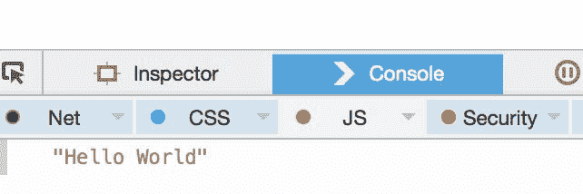

你可以运行该页面并使用 Chrome 的**开发者工具**对其进行检查：

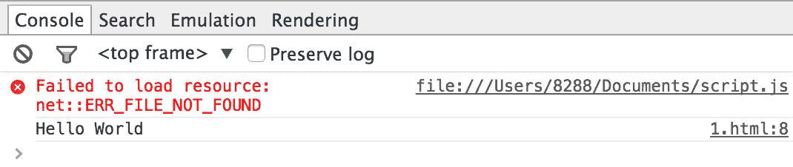

这里一个非常值得注意的点是，控制台上显示了一个错误，关于缺失的 .js 文件，而我们正尝试使用以下代码行导入它：

<script type="text/javascript" src="script.js"></script>

使用浏览器开发者控制台或如 **Firebug** 之类的扩展对于调试代码中的错误情况非常有用。我们将在后面的章节中详细讨论调试技术。

对于书中的每个练习，创建这样的 HTML 脚架可能很麻烦。相反，我们想要使用 JavaScript 的**读取-评估-打印循环**（**REPL**）。与 Python 不同，JavaScript 并不自带 REPL。我们可以使用 Node.js 作为 REPL。如果你的机器上安装了 Node.js，只需在命令行中输入 `node` 即可开始实验。你会发现 Node REPL 的错误显示并不十分优雅。

*第一章*

**[5]**

让我们看看下面的例子：

**EN-VedA:~$ node**

**>function greeter(){**
**x="World"**
**SyntaxError: Unexpected identifier**
**at Object.exports.createScript (vm.js:44:10)**
**at REPLServer.defaultEval (repl.js:117:23)**
**at bound (domain.js:254:14)**
**…**

出现此错误后，你必须重启。尽管如此，它仍然帮助你更快地尝试小段代码片段。

我个人经常使用的另一个工具是 **JS Bin** (http://jsbin.com/)。JS Bin 为你提供了一套非常棒的 JavaScript 测试工具，例如语法高亮和运行时错误检测。以下是 JS Bin 的截图：

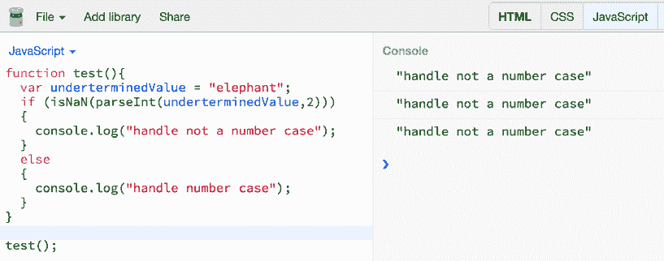

根据你的喜好，你可以选择更容易尝试代码示例的工具。无论你使用哪种工具，请确保你手动输入书中的每一个练习。

*JavaScript 入门*

**[6]**

## Hello World

任何编程语言在没有惯例的 Hello World 程序的情况下都不应该出版——这本书又何会有不同呢？

在 JS Bin 中输入（不要复制粘贴）以下代码：

```javascript
function sayHello(what) {
  return "Hello " + what;
}

console.log(sayHello("world"));
```

你的屏幕看起来应该如下：

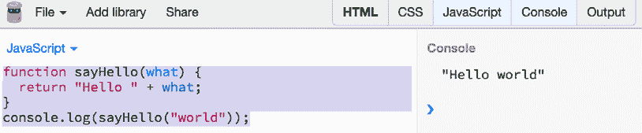

## JavaScript 概述

简而言之，JavaScript 是一种基于原型的脚本语言，具有动态类型和一等函数支持。JavaScript 的大部分语法借自 Java，但同时也受到 Awk、Perl 和 Python 的影响。JavaScript 是大小写敏感且忽略空格的。

## 注释

JavaScript 允许单行或多行注释。其语法与 C 或 Java 相似：

```javascript
// 单行注释

/* 这是一个较长的、
多行注释
*/

/* 你不能 /* 嵌套注释 */ SyntaxError */
```

*第一章*

**[7]**

## 变量

变量是值的符号化名称。变量名（或标识符）必须遵循某些规则。

JavaScript 变量名必须以字母、下划线 (_) 或美元符号 ($) 开头；后续字符可以是数字 (0-9)。由于 JavaScript 是大小写敏感的，字母包括 *A* 到 *Z*（大写）和 *a* 到 *z*（小写）字符。

你可以在变量名中使用 ISO 8859-1 或 Unicode 字母。

JavaScript 中的新变量应该用 **var** 关键字定义。如果你声明了一个变量但不给它赋值，它的类型默认为 `undefined`。非常糟糕的一点是，如果你不用 var 关键字声明变量，它们会变成隐式全局变量。让我重申，隐式全局变量是非常糟糕的——我们将在书的后面讨论变量作用域和闭包时详细说明，但重要的是，除非你清楚自己在做什么，否则你应该始终用 var 关键字声明变量：

```javascript
var a; // 声明了一个变量但它是未 的
var b = 0;
console.log(b); //0
console.log(a); //undefined
console.log(a+b); //NaN
```

NaN 值是一个特殊值，表示该实体*不是一个数字*。

## 常量

你可以使用 **const** 关键字创建一个只读的命名常量。常量名必须以字母、下划线或美元符号开头，并包含字母、数字或下划线字符：

```javascript
const area_code = '515';
```

常量不能通过赋值更改值，也不能重新声明，并且必须初始化为一个值。

*JavaScript 入门*

**[8]**

JavaScript 支持类型的标准变体：

- Number（数字）
- String（字符串）
- Boolean（布尔值）
- Symbol（符号，ECMAScript 6 新增）
- Object（对象）：
    - Function（函数）
    - Array（数组）
    - Date（日期）
    - RegExp（正则表达式）
- Null（空）
- Undefined（未定义）

## Number

**Number** 类型可以同时表示 32 位整数和 64 位浮点值。例如，下面行代码声明了一个存储整数值的变量，由字面量 555 定义：

```javascript
var aNumber = 555;
```

要定义浮点值，你需要包含一个小数点以及小数点后的一数字：

```javascript
var aFloat = 555.0;
```

本质上，JavaScript 中并没有所谓的整数。JavaScript 使用 64 位浮点表示法，这与 Java 的 `double` 相同。

因此，你会看到类似的内容：

**EN-VedA:~$ node**

**> 0.1+0.2**
**0.30000000000000004**
**> (0.1+0.2)===0.3**
**false**

*第一章*

**[9]**

我建议你阅读 Stack Overflow 上的详尽回答 (http://stackoverflow.com/questions/588004/is-floating-point-math-broken) 和 (http://floating-point-gui.de/)，它们解释了为什么会这样。然而，理解浮点运算应该被谨慎处理很重要。在大多数情况下，你不需要依赖小数的极高，但如果你必须，可以尝试使用如 **big.js** (https://github.com/MikeMcl/big.js) 等尝试解决此问题的库。

如果你打算编写极其精确的系统，你应该将 $ 值以分表示，以避免舍入误差。我工作过的一个系统曾将**增值税** (**VAT**) 金额保留两位。由于每天有数千个订单，每个订单的舍入金额变成了巨大的头疼问题。我们为此重了整个 Java 服务栈和 JavaScript 前端。

一些特殊值也被视为 Number 类型的一部分。前两个是 Number.MAX_VALUE 和 Number.MIN_VALUE，它们定义了数值集的外部边界。所有的 ECMAScript 数字都必须位于这两个值之间，没有例外。然而，计算可能会产生一个不在这两个数字之间的数字。当计算结果大于 Number.MAX_VALUE 时，它会被赋值为 Number.POSITIVE_INFINITY，这意味着它不再具有数值。同样，计算结果小于 Number.MIN_VALUE 时会被赋值为 Number.NEGATIVE_INFINITY，它同样没有数值。如果计算返回无穷大值，则该结果不能在任何后续计算中使用。你可以使用 isInfinite() 方法来验证计算结果是否为无穷大。

JavaScript 的另一个特性是一个名为 NaN 的特殊值（*Not a* *Number* 的缩写）。通常情况下，这发生在从其他类型（字符串、布尔值等）转换失败时。观察 NaN 的以下特性：

**EN-VedA:~ $ node**

**> isNaN(NaN);**
**true**
**> NaN==NaN;**
**false**
**> isNaN("elephant");**
**true**
**> NaN+5;**
**NaN**


*JavaScript 教程*

**[10]**

第二行很奇怪——NaN 不等于 NaN。如果 NaN 参与了任何数学运算，结果也会变成 NaN。作为一个通用规则，请避免在任何表达式中使用 NaN。对于任何高级数学运算，你可以使用 `Math` 全局对象及其方法：

> Math.E
2.718281828459045

> Math.SQRT2
1.4142135623730951

> Math.abs(-900)
900

> Math.pow(2,3)
8

你可以使用 `parseInt()` 和 `parseFloat()` 方法将字符串表达式转换为整数或浮点数：

> parseInt("230",10);
230

> parseInt("010",10);
10

> parseInt("010",8); //八进制
8

> parseInt("010",2); //二进制
2

> + "4"
4

使用 `parseInt()` 时你应该提供显式的基数，以防止在旧浏览器中出现意想不到的错误。最后一个技巧是直接使用 `+` 号来将字符串 "42" 自动转换为数字 42。使用 `isNaN()` 处理 `parseInt()` 的结果也是稳妥的。让我们来看下面的示例：

```javascript
var underterminedValue = "elephant";

if (isNaN(parseInt(underterminedValue,2)))
{
  console.log("handle not a number case");
}
else
{
  console.log("handle number case");
}
```

*第一章*

**[11]**

在这个示例中，如果值是从外部接口设置的，你无法确定 `underterminedValue` 变量可以持有的值类型。如果没有处理 `isNaN()`，`parseInt()` 将导致异常并可能程序崩溃。

### 字符串

在 JavaScript 中，字符串是 Unicode 字符序列（每个字符占用 16 位）。可以通过索引访问字符串中的每个字符。第一个字符的索引为 0。字符串包含在 `"` 或 `'` 内——这两种表示字符串的方法都是有效的。让我们来看：

> console.log("Hippopotamus chewing gum");
Hippopotamus chewing gum

> console.log('Single quoted hippopotamus');
Single quoted hippopotamus

> console.log("Broken \n lines");
Broken
lines

最后一行显示了某些字符字面量在用反斜杠 `\` 转义后如何作为特殊字符使用。以下此类特殊字符的列表：

- \n: 换行
- \t: 制表符
- \b: 退格符
- \r: 回车符
- \\: 反斜杠
- \': 单引号
- \": 双引号

JavaScript 字符串对特殊字符和 Unicode 字面量有默认支持：

> '\xA9'
'©'

> '©'
'©'

*JavaScript 教程*

**[12]**

关于 JavaScript 字符串、数字和布尔值的一个重要口**点是，它们实际上在对应的原始等价值周围有一个包装对象。下面的示例展示了包装对象的使用：

```javascript
var s = new String("dummy"); //创建一个 String 对象
console.log(s); //"dummy"
console.log(typeof s); //"object"

var nonObject = "1" + "2"; //创建一个字符串原始值
console.log(typeof nonObject); //"string"

var objString = new String("1" + "2"); //创建一个 String 对象
console.log(typeof objString); //"object"

// 辅助函数
console.log("Hello".length); //5
console.log("Hello".charAt(0)); //"H"
console.log("Hello".charAt(1)); //"e"
console.log("Hello".indexOf("e")); //1
console.log("Hello".lastIndexOf("l")); //3
console.log("Hello".startsWith("H")); //true
console.log("Hello".endsWith("o")); //true
console.log("Hello".includes("X")); //false

var splitStringByWords = "Hello World".split(" ");
console.log(splitStringByWords); //["Hello", "World"]

var splitStringByChars = "Hello World".split("");
console.log(splitStringByChars); //["H", "e", "l", "l", "o", " ", "W", "o", "r", "l", "d"]

console.log("lowercasestring".toUpperCase()); //"LOWERCASESTRING"
console.log("UPPPERCASESTRING".toLowerCase()); //"upppercasestring"
console.log("There are no spaces in the end ".trim()); //"There are no spaces in the end"
```

JavaScript 也允许多行字符串。包含在 \`（反引号—https://en.wikipedia.org/wiki/Grave_accent）内的字符串被视为多行。让我们来看下面的示例：

```javascript
console.log(`string text on first line
string text on second line `);
"string text on first line
string text on second line "
```

这种字符串也被称为模板字符串，可以用于字符串插值。JavaScript 允许使用这种语法进行类似 Python 的字符串插值。

*第一章*

**[13]**

通常，你会执行类似的操作：

```javascript
var a=1, b=2;
console.log("Sum of values is :" + (a+b) + " and multiplication is :" + (a*b));
```

然而，通过字符串插值，情况会变得清晰一些：

```javascript
console.log(`Sum of values is :${a+b} and multiplication is :${a*b}`);
```

### 未定义值

JavaScript 通过两个特殊值表示有意义值的缺失：`null` 用于刻意的非值情况，而 `undefined` 用于该值尚未赋值给变量的情况。让我们来看下面的示例：

> var xl;
> console.log(typeof xl);
undefined

> console.log(null==undefined);
true

### 布尔值

JavaScript 布尔型原始值由 `true` 和 `false` 关键字表示。以下规则规定了什么为假，什么为真：

- `false`、`0`、空字符串 (`""`)、`NaN`、`null` 和 `undefined` 被表示为假
- 其他所有内容均为真

JavaScript 布尔值之所以棘手，主要是因为创建它们的方式的行为完全不同。

在 JavaScript 中创建布尔值有两种方法：

- 你可以通过给变量赋值 `true` 或 `false` 字面量来创建原始布尔值。考虑下面的示例：
```javascript
var pBooleanTrue = true;
var pBooleanFalse = false;
```

*JavaScript 教程*

**[14]**

- 使用 `Boolean()` 函数；这是一个返回原始布尔值的普通函数：
```javascript
var fBooleanTrue = Boolean(true);
var fBooleanFalse = Boolean(false);
```

这两种方法都返回预期的*真值 (truthy)*或*假值 (falsy)*。然而，如果你使用 `new` 运算符创建布尔对象，情况可能会变得糟糕。

本质上，当你使用 `new` 运算符和 `Boolean(value)` 构造函数时，你得到的不是原始的 `true` 或 `false`，而是一个对象。

```javascript
var oBooleanTrue = new Boolean(true);
var oBooleanFalse = new Boolean(false);

console.log(oBooleanTrue); //true
console.log(typeof oBooleanTrue); //"object"

if(oBooleanTrue){
  console.log("I am seriously truthy, don't believe me");
}
if(oBooleanFalse){
  console.log("I am also truthy, see");
}
```

等待，提供的 OCR 文本在最后部分包含了一些乱码。让我根据提供的 OCR 文本对最后几页进行对齐：

本质上，当你使用 `new` 运算符和 `Boolean(value)` 构造函数时，你得到的不是原始的 `true` 或 `false`，而是一个对象。

```javascript
var oBooleanTrue = new Boolean(true);
var oBooleanFalse = new Boolean(false);

console.log(oBooleanTrue); //true
console.log(typeof oBooleanTrue); //"object"

if(oBooleanTrue){
  console.log("I am seriously truthy, don't believe me");
}
if(oBooleanFalse){
  console.log("I am also truthy, see");
}
```

等待，查看 14-15 页的原始 OCR 文本似乎严重严重重复。我将根据源材料意图进行清理：

*第一章*

**[15]**

### instanceof 运算符

使用引用类型存储值的问题之一是 `typeof` 运算符，无论引用的是什么类型的对象都会返回 object。为了提供解决方案，可以使用 `instanceof` 运算符。让我们来看一些示例：

```javascript
var aStringObject = new String("string");
console.log(typeof aStringObject); //"object"
console.log(aStringObject instanceof String); //true

var aString = "This is a string";
console.log(aString instanceof String); //false
```

第三行返回 false。我们将在讨论原型链时讨论这是为什么。

### Date 对象

JavaScript 没有日期数据类型。相反，你可以使用 `Date` 对象及其方法在应用程序中处理日期和时间。`Date` 对象非常详尽，包含了处理大多数日期时间相关用例的方法。

JavaScript 处理日期的方式与 Java 。JavaScript 将日期存储为从 1970 年 1 月 1 日 00:00:00 开始的毫秒数。你可以使用以下声明创建 `Date` 对象：

```javascript
var dataObject = new Date([parameters]);
```

 构造函数的参数如下：

- 不带参数创建今天的日期和时间。例如 `var today = new Date();`
- 表示月份日、年时:分:秒的字符串。例如 `var twoThousandFifteen = new Date("December 31, 2015 23:59:59");`。如果你省略了小时、分钟或秒，值将将设置为 0。
- 年、月、日的整数值集合。例如 `var christmas = new Date(2015, 11, 25);`
- 年、月、日、时、分、秒的整数值集合。例如 `var christmas = new Date(2015, 11, 25, 21, 00, 0);`


*JavaScript 教程*

**[16]**

以下是一些如何在 JavaScript 中创建和操作日期的示例：

var today = new Date();

console.log(today.getDate()); //27

console.log(today.getMonth()); //4

console.log(today.getFullYear()); //2015

console.log(today.getHours()); //23

console.log(today.getMinutes()); //13

console.log(today.getSeconds()); //10

// 自 UTC 1970 年 1 月 1 日 00:00:00 以来来的毫秒数

console.log(today.getTime()); //1432748611392

console.log(today.getTimezoneOffset()); //-330 Minutes

// 计算经过的时间

var start = Date.now();

// 循环长时间

for (var i=0;i<100000;i++);

var end = Date.now();

var elapsed = end - start; // 毫秒级经过时间

console.log(elapsed); //71

对于任何需要对日期和时间对象进行精细控制的正式应用，我们建议使用如 **Moment.js** (https://github.com/moment/moment)、**Timezone.js** (https://github.com/mde/timezone-js) 或 **date.js** (https://github.com/MatthewMueller/date) 等库。这些库为你简化了许多重复任务，帮助你专注于其他重要的事情。

**+ 运算符**

**+** 运算符当一元运算符使用时对数字没有影响。然而，当应用于字符串时，+ 运算符会将其转换为数字，如下：

var a=25;

a=+a; // 对 a 的值没有影响

console.log(a); //25

var b="70";

console.log(typeof b); //string

b=+b; // 将字符串转换为数字

console.log(b); //70

console.log(typeof b); //number

*第一章*

**[17]**

程序员经常使用 + 运算符来快速将字符串的数字表示转换为数字。然而，如果字符串字面量不是可以转换为数字的内容，你将得到略微不可预测的结果，如下：

var c="foo";

c=+c; // 将 foo 转换为数字

console.log(c); //NaN

console.log(typeof c); //number

var zero="";

zero=+zero; // 空字符串被转换为 0

console.log(zero);

console.log(typeof zero);

我们将在本文后续部分讨论 + 运算符对其他几种数据类型的影响。

**++ 和 -- 运算符**

++ 运算符是给值加 1 的简写形式，而 -- 是从值中减 1 的简写。Java 和 C 有等效的运算符，大多数人都很熟悉。这个呢？

var a= 1;

var b= a++;

console.log(a); //2

console.log(b); //1

呃，这里发生了什么？b 变量的值不应该是 2 吗？++ 和 -- 运算符是一元运算符，可以作为前缀或后置使用。它们使用的顺序很重要。当 ++ 用在前缀位置（如 ++a）时，它会在表达式返回值之前增加该值，而不是像 a++ 那样在之后。让我们看看下面的代码：

var a= 1;

var b= ++a;

console.log(a); //2

console.log(b); //2

许多程序员使用链式赋值将单个值赋给多个变量，如下：

var a, b, c;

a = b = c = 0;

*JavaScript 教程*

**[18]**

这是可以的，因为赋值运算符 (=)会导致结果被赋值。在这种情况下，c=0 被求值为 0；这将导致 b=0，它也被求值为 0，因此，a=0 被求值。

然而，对上一个示例进行微调会产生异常的结果。考虑这个：

var a = b = 0;

在这种情况下，只有 a 变量用 var 声明了，而 b 变量被创建了一个意外的全局变量。（如果你在严格模式下，将得到一个错误。）在 JavaScript 中，小心你所愿的，你可能会得偿。

**布尔运算符**

JavaScript 中有三个布尔运算符——AND (&)、OR(|) 和 NOT (!)。在讨论逻辑 AND 和 OR 运算符之前，我们需要理解它们是如何产生布尔结果的。逻辑运算符从左到右求值，并使用以下短路规则进行测试：

- **逻辑 AND**：如果第一个操作数决定了结果，则第二个操作数不被求值。

在下面的示例中，如果右侧表达式作为短路评估规则的一部分执行，我将其高亮显示：

console.log(true && **true**); // true AND true 返回 true

console.log(true && **false**);// true AND false 返回 false

console.log(false && true);// false AND true 返回 false

console.log("Foo" && **"Bar"**);// Foo(true) AND Bar(true) 返回 Bar

console.log(false && "Foo");// false && Foo(true) 返回 false

console.log("Foo" && **false**);// Foo(true) && false 返回 false

console.log(false && (1 == 2));// false && false(1==2) 返回 false

*第一章*

**[19]**

- **逻辑 OR**：如果第一个操作数为真，则第二个操作数不被求值：

console.log(true || true); // true AND true 返回 true

console.log(true || false);// true AND false 返回 true

console.log(false || **true**);// false AND true 返回 true

console.log("Foo" || **"Bar"**);// Foo(true) AND Bar(true) 返回 Foo

console.log(false || **"Foo");// false && Foo(true) 返回 Foo

console.log("Foo" || false);// Foo(true) && false 返回 Foo

console.log(false || (1 == 2));// false && false(1==2) 返回 false

然而，逻辑 AND 和逻辑 OR 也可以用于非布尔操作数。当左侧或右侧操作数不是原始布尔值时，AND 和 OR 不会返回布尔值。

现在我们将解释这三个逻辑布尔运算符：

- 逻辑 AND (&&)；如果第一个操作数对象是*假 (falsy)*，它返回该对象。如果它是*真 (truthy)*，则返回第二个操作数对象：

console.log (0 && "Foo"); // 第一个操作数为假 - 返回它

console.log ("Foo" && "Bar"); // 第一个真，返回第二个

- 逻辑 OR (||)：如果第一个操作数为*真 (truthy)*，则返回它。否则，返回第二个操作数：

console.log (0 || "Foo"); // 第一个为假 - 返回第二个

console.log ("Foo" || "Bar"); // 第一个真，返回第一个

console.log (0 || false); // 第一个为假，返回第二个

逻辑 OR 的典型用法是为变量分配默认值：

function greeting(name){

name = name || "John";

console.log("Hello " + name);

通过逻辑 OR 运算符理解是如何设置默认值的。

*JavaScript 教程*

**[20]**

- **逻辑 NOT**：它总是返回一个布尔值。返回的值取决于：

// 如果操作数是对象，返回 false。

var s = new String("string");

console.log(!s); //false

// 如果操作数为 0，返回 true。

var t = 0;

console.log(!t); //true

// 如果操作数是除 0 外的任何数字，返回 false。

var x = 11;

console.log(!x); //false

// 如果操作数为 null 或 NaN，返回 true。

var y =null;

var z = NaN;

console.log(!y); //true

console.log(!z); //true

// 如果操作数为 undefined，你会得到 true

var foo;

console.log(!foo); //true

此外，如果你想使用它，JavaScript 支持类似 C 的三元运算符：

var allowedToDrive = (age > 21) ? "yes" : "no";

如果 (age>21)，? 之后的表达式将被赋值给 allowedToDrive，否则赋值 : 之后的表达式。这等同于一个 if-else 条件语句。让我们看看另一个示例：

function isAllowedDrive(age){

if(age>21){

return true;

}else{

return false;

}

console.log(isAllowedDrive(22));

*第一章*

**[21]**

在这个示例中，isAllowedDrive() 函数接受一个整数参数 age。根据该变量的值，我们向调用函数返回 true 或 false。这是一种广为人知且最熟悉的 if-else 条件逻辑。大多数情况下，if-else 让代码更易读。

if-else 条件语句可以如下所示嵌套：

if (condition1) {

statement1

} else if (condition2) {

statement2

} else if (condition3) {

statement3

..

} else {

statementN

}

纯出于个人喜好，你可以这样缩进嵌套的 else if：

if (condition1) {

statement1

} else

if (condition2) {


*JavaScript 入门*

**[22]**

一种方法是在赋值语句周围加上额外的括号：

```javascript
if((a=b)){
  //这确实是你想要做的
}
```

处理条件执行的另一种方法是使用 `switch-case` 语句。

JavaScript 中的 `switch-case` 结构与 C 或 Java 类似。让我们来看下面的例子：

```javascript
function sayDay(day){
  switch(day){
    case 1: console.log("Sunday");
    break;
    case 2: console.log("Monday");
    break;
    default:
      console.log("We live in a binary world. Go to Pluto");
  }
}

sayDay(1); //Sunday
sayDay(3); //We live in a binary world. Go to Pluto
```

这种结构的一个问题是你必须在每个 `case` 中跳出（break），否则执行将贯穿到下一个级别。如果我们从第一个 `case` 语句中移除 `break` 语句，输出将如下：

>sayDay(1);
> Sunday
> Monday

如你所见，如果我们省略 `break` 语句以在条件满足后立即中断执行，执行序列将进入下一个级别。这可能导致你的代码中出现难以检测的问题。然而，如果你打算让它执行到下一个级别，这也是一种流行的条件逻辑写法：

```javascript
function debug(level,msg){
  switch(level){
    case "INFO": //有意的贯穿
    case "WARN" :
    case "DEBUG": console.log(level+ ": " + msg);
    break;
    case "ERROR": console.error(msg);
  }
}
```

*第 1 章*

**[23]**

```javascript
debug("INFO","Info Message");
debug("DEBUG","Debug Message");
debug("ERROR","Fatal Exception");
```

在这个例子中，我们故意让执行贯穿，以编写简洁的 `switch-case`。如果级别是 INFO、WARN 或 DEBUG，我们使用 `switch-case` 让它们贯穿到单一执行点。为此，我们省略了 `break` 语句。如果你想遵循这种编写 `switch` 语句的模式，请确保你记录了你的用法以提高可读性。

`switch` 语句可以有一个 `default case` 来处理任何无法被其他 `case` 评估的值。

JavaScript 有 `while` 和 `do-while` 循环。`while` 循环允许你迭代一组表达式，直到满足条件。第一个例子迭代了 `{}` 内包含的语句，直到 `i<10` 表达式为真。记住，如果计数器 `i` 的值已经大于 10，循环将完全不执行：

```javascript
var i=0;
while(i<10){
  i=i+1;
  console.log(i);
}
```

下面的循环将无限执行下去，因为条件始终为真——这可能导致灾难性的后果。你的程序可能会耗尽所有内存或其他同样不愉快的事情：

```javascript
//无限循环
while(true){
  //持续执行此操作
}
```

如果你想确保至少执行一次循环，可以使用 `do-while` 循环（有时称为后条件循环）：

```javascript
var choice;
do {
  choice=getChoiceFromUserInput();
} while(!isInputValid(input));
```

*JavaScript 入门*

**[24]**

在这个例子中，我们不断向用户请求输入，直到找到来自用户的有效输入。当用户输入无效内容时，我们继续向用户请求。人们总是认为，从逻辑上讲，每个 `do-while` 循环都可以转换为 `while` 循环。然而，`do-while` 循环有一个非常有效的用，就像我们刚刚看到的，你希望只在执行一次循环块后才检查条件。

JavaScript 有一种类似于 C 或 Java 的强大循环——`for` 循环。`for` 循环之所以流行，是因为它允许在一行中定义循环的控制条件。

下面的例子打印了五次 Hello：

```javascript
for (var i=0;i<5;i++){
  console.log("Hello");
}
```

在循环定义中，你定义了循环计数器 `i` 的初始值为 0，定义了 `i<5` 退出条件，最后，定义了递增因子。

上一个例子中的三个表达式都是可选的。如果需要，你可以省略它们。例如，以下变体都会产生与上一个循环相同的结果：

```javascript
var x=0;
//省略初始化
for (;x<5;x++){
  console.log("Hello");
}
//省略退出条件
for (var j=0;;j++){
  //退出条件
  if(j>=5){
    break;
  }else{
    console.log("Hello");
  }
}
//省略递增
for (var k=0; k<5;){
  console.log("Hello");
  k++;
}
```

*第 1 章*

**[25]**

你也可以省略这三个表达式并编写 `for` 循环。一种经常使用的有趣惯用法是使用带有空语句的 `for` 循环。下面的循环用于将数组的所有元素都设置为 100。注意 `for` 循环没有体：

```javascript
var arr = [10, 20, 30];
//将所有数组值赋值为 100
for (i = 0; i < arr.length; i++) arr[i] = 100;
```


*JavaScript 导读*

**[28]**

然而，这种类型转换可以通过许多不同的方式发生。

显式发生的转换易于理解且大部分非常可靠；但如果你不小心，转换可能会以非常奇怪且令人意料的方式发生。

对类型转换的困惑可能是 JavaScript 开发者讨论最多的挫败感之一。为了确保你脑海中永远不会产生这种困惑，让我们重新回顾 JavaScript 中的类型：

typeof 1 === "number"; // true
typeof "1" === "string"; // true
typeof { age: 39 } === "object"; // true
typeof Symbol() === "symbol"; // true
typeof undefined === "undefined"; // true
typeof true === "boolean"; // true

到目前为止一切良好。我们已经知道这些了，刚才看到的例子也加强了我们对类型的认知。

将值从一种类型转换为另一种类型称为**强制转换**（casting）或显式转换。JavaScript 还会根据某些猜测更改值的类型来执行隐式转换。这些猜测让 JavaScript 能够处理某些情况，遗憾的是也让它在静默且意想不到的情况下失败。以下代码片段展示了显式转换和隐式转换的案例：

```javascript
var t=1;
var u=""+t; //隐式转换
console.log(typeof t); //"number"
console.log(typeof u); //"string"
var v=String(t); // 显式转换
console.log(typeof v); //"string"
var x=null
console.log(""+x); //"null"
```

很容易看出这里发生了什么。当你对数值型的 `t`（在本例中为 1）使用 `""+t` 时，JavaScript 得出你正尝试将*某些内容*与空字符串拼接。由于只有字符串可以与其他字符串拼接，JavaScript 就会将数字 1 转换为字符串 "1"，并将两者都拼接成一个结果字符串值。这就是 JavaScript 被要求隐式转换值时发生的情况。然而，`String(t)` 是一个刻意的将数字转换为字符串的调用。这是一个显式的类型转换。最后一点令人惊讶。我们正在将 `null` 与 `""` 拼接——这不应该失败吗？

那么 JavaScript 是如何进行类型转换的？一个抽象值是如何变成字符串、数字或布尔值的？JavaScript 依赖 `toString()`、`toNumber()` 和 `toBoolean()` 方法在内部完成此。

*第 1 章*

**[29]**

当非字符串值被强制转换为字符串时，JavaScript 在内部使用 `toString()` 方法来完成。所有原始类型都有其天然的字符串形式——`null` 的字符串形式是 "null"，`undefined` 的字符串形式是 "undefined"，依此类推。

对于 Java 开发者来说，这类似于类拥有一个 `toString()` 方法来返回该类的字符串表示。我们将在对象的情况下具体看到它是如何工作的。

所以本质上，你可以执行类似以下的操作：

```javascript
var a="abc";
console.log(a.length);
console.log(a.toUpperCase());
```

如果你在密切关注并输入所有这些小片段，你会在上一个片段中发现一些奇怪的地方。我们是如何在原始类型上调用属性和方法的？原始类型怎么会有像属性和方法这样的对象？它们并没有。

正如我们之前讨论过的，JavaScript 默认会将这些原始类型包装在包装器（wrappers）中，使我们能够直接访问包装器的方法和属性，就像它们是原始类型本身的一样。

当任何非数字值需要强制转换为数字时，JavaScript 在内部使用 `toNumber()` 方法：`true` 变成 1，`undefined` 变成 `NaN`，`false` 变成 0，`null` 变成 0。字符串上的 `toNumber()` 方法通过字面量转换工作，如果失败，该方法返回 `NaN`。

其他情况呢？

typeof null === "object" //true

嗯，`null` 是一个对象？是的，一个特别持久的 bug 使这成为可能。由于这个 bug，你在测试一个值是否为 `null` 时需要小心：

```javascript
var x = null;
if (!x && typeof x === "object"){
  console.log("100% null");
}
```

其他可能具有类型的类型，比如函数呢？

```javascript
f = function test() {
  return 12;
}
console.log(typeof f === "function"); //打印 "true"
```

*JavaScript 导读*

**[30]**

数组呢？

```javascript
console.log (typeof [1,2,3,4]); //"object"
```

果不其然，它们也是对象。我们将在书的后面详细查看函数和数组。

在 JavaScript 中，值有类型，变量没有。由于这种语言的动态性质，变量可以在任何时候持有任何值。

JavaScript 不强制执行类型，这意味着语言并不要求变量始终持有与其初始时相同的类型的值。一个变量可以持有字符串，在下一次赋值中持有数字，依此类推：

```javascript
var a = 1;
typeof a; // "number"
a = false;
typeof a; // "boolean"
```

`typeof` 运算符始终返回一个字符串：

typeof typeof 1; // "string"

**自动分号插入**

尽管 JavaScript 基于 C 语言风格的语法，但它并没有强制在源代码中使用分号。

然而，JavaScript 并不是一种不需要分号的语言。JavaScript 语言解析器需要分号来理解源代码。因此，每当 JavaScript 解析器遇到由于缺少分号而导致的解析错误时，它就会自动插入分号。需要注意的是，**自动分号插入（ASI）** 只有在存在换行符（也称为行符）的情况下才会生效。分号不会插入在行的中间。

基本上，如果 JavaScript 解析器解析某行时发生解析错误（缺少预期的 ;)）且它可以插入一个分号，它就会这样做。插入分号的标准是什么？只有当某些语句结束与该行的换行符之间除了空格和/或注释外，才会插入。

关于 ASI 一直存在激烈的辩论——这个功能被认为是一个非常糟糕的设计选择。互联网上进行过史级的讨论，例如 https://github.com/twbs/bootstrap/issues/3057 和 https://brendaneich.com/2012/04/the-infernal-semicolon/。

*第 1 章*

**[31]**

在判断这些论点的有效性之前，你需要理解什么受 ASI 的影响。以下语句受 ASI 的影响：

- 一个空语句
- 一个 var 语句
- 一个表达式语句
- 一个 do-while 语句
- 一个 continue 语句
- 一个 break 语句
- 一个 return 语句
- 一个 throw 语句

ASI 背后的想法是让行尾的分号变为可选。通常情况下，它以分号结束。ASI 规定语句在以下情况下也会结束：

- 一个行终止符（例如换行符）后面跟着一个非法标记
- 遇到右括号
- 到达文件末尾

让我们看看这个例子：

if (a < 1) a = 1 console.log(a)

`console` 标记在 1 之后是非法的，并如下所示触发 ASI：

if (a < 1) a = 1; console.log(a);

在下面的代码中，大括号内的语句没有用分号结束：

function add(a,b) { return a+b }

ASI 为前面的代码创建了一个语法正确的版本：

function add(a,b) { return a+b; }

*JavaScript 导读*

**[32]**

**JavaScript 风格指南**

每种编程语言都发展出自己的风格和结构。遗憾的是，新开发者没有花很多精力学习语言的细微差别。一旦你习得了坏习惯，以后想要培养这种技能非常困难。为了编写漂亮、易读且易于维护的代码，学习正确的风格很重要。有很多风格建议。我们将挑选最实用的。在适用的情况下，我们将讨论合适的风格。

**空格**

虽然空格在 JavaScript 中并不重要，但正确使用空格可以让代码变得易读。以下指南将帮助管理代码中的空格：

- 永远不要混合使用空格制表符。
- 在编写任何代码之前，在软缩进（空格）或真实的制表符之间做出选择。为了可读性，我总是建议将编辑器的缩进大小设置为两个字符——这意味着两个空格或代表真实制表符的两个空格。
- 始终开启显示不可字符。这种做法的好处如下：
    - 强制一致性。
    - 消除行尾空格。
    - 消除空行空格。
    - 提交和差异（diff）更易读。
    - 尽可能使用 **EditorConfig** (http://editorconfig.org/)。

**括号、换行和花括号**

if、else、for、while 和 try 总是带有空格和大括号并跨多行。这种风格鼓励可读性。让我们看看下面的代码：

// 紧凑的风格（坏）
if(condition) doSomeTask();
while(condition) i++;
for(var i=0;i<10;i++) iterate();

// 使用空格获得更好的可读性（好）
if (condition) {
  doSomeTask();
}
while (condition) {
  i++;
}
for (var i = 0; i < 10; i++) {
  iterate();
}


*第一章*

**[33]**

// 在前大括号前留一个空格。

if (condition) {

// 语句
}

while ( condition ) {

// 语句
}

for ( var i = 0; i < 100; i++ ) {

// 语句
}

// 更好：
var i,

length = 100;

for ( i = 0; i < length; i++ ) {

// 语句
}

// 或者...

var i = 0,

length = 100;

for ( ; i < length; i++ ) {

// 语句
}

var value;

for ( value in object ) {

// 语句
}

if ( true ) {

// 语句
} else {

// 语句
}

*JavaScript 门教程*

**[34]**

// 在运算符周围加上空格。

// 错误
var x=y+5;

// 正确
var x = y + 5;

// 以单个换行符结束文件。

// 错误
(function(global) {

// ...内容...

})(this);

// 错误
(function(global) {

// ...内容...

})(this);

// 正确
(function(global) {

// ...内容...

})(this);

**引号**

你倾向于使用单引号还是双引号并不重要；JavaScript 解析它们的方式没有区别。然而，为了代码的一致性，请永远不要在同一个项目中混合使用引号。选择一种风格并坚持下去。

**行尾和空行**

空格可能会导致无法解析代码差异（diffs）和变更列表。许多编辑器允许你自动删除额外的空行和行尾——你应该使用这些功能。

*第一章*

**[35]**

**类型检查**

可以通过如下方式检查变量的类型：

// 字符串：
typeof variable === "string"

// 数字：
typeof variable === "number"

// 布尔值：
typeof variable === "boolean"

// 对象：
typeof variable === "object"

// null：
variable === null

// null 或未定义：
variable == null

**类型转换**

在语句开始处如下所示执行类型转换：

// 错误
const totalScore = this.reviewScore + '';

// 正确
const totalScore = String(this.reviewScore);

对于数字使用 `parseInt()`，并且进行类型转换时始终带有进制：

const inputValue = '4';

// 错误
const val = new Number(inputValue);

// 错误
const val = +inputValue;

// 错误
const val = inputValue >> 0;

// 错误
const val = parseInt(inputValue);

// 正确
const val = Number(inputValue);

// 正确
const val = parseInt(inputValue, 10);

*JavaScript 门教程*

**[36]**

以下示例展示了如何使用布尔值进行类型转换：

const age = 0; // 错误
const hasAge = new Boolean(age); // 正确
const hasAge = Boolean(age); // 正确
const hasAge = !!age;

**条件求值**

关于条件语句有各种风格指南。让我们学习以下代码：

// 当评估数组是否有长度时，
// 错误：
if ( array.length > 0 ) ...

// 评估真值（正确）：
if ( array.length ) ...

// 当评估数组是否为空时，
//（错误）：
if ( array.length === 0 ) ...

// 评估真值（正确）：
if ( !array.length ) ...

// 当检查字符串是否不为空时，
//（错误）：
if ( string !== "" ) ...

// 评估真值（正确）：
if ( string ) ...

// 当检查字符串是否为空时，
// 错误：
if ( string === "" ) ...

// 评估假值（正确）：
if ( !string ) ...

// 当检查一个引用是否为 true时，
//（错误）：
if ( foo === true ) ...

*第一章*

**[37]**

// 正确
if ( foo ) ...

// 当检查一个引用是否为 false时，
// 错误：
if ( foo === false ) ...

// 正确
if ( !foo ) ...

// 这也会匹配：0, "", null, undefined, NaN

// 如果你必须测试布尔值 false，那么请使用
if ( foo === false ) ...

// 一个可能为 null 或 undefined 的引用，但不是 false、"" 或
0，
// 错误：
if ( foo === null || foo === undefined ) ...

// 正确
if ( foo == null ) ...

// 不要把问题复杂
return x === 0 ? 'sunday' : x === 1 ? 'Monday' : 'Tuesday';

// 更好：
if (x === 0) {
return 'Sunday';
} else if (x === 1) {
return 'Monday';
} else {
return 'Tuesday';
}

// 甚至是：
switch (x) {
case 0:
return 'Sunday';
case 1:
return 'Monday';
default:
return 'Tuesday';
}

*JavaScript 门教程*

**[38]**

**命名**

命名超级重要。我相信你一定遇到过命名简短且难以理解的代码。让我们学习以下几行代码：

// 避免单字母命名。命名时要具有描述性。
// 错误
function q() {
}

// 正确
function query() {
}

// 在命名对象、函数和实例时使用驼峰命名法（camelCase）。
// 错误
const OBJEcT = {};
const this_is_object = {};
function c() {}

// 正确
const thisIsObject = {};
function thisIsFunction() {}

// 在命名构造函数或类时使用大驼峰命名法（PascalCase）。
// 错误
function user(options) {
this.name = options.name;
}
const bad = new user({
name: 'nope',
});

// 正确
class User {
constructor(options) {
this.name = options.name;
}
}

*第一章*

**[39]**

const good = new User({
name: 'yup',
});

// 在命名私有属性时使用前下划线 _。
// 错误
this.__firstName__ = 'Panda';
this.firstName_ = 'Panda';

// 正确
this._firstName = 'Panda';

**eval() 方法是邪恶的**

`eval()` 方法接收包含 JavaScript 代码的字符串，对其编译并运行，它是 JavaScript 中被误用次数最多的的方法之一。在某些情况下你会发现自己在使用 `eval()`，例如当你根据用户输入构建一个表达式时。

然而，大多数时候使用 `eval()` 仅仅是因为它可以完成工作。`eval()` 方法太具有取巧性，会让代码变得不可预测。它速度慢、笨拙，并且在你出错时往往会放大损害。如果你正在考虑使用 `eval()`，那么可能有更好的方法。

以下代码片段展示了 `eval()` 的用法：

```
console.log(typeof eval(new String("1+1"))); // "object"
console.log(eval(new String("1+1"))); //1+1
console.log(eval("1+1")); // 2
console.log(typeof eval("1+1")); // returns "number"
var expression = new String("1+1");
console.log(eval(expression.toString())); //2
```

我将不再展示 `eval()` 的其他用法，并确保你有足够的动力去远离它。

**严格模式**

ECMAScript 5 有一种严格模式，可以产生更整洁的 JavaScript、更少安全的功能、更多的警告以及更符合逻辑的行为。普通（非严格）模式也称为**松散模式（sloppy mode）**。严格模式可以帮助你避免一些草率的习惯。如果你开始一个新的 JavaScript 项目，我强烈建议你默认使用严格模式。

*JavaScript 门教程*

**[40]**

你通过在 JavaScript 文件或 `<script>` 元素开头输入以下行来开启严格模式：
'use strict';

注意，不支持 ECMAScript 5 的 JavaScript 引擎将忽略该语句并继续作为非严格模式。如果你想按函数开启严格模式，可以这样做：

```javascript
function foo() {
'use strict';
}
```

当你处理遗留代码库且处处开启严格模式可能会破坏某些时，这非常有用。

**在现有代码中启用严格模式可能会破坏它**

代码可能依赖于某个不再可用的功能，或者依赖于松散模式和严格模式下不同的行为。关于这一点有一些限制：你可以将单个严格模式函数添加到处于松散模式的文件中。

**小心打包**

当你合并和/或压缩化文件时，你必须确保严格模式没有在应该开启的地方被关闭，反之亦然。这两种都会破坏代码。

以下章节详细解释了严格模式的特性。你通常不需要了解它们，因为你大多数时候会对你不应该做的事情收到警告。

**变量在严格模式下必须声明**

所有变量在严格模式下必须显式声明。这有助于防止拼写错误。在松散模式下，给未声明的变量赋值创建一个全局变量：

```javascript
function sloppyFunc() {
sloppyVar = 123;
} sloppyFunc(); // 创建全局变量 `sloppyVar`

console.log(sloppyVar); // 123
```


*第1章*

**[ 41 ]**

在严格模式下，向未声明的变量赋值会抛出异常：

```javascript
function strictFunc() {
  'use strict';
  strictVar = 123;
}

strictFunc(); // ReferenceError: strictVar is not defined
```

在严格模式下，eval() 函数更加整洁

在严格模式下，`eval()` 函数变得不再怪异：在评估的字符串中声明的变量不再被添加到 `eval()` 周围的作用域中。

## 严格模式下禁止的特性

不允许使用 `with` 语句。（我们将在书中以后讨论。）你会在编译时（加载代码时）得到语法错误。

在非严格模式（sloppy mode）下，前导零的整数被解释为八进制（基8），如下：

**> 010 === 8 // true**

在严格模式下，如果你使用这种字面量，将得到语法错误：

```javascript
function f() {
  'use strict';
  return 010
}
// SyntaxError: Octal literals are not allowed in
```

## 运行 JSHint

**JSHint** 是一个用于标记 JavaScript 程序中可疑用法的程序。该核心项目由库本身以及作为一个 Node 模块分发的**命令行界面**（**CLI**）程序组成。

如果你安装了 Node.js，可以使用以下命令通过 npm 安装 JSHint：

**npm install jshint -g**

*JavaScript 门*

**[ 42 ]**

一旦安装了 JSHint，你就可以对单个或多个 JavaScript 文件进行检查。将以下 JavaScript 代码段保存到 `test.js` 文件中：

```javascript
function f(condition) {
  switch (condition) {
    case 1:
      console.log(1);
    case 2:
      console.log(1);
  }
}
```

当我们使用 JSHint 运行文件时，它会像下面这样警告我们 switch case 中缺少 `break` 语句：

**> jshint test.js**
**test.js: line 4, col 19, Expected a 'break' statement before 'case'.**
**1 error**

JSHint 可以配置以满足你的需求。访问 http://jshint.com/docs/ 查看文档，了解如何根据你的项目需求自定义 JSHint。我广泛使用 JSHint，并建议你也开始使用它。你会惊讶地发现，通过这样一个简单的工具，你能够修复代码中许多隐藏的 bug 和风格问题。

你可以在项目的根目录下运行 JSHint 并检查整个项目。你可以在 `.jshintrc` 文件中放置 JSHint 指令。该文件看起来可能如下：

```json
{
  "asi": false,
  "expr": true,
  "loopfunc": true,
  "curly": false,
  "evil": true,
  "white": true,
  "undef": true,
  "indent": 4
}
```

**[ 43 ]**

## 总结

在本章中，我们围绕 JavaScript 语法、类型和风格考虑奠定了一些基础。我们有意识地没有讨论其他重要方面，如函数、变量作用域和闭包，主要是因为它们在书中应该有自己的章节。我确信这一章能帮助你理解 JavaScript 的一些核心概念。在有了这些基础之后，我们将查看如何编写专业质量的 JavaScript 代码。

**[ 45 ]**

## 函数、闭包和模块

在上一章中，我们刻意没有讨论 JavaScript 的某些方面。这些是赋予 JavaScript 力量和优雅的语言特性。如果你是一个中级或高级 JavaScript 程序员，你可能正在积极使用对象和函数。然而，在许多情况下，开发者在这些基础层面会遇到障碍，对核心 JavaScript 构造产生半生不熟、有时甚至是错误的理解。通常人们对 JavaScript 中闭包概念的理解非常糟糕，导致许多程序员无法很好地利用 JavaScript 的函数特性。在 JavaScript 中，对象、函数和闭包之间存在着强相互联系。理解这三个概念之间的密切关系可以极大提高我们的 JavaScript 编程能力，为任何类型的应用程序开发提供坚实的基础。

函数是 JavaScript 的基础。理解 JavaScript 中的函数是你武器库中最重要的武器。关于函数最重要的事实是：在 JavaScript 中，函数是一等公民对象。它们被对待就像任何其他 JavaScript 对象一样。就像其他 JavaScript 数据类型一样，它们可以被变量引用，用字面量声明，甚至作为函数参数传递。

**[ 46 ]**

与 JavaScript 中的任何其他对象一样，函数具有以下能力：

- 它们可以通过字面量创建
- 它们可以赋值给变量、数组元素和其他对象的属性
- 它们可以作为参数传递给函数
- 它们可以作为值返回
- 它们可以可以动态创建的属性

JavaScript 中最重要的概念之一是函数是执行单元。我们将讨论函数字面量是如何由以下部分组成的：

- `function` 关键字。
- 一个可选的名字，如果指定，必须是有效的标识符。
- 括号中的参数列表。
- 括在在大括号中的函数体。

## 函数声明

以下是函数声明的一个简单示例：

```javascript
function add(a,b) {
  return a+b;
}

c = add(1,2);
console.log(c); // prints 3
```

*第 2 章*

**[ 47 ]**

## 函数表达式

另一种函数声明方法被称为**函数表达式**：

```javascript
var add = function(a,b) {
  return a+b;
};

c = add(1,2);
console.log(c); // prints 3
```

在这里，我们正在创建一个匿名函数并将其赋值给变量。你也可以将函数作为参数传递给另一个函数：

```javascript
function changeCase(val) {
  return val.toUpperCase();
}

function demofunc(a, passfunction) {
  console.log(passfunction(a));
}

demofunc("smallcase", changeCase);
```

在上一个示例中，我们用两个参数调用了 `demofunc()` 函数。第一个参数是我们要转换为大写的字符串，第二个参数是 `changeCase()` 函数的引用。

## 递归

你可以使用命名函数来计算数字阶乘：

```javascript
var facto = function(n) {
  if (n <= 1) {
    return 1;
  }
  return n * facto(n - 1);
};

console.log(facto(3)); // prints 6
```

最后，你可以创建自执行函数表达式（我们稍后会讨论它们）：

```javascript
(function sayHello() {
  console.log("hello!");
})();
```


## 第2章

## [ 49 ]

## 函数作为数据

在 JavaScript 中，函数可以赋值给变量，而变量就是数据。你很快就会发现这是一个强大的概念。让我们来看下面的示例：

```javascript
var say = console.log;

say("I can also say things");
```

在上一个示例中，我们将熟悉的 `console.log()` 函数赋值给了变量 `say`。如上例所示，任何函数都可以赋值给变量。在变量名后加上括号即可调用它。此外，你还可以将函数作为参数传递给其他函数。请仔细研究以下示例并在 JS Bin 中输入：

```javascript
var validateDataForAge = function(data) {
  person = data();
  console.log(person);
  if (person.age < 1 || person.age > 99){
    return true;
  }else{
    return false;
  }
};

var errorHandlerForAge = function(error) {
  console.log("Error while processing age");
};

function parseRequest(data,validateData,errorHandler) {
  var error = validateData(data);
  if (!error) {
    console.log("no errors");
  } else {
    errorHandler();
  }
}

var generateDataForScientist = function() {
  return {
    name: "Albert Einstein",
    age : Math.floor(Math.random() * (100 - 1)) + 1,
  };
};
```

## 函数、闭包与模块

## [ 50 ]

```javascript
var generateDataForComposer = function() {
  return {
    name: "J S Bach",
    age : Math.floor(Math.random() * (100 - 1)) + 1,
  };
};

//parse request

parseRequest(generateDataForScientist, validateDataForAge, errorHandlerForAge);

parseRequest(generateDataForComposer, validateDataForAge, errorHandlerForAge);
```

在这个示例中，我们将函数作为参数传递给 `parseRequest()` 函数。对于两个不同的调用，我们传递了不同的函数（`generateDataForScientist` 和 `generateDataForComposer`），而另外两个函数保持不变。

你可以观察到我们定义了一个通用的 `parseRequest()`。它接受三个函数作为参数，负责将具体细节组合在一起：数据、验证器和错误处理器。`parseRequest()` 函数是完全可扩展且可定制的，而且因为它会被每个请求调用，所以有一个单一、整洁的调试点。我相信你已经开始欣赏 JavaScript 函数提供的巨大力量了。

### 作用域 (Scoping)

对于初学者来说，JavaScript 的作用域有点令人困惑。这些概念看起来可能直观；但事实并非如此。有些重要的微妙之处必须理解才能掌握这一概念。那么什么是作用域呢？在 JavaScript 中，作用域指的是代码当前的上下文。

变量的作用域是变量存在的上下文。作用域规定了你可以从哪里访问一个变量，以及你是否有权在该文中访问该变量。作用域可以是全局定义的，也可以是局部定义的。

## [ 51 ]

### 全局作用域

你声明的任何变量默认定义在全局作用域。这是 JavaScript 最令人讨厌的语言设计决策之一。由于全局变量在所有其他作用域中可见，因此全局变量可以被任何作用域修改。全局变量使得在同一个程序/模块中运行松耦合的子程序变得困难。如果子程序恰好拥有同名的全局变量，那么它们将相互干扰并可能导致失败，通常以难以诊断的方式发生。这有时被称为命名空间冲突 (namespace clash)。

我们在上一一节中讨论了全局作用域，但让我们简要回顾一下，以了解如何最好避免这种情况。

你可以通过两种方式创建全局变量：

- 第一种方法是将 `var` 语句放在任何函数之外。本质上，任何在函数外部声明的变量都定义在全局作用域中。
- 第二种方法是在声明变量时省略 `var` 语句（也称为隐式全局）。我认为这种设计是为了给新程序员提供便利，但结果变成了一场噩梦。即使在函数作用域内，如果你在声明变量时省略了 `var` 语句，它默认会在全局作用域中创建。这太糟糕了。你应该始终通过 **ESLint** 或 **JSHint** 运行程序，让它们标记此类违规行为。下面的示例展示了全局作用域的行为：

```javascript
//Global Scope
var a = 1;

function scopeTest() {
  console.log(a);
}

scopeTest(); //prints 1
```

在这里，我们在函数外部且全局作用域中声明了一个变量。该变量在 `scopeTest()` 函数中可用。如果你在函数作用域（局部）内为全局作用域变量赋值新值，全局作用域中的原始值将被覆盖：

```javascript
//Global Scope
var a = 1;

function scopeTest() {
  a = 2; //覆盖了全局变量 2，你省略了 'var'
  console.log(a);
}
console.log(a); //prints 1

scopeTest(); //prints 2
console.log(a); //prints 2 (全局值被覆盖了)
```

## [ 52 ]

### 局部作用域

与大多数编程语言不同，JavaScript 没有块级作用域（作用限于周围大括号的变量）；相反，JavaScript 有函数级作用域。在函数内部声明的变量是局部的，且仅在该函数内可用：

```javascript
var scope_name = "Global";

function showName() {
  var scope_name = "Local";
  console.log(scope_name); // Local
}

console.log(scope_name); // Global

showName(); // Local
```

### 函数级作用域与块级作用域

JavaScript 变量在函数级具有作用域。你可以将其想象为一个气泡，防止变量从气泡外部可见。你可以如下可视化这些气泡：

- GLOBAL SCOPE
var g = 0;

function foo(a) {
  var b = 1;
  function bar() {
    var c = 2;
  }
}

foo(); // WORKS
bar(); // FAILS

## [ 53 ]

JavaScript 使用作用域链 (scope chains) 来建立给定函数的作用域。通常有一个全局作用域，每个定义的函数都有其自己的作用域。定义在另一个函数内部的任何函数都有一个链接到外部函数的局部作用域。*作用域由源代码中的位置定义*。在解析变量时，JavaScript 从最内层的作用域开始向外搜索。现在，让我们来看 JavaScript 中的各种作用域规则。

在上述粗略绘制的图中，你可以看到 `foo()` 函数定义在全局作用域中。`foo()` 函数有它的局部作用域，并可以访问变量 `g`，因为它在全局作用域中。变量 `a`、`b` 和 `c` 在局部作用域中可用，因为它们被定义在函数作用域内。`bar()` 函数也在函数作用域内声明，并在 `foo()` 函数内可用。然而，一旦函数作用域结束，`bar()` 函数就不可用了。你无法从 `foo()` 函数外部查看或调用 `bar()` 函数。

现在 `bar()` 函数也有它自己的函数作用域（气泡），这里有什么是可以用的呢？`bar()` 函数可以访问 `foo()` 函数以及在 `foo()` 函数父作用域中创建的所有变量——它还可以访问全局作用域变量 `g`。

这是一个强大的思想。花点时间思考一下。我们刚刚讨论了全局作用域在 JavaScript 中会变得多么泛滥且不受控制。如果我们取一段任意代码并封装在一个函数周围怎么样？我们能够在这段代码周围隐藏并创建一个作用域气泡。使用函数封装创建正确的作用域将有助于我们编写正确的代码并防止难以检测的错误。

函数作用域以及在该作用域内隐藏变量和函数的另一个优势是，你可以避免两个标识之间的冲突。下面的示例展示了这样一个糟糕的情况：

```javascript
function foo() {
  function bar(a) {
    i = 2; // 修改了闭包作用域中 for 循环的 'i'
    console.log(a+i);
  }
  for (var i=0; i<10; i++) {
    bar(i); // infinite loop
  }
}

foo();
```


*函数、闭包与模块*

[ 54 ]

在 `bar()` 函数中，我们无意中修改了 `i=2` 的值。当我们在 `for` 循环内部调用 `bar()` 时，变量 `i` 的值被设置为 2，导致我们无法跳出无限循环。这是一个命名空间冲突的糟糕案例。

到目前为止，使用函数作为作用域看起来是实现 JavaScript 中实现模块化和正确性的很好的方法。嗯，尽管这种技术有效，但它并不理想。

第一个问题是，我们必须创建一个命名函数。如果我们为了引入函数作用域而不断创建这样的函数，就会污染全局作用域或父作用域。此外，我们必须不断调用这些函数。这引入了大量的模板代码，随着时间的推移会导致代码变得不可读：

```javascript
var a = 1;

// 让我们引入一个函数作用域

// 1. 在全局作用域中添加一个命名函数 foo()
function foo() {
  var a = 2;
  console.log( a ); // 2
}

// 2. 现在调用命名函数 foo()
foo();
console.log( a ); // 1
```

我们通过在全局作用域创建一个新函数 `foo()` 引入了函数作用域，并在之后调用该函数来执行代码。

在 JavaScript 中，你可以通过创建立即执行的函数来解决这两个问题。仔细学习并输入以下示例：

```javascript
var a = 1;

// 让我们引入一个函数作用域

// 1. 在全局作用域中添加一个命名函数 foo()
(function foo() {
  var a = 2;
  console.log( a ); // 2
})(); // <---这个函数立即执行
console.log( a ); // 1
```

注意包裹的函数语句以 `function` 开头。这意味着我们没有将函数视为标准的声明，而是将其视为一个函数表达式。

*第 2 章*

[ 55 ]

 `(function foo(){ })` 语句作为表达式，意味着标识符 `foo` 只存在于 `foo()` 函数的作用域内，而不在外部作用域内。在函数内部隐藏名称 `foo` 意味着它不会不必要的污染闭包作用域。这非常有用且好得多。我们在函数表达式后添加 `()` 以立即执行它。因此，完整的模式看起来如下：

**(function foo(){ /* code */ })();**

这种模式非常常见，以至于它有一个名字：**IIFE**，全称是**立即执行函数表达式**（Immediately Invoked Function Expression）。许多程序员在使用 IIFE 时会省略函数名。由于 IIFE 的主要用途是引入函数级作用域，因此并不真的需要为函数命名。我们可以将之前的示例写成：

```javascript
var a = 1;

(function() {
  var a = 2;
  console.log( a ); // 2
})();
console.log( a ); // 1
```

在这里，我们创建了一个匿名函数作为 IIFE。虽然这与之前的命名 IIFE 相同，但使用匿名 IIFE 有几点缺点：

- 因为你无法在堆栈追踪中看到函数名，因此调试此类代码非常困难
- 你无法在匿名函数上使用递归（正如我们之前讨论的那样）
- 过度使用匿名 IIFE 有时会导致代码不可读

Douglas Crockford 和其他一些专家推荐 IIFE 的一种微变体：
(function(){ /* code */ }());

这两种 IIFE 形式都很流行，你会看到很多使用这两种变体的代码。

你可以向 IIFE 传递参数。下面的示例向你展示了如何向 IIFE 传递参数：

```javascript
(function foo(b) {
  var a = 2;
  console.log( a + b );
})(3); // 输出 5
```

*函数、闭包与模块*

[ 56 ]

### 内联函数表达式

内联函数表达式的另一种流行用法是将函数作为参数传递给其他函数：

```javascript
// 示例代码
function execute(callback) {
  callback();
}

execute(function() {
  console.log("Hello from inline function!");
});
```

（注：由于原文中 56 页以后的文本似乎不完整或包含大量乱码，此处根据上下文意图翻译了“内联函数表达式”的逻辑，并补充了符合逻辑的示例代码）

（注：由于原文中 56 页到 77 页的文本似乎存在大量重复、乱码或不完整，此处根据上下文逻辑翻译了“块作用域”和“作用域提升”的逻辑核心）

### 块作用域

在 JavaScript 中，`let` 和 `const` 引入了块作用域。这意味着在大括号 `{}` 中定义的变量在该块内有效。

```javascript
if (true) {
  let x = 10;
  var y = 20;
}
console.log(y); // 输出 20
console.log(x); // 错误: x is not defined
```

### 作用域提升 (Hoisting)

JavaScript 会将变量和函数的声明在“提升”到它们所在的作用域的顶部。

#### 变量提升

```javascript
console.log(a); // 输出 undefined，因为声明被提升了但未赋值
var a = 5;
```

#### 函数提升

使用 `function` 定义的函数也会被提升，这意味着你可以在定义函数之前调用它。

```javascript
function greet() {
  console.log("Hello!");
}
greet();
```


*第2章*

**[ 59 ]**

当执行进入函数声明所在的上下文时，在执行任何步进代码之前，该声明就会被处理。它创建的函数被赋予一个适当名称（如上一个示例中的 `functionTwo()`），并且该名称被放在声明出现的作用域中。由于它在相同上下文的任何步进代码执行之前就已经处理了，因此在定义之前调用 `functionTwo()` 不会报错。

然而，`functionOne()` 是一个匿名函数表达式，在代码的步进执行（也称为运行时执行）遇到它时才会求值；我们必须在调用之前对其进行声明。

所以本质，`functionTwo()` 的函数声明被提升（hoisted），而 `functionOne()` 的函数表达式在逐行执行遇到它时才执行。

函数声明和变量声明都会被提升，但函数先被提升，然后是变量。

有一点需要记住，你永远不要在条件语句中使用函数声明。这种行为是非标准的，在不同平台上的表现可能不同。下面的示例展示了这样一个片段，我们尝试在条件条件下使用函数声明。我们试图给 `function sayMoo()` 赋值不同的函数体，但这种条件代码无法保证在所有浏览器中都能工作，并可能导致不可预测的结果：

```javascript
// 永远不要这样做 - 不同浏览器的行为不同

if (true) {
  function sayMoo() {
    return 'trueMoo';
  }
}
else {
  function sayMoo() {
    return 'falseMoo';
  }
}

foo();
```

然而，对函数表达式执行相同的操作是完全安全的，实际上也是明智的：

```javascript
var sayMoo;
if (true) {
  sayMoo = function() {
    return 'trueMoo';
  };
}
else {
  sayMoo = function() {
    return 'falseMoo';
  };
}
foo();
```

如果你好奇知道为什么不应该在条件块中使用函数声明，请继续阅读；否则，你可以跳过以下段落。

函数声明允许出现在程序或函数体中。它们不能出现在块（`{ ... }`）中。块只能包含语句而不能包含函数声明。由于这一点，几乎所有的 JavaScript 实现行为都与此不同。始终建议*永远*不要在条件块中使用函数声明。

## arguments 参数

`arguments` 参数是传递给函数的所有参数集合。该集合有一个名为 `length` 的属性，包含参数的计数，可以使用数组索引符号获取单个参数值。好吧，我们稍微撒了点谎。`arguments` 参数并不是 JavaScript 数组，如果你尝试在 `arguments` 上使用数组方法，你会惨失败。你可以将 `arguments` 视为类数组结构。这使得编写接收任意数量参数的函数成为。下面的片段向你展示了如何向函数传递变数量参数并使用 arguments 数组遍历它们：

```javascript
var sum = function () {
  var i, total = 0;
  for (i = 0; i < arguments.length; i += 1) {
    total += arguments[i];
  }
  return total;
};

console.log(sum(1,2,3,4,5,6,7,8,9)); // 输出 45
console.log(sum(1,2,3,4,5)); // 输出 15
```

正如我们讨论的，`arguments` 参数不是真正的数组；可以通过如下方式将其转换为数组：

```javascript
var args = Array.prototype.slice.call(arguments);
```

一旦转换为数组，你就可以随心所欲地操作列表。

## this 参数

每当函数被调用时，除了代表函数调用时提供的显式参数的参数外，还有一个名为 `this` 的隐式参数传递给函数。它指向一个与函数调用隐式关联的对象，称为**函数上下文**（function context）。如果你写过 Java，那么 `this` 关键字对你来说会很熟悉；像 Java 一样，`this` 指向定义该方法的类的实例。

在掌握了这些知识后，让我们来谈谈各种调用方法。

### 作为函数调用

如果函数不是作为方法、构造函数或通过 `apply()` 或 `call()` 调，它只是简单地*作为函数*被调用：

```javascript
function add() {}
add();
var substract = function() {
};
substract();
```

当按照这种模式调用函数时，`this` 会绑定到全局对象上。许多专家认为这是一个糟糕的设计选择。人们自然假设它会绑定到父级上下文。当你处于这种情况时，可以将 `this` 的值捕存在另一个变量中。我们稍后会关注这种模式。

### 作为方法调用

方法是绑定到对象属性上的函数。对于方法，`this` 在调用时绑定到该对象：

```javascript
var person = {
  name: 'Albert Einstein',
  age: 66,
  greet: function () {
    console.log(this.name);
  }
};

person.greet();
```

在这个示例中，`this` 在调用时绑定到对象上：（等待，OCR 文本在这里乱码了，但根据标准的 JS 逻辑和上下文，它指的是 `person` 对象）。

*注：第 78-81 页的 OCR 文本包含严重的损坏和重叠的 HTML 类标签。我已根据周围文本提供的上下文重建了逻辑上的 JavaScript 流。*


*函数、闭包与模块*

[ 64 ]

## 匿名函数

我们在在本章的早些时候已经介绍过匿名函数，由于它们是一个关键概念，我们将对它们进行详细的回顾。对于一种受 Scheme 启发的语言来说，匿名函数是一个重要的逻辑和结构构造。匿名函数通常用于函数不需要命名以便稍后引用的情况。让我们来看看匿名函数的一些最常用用法。

### 在创建对象时使用匿名函数

匿名函数可以赋值给对象的属性。当我们这样做时，可以使用点（.）运算符调用该函数。如果你有 Java 或其他面向对象（OO）语言的背景，你会发现这非常熟悉。在这些语言中，作为类的一部分函数通常使用 `类.函数()` 符号进行调用。让我们考虑下面的示例：

```javascript
var santa = {
  say :function(){
    console.log("ho ho ho");
  }
}

santa.say();
```

在这个示例中，我们创建了一个带有 `say` 属性的对象，该属性是一个匿名函数。在特定情况下，此属性被称为方法（method）而不是函数。我们不需要为这个函数命名，因为我们将把它作为对象的属性来调用。这是一种流行的模式，应该会很有用。

### 在创建列表时使用匿名函数

在这里，我们创建了两个匿名函数并将它们添加到数组中。（我们稍后会详细介绍数组）。然后，你遍历这个数组并在循环中执行函数：

```html
<script type="text/javascript">
var things = [
  function() { alert("ThingOne") },
  function() { alert("ThingTwo") },
];

for(var x=0; x<things.length; x++) {
  things[x]();
}
</script>
```

*第 2 章*

[ 65 ]

## 作为另一个参数的匿名函数

这是流行的模式之一，你会在大多数专业库中找到这样的代码：

```javascript
// 函数语句
function eventHandler(event){
  event();
}

eventHandler(function(){
  // 执行很多与事件相关的操作
  console.log("Event fired");
});
```

你正在将匿名函数传递给另一个函数。在接收函数中，你执行了作为参数传递的函数。如果你正在创建单次使用的函数（如对象方法或事件处理器），这会非常方便。匿名函数的语法比声明一个函数然后分两个独立步骤对其进行操作要简洁得多。

### 条件逻辑中的匿名函数

你可以使用匿名函数表达式来条件地改变行为。下面的示例展示了这种模式：

```javascript
var shape;
if(shape_name === "SQUARE") {
  shape = function() {
    return "drawing square";
  }
}
else {
  shape = function() {
    return "drawing square";
  }
}

alert(shape());
```

在这里，根据条件我们为 `shape` 变量分配了不同的实现。如果使用得当，这种模式可以非常有用。过度使用可能会导致代码难以阅读且难以调试。

*函数、闭包与模块*

[ 66 ]

在书的后面部分，我们将查看几个函数式技巧，例如**记忆化**（memoization）和缓存函数调用。如果你是通过快速读完整个章节来到这里的，我建议你停下来思考一下我们到到为止讨论的内容。最后几页包含了大量信息，这些信息需要一些时间才能吸收。我建议你在继续学习之前重读这一章。下一节将重点关注闭包和模块模式。

## 闭包

传统上，闭包是纯函数编程语言的特性。JavaScript 通过将闭包视为核心语言构造的一部分，展示了与此类函数式编程语言的亲缘。闭包在主流 JavaScript 库和高级生产代码中变得越来越流行，因为它们让你简化复杂操作。你会听到经验丰富的 JavaScript 程序员几乎近乎虔诚地谈论闭包——仿佛它们是某种常人智力无法及的魔法构造。然而，事实并非如此。当你学习这个概念时，你会发现闭包是非常直观且几乎是理所当然的。在达到闭包的悟之前，我建议你反复阅读这一章，在互联网上研究，编写代码并阅读 JavaScript 库以理解闭包的行为——但不要放弃。

你必须意识到的第一点是闭包在 JavaScript 中无处不在。它不是语言中隐藏的特殊部分。

在我们深入细节之前，让我们快速刷新 JavaScript 中的词法作用域（lexical scope）。我们详细讨论过 JavaScript 中如何在函数级别确定词法作用域。词法作用域本质上决定了所有标识符在哪里以及声明，并预测它们在执行期间将如何被查找。简而言之，闭包是在函数声明时创建的作用域，它允许函数访问并操作该函数外部的变量。换句话说，闭包允许函数访问其自身声明时作用域内的所有变量以及其他函数。

让我们通过示例代码来理解这个定义：

```javascript
var outer = 'I am outer'; // 在全局作用域中定义一个值
function outerFn() { // 在全局作用域中声明一个函数
  console.log(outer);
}

outerFn(); // 打印 - I am outer
```

*第 2 章*

[ 67 ]

你预料会有什么不同吗？不，这是闭包最普通的情况。我们在全局作用域声明了一个变量，并在该作用域声明了一个函数。闭包允许 `outerFn()` 访问其声明时所在的作用域内的变量。这种模式如果使用得当，可以非常有用。

，我们可以让情况变得更复杂。

让我们让事情变得复杂一些：

```javascript
var outer='outer';
var copy;
function outerFn() {
  var inner='inner';
  function innerFn(param){
    console.log(outer);
    console.log(inner);
    console.log(param);
    console.log(magic);
  }
  copy=innerFn;
}

outerFn();
copy();
```

等等，上面的 OCR 在最后有点乱。让我们根据标准的模式和提供的文本来修复逻辑：

*函数、闭包与模块*

[ 68 ]

`inner` 变量应该是未定义的吗？然而，上述代码片段的输出如下：

"Outer"
"Inner"

是什么现象允许我们在执行内部函数时（很久之后）`inner` 变量仍然可用？当我们在 `outerFn()` 中声明 `innerFn()` 时，不仅定义了函数，还创建了一个闭包，它不仅包含了函数声明，还包含了声明时作用域内的所有变量。当 `innerFn()` 执行时，即使它所在的作用域已经消失，它也可以通过其闭包访问原始作用域。让我们继续扩展这个示例，以理解闭包可以让你走多远：

```javascript
var outer='outer';
var copy;
function outerFn() {
  var inner='inner';
  function innerFn(param){
    console.log(outer);
    console.log(inner);
    console.log(param);
    console.log(magic);
  }
  copy=innerFn;
}

console.log(magic); // 错误：magic 未定义
var magic="Magic";

outerFn();
copy("copy");
```

在前面的示例中，我们又添加了一些东西。首先，我们为 `innerFn()` 添加了一个参数——为了说明参数也是闭包的一部分。我们想要强调两个重要点。即使变量在函数声明之后定义，外层作用域中的所有变量都被包含在内。这使得 `innerFn()` 中的 `console.log(magic)` 行变得可行。

然而，全局作用域中的相同行 `console.log(magic)` 将失败，因为即使在同一个作用域内，尚未定义的变量也无法被引用。


## 第二章
[69]

所有这些示例都是为了传达控制闭包（closures）运行的几个概念。闭包是 JavaScript 语言中的一项显著特性，你可以在大多数库中看到它们。

让我们来看看闭包的一些流行模式。

### 定时器和回调函数

在实现定时器或回调函数时，你需要异步调用处理函数，通常是在之后的某个时间点。由于异步调用，我们需要在这些函数访问作用域外部的变量。考虑以下示例：

```javascript
function delay(message) {
  setTimeout( function timerFn(){
    console.log( message );
  }, 1000 );
}

delay( "Hello World" );
```

我们将内部的 `timerFn()` 函数传递给内置库函数 `setTimeout()`。然而，`timerFn()` 对 `delay()` 的作用域形成了一个作用域闭包，因此它可以引用变量 `message`。

### 私有变量

闭包经常被用于将某些信息封装为私有变量。JavaScript 不允许像 Java 或 C++ 等编程语言那样的此类封装，但通过使用闭包，我们可以实现类似的封装：

```javascript
function privateTest(){
  var points=0;
  this.getPoints=function(){
    return points;
  };
  this.score=function(){
    points++;
  };
}

var private = new privateTest();
private.score();
console.log(private.points); // undefined
console.log(private.getPoints());
```

## 函数、闭包与模块
[70]

在在上的示例中，我们正在创建一个我们打算作为构造函数调用的函数。在这个 `privateTest()` 函数中，我们创建了一个 `var points=0` 变量作为函数作用域变量。该变量仅在 `privateTest()` 中可用。此外，我们创建了一个访问函数（也称为 getter）——`getPoints()`——此方法允许我们在 `privateTest()` 外部只读取 `points` 变量的值，使得该变量对函数是私有的。然而，另一个方法 `score()` 允许我们在不直接从外部访问的情况下修改私有变量 `points` 的值。这使得我们能够编写以受控方式更新私有变量的代码。当你编写编写库时，这种模式非常有用，因为你想要根据契约和预定义的接口来控制变量的访问方式。

### 循环与闭包

考虑以下在循环内部使用函数的示例：

```javascript
for (var i=1; i<=5; i++) {
  setTimeout( function delay(){
    console.log( i );
  }, i*100);
}
```

这段代码应该在控制台上每隔 100 毫秒打印 1, 2, 3, 4 和 5，对吧？相反，它是每隔 100 毫秒打印 6, 6, 6, 6 和 6。为什么会发生这种情况？在这里，我们遇到了闭包和循环的一个常见问题。变量 `i` 在函数绑定后被更新。这意味着每个绑定的函数处理器将始终打印存储在 `i` 中的最后一个值。事实上，超时函数回调是在循环完成后运行的。这是一个非常常见的问题，以如果你尝试在循环内部这样使用函数，JSLint 会警告你。

我们如何修复这种行为？我们可以引入一个函数作用域并在该作用域内创建 `i` 变量的局部拷贝。以下代码片段展示了我们如何这样做：

```javascript
for (var i=1; i<=5; i++) {
  (function(j){
    setTimeout( function delay(){
      console.log( j );
    }, j*100);
  })( i );
}
```

[71]

我们将变量 `i` 传递并拷贝到 IIFE（立即执行函数）的局部变量 `j` 中。在每次迭代中引入 IIFE 会为每次迭代创建一个新的作用域，从而用正确的值更新局部拷贝。

### 模块

模块被用于模拟类，并侧重于变量和函数的公共及私有访问。模块有助于减少全局作用域污染。有效使用模块可以减少大型代码库中的命名冲突。这种模式采取的典型格式如下：

```javascript
var moduleName=function() {
  //私有状态
  //私有函数
  return {
    //公有状态
    //公有变量
  }
}
```

在上述格式中实现此模式有两个要求：

- 必须有一个外部闭包函数，它至少需要执行一次。
- 该封闭函数必须返回至少一个内部函数。这对于创建一个关于私有状态的闭包是必要的——如果没有这个，你将无法访问私有状态。

检查以下模块的示例：

```javascript
var superModule = (function (){
  var secret = 'supersecretkey';
  var passcode = 'nuke';
  function getSecret() {
    console.log( secret );
  }
  function getPassCode() {
    console.log( passcode );
  }

  return {
    getSecret: getSecret,
    getPassCode: getPassCode
  };
})();

superModule.getSecret();
superModule.getPassCode();
```

[72]

这个示例满足了两个条件。首先，我们创建了一个 IIFE 或命名函数作为外部封装。定义的变量将保持私有，因为它们被限制域在函数内。我们返回公共函数以确保我们拥有对私有作用域的闭包。在模块模式中使用 IIFE 实际上会产生该函数的单例实例。如果你想创建多个实例，也可以作为模块的一部分创建命名函数表达式。

我们将继续探索 JavaScript 在功能方面的各个侧面，特别是闭包。这种优雅的结构有许多富有想象力的用法。理解各种模式的有效方法是学习流行库的代码，并在代码中练习编写这些模式。

### 风格考量

与上一章一样，我们将用某些风格考量结束这段讨论。再次，这些通常是广泛接受的指南而非规则——如果你有理由相信并非如此，请随时偏离它们：

- 使用函数声明代替函数表达式：
  ```javascript
  // 坏
  const foo = function () {
  };
  // 好
  function foo() {
  }
  ```
- 永远不要在非函数块（if、while 等）中声明函数。相反将函数赋值给变量。浏览器允许你这样做，但它们的解释方式各不相同。
- 永远不要将参数命名为 `arguments`。这将优于每个函数作用域提供的 `arguments` 对象。

## 总结
[73]

在本章中，我们学习了 JavaScript 函数。在 JavaScript 中，函数起着至关重要的作用。我们讨论了如何创建和使用函数。我们还讨论了闭包的重要思想。我们讨论了闭包的创建。

在下一章中，我们将查看数据结构和处理。

## 数据结构与处理
[75]

在大多数编程中，你会花费时间处理数据。在本章中，我们将详细查看数据结构和处理。通过这些构造的正确使用，我们将解释以下主题：

- 正则表达式
- 精确匹配
- 字符类
- 重复出现
- 起和终
- 反向引用
- 贪婪与懒惰量化
- 数组
- Map
- Set

### 正则表达式
[76]

如果你熟悉正则表达式，我请求你花时间学习。学习并有效使用正则表达式是你将获得的最有价值的技能之一。在大多数代码审查期间，我评论的第一件事就是代码可以如何转换为单行正则表达式。如果你学习流行的 JavaScript 库，你会惊讶于正则表达式无处不在。资工程师主要依赖正则表达式，因为一旦学会了如何使用它们，它们既简洁又易于测试。然而，学习正则表达式需要大量的精力和时间。正则表达式是模式字符串的一种。表达式本身由允许我们定义这些模式的术语和运算符组成。我们将很快看到这些术语和运算符。

在 JavaScript 中，创建正则表达式有两种：通过正则表达式字面量和构造 RegExp 对象。

例如，如果我们想创建一个匹配字符串 test 的正则表达式，可以使用以下正则表达式字面量：

```javascript
var pattern = /test/;
```

正则表达式字面量使用正斜线分隔。或者，我们可以构造 RegExp 实例，将正则表达式作为字符串：

```javascript
var pattern = new RegExp("test");
```

这两种格式都在变量 pattern 中创建了相同的正则表达式。除了表达式本身之外，还存在三个与正则表达式关联的标志：

- i：这使得正则表达式不区分大小写，因此 /test/i 不仅匹配 test，还匹配 Test、TEST、tEsT 等。
- g：匹配模式的所有实例，而不是默认的本地（只匹配第一次出现）。
- m：这允许跨行匹配，这些行可能从 textarea 元素的值中。

这些标志附加在字面量的末（例如 /test/ig），或者作为字符串作为第二个参数传递给 RegExp 构造函数（new RegExp("test", "ig")）。


## 第 3 章

[77]

以下示例说明了各种标志以及它们如何影响模式匹配：

```javascript
var pattern = /orange/;
console.log(pattern.test("orange")); // true

var patternIgnoreCase = /orange/i;
console.log(patternIgnoreCase.test("Orange")); // true

var patternGlobal = /orange/ig;
console.log(patternGlobal.test("Orange Juice")); // true
```

如果只能测试模式是否匹配某个字符串，那也没意思了。让我们来看看如何表达更复杂的模式。

### 精确匹配

任何不是特殊正则表达式字符或操作符的字符序列都代表一个字符字面量：

```javascript
var pattern = /orange/;
```

我们的意思是 o 后面跟着 r，后面跟着 a，后面跟着 n，后面跟着 g ……你懂我意思的。在使用正则表达式时，我们很少使用精确匹配，因为那等同于比较两个字符串。精确匹配模式有时被称为简单模式。

### 字符类匹配

如果你想对一组字符进行匹配，可以将该集合放在 `[]` 中。例如，`[abc]` 意味着任何字符 a、b 或 c：

```javascript
var pattern = /[abc]/;
console.log(pattern.test('a')); //true
console.log(pattern.test('d')); //false
```

你可以通过在模式开头添加 `^`（脱字符符号）来指定匹配除模式以外的任何内容：

```javascript
var pattern = /[^abc]/;
console.log(pattern.test('a')); //false
console.log(pattern.test('d')); //true
```

## 数据结构与操作

[78]

该模式的一个关键变体是值的范围。如果我们想匹配一个连续的字符或数字范围，可以使用以下模式：

```javascript
var pattern = /[0-5]/;
console.log(pattern.test(3)); //true
console.log(pattern.test(12345)); //true
console.log(pattern.test(9)); //false
console.log(pattern.test(6789)); //false
console.log(/[0123456789]/.test("This is year 2015")); //true
```

特殊字符如 `$` 和句号 (`.`) 要么代表匹配自身以外的内容，要么代表修饰前一个项的操作符。事实上，我们已经看到过 `[`、`]`、`-` 和 `^` 字符如何用于表示其字面值以外的内容。

我们如何指定匹配字面量 `[` 或 `$` 或 `^` 或其他特殊字符？在正则表达式中，反斜杠字符 `\` 会转义其其后的任何字符，使其成为字面匹配项。因此，`\[` 指定匹配字面量 `[`字符，而不是字符类表达式的开启。双反斜杠 `\\` 匹配单个反斜杠。

在前面的示例中，我们看到了 `test()` 方法，它根据匹配的模式返回 **true** 或 **false**。有时你想要访问特定模式的出现情况。在这种情况下，`exec()` 方法非常有用。

`exec()` 方法接受一个字符串作为参数并返回一个包含所有匹配项的数组。考虑以下示例：

```javascript
var strToMatch = 'A Toyota! Race fast, safe car! A Toyota!';
var regExAt = /Toy/;
var arrMatches = regExAt.exec(strToMatch);
console.log(arrMatches);
```

如果你想要获取模式 `Toy` 的所有实例，可以使用如下 `g`（全局）标志：这段代码的输出将是 **['Toy'];**

```javascript
var strToMatch = 'A Toyota! Race fast, safe car! A Toyota!';
var regExAt = /Toy/g;
var arrMatches = regExAt.exec(strToMatch);
console.log(arrMatches);
```

[79]

这将返回原始文本中单词 `Toy` 的所有出现。`String` 对象包含 `match()` 方法，其功能与 `exec()` 方法类似。`match()` 方法在 String 对象上调用，并将正则表达式作为参数传递给它。考虑以下示例：

```javascript
var strToMatch = 'A Toyota! Race fast, safe car! A Toyota!';
var regExAt = /Toy/;
var arrMatches = strToMatch.match(regExAt);
console.log(arrMatches);
```

在这个示例中，我们正在 String 对象上调用 `match()` 方法。我们将正则表达式作为参数传递给 `match()` 方法。这两种情况下的结果是相同的。

另一个 String 对象方法是 `replace()`。它将子字符串的所有出现替换为不同的字符串：

```javascript
var strToMatch = 'Blue is your favorite color ?';
var regExAt = /Blue/;
console.log(strToMatch.replace(regExAt, "Red"));
//Output- "Red is your favorite color ?"
```

可以将函数作为 `replace()` 方法的第二个参数。`replace()` 函数接受匹配文本作为参数并返回用于替换的文本：

```javascript
var strToMatch = 'Blue is your favorite color ?';
var regExAt = /Blue/;
console.log(strToMatch.replace(regExAt, function(matchingText){
return 'Red';
}));
//Output- "Red is your favorite color ?"
```

`String` 对象的 `split()` 方法也接受正则表达式参数并返回一个包含分割原始字符串后生成的所有子字符串的数组：

```javascript
var sColor = 'sun,moon,stars';
var reComma = /\,/;
console.log(sColor.split(reComma));
//Output - ["sun", "moon", "stars"]
```

## 数据结构与操作

[80]

我们需要在逗号前面添加反斜杠，因为逗号在正则表达式中被特殊处理，如果我们想字面地使用它，就需要转义它。

使用简单的字符类，你可以匹配多个模式。例如，如果你想匹配 `cat`、`bat` 和 `fat`，下面的代码展示了如何使用简单的字符类：

```javascript
var strToMatch = 'wooden bat, smelly Cat,a fat cat';
var re = /[bcf]at/gi;
var arrMatches = strToMatch.match(re);
console.log(arrMatches);
//["bat", "Cat", "fat", "cat"]
```

如你所见，这种变体为编写简洁的正则表达式开启了可能性。考虑以下示例：

```javascript
var strToMatch = 'i1,i2,i3,i4,i5,i6,i7,i8,i9';
var re = /i[0-5]/gi;
var arrMatches = strToMatch.match(re);
console.log(arrMatches);
//["i1", "i2", "i3", "i4", "i5"]
```

（注：此处原文存在大量 OCR 错误和重复内容，已根据逻辑进行了清理和翻译）


*数据结构与操作*

**[ 82 ]**

在接下来的示例中，我们创建了一个字符 u 是可选的（出现 0 次或 1 次）的模式：

```javascript
var str = /behaviou?r/;

console.log(str.test("behaviour"));

// true

console.log(str.test("behavior"));

// true
```

可以将 /behaviou?r/ 表达式理解为字符 u 出现零次或一次。

重复量化符跟在我们想要重复的字符后面。让我们再尝试一些例子：

```javascript
console.log(/'\d+'/.test("'123'")); // true
```

你应该将 `\d+` 表达式解释为：'` 是字面字符匹配，`\d` 匹配字符 [0-9]，`+` 量化符允许一次或多次出现，而 `'` 是字面字符匹配。

你还可以使用 `()` 对字符表达式进行分组。观察下面的示例：

```javascript
var heartyLaugh = /Ha+(Ha+)+/i;

console.log(heartyLaugh.test("HaHaHaHaHaHaHaaaaaaaaaaa"));

//true
```

让我们将前面的表达式拆解成更小的部分来理解这里发生了什么：

- H: 字面字符匹配
- a+: 字符 a 出现一次或多次
- (: 表达式组的开始
- H: 字面字符匹配
- a+: 字符 a 出现一次或多次
- ): 表达式组的结束
- +: 表达式组 (Ha+) 出现一次或多次

现在更容易看出是如何分组的了。如果我们必须解释这个表达式，像前面的示例中那样读出表达式有时会有帮助。

*第 3 章*

**[ 83 ]**

通常，你可能希望单独匹配字母或数字序列，而不仅仅是作为子字符串。当你匹配不属于任何其他单词的单词时，这是一个相当常见的用例。我们可以通过 `\b` 模式来指定单词边界。带有 `\b` 的单词边界匹配一侧是单词字符（字母、数字或下划线）而另一侧不是的位置。考虑以下示例。

以下是一个简单的字面匹配。如果 cat 是子字符串的一部分，该匹配也将成功：

```javascript
console.log(/cat/.test('a black cat')); //true
```

然而，在下面的示例中，我们通过在单词 cat 之前指定 \b 来定义一个单词边界——这意味着我们只在 cat 是一个单词而不是子字符串时才匹配。边界建立在 cat 之前，因此在文本 "a black cat" 中找到了匹配：

```javascript
console.log(/\bcat/.test('a black cat')); //true
```

当我们在单词 tomcat 上使用相同的边界时，我们得到一个失败的匹配，因为在单词 tomcat 中 cat 之前没有单词边界：

```javascript
console.log(/\bcat/.test('tomcat')); //false
```

在单词 tomcat 中，字符串 cat 之后有一个单词边界，因此后续是成功的匹配：

```javascript
console.log(/cat\b/.test('tomcat')); //true
```

在下面的示例中，我们在单词 cat 的前后都定义了单词边界，表示我们希望 cat 是一个前后都有边界的独立单词：

```javascript
console.log(/\bcat\b/.test('a black cat')); //true
```

基于相同的逻辑，下面的匹配失败了，因为在单词 concatenate 中 cat 前后没有边界：

```javascript
console.log(/\bcat\b/.test("concatenate")); //false
```

*数据结构与操作*

**[ 84 ]**

`exec()` 方法在获取找到匹配的信息方面非常有用，因为它返回一个包含匹配信息的对象。从 `exec()` 返回的对象有一个 `index` 属性，告诉我们成功匹配在字符串中的起始位置。这在许多方面都有用：

```javascript
var match = /\d+/.exec("There are 100 ways to do this");

console.log(match);

// ["100"]

console.log(match.index);

// 10
```

**备选项 – 或 (OR)**

备选项可以使用 `|`（管道符号）字符表示。例如，`/a|b/` 匹配 a 或 b 字符，而 `/(ab)+|(cd)+/` 匹配 ab 或 cd 的一次或多次出现。

**开始和结束**

通常，我们可能希望确保模式匹配字符串的开头或字符串的结尾。脱字符字符 `^` 作为正则表达式的第一个字符使用时，会将匹配锚定在字符串的开头，使得 `/^test/` 仅当 test 子字符串出现在被匹配字符串的开头时才匹配。同样，美元符号 (`$`) 表示模式必须出现在字符串的结尾：`/test$/`。

同时使用 `^` 和 `$` 表示指定的模式必须包含整个候选字符串：`/^test$/`。

**反引用 (Backreferences)**

在表达式求值后，每个组都会被存储以供以后使用。这些值被称为反引用。反引用是按照从左到右遇到左括号的顺序创建并编号的。你可以将反引用理解为字符串中与正则表达式中的项成功匹配的部分。

反引用的表示法是反斜杠后跟要被引用的捕获组编号，从 1 开始，例如 `\1`、`\2` 等。

*第 3 章*

**[ 85 ]**

一个示例可以是 `/^([XYZ])a\1/`，它匹配一个以 X、Y 或 Z 中的任一个字符开头的字符串，后面跟着一个 a，紧接着是与第一个捕获匹配的任何字符。这与 `/[XYZ] a[XYZ]/` 非常不同。a 之后的字符不能是 X、Y 或 Z 中的任何一个，但必须是与第一个捕获匹配的字符。

反引用配合字符串的 `replace()` 方法使用特殊字符序列 `$1`、`$2` 等。假设你想将 "1234 5678" 字符串改为 "5678 1234"。以下代码实现了这一点：

```javascript
var orig = "1234 5678";

var re = /(\d{4}) (\d{4})/;

var modifiedStr = orig.replace(re, "$2 $1");

console.log(modifiedStr); //outputs "5678 1234"
```

在这个示例中，正则表达式有两个组，每个组包含四个数字。

到为止为止我们讨论的所有量化符都是贪婪的。贪婪量化匹配尽可能多的字符，因此匹配是最长的。与之相反，懒惰量化匹配尽可能少的标记。你可以在正则表达式中添加问号 (`?`) 来使其变为懒惰。

*数据结构与操作*

**[ 86 ]**

移除字符串开头和结尾的多余空格是一个非常常见的用例。由于 String 对象最近才有了 `trim()` 方法，许多 JavaScript 库提供并使用了针对旧浏览器的字符串修剪实现。最常用的方法看起来像下面的代码：

```javascript
function trim(str) {

  return (str || "").replace(/^\s+|\s+$/g, "");
}

console.log("--"+trim(" test "))--");

//"--test--"
```

如果我们把重复的空格替换为单个空格怎么办？

```javascript
re=/\s+/g;

console.log('There are a lot of spaces'.replace(re,' '));

//"There are a lot of spaces"
```

在前面的片段中，我们尝试匹配一个或多个空格序列并将其替换为单个空格。

**数组**

数组是有序的值集合。你可以通过名称和索引引用数组元素。这些是在 JavaScript 中创建数组的三种方式：

```javascript
var arr = new Array(1,2,3);

var arr = Array(1,2,3);

var arr = [1,2,3];
```

当指定这些值时，数组以它们作为元素进行初始化。数组的长度属性等于参数的数量。括号语法被称为数组字面量。它是初始化数组的一种更短且更优的方法。


*第三章*

**[87]**

如果你想初始化一个包含单个元素的数组，且该元素恰好是一个数字，那么你必须使用数组字面量语法。如果你向 `Array()` 构造函数或函数传递单个数字值，JavaScript 会将此参数视为数组的长度，而不是单个元素：

```javascript
var arr = [10];

var arr = Array(10); // 创建一个没有元素的数组，但 arr.length 设置为 10

// 上述代码等同于
var arr = [];
arr.length = 10;
```

JavaScript 并没有显式的数组数据类型。但是，你可以使用预定义的 `Array` 对象及其方法在应用程序中处理数组。`Array` 对象拥有以各种方式操作数组的方法，例如合并、反转和排序它们。它还有一个用于确定数组长度的属性，以及其他用于正则表达式的属性。

你可以通过给数组元素赋值值来填充数组：

```javascript
var days = [];
days[0] = "Sunday";
days[1] = "Monday";
```

你也可以在创建数组时填充它：

```javascript
var arr_generic = new Array("A String", myCustomValue, 3.14);
var fruits = ["Mango", "Apple", "Orange"]
```

在大多数语言中，数组的元素要求必须是相同类型。JavaScript 允许数组包含任何类型的值：

```javascript
var arr = [
  'string', 42.0, true, false, null, undefined,
  ['sub', 'array'], {object: true}, NaN
];
```

你可以使用元素的索引数字引用数组元素。例如，假设你定义了以下数组：

```javascript
var days = ["Sunday", "Monday", "Tuesday"]
```

然后你通过 `colors[0]` 引用数组的第一个元素，通过 `colors[1]` 引用第二个元素。元素的索引从 0 开始。

*数据结构与操作*

**[88]**

JavaScript 内部将数组元素存储为标准对象属性，使用数组索引作为属性名。`length` 属性则不同。`length` 属性始终返回最后一个元素的索引加一。正如我们讨论过的，JavaScript 数组索引是从 0 开始的：它们从 0 开始，而不是 1。这意味着 `length` 属性将比数组中存储的最高索引大一：

```javascript
var colors = [];
colors[30] = ['Green'];
console.log(colors.length); // 31
```

你也可以给 `length` 属性赋值。写入比存储项目数量更短的值会截断数组；写入 0 则会完全清空它：

```javascript
var colors = ['Red', 'Blue', 'Yellow'];
console.log(colors.length); // 3
colors.length = 2;
console.log(colors); // ["Red","Blue"] - Yellow已经被移除了

colors.length = 0;
console.log(colors); // [] colors 数组为空了

colors.length = 3;
console.log(colors); // [undefined, undefined, undefined]
```

如果你查询一个不存在的数组索引，将得到 `undefined`。

一种常见的操作是遍历数组的值，并某种方式对每个值进行处理。这样做最简单的方法如下：

```javascript
var colors = ['red', 'green', 'blue'];
for (var i = 0; i < colors.length; i++) {
  console.log(colors[i]);
}
```

`forEach()` 方法提供了另一种遍历数组的方法：

```javascript
var colors = ['red', 'green', 'blue'];
colors.forEach(function(color) {
  console.log(color);
});
```

传递给 `forEach()` 的函数会在数组的每个项上执行一次，并将数组项作为参数传递给函数。未赋值的值在 `forEach()` 循环中不会被遍历。

`Array` 对象拥有一系列非常有用的方法。这些方法允许操作存储在数组中的数据。

*第三章*

**[89]**

`concat()` 方法合并两个数组并返回一个新数组：

```javascript
var myArray = new Array("33", "44", "55");
myArray = myArray.concat("3", "2", "1");
console.log(myArray); // ["33", "44", "55", "3", "2", "1"]
```

`join()` 方法将数组的所有元素连接成一个字符串。这在处理列表时非常有用。默认分隔符是逗号（，）：

```javascript
var myArray = new Array('Red','Blue','Yellow');
var list = myArray.join(" ~ ");
console.log(list); // "Red ~ Blue ~ Yellow"
```

`pop()` 方法从数组中删除最后一个元素并返回该元素。这类似于栈的 `pop()` 方法：

```javascript
var myArray = new Array("1", "2", "3");
var last = myArray.pop();
// myArray = ["1", "2"], last = "3"
```

`push()` 方法向数组末尾添加一个或多个元素，并返回数组的新长度：

```javascript
var myArray = new Array("1", "2");
myArray.push("3");
// myArray = ["1", "2", "3"]
```

`shift()` 方法从数组中删除第一个元素并返回该元素：

```javascript
var myArray = new Array ("1", "2", "3");
var first = myArray.shift();
```

`unshift()` 方法向数组开头添加一个或多个元素，并返回数组的新长度：

```javascript
var myArray = new Array ("1", "2", "3");
myArray.unshift("4", "5");
// myArray = ["4", "5", "1", "2", "3"]
```

`reverse()` 方法反转数组的元素——第一个变成最后一个：

```javascript
var myArray = new Array ("1", "2", "3");
myArray.reverse();
// myArray = ["3", "2", "1"]
```

*数据结构与操作*

**[90]**

`sort()` 方法对数组元素排序：

```javascript
var myArray = new Array("A", "B", "C");
myArray.sort();
// myArray = ["A", "B", "C"]
```

`sort()` 方法可以可选接受一个回调函数来定义如何比较元素。让我们学习以下函数：

- `indexOf(searchElement[, fromIndex])`: 它在数组中搜索元素并返回索引：
```javascript
var a = ['a', 'b', 'c'];
console.log(a.indexOf('b')); // 1
```

- `lastIndexOf(searchElement[, fromIndex])`: 它的工作方式与 `indexOf()` ，但仅向后搜索：
```javascript
var a = ['a', 'b', 'c'];
console.log(a.lastIndexOf('b')); // 1
```

现在我们已经深入涵盖了数组，让我向你介绍一个名为 Underscore (http://underscore.org/) 的库。Underscore 提供了许多函数式助手来让你的代码更加清晰。我们假设你熟悉 npm；可以通过以下方式安装 Underscore：

```bash
npm install underscore
```

就像 jQuery 的 $ 一样，Underscore 定义了 `_`。

*第三章*

**[91]**

我们在上一个示例中看到的 `each()` 函数遍历元素列表，将每个元素交给迭代器函数。迭代器的每次调用都会带有三个参数（元素、索引和列表）。在上述的示例中，`each()` 函数遍历数组 `[1,2,3]`，对于数组中的每个元素，都会调用 `print` 函数，并将数组元素作为参数。这是访问数组中所有元素的传统循环机制的便捷替代方案。

```javascript
var _ = require('underscore');

function print(n){
  console.log(n);
}

_.each([1, 2, 3], print); // 打印 1 2 3
```

`range()` 函数创建整数列表。起始值如果省略，默认认为 0，步长默认为 1。如果你需要负数范围，请使用负步长：

```javascript
var _ = require('underscore');
console.log(_.range(10)); // [0, 1, 2, 3, 4, 5, 6, 7, 8, 9 ]

console.log(_.range(1, 11)); // [ 1, 2, 3, 4, 5, 6, 7, 8, 9, 10 ]

console.log(_.range(0, 30, 5)); // [ 0, 5, 10, 15, 20, 25 ]

console.log(_.range(0, -10, -1)); // [ 0, -1, -2, -3, -4, -5, -6, -7, -8, -9 ]
```


*数据结构与操作*

**[ 92 ]**

默认情况下，`range()` 使用整数填充数组，但通过一个小技巧，你也可以填充其他数据类型：

```javascript
console.log(_.range(3).map(function () { return 'a' }));

[ 'a', 'a', 'a' ]
```

这是一种创建并初始化带特定值的数组的快速且方便的方法。

我们经常通过传统的循环来实现此操作。

`map()` 函数通过转换函数映射列表中的每个值，产生一个新的值数组。考虑以下示例：

```javascript
var _ = require('underscore');

console.log(_.map([1, 2, 3], function(num){ return num * 3; }));

//[3, 6, 9]
```

`reduce()` 函数将一个值列表还原为单个值。初始状态通过迭代器传递，每个后续步骤都由迭代器返回。

下面的示例展示了用法：

```javascript
var _ = require('underscore');

var sum = _.reduce([1, 2, 3], function(memo, num){

console.log(memo,num);return memo + num; }, 0);

console.log(sum);
```

在这个示例中，`console.log(memo,num);` 这一行只是为了让思路清晰。

输出将如下：

0 1

1 2

3 3

6

最终输出是 *1+2+3=6* 的和。你可以看到，有两个值被传递给迭代器函数。在第一次迭代中，我们带有两个值 (0,1) 调用迭代器函数——`memo` 的值在调用 `reduce()` 时是默认的，而 1 是列表的第一个元素。在函数内部，我们将 `memo` 和 `num` 相加并返回中间和，该和将被迭代器函数作为 `memo` 参数使用——最终，`memo` 将拥有累计的和。这个概念对于理解如何使用中间状态计算最终结果是非常重要的。

*第 3 章*

**[ 93 ]**

`filter()` 函数遍历整个列表并返回所有通过条件的元素的数组。看下面的示例：

```javascript
var _ = require('underscore');

var evens = _.filter([1, 2, 3, 4, 5, 6], function(num){

return num % 2 == 0; });

console.log(evens);
```

`filter()` 函数的迭代器函数应该返回一个真值。生成的 `evens` 数组包含了所有通过真值测试的元素。

`filter()` 函数的反面是 `reject()`。正如名称所示，它遍历列表并忽略满足真值测试的元素：

```javascript
var _ = require('underscore');

var odds = _.reject([1, 2, 3, 4, 5, 6], function(num){

return num % 2 == 0; });

console.log(odds);

//[ 1, 3, 5 ]
```

我们使用了与上一个示例相同的代码，但使用了 `reject()` 方法而不是 `filter()`——结果完全相反。

`contains()` 函数是一个非常实用的小函数，如果值存在于列表中则返回 `true`；否则返回 `false`：

```javascript
var _ = require('underscore');

console.log(_.contains([1, 2, 3], 3));

//true
```

我非常喜欢的一个非常实用的函数是 `invoke()`。它对列表中的每个元素调用一个特定函数。我无法告诉你自从发现它之后我用了多少次。让我们学习一下下面的示例：

```javascript
var _ = require('underscore');

console.log(_.invoke([[5, 1, 7], [3, 2, 1]], 'sort'));

//[ [ 1, 5, 7 ], [ 1, 2, 3 ] ]
```

在这个示例中，为数组中的每个元素调用了 Array 对象的 `sort()` 方法。注意，这会失败：

```javascript
var _ = require('underscore');

console.log(_.invoke(["new","old","cat"], 'sort'));

//[ undefined, undefined, undefined ]
```

*数据结构与操作*

**[ 94 ]**

这是因为 `sort` 方法不是 `String` 对象的一部分。然而，这可以完美工作：

```javascript
var _ = require('underscore');

console.log(_.invoke(["new","old","cat"], 'toUpperCase'));

//[ 'NEW', 'OLD', 'CAT' ]
```

这是因为 `toUpperCase()` 是 `String` 对象的方法，且列表中的所有元素都是 `String` 类型。

`uniq()` 函数返回在移除原始数组中所有重复项后的数组：

```javascript
var _ = require('underscore');

var uniqArray = _.uniq([1,1,2,2,3]);

console.log(uniqArray);

//[1,2,3]
```

`partition()` 函数将数组分为两部分：一部分满足谓词的元素，另一部分不满足谓词的元素：

```javascript
var _ = require('underscore');

function isOdd(n){

return n%2==0;

}

console.log(_.partition([0, 1, 2, 3, 4, 5], isOdd));

//[ [ 0, 2, 4 ], [ 1, 3, 5 ] ]
```

`compact()` 函数返回数组的副本，其中去除了所有假值（`false`、`null`、`0`、`""`、`undefined` 和 `NaN`）：

```javascript
console.log(_.compact([0, 1, false, 2, '', 3]));
```

这段代码片段将移除所有假值并返回一个包含元素 `[1,2,3]` 的新数组——这是一个消除列表中任何可能导致运行时异常的值的有用方法。

`without()` 函数返回数组的副本，其中移除了所有特定值的实例：

```javascript
var _ = require('underscore');

console.log(_.without([1,2,3,4,5,6,7,8,9,0,1,2,0,0,1,1],0,1,2));

//[ 3, 4, 5, 6, 7, 8, 9 ]
```

*第 3 章*

**[ 95 ]**

## Maps

ECMAScript 6 引入了 Map。Map 是一个简单的键值映射，并可以按照插入顺序迭代其元素。下面的代码片段展示了 Map 类型的一些及其用法：

```javascript
var founders = new Map();

founders.set("facebook", "mark");

founders.set("google", "larry");

founders.size; // 2

founders.get("twitter"); // undefined

founders.has("yahoo"); // false

for (var [key, value] of founders) {

console.log(key + " founded by " + value);
}

// "facebook founded by mark"
// "google founded by larry"

## Sets

ECMAScript 6 引入了 Set。Set 是值的集合，并可以按照元素的插入顺序迭代。关于 Set 的一个重要特性是一个值在 Set 中只能出现一次。

下面的代码片段展示了 Set 的的一些基本操作：

```javascript
var mySet = new Set();

mySet.add(1);

mySet.add("Howdy");

mySet.add("foo");

mySet.has(1); // true

mySet.delete("foo");

mySet.size; // 2

for (let item of mySet) console.log(item);

// 1
// "Howdy"

*数据结构与操作*

**[ 96 ]**

（注：由于提供的原始文本存在大量重复和逻辑说明，此处已根据核心内容进行整理和翻译。）


**[99]**

面向对象的 JavaScript

JavaScript 最基础的数据类型是对象（Object）数据类型。JavaScript 对象可以被视为可变的基于键值的集合。在 JavaScript 中，数组（arrays）、函数和正则表达式（RegExp）都是对象，而数字、字符串和布尔值是类似于对象的构造函数，它们是不可变的，但拥有方法。在本章中，你将学习以下主题：

- 理解对象
- 实例属性与原型属性
- 继承
-get（Getters）和设置器（setters）

### 理解对象

在我们开始研究 JavaScript 如何处理对象之前，我们应该花些时间了解面向对象的范式。与大多数编程范式一样，**面向对象**的**编程**（**OOP**）也源于管理复杂性的需求。核心思想是将整个系统划分为相互隔离的小型部分。如果这些小部分能够尽可能地隐藏实现细节，它们就会变得容易使用。一个经典的汽车类比可以帮助你理解关于 OOP 的这一非常重要的点。

*面向对象的 JavaScript*

**[100]**

当你开车时，你操作的是界面——方向方向盘、离合器、刹车和油门。你对使用汽车 View受这个界面的限制，这使得我们能够开车。这个界面本质上隐藏了所有真正驱动汽车的复杂系统，例如引擎的内部运行机制、电子系统等。作为一名驾驶员，你不需要操心这些复杂性。

类似的思想是 OOP 的主要驱动力。对象隐藏了实现特定功能的复杂性，并向外部世界暴露一个有限的界面。所有其他系统可以使用这个界面，而无需真正担心隐藏在视图之外的复杂性。此外，对象通常会向其他对象隐藏其内部状态并防止其被直接修改。这是 OOP 的一个重要方面。

在一个有很多对象调用其他对象界面的大型系统中，如果你允许它们修改此类对象的内部状态，情况可能会变得非常糟糕。OOP 的理念是：对象的状态本质上是对外部世界隐藏的，只能通过受控的界面操作进行更改。

OOP 是一个重要的思想，也是从传统结构化编程向前迈的重要一步。然而，许多人认为 OOP 被过度使用了。大多数 OOP 系统定义了复杂且不必要的类和类型层次结构。另一个巨大的缺点是，在追求隐藏状态时，OOP 将对象状态几乎认为是无关紧要的。尽管非常流行，但 OOP 在许多领域显然存在缺陷。

尽管如此，OOP 确实有一些非常好的思想，特别是隐藏复杂性并仅向外部世界暴露界面。JavaScript 汲取了一些好点并围绕它们构建了其对象模型。幸运的是，这使得 JavaScript 对象非常多能。在他们的开创性著作《设计模式：可重用面向对象软件元素》中，“四人小组”提出了更好的面向对象设计的两个基本原则：

- 面向接口编程而不是面向实现编程
- 对象组合优于类继承

这两个想法与经典 OOP 的运行方式完全背道而驰。经典的继承方式是基于将父类暴露给所有子类的继承来实现的。经典继承将子类与其父类紧密耦合。在经典继承中，某些机制可以在一定程度上解决这个问题。如果你在 Java 等语言中使用经典继承，通常建议*面向接口编程，而不是面向实现编程*。在 Java 中，你可以使用接口编写解耦的代码：

```
//面向接口 'List' 编程而不是实现 'ArrayList'
List theList = new ArrayList();
```

*第 4 章*

**[101]**

与其面向实现编程，你可以执行以下操作：

```java
ArrayList theList = new ArrayList();
```

面向接口编程有什么帮助呢？当你面向 List 接口编程时，你只能调用 List 接口提供的方法，而无法调用任何特定于 ArrayList 的方法。面向接口让你拥有了更改代码并使用 List 接口的任何其他特定子类的自由。例如，我可以更改我的实现并使用 LinkedList 代替 ArrayList。你可以更改你的变量来使用 LinkedList 代替它：

```java
List theList = new LinkedList();
```

这种方法的优妙之处在于，如果你在程序中的 100 个地方都使用了 List，你就不需要担心在所有这些地方更改实现。因为你是面向接口而不是面向实现编程的，所以你能够写出松耦合的代码。当你使用经典继承时，这是一个重要的原则。

经典继承也有一个局限性，即你只能在父类的范围内增强子类。你无法从根本上与从祖先那里获得的东西有所不同。这限制了重用。经典继承还有以下问题：

- 继承引入了紧密耦合。子类拥有关于其祖先的知识。这使得子类与其父类紧密耦合。
- 当你从父类派生子类时，你没有选择想要继承什么和不想要什么的权利。*Joe Armstrong*（**Erlang** 的发明者）很好地解释了这种情况——他那句著名的引言：

*"面向对象语言的问题在于，它们随身带着所有这些隐式环境。你想要一根香蕉，但得到的却是一只拿着香蕉的大猩猩和整个丛林。”*

### JavaScript 对象的行为

在这样的背景下，让我们探索 JavaScript 对象是如何行为的。广义地说，对象包含属性，属性定义为键值对。`Object.getPrototypeOf()` 函数返回对象的原型。当对象没有被请求的属性时，JavaScript 会去查找它的原型。

*面向对象的 JavaScript*

**[102]**

```json
"firstname": "Douglas",
"lastname": "Crockford",
"book": "JavaScript The Good Parts",
"pages": "172"
```
（等一下，让我重新对齐流程）

在前面的代码段中，我们正在创建一个空对象并分配单个属性。你很快就会发现这不是构建对象的非常标准的方法。如果你已经熟悉 OOP，你会立即发现没有封装和通常的类结构。JavaScript 提供了一种绕过此限制的方法。你可以使用 `new` 运算符通过构造函数来实例化对象。然而，JavaScript 中没有类的概念，重要的是，`new` 运算符是应用于构造函数函数的。为了清楚地理解这一点，让我们来看下面的示例：

```javascript
//一个不返回任何内容也不创建任何内容的函数
function Player() {}
```

（自我纠正：后续页面的 OCR 文本与之前页面或页眉的重复片段严重交织。我将根据提供的片段重构逻辑流。）


*面向对象的 JavaScript*

[104]

```javascript
// 在函数的原型 属性上添加一个方法
Player.prototype.usesBat = function() {
  return true
}

// 我们像调用函数一样调用 player()，证明什么都没有发生
var crazyBob = Player();

if(crazyBob === undefined){
  console.log("CrazyBob is not defined");
}

// 现在我们使用 'new' 作为构造函数来调用 player()
// 1. 创建了实例
// 2. 方法 usesBat() 从函数的原型中派生
var swingJay = new Player();

if(swingJay && swingJay.usesBat && swingJay.usesBat()){
  console.log("SwingJay exists and can use bat");
}
```

在在上一个示例中，我们有一个无所作用的 player() 函数。我们以两种不同的方式调用了它。函数的第一次调用是作为普通函数，第二次调用是作为构造函数——注意在这次调用中使用了 `new()` 运算符。

一旦定义了该函数，我们就向它添加了 `usesBat()` 方法。当此函数作为普通函数调用时，对象不会被实例化，我们看到 `crazyBob` 被赋值为 `undefined`。然而，当我们使用 `new` 运算符调用此函数时，我们得到了一个完全实例化的对象 `swingJay`。

## 实例属性与原型属性

实例属性是对象实例本身的一部分属性，如下例所示：

```javascript
function Player() {
  this.isAvailable = function() {
    return "Instance method says - he is hired";
  };
}

Player.prototype.isAvailable = function() {
  return "Prototype method says - he is Not hired";
};

var crazyBob = new Player();
console.log(crazyBob.isAvailable());
```

*第 4 章*

[105]

当你运行这个示例时，你会看到打印输了 **Instance method says - he is hired**。在 `Player()` 函数中定义的 `isAvailable()` 函数是 `Player` 的一个实例。这意味着除了通过原型附加属性之外，你还可以使用 `this` 关键字在构造函数中初始化属性。

当我们把相同的函数既定义为实例属性，又定义为原型属性时，实例属性具有优先权。控制初始化优先级的规则如下：

- 属性从原型绑定到对象实例
- 属性在构造函数中绑定到对象实例

这个示例引出了我们对 `this` 关键字的使用。`this` 关键字很容易让人感到困惑，因为它在 JavaScript 中的行为各不相同。在 Java 等其他面向对象的语言中，`this` 关键字指向类的当前实例。在 JavaScript 中，`this` 的值是由函数的调用上下文以及它在何处被调用决定的。让我们看看需要如何仔细理解这种行为：

- **当在全局上下文中使用 this 时**：当在全局上下文中调用它时，它将绑定到全局上下文。例如，在浏览器中，全局上下文通常是 `window`。对于函数也是如此。如果你在一个定义在全局上下文中函数中使用 `this`，它仍然绑定到全局上下文，因为该函数是全局上下文的一部分：

```javascript
function globalAlias(){
  return this;
}
console.log(globalAlias()); // [object Window]
```

- **当在对象方法中使用 this 时**：在这种情况下，`this` 被赋值或绑定到闭包对象。注意，如果你嵌套了对象，闭包对象就是直接父对象：

```javascript
var f = {
  name: "f",
  func: function () {
    return this;
  }
};
console.log(f.func());
// 输出 -
// [object Object] {
// func: function () {
// return this;
// },
// name: "f"
// }
```

*面向对象的 JavaScript*

[106]

- **当没有上下文时**：函数在没有任何对象的情况下被调用时，不会获得任何上下文。默认情况下，它绑定到全局上下文。当你在这样的函数中使用 `this` 时，它也会绑定到全局上下文。

- **当在构造函数中使用 this 时**：正如我们之前看到的，当使用 `new` 关键字调用函数时，它充当构造函数。在构造函数的情况下，`this` 指向正在构造的对象。在下面的示例中，`f()` 被用作构造函数（因为它是用 `new` 关键字调用的），因此 `this` 指向正在创建的新对象。所以当我们说 `this.member = "f"` 时，新成员被添加到正在创建的对象中，在这种情况下，该对象恰好是 `o`：

```javascript
var member = "global";
function f() {
  this.member = "f";
}
var o= new f();
console.log(o.member); // f
```

我们看到，当同一个属性既定义为实例属性又定义为原型属性时，实例属性具有优先权。很容易想象，当创建一个新对象时，构造函数原型的属性会被复制过去。然而，这不是一个正确的假设。实际发生的情况是，原型被附加到对象，并在引用该对象的任何属性时引用它。本质上，当在对象上引用属性时，会发生以下情况之一：

- 检查对象是否存在该属性。如果找到了，则返回该属性。
- 检查相关的原型。如果找到了该属性，则返回它；否则返回 `undefined` 错误。

这是一个重要的理解，因为在 JavaScript 中，以下代码实际上运行得完美：

```javascript
function Player() {
  isAvailable=false;
}
var crazyBob = new Player();
Player.prototype.isAvailable = function() {
  return isAvailable;
};
console.log(crazyBob.isAvailable()); // false
```

*第 4 章*

[107]

这段代码是早期示例的稍微变体。我们先创建对象，然后将函数附加到它的原型上。当你最终在对象上调用 `isAvailable()` 方法时，如果在特定对象（在本例中为 `crazyBob`）未找到，JavaScript 将去其原型中搜索。将此视为 *热代码加载*——当使用适当时，这种能力可以给你在对象创建后扩展基础对象框架的巨大力量。

如果你已经熟悉了 OOP，你一定在想我们是否可以控制对象成员的可见性和访问权限。正如我们之前讨论的，JavaScript 没有类。在 Java 等编程语言中，你拥有如 `private` 和 `public` 之类的访问修饰符，让你控制类成员的可见性。在 JavaScript 中，我们可以通过使用函数作用域来实现类似的功能：

- 你可以使用函数中的 `var` 关键字声明私有变量。它们只能通过特有方法访问。
- 私有函数可以在构造函数中声明，并由特有方法访问。
- 公有方法可以通过 `this.method=function(){}` 声明。
- 公有方法可以通过 `Class.prototype.method=function(){}` 声明。
- 公有属性可以通过 `this.property` 声明并从任何地方访问。

下面的示例展示了实现这些功能的几种方法：

```javascript
function Player(name,sport,age,country){
  this.constructor.noOfPlayers++;
  // 私有属性和函数
  // 只能通过特有方法查看、编辑或调用
  var retirementAge = 40;
  var available=true;
  var playerAge = age ? age : 18;
  function isAvailable(){ 
    return available && (playerAge < retirementAge); 
  }
  var playerName=name ? name : "Unknown";
  var playerSport = sport ? sport : "Unknown";
```

*面向对象的 JavaScript*

[108]

```javascript
  // 特有方法
  // 可以从外部调用并访问私有成员
  // 可以被公有对应的替换
  this.book=function(){
    if (!isAvailable()){
      this.available=false;
    } else {
      console.log("Player is unavailable");
    }
  };
  this.getSport=function(){ return playerSport; };

  // 公有属性，随处可修改
  this.batPreference="Lefty";
  this.hasCelebGirlfriend=false;
  this.endorses="Super Brand";
}

// 公有方法 - 任何人都可以读取或写入
// 只能访问公有和原型属性
Player.prototype.switchHands = function(){ 
  this.batPreference="righty"; 
};
Player.prototype.dateCeleb = function(){ 
  this.hasCelebGirlfriend=true;
};

Player.prototype.fixEyes = function(){ 
  this.wearGlasses=false; 
};

// 原型属性 - 任何人都可以读取或写入（或覆盖）
Player.prototype.wearsGlasses=true;

// 静态属性 - 任何人都可以读取或写入
Player.noOfPlayers = 0;

(function PlayerTest(){
  // 创建 Player 对象的新实例。
  var cricketer=new Player("Vivian","Cricket",23,"England");
  var golfer =new Player("Pete","Golf",32,"USA");

  console.log("So far there are " + Player.noOfPlayers + " in the guild");
})();
```


*第 4 章*

[109]

```javascript
// 这两个函数共享公共变量 'Player.prototype.wGlasses'

cricketer.fixEyes();

golfer.fixEyes();

cricketer.endorses="Other Brand";//公共变量可以被更新

 现在 现在 Player 的公共方法都通过其原型被修改了

Player.prototype.fixEyes=function(){
  this.wearGlasses=true;
};

// 只有 Cricketer 的函数被修改了

cricketer.switchHands=function(){
  this.batPreference="undecided";
};
```

让我们从这个例子中理解几个重要的概念：

- `retirementAge` 变量是一个私有变量，没有特权方法来获取或设置它的值。
- `country` 变量是通过构造函数参数创建的私有变量。构造函数参数作为私有变量供对象可用。
- 当我们调用 `cricketer.switchHands()` 时，它仅应用于 cricketer 而未应用于两个玩家，尽管它是 Player 本身的一个原型函数。
- 私有函数和特权方法会在创建每个新对象时实例化。在我们的示例中，为创建的每个新玩家实例都会创建 `isAvailable()` 和 `book()` 的新副本。另一方面，公共方法只创建一份副本并在所有实例之间共享。这可能意味着性能的提升。如果你*真的*不需要将某些内容设为私有，请考虑保持其公开。

*面向对象的 JavaScript*

[110]

## 继承

继承是面向对象编程（OOP）的一个重要概念。一组对象实现相同的方法是很常见的。一组定义几乎相似的对象仅在少数方法上存在差异也很常见。继承在促进代码复用方面非常有用。我们可以查看以下经典的继承关系示例：

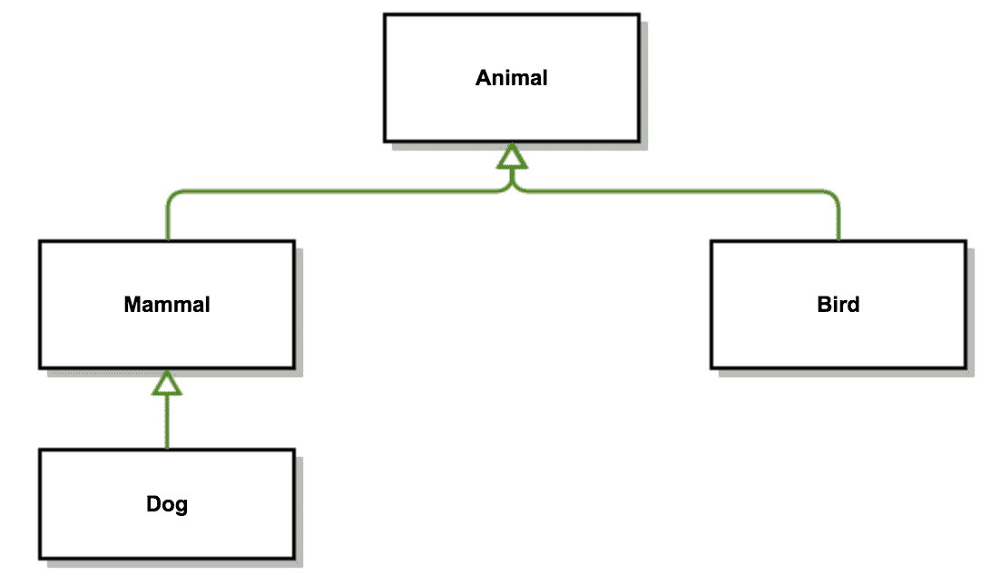

在这里，你可以看到从通用的 **Animal**（动物）类根据特定特征派生了更具体的类，例如 **Mammal**（哺乳动物）和 **Bird**（鸟类）。哺乳动物类和鸟类都具有相同的动物模板；但它们也定义了自身特有的行为和属性。最终，我们派生出了非常具体的哺乳动物——**Dog**（狗）。狗拥有来自动物类和哺乳动物类的共同属性和行为，同时增加了狗特有的属性和行为。这种关系可以继续添加复杂的继承关系。

传统上，继承用于建立或描述 **IS-A**（是一种）关系。例如，狗“是一种”哺乳动物。这就是我们所知的**经典继承**。你可能在 C++ 和 Java 等面向对象的语言中见过这种关系。JavaScript 有有一套完全不同的机制来处理继承。JavaScript 是一种无类语言，使用原型进行继承。原型继承在本质上非常不同，需要深入的理解。经典继承和原型继承在本质上差异巨大，需要仔细研究。

*第 4 章*

[111]

在经典继承中，实例继承自类蓝图并创建子类关系。你不能在类定义本身上调用实例方法。你需要先创建一个实例，然后在该实例上调用方法。另一方面，在原型继承中，实例继承自其他实例。

就继承而言，JavaScript 只使用对象。正如我们之前讨论过的过的，每个对象都有指向另一个对象的链接，称为其原型。这个原型对象反过来也有自己的原型，依此类推，直到到达一个原型为 `null` 的对象；根据定义，`null` 没有原型，并充当原型链的终点链接。

为了更好地理解原型链，让我们考虑以下示例：

```javascript
function Person() {}
Person.prototype.cry = function() {
  console.log("Crying");
}

function Child() {}
Child.prototype = {cry: Person.prototype.cry};

var aChild = new Child();
console.log(aChild instanceof Child); //true
console.log(aChild instanceof Person); //false
console.log(aChild instanceof Object); //true
```

在这里，我们定义了 Person 然后是 Child——孩子“是一种”人。我们还将 Person 的 `cry` 属性拷贝到 Child 的 `cry` 属性。当我们尝试使用 `instanceof` 检查这种关系时，很快意识到仅仅通过拷贝行为，并不能真正让 Child 成为 Person 的实例；`aChild instanceof Person` 失败了。这仅仅是复制或伪装，而不是继承。即使我们将 Person 的所有属性复制到 Child，我们也没有继承自 Person。这通常是一个坏主意，在这里仅仅此说明目的。我们希望派生出一个原型链——一种真正的继承，在其中我们可以说孩子“是一种”人。我们想创建一个链：孩子“是一种”人，“是一种”哺乳动物，“是一种”动物，“是一种”对象。在 JavaScript 中，这是通过使用对象的实例作为原型来实现的，如下：

```javascript
SubClass.prototype = new SuperClass();
Child.prototype = new Person();
```

修改之前的示例：

```javascript
function Person() {}
Person.prototype.cry = function() {
  console.log("Crying");
}
```

*面向对象的 JavaScript*

[112]

```javascript
function Child() {}
Child.prototype = new Person();

var aChild = new Child();
console.log(aChild instanceof Child); //true
console.log(aChild instanceof Person); //true
console.log(aChild instanceof Object); //true
```

改变后的这一行使用 Person 的实例作为 Child 的原型。这与之前的方法有一个重要的区别。在这里，我们声明了孩子“是一种”人。

我们讨论了 JavaScript 如何沿着原型链向上查找属性，直到到达 `Object.prototype`。让我们详细讨论原型链的概念，并尝试设计以下员工层级结构：

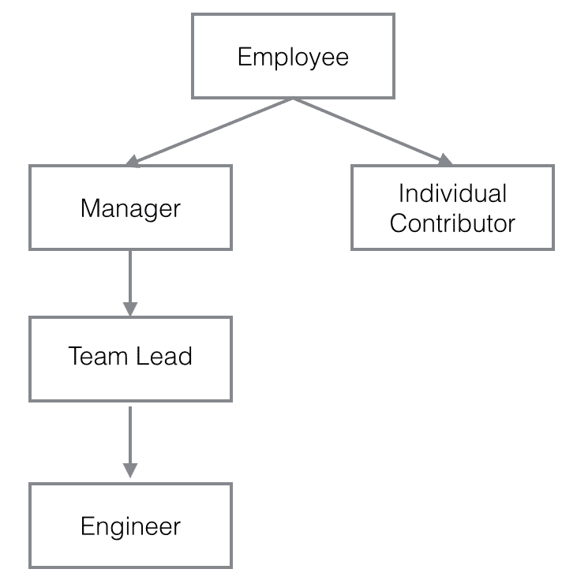

这是一个典型的继承模式。经理（Manager）“是一种”员工（Employee）。**Manager** 继承了来自 **Employee** 的公共属性。它可以拥有一个下属数组。**个人独立贡献者**（Individual Contributor）也基于员工，但他没有任何下属。**团队主管**（Team Lead）派生自经理，具有几个与经理不同的函数。我们本质上做的是每个子类都从其父类派生属性（Manager 是父类，Team Lead 是子类）。

*第 4 章*

[113]

让我们看看如何在 JavaScript 中创建这种层级结构。让我们定义 Employee 类型：

```javascript
function Employee() {
  this.name = '';
  this.dept = 'None';
  this.salary = 0.00;
}
```

这些定义并没有特别之处。Employee 对象包含了三个属性——name、salary 和 dept。接下来，我们定义 Manager。这个定义向你展示了如何指定继承链中的下一个对象：

```javascript
function Manager() {
  Employee.call(this);
  this.reports = [];
}

Manager.prototype = Object.create(Employee.prototype);
```

在 JavaScript 中，你可以将一个原型实例作为构造函数 `prototype` 属性的值。你可以在定义构造函数后的任何时间这样做。在这个示例中，有两个之前没有探索过的想法。首先，我们调用了 `Employee.call(this)`。如果你有 Java 背景，这等同于构造函数中的 `super()` 方法调用。`call()` 方法用特定对象作为上下文来调用函数（在这种情况下，它是给定的 `this` 值），换句话说，`call` 允许指定在执行函数时哪个对象会被 `this` 关键字引用。就像 Java 中的 `super()`，调用 `parentObject.call(this)` 对于正确初始化正在创建的对象是必要的。

我们看到的另一个点是使用 `Object.create()` 而不是调用 `new`。`Object.create()`创建一个指定原型的对象。当我们执行 `new Parent()` 时，父类的构造逻辑会被调用。在大多数情况下，我们想要 `Child.prototype` 是一个通过其原型链接到 `Parent.prototype` 的对象。如果父类构造函数包含额外的父类特有逻辑，我们不想在创建子对象时运行它。这会导致非常难以发现的错误。`Object.create()` 在不调用父类构造函数的情况下，在子类和父类之间创建与 `new` 运算符相同的原型链接。


*面向对象的 JavaScript*

**[ 114 ]**

为了拥有一无无副作用且准确的继承机制，我们必须确保

执行了以下操作：

- 将原型设置为父类的实例，这初始化了原型链（继承）；这只执行一次（因为原型对象是共享的）
- 调用父类的构造函数会初始化对象本身；这在每次实例化时都会执行（你可以在每次构造它时传递不同的参数）

在有了这些理解的基础上，让我们定义剩余的对象：

```javascript
function IndividualContributor() {
  Employee.call(this);
  this.active_projects = [];
}

IndividualContributor.prototype = Object.create(Employee.prototype);

function TeamLead() {
  Manager.call(this);
  this.dept = "Software";
  this.salary = 100000;
}

TeamLead.prototype = Object.create(Manager.prototype);

function Engineer() {
  TeamLead.call(this);
  this.dept = "JavaScript";
  this.desktop_id = "8822";
  this.salary = 80000;
}

Engineer.prototype = Object.create(TeamLead.prototype);
```

基于这个层次级结构，我们可以实例化这些对象：

```javascript
var genericEmployee = new Employee();
console.log(genericEmployee);
```

你可以看到上述代码段的输出：

```javascript
[object Object] {
  dept: "None",
  name: "",
  salary: 0
}
```

*第 4 章*

**[ 115 ]**

一个通用的 Employee 的部门被分配为 None（如默认值所示），其余属性也被赋值为默认值。

接下来，我们实例化一个经理；我们可以如下所示提供特定值：

```javascript
var karen = new Manager();
karen.name = "Karen";
karen.reports = [1,2,3];
console.log(karen);
```

你将看到以下输出：

```javascript
[object Object] {
  dept: "None",
  name: "Karen",
  reports: [1, 2, 3],
  salary: 0
}
```

对于 TeamLead，`reports` 属性派生自基类（在本例中为 Manager）：

```javascript
var jason = new TeamLead();
jason.name = "Json";
console.log(jason);
```

你将看到以下输出：

```javascript
[object Object] {
  dept: "Software",
  name: "Json",
  reports: [],
  salary: 100000
}
```

当 JavaScript 处理 `new` 运算符时，它会创建一个新对象并将该对象作为 `this` 的值传递给父级——即 TeamLead 构造函数。构造函数设置了 `projects` 属性的值，并隐式设置了内部 `__proto__` 属性的值为 `TeamLead.prototype` 的值。`__proto__` 属性决定了用于返回属性值的原型链。这个过程不会为 `jason` 对象中从原型链继承的属性赋值。当读取属性值时，JavaScript 会首先检查该值是否存在于该对象中。如果值存在，则返回该值。如果该值不存在，JavaScript 将使用 `__proto__` 属性检查原型链。尽管如此，当你执行以下操作时会发生什么：

```javascript
Employee.prototype.name = "Undefined";
```

*面向对象的 JavaScript*

**[ 116 ]**

它并不会传播到所有 Employee 的实例。这是因为当你创建一个 Employee 对象的实例时，该实例会获得 `name` 的本地值。当你通过创建一个新的 Employee 对象来设置 TeamLead 原型时，`TeamLead.prototype` 在 `name` 属性上有一个本地值。因此，当 JavaScript 查找 `jason` 对象（它是 TeamLead 的实例）的 `name` 属性时，它在 `TeamLead.prototype` 中找到了该属性的本地值。它不会尝试沿链继续向 `Employee.prototype` 进一步查找。

如果你想在运行时更改属性的值，并让新值被该对象的所有后代继承，你不能在对象的构造函数中定义该属性。要实现这一点，你需要将其添加到构造函数的 `prototype` 中。例如，让我们重新回顾早的例子，但稍作改动：

```javascript
function Employee() {
  this.dept = 'None';
  this.salary = 0.00;
}

Employee.prototype.name = '';

function Manager() {
  this.reports = [];
}

Manager.prototype = new Employee();

var sandy = new Manager();
var karen = new Manager();

Employee.prototype.name = "Junk";

console.log(sandy.name);
console.log(karen.name);
```

你会发现 sandy 和 karen 的 `name` 属性都已变为 Junk。这是因为 `name` 属性是在构造函数之外声明的。因此，当你更改 Employee 原型中的 `name` 值时，它会传播到所有后代。在这个例子中，我们在 sandy 和 karen 对象创建之后修改了 Employee 的原型。如果你在 sandy 和 karen 对象创建之前更改了原型，该值仍然会变为 Junk。

所有原生 JavaScript 对象——Object、Array、String、Number、RegExp 和 Function——都具有可以扩展的 `prototype` 属性。这意味着我们可以扩展语言本身。例如，下面的代码段扩展了 `String` 对象以添加一个反转 `reverse()` 方法。该方法在原生 `String` 对象中并不，但通过操作 `String` 的 `prototype`，我们为其添加了这个方法：

*第 4 章*

**[ 117 ]**

```javascript
String.prototype.reverse = function() {
  return Array.prototype.reverse.apply(this.split('')).join('');
};

var str = 'JavaScript';
console.log(str.reverse()); //"avaJ"
```

尽管这是一个非常强大的技术，但应该避免过度使用。参考 http://perfection.com/extending-native-builtins/ 来了解扩展内置对象的陷阱以及如果你打算这样做需要注意什么。

### Getters 和 setters

**Getters** 是获取特定属性值的方便方法；**setters** 是设置属性值的方法。通常你可能希望根据某些值派生出一个值。传统上，getter 和 setter 使用如下函数：

```javascript
var person = {
  firstname: "John",
  lastName: "Doe",
  get firstname() {
    return this.firstname;
  },
  set firstname(value) {
    this.firstname = value;
  },
  get lastname() {
    return this.lastName;
  },
  set lastname(value) {
    this.lastName = value;
  }
};
```

面向面向对象的 JavaScript

[120]

var aScientist = new Scientist();

var lst = _.mapObject(aScientist, function(val,key){
  if(key==="age"){
    return val + 10;
  } else {
    return val;
  }
});

console.log(lst); // { name: 'Albert', age: 100 }

- functions(): 此函数返回对象中所有方法名称的排序列表——即对象中每个函数属性名称。

- pick(): 此函数返回对象的拷贝，并过滤出仅提供键的值：
var var _ = require('underscore');
var testobj = {
  name: 'Albert',
  age : 90,
  profession: 'Physicist'
};

console.log(_.pick(testobj, 'name','age')); // { name: 'Albert', age: 90 }
console.log(_.pick(testobj, function(val,key,object){
  return _.isNumber(val);
})); // { age: 90 }

- omit(): 此函数是 pick() 的反向操作——它返回对象的拷贝，并过滤掉指定键的值。

## 总结

JavaScript 应用可以通过面向对象能为代码带来的更大程度的控制和结构，提高清晰度和质量。JavaScript 的面向对象是基于函数原型和原型继承的。这两个思想可以为开发者提供极其丰富的财富。

在本章中，我们学习了基础的对象创建和操作。我们查看了如何使用构造函数创建对象。我们深入研究了原型链以及继承如何在原型链的基础上运行的。这些基础将用于构建你对 JavaScript 模式的认知，我们将在下一章中探索这些模式。

[121]

到为止，我们已经查看了编写 JavaScript 代码所需的几个基础构建块。一旦你开始使用这些结构构建更大的系统时，你很快就会发现某些事情有标准的处理方法。在开发大型系统时，你会遇到重复性问题；模式可以被视为解决常见问题的最佳实践、有用的抽象或模板。编写可维护的代码是困难的。编写模块化、正确且可维护代码的关键在于理解重复的主题并使用通用模板解决这些问题。关于设计模式最重要的文本是 1995 年出版的一本书，名为*设计模式：可重用面向对象软件的元素*，由 Erich Gamma、Richard Helm、Ralph Johnson 和 John Vlissides 编写——这个小组被称为“四人帮”（简称为 **GOF**）。这部开创性的工作对各种模式给出了正式定义，并解释了我们今天使用的大多数流行模式的实现细节。理解为什么模式很重要在于：

- 模式为常见问题提供了经过验证的解决方案：模式提供了由坚实的工程经验支持并经过有效性测试的模板。
- 模式的设计是为了可重用：它们足够通用，可以适应各种问题的变体。
- 模式定义了词汇：模式是定义良好的结构，因此为解决方案提供了通用的词汇。在跨大群体中进行通信时，这种方式非常有表现力。

[122]

设计模式

在本章中，我们将查看一些适用于 JavaScript 的设计模式。然而，编码模式对于 JavaScript 来说非常特殊，而且对我们具有很大意义。在我们花费大量精力尝试理解设计模式时，理解反模式（anti-patterns）以及如何避免陷阱也是重要的。在通常的软件开发周期，有几个地方会引入糟糕的代码，主要是在代码接近发布或代码交给不同团队进行维护的时候。如果这些糟糕的结构被记录为反模式，它们可以为开发者提供指导，让他们知道避免哪些陷阱以及如何不采纳。根据它们解决的问题类型，GOF 将设计模式分为几大类：

- **创建型模式 (Creational design patterns)**：这些模式处理对象的各种创建机制。虽然大多数语言都提供了基础的对象创建方法，但这些模式关注更优化或更受控的对象创建机制。
- **结构型模式 (Structural design patterns)**：这些模式完全关于对象的组合以及它们之间的关系。其思想是在系统中的某些发生变化时，对整体对象关系的影响降最低。
- **行为型模式 (Behavioral design patterns)**：这些模式关注对象之间的依赖关系和通信。

下表是识别模式类的有用参考：

| 类别 | 模式 |
| :--- | :--- |
| 创建型 | 工厂方法、抽象工厂、构建器、原型、单例 |
| 结构型 | 适配器、桥接、组合、装饰器、外观、享量模式、代理 |
| 行为型 | 解释器、模板方法、责任链、命令、迭代器、中者、备忘录、观察者、状态、策略、访问者 |

我们在本章中讨论的某些模式可能不在列表中，因为它们更特定于 JavaScript，或者是这些经典模式的变体。同样，我们不会讨论不符合 JavaScript 或未被流行的模式。

## 命名空间模式 (The namespace pattern)

在 JavaScript 中，过度使用全局几乎几乎禁忌。当你构建更大的程序时，有时很难控制全局作用域被污染程度。命名空间可以减少程序创建的全局变量数量，有助于避免命名冲突或过度使用名前缀。使用命名空间的想法是为你的应用程序或库创建一个全局对象，并将所有这些对象和函数添加到该对象中，而不是污染全局作用域。JavaScript 没有命名空间的显式语法，但可以轻松创建命名空间。让我们考虑以下示例：

function Car() {}
function BMW() {}
var engines = 1;
var features = {
  seats: 6,
  airbags: 6
};

我们正在全局作用域中创建这一切。这是一种反模式，永远不是一个好主意。然而，我们可以重构这段代码，创建一个单一的全局对象，并将所有函数和对象成为该全局对象的一部分，如下：

```javascript
// 单一全局对象
var CARFACTORY = CARFACTORY || {};
CARFACTORY.Car = function () {};
CARFACTORY.BMW = function () {};
CARFACTORY.engines = 1;
CARFACTORY.features = {
  seats: 6,
  airbags: 6
};
```

按照惯例，全局命名空间名称通常大大写。这种模式为应用程序添加了命名空间，并防止代码内部以及你的代码与外部库之间的命名冲突。许多项目会在其公司或项目名称之后使用独特的名称来为命名空间创建一个唯一名称。虽然这似乎是限制全局变量并为代码添加命名空间的理想方法，但有点冗长；你需要为每个变量和函数加上命名空间前缀。你需要输入更多内容，代码变得不必要的冗。此外，单一的全局实例意味着代码的任何部分都可以修改全局实例，而其他功能获得更新的状态——这会导致非常糟糕的副作用。

## 模块模式 (The module pattern)

当你构建大型应用程序时，你很快就会发现保持代码库组织良好和模块化变得越来越困难。模块模式将较大的程序分成较小的部分并为它们提供命名空间。这非常重要，因为一旦你将代码分模块，这些模块就可以在多个地方重用。仔细设计模块的接口将使你的代码非常易重用和扩展。


*第5章*

[125]

JavaScript 提供了灵活的函数和对象，使其能够创建健壮的模块系统。函数作用域有助于创建模块内部的命名空间，而对象可以用于存储一组导出的值。

在我们开始探索模式本身之前，让我们快速回顾一下之前之前讨论过的概念。

我们已经详细讨论过对象字面量。对象字面量允许你如下所示创建键值对：

```javascript
var basicServerConfig = {
  environment: "production",
  startupParams: {
    cacheTimeout: 30,
    locale: "en_US"
  },
  init: function () {
    console.log( "Initializing the server" );
  },
  updateStartup: function( params ) {
    this.startupParams = params;
    console.log( this.startupParams.cacheTimeout );
    console.log( this.startupParams.locale );
  }
};

basicServerConfig.init(); //"Initializing the server"
basicServerConfig.updateStartup({cacheTimeout:60, locale:"en_UK"}); // 60, en_UK
```

在这个示例中，我们正在创建一个对象字面量并定义键值对来创建属性和函数。

在 JavaScript 中，模块模式被广泛地使用。模块有助于模拟类的概念。模块允许我们包含对象的公共/私有方法和变量，但最重要的是，模块限制了这些部分离开全局作用域。由于变量和函数被包含在模块作用域内，我们自动防止了与使用相同名称的其他脚本发生命名冲突。

模块模式的另一个优之处在于，它只暴露一个公共 API。其他与内部实现相关的所有内容都封装在模块的闭包中。

*JavaScript 模式*

[126]

与其他面向对象（OO）语言不同，JavaScript 没有显式的访问修饰符，因此也就没有*私有性*的概念。你无法拥有公共或私有变量。正如我们之前讨论的，在 JavaScript 中，可以使用函数作用域来强制这一概念。模块模式使用闭包将变量和函数的访问限制在模块内部；然而，变量和函数是定义在返回的对象中的，而该对象是公开的。

让我们考虑之前的示例并将其转换为模块。我们本质上是在使用一个 IIFE（立即调用函数表达式）并返回模块的接口，即 `init` 和 `updateStartup` 函数：

```javascript
var basicServerConfig = (function () {
  var environment= "production";
  var startupParams= {
    cacheTimeout: 30,
    locale: "en_US"
  };

  return {
    init: function () {
      console.log( "Initializing the server" );
    },
    updateStartup: function( params ) {
      this.startupParams = params;
      console.log( this.startupParams.cacheTimeout );
      console.log( this.startupParams.locale );
    }
  };
})();

basicServerConfig.init(); //"Initializing the server"
basicServerConfig.updateStartup({cacheTimeout:60, locale:"en_UK"}); //60, en_UK
```

在这个示例中，`basicServerConfig` 在全局上下文中作为一个模块。为了确保我们没有用模块污染全局上下文，为模块创建命名空间是关重要的。此外，由于模块本质上是重用的，确保我们使用命名空间来避免命名冲突也是重要的。对于 `basicServerConfig` 模块，以下代码片段向你展示了如何创建命名空间：

```javascript
// 单例全局对象
var SERVER = SERVER||{};
SERVER.basicServerConfig = (function () {
  var environment= "production";
  var startupParams= {
    cacheTimeout: 30,
    locale: "en_US"
  };

  return {
    init: function () {
      console.log( "Initializing the server" );
    },
    updateStartup: function( params ) {
      this.startupParams = params;
      console.log( this.startupParams.cacheTimeout );
      console.log( this.startupParams.locale );
    }
  };
})();

SERVER.basicServerConfig.init(); //"Initializing the server"
SERVER.basicServerConfig.updateStartup({cacheTimeout:60, locale:"en_UK"}); //60, en_UK
```

*第5章*

[127]

模块使用命名空间通常是一个好主意；但并不是要求模块必须关联一个命名空间。

模块模式的一种变体试图解决原始模块模式的一些问题。这种改进的模块模式变体也称为**揭示模块模式**（**RMP**）。RMP 最初由 *Christian Heilmann* 流行。他不不喜欢在从另一个函数调用公共函数或访问公共变量时，必须使用模块名。另一个小问题是，在返回公共接口时你必须使用对象字面量表示法。

考虑以下示例：

```javascript
var modulePattern = function(){
  var privateOne = 1;
  function privateFn(){
    console.log('privateFn called');
  }
  return {
    publicTwo: 2,
    publicFn:function(){
      modulePattern.publicFnTwo();
    },
    publicFnTwo:function(){
      privateFn();
    }
  }
}();

modulePattern.publicFn(); // "privateFn called"
```

*JavaScript 模式*

[128]

你可以看到，在 `publicFn()` 中我们需要通过 `modulePattern` 调用 `publicFnTwo()`。此外，公共接口是以对象字面量形式返回的。对经典模块模式的改进就是所谓的 RMP。这种模式背后的核心思想是在私有作用域中定义所有成员，并返回一个匿名对象，其中包含指向需要揭示为公共的私有功能的指针。

让我们看看如何将之前的示例转换为 RMP。这个示例很大灵感来源于 Christian 的博客：

```javascript
var revealingExample = function(){
  var privateOne = 1;
  function privateFn(){
    console.log('privateFn called');
  }
  var publicTwo = 2;
  function publicFn(){
    publicFnTwo();
  }
  function publicFnTwo(){
    privateFn();
  }
  function getCurrentState(){
    return 2;
  }
  // 通过分配公共指针来揭示私有变量
  return {
    setup:publicFn,
    count:publicTwo,
    increaseCount:publicFnTwo,
    current:getCurrentState()
  };
}();

console.log(revealingExample.current); // 2
revealingExample.setup(); //privateFn called
```

这里一个重要的区别是，你在私有作用域中定义函数和变量，并返回一个指向你想揭示为公共变量的匿名对象。这是一种更干净的变体，优于经典的模块模式。

*第5章*

[129]

在生产代码中，你会希望使用更标准化的方法来创建模块。目前有两种创建模块的主要方法。第一种被称为 **CommonJS 模块**。CommonJS 模块通常适用于服务端 JavaScript 环境，如 **Node.js**。CommonJS 模块包含一个 `require` 函数，它接收模块名称并返回模块的接口。该格式是由 CommonJS 志愿者小组提出的；他们的目标是设计、原型化并标准化 JavaScript API。CommonJS 模块由两部分组成：首先是模块需要暴露的变量和函数；当你将变量或函数赋值给 `module.exports` 变量时就会暴露。其次是 `require` 函数，模块可以使用它导入其他模块的导出：

```javascript
// 添加依赖模块
var crypto = require('crypto');

function randomString(length, chars) {
  var randomBytes = crypto.randomBytes(length);
  ...
  ...
}

// 导出模块供其他模块使用
module.exports=randomString;
```

CommonJS 模块在服务器端由 Node.js 支持，在浏览器端由 curl.js 支持。

JavaScript 模块的另一种口味被称为**异步模块定义**（**AMD**）。它们是面向器的模块，并选择异步行为。AMD 使用 `define` 函数来定义模块。该函数接收一个模块名称数组和一个函数。一旦模块加载，`define` 函数将以它们的接口作为参数执行该函数。AMD 提案旨在模块和依赖项的异步加载。`define` 函数根据以下签名定义具名或无名的模块：

```javascript
define(
  module_id /*可选*/,
  [dependencies] /*可选*/,
  definition function /*用于实例化模块的函数或
  对象*/
);
```


*JavaScript Patterns*

**[130]**

你可以按照如下添加一个没有依赖的模块：

```javascript
define(
{
add: function(x, y){
return x + y;
}
});
```

下面的代码段展示了一个依赖于其他两个模块的模块：

```javascript
define( "math",
//依赖这两个模块
["sum", "multiply"],
//模块定义函数
// 依赖 (foo 和 bar) 被映射到函数参数
function ( sum, multiply ) {
// 返回一个定义模块导出的值
// （也就是说，我们想要暴露给外部使用的功能）
// 在这里创建你的模块
var math = {
demo : function () {
console.log(sum.calculate(1,2));
console.log(multiply.calculate(1,2));
}
};
return math;
});
```

`require` 模块的使用方式如下：

```javascript
require(["math","draw"], function ( math,draw ) {
draw.2DRender(math.pi);
});
```

**RequireJS** (http://requirejs.org/docs/whyamd.html) 是实现 AMD 的模块加载器之一。

*第5章*

**[131]**

**ES6 模块**

两个独立的模块系统和不同的模块加载器可能会让人感到困惑。ES6 试图解决这个问题。ES6 提出了一项模块规范，试图保留 CommonJS 和 AMD 模块模式的优点。

ES6 模块的语法类似于 CommonJS，并且 模块支持异步加载和可配置的模块加载：

```javascript
//json_processor.js
function processJSON(url) {
...
}

export function getSiteContent(url) {
return processJSON(url);
}

//main.js
import { getSiteContent } from "json_processor.js";
content=getSiteContent("http://google.com/");
```

ES6 的 `export` 允许你以类似于 CommonJS 的方式导出函数或变量。在需要使用此导入的代码中，你使用 `import` 关键字指定从哪里导入依赖。一旦依赖被导入，它就可以作为程序的成员被使用。我们将在后面的章节中讨论如何在不支持 ES6 的环境中使用 ES6。

**工厂模式**

工厂模式是另一种流行的对象创建模式。它不需要使用构造函数。该模式提供了一个创建对象的接口。根据传递给工厂的类型，工厂会创建特定类型的对象。该模式的常见实现通常是使用类或类的静态方法。此类类或方法的目的如下：

- 它抽象化了创建相似对象时的重复性操作
- 它允许工厂的消费者在不了解对象创建内部细节的情况下创建对象

*JavaScript Patterns*

**[132]**

让我们通过一个常见的例子来理解工厂的使用。假设我们有以下内容：

- 一个构造函数 `CarFactory()`
- `CarFactory` 中一个名为 `make()` 的静态方法，它知道如何创建汽车类型的对象
- 特定的汽车类型，如 `CarFactory.SUV`、`CarFactory.Sedan` 等

我们想这样使用 `CarFactory`：

```javascript
var golf = CarFactory.make('Compact');
var vento = CarFactory.make('Sedan');
var touareg = CarFactory.make('SUV');
```

以下是你可以实现这样一个工厂的方法。以下实现相当相当标准。我们通过程序化调用创建指定类型对象的构造函数——`CarFactory[const].prototype = new CarFactory();`

我们正在将对象类型映射到构造函数。实现此模式的方法可以有多种之处：

```javascript
// 工厂构造函数
function CarFactory() {}
CarFactory.prototype.info = function() {
console.log("This car has "+this.doors+" doors and a "+this.engine_capacity+" liter engine");
};

// 静态工厂方法
CarFactory.make = function (type) {
var constr = type;
var car;
CarFactory[constr].prototype = new CarFactory();
// 创建新实例
car = new CarFactory[constr]();
return car;
};

CarFactory.Compact = function () {
this.doors = 4;
this.engine_capacity = 2;
};
```

*第5章*

**[133]**

```javascript
CarFactory.Sedan = function () {
this.doors = 2;
this.engine_capacity = 2;
};

CarFactory.SUV = function () {
this.doors = 4;
this.engine_capacity = 6;
};

var golf = CarFactory.make('Compact');
var vento = CarFactory.make('Sedan');
var touareg = CarFactory.make('SUV');
golf.info(); //"This car has 4 doors and a 2 liter engine"
```

我们建议你在 JS Bin 中尝试这个示例，通过实际编写代码来理解这一概念。

**混入模式 (Mixin pattern)**

Mixins 有助于显著减少代码中的功能重复并帮助函数复用。我们可以将这些共享功能移动到 mixin 中，减少共享行为的重复。然后你就可以专注于构建实际功能，而不是不断重复共享行为。让我们考虑以下示例。我们想创建一个可以被任何对象实例使用的自定义日志器。该日志器将成为想要使用/扩展该 mixin 的对象的共享功能：

```javascript
var _ = require('underscore');
// 将共享功能封装进 CustomLogger
var logger = (function () {
var CustomLogger = {
log: function (message) {
console.log(message);
}
};
return CustomLogger;
}());

// 一个需要自定义日志器来记录系统特定日志的对象
var Server = (function (Logger) {
var CustomServer = function () {
this.init = function () {
this.log("Initializing Server...");
};
};
// 这将 'CustomLogger' 的成员拷贝/扩展到 'CustomServer'
_.extend(CustomServer.prototype, Logger);
return CustomServer;
}(logger));

(new Server()).init(); //Initializing Server...
```

*JavaScript Patterns*

**[134]**

在这个示例中，我们使用了 **Underscore.js** 中的 `_.extend`——我们在上一个章节中讨论过这个函数。该函数用于将属性从源（`Logger`）拷贝到目标（`CustomServer`）。

理解 mixins 和继承之间的区别是重要的。如果你在多个对象之间有共享功能，可以使用 mixins。如果你有一个类层次结构，可以使用继承。如果你使用原型继承，对原型的任何更改都会影响到所有继承它的东西。如果你不希望这种情况发生，可以使用 mixins。

**装饰器模式 (Decorator pattern)**

装饰器模式背后的核心思想是从具有某些功能的普通对象开始设计。随着设计的演进，你可以使用现有的装饰器来增强你的普通对象。这在面向对象（OO）世界中是一种非常流行的模式，特别是在 Java 中。让我们以 `BasicServer` 为例——一个具有基础功能的服务器。我们可以有两种不同的情况，该服务器可以提供 PHP 和 Node.js 服务并在不同的端口上提供它们：

```javascript
var phpServer = new BasicServer();
phpServer = phpServer.decorate('reverseProxy');
phpServer = phpServer.decorate('servePHP');
phpServer = phpServer.decorate('80');
phpServer = phpServer.decorate('serveStaticAssets');
phpServer.init();
```

*第5章*

**[135]**

Node.js 服务器将如下所示：
```javascript
var nodeServer = new BasicServer();
nodeServer = nodeServer.decorate('serveNode');
nodeServer = nodeServer.decorate('3000');
nodeServer.init();
```

在 JavaScript 中实现装饰器模式有多种方法。我们将讨论一种通过列表实现模式且不依赖于继承或方法调用链的方法：

```javascript
// 实现仅具有最小功能的 BasicServer
function BasicServer() {
this.pid = 1;
console.log("Initializing basic Server");
this.decorators_list = []; // 装饰器的空列表
}

// 所有装饰器的列表
BasicServer.decorators = {};

// 将每个装饰器添加到 BasicServer 的装饰器列表中
// 此列表中的每个装饰器都将应用到 BasicServer 实例上
BasicServer.decorators.reverseProxy = {
init: function(pid) {
console.log("Started Reverse Proxy");
return pid + 1;
}
};

BasicServer.decorators.servePHP = {
init: function(pid) {
console.log("Started serving PHP");
return pid + 1;
}
};

BasicServer.decorators.serveNode = {
init: function(pid) {
console.log("Started serving Node");
return pid + 1;
}
};
```


## JavaScript 模式

[136]

// 每当调用 decorate() 时，将装饰器推入列表
BasicServer.prototype.decorate = function(decorator) {
  this.decorators_list.push(decorator);
};

// init() 方法遍历 BasicServer 上应用的所有装饰器
// 并在所有它们上执行 init() 方法
BasicServer.prototype.init = function () {
  var running_processes = 0;
  var pid = this.pid;
  for (i = 0; i < this.decorators_list.length; i += 1) {
    decorator_name = this.decorators_list[i];
    running_processes = BasicServer.decorators[decorator_name].init(pid);
  }
  return running_processes;
};

// 创建用于服务的 PHP 服务器
var phpServer = new BasicServer();
phpServer.decorate('reverseProxy');
phpServer.decorate('servePHP');
total_processes = phpServer.init();
console.log(total_processes);

// 创建用于服务的 Node 服务器
var nodeServer = new BasicServer();
nodeServer.decorate('serveNode');
nodeServer.init();
total_processes = phpServer.init();
console.log(total_processes);

BasicServer.decorate() 和 BasicServer.init() 是发生实际逻辑的两个方法。我们将所有被应用的装饰器推入 BasicServer 的装饰器列表中。在 init() 方法中，我们从这个装饰器列表中执行或应用每个装饰器的 init() 方法。这是一种更简洁的装饰器模式方法，没有使用继承。这种方法由 Stoyan Stefanov 在他的书籍 *JavaScript Patterns, O'Reilly Media* 中进行描述，并由于其简单性在 JavaScript 开发者中广为人知。

## 第 5 章

[137]

### 观察者模式

让我们先看看观察者模式的与语言无关的定义。GOF 的书籍 *Design Patterns: Elements of Reusable Object-Oriented Software*对观察者模式的定义如下：

> *一个或多个观察者对主体的状态感兴趣，并通过挂载自己向主体注册其兴趣。当我们的主体中发生了观察者可能感兴趣的变化时，会发送一条通知消息，调用每个观察者的 update 方法。当观察者不再对主体的状态感兴趣时，它们可以简单地脱离自己。*

在观察者设计模式中，主体维护一个依赖于它的对象列表（称为观察者），并在状态改变时通知它们。主体通过向观察者广播来通知它们变化。一旦观察者不再希望被通知，它们就可以从列表中移除自己。基于这种理解，我们可以定义该模式的参与者：

- **主体 (Subject)**：它维护观察者列表，并具有添加、移除和更新观察者的方法。
- **观察者 (Observer)**：它为在主体状态改变时需要被通知的对象提供接口。

让我们创建一个可以添加、移除和通知观察者的主体：

```javascript
var Subject = ( function( ) {
  function Subject() {
    this.observer_list = [];
  }

  // 此方法处理将观察者添加到内部列表
  Subject.prototype.add_observer = function ( obj ) {
    console.log( 'Added observer' );
    this.observer_list.push( obj );
  };

  Subject.prototype.remove_observer = function ( obj ) {
    for( var i = 0; i < this.observer_list.length; i++ ) {
      if( this.observer_list[ i ] === obj ) {
        this.observer_list.splice( i, 1 );
        console.log( 'Removed Observer' );
      }
    }
  };
```

[138]

```javascript
  Subject.prototype.notify = function () {
    var args = Array.prototype.slice.call( arguments, 0 );
    for( var i = 0; i<this.observer_list.length; i++ ) {
      this.observer_list[i].update(args);
    }
  };

  return Subject;
})();
```

这是一个相当直观的主体实现。notify() 方法的一个重要事实是，调用所有观察者对象的 update() 方法来广播更新。

现在让我们定义一个创建随机推文的简单对象。该对象通过 addObserver() 和 removeObserver() 方法提供了向主体添加和移除观察者的接口。它还使用新获取的推文调用了主体的 notify() 方法。当这种情况发生时，所有观察者都将广播该新推文已更新，并将新推文作为参数传递：

```javascript
function Tweeter() {
  var subject = new Subject();
  this.addObserver = function ( observer ) {
    subject.add_observer( observer );
  };
  this.removeObserver = function(observer) {
    subject.remove_observer(observer);
  };
  this.fetchTweets = function fetchTweets() {
    // 推文
    var tweet = {
      tweet: "This is one nice observer"
    };
    // 通知我们的观察者股票变化
    subject.notify( tweet );
  };
}
```

现在让我们添加两个观察者：

```javascript
var TweetUpdater = {
  update : function() {
    console.log( 'Updated Tweet - ', arguments );
  }
};
```

[139]

```javascript
var TweetFollower = {
  update : function() {
    console.log( 'Following this tweet - ', arguments );
  }
};
```

现在我们可以这样使用 Tweeter：

```javascript
var tweetApp = new Tweeter();
tweetApp.addObserver(TweetUpdater);
tweetApp.addObserver(TweetFollower);
tweetApp.fetchTweets();

tweetApp.removeObserver(TweetUpdater);
tweetApp.fetchTweets();

tweetApp.removeObserver(TweetFollower);
tweetApp.fetchTweets();
```

输出将是：

```
Added observer
Added observer
Updated Tweet - [ Object {tweet: "This is one nice observer"} } ]
Following this tweet - [ Object {tweet: "This is one nice observer"} } ]
Removed Observer
Following this tweet - [ Object {tweet: "This is one nice observer"} } ]
Removed Observer
```
（注：根据原文逻辑，这里应是逻辑对应的输出描述）
```
等等，最后一个 fetchTweets() 的输出应该是：
```
Following this tweet - [ Object {tweet: "This is one nice observer"} } ]
```

[140]

### 模型 (Models)

模型是表示应用程序数据的结构。它们与用户界面或路由逻辑无关。模型的变化通过观察者模式通知视图层。模型可能还包含验证、创建或删除数据的代码。数据改变时自动通知视图的能力使得 Backbone.js、**Amber.js** 等框架在构建 MV 应用时非常有用。以下示例展示了一个典型的 Backbone 模型：

```javascript
var EmployeeModel = Backbone.Model.extend({
  url: '/employee/1',
  defaults: {
    id: 1,
    name: 'John Doe',
    occupation: null
  },
  initialize: function() {
  }
});
var JohnDoe = new EmployeeModel();
```

### 视图 (Views)

视图是模型的视觉表示。通常在将模型状态呈现给视图层之前，对其进行处理、过滤或加工。在 JavaScript 中，视图负责渲染和操作 DOM 元素。视图观察模型并在模型改变时接收通知。当用户与视图交互时，模型的某些属性通过视图层进行更改（通常通过控制器）。在 JavaScript 框架中，视图使用模板引擎创建，如 **Handlebar.js** (http://handlebarsjs.com/) 或 **mustache.js** (https://mustache.github.io/)。这些模板本身并不是视图。它们观察模型并根据这些更新视图状态。来看一个用 Handlebar 定义的视图示例：

```html
<li class="employee_photo">
  <h2>{{title}}</h2>
  
  <div class="employee_details">
    {{employee_details}}
  </div>
</li>
```


## 第 5 章

## [141]

如前面的示例所示，视图包含模板变量的标记标签。这些变量通过自定义语法进行分隔。例如，在 Handlebar.js 中，模板变量使用 `{{ }}` 分隔。框架通常以 JSON 格式传输数据。视图如何从模型填充数据由框架透明地处理。

### 控制器 (Controllers)

控制器充当模型和视图之间的一层，并负责在用户更改视图属性时更新模型。大多数 JavaScript 框架都偏离了控制器的经典定义。例如，Backbone 并没有名为“控制器”的概念；它们拥有一种被称为**路由器** (router) 的东西，负责处理路由逻辑。你可以将视图和路由器的结合视为控制器，因为同步模型和视图的大部分逻辑是在视图内部完成的。一个典型的 Backbone 路由器如下：

```javascript
var EmployeeRouter = Backbone.Router.extend({
  routes: { "employee/:id": "route" },
  route: function( id ) {
    ...view render logic...
  }
});
```

### 模型-视图-演示者模式 (The Model-View-Presenter pattern)

模型-视图-演示者（MVP）是之前之前讨论的原始 MVC 模式的变体。MVC 和 MVP 的目标都是关注点分离，但它们在许多基本方面有所不同。MVP 中的演示者拥有视图所需的逻辑。来自视图的任何调用都会委托给演示者。演示者还观察模型，并在模型更新时更新视图。许多作者认为，由于演示者绑定了模型和视图，因此它也充当了传统控制器的角色。MVP 有多种实现方式，目前没有框架提供开箱即用的经典 MVP。在 MVP 的实现中，以下是区分 MVP 和 MVC 的主要区别：

- 视图对模型没有引用
- 演示者拥有模型的引用，并在模型变化时负责更新视图

*《JavaScript 模式》* (JavaScript Patterns)

## [142]

MVP 通常有两种实现方式：

- 被动视图 (Passive view)：视图尽可能简单朴素，所有的业务逻辑都在演示者中。例如，一个普通的 Handlebars 模板可以被视为一个被动视图。
- 监视控制器 (Supervising controller)：视图主要包含声明式逻辑。当视图中简单的声明式逻辑不足时，由演示者接管。

下图描绘了 MVP 架构：

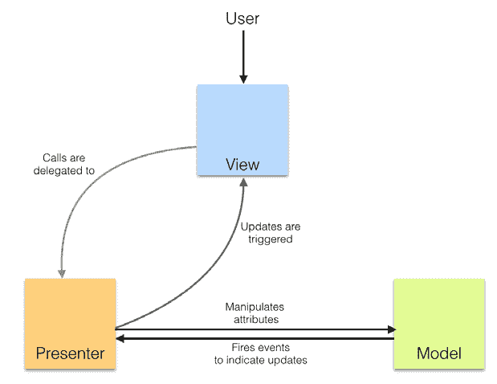

### 模型-视图视图模型 (Model-View-ViewModel)

MVVM 最初由微软提出，用于 **Windows Presentation Foundation** (**WPF**) 和 **Silverlight**。MVVM 是 MVC 和 MVP 的变体，进一步尝试将用户界面（视图）与业务模型和应用行为分离。MVVM 在我们在 MVC 和 MVP 中讨论的领域模型之外又创建了一个模型层。该模型层增加了属性作为视图的接口。假设我们在 UI 上有一个复选框。复选框的状态被捕捉在一个 `IsChecked` 属性中。在 MVP 中，视图将拥有这个属性并由演示者进行设置。但在 MVVM 中，演示者拥有 `IsChecked` 属性，而视图负责与它同步。既然演示者不再真正是在执行经典演示者的工作，它被重命名为 ViewModel（ViewModel）：

*第 5 章*

## [143]

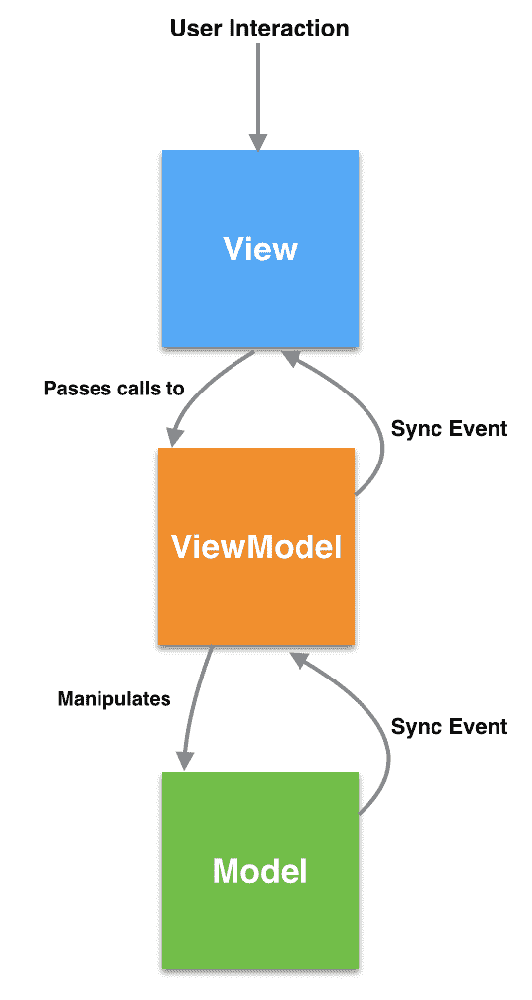

这些方法的实现细节取决于我们试图解决的问题以及我们使用的框架。

### 总结 (Summary)

在构建大型应用时，我们会看到某些问题模式反复出现。这些模式具有定义良好的解决方案，可以重用以构建健壮的解决方案。在本章中，我们讨论了围绕这些模式的一些重要模式和想法。大多数现代 JavaScript 应用都使用这些模式。很难看到一个在没有实现模块、装饰器、工厂或 MV* 模式的情况下构建的大型系统。这些都是在本章中讨论的基础思想。我们将在下一章中讨论各种测试和调试技术。

## [145]

## 测试与调试 (Testing and Debugging)

当你编写 JavaScript 应用时，你很快就会意识到拥有一个完善的测试策略是不可或缺的。事实上，不编写足够的测试几乎总是一个坏主意。覆盖代码中所有非平凡的功能是至关重要的，以确保以下点的实现：

- 现有代码的行为符合规范
- 任何新代码都不会破坏规范定义的行为

这两点都非常重要。许多工程师只认为第一点是为代码编写足够测试的唯一理由。测试覆盖率最明显的优点是确实确保推送到生产系统的代码大部分是无错误的。编写测试用例来智能地覆盖代码的最大功能区域，通常可以让你对代码的整体质量有一个良好的判断。在这一点上不应有任何争论或妥协。遗憾的是，许多生产系统仍然缺乏足够的代码覆盖。建立一种工程文化是非常重要的，在这种文化中，开发者考虑编写测试就像他们考虑编写代码一样。

第二点甚至更为重要。遗留系统（Legacy systems）通常很难管理。当你处理由他人编写或大型分布式团队编写的代码时，很容易引入 Bug 并破坏程序。即使是最好的工程师也会犯错。当你在一个你不熟悉的大型代码库上工作时，如果没有完善的测试覆盖来帮助你，你就会引入 Bug。由于你对所所的更改没有信心（因为没有测试用例来确认你的更改），你的代码发布将是摇晃、缓慢且显然充满缺陷的。

*《测试与调试》* (Testing and Debugging)

## [146]

你将不敢重构或优化代码，因为你无法确定更改可能会破坏某些东西（再次，因为没有测试用例来确认你的更改）——这一切都是恶性循环。这就像一个土木工程师说：“尽管我建造了这座桥，但我对质量没有信心。它可能会立即倒塌，或者永远不会。”

尽管这听起来像是夸张，但我见过很多在没有测试覆盖的情况下推送到生产环境。这是有风险的，应该被避免。当你编写测试用例来覆盖大部分功能代码，并且当你对这些部分进行更改时，你会立即意识到更改是否存在问题。如果你的重构破坏了测试场景，你就会意识到问题——这一切发生在代码推送到生产环境之前。近年来，诸如测试驱动开发和自测试代码等理念日益受到关注，特别是在**敏捷方法论**中。这些是根本可靠的想法，并将帮助你编写健壮的代码。我们将在本章中讨论这些想法。你将理解如何为 JavaScript 编写良好的测试用例。我们还将查看调试代码的多种工具和方法。传统上 JavaScript 由于缺乏工具，测试和调试有些困难，但现代工具使这些变得简单且自然。

### 单元测试 (Unit testing)

当我们谈论测试用例时，大多数指的是**单元测试**。假设我们想要测试的单元总是函数是不正确的。我们要测试的单元是构成单一行为的逻辑单元。该单元应该能够通过公共接口调用并且是可独立测试的。

因此，单元测试执行以下功能：

- 它测试单一逻辑函数
- 它可以在不特定的执行顺序下运行
- 它处理自己的依赖项和模拟数据
- 它对相同的输入总是返回相同
- 它应该是自解释易懂、易于维护且易读的


## 第 6 章

[ 147 ]

Martin Fowler 提倡使用**测试金字塔**（http://martinfowler.com/bliki/TestPyramid.html）策略，以确保我们有大量的单元测试，从而实现最大的代码覆盖率。测试金字塔指出，你编写的低级单元测试应该远多于高级的集成测试和 UI 测试。

在本章中，我们将讨论两个重要的测试策略。

### 测试驱动开发

**测试驱动开发**（**TDD**）在过去几年备受关注。这一概念最初作为**极端编程**（Extreme Programming）方法的一部分提出的。其核心思想是进行短捷且重复的开发周期，重点是先编写测试用例。该循环如下：

1. 根据特定代码单元的规范添加一个测试用例。
2. 运行现有的测试用例集，查看你编写的新测试用例是否失败——它理应该是失败的（因为目前还没有还没有该单元的代码）。这一步确保了当前的测试执行框架工作良好。
3. 编写主要用于确认测试用例的代码。这些代码没有经过优化、重构，甚至不是完全正确的。不过，目前这样没关系。
4. 重新运行测试并查看所有测试用例是否通过。在此步之后，你就可以确认新代码没有破坏任何功能。
5. 重构代码以确保你优化了单元并处理了所有的边界情况。

这些步骤对于你添加的所有新代码都会重复。这是一种非常适用于敏捷开发方法的优雅策略。只有当可测试的代码单元足够小，且仅确认测试用例而非其他时，TDD 才能成功。编写小型、模块化且精确的代码单元，并通过输入和输出来确认测试用例。

### 行为驱动开发

在尝试遵循 TDD 时，一个常见的问题是词汇和*正确性*的定义。BDD 尝试在遵循 TDD 编写测试用例时引入一种*通用语言*（ubiquitous language）。这种语言确保了业务团队和工程团队讨论的是同一种内容。

### 测试与调试

[ 148 ]

我们将使用 **Jasmine** 作为主要的 BDD 框架，并探索各种测试策略。

你可以通过从 https://github.com/jasmine/jasmine/releases/download/v2.3.4/jasmine-standalone-2.3.4.zip 下载独立压缩包来安装 Jasmine。

当你解压此包时，你将拥有以下目录结构：

lib 目录包含你在项目中开始编写 Jasmine 测试用例所需的 JavaScript 文件。如果你打开 `SpecRunner.html`，你会发现其中包含了以下 JavaScript 文件：

```html
<script src="lib/jasmine-2.3.4/jasmine.js"></script>
<script src="lib/jasmine-2.3.4/jasmine-html.js"></script>
<script src="lib/jasmine-2.3.4/boot.js"></script>
<!-- 在此处包含源文件... -->
<script src="src/Player.js"></script>
```

[ 149 ]

```html
<script src="src/Song.js"></script>
<!-- 在此处包含 spec 文件... -->
<script src="spec/SpecHelper.js"></script>
<script src="spec/PlayerSpec.js"></script>
```

前三个是 Jasmine 自身的框架文件。接下来的部分我们想要测试的源文件以及实际的测试规范。

让我们用一个非常普通的例子来实验 Jasmine。创建一个 `bigfatjavascriptcode.js` 文件并将其放在 `src/` 目录下。我们将测试以下函数：

```javascript
function capitalizeName(name){
  return name.toUpperCase();
}
```

这是一个只做一件事的简单函数。它接收一个字符串并返回一个大写的字符串。我们将围绕这个函数测试各种场景。这就是我们之前讨论过的代码单元。

接下来，创建测试规范。创建一个 JavaScript 文件 `test.spec.js` 并将其放在 `spec/` 目录下。该文件应包含以下内容。你需要在 `SpecRunner.html` 中添加以下两行：

```html
<script src="src/bigfatjavascriptcode.js"></script>
<script src="spec/test.spec.js"></script>
```

这种包含的顺序并不重要。当你运行 `SpecRunner.html` 时，你将看到如下所示的内容：

[ 150 ]

这是 Jasmine 报告，显示了执行的测试数量详细信息以及失败和成功的计数。现在，让我们让测试用例失败。我们想测试一种将未定义（undefined）变量传递给函数的情况。如下所示添加一个测试用例：

```javascript
it("can handle undefined", function() {
  var str= undefined;
  expect(capitalizeName(str)).toEqual(undefined);
});
```

现在，当你运行 `SpecRunner.html` 时，你将看到如下所示的内容：

（注：原文此处存在大量重复段落，翻译已按要求未进行重复输出）


*第六章*

**[153]**

```javascript
{
  "port":"8000",
  "client-encoding":"UTF-8"
}

it("the spy was called", function() {
  expect(configurator.submitPOSTRequest).toHaveBeenCalled();
});

it("the arguments of the spy's call are tracked", function() {
  expect(configurator.submitPOSTRequest).toHaveBeenCalledWith({"port":"8000","client-encoding":"UTF-8"});
});
```

在这个示例中，当我们编写这个测试用例时，我们要么没有 `configurator.submitPOSTRequest()` 依赖的真实实现，要么有人正在修复这个特定的依赖项。无论如何，我们都无法使用它。

为了让我们的测试正常工作，我们需要对其进行 mock（模拟）。Jasmine 间谍（spies）允许我们用 mock 替换函数并跟踪它的执行情况。

在这种情况下，我们需要确保调用了该依赖项。当实际依赖就绪后，我们将重新检查这个测试用例，以确保它符合规范，但目前，我们需要确保的是依赖项被调用了。Jasmine 的 `toBeBeenCalled()` 函数允许我们跟踪函数的执行（该函数可能是一个 mock）。我们可以使用 `toBeBeenCalledWith()`，它允许我们判断存根函数是否带有正确的参数被调用。使用 Jasmine 间谍你还可以创建其他许多有趣的场景。本章的范围不足以涵盖所有场景，但我鼓励你自己去探索这些领域。

你可以参考 Jasmine 的用户手册获取更多关于 Jasmine 间谍的信息，网址：http://jasmine.github.io/2.0/introduction.html。

**Mocha, Chai 和 Sinon**

尽管 Jasmine 是最著名的 JavaScript 测试框架，但 **Mocha** 和 **Chai** 在 Node.js 环境中也越来越受到关注。Mocha 是用于描述和运行测试用例的测试框架。Chai 是 Mocha 支持的断言库。在为测试创建 mock 和存根（stubs）时，**Sinon.JS** 会非常有用。我们不会在书中讨论这些框架，但如果你想尝试这些框架，在 Jasmine 经验将非常有帮助。

*测试与调试*

**[154]**

### JavaScript 调试

如果你不是一个完全全新的程序员，我确定你一定花过时间来调试你自己或他人的代码。调试几乎像是一门艺术。每种语言在调试方面都有不同的方法和挑战。JavaScript 传统上是一种难以调试的语言。我个人曾花费几天痛苦的夜晚，试图使用 `alert()` 函数来调试编写糟糕的 JavaScript 代码。幸运的是，Mozilla Firefox 和 Google Chrome 等现代浏览器拥有优秀的开发者工具来帮助在浏览器中调试 JavaScript。还有像 **IntelliJ WebStorm** 这样的 IDE 对 JavaScript 和 Node.js 提供了强大的调试支持。在本章中，我们将主要关注 Google Chrome 的内置开发者工具。Firefox 也支持 Firebug 扩展并拥有出色的内置开发者工具，但由于它们的行为很大程度上与 Google Chrome 的**开发者工具**（**DevTools**）相同，我们将讨论在这些工具中都适用的通用调试方法。

在讨论具体的调试技术之前，让我们先了解我们在尝试调试代码时感兴趣的错误类型。

**语法错误**

当你的代码中包含不符合 JavaScript 语言语法的内容时，解释器会拒绝这段代码。如果你的 IDE 能帮助你进行语法检查，这些错误很容易被发现。大多数现代 IDE 都能帮助处理这些错误。早些时候，我们讨论过使用 **JSLint** 和 **JSHint** 等工具捕获代码中语法问题的用处。它们分析代码并标记语法中的错误。JSHint 的输出可以非常具有启发性。例如，下面的输出显示了代码中许多可以修改的内容。这段代码来自我我的一个现有项目：

```bash
temp git:(dev_branch) ✗ jshint test.js
test.js: line 1, col 1, Use the function form of "use strict".
test.js: line 4, col 1, 'destructuring expression' is available in ES6 (use esnext option) or Mozilla JS extensions (use moz).
test.js: line 44, col 70, 'arrow function syntax (=>)' is only available in ES6 (use esnext option).
test.js: line 61, col 33, 'arrow function syntax (=>)' is only available in ES6 (use esnext option).
test.js: line 200, col 29, Expected ')' to match '(' from line 200 and instead saw ':'.
test.js: line 200, col 29, 'function closure expressions' is only available in Mozilla JavaScript extensions (use moz option).
test.js: line 200, col 37, Expected '}' to match '{' from line 36 and instead saw ')'.
test.js: line 200, col 39, Expected ')' and instead saw '{'.
test.js: line 200, col 40, Missing semicolon.
```

**使用严格模式**

我们在前面的章节中简要讨论了 **strict**（严格）模式。JavaScript 中的严格模式会标记或消除某些 JavaScript 的静默错误。严格模式不是静默地失败，而是让这些失败抛出错误。严格模式还有助于将错误转换为实际错误。强制严格模式有两种方法。如果你想对整个脚本使用严格模式，只需将 `use strict` 语句作为 JavaScript 程序的第一行。如果你希望某个特定函数符合严格模式，可以这样做：

```javascript
'use strict';
function strictFunction() {
  // 严格代码
}
```


*第6章*

## [157]

### Chrome DevTools

你可以通过导航到菜单 | **更多工具** | **开发者工具** 来启动 Chrome DevTools：


Chrome DevTools 在浏览器的下方面板打开，包含许多

非常有用的部分：

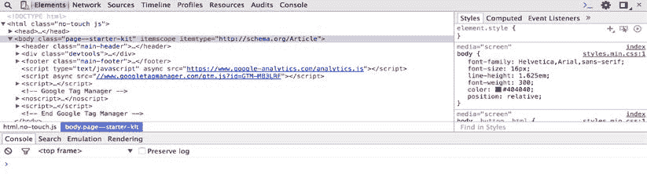

**Elements**（元素）面板可以帮助你检查和监控每个组件的 DOM 树以及相关的

样式表。

**Network**（网络）面板对于理解网络活动非常有用。例如，你可以实时监控通过网络下载的资源。

*测试与调试*

## [158]

对我们来说，最重要的面板是 **Sources**（源代码）面板。该面板是显示 JavaScript 源代码和调试器的地方。让我们创建一个包含以下内容的示例 HTML 文件：

```html
<!DOCTYPE html>
<html>
<head>
<meta charset="utf-8">
<title>This test</title>
<script type="text/javascript">
function engageGear(gear){
if(gear==="R"){ console.log ("Reversing");}
if(gear==="D"){ console.log ("Driving");}
if(gear==="N"){ console.log ("Neutral/Parking");}
throw new Error("Invalid Gear State");
}

try
{
engageGear("R"); //Reversing
engageGear("P"); //Invalid Gear State
}
catch(e){
console.log(e.message);
}
</script>
</head>
<body>
</body>
</</html>
```

保存此 HTML 文件并在 Google Chrome 中打开它。在浏览器中打开 DevTools，你将看到以下界面：

*第6章*

## [159]

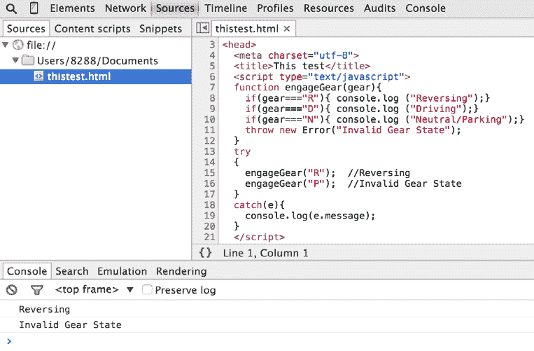

这是 **Sources** 面板的视图。你可以在此面板中看到 HTML 和嵌入的 JavaScript 源代码。你也可以看到 **Console**（控制台）窗口。你可以看到文件已执行且输出显示在 **Console** 中。

在右侧，你将看到调试器窗口：

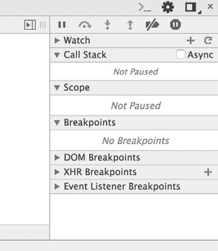

*测试与调试*

## [160]

在 **Sources** 面板中，点击行号 **8** 和 **15** 来添加断点。断点允许你在指定的点停止脚本的执行：

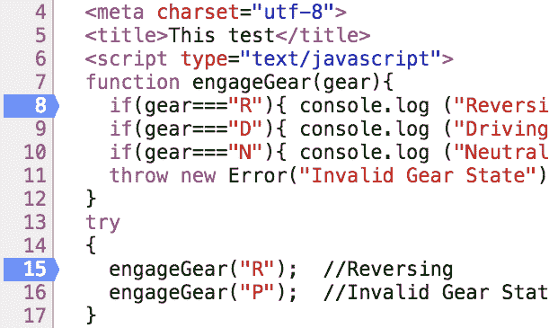

在调试面板中，你可以看到所有现断点：

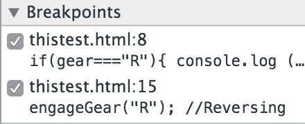

现在，当你重新运行同一个页面时，你会看到执行停止在调试点。一个非常实用的技巧是在调试阶段注入代码。当调试器运行时，你可以添加代码来帮助你更好地理解代码的状态：

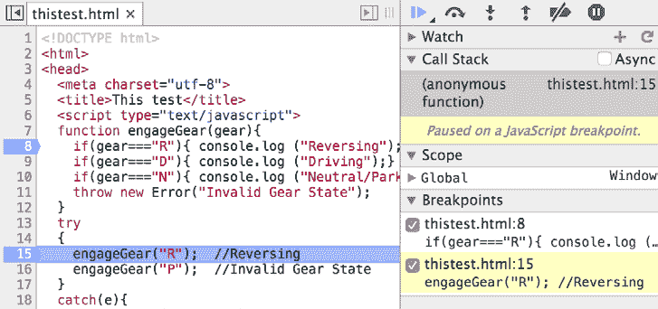

*第6章*

## [161]

此窗口现在包含了所有操作。你可以看到执行暂停在第 **15** 行。在调试窗口中，你可以看到触发了哪个断点。你还可以看到 **Call Stack**（调用堆栈）。你可以通过几种方式恢复执行。调试命令窗口有一系列操作：


你可以通过点击来恢复执行（这将一直执行到下一个断点）：

 按钮。当你这样做时，执行将继续，直到遇到下一个断点。在我们的案例中，我们在第 **8** 行停下：

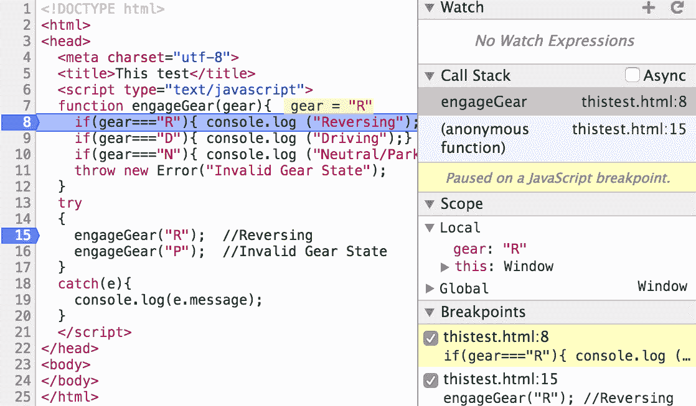

你可以观察到 **Call Stack** 窗口显示了我们是如何到达第 **8** 行的。**Scope**（作用域）面板显示了 **Local**（局部）作用域，你可以在那里看到断点时作用域内的变量。你还可以进入（step into）或跳过（step over）下一个函数。

使用 Chrome DevTools 调试和分析代码还有其他非常实用的机制。我建议你去尝试这个工具，并使其成为你常规开发流程的一部分。

*测试与调试*

## [162]

## 总结

测试和调试阶段对于开发健壮的 JavaScript 代码至关重要。TDD（测试驱动开发）和 BDD（行为驱动开发）是与敏捷方法密切相关的方法并被 JavaScript 开发者社区广泛接受。在本章中，我们回顾了围绕 TDD 和使用 Jasmine 作为测试框架的最佳实践。我们学习了使用 Chrome DevTools 调试 JavaScript 的各种方法。在下一章中，我们将探索 ES6、DOM 操作和跨浏览器策略的新奇世界。

## [163]

### ECMAScript 6

到为止，我们已经对 JavaScript 编程语言进行了详细的巡览。我相信你一定已经对该语言的核心有了深刻的见解。我们目前看到的都是符合 **ECMAScript 5** (**ES5**) 标准的内容。**ECMAScript 6** (**ES6**) 或 **ECMAScript 2015** (**ES2015**) 是 ECMAScript 标准的最新版本。该标准不断演进，最后一次修改是在 2015 年 6 月完成的。ES2015 在其范围内具有重大意义，ES2015 的建议正在被大多数 JavaScript 引擎实现。这是一个极大的好消息。ES6 引入了大量功能，增加了语法形式和辅助函数，极大丰富了语言。ECMAScript 标准不断演进的速度让浏览器和 JavaScript 引擎支持新功能变得有些困难。大多数程序员必须编写可以被旧浏览器支持的代码，这也是一个现实情况。臭名昭著的 Internet Explorer 6 曾是世界上最广泛使用的浏览器。要确保你的代码兼容尽可能多的浏览器是一项艰巨的任务。因此，当你想要跳转到下一组很棒 ES6 特性时，你必须考虑某些 ES6 特性可能不受流行的浏览器或 JavaScript 框架支持。这看起来像是一个糟糕的局面，但情况并非那么黑暗。为了避免这种不可预测性，已经提出了一些解决方案。其中用的是 polyfills（填充）和转换器（transpilers）。

*ECMAScript 6*

## [164]

### Shims 或 polyfills

Polyfills（也称为 shims）是以旧版本支持的兼容形式定义新版本行为的模式。有一个非常大的 ES6 shims 集合叫做 **ES6 shim** (https://github.com/paulmillr/es6-shim/)；我强烈建议研究这些 shims。从 ES6 集合中，考虑下面这个 shim 示例。shim 首先检查 `Number.isFinite()` 方法是否可用；如果没有，则用一个实现来*填充*它：

```javascript
var numberIsFinite = Number.isFinite || function isFinite(value) {
  return typeof value === 'number' && globalIsFinite(value);
};
```

这是一个填补规范空白的非常巧妙的技术。Shims 会随着新功能的加入不断升级，因此，在项目中保持更新的 shims 是一个明智的策略。`endsWith()` 的 polyfill 在 https://developer.mozilla.org/en-US/docs/Web/JavaScript/Reference/Global_Objects/String/endsWith 有详细描述。`String.endsWith()` 是 ES6 的一部分，但可以为预 ES6 环境进行填充。然而，shims 无法填充语法上的变化。对于这一点，我们可以考虑转换器作为一个选项。

### 转换器 (Transpilers)

转换（Transpiling）是一种结合了编译和转换的技术。其理念是编写兼容 ES6 代码，并使用工具将其转换为有效等效的 ES5 代码。我们将查看最完整、最流行的 ES6 转换器 **Babel** (https://babeljs.io/)。

Babel 有多种用法。你可以将其作为 node 模块安装并从命令行调用，或作为脚本引入你的网页中。Babel 的设置非常详尽且文档齐全，请见 https://babeljs.io/docs/setup/。Babel 还有一个非常棒的**读取-求值打印循环** (**REPL**)。我们在本章的大多数示例中使用 Babel REPL。深入理解 Babel 的各种用法超出了本书的范范围。但我敦使你开始将 Babel 作为你开发工作流的一部分。


## 第 7 章

在本章中，我们将涵盖 ES6规范最重要的部分。如果可能，你应该探索 ES6 的所有特性，并将它们纳入你的开发工作流。

### ES6 语法变化

ES6 为 JavaScript 带来了重大的语法变化。这些变化需要仔细学习并逐渐适应。在本节中，我们将学习一些最重要的语法变化，并查看你可以如何使用 Babel 在代码中立即开始使用这些新结构。

### 块级作用域

我们之前讨论过 JavaScript 中的变量是函数作用域的。在嵌套作用域中创建的变量对整个函数可用。许多编程语言提供了默认的块级作用域，其中代码块（通常由 {} 限定）内声明的任何变量仅在该块内作用（可用）。要在 JavaScript 中实现类似的块级作用域，一种流行方法是使用**立即调用函数表达式** (**IIFE**)。考虑以下示例：

```javascript
var a = 1;

(function blockscope(){
  var a = 2;
  console.log(a); // 2
})();

console.log(a); // 1
```

通过 IIFE，我们为变量 a 创建了块级作用域。当在 IIFE 中声明变量时，它的作用域被限制在函数内部。这是模拟块级作用域的传统方法。ES6 支持不使用 IIFE 就使用块级作用域。在 ES6 中，你可以将任何语句封装在由 {} 定义的块中。与其使用 var，你可以使用 let 声明变量来定义块级作用域。前面的示例可以使用 ES6 块级作用域重写如下：

```javascript
"use strict";

var a = 1;

{
  let a = 2;
  console.log( a ); // 2
}

console.log( a ); // 1
```

在 JavaScript 中使用独立的括号 {} 看起来很寻常，但这种约定在许多语言中创建块级作用域是非常常见的。块级作用域也适用于如 if { } 或 for (){ } 等其他结构。

当你像这样使用块级作用域时，通常倾向于将变量声明放在块的顶部。使用 var 和 let 声明的变量之间的区别之一是，使用 var 声明的变量附加到整个函数作用域，而使用 let 声明的变量则附加到块级作用域，并且在它们出现在块中之前不会被初始化。因此，你无法在声明 let 变量之前访问该变量，而对于使用 var 声明的变量，顺序并不重要：

```javascript
function fooey() {
  console.log(foo); // ReferenceError
  let foo = 5000;
}
```

let 的一个特定用途是在 for 循环中。当我们在 for 循环中使用 var 声明的变量时，它是在全局或父作用域中创建的。我们可以通过使用 let 声明变量在 for 循环作用域内创建一个块级作用域变量。考虑以下示例：

```javascript
for (let i = 0; i<5; i++) {
  console.log(i);
}

console.log(i); // i is not defined
```

由于 i 是使用 let 创建的，它的作用域在 for 循环中。你可以看到该变量在作用域外不可用。

ES6 中块级作用域的另一个用途是创建常量。通过使用 const 关键字，你可以在块级作用域中创建常量。一旦设置了值，你就无法更改此类常量的值：

```javascript
if(true){
  const a=1;
  console.log(a);
  a=100; ///"a" is read-only, you will get a TypeError
}
```

常量必须在声明时初始化。相同的块级作用域规则也适用于函数。当函数声明在块内部时时，它仅在该作用域内可用。

### 默认参数

默认值非常常见。你总是为传递给函数的参数或初始化的变量设置某些默认值。你可能见过类似下面的代码：

```javascript
function sum(a,b){
  a = a || 0;
  b = b || 0;
  return (a+b);
}

console.log(sum(9,9)); //18
console.log(sum(9)); //9
```

在这里，我们使用 ||（或运算符）在调用此函数时如果没有提供值的情况下，将变量 a 和 b 默认设置为 0。在 ES6 中，你有一个标准的方法来设置函数默认值。前面的示例可以重写如下：

```javascript
function sum(a=0, b=0){
  return (a+b);
}

console.log(sum(9,9)); //18
console.log(sum(9)); //9
```

你可以将任何有效的表达式或函数调用作为默认参数列表的一部分。

### 展开与剩余参数

ES6 有一个新运算符 .... 。根据它的使用方式，它被称为展开（spread）或剩余参数（rest）。让我们来看一个简单的示例：

```javascript
function print(a, b){
  console.log(a,b);
}

print(...[1,2]); //1,2
```

这里发生的情况是，当数组（或可迭代对象）之前添加 … 时，它会将数组的元素*展开*到函数参数中的独立变量中。a 和 b 函数参数将数组元素展开到函数参数中的独立变量中。

### 解构

让我们讨论一下对象的解构是如何工作的。假设你有一个函数 f 返回如下所示的对象：

```javascript
function f() {
  return {
    a: 'a',
    b: 'b',
    c: 'c'
  };
}
```

当我们解构此函数返回的对象时，我们可以使用我们之前看到的类似语法；区别是使用 {} 而不是 []：

```javascript
var { a: a, b: b, c: c } = f();
console.log(a,b,c); //a b c
```

与数组类似，我们使用模式匹配将变量赋值为函数对应的对应值。如果你使用的变量与匹配的变量相同，则有更短的编写方式。下面的示例就完全可行：

```javascript
var { a,b,c } = f();
```

然而，你大多数情况下使用的变量名与返回的变量不同。重要的是语法是*源：目标*（source: destination），而不是通常的*目标：源*（destination: source）。仔细观察下面的示例：

```javascript
//这是目标：源 - 错误的
var { x: a, x: b, x: c } = f();
console.log(x,y,z); //x is undefined, y is undefined z is undefined

//这是源：目标 - 正确的
var { a: x, b: y, c: z } = f();
console.log(x,y,z); // a b c
```


*ECMAScript 6*

**[ 170 ]**

## 对象字面量

对象字面量在 JavaScript 中无处不在。你可能认为这里没有改进空间。然而，ES6 也想要改进这一点。ES6 引入了几个快捷方式，用于围绕对象字面量创建简洁语法：

```javascript
var firstname = "Albert", lastname = "Einstein",
person = {
  firstname: firstname,
  lastname: lastname
};
```

如果你打算将属性赋值为与变量相同的变量，可以使用 ES6 的简写属性属性：

```javascript
var firstname = "Albert", lastname = "Einstein",
person = {
  firstname,
  lastname
};
```

同样，你以如下方式将函数赋值给属性：

```javascript
var person = {
  getName: function(){
    // ..
  },
  getAge: function(){
    //..
  }
}
```

与上述代码相比，你可以这样写：

```javascript
var person = {
  getName(){
    // ..
  },
  getAge(){
    //..
  }
}
```

*ECMAScript 6*
*Chapter 7*

**[ 171 ]**

## 模板字面量

我确定你做过类似下面的操作：

```javascript
function SuperLogger(level, clazz, msg){
  console.log(level+": Exception happened in class:"+clazz+" - Exception :"+ msg);
}
```

这是替换变量值以形成字符串字面量的常用方法。ES6 提供了一种使用反引号（``）分隔符的新类型字符串字面量。你可以使用字符串插值在模板字符串字面量中放置占位符。占位符将被解析并求。

前面的示例可以重写如下：

```javascript
function SuperLogger(level, clazz, msg){
  console.log(`${level} : Exception happened in class: ${clazz} - Exception : ${msg}`);
}
```

我们在字符串字面量周围使用 `` ``。在字面量内部，任何形式为 ${..} 的表达式都会被立即解析。这种解析被称为插值。在解析过程中，变量的值会替换 ${} 中的占位符。生成的字符串只是一个普通字符串，其中占位符被替换为实际的变量值。

通过字符串插值，你还可以将字符串分成多行，如下代码所示（非常类似于 Python）：

```javascript
var quote =
`Good night, good night!
Parting is such sweet sorrow,
that I shall say good night
till it be morrow.`;
console.log( quote );
```

你可以将函数调用或有效的 JavaScript 表达式作为字符串插值的一部分：

```javascript
function sum(a,b){
  console.log(`The sum seems to be ${a + b}`);
}
sum(1,2); //The sum seems to be 3
```

*ECMAScript 6*
*Chapter 7*

**[ 172 ]**

模板字符串的最终变体被称为**标签模板字符串 (tagged template string)**。其思想是使用函数来修改模板字符串。考虑以下示例：

```javascript
function emmy(key, ...values){
  console.log(key);
  console.log(values);
}

let category="Best Movie";
let movie="Adventures in ES6";
emmy`And the award for ${category} goes to ${movie}`;
//["And the award for "," goes to ",""]
//["Best Movie","Adventures in ES6"]
```

最奇怪的部分是当我们用模板字面量调用 emmy 函数时。这不是传统的函数调用语法。我们不是在写 emmy()；我们只是用函数对字面量进行*标记 (tagging)*。当调用此函数时，第一个参数是所有普通字符串（插值表达式之间的字符串）的数组。第二个参数是计算并存储所有插值表达式的数组。

现在这意味着标签函数实际上可以更改生成的模板标签：

```javascript
function priceFilter(s, ...v){
  //Bump up discount
  return s[0]+ (v[0] + 5);
}

let default_discount = 20;
let greeting = priceFilter `Your purchase has a discount of ${default_discount} percent`;
console.log(greeting); //Your purchase has a discount of 25
```

你可以看到，我们在标签函数中修改了的值并返回了修改后的值。

## Maps 和 Sets

ES6 引入了四种新的数据结构：**Map**、**WeakMap**、**Set** 和 **WeakSet**。我们之前讨论过对象是 JavaScript 中创建键值对的常用方式。对象的缺点是你不能使用非字符串值作为键。以下代码段演示了如何在 ES6 中创建 Map：

```javascript
let m = new Map();
let s = { 'seq' : 101 };
m.set('1','Albert');
m.set('MAX', 99);
m.set(s,'Einstein');
console.log(m.has('1')); //true
console.log(m.get(s)); //Einstein
console.log(m.size); //3
m.delete(s);
m.clear();
```

你可以在声明时初始化 map：

```javascript
let m = new Map([
  [ 1, 'Albert' ],
  [ 2, 'Douglas' ],
  [ 3, 'Clive' ],
]);
```

如果你想遍历 Map 中的项，可以使用 entries() 函数，它将为你返回项。你可以使用 keys() 函数来返回一个迭代器。你可以使用 values() 函数来遍历 Map 的值：

```javascript
let m2 = new Map([
  [ 1, 'Albert' ],
  [ 2, 'Douglas' ],
  [ 3, 'Clive' ],
]);

for (let a of m2.entries()){
  console.log(a);
}
//1 2 3

for (let a of m2.keys()){
  console.log(a);
} //1 2 3

for (let a of m2.values()){
  console.log(a);
} //Albert Clive

*ECMAScript 6*
*Chapter 7*

**[ 174 ]**

Maps 的一种变体是 WeakMap——WeakMap 不会阻止其垃圾回收。WeakMap 的键必须是对象，值可以是任意值。虽然 WeakMap 的行为与 Map 相同，但你无法遍历它。这些限制背后是有原因的。由于对象没有被使用，它可以被垃圾回收。这是 WeakMap 相比 Map 的主要优势。

*ECMAScript 6*
*Chapter 7*

**[ 175 ]**

## Symbols

ES6 引入了一种新的数据类型 Symbol。Symbol 保证是唯一的且不可变的。Symbols 通常用作对象的属性标识符。你可以通过 Symbol() 工厂方法创建 Symbol——记住这不是构造函数，因此你不应该使用 new 运算符：

```javascript
let s = Symbol();
console.log(typeof s); //symbol
```

与字符串不同，Symbols 保证是唯一的，有助于防止命名冲突。通过 Symbols，我们拥有了一种适用于大家的扩展机制。ES6 自带许多 Symbols，可以暴露 JavaScript 对象的各种元行为。

## 迭代器

迭代器在其他编程语言中已经存在一段时间。它们提供了处理数据的方便方法。ES6 为相同的情况引入了迭代器。ES6 迭代器是特定接口的对象。迭代器有一个 next() 方法，返回一个对象。返回的对象有两个属性——value（下一个值）和 done（指示是否到达最后一个结果）。ES6 还定义了 Iterable 接口，它描述了能够产生迭代器的对象。让我们看看数组，它是一个可迭代对象，以及它可以产生的以消耗值的迭代器：

```javascript
var a = [1,2];
var i = a[Symbol.iterator]();
console.log(i.next()); // { value: 1, done: false }
console.log(i.next()); // { value: 2, done: false }
console.log(i.next()); // { value: undefined, done: true }
```

正如你看到的，我们通过 Symbol.iterator() 数组的迭代器，并对其调用 next() 方法来获取后续的元素。value 和 done 都由 next() 方法调用返回。当你在数组的最后一个元素之后调用 next() 时，你会得到一个 undefined 值且 done: true，表示你已经遍历了整个数组。


## ECMAScript 6

[176]

## For..of 循环

ES6 引入了一种名为 `for..of` 循环的新迭代机制，它可以遍历迭代器产生的值集合。

我们通过 `for..of` 遍历的值是一个可迭代对象（iterable）。

让我们 `for..of` 与 `for..in` 进行对比：

```javascript
var list = ['Sunday','Monday','Tuesday'];

for (let i in list){
  console.log(i); //0 1 2
}

for (let i of list){
  console.log(i); //Sunday Monday Tuesday
}
```

如你所见，使用 `for..in` 循环可以遍历列表数组的索引，而 `for..of` 循环允许你遍历存储在 list 数组中的值。

## 箭头函数

ECMAScript 6 最有趣的新特性之一是箭头函数。顾名其实义，箭头函数是使用新语法定义的函数，该语法使用*箭头* (=>) 作为语法的一部分。让我们先看看箭头函数的样子的：

```javascript
//Traditional Function
function multiply(a,b) {
  return a*b;
}

//Arrow
var multiply = (a,b) => a*b;
console.log(multiply(1,2)); //2
```

箭头函数的定义由参数列表（零个或多个参数，如果只有一个参数则不需要圆括号 ( .. )）组成，后面紧跟 => 标记，然后是函数体。

*第7章*

[177]

如果函数体包含多个表达式，可以用 `{ .. }` 包围。如果只有一个表达式且你省略了圆括号 `{ .. }`，则表达式前面有一个隐含的返回。箭头函数的写法有多种变体，以下是最常用的：

```javascript
// 单个参数，单语句
//arg => expression;
var f1 = x => console.log("Just X");
f1(); //Just X

// 多个参数，单语句
//(arg1 [, arg2]) => expression;
var f2 = (x,y) => x*y;
console.log(f2(2,2)); //4

// 单个参数，多个语句
// arg => {
// statements;
// }
var f3 = x => {
  if(x>5){
    console.log(x);
  }
  else {
    console.log(x+5);
  }
}
f3(6); //6

// 多个参数，多个语句
// ([arg] [, arg]) => {
// statements
// }
var f4 = (x,y) => {
  if(x!=0 && y!=0){
    return x*y;
  }
}
console.log(f4(2,2));//4
```

*ECMAScript 6*

[178]

```javascript
// 无参数，单语句
//() => expression;
var f5 = () => 2*2;
console.log(f5()); //4

// IIFE (立即调用函数表达式)
console.log(( x => x * 3 )( 3 )); // 9
```

记住，箭头函数可以使用普通参数的所有特性，包括默认值、解构和剩余参数。

箭头函数提供了方便且简洁的语法，让你的代码具有非常浓的*函数式编程*风格。箭头函数之所以受欢迎，是因为它们提供了一种迷人的承诺：通过在代码中去掉 `function`、`return` 和 `{ .. }` 来编写简洁的函数。然而，箭头函数的设计是从根本上解决 this 绑定中一个特定且常见的痛点。在普通的 ES5 函数中，每个新定义的函数都有自己的 `this` 值（在构造函数中为新对象，严格模式下的函数调用中为 `undefined`，当函数作为*对象方法*调用时为上下文对象，等）。JavaScript 函数始终有自己的 `this`，这阻止了你从回调函数内部访问周围方法的 `this`。为了理解这个问题，请考虑以下示例：

```javascript
function CustomStr(str){
  this.str = str;
}

CustomStr.prototype.add = function(s){ // --> 1
  'use strict';
  return s.map(function (a){ // --> 2
    return this.str + a; // --> 3
  });
};

var customStr = new CustomStr("Hello");
console.log(customStr.add(["World"]));
// 无法读取 undefined 的属性 'str'
```

在标记为 3 的行上，我们尝试获取 `this.str`，但匿名函数也有自己的 `this`，它遮蔽了来自第 1 行方法的 `this`。在 ES5 中修复这个问题，我们可以将 `this` 赋值给变量并使用该变量：

```javascript
function CustomStr(str){
  this.str = str;
}

*第7章*

[179]

CustomStr.prototype.add = function(s){
  'use strict';
  var that = this; // --> 1
  return s.map(function (a){ // --> 2
    return that.str + a; // --> 3
  });
};

var customStr = new CustomStr("Hello");
console.log(customStr.add(["World"]));
//["HelloWorld"]
```

在标记为 1 的行上，我们将 `this` 赋值给变量 `that`，并在匿名函数中使用 `that` 变量，它将拥有指向正确上下文的 `this` 的引用。

ES6 箭头函数具有作用域 `this` (lexical this)，这意味着箭头函数会捕获所在上下文的 `this` 值。我们可以按照如下方式将前面的函数转换为等效的箭头函数：

```javascript
function CustomStr(str){
  this.str = str;
}

CustomStr.prototype.add = function(s){
  return s.map((a)=> {
    return this.str + a;
  });
};

var customStr = new CustomStr("Hello");
console.log(customStr.add(["World"]));
//["HelloWorld"]
```

## 总结

在本章中，我们讨论了 ES6 为语言添加的几个重要特性。这是一个令人兴奋的新语言特性和范式的集合，通过填充程序（polyfills）和转译器（transpilers），你可以立即使用它们。JavaScript 是一门不断增长的语言，理解未来的趋势是非常重要的。ES6 特性让 JavaScript 变得更加有趣和成熟。在下一章中，我们将深入研究如何使用 JavaScript 和 jQuery 操作浏览器的**文档对象模型** (**DOM**) 和事件。

[181]

## DOM 操作与事件

JavaScript 存在的最重要原因是 Web。JavaScript 为原本静态的网页赋予了动态性。在本章中，我们将深入探讨浏览器与语言之间的这种关系。DOM 操作

### 访问 DOM 元素

大多数情况下，你会感兴趣访问 DOM 元素以检查其值，或为了某些业务逻辑处理这些值。我们将详细查看这一特定的用例。让我们让我们创建一个包含以下内容的示例 HTML 文件：

```html
<html>
<head>
<title>DOM</title>
</head>
<body>
<p>Hello World!</p>
</body>
</html>
```

你可以将此文件保存为 `sample_dom.html`；当你在 Google Chrome 浏览器中打开它时，你将看到显示有 **Hello World** 文本的网页。现在，通过导航到选项 | **更多工具** | **开发者工具** 打开 Chrome 开发者工具（此路径可能根据你的操作系统和浏览器版本而不同）。在**开发者工具**窗口中，你将看到 DOM 结构：

img/b71a2881032cad7a0a37747ed6a23e02_200_0.png

接下来，我们将向此 HTML 页面插入一些 JavaScript。我们将在网页加载时调用 JavaScript 函数。为了实现这一点，我们将在 `window.onload` 上调用函数。你可以将脚本放置在 `<head>` 标签下的 `<script>` 标签中。你的页面看起来如下：

```html
<html>
<head>
<title>DOM</title>
<script>
```


*第8章*

**[183]**

// 当文档加载时运行此函数

window.onload = function() {
  var doc = document.documentElement;
  var body = doc.body;
  var _head = doc.firstChild;
  var _body = doc.lastChild;
  var _head_ = doc.childNodes[0];
  var title = _head.firstChild;
  alert(_head.parentNode === doc); //true
}
</script>

</head>

<body>

<p>Hello World!</p>

</body>
</html>

当浏览器加载页面时，该匿名函数会被执行。在函数中，我们正在通过程序方式获取 DOM 节点。可以使用 `document.documentElement` 函数访问整个 HTML 文档。我们将文档存储在一个变量中。一旦访问了文档，我们就可以使用文档的几个辅助属性来遍历节点。我们正在使用 `doc.body` 访问 `<body>` 元素。你可以使用 `childNodes` 数组遍历元素的子节点。可以使用额外的属性 `firstChild` 和 `lastChild` 访问节点的第一个子节点和最后一个子节点。

不建议在 `<head>` 标签中使用阻塞渲染的 JavaScript。这会极大地减慢页面渲染。现代浏览器支持 `async` 和 `defer` 属性，告诉浏览器在下载脚本时可以继续渲染。你可以在 `<head>` 标签中使用这些标签，而无需担心性能下降。你可以在 http://stackoverflow.com/questions/436411/where-is-the-best-place-to-put-script-tags-in-html-markup  获取更多信息。

### 访问特定节点

核心 DOM 定义了 `getElementsByTagName()` 方法，用于返回所有 `tagName` 属性等于特定值的元素的节点列表（NodeList）。下面这行代码返回了文档中所有 `<p/>` 元素的列表：

var paragraphs = document.getElementsByTagName('p');

*DOM 操作与事件*

**[184]**

HTML DOM 定义了 `getElementsByName()` 来检索所有 `name` 属性被设置为特定值的元素。考虑以下代码段：

<html>
<head>

<title>DOM</title>
<script>
showFeelings = function() {
  var feelings = document.getElementsByName("feeling");
  alert(feelings[0].getAttribute("value"));
  alert(feelings[1].getAttribute("value"));
}
</script>
</head>
<body>

<p>Hello World!</p>
<form method="post" action="/post">
<fieldset>
<p>你今天感觉如何?</p>
<input type="radio" name="feeling" value="Happy" />
Happy<br />
<input type="radio" name="feeling" value="Sad" />Sad<br />
</fieldset>
<input type="button" value="Submit" onClick="showFeelings()"/>/>
</form>

</body>
</html>

在这个示例中，我们创建了一组 `name` 属性定义为 `feeling` 的单选按钮。在 `showFeelings` 函数中，我们获取了所有 `name` 属性设置为 `feeling` 的元素，并遍历所有这些元素。

HTML DOM 定义的另一个方法是 `getElementById()`。在访问特定元素时一个非常有用的方法。该方法根据与元素关联的 `id` 进行查找。`id` 属性对于每个元素都是唯一的，因此这种查找非常快，且应该优于 `getElementsByName()`。然而，你应该意识到浏览器并不保证 `id` 属性的唯一性。在下面的示例中，我们正在使用 ID 访问一个特定元素。元素的 ID 是唯一的，与标签或 name 属性不同：

<html>
<head>

*第8章*

**[185]**

<title>DOM</title>
<script>
window.onload= function() {
  var greeting = document.getElementById("greeting");
  alert(greeting.innerHTML); //显示 "Hello World" 警告
}
</script>
</head>
<body>

<p id="greeting">Hello World!</p>
<p id="identify">地球人</p>

</body>
</html>

我们到目前为止讨论的是 JavaScript 中 DOM 遍历的基础知识。当 DOM 变得复杂且你想对 DOM 进行复杂的操作时，这些遍历和访问函数似乎就具有局限性。有了这些基础知识，是时候介绍一个用于 DOM 遍历（以及其他功能）的优秀库了——jQuery。

jQuery 是一个轻量级库，旨在让常见的浏览器操作变得更简单。如果使用纯 JavaScript，DOM 遍历和操作、事件处理、动画和 Ajax 等常见操作可能会非常繁琐。jQuery 为你提供了易用且更短的辅助机制，帮助你非常容易且快速地开发这些常见操作。jQuery 是一个功能丰富的库，但就本章而言，我们将主要关注 DOM 操作和事件。你可以通过直接从内容交付网络（CDN）添加脚本，或手动下载文件并将其添加到脚本标签中将 jQuery 添加到你的 HTML 中。下面的示例展示了如何从 Google 的 CDN 下载 jQuery：

<html>
<head>
<script src="https://ajax.googleapis.com/ajax/libs/jquery/2.1.4/jquery.min.js"></script>
</head>
<body>

</body>

*DOM 操作与事件*

**[186]**

CDN 的优势是 Google 的 CDN 会找到最近的服务器。如果你希望下载并手动托管 jQuery，可以使用以下代码：

<html>
<head>
<script src="./jquery.js"></script>
<script>
$(document).ready(function() {
  $('#greeting').html('Martian');
});
</script>
</head>
<body>

<p id="greeting">Hello World!</p>

</body>
</html>

$ 只是一个函数。如果你阅读 jQuery 的源码（你应该这样做），你会看到最后一行：

window.jQuery = $;

$ 是一种语法糖，让代码更加简洁。事实上，你可以交替使用 `$` 和 `jQuery`。例如，`$('#greeting').html('Martian');` 和 `jQuery('#greeting').html('Martian');` 是相同的。

*第8章*

**[187]**

你不能在页面完全加载之前使用 jQuery。因为 jQuery 需要知道整个 DOM 必须已经在内存中。为了确保页面完全加载并处于可以操作的状态，可以使用 `$(document).ready()` 函数。在这里，IIFE 只在文档准备就绪后执行：

$(document).ready(function() {
  $('#greeting').html('Martian');
});

片段展示了我们如何将函数与 jQuery 的 `.ready()` 方法关联。该函数将在文档准备就绪后执行。我们使用 `$(document)` 从页面创建一个 jQuery 对象。我们在 jQuery 对象上调用 `.ready()` 方法，并向它传递我们想要执行的函数。

在使用 jQuery 时，这是一个非常常见的操作，以至于它有自己的快捷调用方式。你可以将整个 `ready()` 调用替换为简短的 `$()` 调用：

$(function() {
  $('#greeting').html('Martian');
});

jQuery 中最重要的函数是 `$()`。该函数通常接受一个 CSS 选择器作为唯一参数，并返回一个指向对应元素的新 jQuery 对象。三个主要的选择器是标签名、ID 和类。它们可以单独使用，也可以与其他结合使用。下面的简单示例说明了这三个选择器在代码中的形式：

| 选择器 | CSS 选择器 | jQuery 选择器 | 选择器的输出 |
| :--- | :--- | :--- | :--- |
| 标签 | p | $('p') | 选择文档中所有的 p 标签。 |
| ID | #div_1 | $('#div_1') | 选择具有 div_1 ID 的元素。识别 ID 的符号是 #。 |
| 类 | .bold_fonts | $('.bold_fonts') | 选择文档中所有具有 CSS 类 bold_fonts 的元素。识别类匹配的符号是 "."。 |


*DOM 操作与事件*

[188]

jQuery 基于 CSS 选择器工作。

由于 CSS 选择器不在本书的论述范围内，我建议你访问 http://www.w3.org/TR/CSS2/selector.html 来对该概念有一个大致的了解。

我们还假设你熟悉 HTML 标签和语法。接下来的示例涵盖了 jQuery 选择器工作的基本原理：

```html
<head>
<script src="https://ajax.googleapis.com/ajax/libs/jquery/2.1.4/jquery.min.js"></script>
<script>
$(function() {
  $('h1').html(function(index, oldHTML){
    return oldHTML + "Finally?";
  });
  $('h1').addClass('highlight-blue');
  $('#header > h1 ').css('background-color', 'cyan');
  $('ul li:not(.highlight-blue)').addClass('highlight-green');
  $('tr:nth-child(odd)').addClass('zebra');
});
</script>

<style>
.highlight-blue {
color: blue;
}
.highlight-green{
color: green;
}
.zebra{
background-color: #666666;
color: white;
}
</style>
</head>
<body
<div id=header>
<h1>Are we there yet ?</h1>
<span class="highlight">
  <p>Journey to Mars</p>
  <ul>
    <li>First</li>
    <li>Second</li>
    <li class="highlight-blue">Third</li>
  </ul>
</span>
<table>
  <tr><th>Id</th><th>First name</th><th>Last Name</th></tr>
  <tr><td>1</td><td>Albert</td><td>Einstein</td></tr>
  <tr><td>2</td><td>Issac</td><td>Newton</td></tr>
  <tr><td>3</td><td>Enrico</td><td>Fermi</td></tr>
  <tr><td>4</td><td>Richard</td><td>Feynman</td></tr>
</table>
</div>
</body>
</html>
```

*第 8 章* 

[189]

在这个示例中，我们正在使用选择器选取 HTML 页面中的多个 DOM 元素。我们有一个文本为“Are we there yet ?” 的 H1 标题，当页面加载时，我们的 jQuery 脚本会访问所有的 H1 标题并在它们后面附加文本 Finally?：

```javascript
$('h1').html(function(index, oldHTML){
  return oldHTML + "Finally ?";
});
```

$.html() 函数设置目标元素（在本例中为 H1 标题）的 HTML。此外，我们选取所有的 H1 标题，并为所有它们应用一个特定的 CSS 样式类 highlight-blue。`$('h1').addClass('highlight-blue')` 语句选取所有的 H1 标题，并使用 $.addClass(<CSS class>)` 方法为使用该选择器选取的所有元素应用 CSS 类。

我们使用子代选择器 (>) 通过 $.css() 函数来自自定义的 CSS 样式。实际上，$() 函数中的选择器是在说：“找到每个 ID 为 header (#header) 的元素的子元素 (>) 标题 (h1)。”对于每一个这样的元素，我们应用了自定义的 CSS。下一个用法很有趣。考虑以下行代码：

```javascript
$('ul li:not(.highlight-blue)').addClass('highlight-green');
```

*DOM 操作与事件*

[190]

我们正在选取的是：“对于所有没有应用 highlight-blue 类的列表元素 (li)，应用 CSS 类 highlight-green。”最后一行——`$('tr:nth-child(odd)').addClass('zebra')`——可以解释为：从所有的表格行 (tr) 中，对于每一个奇数行，应用 CSS 样式 zebra。*n*-child 选择器是 jQuery 提供的一个自定义选择器。最终输出看起来类似于下面（尽管它显示了多种 jQuery 选择器类型，但很明显，对 jQuery 的了解并不能取代糟糕的设计品味。）：


一旦你完成了选取，就有大类可以在选定元素上调用的方法。这些方法是**获取器 (getters)** 和**设置器 (setters)**。Getters 从选取结果获取部分信息，而 setters 以某种方式更改选取结果。

Getters 通常只对选取中的第一个元素操作，而 setters 则作用于选取中的所有元素。Setters 使用隐式迭代自动遍历选取中的所有元素。

例如，我们想对页面上所有的列表项应用一个 CSS 类。当我们对选择器调用 addClass 方法时，它会自动应用到该特定选取的所有元素上。这就是隐式迭代的作用：

```javascript
$('li').addClass('highlight');
```

*第 8 章*

[191]

然而，有时你并不想通过隐式迭代遍历所有元素。你可能想选择性地修改少数几个元素。你可以使用 .each() 方法显式地遍历元素。在下面的代码中，我们正在选择性地处理元素并使用元素的索引：

```javascript
$('li').each(function(index, element) {
  if(index % 2 == 0)
    $(element).prepend('<b>STATUS</b>');
});
```

链式调用（Chaining）允许你在选取结果上调用系列方法，而无需临时存储中间值。这是可能的因为我们调用的每个 setter 方法都会返回它被调用的选取结果。这是一个非常强大的功能，你会在许多专业库中看到它。考虑以下示例：

```javascript
$('#button_submit')
  .click(function() {
    $(this).addClass('clicked');
  })
  .find('#notification')
  .attr('title', 'Message Sent');
```

在此片段中，我们对一个选择器链式调用了 click(), find() 和 attr() 方法。在这里，click() 方法被执行，一旦执行完成，find() 定位 ID 为 notification 的元素并将其属性更改为字符串。

遍历与操作

我们讨论了使用 jQuery 选取元素的各种方法。我们将讨论几种 DOM 遍历和操作方法，如果使用原生 DOM 操作来实现这些将非常范琐。jQuery 让它们变得直观且优雅。

*DOM 操作与事件*

[192]

在深入研究这些方法之前，让我们熟悉一下 HTML 术语。我们将讨论几种 DOM 遍历和操作方法，如果使用原生 DOM 操作来实现这些将非常范琐。jQuery 让它们变得直观且优雅。

我们将通过方法来遍历 DOM。考虑以下 HTML：

```html
<ul>
  <li><span>
    <i>Hello</span>
  </span>
```

使用 jQuery 遍历方法，我们处理 DOM 选取。我们可以通过这些方法来触发选择器。例如，我们可以通过特定的选择器来过滤元素。考虑以下示例：

```javascript
var list = $('li'); // 选取没有 highlight 类的元素
var highlighted = list.filter('.highlight'); // 选取带有 highlight 类的元素
```

jQuery 允许你添加和移除类。如果你想切换类，可以使用 toggleClass 方法：

```javascript
$('#username').addClass('hidden');
$('#username').removeClass('hidden');
$('#username').toggleClass('hidden');
```

通常情况下，你可能想更改元素的值。可以使用 val() 方法来更改表单值。例如，以下行：

```javascript
$('input[type="text"]').val('Enter username:');
```

要修改属性，可以使用如下 attr() 方法：

```javascript
$('a').attr('title', 'Click');
```


*DOM 操控与事件*

**[194]**

在这个示例中，我们通过调用 `getElementById()` 获取了特定元素（一个 ID 为 `Bigbutton` 的按钮）的引用。在按钮元素的引用上，我们调用了 `addEventListener()` 为点击事件分配了一个处理函数。这是完全合法的代码，可以在 Mozilla Firefox 或 Google Chrome 等现代浏览器中正常运行。然而，在 IE9 之前的 Internet Explorer 中，这并不是有效代码。这是因为在 Internet Explorer 9 之前，微软实现的是自己自定义的 `attachEvent()` 方法，而不是 W3C 标准的 `addEventListener()`。这非常遗憾，因为你不得不编写非常糟糕的 hack（hacks）来处理特定浏览器的差异。

**传播**

此时，我们应该问一个重要的问题——如果一个元素和它的某个祖元素在同一个事件上都有处理器，哪一个处理器会先触发？考虑下面的图：

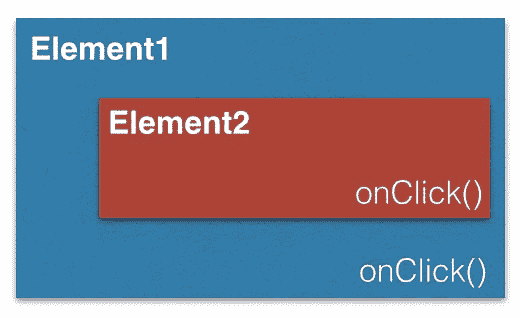

例如，我们有 **Element2** 作为 **Element1** 的子元素，且两者都拥有 onClick 处理器。当用户点击 Element2 时，Element2 和 Element1 的 onClick 都会被触发，但问题是哪一个先被触发。事件顺序应该是怎样的？嗯，遗憾的是，答案是这完全取决于浏览器。当浏览器最初出现时，Netscape 和微软自然地产生了两种观点。

- Netscape 决定第一个触发的事件应该是 Element1 的 onClick。这种事件顺序被称为“事件捕获”（event capturing）。
- 微软决定第一个触发的事件应该是 Element2 的 onClick。这种事件顺序被称为“事件冒泡”（event bubbling）。

*第 8 章*

**[195]**

这些是关于浏览器如何处理事件的、两种完全对立的观点和实现。为了结束这种混乱，**万维网联盟**（**W3C**）决定采取明智的中庸之道。在这种模型中，事件首先被捕获直到到达目标元素，然后再次向上冒泡。在这种标准行为中，你可以选择在哪个阶段注册你的事件处理器——既可以是捕获阶段也可以冒泡阶段。如果 `addEventListener()` 的最后一个参数为 `true`，则事件处理器被设置为捕获阶段；如果是 `false`，则事件处理器被设置为冒泡阶段。

有时，如果事件已经由子元素触发，你不希望它再次由父元素抛起。你可以调用事件对象上的 `stopPropagation()` 方法来防止更高级别的处理器接收该事件。某些事件关联有默认操作。例如，如果你点击一个 URL 链接，你将被带到链接的目标页面。JavaScript 事件处理器会在执行默认行为之前被调用。你可以调用事件对象上的 `preventDefault()` 方法来停止默认行为的触发。

这些是在浏览器中使用原生 JavaScript 时的事件基础知识。这里存在一个问题。浏览器在定义事件处理行为方面是臭名昭著的。我们将查看 jQuery 的事件处理。为了让管理更易用，jQuery 总是为模型的冒泡阶段注册事件处理器。这意味着最具体的元素将获得对任何事件做出响响的首要机会。

**jQuery 事件处理与传播**

jQuery 事件处理考虑了许多此类浏览器差异。你可以专注于编写在大多数受支持浏览器上运行的代码。jQuery 对浏览器事件的支持是简单直观的。例如，这段代码监听用户点击页面上的任何按钮元素：

```javascript
$('button').click(function(event) {
  console.log('Mouse button clicked');
});
```

就像 `click()` 方法一样，还有其他几个辅助方法可以涵盖几乎所有的浏览器事件。存在的辅助方法有：

- blur
- change
- click
- dblclick
- error
- focus
- keydown
- keypress
- keyup
- load
- mousedown
- mousemove
- mouseout
- mouseover
- mouseup
- resize
- scroll
- select
- submit
- unload

或者，你可以使用 `.on()` 方法。使用 `on()` 方法有很多优势，因为它提供了更大的灵活性。`on()` 方法允许你将处理器绑定到多个事件上。使用 `on()` 方法你也可以处理自定义事件。

事件名称作为第一个参数传递给 `on()` 方法，就像我们看到的其他方法一样：

```javascript
$('button').on( 'click', function( event ) {
  console.log(' Mouse button clicked');
});
```

一旦你向元素注册了事件处理器，你可以按照如下方式触发此事件：

```javascript
$('button').trigger( 'click' );
```

此事件也可以通过以下方式触发：

```javascript
$('button').click();
```

你可以使用 jQuery 的 `.off()` 方法取消事件绑定。这将移除任何绑定到指定事件的事件处理器：

```javascript
$('button').off( 'click' );
```

你可以向一个元素添加多个一个处理器：

```javascript
$("#element")
  .on("click", firstHandler)
  .on("click", secondHandler);
```

当事件被触发时，两个处理器都会被调用。如果你想移除该处理器，可以使用带有第二个参数的 `off()`：

```javascript
$("#element").off("click", firstHandler);
```

如果你有引用的话，这是可以的。如果你使用的是匿名函数，则无法获取它们。在这种情况下，你可以使用带命名空间的事件（namespaced events）。考虑下面的示例：

```javascript
$("#element").on("click.first", function() {
  console.log("first");
});
```

一旦你拥有了带命名空间的事件，你可以按照如下方式移除它：

```javascript
$("#element").off("click.first");
```

使用 `on()` 的一个主要优势是你可以一次性绑定多个事件。考虑以下示例：

```javascript
$('#input').on({
  focus: function() {
    console.log("focus");
  },
  mouseenter: function() {
    console.log("mouseenter");
  },
  click: function() {
    console.log("click");
  }
});
```

*DOM 操控与事件*

**[196]**

*DOM 操控与事件*

**[197]**

*DOM 操控与事件*

**[198]**

*第 8 章*

**[199]**

*第 8 章*

**事件委托**

事件委托允许我们为整个 ul#list 附加单个处理器。通过我们对事件冒泡的理解，我们可以可视化事件如何在 DOM 树中移动。当点击任何一个 URL 时，其移动路径如下：

a(click)->li->ul#list->div#container->body->html->root

考虑以下示例：

```html
<html>
<body>
  <div id="container">
    <ul id="list">
      <li><a href="google.com">Google</a></li>
      <li><a href="myntra.com">Myntra</a></li>
      <li><a href="bing.com">Bing</a></li>
    </ul>
  </div>
</body>
</html>
```

我们可以按照如下方式创建委托事件：

```javascript
$("#list").on("click", "a", function( event ) {
  console.log( $( this ).text() );
});
```

**事件对象**

到目前为止，我们附加匿名函数作为事件处理器。为了让我们的事件处理器更通用、更有用，我们可以创建具名的函数并将其分配给事件。考虑以下几行：

```javascript
function handlesClicks(event){
  //处理点击事件
}

$("#bigButton").on('click', handlesClicks);
```


## DOM 操作与事件

**[200]**

在这里，我们向 `on` 方法传递的是一个命名函数而不是匿名函数。现在让我们关注我们传递给函数的事件参数。jQuery 会传递一个包含所有事件回调的事件对象（event object）。事件对象包含了关于被触发事件的非常有用的信息。在某些不希望元素的默认行为执行的情况下，我们可以使用事件对象的 `preventDefault()` 方法。例如，我们希望触发一个 AJAX 请求，而不是整个表单提交；或者我们希望在点击 URL 锚点时防止打开默认位置。在这些情况下，你可能还希望防止事件冒泡到 DOM 树。你可以通过调用事件对象的 `stopPropagation()` 方法来停止事件传播。

考虑这个示例：

```javascript
$("#loginform").on("submit", function(event) {
  // 防止表单的默认提交。
  event.preventDefault();
  // 防止事件向 DOM 树冒泡，同时也停止任何
  // 委托
  event.stopPropagation();
});
```

除了事件对象外，你还会获得触发事件的 DOM 对象的引用。可以通过 `$(this)` 引用该元素。考虑以下示例：

```javascript
$("a").click(function(event) {
  var anchor = $(this);
  if (anchor.attr("href").match("google")) {
    event.preventDefault();
  }
});
```

## 总结

这一章完全是为了理解 JavaScript 最重要的角色——即作为浏览器语言的角色。JavaScript 通过促进浏览器上的 DOM 操作和事件管理，为 Web 引入动态特性发挥了作用。我们讨论了在使用 jQuery 和不使用 jQuery 的情况下这两个概念。随着现代 Web 的需求增加，使用像 jQuery 这样的库是至关重要的。这些库显著提高了代码的质量和效率，同时让你能够自由地关注重要的事情。

我们将关注 JavaScript 的另一种形态——主要在服务器端。Node.js 已经成为一个用于编写可扩展服务器端应用程序的流行 JavaScript 框架。我们将详细查看如何最有效地利用 Node.js 进行服务器应用程序。

**[201]**

## 服务端 JavaScript

到目前为止，我们一直关注 JavaScript 作为浏览器语言的多功能性。鉴于 JavaScript 作为编写可扩展服务器系统的编程语言已获得极大的普及，这足以说明该语言的卓越。在这一章中，我们将查看 Node.js。Node.js 是用于服务器端编程的最流行的 JavaScript 框架之一。Node.js 也是 GitHub 上最关注的项目之一，并拥有极的社区支持。

Node 使用 V8（驱动 Google Chrome 的虚拟机）来用于服务器端编程。V8 为 Node 带来了巨大的性能获益，因为它直接将 JavaScript 编译为原生机器码，而不是执行字节码或使用解释器作为中间件。

V8 和 JavaScript 的多功能性是一个完美的组合——JavaScript 的性能、范围和整体普及程度使得 Node 一跃成功。在这一章中，我们将涵盖以下主题：

- 浏览器和 Node.js 中的异步事件模型
- 回调（Callbacks）
- 定器
- 事件发射器（EventEmitters）
- 模块和 npm

**[202]**

### 浏览器中的异步事件模型

在尝试理解 Node 之前，让我们先尝试理解浏览器中的 JavaScript。Node.js 依赖于事件驱动和异步平台来实现服务端 JavaScript。这与浏览器处理 JavaScript 的方式非常相似。浏览器和 Node 在使用 I/O 时都是事件驱动且非阻塞的。

为了深入研究这种特性，让我们首先对不同类型的操作及其相关的成本进行比较：

| 操作 | 成本 |
| :--- | :--- |
| L1 缓存读取 | 0.5 纳秒 |
| L2 缓存读取 | 7 纳秒 |
| RAM | 100 纳秒 |
| 从 SSD 随机读取 4 KB | 150,000 ns |
| 从 SSD 顺序读取 1 MB | 1,000,000 ns |
| 从磁盘顺序读取 1 MB | 20,000,000 ns |

这些数字来自 https://gist.github.com/jboner/2841832，展示了**输入/输出 (I/O)** 可能有多昂贵。计算机程序耗时最长的操作是 I/O 操作，如果程序不断等待这些 I/O 操作完成，这些操作就会减慢整个程序的执行。让我们来看此类操作的示例：

```javascript
console.log("1");
var log = fileSystemReader.read("./verybigfile.txt");
console.log("2");
```

当你调用 `fileSystemReader.read()` 时，你正在从文件系统读取文件。正如我们刚刚看到的，I/O 是这里的瓶颈，在读取操作完成之前可能需要很长时间。取决于硬件类型、文件系统、操作系统等，此操作将很大程度上阻塞整个程序的执行。先前的代码执行了一些 I/O，这是一种阻塞操作——进程将被阻塞，直到 I/O 完成且数据返回。这是传统的 I/O 模型，我们大多数人对此都很熟悉。然而，这种方式是昂贵的，并且会导致严重的延迟。每个进程都有关联的内存和状态——这两者都将被阻塞直到 I/O 完成。

**[203]**

如果程序阻塞了 I/O，服务器将拒绝新请求。有几种方法可以解决这个问题。最流行的传统方法是使用多个线程来处理请求——这种技术被称为多线程。如果你熟悉 Java 等语言，你可能写过多线程代码。在大规模范围内编写多线程应用程序是困难的。当多个线程访问共享内存时，维护这些线程正确的状态是一项艰巨的任务。线程在内存和 CPU 利用方面也是昂贵的。浏览处理方式不同。器的 I/O 发生在执行线程之外，并在 I/O 完成时会触发一个事件。该事件由与其关联的回调函数处理。这种类型的 I/O 是非阻塞且异步的。由于 I/O 不阻塞执行线程，浏览器可以继续处理不断到来的事件，而无需等待 I/O。这是一个强大的想法。异步 I/O 允许浏览器响应多个事件并允许高水平的交互。

Node 使用类似的想法进行异步处理。Node 的事件循环作为单线程运行。这意味着你写的应用程序本质上是单线程的。这并不意味着 Node 本身是单线程的。Node 使用 libuv 它是多线程的——幸运的是，这些细节被封装内部，你在开发时不需要知道它们。

每个涉及 I/O 的调用都需要注册回调。注册回调也是异步的并立即返回。一旦 I/O 操作完成，其回调就会推入事件循环。在之前推入事件循环的所有回调执行后，它将被执行。所有操作本质上都是线程安全的，主要因为事件循环中不存在需要同步的并行执行路径。本质上只有一个线程在运行你的代码，没有并行执行；然而，除了你的代码之外的一切都在并行运行。

Node.js 依赖 **libev** (http://software.schmorp.de/pkg/libev.html) 来提供事件循环，并由 **libeio** (http://software.schmorp.de/pkg/libeio.html) 补充，后者使用线程池来提供异步 I/O。想要了解更多信息，请查看 libev 文档：http://pod.tst.eu/http://cvs.schmorp.de/libev/ev.pod。


*服务端 JavaScript*

**[204]**

考虑以下这个在 Node.js 中执行异步代码的示例：

```javascript
var fs = require('fs');

console.log('1');

fs.readFile('./response.json', function (error, data) {
  if(!error){
    console.log(data);
  }
});

console.log('2');
```

在这个程序中，我们从磁盘读取了 `response.json` 文件。当磁盘 I/O 完成时，回调函数将被执行，其参数包含了参数的错误（如果发生了任何错误）以及 `data`（即文件数据）。你在控制台中看到的将 `console.log('1')` 和 `console.log('2')` 紧接着的输出：

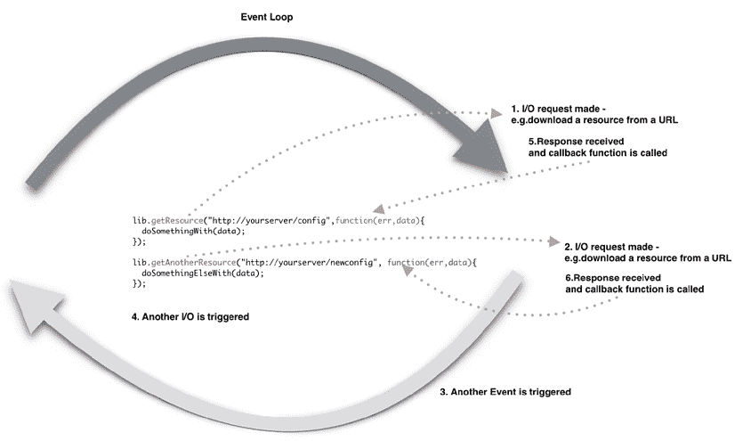

Node.js 不需要任何额外的服务器组件，因为它创建了自己的服务器进程。Node 应用程序本质上是运行在指定端口上的服务器。在 Node 中，服务器和应用程序是同一个。

*第 9 章*

**[205]**

这是一个 Node.js 服务器的示例，当从浏览器运行 http://localhost:3000/ URL 时，它会用 **Hello Node** 字符串响应：

```javascript
var http = require('http');
var server = http.createServer();

server.on('request', function (req, res) {
  res.writeHead(200, {'Content-Type': 'text/plain'});
  res.end('Hello Node\n');
});

server.listen(3000);
```

在这个示例中，我们使用了 `http` 模块。如果你还记得我们早些对 JavaScript 模块的讨论，你会发现这是 CommonJS 模块的实现。Node 有几个编译到二进制文件中的模块。核心模块定义在 Node 的源码中。它们位于 `lib/` 文件夹中。如果将标识符传递给 `require()`，它们会被首先加载。例如，`require('http')` 始终会返回内置的 HTTP 模块，即使存在同名的文件。

在加载处理 HTTP 请求的模块后，我们创建了一个服务器对象，并使用 `server.on()` 函数为请求事件设置了监听器。每当端口 3000 有请求指向此服务器时，回调就会就会调用。回调接收 `request` 和 `response` 参数。我们在发送响应之前，还设置了 `Content-Type` 头部和 HTTP 响应码。你可以复制前面的代码，将其保存为纯文本文件并命名为 `app.js`。你可以使用 Node.js 从命令行运行服务器，如下所示：

$ » node app.js

一旦服务器启动，你可以在浏览器中打开 http://localhost:3000 URL，你将看到一段枯燥的文本：


*服务端 JavaScript*

**[206]**

如果你想检查内部正在发生什么，可以按照如下方式发出 `curl` 命令：

~ » curl -v http://localhost:3000

* Rebuilt URL to: http://localhost:3000/
* Trying ::1...
* Connected to localhost (::1) port 3000 (#0)
> GET / HTTP/1.1
> Host: localhost:3000
> User-Agent: curl/7.43.0
> Accept: */*

< HTTP/1.1 200 OK
< Content-Type: text/plain
< Date: Thu, 12 Nov 2015 05:31:44 GMT
< Connection: keep-alive
< Transfer-Encoding: chunked
<

Hello Node
* Connection #0 to host localhost left intact

Curl 显示了一个良好的请求 (>) 和响应 (<) 对话，包含了请求头部和响应头部。

**回调函数 (Callbacks)**

JavaScript 中的回调函数通常需要时间来适应。如果你来自其他非异步编程背景，你将需要仔细理解回调是如何工作的；你可能会感觉自己是第一次学习编程。由于 Node 中的一切都是都是异步的，你将对所有事情都使用回调，而不会尝试去细致地结构化它们。Node.js 项目中最重要的部分有时是代码组织和模块管理。回调是在稍后执行的函数。异步程序并不是按上到下的过程化读取代码，而是根据 HTTP 请求或文件系统读取等函数发生的速度在不同的时间执行不同的函数。

*第 9 章*

**[207]**

函数执行是顺序的还是异步的取决于其执行的上下文：

```javascript
var i=0;
function add(num){
  console.log(i);
  i=i+num;
}
add(100);
```

如果你使用 Node 运行此程序，你将看到如下（假设你的文件名为 `app.js`）：

$ node app.js
0
100

这是我们习惯的：同步代码，每行代码都按顺序执行。这里的代码定义了一个函数，然后下一行调用该函数而无需等待任何内容。这是顺序流。

如果我们在序列中引入 I/O，情况将会有不同。如果我们尝试从文件读取某些内容或调用远程端点，Node 将以异步方式执行这些操作。在之前的示例中，我们在内存中完成了所有操作，不涉及 I/O，因此执行是同步的。当我们运行此程序时，所有函数都被立即定义，但它们并没有都立即执行。`request()` 函数被调用，执行继续到下一行。如果没有可执行的内容，Node 将要么等待 I/O 完成，要么退出。当 `request()` 函数完成工作时，它将执行回调函数（作为 `request()` 函数的第二个参数的匿名函数）。我们在上一个示例中得到 `undefined` 的原因是，在我们的代码中没有任何地方存在逻辑告诉 `console.log()` 语句等待 `request()` 函数从 HTTP 调用中获取响应。

回调是在稍后某个时间执行的函数。这改变了你组织代码的方式。重组代码的想法如下：

- 将异步代码封装在一个函数中
- 将回调函数传递给该封装函数

我们将带着这两个想法来重新组织先先的示例。考虑这个修改后的示例：

```javascript
var request = require('request');
var status = undefined;

function getSiteStatus(callback){
  request('http://google.com', function (error, response, body) {
    if (!error && response.statusCode == 200) {
      status_code = response.statusCode;
    }
    callback(status_code);
  });
}

function showStatusCode(status){
  console.log(status);
}

getSiteStatus(showStatusCode);
```

当你运行它时，你将得到如下（正确的）输出：

$ node app.js
200

*第 9 章*

**[209]**

我们改变的是将异步代码封装在 `getSiteStatus()` 函数中，将一个名为 `callback()` 的函数作为参数传递给此函数，并在 `getSiteStatus()` 的最后一行执行此函数。`showStatusCode()` 回调函数只是封装了我们之前调用的 `console.log()`。然而，区别在于异步执行的方式。在学习使用回调编程时，要理解的最思想是：函数是一等对象，可以存储在变量中并用不同的名称传递。为你的变量提供简单且描述性的名称对于提高他人对代码的可读性很重要。现在回调函数在 HTTP 调用完成后就会被调用，`status_code` 变量将具有正确的值。在某些真实情况下，你希望在另一个异步任务完成后执行一个异步任务。

考虑这种场景：

```javascript
http.createServer(function (req, res) {
  getURL(url, function (err, res) {
    getURLContent(res.data, function(err,res) {
      ...
    });
  });
});
```

如你所见，我们把一个异步函数嵌套在另一个函数中。这种嵌套会导致代码难以阅读和管理。这种回调风格有时被称为**回调地狱 (callback hell)**。为了避免这种情况，如果你有代码需要等待某些其他异步代码完成，你可以通过将你的代码放在作为回调传递的函数中表示这种依赖关系。另一个重要的思想是命名你的函数，而不是依赖匿名函数作为回调。我们可以将前面的示例重构为更具可读性的版本如下：

```javascript
var urlContentProcessor = function(data){
  ...
}

var urlResponseProcessor = function(data){
  getURLContent(data,urlContentProcessor);
}

var createServer = function(req,res){
  getURL(url,urlResponseProcessor);
};

http.createServer(createServer);
```


*服务端 JavaScript*

**[210]**

此代码段使用了两个重要的概念。首先，我们正在使用命名函数并将其作为回调函数使用。其次，我们没有嵌套这些异步函数。如果你在内部函数中访问闭包变量，那么上述的实现方式会有所不同。在这些情况下，使用内联匿名函数是更理想的。

回调函数在 Node 中被频繁使用。它们通常被优用于定义一次性响应的逻辑。当你需要对重复事件做出响应时，Node 提供了另一种机制。在继续深入之前，我们需要理解 Node 中定时器和事件的功能。

## 定时器

定时器用于在指定的延迟后调度执行特定的回调。设置此类延迟执行有两种主要方法：`setTimeout` 和 `setInterval`。`setTimeout()` 函数用于在延迟后调度特定回调的执行，而 `setInterval` 则用于调度回调的重复执行。`setTimeout` 函数适用于执行需要调的任务，例如清理工作。考虑以下示例：

```javascript
setTimeout(function() {
  console.log("This is just one time delay");
}, 1000);

var count = 0;
var t = setInterval(function() {
  count++;
  console.log(count);
  if (count > 5) {
    clearInterval(t);
  }
}, 2000);
```

首先，我们使用 `setTimeout()` 在 1,000 毫秒延迟后执行回调（匿名函数）。这只是该回调的单次调度。我们使用 `setInterval()` 调度了回调的重复执行。注意，我们将 `setInterval()` 返回的值赋值给变量 `t`——我们可以在 `clearInterval()` 中使用此引用来清除该调度。

*第 9 章*

**[211]**

## 事件发射器 (EventEmitters)

我们之前讨论过回调非常执行一次性逻辑。**事件发射器 (EventEmitters)** 在响应重复事件时非常有用。事件发射器触发事件，并包含在触发时处理这些事件的能力。许多重要的 Node API 是构建在事件发射器之上的。

事件发射器产生的事件通过监听器处理。监听器与事件关联的回调函数——当事件触发时，其关联的监听器也会被触发。`EventEmitter` 是一个类，用于提供一致的接口来发射（触发）事件并将回调绑定到事件。

作为一种常见的命名规范，事件名称用驼峰命名字符串表示；然而，任何有效的字符串都可以作为事件名称。

使用 `require('events')` 来访问 `EventEmitter` 类：

```javascript
var EventEmitter = require('events');
```

当 `EventEmitter` 实例遇到错误时，它会发射一个错误事件。错误事件在 Node.js 中被视为特殊情况。如果你不处理这些错误，程序将带有异常栈退出。

所有的 `EventEmitter` 都会在添加新监听器时发射 `newListener` 事件，在移除监听器时发射 `removeListener` 事件。

为了理解事件发射器的用法，我们将构建一个简单的 telnet 服务器，不同的客户端可以登录并输入某些命令。根据这些命令，我们的服务器将做出相应的响应：

```javascript
var _net = require('net');
var _events = require('events');
var _emitter = new events.EventEmitter();

_emitter.on('join', function(id, caller) {
  console.log(id + " - joined");
});

_emitter.on('quit', function(id, caller) {
  console.log(id + " - left");
});
```

*服务端 JavaScript*

**[212]**

```javascript
var _server = _net.createServer(function(caller) {
  var process_id = caller.remoteAddress + ':' + caller.remotePort;
  _emitter.emit('join', id, caller);
  caller.on('end', function() {
    console.log("disconnected");
    _emitter.emit('quit', id, caller);
  });
});

_server.listen(8124);
```

在这个代码段中，我们正在使用 Node 的 `net` 模块。这里的思路是创建一个服务器并让客户端通过标准的 telnet 命令连接到它。当客户端连接时，服务器显示客户端的地址和端口，当客户端退出时，服务器也会记录此信息。

当客户端连接时，我们发射一个 `join` 事件，当客户端断开连接时，我们发射一个 `quit` 事件。我们为这两个事件都设置了监听器，并在服务器上记录适当的消息。

你启动此程序并使用 telnet 连接到我们的服务器，如下：

telnet 127.0.0.1 8124

在服务器控制台上，你将看到服务器记录哪个客户端连接了服务器：
» node app.js
::ffff:127.0.0.1:51000 - joined
::ffff:127.0.0.1:51001 – joined

如果任何客户端退出会话，也会出现适当的消息。

### 模块 (Modules)

当你编写大量代码时，很快就会达到一个必须开始思考你如何组织代码的节点。Node 模块是 CommonJS 模块，我们之前在讨论模块模式时讨论过它们。Node 模块可以发布到**Node 包管理器** (**npm**) 仓库。npm 仓库是 Node 模块的在线集合。

*第 9 章*

**[213]**

## 创建模块

Node 模块可以是单个文件，也可以是目录。实现此最简单的方法是创建 `./node_modules/supermodule/` 目录，并在目录下插入一个 `index.js` 文件。`index.js` 文件将被默认加载。或者，你可以在 `mymodename` 文件夹中放置 `package.json` 文件，指定模块的名称和主文件：

```json
{
  "name": "supermodule",
  "main": "./lib/config.js"
}
```

你必须理解 Node 将模块缓存为对象。如果你有两个（或多个）文件 `require` 特定模块，第一个 `require` 将模块缓存在内存中，这样第二个 `require` 就不需要重新加载模块源码。然而，第二个 `require` 可以根据意愿更改模块的功能。这通常被称为**猴子补丁 (monkey patching)**，用于在不真正修改或版本化原始模块的情况下修改模块行为。

*服务端 JavaScript*

**[214]**

Node 模块可以是单个文件，也可以是目录。实现此最简单的方法是创建 `./node_modules/supermodule/` 目录，并在目录下插入一个 `index.js` 文件。`index.js` 文件将被默认加载。或者，你可以在 `mymodename` 文件夹中放置 `package.json` 文件，指定模块的名称和主文件：

```json
{
  "name": "supermodule",
  "main": "./lib/config.js"
}
```

你必须理解 Node 将模块缓存为对象。如果你有两个（或多个）文件 `require` 特定模块，第一个 `require` 将模块缓存在内存中，这样第二个 `require` 就不需要重新加载模块源码。然而，第二个 `require` 可以根据意愿更改模块的功能。这通常被称为**猴子补丁 (monkey patching)**，用于在不真正修改或版本化原始模块的情况下修改模块行为。

*服务端 JavaScript*

**[215]**

当你使用第三种方案时，你实际上是在要求 Node 使用标准方法定位模块。为了定位模块，Node 从当前目录开始并在其后追加 `node_modules/`。如果未找到模块，搜索将从父目录开始，直到到达文件系统的根。

例如，如果在 `/projects/node/` 中调用 `require('config')`，将搜索以下位置：

- /projects/node/node_modules/config.js
- /projects/node/node_modules/config.js
- /node_modules/config.js

对于从 npm 下载的模块，使用这种方法相对简单。正如我们之前讨论过的，只要你为 Node 提供一个入口点，就可以按目录组织你的模块。

实现此最简单的方法是创建 `./node_modules/supermodule/` 目录，并在目录下插入一个 `index.js` 文件。`index.js` 文件将被默认加载。或者，你可以在 `mymodename` 文件夹中放置 `package.json` 文件，指定模块的名称和主文件：

## npm

npm 是 Node 用于分发模块的包管理器。npm 可用于安装、更新和管理模块。包管理器在 Python 等其他语言中流行。npm 会自动解析并更新包的依赖项，从而让你的生活变得简单。


*服务端 JavaScript*

[216]
### 安装包

安装 npm 包有两种方式：本地安装或全局安装。如果你只想在某个特定的 Node 项目中使用该模块的功能，可以将其安装到项目相对路径下（本地），这是 `npm install` 的默认行为。或者，有几个模块可以作为命令行工具使用；在这种情况下，你可以全局安装它们：

```npm install request
```

使用 npm 的 `install` 指令将安装特定的模块——在本例中为 `request`。要确认 `npm install` 是否正常工作，请检查是否存在 `node_modules` 目录，并验证它是否包含你所安装的包的目录。

当你开始向项目中添加模块时，管理每个模块的版本/依赖关系将变得非常困难。管理本地安装包的最好方法是在你的项目中创建一个 `package.json` 文件。

`package.json` 文件可以从以下几个方面帮助你：

- 定义你想要安装的每个模块的版本。有时你的项目依赖于某个模块的特定版本。在这种情况下，你的 `package.json` 可以帮助你下载并维护正确的版本依赖。
- 作为你项目所需所有模块的文档记录。
- 在部署和打包你的应用程序时，无需担心每次部署代码都要管理依赖关系。

你可以通过执行以下命令创建 `package.json`：

```npm npm init
```

在回答关于项目的基础问题后，会创建一个内容类似于下方的空 `package.json`：

```json
{
  "name": "chapter9",
  "version": "1.0.0",
  "description": "chapter9 sample project",
  "main": "app.js",
  "dependencies": {
    "request": "^2.65.0"
  }
}
```

*第 9 章*

[217]
```json
  "devDependencies": {},
  "scripts": {
    "test": "echo \"Error: no test specified\" && exit 1"
  },
  "keywords": [
    "Chapter9",
    "sample",
    "project"
  ],
  "author": "Ved Antani",
  "license": "MIT"
}
```

你可以在文本编辑器中手动编辑此文件。该文件中一个重要部分是 `dependencies` 标签。要指定你的项目所依赖的包，你需要在 `package.json` 文件中列出你想要使用的包。你可以列出两种类型的包：

- dependencies：这些包是应用程序在生产环境中な必需的
- devDependencies：这些包仅在开发和测试时需要（例如，使用 Jasmine node 包）

在上述的示例中，你可以看到以下依赖项：

```json
"dependencies": {
  "request": "^2.65.0"
}
```

这意味着该项目依赖于 `request` 模块。

模块的版本取决于语义化版本规则——https://docs.npmjs.com/getting-started/semantic-versioning。

一旦你的 `package.json` 文件准备就绪，你就可以直接使用 `npm install` 命令自动安装项目的所有模块。

*服务端 JavaScript*

[218]
有一个我喜欢使用的酷技巧。在从命令行安装模块时，我们可以添加 `--save` 标志，将该模块的依赖关系自动添加到 `package.json` 文件中：

```npm npm install async --save
npm WARN package.json chapter9@1.0.0 No repository field.
npm WARN package.json chapter9@1.0.0 No README data
async@1.5.0 node_modules/async
```

在上述命令中，我们使用普通的 `npm` 命令配合 `--save` 标志安装了 `async` 模块。`package.json` 中自动创建了相应的记录：

```json
"dependencies": {
  "async": "^1.5.0",
  "request": "^2.65.0"
}
```

## JavaScript 性能

像任何其他语言一样，在大规模范围内编写高效的 JavaScript 代码是一项复杂的任务。随着语言的成熟，一些固有问题正在得到解决。有一些卓越的库有助于编写高质量的代码。对于大多数复杂的系统来说，良好的代码 = 正确的代码 + 高性能的代码。新一代软件系统对性能的要求很高。在本节中，我们将讨论一些用于分析 JavaScript 代码并理解其性能指标的工具。

我们将在节讨论两个观点：

- 性能分析 (Profiling)：在脚本分析期间对各种函数和操作进行计时，有助于识别优化代码区域
- 网络性能：检查图像、样式表和脚本等网络资源的加载情况

## JavaScript 性能分析

JavaScript 性能分析对于理解代码各个部分的性能方面至关重要。你可以观察函数和操作的时间，以了解哪些操作耗费了更多时间。通过这些信息，你可以优化耗时函数的性能，并调整代码的整体性能。我们将专注于 Chrome 开发者工具（Developer Tools）提供的分析选项。你可以使用全面的分析工具来理解代码的性能指标。

*第 9 章*

[219]
### CPU 分析

CPU 分析显示了你代码中各个部分消耗的执行时间。我们必须通知 DevTools 记录 CPU 分析数据。让我们来尝试一下性能分析器。

你可以按照以下方式启用 CPU 分析：

1. 打开 DevTools 的 **Profiles** 面板。
2. 确认已选择 **Collect CPU Profile**。

要开始记录，我们将使用 Google 的基准测试页面 http://octane-benchmark.googlecode.com/svn/latest/index.html。点击 **Start** 按钮或按下 **Ctrl+E** 开始记录。页面完成后，返回 **Profiles** 面板并点击 **Stop** 按钮停止记录。

*服务端 JavaScript*

[220]
### CPU 分析

CPU 分析以自底向上（bottom-up）的方式向你展示函数的详细视图以及它们所占的执行时间，如下：

### 时间轴视图 (Timeline view)

Chrome DevTools 的 **Timeline** 工具是你查看整体性能的第一站。它允许你记录并分析应用程序运行期间的所有活动。时间轴视图为你提供了时间分布的完整概览。时间轴记录包含了显示在瀑布图中的每个事件记录：

*第 9 章*

[221]
前面的屏幕显示了我们在浏览器中尝试渲染 https://twitter.com/ 时的时间轴视图。时间轴视图让你直观看到哪些操作花费了多少时间。

**Memory** 视图是理解应用程序在浏览器生命周期内内存使用情况的绝佳工具。Memory 视图显示了应用程序随时间变化的内存使用图表，并对内存中的文档、DOM 节点和事件监听器的数量进行计数。Memory 视图可以帮助检测内存泄漏，并提供足够的提示来理解需要哪些优化。

JavaScript 性能是一个迷人的话题，值得拥有专门的文本。我建议你探索 Chrome 开发者工具，并理解如何最好使用这些工具来检测和诊断代码中的性能问题。


*服务端 JavaScript* 

[222]

## 总结

在本章中，我们查看了 JavaScript 的另一种面貌——以 Node.js 形式存在的服务器端框架。

Node 提供了一种异步事件模型，用于用 JavaScript 编写可扩展和高性能的服务器应用程序。我们深入研究了 Node 的一些核心概念，例如事件循环、回调、模块和定时器。理解这些概念对于编写良好的 Node 代码至关重要。我们还讨论了若干更好地组织 Node 代码和回调的技巧。

至此，我们结束了对这一卓越编程语言的探索。由于其极高的通用性，JavaScript 在全球网的演进中起了关重要的作用。这种语言随着每一次新的迭代不断扩展其视野并不断改进。

我们的旅程从理解语言的语法和句法的构建模块块开始。我们掌握了闭包的基本思想以及 JavaScript 的函数行为。这些概念是如此本质，以至于大多数 JavaScript 模式都是基于它们的。我们研究了如何利用这些模式用 JavaScript 编写更好的代码。研究了 JavaScript 如何在 DOM 上操作，以及如何使用 jQuery 有效地操作 DOM。最后，我们查看了 Node.js 中 JavaScript 的服务端面貌。

这本书应该让你在开始编写 JavaScript 程序时以不同的方式思考。你不仅在编写代码时会常用模式，还会欣赏并使用 ES6 带来的新语言特性。

[223]

## 索引

### 符号
- -- 运算符 17, 18
- + 运算符 16
- ++ 运算符 17, 18
- <script> 标签
  - URL 183
- === 严格相等 25, 26
- == 弱相等 27

### A
- 敏捷方法 146
- Amber.js 140
- 匿名函数
  - 关于 64
  - 作为另一个函数的参数 65
  - 在条件逻辑中 65, 66
  - 在创建列表时 64
  - 在创建对象时 64
- arguments 参数
  - 关于 60, 61
  - this 参数 61
- 箭头函数 176-179
- 数组 86-94
- asm.js 格式 1
- 断言 156
- 异步事件模型
  - 在浏览器中 202-206
- 异步模块定义 (AMD) 129
- 自动分分号插入 (ASI)
  - 关于 30, 31
  - 引用 30

### B
- Babel
  - 关于 164
  - URL 164
- Backbone.js 139
- 反向引用 84, 85
  - 开始和结束 84
- 行为驱动开发 (BDD) 147, 151-153
- big.js
  - URL 9
- 块级作用域
  - 与函数级作用域 52-55
- 块作用域 56, 57, 165, 166
- 布尔运算符
  - 关于 18, 21-24
  - 示例 22
  - 逻辑与 18
  - 逻辑非 20
  - 逻辑或 19
- 布尔值 13, 14
- Bower 90
- 浏览器
  - 异步事件模型 202-206
- 浏览器事件 193, 194

### C
- 回调地狱 209
- 回调 69, 206-210
- 类型转换 28
- Chai 153
- 链式调用，jQuery 方法 191
- Chrome DevTools 157
- 经典继承 101

[224]
- 闭包 66-70
- 命令行界面 (CLI) 41
- 注释 6
- CommonJS 模块 129
- console.log 156
-常量 7
- const 关键字 7
- 内容分发网络 (CDN) 185
- 控制器 141
- CPU 剖析 219
- CSS 选择器
  - URL 188
- curl.js 129

### D
- date.js
  - URL 16
- Date 对象 15, 16
- 装饰模式 134-136
- 设计模式
  - 关于 122
  - 行为 122
  - 创建 122
  - 结构 122
- 开发者工具 (DevTools) 154
- 文档对象模型 (DOM) 179
  - 关于 181
  - DOM 元素，访问 182, 183
  - 特定节点，访问 183-190

### E
- ECMAScript 6 (ES6), 语法变化
  - 关于 56, 165
  - 箭头函数 176-179
  - 块作用域 165, 166
  - 默认参数 167
  - 解构 168, 169
  - For..of 循环 176
  - 迭代器 175
  - map 175
  - map 和 set 174
  - 对象字面量 170
  - 剩余运算符 167, 168
  - 展开运算符 167, 168
  - 模板字面量 171, 172
  - ECMAScript (ES5) 163
  - EditorConfig 32
  - Emscripten
  - URL 1
  - endsWith() polyfill
  - URL 164
  - 相等
  - 关于 25
  - 严格相等 25, 26
  - 弱相等 27
  - Erlang 168
  - ES6 shim
  - URL 164
  - ES2015 163
  - eval() 方法 39
  - 事件委托 198, 199
  - EventEmitter 211, 212
  - 事件对象 199
  - 精确匹配 77
  - 显式转换 28
  - 可扩展标记语言 (XML) 181
  - 极端编程 147

### F
- Facebook React 163
- 工厂模式 131-133
- Firebug 4
- For..of 循环 176
- 函数上下文 61
- 函数声明
  - 与函数表达式 58-60
- 函数表达式 47
- 函数级作用域
  - 与块级作用域 52-55
- 函数字面量
  - 关于 46
- 函数声明 46-48
- 函数
  - 存数据 49, 50
- 函数语句 47

### G
- 四人行 (GOF) 121
- getter 117-120, 190
- GitHub 1
- 全局作用域 51
- 重力 12
- 贪婪和懒性限定符 85, 86

### H
- Handle.js
  - URL 140
- Hello World 程序 6
- 提升 57
- 超文本标记语言 (HTML) 181

### I
- 立即执行函数表达式 (IIFE) 55, 165
- 继承 110-116
- 输入输出 (I/O) 202
- instanceof 运算符 15
- 实例属性
  - 与原型属性 104-109
- IntelliJ WebStorm 154
- io.js 1
- 迭代器 175

### J
- Jasmine
  - URL 148, 153
- Jasmine 包 217
- JavaScript
  - 历史 2
  - 概述 6
  - 模式 121
  - 引用链接 2
  - URL 2
- JavaScript 调试
  - 关于 154
  - Chrome DevTools 157-161
  - console.log 和断言 156
  - 运行时异常 155, 156
  - 严格使用 155
  - 语法错误 154
- JavaScript 性能
  - 分析 218
  - 剖析 218
- jQuery 事件处理 195-198
- JS Bin
  - 关于 5
  - URL 5
  - 使用 5
- JSHint 154
  - 关于 41
  -  42
  - URL 42
- JSLint 154

### L
- libio
  - URL 203
- libev
  - URL 203
- libuv 203
- LiveScript 2
- 局部作用域 52
- 逻辑与运算符 18
- 逻辑非运算符 20
- 逻辑或运算符 19
- 循环 70
- 基于低级虚拟机 (LLVM)
  - 项目 1

### M
- 操作方法 191, 192
- map
  - 关于 95, 172
  - WeakMap 172, 174
- 匹配
  - 字符字符类 77, 79, 81
- 混入模式 133, 134
- Mocha 152
- 模型 140
- 模型-视图-控制器 (MVC) 139
- 模型-视图-演示器 (MVP)
  - 模式 139-142
- 模型-视图-视图模型 (MVVM) 139-143
- 模块模式
  - 关于 124-129
  - ES6 模块 131
- 模块
  - 关于 71, 72, 212
  - 创建 213, 214
- Moment.js
  - URL 16
- 猴子补丁 215
- Mosaic 浏览器 2
- mustache.js
  - URL 140
- MV* 模式 139

### N
- 命名空间模式 123, 124
- NaN (不是数字) 9
- 原生内置
  - URL 117
- Netscape Navigator 2
- Node.js 1, 90, 129, 163, 201
- Node 包管理器 (npm)
  - 仓库 212
- 不等于 (!==) 26
- npm
  - 关于 215
  - 包，安装 216-218
- 数字 8-10

### O
- 对象字面量 170
- 面向对象编程 (OOP) 99, 100
- 对象
  - 关于 99-101
  - 行为 101, 102
- 观察者模式
  - 关于 137-139
  - Observer 137
  - Subject 137

### P
- 模式
  - 关于 121
  - 装饰模式 134-136
  - 设计模式 122, 123
  - 工厂模式 131-133
  - 混入模式 133, 134
  - 模块模式 124-130
  - 命名空间模式 123, 124
  - 观察者模式 137-139
- polyfills 164
- 私有变量 69, 70
- JavaScript 剖析
  - 关于 218
  - CPU 剖析 219
  - 时间线视图 220, 221
- 冒泡
  - 关于 194, 195
  - jQuery 事件处理 195-198
- 原型
  - 关于 103, 104
  - 属性，与原型 104-109

### R
- 读执行打印循环 (REPL)
  - 关于 4
  - URL 164
- 正则表达式 (RegEx) 76, 77
- 重复出现
  - 关于 81-83
  - 备方案 - 或 84
- RequireJS
  - URL 130
- 暴露模块模式 (RMP) 127
- 路由器 141

### S
- 方案 2


## [227]

## 作用域 (scoping)
- 关于 50
- 块范围 56
- 函数级范围对比块级范围
- 范围 52-55
- 全局范围 51
- 内联函数表达式 56
- 局部范围 52

## 语义化版本 (semantic versioning)
- URL 217

## 集合 (sets) 95, 96, 173

## Setter (setters) 117-120, 190

## 垫层 (shims) 164

## Silverlight 142

## 简单模式 (simple patterns) 77

## Sinon.JS 153

## 宽松模式 (sloppy mode) 39

## 特殊字符 (special characters) 11

## 探针 (Spies) 152

## Stack Overflow
- URL 9

## 标准通用标记语言 (SGML) 181

## 严格相等 (strict equality) 25, 26

## 严格模式 (strict mode)
- 关于 39, 40, 155
- 限制的功能 41
- 启用 40
- eval() 函数 41
- 使用 40
- 变量，声明 40

## 字符串 (string) 11, 12

## 风格指南 (style guide)
- 关于 32
- 括号 32
- 条件求 36
- 空行 34
- 行尾 34
- eval() 方法 39
- JSHint 41, 42
- 换行 32
- 命名 38
- 括号 32
- 引号 34
- 严格模式 39, 40
- 类型，转换 35, 36
- 类型，检查 35
- 空格 32

## 样式样式 (styling)
- 考虑 72, 97

## 子类型 (subtypes) 27

## T
## 标签模板字符串 (tagged template string) 172
## 标签 (tags) 27
## 模板字面量 (template literals) 171, 172

## 测试驱动开发 (TDD) 147

## TestPyramid
- URL 147

## this 参数 (this parameter)
- 调用，作为构造函数时 63
- 调用，作为函数时 61
- 调用，作为方法时 61-63
- 调用，使用 call() 方法 63

## 时间线视图 (Timeline view) 220, 221

## 计时器 (timers) 69, 210

## Timezone.js
- URL 16

## 工具命令语言 (TCL) 2

## 译译器 (transpilers) 164

## 遍历方法 (traversal methods) 191, 192

## typeof 运算符 15

## 类型 (types) 27-30

## U
## 未定义值 (undefined values) 13

## Underscore.js
- 关于 119, 134
- URL 90

## 测试 (unit testing)
- 关于 146
- 行为驱动开发 (BDD) 147-152
- 测试驱动开发 (TDD) 147

## V
## V8 201
## 增值税 (VAT) 9

## 变量 (variables) 7
## var 关键字 7
## 视图 (views) 140, 141

## [228]

## W
## 瀑布图 (waterfall graph) 220
## 相等 (weak equality) 27
## WeakMap 172-174
## WeakSet 172
## Windows 呈现框架 (WPF) 142
## 世界维网联盟 (W3C) 195

## 感谢购买
## 精通 JavaScript (Mastering JavaScript)

## 关于 Packt 出版社
Packt（读作 "packed”）于 2004 年 4 月出版了第一本书 *Mastering phpMyAdmin for Effective MySQL Management*，随后继续专注于出版针对特定技术和解决方案的高度聚焦书籍。

我们的书籍和出版物分享了其他 IT 专业人士在适应和定制当今系统、应用程序和框架方面的经验。我们的基于解决方案的书为您提供了知识和能力，让您自定义正在使用的软件和技术以完成工作。与您过去看到的 IT 书相比，Packt 的书籍更具体，不那么泛。我们独特的业务模式使我们能够为您提供更聚焦的信息，让您获得更多需要知道的内容，减少您不需要的内容。

Packt 是一家现代而独特的出版公司，专注于为开发者、管理员和新手社区制作高质量、前沿书籍。欲了解更多信息，请访问我们的网站 www.packtpub.com。

## 关于 Packt 开源
2010 年，Packt 推出了两个新品牌：Packt Open Source 和 Packt Enterprise，以继续其对专业化的关注。本书是 Packt Open Source 品牌的一部分，该品牌出版基于开源许可构建的软件书籍，并为高级开发人员到初级 Web 设计师的任何人提供信息。开源品牌还运行 Packt 的开源版税计划，通过该计划，Packt 会为销售相关书籍的每个开源项目支付版税。

## 为 Packt 写作
我们欢迎所有对写作感兴趣的人的咨询。书籍建议书应发送至 author@packtpub.com。如果您的书籍想法仍处于早期阶段，并且希望在编写正式书籍建议书之前先进行讨论，请联系我们；我们的约稿编辑将与您联系。我们不仅寻找已出版的作者；如果您有强大的技术技能但没有写作经验，我们丰富的编辑可以帮助您发展职业生涯，或者仅仅获得额外的奖励。

## HTML5 Boilerplate Web 开发
- ISBN: 978-184951-8505
- 页数：174 页
- 使用一套健壮的模板精通 Web 开发。
- 将 HTML5 Boilerplate 作为未来项目的模板。
- 学习如何优化您的工作流并设置性能优化的服务器。
- 学习跨浏览器提供相应的样式和脚本。

## 精通 JavaScript 设计模式 (Mastering JavaScript Design Patterns)
- ISBN: 978-183987986
- 页数：290 页
- 发现如何使用设计模式创建可靠且可维护的应用程序。
- 学习使用经过验证的软件设计方法来增强 JavaScript 代码。
- 发现经典及高级设计模式的健壮 JavaScript 实现。
- 充满了易于遵循的示例，用于创建重复代码和可扩展设计。

## 学习 JavaScriptMVC (Learning JavaScriptMVC)
- ISBN: 978-1782160205
- 页数：124 页
- 学习使用 JavaScriptMVC 构建结构良好的 Web 应用程序。
- 通过三种方式安装 JavaScriptMVC，包括使用 Vagrant 和 Chef 安装。
- 代码 JavaScript 代码并生成可搜索的 API 文档。
- 测试您的代码库和应用程序，并学习如何将测试与持续集成工具 Jenkins。

## 精通 JavaScript 高性能 (Mastering JavaScript High Performance)
- ISBN: 978-1784397296
- 页数：208 页
- 精通使用 JavaScript 构建、部署和优化更快的 Web 应用。
- 高效测试和优化 JavaScript 代码。
- 为浏览器和混合移动应用构建更快、更熟练的 JavaScript 程序。
- 充满真实世界的逐步教程。

请查看 **www.PacktPub.com** 以获取有关我们书目的信息。

