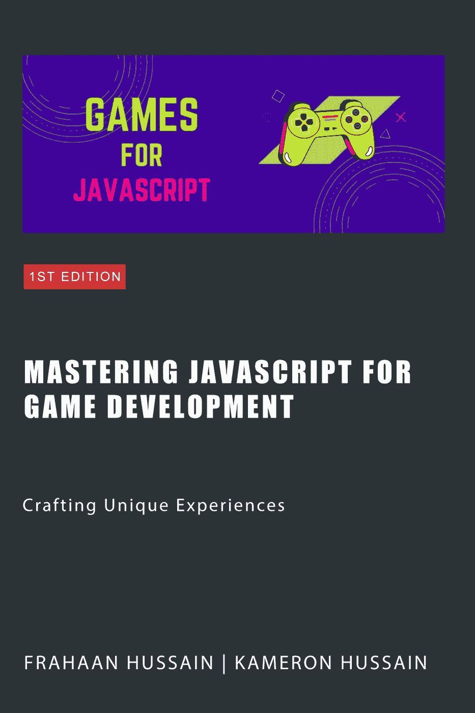

# JavaScript游戏开发精通：打造独特体验





```

### 3. 背景滚动
背景滚动对于具有大型、连续游戏世界的游戏（如无尽跑酷或射击游戏）至关重要。它创造了移动的幻觉，同时让玩家角色保持在屏幕中心。

要实现背景滚动，可以使用两个多个背景层。当玩家角色移动时，以不同的速度滚动背景层以创建视差效果。前景元素（包括玩家角色和交互物体）保持在滚动背景上方固定。

这是一个 JavaScript 中水平背景滚的简化示例：

```javascript
// 初始化背景层
const background1 = new Image();
background1.src = 'background1.png';
const background2 = new Image();
background2.src = 'background2.png';

// 定义滚动速度
const scrollSpeed1 = 1; // 较慢的背景
const scrollSpeed2 = 2; // 较快的背景

// 游戏循环中的更新函数
function update() {
  // 滚动背景
  background1.x -= scrollSpeed1;
  background2.x -= scrollSpeed2;

  // 当背景移出屏幕时重置背景
  if (background1.x < -background1.width) {
    background1.x = canvas.width;
  }
  if (background2.x < -background2.width) {
    background2.x = canvas.width;
  }

  // 在此处更新其他游戏元素
}

// 游戏循环中的渲染函数
function render() {
  // 清除画布
  context.clearRect(0, 0, canvas.width, canvas.height);
  // 在它们的位置绘制背景
  context.drawImage(background1, background1.x, 0);
  context.drawImage(background2, background2.x, 0);

  // 在此处渲染其他游戏元素
}
```

这段代码演示了带有两个背景层的简单视差滚动效果，每个层都以不同的速度滚动。你可以扩展此概念以用于更复杂的滚动场景或垂直滚动。

将瓦地图和背景滚动结合到你的设计中，可以显著增强游戏世界的视觉和交互方面，为玩家提供更沉浸的体验。

***

## 6.3. 程序化生成技术
程序化生成是游戏开发中一种强大的方法，通过算法创建游戏世界、关卡或内容而非手动设计。它允许开发者生成大量且多样化的环境，为玩家提供独特的体验。在本节中，我们将探索 JavaScript 游戏中的程序化生成技术。

### 1. 随机化
程序生成最简单的形式是随机化。通过使用随机数，你可以生成各种游戏元素，如地形特征、敌人放置、物品位置。JavaScript 的 `Math.random()` 函数常为此。

```javascript
// 生成 min（包含）和 max（不包含）之间的随机数
function getRandom(min, max) {
  return Math.floor(Math.random() * (max - min)) + min;
}

// 使用示例：随机敌人位置
const enemies = [];
for (let i = 0; i < 10; i++) {
  const enemyX = getRandom(0, canvasWidth);
  const enemyY = getRandom(0, canvasHeight);
  enemies.push({ x: enemyX, y: enemyY });
}
```

### 2. Perlin 噪声
Perlin 噪声是创建自然程序化内容（如地形和景观）的流行技术。在 JavaScript 中，可以使用像 `noisejs` 库来生成 Perlin 噪声。你可以调整参数来控制生成的噪声的平滑度和细节。

```javascript
// 使用 noisejs 生成 2D Perlin 噪声的示例
const noise = new Noise(Math.random());
const gridSize = 50;
const noiseScale = 0.1;
const terrain = [];

for (let x = 0; x < canvasWidth; x += gridSize) {
  for (let y = 0; y < canvasHeight; y += gridSize) {
    const value = noise.perlin2(x * noiseScale, y * noiseScale);
    terrain.push({ x, y, value });
  }
}
```

### 3. 细胞自动机
细胞自动机用于生成模式和结构，如洞穴、地下城或迷宫。该技术涉及定义细胞演化的规则。每个细胞的状态取决于它的邻居，从而产生涌现的模式。


```javascript
// 用于生成洞穴地图的细胞自动机示例

function initializeMap(width, height) {
  const map = [];
  for (let x = 0; x < width; x++) {
    const column = [];
    for (let y = 0; y < height; y++) {
      // 随机初始化细胞（例如，40% 的概率变为“存活”）
      const isAlive = Math.random() < 0.4;
      column.push(isAlive);
    }
    map.push(column);
  }
  return map;
}

function iterateMap(map) {
  // 在此处实现用于地图演化的细胞自动机规则
  // 通常，你会根据邻近细胞的状态定义细胞的出生、死亡和生存规则
}

// 初始化并迭代地图以生成洞穴
const caveMap = initializeMap(canvasWidth, canvasHeight);
for (let i = 0; i < numIterations; i++) {
  caveMap = iterateMap(caveMap);
}
```

### 4. L-Systems

Lindenmayer 系统（`L-systems`）用于生成复杂的形状和结构，如植物、树木和分形。它们由一组规则组成，通过迭代替换字符串中的符号来创建最终模式。

```javascript
// 用于生成分形树的 L-system 示例

const axiom = 'F';
const rules = {
  'F': 'FF+[+F-F-F]-[-F+F+F]'
};

function applyRules(sentence) {
  let newSentence = '';
  for (let i = 0; i < sentence.length; i++) {
    const current = sentence[i];
    if (rules[current]) {
      newSentence += rules[current];
    } else {
      newSentence += current;
    }
  }
  return newSentence;
}

// 通过迭代应用规则生成分形树
let sentence = axiom;
for (let i = 0; i < numIterations; i++) {
  sentence = applyRules(sentence);
}
```

过程化生成技术为创建多样化和动态的游戏内容提供了手段，增强了可玩性，并扩展了 JavaScript 中游戏设计的可能性。根据你的游戏需求，你可以结合这些技术或探索其他方法以实现预期的过程化内容生成。

***

## 6.4. 实现物理与重力

在 JavaScript 游戏开发中，实现物理和重力对于创建真实且引入胜的游戏世界至关重要。物理引擎和重力模拟用于处理对象的移动、碰撞和交互。在本节中，我们将探索如何在你的 JavaScript 游戏中实现物理和重力。

### 1. 物理引擎

物理引擎是提供预定义函数和算法的库或框架，用于在游戏中模拟现实物理。流行的 JavaScript 物理引擎包括 `Matter.js`、`p2.js` 和 `Cannon.js`。这些引擎简化了碰撞检测、刚体动力学和约束求解等复杂任务。

这里是一个使用 `Matter.js` 创建受重力影响的下落盒子的简单示例：

```javascript
// 创建引擎
const engine = Matter.Engine.create();

// 创建一个盒子
const box = Matter.Bodies.rectangle(400, 0, 80, 80);

// 将盒子添加到世界中
Matter.World.add(engine.world, [box]);

// 应用重力
engine.world.gravity.y = 1; // 根据需要调整重力强度

// 渲染场景
Matter.Render.run(Matter.Render.create({
  element: document.body,
  engine: engine
}));

// 启动引擎
Matter.Engine.run(engine);
```

### 2. 重力模拟

重力是许多游戏中的基本力，影响对象和角色的移动。在 JavaScript 中，你可以通过对游戏中的对象应用恒定的力向量（通常在垂直方向）来实现重力。

```javascript
// 对游戏对象应用重力
const gravity = 0.5; // 根据需要调整重力强度

function applyGravity(object) {
  object.velocityY += gravity;
}

// 在你的游戏循环中
function gameLoop() {
  // 更新对象位置
  applyGravity(player);
  // 检查并解决碰撞
  // ...
  // 渲染场景
  // ...
  requestAnimationFrame(gameLoop);
}
```

在这个示例中，`applyGravity` 函数在游戏循环中被调用，以更新游戏对象的垂直速度，从而模拟重力。

### 3. 碰撞检测

适当的碰撞检测对于处理游戏中的交互至关重要。无论你是使用物理引擎还是手动实现碰撞检测，你都需要检查对象之间的碰撞并做出相应响应。

这是一个两个矩形之间手动碰撞检测的简化示例：

```javascript
function detectCollision(rect1, rect2) {
  return (
    rect1.x < rect2.x + rect2.width &&
    rect1.x + rect1.width > rect2.x &&
    rect1.y < rect2.y + rect2.height &&
    rect1.y + rect1.height > rect2.y
  );
}

// 在你的游戏循环中
function gameLoop() {
  // 检查玩家与障碍之间的碰撞
  if (detectCollision(player, obstacle)) {
    // 处理碰撞（例如，停止玩家移动或减少血量）
  }
  // 更新对象位置
  // ...
  // 渲染场景
  // ...
  requestAnimationFrame(gameLoop);
}
```

此代码段展示了检查两个矩形是否重叠的简单碰撞检测函数。

物理和重力在 JavaScript 游戏中的实现允许对象移动、交互并响应力。根据游戏的复杂程度，你可能会选择使用物理引擎或手动实现。

***

## 6.5. 环境效果与动态

环境效果和动态对于创建沉浸式且吸引胜的游戏世界起着重要作用。在本节中，我们将探索 JavaScript 开发中的各种环境效果。

### 1. 天气与气候

天气效果（如雨、雪和雾）可以增强游戏的氛围。实现这些效果涉及模拟粒子或对象的行为。可以使用粒子系统。

```javascript
// 简单的粒子系统示例
const raindrops = [];

function createRaindrop() {
  const x = Math.random() * canvasWidth;
  const y = -10; // 在画布上方
  const speed = Math.random() * 5 + 2; // 随机速度
  const length = Math.random() * 10 + 5; // 随机长度
  raindrops.push({ x, y, speed, length });
}

function updateRaindrops() {
  for (let i = 0; i < raindrops.length; i++) {
    const raindrop = raindrops[i];
    radrop.y += raindrop.speed;
    // 移除落在画布外的雨滴
    if (radrop.y > canvasHeight) {
      raindrops.splice(i, 1);
      i--;
    }
  }
}

// 在你的游戏循环中
function gameLoop() {
  createRaindrop();
  updateRaindrops();
  // 渲染带雨的场景
  // ...
  requestAnimationFrame(gameLoop);
}
```

### 2. 昼夜循环

实现昼夜循环可以为你的游戏环境增加真实性和变化。你可以根据时间控制光、可见性和游戏元素。JavaScript 的 `Date` 对象或自定义计时器可以管理昼夜循环。

```javascript
// 简单的昼夜循环示例
let isDay = true;

function updateDayNightCycle() {
  // 根据当前时间或计时器值判断白天晚上
  isDay = /* 检查时间或计时器值 */;
  // 相应调整光照和环境元素
  if (isDay) {
    // 应用白天光照和效果
    // ...
  } else {
    // 应用夜晚光照和效果
    // ...
  }
}

// 在你的游戏循环中
function gameLoop() {
  updateDayNightCycle();
  // 带有相应光照和效果的场景
  // ...
  requestAnimationFrame(gameLoop);
}
```

### 3. 动态地形与生态系统


对于开放世界游戏，动态地形和生态系统可以提供丰富且不断演的游戏环境。你可以使用过程化生成来创建不断变化的景观，包括地形特征、植被和野生动物。季节和天气等环境因素会影响游戏的生态系统。

```javascript
// 一个基于季节的动态地形生成示例

const seasons = ['Spring', 'Summer', 'Autumn', 'Winter'];

let currentSeason = 0;

function updateSeason() {
  // 根据游戏内时间或其他因素确定当前季节
  currentSeason = /* Determine current season */;
  // 根据季节调整地形、植被和野生动物
  if (currentSeason === 'Spring') {
    // 生成茂盛的植被和野生动物
    // ...
  } else if (currentSeason === 'Winter') {
    // 创建雪景并适应野生动物行为
    // ...
  }
}

// 在你的游戏循环中
function gameLoop() {
  updateSeason();
  // 渲染具有特定季节地形和生态系统的场景
  // ...
  requestAnimationFrame(gameLoop);
}
```

实现环境效果和动态需要仔细考虑这些元素如何影响游戏性和整体体验。通过结合天气、昼夜循环和动态生态系统，你可以在 `JavaScript` 中创建一个更具沉浸感和交互性的游戏世界。

***

## 7.1. 设计玩家角色

设计玩家角色是游戏开发的一个基础方面，会极大影响玩家的体验。玩家角色通常是主角，他们的设计会影响游戏玩法、故事和沉浸感。在本节中，我们将探索在 `JavaScript` 游戏开发设计玩家角色的重要考虑因素。

## 设计良好的玩家角色特征

良好的玩家角色可以增强整体游戏体验。是一些需要考虑的关键特征：

1. **视觉吸引力**：玩家角色的外观在视觉上应该是具有吸引力的，并与游戏的艺术风格一致。它应该是独特且令人记忆的。
2. **性格**：考虑角色的性格特征、背景故事和动机。塑造良好的角色可以与玩家建立更深的情感连接。
3. **角色与能力**：定义角色在游戏世界中的角色及其独特的能力或技能。这些能力应该与游戏机制和挑战相匹配。
4. **自定义**：如果游戏允许角色自定义，为玩家提供一系列选项，让他们个性化定制角色的外观，有时还包括能力。
5. **成长**：规划角色在整个游戏中的成长。角色可能会进化、获得新技能，或面临影响剧情的道德困境。

## 玩家角色创建流程

创建玩家角色涉及几个步骤：

### 1. 概念化
从头脑风暴和构思角色的想法草图开始。考虑他们在游戏中的角色、外观、性格特征以及他们如何融入游戏的叙事。

### 2. 艺术与设计
与艺术家和设计师合作，创建概念图和角色设计。确保角色的视觉设计与游戏的整体审美一致。

### 3. 动画
为角色制作动画使其栩栩起来。为各种动作定义动画，例如行走、跑步、跳跃和与物体交互。

```javascript
// 示例：在 JavaScript 中创建玩家角色动画

const playerCharacter = {
  x: 0,
  y: 0,
  spriteSheet: /* Load sprite sheet image */,
  currentFrame: 0,
  frameWidth: 64,
  frameHeight: 64,
  frameCount: 8,
  frameRate: 10, // 每秒帧数
  // 角色的更新函数
  update: function () {
    this.currentFrame = (this.currentFrame + 1) % this.frameCount;
  },
  // 渲染角色的绘制函数
  draw: function () {
    const frameX = this.currentFrame * this.frameWidth;
    // 在画布上绘制当前帧
    // ...
  },
};

// 在你的游戏循环中
function gameLoop() {
  playerCharacter.update();
  // 其他游戏逻辑和渲染
}
```

### 4. 集成
将角色集成到游戏引擎中，包括他们的移动、交互以及对玩家输入的响应。

### 5. 测试与迭代
在各种游戏场景中测试角色，以确保其功能符合预期。收集玩家反馈，并根据需要对角色的设计和机制进行迭代。

### 6. 故事与对话
如果角色在游戏故事中有角色，编写反映其性格和动机的对话和叙事元素。对话树和选择可以让交互更具吸引力。

设计良好的玩家角色有助于玩家的参与度、沉浸感和乐趣。无论你的游戏是以一位英雄式的冒险者、一个古怪的主角，还是一个供玩家自定义的空白形象为特色，对玩家角色的仔细设计和执行都能提升你游戏的体验。

***

## 7.2. 实现移动与控制

为玩家角色实现移动和控制是游戏开发的一个关键方面，因为它直接影响了玩家如何与游戏世界交互。在本节中，我们将探索在 `JavaScript` 游戏中实现角色移动和控制的各种技术和考虑因素。

### 玩家移动基础

玩家移动通常涉及行走、跑步、跳跃和蹲下等动作。角色移动的实现取决于游戏的类型和机制。是一些常见的方法：

1. **键盘输入**：利用键盘输入来控制角色移动。监听按键按下和释放，以使角色向所需的方向移动。

```javascript
// 示例：处理角色移动的键盘输入
document.addEventListener('keydown', (event) => {
  if (event.key === 'ArrowRight') {
    // 向右移动角色
  } else if (event.key === 'ArrowLeft') {
    // 向左移动角色
  }
  // 处理其他移动键
});
```

2. **手柄支持**：如果你的游戏支持手柄或控制器，实现对摇杆、按钮和触发器的支持以控制角色移动。

```javascript
// 示例：处理角色移动的手柄输入
const gamepad = navigator.getGamepads()[0]; // 获取第一个连接的手柄
if (gamepad) {
  const leftStickX = gamepad.axes[0]; // 左摇杆 X 轴
  const leftStickY = gamepad.axes[1]; // 左摇杆 Y 轴
  // 使用 leftStickX 和 leftStickY 控制角色移动
}
```

3. **触摸控制**：对于支持触摸的设备，实现触摸控制，让玩家通过滑动或点击来移动角色。

```javascript
// 示例：处理角色移动的触摸控制
const touchArea = document.getElementById('touchArea'); // 替换为你的触摸元素
touchArea.addEventListener('touchstart', (event) => {
  // 处理触摸开始事件
});
touchArea.addEventListener('touchmove', (event) => {
  // 处理触摸移动事件
});
touchArea.addEventListener('touchend', (event) => {
  // 处理触摸结束事件
});
```

### 物理与碰撞检测

引入物理和碰撞检测对于确保玩家角色与游戏世界的真实交互至关重要。实现碰撞检查以防止角色穿过墙或障碍。

```javascript
// 示例：角色与障碍之间的简单碰撞检测
function checkCollision(character, obstacle) {
  // 检查角色的边界与障碍的边界是否重叠
  if (
    character.x < obstacle.x + obstacle.width &&
    character.x + character.width > obstacle.x &&
    character.y < obstacle.y + obstacle.height &&
    character.y + character.height > obstacle.y
  ) {
    // 检测到碰撞，相应处理
  }
}
```

### 动画与反馈

为了向玩家提供视觉反馈，为角色移动制作动画。当他们在不同方向移动或执行动作时，改变角色的精灵图或动画帧。


```javascript
// ：角色移动动画

function animateCharacterMovement(character, direction) {
  // 根据方向更改角色的精灵图或动画帧
  character.sprite = /* 根据方向加载合适的精灵图或动画帧 */;
}
```

### 微调控制项

微调角色控制对于确保响应速度和良好的玩家体验至关重要。考虑加速、减速和输入平滑等因素，让移动感觉自然且愉快。

```javascript
// ：实现角色的加速和减速

const maxSpeed = 5; // 最大移动速度
const acceleration = 0.2; // 加速度率
const deceleration = 0.1; // 减速度
let characterSpeed = 0;

function updateCharacterMovement() {
  if (isMovingRight) {
    // 向右加速
    characterSpeed = Math.min(characterSpeed + acceleration, maxSpeed);
  } else if (isMovingLeft) {
    // 向左加速
    characterSpeed = Math.max(characterSpeed - acceleration, -maxSpeed);
  } else {
    // 不移动时减速
    if (characterSpeed > 0) {
      characterSpeed = Math.max(characterSpeed - deceleration, 0);
    } else if (characterSpeed < 0) {
      characterSpeed = Math.min(characterSpeed + deceleration, 0);
    }
  }
  // 根据 characterSpeed 更新角色位置
  character.x += characterSpeed;
}
```

实现玩家角色移动和控制需要关注细节并迭代，以确保响应且愉快的游戏体验。通过考虑输入方法、物理、动画和控制微调，你可以创建一个增强你的 JavaScript 游戏游戏性的角色移动系统。

***

## 7.3. 创建交互式游戏对象

在游戏开发中，创建交互式游戏对象是构建引人且动态的游戏体验的基础。在本节中，我们将探索使用 JavaScript 创建交互式游戏对象的过程，这些包括角色、物品、障碍等。

### 定义交互式游戏对象

交互式游戏对象是游戏世界中玩家可以交互的实体。这些对象具有各种属性和行为，是游戏设计不可或缺的一部分。在定义交互式游戏对象时，请考虑以下因素：

1. **对象类型**：识别游戏所需的游戏对象类型。这可以包括角色、敌人、强化道具、可收集物品、门、开关等。
2. **属性**：确定与每个游戏对象相关的属性和特性。例如，角色可能具有健康、速度和背包物品等属性。
3. **行为**：定义游戏对象的行为和交互。指定这些对象如何响应玩家输入、碰撞以及游戏中的其他事件。

### 对象实例化与管理

要在 JavaScript 中创建交互式游戏对象，你通常会使用面向对象的编程原则。以下是一个如何使用基于类的方法定义和管理游戏对象的简化示例：

```javascript
// 示例：创建一个 Character 类
class Character {
  constructor(name, health, damage) {
    this.name = name;
    this.health = health;
    this.damage = damage;
  }

  // 定义角色动作的方法
  attack(target) {
    target.takeDamage(this.damage);
  }

  takeDamage(damage) {
    this.health -= damage;
    if (this.health <= 0) {
      // 角色被击败
      this.handleDefeat();
    }
  }

  handleDefeat() {
    // 实现角色的被击败逻辑
  }
}

// 实例化一个角色对象
const playerCharacter = new Character('Player', 100, 10);
const enemyCharacter = new Character('Enemy', 80, 8);
```

在这个示例中，我们创建了一个 `Character` 类，具有 `name`、`health` 和 `damage` 等属性，以及攻击、受伤害和处理击败的方法。你可以使用类似的原理创建其他交互式游戏对象。

### 对象交互

交互式游戏对象通常相互之间并与玩家交互。这些交互包括：

* **碰撞**：实现碰撞检测以确定游戏对象何时接触。例如，角色与敌人碰撞可能会触发战斗。
* **触发器**：定义触发区域，进入该区域时会激活特定操作。例如，走进触发区域可能会打开一扇门。
* **背包**：允许游戏对象与玩家的背包交互，根据需要添加或移除物品。

```javascript
// 示例：实现一个触发区域
class TriggerZone {
  constructor(x, y, width, height, action) {
    this.x = x;
    this.y = y;
    this.width = width;
    this.height = height;
    this.action = action;
  }

  // 检查角色是否进入触发区域
  checkCollision(character) {
    if (
      character.x < this.x + this.width &&
      character.x + character.width > this.x &&
      character.y < this.y + this.height &&
      character.y + character.height > this.y
    ) {
      this.activate(character);
    }
  }

  // 定义被触发时的动作
  activate(character) {
    // 执行定义的动作
    this.action(character);
  }
}
```

在这个示例中，`TriggerZone` 类定义了一个区域，当角色进入时，会触发一个特定的操作。这为你的游戏提供了广泛的交互可能性。

### 实现对象多样性

为了给你的游戏增加多样性，引入一组多样化的游戏对象。每个对象应具有独特的属性、行为和交互。

```javascript
// 示例：创建多种交互游戏对象
const potion = new Item('生命药水', '恢复生命值', 25);
const key = new Item('银钥匙', '开启大门', null);
const enemyBoss = new Enemy('BOSS', 200, 20);
const lever = new InteractiveObject('杠杆', '打开大门', () => openGate());
```

通过有效地定义和管理交互式游戏对象，你可以增强玩家参与度并创造深刻的体验。仔细考虑每个对象的角色、交互及其对游戏性的贡献。

***

## 7.4. 用户界面与 HUD 元素

用户界面（UI）和抬头显示（HUD）元素在向玩家传递信息和增强整体游戏体验方面起着至关重要的作用。在本节中，我们将探索 UI 和 HUD 元素在游戏开发中的性以及使用 JavaScript 实现它们。

### UI 和 HUD 的作用

UI 元素提供信息、反馈和交互选项的图形组件。而 HUD 元素是 UI 元素的子集，通常在游戏过程中显示在屏幕上，如血条、分数和小地图。

以下是 UI 和 HUD 在游戏中的关键作用：

1. **玩家信息**：显示关键的玩家信息，包括健康值、法力、弹药和角色状态。
2. **目标跟踪**：指示当前目标、任务进度或使命目标。
3. **游戏状态**：显示游戏的当前状态，如暂停、菜单打开或战斗中。
4. **反馈**：为玩家的操作、交互和成就提供视觉和听觉反馈。
5. **导航**：提供导航辅助，如小地图、路标和指南引导玩家穿越游戏世界。

### 实现 UI 和 HUD 元素

在 JavaScript 游戏中实现 UI 和 HUD 元素涉及几个步骤：

1. **HTML/CSS 集成**：创建代表 UI/HUD 组件的 HTML 元素并使用 CSS 对其进行适当样式。这些元素可以放置在游戏屏幕上。
2. **数据绑定**：将 UI/HUD 元素与底层游戏数据连接。例如，将血条绑定到玩家的健康变量。
3. **事件处理**：实现事件监听以响应玩家与 UI 组件的交互，例如点击按钮或拖拽物品。


## 4. 更新逻辑
持续更新 UI/HUD 元素以反映游戏状态的变化。例如，如果玩家的生命值下降，请相应更新血条。

## 5. 图层管理
确保 UI/HUD 元素正确层叠在游戏世界之上，以防止对游戏视觉效果产生干扰。

<!--带有血量和得分的简单 HUD 的 HTML 结构示例-->

```html
<div id="hud-container">
  <div id="health-bar">
    <div id="health-fill"></</div>
  </div>
  <div id="score">Score: <span id="score-value">0</span></div>
</div>
```

```javascript
// 更新血条和得分的 JavaScript 示例
const healthBar = document.getElementById('health-fill');
const scoreElement = document.getElementById('score-value');

// 根据玩家生命值更新血条
function updateHealthBar(healthPercentage) {
  healthBar.style.width = healthPercentage + '%';
}

// 更新玩家得分
function updateScore(newScore) {
  scoreElement.textContent = newScore;
}
```

### 设计考虑
在设计 UI 和 HUD 元素时，请考虑以下因素：

1. **可见性**：确保 UI 元素可见且不会阻挡玩家观察游戏世界的视野。
2. **一致性**：为 UI/HUD 元素保持一致的视觉风格和布局，以创建统一的用户体验。
3. **易用性**：使 UI 元素直观且易于交互。使用清晰的图标和标签。
4. **性能**：优化 UI 更新以最小化对性能的影响，特别是在快节奏的游戏中。
5. **响应式设计**：确保 UI 元素能够适应不同的屏幕尺寸和方向，特别是在移动游戏中。

通过有效实现 UI 和 HUD 元素，你可以增强玩家的沉浸感，提供关键信息，并创造更愉快的游戏体验。记住对你的 UI 设计进行测试和迭代，以便在功能和美学之间找到平衡。

***

## 7.5. 管理玩家生命值和背包
管理玩家生命值和背包是游戏开发的一个关键方面，因为它直接影响游戏玩法和玩家体验。在本节中，我们将深入探讨如何使用 JavaScript 在游戏中实现和管理这些基本元素。

### 玩家生命值管理
玩家生命值代表游戏角色的活力或健康状况。以下是管理玩家生命值的一些考虑因素：

1. **生命值表示**：生命值通常以数值或视觉指示（如血条）表示。你可以使用 HTML 元素和 CSS 创建血条，并使用 JavaScript 根据玩家的生命值状态更新它们。
2. **伤害与治疗**：实现对玩家造成伤害（例如敌人攻击）和治疗（例如生命药水或医疗包）的机制。这些操作应该相应地影响玩家的生命值。
3. **游戏结束条件**：定义玩家生命值归零导致游戏结束状态的情况。这可以触发各种结果，如重新关卡或显示游戏结束界面。
4. **生命恢复**：考虑随时间推移或通过特定的游戏内动作增加生命恢复，为玩家提供恢复的机会。

```javascript
// 管理玩家生命值的 JavaScript 代码示例
let playerHealth = 100; // 初始生命值
const healthBar = document.getElementById('health-bar');

// 更新血条的函数
function updateHealthBar() {
  healthBar.style.width = playerHealth + '%';
}

// 对玩家造成伤害的函数
function takeDamage(damageAmount) {
  playerHealth -= damageAmount;
  // 检查玩家生命值是否为零或以下
  if (playerHealth <= 0) {
    gameOver();
  }
  updateHealthBar();
}

// 治疗玩家的函数
function healPlayer(healingAmount) {
  playerHealth += healingAmount;
  // 确保生命值不超过最大值
  if (playerHealth > 100) {
    playerHealth = 100;
  }
  updateHealthBar();
}

// 处理游戏结束的函数
function gameOver() {
  // 在此处实现游戏结束逻辑
}
```

### 玩家背包管理
玩家背包代表玩家角色在整个游戏中携带的物品、武器和资源。适当的背包对于完善的游戏体验至关重要：

1. **背包系统**：创建一个数据结构（例如数组或对象）来存储玩家背包物品。每个物品都应该具有名称、描述、数量和功能等属性。
2. **物品收集**：实现收集物品的机制，例如从游戏世界中捡起物体或获得奖励。
3. **物品使用**：定义物品在游戏中如何被使用或消耗。例如，使用生命药水应该增加玩家的生命值。
4. **背包 UI**：创建一个用户界面来显示玩家背包并允许与物品进行交互。可以使用 HTML/CSS 设计背包屏幕，并使用 JavaScript 管理物品交互。

```javascript
// 管理玩家背包的 JavaScript 代码示例
const playerInventory = [];

// 向玩家背包添加物品的函数
function addItemToInventory(item) {
  playerInventory.push(item);
}

// 从玩家背包移除物品的函数
function removeItemFromInventory(item) {
  const index = playerInventory.indexOf(item);
  if (index !== -1) {
    playerInventory.splice(index, 1);
  }
}

// 示例物品使用函数（例如使用生命药水）
function useHealthPotion() {
  const healthPotion = playerInventory.find((item) => item.name === 'Health Potion');
  if (healthPotion) {
    healPlayer(healthPotion.healingAmount);
    removeItemFromInventory(healthPotion);
  }
}

// 示例对象
const healthPotion = {
  name: 'Health Potion',
  description: '恢复生命值',
  healingAmount: 30,
};

addItemToInventory(healthPotion);
```
有效的生命值和背包管理增强了游戏性并允许玩家根据资源制定策略。

***

# 第 8 章：AI 与敌人行为

## 8.1. 游戏 AI 基础
人工智能（AI）在创建动态和具有挑战性的体验方面起着关键作用。在本节中，我们将探索游戏 AI 的基础。

### 什么是游戏 AI？
游戏 AI 指控制游戏中非玩家角色（NPC）和实体的算法和逻辑。这些实体包括敌人、盟和中立角色。游戏 AI 的主要目标是让 NPC 智能地行动、对玩家的操作做出反应并提供挑战。

### 游戏 AI 的核心组件：

#### 1. 决策
- NPC 需要根据游戏上下文及其角色做出决策。这包括选择动作、目标和策略。
- 决策树、状态机和行为树是游戏 AI 决策常用的方法。

### 2. 路径规划
- 路径规划算法帮助 NPC 高效导航游戏世界。常用算法包括 `A*`（A 星算法）和 `Dijkstra 算法`。
- 使用网格或导航网格（NavMesh）系统来表示用于路径规划的世界。

### 3. 行为模式
- NPC 表现出各种行为模式，如追逐玩家、在指定区域巡逻或生命值较低时逃跑。
- 有限状态机（FSM）和脚本常用于定义行为模式。

### 4. 感知与感知
- NPC 需要感知游戏环境和玩家的操作。这包括检测玩家的存在、听到的声音和识别物体。
- 传感器和感知系统对于创建响应式 AI 至关重要。

### 用于游戏 AI 的 JavaScript
由于其易用性和对 Web 游戏的兼容性，JavaScript 为实现游戏 AI 提供了一个灵活且强大的平台。在使用 JavaScript 开发游戏 AI 时，请考虑以下关键因素：


- **状态管理**：使用 JavaScript 管理 NPC 的状态。每个状态代表一种特定的行为或动作，NPC 根据条件在不同状态之间切换。
- **事件处理**：JavaScript 的事件处理能力对于响应玩家操作或游戏内事件非常有用。例如，检测玩家何时进入 NPC 的视线。
- **数学与物理**：JavaScript 内置的数学函数和库可以用于距离检查、角度计算和物理模拟等计算。
- **优化**：确保你的 AI 代码经过了性能优化，特别是在实时游戏中。实现如空间划分等技术以减少 AI 计算量。
- **测试与调试**：使用 JavaScript 的调试工具来测试和精调你的 AI 行为。将 AI 的决策和路径可视化，以便更易于调试。
- **学习 AI**：考虑实现机器学习技术以获得更高级的 AI 行为。强化学习和神经网络可以用于创建自适应 NPC。

```javascript
// 简单的基于状态的 NPC AI 的 JavaScript 代码示例

class NPC {
  constructor() {
    this.state = 'idle';
  }

  update() {
    // 基于当前状态的 AI 逻辑
    switch (this.state) {
      case 'idle':
        // 执行待机行为
        break;
      case 'chasing':
        // 执行追逐行为
        break;
      case 'attacking':
        // 执行攻击行为
        break;
      default:
        // 处理意外状态
    }
  }

  setState(newState) {
    // 切换到新的 AI 状态
    this.state = newState;
  }
}

// 使用
const enemyNPC = new NPC();
enemyNPC.setState('chasing');
enemyNPC.update();
```

在 JavaScript 中实现游戏 AI 需要创造力和对玩家期望的理解。无论你是在创建具有挑战性的敌人还是友好的 NPC，有效的 AI 都能显著提升游戏体验。

***

## 8.2 路径规划与移动算法

在游戏 AI 领域，路径规划和移动算法是 NPC 在复杂游戏世界中导航的重要工具。本节将深入探讨游戏开发中使用的路径规划和移动算法的基础，特别关注 JavaScript 的实现。

### 理解路径规划

路径规划是在游戏世界内从一个位置到另一个位置寻找最优路径的过程，并考虑了障碍物、地形和其他因素。NPC 和角色（如敌人或盟友）依靠路径规划来智能地移动并到达目标。

#### 常见的路径规划算法

1. **A* 算法**：`A*`（读作“A-star”）是一种流行且多功能的路径规划算法，能够保证找到最短路径。它结合了启发式和成本计算来优先考虑最有希望的路径，使其适用于各种游戏场景。
2. **Dijkstra 算法**：Dijkstra 算法通过系统地探索所有可能的路线来寻找最短路径。虽然在大多数情况下没有没有 `A*` 高效，但它可以在没有任何启发式的情况下保证最短路径。
3. **广度优先搜索 (BFS)**：BFS 在移动到更远的节点之前探索邻居节点。对于均匀成本网格，它简单有效，但可能不适用于更复杂的环境。
4. **深度优先搜索 (DFS)**：DFS 在回溯之前尽可能沿着每个分支尽深地探索。由于无法保证最短路径，通常不用于路径规划，但它在游戏开发的其他领域应用。

### 在 JavaScript 中实现路径规划

JavaScript 提供了多个库和工具用于在你的游戏中实现路径规划：

- **Pathfinding.js**：一个 JavaScript 库，为 2D 网格提供各种路径规划算法，包括 `A*` 和 `Dijkstra`。
- **Phaser**：一个流行的 JavaScript 游戏框架，包含了对路径规划和移动组件的内置支持。
- **Three.js**：如果你正在开发 3D 游戏，可以使用 `Three.js` 在 3D 环境中实现路径规划。

这是一个使用 JavaScript 中的 `A*` 算法在网格上寻找路径的简化示例：

```javascript
// JavaScript A* 路径规划算法示例

function findPath(start, target, grid) {
  const openSet = [start];
  const cameFrom = {};
  const gScore = {}; // 从起点到当前节点的成本
  gScore[start] = 0;
  const fScore = {}; // 从起点到终点的估计总成本
  fScore[start] = heuristic(start, target);

  while (openSet.length > 0) {
    const current = findLowestFScore(openSet, fScore);
    if (current === target) {
      return reconstructPath(cameFrom, current);
    }
    openSet.splice(openSet.indexOf(current), 1);
    const neighbors = getNeighbors(current, grid);
    for (const neighbor of neighbors) {
      const tentativeGScore = gScore[current] + distance(current, neighbor);
      if (tentativeGScore < gScore[neighbor] || gScore[neighbor] === undefined) {
        cameFrom[neighbor] = current;
        gScore[neighbor] = tentativeGScore;
        fScore[neighbor] = gScore[neighbor] + heuristic(neighbor, target);
        if (!openSet.includes(neighbor)) {
          openSet.push(neighbor);
        }
      }
    }
  }
  return null; // 未找到路径
}
```

实现路径规划和移动算法对于在游戏中创建可信且交互的 NPC 至关重要。这些算法使角色能够高效地穿越游戏世界、避开障碍并与玩家及环境进行智能交互。

***

## 8.3 敌人设计与行为模式

在游戏开发领域，创建引人入胜且具有挑战性的敌人行为至关重要。本节探讨 JavaScript 游戏开发中的敌人设计和行为模式，为打造强大的对手提供见解。

### 设计敌人

在深入行为模式之前，考虑敌人设计是有关重要的。需要考虑的因素包括：

1. **视觉外观**：敌人应该与玩家和其他元素有区别。清晰的视觉提示有助于玩家快速识别威胁。
2. **多样性**：引入具有独特外观、能力和弱点的敌人类型。这能让游戏保持新鲜和有趣。
3. **弱点**：每个敌人都应该有玩家可以发现并利用的弱点。这为战斗增加了深度。
4. **难度缩放**：设计随玩家进度而增加难度的敌人。早期的遭遇应该挑战较小。

### 常见的敌人行为模式

1. **攻击性**：攻击性敌人会主动寻找玩家角色并进行攻击。它们可能会使用近战或远程攻击并穷追不放。
2. **巡逻**：巡逻敌人沿着预设路线移动，并定期停下扫描周围。它们提供了潜行和策略性玩法的机会。
3. **固定**：固定敌人留在固定位置，但具有远程攻击或其他能力。它们是玩家必须绕过或消除的障碍。
4. **群攻**：群攻行为涉及协同行动的敌人，通过数量优势玩家。协作和战术是击败它们的关键。
5. **Boss 战**：Boss 敌人通常比普通敌人更大更强。Boss 战通常有多个阶段，每个阶段都有不同的攻击模式和脆弱点。

### 在 JavaScript 中实现敌人行为

在 JavaScript 中实现敌人行为通常涉及状态机、决策树或行为树。这些结构根据敌人的当前状态和条件管理其动作。这是一个巡逻敌人的状态机简化示例：

```javascript
// JavaScript 敌人状态机示例

class Enemy {
  constructor() {
    this.state = 'patrol';
  }

  update(playerPosition) {
    switch (this.state) {
      case 'patrol':
        this.patrol();
        if (this.detectPlayer(playerPosition)) {
          this.state = 'chase';
        }
    }
  }
}
```


```javascript
break;

case 'chase':
  this.chase(playerPosition);
  if (!this.detectPlayer(playerPosition)) {
    this.state = 'patrol';
  }
  break;

}

}

patrol() {
  // Implement patrolling behavior here
}

chase(playerPosition) {
  // Implement chasing behavior here
}

detectPlayer(playerPosition) {
  // Implement player detection logic here
}

}
```

这个简单的状态机根据玩家的存在在巡逻和追逐状态之间切换。通过扩展状态机或使用其他的 AI 技术，可以实现更复杂的行为。

引人入胜的敌人行为是一门结合游戏设计原则与编程技能的艺术。有效的敌人能够挑战玩家，增强沉浸感，并对整体游戏体验做出重大贡献。

* * *

## 8.4 实现 AI 决策

人工智能（AI）是现代游戏开发中不可或缺的组成，有助于带来真实且引人入胜的游戏体验。在本节中，我们将探索在 JavaScript 游戏中 AI 决策过程的实现。

### AI 决策的作用

AI 决策决定了游戏中的 NPC（非玩家角色）和实体如何与游戏世界以及玩家交互。它涉及分析当前游戏状态、评估各种操作并选择最合适的行动方案。

### AI 决策的关键组件

1. **感知**：AI 实体必须感知游戏世界以做出明智的决策。这包括检测和解释相关信息，例如玩家的位置、附近的障碍物和其他 NPC。
2. **目标设定**：AI 需要特定的目标或任务。这些目标引导决策过程，帮助 AI 实体优先考虑那些让它们更接近实现目标的行动。
3. **决策逻辑**：决策逻辑由 AI 实体用于评估选项的算法和规则组成。这些规则可以简单到如“如果在范围内则攻击玩家”，也可以像决策树一样复杂。
4. **状态机**：状态机通过定义不同的状态以及之间的转换来帮助模拟 AI 行为。状态代表不同的 AI 行为（例如：空闲、追逐、攻击），转换则根据条件或事件发生。

### 示例：敌人 AI 决策

让我们考虑一个简化的示例，实现一个敌人 AI 来决定追逐、攻击还是逃离玩家。

```javascript
class EnemyAI {
  constructor(enemy, player) {
    this.enemy = enemy;
    this.player = player;
  }

  makeDecision() {
    const distanceToPlayer = calculateDistance(this.enemy.position, this.player.position);
    if (distanceToPlayer < 10) {
      if (this.enemy.health < 30) {
        this.enemy.flee();
      } else {
        this.enemy.attack(this.player);
      }
    } else {
      this.enemy.chase(this.player);
    }
  }
}
```

在这个示例中，`makeDecision` 函数评估与玩家的距离和敌人的健康状况。如果玩家附近且敌人健康较低，它决定逃跑；否则攻击玩家。如果玩家不在附近，它选择追逐。

### 高级技术

对于更复杂的 AI 行为，开发者可能会采用行为树、神经网络和路径寻找算法等技术。这些方法允许适应不断变化的游戏状况让自己决策过程。

在游戏中实现 AI 决策是一项具有创造性且充满挑战的任务。它要求在真实性和趣味性之间取得平衡，并对游戏设计和编程有深入的理解。有效的 AI 可以通过创建具有挑战性且沉浸式的游戏场景来增强玩家体验。

* * *

## 8.5 平衡难度与 AI 复杂度

平衡难度与 AI 复杂度是游戏开发的一个关键方面。实现正确的挑战水平并为玩家提供引人入胜的体验对于游戏的成功至关重要。在本节中，我们将探索平衡 AI 复杂度与难度的概念和策略。

### 理解难度等级

游戏通常具有多个难度等级，以适应从初学者到专者的广泛玩家。这些难度等级影响游戏性的各个方面，包括敌人 AI 行为、玩家角色能力和资源可用性。玩家可以选择最符合他们技能和偏好的难度等级。

### 影响 AI 复杂度的因素

1. **玩家技能**：考虑你的目标观众的技能水平。新手玩家可能喜欢更简单、可预测的 AI，而经验丰富的玩家可能寻找具有挑战性的对手。
2. **游戏类型**：你的游戏类型会影响 AI 复杂度。策略游戏可能需要复杂的 AI 来进行策略决策，而平台跳游戏可能侧重于精确的移动和简单的行为。
3. **进度**：AI 复杂度会随着玩家游戏游戏而变化。早期关卡可能出现基础敌人，而后期会引入更智能、更有挑战性的对手。

### 平衡 AI 复杂度的策略

1. **难度等级**：实现多个难度等级，允许玩家选择他们偏好的挑战。相应地调整 AI 行为、伤害值和敌人属性。
2. **动态缩放**：根据玩家的表现实现 AI 的动态缩放。如果玩家陷入困境，AI 难度可以降低，反之亦然。
3. **玩家反馈**：收集玩家反馈和分析以评估难度平衡。这些数据可以帮助你做出明智的调整。
4. **测试与迭代**：让多样化的玩家对游戏进行彻底测试以识别难度问题。根据玩家反馈迭代 AI 行为和机制。

### 示例：射击游戏中的难度等级

```javascript
class ShooterGame {
  constructor(player, enemies) {
    this.player = player;
    this.enemies = enemies;
    this.difficulty = 'normal';
  }

  setDifficulty(difficulty) {
    this.difficulty = difficulty;
    // 根据难度调整 AI 行为、健康值和敌人统计数据
    if (difficulty === 'easy') {
      // 简化 AI
      this.enemies.forEach(enemy => enemy.simplifyAI());
    } else if (difficulty === 'hard') {
      // 让 AI 更有具挑战性
      this.enemies.forEach(enemy => enemy.boostAI());
    }
  }
}
```

在这个示例中，`ShooterGame` 类允许玩家设置难度。根据所选难度调整 AI 行为，以提供适当的挑战。

平衡 AI 复杂度和难度是游戏开发中的持续过程。持续的测试、玩家反馈和调整对于确保无论技能水平如何都能获得良好的游戏体验至关重要。

* * *

## 9.1 用于实时游戏的 WebSocket

实时多人游戏需要一个健且高效的通信系统来同步游戏状态并处理玩家交互。WebSocket 已成为 Web 游戏实现实时通信的热门选择。在本节中，我们将探索 WebSocket 以及如何在游戏中使用。

### 什么是 WebSocket？

WebSocket 是一种在单个 TCP 连接上提供全双工通信的协议。与传统的 HTTP 请求不同（无状态的且每次交互都需要客户端发起），WebSocket 建立了一个持久连接，允许客户端（通常是 浏览器）和服务器之间进行双向数据交换。

### WebSocket 在游戏中的优势

1. **低延迟**：WebSocket 提供了低延迟通信，对于实时更新至关重要的实时游戏非常理想。
2. **高效率**：与传统的 HTTP 请求相比，WebSocket 减少了开销，因为消除了头部信息和重新连接的需求。
3. **全双工**：WebSocket 允许服务器和客户端同时发送数据，促进实时同步。

### 在 JavaScript 中实现 WebSocket


在 JavaScript 中使用 `WebSockets`，你可以利用现代网络浏览器提供的 `WebSocket` API。以下是一个在 Web 游戏中设置 `WebSocket` 连接的简单示例：

```javascript
// Client-side WebSocket setup

const socket = new WebSocket('ws://example.com/game');

socket.addEventListener('open', () => {
  console.log('WebSocket connection established');
});

socket.addEventListener('message', (event) => {
  const data = JSON.parse(event.data);
  // Handle incoming game data here.
});

socket.addEventListener('close', (event) => {
  if (event.wasClean) {
    console.log(`WebSocket connection closed cleanly, code=${event.code}, reason=${event.reason}`);
  } else {
    console.error('Connection abruptly closed');
  }
});

socket.addEventListener('error', (error) => {
  console.error(`WebSocket error: ${error.message}`);
});
```

### 服务端 WebSocket 实现

在服务端，你需要一个 `WebSocket` 服务器来处理入入的连接并管理 `WebSocket` 会话。不同的编程语言中提供了各种库和框架，以简化 `WebSocket` 服务器的实现。

### 实时游戏功能

`WebSockets` 可用于实现游戏的各种实时功能，包括：

- 玩家移动和位置同步。
- 发送游戏事件，如玩家动作、碰撞和物品拾取。
- 用于游戏通信的聊天系统。
- 实时排行榜和游戏统计数据更新。

在你的你的游戏中实现 `WebSockets` 时，考虑安全措施以防止作弊和对游戏服务器的未经授权访问至关重要。

`WebSockets` 改变了 Web 端实时多人游戏开发的方式。它们为创建引人且具互动性的游戏体验提供了必要的工具，玩家可以在其中实时进行竞争或协作。对于想要构建提供无缝且响应良好的游戏体验的多人 Web 游戏的开发者来说，理解 `WebSockets` 是至关重要的。

***

## 9.2. 构建基础的多人游戏框架

在上一节中，我们讨论了 `WebSockets` 的基础知识及其在实时游戏中的作用。现在，让我们深入学习使用 JavaScript 中的 `WebSockets` 构建一个基础的多人游戏框架。该框架将作为开发你自己的实时多人游戏的起点。

### 设置项目

在我们开始编码之前，确保你的开发机器上已安装了 `Node.js` 和 `npm`（Node 包管理器）。你还需要你喜欢的代码编辑器。

1. 为你的项目创建一个新目录并在终端中进入该目录。
2. 运行以下命令初始化一个新的 `Node.js` 项目并创建 `package.json` 文件：
```bash
npm init -y
```
3. 运行以下命令安装 `ws` (WebSocket) 库：
```bash
npm install ws
```

### 创建 WebSocket 服务器

我们将从设置一个处理玩家入站连接的 `WebSocket` 服务器开始。在项目目录中创建一个名为 `server.js` 的文件并添加代码：

```javascript
const WebSocket = require('ws');

const wss = new WebSocket.Server({ port: 8080 }); // WebSocket server listens on port 8080

// Store connected clients
const clients = new Set();

// Handle incoming connections
wss.on('connection', (ws) => {
  clients.add(ws);
  console.log('Client connected');

  // Handle incoming messages
  ws.on('message', (message) => {
    // Broadcast the message to all connected clients
    wss.clients.forEach((client) => {
      if (client !== ws && client.readyState === WebSocket.OPEN) {
        client.send(message);
      }
    });
  });

  // Handle client disconnection
  ws.on('close', () => {
    clients.delete(ws);
    console.log('Client disconnected');
  });
});

console.log('WebSocket server is running on port 8080');
```

### 创建简单的 HTML 客户端

接下来，在项目目录中创建一个名为 `index.html` 的 HTML 文件作为游戏客户端。这个简单的客户端允许玩家连接到服务器并交换消息。向 `index.html` 中添加以下代码：

```html
<!DOCTYPE html>
<html lang="en">
<head>
  <meta charset="UTF-8">
  <meta name="viewport" content="width=device-width, initial-scale=1.0">
  <title>Basic Multiplayer Game</title>
</head>
<body>
  <h1>Basic Multiplayer Game</h1>
  <textarea id="message" placeholder="Enter your message"></textarea>
  <button id="send">Send</button>
  <div id="output"></</div>
  <script>
    const ws = new WebSocket('ws://localhost:8080'); // WebSocket connection to the server
    const messageInput = document.getElementById('message');
    const sendButton = document.getElementById('send');
    const outputDiv = document.getElementById('output');

    sendButton.addEventListener('click', () => {
      const message = messageInput.value;
      ws.send(message);
      messageInput.value = '';
    });

    ws.addEventListener('message', (event) => {
      const message = event.data;
      outputDiv.innerHTML += `<p>${message}</p>`;
    });
  </script>
</body>
</html>
```

### 运行多人游戏

现在你已经设置好了服务器和客户端，按照以下步骤运行基础多人游戏：

1. 打开你的终端并进入项目目录。
2. 运行以下命令启动 WebSocket 服务器：
```bash
node server.js
```
3. 打开浏览器并访问 `http://localhost:8080` 以客户端。你可以打开多个浏览器标签页/窗口来模拟多个玩家。玩家可以在文本区域中输入消息并点击“发送”按钮与其他实时交换消息。

该基础框架为使用 JavaScript 中的 `WebSockets` 构建复杂的实时多人游戏提供了基础。你可以通过添加游戏特定的逻辑、处理玩家位置和实现游戏机制来扩展它。

***

## 9.3. 管理玩家连接与数据

在多人游戏中，管理玩家连接和数据是创建无缝且愉快的游戏体验的关键方面。在本节中，我们将探索如何处理玩家连接、维护玩家数据并确保客户端与服务器之间的同步。

### 玩家身份验证与识别

当玩家连接到多人游戏时，对他们进行身份验证和识别至关重要。这有助于跟踪进度、实施安全措施并提供个性化的游戏体验。

#### 身份验证：
玩家身份验证可以通过多种实现，例如用户名密码、OAuth 或基于令牌的验证。确保你的身份验证过程是安全的，以防止对游戏的未经访问。

#### 识别：
每个玩家应该有一个唯一标识符，通常称为 `player ID` 或 `session ID`。该标识有助于区分玩家并将他们与游戏数据关联。

### 玩家数据存储

为了维护玩家进度、游戏状态和其他相关信息，你需要一个可靠的存储机制。以下是存储玩家数据的常用方法：

#### 数据库：
使用 `MySQL`、`MongoDB` 或 `Redis` 等数据库，你可以存储玩家配置、成就、得分和游戏状态。数据库为处理玩家数据提供了灵性和扩展性。

#### 内存存储：
对于实时交互和更快的数据访问，你可以使用像 `Redis` 这样的内存存储解决方案。内存存储对于临时游戏数据排行榜特别有用。

#### 云存储：
云存储服务如 `Amazon S3` 或 `Google Cloud Storage` 适用于存储游戏资源、玩家头像和其他媒体元素。

### 同步玩家动作

在多人游戏中，玩家动作需要在所有连接的客户端之间同步，以保持一致的游戏状态。以下是实现同步的关键考虑：

#### 实时通信：
利用 `WebSocket` 或或其他实时通信协议立即传输玩家动作和游戏更新。`WebSocket` 实现了客户端与服务器之间的双向通信。


## 服务器权威

服务器应该应对游戏状态拥有最终权威权，以防止作弊并确保游戏的公平性。玩家的操作在广播给其他人之前，会在服务器上进行验证和处理。

## 处理断开与重连

玩家可能由于网络问题、离开游戏或其他原因与游戏断开。管理断开和重连对于维护游戏的完整性至关重要：

### 断开处理

当玩家断开时，服务器应该优雅地处理。应当保留玩家的状态和进度，并通知其他玩家该玩家已离开。

### 重连

允许断开的玩家恢复其游戏会话以支持玩家重连。确保重连玩家的数据与当前游戏状态同步。

## 玩家互动与通信

通过提供聊天系统、游戏内消息和好友请求等功能，促进玩家之间的互动与通信。这些功能增强了多人游戏的社交属性。

### 聊天系统

实现聊天系统，允许玩家发送私聊和群聊消息。这促进了玩家之间的沟通与协作。

### 游戏内消息

启用游戏内消息，向玩家发送游戏相关的信息和通知。这有助于传达重要的更新和事件。

### 好友请求

允许玩家发送和接受好友请求，使与其他玩家联系以及组成团队或小组变得更容易。

## 安全与隐私

维护玩家数据的安全和隐私至关重要。实施安全措施来保护玩家账户、敏感信息，并确保安全的游戏环境：

### 加密

对客户端与服务器之间传输的数据进行加密，以防止监听和数据篡改。使用安全的通信协议，如 `HTTPS` 和 `WSS` (WebSocket Secure)。

### 隐私政策

向玩家清晰传达游戏的隐私政策，包括数据收集、使用和存储实践。遵守相关的数据保护法规，例如 `GDPR`。

## 结论

管理玩家连接和数据是多人游戏开发中一个多层方面。通过确保安全的身份验证、健壮的数据存储、玩家动作同步、处理断开与重连、促进玩家通信并优先考虑安全与隐私，你可以为玩家创造引人注目且愉的多多人游戏体验。

***

## 9.4. 游戏状态同步

同步游戏状态是多人游戏开发的一个关键方面。它确保所有玩家都处于同一个游戏世界中，并且一个玩家的操作会实时反映在所有其他人身上。在本节中，我们将探索有效同步游戏状态的各种技术和策略。

### 服务器权威

在多人游戏中，服务器应该应对游戏状态拥有终极权威。这意味着所有关键的游戏逻辑（如角色移动、战斗结果和物品交互）都应该在服务器上处理。客户端可以将它们的输入和命令发送到服务器，然后由服务器在更新游戏状态之前进行验证和处理，最后将其广播给所有连接的客户端。这种方法防止了作弊并确保了公平。

### 游戏状态复制

为了在所有客户端之间同步游戏状态，可以使用复制系统。其工作原理如下：

1. 服务器状态：服务器维护权威的游戏状态。这包括所有游戏对象、玩家角色、NPC 以及其他相关数据的位置和状态。
2. 客户端状态：每个客户端也维护一个本地游戏状态，该状态了服务器的状态。此状态用于渲染和预测游戏对象的移动，以减少感知延迟。
3. 状态更新：服务器定期向所有客户端发送状态更新。这些更新包含了游戏当前状态的信息，包括对象位置的变化、状态更新和新事件。
4. 客户端插值：客户端在状态更新之间进行插值，以平滑移动和动画，即使在网络延迟波动的情况下，游戏看起来看起来是流畅的。

### 网络延迟补偿

网络延迟会导致玩家的操作与其对游戏状态的影响之间产生延迟。为了补偿延迟，你可以采用客户端预测和服务器对齐等技术：

1. 客户端预测：客户端在接收到服务器的更新之前，在本地预测其操作的结果。这意味着当玩家移动其角色时，客户端会立即显示移动，即使在服务器确认之前也是如此。如果服务器的响应与预测，客户端将修正其状态以与服务器一致。
2. 服务器对齐：在收到客户端的输入后，服务器可能会稍作延迟处理输入以考虑到网络延迟。这种延迟允许服务器协调客户端预测状态与权威服务器状态之间的任何差异。

### 状态序列化

为了高效地发送和接收游戏状态，你需要将游戏数据序列化为可以在网络上传输的格式。流行的序列化格式包括 `JSON`、`Protocol Buffers` 和二进制格式。优化序列化数据的大小以最小化网络带宽消耗并减少延迟至关重要。

### 带宽优化

最少通过网络发送的数据量对于保持响应良好的多人体验至关重要，特别是对于连接较慢的玩家。某些带宽优化技术包括：

- 增量压缩：仅发送更新之间游戏状态的变化，而不是每次都发送整个状态。
- 实体插值：在更新之间平滑地插值对象的位置和移动，以减少由于低更新率导致的抖动移动。
- 数据压缩：使用数据压缩算法进一步减小网络包的大小。
- 速率限制：控制向客户端发送更新的速率，防止数据淹没网络。

## 结论

在多人游戏中同步游戏状态是一项复杂但本质的任务。通过赋予服务器权威、实施健壮的复制系统、补偿网络延迟、优化状态序列化并最小化网络带宽使用，你可以为所有玩家创造一种愉快、公平且响应迅速的多人游戏体验。

***

## 9.5. 在线游戏中的安全与防作弊

确保在线多人游戏的安全和公平性对于为所有玩家提供愉快的体验至关重要。作弊会破坏体验并损害游戏的完整性。在本节中，我们将探索保护你的在线游戏安全和防止作弊的各种技术和策略。

### 服务器端验证

防止作弊的最关键方面之一是服务器端验证。这意味着服务器在接受客户端的所有操作和输入之前，应对对其进行验证。以下是需要考虑的关键点：

- 输入验证：服务器应该验证并清理从客户端接收的所有输入数据（包括玩家操作），以确保其在预期参数范围内且不包含恶意代码。
- 权威：如前所述，服务器应对游戏状态拥有终极权威。这包括验证如玩家移动、战斗结果和物品交互等操作。客户端操作应被视为服务器可以根据需要接受、拒绝或修改的请求。


# 反作弊措施

在服务器端实施反作弊机制，以检测并防止常见的作弊技术，例如自动瞄准、透视和加速挂。这些机制可以包括对异常行为的服务器端检查以及使用作弊检测库。

## 数据加密

加密客户端和服务器之间传输的敏感数据对于防止监听和篡改至关重要。以下是一些考虑的加密技术：

- 安全套层 (SSL) / 传输层安全 (TLS)：使用 `SSL/TLS` 对通过网络传输的数据，例如登录凭据、玩家数据和游戏状态更新。这确保了数据的机密性，无法被拦截。
- 数据包加密：加密客户端和服务器之间交换单个数据包。这包括使用加密库来保护消息内容。

## 玩家验证

实施稳健的玩家验证机制，确保只有合法玩家才能访问您的游戏：

- 账户注册：要求玩家使用唯一用户名和强密码创建账户。实施邮箱验证以确认注册邮箱地址的真实性。
- 双重身份验证 (2FA)：提供 `2FA` 作为额外的安全层。这可能涉及向玩家的移动设备或邮箱发送一次性代码。
- 登录速率限制：对登录尝试实施速率限制，以防止对玩家账户的暴力破解攻击。在多次登录失败后临时锁定账户。

## 公平性与行为监控

为了维护游戏公平并检测可疑行为，请考虑以下措施：

- 行为监控：使用行为监控系统跟踪玩家操作并识别异常或可疑模式。这可以包括跟踪击死比和胜率等统计数据。
- 举报机制：实施游戏内举报系统，允许玩家举报疑似作弊者或滥用行为。调查被举报案件并采取适当行动。

## 定期更新与补丁

保持警惕并定期发布游戏更新，以解决安全漏洞和已知的作弊。保持游戏客户端和服务器软件更新，对于领先于可能利用旧版本的作弊者至关重要。

## 结论

防止在线游戏作弊是一场持久的战斗，但通过正确的策略和技术，你可以为玩家创建一个更安全、更有趣的游戏环境。通过实施服务器端验证、数据加密、玩家验证、公平性监控和定期更新，你可以显著降低作弊风险，并维护您的在线多人游戏的完整性。

* * *

## 第 10 章：移动游戏开发

由于智能手机和平板电脑的广泛使用，移动游戏开发变得越来越流行。在本章中，我们将探索将游戏适配到移动平台的关键方面。我们将涵盖触控控制、响应式设计、访问设备功能以及发布和变现移动游戏的过程等主题。

## 10.1 将游戏适配到移动平台

将游戏适配到移动平台需要仔细考虑各种因素，以确保最佳用户体验。在将游戏移植到移动端时，请记住以下关键点：

### 1. 用户界面 (UI) 和控制

与桌面电脑或游戏机相比，移动设备具有较小的屏幕和不同的输入方法。因此，重新设计游戏的用户界面和控制以适应触控且保持直观是至关重要的。

- 触控控制：为点击、滑动和捏合等操作实施触控控制。确保按钮和图标足够大，以便所有年龄段的用户轻松点击。
- 手势：利用手势来增强游戏性性。例如，用于角色移动的滑动手势或用于缩放的捏合手势。
- 虚拟摇杆：如果您的游戏需要虚拟摇杆或 D 键进行精确控制，请将其设计为具有响应性并可供玩家自定义。

### 2. 屏幕分辨率和宽高比例

移动设备具有各种屏幕尺寸、分辨率和宽高比例。您的游戏应该无缝适配不同的设备，以避免出现边框或拉伸。

- 响应式设计：实施响应式设计原则，确保游戏的图形和 UI 元素根据不同的屏幕尺寸和方向进行适当缩放和调整。
- 资源缩放：创建不同分辨率的多组资源（精灵、纹理、UI 元素），以保持跨设备的视觉质量。

### 3. 性能优化

与桌面电脑相比，移动设备的处理能力和内存有限。优化您的游戏性能，使其在各种设备上流畅运行。

- 图形设置：允许玩家调整图形设置，以便在视觉质量和性能之间找到平衡。
- 内存管理：实施高效的内存管理，避免因内存耗尽导致崩溃或运行缓慢。

### 4. 电池消耗

移动游戏应该考虑电池电量。持续运行后台进程或高强度图形会迅速耗尽设备电池。

- 后台进程：在游戏未使用时，尽量减少后台进程。当游戏在后台运行时，暂停或减少资源密集型任务。
- 节能代码：编写高能效代码以减少 CPU 和 GPU 的使用，这有助于延长电池寿命。

### 5. 设备功能

利用移动设备的独特功能来增强游戏趣味性和参与度。

- 加速度计：使用加速度计检测设备移动，适用于赛车或倾斜益谜类游戏。
- GPS 和位置：结合 `GPS` 和位置数据，用于基于位置的游戏或增强现实功能。
- 摄像头：利用摄像头进行 AR 体验或拍摄游戏照片。

### 6. 在真实设备上测试

在真实的移动设备上测试游戏对于识别和解决特定平台和硬件配置的问题至关重要。

- 设备多样性：在多种 `Android` 和 `iOS` 设备上进行测试以确保兼容性。
- Beta 测试：与玩家小组进行 Beta 测试，收集反馈并识别可能出现的任何问题。

### 7. 跨平台开发

考虑使用跨平台开发框架和工具，允许您同时为 `Android` 和 `iOS` 开发游戏，节省精力。

- Unity：`Unity` 是一款流行的游戏引擎，支持跨平台开发，使得针对多个移动平台变得简单。

将游戏适配到移动平台是一项意义非凡的尝试，因为它开放了巨大且多样化的潜在玩家群体。通过解决移动设备的特定挑战和机遇，你可以创建吸引人且成功的移动游戏。

* * *

## 10.2 触控控制与移动界面

移动游戏开发需要仔细考虑触控控制和移动界面设计。与传统的游戏平台不同，移动设备依赖触摸屏作为主要的输入方法。在本节中，我们将探索实施触控控制和为游戏创建直观移动界面的最佳实践。

### 1. 响应式触控控制

- 触摸目标：确保屏幕按钮、图标和控制的大小适合触摸。小的触摸目标会让玩家感到沮丧，导致糟糕的用户体验。
- 手势：实施滑动手势、捏合缩放和其他触摸手势，为玩家提供与游戏交互的直观方式。


## 1. 虚拟摇杆
在设计虚拟摇杆或 D 键时，要确保它们具有响应性且可自定义。允许玩家调整摇杆的大小和灵敏度，以匹配他们的偏好。

## 2. 屏幕按钮与 HUD
- **减少拥挤**：避免让屏幕上的按钮和 HUD 元素导致画面过于拥挤。保持界面整洁且不干扰，为玩家提供沉浸式的游戏体验。
- **情境按钮**：使用在需要时出现、不使用时消失的情境按钮。例如，当玩家靠近敌人时，显示“攻击”按钮。
- **可自定义 HUD**：允许玩家根据喜好自定义显示器（HUD）。他们可能根据自己的偏好重新定位或调整 HUD 元素的大小。

### 3. 多触控支持
- **多触操作**：某些游戏受益于多触支持，允许玩家同时执行多个操作。例如，在策略游戏中，玩家可以用一只手指放大地图，同时用另一只手指选择单位。
- **双指缩放**：对于具有可缩放地图或环境的游戏，实现双指缩放功能。确保缩放感觉流畅且响应迅速。

### 4. 反馈与视觉提示
- **视觉反馈**：提供视觉提示来指示触控交互，例如按钮按下或滑动方向。视觉反馈有助于玩家理解其操作产生的结果。
- **音频反馈**：考虑使用音频反馈，例如按钮点击声或角色配音，以增强整体游戏体验。

### 5. 测试与用户反馈
- **可用性测试**：与真实玩家一起可用性测试，以识别触控控制和界面设计中的任何问题。收集关于控制直观性的反馈并根据需要进行调整。
- **迭代设计**：准备好根据用户反馈对游戏的触控控制和界面进行迭代。不断改进移动界面可以获得更高的玩家满意度。

### 6. 无障碍辅助
- **无障碍功能**：确保你的游戏触控控制和界面对残障玩家是无障碍的。考虑自定义按钮大小、高对比度模式以及支持屏幕阅读器等功能。
- **考虑到无障碍的用户测试**：在用户测试中加入残障玩家，以收集宝贵的见解并进行必要的调整。

### 7. 教程与引导
- **引导式入门**：实施引导式教程和入门序列，向玩家介绍触控控制和移动界面。逐步引入复杂的交互，避免让新玩家感到无从。
- **游戏内帮助**：提供游戏内帮助或工具提示，解释屏幕按钮和手势的功能，特别是当它们具有独特或非标准的用途时。

### 8. 针对不同设备进行优化
- **设备碎片化**：考虑具有不同屏幕尺寸和分辨率的 Android 和 iOS 设备。在不同设备上测试你的触控控制，以确保一致的性能和可用性。

实施有效的触控控制并设计优先考虑用户体验的移动界面对于你移动游戏的成功至关重要。通过遵循这些最佳实践并不断收集用户反馈，你可以创造出引起玩家共鸣并让他们保持投入的移动游戏体验。

***

## 10.3. 响应式设计与移动优化
移动游戏开发不仅涉及适应玩法和控制，还涉及针对各种移动设备优化游戏。在本节中，我们将探索响应式设计和移动优化的重要性，以确保你的游戏在不同的手机和平板上运行流畅且外观良好。

### 1. 设备多样性
移动设备具有各种屏幕尺寸、分辨率和宽高比例。为了适应这种多样性：
- **宽高比例处理**：设计你的游戏以支持不同的宽高比例，包括 16:9、18:9 等。使用响应式布局，使其能够适应屏幕而不扭曲游戏的视觉效果。
- **屏幕尺寸**：从较小的智能手机到较大的平板电脑，在各种屏幕尺寸上测试你的游戏。确保界面元素在每种设备上都有适当的大小和间距。

### 2. 性能优化
- **图形优化**：针对移动性能优化纹理、模型和着色器。使用 `ETC2` 和 `ASTC` 等纹理压缩格式来减少内存占用并提高加载速度。
- **帧率**：目标是稳定的帧率，例如每秒 30 或 60 帧（`FPS`），取决于你游戏的复杂度。使用可以调整的图形设置，以在旧设备上保持性能。
- **电池寿命**：通过优化资源使用和避免不必要的后台进程，尽力减少游戏对设备电池寿命的影响。

### 3. 用户界面 (UI) 设计
- **响应式 UI**：创建一个适应不同屏幕尺寸和方向的响应式用户界面。确保 UI 元素在竖屏和横屏模式下均可读可用。
- **缩放文本和图标**：使用可缩放字体和图标，防止它们在不同屏幕上变得太小或太大。测试字体大小以保证可读性。
- **触控目标**：确保按钮和交互元素有足够的间距以防止误触。考虑到不同设备触控准确度的差异。

### 4. 加载与性能
- **加载界面**：实现加载界面或动画来掩盖加载时间，为玩家提供更流畅的体验。使用高效的资源加载技术。
- **内存管理**：内存内存并避免内存泄漏。在低 `RAM` 设备上测试你的游戏，确保其运行不崩溃。

### 5. 离线玩
- **离线模式**：考虑添加离线游戏模式或不需要持续网络连接的功能。这可以增强用户体验，特别是在连接不稳定的区域。
- **数据同步**：当设备离线后重新连接互联网时，实现同步游戏进度和数据的机制。

### 6. 跨平台兼容
- **Android 和 iOS**：在 Android 和 iOS 设备上测试你的游戏，以确保与这两个主流移动平台的兼容性。解决特定平台的问题和要求。

### 7. 本地化与国际化
- **文本处理**：确保你的游戏能够良好处理不同的语言和字符集。为文本元素提供翻译。
- **文化敏感性**：在设计玩法、角色和叙事元素时，注意文化差异和敏感性。

### 8. 持续测试
- **Beta 测试**：在各种设备上进行 Beta 测试，以识别并解决特定设备的兼容性问题、Bug 和性能瓶颈。
- **用户反馈**：鼓励玩家对他们的设备体验提供反馈。利用他们的投入进行改进。

响应式设计和移动优化是一个持续的过程，需要彻底的测试和迭代。通过在广泛的移动设备上优先考虑用户体验，你可以吸引并留住更大的受众。

***

## 10.4. 获取设备功能（加速度计、GPS）

### 1. 加速度计集成

#### 加速度计基础


加速度计是一种测量设备沿不同轴（通常为 X、Y 和 Z 轴）加速度的传感器。通过解释这些测量值，你可以检测到各种设备移动，例如倾斜、抖动或旋转。

#### 用场景

- 倾斜控制：实现基于倾斜的控制，用于角色移动、转向或物体操纵。例如，在赛车游戏中，玩家可以通过倾斜设备来操控车辆。
- 手势：识别特定的手势，如通过抖动设备触发游戏内动作，如重新装填武器或激活强化道具。

#### 代码示例 (JavaScript):

```javascript
// 为设备运动添加事件监听
window.addEventListener('devicemotion', handleMotion);

function handleMotion(event) {
  // 获取加速度数据
  const acceleration = event.accelerationIncludingGravity;

  // 使用加速度值控制游戏玩法
  const tiltX = acceleration.x;
  const tiltY = acceleration.y;

  // 根据倾斜角度实现游戏逻辑
  // ...
}
```

### 2. GPS 和定位服务

#### GPS 集成
访问设备的 GPS 允许你确定玩家在现实世界中的位置。此功能可用于基于位置的游戏、增强现实 (AR) 体验等。

#### 用场景
- 基于位置的玩法：创建玩家的物理位置会影响游戏内元素的游戏。例如，在寻宝游戏中，你可以将虚拟宝藏放置在现实世界的位置。
- AR 应用：将 GPS 数据与 AR 功能结合，将虚拟物体或角色叠加到真实环境中，创造出沉浸式体验。

#### 代码示例 (JavaScript):

```javascript
// 检查是否支持地理定位
if ("geolocation" in navigator) {
  // 获取用户的当前位置
  navigator.geolocation.getCurrentPosition(handlePosition);
} else {
  console.error("不支持地理定位。");
}

function handlePosition(position) {
  const latitude = position.coords.latitude;
  const longitude = position.coords.longitude;

  // 使用经纬度创建基于位置的玩法
  // ...
}
```

### 3. 权限与隐私
在访问加速度计和 GPS 等设备功能时，向用户请求必要的权限至关重要。尊重用户隐私，并清晰地解释你为什么需要访问这些功能。此外，在收集位置数据时要谨慎，并确保其使用负责任且符合隐私法规。

将加速度计和 GPS 功能整合到你的移动游戏中可以显著提高用户参与度并提供独特的游戏体验。然而，在实现这些功能时，在创意与隐私考量之间取得平衡是关重要的。

***

## 10.5. 移动游戏的发布与变现

发布和变现你的移动游戏是将游戏开发努力转化为成功事业的关键步骤。在本节中，我们将探索各种将你的游戏推向公众并从你的创作中产生收入的策略。

### 1. 选择正确的平台
在发布移动游戏之前，你需要决定目标是哪些平台。移动游戏的两个主要平台是：
- 应用商店：用于 iOS 设备的 Apple App Store 和用于 Android 设备的 Google Play Store 是最流行的平台。在这些商店上发布可以接触到庞的用户的用户。
- 替代市场：除了主流应用商店外，还可以考虑其他市场，例如亚马逊 Appstore 或三星 Galaxy Store。这些平台的竞争可能较小，能为你的游戏提供更多曝光率。

### 2. 应用商店指南
每个应用商店都有自己的一应用提交指南和政策。确保你的游戏符合这些指南以避免被拒绝。常见的拒绝理由包括：
- 版权违规：未经许可使用受版权的内容可能导致被拒绝。确保你拥有游戏中使用的所有资产的权利。
- 内容不当：包含明确或攻击性内容的游戏可能会被拒绝。保持你的游戏适合广泛观众。
- 隐私与权限：对你的应用收集的数据以及收集数据的原因保持透明。仅在必要时请求用户权限。

### 3. 变现策略
有几种方法可以为你的移动游戏变现：
- 内内广告：在游戏内显示广告。选项包括横幅广告、插屏广告和奖励视频广告。`AdMob` 和 `Facebook Audience Network` 等广告网络可以帮助你实现广告。
- 内购 (IAPs)：提供游戏内购买虚拟物品、强化道具或货币。`IAPs` 可以增强游戏玩法并产生收入。
- 订阅：创建基于订阅的模式以访问高级功能或内容。这对于具有定期更新和持续价值的应用非常有效。
- 高级/付费应用：向用户收取预付费用以下载和玩你的游戏。确保你的游戏提供了足够的价值来证明成本价值。

### 4. 用户获取与营销
让你的游戏获得关注需要有效的营销策略：
- 应用商店优化 (ASO)：优化你的游戏的标题、描述和关键词，以提高在应用商店中的可见性。
- 社交媒体：利用 `Twitter`、`Facebook` 和 `Instagram` 等平台为你的游戏建立存在并与潜在玩家互动。
- 新闻稿：联系游戏新闻网站和影响者寻求评论和报道。
- 社区建设：通过论坛、社交媒体小组和 `Discord` 频道围绕你的游戏建立社区。

### 5. 分析与迭代
使用分析工具跟踪用户行为和参与度。分析玩家数据以识别改进领域并迭代你的游戏。理解玩家的偏好和习惯可以带来更成功的更新和变现策略。

### 6. 反馈与支持
鼓励玩家反馈并提供优质客户支持。及时处理错误报告和担忧，以在玩家群体中保持良好口碑。

发布和变现移动游戏是一个持续的过程。不断更新和改进你的游戏，响应用户反馈，并探索新的变现机会，以最大化你的游戏在竞争激烈的移动游戏市场的成功。

***

* 第 11 章：游戏测试与调试

## 第 11.1 节：游戏测试基础
游戏测试是游戏开发过程中一个至关重要的阶段。它涉及系统地评估和验证游戏的各个方面，确保其按预期运行、没有严重错误并提供愉快的用户体验。测试有助于在游戏接触玩家之前识别并修复问题，防止差评并维护游戏的声誉。在本节中，我们将深入游戏测试的基础，概述其核心概念、策略和最佳实践。

### 测试周期
游戏测试通常遵循结构化的周期，可以根据你的开发过程进行调整。该周期包括以下阶段：
1. 测试计划：在开始阶段创建一个定义游戏范围、目标和测试策略的测试计划。确定目标平台和设备、测试环境以及所需的资源。
2. 测试设计：根据游戏的设计和功能开发测试用例。这些用例应该覆盖各种游戏场景，包括正常游戏、边缘情况和错误状况。
3. 测试执行：根据游戏的目标观众，在不同的平台、浏览器或设备上执行用例。记录测试结果，包括遇到的任何缺陷或问题。
4. 缺陷报告：在测试期间发现问题时，将其记录在缺陷跟踪系统中。包含有关问题的详细信息、重现步骤及其严重程度。


### 5. 回归测试：在修复报告的缺陷后，进行回归测试，以确保更改没有引入新问题，并且现有功能仍正常运行。

### 6. 用户验收测试 (UAT)：在某些情况下，引入外部测试人员甚至玩家进行 UAT，以收集对整体游戏体验的反馈。

### 7. 性能测试：评估游戏的性能，包括帧率、加载时间和资源利用率等因素。识别并解决性能瓶颈。

### 8. 兼容性测试：确保游戏在不同的设备、屏幕分辨率和网络浏览器上正常运行，解决任何兼容性问题。

### 9. 安全测试：验证您的游戏能够防止常见的漏洞，如作弊、数据泄露或未经授权的访问。

### 游戏测试类型

有多种类型的游戏测试，每种类型都有特定的目的：

- 功能测试：侧重于测试游戏的单个功能或特性，以确保它们按预期工作。
- 集成测试：测试游戏不同组件或系统之间的交互，确保它们无缝集成。
- 负载测试：评估游戏在重负载下的性能，以识别瓶颈和可扩展性问题。
- 可用性测试：评估游戏的用户界面、控制和整体用户体验。
- 兼容性测试：确保游戏在各种设备、平台和浏览器上无问题地运行。
- 回归测试：在更改后反复测试之前正常的特性，以捕获意外的副作用。
- Alpha 测试：由开发团队进行，在进行更广泛的 Beta 测试之前识别并修复主要问题。
- Beta 测试：涉及外部测试人员或玩家，他们会对游戏的整体体验提供反馈。

### 自动化测试

自动化测试可以大大提高游戏测试的效率和准确性。可以使用测试框架和脚本来自动化重复且耗时的测试用例。对于基于网页的游戏，可以使用 `Selenium WebDriver` 等工具在不同浏览器上进行自动化测试。

### 持续集成

通过持续集成（CI）实践将测试集成到开发流水线中，可以确保每当代码库发生更改时都会自动执行测试。可以配置如 `Jenkins` 或 `Travis CI` 等 CI 工具来运行测试并报告结果，帮助维护代码质量。

### 结论

在本节中，我们探讨了游戏测试的基础知识，包括其生命周期、类型以及自动化和持续集成的好处。有效的测试对于向玩家交付经过打磨且无错误的游戏至关重要，最终带来更好的游戏体验并提高玩家留存。随着你在游戏开发之旅中进步，请考虑实施稳健的测试流程，以确保你的游戏成功。

* * *

## 第 11.2 节：JavaScript 中的调试技术

调试是游戏开发者的一项基本技能，因为它允许你有效地识别并修复代码中的问题。JavaScript 提供了各种调试工具和技术，帮助你追踪并解决错误。在本节中，我们将探索适用于 JavaScript 游戏开发的调试技术。

### 1. 浏览器开发者工具：

现代浏览器内置了开发者工具，包含强大的调试功能。当游戏在浏览器运行时，你可以按 `F12` 或 `Ctrl + Shift + I` (Windows/Linux) 或 `Cmd + Option + I` (Mac) 来打开这些工具。

- 控制台 (Console)：控制台是调试 JavaScript 最常用的工具。你可以使用 `console.log()`、`console.error()` 和 `console.warn()` 来记录消息和变量值，帮助你理解代码中发生了什么。
- 调试器 (Debugger)：调试器允许你在代码中设置断点。当执行到达断点时，程序会暂停，允许你检查变量、逐步执行代码并跟踪程序流。
- 网络标签页 (Network Tab)：使用网络标签页监控网络请求和响应，如果你的游戏与服务器交互或加载外部资源，这将非常有帮助。

### 2. 源码映射 (Source Maps)：

源码映射是将经过压缩（minified）或转译后的代码映射回原始源代码的文件。当你的游戏代码经过压缩或打包时，它们尤为有用。通过在开发环境中启用源码映射，即使运行在浏览器中的不是原始代码，你也可以调试原始代码。

### 3. Chrome DevTools 技巧：

如果你正在使用 Google Chrome，DevTools 提供了额外功能：

- 黑盒化 (Blackboxing)：你可以对某些脚本进行“黑盒处理”，告诉调试器忽略它们。这在处理不需要调试的第三方库或框架时非常有用。
- XHR 断点 (XHR Breakpoints)：如果你的游戏使用 AJAX 请求，你可以可以设置 XHR 断点，在发出特定的 `XMLHttpRequests` 时暂停执行。

### 4. 日志和断言库：

考虑使用如 `debug.js` 等库或如 `assert.js` 等断言库，来简化并增强你的调试过程。这些库提供了结构化的方式在代码中记录消息和断言条件。

### 5. 检查工具 (Linters)：

像 `ESLint` 这样的检查工具可以帮助你发现常见的编码错误并强制编码标准，从而从根源防止许多错误的发生。它们还可以被配置为直接在你的代码编辑器中突出潜在问题。

### 6. 单元测试：

如 `Mocha`、`Chai` 或 `Jasmine` 等单元测试框架允许你为代码的各个部分编写自动化测试。这有助于及早发现错误，并确保新的代码更改不会引入回归。

### 7. 远程调试：

对于运行在移动设备或其他平台的游戏，你可以使用 `Chrome` 和 `Firefox` 等浏览器提供的远程调试工具。这些工具允许你将开发机连接到设备并远程调试 JavaScript 代码。

### 8. 性能分析 (Profiling)：

性能分析工具可以帮助你识别游戏中的性能瓶颈。如 Chrome Performance 标签页或 Firefox 中的 JavaScript Profiler 等工具可以显示你的代码在何处花费时间最多，允许你优化关键部分。

### 9. 内存泄漏检测：

内存泄漏可能特别难以调试。浏览器开发者工具通常包含内存分析功能，可以帮助你识别并修复游戏中的内存泄漏。

### 10. 错误跟踪服务：

考虑将如 `Sentry` 或 `Rollbar` 等错误跟踪服务集成到你的游戏中。这些服务可以捕获并报告生产环境中发生的错误，帮助你修复玩家报告的问题。

结论，调试是 JavaScript 游戏开发不可或缺的一部分。熟悉浏览器提供的调试工具，使用源码映射调试压缩后的代码，并考虑使用额外的工具和技术（如检查工具、单元测试和性能分析），以确保你的游戏代码稳健且无错误。调试是一项随着练习而进步的技能，所以不要犹豫深入代码并解决那些错误！

* * *

## 第 11.3 节：性能测试与优化

性能优化是 JavaScript 游戏开发的一个关键方面。确保你的游戏运行流畅且高效可以带来更好的玩家体验。在本节中，我们将探索适用于 JavaScript 游戏的性能测试和优化技术。

### 1. 对游戏进行性能分析：

性能分析是衡量游戏性能的过程，以识别瓶颈和改进领域。现代网络浏览器提供了内置的性能分析工具，允许你分析 CPU 使用情况、内存消耗和其他性能指标。


- CPU 性能分析：使用浏览器开发者工具中的 CPU 性能分析器来识别哪些函数或代码块消耗了最多的 CPU 资源。寻找可能需要优化的性能关键区域。
- 内存性能分析：内存分析工具可以帮助你检测内存泄漏和不必要的内存消耗。分析内存快照以识别未被正确垃圾回收的对象。

## 帧率优化

保持稳定的帧率对于流畅的游戏体验至关重要。以下是一些优化帧率的技巧：

- 使用 `requestAnimationFrame`：不要使用 `setInterval` 或 `setTimeout` 进行动画循环，而是使用 `requestAnimationFrame`，它专为流畅动画设计，并能根据用户的显示刷新率自动调整。
- 减少重绘：通过在游戏过程中尽量减少 DOM 操作，减少不必要的重绘和重流（reflow）。尽可能使用 `CSS transforms` 和 `opacity` 变化来实现动画。
- 纹理集：将多个小图像合并为纹理集，以减少渲染过程中的纹理切换次数。这可以显著提高渲染性能，特别是对于 2D 游戏。
- 裁剪（Culling）：实现对象裁剪，以避免渲染屏幕外的对象。这减少了绘制调用（draw calls）的数量并提升了渲染性能。

## 优化 JavaScript 代码

优化你的 JavaScript 代码可以带来显著的性能提升：

- 压缩与打包：压缩 JavaScript 代码以减小文件大小，并使用 `Webpack` 等打包工具将多个脚本合并到一个文件中。较小的文件加载更快。
- 避免全局变量：减少全局变量的使用，因为它们会对性能产生不利影响。使用模块模式或 `ES6 modules` 来封装代码。
- 减少 DOM 操作：尽量减少直接 DOM 操作。缓存 `DOM elements` 的引用，并在更新实际 `DOM` 之前在内存中对其操作。这可以减少布局抖动（layout thrashing）。
- 防抖（Debounce）与节流（Throttle）：在处理如 `window resizing` 或滚动等事件时，使用 `debounce` 和 `throttle` 技术来限制函数调用的频率，避免过度计算。

## 内存管理

高效的内存管理对于防止内存泄漏和保持稳定性能至关重要：

- 垃圾回收：理解 JavaScript 垃圾回收的工作原理，并确保对象在不再需要时正确释放引用。
- 对象池：对于频繁创建和销毁的对象（如弹幕或粒子），实现对象池。重用对象而不是创建新对象可以减少内存分配的开销。
- 释放资源：在不再需要时释放如 `event listeners`、`timers` 和 `web workers` 等资源。未能这样做会导致内存泄漏。

## 网络优化

如果你的游戏涉及网络请求，请考虑这些优化技术：

- 最小化 HTTP 请求：通过打包资源、使用 `spritesheets` 以及根据需要懒懒加载资源来减少 `HTTP requests` 的数量。
- 内容分发网络 (CDN)：使用 `CDNs` 将资源交付到更靠近玩家的地方，减少延迟和加载时间。
- 压缩：压缩图像、音频和 `JSON data` 等资源以缩短下载时间。
- 缓存：实现客户端缓存策略，在本地存储频繁使用的资源，从而减少重复下载的需求。

## 浏览器兼容性

确保你的游戏针对各种网络浏览器和设备进行了优化。在多个浏览器上测试你的游戏，并使用特性检测为不支持的功能提供回退方案（fallbacks）。

总之，优化 JavaScript 游戏的性能对于提供流畅且愉快的玩家体验至关重要。使用性能分析工具识别性能瓶颈，优化你的代码，并实现渲染、内存管理和网络优化的最佳实践。定期的性能测试和优化应该是游戏开发过程中的持续部分，以确保你的游戏在各种设备和平台上高效运行。

***

## 第 11.4 节：跨浏览器和跨平台测试

跨浏览器和跨平台的兼容性测试是 JavaScript 游戏开发的关键环节。确保你的游戏在不同的浏览器和设备上运行良好，对于触达更广泛的受和提供一致的游戏体验非常重要。在本节中，我们将探索跨浏览器和跨平台测试的技术和最佳实践。

### 浏览器兼容性

由于 JavaScript 引擎和 HTML/CSS 渲染的差异，JavaScript 游戏在不同的浏览器中表现可能不同。以下是测试兼容性的技巧：

- 使用浏览器开发者工具：每个主流浏览器都提供了允许你检查和调试游戏的开发者工具。熟悉这些工具以识别并解决特定浏览器的问题。
- 在多个浏览器上测试：在 `Chrome`、`Firefox`、`Safari`、`Edge` 和 `Internet Explorer`（如果仍适用）等流行浏览器上测试你的游戏。考虑使用提供虚拟环境来测试不同版本的浏览器服务。
- 特性检测：不要使用浏览器检测，而是使用特性检测来检查是否支持特定的 JavaScript 或 CSS 特性。`Modernizr` 等库可以帮助进行特性检测。
- 填充函数（Polyfills）：如果你的游戏依赖现代 JavaScript 特性，考虑使用 polyfills 为旧版浏览器提供支持。Polyfills 为旧浏览器添加了缺失的功能。

### 响应式设计

游戏应该适应不同的屏幕尺寸和方向。响应式设计对于跨平台兼容性至关重要：

- 媒体查询：使用 `CSS media queries` 创建根据屏幕大小调整的响应式布局。确保游戏的 UI 元素在不同设备上经过适当缩放和定位。
- 触摸和鼠标事件：同时测试触摸和鼠标交互，以适应使用触摸屏设备和传统电脑的用户。
- 移动模拟器：利用移动模拟器或设备测试实验室在各种移动设备和屏幕尺寸上测试你的游戏。

### 跨平台性能测试

性能在不同设备和平台之间可能差异巨大。为了确保一致的游戏体验，请在系列设备上进行性能测试：

- 设备测试：在不同的智能手机、平板电脑和桌面式电脑上测试你的游戏。关注低端设备上的性能，因为它们的处理能力和内存可能有限。
- 性能指标：使用性能分析工具测量各种设备上的帧率、`CPU usage` 和内存消耗。解决性能问题以提供流畅的游戏体验。

### 输入方式

考虑玩家在不同平台上使用的各种输入方式：

- 键盘和鼠标：确保游戏的控制控制和 UI 元素在桌面平台上与键盘鼠标输入无缝协作。
- 触摸屏：针对移动设备和平板优化触摸控制和手势。测试 `swipe`、`tap` 和 `pinch` 手势的响应和准确性。
- 游戏控制器：如果你的游戏支持控制器，请测试与 `Xbox` 和 `PlayStation controllers` 等流行控制器的兼容性。

### 跨平台库和框架

在构建跨平台游戏时，考虑使用内置跨平台兼容性的库和框架。示例包括 `Phaser`、`Three.js` 以及用于 Web 游戏的 `Unity WebGL export`。

### 用户测试

对不同设备和平台上的玩家进行用户测试，以收集反馈并识别问题。用户测试可以提供有关玩家如何与游戏交互以及他们遇到的任何可用性问题的宝贵见解。


总之，跨浏览器和跨平台测试至关重要，这可以确保你的 `JavaScript` 游戏在各种网络浏览器和设备上正常运行并保持良好性能。使用开发者工具、响应式设计技术和性能测试来解决兼容性问题。定期测试和用户反馈将帮助无论玩家选择何种设备或浏览器，都能为他们提供一致且愉快的游戏体验。

## 第 11.5 ：用户测试与反馈整合

用户测试是游戏开发过程中的一个关键阶段，它可以帮助你收集宝贵的反馈、识别问题并完善游戏。本节将探讨用户测试的重要性，以及如何将用户反馈有效地整合到你的 `JavaScript` 游戏开发流程中。

### 1. 用户测试的重要性

用户测试涉及真实玩家与你的游戏互动，提供对其体验的见解。以下是其至关重要的原因：

- 识别可用性问题：用户测试有助于发现易用性问题，例如混乱的控制操作、不清晰的指令或令人沮丧的游戏元素。
- 发现 Bug 和故障：玩家可以发现你在开发过程中可能忽略的 Bug 和故障，帮助你提高游戏的稳定性。
- 评估游戏平衡：用户测试有助于评估游戏平衡，确保难度水平合适并让玩家觉得游戏有趣。
- 收集反馈：它提供了来自目标受众的宝贵反馈，帮助你对游戏设计和功能做出明智决策。

### 2. 规划用户测试

在进行用户测试之前，对流程进行规划至关重要：

- 定义目标：清晰概述用户测试的目标和任务。你想评估游戏的哪些特定方面？
- 选择测试者：选择代表你目标受众的多样群体。这可以包括不同技能水平和背景的玩家。
- 创建测试场景：开发测试者在玩游戏时需要完成的场景或任务。这些场景应与你的测试目标一致。
- 准备测试环境：搭建受控测试环境，配备必要的设备和软件以记录游戏并捕捉用户反馈。

### 3. 进行用户测试

在用户测试期间，请遵循以下指南：

- 观察并记录：让测试者玩你的游戏，同时你观察他们的动作和反应。录视频以捕捉他们的互动和评论。
- 提问：鼓励测试者在玩的过程中分享他们的想法、感受和反馈。通过开放式问题收集见解。
- 减少干扰：测试期间尽量减少干扰和分心，以获得真实的反馈。
- 收集数据：收集定量数据（如完成时间或成功率）以及包含用户评论和观察在内的定性数据。
- 迭代与完善：使用用户测试的反馈对游戏进行迭代改进。优先处理问题并先解决关键问题。

### 4. 反馈整合

一旦收集了反馈，将其整合到你的开发过程中是至关重要的：

- 反馈优先级排序：将反馈分类，例如关键的、重要的和有了也可以的。优先处理关键问题以提升整体游戏体验。
- 迭代设计：根据用户反馈进行设计更改，无论涉及调整游戏机制、增强图形效果还是完善用户界面。
- 修复 Bug：及时处理报告的 Bug 和故障。彻底测试修复方案以确保问题已得到解决。
- 游戏平衡：利用反馈微调游戏平衡，对难度水平、敌人行为或资源分配进行调整。
- 可用性改进：根据用户的建议实施可用性改进，例如明确指令或简化控制操作。

### 5. 持续测试

用户测试不是一次性事件。它应该是整个开发过程中的持续过程。在考虑用户反馈的同时，定期对新功能、更新和游戏改进进行测试。

### 6. 可用性测试工具

考虑使用方便远程测试并提供玩家行为和反馈见解的可用性测试工具和平台。`UserTesting.com` 或 `PlaytestCloud` 等工具可以是宝贵的资源。

总之，用户测试和反馈整合是 `JavaScript` 游戏开发过程中的必经步骤。通过让真实玩家并收集他们的见解，你可以创建一个更有趣、更精良的游戏体验。利用这些反馈迭代改进你的游戏，解决问题并完善设计，直到获得一个与目标受众产生共鸣的产品。

# 第 12 章：游戏分析与玩家参与

## 第 12.1 节：整合分析工具

游戏分析是现代游戏开发的一个重要方面。它涉及收集和分析玩家数据，以理解玩家行为、偏好和参与度。这种数据驱动的方法帮助开发者做出明智决策、改进游戏设计并增强玩家参与度。在本节中，我们将探索如何将分析工具整合到你的 `JavaScript` 游戏中。

### 1. 为什么要使用分析

游戏分析提供了多项益处：

- 了解玩家：分析工具帮助你深入了解玩家如何与你的游戏互动。你可以看到他们使用了哪些功能、玩了多久以及在何处离开。
- 迭代改进：通过分析玩家数据，你可以做出数据驱动的决策来迭代和改进游戏。这带来了更好的玩家体验。
- 玩家留存：理解玩家行为可以帮助你实施留住玩家的策略，减少流失。
- 变现优化：对于具有应用内购买或广告的游戏，分析可以通过识别哪些变现策略最有效来优化收入生成。

### 2. 选择分析工具

目前有各种分析工具可用，包括免费和付费。`JavaScript` 游戏开发的流行选择包括：

- `Google Analytics`：广泛用于网页游戏，提供广泛的跟踪能力并与 Web 开发良好衔接。
- `Unity Analytics`：如果你使用 `Unity` 游戏引擎开发游戏，`Unity Analytics`是一个无缝的选择。
- `Mixpanel`：提供用户友好界面和强大的事件跟踪功能用于深度分析。
- `Amplitude`：以其用户行为分析和留存分析功能闻名。
- 自定义解决方案：对于更高级的需求，你可以构建适用于你游戏的自定义分析系统。

### 3. 埋点与事件跟踪

为了有效使用分析，你需要通过为游戏添加跟踪代码并定义要监控的事件来进行实例化。事件是你想要跟踪的特定玩家动作或互动。例如：

- 跟踪游戏开始、关卡完成或教程步骤。
- 监控游戏购买、广告查看或社交互动。
- 记录玩家死亡、成就或高分。

### 4. 数据隐私与合规

在收集玩家数据时，尊重隐私并遵守相关法规（如 `GDPR` 或 `COPPA`）至关重要。始终提供清晰的隐私政策并在必要时获取收集数据的同意。

### 5. 分析并根据数据采取行动

一旦开始收集数据，就可以对其进行分析了。分析工具提供的仪表板和报告帮助你解释数据。你可以利用这些见解做这些：

- 识别痛点：寻找玩家行为的模式以发现痛点或改进领域。
- A/B 测试：尝试不同的游戏功能或变现策略，并使用分析比较结果。


- **玩家细分**：根据行为对玩家进行细分，并相应地定制体验或优惠。
- **预测性分析**：利用历史数据预测未来的玩家行为，并据此调整你的游戏。
- **参与策略**：根据玩家偏好创建参与策略，例如发送个性化通知或奖励。
- **留存策略**：实施留存策略以留住玩家，例如每日奖励或活动活动。

### 6. 持续分析与改进

分析是一个持续的过程。定期分析数据，并利用这些数据指导游戏的更新和改进。随着玩家行为的演变，你的游戏也应该不断演进。

总而言之，将分析工具集成到你的 `JavaScript` 游戏开发过程中对于理解玩家行为和增强玩家参与至关重要。通过选择正确的分析工具、有效地对游戏进行监测、尊重数据隐私并持续分析和处理数据，你可以为玩家创造更成功、更吸引人的游戏体验。

***

## 第 12.2 节：跟踪玩家行为和偏好

一旦你在你的 `JavaScript` 游戏中集成了分析工具，下一步就是跟踪玩家的行为和偏好。这涉及到收集和分析玩家如何与游戏互动、他们喜欢什么以及可能需要改进的数据。在本节中，我们将探索如何有效地跟踪玩家行为和偏好以改进你的游戏。

### 1. 定义关键指标

为了跟踪玩家行为和偏好，你需要定义与你的游戏相关的关键指标或事件。这些指标将帮助你理解玩家如何参与游戏。常见的关键指标包括：

- **留存率**：随着时间的推移，返回游戏的玩家人数。
- **时长**：单次游戏会话的平均时长。
- **内购**：跟踪游戏内购买产生的收入。
- **关卡完成情况**：监控玩家通过游戏关卡的进度。
- **用户获取**：玩家如何发现并安装你的游戏。

### 2. 事件跟踪

为了收集这些指标的数据，你需要在游戏中实现事件跟踪。事件是游戏内你想要监控的特定操作或交互。例如：

- 跟踪玩家完成关卡的时间。
- 记录玩家进行内购的时间。
- 监控玩家观看广告以获取游戏奖励的频率。

以下是如何在 `JavaScript` 中实现事件跟踪的示例：

```javascript
// 跟踪关卡完成
function trackLevelCompletion(levelNumber) {
  // 向你的分析工具发送事件
  analytics.track('Level Completed', {
    level: levelNumber,
    playerID: currentPlayerID,
  });
}

// 跟踪内购
function trackInAppPurchase(productID, amount) {
  // 向你的分析工具发送事件
  analytics.track('In-App Purchase', {
    product: productID,
    amount: amount,
    playerID: currentPlayerID,
  });
}
```

### 3. 玩家偏好

理解玩家偏好同样重要。为了跟踪玩家偏好，请考虑以下：

- **玩家调查**：在游戏中开展玩家调查或反馈表，以收集玩家的直接投入。
- **热力图**：使用热力图工具可视化玩家在游戏中点击、互动或花费最长时间的地方。
- **A/B 测试**：尝试不同的游戏机制、功能或视觉效果，以观察玩家对什么反应最好。
- **社交媒体倾听**：监控社交媒体频道和论坛，查看玩家对你游戏的评价。

### 4. 分析仪表板

大多数分析工具都提供以用户友好的方式显示数据的仪表板。这些仪表板可以帮助你可视化随时间变化的玩家行为和偏好。定期查看这些仪表板以识别趋势或异常。

### 5. 迭代游戏开发

对玩家行为和偏好的跟踪应该引导迭代式的游戏开发。根据收集的数据，对游戏更新和改进做出明智的决策。例如：

- 如果玩家在某个特定关卡遇到困难，考虑调整其难度。
- 如果内购率低，重新评估你的货币变现策略。
- 如果玩家喜爱某个特定功能，扩展该功能或创建更多类似的内容。

### 6. 隐私与数据安全

在收集玩家数据时，要优先考虑隐私和数据安全。确保你有清晰的隐私政策，并且仅收集改进玩家游戏体验所必需的数据。在法规要求时，务必获得用户同意。

结论，跟踪玩家行为和偏好对于创建吸引且成功的 `JavaScript` 游戏至关重要。定义关键指标，实施事件跟踪，并使用分析仪表板收集洞察。定期分析数据，做出明智决策，并迭代你的游戏以提高玩家满意度和留存率。

***

## 第 12.3 节：使用数据改进游戏

一旦你在你的 `JavaScript` 游戏中收集了玩家行为和偏好的数据，就是时候利用这些数据来改进游戏了。在本节中，我们将探索如何利用从分析获得的洞察来增强你的游戏。

### 1. 识别问题区域

首先识别你游戏中需要改进的区域。分析收集的数据以确定特定问题。例如：

- 如果留存率在某个关卡后下降，那么该关卡可能太难了。
- 如果玩家在引导阶段频繁放弃游戏，考虑改进教程。
- 内购率过低可能表明需要更好的货币变现策略。

### 2. 确定改进的优先级

并非所有问题都是同等的，而且你的资源可能是有限的。根据改进对玩家满意度和游戏成功的潜在影响来确定优先级。考虑以下因素：

- 问题的严重程度。
- 受影响的玩家人数。
- 玩家留存率或收入的潜在增长。

### 3. 迭代开发

采用迭代的方法进行游戏开发。与其进行大刀阔斧的改变，不如实施针对的小改进并监控其影响。这允许你在需要时纠正方向，并避免引入问题。

### 4. 用户反馈

将数据驱动的洞察与用户反馈相结合。鼓励玩家在游戏内或其他渠道提供反馈。这种定性输入可以提供价值背景，并帮助你理解某些行为背后的“原因”。

### 5. 测试与验证

在实施重大更改之前，进行测试和验证。创建原型或测试版本来测试新功能或调整。从较少数玩家中收集反馈以识别任何意外问题。

### 6. 货币变现优化

针对货币变现的改进，分析与内购和广告收入的数据。尝试不同的变现模式、定价策略和广告实施，以找到最受观众共鸣的方式。

### 7. 性能优化

性能问题（如加载速度慢或崩溃）会导致玩家沮丧。使用性能数据识别瓶颈和优化区域。确保你的游戏在各种设备和浏览器上运行流畅。

### 8. 内容更新

定期为你的游戏更新新内容、功能或挑战。分析参与数据以确定哪些类型的内容最受欢迎，并利用这些信息指导你的更新。

### 9. 社区参与

与你的玩家社区互动，并利用他们的反馈来塑造改进。举办活动、论坛或社交媒体讨论可以提供洞察，并在游戏周围营造社区感。

### 10. 分析工具


使用分析工具持续监控玩家的行为和偏好。随着你的游戏的演进，你收集的数据也会发生变化，请相应调整你的跟踪策略。

## 11. 隐私与数据伦理

始终以符合伦理且遵守法规的方式处理玩家数据。对于你收集的数据及其使用方式保持透明。保护玩家隐私并确保他们对你的游戏的信任。

总之，使用数据来改进游戏是游戏开发过程中至关重要的一部分。通过分析玩家的行为和偏好、识别问题并进行针对性的改进，你可以创建一个更具吸引力且成功的 JavaScript 游戏。记住采取迭代方法，明智地排序，并始终关注玩家满意度。

## 第 12.4 节：参与策略与留存技术

参与度和玩家留存是 JavaScript 游戏成功的关键因素。在本节中，我们将深入探讨让玩家保持参与并不断回流的策略和技术。

### 1. 定期更新内容

保持玩家兴趣的一种有效方法是定期用新内容更新游戏。这可以包括新关卡、角色、挑战或活动。频繁的更新为玩家提供了新鲜的体验和回归的理由。

### 2. 活动与挑战

举办游戏活动和挑战可以为你的游戏增加兴奋性和多样性。这些限时活动可以提供专属奖励，营造紧迫感并鼓励玩家定期登录。

```
// 游戏活动倒计时示例

const eventEndTime = new Date('2024-01-31T18:00:00').getTime();

function updateEventCountdown() {

const now = new Date().getTime();

const timeRemaining = eventEndTime - now;

// 使用剩余时间更新 UI

// ...

if (timeRemaining <= 0) {

// 活动已结束，从游戏中移除
// ...

}

}

setInterval(updateEventCountdown, 1000);
```

### 3. 每日奖励

实施每日奖励系统以激励每日登录。为连续登录提供奖励，例如游戏内货币、物品或经验值。这种养成习惯的机制有助于提高留存率。

```javascript
// 每日奖励系统示例

let consecutiveLogins = 0;

function claimDailyReward() {

if (hasPlayerLoggedInToday()) {

consecutiveLogins++;
grantReward(consecutiveLogins);

} else {

consecutiveLogins = 0;

}

}
```

### 4. 社交功能

整合允许玩家与朋友或其他玩家连接并交互的社交功能。诸如游戏内聊天、朋友列表和多人模式等功能可以增强游戏的社交属性。

### 5. 成就与进度

实施成就系统和进度机制。通过勋章、奖杯或游戏内称号来认可并奖励玩家的成就。明确定义目标，并在玩家进步时提供成就感。

```javascript
// 解锁成就示例

function unlockAchievement(player, achievement) {

if (!player.hasAchievement(achievement)) {

player.addAchievement(achievement);
player.gainExperience(achievement.rewardXP);

notifyPlayer(`Achievement Unlocked: ${achievement.name}`);

}

}
```

### 6. 个性化

允许玩家个性化他们的游戏体验。可自定义的头像、角色皮肤或游戏内房屋可以建立对游戏的归属感和依恋。

```javascript
// 头像自定义示例

function customizeAvatar(player, customizationOptions) {

player.avatar.customize(customizationOptions);
}
```

### 7. 反馈与沟通

鼓励玩家反馈和沟通。为玩家提供报告问题、建议改进或分享经验的。根据反馈采取行动，表明你重视玩家的投入。

### 8. 社区建设

在玩家之间培养社区感。创建论坛、社交媒体小组或 Discord 频道，玩家可以在那里讨论游戏、分享技巧并与其他玩家建立联系。

### 9. 跨平台游戏

如果可能，开启跨平台游戏，以便不同设备的玩家可以相互互动。这扩大了玩家群体并增加了社交连接的可能性。

### 10. 惊喜与惊喜

偶尔用意想不到的内容或活动给玩家惊喜。这些惊喜可以创造难忘的时刻并在玩家社区中产生话题。

总之，玩家参与和留存是 JavaScript 游戏世界的持续努力。通过实施这些策略和技术，你可以创建一个动态且活力的玩家社区，让他们持续享受并支持你的游戏。密切关注反馈和分析，随着时间的推移不断调整你的参与策略。

## 第 12.5 节：实现成就与奖励

成就和奖励是许多游戏的重要元素，为玩家增加了深度、挑战和动力。在本节中，我们将探索如何在 JavaScript 游戏中实现成就系统和奖励结构。

### 1. 定义成就

在实现成就之前，你需要先定义它们。考虑玩家在你的游戏中可以实现的成就或里程碑。成就可以从完成特定关卡到掌握高级技能不等。

```javascript
// 成就定义示例

const achievements = [

{

id: 'level_completion',
name: '关卡完成',
description: '完成教程关卡。',

},

{

id: 'high_score',
name: '高分',
description: '获得 10,000 或以上的分数。',

},

// 添加更多成就...

];
```

### 2. 跟踪进度

为了确定玩家是否获得了成就，你必须跟踪他们的进度。这通常涉及设置事件监听和处理器来检测特定的游戏内动作或里程碑。

```javascript
// 跟踪关卡完成进度示例

function trackLevelCompletion(player, levelId) {

// 检查关卡是否匹配教程关卡
if (levelId === 'tutorial') {

// 更新玩家的“关卡完成”进度
player.updateAchievementProgress('level_completion', 1);

}

}
```

### 3. 解锁成就

当玩家满足成就标准时，你应该解锁它并通知玩家。确保成就已存储并与每个玩家的资料关联。

```javascript
// 解锁成就示例

function unlockAchievement(player, achievementId) {

if (!player.hasAchievement(achievementId)) {

player.addAchievement(achievementId);
notifyPlayer(`Achievement Unlocked: ${getAchievementName(achievementId)}`);

}

}
```

### 4. 奖励玩家

成就通常带有奖励，包括游戏内货币、物品或经验值。奖励是玩家追求和完成成就的激励。

```javascript
// 为玩家奖励成就示例

function rewardPlayerForAchievement(player, achievementId) {

const achievement = getAchievementById(achievementId);
if (achievement) {

player.gainRewards(achievement.rewards);

}

}
```

### 5. 显示成就

创建一个友好的界面让玩家查看他们的成就和进度。这可以是专门的成就界面，也可以是游戏过程中出现的覆盖层。

```javascript
// 向玩家展示成就示例

function displayAchievements(player) {

const playerAchievements = player.getAchievements();
// 在 UI 中渲染成就列表
// ...

}
```

### 6. 挑战性成就

包含容易、中等和挑战性的成就以适应不同技能水平的玩家。挑战性成就可以是稀有且声望的，而简单的成就则提供了一种进步感。

```javascript
// 挑战性成就示例

const achievements = [

{

id: 'easy_completion',
name: '轻松完成',
description: '完成任何关卡。',

},

{

id: 'moderate_completion',
name: '中等完成',
description: '完成所有中等难度的关卡。',

},

];
```


```javascript
{
  id: 'hard_completion',
  name: 'Hard Completion',
  description: 'Complete all levels in hard difficulty.',
}
];
```

### 7. 玩家配置与持久化：

确保玩家的成就和进度在不同的游戏会之间是持久化的。根据游戏的架构，将这些数据存储在服务器上或玩家的设备本地。

```javascript
// 保存玩家进度和成就的示例
function savePlayerData(player) {
  // 存储玩家成就和进度
  // ...
}
```

### 8. 反馈与庆祝：

通过动画、音效或弹出通知来庆祝成就，让玩家产生成就感。正向反馈可以增强玩家体验。

```javascript
// 显示庆祝动画的示例
function celebrateAchievement() {
  // 播放彩花动画
  // 显示“恭喜！”消息
  // 播放号角音效
}
```

在你的 JavaScript 游戏中加入成就和奖励可以显著提高玩家的参与度和留存率。通过精心设计成就及其奖励，你可以激励玩家充分探索你的游戏，并为自己设定新目标。请记住，难度平衡和成就的独特性会极大影响玩家体验，因此要根据玩家反馈不断迭代和完善你的成就系统。

* *

# 第 13 章：高级游戏机制

## 13.1 节：实现复杂的游戏系统

在本节中，我们将探索复杂游戏系统的实现，这些系统可以将你的 JavaScript 游戏提升到位。这些系统涉及复杂的规则、交互和机制，为玩家创造深度和参与感。实现此类系统需要仔细的规划和编码，以确保它们在游戏中无缝运行。

### 1. 设计复杂的游戏系统：

在深入实现之前，对复杂的游戏系统进行周全的设计至关重要。这些系统可以包括：

- 任务和使命系统：创建带有多个任务的分支叙事。
- 经济和交易系统：实现虚拟经济，玩家可以在其中购买、出售和交易游戏物品。
- 技能和等级系统：允许角色或玩家获得经验、升级并选择技能。
- 时间和天气系统：模拟影响游戏的日的夜循环和天气状况。
- 制作和物品自定义：让玩家制作物品并自定义装备。

### 2. 模块化架构：

为了高效管理复杂的游戏系统，为代码库采用模块化架构。将每个系统拆分为更小的、可重用的组件或模块。这种方法简化了维护并允许轻松扩展。

```javascript
// 模块化架构的示例
class QuestSystem {
  // 与任务相关的函数和逻辑
}

class EconomySystem {
  // 与经济相关的函数和逻辑
}

class LevelingSystem {
  // 与等级相关的函数和逻辑
}
```

### 3. 数据驱动设计：

将游戏系统数据存储在外部文件或数据库中以便以便在更改代码的情况下进行修改和调整。使用 `JSON` 或 `XML` 等格式来定义任务、物品、技能和其他游戏元素。

```json
// 任务的 JSON 数据示例
{
  "quests": [
    {
      "id": "quest001",
      "name": "拯救村民",
      "description": "从龙的攻击中营救村民。",
      "reward": {
        "experience": 100,
        "gold": 50
      }
    },
    // 更多任务...
  ]
}
```

### 4. 事件驱动系统：

复杂的游戏系统通常涉及许多事件。使用事件驱动架构来处理这些事件。

```javascript
// 事件驱动系统的示例
class EventSystem {
  constructor() {
    this.listeners = {};
  }

  on(event, callback) {
    if (!this.listeners[event]) {
      this.listeners[event] = [];
    }
    this.listeners[event].push(callback);
  }

  emit(event, data) {
    if (this.listeners[event]) {
      this.listeners[event].forEach(callback => callback(data));
    }
  }
}
```

### 5. 测试与平衡：

复杂的游戏系统需要彻底的测试以确保它们按预期运行。请孤立地测试各个系统。

### 6. 迭代开发：

复杂系统在第一次尝试时可能并不完美。请做好更新准备。

### 7. 文档与沟通：

详尽记录你的游戏系统，以便所有人理解这些机制。团队内部有效的沟通至关重要。

* *

## 13.2 节：创建谜题和策略元素

在本节中，我们将深入探讨 JavaScript 游戏中谜题和策略元素的实现。这些元素可以增加游戏性的深度、挑战性和参与感。无论你是在开发基于谜题的冒险游戏还是以策略为主的游戏，理解如何创建和整合这些元素都是至关重要的。

### 1. 设计谜题元素：

谜题元素涉及玩家需要通过逻辑、推理或创意解决解决挑战。它们可以是独立的谜题，也可以整合到剧情中。设计谜题时，请考虑以下因素：

- 难度曲线：从简单的谜题开始，逐渐增加复杂度。
- 多样性：包含各种谜题类型，如谜语、迷宫和模式识别。
- 反馈：当玩家完成或失败谜题时提供清晰反馈。
- 直观性：确保谜题是直观的，不需要晦涩的解。

### 2. 实现谜题机制：

实现谜题机制需要仔细的编码和逻辑。使用条件语句、事件触发器和变量来控制谜题的行为。这是一个玩家需要匹配符号的谜题简化示例：

```javascript
// 谜题逻辑示例
const puzzleSymbols = ['A', 'B', 'C'];
let playerSelection = [];

function checkPuzzleSolution() {
  if (playerSelection.length === puzzleSymbols.length) {
    const isSolutionCorrect = playerSelection.every(
      (symbol, index) => symbol === puzzleSymbols[index]
    );
    if (isSolutionCorrect) {
      // 谜题破解，触发奖励或进度
      console.log('谜题破解！');
    } else {
      // 重置玩家选择
      playerSelection = [];
      console.log('解错误，请重试。');
    }
  }
}

// 玩家交互
function onSymbolSelected(symbol) {
  playerSelection.push(symbol);
  checkPuzzleSolution();
}
```

### 3. 游戏中的策略元素：

策略元素要求玩家进行决策。通常涉及资源管理、战术战斗或基地建设。加入策略元素时，请记住这些原则：

- 平衡：确保策略决策具有有意义的影响，并且有多种可行策略。
- 深度：通过提供各种策略、单位类型或升级增加游戏深度。
- AI 对手：如果你的游戏包含 AI 对手，设计它们表现出策略行为并挑战玩家。

### 4. 实现策略机制：


实现策略元素涉及创建游戏规则、处理资源分配以及管理玩家选择。这是一个玩家控制军队的回制策略游戏的简化示例：

```javascript
// Example strategy game mechanics

class Army {
  constructor(health, attack) {
    this.health = health;
    this.attack = attack;
  }
}

class Player {
  constructor() {
    this.army = new Army(100, 20);
    this.resources = 100;
  }
  attackEnemy(enemy) {
    enemy.health -= this.army.attack;
  }
}

class Enemy {
  constructor() {
    this.army = new Army(80, 15);
  }
}

// Player and enemy interaction

const player = new Player();
const enemy = new Enemy();

// Player's turn
player.attackEnemy(enemy);

// Enemy's turn (AI logic)
enemy.attackEnemy(player);

// Check for victory conditions
if (player.army.health <= 0) {
  console.log('You lose.');
} else if (enemy.army.health <= 0) {
  console.log('You win!');
}
```

### 5. 迭代测试与平衡
谜题和策略元素都受益于迭代测试和平衡。玩家测试者的反馈可以帮助完善谜题，并确保策略选择是有意义且趣味的。

### 6. 叙事整合
考虑谜题和策略元素如何融入你游戏的叙事中。它们可以推进剧情、解锁新区域或揭示隐藏的背景。故事驱动的整合可以使这些元素更具吸引力。

在你的 JavaScript 游戏中加入谜题和策略元素可以增强玩家的参与度和满意度。无论你是在创建烧脑的谜题还是复杂的策略决策，良好的游戏体验都能让你的游戏变得令人难忘且有趣。

***

## 第 13.3 节：动态叙事与分支叙事

动态叙事和分支叙事是吸引玩家并让他们在你的 JavaScript 游戏中获得自主权的的强大技术。这些叙事方法允许玩家做出影响游戏情节、角色和结果的选择。在本节中，我们将探索如何在你的游戏中实现动态叙事和分支叙事。

### 1. 设计分支叙事
在深入代码实现之前，设计你的分支叙事至关重要。考虑以下方面：

- **情节节点**：识别故事中的关键决策点，玩家的选择在这些点将至关重要。
- **角色发展**：思考角色关系和性格如何根据玩家的选择而演变。
- **多结局**：决定你的游戏是否会有多个结局，每个结局都受不同选择的影响。
- **后果**：确定每个选择的后果，包括即时长期的。

### 2. 选择机制
要实现分支叙事，你需要一个允许玩家做出决策的选择机制。以下是如何在 JavaScript 中创建选择系统的简单示例：

```javascript
// Example choice mechanism

const choices = [
  {
    text: '帮助受伤的旅行者。',
    consequences: {
      reputation: +10,
      items: ['Health Potion'],
    },
  },
  {
    text: '忽略受伤的旅行者。',
    consequences: {
      reputation: -5,
      items: [],
    },
  },
];

function presentChoices() {
  console.log('你遇到了一位受伤的旅行者。你会怎么做？');
  choices.forEach((choice, index) => {
    console.log(`${index + 1}. ${choice.text}`);
  });
}

function handleChoice(playerChoice) {
  const selectedChoice = choices[playerChoice - 1];
  // 根据所选择的应用后果
  player.reputation += selectedChoice.consequences.reputation;
  player.inventory.push(...selectedChoice.consequences.items);
}
```

### 3. 追踪选择与结果
为了维持动态叙事，你应该跟踪玩家的选择及其后果。你可以使用变量、数据结构甚至外部文件来存储这些信息。确保游戏状态反映了玩家所做的选择。

```javascript
// Example choice tracking

const player = {
  reputation: 0,
  inventory: [],
};

// 玩家的选择
const playerChoice = 1; // 假设玩家选择帮助受伤的旅行者

// 处理选择并更新游戏状态
handleChoice(playerChoice);

// 在游戏后期，你可以引用玩家的声望或物品栏来影响叙事。
```

### 4. 条件化故事进展
条件语句在分支叙事中起着重要作用。使用 `if`、`else if` 和 `else` 语句根据玩家的选择和游戏状态来控制故事的流程。

```javascript
// Example conditional story progression

if (player.reputation >= 20) {
  console.log('你获得了当地村民的信任。');
} else if (player.reputation >= 10) {
  console.log('村民们对你保持谨慎的友好。');
} else {
  console.log('村民们对你的出现感到警惕。');
}
```

### 5. 测试与迭代
测试对于确保你的分支叙事按预期工作至关重要。对你的游戏进行测试，做出不同的选择并验证后果是否符合你的设计。准备好迭代并对叙事进行调整，以获得更流畅的玩家体验。

### 6. 叙事流程图
考虑创建流程图或图表来可视化你的分支叙事。这可以帮助你有效地规划和实现故事逻辑。

### 7. 性能考虑
具有大量选择和后果的分支叙事可能会变得。优化你的代码和数据结构以确保流畅性能，特别是当你的游戏有。动态叙事和分支叙事可以让你的 JavaScript 游戏更具沉浸感和可玩性。通过让玩家通过选择塑造故事，建立了他们与游戏世界之间更深联系。仔细的设计和实现是故事驱动游戏体验的关键。

***

## 第 13.4 节：经济系统与内置交易

经济系统和内置交易在许多 JavaScript 游戏中起着至关重要的作用。这些系统涉及虚拟货币、物品以及允许玩家增强游戏体验的。在本节中，我们将探索如何在你的游戏中实现经济系统和内置交易。

### 1. 虚拟货币
虚拟货币是大多数游戏经济的核心。这些货币通常以金币、宝石或其他主题单位表示，可以通过游戏获得或使用真实货币购买。考虑以下实现虚拟货币：

- **定义货币类型**：识别你的游戏将使用的虚拟货币类型。
- **初始货币余额**：在玩家开始游戏时分配初始余额。
- **货币获取**：确定玩家如何通过游戏获取货币（例如完成任务、赢得战斗）。
- **货币购买**：实现一个玩家可以使用真实货币购买虚拟货币的商店。

```javascript
// Example virtual currency implementation

const player = {
  coins: 1000,
  gems: 50,
};

// 购买虚拟货币的函数
function purchaseCurrency(currencyType, amount, realMoney) {
  if (realMoney) {
    // 实现真实货币交易逻辑
  } else {
    // 更新玩家的虚拟货币余额
    player[currencyType] += amount;
  }
}
```

### 2. 物品
游戏物品可以通过虚拟货币购买或获得。这些物品可能包括增强游戏性或自定义的道具、外观或装备。在实现游戏物品时考虑以下：

- **物品目录**：创建一个可用物品的目录，每个物品都有唯一的 ID。
- **物品属性**：定义物品属性，如名称、描述和对应虚拟货币的价格。
- **物品所有权**：追踪玩家拥有哪些物品，并允许他们使用或装备这些物品。

```javascript
// Example item catalog

const itemCatalog = {
```


```javascript
1: { name: 'Health Potion', description: 'Restores health.', price: { coins: 20 } },
2: { name: 'Sword of Power', description: 'Increases attack damage.', price: { coins: 100, gems: 5 } },
};

// Player's inventory
const playerInventory = {
1: 5, // 5 Health Potions
};
```

### 3. 游戏内商店：

实现一个游戏内商店，让玩家可以使用虚拟货币浏览并购买物品。确保商店界面用户友好且具有视觉吸引力。

```javascript
// 游戏内商店示例
function openStore() {
  console.log('Welcome to the in-game store!');
  console.log('Available items:');
  for (const itemId in itemCatalog) {
    const item = itemCatalog[itemId];
    console.log(`${itemId}. ${item.name} - ${item.price.coins} coins, ${item.price.gems || 0} gems`);
  }
}

// 处理物品购买的函数
function purchaseItem(itemId) {
  const item = itemCatalog[itemId];
  if (!item) {
    console.log('Item not found.');
    return;
  }
  const totalPrice = { coins: item.price.coins || 0, gems: item.price.gems || 0 };
  if (canAfford(totalPrice)) {
    // 从玩家货币余额中扣除物品价格
    deductCurrency(totalPrice);
    // 将物品添加到玩家背包中
    playerInventory[itemId] = (playerInventory[itemId] || 0) + 1;
    console.log(`You purchased ${item.name}.`);
  } else {
    console.log('You cannot afford this item.');
  }
}
```

### 4. 变现策略：

考虑不同的变现策略，例如出售虚拟货币包、限时优惠或订阅服务。确保你的变现模型与游戏类型和目标受众相匹配。

### 5. 平衡与公平性：

平衡经济系统，以确保免费和付费玩家都能获得公平的进度。避免创造让非付费玩家感到挫败的“付费获胜”环境。

### 6. 数据安全：

在实现真实货币交易时，优先考虑数据安全并符合支付相关法规，以保护玩家的敏感信息。

### 7. 用户反馈与分析：

收集玩家反馈并分析游戏内数据，以便对定价、物品可用性和整体经济系统的调整做出明智决策。

实现设计良好的经济系统和游戏内交易可以增强玩家的参与度，并为你的 JavaScript 游戏提供收入来源。确保变现策略的透明和公平，为所有玩家创造良好的游戏体验。

***

***

## 第 13.5 节：自适应难度与学习 AI

自适应难度和学习 AI 是现代游戏设计中的核心元素。它们通过根据玩家的技能调整游戏挑战水平，并提供更具参与性和趣味性的游戏体验来提升玩家体验。在本节中，我们将探索如何在 JavaScript 游戏中实现自适应难度和学习 AI。

### 1. 理解自适应难度：

自适应难度是一种游戏设计概念，它根据玩家的表现和技能水平调整游戏的挑战。其目标是通过提供适当的挑战水平来保持玩家的参与感，防止挫败感，同时不让游戏太简单。自适应难度的关键元素包括：

- **玩家技能评估**：通过游戏内行为（如战斗表现、完成时间或成就）来评估玩家的技能水平。
- **动态调整**：根据玩家的技能修改游戏参数，如敌人的生命值、伤害或生成率。为熟练玩家增加挑战，为新手降低难度。
- **反馈与奖励**：向玩家提供有关难度调整的反馈，并奖励他们克服挑战。

```javascript
// 自适应难度系统示例
const playerSkill = calculatePlayerSkill(); // 计算玩家的技能水平

function adjustDifficulty() {
  if (playerSkill > 0.7) {
    // 熟练的玩家，增加敌人生命值和伤害
    increaseEnemyDifficulty();
  } else if (playerSkill < 0.3) {
    // 新手，降低敌人难度
    decreaseEnemyDifficulty();
  }
  // 根据需要应用其他调整
}
```

### 2. 学习 AI：

学习 AI 指的是根据玩家的操作和策略调整并改进其行为的人工智能系统。它通过创建能够从错误中学习并适应玩家战术的智能对手，增强了游戏的真实感挑战性。学习 AI 的关键方面包括：

- **行为建模**：实现模拟学习和决策过程的 AI 行为。
- **数据收集**：收集游戏期间玩家行为和选择的数据。
- **模型训练**：使用机器学习技术根据收集的数据更新 AI 模型。
- **自适应响应**：让 AI 随时间调整策略，以有效挑战玩家。

```javascript
// 学习 AI 行为示例
class LearningEnemy {
  constructor() {
    this.strategies = []; // 存储 AI 策略
    this.currentStrategy = null; // 当前选择的策略
  }

  chooseStrategy(playerActions) {
    // 分析玩家操作并选择最有效的策略
    this.currentStrategy = this.findBestStrategy(playerActions);
  }

  updateStrategyFeedback(playerFeedback) {
    // 根据反馈更新 AI 的策略
    this.currentStrategy.adjust(playerFeedback);
  }
}
```

### 3. 反馈与参与度：

向玩家提供游戏如何适应其表现以及 AI 如何从其操作中学习的反馈。关于这些系统的清晰沟通可以增强玩家的参与感和沉浸感。

### 4. 挑战平衡：

确保自适应难度和学习 AI 在挑战玩家与提供满意体验之间取得平衡。避免让游戏变得过于可预测或挑战性过强。

### 5. 测试与迭代：

定期让真实玩家测试自适应系统和学习 AI，以收集反馈并进行迭代改进。根据需要调整参数和算法，以达到预期的玩家体验。

### 6. 个性化：

考虑个性化功能，允许玩家根据自己的偏好自定义自适应系统，提供更具定制的体验。

### 7. 数据隐私与伦理：

在为自适应系统收集玩家数据时，优先考虑数据隐私并遵守伦理准则，以保护玩家信息。

实现自适应难度和学习 AI 可以显著增强你的 JavaScript 游戏的重玩价值和玩家满意度。这些系统创造了根据每个玩家独特技能水平和风格变化的动态且具有参与感的体验。


将社交媒体集成到你的 JavaScript 游戏中，你可以使用来自 Facebook、Twitter 和 Instagram 等主流平台提供的 API。这些 API 提供了分享内容、邀请朋友以及访问用户个人资料等功能。

```javascript
// Example of sharing a high score on Facebook

function shareOnFacebook(score) {
  FB.api(
    '/me/feed',
    'post',
    {
      message: `I just scored ${score} points in the Awesome Game! 🎮`,
      link: 'https://yourgame.com',
    },
    (response) => {
      if (response && !response.error) {
        // Shared successfully
        console.log('Shared on Facebook');
      } else {
        // Handle error
        console.error('Failed to share on Facebook');
      }
    }
  );
}
```

### 3. 需要实现的社交功能：

考虑在你的器游戏中实现以下社交功能：

- 社交分享：允许玩家在他们的社交媒体个人资料上分享成就、高分或游戏物品。
- 朋友邀请：允许玩家邀请朋友加入游戏，并为成功的推荐提供奖励。
- 计分榜：展示顶尖玩家及其成就的排行榜，鼓励良健康的竞争。
- 社交登录：通过允许用户使用社交媒体账户登录，简化注册和登录流程。
- 游戏内聊天：实现实时聊天功能，以方便玩家之间的交流。

### 4. 隐私与权限：

在集成社交媒体时，请尊重用户隐私并仅请求必要的权限。透明化你如何处理用户数据，并遵循特定平台的指南和政策。

### 5. 跨平台集成：

考虑集成多个社交媒体平台以接触更广泛的受众。确保你的游戏的社交功能在各种设备和浏览器上无缝运行。

### 6. 分析与跟踪：

使用分析工具监控社交媒体集成的有效性。跟踪用户参与度、推荐来源和转化率，以优化你的社交策略。

整合社交媒体可以将你的 JavaScript 游戏变成一种社交体验，培养忠诚的玩家社区，并增加游戏的知名度和覆盖范围。通过利用社交媒体的力量，你可以创建一个玩家喜爱分享并和朋友一起玩的游戏。

***

## 第 14.2 节：构建在线社区与论坛

围绕你的 JavaScript 游戏构建在线社区和论坛，对于玩家的参与和留存来说是非常宝贵的资产。社区为玩家提供了连接、分享经验和讨论游戏相关话题的空间。在本节中，我们将探索如何为你的游戏创建和维护在线社区及论坛。

### 1. 选择平台：

选择一个平台或软件来托管你游戏的社区和论坛。流行的选项包括：

- Discord：Discord 提供文本和语音聊天频道，是社区建设的多功能化选择。为你的游戏创建一个专用服务器，并为不同的主题设置频道。
- Reddit：与游戏相关的 Subreddits（子版块）是讨论你游戏的绝佳场所。参与现有的 subreddit，或为你的游戏创建一个专门的 subreddit。
- 在线论坛：考虑使用如 `phpBB`、`vBulletin` 或 `Discourse` 等论坛软件在你的网站上为游戏创建一个独立的论坛。

### 2. 社区准则：

建立清晰的社区准则和规则，以维护积极友好的环境。鼓励尊重行为，并规定违规行为的后果。

### 3. 互动与管理：

积极与你的社区成员互动。回答问题、反馈和疑虑。任命管理员来帮助维护友好的氛围并执行规则。

### 4. 内容创作：

鼓励社区成员创建和分享与你的游戏相关的内容。这包括同人艺术、指南、教程和游戏视频。突出优色的用户生成内容。

### 5. 公告与更新：

使用你的社区平台发布游戏更新、补丁和即将进行的活动。让玩家了解最新进展和改进。

### 6. 活动与竞赛：

组织社区活动、竞赛和挑战，以保持玩家的参与感和动力。为获胜者提供游戏内奖励或认可。

### 7. 问答与反馈会议：

举办问答会议或向社区征求反馈。让他们看到你重视他们的投入，并致力于根据他们的建议改进游戏。

### 8. 无障碍性与包容性：

确保你的社区和论坛对多样化的受众都是可的。培养包容性并为所有背景的玩家创建一个受欢迎的环境。

### 9. 与游戏集成：

考虑将一些论坛或社区功能直接集成到你的游戏中。例如，你可以在游戏的菜单中添加指向社区论坛的链接，或者允许玩家从游戏内部访问用户生成的内容。

### 10. 分析与反馈分析：

监控社区活动并分析反馈，以获取玩家的偏好、痛点和建议。利用这些信息来规划未来的游戏更新。

### 11. 推广与增长：

通过游戏内消息、社交媒体和你的游戏网站推广你的社区。鼓励玩家邀请朋友和游戏伙伴加入社区。

### 12. 解决问题：

准备好迅速且专业地处理社区内的冲突和问题。在营造积极环境与处理批评或疑虑之间保持平衡。

### 13. 定期更新：

持续更新和维护你的社区平台。确保它仍然是玩家连接和互动的充满活力的空间。

通过为你的 JavaScript 游戏创建一个繁荣的在线社区和论坛，你可以增强玩家的参与度，培养归属感并促进关于游戏的讨论。一个管理良好且活跃的社区可以成为玩家留存和长期成功的强大资产。

***

## 第 14.3 节：创建游戏内聊天系统

在你的 JavaScript 游戏中实现游戏内聊天系统可以增强玩家互动并为游戏体验提供社交维度。在本节中，我们将探索如何创建一个允许玩家相互通信的游戏内聊天系统。

### 1. 选择聊天库：

首先选择一个适合你游戏需求的 JavaScript 聊天库或框架。流行的选项包括：

- `Socket.io`：`Socket.io` 是一个实时双向通信库，常用于多人游戏的聊天系统。
- `Firebase Realtime Database`：`Firebase` 提供了一个实时 NoSQL 数据库，可用于聊天功能。它很容易集成 JavaScript。
- 自定义实现：如果你需要更多控制，可以使用 `WebSockets` 实现自定义聊天系统。

### 2. 用户身份验证：

确保用户在访问聊天系统之前经过身份验证。使用安全的身份验证方法（如 `OAuth`）验证用户身份。

### 3. 创建聊天室：

将聊天对话组织成房间。例如，你可以拥有全局聊天室、私信以及针对特定游戏活动的聊天室。

### 4. 消息格式化：

实现一个消息格式化系统，允许用户发送各种样式的消息，如粗体、斜体或代码块。可以使用 `Markdown` 或类似的语法进行格式化。

### 5. 实时更新：

利用所选库启用聊天消息的实时更新。当玩家发送消息时，它应该立即出现在同一聊天室的其他玩家面前。

### 6. 审核与过滤：


实施审核功能以防止滥用和不当内容。你可以使用脏话过滤器，并允许玩家举报滥用行为。

### 7. 消息历史：

存储聊天消息历史，允许玩家在加入聊天室时查看之前的消息。这有助于新玩家跟上正在进行的对话。

### 8. 通知：

实施通知功能，在用户收到新消息时向他们提醒，特别是当他们正处于全屏模式玩游戏时。

### 9. 表情符号和反应：

通过允许用户向消息发送表情符号和反应来增强聊天互动。这为对话增添了一层表现力。

### 10. 与用户界面集成：

将聊天系统集成到你的游戏的用户界面（UI）中。添加一个聊天窗口或面板，让玩家可以在不离开游戏的情况下输入和查看消息。

### 11. 私信：

实现私信功能，允许玩家之间发送直接消息。确保私密对话是安全的，且不会被未经授权的用户访问。

### 12. 跨平台兼容性：

如果你的游戏可以在多个平台（例如：网页、移动）运行，确保游戏内聊天系统在所有平台上都能缝运行。

### 13. 可扩展性：

设计具有可扩展性的聊天系统，以处理不断增长的玩家群体。确保它能够处理大量并发用户而不会出现性能问题。

### 14. 测试与反馈：

在各种场景下对聊天系统进行彻底测试，并收集玩家反馈以识别任何问题或改进领域。

### 15. 数据隐私与安全：

关注数据隐私和安全。加密消息和敏感用户数据，以保护玩家隐私。

### 16. 维护与更新：

定期维护和更新聊天系统，以修复漏洞、安全漏洞，并根据玩家反馈引入新功能。

通过实施游戏内聊天系统，你可以在玩家之间建立一种社区感，鼓励协作，并让你的游戏更具吸引力和社交性。一个有效的聊天系统对提升整体玩家体验和满意度贡献巨大。

* *

## 第 14.4 节：组织在线活动和赛事

组织在线活动和赛事是吸引你的游戏社区并让玩家对你的游戏保持兴奋的一种棒方法。在本节中，我们将讨论如何为你的 JavaScript 游戏策划并执行成功的在线活动和赛事。

### 1. 设定目标：

在开始策划活动或赛事之前，定义你的目标。你的目标是增加玩家参与度、推广你的游戏，还是庆祝某个里程碑？明确的目标将引导你的活动策划。

### 2. 选择活动类型：

决定你想举办什么种类型的活动或赛事。常见类型包括：

- 单人挑战赛：基于时间的竞速赛、高分竞赛或单人任务。
- 多人锦赛：PvP（玩家对玩家）或合作赛。
- 社区活动：鼓励玩家之间协作和社交互动的活动。

### 3. 安排日程：

为你的活动选择日期和时间。考虑时区以适应全球玩家群体。确保日程与你目标观众的空时间一致。

### 4. 推广：

提前推广你的活动。利用你的游戏网站、社交媒体频道和邮件列表来传播消息。创建引人注目的图形和预告片以激发兴奋。

### 5. 注册：

如果你的活动需要注册，请提供一个简单且易用的流程。

### 6. 奖品与奖励：

确定参与者可以获得什么奖品或奖励。奖品可以包括游戏内物品、数字徽章或实体商品。

### 7. 规则与指南：

清晰地列出活动的规则和指南。让参与者能够轻松获取信息。

### 8. 活动举办平台：

选择一个可靠的平台来举办你的活动。考虑使用专门为赛事设计的第三方平台。

### 9. 通讯渠道：

建立专门的通信通道，让玩家可以在那里提问、讨论策略。

### 10. 直播与解说：

如果可能，考虑直播活动并提供解说。这增加了额外的兴奋感，并让观众关注行动。

### 11. 支持与审核：

指派审核员或管理员来监督活动并确保公平竞争。他们还可以协助处理技术问题。

### 12. 评分与排行榜：

实施评分系统和排行榜，让参与者查看自己的进度。

### 13. 活动后分析：

活动结束后，分析其成功情况。回顾玩家反馈、参与率以及任何技术问题。利用这些反馈改进未来的活动。

### 14. 社区反馈：

与你的社区互动以收集关于活动的反馈。就如何让未来的活动更令人兴奋和参与其中提出建议。

### 15. 文档记录：

记录活动的成果并与参与者分享。庆祝获胜者并突出难忘时刻。这些文档可以作为未来活动的推广工具。

### 16. 迭代与改进：

根据从每次活动中获得的反馈和见解，迭代并改进你的未来活动。这种持续改进的过程可以带来更成功的赛事。

在线活动和赛事可以在你的游戏社区中培养竞争感、友谊和兴奋感。它们为展示你的游戏、奖励忠实玩家和创造难忘体验提供了机会。

* *

## 第 14.5 节：鼓励用户生成内容

用户生成内容（UGC）是丰富游戏社区、延长游戏寿命和增加玩家参与度的强大方式。在本节中，我们将探索在 JavaScript 游戏中鼓励和管理 UGC 的策略。

### 1. 易用的关编辑器：

如果你的游戏允许玩家创建关卡或内容，请确保你的编辑器是易用的。提供直观的工具和教程帮助玩家开始创作。考虑整合拖放式界面和可视化脚本以简化过程。

### 2. 工作坊与共享平台：

创建一个让玩家可以展示其 UGC 的平台或工作坊。实施允许玩家轻松上传和分享他们创作的功能。考虑与热门游戏平台或社交媒体集成以获得更多曝光。

### 3. 社区挑战：

举办定期 UGC 挑战或比赛，鼓励玩家根据特定主题或限制创建并提交内容。为顶级贡献者提供奖励或认可以激励参与。

### 4. 协作项目：

通过促进联合 UGC 项目来促进玩家之间的协作。这些项目可以包括创建自定义地图、模组，甚至是全新的游戏模式。鼓励玩家结队并分担责任。

### 5. UGC 聚焦：


在你的游戏或网站上突出显示优秀的用户生成内容（UGC）。展示玩家创建的最佳关卡、皮肤或模组，以启发他人并表彰有华的创作者。

### 6. 社区反馈：

定期向你的社区收集有关其 UGC 体验的反馈。使用调查、论坛或游戏反馈表来收集意见。这些反馈可以帮助你调整 UGC 功能，以更好地满足玩家预期。

### 7. UGC 教程与资源：

为创建 UGC 提供教程和资源。发布指南、视频教程或文档，逐步解释 UGC 的创建过程。通过知识赋予玩家能力，将鼓励他们贡献更多 UGC。

### 8. UGC 集成：

考虑将 UGC 直接集成到你的游戏生态系统中。允许玩家直接从游戏内部无缝地访问并玩到社区创建的内容。实施评分、评论和收藏等功能以增强 UGC 体验。

### 9. UGC 审核：

建立审核系统以确保不适当或有害的内容不会进入 UGC 生态系统。这包括自动过滤器和人工审核员，后者可以审查并删除违反你准则的内容。

### 10. UGC 活动与展示：

组织专门针对 UGC 的活动或展示。举办围绕玩家创建内容的直播、开发者解说会议或社区活动。让这些活动变得令人难忘且具有包容性。

### 11. UGC 变现：

探索 UGC 变现的机会，例如允许创作者通过游戏内市场售卖其内容。实施收益共享模型，为内容创作者的贡献提供奖励。

### 12. UGC 分析：

利用分析工具了解玩家如何与 UGC 互动。跟踪内容创建率、下载次数和用户参与度等指标，以洞察哪些是有效的，哪些是可以改进的。

### 13. UGC 挑战与成就：

在游戏中加入与 UGC 相关的挑战和成就。奖励创建、分享或参与用户生成内容的玩家。这种游戏化可以鼓励更多人参与 UGC 投入。

### 14. 开发者参与：

通过创建自己的内容并参与 UGC 挑战来展示开发者对 UGC 的支持。这可以启发玩家并证明你对 UGC 社区的承诺。

### 15. UGC 更新与扩展：

定期更新你的游戏，包含新的功能、工具和资产，以赋 UGC 创作者。通过扩展他们的创意空间来保持 UGC 社区的活跃。

### 16. UGC 反馈循环：

与 UGC 创作者保持持续的反馈循环。积极听取他们的建议，解决问题，并尽可能实现请求的功能。这表明你重视他们的贡献。

鼓励用户生成内容可以将你的游戏转变为充满活力且不断演变的社区驱动型体验。通过培养玩家的创造力和参与度，你可以延长你的 `JavaScript` 游戏的生命力和吸引力。

* *

# 第 15 章：游戏优化与扩展性

## 15.1 节：为了性能性能的代码重构

优化你的 `JavaScript` 游戏的性能对于确保其在各种设备和平台上顺畅运行至关重要。实现更好性能的关键策略之一是代码重构。在本节中，我们将探索代码重构的重要性，并提供如何有效重构游戏代码的提示。

### 1. 识别性能瓶颈：

在开始重构之前，识别游戏中的性能瓶颈至关重要。使用如 `Chrome DevTools` 的 `Performance` 标签或 `Lighthouse` 等第三方工具来确定代码中需要改进的区域。常见的瓶颈包括过度的 DOM 操作、低效的算法和内存泄漏。

### 2. 设置明确的性能目标：

为你的游戏设定明确的性能目标。确定你想要实现的目标帧率和加载时间。拥有具体的目标将引导你的重构工作并帮助你衡量成功。

### 3. 确定重构任务的优先级：

代码库中的并非所有部分都需要立即关注。根据重构任务对性能和用户体验的影响对任务进行优先级排序。优先关注关键区域，然后逐步处理不那么重要的组件。

### 4. 代码模块化：

将你的代码模块化。将代码拆分为更小的、可重用的模块。模块化不仅可以改进代码组织，还能更容易隔离模块内的性能问题。

### 5. 优化循环和迭代：

循环和迭代是性能问题的常见来源。通过减少不必要的迭代来优化。使用记忆化和缓存技术来优化循环。

### 6. 最小化 DOM 操作：

过多的 DOM 操作会导致性能瓶颈，尤其是在基于浏览器的游戏中。通过批量更改、使用 `document fragment` 或利用虚拟 DOM 库来最小化 DOM 更新。

### 7. 实现懒加载：

按需延迟加载图像和音频等资产，而不是一次性加载。这可以减少初始加载时间和内存占用。考虑异步加载技术并优化格式。

### 8. 使用高效的数据结构：

为你的游戏逻辑选择正确的数据结构。`Arrays`、`maps` 和 `sets` 在特定任务中有不同的性能。选择提供最快访问的数据结构。

### 9. 减少内存泄漏：

内存泄漏会随时间推移性能。定期审核代码中的内存泄漏，特别是对于长时间运行的游戏。使用内存分析工具识别由于遗漏引用或事件监听器导致的泄漏。

### 10. 消除冗余代码：

检查代码库中的冗余或重复代码。重复的代码会导致维护挑战和性能问题。将冗余代码重构为可重用的函数或 `classes`。

### 11. 优化资产加载：

优化游戏资产的加载和处理。使用精灵图、纹理集和音频精灵减少服务器请求。压缩并缓存资产以缩短加载时间。

### 12. 持续分析和测试：

定期使用 `Chrome DevTools` 等工具对你的游戏性能进行分析。在各种设备和浏览器上测试你的游戏以确保性能一致。考虑在开发流水线中建立自动化性能测试。

### 13. 监控和分析指标：

实施性能监控和分析，以跟踪游戏在真实场景中的性能。收集帧率、加载时间和内存使用的数据。利用这些数据为进一步的优化做出决策。

### 14. 记录你的重构：

在你重构代码时，记录你所做的更改及其原因。这些文档将帮助你的团队理解优化工作并方便未来的维护。

### 15. 寻求社区反馈：

与你的游戏社区互动，收集有关性能改进的反馈。玩家可能会注意到尚未发现的性能问题。积极解决报告的问题以增强用户体验。

为了性能的代码重构是一个持续的过程。不断监控并改进你的游戏性能，以确保在不同设备和平台上提供顺畅愉悦的体验。

* *

## 15.2 节：内存管理与泄漏预防


高效的内存管理对于你的 JavaScript 游戏的性能和稳定性至关重要。内存泄漏会导致性能逐渐下降，在某些情况下甚至会导致崩溃。在本节中，我们将探索内存管理的最佳实践和技术，以防止游戏代码中的内存泄漏。

### 1. 理解 JavaScript 的垃圾回收
JavaScript 采用自动垃圾回收机制来回收不再使用的对象的内存。请熟悉你所选 JavaScript 环境中垃圾回收的工作原理，因为它在不同的浏览器和平台之间可能有所。

### 2. 尽量减少全局变量
过多的全局变量会阻止对象被垃圾回收，导致内存泄漏。限制全局变量的使用，并尽可能使用局部变量或对象内部属性。

```javascript
// 全局变量
let globalVar = {};

// 更好：局部变量
function myFunction() {
  let localVar = {};
}
```

### 3. 清理事件监听器
如果不正确移除，事件监听器可能是内存泄漏的常见来源。在 DOM 元素上添加事件监听器时，确保在它们不再需要时移除它们，例如当元素从 DOM 中移除时。

```javascript
// 潜在的内存泄漏
element.addEventListener('click', myHandler);

// 在不再需要时移除监听器
element.removeEventListener('click', myHandler);
```

### 4. 避免循环引用
循环引用（对象之间相互引用）会阻止垃圾回收。在设计游戏架构时要小心，以避免无意的循环引用。当你完成对某个对象的使用后，将指向它的任何引用置为 null。

```javascript
// 循环引用
function createCircularReference() {
  const obj1 = {};
  const obj2 = {};
  obj1.reference = obj2;
  obj2.reference = obj1;
}
```

### 5. 使用 WeakMap 和 WeakSet
JavaScript 提供了 `WeakMap` 和 `WeakSet` 数据结构，可用于存储对象的弱引用。当没有强引用剩余时，弱引用不会阻止对象被垃圾回收。

```javascript
const weakMap = new WeakMap();
const obj = {};
weakMap.set(obj, 'Some value');
```

### 6. 监控内存使用
利用浏览器开发者工具监控游戏的内存使用情况。例如，Chrome DevTools 的 `Memory` 标签页可以通过跟踪内存快照和分配来识别内存泄漏。

### 7. 实现对象池
在频繁创建和销毁对象的场景下，考虑实现对象池系统。对象池通过复用现有对象而非创建新对象来减少内存分配和释放的开销。

```javascript
// 对象池示例
const objectPool = [];

function createObject() {
  if (objectPool.length > 0) {
    return objectPool.pop();
  } else {
    return {};
  }
}

function releaseObject(obj) {
  // 重置对象属性并将其返回池
  // ...
  objectPool.push(obj);
}
```

### 8. 定期测试泄漏
在开发和测试过程中执行内存泄漏测试。像 `memory-leak-detector` 这样的 JavaScript 库可以自动检测游戏的内存泄漏。

### 9. 避免沉重的 DOM 操作
过多的 DOM 操作（尤其是频繁创建和删除元素时）会导致内存泄漏。尽量减少直接的 DOM 操作，并使用 `React` 或 `Vue.js` 等库来高效处理 DOM 更新。

### 10. 分析内存使用概况
使用 `Chrome DevTools` 或“The Great Suspender”等浏览器扩展程序对游戏的内存使用进行分析。识别消耗大量内存的代码区域并对其进行优化。

高效的内存管理和泄漏预防对于长期维护你游戏的性能和稳定性至关重要。定期检查并重构你的代码，以解决任何内存相关问题，并确保玩家获得流畅的游戏体验。

***

## 第 15.3 节：可扩展的游戏架构

可扩展性是开发 JavaScript 游戏时的基本考虑因素，特别是对于可能需要适应不同人数和不同复杂程度的 Web 游戏。可扩展的游戏架构允许你的游戏处理增加的负载并适应不断变化的需求，而不牺牲性能或用户体验。

### 1. 客户端-服务器架构
可扩展的一种常用方法是使用客户端-服务器架构。在这种模型中，游戏逻辑运行在服务器上，而客户端（玩家）连接到服务器与游戏交互。这种分离允许随着玩家人数增加轻松扩展服务器资源。

### 2. 负载均衡
实现负载均衡将传入的连接和游戏会话分布到多个服务器实例上。负载均衡器有助于防止单个服务器成为瓶颈，并确保资源的均匀利用。

```javascript
// 使用 Node.js 和 'http' 模块的示例
const http = require('http');
const cluster = require('cluster');
const numCPUs = require('os').cpus().length;

if (cluster.isMaster) {
  // 为每个 CPU 核心派叉工作
  for (let i = 0; i < numCPUs; i++) {
    cluster.fork();
  }
  cluster.on('exit', (worker, code, signal) => {
    console.log(`Worker ${worker.process.pid} 已死亡`);
  });
} else {
  // 为每个工作创建一个 HTTP 服务器
  const server = http.createServer((req, res) => {
    // 处理传入的请求
    // ...
  });
  server.listen(8000, () => {
    console.log(`服务器运行在端口 8000`);
  });
}
```

### 3. 数据库扩展
游戏通常需要数据库来存储玩家数据、排行榜等。选择支持水平扩展的数据库系统，例如 NoSQL 数据库。

### 4. 缓存
利用缓存机制在内存中存储频繁访问的数据，减少数据库负载并提高响应速度。`Redis` 或 `Memcached` 是流行的选择。

### 5. 微服务
考虑将游戏功能拆分为微服务，这些是可独立部署和可扩展的组件。每个微服务可以处理特定任务，如玩家认证、聊天或游戏内购买。

### 6. WebSocket 与实时通信
对于实时多人游戏，实现 `WebSocket` 在客户端和服务器之间建立低延迟通信。`WebSocket` 非常适合维护同步的游戏状态。

```javascript
// 使用 'ws' 库的 Node.js 示例
const WebSocket = require('ws');
const wss = new WebSocket.Server({ port: 8080 });

wss.on('connection', (ws) => {
  // 处理 WebSocket 连接
  ws.on('message', (message) => {
    // 处理传入的消息
    // ...
  });
});
```

### 7. 内容分发网络 (CDN)
利用 `CDN` 将游戏资源（如图像、音频和脚本）分发到距离玩家更远的服务器。CDN 可以提高加载速度并减轻游戏服务器的负载。

### 8. 无服务器计算
考虑使用无服务器计算平台（如 `AWS Lambda` 或 `Azure Functions`）处理特定的游戏相关任务，例如处理玩家上传或发送电子邮件。无服务器函数会根据需求自动扩展。

### 9. 监控与自动伸缩
实现监控和自动扩展解决方案，根据流量和资源利用率自动调整服务器实例的数量。云提供提供了如 `AWS Auto Scaling` 和 Google Cloud 的 `Compute Engine Autoscaler`。

### 10. 可扩展性测试
定期使用负载工具测试游戏的可扩展性，模拟沉重的玩家负载并识别潜在的瓶颈。测试有助于确保你的游戏能够应对高峰使用场景。


可扩展性是一个持续关注的问题，随着玩家群的增长和技术的演进，不断评估并调整你的游戏架构至关重要。通过实施可扩展架构和最佳实践，无论你的游戏只有少数用户还是数百万用户，都能为所有玩家提供流畅且愉快的游戏体验。

## 第 15.4 ：负载均衡与资源管理

负载均衡和资源管理是可扩展游戏架构的核心组成部分，确保你的游戏能够处理不断增加的玩家负载而不会降低性能或导致服务器故障。在本节，我们将探索负载均衡策略和资源管理技术，以优化游戏的可扩展性。

### 1. 负载均衡策略

负载均衡是将传入的网络流量和游戏会话分到多个服务器的过程。其目标是防止任何单一服务器过载，并均匀分布负载。有几种负载均衡策略可以考虑：

- `Round Robin`（轮询）：最简单的方法，按循环方式将请求分配到可用服务器。
- `Least Connections`（最小连接数）：将新连接定向到活动连接数最少的服务器，确保工作均匀分布。
- `Weighted Round Robin`（加权轮询）：为服务器分配权重以控制流量分布。权重较高的服务器接收更多连接。
- `Session Persistence`（会话持久）：也称为粘性会话，该策略将来自同一客户端的请求路由到同一服务器，以保持会话数据的连续性。

### 2. 负载均衡技术

根据你的游戏架构，有各种负载均衡技术和解决方案：

- `Hardware Load Balancers`（硬件负载均衡器）：针对负载均衡优化的物理设备，通常用于数据中心。
- `Software Load Balancers`（软件负载均衡器）：可以部署在虚拟机或容器上的软件解决方案。
- `Content Delivery Networks (CDNs)`（内容分发网络）：`CDNs` 提供分发游戏资产（如图像、音频和脚本）的负载均衡均衡均衡。

### 3. 自动伸缩

自动伸缩是云环境中的关键功能。它允许你的基础设施根据流量和资源利用率自动调整服务器实例的数量。`AWS`、`Google Cloud` 和 `Azure` 等主流云供应商提供自动伸缩服务，使你的游戏服务器根据需要扩大或缩小。

```json
// 使用 AWS Auto Scaling 的自动伸缩策略示例
{
  "ResourceType": "AWS::EC2::AutoScalingGroup",
  "ScalingAdjustment": 1, // 将实例数量增加 1
  "AdjustmentType": "ChangeInCapacity",
  "Cooldown": 300 // 以秒为单位的冷却时间
}
```

### 4. 资源监控

有效的负载均衡和资源管理需要持续监控性能和玩家流量。`Amazon CloudWatch`、`Google Cloud Monitoring` 或第三方监控服务可以提供游戏资源利用率的实时洞察，以便进行主动调整。

### 5. 资源池

资源池涉及跨多个服务器聚合并共享计算计算资源。这种方法允许服务器根据需求动态分配资源。例如，在游戏高峰期间，服务器可能会为某个特定的游戏实例分配更多的 CPU 和内存资源。

### 6. 数据库扩展

扩展游戏数据库对于管理玩家数据和排行榜至关重要。考虑使用支持水平扩展的数据库，例如 `NoSQL` 数据库或如 `Cassandra` 这样的分布式数据库。

### 7. 内容分发网络 (CDNs)

`CDNs` 不仅分发游戏资产，还通过将玩家请求引导至最近的服务器位置帮助负载均衡。`CDNs` 优化了内容交付并减轻了游戏服务器的负载。

### 8. 错误处理与故障转移

实施错误处理和故障转移机制以优雅地处理服务器故障。当服务器不可用时，流量应重定向到健康的服务器以尽力减少停机时间。

负载均衡和资源管理是确保你的游戏即使在流量高峰期间也能保持响应和可用不可缺的一部分。通过仔细规划负载均衡策略、监控资源利用率并使用自动伸缩功能，你可以创建一个能够适应玩家需求同时保持高水平游戏体验的可扩展游戏基础设施。

## 第 15.5 ：为高流量和用户负载做准备

为游戏应对高流量和用户负载做准备是游戏开发的关键方面。随着你的游戏变得流行，你需要确保你的基础设施能够处理大量并发玩家而不会出现性能问题或停机。在本节中，我们将探索扩展游戏以满足不断增长的玩家需求的策略和技术。

### 1. 压力测试

压力测试涉及模拟大量并发玩家，以评估你的游戏和基础设施在重负载下的性能。可以使用 `Apache JMeter`、`LoadRunner` 或自定义脚本来创建真实的负载场景。通过尽早识别瓶颈和性能问题，你可以优化游戏的架构。

```text
even// 使用 Apache JMeter 的压力测试脚本示例
Thread Group: Number of Threads (Users) = 1000
HTTP Request: Simulate player actions (e.g., login, gameplay)
```

### 2. 缓存

实施缓存机制减轻后端服务器的负载。缓存频繁访问的数据（如玩家配置、排行榜或静态游戏资产）可以显著提高响应速度并减少数据库查询。

```javascript
// 使用 Redis 的缓存示例
const redis = require('redis');
const client = redis.createClient();

// 缓存玩家配置 10 分钟
client.setex('player_profile:12345', 600, JSON.stringify(playerData));

// 从缓存中检索玩家配置
client.get('player_profile:12345', (err, data) => {
  if (!err && data) {
    const profile = JSON.parse(data);
    // 使用缓存数据
  } else {
    // 从数据库获取数据并更新缓存
  }
});
```

### 3. 内容分发网络 (CDNs)

利用 `CDNs` 分发游戏资产，减轻游戏服务器的负载。`CDNs` 通过在边缘节点缓存和交付内容为全球玩家提供低延迟访问。

### 4. 数据库优化

优化数据库查询和索引以处理增加的玩家数据和更新。实施数据库分片或分区策略将数据分布在多个数据库实例上。

```sql
-- SQL 查询优化示例
SELECT * FROM player_scores WHERE game_id = 12345 ORDER BY score DESC LIMIT 10;
-- 为 (game_id, score) 建立索引以高效查询排行榜
```

### 5. 可扩展服务器架构

使用 `AWS`、`Google Cloud` 或 `Azure` 等云解决方案构建可扩展的服务器架构。自动伸缩和负载均衡功能使你的游戏适应变化的玩家负载。

```json
// 使用 AWS Auto Scaling 的自动伸缩策略示例
{
  "ResourceType": "AWS::EC2::AutoScalingGroup",
  "ScalingAdjustment": 1, // 将实例数量增加 1
  "AdjustmentType": "ChangeInCapacity",
  "Cooldown": 300 // 以秒为单位的冷却时间
}
```

### 6. 监控与告警

设置监控和告警系统以实时检测并响应性能异常。`Amazon CloudWatch` 或 `Google Cloud Monitoring` 等服务可以帮助你跟踪服务器指标并接收通知。

### 7. 灾难恢复计划

创建一个灾难恢复计划以减轻意外故障的影响。定期备份游戏数据和配置，并准备好快速恢复服务的程序。

### 8. 水平扩展


考虑通过添加更多游戏服务器来实现水平扩展，以分配玩家连接。使用 `Docker` 和 `Kubernetes` 等容器化技术来高效地管理服务器实例。

### 9. 网络优化

优化游戏的网络流量以最小化降低延迟。使用内容压缩和高效的协议来实现客户端与服务器之间的通信。

为高流量和用户负载做好准备是一个持续的过程，需要持续的监控和优化。通过负载测试、实现缓存、优化数据库以及使用可扩展的服务器架构，你可以确保游戏在处理大量玩家群体的同时，提供流畅且愉快的游戏体验。

***

––––––


# 第 16 章：变现策略

## 第 16.1 节：理解不同的变现模型

变现是游戏开发中的一个关键方面，因为它让开发者能够从自己的努力和创造中获得收入。游戏开发者有多种变现模型供选择，每种模型都有其自身的优势和考虑因素。在本节中，我们将探索游戏行业常用的不同变现模型。

### 1. 免费休闲模式 (Freemium)

免费休闲模式是移动游戏最流行的变现策略之一。在这种模式下，基础游戏免费下载和游玩，但开发者为游戏内的各种虚拟物品、货币或高级功能提供内应用购买（IAPs）。玩家可以选择进行购买来增强他们的游戏体验或更快地推进。免费休闲游戏通常使用计时器或能量系统来鼓励玩家通过购买来继续游戏。

```javascript
// 内应用购买提示的示例

function showInAppPurchasePrompt(itemName, price) {
  // 向玩家显示带有物品名称和价格的提示
  console.log(`Would you like to buy ${itemName} for $${price}?`);
  // 在此处处理购买逻辑
}
```

### 2. 广告模式

广告模式涉及在游戏内显示广告以产生收入。广告有多种，包括插屏广告、激励视频广告和横幅广告。开发者可以与 `Google AdMob` 或 `Unity Ads` 等广告网络合作，将广告集成到游戏中。玩家可以选择自愿观看广告以换取游戏内奖励或货币。

```javascript
// 显示激励视频广告的示例

function showRewardedVideoAd() {
  // 请求并显示激励视频广告
  adNetwork.showRewardedVideoAd({
    onSuccess: function () {
      // 为观看广告的玩家奖励
      player.addCoins(50);
    },
    onError: function () {
      // 处理广告错误
    },
  });
}
```

### 3. 付费模式 (Premium)

付费模式涉及以固定价格预售游戏。玩家只需支付一次游戏费用即可获得完整的游戏体验，而无需任何额外的游戏内购买或广告。付费游戏通常针对愿意为高质量内容付费的利基受众。定价策略可能包括一次性购买或针对游戏不同版本的分级定价。

```javascript
// 提供不同游戏版本的示例

const gameEditions = {
  standard: {
    price: 19.99,
    features: ["完整版游戏访问"],
  },
  deluxe: {
    price: 29.99,
    features: ["完整版游戏访问", "独家内容"],
  },
};

// 向玩家显示可用版本
function showGameEditions() {
  console.log("Available game editions:");
  for (const edition in gameEditions) {
    console.log(`${edition}: $${gameEditions[edition].price}`);
  }
}
```

### 4. 订阅模式

订阅模式涉及通过定期支付费用，为玩家提供对游戏或一组高级功能的持续访问权限。这种模式通常用于大型多人在线游戏（MMOs）和基于订阅的游戏平台。订阅可以提供稳定的收入来源和与玩家的持续互动。

```javascript
// 提供游戏订阅的示例

const subscriptionPlans = {
  monthly: {
    price: 9.99,
    features: ["无限游戏访问", "独家内容"],
  },
  yearly: {
    price: 99.99,
    features: ["无限游戏访问", "独家内容", "折扣"],
  },
};

// 向玩家显示可用的订阅计划
function showSubscriptionPlans() {
  console.log("Available subscription plans:");
  for (const plan in subscriptionPlans) {
    console.log(`${plan}: $${subscriptionPlans[plan].price} per month`);
  }
}
```

### 5. 众筹模式

众筹模式涉及在游戏开发之前从玩家和粉丝那里筹集资金。开发者使用 `Kickstarter` 或 `Indiegogo` 等平台发起活动并向支持者提供奖励。支持者贡献资金以支持游戏开发，作为回报，他们可能会获得独家游戏内物品、早期体验权或其他奖励。

```javascript
// 众筹活动的示例

function startCrowdfundingCampaign(goalAmount, rewards) {
  // 在众筹平台上创建一个活动
  console.log(`Help us reach our goal of $${goalAmount}!`);
  console.log("Backers can receive the following rewards:");
  for (const reward of rewards) {
    console.log(`${reward.description} for $${reward.price}`);
  }
}
```

这些仅仅是游戏开发者可用的变现模型中的几几种。选择正确的模型取决于你的目标受众、游戏类型和开发目标。在产生收入和为玩家提供愉快的游戏体验之间取得平衡至关重要。

***

## 第 16.2 节：实现广告和内应用购买

通过广告和内应用购买（IAPs）实现游戏变现是一种有效的策略。在本节中，我们将探讨如何实现广告和内应用购买。

### 实现广告

#### 1. 选择广告网络

要实施广告，你需要选择一个广告网络，如 `Google AdMob`、`Unity Ads` 或 `Facebook Audience Network`。每个网络都有自己的集成流程和分成模式。

#### 2. 集成 SDK

一旦选择了广告网络，你就将其 `SDK`（软件开发包）集成到游戏中。这通常涉及将 SDK 文件添加到项目中并进行配置。

### 3. 显示广告

要在游戏中显示广告，可以使用插屏广告、激励视频广告或横幅广告。你需要编写代码在合适的时刻请求并显示这些广告。例如，玩家想要获得游戏货币时显示激励视频广告。

```javascript
// 显示激励视频广告的示例

function showRewardedVideoAd() {
  // 请求并显示激励视频广告
  adNetwork.showRewardedVideoAd({
    onSuccess: function () {
      // 为观看广告的玩家奖励
      player.addCoins(50);
    },
    onError: function () {
      // 处理广告错误
    },
  });
}
```

#### 4. 处理广告事件

广告网络提供回调来处理加载、完成或错误等事件。你应该在游戏中优雅地处理这些事件。

### 实现内应用购买 (IAPs)

#### 1. 设置 IAP 商店

要在游戏中销售虚拟物品、货币或高级功能，你需要设置一个内置商店。该商店将列出可购买的项目及其价格。

#### 2. 集成 IAP 库

你需要集成 IAP 库或使用特定平台的解决方案来处理内应用购买。`Unity IAP` 或 iOS 和 Android 的应用购买提供了购买物品的方法。

#### 3. 创建 IAP 项目

定义玩家购买的虚拟物品或功能。每个物品都应该有一个唯一的标识符、名称、价格，可能还包含描述。

```javascript
// 定义 IAP 项目的示例

const iapItems = {
  coins_100: {
    id: 'coins_100',
    name: '100 金币',
    price: 1.99,
    description: '获得 100 金币用于游戏内消费。
  },
  premium_pack: {
    id: 'premium_pack',
    name: '高级包',
    price: 4.99,
  },
};
```


description: '解锁专属高级内容。',

},

};

#### 4. 处理购买

实现代码以处理玩家决定购买应用内购买（IAP）项目时的购买流程。你需要在相应的应用商店验证购买情况，并将购买的物品授予玩家。

// 处理 IAP 购买的示例

```javascript
function purchaseItem(itemId) {
  iapLibrary.purchaseItem({
    itemId: itemId,
    onSuccess: function () {
      // 将购买的物品授予玩家
      player.giveItem(itemId);
    },
    onError: function () {
      // 处理购买错误
    },
  });
}
```

#### 5. 恢复购买

为玩家提供选项，以便他们在更换设备或重新安装游戏时恢复购买。这确保他们可以访问之前购买的物品。

// 恢复购买的示例

```javascript
function restorePurchases() {
  iapLibrary.restorePurchases({
    onSuccess: function (purchasedItems) {
      // 将恢复的物品授予玩家
      player.restoreItems(purchasedItems);
    },
    onError: function () {
      // 处理恢复错误
    },
  });
}
```

### 平衡广告与应用内购买

成功的变现策略通常涉及在广告和应用内购买之间找到正确的平衡。你应该考虑玩家体验，避免用过多的广告或激进的 IAP 提示让用户应于不堪。努力在创建一个公平且有趣的游戏体验的同时，为你的游戏创造收入。

* * *

## 第 16.3 节：订阅模式与高级功能

在移动游戏变现领域，订阅模式和高级功能提供了产生收益的独特途径。在本节中，我们将深入探讨基于订阅的变现实现，以及高级功能在游戏中的集成。

### 订阅模式

#### 1. 选择订阅模式

在考虑基于订阅的变现时，你有多种模型可以选择，例如：

• 分级订阅：提供具有不同福利的多个订阅层级。
• 免费试用期：允许用户在订阅之前尝试你的高级内容。
• 自动续订订阅：除非用户取消，否则将会自动续订的订阅。

#### 2. 集成订阅服务

要实现订阅模式，你需要集成应用商店提供的服务（例如 Apple 的 `StoreKit` 和 Google Play Billing）。这些服务负责账单处理和订阅管理。

#### 3. 创建订阅福利

定义订阅你游戏的福利。这些福利可能包括移除广告、访问高级内容、更快的进度或专属游戏内物品。

#### 4. 显示订阅优惠

在游戏用户界面中设计并显示订阅优惠。确保用户理解他们通过订阅将获得的价值。

#### 5. 试用期

如果你提供免费试用期，请确保它们具有吸引力，并为用户提供高级体验的初体验。清晰地告知试用期何时结束以及订阅何时开始。

### 高级功能

#### 1. 识别高级内容

高级功能是玩家可以通过一次性购买解锁的额外游戏元素或内容。确定哪些游戏元素将被指定为高级功能。

#### 2. 实现解锁机制

创建购买后解锁高级内容的机制。这可能涉及更改游戏状态，以授予对新关卡、角色或物品的权限。

#### 3. 高级货币

引入可以使用真实货币购买并用于解锁高级功能的付费货币。确保真实货币与高级货币之间有清晰的汇率。

#### 4. 游戏内商店

实现一个游戏内商店，玩家可以在其中浏览并购买高级内容。该商店应该是易于导航和理解的。

#### 5. 促销与折扣

定期对高级内容提供促销或折扣以鼓励购买。限时优惠可以营造紧迫感。

### 平衡订阅与高级功能

平衡订阅模式和高级功能需要仔细考虑。有些玩家倾向于通过一次性购买获得内容的永久访问，而另一些人则欣赏订阅的持续价值。在这些方法之间取得平衡可以在提高游戏变现能力的同时，保持玩家的参与度和满意度。

* * *

## 第 16.4 节：众筹与抢体验活动

众筹和抢体验活动是替代性的变现策略，它们将社区和玩家群体纳入开发过程中。在本节中，我们将探索如何有效地利用这些方法。

### 众筹活动

如 `Kickstarter` 和 `Indiegogo` 等众筹平台已成为寻求资金支持和社区参与的游戏开发者的热门。以下是如何为你的游戏运行成功的众筹活动：

#### 1. 准备

• 设定明确目标：定义你的活动的目的以及你打算用资金实现的目标。
• 创建有吸引力的推介：撰写一份有说服力的推介，解释你的游戏概念、功能以及人们为什么要支持它。
• 奖励层级：为不同捐赠水平的支持者提供诱人的奖励，包括专属游戏内物品或早期体验权。

#### 2. 活动启动

• 时机：仔细选择活动的启动时机，考虑行业活动和假期等因素。
• 营销：通过社交媒体、邮件列表和游戏论坛推广你的活动，以触及潜在的支持者。

#### 3. 社区参与

• 与支持者互动：及时回复支持者的问题和评论，以建立信任和关系。
• 更新：定期向支持者更新你的进展以及与游戏相关的任何重大。

#### 4. 履行

• 交付：确保能够按照承诺履行并交付奖励。
• 透明度：在整个开发过程中保持透明，包括任何挫折或挑战。

### 抢体验活动

抢体验允许玩家在游戏仍在开发期间购买并游玩。以下是如何有效利用抢体验的方法：

#### 1. 抢体验策略

• 可玩版本：发布一个游戏的可玩版本，展示核心玩法元素。
• 路线图：分享一份概述计划中的更新和改进的开发路线图。

#### 2. 社区参与

• 反馈渠道：为玩家提供反馈、报告 Bug 和建议创建专门渠道。
• 倾听玩家：积极听玩家反馈并根据他们的意见做出有意义的改变。

#### 3. 定期更新

• 持续更新：定期发布更新、修复和新内容，以保持玩家参与。
• 透明度：对开发过程公开，承认成功和挑战。

#### 4. 定价

• 定价策略：根据当前状态和计划的功能为你的抢体验游戏确定一个公平的价格。
• 折扣：考虑为抢体验玩家提供折扣，以感谢他们的支持。

#### 5. 社区建设

• 社区论坛：建立论坛或讨论平台，让玩家之间以及与开发团队互动。
• 活动：组织特别的游戏内活动或挑战，以促进社区参与。

众筹和抢体验活动都需要有效的沟通和社区管理。通过让玩家参与开发过程，你可以创建一个忠诚且支持你的玩家群体，他们不仅能贡献资金，还能提供宝贵的反馈并帮助推广你的游戏。

* * *

## 第 16.5 节：分析收入数据并最大化利润


分析收入数据和实现利润最大化是游戏开发的至关重要，特别是对于维持和增长你的游戏成功而言。在本节中，我们将探索收入分析和优化的策略。

## 收入分析

### 1. 数据收集与追踪
- 实现分析工具：集成如 `Google Analytics`、`Firebase Analytics` 或自定义解决方案，以跟踪玩家行为、购买记录和游戏内事件。
- 内购数据：监控与应用内购买相关的数据，包括转化率、购买频率和平均交易金额。

### 2. 玩家细分
- 玩家细分：根据玩家的行为、消费习惯和参与度将玩家分为不同的群体。
- 针对性消息：利用玩家细分来投放针对性的游戏内促销、优惠或广告。

### 3. A/B 测试
- 实验：进行 A/B 测试以评估不同的变现策略、定价模型和广告位。
- 数据驱动决策：根据 A/B 测试的性能数据做出决策，以优化更高的收入。

## 变现优化

### 1. 应用内购买 (IAP)
- 定价策略：分析哪些价格点能产生最高收入，并考虑动态定价模型。
- 促销：创建限时优惠、捆绑和折扣，以在特定活动或里程碑期间激励内购。

### 2. 广告
- 广告位：优化广告位以在不破坏游戏体验的情况下实现用户参与度最大化。
- 广告中台：使用广告中台平台为你的游戏选择最有利的广告网络。

### 3. 订阅模型
- 提供价值：确保订阅服务为玩家提供实质性价值，例如独占内容、货币或无广告体验。
- 免费试用：实施免费试用期鼓励玩家订阅。

### 4. 虚拟商品
- 内容更新：定期引入新的虚拟商品、皮肤或收藏品，以保持玩家兴趣。
- 限时物品：通过提供玩家可以购买的限时虚拟商品营造紧感。

### 5. 激励广告
- 激励视频：实施激励视频广告，通过观看广告提供游戏内奖励。
- 任务墙：考虑添加任务墙，允许玩家通过完成合作伙伴的任务来获得游戏内货币。

## 数据驱动决策

### 1. 定期分析
- 频率：安排定期的数据分析会议，以识别趋势和机会。
- 数据可视化：使用图表、图形和仪表盘来视觉化并理解复杂的收入数据。

### 2. 反馈循环
- 玩家反馈：关注玩家对变现的反馈，并此调整你的策略。
- 迭代方法：根据玩家的偏好和行为不断完善和改进变现。

### 3. 竞争对手分析
- 市场研究：研究竞争对手并分析他们的变现策略以获取见解。
- 基准测试：将你的游戏性能和变现指标与行业基准进行比较。

通过分析收入数据并优化变现策略，你可以在保持良好玩家体验的同时增加游戏的盈利。

***

# 第 17 章：法律与伦理考量

### 第 17.1 节：版权、许可与知识产权
在游戏开发领域，理解并尊重知识产权、版权和许可对于避免法律问题和维护伦理标准至关重要。本节涵盖了游戏开发中版权、许可和知识产权考虑的关键方面。

### 1. 版权基础
- 什么是版权？版权是授予原创作品创作者（包括游戏）的法律保护，提供了复制、发行和展示作品的排他性权利。
- 自动保护：在大多数国家，你的游戏一旦创建并固定在有形介质中（例如编写的代码或游戏资产），就会自动受到版权保护。

#### 2. 合理使用与转换性作品
- 合理使用原则：理解合理使用的概念，该原则允许出于评论、批评、新闻报道和讽刺等目的对受版权材料进行有限使用。
- 转换性作品：在评估其是否属于合理使用时，考虑你对受版权材料的使用具有多大的转换性。

#### 3. 游戏资产与许可
- 资产许可：在使用第三方资产（如音乐、艺术或代码库）时，请尊重其许可中指定的条款和条件。
- 开源许可：注意 `MIT`、`GPL` 或 `Apache` 等开源许可，并确保符合其要求。

### 4. 保护你的游戏
- 注册：考虑向版权办公室或组织注册你的游戏，以建立你所有权的公开记录。
- 商标：为你的游戏名称、标志或品牌元素探索商标注册，以防侵权。

### 5. 合同与协议
- 开发人员协议：与团队成员、承包商或合作者建立清晰、全面的协议，概述各方的权利和责任。
- 许可协议：在将游戏许可给发行商或平台时，协商保护你的利益和收入份额的协议。

### 6. 侵权与执行
- 监控：持续监控你的游戏分发渠道和在线平台，寻找潜在的版权侵权行为。
- 执行：必要时采取适当的法律行动保护你的知识产权，例如发布删除通知或寻求法律救济。

### 7. 伦理考量
- 尊重他人作品：始终尊重其他创作者的作品和权利，在使用他们的内容时征得许可或授权。
- 归名：根据许可要求，为你游戏中使用的第三方资产提供适当的归名。

### 8. 全球考量
- 国际版权法：注意不同国家的版权法有所不同，《伯尼公约》等国际条约可能提供额外的保护。

#### 9. 寻求法律咨询
- 咨询法律专家：当有疑问或处理复杂的法律问题时，咨询专业知识产权和游戏法的法律专家。

在游戏开发中处理版权、许可和知识产权需要对法律和伦理原则的关注。通过尊重他人权利并保护自己的创意作品，你可以放心地开发游戏，降低法律风险，并为公平且繁荣的游戏行业做出贡献。

***

## 第 17.2 节：隐私政策与数据处理
隐私和数据处理在数字时代至关重要，游戏开发者在收集、存储和使用玩家数据时必须遵守伦理规范和法律要求。

### 1. 数据隐私法规
- GDPR 和 CCPA：熟悉主要国家和地区的数据隐私法规，例如欧洲的通用数据保护条例 (`GDPR`) 和美国的加州消费者隐私法案 (`CCPA`)。
- 适用性：根据玩家位置和数据处理活动等因素，了解你的游戏是否受这些法规约束。

### 2. 隐私政策
- 必要性：创建一个清晰、全面的隐私政策，说明你如何收集、使用和保护玩家数据。
- 透明度：在隐私政策中保持透明度，提供有关数据类型、用途和第三方共享的信息。


-   同意：在收集玩家个人数据之前，获得其知情且明确的同意。

### 1. 数据收集
-   最小化：仅收集实现预期目的所必需的数据，避免收集过度或无关的数据。
-   敏感数据：在处理敏感数据（如个人身份信息 PII）时要格外谨慎，并实施更高级的安全措施。

### 2. 数据安全
-   加密：实施加密协议以保护数据在传输和存储过程中的安全，特别是在处理敏感信息时。
-   安全措施：采用稳健的安全实践以防止数据泄露，包括入侵检测和预防系统。

### 3. 用户权利
-   访问与删除：根据数据隐私法规的要求，允许玩家访问其数据并请求删除。
-   数据可移植性：支持数据可移植性，使玩家能够将数据传输到其他服务中。

### 4. 第三方服务
-   第三方 API：如果集成了第三方服务（例如分析或广告网络），请确保它们符合数据隐私法规并与您的隐私政策保持一致。
-   数据共享：在隐私政策中明确披露与第三方共享的任何数据行为。

### 5. 儿童数据
-   COPPA 合规：如果您的游戏针对的是美国 13 岁以下的儿童，请遵守《儿童在线隐私保护法》(COPPA) 的要求，包括在收集数据时获得父母同意。

### 6. 数据泄露响应
-   事件响应计划：制定数据泄露事件响应计划，概述发生安全事件时应采取的步骤。
-   通知：发生数据泄露时，遵守法律要求通知受影响的玩家和相关部门。

### 7. 测试与验证
-   测试数据处理：对游戏进行彻底测试，以确保其安全、准确地处理玩家数据。
-   定期审计：定期进行隐私审计，以评估并改进数据处理实践。

### 8. 教育与培训
-   团队意识：确保您的开发团队接受过隐私法规和数据保护原则的教育。
-   隐私设计：从游戏开发过程之初就开始实施“隐私设计”方法。

### 9. 持续合规
-   保持关注：关注不断变化的数据隐私法规并据此调整您的做法。
-   文档记录：维护与隐私相关的活动记录，包括同意记录和数据处理程序。

尊重玩家隐私和数据保护不仅是法律要求，也是维护玩家信任以及在游戏行业建立良好声誉的关键方面。通过遵循最佳实践并对数据隐私的发展保持敏锐，您可以应对游戏开发中复杂的隐私政策和数据处理局势。

***

***

## 第 17.3 ：游戏设计中的伦理考量

伦理考量在视频游戏的开发中起着至关重要的作用。游戏开发者有责任创建有趣、安全且符合道德的游戏。本节将探究游戏开发者在游戏设计过程中应该考虑的各种伦理方面。

### 1. 表现力与多样性
-   包容性：确保您的游戏代表了多样化的角色、背景和观点。避免刻板印象和有害的词滥调。
-   文化敏感性：注意文化差异，避免文化挪用或不敏感的描写。

### 2. 内容与主题
-   年龄适用性：根据内容对您的游戏进行清晰的标记和分级，对暴力、显性内容和其他可能引起不安的主题提供适当的警告。
-   成熟主题：谨慎且负责任地处理暴力、成瘾等成熟主题。

### 3. 微交易与变现
-   透明性：向玩家清晰传达游戏购买的成本和影响。
-   抽箱：避免使用类似于赌博的剥削性抽箱机制。

### 4. 广告与推广
-   真实性：确保游戏的推广材料准确反映了实际的玩法和内容。
-   欺骗性行为：避免误导玩家的欺骗性营销策略。

### 5. 无障碍性
-   包容性设计：通过提供可自定义控制、字幕和其他辅助功能，让残障玩家能够玩您的游戏。
-   测试：进行彻底的无障碍测试，以识别并解决潜在的障碍。

### 6. 玩家健康
-   成瘾性游戏：对于创建鼓励过度游戏和消费的过度成瘾机制要保持谨慎。
-   心理健康：考虑您的游戏对玩家心理健康和福祉的潜在影响。

### 7. 玩家数据与隐私
-   数据处理：谨慎处理玩家数据，确保其受到保护并得到负责的使用。
-   知情同意：在数据收集和共享实践方面获得玩家的知情同意。

### 8. 社区与毒性
-   管理：实施有效的管理系统以打击游戏社区内的毒性行为、仇恨言论和骚扰。
-   举报：为玩家提供易用的举报工具，以便他们举报虐待行为。

### 9. 叙事与情感影响
-   情感影响：意识到游戏叙事对玩家可能产生的情感影响，并提供适当的警告。
-   敏感话题：如果您的游戏探索了心理健康、创伤或自杀等敏感话题，请以敏感的态度对待，并为玩家提供资源。

### 10. 现实后果
-   考虑后果：反思游戏内行为和选择如何影响玩家的现实世界态度和行为。
-   社会责任：利用您的平台推广积极社会信息，贡献社会的进步。

### 11. 测试与反馈
-   玩家反馈：鼓励玩家对游戏中的伦理问题提供反馈，并认真对待他们的投入建议。
-   伦理委员会：一些游戏开发组织建立了伦理委员会来审查和解决伦理问题。

### 12. 持续学习与改进
-   保持关注：关注游戏行业中关于伦理和负责任游戏设计的讨论与发展。
-   演变：愿意根据不断变化的伦理标准和玩家预期适应并演进您的设计。

通过考虑这些伦理原则并将其整合到游戏设计和开发过程中，您可以创建出不仅能娱乐，而且对游戏社区和社会做出积极贡献的游戏。伦理游戏开发对于建立玩家信任以及确保游戏的长期成功和声誉至关重要。

***

***

## 第 17.4：游戏中的无障碍性

游戏无障碍性是一项关键考量，确保广泛的玩家（包括残障人士）能够玩并享受游戏。游戏开发者应努力使游戏尽可能具有包容性，提供适应不同需求和能力的选项及功能。以下是游戏无障碍性的关键方面：

### 1. 自定义控制
允许玩家重新映射控制以适应他们的偏好和身体能力。这对于可能需要替代输入方式的行动障碍玩家尤为重要。

### 2. 文字转语音与语音转文本
实施文字转语音和语音转文本功能，以帮助视觉或听力障碍玩家。这包括为游戏内文本提供配音，并将语音转换为文本。


### 3. 字幕与说明字幕：提供字幕和说明字幕选项，为游戏内对话和音效提供文本描述。确保字幕在大小、颜色和背景方面是可自定义的。

### 4. 色盲模式支持：使用对色盲玩家友好的配色方案。对于可能依赖颜色区分的重要游戏内信息，提供替代的视觉线索或图案。

### 5. 视觉与音频选项：允许玩家调整视觉设置，如亮度、对比度和屏幕抖动。提供调整音频设置的选项，包括不同音频通道的音量滑块。

### 6. 难度等级：实现多个难度级别，以适应不同技能水平的玩家。确保低难度模式是真正易上手的，而不仅仅是将高难度模式简单化。

### 7. 游戏内教程与提示：提供清晰、简练的教程和提示，帮助玩家理解游戏机制和目标，降低学习曲线。

### 8. 替代游戏模式：创建提供不同游戏体验的替代游戏模式。例如，“无战斗”模式可以让那些难以对付动作序列的玩家更容易享受游戏。

### 9. 文本大小与字体选项：允许玩家调整游戏内文本的大小和样式。某些玩家可能需要较大的字体或特定的字体类型来提高可读性。

### 10. 灵敏度设置：为鼠标和控制器等输入设备提供灵敏度设置。运动玩家可能需要较慢的光标移动，而其他人可能更喜欢更快的响应。

### 11. 狂按按钮替代方案：避免可能耗费体力的过度狂按序列。允许玩家完成任务的替代方式，例如按住按钮而不是快速点击。

### 12. 感官过载缓解：提供相关选项以减少感官过载，如调暗闪烁灯光、减少屏幕抖动或静音强烈的音效。

### 13. 测试与反馈：积极让残障人士参与到测试过程中。寻求反馈并进行迭代改进，以增强无障碍性。

### 14. 无障碍声明：在你的游戏文档或菜单界面中包含无障碍声明。告知玩家可用的无障碍功能以及如何启用这些功能。

### 15. 法规合规：注意与无障碍相关的法律要求，例如美国的《美国疾人法》(ADA）以及其他国家的类似立法。

游戏中的无障碍性不仅是一项道德义务，也是扩大玩家群体和提升整体游戏体验的方式。通过让游戏更具包容性，你确保了每个人无论能力如何，都能享受并参与你的创作。

*** *

## 章节 17.5：应对监管环境

在游戏开发背景下，应对监管环境涉及理解并遵守规范视频游戏创作、发行和运营的各种法律、法规和行业标准。遵守这些规定对于避免法律问题、保护知识产权以及确保游戏的伦理和负责任开发至关重要。以下是游戏行业中应对监管环境的关键方面：

### 1. 年级分与内容分类：不同国家有自己的分级系统，根据游戏内容及其对不同年龄段的适用性进行分类。例如美国的娱乐软件分级委员会 (ESRB) 和欧洲的欧洲游戏信息 (PEGI) 系统。确保你的游戏获得了适当的分级，以告知潜在玩家并符合法律要求。

### 2. 知识产权：尊重知识产权法，包括版权、商标和专利。确保你游戏中使用的所有内容（包括图形、音乐和角色）要么是原创的、获得了适当许可，要么符合合理使用/公平交易条款。

### 3. 隐私与数据保护：遵守数据保护法，例如欧洲的《通用数据保护条例》(GDPR)。告知玩家数据收集和处理情况，获取许可并保护用户数据免受泄露。

### 4. 在线赌博与箱箱：注意有关游戏内购买、箱箱微交易的规定。某些管辖区认为某些形式的虚拟物品或赌博机制是一种赌博，可能会限制或要求许可。

### 5. 消费者保护：确保你的游戏没有参与欺骗行为、虚假广告或对玩家的不公平对待。透明化游戏内购买并提供清晰的退款政策。

### 6. 无障碍：如第 17.4 节所述，确保你的游戏符合无障碍法律和标准，包括与网络内容无障碍指南 (WCAG)相关的规定。

### 7. 出口控制与国际贸易：如果你的游戏涉及技术的进出口，请考虑可能适出口控制条例和贸易限制。这对于带有加密或军事主题的游戏特别相关。

### 8. 地区与区域法规：注意不同地区的特定规定和文化敏感性。某些内容在某些国家可能是冒犯性的或被禁止的，你可能需要相应修改你的游戏。

### 9. 税务与收入报告：了解各管辖区关于游戏销售、数字商品和游戏内购买的税法。准确报告收入并履行税务义务。

### 10. 网络与平台合规：在 Steam、Apple App Store、Google Play 或 Xbox Live、PlayStation Network 等主机网络平台上发布时，需遵守特定平台的指南和服务服务条款。

### 11. 游戏模组 (Mods) 与用户生成内容：如果你的游戏支持模组或用户生成内容，请建立关于所有权、许可和可内容的清晰政策。准备在必要时执行这些政策。

### 12. 法律咨询：寻求游戏法领域专家的法律建议，以确保符合地区和国际法规。法律顾问可以帮助你起草合同、谈判许可协议并解决开发过程中可能出现的法律问题。

### 13. 伦理考量：除了法律合规外，考虑游戏设计中的伦理原则，例如避免剥削性机制、促进多样性与包容性以及应对社会责任。

### 14. 更新与维护：关注法规变化并相应调整你的游戏。定期更新游戏以修复合规问题并应对新出现的法律关注。

应对监管环境是一个持续的过程，保持信息更新并对法律和行业标准做出适应至关重要。通过积极处理监管问题，你可以减少法律风险并在游戏行业中建立良好的声誉。

*** *

## Section 18.1：制定有效的营销策略

制定有效的营销策略是游戏开发的关键组成部分，可确保你的游戏接触目标受众并在竞争激烈的市场中取得成功。营销工作应该在游戏发布很久就开始，并贯穿整个生命周期。在本节中，我们将探讨为游戏制定成功营销策略的关键要素。

### 了解你的目标受众


在开始为你的游戏营销之前，识别并理解你的目标受众至关重要。这涉及到创建详细的用户画像（User Personas），描述理想玩家的特征、偏好和行为。考虑年龄、性别、兴趣、游戏平台和游戏习惯等因素。针对特定受众量身定制营销工作将使其更加有效。

### 设定明确目标
为你的游戏设定清晰且可衡量的营销目标。这些目标应该与你的整体游戏开发目标一致。常见的营销目标包括建立品牌知名度、增加预售或愿望清单、增加社交媒体粉丝数，并最终推动游戏销量。设定具体的、可实现的目标有助于你衡量营销的成功与。

### 建立强大的在线形象
建立强大的在线形象对于营销你的游戏至关重要。这包括为你的游戏或工作室创建一个专业的网站，在与受众相关的平台上建立社交媒体个人资料，并维护博客或新闻板块以分享更新。通过这些渠道定期与观众互动，分享幕后内容，并为你的游戏营造期待感。

### 创建富有吸引力的游戏资产
高质量的视觉效果和引人胜的内容对于吸引潜在玩家的注意力至关重要。投入资金创建具有吸引力的游戏资产，包括截图、游戏演示视频和宣传艺术画。这些资产应该有效地传达你游戏的独特卖点，并吸引你的目标受众。

### 利用社交媒体和影响者
利用社交媒体平台与你的观众联系，并为你的游戏制造热度。参与对话、回复评论并投放针对性的广告活动。与你的游戏类型和受众相符的影响者以及内容创作者合作，以接触更广泛的玩家群体。

### 实施电子邮件营销
电子邮件营销是培养你的社区和保持玩家信息的有力工具。通过提供独家内容或早期访问等激励措施建立邮件列表。定期发送包含更新、开发者见解和促销优惠的通讯，以保持你的观众的参与度。

### 发布前营销
成功的发布前营销活动可以显著影响你游戏的成功。考虑诸如运行封闭 Beta 测试、提供预售激励和创建预告片片等策略。在游戏发布之前产生兴奋感和期待，以建立强大的玩家基础。

### 发布后支持与社区互动
营销并没有结束于发布；它贯穿于游戏的整个生命周期。提供持续的支持和更新以保持玩家参与，并及时解决问题。通过论坛、社交媒体小组和与玩家的定期互动来培养社区感。

### 衡量与分析结果
通过跟踪关键性能指标（KPIs）如网站流量、社交媒体互动率、转化率和游戏销量，定期分析你营销工作的有效性。利用这些见解来调整你的策略并优化你的营销活动。

### 适应玩家反馈
听取玩家反馈并相应调整你的营销策略。解决疑虑，实现玩家请求的功能，并在沟通中保持透明。良好的玩家体验可以带来口碑营销和品牌忠诚度。

总之，为你的游戏制定有效的营销策略对于其在竞争激烈的行业中成功至关重要。通过理解目标受众、设定明确目标、建立强大的在线形象、创建富有吸引力的游戏资产以及与你的社区互动，你可以最大化你游戏的可见性并激发玩家兴趣。营销应该是一个持续且适应的过程，随着你游戏的生命周期不断进化。

***

## 第 18.2 节：构建媒体包与联系媒体
构建媒体包（Press Kit）并有效地联系媒体机构是游戏营销策略的关键部分。一个组织良好的媒体包可以为记者和影响者提供准确报道你游戏所需的信息和资产。在本节中，我们将探索创建媒体包的关键要素以及联系媒体的策略。

### 构建你的媒体包
#### 1. 概述文档
用一份概述文档开始你的媒体包，对游戏进行简要介绍。包括游戏标题、类型、平台、发布日期，以及对其核心功能和独特卖点的简洁描述。

#### 2. 新闻稿
撰写一篇优秀的新闻稿，突出关于你游戏的重要新闻或更新。这可能包括如发布日期、重大更新、合作伙伴关系或重大里程碑等公告。

#### 3. 游戏信息
包含关于你游戏的详细信息，如剧情、游戏机制和目标。提供有助于记者理解游戏世界和目的的背景和背景。

#### 4. 截图和游戏演示视频
包含高分辨率截图和游戏演示视频，展示你游戏的不同方面。确保这些资产在视觉上具有吸引力，并准确代表游戏的图形和游戏性。

#### 5. 艺术画和 Logo
分享宣传艺术画，包括游戏的 Logo 和主视觉设计。这些视觉效果应适用于文章、评论和宣传材料。

#### 6. 开发者背景
包括关于你的开发团队、工作室及其之前作品的信息。突出任何显著的成就、奖项或行业认可。

#### 7. 联系方式
为媒体查询提供清晰且易于获取的联系方式。包括电子邮件地址和电话，记者可以通过这些联系你进行采访或获取额外信息。

### 联系媒体
#### 1. 研究与目标
研究报道与你的游戏类似游戏的媒体机构、网站和记者。针对与你的游戏类型和受众相符的机构。列出一潜在联系人名单。

#### 2. 个性化推销
在联系媒体时撰写个性化的推销。提到他们过去过的与你游戏相关的特定文章或内容。解释为什么你的游戏会对他们的观众感兴趣。

#### 3. 电子邮件拓展
向你的媒体联系人列表发送简洁专业的电子邮件推销。使用引人注目的主题行。附上你的媒体包或提供下载链接。

#### 4. 新闻稿发布服务
考虑使用新闻稿发布服务来接触更广泛的受众。

#### 5. 跟进
如果最初没有收到回复，不要犹豫向记者进行跟进。礼貌地提醒他们你的推销并在需要时提供额外信息或资产。

#### 6. 接受采访
准备好及时响应采访请求。让自己能够接受采访、播客或视频专题，以提供关于游戏开发和故事的见解。

#### 7. 社交媒体互动
在社交媒体平台上与记者和媒体机构互动。分享他们对你游戏的报道并对支持表示感谢。与媒体人士建立关系可以带来长期的合作。

#### 8. 参加游戏活动和会议
如果可能，参加游戏活动、会议和展会，与记者和影响者面对面联系。这些活动提供了展示你的游戏并建立直接联系的宝贵机会。


总结来说，创建一个全面的媒体包（press kit）并有效地接触媒体机构，可以显著提升你游戏的可见度和覆盖率。在与记者和影响者互动时，个性化、专业化和互动是关键。与媒体建立稳固的关系可以为你的游戏带来广泛的报道和正面曝光。

***

## 第 18.3 ：利用社交媒体进行推广

社交媒体已成为游戏营销和推广不可或缺的一部分。它提供了一个强大的平台，让你与观众互动，建立对对游戏的期待感，并创建一个忠实的粉丝社区。在本节中，我们将探索有效利用社交媒体推广你游戏的策略。

### 选择合适的社交媒体平台

并非所有的社交媒体平台都是平等的，每个平台都有自己的优势和受众人口统计。选择与你的游戏目标受众和类型匹配的平台至关重要。以下是一些流行的社交媒体平台及其特点：

#### 1. Twitter
• 适合短小且频繁的更新。
• 非常适合与社区互动和分享新闻。
• 使用标签（hashtags）来增加可见性非常有效。

#### 2. Facebook
• 适合长文帖子和多媒体内容。
• 能够为你的游戏创建一个专门的页面。
• 允许定向广告和推广。

#### 3. Instagram
• 关注视觉内容，包括图片和短视频。
• 适合展示游戏美术、角色设计和游戏演示片段。
• 利用标签提高可发现性。

#### 4. TikTok
• 非常适合短且具有趣味性的视频。
• 在年轻观众中尤为流行。
• 病毒式挑战和趋势可以提升可见度。

#### 5. YouTube
• 适合托管预告片、游戏演示视频和开发者日志。
• 为深度内容和教程提供平台。
• 提供变现机会。

#### 6. Discord
• 构建玩家和粉丝社区的绝佳选择。
• 提供文本和语音聊天频道进行实时互动。
• 允许与观众进行直接互动。

### 创建吸引人的内容

一旦你选择了合适的社交媒体平台，请专注于创建吸引人且易于分享的内容。以下是一些内容创意：

#### 1. 预告和预告片
• 分享预告视频和预告片，营造对你游戏的兴奋感和好奇。
• 使用引人注目的视觉效果和引人入胜的故事讲述。

#### 2. 幕后花
• 通过幕后内容让人们了解开发过程。
• 分享概念图、设计决策和开发者故事。

#### 3. 开发者日志
• 创建一系列开发者日志，详细介绍你游戏开发的各个方面。
• 讨论挑战、成功和学到的教训。

#### 4. 艺术与截图
• 分享高质量的美术作品、角色设计和游戏截图。
• 突出游戏的视觉吸引力。

#### 5. 互动内容
• 通过投票、测验和挑战等互动内容与观众互动。
• 鼓励用户生成内容（UGC）和粉丝创作。

### 一致性与互动

一致性是保持活跃且增长的社交媒体存在的关键。制定一个发布计划并坚持执行。通过及时回复评论、消息和提及来与观众互动。鼓励与你的游戏相关的讨论和对话。

### 标签与趋势

利用相关的标签并关注行业趋势来增加帖子的可见性。参与与你的游戏契合的热门挑战或话题，以接触更广泛的受众。

### 付费推广

考虑在社交媒体平台上分配预算用于付费推广。定向广告可以帮助你触达特定的人群并扩大你游戏的覆盖范围。

### 分析与洞察

使用平台特定的分析工具定期分析你社交媒体努力的成果。监控互动指标、粉丝增长和帖子的有效性。利用这些洞察来完善你的社交媒体策略。

总结来说，社交媒体是推广游戏和与观众联系的有力工具。通过选择正确的平台、创建吸引人的内容、保持一致性并利用趋势和分析，你可以建立强大的社交媒体影响力，从而提升你游戏的可见度和成功。

***

## 第 18.4 ：参加游戏会议和展会

参加游戏会议和展会是营销和推广你游戏的关键元素。这些活动提供了向更广泛的观众展示游戏、与行业专业人士联系以及从玩家和同行那里收集反馈的机会。在本节中，我们将探索如何充分利用游戏会议和展会。

### 选择合适的活动

全球举办着许多游戏会议和展会，每个活动都针对游戏行业的不同方面。在决定参加哪些活动时，请考虑游戏的类型、目标受众和开发阶段。是一些知名的游戏活动：

#### 1. E3 (电子娱乐展)
• 全球最大的游戏展会之一，以重大的游戏发布和行业领袖为特色。
• 适合高规格的游戏发布和 AAA 大作。

#### 2. PAX (粉丝嘉年华)
• 包括多个区域性活动，如 PAX West、PAX East 和 PAX South。
• 以关注独立游戏和社区互动而闻名。

#### 3. GDC (游戏开发者大会)
• 游戏开发者、行业专业人士和教育者的聚会。
• 提供社交机会和关于游戏开发的深度课程。

#### 4. Gamescom (科隆游戏展)
• 欧洲最大的游戏活动，吸引了开发者、发行商和粉丝。
• 适合 AAA 和独立游戏的展示。

#### 5. IndieCade (独立游戏节)
• 庆祝和推广独立游戏及开发者。
• 强调游戏设计中的创新和创造力。

#### 6. EGX (Eurogamer 展)
• 英国最大的游戏活动，涵盖多样化的游戏和平台。
• 适合在欧洲市场展示游戏。

#### 7. Tokyo 游戏展 (Tokyo Game Show)
• 亚洲游戏市场的主要活动，涵盖了日本和国际游戏。
• 与亚洲发行商和开发者建立联系的机会。

### 准备会议和展会

一旦你为游戏选择了合适的活动，充分的准备对于成功的展示至关重要：

#### 1. 构建吸引人的展位
• 设计一个引人目的的展位，反映你的主题并捕捉注意力。
• 包括演示站、宣传材料和吸引人的视觉效果。

#### 2. 开发引人入胜的推介
• 准备一个简洁且动人的介绍，向观众介绍你的游戏。
• 突出独特的功能和游戏元素。

#### 3. 创建营销材料
• 设计分给相关方的手册、海报和名片。
• 确保材料具有视觉吸引力和信息量。

#### 4. 测试并完善你的游戏
在活动开始之前，彻底测试你的游戏以消除 Bug 和故障。
为玩家提供稳定且愉快的体验。

#### 5. 展位工作人员
确保你有一个专门团队来管理展位并与访问者互动。
培训你的团队回答问题并进行专业的互动。

### 社交与反馈

游戏会议和展会提供了宝贵的社交机会。与业内开发者、发行商和玩家互动，建立联系并收集反馈：

#### 1. 社交活动
• 参加行业派对、交流会聚会，与专业人士建立联系。
交换想法、合作项目并探索合作伙伴关系。

#### 2. 试玩与反馈


- 鼓励参与者试玩你的游戏并提供反馈。
- 收集宝贵的见解，在发布前改进你的游戏。

### 3. 新闻与媒体

- 联系游戏记者和影响者，安排采访或演示。
- 产生媒体报道，并为你的游戏建立期待。

## 活动后跟进

在会议或展览会结束后，不要忘记活动后跟进的重要性：

### 1. 感谢邮件

- 向所有访问过你的展位或表达过兴趣的人发送感谢邮件。
- 维护关系并对他们的支持表示谢意。

### 2. 分析与改进

- 分析在活动期间收集的反馈和数据。
- 利用见解来完善你的游戏和营销策略。

### 3. 保持联系

- 与你在活动期间建立联系的联系人保持联系。
- 人脉拓展是一个持续的过程，维持联系至关重要。

总而言之，参加游戏会议和展览会可以显著提升你游戏的知名度和成功率。通过仔细挑选活动、准备你的展示、有效建立人脉以及在活动后跟进，你可以最大限度地发挥你在这些行业聚会中的影响力。

***

## 第 18.5 节：在不同平台和商店发布

在各种平台和应用商店上发布游戏是接触更广泛受众并产生收入的关键步骤。每个平台和商店都有自己的要求、指南和潜在收益。在本节中，我们将探索在不同平台和应用商店上发布游戏的流程。

### 1. PC 和主机机平台

#### Steam
Steam 是 PC 游戏最大的数字分发平台之一。要在 `Steam` 上发布游戏，你需要通过 `Steam Direct` 计划，支付费用并符合某些质量标准。Steam 提供了庞大的受众、内置社区，并可以访问如 `Steam Workshop`（用于用户生成内容等各种功能。

#### Epic Games Store
Epic Games Store 是另一个著名的 PC 游戏平台。Epic 为开发者提供了极具吸引力的收入分成选项，并且他们经常作为每周赠送的一部分免费展示游戏。要在 `Epic Games Store` 上发布，你可以通过他们的开发者门户提交你的游戏。

#### Xbox 和 PlayStation
对于主机机游戏开发，微软的 `Xbox` 和索尼的 `PlayStation` 提供了开发计划。你需要访问他们的开发工具包，并可能需要通过认证过程。一旦获得批准，你的游戏就可以发布在各自的平台 `Xbox Live` 和 `PlayStation Network` 上。

### 2. 移动平台

#### Apple App Store
要在 iOS 设备上发布游戏，你需要加入 `Apple Developer Program`。该计划允许你将游戏提交到 `App Store`。请准备好遵守 Apple 在质量、安全和内容方面的严格指南。

#### Google Play Store
对于 Android 设备，`Google Play Store` 是主要的分发平台。在 `Google Play` 上发布涉及注册成为开发者、创建开发者账户并提交你的游戏。Google 还提供了用于 Beta 测试和渐进推出的工具。

### 3. Web 和浏览器游戏

#### HTML5/WebGL
发布基于网页的游戏相对简单。你可以将游戏托管在自己的网站上，或使用 `Itch.io` 或 `GameJolt` 等平台来接触更广泛的受众。确保你的游戏针对网页性能进行了优化，并考虑实施广告或捐赠等变现方案。

#### Facebook Instant Games
Facebook 提供了一个发布即时游戏的平台，可以直接在 Facebook 平台上玩。你需要加入 `Facebook for Developers` 计划并遵循他们的指南。

### 4. VR 和 AR 平台

#### Oculus Store
对于 Oculus 设备上的虚拟现实 (VR) 游戏，你可以在 `Oculus Store` 上发布游戏。Oculus 为 VR 游戏开发提供了开发者资源和支持。

#### Apple ARKit 和 Google ARCore
如果你正在开发增强现实 (AR) 游戏，考虑在 iOS 的 Apple `ARKit` 和 Android 的 Google `ARCore` 等平台上发布。这些平台允许你创建沉浸式的 AR 体验。

### 5. 跨平台游戏引擎
许多游戏引擎（如 `Unity` 和 `Unreal Engine`）支持多平台开发。使用这些引擎，你可以创建可以同时导出并发布到多个平台的游戏。这种方法可以节省精和资源。

### 6. 分发与变现策略
一旦你的游戏发布，你就需要考虑分发和变现策略。这些可能包括为游戏定价、提供应用内购买、实施广告或使用订阅模型。分析目标受众的偏好并相应调整你的变现策略至关重要。

### 7. 发布后维护
游戏发布后，工作并没有结束。你需要提供更新、修复 Bug 并处理玩家反馈，以维持良好的声誉并保持玩家参与度。定期监控游戏的性能并实施改进是长期成功的关键。

总之，在不同平台和应用商店上发布游戏需要周密的计划并遵守特定平台的指南。每个平台都提供独特的优势和挑战，因此选择与你的游戏目标受众和开发能力相的平台至关重要。通过有效发布和推广你的游戏，你可以最大限度地提高其在竞争市场中的知名度和成功潜力。

***

# 第 19 章：JavaScript 游戏的未来趋势

在本章中，我们将探索 JavaScript 游戏领域令人兴奋的未来趋势。受新兴技术和不断变化的玩家预期驱动，游戏开发世界不断进化。对于游戏开发者来说，领先潮流创建创新且吸引人的游戏体验至关重要。让我们深入研究一些可能塑造未来几年 JavaScript 游戏格局的未来趋势。

## 第 19.1 节：新兴技术及其影响

随着技术的不断进步，一些新兴趋势将显著影响 JavaScript 游戏。让我们仔细观察这些趋势：

### 1. WebAssembly (Wasm)
WebAssembly 是一种二进制指令格式，能够在网页浏览器中高效执行代码。它允许开发者使用 `C++` 和 `Rust` 等语言编写游戏，并将其编译为直接在浏览器中运行的形式。这项技术提供了接近原生的性能，为 JavaScript 中复杂的资源密集型游戏开启了新的可能性。

### 2. WebXR 和沉浸式体验
WebXR 是 `WebVR` 的扩展，允许开发者直接在浏览器中创建沉浸式虚拟现实增强现实体验。随着 VR 和 AR 的日益普及，在 JavaScript 游戏中集成 `WebXR` 将为玩家提供真正的沉浸式游戏。

### 3. 渐进 Web 应用 (PWA)
PWA 是提供原生应用体验但可以通过浏览器访问的网页应用程序。JavaScript 游戏开发者可以利用 PWA 接触更广泛的受众，增强用户参与并提供游戏的离线访问。

### 4. 5G 和云游戏
5G 网络的部署和云游戏的兴起将允许玩家无缝流传输资源密集型游戏。JavaScript 游戏开发者可以通过创建利用云服务器力量的游戏把握这一趋势，让玩家在各种设备上享受高质量的游戏体验。

### 5. 机器学习与人工智能


机器学习和人工智能（AI）在游戏开发中正变得越来越重要。JavaScript 开发者可以引入 AI 驱动的功能，如智能 NPC、动态内容生成和个性化游戏体验，以使游戏更具吸引力和响应性。

## 6. 区块链与 NFT

区块链技术和非同质化代币（NFTs）在游戏行业日益受到关注。开发者可以使用区块链创建独特的游戏资产、可证明的稀有物品以及玩家驱动的经济体系。将区块链集成到 JavaScript 游戏中可以增强玩家的所有权和交易可能性。

### 7. 跨平台开发

跨平台开发工具和框架将继续进化，让开发者能够通过一套代码为多个平台创建游戏。这一趋势缩短了开发时间，并让游戏触及更广泛。

## 8. 无障碍与包容性

开发者日益意识到为残障玩家提供无障碍体验的重要性。JavaScript 游戏开发将投入更多努力确保游戏具有包容性，并且每个人都能享受。

## 9. 可持续性与环保游戏

随着环保意识的增强，将会出现追求环保游戏实践的趋势。JavaScript 游戏开发者将探索减少能源消耗的方法，并减少在线游戏对碳足迹的影响。

总之，在创新技术和不断变化的玩家偏好的驱动下，JavaScript 游戏的未来充满了前景。对于希望在未来几年创建成功且相关游戏的开发者来说，了解这些趋势并适应不断变化的格局至关重要。随着 JavaScript 继续进化和成熟，它将仍然是打造迷人游戏体验的多功能且强大的工具。

***

## 第 19.2 节：网页游戏中的虚拟现实 (VR) 与增强现实 (AR)

虚拟现实（VR）和增强现实（AR）在游戏行业势头良好，它们与使用 JavaScript 的网页游戏集成是一项充满前景的趋势。这些技术提供了沉浸式体验，可以将游戏性提升到新的高度。让我们探索 VR 和 AR 如何塑造网页游戏的未来。

### VR 和 AR：有什么区别？

在深入研究它们对网页游戏的影响之前，区分 VR 和 AR 是关重要的：

- 虚拟现实 (VR)：VR 将玩家沉浸在完全虚拟的环境中，隔绝物理世界。玩家通常佩戴 VR 头设备，提供数字世界的 360 度视图。这项技术对于创建完全虚构的游戏世界非常完美。
- 增强现实 (AR)：另一方面，AR 将数字元素与现实世界融合。玩家通过智能手机或 AR 眼镜等设备查看现实世界，数字内容叠加在他们的环境中。AR 非常擅长用游戏元素增强现实体验。

### 网页版 VR 游戏

得益于 `WebVR` 和 `WebXR` 等技术，网页版 VR 游戏变得越来越容易。这些框架允许开发者创建用户可以直接通过浏览器访问的 VR 体验，消除了对专用 VR 硬件或应用安装的需求。

开发者可以利用 `JavaScript` 构建面向广泛观众的 VR 游戏。凭借 `JavaScript` 的多功能，游戏逻辑、用户交互和沉浸式 VR 体验可以被无缝地构建。像 `A-Frame` 这样的库使得 HTML 和 `JavaScript` 创建 VR 内容变得更加简单。

### 网页上的增强现实

增强现实也进入网页游戏。`WebAR` API 允许开发者创建用户可以通过浏览器访问的 AR 体验，使其比以往任何时候都更容易获取。`JavaScript` 在构建交互和动态 AR 内容方面发挥着核心作用。

网页 AR 游戏促进了 AR 特性的集成，允许开发者尝试 `JavaScript`。

### 跨平台兼容性

`JavaScript` 对于 VR 和 AR 的显著优势之一是跨平台兼容性。由于 `JavaScript` 在 浏览器中运行，玩家不需要安装应用。

### 挑战与考量

虽然 VR 和 AR 在网页游戏中的集成充满前景，但也伴随着挑战。VR 体验要求网页浏览器具有高性能的图形和低延迟。对于 AR，确保准确的现实追踪和物体识别可能是复杂的。

### 结论

得益于 VR 和 AR 的集成，网页游戏的未来看起来越来越具有沉浸感和交互性。`JavaScript` 在构建这些体验中的作用不容低估，因为它允许开发者针对特定的游戏目标。随着这些技术继续成熟，我们可以期待看到更多创新且迷人的 VR 和 AR 游戏。

***

## 第 19.3 节：AI 在未来游戏开发中的角色

人工智能（AI）准备好在未来的游戏开发中发挥变革性作用。随着技术的进步，AI 的能力不断扩展，为创建沉浸式且迷人的游戏体验开辟了新的可能性。在本节中，我们将探索 AI 在游戏行业中不断变化的角色，以及它如何塑造游戏开发的未来。

### AI 驱动的游戏设计

AI 正在越来越多参与到游戏设计过程中。游戏设计师可以利用 AI 算法来生成内容，如关卡、角色甚至游戏世界。由 AI 驱动的程序化内容生成允许创建适应玩家操作的巨大且动态的游戏环境。

例如，AI 可以在角色扮演游戏中生成随机的地下城布局，或者在益智平台跳游戏中设计具有挑战性的谜题。通过自动化内容创建，开发者可以减少构建复杂游戏世界所需的时间和精力，最终导致更多样化和迷人的游戏体验。

### 增强型非玩家角色 (NPCs)

AI 驱动的 NPC 是创建栩如生且具有挑战性的体验的核心。在未来，我们可以预期 NPC 将表现出更先进的行为，使与它们的交互感觉更加自然和沉浸。AI 可以让 NPC 适应玩家的操作，从其行为中学习，甚至模拟情感和性格。

例如，在角色扮演游戏中，AI 控制的 NPC 可以记住过去与玩家的互动，并随着时间的推移产生独特的响应和关系。NPC 行为的这种复杂程度可以带来更引人入胜的叙述和游戏动态。

### 更智能的对抗代理


AI 正在改变敌对代理（如敌对角色或对手）在游戏中的行为。先进的 AI 算法可以创建出挑战玩家技能并适应其策略的对手。这确保了游戏体验始终保持吸引力，并避免变得可预测化。

在竞争性多人游戏中，AI 可用于创建智能配对系统，将技能水平相似的玩家进行配对，确保比赛的公平和刺激。此外，AI 能够检测并防止作弊行为，增强网络游戏的整体廉洁性。

## 动态叙事
游戏叙述的未来可能会受到 AI 的深度影响。由 AI 驱动的动态叙事系统可以根据玩家的选择和行动调整游戏的剧情、对话和结果。这创造了一个个性化且不断发展的叙事，能够响应玩家的决策。

想象玩一款角色扮演游戏，你的选择不仅影响故事的进展，还会塑造世界以及角色之间的关系。AI 可以实时分析玩家的决策并调整叙事，以提供真正独特的叙事体验。

## AI 驱动的游戏测试与平衡
AI 在游戏开发流程（如测试和平衡）中也起着至关重要的作用。AI 驱动的机器人可以模拟玩家行为并对游戏的各个方面进行彻底测试，比人类测试人员更高效地识别漏洞、性能问题和平衡问题。

此外，AI 算法可以分析玩家数据以精调游戏平衡。它们可以调整难度级别、奖励和节奏，以确保游戏为所有技能水平的玩家提供愉快且公平的体验。

## 伦理考量
随着 AI 深度整合到游戏开发中，伦理考量也随之产生。开发者必须意识到 AI 算法中潜在的偏差，并确保 AI 驱动的 NPC、故事和配对系统的设计是包容且公平的。此外，AI 生成的内容必须符合伦理标准，避免有害或冒犯性的元素。

总之，AI 将彻底变革游戏行业，为创意、沉浸感和玩家参与提供新途径。随着 AI 技术的不断进步，游戏开发者将拥有创建更具动态、响应性和引人胜的游戏体验工具，以满足多样化且不断变化的玩家群体。然而，在游戏中整合 AI 时，带着伦理考量并致力于为所有玩家提供包容且愉的体验是至关重要的。

***

***

## 第 19.4 节：游戏中的区块链与加密货币
区块链技术和加密货币在游戏行业正受到关注，为游戏开发者和玩家都提供了独特的机遇和挑战。在本节中，我们将深入探讨区块链和加密货币与游戏的整合，并探索它们对游戏未来的潜在影响。

## 游戏中的区块链

### 1. 所有权与数字资产
区块链在游戏中的主要价值在于能够建立游戏资产真实的所有权。传统上，玩家对虚拟物品的控制有限，这些物品存储在中心化服务器上，如果游戏关闭，可能会受到审查或丢失。通过区块链，这些资产被记录为非同质化代币（`NFTs`），为玩家提供了可验证的所有权。

开发者可以为物品、角色或土地创建 `NFTs`，允许玩家在不同游戏或平台之间进行购买、出售和交易。这种互操作性可以带来一个更加开放且以玩家为中心的游戏生态系统。

### 2. 透明性与公平竞争
区块链透明且防篡的特性可以解决与作弊、欺诈和不公平游戏有关的问题。智能合约作为区块链上的自动执行协议，可以规范游戏规则并确保公平。例如，智能合约可以验证物品稀有性，或执行去中心化锦赛的规则。

### 3. 去中心化游戏
区块链实现了去中心化游戏的发展，其中游戏逻辑和资产分布在节点网络中，使得任何单一实体难以控制或操纵游戏。这些游戏通常使用区块链代币作为货币形式，为玩家提供游戏资产的真实所有权和控制权。

## 加密货币整合

### 1. 游戏内经济
加密货币（如 `Bitcoin` 或 `Ethereum`）可以作为游戏内货币整合到游戏中。玩家可以在游戏环境中赚取、花费或交易加密货币。这为游戏行为引入了真实的经济价值，并可以激励玩家参与。

### 2. 微交易与支付
加密货币可以简化游戏内的微交易。玩家可以在不需要传统支付方式的情况下进行小额支付或购买，减少购买过程中的摩擦。此外，加密货币交易通常比传统方法更快、更安全。

### 3. 边玩边赚（Play-to-Earn）模式
一些游戏接受了“边玩边赚”模式，玩家可以通过玩游戏并实现游戏目标来赚取加密货币。这有望将游戏变成技能玩家的收入来源，特别是在经济机会有限的地区。

## 挑战与考量
虽然区块链和加密货币提供了令人兴奋的可能性，但它们也带来了挑战和考量：

### 1. 可扩展性与性能
区块链网络（特别是像 `Ethereum` 这样的公共网络）面临扩展性和性能问题，例如高交易成本和慢确认时间。游戏开发者需要选择合适的区块链平台和解决方案来缓解这些挑战。

### 2. 监管与法律合规
游戏领域加密货币和区块链的监管环境不断演变。开发者必须处理法律和合规问题，如税务、反洗钱（`AML`）法规和消费者保护。

### 3. 环境关注
某些区块链网络（如工作量证明 `PoW` 链）的高能消耗引发了环境关注。游戏开发者可能会选择环保的区块链解决方案，或在做出整合决策时考虑环境影响。

### 4. 玩家教育
玩家需要理解区块链和加密货币概念，才能从与游戏的整合中受益。开发者应该提供用户友界面和教育资源来引导玩家。

## 游戏中区块链与加密货币的未来
随着区块链技术的成熟和加密货币采用的增长，它们在游戏行业中的存在可能会扩大。采用这些技术的开发者有可能创造创新且以玩家为中心的体验，而玩家可以享受游戏资产真实所有权和新的经济机会。然而，对技术、法律和伦理方面进行审慎考量对于确保区块链和加密货币成功整合到游戏生态系统中至关重要。

***

***

## 第 19.5 节：JavaScript 游戏的未来预测
随着技术的不断进步，JavaScript 游戏的未来充满了令人兴奋的可能性。在本节中，我们将探讨未来十年 JavaScript 游戏的一些预测以及可能塑造行业的趋势。

### 1. 用于高性能游戏的 WebAssembly


WebAssembly (Wasm) 将在提升 JavaScript 游戏性能方面发挥重要作用。通过允许用 C++ 和 Rust 等语言编写的代码在网页浏览器中以近原生的速度运行，Wasm 为更复杂、资源密集型游戏开启了大门。随着浏览器和 WebAssembly 工具的不断演进，我们可以看到高性能 JavaScript 游戏的激增。

### 2. 3D 和 VR 游戏的普及

基于 JavaScript 的 3D 游戏和虚拟现实（VR）体验可能会变得更加流行。凭借用于 3D 图形的 `WebGL` 以及新兴用于 VR 和增强现实（AR）的 `WebXR` 标准，开发者可以创建直接在浏览器中运行的沉浸式游戏体验。随着硬件变得更加容易且便宜，3D 和 VR 游戏将扩展到更广泛的观众。

### 3. 用于游戏的渐进式 Web 应用 (PWAs)

渐进式 Web 应用（PWAs）提供了无缝且跨平台的游戏体验。这些 Web 应用可以安装在用户的设备上并提供离线功能，使其成为移动和桌面游戏的理想选择。预计会有更多 JavaScript 游戏采用 `PWA` 技术来提供即时访问并提高用户参与度。

### 4. AI 与程序化内容生成

人工智能（AI）将在 JavaScript 游戏中发挥更重要的作用，实现更智能的 NPC、动态叙事和自适应游戏玩法。程序化内容生成也将变得更加复杂，允许游戏为玩家创建多样化且独特的体验。AI 驱动的游戏设计工具将帮助开发者创建丰富且动态的游戏世界。

### 5. 云游戏与流媒体服务

Google Stadia 和微软的 `Project xCloud` 等云游戏服务正在推向游戏位置和方式的边界。JavaScript 游戏开发者可能会探索云游戏解决方案，利用服务器端渲染和高性能硬件的力量。这一趋势将使更高需求的游戏能够在更广泛设备上运行。

### 6. 跨平台开发

跨平台开发工具和框架将继续演进，让开发者更容易创建在网页浏览器、移动设备和游戏机上无缝运行的游戏。JavaScript 凭借其广泛的兼容性，仍然是跨平台游戏的重要语言。

### 7. NFT 集成与所有权

非同质化令牌（NFTs）和区块链技术在 JavaScript 游戏中的集成可能会深化，允许玩家真正拥有游戏内资产。开发者将探索使用 NFT 用于物品、角色甚至游戏成就的创新方法，为玩家提供所有感和稀缺性。

### 8. 增强型游戏分析与个性化

随着数据分析工具变得更加复杂，游戏开发者将对玩家行为和偏好获得更深入的见解。这些数据将推动个性化游戏体验，根据个人玩家的偏好定制玩法、剧情和游戏内容。

### 9. 关注可用性和包容性

游戏开发者将继续在游戏设计中优先考虑可访问性和包容性。JavaScript 游戏将具有更多可自定义的控制、视觉辅助以及针对残障玩家的选项，确保游戏仍然是所有人的包容性爱好。

### 10. 可持续的游戏开发实践

可持续性将成为游戏开发中日益关注的问题。开发者将采用环保实践，包括优化代码以提高能源效率以及使用环保的托管解决方案。玩家可能会看到更多具有环保主题和信息的游戏。

结论，JavaScript 游戏正迈向一个充满活力和创新的未来。随着技术、工具和玩家预期的进步，未来十年有望为全球观众带来新颖且令人的游戏体验。保持敏捷并适应这些新兴趋势的开发者将处于塑造 JavaScript 游戏未来的前沿。

* * *

# 第 20 章：构建游戏开发作品集与职业

## 20.1 节：创建一个引入人的游戏开发作品集

强大的作品集是任何渴望开始或提升游戏开发职业的人的关键资产。无论你是寻找新机会的资深开发者，还是目标获得第一份工作的应届毕业生，一个令人印象深刻的作品集都能产生重大影响。在本节中，我们将探索创建一个引入人的游戏开发作品集的要素。

### 1. 展示你的最佳作品

你的作品集应该突出你最优秀、最令人印象深刻的项目。选择一系列展示你作为开发者技能、创造力和多功能性的的游戏。同时包含完成的游戏和进行中的作品，只要它们能展示你的潜力的话。

### 2. 提供清晰的项目描述

为每个项目提供清晰、简洁的描述。解释游戏的概念、目标和任何独特的功能。提到你使用的技术和工具，例如 `JavaScript` 库或框架，以便让潜在的雇主或合作者了解你的专业知识。

### 3. 包含可玩的 Demo

在可能的情况下，包含可玩的 Demo 或指向你游戏的链接。这允许访问者与你的作品进行交互，并亲身体验你的游戏。这是展示你的能力并吸引潜在雇主或合作者的强大方式。

### 4. 展示不同的技能

你的作品集应该展示与游戏开发相关的各种技能。这可能包括编程、图形设计、音设计、关卡设计和游戏机制。突出你多样化的技能组合可以让你对潜在的雇主或团队更有吸引力。

### 5. 记录你的过程

考虑记录你某些项目的开发过程。这可能涉及创建开发日记、写博客文章或在社交媒体上分享见解。分享你的历程和挑战可以证明你对游戏开发的奉献和热情。

### 6. 协作项目

如果你参与过协作项目，请确保恰当地感谢你的团队成员。突出你在团队中有效工作的能力对于展示你的专业精神非常有价值。

### 7. 保持更新

定期用新项目更新你的作品集，并对现有项目进行改进。过时的作品集可能无法反映你目前的技能和能力。保持新鲜，以在职场市场上保持竞争力。

### 8. 响应式设计

确保你的作品集网站支持移动端且是响应式的。许多雇主和招聘人员会在各种设备上浏览作品集，因此响应式设计对于无缝的用户体验至关重要。

### 9. 个性化你的作品集

考虑为你的作品集增加个人色彩，分享你的故事、灵感以及驱动你游戏开发热情的动力。让你的作品集人性化可以让你更容易被雇主。

### 10. 寻求反馈

在完成作品集之前，向同行、导师或行业人士寻求反馈。建设性的批评可以帮助你发现改进领域，并使你的作品集更有吸引力。

结论，你的游戏开发作品集是你技能、创造力和潜力的反映。一个制作良好的作品集可以为游戏行业开启令人兴奋的机会。投入时间和精力和创建一个引入人的作品集，脱颖而出并展示你作为游戏开发者的独特能力。

## 20.2 节：游戏开发中的自由职业与合同工作


自由职业和合同工作是游戏开发行业中可行的职业路径，提供了灵活性、多样化的体验以及获得丰厚收入的潜力。在本节中，我们将深入探讨自由职业和合同工作的世界，讨论如何开始、寻找客户以及在这个充满活力的领域取得成功。

## 1. 开始自由职业生涯
要开启你的自由职业游戏开发者之旅，拥有一强大的技能集和一个能够展示你能力的作品集至关重要。客户更倾向于雇佣那些拥有交付高质量工作良好誉记录的自由职业者。确保你的作品集包含了各种游戏开发项目，以吸引不同类型的客户。

## 2. 建立在线影响力
建立在线影响力对自由职业者至关重要。创建一个专业的网站或作品集来展示你的作品并提供联系信息。利用 `LinkedIn`、`Twitter` 和专业论坛等社交媒体平台与潜在客户和其他自由职业者建立联系。

## 3. 人脉拓展
人脉拓展是自由职业成功的基础。参加游戏开发会议、研讨会和行业活动，结识潜在客户和合作伙伴。加入在线社区，如游戏开发论坛和 `LinkedIn` 群组，以扩展你的人脉。

## 4. 寻找自由职业机会的平台
多个在线平台将自由职业者与寻求游戏开发服务的客户连接起来。热门平台包括 `Upwork`、`Freelancer`、`Toptal` 和 `Fiverr`。在这些平台上创建一个吸引人的简介，并积极参与相关项目。

## 5. 自由职业专业化
考虑专注于游戏开发中的某个细分领域，例如移动游戏开发、`VR/AR` 游戏开发或独立游戏开发。专业化可以帮助你脱而出，并吸引寻求特定领域专家知识的客户。

## 6. 设定费率
确定你的自由职业费率可能是挑战性的。研究行业标准并考虑你的技能水平、经验、项目复杂性和市场需求等因素。对客户透明你的定价结构。

## 7. 合同与协议
与客户合作时务必始终使用书面合同或协议。明确定义项目范围、交付物、时间表、支付条款以及任何修改。合同可以保护你和客户，确保工作关系的顺畅。

## 8. 时间管理
有效的时间管理对自由职业者至关重要。为你的项目设定合理的截止日期和里程碑。使用项目管理工具和日历来保持井然并满足客户预期。

## 9. 财务管理
作为自由职业者，你负责管理自己的财务，包括税收、发票和支出。考虑咨询会计师或使用会计软件来跟进财务义务。

## 10. 建立客户关系
与客户建立强大的关系可以带来重复业务和推荐。进行有效的沟通，定期提供项目更新，并对客户的反馈和顾虑做出响应。

## 11.应对挑战
自由职业可能伴随着挑战，例如收入不稳定和需要自律。通过建立财务缓冲垫和制定结构化的工作作息来应对这些挑战。

## 12. 扩展你的自由职业生涯
随着你获得经验和认可，你可以通过承担更大的项目、与其他自由职业者或机构合作，以及探索游戏开发中的新细分领域，来扩展你的自由职业生涯。

总之，自由职业和合同工作为游戏开发者提供了参与令人兴奋的项目、获得多样化体验以及实现财务独立的机会。建立成功的自由职业生涯需要技能、人脉、有效沟通和适应能力的结合。凭借奉献和强烈的职业道德，自由职业者可以在充满活力且不断发展的游戏开发行业中蓬勃发展。

***

## 第 20.3 节：在游戏行业寻找工作
虽然自由职业和合同工作提供了灵活性独立性，但许多游戏开发者渴望在成熟的游戏开发公司获得全职工作。在本节中，我们将探索在游戏行业寻找工作的过程，包括寻找工作的策略、建立强大的简历以及在面试中脱出的技巧。

### 1. 就业准备
在申请游戏开发职位之前，拥有必要的技能和资质至关重要。许多游戏开发职位需要精通 `C++`、`C#` 或 `JavaScript` 等编程语言，并熟练使用 `Unity` 或 `Unreal Engine` 等游戏引擎和开发工具。考虑考虑获得相关的认证或完成正式的教育计划。

### 2. 建立简历和作品集
一份制作精良的简历和作品集是你给潜在雇主的关键工具。简历应该突出你在游戏开发领域的技能、经验和成就。包含关于你参与过的游戏、你的角色以及任何重大贡献的细节。你的作品集应该展示你最好的作品，包括游戏项目、代码示例和视觉资产。

### 3. 求职策略
在游戏行业寻找职位空需要积极的求职。使用在线招聘板、公司网站和如 `LinkedIn` 等专业社交平台来识别工作机会。考虑参加招聘会、游戏会议和行业活动，以与潜在雇主建立联系并了解职位空缺。

### 4. 定制你的申请
每份工作申请都应该根据你申请的特定职位和公司进行定制。调整你的简历和求职信以匹配目标公司的要求和文化。突出使你非常胜任该职位的相关技能和经验。

### 5. 准备面试
游戏开发职位的面试通常包括技术评估和作品集评审。练习编程挑战，并准备详细讨论你过去的项目。为技术和行为面试问题做好准备，展示你的解决问题能力、团队合作和对游戏开发的热爱。

### 6. 展示你的技能
在面试期间，展示你的技能和对游戏开发的热爱。如果适用，带上你的作品集或准备好演示代码示例。展示对游戏机制、设计原则以及你所申请的特定角色的深度理解。

### 7. 公司文化匹配度
雇主通常会评估候选人是否能够融入他们的公司文化。研究公司的价值观、工作环境和项目。准备好讨论你的性格和工作风格如何与他们的文化相契。

### 8. 人脉与推荐
人脉拓展是寻找游戏行业工作机会的重要工具。与该领域的专业建立联系，参加行业活动，并考虑联系你感兴趣公司的员工。行业内部的推荐可以带来可能未公开的职位机会。

### 9. 实习与初级职位
考虑从实习或初级职位开始你的职业，即使它们不是你的梦想职位。这些机会提供了宝贵的行业经验和人脉，使未来进入更高级别变得更容易。

### 10. 持续学习


游戏开发是一个不断发展的领域。通过学习在线课程、参加研讨会以及参与游戏开发社区，保持对最新技术、趋势和工具的关注。持续学习展示了你对职业成长的投入。

## 11. 耐心与坚持
在游戏行业寻找工作可能竞争激烈，因此耐心和坚持至关重要。不要被拒绝所击馁；要将它们视为自我提高和完善求职策略的机会。

## 12. 结论
只要拥有正确的技能、人脉关系和决心，在游戏行业获得就业是完全实现的。通过充分的准备、定制化的申请以及展示你对游戏开发的狂热，你可以在这个充满活力且令人兴奋的游戏开发世界中增加获得理想职位的机会。

***

## 第 20.4 节：人脉建立与社区参与
在游戏开发领域建立成功的职业不仅限于技术技能和就业机会。人脉建立和积极参与游戏开发社区对于促进成长、学习和合作起着至关重要的作用。在本节中，我们将探索游戏行业中人脉关系和社区参与的重要性。

### 1. 为什么人脉至关重要
人脉建立是在游戏行业内建立和培养关系的过程。它涵盖了与同行开发者、行业专业人士以及潜在雇主的互动。人脉建立提供了以下几个优势：

- **机会**：人脉建立可以带来工作机会、项目合作以及获取宝贵资源的机会。
- **学习**：与经验丰富的开发者交流可以让你从他们的见解、经验和专业知识中学习。
- **支持**：游戏社区提供了一个支持系统，用于分享知识、解决问题和克服挑战。
- **可见度**：建立人脉网络可以提高你在行业内的知名度和声誉，可能带来更多机会。

### 2. 在哪里建立人脉
游戏行业有着充沛的人脉机会。以下你可以开始建立人脉的一些地方和平台：

- **游戏大会与展览会**：参加如 `GDC`（游戏开发者大会）、`E3` 或 `PAX` 等行业活动，与专业人士见面并展示你的作品。
- **在线论坛与社区**：加入与你兴趣相关的游戏开发论坛、`Reddit` 社区和 `Discord` 服务器。
- **社交媒体**：如 `Twitter`、`LinkedIn` 和 `Instagram` 等平台允许你与专业人士建立联系并分享你的作品。
- **本地聚会与开发者小组**：在你所在的地区寻找游戏开发聚会、黑客松或开发者小组。
- **游戏马拉松 (Game Jams)**：参加游戏马拉松与他人合作并展示你的技能。
- **在线课程与网络研讨会**：参加网络研讨会和在线课程，向专家学习并与同学建立联系。

### 3. 建立有意义的联系
有效的人脉建立不仅仅是收集联系方式。以下是建立有意义联系的一些建议：

- **真诚**：以真实的态度对待人脉建立。做你自己，并对他人的工作和经验表现出真正的兴趣。
- **提供价值**：在适当的时候分享你的知识、见解或资源，为你的的人脉提供价值。
- **提问**：提问和表现出好奇可以带来有意义的对话和联系。
- **跟进**：在见到某人之后，通过友好的信息或邮件进行跟进以保持联系。
- **保持活跃**：持续与你的网络进行互动，无论是通过在线讨论、分享更新还是参加活动。

### 4. 协作与项目
人脉建立通常会导致游戏项目的合作。与他人合作可以帮助你获得新技能、扩展你的作品集并建立持久的关系。协作项目的范围从较小的独立游戏到重大的商业项目不等。对机会保持开放态度，并探索与你的兴趣和目标一致的项目。

### 5. 回馈社区
随着你职业生涯的增长，考虑回馈社区。导师指导、分享知识和帮助新手可以带来极大的成就感。为开源项目做贡献、创建教程或在行业活动中演讲，可以帮助你确立自己作为游戏社区价值的身份。

### 6. 结论
人脉建立和社区参与是成功的游戏开发职业中不可或缺的方面。通过积极与他人互动、分享你的热情并建立有意义的联系，你可以更从容地应对游戏行业，不断扩展你的知识，并为充满活力且协作合作的游戏开发世界做出贡献。

***

## 第 20.5 节：继续教育与技能提升
在不断发展的游戏开发领域，保持与最新技术、工具和趋势的同步对于获得成功的职业生涯至关重要。第 20.5 节探讨了游戏开发世界中继续教育和技能提升的重要性。

### 1. 终身学习
技术世界在不断变化，游戏开发也不例外。新的编程语言、框架和设计原则定期涌现。为了保持竞争力和适应能力，采取终身学习的心态至关重要。以下是你可以采取的方法：

- **在线课程与教程**：如 `Udemy`、`Coursera` 和 `Pluralsight` 等平台提供了广泛的游戏开发课程，从初级到高级水平不等。
- **游戏开发博客与网站**：通过关注专注于游戏开发的博客和网站，保持行业新闻、教程和最佳实践更新。
- **书籍与出版物**：投资涵盖游戏设计、编程和游戏艺术最新进展的书籍和出版物。
- **游戏马拉松与黑客松**：参加游戏马拉松和黑客松，在短时间内挑战自己并获取新技能。
- **在线社区**：与在线社区和论坛互动，寻求建议、分享知识并开展项目合作。

### 2. 专业化与专家知识
随着你职业的发展，考虑在与你的兴趣和优势相合的游戏开发特定领域进行专业化。专业化让你能够成为特定领域的专家，例如游戏玩法编程、3D 建模或叙事设计。专业知识可以带来更令人兴奋的工作机会增加对你技能的需求。

### 3. 游戏开发工具与软件
熟悉最新的游戏开发工具和软件。行业标准工具如 `Unity`、`Unreal Engine` 和 `Godot` 不断进化，提供新功能和改进。通过探索这些工具并尝试其功能来保持技能敏锐。

### 4. 参加研讨会与会议
游戏开发研讨会和会议提供了向专家学习、与行业专业人士建立联系以及获取新兴技术见解的机会。如 `GDC`、`SIGGRAPH` 和本地游戏开发者聚会等提供了丰富的教育体验。

### 5. 在线学习社区
在线社区如 `Stack Overflow`、`GitHub` 和 `Discord` 服务器是协作、分享知识和寻求指导的绝佳场所。积极参与这些社区可以帮助你解决问题、获得项目反馈，并与导师建立联系。

### 6. 个人项目与实验


提升技能最有效的方法之一是通过个人项目和实验。创建你自己的游戏、探索新的游戏机制或构建创新的工具。这些项目不仅是次学习经历，还能丰富你的作品集，并向潜在的雇主展示你的能力。

## 7. 为了学习的人脉建立

人脉建立不仅是为了寻找工作机会，也是为了寻找导师并向经验丰富的人士学习。与那些能够在你的职业生涯提供指导、并提供价值见解和建议的人建立联系。

## 8. 证书与学位

考虑在游戏开发或相关领域追求认证或学位。正规教育可以为你提供坚实的基础和行业认可的资质。许多大学和在线机构都提供专为游戏开发定制的学位课程。

## 9. 结论

持续教育和技能提升是在游戏开发领域获得成功且充实职业不可或缺的一部分。拥抱成长型心态，寻找学习机会并适应行业变化。通过投入你的教育并不断磨炼技能，你将准备好迎接游戏开发世界中等待着你的兴奋挑战和创新。

