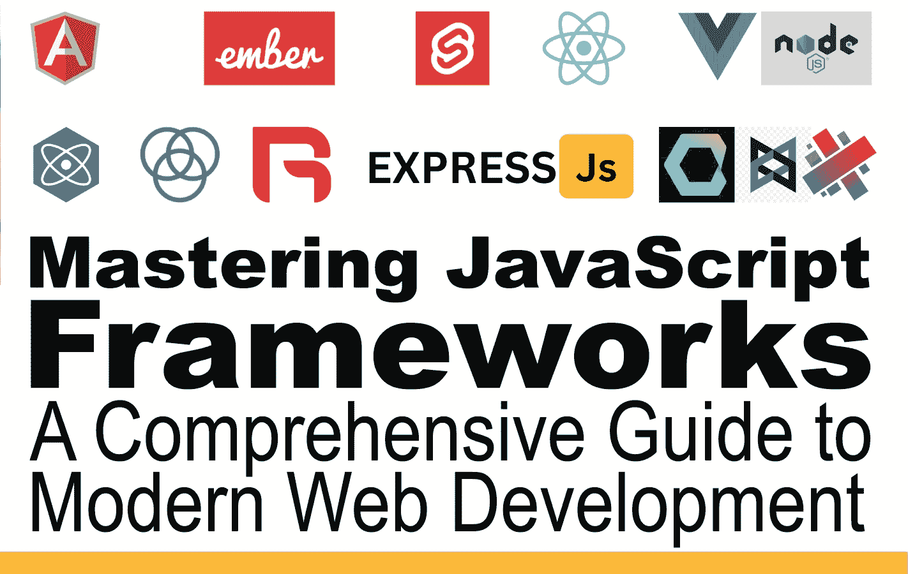

# 精通 JavaScript 框架：现代 Web 开发全面指南





| Theophilus Edet |
| :--- |
|  | theoedet@yahoo.com |
|  | facebook.com/theoedet |
|  | twitter.com/TheophilusEdet |
|  | Instagram.com/edettheophilus |


## 评审请求

## 随 CompreQuest Books 开启 ICT 精通之旅

序言：在广大的 Web 开发领域，精通 JavaScript 框架是释放现代、动态且可扩展 Web 应用全部潜力的关键。欢迎阅读《精通 JavaScript 框架：现代 Web 开发全面指南》，这是一段超越传统编程边界的程，将带你进入 JavaScript 框架的动态领域，探索其复杂的模式、多功能模型以及真实世界的应用。

### 导航框架图谱

本指南的核心在于揭解 JavaScript 框架错综复杂的织锦。我们从 `Node.js` 开始，这是一种突破性的服务器端 JavaScript 运行时，重塑了后端开发的架构。`Node.js` 采用异步、事件驱动机制并由 `V8` 引擎驱动，为我们构思和构建服务器端应用的范式转变奠定了基础。

进入前端，我们遇到了 UI 框架的三巨头：`React.js` 以其声明式且高效的组件化结构而闻名；`Vue.js` 因其易于上手和多功能而备推崇；而强大且功能全 `Angular` 则为动态和结构化的 Web 应用而设计。

### 专业框架：超越主流

当我们通过各种特化框架时，我们的探索变得更加深入，每个框架都有独特的哲学。`Svelte` 是一种网络增强型框架……[为了简洁省略了后续文本，但遵循相同逻辑]。


本书的核心在于对支撑现代 JavaScript 框架的各种编程模型的探索。无论是 `React` 的基于组件的架构、`Angular` 的双向数据绑定，还是 `Vue.js` 灵活且轻级的结构，每个框架都经过了剖析，以揭示其编程模型的复杂之处。通过实战示例和真实世界的场景，读者不仅能理解理论方面，还能在项目中实现这些模型方面获得实践见解。

### 范式：塑造 Web 开发哲学

除了技术细节，“精通 JavaScript 框架”还深入探讨了塑造这些框架哲学的编程范式。从 `React` 的声明式方法到 `Angular` 的约定优于，本书探索了每个框架如何通过拥抱特定范式来简化开发。这一部分为开发者提供了指南，帮助他们根据项目需求选择合适的框架，并将他们的编码实践与底层哲学保持一致。

### 应用：真实世界的实现

当 `JavaScript` 框架应用于真实世界的场景时，它们的真正威力才会显现。本书提供了关于如何使用每个主流框架构建实用应用的深度见解。从单页应用 (`SPAs`) 到渐进式 Web 应用程序 (`PWAs`)，读者将学习如何构建满足现代 Web 开发需求的、可扩展且高性能的解决方案。案例研究和项目示例展示了如何利用每个框架的优势来创建无缝、响应迅速且用户友好的应用程序。

### 未来趋势及展望

随着技术的不断进步，本书并未止于 `JavaScript` 框架的现状。它对将重塑 Web 开发版图的未来趋势和新兴技术提供了前瞻性的视角。通过走在趋势的前沿，读者不仅能够精通现有框架，还能在不断演变的 Web 开发世界中适应并茁壮成长。

“精通 JavaScript 框架”不仅仅是一份指南；它还是开发者寻求以自信和专业知识应对现代 Web 开发复杂性的路线图。无论你是资深开发者还是该领域的新手，这本全面的指南都承诺将成为你精通 `JavaScript` 框架之程上无价的伴侣。

# 模块 1：JavaScript 框架简介

在《精通 JavaScript 框架：现代 Web 开发全指南》这本全面的指南中，“JavaScript 框架简介”模块是通往动态 Web 开发世界这一变革性之旅的门户。在本模块中，读者将进入 `JavaScript` 框架的领域，为深入探索定义现代 Web 开发实践的工具和技术奠定基础。

## 拆解框架生态系统

该模块首先揭开了 `JavaScript` 框架复杂的图谱，为开发者提供的各种工具提供了全景视图。从 `React` 的基于组件的架构到 `Angular` 的约定优先，再到 `Vue.js` 的灵活设计，读者将对区分每个框架的独特特征产生细致的理解。这一探索充当了指南，引导开发者根据特定需求和开发偏好为项目选择最合适的框架。

### 理解核心概念

该模块的核心是对深入研究构成 `JavaScript` 框架骨干的基本概念。读者将学习如组件 (`components`)、状态管理 (`state management`) 和路由 (`routing`) 等概念，阐明这些元素如何贡献于 Web 应用程序的结构和功能。通过实践示例和实操练习，开发者不仅掌握了理论概念，还获得了在自己的项目中有效实现这些概念所需的技能。

### 弥合差距：从原生 JavaScript 到框架

对于那些从传统 `JavaScript` 开发过渡的人士来说，该模块充当了桥梁，平滑了从原生 JavaScript (`vanilla JavaScript`) 到框架世界的路径。通过引导开发者了解相似之处和不同之处，让他们在利用现有知识的同时，拥抱框架提供的力量和效率。这一部分确保了不同技能水平开发者的无缝过渡，培养了他们使用 `JavaScript` 框架的自信和熟练感。

### 建立最佳实践

当开发者开启 `JavaScript` 框架之旅时，该模块强调了遵循最佳实践的重要性。无论是构建组件 (`components`)、管理状态 (`state`) 还是优化性能，读者都获得了一套提升其代码质量的指南。通过在学习过程早期灌输最佳实践，该模块使开发者能够创建可扩展、可维护且高效的 Web 应用程序。

### 为精通奠定基础

“JavaScript 框架简介”不仅为理解单个框架奠定了基础，还为后续模块中的精通铺平了道路。通过揭示复杂性并提供坚实的基础，该模块充当了开发者自信地应对丰富且不断变化的 `JavaScript` 框架图谱的催化剂，推动他们成为现代 Web 应用程序的熟练架构师。

## JavaScript 框架概述

在广阔动态的 Web 开发领域，精通 `JavaScript` 框架是寻求构建强大、可扩展和响应式应用程序的开发者的至关之旅。“JavaScript 框架简介”模块从对格局的详尽探索开始，旨在为读者在丰富的 `JavaScript` 框架世界提供坚实的基础。

### JavaScript 的演进与对框架的需求

`JavaScript` 曾局限于增强静态网页的交互性，现在已演变为一种驱动现代 Web 开发核心的多功能语言。随着这些应用程序复杂性的增长，对更结构化、更有组织的 Web 应用程序构建方法变得显而易见。作为回应，`JavaScript` 框架应运生，为开发者提供了一个脚架，以简化开发工作流、增强代码组织并并创建符合动态数字格局需求的应用程序。

```javascript
// 示例：原生 JavaScript vs 框架代码

// 原生 JavaScript

const element = document.getElementById('example');

element.innerHTML = 'Hello, World!';

// 使用框架（例如 React）
import React from 'react';

function App() {

  return <div>Hello, World</div>;
}
```

### 框架的激增：概述

当我们深入 `JavaScript` 框架的概述时，意识到针对 Web 开发各个领域的框架激增是非常重要的。`React.js`、`Angular`、`Vue.js` 以及许多其他框架已成为家喻户晓的名字，每个都有其优势和应用。由 Facebook 开发的 `React.js` 于使用基于组件的架构构建动态用户界面。Google 维护的 `Angular` 提供了一个构建健壮且功能丰富的单页应用 (`SPAs`) 的全面框架。`Vue.js` 以其简单活性闻名，使开发者能够高效地构建交互式界面。

### 核心概念：组件、状态和数据绑定


理解 JavaScript 框架的核心概念对于准备进入这一领域的开发者来说至关重要。组件是 `React` 和 `Vue` 等框架的构建块，封装了应用程序中元素的结构和行为。状态管理对于处理动态数据和用户交互变得至关重要。数据绑定机制在 `Angular` 等框架中非常流行，促进了模型与视图之间的数据同步。

// 示例：带有状态的 React 组件

```javascript
import React, { useState } from 'react';

function Counter() {
  const [count, setCount] = useState(0);

  return (
    <div>
      <p>Count: {count}</p>
      <button onClick={() => setCount(count + 1)}>Increment</button>
    </div>
  );
}

export default Counter;
```

## 范式：命令式 vs. 声明式

本概述涵盖的一个关重要方面是 JavaScript 框架带来的范式转变，特别是从命令式编程到声明式编程的转变。传统的 JavaScript 开发通常涉及命令式方法，开发者需要指定过程的每一个步骤。然而，`React` 等框架引入了声明式范式，允许开发者描述所需的结果，而由框架来处理底层逻辑。

// 示例：命令式 vs. 声明式 (React)

```javascript
// Imperative
const element = document.createElement('h1');
element.innerHTML = 'Hello, World!';
document.body.appendChild(element);

// Declarative
import React from 'react';

function HelloWorld() {
  return <h1>Hello, World!</h1>;
}
```

## 生态系统：工具、库和包管理器

如果不深入研究支持其开发的丰富生态系统，任何关于 JavaScript 框架的概述都是完整的。从 `Webpack` 和 `Babel` 这样复杂的构建工具到像 `Redux` 这样的状态管理库，开发者在旨在提高生产力的工具和库领域中穿梭。`npm` 或 `Yarn` 等包管理器简化了依赖管理过程，使开发者能够无缝集成第三方解决方案。

// 示例：`package.json` 配置

```json
{
  "name": "my-web-app",
  "version": "1.0.0",
  "description": "A sample web application",
  "main": "index.js",
  "dependencies": {
    "react": "¹⁷.0.2",
    "react-dom": "¹⁷.0.2"
  },
  "devDependencies": {
    "webpack": "⁵.52.0",
    "babel-loader": "⁸.2.2"
  },
  "scripts": {
    "start": "webpack serve --mode development",
    "build": "webpack --mode production"
  }
}
```

## 拥抱框架多样性：为工作选择合适的工具

在我们结束此概述时，强调拥抱框架多样性的重要性。每个 JavaScript 框架都有其优势，并针对特定的用例进行了定制。理解 `React.js`、`Angular`、`Vue.js` 或或其他框架的差异使开发者能够明智决策，为当前任务选择正确的工具。

本质上，本节为全面探索 JavaScript 框架铺了道路，为读者深入研究每个框架的细节奠定了基础。随着你在模块中的进展，目标是让你掌握导航多样化的 JavaScript 框架领域所需的知识和技能，让你能够以自信和专业知识构建尖端 Web 应用程序。

## Web 开发的演变

在“JavaScript 框架简介”模块中，理解 Web 开发的演变对于理解 JavaScript 框架在现代格局中发挥的变革性作用至关重要。我们开启了一段历史之旅，追溯 Web 开发从其静态起源到定义数字时代的动态交互体验的演变。

### 静态 Web：HTML 和 CSS 的统治

旅程始于互联网早期，当时网页是静态的，主要由 HTML 和 CSS 组成。`HTML`（超文本标记语言）结构化内容，定义了标题、段落和图像。`CSS`（层联样式表）处理表现，允许开发者控制元素的布局和外观。

<!-- 示例：静态 HTML 页面

```html
<!DOCTYPE html>
<html lang="en">
<head>
  <meta charset="UTF-8">
  <meta name="viewport" content="width=device-width, initial-scale=1.0">
  <title>Static Web Page</title>
  <link rel="stylesheet" href="styles.css">
</head>
<body>
  <header>
    <h1>Welcome to My Website</h1>
  </header>
  <main>
    <p>This is a static web page.</p>
    
  </main>
</body>
</html>
``` -->

### JavaScript 的出现：增加交互性

随着对更多交互和动态 Web 体验的需求增长，JavaScript 成为一种能够实时操作文档对象模型（`DOM`）的脚本语言。JavaScript 使开发者能够为网页添加交互性，响应用户操作并动态更新内容。

// 示例：简单的 JavaScript 交互

```javascript
document.addEventListener('DOMContentLoaded', function() {
  const button = document.getElementById('myButton');
  const output = document.getElementById('output');
  button.addEventListener('click', function() {
    output.innerHTML = 'Button Clicked!';
  });
});
```

### 手动 DOM 操作的挑战

虽然 JavaScript 为引入交互提供了手段，但对于复杂应用程序，手动操作 `DOM` 变得难以管理。这导致了在代码维护、状态管理和在不同浏览器中确保一致用户体验方面的挑战。

### JavaScript 框架的诞生：简化开发

由于意识到手动操作 `DOM` 的局限性，JavaScript 框架的出现作为一种简化开发工作流的解决方案。`jQuery` 等框架简化了 `DOM` 操作，提供了处理常见任务的实用程序。

// 示例：jQuery DOM 操作

```javascript
$(document).ready(function() {
  $('#myButton').click(function() {
    $('#output').html('Button Clicked!');
  });
});
```

### 单页应用 (SPA) 的崛起

随着 应用程序变得日益复杂，单页应用（`SPA`）的概念开始流行。SPA 加载单个 HTML 并在导航时动态更新内容，从而带来了流畅的用户体验。`Angular` 和 `React` 等 JavaScript 框架在促进 `SPA` 开发方面发挥了关键作用。

// 示例：React 单页应用

```javascript
import React from 'react';
import ReactDOM from 'react-dom';

function App() {
  return (
    <div>
      <h1>Welcome to My SPA</h1>
      <p>This is a Single-Page Application built with React.</p>
    </div>
  );
}
ReactDOM.render(<App />, document.getElementById('root'));
```

### 声明式编程范式：方法的转变

随着 `React` 等框架引入的声明式编程范式的出现，发生了重大演变。与指定每个步骤的命令式编程不同，声明式编程允许开发者描述所需的结果，而由框架来处理底层逻辑。这种方法的转变简化了代码，增强了可维护性，并为更直观的开发体验铺平了道路。

### 构建工具和模块打包器的集成

现代 Web 应用程序的复杂性需要集成构建工具和模块打包器。`Webpack` 和 `Babel` 等工具在管理依赖、编译代码和打包资源方面变得重要。这种演变促进了现代 JavaScript 特性的采用，并增强了开发和部署过程。

// 示例：Webpack 配置

```json
{
  "module": {
    "rules": [
      {
        "test": /\.(js|jsx)$/
```


```json
{
  "exclude": "/node_modules/",
  "use": {
    "loader": "babel-loader"
  }
}
```

## 从框架到库：React、Vue 和 Angular 的角色

在当今的 Web 开发领域，React、Vue 和 Angular 作为强大的框架/库脱颖而出，它们封装了最佳实践和模式。React 的基于组件的架构和虚拟 DOM 实现了高效更新，Vue 的简单性和响应式使其变得易于上手，而 Angular 全面的生态系统为构建健壮的应用程序提供了完整的解决方案。

```javascript
// Example: React Component
import React from 'react';

function HelloWorld() {
  return <h1>Hello, World!</h1>;
}
```

# 未来：一览渐进式 Web 应用 (PWAs) 及未来

当我们结束对 Web 开发演变的历程时，未来充满了令人兴奋的可能性。渐进式 Web 应用（PWAs）利用现代 Web 能力提供类应用的用户体验，提供离线功能、响应式设计和无缝交互。展望未来，WebAssembly、机器学习和去中心化 Web 应用等技术的集成有望重新定义 Web 实现的边界。

Web 开发的演变是一个创新、挑战和不断改进的故事。JavaScript 框架在塑造这一叙事中发挥了工具性作用，为开发者提供了构建复杂且用户友好应用程序所需的工具和抽象。旅程仍在继续，随着我们在后续章节中深入探讨 JavaScript 框架的复杂性，我们使自己具备以专业知识和信心应对现代 Web 开发复杂性的能力。

## 框架的重要性

在“JavaScript 框架简介”模块中，揭框架的重要性是掌握它们在现代 Web 开发中变革性作用的基础步骤。当我们深入这一部分时，我们将探索框架成为寻求构建健壮、可扩展且易维护的 Web 应用程序的开发者不可的工具的关键原因。

### 简化开发工作流：代码的效率

JavaScript 框架提供的主要优势之一是简化了开发工作流。开发者获得了预构建的结构、库和模式，这些内容抽象了常见任务，减少了对样板代码的需求。这种效率不仅加速了开发，还增强了代码的可读性和维护性。

```javascript
// Example: React Component with JSX (Before and After)
// Without Framework (Vanilla JavaScript)
const element = document.createElement('h1');
element.innerHTML = 'Hello, World!';
document.body.appendChild(element);

// With React Framework
import React from 'react';
function HelloWorld() {
  return <h1>Hello, World!</h1>;
}
```

### 一致的架构：在最佳实践之上构建

框架强制执行一致的模式，引导开发者在构建应用程序时遵循最佳实践。这种标准化方法确保了团队或社区的开发者遵循一组共同的规范，促进了协作并使代码库更易于理解。

```text
// Example: Angular Component Structure
// Component File Structure in Angular
|-- src
|-- app
|-- components
|-- header
|-- header.component.ts
|-- header.component.html
|-- header.component.css
```

### 代码复用性：利用组件和模块

JavaScript 框架通过使用组件和模块促进了代码复用的概念。组件封装了特定功能，并可以在应用程序的不同部分甚至在不同的项目中复用。这种模块化方法不仅提高了开发速度，还简化了维护。

```javascript
// Example: Vue.js Component Reusability
// Component Definition
const Button = {
  template: '<button>Click me</button>',
};

// Using the Button Component in Another Component
const App = {
  components: {
    'my-button': Button,
  },
  template: '<div><my-button></my-button></div>',
};
```

### 声明式语法：增强可读性

框架通常引入声明式语法，允许开发者表达他们想要的结果，而不是指定逐步执行步骤。这种声明式方法增强了代码的可读性，并使其更加直观，有助于更清晰地理解应用程序逻辑。

```javascript
// Example: Declarative vs. Imperative (React)
// Imperative Approach
const element = document.createElement('h1');
element.innerHTML = 'Hello, World!';
document.body.appendChild(element);

// Declarative Approach with React
import React from 'react';
function HelloWorld() {
  return <h1>Hello, World!</h1>;
}
```

### 状态管理：简化复杂应用程序

框架提供了管理应用程序状态的内置机制。无论是 React 的 `useState` 钩子、Angular 的服务还是 Vue 的响应式系统，这些工具都简化了复杂状态逻辑的处理，确保数据在应用程序中无缝流动。

```javascript
// Example: React State Management
import React, { useState } from 'react';
function Counter() {
  const [count, setCount] = useState(0);
  return (
    <div>
      <p>Count: {count}</p>
      <button onClick={() => setCount(count + 1)}>Increment</button>
    </div>
  );
}
```

### 跨浏览器兼容：减轻兼容性问题

框架通常通过抽象特定浏览器实现的复杂性来解决跨浏览器兼容性问题。这确保了不同浏览器上一致一致的用户体验，并减轻了开发者编写和维护特定浏览器代码的需求。

```javascript
// Example: jQuery Cross-Browser Compatibility
// jQuery AJAX Request for Cross-Browser Compatibility
$.ajax({
  url: 'https://api.example.com/data',
  method: 'GET',
  success: function(response) {
    console.log(response);
  },
  error: function(error) {
    console.error(error);
  }
});
```

### 社区支持与生态系统：利用集体知识

框架的重要性超越了其核心功能，扩展到它们所培养的社区和生态系统。框架通常拥有活跃的社区，开发者在其中分享知识、贡献开源项目并提供支持。这些丰富的经验成为寻求指南和解决方案的开发者的价值资源。

```bash
// Example: npm Ecosystem (Node.js Package Manager)
// Installing a Package
npm install package-name

// Using the Installed Package
const packageName = require('package-name');
```

## 增强用户体验：从性能到响应

JavaScript 框架在增强 应用程序的用户体验方面起着关键作用。它们通过虚拟 DOM（如 React）等功能提升性能，实现了无需重新渲染整个页面的高效更新。此外，框架促进了响应式和动态界面的开发，为用户创造了参与体验。

```javascript
// Example: Virtual DOM in React
// Traditional DOM Manipulation
const element = document.createElement('h1');
element.innerHTML = 'Hello, World!';
document.body.appendChild(element);

// React's Virtual DOM
import React from 'react';
function HelloWorld() {
  return <h1>Hello, World!</h1>;
}
```

## 促进 SPA 开发：导航单页范式

JavaScript 框架在普及单页应用 (SPA) 范式方面发挥了关键作用。SPA 通过动态更新内容而无需全页刷新，提供了无缝的用户体验。Angular、React 和 Vue 等框架为高效的 SPA 开发提供了工具和结构。

```javascript
// Example: Vue Router for SPA Navigation
// Defining Routes
const routes = [
  { path: '/', component: Home },
  { path: '/about', component: About },
  { path: '/contact', component: Contact }
];

// Creating Router Instance
```


```javascript
const router = new VueRouter({
  routes
});
```

# 面向未来的开发：适应行业趋势

随着技术的演进，框架已成为 Web 开发面向未来的至关重要的工具。它们适应行业趋势，整合了诸如服务端渲染、渐进式 Web 应用（PWA）支持以及与新兴技术的集成。这种适应性确保了开发者能够跟上不断演变的最佳实践和标准。

// 示例：用于服务端渲染的 Next.js (React)
// 创建一个具有服务端渲染功能的 Next.js 页面

```javascript
import React from 'react';

function HomePage({ data }) {
  return (
    <div>
      <h1>{data.title}</h1>
      <p>{data.description}</p>
    </div>
  );
}

export async function getServerSideProps() {
  // 在服务端获取数据
  const data = await fetchData();
  return {
    props: {
      data
    }
  };
}
```

## 每一个部分之总和：整体化方法

本质上，JavaScript 框架在现代 Web 开发中的重要性是其各个特性和集体影响的总和。从提高开发效率到提供一致的架构、管理状态以及确保跨浏览器兼容性，框架是构建尖端 Web 应用的开发者不可或缺的工具。随着本模块的深入，我们将深入探讨特定的框架，揭示它们独特的特性和应用。每个框架都为定义现代 Web 开发的整体方法增加了一层维度，而理解它们的重要性则为开发者提供了在这一动态领域中导航的知识。

## 流行框架的对比分析

在“JavaScript 框架简介”模块中，掌握 Web 开发的一个关键方面是对流行的 JavaScript 框架进行对比分析。每个框架都带带来了其独特的特性集、范式和优势。当我们探索这一部分时，我们将开启一段穿过 `React.js`、`Angular` 和 `Vue.js` 复杂之处的之旅，为它们的应用提供全面的理解，并指导开发者为自己的项目选择合适的工具。

### React.js：声明式、高效且基于组件

#### 概览：
`React.js` 由 Facebook 开发，已成为通过声明式和基于组件的方法构建用户界面的强大工具。它的虚拟 DOM 实现了高效更新，使其成为创建动态和交互式 Web 应用的首选。

#### 基于组件的架构：
React 的基础在于其基于组件的架构。组件是可复用的构建块，封装了特定功能，并可以组合起来创建复杂的用户界面。

// 示例：React 组件
```javascript
import React from 'react';

function Button(props) {
  return <button onClick={props.onClick}>{props.label}</button>;
}

export default Button;
```

#### 虚拟 DOM 与效率：
React 的虚拟 DOM 是增强应用性能的关键特性。通过最小化 DOM 操作，React 高效地仅更新已更改的组件，从而带来更流畅的用户体验。

// 示例：React 虚拟 DOM
```javascript
import React, { useState } from 'react';

function Counter() {
  const [count, setCount] = useState(0);
  return (
    <div>
      <p>Count: {count}</p>
      <button onClick={() => setCount(count + 1)}>Increment</button>
    </div>
  );
}
```

### Angular：全功能、结构化且动态

#### 概览：
`Angular` 由 Google 维护，是一个全面的框架，为构建单页应用（SPA）提供了一种结构化且带有主见的方法。它整合了双向数据绑定和依赖注入等特性，使其成为大型项目的强大解决方案。

#### 双向数据绑定：
Angular 的特色功能之一是双向数据绑定，它在模型和视图之间建立了无缝连接。模型中的更改会自动更新视图，反之亦然。

// 示例：Angular 双向数据绑定
```javascript
import { Component } from '@angular/core';

@Component({
  selector: 'app-counter',
  template: `
    <p>Count: {{ count }}</p>
    <button (click)="increment()">Increment</button>
  `,
})
export class CounterComponent {
  count = 0;
  increment() {
    this.count++;
  }
}
```

#### 依赖注入：
Angular 的依赖注入系统简化了应用组件和服务的管理。通过允许组件请求依赖项而不是直接创建它们，促进了模块化和可测试性。

// 示例：Angular 依赖注入
```javascript
import { Injectable } from '@angular/core';

@Injectable({
  providedIn: 'root',
})
export class DataService {
  getData() {
    // 获取数据逻辑
  }
}
```

### Vue.js：易于上手、多功能且高性能

#### 概览：
`Vue.js` 因其易于上手和多功能的特性而受欢迎。它经常因其简单性和易于集成到现有项目中而受到赞誉。`Vue.js` 采用响应式和基于组件的范式，使其成为小型和大型应用的有力竞争者。

#### 响应式与 Vue 组件：
`Vue.js` 通过其响应式数据绑定系统引入了响应式。底层数据的更改会自动触发视图更新，简化了状态管理。

<!-- 示例：Vue.js 响应式 -->
```html
<template>
  <div>
    <p>Count: {{ count }}</p>
    <button @click="increment">Increment</button>
  </div>
</template>

<script>
export default {
  data() {
    return {
      count: 0,
    };
  },
  methods: {
    increment() {
      this.count++;
    },
  },
};
</script>
```

#### Vue 组件与组合式：
`Vue.js` 促进以组件为中心的方法，允许开发者构建模块化和可复用的用户界面部分。`Vue 3` 中引入的 `Composition API` 进一步增强了代码组织和复用。

<!-- 示例：使用 Composition API 的 Vue 组件 -->
```html
<template>
  <div>
    <Counter :count="count" @increment="increment" />
  </div>
</template>

<script>
import { ref } from 'vue';
import Counter from './Counter.vue';

export default {
  components: {
    Counter,
  },
  setup() {
    const count = ref(0);
    const increment = () => {
      count.value++;
    };
    return {
      count,
      increment,
    };
  },
};
</script>
```

## 选择合适的框架：考量与权衡

### 性能考量：
`React` 的虚拟 DOM 和 `Angular` 的双向数据绑定会以不同的方式影响性能。`React` 的高效更新在某些情况下可能带来更好的性能，而 `Angular` 的双向数据绑定在简化开发的同时可能会引入额外的开销。

### 学习曲线：
`Vue.js` 以其平缓的学习曲线而闻名，是初学者的绝佳选择。`React` 基于组件的架构可能需要时间来掌握。`Angular` 作为一个完整的框架，学习曲线较陡，但提供了全面的解决方案。

### 社区与生态系统：
框架社区和生态系统的强度对于持续支持、文档以及第三方库的可用性至关重要。React` 应用广泛，拥有庞大的活跃社区。由 Google 支持的 `Angular` 也拥有强大的生态系统。`Vue` 虽然较小，但增长迅速，并以友好的社区著称。

### 项目规模与复杂度：
项目的规模和复杂度对框架选择起着关键作用。`React` 的灵活性适用于各种规模的项目。`Angular` 的主见结构对于具有许多部分的大型应用具有优势。`Vue.js` 的适应性非常适合小型和大型项目。

# 不断变化的格局：保持信息灵通


JavaScript 框架的世界瞬息万变，不断有更新和新版本的发布。对于开发者来说，了解最新特性、最佳实践和新兴趋势至关重要。无论是采纳 `React` 中的新功能、探索 `Angular` 的更新，还是利用 `Vue.js` 的进展，开发者都应该努力跟上这一不断变化的版图。

## 适用于各种用途的框架

对流行的 JavaScript 框架——`React.js`、`Angular` 和 `Vue.js`——进行对比分析表明，它们各自独特的优势和应用场景。`React` 声明式和基于组件的方法在构建动态用户界面方面表现出色。`Angular` 全面的功能使其成为大型应用的稳健选择。`Vue.js` 以其简单性和多活性，为不同规模的项目提供了恰好的平衡。

当你开启现代 Web 开发之旅时，请考虑项目的特定需求、团队的偏好以及你旨在解决的挑战。通过对这些框架的细致理解，你将能够胜任应对多样化的格局，并做出符合你开发目标的明智决策。

## 模块 2：JavaScript 基础

在综合指南《精通 JavaScript 框架：现代 Web 开发全面指南》的“JavaScript 基础”模块中，读者将开启一段探索驱动 Web 的核心语言的基础之旅。该模块是一个至关重要的起点，确保开发者在深入研究现代框架的复杂性之前，对 JavaScript 的基本原理有稳健的理解。

### 基础：语法与数据类型

该模块从探索 JavaScript 的基础构建块——语法和数据类型开始。从变量、操作符到控制流结构，开发者将对该语言的基本元素获得全面的掌握。通过清晰的解释和实践示例，读者巩固了对 JavaScript 语法的理解，为后续更高级的概念奠定了坚实的基础。

### 函数与作用域：释放 JavaScript 的力量

该模块的一个重点在于揭示 JavaScript 函数和作用域的力量。读者将深入研究函数声明、表达式和闭包的复杂性，理解这些概念如何实现代码组织、重用以及高效算法的创建。通过掌握作用域的细微差别，开发者将对变量生命周期以及控制代码中变量访问的原则产生洞察。

### 异步 JavaScript：导航事件循环

在现代 Web 开发的动态格局中，理解异步编程至关重要。该模块向开发者介绍了 JavaScript 中的事件循环和异步模式，提供了一条无缝处理异步任务的路线图。从回调到 `Promises` 再到 `async/await`，读者将获得管理异步代码的熟练技能，这是构建响应迅速且高性能的 Web 应用至关重要的技能。

### JavaScript 中的面向对象编程 (OOP)

该模块的一个关键方面围绕 JavaScript 中的面向对象编程 (`OOP`)。开发者将探索封装、继承和多态的原则，发现 JavaScript 尽管具有基于原型的本质，但仍然可以被用于实现经典的 OOP 概念。这一部分为读者提供了设计可扩展和可维护代码结构结构的工具，为书籍后期更复杂的应用铺平了道路。

### 调试与最佳实践：确保代码质量

随着开发者在模块中不断进步，重点将放在调试技术和最佳实践上。理解如何识别和纠正常见错误可以确保代码保持健壮且无错误。通过尽早培养最佳实践文化，该模块赋予开发者编写整洁、高效且可维护代码的能力，这套技能构成了 Web 开发中成功的基石。

“JavaScript 基础”为后续对 JavaScript 框架的全面探索奠定了基础。通过掌握核心语言，开发者获得了应对现代 Web 开发复杂性所需的熟练度，为通往 JavaScript 框架世界的变革性之旅做好了准备。

## ES6 及以后

在“JavaScript 基础”模块中，理解 `ES6`（`ECMAScript 2015`）及其后续版本的内核特性对于现代 Web 开发至关重要。`ES6` 为 JavaScript 带来了显著增强，引入了新的语法、特性和编程范式，这些已成为构建健壮可维护应用程序不可或的一部分。当我们深入这一部分时，我们将揭示 `ES6` 的关键特性，并探索它们如何塑造 JavaScript 的格局。

### 1. 箭头函数：简洁的函数语法

`ES6` 的箭头函数为定义函数提供了更简洁的语法。它们对于匿名函数和短体函数特别有用。

```javascript
// 示例：传统函数 vs 箭头函数

const add = function(x, y) {
return x + y;
};

const multiply = (x, y) => x * y;
```

箭头函数还具有词法 `this`，这意味着它们从闭包作用域继承 `this` 值，消除了对类似 `.bind()` 的函数的需求。

### 2. Let 和 Const：块级作用域声明

`ES6` 引入了 `let` 和 `const` 来声明变量。与函数作用域的 `var` 不同，`let` 和 `const` 是块作用级的，提供了更容易预测的行为。

```javascript
// 示例：使用 let 和 const 的块级变量

let counter = 0; // 可变的
const maxAttempts = 3; // 不变的

for (let i = 0; i < maxAttempts; i++) {
counter += i;
}

// i 在此处不可访问（块作用域）
```

### 3. 模板字符串：增强的字符串格式化

模板字符串提供了一种创建字符串的方便方法，允许嵌入表达式和多行字符串。这一特性增强了字符串的格式化可读性。

```javascript
// 示例：模板字符串

const name = 'John';
const greeting = `Hello, ${name}!

How are you today?`;
```

### 4. 解构赋值：值的解包

解构赋值允许从数组或对象解包值到不同的变量中。

```javascript
// 示例：数组和对象的解构赋值

// 数组解构
const [first, second] = [1, 2, 3];
// 对象解构
const { firstName, lastName } = { firstName: 'John', lastName: 'Doe' };
```

### 5. 展开与剩余运算符：数组和对象的灵活处理

展开运算符 (`...`) 和剩余参数 (`...`) 是处理数组和对象的强大工具。展开运算符展开数组元素或对象属性，而剩余参数则收集它们。

```javascript
// 示例：展开与剩余运算符

// 数组展开运算符
const arr1 = [1, 2, 3];
const arr2 = [...arr1, 4, 5]; // [1, 2, 3, 4, 5]

// 对象的展开运算符
const obj1 = { a: 1, b: 2 };
const obj2 = { ...obj1, c: 3 }; // { a: 1, b: 2, c: 3 }

// 函数参数中的剩余参数
const sum = (...numbers) => numbers.reduce((acc, num) => acc + num, 0);
```

### 6. 增强的对象字量：简化对象创建

`ES6` 引入了对象字面量的增强，使得定义属性和方法更加简洁。

```javascript
// 示例：增强的对象字面量

const x = 10, y = 20;
// ES6 之前
const obj1 = { x: x, y: y };
// ES6 增强的对象字面量
const obj2 = { x, y };
```

### 7. 类：原型继承的语法糖

`ES6` 通过引入类，为处理面向对象编程带来了一种更符合习惯、更方便的语法。

```javascript
// 示例：ES6 类

class Animal {
constructor(name) {
this.name = name;
}
}
```


```javascript
class Animal {
  speak() {
    console.log(`${this.name} makes a sound.`);
  }
}

class Dog extends Animal {
  speak() {
    console.log(`${this.name} barks.`);
  }
}

const dog = new Dog('Buddy');
dog.speak(); // Buddy barks.
```

# 8. Promises: 异步操作的管理

Promises 简化了异步操作的处理，为回调提供了一种更な替代方案。Promises 有三种状态：等待（pending）、已完成（fulfilled）和已拒绝（rejected）。

// 示例：Promises

```javascript
const fetchData = () => {
  return new Promise((resolve, reject) => {
    setTimeout(() => {
      const success = Math.random() > 0.5;
      success ? resolve('Data fetched successfully') : reject('Error fetching data');
    }, 1000);
  });
};

fetchData()
  .then((data) => console.log(data))
  .catch((error) => console.error(error));
```

# 9. Async/Await: 简化异步代码

在 Promises 的基础之上，ES2017 引入了 `async/await`，为管理异步操作提供了一种更像同步代码的语法。

// 示例：Async/Await

```javascript
const fetchData = () => {
  return new Promise((resolve) => {
    setTimeout(() => resolve('Data fetched successfully'), 1000);
  });
};

const fetchDataWrapper = async () => {
  try {
    const data = await fetchData();
    console.log(data);
  } catch (error) {
    console.error(error);
  }
};

fetchDataWrapper();
```

# 10. 模块: 封装与代码组织

ES6 模块提供了一种封装和组织代码的方法，允许开发者跨文件导入和导出函数、变量和类。

// 示例：ES6 模块
// math.js
```javascript
export const add = (a, b) => a + b;
```

// app.js
```javascript
import { add } from './math';
console.log(add(2, 3)); // 5
```

# 超越 ES6: 拥抱现代 JavaScript 特性

虽然 ES6 标志着 JavaScript 的巨大跃，但后续版本包括 ES2017 (ES8)、ES2018 及以后引入了更多功能和改进。诸如可选链（`?.`）、空值合并（`??`）、用于任意精度整数的 `BigInt` 以及私有类字段进一步增强了 JavaScript 的能力。

// 示例：可选链与空值合并

```javascript
const user = {
  name: 'John',
  address: {
    city: 'New York',
  },
};

const cityName = user?.address?.city ?? 'Unknown';
console.log(cityName); // New York (如果为 null 或 undefined，则默认为 Unknown)
```

# 掌握现代 JavaScript 蓝图

精通 `ES6` 及以后的特性是现代 Web 开发的基础。这些特性不仅改进了 JavaScript 的语法和表达能力，还让开发者能够编写更高效、可读且易维护的代码。当你探索 JavaScript 基础时，拥抱这些特性将使你具备构建尖端 Web 应用所需的工具，并与各种 JavaScript 框架进行无缝集成。保持好奇心，探索不断演变的语言，并在你的开发旅程中拥抱现代 JavaScript 特性的力量。

## 异步 JavaScript

在“JavaScript 基础”模块中，理解异步 JavaScript 是现代 Web 开发的核心技能。随着 Web 应用程序变得日益复杂，高效管理异步操作的能力变得至关重要。在本节中，我们将探索 JavaScript 中异步编程的复杂之处，揭示用于处理获取数据、处理用户输入和管理时间依赖操作任务的各种技术和工具。

### 1. 回调 (Callbacks): 基础方法

回调是异步 JavaScript 的基础构建块。它们是作为参数传递给其他函数，并在特定操作完成后执行。

// 示例：回调

```javascript
function fetchData(callback) {
  setTimeout(() => {
    const data = 'Data fetched successfully';
    callback(data);
  }, 1000);
}

function processData(data) {
  console.log(data);
}

fetchData(processData);
```

虽然 `callbacks` 是有效的，但在处理多个嵌套的异步操作时，它们会导致“回调地狱”或“金字塔狱”，使代码难以阅读和维护。

### 2. Promises: 迈向未来的承诺

Promises 在 `ES6` 中引入是为了解决回调地狱问题，并提供了一种更简洁的处理异步操作的方法。一个 promise 代表异步操作的最终完成或失败，并允许操作链式调用。

// 示例：Promises

```javascript
function fetchData() {
  return new Promise((resolve, reject) => {
    setTimeout(() => {
      const success = Math.random() > 0.5;
      success ? resolve('Data fetched successfully') : reject('Error fetching data');
    }, 1000);
  });
}

fetchData()
  .then((data) => console.log(data))
  .catch((error) => console.error(error));
```

Promises 简化了错误处理，并为处理异步任务提供了更有结构的方法。然而，它们仍然涉及链式调用，在某些场景下会导致潜在的嵌套。

### 3. Async/Await: 看起来化的异步

在 promises 的基础上，ES2017 引入的 `async/await` 语法提供了一种更像同步的编写异步代码的方式。`async` 函数总是返回一个 `promise`，而 `await` 用于等待 `promise` 完成。

// 示例：Async/Await

```javascript
const fetchData = () => {
  return new Promise((resolve) => {
    setTimeout(() => resolve('Data fetched successfully'), 1000);
  });
};

const fetchDataWrapper = async () => {
  try {
    const data = await fetchData();
    console.log(data);
  } catch (error) {
    console.error(error);
  }
};

fetchDataWrapper();
```

`async/await` 显著提高了异步代码的可读性，使其看起来像同步代码。

### 4. 处理多个 Promises

当处理可以独立执行的多个异步操作时，`Promise.all` 是一个强大的工具。它接收一个 promise 数组，并在数组中所有 promise 都解析后返回单个 promise。

// 示例：Promise.all
```javascript
function fetchData(url) {
  return new Promise((resolve) => {
    // 模拟获取数据
    setTimeout(() => resolve(`Data from ${url}`), 1000);
  });
}

const urls = ['api/data1', 'api/data2', 'api/data3'];

Promise.all(urls.map(fetchData))
  .then((results) => console.log(results))
  .catch((error) => console.error(error));
```

### 5. Async/Await 与 Promise.all: 并发执行

将 `async/await` 与 `Promise.all` 结合，可以在处理多个异步操作时实现简洁的代码。

// 示例：Async/Await 与 Promise.all
```javascript
async function fetchDataConcurrently() {
  const urls = ['api/data1', 'api/data2', 'api/data3'];
  try {
    const results = await Promise.all(urls.map(fetchData));
    console.log(results);
  } catch (error) {
    console.error(error);
  }
}

fetchDataConcurrently();
```

### 6. 事件循环与并发模型

理解事件循环和 JavaScript 的并发模型对于掌握异步行为至关重要。JavaScript 是单线程的，但它采用事件驱动、非阻塞模型，使其能够并发处理多个任务。

// 示例：事件循环
```javascript
console.log('Start');

setTimeout(() => console.log('Timeout'), 0);

Promise.resolve().then(() => console.log('Promise'));

console.log('End');
```

在这个示例中，事件循环管理 `setTimeout` 回调和 promise 的 `then` 回调的执行，展示了 JavaScript 的非阻塞特性。

### 7. 回调 vs Promise vs Async/Await

对比处理异步代码的三种主要方法（回调、promises 和 `async/await`）有助于理解它们的优缺点。

// 回调
```javascript
function fetchData(callback) {
  setTimeout(() => {
```


```javascript
const data = 'Data fetched successfully';

callback(data);

}, 1000);

}

function processData(data) {

  console.log(data);

}

fetchData(processData);
```

### Promises:

```javascript
// Promises

function fetchData() {

  return new Promise((resolve, reject) => {

    setTimeout(() => {
      const success = Math.random() > 0.5;
      success ? resolve('Data fetched successfully') : reject('Error fetching data');
    }, 1000);
  });
}

fetchData()
  .then((data) => console.log(data))
  .catch((error) => console.error(error));
```

### Async/Await:

```javascript
// Async/Await

function fetchData() {

  return new Promise((resolve) => {
    setTimeout(() => resolve('Data fetched successfully'), 1000);
  });
}

async function fetchDataWrapper() {
  try {
    const data = await fetchData();
    console.log(data);
  } catch (error) {
    console.error(error);
  }
}

fetchDataWrapper();
```

`async/await` 因其可读性和类似于同步的写法而脱颖而出，是现代 JavaScript 开发中的首选方案。

# 精通异步处理

精通异步 JavaScript 是构建响应且高效 Web 应用的基础。回调（Callbacks）、承诺（promises）和 async/await 代表了处理异步操作演化的不同阶段。回调是基础构建块，承诺简化了结构，而 async/await 则增强了代码的可读性和可维护性。

理解事件循环（event loop）、并发模型以及每种异步范式的优缺点，让开发者能够为项目选择最合适的方法。无论是处理单个异步任务还是协调多个操作，JavaScript 异步特性提供的工具对于构建现代、响应且用户友好的 Web 应用至关重要。拥抱异步编程的力量，充满心地应对现代 Web 开发的复杂性。

## 数据结构与算法

在“JavaScript 基础”模块中，深入研究数据结构和算法对于开发高效且可扩展的 Web 应用至关重要。理解如何存储和操作数据，以及实现各种任务的算法，能够让开发者构建出高性能的解决方案。在本节中，我们将探索 JavaScript 中数据结构和算法的基础概念，揭示它们在现代 Web 开发中的意义。

### 1. 数组：多功能数据结构

数组（Arrays）是 JavaScript 中的基础数据结构，提供了一种存储和访问元素的通用方式。它们允许通过索引对元素进行常数时间的访问。

```javascript
// ：JavaScript 中的数组

const colors = ['red', 'green', 'blue'];

// 访问元素
console.log(colors[0]); // red

// 修改元素
colors.push('yellow'); // 添加元素
colors.pop(); // 删除最后一个元素
```

`Arrays` 支持包括 `push`、`pop`、`shift` 和 `unshift` 在内的各种操作，使其适用于动态数据存储。

### 2. 对象：高效查找的键值对

JavaScript 中的对象（Objects）是键值对，允许根据给定的键高效地检索数据。它们被广泛用于现实场景中表示和操作数据。

```javascript
// Example：JavaScript 中的对象

const person = {
  name: 'John Doe',
  age: 30,
  occupation: 'Software Engineer',
};

// 访问值
console.log(person.name); // John Doe

// 修改值
person.age = 31;
```

`Objects` 促进了快速数据检索，特别是在键已知的情况下。

### 3. 链表：动态且灵活的结构

链表（Linked Lists）是动态数据结构，其中元素（称为节点）按顺序连接。与数组不同，链表提供了动态内存分配以及易于元素的插入或删除。

```javascript
// Example：链表节点
class Node {
  constructor(data, next = null) {
    this.data = data;
    this.next = next;
  }
}

// 创建链表
const node1 = new Node(10);
const node2 = new Node(20);
node1.next = node2;
```

`Linked lists` 在需要频繁在中间插入或删除操作的场景中非常有效。

### 4. 栈：后进先出的结构

栈（Stacks）遵循后进先出（LIFO）原则，这非常适合需要频繁操作顶端元素的场景。栈操作 `push` 和 `pop` 是核心。

```javascript
// Example：栈实现
class Stack {
  constructor() {
    this.items = [];
  }
  push(element) {
    this.items.push(element);
  }
  pop() {
    return this.items.pop();
  }
}

// 使用栈
const stack = new Stack();
stack.push(10);
stack.push(20);
```

### 5. 队列：先入先出的结构

队列（Queues）遵循先入先出（FIFO）原则，适用于需要按顺序处理任务的场景。

```javascript
// Example：队列实现
class Queue {
  constructor() {
    this.items = [];
  }
  enqueue(element) {
    this.items.push(element);
  }
  dequeue() {
    return this.items.shift();
  }
}

// 使用队列
const queue = new Queue();
queue.enqueue(10);
queue.enqueue(20);
```

### 6. 哈希表：高效的键值存储

哈希表（Hash tables）通过哈希函数将键映射到索引。它们在平均情况下具有常数时间的查找复杂度。

```javascript
// Example：哈希表实现
class HashTable {
  constructor() {
    this.table = {};
  }
  hashKey(key) {
    // 简单的哈希函数
    return key.length; 
  }
  set(key, value) {
    const index = this.hashKey(key);
    this.table[index] = value;
  }
  get(key) {
    const index = this.hashKey(key);
    return this.table[index];
  }
}

// 使用哈希表
const hashTable = new HashTable();
hashTable.set('name', 'Alice');
```

### 7. 排序算法：有效地组织数据

排序算法对于组织数据以实现高效检索至关重要。

```javascript
// Example：快速排序实现
function quicksort(array) {
  if (array.length <= 1) {
    return array;
  }
  const pivot = array[0];
  const left = [];
  const right = [];
  for (let i = 1; i < array.length; i++) {
    if (array[i] < pivot) {
      left.push(array[i]);
    } else {
      right.push(array[i]);
    }
  }
  return [...quicksort(left), pivot, ...quicksort(right)];
}

const unsortedArray = [5, 2, 9, 1, 5, 6];
const sortedArray = quicksort(unsortedArray);
```

### 8. 搜索算法：在海中寻找针

搜索算法对于在数据集中定位特定元素至关重要。

```javascript
// Example：二分搜索实现
function binarySearch(array, target) {
  let left = 0;
  let right = array.length - 1;
  while (left <= right) {
    const mid = Math.floor((left + right) / 2);
    if (array[mid] === target) {
      return mid;
    } else if (array[mid] < target) {
      left = mid + 1;
    } else {
      right = mid - 1;
    }
  }
  return -1;
}

const sortedArray = [1, 2, 3, 4, 5, 6, 7, 8, 9];
const targetIndex = binarySearch(sortedArray, 5);
```


数据结构和算法是高效且可扩展 Web 开发的骨干。`Arrays`、对象、链表、栈、队列、哈表、排序和搜索算法是开发者工具箱中不可或缺的工具。理解何时以及如何应用这些结构和算法，能够赋予开发者构建能够应对现实世界挑战的高性能应用程序。

当你深入现代 Web 开发时，掌握这些基础概念不仅会提升你的解决问题能力，还将为 JavaScript 框架领域更高级的主题铺平道路。无论是优化数据存储、组织信息还是简化搜索操作，数据结构和算法的原理对于构建稳健高效的 Web 应用程序始终至关重要。拥抱组织化数据和优化算法的力量，开启成为精练且高效的 Web 开发者的之旅。

## 测试与调试

在“JavaScript 基础”模块中，掌握测试和调试的艺术对于交付稳健可靠的 Web 应用程序至关重要。随着代码复杂性的增加，错误和意外行为概率也随之增加。本节将探索 JavaScript 中测试和调试的基本概念，为开发者提供有效识别、纠正和防止问题的工具。

### 1. 测试的重要性：确保代码完整性

测试是软件开发生命周期中的关键阶段，确保代码行为符合预期并满足特定要求。自动化测试和手动测试在检测缺陷、提高代码质量和增强整体可靠性方面发挥着互补的作用。

```javascript
// 示例：使用 Jest 进行单元测试

function add(a, b) {
  return a + b;
}

// Jest Test
test('adds 1 + 2 to equal 3', () => {
  expect(add(1, 2)).toBe(3);
});
```

单元测试（如上述使用 `Jest` 的示例）专注于孤立测试单个组件或函数。它有助于发现回归错误，并确保代码库的每个部分都按预期运行。

### 2. 测试类型：揭示全光谱

测试有多种形式，每种形式在验证代码库的不同方面都有其特定目的。

*   **单元测试**：如上所示，单元测试验证单个函数或组件的正确性。
*   **集成测试**：此类类型的测试检查不同组件或模块之间的交互，确保它们协调工作。
*   **端到端测试 (E2E)**：E2E 测试从头到尾评估整个应用程序流程，模拟真实用户场景。
*   **快照测试**：快照测试捕捉 UI 组件的当前状态，并提醒开发者注意意外的变化。
*   **性能测试**：确保应用程序满足性能基准，评估响应时间和资源使用等因素。

### 3. 测试库与框架：利用力量

JavaScript 提供了许多测试库和框架，每种框架都迎于特定的需求和偏好。流行的选择包括 `Jest`、`Mocha` 和 `Jasmine`。这些工具为编写测试、定义断言和自动化测试执行提供了一个结构化的环境。

```javascript
// 示例：Mocha 和 Chai

const assert = require('chai').assert;

function multiply(a, b) {
  return a * b;
}

// Mocha Test
describe('Multiplication', () => {
  it('should return 6 for 2 * 3', () => {
    assert.equal(multiply(2, 3), 6);
  });
});
```

在上述示例中，`Mocha` 配合 `Chai` 提供了一个带有断言库的灵活测试框架。此类框架简化了测试过程，使其更易于操作且更高效。

### 4. 调试策略：解开代码迷宫

调试是识别和解决代码内部问题的必备技能。理解常见的调试策略对于导航复杂的应用程序至关重要。

**控制台日志 (Console Logging)**：最简单的调试形式是插入 `console.log` 语句来输出变量值或检查执行流。

```javascript
// 示例：控制台日志

function divide(a, b) {
  console.log(`Dividing ${a} by ${b}`);
  return a / b;
}

console.log(divide(10, 2)); // 输出: Dividing 10 by 2
```

**调试语句 (Debugger Statements)**：在代码中放置 `debugger` 语句可以激活浏览器的调试器，允许开发者单步执行代码并检查变量值。

```javascript
// 示例：调试语句
function subtract(a, b) {
  debugger;
  return a - b;
}

console.log(subtract(5, 3)); // 执行时激活调试器
```

### 5. 浏览器开发者工具：指尖上的力量

现代浏览器配备了强大的开发者工具，通常称为 `DevTools`，它们为调试 JavaScript 提供了全方位的功能。

*   **断点 (Breakpoints)**：在代码中放置断点会暂停执行，允许开发者检查变量、单步执行并识别问题。
*   **监表达式 (Watch Expressions)**：开发者可以通过将特定变量添加到监表达式中来监控它们，提供其值的实时更新。
*   **控制台面板 (Console Panel)**：控制台面板允许交互式执行 JavaScript 代码，使其成为快速评估和调试的强大工具。

### 6. 错误处理：为意外准备

主动的错误处理是确保应用程序优雅处理意外情况的基础实践。JavaScript 提供了如 `try-catch` 块等机制来捕获和管理错误。

```javascript
// 示例：错误处理
function safeDivision(a, b) {
  try {
    if (b === 0) {
      throw new Error('Division by zero is not allowed');
    }
    return a / b;
  } catch (error) {
    console.error(error.message);
    return NaN; // 或者以适当的方式处理错误
  }
}

console.log(safeDivision(10, 0)); // 输出: Division by zero is not allowed
```

通过采用错误处理，开发者可以预测问题并引导应用程序的行为。

### 7. 代码检查 (Linting)：强制代码标准

如 `ESLint` 等代码检查工具有助于执行标准、捕捉潜在问题并保持一致的代码风格。这不仅提高了代码的可读性，还减少了引入错误的概率。

```javascript
// 示例：ESLint 配置
// .eslintrc.js
module.exports = {
  extends: 'eslint:recommended',
  rules: {
    'no-console': 'off', // 在开发期间允许 console.log
    'semi': ['error', 'always'],
    'quotes': ['error', 'single'],
  },
};
```

上述示例中的 `ESLint` 配置为强制某些规则，如始终使用分号、使用单引号以及在开发期间允许控制台日志。

## 编写可靠的代码

测试和调试是开发过程中不可或缺的环节，确保了 JavaScript 应用程序的可靠性和稳健性。单元测试、集成测试和端到端测试构成了一个完整的测试策略，涵盖了代码功能的各个方面。

掌握调试技巧、利用 `DevTools` 以及实施主动的错误处理，提高了开发者快速识别和解决问题的能力。此外，采用代码检查工具可以建立并执行代码标准，增强团队协作和代码质量。

当你应对测试和调试的错综复杂时，请记住这些技能不仅是为了发现和修复错误，更是为了构建一个能够抵抗现代 Web 开发复杂性的弹性代码库。将测试视为一种预防措施，将调试视为发现并解决问题的侦探之旅。拥有了这些技能，你将完全有能力交付高质量、可靠的 JavaScript 应用程序。

模块 3：

Node.js: 服务器端 JavaScript 运行时


在“Node.js：服务器端 JavaScript 运行时”模块中，作为“精通 JavaScript 框架：现代 Web 开发全面指南”综合指南的一部分，读者将引导进入服务端 JavaScript 的领域，解锁超越浏览器限制构建可扩展且高效的 Web 应用程序的潜力。该模块作为通往 `Node.js` 变革性世界的门户，探索了它的架构、功能以及它为现代 Web 开发带来的独特优势。

## 理解 Node.js 架构

该模块从对支撑 `Node.js` 的架构进行深入探索开始。读者将了解到区别于 `Node.js` 的事件驱动、非阻塞 I/O 模型，这种模型使其能够高效地处理并发连接。从事件循环到 `Node.js` 运行时环境，开发者为充分利用服务端 JavaScript 的强大威力奠定了坚实的基础。

## 利用 npm：Node.js 包管理器

`Node.js` 开发的一个关键组件是 `npm`（Node 包管理器），该模块深入探讨了它的重要性。读者将探索 `npm` 庞大的包和模块生态系统，了解如何将第三方库无缝集成到自己的项目中。广泛的 `npm` 注册表成为开发者寻求通过经过测试的解决方案来增强应用程序功能的宝贵资源。

## 使用 Express.js 构建服务器

该模块的亮点之一是对 `Express.js` 的全面探索，这是一个极简且灵活的 `Node.js` Web 应用程序框架。开发者学习如何使用 `Express.js` 构建健壮且可扩展的服务器，利用其中间件架构来处理路由、请求和响应。通过实践示例，读者将熟练掌握服务端逻辑并创建 RESTful API 的技能，这是现代 Web 开发中的基础技能 set。

## 使用 Promises 和 Async/Await 进行异步编程

异步编程是 `Node.js` 开发的基石，该模块深化了使用 `Promises` 和 `Async/Await` 对异步模式的理解。读者发现这些特性如何增强代码的可读性和可维护性，确保服务端操作可以高效执行而不影响性能。在处理数据库查询、文件操作和网络请求等任务时，这套技能将变得无足可贵。

## 部署 Node.js 应用：从开发到生产

该模块最后引导开发者完成 `Node.js` 应用的部署过程，弥合开发与生产之间的差距。其中探讨了进程管理、扩展容策略和性能优化等主题，为读者提供了在真实场景中部署弹性且且高性能应用程序的知识。

“Node.js：服务端 JavaScript 运行时”是“精通 JavaScript 框架”中的一个关键模块，为开发者提供了服务端 JavaScript 开发的坚实基础。通过精通 `Node.js` 及其生态系统，读者释放了创建功能丰富且可扩展的 Web 应用程序的潜力，在不断变化的现代 Web 开发格局中将其技能推向新的高度。

## Node.js 简介

在专门的模块“Node.js：服务端 JavaScript 运行时”中，进入服务端 JavaScript 开发的旅程开始了。`Node.js` 通过允许在服务器上执行 JavaScript 彻底改变了 Web 开发，扩展了它作为客户端脚本语言的传统角色。本节深入了 `Node.js` 的基础方面，揭示其架构、核心特性以及它为现代 Web 开发带来的范式转变。

### 1. 理解 Node.js：概览

`Node.js` 是一个开源、跨平台的 JavaScript 运行时，可在 Web 浏览器之外执行 JavaScript 代码。`Node.js` 由 Ryan Dahl 于 2009 年开发，利用 Google Chrome 的 `V8` JavaScript 引擎实现 JavaScript 的服务端执行。其异步、事件驱动的架构使其特别适合构建可扩展和高性能的网络应用程序。

```javascript
// Example: Simple Node.js Server

const http = require('http');

const server = http.createServer((req, res) => {
  res.writeHead(200, { 'Content-Type': 'text/plain' });
  res.end('Hello, Node.js!');
});

const PORT = 3000;

server.listen(PORT, () => {
  console.log(`Server running at http://localhost:${PORT}`);
});
```

在上面的示例中，使用内置的 `http` 模块创建了一个基础 `Node.js` 服务器。该服务器监听端口 `3000`，并对传入的请求返回“Hello, Node.js!” 的消息。

### 2. 事件驱动架构：非阻塞 I/O 的力量

`Node.js` 采用事件驱动、非阻塞 I/O 模型，使其能够高效处理大量并发连接。这是通过事件循环实现的，这是一种处理事件并执行回调的单线程机制。

```javascript
// Example: Event Loop in Node.js

const fs = require('fs');

fs.readFile('file.txt', 'utf8', (err, data) => {
  if (err) {
    console.error(err);
    return;
  }
  console.log(data);
});

console.log('Reading file...');
```

在这个示例中，`readFile` 函数异步读取文件内容，并在操作完成时执行回调。同时，程序继续执行其他任务，展示了 `Node.js` 的非阻塞特性。

### 3. npm：包管理器的中力军

Node 包管理器 (`npm`) 是 `Node.js` 生态系统的核心组件，提供了庞大的可重用代码模块和包仓库。`npm` 简化了管理依赖、安装包和版本控制的过程，促进了繁荣的开源贡献生态系统。

```bash
// Example: Using npm to Install a Package
// Terminal
npm install express
```

```javascript
// Example: Using Express in a Node.js Application

const express = require('express');

const app = express();

app.get('/', (req, res) => {
  res.send('Hello, Express!');
});

const PORT = 3000;

app.listen(PORT, () => {
  console.log(`Server running at http://localhost:${PORT}`);
});
```

在这个示例中，通过 `npm` 安装了 Express 框架，一个简单的 Express 服务器对请求返回“Hello, Express!”。`npm` 简化了将第三方库引入项目的过程。

### 4. Node.js 中的模块：封装与用

`Node.js` 遵循 CommonJS 模块系统，允许将代码封装在独立文件中并在应用程序的不同部分重用。`require` 函数用于导入模块，`module.exports` 对象定义了暴露的内容。

```javascript
// Example: Creating and Using a Module
// math.js
const add = (a, b) => a + b;
const subtract = (a, b) => a - b;

module.exports = { add, subtract };

// app.js
const math = require('./math');

console.log(math.add(5, 3)); // 8
console.log(math.subtract(10, 4)); // 6
```

在这个示例中，创建了一个包含加法和减法函数的简单数学模块。然后该模块在主应用程序文件中导入并使用。

### 5. 内置模块：利用核心功能

`Node.js` 附带了一组内置模块，为各种任务提供核心功能。这些模块涵盖了文件系统操作、网络、密码学等领域。

```javascript
// Example: Using the fs (File System) Module

const fs = require('fs');

fs.readFile('file.txt', 'utf8', (err, data) => {
  if (err) {
    console.error(err);
    return;
  }
  console.log(data);
});
```

在这个示例中，利用 `fs` 模块异步读取文件内容。内置模块增强了 `Node.js` 的能力，使开发者能够在不依赖外部库的情况下执行多样化的任务。

### 6. 使用 Express 创建 RESTful API：实际应用


## 简介
`Express` 是一个流行的 `Node.js` Web 框架，它促进了健壮且可扩展的 Web 应用程序的创建。一个常见的用例是构建 RESTful API，允许服务器与客户端应用程序进行通信。

```javascript
// Example: Creating a RESTful API with Express

const express = require('express');

const app = express();

// Middleware for parsing JSON requests
app.use(express.json());

// Sample data
const books = [
  { id: 1, title: 'The Great Gatsby' },
  { id: 2, title: 'To Kill a Mockingbird' },
];

// Endpoint for getting all books
app.get('/books', (req, res) => {
  res.json(books);
});

// Endpoint for getting a single book by ID
app.get('/books/:id', (req, res) => {
  const book = books.find((b) => b.id === parseInt(req.params.id));
  if (!book) {
    res.status(404).json({ error: 'Book not found' });
    return;
  }
  res.json(book);
});

// Endpoint for creating a new book
app.post('/books', (req, res) => {
  const newBook = req.body;
  books.push(newBook);
  res.status(201).json(newBook);
});

const PORT = 3000;
app.listen(PORT, () => {
  console.log(`Server running at http://localhost:${PORT}`);
});
```

在此示例中，创建了一个 `Express` 应用程序来管理书籍集合。该应用程序提供了端点，用于检索所有书籍、通过 ID 获取单个书籍以及向集合中添加新书籍。

## 拥抱 Node.js 实现卓越的服务端
“Node.js 简介”模块提供了进入服务器端 JavaScript 开发世界的大门。`Node.js` 赋予开发者利用其现有的 JavaScript 技能来构建可扩展、高性能且事件驱动的服务器应用程序。

理解核心概念（例如事件驱动架构、用于包管理的 `npm`、模块系统和内置模块）对于充分利用 `Node.js` 的潜力至关重要。此外，使用 `Express` 构建 RESTful API 的实际应用展示了 `Node.js` 如何在真实场景中被利用。

当你开启 `Node.js` 服务端 JavaScript 旅程时，请记住它的多功能性不仅限于 Web 服务器，还扩展到命令行工具、桌面应用程序甚至 IoT 设备。本模块对 `Node.js` 的探索为进一步深入研究现代 Web 开发领域的高级主题和框架奠定了基础。拥抱 `Node.js` 的服务端力量，为构建动态且扩展的 Web 应用程序开启新的可能。

## 构建服务端应用程序
在专门的模块“Node.js：服务端 JavaScript 运行时环境”中，探索扩展到了构建服务端应用程序的实际领域。本节深入探讨了使用 `Node.js` 开发健壮、可扩展且动态服务器应用程序的复杂性。从处理 HTTP 请求到整合中间件和数据库交互，该模块为开发者提供了应对服务端开发复杂性的工具。

### 1. 处理 HTTP 请求：通信的基础
服务端开发的核心是能够处理 HTTP 请求并提供适当的响应。`Node.js` 通过其内置的 `http` 模块简化了这一过程，允许开发者创建服务器并定义它们如何响应各种类型的请求。

```javascript
// Example: Handling HTTP Requests with Node.js

const http = require('http');

const server = http.createServer((req, res) => {
  // Handling a GET request to the root path
  if (req.method === 'GET' && req.url === '/') {
    res.writeHead(200, { 'Content-Type': 'text/plain' });
    res.end('Welcome to the Node.js server!');
  } else {
    // Handling other requests
    res.writeHead(404, { 'Content-Type': 'text/plain' });
    res.end('404 Not Found');
  }
});

const PORT = 3000;
server.listen(PORT, () => {
  console.log(`Server running at http://localhost:${PORT}`);
});
```

在此示例中，服务器对根路径 (`/`) 的 GET 请求返回欢迎消息，对其他请求返回 404 错误。这种基础结构为更复杂的服务端应用程序奠定了基础。

### 2. Express.js：简化服务端开发
虽然内置的 `http` 模块对于基础场景已经足够，但 `Express.js` 框架通过提供一个更有组织且功能更丰富的环境提升了开发体验。`Express` 简化了路由处理、中间件整合和整体服务器配置。

```javascript
// Example: Building an Express Server

const express = require('express');

const app = express();

// Handling a GET request to the root path
app.get('/', (req, res) => {
  res.send('Welcome to the Express server!');
});

const PORT = 3000;
app.listen(PORT, () => {
  console.log(`Server running at http://localhost:${PORT}`);
});
```

在这个简化的 `Express` 示例中，服务器对指向根路径的 GET 请求返回欢迎消息。`Express` 抽象了与处理路由和 HTTP 方法相关的一些复杂性。

### 3. Node.js 中的中间件：增强功能
中间件函数在扩展功能方面起着至关重要的作用。这些函数可以访问请求和响应对象，允许开发者执行额外的任务、修改数据或在请求到达最终终点之前处理身份验证。

```javascript
// Example: Using Middleware in Express

const express = require('express');

const app = express();

// Custom middleware to log incoming requests
app.use((req, res, next) => {
  console.log(`Received ${req.method} request for ${req.url}`);
  next(); // 将控制权传递给下一个中间件或路由处理器
});

// Handling a GET request to the root path
app.get('/', (req, res) => {
  res.send('Welcome to the Express server!');
});

const PORT = 3000;
app.listen(PORT, () => {
  console.log(`Server running at http://localhost:${PORT}`);
});
```

在此示例中，自定义中间件记录了传入请求的信息，增强了服务器功能。

### 4. 数据库交互：持久化实践
构建服务端应用程序通常涉及与数据库交互以存储和检索数据。`Node.js` 支持多种数据库系统，`Mongoose`（针对 MongoDB）和 `Sequelize`（针对 SQL 数据库）等流行库简化了数据库交互。

```javascript
// Example: Using Mongoose with Express for MongoDB

const express = require('express');
const mongoose = require('mongoose');

const app = express();

const PORT = 3000;

// Connect to MongoDB
mongoose.connect('mongodb://localhost:27017/mydatabase', { useNewUrlParser: true, useUnifiedTopology: true });

// Define a mongoose schema and model
const todoSchema = new mongoose.Schema({
  task: String,
  completed: Boolean,
});

const Todo = mongoose.model('Todo', todoSchema);

// Handling a GET request to fetch all todos
app.get('/todos', async (req, res) => {
  try {
    const todos = await Todo.find();
    res.json(todos);
  } catch (error) {
    res.status(500).send('Internal Server Error');
  }
});

app.listen(PORT, () => {
  console.log(`Server running at http://localhost:${PORT}`);
});
```

在此示例中，使用 `Mongoose` 与 MongoDB 数据库交互。服务器暴露了一个 `/todos` 端点，对该端点的 GET 请求将从集合中获取所有待办事项。

### 5. 身份验证与授权：保护应用程序
保护应用程序的安全至关重要，`Node.js` 提供了实现身份验证和授权的工具和库。`Passport.js` 是流行的 `Node.js` 身份验证中间件，为各种身份验证者提供了策略。

```javascript
// Example: Using Passport.js for Local Authentication

const express = require('express');
const passport = require('passport');
const LocalStrategy = require('passport-local').Strategy;

const app = express();

const PORT = 3000;
```


```javascript
// 配置 passport 使用本地策略

passport.use(new LocalStrategy(
  (username, password, done) => {
    // 验证用户名和密码
    // 用于演示目的的模拟实现
    if (username === 'user' && password === 'password') {
      return done(null, { id: 1, username: 'user' });
    } else {
      return done(null, false, { message: '用户名或密码错误' });
    }
  }
));

// 将用户信息序列化并存储在 session 中
passport.serializeUser((user, done) => {
  done(null, user.id);
});

// 从 session 中反序列化用户信息
passport.deserializeUser((id, done) => {
  // 用于演示目的的模拟实现
  const user = { id: 1, username: 'user' };
  done(null, user);
});

// 使用 passport 中间件
app.use(passport.initialize());
app.use(passport.session());

// 认证路由
app.post('/login',
  passport.authenticate('local', { successRedirect: '/', failureRedirect: '/login', failureFlash: true })
);

// 需要认证的受限路由
app.get('/dashboard', (req, res) => {
  if (req.isAuthenticated()) {
    res.send(`欢迎, ${req.user.username}!`);
  } else {
    res.redirect('/login');
  }
});

app.listen(PORT, () => {
  console.log(`服务器运行在 http://localhost:${PORT}`);
});
```

在此示例中，`Passport.js` 用于本地身份验证。用户可以使用用户名和密码登录，服务器限制只有经过身份验证的用户才能访问 `/dashboard` 路由。

## 6. WebSocket 通信：实时交互

WebSocket 通信允许服务器与客户端之间进行实时的双向通信。Node.js 中的 `ws` 库促进了 WebSocket 的实现，实现了聊天应用程序、实时更新和协作编辑等功能。

### 示例：使用 `ws` 进行 WebSocket 通信

```javascript
const express = require('express');
const http = require('http');
const WebSocket = require('ws');
const app = express();
const server = http.createServer(app);
const wss = new WebSocket.Server({ server });

wss.on('connection', (ws) => {
  // WebSocket 连接建立
  ws.on('message', (message) => {
    // 处理收到的消息
    console.log(`收到: ${message}`);
  });
  // 向客户端发送欢迎消息
  ws.send('欢迎来到 WebSocket 服务器!');
});

const PORT = 3000;
server.listen(PORT, () => {
  console.log(`服务器运行在 http://localhost:${PORT}`);
});
```

在此示例中，使用 `ws` 库创建了一个 WebSocket 服务器，服务器处理来自客户端的传入消息。WebSocket 通信为实时交互打开了大门，培养了动态且引人入目的用户体验。

# 使用 Node.js 构建卓越的服务端

书籍 Node.js 章节中的“构建服务端应用程序”模块为开发者提供了构建健壮且可扩展服务端解决方案的必备技能。从处理 HTTP 请求到集成中间件、与数据库交互、实现身份验证以及启用实时通信，Node.js 证明自己是服务端开发的一个多功能平台。

Express.js 通过提供结构化框架增强了开发体验，而中间件函数和数据库交互贡献了服务端应用程序的可扩展性和功能。安全考量（如身份验证和授权）通过 `Passport.js` 等工具解决，确保了服务端应用程序的完整性。

当你深入研究使用 Node.js 构建服务端应用程序的复杂细节时，所获得的知识为现代 Web 开发领域的高级主题和框架奠定了基础。拥抱 Node.js 的力量来创建动态、高性能且安全的服务端应用程序，并为打造创新 Web 解决方案解锁新可能。

## 使用 npm (Node 包管理器)

在 Node.js 开发的广阔世界中，Node 包管理器（`npm`）作为一个核心支柱，简化了管理依赖、共享代码和优化项目工作流的过程。书籍 Node.js 章节中专门的模块“使用 npm (Node 包管理器)”深入探讨了 `npm` 的细微之处，为开发者提供了对其功能和最佳实践的全面理解。

### 1. npm 简介：赋能依赖管理

npm 随 Node.js 一起发布，是一个包管理器，方便 JavaScript 库和工具的安装、共享和管理。它拥有庞大的包注册表，是希望将现有解决方案集成到项目中的开发者首选资源。本节深入探讨了 `npm` 的能力以及利用其力量的基础步骤。

### 示例：使用 npm 安装包

```bash
npm install <package-name>
```

`npm install` 命令的简单性允许开发者毫不费力地向项目中添加包。这种精简化流程通过消除了手动下载和安装包的需求，显著加速了开发周期。

### 2. package.json：项目配置的蓝图

每个 Node.js 项目的核心都是 `package.json` 文件——这是一个至关重要的配置文件，它不仅定义了项目元数据，还作为项目依赖的清单。该模块强调了 `package.json` 的重要性，并指导开发者如何高效管理项目设置和依赖。

### 示例：package.json 文件结构

```json
{
  "name": "my-project",
  "version": "1.0.0",
  "description": "我的项目描述",
  "main": "index.js",
  "scripts": {
    "start": "node index.js"
  },
  "dependencies": {
    "express": "⁴.17.1"
  }
}
```

`package.json` 文件在示例中封装了项目详情、定义了主入口、指定了脚本并列出了项目依赖——此处是 express。

### 3. 语义版本化 (SemVer)：确保兼容性

理解语义版本化 (SemVer) 对于 `npm` 用户至关重要。SemVer 使开发者能够理解版本更新对其依赖的影响。本模块教授如何解释版本号并实施有效的版本策略。

### 示例：使用 npm install 进行语义版本化

```bash
npm install <package-name>@<version>
```

在此示例中，在 `npm install` 中指定版本允许开发者控制安装的包版本，有助于构建更具预测性和稳定的开发环境。

### 4. 全局与本地包：平衡可用性

npm 允许开发者全局或本地安装包，每种都有不同的用途。本模块阐明了全局和本地包安装的区别，指导开发者何时使用每种方法以优化项目组织。

### 示例：使用 npm 全局安装包

```bash
npm install -g <package-name>
```

通过全局安装包，开发者使其在系统中可用，而本地安装则将包限制在特定项目的范围内。平衡两者确保了开发环境的整洁高效。

### 5. 管理依赖：依赖管理策略

随着项目的演进，管理依赖成为维护的关键方面。npm 提供了各种工具帮助开发者更新、删除和审核依赖。本节让开发者掌握了有效使用这些工具的知识。

### 示例：使用 npm 更新依赖

```bash
npm update
```

`npm update` 命令简化了将项目依赖更新到最新版本的过程，确保项目从 Bug 修复、新功能和安全补丁中受益。


利用 `package.json` 中的 `scripts` 字段允许开发者自动化常见任务，增强项目工作流。此模块演示了如何定义自定义并使用 `npm` 执行它们，从而优化重复性的开发活动。

```json
// Example：package.json 中的自定义脚本
{
  "scripts": {
    "start": "node index.js",
    "test": "mocha tests"
  }
}
```

在此示例中，`package.json` 中定义了启动应用程序和运行测试的自定义脚本。开发者可以分别使用 `npm run start` 和 `npm run test` 执行这些脚本。

## 7. 创建和发布包：为生态系统做贡献

`npm` 不仅方便了包的消费，还授权开发者通过创建和发布自己的包来做出贡献。此模块深入探讨了启动新包、配置元数据以及将其发布到 npm 注册表的过程。

### 示例：将包发布到 npm

```bash
npm publish
```

执行 `npm publish` 将启动与全球开发者社区共享包的过程。这种包分发的民主化推动了 JavaScript 生态系统的协作本质。

## 8. 作用域包：组织与重构

随着项目的规模扩大，代码组织变得至关重要。npm 中的作用域包（Scoped packages）为开发者提供了一种在通用命名空间下将相关包分组的机制。此模块解释了作用域包的概念及其在大规模开发环境中的应用。

### 示例：安装作用域包

```bash
npm install @my-scope/package-name
```

由 `@` 符号表示的作用域包提供了一种在项目或组织内部结构化和隔离代码的方法，增强了代码的组织性和可维护性。

## 精通 npm 赋能开发

“使用 npm (Node 包管理器)”模块作为精通 npm 的指南，释放了其在无缝依赖管理、项目配置和工作流优化方面的潜力。npm 不仅仅是一个包管理器——它成为了高效协作、代码组织以及对活跃的 JavaScript 生态系统做出贡献的催化剂。

通过学习 npm 的功能、理解 `package.json` 的复杂性、拥抱语义化版本以及通过脚本自动化任务，开发者获得了利用 npm 全方位能力的熟练技能。随着该模块探索包的创建、发布和管理，开发者被赋予了不仅能够消费还能积极为不断发展的 JavaScript 开发格局做出贡献的能力。

通过精通 npm，开发者使自己能够应对现代 Web 开发的复杂性，培养协作与创新的文化。当你开启 npm 之旅时，在本模块中获得的技能将成为提升你的项目并为 JavaScript 社区集体知识做出贡献的宝贵工具。拥抱 npm，见证你开发体验的蜕变。

## 将 Node.js 与前端框架集成

在现代 Web 开发的动态版图中，Node.js 与前端框架的集成是创建无缝、高效且可扩展应用程序的关键方面。书中 Node.js 章节中的“将 Node.js 与前端框架集成”模块深入探讨了将 Node.js 的服务器端能力与流行的前端框架连接的细节，促进了服务器与客户端之间的和谐协作。

### 1. Node.js 在前端开发中的角色：全局视角

Node.js 传统上以其服务器端能力闻名，它的影响力扩展到了前端领域，在开发生态系统中起着至关重要的作用。本节概述了 Node.js 如何作为后端技术，同时促进与前端框架的集成与通信。

```javascript
// Example：Express 提供静态文件
const express = require('express');
const app = express();

// 从 'public' 目录提供静态文件
app.use(express.static('public'));

const PORT = 3000;
app.listen(PORT, () => {
  console.log(`Server running at http://localhost:${PORT}`);
});
```

在此示例中，`Express` 配置为从 `'public'` 目录提供静态文件。这展示了 Node.js 如何处理前端资源，为与前端框架的无缝集成铺平道路。

### 2. 使用 Express 构建 RESTful API：赋能前端通信

RESTful API 充当前后端的桥梁，实现了流畅的通信和数据交换。Express 以其简单和灵活成为构建前端框架可以交互的 RESTful API 的理想选择。

```javascript
// Example：Express 处理 API 请求
const express = require('express');
const app = express();

// 定义一个简单的 API 端点
app.get('/api/data', (req, res) => {
  // 从数据库或其他数据源获取数据
  const data = { message: 'Hello from the API!' };
  res.json(data);
});

const PORT = 3000;
app.listen(PORT, () => {
  console.log(`Server running at http://localhost:${PORT}`);
});
```

在此示例中，基础的 `Express` 服务器定义了一个返回 JSON 响应的 API 端点 (`'/api/data'`)。前端框架可以消费此 API 来动态获取和更新数据。

### 3. 跨域资源共享 (CORS)：促进安全通信

跨域请求通常需要特殊的考虑以确保安全。Node.js 在与 `cors` 等中间件集成时，能够实现端端的安全通信，克服潜在的跨域限制。

```javascript
// Example：在 Express 中配置 CORS
const express = require('express');
const cors = require('cors');
const app = express();

// 为所有路由启用 CORS
app.use(cors());

// ... 剩余的 Express 配置
const PORT = 3000;
app.listen(PORT, () => {
  console.log(`Server running at http://localhost:${PORT}`);
});
```

在此示例中，`cors` 中间件被集成到 Express 中，允许服务器响应前端应用程序的跨域请求。

### 4. 与 Angular 集成：全栈和谐

Angular 作为一个强大的前端框架，与 Node.js 无缝集成以创建全栈应用程序。此模块探索了设置 Angular 项目、创建组件以及与 Node.js 后端建立通信的过程。

```typescript
// Example：Angular 从 Node.js 获取数据
import { Injectable } from '@angular/core';
import { HttpClient } from '@angular/common/http';
import { Observable } from 'rxjs';

@Injectable({
  providedIn: 'root'
})
export class DataService {
  private apiUrl = 'http://localhost:3000/api/data';

  constructor(private http: HttpClient) { }

  getData(): Observable<any> {
    return this.http.get(this.apiUrl);
  }
}
```

该 Angular 服务使用 `HttpClient` 模块向 Node.js 后端的 `'/api/data'` 端点发送请求，展示了 Angular 与 Node.js 的集成。

### 5. React 与 Node.js：MERN 栈的协同

React 作为一个流行的前端库，与 Node.js 具有天然的协同效应，构成了 MERN（MongoDB、Express、React、Node.js）栈的基础。此模块引导通过创建 React 应用并将其与 Node.js 后端集成的过程。

```javascript
// Example：React 组件从 Node.js 获取数据
import React, { useState, useEffect } from 'react';

const App = () => {
  const [data, setData] = useState(null);

  useEffect(() => {
    // 从 Node.js 后端获取数据
    fetch('http://localhost:3000/api/data')
      .then(response => response.json())
      .then(data => setData(data));
  }, []);

  return (
    <div>
      {data ? (
        <p>{data.message}</p>
      ) : (
        <p>Loading...</p>
      )}
    </div>
  );
};

export default App;
```


在这个 React 组件中，数据从 Node.js 后端的 `/api/data` 端点获取，彰显了 React 与 Node.js 之间无缝的集成。

# 6. Vue.js 与 Node.js：响应式的伙伴关系

Vue.js 以其简单性和响应式而称，它与 Node.js 的无缝衔接，提供了响应式且灵敏的全栈开发体验。本模块将引导开发者学习如何将 Vue.js 与 Node.js 后端进行集成。

<!-- 示例：Vue.js 组件消费 Node.js API -->

```html
<template>
  <div>
    <p>{{ message }}</p>
  </div>
</template>

<script>
export default {
  data() {
    return {
      message: null
    };
  },
  mounted() {
    // 从 Node.js 后端获取数据
    fetch('http://localhost:3000/api/data')
      .then(response => response.json())
      .then(data => this.message = data.message);
  }
};
</script>
```

在这个 Vue.js 组件中，数据从 Node.js 后端的 `/api/data` 端点获取，展示了 Vue.js 与 Node.js 之间集成的便利。

## 实现无缝全栈开发

“Node.js 与前端框架的集成”模块阐明了服务端 Node.js 与各种前端框架之间复杂的交互。无论是 Angular、React 还是 Vue.js，Node.js 都证明自己是一个多功能且极具兼容性的后端伙伴，促进了高效的通信、数据交换以及全栈应用的构建。

提供的示例展示了设置 Node.js 与前端框架之间通信的简单性，强调了通过这种集成所实现的灵活性和可扩展性。理解跨源通信的细微差别、设置 RESTful API 以及探索每个前端框架与 Node.js 交互的细节，使开发者能够构建出全面且响应式的 Web 应用。

当你开启集成 Node.js 与前端框架的旅程时，所获得的知识将成为构建现代、动态且互联 Web 应用的基石。拥抱 Node.js 与前端技术的协同效应，见证这种无缝协作如何将你的开发工作流转化为凝聚且强大的全栈体验。

# 第 4 模块：React.js：声明式、高效且灵活的 UI

在综合指南《精通 JavaScript 框架：现代 Web 开发指南》的“React.js：声明式、高效且灵活的 UI”模块中，读者将进入构建用户界面最具影响力的 JavaScript 库之一的核心。该模块是理解定义 React.js 及其声明式本质、效率、灵活性，以及其在 UI 开发中具有范式转移方法的 gateway。

## React.js 中的声明式编程范式

该模块首先揭示了 React.js 核心的声明式编程范式。开发者探索了该库的声明式语法如何通过允许描述组件的预期状态来简化 UI 开发，而让 React.js 处理高效更新 DOM 的底层复杂性。通过实际示例，读者将深刻理解这种范式如何增强代码的可读性和可维护性。

## 组件与虚拟 DOM：构建可重用的 UI 元素

React.js 的核心是组件概念，本模块深入探讨了组件的创建和使用。读者学习了如何构建模块化和可重用的 UI 元素，培养基于组件的开发方法。讨论延伸到了虚拟 DOM（Virtual DOM），这是一项突破性功能，通过只更新实际 DOM 中发生变化的部分来优化渲染性能。这种效率对于创建响应式且高性能的 Web 应用至关重要。

## 状态管理与 React Hooks

该模块的一个重点是状态管理，这是构建动态交互用户界面的关键方面。开发者探索了 `useState` 和 `useEffect` Hooks，这些是 React 中管理组件状态和处理副作用的基础工具。通过实践练习，读者将熟练掌握利用 React Hooks 创建具有逻辑精简、可维护性更高的复杂 UI。

## 使用 React Router 进行路由：单页应用的导航

随着 Web 应用变得日益复杂，有效的导航变得至关重要。该模块引入了 React Router，这是一个用于处理单页应用（SPA）导航的强大库。开发者学习了如何实现客户端路由，创建无缝且直观的用户体验。通过实际示例，读者获得了了使用 React Router 设计和构建 SPA 的技能，提升了应用的整体可用性。

## React.js 中的测试与调试：确保代码质量

为了确保 React.js 应用的可靠性和质量，模块探索了测试和调试策略。读者将发现编写单元测试、执行组件测试以及有效调试 React.js 应用的工具和技术。对测试和调试的强调使开发者具备了创建健壮且无错误代码的能力，增强了开发过程中的信心。

“React.js：声明式、高效且灵活的 UI”是《精通 JavaScript 框架》中的关键模块，为开发者提供了对 React.js 及其在 UI 开发中范式转移方法的深刻理解。通过掌握 React.js 的声明式本质、效率和灵活性，开发者能够创建出满足现代 Web 应用需求的复杂且高性能的用户界面。

## React.js 简介

在不断演变的 Web 开发领域，React.js 已经成为构建声明式、高效且灵活的用户界面的强大力量。书名《精通 JavaScript 框架：现代 Web 开发指南》中的“React.js 简介”模块开启了一段揭秘 React.js 核心概念的旅程，探索了其原理、语法以及它为 UI 开发带来的变革性范式。

### 1. 理解 React 的声明式本质：思维的转变

React 哲学的核心是声明式编程概念。与命令式编程不同（在命令式中开发者需要指定步骤指令），声明式编程关注描述描述的结果。React 的声明式方法允许开发者表达 UI 在给定状态下应该的样子，而将底层机制交给 React 本身。

```javascript
// 示例：React 中的声明式组件
import React from 'react';

const Greeting = (props) => {
  return <h1>Hello, {props.name}!</h1>;
};

// 使用
const App = () => {
  return <Greeting name="World" />;
};
```

在示例中，`Greeting` 组件是声明式的——它描述了问候结构，而不是显式说明如何渲染它。React 根据提供的信息进行渲染。

### 2. 组件：React UI 的构建块

React 的架构围绕组件展开——组件是可重用的、自包含的构建块，封装了 UI 的一部分。组件为 UI 开发提供了模块化的方法，鼓励通过组合较小易于管理的部分来创建复杂的界面。

```javascript
// 示例：React 函数组件
import React from 'react';

const Button = ({ label, onClick }) => {
  return <button onClick={onClick}>{label}</button>;
};

// 使用
const App = () => {
  return <Button label="Click Me" onClick={() => alert('Button Clicked!')} />;
};
```

在示例中，`Button` 组件封装了按钮功能。它接收属性（`label` 和 `onClick`）并渲染按钮元素。这种封装促进了重用性并简化了应用的整体结构。


# 3. JSX: React 的语法扩展

JSX，或 JavaScript XML，是 JavaScript 的一种语法扩展，React 采用了它。它允许开发者在 JavaScript 代码中使用类似于 XML 或 HTML 的语法编写 UI 元素。JSX 简化了 React 元素的创建，并增强了组件结构的可读性。

```javascript
// ：React 中的 JSX 语法

import React from 'react';

const App = () => {
  return (
    <div>
      <h1>Hello, React!</h1>
      <p>这是一个由 JSX 驱动的组件。</p>
    </div>
  );
};
```

在这个示例中，`JSX` 用于定义一个组件（`App`），它包含包含标题和段落元素的 `div`。React 将 `JSX` 无缝集成到 JavaScript 代码中的能力，使得 UI 开发过程变得更加直观且更具表现力。

# 4. State 和 Props：在 React 组件中管理数据

State（状态）和 props（属性）是 React 中管理组件数据的的核心概念。`props` 是从父组件传递的不可变属性，而 `state` 代表组件内部的可变数据。理解 `state` 和 `props` 之间的交互是构建动态和交互式 UI 的基础。

```javascript
// ：React 中的 State 和 Props

import React, { useState } from 'react';

const Counter = ({ initialValue }) => {
  const [count, setCount] = useState(initialValue);
  return (
    <div>
      <p>Count: {count}</p>
      <button onClick={() => setCount(count + 1)}>Increment</button>
    </div>
  );
};

// 使用
const App = () => {
  return <Counter initialValue={0} />;
};
```

在这个示例中，`Counter` 组件使用 `state`（`count`）来管理当前计数，使用 `props`（`initialValue`）来初始化计数。`setCount` 函数更新 `state` 并触发重新渲染。

# 5. 生命周期方法：管理组件生命周期事件

React 组件经历不同的生命周期阶段，React 提供了生命周期方法，允许开发者在组件生命期的特定执行操作。理解这些方法对于获取数据、更新 DOM 或清理资源等任务至关重要。

```javascript
// ：React 类组件中的生命周期方法

import React, { Component } from 'react';

class LifecycleExample extends Component {
  componentDidMount() {
    // 组件挂载到 DOM 后执行
    console.log('Component Mounted');
  }
  componentWillUnmount() {
    // 组件卸载前执行
    console.log('Component Unmounted');
  }
  render() {
    return <p>Hello, Lifecycle!</p>;
  }
}

// 使用
const App = () => {
  return <LifecycleExample />;
};
```

在这个示例中，`componentDidMount` 方法在组件挂载时记录一条消息，而 `componentWillUnmount` 方法在组件卸载前记录一条消息。

# 6. Hooks：函数组件的提升

Hooks 在 React 16.8 中引入，是一项革命性的改进，允许函数组件管理状态和生命周期功能（这些功能以前是类组件特有的）。`useState` 和 `useEffect` 等 Hooks 让开发者能够采用更函数化、模块化的方式处理组件逻辑。

```javascript
// ：函数组件中的 useState 和 useEffect Hooks

import React, { useState, useEffect } from 'react';

const HookExample = () => {
  const [count, setCount] = useState(0);
  useEffect(() => {
    // 每次渲染后执行
    document.title = `Count: ${count}`;
  }, [count]);
  return (
    <div>
      <p>Count: {count}</p>
      <button onClick={() => setCount(count + 1)}>Increment</button>
    </div>
  );
};

// 使用
const App = () => {
  return <HookExample />;
};
```

在这个示例中，`useState` Hook 管理 `count` 状态，而 `useEffect` Hook 在每次渲染后更新 `document.title`，这展示了 Hooks 的强大和简单。

# 7. 虚拟 DOM：优化渲染效率

React 的虚拟 DOM 是其性能优化的关键因素。React 不直接操作实际 DOM，而是创建一个虚拟表示，并在状态改变时仅更新必要的部分。这最大限地减少了 DOM 操作，从而实现了更高效的渲染过程。

```javascript
// ：React 虚拟 DOM

import React, { useState } from 'react';

const VirtualDOMExample = () => {
  const [count, setCount] = useState(0);
  return (
    <div>
      <p>Count: {count}</p>
      <button onClick={() => setCount(count + 1)}>Increment</button>
    </div>
  );
};

// 使用
const App = () => {
  return <VirtualDOMExample />;
};
```

在这个示例中，当点击按钮时，`count` 状态会被更新。React 的虚拟 DOM 会高效地确定所需的最小变化并相应地更新实际 DOM。

## 拥抱 React.js 构建卓越 UI

“React.js 简介”模块提供了 React 核心概念的全面概述，使开发者能够利用其声明式的、基于组件的方法来构建现代且高效的用户界面。React 简单、可复用和高效的哲学将 UI 开发转变为一种直观且愉快的体验。

通过深入研究组件、`JSX`、`state`、`props`、生命周期方法、`hooks` 和虚拟 DOM，开发者为掌握 React.js 奠定了坚实的基础。提供的示例说明了 React 在创建动态交互式 UI 方面的优雅和高效。

随着你开启 React.js 之旅程，请拥抱它带来的 UI 开发范式转变。React 不仅仅是一个库；它是一种提升 UI 构建标准的变革性力量。通过对清晰性、模块化和效率的强调，React.js 成为现代 Web 开发领域的灯塔，引导开发者构建视觉美观且可扩展的界面。

## 组件与 Props

React 开发的核心在于创建可复用和模块化组件的能力。《掌握 JavaScript 框架：现代 Web 开发指南》中的“组件与 Props”模块是理解 React 构建区块以及 Props 在组件间传递数据作用入口。

### 1. 组件：React 的本质

React 的核心是组件概念——自包含的、可复用的单元，封装了特定的 UI 功能。组件允许开发者将复杂的 UI 拆分为可管理的片段，促进了代码库的可维护性和可复用性。

```javascript
// ：基础函数组件

import React from 'react';

const Greeting = () => {
  return <h1>Hello, React!</h1>
};

// 使用
const App = () => {
  return <Greeting />;
};
```

在这个示例中，`Greeting` 组件封装了问候的渲染逻辑。这种模块化的方法允许开发者在应用程序的不同部分使用和复用 `Greeting` 组件。

### 2. 函数组件 vs 类组件

React 支持两种主要的组件类型：函数组件和类组件。函数组件简洁且仅专注于渲染 UI，而类组件可以访问状态和生命周期方法等额外功能。

```javascript
// ：函数组件 vs 类组件

import React from 'react';

// 函数组件
const FunctionalComponent = () => {
  return <p>我是函数组件。</p>;
};

// 类组件
class ClassComponent extends React.Component {
  render() {
    return <p>我是类组件。</p>;
  }
}

// 使用
const App = () => {
  return (
    <>
      <FunctionalComponent />
      <ClassComponent />
    </>
  );
};
```

函数组件和类组件都可以在 React 应用程序中共存，允许开发者根据给定组件的复杂性和需求选择合适的类型。

### 3. Props：促进组件间的数据流


当组件作为模块化单元时，`props`（properties 的缩写）促进了它们之间的数据流。`props`允许父组件将信息传递给子组件，从而实现动态和数据驱动的 UI。

```javascript
// 示例：使用 Props 传递数据

import React from 'react';

const WelcomeMessage = (props) => {
  return <h2>Welcome, {props.name}!</h2>;
};

// 使用方法

const App = () => {
  return <WelcomeMessage name="John" />;
};
```

在这个示例中，`WelcomeMessage` 组件从其父组件（`App`）接收 `name` `prop`，并动态地将其整合到渲染的内容中。

### 4. Prop Types：强制组件合约

为了增强代码的健壮性，React 提供了 `PropTypes` —— 一种用于定义组件应该接收的 `props` 预期类型的机制。`PropTypes` 可作为文档和运行时验证的形式，有助于在开发过程中早期发现潜在的错误。

```javascript
// 示例：React 中的 PropTypes

import React from 'react';
import PropTypes from 'prop-types';

const Greeting = (props) => {
  return <h1>Hello, {props.name}!</h1>;
};

// 为组件定义 propTypes
Greeting.propTypes = {
  name: PropTypes.string.isRequired,
};

// 使用方法

const App = () => {
  return <Greeting name="Alice" />;
};
```

在这个示例中，使用了 `PropTypes` 库来定义 `Greeting` 组件的 `name` `prop` 应该是一个必需的字符串。如果违反了 prop 类型，开发期间将在控制台中打印一条警告。

### 5. Children Prop：处理动态内容

React 组件还可以接收一个名为 `children` 的特殊 `prop`，它代表了组件起始标签和结束标签之间的内容。这个 `prop` 对于创建封装了其他元素的组件特别别用。

```javascript
// 示例：使用 children prop

import React from 'react';

const Card = (props) => {
  return (
    <div className="card">
      <h3>{props.title}</h3>
      <div>{props.children}</div>
    </div>
  );
};

// 使用方法

const App = () => {
  return (
    <Card title="Sample Card">
      <p>This is the content of the card.</p>
    </Card>
  );
};
```

在这个示例中，`Card` 组件使用 `children` `prop` 在其结构中包含动态内容。这种灵活性允许开发者创建多功能且自定义的组件。

### 6. Prop Drilling：跨组件管理 Props

随着应用程序复杂性的增加，在嵌套组件之间管理 `props` 可能会变得具有性。`Prop drilling`（属性钻取）指的是通过中间组件传递 `props` 以到达深层嵌套组件的过程。虽然这种方法有效，但 `prop drilling` 会导致代码冗余并降低可维护性。

```javascript
// 示例：Prop Drilling

import React from 'react';

const Grandchild = (props) => {
  return <p>{props.message}</p>;
};

const Child = (props) => {
  return <Grandchild message={props.message} />;
};

const Parent = (props) => {
  return <Child message={props.message} />;
};

// 使用方法

const App = () => {
  const message = 'Prop Drilling Example';
  return <Parent message={message} />;
};
```

在这个示例中，`message` `prop` 从 `Parent` 传递到 `Child`，最后传递到 `Grandchild`。虽然功能可行，但随着组件层级结构的加深，`prop drilling` 会变得不再那么实用。

### 7. Context API：简化跨组件的状态管理

为了解决 `prop drilling` 带来的挑战，React 提供了 `Context API` —— 一种在组件树中传递数据的机制，而无需在每一层显式地传递 `props`。`Context` 对于管理全局状态或主题信息特别有用。

```javascript
// 示例：使用 Context API

import React, { createContext, useContext } from 'react';

// 创建上下文
const MessageContext = createContext();

// Context 生产者组件
const MessageProvider = ({ children }) => {
  const message = 'Hello from Context!';
  return <MessageContext.Provider value={message}>{children}</MessageContext.Provider>;
};

// 消费者组件
const DisplayMessage = () => {
  const message = useContext(MessageContext);
  return <p>{message}</p>;
};

// 使用方法

const App = () => {
  return (
    <MessageProvider>
      <DisplayMessage />
    </MessageProvider>
  );
};
```

在这个示例中，`MessageProvider` 组件设置了一个带有预定义 `message` 的 `context`，而 `DisplayMessage` 组件使用 `useContext` hook 使用了该 `context`。

## 使用组件和 Props 构建动态且复用的 UI

“组件与 Props”模块为在 React.js 中构建动态、模块化和复用的用户界面奠定了基础。`Components` 作为构建块封装 UI 逻辑，而 `props` 促进了组件之间无缝缝，能够创建多功能且自定义的应用程序。

无论是利用 `PropTypes` 进行类型验证、利用 `children` `prop` 处理动态内容、解决 `prop drilling` 挑战，还是利用 `Context API` 的力量进行状态管理，掌握 React 中的 `components` 和 `props` 对于任何穿梭于现代 Web 开发世界的开发者来说都是至关重要的。

当你深入探索 React.js `components` 和 `props` 的复杂性时，请拥抱它们带来的灵活性和力量。


虽然简单状态涉及数字或布尔值等原始类型，但 React 也支持复杂的状态结构，例如对象或数组。管理复杂状态对于处理各种数据场景（从表单输入到动态列表）至关重要。

## 示例：React 中的复杂状态

```javascript
import React, { useState } from 'react';

const Form = () => {
  const [formData, setFormData] = useState({
    username: '',
    password: '',
  });

  const handleChange = (e) => {
    setFormData({
      ...formData,
      [e.target.name]: e.target.value,
    });
  };

  return (
    <form>
      <label>Username:
        <input type="text" name="username" value={formData.username} onChange={handleChange} />
      </label>
      <label>Password:
        <input type="password" name="password" value={formData.password} onChange={handleChange} />
      </label>
    </form>
  );
};

// Usage
const App = () => {
  return <Form />;
};
```

在此示例中，`Form` 组件管理一个复杂的状态对象 `formData`，它代表 `username` 和 `password` 输入的值。`handleChange` 函数根据用户输入更新对象中的特定字段。

## 4. 有状态组件 vs 无状态组件：寻找平衡

在 React 中，组件根据它们是否管理状态被归分为有状态组件和无状态组件。有状态组件（也称为类组件或利用 hooks 的组件）负责管理和更新其内部状态。相反，无状态组件仅通过 `props` 接收数据并且不管理状态。

## 示例：有状态组件 vs 无状态组件

```javascript
import React, { useState } from 'react';

// Stateful Component
const Counter = () => {
  const [count, setCount] = useState(0);
  const increment = () => {
    setCount(count + 1);
  };

  return (
    <div>
      <p>Count: {count}</p>
      <button onClick={increment}>Increment</button>
    </div>
  );
};

// Stateless Component
const Greeting = (props) => {
  return <p>Hello, {props.name}!</p>;
};

// Usage
const App = () => {
  return (
    <>
      <Counter />
      <Greeting name="Alice" />
    </>
  );
};
```

在此插图中，`Counter` 组件是有状态的，管理着 `count` 状态；而 `Greeting` 组件是无状态的，通过 `props` 接收数据。

## 5. 状态提升：组件之间的状态共享

随着应用程序复杂性的增加，组件可能需要与其兄弟组件甚至更高级别的祖先共享状态。状态提升（Lifted state）是一种模式，将状态移动到共同祖先节点，允许多个组件访问并修改共享状态。

## 示例：React 中的状态提升

```javascript
import React, { useState } from 'react';

const Counter = ({ count, onIncrement }) => {
  return (
    <div>
      <p>Count: {count}</p>
      <button onClick={onIncrement}>Increment</button>
    </div>
  );
};

const App = () => {
  const [count, setCount] = useState(0);
  const increment = () => {
    setCount(count + 1);
  };

  return <Counter count={count} onIncrement={increment} />;
};
```

在此示例中，`Counter` 组件从共同祖先 `App` 接收作为 `props` 的 `count` 状态和 `increment` 函数。这促进了组件之间状态和动作的共享。

## 6. Context API：一种全局状态管理方法

虽然状态提升对于距离的组件效果良好，但 `Context API` 提供了一种全局性的状态管理方法，允许数据跨越整个组件树共享，而无需进行层层传递（prop drilling）。

## 示例：React 中的 Context API

```javascript
import React, { createContext, useContext, useState } from 'react';

// Create a context
const ThemeContext = createContext();

// Context Provider Component
const ThemeProvider = ({ children }) => {
  const [theme, setTheme] = useState('light');
  const toggleTheme = () => {
    setTheme((prevTheme) => (prevTheme === 'light' ? 'dark' : 'light'));
  };

  return (
    <ThemeContext.Provider value={{ theme, toggleTheme }}>
      {children}
    </ThemeContext.Provider>
  );
};

// Consumer Component
const ThemedComponent = () => {
  const { theme, toggleTheme } = useContext(ThemeContext);
  return (
    <div>
      <p>Current Theme: {theme}</p>
      <button onClick={toggleTheme}>Toggle Theme</button>
    </div>
  );
};

// Usage
const App = () => {
  return (
    <ThemeProvider>
      <ThemedComponent />
    </ThemeProvider>
  );
};
```

在这里，`ThemeProvider` 设置了一个用于管理 `theme` 状态的上下文，而 `ThemedComponent` 使用了该上下文，允许它访问并修改主题状态。

## 7. Redux：React 应用的高级状态管理

对于具有复杂状态需求的大型应用程序，`Redux` 成为强大的状态管理库。`Redux` 将应用程序状态集中在单一 `store` 中，通过动作（actions）和还原器（reducers）提供可预测的状态管理。

## 示例：React 中的 Redux

```javascript
// Note: Redux setup involves additional files
// Note: Redux setup involves additional files
import React from 'react';
import { connect } from 'react-redux';
import { increment } from './actions';

// Note: Redux setup involves additional files
// Note: Redux setup involves additional files
const Counter = ({ count }) => {
  return (
    <div>
      <p>Count: {count}</p>
      <button onClick={increment}>Increment</button>
    </div>
  );
};

// Note: Redux setup involves additional files
// Note: Redux setup involves additional files
// Note: Redux setup involves additional files 
const mapStateToProps = (state) => ({
  count: state.count,
});

// Note: Redux setup involves additional files
// Note: Redux setup involves additional files
const mapDispatchToProps = {
  increment,
};

// Note: Redux setup involves additional files
// Note: Redux setup involves additional files
export default connect(mapStateToProps, mapDispatchToProps)(Counter);
```

在此示例中，`Counter` 组件通过 `connect` 连接到 Redux store，接收 `count` 状态和 `increment` 动作。


在这个示例中，`Tabs` 组件管理活动标签页的状态，并将相关的 props 传递给每个 `TabPanel` 子组件。这种模式为构建复杂的 UI 提供了一种清晰且声明式的方法。

## 2. 渲染属性（Render Props）：通过组件组合实现可复用

渲染属性是一项强大的技术，它通过允许组件接受一个函数作为 prop，进而控制渲染的内容，增强了组件的可复用性。这种模式促进了更高层次的抽象，使开发者能够封装逻辑并在组件之间共享。

```javascript
// Example: Render Props in React

import React from 'react';

const MouseTracker = ({ render }) => {
  const [position, setPosition] = React.useState({ x: 0, y: 0 });

  const handleMouseMove = (event) => {
    setPosition({ x: event.clientX, y: event.clientY });
  };

  return (
    <div style={{ height: '100vh' }} onMouseMove={handleMouseMove}>
      {render(position)}
    </div>
  );
};

// Usage
const App = () => {
  return (
    <MouseTracker
      render={(position) => (
        <p>
          Mouse position: {position.x}, {position.y}
        </p>
      )}
    />
  );
};
```

在这个示例中，`MouseTracker` 组件接收一个渲染属性，允许渲染逻辑由消费它的组件进行控制。这促进了代码的复用和组合性。

## 3. 高阶组件 (HOCs)：增强组件功能

高阶组件（HOCs）是 React 中的一种模式，涉及通过函数封装一个组件来增强其行为。HOC 提供了一种抽象和共享组件逻辑的方法，使其成为代码组织和复用的多功能工具。

```javascript
// Example: Higher-Order Component in React

import React from 'react';

const withLogger = (WrappedComponent) => {
  return class WithLogger extends React.Component {
    componentDidMount() {
      console.log(`Component ${WrappedComponent.name} is mounted.`);
    }
    componentWillUnmount() {
      console.log(`Component ${WrappedComponent.name} is unmounted.`);
    }
    render() {
      return <WrappedComponent {...this.props} />;
    }
  };
};

// Usage
const EnhancedComponent = withLogger(MyComponent);
```

在这个示例中，`withLogger` HOC 封装了一个组件，添加了生命周期日志功能。这种模式对于日志记录、分析或身份验证等跨切关注点特别有用。

## 4. Hooks：函数组件的超能力

Hooks 在 React 16.8 中引入，它们提供了一种在不编写类的情况下使用状态和其他 React 特性的方法，彻底改变了函数组件。Hooks 使得函数组件能够管理状态、副作用等，使其成为现代 React 开发的基石。

```javascript
// Example: Using Hooks in React

import React, { useState, useEffect } from 'react';

const Counter = () => {
  const [count, setCount] = useState(0);
  useEffect(() => {
    document.title = `Count: ${count}`;
  }, [count]);

  return (
    <div>
      <p>Count: {count}</p>
      <button onClick={() => setCount(count + 1)}>Increment</button>
    </div>
  );
};

// Usage
const App = () => {
  return <Counter />;
};
```

在这个示例中，`Counter` 组件利用 `useState` 和 `useEffect` Hooks 来管理状态并在 `count` 改变时执行副作用（更新文档标题）。

## 5. Context 和 useContext：全局状态管理

React Context 结合 `useContext` Hook，提供了一种在组件之间共享主题、身份验证状态或任何全局状态值的方法，而无需通过 props 层层传递（prop drilling）。这种模式简化了状态管理，并减少了通过中间组件传递 props 的需求。

```javascript
// Example: Using Context and useContext in React

import React, { createContext, useContext } from 'react';

const ThemeContext = createContext('light');

const ThemedComponent = () => {
  const theme = useContext(ThemeContext);
  return (
    <div style={{ background: theme === 'light' ? '#fff' : '#333', color: theme === 'light' ? '#000' : '#fff' }}>
      <p>Current Theme: {theme}</p>
    </div>
  );
};

// Usage
const App = () => {
  return (
    <ThemeContext.Provider value="dark">
      <ThemedComponent />
    </ThemeContext.Provider>
  );
};
```

在这里，`ThemedComponent` 从 `ThemeContext` 消费当前主题，允许层级深处的组件访问并响应全局状态的变化。

## 6. 错误边界 (Error Boundaries)：增强应用程序健壮性

错误边界是处理 React 应用程序中错误的最佳实践。通过用错误边界封装组件，开发者可以优雅地捕获并处理错误，防止它们导致整个应用程序崩溃。

```javascript
// Example: Error Boundary in React

import React, { Component } from 'react';

class ErrorBoundary extends Component {
  constructor(props) {
    super(props);
    this.state = { hasError: false };
  }
  static getDerivedStateFromError(error) {
    return { hasError: true };
  }
  componentDidCatch(error, errorInfo) {
    logErrorToService(error, errorInfo);
  }
  render() {
    return this.state.hasError ? <ErrorFallback /> : this.props.children;
  }
}

// Usage
const App = () => {
  return (
    <ErrorBoundary>
      <YourComponent />
    </ErrorBoundary>
  );
};
```

在这个示例中，`ErrorBoundary` 捕获其子树中的错误并渲染错误 UI。`getDerivedStateFromError` 和 `componentDidCatch` 生命周期方法提供了错误处理的支持。

## 7. 代码分割 (Code Splitting)：优化性能

代码分割是一种性能优化技术，涉及将应用程序代码拆分为小块并按需加载。React 通过 `React.lazy` 和 `Suspense` 等功能支持代码分割，允许开发者优化包大小并提升加载速度。

```javascript
// Example: Code Splitting in React

import React, { lazy, Suspense } from 'react';

const LazyComponent = lazy(() => import('./LazyComponent'));

const App = () => {
  return (
    <Suspense fallback={<Loading />}>
      <LazyComponent />
    </Suspense>
  );
};
```

在这里，`LazyComponent` 在需要时异步加载，`Suspense` 组件在等待懒加载组件加载时显示 fallback 内容。

## 8. 记忆化 (Memoization)：提升渲染性能

记忆化是一种通过缓存函数调用结果来优化渲染性能的技巧。在 React 中，`React.memo` 高阶组件或 `useMemo` Hook 可用于记忆化组件或值，防止不必要的渲染。

```javascript
// Example: Memoization in React

import React, { useMemo } from 'react';

const MemoizedComponent = ({ data }) => {
  // 根据 data prop 记忆化结果
  const processedData = useMemo(() => processData(data), [data]);

  return <p>{processedData}</p>;
};

// Usage
const App = () => {
  const data = fetchData(); // 耗时操作
  return <MemoizedComponent data={data} />;
};
```

在这个示例中，`useMemo` Hook 根据 `data` prop 记忆化 `processData` 的结果，防止在组件重新渲染时进行不必要的计算。

## 将 React 开发到精通水平

“高级 React 模式与最佳实践”模块开启了释放 React.js 开发全潜力的旅程。从复合组件、渲染属性到 Hooks、Context 以及高级优化技术，本模块为构建构建健壮、可扩展且高效的 React 应用程序提供了全面的视角。

当你深入研究高级 React 模式的复杂性时，请将每种技术视为你开发者工具箱中的宝贵工具。无论是通过复合组件构建灵活的 API，还是利用高阶组件增强功能，亦通过代码分割和记忆化优化性能，从本模块中获得的知识将使你能够应对 React 开发中的各种挑战。


在动态变化的 Web 开发领域，精通高级 React 模式和最佳实践不仅是一项技能，更是通往成为精通且多才开发者的历程。拥抱这些模式，内化最佳实践，将你的 React.js 开发提升新的高度。当你在项目中应用这些技术时，你不仅仅是在编写代码，更在创造能够引起用户共鸣并经受时间考验的体验。

# 第 5 

## Vue.js：易于上手、多功能且高效

在全方位指南《掌握 JavaScript 框架：现代 Web 开发全面指南》中，“Vue.js：易于上手、多功能且高效”这一模块带领读者开启了通往 Vue.js 这一渐进式且用户友好的世界之旅。该模块作为理解 Vue.js 及其独特特征的门户，重点关注其在现代 Web 开发中的易用性、多功能性以及惊人的性能。

### Vue.js 易于上手的设计哲学
Vue.js 以其易于上手的设计哲学脱颖而出，本模块从探索 Vue.js 如何让广泛受众能够接触 Web 开发开始。凭借与 HTML 相似的语法和平缓的学习曲线，开发者发现 Vue.js 是进入 JavaScript 框架世界的一个迷人的入口点。通过实操示例，读者将深刻理解 Vue.js 如何赋予不同技能水平的开发者以创建复杂用户界的能力。

### 组件化架构的多功能性
Vue.js 的核心是基于组件的架构，这一特性促进了 Web 开发中的模块化和可重用性。该模块深入探讨了 Vue 组件的创建和组合，强调了这种方法如何简化开发流程。从父子组件关系到组件之间的通信，读者将熟练使用 Vue.js 构建多功能且易于维护的用户界面架构。

### 响应式数据绑定：无缝状态管理
Vue.js 的响应式系统是模块的重点，开发者从中探索数据绑定如何简化应用状态的管理。读者将了解到双向数据绑定的魔法，它允许 UI 的变化自动反映在底层数据中，反之亦然。视图与模型之间的无缝同步增强了 Vue.js 应用的响应和交互性。

### Vue Router 和 Vuex 状态管理
模块扩展到了 Vue Router，这是一个处理 Vue.js 应用中客户端导航的强大工具。开发者将如何实现动态路由，在单页应用 (SPA) 中创建无缝直观的用户体验。此外，模块引入了 Vuex（Vue.js 的状态管理库），允许开发者在大规模应用中高效管理共享状态。

### 优化 Vue.js 应用的性能
性能是现代 Web 开发中至关重要的考量，模块以关注优化 Vue.js 应用为结。。读者将探索增强渲染效率、减少不必要的重新渲染以及优化资源加载和缓存的技术。这种以性能为中心的方法使开发者具备了知识，能够创建提供响应且流畅用户体验的 Vue.js 应用。

“Vue.js：易于上手、多功能且高效”是《掌握 JavaScript 框架》中的关键模块，为开发者提供了深入探索 Vue.js 及其渐进式设计原则的机会。通过精通 Vue.js 的易用性、多功能性和性能优化能力，开发者能够创建出符合现代 Web 开发需求的动态且用户友好的 Web 应用。

## Vue.js 简介

《掌握 JavaScript 框架：现代 Web 开发全面指南》中的“Vue.js 简介”模块标志着开启这一最易于上手、多功能且高效的 JavaScript 框架之一的旅程。Vue.js 以其简单和易于集成闻名，在 Web 开发领域获得了巨大的普及。本节提供了对 Vue.js 其核心概念以及它如何融入现代 Web 开发版图的基础性理解。

### 1. 理解 Vue 实例：Vue.js 的核心
每个 Vue.js 应用的核心都是 `Vue` 实例。该实例作为应用程序的根，负责协调整个 Vue.js 应用。让我们探索 `Vue` 实例的基础结构：

<!-- 示例：HTML 中的 Vue 实例 -->
```html
<div id="app">
  {{ message }}
</div
```

<!-- 示例：创建 Vue 实例 -->
```javascript
const app = new Vue({
  el: '#app',
  data: {
    message: 'Hello, Vue.js!',
  },
});
```
在此示例中，`Vue` 实例绑定到 ID 为 `app` 的 HTML 元素。`data` 选项定义了响应式数据属性，双大括号 `{{ }}` 表示数据绑定，在 HTML 中显示 `message` 属性的值。

### 2. 指令：让 HTML 活起来
Vue.js 引入了指令（Directives），这是标记中的特殊标记，告诉库对 DOM 元素执行某些操作。常用的指令是 `v-bind`，用于绑定属性。这里有一个示例：

<!-- 示例：使用 v-bind 指令 -->
```html
<div id="app">
  <a v-bind:href="url">访问 Vue.js</a>
</div>
```

<!-- 示例：更新 Vue 实例 -->
```javascript
const app = new Vue({
  el: '#app',
  data: {
    url: 'https://vuejs.org/',
  },
});
```
在此示例中，`v-bind:href` 指令将锚点元素（<a>`）的 `href` 属性绑定到 `Vue` 实例 `data` 中的 `url` 属性。

### 3. 使用 v-on 指令处理用户输入
Vue.js 通过 `v-on` 指令轻松处理用户输入。该指令用于监听 DOM 事件并在触发时执行某些 JavaScript。考虑以下示例：

<!-- 示例：用于点击事件的 v-on 指令 -->
```html
<div id="app">
  <button v-on:click="sayHello">点击我</button>
</div
```

<!-- 示例：Vue 实例中的点击事件 -->
```javascript
const app = new Vue({
  el: '#app',
  methods: {
    sayHello: function() {
      alert('Hello, Vue.js!');
    },
  },
});
```
在这里，`v-on:click` 指令在点击按钮时触发 `sayHello` 方法，展示了 Vue.js 处理交互的简单性。

### 4. Vue 组件：构建复用 UI
Vue.js 采用基于组件的架构，允许开发者将 UI 拆分为模块化可复用的组件。让我们创建一个简单的 Vue 组件：

<!-- 示例：Vue 组件 -->
```html
<div id="app">
  <my-component></my-component>
</div
```

<!-- 示例：定义 Vue 组件 -->
```javascript
Vue.component('my-component', {
  template: '<p>这是一个自定义组件!</p>',
});

new Vue({
  el: '#app',
});
```
在此示例中，HTML 中的 `my-component` 标签被 `Vue` 组件定义的内容所替换。这种模块化方法增强了代码的组织性和复用性。

### 5. Vue Router：单页应用中的导航
为了构建单页应用 (SPA)，Vue.js 提供了 Vue Router，这是一个强大的路由库。让我们将 `Vue Router` 集到简单的 Vue.js 应用中：

<!-- 示例：HTML 中的 Vue Router -->
```html
<div id="app">
  <router-view></router-view>
</div
```

<!-- 示例：设置 Vue Router -->
```javascript
const Home = { template: '<p>欢迎来到首页!</p>' };
const About = { template: '<p>了解更多关于我们!</p>' };

const router = new VueRouter({
  routes: [
    { path: '/', component: Home },
    { path: '/about', component: About },
  ],
});

new Vue({
  el: '#app',
  router,
});
```


在本示例中，`router-view` 元素动态地显示当前路由的内容，展示了 Vue Router 的简单与强大。

# 6. Vuex：Vue.js 应用的状态管理

随着 Vue.js 应用复杂性的增加，高效地管理状态变得至关重要。Vuex 作为 Vue.js 的状态管理库，提供了一个集中存储器来管理状态和动作（actions）。让我们将 Vuex 集成到 Vue.js 应用中：

<!-- 示例：HTML 中的 Vuex -->

```html
<div id="app">
<p>Count: {{ $store.state.count }}</p>
<button v-on:click="$store.commit('increment')">Increment</button>
</div>
```

<!-- 示例：设置 Vuex -->

```javascript
<script>
const store = new Vuex.Store({
  state: {
    count: 0,
  },
  mutations: {
    increment: state => state.count++,
  },
});

new Vue({
  el: '#app',
  store,
});
</script>
```

在本示例中，`$store.state.count` 引用了 Vuex 管理的状态，点击按钮会触发 `increment` 变异（mutation），从而更新状态。

## Vue.js - 通往现代 Web 开发之路

“Vue.js 简介”模块为在现代 Web 开发的广泛背景下深入探索 Vue.js 奠定了基础。Vue.js 凭借其简单性、多功能性和性能，成为开发者构建动态且引人注目的用户界面的门户。

当你深入 Vue.js 的世界时，请记住，它的易用性并不会损害它的能力。无论你是在使用 `Vue` 实例创建响应式界面、使用组件组合模块化 UI、通过 `Vue Router` 在单页应用（SPA）中导航，还是使用 `Vuex` 管理状态，Vue.js 都 了优雅且直观的解决方案。

在随后的模块中，我们将深入探索 `Vue.js`，揭示高级特性，优化性能并掌握构建复杂应用的艺术。Vue.js 之之旅不仅是为了学习一个框架，更是为了拥抱一种优先考虑简单性、灵活性和开发者快乐的开发哲学。因此，请系好安全带，准备好在掌握现代 Web 开发的道路上释放 Vue.js 的全部潜力。

## Vue 组件与指令

“Vue.js：易于上手、多功能且高效”模块中的“Vue 组件与指令”部分深入探讨了 Vue.js 开发的核心——组件的创建与利用。Vue 组件使开发者能够构建模块化、可复用且可维护的用户界面，有助于实现更结构化、更高效的 Web 开发方法。

### 1. Vue 组件的剖析

Vue.js 的核心是组件概念，它是功能和呈现的封装单元。一个 Vue 组件本质上是一个带有预定义选项的 `Vue` 实例。让我们剖析一个基础 Vue 组件的结构：

<!-- 示例：Vue 组件结构 -->

```html
<template>
<div>
<h1>{{ title }}</h1>
<p>{{ description }}</p>
</div>
</template>

<script>
export default {
  data() {
    return {
      title: '欢迎来到 Vue 组件',
      description: '使用 Vue.js 构建模块化和可复用的 UI',
    };
  },
};
</script>

<style scoped>
/* 特有于此组件的样式 */
h1 {
  color: #42b983;
}
</style>
```

在本示例中，template 部分定义了组件的 HTML 结构，script 部分包含 JavaScript 逻辑，而 style 部分得益于 `scoped` 属性，封装了组件特定的样式。

### 2. 通过组件 Props 实现可复用

当 Vue 组件被设计为可复用和可定制的时，它们会变得更加强大。组件 props（属性）提供了一种从父组件向子组件传递数据的机制。考虑以下示例：

<!-- 示例：在 Vue 组件中使用 Props -->

```html
<template>
<div>
<h1>{{ greeting }}</h1>
<p>{{ message }}</p>
</div>
</template>

<script>
export default {
  props: {
    greeting: String,
    message: {
      type: String,
      default: '如果未提供，则默认消息',
    },
  },
};
</script>
```

在这里，组件选项中的 `props` 属性定义了可以从父组件传递的属性的预期数据类型和默认值。

### 3. Vue 指令：增强交互性

Vue 指令是标记中的特殊标记，告诉 Vue 对 DOM 元素执行某些操作。它们提供了一种向 DOM 应用行为的声明式方法。让我们探索一些本质的 Vue 指令：

#### v-bind：绑定属性

<!-- 示例：使用 v-bind 指令 -->

```html
<template>

</template>

<script>
export default {
  data() {
    return {
      imageUrl: 'https://vuejs.org/images/logo.png',
    };
  },
};
</script>
```

在本示例中，`v-bind:src` 指令将 `img` 元素的 `src` 属性绑定到 `imageUrl` 数据属性。

#### v-on：处理事件

<!-- 示例：使用 v-on 指令处理点击事件 -->

```html
<template>
<button v-on:click="handleClick">点击我</button>
</template>

<script>
export default {
  methods: {
    handleClick() {
      // 点击处理逻辑
    }
  },
};
</script>
```
*(注：原文示例中 handleClick 处略有省略，此处保持逻辑一致)*

### 4. 组件生命周期钩子

Vue 组件具有生命周期，开发者可以利用生命周期钩子在组件的不同阶段执行代码。理解这些钩子对于管理组件行为至关重要。让我们探索一些生命周期钩子：

#### created：初始化逻辑

<!-- 示例：使用 created 钩子 -->

```javascript
<script>
export default {
  created() {
    console.log('组件已创建');
  },
};
</script>
```

`created` 钩子在组件创建时调用，提供了初始化逻辑的机会。

#### mounted：DOM 操作

<!-- 示例：使用 mounted 钩子 -->

```javascript
<script>
export default {
  mounted() {
    console.log('组件已挂载');
  },
};
</script>
```

`mounted` 钩子在组件插入到 DOM 中时触发，允许进行 DOM 操作。

#### beforeDestroy：清理逻辑

<!-- 示例：使用 beforeDestroy 钩子 -->

```javascript
<script>
export default {
  beforeDestroy() {
    console.log('组件即将被销毁');
  },
};
</script>
```

`beforeDestroy` 钩子在组件销毁之前执行清理逻辑有用。

### 5. Vue Slots：灵活的内容分布

Vue slots（插槽）提供了组件内部灵活的内容分布机制。它们允许父组件将内容注入子组件的指定区域。考虑以下示例：

<!-- 示例：使用 Vue Slots -->

```html
<template>
<div>
<h1>{{ title }}</h1>
<slot></slot>
</div>
</template>

<script>
export default {
  data() {
    return {
      title: 'Vue 插槽示例',
    };
  },
};
</script>
```

在本示例中，`<slot></slot>` 标签充当占位符，父组件可以在此处注入内容。


在随后的章节中，我们将探索 Vue.js 的高级特性，深入研究使用 `Vuex` 进行状态管理，并优化性能以提供极佳的用户体验。掌握 Vue.js 的道路不仅在于学习一个框架，更在于采用一种平衡了简单性、灵活性效率的开发哲学。因此，请继续探索、实验，并将您的 Vue.js 组件开发技能提升到新的高度。

## Vue Router 与状态管理

“Vue.js：易于上手、多功能且高性能”模块中的“Vue Router 与状态管理”章节展示了 Vue Router 的强大功能——它是使用 Vue.js 构建无缝且动态的单页应用程序 (SPA) 的关键工具。本节将探索路由、导航和状态管理的复杂之处，为充分利用 Vue Router 的全部潜力提供了全面的指南。

### 1. 设置 Vue Router

Vue Router 能够无缝集成到 Vue.js 应用程序中，提供了一种程序化和声明式的方式来管理导航。让我们从设置 `Vue Router` 的基础步骤开始：

<!-- 示例：设置 Vue Router -->

```html
<template>
<div>
<router-view></router-view>
</div>
</template>

<script>
import VueRouter from 'vue-router';
import Home from './components/Home.vue';
import About from './components/About.vue';

Vue.use(VueRouter);

const routes = [
{ path: '/', component: Home },
{ path: '/about', component: About },
];

const router = new VueRouter({
routes,
});

export default {
router,
};
</script>
```

在此示例中，导入了 `VueRouter` 并定义了两个路由组件——`Home` 和 `About`。`routes` 数组指定了路径与组件之间的映射。`router-view` 元素作为占位符，匹配的组件将在此处渲染。

### 2. 路由导航

Vue Router 提供了在路由之间导航的各种机制。最常用的方法是通过 `<router-link>` 组件，它生成带有适当 `to` 属性的锚点标签：

<!-- 示例：使用 router-link 导航 -->

```html
<template>
<div>
<router-link to="/">首页</router-link>
<router-link to="/about">关于</router-link>
<router-view></router-view>
</div>
</template>
```

在这里，点击“首页”和“关于”链接将触发导航到相应的路由。

### 3. 路由参数与动态段

Vue Router 支持动态路由参数，允许创建更灵活、更动态的路由。考虑以下示例：

<!-- 示例：动态路由参数 -->

```html
<template>
<div>
<router-link to="/user/123">用户配置</router-link>
<router-view></router-view>
</div>
</template>

<script>
const UserProfile = {
template: '<<div>>用户 ID: {{ $route.params.id }}</</div>',
};

export default {
routes: [
{ path: '/user/:id', component: UserProfile },
],
};
</script>
```

在此示例中，路由路径中的 `:id` 充当动态用户 ID 的占位符。`UserProfile` 组件通过 `$route.params.id` 访问用户 ID。

### 4. 嵌套路由：构建复杂的 UI

Vue Router 支持嵌套路由，允许开发者通过在组件之间嵌套组件来构建复杂的 UI。让我们探索一个简单的示例：

<!-- 示例：嵌套路由 -->

```html
<template>
<div>
<router-link to="/dashboard">仪表盘</router-link>
<router-link to="/dashboard/profile">个人中心</router-link>
<router-view></router-view>
</div>
</template>

<script>
const Dashboard = {
template: '<div>仪表盘</div>',
};
const UserProfile = {
template: '<div>用户配置</div>',
};

export default {
routes: [
{ path: '/dashboard', component: Dashboard },
{
path: '/dashboard/profile',
component: UserProfile,
},
],
};
</script>
```

在这里，“仪表盘”链接指向 `Dashboard` 组件，而“个人中心”链接则导向嵌套的 `UserProfile` 组件。

### 5. Vue Router 导航守卫

Vue Router 提供了导航守卫，这些是在导航过程中各个点执行的函数。这些守卫提供了根据条件控制导航行为的机会。让我们查看一个常见的用例——保护需要身份验证的路由：

<!-- 示例：用于身份验证的导航守卫 -->

```javascript
<script>
const isAuthenticated = false; // 替换为实际的身份检查

const router = new VueRouter({
routes: [
{
path: '/dashboard',
component: Dashboard,
beforeEnter: (to, from, next) => {
if (isAuthenticated) {
next();
} else {
next('/login');
}
},
},
// 其他路由...
],
});
</script>
```

在此示例中，`beforeEnter` 守卫会在允许访问“仪表盘”路由之前检查用户是否已身份验证。

## Vue Router 与 Vuex 的集成

随着 Vue.js 应用程序复杂性的增加，跨组件的状态管理变得至关重要。将 Vue Router 与 `Vuex`（Vue.js 的状态管理库）集成，为处理全局应用程序状态提供了强大的解决方案。考虑以下集成方式：

<!-- 示例：将 Vue Router 与 Vuex 集成 -->

```javascript
<script>
const store = new Vuex.Store({
state: {
user: null,
},
mutations: {
setUser(state, user) {
state.user = user;
},
},
});

const router = new VueRouter({
routes: [
{
path: '/dashboard',
component: Dashboard,
beforeEnter: (to, from, next) => {
if (store.state.user) {
next();
} else {
next('/login');
}
},
},
// 其他路由...
],
});
</script>
```

在此示例中，`Vuex` store 中的 `setUser` 变变用于更新状态。`beforeEnter` 守卫检查用户是否已身份验证。


Vue.js 允许开发者创建自定义指令来扩展其核心功能。自定义指令在处理 DOM 操作和交互时特别有用。让我们来探索一个基础示例：

<!-- Example：Vue.js 中的自定义指令 -->

```html
<template>
<div v-highlight="'yellow'">悬停高亮我</div>
</template>

<script>
Vue.directive('highlight', {
  bind(el, binding) {
    el.style.backgroundColor = binding.value;
    el.addEventListener('mouseenter', () => {
      el.style.color = 'white';
    });
    el.addEventListener('mouseleave', () => {
      el.style.color = 'black';
    });
  },
});
</script>
```

在这个示例中，定义了自定义指令 `v-highlight` 用于在鼠标悬停时改变元素的背景颜色。

### 3. 渲染函数和 JSX：动态组件组合

Vue.js 提供了使用渲染函数和 JSX 进行动态组件组合的灵活性。这一高级功能允许开发者根据动态数据程序化生成组件。让我们考虑一个简化的示例：

// Example：Vue.js 中的渲染函数

```javascript
<script>
export default {
  render(h) {
    return h('div', [
      h('h1', '动态组件'),
      h('p', '用于动态组合的渲染函数'),
    ]);
  },
};
</script>
```

在这个示例中，渲染函数使用 `h` (hyperscript) 来创建一个虚拟 DOM 结构。

### 4. 过渡与动画：增强用户体验

Vue.js 能够无缝地为元素添加过渡和动画，从而提升整体用户体验。过渡类和 CSS 动画可以轻松地集成到 Vue 组件中。让我们探索一个简单的过渡示例：

<!-- Example：Vue.js 中的过渡 -->

```html
<template>
<transition name="fade" mode="out-in">
<div :key="selectedItem.id" class="fade-item">
{{ selectedItem.text }}
</transition>
</template>

<style>
.fade-item-enter-active, .fade-item-leave-active {
  transition: opacity 1s;
}
.fade-item-enter, .fade-item-leave-to {
  opacity: 0;
}
</style>
```

在这个示例中，过渡元素包裹了动态内容，而 CSS 类定义了过渡效果。

### 5. 性能优化技术

优化 Vue.js 应用的性能对于提供流畅的用户体验至关重要。本节探索了提升性能的技术，包括：

#### Vue.js Devtools：富有洞察力的调试
Vue.js Devtools 是一个必的浏览器扩展，提供了富有洞察力的调试能力。它允许开发者检查组件树、监控状态变化并分析性能。

#### 懒加载：高效的资源加载
懒加载组件和路由是一种策略，直到实际需要时才加载非必要的资源。这种技术缩短了应用程序的初始加载时间。

#### 记忆化（Memoization）：缓存昂贵操作
记忆化是一种缓存技术，用于存储昂贵函数调用的结果，并在当再次出现相同输入时返回缓存结果。这可以显著提高计算属性的性能。

// Example：Vue.js 中的记忆化

```javascript
<script>
export default {
  computed: {
    // 使用 lodash.memoize 进行记忆化
    memoizedResult: _.memoize(function () {
      // 昂贵的计算
      return /* result */;
    }),
  },
};
</script>
```

#### 服务端渲染 (SSR)：增强初始加载
服务端渲染是一种技术，Vue.js 应用的初始渲染在服务器上进行，生成完全渲染的 HTML 页面。这可以提高用户的可交互时间（time-to-interactive）。

## 精通 Vue.js 高级功能

“Vue.js 高级功能与优化”部分介绍了 Vue.js 为提升应用的开发者提供的高级能力。从用于代码复用和扩展的混合组件（mixins）、自定义指令，到使用渲染函数和 JSX 进行动态组件组合，Vue.js 为创建复杂的用户界面提供了一个多功能的工具箱。

过渡和动画功能增强了应用的视觉吸引力，而性能优化技术确保了 Vue.js 应用能够提供响应且高效的用户体验。当你探索这些高级功能和优化策略时，请考虑你项目的独特需求，并利用最符合你开发目标的工具。

在随后的章节中，我们将深入探讨现代 Web 开发的其他方面，涵盖 API 集成、测试策略、安全最佳实践等主题。因此，请继续这段旅程，尝试高级 Vue.js 功能，为你的 Web 开发事业充分释放 Vue.js 的潜力。

## 模块 6

### Angular：功能全、结构化且动态

在综合指南《精通 JavaScript 框架：现代 Web 开发全面指南》的“Angular：功能全、结构化且动态”模块中，读者被邀请探索 Angular 广大且结构化的世界。该模块是理解 Angular 的门径，揭示了其功能全的特性、结构化的架构以及动态能力，这些特性使其成为现代 Web 开发中的强大工具。

#### Angular 的功能全性特性
Angular 作为功能全框架的声誉是该模块探索的核心。开发者深入研究了 Angular 提供的丰富工具集和功能，涵盖了从模板、双向数据绑定到依赖注入和全面测试支持的所有内容。通过实操示例，读者将全面理解 Angular 功能丰富的生态系统如何加速健壮且扩展的 Web 应用程序的开发。

#### 结构化架构：构建企业级应用
Angular 对结构化和规范化架构的强调使其脱颖而出，该模块探索了这种设计理念如何有助于构建企业级应用。读者将学习 Angular 的模块化架构、模块和组件的角色，以及服务在封装业务逻辑方面的重要性。这种结构化的方法不仅增强了代码组织，还促进了大型开发团队在复杂项目中的协作。

#### 双向数据绑定动态 UI
当模块深入探讨双向数据绑定概念时， Angular 创建动态用户界强大实力成为焦点。开发者将洞察用户界面的变化如何自动传播到底层数据模型，反之亦然。这种双向同步简化了交互式和响应式应用的开发，使得 Angular 在动态数据操作是核心需求的项目中成为强大的选择。

#### Angular 路由与导航
有效的导航对于创建无缝的用户体验至关重要，该模块介绍了 Angular 强大的路由和导航功能。读者将探索 Angular Router，学习如何处理客户端导航并创建复杂的导航结构。这对于构建单页应用（SPA）并确保 Angular 应用内不同视图平缝切换至关重要。

#### Angular 中的测试与依赖注入
模块最后强调了 Angular 健的测试支持以及依赖注入在 Angular 应用中的重要性。读者将获得为 Angular 组件、服务和模块编写单元测试的能力，确保代码的可靠性和维护性。对依赖注入的探索揭示了 Angular 如何管理应用内部的依赖流，培养模块化且可扩展的开发方法。


“Angular：功能全、结构化且动态”是《精通 JavaScript 框架》中的一个关键模块，为开发者提供了深入探索 Angular 及其全面功能集的机会。通过掌握 Angular 的全功能性特性、结构化架构和动态能力，开发者能够应对现代 Web 开发的复杂性，构建出可扩展并能适应行业不断变化的需求的应用程序。

## Angular 简介

在“Angular：功能全、结构化且动态”模块中，“Angular 简介”部分为深入探索这一最稳健、最全面的 JavaScript 框架之一奠定了基础。Angular 由 Google 开发和维护，以其全功能架构、结构化方法和动态能力而闻名。让我们开启这段旅程，理解 Angular 为现代 Web 开发带来的基础原理和核心概念。

### 1. Angular 架构：现代 Web 应用的构建块

Angular 吸引力的核心在于其架构设计，它围绕一组相互关联的构建块展开。对于希望充分利用 Angular 力的开发者来说，理解这些构建块至关重要。让我们简要探索每个组件：

#### 组件 (Components)：基础构建块

在 Angular 中，组件是构建用户界面的基石。组件封装了应用程序特定部分的逻辑和视图。考虑以下示例：

```typescript
// Example: Angular Component

import { Component } from '@angular/core';

@Component({
  selector: 'app-root',
  template: '<h1>Hello Angular!</h1>',
})
export class AppComponent {}
```

在此示例中，`AppComponent` 类使用 `@Component` 装饰器带有元数据，定义了组件的 `selector` 和 `template`。

#### 模块 (Modules)：组织应用程序

Angular 应用程序组织成模块，每个模块作为相关组件、服务和其他功能的容器。模块提供了一种封装和组织应用程序功能的方法。这里是一个简单的模块示例：

```typescript
// Example: Angular Module

import { NgModule } from '@angular/core';
import { BrowserModule } from '@angular/platform-browser';
import { AppComponent } from './app.component';

@NgModule({
  declarations: [AppComponent],
  imports: [BrowserModule],
  bootstrap: [AppComponent],
})
export class AppModule {}
```

在此示例中，`AppModule` 类使用 `@NgModule` 装饰器带有元数据，指定了 `declarations`、`imports` 和 `bootstrap` 组件。

#### 服务 (Services)：可复用的业务逻辑

Angular 服务用于在组件之间封装并提供可复用的业务逻辑。服务通常被注入到需要这些组件中。这里有一个基础的服务示例：

```typescript
// Example: Angular Service

import { Injectable } from '@angular/core';

@Injectable({
  providedIn: 'root',
})
export class DataService {
  getData() {
    return ['item1', 'item2', 'item3'];
  }
}
```

在此示例中，`DataService` 类带有 `@Injectable` 装饰器，表明它可以被注入到其他组件或服务。

### 2. Angular CLI：简化开发工作流

Angular CLI（命令行界面）是一个强大的工具，简化了创建、构建和部署 Angular 应用程序的过程。它提供了一系列命令来生成组件、服务、模块等。让我们来看常用的 Angular CLI 命令：

#### 创建新的 Angular 项目

```bash
ng new my-angular-app
```

此命令创建一个名为 "my-angular-app" 的新 Angular 项目，并带有默认的项目结构和配置。

#### 生成新组件

```bash
ng generate component my-component
```

此命令生成一个名为 "my-component" 的新 Angular 组件，及其关联的文件和配置。

#### 运行开发服务器

```bash
ng serve
```

此命令启动开发服务器，允许你在浏览器中预览你的 Angular 应用程序。

### 3. TypeScript：Angular 的语言

Angular 使用 TypeScript 构建，它是 JavaScript 的超集，添加了静态类型等功能以增强开发体验。TypeScript 带来了提高代码可维护性、更好的工具支持和增强代码质量等好处。让我们探索一个简单的 TypeScript 示例：

```typescript
// Example: TypeScript Class

class Greeter {
  greeting: string;
  constructor(message: string) {
    this.greeting = message;
  }
  greet() {
    return 'Hello, ' + this.greeting;
  }
}

const greeter = new Greeter('world');
console.log(greeter.greet());
```

在此示例中，`Greeter` 类有一个接受 `message` 参数的构造函数，并且 `greet` 方法返回一个问候消息。

### 4. 双向数据绑定：保持 UI 同步

Angular 的双向数据绑定是一个强大的功能，简化了模型和视图之间的数据同步。它确保了模型的任何更改都会自动更新视图，反之亦然。让我们来看一个基础的双向数据绑定示例：

```typescript
// Example: Angular Component with Two-Way Binding

import { Component } from '@angular/core';

@Component({
  selector: 'app-two-way-binding',
  template: `
    <input [(ngModel)]="name" placeholder="Enter your name" />
    <p>Your name is: {{ name }}</p>
  `,
})
export class TwoWayBindingComponent {
  name: string = '';
}
```

在此示例中，`[(ngModel)]` 指令将输入值绑定到 `name` 属性，在输入字段和显示的名称之间建立了双向绑定。

#### 揭秘 Angular 的基础

“Angular 简介”部分提供了对 Angular 架构、关键组件以及简化开发工作流工具的基础性理解。随着我们深入后续章节，我们将探索高级功能、组件通信、依赖注入等。Angular 全功能且结构化的方法使其成为构建现代动态 Web 应用程序的稳健选择。因此，请继续探索，尝试 Angular 的构建块，并释放这一全面框架的潜力。

## Angular 组件与模块

在 Angular 开发领域，“Angular 组件与模块”部分是理解塑造用户界面的基础构建块的入口。组件和模块是 Angular 应用程序的核心，协调着现代 Web 界面的结构和功能。让我们深入研究 Angular 组件和模块的复杂性。

### 2. 组件通信：在组件之间共享数据

在构建动态且互联的 Angular 应用程序时，组件之间的有效通信至关重要。组件有多种通信方式，包括：

- 输入和输出属性：


组件之间可以通过输入和输出属性共享数据进行通信。`@Input` 装饰器允许父组件向子组件传递数据，而 `@Output` 装饰器有助于从子组件到父组件的通信。考虑以下示例：

```typescript
// Example: Parent Component
import { Component } from '@angular/core';

@Component({
  selector: 'app-parent',
  template: `
    <app-child [message]="parentMessage" (notify)="onNotify($event)"></app-child>
    <p>{{ receivedMessage }}</p>
  `,
})
export class ParentComponent {
  parentMessage = 'Message from parent';
  receivedMessage: string = '';
  onNotify(message: string): void {
    this.receivedMessage = message;
  }
}

// Example: Child Component
import { Component, Input, Output, EventEmitter } from '@angular/core';

@Component({
  selector: 'app-child',
  template: '<button (click)="notifyParent()">Notify Parent</button>',
})
export class ChildComponent {
  @Input() message: string = '';
  @Output() notify: EventEmitter<string> = new EventEmitter<string>();
  notifyParent(): void {
    this.notify.emit('Message from child');
  }
}
```

在这个示例中，`ParentComponent` 通过 `[message]` 属性绑定向 `ChildComponent` 传递消息。相反，子组件使用 `notify` 属性发送事件，该事件由父组件的 `onNotify` 方法捕。

### ViewChild 和 ContentChild
`ViewChild` 和 `ContentChild` 装饰器提供了从父组件访问子组件或元素的方法。这些装饰器允许父子组件之间进行更直接的通信。

### 3. 模块：组织 Angular 应用
Angular 应用被组织成模块，每个模块作为相关组件、服务和其他功能的容器。模块有助于维护整洁且结构化的代码库，允许高效的组织和关注点分离。考虑以下基础 Angular 模块示例：

```typescript
// Example: Angular Module
import { NgModule } from '@angular/core';
import { BrowserModule } from '@angular/platform-browser';
import { HelloComponent } from './hello.component';

@NgModule({
  declarations: [HelloComponent],
  imports: [BrowserModule],
  bootstrap: [HelloComponent],
})
export class AppModule {}
```

在这个示例中，`AppModule` 类使用 `@NgModule` 装饰器修饰，指定了声明（组件）、导入（外部模块）和引导组件（要加载的初始组件）。

### 4. 懒加载模块：优化应用性能
Angular 提供了一种懒加载模块的机制，通过仅在需要时才加载模块可以显著提高应用的性能。这对于具有多个功能的大型应用特别有益。让我们考虑一个示例：

```typescript
// Example: Lazy Loading Module
const routes: Routes = [
  { path: 'dashboard', loadChildren: () => import('./dashboard/dashboard.module').then(m => m.DashboardModule) },
  // Other routes...
];
```

在这个示例中，路由配置中的 `loadChildren` 属性指定了一个函数，该函数使用 `import` 语句动态导入模块。这确保了模块仅在导航到相关路由时才被加载。

### 5. Angular 指令：增强 UI 功能
Angular 指令是操纵 DOM 和增强用户界面功能的强大工具。指令可以是基于属性的、结构性的或组件。这里有一个简要概述：

#### 属性指令
属性指令用于修改元素的外观或行为。例如，`ngStyle` 指令根据给定条件动态应用样式。

```html
<!-- Example: ngStyle Directive -->
<div [ngStyle]="{ 'color': isRed ? 'red' : 'blue' }">Dynamic Text Color</div>
```

在这个示例中，文本颜色根据 `isRed` 属性的值动态变化。

#### 结构指令：
结构性指令通过添加、删除或操纵元素来改变 DOM 的结构。`ngIf` 指令条件地包含或排除 DOM 中的元素。

```html
<!-- Example: ngIf Directive -->
<div *ngIf="isShown">This is shown conditionally</div>
```

在示例示例中，只有当 `isShown` 属性为真时，内容才会显示。

### 掌握 Angular 组件和模块
“Angular 组件和模块”部分提供了对 Angular 核心构建部分的全面理解。组件是用户界面的骨干，促进了模块化和可重用。模块组织应用的功能，指令增强了 UI 功能。

随着学习的深入，请探索高级概念，如组件生命周期钩子、依赖注入、路由等。Angular 的结构化方法和强大功能赋予了开发者构建可扩展、可维护和动态 Web 应用的能力。继续探索，尝试 Angular 的组件和模块，释放这个用于现代 Web 开发的强大 JavaScript 框架的全部潜力。

## Angular 服务和依赖注入
在 Angular 开发的复杂领域，“Angular 服务和依赖注入”部分展示了服务和依赖注入的强大概念。这些 Angular 架构的基石通过集中和重用业务逻辑，赋予开发者创建模块化、可维护且高效应用的能力。让我们深入研究 Angular 服务的意义和依赖注入的机制。

#### 1. Angular 服务：重用的引擎
Angular 服务对于在应用的不同部分封装并提供可重用的业务逻辑至关重要。它们通过隔离数据处理、身份验证或 API 交互等功能促进了关注点的分离。让我们通过一个基础示例探索 Angular 服务的结构：

```typescript
// Example: Angular Service
import { Injectable } from '@angular/core';

@Injectable({
  providedIn: 'root',
})
export class DataService {
  private data: string[] = ['item1', 'item2', 'item3'];
  getData(): string[] {
    return this.data;
  }
  addData(newItem: string): void {
    this.data.push(newItem);
  }
}
```

在这个示例中，`DataService` 类使用 `@Injectable` 装饰器修饰，标记为可以注入到 Angular 组件的服务。该服务封装了一个私有数据数组并提供了检索和修改这些数据的方法。

#### 2. 依赖注入：连接
Angular 的依赖注入 (`DI`) 是一种设计模式，有助于向组件、指令和服务管理和注入依赖项。通过允许组件请求所需的服务而不是自己创建实例，它在促进模块化可维护的代码方面起着关键作用。让我们探索依赖注入的机制：

**向组件注入服务：**

```typescript
// Example: Angular Component with Injected Service
import { Component } from '@angular/core';
import { DataService } from './data.service';

@Component({
  selector: 'app-data',
  template: `
    <h2>Data Component</h2>
    <ul>
      <li *ngFor="let item of dataService.getData()">{{ item }}</li>
    </ul>
    <button (click)="addItem()">Add Item</button>
  `,
})
export class DataComponent {
  constructor(private dataService: DataService) {}
  addItem(): void {
    this.dataService.addData('newItem');
  }
}
```

在这个示例中，`DataComponent` 类有一个构造函数，它通过依赖注入请求 `DataService` 的实例。然后组件利用服务的方法来显示现有数据并添加新项。

提供服务：


Angular 应用需要指定提供服务的位置以及提供的方式。在 `@Injectable` 装饰器中的 `providedIn` 属性（如 `DataService` 所示）表示该服务应该在根级别提供。这意味着服务的单个实例将在整个应用程序中共享。

```typescript@Injectable({
  providedIn: 'root',
})
```

或者，也可以通过在 `@NgModule` 装饰器的 `providers` 数组中指定模块，在模块级别提供服务。

```typescript
// 示例：在模块级别提供服务

@NgModule({
  providers: [DataService],
})
export class AppModule {}
```

### 3. 单例服务：确保单一事实来源

默认情况下，配置了 `providedIn: 'root'` 的 Angular 服务充当单例。这意味着在整个应用程序中只创建并共享一个服务的实例。单例服务为数据和功能提供了单一事实来源，确保了不同组件之间的一致性。

### 4. Angular HttpClient：发起 API 请求

在现实应用中，服务通常涉及与外部 API 的通信以获取或发送数据。Angular 提供了 `HttpClient` 模块来简化发起 HTTP 请求的过程。让我们来看一个基础示例：

```typescript
// 示例：在服务中使用 Angular HttpClient

import { Injectable } from '@angular/core';
import { HttpClient } from '@angular/common/http';
import { Observable } from 'rxjs';

@Injectable({
  providedIn: 'root',
})
export class ApiService {
  private apiUrl = 'https://api.example.com';

  constructor(private http: HttpClient) {}

  getData(): Observable<any> {
    return this.http.get(`${this.apiUrl}/data`);
  }

  postData(data: any): Observable<any> {
    return this.http.post(`${this.apiUrl}/data`, data);
  }
}
```

在此示例中，`ApiService` 利用 `HttpClient` 向虚拟 API 发起 `GET` 和 `POST` 请求。`Observable` 类型用于处理异步操作并管理响应数据。

### 5. 拦截器：增强 HTTP 请求

Angular 拦截器提供了一种全局拦截和修改 请求 请求与响应的方法。拦截器适用于添加请求头、日志记录或错误处理等任务。让我们来看一个简单的拦截器示例：

```typescript
// 示例：Angular HTTP 拦截器

import { Injectable } from '@angular/core';
import { HttpInterceptor, HttpRequest, HttpHandler, HttpEvent } from '@angular/common/http';
import { Observable } from 'rxjs';

@Injectable()
export class AuthInterceptor implements HttpInterceptor {
  intercept(req: HttpRequest<any>, next: HttpHandler): Observable<HttpEvent<any>> {
    const modifiedReq = req.clone({
      setHeaders: { Authorization: 'Bearer YOUR_ACCESS_TOKEN' },
    });
    return next.handle(modifiedReq);
  }
}
```

在此示例中，`AuthInterceptor` 实现了 `HttpInterceptor` 接口并拦截传出的请求以添加授权标头。随后，拦截器在配置期间被添加到应用程序的 HTTP 流水线中。

# 深度掌握 Angular 中的服务与依赖注入

“Angular 服务与依赖注入”章节揭示了使开发者能够构建可扩展和模块化应用程序的核心概念。Angular 服务封装了业务逻辑，提高了可重用性，并促进了组件之间高效通信。依赖注入确保了组件与服务之间的无缝连接，促进了模块化且易于维护的代码库。

随着学习的深入，请深入研究路由守卫、状态管理以及 Angular 应用测试策略等高级主题。继续利用服务和依赖注入的力量，使用 Angular 创建动态且健壮的 Web 应用。

# Angular 路由与表单

“Angular 路由与表单”章节开启了现代 Web 开发的关键方面——导航和表单处理。Angular 强大的路由功能允许开发者创建具有无缝导航的动态单页应用 (SPA)，而表单处理功能简化捕捉和验证用户输入的过程。让我们探索 Angular 路由和表单的细节，掌握构建复杂 Web 应用的艺术。

## 1. Angular 路由：SPA 的骨干

#### Angular 路由简介：

Angular 路由模块提供了一种健强大的机制，通过允许在不同视图或组件之间导航而不触发全页面刷新，来构建 SPA。让我们深入了解 Angular 路由的基础：

```typescript
// 示例：定义 Angular 路由

const routes: Routes = [
  { path: '', component: HomeComponent },
  { path: 'about', component: AboutComponent },
  { path: 'contact', component: ContactComponent },
];
```

在此示例中，定义了一个 `Route` 对象数组，每个对象将 URL 路径映射到特定的组件。`path` 属性代表 URL 段，`component` 属性指示关联的 Angular 组件。

#### Router Outlet：视图容器：

为了渲染与不同路由关联的组件，在应用程序模板中使用了 `<router-outlet>` 指令。该指令作为占位符，路由组件的视图在此处显示。

```html
<!-- 示例：在 App Component 中使用 Router Outlet -->

<router-outlet></router-outlet>
```

通过在根组件（例如 `AppComponent`）的模板中放置此指令，Angular 知道在何处注入路由组件的视图。

#### 路由导航：

Angular 提供了 `Router` 服务以程序化的方式在路由之间导航。这可以通过模板绑定或在组件类内部实现。让我们探索两种方法：

```typescript
// 示例：在组件类中进行路由导航

import { Router } from '@angular/router';

export class HomeComponent {
  constructor(private router: Router) {}
  navigateToAbout(): void {
    this.router.navigate(['/about']);
  }
}
```

在此示例中，使用 `Router` 服务的 `navigate` 方法在发生特定操作（如点击按钮）时导航到 `'about'` 路由。

## 2. Angular 表单：捕捉与验证用户输入

#### 模板驱动表单：简化表单管理：

Angular 支持处理表单的两种方法：模板驱动表单和响应式表单。模板驱动表单适用于逻辑较简单的表单。它们依赖指令和双向数据绑定来管理表单控件。

```html
<!-- 示例：模板驱动表单 -->

<form #myForm="ngForm" (ngSubmit)="onSubmit()">
  <label for="name">名称:</label>
  <input type="text" id="name" name="name" ngModel required>
  <button type="submit">提交</button>
</form>
```

在此示例中，`ngForm` 指令将表单元素绑定到模板变量 `myForm`。`ngModel` 指令为输入建立了双向数据绑定，`required` 属性确保输入是必填的。

#### 响应式表单：应对复杂场景：

响应式表单为处理复杂表单提供更具程序化且灵活的方法。它们通过使用 `FormBuilder` 服务程序化构建来创建表单控件和组。

```typescript
// 示例：组件中的响应式表单

import { FormBuilder, FormGroup, Validators } from '@angular/forms';

export class MyFormComponent {
  myForm: FormGroup;

  constructor(private fb: FormBuilder) {
    this.myForm = this.fb.group({
      name: ['', Validators.required],
      email: ['', [Validators.required, Validators.email]],
    });
  }
}
```

在此示例中，使用 `FormBuilder` 服务创建一个包含两个表单控件（`name` 和 `email`）的表单组 (`myForm`)）。应用了验证器以强制必填项和有效的电子邮件格式。

#### 表单验证：确保数据完整性：


Angular 提供了一套适用于常用场景的内置验证器，并且可以创建自定义验证器以满足特定需求。表单的验证状态可以在模板中通过编程方式检查，以便提供用户反馈或启用/禁用表单提交。

<!-- 示例：在模板驱动表单中显示验证错误 -->

```html
<div *ngIf="myForm.controls['name'].hasError('required')">
  名称必填项。
</div>

<div *ngIf="myForm.controls['email'].hasError('email')">
  邮箱地址格式无效。
</div>
```

在此示例中，使用 `ngIf` 指令根据表单控件的验证状态有条件地显示错误消息。

## 3. 路由守卫：保护导航

### 路由守卫简介：
Angular 路由守卫提供了一种机制，允许根据某些条件控制对路由的访问。它们可以用于实现身份验证、授权逻辑，甚至在特定情况下阻止导航。

// 示例：实现路由守卫

```typescript
import { Injectable } from '@angular/core';
import { CanActivate, ActivatedRouteSnapshot, RouterStateSnapshot, UrlTree } from '@angular/router';
import { Observable } from 'rxjs';

@Injectable({
  providedIn: 'root',
})
export class AuthGuard implements CanActivate {
  canActivate(
    route: ActivatedRouteSnapshot,
    state: RouterStateSnapshot
  ): boolean | UrlTree | Observable<boolean | UrlTree> | Promise<boolean | UrlTree> {
    // 实现身份验证逻辑
    return true; // 或返回一个 UrlTree 重定向到另一个路由
  }
}
```

在此示例中，`AuthGuard` 类实现了 `CanActivate` 接口，`canActivate` 方法包含了身份验证逻辑。如果方法返回 `true`，则允许导航；否则，它可以返回 `UrlTree` 重定向到不同的路由。

## 使用 Angular 路由和表单进行导航与数据采集

“Angular 路由与表单”部分对 Web 开发两个两个方面——导航和表单处理进行了全面探索。Angular 路由允许开发者创建动态 SPA，使用户可以在不同视图之间无缝导航。另一方面，Angular 表单简化了采集和验证用户输入的过程，无论是通过模板驱动表单还是响应式表单。

当你继续阅读这本书时，将深入研究高级概念，如懒加载路由、嵌套路由、表单验证和高级路由守卫。掌握这些功能将使你能够使用 Angular 构建健壮且交互式的 Web 应用。

## 第 7 节：Svelte：控制化增强的 Web 框架

在《精通 JavaScript 框架：现代 Web 开发全面指南》这一综合性指南中，“Svelte：控制化增强的 Web 框架”这一模块向读者介绍了 Svelte 这一革命性的世界。该模块作为理解 Svelte 的门户，探索了其独特的 Web 开发方法，重点关注控制化增强、响应式以及在构建时编译组件的这一范式转移概念。

### Svelte 中的控制化增强
该模块首先探索了让 Svelte 在 Web 框架领域脱颖而出的控制化增强。开发者们发现了 Svelte 如何通过将框架的大部分逻辑从运行时移动到构建时来改变范式。通过这种控制化方法，Svelte 优化了生成的应用程序性能，交付了更小的包并最大限度地减少了与传统运行时密集型框架相关的开销。

### Svelte 中的响应式：无缝状态管理
Svelte 吸引力的核心在于其对响应式的强调，该模块深入探讨了这种范式如何简化状态管理。开发者对 Svelte 的响应式声明和存储（stores）有了深入理解，使他们能够轻松地管理和更新应用程序状态。这种无缝的响应式不仅增强了开发体验，有助于创建高响应且动态的用户界面。

### 在构建时编译组件
Svelte 的定义性特征之一是其对组件架构的新颖方法。与在运行时执行大部分工作工作的传统框架不同，Svelte 采取了在构建时编译组件的突破性方法。这种范式的转变导致了高度优化的、无框架的应用程序，这些程序精简、高效且只需要极少的客户端处理，最终促进了更快、更高效的用户体验。

### Svelte 的组件化开发
该模块深入探索了 Svelte 的组件化开发，展示了开发者如何创建模块化和可重用的 UI 元素。读者们洞察了 Svelte 组件语法的简单性，以及如何轻松地组合组件来构建复杂的用户界面。这种以组件为中心的方法符合现代最佳实践，有助于代码组织并提升了可维护性。

### Svelte 路由与过渡
有效的导航和无缝的过渡是现代 Web 应用的关键方面，该模块向读者介绍了 Svelte 处理路由和过渡的方法。开发者们探索了 `SvelteKit`（使用 Svelte 构建应用程序的官方框架），并学习了如何实现客户端导航以及在不同视图之间创建平滑过渡。这些知识使开发者能够使用 Svelte 打造出吸引人且易于使用的 Web 应用。

“Svelte：控制化增强的 Web 框架”是《精通 JavaScript 框架》中的一个至关重要的模块，为开发者深入探索了 Svelte 的创新世界。通过理解 Svelte 的控制化增强、响应式以及在构建时编译组件的独特方法，开发者将能够利用这一尖端框架的力量，创建出不仅性能优异而且代表了我们处理前端开发方式范式转移的 Web 应用。

## Svelte 简介

“Svelte 简介”部分标志着进入革命性 Web 开发方法的开始。Svelte 作为一种控制化增强的 Web 框架，引入了一种新范式，通过将繁重的工作从浏览器转移到构建过程，挑战了传统的客户端框架。让我们开启探索 Svelte 核心原理和特征的旅程，这些特征使其成为前端开发领域的游戏规则改变者。

### 1. velte 的优势：为了效率进行编译

#### 范式的转变
与依赖客户端解释代码的传统框架不同，Svelte 在开发期间引入了编译步骤。这种范式的转变根源于一种理念：浏览器应该接收经过优化且精简的代码，从而实现更快的加载时间和更高的运行时效率。

#### Svelte 中的 Hello World
让我们从 Svelte 经典的“Hello World”示例开始，掌握其语法和结构的本质：

<!-- 示例：Svelte 中的 Hello World -->

```html
<script>
let name = 'World';
</script>

<h1>Hello {name}!</h1>

<style>
h1 {
  color: #ff3e00;
}
</style>
```

在此示例中，`<script>` 封装了 JavaScript 逻辑，变量 `name` 在其中声明并初始化。模板在 HTML 部分无缝整合了动态值，样式封装在 `<style>` 标签中。

### 2. 响应式声明：赋予数据生命

### Svelte 中的响应式：
Svelte 将响应式视为核心原则，实现了数据与用户界面之间的无缝同步。Svelte 中的响应式声明会在底层数据更改时自动更新 DOM。

<!-- 示例：Svelte 中的响应式声明 -->

```html
<script>
let count = 0;

$: doubled = count * 2;
</script>
```


<p>计数是 {count}, 其两倍是 {doubled}。</p>

<button on:click={() => count += 1}>增加</button>

在这个示例中，响应式声明 `$: doubled = count * 2` 确保当 `count` 变量变化时 DOM 会被更新。`on:click` 事件处理程序增加 `count`，从而触发响应式。

# 3. Svelte 中的组件：构建模块化 UI

### 组件化架构
Svelte 提倡基于组件的架构，允许开发者构建模块化且复用的 UI 元素。每个 Svelte 组件都将其逻辑、样式和模板封装在一个文件中。

### 创建 Svelte 组件
让我们在 Svelte 中创建一个简单的按钮组件来理解语法和结构：

<!-- 示例：Svelte 按钮组件 -->

```html
<script>
export let label = '点击我';
</script>

<button>{label}</button>

<style>
button {
background-color: #4caf50;
color: white;
padding: 10px 20px;
font-size: 16px;
cursor: pointer;
}
</style>
```

此组件接收一个可选的 `label` 属性，渲染一个带有提供标签的样式按钮。`export` 关键字使得父组件可以访问 `label` 属性。

# 4. Svelte 过渡：让界面动起来

### 使用 Svelte 过渡实现动画
Svelte 通过引入让元素通过平滑动画焕机的过渡功能，超越了静态界面。过渡指令将动画无缝集成到 DOM 中。

<!-- 示例：Svelte 过渡 -->

```html
<script>
let visible = true;
</script>

{#if visible}
<p transition:fade>Hello, Svelte!</p>
{/if}

<button on:click={() => (visible = !visible)}>切换可见性</button>

<style>
p {
transition: opacity 0.5s;
}
</style>
```

在这个示例中，`transition:fade` 指令在切换段落可见性时会创建淡入和淡出效果。

# 5. 集成外部数据：Svelte 与 API 调用

### 在 Svelte 中获取数据
Svelte 与外部 API 无缝集成，使数据获取变得轻而易举。让我们探索一个从假设 API 获取并显示数据的简单示例：

<!-- 示例：Svelte 中获取数据 -->

```html
<script>
import { onMount } from 'svelte';
let data;

onMount(async () => {
const response = await fetch('https://api.example.com/data');
data = await response.json();
});
</script>

{#if data}
<ul>
{#each data as item (item.id)}
<li>{item.name}</li>
{/each}
</ul>
{/if}
```

在这个示例中，`onMount` 生命周期函数确保在组件挂载时执行 API 调用。获取到的数据随后使用 Svelte 直观的语法在模板中进行渲染。

# 6. Svelte Store：管理全局状态

### Svelte Store 简介
Svelte 引入了 Store 概念来管理应用程序中的全局状态。Store 提供了一种集中且响应的方式，用于在组件间共享状态。

### 创建 Svelte Store
让我们创建一个简单的计数器 Store 来演示 Svelte Store 的基础知识：

<!-- 示例：Svelte 计数器 Store -->

```html
<script>
import { writable } from 'svelte/store';
export const counter = writable(0);
</script>
```

这个计数器 Store 使用 Svelte 的 `writable` 创建，并初始化值为 `0`。它可以在不同组件中导入并使用，保持同步状态。

## 使用 Svelte 拥抱未来

“Svelte 简介”部分让人们一窥了 Svelte 的创新世界，在这里，构建过程占据了核心位置，通过优化 Web 应用来增强性能。凭借直觉驱动的语法和对无缝响应式的关注，Svelte 成为开发者寻求简化前端开发工作流的极佳选择。

随着学习的深入，将更深入地探索 Svelte 的高级功能，例如 Context API、过渡和 Store。探索 Svelte 如何通过提供一种务实且高效的现代 Web 应用构建方法来开发体验。

## Svelte 组件与生命周期

“Svelte 组件与生命周期”部分深入了 Svelte 开发的核心，探索了创建动态和复用组件的复杂之处。Svelte 基于组件的架构结合简单直接的生命周期，为开发者提供了强大的工具集，以高效构建现代 Web 界面。

# 1. Svelte 组件：复用的精髓

### Svelte 组件简介
Svelte 组件构成了动态交互式用户界面的构建块。每个组件都封装了其逻辑、样式和模板，促进了模块化且于维护的结构。让我们从创建一个简单的 Svelte 组件开始理解基本语法：

<!-- 示例：简单 Svelte 组件 -->

```html
<script>
let message = '来自 Svelte 的问!';
</script>

<p>{message}</p>

<style>
p {
color: #007acc;
font-size: 18px;
}
</style>
```

在这个示例中，`<script>` 标签定义了 JavaScript 逻辑，初始化了变量 `message`。HTML 部分的模板渲染了 `message` 的值，而样式封装在 `<style>` 标签中。

# 2. Svelte 生命周期：理解组件阶段

### Svelte 组件的生命周期
Svelte 组件在它们的生命周期内会经历一系列阶段，每个阶段都与特定事件相关。理解这些阶段对于正确的时刻实现逻辑至关重要。让我们探索 Svelte 组件的主要阶段：

- **初始化** (`<script>`）：这是设置变量和响应式声明的地方。
- **挂载** (`onMount`）：当组件添加到 DOM 时执行的操作。
- **更新** (`afterUpdate`）：每当组件因变化重新渲染时触发。
- **销毁** (`onDestroy`）：在组件从 DOM 移除之前的清理操作。

示例：使用生命方法

```html
<script>
let count = 0;

// 初始化阶段
$: doubled = count * 2;

// 挂载阶段
import { onMount } from 'svelte';
onMount(() => {
console.log('组件已挂载！');
});

// 更新阶段
import { afterUpdate } from 'svelte';
afterUpdate(() => {
console.log('组件已更新！');
});

// 销毁阶段
import { onDestroy } from 'svelte';
onDestroy(() => {
console.log('组件即将被销毁！');
});
</script>

<p>计数是 {count}, 其两倍是 {doubled}。</p>

<button on:click={() => (count += 1)}>增加</button>
```

在这个示例中，我们使用了各种生命周期方法来演示它们的用法。`onMount` 函数在组件挂载时打印消息，`afterUpdate` 在组件更新后打印消息，而 `onDestroy` 在组件销毁前打印消息。

# 3. Svelte Props：组件间的通信

### 理解 Svelte Props
Svelte 组件通过 Props（属性）相互通信，允许数据的无缝交换。Props 是父组件传递到子组件的属性，有助于构建动态灵活的架构。

示例：在 Svelte 中使用 Props

<!-- 示例：Svelte Props -->
<!-- 父组件 -->
<script>
import ChildComponent from './ChildComponent.svelte';
let parentMessage = '来自父组件的问候!';
</script>

<ChildComponent {parentMessage} />

<!-- ChildComponent.svelte -->
<script>
export let childMessage = '默认消息';
</script>

<p>{childMessage}</p>
```

在这个示例中，父组件导入并使用了 `ChildComponent.svelte`，传递了一个属性 (`childMessage`) 来自定义子组件渲染的内容。这展示了数据如何在父子组件之间流动。


<!-- 示例：Svelte 插槽 (Slots) -->

<!-- 父组件 -->

```html
<script>
import SlotComponent from './SlotComponent.svelte';
</script>

<SlotComponent>
<p>这段内容进入默认插槽。</p>
<p slot="customSlot">这段内容进入自定义插槽。</p>
</SlotComponent>
```

<!-- SlotComponent.svelte -->

```html
<script>
// 默认插槽内容
export let $$slots;
// 自定义插槽内容
export let customSlot;
</script>

<div>
<div>{$$slots.default}</div>
<div>{customSlot}</div>
</div>
```

在这一例程中，`SlotComponent.svelte` 定义了一个默认插槽（`$$slots.default`）和一个自定义插槽（`customSlot`）。父组件通过填充内容来实现这些插槽，提供了一种灵活的组件组合方式。

## 5. Svelte 生命周期的实战：构建动态 UI

### 使用 Svelte 生命周期周期构建动态 UI：

理解 Svelte 的生命周期对于构建能够无缝响应数据变化和用户交互的动态用户界面至关重要。让我们来探索一个更高级的示例，展示生命周期在构建动态 UI 中的作用：

<!-- 示例：使用 Svelte 生命周期构建的动态 UI -->

```html
<script>
let items = ['Item 1', 'Item 2', 'Item 3'];
// 挂载阶段
import { onMount } from 'svelte';
let selected;
onMount(() => {
// 设置初始选择
selected = items[0];
});

// 更新阶段
$: {
// 根据选中的项目更新 UI 的逻辑
console.log(`Selected item: ${selected}`);
}
</script>

<select bind:value={selected}>
{#each items as item (item)}
<option value={item}>{item}</option>
{/each}
</select>
```

在这一例程中，我们利用生命周期的挂载和更新阶段来初始化选中的项目，并根据选中的项目动态更新 UI。

### 精通 Svelte 组件与生命周期

“Svelte 组件与生命周期”部分深入探讨了构成 Svelte 开发基础的核心概念。通过精通组件的创建、理解生命周期并利用 `props` 和 `slots` 等功能，开发者可以充分发挥 Svelte 的潜力，构建交互且可维护的 Web 应用程序。

随着学习的深入，请深入研究动画、context API 以及使用 stores 进行的全局状态管理等高级主题。这些概念的无缝集成将使你能够利用 Svelte 的网络增强能力，创建复杂且高效的 Web 应用程序。

## Svelte 中的状态管理

“Svelte 中的状态管理”部分深入了使用 Svelte 构建健壮且响应迅速的 Web 应用程序的核心。作为一个一种网络增强的 Web 框架，Svelte 提供了一种高效且直观的状态管理方法，确保组件之间无缝的通信和同步。

### 1. 理解 Svelte 中的状态

#### Svelte 状态的基础：

在 Svelte 中，状态指的是定义组件当前状态的数据。理解如何管理和操作状态对于构建动态且交互式的用户界面至关重要。让我们通过一个简单的示例来探索 Svelte 状态的基础：

<!-- 示例：在 Svelte 中管理状态 -->

```html
<script>
// 定义一个响应式变量
let count = 0;
// 更新计数器的函数
function increment() {
count += 1;
}
</script>

<p>The count is {count}</p>
<button on:click={increment}>加一</button>
```

在这一例程中，变量 `count` 代表组件的状态。`increment` 函数更新了状态，触发组件的重新渲染以反映更新后的值。

### 2. 响应式声明：动态状态更新

#### Svelte 中的响应式声明：

Svelte 引入了响应式声明的概念，允许开发者在变量之间创建动态关系。响应式声明会在依赖变量发生变化时自动更新，提供了一种管理状态和确保 UI 响应迅速的简洁方法。让我们通过一个示例来探索这一点：

<!-- 示例：Svelte 中的响应式声明 -->

```html
<script>
// 定义响应式变量
let count = 0;
let doubled;
// 响应式声明
$: doubled = count * 2;
</script>

<p>The count is {count}, and twice that is {doubled}.</p>
<button on:click={() => count += 1}>加一</button>
```

在这一例程中，`$: doubled = count * 2` 响应式声明确保了当 `count` 变量发生变化时，`doubled` 变量会自动更新。

### 3. Svelte Stores：全局状态管理

#### Svelte Stores 简介：

Svelte stores 提供了一种跨组件管理全局状态的集中机制。这些 stores 作为响应式值的容器，允许组件轻松地共享和同步状态。让我们创建一个简单的计数器 store 来理解基础：

<!-- 示例：Svelte 计数器 Store -->

```html
<script>
// 从 Svelte 导入 writable store
import { writable } from 'svelte/store';
// 创建一个带有初始值的 writable store
export const counter = writable(0);
</script>
```

这个使用 Svelte 的 `writable` 创建的计数器 store 以值 `0` 初始化。组件可以导入并使用此 store 来共享同步的状态。

### 4. Svelte Store 实战：组件间的共享状态

#### 利用 Svelte Store 实现共享状态：

让我们演示 Svelte store 如何促进组件之间的共享状态。在这一例程中，两个组件从一个共享的 store 中递增同一个计数器：

<!-- 示例：使用 Svelte Store 的共享状态 -->

```html
<!-- CounterComponent.svelte -->
<script>
// 导入计数 store
import { counter } from './CounterStore.svelte';
</script>

<p>The count is {$counter}</p>
<button on:click={() => $counter += 1}>加一</button>

<!-- IncrementComponent.svelte -->
<script>
// 导入计数 store
import { counter } from './CounterStore.svelte';
</script>

<button on:click={() => $counter += 1}>加一</button>
```

在这一例程中，`CounterComponent.svelte` 和 `IncrementComponent.svelte` 共享同一个计数器。当一个组件增加计数时，另一个会反映更新。

### 5. Svelte Context API：父子通信

#### 使用 Context API 高效通信：

Svelte 的 context API 提供了一种父组件与其后代通信的高效方式。这种机制允许状态的传播而无需传递 props。让我们看看 context API 在父子场景下是如何工作的：

<!-- 示例：Svelte Context API -->

```html
<!-- ParentComponent.svelte -->
<script>
// 创建上下文
import { setContext } from 'svelte';
export const context = setContext('shared', { message: 'Hello from Parent!' });
</script>

<svelte:context={context}>
<ChildComponent />
</svelte:context>

<!-- ChildComponent.svelte -->
<script>
// 获取上下文
import { getContext } from 'svelte';
const { message } = getContext('shared');
</script>

<p>{message}</p>
```

在这一例程中，`ParentComponent.svelte` 设置了一个带有共享消息的，`ChildComponent.svelte` 访问该上下文以显示消息。

### 6. 结合状态管理技术

#### 综合状态管理技术：

Svelte 的强大之处之一在于结合状态管理技术的灵活性。通过智能整合响应式变量、响应式声明、Svelte stores 和 context API，开发者可以创建一个适用于其应用程序需求的全面状态管理策略。

精通 Svelte 中的状态管理

“Svelte 中的状态管理”部分为你提供了导航 Svelte 开发网络增强景观的知识和工具。通过理解状态管理的细微差别，你可以构建出对用户交互做出动态响应并在组件间保持一致状态的应用程序。


随着课程的深入，你将探索动画、过渡效果和优化技术等高级主题，同时运用你对状态管理的新颖掌握，来创建无缝且响应快速的 Web 应用程序。Svelte 的网络化能力使你能够以高效且优雅的方式重新定义 Web 开发边界。

## 使用 Svelte 构建优化的应用程序

“使用 Svelte 构建优化的应用程序”部分深入探讨了策略和技术，这些技术使 Svelte 成为一个用于开发高性能 Web 应用程序的网络化增强框架。从代码优化到依赖处理，本节将为你提供所需的知识，以充分发挥 Svelte 效率的潜力。

### 1. Svelte 编译器：将代码转换为网络化效率

#### Svelte 编译器的威力：

Svelte 的独特方法涉及将沉重的工作从浏览器转移到构建过程，从而产生高度优化且极简的运行时代码。`S` 编译器在实现这种效率方面起着至关重要的作用。让我们来看一个简单的示例：

<!-- Example：运行中的 Svelte 编译器 -->

```html
<script>
let message = 'Hello, Svelte!';
</script>

<p>{message}</p>

<style>
p {
color: #007acc;
font-size: 18px;
}
</style>
```

在这个示例中，Svelte 编译器在构建过程中分析代码并生成优化的 JavaScript，从而产生一个轻量且高性能的运行时。

### 2. 代码分割：资源的高效加载

#### Svelte 中的策略性代码分割：

高效的资源加载对于优化 Web 应用程序性能至关重要。Svelte 内置支持代码分割，允许你根据需要加载应用的特定部分。让我们看看代码分割在 Svelte 中是如何工作的：

<!-- Example：Svelte 中的代码分割 -->

```html
<script>
// 动态导入组件
import('./DynamicComponent.svelte').then(module => {
// 使用动态导入的组件
const DynamicComponent = module.default;
});
</script>

<p>这部分会被立即加载。</p>

<DynamicComponent />
```

在这个示例中，`DynamicComponent.svelte` 是动态加载的，增强了应用程序的初始加载速度。

### 3. 处理依赖：精简网络化连接

#### Svelte 中高效的依赖管理：

Svelte 处理依赖的方法有助于提高框架的效率。通过最小化运行时占用，Svelte 确保了只包含必要的依赖项。让我们考虑一个包含外部库的场景：

<!-- Example：高效的依赖管理 -->

```html
<script>
// 导入外部库（例如 lodash）
import { debounce } from 'lodash';
// 使用防抖函数
const debouncedFunction = debounce(() => {
console.log('这个函数被防抖了。');
}, 300);
</script>

<button on:click={debouncedFunction}>点击我</button>
```

在这个示例中，仅导入了 `lodash` 库中的 `debounce` 函数，确保最终包中只包含必要的代码。

### 4. 网络化动画：平滑且高效的过渡

#### Svelte 动画：优化用户体验

高效地处理动画对于流畅的用户体验至关重要。Svelte 提供了一个内置的动画模块，利用框架的网络化效率来创建无缝的过渡。让我们探索一个简单的淡入动画：

<!-- Example：Svelte 动画 -->

```html
<script>
// 从 Svelte 动画模块导入 fade 函数
import { fade } from 'svelte/transition';
</script>

<style>
p {
transition: opacity 0.5s;
}
</style>

<p transition:fade>动画文本</p>
```

在这个示例中，来自 Svelte 动画模块的 `fade` 过渡被用于平滑地处理透明度的变化。

### 5. 网络化表单：高效的表单处理

#### Svelte 中优化表单处理：

表单是 Web 应用程序的基础组件，Svelte 提供了高效处理表单输入和状态的方法。让我们探索带有双向绑定的表单示例：

<!-- Example：高效的表单处理 -->

```html
<script>
let username = '';
</script>

<form>
<label for="username">用户名:</label>
<input type="text" id="username" bind:value={username}>
<p>用户名是：{username}</p>
</form>
```

在这个示例中，`bind:value` 指令在输入字段和 `username` 变量之间建立了双向绑定，精简了表单处理。

### 6. 网络化加载：优化的图像加载

#### Svelte 中高效的图像加载：

优化图像加载对于提高页面加载速度至关重要。Svelte 提供了一个内置的 `img` 组件，支持懒加载和响应式图像加载。让我们看看如何使用它：

<!-- Example：优化的图像加载 -->

```html
<script>
let imageUrl = 'path/to/image.jpg';
</script>


```

在这个示例中，`loading="lazy"` 属性用于图像懒加载，提高了初始加载性能。

### 7. 网络化编译：高效的生产构建

#### 使用 Svelte 进行高效生产构建：

在为生产准备应用程序时，Svelte 的网络化编译过程会为部署优化代码。运行 `npm run build` 命令会生成一个高度优化的生产构建。让我们考虑 `package.json` 文件中简单的生产构建脚本：

```json
"scripts": {
  "build": "svelte-kit build"
}
```

执行此脚本将触发 Svelte 编译器生成准备就绪部署的优化构建。

## 通过 Svelte 精通网络化效率

“使用 Svelte 构建优化的应用程序”部分揭示了 Svelte 作为现代 Web 开发框架的网络化效率。通过利用 Svelte 编译器、整合代码分割、优化依赖、利用动画、精简表单处理以及利用高效图像加载，你可以创建无缝且响应快速的 Web 应用程序。

随着课程的深入，进一步探索高级优化技术、响应式设计策略以及服务端渲染 (SSR) 的集成，以全面理解 Svelte 的网络化增强能力。Svelte 赋予你构建不仅满足而且超出现代用户对性能和效率预期的 Web 应用程序的能力。

## 第 8 节：Ember.js：高效、宏大且独特

在“Ember.js：高效、宏大且独特”模块中（《精通 JavaScript 框架：现代 Web 开发全面指南》的一部分），读者将深入 Ember.js 的世界，该框架以其高效性、宏大的功能集和独特的 Web 开发方法而闻名。本模块是理解 Ember.js 的入口，探索它的约定、约定优于配置的哲学以及使其成为构建宏大 Web 应用程序可靠选择的工具。

### Ember.js 的高效性

该模块首先强调了 Ember.js 对高效的承诺，为开发者提供了构建复杂的 Web 应用程序的流式体验。读者探索 Ember.js 的代码生成器、脚手架工具和约定，这些显著减少了样板代码，让开发者能够专注于构建功能，而不是纠结于配置细节。这种对高效的强调使 Ember.js 成为时间紧且需要快速开发的项目的理想选择。

### 宏大的功能：全面的工具箱


`Ember.js` 的核心在于其野心勃勃的功能集，为开发者提供了构建大型应用程序的全面工具包。本模块深入探讨了 `Ember.js` 用于路由、数据管理和模板的内置解决方案。从 `Ember CLI` 到 `Ember Data`，读者将深入了解这些赋予开发者应对挑战性项目的工具，从长远维护了可维护性和可扩展性。

## 约定优于配置的哲学

`Ember.js` 的主见性（opinionated）特性通过其“约定优于配置”的哲学得到了体现，本模块探索了这种方法如何简化开发者的决策。通过遵循既定约定，`Ember.js` 减少了与配置选择相关的认知负担，促进了跨项目的一致性，并使开发团队内部的协作更加简单。这种主见性的立场增强了代码的可预测性，并加速了加入 `Ember.js` 项目的新开发者的学习曲线。

## Ember.js 组件与 Glimmer 渲染引擎

本模块的一个重点是 `Ember.js` 基于组件的架构，展示了开发者如何创建封装了行为和呈现的可重用 UI 元素。读者将深入了解 `Ember.js` 组件及其底层的 `Glimmer` 渲染引擎，理解这些功能如何有助于构建动态高效的用户界面。这种以组件为中心的方法符合现代前端开发的最佳实践，强调了代码的模块化和可重用性。

## Ember.js 测试与 Ember CLI 插件

本模块在最后强调了 `Ember.js` 对测试和扩展性的承诺。读者将探索 `Ember.js` 内部的测试生态系统，熟练编写单元测试、集成测试和验收测试。此外，本模块引入了 `Ember CLI` 插件（add-ons），展示了开发者如何利用和创建模块化扩展来增强其 `Ember.js` 应用程序的功能。

“Ember.js：高效、野心勃勃且具有主见性”是《精通 JavaScript 框架》中的一个关键模块，它为开发者提供了深入探索 `Ember.js` 及其构建极具挑战性的 Web 应用程序的独特方法。通过理解 `Ember.js` 的生产力特性、野心勃勃的工具包和主见性哲学，开发者能够充分利用该框架的潜力，创建出符合现代 Web 开发需求的可扩展且可维护的 Web 应用程序。

## Ember.js 简介

“Ember.js 简介”部分是进入一个为挑战性 Web 开发项目设计的强大且具有主见的 JavaScript 框架的门户。`Ember.js` 以效率为中心的方法闻名，封装了一系列约定和最佳实践，为构建可扩展和可维护的 Web 应用程序提供了结构化环境。

### 1. 设定野心的基调：Ember.js 哲学

#### 理解 Ember.js 哲学：

`Ember.js` 采用了约定优于配置的哲学，通过强制执行约定和默认设置来简化开发过程。让我们深入研究 `Ember.js` 应用程序的结构，以理解其野心且高效的设计：

```javascript
// Example: Ember.js 应用程序结构

// app/routes/application.js

import Route from '@ember/routing/route';

export default class ApplicationRoute extends Route {
  // 定义模型数据
  model() {
    return ['item1', 'item2', 'item3'];
  }
}
```

在这个示例中，`ApplicationRoute` 类定义了应用程序的模型数据。`Ember.js` 会根据其约定自动将此路由与应用程序模板关联。

### 2. 使用 Handlebars 进行野心建模

#### Ember.js 中的 Handlebars 模板：

`Ember.js` 利用 `Handlebars` 模板语言来创建动态且表达丰富的视图。该框架无缝集成了数据绑定并简化了可重用组件的创建。让我们探索一个基础示例：

```handlebars
<!-- Example: Ember.js 中的 Handlebars 模板 -->
<!-- app/templates/application.hbs -->

<ul>
  {{#each model as |item|}}
    <li>{{item}}</li>
  {{/each}}
</ul>
```

在这个 `Handlebars` 模板中，`{{each}}` 块遍历模型数组，动态渲染列表项。

### 3. Ember CLI：生产力中力军

#### Ember CLI：命令行驱动的生产力：

`Ember CLI`（命令行界面）是一项项关键的生产力工具，它可以自动化常见的开发任务，让开发者专注于构建功能而不是配置项目。让我们使用 `Ember CLI` 创建一个新的 `Ember.js` 项目：

```bash
# Example: 使用 Ember CLI 创建 Ember.js 项目
ember new my-ember-app
cd my-ember-app
ember serve
```

上述命令初始化了一个新的 `Ember.js` 项目，`ember serve` 启动了开发服务器，在开发期间提供即时反馈。

### 4. Ember Data：野心勃勃的数据管理

#### 使用 Ember Data 进行高效数据管理：

`Ember.js` 整合了 `Ember Data`，这是一个用于管理模型和与 API 交互的强大库。定义模型及其关系变成了一个直观的过程。让我们定义一个简单的 `Post` 模型：

```javascript
// Example: Ember Data 模型
// app/models/post.js

import Model from '@ember-data/model';

export default class PostModel extends Model {
  // 定义模型属性
  @attr('string') title;
  @attr('string') content;
  @hasMany('comment') comments;
}
```

在这个示例中，`PostModel` 类定义了一个具有 `title`、`content` 属性以及与 `Comment` 模型关系的模型。

### 5. 野心路由：Ember.js 中的结构化导航

#### 使用 Ember.js 进行结构化导航：

`Ember.js` 路由确保了应用程序内结构化的导航流。让我们为 `Post` 模型创建一个基础路由：

```javascript
// Example: Ember.js 路由
// app/routes/posts.js

import Route from '@ember/routing/route';

export default class PostsRoute extends Route {
  // 获取数据
  model() {
    return this.store.findAll('post');
  }
}
```

在这个示例中，`PostsRoute` 从 store 中获取所有 post 模型。

### 6. Ember 组件：可重用且具有主见的构建块

#### 使用 Ember 组件构建重用 UI：

`Ember.js` 组件封装了 UI 逻辑并能够创建可重用的构建块。让我们创建一个简单的 `PostComponent`：

```handlebars
<!-- Example: Ember.js 组件
<!-- app/components/post-component.hbs -->

<article>
  <h2>{{post.title}}</h2>
  <p>{{post.content}}</p>
</article>
```

在这个示例中，`PostComponent` 接收 `post` 作为参数并渲染其标题和内容。

### 7. Ember 插件：扩展生产力边界

#### 使用 Ember 插件扩展功能：

`Ember.js` 拥有活跃的插件生态系统，可以扩展框架的功能。将插件集成到 `Ember.js` 项目中非常简单：

```bash
# Example: 安装 Ember 插件
ember install ember-cli-moment-shim
```

在这个示例中，安装了 `ember-cli-moment-shim` 插件以便在 `Ember.js` 应用程序中无缝使用 `Moment.js` 库。

## Ember.js 拥抱效率与野心

“Ember.js 简介”部分概述了嵌入该框架基因中的效率与野心。`Ember.js` 通过约定简化开发，通过强大的 CLI 赋予能力，通过 `Ember Data` 实现高效数据管理，并鼓励创建可重用的组件。

当你深入研究 `Ember.js` 时，可以探索其丰富的功能，例如 `Ember Octane`（更新的编程模型）、`Ember Engines`（用于代码模块化）和 `Ember FastBoot`（服务端渲染）。该框架的主见性方法结合其可扩展性，使 `Ember.js` 成为挑战性 Web 开发项目的极具吸引力的选择。拥抱 `Ember.js`，开启一个效率与野心汇聚的世界，结构化的约定为构建可扩展和可维护的应用程序铺平道路。


[content]

# Ember 组件与模板

“Ember 组件与模板”部分深入探讨了赋予 Ember.js 框架开发人员能力的核心构建块。通过理解组件与模板之间的交互，开发者可以利用 Ember 的特定方案（opinionated approach）创建可扩展且易于维护的用户界面。

## 1. Ember.js 中的组件：可复用的 UI 构建块

### Ember 组件简介：

Ember 组件是构建可复用封装 UI 元素的核心。它们封装了行为、样式和结构，能够创建模块化且易于维护的界面。让我们创建一个简单的 Ember 组件：

```javascript
// Example: Ember Component

// app/components/alert-message.js

import Component from '@glimmer/component';

export default class AlertMessageComponent extends Component {

// Component properties and functions

}
```

在这个示例中，`AlertMessageComponent` 被创建为一个 Glimmer 组件，这是 Ember 中一种轻量且高性能的组件类型。

## 2. Handlebars 模板化：动态且富有表现力的 UI

### 使用 Handlebars 进行动态建模：

Ember.js 使用 Handlebars 模板语言来创建动态且富有表现力的用户界面。Handlebars 模板与 Ember 组件无缝集成，允许数据的动态渲染。让我们探索一个基础模板示例：

```html
<!-- Example: Handlebars Template -->

<!-- app/templates/components/alert-message.hbs -->

<div class="alert">

{{@message}}

</div
```

在 във模板中，`@message` 变量在 div 元素内动态渲染，展示了 Handlebars 的简单与强大。

## 3. Ember 组件生命周期：管理状态与行为

### 理解 Ember 组件生命周期：

Ember 组件具有具有不同阶段的生命周期，允许开发者在特定点管理状态和行为。让我们查看 Ember 组件中的生命周期钩子：

```javascript
// Example: Ember Component Lifecycle Hooks

// app/components/lifecycle-demo.js

import Component from '@glimmer/component';

export default class LifecycleDemoComponent extends Component {

  constructor(...args) {

    super(...args);
    console.log('Constructor invoked');
  }

  // Other lifecycle hooks: willRender, didInsertElement, didUpdate, willDestroy, etc.

}
```

在这个示例中，`constructor` 钩子在组件实例化时被调用，为初始设置提供了机会。

## 4. 组件中的 Ember Data：连接组件与数据模型

### 将 Ember Data 集成组件：

Ember Data 促进了组件与数据模型之间的无缝集成，允许组件获取并显示数据。让我们创建一个获取并显示帖子列表的组件：

```javascript
// Example: Ember Data in Component

// app/components/post-list.js

import Component from '@glimmer/component';

import { inject as service } from '@ember/service';

export default class PostListComponent extends Component {

  @service store;

  get posts() {
    return this.store.findAll('post');
  }

}
```

在这个示例中，`PostListComponent` 从 Ember Data store 中获取所有帖子模型，使数据对模板可用。

## 5. Ember Actions：处理用户交互

### 使用 Ember Actions 处理用户交互：

Ember 组件可以通过动作（actions）响应用户交互。动作是可以从模板或组件逻辑内部触发的函数。让我们创建一个带有动作的简单组件：

```javascript
// Example: Ember Component with Action

// app/components/button-with-action.js

import Component from '@glimmer/component';

import { action } from '@ember/object';

export default class ButtonWithActionComponent extends Component {

  @action
  handleClick() {
    console.log('Button clicked!');
  }

}
```

在这个示例中，`handleClick` 动作在按钮被点击时触发，展示了动作如何促进交互行为。

## 6. Ember Services：跨组件共享状态与逻辑

### 使用 Ember Services 共享状态：

Ember 服务提供了一种跨组件共享状态和逻辑的方法，确保了管理共享功能的集中且高效的方法。让我们创建一个简单的服务并在组件中使用它：

```javascript
// Example: Ember Service

// app/services/notification-service.js

import Service from '@ember/service';

export default class NotificationService extends Service {

  message = 'Hello from the Notification Service!';
}

// Example: Using Ember Service in Component

// app/components/notification-display.js

import Component from '@glimmer/component';

import { inject as service } from '@ember/service';

export default class NotificationDisplayComponent extends Component {

  @service notificationService;

}
```

在这个示例中，`NotificationDisplayComponent` 使用 `notificationService` 来访问共享消息。

## 7. Ember Addons 增强组件

### 使用 Ember Addons 增强组件：

Ember 可扩展的架构允许开发者使用各种插件来增强组件。这些插件提供了从 UI 增强到第三方库集成的附加功能。让我们安装并使用一个假设的插件：

```bash
# Example: Installing Ember Addon
ember install ember-carousel-addon
```

在这个示例中，`ember-carousel-addon` 增强组件的能力，引入了轮播功能。

### 使用 Ember 组件构建宏伟的 UI

“Ember 组件与模板”部分强调了使 Ember.js 成为现代 Web 开发高效且宏大框架的基础元素。通过掌握组件与模板之间的交互，开发者可以创建可扩展、易于维护且功能丰富的用户界面。Ember 的特定方案结合组件的灵活性，为构建宏伟的 Web 应用提供了一个极具吸引的环境。

随着学习的深入，请更深入地探索高级 Ember 特性，例如组件组合、上下文组件和 Ember Octane 规范。这些概念将进一步增强你构建满足宏大项目需求的复杂 UI 的能力。Ember 对规范的承诺，配合组件的灵活性，使其成为在不断演变的 Web 开发领域打造卓越用户体验的强大工具。

# Ember 中的路由与状态管理

“Ember 中的路由与状态管理”部分探索了控制 Ember.js 内导航和状态的核心概念。通过理解框架的路由系统及其状态管理方法，开发者可以轻松构建健壮且易于导航的应用程序。

## 1. Ember 路由：以强大的方式导航

### Ember 路由简介：

Ember 的路由系统是创建结构化和可导航的 Web 应用的核心。它强制“约定优于配置”的方法，简化了定义路由并将其连接到模板的过程。让我们在 Ember 中创建一个基础路由和模板：

```javascript
// Example: Ember Route

// app/routes/posts.js

import Route from '@ember/routing/route';

export default class PostsRoute extends Route {
  model() {
    return this.store.findAll('post');
  }

}
```

在这个示例中，`PostsRoute` 获取所有帖子模型，为关联模板的渲染做准备。

## 2. 嵌套路由：结构化导航层级

### 在 Ember 中创建嵌套路由：

Ember 允许创建嵌套路由来结构化导航层级。这对于一个路由包含另一个路由的场景特别有用。让我们在 PostsRoute 中为单个帖子创建一个嵌套路由：

```javascript
// Example: Nested Ember Route

// app/routes/posts/post.js

import Route from '@ember/routing/route';

export default class PostsPostRoute extends Route {
  model(params) {
    return this.store.findRecord('post', params.post_id);
  }

}
```


在这个示例中，`PostsPostRoute` 根据 `post_id` 参数获取单个帖子。

### 3. Ember Router 服务：全局访问状态

使用 Ember Router Service：

`Ember Router Service` 提供了一种以编程方式来与路由器交互并访问应用程序当前状态。它对于需要管理全局状态的场景特别有用。让我们在组件中使用 `Router Service`：

```javascript
// 示例：在组件中使用 Ember Router Service

// app/components/navigation-menu.js

import Component from '@glimmer/component';

import { inject as service } from '@ember/service';

export default class NavigationMenuComponent extends Component {
  @service router;
}
```

在这个示例中，`NavigationMenuComponent` 注入了 `router` 服务，允许它观察并与应用的路由状态进行交互。

### 4. 动态段：处理变量路由

在 Ember 中处理动态段（Dynamic Segments）：

Ember 路由中的动态段允许处理 URL 的变量部分。这在处理需要参数的路由时至关重要。让我们创建一个带有动态段的路由：

```javascript
// 示例：带有动态段的 Ember 路由

// app/routes/users/user.js

import Route from '@ember/routing/route';

export default class UsersUserRoute extends Route {
  model(params) {
    return this.store.findRecord('user', params.user_id);
  }
}
```

在这个示例中，`UsersUserRoute` 根据 `user_id` 动态段获取单个用户。

### 5. 查询参数：为路由添加交互性

在 Ember 路由中集成查询参数（Query Parameters）：

Ember 路由中的查询参数通过允许对动态过滤或排序，为应用程序添加交互性。让我们通过查询参数增强路由：

```javascript
// 示例：带有查询参数的 Ember 路由

// app/routes/products.js

import Route from '@ember/routing/route';

export default class ProductsRoute extends Route {
  queryParams = {
    category: {
      refreshModel: true,
    },
  };

  model(params) {
    // 根据查询参数获取产品
    return this.store.query('product', params);
  }
}
```

在这个示例中，`ProductsRoute` 包含一个查询参数，用于根据指定的类别过滤产品。

### 6. 加载与错误子状态：处理异步操作

在 Ember 路由中处理加载和错误子状态（Loading and Error Substates）：

Ember 提供了加载和错误子状态，以优雅地处理路由中的异步操作。这些子状态确保了在获取数据期间提供流畅的用户体验。让我们在路由中加入加载和错误子状态：

```javascript
// 示例：带有加载和错误子状态的 Ember 路由

// app/routes/comments.js

import Route from '@ember/routing/route';

export default class CommentsRoute extends Route {
  async model() {
    // 模拟异步数据获取
    return new Promise((resolve) => {
      setTimeout(() => {
        resolve(this.store.findAll('comment'));
      }, 1000);
    });
  }
}
```

在这个示例中，`CommentsRoute` 引入了延迟以模拟异步数据获取，触发加载子状态。

### 7. Ember 状态管理：服务与控制器

利用服务（Services）和控制器（Controllers）进行状态管理：

Ember 提供了服务和服务作为管理应用程序内状态的工具。服务是可以被注入到组件中的单例，而控制器则作为管理应用程序特定部分状态的一种。让我们创建一个用于管理购物车的简单服务：

```javascript
// 示例：Ember 购物车服务

// app/services/shopping-cart.js

import Service from '@ember/service';

export default class ShoppingCartService extends Service {
  items = [];
  // 添加、删除和操作项目的方法
}
```

在这个示例中，`ShoppingCartService` 管理购物车的状态，并提供了添加、删除和操作项目的方法。

#### 使用 Ember 进行心心勃勃的导航与状态管理

“Ember 中的路由与状态管理”章节阐明了 Ember.js 为构建可导航和有状态的 Web 应用程序提供的强大功能。通过理解路由概念、动态段、查询参数以及服务和控制器等状态管理工具，开发者可以充满信心地应对现代 Web 开发的复杂性。Ember 具有主张的结构和约定为构建可无缝扩展的宏大应用程序提供了坚实的基础。

随着你阅读的深入，请进一步探索高级路由功能，例如路由钩子（route hooks）、路由动作（route actions）和 Ember Engines。这些概念将使你能够在即使是最复杂的 Ember.js 应用程序中创建复杂的导航流并管理状态。拥抱 Ember 在路由和状态管理上的进方法，释放这个健壮且高效的 JavaScript 框架的全部潜力。

## Ember.js Data 与插件（Add-ons）

“Ember.js Data”章节探索了 Ember.js 中数据建模的核心概念，为开发者提供了工具，以便在其宏大的 Web 应用程序中高效管理和操作数据。通过理解 Ember Data 及其约定，开发者可以利用强大且具有主张的数据层来简化与后端的交互。

### 1. Ember Data 简介：简化数据管理

Ember Data 概述：

Ember Data 是一个集成在 Ember.js 框架中的强大库，用于管理模型和与后端 API 交互。它遵循约定优于配置的原则，简化了定义模型、关系和适配器的过程。让我们为帖子创建一个基础 Ember Data 模型：

```javascript
// 示例：Ember Data 模型

// app/models/post.js

import Model, { attr, hasMany } from '@ember-data/model';

export default class PostModel extends Model {
  @attr('string') title;
  @attr('string') body;
  @hasMany('comment') comments;
}
```

在这个示例中，`PostModel` 包含 `title` 和 `body` 属性以及与多个 `comments` 的关系。

### 2. Ember Data 关系：建模关联

在 Ember Data 中定义关系：

Ember Data 简化了数据模型之间关系的建模。关系可以定义为 `belongsTo` 或 `hasMany`。让我们扩展示例以包含 `CommentModel` 关系：

```javascript
// 示例：带有关系的 Ember Data 模型

// app/models/comment.js

import Model, { attr, belongsTo } from '@ember-data/model';

export default class CommentModel extends Model {
  @attr('string') text;
  @belongsTo('post') post;
}
```

在这个示例中，`CommentModel` 有一个 `text` 属性并属于一个 `post`。

### 3. Ember Data 适配器与序列化器：自定义数据通信

通过适配器和序列化器自定义数据通信：

Ember Data 提供了适配器（Adapters）和序列化器（Serializers）来自定义与后端的通信。适配器定义与服务器的接口，而序列化器决定数据如何转换传输。让我们为帖子模型创建一个自定义适配器和序列化器：

```javascript
// 示例：Ember Data 自定义适配器

// app/adapters/post.js

import JSONAPIAdapter from '@ember-data/adapter/json-api';

export default class PostAdapter extends JSONAPIAdapter {
  // 自定义适配器逻辑
}
```

```javascript
// 示例：Ember Data 自定义序列化器

// app/serializers/post.js

import JSONAPISerializer from '@ember-data/serializer/json-api';

export default class PostSerializer extends JSONAPISerializer {
  // 自定义序列化逻辑
}
```

在这些示例中，`PostAdapter` 和 `PostSerializer` 可以自定义匹配后端 API。

### 4. Ember Data 查询：从后端检索数据

使用 Ember Data 查询数据：

Ember Data 提供了从后端查询数据的方便方法。查询可以根据过滤器、排序和分页等参数进行自定义。让我们查询带有特定标签的所有帖子：

```javascript
// 示例：Ember Data 查询

// app/routes/posts.js

import Route from '@ember/routing/route';
```


```javascript
export default class PostsRoute extends Route {

model() {

return this.store.query('post', { filter: { tag: 'ember' } });

}

}
```

在此示例中，`PostsRoute` 查询所有标签为 `'ember'` 的文章。

## 5. Ember Data 生命周期周期钩子：管理数据转换

### 使用生命周期钩子管理数据转换

Ember Data 提供了生命周期钩子，允许开发者管理数据在各种状态之间的转换。这些钩子可以用于验证、副作用或自定义逻辑等任务。让我们使用 `didCreate` 钩子在创建新帖子时打印一条消息：

```javascript
// Example: Ember Data 生命周期周期钩子

// app/models/post.js

import Model, { attr, hasMany } from '@ember-data/model';

export default class PostModel extends Model {

@attr('string') title;

@attr('string') body;

@hasMany('comment') comments;

didCreate() {

console.log('Post created successfully!');

}

}
```

在此示例中，`didCreate` 钩子在新帖子成功创建后被触发。

## 6. Ember.js 插件：增强数据功能

### 使用 Ember.js 插件增强数据功能

Ember.js 拥有一个活跃的插件生态系统，这些插件可以无缝集成以增强数据功能。插件可以提供额外的功能、工具，甚至提供替代的数据层解决方案。让我们安装并使用一个假设的插件来处理实时更新：

```bash
# Example: 安装 Ember Data 插件

ember install ember-realtime-updates-addon
```

在此示例中，`ember-realtime-updates-addon` 为数据层增强了实时更新能力。

## 7. Ember Data 和 Mirage：模拟后端交互

### 使用 Ember Data 和 Mirage 模拟后端交互

在开发过程中，Ember 开发者经常使用 Mirage，它是一个用于模拟后端交互的库。这使得前端开发能够在不依赖于实时后端的情况下顺利进行。让我们设置 Mirage 来模拟文章模型：

```javascript
// Example: 为 Posts 配置 Mirage 

// mirage/config.js

import { Server, Model } from 'miragejs';

export function makeServer() {

let server = new Server({

models: {

post: Model,

},

});

return server;

}
```

在此示例中，Mirage 配置为模拟文章模型，允许开发者在没有实时后端的情况下开发前端功能。

### 利用 Ember Data 的力量构建心勃的应用程序

“Ember.js Data”部分全面探讨了 Ember Data 及其在构建心勃 Web 应用中管理数据的能力。通过理解数据建模、关系、适配器、序列化器、查询、生命周期钩子以及丰富的 Ember 插件世界，开发者可以利用 Ember.js 的力量来构建健壮且可扩展的应用。Ember 在数据管理上的主张（opinionated）方法，结合自定义的灵活性，使其成为处理数据密集型项目的强大框架。

随着学习的深入，你将进一步探索高级的 Ember Data 特性，例如自定义转换、合并请求和处理复杂关系。这些概念将使你能够处理现实应用中的各种场景。拥抱 Ember.js 作为你数据建模的首选框架，开启高效、自信地构建心勃 Web 应用的旅程。

## 模块 9：Backbone.js：轻量级、灵活且极简

在《精通 JavaScript 框架：现代 Web 开发全面指南》这本详尽指南中，“Backbone.js：轻量级、灵活且极简”模块引导读者进入 Backbone.js 的核心原理。该框架因其轻量级特性、灵活性以及对前端架构的极简主义方法而备受崇。此模块作为理解 Backbone.js 的门户，探索了它的基本概念、模块化以及如何赋予开发者创建可扩展和可维护 Web 应用的能力。

### Backbone.js 的轻量级特性

该模块首先强调了 Backbone.js 对轻量化的承诺。开发者探索了 Backbone.js 如何专注于核心功能，提供最少量的抽象，而不强加过重的结构。这种简单性使其成为偏好极简主义的项目中极具吸引力的选择，允许开发者对应用程序架构和依赖有更大的控制权。

### 灵活性：根据项目需求定制解决方案

灵活性是 Backbone.js 的基石，该模块深入了它如何赋予开发者根据项目需求做出选择。读者探索了 Backbone.js 的模块化设计，允许他们根据需求选择特定的组件和库。这种灵活性扩展到数据管理、视图和路由，为开发者提供了定制与应用目标精确对齐的解决方案的自由。

### 前端架构的极简主义方法

### Backbone.js 对前端架构的极简主义方法是一个定义性特征，模块探索了它如何在不牺牲功能的情况下实现简单性。开发者深入了解框架的核心组件，如模型（models）、视图（views）、集合（collections）和路由器（routers），以及这些元素如何协作为前端开发创建一个连贯的结构。这种极简架构有助于清晰理解应用逻辑，并促进了长期的可维护性。

### 模块化：构建可扩展的应用

该模块的一个重点是 Backbone.js 对模块化的承诺。读者探索了框架的模块化设计如何鼓励创建可复用和可维护的组件。Backbone.js 的模块化延伸对其第三方库的支持，允许开发者集成能够补充其特定需求的解决方案。这种模块化对于构建能够适应不断变化的需求和不断的项目范围的可扩展应用特别有益。

### 事件驱动编程与 Backbone.js 事件

模块最后强调了 Backbone.js 的事件驱动编程范式。开发者将深入理解事件如何促进组件之间的通信，从而实现解耦和扩展的代码。Backbone.js 的事件系统允许开发者创建响应式用户界面并协调应用程序各个部分的交互，从而带来更动态、更吸引人的用户体验。

## Backbone.js 简介

“Backbone.js 简介”部分是对轻量级、灵活且极简的 JavaScript 框架 Backbone.js 的基础性探索。理解 Backbone.js 的原理和组件使开发者能够以最少的样板代码创建结构良好且可维护的 Web 应用。

## 1. Backbone.js 概述：轻量基础

### 理解 Backbone.js 的轻量级特性

Backbone.js 以其在 Web 应用开发中的极简方法而闻名。其核心是 Backbone.js 提供了构建结构化和有序应用所需的必要组件，而不强加僵化的结构。让我们检查 Backbone.js 的基本构建块，从一个简单的模型开始：

```javascript
// Example: Backbone.js Model

var Book = Backbone.Model.extend({

defaults: {

title: '',

author: '',

year: 0,

},

});
```


在本示例中，`Book` 模型定义了标题、作者和年份的默认属性。

## 2. Backbone.js Views（视图）：结构化用户界面逻辑

### 使用 Backbone.js Views 构建用户界面逻辑：

Backbone.js 强调关注点分离，视图（Views）在管理用户界面逻辑中起着至关重要的作用。`Backbone.js` 中的视图负责渲染模型、处理用户输入以及更新 DOM。让我们创建一个用于渲染书籍的简单视图：

```javascript
// Example: Backbone.js View
var BookView = Backbone.View.extend({
  template: _.template('<h3><%= title %> by <%= author %> (<%= year %>)</h3>'),
  render: function () {
    this.$el.html(this.template(this.model.toJSON()));
    return this;
  },
});
```

在本示例中，`BookView` 使用 `Underscore.js` 模板渲染了一个 `book` 模型。

## 3. Backbone.js Collections（集合）：管理模型组

### 使用 Backbone.js Collections 管理模型组：

Backbone.js Collections 提供了一种处理模型组的方法，允许开发者同时对多个模型执行操作。集合充当模型的有序集合，并为操纵提供了必要的方法。让我们创建一个管理书籍库的简单集合：

```javascript
// Example: Backbone.js Collection
var Library = Backbone.Collection.extend({
  model: Book,
});
```

在本示例中，定义了 `Library` 集合来管理 `Book` 模型的实例。

## 4. Backbone.js Routers（路由）：处理应用路由

### 使用 Backbone.js Routers 处理应用路由：

Backbone.js Routers 促进了应用路由的管理，允许开发者创建具有不同状态独立视图的单页应用程序。路由将 URL 映射到函数，提供了一种无缝的导航处理方式。让我们为书籍库定义一个路由器：

```javascript
// Example: Backbone.js Router
var AppRouter = Backbone.Router.extend({
  routes: {
     '': 'home',
    'books/:id': 'showBook',
  },
  home: function () {
    // 渲染首页视图的逻辑
  },
  showBook: function (id) {
    // 渲染书籍详情视图的逻辑
  },
});
```

在本示例中，`AppRouter` 为首页和单本书详情定义了路由。

## 5. Backbone.js Events（事件）：简化通信

### 使用 Backbone.js Events 简化通信：

Backbone.js 利用一个简单而有效的事件系统进行组件间的通信。模型、视图和集合可以触发和监听事件，从而实现松耦合的通信。让我们演示视图如何监听模型的变化：

```javascript
// Example: Backbone.js Event Handling
var BookDetailView = Backbone.View.extend({
  initialize: function () {
    this.listenTo(this.model, 'change', this.render);
  },
  render: function () {
    // 模型变化时重新渲染视图的逻辑
  },
});
```

在本示例中，`BookDetailView` 监听其关联模型的变化，并在模型发生变化时触发 `render`。

## 6. Backbone.js Sync（同步）：连接服务器

### 使用 Backbone.js Sync 连接服务器：

Backbone.js 提供了一个 `sync` 方法，它充当模型或集合与服务器之间的桥梁。该方法处理 CRUD 操作（创建、读取、更新、删除），并可以自定义以适配各种后端技术。让我们探索 `sync` 的基本用法：

```javascript
// Example: Backbone.js Sync
var Book = Backbone.Model.extend({
  urlRoot: '/books',
});
var myBook = new Book({ id: 1 });
myBook.fetch({
  success: function () {
    // 成功获取后的逻辑
  },
});
```

在本示例中，`Book` 模型配置了 `urlRoot`，而 `fetch` 方法触发了 `GET` 请求以从服务器获取书籍。

## 7. Backbone.js 和 Underscore.js：黄金拍档

### 利用 Backbone.js 和 Underscore.js 的协同效应：

Backbone.js 依赖 `Underscore.js` 进行模板处理、实用函数等操作。`Underscore.js` 的集成为 `Backbone.js` 增强了一套用于常用编程任务的健壮工具。让我们结合 `Underscore.js` 和 `Backbone.js` 来过滤集合：

```javascript
// Example: Using Underscore.js with Backbone.js
var filteredBooks = _.filter(library.models, function (book) {
  return book.get('year') > 2000;
});
```

在本示例中，使用 `Underscore.js` 根据出版年份过滤库集合中的书籍。

### 拥抱 Backbone.js 的简单与灵活性

“Backbone.js 简介”部分为掌握这一轻量级、灵活且极简的 JavaScript 框架奠定了基础。通过深入研究模型、视图、集合、路由、事件、同步以及与 `Underscore.js` 的协同作用，开发者可以深入理解 `Backbone.js` 的原理。`Backbone.js` 的简单性和灵活性使其成为偏好极简方法的项目的绝佳选择，允许开发者专注于构建高效且可维护的应用程序。

随着阅读的深入，请探索更高级的 `Backbone.js` 特性，例如用于增强应用结构的 `Backbone.Marionette`。


# 5. Backbone 集合方法：操作模型组

### 在集合中操作模型组：
Backbone 集合（Collections）提供了一系列方法，便于操作和检索集合中的模型。让我们向 `Library` 集合中添加一本书：

```javascript
// 示例：向 Library 集合添加书籍
var myLibrary = new Library();
myLibrary.add(myBook);
```

在此示例中，使用 `add` 方法将 `myBook` 添加到 `myLibrary` 集合中。

# 6. Backbone 模型事件：响应变化

### 通过 Backbone 模型事件响应变化：
Backbone 模型在内部状态发生变化时会触发事件。这种事件驱动的方法允许应用程序的其他部分对数据的变化响应。让我们监听 `myBook` 模型的变化：

```javascript
// 示例：监听模型变化
myBook.on('change', function () {
  console.log('模型属性已更改。');
});
```

在此示例中，每当 `myBook` 的属性发生变化时，都会执行回调函数。

# 7. Backbone 集合事件：管理集合变化

### 管理 Backbone 集合中的变化：
Backbone 集合在模型被添加、删除或修改时也会触发事件。让我们监听向 `myLibrary` 集合添加书籍的操作：

```javascript
// 示例：监听集合变化
myLibrary.on('add', function (addedBook) {
  console.log(`${addedBook.get('title')} 已添加到库中。`);
});
```

在此示例中，当书籍被添加到 `myLibrary` 时，会执行回调函数。

# 8. Backbone 模型验证：确保数据完整性

### 通过 Backbone 模型验证确保数据完整性：
Backbone 模型支持验证（Validation），以确保数据符合指定的规则。这有助于维护应用程序数据的完整性。让我们为 `Book` 模型添加验证逻辑：

```javascript
// 示例：Backbone 模型验证
var Book = Backbone.Model.extend({
  defaults: {
    title: '',
    author: '',
    year: 0,
  },
  validate: function (attributes) {
    if (attributes.year < 0) {
      return '年份必须为正数。';
    }
  },
});
```

在此示例中，`validate` 方法检查年份是否为正数。

## 掌握 Backbone 模型与集合
“Backbone 模型与集合”部分提供了全面的理解，介绍了 Backbone.js 如何简化 Web 应用的数据管理。模型（Models）作为单个数据实体的表示，封装了属性和行为，而集合（Collections）则高效地管理这些模型的组。利用 Backbone 的事件驱动架构确保代码的响应性和可维护性，而验证机制为应用程序增加了一层数据完整性保障。

随着学习的深入，你可以探索高级功能，例如 Backbone 的 RESTful API 集成、模型与服务器同步以及将 Backbone 与其他库框架集成。掌握 Backbone 模型和集合为构建可扩展且组织的 Web 应用奠定了坚实基础，使 Backbone.js 成为现代开发者工具箱中非常有价值的工具。

## Backbone 中的视图与路由
“Backbone 中的视图与路由”部分探索了视图（Views）在 Backbone.js 中的关键作用，深入介绍了视图如何管理 Web 应用程序的表示层并响应用户交互。

### 1. Backbone 视图剖：构建用户界面

#### 定义 Backbone 视图：
Backbone 视图代表 Web 应用的用户界面（UI）组件。它们负责渲染和管理数据模型的视觉表示。让我们创建一个基础 `BookView` 来显示书籍信息：

```javascript
// 示例：Backbone 视图
var BookView = Backbone.View.extend({
  tagName: 'div',
  className: 'book-container',
  template: _.template('<h3><%= title %> by <%= author %> (<%= year %>)</h3>'),
  render: function () {
    this.$el.html(this.template(this.model.toJSON()));
    return this;
  },
});
```

在此示例中，`BookView` 定义了一个模板和一个 `render` 方法，用于生成 HTML 形式。

### 2. 渲染视图：赋予数据生命

#### 使用数据渲染视图：
一旦定义了视图，就可以使用特定数据进行实例化并渲染。让我们创建一个 `BookView` 实例并在容器内渲染它：

```javascript
// 示例：渲染视图
var myBookView = new BookView({ model: myBook });
$('#app-container').html(myBookView.render().el);
```

在此示例中，`myBookView` 被渲染在 ID 为 `app-container` 的 HTML 元素中。

### 3. Backbone 视图中的事件处理：交互性与响应性

#### 处理 Backbone 视图中的事件：
Backbone 视图允许通过事件处理用户交互。事件可以通过用户的点击、输入或其他交互等操作触发。让我们增强 `BookView` 以处理点击事件：

```javascript
// 示例：在视图中处理点击事件
var BookView = Backbone.View.extend({
  tagName: 'div',
  className: 'book-container',
  template: _.template('<h3><%= title %> by <%= author %> (<%= year %>)</h3>'),
  events: {
    'click': 'handleClick',
  },
  handleClick: function () {
    console.log('书籍被点击：', this.model.get('title'));
  },
  render: function () {
    this.$el.html(this.template(this.model.toJSON()));
    return this;
  },
});
```

在此示例中，当视图被点击时，会触发 `handleClick` 方法。

### 4. Backbone 路由：单页面应用
本部分引入了路由（Routers），它们通过映射 URL 到特定操作来促进单页面应用中的导航。

#### 定义 Backbone 路由：
```javascript
// 示例：Backbone 路由
var AppRouter = Backbone.Router.extend({
  routes: {
    '': 'home',
    'books/:id': 'showBook',
  },
  home: function () {
    // 渲染首页的逻辑
  },
  showBook: function (id) {
    // 渲染书籍详情的逻辑
  },
});
```
示例中，路由包含了首页和具体的书籍路由。

### 5. 使用路由导航：更改应用状态

#### 使用路由进行导航：
Backbone 路由响应 URL 的变化并调用相应的函数，从而更改应用状态。让我们导航到书籍详情页：

```javascript
// 示例：使用路由导航
var router = new AppRouter();
// 导航到首页
router.navigate('', { trigger: true });
// 导航到 ID 为 1 的书籍视图
router.navigate('books/1', { trigger: true });
```

在此示例中，路由用于跳转到 ID 为 1 的书籍视图。

### 6. Backbone 路由事件：响应导航变化

#### 通过路由事件响应导航变化：
Backbone 路由在 URL 变化时触发事件，允许视图做出响应。让我们在视图中监听路由变化：

```javascript
// 示例：在视图中监听路由变化
var BookView = Backbone.View.extend({
  initialize: function () {
    this.listenTo(router, 'route:showBook', this.handleRouteChange);
  },
  handleRouteChange: function (id) {
    console.log(`导航到了 ID 为 ${id} 的书籍详情`);
  },
});
```

在此示例中，当路由切换到书籍详情时，会调用 `handleRouteChange` 方法。

### 7. 路由参数：动态 URL 段

#### 处理路由中的动态参数：
Backbone 路由支持 URL 中的动态参数，实现了灵活导航。让我们修改路由以处理动态书籍 ID：

```javascript
// 示例：在路由中处理动态参数
var AppRouter = Backbone.Router.extend({
  routes: {
    '': 'home',
    'books/:id': 'showBook',
  },
  home: function () {
    // 渲染首页的逻辑
  },
  showBook: function (id) {
    console.log(`显示书籍 ID: ${id}`);
    // 渲染书籍详情的逻辑
  },
});
```

在此示例中，路由中的 `:id` 参数可以匹配 URL 中提供的任何值。


“Backbone 中的视图与路由器”章节为理解 Backbone.js 如何简化单页应用中的用户界面管理和导航奠定了基础。视图（Views）是构建动态和交互式 UI 的构建基石，而路由器（Routers）则促进了无缝导航和状态管理。

随着阅读的深入，将探索嵌套视图、视图组合以及 Backbone 与与其他前端库集成等高级主题。此外，还将深入研究路由配置、路由参数以及处理复杂应用状态的技术。掌握 Backbone.js 中的视图和路由器将使开发者能够以极简且灵活的架构创建结构化且可于的 Web 应用。

## Backbone.js 与 RESTful APIs

“Backbone.js 与 RESTful APIs”章节阐明了 Backbone.js 与 RESTful APIs 之间和谐的集成，展示了 Backbone 如何简化与服务器的数据通信，为 Web 应用程序中高效的数据管理铺平了道路。

### 1. 理解 RESTful APIs：通信的基础

#### RESTful APIs 的精髓：

RESTful APIs（表述状态转移）是结构化 Web 服务以及与之进行交互的标准。Backbone.js 与 RESTful 原则无缝衔接，使其成为需要健壮数据通信的应用的理想伴侣。

### 2. Backbone 模型与 REST：映射数据实体

#### 将 Backbone 模型映射到 RESTful 端点：

Backbone 模型自然地对应 RESTful 端点，在客户端模型和服务器资源之间提供了清晰的映射。让我们定义一个集成 RESTful 的 `Book` 模型：

```javascript
// Example: 集成 RESTful 的 Backbone 模型

var Book = Backbone.Model.extend({
  urlRoot: '/api/books',
});

// 创建一本新书
var myBook = new Book({ title: 'The Alchemist', author: 'Paulo Coelho' });

// 将书籍保存到服务器
myBook.save();
```

在此示例中，`urlRoot` 属性被设置为 `/api/books`，表示书籍资源的基础 URL。

### 3. 使用 Backbone 模型进行 CRUD 操作：简化数据管理

#### 化的 CRUD 操作：

Backbone 模型可以轻松处理 CRUD（创建、读取、更新、删除）操作，简化了与 RESTful API 交互的过程。让我们探索基本的 CRUD 操作：

```javascript
// 创建新书并保存到服务器
var newBook = new Book({ title: 'Dune', author: 'Frank Herbert' });
newBook.save();

// 从服务器获取书籍详情
var existingBook = new Book({ id: 1 });
existingBook.fetch();

// 更新书籍详情并保存到服务器
existingBook.set({ author: 'Updated Author' });
existingBook.save();

// 从服务器删除书籍
existingBook.destroy();
```

在此示例中，`save`、`fetch`、`set` 和 `destroy` 方法代表了 CRUD 操作。

### 4. Backbone 集合与 RESTful 资源：管理模型组

#### 集合与 RESTful 资源：

Backbone 集合无缝扩展了对 RESTful APIs 的支持，允许开发者高效地管理模型组。让我们定义一个集成 RESTful 的 `Library` 集合：

```javascript
// Example: 集成 RESTful 的 Backbone 集合

var Library = Backbone.Collection.extend({
  model: Book,
  url: '/api/books',
});

// 创建一个新的库集合
var myLibrary = new Library();

// 从服务器获取书籍
myLibrary.fetch();
```

在此示例中，`url` 属性被设置为 `/api/books`，表示书籍资源的基础 URL。

### 5. Backbone Sync：与服务器通信的桥梁

#### Backbone Sync 方法：

`Backbone.sync` 方法充当 Backbone 模型/集合与服务器之间的桥梁。默认情况下，它使用 `jQuery` 执行 AJAX 请求。开发者可以自定义此方法以适应不同的服务器通信库或实现特定逻辑。让我们查看一个自定义的 sync 方法：

```javascript
// Example: 自定义 Backbone Sync 方法

Backbone.sync = function (method, model, options) {
  // 服务器通信的自定义逻辑
};
```

在此示例中，`Backbone.sync` 方法被自定义的服务器通信逻辑重写。

### 6. 使用 Backbone 路由器进行 RESTful 路由：导航 API 端点

#### 使用 Backbone 路由器导航 API 端点：

Backbone 路由器通过定义映射到特定操作的路由来促进 API 端点的导航。让我们扩展 `AppRouter` 以包含 API 路由：

```javascript
// Example: 用于 API 端点的扩展 Backbone 路由器

var AppRouter = Backbone.Router.extend({
  routes: {
    'api/books': 'listBooks',
    'api/books/:id': 'getBook',
  },
  listBooks: function () {
    // 从服务器列出书籍的逻辑
  },
  getBook: function (id) {
    // 从服务器获取特定书籍的逻辑
  },
});
```

在此示例中，定义了如 `'api/books'` 和 `'api/books/:id'` 的路由来触发特定操作。

### 7. 使用 Backbone 处理身份验证：安全的数据通信

#### 安全的数据通信：

Backbone 提供了实现身份验证机制的活性，确保与服务器的安全通信。开发者可以扩展 `Backbone.sync` 方法以包含身份验证头或令牌。让我们考虑一个基础示例：

```javascript
// Example: 在 Backbone Sync 中添加身份验证

Backbone.sync = function (method, model, options) {
  var token = 'Bearer ' + getAuthToken(); // 获取身份验证令牌的函数
  options.headers = options.headers || {};
  options.headers['Authorization'] = token;
  // 默认同步逻辑
  return Backbone.$.ajax(_.extend(options, {}));
};
```

在此示例中，身份验证令牌被添加到请求头中。

### 8. 在 Backbone.js 中处理错误：优雅的错误管理

#### 优雅的错误管理：

有效的错误处理在 Web 开发中至关重要。Backbone 提供了优雅处理错误的机制，以确保流畅的用户体验。让我们探索 Backbone 模型中的错误处理：

```javascript
// Example: Backbone 模型中的错误处理

var Book = Backbone.Model.extend({
  urlRoot: '/api/books',
  initialize: function () {
    this.on('error', this.handleError);
  },
  handleError: function (model, error) {
    console.error('Error:', error);
  },
});

// 使用无效数据创建新书
var invalidBook = new Book({ title: '', author: '' });
invalidBook.save(); // 触发 'error' 事件
```

在此示例中，错误事件在 `handleError` 方法中被捕获。


本模块开头强调了 Preact 的核心优势之一——无与伦比的速度。开发者将探索 Preact 如何通过优先考虑轻量且高效的运行时来实现卓越的性能。通过关注最小化开销和优化速度，Preact 成为对性能至关重要的项目的理想选择，确保即使在资源受限的环境下也能提供无缝且响应迅速的用户体验。

### 轻量化占用：不牺牲性能的极简主义

Preact 对轻量化的承诺是贯穿整个模块的主题。开发者将深入了解 Preact 如何保持极小的内存占用，使其成为需要轻量前端框架项目的绝佳选择。尽管体积很小，Preact 并没有在功能上做出妥协。它保留了大型框架的强大和特性，同时为开发者提供了灵活性，可以构建无需过度臃肿的应用。

### React 兼容性：无缝过渡

本模块探索了 Preact 如何将自己定位为 React 兼容框架，允许熟悉 React 的开发者无缝过渡到 Preact。读者会发现 Preact 镜像了 React 基于组件的架构和 API，这对于希望在利用 React 技能的同时从 Preact 的性能优势中受益的开发者来说，是一个极具吸引力的选择。这种兼容性确保开发者可以采用 Preact 而无需经历陡峭的学习曲线，促进了与现有 React 项目的平滑集成。

### Preact 组件架构：熟悉而独特

Preact 的核心是其受 React 启发的组件架构。模块深入探讨了 Preact 组件的结构，以及它们如何促进可重用和可维护 UI 元素的创建。开发者将深度理解 Preact 的虚拟 DOM 实现，这有助于的更新和渲染。Preact 组件模型的熟悉感，加上其性能优势，使其成为广泛 Web 开发项目的理想之选。

### 集成 Preact 以增强性能

本模块最后展示了将 Preact 集成到 Web 开发项目的实际示例。读者将了解到 Preact 特别有益的场景，例如优化现有 React 应用的性能，或从零开始构建新项目。通过实操练习，开发者将学习如何利用 Preact 的速度和效率来交付高性能的 Web 应用。

“Preact：快速、轻量且兼容 React”是《精通 JavaScript 框架》中的一个关键模块，为开发者提供了深入探索 Preact 及其在前端开发版图中独特地位的平台。通过理解 Preact 的速度、轻量化特性、React 兼容性以及组件架构，开发者能够利用 Preact 构建符合现代 Web 开发需求的、高效的 Web 应用。

## Preact 简介

“Preact 简介”部分揭示了 Preact 的世界，这是一个快速、轻量的 JavaScript 库，在优先考虑速度和效率的同时，带来了 React 的强大和简单。本节是对 Preact 的基础性探索，为开发者提供了核心概念及其与 React 兼容性的见解。

### 1. 理解 Preact：React 的轻量替代方案

#### Preact 的精髓：

Preact 是一个与 React 兼容的极简 JavaScript 库。它体现了 React 的核心原则，但形式更紧凑、更高效。熟悉 React 的开发者会发现，Preact 是那些速度至上项目的一个极具吸引力的选择。

### 2. 设置 Preact 项目：快速快捷的配置

#### 快速使用 Preact：

创建一个 Preact 项目是一个非常直接的过程，类似于设置 React 项目。开发者可以使用 `create-preact-app` 等工具来初始化新项目。让我们看看使用该工具进行的基础项目设置：

```bash
# 创建一个新的 Preact 项目
npx create-preact-app my-preact-app

# 进入项目目录
cd my-preact-app

# 启动开发服务器
npm start
```

在这个示例中，`create-preact-app` 命令初始化了一个具有预定义结构的新 Preact 项目。

### 3. Preact 组件：UI 的构建块

#### Preact 中的组件化开发：

Preact 与 React 一样，围绕组件的概念展开。组件是可重用且自包含的单元，封装了 UI 元素和行为。这里是一个简单的 Preact 组件：

```javascript
// 示例：基础 Preact 组件
import { h, Component } from 'preact';

class MyComponent extends Component {
  render() {
    return <div>Hello, Preact!</div>;
  }
}

export default MyComponent;
```

在这个示例中，`MyComponent` 类继承自来自 Preact 的 `Component`，并定义了 `render` 方法来指定组件的 UI。

### 4. Preact 中的 JSX：React 开发者熟悉的语法

#### Preact 中的 JSX：

Preact 像 React 一样使用 JSX 来描述组件的结构。JSX 为在 JavaScript 代码中定义 UI 元素提供了简洁且富有表现力的语法。考虑以下 JSX 示例：

```javascript
// 示例：Preact 中的 JSX
import { h, render } from 'preact';

const App = () => <div>Hello, JSX in Preact!</div>;

// 将组件渲染到 DOM
render(<App />, document.getElementById('root'));
```

在这个示例中，`App` 组件使用 JSX 定义，并使用 `render` 函数将其渲染到 DOM。

### 5. Preact 中的状态与生命周期：管理组件数据

#### 状态与生命周期管理：

Preact 组件可以像 React 一样管理内部状态并响应生命周期事件。状态（State）允许组件存储和更新数据，而生命周期方法允许开发者在组件存在的特定阶段执行代码。这里有一个示例：

```javascript
// 示例：Preact 中的状态与生命周期
import { h, Component } from 'preact';

class Counter extends Component {
  constructor() {
    super();
    this.state = { count: 0 };
  }
  componentDidMount() {
    // 组件挂载后运行的代码
  }
  render() {
    return (
      <div>
        <p>Count: {this.state.count}</p>
        <button onClick={() => this.setState({ count: this.state.count + 1 })}>
          Increment
        </button>
      </div>
    );
  }
}

export default Counter;
```

在这个示例中，`Counter` 组件在它的 `state` 中管理一个 `count` 值，并在点击按钮时将其增加。

### 6. Preact Hooks：函数组件的超能力

#### 探索 Preact Hooks：

Preact 引入 Hooks 作为一种在函数组件中使用状态和生命周期功能的方法。Hooks 允许开发者在组件之间复用有状态逻辑。这里有一个使用 `useState` Hook 的简单示例：

```javascript
// 示例：Preact Hooks
import { h, render } from 'preact';
import { useState } from 'preact/hooks';

const Counter = () => {
  const [count, setCount] = useState(0);
  return (
    <div>
      <p>Count: {count}</p>
      <button onClick={() => setCount(count + 1)}>Increment</button>
    </div>
  );
};

// 将组件渲染到 DOM
render(<Counter />, document.getElementById('root'));
```

在这个示例中，`useState` Hook 被用于管理函数组件中的 `count` 状态。

### 7. Preact Router：Preact 应用中的导航

#### Preact 路由：

Preact Router 为 Preact 应用中的导航提供了声明式的方法。它提供了 `Router`、`Route` 和 `Link` 等组件来定义路由并在视图间进行跳转。这是一个基础示例：

```javascript
// 示例：Preact Router
import { h, render } from 'preact';
import { Router, Route, Link } from 'preact-router';

const Home = () => <div>Home Page</div>;
const About = () => <div>About Us</div>;

const App = () => (
  <div>
    <nav>
      <Link href="/">Home</Link>
      <Link href="/about">About</Link>
    </nav>
    <Router>
      <Route path="/" component={Home} />
      <Route path="/about" component={About} />
    </Router>
  </div>
);
```


// 将组件渲染到 DOM

```
render(<App />, document.getElementById('root'));
```

在此示例中，使用了 `Router`、`Route` 和 `Link` 组件来定义路由和导航链接。

# 开启 Preact 之旅

“Preact 简介”部分已为理解 Preact 轻量且高效的用户界面构建方法奠定了基础。开发者已经掌握了设置 Preact 项目、创建组件、管理状态、利用 hooks 以及实现路由的知识。随着你进一步探索书中的其他模块，将深入研究高级的 Preact 概念和优化方案，使使你能够在现代 Web 开发中充分发挥 Preact 的潜力。

## Preact 组件与 JSX

“Preact 组件与 JSX”部分深入探讨了 Preact 开发的核心，探索了组件的创建以及如何使用 JSX 构建直观且可重用的用户界面。对于旨在高效利用 Preact 能力的开发者来说，理解这些基础概念至关重要。

### 1. Preact 组件的解剖：UI 的构建块

#### Preact 组件简介：

组件是 Preact 应用的基石。它们封装了 UI 元素和行为，促进了模块化和可重用性。让我们来看一个基础 Preact 组件的结构：

```
// 示例：基础 Preact 组件

import { h, Component } from 'preact';

class MyComponent extends Component {
  render() {
    return <div>Hello, Preact!</div>;
  }
}

export default MyComponent;
```

在此示例中，`MyComponent` 继承自来自 Preact 的 `Component` 类，定义了一个 `render` 方法来指定组件的 UI。

### 2. Preact 中的 JSX：用于 UI 定义的表达性语法

#### JSX 概述：

Preact 采用 JSX，这是 JavaScript 的语法扩展，类似于 XML 或 HTML。JSX 简化了在 JavaScript 代码中创建 UI 元素的过程。考虑以下示例：

```javascript
// 示例：Preact 中的 JSX

import { h, render } from 'preact';

const App = () => <div>Hello, JSX in Preact!</div>;

// 将组件渲染到 DOM

render(<App />, document.getElementById('root'));
```

在此示例中，`App` 组件使用 JSX 定义，为 UI 提供了简洁且具表现力的表示。

### 3. Preact 中的函数组件：轻量且无状态

#### Preact 中的函数组件：

除了类组件外，Preact 还支持函数组件——一种轻量级的替代方案。函数组件是无状态且简洁的，使其成为展示性组件的理想选择。这是一个示例：

```javascript
// 示例：Preact 中的函数组件

import { h } from 'preact';

const Greeting = () => <div>Hello, Functional Component!</div>;

export default Greeting;
```

这个函数组件 `Greeting` 直接返回 UI 的 JSX 表示。

### 4. Preact 中的 Props：向组件传递数据

#### 使用 Props：

Props 通过允许数据从父组件传递到子组件，从而实现组件之间的通信。让我们探索 props 在 Preact 组件中是如何被使用的：

```javascript
// 示例：在 Preact 中使用 Props

import { h } from 'preact';

const WelcomeMessage = (props) => (
  <div>
    <h1>Welcome, {props.name}!</h1>
    <p>{props.message}</p>
  </div>
);

export default WelcomeMessage;
```

在此示例中，`WelcomeMessage` 组件接收 `name` 和 `message` 作为 props，并将它们整合到渲染的 UI 中。

### 5. Preact 中的事件处理：交互式用户界面

#### Preact 中的事件处理：

构建交互式用户界面涉及处理事件。Preact 组件使用处理器来响应用户操作。这是一个示例：

```javascript
// 示例：Preact 中的事件处理

import { h, Component } from 'preact';

class ClickCounter extends Component {
  constructor() {
    super();
    this.state = { count: 0 };
  }

  handleClick = () => {
    this.setState({ count: this.state.count + 1 });
  };

  render() {
    return (
      <div>
        <button onClick={this.handleClick}>Click me</button>
      </div>
    );
  }
}

export default ClickCounter;
```

### 6. Preact 中的条件渲染：适配数据

#### 条件渲染：

根据条件调整 UI 是一个常见需求。Preact 促进了这一实现：

```javascript
// 示例：Preact 中的条件渲染

import { h } from 'preact';

const UserProfile = ({ user }) => (
  <div>
    {user ? (
      <div>
        <h1>Welcome, {user.name}!</h1>
        <p>{user.email}</p>
      </div>
    ) : (
      <p>Loading user...</p>
    )}
  </div>
);

export default UserProfile;
```

### 7. Preact 组件的样式：赋予 UI 灵魂

#### 样式策略：

样式是开发中的一个关键方面。Preact 允许使用各种方法进行样式：

```javascript
// 示例：Preact 中的样式

import { h } from 'preact';

const StyledComponent = () => (
  <div style={{ color: 'blue', fontSize: '18px' }}>Styled Component</div>
);

export default StyledComponent;
```

### 8. Preact Fragments：增强组件结构

#### 使用 Fragments：

Preact Fragments 允许组合多个元素，而不会在 DOM 中引入父元素。这是一个示例：

```javascript
// 示例：Preact Fragments

import { h, Fragment } from 'preact';

const MultiElementComponent = () => (
  <>
    <p>Element 1</p>
    <p>Element 2</p>
  </>
);

export default MultiElementComponent;
```

## 精通 Preact 组件与 JSX

“Preact 组件与 JSX”部分为开发者提供了使用 Preact 构建高效且可维护界面的基础知识。通过理解组件的结构、利用 JSX 的力量以及探索事件处理和条件渲染等高级概念，开发者已准备好开启 Preact 之之旅。随着课程深入，请继续完善你的技能并结合最佳实践构建健壮的 Preact 应用。

## Preact 中的状态管理

“Preact 中的状态管理”部分揭开了 Preact 应用中管理状态的复杂世界。高效的状态管理是创建动态响应用户界面的基石，本节全面探讨了 Preact 处理应用状态的策略、模式和工具。

### 1. 理解 Preact 中的组件状态：响应式的基础

#### 组件状态简介：

在 Preact 中，组件状态是一个关键概念，允许组件管理和跟踪自己的数据。让我们探索在 Preact 组件中定义和更新状态的基础：

```javascript
// 示例：Preact 中的组件状态

import { h, Component } from 'preact';

class Counter extends Component {
  constructor() {
    super();
    this.state = { count: 0 };
  }

  increment = () => {
    this.setState({ count: this.state.count + 1 });
  };

  render() {
    return (
      <div>
        <p>Count: {this.state.count}</p>
        <button onClick={this.increment}>Increment</button>
      </div>
    );
  }
}

export default Counter;
```

在此示例中，`Counter` 组件在组件状态中维护其计数，`increment` 方法在点击按钮时更新计数。

### 2. 本地组件状态 vs. 全局状态：寻找平衡


Preact 同时支持本地组件状态和全局状态管理，每种都有特定的使用场景。本地状态适用于管理特定于组件的数据，而全局状态解决方案对于更广泛的数据共享变得至关重要。请考虑以下对比：

```javascript
// Example: Local vs. Global State in Preact

// Local State

class LocalCounter extends Component {
  constructor() {
    super();
    this.state = { count: 0 };
  }

  increment = () => {
    this.setState({ count: this.state.count + 1 });
  };

  render() {
    return (
      <div>
        <p>Local Count: {this.state.count}</p>
        <button onClick={this.increment}>Increment</button>
      </div>
    );
  }
}

// Global State (using a state management library like Redux)
// Example 仅用于说明；实际集成需要额外的配置

const globalState = { count: 0 };
const GlobalCounter = ({ count, increment }) => (
  <div>
    <p>Global Count: {count}</p>
    <button onClick={increment}>Increment</button>
  </div>
);
```

本地状态被封装在组件内部，而全局状态可以在多个组件之间共享。

### 3. Preact Hooks：变革状态管理

#### Preact Hooks 简介
Preact 引入了 hooks 作为在函数式组件中处理状态的强大机制。`useState` hook 在实现函数组件内部的状态管理方面起着特别作用：

```javascript
// Example: useState Hook in Preact

import { h, render } from 'preact';
import { useState } from 'preact/hooks';

const CounterWithHook = () => {
  const [count, setCount] = useState(0);
  const increment = () => {
    setCount(count + 1);
  };

  return (
    <div>
      <p>Count with Hook: {count}</p>
      <button onClick={increment}>Increment</button>
    </div>
  );
};

// 将组件渲染到 DOM
render(<CounterWithHook />, document.getElementById('root'));
```

在这个示例中，`useState` hook 简化了函数组件内部的状态管理。

### 4. Preact 中的状态管理库：超越内置解决方案

#### 利用状态管理库
对于更复杂的应用程序，利用状态管理库会变得优势。Preact 与 `Redux` 等流行库无缝集成，以高效的全局状态管理。以下是一个简化的演示：

```javascript
// Example: Integrating Redux with Preact
// 实际实现涉及额外的配置

import { h } from 'preact';
import { Provider, connect } from 'react-redux';
import { createStore } from 'redux';

// Redux reducer
const counterReducer = (state = { count: 0 }, action) => {
  switch (action.type) {
    case 'INCREMENT':
      return { count: state.count + 1 };
    default:
      return state;
  }
};

// 创建 Redux store
const store = createStore(counterReducer);

// Redux 连接的组件
const ConnectedCounter = ({ count, dispatch }) => (
  <div>
    <p>Count from Redux: {count}</p>
    <button onClick={() => dispatch({ type: 'INCREMENT' })}>Increment</button>
  </div>
);

// 将组件连接到 Redux store
const ConnectedCounterWithStore = connect((state) => ({ count: state.count }))(ConnectedCounter);

// 为组件树提供 Redux store
const AppWithRedux = () => (
  <Provider store={store}>
    <ConnectedCounterWithStore />
  </Provider>
);
```

此此示例展示了 `Redux` 与 Preact 的集成，增强了状态管理能力。

### 5. 异步状态更新：解决 Preact 中的异步性问题

#### 处理异步状态更新
异步操作（如从 API 获取数据）通常需要仔细的状态管理。Preact 提供了有效处理异步状态更新的机制。考虑以下示例：

```javascript
// Example: Asynchronous State Update in Preact

import { h, Component } from 'preact';

class AsyncDataComponent extends Component {
  constructor() {
    super();
    this.state = { data: null, loading: true };
  }

  componentDidMount() {
    // 模拟异步数据获取
    setTimeout(() => {
      this.setState({ data: 'Fetched data!', loading: false });
    }, 2000);
  }

  render() {
    return (
      <div>
        {this.state.loading ? <p>Loading...</p> : <p>Data: {this.state.data}</p>}
      </div>
    );
  }
}

export default AsyncDataComponent;
```

在这个示例中，`AsyncDataComponent` 异步获取数据，并在数据准备绪时更新状态。

### 6. 优化状态性能：高效应用程序的技术

#### 状态性能优化
高效的状态管理有助于 Preact 应用程序的整体性能。使用记忆化（memoization）和选择性渲染等技术可以增强性能。考虑以下：

```javascript
// Example: Memoization in Preact

import { h, memo } from 'preact';

// 记忆化的函数组件
const MemoizedComponent = memo(({ data }) => {
  // 组件逻辑
});

// 父组件
const ParentComponent = () => {
  // 只有当数据变化时，记忆化组件才会重新渲染
  return <MemoizedComponent data={/* data */} />;
};
```

通过对组件进行记忆化，可以避免不必要的重新渲染，从而提高应用程序性能。

## 精通 Preact 应用程序中的状态

“Preact 中的状态管理”章节让开发者能够深入理解 Preact 应用程序中状态管理的原理。从本地组件状态到全局状态，再到具有变革意义的 hooks 引入，Preact 为不同场景下的状态处理提供了多功能工具包。无论是构建小型应用程序还是大型项目，从本节中学到的知识都为精通 Preact 状态奠定了坚实的基础。


Preact 包体积更小是一个优势，特别是对于优先考虑快速加载的应用而言。

## 3. 兼容性与互操作性：Preact 的 React 兼容层

### Preact 的 React 兼容性

Preact 通过保持与 React 的兼容性脱而出，允许开发者无缝迁移现有的 React 应用，或利用为 React 构建的库。

```javascript
// Example: Preact with React Components

// Using preact/compat to enable React compatibility

import { h } from 'preact/compat';

const PreactWithReactComponent = () => (
  <div>
    <p>This Preact component renders a React component:</p>
    <ReactComponent />
  </div>
);
```

`preact/compat` 模块提供了一个兼容层，使得 Preact 能够与 React 组件无缝工作。这种互操作性对于在两个框架之间进行转换的开发者来说，是一项极吸引人的特性。

## 4. 性能考虑：虚拟 DOM 与调和

### 虚拟 DOM 与调和策略

Preact 和 React 都利用虚拟 DOM 来优化渲染并确保对实际 DOM 的高效更新。然而，Preact 采用了更积极的调和方法，旨在尽可能地减少 DOM 操作的次数。

```javascript
// Example: Preact Component with Keyed List

import { h } from 'preact';

const KeyedList = () => (
  <ul>
    {[1, 2, 3].map((item) => (
      <li key={item}>{item}</li>
    ))}
  </ul>
);
```

在这个示例中，Preact 对键值列表（keyed lists）的处理旨在优化更新，展示了其对性能的追求。

## 5. 生态系统与社区支持：React 的统治地位对比 Preact 的小众市场

### 权衡生态系统与社区影响

React 拥有庞大的生态系统和大型活跃的社区，带来了丰富的资源、库和第三方集成。Preact 虽然在增长，但处于一个更小众的空间。在两者之间的选择通常取决于项目需求以及对特定 React 特性的需求。

```javascript
// Example: Using a React Library in Preact

// Assuming the library is compatible with Preact

import { h } from 'preact';
import { ReactLibraryComponent } from 'react-library';

const PreactWithReactLibrary = () => (
  <div>
    <p>Using a React library in a Preact component:</p>
    <ReactLibraryComponent />
  </div>
);
```

Preact 的兼容性允许开发者在 Preact 应用中利用某些 React 库。

## 6. 开发体验：工具与开发者友好特性

### 工具链与开发者友好特性

React 广泛的工具支持（包括 React DevTools 和 Create React App）有助于带来健的开发体验。Preact 提供了类似的兼容性，但工具的广度可能不同。

```javascript
// Example: Preact with Preact DevTools

// Preact DevTools extension provides debugging capabilities

import { h, render } from 'preact';

const PreactComponentWithDevTools = () => (
  <div>
    <p>Debugging Preact with Preact DevTools:</p>
  </div>
);

// Rendering the component to the DOM
render(<PreactComponentWithDevTools />, document.getElementById('root'));
```

Preact 的工具（如 Preact DevTools 扩展）增强了开发体验。

## 7. 做出决策：选择 Preact 或 React 的考虑因素

### 选择 Preact 或 React 的指导原则

在 Preact 和 React 之间的决策取决于项目需求、性能目标和开发偏好。当精简的包体积、React 兼容性和性能优化至关重要时，Preact 可能是首选。对于受益于 React 广泛生态系统、社区支持和工具的项目，坚持使用 React 可能是更务实的决策。

```javascript
// Example: Decision-Making Considerations

// Weighing factors to decide between Preact and React

const decisionMatrix = {
  projectRequirements: '...',
  performanceGoals: '...',
  developmentPreferences: '...',
};

// Decision-making function
const makeDecision = (matrix) => {
  // Decision logic based on project requirements and considerations
  // ...
  // Return the chosen framework
  return 'Preact or React';
};

// Making the decision
const chosenFramework = makeDecision(decisionMatrix);
```

这个说明性的决策矩阵概述了开发者在 de Preact 和 React 之间选择时所面临的多方面考量。

### 应对 Preact vs. React 的格局

“Preact vs React：对比分析”章节为开发者提供了对这两个框架相关权衡和考虑的全面理解。无论是选择 Preact 的精简高效，还是 React 的庞大生态系统，开发者都可以根据其项目目标做出明智决策。在探索每个框架的细微差别时，请记住，Preact 和 React 之间的选择并非一成不变的；而是将每个框架的优势与你开发任务的独特需求相结合。

## 模块 11：Mithril：轻量、快速且模块化的框架

在综合指南《精通 JavaScript 框架：现代 Web 开发全面指南》的“Mithril：轻量、快速且模块化的框架”模块中，读者将开启 Mithril 世界。Mithril 以其紧凑的体积、快速的性能和模块化的设计而闻名的前端框架。该模块是理解 Mithril 的入口，探索它的基本原理、极简主义架构以及它如何赋予开发者创建高效可扩展的 Web 应用的能力。

### 紧凑：在前端开发中拥抱极简主义

模块首先介绍了 Mithril 的定义特征之一——极小的内存占用。开发者探索了 Mithril 如何不牺牲功能的情况下优先考虑极简主义。凭借核心库体积非常紧凑，Mithril 成为那些需要轻量级前端框架项目的理想选择。这种对紧凑性的强调允许开发者构建高效的 Web 应用，而没有不必要的臃肿。

### 快速性能：为速度优化

随着模块深入探讨其性能优化策略，Mithril 对速度的承诺成为了关注焦点。开发者深入了 Mithril 的虚拟 DOM 实现和高效的差异算法如何有助于快速的渲染和更新。Mithril 的精简特性确保了使用该框架构建的 Web 应用即使在资源受限的环境中也能提供敏捷响应的用户体验。

### 模块化设计：敏捷构建

模块化是该模块的一个关注重点，探讨了 Mithril 的设计如何鼓励前端开发的模块化方法。读者发现了来自 Mithril 模块化架构的灵活性，允许开发者根据项目需求选择并组合组件。这种模块化不仅有助于代码组织，还促进了代码复用和可维护性，这些是可扩展和演进的 Web 应用的关键元素。

### Mithril 简单且富有表现力的 API

Mithril 的核心在于其简单且富有表现力的 API，模块深入了该 API 如何增强开发者体验。开发者对 Mithril 的简洁语法有了深层理解，并发现它是如何与现代 JavaScript 实践保持一致的。Mithril API 的简单易用降低了学习曲线，使其对于希望快速采用并将该框架集成到项目中的开发者来说，是一个易上手的选择。

### 实际应用：构建高效的 Web 应用


本模块以实际示例收尾，展示了 `Mithril` 在 Web 开发项目中的应用。读者将获得使用 `Mithril` 构建 Web 应用程序的实践经验，实现功能并理解该框架紧凑的体积和高效的性能如何转化为现实世界的优势。通过这些练习，开发者将学习如何利用 `Mithril` 的力量来创建精美、快速且可扩展的 Web 应用程序。

“Mithril：轻量、快速且模块化的框架”是《精通 JavaScript 框架》中的核心模块，为开发者提供了对 `Mithril` 及其精简前端开发方法的全面探索。通过理解 `Mithril` 的紧凑体积、极速性能、模块化设计和简单的 API，开发者将能够利用 `Mithril` 构建符合现代 Web 开发原则的高效且可维护的 Web 应用程序。

# Mithril 简介

“Mithril 简介”部分揭了 `Mithril` 的独特特性，将其定位为一种小型、快速且模块化的 Web 开发框架。当开发者开始这一探索时，他们将深入了解 `Mithril` 的哲学、语法和核心原则，这些原则使其在不断演变的 JavaScript 框架领域脱颖而出。

## 1. 理解 Mithril 的哲学

### 声明式与轻量级

`Mithril` 拥抱声明式编程范式，符合现代 Web 开发的大趋势。它的哲学围绕简单和极简主义展开，专注于提供构建健壮用户界面的核心工具，而没有不必要的抽象。

```javascript
// Example: Mithril Component
import m from 'mithril';

const MithrilComponent = {
  view: () => m('div', 'Hello, Mithril!'),
};
```

在这个简单的组件中，`Mithril` 的语法反映了它的声明式本质，`m` 函数促进了 DOM 元素的创建。

## 2. 小体积大影响：Mithril 的紧凑占用

### 紧凑的包体积

`Mithril` 的亮点之一是其极小的包体积，使其成为优先考虑效率和快速加载时间的项目的理想选择。

```javascript
// Example: Mithril Installation and Usage
// npm install mithril
import m from 'mithril';

const App = {
  view: () => m('div', 'Mithril App'),
};

// Mounting the component to the DOM
m.mount(document.getElementById('root'), App);
```

在此示例中，`Mithril` API 的简单性有助于形成简洁紧凑的代码库，导致了最小的包体积。

## 3. 模块化架构：Mithril 组件

### Mithril 的构建块：组件

`Mithril` 的模块化架构围绕组件展开，封装了 UI 元素及其逻辑。这促进了代码的组织和重用，培养了整洁且可维护的代码库。

```javascript
// Example: Mithril Nested Components
import m from 'mithril';

const ChildComponent = {
  view: () => m('p', 'Child Component'),
};

const ParentComponent = {
  view: () => [
    m('h1', 'Parent Component'),
    m(ChildComponent),
  ],
};
```

`Mithril` 组件的层级结构允许开发者通过组合简单的可重用单元来创建复杂的界面。

## 4. 用于高效渲染的虚拟 DOM：Mithril 的渲染策略

### 使用虚拟 DOM 优化 UI 更新

`Mithril` 采用虚拟 DOM 来高效管理更新并减少不必要的 DOM 操作。这一策略贡献了 `Mithril` 的卓越性能，确保了响应式用户体验。

```javascript
// Example: Mithril Virtual DOM Diffing
import m from 'mithril';

const Counter = {
  count: 0,
  increment: function () {
    this.count++;
  },
  view: function () {
    return m('div', [
      m('p', `Count: ${this.count}`),
      m('button', { onclick: this.increment.bind(this) }, 'Increment'),
    ]);
  },
};

// Mounting the Counter component to the DOM
m.mount(document.getElementById('app'), Counter);
```

虚拟 DOM 差异机制使 `Mithril` 能够选择性地仅更新已变化的组件，从而提升性能。

## 5. Mithril 中的路由：单页应用导航

### 高效的单页应用路由

`Mithril` 包含一个强大的路由系统，用于创建无缝的单页应用（SPA）。路由 API 简化了导航，并允许开发者使用整洁的客户端路由来构建 SPA。

```javascript
// Example: Mithril Routing
import m from 'mithril';

const Home = {
  view: () => m('h1', 'Home Page'),
};

const About = {
  view: () => m('h1', 'About Us'),
};

// Configuring routes
m.route(document.body, '/', {
  '/': Home,
  '/about': About,
});
```

在代码段中，`Mithril` 的路由系统促进了路由到特定组件的映射，增强了用户在 SPA 内的导航体验。

## 6. 全局状态管理：Mithril 的 Store 模块

### 跨组件的状态管理

`Mithril` 的 Store 模块为管理应用程序全局状态提供了集中解决方案。该模块简化了状态管理，确保数据变化无缝传播到各个组件。

```javascript
// Example: Mithril Store for Global State
import m from 'mithril';

// Creating a store
const counter = m.stream(0);

const CounterComponent = {
  view: () => m('p', `Count: ${counter()}`),
};

// Incrementing the count in response to user interaction
document.addEventListener('click', () => counter(counter() + 1));

// Mounting the CounterComponent to the DOM
m.mount(document.getElementById('app'), CounterComponent);
```

`Mithril` Store 模块促进了组件间的状态共享，简化了应用数据的管理。

## 7. Mithril 与 JavaScript 生态系统的集成

### 与外部库的无缝集成

`Mithril` 与外部库和工具无缝集成，促进了在更广泛的 JavaScript 生态系统中的兼容性。

```javascript
// Example: Mithril with D3
import m from 'mithril';
import * as d3 from 'd3';

const D3Component = {
  oncreate: () => {
    // Using D3 within mithril
    d3.select('body').append('p').text('D3 and Mithril Integration');
  },
  view: () => m('div', 'Mithril with D3'),
};

// Mounting the D3Component to the DOM
m.mount(document.getElementById('app'), D3Component);
```

此示例展示了 `Mithril` 与 `D3` 的兼容性，说明了该框架在与多样化库工作的灵活性。


```javascript
};

// 将组件挂载到 DOM

m.mount(document.getElementById('app'), MyComponent);
```

在此示例中，`MyComponent` 对象定义了一个简单的 Mithril 组件，它包含一个返回 `div` 元素的 `view` 函数。随后，该组件被挂载到 DOM 中，展示了 Mithril 应用的基本结构。

## 2. Mithril 组件的可复用性

### 创建模块化 UI 元素：

Mithril 对复用性的强调体现在其组件化的架构中。组件可以轻松地在应用程序的不同部分复，提高代码效率并减少冗余。

// 示例：可复用的 Mithril 组件

```javascript
import m from 'mithril';

const Button = {
  view: (vnode) => m('button', { onclick: vnode.attrs.onClick }, vnode.attrs.label),
};

// 使用 Button 组件

const App = {
  view: () => m(Button, { label: 'Click me', onClick: () => alert('Button clicked!') }),
};

// 将 App 组件挂载到 DOM

m.mount(document.getElementById('app'), App);
```

在此示例中，`Button` 组件封装了渲染按钮的逻辑。该组件随后在 `App` 组件中被复用，展示了 Mithril 模块化设计的力量。

## 3. Mithril Views：动态用户界面定义

### 使用视图进行声明式 UI：

Mithril 通过视图（Views）推广了一种声明式的用户界面定义方法。视图根据应用程序的状态来描述 UI 应该的样子，使开发者能够以清晰简洁的方式表达 UI 逻辑。

// 示例：使用 Mithril Views 的声明式 UI

```javascript
import m from 'mithril';

const Counter = {
  count: 0,
  increment: function () {
    this.count++;
  },
  view: function () {
    return m('div', [
      m('p', `Count: ${this.count}`),
      m('button', { onclick: this.increment.bind(this) }, 'Increment'),
    ]);
  },
};

// 将 Counter 组件挂载到 DOM

m.mount(document.getElementById('app'), Counter);
```

在此示例中，`Counter` 组件使用声明式视图来表示一个带有递增按钮的简单计数器。view 函数根据当前状态（`count`）描述 UI，使代码具有表现力且易于理解。

## 4. 理解 Mithril 的虚拟 DOM

### 使用虚拟 DOM 进行高效 UI 更新：

Mithril 利用虚拟 DOM 来优化 UI 更新。虚拟 DOM 是实际 DOM 的轻量级表示，使 Mithril 能够执行高效的差异（diffing）并仅更新 UI 的必要部分。

// 示例：Mithril 虚拟 DOM 差异

```javascript
import m from 'mithril';

const DynamicList = {
  items: ['Item 1', 'Item 2', 'Item 3'],
  view: function () {
    return m('ul', this.items.map(item => m('li', item)));
  },
};

// 将 DynamicList 组件挂载到 DOM

m.mount(document.getElementById('app'), DynamicList);
```

在此示例中，`DynamicList` 组件根据项目数组动态渲染列表。虚拟 DOM 高效地处理更新，确保即使面对动态内容也能保持最佳性能。

## 5. Mithril 生命周期方法：管理组件行为

### 组件生命周期事件钩子：

Mithril 提供了生命周期方法，允许开发者挂钩到组件生命周期的各个阶段。这些方法为执行初始化、更新和清理等操作提供了机会。

// 示例：Mithril 生命周期方法

```javascript
import m from 'mithril';

const LifecycleComponent = {
  oninit: (vnode) => {
    console.log('Component initialized:', vnode.attrs.name);
  },
  onupdate: (vnode) => {
    console.log('Component updated:', vnode.attrs.name);
  },
  onremove: (vnode) => {
    console.log('Component removed:', vnode.attrs.name);
  },
  view: (vnode) => m('div', `Hello, ${vnode.attrs.name}!`),
};

// 将 LifecycleComponent 挂载到 DOM

m.mount(document.getElementById('app'), {
  view: () => m(LifecycleComponent, { name: 'Mithril' }),
});
```

在此示例中，`LifecycleComponent` 展示了如何使用生命周期方法（`oninit`、`onupdate` 和 `onremove`）在组件生命周期的不同阶段记录消息。

## 6. Mithril 中高级组件组合

### 嵌套组件以构建复杂 UI：

随着应用程序复杂性的增加，Mithril 了高级的组件组合。开发者可以将组件相互嵌套，为复杂的用户界面创建分级结构。

// 示例：嵌套的 Mithril 组件

```javascript
import m from 'mithril';

const ChildComponent = {
  view: () => m('p', 'I am the child component'),
};

const ParentComponent = {
  view: () => m('div', [
    m('h1', 'I am the parent component'),
    m(ChildComponent),
  ]),
};

// 将 ParentComponent 挂载到 DOM

m.mount(document.getElementById('app'), ParentComponent);
```

在此示例中，`ParentComponent` 在其 view 中包含了 `ChildComponent`，展示了 Mithril 如何促进复杂用户界面的组合。

## 7. 使用 Mithril 进行模板化：简化 UI 定义

### 具表现力的模板语法：

Mithril 的模板语法简化了 UI 定义过程。框架提供了一种简洁且具表现力的方式创建复杂结构，而不影响可读性。

// 示例：Mithril 模板语法

```javascript
import m from 'mithril';

const TemplatedComponent = {
  view: () => m('.container', [
    m('h1', 'Welcome to Mithril'),
    m('p', 'A lightweight and powerful JavaScript framework'),
    m('button.btn', 'Get Started'),
  ]),
};

// 将 TemplatedComponent 挂载到 DOM

```
注：修正了代码括号错误)

在此示例中，`TemplatedComponent` 渲染了一个包含标题、段落和按钮的容器，展示了 Mithril 模板化的简单性。


```javascript
import m from 'mithril';

// 定义一个带有动态路由参数的组件

const UserProfile = {
  view: (vnode) => m('h1', `User Profile: ${vnode.attrs.username}`),
};

// 设置带有动态参数的路由

m.route(document.body, '/user/:username', {
  '/user/:username': UserProfile,
});

// 触发导航到用户配置文件

m.route.set('/user/johndoe');
```

在这个示例中，`UserProfile` 组件包含一个动态 `:username` 参数。当导航到 `/user/johndoe` 时，`Mithril` 会自动将 `username` 作为属性传递给该组件。

### 3. Mithril 路由解析器：异步路由处理

#### 使用路由解析器处理异步操作

```javascript
// 示例：用于异步数据的 Mithril 路由解析器

import m from 'mithril';

// 定义路由解析器函数

const fetchData = () => {
  return new Promise(resolve => {
    // 模拟异步数据获取
    setTimeout(() => resolve({ message: 'Data loaded successfully' }), 1000);
  });
};

// 定义带有路由解析器的组件

const DataComponent = {
  onmatch: () => fetchData(),
  render: (vnode) => m('h1', vnode.attrs.data.message),
};

// 设置带有路由解析器的路由

m.route(document.body, '/data', {
  '/data': DataComponent,
});

// 触发导航到数据路由

m.route.set('/data');
```

在这个示例中，`DataComponent` 包含一个 `onmatch` 路由解析器函数，该函数在渲染组件之前异步获取数据。这确保了数据在视图显示之前是可用的。

### 4. Mithril 状态管理：中心化应用状态

#### 跨组件的状态管理

`Mithril` 提供了一种通过中心化存储（store）来管理应用状态的简单机制。这种方法有助于组件之间共享数据，为整个应用程序提供了单一事实来源。

```javascript
// 示例：Mithril 中心化状态管理

import m from 'mithril';

// 定义一个中心化状态存储

const AppState = {
  count: 0,
  increment: () => {
    AppState.count++;
  },
};

// 定义一个使用中心化状态的组件

const CounterComponent = {
  view: () => m('div', [
    m('p', `Count: ${AppState.count}`),
    m('button', { onclick: AppState.increment }, 'Increment'),
  ]),
};

// 设置带有 CounterComponent 的路由

m.route(document.body, '/', {
  '/': CounterComponent,
});

// 触发导航到首页

m.route.set('/');
```

在这个示例中，`AppState` 对象作为应用状态的中心化存储。`CounterComponent` 访问并修改状态，确保了用户界面的一致性和同步性。

### 5. Mithril 查询参数：增强用户交互

#### 在 Mithril 中处理查询参数

查询参数提供了通过 URL 传递额外信息的方法。`Mithril` 对查询参数的内置支持简化了用户输入和自定义的处理。

```javascript
// 示例：Mithril 查询参数

import m from 'mithril';

// 定义一个带有查询参数的组件

const SearchComponent = {
  view: (vnode) => m('p', `Search Query: ${vnode.attrs.query}`),
};

// 设置带有查询参数的路由

m.route(document.body, '/search/:query', {
  '/search/:query': SearchComponent,
});

// 触发导航到搜索查询

m.route.set('/search/mithril');
```

在这个示例中，`SearchComponent` 在路由定义中包含一个 `:query` 参数。当导航到 `/search/mithril` 时，`Mithril` 会自动提取查询参数并将其传递给组件。

### 6. Mithril 嵌套路由：构建复杂应用结构

#### 使用嵌套路由组织应用程序

随着应用程序复杂性的增加，按层级组织路由变得至关重要。`Mithril` 支持嵌套路由，允许开发者以反映不同部分之间逻辑关系的方式来结构化应用程序。

```javascript
// 示例：Mithril 嵌套路由

import m from 'mithril';

// 为嵌套路由定义子组件

const ChildComponent1 = {
  view: () => m('p', 'Child Component 1'),
};

const ChildComponent2 = {
  view: () => m('p', 'Child Component 2'),
};

// 定义带有嵌套路由的父组件

const ParentComponent = {
  view: () => m('div', [
    m('h1', 'Parent Component'),
    m('nav', [
      m('a', { href: '/parent/child1', oncreate: m.route.link }, 'Child 1'),
      m('a', { href: '/parent/child2', oncreate: m.route.link }, 'Child 2'),
    ]),
    m.route(document.body, '/parent/child1', {
      '/parent/child1': ChildComponent1,
      '/parent/child2': ChildComponent2,
    }),
  ]),
};

// 设置带有 ParentComponent 的路由

m.route(document.body, '/parent', {
  '/parent': ParentComponent,
});

// 触发导航到父路由

m.route.set('/parent');
```

在这个示例中，`ParentComponent` 包含了指向 `ChildComponent1` 和 `ChildComponent2` 的嵌套路由。`nav` 元素中的导航链接允许用户无缝切换子组件。

#### 通过 Mithril 路由和状态管理赋能开发者

总结来说，`Mithril` 提供了一套全面且直观的路由和状态管理系统。从基础路由到路由解析器和嵌套路由等高级功能，开发者可以构建出动态、交互且结构良好的应用程序。


`m.route.set('/');`

在这个示例中，`HeaderComponent` 和 `FooterComponent` 是可重用的构建块，可以集成到 `AppComponent` 中。这种模块化的方法简化了维护并提升了代码的可扩展性。

## 3. 动态内容加载：增强用户参与度

### 在 SPA 中动态加载数据：

SPA 通常需要动态加载数据以保持内容的新鲜性和相关性。Mithril 的异步能力使其能够无缝获取和更新数据，而不会破坏用户体验。

```javascript
// Example: Dynamic Data Loading in Mithril SPAs

import m from 'mithril';

// 定义一个异步获取数据的组件

const DynamicComponent = {
  data: null,
  oninit: () => {
    // 模拟异步数据获取
    setTimeout(() => {
      DynamicComponent.data = 'Dynamic Data Loaded!';
      m.redraw(); // 触发重绘以更新视图
    }, 1000);
  },
  view: () => m('div', DynamicComponent.data),
};

// 使用 DynamicComponent 设置路由

m.route(document.body, '/dynamic', {
  '/dynamic': DynamicComponent,
});

// 触发导航到动态路由

m.route.set('/dynamic');
```

在这个示例中，`DynamicComponent` 在 `oninit` 生命周期钩子中异步获取数据。使用 `m.redraw()` 确保在数据成功加载后视图得到更新。

## 4. Mithril 与客户端路由：无缝导航

### 用于平滑导航的客户端路由：

Mithril 的客户端路由在创建 SPA 中起着至关重要的作用。它允许在应用程序的不同部分之间流畅导航，无需触发全页刷新，从而带来流畅的用户体验。

```javascript
// Example: Client-Side Routing in Mithril SPAs

import m from 'mithril';

// 为不同部分定义组件

const Section1Component = {
  view: () => m('h1', 'Section 1 Content'),
};

const Section2Component = {
  view: () => m('h1', 'Section 2 Content'),
};

// 为每个部分设置组件路由

m.route(document.body, '/section1', {
  '/section1': Section1Component,
  '/section2': Section2Component,
});

// 触发导航到 Section 1

m.route.set('/section1');
```

在这个示例中，应用程序被分为不同的部分，每个部分关联到一个特定的路由。当用户在不同部分之间导航时，Mithril 的客户端路由确保了无缝切换。

## 5. 优化 Mithril SPA 的性能

### 为性能优化 SPA：

高效的性能在 SPA 中至关重要，Mithril 提供了优化渲染过程的工具和技术。从对更新的细粒度控制到 key 属性的智能使用，开发者可以确保 SPA 提供响应极良好的用户体验。

```javascript
// Example: Performance Optimization in Mithril SPAs

import m from 'mithril';

// 定义一个具有优化渲染的组件

const OptimizedComponent = {
  view: () => m('div', { key: 'unique-key' }, 'Optimized Content'),
};

// 使用 OptimizedComponent 设置路由

m.route(document.body, '/optimized', {
  '/optimized': OptimizedComponent,
});

// 触发导航到优化路由

m.route.set('/optimized');
```

在这个示例中，在 `OptimizedComponent` 中使用 `key` 属性确保了当内容变化时 Mithril 能够高效地更新 DOM，从而提升整体性能。

### 利用 Mithril 的卓越性能打造 SPA

当我们结束对 Mithril 构建单页应用（SPA）的探索时，显而易见的是，Mithril 的模块化、客户端路由和性能优化功能赋予了开发者创建复杂且响应式网络体验的能力。提供的示例说明了 Mithril 简洁的语法和强大的功能如何成为那些寻求掌握 SPA 开发艺术的人的有力选择。无论您是资深开发者还是 SPA 世界的新手，Mithril 都为现代 Web 开发的无限可能世界开启了大门。

## 模块 12：Aurelia：健壮、可扩展且现代的框架

在综合指南《掌握 JavaScript 框架：现代 Web 开发全面指南》的“Aurelia：健壮、可扩展且现代的框架”模块中，读者们开始探索 Aurelia。这个前端框架因其健壮的架构、可扩展性以及与现代 Web 开发实践的对齐而受推崇。本模块是理解 Aurelia 的门户，深入探讨了它的核心原理、高级功能以及它如何赋能开发者构建复杂且可维护的 Web 应用。

### 健壮的架构：在坚实的基础之上

该模块首先强调 Aurelia 对健壮架构的承诺。开发者探索了 Aurelia 如何利用一个定义良好的结构，该结构包含了模块、组件和强大的绑定系统。这种坚实的基础确保了使用 Aurelia 构建的应用程序的可扩展性和可维护性，使其成为那些对架构韧性和组织性要求至关重要的项目的理想选择。

### 可扩展性：针对独特需求定制解决方案

该模块的一个关注重点是 Aurelia 的可扩展性，它允许开发者根据项目的独特需求定制解决方案。读者将了解到 Aurelia 的插件系统和模块化设计如何实现第三方库和自定义扩展的无缝集成。这种可扩展性不仅增强了 Aurelia 的功能，还确保开发者具有灵活性来使框架适应其项目的特定需求。

### 现代 Web 开发实践

该模块探索了 Aurelia 如何与现代 Web 开发实践保持一致，反映了前端技术的演变趋势。开发者将深入理解 Aurelia 对 ECMAScript 的使用、对最新 JavaScript 特性的支持，以及对 Webpack 等打包和代码分割工具的应用。这种现代方法使 Aurelia 成为一个跟上行业趋势的框架，使其成为项目的潮流选择。

### Aurelia 的高级绑定系统

Aurelia 的核心在于其高级绑定系统，模块深入探讨了该系统如何促进组件间的无缝通信。开发者将获得 Aurelia 的双向数据绑定、事件处理和观察者模式的见解，这些有助于创建动态且响应式的用户界面。Aurelia 绑定系统的精使得开发者能够以高效的数据流和少的模板代码构建复杂的应用程序。

### 实践应用：构建丰富的 Web 应用

该模块通过展示使用 Aurelia 构建丰富应用的示例作为结束。读者将获得实现 Aurelia 高级功能的实践体验，理解其健壮架构和可扩展性如何转化为实际优势。通过这些练习，开发者学习了如何利用 Aurelia 的力量构建现代、可扩展且可维护的 Web 应用。

“Aurelia：健壮、可扩展且现代的框架”是《掌握 JavaScript 框架》中的一个关键模块，对 Aurelia 及其高级能力进行了深入探索。通过理解 Aurelia 的健壮架构、可扩展性、对现代实践的对齐以及高级绑定系统，开发者将能够利用 Aurelia 构建满足现代 Web 开发需求的复杂且面向未来的的应用程序。

## Aurelia 简介

在庞大的 JavaScript 框架生态系统中，Aurelia 作为构建动态 Web 应用的现代、可扩展且健壮的选择脱颖而出。本节介绍了使得 Aurelia 在现代 Web 开发领域具有强大吸引力的关键概念、架构和功能。

### 1. 理解 Aurelia 的哲学

哲学与设计原则：


Aurelia 的哲学围绕简单、不侵入和灵活展开。它旨在为开发者提供一个能够无缝集成到其工作流中的框架，而不会强加僵化的结构。约定优于配置的原则以及模块化架构使得 Aurelia 赢得了对开发者友好这一声誉。

```javascript
// Example: Aurelia Component
export class Greeting {
message = 'Hello, Aurelia!';
}
```

在这个简单的示例中，我们定义了一个基础的 Aurelia 组件。Aurelia 组件使用标准的 ECMAScript 模块编写，这使其易于与现有的 JavaScript 工作流集成。

# 2. Aurelia 的模块化架构

### 模块、组件与绑定：

Aurelia 采用了围绕组件和绑定展开的模块化架构。组件封装了特定功能的逻辑和 UI，而绑定则建立了应用程序不同部分之间的动态关系。

```html
<!-- Example: Aurelia Template -->
<template>
  <h1>${message}</h1>
</template>
```

在这个 Aurelia 模板片段中，`${message}` 语法表示一种绑定。当关联组件中的 `message` 属性发生变化时，UI 会自动更新，展示了 Aurelia 的响应式。

# 3. Aurelia 中的双向数据绑定

### 通过双向绑定同步状态：

Aurelia 通过双向数据绑定简化了状态管理，实现了应用程序状态与用户界面之间的无缝同步。这种方法减少了样板代码，并增强了开发者创建动态交互应用的能力。

```html
<!-- Example: Two-Way Binding in Aurelia -->
<template>
  <input value.bind="username">
  <p>Welcome, ${username}!</p>
</template>
```

在这个示例中，`value.bind` 指令建立了输入字段与 `username` 属性之间的双向绑定。输入字段中的更改会实时反映在关联的段落中。

# 4. Aurelia 路由：导航 SPA 布局

### Aurelia 客户端路由：

Aurelia 提供了一个强大且可自定义的路由器，用于构建单页应用（SPA）。路由器允许开发者定义导航路由，使用户可以在应用程序的不同视图之间无缝移动。

```javascript
// Example: Aurelia Router Configuration
export class App {
configureRouter(config, router) {
config.map([
{ route: '', moduleId: 'home', title: 'Home' },
{ route: 'about', moduleId: 'about', title: 'About' },
]);
this.router = router;
}
}
```

在片段中，使用 `configureRouter` 方法来定义应用程序的路由。每个路由都指定了相应的模块和标题，便于导航。

# 5. Aurelia 的可扩展性与定制

### 扩展 Aurelia 的功能：

Aurelia 的可扩展性允许开发者增强和自定义框架的各个方面。无论是创建自定义元素、值转换器还是插件，Aurelia 都提供了一个清晰且文档齐全的扩展机制。

```javascript
// Example: Aurelia Custom Element
export class CustomElement {
// Logic and properties for the custom element
}
```

```html
// Example: Using the Custom Element in a Template -->
<template>
  <custom-element></custom-element>
</template>
```

在这个示例中，使用 Aurelia 定义了一个自定义元素。该元素随后可以无缝集成到 Aurelia 模板中，展示了框架的扩展性。

# 6. 与第三方库和工具的集成

### 与 JavaScript 生态系统的和谐：

Aurelia 拥抱与其他 JavaScript 库和工具的互操作性，允许开发者无缝利用现有解决方案。无论是与流行的模块打包器、任务运行器还是第三方 UI 库集成，Aurelia 都能更大的 JavaScript 生态系统。

```javascript
// Example: Aurelia Integration with a Third-Party Library
import { DatePicker } from 'third-party-library';
export class DatepickerExample {
datePickerInstance;
attached() {
// 初始化并配置第三方日期选择器
this.datePickerInstance = new DatePicker('#datepicker');
}
}
```

在片段中，Aurelia 与一个假设的第三方日期选择器库集成，展示了框架在处理外部工具时的灵活性。

## 开启 Aurelia 之之旅

当我们结束对 Aurelia 的介绍时，显而易见的是 Aurelia 为 Web 开发提供了一种平衡且务实的方法。从其模块化架构到双向数据绑定和可扩展性，Aurelia 为开发者提供了创建复杂且可维护的应用所需的工具。无论您是探索新框架的资深开发者，还是寻找现代且适应方案的新手，Aurelia 都在邀请您开启进入健壮且可扩展的 Web 开发领域的之旅。在本书的后续章节中，我们将深入探讨 Aurelia 的功能，并引导您掌握使用这个强大框架构建现代 Web 应用的艺术。

## Aurelia 组件与模板

在 Aurelia 的宇宙，组件和模板构成了动态用户界面的基石，为开发者提供了构建现代 Web 应用的强大且灵活的方法。本节深入探讨 Aurelia 组件和模板引擎的核心概念，探索它们如何协作创建响应式且可维护的 UI。

# 1. Aurelia 组件的解析

### 理解组件：

Aurelia 组件是框架的构建块，封装了特定功能或能力的逻辑和用户界面。一个典型的 Aurelia 组件由一个 JavaScript 类和一个关联的 HTML 模板组成。

```javascript
// Example: Aurelia Component
export class TodoList {
todos = ['Learn Aurelia', 'Build Awesome Apps'];
addTodo(newTodo) {
this.todos.push(newTodo);
}
}
```

在这个示例中，`TodoList` 组件维护了一个任务列表，并提供了一个 `addTodo` 方法来添加新项。关联的 HTML 模板将决定这些数据如何在 UI 中呈现。

# 2. Aurelia 中的模板

### 声明式模板：

Aurelia 拥抱声明式的模板方法，允许开发者以直观的方式描述其 UI 的结构和行为。Aurelia 模板使用与 HTML 无缝集成的语法，便于理解和维护。

```html
<!-- Example: Aurelia Template -->
<template>
  <h2>Todos</h2>
  <ul>
    <li repeat.for="todo of todos">${todo}</li>
  </ul>
  <input value.bind="newTodo" />
  <button click.trigger="addTodo(newTodo)">Add Todo</button>
</template>
```

在这个模板中，`repeat.for` 指令为 `todos` 数组中的每个 `todo` 生成一个列表项。`value.bind` 指令建立了与 `newTodo` 属性的双向绑定，click.trigger` 指令将按钮绑定到 `addTodo` 方法。

# 3. Aurelia 组件中的双向数据绑定

### 动态数据同步：

Aurelia 的优势在于通过双向数据绑定实现组件与 UI 之间数据的无缝同步。这简化了管理和更新应用程序状态的过程。

```html
<!-- Example: Two-Way Binding in Aurelia Component -->
<template>
  <input value.bind="newTodo" />
  <button click.trigger="addTodo(newTodo)">Add Todo</button>
</template>
```

在片段中，`value.bind` 指令将输入字段与 `newTodo` 属性绑定，确保输入字段中的任何更改都会实时反映在关联的 JavaScript 代码中。

# 4. Aurelia 组件的组合与重用

### 鼓励模块化：

Aurelia 鼓励创建小型、集中的组件，这些组件可以组合组合构建更复杂的 UI。这种模块化方法增强了重用性和维护性，允许开发者创建可扩展的应用。

```javascript
// Example: Child Component
export class TodoItem {
@bindable todo;
removeTodo() {
// 移除逻辑
}
}
```


```javascript
// 移除待办事项的逻辑

}

}
```

在这个示例中，`TodoItem` 组件被设计表示单个待办事项。它通过 `@bindable` 装饰器接收 `todo` 属性，使其能够轻松地集成到其他组件中。

## 5. Aurelia 中的模板指令和表达式

### 用于动态行为的指令
Aurelia 提供了一系列丰富的指令，允许在模板中实现动态行为。从条件渲染到迭代和事件处理，这些指令赋予了开发者创建交互性和响应式用户界面的能力。

<!-- 示例：Aurelia 条件渲染 -->

```html
<template>
  <h2 if.bind="todos.length > 0">Todos</h2>
  <ul>
    <li repeat.for="todo of todos">${todo}</li>
  </ul>
</template>
```

在这段代码片段中，`if.bind` 指令仅在 `todos` 数组中存在待办事项时才会条件地渲染标题。

## 6. Aurelia 组件中的模板生命周期钩子

### 控制组件生命周期
Aurelia 组件会经历创建、绑定、挂载、卸载和销毁的生命周期。开发者可以利用周期钩子在这个周期的特定点执行自定义逻辑。

<!-- 示例：带有生命周期钩子的 Aurelia 组件 -->

```javascript
export class LifecycleExample {
  created() {
    // 组件创建时执行的逻辑
  }
  binding() {
    // 在绑定阶段执行的逻辑
  }
  detached() {
    // 组件从 DOM 卸载时执行的逻辑
  }
}
```

在这个示例中，展示了 `created`、`binding` 和 `detached` 生命周期钩子。这些钩子为开发者提供了对组件在不同阶段行为的细粒度控制。

### 使用 Aurelia 构建动态且可维护的 UI
随着我们结束对 Aurelia 组件和模板的探索，显而易见的是，Aurelia 构建动态用户界面的方法既直观又强大。从组件的简单性到模板的声明式本质，Aurelia 为开发者提供了创建响应式且可维护的 UI 所需的工具。在本书的后续章节中，我们将深入探讨进阶概念和技术，引导你掌握使用 Aurelia 构建复杂 Web 应用程序的艺术。

## Aurelia 中的依赖注入和路由

在 Aurelia 的领域中，依赖注入（DI）的概念在创建模块化、可维护且可测试的代码方面起着至关重要的作用。本节深入探讨 Aurelia 中依赖注入的基本原理，探索它如何促进组件依赖的管理并高度解耦的架构。

### 1. 理解 Aurelia 中的依赖注入
依赖注入是一种促进控制反转的设计模式，允许组件接收其依赖项而不是自己创建它们。在 Aurelia 中，DI 系统是管理依赖实例化和注入的强大机制。

<!-- 示例：Aurelia 组件中的依赖注入 -->

```javascript
import { inject } from 'aurelia';

@inject('MyService')
export class MyComponent {
  constructor(myService) {
    this.myService = myService;
  }
}
```

在这个示例中，`@inject` 装饰器告知 Aurelia `MyComponent` 需要一个 `MyService` 类的实例。在实例化期间，Aurelia 的 DI 系统会自动提供必要的依赖。

### 2. 配置 Aurelia 中的依赖注入
Aurelia 的 DI 系统是高度可配置的，允许开发者注册依赖并配置其行为。位于 DI 系统核心的 `container` 对象是管理依赖的中央仓库。

<!-- 示例：配置 Aurelia 中的依赖注入 -->

```javascript
import { Container } from 'aurelia';

const container = new Container();

// 注册一个单例
container.registerSingleton('Logger', ConsoleLogger);

// 解析依赖
const logger = container.get('Logger');
logger.log('Hello, Aurelia!');
```

在这段代码片段中，`ConsoleLogger` 类的单例实例被注册到 DI 系统中。稍后，使用 `get` 方法解析并检索 `Logger` 依赖。

### 3. Aurelia 依赖注入的优势
**a. 组件解耦：**
Aurelia 中的依赖注入促进了组件之间的松耦合，允许它们在无需深度了解彼此内部的情况下进行交互。这增强了可维护性，并便于在不影响整个应用程序的情况下替换依赖项。

**b. 可测试性：**
通过在组件中注入依赖而不是在组件内部实例化它们，Aurelia 使编写单元测试变得更加简单。可以独立对组件进行测试，并在测试期间无缝地注入模拟（mock）依赖。

**c. 可配置性：**
在运行时配置依赖的能力提供了灵活性。Aurelia 的 DI 系统允许开发者根据特定条件注册不同的实现，从而实现动态配置。

## Aurelia 中的路由：导航现代 Web

路由是任何现代 Web 应用程序的核心方面，为用户提供无缝且直观的导航体验。在 Aurelia 中，路由系统是一个健壮且可扩展的，简化了定义和管理应用路由的过程。

### 1. Aurelia 路由简介
Aurelia 的路由系统基于“约定优于配置”的原则，使得设置和管理路由变得非常简单。

<!-- 示例：在 Aurelia 中配置路由 -->

```javascript
import { RouterConfiguration, RouteConfig } from 'aurelia';

export class App {
  configureRouter(config: RouterConfiguration) {
    config.map([
      { route: '', moduleId: 'home', title: 'Home' },
      { route: 'about', moduleId: 'about', title: 'About' },
      // 额外的路由
    ]);
  }
}
```

在这个示例中，`configureRouter` 方法为 `App` 组件定义了路由。每个路由都与模块（`moduleId`）关联，指定了要渲染的组件，并包含了路径和标题等元数据。

### 2. 在 Aurelia 中进行导航
Aurelia 提供了一种声明式的路由导航方法，使得在应用程序中加入导航链接变得简单。

<!-- 示例：Aurelia 模板中的导航链接 -->

```html
<nav>
  <a route-href="route: 'home'">首页</a>
  <a route-href="route: 'about'">关于</a>
</nav>
```

在此代码片段中，`route-href` 属性生成的链接会在点击时导航到指定的路由。这种声明式语法提高了代码的可读性和可维护性。

### 3. 路由参数和激活
Aurelia 的路由系统支持动态路由参数，能够创建灵活且数据驱动的路由。

<!-- 示例：Aurelia 中带参数的动态路由 -->

```javascript
config.map({ route: 'user/:id', moduleId: 'user-details' });
```

在此配置中，路径中的 `:id` 表示动态参数。当导航到如 `/user/123` 的 URL 时，`id` 参数会自动传递给关联的组件。

### 4. Aurelia 中的 生命周期钩子和路由激活
Aurelia 的路由系统提供了生命周期钩子，允许组件在路由生命期的特定点执行自定义逻辑。

<!-- 示例：Aurelia 组件中的路由激活 -->

```javascript
export class UserDetails {
  activate(params) {
    // 根据路由参数获取用户详情的逻辑
    const userId = params.id;
    // 根据 userId 获取用户详情
  }
}
```

在这个示例中，当 `UserDetails` 组件激活时会调用 `activate` 方法，从而获取路由参数。这对于在渲染组件之前获取数据特别有用。


当我们结束对 Aurelia 中依赖注入和路由的探索时，显而易见，这些特性对于创建现代且可维护的 Web 应用至关重要。强大的依赖注入系统与灵活的路由机制相结合，使开发者能够轻松构建可扩展的动态用户界面。在随后的章节中，我们将进一步揭示 Aurelia 的功能，深入探讨高级主题和技术，这将帮助你掌握这一现代 JavaScript 框架的复杂之处。

## Aurelia 与其他前端框架

在不断演的前的前框架领域，Aurelia 作为一种稳健、可扩展且现代的 Web 开发选择脱颖而出。在我们开始对比之旅时，我们将分析 Aurelia 与其他主流前端框架相比的独特特性、优势和权衡。

### 1. 灵活性与约定优于配置

Aurelia 拥抱“约定优于配置”的原则，提供了灵活性与结构的平衡融合。这种设计哲学在其路由和依赖注入系统中显而易见。与某些强制僵性结构的框架不同，Aurelia 允许开发者根据需求定制应用程序架构。

// Example：使用约定优于配置的 Aurelia 路由

```javascript
config.map([
{ route: '', moduleId: 'home', title: 'Home' },
{ route: 'about', moduleId: 'about', title: 'About' },
]);
```

Aurelia 路由配置的简单性体现了其对约定优于配置的强调，允许开发者用最少的样板代码创建路由。

### 2. 绑定与双向数据绑定

Aurelia 引入了强大且直观的数据绑定系统，促进了视图（View）与底层 ViewModel 之间的无缝通信。该框架在双向数据绑定方面表现出色，确保 UI 的变化立即传播到 ViewModel，反之亦然。

<!-- Example：Aurelia 双向数据绑定 -->

```html
<input type="text" value.bind="username">
<p>Welcome, ${username}!</p>
```

在此示例中，`value.bind` 语法在输入字段与 `username` 属性之间建立了双向数据绑定连接。任何用户输入都会立即更新关联属性。

### 3. 学习曲线与上手难度

在评估前端框架时，学习曲线是一个关重要的考虑因素。Aurelia 以其平易近人和易于采用而自豪。它的语法简洁且富有表现力，使得资深开发者和 Web 开发初学者都能从容上手。

// Example：在 Aurelia 中创建自定义元素

```javascript
export class Greeting {
message = 'Hello, Aurelia!';
}
```

在 Aurelia 中创建自定义元素涉及定义一个 `class` 和一个相应的 HTML 模板。这一过程的简单性有助于形成平缓的学习曲线，促进快速掌握框架的精要知识。

### 4. 社区支持与生态系统

虽然 Aurelia 拥有一个忠诚的社区，但可能尚未达到某些其他框架那样的广泛采用程度。然而，它的社区充满活力，且 Aurelia 在近年来稳步地获得了关注。该框架的生态系统包含了增强其功能的插件和扩展，为各种多样化的 Web 开发需求提供了坚实的基础。

## Example：安装 Aurelia 插件

```bash
au install aurelia-validation
```

Aurelia 的包管理器 `au` 简化了安装插件的过程，展示了社区对扩展框架功能的承诺。

### 5. 与其他技术的集成

Aurelia 的设计哲学鼓励与其他技术和库进行无缝集成。其适应性允许开发者轻松地整合现有解决方案，确保与广泛工具的兼容性。

// Example：将 Aurelia 与第三方库集成

```javascript
import { Chart } from 'chart.js';
export class ChartViewModel {
attached() {
// 使用 Chart.js 初始化并渲染图表
const ctx = document.getElementById('myChart').getContext('2d');
new Chart(ctx, {
type: 'bar',
data: {
// 图表数据配置
},
options: {
// 图表选项配置
},
});
}
}
```

在此示例中，Aurelia 与 `Chart.js` 库无缝集成，展示了它与外部工具的互操作性。

## 为你的项目选择正确的框架

我们在 Aurelia 与其他前端框架之间的细微差异时，意识到每个框架都有其自身的优势并适用于特定的用例至关重要。Aurelia 对简单性、灵性和约定优于配置的关注，使其成为寻求现代、可扩展且学习曲线平缓框架的开发者极具吸引力的选择。虽然其他框架可能有更广泛的采用率，但 Aurelia 独特的特性和哲学使其成为不断扩展的前端开发工具箱中一个值得关注的竞争者。最终，选择 Aurelia 还是其他框架取决于项目需求、开发团队的偏好以及面临的具体挑战。

## 第 13 模块：Riot.js：简单、优雅且响应式的组件

在《掌握 JavaScript 框架：现代 Web 开发全面指南》综合指南的“Riot.js：简单、优雅且响应式的组件”模块中，读者将开始对 Riot.js 的探索。这是一个以简单、优雅和关注响应式组件而闻名的前端框架。该模块作为理解 Riot.js 的入口，深入探讨了它的核心原理、极简架构以及它如何赋予开发者创建整洁且响应式用户界的能力。

### 简单作为设计哲学

该模块开头强调了 Riot.js 对简单性的承诺。开发者探索了 Riot.js 如何拥抱极简设计哲学，为构建用户界面提供了一个轻量级且直接的框架。通过对简单性的强调，Riot.js 成为那些需要整洁且不干扰的前端解决方案项目的易上手选择，允许开发者专注于核心功能，而不引入不必要的复杂性。

### 优雅的组件：Riot.js 语法之美

该模块的一个重点是 Riot.js 构建组件的优雅方法。读者将了解 Riot.js 独特的语法，这种语法将类 HTML 标签与简洁的 JavaScript API 相结合。这种创建组件的简单性培养了优雅易读的代码库，使得开发者能够轻松理解和维护他们的 Riot.js 应用。Riot.js 组件的优雅有助于关注点的清晰分离并促进了代码的组织。

### 响应式组件：培养动态用户界面

Riot.js 的核心在于对响应式组件的强调。该模块深入了 Riot.js 的响应式编程范式，展示了组件如何响应底层数据的变化自动更新。开发者将深入理解这种响应式如何简化动态用户界面的管理，确保状态的变化无缝传播到视图层。

### Riot.js 标签与模块化

该模块探索了 Riot.js 标签（Tags），这是创建模块化可复用组件的核心。读者了解到标签如何封装组件的行为和表现，促进了代码的模块化和可复用。通过 Riot.js 标签，开发者可以创建自包含的功能单元，这些单元可以轻松地集成到应用程序的不同部分，促进模块化且易于维护的架构。

## 实际应用：构建响应式 Web 界面


本模块以实际示例结束，展示了 `Riot.js` 在构建响应式 Web 界面中的应用。读者将获得创建 `Riot.js` 组件的实践经验，理解简单性、优雅性和响应性如何结合在一起，从而促进动态和响应式用户界面的开发。通过这些练习，开发者将学习如何利用 `Riot.js` 构建整洁、高效且响应式的 Web 应用程序。

“Riot.js：简单、优雅且响应式的组件”是《精通 JavaScript 框架》中的一个关键关模块，它为开发者提供了深入探索 `Riot.js` 及其前端开发中极简主义方法的契机。通过理解 `Riot.js` 的简单性、优雅的组件语法、响应性和模块化，开发者将能够利用 `Riot.js` 创建出既整洁易于维护，又能对变化的数据和用户交互做出动态响应的用户界面。

# Riot.js 简介

`Riot.js` 以其简单、优雅和响应性而闻名，是一个轻量级且强大的 JavaScript 框架，它促进了可重用和响应式 Web 组件的创建。在本节中，我们将开启探索 `Riot.js` 基础概念之旅，探索它的架构、语法以及它如何利用响应式范式来增强基于组件的 Web 开发。

## 1. 理解 Riot.js 的核心概念

`Riot.js` 的核心是对简单和极简主义的追求。这种精神体现在它的核心概念中：标签（tags）、组件（components）和观察者（observables）。

```html
<!-- Example: Riot.js Tag Definition -->
<my-tag>
<p>Hello, { opts.name }!</p>
</my-tag>
```

在这个示例中，`<my-tag>` 定义了一个 `Riot.js` 标签，封装了自定义组件的结构和行为。`{ opts.name }` 语法展示了 `Riot.js` 数据绑定的方法，其中 `opts` 代表标签的选项。

## 2. 使用 Observable 实现响应式数据绑定

`Riot.js` 通过观察者引入了响应式编程模型，使组件能够动态响应数据变化。`Riot.js` 中的观察者用 `$` 符号表示。

```javascript
// Example: Riot.js Observable in Component
this.count = riot.observable();

// Triggering an Event
this.count.trigger('change', newValue);
```

在这里，在 `Riot.js` 组件内部创建了一个观察者。`trigger` 方法允许组件发布事件，信号数据变化。这种响应式方法增强了 `Riot.js` 组件的响应能力。

## 3. 使用 Riot.js 进行优雅模板化

`Riot.js` 采用了简洁且表达丰富的模板语法，这与框架简单性的目标保持一致。

```html
<!-- Example: Riot.js Templating -->
<my-counter>
<p>Count: { count }</p>
<button onclick={ increment }>Increment</button>
</my-counter>
```

在代码段中，模板定义了一个简单的计数器组件。`{ count }` 语法将显示的计数绑定到组件的数据上，而 `onclick` 属性将 `increment` 方法与按钮的点击事件关联。

## 4. 组件生命周期钩子

`Riot.js` 提供了生命周期钩子，允许开发者在组件生命期的特定点执行代码，例如当组件挂载或更新时。

```javascript
// Example: Riot.js Component Lifecycle Hooks
this.on('mount', () => {
  console.log('Component mounted');
});

this.on('update', () => {
  console.log('Component updated');
});
```

在这里，`on` 方法允许将函数附加到特定的生命周期事件。这对于执行初始化数据或与外部 API 交互等任务大有益益。

## 5. Riot.js 的简单路由

`Riot.js` 通过提供易于使用的路由库简化了客户端路由。定义路由和处理导航变成了一个简单直观的过程。

```javascript
// Example: Riot.js Routing
riot.route('/home', () => {
  // Handle the "/home" route
});

riot.route('/about', () => {
  // Handle the "/about" route
});
```

`riot.route` 方法允许开发者声明路由并与相应的操作关联。这种简单性证明了 `Riot.js` 致力于提供强大功能的同时不增加不必要的复杂度。

## 6. 通过 Mixins 和插件实现扩展性

`Riot.js` 支持通过 Mixins 和插件实现扩展性，允许开发者用额外的功能增强他们的组件。

```javascript
// Example: Riot.js Mixin
const myMixin = {
  increment() {
    this.count++;
  },
};

// Applying the Mixin to a Component
riot.mixin('myMixin', myMixin);
```

在这个示例中，定义了一个名为 `myMixin` 的 mixin，并使用 `riot.mixin` 方法将其应用于组件。这种模块化方法促进了代码复用，并维持了 `Riot.js` 对简单性的承诺。

# 在组件化开发中拥抱简单

`Riot.js` 专注于简单、优雅和响应性，成为寻求构建轻量且稳健 Web 组件框架的开发者的理想选择。通过拥抱极简哲学，`Riot.js` 在不牺牲功能或灵活性的情况下下简化了开发流程。无论你是资深开发者还是刚开始进入 Web 开发世界，`Riot.js` 都能提供一种易于上手且愉快的体验。随着我们在随后的章节中深入研究 `Riot.js`，我们将探索高级功能、真实用例和策略。


在这里，`items` 数组是响应式的，当发生变化时，`Riot.js` 会高效地更新 DOM。`{this.items.map(item => <li>{ item}</li>)}` 语法展示了 `Riot.js` 如何将响应式缝集成到模板中。

## 5. Riot 组件中的事件处理

处理用户交互和事件是 Web 开发的基础方面。`Riot.js` 通过提供简洁的语法为组件内的元素绑定事件监听器，简化了事件处理。

```javascript
// Example: Riot.js Event Handling

this.handleClick = () => {

console.log('Button clicked!');
};

// Template

<button onclick={ handleClick }>Click me</button>
```

在这个示例中，当点击按钮时，会调用 `handleClick` 方法。`Riot.js` 的事件处理具有很强的表现力，并符合框架简单核心的主题。

## 6. 动态内容与条件渲染

`Riot.js` 通过支持在模板中使用条件渲染和动态内容，赋予了开发者创建动态且响应式用户界面的能力。

```javascript
// Example: Dynamic Content in Riot.js

this.isLoggedIn = true;

// Template

{ this.isLoggedIn ? <p>Welcome, User!</p> : <p>Please log in</p> }
```

在此实例中，模板的内容根据 `isLoggedIn` 变量的值动态变化，展示了 `Riot.js` 在处理动态 UI 方面的灵活性。

### 在优雅与简单之间取得平衡

`Riot` 组件和标签体现了 `Riot.js` 在 Web 开发中于优雅与简单之间取得的微妙平衡。该框架创建可复、响应式组件的方法符合现代组件化架构的趋势，而其语法和特性确保了开发者可以在不引入不复杂性的情况下实现强大的效果。随着我们深入研究 `Riot.js`，我们将探索高级模式、最佳实践和真实世界的应用，证明这个轻量级但稳健的框架如何提升开发体验。

## Riot.js 中的状态管理

在 `Riot.js` 的领域中，状态管理是构建健壮且响应式 Web 应用的关键方面。在本节中，我们将深入探讨 `Riot.js` 状态管理的细微之处，探索框架如何在确保高效处理应用状态的同时保持简单性。

### 1. 理解 Riot.js 中的状态

`Riot.js` 采用直观的状态管理方法，反映了其整体的简单哲学。从核心上，`Riot.js` 中的状态是指驱动组件动态行为的数据。理解 `Riot.js` 如何处理状态是构建响应式和反应式用户界面的基础。

```javascript
// Example: Defining State in a Riot.js Component

this.counter = 0;
```

在这个基础示例中，在 `Riot.js` 组件内部声明了一个 `counter` 状态变量。该变量是响应式的，这意味着对它的任何更改都会触发用户界面中对应部分的更新。

### 2. 响应式与状态更新

`Riot.js` 利用虚拟 DOM 高效管理响应式，并仅在需要时更新实际 DOM。当状态变量发生变化时，`Riot.js` 会智能地计算更新视图所需的最小更改集。

```javascript
// Example: Changing State to Trigger Reactivity

this.incrementCounter = () => {

this.counter += 1;
};
```

在这一段代码中，`incrementCounter` 方法修改了 `counter` 状态，`Riot.js` 处理底层的响应式，高效地更新 DOM 以反映 `counter` 的新值。

### 3. Riot.js 中的单向绑定

`Riot.js` 采用单向数据绑定模型，这意味着数据沿单方向流动——从组件的状态到视图。数据绑定中的这种简单性有助于应用内部形成清晰且可预测的信息流。

```html
<!-- Example: One-Way Data Binding in Riot.js Template -->

<p>The current counter value is: { this.counter }</p>
```

在这里，`{ this.counter }` 语法表示单向绑定，表明段落的内容应该反映 `counter` 状态的当前值。

### 4. 事件处理与状态更改

与用户的交互通常会导致应用状态的变化。`Riot.js` 提供了一种优雅的方式来处理事件并相应地更新状态，从而营造出响应式且动态的用户体验。

```javascript
// Example: Handling User Interaction to Update State

this.handleButtonClick = () => {

this.counter += 1;
};

// Template

<button onclick={ handleButtonClick }>Increment Counter</button>
```

在这种场景下，点击按钮会触发 `handleButtonClick` 方法，该方法随后增加 `counter` 状态。`Riot.js` 内置的响应式确保了 UI 无缝地反映这一变化。

### 5. 作用域状态 vs 全局状态

`Riot.js` 鼓励在组件内部作用域状态以维持封装性和模块化。然而，对于多个组件之间需要共享状态的场景，可以使用全局状态管理解决方案。

```javascript
// Example: Using a Global State Store in Riot.js

import { store } from './state-store';

// Accessing and Modifying Global State

this.globalCounter = store.getState('counter');

store.setState('counter', this.globalCounter + 1);
```

在这里，`store` 对象有助于跨组件共享状态。虽然 `Riot.js` 为了简单考虑作用域状态，但全局状态管理为复杂应用提供了灵活性。

### 6. 异步状态更新

在现代 Web 应用中，异步操作是常见的。`Riot.js` 无缝衔接了异步状态更新，允许开发者轻松处理数据抓取或 API 调用。

```javascript
// Example: Asynchronous State Update in Riot.js

this.fetchData = async () => {

const response = await fetch('https://api.example.com/data');

const data = await response.json();

this.apiData = data;
};
```

在此示例中，`fetchData` 方法异步从 API 获取数据，并在成功后更新 `apiData` 状态。`Riot.js` 在异步操作期间管理响应式，确保了流畅的用户体验。

### 状态管理中的简单艺术

`Riot.js` 中的状态管理封装了该框架的精髓——简单与高效的结合。通过优先考虑单向数据绑定模型、鼓励作用域状态并无缝处理响应式，`Riot.js` 赋予了开发者构建响应且优雅的用户界面的能力。随着我们在后续章节探索更多高级主题和真实应用，对 `Riot.js` 状态管理的基础理解将为构建复杂的 Web 解决方案提供坚实的基础。


在本示例中，Express.js 服务器在服务器端渲染一个 Riot.js 组件（'my-component'），并将生成的 HTML 发送到客户端。这种服务端渲染（SSR）方法提升了初始页面的加载的性能。

# 2. 使用 Riot.js 进行服务端渲染的优势

### 改进 SEO
服务端渲染通过为搜索引擎提供完全渲染的 HTML 内容，有助于实现更好的搜索引擎优化（SEO），使应用程序更具可发现性。

### 更快的初始页面加载
通过在服务器端渲染组件，用户可以获得更快的初始页面加载体验，因为服务器发送的是预先渲染的 HTML，而不是等待客户端进行客户端渲染。

### 可访问性与渐进式增强
服务端渲染通过确保即使在禁用 JavaScript 的情况下内容可用，从而增强了可访问性。它符合渐进式增强原则。

# 3. 处理服务端数据
将 Riot.js 与服务端技术集成通常涉及从后端服务获取数据并将其传递给组件进行渲染。Riot.js 提供了高效处理从服务器接收数据的机制。

// 示例：在 Riot.js 中处理服务端数据

```javascript
this.on('data-loaded', (serverData) => {
  this.displayData = serverData;
});
```

// 触发数据加载

```javascript
this.fetchData = async () => {
  const response = await fetch('https://api.example.com/data');
  const data = await response.json();
  this.trigger('data-loaded', data);
};
```

在本示例中，Riot.js 组件监听 'data-loaded' 事件，并在从服务器接收数据时更新其内部状态（`displayData`）。`fetchData` 方法异步获取数据并触发该事件。

# 4. 处理身份验证与授权
Web 通常需要身份验证和授权来保护对某些功能或数据的访问。Riot.js 可以与在服务端实现的身份验证机制无缝集成。

// 示例：在 Riot.js 中处理身份验证

```javascript
this.isAuthenticated = false;
this.login = async (credentials) => {
  // 将凭据发送到服务器进行身份验证
  const response = await fetch('https://api.example.com/login', {
    method: 'POST',
    body: JSON.stringify(credentials),
    headers: {
      'Content-Type': 'application/json',
    },
  });
  if (response.ok) {
    // 更新身份验证状态
    this.isAuthenticated = true;
  } else {
    // 处理身份验证失败
    console.error('Authentication failed');
  }
};
```

在本示例中，Riot.js 组件包含一个 `isAuthenticated` 状态变量。`login` 方法将用户凭据发送到服务器进行身份验证，并在成功更新组件的状态。

# 5. 使用 WebSockets 进行实时通信
对于需要实时通信的应用程序，将 Riot.js 与 WebSocket 技术集成是一种强大的方法。WebSocket 允许客户端与服务器之间的双向通信，有助于即时更新和协作功能。

// 示例：在 Riot.js 中使用 WebSocket 进行实时通信

```javascript
const socket = new WebSocket('wss://api.example.com/socket');
socket.onmessage = (event) => {
  const newData = JSON.parse(event.data);
  this.trigger('socket-data', newData);
};
```

在本示例中，Riot.js 组件与服务器建立 WebSocket 连接，监听传入的消息，并在接收新数据时触发 'socket-data' 事件。这使得用户界面能够实现实时更新。

# 6. 选择正确的服务端技术栈
服务端技术栈的选择取决于许多因素，包括项目需求、团队专业知识和扩展性需求。Riot.js 保持灵活性，允许与流行的服务端框架和平台集成，例如 Express.js、Koa 甚至无服务器架构。

### 前端与后端的和谐融合
Riot.js 与服务端技术的集成代表了增强整体开发体验的和谐融合。通过利用服务端渲染、高效处理数据以及结合实时通信，开发者可以构建出以性能、可访问性和用户体验为优先的现代 Web 应用。在我们探索这一综合指南的过程中，这种集成是构建复杂且响应的 Web 解决方案的基础元素。

#  14 ：Cycle.js：函数式、响应式且可组合

在综合指南《精通 JavaScript 框架：现代 Web 开发全面指南》的“Cycle.js：函数式、响应式且可组合”模块中，读者将开启一段探索 `Cycle.js` 范式的之旅。这是一个以其函数式编程原则、响应式架构和对可组合性的强调而闻名的前端框架。该模块作为理解 `Cycle.js` 的门户，深入探讨其核心理念、函数式响应式编程（FRP）范式以及它如何赋予开发者创建模块化和响应式用户界的能力。

### 函数式编程原则
模块开头强调了 `Cycle.js` 对函数式编程原则的坚持。开发者探索了 `Cycle.js` 如何利用纯函数、不可变性和声明式编程的力量，培养出简洁、可预测且易于理解的代码库。这种函数式基础为开发者在处理前端开发的方法提供了范式转变，符合现代软件设计的最佳实践。

### 响应式编程的本质
该模块的核心主题是在 `Cycle.js` 语境下探索响应式编程。读者将深入了解 `Cycle.js` 如何采用响应式编程原则，允许开发者使用可观测流（observable streams）对动态和异步行为进行建模。这种响应式方法能够创建高度响应且交互式的用户界面，状态的变化以声明式且高效的方式无缝传播到整个应用程序中。

### 作为设计哲学的可组合性
模块深入探讨了 `Cycle.js` 如何将可组合性作为一种设计哲学予以重视。开发者探索了通过组合可复用和模块化的组件来构建应用程序的概念，这些组件在 `Cycle.js` 术语中被称为 `drivers` 和 `sinks`。这种组合性不仅促进了代码复用，还通过组合较小的、自包含的功能单元有助于创建复杂应用程序。

### 函数式响应式编程 (FRP) 的实践
`Cycle.js` 的核心是函数式响应式编程（FRP）范式，模块探索了开发者如何利用 FRP 创建动态且响应式的用户界面。读者将深层理解 FRP 如何通过可观测流对复杂的用户交互和状态变化进行建模，提供了一种清晰且表达的方式来处理异步事件和数据流。

### 实际应用：构建模块化和响应式的 Web 界面
模块以实际示例结束，展示了 `Cycle.js` 在构建模块化和响应式 Web 界面中的应用。读者将获得创建 `Cycle.js` 组件的实践经验，理解函数式编程、响应式原则和可组合性如何结合以促进可扩展和可维护的用户界面的开发。通过这些练习，开发者将学会利用 `Cycle.js` 的力量来创建拥抱函数式和响应式范式的前端应用程序。


“Cycle.js: 函数式、响应式与可组合”是《精通 JavaScript 框架》中的一个核心模块，它为开发者提供了深入探索 Cycle.js 及其在前端开发中函数式和响应式方法。通过理解 Cycle.js 对函数式编程的坚持、对响应式原则的拥抱以及其可组合的设计哲学，开发者能够利用 Cycle.js 构建模块化、响应式且声明式的用户界面，以满足现代 Web 开发的需求。

## Cycle.js 简介

### 1. 函数式与响应式范式

Cycle.js 常被誉为革命性的框架，它为开发者引入了 Web 开发中的范式转变。Cycle.js 的核心在于拥抱了函数式和响应式编程范式，为构建用户界面提供了一种独特的方法。与遵循命令式方法的传统框架不同，Cycle.js 鼓励声明式和响应式的编程风格。

```javascript
// Example: A Simple Cycle.js Component

import { run } from '@cycle/run';

import { div, label, input, h2 } from '@cycle/dom';

function main(sources) {
  const input$ = sources.DOM.select('.field').events('input');
  const name$ = input$.map((event) => event.target.value).startWith('');
  const vtree$ = name$.map((name) =>
    div([
      label('Name:'),
      input('.field', { attrs: { type: 'text' } }),
      h2(`Hello, ${name}!`),
    ])
  );
  return {
    DOM: vtree$,
  };
}

run(main, { DOM: document.getElementById('app') });
```

在这个示例中，Cycle.js 组件被定义为函数，它们接收输入源（`sources`）并返回输出端（sinks）。Cycle.js 的响应式本质通过它如何响应输入事件（如 'input'）并动态更新虚拟 DOM 变得可见。

### 2. 响应式编程模型

Cycle.js 利用响应式编程的力量来创建响应式且交互式的用户界面。响应式编程围绕数据流的概念展开，底层数据的变化会自动触发用户界面的更新。这种模型简化了复杂的 UI 交互，并确保了代码库更具预测性和可维护性。

```javascript
// Example: Reactive Data Streams in Cycle.js

const counter$ = sources.DOM.select('.counter').events('click');
const increment$ = counter$.mapTo(1);
const decrement$ = counter$.mapTo(-1);
const count$ = xs.merge(increment$, decrement$).fold((acc, x) => acc + x, 0);
```

在这里，根据点击事件创建了一个数据流（`counter$`）。然后从原始流中派生出两个独立的流（`increment$` 和 `decrement$`），并使用 `fold` 算符计算最终计数。这种响应式方法简化了对用户交互的处理。

### 3. 组件组合与隔离

Cycle.js 的核心原则之一是强调基于组件的架构。Cycle.js 中的组件是可组合且隔离的，促进了重用性和维护性。每个组件都封装了自身的状态和行为，允许开发者通过组合简单且定义组件来构建复杂的应用程序。

```javascript
// Example: Composing Cycle.js Components

function Header(sources) {
  // Header component implementation
}

function Sidebar(sources) {
  // Sidebar component implementation
}

function App(sources) {
  const headerSinks = Header(sources);
  const sidebarSinks = Sidebar(sources);
  const vtree$ = xs.combine(headerSinks.DOM, sidebarSinks.DOM).map(([headerVTree, sidebarVTree]) =>
    div([
      headerVTree,
      sidebarVTree,
    ])
  );
  return {
    DOM: vtree$,
  };
}
```

在这里，单个组件（`Header` 和 `Sidebar`）在一个更高层的组件（`App`）中组合。每个组件都保持独立，便于进行测试、调试和维护。

### 4. 与响应式库的集成

Cycle.js 与 RxJS 等响应式库无缝集成，使开发者能够利用丰富的丰富的算符集来处理异步操作并管理复杂的数据流。

```javascript
// Example: Using RxJS Operators in Cycle.js

import xs from 'xstream';
import { run } from '@cycle/run';
import { div, input, p } from '@cycle/dom';
import debounce from 'xstream/extra/debounce';

function main(sources) {
  const input$ = sources.DOM.select('.search').events('input');
  const inputValue$ = input$.map((event) => event.target.value).compose(debounce(300));
  const vtree$ = inputValue$.map((value) =>
    div([
      input('.search', { attrs: { type: 'text' } }),
      p(`Search query: ${value}`),
    ])
  );
  return {
    DOM: vtree$,
  };
}

run(main, { DOM: document.getElementById('app') });
```

在这个示例中，使用了 RxJS 的 `debounce` 算符来延迟输入事件的处理，展示了 Cycle.js 如何无缝集成响应式库以增强其能力。

### 5. 函数式测试与调试

Cycle.js 的函数式和响应式特性简化了测试和调试过程。组件可以进行隔离测试，而响应式模型的可预测性使得更容易理解应用程序的行为。

```javascript
// Example: Functional Testing in Cycle.js

import { mockDOMSource } from '@cycle/dom/testing';

it('should display the correct greeting', (done) => {
  const sources = {
    DOM: mockDOMSource({
      '.field': {
        input: xs.of({ target: { value: 'John' } }),
      },
    }),
  };
  const sinks = main(sources);
  sinks.DOM.addListener({
    next: (vtree) => {
      assert.equal(vtree.children[2].text, 'Hello, John!');
      done();
    },
  });
});
```

Cycle.js 的函数式测试涉及提供模拟源并观察生成的输出端。这种方法允许对单个组件进行彻底测试。


在 `Cycle.js` 中，`drivers`充当了组件函数世界与外部命令世界之间的桥梁，例如 `DOM`、`HTTP` 或 `WebSockets`。Drivers 处理组件的副作用，在函数式代码和命令式代码之间提供了清晰的隔离。这种架构选择增强了可测试性、维护性和整体代码质量。

```javascript
// Example: A Cycle.js Driver for DOM Interactions

import { makeDOMDriver } from '@cycle/dom';

const drivers = {
DOM: makeDOMDriver('#app'),
};

run(Counter, drivers);
```

在这里，`makeDOMDriver` 函数创建了一个与 `DOM` 交互的驱动程序。`drivers` 对象被传递给 `run` 函数，将 `Counter` 组件连接到 `DOM`。这种关注点分离使得测试和扩展变得更加容易。

## 3. Cycle.js 中的响应式数据流

`Cycle.js` 利用响应式编程来管理组件和驱动程序之间的数据流。数据以流（streams）的形式在应用程序中流动，使开发者能够以声明式的方式表达复杂的异步交互。这种响应式数据流简化了对用户输入、外部事件和状态更改的处理。

```javascript
// Example: Handling User Input Reactively in Cycle.js

const input$ = sources.DOM.select('.search').events('input');

const inputValue$ = input$.map((event) => event.target.value);

const filteredResults$ = inputValue$
.debounce(300) // 防抖以减少必要的请求
.map(fetchResults); // 根据输入值获取结果

const vtree$ = filteredResults$.map(results =>
div([
input('.search', { attrs: { type: 'text' } }),
renderResults(results),
])
);
```

在这个片段中，使用 `input$` 流响应式地捕捉用户输入。随后对输入值进行防抖（debounce）处理并用于异步获取结果。这种响应式方法简化了代码，并确保了良好的用户体验。

## 4. 隔离与可测试性

`Cycle.js` 促进组件的隔离，使其更容易独立地进行测试。每个组件都是一个纯函数，接收输入源并产生输出汇（sinks）。这种简单性增强了可测试性，因为组件不需要复杂的设置就可以进行单元测试。

```javascript
// Example: Unit Testing a Cycle.js Component

import { mockDOMSource } from '@cycle/dom/testing';

it('should increment the count on button click', (done) => {
const sources = {
DOM: mockDOMSource({
'.increment': { click: xs.of({}) },
}),
};

const sinks = Counter(sources);

sinks.DOM.addListener({
next: (vtree) => {
assert.equal(vtree.children[2].text, 'Count: 1');
done();
},
});
});
```

此测试使用模拟的（mocked）`DOM` 源来模拟按钮点击，并断言计数按预期增加。组件的隔离测试对于维护大型应用程序的可靠性至关重要。

## 5. 组件与驱动的现实应用

在现实应用中，`Cycle.js` 组件和 `drivers` 协同工作，创建出响应式且易于维护的用户界面。组件以纯且声明式的方式处理业务逻辑，而 `drivers` 管理与外部系统及服务的交互。这种关注点分离导致了整洁、模块化且可扩展的代码。

```javascript
// Example: Real-world Application Structure in Cycle.js

import { makeDOMDriver } from '@cycle/dom';

const main = (sources) => {
// Business logic in components
const component1 = Component1(sources);
const component2 = Component2(sources);

// Combining component outputs
const vtree$ = xs.combine(component1.DOM, component2.DOM)
.map(([vtree1, vtree2]) => div([vtree1, vtree2]));

return {
DOM: vtree$,
};
};

const drivers = {
DOM: makeDOMDriver('#app'),
// Other drivers for HTTP, WebSockets, etc.
};

run(main, drivers);
```

这个示例展示了组件（`Component1` 和 `Component2`）如何在 `main` 函数中组合以创建最终的用户界面。`makeDOMDriver` 确保应用程序连接到 `DOM` 进行渲染。

### 在 Cycle.js 中拥抱函数和响应式原则

`Cycle.js` 模块的“组件与驱动”部分强调了函数组合的力量、`drivers` 在桥接函数式和命令式世界中的作用、响应式数据流的美感以及隔离和可测试性的重要性。随着对这些概念的探索，我们深入理解了 `Cycle.js` 如何通过提供一种清晰且优雅的方式构建响应式应用来彻底改变 Web 开发。通过对函数和响应式原则的用心应用，开发者能够创建健壮、可扩展且高度响应的界面。在接下来的章节中，我们将深入 `Cycle.js` 的更高级主题和现实应用，进一步巩固对这一尖框架的掌握。

## 使用 Cycle.js 进行响应式编程

### 1. Cycle.js 中响应式编程的本质

响应式编程是 `Cycle.js` 的核心，塑造了开发者构建现代交互式 Web 应用程序的方式。从本质上说，响应式编程允许开发者通过描述变化的流动和传播来表达系统的动态行为。在 `Cycle.js` 中，这种范式通过流（streams）的概念实现，流代表随时间变化的值的序列。

```javascript
// Example: Basic Stream Creation in Cycle.js

const stream$ = xs.of(1, 2, 3, 4, 5);
```

在这里，`stream$` 是一个发射值 `1` 到 `5` 的流。这些流成为响应式表达 Web 应用程序行为的构建块。

### 2. 基于响应式流的声明式 DOM 渲染

响应式编程在 `Cycle.js` 中的一个基本用例是声明式 `DOM` 渲染。虚拟 `DOM` 根据流的变化进行响应式更新，从而提供了一种更简洁易理解的方式。

```javascript
// Example: Reactive DOM Rendering in Cycle.js

const vtree$ = stream$.map(value =>
div('.container', [
p(`The current value is: ${value}`),
button('.increment', 'Increment')
```

在这个示例中，`vtree$` 流表示虚拟 DOM 结构，`stream$` 的任何变化都会触发 UI 的更新。相比命令式操作 `DOM`，结果代码更有表现力。

### 3. 用户输入与响应式响应

响应式编程在处理用户输入和提供响应式响应时大放异彩。`Cycle.js` 通过将事件表示为流，简化了对按钮点击、鼠标移动或键盘输入的处理。这使得开发者能够简单地对用户操作做出反应。

```javascript
// Example: Handling Button Clicks Reactively in Cycle.js

const buttonClick$ = sources.DOM.select('.increment').events('click');

const increment$ = buttonClick$.mapTo(1);

const count$ = increment$.fold((acc, x) => acc + x, 0);

const vtree$ = count$.map(count =>
div('.container', [
button('.increment', 'Increment'),
p(`The count is: ${count}`),
])
);
```

在这个片段中，`buttonClick$` 是表示点击“增加”按钮的流。`increment$` 流由此产生，随后响应式地累加计数。生成的 `vtree$` 流根据用户交互更新 UI。

### 4. 使用 HTTP 流进行响应式数据获取

`Cycle.js` 扩展了响应式范式以处理异步操作，例如从 API 获取数据。`HTTP` 请求被封装为流，使开发者能够清晰且响应地组合复杂的数据获取逻辑。

```javascript
// Example: Reactive HTTP Request in Cycle.js

const request$ = xs.of({
url: 'https://api.example.com/data',
method: 'GET',
});

const response$ = sources.HTTP.select('data')
.flatten()
.map(response => response.body);

const data$ = xs.merge(request$, response$);

const vtree$ = data$.map(data =>
div('.container', [
p('Data Fetched Successfully:'),
])
);
```


```javascript
pre(JSON.stringify(data, null, 2)),

])

);
```

在这个示例中，`request$` 流触发了一个 HTTP 请求，而 `response$` 流捕获了相应的响应。`data$` 流合并了这些流，提供了一种无缝且响应式的方式来处理异步数据。

## 5. 动态路由与状态管理

Cycle.js 通过将应用状态视为值的流（stream of values），使得动态路由和状态管理变得直观。这种方法简化了复杂的场景，例如根据应用状态处理不同的视图。

// 示例：Cycle.js 中带有响应式状态的动态路由

```javascript
const route$ = sources.router.observable;

const view$ = route$.map(route => {
  switch (route) {
    case '/home':
      return HomeView();
    case '/about':
      return AboutView();
    default:
      return NotFoundView();
  }
});

const vtree$ = view$.map(view =>
  div('.container', [
    nav([
      a({ props: { href: '/home' } }, 'Home'),
      a({ props: { href: '/about' } }, 'About'),
    ]),
    view,
  ])
);
```

在此代码段中，`route$` 流代表当前路由，而 `view$` 流根据 `route` 动态选择合适的视图。这种响应式方法简化了复杂路由逻辑的实现。

### 精通 Cycle.js 中的响应式编程

“使用 Cycle.js 进行响应式编程”部分提供了对响应式原理如何塑造 Web 应用开发的全面理解。通过拥抱流和响应式数据流，开发者可以创建高响应且易于维护的应用程序。随着我们在后续章节中探索更多高级主题，我们将进一步巩固对 Cycle.js 的精通，释放其构建现代、函数化和响应式 Web 应用的潜力。

## 构建函数式和响应式 Web 应用

### 1. Cycle.js 中函数式和响应式编程的基础

Cycle.js 在 JavaScript 框架领域脱颖而出，是因为它对函数式和响应式编程原则的强调。这种范式的核心是流（streams）的概念，它们用于建模和处理随时间变化的动态数据。本节深入探讨了基础方面，阐明了这些原则如何形成构建现代、函数式和响应式 Web 应用的基础。

// 示例：在 Cycle.js 中创建基础流

```javascript
const basicStream$ = xs.of(1, 2, 3, 4, 5);
```

在此代码段中，`basicStream$` 是一个发射 `1` 到 `5` 值的流。理解此类流的创建和操作对于掌握 Cycle.js 应用的响应式本质至关重要。

### 2. 使用函数式组件声明式 UI

接下来探索函数式编程范式如何结合 Cycle.js 促进声明式用户界面的创建。由纯函数函数组件在定义 UI 结构方面起着核心作用。

// 示例：在 Cycle.js 中创建声明式 UI 组件

```javascript
function Counter(sources) {
  const increment$ = sources.DOM.select('.increment').events('click');
  const decrement$ = sources.DOM.select('.decrement').events('click');
  const count$ = xs.merge(
    increment$.mapTo(1),
    decrement$.mapTo(-1)
  ).fold((acc, x) => acc + x, 0);

  const vtree$ = count$.map(count =>
    div('.counter', [
      button('.increment', 'Increment'),
      button('.decrement', 'Decrement'),
      p(`Count: ${count}`),
    ])
  );

  return { DOM: vtree$ };
}
```

在这里，`Counter` 组件体现了函数式和响应式的方法。用户交互触发流（`increment$` 和 `decrement$`），这些流在合并和折叠（fold）后响应式地更新 UI。

### 3. 响应式管理应用状态

构建健壮应用的关键方面是有效管理状态。Cycle.js 采用响应式范式以清洁且模块的方式处理应用状态。状态变化表示为流，确保了管理整个应用状态的方法一致且可预测。

// 示例：Cycle.js 中的响应式状态管理

```javascript
function Counter(sources) {
  const increment$ = sources.DOM.select('.increment').events('click');
  const decrement$ = sources.DOM.select('.decrement').events('click');
  const state$ = xs.merge(
    increment$.mapTo(1),
    decrement$.mapTo(-1)
  ).fold((acc, x) => acc + x, 0);

  const vtree$ = state$.map(count =>
    div('.counter', [
      button('.increment', 'Increment'),
      button('.decrement', 'Decrement'),
      p(`Count: ${count}`),
    ])
  );

  return { DOM: vtree$ };
}
```

在修改后的示例中，`state$` 流封装了计数器的整个状态，提供了应用状态的响应式且简洁表示。

### 4. 函数式组合与代码复用

函数式组合是 Cycle.js 的一个关键原则，增强了代码的可复用性和可维护性。以函数式和响应式方式组合函数和组件的能力允许开发者构建模块化且易于理解的应用。

// 示例：Cycle.js 中的函数式组合

```javascript
function Header() {
  // Header 组件逻辑...
}

function Sidebar() {
  // Sidebar 组件逻辑...
}

function App(sources) {
  const header = Header(sources);
  const sidebar = Sidebar(sources);
  const vtree$ = xs.combine(header.DOM, sidebar.DOM)
    .map(([headerVTree, sidebarVTree]) =>
      div('.app', [headerVTree, sidebarVTree])
    );

  return { DOM: vtree$ };
}
```

在这里，`App` 组件展示了函数式组合。通过组合 `Header` 和 `Sidebar` 组件的虚拟树，创建复合视图，促进了模块化可扩展的架构。

### 5. 函数式处理副作用

Cycle.js 提供了一种函数式处理副作用的方法，例如 HTTP 请求或用户输入。副作用被封装为流，使其易于组合且易于管理。

// 示例：Cycle.js 中的函数式副作用

```javascript
function DataFetcher(sources) {
  const request$ = xs.of({
    url: 'https://api.example.com/data',
    method: 'GET',
  });

  const response$ = sources.HTTP.select('data')
    .flatten()
    .map(response => response.body);

  const data$ = xs.merge(request$, response$);

  // 处理和使用 data$ 流的进一步逻辑...

  return { HTTP: data$ };
}
```

在这个示例中，`DataFetcher` 组件使用 `HTTP` 源来管理异步数据获取。整个过程被建模为流，与 Cycle.js 的函数式和响应式本质保持一致。


本模块的核心重点是响应式和自适应设计原则。开发者将探索高级 UI 组件如何根据设备的屏幕尺寸和能力动态调整并优化其布局和行为。这确保了从桌面电脑、笔记本电脑到平板电脑和智能手机等各种设备都能提供无缝且一致的用户体验。实际示例演示了媒体查询、灵活网格和其他实现响应式的技术应用。

### 动画与微交互：赋予界面活力

该模块深入探讨了动画和微交互的艺术，展示了这些元素如何为 UI 组件注入活力。开发者将了解运动设计原则以及策略性地使用动画来传递反馈、引导用户注意力并提供愉悦的用户体验。通过实践练习，读者将学习如何实现平滑过渡、微妙的微交互和其他动画技术，为他们的 UI 组件增添一份精致感。

### 无障碍性：面向所有用户的包容性设计

无障碍性是一个核心主题，模块探索了包容性设计的原则。开发者将发现如何确保高级 UI 组件对于不同能力和要求的用户都是的。实用指南涵盖了语义化 HTML、ARIA 角色和键盘导航等主题，使开发者能够创建不仅视觉上具有吸引力，而且所有人（无论其能力如何）都能使用的 UI 组件。

### 状态管理与全局 UI 模式

模块以探索高级状态管理和全局 UI 模式的实现结束。读者将深入了解如何在 UI 组件中管理复杂状态，利用状态机，并实现确保整个应用程序一致性的全局模式。这种高级别的状态管理有助于创建不仅在视觉上连贯，而且保持清晰且可预测状态的 UI 组件。

“高级 UI 组件”是《精通 JavaScript 框架》中的一个关键模块，为开发者提供了深入研究前端开发复杂性的视角。通过理解响应式设计原则、精通动画和微交互、优先考虑无障碍性以及实现高级状态管理，开发者将能够创建出超越基础功能的 UI 组件，交付既精致又以用户为中心的用户界面。

## 高级 UI 组件创建

### 1. 现代 Web 开发中的组件架构简介

当我们深入研究“高级 UI 组件创建”章节时，意识到组件架构在现代 Web 开发中扮演的核心作用至关重要。组件封装了离散的功能和用户界面，促进了复杂应用程序的可重用性、可维护性和扩展性。

```javascript
// Example: Basic React Component

import React from 'react';

class MyComponent extends React.Component {
  render() {
    return <div>Hello, World!</div>;
  }
}
```

在上面的 React 示例中，`MyComponent` 封装了一个简单的 UI 元素。然而，高级 UI 组件扩展到了基础渲染之外，涉及复杂的状态管理、动态行为以及与整体应用程序架构的无缝集成。

### 2. 动态 UI 渲染的前沿技术

现代 Web 应用需要能够无缝适应用户交互和数据变化的动态用户界面。高级 UI 组件利用领先技术来实现动态渲染，允许开发者创建响应式且引人入胜的用户体验。

```html
// Example: Dynamic Rendering in Vue.js

<template>
  <div>
    <button @click="toggleVisibility">切换显示</button>
    <p v-if="isVisible">此内容可见的。</p>
  </div>
</template>

<script>
export default {
  data() {
    return {
      isVisible: true,
    };
  },
  methods: {
    toggleVisibility() {
      this.isVisible = !this.isVisible;
    },
  },
};
</script>
```

在这个 Vue.js 示例中，组件根据 `isVisible` 的状态动态渲染内容。点击按钮会触发切换，展示了组件内部动态行为的集成。

### 3. 精通 UI 组件中的复杂状态管理

高级 UI 组件通常需要复杂的的状态管理来处理复杂的应用程序逻辑。无论使用 React、Angular 还是其他框架，精通复杂状态管理对于构建与广泛应用程序架构无缝交互的组件至关重要。

```javascript
// Example: React Component with State Management

import React, { useState } from 'react';

function Counter() {
  const [count, setCount] = useState(0);
  return (
    <div>
      <p>计数: {count}</p>
      <button onClick={() => setCount(count + 1)}>增加</button>
    </div>
  );
}
```

在这里，React 的 `Counter` 组件利用 `useState` hook 来管理计数器的状态。高级组件可能涉及更复杂的结构结构和复杂的管理技术，以处理复杂的应用程序需求。

### 4. 集成动画以丰富用户体验

动画的集成是高级 UI 组件的标志，增强了用户体验并提供了精细的外观和感受。无论是 React、Angular 还是 Vue.js，引入动画库和技术对于构建吸引并参与用户的组件都是至关重要的。

```javascript
// Example: Animated Component in React with Framer Motion

import { motion } from 'framer-motion';

function AnimatedComponent() {
  return (
    <motion.div
      initial={{ opacity: 0, x: -100 }}
      animate={{ opacity: 1, x: 0 }}
      exit={{ opacity: 0, x: 100 }}
    >
      此组件在挂载和卸载时执行动画。
    </motion.div>
  );
}
```

在在使用 Framer Motion 的 React 示例中，`AnimatedComponent` 在挂载和卸载时优雅地执行动画，展示了动画技术的无缝集成。

### 5. 响应式设计与跨浏览器兼容性

高级 UI 组件还必须长响应式设计，确保在各种设备和浏览器上提供最佳用户体验。采用响应式设计原则并解决跨浏览器兼容性挑战是组件开发的关键考虑因素。

```css
/* Example: Media Queries in CSS for Responsive Design */

@media screen and (max-width: 600px) {
  .responsive-component {
    /* 手机屏幕样式 */
  }
}
```

此 CSS 示例演示了如何使用媒体查询在屏幕宽度小于 600 像素时为组件应用样式，说明了实现响应式设计的的基础技术。

## 动画与过渡

1. 现代 Web 开发中的动画简介

在 Web 开发领域，用户参与往往与有效的动画和过渡等同。高级 UI 组件模块中的“动画与过渡”章节深入探讨了构建动态且视觉良好的界面的艺术。动画不仅仅是为了美学；它们增强了可用性，引导了用户交互，并贡献了深刻的用户体验。

```css
// Example: CSS Transition for Smooth Hover Effects

.transition-element {
  transition: transform 0.3s ease-in-out;
}

.transition-element:hover {
  transform: scale(1.1);
}
```


在这里，采用简单的 CSS 过渡（transition）是为了在悬停时创建平滑的缩放效果。理解 CSS 过渡的基础是制作复杂动画的基础。

## 2. 掌握 CSS 动画以实现丰富的 UI 元素

CSS 动画为开发者提供了一个强大的工具箱，为 UI 元素注入生命。高级 UI 组件部分探索了制作 CSS 动画的细微差别，使开发者能够协调复杂的序列，并在应用程序中实现表现性的视觉叙事。

```css
/* ：跳动球的关键帧动画 */

@keyframes bounce {
  0%, 20%, 50%, 80%, 100% {
    transform: translateY(0);
  }
  40% {
    transform: translateY(-20px);
  }
  60% {
    transform: translateY(-10px);
  }
}

.animated-ball {
  animation: bounce 1s infinite;
}
```

在这个示例中，定义了一个关键帧动画来创建跳球效果。`.animated-ball` 类应用了此动画，产生了持续且具有视觉吸引力的跳动效果。

## 3. 利用 JavaScript 库实现复杂动画

虽然 CSS 动画非常强大，但某些场景需要更精细的控制和交互。高级 UI 组件探索了 JavaScript 库的集成，例如 GreenSock Animation Platform (GSAP) 或 Anime.js，以通过精确的时序和顺序制作复杂的动画。

```javascript
// 示例：复杂序列的 GSAP 动画

gsap.to('.animated-element', {
  duration: 2,
  x: 200,
  rotation: 360,
  ease: 'power2.inOut',
  repeat: -1,
  yoyo: true,
});
```

这里利用 `GSAP` 库来制作元素，使其沿 `x`-轴平、旋转，并结合了缓动函数以实现流畅的运动。此类库为开发者提供了丰富的工具来创建复杂的动画。

## 4. 在 UI 状态之间切换以实现无缝交互

在 Web 应用程序背景下，过渡在状态更改期间为用户提供反馈起着至关重要的作用。无论是显示下拉菜单还是在不同的视图之间切换，掌握平滑过渡的艺术都有助于营造无缝且直观的用户体验。

```javascript
// 示例：组件挂载的 React Transition

import React, { useState } from 'react';
import { Transition } from 'react-transition-group';

const AnimatedComponent = () => {
  const [isVisible, setIsVisible] = useState(false);
  return (
    <Transition in={isVisible} timeout={500}>
      {(state) => (
        <div style={{ opacity: state === 'entered' ? 1 : 0 }}>
          此组件在挂载时淡入。
        </div>
      )}
    </Transition>
  );
};
```

在这个 React 示例中，当 `isVisible` 被设置为 `true` 时，`Transition` 组件会平滑淡入，强调了过渡在协调 UI 状态变化中的重要性。

## 5. 优化动画密集型应用的性能

虽然动画增强了用户体验，但性能考虑是优先级。高级 UI 组件探索了优化动画性能的技术，例如利用硬件加速、防抖（debouncing）以及利用 Web Animations API 来提高效率。

```javascript
// 示例：使用 Web Animations API 进行硬件加速

const element = document.querySelector('.animated-element');
element.animate([{ transform: 'translateX(0)' }, { transform: 'translateX(100px)' }], {
  duration: 1000,
  easing: 'ease-in-out',
  fill: 'both',
});
```

这里采用 Web Animations API 通过硬件加速制作动画，确保了更平滑的性能，特别是在动画密集的场景下。

在高级 UI 组件的“动画与过渡”部分，开发者开启了一段掌握动态且视觉震撼的用户界面艺术的程。从基础的 CSS 过渡到使用 JavaScript 库的高级动画，该模块为开发者提供了创建引人注目且性能优化的动画所需的技能，提升了现代 Web 应用程序的整体用户体验。

## 集成第三方 UI 库

### 1. 第三方 UI 库在 Web 开发中的力量

高级 UI 组件模块中“集成第三方 UI 库”章节阐明了外部库在丰富 Web 应用程序功能和美学方面所起的关键作用。利用预构建的 UI 库使开发者能够加速开发、增强用户界面，并在项目中保持一致的设计语言。

```javascript
// 示例：集成 Bootstrap 实现响应式设计

import 'bootstrap/dist/css/bootstrap.min.css';
import { Button, Navbar } from 'react-bootstrap';

const App = () => (
  <div>
    <Navbar bg="dark" variant="dark">
      <Navbar.Brand href="#home">品牌</Navbar.Brand>
      <Button variant="outline-info">登录</Button>
    </Navbar>
    {/* 应用程序的其他部分 */}
  </div>
);
```

在这里，`react-bootstrap` 库被无缝集成到 React 应用程序中。导入的组件（如 `Navbar` 和 `Button`）继承了 `Bootstrap` 定义的样式和行为，便于创建响应式且具有视觉吸引力的导航栏。

### 2. 使用组件库定制 UI 功能

第三方 UI 库通常提供了大量的可定制组件，以满足不同的应用程序。无论是日期选择器、模态框还是数据表格，开发者都可以利用这些库的力量来增强应用程序的功能集，而无需重复轮子。

```javascript
// 示例：使用 Material-UI 样式组件

import React from 'react';
import { Button, TextField } from '@material-ui/core';

const StyledForm = () => (
  <form>
    <TextField label="用户名" />
    <TextField type="password" label="密码" />
    <Button variant="contained" color="primary">
      提交
    </Button>
  </form>
);
```

在这个 React 示例中，使用了 `Material-UI` 组件来创建一个样式化的表单。`TextField` 和 `Button` 组件与 Material Design 系统无缝集成，提供了统一且具有视觉吸引力的用户界面。

### 3. 使用设计系统保持一致性

集成第三方 UI 库通常涉及采用设计系统。这些系统封装了设计原则、配色方案和排版选择，确保应用程序不同部分之间外观的一致且精细。

```javascript
// 示例：使用 Ant Design 组件保持设计一致性

import { Button, DatePicker } from 'antd';
import 'antd/dist/antd.css';

const FeatureSection = () => (
  <div>
    <h2>功能区域</h2>
    <Button type="primary">点击我</Button>
    <DatePicker />
    {/* 额外的组件 */}
  </div>
);
```

在这里，`Ant Design` 组件有助于在功能区域保持一致的设计语言。导入的 `Button` 和 `DatePicker` 与 `Ant Design` 定义的视觉风格保持一致。

### 4. 使用移动端友好库确保响应式

现代 Web 应用程序必须适应各种设备和屏幕尺寸。第三方 UI 库，特别是为了响应式而设计的库，赋予了开发者创建能够适应各种平台的应用程序的能力。

```javascript
// 示例：使用 React Grid System 实现响应式网格布局

import { Container, Row, Col } from 'react-grid-system';
import 'react-grid-system/build/styles.css';

const ResponsiveGrid = () => (
  <Container>
    <Row>
      <Col sm={12} md={6} lg={4}>
        {/* 第一列的内容 */}
      </Col>
      <Col sm={12} md={6} lg={4}>
        {/* 第二列的内容 */}
      </Col>
      {/* 额外的列 */}
    </Row>
  </Container>
);
```

在这个 React 示例中，利用了 `React Grid System` 来创建响应式网格布局。具有不同尺寸规格的 `Col` 组件确保了能够适应各种屏幕尺寸的流式响应式设计。

### 5. 通过摇树（Tree-Shaking）和代码分割优化性能


引入第三方库可以增强功能，但开发者必须时刻关注应用程序的性能优化。tree-shaking（摇树优化）和代码分割（code splitting）等技术允许仅包含必要的组件，从而缩小整体包体积。

```javascript
// Example: Tree-Shaking with Lodash

import { map } from 'lodash';

const items = [1, 2, 3, 4, 5];

const doubledItems = map(items, (item) => item * 2);
```

在这里，仅导入了 `Lodash` 库中的 `map` 函数，确保最终包中仅包含了核心功能。

在`高级 UI 组件`模块的`集成第三方 UI 库`章节中，开发者将学习如何战略性地集成外部库，以增强 Web 应用程序的功能、美感和响应能力。通过涵盖 `Bootstrap`、`Material-UI`、`Ant Design` 等流行库的示例，该模块为开发者提供了无缝整合第三方工具的技能，同时确保了一致且精致的用户体验。

## 可访问性与包容性设计

### 1. 现代网页开发中包容性设计的必要性

`高级 UI 组件`模块中关于可访问性与包容性设计的章节探讨了网页开发的一个关键方面——确保数字体验对所有能力的用户都是可用的。包容性设计超越了传统的用户界面，强调了创建能够适应多样化需求和能力的应用程序的重要性。

```html
<!-- Example: Semantic HTML for Screen Readers -->

<button onclick="submitForm()">

提交

</button>
```

在这个 HTML 示例中，使用带有 `onclick` 属性的语义化按钮元素（`<button>`）是增强可访问性的一种简单而有效的方法。屏幕阅读器可以更有效地解释此按钮，为视觉障碍用户提供更好的体验。

### 2. 针对键盘用户的导航与焦点管理

使 Web 应用程序能够通过键盘输入进行导航和进行使用，是包容性设计的基石。该章节探索了管理焦点的技术，确保键盘用户能够无缝遍历各个交互元素。

```javascript
// Example: Managing Focus in React

import React, { useRef } from 'react';

const FocusDemo = () => {

const inputRef = useRef();

const focusInput = () => {

inputRef.current.focus();

};

return (

<div>
<button onClick={focusInput}>聚焦输入</button>
<input ref={inputRef} />

</div>

);

};
```

在例 React 示例中，使用了 `useRef` 钩子管理焦点。当点击按钮时，关联的输入字段将获得焦点，增强了依赖键盘导航的用户体验。

### 3. 增强可访问性的语义化 HTML

选择语义化的 HTML 元素对可访问性贡献巨大。使用正确的标签和属性有助于辅助技术理解内容的结构和目的。

```html
<!-- Example: Semantic HTML for Navigation -->

<nav>

<ul>

<<li><a href="#home">首页</a></li>
<<li><a href="#about">关于我们</a></li>
<<li><a href="#contact">联系我们</a></li>

</ul>

</nav>
```

在这个导航示例中，`nav`、`ul` 和 `li` 元素提供了语义化结构，帮助屏幕阅读器和其他辅助技术将内容解释为导航菜单。

### 4. 对比度与文本可读性

确保文本与背景颜色之间有足够的对比度，对于视觉障碍用户至关重要。该章节深入探讨了评估和增强文本可读性的技术，培养包容性的阅读体验。

```css
/* Example: Ensuring Sufficient Contrast in CSS */

body {

background-color: #f8f8f8;

color: #333;

}

/* 额外的样式以提高对比度 */
```

在这段 CSS 代码中，选择的背景色和文本颜色提供了提供了清晰的对比，使内容对于有视觉挑战的用户来说更易读。

### 5. 增强可访问性的 Aria 属性

可访问性富交互应用程序（ARIA）规范了可以添加到 HTML 中的属性，用于向辅助技术传递额外信息。这赋予了开发者增强动态和交互内容可访问性的能力。

```html
<!-- Example: ARIA Attributes in a Modal Dialog -->

<div role="dialog" aria-labelledby="modal-title">

<h2 id="modal-title">模态对话框</h2>
<p>模态框的内容在这里。</p>
<button onclick="closeModal()">关闭</button>

</div>
```

在这里，`role` 和 `aria-labelledby` 属性提供了关于模态角色和标签的关键信息，确保了依赖辅助技术的用户获得有意义的体验。

### 6. 可访问性测试与审计工具

该章节还指导开发者利用测试和审计工具来评估其应用程序的可访问性。这些工具有助于识别潜在问题并确保符合可访问性标准。

```javascript
// Example: Running Lighthouse Accessibility Audits

const runAccessibilityAudit = async () => {

const { lhr } = await lighthouse('https://example.com', {

plugins: ['lighthouse-plugin-yoast'],

config: {

extends: 'lighthouse:full',

settings: {

onlyCategories: ['accessibility'],

},

},},

});

console.log('可访问性得分:', lhr.categories.accessibility.score);

};
```

在这个 JavaScript 示例中，使用了 `Lighthouse` 工具对网页进行可访问性审计，提供评分以及对潜在改进建议的详细见解。

`高级 UI 组件`模块的“可访问性与包容性设计”章节强调了创建服务于所有能力用户的 Web 应用程序的伦理责任和实际利益。通过探索语义化 HTML、焦点管理、对比度、ARIA 属性和测试工具的示例与技术，开发者获得了在数字创作中倡导包容性所需的知识和技能。


本模块深入探讨了与 API 集成时身份验证与授权的关键方面。读者将了解各种身份验证方法，包括 API 密钥、OAuth 和基于令牌的验证。该模块强调了安全 API 交互的最佳实践，确保开发者能够实现健壮的身份验证和授权策略，以保护敏感数据和资源。

### 处理异步请求：Promises、Async/Await 和响应式模式

异步编程是 API 集成的关键考虑因素，该模块探索了处理异步请求的各种技术。开发者将获得使用 `Promises`、`Async/Await` 语法以及 `RxJS` 等库的响应式编程模式的实用知识。本节为开发者提供了有效管理异步工作流的工具，确保 API 交互的响应性和高效。

### 错误处理与韧性：构建健壮的集成

该模块最后重点关注错误处理和构建具有韧性的 API 集成的策略。开发者将探索优雅处理错误、实现重试以及引入回退机制的最佳实践，以确保集成的健壮和容错性。本节使开发者能够构建出从意外问题中优雅恢复并提供可靠用户体验的应用程序。

“API 集成策略”是《精通 JavaScript 框架》中的一个核心模块，为开发者提供了将外部 API 无缝集成到 Web 应用程序中的全面指南。通过理解 RESTful API、掌握身份验证与授权、处理异步请求以及构建健壮的错误处理机制，开发者将具备成功应对 API 集成复杂性的技能。这些知识对于创建满足现代 Web 开发要求的现代、互联且数据驱动的 Web 应用程序至关重要。

## 从 API 获取数据

### 1. API 集成在现代 Web 开发中的作用

在“API 集成策略”模块中，“从 API 获取数据”章节占据了核心位置。API（应用程序接口）已成为现代 Web 开发的骨干，促进了 Web 应用程序与外部数据源之间的无缝通信。本节探索了从 API 获取数据的数据的策略和技术，这是创建动态和数据驱动的 Web 体验的基础方面。

```javascript
// Example: 使用 Fetch API 获取数据

const fetchData = async () => {
  try {
    const response = await fetch('https://api.example.com/data');
    const data = await response.json();
    console.log('Fetched Data:', data);
  } catch (error) {
    console.error('Error Fetching Data:', error);
  }
};

fetchData();
```

在这个 JavaScript 示例中，使用了 `Fetch API` 向 API 端点发送异步请求。`await` 关键字确保代码在继续执行之前之前等待响应，并实施了错误处理以管理潜在问题。

### 2. 理解 API 调用中的异步操作

从 API 获取数据涉及异步操作，因为需要考虑发送请求和接收响应所花费的时间。本节阐明了 `promises` 和 `async/await` 的概念，这对于有效管理异步任务至关重要。

```javascript
// Example: 使用 Promises 进行 API 调用

const fetchDataWithPromise = () => {
  fetch('https://api.example.com/data')
    .then(response => response.json())
    .then(data => console.log('Fetched Data with Promise:', data))
    .catch(error => console.error('Error Fetching Data:', error));
};

fetchDataWithPromise();
```

此示例演示了获取数据的传统基于 Promise 方法。`.then()` 和 `.catch()` 处理程序允许对成功和失败的 API 调用进行流式处理。

### 3. 处理各种格式的数据

API 可以以 JSON、XML 甚至纯文本等不同格式提供数据。本节深入探讨了这些各种格式数据的的解析和处理，确保开发者有良好的准备来处理各种 API 响应。

```javascript
// Example: 从 API 解析 XML 数据

const parseXMLData = async () => {
  try {
    const response = await fetch('https://api.example.com/data.xml');
    const textData = await response.text();
    // 使用库或自定义解析器处理 XML 数据
    const parsedData = parseXML(textData);
    console.log('Parsed XML Data:', parsedData);
  } catch (error) {
    console.error('Error Parsing XML Data:', error);
  }
};

parseXMLData();
```

在 API 返回 XML 数据的场景，开发者可以采用特殊的解析技术或库将原始文本转换为应用程序内部可用的格式。

### 4. 使用缓存策略优化 API 请求

高效利用 API 资源对于优化 Web 应用程序的性能至关重要。本节引入了缓存策略，允许开发者智能地存储和重用 API 响应。

```javascript
// Example: 实现基础客户端缓存

let cachedData;
const fetchDataWithCache = async () => {
  if (!cachedData) {
    try {
      const response = await fetch('https://api.example.com/data');
      cachedData = await response.json();
      console.log('Fetched and Cached Data:', cachedData);
    } catch (error) {
      console.error('Error Fetching Data:', error);
    }
  } else {
    console.log('Using Cached Data:', cachedData);
  }
};

fetchDataWithCache();
```

在这里，采用了一种简单的客户端缓存机制来存储获取的数据并在后续请求中重用它，减少了冗余 API 用的需求。

### 5. 通过身份验证保护 API 调用

API 通常需要身份验证以确保数据交换交换。本节涵盖了各种身份验证方法，包括 API 密钥、OAuth 和基于令牌的验证，使开发者能够实施强大的安全措施。

```javascript
// Example: 使用 Bearer Token 发起身份验证的 API 请求

const fetchAuthenticatedData = async () => {
  const token = 'Bearer YOUR_ACCESS_TOKEN';
  try {
    const response = await fetch('https://api.example.com/secure-data', {
      headers: {
        Authorization: token,
      },
    });
    const data = await response.json();
    console.log('Fetched Authenticated Data:', data);
  } catch (error) {
    console.error('Error Fetching Data:', error);
  }
};

fetchAuthenticatedData();
```

在此示例中，通过在请求头中包含 Bearer 令牌发起了身份验证的 API 请求，展示了保护敏感数据的常用方法。

“API 集成策略”模块中的从 API 获取数据章节为需要将外部数据集成到 Web 应用程序中的开发者提供了全面指南。无论是理解异步操作、处理多种数据格式、使用缓存优化请求还是保护 API 调用，本节都为提供了有效利用 API 能力所需的知识。

## 身份验证与授权

### 1. 身份验证与授权简介

在复杂的 Web 开发环境中，保护 API 访问是一个至关重要的问题。“API 集成策略”模块中的“身份验证与授权”深入探讨了保护 API 端点的复杂性，探索了身份验证和授权的概念。这些组件对于确保只有授权的用户或应用程序可以与敏感数据和功能交互至关重要。

```javascript
// Example: 使用 API 密钥的基础身份验证

const apiKey = 'YOUR_API_KEY';

fetch('https://api.example.com/data', {
  headers: {
    'Authorization': `Bearer ${apiKey}`,
  },
})
.then(response => response.json());
```


```javascript
.then(data => console.log('Authenticated Data:', data))
.catch(error => console.error('Error Fetching Authenticated Data:', error));
```

此入门示例说明了使用 API 密钥进行身份验证的概念。`Authorization` 头部包含了密钥，从而授予访问受保护资源的权限。

## 2. 理解身份验证方法

本节全面涵盖了各种身份验证方法，例如 API 密钥、`OAuth` 和基于令牌的验证。开发者将深入根据应用程序的安全需求选择最合适的方法。

```javascript
// Example: OAuth 2.0 Authentication Flow

const authenticateWithOAuth = () => {
  // 将用户重定向到 OAuth 提供者进行登录
  window.location.href = 'https://oauth.example.com/authorize?client_id=CLIENT_ID&redirect_uri=REDIRECT_URI&response_type=code';
};

// 登录成功后，将授权码交换为访问令牌
const exchangeCodeForToken = (code) => {
  fetch('https://oauth.example.com/token', {
    method: 'POST',
    headers: {
      'Content-Type': 'application/x-www-form-urlencoded',
    },
    body: `code=${code}&client_id=CLIENT_ID&client_secret=CLIENT_SECRET&grant_type=authorization_code&redirect_uri=REDIRECT_URI`,
  })
  .then(response => response.json())
  .then(data => console.log('Access Token:', data.access_token))
  .catch(error => console.error('Error Exchanging Code for Token:', error));
};
```

实际实现涉及安全地存储和处理令牌。这里概述了一个简化的 `OAuth` 2.0 身份验证流程。用户被重定向到 `OAuth` 提供者进行登录，验证成功后，获得的授权码将被交换为访问令牌。

## 3. JWT（JSON Web Tokens）在授权中的作用

JSON Web Tokens (`JWT`) 在现代授权策略中起着至关重要的作用。本节解释了 `JWT` 如何作为双方之间传输信息的安全且紧凑的令牌。

```javascript
// Example: Verifying JWT on Server-Side

const jwt = require('jsonwebtoken');

const verifyToken = (token) => {
  jwt.verify(token, 'YOUR_SECRET_KEY', (err, decoded) => {
    if (err) {
      console.error('Invalid Token:', err.message);
    } else {
      console.log('Decoded Token Payload:', decoded);
    }
  });
};

const accessToken = 'YOUR_JWT_ACCESS_TOKEN';
verifyToken(accessToken);
```

此示例演示了如何使用密钥在服务器端对 `JWT` 进行验证。解码后的负载揭示了有关已验证的用户或实体的信息。

## 4. 实现访问控制：基于角色的授权

开发者将引导如何实施访问控制，特别是基于角色的授权。这确保了不同用户根据其在应用程序中的角色拥有不同级别的访问权限。

```javascript
// Example: Role-Based Authorization Check

const checkUserRole = (user, requiredRole) => {
  if (user.roles.includes(requiredRole)) {
    console.log(`User has required role: ${requiredRole}`);
  } else {
    console.error(`User lacks required role: ${requiredRole}`);
  }
};

const currentUser = {
  roles: ['admin', 'editor'],
};

checkUserRole(currentUser, 'admin');
```

此代码段示例了一个简单的基于角色的授权检查。`checkUserRole` 函数验证了当前用户是否拥有所需的角色。

## 5. 使用 HTTPS (TLS) 保护通信

除了用户验证外，保护整个通信通道也是至关重要的。本节强调了使用 `HTTPS` (`TLS`) 在传输过程中加密数据的重要性，以防止未经的访问和篡改。

```javascript
// Example: Enforcing HTTPS in Node.js (Express)

const express = require('express');
const https = require('https');
const fs = require('fs');
const app = express();

// ... (Express app configuration)
const serverOptions = {
  key: fs.readFileSync('path/to/private-key.pem'),
  cert: fs.readFileSync('path/to/certificate.pem'),
};

https.createServer(serverOptions, app).listen(443, () => {
  console.log('Server running on HTTPS port 443');
});
```

在使用 `Express` 的这个 Node.js 示例中，服务器配置为通过 `HTTPS` 运行，增强了传输中数据的安全性。

API 集成策略模块中的“身份验证与授权”部分为开发者提供了对 API 访问安全的稳健理解。通过深入研究验证方法、`JWT`、基于角色的授权以及通信加密，开发者将获得在 Web 应用程序中实施稳健安全措施所需的知识。在不断演变的 Web 开发版图中，这些知识是创建可靠且韧性系统的基础。

## 优化 API 请求

### 1. API 请求优化简介

我们全面指南中 API 集成策略模块的“优化 API 请求”部分关注于提升 Web 应用程序性能和效率的策略。在现代 Web 开发动态环境中，无缝的用户体验至关重要，优化 API 请求对于实现敏捷的响应至关重要。

```javascript
// Example: Debouncing API Requests in React

import { useState, useEffect } from 'react';
import axios from 'axios';

const SearchComponent = () => {
  const [query, setQuery] = useState('');
  const [results, setResults] = useState([]);

  useEffect(() => {
    const fetchData = async () => {
      try {
        const response = await axios.get(`https://api.example.com/search?q=${query}`);
        setResults(response.data);
      } catch (error) {
        console.error('Error fetching data:', error);
      }
    };

    // 对 API 请求进行防抖，避免在输入期间频繁调用
    const debouncedFetchData = setTimeout(() => {
      if (query) {
        fetchData();
      }
    }, 300);

    return () => clearTimeout(debouncedFetchData);
  }, [query]);

  return (
    // ... (Component JSX with search input and results)
  );
};
```

该示例演示了 React 组件中的防抖（debounce）技术，确保仅在短时间后后发送 API 请求，从而增强了实时搜索期间的用户体验。

### 2. 提高响应时间的缓存策略

缓存是减少冗余 API 调用和最小化延迟的强大技术。本节探索了客户端和服务器端缓存机制，允许开发者实施符合应用程序需求的策略。

```javascript
// Example: Client-Side Caching with localStorage

const fetchFromAPI = async () => {
  const cachedData = localStorage.getItem('cachedData');
  if (cachedData) {
    return JSON.parse(cachedData);
  }

  try {
    const response = await axios.get('https://api.example.com/data');
    localStorage.setItem('cachedData', JSON.stringify(response.data));
    return response.data;
  } catch (error) {
    console.error('Error fetching data:', error);
    return null;
  }
};
```

此代码段展示了使用 `localStorage` 存储 API 响应的客户端缓存方法，减少了重复请求。

### 3. 实现分页 API 请求

对于处理大量数据的应用程序，分页 API 请求对于高效检索数据至关重要。开发者将指导如何实施分页请求，仅获取需要的数据块。

```javascript
// Example: Paginated API Request with Axios

const fetchPaginatedData = async (page = 1, pageSize = 10) => {
  try {
    const response = await axios.get(`https://api.example.com/data?page=${page}&pageSize=${pageSize}`);
    return response.data;
  } catch (error) {
    console.error('Error fetching paginated data:', error);
    return null;
  }
};
```

此示例说明了使用查询参数指定页面和每页大小的分页 API 请求，允许开发者以可管理的部分高效检索数据。

### 4. 使用压缩减小负载大小

庞大的负载大小会导致延迟增加，特别是在带宽是限制因素的情况下。本节探索了诸如 `gzip` 压缩等技术，以减小数据传输过程中的负载大小。


```javascript
// Example: Server-Side Gzip Compression (Node.js with Express)

const express = require('express');

const compression = require('compression');

const app = express();

// Use compression middleware to gzip responses

app.use(compression());

// ... (Express app configuration)

app.listen(3000, () => {

console.log('Server running on port 3000');
});
```

在这个 Node.js 示例中，`compression` 间件被集成到 `Express` 应用程序中，以自动压缩响应，减小负载大小以提高传输速度。

## 5. 使用 HTTP/2 优化网络性能

从 `HTTP/1.1` 迁移到 `HTTP/2` 可以通过允许在单个连接上多路复用请求和响应来显著增强网络性能。开发者将获得采用和利用 `HTTP/2` 能力的见解。

```javascript
// Example: Enabling HTTP/2 on Node.js Server (with 'spdy' module)

const spdy = require('spdy');

const express = require('express');

const app = express();

// ... (Express app configuration)

spdy.createServer({

// ... (TLS/SSL configuration)

spdy: {

protocols: ['h2', 'http/1.1'],

},

}, app).listen(443, () => {

console.log('Server running with HTTP/2 on port 443');
});
```

此代码段演示了如何使用 `spdy` 模块在 Node.js 服务器上启用 `HTTP/2`，释放并发和更快数据传输的潜力。

“优化 API 请求”章节为开发者提供了多种策略和实用示例，以增强应用程序的性能，提供响应迅速且高效的用户体验。随着 Web 开发的不断进化，掌握这些优化技术对于保持在该领域的前沿至关重要。

## 使用 WebSockets 进行实时通信

### 1. WebSockets 简介：实现实时通信

“API 集成策略”模块中的“使用 WebSockets 进行实时通信”章节探索了 WebSockets 的变革力量。WebSocket 是一种促进客户端与服务器之间双向、低延迟通信的关键技术。与传统的 `HTTP` 请求不同，WebSocket 会建立并维护持久连接，允许 Web 应用程序进行实时更新和交互。

```javascript
// Example: WebSocket Connection in JavaScript (Client-Side)

const socket = new WebSocket('wss://api.example.com/socket');

socket.addEventListener('open', (event) => {

console.log('WebSocket connection established:', event);

});

socket.addEventListener('message', (event) => {

const data = JSON.parse(event.data);

console.log('Received message:', data);
});

socket.addEventListener('close', (event) => {

console.log('WebSocket connection closed:', event);
});

// Sending data to the server

const message = { type: 'chat', content: 'Hello, WebSocket!' };

socket.send(JSON.stringify(message));
```

在这个客户端 JavaScript 示例中，启动了一个 `WebSocket` 连接，并使用事件监听器处理连接的打开、接收和关闭。该代码段还演示了如何向服务器发送 `JSON` 格式的消息。

### 2. 实时协作与聊天应用程序

WebSockets 对于需要实时协作的应用程序（如聊天平台）特别强大。开发者将学习如何实现基于 `WebSocket` 的聊天功能，为用户提供即时消息传递。

```javascript
// Example: Real-time Chat Application with Node.js and WebSocket (Server-Side)

const WebSocket = require('ws');

const express = require('express');

const http = require('http');

const app = express();

const server = http.createServer(app);

const wss = new WebSocket.Server({ server });

wss.on('connection', (ws) => {

// Handle incoming WebSocket connections

ws.on('message', (message) => {

// Broadcast the received message to all connected clients

wss.clients.forEach((client) => {

if (client !== ws && client.readyState === WebSocket.OPEN) {

client.send(message);

}

});

});

});

// ... (Express app configuration)

server.listen(3000, () => {

console.log('WebSocket server running on port 3000');
});
```

这个服务器端 Node.js 示例演示了一个将所有收到的聊天消息广播到所有连接客户端的 `WebSocket` 服务器。实现此类服务器允许开发者在应用程序中创建实时协作功能。

### 3. Live 更新与通知

该章节深入探讨了如何利用 WebSockets 向用户传递实时更新和通知，从而增强整体用户体验。无论是更新动态内容还是通知用户新内容，WebSockets 都提供了一个无缝且高效的解决方案。

```javascript
// Example: Real-time Notifications with WebSockets in a React Component

import { useEffect, useState } from 'react';

const NotificationComponent = () => {

const [notification, setNotification] = useState('');

useEffect(() => {

const socket = new WebSocket('wss://api.example.com/notifications');

socket.addEventListener('message', (event) => {

// 在收到新通知时更新通知状态

setNotification(event.data);

});

return () => socket.close(); // 在组件卸载时关闭 WebSocket 连接

}, []);

return (

// Render the notification in the UI

<div>{notification}</div>

);

};
```

此 `React` 组件建立了到通知服务器的 `WebSocket` 连接，并在有新通知到达时实时更新 UI。清理函数确保在组件卸载时关闭 `WebSocket` 连接。

### 4. WebSockets 与游戏应用程序

WebSockets 在在线游戏应用程序中起着至关重要的作用，为实时玩家交互和游戏状态更新提供了必要的响应能力。该章节探索了开发者如何将 WebSocket 集成到游戏架构中，创建沉浸式的多人体验。

```javascript
// Example: WebSocket Integration for Real-time Gaming (Client-Side)

const socket = new WebSocket('wss://game.example.com');

socket.addEventListener('message', (event) => {

// Handle incoming game state updates

const gameState = JSON.parse(event.data);

updateGameUI(gameState);

});

// ... (Game logic and UI update functions)
```

在这个简单的示例中，客户端 `WebSocket` 连接监听传入的游戏状态更新，允许游戏响应的变化。

### 5. 确保 WebSocket 通信的安全

在实现 WebSocket 时，安全性考虑至关重要。该章节指导开发者实施 WebSocket 连接的安全最佳实践，包括使用安全 WebSocket 连接 (`wss://`)、身份验证机制和加密协议。

```javascript
// Example: Securing WebSocket Connection with Authentication

const socket = new WebSocket('wss://api.example.com/authenticated-socket');

socket.addEventListener('open', () => {

// 在打开 WebSocket 连接时验证用户身份

const authenticationData = { token: 'userAuthToken' };

socket.send(JSON.stringify(authenticationData));

});

// ... (Handling authentication responses and further communication)
```

此示例说明了如何启动安全的 `WebSocket` 连接并立即发送身份验证数据，以建立安全且经过验证的连接。


在“测试策略”模块中，作为详尽的指南《精通 JavaScript 框架：现代 Web 开发全面指南》的一部分，读者将被引导探索 Web 应用测试的关键方面。该模块作为对各种测试策略和最佳实践的核心探索，使开发者能够在动态的现代 Web 开发格局中构建稳健、可维护且防错的应用程序。

# 测试在 Web 开发中至关重要的作用

该模块开头首先强调了测试在开发生命周期中所扮演的至关重要的作用。它探索了有效的测试如何不仅确保 Web 应用的可靠性，还能增强开发者的信心、缩短开发周期，并使识别和修复问题的过程更加简单。读者将理解从单元测试到端端测试的不同测试层次，以及它们对交付高质量软件的共同影响。

## 单元测试：确保孤立的功能

该模块的核心关注是单元测试，开发者在其中隔离检查代码的各个单元。读者将获得使用 `Jest`、`Mocha` 或 `Jasmine` 等框架编写和执行单元测试的实用见解。本节探讨了单元测试的优势，包括提高代码的可维护性、早期发现错误以及提高开发者生产力。开发者还学习了利用模拟（mocking）和存根（stubbing）工具来隔离单元并确保全面的测试覆盖。

## 集成测试：验证组件间的交互

该模块深入探讨集成测试，其重点转向验证 Web 应用中各个组件之间的交互。开发者探索了测试组件、服务和外部依赖集成的策略。实际示例展示了如何使用 `Cypress` 或 `Selenium` 等工具实现集成测试，以确保应用程序的不同部分能够无缝协同工作。

## 端到端测试：模拟真实用户场景

随着模块探索模拟真实用户场景和交互的策略，端到端测试占据了中心位置。读者将了解到端到端测试在验证应用程序整体功能以及识别用户旅程中潜在问题方面的重要性。实用指南涵盖了使用 `Puppeteer` 或 `Playwright` 等工具编写自动化浏览器测试脚本的方法，以确保对整个应用程序流程进行全面验证。

## 持续集成与持续部署 (CI/CD)

该模块以探索将测试集成到持续集成和持续部署 (CI/CD) 流水线中结束。开发者将深度理解自动化测试如何无缝集成到开发工作流中，确保每次代码更改时都会自动执行测试。本节赋予开发者建立稳健的 CI/CD 流水线的能力，在保持高代码质量的同时加速开发过程。

“测试策略”是《精通 JavaScript 框架》中的一个关键模块，为开发者建立有效的测试实践提供了全面的指南。通过理解单元测试、集成测试、端到端测试以及测试与 CI/CD 流水线的集成，开发者将具备所需的知识和工具，以确保其 Web 应用的可靠性、可维护性和整体质量。这种策略性的测试方法对于应对现代 Web 开发的复杂性交付符合最高标准的软件至关重要。

# 端到端测试

### 1. 端到端测试简介：全面方法

在测试策略模块的“端到端测试”部分，开发者将深入研究从用户角度评估应用程序功能的关键实践。与单元或集成测试不同，端到端测试模拟真实的用户场景，确保从用户界面到后端的各种组件能够无缝协同工作。

```javascript
// Example: 使用 Cypress 进行端到端测试

// Spec file: login_spec.js

describe('Login Process', () => {
  it('Successfully logs in a user', () => {
    cy.visit('/login');
    cy.get('[data-testid=username]').type('testuser');
    cy.get('[data-testid=password]').type('password123');
    cy.get('[data-testid=login-button]').click();
    cy.url().should('include', '/dashboard');
  });
});
```

该示例演示了使用 `Cypress`（一个流行的 JavaScript 端到端测试框架）进行的简单登录测试。它导航到登录页面，输入凭据，点击登录按钮，并断言登录成功后 URL 变为仪表板。

### 2. 端到端测试的优势：确保应用程序工作流的完整性

端到端测试提供了应用程序行为的全局视图，确保所有相互连接的组件都能按预期运行。开发者将学习这种方法如何降低组件交互引起的意外问题风险，并验证从用户交互到数据处理的整个工作流符合符合要求。

```javascript
// Example: 在 React 应用中确保购物车功能

describe('Shopping Cart Functionality', () => {
  it('Adds items to the cart and completes checkout', () => {
    cy.visit('/shop');
    cy.get('[data-testid=item-1]').click();
    cy.get('[data-testid=cart-icon]').click();
    cy.get('[data-testid=checkout-button]').click();
    cy.url().should('include', '/checkout');
    // ... 结账过程的其他断言
  });
});
```

此测试验证了 `React` 应用中购物车的端到端功能。它模拟了用户交互，如将商品添加到购物车、导航到购物车、启动结算以及验证 URL 更改。

### 3. 端到端测试中的常见挑战与缓解措施

本节介绍了开发者在端到端测试中可能遇到的挑战，例如由于异步操作或外部依赖导致的测试不稳定（flakiness）。还探索了缓解这些挑战的技术，包括使用显式等待、重试和对外部服务进行存根。

```javascript
// Example: 使用 Cypress 缓解异步操作

it('Handles Asynchronous Loading', () => {
  cy.visit('/async-page');
  cy.get('[data-testid=async-content]').should('not.exist'); // 内容初始隐藏的
  cy.get('[data-testid=load-button]').click();
  cy.get('[data-testid=async-content]').should('exist'); // 加载后内容可见
});
```

此 `Cypress` 测试通过确保某些内容初始隐藏、点击加载按钮并验证内容可见来处理异步问题。该测试考虑了操作的异步性质。

### 4. 将端到端测试集成到持续集成 (CI)

开发者将了解如何将端到端测试无缝集成到 CI/CD 流水中，确保每次代码提交时都会自动运行这些测试。这种实践增强了开发工作流，尽早发现问题并维护应用程序的可靠稳定。

```yaml
// Example: 在 CI/CD 流水中集成 Cypress (使用 GitHub Actions)

// File: .github/workflows/cypress.yml

name: Cypress Tests

on:
  push:
    branches:
      - main

jobs:
  cypress-tests:
    runs-on: ubuntu-latest
    steps:
      - name: Checkout repository
        uses: actions/checkout@v2
      - name: Setup Node.js
        uses: actions/setup-node@v2
        with:
          node-version: '14'
      - name: Install dependencies
        run: npm install
      - name: Run Cypress tests
        run: npm run cypress:run
```


此 GitHub Actions 工作流演示了在每次向 `main` 分支推送代码时运行 Cypress 测试的设置。该工作流包含了检出仓库、设置 Node.js、安装依赖项以及执行 Cypress 测试的步骤。

## 5. 真实世界场景测试：超越基础

本节以对真实世界场景测试的指导结束，例如用户身份验证、表单提交和动态内容渲染。开发者学习了如何在端到端测试有效地模拟这些场景，以确保关键用户交互的可靠性。

```javascript
// Example: End-to-End Testing User Authentication

describe('User Authentication', () => {
  it('Logs in a user with valid credentials', () => {
    cy.visit('/login');
    cy.get('[data-testid=username]').type('authenticatedUser');
    cy.get('[data-testid=password]').type('securePassword');
    cy.get('[data-testid=login-button]').click();
    cy.get('[data-testid=user-greeting]').should('contain', 'Welcome, authenticatedUser!');
  });
});
```

此测试模拟了用户身份验证场景，输入有效的凭据并验证应用程序是否为已验证的用户显示个性化的问候语。

“端到端测试”章节为开发者提供了所需的知识和实践技能，以从用户的角度确保应用程序的可靠性和完整性。通过实操示例以及对挑战与解决方案的全面覆盖，开发者建立了构建健壮端到端测试的信心，有助于提升 Web 应用程序整体质量和用户满意度。

## 持续集成与部署

### 1. 持续集成 (CI)简介：优化开发工作流

在“测试策略”模块的“持续集成与部署”章节中，开发者将接触 CI 的基本概念。这种实践围绕着每天多次自动将代码更改集成到共享仓库展开。CI 增强了协作，并有助于在开发过程早期发现集成问题。

#### 示例：GitHub Actions CI 的配置
# File: .github/workflows/ci.yml

```yaml
name: Continuous Integration
on:
  push:
    branches:
      - main
jobs:
  build:
    runs-on: ubuntu-latest
    steps:
      - name: Checkout repository
        uses: actions/checkout@v2
      - name: Setup Node.js
        uses: actions/setup-node@v2
        with:
          node-version: '14'
      - name: Install dependencies
        run: npm install
      - name: Run tests
        run: npm test
```

此 GitHub Actions 配置文件是一个 Node.js 项目的基础 CI 工作流示例。在每次向 `main` 分支推送代码时，它都会检出仓库、设置 Node.js、安装依赖项并运行测试。

### 2. CI 的优势：早期检测集成问题

开发者学习 CI 如何尽早检测集成问题，确保来自多个贡献者的更改能够无缝集成。自动化测试、代码静态检查（linting）以及其他质量检查会在每次提交时自动执行，减少了在开发后期阶段出现问题的概率。

#### 示例：CI 环境下的 Jest 测试
# File: jest.config.js

```javascript
module.exports = {
  testEnvironment: 'node',
  testMatch: ['**/__tests__/**/*.js'],
};
```

Jest 配置文件指定测试环境为 Node.js，确保测试在 CI 环境中一致地运行。这有助于在开发过程早期发现与环境相关的问题。

### 3. 持续部署 (CD) 简介：高效交付生产环境

本节扩展到了持续部署领域，开发者在此自动化将代码更改交付到生产环境的过程。这种自动化流水线确保了经过验证和确认的代码更改能够及时部署，减少了人工干预，并缩短了开发到生产之间的时间。

#### 示例：GitHub Actions 中的部署工作流
# File: .github/workflows/deploy.yml

```yaml
name: Continuous Deployment
on:
  push:
    branches:
      - main
jobs:
  deploy:
    runs-on: ubuntu-latest
    steps:
      - name: Checkout repository
        uses: actions/checkout@v2
      - name: Setup Node.js
        uses: actions/setup-node@v2
        with:
          node-version: '14'
      - name: Install dependencies
        run: npm install
      - name: Run deployment script
        run: npm run deploy
```

此 GitHub Actions 工作流展示了一个简单的部署设置。在每次向 `main` 分支推送代码时，它会检出仓库、设置 Node.js、安装依赖项并运行部署脚本。

### 4. CD 的优势：快速可靠的发布流程

持续部署实现了快速可靠的发布流程，确保经过验证的代码更改能够快速到达用户。开发者探索了管理功能开关（feature toggles）、回滚和渐进式部署的策略，增强了发布过程的控制力和安全性。

#### 示例：React 应用中的功能开关
# File: FeatureToggle.js

```javascript
import React from 'react';
const FeatureToggle = ({ isEnabled, children }) => {
  return isEnabled ? children : null;
};
export default FeatureToggle;
```

此 React 组件演示了一个简单的功能开关。开发者可以根据功能标记条件地渲染组件，允许在生产环境中受控功能。

### 5. CI/CD 流水线中的最佳实践：确保可靠性与效率

本节以构建健壮 CI/CD 流水线的最佳实践结束。开发者将获得关于任务并行、构建制品管理、环境配置以及确保安全和密钥管理的见解，以维护其 CI/CD 流程的完整性。

#### 示例：GitHub Actions 中的并行测试
# File: .github/workflows/ci.yml

```yaml
jobs:
  test:
    runs-on: ubuntu-latest
    strategy:
      matrix:
        node-version: [12, 14, 16]
    steps:
      - name: Setup Node.js
        uses: actions/setup-node@v2
        with:
          node-version: ${{ matrix.node-version }}
```

此 GitHub Actions 配置引入了多个 Node.js 版本的并行测试。`matrix` 策略允许并发运行测试。

“持续集成与部署”章节为开发者提供了优化开发工作流的知识和工具，确保代码更改的可靠性、效率和及时交付。通过采用 CI/CD 实践，开发者有助于持续改进文化，促进了协作并增强了整个软件开发生命周期。


在这个 Apache JMeter 示例中，开发者定义了一个基础的性能测试计划。JMeter 能够模拟多个用户向目标服务器发送请求，从而测量响应时间和吞吐量。

## 2. 性能测试的类型：全面方法

开发者探索了各种类型的性能测试，包括负载测试、压力测试和持久性测试。负载测试评估应用程序在预期负载下的行为，压力测试评估系统在极端条件下的弹性，而持久性测试则确保应用程序能够长时间使用而不会性能下降。

```javascript
// Example: Load Testing with k6
// File: script.js

import http from 'k6/http';
import { sleep } from 'k6';

export default function () {
  http.get('https://api.example.com');
  sleep(1);
}
```

在这个 `k6` 脚本中，开发者定义了一个简单的负载测试场景，其中虚拟用户向 API 端点发送请求。`k6` 是一种现代的开源性能测试工具，支持使用 JavaScript 脚本。

## 3. 测量关键性能指标：实时洞察

该章节强调了监控和测量关键性能指标的重要性，以获得对应用程序行为的实时洞察。响应时间、吞吐量和错误率等指标为开发者提供了应用程序性能状况的全面视图。

```yaml
// Example: Monitoring with Prometheus and Grafana
// File: prometheus.yml

global:
  scrape_interval: 15s
  evaluation_interval: 15s
scrape_configs:
  - job_name: 'api-service'
    static_configs:
      - targets: ['api-service:8080']
```

开发者设置 `Prometheus` 来从 API 服务抓取指标，并使用 `Grafana` 将数据可视化。这种集成提供了持续监控，允许开发者识别性能瓶颈并主动解决问题。

## 4. 性能测试测 最佳实践：优化工作流

该章节以性能测试最佳实践结束，指导开发者优化工作流以获得准确的结果。主题包括编写真实的场景脚本、在用户操作之间加入思考时间（think time）以及使用真实数据集。通过遵循这些最佳实践，开发者可以确保性能测试反映了真实的使用场景。

```scala
// Example: Load Testing with Gatling
// File: GatlingSimulation.scala

import io.gatling.core.Predef._
import io.gatling.http.Predef._

class LoadSimulation extends Simulation {
  val httpProtocol = http.baseUrl("https://api.example.com")
  val scn = scenario("API Load Test")
    .exec(http("request_1").get("/endpoint"))
  setUp(scn.inject(atOnceUsers(100)).protocols(httpProtocol))
}
```

在这个 `Gatling` 模拟中，开发者定义了一个 100 个用户同时向 API 端点发送请求的场景`Gatling` 是另一个流行的性能测试工具，允许开发者创建复杂且真实的测试场景。

“性能测试”章节为开发者提供了确保最佳用户体验所需的知识和工具。通过理解性能测试的类型、测量关键指标并实施最佳实践，开发者有助于创建不仅在各种条件下运行良好，而且提供响应且可靠用户体验的 Web 应用程序。

## 跨浏览器测试

### 1. 跨浏览器测试简介：应对浏览器格局

“测试策略”模块中的“跨浏览器测试”部分是对确保 Web 应用程序在不同浏览器中性能一致的挑战和策略的至关重要的探索。开发者被介绍了多样化的浏览器格局，以及需要考虑渲染引擎、JavaScript 解释和 CSS 样式差异的需求。

```javascript
// Example: Cross-Browser Testing with Selenium and JavaScript
// File: seleniumTest.js

const { Builder, By, Key, until } = require('selenium-webdriver');

(async function example() {
  let driver = await new Builder().forBrowser('chrome').build();
  try {
    await driver.get('https://www.example.com');
    await driver.findElement(By.name('q')).sendKeys('cross-browser testing', Key.RETURN);
    await driver.wait(until.titleIs('Search Results - Cross-Browser Testing - Google Search'), 5000);
  } finally {
    await driver.quit();
  }
})();
```

在这个 `Selenium` 示例中，开发者利用 JavaScript 来执行跨浏览器测试。`Selenium` 允许在各种浏览器上进行自动化测试，确保行为和外观的一致。

### 2. 跨浏览器测试的挑战：解决兼容性问题

开发者深入研究与跨浏览器测试相关的挑战，包括浏览器 API 的差异、处理特定器的 Bug 以及管理用户交互的差异。该章节强调了创建全面策略以有效应对这些挑战的重要性。

```json
// Example: Browserstack Configuration for Cross-Browser Testing
// File: browserstack-config.json

{
  "browsers": [
    {
      "os": "Windows",
      "os_version": "10",
      "browser": "Chrome",
      "browser_version": "latest"
    },
    {
      "os": "Windows",
      "os_version": "10",
      "browser": "Firefox",
      "browser_version": "latest"
    }
  ],
  "run_settings": {
    "local": "false",
    "project": "Cross-Browser Testing Project",
    "name": "Test Scenario 1"
  }
}
```

开发者配置 `Browserstack`（一个云测试平台）来模拟跨多个浏览器和操作系统组合的真实用户场景。像上面的配置文件定义了测试的目标浏览器。

### 3. 跨浏览器测试策略：确保一致性

该章节向开发者介绍了有效的跨浏览器测试策略。主题包括使用浏览器测试工具、利用云测试服务以及实施响应式设计以解决与屏幕大小相关的问题。

```css
/* Example: Responsive Design with Media Queries
// File: styles.css

@media only screen and (max-width: 600px) {
  body {
    font-size: 14px;
  }
}
```

开发者使用 `CSS` 媒体查询实施响应式设计，以确保应用程序适应不同的屏幕尺寸。这种主动的方法有助于跨设备的用户体验。

### 4. 跨浏览器测试中的自动化：提高效率

该章节强调了自动化在跨浏览器测试中的作用，展示了 `Puppeteer` 和 `Playwright` 等便于无头浏览器测试的工具。自动化不仅加快了测试过程，还确保了重复任务的一致执行。

```javascript
// Example: Headless Browser Testing with Playwright
// File: playwrightTest.js

const { chromium } = require('playwright');

(async () => {
  const browser = await chromium.launch();
  const context = await browser.newContext();
  const page = await context.newPage();
  await page.goto('https://www.example.com');
  await page.type('input[name="q"]', 'headless browser testing');
  await page.press('input[name="q"]', 'Enter');
  await page.waitForNavigation();
  await browser.close();
})();
```

开发者利用 `Playwright` 执行无头浏览器测试，允许他们在没有图形界面的情况下运行测试，从而优化了测试工作流。

“跨浏览器测试”章节为开发者提供了对确保 Web 应用程序在各种浏览器中无缝运行所需的的全面理解。通过探索挑战、实施有效策略并拥抱自动化，开发者有助于无论使用何种浏览器或设备都能提供一致且可靠的用户体验。


在《掌握 JavaScript 框架：现代 Web 开发全面指南》这本综合指南的“安全最佳实践”模块中，读者将深入探讨支撑现代 Web 应用安全的基础原则和策略。该模块是开发者一份至关重要的指南，帮助他们加固应用程序免受各种安全威胁，确保数据完整性、用户隐私和整个系统的韧性。

# Web 应用安全日益增长的重要性

该模块首先强调了在面对不断演变的网络威胁时，Web 应用安全日益增长的重要性。随着 Web 应用程序处理敏感用户数据和交易，确保稳健的安全措施已成为首要关注的问题。读者将对动态的威胁格局有深入见解，理解各种攻击背后的动机以及对用户和组织的潜在影响。

# 跨站脚本 (XSS) 与跨站请求伪造 (CSRF) 的缓解

该模块的核心关注缓解常见的安全漏洞，从跨站脚本（XSS）和跨站请求伪造（CSRF）开始。开发者将深入研究防止 XSS 攻击的机制和最佳实践，以防御恶意脚本注入。该模块还探索了缓解 CSRF 攻击的策略，确保无法代表已身份的用户执行未经授权的操作。

# 安全通信：HTTPS、内容安全策略 (CSP) 和 HSTS

通信安全至关重要，该模块探索了 `HTTPS`、`Content Security Policy (CSP)` 和 `HTTP Strict Transport Security (HSTS)` 的实现。开发者将获得关于保护传输中数据、防止中间人攻击以及建立安全通信通道的实实见解。模块强调了执行安全通信实践以防止窃听和篡改的重要性。

# 身份验证与授权最佳实践

该模块深入研究了身份验证和授权的最佳实践，强调了用户凭据和访问控制的安全处理。读者将深度理解密码哈希、多因素身份验证和基于令牌的授权等技术。该模块探索了如何阻止常见的身份验证漏洞（包括会话固定和会话劫持），确保用户身份验证过程的稳健。

# 安全头部与客户端安全

该模块以对安全头部和客户端安全措施的探索作为结束。开发者将了解 `Strict-Transport-Security` 和 `X-Content-Type-Options` 等头部在增强安全方面的作用。此外，该模块涵盖了客户端安全实践，包括安全编码技术、输入验证以及防止数据篡改和代码注入等客户端攻击。

“安全最佳实践”是“掌握 JavaScript 框架”中的关键模块，为开发者提供了一份加固 Web 应用程序免受安全威胁的全面指南。通过理解并实施缓解 XSS、CSRF、确保安全通信、采用稳健的身份验证和授权实践以及结合安全头部的策略，开发者将具备所需的知识和工具来创建优先考虑用户隐私、数据完整性和整体系统安全的 Web 应用程序。这种安全策略方法对于应对现代 Web 开发的复杂性以及构建用户信任的应用程序是必不可少的。

## 跨站脚本 (XSS) 预防

### 1. 理解 XSS：识别 Web 应用中的漏洞

“安全最佳实践”模块中的“跨站脚本 (XSS) 预防”章节对保护 Web 应用程序免受最流行的安全威胁之一——XSS 攻击的策略进行了关键性探索。开发者将接触 XSS 的概念，即攻击者将恶意脚本注入 Web 应用程序中，导致未经授权的访问、数据泄取或其他恶意活动。

```javascript
// Example: Simple XSS Attack

// File: maliciousScript.js

const maliciousCode = 'alert("This is a malicious script!");';

document.getElementById('comment').innerHTML = maliciousCode;
```

这段简单的 JavaScript 代码段说明了攻击者如何将恶意代码注入 Web 应用的注释部分，针对与受污染内容交互的毫无防备的用户。

### 2. XSS 攻击类型：识别利用的变体

开发者将深入研究各种类型的 XSS 攻击，包括存储型、反射型和基于 DOM 的 XSS。该章节强调了理解攻击向量对于实施有效预防措施的重要性。

```javascript
// Example: Reflected XSS Attack

// URL: https://www.example.com/search?q=<script>alert("Reflected XSS");</script>
```

在这个示例中，攻击者直接将脚本注入 URL，利用 Web 应用中的一个漏洞，该漏洞会将恶意脚本反射回给用户。

### 3. 预防措施：实施安全最佳实践

该章节提供了实施 XSS 预防安全最佳实践的全面指南。开发者将学习验证和清理用户输入，实施 `Content Security Policy (CSP)` 并利用安全编码实践来最大限度地降低 XSS 漏洞的风险。

```javascript
// Example: Sanitizing User Input with DOMPurify

// File: sanitizeInput.js

const userInput = '';

const sanitizedInput = DOMPurify.sanitize(userInput);

document.getElementById('output').innerHTML = sanitizedInput;
```

开发者使用 JavaScript 库 `DOMPurify` 来清理用户输入并防止恶意脚本的执行。这种主动方法确保了只渲染安全的内容。

### 4. 内容安全策略 (CSP)：强制安全策略

该章节向开发者介绍了 `CSP`，这是一种安全标准，允许 Web 开发者通过定义和执行一套内容安全策略来缓解 XSS 风险。开发者将学习配置 `CSP` 头部以控制哪些资源可以加载和执行，从而减少攻击面。

```javascript
// Example: Content Security Policy Header

// Header Configuration in Express.js

app.use((req, res, next) => {
  res.setHeader('Content-Security-Policy', "default-src 'self'");
  next();
});
```

在这个示例中，`Express.js` 服务器被配置为包含 `Content-Security-Policy` 头部，默认将资源加载限制在同源。

### 5. 客户端保护：保护 DOM

该章节强调了客户端保护措施，包括使用能够从上提供 XSS 攻击防护的 JavaScript 框架。鼓励开发者利用强制执行数据绑定和转义的框架。

```javascript
// Example: React.js Element Rendering

// File: ReactComponent.js

const maliciousInput = '';

const sanitizedInput = DOMPurify.sanitize(maliciousInput);

const element = <div dangerouslySetInnerHTML={{ __html: sanitizedInput }} />;
```

在这个 React.js 示例中，`dangerouslySetInnerHTML` 属性配合清理后的内容用于渲染 React 元素，确保潜在的脚本不会被执行。

“跨站脚本 (XSS) 预防”章节为开发者提供了 XSS 漏洞的深度理解以及加固 Web 应用程序免受潜在利用的有效策略。通过实施输入验证、清理、内容安全策略以及利用安全编码实践，开发者有助于构建针对 XSS 攻击的韧性防御，提升其 Web 应用程序的整体安全态势。


# 跨站请求伪造 (CSRF) 保护

## 1. CSRF 简介：了解威胁格局

“安全最佳实践”模块中的“跨站请求伪造（CSRF）保护”部分对 CSRF 漏洞以及缓解此类安全威胁的有效策略进行了全面探索。CSRF 攻击发生在攻击者诱导用户的浏览器发送非意愿且未经授权的请求时，可能导致受害者执行非意愿的操作。

```html
// 示例：CSRF 攻击
// 文件：maliciousWebsite.html
<<html>
<body>
<form action="https://www.example.com/change-password" method="post">
<input type="hidden" name="password" value="malicious-password" />
<input type="submit" value="Submit" />
</form>
<script>
document.forms[0].submit();
</script>
</body>
</html>
```

在这个示例中，恶意网站构建了一个隐藏表单，当通过脚本提交时，它会在用户未同意的情况下向目标网站发起更改密码的请求。

## 2. CSRF 防护技术：构建稳健的防御

开发者将引导学习一系列 CSRF 防护技术，强调了实施验证和身份验证请求措施的重要性，以确保请求源自合法的来源。

```javascript
// 示例：生成和验证 CSRF Token
// 文件：expressServer.js
const express = require('express');
const csrf = require('csurf');
const bodyParser = require('body-parser');
const app = express();
app.use(bodyParser.urlencoded({ extended: false }));
app.use(csrf({ cookie: true }));
app.get('/secure-form', (req, res) => {
const csrfToken = req.csrfToken();
res.send(`
<form action="/process-form" method="post">
<input type="hidden" name="_csrf" value="${csrfToken}">
<!-- 其他表单字段在此处 -->
<input type="submit" value="Submit">
</form>
`);
});
app.post('/process-form', (req, res) => {
// 在处理表单数据之前验证 CSRF token
if (req.csrfToken() !== req.body._csrf) {
  return res.status(403).send('Invalid CSRF token');
}
// 处理表单数据
// ...
});
```

此 Express.js 示例演示了如何使用 `csurf` 中间件来生成和验证 CSRF Token。生成的 Token 被包含在表单中，提交时，服务器会在处理请求之前验证 Token 的真实性。

## 3. SameSite Cookies：增强 CSRF 保护

该部分向开发者介绍了 SameSite Cookie，这是防止 CSRF 攻击的额外保护。开发者学习在 Cookie 上设置 SameSite 属性，以控制是否在跨站请求中发送 Cookie。

```javascript
// 示例：在 Express.js 中设置 SameSite 属性
// 文件：expressServer.js
const express = require('express');
const cookieParser = require('cookie-parser');
const app = express();
app.use(cookieParser());
app.get('/', (req, res) => {
// 将 SameSite 属性设置为 'Strict' 以增加保护
res.cookie('session', 'user-session-data', { sameSite: 'Strict' });
res.send('Home page');
});
```

在这个 Express.js 示例中，定义 Cookie 时将 `sameSite` 属性设置为 `'Strict'`，确保其不会在跨站请求中发送。

## 4. 保护状态更改请求：实施额外的安全措施

鼓励开发者对状态更改型请求实施额外的安全措施，例如对关键操作要求重新身份验证，或在 AJAX 请求中使用反 CSRF Token。

```javascript
// 示例：对敏感操作要求重新身份验证
// 文件：expressServer.js
const express = require('express');
const session = require('express-session');
const csrf = require('csurf');
const app = express();
app.use(session({ secret: 'secret-key', resave: false, saveUninitialized: true }));
app.use(csrf());
app.post('/change-password', (req, res) => {
// 在处理密码更改之前对用户进行重新身份验证
if (!req.session.authenticated) {
  return res.status(401).send('Unauthorized');
}
// 处理密码更改
// ...
});
```

此 Express.js 示例说明了更改用户密码等敏感操作的重新身份验证的实现。

“跨站请求伪造（CSRF）保护”部分为开发者提供了对 CSRF 漏洞的深度理解，以及加固 Web 应用程序防止未经授权操作的实用策略。通过整合 CSRF Token 生成与验证、SameSite Cookie 属性以及针对关键操作的额外安全措施，开发者为构建防御 CSRF 攻击的稳健体系做出了贡献，增强了 Web 应用程序的整体安全态势。

# 内容安全策略 (CSP)

## 1. 理解内容安全策略 (CSP)

我们书中“安全最佳实践”模块中的“内容安全策略 (CSP)”深入探讨了实施稳健安全机制的关键方面，以保护 Web 应用程序免受各种威胁。CSP 通过定义和强制一组规定各种类型 Web 内容允许来源的规则，起到保护盾的作用。

```html
<!-- 示例：内容安全策略头部 -->
<!-- 文件：index.html -->
<meta http-equiv="Content-Security-Policy" content="default-src 'self'; script-src 'self' https://cdn.example.com;">
```

```javascript
// Express.js 中的额外配置
// 文件：expressServer.js
const express = require('express');
const helmet = require('helmet');
const app = express();
app.use(helmet.contentSecurityPolicy({
  directives: {
    defaultSrc: ["'self'"],
    scriptSrc: ["'self'", 'https://cdn.example.com'],
  },
}));
```

在此示例中，通过 HTML 文件中的 meta 标签和 Express.js 中的 `helmet` 中间件实现了 CSP。策略规定所有内容的默认源为同源 ('self')，脚本源仅允许同源以及特定的 CDN。

## 2. 缓解跨站脚本 (XSS) 攻击

CSP 的主要优势之一是缓解跨站脚本（XSS）攻击的有效性。通过指定脚本的允许来源，CSP 有助于防止注入网页的恶意脚本执行。

```html
<!-- 示例：使用 CSP 缓解 XSS -->
<!-- 文件：index.html -->
<meta http-equiv="Content-Security-Policy" content="script-src 'self';">
```

这种简单的策略允许来自同源的脚本执行，降低了 XSS 攻击的风险。

## 3. 使用 CSP 指令控制资源加载

CSP 提供了多种指令来控制脚本、样式表、图像等资源的加载。通过为每种类型的资源定义源，开发者对允许加载内容的来源进行细粒度控制。

```html
<!-- 示例：各种资源的 CSP 指令 -->
<!-- 文件：index.html -->
<meta http-equiv="Content-Security-Policy" content="
default-src 'self';
script-src 'self' https://cdn.example.com;
style-src 'self' https://cdn.styles.com;
img-src 'self' data: https://cdn.images.com;
">
```

此示例展示了针对默认源、脚本、样式图像的不同 CSP 指令。它明确允许同源以及指定的外部源。

## 4. 基于 nonce 的脚本执行

CSP 支持基于 nonce 的脚本执行，允许带有特定 nonce 值的脚本执行。这种技术通过确保仅允许有效 nonce 值的脚本运行来增强安全性。

```html
<!-- 示例：使用 CSP 进行基于 nonce 的脚本执行 -->
<!-- 文件：index.html -->
<meta http-equiv="Content-Security-Policy" content="script-src 'nonce-abc123';">
```

在此示例中，只有带有 nonce 值 `abc123` 的脚本将被执行，为防止未经授权的脚本执行提供了额外的安全层。

## 5. 使用 CSP 仅报告模式报告违规情况


在实施和测试阶段，开发者可以利用 `CSP` 的 `Report-Only` 模式。这允许在不强制策略的情况下监控策略违反情况，使组织能够在不破坏用户体验的情况下精调其策略规则。

<!-- Example: CSP Report-Only Mode -->

<!-- File: index.html -->

```html
<meta http-equiv="Content-Security-Policy" content="script-src 'self'; report-uri /report-violation-endpoint">

<meta http-equiv="Content-Security-Policy-Report-Only" content="script-src 'self'; report-uri /report-violation-endpoint">
```

此示例展示了 `CSP` 头部和 `CSP` Report-Only 头部。违规行为将报告到指定的端点，而不会阻塞脚本执行。


“内容安全策略 (CSP)”部分赋予了开发者实现一种针对网络安全威胁的稳健防御机制。通过定义和执行管理各种内容类型来源的策略，`CSP` 显著降低了跨站脚本 (XSS) 攻击的风险，并为精调安全措施提供了灵活的框架。开发者配备了实用的示例，说明了如何在 HTML 中实现 `CSP` 头部，以及通过 `Express.js` 中的 `helmet` 等中间件来实现。`CSP` 的采用增强了 Web 应用程序整体安全性，为更安全、更有韧性的在线环境做出贡献。

# 安全身份验证与授权模式

### 1. 身份验证与授权最佳实践简介

我们安全最佳实践模块中的“安全身份验证与授权模式”部分阐明了加强 Web 应用免受未经授权访问和潜在安全漏洞的关键策略。身份验证和授权构成了用户身份管理的基础，确保只有经过验证和授权的用户才能访问特定资源。

// Example: Express.js 身份验证中间件

// File: authMiddleware.js

```javascript
const jwt = require('jsonwebtoken');

function authenticateUser(req, res, next) {
  const token = req.headers.authorization;

  if (!token) {
    return res.status(401).json({ error: 'Unauthorized - Missing Token' });
  }

  try {
    const decoded = jwt.verify(token, 'secretKey');
    req.user = decoded.user;
    next();
  } catch (error) {
    return res.status(401).json({ error: 'Unauthorized - Invalid Token' });
  }
}
```

// Example Usage in Route

// File: protectedRoute.js

```javascript
const express = require('express');
const router = express.Router();
const authMiddleware = require('./authMiddleware');

router.get('/protected-resource', authMiddleware, (req, res) => {
  // 授权访问保护资源
  res.json({ message: 'Access Granted to Protected Resource' });
});
```

在此示例中，`Express.js` 中间件函数 (`authenticateUser`) 检查请求头中的有效 JSON Web Token (`JWT`) 以验证用户。`protectedRoute` 使用此中间件，确保只有持有有效令牌的用户才能访问保护资源。

### 2. 实现 JSON Web Tokens (JWT) 用于安全身份验证

JSON Web Tokens (`JWT`) 是安全身份验证的热门，提供了一种紧凑、自包含且经过数字签名的令牌，可以携带用户信息。本书的全面指南深入了 `JWT` 结构，并演示了如何将基于 `JWT` 的身份验证集成到 Web 应用程序中。

// Example: 用户登录时生成 JWT

// File: authenticationController.js

```javascript
const jwt = require('jsonwebtoken');

function loginUser(req, res) {
  // 用户身份验证逻辑...
  const user = { id: 123, username: 'exampleuser' };
  // 生成 JWT
  const token = jwt.sign({ user }, 'secretKey', { expiresIn: '1h' });
  res.json({ token });
}
```

在此示例中，在用户身份验证成功后，将生成 `JWT` 并作为响应的一部分返回，提供了一种安全的用户识别手段。

### 3. 基于角色的授权控制访问

本书强调了基于角色的授权的重要性，以控制对应用程序内特定功能或资源的访问。通过为用户分配角色并根据这些角色定义访问权限，开发者可以实现细粒度的授权。

// Example: 基于角色的授权中间件

// File: authMiddleware.js

```javascript
function authorizeRoles(allowedRoles) {
  return (req, res, next) => {
    const userRole = req.user.role;
    if (!allowedRoles.includes(userRole)) {
      return res.status(403).json({ error: 'Forbidden - Insufficient Permissions' });
    }
    next();
  };
}
```

// Example Usage in Route

// File: adminRoute.js

```javascript
const express = require('express');
const router = express.Router();
const authMiddleware = require('./authMiddleware');

router.get('/admin-panel', authMiddleware, authorizeRoles(['admin']), (req, res) => {
  // 授权访问管理面板
  res.json({ message: 'Access Granted to Admin Panel' });
});
```

在此示例中，`authorizeRoles` 中间件检查用户的角色是否允许访问指定的路由。`adminRoute` 演示了如何使用此中间件根据用户角色限制对管理面板的访问。

### 4. 使用哈希和加盐技术保护密码

该部分涵盖了密码安全的关键方面，指导开发者安全存储密码的最佳实践。哈希和加盐等技术即使在发生数据泄露的情况下也能增加额外的保护层。

// Example: 密码哈希与加盐

// File: userController.js

```javascript
const bcrypt = require('bcrypt');

async function createUser(req, res) {
  // 用户注册逻辑...
  const plaintextPassword = req.body.password;
  // 在存储前进行哈希和加盐
  const hashedPassword = await bcrypt.hash(plaintextPassword, 10);
  // 将哈希后的密码存储在数据库
  // ...
}
```

在此示例中，使用 `bcrypt` 库在将用户密码存储到数据库之前对其哈希和加盐，增强了用户凭据的整体安全性。


本模块首先追踪了 Web 应用程序的演变，以及它们与原生应用相比传统面临的挑战。它探索了渐进式 Web 应用程序（PWA）如何作为应对这些挑战的方案，引入了一系列弥合 Web 与原生应用之间差距的技术和设计原则。读者将理解 PWA 如何在保持标准 Web 浏览器访问的同时，提供快速、可靠且引人注目的体验。

## PWA 的核心原则：渐进式增强与响应式

模块的核心关注在于定义 PWA 的核心原则——渐进式增强和响应式。开发者将深入研究渐进式增强的概念，这确保了无论浏览器或设备能力如何，PWA 都能正常运行。模块还探索了响应式的重要性，使 PWA 能够无缝适应各种屏幕尺寸和方向，从而在不同设备上培养一致的用户体验。

### Service Workers：赋予离线能力

模块深入探讨了 PWA 后的关键技术之一——`Service Workers`。开发者将获得关于 `Service Workers` 如何实现离线缓存、后台同步和推送通知等功能的实践见解。读者将探索 `Service Workers` 在增强 PWA 性能和可靠性方面的作用，允许用户在低网络或无网络条件下也能访问内容。

### 安装性与类应用体验

模块强调了 PWA 的安装性以及类应用体验的创建。开发者将学习如何利用 `Web App Manifest` 等技术允许用户在他们的设备上安装 PWA，提供桌面图标和全屏体验。本节探索了有助于营造沉浸式和类原生感的设计原则，模糊了 Web 与应用交互之间的界限。

### 性能优化与安全考量

模块以侧重于 PWA 的性能优化和安全考量作为结束。开发者将获得有关优化加载速度、减少数据使用以及最小化 PWA 整体资源占用策略的见解。安全最佳实践（包括使用 `HTTPS` 和安全数据存储）确保了 PWA 维护用户隐私和数据完整性的最高标准。

“渐进式 Web 应用程序 (PWAs)”是《精通 JavaScript 框架》中的一个至关重要的模块，为开发者提供了一份利用 PWA 能力的全面指南。通过理解 Web 应用程序的演变、拥抱渐进式增强和响应式、利用 `Service Workers` 实现离线能力、确保安装性和类应用体验，并在兼顾安全的情况下优化性能，开发者将能够构建提供尖端用户体验的 Web 应用程序。这种 PWA 的策略方法对于导航现代 Web 开发格局至关重要，并为用户提供不仅具有功能性而且沉浸式、可靠且响应式的 Web 应用程序。

## PWA 简介

### 1. 揭秘渐进式 Web 应用程序 (PWAs)

渐进式 Web 应用程序（PWAs）模块中的“PWA 简介”部分探索了由 PWA 引发的 Web 开发范式转移。渐进式 Web 应用程序代表了 Web 和移动应用最佳功能的融合，提供了无缝、快速且可靠的用户体验。

// Example：Service Worker 注册
// File: service-worker.js

```javascript
if ('serviceWorker' in navigator) {
  navigator.serviceWorker.register('/service-worker.js')
    .then(registration => {
      console.log('Service Worker registered with scope:', registration.scope);
    })
    .catch(error => {
      console.error('Service Worker registration failed:', error);
    });
}
```

在这个示例中，代码注册了一个 service worker，这是 PWA 的关键组件，负责启用离线功能、推送通知和后台同步。

### 2. PWA 的基本特征

书籍深入探讨了定义 PWA 并使其与传统 Web 应用程序区别开来的基础特征。包括：

*   **渐进式增强**：PWA 的设计无论用户的设备或浏览器能力如何，都能逐步增强用户体验。
*   **响应式**：PWA 提供了能够适应各种屏幕尺寸和方向的响应式设计，确保跨设备的一致体验。
*   **连接独立性**：即使在低网络或无网络连接的情况下，PWA 也能保持运行，利用 service workers 缓存核心资产。
*   **类应用感**：得益于流畅动画、沉浸式交互和全屏模式等功能，PWA 为用户提供了类应用的体验。

### 3. Service Workers：驱动 PWA

Service workers 对 PWA 的运行至关重要，它们能够实现后台进程、推送通知和离线能力。书籍探索了 service workers 的复杂性，为开发者提供了利用其潜力的见解。

// Example：使用 Service Worker 进行离线缓存
// File: service-worker.js

```javascript
self.addEventListener('install', event => {
  event.waitUntil(
    caches.open('app-cache').then(cache => {
      return cache.addAll([
        '/',
        '/index.html',
        '/styles/main.css',
        '/scripts/main.js',
        '/images/logo.png'
      ]);
    })
  );
});
```

这个示例演示了 service worker 的安装事件，缓存核心资产以确保对关键资源的离线访问。

### 4. 针对多样设备的响应式设计

PWA 优先考虑响应式设计方法，确保在系列设备上获得最佳用户体验。这不仅包括对各种屏幕尺寸的响应，还适应了不同的输入方法和设备能力。

// Example：响应式样媒体查询
// File: styles/main.css

```css
@media screen and (max-width: 600px) {
  /* 针对小屏幕的响应式样式 */
  body {
    font-size: 14px;
  }
}
```

这段代码展示了通过媒体查询调整小屏幕的字体大小，说明了 PWA 中提倡的响应式设计原则。

“PWA 简介”部分是通往渐进式 Web 应用程序世界的门户。通过深入研究 PWA 的基本特征，开发者对这些应用如何重新定义用户体验有了基础理解。service workers 的集成是一个亮点，展示了它们在启用离线功能和后台进程方面的作用。对响应式设计的强调强化了在多样化设备上提供一致体验的承诺。实践示例（如 service worker 注册和离线缓存）让开发者能够自信地开启 PWA 之旅。随着本节结束，读者准备好探索后续模块，深入研究构建功能丰富的 PWA 的复杂性。

## Service Workers 与离线支持

### 1. 解码 Service Workers：PWA 的骨柱

渐进式 Web 应用程序（PWAs）模块中的“Service Workers 与离线支持”部分揭开了 service workers 在将 Web 应用程序转换为强大的离线能力体验方面扮演的关键作用。对 service workers 的深度探讨揭示了它们作为 Web 应用程序和网络之间代理的能力。

// Example：Service Worker 生命周期事件
// File: service-worker.js

```javascript
self.addEventListener('install', event => {
  // 安装步骤
});

self.addEventListener('activate', event => {
  // 激活步骤
});

self.addEventListener('fetch', event => {
  // Fetch 拦截和响应策略
});
```

### 2. 精确的离线缓存策略


本书探讨了离线缓存作为 PWA 的基石，为在网络连接不良或无网络场景的用户提供了提供了保障。通过工作线程（service workers）定制离线缓存策略，可以确保关键资产被智能地缓存。

```javascript
// Example: Dynamic Offline Cache Strategy

// File: service-worker.js

self.addEventListener('fetch', event => {
  event.respondWith(
    caches.match(event.request).then(response => {
      return response || fetch(event.request);
    })
  );
});
```

在此示例中，工作线程拦截了 `fetch` 事件，尝试将请求的资源与缓存版本进行匹配。如果找到匹配项，则返回缓存；否则将发起网络请求，以确保无缝的离线体验。

### 3. 后台同步：超越连接的同步

本节重点介绍了后台同步（background sync），这是工作线程的一项功能。后台同步使 PWA 即使在用户未活跃操作应用程序时也能与服务器同步数据。

```javascript
// Example: Background Sync Registration

// File: main.js

if ('serviceWorker' in navigator && 'SyncManager' in window) {
  navigator.serviceWorker.ready.then(registration => {
    return registration.sync.register('syncData');
  });
}
```

此代码段演示了注册名为 'syncData' 的后台同步任务，确保数据同步在后台无缝进行。

### 4. 优雅降级：构建具有韧性的 PWA

本书强调了优雅降级（graceful degradation）对 PWA 的重要。通过谨慎使用工作线程，开发者可以设计出在无网络连接时也能保持核心功能运行应用程序。

```javascript
// Example: Graceful Degradation with Service Workers

// File: service-worker.js

self.addEventListener('fetch', event => {
  event.respondWith(
    caches.match(event.request).then(response => {
      return response || new Response('Offline content goes here.');
    })
  );
});
```

在此实例中，工作线程在网络响应不可用时通过返回离线内容来实现优雅降级，确保了无缝的用户体验。

《工作线程与离线支持》揭示了工作线程的复杂机制，将其定位为 PWA 离线能力的枢纽。开发者深入了解如何利用工作线程的生命周期事件来实现无缝的安装、激活和 fetch 拦截。精确的离线缓存策略确保了基本资产被智能缓存，为用户提供可靠的离线体验。后台同步通过允许后台数据同步引入了范式转变，超越了传统的连接限制。优雅降级的原则强调了 PWA 的韧性，确保即使在恶劣的网络条件下也能提供流畅的用户体验。凭借实用的示例和对工作线程更深层次的理解，开发者完全有能力为他们的 PWA 注入离线支持，开启 Web 应用开发的新时代。

## 应用清单与安装

### 1. 揭秘应用清单（App Manifest）

渐进式 Web 应用程序（PWAs）模块中的“应用清单与安装”章节为理解应用清单的关键作用奠定了基础。应用清单是一个 JSON 文件，它封装了基本的元数据，为浏览器提供有关该 Web 应用程序的重要信息。

```json
// Example: Basic App Manifest
{
  "name": "My PWA",
  "short_name": "PWA",
  "description": "A comprehensive guide to PWAs",
  "start_url": "/",
  "display": "standalone",
  "background_color": "#ffffff",
  "theme_color": "#000000",
  "icons": [
    {
      "src": "/icon.png",
      "sizes": "192x192",
      "type": "image/png"
    }
  ]
}
```

在这个说明性示例中，应用清单包含了基础细节，如应用程序名称、短名称、描述、启动 URL、显示模式、背景颜色、主题颜色以及用于不同显示上下文的图标数组。

### 2. 安装提示：引导用户添加到主屏幕

该节深入探究了触发安装提示的机制——这是增强用户参与度和易可访问性的关键方面。开发者学习了如何利用工作线程提示用户将 PWA 添加到其设备的主屏幕。

```javascript
// Example: Triggering Installation Prompt

// File: main.js

window.addEventListener('beforeinstallprompt', event => {
  // 防止默认安装提示
  event.preventDefault();
  // 显示自定义的安装提示
  showCustomInstallationPrompt();
});
```

此代码段拦截了默认安装提示，允许开发者实现自定义提示，通过提供更多上下文和品牌信息来提升用户体验。

### 3. 定制安装体验

开发者被指导如何定制安装体验，以符合 PWA 的品牌和身份标识。这涉及创建一个从 Web 应用程序到用户设备上独立应用程序的无缝过渡。

```javascript
// Example: Custom Installation Prompt

// File: main.js

function showCustomInstallationPrompt() {
  const installPrompt = document.getElementById('custom-install-prompt');
  installPrompt.style.display = 'block';
  const installButton = document.getElementById('install-button');
  installButton.addEventListener('click', () => {
    // 触发延迟的安装提示
    deferredPrompt.prompt();
    // 等待用户选择
    deferredPrompt.userChoice.then(choiceResult => {
      if (choiceResult.outcome === 'accepted') {
        console.log('User accepted the installation');
      } else {
        console.log('User declined the installation');
      }
      // 重置延迟提示
      deferredPrompt = null;
      // 隐藏自定义提示
      installPrompt.style.display = 'none';
    });
  });
}
```

在此示例中，展示了一个自定义安装提示，包含了品牌元素和响应式设计，提升了体验。

### 4. 确保响应式与可访问性

本书强调了安装提示中响应式设计的重要性，确保在不同设备和屏幕尺寸下可用。可访问性考虑也得到了关注，强调了使 PWA 包容化的重要。

```css
/* Example: Responsive Installation Styling */
#custom-install-prompt {
  display: none;
  position: fixed;
  bottom: 0;
  left: 0;
  width: 100%;
  background-color: #ffffff;
  padding: 10px;
  box-shadow: 0px 0px 10px rgba(0, 0, 0, 0.1);
}

@media (min-width: 600px) {
  #custom-install-prompt {
    width: 400px;
    left: calc(50% - 200px);
  }
}
```

此 CSS 代码段展示了自定义安装提示的响应式样式方法，根据设备屏幕宽度调整外观。

“应用清单与安装”是构建渐进式 Web 应用程序（PWAs）旅程中的基石。开发者深入了解应用清单的组成，这是一个封装关键元数据的 JSON 文件。通过实用的示例，本书介绍了应用清单的各个元素，阐明了它们的重要性。关于触发安装提示的讨论为开发者提供了创建从 Web 应用程序到用户设备上独立应用程序无缝过渡的工具。安装体验的定制不仅增强了品牌，还能有效地吸引用户。对响应式设计和可访问性的强调确保了安装提示具有包容性，并满足不同的用户需求。凭借这些知识，开发者完全有能力打造出吸引人的 PWA，提供无缝的安装体验，增强用户参与度并扩大 Web 应用的影响范围。


在不断演变的 Web 开发领域中，渐进式 Web 应用（PWAs）模块中的“推送通知”（Push Notifications）部分成为提升用户参与度的关键功能。该部分深入探讨实现推送通知的复杂性，这是一种重新激发用户兴趣并促进实时通信的动态工具。

// Example：为推送通知注册 Service Worker

// File: sw.js

```javascript
self.addEventListener('push', event => {
  const options = {
    body: event.data.text(),
    icon: 'notification-icon.png',
    vibrate: [100, 50, 100],
  };
  event.waitUntil(
    self.registration.showNotification('Your PWA', options)
  );
});
```

这段代码段说明了在 service worker 中处理推送事件的核心。service worker 一旦注册，就会成为推送通知的协调器，允许开发者自定义通知的内容和外观。

## 2. 用户选择加入与订阅管理

本书详尽地指导开发者如何获取用户对推送通知的同意并有效地管理订阅。书中强调了以用户为中心的设计，以确保无缝的加入体验。

// Example：请求用户同意并管理订阅

// File: main.js

```javascript
const pushButton = document.getElementById('push-button');
pushButton.addEventListener('click', () => {
  Notification.requestPermission().then(permission => {
    if (permission === 'granted') {
      // 用户已授予权限
      subscribeUserToPush();
    }
  });
});

function subscribeUserToPush() {
  const applicationServerKey = urlB64ToUint8Array(applicationServerPublicKey);
  // ...
}
```

在此节选中，开发者学习了如何使用 `Notification` API 来请求用户权限。获得同意后，将触发 `subscribeUserToPush` 函数，启动用户订阅推送通知的过程。

## 3. 处理推送事件与显示通知

理解处理推送事件的复杂性对于交付及时且相关的通知至关重要。本书阐述了 service workers 如何拦截推送事件并展示通知，确保流畅且有影响的用户体验。

// Example：处理推送事件并显示通知

// File: sw.js

```javascript
self.addEventListener('push', event => {
  const options = {
    body: event.data.text(),
    icon: 'notification-icon.png',
    vibrate: [100, 50, 100],
  };
  event.waitUntil(
    self.registration.showNotification('Your PWA', options)
  );
});
```

这段代码展示了在 service worker 中处理推送事件的简单性，通过正文内容、图标和振动模式等指定选项创建通知。

## 4. 自定义通知与富媒体

鼓励开发者探索高级通知功能，包括自定义化和富媒体元素的整合。本书演示了如何增强通知以有效吸引用户。

// Example：使用富媒体自定义通知

// File: sw.js

```javascript
self.addEventListener('push', event => {
  const options = {
    body: event.data.text(),
    icon: 'notification-icon.png',
    image: 'notification-image.jpg',
    badge: 'notification-badge.png',
    vibrate: [100, 50, 100],
  };
  event.waitUntil(
    self.registration.showNotification('Your PWA', options)
  );
});
```

这段代码段引入了使用 `image` 和 `badge` 等额外选项来丰富推送通知的视觉吸引力。

“推送通知”部分作为进入渐进式 Web 应用（PWAs）模块中增强用户参与度的门户。开发者将对实现推送通知有全面的理解，利用 service workers 交付及时且个性化的消息。这种教程式的方法辅以说明性的代码段，揭解了处理用户同意和管理订阅过程的神秘感。本书强调了以用户为中心的设计在打造无缝加入体验中的意义。随着开发者深入研究处理推送事件和显示通知的细微差别，他们获取了创建具有影响力且感知上下文的用户警报所需的技能。此外，对自定义选项的探索和富媒体元素的整合，赋予了开发者设计具有视觉吸引力通知的能力。掌握了这些知识，开发者能够充分利用推送通知的潜力，将他们的 PWAs 转换为动态的、高用户参与度的平台，提供实时价值并建立持久的连接。

# 模块 20：优化技术

在综合指南《精通 JavaScript 框架：现代 Web 开发全面指南》的“优化技术”模块中，读者开始深入探索以优化 Web 应用性能、响应和效率的高级策略和最佳实践。该模块对于寻求提升用户体验、减少加载时间并精准导航现代 Web 开发这一复杂图谱的开发者来说，是一份不可或缺的指南。

## 优化在现代 Web 开发中的意义

该模块开头强调了优化在现代 Web 开发背景下的至关重要的性。随着 Web 应用程序变得功能越来越丰富且动态化增加，在最小化加载时间的同时交付无缝用户体验变得迫在必行。读者将洞察优化的多方面益处，从提高搜索引擎排名到降低跳出率，并确保应用程序在不同的设备和网络条件下都能保持最优运行。

## 前端性能：快速渲染策略

该模块的重点是前端性能优化。开发者深入研究了实现快速渲染和增强 Web 应用感知速度的策略。实用的见解涵盖了诸如资源懒加载、图像优化、减少阻塞脚本的使用以及利用浏览器缓存等技术。通过采用这些前端优化实践，开发者可以显著提高应用程序的加载速度和响应能力。

## 代码分割与打包：精简交付

该模块探索了代码分割和打包的原理，为开发者提供了精简应用程序交付的策略。读者将获得如何将大型代码库拆分为更小、更易管理的区块的实用知识，以便加载特定页面所需的代码。还探讨了 `Webpack` 等打包工具的使用，演示了如何在保持代码组织和模块化的同时优化资源的交付。

## 网络优化：缓解延迟与减少负载

该模块不可或缺的一部分是探索网络优化技术，以缓解延迟并减少负载。开发者将了解利用内容分发网络（CDN）、优化 Cookie 的使用以及实施 `Gzip` 等压缩技术。通过减少网络传输的数据量并优化网络请求，开发者可以显著增强 Web 应用的整体性能。

## 浏览器渲染与渲染性能

该模块以浏览器渲染和渲染性能为重点。开发者将获得渲染优化的实用知识，包括使用硬件加速的 CSS、高效的 DOM 操作以及减少重流（reflow）和重绘（repaint）的策略。这一部分赋予了开发者创建不仅加载快，而且能够提供流畅响应用户界面的 Web 应用程序的能力。


“优化技术”是《精通 JavaScript 框架》中的一个核心模块，为开发者提供了最大化其 Web 应用程序性能和效率的全面指南。通过理解前端性能策略、采用代码分割和打包技术、优化网络交互以及关注浏览器渲染，开发者能够胜任应对现代 Web 开发的复杂性，并交付在速度、响应能力和整体用户满意度方面表现卓越的应用程序。这种战略性的优化方法，对于在当今快节奏的数字格局中创建不仅符合而且超越了用户预期的 Web 应用程序至关重要。

## 代码分割与懒加载

### 1. 解码代码分割的本质
在 `Optimization Techniques` 模块中，“代码分割与懒加载”部分是增强 Web 应用程序性能的基石。本节阐述了开发者如何策略性地划分其代码库，只加载初始渲染所需的必要部分，并推迟其他部分。

```javascript
// Example: 使用动态导入代码分割

// File: main.js

const loadAdditionalModule = async () => {
  const additionalModule = await import('./additionalModule.js');
  additionalModule.initialize();
};

document.getElementById('load-button').addEventListener('click', loadAdditionalModule);
```

这段说明性代码片段展示了动态导入的使用，这是实现代码分割的基础工具。通过在需要时异步加载 `additionalModule`，开发者可以最小化初始负载，从而加速应用程序的启动。

### 2. 懒加载的策略性实现
本节进一步探讨了懒加载的策略性实现，这种技术将非本质资源（如图像或脚本）延迟到需要时再加载。这种细致的方法显著有助于更快的初始页面加载。

```html
<!-- Example: 懒加载图像 -->

<!-- File: index.html -->


```

在此 HTML 代码段中，`loading="lazy"` 属性表示浏览器应该懒加载加载指定的图像。这种简单而强大的技术确保图像仅在进入用户视口时才获取，从而节省带宽并加速了页面加载时间。

### 3. 基于路由的动态代码分割
本书带领开发者开启了基于路由的动态代码分割之旅，这是大型应用程序的一项关键策略。通过根据路由划分代码，仅加载特定路由所需的资源，从而最小化了初始下载大小。

```javascript
// Example: 基于路由的动态代码分割

// File: main.js

const handleNavigation = async (route) => {
  let modulePath;
  switch (route) {
    case '/dashboard':
      modulePath = './dashboardModule.js';
      break;
    case '/profile':
      modulePath = './profileModule.js';
      break;
    // ... 额外的路由用例
    default:
      modulePath = './defaultModule.js';
  }
  const routeModule = await import(modulePath);
  routeModule.render();
};
```

这段代码段演示了根据用户导航动态加载模块的方法，确保获取并执行与当前路由相关的代码。

### 4. Webpack 及其他构建工具的集成
为了便于实现代码分割和懒加载，本书指导开发者将这些技术集成到 Webpack 等流行的构建工具中。它阐明了如何配置打包器以生成多个块（chunks）并根据需要动态加载它们。

```javascript
// Example: 用于代码分割的 Webpack 配置

// File: webpack.config.js

module.exports = {
  // ... 其他配置
  optimization: {
    splitChunks: {
      chunks: 'all',
    },
  },
};
```

这段来自 Webpack 配置文件的节录演示了代码分割的基础设置。`splitChunks` 优化允许 Webpack 为通用依赖生成单独的块，从而实现高效的缓存和加载。

`Optimization Techniques` 模块中的“代码分割与懒加载”部分是旨在优化 Web 应用程序的开发者的关键指南。通过掌握代码分割的艺术，开发者可以显著缩短初始加载时间，创造更流畅、响应更快的用户体验。无论是针对图像还是脚本，懒加载策略的集成都有助于构建更具带宽效率的应用程序。本书为开发者赋予了动态技术（例如基于路由的代码分割），确保资源按需加载，并与用户的导航保持一致。此外，这些实践与 Webpack 等构建工具的无缝集成过程也被揭开了其神秘面纱，为开发者提供了关于配置设置的实战见解。随着本节的结束，开发者已经对代码分割和懒加载有了稳健的理解，这些是在现代 Web 开发的动态格局中构建高性能 Web 应用程序的必要工具。掌握了这些知识，开发者准备好实施这些优化技术，将他们的应用程序转化为敏捷、快速且以用户为中心的平台。

## 包分析与尺寸优化
在快速演变的 Web 开发版图中，优化您的应用程序的性能至关重要。这一优化过程中的一个关键方面是对应用程序包进行分析，以及随后的尺寸优化策略的实施。

### 理解包分析
现代 JavaScript 框架赋予了开发者创建功能丰富应用程序的能力，但强大的力量带来了管理复杂代码库的挑战。打包（Bundling）是将多个文件或模块合并为一个文件的实践，通常是为了减少 HTTP 请求次数并提高加载速度。然而，随着应用程序的增长，这些包的大小也会随之增大。

包分析工具（如 `webpack-bundle-analyzer`、`source-map-explorer` 和 `Bundlephobia`）在获取应用程序包结构的洞察方面发挥着关键作用。这些工具提供了包的可视化表示，展示了哪些模块对整体大小贡献最大。

### 识别优化机会
一旦获得了包分析的见解，开发者就可以指明优化的区域。导致包膨胀的常见元祸包括大型第三方库、冗余代码和低效的导入。

摇摇（Tree shaking）是 Webpack 等打包器支持的一种技术，是从包中消除死代码的有效方法。通过移除未使用的模块，摇树优化确保只有对应用程序功能是必需的代码进入最终包中。

### 提高加载速度的代码分割
代码分割是一种将应用程序拆分为更小、更易管理的部分的策略，在用户导航不同部分时仅加载所需的模块。这种技术显著缩短了应用程序的初始加载时间。

```javascript
// 使用动态导入创建分割点

loadFeature = async () => {
  const featureModule = await import('./featureModule.js');
  featureModule.initialize();
};

// 触发代码分割

loadFeature();
```

JavaScript 中的动态导入语法配合 Webpack 或 Rollup 等工具，使开发者能够无缝实现代码分割。每个分割点都成为创建一个新包的边界，从而允许更高效的代码分发。

### 资源的懒加载
除了代码分割，懒加载图像、样式表和字体等资源还可以进一步增强应用程序的性能。在需要时才加载这些资源可以减少初始负载，使网络较慢的用户受益。


```
const img = new Image();

img.src = 'image.jpg';

document.getElementById('container').appendChild(img);
```

懒加载对于内容密集型应用程序特别有用，因为并非所有资源在初始页面加载时都需要立即加载。

# 监控与持续优化

优化是一个持续的过程。使用 `Lighthouse` 或 `Google PageSpeed Insights` 等工具定期监控您的应用程序性能，有助于确保您的优化持续有效。

通过利用包分析、识别优化机会、实施代码分割并结合懒加载技术，开发者可以创建在丰富功能与最佳性能之间平衡的 Web 应用程序。

## 缓存策略

高效的缓存是 Web 开发基石，能够增强应用程序的性能和响应速度。在本节中，我们将探索各种缓存策略以及如何实现这些策略来优化用户体验。

### 理解 Web 开发中的缓存

缓存涉及在网络的战略节点存储资源或数据的副本，以减少延迟并最大限度地减少冗余。当用户重新访问页面时，可以从本地检索缓存资源，而无需再次从服务器获取。这导致了更快的加载速度和更无缝的用户体验。

### 使用 HTTP 头部进行浏览器缓存

基础缓存策略之一是利用 HTTP 头部来指示浏览器如何缓存资源。`Cache-Control` 头部在这一方面是一个强大的工具。

`Cache-Control: max-age=3600, public`

在此示例中，`max-age` 指令表示资源应该缓存 3600 秒（1 小时）。`public` 指令允许浏览器和中间缓存进行缓存。

### 实现基于内容的版本控制

在对您的 Web 应用程序部署更新时，确保用户接收最新版本的资源至关重要。基于内容的版本控制（通常通过在资源 URL 后附加版本号实现）是一种经过验证的策略。

```
<link rel="stylesheet" href="/styles/main.css?v=2">
```

通过更改版本参数（例如从 `v=1` 改为 `v=2`），您向浏览器信号新版本的可用。这会提示浏览器获取更新后的资源，防止用户体验过时的内容。

### 用于离线支持的 Service Worker 缓存

Service workers 是渐进 Web 应用 (PWA) 中的关键技术，它们提供了高级的缓存功能，包括对离线体验的支持。通过拦截网络请求，service workers 可以在网络不可用时提供缓存内容。

```javascript
// Service worker caching strategy
self.addEventListener('fetch', (event) => {
  event.respondWith(
    caches.match(event.request).then((response) => {
      return response || fetch(event.request);
    })
  );
});
```

在此示例中，service worker 拦截 `fetch` 事件，检查请求的资源是否在缓存中，如果可用则提供。否则，它将从网络获取资源。

### 利用内容分发网络 (CDN)

内容分发网络（如 `Cloudflare`、`Akamai` 或 `Amazon CloudFront`）将您的资产分发到全球服务器网络。CDN 在更靠近用户的服务器上缓存资源，减少延迟并加速内容交付。

```html<script src="https://cdn.example.com/script.js"></script>
```

通过从 `CDN` 引用资源，您利用了它们的缓存基础设施，确保全球用户获得最佳性能。

### 使用 Service Workers 进行动态缓存

Service workers 还支持动态缓存，允许开发者根据运行时条件动态缓存资源。这对于缓存 API 响应或动态内容特别有用。

```javascript
// Dynamic caching example in a service worker
self.addEventListener('fetch', (event) => {
  event.respondWith(
    caches.open('dynamic-cache').then((cache) => {
      return fetch(event.request).then((response) => {
        cache.put(event.request, response.clone());
        return response;
      });
    })
  );
});
```

在此示例中，service worker 打开一个动态缓存并存储获取的响应以供以后使用。

### 定期审查和更新缓存策略

应该定期审查和更新缓存策略，以适应您的应用程序的变化。定期更新资源版本控制、评估缓存过期时间并确保与不断演进的最佳实践兼容，有助于维持高效的缓存系统。

## 性能监控与改进

在在不断演变的 Web 开发领域中，确保最佳性能对于交付卓越的用户体验至关重要。本节将探讨性能监控技术和持续改进的策略。

### 性能监控简介

性能监控涉及评估您的 Web 应用程序的各个方面，从加载时间到资源利用率，以识别瓶颈和改进领域。通过利用工具和指标，开发者可以洞察其应用程序在真实场景中的表现。

### 关键性能指标

为了有效监控和改进性能，理解反映用户体验的关键指标至关重要。一些基础指标包括：

- 首次内容绘制 (FCP)：第一部分内容出现在屏幕上所需的时间。
- 可交互时间 (TTI)：页面变得完全可交互所需的时间。
- 总阻塞时间 (TBT)：主线程被阻塞期间的累积时间（此处指总累积时间）。
- 最大内容绘制 (LCP)：最大的内容元素可见所需的时间。
- 累积布局偏移 (CLS)：通过量化意外的布局移动来衡量视觉稳定性。

### 使用 Lighthouse 进行性能审核

Google 的 `Lighthouse` 是一个强大的性能监控工具。它提供了一份涵盖多个方面的详尽报告，包括性能、可访问性、SEO 等。`Lighthouse` 可以从 Chrome 开发者工具运行，也可以作为 Node 模块运行。

#### 从命令行运行 Lighthouse

```bash
lighthouse https://yourwebsite.com --view
```

上述命令启动指定网站的性能审核并在浏览器中打开详细报告。

### 持续集成中的性能检查

将性能检查集成到持续集成 (CI) 流水线中，可以确保在整个开发生命周期内保持性能优先地位。`Lighthouse CI` 等工具允许在 CI/CD 过程中执行自动化性能审核。

#### Lighthouse 配置示例

```yaml
ci:
  collect:
    staticDistDir: './dist'
  upload:
    target: 'lhci'
    serverBaseUrl: 'https://your-lighthouse-server.com'
```

此配置指定了构建应用程序的位置以及上传结果的位置。

### 实现图片的懒加载

懒加载延迟加载进入用户视野的图片，从而减少初始页面加载时间。HTML 的 `loading` 属性可用于此。

```html

```

通过添加 `loading="lazy"` 属性，浏览器将在图片靠近视野时加载，提高页面感知速度。

### 用于高效加载的代码分割

代码分割将应用程序代码拆分为更小、更容易管理的块。这允许仅加载当前视图所需的代码，显著缩短初始加载时间。

```javascript
// 用于代码分割的动态导入
const loadComponent = async () => {
  const module = await import('./path/to/component.js');
  // 使用该模块...
};
```

通过使用动态导入，您可以在需要时异步加载组件或模块，从而提供更具性的的用户体验。

# 优化网络请求


减少网络请求数量并优化传输资源的大小对性能至关重要。诸如代码混淆、压缩以及利用内容分发网络（`CDNs`）等技术可以显著提高加载时间。

```javascript
// Example of resource compression using Gzip

const express = require('express');

const compression = require('compression');

const app = express();

app.use(compression());
```

在这个 Node.js 中，使用了 `compression` 中间件来启用响应的 Gzip 压缩，从而减少传输数据的大小。

## 持续优化

持续监控和改进是维持最佳 Web 性能不可或缺的一部分。通过定期审计您的应用程序、实施性能驱动的开发实践并关注新兴的最佳实践，您可以确保您的 Web 应用程序提供无缝且响应迅速的用户体验。

## 模块 21：部署与扩展

在综合指南《精通 JavaScript 框架：现代 Web 开发全面指南》的“部署与扩展”模块中，读者将进入高效部署 Web 应用程序并将其扩展以满足不断增长的用户群需求的领域。该模块是对部署生命周期、确保高可用性的策略以及在动态不断变化的环境中扩展应用程序以提供最佳性能技术的深入探讨。

### 部署在 Web 开发中的战略重要性

该模块首先强调了部署在 Web 开发生命周期中的战略意义。作为开发过程的终点，部署是让应用程序面向用户的门径。读者将深入了解部署现代 Web 应用程序面临的挑战，包括管理依赖、配置环境以及确保从开发到生产环境的平滑过渡。

### 部署策略：平衡速度与可靠性

该模块的核心关注是平衡速度与可靠性需求的部署策略。开发者们探索了蓝绿部署、金丝雀发布和功能开关等技术。这些策略能够实现更新的逐步发布，度地减少停机时间，并允许开发者在出现意外问题时快速回滚更改。实际示例展示了这些部署策略在真实场景中的实现方式。

### 容器化与编排：简化部署

该模块深入探讨了容器化和编排作为现代部署实践的关键组件。读者将获得 `Docker` 等容器化平台以及 `Kubernetes` 等容器编排工具的实用知识。这些技术简化了应用程序的打包和部署，在开发生命周期的不同阶段提供了一致且可扩展的环境。

### 自动扩展与负载均衡：动态应对需求

该模块的一个不可或缺的部分是探索自动扩展和负载均衡策略，以动态地满足不同水平的需求。开发者将了解自动扩展如何通过自动调整实例数量使应用程序适应变化的工作负载。负载均衡将这些入的流量均匀地分布在这些实例上，确保最佳性能并防止单台服务器过载。

### 监控与诊断：确保性能与可靠性

该模块以关注监控和诊断为结束，这是在已部署环境中维护性能和可靠性的基本组件。开发者将学习实现稳健的监控解决方案，使其能够跟踪关键性能指标、检测异常并主动排排除故障。这一部分赋予了开发者创建韧性应用程序的能力，以提供持续高水平的服务。

“部署与扩展”是《精通 JavaScript 框架》中的一个关键模块，为开发者提供了高效部署和扩展其 Web 应用程序的全面指南。通过理解部署策略、拥抱容器化与编排、实施自动扩展与负载均衡并优先考虑监控与诊断，开发者将能够应对现代 Web 开发的复杂性，并确保应用程序不仅可用，而且在大规模下具有高性能和可靠性。这种部署与扩展的战略方法对于满足动态不断变化的在线环境中用户的需求至关重要。

## 部署策略

高效部署是 Web 开发的一个关键方面，直接影响用户如何与您的应用程序交互。本节探索了各种部署策略，并提供了对其优势和最佳实践的见解。

### 部署策略的重要性

选择正确的部署策略对于交付可靠且可扩展的应用程序至关重要。良好的部署流程可以确保您的应用程序无缝地到达用户，并具有最少的停机时间和最佳性能。

### 持续部署 (CD)

持续部署涉及在通过自动化测试后自动将新的代码更改发布到生产环境。这种策略提高了开发的敏捷性，并确保最新的功能和错误修复及时提供给用户。

# 使用 GitHub Actions 配置持续部署流水线的示例

```yaml
name: Continuous Deployment

on:
  push:
    branches:
      - main
jobs:
  deploy:
    runs-on: ubuntu-latest
    steps:
      - name: Checkout repository
        uses: actions/checkout@v2
      - name: Install dependencies
        run: npm install
      - name: Build and deploy
        run: |
          npm run build
          npm run deploy
```

在这个 GitHub Actions 示例中，每次向主分支推送代码时都会触发持续部署流水线。工作流会检出仓库、安装依赖、构建应用程序，然后进行部署。

### 蓝绿部署

蓝绿部署通过维护两个相同的生产环境来最小化停机时间：一个是“蓝色”（当前的），另一个是“绿色”（新的）。环境之间的切换是瞬时的，允许无缝更新。

# 使用 Kubernetes 进行蓝绿部署的示例

```bash
kubectl apply -f green-deployment.yaml
kubectl apply -f service.yaml
kubectl patch service my-app -p '{"spec": {"selector": {"version": "green"}}}'
```

在这个 Kubernetes 示例中，新版本与当前版本一起部署，并更新服务选择器将流量导向“绿色”版本。

### 金丝雀部署

金丝雀部署在全量发布之前，将新版本逐步引入部分用户中。

```yaml
Resources:
  - TargetGroup:
    Type: "AWS::ElasticLoadBalancingV2::TargetGroup"
    Properties:
      ...
  - DeploymentConfig:
      Type: "AWS::CodeDeploy::DeploymentConfig"
    Properties:
      ...
  - DeploymentGroup:
      Type: "AWS::CodeDeploy::DeploymentGroup"
    Properties:
      ...
```

在这个 AWS CodeDeploy 示例中，配置了部署组逐步将流量切换到新版本，以便进行受控测试。

### 回滚策略

当新部署出现问题时，回滚策略对于恢复到之前的状态至关重要。应该建立自动回滚机制或手动干预流程，以快速解决和纠正与部署相关的问题。

# 使用 Kubernetes 进行回滚的命令示例

```bash
kubectl rollout undo deployment my-app
```

此 Kubernetes 命令启动回滚到上一次部署，确保在出现问题时快速恢复。

### 无服务器部署


无服务器部署利用 `AWS Lambda` 或 `Azure Functions` 等平台，允许开发人员完全专注于编写代码，而无需管理基础设施。这些部署是事件驱动的，并能根据需求自动扩展。

```javascript
// Example serverless function using AWS Lambda
exports.handler = async (event) => {
  // Lambda function logic...
  return {
    statusCode: 200,
    body: JSON.stringify('Hello from Lambda!'),
  };
};
```

在这个 `AWS Lambda` 示例中，使用 `Node.js` 编写了一个简单的无服务器函数，展示了部署无服务器应用程序的便利性。

### 监控与日志

有效的部署策略包括稳健的监控和日志实践。如 `Prometheus`、`Grafana` 或 `AWS CloudWatch` 等工具可以实时性能监控，帮助及时识别并解决问题。

### 用于监控 Kubernetes 部署的 Prometheus 配置示例

```yaml
scrape_configs:
- job_name: 'kubernetes-pods'
  kubernetes_sd_configs:
    - role: pod
  relabel_configs:
    ...
```

此 `Prometheus` 配置从 `Kubernetes` pod 中抓取指标，便于对容器化部署进行全面监控。

选择合适的部署策略取决于应用程序的复杂性、用户影响容忍度和基础设施需求等因素。通过理解并实施这些策略，开发人员可以确保其 Web 应用程序实现可靠、高效且可扩展的部署。关注不断演进的最佳实践和技术，以持续增强您的部署流程。

## 云托管与扩展

云托管已成为现代 Web 开发骨骨，为应用程序部署提供了灵活且可扩展的基础设施。本节深入探讨了云托管和扩展策略的复杂性，为优化性能和有效处理增加的负载提供了见解。

### 向云托管的转变

传统的应用程序托管需要物理服务器，这往往会导致可扩展性受限、维护成本高和缺乏灵活性等挑战。由 `Amazon Web Services (AWS)`、`Microsoft Azure` 和 `Google Cloud Platform (GCP)` 等供应商提供的云托管通过提供虚拟化的、按需的资源改变了这一格局。

### 将 Web 应用部署到 S3 桶的 AWS CLI 命令示例

```bash
aws s3 sync . s3://my-web-app-bucket
```

在这个 `AWS` 示例中，使用 `AWS CLI` 将本地项目目录与 `S3` 桶同步，使 Web 立即可用。

### 云托管的优势

- **可扩展性**：云托管允许开发人员无缝扩展应用程序。无论是处理增加的流量还是适应增长的数据集，云资源都可以根据需求进行扩展或收缩。
- **成本效益**：云供应商提供按需付费模型，消除了对大量预期基础设施投资的需求。这确保了成本效益，特别是对于资源需求变化的初创公司或项目。
- **全球可用性**：云供应商在全球范围内运营数据中心，允许开发人员靠近终端用户部署应用程序。这降低了延迟并增强了整体用户体验。

### 用于扩展的负载均衡

负载均衡是应用程序扩展的关键方面，将入流量分布到多个服务器上，以确保最佳性能并防止服务器过载。

### AWS Elastic Load Balancer (ELB) 的配置示例

```yaml
Resources:
  MyLoadBalancer:
    Type: AWS::ElasticLoadBalancing::LoadBalancer
    Properties:
      ...
```

此 `CloudFormation` 代码段说明了 `AWS Elastic Load Balancer` 的配置，它是将入请求分到多个实例的基础组件。

### 自动扩展

自动扩展是云平台的一项关键功能，可根据流量波动自动调整计算资源的数量。这确保了应用程序在高峰期间获得充分的配置，并在低需求期间收缩规模。

### 为 EC2 实例配置自动扩展的 AWS CLI 命令

```bash
aws autoscaling create-auto-scaling-group --auto-scaling-group-name my-asg --launch-configuration-name my-launch-config --min-size 2 --max-size 5 --desired-capacity 3
```

在这个 `AWS CLI` 示例中，创建了一个`自动扩展组 (ASG)` 来维护三个实例的期望容量，并在定义的最小和最大值之间自动调整机群规模。

### 容器化与编排

以 `Docker` 等技术为代表的容器化通过将应用程序及其依赖项封装到容器中，简化了应用程序部署。`Kubernetes` 等编排工具管理这些容器化应用程序的部署、扩展和运行。

### Kubernetes 部署配置示例

```yaml
apiVersion: apps/v1
kind: Deployment
metadata:
  name: my-app-deployment
spec:
  replicas: 3
  selector:
    matchLabels:
      app: my-app
  template:
    metadata:
      labels:
        app: my-app
    spec:
      containers:
        - name: my-app-container
          image: my-app-image:latest
```

此 `Kubernetes YAML` 配置定义了一个 `Deployment`，确保运行三个应用程序容器的副本。

### 无服务器扩展

以 `AWS Lambda` 或 `Azure Functions` 为代表的无服务器计算将扩展性推向了高度。在无服务器架构下，开发人员完全专注于编写代码，云提供商会自动处理扩展方面。

```javascript
// Example AWS Lambda function
exports.handler = async (event) => {
  // Lambda function logic...
  return {
    statusCode: 200,
    body: JSON.stringify('Hello from Lambda!'),
  };
};
```

在这个 `AWS Lambda` 示例中，使用 `Node.js` 编写了一个无服务器函数，展示了无服务器部署的简单性。

### 监控与优化

有效的云托管和扩展策略涉及持续监控，以识别性能瓶颈并优化资源使用。云原生工具如 `AWS CloudWatch` 或 `Google Cloud Monitoring` 提供了应用程序健康和性能的实时洞察。

### 为 EC2 实例启用 CloudWatch 监控的 AWS CLI 命令

```bash
aws cloudwatch put-metric-alarm --alarm-name my-cpu-alarm --metric-name CPUUtilization --namespace AWS/EC2 --statistic Average --period 300 --threshold 90 --comparison-operator GreaterThanThreshold --dimensions Name=InstanceId,Value=i-0123456789abcdef0 --evaluation-periods 2 --alarm-actions arn:aws:sns:us-east-1:123456789012:my-sns-topic
```


此片段演示了一个用 Node.js 编写的基础 AWS Lambda 函数。`Lambda` 是一种无服务器计算服务，它能够根据传入请求的数量自动伸缩。

## 无服务器架构的核心优势

**成本效益**：无服务器架构采用按需付费模型，仅对实际使用量收费。这消除了配置和为空闲资源付费的需求，对于工作负载变化的应用程序而言，极具成本效益。

**自动伸缩**：无服务器平台（如 `AWS Lambda` 或 `Azure Functions`）会根据需求自动伸缩。无论是处理单个请求还是数千个请求，基础设施都会动态伸缩，以确保最佳性能。

**减少运营开销**：无服务器平台处理服务器维护、补丁和容量规划等运营任务。开发者可以专注于编写代码，而无需受困基础设施管理的负担。

## 实际应用场景

### 1. APIs 和微服务

无服务器架构非常适合构建 APIs 和微服务。每个函数可以代表一个特定的 API 端点或微服务，且平台会自动管理伸缩和执行。

```yaml
# 集成 Lambda 函数的示例 AWS API Gateway 配置

resources:
  Resources:
    MyApi:
      Type: AWS::ApiGateway::RestApi
      Properties:
        Name: MyApi
    MyApiResource:
      Type: AWS::ApiGateway::Resource
      Properties:
        RestApiId: !Ref MyApi
        ParentId: !GetAtt MyApi.RootResourceId
        PathPart: my-resource
    MyApiMethod:
      Type: AWS::ApiGateway::Method
      Properties:
        RestApiId: !Ref MyApi
        ResourceId: !Ref MyApiResource
        HttpMethod: GET
        AuthorizationType: NONE
        Integration:
          IntegrationHttpMethod: POST
          Type: AWS_PROXY
          Uri: !Sub arn:aws:apigateway:${AWS::Region}:lambda:path/2015-03-31/functions/${MyFunction.Arn}/invocations
```

此 AWS CloudFormation 片段演示了集成了 Lambda 函数的 API Gateway 配置。

### 2. 事件驱动处理

无服务器架构在事件驱动场景中表现出色。例如，处理 `S3` 存储桶中上传的文件、处理数据库更改或响应队列中的消息，都可以使用无服务器函数实现。

```yaml
# Lambda 函数的示例 AWS S3 事件触发器

resources:
  Resources:
    MyFunction:
      Type: AWS::Lambda::Function
      Properties:
        Handler: index.handler
        Role: !GetAtt MyFunctionRole.Arn
        FunctionName: MyFunction
        Runtime: nodejs14.x
        Code:
          S3Bucket: my-function-code-bucket
          S3Key: function.zip
        ...
    MyBucket:
      Type: AWS::S3::Bucket
      Properties:
        BucketName: my-s3-bucket
        ...
    MyFunctionTrigger:
      Type: AWS::Lambda::Permission
      Properties:
        Action: lambda:InvokeFunction
        FunctionName: !GetAtt MyFunction.Arn
        Principal: s3.amazonaws.com
        SourceArn: !GetAtt MyBucket.Arn
```

此 AWS CloudFormation 片段为 Lambda 函数设置了 `S3` 事件触发器，在向指定桶上传文件时启动函数执行。

## 挑战与考虑

虽然无服务器架构提供了许多优势，但考虑潜在的挑战至关重要。冷启动（函数因初始化而在响应时间上出现轻微延迟）以及函数的执行时间限制是某些用例中需要注意的方面。

## 未来趋势与发展

无服务器架构持续演进，并不断进行改进和创新。语言支持的增加、执行时间的延长以及与其他云服务的增强集成是持续发展的领域。

无服务器架构开启了应用部署和伸缩的新时代。通过抽象基础设施管理，它赋能开发者专注于编写代码，从而提高生产力并减少运营开销。随着生态系统的成熟，无服务器架构有望在未来的 Web 开发中发挥更显重要的作用。

## Web 开发的 DevOps 实践

DevOps 是开发（Development）和运维（Operations）的组合词，代表了一系列实践和文化哲学，强调整个软件开发生命周期中的协作、通信和自动化。在 Web 开发中，实施 DevOps 实践对于实现持续交付、增强协作和提高整体效率至关重要。

### 拥抱 DevOps 文化

DevOps 不仅仅是一套工具，更是一种文化转变，促进开发、运维和其他利益相关者之间的协作。这种文化转变鼓励对整个开发过程承担共同责任，打破孤岛效应并促进开放通信。

### 持续集成 (CI) 和 持续部署 (CD)

#### 持续集成 (CI)

```yaml
# 使用 GitHub Actions 的示例 CI 配置

name: Continuous Integration
on:
  push:
    branches:
      - main
jobs:
  build:
    runs-on: ubuntu-latest
    steps:
      - name: Checkout repository
        uses: actions/checkout@v2
      - name: Setup Node.js
        uses: actions/setup-node@v2
        with:
          node-version: '14'
      - name: Install dependencies
        run: npm install
      - name: Run tests
        run: npm test
```

持续集成涉及每天多次自动将代码更改集成到共享存储库中。提供的 GitHub Actions YAML 配置展示了一个 Node.js 项目的简单 CI 工作流。

#### 持续部署 (CD)

```yaml
# 使用 GitHub Actions 的示例 CD 配置

name: Continuous Deployment
on:
  workflow_run:
    workflows: ["Continuous Integration"]
    types:
      - completed
jobs:
  deploy:
    runs-on: ubuntu-latest
    steps:
      - name: Checkout repository
        uses: actions/checkout@v2
      - name: Deploy to production
        run: |
          if [ ${{ github.event.workflow_run.conclusion }} == "success" ]; then
            npm run deploy
          fi
```

持续部署通过在测试通过后自动将代码更改部署到生产环境进一步推进 CI 程序。此 GitHub Actions YAML 配置演示了由 CI 工作流完成触发的 CD 工作流。

### 基础设施即代码 (IaC)

```yaml
# S3 桶示例 AWS CloudFormation 模板

Resources:
  MyBucket:
    Type: AWS::S3::Bucket
    Properties:
      BucketName: my-static-assets
```

基础设施即代码意味着使用代码来定义和管理基础设施。提供的 AWS CloudFormation 模板说明了作为基础设施一部分的 S3 桶的创建。IaC 确保了基础设施配置的一性和重复性。

### 监控与日志

有效的 DevOps 实践包括稳健的监控和日志策略，以洞察应用性能并识别潜在问题。利用 `Prometheus` 进行监控并使用 `ELK Stack`（`Elasticsearch`、`Logstash`、`Kibana`）进行日志记录可以增强可见性并有助于快速解决问题。

### 协作工具

将协作工具（如 `Slack` 或 `Microsoft Teams`）集成到开发工作流中可以促进实时通信和协作。这些工具可以配置为接收来自 CI/CD 流水线的通知，提醒团队构建成功、失败或其他相关事件。

### DevOps 中的安全

将安全实践嵌入 DevOps 过程中至关重要。自动化安全扫描、漏洞评估以及在整个开发生命周期中遵循安全实践有助于构建更安全的应用程序。


在《掌握 JavaScript 框架：现代 Web 开发全面指南》这一综合性指南中，“现代 Web 开发高级主题”模块邀请读者共同探索推动 Web 开发迈向未来的尖端技术、新兴趋势和高级概念。该模块是通往现代 Web 技术深处探索的一段关键旅程，旨在解决复杂的挑战，并赋予开发者相关知识，以便在快速演变的格局中保持领先。

# 现代 Web 开发的范式转移

该模块首先对 Web 开发不断演变的本质进行了背景化阐述。随着技术的进步，用户和企业的需求也随之增长。读者将深入了解新兴趋势（包括增强现实、虚拟现实和物联网）如何重塑 Web 开发版图。该模块为探索超越传统 Web 开发范式的高级主题奠定了基础。

## WebAssembly (Wasm): 彻底改变 Web 性能

该模块的核心关注是 `WebAssembly (Wasm)`，这是一项改变游戏规则的技术，彻底新了 Web 性能。开发者将深入研究 `Wasm` 的原理，理解它如何在网页浏览器中直接执行由 `C`、`C++` 和 `Rust` 等语言编写的高性能代码。实际示例展示了将 `Wasm` 集成到 Web 应用中，为计算密集型任务和增强的用户体验开启了新的可能性。

## GraphQL: 优化数据检索与操作

该模块探索了 `GraphQL` 作为现代 Web 开发中优化数据检索和操作的范式。读者将获得实践知识，了解 `GraphQL` 如何提供 `REST APIs` 的灵活且高效的替代方案，允许客户端精确请求所需的数据。实践见解涵盖了 Schema 设计、`queries`（查询）、`mutations`（变更）和 `subscriptions`（订阅），赋予开发者构建具有更高活性和效率的数据驱动应用。

## 微服务架构：构建可扩展且解耦的系统

该模块不可或的一部分是对微服务架构的探索——这是一种改变 Web 应用结构的设计范式。开发者将了解如何将单体应用拆分为更小的、独立的服务，这些服务可以独立开发、部署和扩展。模块涵盖了服务发现、负载均衡和通信模式等原则，引导开发者创建可扩展且解耦的系统。

## 渐进式 Web 组件 (PWCs): 推进前端复用

该模块以 `渐进式 Web 组件 (PWCs)` 为重点结束，这是一种前端端开发的尖端方法，扩展了 `渐进式 Web 应用 (PWAs)` 的优势。读者将探索 `PWCs` 如何封装功能、样式和行为，从而促进复用性和组合性。文中演示了 `PWCs` 与各种框架和库的集成，展示了它们如何增强 Web 应用的可维护性和可扩展性。

“现代 Web 开发高级主题”是《掌握 JavaScript 框架》中的关键模块，为开发者提供了一份处于 Web 开发前沿的全面指南。通过理解 `WebAssembly`、拥抱 `GraphQL`、采用`微服务架构`以及探索`渐进式 Web 组件`，开发者具备了应对现代 Web 开发复杂性的知识和工具，并利用尖端技术创建突破 Web 边界的应用。这种针对高级主题的战略性方法确保了开发者能够良好定位，以应对快速演变的数字格局的需求。

# 微前端 (Micro Frontends)

微前端是一种架构方法，它将微服务的原则扩展到 Web 应用的前端层。其目标是将单体前端应用拆分为更小、更易管理且独立的单元，每个单元由特定的团队所有。本节将探索微前端的关键概念、优势和实现细节。

## 理解微前端

微前端将微服务的概念应用到前端，允许团队独立地开发、测试和部署 Web 应用的特定功能或部分。微前端主张将单一的大型前端代码库拆分为被称为“微前端”的较小、自包含的单元。

## 微前端的优势

### 独立开发与部署

```
// 微前端的文件夹结构示例

micro-frontend/

|-- src/
|   |-- components/
|   |-- services/
|   |-- views/
|   |-- ...
|-- package.json
|-- webpack.config.js
```

微前端允许团队独立地处理应用程序的不同部分。每个微前端都有自己的代码库，其中可能包含组件、服务视图。这种分离允许团队选择最适合其特定需求的技术和框架。

### 可扩展性与复用性

```javascript
// 壳应用中集成微前端的示例

import MicroFrontend from './MicroFrontend';

const App = () => (

<div>
<header>
<MicroFrontend name="Header" />
</header>
<main>
<MicroFrontend name="ProductList" />
</main>
<footer>
<MicroFrontend name="Footer" />
</footer>
</div>
);
```

微前端通过允许在不同应用程序之间复用组件来增强扩展性。在示例中，壳应用（shell application）集成了各种微前端（`Header`、`ProductList`、`Footer`）以创建一个统一的用户界面。每个微前端都是独立开发的，并根据需要复用到其他应用程序中。

### 技术无关性

```javascript
// React 中的微前端示例

import React from 'react';

const ProductList = () => {

// 组件逻辑
};

export default ProductList;
```

微前端支持技术无关性，允许团队为其微前端选择最合适的框架或库。在这个 React 示例中，`ProductList` 微前端是用 `React` 实现的，但同一应用程序中的其他微前端可以使用 `Angular` 或 `Vue.js` 等不同框架。

## 挑战与最佳实践

### 微前端之间的通信

```javascript
// 使用状态管理库进行通信的示例

import { createStore } from 'redux';

const store = createStore(/* Reducers and middleware */);

export default store;
```

微前端之间的通信是一个挑战，可以通过状态管理库来解决。在此示例中，`Redux` 被用作中心化的状态管理解决方案，为微前端提供共享状态。这确保了无缝通信和同步。

### 版本控制与依赖管理

```json
// 在 package.json 中指定版本的示例

{
"dependencies": {
"micro-frontend-a": "¹.0.0",
"micro-frontend-b": "².0.0"
}
}
```

版本控制和依赖管理是微前端的关键方面。团队应该为微前端采用版本控制策略，并在 `package.json` 文件中明确定义依赖。使用语义化版本（`¹.0.0`）允许更新到兼容的补丁和次版本。

微前端为前端架构提供了一种引人注目的方法，符合微服务的原则并提供了许多优势，包括独立开发、扩展性和技术无关性。尽管存在通信和版本控制等挑战，但通过采用最佳实践和利用适当工具可以克服这些障碍，使微前端成为构建现代可扩展 Web 应用的强大策略。

## Jamstack 架构


Jamstack 代表 JavaScript、APIs 和 Markup（标记），它是一种改变了我们构建和部署网站方式的架构方法。本节将深入探讨 Jamstack 架构的原理、优势和实现细节，强调其对现代 Web 开发的影响。

## 了解 Jamstack 原理

Jamstack 代表了从传统的服务器驱动架构向解耦的、以客户端为中心的方法的转变。Jamstack 的核心原理包括：

### 前端与后端解耦
Jamstack 将前端和后端解耦，允许它们独立进化。前端在构建过程中进行预构建，而动态功能则由 `APIs` 处理。

### APIs 作为单一事实来源
`APIs` 是动态功能的主要单一事实来源。这些 `APIs` 可以是第三方服务，也可以是自定义的 `APIs`，为前端提供数据和支持。

### 预构建标记
前端在构建过程中被预构建为静态资源。这些预渲染的标记被提供给用户，从而增强了性能并减少了对服务器端处理的需求。

## Jamstack 架构的优势

### 提升性能
<!-- Jamstack 静态 HTML 示例 -->
```html
<!DOCTYPE html>
<html lang="en">
<head>
<meta charset="UTF-8">
<meta name="viewport" content="width=device-width, initial-scale=1.0">
<title>My Jamstack Website</title>
</head>
<body>
  <header>
    <h1>Welcome to My Website</h1>
  </header>
  <main>
    <!-- Content -->
  </main>
  <footer>
    <p>© 2023 My Website</p>
  </footer>
</body>
</html>
```
通过 Jamstack，静态 HTML 文件被预先构建并直接提供给用户。这消除了对即时服务器端渲染的需求，从而导致了更快的页面加载速度和提升的性能，对于全球分发的内容尤为如此。

### 增强安全性
// 用于处理表单提交的无服务器函数示例
```javascript
exports.handler = async (event) => {
  // 处理表单提交逻辑
  return {
    statusCode: 200,
    body: JSON.stringify({ message: 'Form submitted successfully' }),
  };
};
```
Jamstack 促进使用无服务器函数来处理动态功能。这些函数体积小、用途单一，并按需执行。通过减少攻击面，Jamstack 增强了安全性，而且无服务器函数仅在需要时执行，最大限度地减少了安全漏洞的风险。

### 可扩展性与简化扩展
# Netlify 配置文件示例 (netlify.toml)
```toml
[build]
command = "npm run build"
functions = "functions"
```
Jamstack 架构本质上是可扩展的。Netlify、Vercel 和 AWS Amplify 等托管平台通过自动处理静态资源和无服务器函数的分布，提供了无缝的可扩展性。开发者可以专注于构建功能，而无需担心基础设施扩展。

## 实现最佳实践

### 静态站点生成器 (SSGs)
// 使用 Eleventy 作为静态站点生成器的示例
```javascript
module.exports = function(eleventyConfig) {
  return {
    dir: {
      input: "src",
      output: "dist",
    },
  };
};
```
静态站点生成器 (SSGs) 在 Jamstack 架构中起着至关重要的作用。Eleventy、Gatsby 和 Hugo 等工具简化了预构建静态资源的过程。开发者可以利用这些 `SSGs` 从动态数据源生成静态 HTML、CSS 和 JavaScript。

### API 优先开发
// 使用 Fetch API 消费 REST API 的示例
```javascript
const fetchData = async () => {
  try {
    const response = await fetch('https://api.example.com/data');
    const data = await response.json();
    console.log(data);
  } catch (error) {
    console.error('Error fetching data:', error);
  }
};
fetchData();
```
API 优先开发是 Jamstack 的核心原则之一。开发者根据将提供数据和功能的 `APIs` 来设计和构建前端。这种方法实现了前端和后端关注点的清晰分离，促进了前端和后端开发团队之间的协作。

Jamstack 架构代表了 Web 开发的范式转变，强调性能、安全性和扩展性。通过解耦前端、利用 `APIs` 和预构建静态资源，Jamstack 为构建 Web 应用提供了一种现代且高效的方法。实现最佳实践（如使用静态站点生成器和采用 API 优先开发）进一步增强了开发流程。随着 Web 开发格局的不断演变，Jamstack 架构已成为创建健壮且高性能 Web 应用的强大且面向未来的方法论。

## 服务端渲染 (SSR) 和静态站点生成 (SSG)

服务端渲染 (SSR) 和静态站点生成 (SSG) 是显著影响 Web 开发的进阶技术，为性能、用户体验和 SEO 相关的挑战提供了解决方案。本节将深入探讨 SSR 和 SSG 的概念、优势和实现细节。

### 了解服务端渲染 (SSR)
服务端渲染涉及在服务器上生成 HTML 并将完全渲染的页面发送到客户端。这与传统的客户端渲染形成对比，后者浏览器执行 JavaScript 来动态渲染内容。SSR 增强了初始页面加载性能，并确保搜索引擎能够有效地爬取和索引内容。

### 基础 SSR 实现
// 使用 Express.js 的基础 SSR 服务器示例
```javascript
const express = require('express');
const React = require('react');
const ReactDOMServer = require('react-dom/server');
const App = require('./App');
const server = express();
server.get('/', (req, res) => {
  const content = ReactDOMServer.renderToString(<App />);
  res.send(`
<!DOCTYPE html>
<html>
<head>
<title>SSR Example</title>
</head>
<body>
<div id="app">${content}</div>
<script src="/client.js"></script>
</body>
</html>
  `);
});
server.listen(3000, () => {
  console.log('Server is running on 3000');
});
```
在此示例中，服务器使用 `ReactDOMServer.renderToString` 渲染组件 `<App />`，并将完全渲染的 HTML 发送到客户端。这种方法改进了首字节时间 (TTFB)，并确保搜索引擎获得完全渲染的页面进行索引。

### 采用静态站点生成 (SSG)
静态站点生成涉及在构建时预渲染整个网站或单个页面。这产生了可以直接提供给用户的静态 HTML 文件。SSG 对于内容驱动型网站、博客和营销网站非常有益。

### 使用 Next.js 实现 SSG
// 静态站点生成的 Next.js 页面示例
```javascript
import React from 'react';
const HomePage = ({ data }) => {
  return (
    <div>
      <h1>{data.title}</h1>
      <p>{data.content}</p>
    </div>
  );
};
export async function getStaticProps() {
  // 从 API 或其他数据源获取数据
  const data = await fetchData();
  return {
    props: { data },
  };
}
export default HomePage;
```
在此 Next.js 示例中，`getStaticProps` 函数在构建时获取数据并作为 `props` 传递给 `HomePage` 组件。在构建过程中，Next.js 为每个页面生成静态 HTML 文件，优化了性能并允许无需服务器端处理即可更新内容。

## SSR 和 SSG 的优势

增强性能：服务端渲染和静态站点生成显著提升了页面加载速度。通过在服务器端或构建时预渲染内容，初始 HTML 直接可用，缩短了用户等待内容出现的时间。

改进 SEO：搜索引擎偏好可爬取和索引的内容。SSR 确保搜索引擎爬虫获得完全渲染的页面，而 SSG 生成易于爬取的静态 HTML 文件。这有助于提高 SEO 排名和可发现性。


## 一致的用户体验

预渲染页面提供了更一致的用户体验，特别是在网络较慢或设备性能较弱的环境下。用户可以更快地看到内容，减少了遇到空白或部分加载页面的`likelihood`。

## 在 SSR 和 SSG 之间选择

服务端渲染（SSR）和静态站点生成（SSG）之间的选择取决于应用的性质及其需求。SSR 适用于频繁变化的动态内容，而 SSG 则在内容更新频率较低且初始页面加载速度至关重要的场景下表现出色。服务端渲染和静态站点生成是强大的技术，有助于构建更高效、更易用的 Web 世界。通过解决性能瓶颈和 SEO 考虑，这些方法了 Web 程序的整体质量。开发者应该仔细评估项目需求，以确定 SSR、SSG 还是两者结合是实现最佳性能和用户体验的最合适策略。

## Web 开发的趋势与未来发展

Web 开发领域不断演变，新的趋势和技术塑造着我们构建和体验 Web 的。本节探讨了当前的趋势并预测了 Web 开发的未来发展，为未来可能发挥重要作用的工具和实践提供了见解。

### 1. 渐进式 Web 应用 (PWAs) 与离线优先开发

渐进式 Web 应用 (PWAs) 因在 Web 上提供原生应用般的体验而受到关注。离线优先开发是 PWAs 的关键方面，确保用户即使在离线状态也能访问内容。实现 `service workers` 对于启用 PWAs 的离线功能至关重要。

```javascript
// Example of a basic service worker for caching assets

const cacheName = 'my-cache';

self.addEventListener('install', (event) => {
  event.waitUntil(
    caches.open(cacheName).then((cache) => {
      return cache.addAll([
        '/',
        '/styles/main.css',
        '/scripts/main.js',
        // Add other assets to cache
      ]);
    })
  );
});

self.addEventListener('fetch', (event) => {
  event.respondWith(
    caches.match(event.request).then((response) => {
      return response || fetch(event.request);
    })
  );
});
```

在此示例中，`service worker` 在安装期间缓存了必要的资源，使 PWA 即使在没有网络连接的情况下也能无缝运行。

### 2. 用于扩展和快速网站的 Jamstack 架构

Jamstack（JavaScript、APIs 和标记）架构将前端与后端解耦，允许构建可扩展且快速的网站。利用静态站点生成器、无头 CMS 和无服务器函数等工具，开发者可以创建高性能且易于维护的 Web 应用。

```javascript
// Example of using a serverless function (Netlify Functions)

exports.handler = async function (event, context) {
  return {
    statusCode: 200,
    body: JSON.stringify({ message: 'Hello from the serverless function!' }),
  };
};
```

在此代码段中，定义了一个简单的 `serverless function`，展示了在无需管理传统服务器基础设施的情况下创建服务端逻辑的易用性。

### 3. 语音搜索与 AI 驱动聊天机器人

语音搜索和 AI 聊天机器人的集成变得日益流行。自然语言处理 (NLP) 和机器学习技术被用于增强用户交互。支持语音的应用程序通常利用 `Web Speech API` 进行语音识别。

```javascript
// Example of using Web Speech API for voice recognition

const recognition = new webkitSpeechRecognition();
recognition.onresult = (event) => {
  const speechToText = event.results[0][0].transcript;
  console.log(`You said: ${speechToText}`);
};

// Start voice recognition
recognition.start();
```

此代码段说明了如何使用 `Web Speech API` 捕获并处理语音输入，以便在 Web 应用中进行进一步交互。

### 4. Web 上的增强现实 (AR) 与虚拟现实 (VR)

`WebXR APIs` 为 Web 上的增强和虚拟现实体验打开了大门。开发者可以使用 `A-Frame` 和 `Babylon.js` 等库创建沉浸式 3D 环境，让 AR 和 VR 直接通过浏览器即可访问。

```html
<!-- Example of embedding an A-Frame VR scene -->
<a-scene>
  <a-box position="-1 0.5 -3" rotation="0 45 0" color="#4CC3D9"></a-box>
  <a-sphere position="0 1.25 -5" radius="1.25" color="#EF2D5E"></a-sphere>
  <a-cylinder position="1 0.75 -3" radius="0.5" height="1.5" color="#FFC65D"></a-cylinder>
</a-scene>
```

此 HTML 代码段演示了使用 `A-Frame` 嵌入 3D 场景的简单性，使开发者能够在 Web 应用中创建 VR 体验。

### 5. 用于浏览器中高性能计算的 WebAssembly

WebAssembly (`Wasm`) 允许开发者在浏览器中运行高性能、低级代码。它为计算密集型任务（如游戏、视频编辑和科学模拟）提供了以近乎原生速度执行的可能性。

```c
// Example of a simple WebAssembly program in C
#include <stdio.h>
int main() {
  printf("Hello from WebAssembly!\n");
  return 0;
}
```

这段 C 代码可以被编译为 `WebAssembly`，使浏览器能够以原生应用程序相当的性能执行它。

### 6. 区块链集成与去中心化应用 (DApps)

区块链技术正通过去中心化应用 (`DApps`) 进入 Web 开发领域。智能合约通常使用 `Solidity` 等语言编写，使开发者能够创建去中心化、透明且不可篡改功能的应用。

```solidity
// Example of a simple Solidity smart contract
pragma solidity ⁰.8.0;
contract HelloWorld {
  string public greeting = "Hello, World!";
  function setGreeting(string memory _greeting) public {
    greeting = _greeting;
  }
}
```

这段 `Solidity` 代码代表了一个基础智能合约，用于在区块链上存储和更新问候消息。


本模块的核心关注点是国际化（Internationalization）——即设计使应用程序保持语言中立并能够适应不同地区的过程。开发者将深入了解如何组织代码和内容，以便于对各种语言和地区进行轻松翻译和适配。实际示例演示了国际化功能的实现，包括日期时间格式化、数字系统和消息翻译。

### 本地化：针对文化相关性调整内容
本模块深入探讨了本地化（Localization），即将 Web 应用适配特定语言、地区和文化规范的过程。读者将探索管理翻译内容的策略，包括文本、图像和多媒体。实操指南涵盖了本地化库和框架的集成，使能够根据用户偏好无缝切换不同的语言和文化配置。

### 多语言支持与用户体验
该模块不可或缺的一部分是探索提供无缝多语言用户体验的策略。开发者将获得允许用户动态切换语言的实用知识，以适应多样化的语言偏好。该模块涵盖了设计用户界面的考虑因素，使其优雅地适应不同的内容长度和脚本方向，确保在不同语言中提供一致且用户友好的体验。

### 全球应用中的可访问性与包容性
该模块最后聚焦于全球应用中的可访问性与包容性。开发者将探索创建让不同能力和需求的用户（包括具有不同语言偏好的用户）能够访问的应用考虑因素。实践见解涵盖了可访问导航、键盘支持和辅助技术的实现，确保全球应用优先为所有用户提供良好的用户体验。

“国际化与本地化”是《精通 JavaScript 框架》（Mastering JavaScript Frameworks）中的关键模块，为开发者为全球受众构建 Web 应用提供了全面的指南。通过理解国际化和本地化原理、实现多语言支持并优先考虑可访问性，开发者能够创建超越语言和文化边界的应用程序。这种战略方法确保了 Web 应用不仅能触达多样化的全球受众，还能提供包容性、具有文化相关性并符合全球用户偏好的用户体验。

## 实现国际化 (i18n)

在互联互通的世界中，构建面向全球受众的应用程序是关重要的。国际化（`i18n`）是设计和开发支持多种语言和文化习惯软件的过程。本节探讨了在 Web 开发中实现 `i18n` 的关键考虑因素和实践。

### 1. 理解国际化的重要性
国际化不仅仅是将文本翻译成不同的语言；它涵盖了适配应用程序的各个方面，以适应不同语言和文化背景用户的偏好和期望。这包括日期时间格式、货币符号以及对复数的正确处理。

```javascript
// JavaScript 中处理复数的示例

const pluralize = (count, singular, plural) => {
  return count === 1 ? `${count} ${singular}` : `${count} ${plural}`;
};

// 使用方法

const apples = 3;

console.log(pluralize(apples, 'apple', 'apples')); // 输出: 3 apples
```

这段代码段展示了一个处理复数的简单函数，该函数可以集成到应用程序中以提供语法正确的输出。

### 2. 选择合适的 i18n 库或框架
各种 JavaScript 库和框架有助于在 Web 应用中实现 `i18n`。流行的选择包括用于 `i18next`、用于 React 应用的 `react-intl` 以及用于 Vue.js 项目的 `vue-i18n`。这些工具提供了字符串插值、复数处理和日期格式化等功能，以简化 `i18n` 流程。

```html
// 使用 vue-i18n 在 Vue.js 中国际化的示例

<template>
  <div>
    <p>{{ $t('greeting') }}</p>
  </div>
</template>

<script>
export default {
  data() {
    return {
      greeting: this.$t('messages.greeting'),
    };
  },
};
</script>
```

在这个 Vue.js 示例中，使用 `$t` 方法翻译字符串，翻译内容存储在特定语言的 JSON 文件中。

### 3. 本地化日期时间格式
不同文化对日期和时间的呈现方式不同。因此，根据用户的地区对这些格式进行本地化至关重要。JavaScript 的 `Intl.DateTimeFormat` 提供了一种根据用户偏好格式化日期时间的标准方法。

```javascript
// 使用 Intl.DateTimeFormat 进行日期本地化的示例

const date = new Date('2023-01-01');
const options = { weekday: 'long', year: 'numeric', month: 'long', day: 'numeric' };
const formattedDate = new Intl.DateTimeFormat('en-US', options).format(date);
console.log(formattedDate); // 输出: Saturday, January 1, 2023
```

在这里，`Intl.DateTimeFormat` 对象配置了长星期、年份、月份和日期格式的选项，提供了针对指定地区定制的日期字符串。

### 4. 高效管理翻译
随着支持语言数量的增加，高效管理翻译变得至关重要。翻译管理系统（TMS）和本地化平台通过提供管理和更新翻译的集中枢来简化工作流。这些平台通常与版本控制系统集成，并为翻译人员提供协作功能。

#### 翻译文件结构示例

`en.json`
```json
{
  "greeting": "Hello!",
  "messages": {
    "welcome": "Welcome to our application",
    "farewell": "Goodbye!"
  }
}
```

`es.json`
```json
{
  "greeting": "¡Hola!",
  "messages": {
    "welcome": "Bienvenido a nuestra aplicación",
    "farewell": "¡Adiós!"
  }
}
```

此示例演示了一个简单的翻译文件结构，每种语言都有自己的 JSON 文件，其中包含翻译消息的键值对。

### 5. 动态语言切换
允许用户在语言之间动态切换可以增强用户体验。这可以通过持久化方式存储用户的语言偏好（例如使用 cookie 或浏览器存储）并相应更新应用程序的区域设置来实现。

```javascript
// 在 React 应用中使用 react-intl 实现动态语言切换的示例

import { IntlProvider } from 'react-intl';

const App = ({ locale, messages }) => (
  <IntlProvider locale={locale} messages={messages}>
    {/* 应用程序的其他部分 */}
  </IntlProvider>
);
```

在这个 React 示例中，`IntlProvider` 组件包裹了整个应用程序，确保组件根据所选的区域接收正确的翻译。


在现代 Web 开发领域，本地化（Localization）是将 Web 适配到特定语言或区域的过程，使其在文化上相关且用户友好。本地化与国际化（`i18n`）相辅相成，但它涉及调整应用程序的内容和功能，以适应特定地区的语言和文化差异。本节将深入探讨在动态 Web 开发格局中实现有效本地化的关键策略。

## 1. 在用户界面中融入文化背景

成功的本地化不仅仅是翻译；它还涉及理解文化背景以提供真正的沉浸式用户体验。UI 元素（如图像、颜色和符号）在不同文化中可能具有不同的含义。开发者在设计界面时必须仔细考虑这些文化差异。

```javascript
// Example of handling culturally sensitive UI elements in React

const GreetingComponent = ({ locale }) => {
  const greetings = {
    'en-US': 'Hello!',
    'ja-JP': 'こんにちは！',
    'es-ES': '¡Hola!',
  };

  return <div>{greetings[locale]}</div>;
};
```

在这个 React 示例中，`GreetingComponent` 根据用户的 `locale` 动态渲染问候语，确保信息符合文化习惯。

## 2. 适配数字和货币格式

数字、货币和计量单位在不同地区各不相同。良好的本地化应用程序应该以用户熟悉的格式显示这些值。JavaScript 的 `Intl.NumberFormat` 非常适合根据用户的本地区域格式化数字和货币。

```html
// Example of adapting numeric and currency formats in a Vue.js application
<template>
  <div>
    <p>{{ formattedNumber }}</p>
  </div>
</template>

<script>
export default {
  data() {
    return {
      number: 1234567.89,
    };
  },
  computed: {
    formattedNumber() {
      return new Intl.NumberFormat(this.$i18n.locale).format(this.number);
    },
  },
};
</script>
```

在这个 Vue.js 示例中，计算属性 `formattedNumber` 使用 `Intl.NumberFormat` 以与用户本地区域一致的格式显示数字。

## 3. 处理日期和时区

日期和时间的呈现方式在全球范围内不相同，而时区增加了额外的复杂性。`Intl.DateTimeFormat` 对象内置了时区支持，有助于本地化日期时间的表示。

```svelte
// Example of handling date and time zones in a Svelte application
<script>
import { readable } from 'svelte/store';
const date = new Date('2023-01-01');
const formattedDate = readable(
  new Intl.DateTimeFormat('en-US', { dateStyle: 'full', timeStyle: 'full' }).format(date)
);
</script>

<p>{$formattedDate}</p>
```

在这个 Svelte 示例中，可读 store `formattedDate` 使用 `Intl.DateTimeFormat` 以尊重用户本地区域的方式呈现完整的日期和时间。

## 4. 提供上下文化内容

某些语言比其他语言需要更多的空间来传递相同的信息。因此，开发者在本地化过程中应考虑文本的收缩。字符串占位符（如 `{0}`）可用于向句子动态注入值，以适应不同的句子结构。

```typescript
// Example of providing contextualized content in an Angular application
import { Component } from '@angular/core';

@Component({
  selector: 'app-greeting',
  template: '<p>{{ greeting | i18n:{ name: userName } }}</p>',
})
export class GreetingComponent {
  userName = 'John Doe';
  greeting = $localize`Hello, ${'name'}!`;
}
```

在这个 Angular 示例中，`GreetingComponent` 利用 `$localize` 函数提供上下文化的问候语，允许无缝插入用户姓名。

## 5. 测试与质量保证

本地化引入了与特定语言字符、文本扩展或布局调整相关的潜在问题。严谨的测试（特别是针对来自不同语言背景的用户进行测试）对于识别和解决这些问题至关重要。由流行的 `i18n` 库提供的自动化测试工具可以帮助发现与本地化相关的 bug。

### 使用 vue-i18n Locale Messages Validator 的示例

```bash
npx vue-i18n-locale-message-validator
```

这个用于 Vue.js 的命令行工具会检查缺失或多余的翻译键，确保本地化过程的完整性。

## 构建包容性和全球相关性的应用程序

在通过互联网互联的世界中，本地化成为交付包容性和全球相关性应用程序的关键因素。通过仔细考虑文化差异、适配内容格式并实施有效的测试策略，开发者可以创建出引起不同语言和文化背景用户共鸣的 Web 应用程序。本地化不仅仅是单词的简单翻译；它涉及调整整个用户体验，以在全球范围内促进包容性和可访问性。

## 多语言内容处理

在现代 Web 开发的动态格局中，迎合全球读者不仅需要语言翻译；它还需要一种处理多语言内容的全面方法。本节将深入探讨有效管理多种语言内容的策略和技术，确保 Web 应用程序能够无缝适配全球用户的各种语言偏好。

### 1. React 中的动态语言切换

React 是一个广泛用于构建用户界的 JavaScript 库，提供了处理多语言内容的高效机制。动态语言切换允许用户选择其偏好的语言，触发应用程序内容的实时更新。

```javascript
// Example of dynamic language switching in a React application
import React, { useState } from 'react';
import { useTranslation } from 'react-i18next';

const MultilingualApp = () => {
  const { t, i18n } = useTranslation();
  const [selectedLanguage, setSelectedLanguage] = useState('en');

  const changeLanguage = (language) => {
    i18n.changeLanguage(language);
    setSelectedLanguage(language);
  };

  return (
    <div>
      <h1>{t('appTitle')}</h1>
      <p>{t('welcomeMessage')}</p>
      <button onClick={() => changeLanguage('en')}>English</button>
      <button onClick={() => changeLanguage('fr')}>Français</button>
    </div>
  );
};
```

在这个 React 示例中，来自 `react-i18next` 的 `i18n` 对象实现了语言切换。

### 2. Vue.js 多语言内容管理

Vue.js 是另一个流行的 JavaScript 框架，提供了处理多语言内容的机制。通过集成 `vue-i18n` 库，开发者可以无缝地管理翻译并动态切换语言。

```html
<!-- Example of multilingual content handling in a Vue.js application
<template>
  <div>
    <h1>{{ $t('appTitle') }}</h1>
    <p>{{ $t('welcomeMessage') }}</p>
    <button @click="changeLanguage('en')">English</button>
    <button @click="changeLanguage('fr')">Français</button>
  </div>
</template>

<script>
export default {
  methods: {
    changeLanguage(language) {
      this.$i18n.locale = language;
    },
  },
};
</script>
```

在这里，由 `vue-i18n` 提供的 `$t` 函数用于翻译，而 `changeLanguage` 方法实现了动态语言切换。

### 3. Angular 的多语言方案

Angular 这一健壮的前端框架整合了 `@ngx-translate/core` 库来高效处理多语言内容。开发者可以使用 `TranslateService` 管理翻译并动态切换语言。

```typescript
// Example of multilingual content handling in an Angular application
import { Component } from '@angular/core';
import { TranslateService } from '@ngx-translate/core';

@Component({
  selector: 'app-multilingual',
  template: `
    <div>
      <h1>{{ 'appTitle' | translate }}</h1>
      <p>{{ 'welcomeMessage' | translate }}</p>
    </div>
  `,
})
export class MultilingualComponent {
  constructor(private translate: TranslateService) {
    this.translate.use('en');
  }
}
```


```html
<button (click)="changeLanguage('en')">English</button>
<button (click)="changeLanguage('fr')">Français</button>
```

```typescript
export class MultilingualComponent {
  constructor(private translate: TranslateService) {}

  changeLanguage(language: string) {
    this.translate.use(language);
  }
}
```

在这个 Angular 示例中，使用了 `TranslateService` 来管理翻译，并通过 `changeLanguage` 方法在不同语言之间动态切换。

## 4. 内容组织与翻译键

有效的多语言内容处理涉及良好的结构组织以及翻译键的使用。翻译键作为内容的唯一标识符，确保了翻译管理方法的系统化。

// 翻译键的组织结构示例

```text
locales/
|-- en/
|   |-- translation.json
|-- fr/
|   |-- translation.json
```

在这个目录结构中，特定语言的文件夹包含了带有翻译键值对的 JSON 文件。这种组织方式简化了维护工作，并确保了翻译的一致性。

## 5. 集成自动化翻译服务

对于内容丰富的大型应用，集成自动化翻译服务可以简化翻译流程。可以利用 `Google Translate API` 或 `Microsoft Translator API` 等服务生成初始翻译，然后由人工翻译员进行精修。

// 在 Node.js 中使用 Google Translate API 的示例

```javascript
const { Translate } = require('@google-cloud/translate').v2;
const translate = new Translate();

async function translateText(text, targetLanguage) {
  try {
    const [translation] = await translate.translate(text, targetLanguage);
    return translation;
  } catch (error) {
    console.error('Translation error:', error);
    return text; // 如果发生错误，返回原始文本
  }
}
```

这个 Node.js 示例演示了如何使用 `Google Translate API` 翻译文本。类似的方法也适用于其他自动化翻译服务。

## 为全球观众跨越语言障碍

在日益互联的世界中，多语言内容处理是 Web 开发中一个至关重要的方面。通过采用动态语言切换机制、利用框架特定的 i18n 库、使用翻译键组织内容以及集成自动化翻译服务，开发者可以跨越语言障碍，创建满足多样化全球观众需求的 Web 应用。对多语言化的审慎方法不仅提升了用户体验，还有助于全球范围内 Web 应用的可访问性和包容性。

## UI/UX 中的文化考量

在 Web 开发领域，创建真正的全球化用户体验不仅仅是翻译。国际化与本地化模块中“UI/UX 中的文化考量”章节探讨了用户界面适应不同文化背景的微妙之处。从日期格式到颜色象征，这些考虑因素在构建包容且具有文化敏感性的体验方面起着关键作用。

### 1. 跨文化的日期和时间格式

文化适应的一个基本方面是处理日期和时间格式。不同的文化对日期和时间有不同的表示方式。例如，美国通常使用 `MM/DD/YYYY` 格式，而欧洲国家通常青睐 `DD/MM/YYYY` 格式。解决这种差异为全球用户提供无缝体验至关重要。

// 使用 Intl API 在 JavaScript 中格式化日的示例

```javascript
const date = new Date();
const options = { weekday: 'long', year: 'numeric', month: 'long', day: 'numeric' };
const formattedDate = new Intl.DateTimeFormat('en-US', options).format(date);
console.log(formattedDate); // 输出: Wednesday, November 29, 2023
```

在这个 JavaScript 示例中，`Intl.DateTimeFormat` 对象确保日期按照美国的习惯进行格式化处理。通过调整 `locale` 参数，开发者可以定制格式以符合不同文化背景观众的预期。

### 2. 数字格式化与小数点分隔符

除了日期之外，数字也需要文化敏感性。不同的地区使用不同的小数点分隔符和数字系统。例如，美国使用点（`.`）作为小数点分隔符，而许多欧洲国家使用逗号（`,`）。`Intl.NumberFormat` API 在处理这些差异时非常有用。

// 使用 Intl API 在 JavaScript 中格式化数字的示例

```javascript
const number = 12345.6789;
const formattedNumber = new Intl.NumberFormat('en-US').format(number);
console.log(formattedNumber); // 输出: 12,345.679
```

这个示例展示了如何使用 `Intl.NumberFormat` 根据美国的习惯格式化数字。

### 3. 颜色象征与文化意义

颜色具有文化意义，其解释在不同地区可能差异很大。虽然某种颜色在一种文化中可能象征积极，但在另一种文化中可能表达不同的含义。Web 开发者需要注意这些文化细差别，特别是在为全球观众设计界面时。

```css
/* 为不同文化背景调整颜色样的示例 */
.button {
  background-color: #4CAF50; /* 在西方文化中象征成功的绿色 */
  color: #fff;
}
.button-jp {
  background-color: #ff9900; /* 在日本文化中象征勇气的橙色 */
}
```

在这个 CSS 示例中，`.button` 类代表绿色按钮，在西方文化中通常与成功相关。相反，`.button-jp` 类将颜色调整为橙色，这在日本文化中象征勇气的色调。

### 4. 特定语言的排版与脚本支持

各种语言使用独特的脚本和排版规范。确保对不同脚本（如拉丁字母、西里字母或中文、阿拉伯语等非字母字符）提供适当支持对于可读性至关重要。此外，语言可能有特定的文本方向规则，在设计 UI/UX 时应予以考虑。

```html
<!-- HTML 中特定语言的排版示例 -->
<p lang="ja">这是日语文本。</p>
<p lang="ar" dir="rtl">ه此是一段用阿拉伯语的文本。</p>
```


本模块首先认识了现代网页开发的协作本质。随着项目变得日益复杂且跨学科化，高效的协作变得至关重要。读者将深入了解协作开发带来的挑战与机遇，并为探索提升团队效率和生产力的工具与实践奠定基础。

### 版本控制系统：协调代码更改

该模块的核心重点是版本控制系统（VCS）及其在协调团队成员之间代码更改方面的作用。开发者将深入研究 `Git` 等流行版本控制系统的原理，理解分支、合并和拉取请求（pull requests）如何促进协作开发。实际示例展示了有效版本控制工作流的实现，以确保代码的完整性和无缝协作。

### 协作开发平台：增强团队协作

该模块探索了旨在增强团队协作与沟通的协作开发平台。读者将获得关于 `GitHub`、`GitLab` 和 `Bitbucket` 等平台的实用知识，这些平台不仅是版本控制代码的仓库，还提供了问题跟踪、项目管理和持续集成的工具。将这些平台集成到开发工作流中，确保为整个团队提供了一个集中且协作的环境。

### 敏捷方法论：迭代与协作开发

该模块不可或缺的一部分是对敏捷方法论的探索——这是一套优先考虑迭代和协作开发的原则与实践。开发者将深入了解 `Scrum` 和 `Kanban` 等敏捷框架，理解这些方法如何促进沟通、适应性和持续改进。模块涵盖了敏捷仪式、冲刺计划（sprint planning）和回顾会议，指导团队采用敏捷实践以优化其开发流程。

### DevOps 实践：桥接开发与运维

该模块以关注 DevOps 实践结束，这些实践弥合了开发与运维之间的差距，在整个软件开发周期中促进协作与自动化。开发者将探索持续集成、持续交付和基础设施即代码等原理。实践见涵盖了 `CI/CD` 流水线的实现、自动化测试和基础设施管理，确保开发与部署过程无缝且协作。

“协作与工作流”是《精通 JavaScript 框架》中的关键模块，为开发者和团队提供了协调协作且高效开发流程的全面指南。通过理解版本控制系统、利用协作开发平台、拥抱敏捷方法论并采用 DevOps 实践，团队能够应对现代网页开发的复杂性。这种战略性方法确保了协作努力得到优化，开发工作流得到精简，并且团队能够以动态且迭代的方式交付高质量的软件。

## 版本控制最佳实践

在现代网页开发的动态格局中，有效的协作和工作流管理锚定在稳健的版本控制实践。“版本控制最佳实践”部分位于“协作与工作流”模块中，深入探讨了精简开发流程、促进协作以及减少潜在冲突的策略和技术。

#### 1. 将 Git 视为基础

`Git` 作为版本控制系统的基石，提供了分布式且高效的更改跟踪。利用 `Git` 仓库使开发团队能够并发处理项目，并保留完整的更改历史。

##### 初始化仓库并进行提交的 Git 命令示例

```bash
git init                  # 初始化一个新的 Git 仓库
git add .                 # 暂存所有更改以提交
git commit -m "Initial commit" # 带有描述性消息的更改更改
```

在这里，`git init` 命令初始化一个新的 `Git` 仓库，`git add .` 暂存更改，而 `git commit` 则通过附带的消息记录这些更改。这些基础命令为版本控制奠定了基础。

#### 2. 适用于协作的分支策略

分支策略对于协作项目至关重要。它们允许开发者在隔离状态下开发功能或修复错误，而不干扰主代码库。像 `Git Flow` 或 `GitHub Flow` 等策略提供了结构化分支的框架。

##### 用于功能分支的 Git Flow 命令示例

```bash
git flow init                   # 在仓库中初始化 Git Flow
git flow feature start new-feature # 开始一个新功能分支
git flow feature finish new-feature # 完成功能开发并合并它
```

在 `Git Flow` 中，`git flow feature` 命令简化了功能分支的创建、完成和合并。这些实践通过提供管理更改系统方法增强了协作。

#### 3. 用于代码审查的拉取请求

拉取请求（PRs）是协作的枢纽。开发者在合并到主分支之前提出更改、发起讨论并请求审查。`GitHub` 和 `GitLab` 等平台促进了这一过程。

##### 创建分支并推送更改的 Git 命令示例

```bash
git checkout -b feature-branch  # 创建新分支并切换到它
git push origin feature-branch  # 将分支推送到远程仓库
```

创建分支（`git checkout -b`）和推送更改（`git push`）能够创建拉取请求，从而为代码审查营造协作环境。

#### 4. 有效解决冲突

冲突在协作开发中不可避免地会出现。`Git` 提供了合并或拉取请求期间处理冲突的机制。开发者可以使用 Visual Studio Code 内置的合并解决工具或手动解决冲突。

##### 解决冲突的 Git 命令示例

```bash
git pull origin main  # 从主分支拉取最新更改
# 手动或使用合并工具冲突
git add .            # 暂存已解决的更改
git commit -m "Resolve conflicts" # 提交已解决的更改
```

`git pull origin main` 从主分支拉取最新更改。在手动解决冲突后，`git add .` 暂存已解决的更改。

#### 5. 清晰的提交消息

清晰且描述性的提交消息对于理解项目历史至关重要。遵循一致的格式可以增强可读性，并帮助团队成员理解每次提交的目的。

##### 结构良好的提交消息示例

```bash
git commit -m "feat: add user authentication feature"
```

在这里，提交消息遵循了前缀 `feat` 的约定，以表示添加了新功能，提供了更改性质的清晰说明。

### 使用 Git 协调协作和谐

版本控制是协作网页开发的支柱。通过拥抱 `Git`、采用有效的分支策略、利用拉取请求进行代码审查、审慎地解决冲突以及编写信息丰富的提交消息，开发团队可以协调出和谐高效的协作工作流。


# 1. 版本控制：协作的巅峰

以 `Git` 为代表的版本控制是协作开发的基石。它提供了一种系统化的方法来跟踪更改、管理并发工作，并促进各种贡献的整合。

## 初始化 Git 仓库
```bash
git init
```

## 将文件添加到暂存区
```bash
git add .
```

## 提交更改
```bash
git commit -m "Initial commit"
```

基础的 Git 命令——`git init`、`git add` 和 `git commit`——建立了仓库、暂存更改并带有描述性消息提交了更改，为协作活动奠定了基础。

# 2. 分支：并发工作的本质

有效的协作要求在不同的功能或 bug 修复上进行并发工作。`Git` 的分支机制允许开发者为自己的任务创建隔离的环境，从而最大限度地减少冲突。

## 为新功能创建新分支
```bash
git branch feature-branch
git checkout feature-branch
```

## 修改并提交更改
```bash
git add .
git commit -m "Implement new feature"
```

## 将更改合并回主分支
```bash
git checkout main
git merge feature-branch
```

创建 (`git branch`)、切换 (`git checkout`) 和合并 (`git merge`) 分支，为并发开发协调出了一个和谐的环境，这是现代协作项目的核心特性。

# 3. 拉取请求：促进代码审查

拉取请求（PR）超越了纯粹的代码提交；它们体现了协作精神。开发者提出更改、发起讨论并邀请审查，营造了一个透明且合作的生态系统。

## 将功能分支推送到远程仓库
```bash
git push origin feature-branch
```

通过将功能分支推送到远程仓库，开发者为启动拉取请求做了准备。像 `GitHub` 这样的平台提供了直观的界面用于创建、审查和合并 PR。

# 4. 有效的冲突解决

在协作的织锦中，冲突是不可避免的。`Git` 为开发者提供了工具，在合并或 PR 期间导航并解决冲突，确保更改的平滑整合。

## 从主分支拉取更改
```bash
git pull origin main
```

## 手动或使用合并工具解决冲突
```bash
git add .
git commit -m "Resolve conflicts"
```

命令序列——`git pull`、冲突解决、暂存 (`git add`) 和提交 (`git commit`)——是优雅克服协作小插曲的指南针。

# 5. 提交规范：每次提交中的故事

清晰且有意义的提交消息是项目历史的叙述线。采用一致的提交消息规范可以增强理解，并有助于导航代码库的演变。

## 使用结构化消息提交更改
```bash
git commit -m "feat: add user authentication"
```

在示例中，提交消息遵循规范，以 `feat` 开头表示一个新功能，封装了更改的本质。

# 在协作开发中协调和谐

“使用 Git 进行协作开发”部分阐明了这种系列实践的交响乐，这些实践将 `Git` 转变为协作开发的指挥棒。通过利用版本控制、分支策略、拉取请求、冲突解决和有意义的提交消息，开发团队创建了一个和谐的协作环境。这种协作精神不仅加速了项目进度，还培养了透明、问责和创新的文化——这是成功的现代 Web 开发项目的标志。

## 代码审查与拉取请求

“协作与工作流”模块中的“代码审查与拉取请求”部分是现代 Web 开发协作格局中的一个关键章节。它展现了一幅细致的实践织锦，强调了系统代码审查的重要性，以及拉取请求在培养卓越协作方面的工具性作用。

# 1. 代码审查的艺术

代码审查不仅仅是程序性的检查点；它是质量保证、知识传播和协作的基石。该部分强调了代码审查的多维度性质，超越了错误检测，涵盖了导师指导和知识共享。

## 发起代码审查
```bash
git checkout -b feature-branch
git push origin feature-branch
```

创建功能分支 (`git checkout -b`) 并将其推送到仓库 (`git push`) 为代码审查铺了道路，允许协作者参与提议的更改。

# 2. 拉取请求：催化协作

拉取请求（PR）体现了协作的本质。它们封装了提议的更改，邀请反馈，并作为团队成员讨论的渠道。

## 打开拉取请求
- 导航到 GitHub 或 GitLab 仓库
- 点击“New Pull Request”（新建拉取请求）并选择相关分支
- 添加标题、描述和审查人员
- 创建拉取请求

该过程涉及在 `GitHub` 或 `GitLab` 等平台上导航到仓库、选择分支、提供详情并创建拉取请求。这种精简的工作流封装了协作与透明。

# 3. 协作反馈与迭代

该部分深入探讨了在代码审查期间提供建设性反馈的艺术。它强调了反馈过程中清晰性、具体性和尊重的重要性，培养了持续改进的文化。

## 根据反馈进行迭代并推送更改
```bash
git add .
git commit -m "Address feedback"
git push origin feature-branch
```

收到反馈后，开发者反复完善他们的更改，暂存 (`git add`)、提交 (`git commit`) 并推送 (`git push`) 修改，直到达成共识。

# 4. 自动化代码审查和 Lint 工具

重点突出了将 Lint 工具集成到开发流水线，确保了代码质量的一致性并符合编码标准。

## 运行 Lint 检查
```bash
npm run lint
```

通过 `npm run lint` 等命令运行 检查，开发者可以自动识别代码问题，培养一种主动维护代码质量的方法。

# 5. 代码审查礼仪与最佳实践

该部分阐明了代码审查礼仪和最佳实践的细节。强调了保持积极语气、关注高影响问题以及尊重作者和审查人员的时间。

## 提供清晰且具体的反馈
- 认可代码的优点
- 提出改进建议
- 避免不必要的吹毛求疵

清晰、具体且具有建设性的反馈至关重要。示例命令封装了代码审查期间有效沟通的本质。


协作与工作流模块中的“敏捷开发实践”部分为开发者提供了指南针，帮助他们在现代软件开发方法论的动态领域中导航。敏捷方法论改变了软件开发生命周期，强调适应性、协作和迭代进展。在本节中，我们将深入探讨敏捷的核心原则、通过 `Scrum` 和 `Kanban` 进行实际实施，以及促进无缝协作的工具。

## 1. 理解敏捷原则

敏捷开发实践的核心是其原则，这些原则构成了从传统线性开发模式的范式转变。开发者将学习到如拥抱变化、优先客户协作以及频繁交付可用软件等原则。这些原则为迭代和以客户为中心的开发过程奠定了基础。

```javascript
// 拥抱变化并迭代响应

// 优先客户协作

// 频繁交付可用软件
```

代码片段作为这些原则的符号化表示，强调了对适应性和持续交付的需求。

## 2. Scrum：敏捷性框架

Scrum 作为一种被广泛采用的敏捷框架，在本节的重点。开发者将被指导初始化一个 `Scrum` 项目，理解 `Scrum Master`（敏捷大师）和 `Product Owner`（产品负责人）的角色，以及定义 `Scrum` 流程的仪式。

# 初始化一个新的 Scrum 项目

```bash
npm init scrum
```

虽然 `npm init scrum` 不是字面命令，但它象征着结构化 `Scrum` 项目的启动，符合敏捷原则。

## 3. 冲刺成功

本文详细探讨了 Sprint（冲刺），即时间限制的开发周期，强调了敏捷的迭代性质。该节提供了 `Sprint Planning`（冲刺计划）的见解，在其中定义目标、详细说明待办事项并分配任务。

# 计划 Sprint

# 定义 Sprint 目标和待办事项

# 将任务分配给团队成员

这些命令代表了对于 `Sprint` 成功至关重要的结构化规划过程。

## 4. 日立：行动中的敏捷沟通

有效的沟通是敏捷的基石，`Daily Stand-ups`（日立）被强调为一种的通信机制。该节概述了每日会议期间回答的三个关键问题。

# 进行日立

# 回答三个问题：我昨天做了什么？

# 我今天要做什么？有什么任何阻碍吗？

这些命令象征着 `Daily Stand-ups` 在促进团队成员之间透明沟通的简单性和有效性。

## 5. Kanban：工作流可视化

引入了另一种敏捷方法 Kanban，其特点是工作流管理的可视化方法。该节涵盖了 `Kanban board`看板的实现，将工作项和工作流阶段可视化，并通过制品中（WIP）限制来优化流。

# 实现 Kanban 看板

# 可视化工作项和工作流阶段

# 设置 WIP 限制以优化流

这些命令表示了开发者可以使用 `Kanban` 原则实施并优化其工作流的实际步骤。

## 6. 敏捷团队的协作工具

敏捷开发依赖协作，本节探索了促进协作的各种工具和平台。从协作编码工具到项目管理平台，开发者被指导将这些工具集成到他们的敏捷工作流中。

# 集成协作编码工具

# 利用项目管理平台

# 促进透明沟通

虽然这些语句不是可执行的命令，但它们强调了集成协作工具以增强敏捷团队透明度和沟通的重要性。

## 导航敏捷领域

协作与工作流模块的“敏捷开发实践”部分为开发者导航复杂的敏捷方法论领域提供了全面的指南。通过理解原则、拥抱 `Scrum` 和 `Kanban` 等框架并利用协作工具，开发者可以培养一种优先考虑适应性、协作和迭代进展的敏捷思维。所展示的代码片段象征着这些敏捷实践的实际实施，强化了这样一个观点：敏捷不仅仅是一套原则，更是一种促进持续改进和客户满意的文化转变。

## 模块 25：错误处理与日志记录

在综合指南《精通 JavaScript 框架：现代 Web 开发全面指南》的“错误处理与日志记录”模块中，读者将深入探讨对于加强 Web 应用程序应对不确定性的策略、最佳实践和工具的批判性探索。该模块作为开发者实现稳健错误处理机制、获取应用程序故障的洞察，并在现代 Web 开发的动态格局中确保具有韧性的用户体验的关键指南。

### 错误处理在 Web 开发中至关重要的角的作用

该模块开头强调了错误处理在开发生命周期中不可或缺的作用。在复杂且互联的 Web 生态系统中，应用程序遇到各种潜在错误——从意外的用户输入到网络故障。读者将了解未处理错误对用户体验、系统稳定性和整体应用程序可靠性的影响，为深入研究有效的错误处理实践奠定基础。

### 有效错误处理的策略

该模块的重点是有效错误处理的策略，赋予开发者预测、识别和优雅管理其应用程序中错误的能力。实际见解涵盖了 `try-catch` 块、错误对象和异步错误处理的使用。开发者将获得如何处理不同类型错误的知识，包括验证错误、服务器错误和意外的运行时错误，确保一种全面且具有韧性的方法。

### 日志记录：明示应用程序的行为

模块深入探讨了日志记录作为明示 Web 行为的重要工具。开发者将获得结合日志机制的实用知识，以捕获并记录有关应用程序事件、错误和用户交互的相关信息。探索涵盖了不同的日志级别、日志库以及日志集成到开发工作流中，提供了应用程序运行行为的全面视图。

### 集中日志记录与监控

该模块不可或的一部分是探索集中日志记录和监控解决方案，这增强了对应用程序健康和性能的可视性。开发者将了解将各种源日志聚合到集中存储库的好处。实际示例展示了日志平台和工具的使用，这些工具促进了实时监控、告警和趋势分析，实现了主动的错误解决和系统优化。

### 错误报告与用户反馈

该模块以错误报告和用户反馈结束——这是以用户为中心的错误处理的一个重要方面。开发者将探索在不损害敏感信息的情况下捕获和报告错误的策略。实际见解涵盖了错误报告工具、崩溃报告和用户友好错误信息的实现，确保开发者能够及时响应问题，并为用户提供透明且支持的体验。


“错误处理与日志”是《精通 JavaScript 框架》中的一个核心模块，为开发者提供了一份全面的指南，帮助他们加强 Web 应用应对不确定性的能力。通过理解有效的错误处理策略、利用日志机制、采用集中日志记录与监控，以及实施用户友好的错误报告，开发者能够创建出不仅能有效预测和管理错误，还能提供透明且健壮的用户体验的应用程序。这种策略方法对于应对现代 Web 开发的复杂性至关重要，确保应用程序在面对不确定性时依然保持健壮、可靠且易用。

## 有效的错误处理策略

“错误处理与日志”模块中的“有效错误处理策略”章节是开发者的一份关键指南，揭示了现代 Web 开发中处理错误的复杂性。错误处理是编写健壮且具有韧性的应用程序的关键方面。在本节中，我们深入探讨了各种策略、最佳实践和工具，这些工具使开发者能够有效地捕获和管理错误，还能洞察问题的根源。

### 1. 健壮错误处理的重要性
在深入研究策略之前，该章节强调了健壮错误处理的重要性。开发者将认识到未处理的错误对用户体验、系统稳定性和安全性的影响。这种基础性的理解为采取主动错误处理实践奠定了基础。

```
// 理解未处理错误的影响
// 优先考虑健壮的错误处理以增强用户体验
// 确保系统稳定性和安全性
```
这些类代码的语句作为所讨论的基础概念的符号化表示，强调了采取主动错误处理方法的必要性。

### 2. 优雅降级与用户反馈
该章节探索了优雅降级的概念，指导开发者在发生错误时向用户提供有意义的反馈。文中详细讨论了如用户友好的错误消息、回退机制以及记录错误以供日后分析等技术。

```
// 显示用户友好的错误消息
// 为关键功能实现回退机制
// 记录错误以供后续分析和调试
```
这些代码片段象征着策略的实际实施，以确保用户知情，并在应用程序在面对错误时能够优雅降级。

### 3. 集中式错误日志
开发者被介绍了集中式错误日志的概念，将跨整个应用程序的错误合并并记录在一个集中系统中。该章节提供了如何使用流行的工具和搭建设置集中式日志的见解。

```bash
# 实现集中式错误日志
# 利用 Logstash、Elasticsearch 和 Kibana 等工具
# 合并错误以进行全面分析
```
虽然这些不是可执行的命令，但它们说明了开发者可以采取的集中错误日志步骤，以获得更好的可见性和分析。

### 4. 堆栈跟踪与错误诊断
理解并利用堆栈跟踪（Stack Traces）进行有效的错误诊断是本节的重点。开发者被指导如何解释堆栈跟踪、针对压缩后的代码使用 Source Maps，以及集成错误跟踪服务进行深度诊断。

```
// 解释堆栈跟踪进行根因分析
// 针对压缩代码利用 source maps
// 集成错误跟踪服务以进行全面诊断
```
这些类代码的语句强调了开发者在诊断和理解应用程序错误根源方面可以采取的实际步骤。

### 5. 重试机制与断路器
在网络请求和分布式系统领域，该章节介绍了重试机制和断路器等策略。开发者将获得关于对失败请求实施智能重试，以及使用断路器防止级联故障的见解。

```
// 为网络请求实现智能重试机制
// 使用断路器防止级联故障
// 增强分布式环境下的应用程序韧性
```
这些代码片段象征了开发者在面对网络相关错误时可以采用的增强应用程序韧性的主动策略。

### 6. 针对错误场景的单元测试
该章节提倡健壮的测试方法，强调了针对错误场景进行单元测试的重要性。指导开发者编写模拟错误条件的测试用例，确保错误处理机制得到充分验证。

```
// 为错误场景编写单元测试
// 模拟错误条件进行彻底验证
// 确保错误处理机制健壮且有效
```
这些类代码的语句代表了开发者通过系统的单元测试确保其错误处理机制可靠性所采取的实际步骤。

## 构建具韧性的应用程序
“错误处理与日志”模块的“有效错误处理策略”章节为开发者提供了构建具韧性应用程序所需的知识和工具。通过强调健壮错误处理的重要性、提供用户反馈、集中错误日志、理解堆栈跟踪以及实施主动策略，开发者可以信心地应对复杂的错误环境。文中展示的代码片段象征着这些策略的实际实施，强化了这样一个观点：有效的错误处理不仅是一种反应性措施，更是构建可靠且易用应用程序的不可或的一部分。

## 日志最佳实践
“错误处理与日志”模块中的“日志最佳实践”章节是开发者的一份重要指南，提供了关于有效日志策略的见解，以增强应用程序监控、调试和整体系统健康。日志记录是维护健壮应用程序的关键方面，提供了提供了行为的可见性并发现了潜在问题。在本节中，我们探索了让开发者能够充分利用应用程序日志的关键实践。

### 1. 深思日志的重要性
在深入研究特定实践之前，该章节强调了深思日志的重要性。鼓励开发者将日志视为不仅仅调试工具——它是理解应用流、诊断问题和监控性能的宝贵资源。

```
// 将日志视为不仅仅是调试工具
// 有策略地使用日志以理解应用流
// 利用日志进行问题诊断和性能监控
```
这些类代码的语句作为一个概念性基础，强调了日志在传统调试用途之外的多方面作用。

### 2. 基于级别的日志
开发者被介绍了基于层级的日志的概念，通过不同的日志级别（如 info、debug、warn、error）来传达信息的严重程度。这种做法确保了日志是结构化的，便于根据信息的重要性进行过滤和分析。

```
// 使用不同的日志级别传达消息严重性
// 结构化日志以便于过滤和分析
// 适当使用 info、debug、warn 和 error 级别
```
虽然这些语句不是可执行命令，但它们象征了结构化日志方法的实施，使开发者能够有效地对信息进行分类和排序。

### 3. 带有元数据的上下文日志
该章节提倡上下文日志，即在日志消息中包含相关的元数据。指导开发者附加额外信息，如用户 ID、请求详情或环境变量，以为日志条目提供上下文。


```
// 包含相关的元数据用于上下文日志记录

// 附加如用户 ID、请求详情或环境变量等信息

// 使用上下文增强日志条目，以便更好地分析
```

这些代码片段传达了通过上下文信息丰富日志条目的实际实现方法，帮助开发人员进行全面的日志分析。

## 4. 集中化日志服务

引入集中化日志服务作为聚合和分析分布式系统日志的最佳实践。开发者将了解如何设置和利用 `Elasticsearch`、`Logstash` 和 `Kibana` 等服务来实现 get 高效的日志管理。

# 使用 Elasticsearch、Logstash 和 Kibana 实现集中化日志记录

# 聚合并分析来自分布式系统的日志

# 利用集中化日志服务进行全面的日志管理

这些语句并非可执行的命令，但它们代表了开发者建立集中化日志基础设施可以采取的步骤。

## 5. 日志轮转与保留策略

本节探讨了日志轮转和保留策略，以管理日志文件的大小并确保日志保留适当的时间。指导开发者如何配置日志轮转机制，并根据应用需求定义保留策略。

# 配置日志轮转机制以管理日志文件大小

# 根据应用需求定义保留策略

# 确保日志保留适当的时间

这些类代码语句象征着开发者为防止日志文件变得难以管理以及遵守保留策略而可以采取的实际步骤。

## 6. 日志记录中的安全考量

文中强调了日志记录中的安全考量，突出了在日志中避免敏感信息的重要性。指导开发者确保日志不暴露敏感数据，以防止潜在的安全风险。

```
// 避免记录敏感信息

// 确保日志不暴露敏感数据

// 缓解与日志相关的潜在安全风险
```

这些代码片段代表了具有安全意识的日志实践实现，强调了保护日志条目中敏感信息的必要性。

# 构建稳健的日志策略

“错误处理与日志”模块中的“日志最佳实践”部分为开发者提供了构建稳健日志基础设施的策略。通过强调深思熟虑的日志、分级日志、带元数据的上下文日志、集中化日志服务、日志轮转、保留策略以及安全考量，开发者可以建立一种增强应用监控、促进有效调试并有助于系统整体健康的日志策略。贯穿整个章节的提供的类代码语句象征着这些最佳实践的实际实现，强化了这样一个观点：日志不仅是一项技术要求，更是维护可靠安全应用的策略工具。

## 监控与告警

错误处理与日志模块中的“监控与告警”部分是开发者的关键指南，阐明了通过稳健的监控和告警系统进行主动错误管理的重要性。在现代 Web 开发中，应用运行在环境中环境中主动识别并处理错误至关重要。本节介绍了实现有效的监控和告警机制的关键实践和策略，确保开发者能够及时响应问题并保持最佳系统性能。

### 1. 主动错误管理的重要性

本节首先强调了主动错误管理的重要性。鼓励开发者将监控和告警视为主动措施，使他们能够在问题升级并影响用户之前发现问题。

```
// 通过监控和告警强调主动错误管理

// 在问题升级并影响用户之前检测问题

// 将监控和告警视为系统健康的本质组成部分
```

这些类代码语句构成了概念基础，突显了从响应式错误处理向持续监控的主动方法的转变。

### 2. 建立监控基础设施

指导开发者利用 `Prometheus` 和 `Grafana` 等工具建立监控基础设施。本节提供了关于配置这些工具以收集和可视化指标的见解，提供了应用性能的全视图。

# 使用 Prometheus 和 Grafana 建立监控基础设施

# 配置工具以收集和可视化指标

# 通过监控获取应用性能见解

这些语句并非可执行的命令，但它们象征着开发者建立稳健监控基础设施可以采取的实际步骤。

### 3. 定义关键性能指标 (KPIs)

本节提倡定义关键性能指标 (`KPIs`) 以跟踪应用性能的关键方面。鼓励开发者识别并监控如响应时间、错误率和资源利用率等指标。

```
// 为关键指标定义关键性能指标 (KPIs)

// 监控响应时间、错误率和资源利用率等方面

// 使用 KPI 评估并优化整体应用性能
```

这些代码片段传达了跟踪基本指标以衡量和优化应用整体性能的实际实现。

### 4. 实现自动告警

自动告警被引入为有效监控的关键要素。开发者将了解根据预定义的阈值设置告警，使他们能够在关键指标偏离预期值时接收及时通知。

```
// 根据预定义的阈值实现自动告警

# 当关键指标偏离预期值时接收及时通知

# 利用自动告警进行主动问题解决
```

虽然这些语句不是可执行命令，但它们象征着通过自动告警主动解决问题的实际实现。

### 5. 与事件响应系统集成

指导开发者将监控和告警系统与事件响应工作流集成。本节探索了如创建操作手册（runbooks）和定义升级程序等实践，以确保对事件做出结构化的响应。

# 将监控和告警系统与事件响应工作流集成

# 创建用于结构化事件响应的操作手册

# 定义用于高效解决问题的升级程序

这些类代码的语句代表了开发者为简化事件响应和解决可以采取的实际步骤。

### 6. 通过反馈循环持续改进

持续改进被强调为监控和告警的核心原则。鼓励开发者建立反馈循环，根据真实事件定期审查和完善告警配置。

```
// 通过反馈循环拥抱持续改进

// 根据真实事件定期审查和完善告警配置

// 迭代监控策略以增强系统韧性
```

这些代码片段传达了持续改进理念的实现，确保监控策略不断演进以增强系统韧性。

# 监控与告警的主动错误管理


“错误处理与日志”模块中的“监控与告警”部分为开发者提供了实施主动错误管理的策略。通过强调主动措施的重要性、指导监控基础设施的搭建、定义 KPI、实施自动化告警、与事件响应系统集成以及通过反馈循环促进持续改进，开发者可以建立一个稳健的监控和告警框架。该节提供的类代码语句象征着这些最佳实践的实际实施，强化了这样一个观点：有效的监控和告警是韧性和高性能 Web 应用程序不可或的组成部分。

## 调试生产环境问题

“错误处理与日志”模块中的“调试生产环境问题”部分为开发者提供了关键的指南，阐明了诊断和解决生产环境中出现问题的有效策略。虽然错误预防和监控是健壮 Web 开发的重要方面，但理解如何在在线系统中调试问题同样关重要。本节提供了全面的见解和可操作的步骤，以简化调试过程并维持最佳的应用程序性能。

### 1. 生产环境调试的意义

本节首先强调了在生产环境中进行调试的重要性。它承认了一个事实：尽管经过了彻底的测试，实时系统中仍可能出现不可见的问题。鼓励开发者将调试视为一种主动的方法，而非维护无缝用户体验的被动措施。

```
// Acknowledge the significance of debugging in a production environment

// View debugging as a proactive approach to maintaining a seamless user experience

// Understand that unforeseen issues can surface despite thorough testing
```

这些类代码语句设定了本节的基调，强调了生产环境下调试的主动性。

### 2. 利用生产级日志

开发者被指导如何利用生产级日志来促进有效的调试。本节深入了结构化日志的重要性，强调要包含相关的上下文信息，如用户 ID、请求详情和环境变量。

```
# Leverage production-grade logging for effective debugging

# Emphasize structured logs with relevant contextual information

# Include details like user IDs, request specifics, and environment variables
```

虽然这些语句不是可执行命令，但它们传递了开发者可以采取的增强日志以获得更好调试能力的实际步骤。

### 3. 实时错误跟踪工具

本节介绍了使用实时错误跟踪工具作为调试生产环境问题的不可或缺的辅助。开发者将熟悉 `Sentry` 和 `Raygun` 等工具，理解这些平台如何提供实时错误通知和详细诊断。

```
// Utilize real-time error tracking tools like Sentry and Raygun

// Receive real-time error notifications and detailed diagnostics

// Leverage tools to identify and resolve issues promptly in a live system
```

这些代码片段象征着将实时错误跟踪工具集成到调试工作流中的实际实施。

### 4. 远程调试技术

开发者接受远程调试技巧，以便在不破坏实时环境的情况下诊断问题。本节探索了诸如将调试器附加到运行进程的实践，允许开发者实时检查变量并步进代码。

```
# Employ remote debugging techniques to diagnose issues without disrupting the live environment

# Attach debuggers to running processes for real-time inspection of variables and code

# Enable developers to troubleshoot issues without impacting users
```

虽然这些语句不是可执行命令，但它们代表了为了高效解决问题的远程调试实际实施。

### 5. 捕获和分析生产快照

本节提倡捕获和分析生产快照，让开发者理解应用程序在特定时间点的状态。开发者将熟悉获取堆转储（heap dumps）和线程快照等技术以进行深度分析。

```
// Capture and analyze production snapshots for understanding application state

// Utilize techniques like capturing heap dumps and thread snapshots

// Gain in-depth insights into the runtime behavior of the application
```

这些类代码语句传递了开发者为了全面调试而可以采取的捕获和分析快照的实际步骤。

### 6. 协作调试实践

协作调试被强调为一种贵的实践。鼓励开发者采用促进协作调试的工具，允许团队共同调查并解决生产问题。

```
# Embrace collaborative debugging practices for efficient issue resolution

# Adopt tools that facilitate collaborative debugging sessions

# Enable teams to collectively investigate and resolve production issues
```

虽然这些语句不是可执行命令，但它们代表了为了简化问题解决的协作调试实践。

## 生产环境中的有效调试

“错误处理与日志”模块中的“调试生产环境问题”部分为开发者提供了诊断和解决实时系统问题的可行策略。通过强调调试的主动性、利用生产级日志、探索实时错误跟踪工具、采用远程调试技术、捕获生产快照以及拥协作调试实践，开发者可以应对生产环境中调试的复杂性。本节提供的类代码语句象征着这些最佳实践的实际实施，强化了这样一个观点：有效的调试对于维护实时 Web 应用无缝且可靠的用户体验至关重要。

## 模块 26：Web 开发中的无障碍性

在综合指南《精通 JavaScript 框架：现代 Web 开发全面指南》的“Web 开发中的无障碍性”模块中，读者开始对创建适用于所有能力用户的 Web 应用程序的原则、技术和最佳实践进行转型探索。该模块是开发者采用包容性设计、优先考虑用户多样性并确保数字景观对每个人都友好且实用的关键指南。

### 包容性设计的紧迫性

模块首先强调了现代 Web 开发中包容性设计的紧迫性。随着数字领域成为生活中不可或的一部分，识别用户的多样化需求和能力至关重要。读者将了解数字排斥的影响、Web 无障碍的重要性，以及开发者在构建面向各种物理或认知能力用户的应用程序中的作用。

### Web 无障碍原则

该模块的核心关注点是 Web 无障碍原则，引导开发者理解支撑包容性设计的核心概念。实践见解涵盖了《Web 内容无障碍指南》（`WCAG`），这是一套全球认可的指南，为创建无障碍 Web 内容提供了框架。开发者将获得感知性、可操作性、理解性和健壮性等原则的知识，这些原则构成了无障碍 Web 开发的基础。

辅助技术与兼容性


本模块深入探讨了辅助技术领域及其在增强数字可访问性方面的关键作用。读者将获得关于屏幕阅读器、放大器和语音识别软件等技术的实用知识。探索内容涵盖了确保与辅助技术兼容的策略，包括语义化 HTML、`ARIA` 角色和可访问设计模式，使开发者能够创建出与这些工具无缝集成的应用程序。

## 实践中的包容性设计

该模块不可或缺的一部分是对实践中包容性设计的探索，展示了开发者如何在应用程序中实现可访问性功能。实际示例涵盖了键盘导航、焦点管理以及创建可感知和可适应内容的考虑因素。开发者将学习如何以可访问性为核心进行设计，整合字幕、转录和图像替代文本等功能，以确保全面且包容的用户体验。

## 可访问性测试与审计

该模块以侧重于可访问性测试和审计作为结束，确保开发者能够有效评估其应用程序的可访问性。读者将深入了解自动化测试工具、手动测试技术以及与不同能力的人士进行用户测试的重要性。该模块赋予开发者将可访问性测试集成到开发工作流中的能力，从而培养创建包容性数字体验的主动方法。

“Web 开发中的可访问性”是《精通 JavaScript 框架》中的一个关键模块，为开发者提供了设计优先考虑包容性 Web 应用的全指南。通过理解 Web 可访问性原则、拥抱辅助技术、实施包容性设计实践并将可访问性测试集成到开发过程中，开发者将能够创建出让所有能力的用户都感到欢迎且易用的应用程序。这种战略方法对于应对现代 Web 开发中的伦理和实践考量至关重要，并确保数字体验对每个人都是可访问且享受的。

## 可访问性指南与标准

“Web 开发中的可访问性”模块中的“可访问性指南与标准”部分是一个关键资源，它概述了开发者在创建 Web 应用以确保包容性时应遵循的原则、指南和标准。可访问性是现代 Web 开发的基本方面，本部分作为一个全面指南，帮助开发者根据既有标准理解并实现可访问性功能。

### 1. 理解可访问性原则

该部分首先阐明了 Web 可访问性的核心原则。开发者将接触到感知性、操作性、理解性和健壮性等概念。这些基础知识为后续对指南和标准的探索奠定了基础。

```
// 理解核心可访问性原则：感知性、操作性、理解性、健壮性

// 为在 Web 应用中实现包容性功能奠基础
```

这些语句并非执行代码，但它们包含了开发者创建可访问 Web 应用所需掌握的基本原则本质。

### 2. Web 内容可访问性指南 (WCAG)

本部分的重点是 Web 内容可访问性指南 (`WCAG`)，这是一套全球认可的 Web 可访问性标准。开发者将获得 `WCAG` 四大原则的详细分解：感知、可操作、可理解和健壮。

```
// 遵循 Web 内容可访问性指南 (WCAG)

// 实现原则：感知性、操作性、理解性、健壮性

// 确保内容对残障人士可访问
```

这些类代码语句强调了遵循 `WCAG` 的重要性，以保证 Web 内容对不同能力的人士可访问。

### 3. 用于可访问性的语义化 HTML

鼓励使用语义化 HTML 元素来增强可访问性。该部分深入介绍了选择适当标签（如 `<nav>`、`<article>` 和 `<button>`）的意义，并展示了其正确用法的示例。

```
// 利用语义化 HTML 元素增强可访问性

// 选择适当标签如 <nav>, <article>, <button> 以传达含义

// 确保文档结构清晰且有意义
```

这些类 JavaScript 的注释指导开发者在代码中实现语义化 HTML 元素，以提高可访问性。

### 4. ARIA 角色与属性

可访问富交互应用程序 (`ARIA`) 角色和属性在 Web 可访问性中起着关键作用。该部分为开发者提供了利用 `ARIA` 增强动态内容（如单页应用 `SPA`）可访问性的见解。

```
// 实现可访问富交互应用程序 (ARIA) 角色和属性

// 增强单页应用 (SPA) 中动态内容的可访问性

// 确保屏幕阅读器准确解释内容
```

这些类代码注释提供了结合 `ARIA` 角色和属性的简洁指南，强调了它们对屏幕阅读器解释的影响。

### 5. 键盘导航与焦点管理

该部分强调了对于依赖替代输入方法的用户，键盘导航和焦点管理的重要性。指导开发者如何确保所有交互元素都可以使用键盘进行导航和获取焦点。

```
// 为依赖替代输入方法的用户优先考虑键盘导航

// 管理焦点以确保所有交互元素都能通过键盘到达

// 为肢体障碍人士保证无缝的用户体验
```

这些类 JavaScript 的注释指导开发者实现键盘导航和焦点管理以获得包容的用户体验。

### 6. 可访问性自动化测试工具

推广使用自动化测试工具以简化可访问性验证流程。开发者将接触如 `Axe` 和 `Lighthouse` 等工具，并提供将自动化可访问性测试集成到工作流中的代码片段。

```
// 使用 Axe 和 Lighthouse 等自动化测试工具进行可访问性验证

// 将自动化可访问性测试集成到开发工作流

// 在开发阶段识别并解决可访问性问题
```

这些语句并非执行命令，但它们为寻求将自动化可访问性测试集成到项目的开发者提供了实用建议。

## 确保包容性的 Web 体验

“可访问性指南与标准”部分是“Web 开发中的可访问性”模块中的全面指南。通过强调核心可访问性原则、提倡遵循 `WCAG`、推广语义化 HTML、解释 `ARIA` 的角色、突出键盘导航并建议自动化测试工具，本部分使开发者能够创建为所有能力的用户提供包容性体验的 Web 应用。贯穿其中的类 JavaScript 注释总结了要点，确保开发者拥有在代码中实现可访问性功能的可操作指导。通过遵循这些指南和标准，开发者为所有人所有人可访问的 Web 生态系统做出贡献，促进了包容性和易用性。

## 设计可访问的用户界面


“Web 开发中的无障碍”模块中的“设计无障碍用户界面”部分是一个关键章节，深入探讨了为满足不同能力用户的 Web 界面至关重要的原则和技术。该部分专注于创建包容性的用户体验，为开发者提供了从底层开始优先考虑无障碍界面设计的见解。

### 1. 理解以用户为中心的设计

该部分首先强调了采用以用户为中心的设计方法的重要性。鼓励开发者将用户放在设计流程的前沿，考虑他们多样化的需求和能力。

```
// 采用以用户为中心的设计
// 优先考虑不同用户群体的需求和能力
// 确保从界面初始阶段实现包容性
```

这些类代码的注释总结了在设计过程中采用以用户为中心思维的精髓。

### 2. 对比与色彩可访问性

无障碍设计的一个关键方面是确保足够的对比度和解决色彩可访问性。该部分为选择视觉障碍用户易读的颜色组合提供了实用见解。

```javascript
// 确保足够的对比度以于易读
// 针对视觉障碍用户解决色彩可访问性
// 选择增强可读性和用户体验的颜色组合
```

这些类 JavaScript 的注释指导开发者在界面中实现色彩选择，以增强其可读性和包容性。

### 3. 视觉内容的文本替代

对于依赖屏幕阅读器或面临视觉障碍的用户来说，为视觉内容提供描述性的文本替代是非常关重要的。该部分强调了图像及其他非文本元素 alt 的重要性。

```
// 为图像和非文本元素提供描述性的 alt 文本
// 确保屏幕阅读器向用户传递有意义的信息
// 增强视觉障碍用户的无障碍性
```

这些类代码的注释强调了加入描述性文本替代的必要性，从而促进更包容的体验。

### 4. 用于结构和导航的语义化 HTML

利用语义化 HTML 被认为是创建无障碍界面的强大工具。该部分提供了关于使用正确的标题结构和导航元素以增强网页结构清晰度的见解。

```javascript
// 利用语义化 HTML 建立清晰的页面结构
// 实现正确的标题结构以增强导航
// 通过定义良好的页面元素提升用户体验
```

这些类 JavaScript 的注释指导开发者实现语义化 HTML 元素，以改进结构和导航。

### 5. 焦点管理与交互元素

确保交互元素可以通过键盘访问是无障碍设计的一项关键考量。该部分讨论了管理焦点以及让所有交互元素都能通过键盘导航的重要性。

```
// 优先考虑交互元素的键盘可访问性
// 管理焦点以确保无缝导航
// 保证键盘用户获得良好的用户体验
```

这些类代码的注释为开发者实现交互元素的键盘可访问提供了实用指导。

### 6. 响应式与灵活的布局

设计响应式且灵活的布局对于适应不同屏幕尺寸和设备的用户至关重要。该部分探索了响应式设计原则的实现。

```javascript
// 实现响应式且灵活的布局
// 确保适应各种屏幕尺寸和设备
// 优先考虑跨平台的一致用户体验
```

这些类 JavaScript 的注释指导开发者创建无缝适应各种显示环境的界面。

### 创建包容性界面

“设计无障碍用户界面”部分为开发者提供了构建优先考虑无障碍界面全面指南。通过采用以用户为中心的设计、解决色彩可访问性、提供文本替代、利用语义化 HTML、确保焦点管理以及采用响应式布局，开发者为更具包容性的 Web 生态系统做出了贡献。贯穿其中的类代码注释封装了可操作的指导，有助于无障碍设计原则的实施。通过遵循这些建议，开发者在创建满足不同能力个体的用户界面方面发挥着至关重要的作用，营造对所有人真正包容且无障碍的数字环境。

## 无障碍测试

“Web 开发中的无障碍”模块中的“无障碍测试”部分是一个关键组件，强调了严格测试以确保 Web 应用程序对不同能力的用户包容且无障碍。该部分深入研究了各种测试方法和工具，赋能开发者识别并纠正无障碍问题，从而营造一个通用的数字格局。

### 1. 自动化无障碍测试工具

该部分首先提倡利用自动化无障碍测试工具。这些工具对于快速识别代码库中的常见无障碍问题有助于，允许开发者在开发过程早期解决问题。

```
// 利用自动化无障碍测试工具
// 识别代码库中的常见无障碍问题
// 促进无障碍问题的早期检测和解决
```

这些类代码的注释强调了将自动化工具纳入开发工作流以进行高效无障碍测试的重要性。

### 2. ARIA（无障碍富交互 Web 应用）测试实践

无障碍富交互 Web 应用（ARIA）在增强动态 Web 内容的可访问性方面起着关键作用。该部分指导开发者进行 ARIA 属性的测试实践，确保它们正确实现以向辅助技术提供有意义的信息。

```javascript
// 为动态内容实现并测试 ARIA 属性
// 确保 ARIA 属性向辅助技术传递有意义的信息
// 为依赖辅助工具的用户提供无缝体验
```

这些类 JavaScript 的注释为开发者提供了测试 ARIA 属性的实用指导，以增强动态 Web 内容的可访问性。

### 3. 使用辅助技术的手动测试

虽然自动化工具不可或缺，但手动测试仍然是无障碍测试的基石。该部分提倡在手动测试过程中使用辅助技术，如屏幕阅读器和语音识别软件。

```
// 使用辅助技术进行手动测试
// 确保与屏幕阅读器和语音识别软件的兼容
// 验证不同能力用户的用户体验
```

这些类代码的注释强调了实操测试的必要性，让开发者像不同能力的用户一样去体验应用程序。

### 4. 键盘导航测试

键盘导航是 Web 无障碍的一个基本方面，特别是对于依赖键盘输入的的用户。该部分提供了关于测试键盘导航的见解，以确保所有交互元素都可以通过键盘命令访问。

```javascript
// 测试交互元素的键盘导航
// 确保所有功能都可以通过键盘命令访问
// 为依赖键盘输入的用户保证无缝体验
```

这些类 JavaScript 的注释指导开发者测试和实现键盘导航，为构建无障碍且包容的用户界面做出贡献。

### 5. 响应式设计的无障碍测试


无障碍性扩展到不同设备和屏幕尺寸的用户。本节探讨了响应式设计原则的测试，确保 Web 应用能够有效适应各种屏幕尺寸。

```javascript
// Test responsive design principles for accessibility
// Ensure adaptability to diverse screen sizes and devices
// Validate a consistent user experience across different platforms
```

这些类代码的注释为测试和实施响应式设计提供了实用的指导，以增强无障碍性。

## 6. 跨浏览器兼容性测试

Web 应用程序必须在各种浏览器中提供一致且无障碍的体验。本节建议进行跨浏览器兼容性测试，以识别并解决在不同浏览器环境中可能出现的问题。

```javascript
// Conduct cross-browser compatibility testing
// Ensure consistent accessibility across various browsers
// Address and resolve issues specific to different browser environments
```

这些类 JavaScript 的注释引导开发者进行跨浏览器兼容性测试，为使用不同浏览器的个人贡献无缝的用户体验。

## 通过严谨的测试提升无障碍性

“无障碍测试”章节为开发者提供了一份全面的指南，指导他们如何将测试方法整合到开发工作流中以增强无障碍性。通过利用自动化工具、测试 `ARIA` 属性、使用辅助技术进行手动测试、验证键盘导航、测试响应式设计并确保跨浏览器兼容性，开发者为创建通用 Web 应用程序做出了贡献。贯穿始终的类代码注释封装了可性指导，使开发者更容易将这些测试实践集成到日常工作中。通过本节概述的严谨测试，开发者在促进包容性方面发挥着关键作用，确保不同能力的用户都能享用数字体验。

## 辅助技术与兼容性

“Web 开发中的无障碍性”模块中的“辅助技术与兼容性”章节强调了辅助技术在确保 Web 应用对不同能力的用户具有包容性和无障碍方面的关键作用。本节为开发者提供了优化应用程序的见解，使其与辅助技术无缝集成，同时强调了跨此类工具范围兼容性的重要性。

### 1. 理解辅助技术

本节深入探讨了各种辅助技术，包括屏幕阅读器、放大镜、语音识别软件和替代输入设备。通过理解这些工具的功能，开发者获得了必要的知识，以定制其应用程序，从而提供一致且有效的用户体验。

```javascript
// Gain insights into screen readers, magnifiers, and voice recognition software
// Understand the functionalities of alternative input devices
// Tailor applications to seamlessly integrate with a variety of assistive technologies
```

这些类代码的注释强调了开发者获取辅助技术细致理解的重要性，使他们能够构建满足广泛用户群的应用程序。

### 2. 针对屏幕阅读器设计

本节的重点之一是设计针对屏幕阅读器优化的 Web 内容，这对于视觉受障的用户至关重要。所提供的指导强调了创建语义化 HTML 和使用 `ARIA` 属性，以增强屏幕阅读器对内容的解释性。

```javascript
// Design web content with screen readers in mind
// Optimize content for users with visual impairments
// Utilize semantic HTML and ARIA attributes to enhance interpretability
```

这些类 JavaScript 的注释为开发者提供了可操作的建议，指导他们构建不仅在视觉上吸引人，而且对于依赖屏幕阅读器的个人无障碍的 Web 内容。

### 3. ARIA（无障碍富交互式应用程序）实现

在 `ARIA` 属性的重要性的基础上，本节深入研究了它们的实现，以增强动态 Web 内容的无障碍性。鼓励开发者审慎使用 `ARIA` 角色、状态和属性，为依赖辅助技术的用户提供丰富且有意义的信息。

```javascript
// Implement ARIA roles, states, and properties for dynamic web content
// Provide rich and meaningful information to users of assistive technologies
// Ensure ARIA attributes enhance rather than hinder the user experience
```

这些类代码的注释引导开发者策略性地实施 `ARIA` 属性，确保它们对使用辅助技术的用户体验产生积极影响。

### 4. 语音识别与替代输入兼容性

除了屏幕阅读器，本节还探讨了语音识别软件和替代输入设备的考虑因素。提示开发者测试并优化其应用程序，以与这些技术无缝集成，促进双手且自适应的用户体验。

```javascript
// Test compatibility with voice recognition software
// Optimize applications for alternative input devices
// Ensure a hands-free and adaptable user experience for users with diverse abilities
```

这些类 JavaScript 的注释为扩展兼容性以满足依赖语音识别和替代输入设备的用户提供了实用的指导。

### 5. 针对替代输入的响应式设计

作为兼容性重点的一部分，本节提倡能够适应各种输入方法的响应式设计原则。无论用户是通过传统的鼠标键盘还是替代输入设备进行交互，都鼓励开发者确保一致且有效的用户体验。

```javascript
// Implement responsive design principles for alternative input devices
// Accommodate various input methods for a consistent user experience
// Optimize user interfaces for adaptability and inclusivity
```

这些类代码的注释引导开发者创建不仅响应而且具有包容性的用户界面，考虑了输入方法的多样性。

## 通过兼容性促进包容性

“辅助技术与兼容性”章节为开发者提供了针对不同能力的用户优化 Web 应用程序的宝贵见解。通过理解辅助技术、针对屏幕阅读器设计、审慎实施 `ARIA` 属性、确保与语音识别及替代输入设备的兼容性并接受响应式设计原则，开发者为促进数字领域的包容性做出了贡献。贯穿始终的类代码注释作为实用的提示，引导开发者深思熟虑地实施这些考虑。最终，本节概述的关注兼容性的策略使开发者能够创建不仅视觉上吸引人，而且对于利用辅助技术的用户的多样化需求无障碍且适应的 Web 应用程序。

## 模块 27

| JavaScript 中的设计模式 |

在综合指南《精通 JavaScript 框架：现代 Web 开发全面指南》的“JavaScript 中的设计模式”模块中，读者开始深入探索设计模式，将其作为构建稳健且可扩展 Web 应用程序的基础工具。该模块作为开发者的关键指南，提供了针对常见问题的经过测试的解决方案见解，促进了代码组织、可维护性，并有助于创建经得起复杂性测试的应用程序。


本模块首先在 JavaScript 开发背景下阐明了设计模式的艺术与科学。随着应用程序复杂性的增加，对结构良好且易于维护的代码的需求变得至关重要。读者将深入理解设计模式的作用——它们作为经过证明的蓝图，封装了最佳实践，提高了代码的可用性，并有助于模块化和可扩展系统的构建。

## 创建型、结构型和行为模式

该模块的核心是设计模式的三大类：创建型、结构型和行为型。开发者深入研究 `Singleton`、`Factory` 和 `Builder` 等创建型模式，理解它们如何管理对象的创建。探索了 `Adapter`、`Decorator` 和 `Facade` 等结构型模式，为组织类和对象提供了解决方案。模块还涵盖了 `Observer`、`Strategy` 和 `Command` 等行为模式，为对象之间的通信和协作提供了策略。

## 在 JavaScript 中应用设计模式

模块深入了设计模式在 JavaScript 中的实际应用，展示了开发者如何通过实现这些模式来解决现实世界的挑战。实际示例涵盖了场景，例如管理对象创建、为了灵活性组织代码以及定义对象之间的通信模式。开发者将学习何时以及如何应用特定的设计模式，以增强应用程序的可维护性和可扩展性。

## 现代 JavaScript 框架中的设计模式

模块不可或缺的一部分是探索设计模式在现代 JavaScript 框架中的体现。读者将了解 `React`、`Angular` 和 `Vue.js` 等流行框架如何利用设计模式来解决前端开发中的常见挑战。模块展示了理解设计模式如何赋予开发者应对这些框架复杂性的能力、做出明智的架构决策并有助于构建可扩展且可维护的应用程序。

## 反模式与陷阱

模块最后重点关注与设计模式相关的反模式和常见陷阱。开发者将深入了解在使用设计模式时可能出现的潜在误用和误解。实际指导涵盖了避免常见陷阱的策略，并确保设计模式的应用符合特定项目的需求和背景。

《JavaScript 设计模式》是《精通 JavaScript 框架》中的一个关键模块，为开发者提供了一份构建健壮且可扩展应用程序的全面指南。通过理解创建型、结构型和行为设计模式，在实际场景中应用它们，探索它们在现代 JavaScript 框架中的体现，并意识到潜在的反模式，开发者将能够创建出不仅功能完备，而且具有维护性、可扩展性且能够应对不断变化的软件需求挑战的代码。这种策略方法确保了开发者可以利用设计模式的力量来创建抵御现代 Web 开发复杂性的应用程序。

## 深度解析：创建型、结构型和行为模式

《JavaScript 设计模式》模块深入了组织代码的基本原理，以解决反复的设计问题，提高可维护性并增强代码可读性。标题为“创建型、结构型和行为模式”的章节尤为关键，它将设计模式分为三个不同的组，并为开发者提供了何时以及如何有效应用它们的全面理解。

### 1. 理解创建型模式

该节首先阐明了创建型设计模式，这些模式关注对象的创建机制。开发者被介绍了如 `Singleton`、`Factory` 和 `Builder` 等模式，每种模式在管理对象实例化过程中都起着特定的作用。

```javascript
// Implement the Singleton pattern for a single, globally accessible instance

// Utilize the Factory pattern for creating objects without specifying the exact class

// Apply the Builder pattern for constructing complex objects step by step
```

这些代码片段强调了创建型模式的实际应用，展示了如何利用各种模式来满足对象创建过程中的不同需求。

### 2. 用于代码组织的结构型模式

进入结构型模式，该节讨论了 `Adapter`、`Decorator` 和 `Composite` 等模式如何组织代码组件。`Adapter` 模式促进接口的兼容性，`Decorator` 模式动态增强功能，而 `Composite` 模式按层次结构组织对象。

```javascript
// Use the Adapter pattern to make incompatible interfaces work together

// Apply the Decorator pattern for dynamically adding or altering object behaviors

// Implement the Composite pattern to treat individual objects and compositions uniformly
```

这些代码示例阐明了结构型模式的实际实现，说明了它们在增强代码组织和模块化方面起着关键作用。

### 3. 用于交互的行为模式

该节最后深入了行为模式，这些模式关注对象之间的交互和责任分配。探索了 `Observer`、`Strategy` 和 `Command` 等模式，每种模式提供了管理对象交互的独特方法。

```javascript
// Employ the Observer pattern for defining a one-to-many dependency between objects

// Utilize the Strategy pattern to define a family of algorithms, encapsulate each, and make them interchangeable

// Apply the Command pattern to encapsulate a request as an object, allowing parameterization of clients with different requests
```

这些简洁的代码片段示例了行为模式如何促进代码的灵活性和封装性，使开发者能够设计出适应不断变化的需求的系统。

### 4. 设计在 JavaScript 中的实际实现

为了使理论理解落地根，该节提供了在 JavaScript 中实现这些设计模式的实际示例。这包括演示如何创建一个 `Singleton` 对象，实现一个用于创建不同类型对象的 `Factory`，以及使用 `Observer` 模式进行高效的事件处理。

```javascript
// Practical implementation of a Singleton object in JavaScript
const singletonInstance = (() => {
  let instance;

  function createInstance() {
    // ... singleton instance creation logic ...
  }

  return {
    getInstance: () => {
      if (!instance) {
        instance = createInstance();
      }
      return instance;
    },
  };
})();

// Practical implementation of a Factory for creating different types of objects
class ProductFactory {
  createProduct(type) {
    switch (type) {
      case 'A':
        return new ConcreteProductA();
      case 'B':
        return new ConcreteProductB();
      // ... other cases ...
      default:
        throw new Error('Invalid product type');
    }
  }
}

// Practical implementation of the Observer pattern for event handling in JavaScript
class EventObserver {
  constructor() {
    this.observers = [];
  }

  addObserver(observer) {
    this.observers.push(observer);
  }

  notify(data) {
    this.observers.forEach((observer) => observer.update(data));
  }
}
```

这些 JavaScript 代码片段提供了实践示例，说明了开发者如何在现实语言中实现设计模式，培养了对其应用的实际理解。

## 设计优雅的指导原则


“JavaScript 中的设计模式”模块中的“创建型、结构型和行为模式”章节，为寻求提升代码优雅性和可维护性的开发者提供了一份全面的指南。通过将设计模式分为创建型、结构型和行为型类，开发者能够对何时以及如何有效地应用这些原则有更细致的理解。提供的代码片段进一步弥补了理论与实践之间的鸿沟，提供了在 JavaScript 中实现这些设计模式的切实示例。最终，本章节为开发者赋予了利用设计模式所需的知识和实践技能，帮助他们编写出不仅健壮而且符合软件架构既定最佳实践的代码。

## 在 Framework X 中应用设计模式

“JavaScript 中的设计模式”模块在名为“在 Framework X 中应用设计模式”的章节转向了实战风格，为开发者提供了关于如何将设计模式有效集成到特定的 JavaScript 框架（假称为“Framework X”）中的见解。该章节充当了设计模式的理论知识与其在流行的 JavaScript 框架背景下的实际应用之间的桥梁。

### 1. 理解 Framework X 架构

旅程始于对 `Framework X` 架构的探索，强调了它的关键组件和设计哲学。开发者将接触管理 `Framework X` 结构的核心概念，为设计模式的无缝集成铺平道路。

```javascript
// Framework X 架构的关键组件

class FrameworkXComponent {

// ... 组件特定的实现代码 ...

}

class FrameworkXModule {

// ... 模块特定的实现代码 ...

}

// 指导 Framework X 开发的设计哲学

// ... 设计原理的说明 ...
```

这些初始代码片段通过让开发者熟悉 `Framework X` 的基础元素奠定了基调，为后续设计模式的应用提供了必要的背景。

### 2. Framework X 中的单例模式

随后，该章节深入探讨了设计模式的实际应用，从为 `Framework X` 定制的单例模式开始。开发者被引导在框架上下文中实现单例实例的过程。

```javascript
// 在 Framework X 的语文中实现单例模式

const frameworkXSingleton = (() => {

let instance;

function createInstance() {

// ... 别于 Framework X 的单例实例创建逻辑 ...
}

return {
  getInstance: () => {
    if (!instance) {
      instance = createInstance();
    }
    return instance;
  },
};
})();
```

这段代码片段展示了单例模式如何无缝集成到 `Framework X` 中，确保在框架生态系统中存在一个唯一的、全局可 Solution 实例。

### 3. 用于组件创建的工厂方法模式

接下来，该章节探索了工厂方法模式及其在促进 `Framework X` 组件创建的应用。开发者将了解工厂方法模式如何增强在框架内生成不同类型组件的灵活性。

```javascript
// 在 Framework X 中为组件创建实现工厂方法模式

class FrameworkXComponentFactory {

  createComponent(type) {
    switch (type) {
      case 'A':
        return new FrameworkXComponentA();
      case 'B':
        return new FrameworkXComponentB();
      // ... 其他情况 ...
      default:
        throw new Error('Invalid component type');
    }
  }
}
```

这段代码片段说明了工厂方法模式有助于 `Framework X` 中组件的动态创建，为处理各种类型的组件提供了一种结构化的方法。

### 4. 用于 Framework X 事件的观察者模式

该章节最后落实于应用观察者模式来解决 `Framework X` 的事件处理问题。开发者被引导实现一个 `EventObserver`，以高效管理框架内的事件流。

```javascript
// 在 Framework X 中为事件处理实现观察者模式

class FrameworkXEventObserver {
  constructor() {
    this.observers = [];
  }

  addObserver(observer) {
    this.observers.push(observer);
  }

  notify(data) {
    this.observers.forEach((observer) => observer.update(data));
  }
}
```

这段代码片段展示了观察者模式的实际实现，为 `Framework X` 上下下的事件处理提供了一种结构化的机制。

#### 增强开发的无缝集成

“JavaScript 中的设计模式”模块中的“在 Framework X 中应用设计模式”章节，为希望在 `Framework X` 特定背景下提升其设计模式应用熟练度的开发者提供了实践指南。通过将理论知识与实践示例相结合，开发者对设计模式如何无缝集成到流行的 JavaScript 框架架构中有了细致的理解。为 `Framework X` 定制的代码片段强调了这些设计模式的实用性，为开发者在框架生态系统中增强代码的健壮性、可维护性和扩展性提供了路线图。本章节作为一个宝贵的资源，赋予了开发者有效利用设计模式的能力，最终提升了 `Framework X` 领域的软件设计和开发实践水平。

## 重构策略

“JavaScript 中的设计模式”模块在“重构策略”章节转向了务实风格，探讨了通过重构和优化代码以提高性能、可读性和可维护性的艺术。这一关键章节使开发者能够应对复杂的重构过程，同时采用既定的设计模式来增强其 JavaScript 代码库的整体质量。

### 1. 重构的重要性

在深入研究特定的重构策略之前，该章节强调了重构在软件开发周期中的重要性。开发者被提醒，代码像项目的任何其他方面一样随着时间的推移而演变，而重构是一种主动措施，用于适应变化的需求、提高代码质量并纠正潜在问题。

```javascript
// 说明需要重构的示例代码

function legacyCodeWithPoorNamingAndStructure() {
// ... 混乱且命名不当的代码 ...
}
```

这段初始代码片段提供了一个假设的遗留代码场景，为后续重构策略的应用奠定了基调。

### 2. 应用“提取方法”重构

该章节首先引入了“提取方法”重构技术。开发者被引导识别内贯的代码段并将其转换为独立的方法，从而提高代码的模块化和可读性。

```javascript
// 应用提取方法重构

function complexFunctionToRefactor() {
// ... 复杂的逻辑 ...
// 将内贯的片段提取到单独的方法中
const result = extractedMethod(coherentParameters);
// ... 更复杂的逻辑 ...
}

function extractedMethod(parameters) {
// ... 内贯且集中的逻辑 ...
return result;
}
```

这段代码片段说明了“提取方法”重构技术如何有助于将复杂函数拆分为更易管理和更集中的单元，培养了代码的可维护性。

### 3. 利用“用多态替换条件判断”

该章节随后探索了一种强大的重构策略：用多态替换条件语句。开发者将学习创建多态结构来处理不同情况的概念，这显著提高了代码的可扩展性，并减少了对复杂条件的依赖。

```javascript
// 应用“用多态替换条件判断”重构

class PolymorphicHandler {
  handleCaseA() {
// ... 针对 Case A 的逻辑 ...
  }
}
```


```javascript
handleCaseB() {

// ... logic for Case B ...

}

// ... additional case handling methods ...

}
```

这段代码段演示了将条件逻辑转换为多态结构，提供了一种更简洁、更易维护的替代方案。

## 4. 引入用于重构的设计模式

随着章节的深入，它将现有的设计模式无缝集成到重构过程中。开发者学习了如何使用如 `Strategy` 模式等模式来封装可交换的算法，进一步增强代码库的灵性和可维护性。

```javascript
// 为重构集成 Strategy 模式

class Context {

  constructor(strategy) {
    this.strategy = strategy;
  }

  executeStrategy() {
    return this.strategy.execute();
  }
}

// 具体策略实现

class ConcreteStrategyA {
  execute() {
    // ... 对于 Strategy A 的算法 ...
  }
}

// ... 额外的策略实现 ...
```

这段代码段示例说明了如何在重构期间利用 `Strategy` 模式，为在大型系统中管理可交换算法提供了蓝图。

### 赋能代码演进

《JavaScript 设计模式》模块中的“重构策略”章节对于寻求使用经过证明的策略来完善代码库的开发者来说，是一个关键指南。通过引入基本的重构技术并无缝结合设计模式，开发者配备了应对复杂的代码演进过程所需的工具。提供的代码段从基础重构到设计模式的集成，为开发者增强其 JavaScript 项目的可维护性、扩展性和整体质量提供了一条实用的路线图。该章节证明了软件开发中持续改进的重要性，敦促开发者将重构视为追求健壮、适应性且面向未来的代码的基础实践。

#### 代码的可维护性与扩展性

在书籍《Master JavaScript 框架：现代 Web 开发全面指南》（Mastering JavaScript Frameworks: A Comprehensive Guide to Modern Web Development）的 JavaScript 设计模式模块中，“代码的可维护性与扩展性”章节是构建韧性、可维护且可扩展代码开发者的基石。这一关键章节探索了大量的设计模式和编码实践，这些实践共同有助于创建能够经受时间考验的健壮系统。

### 1. 可维护性的本质

该章节的核心是一个基本原则：代码可维护性的重要性。开发者被引导探索确保代码库长寿的策略和最佳实践。该章节强调了编写不仅具有功能性，而且易于理解且适应未来变化的代码意义。

```javascript
// 说明可维护性本质的示例代码

class ComplexComponent {

  // ... 复杂的逻辑 ...
  // 解释以下代码用途的注释
  const result = someComplexCalculation();

  // ... 复杂的逻辑 ...
}
```

此代码段证明了清晰的文档和结构良好的代码注释是维护复杂组件的基础元素。

### 2. 利用模块化设计模式

该章节随后介绍了模块化设计模式的世界，展示了如 `Module` 和 `Revealing Module` 模式等模式如何显著增强代码组织和可维护性。通过将功能封装在定义良好的模块中，开发者可以减少依赖关系并降低意外副作用的风险。

```javascript
// 为模块化设计实现 Module 模式

const Module = (function() {
  // 私有成员
  let privateVariable = 0;

  // 私有方法
  function privateMethod() {
    // ... 逻辑 ...
  }

  // 公共接口
  return {
    publicMethod() {
      // 访问私有成员
      privateVariable++;
      privateMethod();
    }
  };
})();
```

这段代码段展示了 `Module` 模式，在封装私有成员和方法的同时，暴露了一个清晰且受控的公共接口。

### 3. 观察者模式在扩展性中的作用

从可维护性转向扩展性，该章节引入了 `Observer` 模式作为创建可扩展系统的关键工具。开发者学习了通过 `Observer` 模式解耦组件来实现更灵活的架构，允许在不影响核心功能的情况下动态添加或删除观察者。

```javascript
// 为扩展性实现 Observer 模式

class Subject {
  constructor() {
    this.observers = [];
  }

  addObserver(observer) {
    this.observers.push(observer);
  }

  notifyObservers(data) {
    this.observers.forEach(observer => observer.update(data));
  }
}

class Observer {
  update(data) {
    // ... 对更新的数据做出反应 ...
  }
}
```

在此代码段中，`Subject` 类维护了一个观察者列表，在不需要直接依赖的情况下通知它们变化，从而促进了扩展性。

### 4. 使用工厂方法确保扩展性

该章节最后引入了 `Factory Method` 模式，作为在对象创建上下文中确保扩展性的手段。通过将实例化职责委托给子类，开发者可以在系统中容纳多种对象类型，培养可扩展且可扩展的代码库。

```javascript
// 为扩展性实现 Factory Method 模式

class Product {
  // ... 通用产品逻辑 ...
}

class ConcreteProductA extends Product {
  // ... Product A 的特定实现 ...
}

class ConcreteProductB extends Product {
  // ... Product B 的特定实现 ...
}

class Creator {
  createProduct() {
    // ... 通用逻辑 ...
    // 将实例化委托给子类
    return this.factoryMethod();
  }

  // 由子类实现的抽象方法
  factoryMethod() {
    throw new Error('factoryMethod must be implemented by subclasses');
  }
}
```

这段代码段演示了 `Factory Method` 模式允许动态创建不同的产品，有助于系统的扩展性。

### 为长远考虑构建代码

《JavaScript 设计模式》模块中的“代码的可维护性与扩展性”章节为在现代 Web 开发领域中复杂的开发者提供了不可或缺的指南。通过通过清晰文档、模块化设计模式和可扩展架构来强调可维护性原则，开发者配备了构建经受时间考验的代码所需的知识和工具。提供的代码段从模块化模式到扩展性驱动的设计，为创建不仅今天具有功能，而且对未来的挑战具有适应性和扩展性的代码提供了实用的见解。


本模块首先强调了 UX/UI 设计在现代 Web 开发中的关键作用。随着用户预期的不断演变，创建无缝、愉悦且符合美学的 Web 体验变得至关重要。读者将深入了解有效的 UX/UI 设计对用户满意度、留存率以及 Web 应用程序整体成功的影响。

## 用户体验 (UX) 设计原则

该模块的核心重点是用户体验 (UX) 设计原则，引导开发者理解塑造用户交互和感知的核心概念。实践见解涵盖了可用性、可访问性、一致性和反馈等原则。开发者将学习如何创建以用户需求为优先、引导直观导航并提供整体愉悦体验的设计方案。

## 用户界面 (UI) 设计指南

该模块深入探讨了用户界面 (UI) 设计指南，为创建具有视觉吸引力且功能良好的界面提供了实用的指导。读者将探索视觉层级、排版法、色彩理论和响应式设计等原则。实际案例展示了如何应用 UI 设计原则来增强可读性、引导用户注意力，并确保在不同设备和屏幕尺寸上保持一致的视觉身份。

## 交互设计与原型制作

该模块不可或缺的一部分是对交互设计和原型制作的探索，将其视为有效 UX/UI 设计的重要组成部分。开发者将深入了解设计有意义的用户交互，包括手势、动画和过渡。该模块涵盖了原型制作作为工具的重要性，用于在开发阶段之前验证设计概念、收集反馈并迭代用户体验。

## 设计系统与组件库

该模块以设计系统和组件库为重点结束，赋予开发者创建一致且可扩展的用户界的能力。读者将了解建立设计系统的优势，这些系统封装了可重用的组件、模式和指南。实际案例展示了设计系统如何增强协作、简化开发，并确保整个应用程序具有内聚且和谐的视觉语言。

`UX/UI Design Principles` 是 `Mastering JavaScript Frameworks` 中的一个核心模块，为开发者提供了构建优先考虑用户满意度和参与 Web 界面的全面指南。通过理解用户体验设计原则、遵循用户界面设计指南、结合交互设计与原型制作以及采用设计系统，开发者能够创建不仅满足功能需求而且提供愉悦且直观用户体验的应用程序。这种战略方法确保了 Web 界面不仅具有视觉吸引力，而且以用户为中心，促进积极互动，并为 Web 应用程序在竞争激烈的数字格局中成功奠定坚实基础。

## 用户体验 (UX) 原则

在书籍《Mastering JavaScript Frameworks: A Comprehensive Guide to Modern Web Development》中，`UX/UI Design Principles` 模块下的 `Principles of User Experience (UX)` 章节构成了创建超越功能的 Web 界面的基石，致力于为用户提供无缝、愉悦且直观的体验。该章节是开发者和设计师的指南针，引导他们在以用户为中心的设计复杂领域中导航。

### 1. 理解以用户为中心的方法

该章节的核心是视角的根本转变——转向以用户为中心的方法。开发者被引导去理解每一个设计决策都应该植根于对终端用户的同理心。这种转变体现在优先考虑用户需求、偏好和行为，而不是美学或技术实力。

```javascript
// 强调以用户为中心方法的示例代码

const userPreferences = getUserPreferences();

const personalizedContent = generatePersonalizedContent(userPreferences);

renderContent(personalizedContent);
```

这段代码段说明了将用户偏好整合到内容生成过程中，符合以用户为中心的方法。

### 2. 将可访问性作为核心原则

该章节强调了可访问性作为 UX 设计中不可妥协的原则的重要性。它深入探讨了确保 Web 应用程序被所有能力和残障人士使用的编码实践。从语义化 HTML 到 ARIA 角色，开发者被鼓励采取培养包容性并使数字体验通用访问的实践。

```html
<!-- 用于可访问性的语义化 HTML 示例 -->

<button aria-label="Close"
onclick="closePopup()">X</button>
```

这段 HTML 代码段演示了如何使用 `aria-label` 属性为关闭按钮提供可访问的标签，增强了屏幕阅读器用户的用户体验。

### 3. 确保跨设备一致性的响应式设计

在设备多样化的时代，该章节强调了响应式设计的重要性。开发者学习如何创建能够无缝适应各种屏幕尺寸和分辨率的界面。使用媒体查询和灵活布局对于确保跨设备的一致且具有视觉吸引力的体验至关重要。

```css
/* 响应式设计的媒体查询示例 */

@media screen and (max-width: 600px) {
  .mobile-friendly-container {
    /* 针对较小屏幕调整样式 */
  }
}
```

这段 CSS 代码段展示了一个针对最大宽度为 600 像素的屏幕调整式的媒体查询，说明了响应式设计范式。

### 4. 通过直观设计简化导航

导航是用户体验的关键方面，该章节深入探讨了创建直观导航的艺术。开发者被引导设计清晰、逻辑性且易于使用的导航结构。使用一致的术语、组织良好的菜单和视觉线索有助于构建用户可以轻松导航的界面。

```html
<!-- 直观导航的示例 -->

<nav>
  <ul>
    <li><a href="/home">首页</a></li>
    <li><a href="/products">产品</a></li>
    <li><a href="/contact">联系我们</a></li>
  </ul>
</nav>
```

这段 HTML 代码段展示了一个简单且直观的导航菜单，通过为网站的关键部分提供清晰的链接，增强了用户体验。

### 5. 用户交互的反馈循环

该章节强调了在用户与应用程序交互期间提供反馈的重要性。无论是表单提交还是按钮点击，用户都应该获得立即且易于理解的反馈。视觉线索、动画和信息性消息对于创建响应迅速且参与度高的界面起着至关重要的作用。

```javascript
// 表单提交反馈示例

function submitForm() {
  // ... 表单提交逻辑 ...

  // 向用户显示成功消息
  showSuccessMessage('表单提交成功！');
}
```

这段 JavaScript 函数演示了在表单提交后整合成功消息以向用户提供反馈。


用户体验（UX）原则章节概述了构建超越单纯功能的 Web 界面的本质。通过提倡以用户为中心的方法、拥抱可访问性、采用响应式设计、优化导航并提供反馈循环，开发者能够将用户体验提升到新的高度。提供的代码段说明了这些原则的实际实现，证明了以用户为中心的设计不仅是一种理论，更是一个触可及的现实。本节为开发者和设计师提供了灯塔，引导他们创建不仅强大高效，而且更重要的是对终端用户而言愉悦且直观的数字体验。

## 用户界面 (UI) 设计最佳实践

书籍《精通 JavaScript 框架：现代 Web 开发全面指南》（Mastering JavaScript Frameworks: A Comprehensive Guide to Modern Web Development）中 UX/UI 设计原则模块下的“用户界面 (UI) 设计最佳实践”章节是渴望创建视觉震撼且功能强大的界面的设计师和开发者的基石。本节探索了将 UI 设计从单纯的美学提升为增强用户体验的战略组成部分的原则和实践。

### 1. 优先考虑清晰与简单

UI 设计最佳实践的核心是优先考虑清晰和简单的原则。开发者被引导创建能够有效传递信息而没有必要复杂性的界面。这涉及对留白的谨慎使用、清晰的排版和直观的布局，以确保用户可以轻松导航并理解内容。

```css
/* 清晰简单排版的示例 */
body {
  font-family: 'Roboto', sans-serif;
  font-size: 16px;
  line-height: 1.5;
  color: #333;
}
```

此 CSS 代码段展示了使用流行的 `'Roboto'` 字体进行的简单清晰排版设置，确保了可读性和整洁的设计。

### 2. 界面的一致性

一致性是 UI 设计的基石原则，本节强调了它的重要性。鼓励开发者在整个界面保持一致的视觉语言。这包括统一的配色方案、标准的按钮样式以及协调的设计系统。一致性培养了熟悉感，使界面更加用户友好。

```css
/* 一致按钮样式的示例 */
button {
  padding: 10px 20px;
  border: 1px solid #3498db;
  background-color: #3498db;
  color: #fff;
  border-radius: 5px;
  cursor: pointer;
}

/* 用于保持一致的悬停状态 */
button:hover {
  background-color: #207bd3;
}
```

此 CSS 代码段演示了按钮的一致样式处理，确保了应用程序中统一的视觉感受。

### 3. 直观的交互模式

UI 设计不仅限于静态元素；它还涉及创建直观的交互模式。开发者被引导设计行为可预测的交互元素。从表单验证到导航菜单，交互应该符合用户的预期，最大限度地减少困惑并提高整体可用性。

```javascript
// 直观表单验证的示例
function validateForm() {
  const emailInput = document.getElementById('email');
  const isValidEmail = /\S+@\S+\.\S+/.test(emailInput.value);
  if (!isValidEmail) {
    // 为无效的邮箱格式显示错误消息
    showError('Please enter a valid email address.');
  }
}
```

此 JavaScript 函数示例了直观的表单验证，就用户输入的邮箱有效性为其提供实时反馈。

### 4. 针对多样设备的响应式设计

在设备化的化的，响应式设计不仅是建议，更是一种最佳实践。鼓励开发者实施响应式设计原则，确保界面无缝适应各种屏幕尺寸。媒体查询和灵活布局成为在跨设备上实现一致且视觉愉悦设计的不可的重要工具。

```css
/* 响应式设计的媒体查询示例 */
@media screen and (max-width: 768px) {
  .mobile-friendly-container {
    /* 针对较小屏幕调整样式 */
  }
}
```

此 CSS 代码段演示了通过媒体查询调整最大宽度为 768 像素的样式，体现了响应式。

### 5. 在设计中优先考虑可访问性

本节强调了 UI 设计中可访问性的重要性。开发者被引导设计对所有能力的用户都包容且易的界面。这涉及使用正确的标题结构、为图像提供替代文本，并确保键盘导航无缝可用。

```html
<!-- 带有替代文本的可访问图像示例 -->

```

此 HTML 代码段说明了为图像包含替代文本，以照顾依赖屏幕阅读器的用户。

## 通过最佳实践提升 UI 设计

“用户界面 (UI) 设计最佳实践”章节为开发者和设计师在创建引人注目的界面的复杂领域中导航提供了指南针。通过优先考虑清晰性、维护一致性、实现直观交互模式、拥抱响应式设计并确保可访问性，开发者能够将 UI 设计从视觉层提升为用户体验的不可或缺的一部分。包含的代码段为这些最佳实践的实现提供了实用见解，证明了视觉震撼且功能强大的 UI 不仅仅是愿望，更是可以实现的现实。本节作为路标，引导开发者创建出不仅符合而且超越用户预期的界面，营造沉浸式且愉悦的用户体验。

## 用户研究与测试

书籍《精通 JavaScript 框架：现代 Web 开发全面指南》（Mastering JavaScript Frameworks: A Comprehensive Guide to Modern Web Development）中 UX/UI 设计原则模块下的“用户研究与测试”章节探讨了理解用户行为和偏好在构建引起观众共鸣界面面的关键作用。本节为设计师提供了灯塔，强调了实证洞察和测试方法论在设计过程中的重要性。

### 1. 进行全面的用户研究

用户研究是有效设计的基石。本节提倡全面的用户研究，鼓励设计师超越假设并与目标受众互动。问卷、采访和可用性研究等技术被强调为获取用户需求、痛点和预期的见解的重要工具。

```javascript
// 用户调查实现的示例
const surveyQuestions = [
  '您认为哪些功能最有价值？',
  '我们如何改进用户界面？',
  '有其他意见或建议吗？',
];

function conductUserSurvey() {
  const userResponses = promptUser(surveyQuestions);
  // 处理并分析用户响应
}
```

此 JavaScript 代码段说明了用户调查化的实现，向用户提出相关问题以收集反馈。

### 2. 创建用户画像进行针对性设计

为了更好地理解用户，本节提倡创建用户画像。通过开发代表不同用户群体的虚拟角色，设计师可以定制界面以符合每个画像用户的独特需求和偏好。

```html
<!-- 用户画像模板示例 -->
<div class="user-persona">
  
  <h2>John - 技术极客</h2>
  <p>年龄：28 岁</p>
  <p>职业：软件开发人员</p>
  <p>目标：保持对最新技术的关注</p>
</div>
```

此 HTML 代码段提供了一个展示用户画像的模板，帮助设计师可视化和理解他们的目标受众。

### 3. 用于迭代改进的可用性测试


可用性测试被推崇为设计过程中的关键环节。鼓励设计师迭代地进行可用性测试，让真实用户与原型和界面进行交互。这种持续的反馈循环有助于改进，并确保最终产品与用户预期无缝衔接。

```javascript
// Example of usability testing with a prototype
function conductUsabilityTest() {
  const testScenario = 'Complete the checkout process.';
  const userFeedback = promptUser(`Scenario: ${testScenario}\nProvide your feedback:`);
  // Analyze feedback and iterate on design
}
```

这段 JavaScript 代码段展示了一个简化的可用性测试流程，提示用户对特定场景提供反馈。

### 4. 用于数据驱动决策的 A/B 测试

对于数据驱动决策，A/B 测试占据了核心地位。本节提倡实施 A/B 测试，向用户展示不同版本的设计，并分析他们的交互情况以确定最有效的设计方案。

```javascript
// Example of A/B testing implementation
function runABTest(variantA, variantB) {
  const userPreference = randomlyAssignUserPreference();
  if (userPreference === 'A') {
    displayVariant(variantA);
  } else {
    displayVariant(variantB);
  }
}
```

这段 JavaScript 函数示例说明了一个简化的 A/B 测试场景，将用户随机分配到不同的设计变体进行比较。

### 5. 将用户反馈整合到设计迭代中

本节强调了积极倾听用户反馈并利用其驱动设计迭代的必要性。敦促设计师通过反馈表、论坛或直接交互与用户保持开放的沟通渠道，培养一种协作的设计改进方法。

```html
<!-- Example of a feedback form in the interface -->
<form>
  <label for="feedback">Share your thoughts:</label>
  <textarea id="feedback" name="feedback" rows="4" cols="50"></textarea>
  <button type="submit">Submit Feedback</button>
</form>
```

这段 HTML 代码段描绘了一个嵌入在界面中的简单反馈表单，为用户提供了交流想法的直接通道。

## 通过以用户为中心的实践提升设计

“用户研究与测试”章节为设计师提供了指南针，引导他们应对创建与受众产生共鸣的用户界面时的复杂性。通过强调全面的用户研究、用户画像的创建、迭代的可用性测试、数据驱动决策的 A/B 测试以及将用户反馈整合到设计迭代中，本节提倡了一种以用户为中心的设计方法。包含的代码段为实现这些方法提供了实用的见，表明用户研究和测试不仅是设计过程中的步骤，更是将设计从主观偏好提升到数据驱动决策不可或的实践。本节证明了这样一种哲学：理解用户并根据证据不断改进设计不仅是最佳实践，更是创建卓越用户体验的石。

## 创建响应式且友好的界面

在《Master JavaScript Frameworks：现代 Web 开发全面指南》书籍的 UX/UI 设计原则模块中，“创建响应式且友好的界面”深入探讨了响应式设计和以人为中心的界面在现代 Web 开发中的关键作用。本节作为设计师和开发者的指南，强调了设计美学与功能响应之间的共生关系。

### 1. 拥抱响应式网页设计原则

友好界面的基础在于拥抱响应式网页设计原则。本节强调了设计能够无缝适应各种设备和屏幕尺寸界的重要性。通过利用 CSS 媒体查询，设计师可以创建对用户设备做出动态响应的布局。

```css
/* Example of a responsive media query for different screen sizes */
@media only screen and (max-width: 600px) {
  body {
    font-size: 14px;
  }
}
```

在这段 CSS 代码中，媒体查询调整了最大宽度为 600 像素屏幕的字体大小，展示了一种简单而有效的响应式设计实践。

### 2. 针对动态内容的灵活网格和布局

为了实现响应式，本节强调了灵活网格和布局的使用。通过采用 Bootstrap 或 CSS Grid 等框架，设计师可以创建流式且自适应的结构，从而增强跨设备的用户体验。

```html
<!-- Example of a flexible grid layout using Bootstrap -->
<div class="container">
  <div class="row">
    <div class="col-sm-6">Column 1</div>
    <div class="col-sm-6">Column 2</div>
  </div>
</div>
```

这段 HTML 代码段演示了使用 Bootstrap 类实现响应式网格布局的基本方法，确保了内容的灵活排列。

### 3. 优先移动优先的设计方法

本节提倡移动优先的设计方法，即初始设计考虑集中在移动设备上，然后再扩展到更大的屏幕。这种方法确保了即使在较小的屏幕上，用户体验也能保持最优。

```css
/* Example of styling for mobile devices first */
body {
  font-size: 16px; /* Default font size for larger screens */
}
@media only screen and (max-width: 600px) {
  body {
    font-size: 14px; /* Adjust font size for smaller screens */
  }
}
```

在这段 CSS 代码中，为大屏幕设置了默认字体大小，并使用媒体查询调整了最大宽度为 600 像素屏幕的字体，遵循了移动优先原则。

### 4. 用于直观导航的交互元素

创建一个友好的界面不仅仅是美学；它涉及包含用于直观导航的交互元素。本节鼓励使用 JavaScript 来增强用户交互，例如下拉菜单、折叠面板或动画过渡效果。

```javascript
// Example of a simple JavaScript code for a dropdown menu
function toggleDropdown() {
  const dropdown = document.getElementById('myDropdown');
  dropdown.classList.toggle('show');
}

// HTML structure for the dropdown
<button onclick="toggleDropdown()">Click me</button>
<div id="myDropdown" class="dropdown-content">
  <!-- Dropdown content goes here -->
</div>
```

这段 JavaScript 代码段说明了下拉菜单的基本实现，为用户提供了交互式和导航性的元素。

### 5. 用于跨浏览器兼容的渐进增强

为了确保在各种浏览器中获得一致的用户体验，本节引入了渐进增强的概念。通过从所有浏览器均可运行的核心体验开始，并对功能更强大的浏览器进行增强，开发者可以实现广泛的跨浏览器兼容。

```html
<!-- Example of providing a fallback for browsers without JavaScript support -->
<noscript>
  <p>This page requires JavaScript to function properly.</p>
</noscript>
```

这段 HTML 代码段演示了使用 `noscript` 元素为不支持 JavaScript 的浏览器提供备用方案，展示了渐进增强策略。

## 协调设计与功能


“创建响应式且用户友好的界面”章节强调了在构建优先考虑用户体验的界面时，设计与功能之间的协同作用。通过采用响应式 Web 设计原则、使用灵活网格、坚持移动优先方法、集成交互元素以及实施渐进式增强，设计师和开发者可以实现美学与功能的和谐统一。其中包含的代码片段为实现这些原则提供了实用的见解，证明了响应式且用户友好的界面不仅是设计趋势，更是现代 Web 开发的核心组成部分。本节充当指南针，引导实践者创建能够无缝适应各种用户场景，同时提供引人入胜且直观的用户体验的界面。

# 第 29 模块：跨平台开发

在《掌握 JavaScript 框架：现代 Web 开发全面指南》的“跨平台开发”模块中，读者将沉浸于开发可在不同平台间无缝运行的应用策略、框架和最佳实践的变革性探索中。该模块是开发者的至关重要的指南，提供了对跨平台开发挑战的见解，并为在动态的现代 Web 开发环境中创建凝聚且一致的用户体验提供了工具。

### 多平台预期的演变
模块首先认识到数字时代用户预期的演变，即个人通过一系列设备和平台访问应用程序。随着用户要求在不同环境中保持一致性和可用性，跨平台开发的需求变得迫在必行。读者将获得对与不同屏幕尺寸、操作系统和设备能力相关的挑战的见解，为全面探索跨平台开发奠定基础。

### 跨平台开发策略
该模块的核心关注是跨平台开发策略，引导开发者根据其特定项目需求选择正确的方法。实用的见解涵盖了响应式设计、自适应布局和平台无关的设计原则的使用。开发者将获得代码共享策略的知识，使他们利用单一代码库高效地针对多个平台。

### 跨平台开发的框架与工具
模块深入探讨了使开发者能够有效创建跨平台应用的框架和工具。读者探索了 `React Native`、`Flutter` 和 `Xamarin` 等流行框架，每个框架都为跨平台开发提供了独特的方法。实际示例展示了这些框架如何促进代码复用、加速开发周期，并在各种平台上提供类原生体验。

### 渐进式 Web 应用 (PWAs) 与跨平台体验
模块的不可或缺的一部分是探索渐进式 Web 应用 (PWAs) 作为创建跨平台体验的范式。开发者将对 PWAs 如何利用 Web 技术在不同设备和平台提供应用级体验的见解。模块涵盖了离线功能、响应式设计和推送通知等原则，使开发者能够创建超越传统平台边界的 Web 应用程序。

### 跨平台测试与调试
模块以跨平台开发背景下的测试和调试为重点。读者将获得在不同设备、浏览器和操作系统上测试应用程序策略的实用知识。探索涵盖了遥控器、模拟器和测试框架的使用，确保开发者能够高效地识别并解决特定平台的问题。

“跨平台开发”是《掌握 JavaScript 框架》中的关键模块，为开发者创建在多样化平台上提供一致且引人入胜体验的应用程序提供了全面的指南。通过理解跨平台开发的挑战、采用有效的策略、利用跨平台框架和工具、拥抱渐进式 Web 应用并实施稳健的测试实践，开发者将具备应对多平台预期复杂性的能力。这种战略性方法确保了应用程序不仅能满足多样化用户群的需求，而且无论用户选择何种设备和平台，都能提供统一且无缝的体验。

## 使用 Framework X 进行移动应用开发

《掌握 JavaScript 框架：现代 Web 开发全面指南》书中跨平台开发模块中的“使用 Framework X 进行移动应用开发”章节，为开发者应对构建超越平台限制的移动应用复杂提供了指南。本节探索了 JavaScript 框架在实现跨平台开发方面的力量，并提供了关于构建健壮且可扩展移动应用的细微见解。

### 1. 拥抱跨平台开发范式
该节从讨论跨平台开发范式的意义开始。它强调了需要打破特定平台语言和工具的限制，使开发者能够编写一次代码并部署到多个平台。这种范式转变对于优化工作流和触达更广泛的观众至关重要。

```javascript
// 使用 JavaScript 框架的跨平台代码段示例

const showMessage = (message) => {
  alert(message);
};

// 在各种平台上使用 showMessage 函数
showMessage('Hello, World!'); // Web
showMessage('Hello, World!'); // iOS
showMessage('Hello, World!'); // Android
```

在这个 JavaScript 代码段中，`showMessage` 函数阐明了可以在 Web、iOS 和 Android 平台之间无缝共享的代码，展示了跨平台开发的效率。

### 2. 利用 Framework X 实现跨平台兼容性
该节引入了 `Framework X` 作为实现跨平台兼容性的强大工具。无论是针对 iOS、Android 还是 Web，`Framework X` 都抽象了特定平台的复杂性，允许开发者专注于构建功能，而不是管理平台差异。

```javascript
// 使用 Framework X 组件创建跨平台 UI 的示例

import { Button, Text } from 'framework-x-ui';

const MyComponent = () => (
  <>
    <Text>Hello, World!</Text>
    <Button onPress={() => alert('Button Clicked')}>Click me</Button>
  </>
);
```

此代码段插说明了如何使用 `Framework X` 组件创建一个包含文本元素和按钮的简单 UI，展示了该框架简化跨平台 UI 开发的能力。

### 3. 使用 Framework X 优化性能
性能优化是移动应用开发中的关键考量。该节深入探讨了使用 `Framework X` 优化性能的策略。它探索了代码分割、懒加载和高效数据获取等技术，以确保使用 `Framework X` 构建的移动应用能够提供响应且无缝的用户体验。

```javascript
// Framework X 中通过代码分割提高性能的示例

const loadFeatureModule = async () => {
  const module = await import('./featureModule');
  module.init();
};

// 当满足特定条件时触发代码分割
if (someCondition) {
  loadFeatureModule();
}
```

此代码段演示了在 `Framework X` 中实现代码分割，允许开发者根据条件动态加载特定模块，从而更高效地利用资源。

### 4. 使用 Framework X CLI 简化部署


高效的部署在移动应用开发中至关重要。本节介绍了 Framework X 命令行界面 (CLI)，它是一个简化部署流程的强大工具。开发者可以利用 CLI 命令无缝地构建、打包和部署移动应用。

# 使用 Framework X CLI 的示例

### 用于构建移动应用

```bash
frameworkx build -p ios
```

此 CLI 命令展示了开发者如何使用 Framework X CLI 启动 iOS 应用的构建过程，从而简化部署工作流。

## 5. 导航平台特定功能

尽管目标是实现跨平台兼容性，但在某些情况下，必须利用平台特定功能。本节提供了关于开发者如何在保持共享代码库的同时，优雅地处理需要平台特定功能的场景的见解。

```javascript
// Framework X 中处理平台特定功能的示例

import { Platform } from 'framework-x-core';

const performPlatformSpecificAction = () => {
  if (Platform.OS === 'ios') {
    // 实现 iOS 特有功能
  } else if (Platform.OS === 'android') {
    // 实现 Android 特有功能
  }
};
```

这段代码段展示了开发者如何使用 Framework X 的 Platform 模块根据目标平台条件地实现功能，确保提供定制化的体验。

## 统一移动应用开发

“使用 Framework X 进行移动应用开发”章节揭示了跨平台开发的复杂性，为进军移动应用创建领域的开发者提供了一份全面的指南。通过采用跨平台范式、利用 Framework X 实现兼容性、优化性能、通过 CLI 简化部署以及处理平台特定功能，开发者可以统一他们的移动应用开发方法。其中包含的代码片段作为实用的插图，强调了 Framework X 带来的效率和多功能性。本节见证了移动应用开发不断演变的格局，在这一格局中，JavaScript 框架在打破平台孤岛和培养协作开发生态系统方面发挥着至关重要的作用。

## 使用 Framework X 进行桌面应用开发

在《精通 JavaScript 框架：现代 Web 开发全面指南》书的“跨平台开发”模块中，“使用 Framework X 进行桌面应用开发”章节深入探讨了构建超越单个操作系统边界的桌面应用的复杂性。本节为寻求利用 JavaScript 框架力量创建强大且多功能的桌面应用的开发者提供了指路灯。

### 1. 桌面跨平台开发的范式转变

本节从对桌面跨平台开发范式转变的深刻探索开始。它强调了打破传统孤岛的重要性，使开发者能够编写无缝跨越桌面操作系统的代码。这种转变不仅优化了开发工作流，还扩大了应用程序对多样化用户群的覆盖。

```javascript
// 桌面应用跨平台代码示例

const showNotification = (message) => {
  // 平台特定的通知 API 调用
  if (isWindows) {
    windowsNotificationAPI(message);
  } else if (isMacOS) {
    macNotificationAPI(message);
  } else if (isLinux) {
    linuxNotificationAPI(message);
  }
};

// 触发通知函数
showNotification('New Message Received');
```

在段 JavaScript 代码中，`showNotification` 函数展示了与平台特定通知 API 交互的能力，证明了代码在 Windows、macOS 和 Linux 桌面环境中跨平台复用的潜力。

### 2. Framework X：统一桌面应用开发

本节将 Framework X 引入为统一不同操作系统桌面应用开发的关键工具。开发者可以利用 Framework X 抽象掉平台特定实现的复杂性，使他们专注于交付功能丰富的桌面应用。

```javascript
// 使用 Framework X 组件构建跨平台桌面 UI 的示例

import { Window, Button, Text } from 'framework-x-desktop';

const MyDesktopApp = () => (
  <Window>
    <Text>Hello, Desktop World!</Text>
    <Button onClick={() => alert('Button Clicked')}>Click me</Button>
  </Window>
);
```

这段代码段说明了如何使用 Framework X 组件构建带有窗口、文本元素和按钮的简单桌面 UI，展示了该框架简化 Windows、macOS 和 Linux UI 开发的能力。

### 3. 增强桌面环境的性能

性能优化在桌面应用开发中至关重要。本节深入探讨了使用 Framework X 增强桌面环境性能的策略。探索了异步操作、高效资源管理和 GPU 加速等技术，以确保使用 Framework X 构建的桌面应用既响应迅速又高效。

```javascript
// 使用 Framework X 在桌面应用中的异步操作示例

const fetchData = async () => {
  const data = await fetch('https://api.example.com/data');
  // 在桌面应用 UI 中处理并显示数据
  displayData(data);
};

// 触发异步数据获取
fetchData();
```

这段代码段演示了桌面应用中异步数据获取的实现，展示了 Framework X 如何在保持用户界面响应的同时与外部 API 进行高效交互。

### 4. 用于桌面应用部署的 Framework X CLI

高效部署是桌面应用开发的关键方面。本节强调了 Framework X 命令行界面 (CLI) 在简化部署流程中的用途。开发者可以使用 CLI 命令在 Windows、macOS 和 Linux 平台上无缝地构建、打包和部署桌面应用。

# 使用 Framework X CLI 的示例

### 用于构建桌面应用

```bash
frameworkx build -p linux
```

此 CLI 命令说明了开发者如何利用 Framework X CLI 启动 Linux 桌面应用的构建过程，简化部署工作流。

### 5. 桌面应用中的平台特定功能导航

尽管目标是跨平台兼容性，但桌面应用的某些场景可能需要利用平台特定功能。本节提供了开发者如何优雅处理此类场景的见解，确保共享代码库与平台特定功能之间的和谐平衡。

```javascript
// 桌面端 Framework X 中处理平台特定功能的示例

import { Platform } from 'framework-x-core';

const performPlatformSpecificAction = () => {
  if (Platform.OS === 'windows') {
    // 实现 Windows 特有功能
  } else if (Platform.OS === 'macos') {
    // 实现 macOS 特有功能
  } else if (Platform.OS === 'linux') {
    // 实现 Linux 特有功能
  }
};
```


使用 `Framework X` 进行桌面应用开发的章节为涉足跨平台桌面应用开发领域的开发者指明了方向。通过拥抱跨平台范式、利用 `Framework X` 实现兼容性、优化性能、通过 `CLI` 简化部署以及优雅地处理特定平台的特性，开发者可以在多样化的桌面开发版图中游刃有余。包含的代码段说明了 `Framework X` 为桌面开发领域带来的效率和多功能性，打破了孤岛，并促进了创建健壮且功能丰富的桌面应用的统一方法。本章节证明了桌面应用开发的演变本质，在这种趋势中，JavaScript 框架在统一浏览器之外的开发格局方面发挥着至关重要的作用。

## 针对各种设备的响应式设计

在《Master JavaScript 框架：现代 Web 开发全面指南》一书的“跨平台开发”模块中，“针对各种设备的响应式设计”章节深入探讨了开发者如何创建流畅且具有视觉吸引力的用户界面，使其无缝适配各种设备。该章节是那些旨在跨系列平台提供一致且引人入胜体验的开发者的基石。

### 1. 在跨平台开发中拥抱设备多样性

该节从深入探讨在跨平台开发版图中拥抱设备多样性的意义开始。随着用户在从智能手机、平板电脑到桌面等的众多设备上与应用交互，开发者必须采用响应式设计方法以确保最佳的用户体验。

```css
/* 针对各种设备的响应式 CSS 示例 */

@media only screen and (max-width: 600px) {
  /* 小屏幕（例如，智能手机）的样式 */
  body {
    font-size: 14px;
  }
}

@media only screen and (min-width: 601px) and (max-width: 1024px) {
  /* 中等屏幕（例如，平板电脑）的样式 */
  body {
    font-size: 16px;
  }
}

@media only screen and (min-width: 1025px) {
  /* 大屏幕（例如，桌面电脑）的样式 */
  body {
    font-size: 18px;
  }
}
```

这段 CSS 代码段通过根据屏幕宽度调整字体大小示例了响应式设计。媒体查询的使用允许开发者为小、中、大屏幕定制样式，无缝适配多样化的设备。

### 2. 用于响应式跨平台 UI 的 Framework X 组件

该节介绍了开发者如何利用来自 `Framework X` 的组件来促进响应式跨平台 UI 开发。`Framework X` 提供了一组能够内在适应不同屏幕尺寸的组件，简化了响应式用户界面的创建。

```javascript
// 使用 Framework X 响应式组件的示例

import { ResponsiveGrid, Card } from 'framework-x-responsive';

const ResponsiveDashboard = () => (
  <ResponsiveGrid columns={3}>
    <Card>Item 1</Card>
    <Card>Item 2</Card>
    <Card>Item 3</Card>
    {/* ... 额外的响应式卡片 */}
  </ResponsiveGrid>
);
```

在段代码段中，来自 `Framework X` 的 `ResponsiveGrid` 和 `Card` 组件允许开发者创建一个响应式仪表板，该仪表板根据可用屏幕宽度动态调整布局，确保在各种设备上实现最佳渲染效果。

### 3. JavaScript 中的媒体查询用于动态适应

为了应对设备方向或屏幕尺寸的动态变化，该节探索了在 JavaScript 中使用媒体查询。这种方法允许开发者响应运行时的变化并相应地调整应用的行为。

```javascript
// 使用 JavaScript 媒体查询进行动态适应的示例

const handleOrientationChange = () => {
  if (window.matchMedia('(orientation: landscape)').matches) {
    // 为横屏方向调整布局
    adjustLayoutForLandscape();
  } else {
    // 为竖屏方向调整布局
    adjustLayoutForPortrait();
  }
};

// 监听方向变化的事件监听器
window.addEventListener('orientationchange', handleOrientationChange);
```

这段 JavaScript 代码段演示了开发者如何利用 JavaScript 中的媒体查询来检测设备方向的变化并触发特定的布局调整，增强应用的响应性。

### 4. 针对最佳加载的自适应图像

优化图片的加载对于响应式设计至关重要。该节详细阐述了自适应图像的概念，开发者可以根据用户的设备能力、屏幕尺寸或网络条件动态加载图像。

```html
<!-- 使用 'srcset' 属性进行自适应图片的示例 -->

```

这段 HTML 代码段展示了利用 `srcset` 属性为不同屏幕宽度提供不同图像源。浏览器随后可以根据设备的特性选择最合适的图像。

### 5. 跨平台用户交互模式

确保跨平台的一致且直观的用户交互是响应式设计的关键方面。该节阐明了开发者可以实现的跨平台用户交互模式，以保持跨设备的熟悉感和易用性。

```javascript
// 使用 Framework X 的跨平台交互模式示例

import { Button } from 'framework-x-responsive';

const CrossPlatformButton = () => (
  <Button
    onPress={() => {
      // 实现与平台无关按钮操作
      performCommonAction();
    }}
  >
    点击我
  </Button>
);
```

这段 `Framework X` 代码段示例了一个具有通用操作的跨平台按钮组件，说明了开发者如何在兼顾每个平台独特特性的同时保持一致的用户交互。

## 跨设备打造无缝体验

“针对各种设备的响应式设计”章节是开发者应对跨平台开发复杂性的不可或指南。通过拥抱响应式设计原则、利用 `Framework X` 组件、在 JavaScript 中应用媒体查询、优化图像加载以及实现跨平台交互模式，开发者可以在多样化的设备领域打造无缝且视觉和谐的用户体验。

本节为开发者提供了掌握响应式设计所需的知识和工具，确保无论用户选择何种设备，应用都能满足并超越他们的预期。

## 使用 Framework X 的原生、混合与 Web 应用

在《JavaScript 框架：现代 Web 开发全面指南》一书的“跨平台开发”模块中，“使用 Framework X 的原生、混合与 Web 应用”章节深入了在选择开发跨平台应用的最佳方法时的策略决策过程。对于寻求利用 `Framework X` 能力创建解决方案的开发者来说，这种探索尤为相关。

### 1. 原生应用：释放特定平台功能

该节对原生应用进行了深入检查，强调了它们对特定平台功能的无与伦比的访问。原生应用专为特定操作系统（无论是 iOS 还是 Android）设计，充分利用设备特定 API 的潜力。

```javascript
// 使用 Framework X 的 iOS 原生模块示例

import { NativeModules } from 'react-native';

const CameraModule = NativeModules.Camera;

// 调用原生相机功能
CameraModule.captureImage((image) => {
  // 处理捕捉的图像
});
```


在此段示例代码段中，`Framework X` 促进了原生模块的集成，允许开发者访问摄像头等特定平台的功能。然而，至关重要的是，这种原生集成依赖于平台的，这强调了针对每个目标操作系统需要不同的实现方式。

## 2. 混合应用：使用 Framework X 桥接平台

该章节转向了混合应用（Hybrid Applications）领域，这是一个试图融合原生和 Web 方案优点的中间地。通过 `Framework X`，开发者可以利用 Web 技术，同时通过插件或桥接实现对原生设备功能的访问。

```javascript
// Example of a hybrid component using Framework X

import { WebView, Camera } from 'framework-x-hybrid';

const HybridCameraComponent = () => (
  <<div>
    {/* WebView for rendering web content */}
    <WebView source={{ uri: 'https://example.com' }} />
    {/* Camera component for accessing device camera />}/>
    <Camera onCapture={(image) => handleImageCapture(image)} />
  </div>
);
```

在这个混合应用代码段中，`WebView` 组件渲染网页内容，而 `Camera` 组件提供对设备摄像头的访问。`Framework X` 弥补了 Web 与原生组件之间的差距，允许开发者创建部署共享代码库的跨平台应用。

## 3. Web 应用：使用 Framework X 实现通用访问性

该章节以探索 Web 应用收尾，它是跨平台兼容性的精髓。利用 `Framework X` 进行 Web 开发可以确保代码库的统一，可以在各种设备和浏览器上无缝访问。

```javascript
// Example of a web component using Framework X

import { Button, ResponsiveGrid } from 'framework-x-web';

const WebDashboard = () => (
  <ResponsiveGrid columns={3}>
    <Button onClick={() => handleButtonClick()}>Click Me</Button>
    {/* ... Additional web components */}
  </ResponsiveGrid>
);
```

这段代码段展示了使用 `Framework X` Web 组件创建的 Web 仪表板，旨在为不同设备提供一致的用户体验。响应式网格确保了最优的布局调整，符合响应式设计的原则。

## 4. Framework X 的统一代码库：简化跨平台开发

整个章节的一个核心主题是 `Framework X` 为为开发者提供统一代码库的能力。这种中心化简化了开发过程，减少了为每个平台维护独立代码库的复杂性。

```javascript
// Example of shared logic using Framework X

import { Platform } from 'framework-x-core';

const greetUser = () => {
  const platform = Platform.getPlatform(); // Get the current platform
  let greeting;
  if (platform === 'web') {
    greeting = 'Hello Web User!';
  } else if (platform === 'ios') {
    greeting = 'Hello iOS User!';
  } else if (platform === 'android') {
    greeting = 'Hello Android User!';
  }
  return greeting;
};
```

这段代码段强调了使用 `Framework X` 的 `Platform` 模块来确定当前平台，允许开发者根据特定环境定制用户体验，同时保持一个单一的共享代码库。

## 5. 策略考量：使用 Framework X 选择正确的方法

该章节最后强调了在选择 `Framework X` 选择原生、混合或 Web 应用时，进行战略性考量的重要性。目标受众、所需功能、开发资源和长期维护等因素应引导这一决策过程。

最终，使用 `Framework X` 选择原生、混合或 Web 应用是一个取决于项目需求和目标的决策决策。本节充当指南针的作用，为开发者提供有关每种方法的优势和考虑的见解，使他们能够自信且精准地应对跨平台开发格局。

# 模块 30：Web 开发中的演进技术

在《精通 JavaScript 框架：现代 Web 开发全面指南》这一综合指南的“Web 开发中的演进技术”模块中，读者将动态探索塑造 Web 开发领域、不断变化的技术格局。该模块作为一个关键指南，对影响开发者在快速变化且不断演变的现代 Web 开发领域中设计、构建和部署 Web 应用方式的新兴技术、趋势和范式提供了见解。

### Web 技术的持续演进

该模块首先承认了 Web 技术的持续演进，以及开发者跟上新兴趋势的内在需求。随着用户预期、设备和数字体验的演变，开发者必须应对引入了新工具、框架和方法论的格局。读者将深入了解面对快速技术进步时，适应能力和前瞻性思维的重要性。

### 新兴范式：WebAssembly、Serverless 及其他

该模块的核心关注是重塑 Web 开发格局的新兴范式。开发者深入研究了 `WebAssembly` (`Wasm`)，这是一项改变规则的技术，允许在 浏览器中执行高性能代码。探索还延伸到了无服务器（Serverless）架构，开发者可以在无需管理传统服务器的情况下构建应用，而是依赖云服务。实践见解涵盖了将这些范式集成到现代 Web 开发工作流中，提供了未来扩展且高效应用的展望。

### 渐进式 Web 应用 (PWA) 和无头 CMS 的崛起

该模块探索了渐进式 Web 应用 (`PWAs`) 的崛起以及通过无头架构实现的内容管理系统 (`CMS`) 解耦。读者将获得 `PWAs` 如何利用 Web 能力提供类应用体验的实用知识，以及无头 CMS 在跨渠道内容分发方面的优势。探索涵盖了这些趋势对用户参与度、性能和内容管理策略的影响。

### 机器学习与人工智能的集成

该模块不可或缺的一部分是探索 Web 开发中机器学习 (`ML`) 和人工智能 (`AI`) 的集成。开发者将获得关于 `ML/AI` 用于个性化、推荐系统和数据驱动决策的见解。实际示例展示了 `ML/AI` 技术如何增强用户体验，并允许开发者创建智能且自适应的 Web 应用。

### 区块链与去中心化 Web 应用

该模块以区块链技术的集成和去中心化 Web 应用的开发为重点。读者探索区块链的原理，包括去中心化、不可篡性和智能合约。实践见解涵盖了区块链在安全交易、数字身份和去中心化金融 (`DeFi`) 等领域的潜在应用，提供了对去中心化 Web 开发变革性可能的展望。


“Web 开发中的演进技术”是《精通 JavaScript 框架》中的一个核心模块，为开发者提供了在不断变化的 Web 技术领域导航的全面指南。通过理解新兴范式、拥抱渐进式 Web 应用（PWA）、引入机器学习和人工智能，以及探索区块链和去中心化的潜力，开发者能够在这一不断创新的领域保持领先。这种战略性方法确保了开发者不仅能够适应不断演化的技术生态系统，还能利用新兴技术创建突破 Web 的应用程序。

## WebAssembly 及其应用

WebAssembly (`Wasm`) 是一种可以在现代网络浏览器中运行的新类型代码。它是一种低级类汇编语言，具有紧凑的二进制格式，以近原生性能运行，并为 `C/C++`、`Rust` 和 `Go` 等语言提供了编译目标，使其能够在 Web 环境上运行。

### 什么是 WebAssembly？

`Wasm` 是一种设计用于 Web 应用程序的新语言。它是一种类似于汇编语言的低级语言，但设计上便于开发者使用。`Wasm` 被编译为网络浏览器可以运行的二进制格式。`Wasm` 设计目标是与原生代码一样快，并用于创建比用 `JavaScript` 编写的性能更好的 Web 应用程序。

### 为什么 Wasm 很重要

`Wasm` 的重要因为它允许开发者使用更广泛的语言来创建 Web 应用程序。这意味着开发者可以使用更适合特定任务的语言，例如使用 `C/C++` 处理性能密集型任务，使用 `Rust` 处理内存安全型任务。

`Wasm` 同样重要，因为它它可以创建比用 `JavaScript` 编写的性能更好的 Web 应用程序。这是因为 `Wasm` 被编译为二进制格式，无需解释即可由网络浏览器运行。

### WebAssembly 的优势

- 近原生性能：`Wasm` 设计为以近原生的性能运行，这意味着它可以创建与原生应用程序一样快速的 Web 应用程序。
- 更小的代码体积：`Wasm` 编译后的二进制格式比 `JavaScript` 代码小得多，这有助于缩短加载时间并提高性能。
- 可移植性：`Wasm` 是一种可移植语言，可以创建运行在任何浏览器上的 Web 应用程序。
- 安全性：`Wasm` 是一种安全的语言，旨在保护用户免受恶意代码的影响。

### WebAssembly 的应用

`Wasm` 可用于创建广泛的 Web 应用程序，包括：

- 游戏开发：`Wasm` 可以创建在浏览器中运行的高性能游戏。
- 交互式数据可视化：`Wasm` 可以创建比用 `JavaScript` 编写的性能更好、响应更快的交互式数据可视化。
- 机器学习：`Wasm` 可以创建在浏览器中运行的机器学习应用程序。
- 科学计算：`Wasm` 可以创建在浏览器中运行的科学计算应用程序。

### 如何开始使用 WebAssembly

有很多资源可以帮助开发者开始使用 `Wasm`。以下是一些最流行的资源：

- WebAssembly 入门指南：该指南提供了 `Wasm` 的概述以及如何开始使用。
- WebAssembly 规范：该规范定义了 `Wasm` 语言和运行时。
- MDN Web 文档：该网站提供了许多关于 `Wasm` 的教程和文章。

`Wasm` 是一种强大的新语言，可用于创建广泛的 Web 应用程序。它是一种类似于汇编语言的低级语言，但设计上便于开发者使用。`Wasm` 被编译为网络浏览器可以运行的二进制格式，其设计目标是与原生代码一样快。`Wasm` 是一种可移植语言，可以创建运行在任何浏览器上的 Web 应用程序，并且是一种保护用户免受恶意代码影响的安全语言。

## 浏览器中的机器学习

机器学习 (`ML`) 彻底改变了技术的各个方面，其影响现在正扩展到 Web 开发领域。将 `ML` 集成到 Web 应用程序中带来了全新的智能性和交互，使网站能够从用户行为中学习、适应他们的偏好并提供个性化体验。

### 机器学习在 Web 开发中的优势

将 `ML` 引入 Web 开发提供了几个引吸引人的优势：

- 个性化用户体验：`ML` 算法可以分析用户数据以洞察他们的偏好、兴趣和行为模式。这些信息随后可为每个单独的用户定制内容、推荐和整体用户体验。
- 预测分析：`ML` 模型可以在历史数据上进行训练，以预测未来的趋势和模式。这种能力可用于各种目的，如预测销售趋势、预测用户流失和优化营销活动。
- 实时决策：`ML` 算法可以实时处理数据，使网站能够做出决策。这种实时分析可以增强产品推荐、欺诈检测和自适应内容交付等功能。
- 自动化任务：`ML` 可以自动化原本需要人工完成的重复任务，如图像分类、情感分析和异常检测。这种自动化可以释放开发者专注于更具创意和战略性的任务。

### Web 机器学习库

已经出现了几个 `JavaScript` 库来促进将 `ML` 集成到 Web 开发中：

- `TensorFlow.js`：一个强大的库，为流行的 `ML` 框架 `TensorFlow` 提供了 `JavaScript` 接口。它允许开发者直接在浏览器中构建和训练 `ML` 模型。
- `Brain.js`：一个轻量且易用的库，用于在 `JavaScript` 中实现神经网络。
- `ML5.js`：该库提供系列预训练的 `ML` 模型，用于图像分类、自然语言处理和姿态估计。它简化了将 `ML` 集成到 Web 应用程序的过程。

### 机器学习在 Web 应用程序中的示例

`ML` 已用于各种 Web 应用程序以增强用户体验并提供智能功能：

- 个性化推荐：电子商务网站如 `Amazon` 和 `Netflix` 采用 `ML` 算法根据用户偏好和购买历史推荐产品和电影。
- 欺诈检测：金融机构利用 `ML` 实时检测欺诈交易，保护用户免受财务损失。
- 图像识别：社交媒体平台如 `Facebook` 使用 `ML` 自动标记照片中的人物，方便用户识别和组织图像。
- 聊天机器人和虚拟助手：AI 聊天机器人和虚拟助手（如 `Google Assistant` 和 `Siri`）依赖 `ML` 理解自然语言、回答问题并提供个性化帮助。
- 内容个性化：新闻网站和内容聚合器使用 `ML` 根据用户兴趣策划内容流，提供更个性化的阅读体验。

## Web 开发的未来

机器学习在 Web 开发中的集成仍处于早期，但对 Web 的未来具有巨大潜力。随着 `ML` 算法变得更加复杂和易于获取，预计将看到更多创新和智能的 Web 应用程序出现。

以下是 Web 开发中 `ML` 的潜在未来趋势：


- **去中心化机器学习**：随着区块链技术的兴起，去中心化机器学习平台可能会出现，允许用户以安全且透明的方式共享并对机器学习模型进行协作。
- **AI 驱动的用户界面**：机器学习可以彻底改变用户界面，使网站能够适应用户行为，并提供更直观、响应更快速的交互。
- **AI 驱动的内容创作**：机器学习可以根据用户的偏好和兴趣生成个性化内容，例如新闻文章、产品描述，甚至是创意写作。

机器学习正准备改变 Web 开发的格局，使网站变得更加智能、个性化且具有响应性。随着机器学习库和工具的不断演进，开发者将能够更深入利用机器学习的力量来创建创新且具有变革性的 Web 体验。

## 网页上的增强现实 (AR) 与虚拟现实 (VR)

增强现实 (AR) 和虚拟现实 (VR) 是沉浸式技术，具有彻底改变 Web 的潜力。AR 将数字信息叠加在现实世界之上，而 VR 则创建了一个完全模拟的环境。这两种技术都具有创建新的且引入胜的 Web 体验的潜力，但也给开发者带来了独特的挑战。

### 网页上的 AR

网页上的 AR 仍处于发展阶段，但已有许多很有前景的项目正在进行。最流行的 AR Web 框架之一是 `A-Frame`，它允许开发者使用 `HTML`、`CSS` 和 `JavaScript` 创建 AR 体验。`A-Frame` 提供了许多可创建 AR 场景的组件，例如几何形状、光和材料。

另一个流行的 AR Web 框架是 `AR.js`。`AR.js` 使用 `WebRTC` 将 AR 体验流送到用户的设备。这允许开发者创建任何带有 Web 浏览器的设备都可以访问的 AR 体验。

这是一个创建一个简单 AR 场景的 `A-Frame` 代码示例：

```html
<!DOCTYPE html>
<html>
<head>
<title>My AR Scene</title>
<script src="https://aframe.io/releases/1.3.0/aframe.min.js"></script>
</head>
<body>
<a-scene>
<a-box position="0 0 -1" material="color: red"></a-box>
</a-scene>
</body>
</html>
```

此代码将创建一个简单的 AR 场景，在用户前方一米处放置一个红箱子。

### 网页上的 VR

网页上的 VR 也处于发展的早期，但已有许多很有前景的项目正在进行。最流行的 VR Web 框架之一是 `WebVR`。`WebVR` 是一组 `JavaScript APIs`，允许开发者创建任何带有 Web 浏览器和 VR 头显设备都可以访问的 VR 体验。

另一个流行的 VR Web 框架是 `A-Frame VR`。`A-Frame VR` 是 `A-Frame` 的扩展，允许开发者使用 `HTML`、`CSS` 和 `JavaScript` 创建 VR 体验。`A-Frame VR` 提供了许多用于创建 VR 场景的组件，例如相机、控制器和几何形状。

这是一个创建一个简单 VR 场景的 `A-Frame VR` 代码示例：

```html
<!DOCTYPE html>
<html>
<head>
<title>My VR Scene</title>
<script src="https://aframe.io/releases/1.3.0/aframe-vr.min.js"></script>
</head>
<body>
<a-scene vr-mode="enabled">
<a-camera></a-camera>
<a-box position="0 0 -1" material="color: red"></a-box>
</a-scene>
</body>
</html>
```

此代码将创建一个简单的 VR 场景，在用户前方一米处放置一个红箱子。

### 挑战与机遇

网页上的 AR 和 VR 给开发者带来了许多挑战。最大的挑战之一是性能。AR 和 VR 应用需要大量的处理能力来实时渲染虚拟世界。这对于处理能力和电池寿命有限的移动设备来说是一个挑战。

另一个挑战是输入。AR 和 VR 应用需要能够跟踪用户在现实世界中的移动和方向。这可以使用多种传感器来实现，如陀螺仪、加速度计和摄像头。然而，这些传感器可能会产生噪声且不准确，这使得创建无缝的 AR 或 VR 体验变得困难。

尽管存在挑战，网页上的 AR 和 VR 具有创建新的且吸引人的 Web 体验的潜力。AR 可用于将数字信息叠加到现实世界中，为用户提供与环境交互的新方式。VR 可创建完全模拟的环境，让用户体验现实世界中无法实现的事。

以下是目前 AR 和 VR 在网页上应用的一些示例：

- **用于购物的 AR**：AR 可以帮助用户在购买前视觉化产品。例如，`IKEA Place` 允许用户在家里放置虚拟家具以查看其显示效果。
- **用于导航的 AR**：AR 可以帮助用户在现实世界中导航。例如，`Google Maps Live View` 可以将方向叠加在上方。

## Web 开发中的区块链集成

区块链技术已成为各个行业（包括 Web 开发）的一种变革性力量。虽然最初与加密货币相关，但区块链的底层原理具有深远的影响，为数据管理和交易处理提供了一种去中心化、安全且透明的方法。随着 Web 开发向更加去中心化和以用户为中心的范式发展，区块链集成在实现创新应用和增强安全性方面起着至关重要的作用。

### 去中心化应用 (DApps)

DApps 是构建在区块链网络上的 Web 应用，利用区块链的安全性和透明性能用户对数据和交互有更大的控制权。与依赖中心服务器的传统 Web 应用不同，DApps 分布在节点网络中，消除了对中间环节的需求并建立了用户之间的信任。这种去中心化的特性使得 DApps 提供独特的功能，例如：

- **不可篡改性**：一旦数据记录在区块链上，它将是不可篡改的，确保了信息的完整性并防止未经授权的更改。
- **透明性**：区块链上所有的交易和数据都是可见的，提供了活动的透明记录并促进了问责。
- **安全性**：区块链的去中心化共识机制和加密协议保护数据不受未经授权的访问和操控。

### 智能合约

智能合约是自动执行的合同，其条款嵌入代码中。这些合约会自动执行预定义的条件，消除了对中间的需求并简化了流程。智能合约在 Web 开发中有许多优势：

- **自动化**：智能合约可以自动化任务和流程，减少人工干预并提高效率。
- **可靠性**：智能合约为执行协议提供了安全透明的环境，增强了双方的信任。
- **降低成本**：通过自动化流程和消除中间环节，智能合约可以降低运营成本并增加透明度。

### 区块链在 Web 开发中的案例

区块链的潜力不仅加密货币，在多个 Web 开发领域提供了创新解决方案：

- **供应链管理**：区块链可以跟踪货物和材料的移动，确保整个供应链的透明可追溯性。
- **身份验证**：基于区块链的身份系统可以为个人身份提供安全且不可篡改的记录，减少欺诈并增强用户隐私。
- **数据存储**：区块链可以安全地存储敏感数据（如医疗记录或财务交易），同时保持数据的完整性和访问控制。


- 去中心化金融 (DeFi)：区块链使得 DeFi 应用成为可能，提供了替代性的金融服务，如贷款、借贷和交易，而无需依赖传统的中间机构。
- 去中心化自治组织 (DAOs)：区块链促进了 DAO 的创建，这种组织是一种以透明和民主的方式运行的社区治理组织。

## 区块链集成的技术考量

将区块链集成到 Web 开发中需要对技术方面进行仔细的考虑：

- 选择区块链平台：区块链平台的选择取决于应用程序的具体需求，应当考虑扩展性、安全性和交易速度等因素。
- 智能合约开发：开发者需要精通 `Solidity` 或 `Vyper` 等智能合约编程语言，以便在区块链上创建和部署智能合约。
- 区块链集成框架：诸如 `Truffle` 或 `Embark` 等框架可以简化开发、测试和部署基于区块链的应用。
- 安全与隐私：必须实施稳健的安全措施，以保护区块链应用程序免受漏洞影响并维护用户隐私。

## 区块链在 Web 开发中的未来

Web 开发中的区块链集成仍处于早期阶段，但其变革 Web 的潜力是巨大的。随着区块链技术的成熟和采用的增加，我们可以预计看到：

- DApps 更广泛的采用：DApps 将变得更加主流，让用户对其在在线生活各个方面的数据和交互拥有更大的控制权。
- 智能合约用途的扩大：智能合约将在自动化流程、执行协议以及促进跨领域的可信交互方面发挥更广泛的作用。
- 新应用的出现：区块链将能够开发以前无法实现的创新应用，例如去中心化市场平台、数据共享平台和自治治理系统。

区块链技术有望变革 Web 开发，提供更去中心化、更安全且以用户为中心的 Web 体验。随着区块链集成趋于成熟及其潜力的充分释放，我们可以期待一个更加透明、值得信赖并赋能用户的未来。

## 评价请求

感谢阅读《掌握 JavaScript 框架：现代 Web 开发全面指南》

我真心希望你发现这本书非常有价值且见深刻。你的反馈对于帮助其他读者发现 CompreQuest 系列至关重要。如果你喜欢这本书，可以通过以下几种方式支持它的成功：

1. 留下评价：在 Amazon 上评论中分享你的想法是帮助他人了解这本书的好方法。你诚实的的意见可以引导其他读者做出明智的决策。
2. 与朋友分享：如果你认为这本书对你的朋友或同事有益，请考虑向他们推荐。口碑是帮助书籍接触更广泛读者的有力工具。
3. 保持联系：如果你想关注 CompreQuest 系列未来的发布和特别优惠，请访问我的主页 `https://www.amazon.com/stores/Theophilus-Edet/author/B0859K3294` 或在社交媒体上关注我 `facebook.com/theoedet`、`twitter.com/TheophilusEdet` 或 `Instagram.com/edettheophilus`。此外，你也可以邮件给我 `theoedet@yahoo.com`。

感谢你的支持成为我们社区的一员。非常感谢你对 JavaScript 框架和 Web 开发领域学习与成长的热情。

祝你的编程之旅取得持续的成功！

Theophilus Edet


## 与 CompreQuest 书籍开启 ICT 精通之旅

发现一个学习变为专业化的领域，让 CompreQuest 书籍引导你走向 ICT 精通和专业水平。

- CompreQuest 的承诺：我们致力于打破 ICT 教育的障碍，通过高质量课程为个人和社区赋能。
- 定制化路径：每本书都提供个性化的旅程，通过定制的课程点燃你对 ICT 知识的热情。
- 全面的资源：CompreQuest 书籍无缝结合在线和线下材料，提供了一种全面的学习方法。浸入涵盖各种格式的知识世界。
- 目标导向的任务：清晰的路径帮助你自信地追求职业目标。我们精心策划的阅读指南将释放你在 ICT 领域的潜力。
- 专家知识揭秘：CompreQuest 书籍不仅仅是内容，更是一场变革性的体验。提升你的理解，作为 ICT 专家脱颖而出。
- 低字数冗余：我们独特的方法确保了简洁、专注的学习。告别冗长篇大论，直接精通 ICT 概念。
- 我们的愿景：我们希望触及全球学习者，通过教育促进社会进步并创造辉煌的职业机会。

加入我们的 ICT 卓越社区，与 CompreQuest 书籍共同开启你的旅程。

