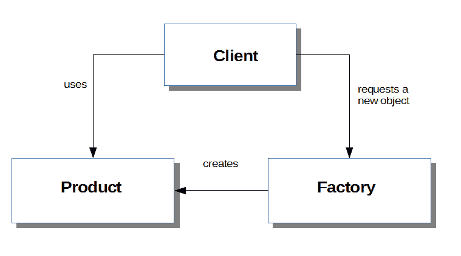
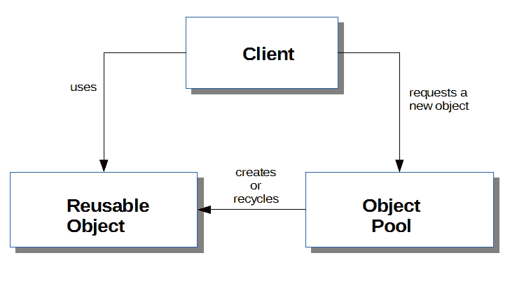
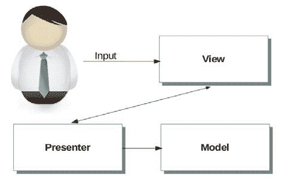
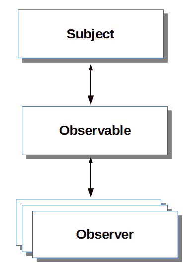
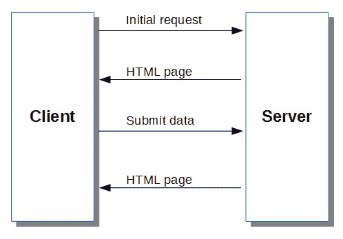
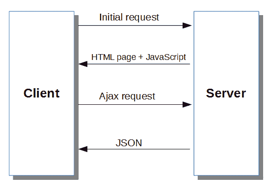
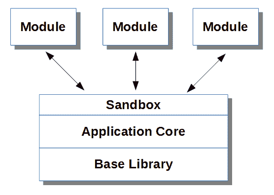
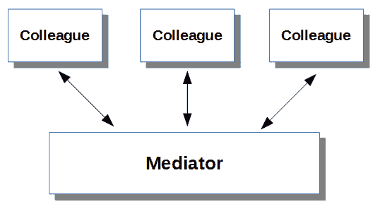

# Javascript 面向对象编程精通指南


[ iii ]

多接口实现

103

**鸭子类型与多态**

104

**总结**

106


107

**创建对象**

107

**设计模式与对象创建**

108

### 创建单例

109

构造函数的神秘行为

110

单例

111

何时使用单例？

113

### 对象工厂

113

理解工厂

113

带有构造函数注册的工厂

117

抽象工厂

118

### 建造者模式

121

何时使用建造者模式？

123

**工厂模式与建造者模式的对比**

124

**使用对象池回收对象**

125

**总结**

129


130

**用户界面管理**

130

用户界面问题

131

用户界面与 JavaScript

131

**表现层**

134

模型（Model）、视图（View）和控制器（Controller）

134

**模型-视图-控制器模式（MVC）**

135

**模型-视图-演示者模式（MVP）**

140

**模型-视图-视图模型模式（MVVM）**

146

**MV* 模式对比**

151

**总结**

152


154

**什么是数据绑定？**

154

数据绑定元素

155

数据绑定方向

156

**实现数据绑定**

157

手动数据绑定

157

监控变化

158

黑持属性（Hacking properties）

160


**使用代理** 167
- 代理类 167
- 使用代理进行数据绑定 169

**总结** 171


**JavaScript 是异步的吗？** 172
事件循环与异步代码 173
事件、Ajax 以及其他异步内容 174

**编写异步代码** 174
- 使用事件属性 174
- 使用回调函数 175
- 回调函数与 this 176
- 回调地狱 178
- 组织回调函数 180

异步代码的问题 181

**引入 Promises** 182
- 什么是 Promise？ 182
- Promise 术语 183
- 创建 Promise 184
- 消费 Promise 185
- 捕获失败 187
- 组合 Promise 189

**使用 Generators** 193
- 引入 Generators 193
- 使用 Generators 处理异步任务 194
- ES7 async/await 195

**总结** 196

**第 10 章：组织代码** 197

**全局作用域** 197
全局定义 198

**创建命名空间** 199
- 作为对象字量量的命名空间 200
- 使用 IIFE 定义命名空间 202


## 模块模式
203
- 模块与命名空间 (203)
- 使用匿名闭包 (204)
- 导入模块 (205)
- 扩展模块 (206)
  - 疏散扩展 (207)
  - 覆盖模块方法 (207)
  - 紧凑扩展 (208)
- 组合模块 (209)
  - 子模块 (209)

## 模块加载
210
- 模块、脚本和文件 (210)
- 简单的模块加载器 (212)
- CommonJS 模块 (214)
- 异步模块定义 (AMD) (215)
- 将模块模式与 AMD 结合 (217)
- 通用模块定义 (UMD) (219)
  - UMD (219)
- 依赖管理 (221)

## ECMAScript 6 模块
221
- ES6 模块加载 (224)

### 总结
225

226
### 面向对象设计原则
226
### 单一责任原则
227
### 开闭原则
231
### 里氏夫替换原则
236
### 接口隔离原则
238
### 依赖倒置原则
241
- 依赖倒置、控制反转和依赖注入 (245)
- 依赖注入方法 (246)

### 总结
247

248
### 从脚本到应用程序
248


## 单页应用
252

服务器角色
253

视图组合
254

导航与路由
255

远程数据
255

## Zakas/Osmani 架构
256

整体架构
257

模块
257

沙盒 (Sandbox)
258

外观 Fac模式 (Facade pattern)
259

应用核心
261

中介者模式 (Mediator pattern)
262

基础库
264

## 横切功能与 AOP
264

日志管理示例
265

使用继承
265

面向切面编程 (AOP) 方法
266

## 同构应用
267

### 总结
268

## 索引
270


## 前言

现在 JavaScript 是世界上最广泛使用的语言已成为一个事实。它最初作为用户与 HTML 之间简单的胶水而生，多年来不断演变并承担了日益重要的角色。今天，它的范围不再局限于 Web 浏览器，还运行在服务器、桌面电脑、移动设备乃至嵌入式设备上。JavaScript 不再是编写某些脚本的简单语言，而是一种创建复杂应用程序的语言。

遗憾的是，许多人认为 JavaScript 不能与 C++、Java 或 C# 等编程语言竞争。许多具有传统 OOP（面向对象）背景的开发者认为，JavaScript 不具备被视为真正面向对象语言的特征。本书旨在消除这种偏见，并证明 JavaScript 具备被视为真正 OOP 语言的特征，尽管它具有使其与众特性。得益于 ECMAScript 标准引入的最新创新，我们将看到如何使用 JavaScript 编写健壮且高效的代码，并将那些典型的面向对象编程原则用于创建可扩展和可维护的应用程序。

### 本书涵盖内容

- `第 1 章`，*对象回顾*，回顾了关于 JavaScript 中对象管理的一些基本概念，涵盖字面量对象、构造函数和类。
- `第 2 章`，*深入理解 OOP 原则*，展示了 JavaScript 支持所有让我们将其定义为真正 OOP 语言的基本原则。
- `第 3 章`，*封装与信息隐藏的应用*，描述了一些保护对象私有成员的技术，以实现封装和信息隐藏原则。
- `第 4 章`，*继承与混合类（Mixins）*，涵盖了基于原型的 JavaScript 继承机制以及混合类的创建。
- `第 5 章`，*通过鸭子类型定义合约*，重点关注使用鸭子类型而非类型检查，并展示了一些模拟经典 OOP 接口的技术。
- `第 6 章`，*高级对象创建*，讨论了创建对象的不同方法，并引入了一些设计模式，如工厂模式和构建器模式。
- `第 7 章`，*向用户展示数据*，探索了最常见的表现模式，如模型视图控制器（MVC）模式和模型视图 ViewModel（MVVM）模式。
- `第 8 章`，*数据绑定*，解释了如何实现数据绑定，并描述了观察者模式和发布者/订阅者模式等模式。
- `第 9 章`，*异步编程与 Promise*，讨论了 JavaScript 中异步编程的问题，并展示了如何用 Promise 和其他创新技术解决这些问题。
- `第 10 章`，*代码组织*，分析了用模块组织 JavaScript 代码的各种方法：从经典的 IIFE（立即调用函数）到最新的 ECMAScript 6 模块。
- `第 11 章`，*SOLID 原则*，探索了如何应用五个 SOLID 设计原则来创建可扩展和可维护的应用程序。
- `第 12 章`，*现代应用架构*，描述了 JavaScript 应用最常见的架构，并引入了外面模式和中介者模式。


## 前言

前言

在这本书中，你将学习如何使用 Spring Boot 和 Spring Security 构建并维护现代 Web 应用。我们将涵盖 Spring Boot 的基础知识，包括如何创建 RESTful API、集成数据库以及实现安全机制。

读完本书后，你将能够构建遵循行业最佳实践的安全、可扩展且高性能的应用程序。本书专为具有 Java 基础并想要进一步学习 Spring Boot 和 Spring Security 的开发者设计。无需具备 Spring Boot 或 Spring Security 的相关经验。


## 前言

## 客户支持

现在您已成为 Packt 书籍的幸运拥有，我们准备了一些内容来帮助您从购买中获得最大的价值。

### 下载示例代码

您可以从 https://www.packtpub.com 的账户中下载本书的示例文件。如果您是在其他地方购买的此书，可以访问 https://www.packtpub.com/support 并注册，以便将文件直接通过电子邮件发送给您。

您可以通过以下步骤下载代码文件：

- 使用您的电子邮件地址和密码登录或注册我们的网站。
- 1. 将鼠标指针悬停在顶部的 **SUPPORT**（支持）标签页上。
- 2. 点击 **Code Downloads & Errata**（代码下载与勘误）。
- 3. 在 **Search**（搜索）框中输入书名。
- 4. 选择您想要下载代码文件的书籍。
- 5. 从下拉菜单中选择您购买本书的地方。
- 6. 点击 **Code Download**（下载代码）。
- 7. 文件下载完成后，请确保使用以下最新版本的软件解压或提取文件夹：

- Windows 版：WinRAR / 7-Zip
- Mac 版：Zipeg / iZip / UnRarX
- Linux 版：7-Zip / PeaZip

本书的代码包也托管在 GitHub 上：https://github.com/PacktPublish/Mastering-JavaScript-Object-Oriented-Programming。我们还在丰富的书籍和视频目录中提供了其他代码包，可访问 https://github.com/PacktPublish/。欢迎去查看！


## 前言

### 勘误

尽管我们已尽全力确保内容的准确性，但错误仍然在所避免。如果您在我们的某一书中发现错误——可能是文本或代码中的错误——如果您能向我们报告，我们将不胜感激。这样做可以避免其他读者产生挫败感，并帮助我们改进本书的后续版本。如果您发现任何勘误，请访问 `https://www.packtpub.com/submit-errata` 进行报告，选择您的书籍，点击 **Errata Submission Form**（错误提交表）链接，并输入您的错误详情。一旦您的错误通过验证，您的提交将被接受，该错误将上传到我们的网站，或添加到标题下的任何现有错误列表中。

要查看之前提交的错误，请访问 `https://www.packtpub.com/books/content/support` 并在搜索字段中输入书名。所需信息将出现在 **Errata**（勘误）部分下。

### 盗版

互联网上版权材料的盗版是一个跨所有媒体的持续存在的问题。在 Packt，我们非常重视对版权和许可的保护。如果您在互联网上遇到任何形式的我们作品的非法副本，请立即向我们提供地址或网站名称，以便我们采取补救措施。

请通过 `copyright@packtpub.com` 与我们联系，并提供疑似盗版材料的链接。

感谢您为保护作者以及我们提供价值内容的能力所提供的帮助。

### 问题

如果您对本书的任何方面有疑问，可以通过 `questions@packtpub.com` 与我们联系，我们将尽力解决该问题。


## 对象复习

任何 JavaScript 程序员都知道，这种脚本语言中的几乎所有内容都是对象——从数组到函数，从正则表达式到日期。我们可以说，任何不是原始数据类型的类型都是对象。但是，即使是像数字或字符串这样的原始数据类型也有对象包装器（object wrappers），也就是说它们可以通过对象进行访问。因此，我们可以认为对象在 JavaScript 中至关重要，我们需要尽可能地学习对象的使用方法，以便创建出更好的应用程序。例如，更好地使用对象的一种方法是应用**面向对象编程**（**OOP**）范式。

然而，在深入研究这种编程方法的原则和模式之前，让我们先通过对对象基础知识的快速回顾开始第一章。特别是，本章将讨论：

- 如何创建和管理字面量对象
- 如何定义对象构造函数
- 什么是原型（prototype）以及如何使用它
- 新的 ECMAScript 2015 `class` 构造函数及其与对象、构造函数和原型之间的关系

### 对象字面量

对象是一个值的容器，这些值组合成一个具有特定标识单一数据结构。事实上，对象通常通过数据和功能的聚合来表示特定的实体，例如人、订单、发票、预订等。


## 对象复习

正如我们看到的，一个带有特定属性的对象被赋值给 `address` 属性。

要访问存储在对象中的值，有两种方法。第一种方法是所谓的**点符号表示法**（dot-notation），我们通过点分隔符来指定对象以及我们感兴趣的属性：

`var name = person.name;`

这通常是最常用的方法，因为它更紧凑，而且对于接触过其他编程语言的开发者来说非常熟悉。

使用第二种方法，我们通过在方括号中以字符串形式指定名称来确定对象的属性：

`var name = person["name"];`

当属性名不符合 JavaScript 变量名的命名规则时，这种方法是强制性的。例如，我们无法使用**点符号表示法**来访问名为 `first-name` 的属性。

如果我们尝试访问对象不存在的属性，不会产生错误，而是返回 `undefined` 值。因此，在下面的示例中，`age` 变量将获得 *undefined* 的值：

`var age = person.age;`

如果我们尝试给一个尚未定义的属性赋值，我们实际上会创建该属性并用赋值的值对其进行初始化：

`person.age = 28;`

这个示例向我们展示了 JavaScript 对象的动态特性。对象的结构非常灵活，可以在脚本执行期间动态更改。这一特性为我们提供了一种基于增量定义来创建对象的替代方法。在实践中，我们不需要完全定义对象的字面量表示，而是可以从基础表示开始，并逐渐通过我们想要的属性来丰富它。遵循这种方法，我们可以如下定义对象 `person`：

`var person = {};`

`person.name = "John";`

`person.surname = "Smith";`

`person.address = {`

`street: "123 Duncannon Street",`

`country: "United Kingdom"`

`}};`


## 对象复习


[ 9 ]

city: "London",
country: "United Kingdom"
};

person.age = 28;

除了能够动态创建对象的属性，我们还可以使用 `delete` 语句在运行时删除它们。以下示例展示了如何从 person 对象中移除 `address` 属性：

delete person.address;

在移除 `address` 属性后，任何访问它的尝试都将返回值 *undefined*。

### 方法

对象的属性代表数据，而方法代表对象可以执行的操作。从语法角度来看，对象方法的定义与属性的定义非常相似。这是一个示例：

function showFullName() {

return "John Smith";
}

person.fullName = showFullName;

我们也可以像这里这样在对象的字面量表示内部为其赋值方法：

var person = {name: "John",

surname: "Smith",

showFullName: function() {

return "John Smith";

}

};

ECMAScript 2015 允许我们以更直接的形式在字面量中定义方法，如下例所示：

var person = {name: "John",

surname: "Smith",

showFullName() {

return "John Smith";

}

};


## 对象复习

实际上，在 JavaScript 中，属性和方法之间的区别在某种程度上是人为的。事实上，由于函数也是对象，方法无非只是一个被赋值了函数的属性。

顺便提一下，由于赋值给属性的值可以在运行时发生变化，一个最初被赋值为函数的属性，随后可能会被赋予不同的值（例如字符串或数字）。与其他编程语言不同，方法并不是对象成员的一种稳定状态，它不是属性的固有特征。我们可以简单地断定，当一个属性拥有函数时，它就是一个方法，但这是一种**动态状态**。

在上一个示例中，我们定义了一个仅返回字符串的函数，并将该函数名赋值给 `person` 对象的一个新属性。注意，我们并不是将函数调用的结果赋值给属性，而是通过其名称将函数本身进行赋值。

`fullName` 属性因为被赋值了函数，所以实际上是一个方法。要运行它，我们必须像调用普通函数一样通过指定括号来引用它：

`var nameAndSurname = person.fullName();`

当然，我们可以像下面的示例一样直接为属性赋值一个匿名函数：

`person.fullname = function () {`

`return "John Smith";`

`}`

我们刚刚在示例中定义的方法并没有那么用。即使我们为 `person` 对象的名和姓赋值了不同的值，它总是显示相同的字符串。如果能有一种方法显示对应属性的当前值将会非常有用。

JavaScript 允许我们通过 *this* 关键字来实现这个目标。该关键字代表方法被调用时所调用的对象。因此，我们可以如下重写我们的方法：

`person.fullName = function () {`

`return this.name + " " + this.surname;`

`};`

这保证了在调用时能够正确显示当前的数据。


## 对象复习

## 对象构造函数

正如我们在示例中所看到的，使用字面量表示法（literal notation）创建对象非常直观。我们不需要定义类，而是在需要时直接创建对象，并希望在脚本执行期间更改它的结构。

假设我们需要多个相同类型的对象，例如多个“人员（person）”对象，并且它们共享相同的结构。

如果使用字面量表示法，我们必须为想要创建的每个对象重复定义，这对于识别单个个人是必不可少的，但对于方法等常量成员来说，这种重复是不必要的。换句话说，在定义对象时使用字面量表示法会导致我们得到一个不可复用的结果。例如，如果我们想创建两个人物对象，需要编写以下代码：

```javascript
var johnSmith = {name: "John",
  surname: "Smith",
  address: {
    street: "13 Duncannon Street",
    city: "London",
    country: "United Kingdom"
  },
  displayFullName = function() {
    return this.name + " " + this.surname;
  }
};

var marioRossi = {name: "Mario",
  surname: "Rossi",
  address: {
    street: "Piazza Colonna 370",
    city: "Roma",
    country: "Italy"
  },
  displayFullName = function() {
    return this.name + " " + this.surname;
  }
};
```

```javascript
function Person() {
  this.name = "";
  this.surname = "";
}
```


## 对象复习

通过这种方式，当我们想要创建具有相同结构的多个对象时，只需要限制于设置区分不同对象的特定特定值即可。

如你所见，构造函数的名称首字母是大写的。这并不是 JavaScript 的强制要求，但是一种常见的约定，有助于区分普通函数和构造函数。

在构造函数的定义中，我们可以预期存在参数，这些参数可以用于对象的初始化。例如，考虑以下 `person` 对象构造函数的定义：

```javascript
function Person(name, surname) {
  this.name = name;
  this.surname = surname;
  this.address = "";
  this.email = "";
  this.displayFullName = function(){..};
}
```

它允许我们通过在调用构造函数时直接指定值来创建并初始化对象，例如所示：

```javascript
var johnSmith = new Person("John", "Smith");
var marioRossi = new Person("Mario", "Rossi");
```


## 对象回顾


## 对象的复习

### Object() 构造函数

我们已经看到使用构造函数在创建对象时提供了更高层次的抽象。在本节中，我们将深入探索 JavaScript 提供的一个特殊构造函数——`Object()` 构造函数。

该构造函数允许我们创建一个通用对象，如下例所示：

```javascript
var person = new Object();
person.name = "John";
person.surname = "Smith";
```

在这里，我们使用 `new` 运算符创建一个空对象的实例，然后像字面量方法一样通过赋值创建属性。

实际上，使用字面量符号创建对象与通过 `Object()` 构造函数创建对象是等价的。每个使用字面量符号创建的对象都以 `Object()` 作为其隐式构造函数。我们可以通过访问每个对象拥有的 `constructor` 属性来实现：

```javascript
var person = {};
console.log(person.constructor == Object); //结果: true
```

`Object()` 构造函数还能根据任何 JavaScript 表达式生成对象实例，如下代码所示：

```javascript
var number = new Object(12);
var anotherNumber = new Object(3*2);
var string = new Object("test");
var person = new Object({name: "John", surname: "Smith"});
```

除了最后一条与通过字面量表示创建对象等同外，前三语句是从原始数据类型（如数字或字符串）创建对象。其结果不仅仅是一个数值或字符串值，而是专门处理数值和字符串的内置对象。

我们将在书后部分重新讨论用于高级模式的 `Object()` 构造函数。


## 对象复习

### 对象原型

JavaScript 对象的灵活性主要体现在创建后仍可以更改其结构上。即使在使用
构造函数创建对象时，我们仍然拥有这种可能性。例如，你可以编写以下
代码：

```javascript
var johnSmith = new Person("John", "Smith");
var marioRossi = new Person("Mario", "Rossi");
johnSmith.greets = function() {
    console.log("Hello " + this.name + " " + this.surname + "!");
};
```

这段代码为 `johnSmith` 对象创建了一个 `greets()` 方法，而不会影响 `marioRossi` 的结构。

基本上，在创建对象时，我们可以从构造函数定义的通用结构开始，然后根据
需求进行定制。

但我们如何修改所有使用构造函数创建的对象的结构呢？例如，假设在使用`Person()` 构造函数创建了多个对象后，我们希望所有的 `Person` 实例都拥有 `greets()` 方法。我们可以利用 JavaScript 面向对象编程中最有趣的特性之一——**原型**来实现。

在我们的案例中，将按照以下方式操作：

```javascript
Person.prototype.greets = function() {
    console.log("Hello " + this.name + " " + this.surname + "!");
};
```

这次赋值意味着所有使用 `Person()` 构造函数创建的对象都将立即可以使用 `greets()` 方法。

准确来说，新方法并没有直接附加到每个对象上，但可以像它是对象的方法一样被调用。


## 对象复习

如果我们尝试访问一个对象本身并不具备的属性或方法，JavaScript 将会在其原型（prototype）的属性和方法中进行查找。因此，在我们之前的示例中，如果我们尝试访问 `marioRossi` 对象的 `greets()` 方法，JavaScript 不会在该对象的方法中找到它，但它将会在其原型的方法中找到它。

对象的原型也可以拥有另一个原型。在这种情况下，对属性或方法的查找将沿着原型链向上进行，直到你找到 *object* —— 即所有对象的基类原型。

JavaScript 内置对象也具有原型引用。在大多数情况下，它们的原型管理与我们通过构造函数创建的对象的原型管理方式非常相似。

这使得我们能够以一种非常简单且优雅的方式扩展内置对象未提供的功能。

例如，如果我们想为所有字符串提供一个 `padding` 方法，我们可以对 `String()` 构造函数的原型进行操作，如下：

```javascript
String.prototype.padLeft = function(width, char) {
  var result = this;
  char = char || " ";
  if (this.length < width) {
    result = new Array(width - this.length + 1).join(char) + this;
  }
  return result;
};
```

通过这个定义，我们可以像使用所有字符串的内置方法一样使用 `padLeft()`，如下例所示：

```javascript
console.log("abc".padLeft(10, "x")); //"xxxxxxxabc"
```

## 使用类

到为止，我们通过两种机制创建了对象：字面量符号和构造函数。这些机制让我们能够以简单的方法创建对象，而没有过多的形式。

然而，大多数开发者习惯于从类（class）结构创建对象。事实上，许多面向对象的语言允许开发者定义类，并创建这些类的实例来创建对象。


## 对象复习

**ECMAScript 2015**（也称为 **ECMAScript 6** 或 **ES6**）规范在 JavaScript 中也引入了**class**（类）结构。然而，这种结构与传统面向对象编程范式中的类并没有关系。

在 Java 或 C# 等其他语言中，类是对象结构的一种抽象描述；而在 JavaScript 中，`class` 结构仅仅是我们已经见过的创建对象方法的语法上的简化。JavaScript 的 `class` 结构为管理构造函数、原型和继承提供了了更简单、更清晰的语法。

新的 `class` 结构为不同的对象创建方式建立了秩序，并旨在在原型管理中应用最佳实践。

让我们来看看类长什么样：

```javascript
class Person {
  constructor(name, surname) {
    this.name = name;
    this.surname = surname;
  }
}
```

这个类为类型为 `Person` 的对象定义了一个构造函数。它完全等同于以下旧式的 JavaScript 代码：

```javascript
function Person(name, surname) {
  "use strict";
  this.name = name;
  this.surname = surname;
}
```

我们可以意识到，类仅仅是构造函数定义的语法糖，通过 `typeof` 语句即可轻松获取类的类型：

```javascript
console.log(typeof Person); //function
```

我们可以像使用构造函数一样使用类来创建对象，如下例所示：

```javascript
var person = new Person("John", "Smith");
```

然而，与构造函数不同，我们不能像调用函数一样调用类，因为以下代码将抛出异常：

```javascript
var person = Person("John", "Smith");
```


## 对象复习

类的构造函数是一个具有保留留名称 `constructor` 的方法。你不能在一个类中拥有多个 `constructor()` 方法。

默认情况下，如果构造函数方法没有 `return` 语句，它将返回新实例，这与常见的 JavaScript 构造函数一致。然而，通过在构造函数体中插入 `return` 语句，可以覆盖默认行为。例如，以下代码定义了一个返回字面量实例的构造函数：

`class myClass {`

`constructor(value) {`


## 对象回顾


## 深入理解 OOP 原则

在上一章中，我们介绍了对象以及它们在 JavaScript 中的基本用法。我们已经看到对象在该语言中起着关键作用，但许多开发者认为，与 Java、C# 等其他 OOP 语言相比，JavaScript 的对象管理方法显得非常简单。

事实上，一个常见的误解涉及到 JavaScript 的面向对象特性。许多开发者并不将 JavaScript 视为一种真正的面向对象语言，而仅仅是一种在对象使用上非常奇特的语言。

在本章中，我们将通过通过展示 JavaScript 如何符合 OOP 原则来讨论其 OOP 特性。同时，我们还将解释它与经典 OOP 之间的主要区别。本章将涵盖以下主题：

- OOP 范式的原则是什么？
- 对抽象和建模的支持
- JavaScript 如何实现聚合（Aggregation）、关联（Association）和组合（Composition）
- JavaScript 中的封装（Encapsulation）原则
- JavaScript 如何支持继承（Inheritance）原则
- 对多态（Polymorphism）原则的支持
- 经典 OOP 与 JavaScript OOP 之间的区别


## 深入理解 OOP 原则

满足这些要求通常允许我们将一门语言分类为面向对象语言。

### JavaScript 是面向对象的吗？

一旦我们确立了定义一种语言为面向对象的通用原则，我们就能肯定 JavaScript 是一门 OOP 语言吗？许多开发者并不认为 JavaScript 是一门真正的面向对象语言，因为它缺乏类的概念，并且它不强制遵守 OOP 原则。

然而，我们可以看到，我们的非正式定义并没有明确提到“类”。对象需要的是特性和原则。类并不是真正的需求，但它们有时是抽象具有共同属性的对象集合的方便方式。因此，如果一门语言在没有类的情况下也支持对象（如 JavaScript），那么它就可以是面向对象的。

此外，语言所需的 OOP 原则是旨在被**支持**的。它们不应该是在该语言中进行编程的强制性要求。开发者可以选择或不使用允许其创建面向对象代码的结构。许多人批评 JavaScript，是因为开发者可以编写出违反 OOP 原则的代码。但这是程序员的选择，而不是语言的限制。这种情况在 C++ 等其他编程语言中也会发生。

我们可以得出结论：缺乏抽象类以及允许开发者自由使用或不使用支持 OOP 原则的功能，并不是将 JavaScript 视为 OOP 语言的真正障碍。因此，让我们在接下来的章节中分析 JavaScript 是支持抽象和 OOP 原则的。

### 抽象和建模支持

我们将一门语言视为面向对象的第一个要求是它支持通过对象对问题进行建模。我们已经知道 JavaScript 支持对象，但在这里我们应该确定是否支持它们以便能够建模现实。

事实上，在面向对象编程中，我们试图对现实世界的实体和过程进行建模，并在我们的软件中表示它们。我们需要模型是因为它是现实的简化，它允许我们通过从特定视角提供视野来降低复杂性，并帮助我们推断实体之间的关系。


## 深入理解 OOP 原则

这种简化功能通常被称为*抽象*，它有时被认为是面向对象编程（OOP）的原则之一。抽象是将关注点从物的细节和具体实现转移到与特定目的相关的特征，并采用更通用、更抽象的方法。换句话说，抽象是定义现实世界实体的哪些属性和行为需要通过程序中的对象来表示，以解决特定问题的能力。

例如，得益于抽象，我们可以决定为了解决某个特定问题，可以将人仅表示为一个具有姓名、姓氏和年龄的对象，因为地址、身高、发色等其他信息与我们的目的无关。

**关联（Association）**

关联是两个或多个对象之间的关系，其中每个对象都是相互独立的。这意味着一个对象可以在没有另一个的情况下存在，且没有对象拥有另一个对象。

让我们通过示例来澄清。为了定义人与人之间的父子关系，我们可以如下操作：

```javascript
function Person(name, surname) {
  this.name = name;
  this.surname = surname;
  this.parent = null;
}

var johnSmith = new Person("John", "Smith");
var fredSmith = new Person("Fred", "Smith");

fredSmith.parent = johnSmith;
```


## 深入理解 OOP 原则

正如示例所示，JavaScript 允许我们使用简单的对象引用来定义对象之间的关联关系。

### 聚合 (Aggregation)

聚合是关联关系的一种特殊形式，其中一个对象比另一个具有更主要的作用。通常，这种主要作用决定了一个对象相对于另一个对象的所有权。所有者对象通常被称为*聚合体*（aggregate），而被拥有的对象被称为*组件*（component）。聚合关系的一个例子是公司与其员工之间的关系，如下例所示：

```javascript
var company = {
  name: "ACME Inc.",
  employees: []
};

var johnSmith = new Person("John", "Smith");
var marioRossi = new Person("Mario", "Rossi");

company.employees.push(johnSmith);
company.employees.push(marioRossi);
```

添加到 `employees` 集合中的人员对象有助于定义公司对象，但它们与该对象是相互独立的。如果删除了公司对象，每个个人依然存在。然而，公司的真实意义与其员工的存在紧密相关。

再次，代码告诉我们 JavaScript 通过对象引用支持聚合关系。在任何情况下，JavaScript 都不对我们之间关联或聚合对象的方式进行控制。关联和聚合提出的约束更多是概念上的，而非技术上的。


## 深入理解面向对象原则

### 封装

对象是面向对象编程模型的核心，它们是*封装*的典型体现，即在单个实体中同时集中数据（属性）和函数（方法）的能力。

换句话说，封装原则允许对象只暴露使用它时所需的内容，而隐藏其实现的复杂性。这是一个非常强大的原则，在现实世界中随处可见，它让我们能够在不了解对象内部工作原理的情况下使用它。例如，考虑我们如何开车：我们只需要知道如何加速、刹车和改变方向。我们不需要了解汽车运行的细节，不需要知道发动机是如何燃烧燃料或将运动传递到轮子上的。


## 深入理解面向对象（OOP）原则

为了理解这一原则在软件开发中的重要性，请考虑以下代码：

```javascript
var company = {
  name: "ACME Inc.",
  employees: [],
  sortEmployeesByName: function({...}
};
```

它创建了一个 `company` 对象，包含一个名称、一个员工列表以及一个使用姓名对员工排序的方法。如果我们需要获取排序后的员工列表，只需要知道 `sortEmployeesByName()` 方法可以完成这项任务即可。我们不需要知道这个方法是如何工作的，也不它实现了哪种算法。这就是封装（encapsulation）为我们隐藏的内部实现细节。

隐藏内部细节和复杂性主要有两个原因：

- 第一个原因是提供一种简化且易懂的方式来使用对象，而无需理解内部的复杂性。在我们的示例中，我们只需要知道要对员工排序必须调用一个特定的方法。
- 第二个原因是简化变更管理。内部排序算法的更改不会影响我们按姓名排序员工的方式。我们始终调用同一个方法。也许我们会获得更高效的执行速度，但预期结果不会改变。

我们提到过，封装隐藏内部细节是为了简化对象的使用及其内部实现的更改。然而，当内部实现依赖于公开访问的属性时，我们可能会面临隐藏内部行为努力的风险。例如，如果你给 `company` 对象的 `employees` 属性赋值一个字符串会发生什么？

```javascript
company.employees = "this is a joke!";
company.sortEmployeesByName();
```

在 JavaScript 中，给一个值为数组的属性赋值字符串是完全合法的，因为它是一种动态类型语言。但很可能，在这次赋值之后调用排序方法时，我们会遇到异常，因为排序算法期望的是一个数组。


## 深入理解 OOP 原理

深入理解 OOP 原理


## 深入理解 OOP 原则

在面向对象（OOP）中，继承允许新对象获取现有对象的属性。这种两个对象之间的关系非常常见，可以在现实中的许多情况下找到。它通常指的是从一个更通用的对象创建一个特化的对象。


## 深入理解 OOP 原则

这种方法与面向对象编程的目标相背离。特别是，它没有重用现有代码，因为我们正在复制 `person` 对象的属性。更合适的方法应该是重用为定义 `person` 对象而创建的代码。这正是继承原则可以帮助我们的地方。它允许我们在对象之间共享共同特征，避免代码重复：

在支持类的语言中，继承也被称为*子类化*（subclassing）。继承自另一个类的类被称为*子类*（subclass），而它派生的类被称为*父类*（superclass）。除了命名之外，继承的概念是相同的，尽管它显然似乎并不非常适用于 JavaScript。

我们可以通过多种方式在 JavaScript 中实现继承。例如，考虑以下 `person` 对象的构造函数：

`function Person() {`
`this.name = "";`
`this.surname = "";`
`}`

为了将程序员定义为专精计算机编程的人员，我们将添加一个新属性来描述其对编程语言的了解：

`knownLanguage`。

创建一个继承 `person` 属性的程序员对象的简单方法是基于原型的。以下是一种可能的实现方式：

`function Programmer() {`
`this.knownLanguage = "";`
`}`

`Programmer.prototype = new Person();`

我们将使用以下代码创建一个程序员：

`var programmer = new Programmer();`


## 深入理解 OOP 原则

我们将获得一个既拥有人物属性（`name` 和 `surname`）又拥有程序员特定属性（`knownLanguage`）的对象，也就是说程序员对象继承了人物属性。

这是一个简单的示例，用于证明 JavaScript 在基础层面支持面向对象编程的继承原则。继承是一个复杂的概念，在编程中具有许多方面和多种变体，其中许多变体取决于所使用的语言。

在`Chapter 4` *继承与创建 Mixins (Inheriting and Creating Mixins)* 中，我们将更深入地探讨 JavaScript 如何支持继承，分析不同的方法以及如重写和多重继承等更高级的话题。

## 多态

在面向对象编程中，多态有不同的理解方式，尽管其基础是一个共同的概念——统一处理多种数据类型的能力。支持多态为编程带来了益处，有助于实现 OOP 的总体目标。它主要减少了应用程序中的耦合性，在某些情况下允许创建更紧凑的代码。

编程语言支持多态的最常见方式包括：
- 接受不同数据类型参数的方法（重载）
- 对预先未知的泛型进行管理（参数多态）
- 类型可以由类表示以及从其派生类的表达式（*子类型多态*或*包含多态*）

在大多数语言中，*重载*是指拥有两个相同名称但签名不同的方法时所发生的情况。在编译时，编译器根据调用参数的类型与方法参数之间的匹配关系来确定调用哪个方法。

以下是 C# 中方法重载的示例：

```csharp
public int CountItems(int x) {
    return x.ToString().Length;
}

public int CountItems(string x) {
    return x.Length;
}
```


## 深入理解面向对象编程原则

面向对象编程（OOP）是一种基于“对象”概念的范式，对象可以包含以字段（属性）形式的数据以及以过程（方法）形式的代码。OOP 的四大支柱是：

-   **封装**：将数据与操作这些数据的方法封装在单一单元中，同时限制外部对对象某些组件的直接访问。
-   **抽象**：隐藏复杂的实现细节，仅向外部展示对象的必要特征的过程。
-   **继承**：允许一个类获取另一个类的属性和方法的机制，从而促进代码的重用。
-   **多态**：允许不同对象能够以统一的方式被视为同一个父类的实例的能力，通常通过方法重写或重载来实现。


## 深入理解 OOP 原则

面向对象编程（OOP）是一种基于“对象”概念的编程范式，对象可以包含以字段（属性、特性）形式的数据以及以过程（方法）形式的代码。OOP 的主要目标是提高程序的重用性、灵活性和可维护性。

OOP 的核心支柱如下：

- **封装 (Encapsulation)**：将数据和操作该数据的方法封装成单个单元（类）实践，并限制对对象某些组件的直接访问。这有助于防止数据的意外修改。
- **继承 (Inheritance)**：一种让新类（子类或后生类）从现有类（父类或基类）继承属性和方法的机制。这促进了代码的重用，并在类之间建立了层次结构。
- **多态 (Polymorphism)**：不同对象以自己的方式响应相同消息调用的能力。这通常通过方法重载（编译时多态）和方法重写（运行时多态）来实现。
- **抽象 (Abstraction)**：隐藏复杂的实现细节并仅显示对象必要特征的过程。这允许程序员关注对象“做什么”，而不是它“如何实现”。

通过遵循这些原则，开发者可以构建出随着时间推移而更容易管理、扩展和调试的复杂系统。


## 深入理解 OOP 原则

让我们通过一个 C# 示例来澄清这一概念：

```csharp
public class Person {
    public string Name { get; set; }
    public string SurName { get; set; }
}

public class Programmer:Person {
    public String KnownLanguage { get; set; }
}

public void WriteFullName(Person p) {
    Console.WriteLine(p.Name + " " + p.SurName);
}

var a = new Person();
a.Name = "John";
a.SurName = "Smith";

var b = new Programmer();
b.Name = "Mario";
b.SurName = "Rossi";
b.KnownLanguage = "C#";

WriteFullName(a); // result: John Smith
WriteFullName(b); // result: Mario Rossi
```

在这段代码中，我们再次展示了 `Person` 类及其派生类 `Programmer` 的定义，并定义了接受 `Person` 类型参数的方法 `WriteFullName()`。得于子类型多态（subtype polymorphism），我们可以将 `Programmer` 类型的对象也传递给 `WriteFullName()`，因为它是派生自 `Person`。事实上，从概念角度来说，程序员也是一个人，因此子类型多态符合现实世界的具体表现。

当然，这个 C# 示例很容易在 JavaScript 中复现，因为我们没有类型限制。让我们来看看相应的代码：

```javascript
function Person() {
    this.name = "";
    this.surname = "";
}

function Programmer() {
    this.knownLanguage = "";
}

Programmer.prototype = new Person();
```


## 深入理解 OOP 原则

到为止的讨论展示了 JavaScript 如何支持基本的 OOP 原则，并且像许多其他语言一样可以被视为真正的 OOP 语言。然而，JavaScript 在某些特定特性上与大多数语言不同，这些特性对于习惯于实现经典 OOP 的编程语言的开发者可能会产生一些困。

这些特性中的第一个是该语言在数据类型管理和对象创建方面的动态性质。由于数据类型是动态评估的，OOP 的某些特性（如多态）得到了隐式支持。此外，在运行时更改对象结构的能力打破了将对象与更抽象的实体（如类）绑定的常识。

缺乏类（class）的概念是与经典 OOP 的另一个大区别。当然，我们谈论的是类的泛化（class generalization），与 ES6 引入的 `class` 语法结构无关，后者仅仅是代表标准 JavaScript 构造函数的语法便利性。

### [ 34 ]

```javascript
function writeFullName(p) {
  console.log(p.name + " " + p.surname);
}

var a = new Person();
a.name = "John";
a.surname = "Smith";

var b = new Programmer();
b.name = "Mario";
b.surname = "Rossi";
b.knownLanguage = "JavaScript";

writeFullName(a); //result: John Smith
writeFullName(b); //result: Mario Rossi
```


## 深入理解 OOP 原则

因此，经典的面向对象编程有两种类型的抽象：类（classes）和对象（objects）。对象是现实世界实体的抽象，而类是对象或另一个类的抽象（换句话说，它是一种泛化）。在经典的 OOP 语言中，对象只能通过实例化类来创建。

JavaScript 在对象管理上有一种不同的方法。它只有一种抽象类型——对象。与经典的 OOP 方法不同，对象可以直接作为对现实世界实体的抽象被创建，也可以作为另一个对象的抽象被创建。在后一种情况下，被抽象的对象被称为**原型**（prototype）。与经典的 OOP 方法相比，JavaScript 的方法有时被称为*原型型面向对象编程*（Prototypal Object-Oriented Programming）。

当然，JavaScript 中缺乏类的概念会影响继承机制。事实上，在经典 OOP 中，继承是允许在类上进行的操作；而在原型 OOP 中，继承是针对对象进行的操作。

### 总结

在本章中，我们探索了 OOP 范式的基本原则。我们关注了通过抽象来定义对象，通过关联（association）、聚合（aggregation）和组合（composition）来定义对象之间的关系，以及封装、继承和多态性原则来概述 OOP 所需的基本原则。

一旦我们确定了 JavaScript 是一种像 Java、C# 和 C++ 等语言一样真正的面向对象语言，我们将在后续章节中继续探索如何利用 OOP 支持来开发应用程序。特别是在下一章中，我们将关注封装和信息隐藏，分析高级 JavaScript 支持以及最常见的模式。


## 3. 封装与信息隐藏的实践

在本章中，我们将探讨封装与信息隐藏之间的关系，并学习实现 JavaScript 对象成员可见性和可访问性的不同方法。本章将涵盖以下主题：

- 公有属性与私有属性
- 作用域与闭包
- 保护私有成员的技术
- 获取器（getters）、设置器（setters）和属性描述符（property descriptors）
- ES6 类中的属性定义

### 封装与信息隐藏

封装是面向对象编程（OOP）范式的基本原则之一。它允许我们将数据以及操作这些数据的功能封装在一个对象中。


## 使用封装与信息隐藏

这段代码定义了一个构造函数，用于表示剧院中的座椅，人们可以被安置在那里。其预期用途如下：

`var theatreSeats = new TheatreSeats();`
`theatreSeats.placePerson({name: "John", surname: "Smith"});`

`_seats` 属性是实际容器，其下划线前缀表示它应该被视为内部属性。当然，这仅仅是一种约定——开发者应该知道，名称以下划线开头的对象成员是供内部使用的。

然而，在技术上并没有障碍可以阻止开发者使用该成员。内部细节并没有被真正隐藏，隐私性取决于开发者的意愿。除此之外，这种基于约定的方法还有其他缺点。例如，它用不应被使用的成员污染了公共接口，违背了“使用对象应当是简单的”的原则。此外，在使用继承时，它可能会导致属性冲突。

尽管这种方法看起来很简单，但它已被 *jQuery* 和 *Backbone.js* 等常见的 JavaScript 库广泛使用。

## 使用闭包实现隐私级别

修复约定方法不一致性的一种简单方法是：不再使用属性作为内部成员，而是在构造函数内部声明变量，如下例所示：

`function TheatreSeats() {`
`var seats = [];`
`this.placePerson = function(person) {`
`seats.push(person);`
`};`
`}`

使用这种方法，我们可以继续像常一样使用构造函数，同时防止对实际内部容器 `seats` 变量的访问。我们正在利用 `TheatreSeats()` 函数的内部环境来隐藏实现细节，并为构建 JavaScript 对象的私有和公共部分奠定基础。


## 封装与信息隐藏的工作


（注：提供的 OCR 文本主要由重复的图像占位符和标题组成。除标题外，源中没有正文内容。）


## 使用封装与信息隐藏


在面向对象编程中，封装是将数据（变量）和操作这些数据的方法打包成一个单一单元（称为类）的机制。它还涉及限制对对象某些组件的直接访问，这被称为信息隐藏。

信息隐藏允许程序员隐藏对象的内部状态，并仅向外部世界暴露公共接口。这有助于降低复杂性，并提高代码的可维护性和灵活性。

封装的主要优势在于于：

-   **抽象**：用户只需要知道如何与公共接口进行交互。
-   **灵活性**：可以更改类的内部实现，而不影响使用该类的代码。
-   **安全性**：可以保护数据免受意外或未经授权的修改。
-   **可重用性**：封装过的类可以在程序的不同部分重用。

在 JavaScript 中，封装通过使用类以及访问修饰符如 `public`、`protected` 和 `private`来实现（尽管 JavaScript 特别使用 `#` 符号来表示私有字段）。

```javascript
class Account {
  #balance; // Private field

  constructor(initialBalance) {
    this.#balance = initialBalance;
  }

  getBalance() {
    return this.#balance;
  }

  deposit(amount) {
    if (amount > 0) {
      this.#balance += amount;
    }
  }

  withdraw(amount) {
    if (amount > 0 && amount <= this.#balance) {
      this.#balance -= amount;
    }
  }
}

const myAccount = new Account(100);
myAccount.deposit(50);
console.log(myAccount.getBalance()); // 150
// console.log(myAccount.#balance); // Syntax Error: Private field '#balance' must be declared in an class
```


## 使用封装与信息隐藏

封装和信息隐藏是面向对象编程中的两个基本概念。封装是指将数据（属性）和操作这些数据的方法封装成一个单一单元（类类）的机制。信息隐藏则是限制对对象某些组件的访问的实践，通过公共接口来限制交互。

通过使用这些技术，开发者可以保护对象的内部状态免受意外的干扰和误用，从而编写出更具维护性且更健壮的代码。


## 使用封装与信息隐藏

因此，通过利用构造函数的闭包（closure），我们可以为 JavaScript 对象实现信息隐藏原则。然而，正如我们所看到的，`TheatreSeats()`构造函数的新定义与原始定义略有不同。在原始定义中，我们将`placePerson()` 方法附加到构造函数的原型（prototype）上，但现在我们无法采用这种方法。事实上，原型上的方法无法访问构造函数的闭包，因此以下代码无法运行：

```javascript
function TheatreSeats() {
  var seats = [];
}

TheatreSeats.prototype.placePerson = function(person) {
  seats.push(person);
};

var theatreSeats = new TheatreSeats();
theatreSeats.placePerson({name: "John", surname: "Smith"}); //exception
```

上一个示例中的最后语句会抛出异常，因为`placePerson()` 方法尝试访问一个在其执行上下文中未定义的 `seats` 变量。因此，为了利用构造函数的闭包来隐藏内部细节，我们需要在构造函数内部实现该方法。

这引导我们对对象的成员进行某种分类，以确定如何实现信息隐藏原则：

- 无法公开访问的成员（**有成员**）
- 不使用私有成员且可以公开访问的成员（**公共成员**）
- 使用私有成员且可以公开访问的成员（**特权成员**）

隐私术语由 Douglas Cockford 在他的文章 http://www.cockford.com/javascript/private.html 中定义。


## 封装与信息隐藏的工作

此分类定义了三个隐私级别，并要求我们使用不同的方法在 JavaScript 中实现它们：

以下代码展示了 `TheatreSeats()` 构造函数的一个，该版本实现了三个隐私级别：

```javascript
function TheatreSeats() {
  var seats = [];
  this.placePerson = function(person) {
    seats.push(person);
  };
  this.countOccupiedSeats = function() {
    return seats.length;
  };
  this.maxSize = 10;
}

TheatreSeats.prototype.isSoldOut = function() {
  return this.countOccupiedSeats() >= this.maxSize;
};

TheatreSeats.prototype.countFreeSeats = function() {
  return this.maxSize - this.countOccupiedSeats();
};
```

众所知，`seats` 变量是一个私有成员，无法从构造函数的闭包外部访问。`placePerson()` 和 `countOccupiedSeats()` 方法是特权成员，因为它们可以访问私有变量 `seats`。`maxSize` 属性以及 `isSoldOut()` 和 `countFreeSeats()` 方法是公共成员，因为它们没有直接访问私有成员。然而，它们通过特权方法间接访问了 `seats` 变量。


## 封装与信息隐藏工作

### 优点与缺点

与基于约定的方法相比，使用闭包来定义三个级别的私有性要有效得多。它实际上提供了私有数据保护，并且仅暴露开发者使用对象时需要访问的内容。然而，这种解决方案也存在一些缺陷。

第一点完全是形式上的。特权方法（privileged methods）和私有函数都破坏了构造函数与对象实例原型（instance prototype）之间的关注点分离。事实上，构造函数应该负责对象实例的数据初始化，而原型则应该负责通用方法的定义和共享功能。

通过在构造函数内部定义方法，我们赋予了它一个它并非为此而设计的责任。

另一个缺点涉及内存消耗。通过将方法附加到构造函数的原型上，我们在所有由构造函数创建的实例之间共享该功能。原型机制允许我们在应用程序中仅保留一份方法定义的副本。相反，每个特权方法的定义都会为每个对象实例进行复制，这不必要地增加了内存消耗。

为了减轻内存消耗，我们可以选择定义最少量的特权方法集，并将特权方法组合产生的功能委托给公共方法。我们在定义 `isSoldOut()` 和 `countFreeSeats()` 方法时使用了这种方法。

### 元闭包方法（A meta-closure approach）

上述方法的基本思想基于闭包的本质。构造函数的环境默认受到保护，即使在它结束后，仍然可以从构造函数内部访问。但是，由于闭包是在调用构造函数时创建的，每个对象实例都需要在构造函数范围内定义私有数据和特权方法。理想的解决方案应该是保护私有数据，同时允许它们从构造函数的闭包外部访问。这应该是一种元闭包，提供额外的保护层——一种可以通过原型成员从对象构造函数外部访问的闭包，但仍然隐藏了结果对象的私有数据。这种元闭包可以使用**立即调用函数表达式**（**IIFE**）来构建。


## 封装与信息隐藏的使用

封装是面向对象编程（OOP）的基本概念之一。它指的是将数据（属性）和操作这些数据的方法打包成一个单元，这个单元被称为类。此外，封装限制了对对象某些组件的直接访问，这种机制被称为信息隐藏。这防止了对象状态被意外或非预期的修改。

通过隐藏对象的内部细节并仅暴露必要的接口，封装降低了复杂度并提升了可维护性。它允许更改类的内部实现而不影响使用它的代码。

在 JavaScript 中，封装通常通过类和访问修饰符来实现。在引入私有字段支持之前，开发者依赖约定（如在变量前加下划线）来表示它是私有的。然而，现代 JavaScript（ES2022+）通过 `#` 前缀提供了正式的私有字段。

### 封装的核心优势

- **数据隐藏**：保护内部状态免受外部干扰。
- **灵活性**：允许修改内部实现而不破坏公共 API。
- **降低复杂度**：用户与简单的接口进行交互，而不是管理复杂的内部逻辑。
- **安全性**：确保数据只能通过验证的方法进行修改。

### JavaScript 中的封装示例

```javascript
class BankAccount {
  #balance; // 私有字段

  constructor(owner, initialBalance) {
    this.owner = owner;
    this.#balance = initialBalance;
  }

  getBalance() {
    return this.#balance;
  }

  deposit(amount) {
    if (amount > 0) {
      this.#balance += amount;
      console.log(`存入 ${amount}。新余额：${this.#balance}`);
    } else {
      console.log("存款金额无效.");
    }
  }

  withdraw(amount) {
    if (amount > 0 && amount <= this.#balance) {
      this.#balance -= amount;
      console.log(`取出 ${amount}。剩余余额：${this.#balance}`);
    } else {
      console.log("余额不足或金额无效.");
    }
  }
}

const account = new BankAccount("Alice", 1000);
account.deposit(500);
account.withdraw(200);
console.log(account.getBalance()); // 输出: 1300
// console.log(account.#balance); // 错误：私有字段 '#balance' 必须在类中声明
```


## 使用封装与信息隐藏

代码将 IIFE 的结果赋值给 `TheatreSeats` 变量。该匿名函数在它的局部作用域内声明了 `seats` 数组和 `TheatreSeatsConstructor()` 构造函数，并将所有方法都挂载到构造函数的原型上。然后它返回构造函数本身。结果是，`TheatreSeats` 变量将包含我们的最终构造函数。

通过这种方法，挂载在原型上的方法仍然可以访问私有数组 `seats`，因为它是匿名函数闭包的一部分。这最终允许我们将特权方法移到构造函数作用域之外，并在对象实例之间共享它们。

然而，这种方法仍然有一个恼人的问题。由于 `seats` 数组属于匿名函数的闭包，它在所有使用 `TheatreSeats()` 构造函数创建的实例之间共享。我们可以通过执行以下代码来验证这一点：

`var t1 = new TheatreSeats();`

`var t2 = new TheatreSeats();`

`t1.placePerson({name: "John", surname: "Smith"});`

`console.log(t1.countFreeSeats()); //result: 9`

`console.log(t2.countFreeSeats()); //result: 9`

我们创建了 `TheatreSeats` 对象的两个实例，并在第一个对象上放置了一个人。通过调用第一个实例的 `countFreeSeats()` 方法，我们正确地获得了 `9` 个空座位。然而，通过调用第二个实例的相同方法，我们也得到了相同的结果，即使我们没有在上面放置任何人。

由于 `seat` 数组在所有实例之间共享，对其进行的任何更改对其他实例都是可见的。从技术上讲，我们创建了一个**静态局部变量**。在某些语境下这可能是理想的，但在这种情况下并不如此。

```javascript
return seats.length;
};

TheatreSeatsConstructor.prototype.isSoldOut = function() {
    return seats.length >= this.maxSize;
};

TheatreSeatsConstructor.prototype.countFreeSeats = function() {
    return this.maxSize - seats.length;
};

return TheatreSeatsConstructor;
}());
```


## 使用封装与信息隐藏

```javascript
var TheatreSeats = (function() {
  var priv = {};
  var id = 0;
  function TheatreSeatsConstructor() {
    this.id = id++;
    this.maxSize = 10;
    priv[this.id] = {};
    priv[this.id].seats = [];
  }
  TheatreSeatsConstructor.prototype.placePerson = function(person) {
    priv[this.id].seats.push(person);
  };

  TheatreSeatsConstructor.prototype.countOccupiedSeats = function() {
    return priv[this.id].seats.length;
  };

  TheatreSeatsConstructor.prototype.isSoldOut = function() {
    return priv[this.id].seats.length >= this.maxSize;
  };

  TheatreSeatsConstructor.prototype.countFreeSeats = function() {
    return this.maxSize - priv[this.id].seats.length;
  };

  return TheatreSeatsConstructor;
}());
```

我们突出了与上一个版本代码之间的主要区别。在这种情况下，我们在匿名函数的作用范围内了两个变量：`priv` 和 `id`。前者是一个包含每个对象实例私有成员的get，后者将包含一个附加到每个对象实例的数字标识符。这些变量将在匿名函数的闭包中可用，因此它们将是所有对象实例共享的静态变量。

### 管理隔离的私有成员

绕过静态私有成员创建问题的方法是识别每个对象实例，并为其附加相应的私有数据集。考虑以下代码：


## 使用封装与信息隐藏

封装和信息隐藏是面向对象编程中的基本概念。封装是将将数据（属性）和操作数据的方法封装成一个单一单元，该单元被称为类。信息隐藏是一种限制对对象某些组件直接访问的实践，这有助于防止数据被意外修改。

为了实现信息隐藏，我们使用如 `private`、`protected` 和 `public` 等访问修饰符。`private` 成员只能从类内部访问，`protected` 成员可以在类及其子类中访问，而 `public` 成员可以从任何地方访问。

以下是 JavaScript 中封装的示例：

```javascript
class BankAccount {
  #balance; // Private field

  constructor(initialBalance) {
    this.#balance = initialBalance;
  }

  deposit(amount) {
    if (amount > 0) {
      this.#balance += amount;
      console.log(`Deposited ${amount}. New balance: ${this.#balance}`);
    }
  }

  withdraw(amount) {
    if (amount > 0 && amount <= this.#balance) {
      this.#balance -= amount;
      console.log(`Withdrew ${amount}. Remaining balance: ${this.#balance}`);
    } else {
      console.log("Invalid amount or insufficient funds.");
    }
  }

  getBalance() {
    return this.#balance;
  }
}

const account = new BankAccount(1000);
account.deposit(500);
account.withdraw(200);
console.log(account.getBalance()); // Output: 1300
// console.log(account.#balance); // SyntaxError: Private field '#balance' must be declared in the class
```

在这个示例中，`#balance` 属性是私有的，这意味着无法从 `BankAccount` 类外部直接访问。与之交互的唯一方式是通过公共的 `deposit`、`withdraw` 和 `getBalance` 方法，这允许对余额的修改和查看方式进行控制。


## 封装与信息隐藏工作

让我们使用 WeakMaps 来解决我们的问题：

```javascript
var TheatreSeats = (function() {
  var priv = new WeakMap();
  function TheatreSeatsConstructor() {
    var privateMembers = {seats: []};
    priv.set(this, privateMembers);
    this.maxSize = 10;
  }
  TheatreSeatsConstructor.prototype.placePerson = function(person) {
    priv.get(this).seats.push(person);
  };

  TheatreSeatsConstructor.prototype.countOccupiedSeats = function() {
    return priv.get(this).seats.length;
  };

  TheatreSeatsConstructor.prototype.isSoldOut = function() {
    return priv.get(this).seats.length >= this.maxSize;
  };

  TheatreSeatsConstructor.prototype.countFreeSeats = function() {
    return this.maxSize - priv.get(this).seats.length;
  };

  return TheatreSeatsConstructor;
}());
```

如所见，我们不再需要 `id` 属性来识别当前的对象实例。我们只需将通过 `this` 关键字标识的当前实例，与 `priv` WeakMaps 中包含私有成员的对象关联起来。每当我们需要访问私有成员 `seats` 时，都将引用 `priv.get(this).seats`。

WeakMap 的内部机制为我们提供了正确的内存管理，因为当一个对象实例销毁时，它在 map 中的私有条目会被垃圾回收器移除。

我们可以通过定义一个访问私有成员的自定义函数来为代码添加修饰，使其变得更加简洁：own


## 封装与信息隐藏的操作

封装与信息隐藏的操作


## 使用封装与信息隐藏

当我们定义公共属性时，我们没有对它们的访问性施加任何限制。考虑以下字面量人的定义：

`var person = { name: "John", surname: "Smith"};`

公共属性是可读可写且，并且可以设置为任何值。以下赋值都是完全合法的：

`var personName = person.name;`

`person.name = "Mario";`

`person.surname = [1, 2, 3];`

但对于我们想要赋予对象的含义来说，这些赋值可能没有意义，或者不符合意愿。给人的姓赋值一个数组绝对是荒谬的！

通常情况下，我们希望对访问属性的方式有更更多的控制权，以便尽可能精确地确定对象的含义。例如，考虑以下对人的定义：

`var person = {`

`name: "John",`
`surname: "Smith",`
`fullName: "John Smith",`
`email: "john.smith@packtpub.com"`
`};`

我们希望 `fullName` 属性是只读的，并且它的值是通过 `name` 和 `surname` 属性组合计算得。此外，我们希望检查 `email` 属性是否为语法上有效的电子邮件地址。

我们可以使用方法而不是属性来获得这种行为，如下例：

`var person = {`
`name: "John",`
`surname: "Smith",`
`getFullName: function() { ... },`
`getEmail: function() { ... },`
`setEmail: function() { ... }`
`};`


## 使用封装与信息隐藏

但这种方法可能不够直观和优雅，并且会导致将所有成员都设计成“动作”，而不是像现实抽象要求的那样区分数据和动作。一种更好、更自然的方法应该基于属性，并使用相同的语法访问它们的值。

### 使用访问器 (getters) 和赋值 (setters)

尽管我们习惯于看到带有没有任何访问控制的公共属性的对象，但 JavaScript 允许我们精确地描述属性。事实上，我们可以使用描述符（descriptors）来控制属性的访问方式以及我们可以对其应用的逻辑。考虑以下示例：

```javascript
var person = {
  name: "John",
  surname: "Smith",
  get fullName() { return this.name + " " + this.surname; },
  email: "john.smith@packtpub.com"
};
```

`fullName` 属性是通过描述符定义的，它允许我们定义通常所说的 **getter**（访问器），即一个返回属性值的函数。我们的 getter 返回 `fullName` 属性的值，它是 `name` 和 `surname` 属性的拼接。虽然这种人员对象的定义看起来与使用返回全名的方法非常相似，但它允许我们使用标准的属性语法：

```javascript
console.log(person.fullName); //John Smith
```

我们可以尝试给 `fullName` 属性赋值，但当我们读取它时，始终会得到 `name` 和 `surname` 的拼接结果：

```javascript
person.fullName = "Mario Rossi";
console.log(person.fullName); //John Smith
```


## 使用封装与信息隐藏

```javascript
var person = {
  get fullName() {
    return this.name + " " + this.surname;
  },
  set fullName(value) {
    var parts = value.toString().split(" ");
    this.name = parts[0] || "";
    this.surname = parts[1] || "";
  },
  email: "john.smith@packtpub.com"
};
```

在这里，我们通过一个接受参数 `value` 的函数为 `fullName` 属性定义了 setter。该函数根据空格字符将其拆分为两个部分，并将第一部分赋值给 `name` 属性，第二部分赋值给 `surname` 属性。这允许我们像下面的示例一样使用 `fullName` 属性：

```javascript
console.log(person.fullName); //John Smith
person.fullName = "Mario Rossi";
console.log(person.name); //Mario
console.log(person.surname); //Rossi
console.log(person.fullName); //Mario Rossi
```

如所见，getter 和 setter 允许我们创建不仅是值的容器，而且在对象的生命中起积极作用的属性。

### 描述属性

在前面的示例中，我们直接在字面量对象中为 `fullName` 属性声明了 getter 和 setter。这是控制属性的一种快速方便的方法。然而，这并不总是定义具有高级行为属性的最佳方法。

例如，考虑构造函数的定义。在这种情况下，我们如何指定 getter 或 setter 呢？我们可以使用基于 `Object.defineProperty()` 方法的替代方案。例如，我们可以这样定义 person 对象的构造函数：

```javascript
var Person = (function() {
  function PersonConstructor() {
    this.name = "";
    this.surname = "";
    this.email = "";
  }
```


## 使用封装与信息隐藏

```javascript
Object.defineProperty(this, "fullName", {
  get: function() { return this.name + " " + this.surname; },
  set: function(value) {
    var parts = value.toString().split(" ");
    this.name = parts[0] || "";
    this.surname = parts[1] || "";
  }
});
```

```javascript
Object.defineProperty(this, "fullName", {
  get: function() { return this.name + " " + this.surname; },
  set: function(value) {
    var parts = value.toString().split(" ");
    this.name = parts[0] || "";
    this.surname = parts[1] || "";
  }
});

return PersonConstructor;
}());
```


## 封装与信息隐藏的使用

封装是面向对象编程的基础概念之一。它涉及到将数据（属性）和操作这些数据的方法打包成一个单元，即类（class）。此外，它还限制了对对象某些组件的直接访问，这被称为信息隐藏。

通过使用封装，我们可以防止外部代码意外修改对象的内部状态。这使得代码更具可维护性和健壮性。对内部数据的访问通常通过公共方法提供（例如 getter 和 setter 方法）提供。

在许多编程语言中，封装是通过使用 `private`、`protected` 和 `public` 等访问修饰符来实现的。这些修饰符定义了类属性和方法的可见级别。

例如，在 JavaScript 中，我们可以使用 `#` 前缀来声明私有字段：

```javascript
class Person {
  #age;

  constructor(age) {
    this.#age = age;
  }

  get age() {
    return this.#age;
  }

  set age(value) {
    if (value > 0) {
      this.#age = value;
    }
  }
}

const person = new Person(30);
console.log(person.age); // 30
person.age = 25;
console.log(person.age); // 25
// console.log(person.#age); // Error: Private field '#age' must be declared in an enclosing class
```


## 使用封装与信息隐藏

### 带有内部状态的属性

在之前的示例中，我们定义了一个 `fullName` 属性，其值是基于现有的公共属性 `name` 和 `surname`。有时，我们需要定义一个值不直接暴露的属性，这可能是因为在存储或返回它之前，我们需要对其进行某些处理。在这种情况下，我们需要一个私有变量来存储属性的实际值。以一个人的电子邮箱地址举例：我们希望只有语法上有效的地址才能赋值给人员对象的 `email` 属性。在这种情况下，我们可以像下面的示例所示添加属性：

```javascript
var Person = (function() {
  function PersonConstructor() {
    var _email = "";
    this.name = "";
    this.surname = "";

    Object.defineProperty(this, "fullName", {
      get: function() {
        return this.name + " " + this.surname;
      },
      set: function(value) {
        var parts = value.toString().split(" ");
        this.name = parts[0] || "";
        this.surname = parts[1] || "";
      }
    });

    Object.defineProperty(this, "email", {
      get: function() {
        return _email;
      },
      set: function(value) {
        // 简单的示例验证
        if (value.includes("@")) {
          _email = value;
        } else {
          console.error("Invalid e-mail address");
        }
      }
    });
  }
  return PersonConstructor;
})();

var person = new Person();
person.fullName = "John Doe";
console.log(person.name); // "John", "Doe"

person.email = "john.doe@example.com";
console.log(person.email); // "john.doe@example.com"

person.email = "invalid-email"; // Invalid e-mail address
console.log(person.email); // "john.doe@example.com"
```


## 使用封装与信息隐藏

在这个示例中，我们高亮了为了支持新的 `email` 属性而添加的代码。正如我们所见，构造函数内部声明了一个名为 `_email` 的私有变量，用于存储该属性的内部状态。使用 `Object.defineProperty()` 方法为 `email` 属性定义了 getter（访问器）和 setter（赋值器）。特别是 setter 使用正则表达式检查传入值的有效性。如果值无效，则会抛出异常。我们可以通过执行以下代码来验证这一点：

```javascript
var p = new Person();
p.email = "john.smith"; //throws exception
```

尝试设置一个语法上不是有效电子邮件地址的字符串会如预期地抛出异常。由于 getter 和 setter 本质上是控制属性访问的方法，而属性的内部状态无非是一个私有成员，我们再次面临在尝试隐藏私有数据时遇到过的问题。如果我们在构造函数体内部定义属性，将为每个对象实例复制该代码。最好的选择应该是遵循信息隐藏的指南来定义属性的 getter 和 setter。

遵循这些指南，我们可以如下重新定义 `Person()` 构造函数：

```javascript
var Person = (function() {
  var priv = new WeakMap();
  var _ = function(instance) {return priv.get(instance);};

  function PersonConstructor() {
    var privateMembers = { email: "" };
    priv.set(this, privateMembers);
  }

  // ... rest of the implementation

  return PersonConstructor;
}());
```


## 封装与信息隐藏的使用

使用 ES6 语法增强来实现信息隐藏原则并没有什么大区别。正如我们在介绍它们时所说的，ES6 类（classes）仅仅是定义对象构造函数和方法的一种新语法方式。其主要优势包括更简洁的语法，以及在对象创建的内部实现中应用了最佳实践。


## 使用封装与信息隐藏

因此，为了正确保护我们的私有成员，我们需要再次使用 IIFE（立即执行函数）来利用其闭包特性以及 `WeakMaps` 来存储私有成员。以下是一个带有私有成员保护的 `TheatreSeats` 类的定义：

```javascript
var TheatreSeats = (function() {
  "use strict";

  var priv = new WeakMap();

  var _ = function(instance) { return priv.get(instance); };

  class TheatreSeatsClass {
    constructor() {
      var privateMembers = {seats: [] };
      priv.set(this, privateMembers);
      this.maxSize = 10;
    }

    placePerson(person) {
      _(this).seats.push(person);
    }

    countOccupiedSeats() {
      return _(this).seats.length;
    }

    isSoldOut() {
      return _(this).seats.length >= this.maxSize;
    }

    countFreeSeats() {
      return this.maxSize - _(this).seats.length;
    }
  }

  return TheatreSeatsClass;
}());
```

这段代码比不使用类语法创建的代码更加紧凑。然而，数据保护的方法仍然保持不变。

我们可以使用 ES6 模块语法来消除 IIFE，但这将在稍后的章节中讨论。


## 封装与信息隐藏的使用

封装是面向对象编程（OOP）的基本概念之一。它指的是将数据（属性）和操作这些数据的方法打包成单一单元，即类（class）。此外，封装还限制了对对象某些组件的直接访问，这被称为信息隐藏。

封装的主要目标是防止对对象数据的意外干扰和误用。通过提供公共接口（通过方法）来与数据进行交互，我们可以控制数据被访问和修改的方式。这使得代码具有更好的维护性、灵活性的安全性。

在许多语言中，封装是通过使用 `public`、`private` 和 `protected` 等访问修饰符来实现的

- `public`：成员和方法可以从类外部访问。
- `private`：成员和方法仅在类内部可访问。
- `protected`：成员和方法可以在类及其子类中被访问。

通过隐藏实现细节，我们可以在不影响使用该类的代码的情况下，更改类的内部逻辑。这被称为解耦。例如，如果我们有一个 `getName` 方法，我们可以更改名称内部存储的方式（例如，从单个字符串改为姓和名字段），而无需更改调用 `getName()` 的代码。


## 封装与信息隐藏的使用

封装和信息隐藏是面向对象编程中的基本概念。它们允许我们将数据以及操作这些数据的方法组合到一个单元中，同时限制对对象某些组件的直接访问。这可以防止内部状态被意外修改或误用。


## 继承与混入（Mixins）

本章将深入探讨 JavaScript 的原型继承，并强调其与经典继承之间的区别。它还将涵盖实现重写、成员保护和防止扩展的大多数常见模式。同时，我们将在考虑到新的 ECMAScript 6 语法和特性的情况下，讨论多重继承和混入。

本章涵盖了以下主题：

- 原型继承
- 方法和属性的重写
- 实现保护成员
- 控制对象的扩展
- 多重继承与混入

### 为什么要继承？

继承是面向对象编程的根本原理之一。它通常被定义为对象（或类，如果语言支持的话）之间的*is-a*（*是一个*）关系。

例如，考虑一个普通人和学生。我们可以说学生**是一个**人，而学生继承了普通人的所有特征，但他有一个专门的身份——他需要学习。这对于其他专门的身份（如老师、律师、歌手等）也是如此。


## 继承与创建混入 (Mixins)

我们没有定义 `toString()` 方法；然而，任何使用字面量符号或构造函数创建的对象都会附加此方法，以及其他从空对象继承而来的方法。此外，即使我们使用字面量符号创建了对象，它也关联有一个构造函数。我们可以通过继承的 `constructor` 属性来验证这一点：

`person.constructor.name; //result: "Object"`

我们还可以使用 `instanceof` 运算符来检查我们的对象是否是 `Object` 构造函数的实例：

`console.log(person instanceof Object); //result: true`

所有这些工具都证实了我们目前所知的创建对象的方法并不是从零开始创建对象，而是创建源自 `Object()` 构造函数空实例的衍生对象。

在 JavaScript 术语中，我们称空对象为对象的**原型**（prototype）。

### 什么是原型？

原型是一个作为另一个对象模板的对象。在 JavaScript 中我们没有类，因此特性通过作为引用的其他对象在对象之间共享。换句话说，如果我们需要一个与现有对象 A 相似的对象，我们就创建一个新对象 B，并声明其原型为现有对象 A。这就是 JavaScript 继承的基本机制。


## 继承与创建 Mixins

继承与创建 Mixins


## 继承与混入（Mixins）

`Object.create()` 方法由 Douglas Crockford 提出，作为使用 `new` 关键字和构造函数的真正函数式替代方案，他认为构造函数与 JavaScript 的本质是不相符的。

我们可以通过以下方式创建一个没有原型的对象：

`var myObject = Object.create(null);`

在这种情况下，变量 `myObject` 将包含一个没有原型的对象。它将不会继承空对象的特性，因此它不会拥有我们之前见过的 `toString()` 等其他方法。如果我们尝试检查该对象的原型是什么，我们将得到以下输出结果：

`console.log(Object.getPrototypeOf(myObject)); //result: null`

该对象的原型是 `null`。这正是我们传递给 `Object.create()` 方法的值。为了创建一个原型为另一个对象的对象，我们可以将其指定为 `Object.create()` 的参数，如下所示：

`var person = { name: "John", surname: "Smith"};`

`var myObject = Object.create(person);`

现在 `myObject` 将拥有 `person` 对象作为其原型。

当使用 `Object.create()` 方法创建对象时，我们可以为新对象指定新的属性。这些属性可以作为 `Object.create()` 方法的第二个可选参数指定，如下例所示：

`var person = { name: "", surname: ""};`

`var developer = Object.create(`

`person,`

`{ knownLanguage:`
`{ writable: true,`
`configurable: true`
`}`

`});`

在这里，通过指定属性描述符（property descriptor），为 `developer` 对象添加了 `knownLanguage` 属性。结果是`developer` 对象将拥有从其原型对象继承的属性，以及在创建阶段定义的新属性。


## 继承与混入（Mixin）

除了在使用 `Object.create()` 方法在创建对象时关联原型外，我们还可以在对象创建后为其分配原型。我们可以通过 ECMAScript 6 规范定义的 `Object.setPrototypeOf()` 方法来实现。以下是使用该方法的示例：

`var person = { name: "John", surname: "Smith"};`

`var developer = { knownLanguage: "JavaScript" };`

`Object.setPrototypeOf(developer, person);`

通过这种方式，我们将 `person` 对象赋值为 `developer` 对象的原型。这使得 `developer` 对象立即继承了 `person` 的成员 `name` 和 `surname`：

`console.log(developer.name); //result: "John"`

`console.log(developer.surname); //result: "Smith"`

尽管 `Object.setPrototypeOf()` 方法提供了各种可能性，但必须指出，由于在运行时动态链接原型，其使用会对性能产生负面影响。使用 `Object.create()` 允许 JavaScript 引擎对代码进行静态分析和优化，而在运行时更改原型可能会对性能产生不可预测的影响。

### 原型链

在创建对象时，得益于 `Object.create()` 方法，我们有机会指定其原型。这允许新对象继承原型的特性。由于作为一个普通对象，原型反过来也有它自己的原型。例如以下代码：

`var person = { name: "John", surname: "Smith"};`

`var developer = Object.create(`

`person,`

`{ knownLanguage:`

`{ writable: true,`
`configurable: true`
`}`

`});`


## 继承与创建 Mixins（混入）


（注：提供的 OCR 文本包含重复的图像占位符和标题。根据指令，我提取了标题并删除了冗余的链接。由于提供的片段中除标题和图像标签外没有实际的正文内容，因此内容已做相应限制。）


## 继承与混入（Mixins）

JavaScript 在原型链中查找对象成员的方式，应该让我们思考当原型链过长时对性能产生的影响。事实上，虽然这种机制赋予了我们极大的灵活性和低内存消耗，但它是有性能代价的。因此，我们应该限制原型链，以减少 JavaScript 应用中的性能问题。

## 继承与构造函数

尽管 JavaScript 中的基础继承是对象之间的关系，但我们希望在用对象构造函数时管理这种关系。换句话说，我们希望有一种方式，允许我们通过构造函数创建对象，并继承其他对象的特性。这在实际上定义了构造函数之间的继承关系。

让我们考虑 `person` 对象的构造函数：

```javascript
function Person(name, surname) {
  this.name = name;
  this.surname = surname;
}
```

我们想为 `developer` 对象定义一个构造函数，继承自 `Person()` 构造函数创建的对象的。以下代码实现了这一目标：

```javascript
function Developer(name, surname, knownLanguage) {
  Person.apply(this, arguments);
  this.knownLanguage = knownLanguage;
}
```

与标准构造函数的主要区别在于使用了 `Person()` 构造函数的 `apply()` 方法。`apply()` 方法通过获取 `Developer` 上下文和参数来执行 `Person()` 函数。最终效果是在 `Developer` 实例上创建 `Person` 函数的属性。

当我们创建一个 `Developer` 实例时，将得到具有 `name`、`surname` 和 `knownLanguage` 属性的对象：

```javascript
var johnSmith = new Developer("John", "Smith", "JavaScript");
console.log(johnSmith.name); //result: "John"
console.log(johnSmith.surname); //result: "Smith"
console.log(johnSmith.knownLanguage ); //result: "JavaScript"
```


## 继承与创建 Mixins（混入）

在 JavaScript 中，mixin 是一种允许我们在不同对象之间复用功能的模式，而无需使用僵化的继承层次结构。当我们想要在不属于同一个基类的类之间共享行为时，这种方法特别有用。

Mixin 简单来说就是一个包含我们想要复制到其他对象中的方法的对象。实现 mixin 最常见的方法是使用 `Object.assign()`。

### 基础 Mixins

让我们来看一个为对象添加日志能力的简单 mixin：

```javascript
const logger = {
  log(message) {
    console.log(message);
  },
  error(message) {
    console.error(message);
  }
};

class User {
  constructor(name) {
    this.name = name;
  }
}

const user = new User("Alice");
Object.assign(user, logger);

user.log("User logged in");
user.error("An error occurred");
```

在这个示例中，`user` 实例现在可以访问 `logger` mixin 中的 `log` 和 `error` 方法。

### 类 Mixins

我们也可以将 mixin 应用到类本身而不是实例。当一个类的所有实例都应该具有混合行为时，这种方法非常有用。

```javascript
const flyable = {
  fly() {
    console.log(`${this.name} is flying!`);
  }
};

class Bird {
  constructor(name) {
    this.name = name;
  }
}

Object.assign(Bird.prototype, flyable);

const robin = new Bird("Robin");
robin.fly(); // Robin is flying!
```

### 使用函数的进阶 Mixins

创建 mixin 的更强大方法是使用返回对象的函数。

这允许我们向 mixin 传递参数，使其更加灵活。

```javascript
const greet = (prefix) => ({
  greet(name) {
    console.log(`${prefix}, ${name}!`);
  }
});

class Robot {
  constructor(name) {
    this.name = name;
  }
}

const robot = new Robot("R2D2");
Object.assign(robot, greet("Hello"));

robot.greet("World"); // Hello, World!
```

### Mixins 总结

| 类型 | 实现方式 | 用场景 |
| :--- | :--- | :--- |
| 简单对象 | `Object.assign(instance, mixin)` | 与特定实例共享行为。 |
| 类原型 | `Object.assign(Class.prototype, mixin)` | 在类的所有实例之间共享行为。 |
| 函数工厂 | `Object.assign(target, mixinFunc(args))` | 带有配置参数的共享共享。 |


## 继承与混入的创建

在这个示例中，我们强调了与继承相关的部分。如我们所示，`Developer` 类使用 `extends` 关键字继承自 `Person` 类。此外，在 `Developer` 类的构造函数中，它使用 `super` 关键字调用其父类。这段代码通过更紧凑且可读的方式，实现了以下构造函数所具备的功能：

```javascript
function Person(name, surname) {
  this.name = name;
  this.surname = surname;
}

function Developer(name, surname, knownLanguage) {
  Person.apply(this, arguments);
  this.knownLanguage = knownLanguage;
}

Developer.prototype = Object.create(Person.prototype);
Developer.prototype.constructor = Developer;
```

`super` 关键字可以有两种用法：

- 在类的构造函数方法中，用于调用父类构造函数
- 在类的方法内部，用于使用父类的方法

在第一的情况下，我们可以将其作为函数使用并传递任何参数，正如我们在 `Developer` 类定义中看到的那样。在第二的情况下，我们可以将其作为一个暴露方法的对象使用，如下例所示：

```javascript
class Person {
  constructor(name, surname) {
    this.name = name;
    this.surname = surname;
  }

  getFullName() {
    return this.name + " " + this.surname;
  }
}

class Developer extends Person {
  constructor(name, surname, knownLanguage) {
    super(name, surname);
    this.knownLanguage = knownLanguage;
  }
}
```


## 继承与创建 Mixins（混入）

Mixin 是一种允许我们在不使用严格继承体系的情况下在不同类之间复用代码的机制。Mixin 本质上是一个包含方法和属性的对象，这些属性可以复制到其他对象中。这对于在不共享相同基类的多个类之间共享通用功能特别有用。

在 JavaScript 中，有几种实现 Mixin 方法。最常见的方法是使用 `Object.assign()`，它可以从一个或多个源对象复制属性。让我们来看一个 Mixin 如何工作的简单示例。

```javascript
const flyMixin = {
  fly() {
    console.log("I am flying!");
  }
};

const swimMixin = {
  swim() {
    console.log("I am swimming!");
  }
};

class Duck {}
Object.assign(Duck.prototype, flyMixin, swimMixin);

class Penguin {}
Object.assign(Penguin.prototype, swimMixin);

const duck = new Duck();
duck.fly(); // Output: I am flying!

const penguin = new Penguin();
penguin.swim(); // Output: I am swimming
```

虽然 `Object.assign()` 简单，但它也有一些局限性。例如，它只复制可枚举的自有属性。它不会复制继承的属性或访问器/Setter（getters and setters）。另一种实现 Mixin 方法是使用类表达式和扩展运算符。这种方法被认为更现代，并允许更复杂的逻辑。

```javascript
const FlyMixin = new class {
  fly() {
    console.log("I am flying!");
  }
};

const SwimMixin = new class {
  swim() {
    console.log("I am swimming!");
  }
};

class Duck extends FlyMixin, SwimMixin {}
class Penguin extends SwimMixin {}

const duck = new Duck();
duck.fly(); // Output: I am flying!

const penguin = new Penguin();
penguin.swim(); // Output: I am swimming!
```

注意，上面的示例使用了多继承，而 JavaScript 类并不直接支持多继承。这里使用的方法有点像黑科技（hack），可能不推荐用于大规模生产应用程序。

另一种强大的方法是使用装饰器（decorators），它目前是 ECMAScript 的一项提案。装饰器允许你修改或替换类、方法、属性和访问器。

```javascript
function log(target, key, descriptor) {
  const original = descriptor.value;
  descriptor.value = function(...args) {
    console.log(`Calling ${key} with:`, args);
    return original.apply(this, args);
  };
  return descriptor;
}

class Dog {
  @log
  bark() {
    console.log("Woof!");
  }
}

const dog = new Dog();
dog.bark(); // Output:
// Calling bark with []
// Woof!
```

Mixin 为 JavaScript 类之间之间的代码共享提供了一种灵活的方式。选择正确的方法取决于你的特定需求以及项目的复杂性。


## 继承与 Mixins（混入）

让我们考虑一个 `Person` 的定义，它包含一个 `getFullName()` 方法，返回 `name` 和 `surname` 的拼接结果：

```javascript
function Person(name, surname) {
  this.name = name;
  this.surname = surname;
}

Person.prototype.getFullName = function() {
  return this.name + " " + this.surname;
}
```

现在，我们希望 `Developer` 继承自 `Person`，但 `getFullName()` 方法应该将 `Dev` 前缀作为标题显示，例如 `Dev John Smith`。我们可以创建一个新方法，如 `getDevFullName()`，但这样并不直观且冗余。相反，我们可以像下面的示例所示重写 `getFullName()` 方法：

```javascript
function Developer(name, surname, knownLanguage) {
  Person.apply(this, arguments);
  this.knownLanguage = knownLanguage;
}

Developer.prototype = new Person();
Developer.prototype.constructor = Developer;
Developer.prototype.getFullName = function() {
  return "Dev " + Person.prototype.getFullName.call(this);
};
```

高亮代码展示了如何重写 `Person()` 构造函数的 `getFullName()` 方法。我们在 `Developer` 的原型属性上挂载了一个同名的方法。


## 继承与创建混入 (Mixins)

因此，当我们使用 `Person` 函数的 `getFullName()` 方法时，我们将获得 `name` 和 `surname` 属性的拼接。当我们使用 `Developer` 实例的 `getFullName()` 方法时，我们将得到相同的结果，但前面会带有标题 `Dev`：

`var johnSmith = new Person("John", "Smith");`

`var marioRossi = new Developer("Mario", "Rossi", "JavaScript");`

`console.log(johnSmith.getFullName()); //result: "John Smith"`

`console.log(marioRossi.getFullName()); //result: "Dev Mario Rossi"`

正如我们预期的，新的 ECMAScript 6 语法允许我们简化覆盖方法的方法。事实上，我们只需要在派生类中重新定义要重写的方法，并在必要时使用 `super` 关键字调用父类。以下示例展示了我们如何重写 `Person` 函数的 `getFullName()` 方法，并获得之前看到的结果：

`class Developer extends Person {`

`constructor(name, surname, knownLanguage) {`

`super(name, surname);`

`this.knownLanguage = knownLanguage;`

`}`

`getFullName() {`

`return "Dev "+ super.getFullName();`

`}`

`}`

### 属性覆盖 (Overriding properties)

属性覆盖是 JavaScript 中的一种常见操作。当我们定义一个继承自其他构造函数的构造函数时，我们都在覆盖父类的属性。让我们再次考虑 `Developer` 构造函数的定义：

`function Developer(name, surname, knownLanguage) {`

`Person.apply(this, arguments);`

`this.knownLanguage = knownLanguage;`

`}`

`Developer.prototype = new Person();`

`Developer.prototype.constructor = Developer;`


## 继承与混入（Mixins）

当我们通过 `apply()` 方法调用 `Person` 构造函数时，我们是在要求父对象将其属性复制到由 `this` 关键字标识的 `Developer` 实例上。因此，`Developer` 实例的 `name` 和 `surname` 属性覆盖了 `Person` 函数的属性。

这是合理的，因为我们通常不希望与父类共享属性。每个实例通常应该拥有自己的属性。因此，覆盖父类属性最简单的方法是在子类构造函数中重新定义它。

然而，在某些情况下，属性可以方便地在对象构造函数的所有实例以及所有子类之间共享。参考我们的 `Person` 构造函数，当我们想要有一个 `fullName` 属性，且其值依赖于 `name` 和 `surname` 属性时（我们讨论的是将 `getFullName()` 方法的功能实现为一个属性）。我们可以如下操作：

```javascript
function Person(name, surname) {
  this.name = name;
  this.surname = surname;
}

Object.defineProperty(
  Person.prototype,
  "fullName", {
    get: function() {
      return this.name + " " + this.surname;
    }
  }
);
```

如果我们想在 `Developer` 构造函数中更改 `fullName` 属性的行为，使其附加 `Dev` 头衔，可以按照下面的示例操作：

```javascript
Object.defineProperty(
  Developer.prototype,
  "fullName", {
    get: function() {
      return "Dev " + this.name + " " + this.surname;
    }
  }
);
```


## 继承与创建混入（Mixins）

在上一章中，我们讨论了对象成员、可见性和访问权限。遵循 Crockford 的观点，我们将它们分为公共（public）、私有（private）和特权（privileged）。大多数经典的 OOP 语言提供了另一类涉及继承的成员：**保护**（protected）成员。通常，保护成员是一种仅对派生对象可见的私有成员。它代表了一种介于公共和私有之间的隐私级别。

JavaScript 并没有对保护成员提供内置支持，因此我们需要自己实现。模拟保护成员支持的一种常见模式是显式地向父对象构造函数请求它们。让我们通过示例来说解释。假设我们的 `Person()` 构造函数有一个私有工具函数，用于将 `name` 和 `surname` 属性值的首字母大写：

```javascript
var Person = (function() {
  function capitalize(string) {
    return string.charAt(0).toUpperCase() + string.slice(1);
  }

  function PersonConstructor(name, surname) {
    this.name = capitalize(name);
    this.surname = capitalize(surname);
  }

  return PersonConstructor;
}());
```

这允许我们根据对象的原型让 `fullName` 属性具有不同的值：

```javascript
var p = new Person("john", "smith");
console.log(p.name); //result: "John"
```


## 继承与混入（Mixins）

如果我们想让这个函数对所有派对象可用，即将其设为保护的，我们可以按照如下方式实现：

```javascript
var Person = (function() {
  var protectedMembers;

  function capitalize(string) {
    return string.charAt(0).toUpperCase() + string.slice(1);
  }

  function PersonConstructor(name, surname, protected) {
    protectedMembers = protected || {};
    protectedMembers.capitalize = capitalize;
    this.name = capitalize(name);
    this.surname = capitalize(surname);
  }

  return PersonConstructor;
}());
```

高亮的代码显示，我们定义了一个名为 `protectedMembers` 的私有变量。我们还在内部构造函数中添加了一个名为 `protected` 的新参数。该参数是派生构造函数向父构造函数请求保护成员的手段。在 `PersonConstructor()` 函数内部，我们确保 `protected` 参数不为空，并向其添加了 `capitalize()` 方法。

现在，我们定义 `Developer` 构造函数，使其向其父构造函数请求保护成员：

```javascript
function Developer(name, surname, knownLanguage) {
  var parentProtected = {};
  Person.call(this, name, surname, parentProtected);
  this.knownLanguage = parentProtected.capitalize(knownLanguage);
}
```

由于私有变量 `parentProtected` 是一个对象，它是通过引用传递给 `Person()` 函数的。因此，父构造函数对 `parentProtected` 变量所修改在 `Developer()` 构造函数内部可用。这允许我们使用附加到 `parentProtected` 对象上的 `capitalize()` 函数。


## 继承与混入（Mixins）

### 防止扩展

我们并不总是希望派生构造函数或类能够自定义父构造函数或类的部分或全部成员。在某些情况下，我们希望防止某些更改的发生。在上一章中，我们已经看到如何防止属性被写入或其配置被更改。但我们能做什么来防止属性的添加和删除呢？幸运的是，我们有 `Object.preventExtensions()`、`Object.seal()` 和 `Object.freeze()` 方法可以帮助我们。

让我们开始观察在哪些情况下可以使用这些方法。

如果我们想防止向对象添加新成员，可以使用 `Object.preventExtensions()` 方法。考虑以下示例：

`var person = { name: "John", surname: "Smith"};`

`Object.preventExtensions(person);`

`person.age = 32;`

`console.log(person.age); //result: undefined`

如果我们尝试向 `person` 对象添加新属性 `age`，我们不会得到错误，但该属性不会被添加到其中。如果我们开启了严格模式，添加新属性的尝试将抛出异常。为了避免抛出异常，我们应该使用 `Object.isExtensible()` 方法检查对象是否是扩展的：

`if (Object.isExtensible(person)) {`

`person.age = 32;`

`}`

当然，我们可以在构造函数中使用 `Object.preventExtensions()` 方法，以防止向构造函数实例以及派生构造函数添加属性。例如，我们可以这样定义 `Person()` 构造函数：

`function Person(name, surname) {`

`this.name = name;`

`this.surname = surname;`

`Object.preventExtensions(this);`

`}`


## 继承与 Mixins（混入）

Mixins 是一种在不使用继承的情况下在不同类之间共享代码的方法。它们允许你通过混合行为来为类添加功能。在 JavaScript 中，mixins 通常使用对象和 `Object.assign()` 实现。

### 基础 Mixins

以下是如何使用简单 mixins 的示例：

```javascript
const flyable = {
  fly() {
    console.log("I can fly!");
  }
};

const swimmable = {
  swim() {
    console.log("I can swim!");
  }
};

class Bird {
  constructor(name) {
    this.name = name;
  }
}

class Duck extends Bird {
  constructor(name) {
    super(name);
    Object.assign(this, flyable, swimmable);
  }
}

const don = new Duck("Donald");
donald.fly(); // Output: I can fly!
donald.swim(); // Output: I can swim!
```

### 使用函数的进阶 Mixins

对于更复杂的场景，你可能希望 mixins 是返回对象的函数。这允许你向 mixin 传递参数：

```javascript
const createLogger = (prefix) => {
  return {
    log(message) {
      console.log(`${prefix}: ${message}`);
    }
  };
};

class User {
  constructor(name) {
    this.name = name;
    Object.assign(this, createLogger("USER"));
  }
}

const alice = new User("Alice");
alice.log("Hello!"); // Output: USER: Hello!
```

### Mixins 与 继承

虽然 mixins 和继承都能共享代码，但它们的目的不同。

继承代表的是“是一种（is-a）”的关系，而 mixins 则用于“拥有（has-a）”或“能够（can-do）”的行为。通过避免深层的继承层次结构，mixins 提供了更大的灵活性。


## 继承与创建 Mixins（混入）

在 JavaScript 中，类只能继承一个父类。然而，我们可以通过使用 mixins 来实现多继承。Mixin 是一组方法，类可以使用这些方法来扩展其功能。与继承不同，mixins 不会创建僵化的层级结构；它们提供了一种共享代码的方法。

### 使用 Object.assign()

实现 mixins 最常见方法是使用 `Object.assign()`。该方法允许我们将属性从一个或多个对象复制到另一个对象中。

```javascript
const flyable = {
  fly() {
    console.log("I am flying!");
  }
};

const swimable = {
  swim() {
    console.log("I am swimming!");
  }
};

class Duck {
  constructor(name) {
    this.name = name;
  }
}

Object.assign(Duck.prototype, flyable, swimable);

const donald = new Duck("Donald");
donald.fly(); // I am flying!
donald.swim(); // I am swimming!
```

### 使用类表达式

另一种实现 mixins 的方法是使用类表达式。这允许我们创建可以正常扩展的 mixins。

```javascript
const Flyable = class {
  fly() {
    console.log("I am flying!");
  }
};

const Swimable = class {
  swim() {
    console.log("I am swimming!");
  }
};

class Duck {
  constructor(name) {
    this.name = name;
  }
}

class MultiDuck extends Duck extends Flyable extends Swimable {}
// 注意：JavaScript 不直接支持多继承。 
// 上述语法是概念性的，用于展示意图。
```

### 使用装饰器的高级 Mixins

装饰器是一种用于修改类及其类方法的特殊语法。虽然它们仍然是一项提案，但在 Angular 等框架中被广泛使用。

```javascript
function mix(mixin) {
  return function(target) {
    Object.assign(target, mixin);
  };
}

const flyable = {
  fly() {
    console.log("I am flying!");
  }
};

@mix(flyable)
class Duck {
  constructor(name) {
    this.name = name;
  }
}

const donald = new Duck("Donald");
donald.fly(); // I am flying!
```


## 继承与创建混入（Mixins）

什么是多重继承？它是同时从多个对象或类中继承特征的能力。例如，假设我们有两个构造函数或类：`Developer` 和 `Student`。我们希望能够创建代表“边边学习的开发者”的对象，即同时继承自 `Developer` 和 `Student` 特性的对象。多重继承允许我们将源自多个的特性组合成一种新类型的对象。让我们来解释如何在 JavaScript 中实现它。

我们从 `Developer()` 和 `Student()` 构造函数开始，如下代码所示：

```javascript
function Developer(name, surname, knownLanguage) {
  Person.apply(this, arguments);
  this.knownLanguage = knownLanguage;
}

function Student(name, surname, subjectOfStudy) {
  Person.apply(this, arguments);
  this.subjectOfStudy = subjectOfStudy;
}
```

这两个构造函数都继承自之前页面中看到的 `Person()` 构造函数，但这与我们的推理无关。接下来的构造函数将创建共享 `Developer` 和 `Student` 对象特性的对象：

```javascript
function DevStudent(name, surname, knownLanguage, subjectOfStudy) {
  Developer.call(this, name, surname, knownLanguage);
  Student.call(this, name, surname, subjectOfStudy);
}
```

我们简单地使用 `call()` 方法调用了要继承的构造函数。这允许我们获得拥有 `name`、`surname`、`knownLanguage` 和 `subjectOfStudy` 属性的对象，如下：

```javascript
var johnSmith = new DevStudent("John", "Smith", "C#", "JavaScript");

console.log(johnSmith.knownLanguage); //result: C#
console.log(johnSmith.subjectOfStudy); //result: JavaScript
```


## 继承与混入（Mixins）

这种实现多继承的方法非常简单，但可能会存在一些问题。如果两个父构造函数具有同名的成员会发生什么？在我们的示例中确实存在此类问题，但我们并不担心。事实上，`Developer()` 和 `Student()` 构造函数都提供了 `name` 和 `surname` 属性。我们在 `DevStudent()` 函数中调用父类构造函数时，`Student()` 构造函数重新定义了派自 `Developer()` 构造函数的 `name` 和 `surname`。由于它们的含义相同，我们没有产生副作用。但不同含义或行为的成员如果发生名称冲突会怎样？如果不采取任何措施，最后一个父类构造函数将覆盖之前的任何定义。因此，在实现多继承时，父类构造函数的顺序非常重要。

虽然使用构造函数实现多继承非常简单，当我们想要使用 ECMAScript 6 的 `class` 结构时，情况就不同了。`extends` 关键字不允许指定多个类，因此我们无法定义如下：

`class DevStudent extends Developer, Student {`

`...`

`}`

然而，由于 `extends` 子句的右侧可以是任何表达式，我们可以通过利用**混入（mixin）**模式让类继承自多个类。

### 创建和使用混入

**混入（mixin）**术语通常用于指定一组供对象或类共享的函数集合。它可以被认为类似于经典 OOP 语言中的抽象类。通常，混入函数不会被直接使用，而是被*借用*给其他对象或类以扩展它们，而不会像继承那样建立严格的关系。让我们用一个简单的示例来介绍 JavaScript 中的混入。

### 混合原型

考虑我们最简实现的 `Person()` 构造函数：

```javascript
function Person(name, surname) {
  this.name = name;
  this.surname = surname;
}
```


## 继承与创建混入（Mixins）

考虑一个简单的对象字面量，它实现了一个 `getFullName()` 方法，该方法根据现有的 `name` 和 `surname` 属性返回全名：

```javascript
var myMixin = {
  getFullName: function() {
    return this.name + " " + this.surname;
  }
};
```

这个对象就是我们的混入。它实现了一个通用函数，没有绑定到特定的对象构造函数，并且与其他对象的成员进行*混合*。为了实现成员的混合，我们需要一个像下面的特定函数：

```javascript
function augment(destination, source) {
  for (var methodName in source) {
    if (source.hasOwnProperty(methodName)) {
      destination[methodName] = source[methodName];
    }
  }
  return destination;
}
```

该函数的目标是将作为第二个参数传递的对象的方法添加（或替换）到第一个参数所代表的对象中。这种函数通常被命名为 *extend*，但为了避免与继承扩展（inheritance extension）混淆，我们更倾向于将其称为 *augment*。

ECMAScript 6 引入了 `Object.assign()` 方法，它的行为与我们的 `augment()` 函数完全相同。因此，我们实际上可以将每次 `augment()` 调用替换为 `Object.assign()`。

通过这个工具，我们可以轻松地将混入的成员添加到由 `Person()` 构造函数创建的成员中：

```javascript
augment(Person.prototype, myMixin);
```

现在，当我们创建一个 `Person` 实例时，它将包含来自混入的 `getFullName()` 方法：

```javascript
var johnSmith = new Person("John", "Smith");
console.log(johnSmith.getFullName()); //result: "John Smith"
```


## 继承与创建 Mixins（混入）

Mixins 是在类之间共享代码的强大工具，避免了多重继承的复杂性。Mixin 本质上是方法的集合，可以用于扩展类的功能。在 JavaScript 中，我们可以使用 `Object.assign()`来实现 mixins。

### 使用 Object.assign 使用 Mixins

使用 mixin 最简单的方法是使用 `Object.assign()` 将方法从一个对象拷贝到类的原型（prototype）。

```javascript
const logger = {
  log(message) {
    console.log(message);
  }
};

class User {
  constructor(name) {
    this.name = name;
  }
}

Object.assign(User.prototype, logger);

const user = new User("Alice");
user.log(`Hello, ${user.name}!`);
// Output: Hello, Alice!
```

在这个示例中，`logger` mixin 被添加到了 `User` 的原型上。现在，所有 `User` 实例都可以访问 `log` 方法。

### 创建 Mixins

我们还可以创建更具动态性的 mixins。例如，mixin 可以接受参数来配置其行为。

```javascript
function createLogger(prefix) {
  return {
    log(message) {
      console.log(`${prefix}: ${message}`);
    }
  };
}

class Task {
  constructor(title) {
    this.title = title;
  }
}

Object.assign(Task.prototype, createLogger("INFO"));

const task = new Task("Finish report");
task.log("Task started");
// Output: INFO: Task started
```

### 从其他 Mixins 继承

Mixin 的优势之一是它们可以继承其他的 mixins。这允许我们通过组合多个较部分来构建复杂的功能。

```javascript
const baseLogger = {
  log(message) {
    console.log(message);
  }
};

const extendedLogger = Object.create(baseLogger);
extendedLogger.error = function(message) {
  console.error(`ERROR: ${message}`);
};

Object.assign(Task.prototype, extendedLogger);

const task = new Task("Fix bug");
task.log("Checking bug..."); // Output: Checking bug...
task.error("Failed to fix"); // Output: ERROR: Failed to fix
```

Mixins 为 JavaScript 中的代码共享提供了一种灵活的方式。通过使用 `Object.assign()`，我们可以轻松地组合功能并扩展类，而无需僵化继承层次结构的限制。


## 继承与创建混入 (Mixins)

我们也可以基于原型增强的混入模式应用于类。例如，让我们考虑 `Person` 类的定义：

```javascript
class Person {
  constructor(name, surname) {
    this.name = name;
    this.surname = surname;
  }
}
```

由于类等同于标准的构造函数，它们可以使用 `augment()` 函数或 `Object.assign()` 方法进行扩展，如下代码所示：

```javascript
augment(Person.prototype, myMixin);
```

在构造函数的情况中，我们可以创建一个带有 `getFullName()` 方法的 `Person` 实例：

```javascript
var johnSmith = new Person("John", "Smith");
console.log(johnSmith.getFullName()); //result: "John Smith"
```

尽管这种方法完全可行，但应该整合一种与类语法更匹配的、更具一致性的方法。为了实现这一目标，我们定义了一个函数，用我们的混入来扩展通用类：

```javascript
function mixNamingWith(superclass) {
  return class extends superclass {
    getFullName() {
      return this.name + " " + this.surname;
    }
  };
}
```

这允许我们定义一个包含混入方法的的新类，如下：

```javascript
class ExtendedPerson extends mixNamingWith(Person) { }
var johnSmith = new ExtendedPerson("John", "Smith");
console.log(johnSmith.getFullName()); //result: "John Smith"
```


## 继承与混入（Mixins）

如果我们需要从许多混入中组合一个类，可以像这里所示对混入函数进行嵌套调用：

```javascript
class ExtendedPerson extends
mixNamingWith(
mixMovingWith(
mixStudyingWith(
Person
)
)
) { }
```

### 总结

在本章中，我们探讨了基于原型的 JavaScript 继承机制，即对象作为其他对象的模板的机制。我们看到了对象如何通过其原型相互链接，从而创建一个表示继承层次结构的链链。

随后，我们讨论了构造函数之间创建继承关系的方法，以及使用新的 ECMAScript 6 语法扩展类的简便性。我们的讨论继续涵盖了控制继承的不同方式：从重写方法和属性到受保护成员的实现，从防止对象扩展到创建不可变对象。

本章以一些多重继承的实现示例，以及在构造函数和类中使用混入模式作为结束。

下一章将讨论对象之间的互操作操作性。我们将看到如何定义契约、如何通过接口指定契约，以及如何使用鸭子类型（duck typing）。


## 使用鸭子类型定义合约

本章将介绍一种增强技术，该技术允许我们在相互交互的对象之间定义合约。这种技术被称为**鸭子类型**（duck typing），它可以实现类似于许多经典面向对象编程语言支持的接口的功能。本章涵盖的议题包括：

- 检查动态数据类型
- 软件组件之间的合约
- 使用鸭子类型
- 使用鸭子类型模拟接口

### 管理动态类型

数据类型是确保整个应用程序一致性的基本特征之一。某些操作只能特定的数据类型上进行，因此检查一个值是否为有效数据类型对于避免运行时异常至关重要。大多数编译类面向对象编程语言具有静态类型系统，要求开发者声明变量的允许类型并在代码运行前进行检查。JavaScript 是一种动态语言——它不需要你为变量声明特定的数据类型。由于变量的内容在执行过程中可能会发生，因此对其值的数据类型检查是在值本身被使用时才进行的。让我们通过一些示例回顾一些基本概念。


## 使用鸭类型定义合约

在 JavaScript 中，我们没有正式的接口。我们使用鸭类型（duck typing）。

如果一个对象走起来像鸭子，叫起来也像鸭子，我们就假设它是一个鸭子。这被称为鸭类型。这意味着我们不在乎对象的实际类型，而在乎它能做什么。

在 JavaScript 中定义合约时，我们会检查一个对象是否具有某些方法或属性。

```javascript
function process(obj) {
  if (typeof obj.quack === "function") {
    obj.quack();
  } else {
    console.log("The object does not quack");
  }
}
```

在这个示例中，`process` 函数检查是否存在 `quack` 方法。如果存在，则调用它；否则，它会打印一条消息。

```javascript
var duck = {
  quack: function() {
    console.log("Quack!");
  }
};

var dog = {
  bark: function() {
    console.log("Woof!");
  }
};

process(duck); //result: Quack!
process(dog); //result: The object does not quack
```

这种方法提供了极大的灵活性。我们可以将任何实现了所需接口的对象传递给 `process` 函数。

然而，鸭类型也有它的缺点。要确保一个对象实现了所需的接口可能困难，而且如果对象与我们的预期不，可能会导致运行时错误。

为了缓解这一点，我们可以使用更健壮的检查机制。

```javascript
function process(obj) {
  if (obj && typeof obj.quack === "function") {
    obj.quack();
  } else {
    console.log("The object does not quack");
  }
}
```

通过添加更多的检查，我们可以让代码更加健壮。

在下一章中，我们将探索在 JavaScript 中定义和强制合约的其他方法。


## 使用鸭子类型定义合约

在 Python 中，我们不需要定义正式的接口来创建对象之间的契约。相反，我们使用鸭子类型（duck typing）。这个术语来源于一种说法：“如果它走起来像鸭子，叫起来也像鸭子，那么它一定是一只鸭子”。这意味着我们不在乎对象的类型，而是在乎它是否具有所需的方法或属性。如果一个对象拥有 `quack()` 方法，我们就可以调用它。

```python
class Duck:
    def walk(self):
        print("Walking...")
    def quack(self):
        print("Quack!")

class Robot:
    def walk(self):
        print("Rolling on wheels...")
    def quack(self):
        print("Beep quack!")

def make_it(entity):
    entity.walk()
    entity.quack()

duck = Duck()
robot = Robot()

make_it(duck)
make_it(robot)
```

在上面的示例中，`make_it` 同时适用于 `Duck` 和 `Robot` 对象，因为它们都实现了 `walk()` 和 `quack()` 方法。

这就是 Python 中鸭子类型的精髓：我们关注的是行为，而不是显式的类型继承。


## 使用鸭子类型定义合约

在动态语言中，我们不使用正式的接口来定义对象之间的合约。相反，我们使用一种被称为“鸭子类型”（duck typing）的概念。这个名字来源于：“如果一个物体走起来像鸭子，叫起来像鸭子，那么它可能是一只鸭子。”这意味着我们不在乎对象的具体类型，只在乎它能否执行所需的操作。

```javascript
class Person {
  constructor(firstName, lastName) {
    this.firstName = firstName;
    this.lastName = lastName;
  }

  writeCode() {
    return "Code written by " + this.firstName + " " + this.lastName;
  }
}

class Robot {
  constructor(name, model) {
    this.name = name;
    this.model = model;
  }

  writeCode() {
    return "Code written by robot " + this.name;
  }
}

var john = new Person("John", "Smith");
var robot = new Robot("R2-D2", "Astch");

console.log(john.writeCode());
console.log(robot.writeCode());
```

在上面的示例中，`Person` 和 `Robot` 都有一个 `writeCode()` 方法。我们可以在任何期望拥有 `writeCode()` 方法对象的函数中互换使用它们：

```javascript
function publishCode(developer) {
  console.log(developer.writeCode());
}

publishCode(john);
publishCode(robot);
```

这就是鸭子类型允许我们根据对象的行为而非显式类型来定义合约。这提供了极大的灵活性，并且只要对象满足预期的接口，我们就可以轻松地切换对象。


## 使用鸭子类型（Duck Typing）定义合约

我们的 `Person()` 构造函数并没有定义此类方法。因此，如果将一个人对象传递给 `hire()` 方法，它会被包含在 `employees` 数组中，但在运行 `createSoftware()` 方法时会抛出异常，因为该人员对象没有 `writeCode()` 方法。

我们如何对 `hire()` 方法上施加这一新约束呢？我们可能会考虑创建一个比 `Person()` 构造函数更具体的构造函数或类，例如 `Developer`，让它拥有所需的方法。这样 `hire()` 方法可能只接受 `Developer()` 构造函数的实例。但这可能还不够够。

事实上，由于多重继承的存在，我们可能无法检查人员是否可以被雇用。让我们考虑以下定义：

```javascript
function Developer(name, surname, knownLanguage) {
  Person.apply(this, arguments);
  this.knownLanguage = knownLanguage;
}

Developer.prototype = Object.create(Person.prototype);
Developer.prototype.constructor = Developer;

function Student(name, surname, subjectOfStudy) {
  Person.apply(this, arguments);
  this.subjectOfStudy = subjectOfStudy;
}

Student.prototype = Object.create(Person.prototype);
Student.prototype.constructor = Student;

function DevStudent(name, surname, knownLanguage, subjectOfStudy) {
  Developer.call(this, name, surname, knownLanguage);
  Student.call(this, name, surname, subjectOfStudy);
}

DevStudent.prototype.writeCode = function() {
  console.log("writing code...");
  return {module: "..."};
};
```


## 使用鸭子类型定义合约

管理对象之间交互的一种方法是建立某些特定规则，使得对象声明它需要什么，而另一个对象声明它实现了什么，这就是一个**合约**。在商业语境中，合约是两个或多个双方之间为了执行指定任务的协议。例如，在两个软件组件（如对象）的交互中，我们可以规定对象如何请求另一个对象执行某些操作以实现特定目标。参考我们之前关于想要招聘开发者的软件公司的例子，该公司与候选人之间的合约规定了开发者必须能够编写代码。

因此，合约是两个软件组件之间为了实现特定目标的一项通用协议，而**接口**则是合约的正式条款，即组件必须遵守的协议细节。我们可以说，接口是合约的具体部分，它描述了对象为了出于特定目的与另一个对象交互而必须具备的成员，以便能够检查它们的存在。

事实上，`DevStudent()` 实例并不是 `Developer()` 的实例：

`var johnSmith = new DevStudent("John", "Smith", "C#", "JavaScript");`

`console.log(johnSmith instanceof Student); //result: false`

`console.log(johnSmith instanceof Developer); //result: false`

`console.log(johnSmith instanceof Person); //result: false`

我们可能会将 `DevStudent()` 构造函数的原型设置为 `Developer()` 的实例，但这将使我们面临一个选择——`DevStudent()` 的实例将被同时视为 `Developer()` 的实例，但不是 `Student()` 的实例。这在特定情况下可能有效，但可能会破坏其他情况。

**合约与接口**

在这里，我们定义了一个继承自 `Person()` 的 `Developer()` 构造函数、一个继承自 `Person()` 的 `Student()` 构造函数，以及一个继承自 `Developer()` 的 `DevStudent()` 构造函数。只有 `Developer()` 的实例才拥有 `writeCode()` 方法。但由于 `DevStudent()` 继承自 `Developer()`，它的实例也会拥有该方法。因此，我们预期 `Developer()` 和 `DevStudent()` 的实例都是软件公司招聘的有效候选人。然而，由于 `hire()` 方法基于 `instanceof` 运算符，它将无法招聘 `DevStudent()` 实例。


## 使用鸭子类型定义合约

在 Python 等等类型类型语言中，我们不使用接口来定义合约。相反，我们使用一种名为“鸭子类型”（duck typing）的概念。这个术语源于一句俗言：“如果它走起来像鸭，叫起来也像鸭，那么它一定是一只鸭。”

在鸭子类型中，我们不需要在调用对象的方法之前检查它的类型。我们只关心该对象是否具有所需的方法或属性。

例如，考虑以下代码：

```python
def make_it_speak(obj):
    obj.speak()

class Duck:
    def speak(self):
        print("Quack, quack!")

class Robot:
    def speak(self):
        print("Beep, beep!")

duck = Duck()
robot = Robot()

make_it_speak(duck)
make_it_speak(robot)
```

在上面的示例中，`make_it_speak` 同时适用于 `Duck` 和 `Robot` 对象，因为它们都拥有 `speak()` 方法。我们并不关心它们实际类（class）。这就是鸭子类型的精髓。

然而，如果我们传递一个不具备 `speak()` 方法的对象，鸭子类型可能会导致运行时错误。为了防止这种情况，我们可以使用 Python 的抽象基类（ABCs）来定义正式的接口。

```python
from abc import ABC, abstractmethod

class Speaker(ABC):
    @abstractmethod
    def speak(self):
        pass

class Duck(Speaker):
    def speak(self):
        print("Quack, quack!")

class Robot(Speaker):
    def speak(self):
        print("Beep, beep!")

class Cat:
    def speak(self):
        print("Meow!")

duck = Duck()
robot = Robot()
cat = Cat()

duck.speak()
robot.speak()
# make_it_speak(cat) # 这会引发 AttributeError，因为 Cat 没有继承自 Speaker
```

通过使用 ABC，我们确保任何继承自 `Speaker` 的类必须实现 `speak()` 方法。如果没有实现，Python 在尝试实例化该类时会抛出错误。这为动态类型语言提供了一种定义类合约的接口的方法。


## 使用鸭子类型定义合约

我们引入了合约（contract）和接口（interface）的概念，并提到了两种著名的强类型语言是如何定义接口的。通过接口实现来强制合约，可以让我们解决仅仅雇佣开发者的问题，即雇佣能够编写代码的人员。然而，我们看到 C# 和 Java 等语言中的接口依赖于它们的类型检查系统。我们如何在 JavaScript 中从合约和接口中获益呢？

JavaScript 既没有对接口的原生支持，也不允许我们定义新类型。此外，它是一种极其动态的语言不仅允许创建具有特定成员的对象，还允许运行时更改它们的结构，因此我们无法根据实例类型或其他类似的静态信息做出任何假设。然而，我们可以尝试使用所谓的“鸭子类型（duck typing）”来定义合约。

鸭子类型是一种编程技术，它在函数与其调用者之间建立了一种合约，要求调用者传递的参数具有特定的成员。David Thomas 给这种技术起这个奇妙的名字，是引用了俗语：“*如果*它走起来像鸭子，叫起来也像鸭子，那么它就是鸭子。” 

鸭子类型与其说是一种类型系统，不如说是一种处理对象的方法，即根据其行为而非声明类型将它们视为特定类型。换句话说，我们不是检查一个对象**是**一只鸭子，而是检查它**表现得像**一只鸭子。

让我们看看如何在 JavaScript 中实现鸭子类型。


## 使用鸭子类型定义合约

### 基础方法

实现鸭子类型最简单的方法是在需要符合合约要求的方法中直接检查所需成员是否存在。参考我们的软件公司示例，我们可以检查作为参数传递给 `hire()` 方法的对象是否具有一个名为 `writeCode` 的方法：

```javascript
class SoftwareHouse {
  constructor() {
    this.employees = [];
  }

  hire(dev) {
    if (dev && dev["writeCode"] && dev["writeCode"] instanceof Function) {
      this.employees.push(dev);
    } else {
      throw new Error("The argument do not implements writeCode method");
    }
  }
}
```

这种方法行得通，但它往往会使 `hire()` 方法变得非常冗长，特别是当需要检查多个成员时。在一种更具可读性且通用的方法中，我们可以定义一个私有函数来检查对象是否实现了特定方法：

```javascript
var SoftwareHouse = (function() {
  function implement(obj, method) {
    return (obj && obj[method] && obj[method] instanceof Function);
  }

  return class {
    constructor() {
      this.employees = [];
    }

    hire(dev) {
      if (implement(dev, "writeCode")) {
        this.employees.push(dev);
      } else {
        throw new Error("The argument does not implement writeCode method");
      }
    }
  };
})();
```


## 使用鸭子类型定义合约

在 Python 中，我们没有像 Java 或 C# 那样的正式接口。相反，我们使用一种被称为**鸭子类型**（duck typing）的概念。其核心思想是：“如果它走起来像鸭子，叫起来像鸭子，那么它一定是一只鸭子。”

这意味着不需要显式地检查对象的类型；只需要检查它是否具有所需的方法或属性。

```python
class Duck:
    def walk(self):
        print("I am walking")
    def quack(self):
        print("Quack quack!")

class Robot:
    def walk(self):
        print("I am rolling")
    def quack(self):
        print("Beep boop!")

def check_duck(entity):
    entity.walk()
    entity.quack()

duck = Duck()
robot = Robot()

check_duck(duck)
check_duck(robot)
```

在上面的示例中，`check_duck()` 同时适用于 `Duck` 和 `Robot` 对象，因为它们都实现了 `walk()` 和 `quack()` 方法。这就是 Python 中鸭子类型的威力。

然而，随着项目的增长，我们可能希望为对象应该实现的内容定义更正式的合约。为此，我们可以使用来自 `abc` 模块的抽象基类（ABC）。

```python
from abc import ABC, abstractmethod

class Entity(ABC):
    @abstractmethod
    def walk(self):
        pass

    @abstractmethod
    def quack(self):
        pass

class Duck(Entity):
    def walk(self):
        print("I am walking")
    def quack(self):
        print("Quack quack!")

class Robot(Entity):
    def walk(self):
        print("I am rolling")
    # Robot 没有实现 quack()，因此无法被实例化

def check_entity(entity):
    entity.walk()
    entity.quack()

duck = Duck()
robot = Robot()

check_entity(duck)
# 这将引发 TypeError，因为 Robot 没有实现 quack()
### check_entity(robot)
```

通过使用 ABC，我们可以确保任何子类都实现了基类中定义的所有抽象方法。这为在 Python 中定义合约提供了一种更正式的方式。


## 使用鸭子类型定义合约

在 Python 中，我们不需要显式地声明一个类实现了某个接口。相反，我们使用“鸭子类型”（duck typing）。“如果它走起来像鸭子，叫起来也像鸭子，那么它可能是一只鸭子”这句话完美地解释了：我们关心的是一个对象能做什么，而不是它是什么。

在下面的示例中，我们为一个通用对象定义了一个合约，该对象必须拥有一个 `speak` 方法。

```python
class Duck:
    def speak(self):
        print("Quack!")

class Robot:
    def speak(self):
        print("Beep!")

def make_speak(animal):
    animal.speak()

duck = Duck()
robot = Robot()

make_speak(duck)
make_speak(robot)
```

在这个示例中，`make_speak` 并不关心传入的参数是 `Duck` 还是 `Robot`。它只关心对象是否有 `speak` 方法。这就是鸭子类型的精髓。

然而，如果对象没有所需的方法，鸭子类型可能会导致问题。在这种情况下，会抛出 `AttributeError`。为了防止这种情况，我们可以使用抽象基类（ABCs）来定义更正式的合约。

```python
from abc import ABC, abstractmethod

class Speaker(ABC):
    @abstractmethod
    def speak(self):
        pass

class Duck(Speaker):
    def speak(self):
        print("Quack!")

class Robot(Speaker):
    def speak(self):
        print("Beep!")

class Cat:
    def meow(self):
        print("Meow!")

duck = Duck()
robot = Robot()
cat = Cat()

make_speak(duck)
make_speak(robot)

# This will raise an AttributeError
### make_speak(cat)
```

通过使用 ABCs，我们可以确保 `Speaker` 的任何子类必须实现 `speak` 方法。如果未实现，在类实例化时将抛出 `TypeError`。


## 使用鸭子类型定义合约

到目前为止，我们找到了一种尽可能通的方法来检查对象是否符合合约。此类解决方案并不是经典语言中意义上的真正接口。在 Java 和 C# 等语言中，接口是一种语法实体，描述了对象为了符合合约而必须实现的成员。然后，类会声明它正在实现某个特定的接口，而类型系统会检查该类的声明是否真的执行了它所描述的内容。在 JavaScript 中，我们无法依靠这样的机制，我们既没有用于声明接口的语法实体，也没有类型系统来检查合规性。不过，我们可以通过某种方式模拟接口，让代码看起来更像经典的接口。

为了获得一种类似接口的方法，我们定义了一个类来模拟接口声明，并检查一个对象是否实现了它。让我们来看这段代码：

```javascript
class Interface {
  constructor(name, methods=[], properties=[]) {
    this.name = name;
    this.methods = [];
    this.properties = [];

    for (let i = 0, len = methods.length; i < len; i++) {
      if (typeof methods[i] !== 'string') {
        throw new Error("Interface constructor expects method
        names to be passed in as a string.");
      }
      this.methods.push(methods[i]);
    }

    for (let i = 0, len = properties.length; i < len; i++) {
      if (typeof properties[i] !== 'string') {
        throw new Error("Interface constructor expects property
        names to be passed in as a string.");
      }
      this.properties.push(properties[i]);
    }
  }

  isImplementedBy(obj) {
    var methodsLen = this.methods.length;
```


## 使用鸭子类型定义合约

使用鸭子类型定义合约


## 使用鸭子类型定义合约

在 JavaScript 中，我们没有像 Java 或 C# 那样的正式接口。相反，我们依赖于鸭子类型（duck typing）——即“如果它走起来像鸭，叫起来也像鸭，那么它一定是一只鸭”。然而，随着应用程序的增长，定义显式的合约以确保对象实现了某些方法和属性是非常有。

### 接口 (Interface)

当然，为了兼容性，我们可以将 `Interface` 类实现为一个构造函数。以下代码展示了不使用 ECMAScript 6 语法的等版本：

```javascript
function Interface(name, methods, properties) {
  "use strict";
  methods = methods || [];
  properties = properties || [];
  this.name = name;
  this.methods = [];
  this.properties = [];
  for (let i = 0, len = methods.length; i < len; i++) {
    if (typeof methods[i] !== 'string') {
      throw new Error("Interface constructor expects method names to be passed in as a string.");
    }
    this.methods.push(methods[i]);
  }
  for (let i = 0, len = properties.length; i < len; i++) {
    if (typeof properties[i] !== 'string') {
      throw new Error("Interface constructor expects property names to be passed in as a string.");
    }
    this.properties.push(properties[i]);
  }
}

Interface.prototype.isImplementedBy = function(obj) {
  "use strict";
  var methodsLen = this.methods.length;
  var propertiesLen = this.properties.length;
  var currentMember;
  if (obj) {
    //check methods
    for (let i = 0; i < methodsLen; i++) {
      currentMember = this.methods[i];
      if (!obj[currentMember] || typeof obj[currentMember] !== "function") {
        throw new Error("The object does not implement the interface " + this.name + ". Method " +currentMember + " not found.");
      }
    }
  }
}
```


## 使用鸭子类型定义合约

现在，我们可以轻松地创建一个接口，规定对象必须遵守的约束，以便与其他对象进行交互。例如，我们可以创建一个接口，用来建立候选人可以被录用的标准：

`var IHireable = new Interface("IHireable", ["writeCode"], ["name"]);`

在这里，我们创建了 `IHireable` 接口，它要求对象必须实现一个名为 `writeCode` 的方法和一个名为 `name` 的属性。请注意，我们借用了 C# 的命名规范，尽管这并不是强制要求的。

```javascript
class SoftwareHouse {
  constructor() {
    this.employees = [];
  }

  hire(dev) {
    IHireable.isImplementedBy(dev);
    this.employees.push(dev);
  }
}
```

结果是，只有当对象实现了 `IHireable` 接口时，它才会被推入 `employees` 数组。


## 使用鸭子类型定义合约

### 多接口实现

正如我们在此之前所说的，实现一个接口的对象还可以拥有特定接口未要求的其他方法和属性。它还可以在不破坏合约的情况下实现多个接口。让我们通过一个示例来考虑多接口实现：假设我们的软件公司需要一名开发者同时兼任团队领袖。团队领导力是一项跨胜任技能，因此它并不一定与开发者角色绑定。与其将团队领导力功能包含在 `IHireable` 接口中，我们不如定义一个新的特定的接口：

```javascript
var ITeamLeadership = new Interface("ITeamLeadership", ["delegateTo",
"motivate"], ["team"]);
```

我们定义了 `ITeamLeadership` 接口，它要求实现两个方法 `delegateTo()` 和 `motivate()` 以及一个属性 `team`。

现在，我们的 `SoftwareHouse` 类在聘用新开发者之前，应该检查这两个接口的实现情况：

```javascript
class SoftwareHouse {
  constructor() {
    this.employees = [];
  }

  hire(dev) {
    IHireable.isImplementedBy(dev);
    ITeamLeadership.isImplementedBy(dev);
    this.employees.push(dev);
  }
}
```

如我们所见，检查开发者是否实现了两个接口，只需通过执行两个接口的 `isImplementedBy()` 方法即可完成。

以下是检查 `IHireable` 和 `ITeamLeadership` 接口实现的示例：

```javascript
var johnSmith = {
  name: "John",
  surname: "Smith",
  writeCode: function() {...},
  delegateTo: function() {...},
  motivate: function() {...},
  team: []
};

var swHouse = new SoftwareHouse();
```


## 使用鸭子类型定义合约

鸭子类型（duck typing）通常被等同于多态，因为它在某种程度上允许管理不同类型的对象。然而，它们是不同的概念。在多态中，**对象是什么**至关重要，而不是它如何行为。在鸭子类型中，**对象如何行为**至关重要。鸭子类型与对象交互的概念更紧密，而不是属于特定类型的对象。然而，鸭子类型可以帮助实现某些解决方案，强类型语言通过真正的多态来这些问题。让我们考虑这样一个例子：我们的软件公司想要实现一个方法，创建一个包含所有员工全名的列表。该软件公司的员工列表可能不仅包含开发者，还包括销售、业务分析师、系统架构师等。这些类别的对象可能有不同的方式来存储它们的全名。例如，以下可能是开发者、销售和业务分析师的类定义：

```javascript
class Developer {
  constructor(name, surname) {
    this.name = name;
    this.surname = surname;
  }
}

class Salesman {
  constructor(name, surname) {
    this.firstName = name;
    this.secondName = surname;
  }
}

class BusinessAnalyst {
  constructor(fullName) {
    this.fullName = fullName;
  }
}
```

现在，我们想要实现一个返回所有员工全名列表的方法。在 JavaScript 中，我们无法使用接口（interfaces）为类定义合约。但是，我们可以使用鸭子类型来定义我们的类必须遵循的合约。假设该合约要求每个员工对象都有一个 `getFullName()` 方法，用于返回它们的全名。

```javascript
class SoftwareHouse {
  constructor() {
    this.employees = [];
  }

  hire(employee) {
    this.employees.push(employee);
  }

  getAllEmployeeNames() {
    return this.employees.map(employee => employee.getFullName());
  }
}
```

等等，上面的类并没有 `getFullName()` 方法。`Developer` 和 `Salesman` 有不同的属性，而 `BusinessAnalyst` 拥有一个 `fullName` 属性。为了满足合约，我们需要为每个类添加一个 `getFullName()` 方法：

```javascript
class Developer {
  constructor(name, surname) {
    this.name = name;
    this.surname = surname;
  }

  getFullName() {
    return `${this.name} ${this.surname}`;
  }
}

class Salesman {
  constructor(name, surname) {
    this.firstName = name;
    this.secondName = surname;
  }

  getFullName() {
    return `${this.firstName} ${this.secondName}`;
  }
}

class BusinessAnalyst {
  constructor(fullName) {
    this.fullName = fullName;
  }

  getFullName() {
    return this.fullName;
  }
}
```

现在，`SoftwareHouse` 中的 `getAllEmployeeNames()` 方法将正常工作，因为所有员工对象都有 `getFullName()` 方法。

```javascript
const swHouse = new SoftwareHouse();
swHouse.hire(new Developer("John", "Doe"));
swHouse.hire(new Salesman("Jane", "Smith"));
swHouse.hire(new BusinessAnalyst("Alice Brown"));

console.log(swHouse.getAllEmployeeNames()); // output: ["John Doe", "Jane Smith", "Alice Brown"]
```


## 使用鸭子类型定义合约

这些定义我们软件公司员工姓名的不同方式，迫使 `SoftwareHouse` 类必须按照如下方式实现 `listEmployees` 方法：

```javascript
class SoftwareHouse {
  constructor() {
    this.employees = [];
  }

  listEmployees() {
    var employeesLen = this.employees.length;
    var currentEmployee;
    for (var i = 0; i < employeesLen; i++) {
      currentEmployee = this.employees[i];
      if (currentEmployee instanceof Developer) {
        console.log(currentEmployee.name + " " + currentEmployee.surname);
      } else if (currentEmployee instanceof Salesman) {
        console.log(currentEmployee.firstName + " " + currentEmployee.secondName);
      } else if (currentEmployee instanceof BusinessAnalyst) {
        console.log(currentEmployee.fullName);
      }
    }
  }
}
```

`listEmployees()` 方法检查每个员工的实例类型，并根据对象的特定结构向控制台输出其全名。这段代码非常丑陋且难以维护。如果软件公司决定聘用新类型的员工（例如系统架构师），我们必须更改方法的实现，以检查这种新类型的员工并组合其全名。

管理此类情况更好的方法是使用鸭子类型（duck typing），强制每个类实现一个 `getFullName()` 方法。这样，每种类型的员工都将承担提供其全名的责任。让我们来看看如何实现这一切。

首先，让我们创建一个一个接口来定义我们的合约：

```javascript
var IFullName = new Interface("IFullName", ["getFullName"]);
```


## 使用鸭子类型定义契约

在本章中，我们重点关注使用鸭子类型而不是依赖类型检查。我们看到了 JavaScript 的动态特性及其类型系统如何导致我们无法以可靠的方式处理对象。对象的结构可以发生动态变化，而且确定对象的实例类型可能非常困难，例如在应用多重继承时。因此，我们引入了对象之间的“契约”概念，以及经典 OOP 语言所提供的接口支持。

由于 JavaScript 不支持接口，我们探索了鸭子类型技术，以描述和检查对契约的遵循情况。这种方法将正确管理实现 `IFullName` 接口可能的新员工类型。显然，当新员工被添加到 `employees` 数组时，应该对接口实现进行检查，例如在我们在之前的示例中实现的 `hire()` 方法中。

本示例展示了我们如何通过使用鸭子类型来克服 JavaScript 在真多态支持方面的局限性。

### 总结

本章重点关注使用鸭子类型而不是依赖类型检查。我们看到了 JavaScript 的动态特性及其类型系统如何导致我们无法以可靠的方式处理对象。对象的结构可以发生动态变化，而且确定对象的实例类型可能非常困难，例如在应用多重继承时。因此，我们引入了对象之间的“契约”概念，以及经典 OOP 语言所提供的接口支持。

由于 JavaScript 不支持接口，我们探索了鸭子类型技术，以描述和检查对契约的遵循情况。这种方法将正确管理实现 `IFullName` 接口可能的新员工类型。显然，当新员工被添加到 `employees` 数组时，应该对接口实现进行检查，例如在我们在之前的示例中实现的 `hire()` 方法中。

本示例展示了我们如何通过使用鸭子类型来克服 JavaScript 在真多态支持方面的局限性。

在下一章，我们将通过探索一些最著名的设计模式来讨论创建对象的不同方法。


## 高级对象创建

JavaScript 的面向对象编程模型没有类，它直接基于对象，而对象的创建过程可能会以不同的方式发生。我们已经讨论过创建对象的标准方法，但在某些情况下，我们可能需要更复杂的方法。

本章介绍了被称为**创建型模式**（creational patterns）的设计模式组，即以结构化方式创建对象的模式。在回顾了创建对象的标准方法后，我们将向你展示如何利用以下模式：

- 单例模式
- 工厂模式
- 抽象工厂模式
- 建造器模式
- 对象池模式

### 创建对象

在之前的章节中，我们已经看到 JavaScript 允许我们创建对象的多种不同方式。我们可以使用字面量法以极其简单的方式创建对象，也可以应用构造函数、创建 `class` 定义的实例，或者调用 `Object.create()` 方法。每种方法都有有优优缺点，我们可以根据需求使用认为最合适的方法。

字面量法是最简单的方法。我们只需要通过在大括号之间定义其属性和方法就可以创建一个对象：

`var johnSmith = { name: "John", surname: "Smith"};`

这种方法的优点是简单。缺点是我们需要指定每个属性和方法，并且不适合创建许多相似的对象。通常，它的用途局限于创建单个对象。

基于构造函数或类的对象创建允许我们定义一个对象模板，从该模板中我们可以创建任意数量的对象：

`function Person(name, surname) {
  this.name = name;
  this.surname = surname;
}`

`class Person {
  constructor(name, surname) {
    this.name = name;
    this.surname = surname;
  }
}`

无论使用哪种方法来定义模板，我们都可以使用 `new` 运算符创建对象：

`var johnSmith = new Person("John", "Smith");`

另一种方法是基于 `Object.create()` 方法。与构造函数和类一样，它允许我们从原型创建对象，并且更容易理解且更符合 JavaScript 的本性：

`var johnSmith = Object.create();
johnSmith.name = "John";
johnSmith.surname = "Smith";`


## 高级对象创建

### 设计模式与对象创建

面向对象编程中最受欢迎的话题之一是**设计模式**。它们被认为是解决常见设计问题的复用方案。每个模式都由一个名称标识，并描述了组件为了相互作用以实现特定目标的场景。

在所谓的“四人帮”（Gang of Four, GoF）—— Erich Gamma、Richard Helm、Ralph Johnson 和 John Vlissides 出《设计模式：可重用面向对象软件的要素》一书后，设计模式在 20 世纪 90 年代流行起来。

这些模式的描述方式使得无论使用什么种语言来实现，都可以被重用。然而，原始模式以及随后的几年添加的模式主要是针对经典的面向对象语言描述的。因此，它们通常以类、接口和其他构造体的形式来描述。由于 JavaScript 对一些经典构造体缺乏原生支持，我们中我们往往需要适应该语言的动态特性对其进行调整，这在许多情况下反而实现了简化。

模式通常根据相似的目标进行分类。例如，GoF 提出的原始设计模式分为三类：创建型、结构型和行为型。在本章中，你将学习如何在 JavaScript 中实现一些关于对象创建活动最著名的模式，而我们将在整本书中探索其他模式。

### 创建单例

有时，我们可能需要在整个应用程序生命周期内拥有对象的唯一实例。例如，考虑一个配置管理器或缓存管理器。由于它们提供了对内部或外部资源的全局访问点，因此它们需要以特定的方式实现确保只能存在一个实例，即它们需要被实现为单例（singleton）。

单例模式是最设计模式之一——它只涉及一个实体，该实体负责确保创建实例不超过一个，并为其自身提供一个全局访问点。对于基于类的语言，这意味着一个类只能实例化一次，任何创建该类新实例的尝试都会返回已经创建的实例。


## 高级对象创建

在 JavaScript 中，我们可以通过字面量符号创建对象，因此任何此类对象都是单例的：

```javascript
var johnSingleton = {
  name: "John",
  surname: "Singleton"
};
```

那么，我们为什么需要实现这种设计模式呢？

在前面的示例中，我们创建了一个对象，如果它是在应用程序的全局范围内创建，那么可以在应用程序的任何地方访问。然而，我们无法确定该对象在应用程序生命期间是否真的会被使用。如果应用程序的某个执行流没有使用我们的对象，就会不必要地浪费系统资源。此外，如果我们在创建对象之前需要某些数据或必须进行任何预处理，我们需要推迟对象的创建。最后，如果我们的对象必须管理私有状态，使用字面量对象并不是最好的方法。

### 构造函数的神秘行为

那么，我们如何在 JavaScript 中实现单例呢？在在此之前，让我们先探索一下构造函数的一个有趣的行为。

通常，当我们定义一个构造函数时，并不会指定返回值。`new` 操作符会根据 `this` 的当前值返回一个新的对象实例。如果我们创建一个返回原始值的构造函数（如字符串或数字），它将会被忽略：

```javascript
function Person(name, surname) {
  this.name = name;
  this.surname = surname;
  return "This is a person";
}

var johnSmith = new Person("John", "Smith");
console.log(johnSmith.name); //John
console.log(johnSmith.surname); //Smith
```

在这个示例中，构造函数返回了一个字符串，但它对新对象的创建没有产生影响，我们也没有获得构造函数返回字符串的任何痕迹。


## 高级对象创建

如果我们的构造函数返回一个对象，该对象将被返回，并且绑定到 `this` 关键字的对象将会丢失：

```javascript
function Person(name, surname) {
  this.name = name;
  this.surname = surname;
  return { firstName: name, secondName: surname };
}

var johnSmith = new Person("John", "Smith");

console.log(johnSmith.name); //undefined
console.log(johnSmith.surname); //undefined
console.log(johnSmith.firstName); //John
console.log(johnSmith.secondName); //Smith
```

### 单例模式

考虑到这种构造函数的行为，让我们来看看如何在 JavaScript 中实现单例模式。例如，假设我们需要一个返回唯一值的标识符生成器，可以这样定义它：

```javascript
var IdGenerator = (function() {
  var instance;
  var counter = 0;

  var Constructor = function() {
    if (!instance) {
      instance = this;
    }
    return instance;
  };

  Constructor.prototype.newId = function() {
    return ++counter;
  };

  return Constructor;
})();
```


## 高级对象创建

我们使用立即调用函数表达式（IIFE）来保持由构造函数创建的唯一对象实例以及跟踪生成的 `identifier` 当前值的 `counter` 变量的私有。这段代码有趣的部分在于构造函数的定义。我们检查是否已经定义了实例，如果还没有，我们将 `this` 的当前值关联给 `instance` 变量；否则，我们返回 `instance` 变量的当前值。

这确保了对象实例只在需要时才被创建，并且在每次尝试创建新的生成器时，都会返回同一个对象。

`var g = new IdGenerator();`

`console.log(g.newId()); //result: 1`

`console.log(g.newId()); //result: 2`

`var g1 = new IdGenerator();`

`console.log(g1.newId()); //result: 3`

在构造函数定义中，我们像往常一样将 `newId()` 方法附加到构造函数的原型上。然而，在这种情况下，这并不是严格必要的，因为整个应用程序中只有一个对象实例，所以我们可以将方法附加到 `this` 上。

当然，我们可以使用所示的 ES6 `class` 语法来定义我们的单例：

`var IdGenerator = (function(){`

`var instance;`

`var counter = 0;`

`return class {`

`constructor() {`

`if (!instance) {`
`instance = this;`
`}`
`return instance;`
`}`

`newId() {`

`return ++counter;`
`}`
`};`

`})();`


## 高级对象创建

### 理解工厂

通常情况下，工厂是一个用于创建对象的实体（一个函数或对象），如下所示的基本示例：

```javascript
function createPerson(name, surname) {
  return {name: name, surname: surname};
}
```

与构造函数不同，此工厂在不使用 `new` 运算符的情况下直接返回它所创建的对象：

```javascript
var johnSmith = createPerson("John", "Smith");
```

### 对象工厂

在某些场景下，我们需要创建不同类型的对象，但希望以统一的方式管理它们的创建过程。例如，考虑一个允许用户向文档添加元素的文字处理器：如单词、段落、图像、章节等。每种类型的对象都将匹配一个类或构造函数，该类或构造函数负责创建所需的对象并放入文档中。这意味着文档管理器需要知道如何创建种类型的对象。此外，当文字处理器的功能中添加了新类型的元素（例如表格）时，必须修改文档管理器以学习如何创建这些新元素。

在这些情况下，**工厂模式**可以帮助我们建立一种更有效的方法。

### 何时使用单例？

当我们引入单例模式时，提供了一些可以使用它的示例。我们不仅提到了配置管理器和缓存管理器，还提到日志管理器也可以是一个很好的候选者。然而，实现单例模式的选择必须谨慎进行，否则我们可能会面临创建污染全局环境的对象，并可能导致系统出现瓶颈的风险。从某个角度来看，我们可以将单例看作全局变量，而它的缺点是众为人知的。特别是它的全局可用性可能会在应用程序的不同组件之间产生紧的耦合，降低它们的重用性。

因此，为了决定是否将一个对象实现为单例，我们可以问自己是否真的有必要，并可能谨慎使用它。


## 高级对象创建


在工厂模式的经典定义中，涉及三个参与者：

- **客户端（The client）**：需要另一个特定类别对象的对象。
- **工厂（The factory）**：能够生成多个类别对象的对象。
- **产品（The product）**：由工厂创建并返回给客户端的对象。

我们可以像下图所示，图形化地表示工厂模式参与者之间的交互：



为了让这个抽象定义更易理解，让我们通过一个例子来进一步解释。

考虑之前章节中引入的 `Developer` 和 `SoftwareHouse` 类略有不同的定义：

```javascript
class Developer {
  constructor(skills, benefits) {
    this.skills = ["programming"].concat(skills);
    this.salary = 40000;
    this.benefits = ["computer"].concat(benefits);
  }
}
```


## 高级对象创建

```javascript
class SoftwareHouse {
  constructor() {
    this.employees = [];
  }

  hireDeveloper() {
    var dev = new Developer(["JavaScript"], ["smartphone"]);
    this.employees.push(dev);
  }
}
```

`Developer` 类定义了对象，这些对象包含与其内在角色相关的某些默认特性，以及每个实例特有的、并传递给构造函数的其他特性。`SoftwareHouse` 类有一个 `hireDeveloper()` 方法，该方法创建一个新的开发者并将其添加到员工列表中。

假设公司规模不断扩大，需要招聘不同角色的人员：销售员、业务分析师、系统工程师等，我们无法对所有类型的角色使用相同的 `hireDeveloper()` 方法，因为需要对其进行修改以管理不同类型的对象。为了解决这个问题，我们可以实现不同的方法，为所需的每种角色类型实现一个方法，如下：

```javascript
class Salesman {
  constructor(skills, benefits) {
    this.skills = ["selling"].concat(skills);
    this.salary = 50000;
    this.benefits = ["computer"].concat(benefits);
  }
}

class BusinessAnalyst {
  constructor(skills, benefits) {
    this.skills = ["analyzing"].concat(skills);
    this.salary = 60000;
    this.benefits = ["computer"].concat(benefits);
  }
}
```


## 高级对象创建

```javascript
class SoftwareHouse {
  hireSalesman() {
    var sm = new Salesman(["communication"], ["smartphone", "car"]);
    this.employees.push(sm);
  }

  hireBusinessAnalyst() {
    var ba = new BusinessAnalyst(["communication", "writing"],
    ["smartphone", "tablet"]);
    this.employees.push(ba);
  }
}
```

每个方法都会创建一个特定的对象并将其添加到 `employees` 数组中。

这种方法让类充斥了许多与其核心目标（创建软件）完全没有关系的方法。此外，如果我们想招聘一个新的角色，就需要在 `SoftwareHouse` 类中添加一个新方法，这会让情况变得更加恶化。更好的方法是将招聘人员的任务委托给一个代表 `SoftwareHouse` 的专门对象——即工厂 `RecruitmentAgency`（招聘代理）：

```javascript
class RecruitmentAgency {
  getStaffMember(role, skills, benefits) {
    var member;
    switch(role.toLowerCase()) {
      case "dev":
        member = new Developer(skills, benefits);
        break;
      case "sale":
        member = new Salesman(skills, benefits);
        break;
      case "ba":
        member = new BusinessAnalyst(skills, benefits);
        break;
      default:
        throw new Error("Unable to hire people for the role " + role);
    }
    return member;
  }
}
```


## 高级对象创建

`RecruitmentAgency` 类是一个工厂，其方法 `getStaffMember()` 使用作为第一个参数传递的字符串来检测必须招聘何种类型的角色。对于每个角色，都会调用相应的构造函数函数，例如 `Developer()`、`Salesman()` 等。在具备适当技能的情况下，它会处理福利参数。通过这种方法，我们将创建对象的责任交给了工厂，而不是在客户端内部创建它们。`SoftwareHouse` 类将仅通过传递所需的角色和特定参数并调用 `getStaffMember()` 方法来使用 `RecruitmentAgency` 工厂，例如所示：

```javascript
var agency = new RecruitmentAgency();
var newDevStaffMember = agency.getStaffMember("dev", ["C++", "C#"], ["tablet"]);
```

### 使用构造函数注册的工厂

我们刚刚展示的工厂实现是最简单且直观的。然而，它有一个主要的缺点：当我们需要添加新角色时，就必须修改 `RecruitmentAgency` 类。在这些变化很少发生的情况下，这是可以接受的，但我们可以通过将工厂与具体的对象创建函数解耦来做得更好。

让我们如下重写 `RecruitmentAgency` 类：

```javascript
class RecruitmentAgency {
  constructor() {
    this.objConstructors = {};
  }

  register(role, constructor) {
    this.objConstructors[role] = constructor;
  }

  getStaffMember(role, skills, benefits) {
    var objConstructor = this.objConstructors[role];
    var member;
    if (objConstructor) member = new objConstructor(skills, benefits);
  }
}
```


## 高级对象创建

正如我们所见，`RecruitmentAgency` 类在其构造函数中定义了一个 `objConstructors` 属性。该属性将包含所有存储为对象属性的构造函数或类的引用。`register()` 方法允许我们通过将构造函数赋值给 `objConstructors` 属性的一个属性来注册该构造函数。最后，`getStaffMember()` 方法消除了 `switch` 语句，现在使用 `objConstructors` 对象来为请求的角色查找正确的构造函数。

因此，我们有一个注册阶段，用于将构造函数附加到工厂中，如下例所示：

`var agency = new RecruitmentAgency();`

`agency.register("dev", Developer);`

`agency.register("ba", BusinessAnalyst);`

`agency.register("sale", Salesman);`

通过这种方法，添加新的构造函数只需要定义该函数，并使用新的角色代码将其注册到工厂即可。

### 抽象工厂

工厂模式的演进是**抽象工厂模式**。该模式建立在工厂模式的基础上，因为它返回的是工厂而不是对象。事实上，它有时被称为工厂或*工厂的工厂*。在这种模式中，我们发现了以下参与者：

- **客户端**：与工厂模式一样，这是需要另一个特定类别对象的对象。
- **抽象工厂**：这是一个返回具体工厂的对象。
- **具体工厂**：这是由抽象工厂返回的工厂，能够创建多个类别的对象。
- **产品**：这是由具体工厂创建并被客户端使用的对象。


## 高级对象创建

为了解释这种模式的工作原理，让我们修改之前的招聘猎头示例。考虑一种情况：我们有更多家猎头，每家都专门负责招聘特定领域的人员，例如开发、销售等。在每个领域内部，他们可以发掘并招聘具备特定技能的人才，例如开发领域所需的 JavaScript、C# 或 SQL 技能。

我们可以想象，`SoftwareHouse` 类希望联系一家专业的招聘猎头来满足招聘需求，并且可以通过抽象工厂获取该猎头。

让我们用以下类对这种场景进行建模：

```javascript
class RecruitmentAgencyAbstractFactory {
  constructor() {
    this.agencyFactories = {};
  }

  register(area, agencyFactory) {
    this.agencyFactories[area] = agencyFactory;
  }
}
```


## 高级对象创建

```javascript
getAgency (area) {
  return new this.agencyFactories[area];
}
}
```

该类在构造函数中定义了 `agencyFactories` 属性，这与我们在 `RecruitmentAgency` 实现中看到的as相同。`register()` 方法允许将机构工厂根据特定的区域代码注册到 `agencyFactories` 属性上。`getAgency()` 方法则返回由参数传递的区域代码所标识的工厂。

注册阶段允许将机构工厂注册到抽象工厂中：

```javascript
var agencyFinder = new RecruitmentAgencyAbstractFactory();

agencyFinder.register("dev", DevAgency);

agencyFinder.register("sales", SalesAgency);

agencyFinder.register("ba", BusinessAnalystAgency);
```

每个机构工厂都将专注于返回专门的员工人员。例如，

专门负责招聘开发人员的机构工厂可以如下所示实现：

```javascript
class DevAgency {
  getStaffMember(skills, benefits) {
    return new Developer(skills, benefits);
  }
}
```

同样地，我们可以实现其他机构。

有了这一基础架构，`SoftwareHouse` 类将使用我们的抽象工厂来获取专门负责某个领域的机构，如下例所示：

```javascript
var devAgency = agencyFinder.getAgency("dev");

var newDevMember = devAgency.getStaffMember(["JavaScript"], ["phone"]);
```

在这个示例中，我们寻找一家专门招聘开发人员的机构，然后请求一名具备 JavaScript 技能并提供手机作为员工福利的开发人员。


## 高级对象创建


(注：提供的 OCR 包含大量重复的图像标签，根据标准的文档处理规范，已对其进行清理以提高可读性。)


## 高级对象创建

对象创建模式是一组处理对象创建机制的设计模式。这些模式有助于使系统与对象的创建、组合和表示方式解耦。

### 工厂方法 (Factory Method)

工厂方法模式在父类中定义了一个用于创建对象的接口，但允许子类更改将要创建的对象的类型。

- 它将创建者与具体产品解耦。
- 它促进了开/闭原则。
- 允许系统在不破坏现有代码的情况下引入新产品。

### 抽象工厂 (Abstract Factory)

抽象工厂模式提供了一种接口，用于创建一组相关或相互依赖的对象族，而无需指定它们的具体类。

| 特性 | 工厂方法 | 抽象工厂 |
| :--- | :--- | :--- |
| 关注点 | 单一产品 | 相关产品族 |
| 机制 | 继承（子类化） | 组合（基于对象的委托） |
| 复杂度 | 低到中等 | 高 |

### 原型模式 (Prototype)

原型模式允许你通过复制现有实例（原型）来创建新对象。

- 当创建成本高昂时非常有用。
- 减少了对许多类的需求。
- 允许在运行时对对象进行动态配置。


## 高级对象创建

我们已经看到构建器模式允许客户端忽略复杂对象创建过程背后的步骤。它将遵循创建过程每个步骤的责任分配给了另一个对象（总者，Director）。

我们可以应用构建器模式的典型场景包括不同格式文档的转换。对于每种格式，我们都实现一个特定的构建器，并暴露转换段落、格式信息、页面布局等的方法。总者将使用这些方法，按照文档的结构对作为参数传递的文档进行转换。

在经典的面向对象编程上下文中（例如 Java），构建器模式通常用于重构具有许多参数的构造函数的类，其中一些参数是强制的，另一些是可选的，例如：

`Pizza(int size) {...}`

`Pizza(1 size, boolean cheese) {...}`

`Pizza(int size, boolean cheese, boolean tomato) {...}`

`Pizza(int size, boolean cheese, boolean tomato, boolean bacon) {...}`

由于存在许多相同类型的参数，这类构造函数变得难以阅读且容易出错：

`Pizza pizza = new Pizza(10, true, false, true);`


## 高级对象创建

高级对象创建

（注：提供的 OCR 文本包含大量重复的图像占位符，除标题外没有意义的正文。根据指令，已对标题进行了格式化并删除了冗余噪声。）


## 高级对象创建

建造器模式侧重于构建复杂的对象。与工厂不同，建造器模式的建造器并不总是返回相同类型的对象。它们可能会返回（而且经常发生）不同类型的对象。以一个文档转换器为例——它根据请求的格式返回不同类型的对象。

此外，工厂通过对构造函数的一次简单调用来返回对象，而在建造器模式中，结果对象是由协调者（director）通过多个步骤构建的。

在决定为某个设计问题应用哪种模式时，必须考虑这些因素。

### 使用对象池回收对象

有时，对象的创建可能非常复杂，以至于影响应用程序的性能。例如，当对象的创建需要跨网络调用远程 API，或者对象的初始化需要昂贵的计算资源时。此外，频繁的频繁创建和销毁可能会影响整体性能，因为垃圾回收器会频繁参与其中。

在这些情况下，尽可能延长对象的寿命更好。换句话说，当客户端不再需要某个对象时，我们可以保持该对象的存活，而不是将其丢弃。在这里，我们可以使用**对象池模式**。

对象池模式涉及以下参与者：

- **客户端 (A client)**：需要另一个对象的对象。

- **对象池 (An object pool)**：负责管理一组可重用对象的组件。

- **可重用对象 (A reusable object)**：客户端所需的对象。


## 高级对象创建

简单来说，对象池模式允许保留一组相同类型的未未使用对象。当客户端需要一个新对象时，它不会自己创建一个新对象，而是从池中回收一个未使用的对象。当客户端不再需要该对象时，它不会将其释放到主内存，而是将其返回池中。请注意，该对象不会被垃圾回收，因为从未从代码中被删除。下面的图片展示了该模式的参与者之间是如何交互的：



让我们来看看如何在我们的软件工厂模型中实现对象池。假设像训练师（trainers）这样的对象创建成本非常昂贵，创建和销毁这类类型的对象并不方便，但我们可以在对象池内部管理它们的生命周期。

以下代码展示了对象池实现的简单示例：

```javascript
var ObjectPool = (function(){
  var instance;
  var objConstructor;
  var objPool = [];
  return class {
    constructor(objConstr) {
      if (!instance) {
        objConstructor = objConstr;
        instance = this;
      }
      return instance;
    }
  }
})();
```


## 高级对象创建

对象池（Object Pool）模式是一种创建性模式，它提供了一组准备就绪的对象（池），并允许这些对象被重用，而不是按需创建它们。这种模式在处理创建和销毁成本高昂的昂时特别有用，例如数据库连接、线程或大型内存缓冲区。

在对象池模式中，池维护了一组已初始化的对象。当客户端需要一个对象时，它会从池中请求一个。如果有可用对象，池就会将其提供给客户端。如果没有可用对象，池可能会创建一个新对象，或者等待直到某个对象被返回。当客户端使用完对象后，会将其返回到池中，以便稍后重用。

### 对象池模式的优点

- **性能**：通过重用对象，减少了创建和销毁对象的开销，从而带来了更好的性能。
- **资源管理**：它有助于限制创建对象的数量，防止潜在的系统资源耗尽。
- **可预测性**：在对象数量受限的情况下，它提供了一种可预测的方式来管理资源使用。

### 对象池模式的缺点

- **复杂度**：实现一个健壮的池会增加代码库的复杂度。
- **内存占用**：如果对象没有正确返回到池中，可能会导致内存泄漏。
- **状态管理**：对象在重用之前必须重置为中间状态，以避免不同使用场景之间的副作用。

### 实现示例

以下是使用 JavaScript 实现对象池的简单示例：

```javascript
class ObjectPool {
  constructor(factory, size = 5) {
    this.factory = factory;
    this.pool = [];
    for (let i = 0; i < size; i++) {
      this.pool.push(this.factory());
    }
  }

  acquire() {
    if (this.pool.length > 0) {
      return this.pool.pop();
    }
    return this.factory();
  }

  release(obj) {
    this.pool.push(obj);
  }
}

// Example usage
const dbConnectionFactory = () => ({
  query: (sql) => console.log(`Executing: ${sql}`),
  close: () => console.log("Connection closed")
});

const connectionPool = new ObjectPool(dbConnectionFactory, 2);

const conn = connectionPool.acquire();
conn.query("SELECT * FROM users");
connectionPool.release(conn);
```


## 高级对象创建

`trainerPool` 对象将是一个专门用于管理 `Trainer` 实例的对象池。该池初始状态下为空，首次创建新对象的请求将返回新的 `Trainer` 对象，而此时对象池仍然保持为空：

`var trainer1 = trainerPool.get();`

`var trainer2 = trainerPool.get();`

当客户端使用 `recycle()` 方法释放其 `Trainer` 对象时，池中将会有一些条目：

`trainerPool.recycle(trainer1);`

现在，当客户端请求一个新的 `Trainer` 对象时，对象池将不会创建一个新对象，而是返回池中已有的：

`var trainer3 = trainerPool.get();`

`console.log(trainer1 == trainer2); //false`

`console.log(trainer1 == trainer3); //true`

这避免了可能存在的昂贵创建成本、频繁的垃圾回收介入，并减少了内存碎片。当然，只有当对象没有状态时，池中对象的复用才是可行的，即它的私有变量和公共属性不会发生变化。如果并非如此，则存储在池中的对象需要一个初始化方法，允许将其状态重置为初始值。

在我们简单的示例中，我们没有对池的管理设置任何限制。它被实现为一个可以无限增长的数组。在现实情况下，对象池会被配置为不能超过一个最大尺寸，以避免内存耗尽。

此外，在我们的示例中，我们定义了一个只能包含一种类型（`Trainer`）的对象池。一旦通过传递特定的对象构造函数或类创建了对象池，我们就无法存储其他类型的对象。在实际实现中，我们应该允许一个对象池管理不同类型的对象，或者允许创建多个管理不同类型对象的对象池。

在设计现实的对象池时，我们必须考虑各种能够尽可能管理内存的策略。例如，我们必须记住未使用的对象将永远留在内存中，因此我们可能考虑一种在一定生命周期后销毁它们并释放内存的方法。


## 高级对象创建

在本章中，我们探索了创建对象的不同方法。我们首先回顾了 JavaScript 中创建对象的基本方法，然后讨论了某些设计模式如何帮助我们编写更高效的代码。我们学习了如何创建单例模式，并对其滥用给出了警告。接着，我们分析了工厂模式及其变体抽象工厂模式——这两者都允许我们将创建特定类别对象的任务委托给一个专门的对象（工厂）。当创建某些对象是一个包含许多步骤的复杂过程时，构建器模式（builder pattern）会非常有用。在这种情况下，我们使用一个特殊的对象（调度者），它通过使用其他对象（构建者）来实际创建对象。最后，我们讨论了对象池模式，它允许我们重用对象，从而避免在某类型对象的创建过于昂贵或频繁创建销毁对象时对应用程序性能产生负面影响。

### 总结

在本章中，我们探索了创建对象的不同方法。我们首先回顾了 JavaScript 中创建对象的基本方法，然后讨论了某些设计模式如何帮助我们编写更高效的代码。我们学习了如何创建单例模式，并对其滥用给出了警告。接着，我们分析了工厂模式及其变体抽象工厂模式——这两者都允许我们将创建特定类别对象的任务委托给一个专门的对象（工厂）。当创建某些对象是一个包含许多步骤的复杂过程时，构建器模式会非常有用。在这种情况下，我们使用一个特殊的对象（调度者），它通过使用其他对象（构建者）来实际创建对象。最后，我们讨论了对象池模式，它允许我们重用对象，从而避免在某类型对象的创建过于昂贵或频繁创建销毁对象时对应用程序性能产生负面影响。

在下一章中，我们将继续探索设计模式，重点关注数据展示方面的知名方法。


## 7 向用户展示数据

显而易见的是，应用程序最可见的部分之一就是向用户展示数据。无论应用程序具有图形界面还是提供命令行界面，管理用户与应用程序管理的数据之间的交互始终是一个关键方面。允许用户一致地更改数据，并提供反馈和/或结果，通常涉及到复杂的处理过程，这可能导致代码并不总是清晰且难以维护。

一些著名的模式可以帮助我们设计出结构化的代码，在灵性和可维护性方面具有许多优势。本章将重点关注这些被称为**展示模式**（presentation patterns）的模式，它们的主要目标是将展示层与数据模型分离。特别是，我们将探索三种最著名的展示模式：

- 模型-视图-控制器模式（MVC） 
- 模型-视图-演示器模式（MVP） 
- 模型-视图-视图模型模式（MVVM）

### 管理用户界面

任何应用程序开发中，最大的问题之一就是与用户的交互。无论用户以何种方式与应用程序交互，代码几乎总是变得复杂且难以维护。这对于图形界面和命令行控制台都是如此。


## 向用户展示数据

向用户展示数据

以下代码是 JavaScript 如何管理用户交互的典型示例：

```javascript
var person;
var txtName;
var txtSurname;
var btnSave;
var divMessage;

function Person(name, surname) {
  this.name = name;
  this.surname = surname;
}

function savePerson(person) {
  //Persist data or send it to a server
  console.log("Saved!");
}

window.onload = function() {
  txtName = document.getElementById("txtName");
  txtSurname = document.getElementById("txtSurname");
  btnSave = document.getElementById("btnSave");
  btnReset = document.getElementById("btnReset");
  divMessage = document.getElementById("divMessage");

  person = new Person("John", "Smith");
  txtName.value = person.name;
  txtSurname.value = person.surname;

  btnSave.onclick = function() {
    if (txtName.value && txtSurname.value) {
      person.name = txtName.value;
      person.surname = txtSurname.value;
      savePerson(person);
      divMessage.innerHTML = "Data saved successfully!";
    } else {
      divMessage.innerHTML = "Please fill in all fields.";
    }
  };

  btnReset.onclick = function() {
    txtName.value = "";
    txtSurname.value = "";
    divMessage.innerHTML = "";
  };
};
```

它定义了一个简单的表单，允许输入姓名和姓氏，并有一个按钮可以将这些数据持久化到存储中。还有一个区域用于向用户显示任何消息。这段 HTML 代码的图形结果与下面的截图相似：


## 向用户展示数据

```javascript
        person.surname = txtSurname.value;
        savePerson(person);
        divMessage.innerHTML = "Saved!";
    } else {
        divMessage.innerHTML = "Please, enter name and surname!";
    }
    };

    btnReset.onclick = function() {
        txtName.value = "";
        txtSurname.value = "";
        divMessage.innerHTML = "";
        person.name = "";
        person.surname = "";
    };
};
```

我们定义了一些全局变量、用于我们的业务对象的 `Person()` 构造函数，以及一个用于进行某些处理以持久化数据的 `savePerson()` 函数。然后，我们将一些逻辑绑定到了浏览器当前窗口的 `load` 事件上。该逻辑允许在文本框中显示 `person` 对象属性的当前值，并管理用户与**保存**（Save）和**重置**（Reset）按钮的交互交互。如果用户输入的数据有效，则**保存**按钮将调用 `savePerson()` 函数，否则它将显示一条请求用户输入缺失数据的消息。**重置**按钮将清除文本框的当前内容。


## 向用户展示数据

展示模式是一类专门用于向用户展示数据的设计模式。它们在用户界面开发中被广泛使用，基本原理是关注点分离（separation of concerns）。状态、逻辑和同步管理分布在不同的组件中，共同构建特定的架构。

### 模型、视图与控制器（Model, View, and Controller）

传统的展示模式依赖于三个组件。

第一个组件是**模型（Model）**，它是包含要展示给用户的信息的业务对象。模型可以从服务获取，也可以持久化在数据库中。它不知道信息将如何展示给用户，也不包含任何逻辑。它仅仅是数据。

**视图（View）**是负责向用户展示数据并捕获用户交互的组件。它构成了用户界面并代表模型的当前状态。第三个组件根据具体的模式有不同的名称和角色。例如，在最著名的展示模式中，它可以是**控制器（Controller）**、**演示器（Presenter）**或**ViewModel**。该组件通常包含展示架构的逻辑，并可能协调视图与模型之间的信息流传递。

在接下来的章节中，我们将讨论三种最著名的展示模式：

- **模型-视图-控制器** (MVC)
- **模型-视图-演示者** (MVP)
- **模型-视图-视图模型** (MVVM)

这些模式及其变体通常被称为 **MV***，表示这些模式的固定部分是模型和视图，尽管它们的职责有所不同。我们将探索它们如何实现关注点分离，并遵循这三种模式的设计原则来实现上述看到的相同示例。


## 向用户展示数据

向用户展示数据


## 向用户展示数据

### 136

为了让模式的描述更加具体，让我们按照 MVC 架构重写上一一节的代码。第一步，让我们定义模型（Model）：

```javascript
var Model = (function () {
  function Model(name, surname) {
    this.name = name;
    this.surname = surname;
  }
  return Model;
}());
```

这个构造函数将人定义为具有 `name` 和 `surname` 属性的 Model。当然，Model 也可以定义为一个类，如下所示：

```javascript
class Model {
  constructor(name, surname) {
    this.name = name;
    this.surname = surname;
  }
}
```

我们的视图（View）将管理与用户的交互以及 Model 数据的可视化。以下代码展示了它的实现：

```javascript
var View = (function () {
  function View(model, controller) {
    var self = this;
    var txtName = document.getElementById("txtName");
    var txtSurname = document.getElementById("txtSurname");
    var btnSave = document.getElementById("btnSave");
    var btnReset = document.getElementById("btnReset");

    self.controller = controller;
    txtName.value = model.name;
    txtSurname.value = model.surname;

    btnSave.onclick = function () {
      self.save();
    };

    btnReset.onclick = function () {
      self.clear();
    };
  }

  View.prototype.clear = function () {
    var txtName = document.getElementById("txtName");
    var txtSurname = document.getElementById("txtSurname");
```


## 向用户展示数据

向用户展示数据


## 向用户展示数据

向用户展示数据


## 向用户展示数据

`Controller()` 构造函数定义了 `initialize()` 方法，该方法设置指向 Model 和 View 的引用。它还定义了 `save()` 方法，该方法执行简单的验证并更新 Model。`save()` 方法还会通过消息更新 View：

```javascript
var Controller = (function () {
  function Controller() {
  }

  Controller.prototype.initialize = function (model, view) {
    this.model = model;
    this.view = view;
  };

  Controller.prototype.save = function (data) {
    if (data.name && data.surname) {
      this.model.name = data.name;
      this.model.surname = data.surname;
      this.view.message = "Saved!";
    } else {
      this.view.message = "Please, enter name and surname!";
    }
  };

  return Controller;
}());
```

以下是 Controller 作为类时对应的定义：

```javascript
class Controller {
  initialize(model, view) {
    this.model = model;
    this.view = view;
  }

  save(data) {
    if (data.name && data.surname) {
      this.model.name = data.name;
      this.model.surname = data.surname;
      this.view.message = "Saved!";
    } else {
      this.view.message = "Please, enter name and surname!";
    }
  }
}
```


向用户展示数据

模型-视图-控制器（Model-View-Controller）模式为我们向用户展示数据提供了更好的架构。它为每个组件分配了特定的任务，因此可能的更改可能只涉及一个组件，而让其他组件保持不变。然而，MVC 模式的三个组件仍然以某种方式相互连接：视图知道它的控制器和模型，而控制器依赖于视图和模型。例如，对模型的更改可能需要对视图和控制器进行更改。

一旦定义了模型-视图-控制器模式的三个组件，我们就必须对它们进行组合并开始它们的协作。为了实现这一目标，我们在浏览器窗口的 `load` 事件中绑定了以下函数：

```javascript
window.onload = function() {
  var model = new Model("John", "Smith");
  var controller = new Controller();
  var view = new View(model, controller);
  controller.initialize(model, view);
};
```

该函数创建了一个新的 Model 和一个新的 Controller。然后，它创建一个带有 Model 和 Controller 的 View，将其传递给构造函数，最后调用控制器的 `initialize()` 方法。

此示例的代码重写保持了之前看到的行为，但它重新组织了代码，使其更容易进行更改并适应新的场景。例如，如果我们决定用 `textarea` 替换显示消息的 `div`，那么唯一需要更改的组件是视图。其他组件保持不变，且感知不到该更改。如果我们完全更改用户界面，情况也是如此，例如，将网页更改为命令行界面。在这种情况下，我们必须编写一个新的 View，但不需要更改 Model 和 Controller 中的任何内容。

如果我们需要更改用户输入的验证标准，则只需要更改控制器的代码。

MVC 模式提供的代码结构使我们能够根据更改的类型轻松定位到需要修改的组件。

### 模型-视图-演示者（Model-View-Presenter）模式

模型-视图-控制器模式为我们向用户展示数据提供了更好的架构。它为每个组件分配了特定的任务，因此可能的更改可能只涉及一个组件，而让其他组件保持不变。然而，MVC 模式的三个组件仍然以某种方式相互连接：视图知道它的控制器和模型，而控制器依赖于视图和模型。例如，对模型的更改可能需要对视图和控制器进行更改。


## 向用户展示数据


## 141

Model-View-Presenter（模型-视图-演示者）模式或 **MVP** 提出了一种低依赖的分层架构。在这种模式中，View 拦截用户交互并请求 Presenter 对 Model 进行更改。这意味着 View 不直接与 Model 交互，而是通过 Presenter 对其进行操作。这消除了 View 和 Model 之间的任何依赖。下面的图片总结了模式的架构：



让我们看看如何根据 MVP 模式实现我们的参考示例。Model 的实现与 MVC 模式的实现保持不变。

相反，View 的实现略有不同，如下代码所示：

`var View = (function () {`

`function View(presenter) {`

`var self = this;`

`var btnSave = document.getElementById("btnSave");`

`var btnReset = document.getElementById("btnReset");`

`self.presenter = presenter;`

`btnSave.onclick = function () {`

`self.save();`

`};`

`btnReset.onclick = function () {`

`self.clear();`

`};`

`}`

`View.prototype.clear = function () {`

`var txtName = document.getElementById("txtName");`


## 向用户展示数据

```javascript
var txtSurname = document.getElementById("txtSurname");
var divMessage = document.getElementById("divMessage");
txtName.value = "";
txtSurname.value = "";
divMessage.innerHTML = "";
};

Object.defineProperty(View.prototype, "message", {
  set: function (message) {
    var divMessage = document.getElementById("divMessage");
    divMessage.innerHTML = message;
  }
});

Object.defineProperty(View.prototype, "name", {
  set: function (value) {
    var txtName = document.getElementById("txtName");
    txtName.value = value;
  }
});

Object.defineProperty(View.prototype, "surname", {
  set: function (value) {
    var txtSurname = document.getElementById("txtSurname");
    txtSurname.value = value;
  },
  enumerable: true,
  configurable: true
});

View.prototype.save = function () {
  var txtName = document.getElementById("txtName");
  var txtSurname = document.getElementById("txtSurname");
  var data = {
    name: txtName.value,
    surname: txtSurname.value
  };
  this.presenter.save(data);
};

return View;
}());
```

与 MVC View 实现相比，主要的区别在于 `name` 和 `surname` 属性的定义。引入这些属性是为了打破视图（View）与模型（Model）之间的依赖关系。由于 View 并不知道模型，它暴露了供演示器（Presenter）绑定到模型上的属性。


## 向用户展示数据

[ 143 ]

我们可以像这里这样将 View 实现为一个类：

```javascript
class View {
  constructor(presenter) {
    var self = this;
    var btnSave = document.getElementById("btnSave");
    var btnReset = document.getElementById("btnReset");
    self.presenter = presenter;
    btnSave.onclick = function() {
      self.save();
    };
    btnReset.onclick = function() {
      self.clear();
    };
  }

  clear() {
    var txtName = document.getElementById("txtName");
    var txtSurname = document.getElementById("txtSurname");
    var divMessage = document.getElementById("divMessage");
    txtName.value = "";
    txtSurname.value = "";
    divMessage.innerHTML = "";
  }

  set message(message) {
    var divMessage = document.getElementById("divMessage");
    divMessage.innerHTML = message;
  }

  set name(value) {
    var txtName = document.getElementById("txtName");
    txtName.value = value;
  }

  set surname(value) {
    var txtSurname = document.getElementById("txtSurname");
    txtSurname.value = value;
  }

  save() {
    var txtName = document.getElementById("txtName");
    var txtSurname = document.getElementById("txtSurname");
    var data = {
  }
}
```

[ 150 ]

## 向用户展示数据


## 向用户展示数据

Presenter 的实现与 MVC 模式中 Controller 的实现非常相似。与 MVC 案例唯一的区别在于将 Model 的值赋值给 View 的属性，如下代码所示：

```javascript
var Presenter = (function () {
  function Presenter() {
  }

  Presenter.prototype.initialize = function (model, view) {
    this.model = model;
    this.view = view;
    this.view.name = this.model.name; this.view.surname = this.model.surname;
  };

  Presenter.prototype.save = function (data) {
    if (data.name && data.surname) {
      this.model.name = data.name;
      this.model.surname = data.surname;
      this.view.message = "Saved!";
    } else {
      this.view.message = "Please, enter name and surname!";
    }
  };

  return Presenter;
}());());
```

Presenter 的类版本可以如下所示实现：

```javascript
class Presenter {
  initialize(model,view) {
    this.model = model;
    this.view = view;
    this.view.name = this.model.name;
    this.view.surname = this.model.surname;
  }
}
```


## 向用户展示数据

向用户展示数据


## 向用户展示数据

### 模型-视图-视图模型模式 (MVVM)

Model-View-ViewModel 模式或 **MVVM** 试图进一步减少表现层模式组件之间的依赖关系。该模式引入了替代 Presenter 的 **ViewModel** 组件。当然，这不仅仅是一个简单的重命名。让我们尝试通过与 MVP 模式的比较来理解它的工作原理。

与 MVP 模式类似，视图（View）完全并不知道模型（Model）的存在。但在 MVP 模式中，视图是感知到正在与某个中间组件通信的。而在 MVVM 模式中，视图认为 ViewModel 就是它的模型。它充当实际模型的包装器，并执行一些关于数据一致性验证以及其他与数据管理相关的活动。

下图概述了 MVVM 模式中各个组件之间的交互：

让我们来看看如何在 MVVM 模式中实现一个视图：

`var View = (function () {`
`function View(modelView) {`
`var self = this;`
`var txtName = document.getElementById("txtName");`
`var txtSurname = document.getElementById("txtSurname");`
`var btnSave = document.getElementById("btnSave");`
`var btnReset = document.getElementById("btnReset");`


## 向用户展示数据

向用户展示数据


## 向用户展示数据

正如我们从前面的代码所示，View 使用构造函数传递的 ViewModel 就像使用它是 Model 一样。它将 ViewModel 的属性绑定到用户界面的元素，并使用 ViewModel 的方法对其进行操作。

以下代码将 View 定义为一个类：

```javascript
class View {
  constructor(modelView) {
    var self = this;
    var txtName = document.getElementById("txtName");
    var txtSurname = document.getElementById("txtSurname");
    var btnSave = document.getElementById("btnSave");
    var btnReset = document.getElementById("btnReset");

    self.modelView = modelView;
    txtName.value = modelView.name;
    txtSurname.value = modelView.surname;

    btnSave.onclick = function() {
      self.save();
    };

    btnReset.onclick = function() {
      self.clear();
    };
  }

  clear() {
    var txtName = document.getElementById("txtName");
    var txtSurname = document.getElementById("txtSurname");
    var divMessage = document.getElementById("divMessage");

    txtName.value = "";
    txtSurname.value = "";
    divMessage.innerHTML = "";
  }

  setMessage(message) {
    var divMessage = document.getElementById("divMessage");
    divMessage.innerHTML = message;
  }

  save() {
    var txtName = document.getElementById("txtName");
    var txtSurname = document.getElementById("txtSurname");

    var data = {
      name: txtName.value,
      surname: txtSurname.value
    };
  }
}
```


## 向用户展示数据

如前所述，ViewModel 封装了 Model 并添加了一些方法，以允许受控的数据操作。以下代码展示了如何为我们的示例实现它：

```javascript
var ViewModel = (function () {
  function ViewModel(model) {
    this.model = model;
  }

  Object.defineProperty(ViewModel.prototype, "name", {
    get: function () {
      return this.model.name;
    }
  });

  Object.defineProperty(ViewModel.prototype, "surname", {
    get: function () {
      return this.model.surname;
    }
  });

  ViewModel.prototype.save = function (data, callback) {
    if (data.name && data.surname) {
      this.model.name = data.name;
      this.model.surname = data.surname;
      if (callback) {
        callback("Saved!");
      }
    }
    else {
      if (callback) {
        callback("Please, enter name and surname!");
      }
    }
  };

  return ViewModel;
}());
```


## 向用户展示数据

ViewModel 定义通过其自身的只读属性暴露了底层 Model 的 `name` 和 `surname` 属性。此外，它定义了 `save()` 方法，允许在数据验证后更新 Model。`save()` 方法中一个有趣的点是存在 `callback` 参数。该参数允许调用者传递一个函数，该函数将在 Model 更新后被调用，并带有有关操作的信息。在我们的案例，ViewModel 将要显示的消息作为回调函数的参数进行传递。使用回调函数可以让 ViewModel 独立于 View（视图）。当然，也可以使用其他技术，例如让 `save()` 方法返回消息，或者更好的是返回状态码。目标是让 ViewModel 感知到正在使用它的 View。

我们可以通过以下代码将 ViewModel 定义为一个类：

```javascript
class ViewModel {
  constructor(model) {
    this.model = model;
  }

  get name() {
    return this.model.name;
  }

  get surname() {
    return this.model.surname;
  }

  save(data, callback) {
    if (data.name && data.surname) {
      this.model.name = data.name;
      this.model.surname = data.surname;
      if (callback) {
        callback("Saved!");
      }
    } else {
      if (callback) {
        callback("Please, enter name and surname!");
      }
    }
  }
}
```


## 向用户展示数据

向用户展示数据


## 向用户展示数据

MVVM 模式更进一步，将其分配给中间组件——**ViewModel**，它充当视图（View）的专用模型角色。它与用户交互，并认为数据直接映射到它所认为是模型（Model）的部分。至于 MVP 模式，这种架构也是分层的，但每个组件仅依赖于紧邻其下方的组件。因此，View 依赖于 ViewModel，但反之则不然。MVVM 模式的应用要求 View 具备某些绑定数据和实现某些逻辑的能力。这就是为什么它最适用于支持双向绑定且具有高级内置功能图形元素的平台。

总结来说，MVC 模式为每个组件分配了特定的角色，但并不关心耦合问题。View 和控制器（Controller）可以相互交互，也可以与 Model 交互。这种方法从性能角度来看可能是高效的，但可能会引发安全问题，因为整个 Model 都暴露给了 View。

MVP 模式让 Model 不那么脆弱，因为它只能通过 Presenter（演示者）进行访问，但 Presenter 层本身在复杂应用程序中可能会引发性能问题。

关于性能问题的相同考虑也适用于 MVVM 模式，其中部分逻辑从中间层移动到了 View 层。

### 总结

在本章中，我们讨论了如何从对象模型的角度向用户展示数据。我们已经看到无结构化的方法会导致代码的可扩展性和可维护性出现一些问题。展示模式可以帮助我们更好地组织代码，以设计灵活且清晰的架构。本章讨论的最著名的展示模式定义了三个共同工作以实现这一目标的组件。


## 向用户展示数据

我们首先探索了模型-视图-控制器（MVC）模式，其组件具有明确的角色，并协作管理用户与底层数据模型之间的交互。接着，我们阐述了模型-视图-演示者（MVP）模式，这是一种源自 MVC 的模式，其主要区别在于引入了分层系统。事实上，这种模式防止了 View 直接访问 Model，这种访问始终由 Presenter 进行中介。

最后，我们分析了视图-模型-模型视图（View-ModelView）模式，它保持了 MVP 的分层方法，并为解释 View 和 Model 之间中间组件的角色提供了一种新方法。该组件是一个专门为视图的模型——ViewModel。通过对这三种模式的比较，本章宣告结束。

在下一章中，我们将探讨一个与展示模式相关的话题。我们将讨论数据绑定和同步的方法，以完善并改进我们向用户展示数据的方式。


## 8 数据绑定

数据绑定是任何编程环境中中最具吸引力的特性之一。自动更新与另一个对象绑定的对象属性的能力具有巨大的魅力，许多 JavaScript 框架和库都以不同的方式支持这些功能。在本章中，我们将讨论什么是数据绑定，并描述如何在不使用任何框架的情况下在 JavaScript 应用中实现它的方法。将讨论以下主题：

- 数据绑定简介
- 基础数据绑定实现
- 观察者模式和发布/订阅模式
- 使用代理（Proxy）实现数据绑定

### 什么是数据绑定？

通俗来说，**数据绑定**是一种将数据绑定到一个或多个对象并确保其同步的方法。例如，将模型（model）与视图（view）关联，或者通过授予同步权限将一个对象的属性赋值给另一个对象的属性，都是数据绑定的形式。通常，数据绑定与模型和用户界面之间的映射有关，但通常来说它可能涉及对象之间的任何同步映射。


## 数据绑定

数据绑定是将应用程序中的数据连接到用户界面（UI）的机制。它确保了当数据发生变化时，UI 会自动更新；反之，当用户与 UI 交互时，底层数据也会随之更新。

数据绑定有几种类型：

- **单向数据绑定**：数据从源流向目标。当源发生变化时，目标会更新，但对目标的变化不会影响源。
- **反向单向数据绑定**：数据从目标流向源。当目标变化时，源会更新，但对源的变化不会影响目标。
- **双向数据绑定**：数据在两个方向上流动。源或目标的任何变化都会反映在另一个上。


## 数据绑定

## 实现数据绑定

在明确了数据绑定的含义之后，让我们来看看用于实现数据绑定最常用的技术。我们将从最简单的技术到使用 JavaScript 高级特性的复杂技术，逐步探索这些技术。

### 手动数据绑定

建立两个对象之间数据绑定关系最简单的方法是手动绑定。让我们考虑以下标记：

`<label>Name <input type="text" id="txtName"></label><br/>`
`<label>Surname <input type="text" id="txtSurname"></label><br/>`
`<button id="btnSave">Save</button>`

它定义了一个包含两个文本框和一个保存按钮的 HTML 视图。在我们的数据绑定模型中，对应两个文本框的 DOM 元素就是数据目标对象。现在，让我们考虑以下代码：

`function Person(name, surname) {`
`this.name = name;`

`this.surname = surname;`
`}`

`person = new Person("John", "Smith");`

`person` 对象是我们正尝试建立的数据绑定关系的数据源对象。数据源对象与数据目标对象之间的初始绑定可以通过以下代码简单完成：

`var txtName = document.getElementById("txtName");`
`var txtSurname = document.getElementById("txtSurname");`

`txtName.value = person.name;`

`txtSurname.value = person.surname;`

现在，我们可以使用保存按钮上的点击事件定义一个反向单向数据绑定关系，如下：

`var btnSave = document.getElementById("btnSave");`

`btnSave.onclick = function() {`
`person.name = txtName.value;`

`person.surname = txtSurname.value;`
`};`


## 数据绑定

通过这种方法，我们定义了一种同步机制，当用户更改网页上的数据时，它可以更新数据源属性。

### 监控变化

即使这种实现方式是基础的，它是有效的，并且被广泛应用于不需要更高级解决方案的场景中。然而，这种方法在某些情况下可能并不适用。事实上，属性之间的同步并不是实时的，而是在用户点击保存按钮时发生的。这会导致绑定处于一种不一致的状态，从而引发意想不到的行为。例如，异步任务或定时任务可能会在数据源属性尚未更新时访问这些属性。

我们需要的是一种自动数据绑定，它在检测到新值时立即更新属性。换句话说，我们需要监控变化发生的时间。

为了实现对变化进行实时监控，我们可以使用文本框的 `onchange` 事件而不是 `onclick`：

- `var txtName = document.getElementById("txtName");`
- `var txtSurname = document.getElementById("txtSurname");`
- `txtName.onchange = function() {`
- `person.name = txtName.value;`
- `};`
- `txtSurname.onchange = function() {`
- `person.surname = txtSurname.value;`
- `};`

这确保了任何文本框的更改都会立即反映在关联属性上。

然而，这种方法只有在数据目标对象支持事件（如 DOM 元素）时才能应用。如何在没有事件的情况下实现属性的实时更新呢？


## 数据绑定

**[ 159 ]**

解决该问题的方法是定义专门的方法来获取和设置属性的值。让我们来定义一个人的对象工厂：

`function createPerson(name, surname) {`
`var _name = name;`
`var _surname = surname;`
`var txtName = document.getElementById("txtName");`
`var txtSurname = document.getElementById("txtSurname");`
`txtName.value = _name;`
`txtSurname.value = _surname;`

`return {`
`name: function(value) {`
`if (value) {`
`_name = value;`
`txtName.value = _name;`
`}`
`return _name;`
`},`

`surname: function(value) {`
`if (value) {`
`_surname = value;`
`txtSurname.value = _surname;`
`}`
`return _name;`
`}`
`};`
`}`

此函数返回一个包含 `name()` 和 `surname()` 方法的对象，而不是 `name` 和 `surname` 属性。这些方法在未传递参数时充当 getter（获取），在传递参数时充当 setter（设置）。以下代码展示了如何使用这些方法：

`person = createPerson("John", "Smith");`
`console.log(person.name()); //result: John`
`person.name("Mario");`
`console.log(person.name()); //result: Mario`


## 数据绑定

如果我们查看该方法的定义，会发现它们除了管理属性的内部值外，还将这些值映射到关联的文本输入框（textboxes）。这意味着每当通过这些方法为属性分配新值时，该值会被自动赋值给绑定的文本框。

在我们的示例上下文中添加以下代码，将在5秒后更新文本框：

```javascript
setTimeout(function() {
  person.name("Mario");
  person.surname("Rossi");
}, 5000);
```

在实际场景中，数据可能会被更新，例如通过 Ajax 调用的结果或异步任务。

## 属性黑客行为

之前建议的监控数据源属性变化的方法是基于特殊的访问器（getters）和存器（setters）。该解决方案在旧版本的 JavaScript 引擎中也能正常工作，但如果我们对使用较新的特性没有限制，我们可以使用 `defineProperty()` 方法使用标准的 getter 和 setter。

因此，让我们按照下面的代码为 `Person` 对象定义一个构造函数：

```javascript
function Person(name, surname) {
  var _name = name;
  var _surname = surname;
  var txtName = document.getElementById("txtName");
  var txtSurname = document.getElementById("txtSurname");
  txtName.value = _name;
  txtSurname.value = _surname;

  Object.defineProperty(this, "name",
  {
    get: function() { return _name; },
    set: function(value) {
      _name = value;
      txtName.value = _name;
    }
  });

  Object.defineProperty(this, "surname",
  {
    get: function() { return _surname; },
```


## 数据绑定

我们分析的数据绑定实现是基于数据源对象与数据目标对象之间的紧耦合。无论我们是定义专门的方法还是使用标准的 `getter` 和 `setter`，我们都在数据源对象的定义中包含了对数据目标对象的显式引用。通常，这并不是理想的，因为其中一个对象的改变可能需要另一个对象发生改变。此外，如果我们想与另一个对象创建新的数据绑定关系会发生什么？我们需要通过添加新的依赖来添加对新对象的引用，这会导致代码逐渐变得混乱。我们需要的是一种用于建立数据绑定关系的外部机制。让我们实现如下所示的对象来实现这种机制：

```javascript
function Binder() {}

Binder.prototype.bindTo =
function(dataSourceObj, dataSourceProperty, dataTargetObj,
dataTargetProperty) {
  Object.defineProperty(dataSourceObj, dataSourceProperty, {
    get: function() { return dataTargetObj[dataTargetProperty]; }
  });
}
```

在这里我们可以看到，我们定义 `name` 和 `surname` 属性的方式与之前方法中的 `name()` 和 `surname()` 方法非常相似。然而，在这种情况下，我们的好处是保留了访问属性的标准语法方式，如下例所示：

```javascript
var person = new Person("John", "Smith");

setTimeout(function() {
  person.name = "Mario";
  person.surname = "Rossi";
}, 5000);
```

### 定义绑定器

```javascript
function Person(name, surname) {
  var _name = name;
  var _surname = surname;

  Object.defineProperty(this, "name", {
    get: function() { return _name; },
    set: function(value) {
      _name = value;
      txtName.value = _name;
    }
  });

  Object.defineProperty(this, "surname", {
    get: function() { return _surname; },
    set: function(value) {
      _surname = value;
      txtSurname.value = _surname;
    }
  });
}
```


## 数据绑定

数据绑定是一种用于在用户界面（UI）和应用程序逻辑（模型）之间同步数据的技术。在现代 Web 开发中，保持视图与底层数据同步是一项常见的需求。

### 数据绑定的类型

数据绑定主要有两种类型：

- 单向数据绑定：数据向一个方向流动，即从源流向 UI。当源发生变化时，UI 会自动更新。
- 双向数据绑定：数据在源和 UI 之间双向流动。源的变化会更新 UI，而 UI 的变化也会更新源。

### 数据绑定的实现

在 Angular、Vue 或 React 等许多框架中，数据绑定是内置的。不过，你也可以使用 JavaScript 的 `Object.defineProperty` 实现简单版本的数据绑定。

#### 示例：单向数据绑定

以下是如何实现基础单向绑定的示例。

```javascript
class Person {
  constructor(name, surname) {
    this.name = name;
    this.surname = surname;
  }
}

class Binder {
  bind(target, property, sourceElement, attribute) {
    const self = this;
    Object.defineProperty(target, property, {
      get: function() {
        return target[property];
      },
      set: function(value) {
        target[property] = value;
        sourceElement[attribute] = value;
      }
    });
  }
}

const person = new Person("John", "Smith");
const binder = new Binder();
const txtName = document.getElementById("name");

binder.bind(person, "name", txtName, "value");
```

#### 示例：双向数据绑定

要实现双向绑定，我们需要监听 UI 元素（如 `input`）上的事件，并相应地更新源对象。

```javascript
class Binder {
  bindTwoWay(target, property, sourceElement, attribute) {
    const self = this;
    Object.defineProperty(target, property, {
      get: function() {
        return target[property];
      },
      set: function(value) {
        target[property] = value;
        sourceElement[attribute] = value;
      }
    });

    sourceElement.addEventListener("input", function() {
      target[property] = sourceElement[attribute];
    });
  }
}

const person = new Person("John", "Smith");
const binder = new Binder();
const txtName = document.getElementById("name");
const txtSurname = document.getElementById("surname");

binder.bindTwoWay(person, "name", txtName, "value");
binder.bindTwoWay(person, "surname", txtSurname, "value");
```


## 数据绑定

正如我们所见，我们只需在数据源属性定义中添加一个设置器（setter），将新值赋值给数据目标属性。这一简单的添加使得两个属性保持紧密同步，因为实际值由数据目标属性保存，而数据源属性充当了它的包装器。

尽管这种解决方案非常有效，但它也存在一些问题。由于它重新定义了可能存在的现有属性，我们面临丢失原始定义的风险，而原始定义可能具有自定义的行为。

此外，参与数据绑定关系中的属性可能是被密封的（sealed），导致我们无法更改其定义。例如，DOM 元素就是这种情况。我们无法更改 DOM 元素的定义，因此如果我们计划在 DOM 元素上使用 `bindTwoWay()` 方法，将会失败。

## 发布/订阅模式

我们将尝试通过使用设计模式来克服之前数据绑定实现中的局限性。我们可以选择应用观察者模式或发布/订阅**模式**。这两者都旨在管理一种场景：即一个或多个对象对在另一个对象的状态改变时接收通知感兴趣。这些模式提出的解决方案非常相似，且两种模式经常被混淆，或者被视为同一种模式的两种不同名称。实际上，正如我们将在后续章节中所示，它们之间存在重要的差异。

### 观察者模式

- **主体 (Subject)**：这是可能改变其状态的对象；它了解自己的观察者，并在状态改变时向它们发送通知。

- **观察者 (Observers)**：这些是对主体状态变化感兴趣的对象。想要知道主体状态在何时发生变化的观察者会在主体处注册自己。主体将向所有注册的观察者通知其状态的变化。


## 数据绑定


发布/订阅模式是观察者模式的一种变体，它为了使主体与观察者之间解耦，引入了第三个组件——**可观察对象 (observable)**。


## 数据绑定


在观察者模式中，主体（subject）本身负责与观察者的通信；而在发布者/订阅模式中，这项任务被分配给了可观察对象。下面的图展示了这一新场景：



与我们目前所做的不同，我们将尝试实现一种新的数据绑定方法，在数据源对象和数据目标对象之间引入一个中间对象，正如发布者/订阅模式建议的那样。我们的中间对象将由工厂函数实现的可观察对象：

```javascript
function observable(value) {
  var subscribers = [];

  function notify(newValue) {
    for (var i = 0; i < subscribers.length; i++) {
      subscribers[i](newValue);
    }
  }
}
```


## 数据绑定

数据绑定是将用户界面（UI）连接到其所代表的数据的过程。它允许数据的变化自动反映在 UI 中，反之亦然。

数据绑定主要有两种类型：

-   单向数据绑定：数据的变化会反映在 UI 中，但 UI 的变化不会反映在数据中。
-   双向数据数据绑定：数据的变化会反映在 UI 中，且 UI 的变化也会反映在数据中。

数据绑定可以帮助减少同步 UI 与底层数据时所需的模板代码量。它还让应用程序更易维护和测试。


## 数据绑定

通过这种基础设施，当 `person` 对象的属性发生变化时，可观察对象将通过执行与每个订阅者关联的函数产生通知。在我们的示例中，5秒钟后为 `person` 对象分配了新的名字和姓氏。

每个库或框架在实现数据绑定方面都有自己的方法，例如基于可观察对象的数据绑定实现。本节描述的是 Knockout 库的核心。

AngularJS 是另一个支持高级数据绑定的框架，它采用了不同的方法。它使用一个基于监听（watch）概念的全局监控系统。简而言之，监听观察一个变量，在每个执行周期中，框架会检查某些关联值是否发生了变化，并可能更新依赖的值。

通过可观察对象实现的数据绑定使得数据源对象与数据目标对象相互独立。它适用于任何类型的对象（包括 DOM 元素），并且非常通用性。事实上，当变化发生时，我们可以订阅任何函数来执行任意代码，而不仅仅是简单的赋值。

## 使用代理 (proxies)

实现数据绑定的另一种方法可能是基于 ECMAScript 6 引入的新特性——代理（proxies）。


## 数据绑定

代理类（proxy class）允许我们创建特殊对象，在访问对象时更改其默认行为。在为对象创建代理时，我们可以定义一个处理器（handler）并配置陷阱（traps），以便拦截对对象的访问并可能更改标准行为。

让我们通过一个示例来解释代理的基本行为。假设我们想对对象属性的每次访问都记录到控制台。我们可以定义以下处理器：

```javascript
var handler = {
  get (target, propertyName) {
    console.log("Getting property " + propertyName);
    return target[propertyName];
  },
  set(target, propertyName, value) {
    console.log("Assigning value " + value + " to property " +
    propertyName);
    target[propertyName] = value;
  }
};
```

该处理器是一个包含两个方法 `get()` 和 `set()` 的对象，它们会拦截目标对象的 getter（获取）和 setter（赋值）。这些方法被称为陷阱，允许拦截对目标对象的访问。getter 会在控制台打印内容并返回目标属性的值。setter 会在控制台打印内容并将传递的值赋给目标属性。

在这种情况下，我们希望保留目标对象的标准行为，但通常情况下，我们可以返回或为目标属性分配任何值，从而更改默认行为。

一旦定义了处理器，我们就可以为对象创建代理并将处理器分配给它：

```javascript
var person = new Person("John", "Smith");
var proxiedPerson = new Proxy(person, handler);
```

现在，对 `proxiedPerson` 对象的每次访问都会影响 `person` 对象，并在控制台上记录日志：

```javascript
var name = proxiedPerson.name;
//console: Getting property name

proxiedPerson.name = "Mario";
//console: Assigning value Mario to property name

console.log(person.name);
//console: Mario
```


## 数据绑定

我们已经看到代理（proxy）如何以透明的方式拦截对对象属性的访问。因此我们将尝试通过实现数据绑定来利用这一特性。

让我们定义一个带有 `bindTo()` 方法的 `Binder` 类，如下文所示：

```javascript
class Binder {
  bindTo(dataSourceObj, dataSourceProperty, dataTargetObj,
  dataTargetProperty) {
    var bindHandler = {
      set: function(target, property, newValue) {
        if (property == dataSourceProperty) {
          target[dataSourceProperty] = newValue;
          dataTargetObj[dataTargetProperty] = newValue;
        }
      }
    };
    return new Proxy(dataSourceObj, bindHandler);
  }
}
```

`bindTo()` 方法为数据源对象定义了一个 setter 拦截器（setter trap），使得对指定属性 `dataSourceProperty` 的每次更改都会更新数据目标对象的关联属性。`bindTo()` 方法返回在数据源对象上创建的代理，因此我们可以像下面的示例一样使用它：

```javascript
var person = new Person("John", "Smith");
var txtName = document.getElementById("txtName");
var binder = new Binder();
var proxiedPerson = binder.bindTo(person, "name", txtName, "value");

setTimeout(function() {
  proxiedPerson.name = "Mario";
}, 5000);
```

当然，这只是一个引入代理基本概念的简单示例。我们可以使用其他拦截器来定义目标对象的高级操作。例如，我们可以使用 `defineProperty()` 拦截器来拦截属性的定义，或者使用 `deleteProperty()` 函数拦截属性的删除等。


## 数据绑定

我们通过 `bindTo()` 方法并指定文本框的 `name` 属性与 `value` 属性之间的绑定，创建了 `person` 对象的代理版本。此示例仅考虑了 `name` 属性。如果我们还想考虑 `surname` 属性，则需要通过 `bindTo()` 方法创建一个新的代理。与其为每个想要绑定的属性都创建一个代理，我们可以扩展 `bindTo()` 方法，使其接收一个待绑数据源对象属性列表，以及一个由数据目标对象和数据目标属性组成的组合列表。以下示例展示了修改后的 `Binder` 类如何支持多个绑定：

```javascript
class Binder {
  bindTo(dataSourceObj, dataSourceProperties, dataTargetList) {
    var bindHandler = {
      set: function(target, property, newValue) {
        var i = dataSourceProperties.indexOf(property);
        if (i >= 0) {
          target[dataSourceProperties[i]] = newValue;
          dataTargetList[i].obj[dataTargetList[i].prop] =
          newValue;
        }
      }
    };
    return new Proxy(dataSourceObj, bindHandler);
  }
}
```

现在，我们可以像下面的代码中使用该类：

```javascript
var person = new Person("John", "Smith");
var txtName = document.getElementById("txtName");
var txtSurname = document.getElementById("txtSurname");

var binder = new Binder();
var proxiedPerson = binder.bindTo(person,
  ["name", "surname"],
  [ {obj: txtName, prop: "value"},
  {obj: txtSurname, prop: "value"}
]);
```


## 数据绑定

数据绑定

在本章中，我们介绍了数据绑定的基本概念，以及用于标识绑定关系中各种参与者的术语。然后，我们开始探索在 JavaScript 中实现数据绑定的不同方法。最简单的方法是手动实现，即在用户触发事件后，手动将值从一个对象赋值给另一个对象。我们看到，更好的实现应该监控数据源对象的变化并实时更新数据目标对象。我们还尝试通过重新定义对象的属性来捕获变化并同步数据目标属性，但发现这种技术可能存在一些问题。

我们的探索继续介绍了观察者模式和发布者/订阅模式。我们使用后者来实现基于可观测对象（observables）的解决方案。最后，我们介绍了 ECMAScript 6 代理（proxies），并描述了一种基于它们的方法。

### [ 171 ]

除了代理对象之外，JavaScript 近期引起关注的特性之一是 **Object.observe()**，也被称为 **O.o**。该方法旨在在对象上创建一个原生的观察者（Observer），它本应被包含在 ECMAScript 第 7 版本中。一些浏览器（如 Chrome 和 Opera）已经支持了它。然而，正如 Adam Klein 在他的文章 https://es.discuss.org/topic/update-on-object-observe/ 中所宣布，该提案已在 2015 年底被撤回。

### 总结

在本章中，我们介绍了数据绑定的基本概念，以及用于标识绑定关系中各种参与者的术语。然后，我们开始探索在 JavaScript 中实现数据绑定的不同方法。最简单的方法是手动实现，即在用户触发事件后，手动将值从一个对象赋值给另一个对象。我们看到，更好的实现应该监控数据源对象的变化并实时更新数据目标对象。我们还尝试通过重新定义对象的属性来捕获变化并同步数据目标属性，但发现这种技术可能存在一些问题。

我们的探索继续介绍了观察者模式和发布者/订阅模式。我们使用后者来实现基于可观测对象（observables）的解决方案。最后，我们介绍了 ECMAScript 6 代理（proxies），并描述了一种基于它们的方法。

在下一章中，我们将讨论如何编写异步代码以及如何使用 Promises。


## 异步编程与 Promises

异步编程自 JavaScript 诞生起就是其本质的一部分。无论 JavaScript 的运行时环境如何，你都无法忽略异步代码的执行，无论是管理用户与图形界面的交互、与服务器的交互，还是与系统硬件组件的交互。本章将通过分析经典方法讨论如何在 JavaScript 中管理异步代码，指出其内在的缺陷并探索新的方法。

本章将讨论以下主题：

- 回调函数 (Callback functions)
- 回调函数产生的问题
- ES6 Promises
- 基于 Generator 的方法

在 JavaScript 编程中，我们经常处理几乎是并发执行的活动。例如，事件可以独立于主执行流而发生，并且许多事件可以同时发生。如果我们为许多事件绑定了许多处理器，我们期望这些处理器在关联事件发生时立即运行。


## 异步编程与 Promise

在编写 JavaScript 应用程序时，我们有许多机会编写编写异步代码。除了定时器之外，当我们需要管理事件（例如浏览器中的 DOM 事件）或需要通过 Ajax 与服务器交互时，通常也需要编写异步代码。但在处理服务器发送事件（server-sent event）、管理与 web workers 的通信、访问文件系统等情况下，也会遇到异步编程。由于 JavaScript 日益扩展到 Web 之外的领域，异步编程的作用变得越来越重要。因此，我们需要理解它是如何运行的，以及异步代码可能会引发什么问题。

### 编写异步代码

我们大多数人肯定都在不经意意的情况下写过异步代码。实际上，在简单的情况下，我们不需要做出太大的假设，我们的代码会遵循上下文的简单性。但当复杂性增加时，编写、管理和理解异步代码可能会变成一项杂乱的工作。让我们来看看我们通常是如何编写异步代码的以及可能会出现哪些问题。

### 使用事件

我们编写异步代码最常见的情况是需要管理事件。考虑用户与 GUI 的交互——点击按钮会激活我们绑定到它上的处理程序的执行。

将处理程序绑定到事件的方法之一是使用事件属性。例如，一个 HTML 按钮有一个 `onclick` 属性，我们可以将处理程序绑定到它：

```javascript
var btn = document.getElementById("myBtn");
btn.onclick = function() {
    console.log("The button was clicked!");
};
```

当点击事件发生时，绑定到 `onclick` 属性的函数将被执行，消息显示在控制台上。


## 异步编程与承诺

异步编程与承诺

在这两种情况下，代码都非常简单，似乎不会出现任何特殊问题。我们通过将代码附加到作为事件钩子的特定属性上，来编写要异步执行的代码。与普通编码相比，唯一的区别是事件处理器不是由我们的代码显式调用的，而是由 JavaScript 运行时调用的。因此，我们代码的执行流不是顺序的，而是可以根据发生的事件具有不同的流。

### 使用回调函数

另一种更常见的编写异步代码的方法是基于回调函数。**回调函数**（callback function）或简单称为**回调**（callback）是指作为参数传递另一个函数的函数，以便在后者的内部被调用。通常，回调函数会在特定事件发生时执行，如下例所示：

```javascript
var httpReq = new XMLHttpRequest();
httpReq.onreadystatechange = function() {
  if (httpReq.readyState == 4 && httpReq.status == 200) {
    console.log(httpReq.responseText);
  }
};
httpReq.open("GET", "/myServerPage", true);
httpReq.send();
```

另一个常见的示例是使用 Ajax向远程服务器发送 HTTP 请求，如下例所示：

```javascript
var btn = document.getElementById("myBtn");
btn.addEventListener("click", function() {
  console.log("The button was clicked!");
});
```


## 异步编程与 Promise

异步编程与 Promise


## 异步编程与 Promise

有几种方法可以正确管理异步函数内部 `this` 关键字的使用。

第一种也是最常见的方法是不使用 `this`。在大多数情况下，我们并不想访问由 `this` 键表示的当前上下文，而是它所指向的对象。因此，我们可以将其捕获在一个变量中，并使用该变量而不是直接使用 `this`。通常，变量被命名为 `self` 或 `that`，当然它也可以有任何名称。下面的代码展示了如何使用变量 `self` 来采用这种方法：

```javascript
function myButton(id, standardText, clickedText) {
  var self = this;
  self.id = id;
  self.standardText = standardText;
  self.clickedText = clickedText;
  var btn = document.getElementById(self.id);
  btn.innerHTML = self.standardText;
  btn.addEventListener("click", function(){
    btn.innerHTML= self.clickedText;
  });
}
```

在这种情况下，当处理程序的异步代码执行时，`this` 的引用已经解析完毕，不会产生歧义。

另一种方法是显式地为事件处理器设置 `this` 关键字的值。事实上，任何函数都拥有 `bind()` 方法，该方法允许指定函数执行时赋值给 `this` 关键字的值。`bind()` 方法接收要赋值给 `this` 的值，并返回一个具有请求绑定的函数。如果我们想将这种方法应用到我们的示例中，将如下定义我们的事件处理器：

```javascript
var clickHandler = (function(){
  btn.innerHTML= this.clickedText;
}).bind(this);

btn.addEventListener("click", clickHandler);
```

当处理器执行时，`this` 的值将指向它在函数定义期间的值，即构造函数实例。


## 异步编程与 Promise

### 回调地狱 (Callback hell)

我们刚刚看到一个简单的事件处理程序代码如何由于其异步特性而影响 `this` 关键字的含义。虽然有一些措施可以帮助我们解决这个问题，但它并不是异步代码中唯一的潜在问题。


## 异步编程与承诺 (Promises)

让我们引入一个提交到服务器的异步调用示例。以下是一个函数的定义，它使用 `XMLHttpRequest` 对象发送 HTTP 请求，并在服务器返回数据时执行回调函数：

```javascript
function httpGet(url, callback) {
  var httpReq = new XMLHttpRequest();

  httpReq.onreadystatechange = function() {
    var data;
    if (httpReq.readyState == 4 && httpReq.status == 200) {
      data = JSON.parse(httpReq.responseText);
      callback(data);
    } else {
      throw new Error(httpReq.statusText);
    }
  };

  httpReq.open("GET", url, true);
  httpReq.send();
}
```

该函数接收要获取的 Web 资源 URL以及在服务器返回数据时执行的回调函数。函数体内的代码是通过 `XMLHttpRequest` 发送标准 HTTP 请求的过程；通过 `send()` 方法发起的异步调用会在 `onreadystatechange` 事件发生时恢复。

让我们考虑以下代码中该函数的用法：

```javascript
httpGet("/users/12345", function(user) {
  httpGet("/blogs/" + user.blogId, function(blog) {
    displayPostList(blog.posts);
  });

  httpGet("/photos/" + user.albumId, function(album) {
    displayPhotoList(album.photos);
  });
});
```


## 异步编程与 Promise

它使用 `httpGet()` 函数来获取用户数据。一旦接收到数据，回调函数将向服务器发送两个新请求，以获取用户的博客和照片。同样，当服务器返回请求的数据时，将使用 `displayPostList()` 和 `displayPhotoList()` 函数将它们显示在屏幕上。

在这里，我们有一个包含了一些嵌套回调的单函数调用，这使得代码的可读性不佳。回调函数之所以需要嵌套，是因为每次调用都依赖于上一个嵌套层的结果。在获取用户数据之前，无法对用户的博客和照片发出请求。然而，一旦我们接收到用户数据，就可以同时请求用户的博客和照片。

显示用户的文章和照片是异步的，照片并不一定会在文章之后显示。如果我们想限制显示顺序，或者在显示之前根据两个结果的结果进行某些处理（例如，只显示与文章相关的照片），我们应该找到一种同步回调函数的方法，这项任务的复杂性我们可以很容易预见到。

这种使用回调的方式会在代码可读性和异步任务同步方面产生一些问题。这就是通常所称的**回调地狱**。

### 组织回调函数

恢复代码秩序的首次尝试是使用具名函数代替匿名函数。让我们按照下面的示例重写之前的代码：

```javascript
function getUserBlogAndPhoto(user) {
  getBlog(user.blogId);
  getPhotos(user.albumId);
}

function getBlog(blogId) {
  httpGet("/blogs/" + blogId, displayBlog);
}

function displayBlog(blog) {
  displayPostList(blog.posts);
}

function getPhotos(albumId) {
  httpGet("/photos/" + user.albumId, displayAlbum);
}

function displayAlbum(album) {
  displayPhotoList(album.photos);
}
```


## 异步编程与 Promise

在简单的情况下，使用回调函数可能非常直观，但代码复杂度增加时，它会迅速变成一场噩梦。即使使用命名函数作为回调可以帮助我们提高代码的可读性，但它并不能解决同步问题。

### 异步代码的问题

- 代码可读性差，很快就会受到所谓的“**地狱之字**”（pyramid of doom）的影响；由于无目的的回调嵌套和相关的缩进导致代码向右扩展。
- 回调的组合和处理流的同步非常困难；为了尝试组合和同步，通常需要发明一些手段，这会让代码变得更加难以阅读，有时效率也会低下。
- 错误处理和调试非常困难，特别是在存在匿名回调函数的情况下。

让我们考虑最后一点。当回调内部发生错误时会发生什么？假设我们像下面的示例那样捕获错误：

```javascript
try {
  httpGet("/users/12345", function(user) {
    httpGet("/blogs/" + user.blogId, function(blog) {
      displayPostList(blog.posts);
    });

    httpGet("/photos/" + user.albumId, function(album) {
      displayPhotoList(album.photos);
    });
  });
} catch (error) {
  // handle error
}
```


## 异步编程与 Promises

异步编程与 Promises

从之前的考虑中我们可以得出结论：尽管回调函数被广泛使用，但它们并不适合用于管理异步编程。它们允许我们执行异步代码，但我们对同步、错误处理和代码可读性没有很强的控制力。

在过去的几年里，一种用于管理异步代码的替代模式正在 JavaScript 社区中流行——Promise 模式。

## 介绍 Promises

### 什么是 Promises？

**Promises** 是对象，代表一个我们可以在未来某个时间点处理的值。它们可以用于捕获异步活动（例如事件）的结果，并以一致的方式进行管理。事实上，与使用回调的事件处理不同，Promise 保证我们能够收到结果，即使该事件在我们注册处理它之前已经发生（这与可能导致竞态条件的事件处理形成对比），并且它们允许我们捕获并处理异常。此外，它们还允许我们以同步风格编写代码，从而提高可读性。

与执行返回返回值或异常的函数同步调用不同，在异步调用的情况下，我们这两者都不具备。结果是使用异步方法时，我们失去了一些启发 JavaScript 的函数式编程模型的典型特性。

```javascript
try {
  const data = await httpGet();
} catch (e) {
  console.log("An error occurred: " + e.message);
}
```

尽管对于未经训练的人来说这看起来是一个可能的解决方案，但在异步上下文中，`try`/catch` 语句是完全没用的。由于 `httpGet()` 调用涉及异步代码，`try` 块在任何请求提交到服务器之前就已经执行了。因此，回调中可能出现的异常超出了 `try` 语句的范围。


## 异步编程与 Promises

Promises 已经存在段时间，并以库的形式被 JavaScript 社区使用。它们由一个名为 Promise/A 的规范定义，并由 Q、When.js 或 RSVP.js、jQuery 等库实现，得到了 AngularJS 等框架的支持。尽管各种 Promise 的实现都遵循相同的行为，但它们的 API 存在一些差异。

人们曾多次尝试为 JavaScript 中的 Promises 定义一个通用的规范。最广为人知的是由 CommonJS 社区发布的 Promise/A、Promise/B 以及一种可互操作的规范 Promise/D。由 ECMAScript 6 实现的规范是 Promise/A+ 规范，可以在 https://promisesaplus/ 找到。

幸运的是，ECMAScript 6 将 Promises 作为原生对象引入了 JavaScript，因此正如我们在接下来的章节中将看到的，我们可以依赖统一的 API 层来管理异步代码。

### Promise 术语

在学习如何使用 Promises 管理异步代码之前，我们必须介绍一些在谈论它们时会用到的术语。让我们先从 Promise 可能处于的状态开始说明：

-   **Resolved or fulfilled（已解析或已完成）**：当 Promise 所代表的值可用时，即与其关联的异步任务返回了请求的值时，该 Promise 即被解析或完成。
-   **Rejected（已拒绝）**：当与其关联的异步任务未能返回值时（可能是因为异常或因为返回的值被认为无效），该 Promise 即被拒绝。
-   **Pending（待处理中）**：这是 Promise 在被解析或拒绝之前所处的状态，即已经发出了启动异步任务的请求，但我们还没有结果。

通常，当一个 Promise 解析或被拒绝后，我们说它是 **settled（已定案）**的。记住，一个 Promise 只能定案一次，其他 Promise 的消费者无法改变它的状态；也就是说，Promise 是 **immutable（不可变的）**。


## 异步编程与 Promises

### 创建 Promise

在引入了 Promise 术语后，让我们来探索如何创建和使用它来更好地处理异步代码。我们将分析 ES6 的 Promise 语法，因为它是一项标准规范，希望所有当前的库在不久的将来都会被取代或遵循该标准。

我们可以使用 `Promise()` 构造函数来创建一个 Promise，如下所示：

`var promise = new Promise(handler);`

`Promise()` 构造函数接受一个函数作为参数，其任务是管理 Promise 的完成（fulfillment）或拒绝（rejection）。通常，一个 Promise 处理器具有以下结构：

`var promise = new Promise(function(resolve, reject) {`

`if (condition) { //某些条件`
`resolve(value); // 成功解析 Promise`
`} else {`
`reject(reason); // 拒绝 Promise 并指定原因`
`}`

`});`

Promise 处理器接收两个函数作为参数。

第一个参数（示例中的 `resolve`）是在异步任务返回的值可用时被调用的函数。返回的值会被传递给 `resolve` 函数。

第二个参数（示例中的 `reject`）是在 Promise 无法解析时被调用的函数，例如因为发生了错误或值无效。当 Promise 被拒绝时，一个原因（如异常）会被传递给 `reject` 函数。

为了展示如何具体地创建一个 Promise，让我们重写之前见过的 `httpGet()` 函数：

`function httpGet(url) {`
`return new Promise(function(resolve, reject) {`
`var httpReq = new XMLHttpRequest();`
`httpReq.onreadystatechange = function() {`
`if (httpReq.readyState == 4) {`
`if (httpReq.status == 200) {`
`data = JSON.parse(httpReq.responseText);`


## 异步编程与 Promises

此版本的 `httpGet()` 函数仅接受一个参数：应该响应 HTTP 请求的 `url`。该函数返回一个 Promise，其处理程序与之前的 `httpGet()` 函数版本非常相似。事实上，它创建了一个 `XMLHttpRequest` 对象来像往常一样发送 HTTP 请求，但当它从服务器收到成功响应时，会调用 `resolve()` 函数；当它收到失败响应时，会调用 `reject()` 函数。在第一种情况下，响应的内容被传递给 `resolve()` 函数；在第二种情况下，带有 HTTP 状态消息的异常会被传递给 `reject()` 函数。

因此，现在 `httpGet()` 函数返回的是一个 Promise，而不是直接将请求提交给服务器。

### 使用 Promises

由于 Promise 是一个对象，因此它可以像任何其他对象一样使用；它可以被存储在变量中、作为参数传递、由函数返回等。例如，我们可以将 `httpGet()` 函数返回的 promise 存储在变量中，如下代码所示：

```javascript
var myPromise = httpGet("/users/12345")
```

当我们想要使用这个 Promise，即我们想要处理它所代表的值时，我们需要使用它的 `then()` 方法。我们将一个函数作为参数传递给 `then()` 方法，该函数将在 Promise 被解析（resolved）后接收到 Promise 的值。

让我们来看之前看到的示例的简化版本。我们使用新的基于 Promise 的 `httpGet()` 函数来获取用户数据并访问他的博客。我们的代码看起来如下：

```javascript
httpGet("/users/12345")
.then(function(user) {
  console.log("The user's blog has the id " + user.blogId);
});
```


## 异步编程与 Promises

正如我们所见，我们将一个函数传递给 `then()` 方法，该方法的参数 `user` 将被绑定到从服务器异步接收到的数据。当数据可用时，Promise 将变为解析（resolved）状态，该函数会被调用。

为了显示用户的博客文章列表，我们将编写以下代码：

`httpGet("/users/12345")`
`.then(function(user) {`
`httpGet("/blogs/" + user.blogId)`
`.then(function(blog) {`
`displayPostList(blog.posts);`
`})`
`});`

在这里，处理已解析 Promise 的函数创建了另一个 Promise 来获取博客的帖子。因此，我们得到了嵌套的 Promises，它们将按顺序一个接一个地解析。

终到底，这段代码与之前示例中基于回调函数的代码非常相似。

然而，基于 Promise 的方法提供了更大的灵活性且功能更强大，正如我们很快将会看到的。

作为第一步，让我们将之前的代码重写为更具可读的形式：

```javascript
function getUserData() {
  return httpGet("/users/12345");
}

function getBlog(user) {
  return httpGet("/blogs/" + user.blogId);
}

function displayBlog(blog) {
  displayPostList(blog.posts);
}

getUserData()
  .then(function(user) {
    getBlog(user)
      .then(function(blog) {
        displayPostList(blog.posts);
      });
  });
```

我们使用了具名函数来提高代码的可读性。然而，我们还可以做得更好。


## 异步编程与 Promises

事实上，`then()` 方法总是返回一个新的 Promise，以便我们能够像下面的代码所示进行链式调用：

```javascript
function getUserData() {
  return httpGet("/users/12345");
}

function getBlog(user) {
  return httpGet("/blogs/" + user.blogId);
}

function displayBlog(blog) {
  displayPostList(blog.posts);
}

getUserData()
  .then(getBlog)
  .then(displayBlog);
```

在我们的示例中，`getUserData()` 和 `getBlog()` 函数返回由 `httpGet()` 创建的 Promise。`then()` 方法返回这些 Promise，允许我们进行链式调用。然而，更重要的是，`then()` 方法始终返回一个 Promise，即使 Promise 处理器没有显式地创建并返回它。

事实上，当 Promise 处理器返回的不是 Promise 而是一个标准值（例如原始值或对象）时，`then()` 方法会创建一个新的 Promise 并用返回的值对其进行解析（resolve）。如果 Promise 处理器没有没有返回任何内容，`then()` 方法仍然会创建一个已解析的 Promise 并返回它。

### 捕获失败

在之前的示例中，我们使用 Promise 的 `then()` 方法来管理其解析的值。然而，当出现问题时，Promise 也会被拒绝（rejected）。需要指出的是，拒绝不仅在 Promise 显式被拒绝时发生，当在构造函数回调函数中抛出错误时，也会隐式地发生。我们可以通过向 `then()` 方法传递第二个处理器函数来管理 Promise 的拒绝。


## 异步编程与 Promises

```javascript
function getBlog() {
  return httpGet("/blogs/" + user.blogId);
}

function displayBlog(blog) {
  displayPostList(blog.posts);
}

function manageError(error) {
  console.log(error.message);
}

getUserData()
  .then(getBlog, manageError)
  .then(displayBlog, manageError);
```

在这里，我们引入了 `manageError()` 函数，它的任务仅仅是在控制台上显示错误信息。该函数作为 `then()` 方法的第二个参数传递进去，并且当 Promise 被拒绝（rejected）时，它会被执行。

在这个示例中，我们使用了同一个处理函数来管理 Promise 的拒绝，但当然，我们也可以为每个 Promise 使用特定的处理函数。这取决于我们想要如何管理这些拒绝状态。

我们已经看到 `then()` 方法的第二个参数是可选的。同样地，第一个参数也是可选的。事实上，我们可以将 `null` 作为 `then()` 的第一个参数传递，表示我们只想管理 Promise 的拒绝。例如，我们可以编写如下代码：

```javascript
getUserData()
  .then(null, manageError);
```


## 异步编程与 Promises

得益于调用链机制，被拒绝（rejected）的 Promise 会从一个 `then()` 调用传递到后续的调用。事实上，当一个 Promise 被拒绝且没有指定拒绝处理器（rejection handler）时，内部会创建一个具有相同拒绝原因的新 Promise，并将其传递给后续的 `then()` 以管理。这种失败传播机制允许我们在以相同方式处理所有失败时，只需要使用一个拒绝处理器函数。

因此，我们可以将之前的示例重写如下：

```javascript
getUserData()
  .then(getBlog)
  .then(displayBlog)
  .then(null, manageError);
```

在这里，`manageError()` 函数将管理 Promise 链中任何一点发生的任何拒绝状态。

与其使用 `null` 作为 `then()` 方法的第一个参数，我们可以使用基于 Promise 对象的 `catch()` 方法的等价语法。因此，上述代码等同于以下内容：

```javascript
getUserData()
  .then(getBlog)
  .then(displayBlog)
  .catch(manageError);
```

正如我们所见，使用 Promises 不仅能够创建更具可读性的代码，还能创建更健壮的代码，因为我们现在拥有了拦截并适当处理异步错误的能力。

### 组合 Promises

我们用于展示如何消费 Promise 的示例是我们在引入回调方法时所用示例的简化版本。事实上，现在我们只关注展示用户的博客文章，省略了照片显示。让我们回想一下原始代码：

```javascript
function getUserBlogAndPhoto(user) {
  getBlog(user.blogId);
  getPhotos(user.albumId);
}

function getBlog(blogId) {
  httpGet("/blogs/" + blogId, displayBlog);
}
```


## 异步编程与 Promises

异步编程允许你在后台执行多个任务，而不会阻塞主执行线程。这对于耗时操作（如发送网络请求、读取文件或与数据库交互）特别特别有用。

### Promises

Promise 是一个对象，代表异步操作的最终完成（或失败）及其产生的结果。它可以处于三种状态之一：
- **Pending（待定）**：初始状态，操作尚未完成。
- **Fulfilled（已履行）**：操作成功完成。
- **Rejected（已拒绝）**：操作失败。

### 使用 Promises

要处理 Promise 的结果，你可以使用 `.then()` 和 `.catch()` 方法。

```javascript
const promise = new Promise((resolve, reject) => {
  const success = true;
  setTimeout(() => {
    if (success) {
      resolve("Data received!");
    } else {
      reject("Error occurred!");
    }
  }, 1000);
});

promise
  .then((result) => {
    console.log(result);
  })
  .catch((error) => {
    console.error(error);
  });
```

### Async/Await

`async` 和 `await` 引入于 ES2017，是基于 Promise 之上的语法糖，使异步代码看起来和运行起来更像同步代码。

```javascript
async function fetchData() {
  try {
    const result = await promise;
    console.log(result);
  } catch (error) {
    console.error(error);
  }
}

fetchData();
```


## 异步编程与 Promise

### Promise.all

当我们需要获取多个异步任务的结果时，应该使用 Promise 构造函数的 `all()` 方法。该方法允许我们等待所有关联的 Promise 解析完成（resolved）。这样，我们就可以同步异步任务并一次性管理它们的结果。`Promise.all()` 方法接收一个 Promise 数组，并创建一个在所有这些 Promise 都解析后将变为解析的 Promise。当数组中的所有 Promise 都解析完成时，一个包含相应解析结果的数组将传递给处理函数。如果任何一个 Promise 被拒绝（rejected），则整个 Promise 数组都会被拒绝，并调用 `catch()` 方法。

因此，我们可以使用 `Promise.all()` 方法在显示内容之前，等待博客的文章和照片加载完成。这允许我们决定内容的显示顺序，并正确地管理可能的拒绝情况。现在，我们可以按照如下方式重写代码：

```javascript
getUserData()
  .then(function(user) {
    var promises = [];
    var blog = getBlog(user);
```


## 异步编程与 Promises

```javascript
var album = getAlbum(user);
promises.push(blog);
promises.push(photos);
Promise.all(promises)
  .then(function(results) {
    displayBlog(results[0]);
    displayAlbum(results[1]);
  })
  .catch(manageError);
```

我们定义了一个 `promises` 数组，并用调用 `getBlog()` 和 `getAlbum()` 函数创建的 Promise 填充它。随后将该数组传递给 `Promise.all()` 方法，该方法会创建一个我们将消费的新 Promise。当两个 Promise 都被解析（resolved）时，我们将按照所需的顺序显示服务器返回的数据。在示例中，我们首先显示博客文章，然后显示照片。如果发生任何拒绝（rejection），`catch()` 方法将如预期执行。

管理多个异步任务的另一种方法是使用 `Promise.race()` 方法。与 `Promise.all()` 方法一样，`race()` 也接收一个 Promise 数组并创建一个新的 Promise。然而，当数组包含的任何 Promise 被解析时，新创建的 Promise 就会解析。

我们可以利用这一特性，在向服务器提交文章和照片请求后，显示第一个可用的内容。以下代码展示了如何实现它：

```javascript
Promise.race(promises)
  .then(function(result) {
    if (result.posts) displayBlog(results);
    if (result.photos) displayAlbum(results);
  })
  .catch(manageError);
```

当接收到博客文章或照片时，与 `promises` 数组关联的 Promise 将被解析。因此，在处理器中检查接收了哪些内容，并调用相应的函数进行显示。


## 异步编程与 Promise

基于 Promise 的异步任务管理方法为我们提供了一个强大的工具，让我们编写更具可读性的代码并对它们的执行进行更好的控制。然而，我们用于编写代码的风格仍然需要考虑到任务的异步性质。即使可以使用 `then()` 和 `catch()` 方法来避免回调嵌套，并使用 `all()` 和 `race()` 方法组合 Promise，但我们本质上仍然在调用回调。理想的方法应该让我们能够像编写同步代码一样编写异步代码。我们可以使用新的 ECMAScript 6 生成器（Generators）来实现类似的功能。

## 使用生成器

### 生成器简介

ES6 **Generators**（生成器）是可以暂停的函数。与运行到结束或执行 `return` 语句的普通函数不同，生成器可以被挂起然后恢复。让我们来看下面这个简单的生成器：

`function *counter() {`

`yield 1;`

`yield 2;`

`yield 3;`

`}`

从语法角度来看，我们首先注意到的是函数名旁边的星号。这简单地表示它是一个生成器。另一个新特性是 `yield` 关键字。该关键字是一个暂停生成器执行的语句，也就是说当遇到 `yield` 语句时，函数的执行会在该点挂起。

与普通函数不同，当我们调用生成器时，得到的是一个代表生成器本身的对象。该对象有一个 `next()` 方法，允许我们启动生成器的执行，或者在它暂停时恢复执行。例如，我们可以通过以下代码启动我们的 `counter()` 生成器：

`var myCounter = counter();`

`myCounter.next();`


## 异步编程与 Promises

异步编程与 Promises

```javascript
function counter() {
  let i = 0;
  while (true) {
    yield ++i;
  }
}

var myCounter = counter();
myCounter.next(); // {value: 1, done: false}
myCounter.next(); // {value: 2, done: false}
myCounter.next(); // {value: 3, done: false}
myCounter.next(); // {value: undefined, done: true}
```

### 使用生成器处理异步任务

在简要了解生成器（Generators）之后，我们可能会问它们与异步代码有什么关系。暂停和恢复执行标准 JavaScript 代码的能力可以帮助我们为异步任务提供同步的形式。让我们通过一个示例来解释。考虑我们在讨论回调时引入的 `httpGet()` 函数：

```javascript
function httpGet(url, callback) {
  var httpReq = new XMLHttpRequest();
  httpReq.onreadystatechange = function() {
    var data;
    if (httpReq.readyState == 4 && httpReq.status == 200) {
      data = JSON.parse(httpReq.responseText);
      callback(data);
    } else {
      throw new Error(httpReq.statusText);
    }
  };
  httpReq.open("GET", url, true);
  httpReq.send();
}
```


## 异步编程与 Promises

异步编程与 Promises

最终结果是用编写同步代码的方式来编写异步代码。然而，这个示例是非常初级的，因为它没有考虑到**失败**的情况。我们可以将 Generator 方法与 Promise 方法结合起来，以获得两者的优点。


## 异步编程与 Promises

*异步编程与 Promises*

本章讨论了我们如何在 JavaScript 中应对异步编程。从 JavaScript 运行时执行流的异步特性开始，我们探索了如何使用回调函数（callback functions）来管理事件。我们看到，尽管回调被广泛用于管理异步代码，但它们并不高效。过度使用回调会导致代码变得不可读，产生所谓的“回调地狱”——一个难以阅读和理解的代码迷宫。此外，使用回调管理异步代码无法让我们让我们捕获失败。

Promises 可以帮助我们对异步代码进行更深入的控制。我们已经学习了 ECMAScript 6 的标准 Promise API，并展示了如何使用它们来捕获结果和失败，并同步多个异步任务。

然后，我们采用基于 Generators 的技术来处理异步代码管理，这也是 ECMAScript 6 的一个新特性。这种方法允许我们通过以同步风格编写代码来管理异步代码。这种技术似乎是 ECMAScript 7 规范讨论中 `async` 函数的先驱。基本上，它遵循了我们在示例中描述的以下基础设施风格。

## [ 196 ]

### ES7 async/await

使用 Generators 编写代码的模型与未来 ECMAScript 7 中 `async` 函数提出的模式类似。因此，在不远的将来，我们将编写如下代码来获得相同的结果：

```javascript
async function displayUserPosts() {
  var user = await httpGet("/users/12345");
  var blog = await httpGet("/blogs/" + user.blogId);
  displayPostList(blog.posts);
}

displayUserPosts();
```

注意 `async` 关键字的使用，它将 `displayUserPosts()` 函数标记为异步函数；以及 `await` 关键字，它允许我们挂函数执行以等待结果的获取。

### 总结

本章讨论了我们如何在 JavaScript 中应对异步编程。从 JavaScript 运行时执行流的异步特性开始，我们探索了如何使用回调函数来管理事件。我们看到，尽管回调被广泛用于管理异步代码，但它们并不高效。过度使用回调会导致代码变得不可读，产生所谓的“回调地狱”——一个难以阅读和理解的代码迷宫。此外，使用回调管理异步代码无法让我们捕获失败。

Promises 可以帮助我们对异步代码进行更深入的控制。我们已经学习了 ECMAScript 6 的标准 Promise API，并展示了如何使用它们来捕获结果和失败，并同步多个异步任务。

然后，我们采用基于 Generators 的技术来处理异步代码管理，这也是 ECMAScript 6 的一个新特性。这种方法允许我们通过以同步风格编写代码来管理异步代码。这种技术似乎是 ECMAScript 7 规范讨论中 `async` 函数的先驱。


### 代码组织

对于简单的脚本，我们很少担心代码组织，因为几行代码可能被立即识别并进行修改而不会出现任何问题。但当我们的应用程序代码库不断增长时，组织代码的需求变得变得日益紧迫。在本章中，我们将描述应对这一问题的最常见方法，从命名空间到 ECMAScript 6 模块。在中间，我们将探索适用于服务器端和客户端 JavaScript 编程的不同代码组织单元定义方法。

本章将讨论以下主题：

- 全局作用域
- 命名空间模式 (namespace pattern)
- 模块模式 (module pattern)
- JavaScript 模块化方法 (AMD 和 CommonJS)
- ES6 模块

### 全局作用域

当 JavaScript 诞生时，它的角色非常有限。它主要用于事件处理和一些视觉效果，充当用户与 HTML 文档之间的胶水。通常，这种目的不需要太多的代码，大部分组织依赖于函数和文件。全局作用域是公开访问变量和函数的自然生存环境。

随着 JavaScript 能力的增长、对象模型的演进以及该语言在浏览器之外环境的传播，JavaScript 角色的重要性随之增加，代码规模也随之扩大。曾经的一组简单脚本，现在已经变成了一个应用程序。全局作用域不再是一个毫无标准地放置代码的合适环境。

出于各种原因，使用全局作用域在任何编程语言中一直是一种反模式（anti-pattern）：

- **可读性问题**：当应用程序代码规模很大时，要推断一段引用了全局变量的代码可能是困难的，因为它的值可能会被应用程序的任何其他部分更改，而我们无法对其进行控制。
- **隐式耦合**：对全局变量、对象或函数的引用创建了隐式耦合，导致代码复用变得不可可能。
- **命名空间污染**：全局作用域是一个开放环境——每段代码都可以访问它并不受控制地添加新项；这可能导致变量、对象、函数混乱的堆积，难以阅读，并且具有很高的命名冲突风险。
- **内存分配问题**：全局项在整个应用程序生命周期内都是活跃，即使它们没有被使用，其内存占用也可能是巨大的。

在像 JavaScript 这样的动态语言中，这些问题被放大了。让我们看看依赖全局作用域可能会产生的一些副作用。

### 全局定义

如我们所知，JavaScript 是非常宽容的。如果我们不声明一个变量，它会代表我们创建它。当然，这是一种坏习惯，应该通过使用 `"use strict";` 子句启用严格模式来始终避免。事实上，如果我们依赖这种行为来创建全局变量，我们对它们的存在性或管理将无从控制。我们在下面的示例中定义了一个全局变量：

```javascript
function myFunction() {
  globalVar = "This is a global variable";
  return globalVar;
}
```


### 代码组织

给 `globalVar` 变量赋值会隐式地在全局作用域中创建它。因此，在应用程序的其他部分，我们另一段代码创建了同名的变量。我们正如下所示为现有变量赋一个新值：

```javascript
function anotherFunction() {
  globalVar = {name: "John", surname: "Smith"};
  return globalVar;
}
```

由于我们对全局作用域没有控制权，因此无法避免变量命名冲突，从而导致非期的赋值。当我们想要在另一个应用程序中重用一段代码时，这一点尤为明显。此外，当我们阅读代码时，并不总是能看出某个文件中全局变量的取值，这可能会导致误解。

当然，定义在全局作用域中的函数也会出现同样的问题。事实上，如果我们定义了一个与现有函数同名的新函数，最后一个定义将覆盖之前的定义。因此，当一个应用程序的代码量在没有任何组织的情况下增长时，我们可能会面临重新定义现有函数的风险，并产生明显的负面影响。

想象一下创建一个库；我们如何确保我们的函数或变量不会与使用它的应用程序中存在的函数和变量发生冲突？

### 创建命名空间

为了减少使用全局作用域的负面影响，除非绝对必要，否则我们应该避免创建全局对象。避免全局作用域污染和组织代码的第一种方法是使用命名空间。**命名空间**是用于在给定上下文中标识对象的名称集合。命名空间的目的是避免与另一个上下文中同名对象发生混淆和冲突，提供了一种按类别将名称分组的方法。

许多编程语言支持命名空间，以便将应用程序中的功能块组织成易于管理的、可唯一标识的组。JavaScript 没有对命名空间的内置支持，但我们可以使用对象和闭包来创建类似的结构。


### 代码组织

### 作为对象字量值的命名空间

在 JavaScript 中模拟命名空间的一种且简单的方法是使用如下所示的对象字量符号：

```javascript
var myApplication = {
  version: "1.0",
  name: "My Application",
  config: {...},
  init: function() {...}
};
```

在这个示例中，我们可以看到一个变量声明，它赋值了一个描述应用程序的对象。将对象字量符号作为命名空间的优点是可以减少全局作用域的污染，并有助于逻辑地组织代码和变量。我们可以像下面的示例一样访问这些命名空间：

```javascript
console.log(myApplication.name); //My Application
myApplication.init();
```

可以将单个命名空间跨越多个文件。如果数据结构良好，这可以帮助读者轻松导航代码。在这种情况下，在定义命名空间之前，检查赋值的变量是否已经存在非常重要，如下所示：

```javascript
var myApplication = myApplication || {};
myApplication = {
  version: "1.0",
  name: "My Application",
  config: {...},
  init: function() {...}
};
```

命名空间可以具有层级结构。我们可以非常容易地按照如下定义嵌套命名空间：

```javascript
var myApplication = {
  version: "1.0",
  name: "My Application",
  config: {
    ui: {
      backgroundColor: "green",
      fontSize: 12
    },
    localization: {
      language: "english",
      dateFormat: "MM-dd-yyyy"
    }
  }
};
```


##组织代码

使用对象字面量作为命名空间的好处是，它们为我们提供了一种简单且优雅的键值语法。

或者，为了更好的可读性，我们可以通过显式赋值来定义它：

```javascript
var myApplication = {
  version: "1.0",
  name: "My Application",
  init: function() {...}
};

myApplication.config = {};

myApplication.config.ui = {
  backgroundColor: "green",
  fontSize: 12
};

myApplication.config.localization = {
  language: "english",
  dateFormat: "MM-dd-yyyy"
};
```

正如我们预期的，我们可以像访问嵌套对象一样访问嵌套命名空间，它们确实如此：

```javascript
myApplication.config.localization.language = "italian";
myApplication.config.localization.dateFormat = "dd-MM-yyyy";
```

为了在多次对子命名空间进行访问时获得更好的性能，我们应该使用别名，如下所示：

```javascript
var localizationConfig = myApplication.config.localization;
localizationConfig.language = "italian";
localizationConfig.dateFormat = "dd-MM-yyyy";
```


### 代码组织

### 使用 IIFE 定义命名空间

使用对象字面量作为命名空间非常简单且方便，但这种方法即使在命名良好的情况下，仍然使用了全局变量。如果在我们控制的应用程序中，使用一个已知的变量作为命名空间是可以接受的，但在那些应该在我们无法控制的上下文中使用的库或组件中，应该应该避免这样做。在这种情况下，我们应该将全局变量名称的决策权留给程序员。一种可能的解决方案是基于**立即调用函数表达式**（即 **IIFE**），如下例所示：

```javascript
var myApplication = {};

(function(nameSpace) {
  nameSpace.version = "1.0";
  nameSpace.name = "My Application";
  nameSpace.config = {...};
  nameSpace.init = function() {...};
})(myApplication);
```

前一种方法的变体是使用 `this` 关键字来依赖 `nameSpace` 参数：

```javascript
var myApplication = {};

(function() {
  this.version = "1.0";
  this.name = "My Application";
  this.config = {...};
  this.init = function() {...};
}).apply(myApplication);
```

使用 IIFE 定义命名空间的一个有趣之处是，我们可以在 IIFE 的体内部定义并使用私有变量：

```javascript
var myApplication = {};

(function(nameSpace) {
  var i = 0;
  // ...
})(myApplication);
```


### 代码组织


### 代码组织

### 使用匿名闭包

在 JavaScript 中，实现模块的经典模式依赖于 IIFE（立即执行函数）的特性，通常被称为**模块模式**。由于函数的闭包允许我们创建私有上下文，我们可以在 IIFE 的正体内部实现功能，并只导出我们想要公开的内容。以下示例定义了一个导出两个几何计算函数的模块：

```javascript
var geoModule = (function() {
  var pi = 3.14;

  function circumference(radius) {
    return 2*pi*radius;
  }

  function circleArea(radius) {
    return pi*radius*radius;
  }

  return {
    calculateCircumference: circumference,
    calculateCircleArea: circleArea
  };
})();
```

我们可以看到，该匿名函数被立即执行，其结果被赋值给一个变量。函数正体定义了 `circumference()` 和 `circleArea()` 函数，并返回一个包含两个映射到这些函数的方法的对象。我们称该模块**导出**了返回对象中的成员。请注意，导出的成员名称可能与内部定义的名称不同。得益于闭包，使用该模块的代码将无法访问私有函数和变量，但可以使用导出的成员。

我们可以通过赋值给 `geoModule` 变量的对象来使用上述代码导出的成员，如下所示：

```javascript
console.log(geoModule.calculateCircumference (5));
//result: 31.400000000000002

console.log(geoModule.calculateCircleArea(5));
//result: 78.5
```


### 代码组织

当然，模块不仅可以导出标准函数，还可以导出构造函数、字面量对象或任何其他项目。接下来的示例展示了一个导出构造函数的模块：

```javascript
var myModule = (function() {
  function Person(name, surname) {
    this.name = name;
    this.surname = surname;
  }

  return {
    Person: Person
  };
})();

var johnSmith = new myModule.Person("John", "Smith");
```

## 导入模块

模块可以使用另一个模块导出的成员来实现它自己的功能。在这种情况下，我们说该模块**导入**了另一个模块。这意味着当前模块**依赖**于另一个模块。

我们可以通过将现有模块作为 IIFE（立即调用函数表达式）的参数，在我们的模块中导入它们。接下来的示例展示了上一个模块如何导入标准的 `Math` 模块的：

```javascript
var geoModule = (function(mathModule) {
  var pi = mathModule.PI;

  function circumference(radius) {
    return 2*pi*radius;
  }

  function circleArea(radius) {
    return pi*mathModule.pow(radius, 2);
  }

  return {
    calculateCircumference: circumference,
    calculateCircleArea: circleArea
  };
})(Math);
```


### 代码组织

代码组织

正如我们所见，`Math`模块被作为参数传递给定义新模块的 IIFE（立即调用函数表达式）。函数体向原始模块添加了 `calculateSphereVolume()` 方法并将其返回。我们得到了想要的结果——一个在不改变原始模块定义的情况下，为现有模块添加函数的新模块。


### 代码组织

我们之前看到的模块扩展示例要求，原始模块必须在扩展它的模块之前创建。我们可以放弃这一限制，并确保两个或多个模块无论定义/加载顺序如何，都可以相互扩展。这通常被称为**松散扩展**（loose augmentation）。让我们来看下面的代码：

```javascript
geoModule = (function(mathModule, me) {
  me.calculateSphereVolume = function(radius) {
    return 4*mathModule.PI*mathModule.pow(radius, 2);
  };
  return me;
})(Math, geoModule || {});
```

这与之前的示例几乎相同。唯一的区别在于表达式 `geoModule || {}`，它会在 `geoModule` 变量为未定义（即模块尚未创建）时，用一个空对象来初始化 `geoModule`。

### 重写模块的方法

除了扩展模块之外，我们可能还需要重写现有的方法。我们可以按照如下方式轻松实现：

```javascript
geoModule = (function(me) {
  var oldCalculateCircleArea = me.calculateCircleArea;
```


## 紧密增强 (Tight augmentation)

松散增强（loose augmentation）扩展模块的一种非常棒的方法。然而，它并不总是可以安全使用的。例如，如果我们不确定原始模块已经加载，就无法使用模块成员或对其进行重写。在这些情况下，我们需要使用**紧密增强**，这要求模块按照指定的顺序加载。通过这种方式，我们就可以在使用模块成员之前确保它是可用的。

这里有一个需要紧密增强的模块简单示例：

```javascript
geoModule = (function(me) {
  me.calculateCircleBiArea = function(radius) {
    return me.calculateCircleArea(radius)*2;
  };
  return me;
})(geoModule);
```

在这里，我们定义了 `calculateArea()` 函数的版本，它始终保留两位小数。正如我们所见，我们将新定义赋值给了模块的 `calculateArea` 成员。注意我们是如何对原始方法进行复制的，因为在新定义中需要用到它。

现在，我们可以像以前一样调用 `calculateArea()` 函数的新定义，即使得到的是不同的结果：

```javascript
console.log(geoModule.calculateArea(5));
//result: 78.54
```


### 代码组织

### 组合模块

我们可以将两个或多个模块组合在一起，创建一个包含它们功能的新模块。这可以通过将一个模块的成员扩展另一个模块轻松实现，如下所示：

```javascript
var geoModule = (function(module1, module2) {
  var me = module1;
  for (var memberName in module2) {
    if (module2.hasOwnProperty(memberName)) {
      me[memberName] = module2[memberName];
    }
  }
  return me;
})(circleModule, polygonModule);
```

在这个示例中，我们通过组合一个专门用于圆管理的模块和一个可以处理多边形的模块，创建了一个几何模块。如果发生命名冲突，第二个模块中的成员将覆盖第一个模块的成员。当然，我们可以通过改变将成员分配到新模块的方式来改变命名冲突策略。

ECMAScript 6 引入了 `Object.assign()` 方法，使得我们可以通过简单编写代码来组合模块：

```javascript
var geoModule = (function(module1, module2) {
  return Object.assign(module1, module2);
})(circleModule, polygonModule);
```

### 子模块

至于命名空间，我们可以通过简单将新模块附加到主模块的属性上，创建嵌套模块或**子模块**。在接下来的示例中，我们为 `geoModule` 附加了一个名为 `triangleModule` 的新模块：

```javascript
geoModule.triangleModule = (function() {
  function perimeter(side1, side2, side3) {
```


### 代码组织

模块涉及代码的组织，即如何将应用程序的功能分布在单元中，从而简化代码的可用性、可维护性和可理解性。模块本身的概念并不涉及它是如何加载到执行环境中的。通常，这应该是托管应用程序的运行时引擎考虑的问题。然而，正如我们将在本节中看到的，模块加载在 JavaScript 中起着至关的作用。

### 模块、脚本和文件

在目前为止展示的示例中，我们还没有说明模块位于何处。到目前为止，我们把模块视为具有私有和公共部分的代码单元，但它们在应用程序中位于哪里呢？通常，一个或多个模块可以位于整个应用程序的同一个容器中。例如，我们可以想象一个 JavaScript 应用由许多模块组成，所有模块都存储在一个文件或单个 Web 页面中。对于复杂的应用程序，这通常不是一个聪明的解决方案，至少在开发阶段是如此。更好的方法是将模块存储在一个文件中，这样更容易检测到哪个模块实现了特定功能，并在另一个应用程序中重用该模块。

[ 210 ]

return side1+side2+side3;
}

function area(basis, height) {
return basis*height/2;
}

return {
calculateTrianglePerimeter: perimeter,
calculateTriangleArea: area
};

})();

我们可以像下面所示使用子模块：

geoModule.triangleModule.calculateTriangleArea(3,4); //result: 6


### 代码组织

在运行时环境中，由于能够访问文件系统（例如在 Node.js 等服务器端环境中），从文件中加载模块并不是问题。这可以是一个同步或异步操作，通常对整体性能的影响微乎其微。

相反，在网页中加载模块可能会导致问题。通常，我们将 JavaScript 代码放置在 `<script>` 元素中，如下例所示：

```html
<script type="text/javascript">
(function(module) {
  module.calculateTriangleArea = function area(basis, height) {
    return basis*height/2;
  };
  return module;
})(myApp);
</script>
```

或者，更好的方法是将其代码放置在外部文件中，如下所示：

```html
<script type="text/javascript" src="triangleModule.js"></script>
```

在这两种情况下，代码都会让应用程序可以使用该模块。然而，在第一种情况下，模块代码是在整个页面内加载的；而在第二种情况下，代码需要在向服务器发送新请求后加载。在后一种情况下，浏览器会加载包含代码的文件并执行它，在此期间会阻塞页面的渲染。由于在互联网上加载脚本可能较慢，且浏览器开启的并发 HTTP 连接数量有限，这种方法可能会严重影响用户体验。

为了避免这个问题，我们需要在后台加载脚本且不对页面渲染产生影响——我们需要异步加载。HTML 为我们提供了 `<script>` 标签的两个属性：`defer` 和 `async`。

我们可以像这里这样使用 `defer`：

```html
<script type="text/javascript" src="triangleModule.js" defer>
</script>
```

这确保了脚本在页面解析期间加载，并在解析完成后执行。脚本的执行顺序反映了它们在文档中的出现顺序。当我们想要确保代码在文档解析后运行时，但无论如何其加载都会减慢页面渲染时，这些属性可能会非常有用。


### 代码组织

### 代码组织

当应用程序代码库变得庞大时，我们可能会觉得运行时环境内置的加载机制不再足够用。我们可能需要根据条件加载模块、解决模块之间的依赖关系，或者在获取模块时进行其他处理。在这些情况下，我们可能一个模块加载器。

**脚本加载器（script loader）**和**模块加载器（module loader）**之间存在明确的区别。**脚本加载器**是一种加载代码并执行它而不关心其结构的机制。而**模块加载器**是一种加载模块的机制，模块是具有特定结构的代码，且加载器知道如何与之交互。

我们可以用非常简单的方式编写模块加载器。让我们实现一个 `loadModule()` 函数，它接收一个模块名称，根据运行的平台从文件系统或 Web 加载该模块的文件，并返回导出的功能。假设我们有一个 `getFileContent()` 函数，它将给定文件的内容作为字符串返回。我们简单模块加载器的代码可能如下：

```javascript ownfunction loadModule(moduleName) {
  var moduleCode = new Function("return " + getFileContent(moduleName));
  return moduleCode();
}
```

我们的模块加载器依赖于这样一个事实：模块是使用标准的模块模式定义的，该模式返回一个包含导出方法的对象。


##组织代码

因此，我们可以这样使用我们的加载器：

`var geoModule = loadModule("geoModule.js");`

`geoModule.calculateCircleArea(5);`

有人可能会问，为什么我们使用 `Function()` 构造函数而不是 `eval()` 函数。使用 `eval()` 函数通常不是一个好主意。事实上，评估 JavaScript 代码可能会导致局部作用域和全局作用域混淆。例如考虑以下代码：

`var declaration = "var x = 123;";`

`function evaluate(code) {`

`eval(code);`

`return x;`

`}`

`console.log(evaluate(declaration)); //result: 123`

`console.log(x); //result: undefined`

它定义了一个带有变量 `x` 声明的字符串变量。字符串在 `evaluate()` 函数内部被评估。从输出结果可以推断，这创建了一个局部变量。但如果我们使用 `window.eval()`，情况就不同了，如下例所示：

`var declaration = "var x = 123;";`

`function evaluate(code) {`

`window.eval(code);`

`return x;`

`}`

`console.log(evaluate(declaration)); //result: 123`

`console.log(x); //result: 123`


### 代码组织


### 代码组织


##组织代码

模块返回的任何内容都会暴露给外部世界。让我们按照 AMD 标准重写我们的模块：

```javascript
define("geoModule", [], function() {
  var pi = 3.14;

  function circumference(radius) {
    return 2*pi*radius;
  }

  function circleArea(radius) {
    return pi*radius*radius;
  }

  return {
    calculateCircumference: circumference,
    calculateCircleArea: circleArea
  };
});
```

现在，我们可以像下面的示例一样加载模块：

```javascript
require(["geoModule"], function(geoModule) {
  console.log(geoModule.calculateCircumference(5));
});
```

在定义模块时，我们可以省略定义模块标识符的第一个参数。在这种情况下，我们可以通过指定包含该模块的文件名来标识模块。

此外，当依赖数组为空时，我们也可以省略它。

由于涉及到异步调用，`require()` 函数可能会遇到我们在`第 9 章`——*异步编程与 Promises*中分析过的相同问题。在此回一下当时讨论过的一些问题：我们无法捕获错误并且会损失一定的可读性。更好的方法是使用 Promises；但遗憾的是，AMD 规范不支持它们。


### 代码组织


（注：提供的 OCR 文本主要由重复的图像标签和一个标题组成。根据指令，“Organizing Code”被识别为一个标题。）


## 将模块模式与 AMD 合并

每个模块加载范式都有其定义模块的方法，它们都与模块模式的定义有所不同。这带来了一个问题，因为我们定义模块的方式决定了它被加载的方式。事实上，如果我们使用 `define()` 定义一个模块，它只能配合 AMD 加载器（如 RequireJS 或 Curl.js）使用。然而，我们可以让使用经典模块模式编写的模块与 AMD 兼容。

我们需要做的是 IIFE（立即执行函数表达式）体的最后添加几条语句，如下例所示：

```
(function() {
  var pi = 3.14;
  var export;

  function circumference(radius) {
    return 2*pi*radius;
  }

  function circleArea(radius) {
    return pi*radius*radius;
  }

  export = {
    calculateCircumference: circumference,
    calculateCircleArea: circleArea
  };

  if (typeof define === 'function') {
    define([], function () {
      return export;
    });
  }
})();
```


### 代码组织

### 通用模块定义 (Universal Module Definition)

如上一节所述，每种模块加载方法都有其定义模块的特定语法。我们已经看到如何让 AMD 和模块模式兼容，但 CommonJS 模块与 AMD 的兼容性又是如何呢？

### UMD

一种旨在同时兼容 AMD 和 CommonJS 范式的 JavaScript 模块定义方法被称为**通用模块定义**（Universal Module Definition），简称 **UMD**。它实际上是发布在 GitHub 上的一个模式集合，地址为：`https://github.com/umd/umd`。

尽管有很多不同的模式，但它们本质上都是同一种理念的变体——定义一个可以在 CommonJS 和 AMD 环境使用的模块。以下是遵循 **exports** 模式的 UMD 模块定义代码模板：

```javascript
(function (root, factory) {
  if (typeof define === 'function' && define.amd) {
    // AMD. 注册为一个匿名模块。
    define([], factory);
  } else if (typeof exports === 'object') {
    // Node. 不支持严格的 CommonJS，但
    // 仅支持支持 module.exports 的类 CommonJS 环境，如 Node。
    module.exports = factory();
  } else {
    // 浏览器全局变量 (root 是 window)
    root.exports = factory();
  }
}(this, function () {
  // 模块代码
  return {...};
}));
```

基本上，它是一个接收两个参数的立即调用函数表达式（IIFE）：在浏览器上下文中挂载模块的对象（`root`）以及实际定义模块的函数（`factory`）。在我们的示例中，我们将 `this` 关键字作为 root，因此当在没有 AMD 的浏览器中加载时，该模块将挂载到全局作用域。

这种定义使得模块可以根据环境作为 CommonJS 模块、AMD 模块或全局变量可用。


### 代码组织

环境检测是通过检查每个范式的关键函数是否存在来实现的。事实上，如果检测到 `define()` 函数，则该函数构建一个 AMD 模块；如果存在 `exports` 对象，则它构建一个 CommonJS 模块；否则，它会将模块挂载到全局变量 `returnExports` 上。

让我们应用此模板来定义模块：

```javascript
(function (root, factory) {
  if (typeof define === 'function' && define.amd) {
    define([], factory);
  } else if (typeof exports === 'object') {
    module.exports = factory();
  } else {
    root.returnExports = factory();
  }
}(this, function () {
  var pi = 3.14;

  function circumference(radius) {
    return 2*pi*radius;
  }

  function circleArea(radius) {
    return pi*radius*radius;
  }

  return {
    calculateCircumference: circumference,
    calculateCircleArea: circleArea
  };
}));
```

一旦我们定义了模块，就可以如下所示在不支持 AMD 的浏览器上使用它：

```javascript
console.log(returnExports.calculateCircumference(5));
```

如果浏览器有 AMD 加载器，我们将以以下方式加载模块：

```javascript
require(["geoModule"], function(geoModule) {
  console.log(geoModule.calculateCircumference(5));
});
```

相反，在 CommonJS 环境中我们将写道：

```javascript
var geoModule = require("./geoModule");
console.log(geoModule.calculateCircumference(5));
```


### 代码组织

代码组织

### 依赖管理

上一个示例描述了如何定义无依赖的 UMD 模块。如果我们的模块依赖于另一个模块，我们可以如下所示修改代码：

```javascript
(function (root, factory) {
  if (typeof define === 'function' && define.amd) {
    // AMD. 注册为一个匿名模块。
    define(['module1'], factory);
  } else if (typeof exports === 'object') {
    // Node 不支持严格的 CommonJS，但
    // 仅支持支持 module.exports 的 CommonJS 类环境，例如 Node。
    module.exports = factory(require('module1'));
  } else {
    // 浏览器全局变量 (root 是 window)
    root.returnExports = factory(root.module1);
  }
}(this, function (module1) {
  // 模块代码
  return {...};
}));
```

与之前的代码相比，唯一的区别是 `module1` 参数以及此处加粗的同名字符串。

所提的方法实际上非常丑陋，使用起来也不太方便。除了非常冗长之外，依赖的存在迫使我们调整代码，并伴随着引入错误的风险。

## ECMAScript 6 模块

从我们目前所看到的，将 JavaScript 代码组织成模块并不简单。我们必须处理各种模块定义和不同的加载模式，而它们之间并不完全兼容。ECMAScript 6 规范为这个问题提供了一个标准解决方案，以紧凑且高效的方式提供了模块的原生支持，这与 CommonJS 模块非常相似。


### 代码组织

与 CommonJS 不同，ES6 模块存储在文件中。每个文件仅有一个模块，每个模块对应一个文件。我们可以使用 `export` 关键字从模块中导出功能。以下代码展示了如何使用**命名导出**（named export）的方法导出一个函数 `myFunction()`、一个类 `myClass` 和一个常量 `myConst`：

`export function myFunction() {...};

`export class myClass {...}`

`export const myConst = 123;`

如果上一个模块存储在名为 `myModule.js` 的文件中，我们可以使用 `import` 关键字导入一个或多个导出项：

`import {myClass, myFunction} from "myModule";`

`myFunction();`

在前述的示例中，我们导入了类 `myClass` 和函数 `myFunction()`，也就是说这两个项都被插入到了当前的作用域中。我们可以使用以下语法导入所有导出项：

`import * as myModule from "myModule";`

`myModule.myFunction();`

在这种情况下，我们关联了别名 `myModule` 来识别导入的模块，因此我们通过在导出项前加上别名来使用它们。

在上一个示例中，我们通过在每个项前加上 `export` 关键字来导出了多个项。我们可以像如下所示将它们分组来导出项：

`function myFunction() {...};`

`class myClass {...}`

`const myConst = 123;`

`export {myFunction, myClass, myConst};`

在这种情况下，所有导出项都在同一个语句中被标识，并在导入时被绑定到 `myModule` 变量上。

当我们想要导出单个项时，可以使用**默认导出**（default export）语法：

`export default function () {...}`


### 代码组织

在这个示例中，我们导出一个函数，但也可以是一个类，将其设置为默认导出（default export）。

一个模块可以有一个默认导出，因此这种语法并不完全等同于单个命名导出（named export）。注意，默认导出末尾没有分号。

事实上，导出的项是一个匿名声明，而不是表达式。

我们通过将其映射到一个名称来导入默认导出，如下所示：

`import myFunction from "myModule";`

`myFunction();`

以下代码为我们的 `geoModule` 定义了 ES6 的版本：

`var pi = 3.14;`

`export function circumference(radius) {`

`return 2*pi*radius;`

`}`

`export function circleArea(radius) {`

`return pi*radius*radius;`

`}`

我们通过以下方式仅导入 `circumference()` 函数：

`import {circumference} from "geoModule";`

`console.log(circumference(5));`

在处理 ES6 模块时，必须考虑以下几个重要的限制条件：

- 模块的导入和导出是静态的，也就是说，我们不能在运行时条件地导入或导出模块
- 导入会被提升（hoisted），也就是说，它们会在内部移动到当前作用域的开头，因此即使在导入语句之前也可以使用导入的项
- 导入的项是只读的，也就是说，我们不能在导出模块的作用范围之外对其赋值新值


## 组织代码

ECMAS6 模块独立于加载模式。无论引擎是同步还是异步加载模块，它都能正常工作。尽管它的语法更接近 CommonJS 语法，并且似乎非常适合同步加载，但模块的静态结构使得异步加载成为可能。事实上，由于模块导入是静态且会被提升（hoisted）的，ES6 模块加载器可以在执行模块体之前，分析出该模块导入了哪些模块并对其进行加载。

为了在浏览器中启用异步加载，我们可以使用 `<module>` 标签而不是经典的 `<script>` 标签。目前，`<module>` 标签只是 Dave Herman 发布的一项提案。它尚未包含在 HTML5 规范中。

以下是一个封装在 `<module>` 标签中的模块示例：

<module>
var pi = 3.14;

export function circumference(radius) {
  return 2*pi*radius;
}

export function circleArea(radius) {
  return pi*radius*radius;
}
</module>

除了异步加载外，`<module>` 标签具有自己的作用域，在标签内部声明的变量对于该作用域是局部的，而 `<script>` 标签内部的声明会创建一个全局变量。此外，`<module>` 标签内的代码隐式处于严格模式。

我们可以像下面的示例一样使用 `<module>` 标签在浏览器中加载外部代码：

<module import="geoModule"></module>

为了兼容 polyfill（填充方案）的旧版浏览器，`<module>` 标签的替代方案如下：

<script type="module" import="geoModule"></script>


## 组织代码

在本章中，我们讨论了组织复杂 JavaScript 应用代码的一些方法。我们首先将全局作用域分析为共享数据存储库，并达成共识，即尽量减少其使用并寻找避免命名冲突的方法。因此，我们引入了命名空间（namespace）的概念，并以对象字面量和 IIFE 的形式实现了了它。

接着，我们开始讨论模块（module）的概念，它是许多语言原生支持的基本结构组织单元。在 ECMAScript 6 规范之前，JavaScript 缺乏这种结构，这催生了多个提案。我们探索了模块模式（一种基于 IIFE 闭包的经典方法），并分析了增强和组合模块的各种方法。然后，我们讨论了脚本加载与模块加载之间的区别，并探讨了加载模块两种两种范式：CommonJS 模块和异步模块定义（AMD）。我们看到这两种方法定义了不兼容的模块格式，并针对不同的加载模式：CommonJS 方法适用于同步加载（通常用于服务端应用程序），而 AMD 则是为异步加载（即浏览器应用程序）设计的。我们还解释了通过通用模块定义（UMD）在两种范式之间建立桥梁的尝试。

最后，我们关注了 ECMAScript 6 模块规范，该规范实际上同时适用于同步和异步加载模式，并希望为 JavaScript 世界中模块的标准化开辟道路。

### 总结

在本章中，我们讨论了组织复杂 JavaScript 应用代码的一些方法。我们首先将全局作用域分析为共享数据存储库，并达成共识，即尽量减少其使用并寻找避免命名冲突的方法。因此，我们引入了命名空间（namespace）的概念，并以对象字面量和 IIFE 的形式实现了了它。

接着，我们开始讨论模块（module）的概念，它是许多语言原生支持的基本结构组织单元。在 ECMAScript 6 规范之前，JavaScript 缺乏这种结构，这催生了多个提案。我们探索了模块模式（一种基于 IIFE 闭包的经典方法），并分析了增强和组合模块的各种方法。然后，我们讨论了脚本加载与模块加载之间的区别，并探讨了加载模块两种两种范式：CommonJS 模块和异步模块定义（AMD）。我们看到这两种方法定义了不兼容的模块格式，并针对不同的加载模式：CommonJS 方法适用于同步加载（通常用于服务端应用程序），而 AMD 则是为异步加载（即浏览器应用程序）设计的。我们还解释了通过通用模块定义（UMD）在两种范式之间建立桥梁的尝试。

最后，我们关注了 ECMAScript 6 模块规范，该规范实际上同时适用于同步和异步加载模式，并希望为 JavaScript 世界中模块的标准化开辟道路。

在下一章中，我们将关注面向设计的 SOLID 原则。


## SOLID 原则

软件设计是一项艰巨的任务。应用程序通常会随着用户的需求而增长，如果设计不当，我们早晚会面临麻烦。SOLID 原则可以帮助我们设计更好的应用程序。它们允许我们发现弱点并编写健壮、灵活且易于维护的代码。尽管 SOLID 原则是为经典的 OOP 语言设计的，但它们同样适用于 JavaScript 语言。

在本章中，我们将通过讨论以下主题来探索 SOLID 原则：

- 单一责任原则
- 开闭原则
- 德里基夫替换原则
- 接口隔离原则
- 依赖倒转原则

### OOP 设计原则

当我们在 `Chapter 2`，*Diving into OOP Principles* 中讨论面向对象编程原则时，我们引入了关联、聚合、组合、封装、继承和多态。这些原则是任何可以被定义为面向对象的语言的基础。因此，它们是基本原则，若没有了这些原则，我们就不能说自己正在应用 OOP 模型。

然而，简单的 OOP 原则不足以保证我们创建出健壮且易于维护的应用程序。它们仅仅为我们提供了工具，允许我们使用称为“对象”的抽象来对问题进行建模。应用程序的健壮性、维护性和灵活性主要取决于我们如何设计它、决定如何组合其组件以及如何使用 OOP 原则。

根据《敏捷宣言》共同作者之一 Robert C. Martin 的说法，有三种需要避免的糟糕设计特征：

- **刚性（Rigidity）**：修改应用程序的困难，因为任何更改都涉及系统的太多个部分。
- **脆弱性（Fragility）**：由于应用程序其他部分的更改导致其某部分产生 Bug。
- **不可移动性（Immobility）**：无法在另一个软件中使用某个组件，因为它过度依赖于当前的应用程序。

为了避免这些问题，Martin 提出了一些通称为 SOLID 的设计原则。

SOLID 是一个记忆缩写，指的是良好软件设计基础的五项原则：

- 单一责任原则
- 开闭原则
- 德里基夫替换原则
- 接口隔离原则
- 依赖倒转原则

这些原则的应用有助于我们识别可能使应用程序设计面临风险的潜在情况。

尽管通常情况下这些原则与经典的面向对象编程上下文相关，并指的是类、类型和接口，但其底层概念也适用于 JavaScript 这样动态类型且基于原型的语言。让我们逐一分析这些原则，并学习如何在开发应用程序时应用它们。

### 单一责任原则

SOLID 栈的第一个原则是**单一责任原则**。根据 Martin 的定义，该原则指出：

*一个类应该只有一个改变的原因。*


## SOLID 原则

### 单一职责原则

单一职责的划分导致了对该原则的误解。事实上，它经常被误解为类应该只做一件事。然而，该原则的定义是：类或对象发生改变的唯一理由是它的职责发生了变化。因此，一个对象只能做一件事并不是真的，相反，它可以执行属于同一职责的事务。如果一个对象或类有两个不同的原因需要更改，那么我们就必须将这两个职责分离到多个对象中。

让我们通过引入一个订单构造函数来看这一原则的实际示例：

```javascript
function Order(customerId) {
  this.customerId = customerId;
  this.dateTime = new Date();
  this.items = [];
}
```

订单的结构非常简单，使我们能够专注于目标：我们有一个客户标识符、一个订单日期以及一个包含订单项目列表的数组。让我们来看看负责订单管理的类：

```javascript
var OrderManager = (function () {
  function OrderManager() {}

  OrderManager.prototype.createOrder = function (customerId) {
    this.order = new Order(customerId);
  };

  OrderManager.prototype.addItem = function (item) {
    this.order.items.push(item);
  };

  OrderManager.prototype.sendOrder = function () {
    if (this.isValid(this.order)) {
      var xhr = new XMLHttpRequest();
      xhr.onreadystatechange = function () {
        if (xhr.readyState == 4 && xhr.status == 200) {
          var response = JSON.parse(xhr.responseText);
          handleResponse(response);
        }
      };
      xhr.open("POST", "/api/orders");
      xhr.setRequestHeader("Content-Type", "application/json;charset=UTF-8");
    }
  };
})();
```


## SOLID 原则

SOLID 是五项设计原则的缩写，旨在使软件设计更易理解、灵活且易于维护。

### 单职责原则 (SRP)

一个类应该有且只有一个变化理由。这意味着一个类应该只负责软件的一个部分。

### 开源/封闭原则 (OCP)

软件实体应该对扩展开放，但对修改关闭。这意味着你应该能够在不修改现有代码的情况下添加新功能。

### 里德基夫替换原则 (LSP)

超类的对象应该能够被其子类的对象替换，而不破坏应用程序的功能。

### 接口隔离原则 (ISP)

任何客户端都不应该被强制依赖于它不使用的方法。与其拥有一个庞大的通用接口，不如拥有许多具体的特定接口。

### 依赖倒转原则 (DIP)

高层模块不应该依赖于低层模块。两者都应该依赖抽象。抽象不应该依赖于细节，细节应该依赖于抽象。


## SOLID 原则

**[ 230 ]**

为了应用单一职责原则，必须将发送订单的任务分配给另一个组件。因此，我们定义了一个新的构造函数来负责这一职责：

```javascript
var OrderSender = (function() {
  function OrderSender() {}
  OrderSender.prototype.send = function(order) {
    var xhr = new XMLHttpRequest();
    xhr.onreadystatechange = function () {
      if (xhr.readyState == 4 && xhr.status == 200) {
        var response = JSON.parse(xhr.responseText);
        handleResponse(response);
      }
    };
    xhr.open("POST", "/api/orders");
    xhr.setRequestHeader("Content-Type", "application/json;charset=UTF-8");
    xhr.send(JSON.stringify(order));
  }
  return OrderSender;
})();
```

`OrderSender` 构造函数有一个独特的方法，执行了之前在 `OrderManager` 的 `sendOrder()` 方法执行的操作。换句话说，我们将 `OrderManager` 拥有的一个职责转移到了 `OrderSender` 中。

我们可以像这样重写 `OrderManager`：

```javascript
var OrderManager = (function () {
  function OrderManager() {}
  OrderManager.prototype.createOrder = function (customerId) {
    this.order = new Order(customerId);
  };
  OrderManager.prototype.addItem = function (item) {
    this.order.items.push(item);
  };
  OrderManager.prototype.sendOrder = function () {
    if (this.isValid(this.order)) {
```


## SOLID 原则

*SOLID 原则*


## SOLID 原则

为了说明如何应用这一原则，让我们以上一一节中的订单管理为例进行一些修改：

```javascript
function Order(customerId) {
  this.customerId = customerId;
  this.dateTime = new Date();
  this.totalAmount = 0;
  this.items = [];
}

var OrderManager = (function () {
  function OrderManager() {}

  OrderManager.prototype.createOrder = function (customerId) {
    this.order = new Order(customerId);
  };

  OrderManager.prototype.addItem = function (item) {
    this.order.items.push(item);
    this.order.totalAmount = this.order.totalAmount + item.price;
  };

  OrderManager.prototype.sendOrder = function () {
    if (this.isValid(this.order)) {
      this.applyDiscount(this.order);
      var orderSender = new OrderSender();
      orderSender.send(order);
    } else {
      handleError({ message: "Not valid order!" });
    }
  };

  OrderManager.prototype.isValid = function (order) {
    return order.items.length > 0;
  };

  OrderManager.prototype.applyDiscount = function (order) {
    var itemsCount = order.items.length;
    var discountPercentage;
    if (itemsCount < 10) {
      discountPercentage = 0;
    } else {
      if (itemsCount < 20) {
        discountPercentage = 10;
      } else {
        if (itemsCount < 30) {
```


## SOLID 原则

```javascript
discountPercentage = 30;
} else {
    discountPercentage = 50;
}
}
}
order.totalAmount = order.totalAmount - order.totalAmount * discountPercentage / 100; };
return OrderManager;
}());
```

与上一节相比，我们高亮了新代码。总之，我们为订单添加了总金额，并增加了根据订单中的物品数量应用折扣的可能性。`applyDiscount()` 方法检查订单中的物品数量，并根据某些数量范围应用相应的折扣比例：0 到 9 个物品、10 到 19 个物品、20 到 29 个物品以及 30 个以上的物品。

假设我们想引入一个新的折扣级别，例如 30 到 50 个物品。为了实现这一点，我们需要修改 `OrderManager` 构造函数，这违背了**开闭原则**。我们该如何重写构造函数以遵循该原则呢？

让我们考虑以下代码：

```javascript
function Order(customerId) {
  this.customerId = customerId;
  this.dateTime = new Date();
  this.totalAmount = 0;
  this.items = [];
}

var OrderManager = (function () {
  var discounters = [];
  function OrderManager() {}

  OrderManager.prototype.createOrder = function (customerId) {
    this.order = new Order(customerId);
  };

  OrderManager.prototype.addItem = function (item) {
    this.order.items.push(item);
    this.order.totalAmount = this.order.totalAmount + item.price;
  };

  OrderManager.prototype.sendOrder = function () {
```


## SOLID 原则

### SOLID 原则

- 单一职责原则 (SRP)
- 开闭原则 (OCP)
- 里基氏替换原则 (LSP)
- 接口隔离原则 (ISP)
- 依赖倒置原则 (DIP)


## SOLID 原则

*SOLID 原则*

（代码示例/图表占位）

```javascript
var bronzeDiscounter = {
  isApplicable: function(order) {
    return order.items.length >= 10;
  },
  apply: function(order) {
    order.totalAmount = order.totalAmount - order.totalAmount * 10 / 100;
  }
};

var silverDiscounter = {
  isApplicable: function(order) {
    var itemsCount = order.items.length;
    return (itemsCount >= 20 && itemsCount < 50);
  },
  apply: function(order) {
    order.totalAmount = order.totalAmount - order.totalAmount * 20 / 100;
  }
};

var goldDiscounter = {
  isApplicable: function(order) {
    var itemsCount = order.items.length;
    return (itemsCount >= 50);
  },
  apply: function(order) {
    order.totalAmount = order.totalAmount - order.totalAmount * 30 / 100;
  }
};

var orderManager = new OrderManager();
orderManager.registerDiscounter(bronzeDiscounter);
orderManager.registerDiscounter(silverDiscounter);
orderManager.registerDiscounter(goldDiscounter);
```

（代码示例/图表占位）

上述代码演示了开/闭原则 (OCP)。`OrderManager` 对扩展开放（我们可以添加新的折扣规则），但对修改关闭（我们不需要修改 `OrderManager` 类来添加新规则）。

（代码示例/图表占位）

等等，上一个示例的逻辑有一处小错误。让我们修复它使其更清晰。

### 单职责原则 (SRP)

一个类应该仅只有一个改变的原因。

（代码示例/图表占位）

### 开/闭原则 (OCP)

软件实体应对扩展开放，对修改关闭。

（代码示例/图表占位）

### 里斯夫替换原则 (LSP)

超类的对象应该能够被子类的对象替换，而不破坏应用程序的功能。

（代码示例/图表占位）

### 接口隔离原则 (ISP)

客户端不应被强制依赖于它不使用的方法。

（代码示例/图表占位）

### 依赖倒置原则 (DIP)

高层模块不应该依赖低层模块，两者都应该依赖于抽象。


## SOLID 原则

```javascript
var goldDiscounter = {
    isApplicable: function(order) {
        var itemsCount = order.items.length;
        return (itemsCount >= 20);
    },
    apply: function(order) {
        order.totalAmount = order.totalAmount - order.totalAmount * 20 / 100;
    }
};

var platinumDiscounter = {
    isApplicable: function(order) {
        var itemsCount = order.items.length;
        return (itemsCount >= 50);
    },
    apply: function(order) {
        order.totalAmount = order.totalAmount - order.totalAmount * 50 / 100;
    }
};

orderManager.registerDiscounter(goldDiscounter);
orderManager.registerDiscounter(platinumDiscounter);
```

### 里氏夫替换原则

第三个 SOLID 原则——**里氏夫替换原则**在某种程度上是开闭原则的扩展。事实上，它涉及通过继承扩展组件的可能，并实施了一种约束，以确保继承层次结构内对象的可互操作性。该原则规定：

*子类型必须能够替换其基类型。*

当我们使用继承时，会通过扩展基组件来创建专门的组件。里氏夫原则提醒我们在定义派生组件时，要务必不要破坏父组件的功能。与继承层次结构中的组件相关的类、对象、函数和其他软件实体必须能够以统一的方式进行交互。换句话说，派生组件在语义上必须与其基组件是等价的。否则，新组件在与现有组件交互时可能会产生意外的副作用。

里氏夫替换原则由麻省理工学院教授芭芭拉·里氏夫（Barbara Liskov）于1987 年在面向对象编程系统与应用会议上，在一题为《数据抽象与层次结构》（*Data abstraction and hierarchy*）的论文中提出。


## SOLID 原则

让我们尝试用一个例子来解释这一原则。考虑上一节中的折扣器（discounter）对象，并定义如下所示的构造函数：

```javascript
function Discounter(min, max, discountPercentage) {
  this.min = min;
  this.max = max;
  this.discountPercentage = discountPercentage;
}

Discounter.prototype.isApplicable = function(order) {
  var itemsCount = order.items.length;
  return (itemsCount >= this.min && itemsCount < this.max);
};

Discounter.prototype.apply = function(order) {
  order.totalAmount = order.totalAmount - order.totalAmount * discountPercentage / 100;
};
```

```javascript
var bronzeDiscounter = new Discounter(10, 20, 10);
```

现在，如果我们根据订单金额而不是商品数量来定义一种新类型的折扣，可以通过简单更改 `isApplicable()` 方法来扩展 `Discounter` 构造函数，如下所示：

```javascript
function AmountDiscounter(min, max, discountPercentage) {
  Discounter.apply(this, arguments);
}

AmountDiscounter.prototype.isApplicable = function(order) {
  var orderAmount = order.totalAmount;
  return (orderAmount >= min && orderAmount < max);
};
```

这种变化非常简单，但完全改变了基构造函数的语义。

`AmountDiscounter` 的定义与 `Discounter` 的定义形成对比，并违反了**里氏替换原则**（Liskov Substitution Principle），因为我无法在当前使用 `Discounter` 实例的地方使用 `AmountDiscounter` 实例。如果我们真的这样做，结果将是不可预测的，因为旧客户端假设折扣器是基于数量范围工作的，而不是基于金额范围。


## SOLID 原则

里氏夫替换原则（Liskov principle）的适用性并不简单。事实上，组件的扩展并不一定受我们的控制，特别是当我们的代码是被第三方使用的库时。在这种情况下，用户可以根据自己的意创建派生对象并重新定义功能，从而存在违反该原则的风险。限制违反该原则可能性的一种策略是在可能的情况下限制对继承的使用。事实上，著名的“四人帮”（Gang of Four）建议*优先使用对象组合而非类继承*。在静态类型类型语言中，通常建议定义接口而不是使用继承；但在像 JavaScript 这样的动态语言中，这一建议并不适用，因为对象的接口不是由对象的类型决定的，而是由对象预期能力决定的。无论如何，即使里氏夫原则指的是继承，其真正的本质在于行为的兼容性，即保持给定类别中对象行为的一致性。

### 接口隔离原则

在设计对象的接口时，我们应该限制仅定义严格必要的内容，避免携带不被使用的东西。简而言之，这就是**接口隔离原则**，其官方表述为：

- *客户端不应该被强迫依赖它们不使用的方法。*

让我们考虑以下代码：

`function Discounter(min, max, discountPercentage, gadget) {`

`this.min = min;`

`this.max = max;`


## SOLID 原则

SOLID 原则是一组设计原则，旨在使软件设计更易于理解、灵活且易于维护。它们分别是：

### 单职责原则 (SRP)
一个类应该有且只有一个变化的理由。

### 开闭闭原则 (OCP)
软件实体应该对扩展开放，但对修改关闭。

### 里基夫替换原则 (LSP)
超类的对象应该能够替换其子类的对象，而不会破坏程序的逻辑。

### 接口隔离原则 (ISP)
客户端不应该被强制依赖于它不使用的方法。

### 依赖倒置原则 (DIP)
高层模块不应该依赖低层模块，两者都应该依赖抽象。抽象不应该依赖于细节，细节应该依赖于抽象。


## SOLID 原则

- 单一职责原则：一个类应该只有一个且只有一个理由。
- 开闭原则：软件实体应该扩展开放，对修改关闭。
- 里氏夫替换原则：超类对象应该可以替换其子类对象，而不影响程序的正确性。
- 接口隔离原则：客户端不应该被强制依赖于它不使用的方法。
- 依赖倒转原则：高层模块不应该依赖低层模块，两者都应该依赖抽象。


## SOLID 原则

### 依赖倒置原则

最后一个 SOLID 原则涉及应用程序组件之间的依赖关系，它规定：

- 1. 高层模块不应该依赖低层模块。两者都应该依赖于抽象。
- 2. 抽象不应该依赖于细节。细节应该依赖于抽象。

这就是依赖倒置原则，它包含两条建议。第一条建议针对应用程序经典的的分层架构，在通常情况下，高层组件严格依赖于低层组件。对低层组件的任何修改都可能需要对一个或多个高层组件进行更改。第一条建议反转这种依赖关系，将其转向中间抽象（例如接口）。因此，低层组件必须实现高层组件所使用的接口。

第二条建议是确保实现细节不影响抽象。抽象（如接口）必须描述一种行为，而实现细节必须遵循抽象所定义的行为。实现可以改变，而不影响所引用的抽象。换句话说，例如，如果我们定义了一个访问持久化系统的抽象，那么实现必须符合该抽象，但其内部实现可以随心所欲更改。

让我们尝试用一个例子来解释这个原则。考虑订单管理的代码：

```javascript
function Order(customerId) {
  this.customerId = customerId;
  this.dateTime = new Date();
  this.totalAmount = 0;
  this.items = [];
}

var OrderManager = (function () {
  var discounters = [];

  function OrderManager() {}

  OrderManager.prototype.createOrder = function (customerId) {
    this.order = new Order(customerId);
  };
```


## SOLID 原则

- **S**单一责任原则（Single Responsibility Principle）：一个类应该只有一个变化的理由。
- **O**开闭原则（Open/Closed Principle）：软件实体应该开放扩展，对修改关闭。
- **L**里基夫替换原则（Liskov Substitution Principle）：子类应该能够替换基类的对象，而不影响程序的运行。
- **I**接口隔离原则（Interface Segregation Principle）：客户端不应被迫依赖于它不使用的方法。
- **D**依赖倒置原则（Dependency Inversion Principle）：高层模块不应依赖低层模块，两者都应该依赖于抽象。


## SOLID 原则

SOLID 代表面向对象软件开发中的五种设计原则，旨在使软件设计更易于理解、灵活且易于维护。

- 单一职责原则 (SRP)：一个类应该有且只有一个变化的原因。
- 开放/闭源原则 (OCP)：软件实体应该对扩展开放，但对修改关闭。
- 里基夫替换原则 (LSP)：超类的对象应该替换其子类的对象而不破坏程序的正确性。
- 接口隔离原则 (ISP)：客户端不应被强制依赖于它不使用的方法。
- 依赖倒转原则 (DIP)：高层模块不应该依赖低层模块，两者都应该依赖抽象。


## SOLID 原则

### 单一职责原则 (SRP)
一个类应该只有一个且只有一个变化的原因。

### 开闭原则 (OCP)
软件实体应该对扩展开放，但对修改关闭。

### 里基夫替换原则 (LSP)
超类的对象应该替换其子类的对象，而不影响程序的正确性。

### 接口隔离原则 (ISP)
客户端不应该被强制依赖它们不使用的方法。

### 依赖倒转原则 (DIP)
高层模块不应该依赖低层模块，两者都应该依赖于抽象。


## SOLID 原则

### 单职责原则 (SRP)

一个类应该有一个且只有一个变化原因。这意味着一个类应该只负责一个功能。如果一个类具有多个职责，它将更难维护、测试和理解。

例如，考虑一个同时处理用户信息和电子邮件通知逻辑的 `User` 类。如果发送电子邮件的业务逻辑发生变化，则必须修改 `User` 类；如果用户存储逻辑发生变化，`User` 类也需要修改。这违背了单一职责原则（SRP）。通过将这些职责拆分为两个独立的类——`User` 和 `EmailService`，我们可以确保每个类都只有一个变化原因。

### 开闭闭原则 (OCP)

软件实体应该对扩展开放，但对修改关闭。这意味着你应该能够在不改变系统现有代码的情况下，为系统添加新功能。这通常通过接口或抽象类来实现。例如，如果你需要为系统添加一种新的支付类型，你应该创建一个实现 `Payment` 接口的新类，而不是去修改现有的支付逻辑。

### 里氏夫替换原则 (LSP)

超类的对象应该可以替换其子类的对象，而不会影响程序的正确性。这意味着子类应该扩展其父类的行为，而不是改变其基本逻辑。违反 LSP 的一个常见例子是 `Square` 类继承自 `Rectangle` 类。由于正方形的宽度和高度必须相等，设置其中一个可能会破坏 `Rectangle` 类的预期行为。

### 接口隔离原则 (ISP)

客户端不应该被强制依赖于它们不使用的接口。与其拥有一个大型的通用接口，不如拥有许多小的、特定的接口。这防止了类必须实现与自身无关的方法，使代码更加整洁且解耦。

### 依赖倒转原则 (DIP)

高层模块不应该依赖低层模块，两者都应该依赖抽象。此外，抽象不应该依赖于细节；细节应该依赖于抽象。这使得这两个层实现了解耦，使系统更容易维护和测试。


## SOLID 原则

使高层组件独立于低层组件的一种可能方法是**控制反转**（inversion of control），这是一种应用依赖倒置原则的方法。控制反转是我们使用的一种实际机制，用来让高层组件依赖于抽象而非低层组件的具体实现。

控制反转有时被戏称为“**好莱坞原则**”（Hollywood Principle）。这个名字借用自电影行业，在参加完好莱坞电影的角色选角后，导演通常会说：*不要联系我们，我们会联系你。*。这句话体现了控制反转的精神。

依赖注入（Dependency injection）是实现控制反转的一种技术。它将低层组件的具体实现注入到高层组件中。因此，依赖注入通过将抽象与具体实现的绑定从依赖组件中移出，在软件开发中具体地应用了依赖倒置原则。

## 依赖注入方法

无论使用什么语言，依赖注入都可以通过三种方法实现：

-   构造函数注入
-   方法注入
-   属性注入

最常用的方法是**构造函数注入**。它基于将依赖项作为构造函数的参数传递。这是我们在示例中使用的方法：

`var httpOrderSender = new HttpOrderSender();`

`var orderManager = new OrderManager(httpOrderSender);`

我们创建了一个 `httpOrderSender` 对象，并通过将其传递给 `OrderManager()` 构造函数，将其注入到 `orderManager` 对象中。

当同一个依赖适用于对象的整个生命周期时，适用于构造注入。也就是说，如果 `orderManager` 对象在其生存期间将使用 `httpOrderSender`，那么构造函数注入方法就是合适的。


## SOLID 原则

*SOLID 原则*


## 现代应用架构

当应用程序的复杂性增加时，我们无法在没有良好结构的情况下编写代码，这种结构能够提供稳定性和健壮性，并保证长期的维护性。

如果没有这种结构，我们的项目可能会崩溃，因为我们失去了对代码的控制，而代码会变得越来越复杂、不可读且不可更改。我们需要的结构是一种将软件的各个组件结合在一起的架构，以满足软件项目的显式和隐式需求。

架构随着技术的发展而演进，在 Web 领域尤为如此。因此，当我们为项目目标寻找合适的架构时，应该考虑哪种架构适用于特定的技术。

在本章中，我们将探索现代 JavaScript 应用的主要架构，并分析它们的工作原理以及所提供的益处。在讨论过程中，我们将分析一些设计模式，这些模式允许我们实现任何架构都应该追求的根本特性——**松耦合**。

我们将讨论以下主题：

- 应用程序架构的目标
- 从传统 Web 应用程序到单页应用程序（SPA）
- 用于可扩展应用程序的 Zakas/Osmani 架构
- 外观模式（Facade）和中介者模式（Mediator）
- 跨切功能的实现
- 同构应用（Isomorphic applications）

### 从脚本到应用程序

JavaScript 在应用开发中日益增长的角色对所有人来说都是而易见的。它曾经只是为 HTML 页面添加交互性的简单语言，现在 JavaScript 的角色已变得越来越重要，足以彻底颠转它与其长期伙伴 HTML 的关系。事实上，几年前，Web 应用程序主要是带有 JavaScript 脚本的 HTML 标记；而今天，大多数复杂应用由控制 HTML 标记生成和显示的 JavaScript 代码表示。

即使在 Web 浏览器之外，JavaScript 的作用也在不断增强。今天，JavaScript 应用程序可以在服务器、桌面应用程序、移动设备甚至嵌入式系统上运行。

### 从脚本到应用程序

**

当然，一个应用程序相对于脚本集合需要某种组织形式。事实上，虽然在大多数情况下每个脚本都局限于执行其使命并可能与其他脚本交互，但应用程序要求组件之间有更层次的协调，以及中心化的管理功能，如错误处理、日志等。当应用程序增长并变得庞大时，这种责任以及其他责任会变得更加明显。

但究竟什么是大型应用程序呢？

这个问题的答案是非常主观的，因为在大多数情况下，它取决于开发者的经验。有些人将规模与代码行数联系起来，另一些则结合了涉及的功能或组件数量。无论如何，很难对到底什么是非常大型的应用程序给出一个客观的定义。


## 现代应用架构

我认同的一个定义是 Addy Osmani 提供的：

*大规模 JavaScript 应用是复杂的应用程序，需要开发者投入大量的
*精力进行维护，其中数据处理和显示的大部分大量工作都由
*浏览器完成。*

尽管 Osmani 的定义明确指的是 Web 应用，但我认为它也适用于任何类型的应用程序。关键点在于，应用程序的大小并不取决于特定技术元素的数量，而是取决于其维护所需的精力，即对未来活动的投入。因此，软件会随着时间的推移而变化。

基于这一基本假设，我们必须设计应用程序，使其拥有一种能够让未来的开发工作变得更轻松的结构。换句话说，我们需要为应用程序定义一种架构。

### 什么是应用架构？

应用的架构是对其结构的定义，以及根据特定项目目标对组件间交互设计的。需要注意的一点是，应用程序的架构不仅取决于它的功能，还取决于项目的跨领域需求，例如性能、扩展性、可维护性、安全性、可复用等。这意味着不存在一种通用的、适用于任何应用程序的架构。针对特定的需求有特定的架构。然而，我们有一些用于多种常见场景的架构模式，我们可以从中汲取灵感，为我们的应用程序选择模型。例如，最常见的架构模式包括客户端/服务器架构、分层架构、面向服务的架构等。


## 现代应用架构

### 架构设计的目标

通常，应用程序的架构决策随着时间的推移是最难修改的，会对应用程序的生命周期产生长期影响。因此，有必要准确且明智地定义应用程序架构，尝试在驱动软件项目的三类需求之间取得平衡：

- **用户或客户需求**：通常，这些是指需要实现的功能及其易用性，但也可能包括客户或用户显式声明的任何其他限制。
- **业务需求**：这一类包含涉及项目成本效益的需求，包括首个版本以及后续的演进和维护；某些限制（例如根据许可证访问特定功能）也属于这一类需求。
- **系统需求**：这些需求与运行应用程序的硬件和软件平台，以及任何对部署的限制都有关。

在为我们的应用程序选择特定架构时，必须考虑到这三类需求的满足情况。

### 从旧式到单页应用

Web 应用是涉及 JavaScript 最广为人知的类型。自 JavaScript 出现以来，它和网页浏览器建立了一种持久的共生关系，这种关系一直持续至今，尽管其角色与过去略有不同。在这种背景下，事实上，我们看到 JavaScript 的责任日益增加，它的演进以及 HTML 的演进共同促使我们创建交互模型和架构与桌面应用程序非常相似的应用。

#### 旧式 Web 应用

早期 Web 应用的传统架构由（并仍然由）一组代表用户界面的 HTML 页面组成，JavaScript 脚本的主要任务是管理用户交互和渲染某些图形效果。作为这种架构的一部分，从一个屏幕到另一个屏幕的转换意味着向服务器发送请求并加载整个页面，这会导致明显的延迟，特别是当页面包含大量内容（图形、文本和脚本）时。


现代应用架构

以下图展示了在假设的表单提交过程中，客户端与服务器之间的交互：



## 单页应用

随着 Ajax 和 DOM 新的动态特性（即在运行时通过 JavaScript 对其进行操作的能力），对 Web 应用程序有了新的理解。Web 应用不再是一组依赖服务器进行导航的页面集合，而是在客户端受 JavaScript 控制的一组视图——**单页应用**（或 **SPA**）应运而生。


# 现代应用架构

单页应用（Single Page Applications）能够重新绘制用户界面的任何部分，而无需通过服务器往返来获取 HTML。这是通过将数据与其呈现分离，并通常在客户端应用某种 MVC 设计模式变体来实现的。事实上，在传统的 Web 应用设计方法中，客户端负责显示视图（View）并管理用户交互，而服务器则负责实现控制器（Controller）和模型（Model），如数组所示：

在单页应用中，视图（View）和控制器（Controller）实现在客户端，而服务器则充当模型（Model）：


## 现代应用架构

### 服务器的角色

在传统的 Web 应用中，从一个屏幕到另一个屏幕的转换会触发从服务器加载新的 HTML 页面。而在单页应用（SPA）中，服务器并不负责决定屏幕转换。客户端根据 HTML 模板和数据来组合应用视图，并在需要时以异步方式请求这二者。

因此，在 SPA 模型中，服务器既没有 UI 逻辑，也不维护任何 UI 状态。服务器的作用在于为客户端提供资源，从包含整个应用程序的单页页面的初始 HTML 开始。其他资源通常通过响应对数据的 Ajax 请求来获取，这些通常以 JSON 数据表示；但也可以是不同类型，例如 HTML 甚至是 JavaScript 代码。底图描述了客户端与服务器之间的交互：



### 视图组合

单页应用在初始页面加载时完全加载，随后根据从服务器加载的数据，由客户端动态组合成新的 HTML 片段进行更新。这些片段通常被称为“视图”（Views），构成了用户通常所说的屏幕或页面。一个视图可以是 HTML 页面的部分，例如一个 `div` 或整个屏幕。当一个视图占据整个屏幕时，我们称之为“页面”，以反映它完全吸引了用户的注意力，但从技术上讲，它只是由客户端组合的另一个视图。


## 现代应用架构

我们通常在 SPA 中有多个视图，而组合这些视图所需的资源是根据需要从服务器增量加载的。由于视图更新是异步进行的，无需重新加载整个页面，因此单页应用程序的响应更快，减少了网络流量并优化了延迟。

### 导航与路由

所有现代 SPA 框架都支持路由概念。路由是将 URL 映射到视图的能力，使用户可以在应用程序的 UI 内进行导航。通常，它通过名为 **router** 的服务来实现。路由的主要任务是定义 URL 如何映射到视图，并响应对某些菜单项的点击或任何用户操作，执行视图之间的切换。如果用户之前没有见过请求的视图，应用程序可能会向服务器发送 HTTP 请求以获取资源并动态组合视图。相反，如果该视图已经至少查看过一次，浏览器可能对其进行了缓存，路由器将足够智能，不会向服务器发送 HTTP 请求。这种方法有助于减少与服务器之间的往返，并提升感知性能。

### 远程数据

单页应用程序通过 HTTP 从服务器请求数据。通常，我们认为数据是结构化信息，例如值列表。从单页应用程序的角度来看，数据可以是各种类型的信息：JSON、HTML 或应用程序所需的任何其他资源，甚至是 JavaScript 代码。


## 现代应用架构

[256]

## Zakas/Osmani 架构

尽管单页应用（SPA）架构定义了响应式且高效的应用所应该依赖的关键要素，但它并没有具体说明如何组织我们的代码，或者如何与构成复杂应用的组件进行交互。我们可以说，SPA 架构主要提出了一种客户端与服务器之间的交互模型，并建议了如何更新用户界面。

对于大型 JavaScript 应用来说，一种有趣的架构是由 Nicholas C. Zakas 和 Addy Osmani 提出的。与 SPA 不同，Zakas 和 Osmani 的主要架构目标是组织代码，使得生成的应用程序易于维护和扩展。该架构的关注重点主要基于我们在第 11 章“SOLID 原则”中探讨的原则。然而，它与单页应用并不对立，而在导航模型和与服务器交互方面是中立的。因此，Zakas/Osmani 架构既可以适用于 SPA，也可以适用于传统的多页应用。事实上，我们可以说这种架构也适用于 JavaScript以外的语言以及不同于 Web 的环境。

我们正在描述的架构由 Zakas 定义，随后由 Osmani 重新审视。他们的工作可以在以下 URL 找到：

- http://www.slideshare.net/nzakas/scalable-javascript-application-architecture
- https://addyosmani.com/largescale-javascript/

让我们详细看看这种架构的具体内容。


## 现代应用架构

### 整体架构

Zakas/Osmani 架构依赖于一组松耦合的组件，其组织方式所示



所提的架构包含多个组件，每个组件都有特定的角色，且它们之间存在定义明确的关系。每个成员对其他组件了解甚少或完全不了解。整个应用程序就像一个拼图，每个碎片都有其特定的角色，但没有人对最终结果有整体视图。这符合单一职责原则，该原则规定一个组件必须有一个目标和一个改变的理由。

让我们看看架构中每个组件的角色。

### 模块

**模块**（module）是一个自治的功能组件，与应用程序的其他部分完全独立。它包含了功能逻辑，也包含了部分用户界面，并且根据单一职责原则，它专注于单一目标。我们可以将其认为 JavaScript、HTML 和 CSS 的组合，这些内容显示在网页页面的某个部分，大致对应于 SPA 模型中的视图（view）。在 Web 之外的语境下，我们可以将模块想象成在业务逻辑特定方面提供功能的逻辑单元。


现代应用架构

## [258 ]

不要将 Zakas 和 Osmani 提出的架构中的“模块（module）”概念与旨在隔离和组合应用代码的模块机制相混淆。Zakas 使用“模块”一词是为了与构成国际空间站的模块进行类比：它们是由不同的人在不同的地点创建的独立元素，并组合在一起构建一个有机整体。模块是组件，它们知道如何很好地完成自己的工作，而对应用程序的其他部分一无所知。一系列规则定义了它们可以运行的环境：

- 它们无法与其他模块直接交互
- 它们只能与沙箱（sandbox）交互
- 它们只能访问其控制的 DOM 部分
- 它们不能创建全局对象

模块有其自己的生命周期，该周期由应用程序核心决定，决定何时创建和销毁它。模块应该是自包含的，并独立于应用程序中的其他模块。它可以发生故障并被移除，而不会破坏应用程序。它可以被实现相同接口的另一个模块所替换，而不会破坏应用程序。可以创建一个供其他模块继承的基模块，在这种情况下，建议保持继承链非常短。模块应该是非常轻级的，并且尽可能减少依赖。模块之间的依赖越低，灵活性和维护性就越高。

## 沙箱

我们讨论过模块是一个自包含的单元，无法与其他模块直接通信。与应用程序其他部分通信的唯一方法是使用沙箱。**沙箱（Sandbox）**是一个暴露通用 API 以与应用程序其他组件进行交互的层。它的作用是保持模块的松耦合。事实上，通过将每个模块的依赖限制在单个组件上，更容易在应用架构中移除或替换模块。此外，沙箱还可以对指向其他部分的交互请求进行安全检查，防止未经授权的活动。


## 现代应用架构

**外观模式**的目的是提供一个接口，用于过滤与系统中一个或多个组件的交互。它的用法非常常见，防止直接访问组件的原因有多种：

- 为访问复杂的子系统提供一个简化的接口
- 提供一个与应用程序其余部分保持一致的接口
- 减少组件之间的耦合

在沙箱（Sandbox）的定义中，使用外观模式的主要原因本质上是最后一点，即减少各个应用模块之间、以及模块与基础功能之间的耦合。

参与外观模式的参与者有：

- 一个或多个客户端：这些需要访问一个或多个应用程序子系统的组件
- 外观（facade）：提供子系统访问接口的组件
- 一个或多个子系统：这些是客户端想要访问的应用程序组件


现代应用架构

以下图表直观地展示了模式中涉及组件之间的交互作用：

让我们来看外观模式（Facade pattern）的实现示例，其目的是减少组件之间的耦合。考虑以下代码：

`function Facade() {}`

`Facade.prototype.getElement = function(selector) {`

`return document.querySelector(selector);`

`};`

客户端可以使用以下方式使用该方法：

`var facade = new Facade();`

`var myElement = facade.getElement(".class");`


*现代应用架构*

## 261

初看之下，这个外模式（Facade）可能显得有些多余。既然我们可以可以直接使用 `querySelector()` 方法，为什么还需要一个中间组件呢？

然而，如果我们考虑到可以在不影响客户端的情况下更改访问 DOM 元素的模式，那么外模式的作用就显而易见了。例如，假设由于某种原因，我们不再使用 `querySelector()` 来访问 DOM 元素，而是想使用 jQuery。这种变化只涉及外模式，而对客户端没有影响。

此外，在我们正在研究的架构中，通过外模式访问 DOM 允许我们执行特殊检查，例如检查客户端是否有权访问那部分 DOM。

### 应用核心

**应用核心**（application core）是应用的核心部分。它是整个应用中唯一的全局对象，其基本任务包括：

- 允许模块的注册
- 管理模块的生命周期
- 管理模块之间的通信
- 管理与基础库的交互
- 处理错误

模块不应该直接访问应用核心，而应该通过沙盒（Sandbox）访问。沙盒必须是唯一能够接触应用核心的组件，并且是唯一能够与基础库交互的组件。保持这些组件分离，使我们能够轻松替换其中一个组件，而对其他组件的影响降至最低。

应用核心的设计必须具有可扩展性，以便能够轻松地添加新功能并扩展现有功能。这确保了应用的演进和可维护性。


现代应用架构

## 中介者模式

应用核心在管理模块间的通信中起着至关重要的作用。为了确保模块之间的独立性，应用核心允许它们通过实现中介者模式来相互通信。在这种模式中，我们有以下参与者：

- **同事（Colleagues）**：这是两个或多个想要通信的组件。
- **中介者（Mediator）**：这是实现同事之间通信的组件。

该模式的图形化表示所示：



希望通过中介者通信的同事会注册自身，并实现一个公共接口来发送和接收消息。中介者跟踪通信中的参与者并处理消息的交换。让我们通过分析以下代码来看如何实现一个示例中介者：

```javascript
var Mediator = function() {
  var colleagues = {};
  return {
    register: function(colleague) {
      colleagues[colleague.name] = colleague;
      colleague.mediator = this;
    },
    send: function(message, sender, receiver) {
      if (receiver) {
        receiver.receive(message, sender);
      }
    }
  };
};
```


## 现代应用架构

中者模式是一种行为设计模式，它定义了一个对象来控制一组对象之间的交互方式。它通过防止对象直接相互引用，允许它们仅通过中者对象进行通信，从而实现了松耦合。

### 中者实现

`var Mediator = function() {
  this.colleague = {};
};

Mediator.prototype.register = function(peer) {
  this.colleague[peer] = peer;
};

Mediator.prototype.send = function(message, sender, receiver) {
  for (key in this.colleague) {
    if (this.colleague[key] != sender) {
      this.colleague[key].receive(message, sender);
    }
  }
};`

### 抽象者实现

`var Colleague = function(name) {
  this.name = name;
  this.mediator = null;
};

Colleague.prototype.send = function(message, receiver) {
  this.mediator.send(message, this, receiver);
};

Colleague.prototype.receive = function(message, sender) {
  //process the message
};`

### 使用

`var mediator = new Mediator();
var johnSmith = new Colleague("John");
var marioRossi = new Colleague("Mario");

mediator.register(johnSmith);
mediator.register(marioRossi);

johnSmith.mediator = mediator;
marioRossi.mediator = mediator;

johnSmith.send("Hello!", marioRossi);
johnSmith.send("Hello!");`


## 现代应用架构

因此，中者（Mediator）处理同事之间的间接交互。该模式非常通用，并不对系统组件之间的交互模式施加任何限制。其复杂度可能会随着组件之间的交互策略而增长，因此应该对通信方法进行仔细分析。在我们展示的示例中，组件之间的通信是同步的，但我们可能需要异步通信、消息队列或其他方法。

中者模式的这种通用性使我们考虑，例如，我们在第 8 章“数据绑定”中看到的发布/订阅模式，可以将其视为中者模式的一种特例，其中通信是单向的。事实上，我们可以将可观察（observable）的角色等同于中者，而同事（colleagues）的角色对应主体（subject）和观察者（observer）。在这种情况下，只有主体生成消息，而只有观察者接收消息。

架构的底层层是基础库。这是整个应用程序构建在其其上的层级，它提供了独立于特定应用程序的通用功能，例如：

- DOM 操作
- 数据序列化与反序列化
- Ajax 通信
- 浏览器归一化与抽象

这些功能可以通过自定义库或标准库提供。重要的点在于，只有应用程序核心知道正在使用哪些库，而它们的替换只会影响核心部分，而不影响应用程序的其他部分。

### 横切特征与 AOP（面向切面编程）

当我们第 11 章“SOLID 原则”中引入 SOLID 原则时，我们讨论了单一责任原则。基于这一原则，组件必须专注于单一职责，也就是说它必须实现仅涉及应用程序某方面的功能。然而，在复杂的应用程序中，我们需要横切关注点，这些功能可能是侵入性的，并强制组件包含某些与其特定目标并非严格相关的代码。这些功能包括：

- 错误处理


## 现代应用架构

日志记录与追踪

授权控制

事务控制

这些和其他功能通常包含在任何应用程序中，但在大多数情况下，它们往往会污染代码，引入无关的逻辑。

### 日志管理示例

让我们通过例子来分析这个问题。假设我们有一个对象构造函数，该对象拥有一个计算两个数字之和的方法：

```javascript
function Calculator() {}
Calculator.prototype.sum = function(x, y) {
  var result = x + y;
  return result;
};
```

现在，假设你想通过追踪输入参数及其结果来记录该方法的执行情况。我们需要像下面的示例一样修改前面的代码：

```javascript
function Calculator() {}
Calculator.prototype.sum = function(x, y) {
  console.log("Calling sum on " + x + " and " + y);
  var result = x + y;
  console.log("Result of sum is " + result);
  return result;
};
```

这种修改不仅违反了单一职责原则，还让代码变得更加复杂且难以易于维护。

### 使用继承

我们是否可以使用其他方法来避免修改方法的代码？一种方法可能是使用继承并创建一个我们计算器的派生版本：

```javascript
function LoggedCalculator() {
  Calculator.apply(this, arguments);
}
```


现代应用架构

## 面向切面的编程

处理此类问题的解决方案是使用**面向切面**

**编程**（**AOP**）所提出的方法，这是一种在不具有侵入性的情况下增加软件实体（如对象、方法等）功能的编程范式。

让我们通过分析以下代码，看看如何将 AOP 方法应用于我们的计算器示例中：

```javascript
var originalSum = Calculator.prototype.sum;
Calculator.prototype.sum = function(x, y) {
  console.log("Calling sum on " + x + " and " + y);
  var result = originalSum(x, y);
  console.log("Result of sum is " + result);
  return result;
};
```

这里描述的技巧是将原始方法替换为另一个同时能够记录日志信息的新方法。通过这种安排，我们既不需要修改原始方法，也不需要修改调用该方法的代码。


## 现代应用架构

在编写本文时，未来 ECMAScript 规范（可能是 ES8）所包含的提案中存在装饰器（decorators）。这些是我们可以添加到属性、类或对象字面量定义中的表达式，用于修改原始定义。这一语法元素的引入极大地简化了在跨切关注功能管理中采用 AOP（面向切面编程）的方法。

### 同构应用（Isomorphic applications）

作为 JavaScript 应用可能架构的最新提案之一是所谓的“同构应用”。其基本思想是利用在服务器端和客户端都能执行 JavaScript 代码的能力，从而在性能和代码复用方面均获得益处。

关于是否使用“同构（Isomorphic）”一词来描述在客户端和服务器端同时运行 JavaScript 应用的能力，已经过一些讨论。特别是当该术语与语言并列时——“同构 JavaScript（Isomorphic JavaScript）”，引发了争议。此外，有人提出了“通用 JavaScript（universal JavaScript）”，但目前看来并没有取得太大成功。

关于该主题的更多内容，你可以在以下文章找到：

- https://medium.com/@ghengeveld/isomorphism-vs-universal-javascript-4b47fb481beb
- https://medium.com/@mjackson/universal-javascript-4761051b7ae9


现代应用架构

在服务器和客户端同时运行同一个应用程序的能力提供了新的场景：

- 服务器可以立即发送应用程序第一页的渲染结果，同时客户端可以在后台下载整个应用程序，从而优化初始加载时间。
- 服务器可以像传统 Web 应用程序一样，根据客户端的类型发送页面渲染结果，例如计算资源不足的客户端或用于 SEO 优化的网络爬虫。
- 我们还可以简单地共享在服务端和客户端处理中都会用到的库。

当然，这种场景也带来了新的技术挑战，例如服务器和客户端上路由的统一管理，或者在没有 DOM 的情况下进行 HTML 标记渲染（因为这是在服务器上发生的）。为了管理这些方面，应该利用如 Meteor 或 Rendr 这样的现成框架。

总结

在本章中，我们探讨了关于 JavaScript 应用程序现代架构的一些概念。我们开始分析了 JavaScript 的演变，以及它不仅在 Web 应用程序中，而且在可以在各种环境中运行的其他类型应用程序中角色的日益增长。我们分析了任何架构必须遵循的主要原则，以确保不仅能够获得运行的应用程序，而且具有可扩展性和维护性。

我们将旧式 Web 应用程序与单页应用（Single Page Application）架构进行了对比，并展示了它们的特殊之处和优势。然后，我们描述了用于扩展 JavaScript 应用程序的 Zakas/Osmani 架构。该架构尝试应用 SOLID 原则创建更容易维护的应用程序，这归于清晰的关注点分离。我们检查了架构的组件以及可以用于降低耦合的模式。特别是，引入了面具模式（facade pattern）和调者模式（mediator pattern）。

我们还讨论了日志、授权检查和类似任务等跨关注功能应该如何实现。我们建议使用受面向面向编程（Aspect-Oriented Programming）范式启发的技术。因此，我们通过对同构应用程序（Isomorphic Applications）的提示作为本章的结语，即可以在客户端和服务器上运行的应用程序。


## 现代应用架构

本章是全书的结语。在书中，我们看到了 JavaScript 如何实现面向对象的编程原则，尽管它具有自身的特殊性。我们探索了 JavaScript 应用开发中的各种编程技术以及最常用的设计模式。

该语言的应用范围正在不断扩大，从 Web 到移动端、桌面端以及嵌入式应用。我们相信，在未来几年中，使用 JavaScript 进行编程将变得更加有趣，理解如何应用面向对象的编程范式将非常有帮助。


索引

**A**

- 抽象工厂 `118`
- 抽象与建模支持 `22`, `23`
- 访问修饰 `37`
- 聚合 `24`
- Ajax `174`
- 使用 `204`, `205` 的匿名闭包
- 应用架构 `250`
    - 应用核心 `261`
    - 中介者模式 `262`, `263`, `264`
    - 应用程序 `249`
    - 大规模应用 `249`, `250`
    - 架构设计目标 `251`
- 箭头函数 `178`
- 面向面向编程 (AOP) `266`
- 关联 `23`
- 异步代码
    - 回调地狱 `178`, `179`
    - 回调的组织 `180`
    - 回调的传递 `176`, `177`, `178`
    - 回调的使用 `175`
    - 事件属性的使用 `174`
    - 问题 `181`
    - `this` 关键字 `176`, `177`, `178`
    - 编写 `174`

**B**

- 建造器模式
    - 关于 `121`
    - 与工厂的比较 `124`
    - 使用 `123`

**C**

- 回调地狱 `180`
- 类
    - 使用 `16`, `18`
    - 经典 OOP 方法 `35`
- 闭包
    - 关于 `41`
    - 及其作用域 `39`, `41`
    - 用于隐私级别的用法 `38`
- 组合 `25`
- 构造函数 `110`, `111`
- 构造函数注入 `246`
- 构造函数与继承 `69`
- 约定与接口 `93`, `94`
- 基于约定的方法 `37`, `38`
- 创建型模式 `107`
- 交叉关注特征
    - AOP `264`, `266`
    - 日志管理示例 `265`
    - 用户继承 `265`

**D**

- 数据绑定
    - 关于 `154`
    - 绑定器的定义 `161`, `163`
    - 变更监控 `158`, `159`
    - 方向 `156`
    - 元素 `155`
    - 实现 `157`
    - 手动 `157`
    - 属性黑持 `160`
- 数据类型
    - 与对象 `89`
    - 动态 `88`


## M
- 关于 272
- 使用 237, 238, 240
- 中介者模式 262, 263, 264
- 成员
- 重写 76, 77
- 元闭包 (meta-closure)
- 关于 44
- 创建，使用 IIFE 45
-  own表达式，立即调用 45
- 隔离的私有成员，管理 47, 48
- Weakmaps 48, 49
- 方法注入 247
- 方法 7, 9
- 混入 (mixins)
- 类，混合 85
- 原型，混合 82, 83
- 使用 82
- 模型 (Model) 134
- 模型-视图-控制器 (MVC) 模式 135, 136, 140
- 模型-视图-演示者 (MVP) 模式 140, 141, 144, 149, 151
- 模型-视图-视图模型 (MVVM) 模式 146
- 模块加载 210, 211
- 模块模式 204
- 模块
- 关于 257
- 匿名闭包，使用 204, 205
- 增强 206
- 组合 209
- 导入 205, 206
- 弱耦合增强 207
- 方法，重写 207
- 模式 203
- 简单模块加载器 212
- 子模块 209
- 紧耦合增强 208
- 对命名空间 203

## N
- 命名空间 (namespace)
- 关于 199
- 作为对象字面量 200
- 定义，使用 IIFE 202
- 对模块 203
- 使用 IIFE 202

## O
- 对象构造函数
- 关于 11, 13
- Object() 构造函数 14
- 对象工厂
- 关于 113, 119
- 工厂 113, 117
- 使用构造函数注册 117
- 对象字面量
- 关于 6, 7
- 方法 9, 10
- 属性 7
- 对象池模式 125
- 对象原型 15
- 面向对象编程 (OOP) 6
- 对象
- 与原型 63
- 创建 65, 66, 67, 107, 108
- 创建以及设计模式 109
- 回收，对象池使用 125, 126, 128
- 观测可 (observables)
- 实现 165, 167
- 观察者模式 163, 164
- 旧式 Web 应用程序 251
- 单向数据绑定 156


由于您提供的 OCR 文本主要包含大量的图片占位符（如 ``）而没有实际的文字内容，我无法无法根据语义进行纠正错误、合并段落、识别标题或转换表格的操作。

请提供包含实际文字内容的 OCR 识别结果，我将立即为您完成专业的后处理任务。


**Z**

Zakas/Osmani 架构

关于 `256`, `257`

- 应用核心 `261`
- 基础库 `264`
- 模块 `257`
- 引用链接 `256`
- 沙箱 `258`, `259`
