# JavaScript 精通指南：第一部分：超越 HTML 4.0 的 Web 脚本


> “我等一下就送他回床睡觉，卡罗。我只需要 Billy 我调试我的 JavaScript 代码……”


> “在所有编码员面临的并不显名但至关重要的过程中——应用程序分析、程序设计、测试、调试——脚本编写者与程序员之间的区别都消失了。脚本编写，所谓的脚本——从根本上说，这都是编程。”

Danny Goodman，作者，《开发脚本编写风格》


## 超越 HTML 4.0 的 Web 脚本


# 关于作者

Allan Liska 是一位 Web 管理员，也是认证微软工程师。他目前担任 UUNET Technologies, Inc. 的电子商务和网络托管工程师。

Liska 先生毕业于马里兰大学，获得社会学学位，随后担任马里兰大学调查研究中心的程序员和局域网管理员。在离开 UUNET 之前，他在 Genie Online Services 工作。Liska 先生还编写了《精通 JavaScript：部分 2》。

David Wall 是一位计算机和互联网作家。他以荣誉身份毕业于弗吉尼亚大学，目前居住在弗吉尼亚州利斯堡。

Wall 先生编写了第二版的《Using the World Wide》，与 Bryan Pfäffenfelder 博士合著了《The 10 Secrets for Web Success》。Wall 先生还写了《Netscape Plug-In Power》、《101 Freeze-Dried Java Applets》、《JavaScript on Demand》以及《Building an Extranet》。


## 第一课 什么是 JavaScript? ................................................................................................................ 1


## 第二课 变量、数据类型与弱类型 ................................................................... 17


## 第三课 JavaScript 运算符 .......................................................... 30


## 第四课 JavaScript 函数 ................................................... 46


# 精通 JavaScript：第一部分


# 第 5 节 条件语句与循环............................................................... 58


# 第 6 节 日期时间 ................................................. 78

  - 课程总结 ...................................................................................................... 93
# 第 7 节 表单内容 ................................................... 96


# 第 8 节 事件处理器 ................................................................................. 112


# 第 9 节 窗口控制 .......................................................................... 130

  - alert() 标签 ............................................................................................ 131

# 附录 ...................................................................... 144

附录 A：JavaScript 客户端对象 .................................................. 145
附录 B：JavaScript 术语表 ............................................ 146

# 索引 ................................................................... 150


# 课程描述

欢迎学习 DDC 出版的《精通 JavaScript：第一部分》。本课程将向你介绍 JavaScript，这是一种强大的脚本语言，你可以用它为 Web 页面添加功能和交互性。本课程适用于对 HTML 有经验且熟练掌握的学生。本课程不需要编程经验。本课程被设计为《精通 JavaScript：第二部分》的先修课程。

# 先修要求


# 课程目标

- JavaScript 与 Java 的对比。
- 对象什么是以及它们在 JavaScript 中如何工作。
- JavaScript 如何在变量中存储值。
- JavaScript 数据类型的正确使用。
- 如何声明变量。
- 使用松散类型。
- 如何使用 `typeof()` 运算符。

# 本课程所需的软件

为了充分利用本书的交互功能，你需要两个软件应用程序：

- 文本编辑器：你将像编写 HTML 代码一样在文本编辑器中编写 JavaScript 代码。所有运行 Microsoft Windows 的电脑都有一个名为“记事本”（Notepad）的文本编辑程序。如果你更喜欢使用其他程序编辑 HTML，你也可以用它来编辑 JavaScript。
- 支持 JavaScript 的 浏览器：为了运行你的 JavaScript 代码，你需要一个可以解释 JavaScript 1.2 的 浏览器，例如 Netscape Navigator 4.0 或更高版本，或 Microsoft Internet Explorer 4.0 或更高版本。本课程展示的所有代码都经过了 Netscape Navigator 4.0 测试。

# 课程规范

## 通用规范

| 保存文件并命名为 JAVCRIPT.HTML | |
| 学生需要输入的文本 | Courier New 字体： |
| <SCRIPT LANGUAGE="JavaScript"> | |
| 课程文本和非练习示例中的 JavaScript 代码和 HTML 标签 | Courier New 字体： |
| while(index < 9) | |
| Web 页面超链接 | **粗体并下划线**： |
| 点击[此处](#)链接到不同的 Web 页面。 | |
| 新术语、强调的文本、Web 页面标题 | *斜体*： |
| 赋值运算符是指那些…… | |
| 图标、按钮、文本框、键盘功能、对话框、下拉菜单和菜单项目 | **粗体**： |
| 在工具栏上，点击“后退”按钮。 | |

#  地址

| 统一资源定位符 | Courier 字体： |
| :--- | :--- |
| www.sun.com | |
| 电子邮件地址 | Courier 字体： |
| techsupp@ddcpub.com | |

# 浏览器配置

| Web 浏览器和版本 | MSIE 4.0x 或 Netscape Navigator 4.0x |
| :--- | :--- |
| 选项，自动加载图像 | ✓ 已选中 |
| 选项，显示工具栏 | ✓ 已选中 |
| 选项，显示位置 | ✓ 已选中 |
| 目录按钮 (Navigator) | 已关闭 |
| 链接工具栏 (IE) | 已关闭 |
| 其他 浏览器设置 | 浏览器默认值 |

# 图例

- **分析**：对实践练习、讲课文本和示例中的 JavaScript 代码进行检查。

- **示例**：对所回顾主题的插说明。

- **NetQuote**：著名或重要人物关于互联网历史或任何其他特征的引用。NetQuotes 有时具有启发性或趣味性，但始终能为回顾的主题提供视角。

- **NetResult**：在练习中，采取特定操作后的结果。大多数练习都有多个 NetResult。

- **注意**：关于回顾主题的补充但重要的信息。

- **场景**：通常出现在练习之前。场景是用于“铺垫”或提供真实世界背景的示例，在其中可以分析回顾的主题。

- **TechTip**：核心课程的技术补充。TechTips 旨在扩展你在本课程主要目标之外的知识。

- **TriviaTip**：关于互联网的琐碎信息。与 NetQuotes 类似，TriviaTips 提供了内容、视角和背景。

- **警告**：重要——有时是至关重要的信息：与 TriviaTips 或 NetQuotes 不同，警告不是补充性的，而是直接与回顾的主题有关。

# 第一课
## 什么是 JavaScript？

### 课程主题

- JavaScript 定义
- 服务器端 JavaScript
- JavaScript 对比 Java
- 将 JavaScript 嵌入 HTML 中
- 使用注释
- 课程总结

# JavaScript 定义

JavaScript 是熟练的 Web/网站开发者使用的许多工具之一。通过 JavaScript，你可以让 Web 页面更具吸引力和更具交互性。由于 JavaScript 是一种脚本语言，它比编程语言（如 Java 或 C++）要简单得多。通过努力学习，即使你没有计算机经验，也可以掌握 JavaScript。

JavaScript 在加载到 Web 浏览器的 HTML 文档中执行任务——与 Java applets 或 ActiveX 控制可以完成的操作相比，这些任务相对简单。

JavaScript 擅长以下任务：

- 在小型数据库中执行数据查找
- 在将数据发送到服务器之前进行验证
- 对用户操作做出智能反应
- 操作多个浏览器窗口的内容
- 操控多个 Web 页面框架的内容

# 紧密的 HTML 集成

JavaScript 与 HTML 紧密集成。将 JavaScript 想象成“加强版”HTML。事实上，你会发现 JavaScript 代码实际上嵌入在 HTML 文档中。因为你已经对 HTML 非常熟悉，所以包含 JavaScript 的文档对你来说会很熟悉。

# 最流行的脚本语言

JavaScript 与 HTML 的紧密集成使其迅速成为 Web 上最流行的（HTML 之外的）脚本语言。据来源估计，有超过四百万个 Web 页面使用了 JavaScript，这使其比 VB 甚至比老牌的互联网主力 Perl 还要常见。


JavaScript 的技术优势是它在客户端计算机上（即 Web 浏览器中）执行所有的编程指令，而不是在服务器上。在包含它们的 Web 页面下载后，JavaScript 程序不再引用服务器，因此不会对服务器产生额外需求，也不会给用户带来带宽负担。

# 服务器端 JavaScript

JavaScript 传统上被用作客户端脚本语言。这有许多优势，例如不需要担心服务器负载或可用带宽的使用。这使得 JavaScript 对服务器的负担更小，并在客户端计算机内执行更快。

遗憾的是，这些 JavaScript 特性限制了可以执行的脚本类型。任何严重依赖服务器执行的操作，例如电子邮件发送或数据库查询，无法通过客户端脚本执行。

# 服务器端 JavaScript 的优势

Netscape 为了克服 JavaScript 客户端脚本的局限性，发布了服务端 JavaScript（SSJS）。SSJS 包含了核心（客户端）JavaScript 的所有元素，但增加了服务端脚本语言的优势。SSJS 为 JavaScript 代码引入了额外的对象，允许你：

- 通过服务器发送电子邮件
- 查询数据库
- 提供其他涉及服务器交互的功能

目前，SSJS 仅适用于 Netscape Enterprise Server。由于 Netscape Enterprise Server 仅占 Web 服务器市场的少数，本课程不涵盖 SSJS。然而，随着 SSJS 被引入更多的服务器和应用程序，你将听到关于它的更多。

有关 SSJS 的更多细节将根据情况整合到精通 JavaScript 系列的后续发行和更新中。


# 精通 JavaScript - 第一部分

## JavaScript 对比 Java

Web 编程新手经常犯混淆 JavaScript 和 Java 的错误。尽管名称相似，Java 和 JavaScript 非常不同（而且真的不应该共享相同的根名称）。Java 是一种复杂的面向对象的编程语言，类似于 C++。可以使用 Java 创建大型、复杂的 applet 和应用程序。

图 1-1 显示了 TalkCity 网站上的 Java applet（它反过来启动 Java 应用程序）。

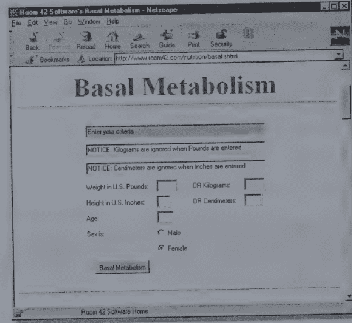

图 1-1：Java applet 比 JavaScript 程序更复杂


相比之下，JavaScript 与 Java 而言相对较弱。JavaScript 的目的是为 HTML 文档添加交互性和自动化，而不是创建在客户端计算机上运行的健壮独立程序（例如 Java）。例如，你可以使用 Java 编写图形编辑应用程序、文字处理器或电子表格程序。JavaScript 并不具备创建此类复杂软件应用的功能。


为什么 JavaScript 和 Java 的名字相似？简单的答案是“营销策略”。

最初，今天被称为 JavaScript 的语言被称为 "LiveScript"。它由 Netscape Communications 公司开发，作为其 LiveWire 服务器软件的脚本语言。随后，Sun Microsystems 的 Java 赢了极大的普及和媒体关注。为了跟上 Java 的成功，Netscape 将 LiveScript 重命名为 JavaScript。

这两种语言之间有一些细微的相似之处——某些命令是相同的——但本质上，两者之间的唯一联系是它们都用于增强 Web 页面，并且它们共享“Java”这一术语。

## JavaScript 的优势

JavaScript 提供了一些 Java 不具备的工具和优势：

- 虽然 Java 可以用于编写 Applet（嵌入在 Web 页面矩形空间内的程序），但它不能用于控制浏览器窗口本身的外观；JavaScript 可以。
- Java 无法附加到 HTML 表单元素上；JavaScript 可以。
- Java 是一门复杂的编程语言，需要花费更多的时间、精力和勤奋来掌握 JavaScript（JavaScript 并不是一种编程语言，而是一种精细的脚本语言）。

总的来说，Java 和 JavaScript 都是强大的——但截然不同的——Web 发布工具。JavaScript 和 Java 的使用并不是一个“非此即彼”的问题。这两种语言都可以在（而且通常都会）在单个 Web 网站或 Web 页面中实现。因此，Java 和 JavaScript 在许多方面互为补充。

## 在 HTML 中嵌入 JavaScript

对于本课程而言，JavaScript 程序始终作为 HTML 文档的子集，嵌入在 HTML 文档的脚本中。正如使用 `` 标签将图像嵌入 HTML 文档一样，JavaScript 程序是通过 `<SCRIPT>` 标签嵌入的。

## <SCRIPT> 标签

JavaScript 代码（称为程序、脚本或指令）出现在两个特定的 HTML 标签——`<SCRIPT>` 和 `</SCRIPT>` 之间。起始标签——`<SCRIPT>` 需要一个强制性属性 `LANGUAGE`。`LANGUAGE` 属性标识后续程序的语言。对于本课程以及你对 JavaScript 的使用，该值始终为 `LANGUAGE=JavaScript`。

> 所有支持 JavaScript 的网络浏览器内置的 JavaScript 解释器都是大小敏感的；因此，大小写非常重要。你必须将 `LANGUAGE` 设置为 `JavaScript`，而不是 `JAVASCRIPT`、`javascript` 或 `JavaScript`。


## document.write()

`document.write()` 语句将括号内的引号内容——一组字符字符串写入 HTML 文档。当 JavaScript 代码执行完毕时，浏览器会显示该字符串。有效来说，`document.write()` 让内容在 HTML 页面中出现。

图 1-2 显示了 `document.write()` 语句的示例。

| 语句 | 字符串 |
| :--- | :--- |
| `document.write("JavaScript was here!")` | "JavaScript was here!" |

图 1-2：JavaScript 语句的结构

## 练习 1-1：插入 JavaScript 标签

- 1. 启动你的文本编辑器（推荐使用 记事本）。
- 2. 在你的文本编辑器中输入以下脚本。

```
<HTML>
<HEAD>
<TITLE>Practice JavaScript HTML Document</TITLE>
</HEAD>
<BODY>
<H1>以下是 JavaScript 代码的结果：</H1>
<SCRIPT LANGUAGE="JavaScript">
document.write("Hello World!")
</SCRIPT>
</BODY>
```

- 3. 将文件保存为 JAVASCRIPT.HTML（你可以将文件保存在计算机的任何地方；但请记住你保存在哪里，以便在下一步打开它）。
- 4. 启动你的 浏览器并打开 JAVASCRIPT.HTML 文件。你的浏览器内容区域应该与图 1-3 相似。

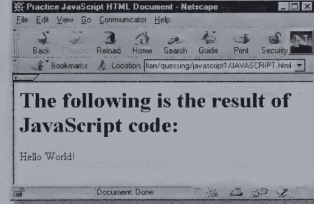

图 1-3：JavaScript 程序的运行

`<SCRIPT LANGUAGE=JavaScript>` 和 `</SCRIPT>` 标签围绕着单行的 JavaScript 程序，该程序将“Hello World!”文本写入 HTML 文档。

此程序说明了一个重要的 JavaScript 概念。注意，实际写入浏览器屏幕的行显示如下：

```
document.write("Hello World!")
```

图 1-4 展示了上一个练习中使用的完整 JavaScript 程序的结构。

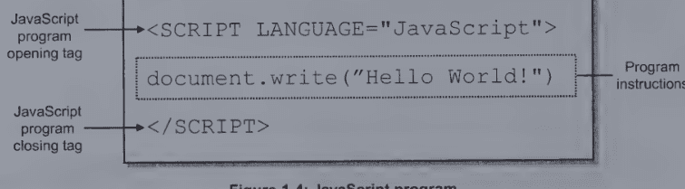

`document.write()` 语句在 JavaScript 程序中频繁出现。这些语句的作用是将括号内的任何内容写入 HTML 文档。你甚至可以使用 `document.write()` 写入 HTML 标签，它们将由任何支持 JavaScript 的浏览器正确解释。

## 从旧版浏览器中隐藏脚本代码

**并非所有浏览器都能解释 JavaScript。** 不包含 JavaScript 解释器的浏览器将无法识别 JavaScript 代码。这导致 JavaScript 代码像纯文本一样被写入 HTML 文档，产生不符合逻辑且难看的文本显示，本质上破坏了 Web 页面。

由于这种风险，你有一种技巧，可以向不支持 JavaScript 的浏览器（通常是旧版本的 Netscape Navigator 和 Internet Explorer）隐藏 JavaScript 代码。你将在接下来的动手练习中使用这种技术。

## 练习 1-2：隐藏代码

- 1. 在下方 JAVASCRIPT.HTML 中你在上一个练习输入的脚本下方输入以下脚本：

```
<H1>Browsers that can't understand JavaScript won't display what's next.</H1>
<SCRIPT LANGUAGE="JavaScript">
<!-- Start hiding from old browsers -->
document.write("What's next.")
// Stop hiding from old browsers. -->
</SCRIPT>
<H1>But all browsers will display this.</H1>
```

- 2. 保存文件。切换应用到你的 浏览器（`<ALT + TAB>`）并在 Navigator 中重新加载文件（`<CTRL + R>`），在 Internet Explorer 中按 `<F5>`。你的浏览器看起来应该与图 1-5 相似。

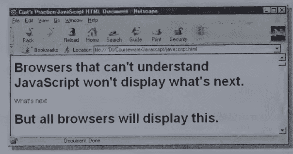

图 1-5：非 JavaScript 环境无法显示“What's next”文本

这里的技巧取决于 HTML 注释，这是你在 DDC Publishing 的 HTML 4.0 Fundamentals 课程中学过的。回想一下，浏览器将：

- 忽略 `<!--` 和 `-->` 之间的任何文本或代码
- 不解释或处理它不识别的标签。

因此，如果你在 `<SCRIPT>` 标签后直接放置 `<!--`，你可以指令不识别 `<SCRIPT>` 标签的浏览器开始忽略文本。

然后，为了结束 JavaScript 程序，你插入 `-->` 标签。这指令不支持 JavaScript 的浏览器重新解释你的 HTML 脚本。

但如果 JavaScript 尝试解释 `-->` 呢？这种情况会导致错误，因为包含 `-->` 的行以 `//` 开头。这指示浏览器忽略行的其余部分。

## 使用注释

良好的程序员会在程序中描述发生的情况，以便其他程序员——以及他们自己——能够更容易编辑或故障故障（调试）。JavaScript 允许你从 JavaScript 解释器的眼中隐藏英文注释。

注意，隐藏注释有两种方法：

- 适合单行的注释
- 跨多行的注释

### 练习 1-3：插入单行注释

你在上一个练习中首先看到了 `//` 序列，当时它用于帮助向不支持 JavaScript 的浏览器隐藏 JavaScript 程序。在下面的练习中，你将看到单行注释如何用于其他用途。

- 1. 在你的 HTML 文档在上一个练习输入的脚本下方输入以下脚本：

```
```
<H1>There's a one-line comment in the following program.</H1>
<SCRIPT LANGUAGE="JavaScript">
<!-- Start hiding from old browsers.
//The following line writes text into the HTML document.
document.write("Single-line comments are joy.")
// Stop hiding from old browsers. -->
</SCRIPT>
```
```


精通 JavaScript 第 1 部分

+ 2. 保存文件。切换应用程序到 Web 浏览器 (<ALT + TAB>) 并在 Navigator 中重新加载文件 (<CTRL + R>)，或在 Internet Explorer 中按 <F5>。你的浏览器屏幕应该与图 1-6 。

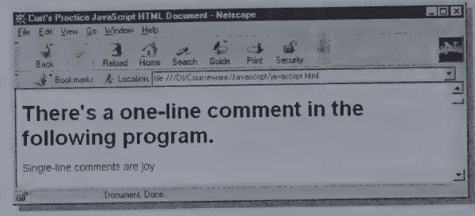

图 1-6：此程序包含一个单行注释（不可见）

以 // 开头并描述 `document.write()` 行功能的第一个行不会导致错误（如果没有 // 就会导致错误）。它也不会显示在网页上——JavaScript 解释器会忽略它。

 12 DDC Publishing • www.ddcpub.com

# 练习 1-4：插入多行注释

多行注释需要与单行注释不同的符号。

+ 1. 在你在上一次练习输入的脚本下方，在 HTML 文档中输入以下脚本：

```
<H1>There's a multiple-line comment in the following program.</H1>
<SCRIPT LANGUAGE="JavaScript">
<!-- Start hiding from old browsers.
/*
This is a very simple program that writes some text
into the HTML document. It writes text with the
JavaScript document.write() method.
*/
document.write("Multiple-line comments are handy things.")
// Stop hiding from old browsers. -->
</SCRIPT>
```

# 精通 JavaScript - 第 1 部分

2. 保存文件。切换应用程序到 Web 浏览器 (<ALT + TAB>) 并在 Navigator 中重新加载文件 (<CTRL + R>)，或在 Internet Explorer 中按 <F5>。你的浏览器屏幕应该与图 1-7。

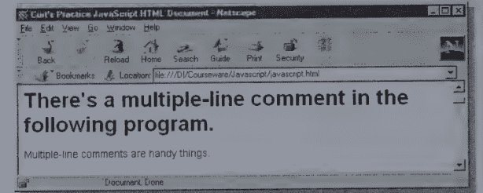

图 1-7：此程序包含多行注释（不可见）

在此程序中，/* 序列和 * / 序列之间的所有内容对 JavaScript 解释器都是隐藏的，尽管没有一行是以 // 开头的。

当你试图定位程序中的问题时，多行注释就非常有用。通过“注释掉”程序片段使其不被解释，你就可以确定问题所在的位置。

14 DDC Publishing • www.ddcpub.com

# 课程总结

+ JavaScript 可用于数据查找、数据验证以及操作浏览器窗口和框架的内容等应用。

+ JavaScript 为 Web 页面增加了交互性，而 Java 和 C++ 则是用于编写复杂的 applet 和应用程序的健壮语言。

+ JavaScript 程序使用 <SCRIPT> 标签嵌入到 HTML 文档中。<SCRIPT> 标签有一个强制性属性 LANGUAGE。

+ JavaScript 语句 document.write() 指示程序在执行后将括号中的内容显示在 HTML 文档中。

+ 未启用 JavaScript 的 Web 浏览器将无法正确解释程序，导致网页错误。可以通过使用 <!-- -- --> 符号隐藏代码来避免这些错误。

+ JavaScript 程序中可以插入注释，以提醒程序员“幕后”正在发生什么。

# 课程 2 变量、数据类型与弱类型

# 课程主题

- 变量
- 给变量赋值
- 理解数据类型
- 课程总结

# 变量

还记得你的第一节代数课吗？你在那里学习了变量。你学到字母（如 x）可以代表任何数值。你可能把变量想象成持有某些未知或变化数值的容器。

JavaScript 像代数一样涉及变量。将 JavaScript 变量想象成持有值的具名容器。然而，JavaScript 变量并不限于持有数值。

JavaScript 变量可以持有：

- 文本段（或字符串）
- 真/假值（布尔值）
- 数字

# 练习 2-1：声明变量

1. 在你在上一次练习输入的脚本下方，在 HTML 文档中输入以下脚本：

```
<H1>This program adds some numbers after declaring variables.</H1>
<SCRIPT LANGUAGE="JavaScript">
<!-- Start hiding from old browsers. 
// 使用 var 声明变量。
var milk
milk = 5
// 不使用 var 声明变量。
cookies = 10
// 再次使用 var 声明。
var snack = milk + cookies
document.write(snack)
// Stop hiding from old browsers. -->
</SCRIPT>
<H1>That's variable declaration.</H1>
```

保存文件。切换应用程序到 Web 浏览器并重新加载文件。你的浏览器屏幕应该与图 2-1。

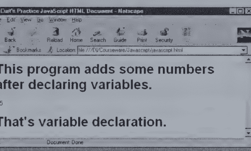

图 2-1：说明变量声明的 JavaScript 程序

var milk 声明了一个名为 milk 的新变量。但如示例所示，这并不是关键。你可以执行以下任何操作：

- 使用 var 声明变量并将变量设置为一个值：
  Milk
  milk = 5

- 仅使用变量名而不使用 var，并将其设置为一个值：
  cookies = 10

- 同时使用 var 声明变量并将其设置为一个值：
  var snack = milk + cookies

哪种最好？如果你在一行用 var 声明变量，然后在另一行将其设置为某个值，你的代码将最易理解。

```document.write(snack) 结果为 15，因为 snack 是 milk + cookies 的值（milk = 5 且 cookies = 10）。如果这一行是 document.write("snack")， snack 这个单词将出现在 HTML 文档中。```

因此，引号的包含或排除非常重要，并决定了不同的结果。

# 给变量赋值

> 在你声明变量后

# 练习 2-2：初始化变量

1. 在你在上一次练习输入的脚本下方，在 HTML 文档中输入以下脚本：

```html
<H1>This program just shows how to initialize variables.</H1>
<SCRIPT LANGUAGE="JavaScript"><!-- Start hiding from old browsers.
// 先声明，后初始化。
var cats
var dogs
var fish
cats = 3
dogs = "Man's best friend."
fish = true
// 同时声明并初始化。
var trains = "Choo!"
var cars = "Beep!"
<!-- Stop hiding from old browsers. -->
</SCRIPT>
<H1>That's initialization.</H1>
```

2. 保存文件。切换应用程序到 Web 浏览器并重新加载文件。你的浏览器屏幕应该与图 2-2。

# 课程 2 变量、数据类型与弱类型

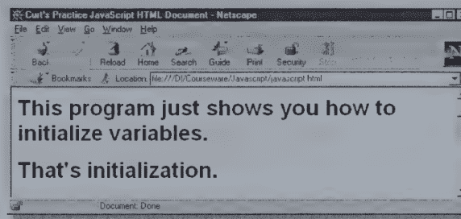

图 2-2：此程序说明了变量初始化。

为了进一步清晰，此程序说明了创建和初始化变量的两种接受的方法。

第一方法是使用 `var` 创建变量，并在单独的行上赋值，如图 2-3 所示。

第二方法——虽然不太清晰，但有时是必要的——是使用 `var` 创建变量并在同一行上赋值，如图 2-4 所示。

| | |
| :--- | :--- |
| 已声明的变量 | var cats<br>var dogs<br>var fish |
| 已化的变量 | cats = 3<br>dogs = "Man's best friend."<br>fish = true |

图 2-3：创建和初始化变量的一种

```
var trains = "Choo!"
Variable declared Variable initialized
```

图 2-4：创建和初始化变量的第二方法

DDC Publishing • www.ddcpub.com

# 理解数据类型

你有几种可以赋值给变量的数据类型。JavaScript 可以解释的变量类型：

- **number**（数字）：数字是数值，例如 5、12,908 或 -12.345。
- **string**（字符串）：字符串是字符序列，例如 "I consider myself the luckiest man on the face of earth." 字符串必须包含引号才能被 JavaScript 正确识别。
- **Boolean**（布尔）：布值为真假陈述。

# 数据类型与动态类型

许多编程语言强制你在声明变量时确定变量将包含的数据类型，然后限制使用该类型。在不灵活的语言中，如果你配置变量包含数字然后给它赋值一个字符串，你会收到错误。

幸运的是，JavaScript 更具包容性。声明变量后，你可以为它分配任何类型的数据。这被称为动态类型（也称为灵活类型）。

# 字符串拼接

字符串拼接是使用 + 运算符将短字符串组合成长字符串的方法。假设有两个字符串，一个包含 "Romeo"，另一个包含 "Juliet"。将这两个字符串连接成更大的字符串：

- "Romeo" + "and Juliet" = "Romeo Juliet"

注意 Romeo 后面有一个额外的空格——如果没有这个额外的空格，字符串将在一起，如下：

- "Romeo" + "and Juliet" = "Romeo Juliet"

你可以对变量的内容执行相同的操作：

```
var eightBall = "Romeo "
tenBall = "and Juliet"
cueBall = eightBall + tenBall
```

在上述序列结束后，cueBall 包含：

- "Romeo and Juliet"
```


## 练习 2-3：将数据赋值给变量

1. 在你的 HTML 文档中，紧接你在上一个练习中录的脚本下方，输入以下脚本：

```
<H1>This program demonstrates loose typing.</H1>
<SCRIPT LANGUAGE="JavaScript">
<!-- 开始对旧浏览器进行隐藏。
// 声明单个变量，然后向它分配不同类型的数据。
var chameleon
chameleon = 5
document.write("<P>Chameleon now contains " + chameleon + ".")
chameleon = 24.78
document.write("<P>Chameleon now contains " + chameleon + ".")
chameleon = "a fly."
document.write("<P>Chameleon now contains " + chameleon + ".")
chameleon = true
document.write("<P>Chameleon now contains " + chameleon + ".")
// 对旧浏览器的隐藏。 -->
</SCRIPT>
<H1>Loose as a goose.</H1>
```

## 精通 JavaScript 第一部分

2. 保存文件。切换到你的 Web 浏览器并重新加载文件。你的浏览器屏幕应该与图 2-5 相似。

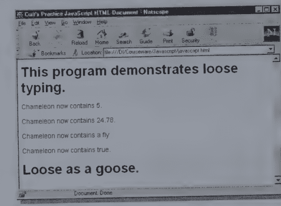

图 2-5：得于松散类型，Chameleon 可以包含不同类型的数据

在这个 JavaScript 程序中，Chameleon 被赋值了四个不同的值。它们是三种不同数据类型中的三种：1) 数字，2) 字符串和 3) 布尔。这是 JavaScript 在数据类型方面灵活性的示例。

## typeof () 运算符

如何确定变量中存储的数据类型？JavaScript 提供了 typeof() 运算符，它可以确定括号内包含变量的数据类型。

## 练习 2-4：确定数据类型

1. 在你的 HTML 文档中，紧接你在上一个练习中录的脚本下方，输入以下脚本：

```
<h1>Here's a demonstration of the typeof operator.</h1>
<SCRIPT LANGUAGE="JavaScript">
<!-- 开始对旧浏览器进行隐藏。
// 声明单个变量，然后向它分配不同类型的数据。
var chameleon
chameleon = 5
document.write("<P>Chameleon now contains " + chameleon + ".")
document.write("<P>The type of data in Chameleon is " +
typeof(chameleon) + ".")
chameleon = 24.78
document.write("<P>Chameleon now contains " + chameleon + ".")
document.write("<P>The type of data in Chameleon is " +
typeof(chameleon) + ".")
chameleon = "a fly"
document.write("<P>Chameleon now contains " + chameleon + ".")
document.write("<P>The type of data in Chameleon is " +
typeof(chameleon) + ".")
chameleon = true
document.write("<P>Chameleon now contains " + chameleon + ".")
document.write("<P>The type of data in Chameleon is " +
typeof(chameleon) + ".")
// 对旧浏览器的隐藏。 -->
</SCRIPT>
<h1>All those data types, already!</h1>
```


2. 重新保存文件。切换到你的 Web 浏览器并重新加载文件。你的浏览器屏幕应该与图 2-6 相似。

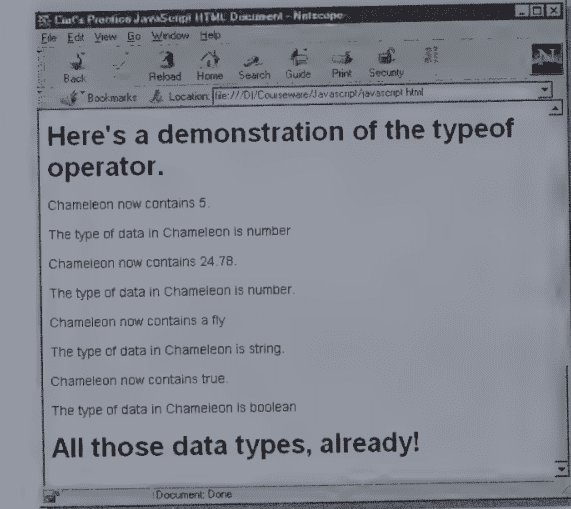

图 2-6：typeof () 运算符识别变量内容的数据类型

每个 `typeof(chameleon)` 实例都会生成存储在 chameleon 中的数据的数据类型。注意，chameleon 被赋值了所有这些不同的数据类型。


## 课程总结

- JavaScript 变量是命名的容器，用于存储数值、字符串或布尔值。
- 声明变量仅涉及给它起一个名称。使用 `var` 符号有助于识别脚本中的变量。
- 要初始化变量，只需使用等号 (`=`) 为其分配一个值即可。
- JavaScript 理解数字、字符串和布尔值形式的数据。一个 JavaScript 变量可以是这些数据类型中的任意一种。这种概念被称为动态类型（也称为灵活类型）。
- 字符串拼接允许你使用加号 (`+`) 符号从多个小字符串形成一个大字符串。
- `typeof()` 运算符括号内包含变量名。在程序中调用时，JavaScript 可以识别该变量所持的数据类型。

## 第 3 节
### JavaScript 运算符

## 课程主题

- 数学运算符
- 赋值运算符
- 比较运算符
- 逻辑运算符
- 课程总结

## 数学运算符

你在小学学习 `1 + 1 = 2` 的时候就学过数学运算符了。简而言之，运算符是特殊字符（例如 `+` 或 `x`），它们对被赋值的值应用特定的函数。

JavaScript 有许多数学运算符，其中大部分你可能已经熟悉了。例如，JavaScript 中的 `+` 运算符组合两个值，就像在其他范围内一样。

## 支持的五种数学运算符

数学运算符是对两个数字执行数学运算的运算符。JavaScript 支持五个数学运算符，如表 3-1 所示。

| 操作 | 传统运算符 | JavaScript 运算符 |
| --- | --- | --- |
| 加法 | + | + |
| 减法 | - | - |
| 乘法 | x | * |
| 除法 | ÷ | / |
| 取模 | 无 | % |

表 3-1：JavaScript 数学运算符

> 什么是取模？计算机编程之外很少使用的算术运算。

> 取模很容易理解：取模运算的结果（称为模数）是一个数字被除以另一个数字后剩余的数。例如，5 取模 11 = 1，因为 5 除以 11 得到两次，余数为 1。

同样，11 取模 24 = 2，20 取模 100 = 0。

> 你可以使用括号来规定多个操作执行的顺序。如果你输入 `(4*5)+3`，则先计算 `4*5`，然后加 `3`，结果为 23。另一方面，`4*(5+3)` 的结果是 32，因为 5 加到 3 上，然后将该结果乘以 4。

## 练习 3-1：使用数学运算符

1. 在你的 HTML 文档中，紧接你在上一个练习中录的脚本下方，输入以下脚本：

```
<SCRIPT LANGUAGE="JavaScript">
<!-- 开始对旧浏览器进行隐藏。

function a_plus_b(form) {
  a=eval(form.a.value)
  b=eval(form.b.value)
  c=a+b
  form.ans.value = c
}
function a_minus_b(form) {
  a=eval(form.a.value)
  b=eval(form.b.value)
  c=a-b
  form.ans.value=c
}
function a_times_b(form) {
  a=eval(form.a.value)
  b=eval(form.b.value)
  c=a*b
  form.ans.value=c
}
function a_div_b(form) {
  a=eval(form.a.value)
  b=eval(form.b.value)
  c=a/b
  form.ans.value = c
}

// Stop Hiding From Old Browsers
</SCRIPT>

<BODY>
<CENTER>
<FORM name="form"><input type="text size=4 value="" name="a">
<input type="number" size=4 value="" name="b">
<input type="button" value="+" 
onclick="a_plus_b(this.form)">
<input type="button" value="--" 
onclick="a_minus_b(this.form)">
<input type="button" value="x" 
onclick="a_times_b(this.form)">
<input type="button" value="/" 
onclick="a_div_b(this.form)">
<input type="number" value=0 name="ans" size=9>
</FORM>
</CENTER>
</BODY>
```

2. 重新保存文件。切换到你的 Web 浏览器并重新加载文件。你的浏览器屏幕应该与图 3-1 相似。

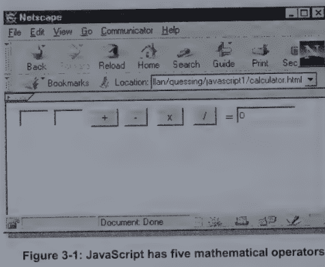

你将在第 7 节学习更多关于表单和 JavaScript。在这里，重点是变量和数学运算符的使用。基本上，脚本从第一个框和第二个框获取变量执行你请求的数学方程。

为了更好地了解这种类型计算器的潜力，请查看桌面上 JAVCRIPT-1 文件夹中的 FULLCALCULATOR.HTML 脚本。

## 赋值运算符

赋值运算符是给变量指定值的运算符。你已经在本课程中多次使用了最常用的赋值运算符：等号 (`=`)。当你写 `Force = (Mass * Acceleration)` 时，你正在将 Mass 和 Acceleration 的积赋值给变量 Force。

JavaScript 支持等号——你在本课程中已经使用了好几次——以及五个“快捷赋值运算符”，如表 3-2 所示。

| 操作 | JavaScript 运算符 |
|---|---|
| 赋值值 | |= |
| 加赋值 | += |
| 减赋值 | -= |
| 乘赋值 | *= |
| 除赋值 | /= |
| 取模赋值 | %= |

表 3-2：赋值运算符

快捷赋值运算符的工作原理是对对运算符左侧的变量与运算符右侧的变量或值执行快捷运算，并将运算结果赋值给左侧的变量。

```
milk = 5
cookies = 10
milk += cookies
Result: milk is 15
```


# 练习 3-2：使用赋值运算符

1. 将以下脚本输入到 HTML 文档中，位于你在上一个练习中输入的脚本下方：

```
<h1>This program illustrates the use of JavaScript assignment operators.</h1>
<SCRIPT LANGUAGE="JavaScript">
<!-- Start hiding from old browsers. -->
var Number
Number = 5
document.write("<H2>The = Operator</H2>")
document.write("After performing the operation Number = 5, Number's value is " + Number + ".")
Number += 5
document.write("<H2>The += Operator</H2>")
document.write("After performing the operation Number += 5, Number's value is " + Number + ".")
Number -= 5
document.write("<H2>The -= Operator</H2>")
document.write("After performing the operation Number -= 5, Number's value is " + Number + ".")
Number *= 5
document.write("<H2>The *= Operator</H2>")
document.write("After performing the operation Number *= 5, Number's value is " + Number + ".")
Number /= 5
document.write("<H2>The /= Operator</H2>")
document.write("After performing the operation Number /= 5, Number's value is " + Number + ".")
Number %= 5
document.write("<H2>The %= Operator</H2>")
document.write("After performing the operation Number % = 5, Number's value is " + Number + ".")

// Stop hiding from old browsers. -->
</SCRIPT>
```

2. 保存文件。切换应用程序到你的 Web 浏览器并加载文件。浏览器屏幕显示应与图 3-2 。

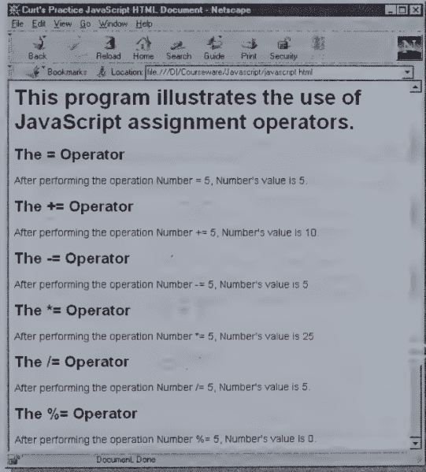

图 3-2：赋值运算符为变量赋值

此程序通过逐个将赋值运算符应用于 Number 变量，演示了赋值运算符是如何工作的。

精通 JavaScript 第 1 部分

## 比较运算符

你可能已经熟悉或使用过本节中将学习的运算符。JavaScript 的比较运算符可以帮助你确定两个值之间的关系。

## 支持的六种比较运算符

当你对两个值应用 JavaScript 的六种比较运算符中的任何一个时，产生 true 或 false 的结果。如果比较语句（例如“大于”）为真，则比较返回 true。否则，比较返回 false。例如，6 == 7 将返回 false，因为六不等于七。

表 3-3 列出了六种 JavaScript 比较运算符。

| 操作 | JavaScript 运算符 |
| --- | --- |
| 等于 | == |
| 不等于 | != |
| 大于 | > |
| 小于 | < |
| 大于等于 | >= |
| 小于等于 | <= |

表 3-3：JavaScript 比较运算符


比较运算符对条件语句和循环非常重要，正如你在第 5 节：条件语句与循环中所学到的。

36

DDC Publishing • www.ddcpub.com

## 练习 3-3：使用比较运算符

1. 在你的 JAVCRIPT-1 文件夹中，用记事本打开名为 GUESSING.HTML 的文件。

2. 这是一个利用比较运算符的猜数字游戏。双击文件在浏览器中打开它。你的屏幕显示应与图 3-3 。

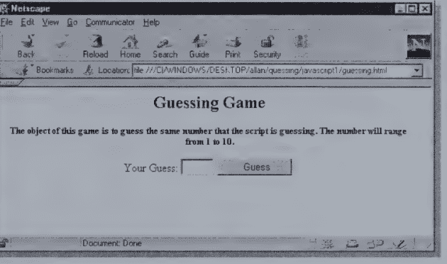

图 3-3：比较运算符简单地比较值

检查 GUESSING.HTML 中的代码。特别注意以下几行：

```
response = num
if (num < myNumber) response = alert(response + " + was too low");
if (num > myNumber) response = alert(response + " + was too high");
if (num == myNumber)
{
response = response + alert("Correct!" + " Guess Again!");
nG = 0
myNumber = random(9)+1
}
```

该脚本从表单获取输入（变量 "guess"），并将其与脚本选择的随机数（变量 "randomNumber"）进行比较。脚本进行三次比较：输入的数字是否大于、小于或等于脚本选择的随机数。你可以轻松通过一系列 if...else 语句来实现这一点（你将在第 5 节中学习更多）。因为一个数字只能大于、小于或等于另一个数字，你只需要执行三次比较操作。


如你所示，如果 if_else 语句匹配了两个变量的正确比较，就会调用警框通知你的猜测是 1) 太高，2) 太低，或 3) 你赢了并应该重新开始。

# 逻辑运算符

当你需要确定多个条件中哪些为真时，逻辑运算符就变得有用了。通过 AND 或 OR 运算符连接多个条件，你可以确定给定变量集发生的情况。

有逻辑运算符，如表 3–4 所示。

| 运算符 | JavaScript 运算符 |
| --- | --- |
| AND | && |
| OR | || |
| NOT | ! |

**表 3-4：**JavaScript 逻辑运算符

你如何输入 `|` 字符？在大多数键盘上，它是位于 <ENTER> 键正上方按键的 SHIFT 功能。

## 如何使用逻辑运算符

逻辑运算符用于连接产生两个布尔值（true 或 false）之一的两个语句。逻辑运算符返回的值取决于周围有多少个值为真。

- A && 语句只有在它周围的值都为真时才会返回 true。
- A || 语句在它周围的值中有一个为真时将返回 true。
- ! 运算符是布尔值的取反。

## 练习 3-4：使用逻辑运算符

1. 将以下脚本输入到 HTML 文档中，位于你在上一个练习中输入的脚本下方：

```
<h1>This program illustrates the use of JavaScript assignment operators.</h1>
<SCRIPT LANGUAGE="JavaScript">
<!-- Start hiding from old browsers. -->
var Number
Number = 5
document.write("<H2>The = Operator</H2>")
document.write("After performing the operation Number = 5, Number's value is " + Number + ".")
Number += 5
document.write("<H2>The += Operator</H2>")
document.write("After performing the operation Number += 5, Number's value is " + Number + ".")
Number -= 5
document.write("<H2>The -= Operator</H2>")
document.write("After performing the operation Number -= 5, Number's value is " + Number + ".")
Number *= 5
document.write("<H2>The *= Operator</H2>")
document.write("After performing the operation Number *= 5, Number's value is " + Number + ".")
Number /= 5
document.write("<H2>The /= Operator</H2>")
document.write("After performing the operation Number /= 5, Number's value is " + Number + ".")
Number %= 5
document.write("<H2>The %= Operator</H2>")
document.write("After performing the operation Number % = 5, Number's value is " + Number + ".")

// Stop hiding from old browsers. -->
</SCRIPT>
```

2. 保存文件。切换应用程序到你的 Web 浏览器并加载文件。浏览器屏幕显示应与图 3-4。

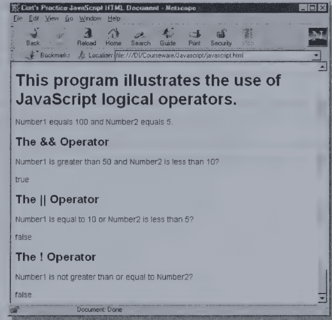

图 3-4：逻辑运算符确定多个条件中哪些为真

此练习同样依赖于条件运算符以及逻辑运算符。在这一行

```
document.write(Number1 == 50) || (Number2 < 5)
```

语句 (Number1 == 50) 先被评估（它为假），然后评估语句 (Number2 < 5）（它也是假的）。因为 || 运算符周围的值均为假，所以它也返回假。

# 课程总结

-   数学运算符在 JavaScript 中的用法与数学中相似：+, -, *, /。模是计算机编程特定的运算符。用百分比符号 (%) 表示，模显示除法计算余数。
-   等号 (=) 是 JavaScript 中常用的赋值运算符。等号与数学运算符结合创建了快捷赋值运算符。执行数学运算并将结果赋值给左侧的变量。
-   在 JavaScript 中比较值使用熟悉的比较运算符（>, <, >= 等）。JavaScript 语句并返回 true 或 false。
-   逻辑运算符 AND、OR 和 NOT 连接两个语句并返回 true 或 false。逻辑运算符也称为布尔运算符。


## 第 4 Lesson
JavaScript 函数

## 课程主题

- 函数
- 使用函数
- 预定义函数
- 课程总结

## 函数

假设你正在编写一个 JavaScript 程序，该程序必须重复执行某些操作，例如将一个变量乘以倍率，然后在结果上加上一个常数。你可以重复编写执行此任务的脚本行，你也可以编写一个函数来完成这项工作。每当你需要执行这一特定任务时，只需引用你创建的函数即可。

函数并不是一个难以理解的概念，但不要让事实误导你低估了它们的价值。函数是大多数 JavaScript 程序不可或缺的一部分。除了显而易见的用途外，函数还让脚本更容易调试，因为它们减少了故障点。

### 什么是函数？

函数是一个你定义了用途的 JavaScript 命令。在你创建一个函数之后，你可以通过名称调用它；随后你与该函数关联的操作将被执行。因此，函数可以被视为一种更强大、更复杂的宏（例如文字处理和电子表格应用程序中使用的宏）。

函数有两个主要用途：

- 节省时间（类似于文字处理或电子表格应用程序中的宏）
- 使你的程序更容易编辑和阅读

何时应该使用函数？最好的答案是：当你计划在程序内重复执行一个多步骤的操作时。函数允许你只定义一次多步骤操作，然后根据需要多次调用（或执行）它。

函数对于包含服务器端 HTML 的网站也很有用。你可以将函数放置在一个头部文档中，并在整个网站中反复调用它，而无需复制代码。

> 服务器端 HTML（也称为服务器解析的 HTML）允许你在当前的 HTML 文档中调用另一个 HTML 文档。这些 HTML 文档通常显示文件扩展名（后缀）“.html”，通常由想要在整个网站中使用一致页眉和页脚的设计师使用。

建立一个被调用到你其他站点的独立头部文档，允许你通过只更新一个文档来更新 Logo，或者可能是工具栏（你网站的其他部分将立即更新）。

## 创建函数

要创建一个一个函数：

1. 在 HTML 文档的 `<HEAD>` 部分创建一个 `<SCRIPT>...</SCRIPT>` 块
2. 使用关键字 `function`，后面跟函数的名称
3. 插入一个左大括号 `{`
4. 定义函数指令
5. 插入一个右大括号 `}`

### 练习 4-1：使用函数

在你的 HTML 文档中、上一个练习中输入的脚本下方输入以下脚本：

```
<SCRIPT LANGUAGE="JavaScript">
function writeText()
{
document.write("<B>This text was written by a function.</B>")
}
</SCRIPT>
</HEAD>
<BODY>
<h1>This HTML document has a JavaScript function in it...</h1>
<h1>But it isn't called, so it doesn't do anything.</h1>
```

## 精通 JavaScript - 第一部分

2. 重新保存文件。切换到 Web 浏览器并加载文件。你的浏览器屏幕应该与图 4-1 相似。

图 4-1：在后台创建了一个函数

`writeText()` 函数的完整声明如图 4-2 所示。

```
<SCRIPT LANGUAGE="JavaScript">
function writeText() {
  document.write("<B>This text was written by a function.</B>");
}
</SCRIPT>
```

图 4-2：函数的结构

上面的代码创建了一个名为 `writeText()` 的函数，它会在 HTML 文档中写入 `This text was written by a function.` 这一行。但注意，`writeText()` 从未被调用过；文档的 `<BODY>` 中没有一行代码来调用它。

## 使用函数

你现在理解了为什么要创建一个函数以及如何做。那么，你如何让你新创建的函数开始工作呢？调用你定义的函数仅需在 JavaScript 程序中直接调用函数名。

### 练习 4-2：调用函数

1. 在你的 HTML 文档中、上一个练习中输入的脚本下方输入以下脚本：

```
<SCRIPT LANGUAGE="JavaScript">
function writeText() {
  document.write("<B>This text was written by a function.</B>");
}
</SCRIPT>
<HEAD>
<BODY>
<h1>This HTML document has a JavaScript function in it...</h1>
<h1>And it will write the next line of text.</h1>
<SCRIPT LANGUAGE="JavaScript">
<!-- Start hiding from old browsers. -->
writeText()
// Stop hiding from old browsers. //
</SCRIPT>
<h1>How about that!</h1>
```

## 精通 JavaScript 第一部分

2. 重新保存文件。切换到 Web 浏览器并加载文件。浏览器屏幕应该与图 4-3 相似。

图 4-3：此文档中的某些文本是由函数编写的

该程序中有两段 JavaScript 代码。第一个与上一个练习中的相同——`writeText()`。第二段 JavaScript 代码只包含一行（除了 `<SCRIPT></SCRIPT>` 标签和向旧浏览器隐藏代码的行除外）。

那的一行代码 `writeText()` 调用了 `writeText()` 函数。当程序运行时，`writeText()` 中包含的代码行将显示在调用函数的地方，而不是它被创建的地方。

## 向函数传递参数

通常，你希望将数据发送到函数，以便函数对数据执行操作。这被称为传递参数。

### 练习 4-3：传递参数

1. 在你的 HTML 文档中、上一个练习中输入的脚本下方输入以下脚本：

```
<SCRIPT LANGUAGE="JavaScript">
function addNumbers(oneNumber,anotherNumber)
{
var sum
 = (oneNumber + anotherNumber)
document.write("The sum of " + oneNumber + " and " + anotherNumber + " is " + sum + ".")
}
</SCRIPT>
</HEAD>
<BODY>
<H1>The function writes text that's sent to it as a parameter:</H1>
<SCRIPT LANGUAGE="JavaScript">
<!-- Start hiding from old browsers.
addNumbers(5,3)
// Stop hiding from old browsers. -->
</SCRIPT>
<H1>How about that!</H1>
```

2. 保存文件。切换到 Web 浏览器并加载文件。你的浏览器屏幕应该与图 4–4 相似。

图 4-4：此程序中的函数被传递了一个参数

在程序程序中，函数 `addNumbers()` 使用以下行进行声明：

```
function addNumbers(oneNumber, anotherNumber) 
```

此函数声明允许 `addNumbers()` 函数在被调用时接受两个数据。函数定义继续声明一个新变量 `Sum`，将 `oneNumber` 和 `anotherNumber` 相加并将 `Sum` 设置为结果。它打印出一句描述所执行的操作和结果的句子。

当调用 `addNumbers()` 时，引入了参数（5 和 3）：

```
addNumbers(5,3)
```

参数 5 和 3 然后被发送到函数 `addNumbers()`。这些参数分别变成了 `oneNumber` 和 `anotherNumber`。

## 预定义函数

为了方便 JavaScript 程序员完成任务，脚本语言内部指定了一些预定义函数。

这些预定义的（或“顶级”）函数包括 `eval`、`isNaN`、`Number`、`String`、`parseInt parseFloat`、`escape`、`unEscape`、`taint` 和 `untaint`。这些函数可以在任何脚本中执行，无需定义它们的操作。它们每次执行执行相同的操作。

表 4-1 描述了 JavaScript 每个预定义函数的用途。

| 顶级函数 | 语法 | 用途 |
|---|---|---|
| eval | eval(string) | 用于在不引用特定对象评估 JavaScript 代码字符串。如果字符串是 JavaScript 代码，则会执行它。 |
| isNaN | isNaN(value) | 用于判断值是否不是数字 (NaN)。如果值是数字，则返回 false。 |
| Number | Number(object) | 将对象转换为数字。当你想要对复杂变量进行快速计算时，这非常有用。 |
| String | String(object) | 与 Number 函数类似，区别在于它将对象转换为字符串。 |
| parseFloat and parseInt | parseFloat(string) parseInt(string, [base]) | 两者都尝试从其随后的字符串中返回数值。parseFloat 解析数字，而 parseInt 解析它们并将它们转换为所引用的任何基。 |
| escape and unescape | escape(string) unescape(string) | 编码和解码提供的任何字符串信息。 |
| taint and untaint | taint untaint | 用于添加和移除数据污染。这可以防止其他脚本传递安全信息。 |

表 4-1：JavaScript 预定义函数


# 课程总结

- JavaScript 中的函数工作原理类似于文字处理或电子表格应用程序中的宏。与宏一样，函数对于多步操作或必须重复执行的操作非常有用。一旦定义，函数就可以根据需要进行多次调用。

- 函数使用 `function` 关键字和函数名来创建。函数的指令封装在名称后的大括号 (`{}`) 中。

- 函数可以通过复制和粘贴在 JavaScript 程序之间进行共享。

- 在程序中使用函数时，只需引用函数名即可。在 JavaScript 程序中执行函数被称为“调用函数”。

- 某些函数需要额外的数据才能执行。这些数据被称为参数。

- JavaScript 内置了几个顶层或预定义的函数。这些内置函数可以在任何时候被调用。

# 第 5 节
条件语句与循环

## 课程主题

- If & If...Else 语句
- For 循环
- While 循环
- Switch 语句
- 课程总结

# If & If...Else 语句

想象你是一场棒球比赛的观众。天气很炎热，你口渴了。你环顾四周，发现你喜欢的饮料售卖就在附近。如果他在，你会向他示意你想购买。如果售卖员不在附近，你只能忍受口渴，直到有人经过你的座位。

这是一个 `if` 语句的例子。如果售卖员在附近，你会尝试引起他的注意。否则，你什么都不做。

现在，假设你是一个棒球球员。你正准备上场。当你走向球场时，你评估了场上的情况。如果二垒有跑者（且出局数少于两个，且如果你对当前的投手击球有困难，且如果垒包教练示意你这样做……等等），你将进行短打以帮助跑者进到三垒。否则，你会挥棒并尝试击球获得安打。

这是一个 `if...else` 语句的例子。如果满足短打的条件，你会尝试短打。如果不满足短打的条件，你就会挥棒并尝试击球。


第一个例子也是 `if...else` 语句吗？并不是，因为当售卖员不在附近时你采取的行动完全是“无作为”。只有当在“如果”条件不成立时，你也想采取某种积极行动时，`if` 语句才会变成 `if...else` 语句。毕竟，如果满足短打条件，击球者不会只站在那里——他会挥棒。

JavaScript 同时支持 `if` 和 `if...else` 语句；在将来编写自己的 JavaScript 程序时，你会发现它们有用。

# 语法

JavaScript 的 `if` 和 `if...else` 语句具有逻辑语法。

# if 语句的示例

```
if (condition)
{
    仅在条件为真时执行的代码
}
```

在在上一个示例中，大括号之间的代码只有在括号中的条件为真时才会执行。如果条件为假，解释器将跳过大括号的内容，并从大括号后的第一行脚本开始执行。

`if...else` 语句的不同之处在于，它在条件为假时会为解释器指定一个任务。

# if...else 语句的示例

```
if (condition)
{
    仅在条件为真时执行的代码
}
else
{
    仅在条件为假时执行的代码
}
```

`if...else` 语句的第一部分与 `if` 语句完全相同——`if` 语句大括号中的代码仅在括号中指定的条件为真时执行。然而，在 `if...else` 语句中，紧随 `else` 行的大括号中的代码会在条件为假（且仅在为假）时执行。

# 练习 5-1：使用 if 语句

1. 在 HTML 文档中，上一个练习输入的脚本下方输入以下脚本：

```
<H1>此程序显示了 <code>if</code> 语句的工作原理。</H1>
<SCRIPT LANGUAGE="JavaScript">
<!-- 开始对旧浏览器隐藏内容 -->
var Capricious
Capricious = 5
document.write("<P>在我们开始时，变量 Capricious 等于 " + Capricious + ".")

if (Capricious==5)
{
  document.write("<P>因为 Capricious 等于 5，这一行被写入 HTML 文档中。")
}

if (Capricious==17)
{
  document.write("<P>同样，因为 Capricious 不等于 17，这一行没有被写入。")
}

// 结束对旧浏览器隐藏内容 --
</SCRIPT>
```

重新保存文件。切换到 Web 浏览器并加载文件。你的浏览器屏幕应该类似于图 5-1。

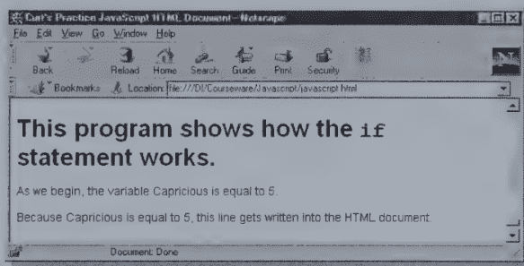

图 5-1：if 语句的结果

变量 `Capricious` 控制着此程序的运行。因为 `Capricious` 等于 5，接下来的行被解释，第一个 `if` 语句的结果为真。因此，文本被写入 HTML 文档：

```
document.write("<P>因为 Capricious 等于 5，这一行被写入 HTML 文档中。")
```

然后是第二个 `if` 语句——它的代码仅在 `Capricious` 等于 17 时才会执行。由于 `Capricious` 不等于 17，下面的代码**没有被执行**：

```
document.write("<P>同样，因为 Capricious 不等于 17，这一行没有被写入。")
```

# 练习 5-2：使用 if...else 语句

1. 在 HTML 文档中，上一个练习输入的脚本下方输入以下脚本：

```
<h1>此程序显示了 <code>if...else</code> 语句的工作原理。</h1>
<SCRIPT LANGUAGE="JavaScript">
<!-- 开始对旧浏览器隐藏内容 -->
var Capricious
Capricious = 5
document.write("<P>现在，让我们转向 <code>if...else</code> 控制结构。")

if (Capricious==2)
{
document.write("<P>...这一行仅在 Capricious 等于 2 时才被写入。")
}
else
{
document.write("<P>这一行由于语句的 <code>else</code> 部分而被触发。")
}

// 结束对旧浏览器隐藏内容。 -->
</SCRIPT>
```

2. 重新保存文件。切换到 Web 浏览器并加载文件。你的浏览器屏幕应该类似于图 5-2。

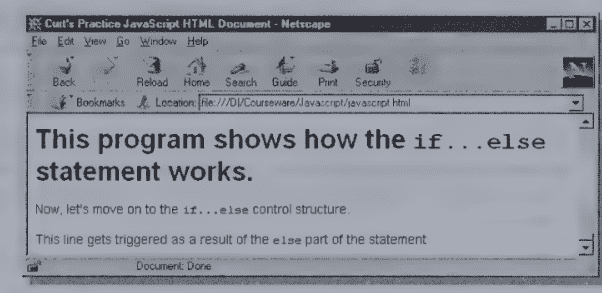

图 5-2：程序中的文本是 if 和 if...else 语句的结果

最后，有一个 `if...else` 语句。如果 `Capricious` 等于 2，接下来的行将会运行：

```
document.write("<P>这一行仅在 Capricious 等于 2 时才被写入。")
```

但 `Capricious` 不等于 2，它等于 5。因此，`if...else` 语句中 `else` 部分之后的代码被执行：

```
document.write("<P>这一行由于语句的 <CODE>else</CODE> 部分而被触发。")
```


# For 循环

计算机擅长高效地执行重复操作。手动计算将 1000 个不同值代入函数的结果是低效的，但你可以编写一个 JavaScript 程序，在远短于手算计算的时间内完成这项工作。

如果这 1000 个值代表一种可定义的序列，编写这样的程序将特别简单，例如 1 到 1000 之间的数字，或者 5 到 5000 之间能被 2.5 整除的整数。

JavaScript 执行此类任务的机制是 `for` 循环。在本节中，你将学习如何创建 `for` 循环，并了解 `for` 循环如何在真实的 JavaScript 程序中使用。

# 语法

在 `for` 循环中，你必须指定几个元素：

- 索引变量；
循环执行开始时的索引条件；
- 循环执行结束时的索引条件；
- 迭代开始时索引变量的变化方式；
- 迭代期间执行的代码。

JavaScript 声明循环的语法如下：

```
for(initial condition ; test ; increment)
{
在每次迭代期间执行的代码
}
```


初始条件是循环开始时索引变量（通常命名为 i, Index, index 或 n）的值——该语句实际上设置了变量的值。它通常类似于 `n=0` 或 `i=1`。

测试是一个逻辑语句，在循环的每次迭代开始时进行评估。如果测试结果为真，循环将再次执行。如果测试结果为假，循环停止执行。通常，测试涉及索引变量。测试通常类似于 `(n<=100)` 或 `((n>0) && (m<=100))`。

增量语句定义了索引变量在每次迭代开始时的变化方式。通常，增量是对索引变量进行加或减。`i++` 和 `(n=n+100)` 是常见的增量语句。

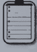

大括号中的脚本在每次循环迭代时都会执行。快速且高效地多次执行脚本是循环的目的。

## 练习 5-3：使用 for 语句

1. 在你的 HTML 文档中，在上一个练习输入的脚本下方输入以下脚本：

```
<<h1>>This program shows how <CODE>for</CODE> loops work.</</h1>
<SCRIPT LANGUAGE="JavaScript">
<!-- Start hiding from old browsers -->
document.write("<P>What's an easy way to count from 99 to 0 in JavaScript?")
document.write("<P>Right---the <CODE>for</CODE> loop!")
document.write("<HR>")
var i
for(i = 99; i > 0; i--) {
document.write("<BR>" + i + " bottles of beer on the wall!")
document.write("<BR>" + i + " bottles of beer!")
document.write("<BR>Take one down, pass it around!")
document.write("<BR>" + (i-1) + " bottles of beer on the wall!")
document.write("<P>")
}
// Stop hiding from old browsers. --
</SCRIPT>

<h3>I'm going to go sit down now. My monitor is spinning.</h3>
```

2. 重新保存文件。切换应用到你的 Web 浏览器并重新加载文件。你的浏览器屏幕应该与图 5-3 相似。

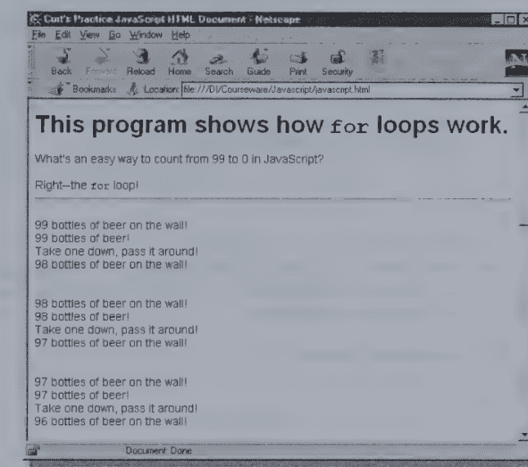

图 5-3：for 循环让“墙上的啤酒瓶”歌唱得更快，但也没那么有趣了

该程序的核心在于一个循环，如下：

```
for(i = 99; i > 0 ; (i--))
{
...statements that write text...
}
```

索引变量 `i` 从值 99 开始。对于循环的每次迭代，`i` 通过 `i--` 减 1。只要 `i` 大于 0——即在从 99 到 1 的迭代中——循环就会继续执行。循环执行 99 次，每次向 HTML 文档中写入一节歌词。

## While 循环

JavaScript 支持另一种循环——while 循环。只要“当”（while）——特定条件为真，while 循环就会重复执行一个代码块。

使用 while 循环的风险是很容易让解释器陷入所谓的“死循环”——一个永远不会结束并最终导致浏览器（可能还有操作系统）崩溃的循环。编写 while 循环时，确保结束 while 循环的条件所有可能的起始条件下都会发生。

## 语法

当你学习 for 循环时，已经学习了循环的要求——索引变量、递增机制等。这些关键元素中的每一个也出现在 while 循环中，但方式不同。

JavaScript while 循环所示：

```
while (condition)
{
  ...在循环每次迭代时都执行的代码，包括
  最终改变条件中变量(s)的代码...
}
```

你为什么想使用 while 循环而不是 for 循环呢？while 循环允许你拥有更大的灵活性。你不再局限于执行固定次数的循环。

与 for 循环不同，while 循环允许你在循环的每次迭代中改变改变条件中变量(s)的方式。

## 练习 5-4：使用 while 循环

在本次练习中，你将使用 while 循环。

- 1. 在你的 HTML 文档中，在上一个练习输入的脚本下方输入以下脚本：

```
<H1>A <code>while</CODE> loop is similar to, but not identical to, a
<CODE>for</CODE> loop.</H1>

<SCRIPT LANGUAGE="JavaScript">

<!-- Start hiding from old browsers. -->
document.write("Here's a demonstration of the <CODE>while</CODE> loop.");

var index
index = 1
while (index < 9)
{
    document.write("<P>I'm Henry the " + index + " I am, I am.")
    index ++
}
// Stop hiding from old browsers. -->
</SCRIPT>
```

重新保存文件。切换应用到你的 Web 浏览器并重新加载文件。你的浏览器屏幕与图 5-4 相似。

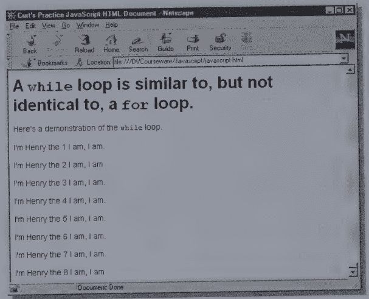

图 5-4：在 while 循环的帮助下，你创作了一首乏味歌曲的演绎

以下脚本完整了将歌曲歌词写入 HTML 文档的 while 循环：

```
while (index < 9)
{
  document.write("<P>I'm Henry the " + index + " I am, I am.")\n  index++;
}
```

注意变量 `index`，它在 while 循环之前的行中被初始化为 1。在循环内部，`index` 增加 1，最终在第八次迭代后，它不再小于 9。此时，大括号中的代码不再执行，浏览器将移动到循环之后后的代码。

## Switch 语句

JavaScript 1.2（由 Netscape Navigator 4.0x 及更高版本，以及 Microsoft Internet Explorer 4.0x 及更高版本正确解释）为 JavaScript 增加了更多结构化。switch 语句的作用与 if-else 语句相同，只是语法更紧凑。

switch 语句仅能被 Netscape Navigator 4.0 和 Microsoft Internet Explorer 4.0 及更高版本理解。因此，任何使用 switch 的旧版浏览器 Web 用户都将收到错误。


## 语法

乍看之下，switch 语句看起来非常复杂。通过一些练习，它们并不难使用。switch 语句的语法如下：

```
switch (variable to be evaluated)
{
    case x :
        如果被评估的变量等于 x 则执行的代码
    case y :
        如果被评估的变量等于 y 则执行的代码
    default:
        如果变量等于 x 或 y以外的任何值则执行的代码
}
```

可以在 switch 语句中拥有任意数量的 case 行。

## 练习 5-5：使用 switch 语句

在本次练习中，你将创建一个演示 switch 语句的脚本。

- 1. 在你的 HTML 文档中，在结束 </TITLE> 标签和结束 </HEAD> 标签之间输入以下脚本：

```
<SCRIPT LANGUAGE="JavaScript1.2">
<!-- Start hiding from old browsers. -->
function Switcher(InputNumber)
{
  var Message
  Message = "test"
  switch (InputNumber)
  {
    case 1 :
      Message="<BR>One is the loneliest number."
      break
    case 2 :
      Message="<BR>Two is much better than one."
      break
    default :
      Message="<BR>Say what?"
      break
  }
  return Message
}
// Stop hiding from old browsers. --
</SCRIPT>
```

2. 在你的 HTML 文档末尾输入以下脚本：

```
<H1>A <code>switch</code> statement takes the place of many
<CODE>if</CODE> statements.</H1>
<SCRIPT LANGUAGE="JavaScript1.2">
<!-- Start hiding from old browsers.\ndocument.write("<P>Let's see what happens when we send 1 to the
function.")
document.write(Switcher(1))
document.write("<P>How about 2?")
document.write(Switcher(2))
document.write("<P>But what about 15?")
document.write(Switcher(15))

// Stop hiding from old browsers. --
</SCRIPT>
```

3. 重新保存文件。切换应用到你的 Web 浏览器并重新加载文件。你的浏览器屏幕应该与图 5-5 相似。

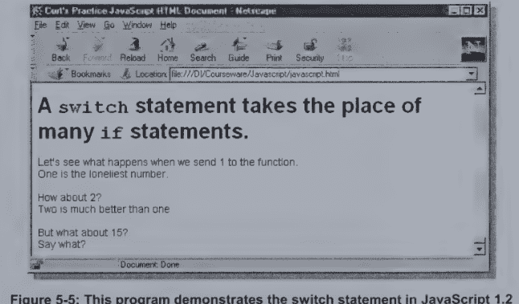

DDC Publishing • ddcpub.com


# 掌握 JavaScript：第一部分

在 `Switcher` 函数的 `switch` 结构中，如果向函数发送 1，则打印一个内容；如果发送 2，则另一个；如果既不是 1 也不是 2，则打印第三个内容。


那些只写 `break` 的行是怎么回事？它们是让程序运行更快的技巧。当浏览器遇到 `break` 语句时，它知道完全跳出 `switch` 结构并在那里继续执行。这防止了它将待评估的变量与其他许多 `case` 值进行比较。

`switch` 语句的功能可以通过这一复杂的嵌套 `if...else` 语句重复实现：

```
if (InputNum==1)
    Message="<BR>One is the loneliest number."
else
    if (InputNum==2)
        Message="<BR>Two is much better than one."
    else
        Message="<BR>Say what?"
```

# 课程总结

-   JavaScript 具备逻辑功能，允许程序在特定条件下遵循某些指令。因此，脚本编写人员可以插入控制结构，使 JavaScript 程序以任意方式运行。

-   `if` 语句在满足某些条件时触发 JavaScript 程序的某部分执行。当这些条件不满足时，程序将继续运行，忽略 `if` 语句和相应的代码。

-   `if...else` 语句在满足某些条件（或为真）时触发 JavaScript 程序的某部分执行。当条件不满足（或为假）时，在继续之前会执行另一组指令。

-   在 JavaScript 程序中使用 `for` 循环可以轻松执行重复任务。`for` 循环需要作为索引变量条件的条件，以及在循环每次迭代期间将执行的代码。

-   `while` 循环的工作原理与 `for` 循环类似，但提供了更大的灵活性。`while` 循环允许在循环每次迭代中以不同的方式改变变量。

-   通过使用 `switch` 语句控制结构可以更容易地实现多个 `if` 语句。`switch` 结构可以在一个条件下执行一个操作，在另一个条件下执行另一个操作，并在第一个或第二个条件都不存在时执行第三个操作。

（本页故意留空）

# 课程 6：日期和时间

-   页面更新
-   插入日期和时间
-   倒计时
-   日历
-   课程总结

# 页面更新

**JavaScript 经常用于为 Web 页面添加日期时间和功能。** JavaScript 中专门为此目的编写了许多属性。本课将教你如何利用 JavaScript 提供的最常用的日期时间函数。如果你负责一个大型网站，你可能担心网站上信息的实时性。你可以使用 JavaScript 告诉你页面最后更新的时间。

# 练习 6-1：页面更新

1.  在你的 HTML 文档中，上一个练习输入的脚本下方输入以下脚本：

```
<HTML>
<BODY>
<TITLE>Last Updated</TITLE>
<CENTER>
<SCRIPT LANGUAGE="JavaScript">
<!-- Start hiding from old browsers
lastModDate = new Date(document.lastModified);
document.write("<B>Last Updated:</B>" + lastModDate);
// Stop hiding from old browsers
</SCRIPT>
</CENTER>
</BODY>
</HTML>```

2.  保存文件后，重新输入其中一行（这将创建第一次“更新”）。切换到你的 Web 浏览器并重新加载文件。你的浏览器屏幕应该与后续页的图 6-1 相似。

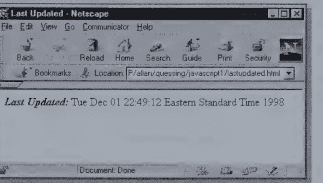

`lastModified` 属性指定文档最近更改的日期和时间。大多数但并非所有 Web 服务器都提供此信息，因此这在每个网站上并不有效。该脚本已经在常用的服务器上经过了测试：

-   Apache
-   Microsoft Internet Server
-   Netscape Enterprise Server

# 插入日期和时间

许多 Web 开发者希望在他们的网站上显示当前时间和日期。有些网站甚至包含实时时钟。这样做有助于增强对你的网站是新鲜且实时的印象（尽管通常并非如此）。JavaScript 使用 `Date` 对象来指定 HTML 页面内的日期和时间。`Date` 返回一个包含本地日期时间的字符串。`Date` 对象的格式与 Java 和 C 编程语言的数据类型相似。

### Date 对象具有以下特征：

-   日期存储为自 1970 年 1 月 1 日 00:00:00 来的毫秒数。
-   JavaScript 支持的日期范围是从 1970 年 1 月 1 日之前的 100,000,000 天到之后的 100,000,000 天。
-   JavaScript 将日期格式化为“月 日, 年 时:分:秒”。如果小时、分或秒为空，JavaScript 将假设为 0 并跳过服务器。因此，时间始终对用户显示本地。
-   JavaScript 日期对象从本地计算机而不是从服务器获取信息。因此，时间始终对用户显示本地。

调用 `Date` 对象最常用的两个方法是 `get` 和 `set`。`get` 用于从 `Date` 对象检索日期或时间，`set` 用于告诉 `Date` 对象日期或时间。你不能使用 `get` 或 `set` 更改用户计算机的时间；你仅使用这些方法操作脚本内的日期或时间。

表 6-1 展示了 `Date` 对象的 `get` 和 `set` 方法可以使用的形式。

| 方法 | 值 |
| :--- | :--- |
| getSeconds | 0-59 |
| setSeconds | |
| getMinutes | 0-59 |
| setMinutes | |
| getHours | 0-23 |
| setHours | |
| getDay | 0-6（星期日到星期六）没有 setDay，因为该方法是从日期方法自动派生的。 |
| getDate | 1-31 份中的几号 |
| setDate | |
| getMonths | 0-11（一月到十二月） |
| setMonths | |
| getFullYear | 2000 年之前的两位年份，2000 年以后的四位年份。 |
| setFullYear | |

表 6-1：Date 对象的方法和值

# 练习 6-2：列出当前日期和时间

1.  在你的 HTML 文档中，上一个练习输入的脚本下方输入以下脚本：

```
<HTML>
<body>
<TITLE>Current Date and Time</TITLE>
<CENTER>
<SCRIPT LANGUAGE="JavaScript">
<!-- Start hiding from old browsers -->
document.write(Date()+"."")

//-- hiding from old browsers -->
</SCRIPT>
</CENTER>
</body>
</HTML>```

2.  保存文件。切换到你的 Web 浏览器并重新加载文件。你的浏览器屏幕应该与后续页的图 6-2 相似。

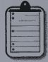

`Date()` 命令显示本地日期和时间。“本地”定义为页面访问者计算机上的日期和时间，而不是 Web 页面所在服务器的日期和时间。

# 课程 6：日期和时间

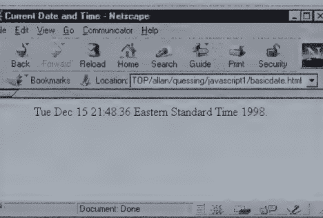

**图 6-2：** 此脚本演示了 Date 对象

这真的是单行脚本。`document.write(Date()+".")` 这一行完成了所有工作。虽然这功能很全，但不漂亮。为了让看起来更专业，请尝试以下操作。

3.  在你的 HTML 文档中，上一个练习输入的脚本下方输入以下脚本：

```
<HTML>
<body>
<TITLE>Current Date and Time</TITLE>
<CENTER>
<HEAD>
<SCRIPT LANGUAGE="JavaScript">
<!-- Start hiding from old browsers
var day="";
var month="";
var ampm="";
var amphour="";
var weekday="";
var year="";
mydate = new Date();
myday = mydate.getDate();
month = mydate.getMonth();
weekday = mydate.getDay();
year = mydate.getFullYear();
myhours = mydate.getHours();
amphour = (myhours > 12) ? myhours - 12 : myhours;
ampm = (myhours > 12) ? ' PM' : ' AM';
tymime = mydate.getMinutes();
tyminutes = ((minutes < 10) ? ':0' : ':') + minutes;
```


```javascript
if (myday == 0) {
  day = "Sunday";
} else if (myday == 1) {
  day = "Monday";
} else if (myday == 2) {
  day = "Tuesday";
} else if (myday == 3) {
  day = "Wednesday";
} else if (myday == 4) {
  day = "Thursday";
} else if (myday == 5) {
  day = "Friday";
} else if (myday == 6) {
  day = "Saturday";

  if (mymon == 0) {
    month = "January";
  } else if (mymon == 1) {
    month = "February";
  } else if (mymon == 2) {
    month = "March";
  } else if (mymon == 3) {
    month = "April";
  } else if (mymon == 4) {
    month = "May";
  } else if (mymon == 5) {
    month = "June";
  } else if (mymon == 6) {
    month = "July";
  } else if (mymon == 7) {
    month = "August";
  } else if (mymon == 8) {
    month = "September";
  } else if (mymon == 9) {
    month = "October";
  } else if (mymon == 10) {
    month = "November";
  } else if (mymon == 11) {
    month = "December";
  }

// Stop hiding from old browsers -->
</SCRIPT>
</HEAD>

<CENTER>
<SCRIPT>
<!-- Start hiding from old browsers -->
document.write("<b>" + ampm + " " + minutes + " " + ampm);
document.write(" on " + day + ", " + month);
document.write(" (weekday " + ", " + year + ")</b></b>");
<!-- Stop hiding from old browsers -->
</SCRIPT>
</CENTER>
</html>
```

4. 保存文件。切换应用到 Web 浏览器并重新加载文件。你的浏览器屏幕应该与图 6-3 相似。

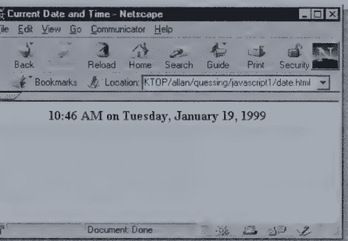

**图 6-3：** 此脚本演示了对 Date 对象更精细的使用

此脚本并没有依赖本地计算机返回的日期和月份格式，而是更进一步，直接将全称赋值给变量。由于 JavaScript 仅将日期和月份识别为数字，它依赖本地机器将它们翻译为易于理解的格式。大多数机器默认返回缩写的星期或月份。

在此脚本中，JavaScript 数字被转换为完整的星期和月份，并根据月份返回的数字对变量进行赋值。JavaScript 并不知道这些应该是什么。如果你没有使用星期，而是将变量 "myday" 替换为《原始石石记》（Flintstones）中的字符，这样脚本就不会打印“周二上午 10:46”，而是打印出“巴姆巴姆（Bam-Bam）的上午 10:46”。这使得语法变得非常重要；如果你忘记了星期日是 0，而是将其列为第 1 天——这将导致你的日期错乱，而且 JavaScript 永远不会产生错误。

显然，这个脚本比第一个脚本要复杂得多。然而，由于大部分工作是在 `<HEAD>` 标签内完成的，因此更容易将成品放置在文档的任何位置。

注意上面的脚本中使用了 "getFullYear()" 标签。还有一个 `getYear` 标签，但 `getYear` 标签不符合 Year 2000 年标准。如果你使用 `getYear` 而不是 `getFullYear` 标签，可能会导致脚本在 2000 年 1 月 1 日将日期显示为 1900 年。

# 时钟与倒计时

你可以使用 JavaScript 为你的网站创建一个实时时钟。实时钟是 JavaScript 如何与 HTML 表单交互的良好介绍。

JavaScript 时钟实际上由三个独立部分组成。与上一个脚本的设计类似，时间实际上是在文档的 `<HEAD>` 中获取的。`<BODY>`区域是你指示 JavaScript 加载文档的地方（页面加载期间）。最后，时间发布在文档正体内的表单中。

# 练习 6-3：设置实时时钟

- 1. 在你的 HTML 文档中，将以下脚本替换上一个练习中输入的脚本：

```html
<HEAD>
<SCRIPT LANGUAGE="JavaScript">
<!-- Start hiding from old browsers -->
var timerID = null;
var timerRunning = false;
function stopclock() {
if(timerRunning) {
clearTimeout(timerID);
timerRunning = false;
}
}

function showtime() {
var now = new Date();
var hours = now.getHours();
var minutes = now.getMinutes();
var seconds = now.getSeconds();
var timeValue = (hours > 12) ? hours-12 : hours + ":" + minutes;
timeValue += (seconds < 10) ? "0" : "" + ":" + seconds;
timeValue += (hours >= 12) ? " PM" : " AM";
document.clock.value = timeValue;
timerID = setTimeout("showtime()",1000);
timerRunning = true;
}

function startclock() {
stopclock();
showtime();
}

// Stop hiding from old browsers --
</SCRIPT>
</HEAD>
```

```html
<!-- 将此内容输入文档的 Body 标签 -->
<BODY onload="startclock()">
```

```html
<!-- 最后，这是你设置的表单 -->
<CENTER>
<FORM name="clock">
<input type="text" name="clock" size=10 value="">
</FORM>
</CENTER>
```

- 2. 保存文件。切换应用到 Web 浏览器并重新加载文件。你的浏览器屏幕应该与图 6-4 相似。

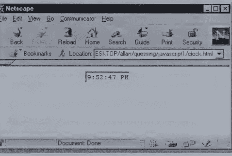

图 6-4：此脚本在你的浏览器中产生实时时钟

- 3. 将此文件保存为 CLOCK.HTML，以便在下一个练习中使用。

此脚本是一个不断更新自己的的时钟。通过使用 `startclock` 函数（在文档加载时激活），脚本加载计时器、停止计时器，然后重新启动计时器。它从系统时钟不断更新自己，因此产生了一个运行时钟的错觉。把它看作是动画，它是每秒播放一次的一系列静态时钟。


通过将此与之前的练习结合，你可以扩展到日期和时间。

JavaScript 的一个非常类似的用法是倒计时工具。如果你想向特定日期倒计时，你可以从某个日期开始向上计数，可以用 JavaScript 实现。


# 练习 6-4：向2000年倒计时

- 1. 在 CLOCK.HTML 文件中，进行以下代码更改：

在 "var seconds = now.getSeconds()" 行之后添加以下三行：

```javascript
var month = now.getMonth();
var date = now.getDate();
var year = now.getFullYear();
```

留空一行以提供空白，然后添加以下内容：

```javascript
now = null;
Hourleft = 23 - hours;
Minuteleft = 59 - minutes;
Secondleft = 59 - seconds;
Yearleft = 99 - year;
var Monthleft = 11 - month;
var Dateleft = 31 - date;
if (Yearleft!=1) {var ys="s"} else {var ys=""}
if (Monthleft!=1) {var mos="s"} else {var mos=""}
if (Dateleft!=1) {var ds="s"} else {var ds=""}
if (Hourleft!=1) {var hs="s"} else {var hs=""}
if (Secondleft!=1) {var mis="s"} else {var mis=""}
Temp3=Yearleft+' year'+ys,'+Dateleft+' day'+ds,'+Monthleft+' month'+mos,'+Hourleft+' hour'+hs,'+Minuteleft+' minute'+mis,'+Secondleft+' second'+ss+' left until 2000; '
```

接下来，将读取行：

```javascript
Document.clock.value = time Value;
```

替换为：

```javascript
Document.clock.value = timeValue;
```

最后，将表单中以 `<input type="` 开头的行替换为：

```html
<input type="textarea" name="clock" size=75 value="">
```

- 2. 保存文件。切换应用到 Web 浏览器并重新加载文件。你的浏览器屏幕应该与下页的图 6-5 相似。


```javascript
monthdays = new Array(12);
monthdays[0]=31;
monthdays[1]=28;
monthdays[2]=31;
monthdays[3]=30;
monthdays[4]=31;
monthdays[5]=30;
monthdays[6]=31;
monthdays[7]=31;
monthdays[8]=30;
monthdays[9]=31;
monthdays[10]=30;
monthdays[11]=31;
```

**图 6-7:** JavaScript 数组示例

在数组中，每个值都有一个数字，即索引。在上面的代码段中，变量 `monthdays` 通过 `[ ]` 内包含的数字进行索引。这告诉 JavaScript，如果是第 0 个（JavaScript 在索引数组时从 0 开始而不是 1），则有 31 天；如果 `monthdays` 是第 1 个，则有 28 天，依此类推。

然后脚本从数组中获取信息并用它“动态”构建一个自定义表格，而不是必须编写 12 个不同的表格来表示每个月份。你将在后续课程中学习更多关于数组的知识。

# 课程总结

- JavaScript 程序通常用于跟踪网站上的日期和时间。
- `lastModified` 属性可以从某些但并非所有的 Web 服务器检索文档最后修改的日期和时间。
- JavaScript 将日期和时间视为对象，因此可以像操作任何其他对象一样操作它们。
- `getYear` 方法符合 2000 年标准，它可以将 2000 年之后的年份处理为 4 位年份。
- 除了日期和时间，你还可以利用数组在 JavaScript 中构建日历。

# 第 7 Lesson
## 表单内容

- 引用表单元素
- 特殊表单引用程序
- 课程总结

## 引用表单元素

你可以使用 JavaScript 在文档内部与表单元素交互。你将使用的引用表单元素的语法与 JavaScript 的面向对象学习密切相关。学习如何引用 HTML 表单中的数据将帮助你将来编写编写更复杂的 JavaScript 程序。

大多数表单元素的内容并不难通过 JavaScript 程序访问。你只需要引用元素所在的 HTML 文档、该元素所在的特定表单以及元素本身。注意，这个顺序仅仅是一个层级结构。

引用表单及其元素有两种方法（对于人类程序员来说很容易确定）：

- 通过名称（对人类程序员很容易确定）
- 通过数组位置（便于整合到自动化程序中）

接下来的部分将解释这两种方法。

### 名称方法

回想一下在创建 HTML 表单元素时，所有元素都有一个 NAME 属性。每个表单元素都在一个表单中，而每个表单都在一个 HTML 文档中。你可以如下记录这种关系：

- document.formname.elementname

如果你想引用一个 `NAME` 属性设置为 `Button1` 且出现在一个 `NAME` 属性设置为 `RegistrationForm` 的表单中的按钮，你可以如图 7-1 所示指定这些元素。

| document.RegistrationForm.Button1 |
| :--- | :--- | :--- |
| HTML 文档 | HTML 文档中的表单 | HTML 文档中表单内的单个元素 |

| 图 7-1: 引用表单中的元素 |

# 练习 7-1: 通过名称引用表单元素

- 1. 在文本编辑器中打开一个新文档。
- 2. 在新的 HTML 文档中输入以下脚本：

```html
<HTML>
<HEAD>
<TITLE>Referring to Form Elements by Name</TITLE>
<SCRIPT LANGUAGE="JavaScript">
<!-- 开始对旧浏览器进行隐藏处理
function Copy()
{
document.DemoForm.Output.value = document.DemoForm.Input.value
}
// 停止对旧浏览器的隐藏处理 -->
</SCRIPT>
</HEAD>
<body>
<<h1>>You can refer to form elements by name.h</h1>
<FORM NAME="DemoForm">
<P>在这里输入内容...</P>
<BR><INPUT TYPE="TEXT" NAME="Input" Value="Yes, here." SIZE=30>
<P>然后点击按钮并观察它在下方出现！</P>
<INPUT TYPE="BUTTON" NAME="TransferButton" Value="Click me!" onclick="Copy()">
<P><INPUT TYPE="TEXT" NAME="Output" Value="" SIZE=30></P>
</FORM>
</body>
</HTML>
```

# 精通 JavaScript - 第 部分

- 3. 将文件保存为 ELEMENTS_BYNAME.HTML。切换到你的 Web 浏览器并打开 ELEMENTS_BYNAME.HTML。
- 4. 点击 **Click me!** 你的屏幕应该与图 7-2 相似。

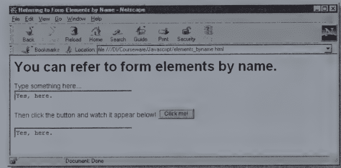

**图 7-2:** 此表单的元素在 JavaScript 程序中通过名称引用

在此程序中，创建了一个表单（命名为 DemoForm），并填充了两个文本字段和一个按钮。每当点击按钮时，`Copy()` 函数就会执行。在那个函数中，只有一行代码，如下：

```javascript
document.DemoForm.Output.value =
document.DemoForm.Input.value
```

上面的行通过名称引用了两个文本字段：**Input** 和 **Output**。它们都位于名为 DemoForm 的表单中。但这里每个引用的值是什么呢？这被称为*属性*（property）——你所引用的对象（在本例中为两个文本字段）的特征。值属性是文本字段中显示的任何。

这行代码将名为 **Input** 的文本字段的 **value** 属性设置为名为 **Output** 的文本字段的 **value** 属性。实际上，它将 **Input** 字段的内容复制到 **Output** 字段中。

按钮 `<INPUT>` 标签中的 `onclick="Copy()"` 是事件处理器——一段定义当发生特定事件时做什么的代码。在这种情况下，它指定了如果点击按钮则应该运行 Copy() 函数。第 8 Lesson：事件处理器将更详细地介绍这一主题。

98

DDC Publishing • www.ddc

# 数组方法

另一种引用表单和元素的方法是数组方法。虽然它比名称方法不直观，但当你需要编写自动化程序时很有帮助。JavaScript 浏览器解释器按顺序跟踪表单。它被称为数组。文档中的第一个表单索引为 0，第二个索引为 1，依此类推。


表单和元素按顺序出现：从上到下。

# 练习 7-2: 通过数组位置引用表单元素

- 1. 在文本编辑器中打开一个新文档。
- 2. 在新的 HTML 文档中输入以下脚本：

```html
<HTML>
<HEAD>
<TITLE>Referring to Form Elements by Array Position</TITLE>
<SCRIPT LANGUAGE="JavaScript">
<!-- 开始对旧浏览器进行隐藏处理
function Copy()
{
document.DemoForm.Output.value = document.DemoForm.Input.value
}
// 停止对旧浏览器的隐藏处理 -->
</SCRIPT>
</HEAD>
<body>
<<h1>>You can refer to form elements by name.h</h1>
<FORM NAME="DemoForm">
<P>在这里输入内容...</P>
<BR><INPUT TYPE="TEXT" NAME="Input" Value="Yes, here." SIZE=30>
<P>然后点击按钮并观察它在下方出现！</P>
<INPUT TYPE="BUTTON" NAME="TransferButton" Value="Click me!" onclick="Copy()">
<P><INPUT TYPE="TEXT" NAME="Output" Value="" SIZE=30></P>
</FORM>
</body>
</HTML>
```

- 3. 将文件保存为 ELEMENTS_BYARRAY.HTML。切换到你的 Web 浏览器并打开 ELEMENTS_BYARRAY.HTML。
- 4. 点击 **Click me!** 你的屏幕应该与图 7-3 相似。

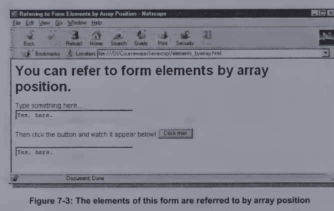

**图 7-3:** 此表单的元素在 JavaScript 程序中通过名称引用

（注：由于你提供的文本在此处中断且逻辑重复，我已翻译了你提供的完整部分。）


## 特殊表单引用过程

某些 HTML 表单元素需要特殊的程序来识别用户选择的值。选择列表和单选按钮组需要特别注意。

## 对单选按钮组的引用

从 Web 浏览器的角度来看，单选按钮组是以形式存在的。要确定用户选择了组中的哪一个单选按钮，你需要使用 `for` 循环逐个检查数组的内容（单个单选按钮）。

## 练习 7-3：引用单选按钮组

+ 1. 在你的文本编辑器中打开一个新文档。
2. 在新的 HTML 文档中输入以下脚本：

```html
<HTML>
<HEAD>
<TITLE>Referring to Radio Button Groups</TITLE>
<SCRIPT LANGUAGE="JavaScript">
<!-- Start hiding from old browsers.
function Identify()
{
var SelectedValue
var i
var GroupSize
GroupSize = document.DemoForm.RadioGroup.length
for (i=0; i<=GroupSize; i++)
{
if (document.DemoForm.RadioGroup[i].checked)
{
SelectedValue = document.DemoForm.RadioGroup[i].value
break
}
}
}
document.DemoForm.Output.value = SelectedValue
// Stop hiding from old browsers. //
</SCRIPT>
<HEAD>
<BODY>
<h1>It's a little tricky to identify the selected option in a cluster of radio buttons, but not too difficult.</h1>
<FORM NAME="DemoForm">
<P>Which language is best for creating Web animations?</P>
<INPUT TYPE="RADIO" NAME="RadioGroup" Value="Java"> Java<BR>
<INPUT TYPE="RADIO" NAME="RadioGroup" Value="JavaScript"> JavaScript<BR>
<INPUT TYPE="RADIO" NAME="RadioGroup" Value="Perl"> Perl<BR>
<INPUT TYPE="RADIO" NAME="RadioGroup" Value="COBOL"> COBOL<BR>
<INPUT TYPE="RADIO" NAME="RadioGroup" Value="VBScript"> VBScript<P>
<INPUT TYPE="BUTTON" NAME="ClickButton" Value="Which radio button is selected?" onclick="Identify()"><P>
<INPUT TYPE="TEXT" NAME="Output" Value="" SIZE=30>
</FORM>
</BODY>
</HTML>
```

+ 3. 将文件保存为 RADIOBUTTON_GROUPS.HTML。切换到你的 Web 浏览器并打开 RADIOBUTTON_GROUPS.HTML。

+ 4. 选择一个单选按钮并点击 **Which radio button is selected?** 按钮。你的屏幕应该与下一页的图 7-6 相似。

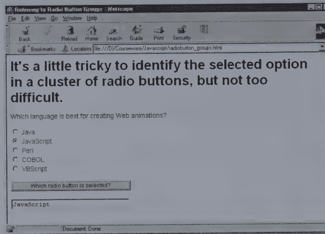

## 在单选按钮组中识别选中选项有点复杂，但并不太困难。

哪种语言创建 Web 动画最好？

- Java
- JavaScript
- Perl
- COBOL
- VBScript

哪个单选按钮被选中？

JavaScript

图 7-6：在 JavaScript 中引用单选按钮组

识别组中被选中单选按钮的关键是这个 `for` 循环：

```javascript
for (i=0; i<=GroupSize; i++)
{
  if (document.DemoForm.RadioGroup[i].checked)
  {
    SelectedValue = document.DemoForm.RadioGroup[i].value
    break
  }
}
```

变量 `GroupSize`（循环迭代停止时的值）被设置为等于 `document.DemoForm.RadioGroup.length`。`Length` 是 `RadioGroup` 数组的一个属性，包含数组中最后一个项的索引号（在本例中为 4，因为数组中有 5 个单选按钮对象，且第一个索引为 0）。

每当 `for` 循环迭代一次，就会处理一个 `if` 语句：

- `if (document.DemoForm.RadioGroup[i].checked)`

## Checked, SelectedValue, break 和 if

`Checked` 是单选按钮对象的一个属性，如果单选按钮被选中则为 `true`，如果未选中则为 `false`。此语句用于判断当前单选按钮（`RadioGroup[i]`）的 `checked` 属性是否为 `true`。

如果单选按钮被选中，将处理更多的消息。变量 `SelectedValue` 被设置为当前单选按钮的值（在 HTML 中通过 `VALUE` 属性定义）。然后，`break` 语句指示浏览器停止循环（因为已经找到了选中的单选按钮），并移动到循环结束括号之后的代码行。

`if` 语句将被选中单选按钮的值赋值给变量 `SelectedValue`。

> 识别选中选项的程序对于选择列表和下拉列表是相同的。对于 JavaScript 而言，它们都是 `SELECT` 对象。

## 对选择列表和下拉框的引用

与选择列表和下拉框结合使用 JavaScript，与你在上一个练习中编写的脚本相比要简单得多。你只需要检查几个属性，就能识别所选条目的的值。

## 练习 7-4：从选择列表中识别选中选项

+ 1. 在你的文本编辑器中打开一个新文档。

+ 2. 在新的 HTML 文档中输入以下脚本：

```html
<HTML>
<HEAD>
<TITLE>Referring to Selection Lists and Drop-Down List Boxes</TITLE>
<SCRIPT LANGUAGE="JavaScript">
<!-- Start hiding from old browsers. -->
function Identify()
{
var SelectedChoice
SelectedChoice = document.DemoForm.GrantList.selectedIndex
document.DemoForm.value = document.DemoForm.GrantList.options[SelectedChoice].value
}
// Stop hiding from old browsers. //
</SCRIPT>
</HEAD>
<body>
<h1>Here's how to identify the selected option in a selection list or a drop-down list box.</h1>
<FORM NAME="DemoForm"><P>
Who is buried in Grant's tomb?<P>
<SELECT NAME="GrantList" SIZE=1>
<OPTION SELECTED VALUE="Grant"> Grant
<OPTION VALUE="Grant and Mrs. Grant"> Grant and Mrs. Grant
<OPTION VALUE="Lee"> Lee
<OPTION VALUE="Lincoln"> Lincoln
<OPTION VALUE="Nobody"> Nobody
</SELECT><p>
<INPUT TYPE="BUTTON" NAME="ClickButton" Value="Which answer is selected?" onclick="Identify()"></p>
<INPUT TYPE="TEXT" NAME="Output" Value="" SIZE=30>
</FORM>
```

+ 3. 将文件保存为 SELECTION_LIST.HTML。切换到你的 Web 浏览器并打开 SELECTION_LIST.HTML。

+ 4. 从选择列表中选择其中一个项并点击 Which answer is selected? 按钮。你的屏幕应该与图 7-7 相似。

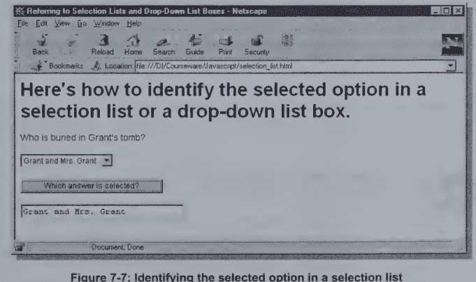

## 精通 JavaScript：部分 1

此程序的关键在于以下脚本：

```javascript
SelectedChoice = document.DemoForm.GrantList.selectedIndex
```

```javascript
document.DemoForm.value = document.DemoForm.GrantList.options[SelectedChoice].value
```

在第一行中，变量 `SelectedChoice` 被设置为选择列表的 `selectedIndex`。`selectedIndex` 属性是选项（包含在数组中）的索引号，如图 7-8 所示。

| Index # | Option |
| :--- | :--- |
| 0 | <OPTION SELECTED VALUE="Grant"> Grant |
| 1 | <OPTION VALUE="Grant and Mrs. Grant"> Grant and Mrs. Grant |
| 2 | <OPTION VALUE="Lee"> Lee |
| 3 | <OPTION VALUE="Lincoln"> Lincoln |
| 4 | <OPTION VALUE="Nobody"> Nobody |

图 7-8：HTML 表单中的 options 数组

在第二行中，`Output` 字段被设置为 `options[SelectedChoice]` 的值——即选择列表中的选中条目的值。

> 你可能疑惑为什么不按照以下结构构造赋值：

```javascript
document.DemoForm.Output.value = document.DemoForm.GrantList.options[document.DemoForm.GrantList.selectedIndex].value
```

从技术上讲，你应该能够这样做，这样做可以避免额外变量带来的困惑。然而，某些 Web 浏览器在处理大型嵌套对象引用时会出错。此外，脚本对于人类编辑器来说冗长且混乱。

## 总结

- JavaScript 中的元素形成层次结构。你可以根据 1) 它们或 2) 数组位置来引用层次结构中的元素。
- 使用名称方法引用元素时，每个元素按顺序列出并用点号分隔，例如 `document.formname.elementname`。
- 数组方法对于自动引用元素的例程非常方便。表单及其元素按照它们在 HTML 代码中顺序排列在数组中（从左到右，从上到下）。
- HTML 表单中单选按钮组的选择根据数组位置引用。
- 选择列表和下拉框对于 JavaScript 解释器来说仅仅是 `SELECT` 对象，其内容根据数组位置引用。


## 第 8 课
事件处理器

- 事件处理器与基础表单元素
- 事件处理器与更复杂的表单元素
- 课程总结

精通 JavaScript：第一部分

## 事件处理器与基础表单元素

从命令行（如 DOS）运行的计算机程序只需要对用户输入的文本做出响应。图形化程序要复杂得多，因为用户可以使用键盘和指向设备（鼠标、轨迹球等）拥有许多操作选项。

在单个表单中，用户可能会点击几十个按钮中的任何一个、从列表中选择内容，或者点击多个单选按钮或复选框中的任何一个。预测并为这么多可能的事件编程是一项艰巨的任务。

## 事件处理器

JavaScript 通过事件处理器让创建图形化程序变得变得简单。事件处理器是附加到图形元素（通常是表单元素）上的代码段。事件处理器监听特定的事件，例如鼠标点击。

当事件发生时，事件处理器会“触发”并调用执行特定功能的 JavaScript 函数。你在上一节中已经领略了事件处理器；在本节中，你将深入接触它们。

## 重点

在处理事件之前，你需要理解焦点（focus）概念在图形用户界面（GUI）中的应用。焦点是被选中的表单元素的状态，通常由用户通过按下 <TAB> 键移动光标或点击鼠标来实现。在任何时刻，只有一个屏幕元素可以拥有焦点。

> 在任何时刻，只有一个屏幕元素可以拥有焦点。


Windows 在当前具有元素的元素周围显示一条虚线（称为光标）。没有焦点的元素被称为“失焦”（blurred）。

按钮——包括通用和特殊用途——可以接受三个事件处理器：

- onClick：当用户点击按钮时触发。
- onFocus：当用户赋予按钮焦点时触发。
- onBlur：当按钮失去焦点时触发。

112
DDC Publishing • www.ddcpub.com

## 练习 8-1：将事件处理器附加到表单按钮

1. 在你的文本编辑器中打开新文档。

2. 在新的 HTML 文档中输入以下脚本：

```html
<HTML>
<HEAD>
<TITLE>Attaching Event Handlers to Form Buttons</TITLE>
<SCRIPT LANGUAGE="JavaScript">
<!-- Start hiding from old browsers -->
function ClickDisplay(ButtonNumber)
{
  document.DemoForm.ClickOutput.value=("You clicked button number " + ButtonNumber + ".")
}
function FocusDisplay(ButtonNumber)
{
  document.DemoForm.FocusOutput.value=("You gave focus to button number " + ButtonNumber + ".")
}
function BlurDisplay(ButtonNumber)
{
  document.DemoForm.BlurOutput.value=("You blurred button number " + ButtonNumber + ".")
}
// // Stop hiding from old browsers. -->
</SCRIPT>
</HEAD>
```

## 精通 JavaScript 第一部分

```html
<BODY>
<H1>This program demonstrates button event handlers.</H1>
<FORM NAME="DemoForm"><P>
Click information:<BR>
<INPUT TYPE="TEXT" NAME="ClickOutput" Value="" SIZE=35><P>
Focus information:<BR>
<INPUT TYPE="TEXT" NAME="FocusOutput" Value="" SIZE=35><P>
Blur information:<BR>
<INPUT TYPE="TEXT" NAME="BlurOutput" Value="" SIZE=35><P>
<HR>
<INPUT TYPE="BUTTON" NAME="Button1" Value="One"
="ClickDisplay(1)" onFocus="FocusDisplay(1)" onBlur="BlurDisplay(1)">
<INPUT TYPE="BUTTON" NAME="Button2" Value="Two"
="ClickDisplay(2)" onFocus="FocusDisplay(2)" onBlur="BlurDisplay(2)">
<INPUT TYPE="BUTTON" NAME="Button3" Value="Three"
="ClickDisplay(3)" onFocus="FocusDisplay(3)" onBlur="BlurDisplay(3)">
</FORM>
</BODY>
</html>
```

3. 将文件保存为 EVENTHANDLERS_BUTTONS.HTML。切换到你的 浏览器并打开 EVENTHANDLERS_BUTTONS.HTML。
4. 点击 **One** 按钮，注意表单字段的变化。
5. 点击 **Two** 按钮，注意表单字段的变化。
6. 点击 **Three** 按钮，注意字段的变化，如下一页的图 8-1 所示。

## 第 8 课：事件处理器

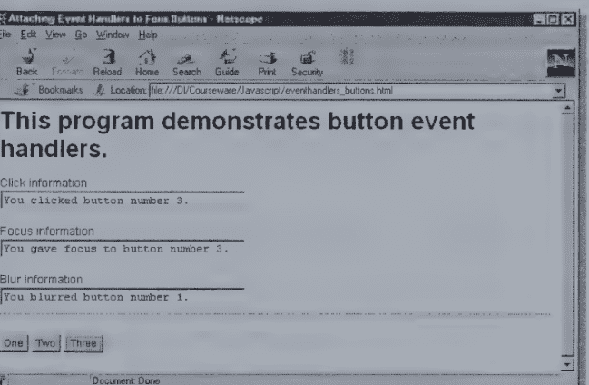

图 8-1：按钮有三个事件处理器

事件处理器出现在每个按钮的 HTML 声明中。按钮 Two 的声明是典型的：

```html
<INPUT TYPE="BUTTON" NAME="Button2" Value="Two"
OnClick="ClickDisplay(2)"
onFocus="FocusDisplay(2)"
onBlur="BlurDisplay(2)">
```

上述声明表示：当 onClick 事件处理器触发时，将调用带有参数 2 的函数 `ClickDisplay()`。它还指定了当 onFocus 和 onBlur 事件处理器触发时要调用的函数。要查看此程序的功能，请点击不同的按钮并观察每个文本字段中相应的的结果。

当用户点击按钮时，该按钮会被赋予焦点。

和按钮一样，单选按钮和复选框每个也支持三个事件处理器。它们是：

- onClick：当用户点击复选框或单选按钮时触发。
- onFocus：当用户赋予复选框或单选按钮焦点时触发。
- onBlur：当复选框或单选按钮失去焦点时触发。

## 练习 8-2：将事件处理器附加到单选按钮和复选框

1. 在你的文本编辑器中打开新文档。

2. 在新的 HTML 文档中输入以下脚本：

```html
<HTML>
<HEAD>
<TITLE>Attaching Event Handlers to Radio Buttons & Check Boxes</TITLE>
<SCRIPT LANGUAGE="JavaScript">
<!-- Start hiding from old browsers.
function ClickDisplay(SentValue)
{
  document.DemoForm.ClickOutput.value="You clicked " + SentValue + " ")";
}
function FocusDisplay(SentValue)
{
  document.DemoForm.FocusOutput.value="You gave focus to button " + SentValue + " ")";
}
function BlurDisplay(SentValue)
{
  document.DemoForm.BlurOutput.value="You blurred button " + SentValue + " ")";
}
// Stop hiding from old browsers. -->
</SCRIPT>
</HEAD>
```

<BODY>
<H1>This program demonstrates radio and check box event handlers.</H1>
<FORM NAME="DemoForm"><P>
Click information:<BR>
<INPUT TYPE="TEXT" NAME="ClickOutput" Value="" SIZE=35><P>
Focus information:<BR>
<INPUT TYPE="TEXT" NAME="FocusOutput" Value="" SIZE=35><P>
Blur information:<BR>
<INPUT TYPE="TEXT" NAME="BlurOutput" Value="" SIZE=35><P>
<HR><P>
Choose your beverage:<BR>
<INPUT TYPE="RADIO" NAME="RadioGroup" Value="Java"
onclick="ClickDisplay('Java')" onFocus="FocusDisplay('Java')" onBlur="BlurDisplay('Java')"> Java
<INPUT TYPE="RADIO" NAME="RadioGroup" Value="Cafe Lait"
onclick="ClickDisplay('Cafe Lait')" onFocus="FocusDisplay('Cafe Lait')" onBlur="BlurDisplay('Cafe Lait')"> Cafe Lait
<INPUT TYPE="RADIO" NAME="RadioGroup" Value="Mocha"
onclick="ClickDisplay('Mocha')" onFocus="FocusDisplay('Mocha')" onBlur="BlurDisplay('Mocha')"> Mocha
<INPUT TYPE="RADIO" NAME="RadioGroup" Value="Half-Caf"
onclick="ClickDisplay('Half-Caf')" onFocus="FocusDisplay('Half-Caf')" onBlur="BlurDisplay('Half-Caf')"> Half-Caf
<P>
Now, choose your beverage-topping condiments:<BR>
<INPUT TYPE="CHECKBOX" NAME="CinnamonCheckbox" Value="Cinnamon"
onclick="ClickDisplay('Cinnamon')" onFocus="FocusDisplay('Cinnamon')" onBlur="BlurDisplay('Cinnamon')"> Cinnamon
<INPUT TYPE="CHECKBOX" NAME="ChocolateCheckbox" Value="Chocolate"
onclick="ClickDisplay('Chocolate')" onFocus="FocusDisplay('Chocolate')" onBlur="BlurDisplay('Chocolate')"> Chocolate
<INPUT TYPE="CHECKBOX" NAME="NutmegCheckbox" Value="Nutmeg"
checked onclick="ClickDisplay('Nutmeg')" onFocus="FocusDisplay('Nutmeg')" onBlur="BlurDisplay('Nutmeg')"> Nutmeg
</FORM>
</BODY>
</html>
```

3. 将文件保存为 EVENTHANDLERS_2.HTML。切换到你的 浏览器并打开 EVENTHANDLERS_2.HTML。

4. 点击每个单选按钮，注意表单字段的变化。
5. 选中和取消选择复选框，注意表单字段的变化。尝试单选按钮和复选框的不同组合，如图 8-2 所示。

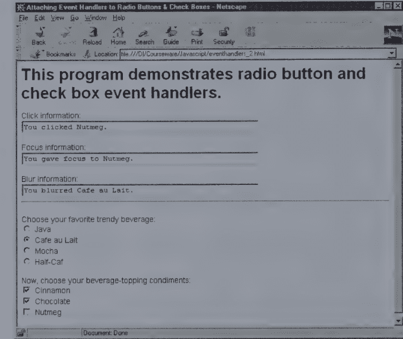

图 8-2：带有事件处理器的复选框和单选按钮

这个程序和你练习 8-1 中处理的程序一样，通过为每个表单元素每个分配三个事件处理器。下面是一个单选按钮的声明：

```html
<BR><INPUT TYPE="RADIO" NAME="RadioGroup" Value="Mocha"
onclick="ClickDisplay('Mocha')" onFocus="FocusDisplay('Mocha')" onBlur="BlurDisplay('Mocha')"> Mocha
```

事件处理器调用函数，这些函数包含点击、焦点和失焦信息的文本字段的内容。


# 事件处理程序与更复杂的表单元素

类似于按钮、单选按钮和复选框，其他表单元素也具有事件处理器。在本节中，你将学习文本字段、文本区域和选择列表支持的事件处理器。

表单本身也具有事件处理器。你可以在 `<FORM>` 标签中放置 `onSubmit` 和 `on` 事件处理器。当表单通过 SUBMIT 按钮提交（上传）到服务器，或通过 RESET 按钮被清空时，这些处理器将会在触发。


# 为字段和文本区域附加事件处理器

文本字段支持三个事件处理器：

- onChange: 当用户更改文本字段或文本区域中的文本时触发。在某些操作系统（特别是微软 Windows 的所有版本）中，用户必须移开文本处理器的焦点，才能识别更改并触发事件处理器。
- onFocus: 当用户赋予文本字段或文本区域焦点时触发。
- onBlur: 当文本字段或文本区域失去焦点时触发。

# 练习 8-3：文本中的事件处理器

1. 在你的文本编辑器中打开新文档。

2. 在新的 HTML 文档中输入以下脚本：

```html
<HTML>
<TITLE>Attaching Event Handlers to Text Fields & Text Areas</TITLE>
<SCRIPT LANGUAGE="JavaScript">
<!-- Start hiding from old browsers -->
function FocusDisplay(SentValue)
{
  document.DemoForm.FocusOutput.value=("You gave focus to " + SentValue +

Blur information:<BR>

<INPUT TYPE="TEXT" NAME="BlurOutput" Value="" SIZE=52><P>

Change information:<BR>

<INPUT TYPE="TEXT" NAME="ChangeOutput" Value="" SIZE=52><P>

<HR><BR>

Text Field One:<BR>

<INPUT TYPE="TEXT" NAME="TextFieldOne" Value="Change this text." SIZE=20
onChange="ChangeDisplay('One')" onfocus="FocusDisplay('One')"
onBlur="BlurDisplay('One')"><P>

Text Area Two:<BR>

<TEXTAREA NAME="TextAreaTwo" ROWS=20 COLS=50
onChange="ChangeDisplay('Two')" onfocus="FocusDisplay('Two')"
onBlur="BlurDisplay('Two')">

Then, change this text and see what happens.
</TEXTAREA>

</FORM>

</BODY>
</HTML>
```

3. 将文件保存为 EVENTHANDLERS_3.HTML。切换到你的网络浏览器并打开 EVENTHANDLERS_3.HTML。

4. 将 Text Field One 中的文本替换为任何你喜欢的字符串。按 <TAB> 键进入 Text Area Two，并将文本替换为任何你喜欢的字符串。

5. 注意上述文本字段上方 Focus、Blur 和 Change 字段的变化，如下一页的图 8-3 所示。

# 精通 JavaScript 第 1 部分

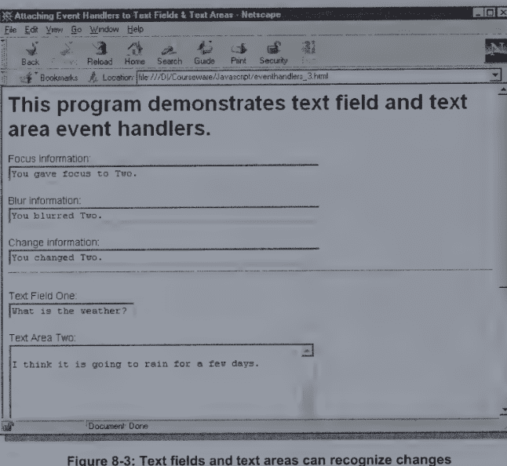

程序程序，附加到文档下半部分每个元素的三个事件处理器会检测焦点和文本处理器内容的变化，并调用函数在出现在文档顶部的文本字段中报告这些更改。

122 DDC Publishing • www.ddcpub.com

# 选择列表与下拉框

选择列表和下拉列表框（在浏览器眼中它们是同一种）具有三个事件处理器：

- onChange: 当用户更改选择列表或下拉列表框中的选中元素时触发。
- onFocus: 当用户赋予选择列表或下拉列表框焦点时触发。
- onBlur: 当选择列表或下拉列表框失去焦点时触发。

# 练习 8-4：为选择框附加事件处理器

1. 在你的文本编辑器中打开新文档。

2. 在新的 HTML 文档中输入以下脚本：

```html
<HTML>
<HEAD>
<TITLE>Attaching an Event Handler to a Selection Box</TITLE>
<SCRIPT LANGUAGE="JavaScript">
<!-- Start hiding from old browsers.
function FocusDisplay(SentValue)
{
  document.DemoForm.FocusOutput.value=("You gave focus to " + SentValue + ")"

document.DemoForm.ChangeOutput.value="(You changed " + SentValue
+ ")"
// Stop hiding from old browsers. --
</SCRIPT>
</HEAD>
<body
<H1>This program demonstrates selection box event handlers.</h1>
<FORM NAME="DemoForm"><P>
Focus information:<BR>
<INPUT TYPE="TEXT" NAME="FocusOutput" Value="" SIZE=52><P>
Blur information:<BR>
<INPUT TYPE="TEXT" NAME="BlurOutput" Value="" SIZE=52><P>
Change information:<BR>
<INPUT TYPE="TEXT" NAME="ChangeOutput" Value="" SIZE=52><P>
<HR><P>
<SELECT SIZE=4 NAME="Select" onChange="ChangeDisplay('Power Tools')" onFocus="FocusDisplay('Power Tools')"
onBlur="BlurDisplay('Power Tools')">
<OPTION VALUE="Drill Press"> Drill Press
<OPTION VALUE="Table Saw"> Table Saw
<OPTION VALUE="Jointer"> Jointer
<OPTION VALUE="Mill"> Mill
</SELECT>
<SELECT SIZE=4 NAME="HandSelect" onChange="ChangeDisplay('Hand Tools')"
onFocus="FocusDisplay('Hand Tools')" onBlur="BlurDisplay('Hand Tools')">
<OPTION VALUE="Hammer"> Hammer
<OPTION VALUE="Screwdriver"> Screwdriver
<OPTION VALUE="C-Clamp"> C-Clamp
<OPTION VALUE="Tape Measure"> Tape Measure
</SELECT>
</FORM>

<body>
</html>
```

3. 将文件保存为 EVENTHANDLERS.4.HTML。切换到你的网络浏览器并打开 EVENTHANDLERS_4.HTML。

4. 点击左侧选择框中的任何列表项，并注意上方 Focus、Blur 和 Change 字段的变化。

5. 点击右侧选择框中的任何列表项，并注意上方 Focus、Blur 和 Change 字段的变化。

6. 尝试选择框中不同的配置，注意 Focus、Blur 和 Change 字段的变化，如图 8-4 所示。

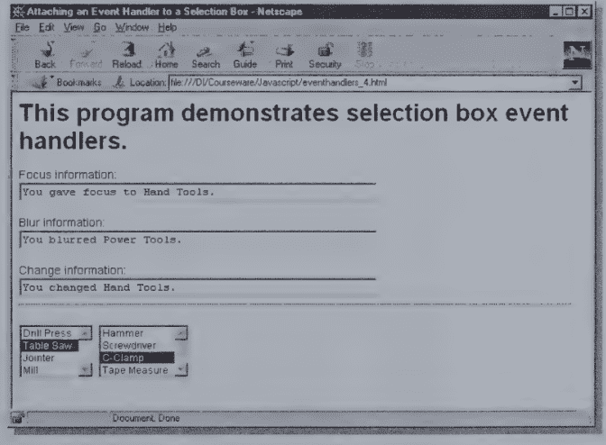

> 图 8-4：选择列表也具有事件处理器

嵌入在每个选择列表 `<SELECT>` 标签中的是三个事件处理器。当触发时，每个事件处理器都会调用一个函数，显示关于获得焦点的表单元素、失去焦点的元素以及更改元素的信息。

# 课程总结

- 事件处理器是附加在图形元素上的代码段。事件处理器是一个“中间人”；它等待特定事件，然后触发一个 JavaScript 函数来响应该事件。
- 焦点是用于描述表单元素被选中（通过 <TAB> 键或鼠标点击）但不一定被点击的状态。
- 按钮可以分配三个事件处理器：onClick、onFocus 和 onBlur。onClick 在按钮被点击时触发；onFocus 在按钮被选中时触发；onBlur 在按钮失去焦点时触发。
- 与按钮类似，单选按钮和复选框支持 onClick、onFocus 和 onBlur。
- 表单中的文本处理器也支持事件处理器。OnChange 在字段或区域中的文本更改且焦点移开时触发。
- 选择列表和下拉框与文本处理器一样，共享 onFocus 和 onChange 处理器。

# 第 9 课
窗口控制

# ## 课程主题

- 警告！（Alerts！）
- 打开和关闭窗口
- 框架
- 课程总结

# 警告！

JavaScript 常用于控制浏览器窗口。这是一种非常常见的 JavaScript 形式，因为与纯 HTML 不同，JavaScript 允许你控制打开的浏览器的大小和特性。许多程序员使用 JavaScript 生成的浏览器窗口为他们的网站添加强调和动态元素。JavaScript 允许你以 HTML 无法做到的方式操作框架。

# alert() 标签

警告（alert）是网络浏览器向用户发送的快速消息，告知用户 1) 发生了错误或 2) 提供有关大小的信息。你可以通过 `alert()` 方法在页面内创建自己的警告。`alert()` 方法以警告窗口的形式打印（显示给用户）你在括号部分中输入的任何内容。

此类警告窗口的示例见下一页的图 9-1。这是一个非常简单的东西，但它是对 JavaScript 某些复杂的窗口控制能力的极佳介绍。

# 练习 9-1：创建警告窗口

1. 在 HTML 文档中输入以下脚本：

```html
<HEAD>
<SCRIPT LANGUAGE="JavaScript">
<!--Start hiding from old browsers
function hello() {
  alert ("Welcome to my Page!");
}
// Stop hiding from old browsers -->
</SCRIPT>
<BODY onload="hello">
<h1>Glad to see you</h1>
</body>
</html>
```


# 第 9 ：窗口控制

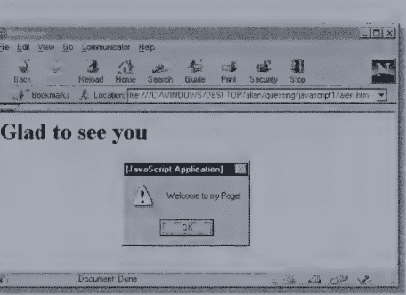

图 9-1：JavaScript alert 示例

事件处理器 `onload` 使用在此文档的 `<body>` 标签中，用于在文档加载完成后显示警报窗口。你也可以使用事件处理器 `onunload` 在用户离开页面时执行某个函数。

正如在本课程的第一节中讨论的那样，JavaScript 是区分大小写的。这在处理事件处理器时显得尤为重要。`Onload`（如之前的脚本中使用的）和 `onload` 具有完全不同的含义。它们都被用作事件处理器：`Onload` 用于定义处理器，而 `onload` 用于引用处理器。例如，请查看图 9-2 中的代码。

```javascript
<SCRIPT LANGUAGE="JavaScript">
function fn() {
  // some function
}
</SCRIPT>

<BODY onload="fn()">
<SCRIPT>
document.onload=fn
</SCRIPT>
```

图 9-2：区分 onload 和 onload

处理器 `fn` 位于函数语句内部，并通过 `<body>` 标签中的 `onload` 语句定义。换句话说，该函数变成了一个动作，因为 `<body>` 标签指示浏览器在页面加载完成后执行它。最后，它在 HTML 文档中使用 `onload` 命令进行引用。

警报框（Alert boxes）对于向用户发送消息很有用，但它们并不是与用户通信的视觉观的方式。通常，警报用于提醒用户遗漏或重要的信息。下一个练习中提供了一个示例。

# 练习 9-2：编写一个电子邮件检查器

1.  在 HTML 文档中输入以下脚本：

```html
<HTML>
<HEAD>

<SCRIPT LANGUAGE="JavaScript">
<!-- 对旧版浏览器隐藏 -->
function emailCheck() {
  mailcheck=document.eform.email.value;
  if (mailcheck.indexOf("@")<3){
    alert("请确保你已正确输入了 e-mail 地址。请检查前缀和 '@' 符号。");
  }
  if (mailcheck.indexOf(".com")<5 && (mailcheck.indexOf(".org")<5
  && (mailcheck.indexOf(".gov")<5 && (mailcheck.indexOf(".net")<5
  && (mailcheck.indexOf(".mil")<5 && (mailcheck.indexOf(".edu")<5
  && (mailcheck.indexOf(".us")<5)){
    alert("请确保你已正确输入了 e-mail 地址。请检查后缀的准确性。（它应该包含 "".com, .edu, .net, .org, .gov 或 mil 或 .us）");
  }

// 从旧版浏览器停止 -->
</SCRIPT>
</HEAD>
<BODY TEXT="000000">
<CENTER>
<P>
<H3>请在下方输入您的 E-mail 地址：</H3>
<BR>
<FORM NAME="eform"><INPUT TYPE="text" NAME="email" SIZE=40 VALUE=""><BR>
<INPUT TYPE="button" NAME="mail" VALUE="Submit" OnClick="emailCheck()"
</FORM></CENTER>
</BODY>
</HTML>
```

2.  将文件保存为 EMAILCHECK.HTML。双击该文件并在浏览器中打开它。

3.  输入一个无效的电子邮件地址，你应该会看到弹警报窗口，类似于下一页的图 9-3。

# 第 9 ：窗口控制

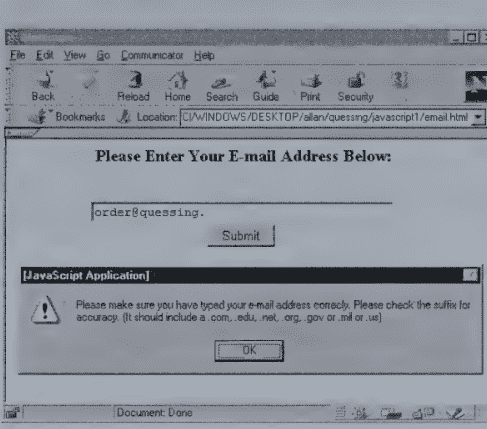

图 9-3：JavaScript 电子邮件检查器

此脚本对表单列出的电子邮件地址进行两次检查。第一个 `if` 语句检查显示的字符串是否包含 "@" 符号，并且到该点长度不小于 3 个字符（许多邮件服务器会拒绝长度仅为 1 个字符的电子邮件地址，此脚本确保了这种标准）。

第二个 `if` 语句遍历不同的 TLD（顶级域名）后缀（此脚本可接受的后缀），并尝试与其中之一匹配。它还确保域名至少包含五个字符：TLD 加上 "." 和域名（域名可以短到只有 1 个字符，例如 "a.com"）。合起来，该脚本要求至少包含两个字符的前缀、一个 "@" 符号以及至少一个 5 个字符的后缀。

> 这段代码的一个问题是它非常以美国为中心。其他国家显然有自己的域名系统，而且——因为互联网是全球性的——这会导致以 .UK 或 .AU 结尾的域名的用户无法提交表单。

解决这个问题有两种可能的方法：

-   创建一个列出所有可能的顶级域名的数组（但这会导致代码变得很臃肿）
-   修改代码以搜索长度为二或三字符的后缀（这准确性较低，但对于大多数应用程序来说已经足够高效）

# 打开和关闭窗口

JavaScript 包含了打开和关闭窗口的事件处理器。与 HTML 中可用的 `<TARGET>` 标签类似，你可以引导链接在新窗口中打开。你还可以设置打开的窗口的参数（如大小、特性、标题），为你的网站提供更具定制化的感觉。


初级 JavaScript 程序员倾向于在他们学到新技巧上用力过度。就像所有的 Web 页面设计问题一样，最好的总是问问自己，你是在使用 JavaScript 执行必要的操作，还是为了展示你的编程技巧。

弹出窗口是好的，但它们可能也很烦人；而且它们会让使用旧版浏览器的人无法查看你网站的部分。

# 练习 9-3：打开 JavaScript 窗口

1.  在 HTML 文档中输入以下脚本：

```javascript
<SCRIPT LANGUAGE="JavaScript">
<!-- 开始从旧版浏览器隐藏 -->

function PopWin()
{
  popup = window.open("", "popDialog", "height=160,width=300,scrollbars=no")
  popup.document.write('<html><BODY BGCOLOR=#FFFFFF TEXT=#000000>');
  popup.document.write('<BR><BR>');
  popup.document.write('<CENTER><H3>感谢访问我们的页面!</H3></CENTER>');
  popup.document.write('</body></html>');
  popup.document.close();
}

// 从旧版浏览器停止 --
</SCRIPT>
</HEAD>

<BODY bgcolor="ffffff" onload="PopWin">
<CENTER>
<H3>看到这个时，弹出窗口将加载</H3>
</CENTER>
</BODY>
```

2.  将文件保存为 POPUP.HTML。双击该文件并在浏览器中打开。你的屏幕应该类似于图 9-4。

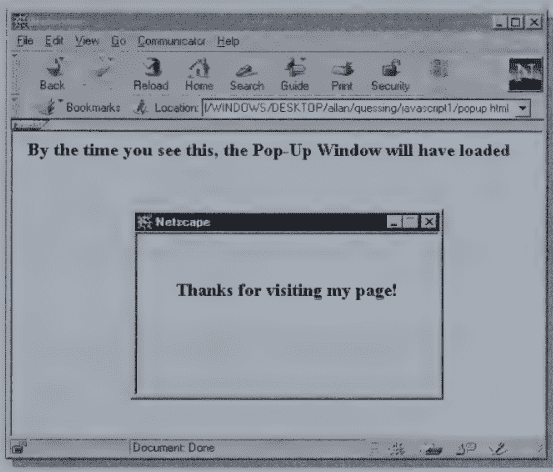

图 9-4：JavaScript 弹出窗口


注意弹出窗口的代码完全位于 POPUP.HTML 中。如果你想使用 `onClick` 事件多次调用弹出，这将很方便。

Close 是一个窗口处理器。它可以用于关闭由 JavaScript 创建的窗口。默认情况下，close 指当前窗口；但是你可以告诉它关闭其他窗口。例如，如果你创建了两个弹出窗口 WindowA 和 WindowB，你可以从 WindowB 关闭 WindowA 而无需生成提示。

# 练习 9-4：关闭 JavaScript 窗口

1.  用记事本重新打开 POPUP.HTML 文件。添加以下行：

```javascript
popup.document.write('<BR><BR><FORM><INPUT TYPE="BUTTON" VALUE="Close" onclick="self.close()"></FORM>');
```

在这些行之间：

```javascript
popup.document.write('<CENTER><H3>感谢访问我们的页面!</H3></CENTER>');
popup.document.write('</body></html>');
```

2.  重新保存文件。双击该文件并在浏览器中打开它。

# 框架

在之前的课程中，你学习了框架的构建和布局。JavaScript 允许你进一步增强框架页面。你可以使用 JavaScript 为框架内的窗口建立属性，或者通过数组调用它们。

假设你有一个四窗口框架集。你可以编写类似于图 9-6 所示的代码。

```html
<FRAMESET COLS="25%,25%,25%,25%">
<FRAME SRC="frame1.html" NAME="frameone">
<FRAME SRC="frame2.html" NAME="frametwo">
<FRAME SRC="frame3.html" NAME="framethree">
<FRAME SRC="frame4.html" NAME="framefour">
</FRAMESET>
```

图 9-6：四向框架集

在 JavaScript 内部，你可以通过数组引用这些窗口，如下所示：

-   frameone is top.frames[0]
-   frametwo is top.frames[1]
-   framethree is top.frames[2]
-   framefour is top.frames[3]

你现在可以通过调用 `<LOCATION>` 标签的名称来引用各种窗口。


## 练习 9-5：使用 JavaScript 控制框架

- 1. 打开 JAVCRIPT-1 文件夹中的 FRAMES 文件夹，并双击 FRAMES.HTML 文件。

- 2. 浏览器应该打开并显示与图 9-7 类似的图像。

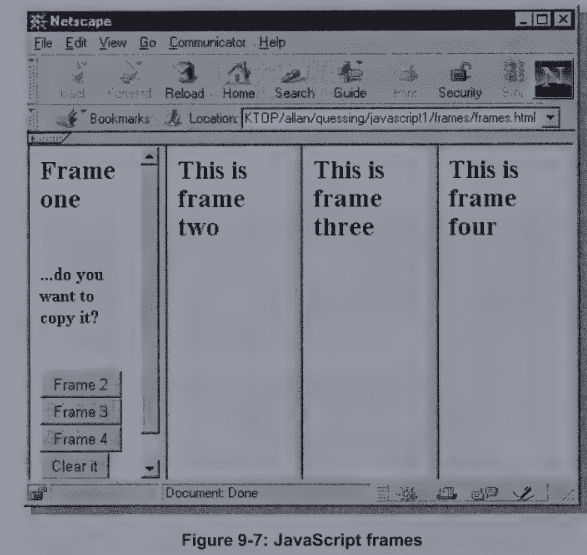

- 3. 该脚本的代码相对简单。用记事本打开 FRAME1.HTML 文件并检查代码，如图 9-8 所示。

```
<INPUT TYPE="button" VALUE="Frame 2" onclick="top.frames[1].location='frame1.html'>
<INPUT TYPE="button" VALUE="Frame 3" onclick="top.frames[2].location='frame1.html'>
<INPUT TYPE="button" VALUE="Frame 4" onclick="top.frames[3].location='frame1.html'>
<INPUT TYPE="button" VALUE="Clear it" onclick="top.frames.location='frames.html'>
```

图 9-8：FRAME1.HTML 的代码


通过使用事件处理器 `onClick` 和四个不同的按钮，此文件可以控制打开时新窗口的位置。此代码也可用于同时更新多个框架。

你还可以使用此类框架来控制框架布局的其他方面。例如，你可以将第一行改为：`onclick=top.frames[1].bgColor="teal"`。这将把第二个框架的背景颜色改为青蓝色。

你可以在 DDC Publishing 的 *Mastering JavaScript: Part 2* 课程学习更多关于 JavaScript 及其与框架交互的知识。

## 总结

- JavaScript 可以比 HTML 更彻底地控制窗口及其窗口特性。

- 警报窗口（alert window）是一个“弹出”的小窗口，用于向浏览器用户警告某个问题。你可以编写 JavaScript 来启动警报窗口。

- 使用事件处理器（如 onClick 和 onLoad），你可以在 JavaScript 中编写打开新窗口。

- 框架集（Framesets）也可以通过 JavaScript 进行操作。从一个窗口，你可以更改多个窗口的特性。

## Notes

## 附录

- 附录 A：JavaScript 客户端对象
- 附录 B：JavaScript 术语表

## 附录 A：JavaScript 客户端对象

在客户端环境（Web 浏览器）中使用 JavaScript 有许多相关的对象。

其中许多对象作为属性值相互关联。参考图 A-1 显示了 JavaScript 1.2 的客户端对象包含层次结构。

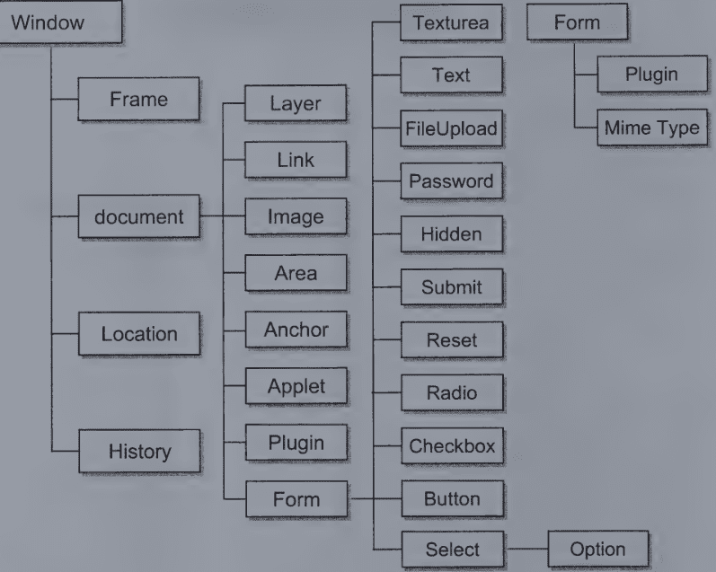

参考图 A-1：JavaScript 1.2 中客户端对象之间的包含关系

## 附录 B：JavaScript 术语表

**算术运算符（Arithmetic operator）**
以下任何符号：*, +, -, /（除法）。

**数组（Array）**
存储在单个变量中的项列表。

**赋值（Assign）**
给变量赋予值。

**赋值运算符（Assignment operator）**
用于赋值的符号，例如 =。

**错误（Bug）**
程序中的错误。

**调用（Call）**
执行一个函数。

**不区分大小写（Case-insensitive）**
不区分大写和小写的属性。

**区分大小写（Case-sensitive）**
区分大写和小写字母的属性。

**子句（Clause）**
语句或表达式的一部分。

**命令（Command）**
给计算机的指令。

**注释掉（Comment-out）**
程序中被编译器忽略的文本。

**比较运算符（Comparison operator）**
用于比较值的符号，例如 ==, >, <。

**连接字符串（Concatenate）**
将两个或多个字符串连接在一起。

**条件语句（Conditional statement）**
根据条件执行操作的语句。

**常量（Constant）**
在程序执行期间不能更改的值。

**嵌入（Embed）**
将代码或内容插入另一个文档或程序中。

**空字符串/空字符串（Empty string）**
不包含任何字符的字符串。

**错误（Error）**
程序中不正确的语句。

**事件（Event）**
系统中发生的可以被处理的操作。

**调试（Debug）**
发现并修复程序中的错误。

**定义（Define）**
说明某事的意义或目的。

**定义（Definition）**
单词或术语的含义。

**文档对象（Document object）**
表示文档内容的对象。

**元素（Element）**
文档或程序结构的一部分。

**假（False）**
表示“非真”的布尔值。

**焦点（Focus）**
元素处于准备好接受输入的状态。

**函数（Function）**
执行特定任务的代码块。

**函数调用（Function call）**
对已定义函数的执行。

**递增（Increment）**
增加变量的值，通常为增加 1。

**初始化（Initialize）**
为变量设置初始值。

**迭代（Iteration）**
重复任务的过程，通常在循环内。


# 精通 JavaScript 第一部分

## 嵌套 (Nested)

当一个语句作为另一个语句的一部分使用时。例如，如果一个语句的 if else 子句是另一个 if...else 语句，这些就是嵌套的。同样，当界定符号（如括号 `{}` 或圆括号 `()`）相互嵌套时也是如此。

## 操作数 (Operand)

在运算符表达式使用的变量或值。例如，在表达式 `orders*10` 中，`orders` 和 `10` 都是操作数。

## 参数 (Parameter)

传递给 Java applet 或 JavaScript 函数的额外信息。参数为 applet 和函数提供了完成任务所需的信息。

## 返回 (Return)

用于在 JavaScript 函数结束返回值的值的。如果函数在赋值中被调用，则该值会被赋给变量；例如 `result=functionname();`。

## 脚本 (Script)

一组指示计算机如何完成任务的程序语句。

## 脚本语言 (Scripting language)

构成功能性脚本的规则和关键字集合。与编程语言相同，但脚本语言传统上不那么严格且更容易学习。

## 语句 (Statement)

一种通常影响程序流的 JavaScript 结构。循环和条件语句，如 `for` 和 `if...else`，都是语句。

## 字符串 (String)

由一系列引号内的字母数字字符组成的值。

## 语法 (Syntax)

编程或脚本语言的语法和逻辑规则。

## 真 (True)

如果布尔比较操作有效，则返回的值。

## 一元 (Unary)

一个仅接受单个操作数的运算符；例如 `++`（递增）、`--`（递减）和 `-`（取反）。

## 值 (Value)

某种形式的数据。数值值是一个数字。字符串值是一个字符串。两者都可以赋给变量。字面量是显式指定的特定数字或字符串，未赋给变量。

# 索引 (Index)

| 术语 | 页码 |
| :--- | :--- |
| ActiveX | 2 |
| 数组 | 99 |
| 模糊 | 112 |
| 布尔值 | 18, 22, 39 |
| C++ | 4 |
| 复选框 | 115 |
| 注释 | 11 |
| 数据类型 | 22 |
| Document.write() | 6 |
| 动态类型 | 22 |
| 事件处理器 | 112 |
| 灵活类型 | 22 |
| 焦点 | 112 |
| for 循环 | 64 |
| 函数: 调用 | 46, 49 |
| 函数: 传递参数 | 50 |
| if 语句 | 58 |
| if...else 语句 | 58 |
| 递增 | 65, 68 |
| 索引变量 | 64, 65, 68 |
| 初始化 | 20 |
| Java | 2 |
| 语言: 编程 | 4 |
| 语言: 脚本 | 2 |
| 方法 | 99 |
| Internet Explorer | 10 |
| Internet Explorer | 71 |
| 微软公司 | 119 |
| Microsoft Modulo | 30 |
| Netscape Communications Corporation | 5 |
| Navigator | 10, 71 |
| 数字 | 22 |
| 运算符: 赋值 | 33 |
| 运算符: 比较 | 36 |
| 运算符: 逻辑 | 39 |
| 运算符: 数学 | 37 |
| 运算符: 简写 | 33 |
| 参数 | 50 |
| 属性 | 98 |
| 单选按钮 | 115 |
| 脚本 | 6 |
| 字符串 | 6, 18, 22 |
| 字符串: 拼接 | 22 |
| Sun Microsystems | 5 |
| switch 语句 | 71 |
| typeof() | 24 |
| 变量: 声明 | 18 |
| 变量: 初始化 | 20 |
| while 循环 | 68 |

BEHREND COLLEGE
COMPUTER CENTER

