# JavaScript 单页应用开发精通指南

## 致谢

**作者**

- Philip Klauzinski
- John Moore

**文稿编辑**

- Safis Editing

**审核员**

- Ciro Artigot

**项目协调员**

- Ritika Manoj

**策划编辑**

- Wilson D'souza

**校对员**

- Safis Editing

**版权编辑**

- Reshma Raman

**索引员**

- Rekha Nair

**内容开发编辑**

- Divij Kotian

**图形**

- Jason Monteiro

**技术编辑**

- Sachit Bedi

**制作协调员**

- Aparna Bhagat

**Philip Klauzinski** 是一位专注于 JavaScript 单页应用（SPA）开发的高级前端开发人员。他在网页设计和网页开发方面拥有超过 20 年的经验，是 Web 应用开发、客户端 JavaScript 和搜索引擎优化（SEO）领域的领先专家。Philip 曾在多个行业担任前端开发人员，包括消费者电子商务、B2B 电子商务、大数据、Web 托管、直销营销、域名服务（DNS）和制造业。

> 我想感谢我的父母一直强调教育对我生活中的重要性……因此，我热爱我的职业工作，并能够围绕我真正感兴趣的事情来塑造我的职业生活。我天生就有每天学习更多知识的动力，我相信这就是我取得成功的原因。谢谢，爸爸妈妈！

**John Moore** 从事 Web 开发已有 20 年。他是 JavaScript 和 HTML5 领域的行业专家。他开发过屡获奖的 Web 应用，并曾在 Digital Equipment Corporation、安永信、Wachovia Bank 和 Fidelity Investments 工作或提供咨询。他在职业生涯早期专注于前端 Web 开发，在开发和架构职位上帮助推动了响应式 Web 设计和单页应用的到来。最近，他领导了 JavaScript 全栈开发，担任一家位于缅因州的初创公司的首席技术官（CTO）。

> 我想感谢我的妻子 Myra Salapare 博士以及女儿 Mila Moore 和 Sophia Moore 的所有支持。还要感谢 Andrea Shiflet、Erin Benner 和 Lauren Grousd 的巨大帮助。

**Ciro Artigot** 目前在 ECODES 担任 IT 经理，ECODES 是一家西班牙基金会，致力于在地球范围内为所有人的福利服务。

他开发网站已超过 15 年。他是一位全栈开发人员和 CMS 专家，痴迷于 Joomla。他在开源 GNU 项目中工作过 10 年，主要涉及 LAMP。

在过去的几年里，他一直在 MEAN 环境下研究和使用 SPA。

> 我想感谢 Pampa、Diego 和 Hugo 给我时间审阅这本书，感谢我的父母和兄弟，让我能够投入到我最喜欢的事情中——开发

如需与书籍相关的支持文件和下载，请访问 `www.PacktPub.com`。

您知道 Packt 为出版的每本书都提供电子版，并提供 PDF 文件吗？您可以在 `www.PacktPub.com` 升级到电子版，作为纸质书客户，您有权获得电子折扣。请通过 `service@packtpub.com` 与我们联系获取更多详情。在 `www.PacktPub.com`，您还可以阅读免费技术文章集、订阅免费通讯并接收 Packt 书籍的独家折扣和优惠。通过 Packt 获取最需求的软件技能，让您充分访问所有 Packt 书籍和视频课程，以及帮助您规划个人发展和职业发展的行业领先工具。涵盖 Packt 出版的所有书籍。通过浏览器按需复制、打印和书签内容。

## 前言

JavaScript 由 Netscape 的 Brendan Eich 于 1995 年创建，它已经从一种仅在浏览器中使用的玩具脚本语言，演变为全球范围内全栈开发最流行的语言之一。随着基于 Chrome V8 JavaScript 引擎的 `Node.js` 的引入，开发者现在能够使用 JavaScript 构建强大且高性能的应用程序。随着 MongoDB（一种现代 NoSQL 数据库）的加入，应用程序可以在每一层都利用 JavaScript。

许多流行的 Web 应用部分或全部以单页应用（SPA）的形式实现。通过 SPA，用户加载单个网页，该页面会根据用户交互或传入的服务器数据进行动态更新。其优势在于提供的应用体验更流畅，模拟了原生应用程序的交互，并且可能需要更少的网络流量和服务器负载。

MEAN 堆栈是一组 JavaScript 工具，代表了从数据库到运行时环境、应用框架以及前端的完整技术栈。本书提供了使用 MEAN 栈以及 JavaScript 生态系统中的其他工具构建 SPA 的详尽背景知识。它涵盖了 SPA 架构和 JavaScript 工具的基础。随后，本书扩展到了更高级的主题，例如如何构建、保护和部署使用 MEAN 栈构建的 SPA。

- `第 1 章`，*整理 NPM、Bower 和 Grunt*，介绍了 JavaScript 前端包管理、构建和任务运行工具。这些工具为你搭建理想的开发环境奠定了基础。
- `第 2 章`，*Model-View-Whatever* 超越原始 MVC 设计模式，探索了它在前端框架中的转化，以及如何演变为 Model-View-* 或 Model-View-Whatever (MVW)，在这种模式下，Controller 层更加开放，并且通常被抽象到更适合 SPA 环境的其他层。
- `第 3 章`，*SPA 基础 - 创建理想的应用环境*，向你介绍了 SPA 的常见组件/层、围绕这些组件的最佳实践和变体，以及如何将它们组合并为现代 SPA 奠定基础。

### 第 12 章：将应用连接到社交媒体

第 12 章 *将应用连接到社交媒体* 将通过将 SPA 连接到多个社交媒体平台来扩展该应用。你将学习使用 Facebook 和 Twitter 策略设置身份验证认证，并共享 SPA 中的数据。

### 第 13 章：使用 Mocha、Karma 及更多工具进行测试

第 13 章 *使用 Mocha、Karma 及更多工具进行测试* 将教你如何在服务器端和视图层进行测试。

### 第 14 章：SPA 的部署与扩展

第 14 章 *SPA 的部署与扩展* 将引导你完成在 MongoLab 上设置生产环境数据库，并将你的 SPA 部署到 Heroku。最后，你将探索如何在云端扩展你的 SPA。

除了 Web 浏览器和操作系统的命令行或终端外，这本书需要的软件极少。你需要一个编辑器来编写代码。从记事本到像 Jetbrains WebStorm 这样的 IDE，任何文本编辑器都可以胜任。

本书非常适合想要用 JavaScript 构建复杂 SPA 的 JavaScript 开发者。对 SPA 概念有基本的了解会有帮助，但并非必不可少。

在书中，你会发现许多文本样式，用于区分不同类型的信息。以下是这些样式的示例及其含义解释。文本中的代码词、数据库表名、文件夹名、文件名、文件扩展名、路径名、虚拟 URL、用户输入和 Twitter 显示如下：“我们可以通过使用 include 指令包含其他上下文。”

代码块的设置如下：

```javascript
module.exports = function(grunt) {

  grunt.initConfig({

    pkg: grunt.file.readJSON('package.json'),
```

当我们希望你关注代码块的特定部分时，相关的行或项目将以加粗形式显示：

```javascript
grunt.initConfig({
  pkg: grunt.file.readJSON('package.json'),
  clean: ['dist/**'],
  copy: {
    main: {
      files: [
```

任何命令行输入或输出的写法如下：

```bash
$ npm install -g grunt-cli
grunt-cli@0.1.13 /usr/local/lib/node_modules/grunt-cli
├── resolve@0.3.1
├── nopt@1.0.10 (abbrev@1.0.7)
└── findup-sync@0.1.3 (lodash@2.4.2, glob@3.2.11)
```

新术语和重要词汇将以加粗形式显示。你在屏幕上看到的单词（例如菜单或对话框中的内容）在文本中的显示形式如下：“点击**下一步**按钮将带你进入到下一个屏幕。”

警告或重要说明将出现在如下框中。

提示和技巧将如下所示所示。

### 读者反馈

我们随时欢迎读者的反馈。请告诉我们你对这本书的看法——你喜欢或不喜欢的地方。读者反馈对我们非常重要，因为它能帮助我们开发出真正让你受益的的作品。如需发送通用反馈，请发送电子邮件至 `feedback@packtpub.com`，并在邮件主题中注明书名。如果您在某个领域具有专业知识，并对编写或贡献书籍感兴趣，请访问我们的作者指南 `www.packtpub.com/authors`。

### 下载示例代码

您可以从 http://www.packt.com/ 账户下载本书的示例代码文件。如果您是在其他地方购买的这本书，请访问 http://www.packt.com 将文件通过电子邮件发送给您。您可以按照以下步骤下载代码：

- 从您购买的地方选择该书。
- 点击 **Code**（代码）。

文件下载完成后，请确保您已解压了最新版本的：

- Windows 版本的 WinRAR
- Mac 版本的 iZip
- Linux 版本的 PeaZip

本书的代码包也托管在 GitHub 上，地址为 https://github.com/PacktPublishing/MasteringJavaScriptSinglePageApplicationDevelopment。我们丰富的书籍和视频目录中还有其他代码包，您可以在 https://github.com/PacktPublishing/ 查阅！

### 勘误

尽管我们尽尽努力确保内容的准确性，但错误在所难免。如果您在我们的书中发现任何错误——可能是文本或代码中的错误——如果您能向我们报告，我们将不胜感激。通过这样做，您可以让其他读者免受困扰，并帮助我们改进后续版本。

互联网上受版权材料的盗版是一个跨所有媒体的持续存在的问题。在 Packt，我们非常重视对版权和许可的保护。如果您在互联网上发现任何形式的我们作品的非法副本，请立即向我们提供地址或网站名称，以便我们采取补救措施。请通过 `copyright@packtpub.com` 联系我们，并附上疑似盗版材料的链接。

如果您对本书的任何方面有任何疑问，可以通过 `questions@packtpub.com` 与我们联系，我们将尽力解决这些问题。

在浏览器渲染的互联网早期，JavaScript 一直 Web 开发行业的噩梦。现在，它驱动着诸如 jQuery 等具有巨大影响力的库，而且 JavaScript 渲染（相对于服务端渲染）的内容甚至被许多搜索引擎所索引。这种曾经在很大程度上被认为是烦人的、主要用于生成弹出窗口和警报框的语言，现在已成为全球最流行的编程语言。

JavaScript 不仅在以前端架构中比以往任何时候都更加流行，得益于 `Node.js` 运行时，它也变成了一种服务端语言。我们还看到了诸如 MongoDB 等面向文档型数据库的激增，它们负责存储和返回 JSON 数据。随着 JavaScript 贯穿整个开发栈，JavaScript 开发者通往全栈开发的大门现在已经敞开，而无需学习传统的服务端语言。只要拥有正确的工具和知识，任何 JavaScript 开发者都可以使用完全由他们最熟悉的语言编写的*单页应用*，并且他们可以使用诸如 *MEAN*（MongoDB、Express、AngularJS 和 Node.js）这样的架构来实现。

组织工作是开发任何复杂**单页应用**（**SPA**）的关键。如果你从一开始就没有做好组织工作，你将为为应用引入大量的回归错误。Node.js 生态系统将通过全套不可或缺的开源工具帮助你实现这一点，其中三个将在这里进行讨论。

在本章中，你将学习到：

### 配置你的 package.json 文件

对于你开发的任何项目，你都会保留一个本地的 `package.json` 文件来管理 Node.js 依赖项。该文件应该存储在项目目录的根目录下，并且仅适用于该隔离环境。这允许你拥有具有不同依赖链的 Node.js 项目。

在现代 Web 开发领域，管理依赖和自动化重复任务至关重要。本章将探索如何使用三种流行的工具——NPM、Bower 和 Grunt 来有效地组织你的工作流。

通过使用这些工具，你可以创建一个更有组织、更高效的开发工作流，让你能够专注于编写代码。

`devDependencies` 对象将每个每个包以键值对的形式存储，其中键是*包名*，值是*版本号*或*版本范围*。Node.js 使用语义化版本（semantic versioning），版本号的三个数字分别代表 `MAJOR.MINOR.PATCH`。有关语义化**的更多信息，请参阅 `semver.org`。

你会注意到，默认情况下已安装包的版本号前有一个**插入符号符号**（`^`）。这意味着对于 1.0.0 以上的版本，包更新将仅允许*补丁版本（patch）*和*次要版本（minor）*更新。这样做是为了防止在将包更新到最新版本时，主版本的更改会破坏你的依赖链。

要更新你的 `devDependencies` 并保存新的版本号，你可以在命令行输入以下命令：

```bash
$ npm update --save-dev
```

或者，你也可以使用 `-D` 选项作为 `--save-dev` 的快捷方式：

```bash
$ npm update -D
```

要将所有全局安装的 NPM 包更新到最新版本，请带有 `-g` 选项运行 `npm update`：

```bash
$ npm update -g
```

有关 NPM 中语义化版本的更多信息，请参阅 `docs.npmjs.com/misc/semver`。

现在你已经设置好了 NPM 并知道如何安装开发依赖项，可以继续安装 Bower 了。

### Bower

#### 安装 Bower

Bower 也是一个 Node.js 包，因此你将使用 NPM 来安装它，就像你在上一节中在 Browserify 示例中安装的那样，但这次你将全局安装该包。这将允许你从系统中的任何地方通过命令行运行 `bower`，而无需为每个项目都进行本地安装：

```bash
npm install -g bower
```

你也可以将 Bower 作为开发依赖项安装到本地，这样你就可以为同一系统上的不同项目维护不同的版本，但这通常没有必要：

```bash
npm install bower --save-dev
```

接下来，通过在命令行查询版本来检查 Bower 是否已正确安装：

```bash
bower -v
```

Bower 还需要在你的系统中安装 *Git* 版本控制系统（或 *VCS*）才能处理包工作。这是因为 Bower 直接与 GitHub 通信以获取包管理数据。如果你的系统中没有安装 Git，可以在 `git-scm.com` 找到 Linux、Mac 和 Windows 的安装说明。

#### 配置你的 bower.json 文件

设置 `bower.json` 文件的过程与 NPM 的 `package.json` 文件相似。它使用相同的 JSON 格式，同时包含 `dependencies` 和 `devDependencies`，并且也可以自动创建：

```bash
bower init
```

一旦你在命令行输入 `bower init`，系统将提示你定义几个属性，并在括号内给出了默认值：

```text
? name: my-app
? version: 0.0.0
? description: My app description.
? main file: index.html
? what types of modules does this package expose? (Press <space> to what
types of modules does this package expose? globals
? keywords: my, app, keywords
? authors: Philip Klauzinski
```

这些问题可能会根据你安装的 Bower 版本而有所不同。`bower.json` 文件中的大多数属性并不是必需的，除非你要将项目发布到 Bower 注册表（这将在最后的提示中指示）。除非你计划将其注册并允许他人作为 Bower 包进行下载，否则你很可能想要将你的包标记为私有。

一旦创建了 `bower.json` 文件，你就可以用文本编辑器打开它，并更改或删除任何需要的属性。它看起来类似于下面的示例：

```json
{
  "name": "my-app",
  "version": "0.0.0",
  "authors": [
    "Philip Klauzinski"
  ],
  "description": "My app description.",
  "main": "index.html",
  "moduleType": [
    "globals"
  ],
  "keywords": [
    "my",
    "app",
    "keywords"
  ],
  "license": "MIT",
  "homepage": "http://gui.ninja",
  "ignore": [
    "**/.*",
    "node_modules",
    "bower_components",
    "test",
    "tests"
  ],
  "private": true
}
```

#### 安装 Bower 包

命令行上的 `--save` 选项会将包和版本号保存到 `bower.json` 中的 `dependencies` 对象中。或者，你可以使用 `-S` 选项作为 `--save` 的快捷方式：

```bash
$ bower install jquery -S
```

接下来，让我们安装 Mocha 测试框架作为开发依赖项：

```bash
$ bower install mocha --save-dev
```

在这种情况下，我们将在命令行上使用 `--save-dev` 将包保存到 `devDependencies` 对象中。现在你的 `bower.json` 文件看起来应该像下面的示例：

```json
{
  "name": "my-app",
  "private": true,
  "dependencies": {
    "jquery": "~2.1.4"
  },
  "devDependencies": {
    "mocha": "~2.3.4"
  }
}
```

或者，你也可以使用 `-D` 选项作为 `--save-dev` 的快捷方式：

```bash
$ bower install mocha -D
```

你会注意到，默认情况下包版本号前面带有**波浪号** (`~`) 符号，这与 NPM 中的插入符号 (`^`) 符号不同。波浪号对包版本更新方面提供了更严格的保护。对于 `MAJOR.MINOR.PATCH` 版本号，运行 `bower update` 将只会更新到最新的补丁版本。如果版本号仅由主版本和次版本组成，`bower update` 将把包更新到最新的次版本。

#### 搜索 Bower 注册表

所有注册的 Bower 组件都可以通过命令行进行索引和搜索。如果你不知道想要安装的组件的确切包名，可以进行搜索以获取匹配名称的列表。

大多数组件的 `bower.json` 文件中都有一有一个关键词列表，以便你可以在不知道确切名称的情况下更容易找到该包。例如，你可能想要安装 PhantomJS 用于无头浏览器测试：

```bash
$ bower search phantomjs
```

返回的列表将包含任何名称中带有 `phantomjs` 或其关键词列表中包含 `phantomjs` 的包：

- phantom git://github.com/ariya/phantomjs.git
- dt-phantomjs git://github.com/keesey/dt-phantomjs
- qunit-phantomjs-runner git://github.com/jonkemp/...
- parse-cookie-phantomjs git://github.com/sindreshus/...
- highcharts-phantomjs git://github.com/pesla/highcharts-
- mocha-phantomjs git://github.com/metaskills/mocha-phantomjs.git
- purescript-phantomjs git://github.com/cxfreeio/purescript-

从返回的列表中可以看出，PhantomJS 的正确包名是 `phantom` 而不是 `phantomjs`。现在你已经知道了正确的名称，可以继续安装该包：

```bash
$ bower install phantom --save-dev
```

### Grunt

Grunt 是一个用于 Node.js 的 *JavaScript 任务运行器*，如果你以前未使用过它，它也许是你一直不知道自己需要的最佳工具。你会发现它对许多任务都有用，包括 CSS 和 JavaScript 的代码检查和压缩、JavaScript 模板预编译、LESS 和 SASS 预处理等许多任务。Grunt 确实有替代方案，但（在编写本文时）没有哪一个工具的插件生态系统像它这样大。

Grunt 包含两个部分：*Grunt CLI* 和 *Grunt 任务运行器*本身。Grunt CLI 允许你在安装了 Grunt 的目录内，从命令行运行 Grunt 任务运行器命令。这允许你为机器上的每个项目运行不同版本的 Grunt，使每个应用程序都更具可维护性。更多信息请参阅 `gruntjs.com`。

#### 安装 Grunt CLI

你需要在全局安装 Grunt CLI，就像你之前安装 Bower 一样：

```bash
npm install -g grunt-cli
```

#### 安装 Grunt 任务运行器

你将在你的应用程序的根目录下本地安装 Grunt 任务运行器，该目录即为你的 `package.json` 文件所在的位置。Grunt 是作为一个 Node.js 软件包被安装的：

```bash
npm install grunt --save-dev
```

一旦你已经在本地安装了 Grunt，你的 `package.json` 文件应该看起来像下面的示例所示：

```json
{
  "name": "my-app",
  "version": "1.0.0",
  "author": "Philip Klauzinski",
  "license": "MIT",
  "devDependencies": {
    "grunt": "^0.4.5"
  }
}
```

你会发现你的 `package.json` 文件中添加了一个 `devDependencies` 对象，如果它在之前的安装中还没有存在的话。

#### 安装 Grunt 插件

所有的 Grunt 任务插件都是 Node.js 软件包，因此它们也会使用 NPM 进行安装。

由于 Grunt 是一个开源项目，有许多作者编写了数以千计的 Grunt 插件。每个 Grunt 的 Node.js 软件包名称都以 `grunt` 开头。然而，Grunt 团队自己也维护了许多插件。官方维护的 Grunt 插件都以 `grunt-contrib` 开头，因此你可以这样安装它们。

由于你将编写一个单页应用（SPA），让我们从为 Grunt 安装一个 JavaScript 检查（linting）插件开始。检查是指运行一个程序来分析你的代码，以查找是否存在错误，在某些情况下检查格式是否正确。运行一个检查工具来测试你代码的语法有效性始终是一个好主意：

```bash
npm install grunt-contrib-jshint --save-dev
```

这将安装官方维护的 JSHint Grunt 插件，并将其添加到 `package.json` 文件的 `devDependencies` 对象中，如下例：

```json
{
  "name": "my-app",
  "version": "1.0.0",
  "author": "Philip Klauzinski",
  "license": "MIT",
  "devDependencies": {
    "grunt": "^0.4.5",
    "grunt-contrib-jshint": "^0.11.3"
  }
}
```

`JSHint` 是用于检测 JavaScript 代码中错误和潜在问题的流行工具。Grunt 插件本身将允许你自动化这一过程，以便你可以在开发过程中轻松地检查代码。

另一个非常有用的 Grunt 插件是 `grunt-contrib-watch`。该插件允许你运行一个任务，当你项目中添加、删除或编辑符合预定义规则集的文件时，该任务会自动运行其他 Grunt 任务。

```bash
npm install grunt-contrib-watch --save-dev
```

安装 `grunt-contrib-watch` 插件后，`package.json` 文件中的 `devDependencies` 对象应该像这样：

```json
"devDependencies": {
  "grunt": "^0.4.5",
  "grunt-contrib-jshint": "^0.11.3",
  "grunt-contrib-watch": "^0.6.1"
}
```

现在你已经安装了几个 Grunt 插件，让我们开始为它们编写一些任务。为了实现这一点，你首先需要为 Grunt 创建一个本地配置文件。

#### 配置 Grunt

与 NPM 和 Bower 不同，Grunt 并不提供 `init` 命令来初始化其配置文件。相反，可以使用*脚手架*（scaffolding）工具来实现这一目的。项目脚手架工具旨在为开发项目设置一些基本的目录结构和配置文件。Grunt 维护着名为 `grunt-init` 的官方脚手架工具，并在其网站上进行了介绍。对于任何项目，`grunt-init` 工具都必须在 `grunt-cli` 全局包和本地 `grunt` 包之外单独安装。如果将其全局安装，它将非常有用，因为可以在任何项目中使用它。

```bash
$ npm install -g grunt-init
```

我们在这里不会详细介绍 `grunt-init`，但如果你想了解更多信息，可以访问 gruntjs.com/project-scaffolding。

学习配置 Grunt 的最佳方法是手动编写其配置文件。Grunt 的配置维护在一个名为 `Gruntfile.js` 的文件中，简称为 `Gruntfile`，它位于项目的根目录下，与 `package.json` 和 `bower.json` 在一起。如果你不熟悉 Node.js 及其模块和导出的概念，`Gruntfile` 的语法起初可能会让你感到困惑。

##### 理解 Node.js 模块

在 Node.js 中，模块是定义在文件中的 JavaScript 对象。模块名就是文件名。例如，如果你想声明一个名为 `foo` 的模块，将创建一个名为 `foo.js` 的文件。为了让 `foo` 模块能够被另一个模块访问，必须对其进行导出。在最基本的形式下，模块看起来如下所示：

```javascript
module.exports = {
  // 在此处编写对象属性
};
```

每个模块都有一个本地 `exports` 变量，允许你让模块对其他可见。换句话说，文件中的 `module` 对象指向模块本身，而 `module` 的 `exports` 属性使该模块对任何其他模块（或文件）可用。

定义模块的另一种方法是导出一个函数，该函数本身就是一个 JavaScript 对象：

```javascript
module.exports = function() {
  // Code for the module here
};
```

当你从文件内部调用 Node.js 模块时，它会首先查找核心模块，所有核心模块都编译到了 Node.js 内部。如果名称与核心模块不匹配，它将从项目的当前目录或根目录开始查找 `node_modules` 目录。该目录是你存储所有本地 NPM 包（包括 Grunt 插件）的地方。如果你之前执行过 `grunt-contrib-jshint` 和 `grunt-contrib-watch` 的安装操作，你会发现该目录现在已经存在于你的项目中了。

现在你已经更了解了一些 Node.js 模块的工作原理，让我们来创建一个 `Gruntfile` 吧。

##### 创建 Gruntfile

`Gruntfile` 使用了之前所示的 `module.exports` 函数形式。这被称为一个*封装函数*（wrapper function）。`grunt` 模块本身被传递给该封装函数。由于你在本地安装了 `grunt` NPM 包，因此你的 `Gruntfile` 可以使用 `grunt` 模块。

为了配置 Grunt 并使用它运行任务，你需要访问传递给 `Gruntfile` 的 `grunt` 模块。

```javascript
module.exports = function(grunt) {
  'use strict';

  grunt.initConfig({
    pkg: grunt.file.readJSON('package.json')
  });

};
```

这个示例展示了初始 `Gruntfile` 应该有的样子。现在让我们进一步充实它。

这种基础格式是你在后续工作中将一直使用的。你可以看到这里，`grunt.initConfig` 方法被调用，并并将单个配置对象作为参数传递进去。这个配置对象就是你放置所有 Grunt 任务代码的地方。示例中显示的 `pkg` 属性被赋值为 `grunt.file.readJSON('package.json')` 的值，它允许你直接从 `package.json` 文件中传递有关项目的项目的信息。该属性的用法将在随后的示例中展示。

##### 定义 Grunt 任务配置

大多数 Grunt 任务期望其配置被定义在与任务名同名的属性中，该属性名通常是包名的后缀。例如，`jshint` 是我们之前安装的 `grunt-contrib-jshint` 包的 Grunt 任务名：

```javascript
module.exports = function(grunt) {
  'use strict';

  grunt.initConfig({
    pkg: grunt.file.readJSON('package.json'),
    jshint: {
      options: {
        curly: true,
        eqeqeq: true,
        eqnull: true,
        browser: true,
        newcap: false,
        es3: true,
        forin: true,
        indent: 4,
        unused: 'vars',
        strict: true,
        trailing: true,
        quotmark: 'single',
        latedef: true,
        globals: {
          jQuery: true
        }
      },
      files: {
        src: ['Gruntfile.js', 'js/src/*.js']
      }
    }
  });
};
```

在现代 Web 开发世界中，管理依赖关系和自动化任务至关重要。在本章中，我们将探索三个对 JavaScript生态系统具有基础意义的工具：NPM、Bower 和 Grunt。

##### NPM

NPM（Node 包管理器）是 Node.js 的默认包管理器。它允许你安装、共享和管理代码包。要使用 NPM，你需要在项目根目录下创建一个 `package.json` 文件，用于跟踪项目的依赖关系。

##### Bower

Bower 是一个专门为客户端 Web 开发设计的包管理器。虽然 NPM 在管理前端库方面已很大取代了它，但 Bower 曾是管理 jQuery 或 Bootstrap 组件等库的标准。

##### Grunt

Grunt 是一个任务运行器，允许你自动化执行重复性任务，例如压缩 JavaScript 压缩、编译 SASS 以及运行单元测试。它使用 `Gruntfile.js` 文件来定义你的任务和配置。

```javascript
grunt.loadNpmTasks('grunt-contrib-jshint');
```

这是你在 `Gruntfile` 中加载所有 Grunt 任务时使用的相同方法调用，如果不这样做，将无法访问任何 Grunt 任务。让我们对 `grunt-contrib-watch` 执行相同的操作：

```javascript
grunt.loadNpmTasks('grunt-contrib-watch');
```

现在你完整的 `Gruntfile` 应该像这样：

```javascript
module.exports = function(grunt) {
  'use strict';

  grunt.initConfig({
    pkg: grunt.file.readJSON('package.json'),
    jshint: {
      options: {
        curly: true,
        eqeqeq: true,
        eqnull: true,
        browser: true,
        newcap: false,
        es3: true,
        forin: true,
        indent: 4,
        unused: 'vars',
        strict: true,
        trailing: true,
        quotmark: 'single',
        latedef: true,
        globals: {
          jQuery: true
        }
      },
      files: {
        src: ['Gruntfile.js', 'js/src/*.js']
      }
    },
    watch: {
      jshint: {
        files: ['js/src/*.js'],
        tasks: ['jshint']
      }
    }
  });

  grunt.loadNpmTasks('grunt-contrib-jshint');
  grunt.loadNpmTasks('grunt-contrib-watch');
};
```

#### 运行 jshint Grunt 任务

现在你已经加载了插件，只需从命令行中运行 `grunt jshint` 来执行带有定义配置的任务。你应该能看到如下输出：

```bash
$ grunt jshint
Running "jshint:files" (jshint) task
>> 1 file lint.
Done, without errors
```

这将针对定义的文件运行你的 `JSHint` 检查选项，到目前为止，这些文件仅包含 `Gruntfile.js`。如果它看起来像所示的示例文件，并且包含了对 `grunt.loadNpmTasks('grunt-contrib-jshint')` 的调用，那么它应该可以在无错误的情况下通过检查。

现在，让我们创建一个新的 JavaScript 文件，并故意包含一些不会通过 JSHint 配置的代码，以便我们看到错误是如何报告的。首先，创建 `js/src` 目录，该目录在 `jshint` 任务的 `files` 属性中定义：

```bash
$ mkdir -p js/src
```

然后在该目录下创建一个名为 `app.js` 的文件并将并将代码放入其中：

```javascript
var test = function() {
  console.log('test');
};
```

现在再次从命令行运行 `grunt jshint`。你应该看到如下输出：

```bash
$ grunt jshint
Running "jshint:files" (jshint) task
js/src/app.js
2 | console.log('test');
^ Missing "use strict" statement.
1 |var test = function() {
^ 'test' is defined but never used.
>> 2 errors in 2 files
Warning: Task "jshint:files" failed. Use --force to continue.
Aborted due to warnings.
```

你会注意到根据 `jshint` 任务的配置选项，`js/src/app.js` 了两个错误。让我们通过将 `app.js` 中的代码更改为内容来修复错误：

```javascript
var test = function() {
  'use strict';
  console.log('test');
};

test();
```

现在如果你再次从命令行运行 `grunt jshint`，它将报告文件没有 lint 问题（lint free）且没有错误：

```bash
$ jshint
Running "jshint:files" (jshint) task
>> 2 files lint free.
Done, without errors.
```

#### 运行 watch Grunt 任务

如前所述，当运行 `watch` 任务时，它会等待符合配置中定义的文件模式的更改，并运行任何相应的任务。在这种情况下，我们将其配置为当任何匹配 `js/src/*.js` 的文件发生变化时运行 `jshint`。由于我们在 `watch` 任务中定义了一个名为 `jshint` 的目标（target），`watch` 任务可以通过两种不同的方式运行：

```bash
$ grunt watch
```

运行 `grunt watch` 将监控符合 `watch` 任务内定义的所有目标配置的更改：

```bash
$ grunt watch:jshint
```

使用冒号 (`:`) 语法运行 `grunt watch:jshint` 将仅针对匹配该目标配置的文件模式运行 `watch`。在我们的案例中，只定义了一个目标，所以让我们运行 `grunt watch` 看看控制台中发生了了什么：

```bash
$ grunt watch
Running "watch" task
Waiting...
```

你会看到命令行中的任务现在显示为 `Waiting...` 状态。这表明任务正在运行，以监控配置中匹配的更改；如果发生了任何更改，它将自动运行相应的任务。在我们的 `jshint` 任务示例中，它将允许在你每次修改并保存 JavaScript 文件时，自动对代码进行 lint 检查（检查）。如果发生 `JSHint` 错误，控制台将向你报警并显示错误。

#### 定义默认 Grunt 任务

Grunt 允许你定义一个 `default` 任务，当你直接在命令行中不带参数输入 `grunt` 时，该任务就会运行。要实现这一点，你将使用 `grunt.registerTask()` 方法：

```javascript
grunt.registerTask('default', ['jshint', 'watch:jshint']);
```

此示例将默认 Grunt 任务设置为：先运行定义的 `jshint` 任务，然后运行 `watch:jshint` 多任务目标。你可以看到，传递给 `default` 任务的任务在一个数组中，因此你只需在行中输入 `grunt`，即可设置 `default` 任务运行任意数量的任务：

```bash
$ grunt
Running "jshint:files" (jshint) task
>> 2 files free.
Running "watch:jshint" (watch) task
Waiting...
```

从输出结果可以看出，`jshint` 任务运行了一次，然后运行了 `watch:jshint` 以等待配置文件模式的后续更改。

#### 定义自定义任务

Grunt 允许你以定义默认任务相同的方式来定义自己的自定义任务。通过这种方式，你可以直接在 `Gruntfile` 中编写自己的自定义任务，也可以从外部文件加载它们，就像你之前对 `grunt-contrib-jshint` 和 `grunt-contrib-watch` 执行的那样。

##### 别名任务

定义自定义任务的一种方法是按照你希望顺序调用一个或多个现有任务：

```javascript
grunt.registerTask('my-task', 'My custom task.', ['jshint']);
```

在此示例中，我们简单地定义了一个名为 `my-task` 的任务，作为 `jshint` 的代理。第二个参数是任务的可选描述，必须是一个字符串。第三个参数传递一个数组（在此示例中仅包含 `jshint`），它必须始终数组。你也可以省略第二个描述参数，并直接在该位置传递你的任务数组。这种定义任务的方式被称为*别名任务 (alias task)*。

##### 基础任务

当你定义自定义 Grunt 任务时，你并不局限于调用配置中存在的其他任务，还可以编写 JavaScript 代码并作为函数直接调用。这被称为*基础任务*（basic task）：

```javascript
grunt.registerTask('my-task', 'My custom task.', function() {
  grunt.log.writeln('This is my custom task.');
});
```

在这个示例中，我们只是简单地向任务的命令行输出写入了一个字符串。输出结果应该如下：

```bash
$ grunt my-task
Running "my-task" task
This is my custom task.
```

让我们扩展这个示例，为我们的基础任务函数传递一些参数，并在函数内部访问这些参数：

```javascript
grunt.registerTask('my-task', 'My custom task.', function(arg1, arg2) {
  grunt.log.writeln(this.name + ' output...');
  grunt.log.writeln('arg1: ' + arg1 + ', arg2: ' + arg2);
});
```

你会注意到基础任务有一个可用的属性 `this.name`，它仅仅是对任务名称的引用。为了从命令行调用基础任务并传递参数，你将在任务名后使用冒号连续定义每个参数。这种语法与运行多任务目标（multitask target）的语法相似；但在这种情况下，你传递的是任意参数：

```bash
$ grunt my-task:1:2
```

运行该命令将输出以下内容：

```bash
Running "my-task:1:2" (my-task) task
my-task output...
arg1: 1, arg2: 2
```

如果你没有向期望参数的任务传递参数，它将简单地将其解析为 `undefined`：

```bash
$ grunt my-task
Running "my-task" task
my-task output...
arg1: undefined, arg2: undefined
```

你也可以在自定义任务内部调用其他任务：

```javascript
grunt.registerTask('foo', 'My custom task.', function() {
  grunt.log.writeln('Now calling the jshint and watch tasks...');
  grunt.task.run('jshint', 'watch');
});
```

在这个示例中，我们创建了一个名为 `foo` 的任务，它定义了一个自定义函数，用于调用现有的 `jshint` 和 `watch` 任务：

```bash
$ grunt foo
Running "foo" task
Now calling the jshint and watch tasks...
Running "jshint:files" (jshint) task
>> 2 files lint free.
Running "watch" task
Waiting...
```

关于如何使用 Grunt 创建自定义任务的更多信息，请参阅  gruntjs.com/creating-tasks。

这些任务示例仅展示了 Grunt 的冰山一角，但你应该从中领悟到它的强大，并开始思考在构建自己的 SPA（单页应用）时，Grunt 任务可能实现哪些功能。

### 总结

现在你已经学会了如何使用 NPM 设置优化的开发环境，使用 Bower 提供前端依赖，并使用 Grunt 自动化开发任务，是时候开始学习更多关于构建真实应用的知识了。在下一章中，我们将深入常见的 SPA 架构设计模式、它们的含义，以及根据你构建的 SPA 类型选择哪种设计模式最佳。

## 模型-视图-任意 (Model-View-Whatever)

如果你是一名前端开发者，你可能熟悉被称为**模型-视图-控制器**（**MVC**）的传统软件架构模式。近年来，这种模式的变体通过 *Backbone.js*、*Ember.js* 和 AngularJS 等框架进入前端软件架构领域。无论你在这些领域的经验如何，本章都将通过以下主题领域讨论所谓的**模型-视图-任意**（**MVW**）模式的演变及其与 SPA（单页应用）开发的相关性：

- 原始 MVC 模式
- **模型-视图-演示者** (**MVP**)/**模型-视图-视图** (**MVVM**) 详解
- **视图-交互器-演示器-实体-路由器** (**VIPER**) 以及其他 MVW 变体
- AngularJS 与 MVW
- 在 SPA 中使用 MVW 模式

### 原始 MVC 模式

MVC 软件架构模式自 20 世纪 70 年代以来一直形式存在，但随着在 Ruby on Rails、CakePHP 和 Django 等 Web 框架中的应用，它变得更加流行并被广泛接受。像这些 MVC 框架为 Web 应用开发带来了比以前构思更高的组织水平和复杂程度，并为现代 SPA 开发铺平了道路。

为了理解 MVC 与现代 SPA 开发的相关性，让我们先拆解 MVC 的组件和理念。

#### 模型 (Model)

MVC 的*模型*组件处理应用程序的数据。这包括显示给用户的数据、从用户接收的数据以及存储在数据库中的数据。此外，模型处理与数据库的所有**创建、读取、更新、删除**（**CRUD**）操作。许多框架还使用模型来处理应用程序的*业务逻辑*，即在保存或查看数据之前如何处理数据，但这并不是标准。简单来说，MVC 应用中的模型是应用程序数据的表示。让我们以当前 Web 应用的用户信息为例。我们称之为*用户模型*：

```json
{
  "id": 1,
  "name": {
    "first": "Philip",
    "last": "Klauzinski"
  },
  "title": "Sr. UI Engineer",
  "website": "http://webtopian.com"
}
```

像这样简单的 JSON 文档将从数据库返回到你的应用，供 JavaScript 直接解析。这对于前端架构是非常棒的，因为 JavaScript可以直接解析 JSON，而在 MEAN 栈中，JSON 数据是架构中每一层的原生支持的。

#### 视图 (The View)

MVC 的核心组件是*视图*，如果你是一名前端开发者，这可能是你最熟悉的一个部分。视图体现了用户交互的所有内容，在 Web 应用程序中，即浏览器消耗的内容。传统的 MVC 框架从服务器提供视图，但在 JavaScript 单页应用（SPA）以及使用诸如 MEAN 栈等架构的情况下，视图完全包含在前端中。从开发和资源管理的角度来看，这使得维护变得简单得多，因为不再需要同时在服务器端和前端处理视图的双重工作。

JavaScript SPA 中的视图模板通常使用 HTML 混合某些类型的模板系统编写，例如 Underscore、Handlebars 或 Jade（这仅是几个例子）。Web 模板系统允许你的 HTML 标记被 JavaScript 解析，并对表达式进行评估，从而将动态数据和内容置于视图中。例如，让我们来看使用之前 User 模型的简单 Handlebars 模板：

```html
<h1>User Information</h1>
<dl>
  <dt>Name</dt>
  <dd>{{name.first}} {{name.last}}</dd>
  <dt>Title</dt>
  <dd>{{title}}</dd>
  <dt>Website</dt>
  <dd>{{website}}</dd>
</dl>
```

想象针对当前登录用户的数据发起了一个 AJAX 请求，SPA 通过 `GET` 请求返回了 User 模型的 JSON 文档。该 JSON 文档中的属性可以直接插入到该请求的视图中。关于 Handlebars 模板的更多信息，请参阅 `handlebarsjs.com`。

#### 控制器 (Controller)

MVC 模式中的*Controller* 组件在不同框架之间的差异最大，因此作为一个通用概念，很难给出一个真正清晰的定义。在 Ruby on Rails 或 CakePHP 等传统的 Web 应用程序框架中，控制器以 Web 请求（或称为 *actions*，动作）的形式接收用户输入，并在视图（View）渲染新响应之前对模型（Model）进行更改。下图展示了 MVC 范式中控制器的流向：

（图表来自 Wikipedia – https://en.wikipedia.org/wiki/Model%20-view%20controller#Components）

通过这种对控制器的表示方式，很容易看出它如何封装大量的应用程序代码。事实上，在使用某些 MVC Web 框架时，往往很难在控制器逻辑、模型的业务规则、视图的验证规则以及 Web 应用程序的许多其他常见组件之间划定界限。控制器这种模糊的性质，导致许多现代 Web 框架的作者决定完全摒弃 *Controller* 这一术语，并代之以一个新概念。

MVC 中的模型和视图组件很容易理解，它们在 Web 应用程序中的用途也易于区分，但控制器就不那么清晰了。现在让我们探索一些在较新的 Web 应用程序架构模式中取代控制器的概念。

### MVP 与 MVVM

*Model-View-Whatever* 术语出现于许多包含 Model 和 View 的架构模式兴起期间，这些模式将 Controller 替换为不同的核心组件概念，甚至是多个组件。

#### MVP

MVP 是 MVC 架构模式的一种变体，其中 *Presenter*（演示器）组件替换了 Controller。在这种模式中，Presenter 也充当 Controller，，但它承担了额外的责任，即处理 View 的显示逻辑。这种范式的背后逻辑是通过让 View 本身几乎不包含逻辑，来增强应用程序的可测试性。

MVP 和 MVC 之间的另一个关键区别是，MVP 中的 Presenter 与 View 是一一对一的关系，这意味着每个 View 都定义了一个唯一的 Presenter；而 MVC 允许 Controller 与 View 建立一对多的关系。换句话说，MVC 允许为 Controller 定义任意数量的 View，每个 View 都映射到该 Controller 的某个 *action*。而 MVP 只将一个 View 映射到一个 Presenter。此外，MVP 禁止 View 和 Model 之间存在直接关系，这同样是为了将业务逻辑排除在 View 之外来增强可测试性：

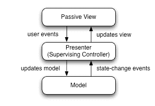

（来自 Wikipedia 的图表）

#### MVVM

MVVM 是 MVC 架构模式的另一种变体。在该范式中，*ViewModel* 是当前用户会话中模型数据的表示。对 ViewModel 的更改总是在对 Model 进行任何更改之前完成的。

MVVM 与 MVP 之处在于 View 对 Model 一无所知，但不同的是，View 与 ViewModel 之间是多对一的关系。这意味着多个 View 可以映射到一个 ViewModel。ViewModel 与 Presenter 的区别还在于它对 View 一无所知；相反，View 拥有 ViewModel 的引用，这允许它根据 ViewModel 的变化来完成更新。

然而，MVVM 在单页应用（SPA）开发方面与其他模式的主要区别在于它对*双向数据绑定*的支持。这意味着 ViewModel 的更改会自动反映在 View 中，而用户在 View 中对数据的任何更改也会自动更新到 ViewModel 中。这使得 MVVM 成为现代 SPA 更可行的模式，因为 View 可以更新并与 ViewModel 保持同步，而无需新的页面请求（而在传统的 MVC 或 MVP 架构中是需要请求的）。

（图来自 https://social.techcraft.com/wiki/contents/articles/13347.mvvm-model-view-viewmodel-part-1.aspx）

数据将在*第 6 章：数据绑定，以及为什么你应该拥抱它*中进一步讨论。

#### 总结 MVC、MVP 和 MVVM 之间的差异

现在你应该对 MVC 和 MVVM 的变体有了基本的理解。为了进行 JavaScript 开发，并不需要完全理解这些概念，但对于构成多层堆栈的组件类型具备相关知识是重要的。这里显示的图强调了这三者之间的区别：

### MVW 的其他变体

现代架构模式偏离 MVC 的主要原因是，MVC 中的 Controller（控制器）通常包含了过多的应用程序代码并变得难以管理，从而难以测试。这导致了某些模式的出现，它们不仅用其他东西替换了 Controller，还在其添加了多个层，以进一步实现应用程序内部关注点的分离。

#### VIPER

在苹果的移动操作系统 iOS 世界中，MVC 长期以来被推荐作为遵循的模式。然而，最近，许多 iOS 开发者已经放弃了纯 MVC，转而采用在应用程序架构中建立多于三层结构的模式。其中一种模式就是 VIPER，它代表 View（视图）、Interactor（交互器）、Presenter（演示器）、Entity（实体）和 Routing（路由）。

让我们简要介绍一下这些组件分别：

- **View（视图）**：与 MVC一样，View 代表用户界面。
- **Interactor（交互器）**：包含应用内特定行为及对应 View 的业务逻辑。Interactor 类似于 MVC 中的 Controller，但它可能与多个 Model 交互，并且不受限于单个 Model。
- **Presenter（演示器）**：包含 View 的逻辑，就像 MVP 一样。
- **Entity（实体）**：*Model* 的另一种说法，仅是为了实现 VIPER 缩写中的 *E*。
- **Routing（路由）**：应用中的每个请求都是通过唯一的调用发出的，在 Web 应用程序中，使用浏览器的 URL 或*route*（路由）来发送应用程序请求。这一层也可以称为 Router。

从 VIPER 组件的描述中可以明显看出，它们的实际流向并不是缩写本身的顺序，而是为了美观才被这样排序的。下面的图展示了 VIPER 模式的真实流向，并辅以浏览器和数据库的表示以辅助对该流向的理解：

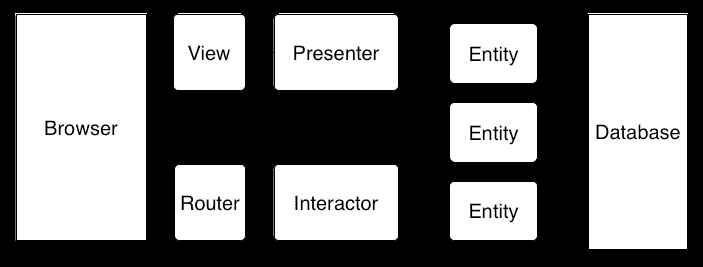

（图源自 `https://khanlou.com/2014/03/model-view-whatever/`）

到为止，我们涵盖了传统的 MVC 架构模式、MVP、MVVM 以及最近构的 VIPER 模式。应该明确的是，在 MVC 之后的模式并没有代表完全的范式转移，而是对传统 Controller 组件的重构，以体现更高的清晰度；而在 VIPER 的情况下，则是为了进一步的关注点分离。在这些其他模式中，通用范式并没有丢失，因为 Model 和 View 的概念保持完整。这种趋势导致了通用的范式术语 *Model-View-Whatever* 或 MVW 的出现。

### AngularJS 与 MVW

我们现在剩下许多被构想为 MVC 抽象的架构模式。那么，对于 JavaScript SPA，你应该选择哪种模式呢？这是一个非常主观的话题，因此最好的答案是：你应该根据你正在构建的应用类型，并根据对你来说最合理以及你所熟悉的模式来选择。

你选择选择合作的软件库和框架也应该是考虑你所用模式的因素之一。在这方面，让我们来看看 AngularJS 如何将 MVC 适配为其自己的 MVW 版本。

AngularJS 是一个用于构建 Web应用程序的前端 JavaScript 框架，它是 MEAN 栈的核心组件。它为开发者提供了使用自定义 HTML 属性和元素来驱动应用内行为的能力。它还提供了一些实用的功能，例如双向数据绑定和依赖注入。

#### AngularJS 简史

Angular 最初是两个 Google 开发人员的侧边项目，但最终成为了 Google 的官方开源项目。自诞生以来，它在开发方法论上经历了许多变化，包括不再推崇 MVC 作为其首选模式。相反，AngularJS 团队现在将其标记为*一个 JavaScript MVW 框架*（于写作时）。

AngularJS 声明为 MVW 的原因是为了应对开发者社区对于 AngularJS 遵循何种模式的广泛争论和困惑。标签本身对某些开发者可能并不重要，但它突显了一个事实：AngularJS 使用的架构模式比传统的 MVC 更复杂。

然而，AngularJS 确实包含了 Controller（控制器）组件等其他组件。让我们仔细看看这些组件是什么。

### AngularJS 组件

AngularJS 旨在创建 Web 应用而设计，因此它包含了传统 MVC 中不存在的概念性组件。同时记住，AngularJS 仅是一个前端框架，因此它不依赖于使用任何服务器端框架或数据库解决方案。

#### 模板

AngularJS 中的**模板（Template）**是一个 HTML 文档，它包含特殊的标记，允许其被解析以处理动态数据，就像任何网页模板系统一样。AngularJS 使用的是自己的专有网页模板系统，而不是第三方系统（如 **Handlebars**）。

然而，与 Handlebars 类似，AngularJS 使用双大括号表示法来识别 HTML 标记内部的表达式：

```html
<html ng-app="myApp">
<head>
<script src="angular.js"></script>
<script src="app.js"></script>
</head>
<body ng-controller="UsersController">
<ul>
<li ng-repeat="user in users">
{{user.first_name}} {{user.last_name}}
</li>
</ul>
</body>
</html>
```

这是一个简单的 AngularJS 模板示例。你可以看到它是像普通的 HTML 文档一样构建的，但它包含了 AngularJS 表达式。你还会注意到存在以 `ng-` 为缀的特殊 HTML 属性，它们向 AngularJS 框架传递不同类型的应用程序信息。

#### 指令（Directives）

指令是 AngularJS 用于驱动 DOM 内部行为的特殊 HTML 标记。指令可以通过带有 `ng` 前缀的自定义 HTML 属性、自定义 HTML 元素名称（例如 `<my-element></my-element>`）、注释或 CSS 类来驱动。

你可以为自己的应用程序定义自定义指令，但 AngularJS 也包含了一些针对常见用例的预定义指令。例如，上一个示例中所示 `ng-repeat` 属性使用了内置的 `ngRepeat` 指令，它用于在遍历集合时，为每个项目渲染一次模板标记：

```html
<ul>
  <li ng-repeat="user in users">
    {{user.first_name}} {{user.last_name}}
  </li>
</ul>
```

#### 模型 (Model)

*模型（Model）*是当前视图（View）中表达式内可用变量数据的表示。视图（View）可使用的模型受限于特定的**作用域（Scope）**或上下文：

```javascript
$scope.users = [
  {
    id: 1,
    first_name: 'Peebo',
    last_name: 'Sanderson'
  },
  {
    id: 2,
    first_name: 'Udis',
    last_name: 'Petroyka'
  }
];
```

在此示例中，`users` 数组被注册在 `$scope` 对象上。这使得 `users` 变量暴露给拥有该特定作用域的模板。

#### 作用域 (Scope)

作用域（Scope）是一个 JavaScript 对象，定义了视图内变量的模型上下文。如上一个示例所示，在该作用域下，`$scope.users` 将视图中以 `{{users}}` 的形式被访问。


#### 数据绑定

AngularJS 中的数据绑定是*双向的*（即双向绑定），因此 View 中更改的数据会更新到 Model 中，而 Model 中更改的数据也会更新到 View 中。这一过程是自动完成的，不需要额外的业务逻辑来处理这些变化。

#### Controller

Controller 在 AngularJS 中实际上是一个*视图控制器*（View Controller），因为它是一个纯前端框架。与传统的 MVC 一样样，Controller 包含了业务逻辑，但这些业务逻辑仅属于 View：

```javascript
var myApp = angular.module('myApp', []);

myApp.controller('UsersController', function($scope) {
  $scope.users = [
    {
      id: 1,
      first_name: 'Peebo',
      last_name: 'Sanderson'
    },
    {
      id: 2,
      first_name: 'Udis',
      last_name: 'Petroyka'
    }
  ];
});
```

例如，可以创建一个 `UsersController`，它包含了之前显示的 `users` Model，并通过其 `$scope` 对象将其暴露在 View 中。

#### 依赖注入

*依赖注入*一词通常用于 JavaScript，指异步向当前网页页面添加资源的能力。在 AngularJS 中，该概念类似，但仅限于其他的 AngularJS 组件。例如，指令（Directives）、过滤器（Filters）和控制器（Controllers）都是可注入的。

#### Injector (注入器)

**Injector** 是依赖项容器，负责查找并在需要时添加它们。它通过 View 内部声明式语法与应用程序代码解耦，通常不会被直接访问。

#### Module (模块)

**Module** 是应用所有主要组件的容器。它为应用提供了所有关联指令（Directives）、服务（Services）、控制器（Controllers）、过滤器（Filters）以及任何额外配置的主命名空间引用：

```javascript
var myAppModule = angular.module('myApp', []);
```

如果你的 Module 依赖于任何其他 Module，可以将它们添加到上例所示的空数组参数中。

要在 AngularJS 中将 Module 应用单页应用（SPA），你只需在主页 HTML 的应用容器元素上使用自定义的 `ng-app` 属性声明模块名称：

```html
<body ng-app="myApp">
```

#### Service (服务)

**Service** 是一个使 AngularJS 与传统 MVC 区别开来的组件，因为它用于包含可重用的业务逻辑，你可能需要在应用内不同的 Controller 之间共享这些逻辑。这有助于防止 Controller 变得过于庞大和复杂，同时也允许应用的不同部分共享一些常用的业务逻辑。例如，货币转换就可以写成一个 Service，因为你可能在多个 Controller 中使用它。

下面的图展示了 AngularJS 的组件之间是如何相互交互的：

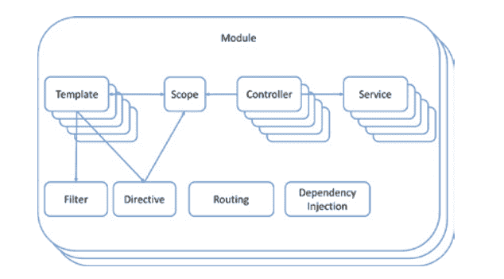

(图表自：https://angular.com/docs/angular-js-essentials)

### 使用 MVW 模式构建简单的 JavaScript SPA

让我们采用之前的 User 模型示例以及配套的 Handlebars 模板视图，并将其实际构建为一个单页应用（SPA），同时包含用于获取 User 模型数据的 AJAX 请求。对于像这种简单的内容，使用 AngularJS 和 MEAN 栈绝对是大材小用。让我们从你在第一章“组织 NPM、Bower 和 Grunt”中建立的 NPM、Bower 和 Grunt 环境开始。那么我们该如何进行呢？

#### 创建模型 (Model)

模型就是我们之前定义的用户数据的简单 JSON 对象。与其为此设置一个数据库，不如简单将其放在一个文本文件中并命名为 `user.json`：

```json
{
  "id": 1,
  "name": {
    "first": "Philip",
    "last": "Klauzinski"
  },
  "title": "Sr. UI Engineer",
  "website": "http://webtopian.com"
}
```

将该文件保存到与 `package.json`、`bower.json` 和 `Gruntfile.js` 相同的目录下。在此示例中，你可以随时用自己的信息替换用户信息。

#### 创建视图 (View)

此示例的视图将是我们之前定义的 Web 模板文档，其中包含一个含有用户信息的定义列表：

```html
<h1>User Information</h1>
<dl>
  <dt>Name</dt>
  <dd>{{name.first}} {{name.last}}</dd>
  <dt>Title</dt>
  <dd>{{title}}</dd>
  <dt>Website</dt>
  <dd>{{website}}</dd>
</dl>
```

同样将此文件保存到你项目的根目录下，并命名为 `user.handlebars`。

#### 设置前端资源

在这种情况下，我们并不创建一个复杂的 SPA，因此我们不会使用任何前端框架，但我们确实安装一些库来让开发变得更容易。

如果你遵循了*第1章：使用 NPM、Bower 和 Grunt 进行组织*中的示例，你应该已经通过 Bower 安装了 jQuery。如果你还没有安装，请现在安装：

```bash
$ bower install jquery --save
```

我们将使用 jQuery 来处理 SPA 内部的 AJAX 请求和 DOM 操作。

现在让我们安装 Handlebars 库来解析我们的 Web 模板（视图）：

```bash
$ bower install handlebars --save
```

#### 编译 Web 模板

Web 模板在解析表达式之前必须编译为 JavaScript。

这可以在浏览器中使用 Handlebars 前端库来完成，但这意味着加载模板时的执行时间会更长，而且意味着在初始页面加载时需要加载更大的库文件。对于 SPA 而言，初始页面加载至关重要，因为你不希望用户等待长时间让应用下载资源并为初始视图准备页面。此外，如果你想将你的视图拆分为单独的文件（正如我们对 `user.handlebars` 所做的那样），那么这些视图文件必须在某个时刻异步加载，以便交给编译器。

#### 预编译 Web 模板

为了避免巨大的资源负载以及到服务器获取视图的额外往返，Handlebars 允许你将 Web 模板*预编译*为 JavaScript，这样它们就可以在你的应用程序中使用。这让你能够将视图拆分为不同的文件并保持组织良好，同时保持较低的初始页面加载负载。

对于这个示例，让我们全局安装 Handlebars Node.js 包，以便可以在任何目录下通过命令行中使用它：

```bash
$ npm install handlebars -g
```

现在这允许你从命令行中编译模板，以创建一个预编译的 JavaScript 文件，并可以在你的 SPA中使用它。从项目目录的根目录下，输入以下内容：

```bash
handlebars *.handlebars -f templates.js
```

此命令告诉 Handlebars 编译器获取所有扩展名为 `.handlebars` 的文件（在本例中仅为 `user.handlebars`），并将它们编译为名为 `templates.js` 的单个文件。例如，这允许你拥有 100 个独立的 Web 模板文件，并将它们预编译为一个 JavaScript 文件。这是一种良好的做法，因为它允许你将每个视图（View）文件映射到服务器端的 REST API 端点。在 SPA 示例中，我们的端点将通过 AJAX 请求 `user.json` 文件。

#### 处理服务器 HTTP 请求

现在我们将安装 *PayloadJS* 库来处理 SPA 内部的 REST 请求：

```bash
bower payloadjs --save
```

PayloadJS 允许我们通过自定义的 `data-` HTML 属性在 DOM 中定义行为和参数，从而轻松地从 SPA 标记中触发 AJAX 请求。

#### 创建 SPA 布局

SPA 最重要的部分之一是*单页*本身，或者说是你应用程序的*布局*。这是你为了初始化和显示应用程序而加载的唯一服务器端 HTML 页面。

在你的目录根目录下创建一个名为 `index.html` 的文件，并从中输入以下代码：

```html
<!doctype html>
<html>
<head>
<title>My Application</title>
</head>
<body>
<p><a href="#" data-url="/user.json" data-template="user" data-selector=".results">Load user data</a></p>
<div class="results"></div>
<script src="/bower_components/jquery/dist/jquery.min.js"></script>
<script src="/bower_components/handlebars/handlebars.runtime.min.js"></script>
<script src="/bower_components/payloadjs/payload.js"></script>
<script src="/templates.js"></script>
<script>
Payload.deliver({
  templates: Handlebars.templates
});
</script>
</body>
</html>
```

这将是你的 SPA（单页应用）的主布局页面。你会发现添加了 `script` 标签引用，分别指向 jQuery、Handlebars、PayloadJS 以及我们创建的 `templates.js` 文件。这些都是运行该程序时需要加载的所有资源。

此外，`Payload.deliver()` 命令在页面底部执行，并传递了一个对象以覆盖其任何初始化选项。在这种情况下，我们将传入的 `templates` 属性设置为 `Handlebars.templates`，因为该空间是包含我们 Handlebars 模板的命名空间。

有关使用 PayloadJS 的更多信息，请参阅 payloadjs.com。

#### 服务 SPA

现在你已经准备好了运行此简单 SPA 所需的所有文件。剩下的唯一就是一个本地服务器来运行并加载 `index.html` 文件进行测试。让我们使用 NPM 安装一个简单的 HTTP 服务器来实现此目的：

```bash
$ npm install http-server -g
```

全局安装此包以便从命令行运行。这个简单的 Node.js HTTP 服务器可以指定任何本地目录作为服务器。在这种情况下，我们想为当前项目目录运行服务器：

```bash
$ http-server .
```

运行此命令后，你应该会在控制台中看到类似下面的输出：

```text
Starting up http-server, serving .
Available on:
http://127.0.0.1:8080
http://192.168.0.2:8080
Hit CTRL-C to stop the server
```

这表明 HTTP 服务器正在运行并在本地可用。

现在你应该可以在浏览器中加载 URL `localhost:8080`，并看到你创建的 `index.html` 页的内容。页面上唯一可见的内容是文本为 **Load user data**（加载用户数据）的链接。如果一切设置正确并且你点击了该链接，你会注意到下方短暂显示 **Loading…**（加载中……）指示器，随后 `user.handlebars` 模板文件的内容就会填充加载到页面中的 `user.json` 文件的数据：

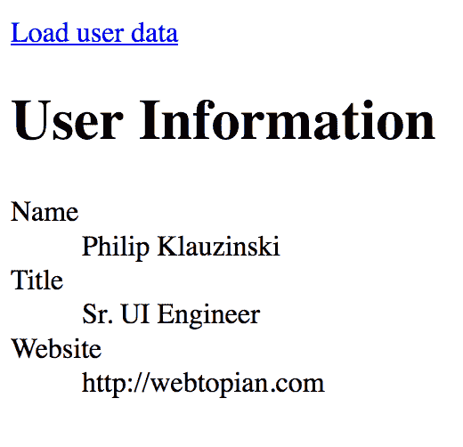

### 简单的 JavaScript SPA 概述

我们使用通用的 MVW 模式创建了一个简单的 JavaScript SPA，包含以下组件：

- Model（模型）：`user.json`
- View（视图）：`user.handlebars`
- 预编译模板文件：`templates.js`
- SPA 布局页面：`index.html`
- HTTP 服务器：Node.js *http-server* 软件包

这已经是最简单的了，但你仍然创建了一个 SPA。这个示例应该让你对 JavaScript 在创建单页应用方面有多强大有一个直观的。你可以通过更多的 Model 数据文件、额外的 Web 模板 Views、一些 CSS 以及你自己的创造力来扩展这个简单的 SPA。

### 总结


# SPA 核心要素——构建理想的应用环境

你现在应该已经了解传统的 `MVC` 模式、`MVP`、`MVVM`、`VIPER`，以及从传统的 `MVC` 惯例转变为更通用的 `MVW` 模式的原因。你还应该理解，*Model-View-Whatever*（或 *MVW*）这一术语在很大程度上是由 `AngularJS` 团队推广的，这是考虑到现代单页应用（`SPA`）需要一套全新的、更复杂的组件，而这些组件在最初构思 `MVC` 模式时还是不存在的。

现在，你也已经具备了仅用几个 `Node.js` 和 `Bower` 包就能构建简单的 `JavaScript SPA` 的能力。现在是时候迈向更大、更好的目标了。在下一章中，我们将通过扩展目前为止一直在使用的 `Node.js` 环境，讨论如何为 `SPA` 创建理想的应用程序开发环境。

## SPA 核心要素——构建理想的应用环境

现在你应该已经对 `Node.js` 生态系统中的模块、任务和包管理相当熟练了。在本章中，我们将深入探讨 `JavaScript SPA` 及其依赖的复杂性。通过以下主题，我们将探索各种数据格式、数据库类型、`SPA` 封装架构模式等：

- `JSON` 及其他数据格式
- `SQL` 与 `NoSQL` 数据库的区别
- 何时使用 `SQL` 何时使用 `NoSQL` 数据库
- 展示单页应用容器的方法
- 布局的提供与管理

### JSON 数据格式

**JavaScript 对象表示法 (`JSON`)** 是当今大多数 `JavaScript` 开发者非常熟悉的格式。尽管名字如此，但 `JSON` 是一种与语言无关的标准，本质上只是一份文本文档。它必须先被 `JavaScript`（或任何语言解释器）解析，然后才能作为表示具有键值对的对象的数据，或作为简单的值序列来使用。

`JSON` 缩写之所以包含 *JavaScript* 一词，是因为它的格式是基于 `JavaScript` 对象和数组的结构。这就是为什么处理 `JSON` 数据和 `JavaScript` 的工作是如此直观，以及为什么在 `JavaScript` 内部使用 `JSON` 数据是如此合理的原因。

## SPA 核心 – 创建理想的应用程序环境


## SPA 基础 – 创建理想的应用环境

这是一个简单的 `XML` 文档示例。如果你以前没有接触过 `XML`，你很可能至少听过它。`XML` 是许多其他数据格式的前驱，包括 `SOAP`、`RSS`、`Atom` 和 `XHTML`。`XHTML` 对许多 `Web` 开发者来说也是为人知的，在 `HTML5` 规范引入之前，它是提供页面的推荐标准。请注意，前一个示例的格式与 `HTML` 相似。

## YAML

`YAML` 是一个递归缩写，意味着它指的是自己，即 *YAML Ain't Markup Language*（`YAML` 不是标记语言）。除了滑稽的名字之外，`YAML` 有趣之处在于，它的层级语法使用行和缩进作为分隔符，而不是 `JSON` 中使用的大括号和小括号等结构化包含符号：

- item-key-one:
    - list item 1
    - list item 2
- item-key-two:
    - nested_key_one: 这是一个关联数组
    - nested_key_two: 结束关联数组

`YAML` 语法的设计通过要求行和空格对结构进行显式划分，使得数据的层级结构更易于人类阅读。相比之下，其他使用括号等字符定义结构的数据格式可能很难向肉眼传达层级关系，尤其是在压缩格式下。

`YAML` 的创建时间与 `JSON` 相似，但它在 `Web` 开发社区中获得的知名度远不如 `JSON`。可以说，`YAML` 比 `JSON` 更具灵活性，因为它允许支持更多功能（例如注释和关系锚点），但可能是 `JSON` 的简单性使其在 `Web` 及更广泛的范围内成为更受欢迎的数据格式。

## BSON

**Binary JSON (`BSON`)** 是 `JSON` 的二进制形式，主要用于 `MongoDB` 文档型数据库系统的数据存储格式。`BSON` 与 `JSON` 相似，主要区别在于 `BSON` 支持更复杂的数据类型，如 `Date`、`Timestamp` 和 `ObjectId`。`BSON` 和 `MongoDB` 中的 `ObjectId` 是用于存储对象的 12 字节唯一标识符。`MongoDB` 要求每个对象都必须有一个名为 `_id` 的唯一标识符字段，而 `ObjectId` 是为该字段赋值的默认机制。

这个概念非常类似于关系型数据库系统中的*主键*。

## SPA 基础 – 创建理想的应用环境

使用 `ObjectId` 和 `Timestamp` 数据类型的 `BSON` 文档可能如下：

```json
{
  "_id": ObjectId("542c2b97bac0595474108b48"),
  "timestamp": Timestamp(1412180887, 1)
}
```

### 为什么 JSON 占据主导地位？

`JSON` 简单、易读，且其结构使得现有的任何编程语言都能轻松理解。列表（或数组）和键值对（或关联数组）是计算机语言中的基础概念和常见实现方式。格式越简单，越易于解析，因此有更多的平台开发出能够从根本上消费该数据格式的方法。`JSON` 正是如此。

此外，`JSON` 规范在开发后仅更改过几次。它的创始人 `Douglas Crockford` 刻意没有给该规范设定版本号，以便使其能够定格不变，不随时间推移而改变。这可能是 `JSON` 优于其他数据格式的最重要因素。

### SQL 和 NoSQL 之间的差异

**数据库**

在`第 2 章`，*模型-视图-其他（Model-View-Whatever）*中，我们简要讨论了面向文档的数据库，亦称为 `NoSQL` 数据库。这一概念对于 `MEAN Stack`至关重要，因为 `MEAN` 缩写中的 *M* 代表 `MongoDB`，这是一种广泛使用的 `NoSQL` 数据库实现。

## SPA 核心 – 创建理想的应用环境

## SPA 核心要素 – 创建理想的应用环境

## SPA 基础 – 创建理想的应用环境

## 隔离性 (Isolation)

`ACID` 的隔离性属性要求同时执行的事务（即并发）不会导致相关数据出现数据库错误。这可能涉及不同程度的严格性，取决于所使用的数据库系统。隔离性的主要目标是：一组并发事务的最终结果，与你一个接一个重新执行这些事务的结果相同。隔离性与一致性（`Consistency`）紧密相关，它应该始终确保一致性的得以维护。

## 持久性 (Durability)

`ACID` 的持久性属性要求事务在执行过程中不会丢失。你可以想象在事务执行期间计算机可能会发生任何故障，例如断电。当发生此类情况时，持久性可以确保数据库系统通过将事务记录到磁盘来记住正处于执行中的事务，并确保即使在重启后也不会丢失。

## MongoDB 与 ACID

确实，许多 `NoSQL` 数据库系统并不符合 `ACID` 属性；但 `MongoDB` 在某种程度上是符合的。如所述，`MongoDB` 是一个面向文档的数据库系统，它是 `NoSQL` 数据库中一个更简洁的子集。通过这种方式，`MongoDB` 能够支持单文档级别的 `ACID` 事务。它不支持多文档事务，因此在这一点上逊于大多数关系型数据库（后者支持跨多个表的 `ACID` 事务），但在面向文档数据库中，`MongoDB` 在文档级别仍然脱颖而出。

## MongoDB 的预写日志 (Write-ahead logging)

预写日志是一系列功能，允许数据库系统符合 `ACID` 的原子性（`Atomicity`）和持久性（`Durability`）属性。为了实现这一点，`MongoDB` 在实际执行操作之前，会将所有操作及其结果写入内部日志。这是确保文档级事务持久性的一种简单而有效的方法，因为操作在执行前已记录，即使操作发生突然中断，发生情况的证据也不会丢失。同样，这一特性确保了原子性，因为它允许 `MongoDB` 在重启后，在确定了哪些更改并将其与中断操作前的数据库状态进行对比后，*撤销*（`undo`）或*重做*（`redo`）这些操作。

## SPA 核心要素 – 创建理想的应用程序环境

## 何时使用 SQL 与 NoSQL 数据库

`SQL` 和 `NoSQL` 数据库之间存在明显的差异，这不仅在于它们的结构方式，还在于开发者和应用程序与它们交互的方式。这些差异从架构和功能角度来看，都会对应用程序的开发产生严重影响。因此，选择数据库类型并非小事，在继续开发应用程序之前，应该始终对其进行评估。

#### 可扩展性

之前提到过，现代 `Web` 应用的需求导致了 `NoSQL` 数据库的兴起。*可扩展性*，即持续处理增长的数据量以及对这些数据进行操作的能力，是这些需求之一。你可以想象这适用于像 `Facebook` 或 `Twitter` 这样的社交媒体公司，以及任何可能与此类资源接收的社交数据交互的社交应用程序。在接下来，当你决定为应用程序选择数据库类型时，可扩展性是你可能需要考虑的特性。

#### 水平扩展

对于日益增多的现代 `Web` 应用而言，*水平扩展*尤其是必不可少的。这指的是随着用户群的增长，对地理位置分布的分布式服务器和数据库的需求。有效的水平扩展允许应用程序的用户从距离其最近的服务器接收数据，而不是从可能位于地球另一端数据仓库的单个服务器或一组服务器。

使用关系型数据库进行水平扩展并非不可能，但它是困难的，并且需要使用复杂的**数据库管理系统** (`DBMS`)。相比之下，`NoSQL` 数据库的设计更为简单，这使得跨机器集群和网络的数据复制也变得简单得多。

#### 大数据

现代 `Web` 应用的另一个需求是**大数据**，其含义正如其名：海量数据。然而，通常情况下，大数据指的是数据集之间的高度复杂性，以至于如果没有复杂的技术支持，很难对其进行分析并从中提取价值。

## SPA 核心 – 构建理想的应用环境

*SPA 核心 – 构建理想的应用环境*


## SPA 基础 – 创建理想的应用环境

### 总体考量

在决定为应用程序使用 `SQL` 还是 `NoSQL` 数据库时，您应该考虑应用程序在初始发布阶段的需求，以及您对未来的预测。如果你预见会有庞大的用户群并具有病毒式增长的潜力，那么你可能需要考虑为处理业务大数据和扩展性而设计的 `NoSQL` 数据库。

如果你正在开发的应用程序预计用户量较少，或者除了数据管理员之外没有其他用户，那么关系型 `SQL` 数据库可能更合适。此外，如果你的应用程序可能有许多用户，但不需要水平扩展性，那么 `SQL` 数据库可能同样适用。

同时还要考虑到，许多现代分布式 `Web` 应用在起初都只使用关系型数据库，随后它们与现有数据库配合，实施了 `NoSQL` 解决方案，以应对不断增长的需求。这也是一个可以在应用程序生命周期内进行规划并根据需要进行调整的用例。

### 展示 SPA 容器的方法

在单页应用（`SPA`）中，*容器*（`container`）是最初加载应用程序并将其展示给用户的对象。这个概念与*软件容器*（`software container`）不同，后者是应用程序运行的隔离环境，类似于虚拟机。

对于单页 `Web` 应用，容器可以是 `<body>` 元素，或 `<body>` 元素内的任何元素。例如，你可能最初在页面上的一个 `<p>` 元素中加载了一些静态欢迎文本，然后 `SPA` 将在该元素下方的 `<div>` 元素中动态加载内容：

```html
<!doctype html>
<html>
<body>
  <p>This is some welcome text.</p>
  <div class="container">
    The application will be loaded here.
  </div>
</body>
</html>
```

## SPA 核心 – 创建理想的应用环境


## SPA 基础——创建理想的应用程序环境

`SPA` 中的*状态*（`state`）指的是在任何时间点**文档对象模型**（**`DOM`**）的特定版本。*加载状态*（`loading state`）是在你等待容器元素加载下一个请求状态时，可能在其内部显示的状态。通常，某种形式的加载指示就足够让用户知道程序正在运行且应用程序很快就会加载，但当你的应用出现过高的延迟时，用户可能会认为出现了错误，并在进程完成之前离开应用布局页面。

## 如何加载你的 SPA 容器

初始加载 `SPA` 的方式很大程度上取决于你应用程序的性质。在加载你的应用之前，可能需要满足许多种要求。

### 通过用户交互加载

许多 `Web` 应用在加载完整的 `SPA` 之前，需要进行某种类型的用户交互。例如：

- 用户身份验证
- 用户对进入协议的接受
- 必须显示并由用户参与或忽略的插屏内容，例如广告

此类场景在 `Web` 应用中非常常见，并且通常以流畅的方式解决往往具有挑战性。

### 登录页面跳转

在许多 `Web` 应用中，登录屏幕在安全页面上加载，并使用 `HTTP POST` 提交到另一个安全页面，以验证用户身份并加载实际的 `SPA`。这种模式通常是因为用于处理身份验证的服务器端框架存在局限性。

如果你考虑一个在手机上登录访问银行账户的金融应用，在通过用户名和密码进行身份验证之前，你可能看不到除了登录屏幕以外的内容。这通常会带你进入第二个页面，加载完整的单页应用程序，其中包含你的敏感银行信息，否则你不希望这些信息被其他拿起你手机的人看到。

## SPA 核心要素——创建理想的应用环境

登录界面可以说是最常见的需要用户交互来加载应用程序的用例之一，而且这种用例的处理方式往往并不优雅。如果你的 `REST` 框架允许，处理这一用例最流畅的方法是将登录界面作为 `SPA` 的一部分加载，并通过你的登录表单通过 `REST` 端点请求身份验证。当你从 `API` 请求中接收到经过身份验证的响应时，你就可以将所需的数据加载到现有的 `SPA` 容器中，并将登录状态替换为新的已登录状态。

### 基于 DOMContentLoaded 事件进行加载

如果你的 `SPA` 初始加载不需要用户身份验证或其他任何交互，或者如果你在页面加载时检测到用户已经通过身份验证并可以跳过该步骤，那么你将希望有一种方法在初始页面加载时并尽可能地自动加载你的 `SPA`。

加载单页应用的最佳时机通常是 `DOM` 完全加载并可以被浏览器解析的尽早时刻。现代浏览器在发生这种情况时，会在 `document` 对象上触发一个名为 `DOMContentLoaded` 的事件，该事件可以为此目的。要实现这一点，你只需在 `document` 上添加一个 `EventListener` 来检测事件的触发，然后调用一个函数来加载你的应用：

```javascript
document.addEventListener('DOMContentLoaded', function(event) {
  loadMyApp();
});
```

或者，如果你在使用 `jQuery`，可以调用方便的 `jQuery .ready()` 方法来监听 `DOMContentLoaded` 事件，并在匿名函数中触发你的自定义应用代码：

```javascript
$(document).ready(function() {
  loadMyApp();
});
```

## SPA 基础 – 创建理想的应用程序环境

### 基于 documentreadychange 事件的加载

现代浏览器还提供了一个在首次加载页面时在 `document` 对象上触发的事件，用作 `readystatechange`。该事件可以用于确定 `DOM` 的三种状态，这些状态通过 `document.readyState` 属性返回如下：

- `loading`：这表示文档仍在加载中，尚未被浏览器完全解析。
- `interactive`：这表示所有 `DOM` 元素已完成加载并可以访问，但某些外部资源（如图像和样式表）可能尚未完全加载。此状态变化也意味着 `DOMContentLoaded` 事件已经触发。
- `complete`：这表示所有 `DOM` 元素和外部资源都已完全加载。

若要使用 `readystatechange` 事件与 `DOMContentLoaded` 事件同时加载您的应用程序，你需要为 `readystatechange` 事件分配一个在触发时调用的函数，然后检查 `document.readyState` 属性是否设置为 `interactive`。如果是，你就可以调用您的应用程序代码：

```javascript
document.onreadystatechange = function() {
  if (document.readyState === 'interactive') {
    loadMyApp();
  }
};
```

使用这种方法检测文档状态提供了更高的灵活性，因为你可能在三种文档状态的任何一种情况下调用自定义的应用程序代码，而不仅仅是在 `DOMContentLoaded` 事件或 `interactive` 状态下。

### 直接从 document.body 加载

加载 `<script>` 标签的传统方法是将它们放置在文档的 `<head>` 元素中。如果你在外部 `JavaScript` 中使用了文档 `DOMContentLoaded` 或 `readystatechange` 事件来在适当的时间初始化应用程序代码，那么将 `<script>` 标签添加到 `<head>` 中来加载 `SPA` 是没有问题的：

```html
<!doctype html>
<html>
<head>
<!-- Meta tags and title -->
</head>
<body>
<div class="container">
The application will be loaded here.
</div>
<script src="app.js"></script>
</body>
</html>
```

## SPA 核心要素——创建理想的应用环境

如果你希望避免使用这些自定义 `DOM` 事件，并在需要时精确触发你的应用程序代码，那么可以采用另一种不同且更直接的方法。如今将 `JavaScript` 加载到网页中的一种常用技术是将 `<script>` 标签（该标签加载你的外部 `JavaScript` 文件）直接放置在页面的 `<body>` 元素中。这种能力源于浏览器解析 `DOM` 的方式：从上到下。以这段代码为例：

```html
<!doctype html>
<html>
<head>
<!-- Meta tags and title -->
</head>
<body>
<div class="container">
The application will be loaded here.
</div>
<script src="app.js"></script>
</body>
</html>
```

在 `document.body` 内部且紧接闭合的 `</body>` 标签的上方加载外部 `JavaScript` 文件 `app.js`，可以确保`<script>` 标签之上的所有 `DOM` 元素在脚本加载之前已完成解析，并且 `app.js` 文件将恰好在 `<div class="container">` 元素之后加载。如果你的 `SPA` 是在该元素处加载，那么这种技术就能确保 `app.js` 中的应用程序代码在 `container` 元素被解析后立即执行。

另一个优势是，将 `<script>` 标签放置在 `DOM` 底部，并位于加载应用所需的元素下方，由于浏览器是自上而下解析 `DOM` 的，这些 `<script>` 标签的加载不会阻塞其上方任何内容的加载。一旦到达 `<script>` 标签，可能会出现一些阻塞，导致浏览器在加载期间无法使用，但用户至少可以看到在此刻为止页面上已加载的所有内容。

## SPA 基础 – 创建理想的应用程序环境

因此，在 `<body>` 标签内靠近 `DOM` 底部加载 `<script>` 标签，比使用传统的 `<head>` 标签插入更为优越，这样可以确保在页面显示任何内容之前不会发生渲染阻塞。

### 使用 script 标签的 async 属性

防止 `<script>` 标签在加载时阻塞浏览器可用性的方法之一是使用 `async` 属性。添加此属性可以确保你的 `app.js` 文件在解析后进行异步加载，从而无论该脚本何时完成加载，`DOM` 的其余部分都能继续进行解析和加载：

```html
<!doctype html>
<html>
<body>
  <div class="container">
    应用程序将加载在此处。
  </div>
  <script src="app.js" async></script>
</body>
</html>
```

这种方法的优势再次是（再次强调）不会产生阻塞。然而，它的缺点是，当你异步加载多个脚本时，无法保证它们完成加载并最终执行的顺序。这就是为什么尽可能为你的应用程序只加载单一压缩后的 `JavaScript` 文件也是一种良好的实践。`<script>` 标签越少，需要解析和下载的外部资源就越少；而在使用 `async` 属性的情况下，只使用一个 `<script>` 标签意味着只需等待一个异步资源加载，而不必担心多个文件加载的不可预测的顺序，因为那可能会破坏你的应用程序。

### 使用 script 标签的 defer 属性

另一种直接从 `body` 加载 `<script>` 标签且不会导致文档解析器阻塞的方法是使用 `defer` 属性。与 `async` 不同，此属性确保 `<script>` 标签会在文档解析完成或触发 `DOMContentLoaded` 事件时才进行加载。

## SPA 基础 – 创建理想的应用环境

## 布局的提供与管理

正如`Chapter 2` 中，*Model-View-Whatever* 所提到的，对于 `SPA` 而言，*布局*（`layout`）是指用于容纳、初始化和显示你的应用程序的服务器端 `HTML` 页面。该布局包含的 `HTML` 标记与前一节中关于如何加载你的 `SPA` 容器的示例相似。

通常情况下，布局是创建 `SPA` 所需的唯一原生服务器端组件，其他组件是原生前端代码以及用于提供数据消费和操作端点的外部 `API`。

### 静态布局

布局可以简单到只是一个静态 `HTML` 页面，该页面被加载到 `Web` 服务器上，并调用在该页面定义的容器元素内内加载你的应用程序所需的资源。理想情况下，一旦加载了初始 `HTML` 页面，运行程序就不再需要访问任何其他服务器端 `HTML` 页面，因此有了*单页应用*（`Single Page Application`）一词。

如果你在设置环境变量、测试登录状态等方面不需要任何服务器端框架的交互，那么静态 `HTML` 页面是启动 `SPA` 最快、最简单的方法。

一个静态 `HTML` 布局页面可以像以下示例一样简单：

```html
<!doctype html>
<html>
<head>
<title>这是一个静态 HTML 页面</title>
</head>
<body>
<script src="app.js" defer></script>
<div class="container">
应用程序将在这里加载。
</div>
</body>
</html>
```

## SPA 核心基础 – 创建理想的应用程序环境

直接在 `Web` 服务器上托管静态 `HTML` 文件的缺点是，你必须直接访问该文件才能加载你的应用。例如，如果你的应用通过 `myapp.com` ，而你的静态 `HTML` 页面名为 `index.html`，大多数 `Web` 服务器会自动将*根*服务器请求路由到此页面，因此用户无需直接导航到 `myapp.com/index.html`，只需访问 `myapp.com` 即可。

然而，如果用户访问了 `myapp.com/profile`（他们可能在那里找到用户个人资料信息），应用程序布局将不会加载，服务器将生成 **HTTP 404** 或 **未找到 (`Not Found`)** 响应。为了满足这种用例并允许你的应用使用自定义 `URL`，我们需要*动态布局*。

### 动态布局

当你对单页应用程序的服务端框架拥有控制权（例如使用 `MEAN` 栈时），你可能希望开发一个更具动态性的服务器布局页面，以便应用初始加载时从服务器端加载变量和一些基础逻辑。

### 安装 Express

`Express` 是一个用于 `Node.js` 的服务端 `Web` 框架，它是 `MEAN` 栈缩写中的 *E*。当你使用 `MEAN` 栈进行开发时，你将使用 `Express` 来定义和处理所有的 `REST API` 端点，但你同时也需要处理应用程序的主入口点。

让我们回到之前用于 `NPM`、`Bower` 和 `Grunt` 的 `Node.js` 环境，并安装 `Express`：

```bash
$ npm install express --save
```

### 使用 Express 搭建基础服务器

安装好 `Express` 后，在你的应用程序的根目录下创建一个名为 `server.js` 的文件：

```bash
$ touch server.js
```

在该文件中，添加以下代码以引入 `Express` 模块并初始化你的应用程序对象：

```javascript
var express = require('express');
var app = express();
```

### 使用 Express 进行基础路由

`Express` 中的路由是指定义用于响应服务器请求的 `URL` 路径。`Express` 可以为任何类型的 `HTTP` 请求定义路由，包括 `GET`、`POST`、`PUT` 和 `DELETE` 请求，这些请求对于创建 `REST API` 是必须的。然而，目前我们只是想定义一个用于加载 `HTML` 页面的路由。

为你的应用程序主入口点定义路由将是一个 `GET` 请求，使用 `Express` 来实现这一点非常简单。在你刚刚创建的 `server.js` 文件中，在 `app` 对象定义下方添加以下代码：

```javascript
app.get('/', function(request, response) {
  response.sendFile('/index.html', {root: __dirname});
});
```

现在，我们想使用 `Express` 来提供我们的应用服务，而不是之前简单的 `http-server` 模块。

## SPA 基础 – 创建理想的应用环境

### 使用 Express 运行服务器

现在，你已经配置好了 `server.js` 文件，并设置了指向应用程序根目录的基本路由，剩下的工作就是设置一个用于监听的 `HTTP` 端口并加载应用。在你的 `server.js` 文件中，向你的路由定义添加以下代码：

```javascript
app.listen(8080, function() {
  console.log('App now listening on port 8080');
});
```

这会告诉服务器监听 `8080` 端口以提供应用服务。现在你只需要从命令行运行服务器即可：

```bash
$ node server.js
```

这将运行服务器并在终端中显示控制信息 `App now listening on port 8080`。

现在，在浏览器中访问 `localhost:8080`，你应该能看到第 2 章“模型-视图-任意（`MVO`）”中创建的简单 `SPA` 页面。然而，你会在浏览器控制台中看到一些错误，因为 `index.html` 中引用的本地 `JavaScript` 文件未被找到。这是因为你还没有为加载静态资源文件定义路由。

### 使用 Express 加载静态资源

首先，在命令行按下 `Ctrl` + `C` 停止应用。现在再次编辑 `server.js`，并在 `SPA` 布局页面路由定义*上方*添加以下代码：

```javascript
app.use('/', express.static('./'));
```

此命令将设置应用从根目录加载静态资源。现在，如果你再次从命令行运行 `server.js` 并在浏览器中刷新页面，`SPA` 应该加载所有资源，并像之前使用 `http-server` 时一样正常工作。

## SPA 核心要素 – 创建理想的应用程序环境

## 使用 Express 实现动态路由

如前所述，我们的应用应该允许用户访问类似 `myapp.com/profile`（或者在我们的案例中为 `localhost:8080/profile`），以加载动态请求，该请求将触发与应用主根视图不同的视图。如果你现在在应用中访问 `localhost:8080/profile`，你将在浏览器中得到以下响应：

```text
Cannot GET /profile
```

要修复此问题，请再次停止本地服务器，编辑 `server.js` 文件，并对应用路由定义进行如下更改：

```javascript
app.get('*', function(request, response) {
  response.sendFile('/index.html', {root: __dirname});
});
```

在这里，我们仅将 `GET` 路由定义中的路径参数从 `'/'` 改为 `'*'`。`Express` 允许在路由定义中使用正则表达式语法，因此此操作是告诉服务器将所有动态路径请求路由到 `index.html` 页面，而不仅仅是根路径 `'/'`。

保存此更改后，现在如果你在命令行中再次运行 `node server.js` 并在浏览器中访问 `localhost:8080/profile`，你将再次看到 `SPA` 就像从根路径访问一样显示，所有静态资源文件都应该按预期加载。

在设置好这个基础 `Node.js Express` 服务器后，你的最终 `server.js` 文件应该看起来如下：

```javascript
var express = require('express');
var app = express();
app.use('/', express.static('./'));
app.get('*', function(request, response) {
  response.sendFile('/index.html', {root: __dirname});
});
app.listen(8080, function() {
  console.log('App now listening on port 8080');
});
```

我们简单的 `SPA` 现在变得稍微复杂了一些，具备了提供动态布局文件，以及通过自定义 `URL` 使用动态路由加载布局的能力。

## SPA 核心要素 – 创建理想的应用程序环境


# REST 为王 – 与应用程序服务器端的交互

在创建 `JavaScript` 单页应用（`SPA`）时，大部分开发工作通常集中在前端，但不容忽视的是应用程序中至关重要的数据传输层，它负责与服务器和数据库进行通信。

**表述性状态转移**（**`REST`**）是万维网和**物联网**（**`IoT`**）客户端与服务器之间数据传输的标准架构风格。每当你使用 `Web` 应用时，很有可能正在通过 `REST` 来从 `UI` 通信数据和状态转换。

在单页应用中使用 `REST` 架构风格的妙之处在于，只要你的应用程序可以通过**超文本传输协议**（**`HTTP`**）——即万维网的标准应用协议来运行，你的应用程序前端就可以完全不感知服务器上使用的是何种类型的软件来获取请求处理的。

在本章中，你将学习到：

- `REST` 架构风格的基本方面
- 如何编写基础 `REST API` 端点，以在单页 `Web` 应用中执行 `CRUD` 操作
- 如何使用 `AJAX` 在应用程序前端处理 `REST` 请求
- `REST` 的某些替代方案的基础，例如 `SOAP`、`WebSockets`、`MQTT`、`CoAP` 和 `DDP`

## REST 为王 – 与应用程序的服务端交互

### 协议 (Protocol)

在 `Web` 领域，协议是互联网协议族（或 `TCP/IP`）抽象层的一部分，为已连接的计算机之间提供了一种通用的通信方法。

### 传输层协议

`TCP/IP` 术语是互联网协议族中最广泛使用的协议的组合：传输控制协议 (`TCP`) 和互联网协议 (`IP`)。

#### TCP

`TCP` 是一种传输层协议，位于应用层之下。这意味着服务和信息会被*传输*到互联网协议族的最顶层应用层。

#### IP

`IP` 也是一种传输层协议。你很可能见过该协议与 **IP 地址**（或**互联网协议地址**）术语相关联，`IP` 地址是网络上设备的唯一数字标识符。在 `Web` 上，通常使用域名来指向 `IP` 地址，以便人们更容易地记住如何访问该地址。

### 应用层协议

`TCP/IP` 的应用层是抽象层，它定义了通过 `Web` 连接的主机计算机之间的通信方法。该层规定了若干种协议，其中最常见的包括 `HTTP`、`FTP`、`SSH` 和 `SMTP`。

#### HTTP

`HTTP` 是 `TCP/IP` 应用层内数据交换的主要协议，它为 `RESTful Web` 服务提供了通信基础。`HTTP` 还负责为浏览器提供用于显示的网页，并负责将网页表单中的数据发送到服务器。

#### FTP

文件传输协议 (`FTP`) 是 `TCP/IP` 应用层中的另一种标准协议，用于在计算机之间传输文件。`FTP` 通信需要一个 `FTP` 服务器和一个 `FTP` 客户端。

## REST 为 Best – 与应用程序服务器端交互

### SSH

**安全外壳**（**`SSH`**）是应用层的另一种常用协议，用于允许对非安全网络入口点进行安全远程登录。为了使 `SSH` 连接正常工作，必须有一个可用的 `SSH` 服务器来接收来自 `SSH` 客户端的请求。`SSH` 客户端通常以带有**命令行界面**（**`CLI`**）的终端应用程序形式出现。

### SMTP

**简单邮件传输协议**（**`SMTP`**）是 `TCP/IP` 应用层中发送电子邮件（电子邮件）的标准方法。`SMTP` 也可以用于接收电子邮件，且电子邮件服务器通常为此目的使用它。然而，用户层级的电子邮件客户端通常不使用 `SMTP` 接收电子邮件，相反，这些客户端更多地使用 `POP3` 或 `IMAP`。

`POP3` 是**邮局协议**（**`Post Office Protocol`**）的第三版本，是一种通过 `TCP/IP` 连接接收电子邮件的标准应用层协议。`POP3` 通常用于将电子邮件下载到本地计算机，然后从宿主服务器上删除。

`IMAP` 是**互联网消息访问协议**（**`Internet Message Access Protocol`**）。它也是一种通过 `TCP/IP` 连接接收电子邮件的标准应用层协议。`IMAP` 通常用于让多个客户端管理宿主服务器的收件箱，因此它在将电子邮件下载到本地计算机后不会从服务器上删除。`IMAP` 的最新版本还支持宿主服务器上邮件的状态，例如已读、已回复或删除。

### 使用 HTTP 作为 REST 的传输协议

`REST` 定义了一组规则，用于向 `Web` 应用程序或服务发送 `HTTP` 请求。`HTTP`可以通过任何方式发出，但只有在遵循这组规则时，它们才是 `RESTful`（符合 `REST` 标准的）。`HTTP` 提供了执行这些请求的传输层。

与与 `REST API` 交互的 `Web` 应用程序不关心用于提供 `API` 端点的软件框架类型一样，`HTTP` 也不关心与其通信的所有服务器所使用的操作系统类型。

## REST 最佳 – 与应用程序的服务端交互

## REST 的约束

`REST` 架构风格受一组约束（或规则）限制，这些规则规定了它应该如何实现、交互以及处理数据。`REST` 是由美国计算机科学家罗伊·菲尔德（`Roy Fielding`）在2000年的一篇博士论文中首次定义的，并同时也提出了这些约束。

`REST` 被是一种*混合*架构风格，因为它借鉴了在其构思之前就已经存在的其他架构风格。这些其他架构风格为概述的 `REST` 约束提供了极大帮助。

### 客户端-服务器

`REST` 的第一个约束是客户端-服务器架构。该约束的存在是为了强制 `REST` 的无关性，或者说是它至关重要的*关注点分离*：

此图显示了客户端与服务器之间的关系，以及它们是如何分离的。**客户端**（或 `Web` 浏览器）只需要显示应用程序的 `UI`。`UI` 可以根据需要保持简单或复杂，而不会影响服务器上的 `REST` 架构。这一 `REST` 约束提供了可扩展性。

### 无状态

`REST` 的第二个约束建立在客户端-服务器约束之上，即客户端与服务器之间的通信必须是**无状态**的。这意味着从 `Web` 浏览器到 `REST` 服务器的任何请求都必须提供请求上下文和当前会话所需的所有预期信息，以便从服务器获得适当的响应。

## REST 是最佳实践 – 与应用程序的服务端交互

服务器将不会存储任何信息来帮助区分请求，这使得 `REST` 服务器是*无状态的*，并将会话状态的负担交给了浏览器：

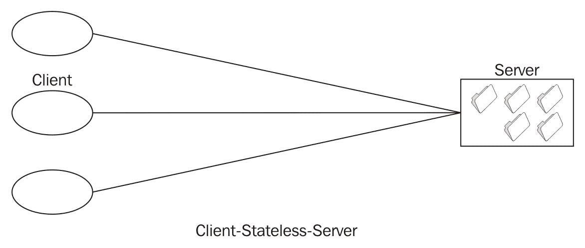

该图描绘了客户端-无状态-服务器的架构风格，在这种风格下，浏览器的状态可以改变，而 `REST` 服务器保持一致。这一 `REST` 约束提供了可见性、可靠性和扩展性，这些都是使用 `REST` 的几个核心优势之一。

### 缓存

`REST` 的第三个约束同样建立在客户端-服务器和无状态约束的基础上。根据 `REST` 服务器委托的请求的可缓存性，允许浏览器对任何给定的请求使用缓存（即为了重用而存储的数据）。如果服务器的缓存组件表明请求是可缓存的，那么浏览器就可以对其进行缓存以备后续请求。通常，当对特定的 `REST` 端点进行多次请求可能每次都产生相同的响应时，该请求具有可缓存性：

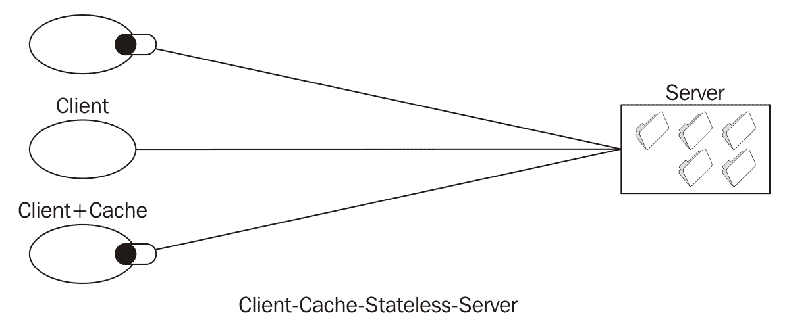

## REST 是最佳实践——与应用程序服务器端交互

此图描述了客户端-缓存-无状态-服务器架构风格。这种风格与客户端-无状态-服务器类似，但增加了一个客户端缓存组件。

### 统一接口

`REST` 的第四个约束是系统组件之间使用统一接口。这指的是 `REST` 实现中相关架构的简单性，其中组件之间是解耦的。这允许架构的每个组件能够独立演进，而不影响其他组件：

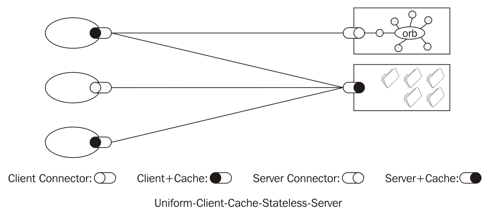

#### 资源的标识

`REST` 中的资源是任何将信息到唯一可标识对象的概念映射。这个对象可以是人、地点或事物。在 `Web` 领域中，这方面的例子是统一资源标识符 (`URI`)。更具体地说，统一资源定位符 (`URL`) 是 `URI` 的特殊类型，它提供了一种查找网络资源的方法，并指定了如何从该资源获取信息的表示。`URL` 也经常被称为网页地址。在 `REST` 中，`URL` 也可以被称为端点（`endpoint`）。

## REST  Best – 与应用程序服务器端交互

#### 通过表示层操作资源

`REST` 中的表示（`representation`）是代表资源当前状态的数据集。在使用 `REST` 的网络架构中，`JSON` 文档可以作为一种表示在客户端和服务器之间传递，并用于操作或更改资源。

#### 自描述性消息

`REST` 中的消息是组件之间的通信。为了符合 `REST` 服务器必须是无状态的约束，消息必须是自描述的，这意味着它包含了告知每个组件应如何进行处理的全部必要信息。

#### 超媒体作为应用状态的引擎

超媒体（`Hypermedia`）指的是网页（或超文本）以及连接它们的超链接。为了保持无状态，`RESTful` 架构使用超媒体根据从服务器接收到的表示来传达应用程序的状态。

### 分层系统

`REST` 的第五个约束是分层系统，它是架构组件的层级结构，每一层都为其上层提供服务，并使用来自下层层的服务。通过这种方式，每一层只能看到其下方的一层，从而对任何更深层的层保持不可感知。

这一概念适用于 `Web` 上的分布式服务器，用于增强应用程序的可扩展性。例如，网页浏览器可能会根据其位置与任意数量的中间服务器通信，但永远不知道自己连接的是最终服务器还是这些中间服务器之一。

## REST is Best – 与应用程序服务器端交互


分层系统也被用于实现服务器之间的负载均衡。这使得当主服务器被大量请求淹没时，允许额外的服务器来承担请求：

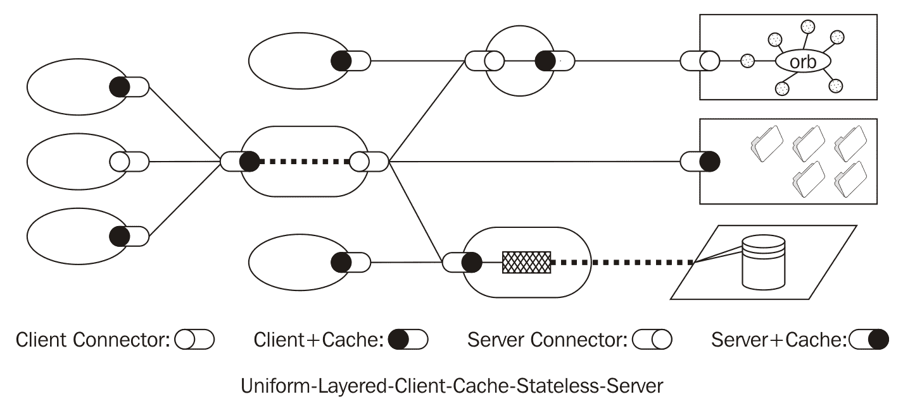

该图描述了一个统一的分层-客户端-缓存-无状态服务器。这种架构风格将之前的四项约束与分层系统的约束结合在了一起。

### 按需加载代码 (Code-on-demand)

`REST` 的第六也是最后一项约束是**按需加载代码**（`code-on-demand`）架构风格，它是唯一*可选*的约束。在这种风格下，服务器提供一组封装在某种形式中的可执行代码，并供浏览器消费。一些示例包括 `Java applets`、运行 `ActionScript` 的 `Flash` 动画以及运行 `JavaScript` 的客户端小组件。

## REST 是最佳实践 – 与应用的服务器端交互


性能是 `REST` 的一大优势，这种优势通过使用缓存、如 `JSON` 等简单的表示形式、包含多个服务器和负载均衡的分层系统，以及通过统一接口实现组件解耦来实现。

## REST 最佳 – 与应用程序的服务器端交互

`REST`（表述状态转移）是一种用于设计网络 `Web` 应用程序架构风格。它依赖于一组约束条件，使其更具扩展性、灵活性和可维护性。`REST` 最基础的概念之一是**客户端-服务器架构**，它将用户界面与数据存储逻辑分离。这种分离允许每个组件独立地演进。

`REST` 的另一个关键约束是**无状态性**。这意味着从客户端发送的每个请求必须包含服务器理解和处理该请求所需的所有信息。服务器不存储任何关于客户端的会话信息，这提高了可扩展性并简化了服务器设计。

**缓存**也是 `REST` 的一种约束条件，它允许客户端将响应标记为可缓存或不可缓存。这通过允许客户端重用缓存数据，减轻了服务器负载并提升了性能。

**统一接口**约束确保客户端与服务器之间的所有交互都通过定义的接口进行。这简化了架构，并允许客户端独立于处理请求的服务器端实现方式。

**分层系统**是 `REST` 的另一个约束，它允许客户端感知不到在其与服务器之间存在中间层。通过允许使用负载均衡器或安全层，这可以提高可扩展性。

最后，**按需软件代码**是 `REST` 的可选约束，它允许服务器传输可执行代码（如 `Java applets` 或 `JavaScript`）以扩展客户端功能，而无需客户端预先安装这些代码。

## REST 为最佳 – 与应用程序的服务器端交互

### 可见性 (Visibility)

可见性简单指的是根据组件交互来理解系统中发生什么的能力。在 `REST` 中，由于组件是解耦的，且它们彼此之间几乎不需要了解对方，因此高可见性是一项优势。这使得架构内部的交互易于理解，例如对端点的请求。要确定一个请求的完整性质，无需查看请求本身的表示即可。

`REST` 的“按需代码（`code-on-demand`）”约束实际上降低了可见性，但正因如此，它是可选的。在后文中，现代网络应用程序并不经常使用按需代码，除了出现在网页上并用于广告、社交网络和其他第三方交互的简单 `JavaScript` 组件之外。

### 可靠性 (Reliability)

可靠性是 `REST` 的一项优势，主要通过无状态服务器（`stateless server`）约束体现。通过无状态服务器，应用程序的故障可以在系统级别进行分析，因为你知道该故障源于系统中单个解耦的组件。

例如，如果你在 `Web` 应用程序 `UI` 中收到错误消息，提示用户输入的信息错误，那么这种故障可以在 `UI` 层进行处理。相反，如果你在输入正确信息后收到服务器的 `HTTP 400` 响应码错误，你可以进一步推断出 `REST` 服务器端点的配置错误。

### RESTful Web 服务 (RESTful web services)

如前所述，`REST` 架构风格经常用于现代 `Web` 单页应用程序中执行**创建**、**读取**、**更新**和**删除**（**创建、读取、更新和删除**（ **`CRUD`**））操作。要为你自己的应用程序采用 `RESTful Web` 服务，你不仅需要一个 `HTTP` 服务器，还需要一个托管的数据库或数据库服务器，以便对数据执行 `CRUD` 操作。

## REST 为王 – 与应用程序的后端进行交互

## 使用 MongoDB 搭建简单的数据库

`MongoDB` 是 `MEAN` 栈中使用的数据库。它是一个开源的面向文档的数据库系统，可以根据你所使用的操作系统，通过下载或包管理器轻松地添加到你的技术栈中。

### 安装 MongoDB

`MongoDB` 可以安装在运行 `Linux`、`Windows` 和 `OS X` 的系统上。这些操作系统都提供了直接下载。此外，在 `OS X` 上，可以使用 `Homebrew` 安装 `MongoDB`。`Homebrew` 是 `OS X` 上一个流行的命令行（`CLI`）包管理器。有关安装 `Homebrew` 的说明，请访问 `brew.sh`。

### 使用 Homebrew 在 Mac 上安装 MongoDB

在开始使用 `Homebrew` 之前，首先将其更新到最新版本：

```bash
$ brew update
```

接下来，安装 `mongodb` 包：

```bash
$ brew install mongodb
```

安装好 `MongoDB` 后，为了方便起见，你可能希望将其添加到命令行的 `PATH` 中。如果你已经有了这些文件中的一个，请将以下内容添加到用户目录下的 `.profile`、`.bash_profile` 或 `.bashrc` 文件中。如果你没有这些文件，请创建一个 `.profile` 文件：

```bash
export PATH=/usr/local/opt/mongodb/bin:$PATH
```

一旦你将 `MongoDB` 添加到 `PATH` 中，在运行它之前，你需要创建一个用于存储数据的目录。`MongoDB` 的默认数据目录是 `/data/db`。你可能需要以超级用户（`superuser`）身份运行此命令。

## REST 最佳 – 与你的应用程序服务端交互

## REST 最佳 – 与应用程序后端进行交互

## REST 最佳 – 与应用程序后端进行交互

## REST 是最佳实践 – 与应用程序服务器端交互

## REST 是最佳实践 – 与应用程序服务器端交互

## REST is Best – 与应用程序服务器端交互

### 使用 Node.js 和 Express 处理请求数据

在处理发送到服务器的任何 `API` 请求数据之前，我们必须添加解析这些数据的功能。在大多数情况下，这些数据是从网页页面通过表单或其他方式发送的。这类类型的数据被称为请求的**正体（`body`）**，为了解析它，我们需要添加另一个 `Node.js` 软件包：

```bash
npm install body-parser --save
```

这将把 `Node.js` 的 `body-parser` 包添加到我们的应用程序依赖中。现在，让我们回到编辑 `server.js` 并添加一些额外的代码：

```javascript
var bodyParser = require('body-parser');
app.use(bodyParser.json());
```

在文件顶部其他变量声明下方添加 `bodyParser` 变量声明，然后紧随其后并在所有路由定义之前调用 `app.use(bodyParser.json())`。现在，我们就可以处理并解析作为任何服务器请求正体发送的 `JSON` 数据了。

### 使用 POST 请求进行创建

`Express` 遵循 `REST` 术语，为路由提供了与其相应的 `HTTP` 请求类型匹配的方法名称。在 `REST` 中，`HTTP POST` 请求是用于创建（`Create`）操作的标准方法。`Express` 中对应的方法是 `.post()`。让我们使用 `Express` 设置一个简单的 `POST` 请求，以便我们能够向 `MongoDB` 中的 `users` 集合中添加额外的记录。

首先，删除 `server.js` 中的 `MongoDB` 连接测试代码，并将其替换为以下内容：

```javascript
app.post('/api/users', function(request, response) {
  console.dir(request.body);
  mongo.connect(url, function(err, db) {
    db.collection('users')
      .insertOne(request.body, function(err, result) {
        if (err) {
          throw err;
        }
        console.log('Document inserted successfully.');
        response.json(result);
      });
    db.close();
  });
});
```

## REST is Best – 与应用程序的服务端交互

```javascript
var express = require('express');
var app = express();
var mongo = require('mongodb').MongoClient;
var assert = require('assert');
var url = 'mongodb://localhost:27017/test';
var bodyParser = require('body-parser');

app.use(bodyParser.json());

app.post('/api/users', function(request, response) {
  console.dir(request.body);
  mongo.connect(url, function(err, db) {
    db.collection('users')
      .insertOne(request.body, function(err, result) {
        if (err) {
          throw err;
        }
        console.log('Document inserted successfully.');
        response.json(result);
      });
    db.close();
  });
});

app.use('/', express.static('./'));

app.get('*', function(request, response) {
  response.sendFile('/index.html', {root: __dirname});
});

app.listen(8080, function() {
  console.log('App now listening on port 8080');
});
```

我们添加的 `.post()` 请求端点或处理器首先会将 `request.body` 对象（该对象已从 `JSON` 解析并转换）打印到命令行中的服务器控制台中。随后，它将连接到 `MongoDB` 并调用 `MongoDB` 的 `insertOne()` 方法将 `request.body` 文档插入到数据库的 `users` 集合中。

## REST 是最佳实践 – 与应用程序的服务器端交互

有许多库可以更优雅地处理此类类型的交互和来自请求的数据库插入，但理解 `Express` 服务器是如何与 `MongoDB` 交互的至关重要，因此，我们正在使用原生的 `MongoDB API` 来执行这些操作。

### 在前端测试 POST 请求

现在我们已经在服务器中设置了 `POST` 处理程序，让我们通过从前端发送请求来测试它是否正常工作。插入信息通常是通过用户在表单中输入完成的，因此让我们编辑应用程序布局文件 `index.html` 并添加一个表单：

```html
<form data-url="/api/users" data-method="post">
  <p>
    <label>
      名：
      <input type="text" name="first_name">
    </label>
  </p>
  <p>
    <label>
      姓：
      <input type="text" name="last_name">
    </label>
  </p>
  <p>
    <label>
      职称：
      <input type="text" name="title">
    </label>
  </p>
  <p>
    <label>
      网站：
      <input type="text" name="website">
    </label>
  </p>
  <p>
    <button type="submit">提交</button>
  </p>
</form>
```

## REST 最佳 – 与应用程序的后端交互

## REST 最佳 – 与应用程序服务器端交互

## REST 最佳 – 与应用程序服务器端交互

## REST 为 Best – 与应用程序的服务端交互

`REST`（表述状态转移）是一种用于设计无状态、网络化应用程序的架构风格。它使用客户端-服务器通信模式，客户端向服务器请求数据，而服务器对其做出响应。

用于 `REST` 最常用的协议是 `HTTP`。在本章中，我们将学习如何使用 `Node.js` 和 `Express` 构建一个 `RESTful API`。

### 什么是 REST？

`RESTful API` 是一组允许不同软件系统之间相互通信的规则集。`REST` 的核心原则包括：

- 客户端-服务器（`Client-Server`）：客户端和服务器是相互独立的。
- 无状态（`Stateless`）：客户端的每个请求都必须包含服务器理解和处理该请求所需的所有信息。
- 可缓存（`Cacheable`）：响应必须定义自身是否为可缓存的或不可缓存。
- 分层系统（`Layered System`）：客户端无法判断自己是直接连接到最终服务器还是通过了中间代理。
- 统一接口（`Uniform Interface`）：这是 `REST` 最重要的方面。

### HTTP 方法

`HTTP` 使用几种方法来执行不同的操作。常见的方法有：

- `GET`：用于从服务器检索数据。
- `POST`：用于在服务器上创建新资源。
- `PUT`：用于更新现有资源。
- `DELETE`：用于从服务器上删除资源。

### 资源

在 `REST` 中，资源通过 `URI`（统一资源标识符）标识。

例如，如果我们有一个用户集合，`URI` 可能是 `/api/users`。要获取特定用户，`URI` 可能是 `/api/users/1`。

### 状态码

服务器使用状态码来指示请求的结果。

常见的状态码包括：

- `200 OK`：请求成功。
- `201 Created`：资源创建成功。
- `400 Bad Request`：请求格式错误。
- `401 Unauthorized`：访问资源需要身份验证。
- `404 Not Found`：未找到资源。
- `500 Internal Server Error`：服务器遇到错误。

在下一章中，我们将构建一个管理书籍集合的简单 `RESTful API`。

## REST 为 Best – 与应用的服务器端交互

## REST 为 Best – 与应用的服务器端交互

在 `REST` 中，`HTTP PUT` 请求是用于更新（`Update`）操作的标准方法。对应的 `Express` 方法是 `.put()`。

现在，让我们来写一个更新端点（`endpoint`），以修改我们现有的文档之一，使其与另一个匹配。

### 使用 PUT 请求进行更新

```javascript
app.put('/api/users', function(req, res) {
  mongo.connect(url, function(err, db) {
    db.collection('users').updateOne(
```

## REST is Best – 与你的应用程序服务端进行交互

## REST 最佳 – 与你的应用程序服务器端交互

## REST 最佳 – 与你的应用程序服务器端交互

`REST`（表述状态转移）是一种用于设计**解耦系统**的架构风格。它依赖于客户端-服务器通信、统一接口和无状态。在本章中，我们将探索如何使用 `Node.js` 和 `Express` 构建一个 `RESTful API`，以及如何从客户端与其交互。

## REST 为佳 – 与应用程序的服务器端交互

现在点击一次提交按钮并检查你的控制台输出。你应该能看到大量信息打印在控制台上。在输出的最顶端，你应该能看到以下内容：

**{ result: { ok: 1, nModified: 1, n: 1 } }**

此结果表示有一条记录被修改。如果更新成功，原始的 `user.json` 文档现在应该与我们通过表单 `POST` 添加的第二个文档格式匹配。要测试这一点，点击 `Load user data` 链接来获取用户文档，并使用 `Handlebars` 模板以及 `first_name` 和 `last_name` 属性列出名称。

你现在应该能在浏览器中看到列出的两个名字：

- Philip Klinski
- Peebo Sanderson

为了完成 `server.js` 中的 `RESTful API` 端点，让我们添加最后一个的 `Delete` 处理器，并使用它来移除两个用户记录中的一个。

### 使用 DELETE 请求进行删除

`HTTP DELETE` 请求是 `REST` 中用于执行同义删除 操作的标准方法。自然地，对应的对应的 `Express` 方法是 `.delete()`。

在命令行中按下 `Ctrl` + `C` 服务器，然后重新打开 *server.js* 进行编辑。

在 `.put()` 处理器下方添加以下代码：

```javascript
app.delete('/api/users', function(req, res) {
  mongo.connect(url, function(err, db) {
    db.collection('users').deleteOne(
      { "first_name": "Peebo" },
      function(err, result) {
        if (err) {
          throw err;
        }
        console.log(result);
        res.json(result);
        db.close();
      }
    );
  });
});
```

## REST 为 Best – 与应用程序的服务端交互

`REST`（表现层状态转移）是一种用于设计无状态应用程序的架构风格。它依赖于客户端-服务器架构，其中客户端请求资源，而服务器提供响应。资源通过 `URI`（统一资源标识符）进行标识。

### 常见的 HTTP 方法

在 `RESTful API` 中，通过使用标准的 `HTTP` 方法来执行操作：

- `GET`：获取资源的表示。
- `POST`：创建新资源。
- `PUT`：完全替换现有资源。
- `PATCH`：部分更新资源。
- `DELETE`：删除资源。

### CRUD 操作与 REST

| 方法 | 业务 | 示例 URI |
| :--- | :--- | :--- |
| `GET` | 读取（全部） | `/api/users` |
| `GET` | 读取（单条） | `/api/users/1` |
| `POST` | 创建 | `/api/users` |
| `PUT` | 全量更新 | `/api/users/1` |
| `PATCH` | 部分更新 | `/api/users/1` |
| `DELETE` | 删除 | `/api/users/1` |

### 无状态性

`REST` 的一个核心限制是无状态性。从客户端的每个请求必须包含服务器理解和处理该请求所需的所有信息。服务器不会在请求之间存储任何会话上下文。这提高了了可扩展性，因为任何服务器实例都可以处理任何请求。

## REST 为王 – 与应用程序的服务端交互

恭喜你，你现在已经编写了一套完整的 `RESTful` 端点，可以使用 `Express` 和 `MongoDB` 执行 `CRUD` 操作。虽然这些方法还很初级，但这些示例方法将为你学习更多知识提供基础，并让你在此基础上进行构建，以创建一个更健壮的单页应用程序。它们还将让你更好地理解 `REST` 架构风格，以及 `Node.js` 是如何与 `MongoDB` 交互的。

### REST 的替代方案

可以说，`REST` 是 `Web` 和物联网（`IoT`）领域应用最广泛的架构风格，但还有许多其他技术、协议和架构风格可用于 `Web` 服务和单页应用程序的数据交换。

### TCP 对比 UDP

如前所述，`TCP` 是 `HTTP` 传输到应用层的传输层协议。`TCP` 连接的一些有利属性是它们是可靠的、串行的，并且在发送信息时会进行错误检查。然而，这些优势有时会导致不尽人意的延迟：

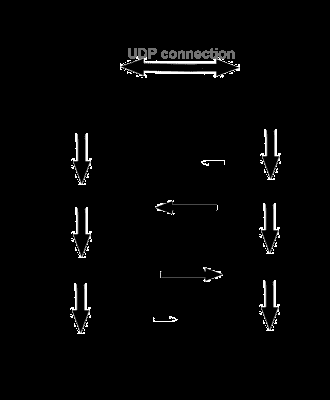

## REST 为 Best – 与您的应用程序服务器端交互

互联网协议族除了 `TCP` 之外还包含许多其他协议。其中其中协议协议就是**用户数据报协议** (`UDP`)。`UDP` 也是 `TCP/IP` *传输*层的核心成员。`UDP` 和 `TCP` 之间的主要区别在于 `UDP` 是*无连接的*。

这意味着单个数据单元是带有带自标识信息进行传输的，而该信息的接收端对何时以及如何接收到这些信息没有预先的了解。`UDP` 不会采取任何措施来确保接收端点确实可用以接收这些信息，因此在使用 `UDP` 时必须考虑这种风险。

由于 `UDP` 不使用连接，它本质上是*不可靠的*，这使得它与像 `TCP` 这样基于连接的协议开来。`TCP` 允许在传输过程中进行错误检查和纠正，因为双方由于*连接*而彼此感知。

通过 `UDP` 和其他无连接协议发送的消息被称为*数据报*。只有在不需要错误检查和纠正，或者这些工作在应用层内部已完成时，才应该使用 `UDP` 和数据报。在应用层级检查错误通常是 `UDP` 采用的模型，因为对于任何应用程序来说，错误检查和纠正几乎是必须的。使用 `UDP` 的应用程序类型示例包括：

- 流媒体
- **IP 语音** (`VoIP`)
- 多人在线游戏
- **域名系统** (`DNS`)
- 某些**虚拟专用网络** (`VPN`) 系统

`UDP` 和无连接协议最明显的缺点是无法保证消息的送达，没有错误检查，因此也没有错误纠正。在一个用户独立与系统交互且大多数事件均由用户生成的应用程序中，这可能是一个巨大的缺点。然而，在一个成百或上千名用户可能相互交互的系统中，无连接协议允许应用程序免于错误纠正带来的延迟。大型在线游戏就是一个很好的例子，在该系统中，可能有成千甚至数百万条消息需要跨网络持续传输，但要在保持连接并进行错误检查和纠正的同时，无法可靠地完成这一点。

## REST 是 Best – 与应用程序服务器端交互

### SOAP

`REST` 经常与简单对象访问协议（**`SOAP`**）相比较，尽管 `SOAP` 实际上是一种协议，而不是像 `REST` 那样的一种架构风格。之所以进行这种比较，是因为它们都用于 `Web` 服务，并且在这种语境下，`REST` 与 `HTTP` 同义，而 `HTTP` 是一种协议。尽管 `SOAP` 是一个协议，但它也通过与 `HTTP` 交互来传输消息，以实现 `Web` 服务。它也可以通过 `SMTP` 运行。

`SOAP` 的消息格式是 `XML`。通过 `SOAP` 发送的 `XML` 消息被称为封包（`envelope`）。`SOAP` 封包的结构遵循特定的模式，包含元素，其中一个强制性的 *body*（主体）元素和一个可选的 *header*（头部）元素。主体还可能包含嵌套的 *fault*（故障）结构，用于承载有关异常的信息。`SOAP` 消息的示例显示如下：

```xml
<env:Envelope xmlns:env="http://www.w3.org/2003/05/soap-envelope">
  <env:Header>
    <n:shipping>
      This is a shipping message
    </n:shipping>
  </env:Header>
  <env:Body>
    <env:Fault>
      <env:Code>
        <env:Value>env:VersionMismatch
      </env:Value>
      </env:Code>
      <env:Reason>
        <env:Text xml:lang="en">
          versions do not match
        </env:Text>
      </env:Reason>
    </env:Fault>
  </env:Body>
</env:Envelope>
```

`REST` 也可以使用 `XML` 进行数据交换，但在现代 `Web`应用程序中更多地使用 `JSON`。

## REST 最佳 – 与应用程序的服务器端交互

### WebSockets

`WebSockets` 是一种允许 浏览器与服务器之间进行交互式通信的协议。在此语境下，“*交互式*”意味着服务器可以向 `Web` 浏览器*推送*消息，而不需要浏览器定期向服务器*轮询*新数据，而这通常是在使用 `HTTP`、`AJAX` 和 `REST` 的 `Web` 应用程序中需要的操作。

你以前可能听说过*推送*技术。这种范式在许多智能手机应用中显而易见，这些应用会在新数据可用时立即向手机推送更新通知。这也被称为*实时数据*。`HTTP` 的局限性在于它不支持可以接收实时数据的开放连接。相反，`HTTP` 要求必须发送请求并打开连接或*套接字（`socket`）*、接收响应、下载信息，然后关闭连接。一旦有了新信息，除非通过向服务器发送定期请求（即所谓的*轮询*），需要这些信息的应用程序将无法察觉到这些变化。

2011 年，`WebSockets` 正式标准化并得到了现代 浏览器的支持。该协议允许通过*开放*的套接字连接在服务器与客户端之间传输数据，允许客户端随意请求数据，同时也允许服务器实时向客户端*推送*数据：

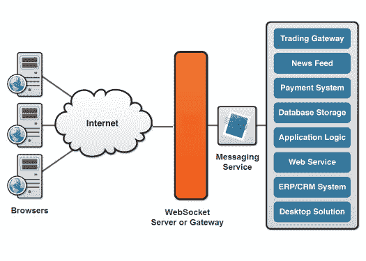

## REST 最佳 – 与应用程序服务器端交互

## REST 最佳——与应用程序的服务器交互


`REST`（表述状态转移）是一种用于设计无状态 `Web` 应用程序的架构。它依赖于客户端-服务器架构，由客户端请求资源，而服务器提供响应。资源通常通过 `URI`（统一资源标识符）来标识。

在 `RESTful API` 中，客户端使用标准的 `HTTP` 方法对资源进行操作：

- `GET`：获取资源的表表示
- `POST`：创建新资源
- `PUT`：完全更新现有资源
- `PATCH`：部分更新资源
- `DELETE`：删除资源

`REST` 的核心优势之一是其可扩展性。由于服务器是无状态的，从客户端发出的每一条请求都必须包含理解和处理该请求所需的所有信息。这使得服务器可以在多个实例之间进行负载均衡。

另一个优势是它的灵活性。`REST` 可以支持多种数据格式，例如 `JSON`、`XML` 甚至纯文本。由于 `JSON` 的轻量级且易于与 `JavaScript` 配合使用，它是最常用的格式。

在本章中，我们将探索如何使用 `Node.js` 和 `Express` 构建 `RESTful API`。我们将学习如何处理请求、管理路由以及与数据库进行交互。

## REST 最佳 – 与应用程序的服务端交互

## REST 最佳 – 与应用程序的服务端交互


## REST 是最佳实践 – 与应用程序服务器端的交互

### MQTT

**消息队列遥测传输**（**`MQTT`**）是一种轻量级的发布/订阅消息传输协议，专为资源受限设备和低带宽、高延迟或不可靠网络设计。它广泛用于物联网（`IoT`）场景。

### CoAP

**受限应用协议**（**`CoAP`**）是一种专用的 `Web` 传输协议，用于受限节点和受限网络。它基于 `UDP`，并使用类似 `REST` 的交互模型。由于 `CoAP` 使用了 `REST` 架构风格，它实际上可以通过 `HTTP` 进行连接，因为与任何 `RESTful` 架构一样，客户端对其所访问的 `RESTful` 服务器是感知无关的。在这种情况下，会使用跨协议代理来使 `CoAP` 服务对 `HTTP` 客户端可用。

### DDP

**分布式数据协议**（**`DDP`**）并不常用，但它正在通过流行的 `Meteor JavaScript` 框架获得越来越多的关注。`DDP` 是一种简单的协议，用于从服务器显式地获取表示，并实时接收有关这些表示的修改修改的更新。

`DDP` 允许 `Meteor` 应用程序使用 `WebSockets` 提供服务，并围绕这些服务提供一个框架以实现无连接状态。它使用 `JSON` 数据，但不再像在 `RESTful` 架构中那样被显式请求，`JSON` 数据消息可以实时*推送*到应用程序中。

`DDP` 最初是由 `Meteor` 的创始人为 `Meteor` 开发的；然而，它并不是 `Meteor` 特有的，可以在其他框架中使用。`Meteor` 对 `DDP` 的实现完全使用 `JavaScript` 编写并且是开源的。

## REST 为最佳 – 与你应用程序的后端交互

你现在已经学习了 `REST` 架构风格的基础方面、架构风格与协议之间的差异、`REST` 与 `HTTP` 协议之间的关系，以及 `REST` 的约束。你还学习了如何使用 `Express` 和 `MongoDB` 编写一些基本的 `REST API` 端点。深入理解 `REST` 和单页应用（`SPA`）的后端对于成为一名熟练的 `Web SPA` 开发者至关重要。在下一章中，我们将重点转移到 `SPA` 开发的前端，学习关于 `SPA UI` 框架和最佳实践的知识，并将我们目前所学所有内容应用到视图层（`View layer`）。

# 5 这一切在于视图

`UI` 层，或**视图（`View`）**，是任何应用程序中最可见的组件。无论底层运行的是什么——无论是 `REST`、`Websockets`、`MQTT` 还是 `SOAP`——视图都是实现完整、交互式应用程序体验的终点。正如同服务器端一样，从开发的角度来看，视图也有其的一套复杂的复杂性，以及许多架构选择供你权衡。现在，我们将探索其中一些选择，以及可以应用于全方位视图层的一些不同设计模式。

在本章中，我们将涵盖以下内容：

- 各种 `JavaScript` 模板引擎之间的差异
- 预编译 `JavaScript` 模板的优势
- 如何优化你的应用程序布局

### JavaScript 模板引擎

在应用程序的前端维护视图，对于保持其与服务器无关（`server-side agnostic`）大有裨益。即使你在底层使用 `MVC` 框架来为应用程序提供 `REST` 端点，将视图模板和逻辑保留在前端也能确保你将来可以更轻松地更换 `MVC` 后端，而不会显著改变应用程序的逻辑和架构结构。`JavaScript` 模板引擎提供了一种完全在前端管理视图模板的有效方法。

## 关键在于视图

赋予模板执行任意 `JavaScript` 代码的能力在社区中引起了广泛讨论，普遍的共识是这种做法是不受欢迎的。这是由于从其他 `Web` 脚本语言（如 `PHP`）中吸取了教训。

在模板中直接将动态业务逻辑代码与 `HTML` 混合，会导致代码库对于其他开发者和后继人员变得难以维护和调试。这类代码还违反了 `MVC` 和 `MVW` 架构模式的原则。不言而喻的是，在模板中包含多少业务逻辑完全取决于编写代码的开发者，但对于许多 `JavaScript` 模板引擎的创建者来说，留出这扇门并不是选择。出于这些原因，*无逻辑*（`logic-less`）模板的概念运而生。

你可以在 `underscore.org` 了解更多关于 `Underscore.js` 的信息。

### Mustache.js

**Mustache.js** 是流行的 **Mustache 模板系统**的 `JavaScript` 模板实现。`Mustache` 自称为一种*无逻辑*的模板语法。这一概念背后的想法并不非要让模板完全没有逻辑，而是为了遏制在模板中包含大量业务逻辑的做法。

`Mustache` 的名称源于其使用双大括号作为模板的默认分隔符标签，其形状像胡须（`mustache`）。`Mustache` 模板与 `Underscore.js` 模板的主要区别在于，`Mustache` 不允许在其标签的变体中放置任意 `JavaScript` 代码；它只允许表达式。

在最简单的形式下，`Mustache` 模板将 `JavaScript` 对象中的值直接映射到相应的模板表达式，这些表达式由该对象值的键表示。例如，取所示的对象：

```json
{
  "name": {
    "first": "Udis",
    "last": "Petroyka"
  },
  "age": "82"
}
```

## 核心在于视图

此对象中的值可以用如下 `Mustache` 模板来表示：

```html
<p>{{name.first}} {{name.last}}</p>
<p>Age: {{age}}</p>
```

在这个示例中，你可以看到即使是嵌套对象的值也可以通过 `JavaScript` 的点符号进行访问，如 `{{name.first}}` 和 `{{name.last}}` 所示：

```html
<p>Udis Petroyka</p>
<p>Age: 82</p>
```

### 章节 (Sections)

`Mustache` 模板还包含了渲染*章节*（`sections`）或*文本块*的能力。这涉及使用另一种表达式语法，该语法包含起始标签和结束标签结构。章节的渲染方式取决于所调用的键的值。

### 布尔值

给定一个布尔值，章节将根据该布尔值为 `true` 还是 `false` 来决定渲染或不渲染：

```json
{
  "name": {
    "first": "Jarmond",
    "last": "Dittlemore"
  },
  "email_subscriber": false
}
```

章节的分隔符语法由起始大括号、随后的 `#` 符号和属性名称（开始章节），以及结束大括号、随后的 `/` 符号和属性名称（结束章节）组成。这种语法类似于 `HTML` 的起始和结束标签：

```html
<p>{{name.first}} {{name.last}}</p>
{{#email_subscriber}}
<p>此用户将不会显示此处内容。</p>
{{/email_subscriber}}
```

## 关键在于视图

*一切都取决于视图*

在这个示例中，`email_subscriber` 属性被设置为 `false`，因此模板将渲染以下 `HTML`：

```html
<p>Jarmond Dittlemore</p>
```

本质上，使用带有布尔值的 section 等同于一个 `if` 条件语句。这种用例确实包含逻辑，尽管它是以最基础的形式存在的。通过这种方式，证明了*无逻辑*（`logic-less`）这一术词并不像最初想象的那么严格。

### 列表

此外，section 可以用于遍历设置为给定对象键值的项目列表。在 section 内部，上下文（或变量作用域）会切换到正在迭代的键。例如，取父键以及对应的值列表：

```json
{
  "people": [
    { "firstName": "Peebo", "lastName": "Sanderson" },
    { "firstName": "Udis", "lastName": "Petroyka" },
    { "firstName": "Jarmond", "lastName": "Dittlemore" },
    { "firstName": "Chappy", "lastName": "Scrumdinger" }
  ]
}
```

给定一个人员列表及其姓名，可以使用 section 在 `HTML` 无序列表中渲染每个人的姓名：

```html
<ul>
  {{#people}}
    <li>{{firstName}} {{lastName}}</li>
  {{/people}}
</ul>
```

在给定前述示例对象的情况下，这段模板代码将渲染以下 `HTML`：

```html
<ul>
  <li>Peebo Sanderson</li>
  <li>Udis Petroyka</li>
  <li>Jarmond Dittlemore</li>
  <li>Chappy Scrumdinger</li>
</ul>
```

## 这一切在于视图

### Lambdas

对象的属性值也可以直接从 *lambdas*（即传递并返回值作为数据的函数）返回到当前节的文中：

```json
{
  "people": [
    { "firstName": "Peebo", "lastName": "Sanderson" },
    { "firstName": "Udis", "lastName": "Petroyka" },
    { "firstName": "Jarmond", "lastName": "Dittlemore" },
    { "firstName": "Chappy", "lastName": "Scrumdinger" }
  ],
  "name": function() {
    return this.firstName + ' ' + this.lastName;
  }
}
```

在列表的情况下，`lambda` 将根据迭代时当前列表项的上下文返回一个值：

```html
<ul>
  {{#people}}
  <li>{{name}}</li>
  {{/people}}
</ul>
```

通过这种方式，前述的模板将产生与上一个示例相同的输出：

```html
<ul>
  <li>Peebo Sanderson</li>
  <li>Udis Petroyka</li>
  <li>Jarmond Dittlemore</li>
  <li>Chappy Scrumdinger</li>
</ul>
```

### 反转节 (Inverted sections)

`Mustache` 模板中的反转节是指当该节键的值为 `false` 或 *假值*（`falsy`）时才进行渲染，例如 `null`、`undefined`、`0` 或空列表 `[]`。以下对象为例：

```json
{
  "name": {
    "first": "Peebo",
    "last": "Sanderson"
  }
}
```

## 这一切在于视图

### 反转节 (Inverted Sections)

反转节以起始大括号后的脱字符符号 `^` 开头，而不是使用用于标准分节的井号符号 `#`。根据之前的示例对象，可以使用以下模板语法为 `false` 属性值渲染 `HTML`：

```html
<p>{{name.first}} {{name.last}}</p>
{{^email_subscriber}}
<p>此用户未订阅邮件。</p>
{{/email_subscriber}}
```


# Mustache 模板

## 条件渲染

```mustache
{{^email_subscriber}}
<p>I am not a subscriber.</p>
{{/email_subscriber}}
```

根据对象中 `false` 的属性值，该模板将渲染为以下 HTML：

```html
<p>Peebo Sanderson</p>
<p>I am not a subscriber.</p>
```

## 注释

Mustache 模板还允许你在模板中包含注释。与 HTML 注释相比，使用 Mustache 语法编写注释的优势在于，它们不会被渲染到 HTML 输出中（而标准的 HTML 注释则会），如下所示：

```html
<p>Udis likes to comment{{! hi, this comment won't be rendered }}</p>
<!-- This is a standard HTML comment -->
```

Mustache 注释用起始大括号后的感叹号（`!`，bang）表示。前述模板代码将渲染为：

```html
<p>Udis likes to comment</p>
<!-- This is a standard HTML comment -->
```

如所示，Mustache 模板注释不是渲染后 HTML 的一部分，但标准的 HTML 注释是。使用 Mustache 模板注释的优势在于可以减小渲染后 HTML 的负载大小（你通常希望它越小越好），而且可能你实际上并不想在动态 HTML 中渲染注释。这允许你在模板代码中为其他开发者提供有用的注释，而不会给应用程序的前端带来负担。

## 局部模板 (Partials)

Mustache 模板最实用的功能之一是包含*局部模板*（partials），即在编译后的模板内部在运行时渲染的独立模板。从概念上讲，此功能类似于服务端模板语言中的*包含*（includes）。

局部模板的语法在起始大括号后使用大于符号 `>`，随后是局部模板的名称。一种常见的命名约定是在未编译的局部模板文件名前加上下划线 `_`。考虑以下两个文件：

**user.hbs**

```html
<h3>{{name.first}} {{name.last}}</h3>
{{> user-details}}
```

**_user-details.hbs**

```html
<ul>
  {{^email_subscriber}}
  <li>I am not an email subscriber</li>
  {{/email_subscriber}}
  <li>Age: {{age}}</li>
  <li>Profession: {{profession}}</li>
</ul>
```

`user.hbs` 的第二行显示了对局部模板文件的调用。这与 `user.hbs` 相同的上下文中解析 `_user-details.hbs`。在标准的编译器设置下，局部模板文件名上的下划线将从键名中排除，模板将存储在局部模板命名空间中：

```json
{
  "name": {
    "first": "Jarmond",
    "last": "Dittlemore"
  },
  "email_subscriber": false,
  "age": 24,
  "profession": "Student"
}
```

给定示例对象，从模板完全渲染后的 HTML 如下所示：

```html
<h3>Jarmond Dittlemore</h3>
<ul>
  <li>I am not an email subscriber</li>
  <li>Age: 24</li>
  <li>Profession: Student</li>
</ul>
```

## 上下文与作用域

正如你在示例所示，对象中的键名直接在部分模板（partial）中使用，并与父模板处于相同的上下文。

## 设置备用分隔符

Mustache 模板较不寻常的特性之一是在模板内部的标准分隔符标签中设置*备用*分隔符。这是通过在起始分隔符标签后使用等号 `=` 实现的：插入新的起始分隔符，紧跟新的结束分隔符，最后是一个等号以及标准的分隔符标签：

```mustache
{{=<% %>=}}
```

如果将此代码放置在 Mustache 模板内部的任何位置，从该点开始的分隔符标签将使用新的语法：

```json
{
  "name": {
    "first": "Chapy",
    "last": "Scrumdinger"
  },
  "email_subscriber": false,
  "age": 96,
  "profession": "Oilman"
}
```

给定上述对象，可以使用该数据结合备用分隔符标签来构建模板进行解析：

```html
<p>标准标签：{{name.first}} {{name.last}}</p>
{{=<% %>=}}
<p>新标签 - 年龄：<%age%></p>
<%={{ }}=%>
<p>再次标准标签 - 职业：{{profession}}</p>
```

# Handlebars 模板

## 与 Mustache 的区别

正如示例所示，`this` 关键字用于引用当前块上下文所设置的变量。如果直接引用 `profession` 变量本身，这在 Handlebars 中会导致错误。

```handlebars
<!-- Handlebars template -->
<p>{{name.first}} {{name.last}}</p>
{{#profession}}
<p>Profession: {{this}}</p>
{{/profession}}
```

此外，Handlebars 还可以使用前述代码所示 `../` 语法通过**显式路径**引用查找变量的作用域链。这种语法模拟了命令行界面中递归文件路径的查找。在此示例中，`../profession` 引用仅用于查找当前块上下文所设置的变量：

```html
<p>Peebo Sanderson</p>
<p>Profession: Singer</p>
```

Handlebars 默认不支持递归路径查找是为了速度。通过将路径查找限制在当前块上下文中，Handlebars 模板可以渲染得更快。虽然提供了一个编译时 `compat` 标志来覆盖此功能并允许递归路径查找，但 Handlebars 的创建者建议不要这样做，并指出这样做会有性能成本。

## 作为块表达式的 Helper

Handlebars 模板使用块表达式语法来调用辅助函数（helpers）。然而，块表达式的上下文完全取决于辅助函数的编写方式。Handlebars 提供了几个内置的块辅助函数。

### #if helper

Handlebars 提供了一个简单的 `#if` 块辅助函数，用于根据布尔值或真假值（truthy versus falsy）解析来决定是否渲染内容。这意味着像 `0`、`null`、`undefined` 和空列表 `[]` 等值将被解析为 `false`。考虑以下对象：

```json
{
  "name": {
    "first": "Jarmond",
    "last": "Dittlemore"
  },
  "email_subscriber": false
}
```

这里不再使用标准的 Mustache 区域实现，而是可以在布尔值上调用 `#if` 辅助函数：

```handlebars
<p>{{name.first}} {{name.last}}</p>
{{#if email_subscriber}}
<p>I am an email subscriber.</p>
{{/if}}
```

此模板不会渲染 `#if` 块内部的部分，因为 `email_subscriber` 为 `false`。内置的 `#if` 辅助函数还允许在 `#if` 块中包含 `{{else}}` 区域，当传递的变量评估为 `false` 时，该区域将被渲染：

```handlebars
<p>{{name.first}} {{name.last}}</p>
{{#if email_subscriber}}
<p>I am an email subscriber.</p>
{{else}}
<p>I am not an email subscriber.</p>
{{/if}}
```

根据给出的对象，此模板将渲染以下内容：

```html
<p>Jarmond Dittlemore</p>
<p>I am not an email subscriber.</p>
```

## 预编译模板

Handlebars.js 中许多区别于 Mustache.js 的功能都是为了让模板在浏览器中渲染得更快而设计的。Handlebars 中实现这一点的主要特性之一是**预编译模板**的能力。

预编译模板将它们转换为 JavaScript 函数，这些函数通常在使用其他模板引擎渲染之前，在应用程序中完成编译。使用这一功能可以通过跳过该步骤来提高应用程序的运行速度，并且额外减少了浏览器的负载，因为 JavaScript 编译器不需要包含在前端资源负载中。

### 无替代定界符

Handlebars 的创建者还认为，在模板内设置替代定界符的能力是不必要的。如果你没有预编译模板，这进一步减少了应用程序的资源负载。

通常情况下，除了个人偏好外，你想更改模板分隔符风格的唯一理由是为了避免与另一种模板语言发生冲突，例如使用相同分隔符的服务器端模板语言。如果你在服务器端模板的 JavaScript 块中包含 Handlebars 模板，这个问题就会出现。然而，如果你预编译了模板，或者通过将模板保存在单独的 JavaScript 文件中将其从服务器端模板中抽象出来，那么就可以完全避免这个问题，也无需设置替代分隔符了。

你可以在 handlbarsjs.com 了解更多关于 Handlebars.js 的信息。

# Pure.js

Pure.js 是一个 JavaScript 模板引擎，它将无逻辑模板（logic-less templates）的概念推向比 Mustache 和 Handlebars 更极端的。Pure.js 不使用任何需要在渲染前进行插值的特殊模板表达式语法。相反，它使用纯 HTML 标签和 CSS 选择器结合 JSON 数据在 DOM 中渲染值。通过这种方式，Pure.js 使用了完全无逻辑的视图，因为没有任何模板标记可以在其中包含任何逻辑。

## 标记 (Markup)

使用纯 HTML，可以像这样构建一个简单的 Pure.js 模板：

```html
<p class="my-template">
  Hello，我的名字是 <span></span>
</p>
```

```javascript
var data = {
  name: 'Udis Petroyka'
};

var directive = {
  'span': 'name'
};
```

在这个示例中，我们在 `data` 变量中为模板提供了数据，然后提供了一个所谓的 `directive`（指令），它告诉模板引擎如何映射这些数据：

```javascript
$p('.my-template').render(data, directive);
```

Pure.js 提供了一个全局对象 `$p`，通过该对象可以使用与模板交互的方法。在这种情况下，我们调用了 `render()` 方法，并将 `data` 和 `directive` 作为参数传递进去：

```html
<p class="my-template">
  Hello, my name is <span>Udis Petroyka</span>.
</p>
```

这就是这个简单示例的渲染结果。你可以通过 `beebole.com/pure/` 了解更多关于 Pure.js 的信息。

# Pug

Pug（正式名为 Jade）是一种在 Node.js 社区中非常流行的 JavaScript 模板引擎。它在很大程度上受到了 **HTML 抽象标记语言**（**Haml**）的影响，Haml 最初的设计是为了通过比原生 HTML 更简洁、不冗余的语法，让 ERB 模板的编写变得更容易。通过这种方式，Pug 不仅需要编译其表达式，还需要编译标记语言本身。

Pug 与 YAML 相似，层级关系通过空格缩进作为分隔符来表示。这意味着不需要任何闭合元素标签：

```pug
doctype html
html(lang="en")
  head
    title= pageTitle
  body
    h1 This is a heading
    if thisVariableIsTrue
      p This paragraph will show.
    else
      p This paragraph will show instead.
```

# 嵌入式 JavaScript (EJS)

**EJS** 是一种 JavaScript 模板引擎，工作原理与 Underscore.js 类似，同样使用 ERB `<% %>` 风格的分隔符。此外，它允许使用 `[% %]` 风格标签作为分隔符。

与 Underscore.js 相似，EJS 在使用标准的 `<% %>` ERB 风格语法时允许解析任意 JavaScript，并允许在开启分隔符标签 `<%= %>` 后面使用等号 `=` 对表达式求值：

```ejs
<ul>
  <% for (var i = 0; i < people.length; i++) { %>
    <li><%= firstName %> <%= lastName %></li>
  <% } %>
</ul>
```

## 同步模板加载

在典型的 EJS 用例中，每个模板都存储在具有专有 `.ejs` 扩展名的文件中。通过创建一个新的 `EJS` 对象、提供模板文件的路径，并调用 `render` 方法传入你想要插值的数据，即可从 JavaScript 代码编译模板。

假设 EJS 模板保存在项目中的 `templates/people.ejs` 文件中。可以编写以下 JavaScript 代码将其渲染为本示例所示的 HTML：

```javascript
var data = {
  "people": [
    { "firstName": "Peebo", "lastName": "Sanderson" },
    { "firstName": "Udis", "lastName": "Petroyka" },
    { "firstName": "Jarmond", "lastName": "Dittlemore" },
    { "firstName": "Chappy", "lastName": "Scrumdinger" }
  ]
};

var html = new EJS({url: 'templates/people.ejs'}).render(data);
```

## 异步数据加载

EJS 的一个独特特性是能够使用从外部源加载的异步数据来渲染模板。使用上一个例子，假设 JSON 数据位于一个名为 `people.json` 的外部文件中：

```javascript
new EJS({url: 'templates/people.ejs'}).update('element_id', 'people.json');
```

在这个示例中，调用的是 `.update()` 方法而不是 `.render()`。对象实例也没有赋值给变量，因为 DOM 插入是通过传递 DOM 节点 ID 由 `.update()` 方法处理的。要使此方法生效，不能使用其他 CSS 选择器将 HTML 注入到 DOM 中；只有 ID 是有效的。

## 缓存

EJS 在模板首次同步加载后默认会对其进行缓存。这提供了一个优势：被多次使用的模板在第一次请求后加载速度总是会更快，而未使用的模板不会占用任何内存。这种方法与预编译形成了鲜明对比，预编译是在应用程序初始页面加载时将所有模板加载到内存中。这两种方法都有优缺点，因此必须为你的特定应用程序选择最佳方法。

也可以通过传递给任何模板实例化的选项对象中包含 `cache` 键来关闭任何模板的缓存：

```javascript
var html = new EJS({url: 'templates/people.ejs', cache: false}).render(data);
```

# 视图辅助函数 (View helpers)

EJS包含了一些视图辅助函数，它们与 Handlebars 模板中的辅助概念相似。它们允许对常用的 HTML 元素使用更短的语法。我们在这里说明几个示例。

## link_to 视图辅助函数

`link_to` 视图辅助函数提供了一种简单的模板语法，用于生成 HTML 超链接：

```ejs
<p>Here is a <%= link_to('link', '/link/path') %> to a path.</p>
```

`link_to` 视图辅助函数的第一个参数是链接显示的文本，第二个参数是用于传递给链接 `href` 属性的路径。请注意，视图辅助函数的定界符使用了表达式起始分隔符语法。此示例将渲染以下 HTML：

```html
<p>Here is a <a href="/link/path">link</a> to a path.</p>
```

## img_tag 视图辅助函数

此 `img_tag` 视图辅助函数为在渲染的 HTML 中包含图像提供了方便的语法：

```ejs
<p><%= img_tag('/path/to/image.png', 'Description text') %></p>
```

`img_tag` 视图辅助函数的第一个参数是图像路径，第二个参数是图像 `alt` 属性的文本。此示例将渲染以下 HTML：

```html
<p></p>
```

## form_tag 视图辅助函数

`form_tag` 视图辅助函数提供了构建 HTML 表单的语法，并与其他视图辅助函数配合使用创建输入元素：

```ejs
<%= form_tag('/path/to/action', {method: 'post', multipart: true}) %>
<%= input_field_tag('user_input', 'value text here') %>
<%= submit_tag('Submit') %>
<%= form_tag_end() %>
```

# Grunt 任务配置

## grunt-contrib-uglify

安装完成后，打开 `Gruntfile.js` 并将以下任务添加到现有任务中，位于 `watch` 任务上方：

```javascript
uglify: {
  options: {
    preserveComments: false
  },
  main: {
    files: {
      'js/all.min.js': [
        'bower_components/jquery/dist/jquery.js',
        'bower_components/handlebars/handlebars.runtime.js',
        'bower_components/payloadjs/payload.js',
        'js/src/templates.js'
      ]
    }
  }
}
```

此配置了 `uglify` 任务，将 `preserveComments` 选项设置为 `false` 以移除所有注释，混淆或缩短变量和函数名称，并将指定的 JavaScript 文件列表合并到单个目标文件名 `all.min.js` 中。通过此设置，UglifyJS 将根据输入文件为您的 JavaScript 创建最小的下载体积。

接下来，确保在 `Gruntfile.js` 的底部与其他任务一起加载新的 `uglify` 任务：

```javascript
grunt.loadNpmTasks('grunt-contrib-uglify');
```

现在，您只需要在命令行中运行该任务：

```bash
$ grunt uglify
```

运行任务后，您应该会看到类似下面的输出：

```text
Running "uglify:main" (uglify) task
File all.min.js created: 322.28 kB → 108.6 kB
>> 创建了 1 个文件.
完成，无错误。
```

## grunt-contrib-handlebars

如果你在应用程序中使用 Handlebars 模板，可以使用 **grunt-contrib-handlebars** 任务通过命令行以及 watch 任务轻松地对这些模板进行预编译。在*第 2 章*中，我们在项目根目录下创建了示例文件 `user.handlebars`，在*第 4 章*中，我们创建了 `users.handlebars`。现在，让我们在 `js/templates` 中创建一个新目录并将文件移动到那里。接下来，将文件重命名为 `user.hbs` 和 `users.hbs` 以保持简洁。`.hbs` 扩展名也被广泛接受用于 Handlebars 文件：

```text
/
└── js/
    └── templates/
        ├── user.hbs
        └── users.hbs
```

接下来，安装 `grunt-contrib-handlebars` 插件：

```bash
$ npm install grunt-contrib-handlebars --save-dev
```

安装完成后，将以下任务配置添加到 `Gruntfile.js` 中，紧接 `uglify` 任务配置上方：

```javascript
handlebars: {
  options: {
    namespace: 'Handlebars.templates',
    processName: function(file) {
      return file.replace(/js\/templates|\.hbs/g, '');
    },
    partialRegex: /.*/,
    partialsPathRegex: /\/partials\//
  },
  files: {
    src: 'js/templates/**/*.hbs',
    dest: 'js/src/templates.js'
  }
}
```

相比于 Handlebars 命令行工具默认提供的，Handlebars Grunt 插件对你做的假设更少，因此此配置已经为你完成了多项工作。

### Options 配置

首先，`options` 对象被传递了四个参数。`namespace` 选项仅告诉编译器使用哪种全局命名空间来存储编译后的 Handlebars 模板函数。在命令行工具中，`Handlebars.templates` 是此处的默认命名空间，因此我们将使用它。

`processName` 参数接收一个函数，该函数接受 Handlebars 文件作为参数，并用它在 `Handlebars.templates` 命名空间中为该模板创建键名。在这种情况下，我们使用正则表达式来获取路径和文件名，并移除文件名前缀以外的所有内容，因此，例如 `user.hbs` 的编译模板函数将可以通过 `Handlebars.templates.user` 使用。

`partialRegex` 选项接受一个正则表达式，用于识别局部文件文件名的模式。默认值是以下划线 `_` 开头的文件，但在这里，我们将使用目录来存放局部文件，因此 `partialRegex` 选项被设置为 `.*`，这意味着它会将给定路径上的任何文件识别为局部文件（partial）。

`partialsPathRegex` 选项接受一个正则表达式，用于识别局部文件目录的路径。我们将其设置为 `/\/partials\//`，它将被评估为传入的主模板路径下的 `/partials` 目录。结合 `partialRegex` 选项，这告诉编译器将 `/partials` 目录中的每个文件视为局部文件，并将其编译后的模板函数添加到 `Handlebars.partials` 命名空间中。

### 文件配置

传递给 Handlebars 任务的 `files` 配置对象用于编译器使用什么文件模式来查找模板，并定义编译后模板的输出文件名：

```javascript
files: {
  src: 'js/templates/**/*.hbs',
  dest: 'js/src/templates.js'
}
```

在这种情况下，我们定义的模板 `src` 目录位于根路径下的 `js/templates/`，并解析该目录及其所有子目录下所有扩展名为 `.hbs` 的文件。递归目录查找由 `/**/*.hbs` 语法表示。

`dest` 键告诉编译器创建 `js/src/templates.js` 文件，该文件包含所有模板的最终编译输出。

### 运行 Grunt Handlebars 任务

为了运行 handlebars 任务，我们首先需要在 `Gruntfile.js` 的底部加载插件：

```javascript
grunt.loadNpmTasks('grunt-contrib-handlebars');
```

接下来，从命令行界面（CLI）运行 `grunt handlebars` 命令：

```bash
$ grunt handlebars
```

运行任务后，你应该会看到类似下面的输出：

```text
Running "handlebars:files" (handlebars) task
>> 1 file created.
Done, without errors.
```

现在，如果你查看 `js/src/` 目录，你应该发现那里创建了一个 `templates.js` 文件，它就在我们在第 1 章中创建的 `app.js` 文件旁边。既然我们现在将 `templates.js` 文件存储在这里，请去删除根目录下原始的 `templates.js` 文件，并修改 Grunt uglify 任务中的 `files` 对象，如下所示：

```javascript
files: {
  'js/all.min.js': [
    'bower_components/jquery/dist/jquery.js',
    'bower_components/handlebars/handlebars.runtime.js',
    'bower_components/payloadjs/payload.js',
    'js/src/templates.js'
  ]
}
```

现在我们已经将新的 `templates.js` 文件添加到 `uglify` 任务中，使其包含在完整压缩后的应用程序 JavaScript 文件中。

### 监听更改

既然你现在加载的是压缩后的 JavaScript 文件，你可能想添加一个 `watch` 任务，以便在开发过程中创建该文件，这样你就不需要不断从 CLI 运行命令了。

在本例中，假设我们想要检测 `js/src` 目录下任何正在活跃的文件的更改。编辑 `Gruntfile.js` 中的 `watch` 任务配置，在该任务的 `jshint` 目标下方直接添加以下内容：

```javascript
uglify: {
  files: ['js/src/*.js'],
  tasks: ['uglify:main']
}
```

这告诉 Grunt 当检测到匹配模式的文件变化时，运行 `uglify` 任务的 `main` 目标。此外，将 `uglify` watch 任务之上的 `jshint` watch 任务改为以下内容：

```javascript
jshint: {
  files: ['js/src/*.js', '!js/src/templates.js'],
  tasks: ['jshint']
}
```

这告诉 watch 任务在运行 jshint 任务时忽略 `templates.js` 的更改。我们想要忽略这个文件是因为它是编译过的，并且无法通过 JSHint 测试。

在文件顶部附近的*main* `jshint` 任务 `files` 配置中添加相同的文件忽略路径：

```javascript
files: {
  src: [
    'Gruntfile.js',
    'js/src/*.js',
    '!js/src/templates.js'
  ]
}
```

# Handlebars 实战

应用程序的视图层是用户交互的部分。在现代 Web 应用中，这通常由 HTML、CSS 和 JavaScript 组成。然而，服务器也可以使用像 Handlebars 这样的模板引擎根据你的数据生成动态内容。

Handlebars 允许我们创建在运行时填充数据的 HTML 模板。这使得我们的展示逻辑与业务逻辑分离，让代码更易于维护和扩展。

## 为什么选择 Handlebars？

- **无逻辑模板**：通过限制复杂逻辑来保持模板的整洁。
- **可重用性**：创建部分模板（Partials）以便在多个视图之间复用代码。
- **性能**：Handlebars 的编译和渲染速度非常快。
- **社区**：一个被广泛使用的库，拥有许多插件和支持。

## 使用 Handlebars

这是一个简单模板的示例：

```html
<div class="user-profile">
  <h3>{{first_name}} {{last_name}}</h3>
  <p>{{title}}</p>
  <ul>
    {{#each items}}
      <li>{{this}}</li>
    {{/each}}
  </ul>
</div>
```

通过使用 Handlebars，我们可以根据从数据库获取的数据动态地生成此 HTML。

## 实时编译与部署

对 `user.hbs` 的修改触发了两个任务的链式反应，使你的应用程序 JavaScript 被编译到最新版本。如果你打开编译后的 `templates.js` 文件，你会发现用户和用户的属性都已创建，并关联了相应的模板函数：

```javascript
this["Handlebars"]["templates"]["user"] = Handlebars.template({...});
this["Handlebars"]["templates"]["users"] = Handlebars.template({...});
```

接下来，当 `handlebars` 任务仍在运行时，将 `user.hbs` 文件移动到 `js/templates/partials` 目录。这将再次触发 watch 任务。当任务完成后，再次打开 `templates.js`，你会发现 `Handlebars.templates.user` 属性已不再定义。取而代之的是有了对 `.registerPartial()` 的函数调用：

```javascript
Handlebars.registerPartial("user", Handlebars.template({...}));
```

当使用 Handlebars 模板语法在父模板中包含它时，这将调用 `user.hbs` 模板。现在打开 `users.hbs` 并将其更改为使用 `user.hbs` 模板：

```handlebars
{{#each data}}
  {{> user}}
{{/each}}
```

这将遍历所提供的用户数据。在第 4 章中，我们遗留的测试数据库只有一个条目，现在让我们再添加一个，让这个示例更具说明性。

在另一个控制台会话中，使用 Express 运行本地 Node.js 服务器：

```bash
$ node server.js
App now listening on port 8080
```

现在在浏览器中访问 `localhost:8080`，使用 POST 请求表单向数据库添加另一个条目：

```text
First name: Peebo
Last name: Sanderson
Title: Singer
```

# 数据绑定，以及为什么你应该接受它

单页应用程序的视图层远不仅仅是通过 JavaScript 模板引擎或其他手段静态地显示 HTML 和数据。现代 JavaScript 应用程序必须处理实时更新并具备响应式能力。*第 4 章* 中描述的某些协议，例如 WebSockets、MQTT 和 DDP，可以用于主动获取应用程序的数据更新，但将这些更改绑定到 DOM 并在视图中显示的能力必须在应用程序的前端处理。这正是数据绑定发挥作用的地方。

在本章中，你将学习到：

- 什么是数据绑定？
- 单向绑定和双向数据绑定的区别
- AngularJS 的数据绑定实现
- 其他流行的数据绑定实现方式
- 如何使用原生 JavaScript 实现数据绑定？
- 数据绑定的一些用场景有哪些？

## 什么是数据绑定？

从高层次上来说，数据绑定是一种软件设计模式，它规定了通过视觉化反映变化，将底层应用程序数据（或模型）的变化直接绑定到视图的能力。这可以通过使用 JavaScript 的任何方式实现，并且具体取决于你所使用的 JavaScript 版本及其功能。

数据绑定是在应用程序模型（逻辑）与其视图（UI）之间同步数据的过程。在现代 Web 开发中，这是一项基础概念，确保了用户界面能够与应用程序的底层状态保持同步。

### 为什么数据绑定如此重要

- **减少样板代码**：你不再需要为了数据变化时手动编写大量代码来更新 DOM，反之亦然。
- **一致性**：它确保了 UI 始终能够反映数据的当前状态，从而减少了与过时信息相关的 Bug。
- **提高生产力**：开发者可以专注于业务逻辑和 UI 结构，而不是纠结于 DOM 操作的细枝末节。
- **可维护性**：通过将数据逻辑与表现层分离，代码变得更容易测试、调试和演进。

## 单向与双向数据绑定

双向数据绑定在视图中的表现为：ViewModel 的更改与模板合并到 View 中，而用户对 View 中数据表示的更改则会合并回 ViewModel 中。

此图展示了双向数据绑定设计模式。为了使这种模式生效，必须存在某种类型的观察者，持续监控数据变化并在两个方向上进行同步。这自然需要更复杂的前端架构，可以利用诸如 AngularJS 等流行的框架来接管这一工作。

### 使用现代 JavaScript 框架进行数据绑定

由于数据绑定设计模式带来的复杂性，出现了一些独立的 JavaScript 库，例如 Rivets.js 和 Knockout.js，它们可以为你提供这种功能。许多功能的 JavaScript 框架也将其自己的数据绑定实现作为核心特性包含。

## AngularJS 数据绑定

AngularJS 由 Google 维护，是最流行的现代 JavaScript 框架之一。正如*第 2 章*中所讨论，Model-View-Whatever（无论是什么）是一个自诩的 MVW 框架。除了 MVW 架构模式实现外，它还包含了强大的数据绑定设计模式，这通常是它最受推崇的功能。

### 单向数据绑定

使用 AngularJS 进行单向数据绑定时，当视图中的表达式由与该视图关联的 Controller 的模型值填充即可实现。考虑以下 Controller 和 Model 数据：

```javascript
var myApp = angular.module('myApp', []);

myApp.controller('UserController', function UserController($scope) {
  $scope.user = {
    firstName: 'Peebo',
    lastName: 'Sanderson'
  };
});
```

在此控制器（Controller）作用域上定义的用户 Model 可以通过以下模板标记表示在视图（View）中：

```html
<body ng-app="myApp">
  <div ng-controller="UserController">
    <p>
      <strong>其名：</strong> {{user.firstName}}<br>
      <strong>姓氏：</strong> {{user.lastName}}
    </p>
  </div>
</body>
```

就像许多其他 JavaScript 模板引擎一样，双大括号语法被用于表示在 AngularJS 模板中要求值的表达式。此外，AngularJS 允许在空 HTML 元素上使用 `ng-bind` 属性，来代替双大括号语法处理表达式：

```html
<body ng-app="myApp">
  <div ng-controller="UserController">
    <p>
      <strong>其名：</strong>
      <span ng-bind="user.firstName"></span><br>
      <strong>姓氏：</strong>
      <span ng-bind="user.lastName"></span>
    </p>
  </div>
</body>
```

这种语法更加冗长，但某些人可能更喜欢。无论哪种情况，Model 属性的更改将自动更新到绑定了相应模板表达式的视图中。通过这种方式，AngularJS 提供了底层 DOM 操作层，将 Model 的更改连接到视图更新上，而无需任何额外的代码。

### 双向数据绑定

当视图中的可编辑值（例如文本输入）被赋值给当前控制器作用域 Model 上的属性时，就实现了 AngularJS 的双向数据绑定。当用户更改该属性的值时，Model 将自动更新，并且该更改将回传到绑定到该 Model 属性的任何表达式中。

#### 脏检查（Dirty checking）

AngularJS 使用轮询变化的方法查找模型（Model）与视图（View）之间的差异，这种方法被称为脏检查。这种检查在一个定义的时间间隔内进行，被称为消化周期（digest cycle）。在每个消化周期中，scope 都会注册一些名为 watches（监听）的特殊方法并绑定监听器，以监控传递给它们的绑定表达式的变化：

```javascript
$scope.$watch(watchExpression, listener);
```

正如第 2 章所解释的，scope 都是一个 JavaScript 对象，定义了视图中变量表达式的 Model 上文。watches 将绑定的 Model 表达式与其之前的值进行比较，如果发现其中任何一个是*脏的*（即：不同的），就会执行监听器回调，并将更改同步到视图中。

### 监听类型与深度

AngularJS 允许根据你的需求对对象在多个深度上进行脏检查。为此，它提供了三种类型的监听，并对应三种不同的深度。这些级别提供了灵活的数据绑定功能，但深度越深，性能问题也越显著。

#### 基于引用的脏检查

AngularJS 脏检查的标准方法是监视绑定表达式的整个值是否更改为了新值。这被称为“**基于引用的脏检查**”。如果该表达式代表一个对象或数组，并且仅修改了其属性或成员，则将无法检测到该变化。这是脏检查的最低深度，因此性能最高。

例如，考虑一个应用到 scope 上的具有多个属性的 user 对象：

```javascript
$scope.user = {
  firstName: 'Peebo',
  lastName: 'Sanderson',
  age: 54
};
```

现在，可以将监听表达式通过引用绑定到对象的某个属性上：

```javascript
$scope.$watch('user.firstName', listener);
$scope.user.firstName = 'Udis';
```

由于 `user.firstName` 发生了变化，该变化将在随后的消化周期中被捕获，并触发监听函数。现在考虑如果我们监听的是 user 对象本身：

```javascript
$scope.$watch('user', listener);
$scope.user.lastName = 'Petroyka';
// $scope.user 的整个值没有改变
```

在这种情况下，在 `user.lastName` 修改后，监听器没有捕获到任何变化。这是因为监听器正在寻找 `user` 对象本身是否发生了变化——而不是它的某个特定属性：

```javascript
$scope.user = {
  firstName: 'Udis',
  lastName: 'Petroyka',
  age: 82
};
// $scope.user 的整个值发生了改变
```

#### 基于值的脏检查

`angular.equals` 方法可用于比较任何两个值，并且它支持值类型、正则表达式、对象和数组。如果被比较的属性是函数或其名称以 `$` 开头，则会被忽略。忽略函数的原因是显而易见的，而至于 `$` 前缀，可能是为了避免 AngularJS 内部功能被覆盖。基于值的脏检查是 AngularJS 中全面的数据绑定形式，但也是性能最低的。这是因为对于任何被比较的复杂对象或数组，其完整副本都必须保存在内存中，但此外，在每个消化周期中都必须对整个对象或数组进行深度遍历。为了保持应用程序的内存效率，在使用这种类型的 AngularJS 数据绑定时应格外小心。

## Ember.js 数据绑定

Ember.js 是一个用于构建 Web 应用程序的流行开源 JavaScript 框架。它提供的功能与 AngularJS 类似，但在数据绑定方面采取了完全不同的方法。Ember.js 运行一个类似于 AngularJS 消化周期的内部循环，称为运行循环（run loop）。它对绑定的 Model 数据使用脏检查，但它维护运行循环以用于其他内部功能，例如按特定顺序调度工作队列。

### 使用 Ember.js 进行数据绑定

Ember.js 使用属性访问器（property accessors）提供数据绑定，这意味着它使用直接对象属性来获取和设置绑定的 Model 值。有了这种机制，它可以放弃脏检查而采用数据绑定。

数据绑定是同步应用程序模型与表示该数据的视图之间数据的机制。在许多 Web 框架中，这一过程是手动处理的，要求开发者在数据发生变化时更新 DOM。然而，在 Ember.js 中，数据绑定是一个核心概念，它通过自动保持视图与底层模型的同步，简化了这一过程。

有几个理由说明你应该在应用中拥抱数据绑定：

- **减少样板代码**：你不再需要编写手动代码来响应数据变化并更新 UI 元素。
- **声明式代码**：你根据数据描述 UI 应该看起来成什么样，而不是描述如何去改变它。
- **一致性**：数据绑定确保 UI 始终反映数据的当前状态，从而减少了与状态不一致相关的 Bug。
- **可维护性**：通过将数据逻辑与表现逻辑分离，代码变得更容易维护和推理解。

在 Ember.js 中，数据绑定通过多种机制实现，其中最常见的是计算属性（computed properties）。计算属性允许你定义基于其他属性计算的属性。当依赖属性发生变化时，计算属性会自动重新计算，并相应地更新视图。

### 别名与双向绑定示例

在此实例中，我们正在使用 `Ember.computed.alias` 方法，通过 `nickName` 属性对别名 `firstName` 属性实现双向绑定：

```javascript
var currentUser = User.create({
  firstName: 'Udis',
  lastName: 'Petroyka'
});
```

当创建一个新的 `User` 对象时，可以通过访问 `nickName` 属性来同时设置和获取 `firstName` 属性：

```javascript
currentUser.get('nickName'); // 返回 "Udis"
currentUser.set('nickName', 'Peebo');
currentUser.get('firstName'); // 返回 "Peebo"
```

现在，通过双向数据绑定，视图同步机制开始发挥作用。在这种场景下，关于 Ember.js 需要注意的一点是，尽管它不使用脏检查，但它会在值更改后立即更新绑定到 Model 上的值。属性访问器确实被用于聚合绑定数据的更改，但在下一次运行循环之前它们不会同步，这与 AngularJS 及其消化周期是一样的。在这方面，你可以推断出 AngularJS 与 Ember.js 的数据绑定并无区别，这两个框架在这一方面都不比对方提供任何优势。

请记住，这些框架实现的内部循环机制是围绕性能优化设计的。这种情况下的区别在于，AngularJS 除了其其他内部操作外，使用消化周期来检查绑定值的更改，而 Ember.js 始终感知其绑定值的更改，并仅使用其运行循环来同步它们。

取决于你正在构建什么类型的应用程序，这些框架中的每一个可能比对方具有某些优势。在选择框架构建应用程序时，理解这些内部机制非常重要，这样你就可以考虑它们如何影响你特定用例的性能。

## Rivets.js 数据绑定

有时，希望使用更小、更模块化的库来构建 SPA（单页应用），这些库提供特定的功能，而不是使用像 AngularJS 或 Ember.js 这样功能全框架。这可能是因为你正在构建一个不需要 MVW 架构模式复杂的简单应用程序，或者你可能不想被框架的约定所限制。

Rivets.js 是一个主要围绕数据绑定设计的轻量级库，尽管它提供了一些额外功能，但它对你的应用程序架构几乎没有任何假设。在这方面，如果你只是想为模块化应用程序添加一个数据绑定层，它是一个很好的选择。

### 单向数据绑定

Rivets.js 使用一种名为*binder*（绑定器）的内部结构来定义当绑定的属性发生变化时，如何更新 DOM。该库内置了多种绑定器，但也允许你定义自定义的绑定器。Rivets.js 中的单向绑定器会在绑定的 Model（模型）上的属性发生变化时更新 DOM。正如你在单向场景中预期的那样，更新 View（视图）不会更新 Model（模型）。

考虑以下对象：

```javascript
var dog = {
  name: 'Belladonna',
  favoriteThing: 'Snacks!'
};
```

使用 Rivets.js 的绑定器语法，可以将这些属性如下绑定到 View 上：

```html
<h1 rv-text="dog.name"></h1>
<p>
  My favorite thing is:
  <span rv-text="dog.favoriteThing"></span>
</p>
```

Rivets.js 在 HTML 元素使用 `rv-` 自定义属性前缀来定义不同类型绑定器的行为。`rv-text` 属性是一个内置绑定器，它将绑定的值直接插入 DOM，就像任何 JavaScript 模板引擎可能做的那样。此外，还有一种使用单大括号的表达式插值语法：

```html
<h1>{ dog.name }</h1>
<p>My favorite thing is: { dog.favoriteThing }</p>
```

使用上述任一示例，View 都将渲染出以下 HTML：

```html
<h1>Belladonna</h1>
<p>My favorite thing is: Snacks!</p>
```

### 双向数据绑定

Rivets.js 中的双向绑定器在 Model 更新时，会同步更新 View 中的绑定值，其行为与单向绑定器相同；但当用户更改了 View 中的绑定值时，它们也会更新 Model。这种行为可能由表单输入或其他类型的事件（例如点击按钮）触发。

Rivets.js 包含了一些预定义的双向绑定器。正如你所预期的那样，它提供了对最常见用例的支持——文本输入：

```html
<input type="text" rv-value="dog.name">
```

使用 `rv-value` 属性将 Model 属性绑定到输入元素，将用绑定的 Model 值预先填充该输入的值，并且当用户更改输入的值时，它也会更新 Model 值。

#### 定义你自己的双向绑定器

在 Rivets.js 中定义自定义的双向绑定器与单向绑定器相比，必须采用更显式的方法。这是因为你必须定义如何对元素绑定和解绑，以及当绑定值变化时运行的数据绑定例程：

```javascript
rivets.binders.validate = {
  bind: function(el) {
    adapter = this.config.adapters[this.key.interface];
    model = this.model;
    keypath = this.keypath;
    this.callback = function() {
      value = adapter.read(model, keypath);
      adapter.publish(model, keypath, !value);
    }
    $(el).on('focus', this.callback);
  },
  unbind: function(el) {
    $(el).off('blur', this.callback);
  },
  routine: function(el, value) {
    $(el)[value ? 'removeClass' : 'addClass']('invalid');
  }
};
```

## 原生 JavaScript 实现数据绑定

### 对象初始化器

可以使用对象初始化器为对象定义 getter（访问器）和 setter（赋值器），最常用的做法是通过字面量表示法定义对象。例如，假设我们想为名为 `user` 的对象的 `firstName` 属性创建一个 getter 和 setter：

```javascript
var firstName = 'Udis';
var user = {
  get firstName() {
    return firstName;
  },
  set firstName(val) {
    firstName = val;
  }
};
```

在此实例中，我们可以简单地使用标准对象字面量语法，通过 `user.firstName` 属性来获取和设置 `firstName` 变量的值：

```javascript
console.log(user.firstName); // Returns "Udis"
user.firstName = 'Jarmond';
console.log(user.firstName); // Returns "Jarmond"
console.log(firstName); // Returns "Jarmond"
```

在这个示例中，设置 `user.firstName = 'Jarmond'` 并没有改变 `user.firstName` 属性的值；而是调用了该属性定义的 setter 方法，并转而设置了独立变量 `firstName` 的值。

### Object.defineProperty() 方法

通常情况下，你可能希望修改一个现有对象，以便应用程序中的该对象提供数据绑定。为了实现这一点，可以使用 `Object.defineProperty()` 方法为预定义对象上的特定属性添加 getter 和 setter：

```javascript
var user = {};
Object.defineProperty(user, 'firstName', {
  get: function() {
    return firstName;
  },
  set: function(val) {
    firstName = val;
  },
  configurable: true,
  enumerable: true
});
```

如果你创建一个包含 `input` 元素的页面并运行上述代码，你就可以使用浏览器的开发者控制台来设置 `user.firstName` 的值，并看到它会自动更新到 DOM 中输入框的值：

```javascript
user.firstName = 'Chapy';
```

此外，如果你更改了文本输入框中的值，然后在开发者控制台中检查 `user.firstName` 属性的值，你会发现它反映了输入框改变后的值。通过对 `getter` 和 `setter` 的这种简单使用，你已经在架构上使用原生 JavaScript 实现了双向数据绑定。

### 在视图中同步数据

为了进一步扩展这个示例，使得视图中模型的表示保持同步，并工作方式类似于 Rivets.js 的数据绑定模式，我们只需给输入添加一个 `oninput` 事件回调，以按照所需的方式更新 DOM：

```javascript
firstName.oninput = function() {
  user.firstName = user.firstName;
};
```

现在，如果我们希望 DOM 中表示该数据的其他地方在更改此输入框的值时也能更新，我们只需要为该属性的 `setter` 添加所需的行为即可。让我们使用一个名为 `data-bind` 的自定义 HTML 属性来传递该属性在文本输入框之外 DOM 中的表示。

首先，创建一个包含以下 HTML 的静态文件：

```html
<p>
  <label>
    First name:
    <input type="text" name="firstName" value="Udis">
  </label>
</p>
<p>
  <strong data-bind="firstName"></strong>
</p>
```

然后，在 HTML 下方、文档结束的 `</body>` 标签之前，在 `<script>` 标签内添加以下 JavaScript：

```javascript
var firstName = document.querySelector('input[name="firstName"]');
var user = {};

Object.defineProperty(user, 'firstName', {
  get: function() {
    return firstName.value;
  },
  set: function(val) {
    var list = document.querySelectorAll('[data-bind="' + 'firstName' + '"]');
    for (var i = 0; i < list.length; i++) {
      list[i].innerHTML = val;
    }
    firstName.value = val;
  },
  configurable: true,
  enumerable: true
});
```

现在在浏览器中加载页面，并观察到 `<strong data-bind="firstName">` 元素将根据输入框的值填充名称 "Udis"。这是通过调用 `user.firstName` 属性的 setter 并将其赋值给对应的 getter 即 `user.firstName = user.firstName` 实现的。

接下来，将光标放在文本输入框中并更改值。注意 `<strong>` 元素中显示的名称会随着你的输入而变化，且每一次变化都与模型保持同步。最后，使用开发者控制台更新模型的值：

```javascript
user.firstName = 'Peebo';
```

注意，文本输入框和 `<strong>` 元素中的显示内容都会自动更新并与模型保持同步。你已经使用少量的原生 JavaScript 成功创建了一个双向数据绑定和视图同步的设计模式。

### 将设计模式抽象为可重用方法

你可以通过创建一个方法来进一步抽象你的数据绑定设计模式，该方法可以用于此行为应用到任何预定义对象的属性上：

```javascript
function dataBind(obj, prop) {
  var input = document.querySelector('[name="' + prop + '"]');
  input.value = obj[prop] || input.value;

  Object.defineProperty(obj, prop, {
    set: function(val) {
      obj[prop] = val;
      var list = document.querySelectorAll('[data-bind="' + prop + '"]');
      for (var i = 0; i < list.length; i++) {
        list[i].innerHTML = val;
      }
      if (input) {
        input.value = val;
      }
    },
    get: function() {
      return obj[prop];
    },
    configurable: true,
    enumerable: true
  });
}
```

### 使用 MutationObserver 实现全方位绑定

`MutationObserver` 的工作原理与原生 `addEventListener` 非常相似，它提供了一种特殊的监听器，在 DOM 发生变动时触发回调函数。这种事件独特之处在于，它通常不是由直接的用户交互触发的，除非使用开发者控制台来操作 DOM。相反，通常是应用程序代码在更新 DOM，而该事件直接由这些变动触发。

可以如下所示实例化一个简单的 `MutationObserver`：

```javascript
var observer = new MutationObserver(function(mutations) {
  mutations.forEach(function(mutation) {
    console.log(mutation);
  });
});
```

接下来，必须定义一个配置并将其传递给新观察对象的 `observe` 方法：

```javascript
var config = {
  attributes: true,
  childList: true,
  characterData: true
};
```

该对象被称为 `MutationObserverInit`。它定义了 `MutationObserver` 实现所使用的特殊属性，用于指定观察元素的密切程度。必须将 `attributes`、`childList` 或 `characterData` 至少一个设置为 `true`，否则将抛出错误：

- `attributes`：告诉观察者是否应该观察元素属性的变动。
- `childList`：告诉观察者是否应该观察元素子节点的添加或删除。
- `characterData`：告诉观察者是否应该观察元素数据的变动。

还有四个额外的、可选 `MutationObserverInit` 属性可以定义：

- `subtree`：如果为 `true`，则告诉观察者除了元素本身外，还要监控其后代元素的变动。
- `attributeOldValue`：如果与 `attributes` 设置为 `true` 结合使用，则告诉观察者在变动之前保存元素属性的旧值。

请注意，在 `MutationObserver` 的实例化回调中，我们在设置 Model 属性之前，会先将绑定的 Model 属性与 `mutation.target.innerHTML`（即被观察 DOM 元素的内容）进行不相等比较。这一点非常重要，因为它确保了只有当直接在这一特定节点上触发了 DOM 变动时，我们才会设置 Model 属性，而不是由 setter 触发。如果我们不进行此检查，所有的 setter 都会触发回调，回调会再次调用 setter，从而导致无限递归。这显然不是我们所希望看到的。

使用新版本的 `dataBind` 方法，再次在浏览器中测试该 HTML 页面并更新输入值：

```html
<input type="text" name="firstName" value="Chappy">
```

```javascript
console.log(user.firstName); // returns "Chappy"
```

接下来，使用开发者控制台更改绑定的 Model 属性，你将如预期所示看到输入框和 `<strong data-bind="firstName">` 元素中的 DOM 内容同步更新了：

```javascript
user.firstName = 'Peebo';
```

最后，使用开发者控制台更改 `<strong data-bind="firstName">` 元素的 innerHTML 并触发变动事件：

```javascript
document.querySelector('strong[data-bind="firstName"]').innerHTML = 'Udis';
```

这一次，你将发现输入元素的值也随之更新了。这是因为变动事件被观察对象捕获，并触发了回调函数。在回调函数内部，进行了 `obj[prop] !== val` 比较并发现结果为真，因此对新值调用了 setter，随后更新了输入值以及从 `user.firstName` 属性返回的值：

```javascript
console.log(user.firstName); // returns "Udis"
```

你现在已经利用原生的 `getters`、`setters` 以及 `MutationObserver` 构造函数实现了双向数据绑定和全面的视图同步。请记住，这里提供的示例是实验性的，尚未在实际应用中使用过。在自己的应用程序中使用这些技术时应务必小心，并将测试放在首要位置。

## 为什么使用数据绑定？

数据绑定提供了一个抽象层，可以消除大量应用程序接线、自定义事件发布和订阅的需求。在不使用框架或某种数据绑定的情况下，这些内容通常需要用特定于应用程序的自定义应用代码来处理。如果没有仔细的规划和定义的架构模式的使用，可能会产生大量的辅助代码，并导致代码库缺乏扩展性、扩展性差，并且让新开发者难以上手和学习。

如果你觉得数据绑定是你想要包含在应用程序中的组件，那么请考虑你的选项（我们在这里列出了其中一些选项），并据此做出选择。你可能发现需要使用如 AngularJS 等功能齐全的 JavaScript 框架来构建应用程序，或者你可能只想在自己的架构基础上增加数据绑定的抽象。此外，还要考虑你的选择对性能的影响，以及你是需要双向数据绑定（更消耗内存）还是只需要单向数据绑定（这有助于保持应用程序的高性能）。

### 单向数据绑定的用场景

现代单页应用中最常见的数据绑定形式是单向数据绑定。在最基础的情况下，单向数据绑定只需要在渲染时将动态 Model 值绑定到模板中相应的表达式即可。如果模型在模板渲染后发生变化，那么将该数据同步到视图是 AngularJS、Ember.js 和 Rivets.js 等某些框架提供的额外优势。

如果你正在构建的应用程序需要向用户显示实时且频繁变化的数据，并且这些数据不需要用户进行操作，那么带有视图同步的单向数据绑定这就是一个很好的用例。一个更具体的例子是用于跟踪股票报价并实时显示价格变化的应用程序。在这种情况下，Model 数据完全供用户查看，但不需要从视图对 Model 进行任何更改，因为用户无法更改股票报价。

### 双向数据绑定的场景

在单页应用中，双向数据绑定不如单向绑定那样常用，但它确实有其用武之地。在决定向 DOM 附加双向绑定行为并使用额外的内存之前，充分理解应用程序的需求是非常重要的。

实时聊天或实时消息应用是双向数据绑定最常见的示例之一。无论应用程序提供的是一对一消息还是多用户消息，都可以使用双向数据绑定来双向同步每个用户的视图。当用户正在查看应用程序时，来自其他用户的新消息会被添加到模型并显示在视图中。同样，查看应用程序的用户在视图中输入新消息，这些消息会被添加到模型中、下载到服务器，然后在其他用户各自的视图中显示。

## 总结

你现在已经学习了什么是数据绑定、单向绑定与双向数据绑定之间的差异、某些现代 JavaScript 框架和库如何实现数据绑定，以及数据绑定在现实世界中的一些用场景。你还学习了单向和双向数据绑定实现在架构上的区别，以及如何使用带有 getters 和 setters 的现代原生 JavaScript 编写自己的数据绑定实现。此外，你还学习了 `MutationObserver` 构造函数以及如何利用它根据变更事件触发 DOM 中的行为。

# 利用 MEAN 栈

MEAN 栈是 MongoDB、Express、AngularJS 和 Node.js 的缩写。它代表了几乎仅使用 JavaScript 就能进行全栈开发。自然地，你还需要一些 HTML 和 CSS 来向浏览器渲染内容并让它们看起来美观。

- **MongoDB** 是一个基于文档的 NoSQL 数据库，其存储数据的方式可以被视为纯 JavaScript 对象。由于数据和数据库方法本质上都是 JavaScript，MongoDB 与基于 JavaScript 的应用程序配合得很好。
- **Express** 是一个 Web 框架，用 JavaScript 编写，在 Node.js 上运行非常完美。它类似于其他框架（如 Sinatra），但不那么侵入且也不那么主见。Express 本质上是处理网络请求和响应的路由和中间件。
- **AngularJS** 是一个前端 JavaScript 框架，主要用于构建单页 Web 应用（SPA）。它是一个由 Google 维护的强大且具有规范性的框架，已成为最流行的 JavaScript MV* 工具包之一。

在本章中，你将探索 MEAN 栈的以下每个组件，同时开始构建你自己的单页应用的框架：

- 使用 REPL 从命令行运行 Node.js 代码
- 编写并运行 Node.js 脚本
- 安装 MongoDB 并从 Mongo shell 执行基本 CRUD 操作
- 通过标准方法和 Express generator 安装 Express
- Express 路由、中间件和视图渲染
- 使用 Angular 构建前端应用的基础组件


# 利用 MEAN Stack

仅使用 REPL 并不会非常有用。Node.js 允许开发者通过编写程序并将其保存为带有 `.js` 扩展名的文本文件来创建程序。此的优势之一是你可以使用任何文本编辑器或任何 IDE 来编写 Node.js 程序。

为了向你展示 Node.js 有多强大，让我们从构建一个简单的 Web 服务器开始。除了处理 HTTP 请求外，它还能做很多事情，但这是一个极佳的开始。

让我们创建一个新文件，命名为 `hello.js`，用你喜欢的文本编辑器或文本 IDE 打开它。然后，输入以下代码行：

```javascript
var http = require('http');

var serverResponse = function(req, res){
  res.end("Hello Node");
}

var server = http.createServer(serverResponse);

server.listen(3000);
```

保存文件，并在控制台程序进入文件存储的目录。

然后，输入以下命令：

```bash
$ node hello
```

此时，如果你输入的代码正确，控制台中除了换行外不会有任何输出。打开你喜欢的浏览器，在地址栏中输入 `localhost:3000`。

你应该能在浏览器的主窗口中看到 Hello Node。

你可以通过在控制台中输入 `Ctrl + C` 来停止服务器。

这一小段代码中包含了很多内容，让我们来逐步了解程序在做什么：

在第一行 `var http = require('http');` 代码中，类似于某些编程语言中的 `import` 语句，Node.js 使用 `require` 来导入代码模块。Node.js 自带了许多内置代码模块。`HTTP` 模块是一个内置模块，正如你可能预料的那样，它提供了 HTTP 服务。可以使用包含模块名称的字符串来引入内置模块。通常，它们会通过将其赋值给变量来使用。

## 使用 NPM 设置 Node.js 项目

随着 Node.js 项目变得越来越大，拥有一个妥善管理它的工具非常重要。使用 **Node Package Manager** (npm) 和 `package.json` 文件可以让一致的依赖管理、版本管理和环境管理等问题变得更容易。

幸运的是，创建 Node.js 的聪明人们创建了使用 NPM 实现这些功能的方法。从命令行运行 `npm init` 将设置 Node.js 项目并构建 `package.json` 文件，该文件用于管理你的 node 项目。让我们用你的 `hello` Node 项目尝试。注意，某些提示是可选的，可以留空，如下命令所示：

```bash
$ npm init
```

此实用程序将引导你创建 `package.json` 文件。它仅涵盖最常见的项目，并尝试推断合理的默认值。有关这些字段及其具体作用的权威文档，请参阅 `npm help json`。之后使用 `npm install <pkg> --save` 来安装包并将其作为依赖保存到 `package.json` 文件中。

随时按 `^C` 退出。

```text
name: (SPA-js) hello-node
```

## 利用 MEAN 栈

MEAN 栈是一种用于构建动态 Web 应用的流行全栈 JavaScript 框架。由四种关键技术组成：

- **MongoDB**: 一个 NoSQL 文档数据库。
- **Express.js**: 用于 Node.js 的 Web 框架。
- **Angular**: 用于构建单页应用的前端框架。
- **Node.js**: 一个 JavaScript 运行时环境。

通过使用 MEAN 栈，开发者可以同时使用 JavaScript 进行客户端和服务端的开发，这简化了开发流程并提高了一致性。

## 快速上手 Express

Express 自称为一个适用于 Node.js 的快速、无主见且极简的 Web 框架。

Express 是一个非常强大且灵活的框架，它运行在 Node.js 之上，但允许你访问 Node 的所有功能。在核心部分，Express 以一组路由和中间件的形式运行。

我们将在后面的章节中详细介绍路由和中间件。基本上，路由负责处理 Web 请求。中间件由一组函数组成，这些函数可以访问请求和响应对象，并调用栈中的下一个中间件。

如果使用 Node.js 搭建一个 Web 服务器如此简单，那么为什么我们还需要像 Express 这样的工具呢？

答案是，你不需要。你完全可以通过编写自己的 Node.js 代码来构建一个功能完整的 Web 应用程序。Express 为你完成了大量的脏活和重活。得益于可以轻松插入 Express 的中间件，添加安全、身份验证和路由等功能非常简单。而且，当你有一个令人兴奋的新 Web 应用程序要构建时，谁想从零开始编写这些东西呢？

### 安装 Express

当然，你将使用 NPM 来安装 Express。有两种方法可以实现这一目标。

标准方法是直接使用 NPM 下载 Express 项目，并在 `package.json` 中添加引用。这只是将模块添加到 Node.js 项目中。你将编写一个应用程序脚本，在 Express 中引入它，并在该文件中使用它。

第二种方法是安装 Express 生成器并使用它来生成一个启动 Web 应用程序。这种方法使用简单，但它会为你构建整个应用程序结构，包括文件夹结构。有些人更倾向于自己完成所有工作，以确保配置完全符合特定要求。

我们将尝试这两种方法，并使用 Express 生成器为你在本书剩余部分将构建的单页应用（SPA）构建框架。

### 标准方法

同样，标准方法只是下载模块并将其添加到你的项目中。在控制台中，进入我们刚刚创建的包含 `package.json` 文件的目录，输入以下命令：

```bash
$ npm install express --save
```

在 Mac 上，你可能需要在 `npm install` 之前输入 `sudo`。如果你使用的是 Mac，我建议在每次使用 NPM 安装内容时都直接使用 `sudo`。

`-save` 部分告诉 npm 将 Express 作为依赖项添加到你的 `package.json` 文件中。现在去打开你的 `package.json` 文件并查看 `dependencies`（依赖）部分。如果你在使用 `git` 或其他源代码控制系统与其他开发者共享代码库，你通常**不会**将依赖项存储在远程仓库中。相反，`package.json` 文件将包含所需模块及其版本的引用。其他开发人员可以拉取你的代码，运行 `npm install` 并安装所有依赖项。如果你查看存放 `package.json` 文件的文件夹，你会看到一个名为 `node_modules` 的新文件夹。这就是所有通过 `npm` 安装的依赖项所存放的地方。重要的是不要移动或更改此文件夹，因为 `require` 函数将在此处查找模块。

### Express 生成器

另一种设置 Express 应用的方法。Express 创建了一个生成器，它是一个用于快速搭建 Express 应用框架的工具。它假设了 Express 应用中使用的某些通用约定，并配置了如主应用程序、`package.json` 甚至目录结构等内容。生成器通过以下命令进行全局安装，而不是安装在特定项目中：

```bash
$ npm install express-generator -g
```

`-g` 告诉 NPM 全局安装该模块及其依赖。它们不会被安装在项目中的 `node_modules` 文件夹中，而是安装在系统的全局模块文件夹中。

### 设置你的 Express 应用程序

现在我们已经全局安装了 express 生成器，让我们用它来开始构建我们在本书其余部分中将构建的应用程序。选择一个你想存放此项目的文件夹。Express 生成器会在该文件夹内部创建一个新文件夹，因此即使它是一个包含其他内容的家目录或项目文件夹也没关系。

使用以下命令在控制台中进入该文件夹：

```bash
$ express -e giftapp
```

输出如下：

```text
create: giftapp
create: giftapp/package.json
create: giftapp/app.js
create: giftapp/public
create: giftapp/public/javascripts
create: giftapp/public/images
create: giftapp/routes
create: giftapp/routes/index.js
create: giftapp/routes/users.js
create: giftapp/public/stylesheets
create: giftapp/public/stylesheets/style.css
create: giftapp/views
create: giftapp/views/index.ejs
create: giftapp/views/error.ejs
create: giftapp/bin
create: giftapp/bin/www
```

**安装依赖：**

```bash
$ cd giftapp && npm install
```

**运行应用：**

```bash
$ DEBUG=giftapp:* npm start
```

如你所见，express 生成器创建了许多文件，包括你的主应用文件 `app.js`。

我们在 express 命令后输入的 `-e` 修饰符告诉生成器，我们想要使用 `ejs`（嵌入式 JavaScript）前端模板。Express 支持多种模板语言，包括 Handlebars 和 Jade。如果你不添加修饰符，Express 生成器将假设你想使用 Jade。对于此项目，我们将使用 `ejs`，它本质上是嵌入了 JavaScript 代码的真实 HTML。

## 获取主页

```javascript
router.get('/', function(req, res, next) {
  res.render('index');
});

module.exports = router;
```

## 探索 MongoDB

请记住，MEAN 栈中的 *M* 是一个开源的文档型数据库。它被认为是一个 NoSQL 数据库，因为它不使用 SQL 且不是关系型的。它与基于 JavaScript 的工具集成良好，因为它不是使用表格，而是将数据存储在文档中，我们的 Node.js 应用可以将其视为 JSON 处理。

从技术上讲，MongoDB 以一种名为 BSON 的格式存储数据，它是 Binary JSON 的缩写。

### 设置 MongoDB

在你的系统上运行 MongoDB 的第一步是安装。前往 `https://www.mongodb.org/downloads#production`，你将找到 Windows、Mac、Linux 或 Solaris 的最新安装下载。那里还有指向使用 Homebrew（Mac）和 yum（Linux）等工具安装 MongoDB 的说明链接。

## 插入文档

请记住，MongoDB 中的记录被称为文档。它们与关系型数据库中的行松散关联，但要灵活得多。与关系型数据库不同，集合中的文档不必具有相同的类型，也不需要具有相同的数据集。

你可能会收到通知，说明我们插入的文档看起来像是一个普通的 JavaScript 对象。本质上，它确实如此。这是在 MEAN 栈中使用 MongoDB 的妙用处之一——从前端到数据库使用的都是 JavaScript。

如果我们现在插入一个文档，将使用以下命令创建新数据库：

```bash
> db.cat.insert({name:"Tom",color:"grey"})
> WriteResult({ "nInserted" : 1 })
> show dbs
> local 0.078GB
> test 0.078GB
```

`use` 命令选择我们当前正在使用的数据库。但是，等一下；我们从未创建过 `test` 数据库。没错，我们还没有创建。我们可以使用 `show dbs` 命令列出 MongoDB 知道的计算机上所有的数据库：

如果你已经完成了之前所有的示例，那么你已经创建了一个 `local` 数据库。我们可以使用 `local` 并向其添加我们自己的数据，但这并不是一个好主意。让我们创建一个自己的数据库吧。

`db.cat.insert()` 命令将插入参数中包含的文档添加到名为 `cat` 的集合中。

在 MongoDB 中，集合是文档的集合。这类似于关系型数据库中的表，它是记录的集合。与关系型数据库不同，集合中的文档不必具有相同的类型，也不需要具有相同的数据集。

当我们输入 `show dbs` 时，会发现 `test` 数据库现在已创建。我们通过向其中插入文档，在 `test` 数据库中创建了一个 `cat` 集合。在操作 shell 时需要注意这一点。很容易因为一个拼写错误而意外创建了不需要的数据库和集合。

## 查找文档

现在我们已经有了一个数据库、数据库中的一个集合，并向该集合中插入了一个文档，我们需要能够检索该文档。实现这一目标最基本的方法是使用 MongoDB 的 `find` 方法。

让我们来看看我们的文档：

```bash
> db.cat.find()
{ "_id" : ObjectId("565c010dd9d61e2dc614181f"), "name" : "Tom", "color": "grey" }
```

`db.collection.find()` 方法是 MongoDB 读取数据的基本方法。它是 MongoDB CRUD——创建、读取、更新、删除——操作中的 *R*（Read）。

正如你所看到的，MongoDB 为我们的对象添加了 `_id` 字段，如下所示：

```bash
> db.cat.insert({name:"Bob",color:"orange"})
WriteResult({ "nInserted" : 1 })
> db.cat.find({},{_id:0,name:1})
{ "name" : "Tom" }
{ "name" : "Bob" }
```

我们在这里插入了一只名为 `Bob` 的新橘猫，这次我们使用的 `find` 方法稍有不同。它接收两个参数。

第一个参数是查询条件。它告诉 MongoDB 选择哪些文档。在这种情况下，我们使用了一个空对象，因此选择了所有文档。

第二个参数是投影，它限制了 MongoDB 返回的数据量。我们告诉 MongoDB 我们想要 `name` 字段，但要抑制 `_id` 字段（该字段默认会被返回的）。

在稍后的章节中，我们将探索如何限制返回的文档数量并对它们进行排序。

看以下命令：

```bash
> db.cat.find({color:"orange"},{_id:0,name:1})
{ "name" : "Bob" }
```

## 更新文档

如果我们想更改数据库中的某条记录怎么办？有几种方法可以实现，但我们将从简单的方法开始。MongoDB 提供了命名合适的 `update` 方法来修改数据库中的文档，如下：

```bash
> db.cat.update({name:"Bob"},{$set:{color:"purple"}})
WriteResult({ "nMatched" : 1, "nUpserted" : 0, "nModified" : 1 })
> db.cat.find({color:"orange"},{_id:0,name:1})
> db.cat.find({color:"purple"},{_id:0,name:1})
{ "name" : "Bob" }
```

与 `find` 方法类似，`update` 方法的第一个参数告诉 MongoDB 要选择哪些文档。但默认情况下，MongoDB 每次只更新一个文档。要更新多个文档，我们将添加第三个参数，即一个修饰对象 `{multi:true}`。

我们选取了 `name` 字段等于 `Bob` 的文档（只有一个）。然后，我们将使用 `$set` 操作符将 `Bob` 的颜色更改为紫色。

我们可以通过使用以下命令查询颜色为橙色的猫来验证操作已生效：

```bash
> db.cat.find({color:"orange"},{_id:0,name:1})
> db.cat.find({color:"purple"},{_id:0,name:1})
{ "name" : "Bob" }
```

## 删除文档

任何一组 CRUD 操作如果没有 *D*（删除）操作都是不完整的。MongoDB 为此提供了 `remove` 方法，如下：

```bash
> db.cat.remove({color:"purple"})
WriteResult({ "nRemoved" : 1 })
> db.cat.find({},{_id:0,name:1})
{ "name" : "Tom" }
```

`remove` 方法的签名与其他 MongoDB 的 CRUD 方法非常相似。正如你可能设想的那样，第一个参数是一个选择器，用于指定 MongoDB 应该删除哪些文档。

在上一个示例中，我们删除了所有颜色属性包含 `purple` 值的文档。因为只有一个，所以再见可怜的 `Bob` 吧。我们通过调用 `find` 方法进行了验证，现在它只返回 `Tom` 了。

`remove` 方法的默认行为是删除所有找到的文档，因此请谨慎使用。传递一个空选择器将删除集合中的所有文档，如下：

```bash
> db.cat.remove({})
WriteResult({ "nRemoved" : 1 })
> db.cat.find()
>
```

这样一来，我们就再也没有猫了。

MongoDB 没有内置的回滚功能，因此没有真正的方法可以撤销此类删除。在生产环境中，这也是复制和定期数据库备份至关重要的原因之一。

### 创建你的 SPA 数据库

现在既然我们已经对 MongoDB 进行了些许操作，让我们为正在构建的 SPA 创建开发所需的数据库吧。

在后面的章节中，我们将使用一个名为 *mongoose* 的 Node.js 插件来对数据进行验证、查询和操作。

现在，我们只需要设置好数据库。在你的 mongo shell 中输入以下命令：

```bash
> use giftapp
switched to db giftapp
```

记住，我们实际上还没有创建数据库。为了实现这一点，我们需要向集合中插入一个文档。由于稍后我们将让 Mongoose 为我们完成所有的繁重工作，现在只需向一个测试集合中放入一些内容作为开始。请参考以下代码示例：

```bash
> db.test.insert({test:"here is the first document in the new database"})
WriteResult({ "nInserted" : 1 })
```

## 利用 MEAN 栈


## 引入 AngularJS

我们开始的最简单方法是直接指向公共 CDN 上的 Angular 文件。我们可以从 `https://cdnjs.cloudflare.com/ajax/libs/angular.js/1.4.8/angular.js` 引入 Angular 1.4.8。

让我们打开 `index.ejs` 文件，并包含一个链接到以下文件的 `<script>` 标签：

```html
<!DOCTYPE html>
<html>
<head>
  <title><%= title %></title>
  <link rel='stylesheet' href='/stylesheets/style.css' />
</head>
<body>
  <h1><%= title %></h1>
  <p>Welcome to <%= title %></p>
  <script src="https://cdnjs.cloudflare.com/ajax/libs/angular.js/1.4.8/angular.js"></script>
</body>
</html>
```

在可能的情况下，将链接到外部 JavaScript 文件的 `<script>` 标签放在 HTML 中 `</body>` 闭合标签之前是一种良好的习惯。这样做是为了性能考虑。你可以在 `https://stackoverflow.com/questions/rule-js-bottom.php` 了解更多信息并查看展示此原因的示例。

如果你重启服务器并加载 `localhost:3000` 上的默认页面，你不会看到什么。你正在加载 AngularJS，但目前还没有可见的副作用。我们将分层构建一些示例前端代码。

在添加 AngularJS 脚本后，我们想要做的第一件事是将 `html` 标签修改为如下代码所示：

```html
<html ng-app>
```

`html` 元素上的 `ng-app` 属性被称为 Angular 指令。当 Angular 加载到页面中时，它会通过一个引导阶段来寻找诸如 `ng-app` 的指令。该指令告诉 Angular 应用程序根元素在哪里。你可以将此属性视为标记一个 Angular 将管理的感兴趣区域。在我们的案例中，我们希望在整个页面上使用 Angular 组件，因此我们将 HTML 元素声明为根元素。

在下一节中，我们将构建一个成为我们根应用程序的模块。

### 构建第一个 AngularJS 模块

AngularJS 设计为模块化，并包含一个用于注册模块的函数。模块充当其他对象的容器，例如 Angular 服务、指令和控制器。

Angular 模块也是可注入的。这意味着模块可以被注入到其他模块中并被其消费。Angular 拥有一套独特的依赖注入系统，我们很快就会看到并大量使用。

在 `giftapp` 的 `public/scripts` 目录下创建一个名为 `app.js` 的新 JavaScript 文件，并输入以下代码：

```javascript
var giftAppModule = angular.module('giftAppModule', []);

giftAppModule.value('appName', 'GiftApp');
```

第一行代码使用 `angular.module()` 函数创建并注册了一个 Angular 模块。该函数的第一个参数是一个字符串，Angular 将其用作模块的名称 `giftAppModule`。第二个参数是一个数组，包含了我们想要注入此模块的依赖项。目前，我们没有任何依赖项，所以数组是空的。

然后，我们将该模块赋值给 `giftAppModule` 变量。这个变量名虽然恰好与模块名称相同，但它们并没有关系；我们可以给它起任何其他名字。你不需要将模块赋值给变量名，但这样做很有用，因为它允许我们更整洁地向模块添加资源。

下一行代码 `giftAppModule.value('appName','GiftApp');` 通过调用 `value` 函数在模块上创建了一个新服务。Angular 中的服务是一个单例，它是可注入的。Angular 包含了多种服务。值服务是最简单的类型，它创建一个可以注入并使用的键值对。我们将在控制器中使用它。

最后，我们希望在 `index.ejs` 模板中加载新模块并将其 `Bootstrap` 为根 Angular 应用程序。

请查看以下代码：

```html
<!DOCTYPE html>
<html ng-app="giftAppModule">
<head>
  <title><%= title %></title>
  <link rel='stylesheet' href='/stylesheets/style.css' />
</head>
<body>
  <h1><%= title %></h1>
  <p>Welcome to <%= title %></p>
  <script src="https://cdnjs.cloudflare.com/ajax/libs/angular.js/1.4.8/angular.js"></script>
  <script src="/javascripts/app.js"></script>
</body>
</html>
```

### 添加控制器

在 Angular 中，控制器是一个向视图暴露数据和功能的 JavaScript 对象。它通过 Angular 的 `$scope` 对象来实现这一点。

打开你的 `app.js` 文件并添加以下代码：

```javascript
var giftAppModule = angular.module('giftAppModule', []);

giftAppModule.value('appName', 'GiftApp');

giftAppModule.controller("GreetingController", ['$scope','appName',
  function($scope, appName) {
    $scope.name = appName;
    $scope.greeting = "Hello Angular";
  }
]);
```

### 使用 Angular 表达式显示数据

Angular 表达式是放置在双大括号（`{{}}`）之间的代码段。Angular 会评估这些表达式（没有使用 JavaScript 的 `eval()` 函数，因为它不是一种安全的机制）。

Angular 文档将表达式称为 JavaScript，尽管它们之间存在一些相当差异。例如，Angular 表达式不包含控制循环。Angular 表达式是在当前作用域的范围内进行求值的。

让我们对 `index.ejs` 进行以下更改：

```html
<!DOCTYPE html>
<html ng-app="giftAppModule">
<head>
  <title><%= title %></title>
  <link rel='stylesheet' href='/stylesheets/style.css' />
</head>
<body>
  <h1><%= title %></h1>
  <p>Welcome to <%= title %></p>
  <div ng-controller="GreetingController">
    {{ greeting }} from {{ name }} {{ 2+3 }}
  </div>
  <script src="https://cdnjs.cloudflare.com/ajax/libs/angular.js/1.4.8/angular.js"></script>
  <script src="/javascripts/app.js"></script>
</body>
</html>
```

现在，如果你重新加载此页面，在 **Welcome to Express** 下方你应该能看到这一行代码：

```text
Hello Angular from GiftApp 5
```

### 双向数据绑定

Angular 主要功能之一是双向数据绑定。这意味着视图中数据的更改会更新模型中的数据。同样，模型中更改的数据也会反映在视图中。

打开 `app.js` 并向 scope 添加以下属性：

```javascript
var giftAppModule = angular.module('giftAppModule', []);

giftAppModule.value('appName', 'GiftApp');

giftAppModule.controller("GreetingController", ['$scope','appName',
  function($scope, appName){
    $scope.name = appName;
    $scope.greeting = "Hello Angular";
    $scope.newName = "Bob";
  }
]);
```

现在，我们需要对 `index.ejs` 进行以下更改：

```html
<!DOCTYPE html>
<html ng-app="giftAppModule">
<head>
  <title><%= title %></title>
  <link rel='stylesheet' href='/stylesheets/style.css' />
</head>
<body>
  <h1><%= title %></h1>
  <p>Welcome to <%= title %></p>
  <div ng-controller="GreetingController">
    {{ greeting }} from {{ name }} {{ 2+3 }} {{ newName }}
    <p><input type="text" ng-model="newName"></p>
  </div>
  <script src="https://cdnjs.cloudflare.com/ajax/libs/angular.js/1.4.8/angular.js"></script>
  <script src="/javascripts/app.js"></script>
</body>
</html>
```

我们对此文件进行了两处更改。第一处是在算术表达式之后添加了 `{{newName}}` 表达式。这会将 `Bob` 字符串渲染到屏幕上。第二处更改是，添加了一个文本输入控件，并添加了 `ng-model="newName"` 指令。该指令将文本框中的值绑定到作用域上的 `newName` 属性。

当页面加载时，文本框中的值为 `Bob`。但我们在文本框中输入了 `Bob` 以外的内容，会发生什么呢？表达式渲染的值几乎会瞬间发生变化。

这就是**双向数据绑定**含义的典型示例。视图中数据的变化会无缝地影响模型。

## 总结

在本章中，你学习了如何使用基于 JavaScript 的工具从数据库到前端构建一个全栈应用程序。在之前的章节中，我们查看了 MEAN 栈的各个组件。现在，我们开始将它们整合在一起。

你首先查看了 Node.js，这是我们基于 JavaScript 的运行时环境。你使用 Node.js REPL 在命令行中执行 JavaScript 代码。然后，你编写了一个脚本（一个小型 Web 服务器），它可以由 Node.js 运行。

你学习了设置 Express 应用程序的两种方法。此外，你还使用 express generator 构建了一个用于构建应用程序的功能性框架。

你学习了路由和中间件——这是 Express 的两个核心组件。

MongoDB 是一种 NoSQL 数据库，它将数据作为灵活的文档存储在集合中，而不是关系型数据库的记录/表模型。你在 Mongo 中通过 `insert`、`find`、`update` 和 `remove` 运行了基本的 CRUD（创建、读取、更新、删除）方法。

在下一章中，我们将深入探讨 MongoDB，并在命令行界面上实践经验。

# 使用 MongoDB 管理数据

MongoDB 是 MEAN 栈的数据库，我们已经探索了它的一些基础功能。它是一个极其强大、可扩展的 NoSQL 数据库，在大数据和 Web 应用中广受欢迎。它恰好是开源的，并支持多种操作系统和平台。

你可以使用 MongoDB shell 访问 MongoDB，这是一种使用类 JavaScript 语法的命令行界面。

在本章中，我们将更深入地探索 MongoDB，并开始将其整合到我们的单页应用（SPA）中。你将探索 MongoDB shell 中的各种 CRUD 操作，并学习如何使用 Node.js 插件来访问单页应用内部的数据库。

我们将涵盖以下主题：

- NoSQL 数据库
- 使用 shell 命令操作 MongoDB
- 将 MongoDB 整合到 SPA 中
- MongoDB 性能

## 探索 NoSQL 数据库模型

MongoDB 是众多 NoSQL 数据库之一。根据数据库观察人士收集的统计数据，目前它是最受欢迎的 NoSQL 数据库。基于 SQL 的关系型数据库已经很好地服务了我们几十年，那么 NoSQL 到底有什么了不起呢？

### 定义 NoSQL

MongoDB 通常被称为 NoSQL 数据库。NoSQL 是一个流行的术语，适用于 MongoDB 以及其他几种数据库引擎。但它到底是什么意思？

首先，并没有哪个管理机构对 NoSQL 的含义给出标准定义。该术语最早由 Carlo Strozzi 在 1998 年提出，用于描述一种没有 SQL 接口的开源关系型数据库。然而，今天这个术语用法已经有所不同。

## MongoDB 的特性

Mongo 有许多你应当注意的特性，这些特性使其与其他数据库不同。具体解释如下。

### 文档模型

NoSQL 数据库使用了多种模型。其中一些包括图模型、键值模型、对象模型等。这些其他模型超出了本书的讨论范围。

MongoDB 使用文档模型。数据存储在数据库的文档集合中。

这是一个 MongoDB 文档的示例：

```json
{
  "_id": ObjectId("566d9d4c1c09d090fd36ba82"),
  "name": "John",
  "address": {
    "street": "77 Main street",
    "city": "Springfield"
  }
}
```

如你所见，MongoDB 中的文档是 JSON 的形式。在这种情况下，文档甚至包含了一个子文档，即地址。

数据库本身对文档进行二进制编码，并将其存储为称为 BSON 的格式。不过，不用担心，你不需要自己对任何数据进行编码或解码，这些都是在后台处理的。

JSON 和 BSON 之间的主要区别之一是 BSON 支持 JSON 不支持的多种数据类型。这包括二进制数据、正则表达式、符号、日期等。例如，日期在 JSON 输出中可能被表示为简单的字符串。然而，在 BSON 中将日期存储为日期类型，可以在查询或插入时进行高效的日期比较和操作。

在大多数情况下，这不是你需要担心的问题。MongoDB 会无缝地将数据转换为可用的 JSON。然而，当我们学习到 Mongoose 时，数据验证将是一个由中间件处理的重要特性。

### 无模式

MongoDB 以及其他 NoSQL 数据库的特性之一是它没有固定的模式。在 MongoDB 中，文档存储在名为 *collections* 的组中。存储在集合中的文档在概念上应该是相关的，但数据库本身并没有强制执行这一点的限制。这与通过模式严格定义可以输入表中数据的数据库形成了鲜明对比。这里存在一种风险，即随机文档可以被放入任何集合中，导致集合的组织失去意义。你可能会将一个反映汽车数据的文档插入到名为 `pets` 的集合中，但这并不太合理，并可能导致该集合中的数据难以进行有意义的查询。这值得深思。

### 开源

MongoDB 是一个开源数据库。服务器、驱动程序、工具和文档适用于多种不同的许可证。有关 MongoDB 的完整许可信息请访问 `https://www.mongodb.org/license/`。

### 为什么使用 MongoDB？

在构建单页 Web 应用时，你有许多数据库可以选择。例如，MySQL 是整个 Web 应用领域非常流行的数据库。为什么你想选择 MongoDB 而不是 MySQL 这样的数据库呢？

根结底，几乎任何数据库都能胜任工作，但 MongoDB 的某些特性使其在用于 SPA 中时特别具有吸引力。

#### 良好的支持

MongoDB 在许多操作系统和平台上拥有广泛的支持。MongoDB 提供了 Windows、多个 Linux 版本、Mac 和 Solaris 的下载程序和安装程序。

#### 数据模型

因为 MongoDB 的数据模型基于 JSON，所以它非常适合用于 Web 应用程序。

JSON 输出可以直接被前端 JavaScript 以及如 AngularJS 等其他 JavaScript 框架直接消费。

由于 JSON 是一种面向对象的数据格式，该数据与本身也是面向对象的编程语言兼容得非常好。你可以在编写的软件中非常容易地对数据结构进行建模。

#### 流行程度

作为一名开发者，你所使用的工具的流行程度相对重要。其一，冷门框架无法像热门框架那样获得开发社区的关注。使用流行的开源工具可以确保有活跃的开发进行。

这也延伸到书籍和学习资源、平台可用性以及语言支持等方面。

流行程度也可以作为质量的指标，或者至少是对于热门类型应用适用质量的指标。MongoDB 在大数据领域已经变得非常流行，在这些领域，非结构化数据是日常运行的核心。然而，MongoDB 在处理一些最流行的 Web 应用类型——如内容管理系统（CMS）和地理空间数据时，真正大放异彩。

## 获取信息

在 MongoDB shell 中可以做的最重要的事情之一就是管理你的数据库。从 MongoDB 中获取元信息最简单的方法是使用 shell 命令。以下是你可以在 MongoDB shell 中使用的某些获取信息的常用命令。

- `help`：这将输出 MongoDB shell 中可用的基本命令列表。若需获取有关操作数据库的方法的帮助，你将使用 `db.help()` 方法。在 MongoDB shell 中输入 `help` 将输出以下内容：
- `db.help()`：关于 db 方法的帮助
- `db.mycoll.help()`：关于集合方法的帮助
- `sh.help()`：分片辅助工具
- `rs.help()`：副本集辅助工具

## MongoDB Shell 参考

- `help admin`：管理员帮助
- `help connect`：数据库连接帮助
- `help keys`：快捷键帮助
- `help misc`：其他需要了解的事项
- `help mr`：Mapreduce（映射归类）
- `show dbs`：显示数据库名称
- `show collections`：显示当前数据库中的集合
- `show users`：显示当前数据库中的用户
- `show profile`：显示时间 `s >= 1 m` 的最近的 system.profile 条目
- `show logs`：显示可访问的日志器名称
- `show log [name]`：打印内存中最后一段日志；默认为 `global`
- `use <db_name>`：设置当前数据库
- `db.foo.find()`：列出 `foo` 集合中的对象
- `db.foo.find( { a : 1 } )`：列出 foo 中 a == 1 的对象
- `it`：上一行执行的结果；用于进一步迭代
- `DBQuery.shellBatchSize = x`：设置 shell 中显示的默认项目数量
- `exit`：退出 Mongo shell

## 在 MongoDB shell 中运行脚本

MongoDB shell 允许你加载并执行 JavaScript 文件。在你的 `giftapp` 目录下，创建一个名为 `scripts` 的新文件夹，并创建一个名为 `db-init.js` 的 JavaScript 文件：

```javascript
db = db.getSiblingDB('giftapp');
var user1 = {
  firstName: "Mark", 
  lastName: "Smith",
  email: "msmith@xyzzymail.org"
};
var user2 = {
  firstName: "Sally", 
  lastName: "Jones",
  email: "sjones@xyzzymail.org"
};
var users = [user1, user2];
db.users.insert(users);
```

第一行 `db = db.getSiblingDB('giftapp'),` 告诉 MongoDB shell 应该在哪个数据库上操作，以防你还没有通过某种方式选择 `giftapp` 数据库。我们需要使用这种方法，因为 `use` 命令并不是合法的 JavaScript 语法。

接下来，你使用 JavaScript 对象字面量符号创建了两个对象 `user1` 和 `user2`。这些对象代表用户 `Mark Smith` 和 `Sally Jones` 的用户数据。然后你创建了一个名为 `users` 的数组，包含这两个用户对象。

接着，我们在 `users` 集合上调用 `insert` 方法并将 `users` 数组传递给它。如果 `giftapp` 数据库中不存在 `users` 集合，将在执行此脚本时自动创建一个。

```bash
> load('/[path to your directory]/giftapp/scripts/db-init.js')
true
> db.users.count()
2
> db.users.find()
{ "_id" : ObjectId("566dd0cb1c09d090fd36ba83"), "firstName" : "Mark", "lastName" : "Smith", "email" : "msmith@xyzzymail.org", "created" : ISODate("2015-12-13T20:10:51.336Z") }
{ "_id" : ObjectId("566dd0cb1c09d090fd36ba84"), "firstName" : "Sally", "lastName" : "Jones", "email" : "sjones@xyzzymail.org", "created" : ISODate("2015-12-13T20:10:51.336Z") }
```

`count` 方法返回集合中的文档数量。在这里，有两个。

我们已经探索了 `find` 方法。在这里，我们在不带任何参数的情况下调用 `find`，它会返回集合中的所有文档。你可以看到 `Mark` 和 `Sally` 现在是 `users` 集合中两个独立的文档了。

如果你多次运行此脚本，它将创建大量的 `Mark` 和 `Sally` 文档。如果你想清理集合并重新开始，可以使用 `drop` 方法，并使用以下命令进行验证：

```bash
> db.users.drop()
true
> db.users.count()
0
> db.users.find()
>
```

我向你承诺过会有第二种运行脚本的方法，我们稍后会介绍。首先，让我们对脚本进行一些微小的修改：

```javascript
db = db.getSiblingDB('giftapp');
var now = new Date();
var user1 = {
  firstName: "Mark", 
  lastName: "Smith",
  email: "msmith@xyzzymail.org", 
  created: now
};
var user2 = {
  firstName: "Sally", 
  lastName: "Jones",
  email: "sjones@xyzzymail.org", 
  created: now
};
var users = [user1, user2];
db.users.insert(users);
```

我们添加了一个名为 `now` 的变量，它包含一个新的 `Date` 对象。通过这种方式创建 `Date` 对象会将对象中的日期和时间设置为当前的日期和时间。接下来，我们为 `Mark` 和 `Sally` 添加了一个名为 `created` 的字段，并将其赋值为 `now`（即我们的日期对象）。

在运行 MongoDB shell 的终端中，执行以下操作：

```bash
> db.users.drop()
true
> db.users.count()
0
> load('/[path to your directory]/giftapp/scripts/db-init.js')
true
> db.users.count()
2
> db.users.find()
{ "_id" : ObjectId("566dd0cb1c09d090fd36ba83"), "firstName" : "Mark", "lastName" : "Smith", "email" : "msmith@xyzzymail.org", "created" : ISODate("2015-12-13T20:10:51.336Z") }
{ "_id" : ObjectId("566dd0cb1c09d090fd36ba84"), "firstName" : "Sally", "lastName" : "Jones", "email" : "sjones@xyzzymail.org", "created" : ISODate("2015-12-13T20:10:51.336Z") }
```

### 批量操作

在第一行中，我们对 `users` 集合开启了一个无序批量操作，并将其赋值给变量 `bulk`。我们也可以将其设置为有序操作，但目前我们并不关心插入操作执行的顺序。

随后，我们向批量操作中添加了两个 `insert` 命令，一个用于 `John Smith`，另一个用于 `Jane Smothers`。接着，我们可以对 `bulk` 操作调用 `execute` 方法。返回值告诉我们没有发生错误，并且插入了两个文档。

现在让我们查看我们的集合：

```bash
> db.users.find().pretty()
{
  "_id": ObjectId("566dd0cb1c09d090fd36ba83"),
  "firstName": "Mark",
  "lastName": "Smith",
  "email": "msmith@xyzzymail.org",
  "created": ISODate("2015-12-13T20:10:51.336Z")
}
> var bulk = db.users.initializeUnorderedBulkOp()
> bulk.insert({
    firstName: "John",
    lastName: "Smith",
    email: "jiggy@zzxy3.com",
    created: new Date()
  })
> bulk.insert({
    firstName: "Jane",
    lastName: "Smothers",
    email: "janes@zzxy3.com",
    created: new Date()
  })
> bulk.execute()
BulkWriteResult({
  "writeErrors": [],
  "writeConcernErrors": [],
  "nInserted": 2,
  "nUpserted": 0,
  "nMatched": 0,
  "nModified": 0,
  "nRemoved": 0,
  "upserted": []
})
```

## 查找、修改和删除数据

查询是我们从数据库中搜索并返回数据的方式。一直以来，当我们使用 `find` 方法时，实际上都在使用查询。我们知道 `find` 方法本身会返回集合中的每一个文档，这并不十分有用。

### 获取特定结果

通常情况下，我们希望查询一个集合并返回特定的结果。例如，我们只想要那些出口花生的州，或者想要一份住在法国的客户列表。

要指定我们需要某个特定字段匹配特定值的文档，可以这样操作：

```bash
> db.users.find({lastName:"Smith"}).pretty()
{
  "_id": ObjectId("566dff161c09d090fd36ba85"),
  "firstName": "John",
  ...
}
```

### 查询操作符

MongoDB 提供了许多以美元符号 `$` 开头的运算符。它们用于在查询条件中进行修改和比较。

查询操作符多种类型，包括比较操作符，例如：

- `$eq`: 等于
- `$gt`: 大于
- `$lte`: 小于等于

以下是一个示例：

```javascript
db.users.find({payrate: {$gt: 45}})
```

这将返回 `users` 集合中所有 `payrate` 字段值大于 `45` 的文档。

逻辑运算符包括 `$or`、`$and`、`$not` 和 `$nor`。如果你习惯了逻辑运算符，这些每个运算符的行为都符合你的预期。这里有一个示例：

```javascript
db.find({$and: [{firstName: "Steve"},{lastName: "Smith"}]})
```

此查询返回所有 `firstName` 字段等于 "Steve" 且 `lastName` 字段等于 "Smith" 的文档。

MongoDB 包含两个元素运算符：`$exists` 用于检查字段是否存在，以及 `$type` 用于检查指定字段的类型。查看以下命令：

```bash
> db.users.find({car: { $exists: true }})
```

此查询返回 `users` 集合中所有包含 `car` 字段的文档。

MongoDB 还包含许多其他运算符，其中包括诸如 `regex` 匹配和地理空间比较。此外还有比较数组的运算符。

欲了解更完整的运算符列表，请参阅 MongoDB 文档中的 `https://docs.mongodb.com/reference/manual/operator/`。

### 投影

我们通过向 `find` 方法的第一个参数传递一个空对象，指定获取集合中的所有文档。然后，我们使用投影来告诉 MongoDB 我们想查看 `email` 字段。

你会发现结果中包含了 `_id` 字段。这是默认行为。要忽略该字段，我们在投影的 `find` 方法中为它赋值为 `0`，如下命令所示：

```bash
> db.users.find({},{ email:1, _id:0 }).sort({ email:1 })
{ "email" : "janes@zzxxyy3.com" }
{ "email" : "jiggy@zzxxyy3.com" }
{ "email" : "msmith@xyzzymail.org" }
{ "email" : "sjones@xyzzymail.org" }
```

在此查询中，`email` 被包含进来，而 `_id` 则被排除了。

还有许多投影运算符。你可以在 MongoDB 的官方文档 `https://docs.mongodb.com/` 中找到它们的细节。

### 查询修饰符

顾名思义，查询修饰符用于修改查询返回的数据。这包括排序或返回最大数量的结果等操作。

MongoDB 中有两种形式的修饰符（我更倾向于第一种）：

```javascript
db.collection.find( { <query> } ).addSpecial( <option> )
db.collection.find( { $query: { <query> }, <option> } )
```

```bash
{ "email": "sjones@xyzmail.org" }
{ "email": "msmith@xyzmail.org" }
{ "email": "jiggy@zzxxy3.com" }
{ "email": "janes@zzxxy3.com" }
```

## 修改数据

要修改 MongoDB 文档，通常使用 `update` 方法。

请查看以下命令：

```javascript
> db.users.find({lastName:"Smothers"}).pretty()
{
  "_id": ObjectId("566dff161c09d09fd36ba86"),
  "firstName": "Jane",
  "lastName": "Smothers",
  "email": "janes@zzxxy3.com",
  "created": ISODate("2015-12-13T23:28:00.383Z")
}
> db.users.update({lastName:"Smothers"},{$set:{email:"jsmothers@xxaayy4.com"}})
WriteResult({ "nMatched" : 1, "nUpserted" : 0, "nModified" : 1 })
> db.users.find({lastName:"Smothers"}).pretty()
{
  "_id": ObjectId("566dff161c09d09fd36ba86"),
  "firstName": "Jane",
  "lastName": "Smothers",
  "email": "jsmothers@xxaayy4.com",
  "created": ISODate("2015-12-13T23:28:00.383Z")
}
```

在这里，我们执行了一个 `find` 操作仅仅是为了显示 `Jane Smothers` 的文档。我们想要更改 `Jane` 的邮箱地址，因此使用了 `update` 方法。`update` 方法的第一个参数是与 `find` 方法相同的查询条件，用于选择一个文档或一组文档。第二个参数是更新指令。

在这里，我们使用了 `$set` 操作符来更改邮箱地址。如果文档中不存在 `email` 字段，`$set` 操作符将创建一个新字段。

让我们修复 `users` 集合，将 `firstName` 和 `lastName` 字段转换为驼峰命名法：

```javascript
> db.users.update({ lastName: { $exists: true }}, { $rename: { 'lastName':'lastName', 'firstName':'firstName' } }, { multi: true })
WriteResult({ "nMatched" : 2, "nUpserted" : 0, "nModified" : 2 })

> db.users.find().pretty()
{
  "_id": ObjectId("566dd0cb1c09d090fd36ba83"),
  "firstName": "Mark",
  "lastName": "Smith",
  "email": "msmith@xyzzymail.org",
  "created": ISODate("2015-12-13T20:10:51.336Z")
}
{
  "_id": ObjectId("566dd0cb1c09d090fd36ba84"),
  "firstName": "Sally",
  "lastName": "Jones",
  "email": "sjones@xyzzymail.org",
  "created": ISODate("2015-12-13T20:10:51.336Z")
}
{
  "_id": ObjectId("566dff161c09d090fd36ba85"),
  "email": "jiggy@zzxxyy3.com",
  "created": ISODate("2015-12-13T23:26:42.165Z"),
  "lastName": "Smith",
  "firstName": "John"
}
{
  "_id": ObjectId("566dff161c09d090fd36ba86"),
  "email": "jsmothers@xxaayy4.com",
  "created": ISODate("2015-12-13T23:28:00.383Z"),
  "lastName": "Smothers",
  "firstName": "Jane"
}
```

默认情况下，如果 `update` 方法的查询部分没有匹配任何文档，MongoDB 将不会执行任何操作。我们可以使用 `upsert` 选项告诉 MongoDB 在如果没有找到匹配项时创建一个新文档：

```javascript
> db.users.update(
  { email: "johnny5@fb22.com" },
  { $set: { firstName: "Johnny", lastName: "Fiverton", created: new Date() } },
  { upsert: true }
)
WriteResult({
  "nMatched": 0,
  "nUpserted": 1,
  "nModified": 0,
  "_id": ObjectId("566eaec7fa552518538298")
})

> db.users.find().pretty()
{
  "_id": ObjectId("566dd0cb1c09d090fd36ba83"),
  "firstName": "Mark",
  "lastName": "Smith",
  "email": "msmith@xyzzymail.org",
  "created": ISODate("2015-12-13T20:10:51.336Z")
}
{
  "_id": ObjectId("566dd0cb1c09d090fd36ba84"),
  "firstName": "Sally",
  "lastName": "Jones",
  "email": "sjones@xyzzymail.org",
  "created": ISODate("2015-12-13T20:10:51.336Z")
}
{
  "_id": ObjectId("566dff161c09d090fd36ba85"),
  "firstName": "John",
  "lastName": "Smith",
  "email": "jiggy@zzxxyy3.com",
  "created": ISODate("2015-12-13T23:26:42.165Z")
}
{
  "_id": ObjectId("566dff161c09d090fd36ba86"),
  "firstName": "Jane",
  "lastName": "Smothers",
  "email": "jsmothers@xxaayy4.com",
  "created": ISODate("2015-12-13T23:28:00.383Z")
}
{
  "_id": ObjectId("566eaec7fa552518538298"),
  "firstName": "Johnny",
  "lastName": "Fiverton",
  "email": "johnny5@fb22.com",
  "created": ISODate("2015-12-13T23:28:00.383Z")
}
```

在这里，我们选择了 `email` 字段匹配 `johnny5@fb22.com` 的文档。如我们所知，没有匹配此查询的文档。`update` 的第二个参数列出了我们想要更改的数据。最后，我们将 `upsert` 选项设置为 `true`。写入结果显示没有文档被匹配或修改，但有一个文档被 upsert（更新或插入）了。调用 `find` 让我们看到，我们已经添加了 `Johnny Fiverton` 的记录。

你可能已经注意到，我们这次没有使用 `$set` 操作符。如果 `update` 的第二个参数没有使用任何操作符，MongoDB 将用第二个参数中的数据替换整个文档。这一点需要特别注意；当你不想替换整个文档时，请使用 `$set`。

在 MongoDB 文档中提供了 `update` 操作符的列表：`https://docs.mongodb.org/v3.0/reference/operator/update/`。

## 删除数据

到为止，我们已经涵盖了 CRUD（创建、查询、更新、删除）中的创建、查询和更新部分。剩余部分是删除文档。对于删除，MongoDB 提供了 `remove` 方法。

`remove` 的签名看起来有些熟悉。请看以下命令：

```bash
> db.users.remove({ email: "johnny5@zfb22.com" })
WriteResult({ "nRemoved" : 1 })
> db.users.find().pretty()
{
  "_id": ObjectId("566dd0cb1c09d090fd36ba83"),
  "firstName": "Mark",
  "lastName": "Smith",
  "email": "msmith@xyzzymail.org",
  "created": ISODate("2015-12-13T20:10:51.336Z")
}
{
  "_id": ObjectId("566dd0cb1c09d090fd36ba84"),
  "firstName": "Sally",
  "lastName": "Jones",
  "email": "sjones@xyzzymail.org",
  "created": ISODate("2015-12-13T20:10:51.336Z")
}
{
  "_id": ObjectId("566dff161c09d090fd36ba85"),
  "firstName": "John",
  "lastName": "Smith",
  "email": "jiggy@zzxxyy3.com",
  "created": ISODate("2015-12-13T23:26:42.165Z")
}
{
  "_id": ObjectId("566dff161c09d090fd36ba86"),
  "firstName": "Jane",
  "lastName": "Smothers",
  "email": "jsmothers@xxaayy4.com",
  "created": ISODate("2015-12-13T23:28:00.383Z")
}
```

## 游标

在 MongoDB 中，调用 `db.collection.find()` 的结果实际上是一个 `cursor`（游标）。`cursor` 是查询结果的指针。在 MongoDB shell 中，如果你没有将 `cursor` 赋值给变量，游标会自动进行迭代并输出。这就是我们一直以来所做的操作：

```javascript
> var cursor = db.users.find({email:1, _id: 0})
> cursor
{ "email": "msmith@xyzzymail.org" }
{ "email": "sjones@xyzzymail.org" }
{ "email": "jiggy@zzxxyy3.com" }
{ "email": "janes@zzxxyy3.com" }
> cursor
>
```

在这里，我们创建了一个名为 `cursor` 的变量，并将 `find` 方法返回的 `cursor` 赋值给它。然后我们只需通过输入它的名称并按 *Enter* 来手动迭代该 `cursor`。再次输入 `cursor` 名称并按 *Enter* 没有任何作用，因为 `cursor` 已经迭代完毕。

这本身并不十分有用，但我们可以对游标进行各种操作。例如，如果我们想将所有文档放入数组中，可以这样做：

```javascript
> var cursor = db.users.find({email:1, _id: 0})
> var myDocs = cursor.toArray()
> myDocs
[
  { "email": "msmith@xyzzymail.org" },
  { "email": "sjones@xyzzymail.org" },
  { "email": "jiggy@zzxxyy3.com" },
  { "email": "janes@zzxxyy3.com" }
]
```

MongoDB 提供了大量的内置游标方法。MongoDB JavaScript 游标方法的文档可以在此处找到：`https://docs.mongodb.com/manual/reference/method/js-query-cursor/`

## 将 MongoDB 集成到 SPA 中

这些命令行操作都非常棒，但我们需要开始将 MongoDB 数据库集成到我们的 SPA 中。在未来的章节中，我们将引入适用于 node 的 `mongoose` 插件，它将允许我们进行数据建模，并为我们完成许多繁重的工作。

现在，我们将以一种简单的方式在 SPA 中添加到 MongoDB 的连接，这将展示如何集成我们的数据库并显示一些动态数据。

### 添加 NPM 模块

在本章中，我们需要两个模块来在 Express 应用程序内部连接并方便地访问 MongoDB 数据库。这两个模块是 `mongodb` 和 `monk`。

在终端中，导航到你的 `giftapp` 目录并输入以下内容（如果你使用的是 Mac 或 Linux，请记住在开头加上 `sudo`）：

```bash
npm install mongodb --save
...
npm install monk --save
```

你的 `package.json` 文件中的 `dependencies` 部分现在看起来应该像这样：

```json
"dependencies": {
  "body-parser": "~1.13.2",
  "cookie-parser": "~1.3.5",
  "debug": "~2.2.0",
  "ejs": "~2.3.3",
  "express": "~4.13.1",
  "mongodb": "^2.1.1",
  "monk": "^1.0.1",
  "morgan": "~1.6.1",
  "serve-favicon": "~2.3.0"
}
```

### 将 MongoDB 添加到主应用程序

接下来，我们需要让主应用程序内部能够访问 MongoDB 数据库。

我们将向 `app.js` 文件中添加几行代码：

```javascript
var express = require('express');
var path = require('path');
var logger = require('morgan');
var cookieParser = require('cookie-parser');
var bodyParser = require('body-parser');
var favicon = require('serve-favicon');
var mongodb = require('mongodb');
var monk = require('monk');

var app = express();
var db = monk('localhost:27017/giftapp');

var routes = require('./routes/index');
var users = require('./routes/users');

// 视图引擎设置
app.set('views', path.join(__dirname, 'views'));
app.set('view engine', 'ejs');

// 将 favicon 放入 /public 目录后取消注释
// app.use(favicon(path.join(__dirname, 'public', 'favicon.ico')));

app.use(logger('dev'));
app.use(bodyParser.json());
app.use(bodyParser.urlencoded({ extended: false }));
app.use(cookieParser());
app.use(express.static(path.join(__dirname, 'public')));

// 数据库中间件
app.use(function(req, res, next) {
  req.db = db;
  next();
});

app.use('/', routes);
app.use('/users', users);

// 捕获 404 并转发到错误处理器
app.use(function(req, res, next) {
  var err = new Error('Not Found');
  err.status = 404;
  next(err);
});

// 错误处理器
// 开发环境错误处理器
// 将打印堆栈追踪
if (app.get('env') === 'development') {
  app.use(function(err, req, res, next) {
    res.status(err.status || 500);
    res.render('error', {
      message: err.message,
      error: err
    });
  });
}

app.listen(3000, function() {
  console.log('Server running on port 3000');
});
```

### 编写查询

现在让我们从你的数据库中提取数据并显示在浏览器上。为了这一点，我们需要添加一个新的路由。打开你的 `routes/users.js` 文件，我们将添加几行代码：

```javascript
var express = require('express');
var router = express.Router();

/* GET users listing. */
router.get('/', function(req, res, next) {
  res.send('respond with a resource');
});

router.get('/show', function(req, res, next) {
  var db = req.db;
  var collection = db.get('users');
  collection.find({},{},function(err, docs) {
    // logic here
  });
});
```

```javascript
const express = require('express');
const router = express.Router();
const db = require('./db');

router.get('/show', (req, res) => {
  const collection = db.collection('users');
  collection.find({}).toArray((err, docs) => {
    if (err) {
      res.send('error');
    } else {
      res.json(docs);
    }
  });
});

module.exports = router;
```

### 在页面中显示数据

让我们格式化数据并将其放入 HTML 页面中，使其看起来更美观。在你的 `views` 文件夹中，创建一个名为 `users` 的新文件夹。在里面创建一个名为 `show.ejs` 的新文件，并将以下代码粘贴其中：

```html
<!DOCTYPE html>
<html>
<head>
  <title>Show Users</title>
  <link rel='stylesheet' href='/stylesheets/style.css' />
</head>
<body>
  <h1>User List</h1>
  <table>
    <thead>
      <tr>
        <th>First Name</th>
        <th>Last Name</th>
        <th>Email Address</th>
      </tr>
    </thead>
    <tbody>
      <% users.forEach(function(user, index){ -%>
      <tr>
        <td><%= user.firstName %></td>
        <td><%= user.lastName %></td>
        <td><%= user.email %></td>
      </tr>
      <% }); %>
    </tbody>
  </table>
</body>
</html>
```

我们在这里创建了一个嵌入文档，它包含一个名为 `users` 的集合。我们使用 `forEach` 函数对该集合进行迭代，并将每个实例赋值给名为 `user` 的变量。


在每次循环中，我们都会创建一个表格行。该表格行包含用户名、姓氏和电子邮件地址的表格数据单元。

仅凭这些是不够的；我们必须查询数据库并将数据传递到页面上。为了做到这一点，我们需要修改刚刚创建的路由，以渲染此模板并将检索到的文档传递给它。

以下是 `users` 路由文件的更改：

```javascript
var express = require('express');
var router = express.Router();

/* GET 获取用户列表。 */
router.get('/', function(req, res, next) {
  res.send('respond with a resource');
});

router.get('/show', function(req, res, next) {
  var db = req.db;
  var collection = db.get('users');
  collection.find({}, {}, function(err, docs) {
    if (!err) {
      // res.json(docs); res.render('users/show', { users: docs });
    } else {
      res.send('error');
    }
  });
});

module.exports = router;
```

## 使用 MongoDB 管理数据

现在，如果你重启 `giftapp` 服务器并导航到 `localhost:3000/users/show`，你应该能看到这些内容：

你可以看到，使用 Express 配合 MongoDB 在向浏览器发送数据时提供了极大的便利性和灵活性。发送 JSON 格式的数据是一件简单的事，动态渲染页面同样简单。

随着我们继续构建 SPA（单页应用），我们将更多地依赖构建返回 JSON 数据的 Web 服务。

## MongoDB 数据库性能

复制（replication）和分片（sharding）等主题超出了本书的范围。然而，开发者可以做许多事情来优化 MongoDB 数据库的性能。

我们将主要讨论覆盖索引（cover indexing）和针对性能进行查询优化。

### 索引

在许多数据库系统中，在适当的字段上添加 `index` 可以加快查询。在索引字段上执行查询时，查询会被优化。MongoDB 也如此。

索引的缺点是它们会为写操作增加额外的时间。它们还会占用数据库的额外空间。因此，明智地索引是有意义的。在考虑添加索引时，你需要考虑预计读操作是否多于写操作。如果是这样，那么添加额外的索引将是有益的。

## 优化查询

Web 应用程序性能可能会受到缓慢数据读取操作的影响。优化数据库操作不仅有助于扩展业务规模，还能提升感知性能，从而增强用户满意度。

开发者显著影响性能的方法之一是优化查询。减少查询耗时的主要方法集中在减少返回的数据量，以及使用索引来提高查找效率。

### 使用 limit

`limit()` 方法在添加到查询中时，会限制查询返回的记录数量。限制返回的记录意味着更少的数据传输，从而获得更快的性能和更少的资源消耗。

请查看以下命令：

`> db.users.find().limit(2).pretty()`

```json
{
  "_id": ObjectId("566dd0cb1c09d090fd36ba83"),
  "firstName": "Mark",
  "lastName": "Smith",
  "email": "msmith@xyzzymail.org",
  "created": ISODate("2015-12-13T20:10:51.336Z")
}
{
  "_id": ObjectId("566dd0cb1c09d090fd36ba84"),
  "firstName": "Sally",
  "lastName": "Jones",
  "email": "sjones@xyzzymail.org",
  "created": ISODate("2015-12-13T20:10:51.336Z")
}
```

### 使用投影

我们已经讨论过投影是一种限制每份文档返回字段数量的方法。投影是另一种减少数据传输的工具，如下所示：

`> db.users.find({}, {email: 1, _id: 0}).limit(2)`

```json
{
  "email": "msmith@xyzzymail.org"
}
{
  "email": "sjones@xyzzymail.org"
}
```

### 使用 hint()

`hint()` 函数强制 MongoDB 在查询时使用特定的 `index`（索引）。如果你还记得的话，我们之前在 `users` 集合的 `lastname` 字段上创建了一个 `index`。然而，这对我们没有帮助，因为我们已经将文档更改为使用驼峰命名法的字段名 `lastName`。让我们来看：

```javascript
db.users.getIndexes()
```

```json
[
  {
    "v": 1,
    "key": {
      "_id": 1
    },
    "name": "_id_",
    "ns": "giftapp.users"
  },
  {
    "v": 1,
    "key": {
      "lastname": 1
    },
    "name": "lastname_1",
    "ns": "giftapp.users"
  }
]
```

你可以看到 `_id` 和 `lastname` 都是索引。让我们删除 `lastname` 并添加 `lastName`：

```javascript
> db.users.dropIndex({ 'lastname': 1 })
{ "nIndexesWas": 2, "ok": 1 }
> db.users.createIndex({ lastName: 1 })
{
  "createdCollectionAutomatically": false,
  "numIndexesBefore": 1,
  "numIndexesAfter": 2,
  "ok": 1
}
> db.users.getIndexes()
```

```json
[
  {
    "v": 1,
    "key": {
      "_id": 1
    },
    "name": "_id_",
    "ns": "giftapp.users"
  },
  {
    "v": 1,
    "key": {
      "lastName": 1
    },
    "name": "lastName_1",
    "ns": "giftapp.users"
  }
]
```

## 性能分析

如果你想深入了解查询的细节，可以使用附加在查询后的 `explain()` 方法。

请查看以下命令：

`> db.users.find({}, {email: 1, _id: 0}).limit(2).explain()`

```json
{
  "queryPlanner": {
    "plannerVersion": 1,
    "namespace": "giftapp.users",
    "indexFilterSet": false,
    "parsedQuery": {
      "$and": []
    },
    "winningPlan": {
      "stage": "LIMIT",
      "limitAmount": 2,
      "inputStage": {
        "stage": "PROJECTION",
        "transformBy": {
          "email": 1,
          "_id": 0
        },
        "inputStage": {
          "stage": "COLLSCAN",
          "filter": {
            "$and": []
          },
          "direction": "forward"
        }
      }
    },
    "rejectedPlans": []
  },
  "serverInfo": {
    "host": "Mac-695b35ca7e.local",
    "port": 27017,
    "version": "3.0.4",
    "gitVersion": "nogitversion"
  },
  "ok": 1
}
```

为了理解该输出内容，请参阅 MongoDB 文档：https://docs.mongodb.org/v3.0/reference/explain-results/。

## 使用 Express 处理 Web 请求

Express 是一个构建在 Node.js 之上的强大且无限制的 Web 框架。它提供了一个高度可插拔的接口和一些基本对象，用于处理 HTTP 请求响应生命周期。

我们已经开始使用 Express 了，通过 Express 生成器启动了我们的单页应用（SPA）。现在是时候进一步构建并学习更多关于 Express 的功能。

Express 真正的威力源于其极简且无限制的本质。它具有高度的灵活性和扩展性，使其成为多种 Web 应用的理想工具，包括单页应用、混合应用甚至是基于内容的应用。

本章将更详细地介绍 Express，从内置对象开始。我们将构建多个路由，并将应用程序的代码组织成逻辑模块。我们将详细学习 Express 中的请求对象和响应对象，并开发自己的中间件功能来处理 AJAX 请求。

最后，我们将为我们的 SPA 编写一个 RESTful API 存根，并配置其使用不同的数据格式进行响应。

### app.js 基础配置

```javascript
var users = require('./routes/users');
var app = express();

// 视图引擎设置
app.set('views', path.join(__dirname, 'views'));
app.set('view engine', 'ejs');

// 在将 favicon 放入 /public 之后取消注释
// app.use(favicon(path.join(__dirname, 'public', 'favicon.ico')));
app.use(logger('dev'));
app.use(bodyParser.json());
app.use(bodyParser.urlencoded({ extended: false }));
app.use(cookieParser());
app.use(express.static(path.join(__dirname, 'public')));

// 数据库中间件
app.use(function(req, res, next) {
  req.db = db;
  next();
});

app.use('/', routes);
app.use('/users', users);

// 捕获 404 错误并转发到错误处理器
app.use(function(req, res, next) {
  var err = new Error('Not Found');
  err.status = 404;
  next(err);
});

// 错误处理器
// 开发错误处理器
// 将打印堆栈跟踪
if (app.get('env') === 'development') {
  app.use(function(err, req, res, next) {
    res.status(err.status || 500);
    res.render('error', {
      message: err.message,
      error: err
    });
  });
}

// 生产环境错误处理器
// 不向用户泄露堆栈跟踪
app.use(function(err, req, res, next) {
  res.status(err.status || 500);
  res.render('error', {
    message: err.message,
    error: {}
  });
});

module.exports = app;
```

## 使用 Express 处理 Web 请求

### app API 核心属性与方法

`app` API 包含一个重要的属性、事件和若干方法。要查看 Express 应用程序 API 的完整功能列表，你可以查看文档，但在这里我们将介绍一些最重要的特性。

#### app.locals

`app.locals` 是一个在应用程序内部持久化的 JavaScript 对象。添加到该对象中的任何属性或函数都将在整个 `app` 中可用。这对于创建辅助函数或应用级别的值非常有用。

`app.locals` 对象可以通过请求对象通过 `req.app.locals` 在中间件中进行访问。

在你的 `app.js` 文件中，在调用 `app.set` 之后添加以下行代码：`app.locals.appName = "MyGiftApp";`

现在打开你的 `routes/users.js` 文件并进行如下修改：

```javascript
var express = require('express');
var router = express.Router();

/* 获取用户列表.. */
router.get('/', function(req, res, next) {
  res.send('respond with a resource');
});

router.get('/show', function(req, res, next) {
  var db = req.db;
  var collection = db.get('users');
  collection.find({}, {}, function(err, docs) {
    if (!err) {
      // res.json(docs);
      res.render('users/show', {
        users: docs,
        appName: req.app.locals.appName
      });
    } else {
      res.send('error');
    }
  });
});

module.exports = router;
```

## 使用 Express 处理 Web 请求

### 模板中使用 appName

在 `show` 路由内部，我们为 `res.render()` 的第二个参数添加了一些数据。我们将 `req.app.locals.appName` 映射到属性 `appName`。这使得该变量可以在我们的模板中使用。

现在打开你的 `views/users/show.ejs` 模板文件并对其进行修改：

```html
<!DOCTYPE html>
<html>
<head>
  <title>Show Users</title>
  <link rel='stylesheet' href='/stylesheets/style.css' />
</head>
<body>
  <h1>User List: <%= appName %></h1>
  <table>
    <thead>
      <tr>
        <th>First Name</th>
        <th>Last Name</th>
        <th>Email Address</th>
      </tr>
    </thead>
    <tbody>
      <% users.forEach(function(user, index){ -%>
        <tr>
          <td><%= user.firstName %></td>
          <td><%= user.lastName %></td>
          <td><%= user.email %></td>
        </tr>
      <% }); %>
    </tbody>
  </table>
</body>
</html>
```

我们为 `appName` 属性添加了输出标签并在其中一个模板中显示了它。现在，确保 Mongo 守护进程正在运行，并启动或重启你的应用程序。在浏览器中访问 `localhost:3000/users/show`，你应该能看到类似内容：

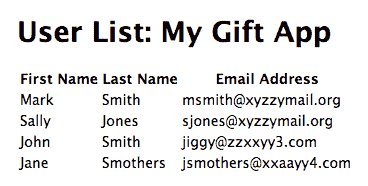

## 使用 Express 处理 Web 请求

### 常用 app.set() 设置项

- `caseSensitiveRouting`：一个布尔值，默认禁用。启用时，它将忽略路由的大小写。`/route` 和 `/Route` 将被视为同一个路由。
- `env`：用于设置环境模式的字符串。默认值是 `development`，或 `NODE_ENV` 环境变量所设置的值。
- `etag`：针对 `ETag` 响应标头的设置。它有一个合理的默认值，但如果你想更改它，我建议参考相关文档。
- `jsonpCallbackName`：一个字符串，用于指定 JSONP 响应的默认回调函数。
- `jsonSpaces`：数值，当指定时，它将按指定的空格数格式化并缩进后返回 JSON 响应。
- `queryParser`：默认设置为 `extended`，但你可以用它来禁用查询解析，或者设置一个更简单或自定义的查询解析函数。
- `strictRouting`：一个布尔值，默认禁用，将 `/route` 与 `/route/` 视为不同路由。
- `views`：一个字符串或数组，用于告知 Express 在何处查找显示模板。如果值是一个数组，Express 将按照它们在数组中出现的顺序进行查找。
- `viewCache`：一个布尔值，在生产环境中为 `true`，它会告诉 Express 缓存视图模板。这在开发环境中通常是不需要的。
- `viewEngine`：一个字符串 – 默认的引擎扩展名（例如 `ejs`）。
- `x-powered-by`：一个布尔值，默认认为 `true`，会发送 `X-Powered-By: Express` 的 HTTP 响应头。我认为通常关闭它是一个好主意，这样可以给潜在的黑客提供更少的信息。在 `app.js` 文件中设置视图引擎的行之后，添加 `app.set('x-powered-by', false);`。

#### app.enable()

任何接受布尔值的 `app` 设置都可以通过 `app.enable()` 开启；例如，要启用视图缓存，可以使用 `app.enable('viewCache');`。

#### app.disable()

如果你有一个启用函数，那么你也应该有一个禁用函数，对吧？`app.disable()` 将任何布尔类型的 `app` 设置设为 `false`，将其关闭。

#### app.listen()

在底层，通过调用 `express()` 返回的 `app` 对象是一个 JavaScript 函数。记住，JavaScript 中的函数是对象，可以像其他对象一样传递。当我们调用 `app.listen()` 时，它本质上是调用了 Node 原生的 `http.createServer()` 函数，并将自身（`app` 函数）作为回调传递进去。如果我们想使用 HTTPS，情况会有所不同，我们将在稍后的章节中介绍。对于我们的目的，我们将使用 `app.listen()` 并传入想要监听的端口作为参数。然而，Express 生成器已经在 `bin/www` 中为我们设置好了代码，如下所示：

```javascript
/**
 * Module dependencies.
 */
var app = require('../app');
var debug = require('debug')('giftapp:server');
var http = require('http');

/**
 * 从环境变量获取端口并存储在 Express 中。
 */
var port = normalizePort(process.env.PORT || '3000');
app.set('port', port);

/**
 * 创建 HTTP 服务器。
 */
var server = http.createServer(app);

/**
 * 在所有网络接口的提供的端口上监听。
 */
server.listen(port);
server.on('error', onError);
server.on('listening', onListening);
```

与其简单地调用 `app.listen()`，Express 生成器设置了此方法，它本质上是在做相同的事情，但为服务器对象添加了一些事件监听器，用于错误处理等更多功能。

#### app.METHOD()

`app.METHOD()` 使用实际的方法来路由进入服务器的请求。并没有一个名为 `METHOD` 的函数，实际的函数是特定 HTTP 请求方法的小写。换句话说，你将使用 `app.get()` 或 `app.post()` 方法。

这里可能会有一点小困惑，因为 `app.get('someValue')` 也可以用来返回一个 `app` 设置。

通常情况下，我们将把请求交给 Express 路由，并以更模块化的方式处理路由。

## 使用 Express 处理 Web 请求

### Request 对象

Express 中的请求对象包含了与 HTTP 请求相关的数据。默认情况下，它将包含诸如查询字符串、参数、请求头、POST 参数等的属性。它是中间件（如路由）所提供的回调函数中的第一个参数，按照惯例，它通常被命名为 `req`：

```javascript
router.get('/show', function(req, res, next) {
  var db = req.db;
  var collection = db.get('users');
  collection.findOne({ "_id": req.params.id }, {}, function(err, user) {
    if (!err) {
      if (req.xhr) {
        user.appName = req.app.locals.appName;
        res.json(user);
      } else {
        res.render('users/user', {
          user: user,
          appName: req.app.locals.appName
        });
      }
    } else {
      res.send('error');
    }
  });
});
```

在我们的 `routes/users` 文件中，这是我们为 URI `/show/:id` 的 GET 请求编写的路由。你可以看到回调函数的第一个参数是 `req`。这就是请求对象。我们从请求对象中获取数据库的引用，以及 `app.locals.appName` 属性的引用。

### 完整路由示例

```javascript
var express = require('express');
var router = express.Router();

/* 获取用户列表。 */
router.get('/', function(req, res, next) {
  res.send('respond with a resource');
});

/* 根据 ID 获取特定用户。 */
router.get('/show/:id', function(req, res, next) {
  var db = req.db;
  var collection = db.get('users');
  collection.findOne({ "_id": req.params.id }, {}, function(err, user) {
    if (!err) {
      res.render('users/user', {
        user: user,
        appName: req.app.locals.appName
      });
    } else {
      res.send('error');
    }
  });
});

router.get('/show', function(req, res, next) {
  var db = req.db;
  var collection = db.get('users');
  collection.find({}, {}, function(err, docs) {
    if (!err) {
      // res.json(docs);
      res.render('users/show', {
        users: docs,
        appName: req.app.locals.appName
      });
    } else {
      res.send('error');
    }
  });
});

module.exports = router;
```

## 使用 Express 处理 Web 请求

### 路由处理器基础

在 Express 中，Web 请求通过路由处理器（route handlers）进行处理。路由处理器是一个函数，它可以访问应用程序请求周期中的请求对象（`req`）、响应对象（`res`）以及 `next` 函数。定义路由的基本语法如下：

```javascript
app.get('/', (req, res) => {
  res.send('Hello World!');
});
```

### 常见的 HTTP 方法

Express 提供了与 HTTP 请求方法相对应的路由方法。最常用的有：

- GET：用于获取数据。
- POST：用于向服务器发送新数据。
- PUT：用于更新现有数据。
- DELETE：用于删除数据。
- PATCH：用于对数据进行部分更新。

### 使用路由参数

路由参数允许你从 URL 路径中捕获值。它们通过冒号（`:`）前缀定义。

```javascript
app.get('/users/:id', (req, res) => {
  res.send(`User ID: ${req.params.id}`);
});
```

在此示例中，来自 URL 的 `id` 值将可以通过 `req.params.id` 获取。

### Express 中的中间件

中间件函数是能够访问应用程序请求-响应周期中的请求对象、响应对象以及 `next` 函数的函数。它们可以执行代码、修改请求和响应对象，并调用栈中的下一个中间件函数。

```javascript
app.use((req, res, next) => {
  console.log('Request received at', new Date().toISOString());
  next();
});
```

中间件可以全局使用、用于特定路由器或用于单个路由。

## 使用 Express 处理 Web 请求

### 关联用户详情页面

我们添加了一个指向 `show/<%= user._id %>` 的链接，这将生成我们所需的 URL，以便导航到单个用户的显示路由（show route）。

启动或重启你的服务器。每当你更改路由或主应用程序时，都需要重启，但对于简单的模板更改则不需要。

## 使用 Express 处理 Web 请求

### 解析请求体

请求对象上的 `body` 属性包含了通常作为 POST 请求一部分发送的键值对。为了访问这些内容，你需要为你的 `app` 添加 `body` 解析中间件。

Express 生成器已经通过以下两行代码为我们配置好了这些工作，它引入了 `bodyParser` 并在这两行代码中添加了中间件：

```javascript
app.use(bodyParser.json());
app.use(bodyParser.urlencoded({ extended: false }));
```

这两行代码允许我们解析以 `application/json` 或 `application/x-www-form-urlencoded` 返回的数据。在路由中，我们可以通过 `req.body` 访问传递的参数。当我们开始构建资源路由（resourceful routes）时，我们会经常这样操作。这里有一个示例（无需将其添加到我们的代码中）：

```javascript
router.post('/user', function(req, res, next) {
  var db = req.db;
  var collection = db.get('users');
  collection.insert({
    firstName: req.body.firstName,
    lastName: req.body.lastName,
    email: req.body.email
  }, function(err) {
    if (!err) {
      res.redirect('/users/show');
    } else {
      res.send('error');
    }
  });
});
```

导航到 `localhost:3000/users/show` 并点击其中一个用户的名字。你应该看到类似这样的内容：

当然，因为 Mongo 会生成 `_id` 字段，你的 ID 不会和我匹配。嗯，它们可能会匹配，但那是一个天文数字般的巧合。

## 使用 Express 处理请求

### POST 请求处理详解

在这里，我们接受发送至 `/users/user` 的 POST 请求。我们使用 `monk` 来执行插入操作（向我们的 MongoDB 数据库中添加记录）。`insert` 函数的第一个参数是一个对象，我们使用 `req.body` 中的 `firstName`、`lastName` 和 `email` 字段来填充要插入文档的属性。假设没有错误，我们将重定向到 `users/show`，该页面将显示包括我们新用户在内的用户列表。

### req.query

从请求中获取数据的另一种方法是使用附加在 URL 后的查询字符串（query string）。如果你对它不熟悉，查询字符串是在 URL 中问号后面以“键值对”形式附加的数据。

例如，在 `http://www.madeupdomain.org/foo?name=john+smith&q=foo` 中，查询字符串部分为 `name=john+smith&q=foo`。要在 `app` 内部访问这些数据，我们需要使用 `req.query.name` 和 `req.query.q`。这将分别返回 `john smith` 和 `foo`，且没有加号。加号是 URL 编码的一部分，这是因为空格在 URL 中无法被直接转换。

如果没有查询字符串，`req.query` 将包含一个空对象。

### 我应该在什么时候使用查询字符串而不是参数？

这个问题没有标准答案。通常情况下，当你希望通过多个路由处理不同类型的操作时，你应该使用路由参数（route parameters）。我们大多数时间里都会采用这种方法。如果你希望单个 GET 请求路由对接收的数据类型具有灵活性，并且希望用户能够对其进行筛选，那么查询字符串会很好。Google 使用查询字符串进行搜索：`https://www.google.com/search?q=things`。

### req.cookies

`req.cookies` 需要使用 `cookie-parser` 中间件（Express 生成器已经方便为我们安装了它），并允许我们访问请求中的 cookie。如果没有 cookie，`req.cookies` 的值将是一个空对象。可以通过名称访问 cookie：`req.cookies.userID` 将返回名为 `userID` 的 cookie。

## 使用 Express 处理 Web 请求

### Cookie 与 AJAX 请求检测

我们稍后会详细介绍 cookie，但 cookie 解析器对于身份验证和安全等功能是必须的。无论你是否打算直接使用 cookie，最好都将其保留在项目中。

#### req.xhr

这是一个简单的布尔值，如果 `X-Requested-With` 请求头为 `XMLHttpRequest`，则该值为 `true`。这种情况最常见于由如 jQuery 等库发起的 AJAX 请求。

这对于单页应用（SPA）非常有用，因为当请求来自浏览器位置的更改时，我们可能希望返回 HTML 页面；而当后续请求来自客户端代码通过 AJAX 发起时，我们则返回数据。

让我们来看 `/routes/users.js` 中的 `/show/:id` 路由：

```javascript
router.get('/show/:id', function(req, res, next) {
  var db = req.db;
  var collection = db.get('users');
  collection.findOne({ "_id": req.params.id }, {}, function(err, user) {
    if (!err) {
      if (req.xhr) {
        user.appName = req.app.locals.appName;
        res.json(user);
      } else {
        res.render('users/user', {
          user: user,
          appName: req.app.locals.appName
        });
      }
    } else {
      res.send('error');
    }
  });
});
```

因此，我们检查请求是否通过 `XMLHttpRequest` AJAX 发送。如果是，我们将 `appName` 添加到 `user` 对象中，然后以 JSON 格式返回。如果不是，则正常地渲染并返回页面。

这非常方便，我们稍后会用到这种机制。

## 使用 Express 处理 Web 请求

### req.accepts()

`req.accepts` 是一个检查请求的 `Accept` 头的函数，如果存在匹配项则返回 `true`。它可以接受字符串、扩展名数组或 MIME 类型，并返回最佳匹配项；如果没有匹配项，则返回 `false`（`undefined`，这在 JavaScript 中是一个假值）。

例如，假设浏览器返回的头部为：`Accept: text/*, application/json`。此时 `req.accepts('html')` 将匹配 `text/*` 部分并返回 `html`。而 `req.accepts(['image/png', 'application/json'])` 则将返回 `json`。

与 `req.xhr` 一样，这对于灵活地响应同一路由上的不同类型的请求非常有用。

### req.get()

`req.get()` 是一个返回请求中发送的 HTTP 头部值的函数。该函数接受一个字符串作为参数，并进行不区分大小写的匹配。该函数的别名是 `req.header()`。

例如，`req.get('content-type')` 以字符串形式返回 HTTP 请求中的 content-type 头部，例如 `application/json` 或 `text/html`。

### 响应对象

Express 响应对象是一个 JavaScript 对象，代表了我们将从服务器发送回客户端的响应。我们看到它与请求对象配对使用，就像使用 `req` 表示请求一样，习惯用法是使用 `res`。

### res.app

`res.app` 对象与 `req.app` 属性相同。它是对应用程序的引用，但在这种情况下它是挂载在响应对象上的。这为访问应用属性提供了一些灵活性。

## 使用 Express 处理 Web 请求

### res.cookie()

这是一个响应对象方法，允许我们设置 cookie 并将其随响应一起发送回。它接收一个名称、一个值以及一个包含参数的可选对象。

这是一个示例：

```javascript
res.cookie('userName', 'Joe', { maxAge: 900000, secure: true, signed: true });
```

这设置了一个值为 `Joe` 的 `userName` cookie。该 cookie 在响应发出后 900,000 毫秒内过期。该 cookie 仅在 HTTPS 下使用，并且经过签名。其他可以设置的选项还包括 cookie 的域（domain）、路径（path）以及具体的过期日期。

### res.clearCookie()

此方法用于清除指定命名的 cookie：

```javascript
res.clearCookie('userName');
```

### res.download()

`res.download` 将指定路径的文件作为附件传输。它接收路径、可选的文件名以及一个在文件传输完成后执行的可选回调函数：

```javascript
res.download('/reports/TPS-coversheet.pdf', 'coversheet.pdf', function(err) {
  if (err) {
    // 在此处理错误
  } else {
    // 执行适当的操作
  }
});
```

我们启动了 `/reports/TPS-coversheet.pdf` 文件的下载，但将其传输为 `coversheet.pdf`。完成后，我们会检查是否发生错误，并在任何情况下执行适当的操作。

## 使用 Express 处理 Web 请求

### res.json()

该方法发送 JSON 响应，用法非常直接。它可以接收任何 JavaScript 对象。使用 MongoDB 数据库的一个妙处是，我们通常可以直接通过 `res.json()` 传递数据库响应。

```javascript
res.json({ dog: 'Fido', breed: 'Sheltie', commands: { sit: true, stay: false } });
```

### res.jsonp()

该方法返回封装在回调函数中的 JSON 数据，这种方式也被称为 JSONP。默认情况下，该函数名称为 `callback`。但可以使用 `app.set('jsonpCallbackName', 'someFunction');` 对其进行重写。在这种情况下，我们会得到以下结果：

```javascript
res.jsonp({ dog: 'Fido' });
// returns someFunction({"dog": "Fido"})
```

当然，必须有相应的客户端代码来处理该响应。

### res.redirect()

我们已经使用过这个方法了。它会向请求者发送带有适当 HTTP 状态码的重定向。如果没有指定状态码，则将使用 `302`。这里是我们之前看过的内容：

```javascript
router.post('/user', function(req, res, next) {
  var db = req.db;
  var collection = db.get('users');
  collection.insert({
    firstName: req.body.firstName,
    lastName: req.body.lastName,
    email: req.body.email
  }, function(err) {
    if (!err) {
      res.redirect('/users/show');
    } else {
      res.send('error');
    }
  });
});
```

## 使用 Express 处理 Web 请求

### 重定向详解

在插入操作（向我们的数据库中添加新文档）之后，我们向浏览器发送一个重定向以访问 `/users/show`。由于没有指定状态码，将返回 `302`。

路径是非常灵活的，可以是任何内容，从完整的 URL：

`res.redirect('https://www.google.com/search?q=food');` 也可以是相对路径：

`res.redirect('../dashboard/show');`

`res.redirect(301, 'http://www.whitehouse.gov');`

这将向 `whitehouse.gov` 发送一个永久移动的重定向，从而误导 Google 并破坏你的 SEO。有关各种重定向状态码的更多信息，请查阅官方 HTTP 规范，并关注 `3xx` 状态码：`http://www.w3.org/Protocols/rfc2616/rfc2616-sec10.html`。

## 使用 Express 处理 Web 请求

### res.render()

正如我们所看到的，此处的 `res.render()` 调用会渲染 `/views/users/show` 的模板。它让包含 `users` 和 `appName` 的本地对象供模板使用。

如果你在 `render` 方法中添加一个回调方法，你需要显式地调用 `res.send()`：

```javascript
res.render('users/show', {
  users: docs,
  appName: req.app.locals.appName
}, function(err, html) {
  if (!err) {
    res.cookie('rendered', 'someValue');
    res.send(html);
  } else {
    res.send("There's been a horrible error.");
  }
});
```

在这里，我们添加了一个回调函数，它包含两个参数：错误（如果有的话）和渲染后的 `html`。这允许我们添加一个错误处理器，在响应对象上设置 cookie，然后发送响应。

### res.send()

我们已经看到 `res.send()` 是一个用于发送 HTTP 响应的方法。`res.send()` 非常灵活，可以接受多种类型的参数，包括 `Buffer`、对象、数组或字符串。

`res.send()` 会根据参数类型相应调整 HTTP `Content-Type` 头部。当参数为字符串时，`Content-Type` 将为 `text/html`；当为对象或数组时，将为 `application/json`；当为 `Buffer` 对象时，将被设置为 `application/octet-stream`。这些默认值可以通过调用带有不同 `Content-Type` 的 `res.set()` 来覆盖。

我们链式调用 `status()` 方法来传递 HTTP 状态：

```javascript
router.get('/show', function(req, res, next) {
  var db = req.db;
  var collection = db.get('users');
  collection.find({}, {}, function(err, docs) {
    if (!err) {
      // res.json(docs);
      res.render('users/show', {
        users: docs,
        appName: req.app.locals.appName
      });
    } else {
      res.status(500).send('Internal Server Error');
    }
  });
});
```

通过将状态码设置为 `500` HTTP 状态，我们可以发送一条消息，告知发生了内部服务器错误并带有我们自定义的消息。

## 使用 Express 处理 Web 请求

### Router 对象

在 Express 文档中，路由器对象被描述为一个“微应用”（mini-application），它只提供中间件和路由功能。路由器作为中间件运行，因此它可以作为参数传递给 `app.use()` 或另一个路由器的 `use()` 方法，使得路由的嵌套和组织变得简单。

我们通过调用 `express.Router()` 函数来创建一个路由器对象：

`var router = express.Router();`

在我们的路由文件中，我们始终使用 `module.exports = router` 导出路由器。这允许我们通过 `require()` 将路由器加载为模块，然后像使用任何其他中间件一样使用它。

让我们再次复习 `app.js` 文件：

```javascript
var express = require('express');
var path = require('path');
var favicon = require('serve-favicon');
var logger = require('morgan');
var cookieParser = require('cookie-parser');
var bodyParser = require('body-parser');
// Database相关内容
var mongodb = require('mongodb');
var monk = require('monk');
var db = monk('localhost:27017/giftapp');
var routes = require('./routes/index');
var users = require('./routes/users');
var app = express();

// 视图引擎设置
app.set('views', path.join(__dirname, 'views'));
app.set('view engine', 'ejs');
app.set('x-powered-by', false);
app.locals.appName = "My Gift App";

// 在将 favicon 放入 /public 后取消注释
// app.use(favicon(path.join(__dirname, 'public', 'favicon.ico')));
app.use(logger('dev'));
app.use(bodyParser.json());
app.use(bodyParser.urlencoded({ extended: false }));
app.use(cookieParser());
app.use(express.static(path.join(__dirname, 'public')));

// 数据库中间件
app.use(function(req, res, next) {
  req.db = db;
  next();
});

app.use('/', routes);
app.use('/users', users);

// 捕获 404 并转发到错误处理器
app.use(function(req, res, next) {
  var err = new Error('Not Found');
  err.status = 404;
  next(err);
});

// 错误处理器
// 开发环境错误处理器
// 将打印堆栈跟踪
if (app.get('env') === 'development') {
  app.use(function(err, req, res, next) {
    res.status(err.status || 500);
    res.render('error', {
      message: err.message,
      error: err
    });
  });
}

// 生产环境错误处理器
// 不向用户泄露堆栈跟踪
app.use(function(err, req, res, next) {
  res.status(err.status || 500);
  res.render('error', {
    message: err.message,
    error: {}
  });
});

module.exports = app;
```

## 使用 Express 处理 Web 请求

### 路由定义与处理

在 Express 中，路由由 HTTP 方法和 URL 路径定义。路由处理器是一个回调函数，当路由被匹配时就会执行。路由处理器的签名通常为 `function(req, res, next)`。

- `req`：请求对象，代表 HTTP 请求。
- `res`：响应对象，用于发送 HTTP 响应。
- `next`：回调函数，当被调用时，它会将控制权交给请求堆栈中的下一个中间件函数。

### 路由方法

Express 为不同的 HTTP 请求方法提供了路由方法：

| Method | 描述 |
| :--- | :--- |
| get | 处理 GET 请求 |
| post | 处理 POST 请求 |
| put | 处理 PUT 请求 |
| patch | 处理 PATCH 请求 |
| delete | 处理 DELETE 请求 |
| all | 匹配所有 HTTP 方法 |

### 示例路由

```javascript
app.get('/', function(req, res) {
  res.send('Hello World!');
});

app.post('/user', function(req, res) {
  res.send('User created');
});
```

### 路由参数

路由路径可以包含命名的路由参数，用冒号（`:`）表示。这些参数可以通过 `req.params` 对象访问。

```javascript
app.get('/users/:id', function(req, res) {
  res.send('User ID: ' + req.params.id);
});

app.get('/users/:userId/posts/:postId', function(req, res) {
  res.send('User: ' + req.params.userId + ', Post: ' + req.params.postId);
});
```

### 路由中的中间件

你可以为单个路由提供多个回调函数。它们将按照提供的顺序逐个执行。

```javascript
app.get('/example', function(req, res, next) {
  console.log('First handler');
  next();
}, function(req, res) {
  console.log('Second handler');
  res.send('Both handlers executed');
});
```

## 使用 Express 处理 Web 请求

### router.all()

`router.all()` 的作用类似于 `router.METHOD()`，区别在于它可以匹配所有的 HTTP 动词（如 get、post 等）。它对于为一组路由添加全局功能非常有用。例如，假设你有一个 `api` 路由，并希望确保对 `api` 中任何路由的调用都经过身份验证：

`router.all('/api/*', someAuthenticationMiddleware);`

将此代码放在路由文件的顶部，将使所有指向以 `/api/` 开头的 URL 调用都通过 `someAuthenticationMiddleware` 中间件。

### router.param()

`router.param()` 是一种基于路由参数添加回调函数的强大方法。例如，假设在我们的 `users` 路由文件中，每当我们获取 `id` 参数时，都需要执行某些操作。让我们回到 `routes/users.js` 文件：

```javascript
var express = require('express');
var router = express.Router();

/* GET users listing. */
router.get('/', function(req, res, next) {
  res.send('respond with a resource');
});

router.param('id', function(req, res, next, id) {
  var db = req.db;
  var collection = db.get('users');
  collection.findOne({ "_id": id }, {}, function(err, user) {
    if (err) {
      res.send(err);
    } else if (user) {
      req.user = user;
      next();
    }
  });
});
```

## 使用 Express 处理 Web 请求

### 使用 router.param() 简化路由

```javascript
router.get('/show/:id', function(req, res, next) {
  if (req.xhr) {
    req.user.appName = req.app.locals.appName;
    res.json(req.user);
  } else {
    res.render('users/user', {
      user: req.user,
      appName: req.app.locals.appName
    });
  }
});

router.get('/show', function(req, res, next) {
  var db = req.db;
  var collection = db.get('users');
  collection.find({}, {}, function(err, docs) {
    if (!err) {
      // res.json(docs);
      res.render('users/show', {
        users: docs,
        appName: req.app.locals.appName
      });
    } else {
      res.send('error');
    }
  });
});

module.exports = router;
```

我们使用 `router.param()` 来查找任何带有 `id` 参数的路由调用。回调函数会对用户进行数据库查询。如果发生错误，我们通过发送错误来终止操作。如果找到了用户，则将其添加到请求对象中。然后我们调用 `next()` 将请求传递给匹配的路由。

## 使用 Express 处理 Web 请求

### 编写我们自己的中间件

正如我们所见，Express 的设计高度依赖于可插拔的中间件来为应用程序添加功能。让我们自己编写一个中间件，以便方便地在 `app` 的任何地方将响应切换为 JSON 格式。

在你的 `giftapp` 项目文件夹中添加一个 `utils` 目录，并在该目录下创建一个名为 `json.js` 的文件：

```javascript
var isJSON = function(req, res, next) {
  if (req.xhr || req.headers.accept === 'application/json') {
    req.isJSON = true;
  }
  next();
};

module.exports = isJSON;
```

我们创建的 `isJSON` 函数接收所有 Express 中间件接受的三个参数：请求对象（req）、响应对象（res）以及对 next 的引用。我们检查请求对象的 `xhr` 值是否为 `true`，或者请求中的 `accept` 头是否为 `application/json`。如果满足任一条件，我们就可以认为客户端请求的是 `JSON` 而不是 `HTML`。

我们在请求对象中添加一个 `isJSON` 属性，并将其设置为 `true`。

现在，让我们修改 `app.js` 文件，将此中间件包含到应用程序中需要的任何地方：

```javascript
var express = require('express');
var path = require('path');
var favicon = require('serve-favicon');
var logger = require('morgan');
var cookieParser = require('cookie-parser');
var bodyParser = require('body-parser');
var isJSON = require('./utils/json');

// Database stuff
var mongodb = require('mongodb');
var monk = require('monk');
var db = monk('localhost:27017/giftapp');
var routes = require('./routes/index');
var users = require('./routes/users');
var app = express();
```

## 使用 Express 处理 Web 请求

### 注册中间件

```javascript
// 视图引擎设置
app.set('views', path.join(__dirname, 'views'));
app.set('view engine', 'ejs');
app.set('x-powered-by', false);
app.locals.appName = "My Gift App";

// 在将 favicon 放置于 /public 后取消注释
// app.use(favicon(path.join(__dirname, 'public', 'favicon.ico')));

app.use(logger('dev'));
app.use(bodyParser.json());
app.use(bodyParser.urlencoded({ extended: false }));
app.use(cookieParser());
app.use(express.static(path.join(__dirname, 'public')));

app.use(isJSON);

// 数据库中间件
app.use(function(req, res, next) {
  req.db = db;
  next();
});

app.use('/', routes);
app.use('/users', users);

// 捕获 404 并转发到错误处理器
app.use(function(req, res, next) {
  var err = new Error('Not Found');
  err.status = 404;
  next(err);
});

// 错误处理器
// 开发错误处理器
// 将打印堆栈跟踪
if (app.get('env') === 'development') {
  app.use(function(err, req, res, next) {
    res.status(err.status || 500);
    res.render('error', {
      message: err.message,
      error: err
    });
  });
}

// 生产环境错误处理器
// 不向用户泄露堆栈跟踪
app.use(function(err, req, res, next) {
  res.status(err.status || 500);
  res.render('error', {
    message: err.message,
    error: {}
  });
});

module.exports = app;
```

## 使用 Express 处理 Web 请求

### 在路由中使用自定义中间件

首先，我们在模块中引入该模块，并将其赋值给变量 `isJSON`。注意，这里我们需要使用显式路径。如果简单地使用模块名，Node 将尝试在 `node_modules` 目录中查找。

然后，我们使用 `app.use(isJSON)` 将中间件添加到应用程序中。在文件中放置的位置至关重要，因为中间件是按顺序调用的。在我们的情况下，只要它出现在使用它的路由之前，放在任何地方都可以。

接下来，我们将修改 `routes/users.js` 文件以使用该中间件：

```javascript
var express = require('express');
var router = express.Router();

/* GET users listing. */
router.get('/', function(req, res, next) {
  res.send('respond with a resource');
});

router.param('id', function(req, res, next, id) {
  var db = req.db;
  var collection = db.get('users');
  collection.findOne({ "_id": id }, {}, function(err, user) {
    if (err) {
      res.send(err);
    } else if (user) {
      req.user = user;
      next();
    } else {
      res.send(new Error('User not found.'));
    }
  });
});

router.get('/show/:id', function(req, res, next) {
  if (req.isJSON) {
    req.user.appName = req.app.locals.appName;
    res.json(req.user);
  } else {
    res.render('users/user', {
      user: req.user,
      appName: req.app.locals.appName
    });
  }
});

router.get('/show', function(req, res, next) {
  var db = req.db;
  var collection = db.get('users');
  collection.find({}, {}, function(err, docs) {
    if (!err) {
      if (req.isJSON) {
        res.send(docs);
      } else {
        res.render('users/show', {
          users: docs,
          appName: req.app.locals.appName
        });
      }
    } else {
      res.send('error');
    }
  });
});

module.exports = router;
```

## 开发 RESTful API

让我们多做一些工作来搭建我们的单页应用（SPA），通过构建一些资源型路由（resourceful routing）作为 RESTful API 的一部分，稍后我们可以将其连接到数据库和客户端代码中。

我们很幸运，Express 拥有这样一个充满活力的开发者社区，他们构建了许多插件，我们将使用其中一个插件来实现资源型路由。

### 安装资源路由插件

我们首先需要做的是安装模块，它将为我们提供一些资源化路由（restful routing）：

`npm install resource-routing --save`

这将安装我们将要使用的资源化路由插件，并将引用保存到 `package.json` 文件中。

### 配置 app.js

接下来，我们需要在 `app.js` 文件中进行一些设置：

```javascript
var express = require('express');
var path = require('path');
var favicon = require('serve-favicon');
var logger = require('morgan');
var cookieParser = require('cookie-parser');
var bodyParser = require('body-parser');
var isJSON = require('./utils/json');

var routing = require('resource-routing');
var controllers = path.resolve('./controllers');

// 数据库相关配置
var mongodb = require('mongodb');
var monk = require('monk');
var db = monk('localhost:27017/giftapp');

var routes = require('./routes/index');
var users = require('./routes/users');

var app = express();

routing.expose_routing_table(app, { at: "/my-routes" });

// 视图引擎设置
app.set('views', path.join(__dirname, 'views'));
app.set('view engine', 'ejs');
app.set('x-powered-by', false);
app.locals.appName = "My Gift App";

// 在 /public 放置 favicon 后取消注释
// app.use(favicon(path.join(__dirname, 'public', 'favicon.ico')));

app.use(logger('dev'));
app.use(bodyParser.json());
app.use(bodyParser.urlencoded({ extended: false }));
app.use(cookieParser());
app.use(express.static(path.join(__dirname, 'public')));

app.use(isJSON);

// 数据库中间件
app.use(function(req, res, next) {
  req.db = db;
  next();
});

app.use('/', routes);
app.use('/users', users);
routing.resources(app, controllers, "giftlist");

// 捕获 404 并转发到错误处理器
app.use(function(req, res, next) {
  var err = new Error('Not Found');
  err.status = 404;
  next(err);
});

// 错误处理器
// 开发环境错误处理器
// 将打印堆栈跟踪
if (app.get('env') === 'development') {
  app.use(function(err, req, res, next) {
    res.status(err.status || 500);
    res.render('error', {
      message: err.message,
      error: err
    });
  });
}

// 生产环境错误处理器
// 不向用户泄露堆栈跟踪
app.use(function(err, req, res, next) {
  res.status(err.status || 500);
  res.render('error', {
    message: err.message,
    error: {}
  });
});

module.exports = app;
```

## 使用 Express 处理 Web 请求

### 构建列表控制器

默认情况下，我们的资源型路由器会为我们构建一系列标准的 RESTful 路由，包括：

- GET `/giftlist` → `giftlist_controller.index`
- GET `/giftlist.:format` → `giftlist_controller.index`
- GET `/giftlist/new` → `giftlist_controller.new`
- GET `/giftlist/new.:format` → `giftlist_controller.new`
- POST `/giftlist` → `giftlist_controller.create`
- POST `/giftlist.:format` → `giftlist_controller.create`
- GET `/giftlist/:id` → `giftlist_controller.show`
- GET `/giftlist/:id.:format` → `giftlist_controller.show`
- GET `/giftlist/:id/edit` → `giftlist_controller.edit`
- GET `/giftlist/:id/edit.:format` → `giftlist_controller.edit`
- PUT `/giftlist/:id` → `giftlist_controller.update`
- PUT `/giftlist/:id.:format` → `giftlist_controller.update`
- DELETE `/giftlist/:id` → `giftlist_controller.destroy`
- DELETE `/giftlist/:id.:format` → `giftlist_controller.destroy`

如你所见，这些路由为我们提供了基本的 CRUD（创建、读取、更新、删除）功能。然而，只有当控制器和路由实际存在时，这些路由才会被创建，因此我们需要构建它们。

我们使用 `require()` 引入资源路由模块并将其赋值给变量 `routing`。然后，我们创建一个指向控制器目录的快捷变量，我们将在下一步构建该目录。我们添加以下代码：

```javascript
routing.expose_routing_table(app, { at: "/my-routes" });
```

这允许我们通过 URL `/my-routes` 查看我们的路由表。显然，这种内容我们不会在生产环境中保留它，但它是一个非常有用的调试工具。最后，我们通过以下代码为 `giftlist` 设置资源型路由：

```javascript
routing.resources(app, controllers, "giftlist");
```

这目前不会产生任何作用，因为我们还没有设置控制器。在你的 `giftapp` 文件夹中创建一个名为 `controllers` 的目录，并创建一个名为 `giftlist_controller.js` 的文件。我们的插件在加载控制器时会添加 `_controller` 部分，所以请确保命名正确。现在，我们将对路由进行存根（stub out）以确保它们正常工作：

```javascript
exports.index = function(req, res) {
  res.send('giftlist index');
};
```

## 使用 Express 处理 Web 请求

### 使用不同的数据格式进行响应

如你所见，我们的每个路由处理器都是一个接收请求对象和响应对象的函数。

重启你的服务器并导航到 `localhost:3000/giftlist/17`，你应该能看到：

`show giftlist 17`

我们的资源路由还可以支持不同的数据格式，因此让我们也为这些编写存根代码，同时我们将在 `giftlist_controller.js` 中使用 `isJSON` 属性：

```javascript
exports.index = function(req, res) {
  if (req.params.format === "json" || req.isJSON) {
    res.json({ "title": "giftlist index" });
  } else {
    res.send('<h1>giftlist index</h1>');
  }
};

exports.new = function(req, res) {
  res.send('new giftlist');
};

exports.create = function(req, res) {
  res.send('create giftlist');
};

exports.show = function(req, res) {
  res.send('show giftlist ' + req.params.id);
};

exports.edit = function(req, res) {
  res.send('edit giftlist');
};

exports.update = function(req, res) {
  res.send('update giftlist');
};

exports.destroy = function(req, res) {
  res.send('destroy giftlist');
};
```


## 使用 Express 处理 Web 请求

```javascript
exports.new = function(req, res) {
  exports.index = function(req, res) {
    if (req.params.format == "json" || req.isJSON) {
      res.json({ title: "new giftlist" });
    } else {
      res.send('<h1>new giftlist</h1>');
    }
  };
};

exports.create = function(req, res) {
  exports.index = function(req, res) {
    if (req.params.format == "json" || req.isJSON) {
      res.json({ title: "create giftlist" });
    } else {
      res.send('<h1>create giftlist</h1>');
    }
  };
};

exports.show = function(req, res) {
  exports.index = function(req, res) {
    if (req.params.format == "json" || req.isJSON) {
      res.json({ title: "show giftlist", giftlist: req.params.id });
    } else {
      res.send('<h1>show giftlist' + req.params.id + '</h1>');
    }
  };
};

exports.edit = function(req, res) {
  exports.index = function(req, res) {
    if (req.params.format == "json" || req.isJSON) {
      res.json({ title: "edit giftlist", giftlist: req.params.id });
    } else {
      res.send('<h1>edit giftlist' + req.params.id + '</h1>');
    }
  };
};
```

在这里，我们为每个路由添加了测试，以检查客户端是否请求 `JSON` 数据。如果是，我们返回 `JSON`；否则，我们返回 `HTML`。

我们通过两种方式来检查客户端是否期望 `JSON`。

首先，我们检查 `req.params.format` 是否为 `json`。使用这种资源丰富的路由中间件，在 URL 后面添加 `.:format` 会将该格式作为 `format` 值添加到 `req.params` 对象中。换句话说，输入 URL `localhost:3000/giftlist.json` 会触发 `giftlist_controller.index` 路由，并将 `format` 参数设置为 `json`。

第二种方法是依赖于中间件设置的 `req.isJSON` 参数。

在下一章节中，我们将把这些功能强大的路由连接到数据库的 CRUD（增删改查）操作上，并在我们完善单页应用（SPA）的过程中，开始尝试将数据渲染到页面上。

## 10 显示视图

大多数单页应用（SPA）的核心在于动态的前端。SPA 将许多与显示逻辑相关的繁重工作交由浏览器来处理。现代浏览器拥有快速且强大的 JavaScript 引擎，其处理计算的能力比几年前强得多。事实上，Node.js 是构建在 V8 引擎之上的，而 V8 是 Chrome 浏览器的标准组成部分。

最重要的是，SPA 的核心思想是为用户提供接近桌面应用程序的体验。整个页面的加载已成为过去，取而代之的是敏捷的状态切换。

在本章中，我们将构建自己 SPA 的核心部分。这是一个仪表板，用户可以在其中创建 `giftlists` 并将其与其他用户分享。我们需要在后端构建一些路由和数据结构，但我们的重点将放在前端。

我们将构建一个使用 AngularJS 的 Express 视图——AngularJS 是一个专为快速创建 SPA 设计的 JavaScript 工具包。我们将构建 AngularJS 路由、视图和控制器，以实现 SPA 的核心功能。通过使用 AngularJS UI-router，我们将管理应用程序的状态。我们还将实现服务，以便数据能够在我们的应用程序中自由流动。

在本章中，我们将涵盖以下主题：

- 在 Express 中开发初始仪表板视图
- 实现 AngularJS 路由
- 使用 AngularJS `$resource` 访问 RESTful 端点

### 显示视图

用户列表：<%= appName %>

<table>
  <thead>
    <tr>
      <th>名</th>
      <th>姓</th>
      <th>邮箱地址</th>
      <th>仪表板</th>
    </tr>
  </thead>
  <tbody>
    <% users.forEach(function(user, index){ %>
      <tr>
        <td><a href="show/<%= user._id %>"><%= user.firstName %></a></td>
        <td><%= user.lastName %></td>
        <td><%= user.email %></td>
        <td><a href="/dash/<%= user._id %>">查看</a></td>
      </tr>
    <% }); %>
  </tbody>
</table>

```javascript
var users = require('./routes/users');
var dashboard = require('./routes/dashboard');

var app = express();

// 视图引擎设置
app.set('views', path.join(__dirname, 'views'));
app.set('view engine', 'ejs');
app.set('x-powered-by', false);
app.locals.appName = "My Gift App";

// 在 /public 中放置你的 favicon 后取消注释
//app.use(favicon(path.join(__dirname, 'public', 'favicon.ico')));

app.use(logger('dev'));
app.use(bodyParser.json());
app.use(bodyParser.urlencoded({ extended: false }));
app.use(cookieParser());
app.use(express.static(path.join(__dirname, 'public')));

app.use(isJSON);

// 数据库中间件
app.use(function(req,res,next){
  req.db = db;
  next();
});

app.use('/', routes);
app.use('/users', users);
app.use('/dash', dashboard);

routing.resources(app, controllers, "giftlist");
routing.expose_routing_table(app, { at: "/my-routes" });

// 捕获 404 并转发到错误处理器
app.use(function(req, res, next) {
  var err = new Error('Not Found');
  err.status = 404;
  next(err);
});

// 错误处理器
// 开发环境错误处理器
// 将打印堆栈跟踪
if (app.get('env') === 'development') {
  app.use(function(err, req, res, next) {
    res.status(err.status || 500);
    res.render('error', {
      message: err.message,
      error: err
    });
  });
}

// 生产环境错误处理器
// 不向用户泄露堆栈跟踪
app.use(function(err, req, res, next) {
  res.status(err.status || 500);
  res.render('error', {
    message: err.message,
    error: {}
  });
});

module.exports = app;
```

这里的两个关键变化是：我们导入了仪表板路由，然后将任何到 `/dash` 的请求映射到该路由上。

确保你的 MongoDB 守护进程仍在运行，如果没有运行请重启它。启动或重启你的服务器。访问 `http://localhost:3000/users/show` 获取用户列表，然后点击表格右侧的其中一个 `view` 链接：

URL 应该像这样：

`http://localhost:3000/dash/566dd0cb1c09d090fd36ba83`。你应该看到像这样的页面：

现在我们已经有了 `view` 模板并设置好了显示页面的路由。我们需要做的下一步是构建一些数据。

#### 连接初始数据

我们的应用程序将允许用户创建 `giftlists` 并与其他用户共享。我们需要思考一下想要如何表示我们的数据。

我们将此对象插入到 `giftlist` 集合中，如果该集合不存在，则会创建它。该对象包含一个 `name` 属性和一个 `gifts` 属性。`gifts` 属性是一个对象数组，其中每个对象都包含一个 `name` 属性。

我们还有一个 `owner_id` 属性。该属性是指向 `giftlist` 所属用户的引用。它仅仅是用户 `_id` 的字符串。由于 MongoDB 是一个非关系型数据库，我们只需将其存储在这里，以便在 `users` 集合中进行查找。

由于我们知道将根据所有者（owner）来查找内容，因此让我们添加一个索引（index）：

```javascript
> db.giftlist.ensureIndex({'owner_id':1})

{
  "createdCollectionAutomatically": false,
  "numIndexesBefore": 1,
  "numIndexesAfter": 2,
  "ok": 1
}
```

现在，让我们在命令行中运行查询，看看我们得到了什么：

```javascript
> db.giftlist.find({'owner':{'$ref':'users','$id':ObjectId('566dff161c09d090fd36ba85')}}).pretty()

{
  "_id": ObjectId("569bd08d94b6b374a00e8b49"),
  "name": "Birthday List",
  "gifts": [
    {
      "name": "ball"
    },
    {
      "name": "pony"
    },
    {
      "name": "gift card"
    }
  ],
  "owner_id": 566dff161c09d090fd36ba85
}
```

我们修改了对 `router.param()` 的调用，根据传入的用户 `id` 搜索 `giftlists` 集合。如果我们获取了 `giftlist`，我们会接着搜索 `users` 集合来获取用户数据。

是的，这里有两个两次数据库调用。这是为了灵活性在性能上做出的某种权衡。我们记得之前决定不将 `giftlists` 嵌入到用户文档中。这种权衡是你在开发自己的应用程序时需要仔细考虑的。

让我们也修改一下我们的 `dashboard.ejs` 视图模板：

```html
<!DOCTYPE html>
<html>
<head>
<title>Dashboard for <%= user.firstName %> <%= user.lastName %></title>
</head>
<body>

<h1><%= user.firstName %> <%= user.lastName %> Dashboard</h1>

<div>
<h2>My Lists</h2>
<ul> <% giftlists.forEach(function(giftlist, index){ -%>
<li><%= giftlist.name %></li>
<% }); %> </ul>
</div>

<div>
<h2>Lists Shared With Me</h2>
</div>

</body>
</html>
```

现在，我们有了一个无序列表，可以渲染每个 `giftlists` 的名称。当我们开始添加 AngularJS 时，我们将这些每一个项都链接到一个显示列表的状态上。导航到 `user dashboard` 页面，你应该能看到：

#### 实现 Bootstrap

如果你以前没有听说过 Bootstrap，它是一个非常流行的 CSS 框架。引入 Bootstrap 可以帮助前端人员完成布局、绘制按钮和实现控件等工作，而无需手动编写大量代码。你可以在 get.bootstrap.com 获取 Bootstrap 并查看其文档。

让我们让 `dashboard.ejs` 模板变得更美观一点：

```html
<!DOCTYPE html>
<html>
<head>
<title>Dashboard for <%= user.firstName %> <%= user.lastName %></title>
<meta name="viewport" content="width=device-width, initial-scale=1">
<link rel="stylesheet" href="https://maxcdn.bootstrapcdn.com/bootstrap/3.3.6/css/bootstrap.min.css">
<link rel="stylesheet" href="https://maxcdn.bootstrapcdn.com/bootstrap/3.3.6/css/bootstrap-theme.min.css">
</head>
<body>
<nav class="nav navbar-default">
<div class="container-fluid">
<div class="navbar-header">
<a class="navbar-brand" href="#"><%= user.firstName %> <%=
```

在全屏下查看我们的仪表板，我们可以看到如下：

在完整尺寸下，我们的仪表板被分为两个等宽的列。你还可以看到顶部的 `nav` 栏正在渲染为 **Mark Smith Dashboard**。现在，如果你拖动浏览器边缘使其像手机屏幕一样窄，你将看到这个：

我们的列现在堆叠在了一起，这对于移动设备形态来说更加符合逻辑。让我们添加一个按钮元素来添加新列表，我们稍后会对其进行连接：

```html
<!DOCTYPE html>
<html>
<head>
<title>Dashboard for <%= user.firstName %> <%= user.lastName %>
</title>
<meta name="viewport" content="width=device-width, initial-scale=1">
<link rel="stylesheet"
href="https://maxcdn.bootstrapcdn.com/bootstrap/3.3.6/css/bootstrap.min.css"
">
<link rel="stylesheet"
href="https://maxcdn.bootstrapcdn.com/bootstrap/3.3.6/css/bootstrap-theme.m
in.css">
</head>
```

现在查看我们的页面，我们会看到一个带有加号的蓝色按钮：

### 实现 AngularJS

现在是时候通过实现一个更健壮的 AngularJS 来完成大部分视图逻辑实现了。我们需要做的第一件事是在我们的 `dashboard.ejs` 视图模板中添加 AngularJS 代码：

```html
<!DOCTYPE html>
<html ng-app="">
<head>
<title>Dashboard for <%= user.firstName %> <%= user.lastName %></title>
<meta name="viewport" content="width=device-width, initial-scale=1">
<link rel="stylesheet" href="https://maxcdn.bootstrapcdn.com/bootstrap/3.3.6/css/bootstrap.min.css">
<link rel="stylesheet" href="https://maxcdn.bootstrapcdn.com/bootstrap/3.3.6/css/bootstrap-theme.min.css">
<script src="https://ajax.googleapis.com/ajax/libs/angularjs/1.4.8/angular.min.js"></script>
<script src="https://cdnjs.cloudflare.com/ajax/libs/angular-ui-router/0.2.15/angular-ui-router.min.js"></script>
</head>
<body>
<nav class="nav navbar-default">
<div class="container-fluid">
<div class="navbar-header">
```

#### AngularJS 模块

AngularJS 使用模块（modules）来封装应用程序、应用程序的一部分以及依赖项。我们 AngularJS 进行的所有操作都将通过使用模块或使用已添加到模块中的代码（例如控制器）来完成。

#### 使用 UI-router 控制状态

状态在应用程序中可以代表许多含义，但在我们的单页应用（SPA）中，它指的是一组特定的视图、控制器和数据，这些内容可以通过 URL 更改器调用。目前，开发者在 AngularJS 中处理状态最流行的方法是使用名为 UI-router 的插件。

让我们在应用程序中实现 UI-router。首先，我们将在 `dashboard.ejs` 模板中从 CDN 引用 UI-router：

```html
<!DOCTYPE html>
<html ng-app="giftapp">
<head >
```

下一步是编辑我们的 `giftapp.js` 文件以添加路由：

```javascript
angular.module('giftapp', ['ui.router'])
.config(
  ['$stateProvider', '$urlRouterProvider',
  function ($stateProvider, $urlRouterProvider) {
    $urlRouterProvider.otherwise('/dash');
    $stateProvider
      .state('dash', {
        url: '/dash',
        templateUrl: '/templates/dash-main.tpl.html'
      })
      .state('add', {
        url: '/add',
        templateUrl: '/templates/dash-add.tpl.html'
      });
  }]);
```

让我们来模拟这两个模板。在 `public/templates` 下创建一个新目录。

以下是我们的 `dash-main.tpl.html`：

```html
<div class="row">
  <div class="col-xs-12 col-md-6">
    <h2>我的列表</h2>
    <a class="btn btn-primary" role="button" ui-sref="add" href="#/add">
    </a>
  </div>
</div>
```

以下是我们的 `dash-add.tpl.html`：

```html
<div class="row">
  <div class="col-md-12">
    <h2>添加新列表</h2>
    <form class="form-horizontal">
      <div class="form-group">
        <label for="listname" class="col-sm-2 control-label">列表名称</label>
        <div class="col-sm-10">
          <input type="text" class="form-control" id="listname" placeholder="名称">
        </div>
      </div>
      <div class="form-group">
        <label for="item[]" class="col-sm-2 control-label">项目 1</label>
        <div class="col-sm-10">
          <input type="text" class="form-control" id="Item[]">
        </div>
      </div>
      <div class="form-group">
        <label for="item[]" class="col-sm-2 control-label">项目 1</label>
        <div class="col-sm-10">
          <input type="text" class="form-control" id="Item[]">
        </div>
      </div>
    </form>
  </div>
</div>
```

```html
<!DOCTYPE html>
<html ng-app="giftapp">
<head>
<title>Dashboard for <%= user.firstName %> <%= user.lastName %></title>
<meta name="viewport" content="width=device-width, initial-scale=1">
<link rel="stylesheet" href="https://maxcdn.bootstrapcdn.com/bootstrap/3.3.6/css/bootstrap.min.css">
<link rel="stylesheet" href="https://maxcdn.bootstrapcdn.com/bootstrap/3.3.6/css/bootstrap-theme.min.css">
<script src="https://ajax.googleapis.com/ajax/libs/angularjs/1.4.8/angular.min.js"></script>
<script src="https://cdnjs.cloudflare.com/ajax/libs/angular-ui-router/0.2.15/angular-ui-router.min.js"></script>
</head>
<body>
<nav class="nav navbar-default">
<div class="container-fluid">
<div class="navbar-header">
<a class="navbar-brand" href="#"><%= user.firstName %> <%= user.lastName %> Dashboard</a>
</div>
</div>
</nav>
<div class="container-fluid">
<div class="row">
<div class="col-xs-12 col-md-6">
<h2>我的列表</h2>
<a href="#/add" class="btn btn-default">
  <span class="glyphicon glyphicon-plus" aria-hidden="true"></span> 添加列表
</a>
<ul class="list-unstyled">
  <% giftlists.forEach(function(giftlist, index){ %>
  <li><a class="btn btn-link" role="button"><%= giftlist.name %></a></li>
  <% }); %>
</ul>
</div>
<div class="col-xs-12 col-md-6">
  <h2>与我共享的列表</h2>
</div>
</div>
</div>
<script src="/javascripts/giftapp.js"></script>
<script src="/javascripts/controllers/dashMainController.js"></script>
</body>
</html>
```

你会注意到，你可以在主模块之后加载控制器模块。

接下来，我们需要编辑主 `giftapp.js` 模块，将新控制器作为路由的一部分：

```javascript
angular.module('giftapp', ['ui.router', 'giftappControllers' ])
.config(
  ['$stateProvider', '$urlRouterProvider',
  function ($stateProvider, $urlRouterProvider) {
    $urlRouterProvider
      .otherwise('/dash');
    $stateProvider
      .state('dash', {
        url:'/dash',
        templateUrl: '/templates/dash-main.tpl.html',
        controller: 'DashMainController'
      })
      .state('add', {
        url:'/add',
        templateUrl: '/templates/dash-add.tpl.html',
      });
  }]);
```

我们执行的第一件事是将新的控制器模块注入到我们的 `giftapp` 模块中。这使得 `DashMainController` 在该模块中可用。然后我们将它的名称（字符串形式）赋值给 `dash` 状态上的 `controller` 属性。

我们应该做的最后的一件事是修改模板以利用我们的控制器。在控制器中添加到 `$scope` 的任何方法或属性在视图内部都可用。

这里是我们新的 `dash-main.tpl.html`：

```html
<div class="row">
  <div class="col-xs-12 col-md-6">
    <h2>我的列表</h2>
    <a class="btn btn-primary" role="button" ui-sref="add" href="#/add">
      <span class="glyphicon glyphicon-plus" aria-hidden="true"></span>
      添加列表
    </a>
    <ul class="list-unstyled">
      <li ng-repeat="list in lists"><a class="btn btn-link" href="#" role="button">{{ list.name }}</a></li>
    </ul>
  </div>
  <div class="col-xs-12 col-md-6">
    <h2>与我共享的列表</h2>
  </div>
</div>
```

我们没有使用固定的列表项，而是依赖于 `ng-repeat` 指令（由 AngularJS 本身提供）。`ng-repeat` 指令遍历可迭代的对象——在这种情况下，是一个名为 `list` 的数组。对于数组中的每个成员，该指令都会绘制一个 `li` 元素，并将实例分配给变量 `list`（本质上是创建新的作用域）。由于我们的列表对象都有 `name` 属性，我们可以在标记表达式中使用 `{{list.name}}` 来访问它。

#### 创建一个 AngularJS factory

假设我们应用程序的不同部分可能需要访问某些相同的数据端点或其他功能。处理这种问题的一种极方法是使用 AngularJS provider（提供者）。provider 本质上是一个可注入单例（singleton），并且有许多可用选项——请参阅 `https://docs.angular.org/guide/providers`。

我们将使用的 provider 类型是 factory（工厂）。让我们先在我们的 `public/javascripts` 目录内创建一个 `services` 目录。在该目录下创建一个名为 `giftlistFactory.js` 的新文件：

```javascript
angular.module('giftlistServices', [])
.factory('List', function(){
  return {}
});
```

我们为服务创建了另一个模块，并在该模块上创建了一个名为 `List` 的工厂。该工厂目前还没有做什么具体操作，但我们稍后会涉及到这一点。

接下来，我们将在 `dashboard.ejs` 模板中使用 `script` 标签来加载这个文件：

```html
<!DOCTYPE html>
<html ng-app="giftapp">
<head >
<title>Dashboard for <%= user.firstName %> <%= user.lastName %></title>
<meta name="viewport" content="width=device-width, initial-scale=1">
<link rel="stylesheet" href="https://maxcdn.bootstrapcdn.com/bootstrap/3.3.6/css/bootstrap.min.css">
<link rel="stylesheet" href="https://maxcdn.bootstrapcdn.com/bootstrap/3.3.6/css/bootstrap-theme.min.css">
<script src="https://ajax.googleapis.com/ajax/libs/angularjs/1.4.8/angular.min.js"></script>
<script src="https://cdnjs.cloudflare.com/ajax/libs/angular-ui-router/0.2.15/angular-ui-router.min.js"></script>
</head>
<body>
<nav class="nav navbar-default">
<div class="container-fluid">
```

现在我们已经加载了模块，让我们编辑工厂以利用 `$resource`。打开 `giftlistFactory` 并进行以下修改：

```javascript
angular.module('giftlistServices', ['ngResource'])
.factory('List', function($resource){
  return $resource('/giftlist/:id',{id: '@_id'})
});
```

记得我们之前构建的资源型控制器吗？我们现在将先用一些硬编码的数据对其进行修改。打开 `controllers/giftlist_controller.js`：

```javascript
exports.index = function(req, res) {
  var db = req.db;
  var collection = db.get('giftlist');
  collection.find({'owner_id':'566dd0cb1c09d090fd36ba83'}, {},
    function(err,giftlists) {
      if(err) {
        res.send(err);
      } else if(giftlists) {
        res.json(giftlists);
      }
    }
  );
};
```

## 添加安全性和身份验证

在之前的章节中，我们模拟了用户以便测试各种功能，但显然，这并不是我们希望应用程序未来运行的方式。我们希望只有授权的用户才能添加和编辑他们的列表，并将其与他人共享。我们的应用程序目前并不安全。

身份验证是几乎每个 Web 应用程序的基础功能。我们有一个非常好的方案来管理用户注册、登录以及访问特权路由。我们将安装用于 Node.js 的 Passport 认证中间件，将其配置本地身份验证，并设置会话管理。我们将保护仪表板路由，使得只有经过身份验证的用户才能看到自己的仪表板。

在本章中，我们将使用 Node.js 和 Express 中间件来保护我们的单页应用（SPA），防止常见的攻击手段，例如**跨站请求伪造**（**CSRF**）。我们还将讨论部署期间需要处理的额外安全问题。

以下是本章将涵盖的主题：

- 设置 **Passport** 以进行用户身份验证
- 创建用于注册和登录的本地身份验证策略
- 使用 **Mongoose** 对用户进行建模
- 保护路由
- 为我们的应用程序添加安全响应头并防止 CSRF 攻击

### 使用 Passport 添加身份验证

我们首先需要的是安装 Passport。获取实际的 Passport 模块再不过了，我们只需使用 `npm` 安装它即可：

```bash
$ npm install passport --save
```

- `passport@0.3.2 node_modules/passport`
- `pause@0.0.1`
- `passport-strategy@1.0.0`

我们还需要单独安装将用于 Passport 使用的每种策略：

```bash
$ npm install passport-local -save
```

- `passport-local@1.0.0 node_modules/passport-local`
- `passport-strategy@1.0.0`

我们最后需要一些用于管理用户会话的中间件。为此，我们将安装 `express-session` 包：

```bash
$ npm install express-session -save
```

- `express-session@1.13.0 node_modules/express-session`
- `utils-merge@1.0.0`
- `cookie-signature@1.0.6`
- `parseurl@1.3.1`
- `cookie@0.2.3`
- `on-headers@1.0.1`
- `depd@1.1.0`

接下来，我们需要将 Passport 添加到应用中。打开我们的主 `app.js` 文件并进行以下修改：

```javascript
var express = require('express');
var path = require('path');
var favicon = require('serve-favicon');
var logger = require('morgan');
var cookieParser = require('cookie-parser');
var bodyParser = require('body-parser');
var isJSON = require('./utils/json');
var routing = require('resource-routing');
var controllers = path.resolve('./controllers');

// Database stuff
var mongodb = require('mongodb');
var monk = require('monk');
var db = monk('localhost:27017/giftapp');
var routes = require('./routes/index');
var users = require('./routes/users');
var dashboard = require('./routes/dashboard');

var app = express();

// view engine setup
app.set('views', path.join(__dirname, 'views'));
app.set('view engine', 'ejs');
app.set('x-powered-by', false);
app.locals.appName = "My Gift App";

// uncomment after placing your favicon in /public
//app.use(favicon(path.join(__dirname, 'public', 'favicon.ico')));

app.use(logger('dev'));
app.use(bodyParser.json());
app.use(bodyParser.urlencoded({ extended: false }));
app.use(cookieParser());
app.use(express.static(path.join(__dirname, 'public')));
app.use(isJSON);

var passport = require('passport');
var expressSession = require('express-session');
app.use(expressSession({secret: 'someKeyYouPick'}));
app.use(passport.initialize());
app.use(passport.session());

// 数据库中间件
app.use(function(req,res,next) {
  req.db = db;
  next();
});

app.use('/', routes);
app.use('/users', users);
app.use('/dash', dashboard);

routing.resources(app, controllers, "giftlist");
routing.expose_routing_table(app, { at: "/my-routes" });

// 捕获 404 并转发到错误处理器
app.use(function(req, res, next) {
  var err = new Error('Not Found');
  err.status = 404;
  next(err);
});

// 错误处理器
// 开发环境错误处理器
// 将打印堆栈跟踪
if (app.get('env') === 'development') {
  app.use(function(err, req, res, next) {
    res.status(err.status || 500);
    res.render('error', {
      message: err.message,
      error: err
    });
  });
}

// 生产环境错误处理器
// 不向用户泄露堆栈跟踪
app.use(function(err, req, res, next) {
  res.status(err.status || 500);
  res.render('error', {
    message: err.message,
    error: {}
  });
});

module.exports = app;
```

在这里，我们需要引入 Mongoose 库，并使用本地数据库的 URL 对其初始化。

### 使用 Mongoose 配置数据库

我们将使用一个名为 Mongoose 的包。Mongoose 是一个用于 Node.js 的数据建模工具，在 Express 中广泛使用。之前我们直接访问数据库，而现在我们将让 Mongoose 为我们完成大部分繁重工作。

#### 安装和配置 Mongoose

与其他模块一样，我们将使用 `npm` 来安装 `mongoose`：

```bash
npm install mongoose -save
```

现在，我们将在 `app.js` 文件中添加初始化 Mongoose 的代码：

```javascript
var express = require('express');
var path = require('path');
var favicon = require('serve-favicon');
var logger = require('morgan');
var cookieParser = require('cookie-parser');
var bodyParser = require('body-parser');
var isJSON = require('./utils/json');
var routing = require('resource-routing');
var controllers = path.resolve('./controllers');

// 数据库相关操作
var mongodb = require('mongodb');
var monk = require('monk');
var db = monk('localhost:27017/giftapp');
var mongoose = require('mongoose');
mongoose.connect('localhost:27017/giftapp');

var routes = require('./routes/index');
var users = require('./routes/users');
var dashboard = require('./routes/dashboard');

var app = express();

// 视图引擎设置
app.set('views', path.join(__dirname, 'views'));
app.set('view engine', 'ejs');
app.set('x-powered-by', false);
app.locals.appName = "My Gift App";

// 在 /public 目录下放置 favicon 后取消注释
//app.use(favicon(path.join(__dirname, 'public', 'favicon.ico')));

app.use(logger('dev'));
app.use(bodyParser.json());
app.use(bodyParser.urlencoded({ extended: false }));
app.use(cookieParser());
app.use(express.static(path.join(__dirname, 'public')));
app.use(isJSON);

var passport = require('passport');
var expressSession = require('express-session');
app.use(expressSession({secret: 'mySecretKey'}));
app.use(passport.initialize());
app.use(passport.session());

// 数据库中间件
app.use(function(req,res,next){
  req.db = db;
  next();
});

app.use('/', routes);
app.use('/users', users);
app.use('/dash', dashboard);
```

### 创建用户模型

Mongoose 使用预定义的数据模型对 MongoDB 数据库进行验证、存储和访问。我们需要创建一个表示我们用户文档的模型。我们的 `db` 中已经有一个 `users` 集合了，所以让我们把它删掉，以避免任何冲突或混淆。请确保你已经打开了一个运行着 Mongo 守护进程的终端窗口。如果没有，只需打开一个新终端并输入 `mongod` 来启动它。在另一个终端窗口中，输入 `mongo` 来启动 MongoDB 命令行工具。

运行后，输入以下内容：

```bash
> use giftapp
switched to db giftapp
> show collections
giftapp
giftlist
system.indexes
test
users
> db.users.drop()
true
> show collections
giftapp
giftlist
system.indexes
test
```

完成后，创建一个名为 `models` 的新文件夹。在该文件夹内部，创建一个名为 `user.js` 的文件：

```javascript
var mongoose = require('mongoose');
var Schema = mongoose.Schema;
module.exports = mongoose.model('User', new Schema({
  id: String,
  username: String,
  email: String,
  password: String,
  firstName: String,
  lastName: String
}));
```

我们需要在文件顶部引入 mongoose，然后使用 `mongoose.model()` 函数创建一个名为 `User` 的模型。该函数接收一个字符串（作为模型名称）和一个对象（代表实际的模型）。在我们的案例中，我们定义了 `id`、`username`、`email`、`password`、`firstName` 和 `lastName`，它们都被定义为字符串。

Mongoose 将确保存储在我们数据库中的每个 `User` 文档都符合此格式定义。

Passport 本地策略（local strategy）的默认设置是包含 `username` 和 `password` 字段。如果你只想使用 `email` 和 `password` 或其他方案，可以对此进行更改。

### 设置 Passport 策略

现在我们必须设置一个 Passport 本地策略。我们需要扩展该策略以处理用户的登录和注册。

#### 初始化 Passport

创建一个名为 `passport` 的新目录。创建一个名为 `init.js` 的文件：

```javascript
var User = require('../models/user');
module.exports = function(passport){
  passport.serializeUser(function(user, done) {
    done(null, user._id);
  });
  passport.deserializeUser(function(id, done) {
    User.findById(id, function(err, user) {
      done(err, user);
    });
  });
}
```

这段代码允许 Passport 访问我们的 `User` 模型。序列化（serialize）和反序列化（deserialize）函数用于从数据库中查找用户（deserialize）以及将用户信息存储在 `User` 的会话中（serialize）。

现在，让我们在主 `app.js` 文件中使用 `init` 函数来初始化 Passport：

```javascript
var express = require('express');
var path = require('path');
var favicon = require('serve-favicon');
var logger = require('morgan');
var cookieParser = require('cookie-parser');
var bodyParser = require('body-parser');
var isJSON = require('./utils/json');
var routing = require('resource-routing');
var controllers = path.resolve('./controllers');

// Database stuff
var mongodb = require('mongodb');
var mongoose = require('mongoose');
mongoose.connect('localhost:27017/giftapp');
var routes = require('./routes/index');
var users = require('./routes/users');
var dashboard = require('./routes/dashboard');

var app = express();

// view engine setup
app.set('views', path.join(__dirname, 'views'));
app.set('view engine', 'ejs');
app.set('x-powered-by', false);
app.locals.appName = "My Gift App";

// uncomment after placing your favicon in /public
// app.use(favicon(path.join(__dirname, 'public', 'favicon.ico')));

app.use(logger('dev'));
app.use(bodyParser.json());
app.use(bodyParser.urlencoded({ extended: false }));
app.use(cookieParser());
app.use(express.static(path.join(__dirname, 'public')));
app.use(isJSON);

var flash = require('connect-flash');
app.use(flash());

var passport = require('passport');
var expressSession = require('express-session');
app.use(expressSession({secret: 'mySecretKey'}));
app.use(passport.initialize());
app.use(passport.session());

var initializePassport = require('./passport/init');
initializePassport(passport);

// 数据库中间件
app.use(function(req, res, next) {
  req.db = db;
  next();
});

app.use('/', routes);
app.use('/users', users);
app.use('/dash', dashboard);

routing.resources(app, controllers, "giftlist");
routing.expose_routing_table(app, { at: "/my-routes" });

// 捕获 404 并转发到错误处理器
app.use(function(req, res, next) {
  var err = new Error('Not Found');
  err.status = 404;
  next(err);
});

// 错误处理器
// 开发环境错误处理器
// 将打印栈跟踪
if (app.get('env') === 'development') {
  app.use(function(err, req, res, next) {
    res.status(err.status || 500);
    res.render('error', {
      message: err.message,
      error: err
    });
  });
}

// 生产环境错误处理器
// 不向用户泄露栈跟踪信息
app.use(function(err, req, res, next) {
  res.status(err.status || 500);
  res.render('error', {
    message: err.message,
    error: {}
  });
});

module.exports = app;
```

在 `init` 文件中，我们需要将导出的函数赋值给变量名 `initializePassport`，然后通过传递 Passport 实例来调用该函数。我们还在 Passport 代码之前还添加了一个新库 `connect-flash`。这允许我们在会话中存储闪存消息（flash messages），例如*密码无效*，并将其传回给视图显示。我们需要使用 `npm` 安装此软件：

```bash
npm install connect-flash --save
```

#### 注册策略

现在让我们构建并引入用于用户注册的策略。首先，我们需要添加一个用于哈希用户密码的库，以确保我们不会在数据库中存储明文密码，那样就太糟糕了。我们将使用一个名为 `bcrypt-nodejs` 的模块，它可以通过 `npm` 轻松安装：

```bash
npm install bcrypt-nodejs --save
```

在你的 `passport` 目录中，创建一个名为 `signup.js` 的新文件：

```javascript
var LocalStrategy = require('passport-local').Strategy;
var User = require('../models/user');
var bCrypt = require('bcrypt-nodejs');

module.exports = function(passport){
  passport.use('signup', new LocalStrategy({
    passReqToCallback : true
  },
  function(req, username, password, done) {
    // 这里是异步的
    process.nextTick(function () {
      console.log('inside signup');
      // 检查用户是否已存在
      User.findOne({'username': username}, function (err, user) {
        if (err) {
          console.log('Error in SignUp: ' + err);
          return done(err);
        }
        // 用户存在
        if (user) {
          console.log('User already exists');
          return done(null, false, req.flash('message', 'User Already Exists'));
        } else {
          // 创建一个新的 User 并将其存储到数据库
          var newUser = new User();
          newUser.username = username;
          newUser.password = bCrypt.hashSync(password, bCrypt.genSaltSync(10), null);
          newUser.email = req.param('email');
          newUser.firstName = req.param('firstName');
          newUser.lastName = req.param('lastName');
          newUser.save(function (err) {
            if (err) {
              console.log('Error in Saving user: ' + err);
              throw err;
            }
            console.log("User Registration successful");
            return done(null, newUser);
          });
        }
      });
    });
  }));
}
```

我们需要引入所需的模块，其中包含了对 Mongoose `User` 模块的引用。我们调用 `passport.use()` 来设置策略。第一个参数是策略名称，在本例中为 `signup`。下一个参数是用于构建新的 `LocalStrategy` 的调用。

该调用接收一个对象，在此例中包含 `passReqToCallback = true`。这使得请求对象（request object）对下一个回调函数可用。这一点非常重要，因为我们需要获取注册的信息。

回调函数设置了一个名为 `newSignup` 的新函数，它负责了大部分工作。我们首先搜索是否存在具有指定用户名的用户。如果存在，我们将退出并设置一个闪回消息（flash message），提示该用户已存在。如果用户不存在，我们将创建一个新用户。最后，我们将该函数传递给 Node.js 事件循环的下一个节（tick）以进行执行。你会注意到，由于此调用的异步性质，实际的回调是在 `process.nextTick()` 调用内部执行的。

现在，让我们编辑 `init.js` 文件，以包含并初始化我们的注册策略：

```javascript
var signup = require('./signup');
var User = require('../models/user');

module.exports = function(passport){
  passport.serializeUser(function(user, done) {
    done(null, user._id);
  });
  passport.deserializeUser(function(id, done) {
    User.findById(id, function(err, user) {
      done(err, user);
    });
  });
  signup(passport);
};
```

#### 创建登录策略

现在，我们已经有了用于创建用户的注册策略，接下来我们需要一个让用户登录的策略。

在 `passport` 目录下创建一个新文件，名为 `signin.js`：

```javascript
var LocalStrategy = require('passport-local').Strategy;
var User = require('../models/user');
var bCrypt = require('bcrypt-nodejs');

module.exports = function(passport){
  passport.use('login', new LocalStrategy({
    passReqToCallback: true
  },
  function(req, username, password, done) {
    User.findOne({ 'username' : username },
    function(err, user) {
      if (err)
        return done(err);
      if (!user){
        // username not found
        return done(null, false, req.flash('message', 'Username or password incorrect.'));
      }
      if (!bCrypt.compareSync(password, user.password)){
        // password is invalid
        return done(null, false, req.flash('message', 'Username or password incorrect.'));
      }
      // success condition
      return done(null, user);
    });
  }));
}
```

再次，我们在依赖项中需要相关包。然后我们创建并导出一个函数，该函数在调用时会创建一个用于登录的 Passport 策略（strategy）。

我们做的第一件事是查询数据库，检查是否存在该 `username` 的用户。如果用户不存在，我们会在 flash 中设置一条错误消息，并返回 `done` 函数的结果，其中第二个参数设为 `false`。

下一步（假设我们已经匹配了 `username`）是使用 `bCrypt.compareSync()` 函数检查传入的密码是否与数据库中用户的哈希密码相匹配。如果不匹配，我们再次在 flash 中设置一条错误消息，然后返回 `done`，并将第二个参数设为 `false`。

最后，假设 `username` 返回了一个 `user` 且 `password` 匹配，我们仅通过返回 `done` 来完成身份验证，其第二个参数为 `user`。

现在，让我们编辑 `init.js` 文件，以包含并初始化我们的登录策略：

```javascript
var signup = require('./signup');
var signin = require('./signin');
var User = require('../models/user');

module.exports = function(passport){
  passport.serializeUser(function(user, done) {
    done(null, user._id);
  });
  passport.deserializeUser(function(id, done) {
    User.findById(id, function(err, user) {
      done(err, user);
    });
  });
  signup(passport);
  signin(passport);
};
```

### 创建登录路由

现在我们有了策略，我们需要路由来处理登录、注册和注销。

创建一个名为 `login.js` 的文件在 `routes` 目录下：

```javascript
var express = require('express');
var router = express.Router();

module.exports = function(passport){
  router.get('/', function(req, res){
    res.render('login/login', {
      message: req.flash('message')
    });
  });

  router.post('/', passport.authenticate('login', {
    successRedirect: '/dash',
    failureRedirect: '/login',
    failureFlash: true
  }));

  router.get('/signup', function(req, res){
    res.render('login/signup', {
      message: req.flash('message')
    });
  });

  router.post('/signup', passport.authenticate('signup', {
    successRedirect: '/dash',
    failureRedirect: '/login/signup',
    failureFlash: true
  }));

  router.get('/signout', function(req, res) {
    req.logout();
    res.redirect('/login');
  });

  return router;
}
```

如你所见，我们导出了一个函数，用于设置登录、注册和注销路由。我们期望在函数被调用时，传入一个 `passport` 实例。

当用户登录成功时，他们将被重定向到 `/dash` 路径。

现在，我们将路由添加到主文件 `app.js` 中：

```javascript
var express = require('express');
var path = require('path');
var favicon = require('serve-favicon');
var logger = require('morgan');
var cookieParser = require('cookie-parser');
var bodyParser = require('body-parser');
var isJSON = require('./utils/json');
var routing = require('resource-routing');
var controllers = path.resolve('./controllers');

// 数据库相关
var mongodb = require('mongodb');
var mongoose = require('mongoose');
mongoose.connect('localhost:27017/giftapp');

var routes = require('./routes/index');
var users = require('./routes/users');
var dashboard = require('./routes/dashboard');

var app = express();

// view引擎设置
app.set('views', path.join(__dirname, 'views'));
app.set('view engine', 'ejs');
app.set('x-powered-by', false);
app.locals.appName = "My Gift App";

// 在将 favicon 放入 /public 之后取消注释
//app.use(favicon(path.join(__dirname, 'public', 'favicon.ico')));

app.use(logger('dev'));
app.use(bodyParser.json());
app.use(bodyParser.urlencoded({ extended: false }));
app.use(cookieParser());
app.use(express.static(path.join(__dirname, 'public')));
app.use(isJSON);

var flash = require('connect-flash');
app.use(flash());

var passport = require('passport');
var expressSession = require('express-session');
app.use(expressSession({secret: 'mySecretKey'}));
app.use(passport.initialize());
app.use(passport.session());

var initializePassport = require('./passport/init');
initializePassport(passport);

// 数据库中间件
app.use(function(req,res,next){
  req.db = db;
  next();
});

app.use('/', routes);
app.use('/users', users);
app.use('/dash', dashboard);

var login = require('./routes/login')(passport);
app.use('/login', login);
```

你会注意到，我们务必向路由传递了 Passport 的引用。

### 创建身份验证的视图

现在我们已经有了注册和登录的路由，我们需要视图来渲染并展示给用户看。

在你的 `views` 目录下创建一个 `login` 文件夹。在该文件夹中，创建一个名为 `signup.ejs` 的新模板：

```html
<!DOCTYPE html>
<html>
<head>
<title>Signup</title>
<meta name="viewport" content="width=device-width, initial-scale=1">
<link rel="stylesheet" href="https://maxcdn.bootstrapcdn.com/bootstrap/3.3.6/css/bootstrap.min.css">
<link rel="stylesheet" href="https://maxcdn.bootstrapcdn.com/bootstrap/3.3.6/css/bootstrap-theme.min.css">
</head>
<body>
<nav class="nav navbar-default">
  <div class="container-fluid">
    <div class="navbar-header">
      <a class="navbar-brand" href="#"> Giftapp Signup</a>
    </div>
  </div>
</nav>
<div class="container">
  <% if(message){ %>
  <div class="row">
    <div class="col-md-4 col-md-offset-4" role="alert">
      <%= message %>
    </div>
  </div>
  <% } %>
  <div class="row">
    <div class="col-md-6 col-md-offset-3">
      <form method="post" action="/login/signup">
        <div class="form-group">
          <label for="username">Username</label>
          <input type="text" class="form-control" id="username" name="username" placeholder="Username">
        </div>
        <div class="form-group">
          <label for="password">Password</label>
          <input type="password" class="form-control" id="password" name="password" placeholder="Password">
        </div>
        <div class="form-group">
          <label for="email">Email</label>
          <input type="email" class="form-control" id="email" name="email" placeholder="Email">
        </div>
        <div class="form-group">
          <label for="firstName">First Name</label>
          <input type="text" class="form-control" id="firstName" name="firstName" placeholder="First Name">
        </div>
        <div class="form-group">
          <label for="lastName">Last Name</label>
          <input type="text" class="form-control" id="lastName" name="lastName" placeholder="Last Name">
        </div>
        <button type="submit" class="btn btn-default">提交</button>
      </form>
    </div>
  </div>
</div>
</body>
</html>
```

这是一个非常标准的注册表单，我们使用了一些 `Bootstrap` 类来让它美观一些。如果你启动服务器并导航到 `http://localhost:3000/login/signup`，你将看到以下内容：

如果你填写了表单——确保至少有 `username` 和 `password`——你应该会创建一个 `user` 并被重定向到 `/dash` URL。它目前看起来还不算惊艳，但大致如下：

现在，如果你启动 MongoDB 命令行并查看，你会再次看到一个 `users` 集合。Mongoose 为我们自动创建了它。如果你创建了几个用户，可以在这里看到他们：

```bash
db.users.find({}).pretty()
```

```json
{
  "_id": ObjectId("56ae11990d7ca83f048f3c2a"),
  "lastName": "Moore",
  "firstName": "John",
  "password": "$2a$10$OFhNNsA5MKrWCyFG9nATq.CIpTYZ5DH.jr8FnJYYFzgH7P4qM5QZy",
  "email": "john@johnmoore.ninja",
  "username": "ninja",
  "__v": 0
}
```

你看到我们有两个用户。我是通过注册表单创建了这些用户的。数据库中仅存储了他们密码的哈希值。为了在生产环境中完善注册流程，你至少需要验证用户的电子邮件地址，但为了开发目的，能够随心创建虚拟账户对我们来说更方便。

现在我们需要一个登录表单。在你的 `views/login` 目录中创建一个新的 `login.ejs` 模板：

```html
<!DOCTYPE html>
<html>
<head>
<title>Login</title>
<meta name="viewport" content="width=device-width, initial-scale=1">
<link rel="stylesheet" href="https://maxcdn.bootstrapcdn.com/bootstrap/3.3.6/css/bootstrap.min.css">
<link rel="stylesheet" href="https://maxcdn.bootstrapcdn.com/bootstrap/3.3.6/css/bootstrap-theme.min.css">
</head>
<body>
<nav class="nav navbar-default">
  <div class="container-fluid">
    <div class="navbar-header">
      <a class="navbar-brand" href="#"> Giftapp Login</a>
    </div>
  </div>
</nav>
<div class="container">
  <% if(message){ %>
  <div class="row">
    <div class="col-md-4 col-md-offset-4" role="alert">
      <%= message %>
    </div>
  </div>
  <% } %>
  <div class="row">
    <div class="col-md-6 col-md-offset-3">
      <form method="post" action="/login">
        <div class="form-group">
          <label for="username">Username</label>
          <input type="text" class="form-control" id="username" name="username" placeholder="Username">
        </div>
        <div class="form-group">
          <label for="password">Password</label>
          <input type="password" class="form-control" id="password" name="password" placeholder="Password">
        </div>
        <button type="submit" class="btn btn-default">登录</button>
      </form>
    </div>
  </div>
</div>
</body>
</html>
```


## 添加安全与验证


**[ 321 ]**

进入`/path/to/xxx`目录，找到`xxx.json`。

在表达式`cvar = avar + bvar`中，加法运算符（`+`）将`avar`与`bvar`相加，得到它们的和`cvar`

在`List.of(arg0, arg1, arg2)`中，`List`接口的工厂方法`of()`接受一系列的元素，返回包含它们的只读列表。

之后我们这样调用`cmd`命令：`cmd arg0 arg1 arg2`。

```
if (condVar > someVal) {console.log("xxx")}
```

访问 `http://localhost:3000/login` 访问后，我们会看到一个如下所示的页面：

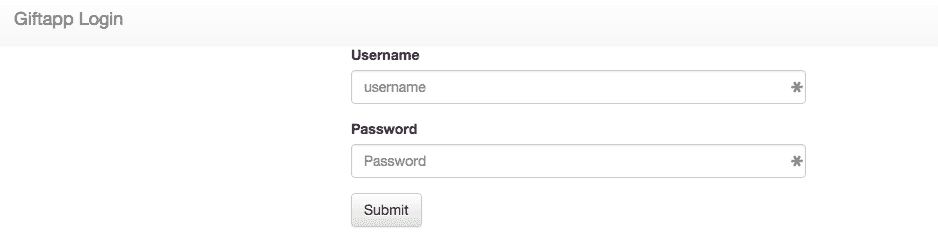

## 请求身份验证

我们应用程序的主要部分是用户仪表板，用户可以在那里创建 `giftlists`。之前，我们通过在仪表板 URL 中传递用户 `id` 来访问用户的仪表板。显然，这里没有身份验证，而且这不是一种安全的实现方式。

现在，我们希望用户在查看自己的仪表板之前先进行登录。如果他们直接访问仪表板 URL，他们应该被重定向到登录页面。

我们将采用典型的 Express 方式来处理这个问题，通过编写一段中间件来处理路由的身份验证添加。

### 添加身份验证检查中间件

Passport 为我们提供了会话（in-session）访问，用于检查用户当前是否已通过验证。我们可以利用这一点轻松地保护应用程序的整个部分，或者逐个路由添加身份验证。

在你的 `utils` 目录下创建一个名为 `authenticated.js` 的新文件：

```javascript
var authenticated = function (req, res, next) {

  if (req.isAuthenticated()){

    return next();

  }

  res.redirect('/login');

};
```

## 添加安全与身份验证

我们的身份验证函数设置了所有 Express 中间件的签名——包含 `request`、`response` 和 `next` 参数。我们检查请求对象的 `isAuthenticated()` 函数调用的返回值——这是 Passport 为我们提供的功能。如果我们通过了身份验证，只需调用 `next()` 将请求继续向下传递。如果没有通过身份验证，我们将把请求重定向到 `/login` 路由，渲染我们的登录页面。

## 在路由中插入中间件

接下来，我们想将新的中间件插入到需要使用它的地方，即我们的仪表板路由文件中：

```javascript
var express = require('express');

var router = express.Router();

var isAuthenticated = require('../utils/authenticated');

router.get('/', isAuthenticated, function(req, res, next) {

  res.send('respond with a resource');

});

router.param('id', function(req, res, next, id) {

  var db = req.db;

  var collection = db.get('giftlist');

  collection.find({'owner_id':id}, {}, function(err,giftlists){

    if(err){

      res.send(err);

    }else if(giftlists){

      req.giftlists = giftlists;

      collection = db.get('users');

      collection.findOne({"_id":id}, function(err, user){

        if(err){

          res.send(err);

        } else {

          req.user = user;

          next();

        }

      });

    }

  });

});
```

## 添加安全与认证

更改仪表板路由

之前，我们设置了 `dash/:id` 路由，通过 `param` 函数来查找用户。这不再符合我们的需求。我们希望在用户登录后，向认证过的用户显示他们自己的仪表板。幸运的是，Passport 已经在会话中为我们缓存了所需的用户数据，因此我们不需要在每次渲染仪表板时都查找用户。

让我们对 `dashboard` 路由器进行一些更改：

```javascript
var express = require('express');

var router = express.Router();

var isAuthenticated = require('../utils/authenticated');

router.get('/', isAuthenticated, function(req, res, next) {

  var db = req.db;

  var collection = db.get('giftlist');

  collection.find({'owner_id':req.user._id}, {}, function(err,giftlists){

    if(err){

      res.send(new Error('User not found.'));

    }

  });

});

router.get('/:id', function(req, res, next) {

  res.render('dash/dashboard', {user: req.user, giftlists:req.giftlists});

});

module.exports = router;
```

我们在路由器文件中引入了新模块，并将其赋值给变量 `isAuthenticated`。接下来，我们将中间件添加到主路由中。

重启服务器会导致退出。如果你想在不重启服务器的情况下退出，可以访问 `http://localhost:3000/login/signout` 退出路由。

然后你可以尝试访问 `/dash`，将被重定向回登录页面。作为有效用户重新登录后，你将被重定向到 dash，它将能够正常渲染。

## 添加安全与认证

```javascript
res.send(err);

} else {

  giftlists = giftlists || [];

  res.render('dash/dashboard', {user: req.user, giftlists:

  giftlists});

}

});

});

module.exports = router;
```

现在我们对代码进行了简化。我们的 `/:id` 路由已经删除，剩下的唯一路由是主路由，它通过对 `/dash` 的 GET 请求触发。得益于 Passport，我们已经在请求中缓存了用户数据，这为我们节省了一次数据库查询，有助于提高代码的执行性能。我们仍然会查找该用户拥有的礼物列表，然后渲染我们之前构建的仪表板模板，该模板包含了我们的单页应用前端。

我们得到了以下结果：

因此，我们认证了用户并将 `user` 对象存储在会话（session）中，使其在请求期间可用。

## Express 安全性

认证可能是从前端保护 Web 应用程序时最重要且最棘手的话题之一。无疑，存在许多不同的威胁向量。

### Helmet

为了保护我们的 Express 应用，我们可以做的最简单的事情之一就是安装并使用名为 Helmet 的安全中间件。Helmet 添加了许多安全响应头和策略，并防止某些攻击，例如 `clickjacking`（点击劫持）。

## 添加安全与身份验证

它在后台完成了大部分工作，无需我们方面进行任何配置。欲了解更多详细信息并查找 `configure` 它的的替代方法。

要开始使用 Helmet，请首先使用 `npm` 将其安装：

```bash
$ npm install helmet --save
```

```
helmet@1.1.0 node_modules/helmet
- nocache@1.0
- hide-powered-by@1.0
- dont-sniff-mimetype@1.0
- dns-prefetch-control@0.1
- ienoopen@1.0
- hpkp@1.0
- x-xss-protection@1.0
- hsts@1.0 (core-util-is@1.0)
- frameguard@1.0 (lodash.isstring@3.0)
- connect@3.4.0 (parseurl@1.3, utils-merge@1.0, finalhandler@0.4)
- helmet-csp@1.0.3 (lodash.isfunction@3.0, platform@1.3, camelize@1.0, lodash.assign@3.2, content-security-policy-builder@1.0, lodash.reduce@3.1, lodash.some@3.2)
```

## 添加安全与认证

```javascript
var app = express();

// view engine setup

app.set('views', path.join(__dirname, 'views'));

app.set('view engine', 'ejs');

app.set('x-powered-by', false);

app.locals.appName = "My Gift App";

// 在将 favicon 放入 /public 目录后取消注释

//app.use(favicon(path.join(__dirname, 'public', 'favicon.ico')));

app.use(logger('dev'));

app.use(bodyParser.json());

app.use(bodyParser.urlencoded({ extended: false }));

app.use(cookieParser());

app.use(express.static(path.join(__dirname, 'public')));

app.use(isJSON);

var flash = require('connect-flash');

app.use(flash());

var passport = require('passport');

var expressSession = require('express-session');

app.use(expressSession({secret: 'mySecretKey'}));

app.use(passport.initialize());

app.use(passport.session());

var initializePassport = require('./passport/init');

initializePassport(passport);

//数据库中间件

app.use(function(req,res,next){

  req.db = db;

  next();

});

app.use(require('helmet'));

app.use('/', routes);

app.use('/users', users);

app.use('/dash', dashboard);

var login = require('./routes/login')(passport);

app.use('/login', login);

routing.resources(app, controllers, "giftlist");

routing.expose_routing_table(app, { at: "/my-routes" });
```

## 添加安全与身份验证

```javascript
// catch 404 and forward to error handler

app.use(function(req, res, next) {

  var err = new Error('Not Found');

  err.status = 404;

  next(err);

});

// error handlers

// 开发环境错误处理器

// 会打印堆栈跟踪

if (app.get('env') === 'development') {

  app.use(function(err, req, res, next) {

    res.status(err.status || 500);

    res.render('error', {

      message: err.message,

      error: err

    });

  });

}

// Production环境错误处理器

// 不向用户泄露堆栈跟踪

app.use(function(err, req, res, next) {

  res.status(err.status || 500);

  res.render('error', {

    message: err.message,

    error: {}

  });

});

module.exports = app;
```

就这样。我们已经缓解了一系列常见的 Web 安全漏洞。

请注意，`app.use(require('helmet'))` 必须在任何路由之前调用，否则这些路由将无法受到保护。

## 添加安全性与身份验证

### CSRF

最常见的网络攻击向量之一是**跨站请求伪造 (CSRF)**。

CSRF 是一种攻击手段，某些不可信的源（例如另一个网站甚至是电子邮件）利用用户的身份验证状态，在另一个应用程序上执行特权代码。您可以在此处找到更多关于 CSRF 的详细信息：https://www.owasp.org/index.php/Cross_Site_Request_Forgery

## 采取额外的安全措施

我们已经采取了一些基础但强大的步骤，以保护我们的应用程序免受一些最大的威胁。虽然对可能的威胁和安全措施进行全面探索超出了本书的范围，但仍有几点值得提及的考虑。

### 实现 HTTPS

在部署到生产环境时实现 HTTPS 可以防止多种中间人攻击，并防止数据在传输过程中被拦截和修改。我们将在部署到生产环境的章节中探讨这一点。

此外，你还可以将 cookie 设置为安全（secure）。同样，我们会在讨论部署时将涵盖这一内容。

### 避免以 root 身份运行

我们在本地使用端口 `3000` 的原因之一是，在许多环境中，在 `80` 端口（标准 HTTP 端口）上运行需要 root 身份权限。一项广为人知的安全策略是：所有进程都应该以尽可能少的权限运行。同样，这是我们在部署时会考虑的——主要是通过使用 PaaS 提供商。

## 添加安全性与认证

目前，我们的应用程序对输入的验证非常少——除了注册和登录时需要 `username` 和 `password` 之外。但我们也可以并且在客户端和服务器端对用户输入进行检查。

我们将在下一章中添加一些输入验证。

## 总结

在本章中，我们首先安装并配置了用于 Node.js 的 Passport 中间件。Passport 为我们提供了一个认证框架，包括创建新用户、登录以及保护特定路由。随后，我们构建了用于登录和注册的本地身份验证策略。

我们为登录和注册创建了路由和视图模板，并将成功尝试后重定向到我们的主仪表板 URL。通过依赖 Passport 在会话中缓存用户，我们能够减少数据库查询的次数。

最后，我们通过使用 Helmet 在请求中添加安全标头，并使用 `csurf` 缓解 CSRF 攻击，增强了应用程序的安全性。最后，我们讨论了将应用程序迁移到生产环境时需要考虑的几个额外安全问题。

## 将应用连接到社交媒体

许多网络应用程序使用第三方身份验证进行注册和登录。特别是，使用 Facebook 和 Twitter 等流行的社交媒体网站来验证用户身份已变得非常流行。由于这些网站已经完成了一些用户验证工作，使用它们来进行用户身份验证的站点可以节省一些时间。

在本章中，我们将设置 Passport 策略（strategies），以便用户使用 Facebook 和 Twitter 账户进行注册和身份验证。我们将使用一种名为 OAuth 2 的流行协议。

此外，我们还完成完成用户创建和共享礼物列表的功能构建。在本章中，我们将涵盖以下内容：

- 使用 Facebook 验证用户身份
- 使用 Twitter 验证用户身份
- 在仪表板中处理礼物列表的创建
- 添加分享按钮

### 连接到 Facebook

我们将通过允许用户使用 Facebook 账户创建账户并登录，开始与社交媒体的集成。我们需要做的第一件事是设置 Facebook 开发者账户并构建一个 Facebook 应用。

## 将应用连接到社交媒体

一旦创建了您的应用，您将获得一个 App ID 和一个 App Secret。你需要这两个者才能与 Facebook API 进行交互。

在本节中，我们将逐步介绍将您的应用连接到 Facebook 的过程。我们将学习如何设置 Facebook SDK、如何验证用户身份，以及如何从 Facebook Graph 获取数据。

- 设置 Facebook SDK
- 验证用户身份
- 获取用户数据
- 向 Facebook 发布内容

通过遵循这些步骤，您将能够允许用户在 Facebook 上分享他们在您的应用程序中的活动。这有助于提高参与度和触达范围。

## 将应用程序连接到社交媒体


（注：提供的 OCR 文本主要包含重复的图像占位符和一个标题。根据可用文本，我已提取了标题并删除了冗余的图像标签。）

## 将应用连接社交媒体

在这里，我们安装了 Passport Facebook 模块，它允许我们使用 OAuth 2 通过 Facebook 登录。

OAuth 是一种开放协议，允许 Web、移动端和桌面应用程序以简单且标准的方法进行安全授权。你可以在 https://oauth.net/ 找到更多关于 OAuth 2（该协议的最新版本）的信息。

### 设置策略 (Strategy)

我们需要做的下一件事是在 Passport 中设置策略。打开终端并导航到你的 `giftapp` 根目录：

```bash
$ npm install passport-facebook --save
```

```
passport-facebook@2.1.0 node_modules/passport-facebook
|__ passport-oauth2@1.1.2 (uid2@0.0.3, passport-strategy@1.0.0,
oauth@0.9.14)
```

### 配置 Facebook

现在我们需要设置我们的策略。在你的 `giftapp` 目录中，创建一个名为 `config` 的新目录，并添加名为 `authorization.js` 的新文件：

```javascript
module.exports = {

  facebookAuth : {

    clientID: '695605423876152', // App ID

    clientSecret: 'd8591aa38e06a07b040f20569a', // App secret

    callbackURL: 'http://localhost:3000/login/FBcallback'

  }

};
```

我们刚刚存储了一个包含若干稍后将需要的值的对象。`clientID` 是我们的 App ID。`clientSecret` 是我们的 App Secret（不，那不是真实的密钥）。最后一个值是我们的 `callBackURL`。这是 Facebook 在授权后将重定向到的 URL。

如果你正在使用 Git 仓库存储源代码，那么将此 `config` 文件添加到你的 `.gitignore` 文件中是一个好主意。

## 将应用连接到社交媒体

将您的应用连接到社交媒体允许用户使用其现有账户登录，这可以提升用户体验并增加注册人数。在本节中，我们将学习如何在应用程序中实现 Facebook 身份验证。

### 设置 Facebook

要使用 Facebook 身份验证，您首先需要在 Facebook 开发者平台上创建一个应用。访问 [Facebook 开发者门户](https://developers.facebook.com/) 并按照说明说明创建一个新应用。应用创建后，您将获得一个 App ID 和一个 App Secret，配置时会用到这些信息。

接下来，您需要配置您的 Facebook 应用以处理身份验证。在 Facebook 开发者仪表板中，转到“Facebook Login”产品设置。在这里，您需要添加有效的 OAuth 重定向 URI，对于本地开发，该 URI 通常为 `http://localhost:3000/auth/facebook/FBcallback`。

现在，您需要在您的项目中安装 `passport-facebook` 策略。您可以通过运行以下命令来实现：

```bash
npm install passport-facebook
```

接下来，您需要在 `passport.js` 文件中配置 Facebook 策略。它看起来应该像所示：

```javascript
const Facebook = require('passport-facebook').Strategy;

const User = require('./models');

passport.use(new Facebook({

  clientID: process.env.FACEBOOK_APP_ID,

  clientSecret: process.env.FACEBOOK_APP_SECRET,

  callbackURL: "http://localhost:3000/auth/facebook/FBcallback",

}, function(accessToken, refreshToken, profile, done) {

  // 在数据库中查找或创建用户

  User.findOne({ facebookId: profile.id }, function (err, user) {

    if (err) return done(err, null);

    if (user) return done(null, user);

    else {

      User.create({

        facebookId: profile.id,

        displayName: profile.displayName,

      }, function (err, user) {

        if (err) return done(err, null);

        done(null, user);

      });

    }

  });

}));
```

最后，您需要在需要在 `login.js` 文件中为 Facebook 身份验证设置路由：

```javascript
var express = require('express');

var router = express.Router();

module.exports = function(passport){

  router.get('/', function(req, res) {

    res.render('login/login', { message: req.flash('message'),

    csrfToken: req.csrfToken() });

  });

  router.post('/', passport.authenticate('login', {

    successRedirect: '/dash',

    failureRedirect: '/login',

    failureFlash : true

  }));

  router.get('/signup', function(req, res){

    console.log('signing up');

    res.render('login/signup',{message: req.flash('message'),

    csrfToken: req.csrfToken()});

  });

  router.post('/register', passport.authenticate('signup', {

    successRedirect: '/dash',

    failureRedirect: '/login/signup',

    failureFlash : true

  }));

  router.get('/signout', function(req, res) {

    req.logout();

    res.redirect('/login');

  });

  router.get('/facebook', passport.authenticate('facebook', {

    scope:['emails']

  }));

  router.get('/FBcallback', passport.authenticate('facebook', {

    failureRedirect: '/login'

  }));

  return router;

};
```

## 将应用连接到社交媒体

第一个新路由将用于通过 Facebook 登录。回调 URL 在身份验证后使用。如果失败，用户将被重定向到登录页面；如果成功，用户将被发送到仪表板。

注意 `facebook` 路由中调用 `passport.authenticate` 时的第二个参数。该对象包含一个 `scope` 属性，它接收一个数组。该数组由字符串组成，表示 Facebook 需要额外权限才能访问的数据字段。Facebook 需要额外权限才能访问用户的电子邮件地址。

### 完成 Passport 策略的设置

现在我们还有几个步骤来设置该策略。在你的 Passport 目录中，创建一个名为 `facebook.js` 的新文件：

```javascript
var FacebookStrategy = require('passport-facebook').Strategy;

var User = require('../models/user');

var auth = require('../config/authorization');

module.exports = function(passport){

  passport.use('facebook', new FacebookStrategy({

    clientID: auth.facebookAuth.clientID,

    clientSecret: auth.facebookAuth.clientSecret,

    callbackURL: auth.facebookAuth.callbackURL,

    profileFields: ['id', 'displayName', 'email']

  },

  function(accessToken, refreshToken, profile, cb) {

    User.findOne({ 'facebook.id': profile.id }, function (err, user) {

      if(err){

        return cb(err)

      } else if (user) {

        return cb(null, user);

      } else {

        var newUser = new User();

        newUser.facebook.id = profile.id;

        newUser.facebook.token = accessToken;

        newUser.facebook.name = profile.displayName;

        if(profile.emails){

          newUser.email = profile.emails[0].value;

        }

        newUser.save(function(err) {

          if(err){

            return cb(err);

          }

          return cb(null, newUser);

        });

      }

    });

  }));

};
```

## 将应用连接到社交媒体

首先，我们需要引入依赖项，包括由 `passport-facebook` 模块提供的 Strategy 对象、我们的 User 模型，以及包含我们 Facebook 凭据的授权配置文件。

然后，我们创建一个定义 Facebook 身份验证策略的模块。它接收一个配置对象作为第一个参数，我们使用配置文件中的 `facebook` 授权值来定义该对象。最后一个属性 `profileFields` 设置了我们期望从 Facebook 返回的个人资料对象中接收的字段。第二个参数是一个函数，当身份验证策略被使用时会被调用。它接收来自 Facebook 的 `accessToken`、`refreshToken`、`profile` 和 `callback` 作为参数。

我们使用 User 的 `findOne` 函数，根据 Facebook 返回的 `profile.id` 检查用户是否存在。我们首先检查是否存在错误。如果有，则将其返回给 `callback`。如果没有错误且用户已存在，则会将用户对象传给 `callback`，并在错误字段置为 `null`。最后，如果用户不存在，我们将创建一个新用户，将其保存到数据库，然后将新用户对象传给 `callback`。

请注意，我们并不总是能从 Facebook 获取到邮箱，因此在尝试访问该属性之前，我们需要测试一下 `profile` 中是否返回了该属性。

## 将应用连接到社交媒体

将应用连接到社交媒体

## 将应用连接到社交媒体

## 重建我们的首页

让我们让生活变得更简单一点，重写 views 目录下的 `index.ejs` 文件：

```html
<!DOCTYPE html>

<html>

<head>

  <title><%= title %></title>

  <meta name="viewport" content="width=device-width, initial-scale=1">

  <link rel="stylesheet" href="https://maxcdn.bootstrapcdn.com/bootstrap/3.3.6/css/bootstrap.min.css">

  <link rel="stylesheet" href="https://maxcdn.bootstrapcdn.com/bootstrap/3.3.6/css/bootstrap-theme.min.css">

</head>

<body>

  <div class="container">

    <div class="jumbotron">

      <h1 class="text-center">Welcome to Giftapp</h1>

      <hr>

      <p class="text-center">

        <a class="btn btn-default btn-lg" href="/login/" role="button">Log in</a>

        <a class="btn btn-default btn-lg" href="/login/signup" role="button">Sign Up</a>

        <a class="btn btn-primary btn-lg" href="/login/facebook" role="button">Log in or sign up with Facebook</a>

      </p>

    </div>

  </div>

</body>

</html>
```

## 将应用连接到社交媒体

在这里，我们使用 Bootstrap 的 `jumbotron` 创建了一个简单的欢迎页。我们有三个按钮，它们实际上是样式化按钮的链接：一个用于登录，一个用于注册，另一个用于 Facebook 注册/登录。

位于 `http://localhost:3000` 的页面看起来如下：

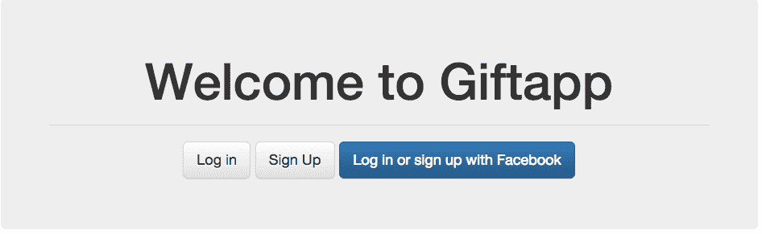

你可以测试一下按钮。遗憾的是，点击我们的 Facebook 按钮会得到一个错误：

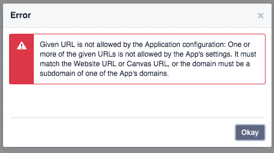

## 将应用连接到社交媒体

### 连接到 Twitter

Passport 和 OAuth 2 的一大优势之一是，我们有许多不同的策略可以与第三方进行身份验证。让我们来设置 Twitter 身份验证。

## 将应用连接到社交媒体

### 添加 Twitter 应用

与 Facebook 类似，我们需要在 Twitter 上为我们的应用程序设置一个应用以便进行通信。前往 https://twitter.com 并创建一个新应用：

填写名称、描述以及两个 URL。在撰写时，Twitter 不允许将 http://localhost 作为 URL，因此你必须使用 http://127.0.0.1。

现在点击到 **Keys and Access Tokens**（密钥和访问令牌），获取你的 Consumer Key（消费者密钥）和 Consumer Secret（消费者密钥）。我们将把这些内容添加到 `authorization.js` 配置文件中：

```javascript
module.exports = {

  facebookAuth : {

    clientID: '695605423876152', // App ID

    clientSecret: 'd85fR1nkOz2056801c8f9a', // App secret

    callbackURL: 'http://localhost:3000/login/FBcallback'

  },

  twitterAuth : {

    'consumerKey' : 'JksPJ0z46tf10/15/16asUdgxW1lJp',

    'consumerSecret' : 'IV095CmDyUsSOZo21GnejiShTXWzzxxybalubae82P4hfLa',

    'callbackURL' : 'http://127.0.0.1:3000/login/twitterCallback'

  }

}
```

## 将应用连接到社交媒体

```json
{

  "twitterAuth": {

    "consumerKey": "YOUR_CONSUMER_KEY",

    "consumerSecret": "YOUR_CONSUMER_SECRET",

    "callbackURL": "YOUR_CALLBACK_URL"

  }

}
```

我们在授权 `config` 文件中添加了 `twitterAuth` 部分，其中包含了我们所需的密钥以及回调地址。这与 Facebook 的非常相似。

### 设置我们的 Twitter 策略

现在，我们需要采取步骤来构建我们的 Twitter 策略。

首先，我们需要安装 Passport 策略模块：

```bash
$ npm install passport-twitter --save
```

现在在你的 Passport 目录下创建一个 `twitter.js` 文件：

```javascript
var TwitterStrategy = require('passport-twitter').Strategy;

var User = require('../models/user');

var auth = require('../config/authorization');

module.exports = function(passport){

  passport.use('twitter', new TwitterStrategy({

    consumerKey : auth.twitterAuth.consumerKey,

    consumerSecret : auth.twitterAuth.consumerSecret,

    callbackURL : auth.twitterAuth.callbackURL

  },

  function(token, tokenSecret, profile, cb) {

    User.findOne({ 'twitter.id': profile.id }, function (err, user) {

      if(err){

        return cb(err)

      } else if (user) {

        return cb(null, user);

      } else {

        // 如果没有用户，则创建一个用户

        var newUser = new User();

        // 设置所有我们需要的用户数据

        newUser.twitter.id = profile.id;

        newUser.twitter.token = token;

        newUser.twitter.username = profile.username;

        newUser.twitter.displayName = profile.name;

        newUser.save(function (err) {

          if(err){

            return cb(err);

          }

          return cb(null, newUser);

        });

      }

    });

  }));

};
```

## 将应用连接到社交媒体

这种策略与我们的 Facebook 策略非常相似。我们通过授权配置设置密钥（keys）和回调（callback）。然后，我们检查数据库中是否存在具有相同 Twitter ID 的用户。如果没有，我们将根据 Twitter 发送的数据创建一个新用户，并将记录保存到数据库。

提到数据库，我们现在需要对 `User` 模型进行修改，以处理 Twitter 数据：

```javascript
var mongoose = require('mongoose');

var userSchema = mongoose.Schema({

  id: String,

  email: String,

  username: String,

  password: String,

  firstName: String,

  lastName: String,

  facebook: {

    name: String,

    id: String,

    token: String

  },

  twitter: {

    id: String,

    token: String,

    username: String,

    displayName: String

  }

});

module.exports = mongoose.model('User',userSchema);
```

## 将应用连接到社交媒体

与 Facebook 部分一样，我们添加了一个 Twitter 属性来单独存储从 Twitter 返回的数据。

接下来，我们需要在我们的 `routes/login.js` 文件中添加 Twitter 身份认证的路由：

```javascript
var express = require('express');

var router = express.Router();

module.exports = function(passport){

  router.get('/', function(req, res) {

    res.render('login/login', { message: req.flash('message'),

    csrfToken:

    req.csrfToken() });

  });

  router.post('/', passport.authenticate('login', {

    successRedirect: '/dash',

    failureRedirect: '/login',

    failureFlash : true

  }));

  router.get('/signup', function(req, res){

    console.log('signing up');

    res.render('login/signup',{message: req.flash('message'),

    csrfToken:

    req.csrfToken()});

  });

  router.post('/register', passport.authenticate('signup', {

    successRedirect: '/dash',

    failureRedirect: '/login/signup',

    failureFlash : true

  }));

  router.get('/signout', function(req, res) {

    req.logout();

    res.redirect('/login');

  });

  router.get('/facebook', passport.authenticate('facebook', {scope:

    ['email']}));

  router.get('/FBcallback',

  passport.authenticate('facebook', { successRedirect: '/dash',

  failureRedirect: '/login' }));

  router.get('/twitter', passport.authenticate('twitter'));

  // 处理在 Twitter 认证用户后的回调

  router.get('/twitterCallback',

  passport.authenticate('twitter', {

    successRedirect: '/dash',

    failureRedirect: '/login'

  }));

  return router;

};
```

## 将应用连接到社交媒体

同样，Twitter 的路由与我们用于 Facebook 认证的路由非常相似。我们有一个主授权路由和一个用于回调的路由。现在，我们只需要对 `passport/init.js` 文件进行几处编辑，以包含 Twitter 策略：

```javascript
var signup = require('./signup');

var login = require('./login');

var facebook = require('./facebook');

var twitter = require('./twitter');

var User = require('../models/user');

module.exports = function(passport){

  passport.serializeUser(function(user, done) {

    done(null, user._id);

  });

  passport.deserializeUser(function(id, done) {

    User.findById(id, function(err, user) {

      done(err, user);

    });

  });

};

signup(passport);

login(passport);

facebook(passport);

twitter(passport);
```

## 将应用连接到社交媒体

我们在这里只需要做的更改是导入 Twitter 策略并对其初始化。此时，我们的 Twitter 策略应该已经可以工作了。让我们让用户操作变得更方便一点。

### 在主页中添加 Twitter 授权

与我们的 Facebook 策略一样，让我们在 index.ejs 文件中添加一个 Twitter 登录按钮：

```html
<!DOCTYPE html>

<html>

<head>

  <title><%= title></title>

  <meta name="viewport" content="width=device-width, initial-scale=1">

  <link rel="stylesheet" href="https://maxcdn.bootstrapcdn.com/bootstrap/3.3.6/css/bootstrap.min.css">

  <link rel="stylesheet" href="https://maxcdn.bootstrapcdn.com/bootstrap/3.3.6/css/bootstrap-theme.min.css">

</head>

<body>

  <div class="container">

    <div class="jumbotron">

      <h1 class="text-center">Welcome to Giftapp</h1>

      <hr>

      <p class="text-center">

        <a class="btn btn-default btn-lg" href="/login/" role="button">登录</a>

        <a class="btn btn-default btn-lg" href="/login/signup" role="button">注册</a>

        <a class="btn btn-primary btn-lg" href="/login/facebook" role="button">使用 Facebook 登录或注册</a>

        <a class="btn btn-primary btn-lg" href="/login/twitter" role="button">使用 Twitter 登录或注册</a>

      </p>

    </div>

  </div>

</body>

</html>
```

## 将应用连接社交媒体

我们添加了 Twitter 登录按钮。

请注意，要测试此功能，请从 `http://127.0.0.1:3000/` 开始，而不是 `http://localhost:3000`。这是因为你需要确保回调 URL 中的会话 cookie 域名匹配。当你做到这一点时，你将看到以下内容：

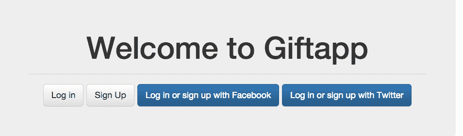

点击 Twitter 登录按钮将带你重定向到 Twitter，它会要求你登录或为你的应用授权：

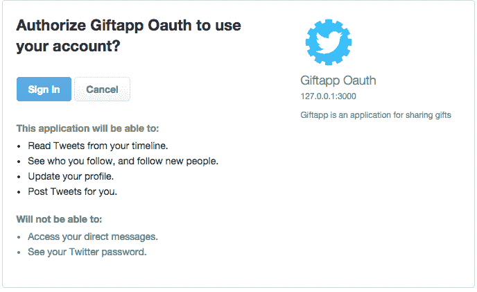

点击**Sign in**（登录）应进入你的仪表板。

现在我们已经分别通过 Facebook 和 Twitter 登录，让我们查看 `giftapp` 数据库中的 `users` 集合。在命令行中输入 `mongo` 来启动你的 MongoDB 客户端：

```bash
> use giftapp

switched to db giftapp
```

## 将应用连接到社交媒体

### 分享礼物清单

目前，我们的礼物清单功能还无法正常工作。我们希望用户能够创建并分享自定义的礼物清单。

### 完善礼物清单模型

由于我们正在使用 Mongoose 为用户数据建模，让我们也用它来为 `giftlists` 建模。在你的 `models`文件夹中，创建一个名为 `giftlist.js` 的新文件：

```javascript
var mongoose = require('mongoose');

var giftlistSchema = mongoose.Schema({

  id: String,

  user_id: String,

  name: String,

  gifts: [{name: String}]

});
```

## 将应用连接到社交媒体

我们接下来要做的是允许用户从我们的 SPA 仪表板创建新的礼物清单（giftlist）。

由于我们要通过 Ajax 回传 POST 数据，我们需要进行一些工作来使 CSRF 令牌在我们的 Angular 中可用。完成这一步需要两个步骤；首先，我们希望在 `dashboard.js` 路由中传递令牌：

```javascript
var express = require('express');

var router = express.Router();

var isAuthenticated = require('../utils/authenticated');

router.get('/', isAuthenticated, function(req, res, next) {

  var db = req.db;

  var collection = db.get('giftlist');

  console.log("routing dash for " + req.user._id);

  collection.find({'owner_id':req.user._id}, {}, function(err,giftlists){

    if(err){

      res.send(err);

    }else {

      giftlists = giftlists || [];

      res.render('dash/dashboard', {user: req.user, giftlists:

        giftlists, csrfToken: req.csrfToken()});

    }

  });

});

module.exports = router;
```

这个模型非常直观。一个礼物清单包含一个 ID、一个名称、一个 `gift` 对象列表以及一个 `user_id` 字段。我们将用拥有该礼物清单的用户 ID 来填充 `user_id`。在关系型数据库中，这将是一个外键，定义了用户与礼物清单之间的一对多关系。

`gifts` 字段是一个对象数组，仅预期一个 `name` 属性。我们还有一份共享该礼物清单的用户列表。我们将共享功能留到稍后处理。

## 将应用程序连接到社交媒体

将应用程序连接到社交媒体

## 将应用连接到社交媒体

```html
<script>

  angular.module("csrfValue", [])

  .value("csrfToken","<%= csrfToken %>");

</script>

</body>

</html>
```

我们在页面内部创建了一个新的 Angular 模块并向其添加了一个值。值（value）基本上是可以注入的键值对，我们可以在应用程序中使用它。我们在仪表板模板中执行此操作，因为我们需要服务器为 UI 提供 `csrfToken`。

我们还添加了一个 `<script>` 标签，用于加载一个新的控制器脚本文件，我们将使用该文件来处理和提交表单。

### 连接表单

接下来，我们需要将礼物列表表单连接到控制器，并让控制器与后端进行通信。

### 创建控制器

在你的 `javascripts/controllers` 目录下创建一个名为 `giftappFormController.js` 的新文件：

```javascript
angular.module('giftappControllers')

.controller('GiftappFormController', ['$scope','List','csrfToken',

'$state', function($scope, List, csrfToken, $state) {

  $scope.formData = {};

  $scope.formData.items = [];

  $scope.formData._csrf = csrfToken;

  $scope.create = function() {

    console.log("create");

    var myList = new List($scope.formData);

    myList.$save(function(giftList){

      console.log(giftList);

      $state.go('dash');

    });

  };

}]);
```

## 将应用连接到社交媒体

### 357

我们在 `giftappControllers` 模块中添加了一个新的控制器。我们向控制器中注入了许多内容，包括我们的 List 资源和 `$state`。我们还注入了 `csrfToken`。虽然我们现在还没有访问它，但稍后我们将将其所在的模块注入到我们的模块中。

在控制器内部，我们在 `$scope` 上设置了一个名为 `formData` 的对象。它将存储用户在表单中输入的数据。我们还向作用域中添加了一个名为 `create` 的函数，该函数会在用户提交表单时被调用。我们创建一个 List 资源的新实例，将数据添加到其中，并将其保存到后端。保存后，我们触发状态更改以返回仪表板。

由于我们的模块实际上定义在 `dashMainController.js` 内部，因此这里是我们要注入包含 `csrfToken` 值的模块的地方：

```javascript
angular.module('giftappControllers',['giftlistServices','csrfValue'])

.controller('DashMainController', ['$scope','List',

function($scope,List) {

  $scope.lists = List.query();

}]);
```

只需通过将模块名称添加到我们模块的依赖中，我们就可以访问模块内部的值服务。

### 将表单 Angular 化

我们需要做的下一件事是在 `public/templates/dash-add.tpl.html` 模板中添加一些 AngularJS 指令：

```html
<div class="row">

  <div class="col-md-12">

    <h2>添加新列表</h2>

    <form class="form-horizontal" ng-submit="create()">

      <div class="form-group">

        <label for="listname" class="col-sm-2 control-label">列表名称</label>

        <div class="col-sm-10">

          <input type="text" class="form-control" id="listname" placeholder="Name" ng-model="formData.name">

        </div>

      </div>

      <div class="form-group">

        <label class="col-sm-2 control-label">项目 1</label>

        <div class="col-sm-10">

          <input type="text" class="form-control" ng-
```

## 将应用连接到社交媒体

第一个更改是向表单添加 `ng-submit` 指令。在提交表单时，控制器的 `$scope.create()` 函数将被调用。

然后，我们使用 `ng-model` 指令将输入框连接到 `$scope.formdata`。这创建了双向数据绑定。为了演示这一点，我们在模板中添加了 `{{formData}}`。这将向你显示 `$scope.formdata` 持有的所有数据，是排查表单问题的一种极佳方法。显然，在生产环境中，你不会将其留在模板中。

## 将应用连接到社交媒体

(图片)

### 连接到后端控制器

现在我们的表单已经连接到了控制器，我们需要将控制器连接到后端，以便从数据库中存储和检索数据。打开你的 `controllers/giftlist_controller.js` 文件：

```javascript
var Giftlist = require('../models/giftlist');

exports.index = function(req, res){

  Giftlist.find({'user_id':req.user._id}, {},

  function(err,giftlists){

    if(err){

      res.send(err);

    }else if(giftlists){

      res.json(giftlists);

    };

  });

};

exports.create = function(req, res){

  var newGiftlist = new Giftlist();

  newGiftlist.name = req.body.name;

  newGiftlist.user_id = req.user._id;

  var gifts = [];

  req.body.items.forEach(function(item){

    gifts.push({name:item});

  });

  newGiftlist.gifts = gifts;

  newGiftlist.save(function(err){

    if(err){

      throw err

    } else {

      res.json(newGiftlist);

    }

  });

};

exports.show = function(req, res){

  Giftlist.findOne({_id:req.params.id}, function(err, list){

```

## 将应用程序连接到社交媒体

（注：提供的 OCR 文本主要包含重复的图像占位符和一个标题。标题外没有其他待处理的正文。）

## 将应用程序连接到社交媒体

这是一个非常简单的模板，用于渲染列表名称和列表中的礼物。

### 添加在社交媒体上分享列表的功能

接下来，我们想要允许用户轻松地分享他们的列表。我们需要对 `dash-main` 模板进行微小的调整：

```html
<div class="row">
  <div class="col-xs-12 col-md-6">
    <h2>我的列表</h2>
    <a class="btn btn-primary" role="button" ui-sref="add" href="#/add">
      <span class="glyphicon glyphicon-plus" aria-hidden="true"></span>
      添加列表
    </a>
    <ul class="list-unstyled">
      <li ng-repeat="list in lists"><a class="btn btn-link" href="/giftlist/{{list._id}}" role="button">{{ list.name }}</a></li>
    </ul>
  </div>
  <div class="col-xs-12 col-md-6">
    <h2>与我共享的列表</h2>
  </div>
</div>
```

我们添加到链接中的 URL 将触发触发控制器中的 `show` 路由，并向其传递我们想要显示的列表 ID。

接下来，我们将在 `giftlist/show.ejs` 模板中添加分享按钮：

```html
<!DOCTYPE html>
<html>
<head >
  <title>Giftlist: <%= giftlist.name %></title>
```

## 将应用连接到社交媒体

```html
<!DOCTYPE html>
<html lang="en">
<head>
  <meta charset="UTF-8">
  <meta name="viewport" content="width=device-width, initial-scale=1">
  <title>Giftlist</title>
  <link rel="stylesheet" href="https://maxcdn.bootstrapcdn.com/bootstrap/3.3.6/css/bootstrap.min.css">
  <link rel="stylesheet" href="https://maxcdn.bootstrapcdn.com/bootstrap/3.3.6/css/bootstrap-theme.min.css">
  <link rel="stylesheet" href="/css/style.css">
</head>
<body>
  <div id="fb-root"></div>
  <script>
  function(d, s, id) {
    var js, fjs = d.getElementsByTagName(s)[0];
    if (d.getElementById(id)) return;
    js = d.createElement(s); js.id = id;
    js.src = "//connect.facebook.net/en_US/sdk.js#xfbml=1&version=2.5&appId=228887303845448";
    fjs.parentNode.insertBefore(js, fjs);
  }
  (document, 'script', 'facebook-jssdk');
  </script>
  <nav class="nav navbar-default">
    <div class="container-fluid">
      <div class="navbar-header">
        <a class="navbar-brand" href="#">Giftlist</a>
      </div>
    </div>
  </nav>
  <div class="container">
    <h1><%= giftlist.name %></h1>
    <div class="row">
      <div class="col-md-12">
        <ul>
```

## 将应用连接到社交媒体

为了允许用户在社交媒体平台上分享您的内容，您应该集成分享按钮。这会增加应用程序的可见度和覆盖范围。

### Twitter 分享

Twitter 提供了一种添加分享按钮的简单方法。你可以使用以下代码来实现 Tweet 按钮：

```html
<a href="#" class="twitter-share" data-via="large" data-hashtags="">Tweet</a>

<script>document.write('https://twitter.com/widgets.js');</script>
```

### Facebook 分享

Facebook 同样提供了“赞”按钮。然而，你需要专门为您的 App ID 进行进行配置。使用以下结构开始使用：

```html
<div class="fb-like"></div>

<script>function(d,s){var js,fjs=d.getElementsByTagName(s)[0],p=/^http:/.test(d.location)?'http':'';if(!d.getElementById(id)){js=d.createElement(s);js.id=id;js.src=p+js;fjs.parentNode.insertBefore(js,fjs);}}(document, 'script');</script>
```

### Open Graph 标签

除了按钮之外，你还在 HTML 的 `<head>` 中包含 Open Graph 标签。这些标签告诉社交平台当你的内容被分享时应该如何显示。

```html
<meta property="og:title" content="Your Page Title" />

<meta property="og:description" content="A description of your content." />

<meta property="og:image" content="url-to-image.jpg" />

<meta property="og:url" content="https://your-app.com" />

<meta property="og:type" content="website" />
```

## 将应用连接社交媒体

在本章开始，我们配置了用于 Facebook 和 Twitter 身份验证的 Passport 策略。为每个社交媒体网站设置开发者账户是一个简单但必要的步骤。

随后，我们利用了 `Mongoose Giftlist` 模型以及功能强大的控制器，实现了在单页应用（SPA）内部创建礼物列表。通过构建一个新的 AngularJS 控制器，我们启用了前端代码和 AJAX 功能。为了能够向后端发布送数据，我们还添加了一个可注入的值服务来携带 CSRF 令牌。

还有几项工作留给你来完善应用程序。这包括一种动态添加更多礼物输入的方法，以及与其他已注册用户共享列表。

## 13 使用 Mocha、Karma 及更多工具进行测试

测试是软件开发中不可或缺的一部分，特别是当处理与终端用户及各种客户端交互的应用时，JavaScript SPA（单页应用）正是如此。由于可能消费应用程序的客户端多种，Web应用程序代码的结果往往是不可预测的，因此应该考虑到所有可能的场景并进行适当的测试。

在本章中，我们将涵盖以下主题：

- 什么是单元测试、集成测试和**端到端**（**E2E**）测试？
- 如何使用 Mocha、Chai 和 Sinon.js 进行 JavaScript 单元测试
- 如何配置 Karma 和 Jasmine 来测试 AngularJS
- 如何对 AngularJS 进行单元测试
- 如何对 AngularJS 进行端到端测试

### 测试类型

软件行业中存在各种类型的测试，但有三种主要类型被广泛使用，特别是在 Web 应用程序开发中。它们如下：

- 单元测试
- 集成测试
- 端到端测试，也称为*功能*测试

这三种测试构成了所谓的*软件测试金字塔*。金字塔可以被分解为更细粒度的测试形式，但从高处观察，它的结构如下：

### 单元测试

软件测试金字塔的底部是*单元测试*。单元测试针对应用程序中最小的各个（即单元），并将其与应用程序的其他部分进行*隔离*。

一个单元通常是一个独立的方法或对象实例。当你隔离地测试一个单元时，意味着测试不应该与任何应用程序依赖项交互，例如网络访问、数据库访问、用户会话以及真实应用环境中可能需要的任何其他依赖。相反，单元测试应该只在本地内存中执行操作。

任何单元测试的目标都应该是只测试应用程序的单个功能，且该功能应该封装在单元内部。如果该单元确实有任何依赖项，应对它们进行*模拟*（mocked），而不是调用实际的依赖项。我们将在本章稍后详细讨论这一点。

知道你将进行单元测试将有助于你在应用程序中编写更小、更聚焦的方法，因为它们更容易测试。许多人认为，你应该在编写任何应用程序代码之前总是先编写测试。然而，这并不总是可行，因为你可能被推入了一个快速的开发周期，没有时间进行编写单元测试的枯燥过程。针对现有代码编写单元测试可能也很枯燥，但这完全是可以接受的，而且比完全没有单元测试要好。

让我们来看一些广为人知的 JavaScript 单元测试框架，它们可以快速地集成到新的或现有的应用程序中。

## 使用 Mocha、Karma 等更多工具进行测试

*使用 Mocha、Karma 等更多工具进行测试*

*Mocha* 是一个流行的 JavaScript 测试框架，被广泛应用于 Node.js 社区。让我们回到书初的 Node.js 示例项目，并安装 Mocha，这样我们就可以尝试几个测试示例：

```bash
npm install mocha -g
```

全局安装 `mocha`，以便你可以在任何目录下都方便地访问它。

现在，我们在项目根目录下创建一个 `test` 目录来存储与测试相关的文件：

```bash
mkdir test
```

在 `test` 目录中创建一个名为 `test.js` 的文件并打开编辑。将以下代码放入该文件中并保存：

```javascript
var assert = require('assert');

describe('String', function() {

  describe('#search()', function() {

    it('should return -1 when the value is not present', function() {

      assert.equal(-1, 'text'.search(/testing/));

    });

  });

});
```

要运行测试，请在 `test` 目录下的控制台中执行以下命令：

```bash
mocha test.js
```

随后，你应该会在控制台中看到以下输出：

```
String

  #search()

    should return -1 when the value is not present

  1 passing (8ms)
```

## 使用 Mocha、Karma 及更多工具进行测试

## 使用 Chai 进行断言

上一个示例使用了 Node.js 的 `assert` 模块，但在 Mocha 中，你可能希望在一个实质性的测试环境中使用功能完善的断言库。Mocha 兼容多个 JavaScript 断言库，包括：

- Should.js
- Expect.js
- Chai
- Better-assert
- Unexpected

Chai 是一个流行且活跃的开源断言库，因此我们在本章的 Mocha 示例中将使用它。首先，在你的本地 Node.js 环境中安装 `chai`：

```bash
npm install chai --save-dev
```

### Should 风格的断言

在 Chai 中，可以通过 `should()` 访问 Should 风格的断言。这种接口允许链式方法语法，这对于许多 JavaScript 开发者来说非常熟悉，特别是如果你用过 jQuery 这样的库。链式方法名使用自然语言，使测试代码的编写更加流畅。此外，Chai 的 `should` 方法扩展了 `Object.prototype`，因此你可以像下面这样直接链式到正在测试的变量上：

```javascript
var should = require('chai').should(); // 执行 should 函数

var test = 'a string';

test.should.be.a('string');
```

此示例将执行一个简单的断言，验证给定变量是否字符串。

### Expect 风格的断言

在 Chai 中，可以通过 `chai.expect` 访问 Expect 风格的断言。这种接口与 `should` 相似，都使用了方法链调用，但它没有扩展 `Object.prototype`，因此它以更传统的方式使用，如下：

```javascript
var expect = require('chai').expect;

var test = 'a string';

expect(test).to.be.a('string');
```

## 使用 Mocha、Karma 及更多工具进行测试

```javascript
expect(test).to.be.a('string');
```

此示例执行与上一个示例相同的断言，但使用的是 Chai 的 `expect` 方法而不是 `should`。注意，对 `expect` 方法的 `require` 调用并不会执行它，这与 `should` 的情况不同。

```javascript
expect(test).to.be.a('string');
```

此示例执行与上一个示例相同的断言，但使用的是 Chai 的 `expect` 方法而不是 `should`。注意，对 `expect` 方法的 `require` 调用并不会执行它，这与 `should` 的情况不同。

### Assert 风格断言

在 Chai 中可以通过 `chai.assert` 访问 *Assert*-风格的断言。该接口使用更传统的断言风格，类似于 Node.js 原生的 `assert` 模块：

```javascript
var assert = require('chai').assert;

var test = 'a string';

assert.typeOf(test, 'string');
```

此示例执行与上一个示例相同的断言，但使用的是 Chai 的 `expect` 方法。注意，此示例调用了 `assert.typeOf` 方法，它类似于原生 JavaScript 的 `typeof` 运算符，而不是像 `should` 和 `expect` 那样使用自然语言方法名。

### 使用 Mocha 配合 Chai 和 Should 风格断言

```javascript
var should = require('chai').should();

describe('String', function() {

  describe('#search()', function() {

    it('当值不存在时应返回 -1', function() {

      'text'.search(/testing/).should.equal(-1);

    });

  });

});
```

此操作执行了与之前使用原生 Node.js `assert` 模块所示相同的测试，但改用的是 Chai 的 `should` 方法。然而，在这种情况下使用 Chai 的优势在于，它提供了 Node.js 开箱即用之外的额外测试，而且 Chai 测试也兼容浏览器。

## 使用 Mocha、Karma 等更多工具进行测试

使用 Mocha、Karma 等更多工具进行测试

在本章中，我们将探索如何使用各种测试框架来测试你的 JavaScript 代码。我们将从流行且灵活的测试框架 Mocha 开始，然后介绍测试测试运行器 Karma。

### 使用 Mocha 进行测试

Mocha 是一个可以在浏览器和 Node.js 中运行的 JavaScript 测试框架。它具有高度的可扩展性，并允许你使用各种断言库，如 Node、Chai 或 expect。

要开始使用 Mocha，你首先需要通过 npm 安装它：

```bash
npm install --save-dev mocha
```

安装完成后，你可以创建一个测试文件（例如 `test.js`），并编写第一个测试用例：

```javascript
const assert = require('assert');

describe('My Module', function() {

  it('should return true when the condition is met', function() {

    assert.strictEqual(1 + 1, 2);

  });

});
```

现在，使用以下命令运行你的测试：

```bash
mocha test.js
```


npx mocha test.js

这将输出你的测试结果，显示测试是通过还是失败。

### 使用 Karma 进行测试

Karma 是一个测试运行器，允许你在多个浏览器中同时运行测试。这对于确保你的代码在不同环境中都能正常工作特别有用。

要使用 Karma，你需要通过 npm 安装它：

```bash
npm install --save-dev karma mocha
```

安装后，你需要创建一个配置文件 `karma.config.js`。你可以通过运行以下命令来完成：

```bash
npx karma init
```

这将生成一个配置文件，你可以在其中指定想要运行测试的浏览器以及你使用的框架。

配置完成后，你可以执行以下命令来运行测试：

```bash
npx karma start
```

Karma 将打开指定的浏览器并执行你的测试。

通过掌握 Mocha 和 Karma，你可以构建健壮且易于维护且无回归的 JavaScript 应用。

## 使用 Mocha、Karma 及更多工具进行测试

Mocha 是一个可以在浏览器和 Node.js 中运行的 JavaScript 测试框架。它非常灵活性，允许你使用任何断言库，例如 Chai、expect，甚至是你自己编写的库。

Karma 是一个测试运行器，它可以自动化完成在多个浏览器中运行测试的过程。它与 Mocha 无缝衔接，并为测试你的应用程序提供了一个强大的环境。

在本章中，我们将学习如何使用 Mocha 和 Karma 为我们的 JavaScript 项目构建一个健壮的测试套件。我们将探索如何编写单元测试、集成测试，以及如何配置 Karma 以在不同的浏览器中运行测试。

## 使用 Mocha、Karma 及更多工具进行测试

首先，我们将创建一个 `Error` 对象并将其传递给回调函数。然后，我们将为实际的 `save` 方法创建一个存根（stub），用它替换并在并抛出一个错误，同时将 `Error` 对象传递给回调函数。这将替换任何实际的数据库功能，因为我们无法在单元测试中依赖真实的依赖项。最后，我们将 `callback` 函数定义为一个间探器（spy）。当我们为测试调用 `registerUser` 方法时，会将间探器作为其回调函数传递给它。在存在真实 `save` 方法的情况下，`save.restore()` 将将其恢复到原始状态并移除存根行为。

Sinon.js 还内置了自身的断言库，以便在使用间探器和存根时提供额外功能。在这种情况下，我们将调用 `sinon.assert.calledWith()` 来断言间探器被调用时携带了预期的错误。

### Mocks（模拟对象）

Sinon.js 中的 Mock 构建在间探器和存根的基础之上。它们是伪方法，类似于 `spies`，但具有像 `stubs` 那样添加额外行为的能力，同时还允许你在测试实际运行之前为测试定义*期望*（expectations）。

每个单元测试中应只使用一次 Mock。如果你发现自己在单元测试中使用了多个 mock，那么你可能没有按照预期的方式使用它们。

## 使用 Mocha、Karma 以及更多工具进行测试

使用 Mocha、Karma 以及更多工具进行测试

### 使用 Mocha、Karma 以及更多工具进行测试

-   使用 Mocha、Karma 以及更多工具进行测试

## 使用 Mocha、Karma 及更多工具进行测试

使用 Mocha、Karma 及更多工具进行测试

这会将 Karma 及其针对 Mocha 和 Chai 的 Node.js 插件安装到你的本地环境中，并将它们保存在你的 `package.json` 文件中。现在，为了让 Karma 在你系统的浏览器中启动测试，我们还需要为这些浏览器安装插件，如下：

```bash
npm install karma-chrome-launcher karma-firefox-launcher --save-dev
```

这将安装适用于 Chrome 和 Firefox 浏览器的 `launcher` 模块。如果你的系统中没有其中一个或两个浏览器，请为你所拥有的一个或两个浏览器安装启动器。

接下来，我们需要为 Karma 创建一个配置文件，以便运行测试并启动相应的浏览器。在项目根目录下创建一个名为 `karma.conf.js` 的文件，并向其中添加以下代码：

```javascript
module.exports = function(config) {
  'use strict';
  config.set({
    frameworks: ['mocha', 'chai'],
    files: ['test/*.js'],
    browsers: ['Chrome', 'Firefox'],
    singleRun: true
  });
};
```

此配置简单地告诉 Karma 我们正在使用 Mocha 和 Chai 测试框架，我们想要加载 test 目录下的所有 JavaScript 文件，并且希望在 Chrome 和 Firefox 浏览器（或你选择的浏览器）中运行测试。`singleRun` 参数告诉 Karma 运行测试后退出，而不是持续运行。

现在，我们做的就是从 CLI 运行 Karma 以在定义的浏览器中运行测试。

由于 Karma 是安装在本地的，你需要添加从项目根目录到模块的相对路径来运行它，如下：

```bash
./node_modules/karma/bin/karma start karma.conf.js
```

你会发现此命令还指定了你想要为 Karma 实例使用的配置文件，但如果你在命令中排除它，它将默认使用你在根目录下创建的 `karma.conf.js` 文件。

## 使用 Mocha、Karma 及更多工具进行测试

或者，如果你想从任何目录运行 Karma，可以安装 `karma-cli` 模块，就像你对 Grunt 和 `grunt-cli` 执行的那样。

### 使用 NPM、Bower 和 Grunt 开始有序工作：

```bash
npm install karma-cli -g
```

确保你添加了 `-g` 参数，以便 `karma` 能够作为全局 Node.js 模块可用。现在，你只需在命令行界面运行以下命令：

```bash
karma start
```

运行此命令将自动打开指定的浏览器，并产生类似下面的输出：

```
28/08/2016 18:02:34.147 INFO [karma]: Karma v1.2.0 started at http://localhost:9876/
28/08/2016 18:02:34.147 INFO [launcher]: Launching browsers Chrome, Firefox with unlimited concurrency
28/08/2016 18:02:34.157 INFO [launcher]: Starting browser Chrome
28/08/2016 18:02:34.163 INFO [launcher]: Starting browser Firefox
28/08/2016 18:02:35.301 INFO [Chrome 52.0.2743 (Mac OS X 10.11.6)]: Connected on socket /#TJZjs4nva-kNp3QAAAA with id 18074196
28/08/2016 18:02:36.761 INFO [Firefox 48.0.0 (Mac OS X 10.11.0)]: Connected on socket /#74pJ5Vl1sLPwySkAAAB with id 24041937
Chrome 52.0.2743 (Mac OS X 10.11.6): Executed 2 of 2 SUCCESS (0.008 secs / 0.001 secs)
Firefox 48.0.0 (Mac OS X 10.11.0): Executed 2 of 2 SUCCESS (0.002 secs / 0.002 secs)
TOTAL: 4 SUCCESS
```

如果你从该输出的开始开始阅读，你会发现 Karma 在 `port 9876` 上启动了自身的服务器，并在运行后启动了指定的浏览器。你的两个测试在每个浏览器中运行均成功，因此在输出的最后一行记录了总共 `4 SUCCESS`。

进行此类测试的原因是为了让你的单元测试可以在多个浏览器中运行，并确保它们在所有浏览器中都能通过。对于前端 JavaScript 来说，始终存在某个浏览器表现与另一个不同的可能性，因此应该测试尽可能多的场景，以确保你的应用程序在某些可能被终端用户使用的浏览器中不会出现 Bug。

## 使用 Karma 和 Jasmine 测试 AngularJS

AngularJS 社区已选择 Jasmine 作为其首选的单元测试框架，它也可以与 Karma 配合使用。现在让我们安装运行 Karma 和 Jasmine 所的依赖项：

`npm install jasmine karma-jasmine --save-dev`

这将安装 Jasmine 单元测试框架及其对应的 Karma 插件，并将其保存到你的 `package.json` 文件中。

现在，将 AngularJS 安装到我们的示例项目中，仅用于测试示例代码，以便我们能够学习如何将单元测试应用到实际应用中。

AngularJS 在 NPM 和 Bower 上均可用。由于本示例针对前端代码，我们将在示例中使用 Bower：

`bower install angular --save`

将 `angular` 保存为依赖项。接下来，将 `angular-mocks` 库作为开发依赖安装：

`bower install angular-mocks --save-dev`

`angular-mocks` 库提供了 `ngMock` 模块，你可以在 AngularJS 应用程序中使用它来模拟（mock）服务。此外，你还可以用它扩展其他模块并让它们同步运行，从而提供更直观的测试。

现在，让我们修改 `karma.conf.js` 文件以反映使用 Jasmine 替 Mocha，并添加 `angular-mocks`。你的配置应该如下代码块所示：

```javascript
module.exports = function(config) {
  'use strict';
  config.set({
    frameworks: ['jasmine'],
    files: [
      'bower_components/angular/angular.js',
      'bower_components/angular-mocks/angular-mocks.js',
    ],
  });
};
```

## 使用 Mocha、Karma 等工具进行测试

使用 Mocha、Karma 等更多工具进行测试

在本章中，我们将探索如何使用各种测试框架和工具来测试 AngularJS 应用。我们将重点关注 Mocha 和 Karma，也会涉及到其他流行的选项。

### 使用 Mocha 和 Karma 进行测试

Mocha 是一个运行在浏览器和 Node.js 环境中的 JavaScript 测试框架。它为编写测试提供了一个灵活的环境，但不包含断言库。对于断言，我们通常将 Mocha 与 Chai 配合使用。Karma 是一个测试运行器，可以在多个浏览器中同时执行你的测试。它对于 AngularJS 应用特别有用，因为它确保了跨浏览器兼容性。

要开始使用 Mocha 和 Karma，你首先需要通过 npm 安装它们：

```bash
npm install --save-dev mocha karma chai angular-mocks
```

完成后，你可以通过创建一个 `karma.conf.js` 文件来初始化 Karma。该文件配置了 Karma 的行为方式。

```javascript
module.exports = function(config) {
  config.set({
    frameworks: ['mocha', 'chai'],
    files: [
      'node_modules/angular/angular.js',
      'node_modules/angular-mocks/angular-mocks.js',
      'src/**/*.js',
      'test/**/*.spec.js'
    ],
    preprocessors: ['babel'],
    reporter: ['progress', 'mocha'],
    browsers: ['ChromeHeadless'],
    singleRun: true
  });
};
```

配置好 Karma 后，你可以使用 Mocha 的语法编写测试。该语法与 Jasmine 相似，使用了 `describe` 和 `it` 块。

```javascript
describe('MainController', function() {
  var $controller;

  beforeEach(module('giftappControllers'));

  beforeEach(inject(function(_$controller_) {
    $controller = _$controller_;
  }));

  describe('$scope.lists', function() {
    it('should have a length of 2', function() {
      var $scope = {};
      var testController = $controller('DashMainController', {
        $scope: $scope
      });
      expect($scope.lists.length).to.equal(2);
    });
  });
});
```

要运行测试，只需在终端中执行 Karma 命令：

```bash
npx karma start
```

### 其他测试选项

虽然 Mocha 和 Karma 非常强大，但还有其他工具值得考虑：

- **Jasmine**: 一个行为驱动开发的框架，包含了断言和 Mock 功能。它在 AngularJS 社区中被广泛使用。
- **Jest**: 一个由 Meta 维护的现代 JavaScript 测试框架，以其速度和功能闻名。
- **Cypress**: 一个端到端测试框架，允许你从用户的角度测试你的应用程序。

通过理解这些不同的工具，你可以选择最适合你项目需求的组合。

## 使用 Mocha、Karma 及更多工具进行测试

### 集成测试
软件测试金字塔的第二层是集成测试。集成测试涉及对至少两个相互作用的代码单元进行测试，因此在最简单的情况下，集成测试将测试两个单元测试的结果，确保它们能够按照预期与你的应用程序*集成*。

集成测试的理念是通过测试应用程序中更大的部分（或组件）来在单元测试的基础上进行扩展。可能你所有的单元测试都通过了，因为它们是在孤立状态下测试的，但当你开始测试这些单元之间的相互作用时，结果可能并不符合你的预期。这就是为什么单靠单元测试不足以充分测试一个 SPA（单页应用）的原因。集成测试允许你在转向端到端测试之前，对应用程序中各种组件的关键功能进行测试。

### 端到端测试
软件测试金字塔的顶层是端到端测试（缩为 E2E），也称为功能测试。端到端测试的目标是完整地测试应用程序功能的真实性性。例如，如果你的应用中有一个用户注册功能，端到端测试将确保用户能够通过 UI 正常注册、数据被添加到数据库、向用户显示注册成功的消息，并可能向用户发送电子邮件，或执行应用程序可能要求的任何其他后续操作。

### angular-seed 项目
为了演示一个包含单元测试和端到端测试示例的简单 AngularJS 应用，AngularJS 创建了 `angular-seed` 项目。这是一个可以在 GitHub 上获得的开源项目。让我们现在安装它，以便我们使用 AngularJS 运行一些简单的单元测试和端到端测试。

按照以下步骤从 GitHub 将 `angular-seed` 仓库克隆到一个新的、干净的项目目录中：

`$ git clone https://github.com/angular/angular-seed.git`
`$ cd angular-seed`

## 使用 Mocha、Karma 等更多工具进行测试

使用 Mocha、Karma 等更多工具进行测试

## 使用 Mocha、Karma 及更多工具进行测试

### 使用 Mocha、Karma 及更多工具进行测试

这将产生类似于下面的输出：

`> angular-seed@0.0.0 test /angular-seed`
`> karma start karma.conf.js`
`03 09 2016 13:02:57.418:WARN [karma]: No captured browser, open`
`http://localhost:9876/`
`03 09 2016 13:02:57.431:INFO [karma]: Karma v0.13.22 server started at`
`http://localhost:9876/`
`03 09 2016 13:02:57.447:INFO [launcher]: Starting browser Chrome`
`03 09 2016 13:02:58.549:INFO [Chrome 52.0.2743 (Mac OS 10.11.6)]`
`Connected on socket /A2XSbWChmjkstjNAAAA with id 65182476`
`Chrome 52.0.2743 (Mac OS 10.11.6):`
`Executed 5 of 5 SUCCESS (0.078 secs / 0.069 secs)`

此输出显示 5 个 5 个单元测试已成功执行。请注意，命令会继续运行，因为它处于持续集成模式。你还会看到一个打开的浏览器窗口，它会等待文件变化以便重新运行测试，测试结果将立即打印回命令行界面（CLI）。

该项目还包含一个以 `singleRun` 模式运行 Karma 的命令，正如我们在之前的 Karma 示例中所做的那样。要此此，请按 Ctrl + C 关闭当前运行的 Karma 实例。这将同时关闭 Chrome 浏览器窗口。

接下来，你将使用以下 NPM run 命令仅启动一次 Karma 然后将其关闭：

`$ npm run test-single-run`

你将看到与之前相同的输出，但浏览器窗口会打开并关闭，测试将成功运行，CLI 将带你回到命令提示符。

## 使用 AngularJS 和 angular-seed 进行端到端测试

### 使用 AngularJS 和 angular-seed 进行端到端测试

AngularJS 强调了端到端测试的重要性，他们有自己的测试框架 **Protractor** 来实现。Protractor 是一个开源的 Node.js 应用，基于 WebdriverJS（或简称 Webdriver，它是 Selenium 项目的一个组件）。Selenium 已经存在很长时间，在 Web 开发社区中非常知名。它由多个工具和库组成，允许 Web 浏览器自动化。WebdriverJS 就是其中一个库，它专为测试 JavaScript 应用程序而设计。

## 使用 Mocha、Karma 及更多工具进行测试

Protractor 与 Karma 类似，它们都是测试运行器，但 Protractor 设计用于运行端到端（E2E）测试而非单元测试。angular-seed 项目中的端端测试是用 Jasmine 编写的，并使用 Protractor 来启动和运行这些测试。

首先，我们需要安装 Webdriver，因为 Protractor 是基于它构建的。项目自带以下脚本来执行此操作：

`npm run update-webdriver`

这将产生类似下面的输出，用于安装最新版本的 Webdriver：

`Updating selenium standalone to version 2.52.0`
`downloading`
`https://selenium-release.storage.googleapis.com/2.52/selenium-`
`server-standalone-2.52.0.jar...`
`Updating chromedriver to version 2.21`
`downloading`
`https://chromedriver.storage.googleapis.com/2.21/chromedriver_mac32.zip...`
`chromedriver_2.21mac32.zip downloaded to /angular-seed`
`node_modules/protractor/chromedriver_2.21mac32.zip`
`selenium-server-standalone-2.52.0.jar downloaded to /angular-seed`
`node_modules/protractor/selenium-server-`
`standalone-2.52.0.jar`

一旦成功安装 Webdriver，请再次运行带有 Karma 的的 NPM 服务器，以便 Protractor 可以与 Web 应用程序进行交互：

`npm start`

接下来，由于 Protractor 默认配置为使用 Chrome 进行测试，我们需要跳过 Selenium 服务器，因为它使用的 Java NPAPI 插件新版本的 Chrome 已经不再支持。幸运的是，Protractor 可以直接针对 Chrome 和 Firefox 进行测试，这避开了这个问题。要使用 Chrome 或 Firefox 的直接服务器连接，请打开 E2E-tests 目录下的 `protractor.conf.js` 文件，在底部添加一个名为 `directConnect` 的新配置属性，并将其设置为 `true`。现在 Protractor 配置文件应该像下面的代码块：

```
//jshint strict: false
exports.config = {
  allScriptsTimeout: 11000,
  specs: [
    '*.js'
  ],
  capabilities: {
```

## 使用 Mocha、Karma 及更多工具进行测试

## 使用 Mocha, Karma 和更多工具进行测试

describe('view2', function() {
  beforeEach(function() {
    browser.get('index.html#!/view2');
  });

  it('当用户导航到 /view2 时，应该渲染 view2', function() {
    expect(element.all(by.css('[ng-view] p')).first().getText()).toMatch(/partial for view 2/);
  });
});

## 部署与扩展 SPA

在构建了应用程序的核心功能后，现在是时候将 SPA 移动到可以通过互联网访问的类生产环境中了。为了实现这一点，我们将使用**平台即服务**（**PaaS**）。

PaaS 是一种云服务，允许开发者在托管的基础设施上发布应用程序。在 PaaS 出现之前，开发者或运维工程师必须执行大量的设置和维护任务，例如配置硬件、安装操作系统以及确保运行时间。

目前有许多 PaaS 供应商，但我选择了 Heroku。选择它的原因之一是，你可以在沙箱中免费部署一个应用程序，这允许你对应用进行实验，并在准备就绪时进行扩展。将应用部署到 Heroku 也非常简单，正如你将看到的，Heroku 使用 Git 进行部署。

我们还将在云端设置一个生产环境数据库。我们将使用 MongoLab，它也提供免费的沙箱层级，内存足够用于启动。

我们将通过简要讨论以下关于应用程序扩展的关注点来结束本章：

- 使用 Grunt 任务运行器打包应用程序
- 设置在线生产数据库
- 将 SPA 迁移到云端
- 扩展的考量

*部署与扩展 SPA*

## 部署与扩展 SPA

### Grunt

Grunt 的强大源于其活跃社区提供的数以千计的插件。在编写此本书时，`npmjs.com` 上列出了超过 5,000 个 Grunt 插件。官方维护的 Grunt 插件通常命名为 `grunt-contrib-*`。如果你有某些想要运行的任务，很可能已经有人创建了支持该的插件。你通常可以信任这些插件的质量，尽管也有许多优秀的非官方插件。

### 安装 Grunt 插件

Grunt 的一个很棒特性是使用 NPM 安装插件。让我们安装几个我们将要用到的有用插件：

`$ npm install grunt-contrib-clean --save-dev`
`grunt-contrib-clean@1.0.0 node_modules/grunt-contrib-clean`
- async@1.5.2
- rimraf@2.5.2 (glob@7.0.0)

`$ npm install grunt-contrib-uglify --save-dev`
`grunt-contrib-uglify@0.11.1 node_modules/grunt-contrib-uglify`
- uri-path@1.0.0
- maxmin@2.1.0 (figures@1.4.0, pretty-bytes@3.0.1, gzip-size@3.0.0)
- chalk@1.1.1 (escape-string-regexp@1.0.5, supports-color@2.0.0, ansi@2.0.0, strip-ansi@3.0.1, ansi-styles@2.2.0)
- uglify-js@2.6.2 (uglify-to-browserify@1.0.2, async@0.2.10, source-map@0.5.3, yargs@3.10.0)
- lodash@4.5.1

`$ npm install grunt-contrib-htmlmin --save-dev`
`grunt-contrib-htmlmin@0.6.0 node_modules/grunt-contrib-htmlmin`
- chalk@1.1.1 (escape-string-regexp@1.0.5, supports-color@2.0.0, strip-ansi@3.0.1, has-ansi@2.0.0, ansi-styles@2.2.0)
- pretty-bytes@2.0.1 (number-is-nan@1.0.0, get-stdin@4.0.1, meow@3.7.0)
- html-minifier@1.2.0 (relateurl@0.2.6, change-case@2.3.1, concat-stream@1.5.1, cli@0.11.1, clean-css@3.4.9, uglify-js@2.6.2)

## 部署与扩展 SPA

[393]

我们安装了用于 `clean`、`uglify`、`htmlmin` 和 `copy` 任务的 Grunt 插件。`Clean` 会清理目录中的文件。`Uglify` 压缩 JavaScript 文件。`Htmlmin` 压缩 HTML 文件。`Copy` 任务复制文件。`--save-dev` 标志会将这些模块作为 `dependencies` 添加到你的 `package.json` 文件中。你只需要在开发环境中运行这些包，而不需要在生产环境中。

在继续之前，让我们在项目根目录下创建一个 `dist` 文件夹。这里将存放我们生产就绪的资源。

### 配置 Gruntfile

现在，我们需要修改 `Gruntfile` 来加载这些插件：

```javascript
module.exports = function(grunt) {
  grunt.initConfig({
    pkg: grunt.file.readJSON('package.json'),
  });
  // 加载任务插件
  grunt.loadNpmTasks('grunt-contrib-uglify');
  grunt.loadNpmTasks('grunt-contrib-copy');
  grunt.loadNpmTasks('grunt-contrib-htmlmin');
  grunt.loadNpmTasks('grunt-contrib-clean');
};
```

在这里，我们为每个想要加载的 Grunt 插件调用了 `grunt.loadNpmTasks()`，并传递要加载的模块名称。

接下来，我们需要在 `Gruntfile` 内部配置每个任务。注意，每个插件都有其自己的配置属性。请查阅你所使用的每个插件的文档以查看如何配置它们。打开 `Gruntfile.js` 并进行以下编辑：

```javascript
module.exports = function(grunt) {
  grunt.initConfig({
    pkg: grunt.file.readJSON('package.json'),
    clean: ['dist/**'],
    copy: {
      main: {
        files: [
          {expand: true, src: ['*'], dest: 'dist/', filter: 'isFile'},
          {expand: true, src: ['bin/**'], dest: ''}
        ]
      }
    }
  });
};
```

## 部署与扩展 SPA

部署单页应用（SPA）需要仔细考虑应用程序如何提供服务以及如何扩展。由于 SPA 通常由静态资源（HTML、JavaScript 和 CSS）组成，因此部署策略通常侧重于高效地提供这些文件。

### 部署策略

有几种部署 SPA 的方法：

- **静态托管 (Static Hosting)**：这是简单的方法。你可以在 AWS S3、Google Cloud Storage 或 Azure Blob Storage 等服务上托管静态文件。这些服务具有极高的可扩展性且具有成本效益。
- **Web 服务器**：你可以使用 Nginx 或 Apache 等传统 Web 服务器来提供静态文件。这允许对路由、缓存和安全进行更深入的控制。
- **容器化 (Docker)**：将你的应用程序和 Web 服务器封装到 Docker 容器中，可以确保不同环境之间的一致性，并利用 Kubernetes 这样的编排工具简化部署。

### 部署的关键考虑因素

在部署 SPA 时，请记住以下几点：

- **路由**：由于 SPA 在客户端处理路由，你的 Web 服务器必须配置为将所有请请求重定向到 `index.html`。这可以防止用户在子路由上刷新页面时出现 404 错误。
- **缓存**：对版本化的资源（如带有哈希值的 JS 和 CSS 文件）使用强制缓存，但要确保 `index.html` 永不缓存，以便用户接收应用程序的最新版本。
- **安全性**：始终使用 HTTPS。实施适当的安全标头，如内容安全策略 (CSP)，以防止跨站脚本攻击 (XSS)。
- **CDN**：使用内容分发网络 (CDN) 从更靠近用户的地方提供资源，从而降低延迟并提高性能。

## 部署与扩展 SPA

一旦你的单页应用（SPA）完成构建和测试，下一步就是对其进行部署和扩展。根据你的需求、预算和流量对，，有多种方法可以实现这一目标。

### 静态站点托管

部署 SPA 最简单的方法是使用静态托管服务。由于 SPA 完全由静态文件（HTML、CSS 和 JavaScript）组成，因此它可以托管在任何可以提供静态文件的 Web 服务器上。流行的选项包括：

- GitHub Pages：公共项目免费，并直接与 Git 集成。
- Netlify：非常易于使用，支持从 Git 仓库自动部署。
- Vercel：与 Netlify 类似，并针对基于 Next 的框架进行了优化。
- AWS S3 配合 CloudFront：更具扩展性且更复杂的企业级解决方案。

使用静态托管时，配置服务器将所有请求重定向到 `index.html` 文件至关重要。这是因为 SPA 使用的是客户端路由，如果用户在深层链接上刷新页面，服务器将返回 404 错误，因为该特定文件并不。

### 使用 Docker 进行容器化

为了在不同环境中获得更强的控制力和一致性，你可以将 SPA 封装在 Docker 容器中。这允许你在开发、测试和生产环境中运行完全相同的环境。

一个适用于 SPA 的简单 `Dockerfile` 如下：

```dockerfile
# 使用轻量级 Nginx 镜像
FROM nginx:alpine
# 将构建输出拷贝到 Nginx html 目录
COPY ./dist /usr/share/nginx/html
# 暴露端口 80
EXPOSE 80
# 启动 Nginx
CMD ["nginx", "-g", "daemon off;"]
```

容器化后，你可以将应用程序部署到各种平台，如 Kubernetes、AWS ECS 或 Google Cloud Run。

### 扩展 SPA

随着流量的增长，你可能需要扩展应用程序以处理更多用户。

- **内容分发网络 (CDN)**：使用如 Cloudflare 或 CloudFront 等 CDN 在靠近用户的边缘节点处缓存你的静态资源。这可以降低延迟并减轻源服务器的负载。
- **负载均衡**：如果你运行了多个容器实例，使用负载均衡器将入站流量分配到这些实例之间。
- **水平扩展**：随着需求增加启动更多的容器实例。这可以通过 Kubernetes 等编排器轻松处理。

## 部署与扩展 SPA

我们完成的最后一步工作是注册一个任务。我们通过调用 `grunt.registerTask()`实现了这一点。该方法接受两个参数。第一个是字符串，即任务名称。在我们的案例中，这就是默认任务。Grunt 要求所有的 `Gruntfiles` 必须注册一个默认任务。下一个参数是一个字符串数组，包含了作为该任务的一部分需要运行的任何任务和目标（targets）名称。

目前，我们只是在运行任务，而没有列出任何具体的目标。如果我们想在任务上运行某些目标，语法将是 `task:target`。例如，如果我们为 `uglify` 任务定义了一个名为 `test` 的目标，我们会在数组中将其注册为 `['uglify:test']`。

## 运行 Grunt

运行 grunt 再简单不过了。首先，确保已经安装了 grunt CLI，如下所示所示：

`$ npm install -g grunt-cli`
`/usr/local/bin/grunt -> /usr/local/lib/node_modules/grunt-cli/bin/grunt`
`grunt-cli@1.2.0 /usr/local/lib/node_modules/grunt-cli`
- `grunt-known-options@1.1.0`
- `nopt@3.0.6 (abbrev@1.0.9)`
- `resolve@1.1.7`
- `findup-sync@0.3.0 (glob@5.0.15)`

## 部署与扩展单页应用 (SPA)

你可能会注意到的另一点是每个任务都在运行一个目标（target）。`copy` 正在运行 `main`，`uglify` 正在运行 `my_target`。默认情况下，如果没有指定目标，Grunt 将运行第一个定义的目标。

如果你打开 `dist/public/javascripts/giftapp.js` 文件，你应该能看到它已经经过了压缩处理：

`angular.module("giftapp",["ui.router","giftappControllers"]).config(["$stateProvider,$urlRouterProvider",function($stateProvider,$urlRouterProvider)`
`{$urlRouterProvider.otherwise("/dash"),$stateProvider.state("dash",{url:"/d`
`ash",templateUrl:"/templates/dash-`
`main.tpl.html",controller:"DashMainController"}).state("add",{url:"/add",te`
`mplateUrl:"/templates/dash-`
`add.tpl.html",controller:"GiftappFormController"})}]);`

代码压缩使得我们的文件更小且更难以阅读。它可以显著提高文件在网页上的性能。为了获得更显著的性能提升，我们可能需要考虑合并脚本文件，并使用诸如 Closure compiler 等工具让它们变得更加高效。

没有必要压缩服务器端的 JavaScript 代码。压缩的主要原因是减少与客户端之间的数据传输。

### 配置生产环境配置

当我们把应用程序迁移到生产环境时，将会遇到一个问题：开发环境和生产环境之间存在差异。目前，我们所有的数据库引用都指向本地 MongoDB 数据库。

我们稍后将使用 Git 将文件推送到生产环境，而且我们也不希望在 Git 仓库中存储配置变量。我们也不希望在 Git 中存储 `node_modules` 或将其推送到生产环境，因为可以通过我们的 `package.json` 文件按需获取它们。

## 部署与扩展单页应用 (SPA)

[ 398 ]

### 创建 .gitignore 文件

在项目根目录下创建一个名为 `.gitignore` 的文件。该文件包含了一个我们不希望 Git 存储或跟踪的文件和路径列表：

我们逐行列出想要让 Git 忽略的文件和文件夹。第一个是 `node_modules`。同样，没有理由存储这些内容。然后，我想忽略 `config` 文件夹中的任何内容，因为它包含了敏感信息。

在这里，我忽略了 `.idea`。你可能有也可能没有这个文件夹。这是我的开发环境创建的、用于存储项目信息的文件夹。我使用的是 JetBrains 开发的 JavaScript IDE —— Webstorm。无论你使用什么工具，都应该排除你的 IDE 文件（如果有的话）。最后，我显式地排除了 `dist/config`，它是 `config` 的副本。

### 创建基于环境的配置模块

我们希望配置能够被动态处理。如果你处于开发环境，则使用适用于本地机器的配置；如果你处于生产环境，则你希望使用适用于该环境的配置变量。

在生产环境中实现这一点的最安全方法是设置可以在应用程序中读取的环境变量。我们会在设置部署环境时配置它们，但现在就可以做好准备工作。

在你的根目录 `giftapp` 文件夹中，使用以下代码创建一个名为 `appconfig.js` 的新文件：

```javascript
module.exports = function(){
  if(process.env.NODE_ENV&&process.env.NODE_ENV === 'production'){
    return{
      db: process.env.DB,
      facebookAuth : {
        clientID: process.env.facebookClientID,
        clientSecret: process.env.facebookClientSecret,
        callbackURL: process.env.facebookCallbackURL,
      },
      twitterAuth : {
        'consumerKey': process.env.TWITTER_CONSUMER_KEY,
        'consumerSecret': process.env.TWITTER_CONSUMER_SECRET,
        'callbackURL': process.env.TWITTER_CALLBACK_URL
      }
    };
  } else {
    var auth = require('./config/authorization');
    return {
      db: 'localhost:27017/giftapp',
      facebookAuth: {
        clientID: auth.facebookAuth.clientID,
        clientSecret: auth.facebookAuth.clientSecret,
        callbackURL: auth.facebookAuth.callbackURL
      },
      twitterAuth: {
        'consumerKey': auth.twitterAuth.consumerKey,
        'consumerSecret': auth.twitterAuth.consumerSecret,
        'callbackURL': auth.twitterAuth.callbackURL
      }
    };
  }
};
```

## 部署与扩展 SPA

现在我们已经构建了单页应用（SPA），我们需要考虑如何部署和扩展它。部署 SPA 有许多方法，但在本章中，我们将关注最常见的方法：使用如 Nginx 之类的静态文件服务器以及使用如 Docker 之类的容器平台。

### 使用 Nginx 进行静态部署

部署 SPA 最简单的方法是将其作为静态文件提供。Nginx 是一个高性能的 Web 服务器和反向代理，非常适合这项任务。

以下是一个用于提供 React SPA 的基础 Nginx 配置：

```nginx
server {
    listen 80;
    server_name example.com;
    root /var/www/html/dist;
    index index.html;
    location / {
        try_files $uri $uri/ /index.html;
    }
}
```

### 使用新的配置文件

现在，我们需要使用配置文件。打开你的主 `app.js` 文件并进行几处修改：

`var express = require('express');`
`var path = require('path');`
`var favicon = require('serve-favicon');`
`var logger = require('morgan');`
`var cookieParser = require('cookie-parser');`
`var bodyParser = require('body-parser');`
`var isJSON = require('./utils/json');`

我们首先检查是否存在 `NODE_ENV` 环境变量，以及它是否被设置为 *production*。如果是的话，我们必须从环境变量中获取数据库以及 Facebook 和 Twitter 的授权信息。我们将在稍后设置部署环境时设置这些环境变量。

如果测试失败，我们假设处于开发环境​​，然后手动设置数据库。我们从 `config` 目录提取 `authorization.js` 文件，并用它来设置 Twitter 和 Facebook 的授权变量。

```javascript
if (process.env.NODE_ENV === 'production') {
    return {
        'consumerKey': process.env.TWITTER_CONSUMER_KEY,
        'consumerSecret': process.env.TWITTER_CONSUMER_SECRET,
        'callbackURL': process.env.TWITTER_CALLBACK_URL
    };
} else {
    var auth = require('./config/authorization');
    return {
        db: 'localhost:27017/giftapp',
        facebookAuth: {
            clientID: auth.facebookAuth.clientID,
            clientSecret: auth.facebookAuth.clientSecret,
            callbackURL: auth.facebookAuth.callbackURL
        },
        twitterAuth: {
            'consumerKey': auth.twitterAuth.consumerKey,
            'consumerSecret': auth.twitterAuth.consumerSecret,
            'callbackURL': auth.twitterAuth.callbackURL
        }
    };
}
```

## 部署与扩展 SPA

部署与扩展单页应用

## 部署与扩展单页应用 (SPA)

initializePassport(passport);

// 数据库中间件
app.use(function(req, res, next) {
  req.db = db;
  next();
});

app.use(helmet());
app.use(csrf());

app.use('/', routes);
app.use('/users', users);
app.use('/dash', dashboard);
app.use('/auth', auth);

var login = require('./routes/login')(passport);
app.use('/login', login);

routing.resources(app, controllers, "giftlist");
routing.expose_routing_table(app, { at: "/my-routes" });

// 捕获 404 并转发到错误处理器
app.use(function(req, res, next) {
  var err = new Error('Not Found');
  err.status = 404;
  next(err);
});

// 错误处理器
// 开发环境错误处理器
// 将打印堆栈跟踪
if (app.get('env') === 'development') {
  app.use(function(err, req, res, next) {
    res.status(err.status || 500);
    res.render('error', {
      message: err.message,
      error: err
    });
  });
}

// 生产环境错误处理器
// 不向用户泄露堆栈跟踪
app.use(function(err, req, res, next) {
  res.status(err.status || 500);
});
```

## 部署与扩展 SPA

我们再次从应用程序的根目录下引入 `appconfig.js`。然后我们调用返回的函数并将其赋值给变量 `auth`。我们应该不需要进行任何额外的更改，重启服务器应该就会显示我们的更改已生效。

最后，对我们的 `passport/twitter.js` 文件执行相同的操作：

```javascript
var TwitterStrategy = require('passport-twitter').Strategy;
var User = require('../models/user');
var appconfig = require('../appconfig');
var auth = appconfig();

module.exports = function(passport){
  passport.use('twitter', new TwitterStrategy({
    consumerKey : auth.twitterAuth.consumerKey,
    consumerSecret : auth.twitterAuth.consumerSecret,
    callbackURL : auth.twitterAuth.callbackURL
  }, function(token, tokenSecret, profile, cb) {
    User.findOne({ 'twitter.id': profile.id }, function (err, user) {
      if(err){
        return cb(err);
      } else if (user) {
        return cb(null, user);
      } else {
        // if there is no user, create them
        var newUser = new User();
        // set all of the user data that we need
        newUser.twitter.token = accessToken;
        newUser.twitter.name = profile.displayName;
        if(profile.emails){
          newUser.email = profile.emails[0].value;
        }
        newUser.save(function(err){
          if(err){
            throw err;
          }else{
            return cb(null, newUser);
          }
        });
      }
    });
  }));
}
```

## 部署与扩展 SPA

如你所见，我们对 Twitter 授权策略文件进行了完全相同的更改。再次对其进行测试，它的工作方式应该和之前完全一样。

### 设置云端数据库

我们的 SPA 很快就会运行在云端，并且需要连接到数据库。将应用程序迁移到云端要求我们的数据库能够从 Web 端访问。仅在本地机器上运行数据库是不够的。

有许多云数据库服务，但我发现 MongoLab 是最容易设置、使用和维护的服务之一。他们提供免费的沙箱数据库，非常适合开发和实验。对于生产环境水平的应用程序，你可能需要考虑更高等级的订阅方案。

我们将用于部署应用程序的 PaaS 平台 Heroku 与 MongoLab 配合得，甚至将 Mongolab 作为一键添加插件提供。目前我们将手动进行配置，以便让你更好地了解它们的工作原理。

## 部署与扩展单页应用 (SPA)

## 部署与扩展 SPA

在“创建新订阅”页面上，有很多不同的选项可用于设置新部署。我们希望设置一个沙盒部署，它是免费的，并将为你提供 500 MB 的存储空间。我选择了 Amazon Web Services 的美国东部区域进行存储，并且

| 单节点 | 沙盒 |
| :--- | :--- |

滚动到页面底部，为你的数据库命名并点击标记为“创建新的 MongoDB 部署”的按钮。我将我的命名为 `giftapp`。大功告成！你现在是这个崭全新的云端 MongoDB 部署的主人了。

## 部署与扩展 SPA

部署与扩展 SPA

## 部署单页应用 (SPA)

### 将应用部署到 Heroku

现在，我们已经准备好了大部分部署组件。我们将把应用部署到 Heroku，这是一个支持 Node 的 PaaS（平台即服务）。

### 准备使用 Heroku

将应用程序部署到 Heroku 仅需几个步骤。你需要安装 Git、设置 Heroku 账户、在 Heroku 上创建一个新项目，然后就可以准备部署了。

### 设置 Git

部署到 Heroku 是通过 Git 完成的，因此你必须安装它。如果你还没有安装 Git，请访问 https://git-scm.com/book/v2/getting-started 并按照适用于你操作系统的说明进行操作。

安装 Git 后，你需要在你的 `giftapp` 文件夹中初始化一个 Git 仓库。

在根目录下，在命令行中输入以下命令：

```bash
git init
```

初始化 Git 后，你想要添加所有文件并将它们提交到仓库中：

```bash
git add .
git commit -m "initial commit"
```


## 部署与扩展单页应用 (SPA)

安装完成后，你可以从命令行登录 Heroku：

`$ heroku login`

### 设置 Heroku 项目

现在我们需要实际设置你的 `giftapp` 项目以便将其部署到 Heroku。在终端中，请确保你正处于 `giftapp` 项目的根目录下：

`$ heroku create`

`Creating app... done, stack is cedar-14`

`https://guarded-lake-23534.herokuapp.com/`

`https://git.heroku.com/guarded-lake-23534.git`

`create` 命令已经为我们创建了一个 Heroku 应用。在这种情况下，可以通过 `https://guarded-lake-23534.herokuapp.com/` 访问该应用。现在导航到该 URL 可能不会有什么令人兴奋的，因为我们还没有实际部署任何内容。

Heroku 会为你生成一个随机的应用程序名称。你可以在调用 `create` 命令时传递一个你喜欢的名称，只要它是唯一的，你的应用就会运行在该处。你也可以将自定义域名指向你的 Heroku 应用，但前提是你拥有付费账户——更多信息请参阅 Heroku 文档。

`create` 命令做的第二件事是为我们创建了一个远程 Git 仓库。这就是我们部署文件的方式。为了部署应用，我们还需要执行几个步骤。

现在，你已经准备就绪了。

## 部署与扩展 SPA

### 定义 Procfile

我们需要一个 **Procfile** 来告诉 Heroku 在我们部署时运行什么。Procfile 是一个告诉 Heroku 的 dynos 应该运行哪些命令的文件。为了让 Heroku 读取此文件，你必须将文件命名为 `Procfile`（不带任何扩展名），并将其放在项目的根目录中。

在 `giftapp` 项目根目录下创建一个名为 `Procfile` 的文件，并添加以下行：

`web: node ./dist/bin/www`

这告诉 Heroku 运行来自 `dist` 目录的 `www` 脚本。

#### 应用环境变量

如果你还记得，我们的应用程序需要使用许多环境变量才能正常运行。要设置这些变量，请登录你的 Heroku 账户并访问 https://dashboard.heroku.com/login 仪表板。点击你的应用名称进入其仪表板。点击 settings（设置）选项卡，这将显示 `config` 变量。我们将在这里添加所有需要的环境变量，如下方的截图所示：

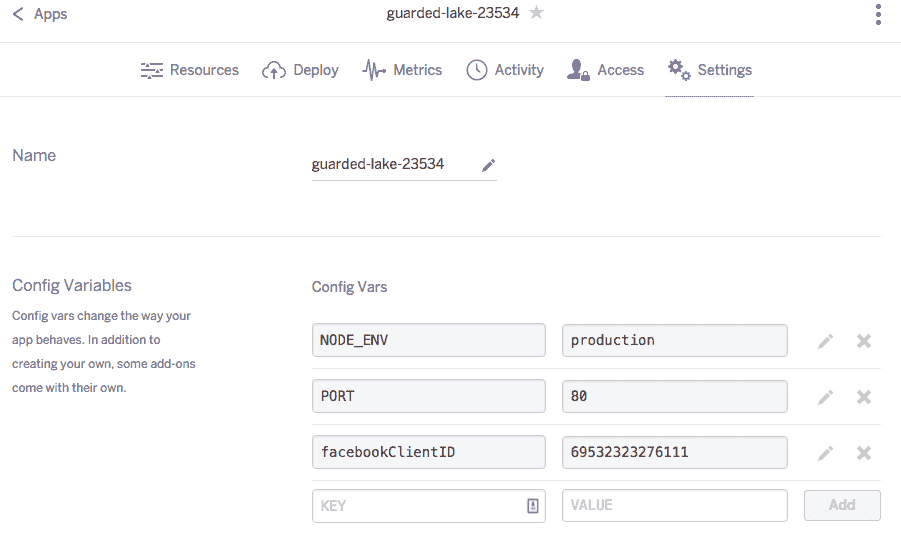

你可以看到我添加了 **NODE_ENV**、**PORT** 和 **facebookClientID** 变量。你也将进行同样的操作，为你的 `appconfig.js` 文件中使用的每个环境变量（包括数据库）各添加一个变量。

请确保调整你的 Facebook 和 Twitter 回调 ID（callback IDs），以使用你新的 Heroku 域名。如果你不清楚它是什么，请滚动到设置页底部，它就会显示出来。

另一个留给你独立完成的步骤是为你的 Facebook 和 Twitter 应用授权你的 Heroku 域名。只需进入你的应用设置并添加新域名即可。

## 部署

既然一切都完全准备就绪，部署变得非常简单。我们将使用简单的 `Gitpush`。首先，运行以下代码以确保我们的 `dist` 文件已准备就绪，并且所有内容已正确提交到 `git` 中：

`$ grunt`

`Running "clean:0" (clean) task`
`>> 53 paths cleaned.`

`Running "copy:main" (copy) task`
`Copied 39 files`

`Running "uglify:my_target" (uglify) task`
`>> 4 files created.`

`Running "htmlmin:dist" (htmlmin) task`
`Minified 2 files`

`Done, without errors.`

## 部署与扩展 SPA

我想用关于应用扩展的几点想法作为结束。扩展一个应用在某种程度上是一门黑艺术，但当你构建了一个应用并且它迅速变得流行时，你确实需要做好准备。

使用 PaaS 工具非常棒的一点之一是，它们极大地简化了扩展性工作。

### 扩展数据库

扩展数据库有许多选项和考虑因素。你只需查看 MongoLab 提供的不同软件包就能看到。MongoDB 本身支持分片和复制，因为它在设计之初就是为了扩展而生的。

关于扩展的考虑因素包括数据库的大小——多少存储空间，以及性能——通常涉及到 RAM 因素或使用专用集群。

MongoLab 以及其他提供商提供了许多高存储和高性能方案的组合，以及多个操作步骤，让你能够增量地扩展规模，而无需中断服务，无需安装或配置新硬件。

理解其的使用情况至关重要，这会随着应用程序的推移而逐渐明确，并影响存储。如果你的应用程序正在增长并对数据库产生大量访问，你就需要考虑性能问题。

### 扩展服务器

Heroku 让将应用扩展到所需的精确尺寸变得极其容易；这是他们业务的核心内容之一。在 Heroku 上，应用运行在 dynos 中。

将 dyno 视为运行你应用程序的轻量级容器即可。

## 部署与扩展 SPA

在本章的开始，我们使用 Grunt 将应用程序打包到 `dist` 文件夹中。我们使用了通过 NPM 安装的 Grunt 插件完成诸如代码压缩等任务。我们花了一点时间探索 Grunt 插件生态系统，该系统非常庞大且支持良好。

随后，我们通过设置云数据库为将应用程序部署到 Web 准备。我们在 MongoLab 上创建了账户，然后创建了一个新数据库。接着，我们在数据库中添加了一个用户，以便从应用程序中访问它。

然后，我们在 Heroku 上设置了账户，并为应用程序部署做好了准备。我们安装了 HerokuToolbelt，它允许我们创建一个新的 Heroku 应用程序部署。我们通过 Heroku 控制面板访问了应用程序并添加了环境变量。最后，我们使用 Git 将项目推送到 Heroku。

最后，我们简要涉及了数据库和服务器扩展等话题。

## 总结

在本章的开始，我们使用 Grunt 将应用程序打包到 `dist` 文件夹中。我们使用了通过 NPM 安装的 Grunt 插件完成诸如代码压缩等任务。我们花了一点时间探索 Grunt 插件生态系统，该系统非常庞大且支持良好。

随后，我们通过设置云数据库为将应用程序部署到 Web 准备。我们在 MongoLab 上创建了账户，然后创建了一个新数据库。接着，我们在数据库中添加了一个用户，以便从应用程序中访问它。

然后，我们在 Heroku 上设置了账户，并为应用程序部署做好了准备。我们安装了 HerokuToolbelt，它允许我们创建一个新的 Heroku 应用程序部署。我们通过 Heroku 控制面板访问了应用程序并添加了环境变量。最后，我们使用 Git 将项目推送到 Heroku。

最后，我们简要涉及了数据库和服务器扩展等话题。

Heroku 拥有许多运行在不同性能水平的各种 dynos，你可以从命令行或控制面板添加和删除它们。

Heroku 还提供了许多插件（add-ons），当然是付费的，用于性能监控等任务。

这并不是在推销 Heroku，其他 PaaS 提供商也提供类似的选项。Amazon Web Services 是 Node.js 的热门选择。还有其他选择，例如 Modulus 和 Ocean。如果你正在部署一个真实的商业应用，货比三以找到适合你的解决方案是值得的。

感谢读完本书。如果你遵循了所有的指令，你现在拥有了一个云端部署、测试过的、用 JavaScript 编写的 SPA。你现在拥有了使用现代 JavaScript 构建端到端、从数据库到表示层应用程序的所有技能。你应该已经牢掌握了 SPA 架构、模坈化代码和关注点分离，并且接触过 MEAN 栈的每一个方面。

恭喜你，做得出色！

