# JavaScript 高级指南

# 献辞

我谨将此作品献给至高精神存在。

## 进一步探索的资源

## 关键词

### 3. 表单验证

JavaScript 在验证表单内的用户输入方面起着至关重要的作用，确保用户输入的数据符合标准。这有助于维护数据完整性，防止错误提交并增强整体用户体验。

### 4. 异步操作

JavaScript 允许使用 AJAX（异步 JavaScript 和 XML）等技术与网络服务器进行异步通信。这种能力允许无需刷新页面即可进行数据检索和更新，从而实现更无缝、交互性的 Web 应用。

# 设置开发环境

要开始编写 JavaScript 代码，你需要一个包含网络浏览器和文本编辑器的开发环境。以下是设置环境的步骤指南：

1. **网络浏览器**：选择一个现代网络浏览器，如 Google Chrome、Mozilla Firefox 或 Microsoft Edge。这些浏览器提供了全面的开发者工具，用于调试、检查元素和监控网络请求。

2. **文本编辑器**：选择一个符合你偏好并提供 Web 开发定制功能的文本编辑器。流行的选择包括 Visual Studio Code、Atom、Sublime Text 和 Notepad++。这些编辑器提供了语法高亮、代码补全和其他提高生产效率的功能。

# 编写你的第一行 JavaScript 代码

一旦开发环境准备就绪，就可以编写你的第一行 JavaScript 代码了。JavaScript 代码通常嵌入在使用 `<script>` 标签的 HTML 文件中。以下是过程的分解：

1. **创建一个 HTML 文件**：从创建一个扩展名为 .html 的文件开始，例如 `index.html`。

2. **添加 HTML 结构**：在 HTML 文件中通过包含 `<html>`、`<head>` 和 `<body>` 标签创建基本结构。

3. **插入 JavaScript 代码**：在 `<body>` 标签内部添加 `<script>` 标签来包含你的 JavaScript 代码。你可以将其放在 `<body>` 标签内的任何位置，但按照习惯，它被放在结尾处，就在 `</body>` 标签之前。

4. **编写 JavaScript 代码**：在 `<script>` 标签内，你可以直接编写 JavaScript 代码。这段代码会在浏览器遇到它时执行。

示例：

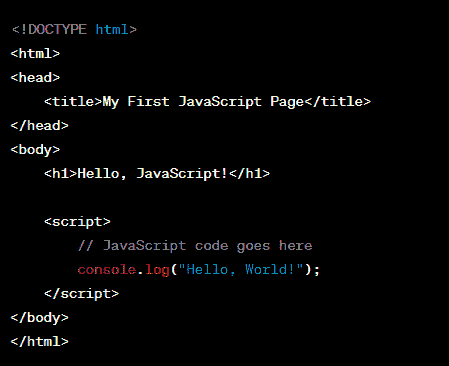

在上面的示例中，我们有一个包含标题元素（`<h1>`）的 HTML 文件，显示文本“Hello, JavaScript!”。JavaScript 代码封装在 `<script>` 标签中。`console.log()` 函数用于向浏览器控制台打印消息“Hello, World!”。

# 在网络浏览器中运行 JavaScript

要查看你的 JavaScript 代码的输出，请遵循以下步骤：

1. 保存你创建的扩展名为 .html 的 HTML 文件。

2. 通过双击 HTML 文件在你偏选的网络浏览器中打开它。

3. **访问浏览器控制台**：要查看由 JavaScript 代码生成的输出和潜在错误，请打开浏览器的开发者工具。通常，你可以在网页的任何地方点击右键，选择“检查”（Inspect）或“检查元素”，并导航到“控制台”（Console）选项卡。

4. **与网页交互**：如果你的 JavaScript 代码涉及用户交互（例如点击点击或表单提交），请与网页交互以触发这些事件，并在浏览器控制台或网页本身上观察结果。

# 练习

1. 创建一个网页，使用 `prompt()` 函数询问用户的姓名。将用户的输入存储在变量中并在网页上显示个性化的问候消息。

2. 编写一个 JavaScript 程序，计算用户输入的两个数字之和。使用 `prompt()` 函数获取数字，执行计算并使用 `alert()` 显示结果。

# 第 2 章

## 变量和数据类型

在本章中，我们将深入研究 JavaScript 中的变量和数据类型概念。这些概念构成了任何编程语言的基础，对于理解如何有效地存储和处理数据至关重要。在本章结束时，你将牢固理解如何声明变量、处理不同的数据类型、处理类型转换和强制类型以及执行基本的算术运算。

### 声明变量和赋值

在 JavaScript 中，变量用于存储和处理数据。它们充当持有值的容器。在我们可以使用变量之前，需要使用 `var`、`let` 或 `const` 关键字来声明它。每个关键字都有自己的作用域以及重新赋值和重新声明的规则。

1. **var**：`var` 关键字传统上在 JavaScript 中用于变量声明。它具有函数作用域或全局作用域，意味着可以在整个函数或程序中访问。它可以在作用域内重新声明和重新赋值。

2. **let**：在 ECMAScript 6 (ES6) 中引入，`let` 关键字提供了块作用域，这意味着变量仅在其声明的代码块内可用。它可以在作用域内重新赋值，但不能在同一作用域内重新声明。

3. **const**：同样在 ES6 中引入，`const` 关键字创建块作用域的变量，一旦分配了值，就不能重新赋值或重新声明。它用于在整个程序中保持不变的值。

在声明变量时，使用反映变量用途的描述性名称是一个良好做法。

示例：

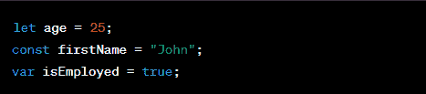

在上面的示例中，我们声明了三个变量：`age`、`firstName` 和 `isEmployed`。我们将数字 `25` 赋值给 `age`，将字符串 `"John"` 赋值给 `firstName`，并将布尔值 `true` 赋值给 `isEmployed`。

### 使用不同的数据类型

JavaScript 支持多种数据类型，每都有特定的用途。理解和处理不同的数据类型对于开发健壮的 JavaScript 程序至关重要。

让我们探索三种常用的数据类型：

1. **字符串 (Strings)**：字符串表示字符序列，用于存储文本数据。它们被单引号（`''`）或双引号（`""`）包含。

示例：

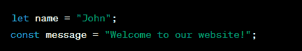

在上面的示例中，我们声明了两个变量 `name` 和 `message` 并为它们赋值了字符串值。

2. **数字 (Numbers)**：数字表示数值数据，可以是整数或浮点数。它们用于计算、比较以及各种其他数学运算。

示例：

在上面的示例中，我们声明了两个变量 `quantity` 和 `price` 并为它们赋值了数值值。

3. **布尔值 (Booleans)**：布尔值表示逻辑值，可以是 `true` 或 `false`。它们通常用于决策和控制程序流。

示例：

在上面的示例中，我们声明了两个变量 `isLogged` 和 `isEmailVerified` 并为它们赋值了布尔值。

### 类型转换和强制转换

JavaScript 提供了类型转换和强制转换的功能，允许你将数据从一种类型转换为另一种类型，或者在操作期间自动转换值。

让我们进一步探索这些概念：

1. **类型转换**：类型转换是显式将值从一种数据类型转换为另一种的过程。JavaScript 提供了函数和方法来方便类型转换。

示例：

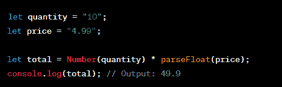

在上面的示例中，我们分别使用 `Number()` 和 `parseFloat()` 函数将 `quantity` 和 `price` 的字符串值转换为数字。

2. **强制转换 (Type Coercion)**：强制转换，也称为隐式类型转换，是在某些操作期间自动将值从一种类型转换为另一种类型。

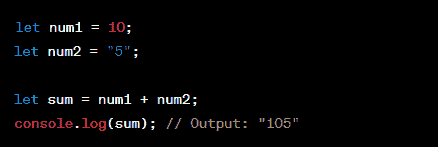

在上面的示例中，JavaScript 自动将数字 `num1` 转换为字符串并执行字符串拼接而不是加法。

### 基础算术运算

JavaScript 提供了各种算术运算符用于对数值数据类型执行基础数学运算。这些运算符包括加法 (`+`)、减法 (`-`)、乘法 (`*`)、除法 (`/`) 和取模 (`%`)。

这是一个示例：

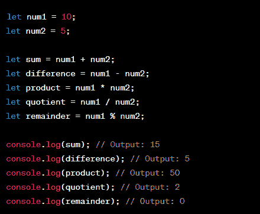

在上面的示例中，我们使用变量 `num1` 和 `num2` 执行了加加、减、乘、除和取模运算。

### 练习题

1. 编写一个 JavaScript 程序计算矩形的面积。提示用户输入宽度和高度，计算面积并使用 `alert()` 显示结果。

2. 创建一个将温度从摄氏度转换为华氏度的程序。提示用户输入摄氏度温度，执行转换并使用 `console.log()` 显示结果。

3. 开发一个计算圆柱体积的程序。提示用户输入圆柱的半径和高度，计算体积并使用 `alert()` 显示结果。

4. 实现一个简单的计算器程序，提示用户输入两个数字和一个运算符（`+`、`-`、`*`、`/`）。执行相应的算术运算并使用 `console.log()` 显示结果。

# 第 3 章

## 控制流与条件

在本章中，我们将深入探讨 JavaScript 中的控制流和条件判断。控制流允许我们规定语句执行的顺序，而条件判断使我们能够根据特定条件做出决策并执行不同的代码块。在本章结束时，你将彻底理解 `if` 语句、`else` 和 `else if` 语句、`switch` 语句，以及比较运算符和逻辑运算符。

### 使用 if 语句进行决策

`if` 语句是一种关键的控制流语句，它允许我们仅在指定条件为 `true` 时执行代码块。

`if` 语句的基本语法如下：

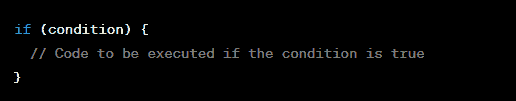

让我们考虑一个示例：

在上面的示例中，`if` 块内部代码只有在条件 `hour < 12` 结果为 `true` 时才会执行。如果条件为 `false`，则跳过该代码块。

### 使用 else 和 else if 语句

除了 `if` 语句外，我们还可以使用 `else` 语句指定当 `if` 语句条件为 `false` 时要执行的代码块。

`if-else` 语句的语法如下：

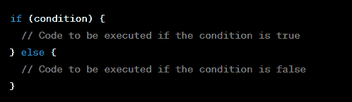

考虑以下示例：

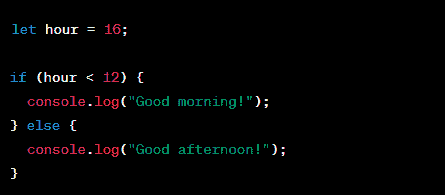

在这个示例中，如果条件 `hour < 12` 为 `false`，则将执行 `else` 块内部的代码。

为了处理多个条件，我们可以使用 `else if` 语句。

`if-else if-else` 语句的语法如下：

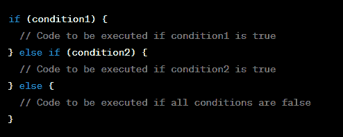

这是一个示例：

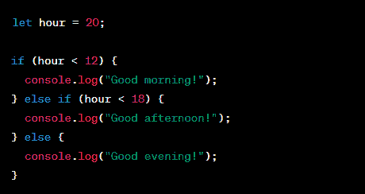

在这个示例中，将根据变量 `hour` 的值执行相应的代码块。

### 用于多分支场景的 switch 语句

`switch` 语句提供了一种根据表达式值处理多种情况的替代方法。它为长长的 `if-else if` 链提供了一种简洁且易读的替代方案。

`switch` 语句的基本语法如下：

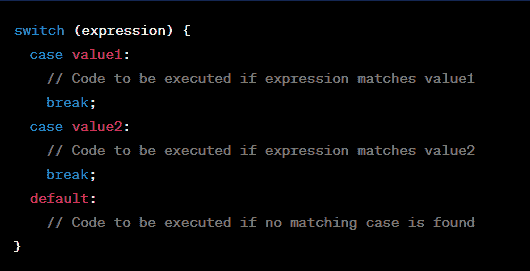

让我们考虑一个示例：

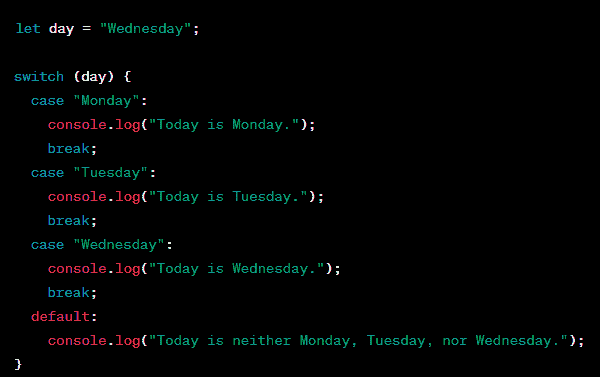

在这个示例中，匹配变量 `day` 值的 `case` 块内部代码将执行。

### 使用比较运算符和逻辑运算符

比较运算符用于比较值并返回布尔结果。它们包括：

* 等于 (`==`)
* 不等于 (`!=`)
* 大于 (`>`)
* 小于 (`<`)
* 大于等于 (`>=`)
* 小于等于 (`<=`)

逻辑运算符允许我们组合多个条件并评估其结果。JavaScript 中常用的逻辑运算符有：

* 逻辑与 (`&&`)：当两个条件都为 `true` 时，返回 `true`。
* 逻辑或 (`||`)：当至少有一个条件为 `true` 时，返回 `true`。
* 逻辑非 (`!`)：反转布尔值。

让我们来看一个示例：

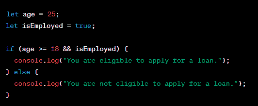

在这个示例中，只有当 `age` 大于等于 18 且变量 `isEmployed` 为 `true` 时，才会执行 `if` 块内部的代码。

### 练习题

1. 编写一个 JavaScript 程序，提示用户输入年龄。如果年龄大于等于 18 岁，显示消息说明他们有权投票；否则显示消息说明他们没有投票权。

2. 创建一个程序，提示用户输入一个数字。如果数字是正数，显示它是正数；如果数字是负数，显示它是负数；如果数字是零，显示它是零。

3. 开发一个程序，提示用户输入用户名和密码。如果用户名是 "admin" 且密码是 "password123"，显示“登录成功”。否则显示“登录失败”。

4. 实现一个程序，提示用户输入星期。使用 `switch` 语句显示是工作日还是周末。

# 第 4 章

## 循环与迭代

在本章中，我们将探索 JavaScript 中的循环和迭代。循环允许我们多次执行代码块，这对于自动化任务至关重要。我们将涵盖 `while` 循环、`for` 循环、循环控制语句（`break` 和 `continue`）以及对数组和对象的迭代。在本章结束时，你将掌握如何使用循环。

### 使用 while 循环处理重复任务

`while` 循环是一种基础循环结构，只要指定条件为 `true`，它就会重复执行代码块。

`while` 循环的基本语法如下：

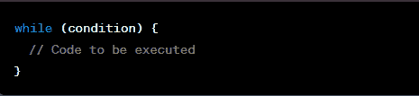

让我们考虑一个使用 `while` 循环从 1 到 5 的示例：

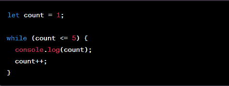

在这个示例中，只要条件 `count <= 5` 为真，循环就会执行。`count` 变量每次增加 1。

### 理解 for 循环及其语法

`for` 循环是另一种常用的循环结构。它们提供了一种按固定次数迭代代码块的更简洁的方法。

`for` 循环由三部分组成：初始化、条件和增/减。

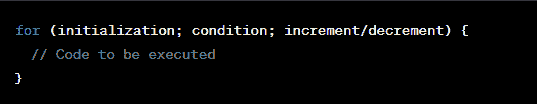

让我们来看一个与之前的 `while` 循环功能相同的示例：

在这个示例中，`for` 循环初始化变量 `count` 为 1，检查条件 `count <= 5`并在每次迭代中将 `count` 加 1。

### 循环控制语句

有时，我们需要改变循环的正常流程。JavaScript 提供了两种循环控制语句：`break` 和 `continue`。

* `break` 语句允许我们提前终止循环，无论循环条件如何。遇到 `break` 语句时，循环立即退出。

在这个示例中，当 `i` 的值等于 3 时，循环终止。因此，输出为 1 和 2。

* `continue` 语句允许我们跳过当前迭代并进入循环的下一次迭代。

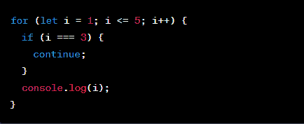

在这个示例中，当 `i` 等于 3 时，遇到 `continue` 语句，循环将跳过当前迭代的剩余代码。因此，输出为 1, 2, 4 和 5。

循环通常用于遍历数组和对象，以便处理每个元素或属性。让我们探索如何使用 `for` 循环遍历数组和对象。

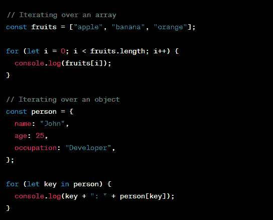

在第一个示例中，我们使用 `for` 循环遍历 `fruits` 数组中的每个元素。循环从 0 迭代到数组长度减 1。

在第二个示例中，我们使用 `for-in` 循环遍历 `person` 对象中的每个属性。该循环将每个属性名称赋值给变量 `key`，使我们能够能够使用 `person[key]` 访问对应的值。

### 练习题

1. 编写一个 JavaScript 程序，使用 `while` 循环打印从 1 到 10 之间的偶数。

2. 创建一个程序，使用 `for` 循环计算 1 到 100 之间所有数字的和。

3. 开发一个程序，使用 `for` 循环遍历名称数组，并为每个名称打印“Hello, [name]!”。

4. 实现一个程序，使用 `while` 循环在数组中搜索特定值，并在找到该值时停止循环。

# 第 5 章

## 函数

在本章中，我们将探索 JavaScript 中函数的概念。函数是执行特定任务的可重用代码块。它们增强了程序的模块化和可重用性。我们将涵盖许多主题，如定义和调用函数、传递参数和返回值、函数作用域，以及利用内置函数和创建自定义函数。在本章结束时，你将对如何在 JavaScript 中使用函数有坚固的理解。

### 定义和调用函数

JavaScript 中的函数使用 `function` 关键字定义，后面紧跟函数名、一对括号以及由大括号括起来的代码块。

定义函数的标准语法如下：

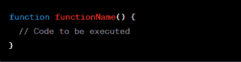

让我们考虑一个用于问候用户的简单函数示例：

要执行或调用函数，我们只需要编写函数名后跟括号即可。

例如：

在这个示例中，调用 `greet()` 函数会执行函数块内部的代码，该代码会显示问候消息。

### 传递参数和返回值

函数还可以接收参数（arguments），这些是传入函数以执行特定任务的值。参数定义在函数声明的括号内。我们可以在函数内部使用这些参数来处理数据或执行计算。此外，函数可以使用 `return` 关键字返回结果。

让我们考虑一个根据宽度和高度计算矩形面积的函数示例：

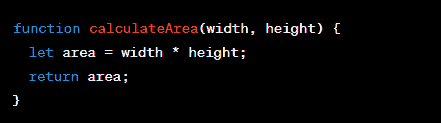

要调用此函数并获取计算出的面积，我们将返回值赋值给变量：

在这个示例中，`calculateArea()` 函数接受两个参数：`width` 和 `height`。它通过这两个值相乘来计算面积，并使用 `return` 语句返回结果。

### 理解函数作用域

函数作用域是指变量在函数内部的可见性和可访问性。在函数内部声明的变量被称为局部变量，只能在该函数内部访问。相反，在任何函数外部定义的变量被称为全局变量，可以从程序的任何地方访问。

让我们考虑一个演示函数作用域的示例：

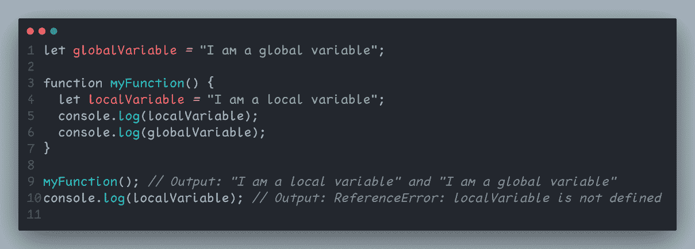

在这个示例中，`localVariable` 定义在 `myFunction()` 函数内部，只能在该函数内部访问。定义在任何函数外部的 `globalVariable` 可以在函数内部和外部进行访问。尝试在函数外部访问 `localVariable` 将导致引用错误（reference error）。

### 利用内置函数和创建自定义函数

JavaScript 提供了许多执行常见任务的内置函数。这些函数可以直接使用，无需显式定义。内置函数的示例包括 `console.log()`、`alert()`、`prompt()`、`parseInt()`、`parseFloat()` 等许多函数。

让我们来看一个利用 `parseInt()` 函数将字符串转换为整数的示例：

在这个示例中，我们使用 `parseInt()` 函数将字符串 `"42"` 转换为整数 `42`。

除了内置函数外，我们还可以根据特定需求创建自定义函数。自定义函数允许我们封装代码块并在需要时执行它们，从而提高了代码的可重用性和可维护性。

让我们考虑一个计算数字平方的自定义函数示例：

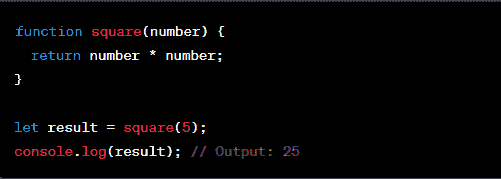

在这个示例中，`square()` 函数接受一个 `number` 数字参数并返回该数字的平方。

### 练习题

1. 编写一个 JavaScript 函数，接受人的姓名作为参数并显示带有其名字的问候消息。用不同的名字调用该函数进行测试。

2. 创建一个函数，接受两个数字作为参数并返回它们的和。用不同的数字组合调用该函数以验证其准确性。

3. 开发一个检查给定数字是偶数还是奇数的函数。如果数字是偶数，函数应返回“Even”，如果是奇数则返回“Odd”。用各种数字测试该函数。

4. 实现一个函数，接受数字数组作为参数并返回这些数字的平均值。用不同的数字数组测试该函数。

# 第 6 章

## 数组和对象

在本章中，我们将深入研究 JavaScript 中的数组和对象。数组和对象是强大的数据结构，允许我们高效地存储和处理数据。我们将涵盖广泛的内容，包括创建和操作数组、访问数组元素、使用 `push`、`pop`、`shift` 和 `unshift` 等数组方法、创建和访问对象属性、遍历数组和对象等。在本章结束时，你将深入理解如何操作数组和对象。

### 创建和操作数组

数组是 JavaScript 的基础部分，用于变量存储多个值。我们可以通过在方括号内包含逗号分隔的值列表来创建数组。

例如：

在这个示例中，我们创建了一个名为 `fruits` 的数组，它包含三个元素：“apple”、“banana”和“orange”。数组可以存储不同类型的值，包括数字、字符串、布尔值，甚至是数组或对象。

要访问数组中的元素，我们使用方括号和元素的索引。注意数组索引从 0 开始。

例如：

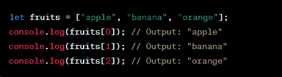

在这个示例中，我们使用各自的索引访问了 `fruits` 数组的第一个、第二个和第三个元素。

数组是可变的，这意味着我们可以在创建后修改它们的元素。我们可以为数组元素分配新值或更改现有值。

例如：

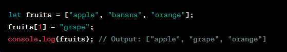

在这个示例中，我们将索引 1 的值从 "banana" 改为 "grape"。

### 使用数组方法

JavaScript 提供了多种内置方法来高效操作数组。

让我们探索常用方法：

* `push()` 方法向数组末尾添加一个或多个元素。

例如：

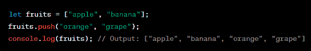

在这个示例中，`push()` 方法向 `fruits` 数组末尾添加了 "orange" 和 "grape"。

* `pop()` 方法从数组末尾删除最后一个元素并返回该元素。

例如：

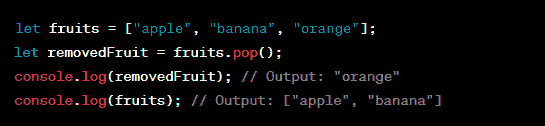

在本示例中，`pop()` 方法从 `fruits` 数组中移除最后一个元素（"orange"）并将其返回。

* `shift()` 方法从数组中移除第一个元素并返回该元素。

例如：

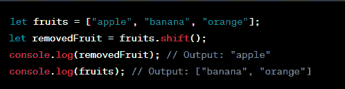

在本示例中，`shift()` 方法从 `fruits` 数组中移除第一个元素（"apple"）并将其返回。

* `unshift()` 方法在数组的开头添加一个或多个元素。

例如：

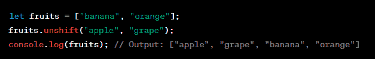

在本示例式中，`unshift()` 方法将 "apple" 和 "grape" 添加到 `fruits` 数组的开头。

### 创建和访问对象属性

JavaScript 中的对象是键值对的集合，其中每个键都是唯一的标识符，而每个值可以是任何数据类型。我们可以通过将键值对封装在花括号内来创建一个对象。

例如：

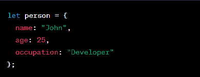

在本示例中，我们创建了一个名为 `person` 的对象，包含三个属性：`name`、`age` 和 `occupation`。我们可以使用点表示法或方括号来访问对象属性的值。

例如：

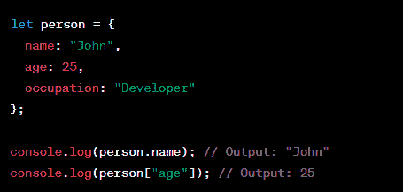

在本示例中，我们使用点表示法（`person.name`）访问 `name` 属性的值，并使用方括号（`person["age"]`）访问 `age` 属性的值。

与数组，对象是可变的，我们可以修改它们的属性。我们可以为现有属性分配新值，或者添加新属性。

例如：

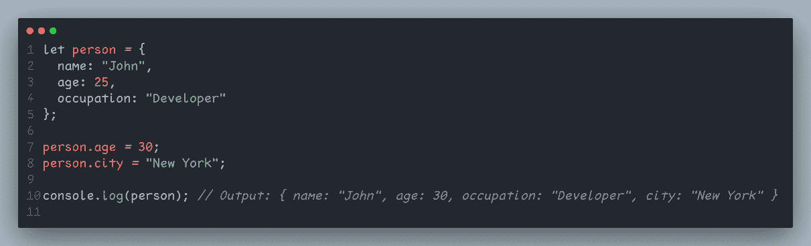

在本示例中，我们更改了 `age` 属性的值并为 `person` 对象添加了新的 `city` 属性。

### 遍历数组和对象

为了对数组的每个元素或对象的每个属性执行操作，我们可以使用循环或其他迭代技术。

对于数组，我们可以使用 `for` 循环来遍历元素：

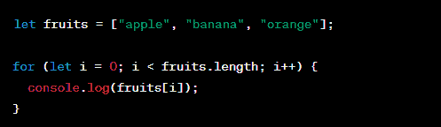

在本示例中，我们使用 `for` 循环遍历 `fruits` 数组并打印每个元素。

对于对象，我们可以使用 `for...in` 循环来遍历属性：

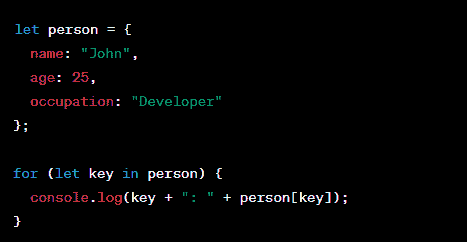

在本示例中，我们使用 `for...in` 循环遍历 `person` 对象的属性，并打印每个属性名称及其对应的值。

## 练习

1. 编写一个 JavaScript 函数，接受数字数组作为参数并返回所有数字之和。使用不同的数组测试该函数。

2. 创建一个名为 `names` 的数组，包含五个国家的名称。使用循环遍历数组并打印每个国家名称。

3. 实现一个函数，接受对象作为参数并返回其属性名称的数组。使用不同的对象测试该函数。

4. 开发一个程序，提示用户输入一个句子并统计句子中每个单词出现的频率。使用对象来存储单词计数并显示结果。

# 第 7 章

## 文档对象模型 (DOM) 操作

在本章中，我们将深入研究文档对象模型（DOM）的复杂性以及它在 Web 开发中至关重要的作用。DOM 提供了一个强大的接口，允许我们使用 JavaScript 动态地访问、操作和更新 HTML 文档的内容和结构。我们将涵盖广泛的主题，包括访问和修改 HTML 元素、处理事件和事件监听器、遍历 DOM、创建和删除元素以及优化 DOM 操作。在本章结束时，你将深入理解如何使用 DOM 创建交互式和动态的网页。

### DOM 简介

文档对象模型（DOM）是一种编程接口，它将 HTML 文档的结构表示为树形结构的对象。它充当浏览器和 JavaScript 之间的接口，允许我们动态地交互和操作网页元素。DOM 提供了方法和属性，使能够导航、修改和更新 HTML 文档的内容和结构。

当网页加载时，浏览器会解析 HTML 标记并构建 DOM 树，其中每个元素、属性和文本节点都被表示为一个对象。这种树形结构允许我们使用 JavaScript 程序化地访问和操作网页的元素。通过修改 DOM，我们可以动态地更新网页的内容、样式和行为，创建丰富且交互的用户体验。

### 使用 JavaScript 访问和修改 HTML 元素

为了处理 DOM 中的 HTML 元素，我们需要使用 JavaScript 访问并操作它们。我们可以使用各种 DOM 方法，根据标签名、类名或唯一标识符（ID）来选择元素。以下是一些常用方法：

* `document.getElementById("id")`：选择指定 ID 的元素。
* `document.getElementsByClassName("class")`：选择具有指定类名的元素。
* `document.getElementsByTagName("tag")`：选择具有指定标签名的元素。
* `document.querySelector("selector")`：选择匹配指定 CSS 选择器的第一个元素。
* `document.querySelectorAll("selector")`：选择所有匹配指定 CSS 选择器的元素。

一旦我们选择了元素，就可以操作它的属性、特性和内容。

以下是一些示例：

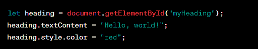

在本示例中，我们选择了一个 ID 为 `myHeading` 的元素，并修改了它的文本内容和样式属性。

### 处理事件和事件监听器

事件是浏览器中发生的动作或情况，例如按钮点击、鼠标移动或键盘输入。我们可以通过为元素附加事件监听器来响应这些事件。事件监听器是在特定事件发生时执行的函数。它们允许我们响应交互执行自定义操作。

我们可以使用 `addEventListener()` 方法附加事件监听器。

这是一个示例：

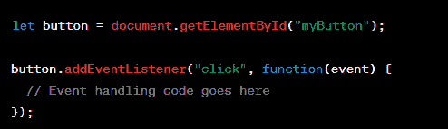

在本示例中，我们为 ID 为 `myButton` 的按钮附加了点击事件监听器。当点击按钮时，就会执行指定的函数。

在事件监听器函数中，我们可以访问事件对象，它包含了有关事件以及触发元素的信息。该对象允许我们根据事件类型、目标元素或其他相关数据来执行操作。

### 遍历 DOM

遍历 DOM 涉及通过其结构来访问不同的元素或节点。我们可以在 DOM 树中向上、向下和横向移动，以访问父元素或兄弟元素。以下是一些常用的遍历方法：

* `parentNode`：返回元素的父节点。
* `childNodes`：返回元素的子节点集合。
* `firstChild`：返回元素的第一个子节点。
* `lastChild`：返回最后一个子节点。
* `nextSibling`：返回元素的下一个兄弟节点。
* `previousSibling`：返回元素的上一个兄弟节点。

这是一个演示 DOM 遍历的示例：

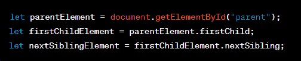

在本示例中，我们选择了 ID 为 `parent` 的父元素，并通过遍历 DOM 来访问其第一个子元素和下一个兄弟元素。

### 创建和删除元素

使用 JavaScript 动态创建并向 DOM 添加新元素，或删除现有元素。这允许我们动态地更新网页的内容和结构。

这是一个示例：

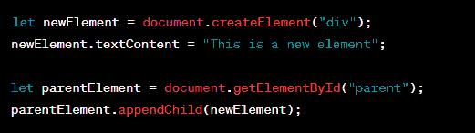

在本示例中，我们创建了一个新的 `div` 元素，设置了它的文本内容，并将其作为子元素追加到 ID 为 `parent` 的父元素中。

要从 DOM 中删除元素，我们可以使用 `remove()` 方法：

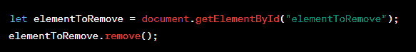

在这个示例中，我们选择一个 ID 为 "elementToRemove" 的元素并将其从 DOM 中移除。

### 优化 DOM 操作

在处理 DOM 时，考虑性能因素至关重要。过度的 DOM 操作会影响页面的响应速度和用户体验。为了优化 DOM 操作，请考虑以下实践方法：

* **减少对 DOM 的访问**：存储频繁访问元素的引用，以避免重复的 DOM 查询。
* **使用高效的 DOM 操作方法**：在可能的情况下，使用 `document.createDocumentFragment()` 或 `element.appendChild()` 等批量操作，以尽量地减少对 DOM 的更新次数。
* **使用事件委托**：不要在单个元素上绑定事件监听器，而是考虑使用事件委托在更高级别处理事件，从而减少绑定到 DOM 的事件监听器数量。

### 练习题

1. 创建一个包含用户姓名和邮箱输入字段的表单。实现一个 JavaScript 函数，在点击提交按钮时对表单进行验证。在无效字段旁边显示错误信息。

2. 构建一个带有缩略图的相册。实现 JavaScript 功能，在点击缩略图时显示完整尺寸的图片。

3. 开发一个下拉菜单，点击时可以展开和折叠选项。实现 JavaScript 逻辑来切换下拉选项的可见性。

4. 创建一个测验应用程序，向用户展示选择题。实现 JavaScript 功能来跟踪并显示用户的得分。

# 第 8 章

## 处理用户输入和表单验证

在本章中，我们将深入探讨 JavaScript 中处理用户输入和表单验证的话题。用户输入是 Web 应用的一个关键方面，确保用户提供的输入有效并符合要求的标准至关重要。我们将探索获取用户输入、执行表单验证以及通过事件处理创建交互式表单的各种技术和最佳实践。在本章结束时，你将全面理解如何有效地处理用户输入并创建健壮的表单验证机制。

### 从文本字段和按钮获取用户输入

文本字段和按钮是 Web 表单中捕捉用户输入的元素。JavaScript 提供了多种方法和属性来获取用户在这些元素中输入的值。让我们深入如何使用 JavaScript 从文本字段和按钮获取用户输入。

要获取文本字段中输入的值，我们可以利用相应输入元素的 `value` 属性。然而，通过清理和验证数据来安全地处理用户输入是非常重要的。

例如：

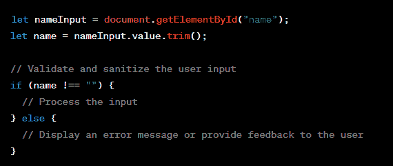

在这个示例中，我们获取 ID 为 "name" 的文本字段中输入的值，并将其存储在变量 `name` 中。此外，我们进行了验证检查以确保输入为空，并修除了任何前导或尾空格。

要处理与按钮的交互，我们可以附加事件监听器，并在被点击或以其他方式交互时执行特定操作。

例如：

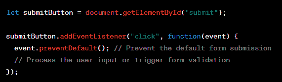

在这个示例中，我们为 ID 为 "submit" 的按钮绑定了点击事件监听器。当按钮被点击时，会执行指定的函数。我们还使用 `preventDefault()` 方法阻止默认的表单提交行为，以便进行自定义处理或表单验证。

### 表单验证技术

表单验证是处理用户输入的关键环节，确保用户输入的数据有效并符合特定要求。JavaScript 提供了动态表单验证的强大工具和技术。让我们探索一些高级验证场景和技术。

1. **必填字段**：除了检查空字段，我们还可以通过考虑额外的约束（如最小和最大长度要求）来增强验证。

例如：

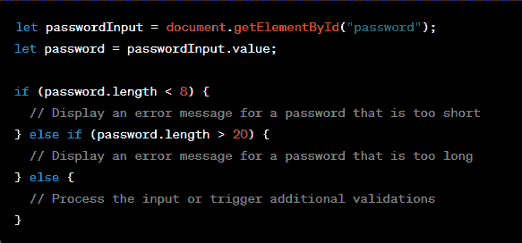

在这个示例中，我们检查密码输入的长度，并根据定义的约束提供适当的反馈。

2. **模式匹配**：可以使用正则表达式来根据特定模式验证用户输入。例如，验证邮箱地址：

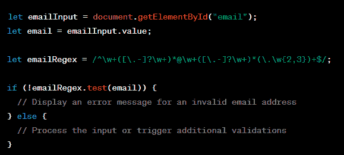

在这个示例中，我们使用正则表达式来验证输入的邮箱地址的格式。正则表达式确保了邮箱符合具有适当结构的标准邮箱格式。

3. **自定义验证函数**：对于更复杂的验证场景，我们可以创建自定义验证函数来检查特定条件并返回验证结果。

例如：

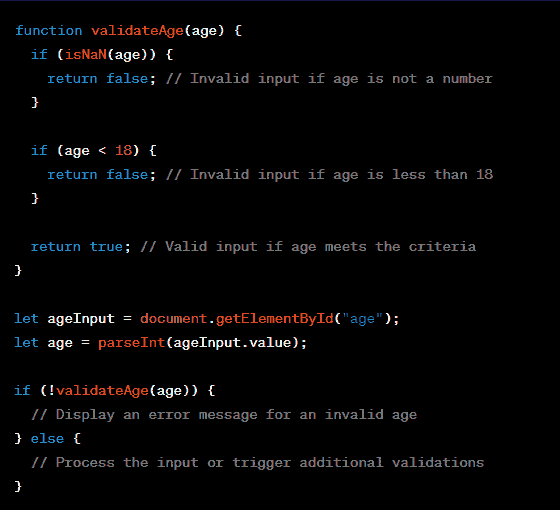

在这个示例中，我们创建了一个自定义的 `validateAge()` 函数，检查输入的年龄是否为数字以及是否符合特定标准（在本例中为 18 岁及以上）。然后我们使用该函数来验证输入，并在验证失败时显示适当的错误信息。

### 使用事件处理创建交互式表单

为了创建交互表单，我们可以利用事件处理来响应用户操作，如按键、输入更改和表单提交。通过在表单元素上附加事件监听器，我们可以根据用户交互执行特定操作或触发验证。让我们探索一些常见的事件及其在表单交互中的用法。

1. **input 事件**：当输入元素的值变化时，会触发 `input` 事件。它对于捕捉实时输入变化很有用。

例如：

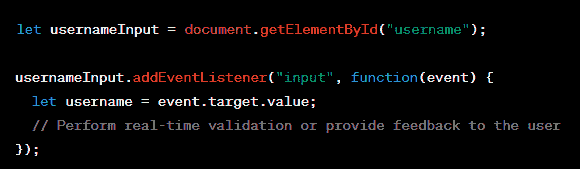

在这个示例中，我们为用户名输入字段绑定了 `input` 事件监听器。当用户输入或修改输入内容时，会执行指定的函数，从而允许实时验证或向用户提供反馈。

2. **change 事件**：当表单元素（如选择框或复选框）的值发生变化时，会触发 `change` 事件。它对于捕捉所选选项或复选框状态的变化很有用。

例如：

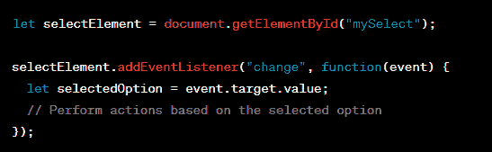

在这个示例中，我们为选择框元素绑定了 `change` 事件监听器。当选中选项发生变化时，会执行指定的函数，允许我们根据所选选项执行操作。

3. **submit 事件**：当表单被提交（通过点击提交按钮或按回车键）时会触发 `submit` 事件。它对于在向服务器提交数据或触发后续操作之前执行表单验证很有用。

例如：

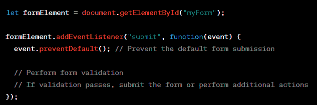

在这个示例中，我们为表单元素绑定了 `submit` 事件监听器。当表单提交时，会执行指定的函数。我们使用 `event.preventDefault()` 阻止默认的表单提交，以便进行自定义表单验证和后续操作。

### 练习题

1. 创建包含姓名、邮箱和密码字段的注册表单。实现 JavaScript 验证确保所有字段已填写并符合每个字段的要求。为无效输入显示错误信息。

2. 开发一个带有电话号码字段的表单。实现 JavaScript 验证确保输入的电话号码遵循特定格式，例如 (XXX) XXX-XXXX。为无效的电话号码显示错误信息。

3. 构建一个包含下拉菜单和文本字段的表单。实现 JavaScript 验证确保用户在提交表单之前从下拉菜单选择了选项。如果没有选择选项，则显示错误信息。

4. 创建一个包含复选框和提交按钮的表单。实现 JavaScript 验证确保在提交表单之前勾选了复选框。如果未勾选，则显示错误信息。

5. 通过检查输入密码的强度来增强注册表单。实现 JavaScript 验证，根据长度、大写字母、小写字母、数字和特殊字符等标准来评估密码强度。向用户显示密码强度的视觉指示。

# 第 9 章

## AJAX 和 API 简介

在本章中，我们将在 Web 开发背景下探索 AJAX（异步 JavaScript 和 XML）和 API（应用程序编程接口）。AJAX 允许我们向服务器发送异步请求、检索数据，并在无需刷新整个网页的情况下动态更新网页的部分内容。我们将涵盖 AJAX 的基础知识、使用 JavaScript 发送 HTTP 请求、从 API 获取数据以及处理 JSON 数据。在本章结束时，你将对如何将外部数据集成到你的 Web 应用程序中并创建动态用户体验有坚固的理解。

### 深入理解 AJAX 及其在异步通信中的作用

AJAX 是一组 Web 开发技术，允许我们在不干扰当前页面的情况下异步从服务器发送和接收数据。通过 AJAX，我们可以在不重新加载整个网页的情况下更新网页的特定部分，提供更流畅、响应更快的用户体验。AJAX 广泛用于表单提交、实时数据更新和动态内容加载等任务。

AJAX 的核心是 `XMLHttpRequest` 对象，它允许我们从 JavaScript 发起 HTTP 请求。通过使用 `XMLHttpRequest` 对象，我们可以与服务器异步通信、发送数据并接收响应。

### 使用 JavaScript 发送 HTTP 请求

要使用 JavaScript 发送 HTTP 请求，我们利用 `XMLHttpRequest` 对象。

这是一个演示如何向服务器发送 GET 请求并处理响应的示例：

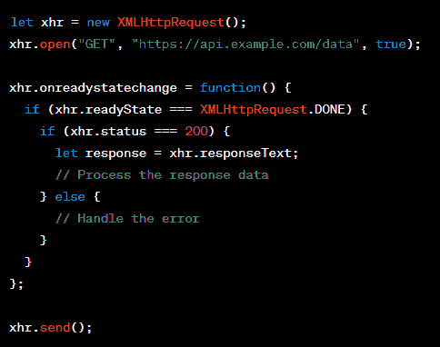

在这个示例中，我们创建了一个新的 `XMLHttpRequest` 对象，并对 URL `"https://api.example.com/data"` 打开了一个 GET 请求。我们设置了 `onreadystatechange` 事件处理程序，以便在请求状态改变时执行函数。当 `readyState` 为 `XMLHttpRequest.DONE` (4) 时，我们检查 `status` 以确保请求执行成功（状态码 200）。如果成功，我们可以使用 `xhr.responseText` 访问响应数据。

### 从 API 获取数据并显示在网页上

API 提供了一种结构化方法来从外部源检索数据并将其集成到我们的 Web 应用程序中。许多流行的网站和服务提供 API，允许开发者以程序方式访问它们的数据和功能。

这是一个从 API 获取数据并将其显示在网页上的示例：

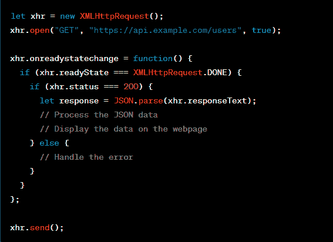

在这个示例中，我们向 API 端点发送 GET 请求，该端点返回包含用户数据的 JSON 响应。我们使用 `JSON.parse()` 解析 JSON 响应，将其转换为我们可以处理的 JavaScript 对象。然后，我们可以处理数据并根据需要将其显示在网页上。

### 处理 JSON 数据

JSON（JavaScript 对象表示）是一种轻量级的数据交换格式，广泛用于服务器和 Web 应用程序之间的数据传输。它易于人类读写，并可以被 JavaScript 轻松解析和生成。

在与 API 工作时，在响应中接收 JSON 数据是常见的。JSON 数据由键值对组成，可以表示为 JavaScript 对象。

这是一个处理从 API 获取的 JSON 数据的示例：

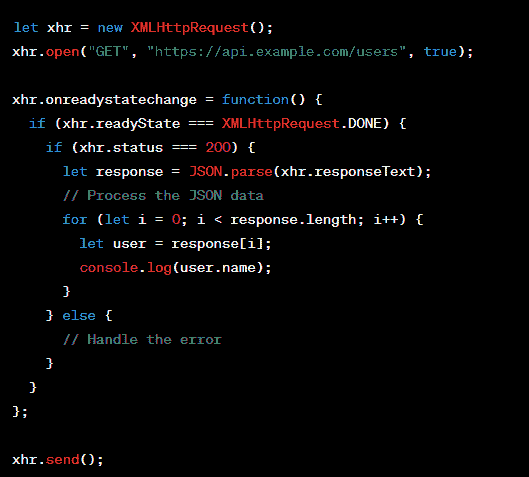

在这个示例中，我们使用 `JSON.parse()` 解析 JSON 响应将其转换为 JavaScript 对象。然后，我们可以根据 JSON 的结构使用点表示法或括号表示法访问数据。在这种情况下，我们遍历了一个用户对象数组，并将每个用户的名称打印到控制台。

### 练习题

1. 创建一个简单的天气应用程序，从天气 API 获取天气数据。在网页上显示温度、天气状况和位置。

2. 构建一个新闻流应用程序，从新闻 API 获取最新的新闻文章。在网页上显示标题、文章摘要和发布日期。

3. 开发一个货币转换器，从货币 API 获取最新的汇率。允许用户输入一种货币的金额，并显示转换成另一种货币的额后金额。

4. 创建一个电影搜索应用程序，从电影数据库 API 获取电影数据。允许用户通过标题搜索电影，并在网页上显示电影详情，如标题、发行年份和剧情。

# 第 10 章

## 错误处理与调试简介

在本章中，我们将深入探讨 JavaScript 中错误处理和调试的主题。作为开发者，遇到错误是常见现象，因此对如何有效地识别、诊断和处理错误有全面的理解至关重要。我们将探索用于错误处理和调试的各种技术和工具，包括理解常见的 JavaScript 错误、利用浏览器开发人员工具、实现 `try...catch` 语句以及编写整洁可维护的代码。在本章结束时，你将在错误处理和调试方面拥有坚实的基础，使你能够构建稳健可靠的 JavaScript 应用程序。

### 识别和理解常见的 JavaScript 错误

要精通错误处理，识别并理解开发过程中可能遇到的常见 JavaScript 错误至关重要。让我们深入探讨一些最常见的错误及其产生：

1. **语法错误 (Syntax Errors)**：当代码语法出现错误时会发生语法错误，导致代码无法正常执行。这些错误通常由于缺少或位置错误的字符、关键字使用不当或无效声明。

例如：

在这个示例中，发生语法错误是因为 `console.log()` 语句中缺少右括号。

2. **引用错误 (Reference Errors)**：当你尝试访问不存在或超出范围的变量或函数时，会发生引用错误。这些错误通常发生在你拼错变量名、在声明之前访问变量或尝试访问超出作用域的变量时。

例如：

在这个示例中，如果变量 `message` 在访问之前未定义就会发生引用错误。

3. **类型错误 (Type Errors)**：当你对不类型的值执行操作时，会发生类型错误。这些错误通常发生在你尝试使用不适用于值类型的方法或属性时。

例如：

在这个示例中，发生类型错误是因为 `toUpperCase()` 方法只能用于字符串，不能用于数字。

### 使用浏览器开发人员工具进行调试

现代网络浏览器提供了强大的开发人员工具，为调试 JavaScript 代码提供了卓越的功能。这些工具允许你检查和操作网页的 HTML、CSS 和 JavaScript，从而更容易识别和解决错误。让我们探索浏览器开发人员工具的一些基本功能：

1. **控制台 (Console)**：控制台是记录消息、检查变量和调试代码的有用工具。你可以使用各种方法，如 `console.log()`、`console.error()` 和 `console.warn()` 向控制台输出消息和数据。

例如：

该语句向控制台输出“Hello, world!” 消息，帮助你验证特定代码段是否按预期执行。

2. **调试器 (Debugger)**

`debugger` 语句是一个用于交互式调试的强大工具。通过在代码中放置 `debugger` 语句，你可以设置断点，在特定行暂停执行。当执行到断点时，浏览器的开发者工具会自动打开，允许你检查变量状态、单步执行代码并观察执行流。

### 实现用于错误处理的 try...catch 语句

JavaScript 提供了 `try...catch` 语句来优雅地处理错误。通过将可能出错的代码封装在 `try` 块中，并在 `catch` 块中捕获任何抛出的错误，你可以防止代码意外停止并以控制的方式处理错误。

`try...catch` 语句具有以下语法：

在此结构中，发生于 `try` 块内的任何错误都将被捕获，并执行 `catch` 块中的代码。`error` 参数代表被捕获的错误，并提供有关错误的信息，例如错误名称和消息。你可以使用这些信息来妥善地处理错误，无论是向用户显示错误信息、为了调试目的记录错误，还是采取替代措施从错误中恢复。

### 编写整洁且可维护的代码

编写整洁且可维护的代码对于减少错误概率并确保你的代码库可读、易懂且易于维护至关重要。

以下是编写 JavaScript 代码时遵循的一些最佳实践：

1. **一致的缩进**：使用一致的缩进来提高代码的可读性。通常使用两个或四个空格作为缩进。

2. **描述性的变量和函数名**：为变量和函数使用有意义且描述性的名称，使代码自解释其。选择能够准确传达变量和函数目的意图的名称。

3. **注释**：在代码中包含注释以提供额外的上下文、解释复杂部分或记录代码的行为。放置恰当的注释可以帮助其他开发者（以及你自己）更容易地理解代码。

4. **避免全局变量**：尽可能减少全局变量的使用。全局变量可能导致命名冲突并使推理代码的行为变得困难。相反，在函数内部使用局部变量并采用良好的作用域管理。

5. **模块化和可用性**：将你的代码拆分为更小的、可重用的函数或模块。这促进了代码的重用，提高了可维护性并减少了错误概率。目标让函数执行单一任务或具有清晰的职责。

6. **错误处理和验证**：在整个代码库中实现适当错误处理和验证机制。进行输入验证以确保数据符合预期格式，并使用 `try...catch` 语句等技术优雅地处理潜在错误。

## 练习

1. 识别并修正以下代码中的语法错误：

2. 处理下方代码段中的引用错误 (reference error)：

3. 使用 `try...catch` 实现错误处理以处理下方代码中的潜在错误：

4. 重构下方代码以提高其可读性和维护性：

5. 编写一个函数，接收数字数组作为输入并返回所有正数的和。实现适当的错误处理以优雅地处理意外输入。

# 第 11 章

## JavaScript 库和框架简介

在本章中，我们将开始对 JavaScript 库和框架进行全面探索。JavaScript 库和框架是简化和增强开发过程的价值工具，使开发者能够构建健壮高效的 Web 应用程序。我们将深入概述流行的 JavaScript 库和框架，包括 jQuery、React 和 Vue.js。在本章结束时，你将对这些工具有深入的理解，以及它们将如何改变你的 JavaScript 开发工作流。

### 流行的 JavaScript 库和框架概述

JavaScript 库和框架在 Web 开发中被广泛采用，是因为它们能够简化开发任务、提高代码的可维护性并增强用户体验。让我们仔细观察一下今天最具影响力的 JavaScript 库和框架：

1. **jQuery**：jQuery 是一个快速、轻量且功能丰富的 JavaScript 库，它简化了 HTML 文档遍历、事件处理和动画。它提供了一个直观且简洁的 API，允许开发者操作 DOM、处理事件、执行 AJAX 请求、创建动画等。jQuery 的流行源于它能够抽象跨浏览器兼容性的复杂性，并为常见的 JavaScript 操作提供易于使用的界面。

2. **React**：React 是由 Facebook 开发的用于构建用户界面的强大 JavaScript 库。它采用了基于组件的架构，允许开发者构建可重用的 UI 组件，并在应用程序状态更改时高效地更新和渲染它们。React 利用虚拟 DOM，最小化了实际 DOM 操作并优化了性能。React 的流行受其简单性、性能和繁荣生态系统的驱动。

3. **Vue.js**：Vue.js 是一个渐进式的 JavaScript 框架，擅长构建用户界面。它具有平缓的学习曲线，让初学者更容易上手，同时为资深开发者提供高级功能。Vue.js 采用基于组件的开发方法，通过组合自包含和可用的组件来构建复杂的用户界面。它提供了强大的功能，如声明式渲染、双向数据绑定、计算属性和复杂的响应式系统。Vue.js 的多功能和与现有项目的易集成性有助于它的流行。

### jQuery、React 和 Vue.js 简介

让我们深入研究这三个影响力的 JavaScript 库和框架的关键特性和优势：jQuery、React 和 Vue.js。

#### jQuery

* **简化 DOM 操作**：jQuery 提供了统一且精简 DOM 操作 API，使得选择和修改 HTML 元素、处理事件以及遍历 DOM 树变得异常容易。

* **跨浏览器兼容性**：jQuery 抽象了不同浏览器实现之间的差异，确保了行为的一致性，并减轻了处理浏览器怪异和不一致性的痛苦。

* **AJAX 支持**：jQuery 通过提供了一组方便的方法向服务器发送异步请求、处理响应并动态更新网页内容，简化了 AJAX 通信。

* **丰富的插件生态系统**：jQuery 拥有庞大的插件生态系统来扩展其功能。这些插件涵盖了从 UI 组件、特效到数据可视化和表单验证的广泛用例。

#### React

* **基于组件的架构**：React 以其基于组件的架构改变了 Web 开发格局。组件封装了 UI 元素的逻辑和呈现，允许模块化开发、代码重用和更易于测试。

* **虚拟 DOM**：React 采用虚拟 DOM，即实际 DOM 的轻量级内存表示。通过使用虚拟 DOM，React 通过选择性地更新必要的 UI 部分来优化渲染性能，从而产生高效且响应迅速的应用程序。

* **单向数据流**：React 提倡单向数据流，数据从父组件流向子组件。这种单向数据绑定简化了调试，提高了代码的可预测性，并减少了副作用。

* **React Native**：React 还提供了 `React Native`，这是一个使用 JavaScript 构建跨平台移动应用程序的框架。通过 `React Native`，开发者可以编写一次代码并将其部署到 iOS 和 Android 平台，节省了精精力。

#### Vue.js

* **易于学习的学习曲线**：Vue.js 以其简单易于学习而脱颖而出。其平缓的学习曲线让开发者能够快速掌握其核心概念并开始构建应用程序。`Vue CLI`（命令行界面）为轻松搭建 `Vue.js` 项目提供了脚手架。

* **灵活且多功能**：Vue.js 的设计非常灵活，能够适应各种项目规模和需求。无论你是在构建小型应用程序还是大型单页应用，`Vue.js` 都能提供处理当前任务所需的工具和功能。

* **Vue Router 和 Vuex**：Vue.js 提供了官方插件，例如 `Vue Router` 和 `Vuex`，它们可以与框架无缝集成。`Vue Router` 方便了 `Vue.js` 应用中不同视图之间的导航，而 `Vuex` 提供了一种用于全局数据的状态管理模式。

## 理解使用库和框架的好处

JavaScript 库和框架提供了许多益处，可以显著影响你的开发流程和应用程序的质量：

1. **提高生产力**：库和框架为常见任务提供了预构建的解决方案，减少了开发时间和精力。它们抽象了复杂性，让开发者能够专注于构建特定应用程序的功能，而不是重复造轮子。

2. **代码的可维护性与组织**：库和框架通常鼓励最佳实践，并为代码组织提供指南。通过遵循它们的模式和约定，开发者可以创建结构良好、模块化且易于维护的代码库。

3. **提高性能**：许多库和框架在后台实现了优化和性能增强。例如，`React` 的 `virtual DOM` 可以高效地更新 UI，减少不必要的重新渲染并提升性能。

4. **跨浏览器兼容性**：库和框架处理了不同浏览器之间的细微差别和不一致性，确保你的代码在各种平台和版本上一致运行。这节省了在浏览器特定故障排查上花费的宝贵时间。

5. **繁荣的社区和生态系统**：流行的库和框架拥有充满活力的社区和广泛的生态系统。这意味着你可以获得丰富的资源、文档、教程以及支持性的社区，帮助你完成开发之旅。

## 练习

1. 使用 `jQuery` 创建一个显示一组图片的动态图库。实现相关功能，允许用户使用“上一个”和“后一个”按钮在图片之间导航。

2. 构建一个简单的 `React` 组件，显示从 `API` 获取的项目列表。实现一个按钮，允许用户动态向列表添加新项目。

3. 开发一个 `Vue.js` 应用程序，从 `API` 获取数据并使用 `Chart.js` 或 `D3.js` 等流行的图表库渲染图表。确保图表随数据变化而动态更新。

4. 研究并比较你选择的另外两个 JavaScript 库或框架。编写一份详细的分析，突出它们的关键特性、使用场景以及任何值得的优缺点。

# 结论

恭喜你！你已经到达了 JavaScript 世界之旅的终点。从一开始开始，我们的目标就是赋予你知识和技能，以解锁这种强大编程语言的巨大潜力。我们已经涵盖了基础概念，演示了实际示例，并提供了练习来巩固你的理解。现在，是时候反思你已经走了多远，并拥抱未来的可能性了。

在整书中，你学习了 JavaScript 的构建模块，从变量、控制流到函数和对象。你探索了 `Document Object Model`，深入了错误处理和调试，并发现了 JavaScript 库和框架的力量。你获得了坚实的基础，这将成为你未来 Web 开发事业基石。

但并不是你之旅的终点——这只是开始。JavaScript 是一种动态且不断演变的语言，永远有更多的学习。当你继续前进时，考虑探索这些额外的资源、主题和学习领域，以加深你的知识并扩展视野：

1. **高级 JavaScript 概念**：深入学习高级概念，如面向对象编程、闭包、原型继承、`async/await` 和函数式编程。理解这些概念将使你能够编写更复杂高效的 JavaScript 代码。

2. **现代 JavaScript 工具与实践**：关注 JavaScript 生态系统的最新趋势和实践。探索 `Babel` 和 `Webpack` 等工具，学习模块化 JavaScript，并拥抱赋予开发者构建复杂应用能力的现代框架和库。

3. **前端框架**：通过掌握流行的前端框架如 `React`、`Angular` 或 `Vue.js` 将你的技能提升到水平。这些框架为构建交互式用户界面提供了强大的抽象和高效的解决方案。

4. **后端开发**：在浏览器之外探索 JavaScript 的后端开发。学习 `Node.js`、`Express.js` 以及 `MongoDB` 等数据库来构建全栈应用程序。

5. **数据可视化**：使用 JavaScript 发现数据可视化的世界。探索 `D3.js` 或 `Chart.js` 等库来创建数据的视觉表示，并从复杂的数据集中获取洞察。

6. **社区参与**：通过参加聚会、会议或参与在线论坛和开源项目加入充满活力的 JavaScript 社区。与同行交流不仅能加深你的理解，还能提供人脉机会和潜在的合作。

通过接受这些学习领域并不断磨练技能，你为自己开启了一个机会的世界。市场对 JavaScript 开发者的需求持续增长，你新获得的知识将为你开启兴奋的职业前景大门，无论你渴望成为前端开发者、全栈工程师甚至是技术顾问。

祝你的 JavaScript 之旅取得无限成功与充实。

## 进一步探索的资源

1. `MDN Web Docs (developer.mozilla.org)`：这是一份全面的资源，提供了关于 JavaScript 的详细文档和指南，涵盖了核心语言和各种 API。它还提供了教程、示例和浏览器兼容性信息。

2. `JavaScript: The Good Parts by Douglas Crockford`：这本书深入探讨了 JavaScript 的最佳实践和核心特性，专注于该语言优秀的部分。它为编写简洁高效的 JavaScript 代码提供了宝贵的见解。

3. `Eloquent JavaScript by Marijn Haverbeke`：这本书是初学者和中级学习者的绝佳资源。它涵盖了 JavaScript 基础，并深入了更高级的主题，配套网站提供了交互式示例和练习。

4. `Frontend Masters (frontendmasters.com)`：这个在线平台提供由行业专家教授深度 JavaScript 课程。它涵盖了广泛的话，包括 JavaScript 框架、库和高级技术。

5. `JavaScript Weekly (javascriptweekly.com) and JavaScript Weekly Newsletter (javascriptweekly.com/newsletter)`：这些通讯邮件递送关于 JavaScript 及其生态系统的精选内容、文章、教程和更新，让你了解最新的趋势和发展。

6. `Open-source Projects and GitHub`：在 GitHub 上探索流行的开源 JavaScript 项目。参与这些项目的贡献不仅能增强你的编码技能，还能提供在现实场景中进行协作的宝贵经验。

7. `Online Coding Challenges and Platforms`：在 Codewars (codewars.com) 或 LeetCode (leetcode.com) 等平台上参与编程挑战，以提高解决问题的能力，并在实际场景中应用 JavaScript 概念。

8. `Meetups and Conferences`：参加当地的 JavaScript 聚会和会议，与同行建立联系，听取行业专家的意见，并获得新兴 JavaScript 趋势和实践的见解。

记住，精通 JavaScript 的真正不仅来自阅读和学习，还来自实践和现实世界的应用。拥抱周围的学习机会，永停止探索和挑战自我。旅程才刚刚开始，可能无限。

# 关键词

- `Variable`（变量）：用于存储数据值的容器。

- `Function`（函数）：执行特定任务的可重用代码块。

- `Array`（数组）：在单个变量中存储多个值的数据结构。

- `Object`（对象）：用于表示真实世界实体的键值对集合。

- `String`（字符串）：封装在引号中的字符序列，用于表示文本。

- `Number`（数字）：用于表示数值的数据类型。

- `Boolean`（布尔）：只有两个值的数据类型：真（true）或假（false）。

- `Conditionals`（条件语句）：根据不同条件执行不同操作的语句。

- `Loop`（循环）：在满足条件之前重复执行代码块的控制结构。

- `DOM (Document Object Model)`（文档对象模型）：代表网页 HTML 结构的编程接口，允许对其元素进行操作。

- `Event`（事件）：在浏览器中发生的动作或事件，例如按钮点击或页面加载。

- `Event Listener`（事件监听器）：等待特定事件发生并触发响应的函数。

- `AJAX (Asynchronous JavaScript and XML)`：在不刷新整个网页的情况下从服务器发送和接收数据的技术。

- `JSON (JavaScript Object Notation)`：用于服务器和 Web 应用程序之间数据存储和交换的轻级数据交换格式。

- `API (Application Programming Interface)`：允许不同软件应用程序相互通信的规则和协议集合。

- `Error Handling`（错误处理）：用于捕获和处理程序执行过程中可能发生的的技术。

- `Scope`（作用域）：变量和函数在代码库中的访问性和可见性。

- `Closure`（闭包）：可以访问自身作用域、定义所在作用域以及全局作用域的函数。

- `Callback`（回调）：作为参数传递给另一个函数，并在特定时间或特定事件发生时执行的函数。

- `Promise`（承诺）：代表异步操作的最终完成或失败及其结果值的对象。

- `Module`（模块）：可以重用并导入到程序其他部分的自包含式代码块。

- `Arrow Function`（箭头函数）：使用箭头 `=>` 语法编写函数表达式的简洁方式。

- `ES6 (ECMAScript 2015)`：ECMAScript 标准的第六版，为 JavaScript 引入了新功能和语法。

- `Class`（类）：创建具有预定义属性和方法的蓝图。

- `Inheritance`（继承）：对象从另一个对象获取属性和方法的能力。

- `Constructor`（构造函数）：用于创建和初始化对象的特殊方法。

- `Prototype`（原型）：用于创建其他对象并继承其属性和方法的对象。

- `Promises`（承诺对象）：处理异步操作的更高级的方式，提供了更具可读性和结构化的代码流。

- `Async/Await`：用于以同步风格编写异步代码的语法，提高了可读性和错误处理能力。

- `Rest Parameters`（剩余参数）：允许函数接受无限数量参数作为数组的功能。

- `Spread Operator`（展开运算符）：允许将迭代器（如数组或字符串）展开为单独元素的语法。

- `Map`（映射）：存储键值对的数据结构，并允许根据键高效地查找和检索值。

- `Set`（集合）：存储唯一值的数据结构，并提供添加、删除和检查值是否存在的方法。

- `Template Literal`（模板字面量）：一种创建字符串的语法，允许嵌入表达式和多行字符串。

- `Destructuring`（解构）：允许从数组或对象中提取值到单独变量中的的语法。

- `Module Bundler`（模块打包器）：用于将多个 JavaScript 文件合并为单个文件以优化性能并方便部署的工具。

- `Transpilation`（转译）：将代码从一种编程语言版本转换为另一种版本，允许开发者使用新功能和语法编写代码，然后将其转换为兼容旧浏览器和环境的 JavaScript 版本。

- `Functional Programming`（函数式编程）：强调使用纯函数并避免更改状态或可变数据的编程范式。

- `Recursion`（递归）：函数通过调用自身将问题分解为更小的子问题解决的技术。

- `Regular Expression`（正则表达式）：形成搜索模式的字符序列，用于模式匹配和字符串处理。

- `Web APIs`（Web API）：浏览器或其他 Web 服务提供的 API，允许开发者与网络技术的各个方面进行交互，例如访问地理位置、操作音频视频或处理本地存储。

- `Data Manipulation`（数据操作）：处理和转换数据的技术，例如过滤、排序和映射数组。

- `Fetch API`：用于发送 HTTP 请求和从服务器检索数据的现代 JavaScript API，取代了 `XMLHttpRequest` 等旧技术。

- `Promise Chaining`（承诺链）：将多个承诺链在一起以创建异步操作顺序流的做法。

- `Data Validation`（数据验证）：确保输入数据符合特定标准或约束的过程，防止错误或意外行为。

- `Error Logging`（错误日志）：记录和跟踪 Web 应用程序发生的错误，用于调试和监控的做法。

- **渐进式 Web 应用 (PWAs)**：利用现代 Web 技术提供类原生体验的 Web 应用，包括离线功能和推送通知。

- **浏览器兼容性**：确保 Web 应用在不同的浏览器及其版本中都能正确且一致地运行的过程。

- **性能优化**：提高 Web 应用速度和效率的技术，例如减少网络请求、优化代码执行以及使用缓存。

- **调试工具**：用于识别和修复 `JavaScript` 代码中错误和 Bug 的工具与技术，包括浏览器开发者工具、检查器（linters）和代码分析器。
